# Android Studio 3.2 开发核心——Android 9 版：使用 Android Studio 3.2、Java 和 Android Jetpack 开发 Android 9 应用


## Android 9 版本


Android 9 版本

## 目录

- 19. 在 Android Studio 中处理 `ConstraintLayout` 链和比例 ........................................ 145
- 27.1 实现常用手势检测 ................................................................. 201
- 27.3 实现监听器类 ........................................................................... 202
- 28.12 注册事件监听器 ....................................................................... 211
- 51.11 总结 ........................................................................................ 406
- 61.5 创建通知通道 ............................................................................. 476
- 67.8 调整布局外边距 ......................................................................... 533
- 67.9 总结 .......................................................................................... 533
- 68.7 修改 `ViewModel` ....................................................................... 544
- 71.10 总结 ........................................................................................ 568
- 71.9 总结 .......................................................................................... 575
- 73.8 总结 .......................................................................................... 590
- 76.9 实现 `stopAudio()` 方法 .............................................................. 611
- 77. 在 Android Studio 中使用 Google Maps Android API ......................... 617
- 77.10 更改地图类型 ............................................................................ 624
- 77.12 处理地图手势交互 ..................................................................... 626
- 77.12.1 地图缩放手势 ......................................................................... 626
- 77.12.2 地图滑动/平移手势 ................................................................. 626
- 78. 使用 Android 打印框架打印 ........................................................... 631
- 78.1 Android 打印架构 ........................................................................ 631
- 78.2 打印服务插件（Print Services Plugins） ......................................... 631
- 78.3 Google Cloud Print ....................................................................... 632
- 78.4 打印到 Google Drive .................................................................... 632
- 78.5 保存为 PDF .................................................................................. 633
- 78.6 从 Android 设备打印 .................................................................... 633
- 78.7 在 Android 应用中构建打印支持的选项 ......................................... 634
- 78.7.1 图像打印 .................................................................................. 634
- 78.7.2 创建并打印 HTML 内容 ............................................................ 635
- 78.7.3 打印网页 .................................................................................. 637
- 78.7.4 打印自定义文档 ....................................................................... 637
- 78.8 总结 ............................................................................................ 637
- 79. Android HTML 和 Web 内容打印示例 .............................................. 639
- 79.1 创建 HTML 打印示例应用程序 ..................................................... 639
- 79.2 打印动态 HTML 内容 ................................................................... 639
- 79.3 创建网页打印示例 ....................................................................... 642
- 79.4 移除悬浮动作按钮 ....................................................................... 642
- 79.5 设计用户界面布局 ....................................................................... 642
- 79.6 将网页加载到 `WebView` 中 ........................................................ 644
- 79.7 添加打印菜单选项 ....................................................................... 645
- 79.8 总结 ............................................................................................ 647
- 80. Android 自定义文档打印指南 ......................................................... 649
- 80.1 Android 自定义文档打印概述 ...................................................... 649
- 80.1.1 自定义打印适配器 .................................................................... 649
- 80.2 准备自定义文档打印项目 ............................................................. 650
- 80.3 创建自定义打印适配器 ................................................................. 651
- 80.4 实现 `onLoad()` 回调方法 ............................................................ 652
- 80.5 实现 `onWrite()` 回调方法 ........................................................... 655
- 80.6 检查页面是否在范围内 ................................................................. 657
- 80.7 在页面画布上绘制内容 ................................................................. 658
- 80.8 启动打印任务 .............................................................................. 660
- 80.9 测试应用程序 .............................................................................. 661
- 80.10 总结 .......................................................................................... 661
- 81. Android App Links（应用链接）简介 .............................................. 663
- 81.1 Android App Links 概述 ................................................................. 663
- 81.2 App Link Intent 过滤器 .................................................................. 663
- 81.3 处理 App Link Intent ..................................................................... 664
- 81.4 将应用与网站关联 ........................................................................ 664
- 81.5 总结 ............................................................................................ 665
- 82. Android Studio App Links 教程 ........................................................ 667
- 82.1 关于示例应用程序 ........................................................................ 667
- 82.2 数据库结构 .................................................................................. 667
- 82.3 加载并运行项目 ............................................................................ 668
- 82.4 添加 URL 映射 .............................................................................. 669
- 82.5 添加 Intent 过滤器 ....................................................................... 672
- 82.6 添加 Intent 处理代码 .................................................................... 672
- 82.7 测试 App Link ............................................................................... 676
- 82.8 将 App Link 与网站关联 ............................................................... 676
- 82.9 总结 ............................................................................................ 678
- 83. Android Instant Apps（即时应用）简介 ........................................... 679
- 83.1 Android Instant Apps 概述 ............................................................. 679
- 83.2 Instant App 功能模块 .................................................................... 679
- 83.3 Instant App 项目结构 .................................................................... 680
- 83.4 应用程序与功能构建插件 .............................................................. 680
- 83.5 安装可安装应用开发 SDK ............................................................. 682
- 83.6 总结 ............................................................................................ 682

## 84. Android Instant App 教程 ............................................................... 683

- 84.1 创建 Instant App 项目 ................................................................... 683
- 84.2 检查项目 ...................................................................................... 684
- 84.3 测试可安装应用 ............................................................................ 685
- 84.4 测试 Instant App ........................................................................... 686
- 84.5 检查 Instant App APK 文件 ............................................................ 687
- 84.6 总结 ............................................................................................ 688

## 85. 将 Android Studio 项目适配 Instant Apps ........................................ 689


# 85. 入门

# 85.1 入门

# 85.2 添加应用程序 APK 模块

# 85.3 添加 Instant App 模块

# 85.4 测试 Instant App

# 85.5 总结

# 86. Android Studio Profiler（分析器）指南

## 86.1 使用 Profiler

## 86.2 启用高级分析

## 86.3 Profiler 工具窗口

## 86.4 会话面板

## 86.5 CPU 分析器

## 86.6 内存分析器

## 86.7 网络分析器

## 86.8 能量分析器

## 86.9 总结

# 87. Android 生物识别认证

## 87.1 生物识别认证概述

## 87.2 创建生物识别认证项目

## 87.3 配置设备指纹认证

## 87.4 在 Manifest 文件中添加生物识别权限

## 87.5 设计用户界面

## 87.6 添加便捷方法

## 87.7 检查安全设置

## 87.8 配置认证回调

## 87.9 添加取消信号

## 87.10 启动生物识别提示

## 87.11 测试项目

## 87.12 总结

# 88. 创建、测试和上传 Android App Bundle

## 88.1 发布准备流程

## 88.2 Android App Bundles

## 88.3 注册 Google Play 开发者控制账号

## 88.4 在控制台中配置应用程序

## 88.5 启用 Google Play 应用签名

## 88.6 启用 ProGuard

## 88.7 创建密钥库文件 (Keystore File)

## 88.8 创建 Android 应用包 (App Bundle)

## 88.9 生成测试 APK 文件

## 88.10 将应用包上传到 Google Play 开发者控制台

## 88.11 探索应用包

## 88.12 管理测试人员

## 88.13 上传 Instant App Bundle

## 88.14 更新新的 App Bundle 版本

## 88.15 分析应用包文件

## 88.16 为应用启用 Google Play 签名

## 88.17 总结

# 89. Android Studio 中的 Gradle 概述

## 89.1 Gradle 概述

## 89.2 Gradle 与 Android Studio

### 89.2.1 合理的默认值

### 89.2.2 依赖关系

### 89.2.3 构建变体 (Build Variants)

### 89.2.4 Manifest 条目

### 89.2.5 APK 签名

### 89.2.6 ProGuard 支持

## 89.3 根 Gradle 构建文件

## 89.4 模块级 Gradle 构建文件

## 89.5 在构建文件中配置签名设置

## 89.6 从命令行运行 Gradle 任务

## 89.7 总结

索引

# 1. 引言

2018 年，Google 向开发者社区引入了 Android Jetpack。Jetpack 旨在更快速、更容易地开发现代且可靠的 Android 应用，它由一系列工具、库和架构指南组成。Android Jetpack 的主要元素包括 Android Studio 集成开发环境 (IDE)、Android 架构组件 (Android Architecture Components) 以及现代应用架构指南，这些内容在最新版本的《Android Studio 开发精要》中均有涵盖。

本书已针对 Android Studio 3.2 和 Android 9 进行了完全更新，目标是教授使用 Java 编程语言开发基于 Android 的应用程序所需的技能。

从基础知识开始：本书概述了设置 Android 开发和测试环境所需的步骤。包含了对 Android Studio 的概述，如工具、代码编辑器和布局编辑器 (Layout Editor) 等区域。在介绍 Android 架构之后，将深入探讨如何使用 Android Studio 环境设计 Android 应用和用户界面。

章节还涵盖了 Android 架构组件，包括视图模型 (View Models)、生命周期管理、Room 数据库访问、应用导航、实时数据 (Live Data) 和数据绑定 (Data Binding)。

书中还涵盖了更高级的主题，如意图 (Intents)、触摸屏幕处理、手势识别、摄像头访问以及视频和音频的播放与录制。本书版本还涵盖了打印、过渡和云存储。

书中还详细介绍了材料设计 (Material Design) 的概念，包括悬浮按钮、Snackbars、标签界面、卡片视图、导航抽屉和折叠工具栏的使用。

除了通用 Android 开发技术外，书中还包含了 Google Play 特定的主题，例如使用 Google Maps API 实现地图，以及将应用提交到 Google Play 开发者控制台。

书中还详细涵盖了 Android Studio 3.2 和 Android 9 的其他关键特性，包括布局编辑器、ConstraintLayout 和 ConstraintSet 类、约束和屏障 (Barriers)、直接回复通知以及多窗口支持。

章节还涵盖了 Android Studio 的高级功能，如 App Links、Instant Apps、Android Studio 分析器 (Profiler) 和 Gradle 构建配置。

假设你已经有一些 Java 编程经验，准备好下载 Android Studio 和 Android SDK，拥有 Windows、Mac 或 Linux 系统，并对要开发的应用有一些想法，你就可以开始了。

## 1.1 下载代码示例

书中包含的示例的源代码和 Android 项目文件可以在以下地址下载：

`https://www.ebookfrenzy.com/retail/androidstudio32/index.php`

从代码示例将项目加载到 Android Studio 的步骤如下：

1. 在“欢迎使用 Android Studio”对话框中，选择“打开现有 Android Studio 项目 (Open an existing Android Studio project)”选项。
2. 在项目选择对话框中，导航并选择包含要导入项目的文件夹，点击确定。

## 1.2 反馈

我们希望您对购买本书感到满意。如果您在书中发现任何错误，或有任何意见、问题或担忧，请通过 feedback@ebookfrenzy.com 与我们联系。

## 1.3 勘误

虽然我们尽力确保书中内容的准确性，但对于涵盖如此规模和复杂领域的书籍，难免会包含一些错误和疏忽。书中任何已知问题将与解决方案一起列在以下 URL 中：

```
https://www.ebookfrenzy.com/errata/androidstudio32.html
```

如果您发现勘误列表中未列出的错误，请通过邮件联系我们的技术支持 `@ebookfrenzy.com` 告知我们。

## 1.4 下载电子书

感谢购买本书的纸质版。如果您想下载本书的 PDF 版本，请将购买证明（例如收据、交付通知或书籍照片）发送至 ebookfrenzy.com，我们将为您提供书籍的下载链接。

# 2. 设置 Android Studio 开发环境

在开始开发 Android 应用之前，第一步是配置计算机系统作为开发平台。这涉及许多步骤，包括安装 Android Studio 集成开发环境 (IDE)，它还包含了 Android 开发包 (SDK) 和 OpenJDK 环境。

本章将涵盖在 Windows、macOS 和 Linux 系统上安装所需组件的步骤。

## 2.1 系统要求

可以在以下系统类型进行 Android 开发：

- Windows 7/8/10（32 位或 64 位）
- macOS 10.10 或更高版本（Intel 体系结构）
- GNU C Library (glibc) 版本 2.19 或更高的 Linux 系统
- 至少 3GB RAM（建议 8GB）
- 约 4GB 可用磁盘空间
- 最小屏幕分辨率 1280 x 800

## 2.2 下载 Android Studio 包

下载后，安装 Android Studio 的具体步骤取决于正在进行安装的操作系统。

开发 Android 应用的大部分工作将使用 Android Studio 环境完成。书中的内容和示例是基于 Android Studio 3.2 创建的，在编写时它是最新版本。

然而，Android Studio 频繁更新，因此在本书后可能发布了新版本。

可以通过主下载页面下载最新版本的 Android Studio，该页面如下：

`https://developer.android.com/studio/index.html`

如果该页面提供了下载新版本 Android Studio 的指令，请注意本书与软件之间可能存在某些细微差异。如果这些差异引起问题，搜索 Android Studio 3.2 应该提供旧版本的下载选项。

## 2.3 安装 Android Studio

下载完成后，安装 Android Studio 的具体步骤取决于执行安装的操作系统。

### 设置 Android 开发环境

#### 2.3.1 在 Windows 上安装

在 Windows 资源管理器中找到下载的 Android Studio 安装执行文件（文件名为 `android-studio-ide-<version>.windows.exe`），双击它以开始安装过程。如果弹出用户账户控制对话框，请点击“是”。

一旦出现 Android Studio 安装向导，按照各个屏幕的提示进行配置，以满足你的需求，包括 Android Studio 应该安装的文件系统位置，以及是否供系统中的其他用户可以使用。在提示选择组件时，请确保勾选了 Android Studio、Android SDK 和 Android Virtual Device（Android 虚拟设备）选项。

对于 Android Studio 应该安装在系统的什么位置没有严格规定，本书的其余部分将假设安装安装在 `C:\Program Files\Android\Android Studio`，并且 Android SDK 软件包已安装在用户的 `AppData\Local\Android\sdk` 子文件夹中。配置好选项后，点击“Install”开始安装过程。


在带有开始菜单的 Windows 版本上，可以从该菜单添加的条目启动新安装的 Android Studio。可以通过进入 `Android Studio\bin` 目录，右键点击执行文件并选择“固定到任务栏”将其固定到任务栏以便于访问。请注意，执行文件提供了 32 位（`studio`）和 64 位（`studio64`）两个版本。如果你运行的是 32 位系统，请务必使用 `studio` 执行文件。

### 2.3.2 在 macOS 上安装

macOS 版 Android Studio 以磁盘镜像（`.dmg`）的形式下载。下载 `android-studio-ide-<version>-mac.dmg` 文件后，在 Finder 窗口中找到它并双击打开，如图 2-1 所示：

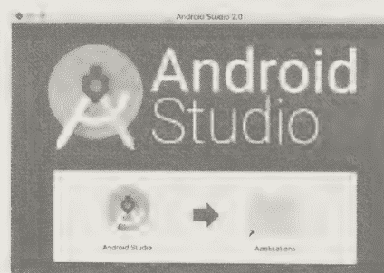

图 2-1

要安装该包，只需将 Android Studio 图标拖到“应用程序”（Applications）文件夹中。Android Studio 包将安装到系统的应用程序文件夹中，此过程通常需要几分钟完成。

要启动 Android Studio，使用 Finder 窗口在应用程序文件夹中找到执行文件并双击它。

为了以后更容易访问该工具，从 Finder 窗口中拖动 Android Studio 图标并将其释放到 Dock 栏。

### 2.3.3 在 Linux 上安装

下载 Android Studio 包后，打开终端窗口，切换目录到要安装 Android Studio 的位置并执行以下命令：

```bash
unzip /path/to/package/android-studio-ide-<version>-linux.zip
```

注意，Android Studio 包将安装在名为 `android-studio` 的子目录。因此，假设上述命令在 `home/demo` 中执行，软件包包将解压到 `/home/demo/android-studio`。

要启动 Android Studio，打开终端窗口，切换目录到 `android-studio/bin` 子目录：

```bash
./studio.sh
```

在 64 位 Linux 系统上运行时，在 Android Studio 运行之前需要安装一些 32 位支持库。在 Ubuntu 上，可以使用以下命令安装这些库：

```bash
sudo apt-get install lib6:i386 libncurses5:i386 libstdc++6:i386 lib32z1 libbz2-i386
```

在基于 Red Hat 和 Fedora 的 64 位系统上，使用以下命令：

```bash
sudo yum install zlib.i686 ncurses-libs.i686 bzip2-libs.i686
```

## 2.4 Android Studio 安装向导

安装后首次启动 Android Studio 时，会出现一个对话框，提供从之前的 Android Studio 版本导入设置的选项。如果你有以前版本的设置并希望将它们导入到最新安装中，请选择相应的选项和位置。或者，指示你不需要导入任何之前的设置并点击“OK”按钮继续。

接下来，可能会出现如图 2-2 所示的向导，尽管此对话框并非所有平台上都会出现：


图 2-2

如果出现了向导，点击“Next”（下一步）按钮，选择“Standard”（标准）安装选项，并再次点击“Next”。

Android Studio 将继续下载并配置最新的 Android SDK。此过程完成后，点击“Finish”（完成）。

## 设置 Android 开发环境

### Android Studio

- 开始一个新的 Android 项目
- 打开一个现有的 Android 项目
- 检查 SDK 更新
- 导入 Android 项目

图 2-3

## 2.5 安装 SDK 软件包

在首次运行 Android Studio 之后，可能已经安装了最新版本的 Android SDK。要安装旧版本的 Android SDK，只需勾选复选框并点击“Apply”（应用）按钮。

可能还会列出可用 SDK 的更新。要访问软件包的详细信息，启用屏幕右下角的“Package Details”（包详情）选项。这将显示类似于图 2-4 所示的信息，通过在 Android Studio 中选择 SDK 选项可以进入此对话框，如图 2-4 所示：

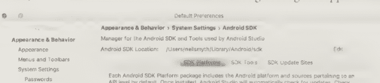

| Name | API Level | Status |
|---|---|---|
| Android 8.0 (Oreo) | 26 | |
| Android 7.1 (Nougat) | 25 | |
| Android 7.0 (Nougat) | 24 | |
| Android 6.0 (Marshmallow) | 23 | |
| Android 5.1 (Lollipop) | 22 | |
| Android 5.0 (Lollipop) | 21 | |
| Android 4.4 (KitKat) | 19 | |
| Android 4.3 (Jelly Bean) | 18 | |
| Android 4.2 (Ice Cream) | 17 | |
| Android 4.1 (Bean) | 16 | |
| Android 4.0 (Gingerwich) | 15 | |
| Android 3.0 (IceSandwich) | 14 | |

图 2-4

除了 Android SDK 软件包，还安装了许多用于构建应用程序的工具。查看当前安装的软件包并检查更新，请留在 SDK 设置屏幕，并如图 2-6 所示选择 SDK 选项卡：

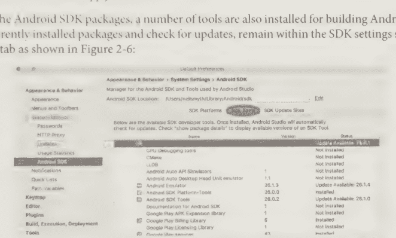

图 2-6

在 Android SDK Tools 屏幕中，请确保以下软件包在“Status”（状态）列中显示为“Installed”（已安装）：

- Android SDK Build-tools
- Android Emulator
- Android SDK Platform-tools
- Android SDK Tools
- Google Play Services
- Instant Apps Development SDK
- Intel x86 Emulator Accelerator (HAXM installer)
- ConstraintLayout for Android
- ConstraintLayout 求解器
- Android Support Repository
- Google 仓库
- Google USB 程序（仅限 Windows）

如果上述任何软件包被列为“未安装”（Not Installed）或需要更新，只需勾选这些软件包旁的复选框并点击“应用”（Apply）按钮启动安装过程。

安装完成后，检查软件包列表，确保所选软件包在“状态”（Status）列中显示为“已安装”（Installed）。如果有任何一个显示为“未安装”，请确保它们已选中，并在之后点击“应用”（Apply）按钮。

## 2.6 使 Android SDK 工具命令行可用

大多数情况下，Android SDK 的底层工具会在 Android Studio 环境内部访问。尽管如此，在某些情况下，从命令提示符或终端窗口调用这些工具也是很有用的。为了让你正在开发的操作系统能够找到这些工具，有必要将它们添加到系统的 `PATH` 中。

无论何种操作系统，都需要配置 `PATH` 变量以包含以下路径：`<path_to_android_sdk_installation>/sdk/tools`、`<path_to_android_sdk_installation>/sdk/tools/bin`、`<path_to_android_sdk_installation>/sdk/platform-tools`

你可以通过启动 SDK Manager 并参考“Android SDK Location”（Android SDK 位置）来识别 SDK 的位置：它位于设置面板的顶部，如图 2-7 所示：


以下是可用的 SDK 开发工具。安装后，Android Studio 将自动检查更新。勾选“显示包详情”（show package details）可以显示 SDK 工具的可用版本。

图 2-7

一旦确定了 SDK，将其添加到 `PATH` 变量的步骤取决于操作系统：

### 2.6.1 Windows 7

1. 在桌面开始菜单中右键点击“计算机”，从结果菜单中选择“属性”（Properties）。
2. 在属性面板中，选择“高级系统设置”（Advanced System settings），在弹出的对话框中，点击“环境变量”（Environment Variables...）按钮。
3. 在“环境变量”对话框中，在“系统变量”列表中找到 `PATH` 变量，选中它并点击“编辑”（Edit....）。找到当前值字符串的末尾，将 Android 平台工具的路径追加到最后，使用分号将路径与前面的值分隔。例如，假设 Android SDK 安装在 `C:\Users\demo\AppData\Local\Android\sdk`，则会将以下内容追加到当前 `Path` 值的最后：

```text
; C:\Users\AppData\Local\Android\platform-tools; C:\Users\AppData\Local\Android\tools\bin
```

4. 点击每个对话框中的确定，并关闭系统属性控制面板。

完成上述步骤后，通过打开命令提示符窗口（开始 -> 所有程序 -> 杂程序 -> 命令提示符）验证路径是否正确，并在提示符输入：

```bat
echo %Path%
```

返回的路径变量应包含 Android SDK 平台工具文件夹的路径。通过尝试运行 `adb` 工具来验证 `platform-tools` 值是否正确：

```text
adb
```

执行该工具应输出命令行选项列表。

同样，通过尝试启动 AVD Manager 命令行工具来检查 `tools-path` 设置（如果 `avdmanager` 工具报告 java 问题请不要担心——稍后会解决）：

```text
avdmanager
```

如果其中一个或两个命令出现类似以下的消息，很可能是向 `Path` 环境变量中添加了错误的路径：

`'adb' 不是内部或外部命令、可运行的程序或批文件。`

### 2.6.2 Windows 8.1

1. 在启动屏幕，将鼠标移动到屏幕右下角，在结果框中进行搜索，输入“控制面板”。当控制面板出现在结果区域时，点击它以在桌面上启动该工具。
2. 在控制面板中，使用“类别”菜单将显示更改“大图标”。从图标列表中选择标记为“系统”的项目。
3. 按照 Windows 7 的步骤从第 2 步到第 4 步操作。

打开命令提示符窗口（将鼠标移动到屏幕右下角，选择搜索并进入搜索框）。从搜索结果中选择“命令提示符”。

在命令提示符窗口中输入：

```bat
echo %Path%
```

返回的路径变量应包含 Android SDK 平台工具文件夹的路径。通过如下尝试运行 `adb` 工具来验证 `platform-tools` 值是否正确：

```text
adb
```

执行该工具应输出命令行选项列表。

同样，通过尝试运行 AVD Manager 命令行工具来检查 `tools-path` 设置（如果 `avdmanager` 工具报告 java 问题请不要担心——稍后会解决）：

```text
avdmanager
```

如果其中一个或两个命令出现类似以下的消息，很可能是向 `Path` 变量添加了错误的路径：

`adb` 不是内部或外部命令、可运行的程序或批文件。

### 2.6.3 Windows 10

右键点击开始菜单，从结果菜单中选择“设置”，并找到设置文本字段以输入“编辑系统环境变量”。在“系统属性”对话框中，点击“环境变量...”按钮。按照 Windows 7 的步骤从第 3 步开始操作。

### 2.6.4 Linux

在 Linux 上，此配置通常可以通过向你家目录下的 `.bashrc` 文件中添加命令来实现（这可能取决于所使用的特定 Linux 发行版）。假设 Android SDK 捆包安装在 `/home/demo/Android/sdk`，则 `.bashrc` 文件中的 `export` 语句如下：

```bash
export PATH=$PATH:/home/demo/Android/sdk/platform-tools:/home/demo/Android/sdk/tools:/home/demo/Android/sdk/tools/bin:/home/demo/android-studio/bin
```

注意，上述命令将 `android-studio` 目录添加到 `PATH` 变量中。这将允许无论终端中的当前目录如何都能执行 `studio.sh` 脚本。

### 2.6.5 macOS

在 macOS 上可以使用多种技术来修改 `$PATH` 环境。认为最干净的方法是在 `/etc/paths.d` 目录下创建一个新文件，其中包含要添加到 `PATH` 的路径。假设 Android SDK 位置为 `/Users/demo/Library/Android/sdk`，可以通过在 `/etc/paths.d` 目录下创建一个名为 `android-sdk` 的新文件并包含以下行来配置路径：

- `/Users/demo/Library/Android/sdk/tools`
- `/Users/demo/Library/Android/sdk/tools/bin`
- `/Users/demo/Library/Android/sdk/platform-tools`

注意，由于这是一个系统目录，创建文件时需要使用 `sudo` 命令。

例如：

```bash
sudo vi /etc/paths.d/android-sdk
```

# 第 3 章

## 3 在 Android Studio 中创建一个 Android 示例应用

本书之前的章节已经涵盖了使用 Android Studio IDE 开发 Android 应用程序所需的配置环境的步骤。在进入稍高阶的主题之前，现在是验证所有所需的开发包已安装并正常运行的好时机。实现这一目标的最佳方法是创建一个 Android 应用程序并对其编译和运行。一旦项目创建完成，稍后的章节将探索如何使用 Android 模拟器环境对应用程序进行测试运行。

## 3.1 关于项目

在本章创建的项目是一个非常简单的货币汇率转换器（事实上，它非常简单，仅将欧元转换为美元，并使用估算的转换汇率进行计算）。该项目还利用了最基础的 Android 项目模板。这种简单性使我们能够介绍 Android 开发的一些关键方面，而不会因为一次性引入过多概念（例如推荐的 App 架构和 Android 架构组件）让初学者无所适从。在遵循本章教程时，请放心，此初始示例项目中使用的所有技术和代码将在后面的章节中进行更详细的介绍。

## 3.2 创建新项目

应用程序开发过程的第一步是在 Android Studio 环境中创建一个新项目。因此，首先启动 Android Studio，会出现图 3-1 所示的“欢迎来到 Android Studio”屏幕：


图 3-1

一旦出现此窗口，Android Studio 就已准备好创建新项目。要创建新项目，只需点击“Start a new Android project”（启动一个新的 Android 项目）选项，即可显示图 3-2 所示的新项目向导的第一个屏幕：


图 3-2

## 3.3 定义项目和 SDK 设置

在新项目（New Project）窗口中，将 Application name（应用程序名称）设置为 `AndroidSample`。应用程序名称是在 Android Studio 内部引用和识别应用程序的名称，如果完成的应用程序要发布到 Google Play 商店，也将使用该名称。

Package Name（包名）用于在 Android 应用程序生态系统中唯一地标识应用程序。虽然它可以设置为任何唯一标识你应用程序的字符串，但传统上它是基于你域名的反转 URL，后跟应用程序名称。例如，如果你的域名是 `www.mycompany.com`，且应用程序命名为 `AndroidSample`，那么包名可以指定如下：

`com.mycompany.androidsample`

如果你没有域名，可以在 Company Domain（公司域名）字段中输入任何其他字符串，或者出于测试目的使用 `example`；在发布应用程序之前，需要更改它：

`com.example.androidsample`

Project location（项目位置）设置将默认位于你主目录下的名为 `AndroidStudioProjects` 的文件夹，可以通过点击路径右侧的按钮进行更改。

点击 Next（下一步）继续。在 Phone and Tablet（手机和平板电脑）选项上，将最小 SDK 设置为 `API 26: Android 8.0 (Oreo)`。除非某个必要功能仅在较新版本中可用，否则本书中创建的大多数项目都将使用此 SDK。虽然选择了较旧的 SDK 版本，但 Android 内置的许多安全和隐私功能是在 API 25 之后才引入的。为了提高应用安全性，Google 宣布从 2018 年 8 月起，Google Play 商店将仅接受使用 API 26 或更高版本的构建。此限制也适用于现有应用。由于项目并非用于 Google TV 或可穿戴设备，请保持其余选项禁用状态。


## 3.4 创建 Activity

下一步是为应用程序定义要创建的 Activity 类型。开发 Android 应用程序时可以使用多种不同的 Activity 类型，其中许多将在后面的章节中介绍。然而，为了本示例演示，只需选择创建 Basic Activity（基础 Activity）选项即可。Basic Activity 选项会创建一个模板用户界面，由应用栏（app bar）、内容区域和一个浮动操作按钮（floating action button）组成。

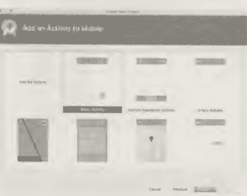

图 3-3

选中 Basic Activity 后，点击 Next（下一步）。在最后一个屏幕（图 3-4）上，将 Activity 名称和标题命名为 `AndroidSample`。该 Activity 将由单一的用户界面布局组成，为了本示例演示，它应命名为 `activity_android_sample`。最后，如图 3-4 所示，在标题字段输入 `My Android App`：

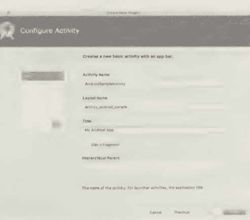

图 3-4

点击 Finish（完成）启动项目创建。

## 3.5 修改示例应用

此时，Android Studio 已创建了一个最小的示例项目并打开了主窗口。


图 3-5

新创建的项目以及对关联文件的引用列位于主窗口左侧的 Project（项目）工具窗口中。Project 工具具有多种可以显示信息的模式。默认情况下，此面板将处于 Android 模式。此设置由面板顶部的菜单控制，如图 3-6 所示。如果面板当前不是 Android 模式，请使用菜单切换：

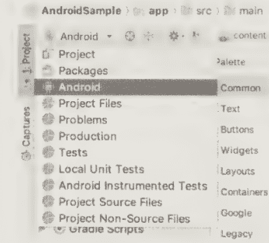

图 3-6

当我们选择创建 Activity 时创建的示例项目包含一个标签，当应用程序执行时，它将显示“Hello World!”

本教程的下一步是修改应用程序的用户界面，使其显示更大的文本视图。

我们 Activity 的用户界面设计存储在名为 `activity_android_sample.xml` 的文件中，它位于项目层级结构的 `app` -> `res` -> `layout` 下。此布局包含了应用栏（称为 action bar），它出现在屏幕顶部（图 3-7 中标记为 A）以及浮动操作按钮（标记为 B）。除了这些项目外，`activity_android_sample.xml` 文件包含指向内容布局的第二个文件（标记为 C）：


图 3-7

默认情况下，内容布局位于名为 `content_android_sample.xml` 的文件中，对 Activity 布局的更改在此文件中进行。使用 Project 工具窗口找到此文件，如图 3-8 所示：

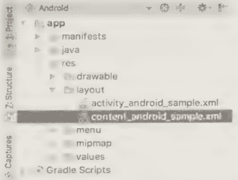

图 3-8

一旦找到，双击该文件将其加载到用户界面 Layout Editor（布局编辑器）工具中，该工具将出现在 Android Studio 主窗口的中间面板：

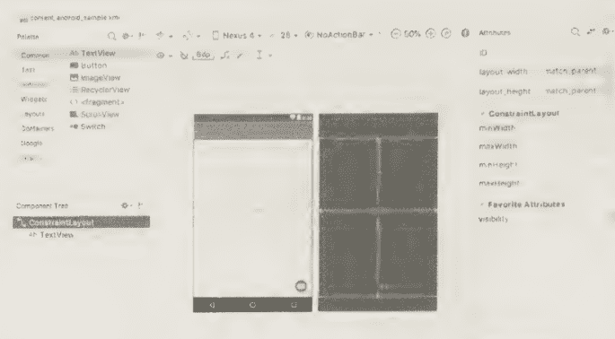

图 3-9

Layout Editor 窗口顶部工具栏有一个菜单（上图中设置为 Nexus 4），它反映在 Layout Editor 面板中设备表示上。通过点击此菜单可以选择广泛的其他设备选项。

要在设备表示的横屏和竖屏之间切换方向，只需使用设备图标正左侧的下拉菜单即可。

# 在 Android Studio 中创建一个示例 Android 应用

修改应用程序的下一步是向布局中添加一些额外的组件，其中第一个是按钮（Button），供用户点击以启动货币换算。

调色板（Palette）面板包含两列，左侧列包含视图组件类别列表。右侧列列出当前选类别中包含的组件。例如，在图 3-12 所示，在 Buttons 类别中当前选择了 Button 视图：

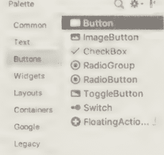

图 3-12

从 Buttons 列表中点击并拖动 Button 对象，将其释放到用户界面设计的水平中心位置，使其位于现有 TextView 小部件下方：

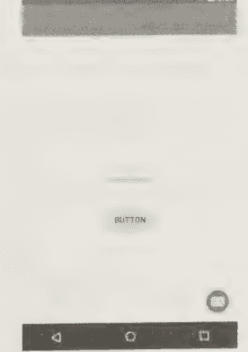

图 3-13

下一步是更改当前 Button 组件显示的文本。位于设计区域右侧的面板是属性面板（Attributes panel）。该面板显示分配给布局中当前选择组件的属性。找到 `text` 属性，并将当前值从 "Button" 更改为 "Convert"，如图 3-14 所示：


更改组件 `text` 属性的一个有用快捷键是在布局中双击它。这将自动在属性面板中定位该属性并选中它，准备编辑。

带有扳手图标的第二个 `text` 属性允许设置一个文本属性，该属性仅在布局编辑器中显示，但在运行时不会显示。这对于测试视觉组件和布局在不同设置下的行为非常有用，而无需反复运行应用。

为了以防自动连接（Autoconnect）系统未能设置所有布局连接，点击推断约束（Infer constraints）按钮（图 3-15），为布局添加任何缺失的约束：

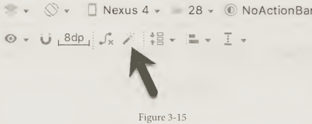

此时，重要的是解释布局编辑器工具右上角的警告按钮，如图 3-16 所示。显然，这表示布局可能存在潜在问题。要查看任何问题的详情，请点击该按钮：


点击后，将出现一个面板（图 3-17），描述问题的性质并提供一些可能的纠正措施：

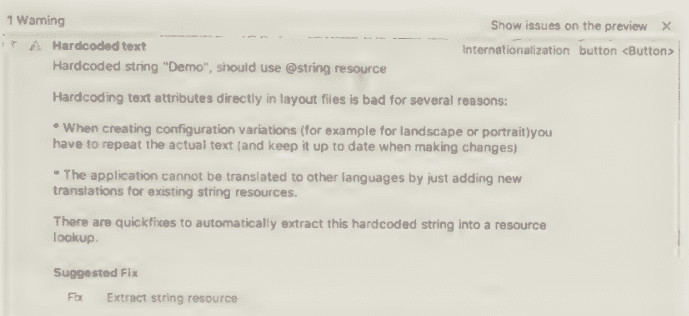

图 3-17

目前，列出的唯一警告如下：

`Hardcoded string "Convert", should use @string resource`

此 I18N 消息告诉我们，项目未来的国际化方面存在潜在问题。“I18N”源于“internationalization”一词，它以 "I" 开头，以 "n" 结尾，中间有 18 个字母。警告提醒我们，在开发 Android 应用时，应尽可能以资源的形式存储文本字符串等属性和值。这样做允许通过修改资源文件来更改应用外观，而无需更改应用程序源代码。这在将用户界面翻译成其他语言时特别有用。如果用户界面中的所有文本都包含在单个资源文件中，例如，可以将该文件交给翻译人员，由他们执行翻译工作并返回翻译后的文件以包含在应用程序中。在这种情况下，我们将创建一个名为 `convert_string` 的新资源，并将其分配给字符串 "Convert"。

点击问题说明（Issue Explanation）面板中的 Fix 按钮显示提取资源（Extract Resource）面板（图 3-18）。在此面板中，将资源名称字段更改为 `convert_string`，并在点击 OK 按钮之前，将资源值设为 Convert。

| Extract Resource |

| :--- | :--- |

| Resource name: | convert_string |

| Resource value: | Convert |

| Source set: | main |

| File name: | strings.xml |

| Create the resource in directories: | values |

图 3-18

值得注意的是，当在属性面板中输入字符串时，也可以将其分配给资源。这涉及点击属性面板中属性字段右侧显示三个点的按钮，并从弹出的 Resources 对话框选择 Add resource -> New String Value... 菜单选项。在实践中，直接在属性面板面板布局中的任何部件设置值通常更快，然后在布局完成后按顺序处理警告对话框中的列表以提取任何必要的资源。

下一个要添加的小部件是 EditText 小部件，用户将向其中输入要换算的美元金额。从组件调色板中，选择 text 类别并将 Number (Decimal) 组件拖到布局中，使其水平居中，并位于现有 TextView 小部件的上方。选中后，使用属性窗口将 `hint` 属性设置为 "dollars"。点击警告并将字符串提取为名为 `dollars_hint` 的资源。

通过点击推断约束按钮添加任何缺失的布局约束。此时，布局应该类似于图 3-19 所示：


图 3-19

本章稍后编写的代码将访问用户输入到 EditText 字段的美元值。它将通过引用分配给用户界面布局中小部件的 ID 来实现。当布局中的部件被选中时，可以在属性窗口中查看并更改 Android Studio 为小部件分配的默认 ID，如图 20 所示：

| Attributes |

| :--- | :--- |

| ID | editText |

| layout_width | wrap_content |

| layout_height | wrap_content |

图 20

## 3.6 检查布局和资源文件

在继续下一步之前，我们将查看用户界面设计和资源处理的一些内部方面。在上一节中，我们通过布局编辑器修改 `strings.xml` 对界面进行了一些更改。事实上，我们通过修改字符串对界面进行了一些更改。

# 在 Studio 中创建一个示例 Android 应用程序

`content_android_sample.xml`   `strings.xml`   翻译编辑器

| 键名 | 资源文件夹 | 默认值 |

|---|---|---|

| app_name | app/src/main/res | AndroidSample |

| action_settings | app/src/main/res | Settings |

| convert_string | app/src/main/res | Convert |

| dollars | app/src/main/res | dollars |

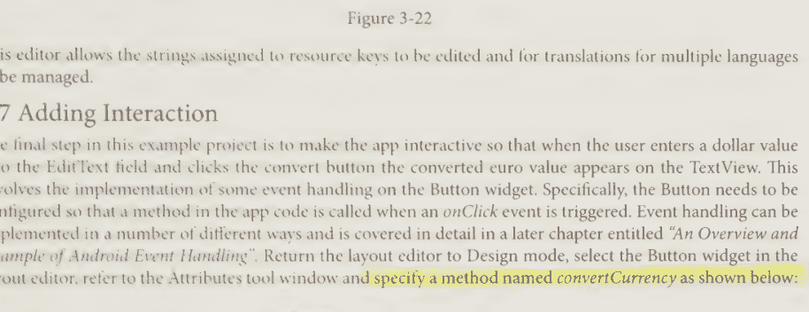

图 3-22

此编辑器允许编辑作为资源键的字符串，并管理多种语言的翻译。

## 3.7 添加交互

本示例项目中的线性步骤是使应用程序具有交互性，当用户在 `EditText` 字段中输入一个值并点击转换按钮时，转换后的值将显示在 `TextView` 上。这涉及在 `Button` 组件上实现一些事件处理。具体来说，需要配置 `Button`，以便在触发 `onClick` 时调用应用代码中的方法。事件处理可以通过多种不同的方式实现，并在后题为“Android 事件处理概述与示例”的章节中详细介绍。返回布局编辑器到 `Design`（设计）模式，选择布局编辑器中的 `Button` 组件，参考 `Attributes`（属性）工具窗口，并按所示指定名为 `convertCurrency` 的方法：


图 3-23

接下来，双击 `AndroidSampleActivity.java` 将其加载到代码编辑器中，并为类添加 `convertCurrency` 方法的代码，使其读取内容如下，注意，还需要导入一些额外的 Android 程序包：

```
package com.ebookfrenzy.androidsample;

import android.os.Bundle;
import android.support.design.widget.FloatingActionButton;
import android.support.design.widget.Snackbar;
import android.support.v7.app.AppCompatActivity;
import android.support.v7.widget.Toolbar;
import android.view.View;
import android.view.Menu;
import android.view.MenuItem;
import android.widget.EditText;
```

```
import android.widget.SampleActivity;

public class AndroidSampleActivity extends AppCompatActivity {

    public void convertCurrency(View view) {

        EditText dollarText = findViewById(R.id.dollarText);
        TextView textView = findViewById(R.id.textView);

        if (!dollarText.getText().toString().equals("")) {

            Float dollarValue = Float.valueOf(dollarText.getText().toString());
            Float euroValue = dollarValue * 0.85F;
            textView.setText(euroValue.toString());
        } else {
            textView.setText("No Value");
        }
    }
}
```

该方法首先通过调用 `findViewById` 并传递在布局文件中分配的 ID 来获取 `EditText` 和 `TextView` 对象的引用。然后进行检查以确保用户输入了美元金额，如果是，则提取该值，将其从字符串转换为浮点数并转换为欧元。结果显示在 `TextView` 组件上。如果对这些的任何内容不清楚，请放心，这些概念将在后面的章节中更详细地介绍。

项目现在已完成并准备好运行，该任务将在下一章中为测试目的创建 AVD 模拟器会话后执行。

## 3.8 总结

虽然并不极端复杂，但设置 Android 开发环境涉及许多步骤。在完成这些步骤后，值得运行一个简单的示例以确保环境已正确安装和配置。在本章中，我们创建了一个简单的应用程序并使用了 Android Studio 布局编辑器来修改界面布局。因此，我们解释了尽可能使用资源的重要性，特别是在字符串值的情况下，并简要地提到了布局的主题。我们现在查看了用于存储 Android 应用程序界面设计的底层 XML。

虽然在 Android Studio 布局编辑器工具中预览布局很有用，但通过编译和运行应用程序来测试程序是不可替代的。

最后，在 `Button` 上添加了一个 `onClick` 事件，并实现了一个方法，该方法从 `EditText` 组件中提取用户输入，将美元转换为欧元，然后在 `TextView` 上显示结果。

由于由于应用程序已准备好测试，为测试目的设置模拟器的必要步骤将在下一章中详细介绍。

# 4. 在 Android Studio 中创建 Android 虚拟设备 (AVD)

在 Android Studio 中开发 Android 应用程序的过程中，需要多次编译和运行应用程序。可以通过在物理设备或 Android 虚拟设备 (AVD) 模拟器环境中安装并运行来测试应用程序。在使用 AVD 之前，必须先创建并配置它以匹配特定设备模型的规格。因此，本章的目标是以 Nexus 5 手机作为示例，完成创建虚拟设备涉及的步骤。

# 4.1 关于 Android 虚拟设备

AVD 本质上是模拟器，允许在无需将应用程序安装到物理 Android 设备设备的情况下测试 Android 应用程序。AVD 可以配置为模拟各种硬件功能，包括屏幕大小、内存容量，以及是否存在摄像头、GPS 导航支持或加速度计等功能。作为 Android 标准安装的一部分，安装了许多模拟器模板，允许为一系列不同的设备配置 AVD。可以加载额外的模板或创建自定义配置，通过指定处理器类型、内存容量以及屏幕的尺寸和像素密度等属性来匹配任何物理设备。检查您的设备的在线开发者文档，以查找是否有可下载并安装到 AVD 环境的模拟器定义。

启动时，AVD 将作为一个包含模拟的 Android 设备环境的窗口出现。例如，图 4-1 显示了一个配置为模拟 Google Nexus 5X 模型的 AVD 会话。

新的 AVD 使用 Android 虚拟设备管理器创建和管理，既可以在命令行模式下使用，也可以使用更友好的图形用户界面。


图 4-1

## 4.2 创建新的 AVD

为了测试应用程序的行为，第一步是创建 AVD。要创建新的 AVD，必须使用 Android 虚拟设备管理器。可以通过 Android Studio 中选择 `Tools -> AVD Manager` 访问。

启动后，AVD 将作为一个包含模拟的 Android 设备环境的窗口出现。图 4-1 显示了一个配置为模拟 Google Nexus 5X 模型的 AVD 会话。新的 AVD 使用 Android 虚拟设备管理器创建和管理，既可以在命令行模式下使用，也可以使用更友好的图形用户界面。要测试应用程序的行为，第一步是创建 AVD。要创建新的 AVD，必须使用 Android 虚拟设备管理器。可以通过 Android Studio 中选择 `Tools -> AVD Manager` 访问。


启动后，AVD 将作为一个包含模拟的 Android 设备环境的窗口出现。图 4-1 显示了一个配置为模拟 Google Nexus 5X 模型的 AVD 会话。新的 AVD 使用 Android 虚拟设备管理器创建和管理，既可以在命令行模式下使用，也可以使用更友好的图形用户界面。要测试应用程序的行为，第一步是创建 AVD。要创建新的 AVD，必须使用 Android 虚拟设备管理器。可以通过 Android Studio 中选择 `Tools -> AVD Manager` 访问。

## 4.2 创建新的 AVD

Android 应用程序可以通过在物理设备上或 Android 虚拟设备 (AVD) 模拟器环境中安装并运行来测试。在使用 AVD 之前，必须先创建并配置它以匹配特定设备模型的规格。因此，本章的目标是以 Nexus 5 手机作为示例，完成创建虚拟设备涉及的步骤。要测试应用程序的行为，第一步是创建 AVD。要创建新的 AVD，必须使用 Android 虚拟设备管理器。可以通过 Android Studio 中选择 `Tools -> AVD Manager` 访问。

启动后，AVD 将作为一个包含模拟的 Android 设备环境的窗口出现。图 4-1 显示了一个配置为模拟 Google Nexus 5X 模型的 AVD 会话。要测试应用程序的行为，第一步是创建 AVD。要创建新的 AVD，必须使用 Android 虚拟设备管理器。可以通过 Android Studio 中选择 `Tools -> AVD Manager` 访问。

## 4.3 启动模拟器

要对新创建的 AVD 进行测试，只需从 Android Manager 中选择 AVD 并点击启动按钮（Actions 列中的绿色三角形）。模拟器将在新窗口中出现并开始启动过程。模拟器启动所需的时间取决于 AVD 的配置及其运行的系统。

虽然模拟器可能默认以竖屏方向显示，但也可以更改默认选项。在 Android Manager 中，选择新的 5X 条目并点击设备行 Actions 列中的铅笔图标。在配置屏幕上找到 `Startup` 和 `orientation` 部分并更改方向设置。退出并重启模拟器会话以查看更改效果。关于模拟器的更多细节将在下一章（“使用和配置 Android Studio AVD”）中介绍。

为了节省本章下一节的时间，请在继续之前保持模拟器运行。

# 4.4 在 AVD 中运行应用程序

配置好 AVD 模拟器后，之前创建的 AndroidSample 应用程序现在可以编译并运行了。将 AndroidSample 项目加载到 Android Studio 后，只需点击下方图 4-4 所示位于 Android 工具栏中的绿色三角形运行按钮，选择 `Run -> Run 'app'` 菜单选项或使用快捷键 `Ctrl-R`：


图 4-4

## 在 Android Studio 中创建 Android 虚拟设备 (AVD)


图 4-5

一旦应用程序安装并运行，`AndroidSampleActivity` 类的用户界面将出现在模拟器中：


图 4-6

如果活动（activity）没有自动启动，检查模拟器上的应用列表中是否出现了启动图标。如果是，点击该图标启动应用程序。一旦运行过程开始，`Run` 和 `Logcat` 窗口将可用。`Run` 窗口会在应用程序安装和启动时显示诊断信息。图 4-7 显示了应用程序成功启动时的 `Run` 窗口输出：

```
08/06 13:20:25 Launching app
> ad install-multiple -r -p com.ebookfry.androidsample/users/nilsymth/Documents/Books/Android_Studio_3.8/AndroidSample/app/build/outputs/apk/
Split APKs installed
> am start -n "com.ebookfry.androidsample/com.ebookfry.androidsample.AndroidSampleActivity" -a android.intent.action.MAIN -c android.n.
> Client not ready yet. Waiting for process to go online
> Connected to process 15534 on device emulator:5554
```

图 4-7

如果在启动过程中遇到问题，`Run` 工具窗口将提供信息，这些信息可能有助于隔离问题原因。

假设应用程序加载到模拟器并按预期运行，我们已经安全地验证了 Android 开发环境已正确安装和配置。

## 4.5 运行/调试配置

可以对特定项目进行配置，使其在每次于 Android Studio 中运行时都自动使用特定的设备或模拟器。这避免了每次执行应用程序时从设备选择器中进行选择的必要性。要查看和修改运行/调试配置，请点击 Android 工具栏运行按钮左侧的按钮，从弹出的菜单中选择 `Edit Configurations...` 选项：


在 `Run/Debug Configurations` 对话框中，可以通过选择 `Deployment Target Options` 部分 `Target` 菜单中的 `Emulator` 并从下拉菜单中选择模拟器，来配置应用程序始终使用首选模拟器。例如，图 4-9 显示了 AndroidSampleapplication 配置为在之前选择的 Nexus 5X 模拟器上运行：

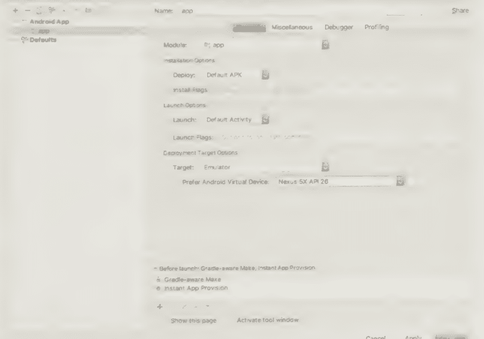

## 在 Android Studio 中创建 Android 虚拟设备 (AVD)

在进入本书下一章节之前，确保将 `Target` 菜单设置回“Open Select Deployment Dialog”模式。

## 4.6 停止正在运行的应用程序

要停止正在运行的应用程序，只需点击主工具栏上的停止按钮，如图 4-10 所示：


图 4-10

可以使用 `Logcat` 工具窗口通过显示应用程序运行时变为用的窗口栏来终止应用。一旦 `Logcat` 工具窗口出现，选择下方图 4-11 中突出亮显示的 `androidsample` 菜单：

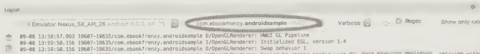

图 4-11

进程停止后，点击上图箭头指示的进程列表左侧工具栏中的 `Remote Application` 按钮来停止它。

## 4.7 命令行创建

如前所述，除了图形用户界面外，还可以直接从命令行界面创建新的 AVD。一旦启动，该工具将提示创建新 AVD 的额外信息。

`avdmager` 工具需要访问 Java 运行时环境 (JRE) 才能运行。如果尝试运行 `avdmager`，会出现一条错误消息，指示找不到“java”命令，可以配置命令使用与 Android Studio 的 OpenJDK 环境。通过以下方式识别 OpenJDK 目录的位置：

1. 启动 Android Studio 并打开书中之前创建的 AndroidSample 项目。

2. 选择 `File -> Project Structure...` 菜单选项。

3. 复制 `Project Structure` 对话框中 `JDK location` 处的路径。这代表了与 Android Studio 绑定的 JRE 位置。

在 Windows 上，在运行 `avdmager` 的命令提示符执行以下命令（`<path to jre>` 替换为从 `Project Structure` 对话框复制的路径）：

```
set JAVA_HOME=<path to jre>
```

在 macOS 或 Linux 上，执行以下命令：

```bash
export JAVA_HOME="path to jre>"
```

如果你预计经常使用 `avdmager` 工具，请按照“Setting up an Android Studio Development Environment”章节中针对你操作系统的环境变量步骤，在系统级上配置 `JAVA_HOME`。

假设系统已配置将 Android SDK 目录包含在 `PATH` 环境变量中，可以通过在终端或命令行执行以下命令来获取新 AVD 的可用目标：

```
avdmager list targets
```

上述命令的输出将包含系统上可用的 Android SDK 版本列表。例如：

Available Android targets:

```
id: 1 or "android-28"
Name: Android API 28
Type: Platform
API level: 28
Revision: 3
```

```
id: 2 or "android-26"
Name: Android API 26
Type: Platform
API level: 26
Revision: 1
```

`avdmager` 工具还允许从命令行创建新的 AVD 实例。例如，使用 x86 ABI 的 Android API level 26 设备的 target ID 创建名为 `Nexus9` 的新 AVD，可以使用命令：

```
avdmager create avd -n Nexus9 -k "system;x86"
```

## 4.8 Android 虚拟设备配置文件

默认情况下，与 AVD 相关的文件存储在用户目录下的 `android/avd` 目录中，其结构如下（`<avd name>` 是分配给 AVD 的名称）：

- `<avd name>.config.ini`

- `<avd name>.avd/userdata.img`

- `<avd name>.ini`

`config.ini` 文件包含 AVD 过程中指定的设备配置，如显示尺寸和内存。这些设置可以直接在配置文件中更改，并在调用 AVD 时被采用。

`<avd name>.ini` 文件包含对 target SDK 的引用以及 AVD 的路径。注意，`config.ini` 文件中 `sysdir` 值的更改需要反映在该文件的 `target` 值中。

## 4.9 移动和重命名 Android 虚拟设备

AVD 的当前名称或位置可以通过工具的 `move` 参数进行更改。例如，将名为 `Nexus9` 的 AVD 重命名为 `Nexus9B`，可以执行命令：

```
avdmager move avd -n Nexus9 -r Nexus9B
```

要物理移动与 AVD 相关的文件，应使用以下命令语法：

```
avdmager move avd -n <avd name> -p <path to new location>
```

例如，将 AVD 从当前文件位置移动到 `/tmp/Nexus9Test`：

```
avdmager move avd -n Nexus9 -p /tmp/Nexus9Test
```

执行 `move` 命令之前，目标目录必须已存在。同样，要删除现有 AVD，只需使用 `delete` 选项：

```
avdmager delete avd -n <avd name>
```

# 第 5 章

## 5. 使用和配置 Android Studio AVD 模拟器

Android Studio 1.x 自带的 Android 虚拟设备（AVD）模拟器是该原本良好的开发环境中一个典型的弱点。许多开发者认为该模拟器运行缓慢、缺乏活性且不可靠，早已该对其进行彻底的改新了。幸运的是，Android Studio 2 引入了增强的模拟器环境，在整体性能方面提供了显著改进，并在随后的版本中进行了进一步增强。

在下一章探索物理设备上的测试之前，本章将花费一些时间概述 Android Studio AVD 模拟器，并重点介绍许多可用的配置功能。

## 5.1 模拟器环境

启动时，模拟器在加载过程中会显示初始启动屏幕。加载完成后，会出现主模拟器窗口，其中包含所选设备类型的表示（图 5-1 为一个 Nexus 5 设备）：

img/217398868a220b0671ab8e497ec58.png

窗口右侧边缘有一个工具栏，提供了快速访问模拟器控件和配置选项的通道。

## 5.2 模拟器工具栏

模拟器工具栏（图 5-2）提供了与模拟器环境外观和行为相关的系列选项。

工具栏中的每个按钮都有关联的快捷键，可以通过将鼠标指针悬停在按钮上并等待提示框出现来识别，或者通过扩展控件面板来识别。虽然工具栏中的许多选项是一目了然的，但为了完整起见，将涵盖每个选项：

- **退出 / 最小化**：工具栏最顶部的 'x' 退出模拟器会话，而 '-' 选项则最小化窗口。

- **电源**：电源按钮模拟物理设备上的电源按钮。点击并释放将锁定设备并关闭屏幕。长按此按钮将启动“关机”序列。

- **音量增大 / 减小**：控制模拟器内播放音频量的两个按钮。

- **向左/向右旋转**：在模拟设备在纵竖屏和横屏方向之间旋转。

- **截图**：对设备当前显示的内容进行截图。捕获的图像存储在稍后概述的扩展控件面板指定的路径。

- **缩放模式**：此按钮切换进入和退出缩放模式，细节将在本章稍后介绍。

- **返回**：模拟选择标准的“返回”按钮。与下面列出的主页和概览按钮一样，通过选择模拟器屏幕上的按钮也可以相同的结果。

- **主页**：模拟选择标准的“主页”按钮。

- **概览**：模拟选择标准的“概览”按钮，用于显示设备上正在运行的应用。

- **扩展控件**：显示扩展控件面板，允许配置模拟位置、电池强度、蜂窝网络类型和指纹识别等选项。

### 5.3 在缩放模式下工作

模拟器工具栏中的缩放级别会在缩放模式之间切换。当缩放模式激活时，工具栏会收起，鼠标指针在悬停在设备屏幕上会变为放大镜。点击鼠标左键将导致显示相对于屏幕上的选定点放大，重复点击将增加缩放级别。相反，点击右键将减小缩放级别。关闭缩放按钮将显示恢复到默认大小。

在缩放模式下点击并拖拽将定义一个矩形区域，当释放鼠标按钮时视图将缩放到该区域。


在缩放模式下，可以使用模拟器窗口内的水平和垂直滚动条对屏幕的可视区域进行移动。

### 5.4 调整模拟器窗口大小

模拟器窗口的大小（以及相应的设备表示）可以通过点击并拖拽窗口的任何角或侧边来随时更改。

### 5.5 扩展控件选项

扩展控件工具栏按钮显示图 5-3 所示的面板。默认情况下，将显示位置设置。从左侧面板选择不同的类别将显示相应的控件组：

`img/217398868a220b0671ab8e497ec60.png`

### 5.5.1 位置

位置控件允许以十进制或度分秒坐标的形式向模拟器发送模拟位置信息。位置信息可以单个位置的形式存在，也可以是代表设备移动的点序列，后者通过 GPS 交换（GPX）格式或 Keyhole 标记语言（KML）格式的文件提供。

点击“发送”按钮时，单个位置将传输到模拟器。一旦选择了数据表下方的“播放”按钮，GPS 数据点的传输将开始。GPS 数据点馈送到模拟器的速度可以使用播放按钮旁边的速度菜单进行控制。

### 5.5.2 蜂窝

可以在蜂窝设置中更改蜂窝连接类型。提供了模拟不同网络类型（CSM、EDGE、HSDPA 等）以及漫游场景的选项。

### 5.5.3 摄像头

当摄像头激活时，模拟器会模拟 3D 场景。这以虚拟建筑的形式呈现，通过按住 Option 键（Windows 上为 Alt）并使用鼠标指针和键盘可以在其中导航。

### 5.5.4 电池

在此面板上可以模拟各种电池状态和充电条件，包括电量、电池健康以及当前是否连接了 AC 充电器。

### 5.5.5 电话

电话扩展控件为模拟器提供了两个简单但实用的模拟。第一个选项允许模拟来自指定号码的入入电话。这在测试应用程序如何处理此类级别的中断时特别有用。

第二个选项允许在模拟器会话中模拟接收短信。与现实世界一样，这些消息将出现在信息应用中并触发模拟器内的标准通知。

### 5.5.6 方向键

方向键（D-Pad）是内置在 Android 设备中或外部连接（如游戏控制器）的一组额外控件，提供方向控制（左、右、上、下）。方向键设置允许在模拟器中模拟 D-Pad 交互。

### 5.5.7 麦克风

麦克风设置允许启用麦克风并模拟虚拟耳机和麦克风连接。还提供了一个按钮启动语音助手。

### 5.5.8 指纹

许多 Android 设备现在配备了内置指纹检测硬件。AVD 模拟器使得无需在带有指纹传感器的物理设备上测试指纹身份验证。有关如何在模拟器中配置指纹测试的细节将在本章详细介绍。

### 5.5.9 虚拟传感器

虚拟传感器选项允许模拟加速度计和磁力计，通过偏航、俯仰和滚转设置来模拟设备物理运动的等效果。

### 5.5.10 快照

快照包含当前运行 AVD 的状态，以便保存和快速恢复，这有助于模拟器恢复到精确状态。快照将在本章详细介绍。

### 5.5.11 屏幕录制

允许对模拟器屏幕和音频进行录制，并保存为 WebM 或动态 GIF 格式。

### 5.5.12 Google Play

在 AVD 实例上必须存在 Google Play，才能测试如应用内购买等 Google 服务。此扩展控制屏幕显示了当前 Android 实例上安装的 Google Play 版本，并提供了更新或停用 Google Play 安装的选项。点击“更新（Update）”按钮时，模拟器将加载相应的 Google Play Store 页面，允许对安装进行更改，从而停用 Google Play。

### 5.5.13 设置

设置面板提供了一小组配置选项。使用此面板为工具栏和扩展控制面板选择更深颜色的主题，指定保存截图的文件系统位置、OpenGL 支持级别，并配置模拟器窗口显示在桌面上的其他窗口之上。

### 5.5.14 帮助

帮助屏幕包含三个子面板，分别列出了键盘快捷键列表、访问模拟器在线文档、报告文件错误和发送反馈的链接，以及模拟器版本信息。

## 5.6 使用快照

当模拟器首次启动时，它会执行冷启动，这就像物理 Android 设备开机一样。这种冷启动过程需要一些时间，因为操作系统需要加载，所有后台进程都需要启动。为了避免每次启动模拟器都必须经历这一过程，系统配置为每次退出时自动保存模拟器当前状态的快照（称为快速启动快照）。下次启动模拟器时，快速启动快照将加载到内存中，并从离开的地方继续执行，允许模拟器在比冷启动所需短得的时间内重启。

扩展控制面板的快照屏幕用于在模拟器运行期间的任何点存储额外的快照。这保存了整个模拟器的精确状态，允许模拟器恢复到拍摄快照时的精确时间点。在屏幕界面中，可以使用“拍摄快照（Take Snapshot）”按钮（如图 5-4 中的 A 所示）拍摄快照。要恢复现有的快照，请从列表中选择它 (B) 并点击屏幕底部的运行按钮 (C)。还提供了选项来编辑 (D) 快照的名称和描述，并删除 (E) 当前选中的快照：

``

图 5-4

使用和配置 Android Studio 模拟器

设置 (F) 提供了配置自动保存快速启动快照的选项（默认情况下，模拟器每次退出时都会询问是否保存快速启动快照），或重新加载最近的快照。要强制模拟器会话执行冷启动而不是使用之前的快速启动快照，请打开 AVD Manager（Tools -> AVD Manager），点击模拟器操作列中的箭头并选择“冷启动（Cold Boot）”菜单。

``

图 5-5

## 5.7 拖放支持

Android 应用在构建时会被打包成一个 APK。例如，当 Android Studio 构建并运行本书中之前创建的 `AndroidSample` 应用时，该应用程序被编译并打包成一个 APK 文件。然后将该 APK 传输到模拟器并启动。

Android Studio 模拟器还支持通过将相应的 APK 文件拖放到模拟器窗口上来安装应用。要体验这一操作，请启动模拟器，打开“设置（Settings）”，选择“应用和通知（Apps & notifications）”选项，然后在后续屏幕上选择“应用信息（App Info）”选项。在已安装应用列表中找到并选择 `AndroidSample` 应用，并在应用详情界面从模拟器上卸载该应用。

打开操作系统的文件系统工具（例如 Windows 资源管理器或 macOS 的 Finder），导航到包含 `AndroidSample` 项目的文件夹。在该文件夹内找到 `build/outputs/apk/debug` 子文件夹，其中应包含一个名为 `app-debug.apk` 的 APK 文件。将此文件拖动到模拟器窗口上。随着 APK 文件的安装，随后会显示图 5-6 所示的对话框。

``

图 5-6

一旦 APK 文件安装完成，在设备上找到该应用并点击启动它。

除了 APK 文件外，任何其他类型的文件（如图像、视频或数据文件）都可以使用此拖放功能安装到模拟器上。此类文件会被添加到模拟器的 SD 卡存储区域，随后可以在应用代码中访问它们。

使用和配置 Android Studio AVD 模拟器

## 5.8 配置指纹仿真

模拟器允许配置最多 10 个模拟指纹，用于测试 Android 应用中的指纹身份验证。要配置模拟指纹，首先启动模拟器，打开设置应用并选择“安全和位置（Security & location）”选项。

在安全设置屏幕内选择“使用指纹（Use fingerprint）”选项。在生成的信息屏幕上点击“下一步（Next）”按钮进入指纹设置屏幕。在启用指纹安全之前，必须配置备份方法（如 PIN 码）。在设置屏幕中，可以通过点击“添加指纹（Add fingerprint）”按钮添加多个指纹。一旦配置好指纹，您就可以在扩展控制中模拟指纹对其进行测试。

``

图 5-7

``

图 5-8

使用和配置 Android Studio AVD 模拟器

要添加更多指纹，点击添加按钮。关于在应用中构建指纹验证的主题将在“Android 生物识别教程”章节中详细介绍。

## 5.9 总结

Android Studio 3.2 包含了一个全新的、改进后的 Android 设备模拟器，旨在无需物理设备即可轻松地测试应用程序。本章对模拟器进行了简要介绍，并强调了用于配置和自定义环境的关键功能。

## Studio 用户界面概览

## 6.2 主窗口

当创建一个新项目或打开现有项目时，Android Studio 窗口将会出现。可以同时打开多个项目，每个项目将分配自己的主窗口。窗口的精确配置取决于上次打开项目时显示了哪些工具和面板，但通常会如 6-2 所示。

``

图 6-2

主窗口的各种元素可以概纳如下：

- **菜单栏 (Menu Bar)** – 包含系列用于在 Android Studio 环境中执行任务的菜单。

- **工具栏 (Toolbar)** – 一系列用于执行常用操作的快捷键。工具栏按钮可以快速访问一组菜单项。可以通过在工具栏上点击鼠标右键并选择*自定义菜单和工具栏... (Customize Menus and Toolbars...)* 来自定义工具栏。

- **导航栏 (Navigation Bar)** – 导航栏提供了一种组成项目的文件和文件夹之间移动的便捷方法。点击导航栏中的元素将弹出一个菜单，列出该位置的文件夹和文件供选择。这为项目（Project）工具窗口提供了另一种选择。

- **编辑器窗口 (Editor Window)** – 编辑器窗口显示开发者当前正在工作的文件内容。然而，在此处显示的内容取决于上下文。例如，在编辑时，会显示代码编辑器；而在处理用户界面布局时，则会显示用户界面布局工具。当打开了多个文件时，每个文件都由位于编辑器顶部的标签页表示，如图 6–3 所示。

```
package com.ebookfrenzy.androidsample;

import;

public class AndroidSampleActivity extends AppCompatActivity {
```

图 6-3

**E - 状态栏 (Status Bar)** 状态栏显示有关项目和 Android Studio 活动的提示消息，以及位于最左侧角的工具菜单按钮。悬停在状态栏项目上将提供该字段的描述。许多字段是可交互的，允许用户点击以执行任务或获取更详细的状态信息。

**F - 项目工具窗口 (Project Tool Window)** 项目工具窗口提供了项目文件结构的层级概述，允许执行对特定文件和文件夹的导航。可以使用工具栏以多种不同的方式显示项目。默认设置为 Android 视图（Android view），这是本书其余部分主要使用的模式。

项目工具窗口是 Android Studio 环境中提供的多个工具窗口之一。

## 6.3 工具窗口

除了项目视图窗口外，Android Studio 还包含了许多其他窗口，启用后这些将显示在主窗口的底部和侧边。可以通过将鼠标指针悬停在状态栏最左角的按钮上（图 6-4）而无需点击鼠标来访问工具窗口快速访问菜单。

- Build (构建)

- Build Variants (构建变体)

- Captures (捕获)

- Device File Explorer (设备文件管理器)

- Event Log (事件日志)

- Favorites (收藏)

- Gradle

- Logcat

- Project (项目)

- Structure (结构)

- Terminal (终端)

```
TODO Gradle finished in 12 s
```

图 6-4

从快速访问菜单中选择项目将导致相应的工具窗口在主窗口中出现。

或者，可以通过点击状态栏中的快速访问菜单图标显示一组工具窗口栏。这些工具栏显示在主窗口的左侧、右侧和底部（如图 6-5 中的箭头所示），并包含显示和隐藏每个工具窗口的按钮。当工具窗口栏显示时，再次点击状态栏中的按钮将把它们隐藏。

``

图 6-5

点击按钮将显示工具窗口，而再次点击将隐藏工具窗口。带有数字前缀的按钮（例如 1. Project）表示可以通过键盘上的 Alt 键（macOS 为 Command 键）配合相应的数字来显示该工具窗口。

按钮在工具窗口中的位置指示了它在显示时将出现在窗口的哪侧。可以通过点击并拖动按钮到不同的窗口工具栏来更改这些位置。

每个工具窗口在顶部边缘都有自己的工具栏。这些工具栏中的按钮随窗口而异，但所有工具窗口都包含一个由齿轮图标表示的设置选项，允许更改窗口的各个方面。图 6-6 显示了项目工具窗口的设置菜单。例如，提供了选项撤销并允许它浮动到 Android Studio 主窗口边界之外，以及调整工具栏的大小并重置。

``

图 6-6

所有窗口在工具栏上还包含一个右键，提供了隐藏窗口视图的额外方法。可以通过点击窗口使其获得焦点，然后输入搜索词来对工具窗口内的项目进行搜索（例如项目工具窗口中的某个文件）。

Android Studio 提供了广泛的工具，其中最常用的包括：

- **Project (项目)** 项目视图提供了组成项目的文件结构概述，允许在文件之间快速导航。在项目视图中双击文件将导致该文件加载到编辑器中。

- **Structure (结构)** 结构工具提供了当前显示源代码结构的高级视图。这包括类、方法和变量的列表。从结构列表中选择项目将带您进入源代码中的对应位置。

- **Captures (捕获)** 捕获工具窗口提供了对监控工具生成的性能数据的访问。

- **Favorites (收藏)** 各种项目项都可以添加到收藏列表中。例如，在项目视图中右键点击文件，可以访问“添加到收藏”菜单选项。同样，可以在结构窗口中右键点击源代码中的方法进行添加。

- **Build Variants (构建变体)** 构建变体工具提供了一种为应用程序配置不同构建目标的快速方法（例如用于调试版本和发布版本的构建，或针对不同设备类的多个构建）。

- **TODO** 正如名称所示，此工具提供了一个查看项目中待完成事项的地方。Android Studio 通过扫描组成项目的源文件并查找匹配 TODO 模式的注释来编译此列表。可以通过选择 File -> Settings... 选项（macOS 为 Android Studio -> Preferences...）并导航到列出的 TODO页面来查看和更改这些模式。

- **Messages (消息)** 消息窗口接收来自 Gradle 构建系统的输出（Gradle 是 Android Studio 用于将项目的各个部分构建为运行应用程序的底层系统），对于识别编译应用程序时构建问题的很有用。

- **Logcat** Logcat 窗口提供了对运行应用程序的监控日志输出的访问，此外还有拍摄屏幕、视频以及停止和重启进程的选项。

# Android Studio 用户界面概览

- 事件日志 (Event Log) - 事件日志窗口显示与在 Android Studio 中执行的事件和活动相关的消息。例如，项目的成功构建或应用程序正在运行等信息都会在此窗口中报告。

- Gradle - Gradle 工具窗口提供了构成项目配置的任务的视图。该窗口列出了将项目中的各种元素编译为可执行应用程序所需的任务。右键点击顶级 Gradle 任务并选择“Open Gradle Config”（打开 Gradle 配置）菜单，可将当前项目的 Gradle 文件加载到编辑器中。本书稍后将更详细地介绍 Gradle。

- Android 分析器 (Android Profiler) - Android Profiler 工具窗口为运行中的应用程序提供实时监控和分析工具，用于识别性能问题，包括 CPU、内存和网络使用情况。当应用程序正在运行时，此选项将可用。

- 设备文件管理器 (Device File Explorer) - 设备文件管理器窗口提供了直接访问当前连接的 Android 设备或模拟器文件系统的权限，允许浏览文件系统并将文件复制到本地文件系统。

## 6.4 Android Studio 快捷键

Android Studio 包含了大量的快捷键，以便在执行常用任务时节省时间。可以通过选择 Android Studio 项目窗口中的 Help -> Keymap reference（帮助 -> 键映射引用）菜单查看并打印完整的快捷键映射列表。

## 6.5 切换与最近文件导航

在 Android Studio 主窗口内导航的另一种机制是使用切换器（Switcher）。按下 Ctrl-Tab 快捷键后，切换器将作为一个面板出现，列出所有窗口和当前打开的文件（图 6-7）。

``

图 6-7

显示后，只要 Ctrl 键保持按下，切换器就会保持可见。按住 Ctrl 键可以在各种选择选项之间循环，释放 Ctrl 键将选中当前高亮的项并在主窗口中显示。

除了切换器之外，最近文件（Recent Files）面板（图 6-8）提供了到最近打开文件的导航。可以使用 Ctrl-E 快捷键（macOS 上为 Cmd-E）访问它。显示后，可以使用鼠标指针选择选项，或者使用键盘键在文件名和工具窗口选项之间滚动。按 Enter 键将选中当前高亮的项。

``

图 6-8

## 6.6 更改 Android Studio 主题


Android Studio 环境的整体主题可以通过欢迎界面的 Configure -> Settings（配置 -> 设置），或者通过主窗口的 File -> Settings...（文件 -> 设置...，macOS 上为 Android Studio -> Preferences...）菜单选项进行更改。

一旦显示了设置对话框，请在左侧面板中选择 Appearance（外观）选项，然后在点击 Apply（应用）按钮之前更改 Theme（主题）菜单的设置。可用主题取决于平台，但通常包括 Light、IntelliJ、Windows、Default 和 Darcula 等选项。图 6-9 显示了选择了 Darcula 主题的主窗口示例：

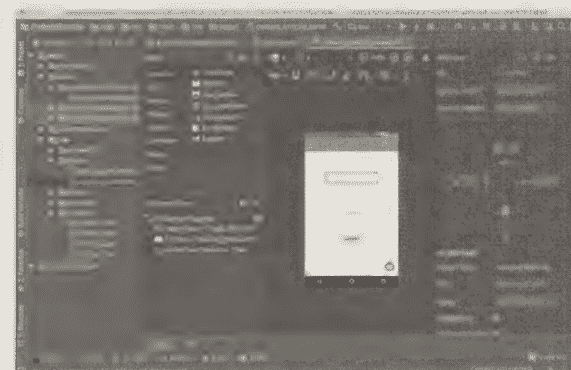

图 6-9

## 6.7 总结

Android Studio 环境的主要元素包括欢迎界面和主窗口。每个打开的项目都被分配了自己的主窗口，该窗口又由菜单栏、工具栏、编辑和设计区域、状态栏以及一组工具窗口组成。工具窗口出现在主窗口的侧边和底部，可以通过状态栏中的快速访问菜单访问，也可以通过可选的工具窗口栏访问。

Android Studio 中极少的操作是无法通过快捷键触发的。可以随时从 Android Studio 主窗口访问默认快捷键的键映射表。

# 7. 在物理 Android 设备上测试 Android Studio 应用程序

虽然使用 Android 虚拟设备（AVD）测试应用程序可以实现许多功能，但在物理 Android 设备上进行真实世界的应用程序测试是不可替代的，而且许多 Android 功能仅在物理 Android 设备上可用。

与 AVD 实例和连接的 Android 设备之间的通信由 Android 调试桥接（ADB）处理。在本章中，我们将介绍配置 Android 环境的步骤，以便基于 macOS、Windows 和 Linux 的系统在物理 Android 设备上进行应用程序测试。

## 7.1 Android 调试桥接（ADB）概述

ADB 的主要目的是方便开发系统（在本例中为 Android Studio）与 AVD 模拟器以及物理 Android 设备之间的交互，用于运行和调试应用程序。

ADB 由一个客户端、一个运行在开发系统后台的服务器进程，以及一个运行在 AVD 或手机、平板等真实 Android 设备上的守护程序后台进程组成。

ADB 可以以多种形式存在。例如，客户端以名为 `adb` 的命令行工具形式提供，位于 Android SDK 的 `platform-tools` 子目录下。同样，Android Studio 也有内置的客户端。

可以使用 `adb` 命令行工具执行多种任务。例如，可以使用 `devices` 命令行参数获取当前虚拟或物理设备的列表。以下命令输出表示系统上存在一个 AVD，但没有物理设备：

```text
$ adb devices
List of devices attached
emulator-5554 device
```

## 7.2 在基于 Android 的设备上启用 ADB

在 ADB 连接到 Android 设备之前，必须先配置设备以允许连接。对于运行 Android 6.0 或更高版本的手机和平板设备，实现此目的的步骤如下：

1. 打开设备上的 Settings 应用并选择 About tablet 或 About phone 选项（新版本 Android 可以在 System 页面找到）。

2. 在 About 屏幕上，滚动到 Build number（版本号）字段（图 7-1）并点击多次，直到出现已启用开发模式的消息。如果没有显示版本号，请展开 Advanced 部分。

| Wi-Fi MAC address | 00:11:22:DD:EE:FF |
| :--- | :--- |
| Build number | |

图 7-1

3. 返回 Settings 主屏幕，注意 Developer options（开发者选项）新选项。选择此选项并找到开发者屏幕上的 USB debugging（USB 调试）设置。启用此项开关，如图 7-2 所示：

| USB debugging |
| :--- |
| Debug mode when USB connected |

图 7-2

4. 从屏幕顶部向下滑动显示面板（图 7-3），并注意设备正在连接调试。


图 7-3

此时，设备已配置接受来自开发系统 ADB 的调试连接。剩下的工作是配置开发系统在设备连接时检测到它。虽然这是一个相对简单的过程，但涉及的步骤取决于开发系统运行的是 Windows、macOS 还是 Linux。注意，以下步骤假设 Android SDK `platform-tools` 目录已列入操作系统的 `PATH` 环境变量。

### 7.2.1 macOS ADB 配置

为了在 macOS 系统上配置 ADB 环境，使用 USB 线连接到计算机，打开终端窗口并执行以下命令以重启 ADB 服务：

```text
$ adb kill-server
$ adb start-server
* daemon not running, starting it now on port 5037 *
* daemon started successfully *
```

一旦服务器成功运行，执行以下命令以验证设备是否已被检测：

```text
$ adb devices

List of devices attached
74CE006000000001 offline
```

如果设备被显示为 offline（离线），请前往 Android 设备并检查是否存在图 7-4 所示的对话框。该对话框寻求允许 USB 调试的权限。在点击确定之前，勾选“始终允许来自此计算机调试”选项旁边的复选框。

再次运行 `adb devices` 命令，现在应该列出设备为可用：

```text
List of devices attached
01d4d44bf80c device
```

如果设备未列出，请注销并重新登录 macOS 桌面。如果问题仍然存在，请重启系统。

### 7.2.2 Windows ADB 配置

配置基于 Windows 的开发系统使用 ADB 连接到 Android 设备的第一步是在系统上安装相应的 USB 驱动程序。要安装的 USB 驱动程序取决于 Android 设备的型号。如果您有 Nexus 设备，则需要在 Windows 系统上安装并配置 Google USB Driver 程序包。实现此目标的详细步骤在以下网页上概述：

`https://developer.android.com/sdk/win-usb.html`

对于 Google USB 驱动不支持的 Android 设备，需要下载由设备制造商提供的驱动程序。可以在以下地址获取驱动程序列表以及下载和安装信息：

`https://developer.android.com/tools/extras/oem-usb.html`

安装驱动程序后，设备已被识别为正确的设备类型，打开命令提示符并执行以下命令：

```bash
adb devices
```

此命令应输出关于连接设备的信息，类似于：

```text
List of devices attached
HT4CTJT01906 offline
```

如果设备被列为 offline（离线）或 unauthorized（未授权），请查看设备并检查图 7-4 所示、寻求允许 USB 调试权限的对话框。

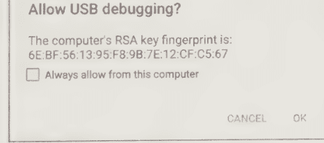

图 7-4

在点击确定之前，勾选“始终允许来自此计算机调试”选项旁边的复选框。再次运行 `adb devices` 命令，现在应该列出设备为就绪：

```text
List of devices attached
HT4CTJT01906 device
```

如果设备未列出，执行以下命令重启 ADB 服务器：

```bash
adb kill-server
adb start-server -v
```

如果设备仍然未列出，执行以下命令：

```bash
android update adb
```

注意，可能还需要重启系统。

### 7.2.3 Linux ADB 配置

在本章中，我们将再次使用 Ubuntu Linux 作为参考示例，介绍如何在 Linux 上配置 ADB 以连接物理设备进行测试。

在 Ubuntu Linux 上进行物理设备测试需要安装名为 `android-tools-adb` 的包，这要求 Android Studio 用户是 `plugdev` 组的成员。这是 Ubuntu 版本用户帐户的默认设置，可以通过运行 `id` 命令进行验证。如果没有列出 `plugdev` 组，请运行以下命令将账户添加到该组：

```bash
sudo usermod -aG plugdev $LOGIN
```

在满足组身份要求后，可以通过执行以下命令安装 `android-tools-adb` 包：

```bash
sudo apt-get install android-tools-adb
```

完成上述更改后，重启 Ubuntu 系统。系统重启后，打开终端窗口，启动 ADB 服务器并检查连接的设备列表：

```text
$ adb start-server
* daemon not running, starting it now on port 5037 *
* daemon started successfully *
$ adb devices
```

```text
连接设备列表

015d41d454b8f0c offline
```

如果设备被列为 offline（离线）或 unauthorized（未授权），请前往 Android 设备并检查图 7-4 所示、寻求允许 USB 调试权限的对话框。

## 7.3 测试 ADB 连接

假设在所选平台上已成功配置了 ADB，下一步是尝试运行“在 Android Studio 中创建示例 Android 应用”章节中创建的测试应用程序。

启动 Android Studio，打开 AndroidSample 项目。一旦项目加载完成，点击位于 Android Studio 工具栏上的运行按钮（图 7-5）。


图 7-5

假设该项目之前没有配置为在模拟器环境中自动运行，则会出现部署目标选择对话框，连接的 Android 设备将列为当前运行的设备。例如，图 7-6 列出了一个 Nexus 9 设备作为安装和执行应用程序的合适目标。

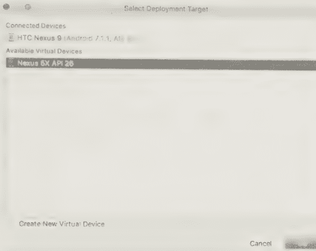

图 7-6

要将此设备设为测试默认设备，请启用“后续启动使用相同设备”选项。选中设备后，点击 OK 按钮在设备上安装并运行应用程序。与模拟器环境一样，有关在设备上安装和启动应用程序的诊断输出将记录在 Run 工具窗口中。

## 7.4 总结

虽然 Android 虚拟设备模拟器提供了极好的测试环境，但请记住，确保应用程序在物理 Android 设备上正常运行没有真正的替代品。但是，默认情况下，Android Studio 环境未配置为检测设备作为目标。因此，需要执行一些步骤才能将应用程序直接加载到设备上。在本章中，我们涵盖了 Linux、macOS 和 Windows 平台的这些步骤。

# 8. Android Studio 代码编辑器基础

为 Android 开发涉及大量的编程工作，根据定义，这涉及输入、审查和修改代码行。并不意外的是，开发者使用 Android Studio 的大部分时间通常都会在编辑器窗口内编辑代码。现代代码编辑器需要远远超出输入、删除、剪切和粘贴的基础功能。代码编辑器的实用性通常取决于诸等因素，如程序员的需求、在大源文件中轻松导航，以及编辑器在编写代码时实时检测并高亮编程错误的能力。虽然这不是对 Android 编辑器功能的详尽回顾，但本章旨在提供关键功能的指南。经验丰富的程序员会发现这些功能中的某些是大多数可用编辑器中通用的，而许多功能是这一特定环境独有的。

## 8.1 Android Studio 编辑器

当选择 Java、Kotlin、XML 或其他文本文件进行编辑时，Android Studio 编辑器出现在主窗口中央。例如，图 8-1 显示了一个带有 Java 源的典型编辑器会话：

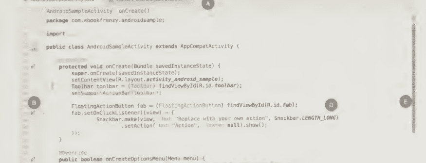

```java
AndroidSampleActivity.java content.android_sample.xml
AndroidSample onCreate

package com.ebookfrenzy.androidsample;

import

public class AndroidSampleActivity extends AppCompatActivity {
    protected void onCreate(Bundle savedInstanceState) {
        super.onCreate(savedInstanceState);
        setContentView(R.layout.activity_android_sample);
        Toolbar toolbar = (Toolbar) findViewById(R.id.toolbar);
        setSupportActionBar(toolbar);

        FloatingActionButton fab = (FloatingActionButton) findViewById(R.id.fab);
        fab.setOnClickListener(view -> {
            Snackbar.make(view, "Replace with your own action", Snackbar.LENGTH_LONG)
                .setText("Action", null).show();
        });
    }

    @Override
    public boolean onCreateOptionsMenu(Menu menu) {
        getMenuInflater().inflate(R.menu.menu_android_sample, menu);
        return true;
    }

    public boolean onItemSelectedSelected(MenuItem item) {
    }
}
```

图 8-1

构成编辑器窗口的元素可以总结如下：

### A – 文档标签页

Android Studio 能够同时打开多个文件进行编辑。每当打开一个文件，它都会被分配一个文档标签页，在窗口顶部边缘的标签栏中显示文件名。当空间不足以显示所有标签页时，标签栏的右角会出现一个小的下拉菜单。点击此菜单将显示其他文件的列表。

标签页中文件名下方的红色波浪线表示该文件中的代码包含一个或多个错误，这些错误在编译和运行项目之前需要解决。

切换文件只需点击相应的标签页，或使用 Alt-Left 和 Alt-Right 键盘快捷键。也可以使用切换（Switch）机制（通过 Ctrl-Tab 键盘快捷键访问）在文件之间进行导航。

要将编辑器从 Android Studio 主窗口分离并使其在单独的窗口中显示，请点击标签页将其拖动到主窗口桌面的任意区域。要将编辑器返回主窗口，请点击分离编辑器窗口中的标签页，将其拖放并到主窗口的原始编辑器栏上。

### B – 编辑器区域

行槽（gutter）区域被编辑器用于显示信息图标和控件。该编辑器区域中出现的一些典型项目包括调试标记、折叠和展开代码块的控件、书签、更改标记和行号。行号默认开启，但可以通过在行槽中右键点击并选择“显示行号”（Show Line Numbers）选项来禁用。

### C – 状态栏

虽然状态栏实际上是主窗口的一部分而非编辑器，但它包含了一些关于当前活动编辑会话的信息。这些信息包括代码按行和字符的当前位置，以及文件的编码格式（UTF-8、ASCII 等）。点击状态栏中的这些值可以更改相应的设置。例如，点击行号将打开“转到行”（Go to Line）对话框。

### D – 编辑区域

这是用户显示、输入和编辑代码的主要区域。本章后续将详细介绍编辑器区域的关键功能。

### E – 验证与标记侧边栏

Android Studio 集成了名为“实时分析”（on-the-fly analysis）的功能。这本质意味着当你输入代码时，编辑器会分析代码以检查警告和语法错误。验证侧边栏顶部的指示器会将绿色标记（未检测到警告或错误）变为黄色正方形或红色警报图标（检测到错误）。点击此指示器将显示一个弹出窗口，其中包含代码发现的问题摘要，如图 8-2 所示：

图 8-2

侧边栏还会使用相同的颜色编码在检测到问题的位置显示标记。当编辑器区域中的代码可见时，将鼠标指针悬停在代码行上将显示一个包含问题描述的弹出窗口（图 8-3）：

图 8-3

```text
'expected
Cannot resolve symbol 'ascl'
```

将鼠标悬停在当前滚动出编辑器视图区域的代码行标记上，将显示一个“透镜”（lens）覆盖层，其中包含问题所在的代码块（图 8-4），从而无需滚动到编辑器中的代码即可查看。


# Android Studio 编辑器基础

```java
public class AndroidMainActivity extends AppCompatActivity {
    protected void onCreate(Bundle savedInstanceState) {
        super.onCreate(savedInstanceState);
        setContentView(R.layout.activity_main);
        Toolbar toolbar = (Toolbar) findViewById(R.id.toolbar); // 将 findViewById(R.id) 转换为 "Toolbar" 是多余的
        setSupportActionBar(toolbar);
        FloatingActionButton fab = (FloatingActionButton) findViewById(R.id.fab); // 将 findViewById(R.id) 转换为 "FloatingActionButton" 是多余的
        fab.setOnClickListener((view) -> {
```

图 8-4

值得注意的是，透镜不仅限于侧边栏中的警告，它将出现在包含源文件中现有代码的侧边栏任何部分。

在提供了组成 Android Studio 编辑器的元素概述后，本章的剩余部分将更详细说明编辑环境的关键功能。

## 8.2 分割编辑器窗口

默认情况下，编辑器将显示一个显示当前选择文件内容的单个面板。在同时处理多个源文件时，一个特别实用的功能是将编辑器分成多个面板。

要执行此操作，右键点击编辑器窗口内的标签页，并选择“垂直”（Vertically）或“水平”（Horizontally）菜单选项。图 8-5 显示了拆分器的工作情况，编辑器被分为三个面板：

图 8-5

拆分面板的方向可以通过右键点击相应的标签页并选择“更改分割器方向”（Change Splitter Orientation）菜单选项随时更改。

重复这些步骤可以取消拆分面板，此时选择“取消分割”（Unsplit）。可以通过右键点击任何标签页并选择“取消所有分割”（Unsplit All）菜单选项来移除面板。

窗口分割可用于显示不同的文件，或为同一文件提供多个窗口，以便并发查看和编辑。

## 8.3 代码补全

Android Studio 编辑器对编程语法、类和方法以及你自己的代码库拥有大量的内置知识。随着代码的输入，编辑器会扫描输入内容，并在适当的情况下对可能需要的内容提供建议。

当编辑器检测到补全建议时，一个面板将出现在开头。例如，在图 8-6 所示的示例中，编辑器正在为以下内容提供建议：

```java
String (java.lang)
...
(R.id.fab);
Snackbar.LENGTH_LONG
...;
```

图 8-6

如果自动补全建议都不正确，继续输入，编辑器将继续精炼建议。要接受最相应的建议，只需按 Enter 键。要选择不同的建议，使用方向键在列表中上下移动，再次使用 Enter 键。

补全可以使用 `Ctrl-Space` 序列手动调用。这在更改编辑器中的单词或声明时非常有用。当光标停在单词上时，该单词会自动高亮。按下 `Ctrl-Space` 将显示建议列表。要用建议列表中的当前项替换当前单词，只需按 Tab 键。

在实时自动补全功能中，Android Studio 编辑器还提供了名为“智能补全”（Smart Completion）的系统。通过 `Shift-Ctrl-Space` 序列调用补全，并在再次按下 `Shift-Ctrl-Space` 时从更广泛的范围内提供建议。

代码补全对许多程序员来说取决于偏好。由于这一事实，Android Studio 对自动补全设置提供了高级控制。通过选择 `File -> Settings...`（macOS 为 `Android Studio -> Preferences...`），并在设置面板选择 `Editor -> General -> Code Completion`，可以查看并修改这些设置，如图 8-7 所示。

## 8.4 语句补全

Android Studio 编辑器提供的另一种补全形式是语句补全。它可以自动为方法和循环语句等项填充括号和大括号。

语句补全通过 `Shift-Ctrl-Enter`（macOS 为 `Shift-Cmd-Enter`）键盘快捷键调用。考虑以下代码：

```java
myMethod()
```

在编辑器中输入此代码后，触发语句补全将使编辑器自动为方法添加括号：

```java
myMethod() {}
```

## 8.5 参数信息

还可以向编辑器询问方法接受的参数。当光标位于方法调用的括号之间时，`Ctrl-P`（macOS 为 `Cmd-P`）键盘序列将显示该方法接受的参数，其中最可能的建议将以粗体显示：

```java
String myText = myString.replaceAll(@);
```

```java
@NonNull String regex, @NonNull String replacement
```

图 8-7

图 8-8

## 8.6 参数名称提示

代码编辑器可以配置为在方法调用中显示参数名称提示。例如，图 8-9 显示了 `Snackbar` 类中 `make()` 和 `setName()` 方法的参数名称提示：

```java
FloatingActionButton fab = (FloatingActionButton) findViewById(R.id.fab);
fab.setOnClickListener((view) -> {
    Snackbar.make(view, "Replace with your action", Snackbar.LENGTH_LONG)
        .setAction("Action", null);
});
```


可以通过选择 `File -> Settings`（macOS 上为 `Android Studio -> Preferences`）菜单，然后在左侧面板中选择 `Editor -> Appearance` 来配置此模式。

在 `Appearance` 界面上，启用或禁用 `Show parameter name hints`（显示参数名称提示）选项。要调整提示，请点击 `Configure...` 按钮，选择编程语言并进行任何调整。

## 8.7 代码生成

除了在输入时完成代码外，编辑器在某些条件下还可以为您生成代码。图 8-10 所示的可用代码生成选项列表可以在光标位于要生成代码的位置时，使用 `Alt-Insert`（macOS 上为 `Cmd-N`）快捷键进行访问。

| Generate（生成） | |
| --- | --- |
| Constructor | |
| `toString()` | ^ |
| Override Methods... | ^ |
| Implement Methods... | ^ |
| Delegate Methods... | |
| Copyright | |


为了说明示例，考虑这种情况：我们希望在项目中的 Activity 将被操作系统销毁时收到通知。正如本书后续章节将概述的那样，可以通过重写 Activity 子类的 `onDestroy()` 生命周期方法来实现。

要让 Android Studio 为此生成一个存根方法，只需从代码生成列表中选择 `Override Methods...` 选项，并在生成的可用列表中选择 `onStop()` 方法：

```text
Select Methods to Override/Implement
androidx.support.v7.app.AppCompatActivity {
    @Override
    protected void onCreate(Bundle savedInstanceState) {
        super.onCreate(savedInstanceState);
        setSupportActionBar(toolbar);
        setContentView(R.layout.menu_main);
        setContentView(R.layout.view);
        setContentView(view, params.LayoutP);
        addContentView(view, params.LayoutF);
        super.onConfigurationChanged(newConfig);
    }

    @Override
    protected void onStart() {
        findViewById(R.id.t);
    }

    @Override
    protected void onDestroy() {
    }

    @Override
    protected void onTitleChanged(CharSequence title, int color) {
        requestWindowFeature(feature.inTitle);
        setSupportActionBarMenu(R.menu.main);
    }

    @Override
    protected void onActionModeStarted(int mode) {
    }

    @Override
    protected void onActionModeFinished(boolean result) {
    }
}

Copy JavaDoc

Insert @Override
Cancel
```

图 8-11

拥有要重写的方法后，点击 OK 将在 Java 源文件的当前位置生成存根方法，如下：

```java
@Override
protected void onStop() {
    super.onStop()
```

## 8.8 代码折叠

一旦代码文件达到特定大小，即使是格式化最细致、组织最好的代码也可能变得难以处理且难以导航。

Android Studio 认为没有必要让每个代码块的内容始终可见。通过使用代码折叠功能，可以使代码导航更加容易。

代码折叠可以通过位于代码块开始和结束处显示的折叠标记来实现。图 8-12 显示了通过使用折叠功能可以使代码导航更简单。


# Android Studio 编辑器基础

## 8.6 参数名称提示

代码编辑器可以配置为在方法调用中显示参数名称提示。例如，图 8-9 显示了 `Snackbar` 类中 `make()` 和 `setName()` 方法的参数名称提示：

```java
FloatingActionButton fab = (FloatingActionButton) findViewById(R.id.fab);
fab.setOnClickListener((view) -> {
    Snackbar.make(view, "Replace with your action", Snackbar.LENGTH_LONG)
        .setAction("Action", null);
});
```


此模式可以通过选择 `File -> Settings`（macOS 上为 `Android Studio -> Preferences`）菜单，然后在左侧面板中选择 `Editor -> Appearance` 来配置。在 `Appearance` 界面上，启用或禁用 `Show parameter name hints`（显示参数名称提示）选项。要调整提示，请点击 `Configure...` 按钮，选择编程语言并进行任何调整。

## 8.7 代码生成

除了在输入时完成代码外，编辑器在某些条件下还可以为您生成代码。图 8-10 所示的可用代码生成列表可以在光标位于要生成代码的位置时，使用 `Alt-Insert`（macOS 上为 `Cmd-N`）快捷键进行访问。

| Generate（生成） |  |
| --- | --- |
| Constructor |  |
| `toString()` | ^ |
| Override Methods... | ^ |
| Implement Methods... | ^ |
| Delegate Methods... |  |
| Copyright |  |


为了说明示例，考虑这种情况：我们希望在项目中的 `Activity` 将被操作系统销毁时收到通知。正如本书后续章节将概述的那样，可以通过重写 `Activity` 子类的 `onDestroy()` 生命周期方法来实现。要让 Android Studio 为此生成一个存根方法，只需从代码生成列表中选择 `Override Methods...` 选项，并在生成的可用列表中选择 `onStop()` 方法：

```java
Select Methods to Override/Implement

androidx.support.v7.app.AppCompatActivity {
    @Override
    protected void onCreate(Bundle savedInstanceState) {
        super.onCreate(savedInstanceState);
        setSupportActionBar(toolbar);
        setContentView(R.layout.menu_main);
        setContentView(R.layout.view);
        setContentView(view, params.LayoutP);
        addContentView(view, params.LayoutF);
        super.onConfigurationChanged(newConfig);
    }

    @Override
    protected void onStart() {
        findViewById(R.id.t);
    }

    @Override
    protected void onDestroy() {
    }

    @Override
    protected void onTitleChanged(CharSequence title, int color) {
        requestWindowFeature(feature.inTitle);
        setSupportActionBarMenu(R.menu.main);
    }

    @Override
    protected void onActionModeStarted(int mode) {
    }

    @Override
    protected void onActionModeFinished(boolean result) {
    }
}

Copy JavaDoc

Insert @Override

Cancel
```

图 8-11

拥有要重写的方法后，点击 `OK` 将在 Java 源文件的当前位置生成存根方法，如下：

```java
@Override
protected void onStop() {
    super.onStop();
```

## 8.8 代码折叠

一旦代码文件达到特定大小，即使是格式化最细致、组织最好的代码也可能变得难以处理且难以导航。Android Studio 认为没有必要让每个代码块的内容始终可见。通过使用代码折叠功能，可以使代码导航更加容易。

代码折叠可以通过位于代码块开始和结束处显示的折叠标记来实现。图 8-12 显示了通过使用折叠功能可以使代码导航更简单：

```text
```

注：由于提供的原始文本在 8.8 节处被截断，翻译已在原文结束处停止。


```java
FloatingActionButton fab = (FloatingActionButton) findViewById(R.id.fab);
fab.setOnClickListener((view) -> {
    Snackbar.make(view, "Replace with your action", Snackbar.LENGTH_LONG)
        .setAction("Action", null);
});
```


此模式可以通过选择 `File -> Settings`（macOS 上为 `Android Studio -> Preferences`）菜单，然后在左侧面板中选择 `Editor -> Appearance` 来配置。在 `Appearance` 界面上，启用或禁用 `Show parameter name hints`（显示参数名称提示）选项。要调整提示，请点击 `Configure...` 按钮，选择编程语言并进行任何调整。

## 8.7 代码生成

除了在输入时完成代码外，编辑器在某些条件下还可以为您生成代码。图 8-10 所示的可用代码生成列表可以在光标位于要生成代码的位置时，使用 `Alt-Insert`（macOS 上为 `Cmd-N`）快捷键进行访问。

| Generate（生成） | |
| --- | --- |
| Constructor | |
| `toString()` | ^ |
| Override Methods... | ^ |
| Implement Methods... | ^ |
| Delegate Methods... | | |
| Copyright | | |


为了说明示例，考虑这种情况：我们希望在项目中的 Activity 将被操作系统销毁时收到通知。正如本书后续章节将概述的那样，可以通过重写 Activity 子类的 `onDestroy()` 生命周期方法来实现。要让 Android Studio 为此生成一个存根方法，只需从代码生成列表中选择 `Override Methods...` 选项，并在生成的可用列表中选择 `onStop()` 方法：

```text
Select Methods to Override/Implement
androidx.support.v7.app.AppCompatActivity {
    @Override
    protected void onCreate(Bundle savedInstanceState) {
        super.onCreate(savedInstanceState);
        setSupportActionBar(toolbar);
        setContentView(R.layout.menu_main);
        setContentView(R.layout.view);
        setContentView(view, params.LayoutP);
        addContentView(view, params.LayoutF);
        super.onConfigurationChanged(newConfig);
    }

    @Override
    protected void onStart() {
        findViewById(R.id.t);
    }

    @Override
    protected void onDestroy() {
    }

    @Override
    protected void onTitleChanged(CharSequence title, int color) {
        requestWindowFeature(feature.inTitle);
        setSupportActionBarMenu(R.menu.main);
    }

    @Override
    protected void onActionModeStarted(int mode) {
    }

    @Override
    protected void onActionModeFinished(boolean result) {
    }
}

Copy JavaDoc
Insert @Override
Cancel
```

图 8-11

拥有要重写的方法后，点击 OK 将在 Java 源文件的当前位置生成存根方法，如下：

```java
@Override
protected void onStop() {
    super.onStop();
```

## 8.8 代码折叠

一旦代码文件达到特定大小，即使是格式化最细致、组织最好的代码也可能变得难以处理且难以导航。Android Studio 认为没有必要让每个代码块的内容始终可见。通过使用代码折叠功能，可以使代码导航更加容易。代码折叠可以通过位于代码块开始和结束处显示的折叠标记来实现。图 8-12 显示了通过使用折叠功能可以使代码导航更简单：

```text
```

## Android Studio 代码编辑器基础

要查找示例代码，请在编辑器中高亮显示方法或类名，右键点击该项并选择“查找示例代码（Find Sample Code）”菜单选项。“查找示例代码”面板（图 8-18）将出现在编辑器下方，并列出匹配的示例列表。从列表中选择一个示例将把相应的代码加载到右侧面板：

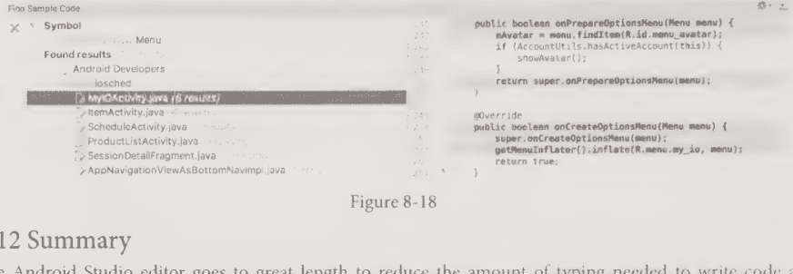

图 8-18

## 8.12 总结

Android 编辑器投入了大量精力来减少编写代码所需的打字量，并使代码更易阅读和导航。在本章中，我们涵盖了许多关键的编辑器功能，包括代码补全、代码生成、编辑器窗口分、代码折叠、重新格式化和文档查询。

## 9. Android 架构概览

到本书为止，我们已经采取了若干步骤以建立一个适用于使用 Android Studio 开发 Android 应用的环境。此外，通过创建一个简单的 Android 应用项目，我们也迈入了应用开发流程的第一步。

然而，在深入研究 Android 应用开发的实际问题之前，理解 Android SDK 以及通用的 Android 开发的一些较为抽象的概念至关重要。清晰地理解这些概念将为构建进一步知识提供坚实的基础。

本章将从 Android 架构概览开始，并在本书接几章节中继续，目标是提供 Android 开发基础知识的详细概述。

## 9.1 Android 软件栈

Android 以软件栈的形式结构化，由应用程序、操作系统、运行时环境、中间件、服务和库组成。这种架构或许可以如图 9-1 所示通过视觉化方式表示。栈的每一层以及每层中相应的元素都紧密集成并经过精细调整，以为移动设备提供最佳的应用开发和执行环境。本章的其余部分将依次介绍 Android 栈的不同层，从底部的 Linux 内核开始。

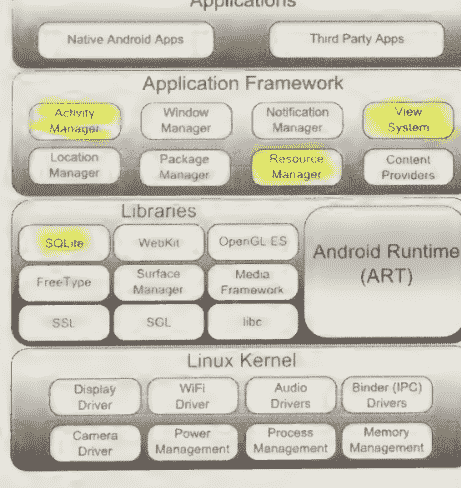

## 9.2 Linux 内核

位于 Android 软件栈的底部，为设备硬件与 Android 软件栈上层之间提供了一层抽象。该内核基于 Linux 2.6 版本，提供了抢占式多任务处理、内存、进程和电源管理等低层核心系统服务，还为设备显示器、Wi-Fi 和音频等硬件提供了网络栈和设备驱动程序。

原始 Linux 内核由林·托瓦兹（Lin Torvalds）于 1991 年开发，并与理查德·斯蒂曼（Richard Stallman）为自由软件基金开发的系列工具、实用程序和编译器相结合，创建了一个完整的操作系统。位于 Android 软件栈的底部，为设备硬件与 Android 软件栈上层之间提供了一层抽象。该内核基于 Linux 2.6 版本，提供了抢占式多任务处理、内存、进程和电源管理等低层核心系统服务，还为设备显示器、Wi-Fi 和音频等硬件提供了网络栈和设备驱动程序。

## 9.3 Android运行时（ART）

Android Runtime（ART）是 Android 系统的组成部分之一，负责执行应用程序。ART 引入于 Android 4.4，并取代了之前的 Dalvik 虚拟机（VM）。ART 的核心优势是使用预编译（AOT）编译，在应用安装时将字节码转换为机器码，从而提高了应用运行速度并减少了电量。

ART 还引入了即时编译（JIT）编译，在应用运行时将部分字节码转换为机器码。这种结合了 AOT 和 JIT 的机制使得 Android 在启动速度和执行效率之间取得了平衡。

## 9.4 Android 库

Android 提供了许多库以供开发者实现各种功能。这些库可以分为三类：Java 库、C/C++ 库以及 Android 库。

### 9.4.1 Java 库

Android 提供了许多 Java 库以供开发者实现各种功能。这些库包括标准的 Java 库，为开发者提供了许多通用的功能。

### 9.4.2 Android 库

以下是某些常用的 Android 库的示例：

- `android.app`：用于应用程序生命周期管理（如 Activity、服务、广播接收）。
- `android.content`：用于内容提供者和数据持久化。
- `android.database`：用于 SQLite 数据库操作。
- `android.graphics`：用于 2D 图形绘制、颜色、画布等。
- `android.hardware`：用于硬件传感器（如加速度计）。
- `android.opengl`：用于 OpenGL ES 3D 图形渲染。
- `android.os`：用于系统服务（如线程、消息、文件）。
- `android.media`：用于音频和视频处理。
- `android.net`：用于网络操作。
- `android.print`：用于打印服务。
- `android.provider`：用于访问系统级数据（如书书、日历、联系人）。
- `android.text`：用于文本处理和渲染。
- `android.util`：用于各种工具类（如字符串处理、数字转换）。
- `android.view`：用于用户界面的基础构建块。
- `android.widget`：用于预构建的 UI 组件（如按钮、列表视图）。
- `android.webkit`：用于在应用中构建浏览器功能。

### 9.4.3 C/C++ 库

在了解了运行时的 Java 库后，现在我们需要关注 Android 栈这一层中的 C/C++ 库。

前述的运行时核心库是基于 Java 的，并为开发者提供了主要的 API。然而，重要的是，核心库执行了大部分实际工作，实际上，它们是 C/C++ 库的 Java 封装。例如，当调用 `android.opengl` 库在显示器上绘制 3D 图形时，该库实际上调用了 OpenGL ES C++ 库，后者又与 Linux 内核协作。

在实践中，典型的 Android 开发者仅通过 Java 核心 API 访问这些库。如果需要直接访问这些库，可以通过 Android 原生开发包（NDK）来实现，其目的是从 Java 代码调用非 Java 或 Kotlin 语言（如 C 和 C++）的原生方法。

# 其他应用程序发现并重用的 Android 架构概述

Android 框架包含以下关键服务：

- `Activity Manager`（活动管理器）- 控制应用程序生命周期和栈的所有方面。
- `Content Providers`（内容提供者）- 允许应用程序发布与其他应用程序共享数据。
- `Resource Manager`（资源管理器）- 提供对非代码嵌入式资源的访问，如字符串、颜色设置和界面布局。
- `Notifications Manager`（通知管理器）- 允许应用程序向用户显示警和通知。


- `View System`（视图系统）：一组用于创建应用程序界面的可扩展视图。
- `Package Manager`（包管理器）：应用程序通过该系统获取设备上当前安装的其他应用程序的信息。
- `Telephony Manager`（电话管理器）：向应用程序提供设备上可用电话服务的信息，如状态和订阅者信息。
- `Location Manager`（位置管理器）：提供对位置服务的访问，允许应用程序接收位置变更的更新。

## 9.6 应用程序

应用程序位于 Android 软件栈的顶端。这些应用程序包含了特定 Android 实现所提供的原生应用程序（例如网络浏览器和电子邮件应用程序）以及用户在购买设备后安装的第三方应用程序。

## 9.7 总结

Android 开发知识基础需要对 Android 的整体架构有理解。Android 实现于软件栈架构，由 Linux 内核、运行时环境及相应的库、应用程序框架和一组应用程序组成。应用程序主要使用 Java 或 Kotlin 编写，并在 Android Studio 构建环境中编译为字节码格式。当应用程序随后安装到设备上时，这些字节码将由 Android 运行时（`ART`）编译为 CPU 使用的原生格式。Android 架构的关键目标是性能和效率，涵盖了应用程序执行方面以及应用程序设计中的重用实现。

# 10. Android 应用程序的剖析

无论你之前的编程经验如何（无论是基于 Windows、macOS、Linux 甚至 iOS），Android 开发很有可能与你以前遇到过的任何事物都不完全相同。

因此，本章的目标是提供对 Android 应用程序架构背后的高层概念的理解。在此，我们将详细探索可用于构建应用程序的各种组件，以及允许这些组件协同工作以创建一个内贯应用程序的机制。

## 10.1 Android Activities（活动）

熟悉 Java、Kotlin、C++ 或 C# 等面向对象编程语言的人，会对将应用程序功能元素封装在类中的概念非常熟悉，这些类被实例化为对象并进行操作以创建应用程序。由于 Android 应用程序是用 Java 和 Kotlin 编写的，情况仍然如此。然而，Android 将可重用组件的概念提高到了更高。

Android 应用程序通过汇集一个或多个被称为 `Activity` 的组件来创建。`Activity` 是应用程序功能的单个、独立模块，通常对应于单个用户界面屏幕及其相应的功能。例如，一个预约应用程序可能有一个显示当天预约情况的 `Activity`。应用程序还可能利用第二个 `Activity` 屏幕，用户可以在其中输入新预约。

`Activity` 被设计为完全可重用且可交换的构建块，可以在不同的应用程序之间共享。例如，一个现有的电子邮件应用程序可能包含一个专门用于编写和发送电子邮件消息的 `Activity`。开发者可能正在编写一个应用程序，该程序也有发送电子邮件消息的需求。开发者无需再为新应用程序专门开发一个邮件编写 `Activity`，而是可以直接使用现有电子邮件应用程序中的 `Activity`。

`Activity` 是作为 Android `Activity` 类的子类创建的，并且必须实现为完全独立于应用程序中的其他 `Activity`。换句话说，共享的 `Activity` 不能依赖于在程序流的已知位点被调用（因为其他应用程序可能会以意想不到的方式使用该 `Activity`），且一个 `Activity` 不能直接调用另一个 `Activity` 的方法或访问其实例数据。相反，这是通过 `Intent` 和 `Content Provider` 实现的。

默认情况下，`Activity` 无法向调用它的 `Activity` 返回结果。如果需要此功能，则必须特地作为源 `Activity` 的子 `Activity` 启动该 `Activity`。

## 10.2 Android Fragments（片段）

如上所述，`Activity` 通常代表应用内的单个用户界面屏幕。一种方案是使用单个用户界面布局和一个 `Activity` 类文件来构建该 `Activity`。然而，另一种方法是将 `Activity` 分为不同的部分。这些部分中的每个部分都由用户界面布局的一部分和一个匹配的类文件（声明为 `Fragment` 类的子类）组成。在这种情况下，`Activity` 变成了一个容器，其中嵌入了一个或多个 `Fragment`。

事实上，`Fragment` 为每个用户界面屏幕由单独的 `Activity` 表示提供了一种高效的替代方案。相反，一个应用程序可以由单个 `Activity`，在不同的 `Fragment` 之间切换，每个 `Fragment` 代表一个不同的应用屏幕。

## 10.3 Android Intents（意图）

`Intent` 是一个 `Activity` 能够启动另一个 `Activity` 并实现组成应用程序的 `Activity` 流程的机制。`Intent` 由对要执行的操作的描述以及可选的、在该操作上执行的数据组成。

`Intent` 可以是显式的，即它们通过类名引用 `Activity` 来请求启动特定的 `Activity`，或者通过说明要执行的操作类型或提供在该操作上执行的特定类型的数据来实现。在隐式 `Intent` 的情况下，Android 运行时将选择最符合指定标准的 `Activity`。

## 10.4 Broadcast Intents（广播意图）

另一种类型的 `Intent` 是广播意图，它是发送到所有注册了“广播接收器”的系统范围意图。例如，Android 系统通常会发送广播意图来报告设备状态，如启动完成、电源开启关闭。

广播意图可以是普通的（异步的），即它几乎同时发送给所有感兴趣的广播接收器；也可以是有序的，即它一次发送给一个接收器，处理后再传递下一个。

## 10.5 Broadcast Receivers（广播接收器）

广播接收器是应用程序能够响应广播意图的机制。广播接收器必须由应用程序注册，并配置 `Intent Filter` 以指示它感兴趣的广播类型。当匹配的广播发布时，无论注册接收器的应用程序是否正在运行，Android 运行时都会调用它。接收器随后有 5 秒的时间来完成对其要求的任务（如启动 `Service`、为用户更新数据或向用户发出通知），然后返回。广播接收器在后台运行，没有用户界面。

## 10.6 Android Services（服务）

Android 服务是在后台运行的且没有用户界面的进程。它们可以从 `Activity`、广播接收器或其他服务启动并对其进行管理。Android 服务适用于应用程序需要继续执行任务但并不一定需要用户可见界面的情况。虽然 `Service` 缺乏用户界面，但它们仍然可以使用 `toast`（显示在屏幕上且不中断当前可见 `Activity` 的小通知消息）来通知用户，并且能够发布 `Intent`。

`Service` 在 Android 运行时中获得的优先级高于许多其他进程，只有在为了释放资源作为最后手段时，系统才会将其终止。然而，当运行时需要杀死 `Service` 时，一旦足够的资源再次可用，它将自动重启。`Service` 可以通过声明自己需要在前台运行来降低被终止的风险。这是通过调用 `startForeground()` 实现的。这仅建议用于终止会对用户体验产生影响的情况（例如，如果用户正在听 `Service` 流的音频）。

`Service` 可能是实际解决方案的示例场景，包括之前提到的“Android 应用的异常”中的音频在应用程序不再活跃时应该继续播放，或者一个当股票达到指定价格时需要通知用户的股票市场跟踪应用。

## 10.7 内容提供者（Content Providers）

内容提供者实现了一种应用程序之间共享数据的机制。任何应用程序都可以通过实现内容提供者为其他程序提供访问其底层数据的权限，包括通过内容提供者定义的统一资源标识符（URI）对数据进行添加、删除和查询。数据可以以文件或 SQLite 数据库的形式共享。

原生 Android 应用包含许多标准内容提供者，允许应用程序访问联系人和媒体文件等数据。Android 系统上当前可用的内容提供者可以使用内容解析器（`Content Resolver`）定位。

## 10.8 应用清单（Application Manifest）

将组成应用程序各种元素结合在一起的胶水是应用程序文件。在这个 XML 文件中，应用程序概述了构成完整应用程序的服务、广播接收器、数据提供和权限。

## 10.9 应用资源（Application Resources）

除了清单和包含字节码的 Dex 文件，Android 应用包通常还包含一组资源文件。这些文件包含了用户界面显示的字符串、图像、字体和颜色等资源，以及用户界面布局的 XML 表示。默认情况下，这些文件存储在项目层次结构中的 `/res` 子目录下。

## 10.10 应用上下文（Application Context）

当应用程序被编译时，会创建一个名为 `R` 的类，其中包含对应用程序资源的引用。应用清单文件和这些资源结合了所谓的应用上下文（Application Context）。该上下文由 Android 类表示，可以在应用程序代码中使用以便在运行时访问资源。此外，可以在应用程序上下文中调用广泛的方法来收集更多信息并在运行时更改应用程序的环境。

## 10.11 总结

可以将许多不同的元素组合在一起创建一个 Android 应用。在本章中，我们提供了对活动（Activities）、片段（Fragments）、服务（Services）、意图（Intents）和广播接收器（Broadcast Receivers）的高级概述，并对清单文件和应用资源进行了概述。

通过以活动和意图的形式创建独立的功能模块，促进了最大程度重用和互操作性，而应用程序之间的数据共享通过实现内容提供者来实现。

虽然活动侧重于用户与应用程序交互的区域（活动本质上等同于单个用户界面屏幕，通常由一个或多个片段组成），但后台处理通常由服务和广播接收器处理。

构成应用程序的组件在清单文件中为 Android 运行时系统进行了概述，该文件结合应用资源共同代表了应用程序的上下文。

本章涵盖了许多对普通开发者可能最重要的内容。请放心，后续章节将对这些概念进行深入的探索和实际应用，以确保为构建自己的 Android 应用程序建立坚实的知识基础。

# 11. 理解 Android 应用和活动生命周期

在早的章节中，我们学习了 Android 应用运行在进程中，并且它们由活动、服务和广播接收器形式的多个组件组成。本章的目标是通过查看 Android 运行时系统中应用程序和活动的生命周期来扩展这一知识。

无论当今移动设备与过去的桌面系统相比所拥有的内存和计算能力被说得多么沸沸扬，但重要的是记住，根据现代桌面和笔记本电脑系统的标准，这些设备仍被认为是“资源受限”的，尤其是在尺寸上。因此，Android 系统的一项关键职责是确保有效管理这些有限资源，并使操作系统和运行其上的应用程序始终对用户保持响应。为了实现这一点，Android 对运行应用程序的所有进程以及构成这些应用程序的各个组件的生命周期和状态具有完全的控制权。

因此，开发 Android 应用的一个重要因素是理解 Android 的应用和活动生命周期管理模型，以及应用程序在其执行生命周期内可能对其施加的状态变化的方式。

## 11.1 Android 应用与资源管理

每个运行的 Android 应用都被操作系统视为一个独立的进程。如果系统识别到设备上的资源达到容量，它将采取措施终止进程以释放内存。

在决定终止哪个进程以释放内存时，系统会考虑所有当前运行进程的优先级和状态，结合这些因素创建 Google 所称的“重要性层次结构”（importance hierarchy）。然后从优先级最低的进程开始终止，直到释放出足够的资源供系统运行。

## 11.2 Android 进程状态

进程托管应用程序，而应用程序由组件组成。在 Android 系统中，进程的当前状态由其所托管应用程序中排名最高的活动组件定义。如图 11-1 所示，进程在任何给定时间都可以处于以下五种状态之一：

### 理解 Android 应用活动生命周期

| 进程状态 | 优先级 |
| --- | --- |
| 前台进程（Foreground Process） | 最高优先级 |
| 可见进程（Visible Process） |  |
| 服务进程（Service Process） |  |
| 后台进程（Background Process） |  |
| 空闲进程（Empty Process） | 最低优先级 |

图 11-1

### 11.2.1 前台进程

这些进程被赋予最高级别的优先级。在任何时候，活跃的前台进程不太多于一个或两个，而且这些通常是系统最后终止的进程。进程必须满足以下一个或多个标准才能获得前台状态：

- 托管一个用户当前正在交互的活动。
- 托管一个与用户正在交互的活动连接的服务。
- 托管一个已通过调用 `startForeground()` 指明终止它将破坏用户体验的服务。
- 托管一个正在执行其 `onCreate()`、`onResume()` 或 `onStart()` 回调的服务。
- 托管一个正在执行其 `onReceive()` 方法的广播接收器。

### 11.2.2 可见进程

包含对用户可见但不是用户正在交互的活动的进程被归类为“可见进程”。这通常发生在进程中的某个活动对用户可见，而由于另一个活动（如部分屏幕或对话框）处于前台时。如果一个进程托管一个本身绑定到可见或前台活动的服务，则该进程也具备可见状态的资格。

### 11.2.3 服务进程

包含已启动并正在执行的服务的进程。

### 11.2.4 后台进程

包含一个或多个当前对用户不可见的活动，且没有托管符合服务进程状态的服务的进程。属于此类类别的进程在需要为高优先级进程释放额外内存时，被终止的风险很高。Android 按时间顺序维护后台进程的动态列表，因此最不活跃的进程会被首先杀死。

### 11.2.5 空进程（Empty Process）

空进程包含活跃的应用，并保留在内存中，准备作为新启动应用程序的宿主。这在某种程度上类似于为了等待乘客而保持公交车门开启且引擎运转。显然，此类进程被认为优先级最低，并且是释放资源时第一个被杀掉的进程。

## 11.3 进程间依赖（Inter-Process Dependencies）

确定最高优先级进程的情况比前一节描述的要稍微复杂，因为进程之间往往存在相互依赖关系。因此，在确定进程的优先级时，Android 系统还会考虑该进程是否以某种方式属于另一个更高优先级的进程（例如，作为前台进程的内容提供者的服务进程）。根据基本规则，Android 文档指出，一个进程的排名永远不会低于正在服务的另一个进程。

## 11.4 Activity 周期（The Activity Lifecycle）

正如我们之前讨论过的，Android 进程的状态在很大程度上取决于其所托管的 `Activity`（活动）和组件的状态。因此，理解这一点很重要：这些 `Activity` 在应用程序的执行生命期间也会经过不同的状态。`Activity` 的当前状态在部分取决于它在所谓的“`Activity` 栈”（Activity Stack）中的位置。

## 11.5 Activity 栈（Activity Stack）

对于在 Android 设备上运行的每个应用程序，运行时系统都会维护一个 `Activity` 栈。当应用程序启动时，第一个启动的 `Activity` 会被放入栈中。当启动第二个 `Activity` 时，它会被放置在栈顶，而上一个 `Activity` 则被向下推。栈顶的 `Activity` 被称为活跃（或运行中）`Activity`。当活跃 `Activity` 退出时，运行时会将其从栈中弹出，栈中紧邻其下方的 `Activity` 变为当前的活跃 `Activity`。例如，栈顶的 `Activity` 可能会仅仅因为其负责的任务已完成而直接退出。或者，用户可能选择了屏幕上的“返回”按钮以回到上一个 `Activity`，这导致当前 `Activity` 被运行时系统从栈中弹出并销毁。图 11-2 展示了 `Activity` 栈的视觉化表示。

如图所示，新的 `Activity` 在启动时会被推到栈顶。当前活跃 `Activity` 始终位于栈顶，直到它被新的 `Activity` 推下，或者在它退出或用户导航回上一个 `Activity` 时从栈中弹出。在资源受限的情况下，运行时将杀死 `Activity`，从栈底的 `Activity` 开始。

### 理解 Android 应用的 Activity 生命周期

`Activity` 栈在编程术语中被称为“后进先出”（LIFO）栈，因为最后一个推入栈的项是第一个被弹出的。

### 理解 Android 应用和 Activity 生命周期

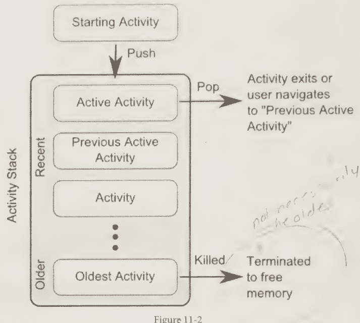

- **活跃 / 运行中（Active / Running）**：`Activity` 位于 `Activity` 栈顶端，是设备屏幕上可见的前台任务，拥有焦点并在当前与用户进行交互。在资源短缺的情况下，这种 `Activity` 最不容易被终止。
- **已暂停（Paused）**：`Activity` 对活跃用户可见，但没有焦点（通常是因为该 `Activity` 被当前 `Activity` 部分遮挡）。已暂停的 `Activity` 保留在内存中，与窗口管理器关联，保留所有状态信息，并在移动到 `Activity` 栈顶时可以快速恢复到活跃状态。
- **已停止（Stopped）**：`Activity` 当前对用户不可见（换句话说，它被设备显示器的其他 `Activity` 完全遮挡）。与暂停的 `Activity` 一样，它保留了所有状态和成员信息，但在低内存情况下面临更高的被终止风险。
- **已杀死（Killed）**：`Activity` 已被运行时系统终止以释放内存，并且不再存在于 `Activity` 栈中。如果应用程序需要，必须重新启动此类 `Activity`。

## 11.6 Activity 状态（Activity States）

在应用程序的执行过程中，`Activity` 可以处于许多不同状态之一。

## 11.7 配置更改（Configuration Changes）


在这一章中，我们查看了导致 Android Activity 状态变化的两种原因，即 Activity 在前台和后台之间的移动，以及运行时系统为了释放内存而终止 Activity。事实上，还有第三种情况会导致 Activity 的状态发生发生剧烈变化，这涉及到设备配置的更改。

### 理解 Android 应用和 Activity 生命周期

默认情况下，任何影响 Activity 外观的配置更改（例如在竖屏和横屏之间旋转设备方向，或更改系统设置）都会导致 Activity 被销毁并重建。这背后的逻辑是此类更改会影响资源（如用户界面的布局），而销毁并重建 Activity 是 Activity 响应配置更改最快的方法。不过，也可以配置 Activity，使其系统不会响应特定更改而重启它。

## 11.8 处理状态更改 (Handling State Change)

即使没有别的，从本章也应该清楚，应用程序以及根据定义包含在其中的组件在其生命周期内将经历许多状态。尤为重要的一点是，这些状态更改（包括完全终止）是根据用户操作和设备上资源的可用性施加于 Android 运行时的。

在实践中，这些状态更改并非完全在毫无通知的情况下发生，在大多数情况下，应用程序会收到运行时系统的通知并获得采取相应行动的机会。这通常涉及保存或恢复内部数据结构和用户界面状态，允许用户在应用程序之间无缝切换，并提供多个并发运行应用程序的外观。

Android 提供了两种处理对象生命周期的方法。Android 方法涉及响应状态更改调用，将在下一章“处理 Android Activity 状态更改”中详细介绍。另一种 Google 推荐的方法涉及 Jetpack Android Architecture 组件中的周期类，这些类在“现代 Android 应用架构”中介绍，并在“与 Android 生命周期感知组件工作”章节中进行了更详细的解释。

# 第 12 章

## 12. 处理 Android Activity 状态更改

根据“理解 Android 应用和 Activity 生命周期”章节概述的信息，现在显而易见，构成应用程序的 activity 和 fragment 在应用程序生命周期期间会经历各种状态。从一个状态到另一个状态的转变是由 Android 运行时系统强制的，因此很大程度上超出了 activity 自身的控制。然而，这并不意味着应用无法对这些变化做出反应并采取适当的。

本章的主要目标是对通知状态更改的视图提供高级概述，并概述建议保存或恢复状态信息的区域。在涵盖这些信息后，本章将简要介绍活动生命周期的主题。

### 12.1 新旧生命周期技术

直到最近，一直有一种标准的方法可以在应用中构建生命周期感知能力。本章采用的就是这种方法，它涉及 activity 或 fragment 实例中的一组方法（每个生命周期状态对应一个方法），当该对象的生命周期状态发生变化时，操作系统会调用这些方法。这种方法自 Android 操作系统早期以来一直没有变化，虽然在今天仍然是一个可行选项，但它具有一些局限性，将在本章稍后的部分进行解释。

随着带有 Jetpack Android 组件的生命周期类的引入，现在有了更好的生命周期处理方法。这种现代的生命周期管理方法（结合最近的组件和架构指南）将在后面的章节中详细介绍。理解传统的生命周期方法很重要，原因有两个。首先，作为 Android 开发人员，你无法完全隔离开传统的生命周期方法，仍然会使用其中一些。更重要的是，理解处理生命周期的旧方法将为书中稍后开始新方法提供良好的知识基础。

### 12.2 Activity 和 Fragment 类

在少数例外，应用程序中的 activity 和 fragment 分别被创建为 Android `AppCompatActivity` 和 `Fragment` 类的子类。

例如，“在 Android Studio 中创建示例 Android 应用”中创建的 AndroidSampleProject。将此项目加载到 Android Studio 环境中并找到 `AndroidSampleActivity.java` 文件（位于 `app -> java -> com.<yourdomain>.androidsample`）。找到文件后，双击将其导入编辑器，你应该能读到如下内容：

```java
import android.os.Bundle;
import android.support.design.widget.FloatingActionButton;
import android.support.design.widget.Snackbar;
import android.support.v7.app.AppCompatActivity;
import android.support.v7.widget.Toolbar;
```

```java
import android.view.View;
import android.view.Menu;
import android.view.MenuItem;
import android.widget.EditText;
import android.widget.TextView;
```

```java
public class AndroidSampleActivity extends AppCompatActivity {

    @Override
    protected void onCreate(Bundle savedInstanceState) {
        super.onCreate(savedInstanceState);
        setContentView(R.layout.activity_android_sample);
        Toolbar toolbar = (Toolbar) findViewById(R.id.toolbar);
        setSupportActionBar(toolbar);
        FloatingActionButton fab = (FloatingActionButton) findViewById(R.id.fab);
        fab.setOnClickListener(new View.OnClickListener() {
            @Override
            public void onClick(View view) {
                Snackbar.make(view, "Replace with your own action", Snackbar.LENGTH_LONG)
                    .setAction("Action", null).show();
            }
        });
    }

    public void convertCurrency(View view) {
        EditText dollarText = findViewById(R.id.dollarText);
        TextView textView = findViewById(R.id.textView);
        if (!dollarText.getText().equals("")) {
            float dollarValue = Float.valueOf(dollarText.getText().toString());
            float euroValue = dollarValue * 0.85F;
            textView.setText(euroValue.toString());
        } else {
            textView.setText("No Value");
        }
    }

    @Override
    public boolean onCreateOptionsMenu(Menu menu) {
        // 载入菜单，如果存在 action bar，则向其添加条目。
        getMenuInflater().inflate(R.menu.menu_android_sample, menu);
        return true;
    }

    @Override
    public boolean onOptionsItemSelected(MenuItem item) {
        // 在此处处理 action bar 项点击。action bar 将
        // 自动处理主页/向上按钮的点击，你在 AndroidManifest.xml
        // 中指定父 activity 时也是如此。
        int id = item.getItemId();
        //noinspection SimplifiableIfStatement
        if (id == R.id.action_settings) {
            return true;
        }
        return super.onOptionsItemSelected(item);
    }
}
```

在创建项目时，我们指示 Android Studio 创建一个初始 activity `AndroidSampleActivity`。如上述代码所示，`AndroidSampleActivity` 类是 `AppCompatActivity` 类的子类。

查看 `AppCompatActivity` 类的参考文档会发现它本身也是该类的子类。可以在 Android Studio 编辑器中使用 Hierarchy（层次）工具窗口进行验证。在加载到编辑器的 `AndroidSampleActivity.java` 文件，点击类声明中的 `AppCompatActivity` 并按下快捷键 `Ctrl-H`。层次工具窗口随后出现，显示所选类的类层级结构。如图-12 所示，`AppCompatActivity` 显然派生自 `FragmentActivity` 类，而 `FragmentActivity` 又是以下类的子类：

| 类 | 范围 |
| :--- | :--- |
| `AppCompatActivity` | `java.lang` |
| `Context` | `android.content` |
| `ContextWrapper` | `android.content` |
| `View` | `android.view` |
| `Activity` | `androidx.app` |
| `FragmentActivity` | `androidx.fragment` |
| `AppCompatActivity` | `androidx.app` |
| `AndroidSampleActivity` | `com.android` |

在创建项目时，我们指示 Android Studio 创建一个初始 activity `AndroidSampleActivity`。如上述代码所示，`AndroidSampleActivity` 类是 `AppCompatActivity` 类的子类。

查看 `AppCompatActivity` 类的参考文档会发现它本身也是该类的子类。可以在 Android Studio 编辑器中使用 Hierarchy 工具窗口进行验证。在加载到编辑器的 `AndroidSampleActivity.java` 文件，点击类声明中的 `AppCompatActivity` 并按下快捷键 `Ctrl-H`。层次工具窗口随后出现，显示所选类的类层级结构。如图-12 所示，`AppCompatActivity` 显然派生自 `FragmentActivity` 类，而 `FragmentActivity` 又是以下类的子类：

# 处理 Activity 状态更改

根据“理解 Android 应用和 Activity 生命周期”章节概述的信息，现在显而易见，构成应用程序的 activity 和 fragment 在应用程序生命周期期间会经历各种状态。从一个状态到另一个状态的转变是由 Android 运行时系统强制的，因此很大程度上超出了 activity 自身的控制。然而，这并不意味着应用无法对这些变化做出反应并采取适当的。

本章的主要目标是对通知状态更改的视图提供高级概述，并概述建议保存或恢复状态信息的区域。在涵盖这些信息后，本章将简要介绍活动生命周期的主题。

### 12.1 新旧生命周期技术

直到最近，一直有一种标准的方法可以在应用中构建生命周期感知能力。本章采用的就是这种方法，它涉及 activity 或 fragment 实例中的一组方法（每个生命周期状态对应一个方法），当该对象的生命周期状态发生变化时，操作系统会调用这些方法。这种方法自 Android 操作系统早期以来一直没有变化，虽然在今天仍然是一个可行选项，但它具有一些局限性，将在本章稍后的部分进行解释。

随着带有 Jetpack Android 组件的生命周期类的引入，现在有了更好的生命周期处理方法。这种现代的生命周期管理方法（结合最近的组件和架构指南）将在后面的章节中详细介绍。理解传统的生命周期方法很重要，原因有两个。首先，作为 Android 开发人员，你无法完全隔离开传统的生命周期方法，仍然会使用其中一些。更重要的是，理解处理生命周期的旧方法将为书中稍后开始新方法提供良好的知识基础。

### 12.2 Activity 和 Fragment 类

在少数例外，应用程序中的 activity 和 fragment 分别被创建为 Android `AppCompatActivity` 和 `Fragment` 类的子类。

例如，“在 Android Studio 中创建示例 Android 应用”中创建的 AndroidSampleProject。将此项目加载到 Android Studio 环境中并找到 `AndroidSampleActivity.java` 文件（位于 `app -> java -> com.<yourdomain>.androidsample`）。找到文件后，双击将其导入编辑器，你应该能读到如下内容：

```java
import android.os.Bundle;
import android.support.design.widget.FloatingActionButton;
import android.support.design.widget.Snackbar;
import android.support.v7.app.AppCompatActivity;
import android.support.v7.widget.Toolbar;
```

```java
import android.view.View;
import android.view.Menu;
import android.view.MenuItem;
import android.widget.EditText;
import android.widget.TextView;
```


```java
public class AndroidSampleActivity extends AppCompatActivity {

    @Override
    protected void onCreate(Bundle savedInstanceState) {
        super.onCreate(savedInstanceState);
        setContentView(R.layout.activity_android_sample);
        Toolbar toolbar = (Toolbar) findViewById(R.id.toolbar);
        setSupportActionBar(toolbar);

        FloatingActionButton fab = (FloatingActionButton) findViewById(R.id.fab);
        fab.setOnClickListener(new View.OnClickListener() {
            @Override
            public void onClick(View view) {
                Snackbar.make(view, "Replace with your own action", Snackbar.LENGTH_LONG)
                    .setAction("Action", null).show();
            }
        });
    }

    public void convertCurrency(View view) {
        EditText dollarText = findViewById(R.id.dollarText);
        TextView textView = findViewById(R.id.textView);

        if (!dollarText.getText().equals("")) {
            float dollarValue = Float.valueOf(dollarText.getText().toString());
            float euroValue = dollarValue * 0.85F;
            textView.setText(euroValue.toString());
        } else {
            textView.setText("No Value");
        }
    }

    @Override
    public boolean onCreateOptionsMenu(Menu menu) {
        // 载入菜单，如果存在 action bar，则向其添加条目。
        getMenuInflater().inflate(R.menu.menu_android_sample, menu);
        return true;
    }

    @Override
    public boolean onOptionsItemSelected(MenuItem item) {
        // 在此处处理 action bar 项点击。action bar 将
        // 自动处理主页/向上按钮的点击，你在 AndroidManifest.xml
        // 中指定父 activity 时也是如此。
        int id = item.getItemId();

        //noinspection SimplifiableIfStatement
        if (id == R.id.action_settings) {
            return true;
        }
        return super.onOptionsItemSelected(item);
    }
}
```

在创建项目时，我们指示 Android Studio 创建一个初始 activity `AndroidSampleActivity`。如上述代码所示，`AndroidSampleActivity` 类是 `AppCompatActivity` 类的子类。

查看 `AppCompatActivity` 类的参考文档会发现它本身也是该类的子类。可以在 Android Studio 编辑器中使用 Hierarchy 工具窗口进行验证。在加载到编辑器的 `AndroidSampleActivity.java` 文件，点击类声明中的 `AppCompatActivity` 并按下快捷键 `Ctrl-H`。层次工具窗口随后出现，显示所选类的类层级结构。如图-12 所示，`AppCompatActivity` 显然派生自 `FragmentActivity` 类，而 `FragmentActivity` 又是以下类的子类：

| 类 | 范围 |
| :--- | :--- |
| `AppCompatActivity` | `java.lang` |
| `Context` | `android.content` |
| `ContextWrapper` | `android.content` |
| `View` | `android.view` |
| `Activity` | `androidx.app` |
| `FragmentActivity` | `androidx.fragment` |
| `AppCompatActivity` | `androidx.app` |
| `AndroidSampleActivity` | `com.android` |

# 处理 Activity 状态更改

根据“理解 Android 应用和 Activity 生命周期”章节概述的信息，现在显而易见，构成应用程序的 activity 和 fragment 在应用程序生命周期期间会经历各种状态。从一个状态到另一个状态的转变是由 Android 运行时系统强制的，因此很大程度上超出了 activity 自身的控制。然而，这并不意味着应用无法对这些变化做出反应并采取适当的措施。

本章的主要目标是对通知状态更改的视图提供高级概述，并概述建议保存或恢复状态信息的区域。在涵盖这些信息后，本章将简要介绍活动生命周期的主题。

## 12.1 新旧生命周期技术

直到最近，一直有一种标准的方法可以在应用中构建生命周期感知能力。本章采用的就是这种方法，它涉及 activity 或 fragment 实例中的一组方法（每个生命周期状态对应一个方法），当该对象的生命周期状态发生变化时，操作系统会调用这些方法。这种方法自 Android 操作系统早期以来一直没有变化，虽然在今天仍然是一个可行选项，但它具有一些局限性，将在本章稍后的部分进行解释。

随着带有 Jetpack Android 组件的生命周期类的引入，现在有了更好的生命周期处理方法。这种现代的生命周期管理方法（结合最近的组件和架构指南）将在后面的章节中详细介绍。理解传统的生命周期方法很重要，原因有两个。首先，作为 Android 开发人员，你无法完全隔离开传统的生命周期方法，仍然会使用其中一些。更重要的是，理解处理生命周期的旧方法将为书中稍后开始新方法提供良好的知识基础。

## 12.2 Activity 和 Fragment 类

在少数例外情况下，应用程序中的 activity 和 fragment 分别被创建为 Android `AppCompatActivity` 和 `Fragment` 类的子类。

例如，“在 Android Studio 中创建示例 Android 应用”中创建的 `AndroidSampleProject`。将此项目加载到 Android Studio 环境中并找到 `AndroidSampleActivity.java` 文件（位于 `app -> java -> com.<yourdomain>.androidsample`）。找到文件后，双击将其导入编辑器，你应该能读到如下内容：

```java
import android.os.Bundle;
import android.support.design.widget.FloatingActionButton;
import android.support.design.widget.Snackbar;
import android.support.v7.app.AppCompatActivity;
import android.support.v7.widget.Toolbar;
```

```java
import android.view.View;
import android.view.Menu;
import android.view.MenuItem;
import android.widget.EditText;
import android.widget.TextView;
```

```java
public class AndroidSampleActivity extends AppCompatActivity {

    @Override
    protected void onCreate(Bundle savedInstanceState) {
        super.onCreate(savedInstanceState);
        setContentView(R.layout.activity_android_sample);
        Toolbar toolbar = (Toolbar) findViewById(R.id.toolbar);
        setSupportActionBar(toolbar);

        FloatingActionButton fab = (FloatingActionButton) findViewById(R.id.fab);
        fab.setOnClickListener(new View.OnClickListener() {
            @Override
            public void onClick(View view) {
                Snackbar.make(view, "Replace with your own action", Snackbar.LENGTH_LONG)
                    .setAction("Action", null).show();
            }
        });
    }

    public void convertCurrency(View view) {
        EditText dollarText = findViewById(R.id.dollarText);
        TextView textView = findViewById(R.id.textView);

        if (!dollarText.getText().equals("")) {
            float dollarValue = Float.valueOf(dollarText.getText().toString());
            float euroValue = dollarValue * 0.85F;
            textView.setText(euroValue.toString());
        } else {
            textView.setText("No Value");
        }
    }

    @Override
    public boolean onCreateOptionsMenu(Menu menu) {
        // 载入菜单，如果存在 action bar，则向其添加条目。
        getMenuInflater().inflate(R.menu.menu_android_sample, menu);
        return true;
    }

    @Override
    public boolean onOptionsItemSelected(MenuItem item) {
        // 在此处处理 action bar 项点击。action bar 将
        // 自动处理主页/向上按钮的点击，你在 AndroidManifest.xml
        // 中指定父 activity 时也是如此。
        int id = item.getItemId();

        //noinspection SimplifiableIfStatement
        if (id == R.id.action_settings) {
            return true;
        }
        return super.onOptionsItemSelected(item);
    }
}
```

在创建项目时，我们指示 Android Studio 创建一个初始 activity `AndroidSampleActivity`。如上述代码所示，`AndroidSampleActivity` 类是 `AppCompatActivity` 类的子类。

查看 `AppCompatActivity` 类的参考文档会发现它本身也是该类的子类。可以在 Android Studio 编辑器中使用 Hierarchy 工具窗口进行验证。在加载到编辑器的 `AndroidSampleActivity.java` 文件，点击类声明中的 `AppCompatActivity` 并按下快捷键 `Ctrl-H`。层次工具窗口随后出现，显示所选类的类层级结构。如图-12 所示，`AppCompatActivity` 显然派生自 `FragmentActivity` 类，而 `FragmentActivity` 又是以下类的子类：

| 类 | 范围 |
| :--- | :--- |
| `AppCompatActivity` | `java.lang` |
| `Context` | `android.content` |
| `ContextWrapper` | `android.content` |
| `View` | `android.view` |
| `Activity` | `androidx.app` |
| `FragmentActivity` | `androidx.fragment` |
| `AppCompatActivity` | `androidx.app` |
| `AndroidSampleActivity` | `com.android` |

# 处理 Activity 状态更改

根据“理解 Android 应用和 Activity 生命周期”章节概述的信息，现在显而易见，构成应用程序的 activity 和 fragment 在应用程序生命周期期间会经历各种状态。从一个状态到另一个状态的转变是由 Android 运行时系统强制的，因此很大程度上超出了 activity 自身的控制。然而，这并不意味着应用无法对这些变化做出反应并采取适当的措施。

本章的主要目标是对通知状态更改的视图提供高级概述，并概述建议保存或恢复状态信息的区域。在涵盖这些信息后，本章将简要介绍活动生命周期的主题。

## 12.1 新旧生命周期技术

直到最近，一直有一种标准的方法可以在应用中构建生命周期感知能力。本章采用的就是这种方法，它涉及 activity 或 fragment 实例中的一组方法（每个生命周期状态对应一个方法），当该对象的生命周期状态发生变化时，操作系统会调用这些方法。这种方法自 Android 操作系统早期以来一直没有变化，虽然在今天仍然是一个可行选项，但它具有一些局限性，将在本章稍后的部分进行解释。

随着带有 Jetpack Android 组件的生命周期类的引入，现在有了更好的生命周期处理方法。这种现代的生命周期管理方法（结合最近的组件和架构指南）将在后面的章节中详细介绍。理解传统的生命周期方法很重要，原因有两个。首先，作为 Android 开发人员，你无法完全隔离开传统的生命周期方法，仍然会使用其中一些。更重要的是，理解处理生命周期的旧方法将为书中稍后开始新方法提供良好的知识基础。

## 12.2 Activity 和 Fragment 类

在少数例外情况下，应用程序中的 activity 和 fragment 分别被创建为 Android `AppCompatActivity` 和 `Fragment` 类的子类。

例如，“在 Android Studio 中创建示例 Android 应用”中创建的 `AndroidSampleProject`。将此项目加载到 Android Studio 环境中并找到 `AndroidSampleActivity.java` 文件（位于 `app -> java -> com.<yourdomain>.androidsample`）。找到文件后，双击将其导入编辑器，你应该能读到如下内容：

```java
import android.os.Bundle;
import android.support.design.widget.FloatingActionButton;
import android.support.design.widget.Snackbar;
import android.support.v7.app.AppCompatActivity;
import android.support.v7.widget.Toolbar;
```

```java
import android.view.View;
import android.view.Menu;
import android.view.MenuItem;
import android.widget.EditText;
import android.widget.TextView;
```


```java
public class AndroidSampleActivity extends AppCompatActivity {

    @Override
    protected void onCreate(Bundle savedInstanceState) {
        super.onCreate(savedInstanceState);
        setContentView(R.layout.activity_android_sample);
        Toolbar toolbar = (Toolbar) findViewById(R.id.toolbar);
        setSupportActionBar(toolbar);

        FloatingActionButton fab = (FloatingActionButton) findViewById(R.id.fab);
        fab.setOnClickListener(new View.OnClickListener() {
            @Override
            public void onClick(View view) {
                Snackbar.make(view, "Replace with your own action", Snackbar.LENGTH_LONG)
                    .setAction("Action", null).show();
            }
        });

public void convertCurrency(View view) {

        EditText dollarText = findViewById(R.id.dollarText);
        TextView textView = findViewById(R.id.textView);

        if (!dollarText.getText().equals("")) {
            float dollarValue = Float.valueOf(dollarText.getText().toString());
            float euroValue = dollarValue * 0.85F;
            textView.setText(euroValue.toString());
        } else {
            textView.setText("No Value");
        }
    }

@Override
public boolean onCreateOptionsMenu(Menu menu) {
    // 载入菜单，如果存在 action bar，则向其添加条目。
    getMenuInflater().inflate(R.menu.menu_android_sample, menu);

return true;

@Override
public boolean onOptionsItemSelected(MenuItem item) {
    // 在此处处理 action bar 项点击。action bar 将
    // 自动处理主页/向上按钮的点击，你在 AndroidManifest.xml
    // 中指定父 activity 时也是如此。
    int id = item.getItemId();

    //noinspection SimplifiableIfStatement
    if (id == R.id.action_settings) {
        return true;
    }
    return super.onOptionsItemSelected(item);
}
}
```

在创建项目时，我们指示 Android Studio 创建一个初始 activity `AndroidSampleActivity`。如上述代码所示，`AndroidSampleActivity` 类是 `AppCompatActivity` 类的子类。

查看 `AppCompatActivity` 类的参考文档会发现它本身也是该类的子类。可以在 Android Studio 编辑器中使用 Hierarchy 工具窗口进行验证。在加载到编辑器的 `AndroidSampleActivity.java` 文件，点击类声明中的 `AppCompatActivity` 并按下快捷键 `Ctrl-H`。层次工具窗口随后出现，显示所选类的类层级结构。如图-12 所示，`AppCompatActivity` 显然派生自 `FragmentActivity` 类，而 `FragmentActivity` 又是以下类的子类：

| 类 | 范围 |
| :--- | :--- |
| `AppCompatActivity` | `java.lang` |
| `Context` | `android.content` |
| `ContextWrapper` | `android.content` |
| `View` | `android.view` |
| `Activity` | `androidx.app` |
| `FragmentActivity` | `androidx.fragment` |
| `AppCompatActivity` | `androidx.app` |
| `AndroidSampleActivity` | `com.android` |

### 12.3 动态状态 vs 持久化状态

状态管理的主要目标是确保 activity 的状态被保存和恢复。当我们谈论状态时，我们指的是当前位于 activity 中的数据。

保存持久化状态的目的是避免运行时杀死 activity 可能导致的数据丢失。这种状态信息因为在 activity 的多次调用之间持续，因此被称为持久化状态。

另一方面，动态状态的保存和恢复要复杂一些。考虑例如，应用程序包含一个 activity（我们称为 Activity A），其中包含一个字段和单选按钮。在使用过程中，用户在字段中输入了一些文本并从单选按钮中选择一个。但在执行保存这些更改之前，用户切换到了另一个 activity，导致 Activity A 被推入 Activity Stack 并放入后台。一段时间后，运行时系统判定内存不足并杀死 Activity A 以释放资源。在我们看来，Activity A 只是被放在了后台，可以随时移动到前台。当 Activity A 回到前台时，用户完全预期输入的文本和单选结果会被保留。在这种情况下，将创建一个 Activity A 的实例，如果没有保存动态状态，之前的用户输入将丢失。

因此，保存动态状态的主要目的是提供前景和后台活动之间无缝切换的感知，无论活动实际上是否在用户不知情的情况下被杀死并重启。

### 12.4 Android 生命周期方法

如前所述，Activity 和 Fragment 类包含许多生命周期方法，当实例状态发生变化时作为事件处理器。Android Activity 和 Fragment 支持的主要方法如下：

- `onCreate(Bundle savedInstanceState)`：在 activity 首次创建时调用的方法，是执行初始化任务的理想位置。该方法接收一个 Bundle 形式的参数，该参数可能包含之前调用 activity 的动态状态信息（通常与用户界面的状态有关）。

- `onRestart()`：当 activity 被运行时停止后准备重新启动时调用。

- `onStart()`：此方法始终在调用 `onCreate()` 或 `onRestart()` 方法后立即被调用，它通知 activity 即将对用户可见。如果 activity 移动到 activity 栈的顶部，则此调用之后将调用 `onResume()`；如果它被另一个 activity 推入栈底，则将调用 `onStop()`。

- `onResume()`：表示 activity 现在处于 activity 栈的顶端，并且是用户正在交互的 activity。

- `onPause()`：表示之前的 activity 即将成为前台 activity。根据 activity 是返回到前台还是对用户不可见，此调用之后将调用 `onResume()` 或 `onStop()`。在此方法中可以采取步骤来存储应用尚未保存的持久化状态。为了避免在活动之间频繁切换，应避免在此方法中执行耗时操作，如将数据存储到数据库或执行网络操作。此方法还应该确保停止任何 CPU 资源密集型任务（如动画）。

- `onStop()`：activity 不再对用户可见。调用 `onRestart()` 之后可能出现的两种场景是：activity 再次回到前台，或者 activity 正在被终止（此时调用 `onDestroy()`）。

- `onDestroy()`：activity 将被销毁，可能是因为 activity 已完成任务并调用了 `finish()`（自愿），也可能是因为运行时为了释放内存或由于配置更改（如设备方向改变）而终止。需要注意的是，当 activity 终止时，永远不会调用 `onDestroy()`。

- `onConfigurationChanged()`：当发生配置更改且该 activity 已指示不需要重启时调用此方法。该方法接收一个 `Configuration` 对象，其中概述了新的设备配置，然后由该方法负责对更改做出响应。

以下生命周期方法仅适用于 `Fragment` 类：

- `onCreate()`：当 fragment 挂载到 activity 时调用。

- `onCreateView()`：调用以创建并返回 fragment 的用户界面视图层级。

- `ActivityCreated()`：与 fragment 关联的 activity 的 `onCreate()` 方法已执行完毕。

- `onViewRestored()`：fragment 保存的视图层级已恢复。

除了概述的生命周期方法外，还有两个方法专门用于保存和恢复 activity 的动态状态：

- `onRestoreInstanceState(Bundle savedInstanceState)`：在 activity 从之前保存了状态的调用重启时，此方法在调用 `onCreate()` 方法后立即被调用。与 `onCreate()` 一样，该方法传递一个包含上一个状态数据的 `Bundle` 对象。此方法通常用于此类情况：在 `onCreate()` 和 `onStart()` 执行 activity 初始化之前，恢复先前的状态更符合逻辑。

- `onSaveInstanceState(Bundle outState)`：在 activity 销毁之前调用，以便可以保存当前的动态状态（通常与用户界面有关）。该方法接收一个应将状态保存到其中的 `Bundle` 对象，当 activity 重启时，该对象随后会被传递给 `onCreate()` 和 `onRestoreInstanceState()` 方法。此方法仅在运行时断言需要保存动态状态时才会被调用。

## 12.5 生命周期

最后一个要涵盖的课题是概述了 activity 或 fragment 在执行期间将经历的整个、可见和前台的生命周期：

- **整个生命 (Entire Lifetime)**： “整个生命周期”一词用于描述从首次调用 `onCreate()` 到对象终止前调用 `onDestroy()` 方法之间发生的所有活动。

- **可见生命 (Visible Lifetime)**：涵盖调用 `onStart()` 和 `onStop()` 之间的执行期间。在此期间，该 activity 或 fragment 对用户可见，但它也可能不是用户当前正在交互的对象。

- **前台生命 (Foreground Lifetime)**：指调用 `onResume()` 和 `onPause()` 方法之间的执行期间。

需要注意的是，一个 activity 或 fragment 在整个生命周期内可能会多次经过前台和可见生命。

生命周期和生命周期方法的概念如图 12-2 所示：

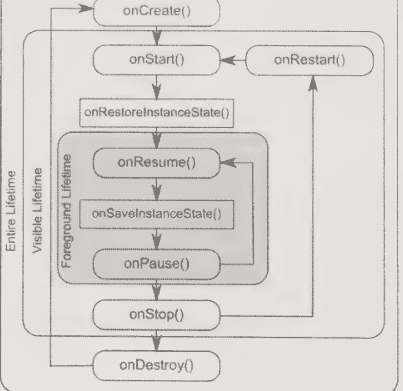

图 12-2

## 12.6 禁用配置重启

如前所述，activity 可以指示在某些配置更改发生时不重启。这是通过在项目清单文件中的 activity 元素中添加 `android:configChanges` 指令来实现的。例如，下例清单摘录表明，当发生与方向或设备宽度大小相关的配置更改时，activity 不应重启：

```xml
<activity android:name="MainActivity"
    android:configChanges="orientation|fontScale"
    android:label="@string/app_name">
```

## 12.7 生命周期方法的局限性

正如本章开头提到的，生命周期方法已经使用了多年，并且在最近之前是处理状态变化的唯一机制。然而，这种方法存在某些缺陷。

生命周期方法的一个问题是，它们无法让对象在执行期间任何时候轻松获取其生命状态。相反，对象需要在内部跟踪状态，或者等待下一次生命周期调用。

此外，这些方法没有提供让对象简单观察应用内其他对象生命变化的方法。这是一个重要的考虑因素，因为应用中的许多其他对象可能会受到生命变化的影响。

生命周期方法也只适用于 `Fragment` 和 `Activity` 的子类。因此，无法构建真正感知状态的自定义类。

最后，生命周期方法导致大多数处理代码都位于 activity 或 fragment 中，这可能导致代码复杂且易错。理想情况下，这些代码应该位于受状态变化影响的其它类中。例如，一个流媒体应用可能会包含一个专门用于管理流的类。如果应用需要在主 activity 停止时暂停流，该代码应位于流类中，而不是主 activity 中。

所有这些问题都可以通过使用生命感知组件来解决，该主题将从“Jetpack 现代 Android 应用架构”章节开始介绍。

## 12.8 总结

所有的 activity 都派自 Android Activity 类，该类包含了许多生命周期方法，这些方法设计用于在 activity 状态更改时由运行时调用。同样，Fragment 类也包含许多类似的方法。通过重写这些方法，activity 和 fragment 可以响应状态变化，并在必要时采取步骤保存并恢复 activity 以及应用的状态。生命状态可以被认为有两种形式。持久化状态指的是跨更改存储的数据。而动态状态则与用户界面的当前外观有关。

生命周期方法存在许多局限性，通过使用生命感知组件可以避免这些问题，但理解这些方法对于充分理解书中后面介绍的新生命周期管理方法至关重要。

在本章中，我们强调了 activity 可用的生命周期方法并涵盖了应用生命周期的概念。在下一章（“Android Activity 状态变化示例”）中，我们将实现一个将这些理论付诸实践的应用。

# 13. 示例 Android Activity 状态变化

之前的章节已经详细讨论了构成 Android 应用程序的 Activity 的状态和生命周期。在本章中，我们将通过创建一个示例应用程序，将处理 Activity 状态变化的理论付诸实践。该示例应用程序的目的是为 Activity 在 Android 运行时通过各种不同状态提供一个真实世界的演示。

在下一章（标题为“保存和恢复 Android Activity 状态”）中，在本章构建的示例项目将被扩展，以演示动态 Activity 状态的保存和恢复。

## 13.1 创建状态变化示例项目

此练习的第一步是启动 Android Studio 创建新项目。如有必要，使用 `File -> Close Project` 菜单选项关闭当前打开的项目，以便显示欢迎界面。

从欢迎界面选择“Start Android Studio project”快速启动选项，在新项目对话框中，在 Application name（应用程序名称）字段输入 `StateChange`，并在 Company Domain（公司域名）设置中输入 `ebookfrenzy.com`，然后点击 Next（下页）按钮。

在表单屏幕上，启用 Phone（手机）和 Tablet（平板电脑）选项，并将最小 SDK 设置为 API 26 Android 8.0 (Oreo)。继续后续屏幕，请求创建一个名为 `StateChangeActivity` 的 Basic Activity，以及对应的名为 `activity_state_change` 的布局文件。

项目处理完成后，StateChange 项目应列在 Android Studio 主窗口左侧的 Project 窗口中。


下一步操作涉及设计此 Activity 界面的内容区域。它存储在名为`content_state_change.xml`的文件中，该文件应该已经加载到 Layout Editor（布局编辑器）工具中。如果没有，请导航到`app -> res -> layout`文件夹找到它。双击该文件将将其加载到 Android Studio Layout Editor 工具中。

# 按变化变化的 Activity 状态

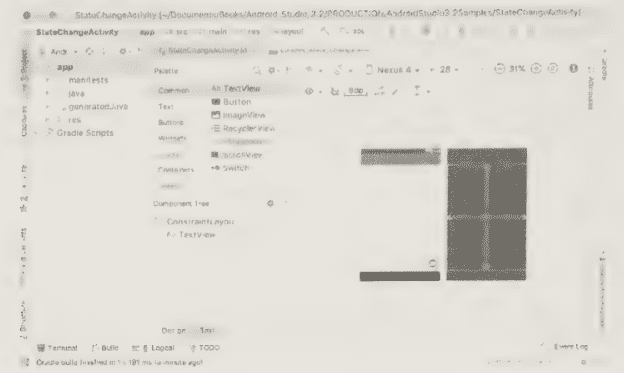

图 13-1

## 13.2 设计用户界面

当用户界面布局加载到 Layout Editor 工具中后，现在是为示例应用程序设计用户界面的时候。与用户界面设计中现有的“Hello world!”TextView 不同，Activity 实际上需要一个 EditText 视图。在 Layout Editor 画布上选择 TextView 对象，并按 Delete 键将其从设计中删除。

从 Layout Editor 左侧的 Palette（调色板）选择 Text 类别，从文本组件列表中点击并拖动 Plain Text（纯文本）组件到设备屏幕的可视区域。将组件移动到显示中心，直到出现中心引导线，然后将其到位，使布局类似于图 13-2。

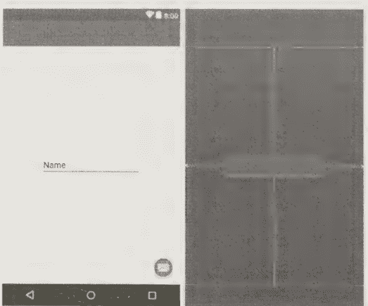

图 13-2

在使用 EditText 小部件时，有必要为视图指定输入类型（input type）。这简单地定义了用户将输入的文本或数据类型。例如，如果输入类型设置为 Phone，用户将受到限制在视图中输入数字。或者，如果将输入类型设置为 TextCapCharacters，输入将默认为大写字母。输入类型设置也可以组合使用。

为了本示例的目的，我们将输入类型设置为支持普通文本输入。为此，在布局中选择 EditText 小部件，并在 Attributes（属性）窗口中找到输入项。点击当前设置以启用选项列表；在列表中，关闭 textName 并启用 text，然后点击 OK 按钮。

默认情况下，EditText 显示的是内容为“Name”的文本。留在 Attributes 面板中，从 text 属性中删除此内容，使布局中的视图为空白。

## 13.3 重写生命周期方法

此时，项目包含一个名为`StateChangeActivity`的 Activity，它派生自 Android AppCompatActivity。该 Activity 的源代码包含在`StateChangeActivity.java`文件中，该文件应该已经在编辑器中打开并由编辑器标签栏中的标签页表示。如果文件不再打开，请在 Project 工具窗口面板中导航到它（`app -> java -> com.ebookfrenzy.state -> StateChangeActivity`）并双击将其加载到编辑器。一旦加载，代码如下：

```java
package com.ebookfrenzy.state;

import android.os.Bundle;
import android.support.design.widget.FloatingActionButton;
import android.support.design.widget.Snackbar;
import android.support.v7.app.AppCompatActivity;
import android.support.v7.widget.Toolbar;
import android.view.View;
import android.view.Menu;
import android.view.MenuItem;
```

```java
public class StateChangeActivity extends AppCompatActivity {

    @Override
    protected void onCreate(Bundle savedInstanceState) {
        super.onCreate(savedInstanceState);
        setContentView(R.layout.activity_state_change);
        Toolbar toolbar = (Toolbar) findViewById(R.id.toolbar);
        setSupportActionBar(toolbar);

        FloatingActionButton fab = (FloatingActionButton) findViewById(R.id.fab);
        fab.setOnClickListener(new View.OnClickListener() {
            @Override
            public void onClick(View view) {
                Snackbar.make(view, "Replace with own action", Snackbar.LENGTH_LONG)
                    .setAction("Action", null).show();
            }
        });

        Log.i(TAG, "onCreate");
    }
}
```

## Android Activity 状态更改示例

```java
Log.i(TAG, "onStop");

@Override
protected void onRestart() {
    super.onRestart();
    Log.i(TAG, "onRestart");
}
```

```java
@Override
protected void onDestroy() {
    super.onDestroy();
    Log.i(TAG, "onDestroy");
}
```

```java
@Override
protected void onSaveInstanceState(Bundle outState) {
    super.onSaveInstanceState(outState);
    Log.i(TAG, "onSaveInstanceState");
}
```

```java
@Override
protected void onRestoreInstanceState(Bundle savedInstanceState) {
    super.onRestoreInstanceState(savedInstanceState);
    Log.i(TAG, "onRestoreInstanceState");
}
```

## 13.4 过滤日志面板

在`StateChange.java`中记录重写方法的代码目的是将日志信息输出到 Logcat 窗口。该输出可以配置为显示与设备或模拟器器会话相关的所有事件，或者限制为仅与当前选定的应用程序相关的事件。输出还可以进一步限制为仅记录匹配指定过滤器的事件。

显示 Logcat 窗口并点击过滤器菜单（图 13-3 中标记为 B 的处）查看选项。当菜单设置为“仅显示选定的应用程序”（Show only selected application）时，Logcat 面板将仅显示与菜单中 A 处的应用程序相关的消息。相反，选择“无过滤器”（No Filter）将显示由设备或模拟器生成的所有消息。

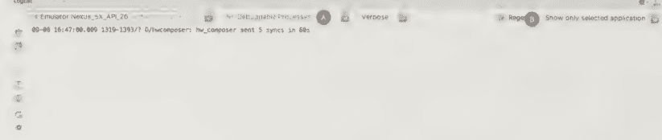

图 13-3

在运行应用程序之前，值得演示如何创建一个过滤器，通过该过滤器，我们可以进一步限制日志输出，以确保只显示包含我们在 Activity 中声明的标签（tag）的消息。从过滤器菜单（B）中，选择“编辑过滤器配置”（Edit Filter Configuration）选项。在“创建新 Logcat 过滤器”对话框（图 13-4）中，将过滤器命名为`Lifecycle`，在 Logcat tag 中输入在`StateActivity.java`中声明的标签值（在上面的代码示例中为`StateChange`）。

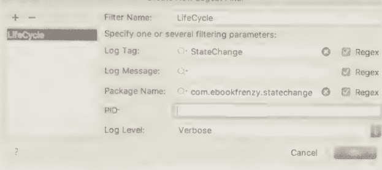

图 13-4

在“包名”（Package Name）字段中输入包标识符（点击文本字段中的搜索图标将弹出一个可以从中选择包名的菜单），当更改完成后，点击 OK 按钮创建过滤器并关闭对话框。Logcat 工具窗口中应该选择新创建的过滤器，而不是显示“无过滤器”（No Filters）。

## 13.5 运行应用程序

为了获得最佳结果，应用程序应在物理 Android 设备或模拟器上运行。在设备配置并连接到开发计算机后，点击 Android Studio 工具栏上绿色三角形所示的运行按钮（下图 13-5 所示），选择 Run -> Run... 菜单选项或使用键盘快捷键`Shift+F10`。


图 13-5

如果出现“选择设备”（Choose Device）对话框，请选择物理 Android 设备（假设你尚未将其配置为默认目标）。在 Android Studio 构建应用程序并将其安装到设备后，它应该启动并在前台运行。

查看 Logcat 面板应能指示目前为止触发了哪些方法（注意确保选择了上一节创建的`Lifecycle`过滤器，以过滤我们目前感兴趣的日志事件）：

```
Emulator Nexus 5 API 26
BD-80 16:53:24,775 8841/com.android.statechange 1/statechange:pause
BD-80 16:53:24,776 8841/com.android.statechange 1/statechange:stop
BD-80 16:53:24,778 8841/com.emulator.myservice 1/statechange:resume
```

## 13.6 实验 Activity

诊断功能正常后，现在是时候通过运行应用程序来理解 Activity 生命周期周期状态的变化了。但在开始之前，先考虑 Logcat 面板中的初始日志事件序列：

- *onCreate*

- onStart

- *onResume*

显然，初始状态更改与“理解 Android 应用程序和 Activity 生命周期”中概述的完全一致。但请注意，并没有调用`onRestoreInstanceState()`，因为 Android 运行时检测到在这种情况下没有需要恢复的状态。

点击设备屏幕底部状态栏上的主页图标，并注意日志中报告的方法调用序列如下：

- *onPause*

- onStop

- *onSaveInstanceState*

在这种情况下，运行时注意到该 Activity 不再处于前台，对用户不可见，并停止了该 Activity，但没有为 Activity 保存动态状态的机会。取决于运行时最终销毁了 Activity 还是简单地重新启动了它，Activity 将通过调用`onRestart()`被通知其已重启，或者在重新创建时再次经历创建序列。

## 13.7 总结

“一画胜千言”的古老谚语在学习新范式的示例中依然适用真。在本章中，我们创建了一个 Android 应用程序，目的是演示 Activity 可能会经过的生命周期状态变化。在本章的项目开发过程中，我们还查看了生成日志信息的机制。在下一章中，我们将扩展项目以演示如何保存和恢复状态。

# 第 14 章 保存和恢复 Android 的状态

如果前面的几章已经实现了目标，现在对于保存和恢复用户界面状态的重要性应该变得更清晰了。在本章中，我们将扩展示例应用程序，演示当 Activity 被销毁时保存和恢复状态的步骤。

保存和恢复动态状态的关键组件涉及使用 Android`Bundle`类，该主题在本章中也会涵盖。

### 14.1 保存动态状态

正如我们已经学到的，Activity 通过运行时系统调用其`onSaveInstanceState()`方法实现提供了保存动态状态信息的机会。作为参数传递给方法的是`Bundle`对象的引用，该方法需要向其中存储任何需要保存的动态数据。随后，`Bundle`对象将由运行时代表 Activity 进行存储，并在调用 Activity 的`onCreate()`和`onRestoreInstanceState()`方法时再次作为参数传递。。然后，可以在这些方法中从`Bundle`检索数据并用于恢复 Activity 的状态。

### 14.2 用户界面状态的默认保存

在上一章中，StateChange 示例应用程序的诊断输出显示，当运行它的设备旋转得足以触发方向变化时，Activity 会经历一系列状态变化。

再次启动 StateChange 应用程序，这次在执行设备旋转之前在`EditText`字段中输入文本（在运行 Android 9 的设备或模拟器上，可能需要点击状态栏上的旋转按钮来完成旋转）。旋转设备后，Logcat 窗口应出现以下状态更改序列：

```
onPause
onStop
onSaveInstanceState
onDestroy
onCreate
onStart
onRestoreInstanceState
onResume
```

显然，这导致了 Activity 被销毁，但运行中的应用程序应该显示输入`EditText`字段的文本已被保留。鉴于 Activity 被销毁并重建，且我们没有添加任何特定代码来确保文本被保存和恢复，这种行为需要一些解释。

# 保存和恢复 Android Activity 状态

事实上，Android SDK 中的大多数视图控件已经实现了在 Activity 重启时自动保存和恢复状态所需的行为。启用此行为的唯一要求是 Activity 中的`onSaveInstanceState()`和`onRestoreInstanceState()`方法必须包含对父类对应方法的调用：

```
@Override
protected void onSaveInstanceState(Bundle outState) {
    super.onSaveInstanceState(outState);
}
```

```
@Override
protected void onRestoreInstanceState(Bundle savedInstanceState) {
    super.onRestoreInstanceState(savedInstanceState);
}
```

可以通过在 XML 布局文件中将`android:enabled`属性设置为`false`来禁用用户界面视图的状态自动保存。为了演示，我们将禁用用户布局中`EditText`视图的自动状态保存机制，并添加代码手动保存和恢复视图的状态。

要配置`EditText`视图在 Activity 启动时不保存和恢复状态，请编辑`content_state.xml`文件，使视图条目内容如下（注意，可以通过点击布局编辑器面板底部的标签页来编辑 XML）：

```xml
<EditText
    android:id="@id/editText"
    android:layout_width="wrap_content"
    android:layout_height="wrap_content"
    android:ems="10"
    android:inputType="text"
    android:enabled="false"
    app:layout_constraintBottom_toBottomOf="parent"
    app:layout_constraintEnd_EndOf="parent"
    app:layout_constraintStart_toStartOf="parent"
    app:layout_constraintTop_toTopOf="parent" />
```

进行更改后，运行应用程序，输入文本并旋转设备，验证文本不再被正确保存和恢复。

## 14.3 Bundle 类

对于需要保存用户界面组件提供的功能之外状态的情况，`Bundle`类提供了一个容器，使用键值对机制存储数据。键可以取字符串的形式，而与这些键关联的值可以是原始类型或实现了 Android`Parcelable`接口的任何对象。许多类已经实现了`Parcelable`接口。可以通过实现`Parcelable`接口定义的方法集，使自定义类变为“可序列化的”，详细信息可以在 Android 文档中找到：

https://developer.android.com/reference/android/os/Parcelable.html

`Bundle`还包含一组方法，用于获取和设置各种数据类型的键值对，包括原始类型（包括 Boolean、char 和 double 浮点型）和对象（如`CharSequence`）。

为了本例的目的，并且在禁用了`EditText`的自动保存的情况下，请确保用户输入`EditText`的文本被保存到`Bundle`对象中并随后被恢复。这将演示如何在 Android 应用程序中手动保存和恢复状态，并将分别通过使用`Bundle`类的`putCharSequence()`和`getCharSequence()`方法来实现。

## 14.4 保存状态

扩展`StateChange`应用程序的第一步是确保使用`StateChangeActivity`的`onSaveInstanceState()`方法从`EditText`组件中提取用户输入的文本，然后将其作为键值对保存到`Bundle`中。


为了从`EditText`对象中提取文本，我们首先需要识别用户界面中的哪一个对象。显然，这涉及到`Activity`的Java代码（包含在`StateChangeActivity.java`源码中）与用户界面的XML表示（包含在`state_change.xml`文件中）之间的桥。为了将文本提取到`EditText`组件中，我们需要访问该用户界面。

每个用户界面内的组件都有一个唯一标识符。默认情况下，布局编辑器根据组件类型为新添加的组件构造ID。如果布局中包含多个相同类型的组件，则类型名称后会跟一个顺序数字（尽管这可以并且应该更改为更有意义的内容（由开发者决定））。在`Android Studio`主窗口中选择`state_change.xml`文件并部署布局编辑器时，检查“组件树”面板可以看到，`EditText`组件被分配了ID`editText`：


图 14-1

正如“Android应用程序的剖析”章节概述的，组成应用程序的所有资源都被编译成一个类`R`。其中包含了定义布局的类，包括我们当前`Activity`的布局。在`R`类中有一个名为`layout`的子类，它包含了布局资源，而在该子类中就是我们的`current_state_change`布局。有了这些知识，我们可以调用`Activity`的`findViewById()`方法来获取`EditText`对象的引用，如下所示：

```java
final EditText editText = (EditText) findViewById(R.id.editText);
```

在获取`EditText`引用并将其赋值给变量后，我们现在可以使用对象的`get()`方法获取包含的文本，该方法反过来返回当前文本：

```java
CharSequence userText = editText.getText();
```

最后，我们可以使用`Bundle`的`putCharSequence()`方法保存文本，将键（可以是任何字符串值，但在本例中我们声明为`savedText`）和用户对象作为参数：

```java
outState.putCharSequence("savedText", userText);
```

将这一切整合在一起，我们在`StateChangeActivity.java`文件中得到了一个修改后的`onSaveInstanceState()`方法，内容如下（同时注意对`android.widget.EditText`的额外导入指令）：

```java
package com.ebookfrenzy.statechange;

import android.os.Bundle;
import android.support.design.widget.FloatingActionButton;
import android.support.design.widget.Snackbar;
import android.support.v7.app.AppCompatActivity;
import android.support.v7.widget.Toolbar;
import android.view.View;
import android.view.View.Menu;
import android.view.View.MenuItem;
import android.util.Log;
import android.widget.EditText;

public class StateChangeActivity extends AppCompatActivity {

    protected void onSaveInstanceState(Bundle outState) {
        super.onSaveInstanceState(outState);
        Log.i(TAG, "onSaveInstanceState");

        final EditText editText = findViewById(R.id.editText);
        CharSequence userText = editText.getText().toString();
        outState.putCharSequence("savedText", userText);
    }
}
```

现在已经采取了保存状态的步骤，下一步是确保它被恢复。

## 14.5 恢复状态

保存的动态状态可以在传递`Bundle`对象的生命周期方法中恢复。使用哪种方法取决于`Activity`的性质。在`Activity`初始化任务完成后恢复状态的情况下，`onRestoreInstanceState()`方法通常更好。为了本例的目的，将在`onRestoreInstanceState()`中添加代码以从`Bundle`提取保存的状态。然后我们可以使用对象的`setText()`方法在`EditText`组件上显示文本：

```java
@Override
protected void onRestoreInstanceState(Bundle savedInstanceState) {
    super.onRestoreInstanceState(savedInstanceState);
    Log.i(TAG, "onRestoreInstanceState");

    final EditText editText = (EditText) findViewById(R.id.editText);
    CharSequence userText = savedInstanceState.getCharSequence("savedText");
    editText.setText(userText);
}
```

## 14.6 测试应用程序

剩下的只是再次构建并运行`StateChange`应用程序。运行并处于前台后，触摸`EditText`组件并输入一些文本，然后旋转设备到另一个方向。之前文本更改会丢失，现在得益于我们在本章向`Activity`添加的代码，新文本保留在`EditText`组件中。

验证代码符合预期后，注释掉两个方法中的`onSaveInstanceState()`和`super.onRestoreInstanceState()`调用，重新启动应用并注意设备旋转后文本仍然保留。默认的保存和恢复系统实际上被自定义实现取代，从而提供了一种在`Activity`中动态且选择性保存和恢复状态的方法。

## 14.7 总结

`Android`应用程序中动态状态的保存和恢复只需实现适当的生命周期方法。对于大多数用户界面，这由`Activity`父类自动处理。在其他情况下，这通常包括在`onSaveInstanceState()`方法中提取值和设置，并将数据作为键值对保存到运行时系统传递给`Activity`的`Bundle`对象中。

状态可以在`Activity`的`onCreate()`或`onRestoreInstanceState()`方法中通过从`Bundle`提取并根据存储的值更新`Activity`来恢复。

在本章中，我们使用了这些技术更新了`StateChange`项目，使得`Activity`在销毁和随后的重建后能够保留更改。

# 15. 理解 Android View、视图组和布局

除了考虑到流媒体音频播放外，用户与Android设备的交互在本质上主要是视觉化和触觉化的。所有这些交互都是通过设备上安装的应用程序的用户界面进行的，包括内置应用程序以及用户安装的任何第三方应用程序。因此，这并不令人意外，开发Android应用的一个关键要素涉及用户界面的设计和创建。

在本章中，将涵盖Android用户界面的结构主题，并概述我们为了构建用户界面而整合的不同元素；即视图（`Views`）、视图组（`View Groups`）和布局（`Layouts`）。

## 15.1 为不同的 Android 设备设计

“Android设备”一词涵盖了大量具有不同屏幕尺寸和分辨率的平板电脑和智能手机产品。因此，必须仔细设计用户界面，以确保在尽可能广泛的显示尺寸上正确呈现。其中的一个关键部分是确保用户界面在不同设备上运行时能够正确地调整大小。这在很大程度上可以通过细致的规划以及使用本章概述的布局管理器来实现。

同样重要的是记住，大多数基于Android的智能手机和平板电脑都可以以竖屏和横屏模式手持。良好的用户界面应该能够适应这些变化，并做出合理的布局调整，以利用每个模式下的可用空间。

## 15.2 视图和视图组

用户界面中的每一项都是Android `View`类的子类（准确来说是`android.View`）。Android SDK提供了一套预构建视图，可用于构建用户界面。典型示例包括标准项，如`Button`、`CheckBox`、`ProgressBar`和`TextView`视图。这些视图也被控件（`widgets`）或组件。对于SDK控件无法满足的需求，可以通过子类和扩展现有类来创建新视图，或者通过直接在`View`类之上构建创建一个全新的组件。

视图还可以由多个视图组成（称为复合视图）。此类视图继承自`ViewGroup`类（`android.ViewGroup`），而该类本身是`View`的子类。这种视图的一个示例是`RadioGroup`，旨在包含多个对象，使得任何时候只有一个对象处于“开启”状态。从结构上来说，复合视图由单个父视图（也称为容器视图或根元素）组成，它能够包含其他视图（称为子视图）。

`ViewGroup`基视图的另一类是布局管理器。

## 15.3 控件布局管理器

除了上一节讨论的样式视图外，SDK还包含了一组称为布局（`layouts`）的视图。布局是容器视图（因此继承自`ViewGroup`），其唯一目的是控制视图在屏幕上的对齐方式。

Android SDK包含了以下可以使用的布局视图，对于大多数布局，推荐使用这些布局管理器：

- **`ConstraintLayout`** - 在Android 7中引入，建议在大多数布局中使用此布局管理器。`ConstraintLayout`允许通过为每个子视图分配简单的约束条件来定义布局中视图的位置和行为。该布局的灵活性允许快速、方便地创建复杂布局，而无需在内部相互嵌套其他布局类型，从而提高了布局性能。`ConstraintLayout`也与Android Studio布局编辑器紧密集成。除非另有说明，否则它是书中大多数示例的首选布局。

- **`LinearLayout`** - 根据所选的方向将视图排在单行或单列中。可以在每个子视图上设置权重值（`weight`），以指定该子视图相对于其他子视图应占据布局空间的比例。

- **`TableLayout`** - 以行和列的网格格式排列视图。表格中的每一行由一个`TableRow`对象表示，该对象又包含每个单元格的视图对象。

- **`FrameLayout`** - `FrameLayout`的目的是分配屏幕区域，通常用于显示单个视图。如果添加了多个视图，默认情况下它们将堆叠显示，并位于布局区域的左上角。通过设置每个子视图的重力（`gravity`）值可以实现单个视图的交替定位。例如，在子视图上设置居中重力（`center gravity`）将导致它位于容器`FrameLayout`的垂直中心位置。

- **`RelativeLayout`** - `RelativeLayout`允许通过指定子视图的对齐方式和边距，使视图相对于彼此以及相对于容器视图进行定位。例如，子视图A可以被配置为位于容器`FrameLayout`的垂直中心。另一方面，视图B也可以被配置为位于视图A上方30像素处，使其垂直位置相对于视图A确定。这在设计适用于各种尺寸和方向的用户界面时，`RelativeLayout`特别有用。

- **`AbsoluteLayout`** - 允许在容器视图内的特定的X和Y坐标上定位视图。不建议使用它，因为它缺乏响应屏幕尺寸变化的灵活性。

- **`GridLayout`** - `GridLayout`实例由不可见的线划分，形成包含行和列的网格。子视图放置在单元格中，并可以配置为水平和垂直覆盖多个单元格。广泛的布局选项可以快速方便地实现。`GridLayout`组件之间的间隙可以通过放置特定类型的视图或设置边距（`margin`）参数来实现。

- **`CoordinatorLayout`** - `CoordinatorLayout`作为Android 5.0的Support Library引入，专门用于协调应用程序顶部标题栏与其他视图的外观和行为。在使用Basic Activity模板创建新活动时，主布局将使用`CoordinatorLayout`实现。该管理器从“使用`FloatingActionButton`和`Snackbar`”章节开始进行更详细的介绍。

在考虑Android应用用户界面的布局使用时，值得记住正如下一节概述，它们可以相互嵌套，以创建任何必要程度的用户界面设计。

## 15.4 视图层次结构

用户界面中的每个视图都代表显示的一个矩形区域。视图负责在该矩形内绘制内容，并响应屏幕该部分发生的事件（例如触摸事件）。

用户界面由视图层次结构组成，根视图位于树顶，子视图位于下方的分支。容器视图的子视图显示在父视图之上，并被限制在父视图显示区域边界内。例如，考虑图15-1所示的用户界面：

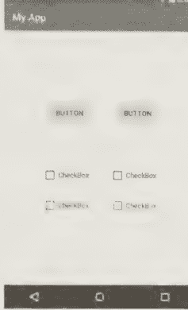

图 15-1

除了可见的按钮和复选框视图外，用户界面实际上包含了许多布局视图，用于控制可见视图的定位。图15-2显示了用户界面的另一种视图，这次特别突出了布局视图相对于子视图的存在情况：

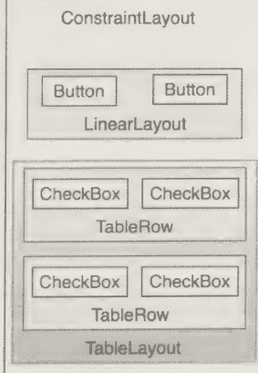

图 15-2

## 理解 Android Views、View Groups 和布局

如之前讨论过的，用户界面是以视图层次结构（`view hierarchy`）的形式构建的，顶部有一个根视图。既然如此，我们也可以像图15-3所示，通过视图树的形式将上述用户界面示例视觉化：

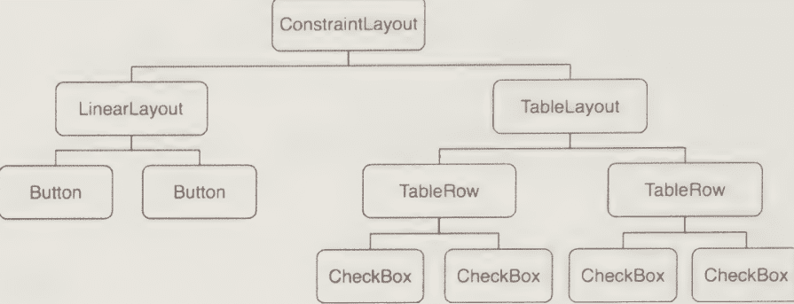

视图层次结构图可能最清晰地概述了构成图15-1所示用户界面的各种视图之间的关系。当用户界面显示给用户看时，Android运行时会激活视图层次结构，从根视图开始沿树向下遍历，并渲染每一个视图。

图 15-3

## 15.5 创建用户界面

在对视图、布局和视图层次结构的概念有了更清晰的理解，后续章节将重点关注为Android `Activity`创建用户界面的步骤。事实上，用户界面设计有三种不同的方法：使用Android Studio布局编辑器工具、手动编写XML布局资源文件或编写Java代码，每种方法都将得到涵盖。

## 15.6 总结

Android应用程序用户界面中的每个元素都是视图，它们最终继承自`android.view.View`类。每个视图代表设备显示器上的矩形区域，负责该矩形区域显示的内容以及处理在该边界内发生的事件。多个视图可以组合在一起创建一个简单的复合视图（`composite view`）。复合视图中的视图是容器视图的子，容器视图通常是`android.view.ViewGroup`的子类（而`ViewGroup`本身是`android.view.View`的子类）。用户界面是由视图层次结构形式构建的视图组成的。

Android SDK包含一系列预构建的视图，可用于创建用户界面。这些包括文本字段和按钮等基本组件，以及一系列用于控制子视图定位的布局管理器。如果提供的视图不能满足特定需求，可以通过扩展或组合现有视图来创建自定义视图，或者通过对`android.view.View`进行子类创建一个完全全新的视图类。

用户界面可以使用Android Studio布局编辑器工具、手动编写XML布局资源文件或编写Java代码来创建。这些方法中的每一种都将在后续章节中介绍。

## 第 16 章

## 16. Android Studio 布局编辑器工具指南

很难想象出一个不需要某种形式用户界面的Android应用程序概念。大多数配备了触摸屏和键盘（虚拟或物理）以及支持点击和滑动的Android设备是用户与应用程序之间交互的主要形式。这些交互不可避免地通过应用程序的用户界面进行。

一个设计良好且实现的用户界面是创建一个成功且流行的Android应用程序的重要因素，它可以根据单个应用程序的设计需求从简单到极其复杂。无论复杂程度如何，Android Studio布局编辑器工具都显著简化了设计和实现Android用户界面的任务。

## 16.1 Basic Activity vs. Empty Activity 模板

正如“Android应用程序的剖析”章节中所述的，Android应用程序由一个或多个`Activity`组成。`Activity`是应用程序功能的独立模块，通常直接对应于单个用户界面屏幕。因此，在使用Android Studio布局编辑器工作时，我们总是在处理`Activity`的布局。

在创建新的Android Studio项目时，有许多不同的模板可以作为主`Activity`用户界面的起点。这些模板中最基础的是Basic Activity（基础Activity）模板和Empty Activity（空Activity）模板。尽管它们初看之下很相似，但这两个选项之间实际上存在显著差异。

`Empty Activity`模板创建一个单布局文件，其中包含一个`ConstraintLayout`布局管理器实例，该实例包含一个`TextView`对象，如图16-1所示：


图 16-1

## Android Studio 布局编辑器工具指南


另一方面，Basic Activity 由两个布局文件组成。顶层布局具有 `CoordinatorLayout` 作为根视图、应用栏（app bar）、一个预配置了单个菜单项的菜单（图 16-2 中的 A）、一个可配置的浮动按钮（B），以及指向第二个布局文件的引用，该文件中声明了 Activity 用户界面内容区域的布局：


图 16-2

显然，如果你在 Activity 中既不需要浮动按钮也不需要菜单，并且 `CoordinatorLayout` 提供的特殊应用栏行为（例如在某些滚动操作期间让应用栏和工具栏折叠隐藏的选项，这是“与 AppBar 和折叠工具栏布局配合”章节中的一个主题），那么 Empty Activity 模板就是很有用的。然而，Basic Activity 的用处在于它默认提供了这些元素。事实上，使用 Basic Activity 模板创建一个新 Activity 并删除你不需要的元素，通常比使用 Empty Activity 模板并手动实现折叠工具栏、菜单或浮动按钮等行为要快得多。

由于本书中的并非所有示例都需要 Basic Activity 的功能，因此本章的大多数示例将使用 Empty Activity 模板，除非示例需要 Basic Activity 模板提供的某项功能。

为了以后参考，如果你需要菜单但不需要浮动按钮，请使用 Basic Activity 并按照以下步骤操作：

# Android Studio 布局编辑器工具指南

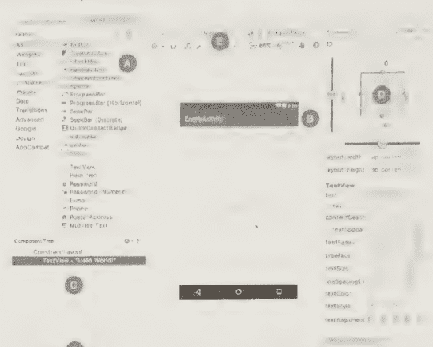

图 16-3

- **A - 调板（Palette）** – 调板提供了 Android SDK 提供的系列视图组件的访问。这些组件按类别分组，便于导航。可以通过从调板中拖拽视图并将其放置在布局上的所需位置来向布局中添加项。
- **B - 设备屏幕（Device Screen）** – 设备屏幕提供了设计中用户界面的“见即所得”式表示。该布局允许对设计进行直接操作，包括选择、删除、移动和调整所选视图的大小。可以使用位于工具栏的菜单随时更改布局所代表的设备模型。
- **C - 组件树（Component Tree）** – 如前一章（“理解 Android 视图、视图组和布局”）概述，用户界面是使用层级结构构建的。组件树提供了用户界面设计层级的可视概述。在组件树中选择一个元素将导致布局中相应的视图被选中。同样，在设备屏幕布局中选择一个视图将在组件树层级中选中该视图。
- **D - 属性（Attributes）** – 调板中列出的所有组件视图都关联有一组属性，这些属性可调整该视图的行为和外观。布局编辑器的属性面板提供了对布局中当前选中视图属性的访问，以便进行更改。
- **E - 工具栏（Toolbar）** – 布局编辑器工具栏提供了广泛选项的快速访问，包括其他选项、放大和缩小设备屏幕、更改显示的设备模型、在横屏和竖屏之间旋转布局以及切换到不同的 Android SDK API 级别。工具栏还有一组上下文敏感按钮，当设备屏幕上选中相关视图时，这些按钮将会出现。
- **F - 模式切换标签页（Mode Switching Tabs）** – 布局编辑器底部的标签页提供了在布局编辑器工具的文本模式和设计模式之间来回切换。

## 16.4 调板

布局编辑器由两个面板组成，旨在方便查找和预览用于添加到布局设计中的视图组件。类别面板（在图 16-4 中标记为 A）列出了所有可用类别，当从列表中选择一个类别时，第二个面板（B）会更新并显示该类别下的组件列表：

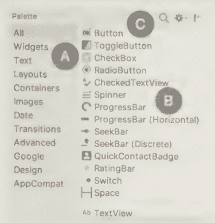

图 16-4

要将组件从调板添加到布局画布上，只需从组件列表或预览中选择该项，将其拖拽到画布上的所需位置并将其置位即可。

在当前选定的类别中搜索特定组件，可以通过点击调板工具栏中的搜索图标（在上述图 16-4 中标记为 C）并输入组件名称来启动。随着字符的输入，匹配的结果将实时显示在组件列表面板中。如果您不确定组件所属的类别，只需在搜索操作之前或期间选择“全部（All）”类别即可。

## 16.5 设计与布局视图

当布局编辑器工具处于设计（Design）模式时，可以通过两种不同的方式查看布局。图 16-3 所示的视图是“设计”视图，显示了布局和控件在运行应用中的样式。另一种模式，称为“布局（Layout）”或“蓝图（Blueprint）”视图，可以替代设计工具显示或与其同时显示。图 16-5 所示的工具栏菜单提供了显示设计、蓝图或两种视图的选项。第四种选项“强制刷新布局（Force Refresh Layout）”会导致布局重新构建并重绘。当布局进入意外状态或未能准确反映当前设计设置时，这将非常有用：

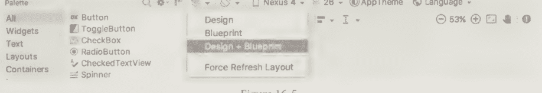

图 16-5

显示设计、蓝图或两种视图取决于个人偏好。图 16-6 显示了这种视图：


图 16-6

## 16.6 文本模式

当布局编辑器工具处于文本模式时，重要的是，在 Studio 布局编辑器时，可以通过点击底部的标签页来回切换。点击布局编辑器底部的标签页，可以查看到 XML 设计设计。图 16-7 显示了文本模式：

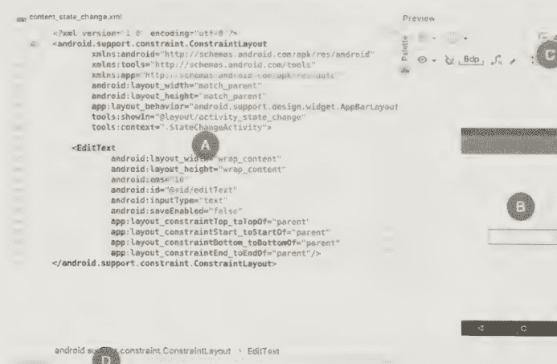

图 16-7

- **A - 编辑器（Editor）** – 编辑器显示了 Android Studio 布局编辑器中所构建的 XML 文件。
- **B - 预览（Preview）** – 当在编辑器中进行更改时，预览将实时反映这些更改。在设计模式下，可以通过点击工具栏中的按钮，在文本视图和设计视图之间来回切换。
- **C - 工具栏（Toolbar）** – 文本模式下的工具栏提供了在设计模式下可用的功能。
- **D - 模式切换标签页（Mode Switching Tabs）** – 位于布局编辑器底部的标签页提供了在文本模式和设计模式之间切换的方法。

## 16.7 设置属性

属性面板提供了对当前选中组件的所有可用设置的访问。默认情况下，属性面板显示布局中最常更改的属性。图 16-8 显示了 `TextView` 组件的属性子集：

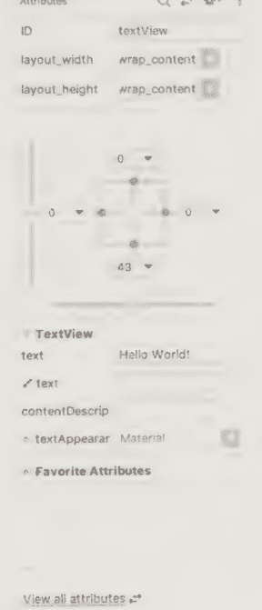

图 16-8

要访问当前选中组件的所有属性，请点击图 16-9 中标记的按钮，或使用属性面板底部的“视图（View）”链接：

| 属性 | 值 |
|---|---|
| ID | `textView` |
| `layout_width` | `wrap_content` |
| `layout_height` | `wrap_content` |

图 16-9

也可以通过选择属性窗口中的搜索按钮并输入属性名称来搜索特定属性。在搜索之前或期间选择“视图（View）”按钮或链接，以确保当前选中组件的所有属性都包含在结果中。

某些属性包含一个显示三个点的按钮。这表示有一个设置对话框可以协助选择合适的属性值。要显示对话框，只需点击该按钮。具有有限数量值选项的属性将呈现下拉菜单（图 16-10），可以从中进行选择。

| 属性 | 值 |
|---|---|
| `fontFamily` | `sans-serif` |
| `typeface` | `sans-serif-condensed` |
| `textSize` | `sans-serif serif` |
| `lineSpacingExtra` | `monospace` |
| `textColor` | `serif-monospace` |
| `textStyle` | `cursive` |
| `textAlignment` | `cursive` |

图 16-10

## 16.8 配置收藏属性

初始属性子集列表中包含的属性可以通过配置收藏属性来进行扩展。要将属性添加到收藏列表，请显示当前选中组件的所有属性，并将鼠标指针悬停在属性窗口中属性项的最左侧。属性名称左侧会出现一个星形图标，点击该图标会将该属性添加到收藏列表。例如，图 16-11 显示了配置为收藏属性的 `TextView` 组件的 `autoText`、`background` 和 `backgroundTint` 属性：

# Android Studio 布局编辑器工具指南

- `autoSizeTypeText`
- `autoText`
- `autofillHints`
- `background`
- `backgroundTintMode`

图 16-11

一旦被添加为收藏，这些属性将列在主题属性列表的“收藏属性”（Favorite Attributes）部分下方：

| 属性 | 值 |
|---|---|
| `textStyle` | B J T |
| `textAlignment` | E E E E E |
| 收藏属性 |  |
| `autoText` |  |
| `background` |  |
| `backgroundTint` |  |
| 查看所有属性 |  |

图 16-12

## 16.9 转换视图

将布局中的视图从一种类型转换为另一种类型（例如将 `TextView` 转换为 `EditText`）可以在 Android Studio 布局编辑器中轻松完成，只需在屏幕布局或组件树（Component tree）窗口中右键点击视图，并选择“转换...” （Convert...）菜单选项（图 16-13）：

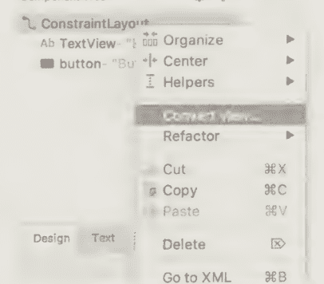

图 16-13

选中后，将弹出一个对话框，其中包含兼容的视图类型列表，所选对象可以转换为这些类型。例如图 16-14 显示了现有 `TextView` 视图可以转换的类型：

### 将视图转换为：TextView

- `Button`
- `ImageView`
- `EditText`
- `CheckBox`
- `RadioButton`
- `ToggleButton`

应用

为所选视图设置新类型

图 16-14

这种技术对于将布局从一种类型转换为另一种类型（例如将 `ConstraintLayout` 转换为 `LinearLayout`）也大有用处。

## 16.10 显示样本数据

在 Android Studio 中设计布局时，可能会出现一种情况：用户界面内要显示的内容在应用完成并运行之前无法获取。这有时会使得很难从布局编辑器内部评估布局在运行时的外观。为了解决这个问题，布局编辑器允许指定样本数据，用样本图像和数据填充布局编辑器中的视图。这些样本数据只在布局编辑器中显示，在应用运行时不会显示。可以通过直接编辑布局的 XML 或视觉化地使用设计时辅助按钮来配置样本数据；当鼠标指针悬停在布局中选中的视图上时，该按钮会高亮，如图 16-15 所示：


图 16-15

设计时辅助面板将为选中的视图项显示一系列预配置的样本数据选项，包括各种配置的文本和图像组合。例如，图 16-16 显示了在选择在 `RecyclerView` 列表中显示样本数据时显示的样本数据选项：

### 设计时视图属性

### 项目模板

### 两行

### 项目计数


或者，也可以在布局设计过程中提供自定义文本和图像进行显示。在布局编辑器中使用样本数据的示例包含在随后的名为“布局编辑器样本数据教程”的章节中。

## 16.11 创建自定义设备定义

布局编辑器工具栏中的设备（device）菜单（图 16-17）提供了预配置的设备类型列表，选中后它们将作为设备屏幕画布出现。除了预配置的设备类型外，之前在 Android Studio 环境中配置过的任何 AVD 实例也将列在菜单中。要添加额外的设备配置，选择设备菜单，选择“添加设备...” （Add Device...）选项，并按照“在 Android Studio 中创建 Android 虚拟设备（AVD）”章节中列出的步骤操作。

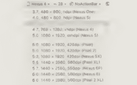

图 16-17

## 16.12 更改当前设备

除了设备选择菜单，可以通过选择“自定义”选项，点击屏幕右下角的缩放句柄（图 16-18）并拖动以选择另一种设备格式。随着屏幕调整大小，将出现标记，指示可选的各种尺寸选项和方向：


图 16-18

## 16.13 总结

开发 Android 应用的关键部分涉及创建用户界面。在 Android Studio 环境中，这是通过运行两种模式的布局编辑器工具完成的。在设计模式下，从调板中选择视图组件并将其放置在代表 Android 设备屏幕的布局上，使用属性列表进行配置。在文本模式下，可以直接编辑代表用户界面的 XML。这些模式结合提供了直观的用户界面设计环境。

# 17. ConstraintLayout 指南

正如“理解视图、视图组和布局”章节中所述，Google 引入了一种新布局来解决旧布局的许多缺点。`ConstraintLayout` 结合了 Android Studio 中简单且强大的功能来创建响应式用户界面。本章将概述 `ConstraintLayout` 的基本概念，下一章将详细概述。

## 17.1 ConstraintLayout 如何工作

与所有布局一样，`ConstraintLayout` 负责视觉组件（也称为视图）的位置和尺寸。为了完全理解并使用 `ConstraintLayout`，理解以下关键概念非常重要：

- 边距（Margins）
- 对抗约束（Opposing Constraints）
- 偏移（Bias）
- 链（Chains）

### 17.1.1 约束（Constraints）

约束本质上是规定视图相对于其他视图、`ConstraintLayout` 边界以及称为引导线的元素的对齐和距离的规则。为了充分配置，视图必须具有足够的约束连接，以便在水平和平面上都能确定位置。

### 17.1.2 边距（Margins）

边距是一种指定固定距离的约束形式。考虑一个需要放置在设备屏幕右上角的 `Button` 对象。可以通过实现 `Button` 顶部和右边缘到父 `ConstraintLayout` 对应边的边距约束来实现，如图 17-1 所示：

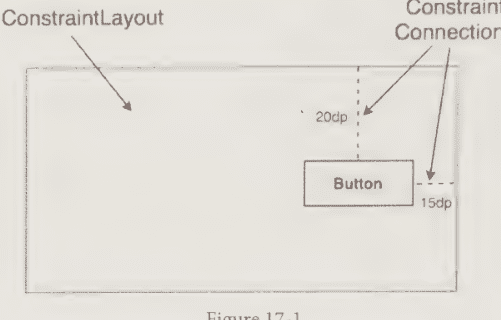

如上述图所示，每个约束连接都关联有一个边距值，规定了视图距离两个侧边的固定距离。在此配置下，无论屏幕尺寸或设备方向如何，`Button` 对象将始终距离父 `ConstraintLayout` 的顶部和右边缘 20 和 15 个独立像素（dp），正如这两个约束连接所指定的。

虽然上述配置在某些情况下是可以接受的，但它在允许 `ConstraintLayout` 引擎调整视图位置以响应旋转和支持不同屏幕方面没有提供灵活性。要为布局添加这种响应性，必须实现对抗约束。

### 17.1.3 对抗约束（Opposing Constraints）

在单个视图上沿同一轴运行的两个约束被称为对抗约束。换句话说，在左侧和右侧都有约束的视图被认为具有水平对抗约束。例如，图 17-2 展示了在之前的布局中同时添加水平和垂直对抗约束：

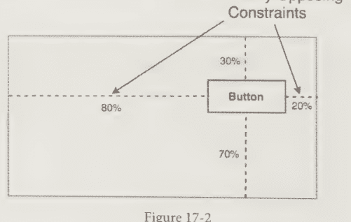

# Android ConstraintLayout 指南

这里需要理解的关键点是，一旦在特定轴上实现了对立的约束（opposing constraints），控件的定位将基于百分比而非坐标基础。例如，控件不再固定在距离布局顶部的 20dp 处，而是定位在距离布局顶部 30% 的位置。在不同的方向上以及在更大或更小的屏幕上运行时，按钮（Button）将相对于父布局的尺寸保持在相同的位置。

现在重要的是要理解，图 17-2 中概述的布局不仅使用了对立约束，还通过应用约束偏置（constraint bias）。

### 17.1.4 约束偏置（Constraint Bias）

目前已经确定，`ConstraintLayout` 中的控件可能会受到对立约束连接的影响。默认情况下，对立约束是相等的，这导致相应的控件在对立轴上居中。例如，图 17-3 显示了一个控件在对立水平和垂直约束的情况下，在包含它的 `ConstraintLayout` 中居中：

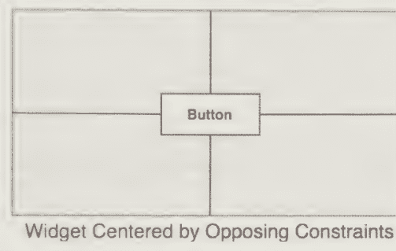

图 17-3

为了允许在对立约束的情况下调整控件的位置，`ConstraintLayout` 实现了一个名为“约束偏置”的功能。约束偏置允许控件沿对立轴的定位根据指定的百分比偏向其中一个约束倾斜。例如，图 17-4 显示了具有 75% 水平偏置和 10% 垂直偏置的先前约束布局：

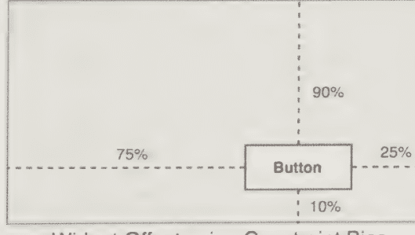

图 17-4

# Android ConstraintLayout 指南

下一章题为“在 Android Studio 中约束布局的指南”，将更详细地涵盖这些概念，并解释这些功能是如何集成到 Android Studio 布局编辑器中的。在此，还需要涵盖 `Constraint` 类的另外几个领域。

### 17.1.5 链（Chains）

`ConstraintLayout` 提供了一种方法，将两个或多个控件的布局定义为一个组。链可以在垂直或水平轴上声明，并配置以定义链中控件的间距和尺寸。

当控件通过双向约束连接在一起时，它们就成了链。例如，图 17-5 展示了三个以这种方式链接的控件：

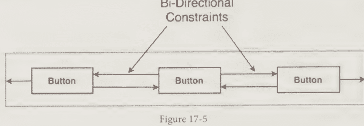

链中的第一个元素是链头（chain head），它在垂直链中对应顶部的控件，在水平链中，则对应最左侧的控件。整个链的布局行为主要通过在链头控件上设置属性来配置。


### 17.1.6 链样式（Chain Styles）

`LinearLayout` 链的布局行为由应用于链头控件的链样式设置决定。`ConstraintLayout` 类目前支持以下链布局样式：

- 散开链（Spread Chain）——链中包含的控件均匀分布在可用空间上。这是链的默认行为。


- 内部散开链（Spread Inside Chain）——链中包含的控件在链头和链中的最后一个控件之间均匀分布。头部和最后一个控件不包含在间距分布中。

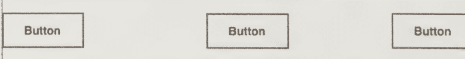

#### 权重链（Weighted Chain）

允许通过权重定义链中每个控件占据的空间。

| Button | Button |
| :--- | :--- |
| 17-8 |  |

#### 紧凑链（Packed Chain）

链中的控件挤在一起。可以使用偏置来控制链相对于父布局的水平或垂直位置。

| Button | Button |
| :--- | :--- |

### 17.2 基线对齐（Baseline Alignment）

到目前为止，本章只提到了相对于控件边界的约束（即侧边约束）。然而，一种常见的需求是让控件相对于其内容而非控件本身对齐。为了解决这个问题，`ConstraintLayout` 提供了基线对齐支持。

例如，假设图 17-1 中的布局需要一个 `TextView` 位于 `Button` 左侧 40dp。在这种情况下，`TextView` 需要与 `Button` 的基线对齐。这意味着 `TextView` 中的文本与 `Button` 中的文本对齐。正如图 17-10 所示，这种布局需要额外的约束：

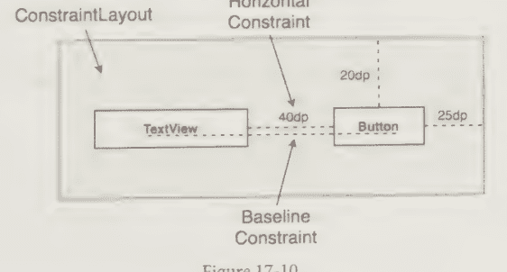

Android 布局

### 17.3 使用引导（Working with Guidelines）

引导是 `ConstraintLayout` 中的特殊元素，是可以连接到约束的虚拟视图。当多个控件需要沿某个轴对齐时，这特别有用。例如，在图 17-11 中，`ConstraintLayout` 中的三个控件被约束：

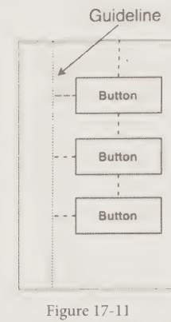

### 17.4 配置控件尺寸（Configuring Widget Dimensions）

控制控件尺寸是一个关键元素。`ConstraintLayout` 提供了三种选项：

- 固定（Fixed）——控件尺寸是固定的。
- 匹配（Match）——控件尺寸匹配父。
- 包裹内容（Wrap Content）——控件尺寸由内容决定。

### 17.5 使用屏障（Working with Barriers）

与引导不同，引入屏障是为了解决视图重叠时的问题。解决此问题的方法是使用屏障并将 `View 1` 和 `View 2` 指定为屏障的引用视图，以便 `View 3` 约束它。现在，当 `View 1` 或 `View 2` 的任何一个宽度增加时，屏障都会移动以适应最宽的一个，导致 `View 3` 相对于新的屏障位置。

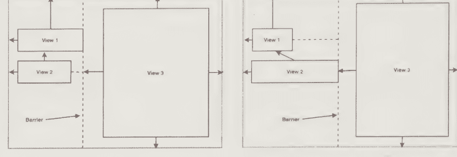

图 17.15

显然，如果 `View 3` 仅约束 `View 1`，它就不会为了适应宽度的增加而调整。关于上述布局的关键点是 `View 3` 约束了 `View 1`：

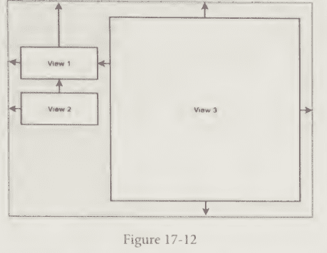

然而，如果 `View 2` 的宽度增加，就会出现问题：

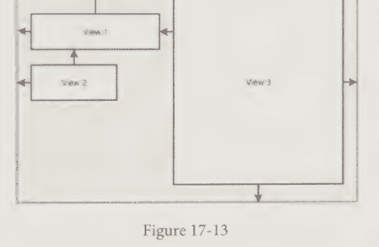

### 17.8 `ConstraintLayout` 的可用性

尽管 `ConstraintLayout` 是随 Android 7 引入的，但它是作为与主 Android SDK 独立的库提供的，可以追溯到 API 级别 9（Gingerbread）的旧 Android 版本。

### 17.9 总结

`ConstraintLayout` 是随着 Android 7 引入的一种布局管理器。它的设计旨在便于创建灵活的布局，以适应市面上许多 Android 设备的尺寸和方向。`ConstraintLayout` 使用约束来控制控件相对于父 `ConstraintLayout` 实例、辅助线（guidelines）、栅栏（barriers）以及布局中其他控件的对齐和定位。`ConstraintLayout` 是新建创建 Android Studio 项目的默认布局，也是设计用户界面布局时的推荐选择。通过这种简单而灵活的布局管理方法，可以以惊人的便利实现复杂且响应式的用户界面。

## 18. 在 Android Studio 中使用 `ConstraintLayout` 指南

正如前面的章节中多次提到的，Google 对 Android Studio 布局编辑器（Layout Editor）工具进行了重大更改，其中许多仅是为了支持使用 Constraint 进行用户界面布局设计。在上一节已经概述了 Constraint 的基本概念后，本章将详细探讨这些概念，同时概述布局编辑器工具允许设计和实现基于 Constraint 的用户界面的方法。

### 18.1 设计与布局视图

名为“Android Studio 布局编辑器工具指南”的章节解释了 Android Studio 布局编辑器提供了两种方式以通过 Design（设计）和 Layout（布局，也称为蓝图）视图来查看 Activity 的用户界面布局。这些布局视图可以单独显示，也可以如图 18-1 所示并排显示：

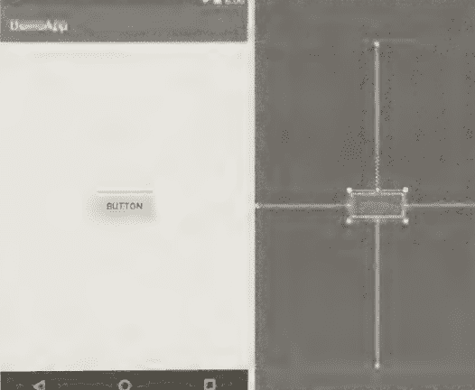

图 18-1

Design 视图（位于图中左侧）呈现布局的“所见即所得”表示，其中布局的外观与其在运行应用中的显示一致。相反，Layout 视图显示的是蓝图风格的视图，其中控件由阴影轮廓表示。如上图 18-1 所示，Layout 视图还显示约束连接（在本例中，用于将按钮在布局中居中的对向约束）。当选择布局中的特定控件或鼠标指针悬停在设计区域时，这些约束也会叠加到 Design 视图上，如图 18-2 所示：


（注：此处原文图片路径与上方相同，对应图 18-2）

图 18-2

视图中约束连接的外观可以通过 18-3 所示的工具栏进行更改：


（注：此处原文图片路径与上方相同，对应图 18-3）

图 18-3

除了这两种显示布局的模式外，布局编辑器还提供了三种不同的方法来建立约束。

### 18.2 `Autoconnect`（自动连接）模式

`Autoconnect` 正顾思义是在添加项目时自动建立连接。可以通过图 18-4 所示的按钮启用或禁用 `Autoconnect` 模式：


（注：此处原文图片路径与上方相同，对应图 18-4）

图 18-4

`Autoconnect` 模式使用算法根据控件的位置和与侧边缘的距离来决定最佳约束。在自动连接未能提供预期效果的情况下，可以手动更改这些约束。

### 18.3 `Inference`（推断）模式

`Inference` 模式使用启发式方法在关闭 `Autoconnect` 功能后自动添加约束。这种模式允许通过将控件拖动到画布上来创建约束。在布局过程中，`Inference` 模式也可以任何时候通过点击图 18-5 所示的按钮来填充约束：


（注：此处原文图片路径与上方相同，对应图 18-5）

图 18-5

### 18.4 手动操作约束

实现约束的第三种方法是手动操作。在这样做时，了解图 18-6 所示的各种句柄将大有帮助：


图 18-6

清晰地，弹簧线（A）代表建立的连接。控件每个角的小方形标记（B）在点击并拖动时用于调整大小。位于控件侧边的圆圈标记（C）是锚点。要创建约束，点击句柄并将其拖到目标（如图 18-7 所示的控件侧边），当其变为绿色时释放线条即可建立约束：


（注：此处原文图片路径与上方相同，对应图 18-7）

图 18-7

一个额外的标记指示基准对齐点（相对于边缘）。要显示此标记，只需点击图 18-6 所示的按钮。要从基准句柄建立约束连接，只需将鼠标指针悬停在句柄上直到其开始闪烁，然后拖动到目标（如图 18-8 所示的另一个控件锚点）。当目标锚点开始闪烁绿色时，释放鼠标按钮建立约束连接：


（注：此处原文图片路径与上方相同，对应图 18-8）

图 18-8

### 18.5 在检查器中添加约束

还可以使用图 18-9 所示位于属性窗口中的检查器面板，向布局编辑器中的视图添加约束。中间的正方形表示当前选中的视图，正方形周围的区域是约束；如果有，则应用到视图相应的侧边：


（注：此处原文图片路径与上方相同，对应图 18-9）

图 18-9

视图侧边缺少约束的情况由指向带有加号的蓝色圆圈的虚线表示（如上图中视图边缘所示）。要添加约束，只需点击此蓝色圆圈，布局编辑器将添加连接到它认为最合适的目标。

### 18.6 删除约束

要删除单个约束，只需点击与其连接的锚点。随后该约束将从布局中删除（当悬停在锚点上时，它会变为红色，以指示点击将执行删除）：


（注：此处原文图片路径与上方相同，对应图 18-10）

图 18-10

或者，通过选择控件并点击“删除所有约束”来移除该控件的所有约束。

## 在 Android Studio 中使用 `ConstraintLayout` 指南

当组件在布局中被选中并高亮时（如图 18-11 所示），旁边会出现一个按钮：


图 18-11

要移除布局中每个组件的所有约束，请使用图 18-12 所示的高亮显示的工具栏按钮：


图 18-12

### 18.7 调整约束偏置（Constraint Bias）

在上一章节中，我们概述了使用偏置设置来倾向于一个相对约束而非另一个约束的概念。Android Studio 布局编辑器工具中的偏置可以通过属性（Attributes）工具窗口中的检查器（Inspector）进行调整，如图 18-13 所示。图中箭头指示的两个滑块用于控制当前选中组件的垂直和水平约束偏置。


图 18-13

### 18.8 理解 `ConstraintLayout` 边距（Margins）

约束可以与边距结合使用，以实现组件与其他元素（如另一个组件、辅助线或父布局的边缘）之间的固定间隙。例如，考虑图 18-14 中应用于 `Button` 对象的水平约束：


图 18-14

目前的配置，水平约束延伸到父 `ConstraintLayout` 的左边缘和右边缘。因此，该组件具有对立的水平约束，这意味着 `ConstraintLayout` 布局引擎在运行时对组件的实际位置具有一定的裁量权。这使得布局具有灵活性，能够适应不同的屏幕尺寸和设备方向。水平偏置设置还能将组件的位置一直控制到布局的右侧。图 18-15 显示了应用了 100% 水平偏置的同一个按钮：


图 18-15

`ConstraintLayout` 边距可以出现在约束连接的末端，代表一个固定间隙，即使在调整偏置或响应活动其他部分的布局变化时，组件也无法移动该间隙。在图 18-16 中，右侧约束现在包含 50dp 的边距，即使偏置仍设为 100%，组件也无法移动该间隙。


图 18-16

组件上现有的边距值可以在检查器内部修改。如图 18-17 所示，正在使用下拉菜单将当前选中组件的右侧边距更改为 16dp。或者，点击当前值也允许在字段中输入数字。


图 18-17

新约束的默认边距可以随时通过图 18-18 所示的高亮工具栏中的选项更改：


图 18-18

### 18.9 对立约束和偏置的重要性

正如上一章节所述，在 ways `ConstraintLayout` 时，对立的约束、边距和偏置是 Android 响应式布局设计的基石。当一个组件在没有对立约束连接的情况下被约束时，这些约束本质上是边距约束。这在布局编辑器工具中通过带有边距测量值的实线（solid straight lines）在视觉上表示出来，如图 18-19 所示。


图 18-19

上述约束本质上将组件固定在那个位置。其结果是，如果设备旋转到横屏模式，该组件将不再可见，因为垂直约束将其推出了设备屏幕的顶部边缘（如图 18-20 所示）。如果应用程序在比设计过程中使用的屏幕更小的设备上运行，也会类似的问题。


图 18-20

当实现对立约束时，约束由弹簧状线条表示。

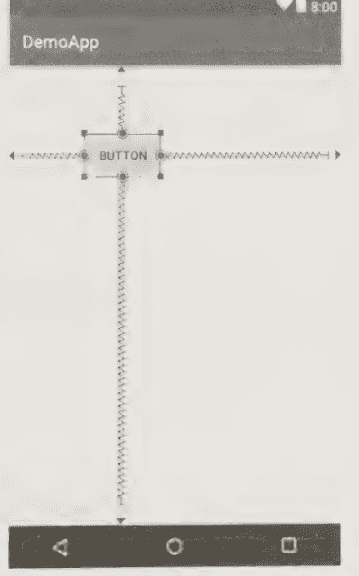

图 18-21

在上述布局中，垂直和水平偏置已配置，使得组件位于距离边缘的 90% 处。


### 18.10 配置组件尺寸

组件的尺寸可以使用检查器进行配置。如上一章节所述，组件尺寸可以设置为包裹内容（wrap content）、固定（fixed）或匹配约束（match constraint）。各项设置如图 18-22 所示。


图 18-22

检查器使用以下指示表示三种模式：

| 模式 |
| :--- |
| 固定大小（Fixed Size） |
| 匹配约束（Match Constraint） |
| 包裹内容（Wrap Content） |

要更改当前设置，只需点击指示即可在三种模式之间切换。例如，图 18-23 中视图的宽度已设置为匹配约束：


图 18-23

此外，组件的尺寸还可以水平或垂直扩展以填充周围的空间。这些可以通过右键点击组件并选择“水平扩展（Expand horizontally）”或“垂直扩展（Expand vertically）”选项来实现。


图 18-24

### 18.11 添加辅助线（Guidelines）

辅助线提供了可以锚定的额外元素。可以通过右键点击布局选择“添加垂直辅助线（Add Vertical Guideline）”或“添加水平辅助线（Add Horizontal Guideline）”菜单选项，或使用图 18-25 所示的工具栏选项来添加辅助线。

添加后，辅助线将作为虚线出现在布局中，可以通过点击并拖动线条进行移动。要建立到辅助线的约束，点击组件的约束句柄并拖到辅助线然后释放。在图 18-26 中，两个 `Button` 的左侧通过约束连接到垂直辅助线。

垂直辅助线的位置可以指定为距离父布局左侧或右侧的绝对距离（水平辅助线则为顶部或底部）。例如，上图中的垂直辅助线距离左边缘 96dp。


图 18-27

或者，辅助线可以作为父布局整体宽度或高度的百分比进行定位。要在这三种模式之间切换，请选择辅助线并点击辅助线顶部或起始处的圆圈（取决于辅助线是垂直还是水平的）。图 18-28 显示了一个基于百分比定位的辅助线：

## 在 Android Studio 中使用 `ConstraintLayout` 的指南


### 18.12 添加屏障（Barriers）

可以通过右键点击布局并在 Helpers（Helpers）菜单中选择“添加垂直屏障（Add Vertical Barrier）”或“添加水平屏障（Add Horizontal Barrier）”，或者使用之前图 18-26 所示工具栏菜单选项来添加屏障。


一旦向布局添加了屏障，它将作为组件树（Component Tree）面板中的一个项目出现：


要将视图作为引用视图（即控制屏障位置的视图），只需将组件树中的控件拖到屏障项目上。例如，在图 18-30 中，命名为`textView1`和`textView2`的控件被分配为`barrier1`的引用控件：


图 18-30

添加引用视图后，需要配置屏障以指定屏障相对于这些视图的方向。这是屏障方向设置（barrier direction setting），在组件树面板中选择屏障时，在属性（Attributes）窗口中定义：


下图显示了一个包含屏障的布局，该屏障在声明时以`textView1`和`textView2`作为引用视图，由于屏障相对于引用视图的末端（end），屏障方向已设置为 end：


## 18.13 控件对齐与分布

Android Studio 布局编辑器提供了当在布局中选择多个控件时可以执行的系列对齐和分布操作。只需在布局中右键点击要对齐的控件，即可从菜单中选择对齐选项：


图 18-33

如图 18-34 所示，这些选项在工具栏中也可用：


同样，`Pack`菜单可以将选中的控件紧凑地排列在垂直或水平方向上（如图 18-35 所示）。它通过在控件之间应用间距来实现这一效果。

## 18.14 将其他布局转换为 ConstraintLayout

对于使用`RelativeLayout`或`LinearLayout`等其他布局的现有用户界面，Android Studio 提供了转换为 ConstraintLayout 的选项。当在布局编辑器中打开布局时，在组件树中找到它，右键点击并选择`Constraint`：


图 18-36

## 18.15 总结

使用 ConstraintLayout 进行复杂的用户界面设计已变得非常快速且直观。本章详细介绍了如何使用屏障等各种功能，并探索了 ConstraintLayout 的最佳实践。

## 19. 在 Android Studio 中使用链 (Chains) 和比例

链（Chains）可以通过在 XML 文件中添加约束或在布局编辑器中使用功能来实现。考虑图 19-1 所示的由三个相对于父布局约束的控件构成的链：


图 19-1

为了表示这样的布局，XML 文件可能包含以下内容：

```xml
<Button
    android:id="@+id/button1"
    android:layout_width="wrap_content"
    android:layout_height="wrap_content"
    android:layout_marginStart="8dp"
    android:layout_marginTop="16dp"
    app:layout_constraintHorizontal_bias="0.5"
    app:layout_constraintStart_toStartOf="parent"
    app:layout_constraintTop_toTopOf="parent" />

<Button
    android:id="@+id/button2"
    android:layout_width="wrap_content"
    android:layout_height="wrap_content"
    android:layout_marginEnd="8dp"
    android:layout_marginTop="16dp"
    android:text="Button"
    app:layout_constraintHorizontal_bias="0.5"
    app:layout_constraintEnd_toStartOf="@+id/button3"
    app:layout_constraintTop_toTopOf="parent" />

<Button
    android:id="@+id/button3"
    android:layout_width="wrap_content"
    android:layout_height="wrap_content"
    android:layout_marginEnd="8dp"
    android:layout_marginTop="16dp"
    android:text="Button"
    app:layout_constraintHorizontal_bias="0.5"
    app:layout_constraintEnd_toEndOf="parent"
    app:layout_constraintTop_toTopOf="parent" />
```

通过这些更改，控件现在配置了双向约束。这在本质上构成了一个布局链，在布局编辑器中通过链连接视觉化表示，如下图 19-2 所示。注意，在此配置下，链默认使用了分布链样式。


图 19-2

链也可以通过右键点击其中一个视图并选择`Chains -> 创建水平链 (Create Horizontal Chain)`或`Chains -> 创建垂直链 (Create Vertical Chain)`来创建。

## 19.2 更改链样式

如果未配置链样式，ConstraintLayout 将默认使用分布链样式。可以通过选择链中的任何控件并点击循环链样式（Cycle Chain Style）按钮来更改链样式，如图 19-3 所示：


图 19-3

在 Android Studio 中处理 ConstraintLayout 链（Chains）和比例（Ratios）以及排列模式。

另一种方法是在属性（Attributes）工具窗口中指定样式，点击查看所有属性（View all attributes）链接，展开约束（Constraints）部分，并根据链的方向更改`horizontal_chainStyle`或`vertical_chainStyle`属性：

```
horizontal_bias
horizontal_chainStyle
horizontal_weight
left_creator
left_toLeftOf
right_creator
right_toLeftOf
```


图 19-4

## 19.3 内部扩散链样式（Spread Inside Chain）

图 19-5 展示了使用上述技术将链样式更改为内部扩散链样式（spread inside chain）的效果：


图 19-5

## 19.4 紧凑链样式（Packed Chain）

使用相同的技术，将链样式属性更改为紧凑（packed），会导致布局发生如图 19-6 所示的变化：


图 19-6

## 19.5 带偏移的紧凑链（Packed Chain with Bias）

紧凑链的位置可能会受到应用偏移值的影响。偏移值可以是 0.0 到 1.0 之间的任何值，0.5 代表父容器的中心。偏移通过选择链头部件（chain head widget）并在属性面板的`horizontal_bias`或`vertical_bias`属性中赋值来控制。图 19-7 显示了一个设置水平偏移为 0.2 的紧凑链：


图 19-7

## 19.6 权重链（Weighted Chain）

最后一个需要探索的链区域涉及对单个部件设置权重，以控制链中每个部件在可用空间中所占据的比例。权重链只能使用扩散链样式（spread chain style）实现，且链中任何需要响应权重属性的部件必须将其相应的维度属性（垂直链为高度，水平链为宽度）配置为“匹配约束”（match constraint）模式。部件维度的匹配约束模式可以通过选择该部件、显示`layout_width`约束并设置为`match_constraint`来配置。例如，图 19-8 所示，`button1`的`layout_width`约束已设置为`match_constraint`，这表示该部件的宽度将根据现有的约束来确定：


图 19-8

假设已选择扩散链样式，并且三个按钮都已配置为宽度维度设置为匹配约束，链中的部件将等宽扩展以填充可用空间：

## 在 Android Studio 中处理 ConstraintLayout 链和比例


图 19-9

每个部件相对于链中其他部件所占据的空间可以通过向部件添加权重属性来控制。图 19-10 显示了将`button1`的`horizontal_weight`属性设置为 4，以及将`button2`和`button3`设置为 2 的效果：


图 19-10

由于这些权重值的影响，`button1`占据了一半的空间 (4/8)，而`button2`和`button3`占据了四分之一 (2/8)的空间。

## 19.7 使用比例（Ratios）

ConstraintLayout 比例允许部件的一个维度相对于部件的另一个维度（即宽高横比）进行调整。例如，将宽高比设置应用到`ImageView`上，以确保其宽度始终是高度的两倍。

比例约束通过将受约束的维度设置为匹配约束模式，并将该部件的`layout_constraintDimensionRatio`属性配置为所需的比例来实现。该比例值可以以浮点值指定，也可以以宽:高的比例设置指定。例如，下面的 XML 片段为`ImageView`视图配置了 2:1 的比例：

```xml
<ImageView
    android:layout_width="0dp"
    android:layout_height="100dp"
    android:id="@id/imageView"
    app:layout_constraintDimensionRatio="2:1" />
```

上述示例展示了当一个维度设置为匹配约束模式时，如何配置比例。当两个维度都设置为匹配约束模式时，也可以应用比例，但这取决于具体的设置。

## 19.8 总结

链（chains）和比例（ratios）是`ConstraintLayout`的强大功能，为设计灵活且响应式的布局提供了更多选项。正如本章概述，Android Studio 编辑器已经经过增强，以便在设计过程中更容易使用这些功能。

# 20. Android Studio 编辑器 - 教程

为 Android 应用设计界面最简单且有效的方法是使用 Android Studio 编辑器。本章的目标是提供如何使用这种方法创建基于`ConstraintLayout`用户界面的概述。本章包含的练习将作为从零开始创建活动的机会。在介绍了了 Android Studio 编辑器后，本章还将引入布局检查器

### 20.1 Android Studio 编辑器示例

示例的第一步创建一个新项目。因此，首先启动 Android Studio 并通过`File -> Close Project`选项关闭已打开的项目。在 Android Studio 欢迎界面，点击`Start New Project`快速启动显示新项目对话框的第一个屏幕。

在 Application name 字段中输入`LayoutSample`，并在 Package Domain 中输入`ebookrenzy`，然后点击 Next 并将最小 SDK 设置为 API 26: Android 8.0 (Oreo)。

在之前的示例中，我们请求 Android Studio 为项目创建一个模板活动。然而，我们将通过本教程学习如何手动创建一个活动以及相应的布局资源文件；因此再次点击 Next，并确保选中了`Add Activity`选项，然后点击 Finish 创建新项目。

### 20.2 创建新活动

项目创建过程完成后，Android Studio 主窗口将出现，且没有任何工具窗口打开。

项目的下一步是创建一个新活动。这将是一个非常有价值的学习练习，因为在开发 Android 应用的过程中，有很多情况需要从头创建新活动。

首先，使用 Alt-1/Cmd-1 快捷键显示 Project 工具窗口。展开后，点击 Project 窗口中项目旁边的右箭头展开层次结构。这里的目标是访问项目层次结构中的`app -> java -> com.ebookfrenzy.layoutsample`文件夹。包名可见后，右键点击并选择`New -> Activity -> Empty Activity`菜单选项，如图 20-1 所示：

## Android Studio 编辑器 ConstraintLayout 教程

 图 20-1

在生成的“新建 Activity”（New Activity）对话框中，新的活动`LayoutActivity`和`activity_layout_sample`自然需要一个布局资源文件。为了让应用程序能够在设备上运行，它需要指定一个活动作为启动活动（launcher activity）。如果没有启动活动，操作系统将不知道应该启动哪个活动，导致应用程序无法启动。由于此示例只有一个活动，因此在点击“完成”（Finish）按钮之前，需要将其指定为启动活动。

此时，Android Studio 应该已经向项目添加了两个文件。该活动的 Java 源代码应位于`app -> java -> com.example.layoutsample`。此外，用户界面的 XML 文件应该已经在`app -> res -> layout`中创建。请注意，由于选择了空活动（Empty Activity）模板，因此布局完全包含在`activity_layout.xml`中，没有独立的布局文件。

最后，新活动应该被添加到`AndroidManifest.xml`中并指定为启动活动。清单文件可以在项目窗口的`app -> manifests`下找到，并包含以下内容：

```xml
<?xml version="1.0" encoding="utf-8"?>
<manifest xmlns:android="http://schemas.android.com/apk/res/android"
    package="com.example.layoutsample">

    <application
        android:allowBackup="true"
        android:icon="@mipmap/ic_launcher"
        android:label="@string/app_name"
        android:roundIcon="@mipmap/ic_launcher_round"
        android:supportsRtl="true"
        android:theme="@style/AppTheme">
        <activity name=".LayoutActivity">
          <intent-filter>
            <action name="android.intent.action.MAIN" />
            <category name="android.intent.category.LAUNCHER" />
          </intent-filter>
        </activity>
    </application>
</manifest>
```

### 20.3 准备布局编辑器

找到`app -> res -> layout`下`activity_layout.xml`文件并双击将其加载到布局编辑器中。由于本教程的目的是获得约束（constraints）的使用经验，请使用布局编辑器工具栏上的按钮关闭“自动连接”（Autoconnect）功能。一旦禁用，该按钮将出现一条贯穿线，如图 20-2 所示：

 图 20-2


用户界面设计还将使用 `ImageView` 对象来显示图像。在继续之前，应该将图像添加到项目项目中，以便在章节的后续部分使用。该文件名为`galaxy.png`，可以在从以下 URL 下载示例代码文件夹中找到：https://www.ebookfrezy.com/retail/android32/index.php

在你的操作系统的文件导航器中找到此图像并复制图像文件。在项目窗口中右键点击`app -> res -> drawable`条目，从菜单中选择“粘贴”（Copy Paste）将文件添加到文件夹中。当出现复制对话框时，点击“确定”（OK）接受默认设置。

 图 20-3

## 20.4 向用户界面添加控件

从“常用”（Common）调色板库中，将`ImageView`对象拖入到显示视图的中心。注意，会出现水平和垂直虚线，表示显示的中心轴。居中后，使用鼠标按钮将视图松开到目标位置。一旦放置在布局中，“资源”（Resources）对话框将出现，请求在视图中显示的图像。在对话框顶部的搜索栏中输入“galaxy”以找到`galaxy.png`资源，如图 20-4 所示。

 图 20-4

选择该图像并点击“确定”将其分配给`ImageView`对象。如有必要，使用调整大小柄调整`ImageView`的尺寸，并将其重新置在布局中心。此时，布局应与图 20-5 一致：

 图 20-5

从调色板的“常用”部分点击并拖动`TextView`对象，并将其放置在上方，使其显示为如图 20-6 所示的《Android Studio 布局约束教程》。

使用“属性”（Attributes）面板，将`textSize`属性更改为`24sp`，将`textAlignment`设置为居中（center），并将文本更改为“Samsung Galaxy S6”：

 图 20-6

接下来，在布局底部添加三个`Button`控件，并将文本设置为“Buy Now”（立即购买）、“Pricing”（定价）和“Details”（详情）。完成后的布局应与图 20-7 一致：

 图 20-7

此时，控件尚未足够的约束，以使布局引擎能够对它们进行定位。如果现在运行应用程序，所有控件将位于横屏模式下的左上角：

 图 20-8

缺少约束会导致布局无法适应设备方向。显然还需要一些工作来使其具有响应性。

## 20.5 添加约束

约束是创建适应设备方向和不同屏幕尺寸布局的关键。将布局旋转回竖屏模式，并选择`ImageView`上方的`TextView`。在选中`TextView`后，在其两侧建立相反的约束并连接到父容器对应的侧。

 图 20-9

接下来，建立从`ImageView`顶部到`TextView`底部的约束，以及从`ImageView`底部到`Button`控件中心的约束。如有必要，点击并拖动`ImageView`使其保持在布局的垂直中心。

当`ImageView`仍被选中时，使用属性面板中的“检查器”（Inspector）将`ImageView`的顶部和底部间距分别更改为`24`和`8`，并将`height`和`width`属性均更改为`match_constraint`，以便控件匹配约束。这些设置将允许布局引擎在必要时缩小`ImageView`的尺寸以适应布局变化：

 图 20-10

图 20-11 显示了`ImageView`相对于布局中其他元素已实现的约束：

 图 20-11

最后一个任务是为三个`Button`控件添加约束。在本示例中，按钮将放置在链中。首先，通过点击图 20-2 高亮显示的工具栏按钮在布局编辑器中开启“自动连接”。

接下来，点击“Buy Now”，然后按住 Shift 点击另外两个按钮，以便选中三个按钮。右键点击“Buy Now”按钮，并从生成的菜单中选择“链”（Chains）-> “创建水平链”（Create Horizontal Chain）。默认情况下，链将使用散布（spread）样式显示，这是本示例正确的行为。

## Android Studio 布局编辑器 ConstraintLayout 教程

最后，在“立即购买”（Buy Now）按钮的底部与布局底部之间建立约束。对剩余的按钮重复此步骤。

完成这些步骤后，按钮将如图 20-12 所示进行约束布局：


图 20-12

## 20.6 测试布局

在布局中添加约束后，将屏幕旋转到横屏模式，验证布局是否适应了新的屏幕尺寸。

虽然布局编辑器工具提供了一个设计用户界面布局的有用可视化环境，但在进行测试时，运行应用的测试是不可替代的。在物理 Android 设备或模拟器上启动应用，验证用户界面是否反映了在布局编辑器中创建的布局。例如，图 20-13 显示了横屏模式下的运行应用：


图 20-13

非常简单的用户界面设计现在完成了。设计更复杂的用户界面布局是上述步骤的延续。简单地将视图拖放到显示器上，根据需要进行定位、约束并设置属性。

## 20.7 使用布局检查器 (Layout Inspector)

可以使用布局检查器工具随时查看组成用户界面布局的组件层级结构。为了访问这些信息，应用必须在设备或模拟器上运行。应用运行后，选择`Tools -> Layout Inspector`菜单选项，然后选择要检查的进程。

检查器加载后，左侧面板 (A) 显示构成界面布局的组件层次结构。中间面板 (B) 显示布局的可视化表示。在 Android Studio 布局编辑器 ConstraintLayout 教程的可视化布局中点击组件，会导致层次列表中的项高亮，从而轻松找到视觉组件相对于整个布局层次结构的位置。

最后，最右侧的面板（图 20-14 中标记为 C）包含当前所选组件的所有属性设置，允许对组件的内部配置进行深度分析。


图 20-14

## 20.8 总结

Android Studio 中的布局编辑器工具与`ConstraintLayout`类紧密集成。本章演示了一个示例用户界面的创建，旨在概述如何使用布局编辑器工具通过添加组件和设置约束来实现一个基于`ConstraintLayout`的用户界面。本章还介绍了布局检查器工具，该工具对于分析用户界面布局的结构组成非常有帮助。

## 21. 在 Android Studio 中手动设计 XML 布局

虽然使用 Android Studio 布局编辑器工具设计布局大大提高了效率，但仍然可以通过手动编辑底层 XML 创建 XML 布局。本章将介绍 Android XML 布局文件的基础知识。

## 21.1 手动创建 XML 布局

XML 布局文件的结构非常简单，遵循视图树的层次结构方法。XML 资源文件的第一行理想情况下应该是标准声明：

```xml
<?xml version="1.0" encoding="utf-8"?>
```

该声明之后应该是布局的根元素，通常是作为布局管理器的容器视图。例如，以下 XML 声明了一个`ConstraintLayout`作为根元素，分配了 ID`activity_main`并设置了`match_parent`属性，使其填充设备显示的所有可用空间：

```xml
<?xml version="1.0" encoding="utf-8"?>
<android.support.constraint.ConstraintLayout xmlns:android="http://schemas.android.com/apk/res/android"
    xmlns:tools="http://schemas.android.com/apk/res-auto"
    android:id="@id/activity_main"
    android:layout_width="match_parent"
    android:layout_height="match_parent"
    android:paddingLeft="16dp"
    android:paddingTop="16dp"
    android:paddingBottom="16dp">
</android.support.constraint.ConstraintLayout>
```

注意，在上面的示例中，元素还配置了每侧 16dp（密度无关像素）的内边距。Android 布局中的任何间距规范必须使用以下单位之一：

- in - 英寸 (Inches)
- mm - 毫米 (Millimeters)
- pt - 磅 (Points) (1/72 英寸)
- dp - 密度无关像素 (Density-independent pixels)。一种根据设备显示物理密度相对于 160dpi 基准的抽象测量单位。
- sp - 缩放无关像素 (Scale-independent pixels)。类似于 dp，但根据用户的字体字体进行缩放。
- px - 实际像素 (Actual screen pixels)。不建议使用，因为不同的显示器每英寸像素不同。优先使用 dp。

任何需要添加到`ConstraintLayout`的子元素必须嵌套在自己的布局标签内。在接下来的示例中，将一个`Button`添加为`ConstraintLayout`的子元素：

```xml
<?xml version="1.0" encoding="utf-8"?>
<android.support.constraint.ConstraintLayout xmlns:android="http://schemas.android.com/apk/res/android"
    xmlns:tools="http://schemas.android.com/apk/res-auto"
    android:id="@id/activity_main"
    android:layout_width="match_parent"
    android:layout_height="match_parent"
    android:paddingLeft="16dp"
    android:paddingTop="16dp"
    android:paddingBottom="16dp"
    tools:context="MainActivity">
<Button />
</android.support.constraint.ConstraintLayout>
```

## Android Studio 中的手动 XML 布局

注意在上面的示例中，元素还配置了每侧 16dp（密度无关像素）的内边距。Android 布局中的任何间距规范必须使用以下单位之一：

- in - 英寸
- mm - 毫米
- pt - 磅 (1/72 英寸)
- dp - 密度无关像素。根据设备显示物理密度相对于 160dpi 基准的抽象测量单位。
- sp - 缩放无关像素。根据用户的字体偏好缩放。
- px - 实际像素。不建议使用，因为不同的显示器每英寸像素不同。优先使用 dp。

任何需要添加到`ConstraintLayout`的子元素必须嵌套在布局标签内。在下面的示例中，添加一个`Button`作为`ConstraintLayout`的子元素：

```xml
<?xml version="1.0" encoding="utf-8"?>
<android.support.constraint.ConstraintLayout xmlns:android="http://schemas.android.com/apk/res/android"
    xmlns:tools="http://schemas.android.com/apk/res-auto"
    android:id="@id/activity_main"
    android:layout_width="match_parent"
    android:layout_height="match_parent"
    android:paddingLeft="16dp"
    android:paddingTop="16dp"
    android:paddingBottom="16dp"
    tools:context="MainActivity">
<Button />
</android.support.constraint.ConstraintLayout>
```

目前实现的按钮没有约束。因此在运行时，按钮将出现在屏幕的左角。如果为按钮两侧添加相对的约束，它将在布局中居中：

```xml
<?xml version="1.0" encoding="utf-8"?>
<android.support.constraint.ConstraintLayout xmlns:android="http://schemas.android.com/apk/res/android"
    xmlns:tools="http://schemas.android.com/apk/res-auto"
    android:id="@id/activity_main"
    android:layout_width="match_parent"
    android:layout_height="match_parent"
    android:paddingLeft="16dp"
    android:paddingTop="16dp"
    android:paddingBottom="16dp"
    tools:context="MainActivity">

<Button
    android:id="@id/button"
    android:layout_width="wrap_content"
    android:layout_height="wrap_content"
    android:text="Button"
    app:layout_constraintBottom_toBottomOf="parent"
    app:layout_constraintEnd_toEndOf="parent"
    app:layout_constraintStart_toStartOf="parent"
    app:layout_constraintTop_toTopOf="parent" />
</android.support.constraint.ConstraintLayout>
```

注意每个约束都连接到名为`activity_main`的元素上，在这种情况下它是父元素。要在布局中添加第二个组件，只需将其嵌入`ConstraintLayout`的主体中即可。例如，以下修改向布局中添加了一个`TextView`：


```xml
<?xml version="1.0" encoding="utf-8"?>
<android.support.constraint.ConstraintLayout xmlns:android="http://schemas.android.com/apk/res/android"
    xmlns:tools="http://schemas.android.com/apk/res-auto"
    android:id="@id/activity_main"
    android:layout_width="match_parent"
    android:layout_height="match_parent"
    android:paddingLeft="16dp"
    android:paddingTop="16dp"
    android:paddingBottom="16dp"
    tools:context="MainActivity">

<Button
    android:id="@id/button"
    android:layout_width="wrap_content"
    android:layout_height="wrap_content"
    android:text="Button"
    app:layout_constraintBottom_toBottomOf="parent"
    app:layout_constraintEnd_toEndOf="parent"
    app:layout_constraintStart_toStartOf="parent"
    app:layout_constraintTop_toTopOf="parent" />

<TextView
    android:id="@id/textView"
    android:layout_width="wrap_content"
    android:layout_height="wrap_content"
    android:text="TextView" />

</android.support.constraint.ConstraintLayout>

<TextView
    android:layout_width="wrap_content"
    android:layout_height="wrap_content"
    android:text="Hello World!"
    app:layout_constraintBottom_toBottomOf="@id/button"
    app:layout_constraintEnd_toEndOf="parent"
    app:layout_constraintStart_toStartOf="parent"
    android:layout_marginTop="72dp" />
```

再次，新添加的 `TextView` 缺少约束会导致它在运行时出现在布局的左上角。以下修改允许添加连接到父布局的相对约束，以使组件水平居中，同时添加一个连接 `TextView` 底部到按钮顶部的约束，间距为 72dp。

此外，注意 `Button` 和 `TextView` 视图具有许多属性资源。两个视图都分配了 ID，并配置为显示名为 `"string_button"` 和 `"string_text"` 的文本字符串。

# Android Studio 中的手动 XML 布局设计

分别对应`text_string`。此外，两个对象上都声明了`wrap_content`高和宽属性，以确保它们的大小能够适应内容（在本例中，即由字符串资源值引用的文本）。

在布局编辑器的文本模式下从预览（Preview）面板中查看，上述布局的渲染结果如图 21-1 所示：


图 21-1

## 21.2 手动 XML 与 可视化布局设计

是手动编写 XML 还是使用设计模式下的布局编辑器工具，这取决于个人喜好。然而，使用设计模式也有其优势。

首先，设计模式通常速度更快，因为它避免了输入大量 XML 代码的必要性。此外，设计模式避免了学习 Android SDK 视图类属性值的复杂性的需求。不需要不断参考 Android 文档来查找正确的关键字和值，大多数属性都可以通过参考属性（Attributes）面板找到。

抛开设计模式的所有优势不谈，重要的是要记住这两种用户界面设计方法并不是互斥的。作为应用程序开发者，你很可能会在设计模式下创建用户界面，同时通过直接编辑生成的 XML 资源对设计进行微调和布局调整。界面设计的两种视图都会在 Android Studio 环境中并排显示，使得在 XML 和可视化布局之间进行无缝工作变得易如。

## 21.3 总结

Android Studio 布局编辑器提供了一种视觉上直观的方法来设计用户界面。通过拖放范式结合一组属性编辑器，该工具为应用程序开发者带来了显著的生产力优势。

用户界面设计也可以通过手动编写 XML 布局资源文件来实现，其格式结构良好且易于理解。

布局编辑器工具生成 XML 资源文件，意味着这两种界面设计方法可以结合，为用户界面开发提供一种“兼顾两者”的方法。

# 第 22 章

## 22 使用 Constraint Sets 管理约束

到本书为止，所有的用户界面设计任务都是使用 Android Studio 布局编辑器以文本模式或设计模式完成的。XML 资源文件或使用 Android Studio 布局编辑器的替代方案是编写 Java 代码来直接创建、配置和操作构成 Activity 用户界面的视图对象。在本章的上下文中，我们将探讨编写 Java 代码创建用户界面的某些优缺点，然后会描述一些关键概念，如视图属性以及布局约束的创建和管理。

在下一章中，将创建并使用一个示例项目，来演示这种 Android 用户界面设计方法中涉及的一些典型步骤。

## 22.1 Java 代码与 XML 布局文件

与编写 Java 代码相比，使用 XML 资源文件设计用户界面具有许多关键优势。事实上，Google 在 Android 文档中不遗余力地称赞了 XML 资源优于 Java 的优点。正如前一章所讨论的，XML 方法的一个优势包括可以使用 Android 布局编辑器工具，该工具本身会生成 XML 资源。第二个优势是，一旦创建了应用程序，只需通过修改 XML 文件即可更改用户界面；因此，即使在编写 XML 布局，也可以通过 Android Studio 布局编辑器的预览功能获得用户界面外观的即时反馈。为了测试 Java 创建的界面的外观，开发者不可避免地将反复通过编写代码、编译和测试的循环，以完成设计工作。

在 Java 代码创建布局的优势方面，当处理动态用户界面时，Java 相比 XML 资源文件的最显著缺点可能显现。在定义静态布局时，XML 资源本质上更有用，换句话说，从一次 Activity 调用到下一次调用不太发生显著变化。Java 代码在处理动态用户界面时更有优势。

## 22.4.4 尺寸约束

有多种方法可以控制视图的尺寸行为。例如，以下代码将 `Button` 视图的水平尺寸设置为内容自适应（wrap-content），并将 `ImageView` 实例的垂直尺寸设置为最大 250dp：

```
set.constraintWidth(button1.getId(), ConstraintSet.WRAP_CONTENT);
set.constraintHeight(imageView1.getId(), 250);
```

## 22.4.5 约束偏置 (Constraint Bias)

正如标题为“Android Studio ConstraintLayout 指南”的章节概述的，当视图具有相反的约束时，它将沿着约束轴（即水平或垂直）居中。这种居中方式可以通过在特定的约束轴上应用偏置（bias）来调整。在使用 Android Studio 布局编辑器时，你可以在属性（Attributes）工具栏中编辑控件。然而，在使用约束集（constraint set）时，可以使用`setHorizontalBias()`和`setVerticalBias()`方法添加偏置，引用视图 ID 并以 0 到 1 之间的浮点值作为偏置值。

例如，以下代码在应用 25% 的水平偏置之前，将 `Button` 的左侧和右侧连接到父布局：

```
connect(button1.getId(), ConstraintSet.LEFT,
ConstraintSet.PARENT_ID, ConstraintSet.LEFT, 0);
connect(button1.getId(), ConstraintSet.RIGHT,
ConstraintSet.PARENT_ID, ConstraintSet.RIGHT, 0);
set.setHorizontalBias(button1.getId(), 0.25f);
```

## 22.4.6 对齐约束

也可以使用约束集来应用对齐。Android Studio 布局编辑器中提供的完整对齐选项也可以通过`centerVertical()`和`centerHorizontal()`方法使用约束集进行配置，这两个方法都接受关于对齐配置的参数值。此外，可以使用`center`方法将视图在两个其他视图之间居中。

在下面的代码中，`button2` 的位置设置使其与 `button1` 水平对齐：

```
set.setHorizontal(button2.getId(), button1.getId());
```

## 22.4.7 复制和应用约束集

`ConstraintLayout` 实例的当前集可以通过`clone()`方法复制到约束集对象中。例如，以下代码将从名为`myLayout`的 `ConstraintLayout` 复制约束设置到约束集对象中：

```
set.clone(myLayout);
```

一旦复制完成，约束集可以直接应用到另一个布局，或者在下面的示例中，在应用到第二个布局之前对其进行修改：

```
ConstraintSet set = new ConstraintSet();
set.clone(myLayout);
set.constraintWidth(button1.getId(), ConstraintSet.WRAP_CONTENT);
set.applyTo(mySecondLayout);
```

## 22.4.8 ConstraintLayout 链 (Chains)

也可以在约束集中使用`createHorizontalChain()`和`createVerticalChain()`方法创建垂直和水平链。使用这些方法的语法如下：

```
createHorizontalChain(int leftId, int leftSide, int rightId,
int rightSide, int chainIds, float weights, int style);
```

根据上述语法，以下示例创建了一个从`button1`开始并以`button4`结束的水平散布布局（spread）。在这两个视图之间是`button2`和`button3`，它们的权重设置为零：

```
int[] chainViews = {button2.getId(), button3.getId()};
float[] weights = {0, 0};
```

```
set.createHorizontalChain(button1.getId(), ConstraintSet.LEFT,
button4.getId(), ConstraintSet.RIGHT,
chainViews, chainWeights,
ConstraintSet.CHAIN_SPREAD);
```

可以通过将要删除的视图 ID 传递给`removeFromHorizontalChain()`或`removeFromVerticalChain()`方法来从链中移除视图。可以使用`addToHorizontalChain()`或`addToVerticalChain()`将视图添加到现有链中。在这两种情况下，该方法的参数是新视图要插入的视图 ID，格式如下：

```
set.addToHorizontalChain(newView, leftView, rightView);
```

## 2.4.9 辅助线 (Guidelines)

使用`create()`方法添加约束集，然后使用`getGuidelineBegin()`、`getGuidelineEnd()`或`getGuidelinePercent()`方法进行定位。在下面的代码中，创建了一个垂直辅助线，并将其定位在父布局宽度的 50% 处。按钮视图的左侧连接到该辅助线，且没有间距：

```
set.create(R.id.myGuideline, ConstraintSet.VERTICAL_GUIDELINE);
set.setGuidelinePercent(R.id.myGuideline, 0.5f);
```

```
set.connect(button.getId(), ConstraintSet.LEFT,
R.id.myGuideline, ConstraintSet.RIGHT, 0);
```

```
set.applyTo(layout);
```

## 2.4.10 移除约束

可以使用`clear()`方法从约束集的视图中移除约束，传递视图 ID 和要移除约束的锚点作为参数：

```
set.clear(button.getId(), ConstraintSet.LEFT);
```

同样，通过仅在`clear()`方法调用中引用视图，就可以一次性移除该视图上的所有约束：

```
set.clear(button.getId());
```

## 2.4.11 缩放

可以使用`ConstraintSet`的`scaleX()`和`scaleY()`方法调整布局内视图的缩放，这些方法接受视图和一个浮点值作为参数。在下面的代码中，视图被缩放为其原始宽度的两倍：

```
set.setScaleX(button.getId(), 2f);
set.setScaleY(button.getId(), 0.5f);
```

## 2.4.12 旋转

可以使用`rotationX()`和`rotationY()`方法在 X 或 Y 轴上旋转视图，这些方法分别接受视图和角度作为参数。在下面的代码中，视图沿 Y 轴旋转 30 度：

```
set.setRotationY(button.getId(), 30);
```

# 管理约束 (Managing Constraints)

正如标题为“Android Studio ConstraintLayout 指南”的章节概述的，当视图具有相反的约束时，它将沿着约束轴（即水平或垂直）居中。这种居中方式可以通过在特定的约束轴上应用偏置（bias）来调整。在使用 Android Studio 布局编辑器时，你可以在属性（Attributes）工具栏中编辑控件。然而，在使用约束集时，可以使用`setHorizontalBias()`和`setVerticalBias()`方法添加偏置，引用视图 ID 并以 0 到 1 之间的浮点值作为偏置值。

## 2.5 总结

作为编写 XML 文件或使用 布局编辑器的替代方案，可以通过 Java 代码动态创建用户界面。使用 Java 代码创建布局包括创建视图并设置这些对象的属性。视图相对于父布局的定位和尺寸是通过使用约束集定义的。

# 23. ConstraintSet 教程

上一章介绍了使用`ConstraintLayout`和`ConstraintSet`类在 Java 代码中创建和修改用户界面的概念。本章将通过创建一个示例布局将这些概念付诸实践。

## 23.1 创建示例项目

启动 Android Studio 欢迎屏幕的快速菜单中选择 New Project。在新项目的配置对话框中，在 Application Name 字段输入`layout`，并将`ebookrenzy.com`作为 Company Domain 设置，然后点击 Next。在表单界面，启用 Phone 和 Tablet 选项，并将最小 SDK 设置为 API 26：Android 8.0 (Oreo)。继续后续屏幕，请求名为`MainActivity`的 Empty Activity，并带有相应的`activity_java_layout`。

项目创建后，`MainActivity.java`文件应自动加载到编辑面板。正如我们预期的，Android Studio 创建了一个模板 Activity 并重写了`onCreate()`方法，为添加 Java 代码以创建用户界面提供了理想的位置。

## 23.2 向 Activity 添加视图

`onCreate()`方法目前设计为使用资源布局文件创建用户界面。因此，从该方法中删除此行：

```
@Override
protected void onCreate(Bundle savedInstanceState) {
    super.onCreate(savedInstanceState);
    setContentView(R.layout.activity_java_layout);
}
```

下一个修改是向 Activity 添加一个带有单个 `Button` 视图的 `ConstraintLayout` 对象。这涉及创建`ConstraintLayout`和`Button`类的新实例。然后需要将 `Button` 作为子视图添加到 `ConstraintLayout` 中，而 `ConstraintLayout` 又将通过调用 activity 的`setContentView()`方法进行显示：


```java
package com.ebookfrenzy.layout;

import android.support.v7.app.AppCompatActivity;
import android.os.Bundle;
import android.support.constraint.ConstraintLayout;
import android.widget.Button;

public class MainActivity extends AppCompatActivity {
    @Override
    protected void onCreate(Bundle savedInstanceState) {
        super.onCreate(savedInstanceState);
        ConstraintLayout layout = new ConstraintLayout(this);
        setContentView(layout);

        Button button = new Button(this);
        button.setText("Click Me");
        layout.addView(button);
    }
}
```

# Android ConstraintSet 教程

```java
public class GridLayoutActivity extends AppCompatActivity {

    @Override
    protected void onCreate(Bundle savedInstanceState) {
        super.onCreate(savedInstanceState);
        configureLayout();
    }

    private void configureLayout() {
        Button myButton = new Button(this);
        GridLayout myLayout = new GridLayout(this);
        myLayout.addView(myButton);
        setContentView(myLayout);
    }
}
```

当以这种方式创建用户界面对象的新实例时，必须向构造方法传递创建对象的上下文（context），在本情况下，它是当前的 activity。由于上述代码位于 activity 类内部，因此可以使用标准的 `this` 关键字引用上下文：

`Button myButton = new Button(this);`

完成上述添加后，编译并运行应用程序（在物理设备或模拟器上均可）。启动后，可见结果是在 `GridLayout` 视图的左上角出现一个没有文本的按钮，如图 23-1 所示：


图 23-1

## 23.3 设置视图属性

为了完成练习，我们需要将 `GridLayout` 视图的背景设置为蓝色，并在 `Button` 视图的黄色背景上显示“Press Me”的文本。这两项任务都可以通过在 Java 代码中按照如下代码片段所示对视图设置属性来实现。为了让按钮上的文本能够易地翻译成其他语言，将将其作为字符串资源（String resource）添加。在 Project 工具窗口中，找到 `app -> res -> values -> strings.xml` 文件并修改它，为 "Press Me" 添加一个资源值：

```xml
<resources>
    <string name="app_name">GridLayout</string>
    <string name="press_me">Press Me</string>
</resources>
```

虽然这是处理代码中直接引用字符串的推荐方法，但为了避免在书中重复该字符串，随后的许多代码示例将直接在代码中输入字符串。

一旦字符串存储为资源，就可以如下方式从代码中访问它：

`getString(R.string.press_me);`

创建字符串资源后，在 `configureLayout()` 方法中添加代码来设置按钮的文本和颜色属性：

```java
import android.graphics.Color;

public class MainActivity extends AppCompatActivity {

    private void configureLayout() {
        Button myButton = new Button(this);
        myButton.setText(getString(R.string.press_me));
        myButton.setBackgroundColor(Color.YELLOW);

        ConstraintLayout myLayout = new ConstraintLayout(this);
        myLayout.setBackgroundColor(Color.BLUE);

        myLayout.addView(myButton);
        setContentView(myLayout);
    }
}
```

现在编译并运行应用程序，布局将反映属性设置，它将显示为蓝色背景，且按钮将在黄色背景上显示分配的文本。

## 23.4 创建视图 ID

布局完成后，它将包含一个 `Button` 和一个 `EditText`。在可以在 `ConstraintSet` 类的方法中引用这些视图之前，必须为它们分配唯一的视图 ID。此过程的第一步是创建一个新的 `res -> values` 文件夹，选择 `New -> Resource file` 菜单项并打开新的资源文件 `id.xml`。创建资源文件后，编辑它使其内容如下：

```xml
<?xml version="1.0" encoding="utf-8"?>
<resources>
    <item name="myButton" type="id" />
    <item name="myEditText" type="id" />
</resources>
```

在教程的此时，只创建了 `Button`，因此编辑 `configureLayout()` 方法将相应的 ID 分配给对象：

```java
private void configureLayout() {
    Button myButton = new Button(this);
    myButton.setText(getString(R.string.press_me));
    myButton.setBackgroundColor(Color.YELLOW);
    myButton.setId(R.id.myButton);
}
```

## 23.5 配置约束集

在没有任何约束的情况下，`ConstraintLayout` 视图将 `Button` 放置在屏幕的左上角。为了指示布局视图将按钮放在不同的位置（在本例中水平和垂直方向居中），需要创建一个 `ConstraintSet` 实例，使用适当设置对其进行初始化，并将其应用到父布局。

对于此示例，需要配置按钮，使其宽度和高度限制为其正在显示的文本的大小，并将视图在父布局中居中。再次编辑 `onCreate()` 方法以进行这些更改：

```java
import android.support.constraint.ConstraintSet;

private void configureLayout() {
    Button myButton = new Button(this);
    myButton.setText(getString(R.string.press_me));
    myButton.setBackgroundColor(Color.YELLOW);
    myButton.setId(R.id.myButton);

    ConstraintLayout myLayout = new ConstraintLayout(this);
    myLayout.setBackgroundColor(Color.BLUE);

    myLayout.addView(myButton);
    setContentView(myLayout);

    ConstraintSet set = new ConstraintSet();

    set.constrainHeight(myButton.getId(), ConstraintSet.WRAP_CONTENT);
    set.constrainWidth(myButton.getId(), ConstraintSet.WRAP_CONTENT);

    set.connect(myButton.getId(), ConstraintSet.START, ConstraintSet.PARENT_ID, ConstraintSet.START, 0);
    set.connect(myButton.getId(), ConstraintSet.END, ConstraintSet.PARENT_ID, ConstraintSet.END, 0);
    set.connect(myButton.getId(), ConstraintSet.TOP, ConstraintSet.PARENT_ID, ConstraintSet.TOP, 0);
    set.connect(myButton.getId(), ConstraintSet.BOTTOM, ConstraintSet.PARENT_ID, ConstraintSet.BOTTOM, 0);

    set.applyTo(myLayout);
}
```

配置好初始约束后，编译并运行应用程序，验证 `Button` 现在是否出现在布局的中心：


图 23-2

## 23.6 添加 `EditText`

布局中下一个添加的项目是 `EditText`。第一步是创建 `EditText` 视图，为其分配在 `id.xml` 文件中声明的 ID 并将其添加到布局中。实现这些步骤的代码需要对 `onCreate()` 方法进行如下更改：

```java
private void configureLayout() {
    Button myButton = new Button(this);
    myButton.setText(getString(R.string.press_me));
    myButton.setBackgroundColor(Color.YELLOW);
    myButton.setId(R.id.myButton);

    EditText editText = new EditText(this);
    editText.setId(R.id.myEditText);

    ConstraintLayout myLayout = new ConstraintLayout(this);
    myLayout.setBackgroundColor(Color.BLUE);

    myLayout.addView(myButton);
    myLayout.addView(editText);
    setContentView(myLayout);

    ConstraintSet set = new ConstraintSet();

    set.constrainHeight(myButton.getId(), ConstraintSet.WRAP_CONTENT);
    set.constrainWidth(myButton.getId(), ConstraintSet.WRAP_CONTENT);

    set.connect(myButton.getId(), ConstraintSet.START, ConstraintSet.PARENT_ID, ConstraintSet.START, 0);
    set.connect(myButton.getId(), ConstraintSet.END, ConstraintSet.PARENT_ID, ConstraintSet.END, 0);
    set.connect(myButton.getId(), ConstraintSet.TOP, ConstraintSet.PARENT_ID, ConstraintSet.TOP, 0);
    set.connect(myButton.getId(), ConstraintSet.BOTTOM, ConstraintSet.PARENT_ID, ConstraintSet.BOTTOM, 0);

    set.constrainHeight(editText.getId(), ConstraintSet.WRAP_CONTENT);
    set.constrainWidth(editText.getId(), ConstraintSet.WRAP_CONTENT);

    set.connect(editText.getId(), ConstraintSet.START, ConstraintSet.PARENT_ID, ConstraintSet.START, 0);
    set.connect(editText.getId(), ConstraintSet.END, ConstraintSet.PARENT_ID, ConstraintSet.END, 0);
    set.connect(editText.getId(), ConstraintSet.BOTTOM, myButton.getId(), ConstraintSet.TOP, 70);

    set.applyTo(myLayout);
}
```

`EditText` 小部件旨在根据内容调整大小，在布局中水平居中，并位于按钮上方 70dp 处。测试应用程序应显示 `EditText` 字段位于按钮上方，间距为 70dp。

## 23.7 将独立像素（dp）转换为像素 px

练习的下一个任务是将 `EditText` 的宽度设置为 200dp。正如“Android Studio 布局约束教程”章节所述，在用户界面布局中设置大小和位置时，必须转换为密度无关像素（dp）而不是像素（px）。为了使用 dp 设置位置，需要在运行时将 dp 值转换为 px 值，并考虑设备显示器的密度。为了设置 `EditText` 的宽度，需要向类中添加以下代码：

```java
package com.ebookfrenzy.constraintlayout;

import android.content.res.Resources;
import android.util.TypedValue;

public class JavaLayoutActivity extends AppCompatActivity {

    private int convertToPx(int value) {
```

```java
Resources r = getResources();
int px = (int) TypedValue.applyDimension(
    typedValue.Complex_UNIT_DIP, value,
    r.getDisplayMetrics());
return px;
```

```java
private void configureLayout() {
    Button myButton = new Button(this);
    myButton.setText(getString(R.string.press_me));
    myButton.setBackgroundColor(Color.YELLOW);
    myButton.setId(R.id.myButton);

    EditText myEditText = new EditText(this);
    myEditText.setId(R.id.myEditText);

    int px = convertToPx(200);
    myEditText.setWidth(px);
}
```

再次编译并运行应用程序，注意 `EditText` 视图的宽度已经发生变化，如图 23-3 所示：


## 23.8 总结

本章创建的 Activity 示例与之前“在 Android Studio 中手动进行 XML 布局设计”章节中创建的界面非常相似（尽管背景颜色和视图类型发生了变化）。至少，本章应该让你领会到 Android Studio 布局编辑器工具和 XML 资源在很大程度上保护了开发者免受创建 Android 用户界面布局的许多复杂性。

然而，在某些情况下，在 Java 中创建用户界面是有意义的。这种方法非常有用，例如在创建动态用户界面布局时。

# 24. Android Studio 中 Instant Run 使用指南

现在我们已经涵盖了使用 Android Studio 进行 Android 开发的一些基本概念，现在是介绍 Android Studio Instant Run（热运行）功能的好时机。正如所有经验丰富的开发者所知，等待应用编译运行的每一秒都应该花在编写和完善代码。

## 24.1 简介 Instant Run


在引入 `Instant Run` 之前，每次对要测试的项目进行更改时，`Android Studio` 都会协调代码，将其转换为 Dex 格式，生成 APK 包并将其安装到设备或模拟器上。完成这些步骤后，应用最终才准备好进行测试。在快速的开发系统上，这个过程需要相当的时间才能完成。对于大型应用，此过程花费一分钟或更长时间并不罕见。

相反，`Instant Run` 允许项目中的许多代码和资源更改在应用已在设备或模拟器上运行时几乎立即反映出来。

举例来说，考虑一个在 `Android Studio` 中开发并已经在设备或模拟器上启动的应用。如果对资源设置或方法内部的代码进行更改，`Instant Run` 将更新后的代码和资源推送到应用并动态地“交换”这些更改。这些更改将反映在正在运行的应用中，而无需构建、部署和重新启动整个应用。在许多情况下，测试这些更改所需的时间仅是不使用 `Instant Run` 的几分之一。

### 24.2 理解 Instant Run 交换层级

并不是所有项目都完全支持 `Instant Run`，而且不同的更改会导致不同层级的“交换”执行。`Instant Run` 支持三种层级的交换：热交换（hot）、温交换（warm）和冷交换（cold）：

- **热交换 (Hot Swapping)**：当现有方法实现内部的代码发生更改时，会发生热交换。应用在下次调用该方法时将使用新方法。热交换是瞬间发生的，并且如果经过配置，设备屏幕上会显示一条内容为“Applied code changes without activity restart”的 toast 消息。

- **温交换 (Warm Swapping)**：当对项目的资源文件进行更改（例如布局更改或字符串或颜色资源设置的修改）时，会执行 `Instant Run` 交换。温交换涉及重启当前运行的 activity。通常屏幕在 activity 重启时会闪烁。设备屏幕上会通过内容为“Applied changes, restarted activity”的 toast 消息来报告温交换。

- **冷交换 (Cold Swapping)**：结构性更改，如添加新方法、更改现有方法或更改项目的类层次结构，会触发冷交换，此时整个应用将重启。在某些情况下（例如向项目中添加新的图像资源），应用程序包文件（APK）在交换期间也将被重新安装。

## 24.3 启用和禁用 Instant Run

通过 `Android Studio` 的设置菜单启用或禁用 `Instant Run`，选择 `File -> Settings...` 菜单（macOS 上为 `Android Studio -> Preferences...`）。在设置对话框中，选择左侧面板中的 `Build, Execution, Deployment`，然后选择 `Instant Run`，如图 24-1 所示：


图 24-1

面板中提供的选项仅适用于当前项目。每个新项目都将从默认设置开始。第一个选项控制每次在 `Android Studio` 中打开项目时是否默认启用 `Instant Run`。“Restart activity on code changes”（代码更改更改时重启 activity）选项强制 `Instant Run` 在每次发生更改时重启 activity，无论是否可以执行热交换。下一个选项控制是否在 `Android Studio` 和应用内显示指示已执行的 `Instant Run` 层级类型的消息。最后，提供了一个选项允许向 Google 提供额外的日志信息，以帮助提高 `Instant Run` 功能的可靠性。

## 24.4 使用 Instant Run

当项目加载到 `Android Studio` 但尚未在设备或模拟器上运行时，可以使用运行（图 24-2 中标记为 A）或调试（B，位于工具栏）按钮启动应用：


图 24-2

应用启动并运行时，`Android Studio` 将通过启用运行按钮右侧的 `Apply Changes` 按钮（如图 24-3 所示）来指示 Instant Run可用：


图 24-3

### 24.5 Instant Run 教程

通过启动 `Android Studio` 并创建一个新项目。在 `New Project` 对话框中，在 `Application name` 字段输入 `InstantDemo`，并在 `Company domain` 设置中输入 `ebookfren.com`，然后点击 `Next` 按钮。

在后续屏幕上，启用 `Phone` 和 `Tablet` 选项，并将最低 SDK 设置为 API 26：Android 8.0 (Oreo)。继续后续屏幕，请求名为 `InstantDemo` 的 `Basic Activity` 以及相应的 `activity_instant_demo`。

点击 `Finish` 按钮启动项目创建。

## 24.6 触发 Instant Run 热交换

通过点击运行按钮并选择合适的模拟器或物理设备作为运行目标。点击运行按钮后，跟踪到示例应用出现在设备或模拟器之前的时间。

应用运行后，点击应用按钮（位于屏幕右下角的显示信图标的按钮）。注意内容为“Replace with your action”的 `Snackbar` 实例，如图 24-4 所示：


图 24-4

应用运行时，`Apply Changes` 按钮应该启用，指示 `Instant Run` 可用。为了看到效果，编辑 `InstantDemoActivity.java` 文件，找到 `onCreate` 方法并修改代码，以便在选择动作按钮时显示不同的消息：

```java
FloatingActionButton actionButton = (FloatingActionButton) findViewById(R.id.actionButton);
actionButton.setOnClickListener(new View.OnClickListener() {
    @Override
    public void onClick(View view) {
        Snackbar.make(view, "Instant Run is Amazing!",
            Snackbar.LENGTH_LONG)
            .setAction("Action", null).show();
    }
});
```

更改代码后，点击 `Apply Changes` 按钮，注意几秒后会出现 toast 消息，指示应用已更新。点击动作按钮，注意新消息现在显示在 `Snackbar` 中。`Instant Run` 成功执行了热交换。

## Android Studio 瞬时运行（Instant Run）指南

## 24.7 触发 Instant Run 热交换换（Warm Swap）

任何资源更改都会导致 `Instant Run` 执行热交换换。在 `Android Studio` 中，选择 `app -> res -> layout -> content_instant_demo.xml` 文件。通过 `Design` 模式下的 `Layout Editor` 工具，选择 `Component tree` 面板中的 `ConstraintLayout` 视图，将 `Attributes` 窗口切换到编辑 模式并找到 `background` 属性。点击背景属性字段旁边显示三个点的按钮，从 `Resources` 对话框中选择一种颜色并点击 `OK`。修改活动内容的背景颜色后，再次点击 `Apply Changes` 按钮。此时将执行热交换换，运行中的 Activity 应该快速重启以采用新的背景颜色设置。

## 24.8 触发 Instant Run 冷交换换（Cold Swap）

如前所述，冷交换换会触发运行应用的完全重启。要体验 `Instant Run` 冷交换换，请编辑 `InstantRunDemoActivity.java` 文件，并在 `onCreate` 方法之后添加以下新方法：

```java
public void demoMethod() {
}
```

点击 `Apply Changes` 按钮，注意此时应用必须终止并重启以适应新方法的添加。在 `Android Studio` 中将出现一条消息，指示应用由于添加了方法而重启：


图 24-5

## 24.9 运行按钮

当没有应用运行时，运行按钮如图 24-2 所示。然而，当应用运行时，按钮右下角会出现一个额外的绿点，如下方的图 24-6 所示：


图 24-6

尽管 `Instant Run` 功能自引入以来显著改进，但在执行热交换或热交换换时仍可能偶尔产生意外结果。因此，值得注意的是，在应用当前运行时运行按钮，无论对项目进行了哪些更改，都将强制执行冷交换换。

## 24.10 总结

`Instant Run` 是 `Android Studio` 的一项功能，旨在显著加速代码、构建和运行周期。通过交换机制，`Instant Run` 能够将更新推送到运行中的应用程序，在许多情况下无需重新安装甚至无需重启应用。`Instant Run` 根据应用于项目修改的性质提供多个层次的支持。这些级别被称为热交换（hot）、温交换（warm）和冷交换（cold）。本章介绍了 `Instant Run` 的概念，并对不同层级的交换进行了演示。

## 第 25 章

# 25. Android 事件处理概述与示例

之前的章节已经涵盖了许多关于 Android 应用用户界面设计的内容。然而，一个尚未涵盖的领域涉及用户与用户界面的交互如何触发底层 Activity 执行任务的方式。换句话说，我们从之前的章节中知道如何创建一个包含按钮视图的用户界面，但不知道当它被用户触发时，如何让应用程序内部发生事情。

本章的主要目标是提供 Android 应用程序中事件处理的概述，并结合一个基于 `Android Studio` 的示例。

## 25.1 理解 Android 事件

Android 中的事件可以是多种不同的形式，但通常是响应外部操作而产生的。对于平板电脑和智能手机等设备，常见的事件形式涉及与触摸屏幕的某种交互。此类事件属于输入事件范畴。

> Android 框架维护了一个事件队列，事件在发生时会被放入队列。然后事件按照先进先出（FIFO）的原则从队列中移除。在输入事件（如触摸屏幕）的情况下，视图将传递到屏幕上触摸发生位置的坐标。除了事件通知外，视图还会接收到有关事件性质的一范围信息（取决于事件类型），例如用户手指与屏幕之间接触点的坐标。

为了能够处理传递给它的事件，视图必须就位地放置一个事件监听器（event listener）。所有界面组件均派生自 Android `View` 类包含一系列事件监听器，每个监听器都包含一个回调方法的声明。为了能够处理特定类型的事件，你必须注册相应的事件监听器和相应的回调。例如，如果按钮要响应点击（等同于用户通过点击物理按钮触摸并释放按钮视图），它必须注册 `View.OnClickListener` 事件（通过目标视图的 `setOnClickListener()` 方法）并实现 `onClick` 回调方法。当在按钮位置检测到该事件并将其从事件队列中移除时，Android 框架将调用视图的 `onClick` 方法。当然，任何任务的执行应该在 `onClick` 方法的实现内部，或者调用其他方法来响应按钮点击。

## 25.2 使用 android:onClick 资源

在详细探索事件监听器之前，值得注意的是，当仅需用户“点击”界面上的按钮时调用回调方法时，有一种快捷方法。考虑一个包含名为 `Button` 的按钮视图的界面布局，其要求是用户触摸按钮时，调用 Activity 类中的 `onClick()` 方法。实现此行为只需要编写 `onClick` 方法。

```xml
<Button
    android:id="@+id/button"
    android:layout_width="wrap_content"
    android:layout_height="wrap_content"
    android:text="Click me"
    android:onClick="onClick" />
```

这为点击提供了一种简单的方法。然而，它并没有提供事件处理器提供的范围选项，后者是本章的主题。在 `Android Studio` 布局编辑器工作时，可以找到并配置 `onClick` 属性。

## 25.3 事件监听器与回调方法

在本章稍后的示例中，我们将详细介绍注册事件监听器和实现回调方法的步骤。在此之前，值得列出 Android 框架提供的事件监听器以及关联的回调方法。

- **OnClickListener**: 用于检测用户触摸并释放设备区域的点击事件。对应于 `onClick()` 回调方法，该方法传递接收事件的视图作为参数。

- **LongClickListener**: 用于检测用户在视图上长时间触摸。对应于 `onLongClick()` 回调方法，该方法传递接收事件的视图作为参数。

- **TouchListener**: 用于检测与触摸屏幕的任何接触，包括单个或多次触摸以及手势动作。`onTouch()` 回调将在“Android 触摸和多点事件处理”章节中详细介绍。

- **ContextClickListener**: 长点击产生上下文菜单的监听器。对应于 `onCreateContextMenu()` 回调方法。回调传递接收事件的视图和一个新的上下文菜单对象。

- **FocusChangeListener**: 检测由于与返回键或导航键交互导致焦点离开当前视图的情况。对应于 `onFocusChange()` 回调方法，该方法传递接收事件的视图和一个指示焦点获取还是丢失的布尔值。

- **KeyListener**: 用于检测当视图拥有焦点时按下设备上的键。对应于 `onKey()` 回调方法。作为参数的是接收事件的视图、按下的物理键的 `KeyCode` 以及一个 `KeyEvent` 对象。

An: Android 8.0 (Oreo)。继续后续界面，请求创建一个名为 `EventExampleActivity` 的空 Activity（`Empty Activity`），以及对应的名为 `activity_event_example` 的布局文件。

## 25.5 设计用户界面

本示例中 `EventExampleActivity` 类的用户界面布局由 `ConstraintLayout`、一个 `Button` 和一个 `TextView` 组成，如图 25-1 所示。


图 25-1

找到并选择 `Android Studio` 创建的 `activity_event_example.xml` 文件（位于 `Project` 窗口的 `app -> res -> layouts` 目录下），并双击它将其加载到布局编辑器工具中。

确保已启用“自动连接”（Autoconnect），从调板中拖出一个 `Button` 控件，并移动它使其位于布局的水平中心，且位于现有的 `TextView` 组件下方。当位置正确时，将控件放置到到位，以便自动连接系统添加适当的约束。通过点击布局编辑器工具栏上的“推断约束”（Infer Constraints）按钮添加任何缺失的约束。


图 25-2

选中 `Button` 控件后，使用属性面板（Attributes panel）将 `text` 属性设置为 "Press Me"。使用布局编辑器右上角的黄色警告按钮（图 25-3）显示警告列表，并点击“修复”（Fix）按钮将按钮上的字符串提取到名为 `press_me` 的资源中：

187

### Android 事件处理概述与示例


选择 "Hello World!" `TextView` 控件，并在属性面板中将 ID 设置为 `statusText`。重复此步骤将 `Button` 控件的 ID 更改为 `myButton`。

现在用户界面布局已完成，下一步是注册事件监听器和回调方法。

## 25.6 事件监听器和回调方法

为了本示例，需要为按钮视图注册一个 `OnClickListener`。这是通过调用按钮视图的 `setOnClickListener()` 方法实现的，传递一个新的 `OnClickListener` 对象并实现 `onClick()` 回调方法。由于此任务只需要在 Activity 创建时执行，因此理想的位置是 `EventExampleActivity` 类的 `onCreate()` 方法中。

如果 `EventExample.java` 文件已在编辑器会话中打开，也可以导航到 `(app -> java -> com.ebookfrenzy.example -> EventActivity)` 在 `Tool` 窗口中找到它，并双击将其加载到代码编辑器中。加载后，找到 `onCreate()` 方法并修改它以获取按钮视图的引用，注册事件监听器并实现 `onClick()` 回调方法：

```java
package com.ebookfrenzy.eventexample;
```

```java
import android.support.v7.app.AppCompatActivity;
import android.os.Bundle;
import android.view.View;
import android.widget.Button;
import android.widget.TextView;
```


```java
public class EventExample extends AppCompatActivity {

    @Override
    protected void onCreate(Bundle savedInstanceState) {
        super.onCreate(savedInstanceState);
        setContentView(R.layout.activity_event_example);
        Button button = (Button)findViewById(R.id.myButton);

        button.setOnClickListener(
            new Button.OnClickListener() {
                public void onClick(View v) {

                }
            }
        );
    }
}
```

### Android 事件处理概述与示例

上述代码现在已为按钮注册了事件监听器并实现了`onClick()`方法。然而，如果此时运行应用程序，目前还没有迹象表明安装在按钮上的事件监听器正在工作，因为`onClick()`回调方法体内尚未实现任何代码。代码更改的目标是在点击按钮时在`TextView`上显示消息，因此需要编写一些进一步的代码：

```java
@Override
protected void onCreate(Bundle savedInstanceState) {
    super.onCreate(savedInstanceState);
    setContentView(R.layout.activity_event_example);

    Button button = (Button)findViewById(R.id.myButton);

    button.setOnClickListener(
        new Button.OnClickListener() {
            public void onClick(View v) {
                TextView statusText =
                (TextView)findViewById(R.id.statusText);
                statusText.setText("Button clicked");
            }
        }
    );
}
```

通过在 AVD 模拟器或物理 Android 设备上编译并运行应用程序来完成教程的这一阶段。触摸并松开按钮视图（即“点击”）时，文本视图应变为显示 "Button clicked" 文字。

## 25.7 消费事件

标准点击（相对于长点击）的检测是事件处理的一个非常简单的案例。现在示例将扩展为包含长点击事件的检测，长点击发生在用户点击并按住屏幕上的视图时，这样做将涵盖事件消费的主题。

考虑本章方法部分中`onClick()`的代码。回调被声明为`void`，因此在完成后不会向 Android 框架返回任何值。

# 26. Android 触摸与多点事件处理

大多数基于 Android 的设备使用触摸屏作为用户与设备之间的主要接口。上一章介绍了触摸屏将操作转换为运行中的 Android 应用程序内动作的机制。然而，触摸处理远比对 View 上的单指点击响应要复杂得多。例如，Android 设备可以同时检测到多个触摸点。此外，触摸也不局限于设备屏幕上的单点。当然，当用户在屏幕表面滑动或多个接触点在屏幕上移动时，触摸将是动态的。

应用程序还可以将触摸解释为手势。例如，考虑以下情况：水平滑动通常用于翻阅电子书的页码，或者如何使用捏合动作来放大或缩小屏幕上显示的图像尺寸。

本章将解释涉及运动的触摸处理，并探索拦截多个并发触摸的概念。识别不同手势的主题将在下一章中介绍。

## 26.1 拦截触摸事件

View可以通过注册`OnTouchEventListener`监听器并实现相应的`onTouch()`回调方法来拦截触摸事件。例如，以下代码确保了名为`myLayout`的`ConstraintLayout` View 上的任何触摸都会调用`onTouch()`方法：

```java
myLayout.setOnTouchListener(new ConstraintLayout.OnTouchListener() {
    @Override
    public boolean onTouch(View v, MotionEvent m) {
        // 在此处执行任务
        return true;
    }
});
```

如代码示例所示，`onTouch()`回调需要返回一个布尔值，指示 Android 运行时系统是否应该将事件传递给注册在同一 View 上的其他事件监听器。该方法传递了触发事件的 View 引用和一个类型为`MotionEvent`对象。

## 26.2 MotionEvent 对象

通过`onTouch()`回调方法传递的`MotionEvent`对象是获取事件信息的关键。对象包含的信息包括触摸在 View 内部的位置以及所执行的操作类型。`MotionEvent`对象也是处理多点触摸的关键。

## 26.6 理解多点触摸操作

触摸事件处理的一个重要方面是能够识别用户执行的操作类型。可以通过调用传递给`onTouch()`回调方法的`MotionEvent`对象的`getAction()`方法来获取与事件相关的动作类型。当第一次触摸发生时，`MotionEvent`对象将包含一个类型为`ACTION_DOWN`的动作以及触摸坐标。当该触摸从屏幕上抬起时，会产生一个`UP`事件。在`ACTION_DOWN`和`UP`事件之间的任何触摸运动都将由`ACTION_MOVE`事件表示。

当在 View 上同时进行多个触摸时，这些触摸被称为“指针”（pointers）。在多点触摸场景下，指针分别以类型为`ACTION_POINTER_DOWN`和`POINTER_UP`的事件开始和结束。为了识别触发事件的指针索引，必须调用`MotionEvent`对象的`getPointerIndex()`回调方法。

## 26.7 处理多点触摸

标题为“Android 事件处理概述与示例”的章节开始在单点触摸事件的狭窄背景下探索事件处理。在实践中，大多数 Android 设备都具备响应多个连续触摸的能力（尽管需要注意的是，可以同时触摸的次数取决于具体设备）。

正如之前讨论过的，在多点触摸情况下，Android 框架将每个触摸视为一个指针。每个指针反过来通过一个索引值被引用，并被分配一个 ID。可以通过调用当前`MotionEvent`对象的`getPointerCount()`方法获取指针当前的数量。当前指针列表中特定索引处的指针 ID 可以通过调用`MotionEvent.getPointerId()`方法获取。例如，以下代码获取了指针计数以及索引为 0 的指针 ID：

```java
public boolean onTouch(View v, MotionEvent m) {
    int pointerCount = m.getPointerCount();
    int pointerId = m.getPointerId(0);
    return true;
}
```

## 26.8 多点触摸示例应用程序

本章剩余部分创建的示例将跟踪跨 View 移动的触摸手势。对于每个触发的触摸，屏幕将显示坐标、索引和 ID。

## 2.6 设计 Activity 界面

应用程序 Activity 的界面由包含两个`TextView`对象的 View 组成。在项目窗口中，导航到`app -> res -> layout`并双击`activity_motvent.xml`资源文件将其加载到 Android Studio 编辑器。

选择并删除默认的 "Hello World!" TextView Widget，然后在启用自动配置的情况下拖入一个新的 TextView Widget，使其水平居中并位于布局顶部边缘的 16dp 处。

拖入第二个 TextView Widget 并对其进行约束，使其与第一个底部留有 32dp 的间距。使用属性（Attributes）窗口将 TextView Widget 的 ID 分别更改为`textView`和`textView2`。将 Widget 上显示的文本更改为 "Touch One Status" 和 "Touch Two Status"，并使用右上角的警告按钮将字符串提取到资源。

选择组件树中的`ConstraintLayout`项并使用属性面板将 ID 更改为`activity_motvent`。

## 2.7 实现触摸事件监听器

为了接收触摸通知，有必要在`MotionActivity` Activity 类的`onCreate()`方法中为布局注册监听器。从 Android Studio 编辑器选择`MotionActivity.java`标签以显示源码。在`onCreate()`中，添加代码来识别`ConstraintLayout` View、注册监听器并实现代码逻辑，该逻辑将调用第二个方法`handleTouch()`，并向其传递`MotionEvent`对象：

```java
package com.examplebefrenzy.motionevent;
```

# Android触摸与多点事件处理

```java
import android.support.v7.app.AppCompatActivity;
import android.os.Bundle;
import android.view.MotionEvent;
import android.view.View;
import android.support.constraint.ConstraintLayout;
import android.widget.TextView;
```

```java
public class MotionActivity extends AppCompatActivity {

    @Override
    protected void onCreate(Bundle savedInstanceState) {
        super.onCreate(savedInstanceState);
        setContentView(R.layout.activity_motion_event);

        ConstraintLayout myLayout = (ConstraintLayout) findViewById(R.id.activity_motion_event);

        myLayout.setOnTouchListener(
            new ConstraintLayout.OnTouchListener() {
                public boolean onTouch(View v, MotionEvent m) {
                    handleTouch(m);
                    return true;
                }
            }
        );
    }
}
```

在测试应用程序之前的最后一个任务是实现由监听器调用的`handleTouch()`方法。该方法的代码如下：

```java
void handleTouch(MotionEvent event)
```

```java
TextView textView1 = (TextView)findViewById(R.id.textView1);
TextView textView2 = (TextView)findViewById(R.id.textView2);

int pointerCount = m.getPointerCount();

for (int i = 0; i < pointerCount; i++) {
    int x = (int) m.getX(i);
    int y = (int) m.getY(i);
    int id = m.getPointerId(i);
    int action = m.getActionMasked();
    int actionIndex = m.getActionIndex();
    String actionString;
```

```java
switch (action) {
    case MotionEvent.ACTION_DOWN:
        actionString = "DOWN";
        break;
    case MotionEvent.ACTION_UP:
        actionString = "UP";
        break;
    case MotionEvent.ACTION_POINTER_DOWN:
        actionString = "PNTR DOWN";
        break;
    case MotionEvent.ACTION_POINTER_UP:
        actionString = "PNTR UP";
        break;
    case MotionEvent.ACTION_MOVE:
        actionString = "MOVE";
        break;
    default:
        actionString = "";
}
```

```java
String touchStatus = "Action: " + actionString + " Index: " + String.valueOf(actionIndex) + " X: " + x + ", Y: " + y;
```

```java
if (id == 0) {
    textView1.setText(touchStatus);
} else {
    textView2.setText(touchStatus);
}
```

在编译和运行应用程序之前，值得花时间系统地梳理这段代码，以突出显示正在执行的任务。

代码首先获取了用户界面中两个`TextView`对象的引用，并识别视图上有多少个活跃的指针：

```java
TextView textView1 = (TextView)findViewById(R.id.textView1);
TextView textView2 = (TextView)findViewById(R.id.textView2);

int pointerCount = m.getPointerCount();
```

接下来，使用`pointerCount`初始化一个`for`循环，该循环为每个动作指针执行一组任务。循环的前几行获取了触摸的 X 和 Y 坐标，以及相应的事件 ID、类型和动作索引。最后，声明了一个字符串变量：

```java
for (int i = 0; i < pointerCount; i++) {
    int x = (int) m.getX();
    int y = (int) m.getY();
    int id = m.getPointerId(i);
    int action = m.getActionMasked();
    int actionIndex = m.getActionIndex();
    String actionString;
```

由于动作类型等于整数值，因此使用`switch`语句将动作类型转换为更有意义的字符串值，并存储在之前声明的`actionString`变量中：

```java
switch (action) {
    case MotionEvent.ACTION_DOWN:
        actionString = "DOWN";
        break;
    case MotionEvent.ACTION_UP:
        actionString = "UP";
        break;
    case MotionEvent.ACTION_POINTER_DOWN:
        actionString = "PNTR DOWN";
        break;
    case MotionEvent.ACTION_POINTER_UP:
        actionString = "PNTR UP";
        break;
    case MotionEvent.ACTION_MOVE:
        actionString = "MOVE";
        break;
    default:
        actionString = "";
}
```

最后，使用`actionString`、动作索引、触摸 ID 以及 X 和 Y 坐标构建字符串消息。使用 ID 值来决定字符串应该显示在第一个还是第二个`TextView`对象上：

```java
String touchStatus = "Action: " + actionString + " Index: " 
    + actionIndex + " ID: " + id + " X: " + x + " Y: " + y;

if (id == 0) {
    textView1.setText(touchStatus);
} else {
    textView2.setText(touchStatus);
}
```

## 26.8 运行示例应用程序

编译并运行应用程序，一旦启动，请在屏幕上进行单点和多点触摸实验，并注意文本视图会更新以反映这些事件，如图 26-3 所示。在模拟器上运行时，可以通过……来模拟多点触摸。

## 26.9 总结


Android SDK 提供了在应用程序内检测常见手势和自定义手势的机制。常见手势涉及各种交互，如点击、双击、长按或沿水平或垂直方向的滑动。

本章的目标是探索使用`GestureDetector`类检测屏幕上的常见手势。下一章名为“在 Android 中实现自定义手势和缩放识别”，将涵盖更复杂的自定义手势。

# 27. 使用 Android Gesture 类检测常见手势

“手势”一词用于定义触摸屏幕的连续交互序列。一个典型的手势从屏幕首次触摸开始，到最后一个手指或指向设备离开表面结束。当正确利用时，手势可以作为一种通信方式。

当用户与 Android 设备的屏幕交互时，系统会调用当前应用程序的`onTouchEvent`方法并传递包含接触屏幕数据的`MotionEvent`。这些数据可以被解释以识别屏幕上的动作是否匹配常见手势，如点击或滑动。通过使用`GestureDetector`类，只需非常少的编程工作即可实现。

## 27.1 实现常见手势检测

检测常见手势的基本步骤如下：

1. 声明一个实现`OnGestureListener`接口的类，包括`onFling()`、`onClick()`、`onScroll()`、`onSingleTap()`和`onLongPress()`回调方法。注意，这可以是一个全新的类，也可以是 Activity 类。如果需要双击手势检测，该类还必须实现`OnDoubleTapListener`并包含相应的`onDoubleTap()`方法。
2. 创建 Android`GestureCompat`类的实例，并将步骤 1 创建的类实例作为参数传递。
3. 如果需要，调用`GestureDetector`实例的`setDoubleTapListener()`方法以启用双击检测。
4. 在对应的 Activity 中实现`onTouchEvent()`方法，该方法反过来必须调用`GestureCompat`实例的`onTouchEvent()`方法并传递当前的动作。

# 使用 Android GestureDetector 类检测常见手势

将`event`对象作为参数传递给该方法。

一旦实现，结果就是应用程序代码中的一组方法，当检测到特定类型的手势时，这些方法将被调用。这些方法中的代码随后可以执行任何响应相应手势需要执行的任务。

在本章的剩余部分中，我们将通过创建一个示例项目，来将上述步骤付诸实践。

## 27.2 创建示例手势检测项目

该项目的目标是检测`GestureDetectorCompat`类当前支持的全范围常见手势，并向用户显示状态信息，指示已检测到的手势类型。

在 Android Studio 中创建一个新项目，在 Application name 字段中输入`CommonGestures`，在 Company Domain 字段中输入`ebookfrenzy.com`，然后点击 Next 按钮。

在 form factors 界面上，启用 Phone（手机）和 Tablet（平板）选项，并将最小 SDK 设置为 API 26: Android 8.0 (Oreo)。继续通过后续界面，请求创建一个具有名为`activity_common_gestures`的对应布局资源的 Empty Activity CommonGesturesActivity。

点击 Finish 启动项目创建过程。

一旦新项目创建完成，在 Project 工具窗口中导航到`app -> res -> layout -> activity_common_gestures.xml`文件，并双击将其加载到 Layout Editor 工具中。

在 Layout Editor 工具中，选择“Hello, World!” TextView 组件，并在 Attributes 窗口中，输入`gestureText`作为 ID。

## 27.3 实现监听器类

如前所述，有创建一个实现`GestureDetectorOnGestureListener`接口的类，如果需要双击检测，则需要`GestureDetectorOnDoubleTapListener`。虽然这可以是一个完全的新类，但在当前的 activity 类中实现它也是完全允许的。因此，出于本示例的考虑，我们将修改`CommonGesturesActivity`类以实现这些监听器接口。

编辑`CommonGesturesActivity.java`文件，使其内容如下所示，以便声明接口并提取用户界面中 TextView 组件的引用：

```java
package com.ebookfrenzy.commongestures;

import android.support.v7.app.AppCompatActivity;
import android.os.Bundle;
import android.view.GestureDetector;
import android.widget.TextView;

public class CommonGesturesActivity extends AppCompatActivity
    implements GestureDetector.OnGestureListener,
    GestureDetector.OnDoubleTapListener {

    private TextView gestureText;

    @Override
    protected void onCreate(Bundle savedInstanceState) {
        super.onCreate(savedInstanceState);
        setContentView(R.layout.activity_common_gestures);
        gestureText = (TextView)findViewById(R.id.gestureStatusText);
```

声明该类实现了监听器接口，强制要求在类中实现对应的方法。注意许多方法返回`true`。这向 Android 框架指示事件已被消费，不需要传递给栈中的下一个事件处理程序。

（OCR 提供的代码是片段化的；这里是重构后的实现逻辑）：

```java
package com.ebookfrenzy.commongestures;

import android.support.v7.app.AppCompatActivity;
import android.os.Bundle;
import android.view.GestureDetector;
import android.widget.TextView;
import android.view.MotionEvent;

public class CommonGesturesActivity extends AppCompatActivity
    implements GestureDetector.OnGestureListener,
    GestureDetector.OnDoubleTapListener {

    private TextView gestureText;

    @Override
    protected void onCreate(Bundle savedInstanceState) {
        super.onCreate(savedInstanceState);
        setContentView(R.layout.activity_common_gestures);
        gestureText = (TextView)findViewById(R.id.gestureStatusText);
    }

    @Override
    public boolean onDown(MotionEvent event) {
        gestureText.setText("onDown");
        return true;
    }

    @Override
    public boolean onFling(MotionEvent event1, MotionEvent event2, float velocityX, float velocityY) {
        gestureText.setText("onFling");
        return true;
    }

    @Override
    public void onLongPress(MotionEvent event) {
        gestureText.setText("onLongPress");
    }

    @Override
    public boolean onScroll(MotionEvent e1, MotionEvent e2, float distanceX, float distanceY) {
        gestureText.setText("onScroll");
        return true;
    }

    @Override
    public void onShowPress(MotionEvent event) {
        gestureText.setText("onShowPress");
    }

    @Override
    public boolean onSingleTap(MotionEvent event) {
        gestureText.setText("onSingleTap");
        return true;
    }

    @Override
    public boolean onDoubleTap(MotionEvent event) {
        gestureText.setText("onDoubleTap");
        return true;
    }

    @Override
    public boolean onDoubleTapEvent(MotionEvent event) {
        gestureText.setText("onDoubleTapEvent");
        return true;
    }

    @Override
    public boolean onSingleTap(MotionEvent event) {
        gestureText.setText("onSingleTap");
        return true;
    }
```

## 27.4 创建 GestureDetector 实例

`activity`类包含了监听器后，下一步是创建`GestureDetector`实例。由于这只需要在 activity 创建时执行一次，最佳位置是在`onCreate()`方法中。由于我们需要检测触摸，代码还需要调用`GestureDetector`实例的`setOnDoubleTapListener()`方法：

```java
package com.ebookfrenzy.commongestures;

import android.support.v7.app.AppCompatActivity;
import android.os.Bundle;
import android.view.GestureDetector;
import android.widget.TextView;
import android.view.MotionEvent;
import android.support.v4.view.GestureDetectorCompat;

public class CommonGesturesActivity extends AppCompatActivity
    implements GestureDetector.OnGestureListener,
    GestureDetector.OnDoubleTapListener {

    private TextView gestureText;
    private GestureDetectorCompat gestureDetector;

    @Override
    protected void onCreate(Bundle savedInstanceState) {
        super.onCreate(savedInstanceState);
        setContentView(R.layout.activity_common_gestures);
        gestureText = (TextView)findViewById(R.id.gestureStatusText);

        gestureDetector = new GestureDetectorCompat(this, this);
        gestureDetector.setOnDoubleTapListener(this);
    }
```

## 27.5 实现 onTouchEvent 方法

如果现在编译并运行应用程序，在设备上执行都不会发生任何事情，因为还没有添加代码来拦截事件并传递给`GestureDetectorCompat`。为了实现这一点，有必要在 activity 类中重写`onTouchEvent()`方法，并实现使其调用`GestureDetectorCompat`实例的`onTouchEvent()`方法。

在`CommonGesturesActivity.java`文件中，因此按照如下所示编辑此方法：

```java
@Override
public boolean onTouchEvent(MotionEvent event) {
    this.gestureDetector.onTouchEvent(event);
    // 确保调用父类的实现
    return super.onTouchEvent(event);
}
```

## 27.6 测试应用程序

在物理 Android 设备或 AVD 模拟器上编译并运行应用程序。启动后，尝试滑动、按下、滚动动作和双击。注意文本将如图 27-1 所示反映这些事件：


图 27-1

## 27.7 总结

用户与设备触摸屏之间的任何接触都可以被称为“手势”。由于缺乏传统计算机物理键盘和鼠标指针，手势被广泛用作用户与应用程序之间交互的方法。

虽然手势可以由任何动作序列组成，但有一组触摸屏设备用户熟悉的被广泛使用的手势。通过使用 Android`GestureDetector`类，可以在应用程序中轻松检测到许多此类“常见手势”。在本章中，我们已经从理论和通过项目实现概述了该技术的使用。

# 28. 在 Android 上实现自定义手势和双指缩放识别

上一节介绍了如何在 Android 应用程序内部检测所谓的“常用手势”。然而，在实践中，一个手势在理论上可以涉及 Android 设备屏幕上几乎任何序列的触摸动作。

考虑到这一事实，Android SDK 允许应用程序开发者定义任何性质的自定义手势，并在用户执行这些手势时触发事件。这是一个多阶段的过程，其细节包含在本章中。

## 28.1 Android Gesture Builder 应用程序

Android SDK 允许开发者设计自定义手势，这些手势存储在与 Android 应用程序包一起的手势包（gesture bundle）中。

创建这些自定义手势文件最简单的方法是使用 Gesture Builder 应用程序创建，该程序是作为 Android SDK 示例包的一部分包含的。创建手势文件涉及在物理设备或模拟器上启动 Gesture Builder，然后在屏幕上“画出”应用程序需要检测的手势。

一旦设计好手势，就可以将包含手势数据的文件从设备或模拟器的 SD 卡中提取并添加到应用程序项目中。在应用程序内部，该文件会被加载到`GestureLibrary`类的实例中，并用于搜索用户在设备屏幕上执行的任何手势的匹配。

## 28.2 GestureOverlayView 类

为了方便在应用程序内检测手势，Android SDK 提供了`GestureOverlayView`类。这是一个透明视图，可以放置在用户界面其他视图之上，其唯一目的是检测手势。

## 28.3 检测手势

手势的检测是通过加载使用 Gesture Builder App 创建的手势文件，然后在`GestureOverlayView`类的实例上注册一个`GesturePerformedListener`监听器来实现的。

然后声明外围类实现`OnGesturePerformed`接口以及该接口所需的`onGesturePerformed`回调方法。当监听器检测到手势时，Android 环境将触发对`onGesturePerformed`回调方法的调用。

## 28.4 识别特定手势

当检测到手势时，会调用`onGesturePerformed`回调方法，并传递检测到手势的`GestureOverlayView`对象的引用，以及一个包含手势信息的`Gesture`对象。

在访问手势后，可以使用`GestureLibrary`将检测到的手势与之前加载到应用程序中的手势进行比较。`GestureLibrary`通过为每个手势计算预测分，报告用户执行的手势与手势文件中的条目匹配的概率。

通常，预测分 1.0 或更高被认为文件中存储的手势与用户在设备屏幕上执行的手势之间良好匹配。

## 28.5 构建并运行 Gesture Builder 应用程序

在某些版本的 SDK 中，Gesture Builder 应用程序默认与 AVD 模拟器配置文件一起打包。然而，它并没有预装在所有物理 Android 设备上。

如果该实用程序已预装，它将与设备或 AVD 实例上已安装的其他应用程序一起列出。如果没有安装，则该实用程序的源代码包含在随本书提供的示例代码中。如果您尚未下载，请通过以下链接下载：


https://www.ebookfrenzy.com/retail/androidstudio32/index.php

Gesture Builder 应用程序的源代码位于该压缩包内名为`GestureBuilder`的文件夹中。

从 Android Studio 欢迎界面打开`GestureBuilder`项目并在设备或模拟器上运行它。

## 28.6 创建手势文件

一旦 Gesture Builder 应用程序加载，它应该显示尚未创建任何手势。要创建新手势，点击设备屏幕底部的“Add gesture”按钮，在文本框中输入名称`Circle Gesture`，然后如图 28-1 所示，在屏幕上使用圆形运动“画出”手势。假设手势显示如预期（用设备屏幕上的黄色线条表示），点击“Done”按钮将手势添加到手势列表中：


图 28-1

手势保存后，Gesture Builder App 将显示当前定义的手势列表，此时，该列表将仅包含新的`Circle Gesture`。

## 28.7 创建示例项目

在 Android Studio 中创建一个新项目，在点击“Next”按钮之前，在 Application name 字段中输入`CustomGestures`，并在 Domain 设置中输入`ebookfrenzy.com`。

在 factors 屏幕上，勾启用`Phone`和`Tablet`选项，并将最小 SDK 设置为`API 26: Android 8.0 (Oreo)`。继续后续屏幕，请求创建一个名为`CustomGesturesActivity`的空 Activity，以及一个名为`activity_custom_gestures`的相应布局文件。

点击“Finish”按钮启动项目创建过程。

## 28.8 从 SD 卡提取手势

由于每个手势都是在 Gesture Builder 应用程序中创建的，它们被添加到运行应用程序的设备或模拟器的 SD 卡中。然而，在将此文件添加到 Android Studio 项目之前，必须先从 SD 卡中提取并保存到本地文件系统。最简单的方法是使用 Android Studio 的 File Explorer 工具。通过`View -> Tools -> File Explorer`菜单选项显示此工具。显示后，选择放置了手势文件的设备，然后通过文件系统导航到`/sdcard`文件夹：


图 28

找到手势文件，右键点击它并保存到你的位置。

## 28.9 向项目添加手势

一旦手势文件已从 SD 卡中提取，就可以准备添加到项目中了。右键点击`res`文件夹并选择`New -> Directory`。在 New Directory 中输入`raw`作为名称并点击 OK。

## 28.10 设计用户界面

此示例使用叠加在之上的`LinearLayout`来拦截用户执行的任何手势。找到`app -> res -> layout -> activity_custom_gestures.xml`文件，双击进入布局编辑器并删除默认的`TextView`控件。切换到 XML 使其变为：

```xml
<?xml version="1.0" encoding="utf-8"?>
<android.support.ConstraintLayout xmlns:android="http://schemas.android.com/apk/res/android"
    xmlns:app="http://schemas.android.com/apk/res-auto"
    xmlns:tools="http://schemas.android.com/tools"
    android:layout_width="match_parent"
    android:layout_height="match_parent"
    tools:context=".CustomGesturesActivity">

    <android.gesture.GestureOverlay
        android:id="@+id/gOverlay"
        android:layout_width="0dp"
        android:layout_height="0dp"
        app:layout_constraintBottomToBottomOf="parent"
        app:layout_constraintToEndOf="parent"
        app:layout_constraintStartToStartOf="parent"
        app:layout_constraintTopToTopOf="parent" />

</android.support.ConstraintLayout>
```

## 28.11 加载手势文件

现在文件已添加到项目中，下一步是编写代码，以便在活动启动时加载该文件。对于本项目而言，实现此目的的代码将添加到`CustomGesturesActivity.java`源文件中的`CustomGesturesActivity`类中，所示：

```java
package com.ebookrenzy.customgestures;

import android.support.v7.app.AppCompatActivity;
import android.os.Bundle;
import android.gesture.GestureLibraries;
import android.gesture.GestureLibrary;
import android.gesture.GestureOverlayView;
import android.gesture.GestureOverlayView.OnGesturePerformedListener;

public class CustomGesturesActivity extends AppCompatActivity
    implements OnGesturePerformedListener {

    private GestureLibrary gLibrary;

    @Override
    protected void onCreate(Bundle savedInstanceState) {
        super.onCreate(savedInstanceState);
        setContentView(R.layout.activity_custom_gestures);

        gestureSetup();
    }

    private void gestureSetup() {
        // Implementation for gesture setup
    }
}
```

### 在 Android 上实现自定义手势和缩指识别

```java
private void gestureSetup() {
    gLibrary = 
        GestureLibraries.fromRawResource(this,
        R.raw.gestures);
    if (!gLibrary.load()) {
        finish();
    }
}
```

除了一些必要的导入指令外，上述代码还创建了一个名为`gLibrary`的`GestureLibrary`实例，并将其加载到 raw 资源文件夹中 gestures 文件的内容。activity 类也经过修改，实现了`OnGesturePerformedListener`接口，这需要实现`onGesturePerformed`回调方法（该方法在本章的后续章节创建）。

## 28.12 注册事件监听器

为了让 activity 接收用户在屏幕上执行手势的通知，必须在`gLayout`视图上注册`OnGesturePerformedListener`监听器，可以使用以下代码片段中的`findViewById`方法获取该视图：

```java
private void gestureSetup() {
    gLibrary = 
        GestureLibraries.fromRawResource(this,
        R.raw.gestures);
    if (!gLibrary.load()) {
        finish();
    }
}
```

```java
GestureOverlayView gOverlay = findViewById(R.id.gOverlay);
gOverlay.addOnGesturePerformedListener(this);
```

## 28.13 实现 onGesturePerformed 方法

在对应用程序首次测试运行之前，剩下的工作就是实现`onGesturePerformed`回调方法。当在`GestureOverlayView`实例上执行手势时，就会此方法：

```java
package com.ebook.frenzy.customgestures;

import android.support.v7.app.AppCompatActivity;
import android.os.Bundle;
import android.gesture.GestureLibraries;
import android.gesture.GestureLibrary;
import android.gesture.GestureOverlayView;
import android.gesture.GestureOverlayView.OnGesturePerformedListener;
import android.gesture.Prediction;
import android.widget.Toast;
import android.gesture.Gesture;
import java.util.ArrayList;

public class CustomGesturesActivity extends AppCompatActivity implements OnGesturePerformedListener {

    private GestureLibrary gLibrary;

    public void onGesturePerformed(GestureOverlay overlay, Gesture gesture) {
        ArrayList<Prediction> predictions =
            gLibrary.recognize(gesture);

        if (predictions.size() > 0 && predictions.get(0).score > 1.0) {
            String action = predictions.get(0).name;

            Toast.makeText(this, action, Toast.LENGTH_SHORT).show();
        }
    }
}
```

当 Android 运行时检测到手势覆盖对象上的手势时，将调用`onGesturePerformed`方法。作为参数传入检测到手势的`GestureOverlay`引用以及一个`Gesture`类型的对象。`Gesture`类用于持有定义特定手势的信息（本质上是屏幕上描述完成手势的笔画路径的一系列定时点）。

手势被传递给库实例的`recognize()`方法，其目的是将当前手势与从文件中加载的每个手势进行比较。一旦任务完成，`recognize()`方法将返回一个包含每次比较对应的`Prediction`对象的`ArrayList`。该列表按最好（位于数组位置 0）到最差的顺序排序。每个`Prediction`对象中都包含相应手势的名称以及指示其与当前手势匹配程度的预测分数。

因此，上述方法中的代码获取位置 0 处的预测（最匹配的），确保其分数大于 1.0，并显示`Toast`消息（一种用于向用户显示通知弹出框的 Android 类），显示匹配手势的名称。

## 28.14 测试应用程序

在模拟器或物理 Android 设备上构建并运行应用程序，并在屏幕上执行圆圈手势。执行时，应该出现包含检测到的手势名称的 toast 知。请注意，当手势被识别时，它会在屏幕上用亮黄色线条勾勒出来，而覆盖层对其不确定的部分将以淡黄色线显示。这对于实际应用程序可能并不理想。虽然在开发期间很有用，但显然还有一些配置工作要做。

## 28.15 配置 GestureOverlayView

默认情况下，`GestureOverlayView`配置为在手势期间显示黄色线条。用于绘制识别和未识别手势的颜色可以通过`android:gestureColor`和`android:uncertainGestureColor`属性定义。例如，为了处理手势线，请对项目中的`activity_custom_xml`文件如下：

```xml
<android.gesture.GestureOverlayView
    android:id="@id/gesture"
    android:layout_width="0dp"
    app:layout_constraintBottomToBottomOf="parent"
    app:layout_constraintEnd_toEndOf="parent"
    app:layout_constraintTop_toTopOf="parent"
    android:gestureColor="#FF000000"
    android:uncertainGestureColor="#FF000000" />
```

重新运行应用程序后，手势应该是不可见的（因为它们被绘制在`LinearLayout`视图的白色背景上）。

## 28.16 拦截手势

如前，`GestureOverlayView`是一个可以置于其他视图之上的透明覆盖层。这引出了问题：当手势被识别时，手势覆盖层拦截的事件是否应该传递给底层视图？这通过`GestureOverlayView`的`android:eventsInterception`属性控制。设置为`true`时，手势将不会传递给底层视图。

## 28.17 检测缩指手势

在进入通用触摸处理之前，本章的最后一个主题是缩指手势。虽然可以使用两个手指创建并检测各种手势（通常用于放大或缩小图像），但检测缩指手势的最的方法是使用`ScaleGestureDetector`。通常，检测缩指手势涉及以下三个步骤：

- 声明一个实现`onScale()`和`onScaleEnd()`回调方法的类。
- 创建`ScaleGestureDetector`实例，并将创建的类作为参数传递。
- 在封装的 activity 中实现`onTouch()`回调方法，该方法调用`ScaleGestureDetector`的`onTouch()`方法。

## 28.18 示例项目

在本章的剩余部分，我们将创建一个简单的示例来演示缩指识别的实现。

在 Android Studio 中新建项目，在应用程序名称字段输入`PinchExample`，点击 Next 之前输入`frenzy.com`。在表单屏幕启用手机和平板，并将最小 SDK 设置为`API 26：Android 8.0 (Oreo)`。继续后续，请求创建一个名为`PinchExampleActivity`的空 Activity，资源文件名为`pinch_example`。

在`pinch_example.xml`文件中，选择默认的`TextView`对象并在属性窗口中将 ID 设置为`myTextView`。

在 Android Studio 编辑器中找到`PinchExampleActivity.java`文件并如下所示修改：


```java
package com.frenzy.pinchexample;

import android.support.app.AppCompatActivity;
import android.os.Bundle;
import android.view.MotionEvent;
import android.view.ScaleGestureDetector;
import android.view.ScaleGestureDetector.SimpleOnScaleGestureListener;
import android.widget.TextView;

public class PinchExampleActivity extends AppCompatActivity {

    TextView scaleText;
    ScaleGestureDetector scaleGestureDetector;

    @Override
    protected void onCreate(Bundle savedInstanceState) {
        super.onCreate(savedInstanceState);
        setContentView(R.layout.activity_pinch_example);

        scaleText = (TextView) findViewById(R.id.myTextView);

        scaleGestureDetector = new ScaleGestureDetector(this, 
            new MyOnScaleGestureListener());
    }

    @Override
    public boolean onTouch(MotionEvent event) {
        scaleGestureDetector.onTouchEvent(event);
        return true;
    }
}
```

```java
public class MyOnScaleGestureListener extends
    SimpleOnScaleGestureListener {

    @Override
    public boolean onScale(ScaleGestureDetector detector) {

        float scaleFactor = detector.getScaleFactor();

        if (scaleFactor > 1) {
            scaleText.setText("Zooming Out");
        } else {
            scaleText.setText("Zooming In");
        }
        return true;
    }

    @Override
    public boolean onScaleBegin(ScaleGestureDetector detector) {
        return true;
    }

    @Override
    public void onScaleEnd(ScaleGestureDetector detector) {
    }
}
```

该代码声明了一个名为`MyOnScaleGestureListener`的新类，该类继承自`Android`的`SimpleScaleGestureListener`类。此接口需要实现三个方法（`onScale()`、`onScaleBegin()`和`onScaleEnd()`）。在此实例中，`onScale()`方法识别缩放因子并在文本视图上显示消息，以指示检测到的捏捏类型。

在`onCreate()`中，获取了文本视图对象的引用并将其赋值给变量`scaleText`。创建了一个新的`ScaleGestureDetector`实例，并将包含的引用以及我们新创建的`MyOnScaleGestureListener`类实例作为参数传递。最后，为活动实现了一个`onTouchEvent()`回调方法，只需调用`ScaleGestureDetector`对象的相应`onTouchEvent()`方法，并将`MotionEvent`对象作为参数传递。

在模拟器或物理 Android 设备上编译并运行，并在屏幕上执行捏捏手势，注意文本视图会根据捏捏动作显示“放大”或“缩小”消息。捏捏手势可以通过按住`Ctrl`（或`Cmd`）键并点击、拖动鼠标指针来模拟，如图 28-3 所示：

## 28.19 总结

手势本质上是触摸屏幕上接触点的运动，涉及一个或多个笔画，可以作为用户与应用程序之间通信的方法。Android 允许使用`Gesture Builder`应用程序来设计手势。一旦创建，可以将手势保存到手势文件中，并在应用程序运行时使用`GestureLibrary`将其加载到活动中。

通过在显示区域上叠加透明的`GestureOverlay`类实例并实现现有视图实现`OnGesturePerformedListener`事件监听器，可以在屏幕上检测手势。使用`GestureLibrary`，可以生成用户执行的手势与存储在手势文件中的势之间的匹配排序列表，并使用预测分数来决定手势是否足够匹配。

捏捏手势可以通过实现`ScaleGestureDetector`类来检测，本章也提供了一个示例。

图 28-3


# 29. Android Fragments 简介

随着你不断阅读本书的章节，你会越来越地发现，Android 系统背后的许多设计概念的构想目标是促进构成应用程序的不同元素之间的复用和交互。本章将探讨的其中一个领域涉及`Fragment`（片段）的使用。

本章将对`Fragment`的基础进行概述，介绍它们是什么以及如何在应用程序中创建和使用它们。下一章将通过一个教程展示如何在 Android Studio 中开发应用程序时`Fragment`的实际运行，包括`Fragment`之间的通信实现。

## 29.1 什么是 Fragment？

`Fragment`是应用程序用户界面的一个自包含的、模块化的部分以及相应的行为，它可以嵌入到活动（`Activity`）中。`Fragment`可以在应用程序设计阶段组合以创建一个活动，并在运行时添加到活动或从活动中移除，以创建动态变化的用户界面。

`Fragment`只能作为活动的一部分使用，不能被实例化为独立的活动元素。尽管如此，`Fragment`可以被认为是一个功能性的“子活动”，其生命周期与完整的活动相似。

`Fragment`以 XML 布局文件的形式存储，并通通过在布局文件中放置适当的`<fragment>`元素，或者直接通过活动实现中的代码将其添加到活动中。

## 29.2 创建 Fragment

构成`Fragment`的两个组件是一个 XML 布局文件和一个相应的 Java 类。`Fragment`的 XML 布局文件格式与任何其他活动的布局格式相同，并且可以包含布局管理器和视图的任何组合和复杂度。例如，下面的 XML 布局用于一个由带有红色背景的`RelativeLayout`包含单个`TextView`组成的`Fragment`：

```xml
<?xml version="1.0" encoding="utf-8"?>
<RelativeLayout xmlns:android="http://schemas.android.com/apk/res/android"
    android:layout_width="match_parent"
    android:layout_height="match_parent"
    android:background="@color/red">

<TextView
    android:id="+id/textView"
    android:layout_width="wrap_content"
    android:layout_height="wrap_content"
    android:layout_centerHorizontal="true"
    android:layout_centerParent="true"
    android:text="Hello world"
    android:textColor="next"
    android:textAppearance="android:attr/textAppearanceLarge" />
</RelativeLayout>
```

与布局对应的类必须是`Android`的`Fragment`类的子类。该类至少应该重写`onCreateView()`方法，该方法负责加载`Fragment`布局。

```java
package com.example.myfragmentdemo;

import android.os.Bundle;
import android.view.LayoutInflater;
import android.view.View;
import android.view.ViewGroup;
import android.support.v4.app.Fragment;

public class FragmentOne extends Fragment {

    @Override
    public View onCreateView(LayoutInflater inflater,
                             ViewGroup container,
                             Bundle savedInstanceState) {
        // 载入此 fragment 的布局
        return inflater.inflate(R.layout.fragment_one_layout,
                               container, false);
    }
}
```

除了`onCreateView()`方法外，该类还可以重写标准的生命周期方法。

注意，为了使上述`Fragment`兼容 3.0 之前的 Android 版本，已导入来自 v4 支持库的`Fragment`类。

一旦创建了`Fragment`布局和类，`Fragment`就可以在应用程序活动中使用。

### 29.3 使用 XML 布局文件将 Fragment 添加到活动

可以通过编写 Java 代码或将`Fragment`嵌入到活动的 XML 布局文件中将其纳入活动。无论使用哪种方法，需要注意的关键点是，当使用支持库兼容旧版 Android 版本时，任何使用`Fragment`的活动必须实现为`FragmentActivity`的子类，而不是`AppCompat`类。

```java
package com.example.myfragmentdemo;

import android.os.Bundle;
import android.support.v4.app.FragmentActivity;
import android.view.Menu;

public class FragmentDemoActivity extends FragmentActivity {

    @Override
    protected void onCreate(Bundle savedInstanceState) {
        super.onCreate(savedInstanceState);
        setContentView(R.layout.activity_fragment_demo);
    }
}
```

`Fragment`使用`<fragment>`元素嵌入活动布局文件。下面的示例将本章上一节创建的`Fragment`嵌入活动布局中：

```xml
<RelativeLayout xmlns:android="http://schemas.android.com/apk/res/android" xmlns:tools="http://schemas.android.com/tools"
android:layout_width="match_parent"
android:layout_height="match_parent"
tools:context="FragmentDemoActivity">

<fragment
    android:id="@+id/fragment_one"
    android:name="com.example.myfragmentdemo.myfragmentdemo.FragmentOne"
    android:layout_width="match_parent"
    android:layout_height="wrap_content"
    android:layout_alignLeft="true"
    android:layout_centerVertical="true"
    tools:layout="@layout/fragment_one_layout" />
</RelativeLayout>
```

添加到活动的布局后，可以在 Android Studio 布局编辑器中查看并操作`Fragment`。例如，图 29-1 显示了 Android Studio 布局编辑器中带有嵌入`Fragment`的上述布局。


# Android Fragment 简介


图 29-1

## 29.4 在代码中添加和管理 Fragment

通过 activity 的 XML 布局文件添加 fragment 非常方便，但代价是 activity 在运行时无法移除 fragment。为了在运行时对 fragment 进行完全控制，必须通过代码动态添加这些 activity。这样做的处是，可以在应用程序运行时动态地添加、删除 fragment，甚至让它们相互替换。

当使用代码管理 fragment 时，fragment 本身仍然由一个 XML 布局文件组成，区别在于宿主 activity 如何操作 fragment。使用代码向 activity 添加 fragment 有一套标准的步骤：

- 1. 创建 fragment 类的实例。

- 2. 向类实例传递任何额外的 intent 参数。

- 3. 获取 fragment manager 实例的引用。

- 4. 在 fragment manager 实例上调用`beginTransaction()`方法。这将返回一个 fragment transaction 实例。

- 5. 调用 fragment transaction 实例的`add()`方法，并将要包含 fragment 的 view 资源 ID 以及 fragment 类实例作为参数传递。

- 6. 调用 fragment transaction 的`commit()`方法。

例如，以下代码添加了一个由`FragmentOne`类定义的 fragment，使其显示在 ID 为 Layout1 的容器 view 中：

```java
FragmentOne firstFragment = new FragmentOne();
firstFragment.setArguments(getIntent().getExtras());
```

```java
FragmentManager fragmentManager = getSupportFragmentManager();
FragmentTransaction transaction = fragmentManager.beginTransaction();
transaction.add(R.id.LinearLayout1, firstFragment);
```

```java
transaction.commit();
```

上面的代码为了清晰起见，将每个步骤拆分为独立的语句。最后四行可以简写为单行代码如下：

```java
getSupportFragmentManager().beginTransaction()
    .add(R.id.LinearLayout, firstFragment).commit();
```

一旦添加到容器中，后续可以通过 fragment transaction 实例的`remove()`方法移除 fragment，并传递要移除的 fragment 实例引用：

```java
transaction.remove(firstFragment);
```

同样，可以通过调用 fragment transaction 实例的`replace()`方法用另一个 fragment 替换它。新的 fragment 也可以放置在回栈（back stack）中，以便在用户导航回它时可以快速恢复。这是通过在调用`commit()`方法之前调用 fragment transaction 对象的`addToBackStack()`方法实现的：


```java
FragmentTwo secondFragment = new FragmentTwo();
transaction.replace(R.id.LinearLayout, secondFragment);
transaction.addToBackStack(null); // 将添加到回栈，以便
transaction.commit(); // null 参数代表
```

## 29.5 处理 Fragment 事件

如前所述，`fragment` 看起来非常像一个子 `activity`，拥有它自己的布局、类和生命周期。`fragment` 内部的 `view` 组件（如按钮和文本视图）能够像普通 `activity` 一样产生事件。这产生了一个问题：是哪个类接收来自 `fragment` 中 `view` 的事件；是 `fragment` 本身，还是嵌入该 `fragment` 的 `activity`？问题的答案取决于事件处理程序的如何声明。

在标题为“Android 事件处理概述与示例”的章节中，讨论了两种处理事件的方法。第一种方法是在 `activity` 代码中配置事件监听器和回调方法。例如：

```java
button.setOnClickListener(new OnClickListener() {
    public void onClick(View v) {
        // 当按钮被点击时
        // 执行的代码
    }
});
```

在拦截点击事件的情况下，第二种方法是在 XML 布局文件中设置 `android:onClick` 属性：

```xml
<Button
    android:id="@id/button"
    android:layout_width="wrap_content"
    android:layout_height="wrap_content"
    android:onClick="onClick"
    android:text="Click me" />
```

`fragment` 中的 `view` 产生的事件的通用规则是：如果事件监听器是在使用监听器和回调方法的类中声明的，那么事件将首先由 `fragment` 处理。然而，如果使用了 `onDestroy()` 资源，事件将直接传递给包含 `fragment` 的 `activity`。

## 29.6 实现 Fragment 通信

一旦一个或多个 `fragment` 被嵌入 `activity` 中，`fragment` 与 `activity` 之间、以及 `fragment` 与 `fragment` 之间很可能需要某种形式的通信。事实上，良好的实践规定 `fragment` 之间不直接通信。所有通信都应该通过封装的 `activity` 进行。

为了让 `activity` 与 `fragment` 通信，`activity` 必须通过分配给它的 ID 标识 `fragment` 对象。一旦获取此引用，`activity` 就可以调用 `fragment` 对象的公共方法。

反方向的通信（从 `fragment` 到 `activity`）稍微复杂一些：在第一步，`fragment` 必须定义一个接口，由 `activity` 实现该接口。例如，以下代码声明了一个名为 `ToolbarListener` 的接口：

```java
public class ToolbarFragment extends Fragment {

    ToolbarListener activityCallback;

    public interface ToolbarListener {
        void onDestroy(int);
    }
}
```

重写 `fragment` 类的 `onAttach()` 方法。当 `fragment` 初始化并关联 `activity` 时，Android 系统会自动调用该方法。该方法必须存储对 `activity` 的本地引用，并验证它实现了 `ToolbarListener` 接口：

```java
@Override
public void onAttach(Context context) {
    super.onAttach(context);

    try {
        activityCallback = (ToolbarListener) getActivity();
    } catch (ClassCastException e) {
        throw new ClassCastException(getActivity().toString()
            + "必须实现 ToolbarListener");
    }
}
```

执行此示例后，`activity` 的引用将存储在 `activityCallback` 变量中，如果 `activity` 没有实现 `ToolbarListener`，将抛出异常。下一步是在 `fragment` 内部调用 `activity` 的回调方法。何时以及如何发生取决于 `fragment` 需要联系活动的情况。以下代码在点击按钮时调用 `activity` 的回调方法：

```java
public void buttonClicked(View view) {
    // 不清楚如何调用
    activityCallback.onDestroy(arg, arg2);
}
```

剩下的只需修改 `activity` 类以实现 `ToolbarListener` 接口。例如：

```java
public class FragmentExampleActivity extends FragmentActivity
implements ToolbarFragment.ToolbarListener {

    public void onDestroy(String arg1, int arg2) {
        // 实现回调方法的代码
    }
}
```

## 29.7 总结

`Fragment` 为创建可复用的布局界面行为模块提供了一种强大的机制，这些模块一旦创建就可以嵌入 `activity` 中。`fragment` 由用户界面布局文件和一个类组成。可以通过将 `fragment` 添加到 `activity` 的布局文件中，或者通过编写代码在运行时管理 `fragment` 在 `activity` 中使用 `fragment`。通过代码添加到 `activity` 的 `fragment` 可以在运行时动态地移除和替换。`fragment` 之间的所有通信都应该通过嵌入 `fragment` 的 `activity` 进行。

在本章涵盖了 `fragment` 的基础知识后，下一章将通过一个旨在强化本章概述技术的教程来进行练习。

# 30. 在 Android Studio 中使用 Fragment - 示例

正如上一章所述，片段（`fragments`）提供了一种方便的机制，用于创建可用的应用程序功能模块，这些模块由用户界面的部分和相应的行为组成。一旦创建，`fragment` 就可以嵌入到 `activity` 中。

在上一章探索了 `fragment` 的整体理论后，本章的目标是使用 Android Studio 创建一个 Android 应用程序，演示创建和使用 `fragment` 的实际步骤，并实现 `activity` 内部两个 `fragment` 之间的通信。

## 30.1 关于示例 Fragment 应用

在本章创建的应用程序将包含一个 `activity` 和两个 `fragment`。第一个 `fragment` 的用户界面将包含一个类似于工具栏的内容，由一个 `EditText`、一个 `SeekBar` 和一个 `Button` 组成，它们都包含在 `RelativeLayout` 中。第二个 `fragment` 将仅包含一个 `TextView` 对象，并包含在 `RelativeLayout` 中。

> 这两个 `fragment` 将嵌入应用程序的主 `activity` 中。当第一个 `fragment` 中的按钮被按下时，将实现通信：输入到 `EditText` 中的文本将显示在第二个 `fragment` 的 `TextView` 上，其字体大小由第一个 `fragment` 中 `SeekBar` 的位置决定。

由于此应用程序旨在在早期版本的 Android 上运行，因此也有必要使用适当的 Android 支持库。

## 30.2 创建示例项目

在 Android Studio 中创建一个新项目，在 Application name 字段中输入 `FragmentExample`，在点击 Next 之前在 Company domain 字段中输入 `ebookfrezy.com`。

在表单屏幕上，启用 Phone 和 Tablet 选项，并将最小 SDK 设置为 API 26: Android 8.0 (Oreo)。继续后续屏幕，请求创建一个名为 `FragmentExampleActivity` 的 Empty Activity，以及一个名为 `activity_fragment_example` 的相应布局资源文件。

点击 Finish 按钮开始创建项目。

## 30.3 创建第一个 Fragment 布局

下一步是为将在我们的 `activity` 中使用的第一个 `fragment` 创建用户界面。

此用户界面当然存在于一个 XML 布局文件中，因此开始导航到 Project 工具窗口中位于 `app -> res` 下的 `layout` 文件夹。找到后，右键点击 `layout` 条目并选择 New -> Layout resource file 选项，如图 30-1 所示。


图 30-1

在生成的对话框中，将布局命名为 `toolbar_fragment` 并将根元素更改为 `Relative`，点击 OK 创建新的资源文件。

新的资源文件将出现在 Layout Editor 工具中，准备好设计。将 Layout Editor 切换到 Text 模式并修改 XML，如下列表所示，以便向布局添加三个新元素：

```xml
<?xml version="1.0" encoding="utf-8"?>
<RelativeLayout
    xmlns:android="http://schemas.android.com/apk/res/android"
    android:layout_width="match_parent"
    android:layout_height="match_parent">

<Button
    android:id="@id/button1"
    android:layout_width="wrap_content"
    android:layout_height="wrap_content"
    android:layout_below="@id/seekBarBar"
    android:layout_centerHorizontal="true"
    android:layout_marginTop="16dp"
    android:text="Change Text" />

<EditText
    android:id="@id/edittext1"
    android:layout_width="wrap_content"
    android:layout_height="wrap_content"
    android:layout_alignParentTop="true"
    android:layout_centerHorizontal="true"
    android:layout_marginTop="16dp"
    android:ems="10"
    android:inputType="text" >
    <requestFocus />
</EditText>

<SeekBar
  android:id="@id/seekBarl"
  android:layout_width="match_parent"
  android:layout_height="wrap_content"
  android:layout_alignStart="true"
  android:layout_below="@id/edittext1"
  android:layout_marginTop="14dp" />
</RelativeLayout>
```

修改完成后，将 Layout Editor 切换回 Design 模式，并点击右上角的按钮提取字符串。完成这些步骤后，用户界面将类似于图 30-2：


图 30-2

一旦实现了第一个 `fragment` 的布局，下一步是为其创建一个类。

## 30.4 创建第一个类

除了用户界面之外，`fragment` 还需要关联一个类来执行实际工作。通过 Project 工具窗口中的 `app -> java -> com.ebookfrezy.fragmentexample` 添加类。在生成的菜单中，选择 Java 类。命名为 `ToolbarFragment` 并点击 OK 创建类。

新的类文件出现在编辑器中，内容如下：

```java
package com.ebookfrezy.fragmentexample;

public class ToolbarFragment {
}
```

该类还需要指示它继承 Android `Fragment`。在本章的稍后部分将向此类添加更多功能。在此之前，我们需要创建第二个 `fragment`。

## 30.5 创建第二个 Fragment 布局

创建一个 Android XML 布局。再次选择 `Relative` 作为根元素。将布局命名为 `text_fragment` 并点击 OK。当布局加载到 Layout Editor 时：

```xml
<?xml version="1.0" encoding="utf-8"?>
<RelativeLayout xmlns:android="http://schemas.android.com/apk/res/android"
    android:layout_width="match_parent"
    android:layout_height="match_parent">
  <TextView
    android:id="@id/textView"
    android:layout_width="wrap_content"
    android:layout_height="wrap_content"
    android:layout_centerHorizontal="true"
    android:layout_centerVertical="true"
    android:text="Fragment Two"
    android:textAppearance="?android:attr/Large" />
</RelativeLayout>
```

一旦完成了 XML 修改，切换回 Design 模式并将字符串提取为资源 `fragment_two`。完成这些步骤后，第二个 `fragment` 的用户界面将类似于图 30-3。


Fragment Two


图 30-3

与第一个 `fragment` 一样，也需要关联一个类。在 Project 工具窗口中右键 `app -> java -> com.ebookfrezy.fragmentexample`。在生成的菜单中选择 New -> Java 类。命名为 `TextFragment` 并点击 OK 创建类。

新的 `TextFragment.java` 类文件并修改它以实现 `onCreate` 方法并将类指定为继承 Android `Fragment` 类：

```java
package com.ebookfrezy.fragmentexample;

import android.os.Bundle;
import android.support.v4.app.Fragment;
import android.view.LayoutInflater;
import android.view.View;
import android.view.ViewGroup;

public class TextFragment extends Fragment {

    @Override
    public View onCreate(LayoutInflater inflater,
                        ViewGroup container,
                        Bundle savedInstanceState) {
        View view = inflater.inflate(R.layout.text_fragment,
                                    container, false);
        return view;
    }
}
```

# 在 Android Studio 中使用 Fragment - 示例

```java
return view;
}
```

现在两个 `Fragment` 的基本结构已经实现，它们准备好嵌入到应用程序的主 `Activity` 中。

## 30.6 将 Fragment 添加到 Activity

应用程序的主 `Activity` 关联了一个名为 `activity_fragment_example.xml` 的 XML 布局文件。在本示例中，将使用该文件 `<fragment>` 元素将 `Fragment` 添加到 `Activity`。使用 Project（项目）工具，导航到 FragmentExample 项目的 `app-res->layout` 部分，双击 `activity_fragment_example.xml` 文件将其加载到 Android Studio Layout Editor（布局编辑器）工具中。


在 Design（设计）模式下的 Layout Editor 工具中，选择并删除布局中的默认 `TextView` 对象，然后在调板中选择 Common（常用）类别。从布局列表中拖入 `<fragment>` 组件并将其放置到布局上，使其水平居中，并使虚线出现在顶部边距处：


图 30-4

将 `fragment` 拖到布局上时，将出现对话框，显示当前项目中可用的 Fragments 列表，如图 30-5 所示：


图 30-5

从列表中选择 `ToolbarFragment` 项并点击 OK 按钮关闭 Fragments 对话框。然后，点击布局编辑器右上角的红色警告按钮显示警告面板。将列出一条未知 fragments 消息（图 30-6），指示 Layout Editor 工具需要知道在预览期间显示哪个 fragment。通过点击带有消息的 `Use @layout/toolbar_fragment` 链接来显示 `ToolbarFragment` fragment：

## 在 Android Studio 中使用 Fragment - 示例

未知 fragments

`<fragment>` 标签允许布局文件在运行时动态包含不同的布局。在编辑布局时，要使用的特定布局是未知的。你可以在编辑布局时选择你喜欢的布局。

`<fragment com.examplefzy.fragmentexample.ToolbarFragment ...> (Use @layout/toolbar_fragment, Pick Layout...)`

不要担心此会话中的 `<fragment>` 标签

图 30-6

从面板中点击并拖动另一个 `<fragment>` 项，并将其放置水平居中并位于第一个 fragment 底部下方。当提示时，点击 OK 按钮之前从 fragment 对话框选择 `TextFragment` 项。当渲染消息出现时，点击 `@layout/text_fragment` 选项。使用 Infer Constraints（推断约束）建立任何缺失的布局约束。

注意，fragment 现在在布局中可见了，如图 30-7 所示：


图 30-7

继续下一步，选择布局中的 `TextFragment` 实例，并在 Attributes（属性）工具栏窗口中将它的 ID 更改为 `text_fragment`。

## 30.7 让 Toolbar Fragment 与 Activity 通信

当用户触摸 toolbar fragment 时，fragment 类需要从 `EditText` 获取文本以及 `SeekBar` 的当前值，并将它们发送到 text fragment。正如“Android Fragments 简介”所述，片段之间不应该直接通信，而是应该使用它们嵌入的 activity 作为中介。

此过程的第一步是确保 fragment 响应按钮点击。我们还需要实现一些代码来跟踪 `SeekBar` 的值。在本示例中，我们将在 `ToolbarFragment` 类中实现这些监听器。选择 `ToolbarFragment.java` 类并对其进行修改，使其读取如下列表所示：

```java
import android.os.Bundle;
import android.support.v4.app.Fragment;
import android.view.LayoutInflater;
import android.view.View;
import android.view.ViewGroup;
import android.content.Context;
import android.widget.Button;
import android.widget.EditText;
import android.widget.SeekBar;
import android.widget.SeekBar.OnSeekBarChangeListener;
```

```java
public class ToolbarFragment extends Fragment implements OnSeekBarChangeListener {

    private static int seekvalue = 10;
    private static EditText edittext;

    @Override
    public View onCreateView(LayoutInflater inflater,
                             ViewGroup container, Bundle
                             savedInstanceState) {

        // 膨胀此 fragment 的布局
        View view = inflater.inflate(R.layout.toolbar_fragment,
                                    container, false);

        edittext = (EditText) view.findViewById(R.id.edittext);
        final SeekBar seekbar =
            (SeekBar) view.findViewById(R.id.seekBar);

        seekbar.setOnSeekBarChangeListener(this);

        final Button button =
            (Button) view.findViewById(R.id.button1);

        button.setOnClickListener(new View.OnClickListener() {
            public void onClick(View v) {
                buttonClicked(v);
            }
        });

        return view;
    }

    public void buttonClicked(View view) {
        // 在此处实现
    }

    @Override
    public void onProgressChanged(SeekBar seekBar, int progress, boolean fromUser) {
        seekvalue = progress;
    }

    @Override
    public void onStartTrackingTouch(SeekBar seekBar) {
    }

    @Override
    public void onStopTrackingTouch(SeekBar seekBar) {
    }
}
```

## 30.8 让 Activity 与文本片段通信

正如“Android Fragment 介绍”中所概述，Activity 可以通过获取 Fragment 类实例的引用并调用该对象上的公共方法来与 Fragment 进行通信。因此，在 `TextFragment` 类中，我们现在将实现一个公共方法 `changeTextProperties()`，该方法接收一个整数作为字体大小，以及一个字符串作为要显示的新文本。该方法将使用这些值来修改 `TextView`。在 Android Studio 编辑面板中，找到并修改 `TextFragment.java` 文件以添加此新方法，并在 `onCreate()` 方法中添加代码以获取 `TextView` 视图的 ID：

```java
package com.ebookfrenzy.os.Bundle;
import android.support.v4.app.Fragment;
import android.view.LayoutInflater;
import android.view.View;
import android.view.ViewGroup;
import android.widget.TextView;
```

```java
public class TextFragment extends Fragment {

    private static TextView textview;

    @Override
    public View onCreateView(LayoutInflater inflater,
                             ViewGroup container,
                             Bundle savedInstanceState) {
        View view = inflater.inflate(R.layout.text_fragment,
                             container, false);

        textview = (TextView) view.findViewById(R.id.textView);

        return view;
    }

    public void changeTextProperties(int fontsize, String text) {
        textview.setTextSize(fontsize);
        textview.setText(text);
    }
}
```

当 `TextFragment` 被放置在 Activity 的布局中时，它被赋予了 `text_fragment` 的 ID。使用此 ID，Activity 现在可以获取 Fragment 实例的引用并调用该对象上的 `changeTextProperties()` 方法。编辑 `FragmentExampleActivity.java` 文件并按如下修改 `onButtonClick()` 方法：

```java
public void onButtonClick(int fontsize, String text) {
```

## 在 Android Studio 中使用 Fragments - 示例

```java
TextFragment textFragment = (TextFragment)
FragmentManager.findFragmentById(R.id.text_fragment);
textFragment.changeTextProperties(fontSize, text);
```

## 30.9 测试应用程序

当应用程序启动时，主 Activity 将启动，并创建创建显示两个 Fragment。当用户触摸工具栏 Fragment 中的按钮时，Activity 的 `onButtonClick()` 方法将被工具栏 Fragment 调用，并传递来自 `EditText` 视图的文本和 `SeekBar` 的当前值。Activity 将调用第二个 Fragment 的 `changeTextProperties()` 方法，该方法将修改 `TextView` 以反映新的文本和字体大小：


## 30.10 总结

本章的目标是创建一个示例项目，专门演示在 Android 应用程序中使用 Fragment 所涉及的步骤。主题包括使用 Android Support Library 以兼容在引入 Fragment 之前的 Android 版本、在 Activity 布局中包含 Fragment 以及 Fragment 间通信的实现。

# 31. 使用 Jetpack 的现代 Android 应用架构

直到最近，Google 并不推荐构建 Android 应用程序的特定方法，而是提供工具和开发包，让开发者决定什么对于特定项目或个人编程风格最有效。这种情况在 2017 年随着 Android Architecture Components 的引入而发生了改变，它随后在 2018 年发布时成为了 Android Jetpack 的一部分。

本章的目的是提供 Jetpack 概念、Android 架构建议以及一些关键架构组件的概述。在涵盖基础知识后，这些主题将在后面的章节中更详细地介绍，并通过实际示例进行演示。

## 31.1 什么是 Android Jetpack？

Android Jetpack 包含 Android Studio、Architecture Components 和 Support Library，以及一套建议 Android 应用程序应该如何结构的指南。Android Architecture Components 的设计是为了在开发 Android 应用程序时更快、更方便地执行常用任务，同时符合架构指南的核心原则。

虽然本书将涵盖所有的 Android Architecture Components，但本章的目标是介绍关键的架构指南以及 `ViewModel`、`LiveData`、`Lifecycle` 组件，同时介绍数据绑定（Data Binding）和仓库（Repositories）的使用。

在继续之前，重要的是要理解 Jetpack 开发方法并不是强制性的。虽然 Google 强调了一些多年来流行的其他技术的某些缺点，但 Google 不再采取“开发应用程序时没有对错之分，只有推荐的方法”这一立场。

## 31.2 “旧”架构

在标题为“在 Android Studio 中创建 Android 示例”的章节中，创建了一个包含单个 Activity 的 Android 项目，该项目包含了所有显示和管理用户界面的代码以及应用程序的后端。在 Jetpack 引入之前，最常见的架构是使用多个 Activity（每个屏幕一个）来处理用户界面和数据，这种方法导致了许多与 Activity 生命周期相关的问题（例如，每当用户旋转设备时，Activity 会被销毁并重建，导致数据丢失）。

## 31.3 现代 Android 架构

在最基础的，Google 提倡单 Activity 应用，不同的屏幕位于同一个 Activity 中。现代架构还建议将应用程序的不同职责区域分离到独立的模块（Google 称为“关注点分离”）。这种方法的关键之一是 ViewModel 组件。

## 31.4 ViewModel 组件

ViewModel 的目的是将界面相关的数据模型和逻辑与负责显示和操作系统交互的代码分离。以这种方式设计，应用程序将由一个或多个 UI Controller（例如 Activity）以及处理数据的 ViewModel 实例组成。

实际上，ViewModel 只感知数据模型。它对用户界面一无所知。当 UI Controller 需要数据时，它只需向 ViewModel 请求。同样，当用户在用户界面内的视图输入数据时，UI Controller 将其传递给 ViewModel 处理。

这种职责分离解决了 UI Controller 的生命问题。无论 UI Controller 在应用程序生命周期内重建多少次，ViewModel 实例都保持在内存中，从而保持数据一致性。例如，供 Activity 使用的 ViewModel 在 Activity 完全结束之前将保持在内存中。


图 31-1

尽管 ViewModel 有这些优点，但 ViewModel 类本身无法完全解决更新用户界面的问题（例如，由于屏幕旋转或其他事件重建后，仍然需要 UI Controller 从 ViewModel 获取数据以填充用户界面）。UI Controller 还负责识别 ViewModel 内数据发生了变化，以便相应更新用户界面。幸运的是，这些缺点通过使用 LiveData 组件得到了解决。

## 31.5 LiveData 组件

考虑一个显示数据（如金融股票当前价格）的应用程序。该应用程序可能会使用某种形式的股票价格网络服务持续更新 ViewModel 中的数据模型以最新信息。显然，如果数据不能及时显示给用户，实时数据就意义不大。UI Controller 只有两种方法可以确保界面显示最新数据。一种方法是 Controller 持续询问 ViewModel 以检查自上次显示以来数据是否发生了变化。然而，这种方法的问题是效率很低。为了维持数据馈的实时性，UI Controller 必须在循环中运行，持续检查数据的变化。

更好的解决方案是让 UI 控制器在 ViewModel 内部特定数据项发生变化时接收通知。这通过使用 LiveData 组件可以实现。LiveData 是一个数据持有者，它允许一个值变得可观察。简单来说，可观察对象具有在对其数据发生变化时通知其他对象的能力，从而解决了确保用户界面始终与 ViewModel 内部数据匹配的问题。

这意味着，例如，一个对 ViewModel 值感兴趣的 UI 控制器可以设置一个观察者，该观察者会在该值变化时反过来接收通知。例如，在我们假设的应用中，股票价格将被封装在 ViewModel 内部的 LiveData 对象中，UI 控制器将为该值分配一个观察者，声明一个在值变化时调用的方法。当该方法被数据变化触发时，将从 ViewModel 读取更新后的值，并使用它来更新用户界面。

# 用户界面


图 31-2


LiveData 实例也可以被声明为可变的，允许观察实体更新 LiveData 对象中持有的底层值。例如，用户可能会在用户界面中输入一个值来覆盖存储在 ViewModel 中的值。

使用 LiveData 的另一个关键优势是它可以感知观察者的生命周期状态。例如，如果一个活动（activity）包含一个 LiveData 观察者，相应的 LiveData 对象将知道活动生命周期状态何时发生变化并做出相应响应。如果活动被暂停（可能是应用被置于后台），LiveData 对象将停止向观察者发送事件。如果活动恰好启动或在暂停后恢复，LiveData 对象将向观察者发送一个 LiveData 事件，以便活动拥有最新的值。同样地，LiveData 实例将知道活动被销毁的时机，并移除观察者以释放资源。

到目前为止，我们讨论了 UI 控制器使用观察者的情况。但在实践中，观察者可以用于任何符合 Jetpack 生命周期管理方法的方法的对象内部。

# 31.6 LiveData 和数据绑定

Android Jetpack 包含了数据绑定（Data Binding）库，该库允许将 ViewModel 中的数据直接映射到 XML 用户界面布局文件中的特定视图上。早些，必须编写代码来获取 `EditText` 和 `TextView` 视图的引用，并设置和获取文本属性以反映数据变化。存储在 ViewModel 中的 LiveData 值可以直接在 XML 布局文件中被引用，避免了重新数据绑定的需要，允许开发者编写代码来保持布局视图更新。


图 31-3

数据绑定将从“Android Jetpack 数据绑定概览”章节开始进行更详细的介绍。

# 31.7 Android 生命周期

从一个 Android 组件被创建到它被销毁的时间持续被称为生命周期。在这一生命周期内，组件将在不同的生命周期状态之间切换，通常在操作系统的控制下并响应用户操作。例如，一个活动（activity）将在初始化状态开始，然后过渡到创建状态。一旦活动运行，它将切换到从该状态开始循环遍历的包括创建、恢复和销毁在内的各种状态。

许多 Android 框架类和组件允许其他对象访问其当前状态。也可以使用生命周期观察者（Lifecycle observers），以便对象在另一个对象的生命周期状态发生变化时接收通知。这种技术在 ViewModel 组件后台被使用，用于识别观察者何时被重启或销毁。此功能不仅限于 Android 框架和架构组件，也可以内置在任何其他使用架构组件生命周期组件的类中。

能够检测并响应其他对象生命周期变化的对象被称为生命周期感知（lifecycle-aware），而提供访问其生命周期状态的对象是生命周期所有者（lifecycle-owners）。生命将在“使用 Android 生命周期感知组件”章节中将进行更详细的介绍。

## 31.8 Repository 模块

如果 ViewModel 从一个或多个外部源（如数据库或网络服务）获取数据，那么将处理这些数据源的代码与 ViewModel 类分离是非常重要的。这样做将违反关注点分离原则。为了在 ViewModel 中避免这种功能，Google 的架构建议将此代码放在单独的 Repository（仓库）模块中。

仓库（repository）不是架构组件，而是由应用开发者开发的 Java 类，负责与各种数据源建立接口。该类为 ViewModel 提供一个接口，允许该数据存储在模型中。


## 31.9 总结

直到去年，Google 倾向于不推荐任何特定方法来构建 Android 应用。随着 Android Jetpack 的引入，情况发生了变化，Jetpack 包含了一套工具、组件和架构指南。Google 现在建议将应用项目划分为不同的模块，每个模块负责特定的功能区域。

特别是，指南建议将应用的 ViewModel 与处理用户界面的代码分离。此外，从网络服务或数据库获取数据的代码应该构建在单独模块中，而不是与 ViewModel 绑定。

Android Jetpack 包含了 Android 架构组件，这些组件专门设计用于更容易开发符合指南的应用。本章介绍了 ViewModel、LiveData 和生命周期组件。本章中未提到的架构组件将在以后介绍。

# 32. Jetpack ViewModel 教程

上一章介绍了 Jetpack 的核心概念并概述了现代应用架构的基础。Jetpack 定义了一套关于应用项目如何构建的建议，同时提供了一套更容易符合这些指南的库和组件。

为了帮助强化和澄清上一章提供的信息，本章将通过创建一个使用 ViewModel 组件的示例应用。该示例将在下一章通过引入 LiveData 和数据绑定进行进一步增强。

## 32.1 关于项目

在“在 Android Studio 中创建示例 Android 应用”章节中创建了一个名为 `AndroidSample` 的项目，应用的所有代码都封装在主 Activity 文件中。随后的章节中，创建并使用了 AVD 模拟器运行应用。当应用运行时，我们亲身经历了在以这种方式开发应用时，设备旋转会导致 `TextView` 组件上显示的数据丢失的问题。

本章将实现相同的货币转换应用，这次将使用 ViewModel 组件并遵循 Google 应用指南以避免活动周期复杂性。

## 32.2 创建 ViewModel 示例项目

此练习的第一步是创建新项目。首先启动 Android Studio，如有必要，使用 `File -> Close Project` 关闭任何已打开的项目以便显示欢迎界面。

在欢迎界面选择 `Start new Android project` 快速启动选项，并在出现的新项目对话框中，在 `Application name` 字段输入 `ViewModelDemo`，在 `Company Domain` 设置中输入 `ebookfrenzy.com`。在表单屏幕，启用 `Phone` 和 `Tablet` 选项，并将最小 SDK 设置为 `API 26: Android 8.0 (Oreo)`，然后进入 Activity 选择屏幕。

当创建 `AndroidSample` 项目时，选择了 `Basic Activity` 模板作为项目基础。但对于此项目，将使用 `Fragment + ViewModel` 模板。这将生成一个符合架构指南的 Android Studio 项目。此选项在点击 `Next` 按钮之前所示，如图 32-1：

# Android Jetpack ViewModel 教程


图 32-1

在最后的设置屏幕上，接受默认文件名并点击 `Finish`（完成）按钮创建项目。

## 32.3 审查项目

当使用 `Fragment + ViewModel` 模板创建项目时，其结构在许多方面与创建 Android 示例项目时使用的 `Basic Activity`（基础 Activity）不同。项目的关键组件如下：

### 32.3.1 MainActivity

注意的第一点是，主 Activity 的用户界面经过结构设计，使得单个 Activity 可以作为完成后应用所需的所有屏幕的容器。Activity 主用户界面布局包含在 `app -> res -> layout -> main_activity.xml` 文件中，并以 `FrameLayout` 的形式提供了一个空容器空间（如图 32-2 所示），屏幕内容将显示其中：


图 32-2

### 32.3.2 Content Fragment

`LayoutInflater` 只是一个占位符，它将在运行时被应用启动时显示的第一个屏幕的内容替换。此内容通常由一个包含 XML 布局资源文件和一个相应类文件的 Fragment 组成。事实上，在创建项目时，Android Studio 为此目的创建了一个初始 fragment。该 fragment 的布局资源文件可以在 `app -> res -> layout -> main_fragment.xml` 找到，加载到布局编辑器时，它将如图 32-3 所示：


图 32-3

默认情况下，该 fragment 包含一个显示“MainFragment”文本的 `TextView`，但已准备好修改以包含应用第一个屏幕的布局。值得花时间查看 Android Studio 生成的在 Activity 区域显示此 fragment 代码。

将 `FrameLayout` 占位符替换为 fragment 的过程从主 Activity 类文件（`app -> java -> <package name> -> MainActivity`）开始。关键代码行出现在该类的 `onCreate()` 方法中，并将容器的 id（已分配给 `FrameLayout`）替换为 `MainFragment` 类：

```java
protected void onCreate(Bundle savedInstanceState) {
    super.onCreate(savedInstanceState);
    setContentView(R.layout.main_activity);
    if (savedInstanceState == null) {
        getFragmentManager().beginTransaction()
            .replace(R.id.container, MainFragment.newInstance())
            .commit();
    }
}
```

与 fragment 同伴的代码可以在 `MainFragment.java` 文件（`app -> <package name> -> ui.main -> MainFragment`）中找到。在该文件中，当 fragment 创建时会调用 `onCreateView()` 方法。该方法膨胀 `main_fragment.xml` 布局文件，使其显示在主 Activity 的容器区域内：

```java
@Override
public void onCreateView(@NonNull LayoutInflater inflater, @Nullable ViewGroup container, @Nullable Bundle savedState) {
    return inflater.inflate(R.layout.main_fragment, container, false);
}
```

### 32.3.3 ViewModel

Activity 的 ViewModel 包含在 `app -> java -> ui.main -> MainViewModel` 的 `ViewModel.java` 类文件中。它被声明为 ViewModel Android 架构组件的子类，并准备好修改以存储 Activity 的模型：

```java
package com.ebookfrenzy.viewmodeldemo.ui.main;

import android.arch.lifecycle.ViewModel;

public class MainViewModel extends ViewModel {
    // TODO: Implement the ViewModel
}
```

## 32.4 设计 Fragment 布局

下一步是设计 fragment 的布局。在 Project 窗口中找到 `main_fragment.xml` 文件并双击将其加载到布局编辑器中。加载完成后，选择现有的 `TextView` 控件并使用 Attributes 工具窗口将 id 属性更改为 `resultText`。

- 从调色板拖入一个 `Number (Decimal)` 视图并将其放置在现有 `TextView` 之上。在布局被选中后，参考 Attributes 工具窗口并将 id 更改为 `dollarText`。
- 将一个 `Button` 控件拖到布局中，使其位于 `TextView` 下方，双击它编辑文本并更改为“Convert”。选中按钮后，将 id 属性更改为 `convertButton`。

此时，布局应该类似于图 32-4 所示：


图 32-4

点击 `Infer Constraints`（推断约束）按钮（图 32-5）添加添加布局约束：


图 32-5

最后，点击右上角的警告图标。

## 32.5 实现 ViewModel

布局完成后，我们需要实现 ViewModel 来处理逻辑。`MainViewModel.java` 文件应该如下所示：

```java
package com.ebookfrenzy.viewmodeldemo.ui.main;

import android.arch.lifecycle.ViewModel;

public class MainViewModel extends ViewModel {
    private double dollarText;
    private float resultText;
    private static final float exchangeRate = 0.74f;

    public double getDollarText() {
        return dollarText;
    }

    public void setDollarText(double dollarText) {
        this.dollarText = dollarText;
        this.resultText = dollarText * exchangeRate;
    }

    public float getResultText() {
        return resultText;
    }
}
```

## 32.6 将 Fragment 与 ViewModel 关联

显然，fragment 需要某种方法获取 ViewModel 以观察数据变化。使用 `ViewModelProvider`，我们可以获取实例：

```java
ViewModelProvider viewModel = ViewModelProviders.of(this);
```

## 32.7 修改 Fragment

现在 fragment 类需要更新以响应按钮点击并与 ViewModel 中存储的数据值交互。该类还需要用户界面布局中三个视图的引用，以便响应按钮点击、提取当前值并显示转换后的货币金额。

# Android Jetpack ViewModel 教程

在标题为“在 Android Studio 中创建 Android 应用”的章节中，`Button` 控件的 `onClick` 属性被用于指定用户点击按钮时调用的方法。遗憾的是，该属性只能调用 Activity 的方法，而不能用于调用 Fragment 中的方法。为了克服这一局限性，我们需要向 Fragment 类添加一些代码，以便在按钮上设置 `onClick` 监听器。实现此操作的代码添加到 `MainActivity.java` 文件的 `@onCreate()` 方法中如下：

```java
@Override
public void onCreate(@Nullable Bundle savedInstanceState) {
    super.onCreate(savedInstanceState);
    mViewModel = ViewModelProviders.of(this).get(MainViewModel.class);

    dollarText = getView().findViewById(R.id.dollarText);
    resultText = getView().findViewById(R.id.resultText);
    convertButton = getView().findViewById(R.id.convertButton);
    convertButton.setOnClickListener(new View.OnClickListener() {
        @Override
        public void onClick(View v) {
            // 在处实现
        }
    });
}
```

添加监听器后，放置在 `onClick()` 方法中的任何代码都会在用户点击按钮时被调用。

## 32.8 访问 ViewModel 数据

当点击按钮时，`onClick()` 方法需要从 `EditText` 视图读取当前值，确认该字段不为空，然后调用 ViewModel 实例的 `setAmount()` 方法。随后，该方法需要调用 ViewModel 的 `getResult()` 并转换后的值显示在 `TextView` 控件上。

由于项目尚未使用 `LiveData`，因此在每次创建 Fragment 时，也有必要从 ViewModel 中获取最新的结果值。

继续留在 `MainActivity.java` 文件中，在 `@onCreate()` 方法中如下如下实现这些需求：


```java
@Override
public void onCreate(@Nullable Bundle savedInstanceState) {
    super.onCreate(savedInstanceState);
    mViewModel = ViewModelProviders.of(this).get(MainViewModel.class);

    dollarText = getView().findViewById(R.id.dollarText);
    resultText = findViewById(R.id.resultText);
    convertButton = findViewById(R.id.convertButton);

    resultText.setText(viewModel.getResult().toString());

    convertButton.setOnClickListener(new View.OnClickListener() {
        @Override
        public void onClick(View v) {
            if (!dollarText.getText().toString().equals("")) {
                viewModel.setAmount(Double.parseDouble(dollarText.getText().toString()));
                resultText.setText(viewModel.getResult().toString());
            } else {
                resultText.setText("No Value");
            }
        }
    });
}
```

## 32.9 测试项目

完成项目开发的这一阶段后，在模拟器或物理设备上构建并运行应用，输入一个美元金额并点击 Convert（转换）按钮。转换后的金额应显示在`TextView`上，这表明 UI 控制器和 ViewModel 的重构按预期工作。  

运行原始的 AndroidSample 应用时，旋转设备会导致`resultText` `TextView`控件上显示的值丢失。现在使用 ViewModelDemo 应用重复此测试，注意在旋转后当前值得到了保留。这是因为当 Fragment 被销毁和重建时，ViewModel 保持在内存中；在`onCreate()`方法中添加了代码，以便每次 Fragment 重启时都使用 ViewModel 的结果数据更新`TextView`。  

虽然这是对原始 AndroidSample 应用的改进，但通过利用`LiveData`和数据绑定（data binding），可以实现更多简化项目的操作，这两者都是下一章的主题。

## 32.10 总结

在本章中，我们重新回顾了书中之前创建的 AndroidSample 项目，并创建了一个符合 Android Jetpack 架构指南的新版本项目。章节概述了 Fragment + ViewModel 项目模板的结构，并解释了基于单一 Activity 并在单个 Activity 布局中使用 Fragments 显示不同屏幕的应用概念。示例项目还演示了如何使用 ViewModels 将数据处理与用户界面相关的代码分离。最后，章节展示了 ViewModel 方法如何避免处理 Fragment 和 Activity 生命周期时的一些某些问题。

## 33. Android Jetpack LiveData 教程

上一章开始了设计符合推荐 Jetpack 架构指南的应用过程。这些初始步骤涉及对 Fragment + ViewModel 模板的选择。本章将通过使用`LiveData`进一步增强应用。

### 33.1 LiveData - 回顾

`LiveData`在本章中引入作为数据值的包装器。它可以被 Activities 和 Fragments 等其他对象观察。可以使用`MutableLiveData`声明可变的 LiveData 实例，允许更改其值。

## 33.2 在 ViewModel 中添加 LiveData

启动 Studio，打开 ViewModelDemo 项目并编辑`MainViewModel.java`文件，其目前的内容如下：

```java
package com.ebookrenzy.viewmodel.ui.main;

import android.lifecycle.ViewModel;

public class MainViewModel extends ViewModel {
    private static final double USD_TO_EUR = 0.74;
    private String dollarText = "";
    private float result = 0f;

    public void setAmount(double amount) {
        dollarText = String.valueOf(amount);
        result = (float)(amount * USD_TO_EUR);
    }

    public float getResult() {
        return result;
    }
}
```

# Android Jetpack LiveData 教程

```java
private static final Float usd_to_eu_rate = 0.74F;
private String dollarText = "";
private MutableLiveData<Float> result = new MutableLiveData<Float>();
```

```java
public void setAmount(String value) {
    this.dollarText = value;
    result = Float.valueOf(dollarText)*usd_to_eu_rate;
    result.setValue(Float.valueOf(dollarText)*usd_to_eu_rate);
}
```

```java
public MutableLiveData<Float> getResult() {
    return result;
}
```

## 33.3 实现观察者

现在转换结果已经包含在 LiveData 实例中，在本示例中，下一步一步是在 UI 控制器中配置一个观察者。这就是 MainFragment 类。找到 MainActivity.java 类（`app -> java -> <package name>`），双击它将其加载到编辑器中并修改`onCreate`方法以创建一个名为`resultObserver`的新观察者实例：

```java
package com.ebookfrenzy.viewmodeldemo.ui.main;
```

```java
import android.arch.lifecycle.Observer;
```

```java
@Override
public void onCreate(@Nullable Bundle savedInstanceState) {
```

```java
    dollarText = findViewById(R.id.dollarText);
    resultText = findViewById(R.id.resultText);
    convertButton = findViewById(R.id.convertButton);

    resultText.setText(mViewModel.getResult().toString());
```

```java
final Observer<Float> resultObserver = new Observer<Float>() {
    @Override
    public void onChanged(@Nullable final Float result) {
        resultText.setText(result.toString());
    }
}
```

结果观察者声明了`onChange()`方法，当该方法被调用时，它会接收到当前的计算值，并将其转换为字符串显示在结果的 TextView 上。下一步是将观察者添加到结果 LiveData 对象中，可以通过调用 ViewModel 的`getResult()`方法获取该对象的引用。由于现在更新`resultText`现在是`onChange()`回调方法的职责，因此执行此操作的现有代码可以改为：

```java
@Override
public void onCreate(@Nullable Bundle savedInstanceState) {
    super.onCreate(savedInstanceState);
    mViewModel = ViewModelProviders.of(this).get(ViewModel.class);
```

```java
dollarText = getView().findViewById(R.id.dollarText);
resultText = getView().findViewById(R.id.resultText);
convertButton = getView().findViewById(R.id.convertButton);

resultText.setText(mViewModel.getResult().toString());
```

```java
final Observer<Float> resultObserver = new Observer<Float>() {
    @Override
    public void onChanged(@Nullable final Float result) {
        resultText.setText(result.toString());
    }
}
```

> 它正在进行类型转换。它返回一个浮点数，该浮点数也是 MutableLiveData。

```java
mViewModel.getResult().observe(this, resultObserver);

convertButton.setOnClickListener(new View.OnClickListener() {
    @Override
    public void onClick(View v) {
        if (!dollarText.getText().toString().equals("")) {
            mViewModel.setAmount(Float.valueOf(dollarText.getText().toString()));
            resultText.setText(mViewModel.getResult().toString());
        } else {
            resultText.setText("No Value");
        }
    }
});
```

编译并运行应用。在美元字段中输入一个值，点击转换（Convert）按钮，并验证转换后的欧元金额是否显示在 TextView 上。这证实了观察者收到了值已变化的通知，并调用了`onChange()`方法来显示最新数据。

在上述`onViewCreated()`方法的实现中，注意每次调用该方法时负责显示当前结果值的代码行已被删除。最初之所以这样做是为了确保在 Fragment 因任何原因被重建时，显示的值不会丢失。由于 LiveData 会监控其观察者的生命周期状态，这一步不再是了。当 LiveData 检测到值被重建时，它会自动触发任何关联观察者并提供最新数据。通过在 TextView 对象上显示欧元值时旋转设备并确认该值没有丢失，可以验证这一点。

## 33.4 总结

本章演示了如何使用 Android LiveData 组件来确保显示给用户的数据始终与 ViewModel 中存储的数据匹配。这个相对简单的过程包括将 ViewModel 数据值封装在 LiveData 对象中，并在 UI 控制器中设置订阅该 LiveData 值的观察者。每当 LiveData 值发生变化时，观察者就会收到通知并调用`onChange()`方法，传入更新后的值。

向项目中添加 LiveData 支持在某种程度上简化了项目设计。通过使用数据绑定库（Data Binding Library），还可以实现额外且重大的改进，其细节将在下一章介绍。

# 34. Android Jetpack Data Binding 概览

在标题为“使用 jetpack 构建现代 Android 应用架构”的章节中，我们引入了 Android 数据绑定（Android Data Binding）的概念，并简要解释了如何使用它直接将用户界面布局中的视图连接到应用内对象中的方法和数据，而无需编写代码。本章将提供有关数据绑定的更多细节，重点解释如何在 Android Studio 中实现数据绑定。下一章的教程（“一个 Jetpack Data Binding 教程”）将提供一个实战示例。

## 34.1 数据绑定概览

数据绑定由 Android Data Binding Library 提供，其主要目的是提供一种简单的方法，将用户界面布局中的视图连接到存储在应用代码中（通常在 ViewModel 实例中）的数据。数据绑定还为管理用户界面控件（如按钮组件）和监听器方法提供了一种方便的方法。

数据绑定在与 LiveData 配合使用时变得特别强大。例如，EditText 可以查看 ViewModel 中的 LiveData。通过这种方式连接，ViewModel 中值的任何变化都会自动更新 EditText，而当使用双向绑定时，EditText 中的任何数据都会自动更新 LiveData 值。最令人印象深刻的是，无需设置绑定之外的任何代码即可实现这一点。

## 34.2 数据绑定的关键组件

默认情况下，Android Studio 项目未配置数据绑定。事实上，在应用开始使用数据绑定之前，需要启用许多不同的元素。这些包括项目配置、布局 XML 文件、数据绑定类以及表达式语言的使用。虽然初看之下这些步骤可能有些复杂，但只要分开来看，它们都是非常简单的步骤，完成后在节省编码工作方面是非常值得的。在本章的剩余部分，将详细介绍这些每一个元素。在介绍完基础知识后，下一章将通过教程演示这些步骤。

### 34.2.1 项目构建配置

在项目可以使用数据绑定之前，必须先配置项目以使用 Android Data Binding Library 并启用对数据绑定和表达式语法的支持。这可以通过在项目工具窗口中 Gradle Scripts 下的模块级`build.gradle`文件（Module: app）中添加几行代码来实现。以下列出了启用了数据绑定的部分构建文件：

## Android Jetpack Data Binding 概述

```gradle
apply plugin: 'com.android.application'

android {
  dataBinding {
    enabled = true
  }
  defaultConfig {
    applicationId "com.ebookfrenz.myapplication"
```

### 34.2.2 数据绑定布局文件

正如我们在之前的章节中所看到的，应用程序的用户界面通常包含在 XML 布局文件中。在这些布局文件中的视图能够利用数据绑定之前，必须将该布局文件转换为数据绑定布局文件。

正如书中前面概述的，XML 布局文件定义了布局中组件的层次结构，从一个顶层或根视图开始。根视图通常采用布局容器的形式，例如 ConstraintLayout、FrameLayout 或 LinearLayout，就像 ViewModelDemo 的`main_fragment.xml`文件中的所示。

```xml
<?xml version="1.0" encoding="utf-8"?>
<android.support.constraint.ConstraintLayout xmlns:android="http://schemas.android.com/apk/res/android"
    xmlns:app="http://schemas.android.com/apk/res-auto"
    xmlns:tools="http://schemas.android.com/tools"
    android:id="id/main"
    android:layout_width="match_parent"
    android:layout_height="match_parent"
    tools:context="ui.main.MainActivity">
```

为了使用数据绑定，布局层次结构需要一个布局组件作为根视图，该视图反过来成为当前根视图的父视图。

在上面的示例中，这需要对现有的布局文件进行以下更改：


# Android Jetpack Data Binding 概述

```xml
<?xml version="1.0" encoding="utf-8"?>
<layout xmlns:android="http://schemas.android.com/apk/res-auto"
    xmlns:tools="http://schemas.android.com/tools"
    xmlns:android="http://schemas.android.com/apk/res/android">

<android.support.constraint.ConstraintLayout
    android:android="http://schemas.android.com/apk/res/android">
```

```xml
<layout xmlns:app="http://schemas.android.com/apk/res-auto"
    xmlns:tools="http://schemas.android.com/tools"
    android:id="@id/main"
    android:layout_width="match_parent"
    android:layout_height="match_parent"
    tools:context=".ui.main.MainActivity">
```

```xml
</android.support.constraint.ConstraintLayout>
</layout>
```

## 34.2 布局文件数据元素

数据绑定需要某种方式来声明项目中的类，布局中的视图将绑定到这些类（例如 ViewModel 或 UI 控制器）。声明这些类后，布局文件还需要一个变量名，以便在绑定表达式中引用这些实例。

这是通过使用`data`元素实现的，示例所示：

```xml
<?xml version="1.0" encoding="utf-8"?>

<layout xmlns:app="http://schemas.android.com/apk/res-auto"
    xmlns:tools="http://schemas.android.com/tools"
    xmlns:android="http://schemas.android.com/apk/res/android">

<data>
    <variable
        name="myViewModel"
        type="com.ebookfrenzy.myapp.ui.main.MainViewModel" />
</data>

<android.support.constraint.ConstraintLayout
    android:id="@id/main"
    android:layout_width="match_parent"
    android:layout_height="match_parent"
    tools:context="...main.MainActivity">
```

```xml
</layout>
```

上面的`data`元素声明了一个类型为`MainViewModel`的新变量`myViewModel`（注意，在声明变量时，必须声明 ViewModel 类的全名）。

`data`元素还可以导入在布局文件其他地方绑定表达式可能引用的类。例如，如果你有一个类包含一个方法，在显示给用户之前需要对某个值调用该方法，可以如下所示导入该类：

```xml
<data>
    <import type="com.ebookfrenzy.MyFormattingTools" />
    <variable
        name="myViewModel"
        type="com.ebookfrenzy.myapp.ui.main.MainViewModel" />
</data>
```

## 34.2 数据绑定类

对于绑定布局文件中引用的每个类，Android Studio 会自动生成一个绑定类。它是`AndroidDataBinding`类的子类，将使用布局文件名（采用驼峰大写命名法）加上绑定后缀来命名。布局文件的绑定类包含了布局文件中指定的绑定，并将它们映射到对象中的变量和方法。

虽然绑定类是自动生成的，但仍需要编写代码根据数据绑定布局文件创建该类的实例。幸运的是，这可以通过`DataBindingUtil`实现。

Activity 或 Fragment 的初始化代码通常会设置内容视图或“膨胀（inflate）”用户界面布局文件。这仅意味着代码打开布局文件、解析 XML 并在内存中创建并配置所有的视图对象。对于现有的 Activity 类，实现此点的代码可以在此处找到：

## 34.2.5 数据绑定变量配置

如所述，`data`元素包含了要建立绑定的变量名和类型。例如：

```xml
<data>
    <variable
        name="viewModel"
        type="com.ebookfrenzy.databinding.MainBinding" />
    <variable
        name="uiController"
        type="com.ebookfrenzy.databinding.MainBinding" />
```

## 34.2.6 绑定表达式（单向）

绑定表达式定义了视图如何与绑定对象交互。按钮上的绑定表达式可以声明在响应点击时绑定到哪个对象。或者，绑定表达式可以定义 ViewModel 中存储的数据值显示在 TextView 中以及如何进行格式化。

表达式使用声明式语言，允许在可以使用逻辑和对类的访问。例如，表达式可以包括数学表达式、方法调用、字符串拼接、数组元素访问。此外，默认导入了所有标准库，因此许多在 Java 中可以的操作也可以在表达式中执行。正如前面讨论的，数据元素也可以用于导入自定义类以增加表达式的能力。

绑定表达式以`@`符号开头，后跟大括号`{}`中的表达式。

考虑一个包含名为`result`变量的 ViewModel 实例。该类已分配给数据布局文件中的变量，并绑定到 TextView 对象，以便视图始终显示最新的结果值。如果此值存储为 String 对象，则如下：

```xml
<TextView
    android:id="@id/resultText"
    android:layout_width="wrap_content"
    android:layout_height="wrap_content"
    android:text="@{viewModel.result}"
    app:layout_constraintBottom_toBottomOf="parent"
    app:layout_constraintEnd_toEndOf="parent"
    app:layout_constraintStart_toStartOf="parent"
    app:layout_constraintTop_toTopOf="parent" />
```

在上面的 XML 中，该属性被设置为 ViewModel 对象中`result` LiveData 属性存储的值。

然而，考虑如果结果在模型中存储为 Float 值而不是 String。在这种情况下，表达式将引起编译错误。显然，在 TextView 显示该值之前，需要将 Float 值转换为字符串。为了解决此类问题，绑定表达式可以包含使用标准 Java 类完成转换的必要步骤：

```xml
android:text="${String.valueOf(viewModel.result)}"
```

在进行此更改后运行应用时，请注意 Android Studio 控制台中可能会出现以下警告：

```text
warning: viewModel.result.getValue() is a boxed field but needs to be unboxed to execute String.valueOf(viewModel.result).
```

Java 中的值可以以原始值的形式存在（例如布尔类型，称为“未装箱），也可以包装在 Java 对象中（例如 Boolean 类型，通过对对象的引用进行访问，即“已装箱”）。解箱过程是将原始值从对象中解离出来。

为了避免出现此消息，请如下所示将产生问题的操作封装在`safeUnbox()`调用中：

```xml
android:text="${safeUnbox(viewModel.result)}"
```

也可以使用字符串拼接。例如，若要在结果字符串值后包含`"dollars"`单词，可以使用以下表达式：

```xml
android:text="${safeUnbox(viewModel.result)} + "dollars""
```

> 注意，附加的字符串被包裹在双引号中，表达式现在被封装在单引号中以避免语法错误。

表达式语法还允许声明三元语句。在下面的表达式中，我们将根据结果值是否大于 10 来显示不同的文本：

```text
${viewModel.result > 10 ? "Out of range" : "In range"}
```

表达式可以用于访问数据数组中的特定元素：

```text
${viewModel.results[3]}
```

## 34.2.7 绑定表达式（双向）

到目前为止的表达式类型被称为单向绑定。换句话说，随着对应值的变化，布局会不断更新，但布局内对值的更改不会更新存储的值。

另一方面，双向绑定允许数据模型响应布局的变化而进行更新。例如，`EditText`视图可以配置为双向绑定，这样当用户输入不同的值时，该值将用于更新对应的数据模型值。在声明双向绑定时，语法与单向表达式相似，区别在于它以`=`开头。例如：

```xml
android:text="@{viewModel.result}"
```

## 34.2.8 监听器绑定

绑定表达式也可以用于响应视图事件来触发方法调用。例如，`Button`视图可以配置为点击时调用某个方法。在之前的“在 Android Studio 中创建 Android 应用”章节中，例如，按钮的`onClick`属性被配置为调用主 Activity 中名为`convertCurrency()`的方法。在 XML 文件中这表示为：

```xml
android:onClick="convertCurrency()"
```

在以下内容声明了`convertCurrency()`方法：

```java
public void convertCurrency(View view) {

}
```

注意这种类型的方法调用始终会传递发生事件视图的引用。在数据绑定中，可以使用以下表达式实现的效果（假设布局已绑定到一个变量名为`uiController`的类）：

```xml
android:onClick={uiController.convertCurrency()}
```

另一个选项（提供了向方法传递参数的能力）被称为监听器绑定。下面的表达式使用这种方法在同一个`viewModel`实例上调用一个无参数的方法：

```xml
android:onClick={() -> viewModel.methodOne()}
```

下面的表达式调用了一个需要三个参数的方法：

```xml
android:onClick={() -> viewModel.methodTwo(viewModel.result, 10, "String")}
```

绑定表达式提供了一种丰富且灵活的语言，可以将用户界面视图绑定到其他对象中的数据和方法，本章仅涵盖了最常见的用例。要学习更多关于绑定表达式的知识，请查看在线的 Android 文档：https://developer.android.com/topic/libraries/data-binding/expressions

## 34.3 总结

Android 数据绑定提供了一种在用户界面布局中的视图与应用架构中其他对象的数据和方法之间创建连接的系统，无需编写代码。一旦完成了初始配置步骤，数据绑定只需涉及在布局文件的视图元素中使用绑定表达式。这些绑定表达式可以是单向的，也可以是双向的，还可以用于绑定响应用户界面内按钮点击等事件。

# 35. Android Jetpack Data Binding 教程

到目前为止，本书已经涵盖了现代 Android 应用架构的基本概念，并详细地查看了`ViewModel`和`LiveData`组件。数据绑定的概念在上一章中也已介绍，现在将在本章中使用它进一步修改 ViewModel 应用。

## 35. 冗余代码

在 ViewModel 应用中实现数据绑定之前，将通过删除项目中到本章结束不再需要的代码来演示数据绑定的威力。

启动 Android Studio，打开`ViewModelDemo`项目，编辑`MainFragment.java`文件并按如下所示修改代码：

```java
package com.ebookfrenzy.viewmodeldemo.ui.main;

import android.app.*;
import android.arch.lifecycle.ViewModelProviders;

import android.os.Bundle;

import android.support.annotation.NonNull;
import android.support.annotation.Nullable;
import android.support.v4.app.Fragment;

import android.view.LayoutInflater;
import android.view.View;
import android.view.ViewGroup;
import android.widget.Button;
import android.widget.EditText;
import android.widget.TextView;

import com.ebookfrenzy.viewmodeldemo.R;

public class MainFragment extends Fragment {

    private ViewModel mViewModel;
    private EditText dollarText;
    private TextView resultText;
    private Button convertButton;

    @Override
    public void onCreate(@Nullable Bundle savedInstanceState) {
      super.onCreate(savedInstanceState);
      mViewModel = ViewModelProviders.of(this).get(MainViewModel.class);

      dollarText = findViewById(R.id.dollarText);
      resultText = findViewById(R.id.resultText);
      convertButton = findViewById(R.id.convertButton);

      final Observer<Float> resultObserver = new Observer<Float>() {
        @Override
        public void onChanged(@Nullable Float result) {
          resultText.setText(result.toString());
        }
      };

      mViewModel.getResult().observe(this, resultObserver);

      convertButton.setOnClickListener(new View.OnClickListener() {
        @Override
        public void onClick(View v) {
          if (!dollarText.getText().toString().equals("")) {
            mViewModel.setAmount(dollarText.getText().toString());
          } else {
            resultText.setText("No Value");
          }
        }
      });
    }
}
```

接下来，编辑`MainActivity.java`文件并继续删除代码（注意`dollarText`变量转换为`LiveData`）：

```java
package com.ebookfrenzy.viewmodeldemo.ui.main;

import android.arch.lifecycle.MutableLiveData;
import android.arch.lifecycle.ViewModel;

public class MainViewModel extends ViewModel {
  private static final Float usd_to_rate = 0.74F;
  public MutableLiveData<String> dollarValue = new MutableLiveData<>();
```

```java
private String dollarText;
private MutableLiveData<Float> result = new MutableLiveData<>();
```


```java
public void setAmount(String value) {
    this.dollarText = value;
    result.setValue(Float.valueOf(value) * usd_to_rate);
}

public MutableLiveData<Float> getResult() {
    return result;
}
```

虽然我们在实现数据绑定的过程中添加了一些额外的代码，但数据绑定显著减少了我们需要编写的代码。

## 35.2 启用数据绑定

使用数据绑定的第一步是在 Android Studio 项目中启用它。这涉及在模块级`build.gradle`文件中添加一个新属性，因此打开该文件（`app -> Gradle Scripts -> build.gradle (Module: app)`），如图 35-1 所示：


图 35-1

在`build.gradle`文件中，添加以下元素以在项目中启用数据绑定：

```
apply plugin: 'com.android.application'
```

```
android {
    dataBinding {
        enabled = true
    }
    compileSdkVersion 28
}
```

一旦添加了项目，编辑器屏幕顶部将出现一个黄色条，其中包含一个同步（Sync）链接。点击此链接根据新的构建配置设置重新同步项目：


Gradle 文件自上次项目同步以来已发生更改。为了让 IDE 正常工作，可能需要同步项目。

```
apply plugin: com.android.application
android {
```

图 35-2

## 35.3 添加布局元素

在“Android Jetpack Data Binding 概述”中，为了根视图（root view）能够使用数据绑定，布局层次结构必须拥有一个组件作为根视图。这要求对`main_fragment.xml`布局文件（`app -> res -> layout -> main_fragment.xml`）进行以下更改。在布局编辑器中打开此文件，切换到文本（Text）模式并进行这些更改：

```xml
<xml version="1.0" encoding="utf-8"?>
```

```xml
<layout xmlns:app="http://schemas.android.com/apk/res-auto"
    xmlns:tools="http://schemas.android.com/tools"
    xmlns:android="http://schemas.android.com/apk/res/android">

    <android.support.constraint.ConstraintLayout
        xmlns:android="http://schemas.android.com/apk/res-android"
        xmlns:app="http://schemas.android.com/apk/res-auto"
        xmlns:tools="http://schemas.android.com/tools"
        android:id="@id/main"
        android:layout_width="match_parent"
        android:layout_height="match_parent"
        tools:context="ui.main.MainActivity">

    </android.support.constraint.ConstraintLayout>
</layout>
```

完成这些更改后，切换回设计（Design）模式，注意新的根视图虽然在布局画布上不可见，但现在已列在组件树（component tree）中，如图 35-3 所示：

## 组件树

```
layout
  main
    Ab resultText="@strin
    Ab dollarText(Number...
    convertButton=
```

图 35-3

构建并运行应用，以验证布局元素的添加没有以任何方式改变用户界面外观。

## 35.4 在布局文件中添加数据元素

将布局文件转换为数据绑定布局文件的下一步是添加数据元素（data element）。在本例中，布局将绑定到 ViewModel，因此编辑`main_fragment.xml`文件并如下添加数据元素：

```xml
<xml version="1.0" encoding="utf-8"?>

<layout xmlns:app="http://schemas.android.com/apk/res-auto"
     xmlns:tools="http://schemas.android.com/tools"
     xmlns:android="http://schemas.android.com/apk/res/android">

    <data>
        <variable
            name="MyViewModel"
            type="com.ebookfrenzy.viewmodel.ui.main.MyViewModel" />
    </data>

    <android.support.constraint.ConstraintLayout
        android:id="@id/main"
        android:layout_width="match_parent"
        android:layout_height="match_parent"
        app:layout_constraintTop_toTopOf="parent"
        app:layout_constraintStart_toStartOf="parent"
        tools:context="ui.main.MainFragment">
    </android.support.constraint.ConstraintLayout>
</layout>
```

构建并运行应用一次，以确保这些更改生效。

## 35.5 使用绑定类

下一步是修改`MainFragment.java`文件中的代码，以获取绑定类实例的引用。最佳实现是通过重写`onCreate()`方法：

```java
import android.databinding.DataBindingUtil
import com.ebookfrenzy.viewmodel.databinding.MainFragmentBinding

public class MainFragment extends Fragment {

    private MainViewModel viewModel;
    public MainFragmentBinding binding;

    @Nullable
    @Override
    public View onCreateView(@NonNull LayoutInflater inflater,
                             @Nullable ViewGroup container,
                             @Nullable Bundle savedInstanceState) {

        binding = DataBindingUtil.inflate(
            inflater, R.layout.main_fragment, container, false);

        binding.setLifecycleOwner(this);

        return binding.getRoot();
    }
```

旧代码简单地膨胀了`main_fragment.xml`布局文件（换句话说创建了包含所有视图对象的布局），并返回根视图（顶层容器）的引用。数据绑定库包含一个工具类，它提供了一个特殊的膨胀方法，该方法除了构建 UI 外，还会初始化并返回布局数据绑定类的实例。新代码调用了此方法并将绑定实例引用存储在变量中：

```java
binding = DataBindingUtil.inflate(
inflater, R.layout.main_fragment, container, false);
```

绑定对象只需要在 fragment 存在期间保留在内存中。为了确保在 fragment 消失时销毁实例，将当前 fragment 声明为绑定对象的生命周期所有者（lifecycle owner）。

```java
binding.setLifecycleOwner(this);
```

尽管`onCreateView`方法被重写，但其返回根视图的基本要求没有改变。

## 35.6 将 ViewModel 绑定到 Fragment

在此时，数据绑定知道结果值为 0。下一步是将 ViewModel 实例赋值给数据绑定。这需要在`Activity.java`文件中进行以下更改：

```java
import com.ebookfrenzy.viewmodel.databinding.BR;
public void onCreate(@Nullable Bundle savedInstanceState) {
    super.onCreate(savedInstanceState);
    binding.setVariable(BR, viewModel);
}
```

## 35.7 添加绑定表达式

第一个绑定表达式将结果（result）绑定到布局。编辑`main_fragment.xml`文件，找到结果元素并修改属性如下：

```xml
<TextView
    android:id="@id/resultText"
    android:layout_width="wrap_content"
    android:layout_height="wrap_content"
    app:layout_bottom="parent"
    app:layout_ToEnd="parent"
    app:layout_constraintHorizontal_bias="0.5"
    app:layout_constraintStartStartOf="parent"
    app:layout_constraintTop="parent"
    android:text="@{viewModel.result == 0 ? \"Enter value\" : viewModel.result + \" euros\"}" />
```

结果只需要单向绑定。然而，EditText 需要双向绑定，以便可以使用用户的最新值更新模型。为了允许在设备旋转等生命周期事件期间重放值，现在应该将 EditText 声明为：

```xml
<EditText
    android:id="@id/dollarText"
    android:layout_width="wrap_content"
    android:layout_height="wrap_content"
    android:layout_marginTop="96dp"
    android:ems="10"
    android:importantForAutill="no"
    android:inputType="numberDecimal"
    android:text="@={viewModel.dollarValue}" />
```

## 35.8 添加方法

点击按钮时，将调用 ViewModel 的方法进行转换并将欧元值放在结果 LiveData 变量中。在 ViewModel 文件中添加此方法：

```java
private static float usd_to_eu_rate = 0.74F;
public MutableLiveData<String> dollarValue = new MutableLiveData<String>();
public MutableLiveData<Float> result = new MutableLiveData<Float>();
public void convertValue() {
    if ((dollarValue.getValue()) != null && !dollarValue.getValue().equals("")) {
        result.setValue(Float.valueOf(dollarValue.getValue()) * usd_to_eu_rate);
    } else {
        result.setValue(0F);
    }
}
```

注意，在没有有效值时，结果 LiveData 变量将被赋值为零。这确保了在没有输入的情况下，分配给结果 TextView 的绑定表达式会显示“Enter value”（输入值）消息。

## 35.9 添加监听器绑定

测试项目之前的最后一步是在布局文件中的按钮元素中添加监听器表达式，以便在点击按钮时调用`convertValue()`方法。再次以文本模式编辑`main_fragment.xml`文件，找到`convertButton`元素并添加如下 onClick 项：

```xml
<Button
    android:id="@id/convertButton"
    android:layout_width="wrap_content"
    android:layout_height="wrap_content"
    android:onClick="@() -> viewModel.convertValue()}" />
```

```xml
android:id="@id/convertButton"
    android:layout_width="wrap_content"
    android:layout_height="wrap_content"
    android:layout_marginTop="77dp"
    android:onClick="{() -> viewModel.convertValue()}"
    app:layout_constraintStart_StartOf="parent"
    app:layout_constraintTop_toBottomOf="@id/resultText"/>
```

## 35.10 测试应用

编译并运行应用，测试在美元字段中输入一个值并点击“Convert”（转换）按钮，是否会在 TextView 上显示正确的结果（连带“euros”后缀），以及在美元字段为空时尝试进行转换，是否会显示“Enter value”（输入值）提示。此外，验证用户界面中显示的信息在设备旋转后是否能够保留。

## 35.11 总结

本章的主要目标是介绍配置项目使用数据绑定（data binding）的步骤，并演示单向、双向和监听器绑定（listener binding）表达式的使用。本章提供了一个实用示例，展示了通过数据绑定结合 LiveData 将用户界面视图与应用的后端数据和逻辑连接时，可以节省多少代码编写。事实上，使用数据绑定后，原始应用中的 36 行代码被仅 12 行代码取代了。

# 36. 使用 Android 生命周期感知组件

早些标题为“理解 Android 应用和 Activity 生命周期”的方法描述了如何使用生命周期组件来跟踪 UI 控制器（如 activity 或 fragment）内的生命周期状态变化。这些方法的主要问题之一是，它们将处理生命周期的负担放在了 UI 控制器上。从表面上看，这似乎是逻辑上的方法，因为 UI 控制器终究是经历状态变化的对象。然而，受状态变化影响的代码始终位于应用中的其他类中。这导致了 UI 控制器的代码变得复杂，因为它需要响应生命周期状态的变化来管理和操作其他对象。在遵循 Android 指南原则时，这显然是一个应该避免的场景。

一种更清晰且符合逻辑的方法是让应用中的对象能够观察其他对象的生命周期状态，并负责响应变化采取任何必要的行动。例如，负责跟踪用户位置的类可以观察 UI 控制器的生命周期，并在控制器进入暂停状态时挂起位置更新。当控制器进入恢复状态时，重新开始跟踪。这通过 Android 架构组件包含的 Lifecycle 包中提供的类和接口实现了。

本章将引入使生命周期感知能够构建到 Android 应用中的术语和关键组件。

## 36.1 生命周期感知

如果一个对象能够检测并响应应用内其他对象生命周期状态的变化，则称该对象是生命感知的（lifecycle-aware）。某些 Android 组件（例如 LiveData）已经是生命感知的。通过在类中实现`LifecycleObserver`接口，也可以配置任何类为生命感知。

## 36.2 生命周期所有者 (Lifecycle Owners)

生命感知的组件只能观察作为生命所有者的对象的状态。生命所有者实现了`LifecycleOwner`接口，并分配了一个伴侣 Lifecycle 对象，该对象负责存储组件的当前状态并向生命周期观察者提供状态信息。大多数标准的 Android Framework 组件（如 activity 和 fragment 类）都是生命所有者。也可以使用`LifecycleRegistry`类并实现`LifecycleObserver`接口将自定义类配置为生命所有者。例如：


```java
public class SampleOwner implements LifecycleOwner {
    private LifecycleRegistry registry;

    @Override
    protected void onCreate(Bundle savedInstanceState) {
        super.onCreate(savedInstanceState);
        registry = new LifecycleRegistry(this);
    }

    @NonNull
    @Override
    public Lifecycle getLifecycle() {
      return registry;
    }
```

除非生命所有者是另一个生命感知组件的子类，否则该类将通过调用 `LifecycleRegistry` 类的方法来触发生命周期状态变化。`markState()` 方法可以用于通过传递新状态值来触发生命周期状态变化：

```java
public void resuming() {
  registry.markState(Lifecycle.State.RESUMED);
}
```

上述调用还将导致相应的事件处理程序的调用。或者，可以调用 `Lifecycle` 的 `handleEvent()` 方法并传递要触发的生命周期事件（这将导致生命周期状态改变）。例如：

```java
registry.handleLifecycleEvent(Lifecycle.Event.ON_START);
```

## 36.3 生命周期观察者（Lifecycle Observers）

为了让生命感知组件能够观察生命所有者的状态，它必须实现 `LifecycleObserver` 接口，并包含它需要观察的每个生命周期变化事件的监听器。

```java
public class SampleObserver implements LifecycleObserver {
  // 生命周期周期事件方法放在这里
}
```

创建此观察者类的实例并将其添加到 `Lifecycle` 对象维护的观察者列表中。

```java
get().addObserver(new SampleObserver());
```

如果观察者不再需要跟踪生命周期状态，也可以随时从 `Lifecycle` 对象中移除该观察者。

图 36-1 展示了提供生命感知的关键元素之间的关系：


图 36-1

## 36.4 生命周期状态和事件

当生命所有者的状态改变时，分配的 `Lifecycle` 对象将更新为新状态。在任何给定时刻，生命所有者将处于以下状态之一：

- `Lifecycle.State.INITIALIZED`
- `Lifecycle.State.CREATED`
- `Lifecycle.State.STARTED`
- `Lifecycle.State.RESUMED`
- `Lifecycle.State.DESTROYED`

当组件在这些状态之间切换时，`Lifecycle` 对象将在任何已添加的观察者上触发事件。以下事件可供实现：

- `Lifecycle.Event.ON_CREATE`
- `Lifecycle.Event.ON_START`
- `Lifecycle.Event.ON_RESUME`
- `Lifecycle.Event.ON_PAUSE`
- `Lifecycle.Event.ON_STOP`
- `Lifecycle.Event.ON_DESTROY`
- `Lifecycle.Event.ON_ANY`

观察者类中使用注解将方法与生命周期事件关联起来。例如，以下代码配置了观察者中的一个方法，在响应 `ON_RESUME` 事件时调用：

```java
@OnLifecycle(Lifecycle.Event.ON_RESUME)
public void onResume() {
    // 在变为 RESUMED 时执行任务
}
```

分配给 `ON_ANY` 事件的方法将在所有生命周期事件发生时调用。为此类型的方法传递生命所有者的引用和一个事件对象，该对象可查找当前状态和事件。例如，此方法提取了当前状态和事件名称：

```java
@OnLifecycle(Lifecycle.Event.ON_ANY)
public void onAny(LifecycleOwner owner, Lifecycle event) {
    String currentState = owner.getLifecycle().currentState().name();
    String eventName = event.name();
}
```

当所有者状态需要达到某个级别时，也可以使用当前状态的 `isLeast()` 方法：

```java
if (getLifecycle().currentState().isLeast(Lifecycle.State.STARTED)) {
}
```

## 使用 Android 生命周期感知组件

图 36-2 中的流程图说明了生命所有者的状态变化序列，以及每次状态转换之间触发在观察者的生命周期事件：


图 36-2

## 36.5 总结

本章介绍了生命感知的基础知识以及包含在 Android Jetpack 中的 Android Lifecycle 包的类和接口。该包包含许多用于创建生命所有者、生命周期观察者和生命感知组件的类和接口。生命所有者分配了一个 `Lifecycle` 对象，该对象维护所有者的状态记录和订阅观察者列表。当所有者的状态改变时，通过生命周期事件方法通知观察者以便响应。

下一章将创建一个 Android Studio 项目，演示如何使用和创建生命感知组件，包括创建生命观察者和所有者，以及处理生命周期状态变化和事件。

# 第 37 章

# 37. Android Jetpack 生命周期周期感知教程

上一章讨论了生命周期感知（lifecycle awareness）的概述，并概述了在 Android 应用项目中实现这一功能的关键类和接口。本章将基于这些知识，构建一个 Android Studio 项目，旨在展示生命周期感知的实际应用。

## 37.1 创建示例生命周期项目

首先启动 Android Studio 并创建一个新项目。在 Application name 字段中输入 `LifecycleDemo`，在 Company Domain name 设置中输入 `ebookfrenzy.com`，然后点击 Next 按钮。

在 form factors（设备形态）屏幕上，启用 Phone（手机）和 Tablet（平板电脑）选项，并将最小 SDK 设置为 API 26：Android 8.0（Oreo）。继续后续设置界面，使用默认的 activity、fragment 和 view model 请求 Fragment + ViewModel 选项。

## 37.2 创建生命周期观察者（Lifecycle Observer）

如之前所述，activities 和 fragments 已经实现了 `LifecycleOwner`，并已准备好被其他对象观察。为了在实践中观察这一点，本教程的下一步是向项目添加一个新类，该类将观察 `MainFragment` 实例。

要添加新类，在 Project 工具窗口中右键点击 `app -> java -> com.ebookfrenzy.lifecycle`，并从菜单中选择 `New -> Java Class...`。在 New Class 对话框中，将类命名为 `DemoObserver` 并点击 OK 按钮创建 `DemoObserver.java` 文件。该文件应自动在编辑器中打开，内容如下：

```java
package com.ebookfrenzy.lifecycle;
```

留在编辑器中，修改类文件以声明它将实现 `LifecycleObserver` 接口：

```java
package com.ebookfrenzy.lifecycle;

import android.arch.lifecycle.LifecycleObserver;

public class DemoObserver implements LifecycleObserver {
```

下一步是添加生命周期方法并将它们分配为生命周期事件处理器。对于本示例而言，所有事件都将被处理，并在 Logcat 面板中输出显示事件类型的消息。按照以下列表概述更新观察者类：

```java
package com.ebookfrenzy.lifecycle;

import android.util.Log;

import android.arch.lifecycle.Lifecycle;
import android.arch.lifecycle.LifecycleObserver;
import android.arch.lifecycle.LifecycleOwner;
import android.arch.lifecycle.OnLifecycleEvent;

public class DemoObserver implements LifecycleObserver {
    private String LOG_TAG = "DemoObserver";

    @OnLifecycleEvent(Lifecycle.Event.ON_RESUME)
    public void onResume() {
        Log.i(LOG_TAG, "onResume");
    }

    @OnLifecycleEvent(Lifecycle.Event.ON_PAUSE)
    public void onPause() {
        Log.i(LOG_TAG, "onPause");
    }

    @OnLifecycleEvent(Lifecycle.Event.ON_CREATE)
    public void onCreate() {
        Log.i(LOG_TAG, "onCreate");
    }

    @OnLifecycleEvent(Lifecycle.Event.ON_START)
    public void onStart() {
        Log.i(LOG_TAG, "onStart");
    }

    @OnLifecycleEvent(Lifecycle.Event.ON_STOP)
    public void onStop() {
        Log.i(LOG_TAG, "onStop");
    }

    @OnLifecycleEvent(Lifecycle.Event.ON_DESTROY)
    public void onDestroy() {
        Log.i(LOG_TAG, "onDestroy");
    }
}
```

为了跟踪与 fragment 当前状态相关的更改，还将添加一个 `ON_ANY` 事件处理器。由于此方法传递了生命周期所有者的引用，可以添加代码来获取当前状态。在 `DemoObserver.java` 文件中，添加以下方法：

```java
public void onChanged(LifecycleOwner owner, Lifecycle.Event event) {
    Log.i(LOG_TAG, owner.getLifecycle().getCurrentState().name());
}
```

完成 `DemoObserver` 后，下一步是将其作为观察者添加到 `MainFragment` 类中。

## 37.3 添加观察者

观察者通过 owner `Lifecycle` 对象的 `addObserver` 方法进行生命周期回调，该引用通过调用 `getLifecycle()` 方法获取。编辑 `MainFragment.java` 类文件，并在 `onCreate()` 方法中添加代码添加观察者：

```java
import com.ebookfrenzy.lifecledemo.DemoObserver;

@Override
public void onCreate(@Nullable Bundle savedInstanceState) {
  super.onCreate(savedInstanceState);
  viewModel = ViewModelProviders.of(this).get(MainViewModel.class);

  getLifecycle().addObserver(new DemoObserver());
}
```

创建观察者类并添加到 owner 的 `Lifecycle` 对象后，应用已准备好进行测试。

## 37.4 测试观察者

由于 `DemoObserver` 类将诊断信息输出到 Logcat 控制台，如果配置了过滤器仅显示 `DemoObserver` 消息，则将很容易看到输出。在设备或模拟器上运行应用之前，为与 `DemoObserver` 标签相关的消息配置过滤器。

应用成功启动后，Logcat 输出应会指示以下生命周期状态变化和事件：

- `onCreate`
- `CREATED`
- `onStart`
- `STARTED`
- `onResume`
- `RESUMED`

在应用仍运行时，执行设备旋转以触发 fragment 的销毁和重建，这将产生以下额外输出：

- `onStop`
- `CREATED`
- `onStart`
- `STARTED`
- `onResume`
- `RESUMED`
- `onDestroy`
- `DESTROYED`

## 37.5 创建生命周期所有者（Lifecycle Owner）

本章的最后一个任务是创建一个生命周期所有者，并演示如何触发生命周期事件。为此，在 Project 工具窗口中右键点击 `app -> java -> com.ebookfrenzy.lifecycle` 并选择 `New -> Java Class...`。在 Create Class 对话框中将类命名为 `DemoOwner`。在 `DemoOwner.java` 文件中，对其进行如下修改：

```java
package ebookfrenzy.lifemo;

import android.arch.lifecycle.Lifecycle;
import android.arch.lifecycle.LifecycleOwner;
import android.arch.lifecycle.LifecycleRegistry;

public class DemoOwner implements LifecycleOwner {
    private LifecycleRegistry lifecycleRegistry;

    public DemoOwner() {
        lifecycleRegistry = new LifecycleRegistry(this);
    }

    @Override
    public Lifecycle getLifecycle() {
        return lifecycleRegistry;
    }
}
```

类将通知注册表更改。这可以通过 `LifecycleRegistry` 的 `markState()` 方法标记状态，或使用 `handleLifecycleEvent()` 方法触发事件来实现。自定义类的状态更改取决于类的目的。对于本示例，我们将添加一些调用时会触发事件的方法：

```java
public void startOwner() {
    lifecycleRegistry.handleLifecycleEvent(Lifecycle.Event.ON_START);
}

public void stopOwner() {
    lifecycleRegistry.handleLifecycleEvent(Lifecycle.Event.ON_STOP);
}
```

`DemoOwner` 类中的最后一个更改是将 `DemoObserver` 类作为观察者添加。此调用将在构造函数执行：

```java
public DemoOwner() {
    lifecycleRegistry = new LifecycleRegistry(this);
    getLifecycle().addObserver(new DemoObserver());
}
```

加载 `DemoMainActivity.java` 文件到代码编辑器，找到 `onCreate` 方法并添加代码创建 `DemoOwner` 类的实例并调用 `startOwner()` 和 `stopOwner()` 方法。注意，添加 `DemoObserver` 作为观察者的操作已被移除。虽然单个观察者可以与多个观察者一起使用，但在此处移除是为了避免 Logcat 窗口中出现重复且混乱的输出。

```java
import com.ebookfrenzy.lifecledemo.DemoOwner;

private DemoOwner demoOwner;

@Override
public void onCreate(@Nullable Bundle savedInstanceState) {
    super.onCreate(savedInstanceState);
    mViewModel = ViewModelProviders.of(this).get(MainViewModel.class);

    demoOwner = new DemoOwner();
    demoOwner.startOwner();
}
```

```java
demoOwner.stopOwner();
getLifecycle().addObserver(new DemoObserver());
}
```


## 37.6 测试自定义生命周期所有者

最后一次构建并运行应用，参考 `Logcat` 工具窗口确认观察者是否按照以下顺序检测到创建、启动和停止生命周期事件：

- `onCreate`
- `CREATED`
- `onStart`
- `STARTED`
- `onStop`
- `CREATED`

注意，尽管没有在 `DemoOwner` 类中添加代码来手动执行这些操作，但“created”状态的变化仍然被触发了。事实上，这些变化是在所有者实例首次被创建时，以及随后的处理 `ON_STOP` 事件时自动触发的。

## 37.7 总结

本章提供了在 Android 应用中实现生命周期感知所需涉及步骤的实际演示。这包括创建生命周期观察者，以及基础生命周期所有者类的设计实现。

## 第 38 章

# 38. 导航架构组件概述

如今，很少有 Android 应用仅包含单个屏幕。事实上，大多数应用都由多个屏幕组成，用户通过屏幕手势、按钮点击和菜单选择在这些屏幕之间进行导航。在引入 `Android Jetpack` 之前，应用内的导航实现很大程度上是一个手动编码过程，没有简单的方法来查看和组织复杂的导航路径。然而，随着 `Android` 导航架构组件的引入以及 `Android Studio` 中对导航图的支持，这种情况已得到了显著改善。

## 38.1 理解导航

每个应用都有一个主屏幕，它在应用启动且任何启动屏出现后都会显示（启动屏是应用加载时临时显示的应用品牌屏幕）。从这个主屏幕开始，用户通常会在出现的其他屏幕中执行任务。这些屏幕将以应用内其他 `Activity` 和 `Fragment` 的形式存在。例如，一个消息应用可能有一个列出当前消息的主屏幕，用户可以从那里导航到另一个屏幕以访问联系人列表或设置屏幕。反之，联系人列表可能允许用户导航到其他屏幕，在其中可以添加新用户或更新现有联系人。在图形上，应用的导航图可以表示如图 38-1 所示：


图 38-1

构成应用的每个屏幕（包括主屏幕）都被称为**目的地**（`destination`），通常是一个 `Fragment` 或 `Activity`。`Android` 导航架构使用导航栈（`navigation stack`）来跟踪用户在应用内目的地之间的路径。当应用启动时，主屏幕是第一个被放入栈中的目的地，并成为当前目的地。当用户导航到另一个目的地时，该屏幕成为当前目的地并推送到主目的地之上。随着用户导航到其他屏幕，这些屏幕也会被推入栈中。例如，图 38-2 显示了假设的消息应用在用户启动应用并导航到“添加联系人”屏幕后导航栈的当前状态：


图 38-2

当用户使用系统返回键通过屏幕返回导航时，每个目的地都会从栈中弹出，直到主屏幕再次成为栈上的唯一目的地。在图 38-3 中，用户已从“添加联系人”屏幕返回，将其从栈中弹出并使“联系人列表”屏幕成为当前目的地：


图 38-3

在目的地之间导航和管理导航栈涉及的所有工作都由导航控制器处理，由 `NavController` 类表示。使用导航架构组件为 `Android` 项目添加导航是一个简单的过程，涉及导航宿主（`navigation host`）、导航图（`navigation graph`）、导航动作（`navigation actions`）以及少量代码编写，以获取导航控制器实例的引用并与其交互。

## 38.2 声明导航宿主

导航宿主机是一个嵌入在 `Activity` 用户界面布局中的特殊 `Fragment`（`NavHostFragment`），作为用户将导航的目的地的占位符。例如，图 38-4 显示了一个典型的 `Activity` 屏幕，并亮出了由导航宿主 `Fragment` 代表的区域：


图 38-4

在 `Android Studio` 布局编辑器中，可以通过从调面板的容器（`Containers`）部分拖放实例，或者通过如下手动编辑 XML，将 `NavHostFragment` 放入 `Activity` 布局中。

```xml
<?xml version="1.0" encoding="utf-8"?>
<FrameLayout xmlns:android="http://schemas.android.com/apk/res/android"
    xmlns:app="http://schemas.android.com/apk/res-auto"
    xmlns:tools="http://schemas.android.com/tools"
    android:id="@id/container"
    android:layout_width="match_parent"
    android:layout_height="match_parent"
    tools:context=".MainActivity">

<androidx.fragment.app.NavHostFragment
    android:id="@+id/nav_host_fragment"
    android:name="androidx.navigation.fragment.NavHostFragment"
    android:layout_width="match_parent"
    android:layout_height="match_parent"
    app:defaultNavHost="true"
    app:navGraph="@navigation/navigation_graph" />
</FrameLayout>
```

## 38.3 导航图

可以通过将编辑器切换到文本（`Text`）模式来查看和修改导航图的 XML。以下 XML 列出了图中所示的目的地和动作：

```xml
<?xml version="1.0" encoding="utf-8"?>
<navigation xmlns:android="http://schemas.android.com/apk/res/android"
    xmlns:app="http://schemas.android.com/apk/res-auto"
    xmlns:tools="http://schemas.android.com/tools"
    android:id="@+id/navigation_graph"
    app:startDestination="@id/mainFragment">

    <fragment
        android:id="@+id/mainFragment"
        name="com.ebookfzy.navigationdemo.ui.main.MainActivity"
        android:label="main_fragment"
        tools:layout="@layout/main_fragment">
        <action
            android:id="@+id/mainToSecond"
            app:destination="@id/secondFragment" />
    </fragment>
    <fragment
        android:id="@+id/secondFragment"
        name="com.ebookfzy.navigationdemo.SecondFragment"
        android:label="fragment_second"
        tools:layout="@layout/fragment_second" />
</navigation>
```

## 38.4 获取导航控制器

从一个目的地导航到另一个目的地通常是响应应用内的某种事件（如按钮点击或菜单选择）的。在触发导航之前，代码必须先获取导航控制器实例的引用。这需要调用 `NavHostFragment` 类的 `findNavController()` 方法。例如，可以使用以下代码访问 `Activity` 的导航控制器。注意，为了让代码工作，`Activity` 必须包含导航宿主 `Fragment`：

```java
NavController controller =
    Navigation.findNavController(activity, R.id.demo_nav_host_fragment);
```

在这种情况下，方法接收了 `Activity` 的引用和 `NavHostFragment` 的 ID。或者，也可以通过简单将任何视图传递给该方法来识别与该视图关联的导航控制器。

## 导航架构组件概述

```
Button button = getViewById(R.id.button);
NavController controller = Navigation.findNavController(button);
```

最后一种选项通过调用 `NavHostFragment` 类的 `findNavController()` 方法并传递对片段（`fragment`）的引用来查找导航控制器：

```
NavController controller = NavHostFragment.findNavController(fragment);
```

## 38.5 触发导航动作

一旦找到导航控制器，可以通过调用控制器的 `navigate()` 方法并传递要执行的动作的资源 ID 来触发导航动作。例如：

```
controller.navigate(R.id.goToContactsList);
```

当选择动作连接时，动作的 ID（`action id`）是在导航导航图编辑器的属性（`Attributes`）面板中定义的。

## 38.6 传递参数

在导航动作期间，可以使用导航图文件中声明的参数（`arguments`）将数据从一个目的地传递到另一个目的地。一个参数由名称、类型和一个可选的默认值组成，这些值可以在 XML 中手动添加，也可以在图表中选择动作箭头或目的地时使用属性（`Attributes`）面板进行添加。例如，声明了一个整数参数 `contactsCount`，其默认值为 0：


图 38-6

添加后，参数被放置在接收端目的地的 XML 元素中，例如：

```
<fragment
  android:id="@id/secondFragment"
  android:name="com.ebookfrenzy.navigationdemo.SecondFragment"
  android:label="fragment_second"
  tools:layout="@layout/fragment_second">
  <argument
    android:name="contactsCount"
    android:defaultValue="0"
    app:type="integer" />
</fragment>
```

导航架构组件提供了两种在目的地之间传递数据的技术。一种方法是将数据放入 `Bundle` 中，在动作期间将其传递给目的地，然后在那里进行解包（`unbundled`）并提取参数。

这种方法的主要缺点是它不是“类型安全的”（`type safe`）。换句话说，如果接收端目的地将参数处理为与声明不同的类型（例如将字符串处理为整数），编译器将不会捕获到该错误，并可能在运行时导致问题。

更好的选项（也是本书中使用的方法）是使用 `safeargs`。`safeargs` 是 `Android Studio` `Gradle` 构建系统的一个插件，它能够自动生成特殊类，允许传递参数。

使用 `safeargs` 方法传递参数的方法将在下一章（“Android Jetpack 导航组件教程”）中进行描述和演示。

## 38.7 总结

在 Android 应用用户界面的上下文中，“导航”（`Navigation`）一词指的是用户在不同屏幕之间来回移动。曾经实现困难且难以组织，现在 `Android Studio` 和导航架构组件使得在 Android 应用项目中实现和管理导航变得更加容易。

应用中的不同屏幕被称为目的地（`destinations`），通常由片段（`fragments`）或活动（`activities`）表示。所有应用都有一个主目的地（`home destination`），包括应用首次加载时显示的屏幕。该布局的内容区域被一个导航主机片段（`navigation host fragment`）取代，当用户导航应用时，该片段会被其他目的地片段替换。导航路径由导航图文件定义，该文件包含目的地以及连接这些目的地的动作，并带有任何需要在目的地之间传递的参数。导航由导航控制器处理，导航控制器在管理导航栈的同时，还提供了从应用代码启动导航动作的方法。

## 第 39 章

## 39. Android Jetpack 导航组件教程

上一章描述了 `Android Jetpack` 导航组件以及它如何与 `Android Studio` 的导航图功能集成，以提供在 Android 应用屏幕之间实现导航的简单方法。在本章中，将创建一个新的 `Android Studio` 项目，该项目将利用这些导航功能来实现一个包含多个屏幕的简单应用。除了演示导航图编辑器外，项目还将使用类型安全的参数在目的地之间传递数据。

## 39.1 创建 Android 项目

通过启动 `Android Studio` 并创建一个项目，在应用名称中输入 `NavigationDemo`，包名输入 `com.example`。在设备类型屏幕上选择 `Phone` 和 `Tablet`，并将最低 SDK 设置为 `Android 8.0 (Oreo)`。在设置屏幕上选择 `Fragment` 选项并使用默认的 activity 名称。

## 39.2 在构建配置中添加导航

新的 Android 项目默认不会在构建文件中包含导航组件。在执行任何其他任务之前，第一步是修改构建文件。在项目窗口中找到该文件（`build.gradle (Module: app)`），双击打开代码编辑器，并在依赖（`dependencies`）部分中添加导航库：

```
implementation "android.arch.navigation:navigation-fragment:$navVersion"
implementation "android.arch.navigation:navigation-ui:$navVersion"
```

请注意，自本书出版以来，这些库可能发布了新版本。要查找最新版本，请参考：

`https://developer.android.com/topic/libraries/architecture/adding-components`

在文件中添加导航后，点击 `Sync Now` 链接同步构建配置。

## 39.3 创建导航图文件

在配置中添加导航库后，现在可以在项目中添加导航图资源文件。正如“导航架构组件概述”所述，这是一个包含用户可以修改的片段和活动的 XML 文件，以及连接它们的动作和任何需要在目的地之间传递的参数。

## 教程

在项目工具窗口中，找到 `res` 文件夹（`app -> res`），右键点击并选择 `New -> Android Resource File` 选项：

```
java
res
drawable
layout
mimap
values
Gradle Scripts
```


图 39-1

选择菜单项后，会出现 `New Resource File` 对话框。在对话框中，将文件命名为 `navigation_graph` 并资源类型（`Resource type`）更改为 `Navigation`，如图 39-2 所示，点击 `OK` 按钮创建文件。如果没有 `Navigation` 类型，选择 `File -> Settings`（macOS 为 `Android Studio -> Preferences...`），显示 `Experimental` 屏幕并开启 `Enable Navigation Editor` 选项。


图 39-2

导航图资源文件添加到项目后，它将显示在面板面板，准备添加新的目的地。将编辑器切换到 `Text` 模式并在添加任何目的地之前查看图的 XML：

```xml
<?xml version="1.0" encoding="utf-8"?>
<navigation xmlns:android="http://schemas.android.com/apk/res/android"
xmlns:app="http://schemas.android.com/apk/res-auto"
android:id="@id/navigation_graph">

</navigation>
```

在编辑器内切换回 `Design` 模式，注意目的地（`Destinations`）面板中的 `Host` 部分显示项目中未检测到任何导航主机片段。

# Android Jetpack Navigation 组件教程

## 目的地 (Destinations)

图 39-3

在向导航图添加任何目的地之前，下一步是在项目中添加一个导航主机片段（`navigation host fragment`）。

## 39.4 声明导航宿主机

对于本项目，导航宿主机片段将包含在主活动（`main activity`）的用户界面布局中。这意味着导航图中的目的地片段将出现在主活动的内容区域，目前该区域正由 `main_fragment.xml` 布局占据。在 `Project` 工具窗口中找到主活动文件（`app -> res -> layout -> main_activity.xml`），并将其加载到布局编辑器中。


在布局编辑器的设计（Design）模式下，从调色板（palette）的容器（Containers）部分拖入`NavHostFragment`元素，并将其放置在布局的内容区域，如图 39-4 所示：


图 39-4

在弹出的导航图（Navigation Graphs）对话框中，选择上一步创建的`navigation_graph.xml`文件并点击 OK 按钮。

在布局中选中新添加的`NavHostFragment`实例，查看属性（Attributes）工具窗口并将元素的 ID 为`demo_nav_host_fragment`。

将布局编辑器切换到文本（Text）模式并检查 XML 文件。注意编辑器已正确配置了导航图属性以引用`navigation_graph.xml`文件，且`defaultNavHost`属性已设置为`true`：

```xml
<xml version="1.0" encoding="utf-8"?>
<FrameLayout xmlns:android="http://schemas.android.com/apk/res/android"
xmlns:app="http://schemas.android.com/apk/res-auto"
xmlns:tools="http://schemas.android.com/tools"
android:id="@id/container"
android:layout_width="match_parent"
android:layout_height="match_parent"
tools:context=".MainActivity">

<fragment
    android:id="@id/demo_nav_host_fragment"
    android:name="androidx.navigation.fragment.NavHostFragment"
    android:layout_width="match_parent"
    android:layout_height="match_parent"
    app:defaultNavHost="true"
    app:navGraph="@navigation/navigation_graph" />
</FrameLayout>
```

在主布局文件中配置好`NavHostFragment`后，需要从`MainActivity.java`类文件中删除一些代码，以防止活动在运行时加载`main_fragment.xml`文件。将其加载到代码编辑器，找到`onCreate()`方法并移除负责显示主片段的代码：

```java
@Override
protected void onCreate(Bundle savedInstanceState) {
    super.onCreate(savedInstanceState);
    setContentView(R.layout.main_activity);
    if (savedInstanceState == null) {
        getFragmentManager().beginTransaction()
            .replace(R.id.container, MainFragment.newInstance())
            .commitNow();
    }
}
```

返回`navigation_graph.xml`文件并确认已检测到`NavHostFragment`实例（可能可能更改更改生效前关闭并重新打开文件）：


图 39-5

## 39.5 添加导航目的地

继续留在导航图中，现在是时候添加第一个目的地了。由于项目已经有一个用于第一个屏幕的片段（`main_fragment.xml`），这将是第一个添加到图中的目的地。点击图 39-6 中突出显示的新目的地按钮来选择或创建目的地：


图 39-6

选择`main_fragment`作为目的地，以便它显示在导航图中：


图 39-7

位于目的地节点上方的小房子图标表示这是**起始目的地**（start destination）。这意味着当包含`NavHostFragment`的活动创建时，该目的地将是第一个显示的。要将起始目的地更改为另一个目的地，请在图中选择该节点并点击属性工具窗口中的“设置起始目的地”（Set Start Destination）按钮。你可能需要点击帮助。

通过将编辑器切换到文本模式来检查导航图的 XML 内容：

```xml
<?xml version="1.0" encoding="utf-8"?>
<navigation xmlns="http://schemas.android.com/apk/res/android"
xmlns:tools="http://schemas.android.com/tools"
android:id="@id/navigation_graph"
app:startDestination="@id/mainFragment">

<fragment
    android:id="+id/mainFragment"
    android:name="com.ebookfrenzy.navigationdemo.MainFragment"
    android:label="main"
    tools:layout="@layout/main_fragment" />
</navigation>
```

在执行任何导航之前，图至少需要一个目的地。这次切换回设计（Design）模式并点击“新目的地”（New destination）。在弹出的对话框中，将片段命名为`SecondFragment`并点击完成（Finish）按钮。


图 39-8

## 39.6 设计布局

在向目的地之间添加导航之前，现在是为目的地添加界面的好时机。通过双击`mainFragment`目的地将`main_fragment.xml`加载到布局编辑器。删除默认的`TextView`，然后拖入一个`EditText`控件到布局中，如图 39-9 所示：


图 39-9

一旦视图位置正确，点击推断（Infer）按钮以添加任何缺失的约束。选中`EditText`，使用属性窗口将 ID 更改为`userText`。

返回`navigation_graph.xml`文件并双击`secondFragment`目的地将`fragment_second.xml`加载到布局编辑器，然后删除默认的`TextView`。在组件树（Component Tree）面板中，右键点击`FrameLayout`并选择“转换为约束布局”（Convert to ConstraintLayout）选项，接受转换对话框中的默认设置。


图 10-1

在片段父布局转换为约束布局后，拖入一个新的`TextView`控件使其位于布局中心，并点击推断按钮添加任何缺失的约束。选中该新`TextView`，使用属性面板将 ID 更改为`argText`。

## 39.7 为导航图添加动作

现在目的地已添加到图中并设计了相应的用户界面布局，项目现在需要让用户从主片段导航到第二个片段的方法。这将通过向图中添加动作来实现，该动作可以在应用程序代码中引用。

要建立以主片段为起点、第二个片段为目的地的动作连接，打开导航图并将鼠标指针悬停在`mainFragment`目的地右边缘的垂直中心，此时会出现圆圈，如图 39-11 所示：


点击圆圈内部并将生成的线条拖动到`secondFragment`目的地：


释放线条以建立起点和目的地之间的动作连接，此时线条将变为箭头，如图 39-13 所示：


动作连接可以通过选中它并按下键盘 Delete 键来随时删除。选中箭头后，查看属性工具窗口中的可用属性并将 ID 更改为`mainToSecond`。这就是在代码中引用该动作的 ID。切换编辑器到文本模式并注意动作现在已包含在 XML 中：

```xml
<?xml version="1.0" encoding="utf-8"?>

<navigation xmlns:android="http://schemas.android.com/apk/res/android"

    xmlns:app="http://schemas.android.com/apk/res-auto"

    xmlns:tools="http://schemas.android.com/tools"

    android:id="@id/navigation_graph"

    app:startDestination="@id/mainFragment">

<fragment

    android:name="com.ebookfrenzy.navigationdemo.ui.MainFragment"

    android:label="main_fragment"

    tools:layout="@layout/main_fragment">

    <action

        android:id="@id/mainToSecond"

        app:destination="@id/secondFragment" />

</fragment>

<fragment

    android:id="@id/secondFragment"

    android:name="com.ebookfrenzy.navigationdemo.SecondFragment"

    android:label="fragment_second"

    tools:layout="@layout/second_second" />

</navigation>
```

## 39.8 实现 OnFragmentInteractionListener

在添加触发动作的代码之前，将修改`MainActivity`类以实现`OnFragmentInteraction`接口。该接口是在导航图表编辑器中创建空白 fragment 时，在`SecondFragment`类中生成的。为了符合该接口，活动需要实现一个名为`onFragmentInteraction()`的方法，该方法用于实现 fragment 与 activity 之间的通信。

编辑`MainActivity.java`文件并修改如下：

```java
import android.net.Uri;

public class MainActivity extends AppCompatActivity implements SecondFragment.OnFragmentInteractionListener {

    @Override

    protected void onCreate(Bundle savedState) {

        super.onCreate(savedState);

        setContentView(R.layout.main_activity);

    }

    @Override

    public void onFragmentInteraction(Uri uri) {

    }

}
```

## Android Jetpack Navigation 组件教程

## 39.9 触发动作

现在动作已经添加到导航图图中，下一步是在主 fragment 中添加一些代码，以便在点击按钮时触发该动作。找到`MainActivity.java`文件，将其加载到代码编辑器中并修改`onCreate`方法以获取按钮的引用，并配置`onClickListener`实例，以便在用户点击按钮时被调用：

```java
import android.widget.Button;

import androidx.navigation.Navigation;

public class MainFragment extends Fragment {

    @Override

    public void onCreate(@Nullable Bundle savedInstanceState) {

        super.onCreate(savedInstanceState);

        mViewModel = ViewModelProviders.of(this).get(ViewModel.class);

        Button button = getView().findViewById(R.id.button);

        button.setOnClickListener(new View.OnClickListener() {

            @Override

            public void onClick(View view) {

                Navigation.findNavController(view).navigate(R.id.mainToSecond);

            }

        });

    }

}
```

上述代码获取了导航控制器的引用并在该实例上调用`navigate()`方法，将导航动作的资源 ID 作为参数传递。

编译并运行应用，验证点击主 fragment 中的按钮是否切换到第二个 fragment。

作为这种设置监听器方法的替代方案，`Navigation`类还包含一个`createNavigateOnClickListener()`方法，它提供了一种更高效的方法来设置监听器并导航到目的地。因此，可以使用以下单行代码来启动跳转以实现相同的结果：

```java
button.setOnClickListener(Navigation.createNavigateOnClickListener(R.id.mainToSecond, null));
```

## 39.10 使用 Safeargs 传递数据

本教程的下一个目标是将第二个 fragment 中 Edit 视图中输入的文本传递到`TextView` own上显示。在上一章中，Android Navigation 组件支持两种传递数据的方法。本章将使用类型参数传递。

使用 bundle 反序列化。

使用 safeargs 的第一步是将 safeargs 插件添加到 Gradle 构建配置。使用 Project 工具窗口，找到并编辑`build.gradle`文件（Gradle Scripts -> build.gradle (Project: Demo)），将插件添加到依赖项（再次注意，现在可能有更更新的版本）：

```groovy
repositories {

    google ()

    jcenter()

}

dependencies {

    classpath 'com.android.tools.build:gradle:3.2.1'

    classpath 'android.arch.navigation:navigation-safe-args-gradle-plugin:1.0.0-alpha08'

}
```

接下来，编辑 app `build.gradle`文件（Gradle Scripts -> build.gradle (Module: App）），按如下所示应用插件，并在提示时同步项目。

```groovy
apply plugin: 'com.android.application'

apply plugin: 'androidx.navigation.safeargs'
```

```groovy
android {

}
```

下一步是定义目的地将接收的任何参数，在本例中目的地是第二个 fragment。编辑导航图，选择`secondFragment`并在属性（Arguments）窗口中点击`+`按钮（如图 39-14 所示）为目的地添加参数：

点击`+`按钮后，将出现一行，其中需要输入参数。例如在`navigation_graph.xml`中显示如下：

```xml
<fragment

    android:id="@id/secondFragment"

    android:name="com.ebookfrenzy.navigationdemo.SecondFragment"

    android:label="fragment_second"

    tools:layout="@layout/second_second">

    <argument

        android:name="message"

        android:defaultValue="No Message"

        app:argType="string" />

</fragment>
```


下一步是在`MainActivity.java`文件中添加代码，从`EditText`中提取文本并在导航动作期间传递给第二个 fragment。这将涉及使用由 safeargs 插件自动生成的导航类。目前导航包含：

构建项目时，safeargs 插件将生成以下额外的类：

- `MainFragmentDirections` 代表导航动作的起点（在类名后加上 "Directions"），并提供对对象的访问。
- `ActionMainToSecond` 代表执行跳转的动作类（基于 ID），前缀为 "Action"。该类包含目的地配置的每个参数的 setter 方法。例如，第二个 fragment 包含一个参数 `message`；该类包含一个`setMessage()`方法。
- `SecondFragmentArgs` 用于目的地访问从起点传递的参数（在导航目的地名称后加上 "Args"）。该类包含传递给目的地的每个参数的 getter 方法（即`getMessage()`）。

使用这些类，可以修改`MainFragment.java`中`onCreate`方法的`onClickListener`代码，从`EditText`组件中提取当前文本，将其应用于动作并启动跳转到第二个 fragment：

```java
import android.widget.EditText;

button.setOnClickListener(new View.OnClickListener() {

    @Override

    public void onClick(View view) {

        EditText userText = findViewById(R.id.userText);

        MainFragmentDirections.MainToSecond action = 

            MainFragmentDirections.mainToSecond();

        action.setMessage(userText.getText().toString());

        Navigation.navNavController(view).navigate(action);

    }

});
```

剩下的就是修改`SecondFragment.java`类文件，在导航执行后接收参数并将其显示在`TextView`组件上。对于此示例，将使用`onStart()`生命周期方法添加实现这些任务的代码。编辑`SecondFragment.java`文件并添加该方法，内容如下：

```java
import android.widget.TextView;
```

```java
@Override

public void onCreate() {

    super.onStart();

}
```

```java
TextView argText = getView().findViewById(R.id.argText);

SecondFragmentArgs args = SecondFragmentArgs.from(getArguments());

String message = args.getMessage();

argText.setText(message);
```

上述方法中的代码首先开始获取对`TextView`小控件的引用。接下来，调用`SecondFragmentArgs`类的方法来提取从源接收到的`SecondFragmentArgs`对象。由于此示例中的参数在`navigation_graph.xml`文件中命名为`message`，因此在`args`对象上调用`getMessage()`方法来获取字符串值。然后将该字符串显示在`TextView`小控件上。

编译并运行应用，点击`Button`小控件输入一些文本。当第二个片段目标出现时，`TextView`现在应该会显示在主片段中输入的文本，这表明数据已在导航目标之间成功传递。

# 39.11 总结

本章提供了一个如何使用 Navigation 架构组件结合 Android Studio 导航图编辑器来实现 Android 应用导航的实用示例。涵盖的主题包括创建包含现有和新目标片段的导航图、在 Activity 布局中嵌入导航宿片段、编写触发导航事件的代码以及使用 Gradle `safeargs` 插件传递参数。

# 40. 在 Android 上创建和管理溢出菜单

本书尚未涵盖的一个用户界面设计领域与 Android 应用中菜单的概念。菜单提供了一种机制，用于在用户界面布局中存在的视图组件之外，向用户提供更多选择。虽然 Android 开发者有多种不同的菜单系统可用，但本章将关注更常用的溢出菜单（Overflow menu）。本章将涵盖如何通过 XML 手动创建菜单以及使用 Android Studio 布局编辑器创建菜单。

# 40.1 溢出菜单

溢出菜单（称为选项菜单）是用户从设备可以访问的菜单，允许开发者包含应用程序用户界面中之外的其它应用程序选项。溢出菜单的位置取决于设备上运行的 Android 版本。从 Android 4.0 及更高版本开始，溢出菜单按钮位于右上角（图 40-1），由三个小方块表示的操作栏中：


图 40-1

# 40.2 创建溢出菜单

菜单中的项可以在 XML 文件中定义，该文件根据需要加载并显示给用户。这允许使用`<menu>`元素，每个菜单项包含一个`<item>`子元素。下面的 XML 示例定义了一个由两个与颜色相关的菜单项组成的菜单：

```xml
<menu xmlns:android="http://schemas.android.com/apk/res/android"

    xmlns:app="http://schemas.android.com/apk/res-auto"

    xmlns:tools="http://schemas.android.com/tools"

    tools:context=".MenuExampleActivity">

    <item

        android:id="@id/menu_red"

        android:orderInCategory="1"

        app:showAsAction="never"

        android:title="@string/red_string"/>

    <item

        android:id="@id/menu_green"

        android:orderInCategory="2"

        app:showAsAction="never"

        android:title="@string/green_string"/>

</menu>
```

在上述 XML 中，`android:orderInCategory`属性决定了菜单项在显示时在菜单中出现的顺序。另一方面，`app:showAsAction`属性控制了对应项作为操作栏本身中的项出现的条件。例如，如果设置为`room`，当有足够空间时，该项将出现在操作栏中。图 40-2 显示了将这两个菜单项的此属性设置为`room`的效果：


图 40-2

应节节使用此属性，以避免操作栏过于拥挤。

默认情况下，在创建新的 Android 应用项目时，Android Studio 会在 XML 文件中创建一个菜单。该文件位于`res -> menu`项目文件夹，包含一个标题为 "Settings" 的单个菜单项：

```xml
<menu xmlns:android="http://schemas.android.com/apk/res/android"

xmlns:app="http://schemas.android.com/apk/res-auto"

xmlns:tools="http://schemas.android.com/tools"

tools:context=".MainActivity">

    <item android:id="@id/action_settings"

    android:title="@string/action_settings"

    android:orderInCategory="0"

    app:showAsAction="never" />

</menu>
```

此菜单已配置为在用户在应用运行时在用户界面上选择溢出菜单时显示，因此只需修改它以满足你的需求。

# 40.3 显示溢出菜单

菜单通过重写对应 Activity 的`onCreateOptionsMenu()`方法并加载菜单的 XML 文件来创建。例如，以下代码创建了 Activity 中包含的菜单：

```java
@Override

public boolean onCreateOptionsMenu(Menu menu) {

    getMenuInflater().inflate(R.menu.menu_example, menu);

    return true;

}
```

与之前的示例一样，仍然需要编写代码来处理菜单事件。

# 40.4 响应项选择

一旦实现了菜单，问题就变成了应用程序如何接收选择。要接收通知，你只需重写`onItemSelected()`方法。作为参数传递的是被选中项的引用：

```java
@Override

public boolean onItemSelected(MenuItem item) {

    switch (item.getItemId()) {

        case R.id.menu_red:

            // 处理红色

            return true;

        case R.id.menu_green:

            // 处理绿色

            return true;

        default:

            return false;

    }

}
```

# 40.5 创建可检查的项组

除了配置菜单项外，还可以创建菜单项组。这在创建可更改项时特别有用，因为任何时间只能选择选择中的一个。可以通过将菜单项封装在`<group>`标签中将菜单项分配到一个组。使用`android:checkable`属性声明组为可检查，将其设置为`single`、`all`或`none`：

```xml
<menu xmlns:android="http://schemas.android.com/apk/res/android"

     xmlns:app="http://schemas.android.com/apk/res-auto">

  <group android:checkable="single">

    <item

        android:id="@id/menu_red"

        android:title="@string/red_string"/>

    <item

        android:id="@id/menu_green"

        android:title="@string/green_string"/>

  </group>

</menu>
```

当菜单组被配置为可检查时，如图所示，菜单中的项旁边会出现一个小圆圈。需要注意的是，这个指示器的设置和取消不会自动发生。因此，需要由应用程序负责检查并勾选该项。继续本章之前使用的颜色示例，实现方式如下：

```java
@Override

public boolean onItemSelected(MenuItem item) {

    switch (item.getItemId()) {

        case R.id.menu_red:

            if (item.isChecked()) item.setChecked(false);

            else item.setChecked(true);

            return true;

        case R.id.menu_green:

            if (item.isChecked()) item.setChecked(false);

            else item.setChecked(true);

            return true;

        default:

            return false;

    }

}
```

# 40.6 菜单与 Android Studio 菜单编辑器

Android Studio 允许通过简单地将菜单资源文件加载到菜单编辑器工具中、从调色板拖拖放菜单元素并设置属性来视觉化设计菜单。这极地简化了菜单设计过程，但需要注意的是，仍然需要在`onOptionsItemSelected()`方法中编写代码来实现菜单行为。

# 在 Android 上创建和管理溢出菜单


图 40-4

调色板 (A) 包含可以添加到设计区域 (C) 菜单中的项。组件树 (B) 是识别菜单层级结构的有用工具。属性面板 (D) 包含当前选中项的常用属性子集。查看所有属性链接 (E) 可用于访问属性的完整列表。

可以通过将对象拖放到布局画布上或组件树上，向菜单中添加新元素。在布局编辑器（Layout Editor）工具中操作菜单时，有时将项拖到组件树上会更简单，因为这可以对项在树中的放置位置提供更大的控制。这在例如向组中添加项时特别有用。

尽管菜单编辑器（Menu Editor）提供了构建菜单的可视化方法，但底层的菜单仍然存储在 XML 格式中，可以通过使用上图中的标签 F 从设计（Design）模式切换到文本（Text）模式来手动查看和编辑。

## 40.7 创建示例项目

要查看溢出菜单的作用，请在 Android Studio 中创建一个新项目，在 Application name 字段输入`MenuExample`，并在点击 Next 按钮之前将 Company Domain 设置为`ebookfrenzy.com`。

在第一个表单屏幕上，选择 Phone 和 Tablet 选项，并将最小 SDK 工具设置为 API 26: Android 8.0 (Oreo)。完成剩余屏幕的操作，请求创建一个名为`MenuActivity`的基础 activity，生成的布局文件名为`activity_menu.xml`。

项目创建完成后，在 Project 窗口中导航到`app -> res -> layout`文件夹，双击`content_example.xml`文件将其加载到 Android Studio 菜单编辑器工具。将工具切换到 Design 模式，从组件树中选择`ConstraintLayout`，并在属性面板的 ID 字段中输入`layoutView`。

## 40.8 设计菜单

在工具窗口中，找到项目`app -> res -> menu -> menu_example.xml`文件并双击将其加载到布局编辑器工具。如有必要，切换到 Design 模式，选择并删除 Android Studio 添加的 Default Settings 菜单项（该菜单目前没有任何项）。

从调色板中，点击并将菜单组对象拖到布局画布的标题栏上，如下所示：

# 在 Android 上创建和管理溢出菜单

图 40-5：


图 40-5

虽然已经添加了组项，但它在布局中是不可见的。要验证元素是否存在，请参考组件树面板，组将作为菜单的子项列出：

## 组件树


图 40-6

在组件树中选择组项，并参考属性面板将`changeableBehavior`属性设置为`single`，这样任何时间只能选择一个组菜单项：


图 40-7

接下来，从调色板中拖出四个 Menu Item 元素并将其到组件树中的组元素上。选择第一项并使用属性面板将标题更改为 "Red"，ID 更改为`menu_red`：


图 40-8

对剩余三个菜单项重复这些步骤，将标题设置为 "Green"、Yellow" 和 "Blue"，并设置相应的 ID`menu_green`、`menu_yellow`和`menu_blue`。使用组件树面板中菜单项右侧的警告按钮将字符串提取到资源中：

## 组件树


图 40-9

完成这些步骤后，菜单布局应与下面的图 40-10 所示：


图 40-10

将布局编辑器工具切换到 Text 模式并检查菜单的 XML 表示，它应该与以下列表匹配：

```xml
<menu xmlns:android="http://schemas.android.com/apk/res/android"


```xml
xmlns:app="http://schemas.android.com/apk/res-auto"

xmlns:tools="http://schemas.android.com/tools"

tools:context="com.openfrenzy.menueexample.MenuExampleActivity">

<group android:checkableBehavior="single">

    <item android:title="@string/red_string"

        android:id="@id/menu_red" />

    <item android:title="@string/green_string"

        android:id="@id/menu_green" />

    <item android:title="@string/yellow_string"

        android:id="@id/menu_yellow" />

</group>

<item android:title="@string/blue_string"

android:id="@id/menu_blue" />

</menu>
```

# 在 Android 上创建和管理菜单

## 40.9 修改 `onItemSelected`

当从菜单选择项时，将调用应用程序重写的 `ItemSelected()` 方法。该方法的作用是识别选择了哪个项，并将布局背景颜色更改为相应的颜色。找到 `app -> java -> com.ebookrenzy.menueample -> MenuExampleActivity` 并双击修改方法如下：

```java
package com.ebookrenzy.menueample;

import android.os.Bundle;

import android.support.design.widget.FloatingActionButton;

import android.support.design.widget.Snackbar;

import android.support.v7.app.AppCompatActivity;

import android.support.v7.widget.Toolbar;

import android.view.View;

import android.view.Menu;

import android.view.MenuItem;

import android.support.constraint.ConstraintLayout;

public class MenuExampleActivity extends AppCompatActivity {

    @Override

    public boolean onItemSelected(MenuItem item) {

        ConstraintLayout mainLayout =

            (ConstraintLayout) findViewById(R.id.layoutView);

        switch (item.getItemId()) {

            case R.id.menu_red:

                if (item.isChecked()) item.setChecked(false);

                else item.setChecked(true);

                mainLayout.setBackgroundColor(android.graphics.Color.RED);

                return true;

            case R.id.menu_green:

                if (item.isChecked()) item.setChecked(false);

                else item.setChecked(true);

                mainLayout.setBackgroundColor(android.graphics.Color.GREEN);

                return true;

            case R.id.menu_yellow:

                if (item.isChecked()) item.setChecked(false);

                else item.setChecked(true);

                mainLayout.setBackgroundColor(android.graphics.Color.YELLOW);

                return true;

            case R.id.menu_blue:

                if (item.isChecked()) item.setChecked(false);

                else item.setChecked(true);

                mainLayout.setBackgroundColor(android.graphics.Color.BLUE);

                return true;

            default:

                return super.onOptionsItemSelected(item);

        }

    }
```

## 40.10 测试应用程序

在模拟器或物理设备上构建并运行应用程序。使用溢出菜单选择菜单项，验证布局背景颜色是否正确变化。注意当前选中的颜色以菜单选中项的形式显示。


图 40-11

## 40.11 总结

Android 溢出菜单通过显示顶部操作栏的最右侧访问。此菜单为应用程序提供了额外的选项位置。菜单的结构最容易在 XML 文件中定义，应用程序通过重写和实现 `onOptionsItemSelected(item)` 方法接收菜单选择通知。

# 41 使用 Android Transitions 框架制作用户界面

Android Transitions 框架是在 Android 4.4 KitKat 版本引入的，旨在让你作为 Android 开发者能够轻松为构成应用程序屏幕的视图添加动画效果。正如本章及后续章节概述的，在 Android Studio 中使用 Transitions 框架，实现用户界面中的视图淡入淡出并平滑移动到屏幕新位置的动画效果只需几行代码。

## 41.1 引入 Android Transitions 和 Scenes

Transitions 允许在应用程序运行时对用户界面视图的布局和外观进行动画处理。虽然在应用程序代码中实现 Transitions 有多种方法，但最强大的机制可能是使用 Scenes（场景）。一个场景代表用户界面的整个布局或一个 ViewGroup。

要使用这种方法实现过渡，需要定义两个不同用户界面状态的场景（这些可以被视为“之前”和“之后”场景）。例如，一个场景可能包含位于屏幕顶部的 Button 和 EditText 视图。第二个场景将把 Button 视图和 EditText 对象移动到屏幕底部，为引入 MapView 实例留出空间。使用过渡框架，可以对这两个场景之间的变化进行动画处理，使 Button 淡出视图，EditText 和 TextView 滑动到新位置，地图柔和地淡入视图。

Scenes 可以从 ViewGroups 创建，也可以在布局资源文件中实现，并在应用程序运行时加载到 Scenes 中。

Transitions 也可以在应用程序代码中动态实现。使用这种方法，通过引用 ViewGroups 形式的用户界面视图集合来创建场景，并使用 `TransitionManager` 类对这些元素执行过渡，该类提供了用于触发和管理场景之间过渡的一系列方法。

过渡最简单的形式可能涉及使用 `TransitionManager` 类的 `beginTransition()` 方法。当调用并传递代表场景的 ViewGroup 时，该场景内任何视图的任何变化（如移动、调整大小、添加或删除）将由 Transitions 框架进行动画处理。

实际动画由 Transitions 框架通过 `Transition` 类的实例处理。Transition 实例负责检测场景内视图的大小、位置和可见性的的变化并相应地对这些变化进行动画处理。

# 使用 Android 过框架制作用户界面动画

## 41.2 过渡中的插值器（Interpolators）

Transitions 框架使用了大量的 Android 框架来实现动画效果。在使用过渡时，这很大程度上是偶然的，因为大部分工作都在后台完成，从而让开发者免受 Animation 框架某些复杂性的影响。然而，在使用 Transitions 时，某些 Animation 框架的知识是有益的，其中就涉及插值器（interpolators）的概念。

插值器是 Android Animation 框架的一个特性，允许以预定义的方式修改动画。目前，Animation 框架提供了以下插值器，它们都可以用于您的自定义过渡：

- `AccelerateInterpolator`（加速插值器）——默认情况下，动画以恒定的速率执行。`AccelerateInterpolator` 可以让动画开始缓慢，然后在中间加速，在序列结束时减速。
- `DecelerateInterpolator`（减速插值器）顾名思，`DecelerateInterpolator` 让动画开始缓慢，并以指定的速率加速，在结束时不减速。
- `AnticipateInterpolator`（预期插值器）`AnticipateInterpolator` 提供了类似于弹弓的效果。动画视图在向正确方向弹出之前，先向配置动画的反方向移动一段距离。反向力可以通过指定张力值来控制。
- `AnticipateOvershootInterpolator`（预期越调插值器）将 `AnticipateInterpolator` 提供的效果与动画对象越调并返回到屏幕上目标位置的效果相结合。
- `BounceInterpolator`（弹跳插值器）使动画视图在到达目标位置时产生弹跳。
- `CycleInterpolator`（循环插值器）配置动画重复指定的次数。
- `DecelerateInterpolator`（减速插值器）`DecelerateInterpolator` 让动画快速开始，并在接近末尾时按指定的因子减速。
- `LinearInterpolator`（线性插值器）用于指定按以恒定的速率执行动画。
- `OvershootInterpolator`（越调插值器）使动画视图在返回之前超出指定的位置。越调幅度可以通过指定张力值进行配置。

正如在本章及随后的章节中将证明的，插值器可以在代码和 XML 文件中指定。

## 41.3 使用场景过渡（Scene Transitions）

场景可以用 Android Studio XML 布局文件的内容来表示。例如，下面的 XML 可以表示一个在 RelativeLayout 父容器内包含三个视图的场景。

```xml
<?xml version="1.0" encoding="utf-8"?>

<RelativeLayout xmlns:android="http://schemas.android.com/apk/res/android"

    android:id="@id/RelativeLayout1"

    android:layout_width="match_parent"

    android:layout_height="match_parent"

    android:orientation="vertical" >

    <Button

        android:id="@id/button1"

        android:layout_width="wrap_content"

        android:layout_height="wrap_content"

        android:layoutParentLeft="true"

        android:layoutParentTop="true"

        android:onClick="goToScene"

        android:text="@string/one_string" />

    <Button

        android:id="@id/button2"

        android:layout_width="wrap_content"

        android:layout_height="wrap_content"

        android:layoutParentRight="true"

        android:layoutParentTop="true"

        android:onClick="goToScene1"

        android:text="@string/two_string" />

    <Button

        android:id="@id/button3"

        android:layout_width="wrap_content"

        android:layout_height="wrap_content"

        android:layout_centerHorizontal="true"

        android:layout_centerVertical="true"

        android:text="@string/three_string" />

</RelativeLayout>
```

假设布局位于项目 `res/layout` 文件夹中名为 `scene1_layout.xml` 的文件中，可以使用 `getForLayout()` 方法将布局加载到场景中。例如：

```java
Scene scene1 = Scene.getForLayout(rootContainer, R.layout.scene1_layout);
```

注意，在没有任何动画的情况下，可以通过调用场景的 `enter()` 方法来显示：

```java
scene1.enter();
```

通过 `TransitionManager` 类的 `go()` 方法触发两个场景之间的过渡：

```java
TransitionManager.go(scene2);
```

## 41.4 代码中的自定义过渡（Custom Transitions in Code）

正如在本章及随后的章节中将证明的，插值器可以在代码和 XML 文件中指定。

场景可以用 Android Studio XML 布局文件的内容来表示。例如，下面的 XML 可以表示一个在 RelativeLayout 父容器内包含三个视图的场景。

（XML 代码同上）

假设布局位于项目 `res/layout` 文件夹中名为 `scene1_layout.xml` 的文件中，可以使用 `getForLayout()` 方法将布局加载到场景中。例如：

```java
Scene scene1 = Scene.getForLayout(rootContainer, R.layout.scene1_layout);
```

注意，在没有任何动画的情况下，可以通过调用场景的 `enter()` 方法来显示：

```java
scene1.enter();
```

通过 `TransitionManager` 类的 `go()` 方法触发两个场景之间的过渡：

```java
TransitionManager.go(scene2);
```

场景实例可以通过将视图组合到一个或多个组，然后从这些组创建场景。例如：

```java
Transition changeBounds = new ChangeBounds();

Scene scene1 = new Scene(view1);

Scene scene2 = new Scene(view2);
```

## 41.5 XML 中的自定义过渡（Custom Transitions in XML）

虽然自定义过渡可以在代码中实现，但通过 XML 文件实现通常更简单。下面的代码定义了一个单一过渡：

```xml
<?xml version="1.0" encoding="utf-8"?>

<changeBounds />
```

多个过渡可以使用 `<transitionset>` 元素组合在一起：

```xml
<?xml version="1.0" encoding="utf-8"?>

<transitionset xmlns:android="http://schemas.android.com/apk/res/android">
```

使用基于代码的过渡方法，资源文件中的每个过渡项都可以进行自定义：

```xml
<?xml version="1.0" encoding="utf-8"?>

<changeBounds android:duration="5000" />
```

包含在 XML 资源中的过渡应该存储在它们使用的项目的 `res/transition` 文件夹中，并在代码引用之前必须进行膨胀。下面的代码膨胀了名为 `transition.xml` 的文件过渡资源，并将结果赋值给引用 `myTransition`：

```java


`Transition myTransition = TransitionInflater.from(this).inflateTransition(R.transition.transition);`

膨胀后，可以使用通常的方法引用新过渡：

```java
TransitionManager.go(scene, myTransition);
```

默认情况下，`TransitionSet` 内部的过渡效果是并行执行的。要指示过渡框架按顺序执行动画，请向资源文件的 `TransitionSet` 元素添加适当的 `android:transitionOrdering` 属性：

```xml
<?xml version="1.0" encoding="utf-8"?>
<transitionset xmlns:android="http://schemas.android.com/apk/res/android" android:transitionOrdering="sequential">
```

```xml
<fade android:duration="2000" android:fadingMode="fade_out" />
<changeBounds android:duration="5000" />
<targets>
  <target android:targetId="@id/button2" />
</targets>
</changeBounds>
<fade android:duration="2000" android:fadingMode="fade_in" />
</transitionset>
```

使用 Android 过渡框架实现用户界面动画。

## 41.6 使用插值器 (Interpolators)

如之前讨论过的，插值器可以以多种方式修改过渡行为，既可以在代码中指定，也可以通过过渡 XML 资源文件中的设置进行指定。

在代码中，可以通过调用所需插值器类的构造方法来创建新的插值器实例，并在适当的情况下传递值以进一步修改插值器的行为：

- `AccelerateDecelerateInterpolator()`
- `AccelerateInterpolator(float factor)`
- `AnticipateInterpolator(float tension)`
- `AnticipateOvershootInterpolator(float tension)`
- `BounceInterpolator()`
- `CycleInterpolator(float cycles)`
- `DecelerateInterpolator(float factor)`
- `LinearInterpolator()`
- `OvershootInterpolator(float tension)`

一旦创建了插值器实例，可以使用 `Transition` 类的 `setInterval()` 方法将其附加到过渡效果中。例如，以下代码为一个改变边界（change bounds）的过渡添加了一个弹跳插值器：

```java
Transition changeBounds = new ChangeBounds();
changeBounds.setInterpolator(new BounceInterpolator());
```

同样，以下代码为同一个过渡添加了一个加速插值器，并指定了加速因子为 1.2：

```java
changeBounds.setInterpolator(new AccelerateInterpolator(1.2f));
```

在基于 XML 的过渡资源中，使用以下语法声明默认插值器：
`android:interpolator="android:anim/<interpolator_element>"`

在上述语法中，`<interpolator_element>` 必须替换为从列表中选择相应的插值器资源 ID：

- `accelerate_decelerate_interpolator`
- `accelerate_interpolator`
- `anticipate_interpolator`
- `anticipate_overshoot_interpolator`
- `bounce_interpolator`
- `cycle_interpolator`
- `decelerate_interpolator`
- `linear_interpolator`
- `overshoot_interpolator`

例如，以下 XML 片段为过渡集内部包含的改变边界插值器添加了一个弹跳插值器：

```xml
<?xml version="1.0" encoding="utf-8"?>
<transitionSet
    xmlns:android="http://schemas.android.com/apk/res/android"
    android:transitionOrdering="sequential">
<changeBounds
    android:interpolator="@android:anim/bounce_interpolator"
    android:duration="2000" />
<fade
    android:startDelay="100"
    android:fadingMode="Fade_in" />
</transitionSet>
```

这种在 XML 资源中为过渡添加插值器的方法在需要插值器的默认行为时效果良好。但当需要更改插值器的默认行为时，任务就会变得稍微复杂一些。以循环插值器（cycle interpolator）为例。该插值器的目的是让动画或过渡重复指定的次数。在没有 `cycles` 属性的情况下，循环插值器将只执行一个循环。遗憾的是，当使用上述技术添加插值器时，无法直接指定循环次数（或任何其他插值器属性）。相反，必须创建一个自定义插值器，然后在过渡文件中引用它。

## 41.7 创建自定义插值器

自定义插值器必须在单独 XML 文件中声明，并存储在项目的 `res/anim` 文件夹中。XML 文件的名称将作为 Android 系统用于该自定义插值器的资源 ID。

在自定义插值器 XML 资源文件中，语法应如下：

```xml
<?xml version="1.0" encoding="utf-8"?>
<interpolatorElement xmlns:android="http://schemas.android.com/apk/res/android"
    android:attribute="value" />
```

在上述语法中，`interpolatorElement` 必须替换为从列表中选择的所需插值器的元素名称：

- `accelerateDecelerateInterpolator`
- `accelerateInterpolator`
- `anticipateOvershootInterpolator`
- `bounceInterpolator`
- `cycleInterpolator`
- `decelerateInterpolator`
- `linearInterpolator`
- `overshootInterpolator`

`attribute` 关键字被替换为要更改值的插值器的名称属性（例如，通过 `tension` 更改越界插值器的 `tension` 属性）。最后，`value` 代表要分配给指定属性的值。例如，以下 XML 包含一个配置为 7 次的自定义循环插值器：

```xml
<xml version="1.0" encoding="utf-8"?>
<cycleInterpolator xmlns:android="http://schemas.android.com/apk/res/android" android:cycles="7" />
```

假设上述 XML 存储在 `res/anim` 文件夹的资源文件 `my_cycle.xml` 中，可以使用以下 XML 语法将自定义插值器添加到过渡资源文件中：

```xml
xmlns:android="http://schemas.android.com/apk/res/android"
android:duration="5000"
android:interpolator="@anim/my_cycle" >
```

## 4.8 使用 beginDelayedTransition 方法

基于过渡的用户界面最简单的形式涉及使用 `beginDelayedTransition` 方法。该方法接收需要动画的视图引用：

```java
myLayout = (ViewGroup) findViewById(R.id.myLayout);
TransitionManager.beginDelayedTransition(myLayout);
```

如果需要非默认的行为，可以传递一个配置好的 `TransitionSet` 实例：

```java
TransitionManager.beginDelayedTransition(myLayout, myTransition);
```

## 4.9 总结

Android 4.4 KitKat 引入了过渡框架，其目的是简化为用户界面添加动画的任务。通过 Java 代码和 XML 资源文件，可以使用多种不同的方法来实现过渡的动画效果。通过使用一系列范围的插值器可以增强过渡的动画效果。在涵盖了 Android 过渡的一些理论后，接下来的章节将通过示例将这些理论付诸实践。

## 42. 使用 beginDelayedTransition 的 Android 教程

之前的章节《使用 Android 过渡框架实现用户界面》介绍了使用过渡框架对用户界面进行动画。本章将使用教程的方法通过 `TransitionManager` 类演示过渡效果。下一章将创建一个更复杂的示例，使用布局文件和资源来实现场景之间的过渡。

### 42.1 创建 Android TransitionDemo

在 Android Studio 中创建一个新项目，应用程序名称输入 `TransitionDemo`，包名输入 `com.ebookrenzy` 并点击 Next。

在表单区域，启用 Phone 和 Tablet 选项，并将最小 SDK 设置为 API 26：Android 8.0 (Oreo)。继续后续屏幕，请求创建一个名为 `TransitionDemoActivity` 的空 Activity，布局文件名为 `activity_demo`。

### 42.2 准备项目文件

第一个过渡动画将通过使用 `TransitionManager` 的 `beginTransition` 实现。如果 Android Studio 没有自动加载文件，请在项目窗口中找到并双击 `app -> res -> layout -> activity_demo.xml` 文件进入布局编辑器。

将布局编辑器切换到 Design 模式，删除 "Hello World!" View，从 Layout 面板的 Widget 部分拖入一个 Button，并将其放置在设备视图的左上角。一旦选中，选择按钮并使用 Attributes 工具指定 ID 值为 `myButton`。

选择 Constraint 窗口中的 `ConstraintLayout` 项，并使用 Attributes 窗口将其 ID 设置为 `myLayout`。

### 42.3 实现 beginDelayedTransition 动画

教程初始阶段的目标是实现一个触摸处理器，让用户点击布局视图时会移动到屏幕右侧。

打开 `TransitionDemoActivity.java` 文件（位于项目窗口 `app -> java -> com.ebookrenzy.transitiondemo` 下），并修改 `onCreate()` 方法以实现 touch 处理器：

```java
package com.ebookrenzy.transitiondemo;

import android.support.v7.app.AppCompatActivity;
import android.os.Bundle;
import android.support.constraint.ConstraintLayout;
import android.support.constraint.ConstraintSet;
```

# 使用 beginDelayedTransition 的 Android 转换教程

```java
import android.view.MotionEvent;
import android.view.widget.Button;
import android.view.View;
```

```java
public class TransitionDemoActivity extends AppCompatActivity {
    ConstraintLayout myLayout;

    @Override
    protected void onCreate(Bundle savedInstanceState) {
        super.onCreate(savedInstanceState);
        setContentView(R.layout.activity_transition_demo);
        myLayout = (ConstraintLayout) findViewById(R.id.myLayout);
        myLayout.setOnTouchListener(
            new ConstraintLayout.OnTouchListener() {
            public boolean onTouch(View v,
                MotionEvent m) {
                handleTouch();
                return true;
            }
        });
    }
}
```

上述代码在 `ConstraintLayout` 容器上设置了一个触摸监听器，并配置为在检测到触摸时调用名为 `handleTouch()` 的方法。因此，下一个任务是按照方式实现 `handleTouch()` 方法：

```java
public void handleTouch() {
    Button button = (Button) findViewById(R.id.myButton);
    button.setMinimumWidth(500);
    button.setMinimumHeight(350);
    ConstraintSet set = new ConstraintSet();
    set.connect(R.id.myButton, ConstraintSet.BOTTOM,
        ConstraintSet.PARENT_ID, ConstraintSet.BOTTOM, 0);
    set.connect(R.id.myButton, ConstraintSet.RIGHT,
        ConstraintSet.PARENT_ID, ConstraintSet.RIGHT, 0);
    set.constrainWidth(R.id.myButton, ConstraintSet.WRAP_CONTENT);
    set.applyTo(myLayout);
}
```

此方法获取了用户界面布局中按钮的引用，并设置了新的最小高度和宽度属性，以便按钮增大尺寸。

然后创建一个 `ConstraintSet` 对象并配置约束条件，这些条件将按钮放置在父布局的右下角。最后，将此约束集应用于布局。

编译并运行应用程序以测试目前的代码。启动后，触摸背景（而不是按钮），注意按钮将如图 42-1 所示移动并调整大小：


图 42-1

虽然布局更改生效了，但它们是立即生效的，没有任何形式的动画。这就是调用 `TransitionManager` 类的 `beginDelayedTransition()` 方法的地方。要为此布局更改添加动画，只需要在实现布局更改之前添加一行代码。在 `TransitionDemoActivity.java` 文件中，将代码修改如下：

```java
import android.transition.TransitionManager;

public void handleTouch() {
    Button button = (Button) findViewById(R.id.myButton);
    TransitionManager.beginDelayedTransition(myLayout);
    ConstraintSet set = new ConstraintSet();
    button.setMinimumWidth(500);
    button.setMinimumHeight(350);
    set.connect(R.id.button, ConstraintSet.BOTTOM, ConstraintSet.PARENT_ID, ConstraintSet.BOTTOM, 0);
    set.connect(R.id.button, ConstraintSet.RIGHT, ConstraintSet.PARENT_ID, ConstraintSet.RIGHT, 0);
    set.constrainWidth(R.id.button, ConstraintSet.WRAP_CONTENT);
    set.applyTo(myLayout);
}
```


再次编译并运行应用程序，注意转换现在有了动画效果。

## 42.4 自定义转换

本示例中的最后一个任务是修改`changeBounds`转换，使其在更长的时间内执行，并在视图到达新屏幕位置时包含弹跳效果。这涉及到创建一个具有适当持续插值器设置的`Transition`，并将其作为参数传递给`beginDelayedTransition()`方法：

```java
import android.transition.ChangeBounds;
import android.transition.Transition;
import android.view.BounceInterpolator;

public void handleTouch() {
    Button button = (Button) findViewById(R.id.button);
    Transition changeBounds = new ChangeBounds();
    changeBounds.setDuration(3000);
    changeBounds.setInterpolator(new BounceInterpolator());
    TransitionManager.beginDelayedTransition(myLayout, changeBounds);
    TransitionManager.beginDelayedTransition(myLayout);
    ConstraintSet set = new ConstraintSet();
    button.setMinimumWidth(500);
    button.setMinimumHeight(350);
    set.connect(R.id.myButton, ConstraintSet.BOTTOM,
        ConstraintSet.PARENT_ID, ConstraintSet.BOTTOM, 0);
    set.connect(R.id.myButton, ConstraintSet.RIGHT,
        ConstraintSet.PARENT_ID, ConstraintSet.RIGHT, 0);
    set.constrainWidth(R.id.myButton, ConstraintSet.WRAP_CONTENT);
    set.applyTo(myLayout);
}
```

现在执行应用程序时，动画将减慢以匹配新的持续时间设置，按钮将在到达右下角时弹跳。

## 42.5 总结

最基础的转换形式涉及使用`TransitionManager`类的`beginDelayedTransition()`方法。一旦调用，在下一个用户界面帧以及定义的视图组内，视图尺寸和位置的任何更改都将使用指定的转换进行动画处理。本章通过一个简单的示例，演示了这种方法的使用。

# 43 实现 Android 转换 – 教程

本章将通过创建一个用于从一个场景到另一个场景的项目，扩展《使用 Transition 框架动画用户界面》章节中概述的理论。

## 43.1 场景概述

本章创建的应用程序将包含两个场景，每个场景由一个布局资源表示。将使用转换来实现动画。第一个场景包含三个按钮。第二个场景包含第一个场景中的两个按钮。第三个按钮将不在第二个场景中。

## 43.2 创建 Android 场景

在 Android Studio 中创建一个项目，在应用程序字段输入`SceneTransitions`，公司域名输入`example.com`，然后点击下一步。

在设备屏幕上，启用`Phone`和`Tablet`选项，并将最小 SDK 设置为 26：Android 8.0 (Oreo)。完成剩余屏幕，请求创建一个名为`TransitionsActivity`的空 Activity以及对应的布局文件`activity_transitions`。

## 43.3 识别并准备根容器

在处理转换时，识别将显示的场景的根容器很重要。这本质上是所有的父容器。创建项目时，Android 在`app -> res-`文件夹中创建了一个名为`activity_transitions.xml`的布局资源文件，包含单个布局容器和`TextView`。当应用程序启动时，这是设备上首次显示的内容。

通过定位`activity_transitions.xml`布局资源文件，将其加载到 Android 布局编辑器并在组件树中删除`ConstraintLayout`条目，将属性窗口中的 ID 属性更改为`rootContainer`。

## 43.4 设计第一个场景

第一个场景位于包含三个按钮视图的布局上。此布局资源的创建是通过右键点击项目窗口中的`layout`目录并选择`New -> Layout resource...`菜单选项来实现。

当新创建布局文件加载到布局编辑器时，检查自动连接（Autoconnect）已启用，从面板中拖入按钮到画布上，并放置在布局视图的左上角，使虚线边界线如图 43-1 所示。在此处释放按钮视图，选择它并更改属性窗口中的文本值为“One”。

从调色板拖入第二个`Button`视图并将其放置在布局视图右上角，直到出现边距指南（margin guidelines）。对第一个按钮重复这些步骤，为按钮分配显示为“Two”的文本。

拖入第三个`Button`视图并将其放置在布局中水平和垂直方向都居中的位置，这次将按钮文本配置为“Three”。

点击布局编辑器（Layout Editor）右上角的警告按钮，并处理硬编码文本警告列表，将三个按钮字符串提取到资源值。

完成上述步骤后，第一个场景的布局应类似于图 43-2 所示：

选择“One”按钮，并使用属性（Attributes）工具窗口配置`onClick`属性以调用名为`goToScene2`的方法。对“Two”按钮重复此步骤，在`onClick`字段中输入名为`goToScene1`的方法。

## 43.5 设计第二个场景

第二个场景只是第一个场景的修改版本。第一个和第二个按钮将存在，但分别位于布局的左下角和右上角。另一方面，第三个按钮将不再出现在第二个场景中。

为了避免重复工作，第二个场景的布局文件将通过复制和修改`scene1_layout.xml`文件创建。在 Project 工具窗口中，找到`app -> res -> layout -> scene1_layout.xml`文件，右键点击它并选择 Copy（复制）菜单。右键点击`layout`文件夹，这次选择 Paste（粘贴）菜单，并在提示时将文件名更改为`scene2_layout.xml`。

双击新的`scene2_layout.xml`文件将其加载到布局编辑器中，必要时切换到 Design（设计）模式。选择并删除“Three”按钮，并将第一个和第二个按钮移动如下图所示的右下和左下。

## 43.6 进入第一个场景

如果现在运行应用程序，将只会显示`activity_transitions`文件表示的布局。因此，必须在`SceneTransitions`文件中添加一些代码以便创建场景。可以通过以下方式实现：

```java
package com.ebookfrenzy.scenetransitions;

import android.support.v7.app.AppCompatActivity;
import android.os.Bundle;
import android.transition.Scene;
import android.transition.Transition;
import android.transition.TransitionInflater;
import android.transition.TransitionManager;
import android.view.ViewGroup;
import android.view.View;

public class SceneTransitions extends AppCompatActivity {

    ViewGroup rootContainer;
    Scene scene;

    @Override
    protected void onCreate(Bundle savedInstanceState) {
        super.onCreate(savedInstanceState);
        setContentView(R.layout.activity_transitions);
        rootContainer = (ViewGroup) findViewById(R.id.rootContainer);
        // ... implementation continues
    }
}
```

## 43.7 加载场景 2

在实现切换之前，我们需要加载第二个场景。添加到`SceneTransitions.java`文件的代码如下：

```java
ViewGroup rootContainer;
Scene scene;
Scene scene2;

@Override
protected void onCreate(Bundle savedInstanceState) {
    super.onCreate(savedInstanceState);
    setContentView(R.layout.activity_transitions);
    rootContainer = (ViewGroup) findViewById(R.id.rootContainer);
    scene2 = Scene.getSceneForLayout(rootContainer, R.layout.scene2_layout, this);
}
```

## 43.8 实现切换

第一个和第二个按钮已配置为调用名为`goToScene2`和`goToScene1`的方法以触发切换。

```java
public void goToScene2 (View view) {
    TransitionManager.go(scene2);
}

public void goToScene1 (View view) {
    TransitionManager.go(scene1);
}
```

## 43.9 添加切换文件

切换文件将放在`res transition`文件夹中。右键点击`transition`文件夹并选择 New（新建）-> Transition File（切换文件）。在生成的对话框中，将新文件命名为`transition.xml`并点击 OK。

```xml
<?xml version="1.0" encoding="utf-8"?>
<transitionSet xmlns:android="http://schemas.android.com/apk/res/android">
  <changeBounds android:duration="2000">
  </changeBounds>
</transitionSet>
```

## 43.10 加载并使用切换集

虽然创建了切换资源并填充了边界变化（change bounds）切换，但在添加某些代码将切换加载到`TransitionManager`并在场景中引用它之前，这将产生任何效果。实现此点的更改如下：

```java
Transition transitionMgr;

// Inside onCreate
transitionMgr = TransitionInflater.from(this).inflateTransition(R.transition.transition);
```

```java
TransitionManager.go(scene2, transitionMgr);

public void gotoScene(View view)
{
    TransitionManager.go(scene1, transitionMgr);
}
```

当应用程序现在运行时，两个按钮将在过渡期间平滑地滑动到它们的新新位置。

## 43.11 配置额外的切换效果

一旦切换效果集成到项目中，就可以在文件中添加任意数量的额外切换，无需修改 activity 的 Java 源代码。例如，对`transition.xml`文件进行以下更改，以为边界切换（bounds transition）添加弹性插值器（bounce interpolator），引入针对第三个按钮的淡入切换（fade-in），并更改切换使其按顺序执行：

```xml
<?xml version="1.0" encoding="utf-8"?>
<transitionSet
xmlns:android="http://schemas.android.com/apk/res/android"
android:transitionOrdering="sequential">
  <fade>
    android:duration="2000"
    android:fadingMode="fade_in">
    <targets>
      <target android:targetId="@id/button3" />
    </targets>
  </fade>
  <changeBounds>
    android:duration="2000"
    android:interpolator="@android:anim/bounce_interpolator"
  </changeBounds>
</transitionSet>
```


按钮一和按钮二现在到达目的地时会弹跳，按钮三会在从场景 2 到场景 1 时平滑地淡入视图。

花些时间通过修改`transition.xml`文件并重新运行应用程序，实验不同的切换效果和插值器。

## 43.12 总结

基于场景的切换为 Android 应用程序中用户界面布局的变化提供了一种灵活的方法。本章演示了在两个布局资源文件表示的场景之间实现动画的步骤。此外，示例还使用了切换 XML 资源文件来配置两个场景之间的切换动画效果。

## 44 使用悬浮操作按钮和 Snackbar

本章的目标之一是提供材料设计（material design）概念的概述。材料设计最初作为 Android 5.0 的一部分引入，是一系列设计指南，规定了 Android 用户界面以及运行在 Android 上的应用的外观和行为。

作为实现材料设计概念的一部分，Google 还引入了 Android 设计支持库（Android Design Support Library）。该库包含许多不同的组件，允许将材料设计的许多关键功能构建到 Android 应用程序中。这些组件中的悬浮操作按钮（floating action button）和 Snackbar 将在本章中进行介绍，随后的章节将介绍许多其他组件。

## 44.1 材料设计

Android 的整体外观由材料设计原则定义。材料设计由 Google 的 Android 团队创建，规定了 Android 用户界面和运行在其上的应用在行为、阴影、动画和样式方面以某种方式显示和运行。材料设计的原则之一是，用户界面的元素看起来具有物理深度，并且感觉它们是由物理材料层构建而成的。例如，通过使用阴影效果，按钮似乎悬浮在其所在的布局表面之上。按下按钮允许它像薄薄的材料一样固定并抬起，在释放时会产生涟漪。

材料设计还规定了许多标准用户界面元素的布局和行为。一个关键示例是位于屏幕顶部的应用栏（app bar）应该的外观，以及它相对于活动主内容内滚动活动的行为方式。

事实上，材料设计涵盖了从推荐颜色样式到对象动画方式的广泛领域。材料设计概念和指南的完整描述可以在以下链接找到，它是所有 Android 开发人员的推荐阅读材料：

https://www.google.com/design/spec/material-design/introduction.html

## 44.2 设计库

实现采用材料设计原则的 Android 应用程序所需的许多构建块包含在 Android 设计支持库中。该库包含一组用户界面组件，可以在 Android 应用程序中使用以实现材料设计的外观、感觉和行为。该库中的两个组件——悬浮操作按钮和 Snackbar 将在本章中介绍，而其他组件将在后续章节介绍。

### 44.3 悬浮操作按钮 (FAB)

悬浮操作按钮是一个悬浮在应用用户界面表面之上的按钮，通常用于促进用户界面屏幕中最常见的操作。例如，悬浮操作按钮可以放置在屏幕上，允许用户向联系人列表添加条目或从应用内部发送电子邮件。例如图 44-1 显示了允许用户在标准 Android 联系人应用中添加新联系人的悬浮操作按钮：


为了符合材料设计指南，使用悬浮操作按钮时应遵循许多规则。悬浮操作按钮必须是圆形的，尺寸可以是 56 x 56dp（默认）或 40 x 40dp（微型）。按钮在手机上距离屏幕边缘至少 16dp，在平板电脑上至少 24dp。

## 44.4 Snackbar

Snackbar 提供了一种在屏幕底部以简短消息的形式向用户提供信息的方法。一旦显示，Snackbar 将自动超时或由用户手动移除。


## 44.5 创建示例项目

在 Android Studio 中创建一个新项目，在 Application name 字段输入 FabExample，并在 Package 设置中输入 example.com，然后点击 Next。在表单屏幕，启用 Phone 和 Tablet 选项，并将最小 SDK 设置为 API 26: Oreo。虽然可以手动向 activity 添加悬浮操作按钮，但更容易使用默认包含悬浮操作按钮的 Basic Activity 模板。因此，继续后续屏幕，请求创建一个名为 FabExample 并带有相应布局文件的 Basic Activity。点击 Finish 按钮启动项目。

## 44.6 运行项目

由于选择了 Basic Activity 模板，该 activity 包含两个布局文件。`activity_fab_example.xml`文件是一个 CoordinatorLayout，包含应用栏、工具栏和悬浮操作按钮条目。

`content_fab_example.xml`文件代表 activity的内容区域，包含一个 ConstraintLayout 和一个 TextView。它通过以下 include 嵌入到`activity_fab_example.xml`文件中：

```xml
<include layout="@layout/content_fab_example" />
```

`activity_fab_example.xml`文件中的悬浮操作按钮元素如下：

```xml
<com.google.android.material.floatingactionbutton.FloatingActionButton
    android:id="@+id/fab"
    android:layout_width="wrap_content"
    android:layout_height="wrap_content"
    android:layout_gravity="bottom|end"
    android:layout_margin="@dim/fab_margin"
    android:src="@android:drawable/ic_dialog_email" />
```

这声明了按钮将出现在`dimensions.xml`文件中标识符`fab_margin`表示的屏幕右下角（该值设置为 16dp）。XML 进一步声明了按钮的内部图标将以标准内置图标的形式出现。

模板还配置了悬浮操作按钮，当用户点击时显示 Snackbar。实现此功能的代码可以在`FabExampleActivity.java`文件的`onCreate()`方法中找到，如下：

```java
FloatingActionButton fab = (FloatingActionButton) findViewById(R.id.fab);
fab.setOnClickListener(new View.OnClickListener() {
    @Override
    public void onClick(View view) {
        Snackbar.make(view, "Replace with your own action",
            Snackbar.LENGTH_LONG)
            .setAction("Action", null).show();
    }
});
```

## 使用悬浮操作按钮（FAB）和 Snackbar

代码通过按钮的 ID 获取悬浮操作按钮的引用，并将其添加到`onClickListener`处理器中，以便在点击按钮时调用。此方法仅简单显示一个配置了消息但没有操作（actions）的`Snackbar`实例。

当项目编译并运行后，悬浮操作按钮将出现在屏幕底部，如图 44-3 所示：


图 44-3

点击悬浮操作按钮将触发`onClick`处理方法，使 Snackbar 显示在屏幕底部：


图 44-4

当 Snackbar 显示在较窄的设备上（如上面的图 44-4 所示）时，注意悬浮操作按钮会向上移动，为 Snackbar 的出现留出空间。这由`activity_fab_example.xml`布局文件中的`Coordinator`容器自动为处理。

## 44.7 修改悬浮操作按钮

由于本次练习的目标是配置悬浮操作按钮向列表添加条目，因此当前按钮上显示的图标需要更改为更能指示所执行操作的内容。用于按钮的图标名为`ic_add_entry.png`，可以在下方 URL 下载的示例代码`project_icons`文件夹中找到：

https://www.ebookfrenzy.com/retail/androidstudio32/index.php

在操作系统的系统导航器中找到此文件并复制图像文件。在 Project 窗口中，右键点击`app -> res -> drawable`，从菜单中选择“Paste”（粘贴）将文件添加到文件夹中：

```
res
  drawable
    ic_add_entry.png
    ic_launcher_background.xml
  layout
```

图 44-5

## 使用悬浮操作按钮和 Snackbar

接下来，编辑`activity_fab_example.xml`文件，将图标的图像源从`@android/drawable/ic_dialog_email`更改为`@drawable/ic_add_entry`，如下：

```xml
<com.google.android.material.floatingactionbutton.FloatingActionButton
    android:layout_width="wrap_content"
    android:layout_height="wrap_content"
    android:layout_gravity="bottom|end"
    android:layout_margin="@dim/fab_margin"
    app:srcCompat="@drawable/ic_add_entry" />
```

在布局预览中，按钮内部的图标将更改为加号。

悬浮操作按钮的背景颜色由应用程序所用当前主题的`accentColor`定义。分配此值的颜色声明在 Project 工具窗口`app/res/values`下的`colors.xml`文件中。与其直接编辑此 XML 文件，更好的方法是使用 Android Studio Theme Editor。

选择`Tools -> Theme Editor`菜单项显示如图 44-6 所示的 Theme Editor：


图 44-6

点击`colorAccent`设置的颜色块（在上方高亮显示）以显示颜色资源对话框。在颜色资源对话框中，在搜索字段中输入`holo_orange_light`并从列表中选择该颜色：


图 44-7

点击 OK 应用`colorAccent`设置，返回`activity_fab_example.xml`文件并验证悬浮操作按钮现在呈橙色显示。

## 44.8 将 ListView 添加布局

教程的下一步是在`activity_fab_example.xml`文件中添加`ListView`实例。`ListView`以列表格式显示项，可以在色板的`Legacy`部分中找到。

加载`activity_fab_example.xml`文件到布局编辑器，如有必要，进入设计模式并删除默认`TextView`对象。在色板中找到`ListView`对象，并在启用自动完成的情况下将其拖动到画布中心。选择`ListView`对象并将 ID 更改为`listView`。布局编辑器应该让`ListView`填充整个内容并建立四边约束，如图 44-8 所示：


图 44-8

## 44.9 向 ListView 添加项

当用户点击悬浮操作按钮时，将以当前时间格式添加到`ListView`。为了实现这一点，需要对`FabExampleActivity.java`进行修改。

通过修改`onCreate`方法来获取`ListView`的引用并初始化适配器以向以下添加：

```java
package com.ebookfrenzy.fabexample;

import android.os.Bundle;
import android.view.View;
import android.widget.ArrayAdapter;
import android.widget.ListView;
import android.support.v7.app.AppCompatActivity;
import android.support.v7.widget.Toolbar;
import com.google.android.material.floatingactionbutton.FloatingActionButton;
import android.support.design.material.Snackbar;

public class FabExampleActivity extends AppCompatActivity {
    ArrayList<String> listItems = new ArrayList<>();
    ListView myListView;

    @Override
    protected void onCreate(Bundle savedInstanceState) {
        super.onCreate(savedInstanceState);
        setContentView(R.layout.activity_fab_example);
        Toolbar toolbar = (Toolbar) findViewById(R.id.toolbar);
        setSupportActionBar(toolbar);
        myListView = (ListView) findViewById(R.id.listview);
        adapter = new ArrayAdapter(this, android.layout.simple_list_item, listItems);
        myListView.setAdapter(adapter);
        FloatingActionButton fab = (FloatingActionButton) findViewById(R.id.fab);
        fab.setOnClickListener(new View.OnClickListener() {
            @Override
            public void onClick(View view) {
                addItem();
                Snackbar.make(view, "Item added to list", Snackbar.LENGTH_LONG).show();
            }
        });
    }

    private void addItem() {
        SimpleDateFormat dateFormat = new SimpleDateFormat("HH:mm:ss MM/dd/yyyy", Locale.US);
        listItems.add(dateFormat.format(new Date()));
        adapter.notifyDataSetChanged();
    }
}
```

## 44.10 为 Snackbar 添加操作

项目的最后一个任务是为 Snackbar 添加一个操作，允许用户撤销最近向列表添加的条目。编辑`FabExampleActivity.java`文件并修改创建`Snackbar`的代码以添加标题为“Undo”的操作，并配置名为`onUndoClickListener`的`OnClickListener`：

## 使用悬浮操作按钮（Floating Action Button）和 Snackbar

```java
.setAction("Undo", undoOnClickListener).show();
});
```

在`FabExampleActivity.java`文件中添加监听器处理器：

```java
View.OnClickListener undoClickListener = new View.OnClickListener() {
    @Override
    public void onClick(View view) {
        listItems.remove(listItems.size() - 1);
        adapter.notifyDataChanged();
        Snackbar.make(view, "Item removed", Snackbar.LENGTH_LONG)
            .setAction("Action", null).show();
    }
};


`onClick` 方法中的代码识别列表数组最后一个项的位置，并在触发列表视图执行更新之前将其从列表中移除。随后会显示一个新的 Snackbar，指示最后一个项已从列表中移除。

再次运行应用并向列表添加一些项目。在最后一次添加时，点击 Snackbar 中的“Undo（撤销）”按钮（图 44-10）从列表中移除最后一个项：


图 44-10

值得注意的是，“Undo”按钮使用的颜色与在本章之前通过主题编辑器（Theme Editor）分配给`accentColor`的颜色相同。

## 44.11 总结

本章对物化设计（Material Design）、悬浮操作按钮和 Snackbar 进行了概述，并介绍了一个使用这些特性的示例项目。

悬浮操作按钮和 Snackbar 都是 Android 物化界面界面实现方法的一部分。悬浮操作按钮提供了一种在 Android 应用特定屏幕内推广常用操作的方法。Snackbar 则为应用程序提供了一种向用户展示信息并允许用户对信息采取操作的方法。

# 45. 使用 TabLayout 组件创建标签页界面

上一章概述了 Android 中物化设计的概念，并引入了设计支持库提供的两个组件：悬浮操作按钮和 Snackbar。本章将演示如何使用设计库的另一个组件——`TabLayout`，它可以与`ViewPager`类结合使用，在 Android Activity 中创建标签页界面。

## 45.1 ViewPager 简介

虽然`ViewPager`不属于设计支持库的一部分，但它是一个非常有用的伴侣类，通常与`TabLayout`配合使用来实现标签页用户界面。`ViewPager`的主要作用是翻页不同的信息页，每页通常由一个布局片段（layout fragment）表示。与`ViewPager`关联的片段由`FragmentPagerAdapter`类的实例管理。

至少分配给`ViewPager`的分页适配器（pager adapter）必须实现两个方法。第一个方法`getCount()`必须返回给用户显示的总页数。第二个方法`getItem(position)`接收一个页码，并必须返回准备好给用户的相应片段对象。

## 45.2 TabLayout 组件概述

如前所述，`TabLayout`是作为物化设计的一部分引入的组件之一，并包含在设计支持库中。`TabLayout`的目的是为用户提供一行标签，用户可以选择这些标签来向其显示不同的页面。标签可以是固定的，也可以是可滚的，用户可以向左或向滑动以查看比当前显示器容纳更多的标签。标签上显示的信息可以是文本、图像，或文本与图像的组合。例如，图 45-1 显示了 Android 应用的标签栏，它由三个显示图像的标签组成：


图 45-1

另一方面，图 45-2 显示了一个`TabLayout`配置，它由四个显示文本的标签以滚动配置组成：


图 45-2

本章的剩余部分将通过创建一个示例项目，演示如何将`TabLayout`组件与`ViewPager`以及四个片段一起使用。

### 45.3 创建 TabLayoutDemo 项目

在 Android Studio 中创建一个新项目，在 Application name 字段中输入`TabLayoutDemo`，并在 Company domain 中输入`ebookfrenzy.com`，然后点击 Next 按钮。

在表单页面，启用 Phone（手机）和 Tablet（平板电脑）选项，并将最小 SDK 版本设置为 API 26：Android 8.0 (Oreo)。

继续通过配置界面，请求创建一个名为`TabLayoutDemoActivity`的 Basic Activity，并带有相应的文件名`activity_tab_layout`。点击 Finish 按钮初始化项目创建。

项目创建完成后，将`content_tab_demo.xml`文件加载到 Layout Editor 工具中，选择 "Hello World" TextView 视图并将其删除。

## 45.4 创建第一个 Fragment

`TabLayout`中的每个标签在被选中时都会显示不同的片段。在 Project 工具窗口中右键点击`app -> java -> com.ebookfrenzy.tablayout`条目，选择`New -> Fragment -> Fragment (Blank)`创建第一个片段。在弹出的对话框中，在 Fragment Name: 字段输入`Tab1Fragment`，在 Layout Name: 字段输入`fragment_tab1`。启用 Create XML? 和 Include interface callbacks?，同时禁用`Include-fragment factory methods?`选项。点击 Finish 创建新片段：


图 45-3

`TabLayout`中的每个标签在被选中时都会显示不同的片段。在`app -> res -> layout`下加载新创建的`fragment_tab1.xml`文件到 Layout 工具中，右键点击`FrameLayout`条目并选择 Convert FrameLayout to ConstraintLayout。在生成的对话框中，确认已选择所有转换选项，然后点击 OK。

当布局转换为`ConstraintLayout`后，从布局中删除 TextView。从 Palette（调色板）找到 TextView 组件并将其放置在布局中心。编辑对象的文本属性，使其显示为 "Tab 1"，并将字符串提取为命名为`tab_fragment`的资源，此时布局应匹配图 45-4：


图 45-4

## 45.5 复制片段

到目前，项目包含四个片段中的一个。与其使用之前的步骤创建其余三个片段，复制第一个片段会更快。每个片段由一个 XML 文件和一个 Java 类组成，每个文件都需要复制。

在 Project 工具窗口中右键点击`fragment_tab.xml`文件，从生成的菜单中选择 Copy 选项。右键点击 layout 条目，这次选择 Paste 选项。在对话框中将新布局文件命名为`fragment_tab2.xml`后点击 OK。

要复制`Tab1Fragment`类文件，在`app -> java -> com.ebookfrenzy.tabayoutdemo`下列出的类右键点击并 Copy。右键点击`com.ebookfrenzy.tabayoutdemo`条目并选择 Paste。在 Copy 对话框中，在 New name: 字段输入`Tab2Fragment`并点击 OK。编辑新的`Tab2Fragment.java`文件，更改类名和`onCreateView`（并按照常规步骤将字符串提取为命名为`tab_2_fragment`的资源，注此处原文代码`onCreate`应为`onCreateView`）以加载`fragment_tab2`布局文件：

```java
@Override
public void onCreateView(LayoutInflater inflater, Bundle savedInstanceState) {
    // 加载此片段的布局
    return inflater.inflate(R.layout.fragment_tab2, container, false);
}
```

重复上述复制步骤两次，为其余两个片段创建片段布局和类文件。完成这些步骤后，项目结构应与图 45-5 匹配。

```text
使用 TabLayout 组件创建标签页界面

com.ebookfrenzy.tablayoutdemo

< Tab1Fragment
< Tab2Fragment
< Tab3Fragment
< Tab4Fragment
< TabLayoutDemoActivity

com.ebookfrenzy.tablayoutdemo

com.ebookfrenzy.tablayoutdemo
```

```text
drawable

layout

< activity_tab_layout_demo.xml
< content_tab_layout_demo.xml
< fragment_tab1.xml
< fragment_tab2.xml
< fragment_tab3.xml
< fragment_tab4.xml
```

图 45-5

## 45.6 添加 TabLayout 和 ViewPager

在完成 fragment 创建过程后，下一步是向主 activity 文件中添加`TabLayout`和`ViewPager`。编辑`activity_tab_layout_demo.xml`文件，并按照下方 XML 列表所示添加这些元素。注意，`TabLayout`组件被嵌入到`AppBarLayout`元素中，`ViewPager`则放置在`AppBar`之后。

```xml
<?xml version="1.0" encoding="utf-8"?>

<android.support.design.CoordinatorLayout
    xmlns:android="http://schemas.android.com/apk/res/android"
    xmlns:app="http://schemas.android.com/apk/res-auto"
    xmlns:tools="http://schemas.android.com/tools"
    android:layout_width="match_parent"
    android:layout_height="match_parent"
    android:fitsSystemWindows="true"
    tools:context=".TabLayoutDemoActivity">
```

```xml
<android.support.design.widget.AppBarLayout
    android:layout_width="match_parent"
    android:layout_height="wrap_content"
    android:theme="@style/AppTheme.AppBarLayout">
```

```xml
<android.support.v7.widget.Toolbar
    android:id="@id/toolbar"
    android:layout_width="match_parent"
    android:layout_height="?attr/actionBarSize"
    android:background="?attr/colorPrimary"
    app:popupTheme="@style/AppTheme.PopupOverlay" />
```

```xml
<android.support.design.widget.TabLayout
    android:id="@id/tab_layout">
```

```xml
    android:layout_width="match_parent"
    android:layout_height="wrap_content"
    app:tabMode="fixed"
    app:tabGravity="fill"/>
```

```xml
</android.support.design.widget.AppBarLayout>
```

```xml
<android.support.v4.view.ViewPager
    android:id="@id/pager"
    android:layout_width="match_parent"
    android:layout_height="match_content"
    android:layout_behavior="@string/appbar_scrolling_view_behavior" />
```

```xml
<include layout="@layout/content_tab_layout_demo" />

<android.support.design.widget.FloatingActionButton
    android:id="@id/fab"
    android:layout_width="wrap_content"
    android:layout_height="wrap_content"
    android:layout_margin="8dp"
    android:src="@drawable/ic_dialog_email" />
```

```xml
</android.support.design.CoordinatorLayout>
```

## 45.7 创建页面适配器

本示例使用 ViewPager 方法来处理分配给 TabLayout 标签页的 fragment。布局资源文件中添加 ViewPager 后，需要向项目中添加一个子自`FragmentPagerAdapter`的新类，用于管理当用户选择标签项时将显示的 fragment。

在 Project（项目）工具栏中右键点击`com.ebookfrenzy.tablayoutdemo`，选择`New -> Java Class`选项添加新类。在新类对话框中，在`Name`字段中输入`TabPagerAdapter`并点击 OK。

编辑`TabPagerAdapter.java`文件，使其内容如下：

```java
package com.ebookfrenzy.tablayoutdemo;

import android.support.v4.app.Fragment;
import android.support.v4.app.FragmentManager;
import android.support.v4.app.FragmentPagerAdapterAdapter;
```

```java
public class TabPagerAdapter extends FragmentPagerAdapterAdapter {
    int tabCount;

    public TabPagerAdapter(FragmentManager fm, int numberOfOfTabs) {
        super(fm);
        this.tabCount = numberOfTabs;
    }

    @Override
    public Fragment getItem(int position) {
        switch (position) {
            case 0:
                return new Tab1Fragment();

            case 1:
                return new Tab2Fragment();

            case 2:
                return new Tab3Fragment();

            case 3:
                return new Tab4Fragment();

            default:
                return null;
        }
    }

    @Override
    public int getCount() {
        return tabCount;
    }
}
```

该类继承自`FragmentPagerAdapter`类，并实现的构造函数允许在创建实例时传递数量。`getItem`方法会在需要特定页面时被调用并返回相应的 fragment。最后，`getCount()`方法返回通过对象传递的计数值。

## 45.8 执行初始化任务

剩余的任务包括初始化`TabLayout`、`ViewPager`和`TabPagerAdapter`实例，并为 activity 类实现四个标签页的监听器。编辑`TabLayoutActivity.java`文件，使其如下：

```java
package com.ebookfrenzy.tablayout;

import android.os.Bundle;
import android.support.design.widget.FloatingActionButton;
import android.support.design.widget.Snackbar;
import android.support.v7.app.AppCompatActivity;
import android.support.v7.widget.Toolbar;
import android.view.View;
import android.view.Menu;
import android.view.MenuItem;
import com.google.android.material.tabs.TabLayout;
import android.support.v4.view.ViewPager;
```


```java
@Override
protected void onCreate(Bundle savedInstanceState) {
    super.onCreate(savedInstanceState);
    setContentView(R.layout.activity_tab_layout_demo);
    Toolbar toolbar = (Toolbar) findViewById(R.id.toolbar);
    setSupportActionBar(toolbar);
    FloatingActionButton floatingActionButton = (FloatingActionButton) findViewById(R.id.fab);
    floatingActionButton.setOnClickListener(new View.OnClickListener() {
        @Override
        public void onClick(View view) {
            Snackbar.make(view, "Replace with action", Snackbar.LENGTH_LONG)
                .setAction("Action", null).show();
        }
    });
    configureTabLayout();
}

private void configureTabLayout() {
    TabLayout tabLayout = (TabLayout) findViewById(R.id.tab_layout);
    tabLayout.addTab(tabLayout.newTab()).setText("Tab 1 Item");
    tabLayout.addTab(tabLayout.newTab()).setText("Tab 2 Item");
    tabLayout.addTab(tabLayout.newTab()).setText("Tab 3 Item");
    tabLayout.addTab(tabLayout.newTab()).setText("Tab 4 Item");
    final ViewPager pager = (ViewPager) findViewById(R.id.pager);
    final TabPagerAdapter adapter = new TabPagerAdapter(getSupportFragmentManager(), tabLayout.getTabCount());
    pager.setAdapter(adapter);
    pager.addOnPageChangeListener(new TabLayout.OnPageChangeListener() { });
    tabLayout.setOnTabSelectedListener(new TabLayout.OnTabSelectedListener() {
        @Override
        public void onTabSelected(TabLayout.Tab tab) {
            pager.setCurrentItem(tab.getPosition());
        }
        @Override
        public void onTabUnselected(TabLayout.Tab tab) {
        }
        @Override
        public void onTabReselected(TabLayout.Tab tab) {
        }
    });
}
```

```java
viewPager.setCurrentItem(tab.getPosition());
@Override
public void onTabUnselected(TabLayout.Tab tab) {
    @Override
    public void onTabReselected(TabLayout.Tab tab) {
});
```

## 45.9 测试应用程序

在设备或模拟器上编译并运行应用，确保选择一个标签页会导致相应的片段（fragment）出现在屏幕的区域区域：


图 45-6

## 45.10 自定义 TabLayout

此示例项目中的 `TabLayout` 使用固定模式（fixed mode）配置。这种模式适用于数量较少且标题较短的标签页。如图 45-7 所示，当使用固定模式时，更多的标签页或更长的标题可能会迅速成为问题。

### 使用 TabLayout 组件创建标签页界面


图 45-7

为了让标签页适应可用的显示宽度，`TabLayout` 使用了多行文本。尽管如此，第二行明显被截断了，导致无法看到完整标题。解决此问题的最佳方案是将 `TabLayout` 切换到滚动模式（scrollable mode）。在此模式下，标题以全高、单行的格式显示，允许用户像图 45-8 所示那样水平滑动各个项目：


图 45-8

要将 `TabLayout` 切换到滚动模式，只需将 `activity_tab_layout_xml` 资源文件中的 `app:tabMode` 属性从 "fixed" 更改为 "scrollable"：

```xml
<android.support.design.widget.TabLayout
    android:id="+id/tab_layout"
    android:layout_width="match_parent"
    android:layout_height="wrap_content"
    app:tabMode="scrollable"
    app:tabGravity="fill"/>
</android.support.design.widget.TabLayout>
```

在该模式下，可以配置 `TabLayout` 以控制标签页的显示方式以占据屏幕上的可用空间。这是通过 `app:tabGravity` 属性控制的，其结果在较宽的显示器（如横屏下的平板电脑）上非常明显。例如，设置为 "fill"，项目将均匀分布在 `TabLayout` 的宽度上，如图 45-9 所示：


图 45-9

### 使用 TabLayout 组件创建标签页界面

将属性值更改为 "center" 将导致项目相对于标签栏的中心进行定位：

在继续本章的最后一步之前，请将 `activity_tab_layout_demo.xml` 文件中的 `tabMode` 和 `tabGravity` 属性分别还原为 "fixed" 和 "fill"。

## 45.11 显示图标项目

本教程的最后一步是将基于文本的标签页替换为图标。通过修改 `TabLayoutDemoActivity.java` 文件中的 `onCreate()` 方法，为标签项分配内置的 drawable 图标，来实现这一目标：

```java
private void configureTabLayout() {
    TabLayout tabLayout = (TabLayout) findViewById(R.id.tab_layout);
    tabLayout.addTab(tab.newTab()).setIcon(
        android.R.drawable.ic_dialog_email);
    tabLayout.addTab(tab.newTab()).setIcon(
        android.R.drawable.ic_dialog_dialer);
    tabLayout.addTab(tab.newTab()).setIcon(
        android.R.drawable.ic_dialog_map);
    tabLayout.addTab(tab.newTab()).setIcon(
        android.R.drawable.ic_dialog_info);
}
```

```java
final ViewPager viewPager =
    (ViewPager) findViewById(R.id.pager);
```

代码现在不再使用标签项的 `setText()` 方法，而是调用 `setIcon()` 方法并传递 drawable 图标引用。编译运行后，标签栏现在应该如图 45-11 所示。注意，如果使用 Instant Run，则需要使用 Ctrl-Shift-R 触发热替换（warm swap）使更改生效：


图 45-10


图 45-11

## 45.12 总结

`TabLayout` 是 Android Material 设计实现引入的组件之一。`TabLayout` 组件的目的是展示一系列标签项，当选择这些项时，会向用户显示不同的内容。标签布局项可以显示文本、图像或两者的结合。当与 `ViewPager` 类和片段（fragments）结合时，可以很方便地创建标签布局。

## 46 使用 CardView

`RecyclerView` 和 `CardView` 协同工作，以卡片形式呈现信息。

## 46.1 RecyclerView 概述

`RecyclerView` 是一个用于显示数据集的强大且灵活的控件。与 `ListView` 不同，`RecyclerView` 在管理视图方面高效得多，当视图滑出屏幕时会复用它们而不是创建新的。

`RecyclerView` 还提供了三种内置布局管理器来控制项的呈现方式：

- `LinearLayoutManager`：列表项以水平或垂直列表的形式呈现。
  
  图 46-1

- `GridLayoutManager`：项目以网格形式呈现。该管理器适用于项目大小均匀的情况。
  
  图 46-2

- `StaggeredGridLayoutManager`：项目以交错网格格式呈现。该管理器适用于项目大小不均匀的情况。
  
  图 46-3

`RecyclerView` 中显示的每个列表项都是作为 `ViewHolder` 类实例创建的。`ViewHolder` 包含了 `RecyclerView` 显示列表所需的所有信息，包括要显示的信息和使用的视图布局。

与 `ListView` 一，`RecyclerView` 依赖适配器（adapter）作为 `RecyclerView` 实例与要显示的数据之间的中间介。适配器创建为 `RecyclerView.Adapter` 的子类，并至少实现以下方法，这些方法会被分配适配器的 `RecyclerView` 对象调用：

- `getItemCount()`：此方法必须返回列表中显示的项目数量。
- `onCreateViewHolder()`：此方法创建并返回用于显示数据的 `ViewHolder` 对象。这通常通过填充 XML 布局来实现。
- `onBindViewHolder()`：此方法将由 `onCreateViewHolder()` 创建的 `ViewHolder` 与标识即将显示的列表项的整数一起传递。在 `ViewHolder` 对象中，根据指定的项目填充布局中的视图文本和图形，并将对象返回给 `RecyclerView` 向用户展示。

将 `RecyclerView` 添加到布局只需在希望其出现的 XML 文件列表中列表中添加相应的元素。例如：

```xml
<?xml version="1.0" encoding="utf-8"?>
<android.support.ConstraintLayout xmlns:android="http://schemas.android.com/apk/res/android"
    xmlns:app="http://schemas.android.com/apk/res-auto"
    xmlns:tools="http://schemas.android.com/tools"
    android:layout_width="match_parent"
    android:layout_height="match_parent"
    app:layout_behavior="@string/appbar_scrolling_view"
    tools:context=".CardDemo"
    tools:showIn="@layout/activity_card_demo">
    <android.support.v7.widget.RecyclerView
</android.support.ConstraintLayout>
```

```xml
android:id="@id/recycler_view"
android:layout_width="0dp"
android:layout_height="0dp"
app:layout_constraintBottom_toBottomOf="parent"
app:layout_constraintEnd_toEndOf="parent"
app:layout_constraintStart_toStartOf="parent"
app:layout_constraintTop_toTopOf="parent"
tools:listItems="@id/card_layout" />
</android.support.constraint.ConstraintLayout>
```

在上面的示例中，`RecyclerView` 被嵌入到主活动文件的 `CoordinatorLayout` 中，并与 `AppBar` 和 `Toolbar` 一起。这提供了一些额外功能，例如配置 `Toolbar` 和 `AppBar`，当用户在 `RecyclerView` 内部向上滚动时，它们会滚出屏幕（该主题在“使用 AppBar 和折叠的 Toolbar 布局”章节中会有更详细的介绍）。

## 46.2 CardView 概述

`CardView` 类是一种允许使用卡片隐喻以分组呈现信息的控件。卡片通常使用 `RecyclerView` 实例以列表形式呈现，并可以配置为显示阴影效果和圆角。例如，图 46-4 显示了三个配置为显示包含一个 `ImageView` 和两个 `View` 布局的 `CardView` 实例：


图 46-4

要呈现的用户界面定义在 `CardView` 实例内部，并并在运行时加载到 `CardView` 中。`CardView` 布局包含任何复杂性的布局，并使用 `RelativeLayout` 和 `LinearLayout` 等标准布局管理器。下面的 XML 布局文件表示了一个由 `RelativeLayout` 和单个 `ImageView` 组成的卡片视图。该卡片通过创建阴影效果被配置为悬起状态，并以圆角形式显示：

```xml
<?xml version="1.0" encoding="utf-8"?>
<android.support.v7.widget.CardView
    xmlns:android="http://schemas.android.com/apk/res/android"
    xmlns:app="http://schemas.android.com/apk/res/android"
    android:id="@id/card_view"
    android:layout_width="match_parent"
```

```xml
android:layout_height="wrap_content"
android:layout_margin="5dp"
cardView:cardCornerRadius="4.dp"
cardView:cardElevation="3dp"
cardView:contentPadding="4dp"
<RelativeLayout
    android:layout_width="match_parent"
    android:layout_height="wrap_content"
    android:padding="16dp" >
    <ImageView
        android:layout_width="100dp"
        android:layout_height="100dp"
        android:id="@id/item_image"
        android:layout_alignLeft="true"
        android:layout_alignParentTop="true"
        android:layout_margin="16dp" />
```


</RelativeLayout>

</android.support.v7.widget.CardView>

```

当与 `RecyclerView` 结合创建一个滚动的卡片列表时，`RecyclerView` 的 `onCreateViewHolder` 方法会加载卡片的布局资源，将其分配给 `ViewHolder` 实例并返回给 `RecyclerView` 实例。

## 46.3 向项目添加库

为了使用 `RecyclerView` 和 `CardView` 组件，必须将相应的库添加到项目的 Gradle 构建依赖项中。因此，在模块级 `build.gradle` 文件中，必须在 `dependencies` 部分添加以下行：

```gradle
dependencies {
    implementation 'com.android.support:recyclerview-v7:28.0.0'
    implementation 'com.android.support:cardview-v7:28.0.0'
}
```

## 46.4 总结

本章介绍了 Android `RecyclerView` 和 `CardView` 组件。`RecyclerView` 为在 Android 应用中显示可滚动视图列表提供了一种高效的方法。当以卡片形式呈现一组数据（例如名称和地址列表）时，`CardView` 非常有用。正如之前概述的那样，以及在下一章的教程中演示的那样，`RecyclerView` 和 `CardView` 结合使用时特别有用。

# 47. Android RecyclerView 和 CardView 教程

在这个标示例项目中，我们将创建一个同时使用 `CardView` 和 `RecyclerView` 组件的项目，用以创建一个滚动的卡片列表。完成后的应用将显示一个包含图像和文本的卡片列表。除了显示卡片列表外，项目还将实现为：选择卡片时会向用户显示消息，指示点击了哪片卡片。

## 47.1 创建 CardDemo 项目

在 Android Studio 中创建一个新项目，在 Application name 字段中输入 `CardDemo`，并在点击 Next 按钮之前输入 `ebookfrench.com`。

在表单屏幕上，启用 Phone 和 Tablet 选项，并将最小 SDK 版本设置为 API: 26。

在随后的章节中，将通过此项目演示 `AppBar`、`Toolbar` 和 `CoordinatorLayout` 的滚动处理功能。因此，在活动选择屏幕上，请求创建一个名为 `CardDemo` 的 Basic 命名活动，以及相应的布局文件 `activity_card_demo`。点击 Finish 按钮启动项目创建过程。

项目创建完成后，将 `content_card_demo.xml` 文件加载到 Layout Editor 工具中，并删除 "Hello World" `TextView` 对象。

## 47.2 移除浮动操作按钮

由于选择了 Basic Activity，布局包含一个此项目所需的浮动操作按钮（Floating Action Button）。将 `activity_card_demo.xml` 文件加载到 Layout Editor 工具中，删除该浮动按钮。编辑 `CardActivity.java` 并移除以下代码：

```java
@Override
void onCreate(Bundle savedInstanceState) {
    super.onCreate(savedInstanceState);
    setContentView(R.layout.activity_card_demo);
    Toolbar toolbar = (Toolbar) findViewById(R.id.toolbar);
    setSupportActionBar(toolbar);
    FloatingActionButton fab = (FloatingActionButton) findViewById(R.id.fab);
    fab.setOnClickListener(new View.OnClickListener() {
        @Override
        public void onClick(View view) {
            Snackbar.make(view, "Card tapped", Snackbar.LENGTH_SHORT).show();
        }
    });
}
```

# Android RecyclerView 和 CardView 教程

`package com.ebookfrenzy.carddemo;`

```java
import android.support.v7.widget.RecyclerView;
import android.view.LayoutInflater;
import android.view.View;
import android.view.ViewGroup;
import android.widget.ImageView;
import android.widget.TextView;
```

```java
public class RecyclerViewAdapter extends RecyclerView.Adapter<RecyclerViewAdapter.ViewHolder> {
    private String[] titles = {"Chapter One",
        "Chapter Two",
        "Chapter Three",
        "Chapter Four",
        "Chapter Five",
        "Chapter Six",
        "Chapter Seven",
        "Chapter Eight"};
```

```java
private String[] details = {"Item one details",
        "Item two details", "Item three details",
        "Item four details", "Item five details",
        "Item six details", "Item seven details",
        "Item eight details"};
```

```java
private int[] images = {R.drawable.android_image_1,
    R.drawable.android_image_2,
    R.drawable.android_image_3,
    R.drawable.android_image_4,
    R.drawable.android_image_5,
    R.drawable.android_image_6,
    R.drawable.android_image_7,
    R.drawable.android_image_8};
```

在 Adapter 类中，我们现在需要一个自己的 `ViewHolder` 实现，该配置用于引用 `card_layout.xml` 文件中的视图元素。继续留在 `RecyclerViewAdapter.java` 文件中，按照如下方式实现此类：

```java
public class RecyclerViewAdapter extends RecyclerView.Adapter<RecyclerViewAdapter.ViewHolder> {
    class ViewHolder extends RecyclerView.ViewHolder {
        public ImageView itemView;
        public TextView itemViewTitle;
        public TextView itemDetail;

        public ViewHolder(View itemView) {
            super(itemView);
            itemImage = (ImageView)itemView.findViewById(R.id.item_image);
            itemTitle = (TextView)itemView.findViewById(R.id.item_title);
            itemDetail = (TextView)itemView.findViewById(R.id.item_detail);
        }
```

`ViewHolder` 包含一个 `ImageView` 和两个 `TextView` 变量，以及一个构造方法，该构造方法使用 `card_layout.xml` 文件中三个视图项的引用初始化这些变量。

下一个要添加到 `RecyclerViewAdapter.java` 文件的项是 `onCreateViewHolder()` 方法的实现：

```java
@Override
public ViewHolder onCreateViewHolder(ViewGroup viewGroup, int i) {
    View v = LayoutInflater.from(viewGroup.getContext())
        .inflate(R.layout.card_layout, viewGroup, false);
    ViewHolder viewHolder = new ViewHolder(v);
    return viewHolder;
}
```

此方法将由 `RecyclerView` 调用以获取一个 `ViewHolder` 对象。它会加载 `card_layout.xml` 文件并创建一个使用视图层级初始化的 `ViewHolder` 类实例，然后将其返回给 `RecyclerView`。

`onBindViewHolder()` 方法的作用是将要显示的数据填充到 `ViewHolder` 对象的视图层级中。它传递了 `ViewHolder` 对象和一个表示要显示的列表项的整数值。现在现在应该添加此方法，并使用项目编号作为数据数组的索引。这些数据随后通过 `ViewHolder` 类构造方法中创建的引用显示在布局视图上：

```java
@Override
public void onBindViewHolder(ViewHolder viewHolder, int i) {
    viewHolder.itemViewTitle.setText(titles[i]);
    viewHolder.itemDetail.setText(details[i]);
    viewHolder.itemImage.setImageResource(images[i]);
}
```

适配器类的最后一个要求是实现 `getItemCount()` 方法，在这种情况下，它简单地返回 `titles` 数组中的项数：

```java
@Override
public int getItemCount() {
    return titles.length;
}
```

# Android RecyclerView 和 CardView 教程

## 47.7 添加图片文件

除了两个 View 之外，卡片布局还包含一个 `ImageView`，RecyclerView 适配器已配置为显示图片。必须添加这些图片。项目使用的图片命名为 `android_image_<n>.jpg`，可以在以下 URL 提供的示例代码下载 `project_icons` 文件夹中找到：

`https://www.ebookfrenzy.com/retail/androidstudio32/index.php`

在操作系统的文件系统导航中找到这些图片，选择并复制这八张图片。在 Project 工具窗口中右键点击 `app -> res -> drawable` 条目，并将文件粘贴到文件夹中：


图 47-1

## 47.8 初始化 RecyclerView 组件

到此时，项目包含一个 `RecyclerView` 实例、一个 `CardView` 实例的 XML 布局文件以及一个 `RecyclerView` 适配器。在测试项目之前的最后一步是使用布局管理器初始化 `RecyclerView`，创建适配器实例并将该实例分配给 `RecyclerView` 对象。对于本例而言，`RecyclerView` 将配置为使用 `LinearLayout` 布局选项。编辑 `CardDemoActivity.java` 文件并修改 `onCreate()` 方法以实现此初始化代码：

```java
package com.ebookfrenzy.carddemo;

import android.os.Bundle;
import android.support.v7.AppCompatActivity;
import android.support.v7.widget.Toolbar;
import android.view.Menu;
import android.view.MenuItem;
import android.support.v7.widget.LinearLayoutManager;
import android.support.v7.widget.RecyclerView;

public class CardDemoActivity extends AppCompatActivity {
    RecyclerView recyclerView;
    RecyclerView.LayoutManager layoutManager;
    RecyclerView.Adapter adapter;

    @Override
    protected void onCreate(Bundle savedInstanceState) {
        super.onCreate(savedInstanceState);
        setContentView(R.layout.activity_demo);
        Toolbar toolbar = (Toolbar) findViewById(R.id.toolbar);
        recyclerView = findViewById(R.id.recyclerView_view);
        layoutManager = new LinearLayoutManager(this);
        recyclerView.setLayoutManager(layoutManager);
        adapter = new RecyclerViewAdapter();
        recyclerView.setAdapter(adapter);
```

## 47.9 测试应用程序

在物理设备或模拟器上编译并运行应用，滚动查看不同的卡片项：


图 47-2

## 47.10 响应卡片选择

项目的最后一个阶段使列表中的卡片可选，这样点击卡片就会触发应用内的事件。在本例中，卡片将被配置为点击时显示消息。为了响应点击，需要修改 `ViewHolder` 类为每个项分配一个 `OnClickListener`。编辑 `RecyclerView.java` 文件并修改 `ViewHolder` 类声明，如下所示：

```java
import android.support.design.widget.Snackbar;

class ViewHolder extends RecyclerView.ViewHolder {
    public ImageView itemView;
    public TextView itemViewTitle;
    public TextView itemDetail;

    public ViewHolder(View itemView) {
        super(itemView);
        itemImage = (ImageView)itemView.findViewById(R.id.item_image);
        itemTitle = (TextView)itemView.findViewById(R.id.item_title);
        itemDetail = (TextView)itemView.findViewById(R.id.item_detail);

        itemView.setOnClickListener(new View.OnClickListener() {
            @Override
            public void onClick(View v) {
            }
        });
    }
}
```

在 `onClick` 处理程序的体内，现在可以添加代码来显示卡片已被点击的消息。由于点击后执行的操作可能取决于点击了哪张卡片，因此识别选定的卡片也是重要的。这些信息可以通过调用 `RecyclerView.ViewHolder` 类的 `getAdapterPosition()` 方法获取。继续留在 `RecyclerView.java` 文件，为 `onClick` 处理程序添加代码如下：

```java
@Override
public void onClick(View v) {
    int position = getAdapterPosition();
    Snackbar.make(v, "Click detected on item " + position,
```


`Snackbar.LENGTH_LONG`

```
.setAction("Action", null).show();
```

# Android RecyclerView 和 CardView 教程

最后一个任务是启用 Android 应用中点击项目时显示的材料设计波纹效果（`ripple effect`）。这只需在`card_layout.xml`文件的`CardView`实例声明中添加一些属性即可，如下：

```xml
<?xml version="1.0" encoding="utf-8"?>
<android.support.v7.widget.CardView
    xmlns:android="http://schemas.android.com/apk/res/android"
    xmlns:card="http://schemas.android.com/apk/res-auto"
    android:layout_width="match_parent"
    android:layout_height="match_parent"
    android:id="@id/card_view"
    android:layout_margin="5dp"
    app:cardBackgroundColor="#B81C784"
    app:cardCornerRadius="12dp"
    app:contentPadding="4dp"
    android:foreground="?selectableItemBackgroundBackground"
    android:clickable="true" >
```

再次运行应用，验证点击列表中的卡片是否会同时触发接触处的标准波纹效果，以及显示报告选中项目编号的`Snackbar`。

## 47.11 总结

本章讲解了结合`CardView`和`RecyclerView`组件以显示可滚动卡片项目列表的步骤。示例还涵盖了对列表项目的点击检测，包括识别被选中项目以及在被点击的`CardView`实例上启用波纹效果视觉反馈。

# 第 48 章 布局编辑器示例数据教程

上一章中创建的项目提供了一个很好的例子，说明了在完成应用测试之前，很难在布局编辑器中准确评估用户界面将如何呈现。当用户界面中要显示的内容只有在用户安装并运行应用后才会生成或获取时，这个问题就会经常发生。

长期以来，Android Studio 布局编辑器一直提供了指定简单属性的能力，这些属性仅在设计布局时有效。例如，可以为布局编辑器中的`TextView`分配一个仅限设计时的字符串资源，该资源在应用运行时不会显示。随着 Android Studio 布局编辑器中引入示例数据支持，这一功能得到了显著扩展，本章中将其用于改进 `CardDemo` 项目的布局编辑器体验。

## 48.1 为项目添加示例数据

在用户界面布局的设计阶段，`RecyclerView`实例（图 48-1）与上一章末尾测试的运行应用几乎没有相似：


图 48-1

在书中较早“使用 Jetpack 构建现代 Android 应用架构”章节中，引入了示例数据的概念。为了演示示例数据的使用，现在将修改项目，使得完全填充的卡片能够在布局编辑器内部显示在`RecyclerView`中。在此之前，值得注意的是布局编辑器有一系列预配置的示例数据模板，可以在设计用户界面时使用。要查看其中的一些效果，请将`content_card_demo.xml`布局文件加载到布局编辑器并选择`RecyclerView`实例。选中视图后，将鼠标指针悬停在视图上，直到出现图 48-2 所示的按钮：


图 48-2

点击显示扳手图标的按钮以显示“设计时视图属性”（`Design-time View Attributes`）面板：

#### 设计时视图属性

项目模板


项目计数


图 48-3

将模板选项更改为“邮件客户端”（`Email Client`）选项，并注意`RecyclerView`变化以显示来自模板的数据：


图 48-4

这些模板可以在无需任何额外工作的情况下显示示例数据，并为完成布局设计提供足够的内容。然而，对于本示例，将使用示例数据来显示`RecyclerView`中的卡片，就像它们在运行应用中预期出现一样。在布局编辑器仍加载着`content_card_demo.xml`文件的情况下，切换到文本（`Text`）模式并找到`RecyclerView`元素，其内容如下：

```xml
<android.support.v7.widget.RecyclerView
    android:id="@id/recycler_view"
    android:layout_width="0dp"
    android:layout_height="0dp"
    app:layout_behavior="@string/appbar_scrolling_view_behavior"
    app:layout_constraintBottomToBottomOf="parent"
    app:layout_constraintEndToEndOf="parent"
    app:layout_constraintStartToStartOf="parent"
    app:layout_constraintTopToTopOf="parent"
    tools:itemCount="10"
    tools:listitem="@layout/card_item" />
```

注意：OCR 文本包含了一些碎片化的 XML 属性；这些已根据标准的 Android 布局模式进行了重建。

布局编辑器有一系列预配置的示例数据模板，可以在设计用户界面时使用。要查看其中的一些效果，请将`content_card_demo.xml`布局文件加载到布局编辑器并选择`RecyclerView`实例。选中视图后，将鼠标指针悬停在视图上，直到出现图 48-2 所示的按钮：

（注：来自 401-402 页的 OCR 文本包含大量的重复和碎片化。逻辑流已在下方恢复。）

### 48.2 使用自定义示例数据

本章的最后一步是演示如何在布局编辑器中使用自定义示例数据图像。这需要创建一个示例数据目录并添加一些文本和图像文件。在 `Project` 工具窗口中，右键点击 `app` 条目并选择`New -> Sample Data Directory`菜单选项，此时 `Project` 工具窗口将出现一个名为`sampledata`的新目录。

右键点击`sampledata`目录，创建一个名为`images`的子目录，并按照本章之前介绍的步骤将 Android 图片复制并粘贴到新文件夹中。再次显示`ImageView`的“设计时视图属性”面板，这次点击`Browse`链接并在资源对话框中选择新添加的 Android 图片（如果在尝试重新构建项目后图像文件夹未出现）。

再次右键点击`sampledata`目录，选择新建文件（`New File`）选项，将文件命名为`chapters`并将类型设置为文本（`Text`）。文件创建后，输入以下内容：

- 第一章
- 第二章
- 第三章
- 第四章
- 第五章
- 第六章
- 第七章
- 第八章

接下来创建一个名为`items`的第二个文本文件，内容如下：

- 项目一详情
- 项目二详情
- 项目三详情
- 项目四详情
- 项目五详情
- 项目六详情
- 项目七详情
- 项目八详情

创建好示例数据文本文件后，剩下的工作是在`card_layout.xml`的视图元素中按如下方式引用它们：

```xml
<TextView
    android:layout_width="wrap_content"
    android:layout_height="wrap_content"
    android:id="@id/item_title"
    android:layout_toEndOf="@id/item_image"
    android:layout_toAlignTop="true"
    android:textSize="30sp"
    tools:text="@sample/chapters" />
```

```xml
<TextView
    android:layout_width="wrap_content"
    android:layout_height="wrap_content"
    android:id="@id/item_detail"
    android:layout_toEndOf="@id/item_image"
    android:layout_toRightOf="@id/item_image"
    android:layout_below="@id/item_title"
    tools:text="@sample/items" />
```

返回`card_layout.xml`文件的布局设计界面，其中自定义数据和图像应该显示在`RecyclerView`列表中：

# 布局编辑器示例数据教程


图 48-10

除了使用两个独立的文本文件并引用图像集外，另一种方案是在 JSON 文件中声明示例数据。例如：

```json
{
  "mydata": [
    {
      "chapter": "Chapter One",
      "details": "Item one details",
      "image": "@sample/images"
    },
    {
      "chapter": "Chapter Two",
      "details": "Item two details",
      "image": "@sample/images"
    }
  ]
}
```

假设上述内容包含在名为*chapterdata.json*的文件中，那么示例数据在视图元素中的引用方式如下：

```xml
<ImageView
  tools:src="@sample/chapterdata.json/mydata/image" />
<TextView
  tools:text="@sample/chapterdata.json/mydata/chapter" />
<TextView
  tools:text="@sample/chapterdata.json/mydata/details" />
```

## 48.3 总结

本章演示了在布局编辑器中使用示例数据，以提供用户界面运行时外观的更真实表示。本教程涵盖的步骤包括使用现有的示例数据以及自定义数据的集成。

# 49. 使用 AppBar 和 Collapsing Toolbar 布局

在本章中，我们将探索如何自定义 Activity 布局中的应用栏（`app bar`），使其对屏幕上其他视图发生的滚动事件做出反应。通过结合使用`CoordinatorLayout`、`AppBarLayout`和`CollapsingToolbarLayout`，可以配置应用栏显示图像并在视图中淡入淡出动画。例如，列表上的向上滚动动作可以配置为：应用栏从视图中退回，并在向下滚动动作时重新出现。我们将从概述组成应用栏的元素开始介绍。

## 49.1 应用栏的结构

应用栏是应用运行时显示在屏幕顶部的区域，可以配置为包含各种不同的项目，包括状态栏、工具栏（`toolbar`）和弹性空间区域（`flexible space area`）。例如，图 49-1 显示了一个包含状态栏和标签栏的应用栏。


图 49-1

弹性空间区域可以用空白背景颜色填充，或者如图 49-2 所示，显示在`ImageView`对象上的图像：


图 49-2

正如本章其余部分将演示的，如果用户界面布局的主内容区域包含可滚动的内容，则应用栏的元素可以随着屏幕内容的滚动而扩展和收缩。

## 49.2 示例项目

为了本示例，将对早些章节标题为“Android RecyclerView 和 CardView 教程”中创建的`CardDemo`项目进行修改。首先启动 Android Studio 并加载此项目。项目加载后，运行应用并注意当向上滚动列表时，工具栏如图 49-3 所示保持可见：


图 49-3

第一步是进行一些配置更改，使工具栏在向上滚动期间收缩，并在向下滚动时展开。

### 49.3 协调 RecyclerView 和工具栏

将`activity_card_demo.xml`文件加载到布局编辑器工具中，切换到文本模式并查看 XML 布局设计，其层次结构由图 49-4 中的图表示：


图 49-4

层次结构的顶层是`CoordinatorLayout`，顾名思义，它协调其包含的各种子视图元素之间的交互。例如在“使用悬浮操作按钮和 Snackbar”中强调的，`CoordinatorLayout`会将操作按钮向上滑动，以适应`Snackbar`的出现；当`Snackbar`消失后，按钮会向下移动。

`CoordinatorLayout`同样可以用于根据视图层次结构内内容视图的滚动动作，使应用栏的元素滑入或滑出视图。图 49-4 所示的布局层次结构中的一个元素是`ConstraintLayout`。为了实现这种协调行为，必须在发生滚动的元素（在此情况下为`RecyclerView`）以及与滚动协调的元素上设置属性。

在`content_demo.xml`文件中，找到顶部的`ConstraintLayout`元素并注意该属性已通过以下方式设置：

```xml
<android.support.design.widget.CoordinatorLayout
    xmlns:android="http://schemas.android.com/apk/res/android"
    xmlns:app="http://schemas.android.com/apk/res-auto"
    xmlns:tools="http://schemas.android.com/tools"
    android:layout_width="match_parent"
    android:layout_height="match_parent"
    app:layout_behavior="@string/appbar_scrolling_view_behavior"
    tools:context=".MainActivity">
```

设置好相应的属性后，再次运行应用并在`RecyclerView`列表中执行向上滚动动作，这将导致工具栏折叠并移出视图（图 49-5）。向下滚动动作将使工具栏重新出现。


图 49-5

## 49.4 引入 Collapsing Toolbar 布局

`CollapsingToolbarLayout`通过提供更丰富的选项，以及在响应协调滚动动作时对应用栏及其子元素的折叠提供更深层次的控制，增强了标准工具栏的功能。`CollapsingToolbar`类被设计为`AppBarLayout`的子类，并提供了诸如在工具栏折叠和展开时自动调整字体大小等功能。视差模式（`parallax mode`）允许应用栏中的指定内容从视图中淡出，而固定模式（`pin mode`）则允许应用栏的元素在收缩期间保持固定位置。

此外还有 Scrim 选项，用于指定工具栏在折叠序列期间过渡的颜色。

为了看到这些功能的实际效果，将修改`activity_card_demo.xml`文件中的应用栏，使其使用`CollapsingToolbarLayout`类，并添加一个`ImageView`以更好地演示视差模式的效果。新的视图层级结构如图 49-6 所示，由`CollapsingToolbarLayout`表示：


图 49-6

## 使用 AppBar 和 Collapsing Toolbar 布局

在文本模式的 `Layout Editor` 工具中加载`activity_demo`文件，并修改布局使其内容如下：

```xml
<?xml version="1.0" encoding="utf-8"?>
<android.support.design.CoordinatorLayout


`xmlns:android="http://schemas.android.com/apk/res/android"`

`xmlns:app="http://schemas.android.com/apk/res-auto"`

`xmlns:tools="http://schemas.android.com/tools"`

`android:layout_width="match_parent"`

`android:layout_height="match_parent"`

`android:fitsSystemWindows="true"`

`tools:context="com.google.material.appbar.AppBarLayout"`

`<com.google.material.appbar.AppBarLayout`

`android:layout_width="match_parent"`

`android:layout_height="wrap_content"`

`android:theme="@style/AppTheme.AppBarOverlay"`

`<android.support.design.widget.CollapsingToolbar`

`android:id="@+id/collapsing_toolbar"`

`android:layout_width="match_parent"`

`android:layout_height="match_parent"`

`app:scrollFlags="scroll|enterAlways"`

`android:fitsSystemWindows="true"`

`app:contentScrim="?attr/colorPrimary"`

`app:expandedTitleMarginStart="48dp"`

`app:expandedTitleMarginEnd="64dp"`

`<ImageView`

`android:id="@+id/backdrop"`

`android:layout_width="match_parent"`

`android:layout_height="200dp"`

`android:scaleType="centerCrop"`

`android:fitsSystemWindows="true"`

`app:layout_collapseMode="parallax"`

`android:src="@drawable/appbar_image"`

`</android.support.design.widget.CollapsingToolbar>`

`</com.google.material.appbar.AppBarLayout>`

`<android.support.v7.widget.Toolbar`

`android:id="@+id/toolbar"`

`android:layout_width="match_parent"`

`android:layout_height="?attr/actionBarSize"`

`android:background="?attr/colorPrimary"`

`app:popupTheme="@style/AppTheme.PopupOverlay"`

`app:layout_scrollFlags="enterAlways"`

`app:layout_collapseMode="pin"`

`</android.support.design.CoordinatorLayout>`

## 使用 AppBar 和 Toolbar 布局

```xml
</android.support.design.widget.CollapsingToolbarLayout>
</com.google.material.app.AppBarLayout>
```

```xml
<include layout="@layout/content_demo" />
<android.support.design.widget.CoordinatorLayout>
```

除了向上述布局添加新元素外，还删除了背景颜色设置。此更改的优点是提供了一个透明工具栏，允许应用栏中显示更多图像。

使用操作系统的文件导航器，在书籍代码示例的`project_icons`文件夹中找到`appBar_image.jpg`文件并复制。在 Project 窗口的`app -> res -> drawable`条上点击右键并选择粘贴，如图 49-7 所示：

运行时，应用栏应显示为 Collapsing Toolbar，如图 49-7：


图 49-7

向上滚动列表会导致应用栏逐渐折叠。在收缩过程中，图像将淡入到`scrim`属性定义的颜色，同时标题字体大小会按比例缩小，直到只看到工具栏：


图 49-8

在滚动动作的初始阶段，工具栏保持可见（如果继续向上滚动，工具栏也将从视图中消失），这是因为`activity_card_demo.xml`文件中的工具栏元素被配置为使用`pin`模式：

```
app:layout_collapseMode="pin"
```

## 使用 AppBar 和 Collapsing Toolbar 布局

如果将折叠模式设置为`parallax`，工具栏将与 ImageView 一起收回。

继续向上滚动动作会导致工具栏折叠，只留下状态栏可见：


图 49-9

由于`CollapsingToolbarLayout`的`scrollFlags`属性包含了`enterAlways`选项，向下滚动动作将使应用栏再次展开。

为了固定工具栏使其在向上滚动期间不再从视图中消失，请将`activity_card_demo.xml`文件中`CollapsingToolbarLayout`元素的`layout_scrollFlags`属性中的`enterAlways`替换为`exitCollapsed`：

```xml
<com.google.material.appbar.CollapsingToolbar
    android:id="@+id/collapsing_toolbar"
    android:layout_width="match_parent"
    android:layout_height="match_parent"
    app:scrollFlags="exitCollapsed"
    android:fitsSystemWindows="true"
    app:contentScrim="?attr/colorPrimary"
    app:expandedTitleMarginStart="48dp"
    app:expandedTitleMarginEnd="64dp">
```

## 49.5 修改标题和滚动颜色

作为最后一个任务，打开`CardDemoActivity.java`文件并在`onCreate()`方法中添加一些代码，以更改折叠布局管理器的文本颜色并设置不同的 scrim 颜色（注意 scrim 颜色也可以在布局资源中设置）：

```java
package com.ebookzy.carddemo;
```

```java
import android.support.widget.CollapsingToolbarLayout;
import android.graphics.Color;

@Override
protected void onCreate(Bundle savedInstanceState) {
    super.onCreate(savedInstanceState);
    setContentView(R.layout.activity_card_demo);
    Toolbar toolbar = (Toolbar) findViewById(R.id.toolbar);
```

## 使用 AppBar 和 Collapsing Toolbar 布局

```java
setSupportActionBar(toolbar);
CollapsingToolbarLayout collapsingToolbarLayout =
(CollapsingToolbarLayout) findViewById(R.id.collapsing_toolbar);
collapsingToolbarLayout.setTitle("My Toolbar Title");
collapsingToolbarLayout.setContentScrimColor(Color.GREEN);
recyclerView =
(RecyclerView) findViewById(R.id.recyclerView_view);
layoutManager = new LinearLayoutManager(this);
recyclerView.setLayoutManager(layoutManager);
adapter = new RecyclerViewAdapter();
recyclerView.setAdapter(adapter);
```

最后运行一次应用，注意新标题出现在应用栏中，并且滚动现在会使工具栏在收回时变为绿色。

## 49.6 总结

大多数 Android 应用顶部的应用栏由许多不同的元素组成，包括工具栏、标签布局甚至 ImageView。当嵌入在`CoordinatorLayout`父容器中时，有许多选项可以控制应用响应活动主要内容滚动事件的行为。为了对这种行为进行更细控制，`CollapsingToolbarLayout`管理器提供了一系列额外的控制级别，用于控制应用栏内容相对于滚动活动展开和收缩的方式。

# 50. 实现 Android 导航抽屉

在本章中，作为 Android Material Design 组件系列的最后一章，我们将介绍导航抽屉（Navigation Drawer）主题。导航抽屉由`DrawerLayout`、`NavigationView`和`ActionBarDrawerToggle`类组成，它的形式为当用户选择时从屏幕左边缘出现的一个面板，其中包含一系列选项和子选项，用户可以通过这些选项执行应用程序内的任务。

## 50.1 导航抽屉概述

导航抽屉是一个从屏幕左侧滑出的面板，包含一组供用户选择的选项，通常用于方便跳转到应用的其他部分。例如，图 50-1 显示了 Google Play 应用中内置的导航抽屉：


图 50-1

导航抽屉由以下组件组成：

- `DrawerLayout`组件的实例。
- 嵌入`DrawerLayout`子元素的`NavigationView`实例。
- 包含要在导航中显示的选项的菜单资源文件。
- 可选的包含抽屉头部部分内容的布局资源文件。
- 用于`NavigationView`的监听器，用于检测用户何时选择了某项。
- `ActionBarDrawerToggle`实例，用于将导航抽屉连接并同步到应用栏。`ActionBarDrawerToggle`在点击时会在应用栏中显示抽屉指示器。

以下 XML 显示了一个导航抽屉的实现示例，它还包含了对标准应用栏布局的引用。

```xml
<?xml version="1.0" encoding="utf-8"?>
<support.v4.widget.DrawerLayout
    xmlns:android="http://schemas.android.com/apk/res/android"
    xmlns:app="http://schemas.android.com/apk/res-auto"
    xmlns:tools="http://schemas.android.com/tools"
    android:id="@+id/drawer_layout"
    android:layout_width="match_parent"
    android:layout_height="match_parent"
    android:fitsSystemWindows="true"
    tools:drawerLayout="start">

    <include
        layout="@layout/app_bar"
        android:layout_width="match_parent"
        android:layout_height="match_parent" />

    <com.google.android.navigation.NavigationView
        android:id="@+id/nav_view"
        android:layout_width="wrap_content"
        android:layout_height="match_parent"
        android:gravity="start"
        android:fitsSystemWindows="true"
        app:headerLayout="@layout/nav_header"
        app:menu="@menu/activity_main" />
</support.v4.widget.DrawerLayout>
```

## 50.2 打开和关闭抽屉

当用户点击应用栏中的抽屉指示器时，抽屉会自动出现。可以通过传递重力设置调用`DrawerLayout`对象的`isDrawerOpen()`方法来识别抽屉当前是否打开：

```java
if (drawer.isDrawerOpen(GravityCompat.START)) {
    // 抽屉已打开
}
```

`GravityCompat.START`设置表示抽屉在布局的 x 轴上打开。打开的抽屉可以通过`closeDrawer()`方法关闭：

```java
drawer.closeDrawer(GravityCompat.START);
```

相反，可以使用`openDrawer(GravityCompat.START)`打开抽屉：

```java
drawer.openDrawer(GravityCompat.START);
```

## 50.3 响应抽屉选择

处理导航抽屉内的选择是一个两步骤的过程。第一步是通过获取布局中`NavigationView`实例的引用并调用其`setNavigationListener()`来指定一个对象作为项监听器，传递一个作为监听器的对象引用。通常，监听器会被配置为当前 Activity，例如：

```java
NavigationView navigationView =
    (NavigationView) findViewById(R.id.nav_view);
navigationView.setOnItemSelectedListener(this);
```

第二步是在指定的监听器中实现`onItemSelected()`方法。每当在导航抽屉内进行选择时，该方法就会被调用，并将选中的项作为参数传递，然后可以使用该参数来提取并识别所选项目的 ID：

```java
@Override
public boolean onItemSelected(MenuItem item) {
    // 在此处处理导航视图点击事件。
    int id = item.getItemId();
    if (id == R.id.nav_slideshow) {
    } else if (id == R.id.nav_manage) {
    } else if (id == R.id.nav_share) {
    } else if (id == R.id.nav_send) {
        DrawerLayout drawer =
            (DrawerLayout) findViewById(R.id.drawer_layout);
        drawer.closeDrawer(GravityCompat.START);
    }
    return true;
}
```


这样做是合适的，并且如上面的示例所示，在项被选中后关闭抽屉也是重要的。

## 50.4 使用导航抽屉 Activity 模板

虽然可以在任何 Activity 中实现导航抽屉，但最简单的方法是在创建新项目或向现有项目添加新 Activity 时，选择“导航抽屉活动 Activity”（Navigation Drawer Activity）模板：


图 50-2

此模板创建了实现导航抽屉所需的所有组件，只需要根据需要调整默认设置。

## 50.5 创建导航抽屉模板项目

在 Android Studio 中创建一个新项目，在 Application 字段中输入 `NavDrawerDemo`，并在点击 Next 按钮之前设置 Company Domain 为`.com`。

在表单屏幕上，启用 Phone 和 Tablet 选项，并将最小 SDK 设置为 API 26：Android 8.0 (Oreo)。继续后续屏幕，请求创建一个名为`NavDrawerActivity`的导航抽以及相应的布局文件。点击 Finish 按钮启动项目创建。

## 50.6 模板布局资源文件

项目创建后，布局资源包括：

- `activity_nav_drawer.xml`：主布局文件。
- `app_bar.xml`：包含标准应用栏。
- `nav_header.xml`：包含抽屉头部部分内容的可选布局资源。
- `activity_main.xml`：包含要在导航中显示的选项的菜单资源文件。
- `drawer_layout.xml`：`DrawerLayout` 的实例。

## 50.7 头部颜色资源

除了布局资源外，还可以修改 drawable 文件以更改应用于抽屉头部的颜色。默认情况下，此文件声明了从深绿色到浅绿色的渐变。

## 50.8 模板菜单资源

在抽屉内呈现的菜单选项可以在 res 下的 `activity_main.xml` 文件找到。默认情况下，菜单由带有对应图标的文本标题组成（所有文件都位于 drawable 文件夹）。

## 50.9 模板代码

位于 `NavDrawerActivity.java` 文件中的 `onCreate()` 方法执行了抽屉所需的大初始化工作：

```java
DrawerLayout drawer = (DrawerLayout) findViewById(R.id.drawer_layout);

ToggleButton toggle = new ActionBarDrawerToggle(
    this,
    toolbar,
    R.string.navigation_drawer_open,
    R.string.navigation_drawer_close
);

drawer.setDrawerListener(toggle);
toggle.syncState();

NavigationView navigationView =
    (NavigationView) findViewById(R.id.nav_view);

navigationView.setOnItemSelectedListener(this);
```

## 实现 Android 导航抽屉（Navigation Drawer）

```java
DrawerLayout drawer =
    (DrawerLayout) findViewById(R.id.drawer_layout);

if (drawer.isDrawerOpen(GravityCompat.START)) {
    drawer.closeDrawer(GravityCompat.START);
} else {
    super.onBackBackPressed();
}
```

## 50.10 运行应用程序

编译并运行项目，注意图 50-3 中所示的高亮指示器的出现：


图 50-3

点击指示器，注意当导航抽屉出现时图标会旋转：


图 50-4

## 50.11 总结

导航抽屉是一个面板，当用户选择指示器时，它会从 Activity 屏幕的左边缘延伸出来。抽屉包含了供选择的菜单选项，并作为符合 Material Design 节点设计指南的有用导航工具。虽然可以在任何 Activity 中添加导航抽屉，但最快的方法是使用 Android Studio 的导航抽屉 Activity（Navigation Drawer Activity）模板，然后根据特定需求进行自定义。本章概述了构成导航抽屉的组件，并强调了这些组件如何在模板中实现。

# 第 51 章

## 51. Android Studio 主/详情流（Master/Detail Flow）教程

本章将解释主/详情用户界面设计的概念，然后详细探索构成 Android Studio 自带的主/详情流模板的元素。随后，将创建一个示例应用程序，以演示修改模板以满足应用程序开发人员特定需求所涉及的步骤。

## 51.1 主/详情流

主/详情流是一种界面设计概念，其中向用户显示项目列表（称为主列表（master list））。当从列表中选择一个项目时，与该项目相关的附加信息将通过详情窗格（detail pane）展示给用户。例如，一个示例应用程序可能包含一个接收的消息主列表，由发件者地址和消息主题。从主列表中选择消息后，邮件消息的正文将占据详情窗格空间。

在横向模式的 Android 平板设备屏幕上，主列表出现在屏幕左侧的狭窄垂直面板中。设备的其余部分用于详情窗格，这种布局被称为双窗格模式（two-pane mode）。例如，图 51-1 显示了主/详情双窗格布局，其中列出了主项目，并将项目一的内容显示在详情窗格中：


图 51-1

在较小的手机尺寸 Android 设备上，主列表占据整个屏幕，而详情窗格会在从主列表中做出选择后出现在单独的屏幕上。在这种模式下，详情屏幕包含一个用于返回主列表的操作栏（action bar）条目。例如，图 51-2 展示了 4 英寸手机屏幕上同一项目列表的主屏幕和详情屏幕：

### Android Studio 主/详情流教程


### 51.2 创建主/详情流 Activity

在本章的下一节中，将详细介绍构成主/详情流模板的不同元素。实现此点的最佳方法是使用主/详情流模板创建一个项目，并在学习过程中使用它。

（注：此处翻译内容根据上下文逻辑进行了整合，由于原文中部分段存在重复和乱码描述，已按核心含义进行处理）

详情内容在 `DetailActivity.java` 文件中初始化并显示，为单面板模式的 `detail.xml` 布局文件提供内容，并为双面板模式的 `list.xml (w90dp)` 布局文件提供内容。

- `DummyContent.java`：一个为模板提供示例数据的类文件。该类既可以修改以满足应用程序需求，也可以完全替换。默认情况下，此简单类提供的内容由多个字符串组成。

## 51.4 修改主/详情流模板

虽然主/详情流模板的结构初看起来可能令人困惑，但随着在本章后续内容中对默认模板的修改，这些概念将变得更加清晰。显而易见，对于许多主/详情实现需求，模板提供的大部分功能可以保持不变。

在本章的剩余部分中，将对 `MasterDetailFlow` 项目进行修改，使主列表显示网站列表，并将详情面板更改为包含 `WebView` 而不是当前的 `TextView`。当用户选择某个网站时，相应的网页将随后在详情面板中加载并显示。

## 51.5 更改内容模型

目前的示例由 `DummyContent` 类文件定义。首先，选择 `DummyContent.java` 文件（位于 Project 工具窗口的 app -> java -> com.example.masterdetail -> dummy 文件夹下）并查看代码。在文件底部有一个名为 `DummyItem` 的类声明，它目前能够存储两个 `String` 对象，分别代表内容字符串和 ID。另一方面，更新后的项目需要每个项目对象包含一个 ID 字符串、一个网站名称字符串以及一个该网站对应的 URL 字符串。为了添加这些功能，按照以下方式修改 `DummyItem` 类：

```java
public static class DummyItem {
    public String id;
    public String website_name;
    public String website_url;

    public DummyItem(String id, String website_name, String_url) {
        this.id = id;
        this.website_name = website_name;
        this.website_url = website_url;
    }

    @Override
    public String toString() {
        return website_name;
    }
}
```

注意，封装的 `DummyContent` 类目前包含一个 `for` 循环，通过多次调用名为 `createDummyItem()` 和 `makeDetails()` 方法来添加 25 个项目。此大部分代码将不再需要，并应如下所示从类中删除：

```java
public static Map<String, DummyItem> ITEM_MAP =
    new HashMap<String, DummyItem>();

private static final int COUNT = 25;

static {
    // 添加一些示例项目。
    for (int i = 0; i < COUNT; i++) {
        addItem(createDummyItem(i));
    }
}

private static void addItem(DummyItem item) {
    ITEMS.add(item);
    ITEM_MAP.put(item.id, item);
}

private static DummyItem createDummyItem(int position) {
    return new DummyItem(
        String.valueOf(position),
        "Item " + position,
        makeDetails(position)
    );
}

private static String makeDetails(int position) {
    StringBuilder builder = new StringBuilder();
    builder.append("Details about item: ").append(position);

    for (int i = 0; i < position; i++) {
        builder.append("\nmore details information here.");
    }

    return builder.toString();
}
```

此代码需要修改以用所需的网站初始化数据模型：

```java
public static final Map<String, DummyItem> ITEM_MAP =
    new HashMap<String, DummyItem>();

static {
    // 添加 3 个示例项目。
    addItem(new DummyItem(
        "1",
        "ebookFrenzy",
        "https://www.ebookfrenzy.com"
    ));

    addItem(new DummyItem(
        "2",
        "Amazon",
        "https://www.amazon.com"
    ));

    addItem(new DummyItem(
        "3",
        "New York Times",
        "https://www.nytimes.com"
    ));
}
```

代码现在利用修改后的 `DummyItem` 类来存储每个项目的 ID、网站名称和 URL。

## 51.6 更改详情面板

当从主列表中选择项目时，显示给用户的详情信息目前通过 `website_detail.xml` 文件中的布局显示。默认情况下，它包含一个 `TextView` 形式的单个视图。由于 `TextView` 类无法显示网页，在本教程中需要将其更改为 `WebView` 对象。要实现此，请在 Project 工具窗口中导航到 `app -> res -> layout -> website_detail.xml` 文件并双击它将其加载到 Layout Editor 工具中。切换到 Text 模式并删除文件中的当前 XML 内容。将其替换为以下：

```xml
<WebView
    xmlns:android="http://schemas.android.com/apk/res/android"
    xmlns:tools="http://schemas.android.com/tools"
    android:layout_width="match_parent"
    android:id="@id/website_detail"
    tools:context=".WebsiteDetailFragment">
</WebView>
```

## 51.7 修改 DetailFragment

（注：由于提供的 OCR 文本包含大量重复和碎片化句子，已根据 Android Studio 教程上下文重构了逻辑结构。）

基于 OCR 片段的 Fragment 代码：

```java
package com.example.masterdetailflow;

import android.os.Bundle;
import android.view.View;
import android.widget.WebView;

import androidx.fragment.app.Fragment;

public class WebsiteDetailFragment extends Fragment {
    // 实现细节
}
```

## 51.8 修改 WebListActivity

还需要对 `WebListActivity.java` 文件进行细调，以确保主列表显示网站名称。编辑此文件，找到 `onBindViewHolder()` 方法并修改 `setText()` 方法以引用网站名称：

```java
public void onBindViewHolder(ViewHolder holder, int position) {
    holder.mItem = mValues.get(position);
    holder.mIdView.setText(mValues.get(position).id);
    holder.mContentView.setText(mValues.get(position).websiteName);
}
```

## 51.9 添加清单权限

最后一步是通过清单文件为应用程序添加网络权限。这将允许 `WebView` 对象访问互联网并下载网页。导航到并加载项目中的 `AndroidManifest.xml` 文件（app -> manifests），双击它将其加载到编辑器中。加载后，在以下位置添加相应的权限行：

```xml
<?xml version="1.0" encoding="utf-8"?>

<manifest
    xmlns:android="http://schemas.android.com/apk/res/android"
    package="com.example.masterdetailflow">

    <uses-permission android:name="android.permission.INTERNET" />

    <application
        ...>
    </application>
</manifest>
```


# Android Studio 主/详情流教程

## 51.10 运行应用程序

在配置恰当的模拟器或连接的 Android 设备上编译并运行应用程序。根据显示屏的大小，应用程序将以小屏模式或双窗格模式显示。无论如何，主列表都应该预先加载内容模型中定义的三个网站的名称。选择一个项目将导致相应的网站出现在详情面板中，如图 51-6 的双窗格模式所示：


图 51-6

## 51.11 总结

主/详情用户界面由一个项目主列表组成，当选择其中某一项时，会在详情面板中显示有关该选择的信息。主/详情流（Master/Detail Flow）是 Android Studio 提供的一个模板，允许快速且相对轻松地创建主/详情布局。正如本章所示，通过对默认模板文件进行细微修改，就可以以极少的代码和设计工作实现广泛基于主/详情的功能。

# 52. Android Intent 概述

到本书的这一阶段，读者应该清楚 Android 应用程序是由一个或多个 Activity（活动）组成的。然而，尚未详细阐述的一个领域是一个 Activity 触发另一个 Activity 的机制。正如在“Android 应用程序剖析”章节中简要概述的那样，这主要通过使用 Intent 实现。

在后续章节中通过基于 Android Studio 的 Intent 示例实现之前，本章的目标是以显式 Intent（explicit intents）和隐式 Intent（implicit intents）的形式提供 Intent 的概述，并介绍 Intent 过滤器（intent filters）。

## 52.1 Intent 概述

Intent 是让一个 Activity 能够启动另一个 Activity 的消息传递系统。例如，一个 Activity 可以请求启动位于同一个应用程序内的另一个 Activity。Intent 进一步扩展了这一概念，允许 Activity 请求设备上任何其他配置了权限的已注册 Activity 的服务。例如，考虑应用程序中的一个 Activity，需要加载并向用户显示网页。该 Activity 无需包含第二个 Activity 来执行此任务，代码可以简单地向 Android 系统发送一个 Intent，请求任何已注册具有启动能力的 Activity 服务。运行时系统将匹配设备上的可用 Activity，并启动匹配项，或者在存在多个匹配项的情况下，允许用户决定使用哪个 Activity。

Intent 还允许将数据从发送 Activity 传输到接收 Activity。在之前描述的场景中，发送 Activity 需要将要显示的网页 URL 发送给第二个 Activity。同样，接收 Activity 也可以配置为完成所需任务后将数据返回给发送 Activity。

虽然在后面的章节中才会介绍，但值得强调的是，Intent 除了启动 Activity 外，还用于启动和与服务（services）、广播接收器（broadcast receivers）进行通信。

Intent 分为显式或隐式。

## 52.2 显式 Intent

显式 Intent 通过引用目标 Activity 的组件名称（实际上是类名）来请求启动特定的 Activity。当启动与发送 Activity 位于同一个应用程序中的 Activity 时，这种方法最为常见（因为开发者知道该类名）。

显式 Intent 通过创建 `Intent` 类的实例发出，传递 Activity 上下文（context）和要启动的 Activity 的组件名称。然后调用 `startActivity()` 方法并将 Intent 对象作为参数传递。例如，以下代码段发布了一个启动类名为 `ActivityB` 的 Activity 的 Intent。

```java
Intent i = new Intent(this, ActivityB.class);

startActivity(i);
```

数据可以在通过 Intent 对象的 `putExtra()` 方法调用之前，将其添加到 Intent 对象中以传输到接收 Activity。数据必须以键值对的形式添加。以下代码扩展了之前的示例，分别使用键 `"putString"` 和 `"myInt"` 向 Intent 添加了 String 值和整数值：

```java
Intent i = new Intent(this, Activity.class);

i.putExtra("putString", "This is a message for ActivityB");

i.putExtra("myInt", 100);

startActivity(i);
```

目标 Activity 通过 `Bundle` 对象的一部分接收数据，该对象可以通过调用 `getIntent()` 和 `getExtras()` 来获取。Activity 类的 `getIntent()` 方法返回启动该 Activity 的 Intent，然后 `getExtras()` 方法返回一个包含数据的 Bundle 对象。例如，提取 ActivityB 的数据值：

```java
Bundle extras = getIntent().getExtras();

if (extras != null) {
  String myString = extras.getString("putString");

  int myInt = extras.getInt("myInt");
}
```

当使用 Intent 启动同一应用程序内的 Activity 时，必须将这些 Activity 列在应用程序清单文件（manifest）中。以下 `AndroidManifest.xml` 内容对于包含 ActivityA 和 ActivityB 的应用程序配置是正确的：

```xml
<xml version="1.0" encoding="utf-8"?>

<manifest xmlns:android="http://schemas.android.com/apk/res/android"
  package="com.ebookfrenzy.intent1.intent1">

  <application
    android:icon="@mipmap/ic_launcher"
    android:theme="@style/AppTheme">

    <activity android:name=".ActivityA">
      <intent-filter>
        <action android:name="android.intent.action.MAIN" />

        <category android:name="android.intent.category.LAUNCHER" />
      </intent-filter>
    </activity>

    <activity android:name=".ActivityB" />
  </application>
</manifest>
```

## 52.3 从 Activity 返回数据

如上一节所示，当数据传输到 ActivityB 时，没有办法将数据返回给第一个 Activity。然而，可以通过 `startActivityForResult()` 实现。为了向父 Activity 返回数据，子 Activity 必须实现 `finish()` 方法，其目的是创建一个包含要返回数据的 Intent 对象，然后调用 `setResult` 方法并传递结果码和 Intent。结果码通常为 `RESULT_OK` 或 `RESULT_CANCE`，也可以是满足开发者要求的自定义值。如果子 Activity 崩溃，父 Activity 将接收 `RESULT_CANCE` 结果。

例如，以下代码说明了典型的子 Activity `finish()` 方法的代码：

```java
public void finish() {
    Intent data = new Intent();

    data.putExtra("returnString", "Message to parent activity");

    setResult(RESULT_OK, data);

    super.finish();
}
```

为了获取并提取返回的数据：

```java
String returnString;

if (requestCode == REQUEST_CODE && resultCode == RESULT_OK) {
    if (data.hasExtra("returnString")) {
        returnString = data.getStringExtra("returnString");
    }
}
```

注意，上述方法检查返回的请求码以确保它与通过 `startActivityForResult()` 方法的请求码匹配。在启动多个子 Activity 时，使用请求码跟踪哪个 Activity 返回了结果尤为重要。

## 52.4 隐式 Intent

显式 Intent 引用要启动的 Activity 类名不同，隐式 Intent 通过指定要执行的操作（action）和接收 Activity 处理的数据类型来标识要启动的 Activity。例如，`ACTION_VIEW` 操作类型配以 URI 对象形式的网页 URL，将指示 Android 系统搜索并随后启动一个具网页能力的 Activity。以下隐式 Intent 在 Android 设备上执行时，将导致指定的网页在浏览器 Activity 中显示：

```java
Intent intent = new Intent(Intent.ACTION_VIEW,
    Uri.parse("https://www.ebookfrenzy.com"));

startActivity(intent);
```

# Android Intent 概述

当 Activity 发出上述隐式意图（implicit intent）时，Android 系统将通过称为“意图解析”（intent resolution）的过程，在设备上搜索注册了能够处理 http 协议下 ACTION_VIEW 请求的 Activity。如果找到一个匹配项，将启动该 Activity。如果找到多个匹配项，将提示用户从可用 Activity 选项中进行选择。

## 52.5 使用意图过滤器（Intent Filters）

意图过滤器是 Activity 向 Android 意图解析过程“宣告”支持的操作和数据处理能力的机制。延续上一节的示例，一个能够显示网页的 Activity 会在它的清单文件中包含一个意图过滤器，指示支持对 http 协议下 ACTION_VIEW 类型的意图。

需要注意的是，发送方 Activity 和接收方 Activity 都必须为要执行的操作类型请求权限。这通过在两个 Activity 的清单文件中添加 `<uses-permission>` 来实现。例如，以下清单列表请求了访问意图和联系人数据库的权限：

```xml
<uses-permission android:name="android.permission.READ_CONTACTS" />

<uses-permission android:name="android.permission.INTERNET" />
```

以下 `AndroidManifest.xml` 文件展示了一个名为 `WebViewActivity` 的 Activity 的配置，包含了意图过滤器和访问网络的权限：

```xml
<?xml version="1.0" encoding="utf-8"?>

<manifest xmlns:android="http://schemas.android.com/apk/res/android"
  package="com.ebookfren.WebView"
  android:versionCode="1"
  android:versionName="1.0">

  <uses-sdk android:minSdkVersion="10" />

  <application
    android:icon="@mipmap/ic_launcher"
    android:label="@string/app_name">

    <activity
      android:label="@string/app_name"
      android:name=".WebViewActivity">

      <intent-filter>
        <action android:name="android.intent.action.VIEW" />

        <category android:name="android.intent.category.DEFAULT" />

        <data android:scheme="http" />
      </intent-filter>
    </activity>
  </application>
</manifest>
```

## 52.6 检查意图可用性

通常假设某个 Activity 可用于某个特定意图是不明智的，特别是因为缺少匹配的操作通常会导致应用程序崩溃。幸运的是，在将意图发送到运行时之前，可以识别 Activity 对于特定意图的可用性。可以使用以下方法来识别 Activity 对于指定意图操作的可用性：

```java
public static boolean isIntentAvailable(Context context, String action) {
    final PackageManager packageName = context.getPackageManager();

    final Intent intent = new Intent(action);

    List<PackageManager> list = intent.queryIntentActivities(intent,
        PackageManager.MATCH_DEFAULT_ONLY);

    return list.size() > 0;
}
```


## 52.7 总结

意图（`Intents`）是一种一个 Android Activity 启动另一个 Activity 的消息机制。显式意图（`explicit intent`）通过类引用接收方 Activity 来引用要启动的特定 Activity。显式意图通常（但不仅限于）用于启动同一个应用程序内的 Activity。隐式意图（`implicit intent`）指定要执行的操作和要处理的数据类型，并让 Android 运行时找到匹配的 Activity 并启动。隐式意图通常用于启动位于不同应用程序中的 Activity。

Activity 可以通过将键值对形式的数据封装在意图对象中，将数据发送给接收方 Activity。只有当 Activity 被作为发送方 Activity 的子 Activity 启动时，才能从其返回数据。

Activity 通过在应用程序清单文件中指定意图过滤器向 Android 意图解析过程宣告能力。发送和接收 Activity 都必须请求适当的权限以执行访问设备联系人数据库或互联网等任务。

在涵盖了意图理论后，接下来的几章将在 Android Studio 中创建一些示例，将显式和隐式意图投入实践。

## 53. Android 显式意图 – 实例教程

“Android Intent 概述”章节涵盖了使用意图启动 Activity 的理论。本章将通过创建一个示例应用程序将该理论付诸实践。

在本章创建的 Android Studio 应用程序将演示如何使用显式意图启动 Activity，包括在发送和接收 Activity 之间传输数据。下一章（“隐式意图 – 实例教程”）将演示隐式意图的使用。

## 53.1 创建显式示例应用程序

启动 Android Studio，在 Application 字段中输入`ExplicitIntent`，在包名字段中输入`ebookzen`。

在配置项中，启用 Phone 和 Tablet，并将最小 SDK 设置为 API 26 (Android Oreo)。继续后续界面，请求一个布局名为`activity_a`的 Empty Activity。

## 53.2 设计界面布局

Activity 的用户界面将由一个包含 `EditText`、`TextView` 和 `Button` 的 `ConstraintLayout` 组成。使用 Project 窗口，找到`res -> layout`下的`activity_a.xml`文件并双击进行加载。删除“Hello World!”文本。

在本教程中，将在布局设计后使用推理（Infer）模式来添加约束。关闭自动完成（Autocomplete）。

从调色板拖入一个 `TextView` 并将其置居中。使用属性（Attributes）工具将 ID 设置为`text1`。

从调色板拖入一个 `Button` 并将其放置在 `TextView` 底部边缘下方。更改文本显示为“Ask Question”，并配置`onClick`属性以调用名为`onClick`的方法。

接下来，添加一个 `EditText` 对象，使其居中并置在 `TextView` 顶部边缘上方。使用属性工具删除“Name”字符串并将 ID 设置为`edit1`。

布局完成后，点击工具栏上的 Infer 按钮以添加相应的约束。

## 53.3 创建第二个 Activity 类

当用户触摸“Ask Question”按钮时，将发出一个请求可以输入答案的第二个 Activity 的意图。因此，下一步是创建第二个 Activity。在 Project 窗口中，右键点击`app -> java`下的`com.ebookfren.explicitintent`包名，选择 New -> Activity -> Empty Activity 菜单选项。

在 Activity Name 和 Title 字段中输入`ActivityB`，布局文件输入`activity_b`。由于此 Activity 不会在应用程序启动时启动（而是由 ActivityA 通过意图启动），在点击 Finish 按钮之前，确保 Launcher Activity 选项已禁用。

### 53.4 设计 ActivityB 的用户界面布局

第二个 Activity 用户界面所需的元素是 Plain Text `EditText`、`TextView` 和 `Button` 视图。根据这些需求，将`activity_b.xml`布局加载到布局编辑器中，关闭工具栏中的自动完成模式并添加视图。

在设计过程中，注意按钮视图上的`onClick`属性已配置为调用名为`onClick`的方法，且 `TextView` 和 `EditText` 视图分别被分配了 ID：`textView1` 和 `editText1`。完成后，布局应如下所示。注意按钮上的文本（显示为“Answer Question”）已提取到名为`answer_question`的字符串资源中。

## Android 显式 Intent – 实例详解


图 53-5

## 53.5 检查应用程序清单文件

为了让 ActivityA 能够通过 intent 启动 ActivityB，在`AndroidManifest.xml`文件中必须存在 ActivityB 的条目。在 Project 工具窗口中（`app -> manifests`）找到该文件，双击它加载到编辑器中，并验证 Android Studio 是否已为该活动添加了条目：

```xml
<?xml version="1.0" encoding="utf-8"?>
<manifest xmlns="http://schemas.android.com/apk/res/android" package="com.ebookfrenzy.explicitintent">
    <application
        android:allowBackup="true"
        android:icon="@mipmap/ic_launcher"
        android:label="@string/app_name"
        android:supportsRtl="true"
        android:theme="@style/AppTheme">
        <activity android:name=".ActivityA">
            <intent-filter>
                <action android:name="android.intent.action.MAIN" />
                <category android:name="android.intent.category.LAUNCHER" />
            </intent-filter>
        </activity>
    </application>
</manifest>
```

```xml
<activity android:name=".ActivityB">
</activity>
</application>
```

当第二个活动被创建并列在清单文件中后，现在是在 Activity 类中编写一些代码来发布 intent 了。

## 53.6 创建 Intent

ActivityA 的目标是在用户点击“Ask Question（提问）”按钮时创建并启动一个 intent。作为 intent 创建过程的一部分，用户输入到`EditText`视图中的字符串将以键值对的形式被添加到 intent 对象中。当为 ActivityA 创建界面布局时，按钮对象被配置为在用户“点击”时调用名为`(onClick)`的方法。需要按照如下所示将该方法添加到 ActivityA 的 java 源文件中：

```java
package com.ebookrenzy.explicitintent;

import android.support.v7.app.AppCompatActivity;
import android.os.Bundle;
import android.content.Intent;
import android.view.View;
import android.widget.EditText;
import android.widget.TextView;

public class ActivityA extends AppCompatActivity {
    @Override
    protected void onCreate(Bundle savedInstanceState) {
        super.onCreate(savedInstanceState);
        setContentView(R.layout.activity_a);
    }

    public void onClick(View view) {
        Intent i = new Intent(this, ActivityB.class);
        final EditText editText1 = (EditText) findViewById(R.id.editText1);
        String myString = editText1.getText().toString();
        i.putExtra("qstring", myString);
        startActivity(i);
    }
}
```

`onClick()`方法的代码遵循了“Android Intent 概述”中概述的技术。首先，创建了一个新的 `Intent` 实例，并将当前活动和 `ActivityB` 的类名作为参数传递。接下来，将输入到`EditText`对象中的文本以键值对的形式添加到 intent 对象中，并通过调用`startActivity()`启动 intent，将 intent 对象作为参数传递。

编译并运行应用程序，点击“Ask Question”按钮以启动 `ActivityB`，然后点击返回键（位于显示器顶部工具栏中）返回 `ActivityA`。

## 53.7 提取 Intent 数据

现在从 `ActivityA` 启动了 `ActivityB`，下一步是提取 intent 中包含的 String 值，并将其赋值给 `ActivityB` 用户界面中的`TextView`对象。这涉及在`ActivityB.java`源文件的 `ActivityB` 的`onCreate()`方法中添加一些代码。

```java
import android.support.v7.app.AppCompatActivity;
import android.os.Bundle;
import android.content.Intent;
import android.view.View;
import android.widget.TextView;
import android.widget.EditText;

public class ActivityB extends AppCompatActivity {
    public void onCreate(Bundle savedInstanceState) {
        super.onCreate(savedInstanceState);
        setContentView(R.layout.activity);
        Bundle extras = getIntent().getExtras();
        if (extras == null) {
            return;
        }
        String qString = extras.getString("qString");
        final TextView textView = findViewById(R.id.textView);
        textView.setText(qString);
    }
}
```

使用模拟器或物理 Android 设备编译并运行应用程序。在点击“Ask Question”按钮之前，在 `ActivityA` 的文本框中输入一个问题。现在该问题应该出现在 `ActivityB` 用户界面的`TextView`组件上。

## 53.8 将 ActivityB 作为子活动启动

为了让 `ActivityB` 能够返回 `ActivityA`，`ActivityB` 必须作为 `ActivityA` 的子活动启动。这意味着 `ActivityA` 的`onClick()`方法中对`startActivity()`的调用需要替换为对`startActivityForResult()`的调用。与仅接受 intent 对象作为参数的`startActivity()`方法不同，`startActivityForResult()`要求传递一个请求码（request code）。请求码可以是任何数字，用于标识哪个子活动与哪个返回数据相关联。在本例中，将使用请求码为 5 的请求，修改后的 `ActivityA` 类如下：

```java
public class ActivityA extends AppCompatActivity {
    private static final int request_code = 5;

    @Override
    public void onCreate(Bundle savedInstanceState) {
        super.onCreate(savedInstanceState);
        setContentView(R.layout.main);
    }

    public void onClick(View view) {
        Intent i = new Intent(this, ActivityB.class);
        final EditText editText1 = (EditText) findViewById(R.id.editText1);
        String myString = editText1.getText().toString();
        i.putExtra("qString", myString);
        startActivityForResult(i, request_code);
    }
}
```

当子活动退出时，父活动的`onActivityResult()`方法会被调用，并作为参数传递与 intent 关联的请求码、表示子活动成功或其他结果的结果码以及包含子活动返回的任何数据的 intent 对象。

```java
protected void onActivityResult(int requestCode, int resultCode, Intent data) {
    if ((requestCode == request_code) && (resultCode == RESULT_OK)) {
        TextView textView = (TextView) findViewById(R.id.textView);
        String returnString = data.getExtras().getString("returnData");
        textView.setText(returnString);
    }
}
```

## 53.9 从子活动返回数据

现在 `ActivityB` 作为 `ActivityA` 的子活动启动，而 `ActivityA` 反之被修改以处理返回的数据。剩下的就是修改`ActivityB.java`以实现`finish()`方法并为`onClick()`方法添加代码，该方法在点击“Answer Question（回答问题）”按钮时调用。`finish()`方法在活动退出时（例如用户选择设备上的返回键）被触发：

```java
public void onClick(View view) {
    finish();
}

@Override
public void finish() {
    Intent data = new Intent(findViewById(R.id.editText1));
    EditText editText1 = (EditText) editText1;
    String returnString = editText1.getText().toString();
    data.putExtra("returnData", returnString);
    setResult(RESULT_OK, data);
    super.finish();
}
```


`finish()` 方法只需要创建一个新的 intent，以键值对的形式添加数据，然后调用 `setResult()` 方法，传递结果码和 intent 对象。`onClick()` 方法只需调用 `finish()` 方法。

## 54. Android 隐式意图 – 实例演示

在本章中，将在 Android Studio 中创建一个示例应用程序，用于演示隐式意图（implicit intents）的实际实现。目标是创建并发送一个意图，请求加载并向用户显示特定网页的内容。由于示例程序本身不包含能够执行此任务的 Activity，因此将发布一个隐式意图，以便触发 Android 意图解析算法从另一个应用程序启动合适的 Activity。这很可能是 Android 操作系统内置 Chrome 浏览器的 Activity。

在成功启动内置浏览器后，将创建一个新项目，该项目也包含一个能够显示网页的 Activity。它将被安装到设备或模拟器上，并用于演示当两个 Activity 都符合隐式意图的标准时会发生什么。

### 54.1 创建 Android Studio 隐式意图示例项目

启动 Android Studio 并新建项目，在 `Application name` 字段中输入 `ImplicitIntent`，并在 `Company Domain` 设置中输入 `ebookfrenzey.com`，然后点击 `Next` 按钮。

在 `form factors` 屏幕上，启用 `Phone` 和 `Tablet`，并将最小 SDK 设置为 API 26: Android 8.0 (Oreo)。继续后续界面，请求创建一个名为 `ImplicitIntentActivity` 的 Empty Activity，以及对应的名为 `activity_implicit_intent` 的布局资源文件。

点击 `Finish` 创建新项目。

### 54.2 设计用户界面

`ImplicitIntentActivity` 类的用户界面非常简单，仅包含一个 `ConstraintLayout` 和一个 `Button` 对象。在 `Project` 工具窗口中，找到 `app -> res -> layout -> activity_implicit_intent.xml` 文件并双击它将其加载到 `Layout Editor` 工具中。

删除默认的、启用了 `Autocomplete` 模式的 `TextView`，放置一个 `Button` 使其在布局中居中。请注意，按钮上的文本（"Show Web Page"）已提取到名为 `show_web_page` 的字符串资源。


图 54-1

选中 `Button` 后，我们使用 `Attributes` 工具窗口配置 `onClick` 属性以调用名为 `showWebPage()` 的方法。

### 54.3 创建隐式意图

如上所述，隐式意图将在名为 `showWebPage()` 的方法内部创建并发布，该方法必须在 `ImplicitIntentActivity` 类中实现，其代码位于 `ImplicitIntentActivity` 源文件中。在 `Project` 工具窗口中找到该文件并双击将其加载到编辑面板中。加载后，修改代码添加 `showWebPage()` 方法以及一些必要的导入：

```java
package com.ebookfrenzy.implicitintent;

import android.support.v7.app.AppCompatActivity;
import android.os.Bundle;
import android.net.Uri;
import android.content.Intent;
import android.view.View;
```

```java
public class ImplicitIntentActivity extends AppCompatActivity {

    @Override
    protected void onCreate(Bundle savedInstanceState) {
        super.onCreate(savedInstanceState);
        setContentView(R.layout.activity_implicit_intent);
    }

    public void showWebPage(View view) {
        Intent intent = new Intent(Intent.ACTION_VIEW,
        Uri.parse("https://www.ebookfrenzy.com"));
        startActivity(intent);
    }
}
```

该方法执行的任务实际上非常简单。首先，创建一个新的意图。然而，代码并没有指定意图的类名，而是简单地使用 `ACTION.VIEW` 选项指示了意图的性质（向用户显示某些内容）。意图对象还包含一个包含要显示的 URL 的 URI。这告诉 Android 意图解析系统该 Activity 正在请求显示网页。然后通过调用 `startActivity()` 方法发布该意图。

在模拟器或物理 Android 设备上编译并运行应用程序，一旦运行，点击 `Web Page` 按钮。点击后，应该出现一个浏览器视图并加载由 URL 指定的网页。现在一个成功的意图已经执行。

### 54.4 添加第二个匹配的 Activity

本章的剩余部分将用于演示当设备上安装了多个符合隐式意图要求的 Activity 时，会产生什么效果。为了实现这一点，将在设备或模拟器上创建并安装第二个应用程序。因此，首先在 Android Studio 中创建一个项目，将应用程序名称设置为 `MyWebView`，并使用在本章早期创建 `ImplicitIntent` 时使用的相同 SDK 配置选项。选择 `Empty Activity`，并在提示时将 Activity 命名为 `MyMainActivity`，布局和资源文件命名为 `activity_my_web_view`。

### 54.5 将 WebView 添加到 UI

新 `MyWebView` 项目中包含的唯一 Activity 的用户界面将由 Android `WebView` Widget 实例组成。在 `Project` 工具窗口中，找到 `activity_my_web_view.xml` 文件（该文件包含 Activity 的用户界面描述），双击将其加载到 `Layout Editor` 工具中。

在 `Layout Editor` 工具的 Design 模式下，选择默认的 `TextView` Widget 并使用键盘删除键将其从布局中移除。

从面板的 `Widgets` 部分将 `WebView` 对象拖放到现有的 `ConstraintLayout` 视图上，如图 54-2 所示：


图 54-2

### 54.6 获取意图

（注：此处后续原文内容存在重复且断裂，已根据指令要求翻译核心部分）

#### Android Intent - 实例演示

```xml
<uses-permission android:name="android.permission.INTERNET" />
<application
    android:allowBackup="true"
    android:icon="@mipmap/ic_launcher"
    android:label="@string/app_name"
    android:theme="@style/AppTheme">
  <activity
    android:name=".MyWebViewActivity"
    android:label="@string/app_name">
    <intent-filter>
      <action android:name="android.intent.action.VIEW" />
      <category
        android:name="android.intent.category.BROWSABLE" />
      <category android:name="android.intent.category.DEFAULT" />
      <data android:scheme="https" />
    </intent-filter>
  </activity>
</application>
</manifest>
```

在 `Project` 窗口中双击文件名，将 `Manifest.xml` 文件加载到 manifest 编辑器中。加载完成后，修改 XML 以匹配上述更改。

在对 manifest 文件进行适当的修改后，新的 activity 已经准备好安装到设备上。

### 54.7 在设备上安装 WebView 包

在 WebView 可以作为隐式 intent 的接收者之前，它必须先安装到设备上。这通过正常方式运行应用程序来实现。由于 manifest 文件既不包含 `android.intent.action.MAIN` 也不包含 `android.intent.category.LAUNCHER` 设置，需要指示 Android Studio 安装而不是启动应用。要配置此行为，请从工具栏上选择 `app` -> `Edit configurations...` 菜单，如图 54-3 所示：

在 `Run/Debug Configurations` 对话框中，将面板中 `Launch Options` 区域的 `Launch` 选项更改为 `Nothing`，然后点击 `Apply` 后点击 `OK`：

| Option | Setting |
| :--- | :--- |
| Launch | Nothing |
| Deployment Target Options | Target: Open Select Deployment Target Dialog |
| Use same device for future launches | |

配置好此设置后，照常运行应用。请注意，应用已安装到设备上，但并未启动。

### 54.8 测试应用程序

为了测试 MyWebView，只需重新启动本章之前创建的 `ImplicitIntent` 应用程序，并点击 `Show Web Page` 按钮。然而这一次，intent 解析过程将找到两个 intent filters 匹配隐式 intent 的 activity。因此，系统将显示一个对话框（图 54-5），为用户提供要启动的 activity 选择。

选择 `MyWebView` 选项，然后点击 `Just once` 按钮，应该会导致 intent 由我们新的 `MyWebViewActivity` 处理，该 activity 随后将出现并显示指定的网页。

如果网页加载到 Chrome 浏览器而没有出现选择对话框，可能是 Chrome 已被配置为设备上的默认浏览器。可以通过进入设备上的 `Settings -> Apps & notifications`，然后进入 `App info` 来更改。向下滚动应用列表并选择 Chrome。在 Chrome 应用信息屏幕上，点击 `Open by default` 选项，然后点击 `Clear Defaults` 按钮。

### 54.9 总结

隐式 intent（Implicit intents）提供了一种机制，activity 可以通过指定 action 类型以及（可选的）执行该操作的数据，来请求另一个 activity 服务。然而，为了成为隐式 intent 的目标候选，activity 必须配置为从传入的 intent 对象中提取适当的数据，并包含在配置正确的 manifest 文件中，包括适当的权限和 intent filters。当 intent 解析搜索过程中找到多个匹配隐式 intent 的 activity 时，系统会提示用户选择使用哪一个。

在本章中，创建了一个示例来演示隐式 intent 的发送，以及创建了一个能够处理此类 intent 的示例 activity。

## 55. Android 广播 intent 和广播接收器

除了提供启动 activity 的机制外，intent 还被用于向系统上的其他组件广播系统消息。这涉及广播 intent（Broadcast Intents）和广播接收器（Broadcast Receivers）的实现，两者都是本章的主题。

### 55.1 广播 intent 概述

广播是通过调用 Activity 类的 `sendBroadcast()`、`sendStickyBroadcast()` 和 `sendOrderedBroadcast()` 方法发送的（后者用于需要从广播获取结果的情况）。Android 系统也使用 intent 来通知感兴趣的应用程序系统事件（例如外部电源或耳机的连接或断开连接）。

在创建广播时，除了可选的数据和 category 之外，还必须包含一个 action 字符串。对于标准 intent，数据使用 intent 的 `putExtra()` 方法结合键值对被添加到广播 intent 中。可选的 category 字符串可以通过调用 `addCategory()` 方法分配给广播 intent。

标识所创建 intent 的 action 字符串必须是唯一的，并且通常使用应用程序的包名语法。例如，下面的代码段创建并发送了一个包含唯一 action 字符串和数据的广播 intent：

```java
Intent intent = new Intent();
intent.setAction("com.example.Broadcast");
intent.putExtra("MyData", 1);
sendBroadcast(intent);
```

在最近的 Android 版本中，引入了一种安全措施，防止已停止的应用通过 intent 启动。为了绕过这个问题，如果应用已经安装但之前未启动，可以向 intent 添加标记 `FLAG_STOPPED_PACKAGES`。

### 55.2 广播接收器概述

应用程序通过注册广播接收器来监听特定的广播 intent。广播接收器通过扩展 `BroadcastReceiver` 类并重写 `onReceive()` 方法来实现。广播接收器可以在代码中注册（例如在启动 activity 时），也可以在 manifest 文件中注册。

注册过程的一部分包括创建 intent filters，用以指定接收器需要监听的广播 intent（通过引用广播 intent 的 action 字符串）。当检测到匹配的 intent 时，广播接收器的 `onReceive()` 方法会被调用，此时方法有 5 秒时间执行任何必要的任务。

以下代码概述了一个模板广播接收器子类：

```java
import android.content.BroadcastReceiver;
import android.content.Context;
import android.content.Intent;

public class MyReceiver extends BroadcastReceiver {
    public MyReceiver() {
    }

    @Override
    public void onReceive(Context context, Intent intent) {
        // 在检测到广播时
        // 此处执行的代码
    }
}
```

在 manifest 文件中注册广播接收器时，必须为接收器添加 `<receiver>` 条目。下面的示例 manifest 文件注册了示例广播接收器：

```xml
<?xml version="1.0" encoding="utf-8"?>
<manifest xmlns:android="http://schemas.android.com/apk/res/android"
    package="com.example.broadcastdetector.broadcastdetector"
    android:versionCode="1"
    android:versionName="1.0"> 
    <uses-sdk android:minSdkVersion="17" />
    <application
        android:icon="@mipmap/ic_launcher"
        android:label="@string/app_name">
        <receiver android:name="MyReceiver" />
    </application>
</manifest>
```

#### Android 广播意图（Intent）与广播接收器

在 Android 8.0 之前的 Android 版本上运行时，与接收器相关的意图过滤器（intent filters）可以放置在清单文件中的 receiver 元素中，如下所示：

```xml
<receiver android:name="MyReceiver">
  <intent-filter>
    <action android:name="com.example.Broadcast" />
  </intent-filter>
</receiver>
```

在 Android 8.0 或更高版本上，必须在代码中使用 Activity 类的 `registerReceiver()` 方法，配合配置适当的 `IntentFilter` 对象来注册接收器：

```java
IntentFilter filter = new IntentFilter("com.example.Broadcast");
```


```java
MyReceiver receiver = new MyReceiver();

registerReceiver(receiver, filter);
```

当代码中注册的广播接收器不再需要时，可以通过调用`unregisterReceiver(receiver)`方法来取消注销，该方法接受一个接收器对象的引用作为参数。例如，以下代码将注销上述广播接收器：

```java
unregisterReceiver(receiver);
```

需要注意的是，某些系统广播只有当接收器在代码中注册而非清单文件中注册时才能被检测到。可以在网上查看 Android Intent 分类，以获取系统广播及相应要求的详细概述：

<https://developer.android.com/reference/android/content/Intent.html>

## 55.3 从广播获取结果

当使用`sendBroadcast()`方法发送广播意图时，发起的 Activity 无法从接收该广播的任何广播接收器获取结果。如果需要返回结果，则必须使用`orderedBroadcast()`方法。当使用此方法发送广播意图时，它将按顺序传递给每个注册了意图的广播接收器。

调用`orderedBroadcast()`方法时会传入多个参数，包括一个接收器引用（称为结果接收器），当所有其他广播接收器处理完意图后将通知该接收器；以及一组可以放置结果数据的引用。当所有广播接收器都获得了机会处理广播时，结果接收器的`onReceive()`方法将被调用，并传入结果数据。

## 55.4 粘性意图（Sticky Intents）

默认情况下，意图在发送并被任何感兴趣的广播接收器处理后就会消失。接收器意图可以被定义为“粘性”（sticky）。粘性意图及其包含的数据在执行完成后仍然存在于系统中。存储在粘性广播意图中的数据可以通过调用`registerReceiver()`方法的返回值获取，使用常用的参数（广播接收器和意图过滤器对象的引用）。许多系统广播都是粘性的，一个典型的例子是与电池电量状态相关的广播。

可以通过调用`removeStickyBroadcast()`方法随时移除粘性广播，该方法将要移除的广播意图作为参数传递。

## 55.5 广播意图示例

本章的剩余部分将通过实现一个基于 Android Studio 的广播意图运行示例。在第一个实例中，将创建一个简单的应用程序，用于演示使用自定义广播意图。将创建一个相应的广播接收器，当检测到广播时，它将在 Android 设备的屏幕上显示消息。最后，将修改广播接收器以检测系统关于外部电源已从设备断开通知。

## 55.6 创建示例应用程序

启动 Android Studio 并创建一个新项目，在 Application name 字段中输入 Android，在 Domain 设置中输入 ebookfrenzy.com，然后点击 Next。

在启动表单上，启用 Phone 和 Tablet 选项，并将最小 SDK 设置为 API 26：Android 8.0 (Oreo)。继续通过后续屏幕，请求一个名为 SendBroadcastActivity 的 Empty Activity，以及一个同名为 activity_send_broadcast 的相应布局文件。

项目创建完成后，在 Project 窗口的`app -> res -> layout`下找到并加载`activity_send_broadcast.xml`布局文件，并在 Layout Editor 的 Design 模式下进行操作。

# Android 广播 Intent 与广播接收器

```java
import android.content.Intent;

import android.widget.Toast;
```

```java
public class MyReceiver extends BroadcastReceiver {

    @Override
    public void onReceive(Context context, Intent intent) {

        // TODO: 当 BroadcastReceiver 接收到
        // 广播 Intent 时会调用此方法。

        throw new UnsupportedOperationException("Not yet implemented");

        Toast.makeText(context, "Broadcast Intent Detected.",
            Toast.LENGTH_LONG).show();
    }
}
```

广播接收器的代码已经完成。

## 55.9 注册广播接收器

项目需要公开广播接收器的存在，并且必须包含一个意图过滤器（intent filter），以指定接收器感兴趣的广播 Intent。在上一节中已经创建了`BroadcastReceiver`类，Android Studio 自动在清单文件中添加了`<receiver>`元素。因此，剩下的工作是在`SendBroadcastActivity.java`文件中添加代码以创建一个意图过滤器并注册接收器：

```java
package com.ebookfrenzy.sendbroadcast;

import android.content.BroadcastReceiver;

import android.content.IntentFilter;
```

```java
public class SendBroadcastActivity extends AppCompatActivity {

    BroadcastReceiver receiver;

    @Override
    protected void onCreate(Bundle savedInstanceState) {

        super.onCreate(savedInstanceState);

        setContentView(R.layout.activity_send_broadcast);

        configureReceiver();
    }
```

```java
private void configureReceiver() {

  IntentFilter filter = new IntentFilter();

  filter.addAction("com.ebookfrenzy.sendbroadcast");

  receiver = new MyReceiver();

  registerReceiver(receiver, filter);
}
```

在不再需要广播接收器时对其进行取消注册也是同样重要的：

```java
@Override
protected void onDestroy() {

  super.onDestroy();

  unregisterReceiver(receiver);
}
```

## 55.10 测试广播示例

为了测试广播发送者和接收器，请在设备或 AVD 上运行 SendBroadcast 应用，并等待它出现在显示器上。运行后，点击按钮，此时“Broadcast Intent.”的 toast 消息将弹出几秒钟然后消失。

## 55.11 监听系统广播

活动的最后阶段是修改广播接收器的意图过滤器，使其也监听当外部电源从设备断开时广播的系统意图。该操作是`android.intent.ACTION_POWER_DISCONNECTED`。修改`SendBroadcastActivity.java`中的`onCreate()`方法以添加此意图过滤器。

```java
private void configureReceiver() {

  IntentFilter filter = new IntentFilter();

  filter.addAction("com.ebookfrenzy.sendbroadcast");

  filter.addAction("android.intent.action.ACTION_POWER_DISCONNECTED");

  receiver = new MyReceiver();

  registerReceiver(receiver, filter);
}
```

由于`onReceive()`方法现在要处理两种广播 Intent，因此修改代码将当前 Intent 的动作（action）也显示在 toast 消息中是有价值的。此字符串可以通过调用作为参数传递给`onReceive()`的 intent 的`getAction()`方法获取：

```java
public void onReceive(Context context, Intent intent) {

  String message = "Broadcast intent detected "
      + intent.getAction();

  Toast.makeText(context, message, Toast.LENGTH_LONG).show();
}
```

通过重新安装修改后的 SendBroadcast 应用来测试接收器，现在应该产生包含自定义动作字符串的新消息：

```text
Broadcast intent detected com.ebookfrenzy.sendbroadcast
```

接下来，移除当前为 Android 设备供电的 USB 连接器，此时接收器应该会在 toast 消息中报告以下内容。如果应用在模拟器上运行，请显示扩展控制，选择电池（Battery）选项并将充电器连接更改为“无”。

```text
Broadcast intent detected android.intent.action.ACTION_DISCONNECTED
```

为了避免设备每次断开电源时都出现此消息，请打开设备上的设置应用并选择“应用与通知”选项。从结果列表中选择 BroadcastReceiver 应用并点击卸载按钮。

## 55.12 总结

广播 Intent 是一种机制，可以发布一个 Intent 供 Android 系统上的多个组件消费。广播通过注册广播接收器来检测，而接收器反过来被配置为监听匹配特定动作字符串的 Intent。通常情况下，广播接收器保持休眠状态，直到检测到匹配的 Intent 时被系统唤醒。Android 系统也使用广播来发布事件通知，例如低电量警告或外部电源与设备的连接或断开。

除了提供广播 Intent 和接收器的概述外，本章还通过一个发送广播 Intent 的示例以及广播接收器的实现，学习了监听自定义和系统广播 Intent。

# 56. 线程和 AsyncTask 基础概述

下一章将是系列章节中的第一章，旨在介绍使用 Android Service 在后台执行应用程序任务。然而，如果对 Android 应用程序中的线程概念没有基本的了解，就不可能理解实现服务涉及的步骤。因此，线程和`AsyncTask`类是本章的主题。

## 56.1 线程概述

线程是多任务操作系统的系统基石，可以被认为是运行在主进程中的微型进程，其目的是在应用程序中至少实现并行执行路径。

## 56.2 应用程序主线程

当应用程序启动时，运行时系统会创建一个线程，所有应用程序组件默认将在该线程中运行。该线程通常被称为主线程（main thread）。主线程的主要作用是在用户界面方面处理事件以及与用户界面中的视图进行交互。在应用程序内启动的任何组件默认也会运行在主线程上。

应用程序中任何使用主线程执行耗时任务的组件都将导致整个应用程序看起来锁死，直到任务完成。这通常会导致操作系统向用户显示“应用程序未响应（Application is not responding）”警告。显然，这远不是任何应用程序期望的行为。这可以通过在单独的线程中启动要执行的任务来避免，允许主线程不受干扰地继续处理其他任务。

## 56.3 Handler

显然，Android 开发的关键规则之一是永远不要在应用程序的主线程上执行耗时操作。第二个同样重要的规则是，在任何情况下，独立线程中的代码都绝不能直接更新用户界面的任何部分。对用户界面的任何更改必须在主线程中执行。这是因为 Android UI 不是线程安全的。尝试从多个线程操作非线程安全的代码，通常会导致间歇性问题和不可预测的应用程序行为。

如果一个耗时任务需要在后台线程中运行并更新用户界面，最佳方法是通过子类化`AsyncTask`类来实现异步任务。

## 56.4 基础 AsyncTask 示例

本章的剩余部分将通过一些简单的示例，对线程和`AsyncTask`类的使用提供基础介绍。第一步将强调在独立于主线程的线程中执行耗时任务的重要性。因此，首先在 Android Studio 中创建一个新项目，在应用程序名称字段输入`AsyncDemo`，并在公司域名字段输入`ebookfrezy.com`，然后点击 Next 按钮。

## 线程与 AsyncTask 概述

在外型规格（form factors）屏幕上，启用手机（Phone）和平板电脑（Tablet）选项，并将最小 SDK 设置为 API 26：Android 8.0 (Oreo)。继续后续屏幕，请求创建一个名为 AsyncDemoActivity 的空活动（Empty Activity），布局资源文件上使用默认设置。

点击“完成”（Finish）创建新项目。

将项目的`activity_async_demo.xml`文件加载到布局编辑器（Layout Editor）工具中。选择默认的`TextView`组件，并在属性（Attributes）窗口中将视图的 ID 更改为`myTextView`。

在禁用自动连接（autoconnect）的情况下，在用户界面上添加一个按钮（Button），将其直接位于`TextView`对象正下方，如图 56-1 所示。添加按钮后，点击工具栏上的“推断约束”（Infer Constraints）按钮以添加缺失的约束。

将文本更改为“Press Me”，并将字符串提取为名为`press_me`的资源。在按钮仍被选中状态下，在布局中找到`onClick`属性并输入`buttonClick`作为方法名。


图 56-1

接下来，将`AsyncDemoActivity.java`文件加载到编辑面板，并添加代码实现`onClick()`方法，该方法将在用户触摸按钮时调用。由于目标是演示在主线程上执行耗时任务的问题，代码将在`TextView`对象上显示不同文本之前简单地暂停 20 秒：

```java
package com.ebookfrenzy.asyncdemo;
```

```java
import android.support.v7.app.AppCompatActivity;

import android.os.Bundle;

import android.view.View;

import android.widget.TextView;
```

```java
public class AsyncDemoActivity extends AppCompatActivity {

    private TextView myTextView;

    @Override
    protected void onCreate(Bundle savedInstanceState) {

        super.onCreate(savedInstanceState);

        setContentView(R.layout.activity_thread_example);
    }

    myTextView = findViewById(R.id.myTextView);

    public void handleClick(View view) {

      int i = 0;

      while (i <= 20) {

        try {

          Thread.sleep(1000);

          i++;
        }

        catch (Exception e) {
        }

        myTextView.setText("Button Pressed");
      }
    }
}
```

代码更改完成后，在物理设备或模拟器上运行应用程序。一旦应用程序运行，触摸按钮，此时应用程序将看起来冻结。例如，将无法第二次触摸按钮，在某些情况下，操作系统将如图 56-2 所示，报告应用程序无响应：


图 56-2

接下来，将`AsyncDemoActivity.java`文件加载到编辑面板，并添加代码实现`onClick()`方法，该方法将在用户触摸按钮时调用。由于目标是演示在主线程上执行耗时任务的问题，代码将会在`TextView`对象上显示不同文本之前简单地暂停 20 秒：

```java
package com.ebookfrenzy.asyncdemo;
```

```java
import android.support.v7.app.AppCompatActivity;

import android.os.Bundle;

import android.view.View;

import android.widget.TextView;
```

```java
public class AsyncDemoActivity extends AppCompatActivity {

    private TextView myTextView;

    @Override
    protected void onCreate(Bundle savedInstanceState) {
```


```
super.onCreate(savedInstanceState);

setContentView(R.layout.activity_thread_example);

}

myTextView = findViewById(R.id.myTextView);

public void handleClick(View view) {

  int i = 0;

  while (i <= 20) {

    try {

      Thread.sleep(1000);

      i++;

    }

    catch (Exception e) {

    }

    myTextView.setText("Button Pressed");

  }

}

}
```


## 线程与 `AsyncTask` 的基本概述

在外型规格屏幕上，启用手机和平板电脑选项，并将最小 SDK 设置为 API 26：Android 8.0 (Oreo)。继续后续剩余屏幕，请求创建一个名为 `AsyncDemoActivity` 的空活动，布局资源文件上使用默认设置。

点击“完成”创建新项目。

将项目的 `activity_async_demo.xml` 文件加载到布局编辑器工具中。选择默认的 `TextView` 组件，并在属性窗口中将视图的 ID 更改为 `myTextView`。

在禁用自动连接的情况下，在用户界面上添加一个按钮，将其直接位于 `TextView` 对象正下方，如图 56-1 所示。添加按钮后，点击工具栏上的“推断约束”按钮以添加缺失的约束。

将文本更改为“Press Me”，并将字符串提取为名为 `press_me` 的资源。在按钮仍被选中状态下，在布局中找到 `onClick` 属性并输入 `buttonClick` 作为方法名。


图 56-1

接下来，将 `AsyncDemoActivity.java` 文件加载到编辑面板，并添加代码实现 `onClick()` 方法，该方法将在用户触摸按钮时调用。由于目标是演示在主线程上执行耗时任务的问题，代码将会在 `TextView` 对象上显示不同文本之前简单地暂停 20 秒：

```java
```


`package com.ebookfrenzy.asyncdemo;`

```java
import android.support.v7.app.AppCompatActivity;
import android.os.Bundle;
import android.view.View;
import android.widget.TextView;
```

```java
public class AsyncDemoActivity extends AppCompatActivity {

    private TextView myTextView;

    @Override
    protected void onCreate(Bundle savedInstanceState) {
        super.onCreate(savedInstanceState);
        setContentView(R.layout.activity_thread_example);
    }

    myTextView = findViewById(R.id.myTextView);

    public void handleClick(View view) {
        int i = 0;
        while (i <= 20) {
            try {
                Thread.sleep(1000);
                i++;
            } catch (Exception e) {
            }
            myTextView.setText("Button Pressed");
        }
    }
}
```

## 代码执行与问题分析

代码更改完成后，在物理设备或模拟器上运行应用程序。一旦应用程序运行，触摸按钮，此时应用程序将看起来冻结。例如，将无法第二次触摸按钮，在某些情况下，操作系统将如图 56-2 所示，报告应用程序无响应：


图 56-2

（该描述与上述相同，已去重，原文重复部分已省略）

（后续子类及测试部分由于原文大量重复，已按要求去重翻译）

```java
task.cancel(true);
```

## 56.8 总结

本章概述了 Android 应用程序中的线程。当应用程序在进程中首次启动时，运行时系统会创建主线程，随后启动的所有应用程序组件默认在该线程中运行。主线程的主要作用是处理用户界面，因此在该线程中执行的任何耗时任务都会导致程序假死的假象。因此，将可能需要长时间完成的任务在独立的线程中启动至关重要。

由于 Android 用户界面工具包不是线程安全的，不应在主线程之外的任何线程对用户界面进行更改。可以通过继承 `AsyncTask` 类并实现类方法来执行任务并更新用户界面，从而在独立线程中执行后台任务。

# Android 启动服务与绑定服务概述

Android `Service` 类专门设计允许应用程序启动并执行后台任务。与旨在快速执行任务并退出的广播接收器不同，`Service` 设计用于执行耗时长的任务（例如通过互联网连接下载文件或向用户流媒体内容），但不需要用户界面。

在本章中，将概述提供的不同类型的服务，包括启动服务（started services）、绑定服务（bound services）和意图服务（intent services）。在涵盖这些基础知识后，后续章节将通过多个服务的实际运行示例。

## 57.1 启动服务

启动服务由其他应用程序组件（如 `Activity` 甚至是广播接收器）启动，并可能在后台无限期运行，直到服务被停止或被 Android 运行时系统销毁以释放资源。如果启动它的应用程序不再处于前台，即使在启动它的组件被销毁，该服务也会继续运行。

默认情况下，服务将在其启动的进程的主线程中运行（称为本地服务）。因此，确保任何 CPU 密集型任务均在服务内部的新线程中执行至关重要。若要指示服务在独立进程中运行（因此被称为远程服务），需要在 manifest 文件中进行配置更改。

除非服务被特意配置为可绑定的（再次通过 manifest 文件中的设置进行配置），否则该服务可以由 Android 设备上的其他组件启动。这是通过 `Intent` 机制实现的，其方式与前几章节概述的通过 `Activity` 启动另一个 `Activity` 的方式相同。

启动服务通过调用 `startService()` 方法启动，并传递一个标识要启动服务的 `Intent` 作为参数。当启动的服务完成其任务后，它应该通过 `stopSelf()` 停止自身。或者，运行中的服务可以通过另一个组件通过调用 `stopService()` 方法停止，并传递一个与要停止服务的匹配 `Intent` 作为参数。

Android 系统赋予了服务高优先级，它们通常是释放资源时最后被终止的。

## 57.2 意图服务 (Intent Service)

如前所述，服务默认在启动组件的主线程中运行。因此，服务需要执行的任何 CPU 密集型任务都应该在新线程中进行，以避免影响调用应用程序的性能。

`IntentService` 是一个类（继承自 `Service` 类），它设置了一个工作线程来处理后台任务，并以异步方式处理每个请求。一旦服务处理了所有队列中的请求，它就会直接退出。使用 `IntentService` 类只需要实现 `onHandleIntent()` 方法，并在其中包含为每个请求执行的代码即可。

对于不需要同步处理请求的服务，`IntentService` 是推荐选项。然而，需要同步处理请求的服务将需要继承 `Service` 类并手动实现和处理线程，以高效地避免 CPU 密集型任务。

## 57.3 绑定服务

绑定服务与启动服务类似，不同之处在于启动服务通常不会返回结果，也不会与启动它的组件交互。另一方面，绑定服务允许启动组件与服务进行交互并从服务处接收结果。通过实现进程间通信（IPC），这种交互也可以跨进程边界进行。例如，一个 `Activity` 可能会启动一个服务来处理音频播放。该 `Activity` 可能会包含一个接口，为用户提供暂停或跳到下一首曲目的控制控件。同样，服务可能需要向 `Activity` 通信当前曲目已完成的信息，并提供即将开始的下一曲目的详细信息。

组件（在此上下文中也称为客户端）通过调用 `bindService()` 方法启动并绑定到绑定服务。此外，多个组件可以绑定到同一个服务。当客户端不再需要服务绑定时，应该调用 `unbindService()` 方法。当最后一个客户端从服务取消绑定时，该服务将由 Android 运行时系统终止。需要注意的是，绑定服务也可能通过调用 `startService()` 启动。一旦启动，组件就可以通过 `bindService()` 调用对其进行绑定。当通过调用 `startService()` 启动绑定服务时，它将继续运行，直到最后一个客户端取消绑定。

在实现客户端与绑定服务之间的通信方面，推荐的技术取决于客户端和服务的是否位于相同或不同的进程中，以及该服务是否对客户端可见。本地通信可以通过扩展 `Binder` 类并从 `onBind()` 方法返回一个实例来实现。另一方面，进程间通信需要 `Messenger` 和 `Handler` 的实现。这两种方法的细节将在后面的章节中介绍。

## 57.4 服务的结构分析

如前所述，服务必须创建为 `Service` 类的子类（特别是 `IntentService` 等子类）。在子类过程中，根据服务的性质，必须重写以下一个或多个类回调方法：

- `onStartCommand()` – 当组件通过 `startService()` 方法启动服务时调用的方法。
- `onBind()` – 当组件通过 `bindService()` 方法绑定到服务时调用。实现绑定服务时，此方法必须返回一个 `IBinder` 对象。对于启动服务，此方法必须实现返回 `NULL` 值。
- `onCreate()` – 用于执行初始化任务，该方法在首次调用 `onStartCommand()` 或首次调用 `onBind()` 之前调用。
- `onDestroy()` – 当服务被销毁时调用。

服务在主线程中执行。注意 `Intent` 类包含了 `onStartCommand()` 和 `onBind()` 回调方法的实现，因此在子类中不需要实现这些。

## 57.5 控制服务的重启选项

`onCommand()` 回调方法需要返回一个整数值，以定义服务被 Android 运行时系统销毁时发生什么。可能的返回值为：

- `NOT_STICK` – 指示系统在存在等待交付的 `Intent` 的情况下，服务被销毁时不重启服务。
- `STICK` – 指示如果在从 `onCommand()` 方法返回后发生销毁，则应尽快重启服务。如果没有等待交付的 `Intent`，调用 `onCommand()` 回调方法时将传递 `NULL` 值。
- `REDELIVER` – 指示如果在服务从 `onCommand()` 回调方法返回后被销毁，应重启服务并将当前的 `Intent` 重新传递给 `onStartCommand()` 方法，以及任何的 `Intent`。

## 57.6 在 Manifest 文件中声明服务

为了使服务可用，必须首先在 manifest 文件声明。这涉及在现有的 `<application>` 条目嵌入一个配置适当的 `<service>` 元素。至少 `<service>` 元素必须包含一个声明服务类名的属性，如下 XML 片段所示。

```xml
<application>
    <activity android:name=".MainActivity" android:label="@string/app_name">
        <intent-filter>
            <action android:name="android.intent.action.MAIN" />
            <category android:name="android.intent.category.LAUNCHER" />
        </intent-filter>
    </activity>
    <service android:name="MyService" />
</application>
```

> 第 451 页

默认情况下，服务被声明为公共，这意味着它可以被位于应用程序包之外的组件访问。为了将服务变为私有，必须在 manifest 文件的 `<service>` 元素中将 `android:exported` 属性声明为 `false`。例如：

```xml
<service android:name="MyService" android:exported="false" />
```

如之前讨论过的，默认情况下，服务在调用组件相同的进程中运行。为了强制服务运行在它自己的进程中，请向 `<service>` 元素添加 `android:process` 属性，并声明一个以冒号（`:`）开头的进程名称：

```xml
<service android:name="MyService"
    android:process="myprocess">
</service>
```

冒号前缀表示新进程对于本地应用程序是私有的。如果进程名以小写字母而不是冒号开头，则该进程将是全局的，并供其他组件使用。

最后，使用与 `Activity` 阶段相同的意图过滤器（intent filter）机制，服务可以向设备上运行的其他应用程序发布服务。关于意图过滤器的更多细节，请参阅“Android Intent 概述”章节。

## 57.7 在系统启动时启动运行的服务

考虑到服务的后台性质，在 Android 系统首次启动时启动服务并不罕见。这可以通过创建一个广播接收器（broadcast receiver）来实现，并配置意图过滤器以监听 `android.intent.action.BOOT_COMPLETED` 意图。当检测到此类意图时，广播接收器只需调用必要的服务然后返回。请注意，为了运行，广播接收器需要请求 `android.permission.RECEIVE_BOOT_COMPLETED` 权限。

## 57.8 总结

Android 服务是一种强大的机制，允许应用程序在后台执行任务。服务一旦启动，无论调用应用程序是否是前台任务，都将继续运行，即使在启动服务的组件被销毁的情况下也是如此。

服务继承自 Android `Service` 类，分为启动服务（started services）或绑定服务（bound services）。启动服务一直运行直到它们被停止或销毁，并且它们本身不提供与其他组件进行交互或数据交换的机制。另一方面，绑定服务为其他客户端组件提供了通信接口，并且通常一直运行到最后一个客户端从它们身上解绑（unbind）。

默认情况下，服务在调用进程的同一进程和主线程中运行。因此，应该在服务内部创建一个新线程，用于处理 CPU 密集型任务。通过对应用程序清单文件中的相应 `<service>` 条目进行微小的配置更改，可以在独立的进程中启动远程服务。

`Intent` 类（本身是 Android `Service` 类的子类）为在单独的工作线程中处理异步服务请求提供了一种方便的机制。

# 58. 实现一个 Android 启动服务 – 实例示例

上一章涵盖了大量与 Android 服务相关的信息，到此为止，服务的概念可能看起来有些目不暇接。为了强化上一章中的信息，本章将通过一个 Android Studio 教程，逐步引入启动服务实现的概念。

在本章中，将创建一个示例应用程序并将其作为实现 Android 服务的基础。在第一个实例中，将使用 `IntentService` 类创建服务。此后将扩展该示例，以演示 `Service` 类的使用。最后将实现使用 `Service` 类在独立线程中执行任务的最后步骤。在本章中涵盖了启动服务后，下一章“Android 本地绑定服务 – 实例示例”将重点关注绑定服务的实现和客户端与服务的通信。

## 58.1 创建项目

启动 Android Studio 并按照通常步骤创建一个新项目，在点击 Next（下一步）按钮之前，在 Application name（应用程序名称）字段中输入 `ServiceExample`，并在 Company Domain（域名）设置中输入 `ebookfrenz.com`。

在 form factors（设备类型）上，启用 Phone（手机）和 Tablet（平板）选项，并将最小 SDK 设置为 `API 26: Android 8.0 (Oreo)`。继续后续屏幕，使用其余选项的默认值请求创建一个 `EmptyActivity`。

## 58.2 创建服务类

在编写任何代码之前，第一步是向项目添加一个新类来包含服务。本教程中要演示的第一种服务是基于 `IntentService` 类。正如前一章（Android 启动服务与绑定服务概述）所述，`IntentService` 类的目的是为开发者提供一种方便的机制，用于创建在调用应用程序的独立线程中异步执行任务的服务。

在 Project 工具窗口中，右键点击 `app -> java` 下的 `com.ebookfrenz.serviceexample` 包名，选择 New -> Java class 选项。在弹出的 New Class（新类）对话框中，将新类命名为 `MyIntentService`。最后，点击 OK 创建新类。

在 Android Studio 编辑器中查看 `MyIntentService.java` 文件，其内容应如下：

```java
public class MyIntentService {
}
```

该类需要进行修改，使其继承 `IntentService` 类。在继承 `IntentService` 类时，必须遵循两条规则：首先，必须实现类的构造函数，该构造函数调用 `super()` 构造函数并传递服务的类名。其次，类必须重写 `onHandleIntent()` 方法。因此，修改 `MyIntentService.java` 文件中的代码，使其内容如下：

```java
package com.ebookfrenzy.service;

import android.app.IntentService;
import android.content.Intent;

public class MyIntentService extends IntentService {

    @Override
    protected void onHandleIntent(Intent arg0) {
    }

    public MyIntentService() {
        super("MyIntentService");
    }
}
```

此时剩下的只是在 `onHandleIntent()` 方法中实现一些代码，以便服务在被调用时实际执行操作。通常，这将涉及执行某些需要时间完成的任务，例如下载大文件或播放音频。然而，对于本示例，处理器将向 Android Studio Logcat 面板输出一条消息：

```java
package com.ebookfrenzy.service;

import android.app.IntentService;
import android.content.Intent;
import android.util.Log;

public class MyIntentService extends IntentService {

    private static String TAG =
```


## 实现一个 Android 启动服务 – 实例示例

```java
"ServiceExample";

@Override

protected void onHandleIntent(Intent arg0) {

    Log.i(TAG, "Intent started");

}

public MyIntentService() {

    super("MyIntentService");

}

```

## 58.3 将服务添加到 Manifest 文件

在调用服务之前，必须将其添加到所属的清单文件中。这至少涉及添加一个带有服务类的 `<service>` 元素。

双击当前项目的 `app - manifests` 中的 `AndroidManifest.xml` 文件将其加载到编辑器中，并按照以下列表添加服务：

```xml
<?xml version="1.0" encoding="utf-8"?>
<manifest xmlns:android="http://schemas.android.com/apk/res/android"
    package="com.ebookfrenzy.serviceexample">

    <application
        android:label="@string/app_name"
        android:supportsRtl="true"
        android:theme="@style/AppTheme">

        <activity android:name=".ServiceExampleActivity">
            <intent-filter>
                <action android:name="android.intent.action.MAIN" />
                <category android:name="android.intent.category.LAUNCHER" />
            </intent-filter>
        </activity>

        <service android:name=".MyIntentService" />
    </application>
</manifest>
```

## 58.4 启动服务

现在服务已经实现并在清单文件中声明，下一步是添加代码在应用程序启动时启动服务。通常情况下，理想的位置是 Activity 类的 `onCreate()` 回调方法（在本例中可以在 `ServiceExampleActivity.java` 文件中找到）。找到并加载此文件，修改 `onCreate()` 方法以添加启动服务的代码：

```java
package com.ebookfrenzy.serviceexample;

import android.support.v7.app.AppCompatActivity;
import android.os.Bundle;
import android.content.Intent;

public class ServiceExampleActivity extends AppCompatActivity {

    @Override
    protected void onCreate(Bundle savedInstanceState) {
        super.onCreate(savedInstanceState);
        setContentView(R.layout.activity_service_example);
    }

}
```

```java
Intent intent = new Intent(this, MyIntentService.class);
startService(intent);
```

所有添加的代码只需要创建一个带有要启动的服务名称的新 `Intent` 对象，然后将其作为 `startService()` 方法的参数使用。

## 58.5 测试 IntentService 示例

基于 `IntentService` 的示例服务已经完成并准备好进行测试。由于服务显示的消息将出现在 Logcat 面板中，因此在 Android Studio 环境中对其进行配置至关重要。

首先，点击面板右上角的菜单（该菜单目前可能显示为 `Show only selected application`），显示 Logcat 工具窗口。从该菜单中，选择 `Edit Filter Configuration`（编辑过滤器配置）选项。

在 `New Logcat Filter`（新建 Logcat 过滤器）对话框中，将过滤器命名为 `ServiceExample`，并在 `Log Tag` 字段中，输入在 `ServiceExampleActivity.java` 中声明的 `TAG` 值（在上面的代码中，该值为 `ServiceExample`）。

更改完成后，点击 `OK` 按钮创建过滤器并关闭对话框。新创建的过滤器现在应该在 Logcat 工具窗口中被选中。

配置好过滤器后，在物理设备或 AVD 模拟器上运行应用程序，注意 Logcat 面板中出现了 `Intent Started` 消息。注意，在应用程序运行后，可能需要将过滤器菜单设置更改为 `serviceExample`。

```
06-29 09:05:16.887 3389-3948/com.ebookfrenzy.serviceexample I/ServiceExample:Intent Service started
```

如果服务被分配了某个长期活动，该服务将继续在后台的独立线程中运行，直到任务完成，从而允许应用程序继续运行并对用户做出响应。由于我们的所有服务都记录了消息，它将在完成后简单地停止。

## 58.6 使用 Service 类

虽然 `Intent` 类允许我们用最少的代码进行实现，但在某些情况下，需要 `Service` 类的灵活性和同步性质。正如本章将变得显而易见的，这涉及通过一些编程工作来实现。

为了避免一次性引入过多的概念，并演示在调用应用程序的同一线程中执行耗时服务任务的固有风险，示例服务将不会在新线程中运行服务，而是依赖于应用程序的主线程。在服务内部创建和管理新线程将在教程的下一阶段中介绍。

## 58.7 创建新服务

为了本示例，将向项目添加一个继承 `Service` 类的新类。因此，在 Project 工具窗口中右键点击 `app -> java` 下列出的包名，创建一个名为 `MyService` 的新类，并勾选 `Exported`（导出）和 `Enabled`（启用）选项。

创建一个可运行服务的最低要求是实现 `onStartCommand()` 回调方法，该方法会在服务启动时被调用。此外，`onBind()` 方法必须返回 `null` 值，以指示 Android 系统这不是一个绑定服务。为了示例演示，`onStartCommand()` 方法将循环 3 次，在每次循环迭代时睡眠 10 秒。为了完整性，新的 `MyService.java` 文件中还将实现 `onCreate()` 和 `onDestroy()` 方法的存根版本如下：

```java
package com.ebookfrenzy.serviceexample;

import android.app.Service;
import android.content.Intent;
import android.os.IBinder;
import android.util.Log;

public class MyService extends Service {

    public MyService() {
    }

    private static final String TAG = "ServiceExample";

    @Override
    public void onCreate() {
        Log.i(TAG, "Service onCreate");
    }

    @Override
    public int onStartCommand(Intent intent, int flags, int startId) {
        Log.i(TAG, "Service onStartCommand " + startId);
        int i = 0;
        while (i <= 3) {
            try {
                Thread.sleep(10000);
                i++;
            } catch (Exception e) {
            }
            Log.i(TAG, "Service running");
        }
        return Service.START_STICKY;
    }

    @Override
    public IBinder onBind(Intent arg0) {
        Log.i(TAG, "Service onBind");
        return null;
    }

    @Override
    public void onDestroy() {
        Log.i(TAG, "Service onDestroy");
    }
}
```

实现服务后，加载 `AndroidManifest.xml` 文件到编辑器，并验证 Android Studio 已为新服务添加了适当的条目，该条目应为：

```xml
<service
    android:name="MyService"
    android:enabled="true"
    android:exported="true">
</service>
```

## 58.8 修改用户界面

当应用程序运行时将显而易见，未能为服务创建新线程来执行任务会导致可用性问题。为了充分理解此问题的严重性，有在 `ServiceExampleActivity` 的用户界面上添加一个按钮，并配置其在被用户点击时调用某个方法。

在 Project 工具窗口中定位并加载 `activity_service_example.xml` 文件（`app -> layout -> activity_service_example.xml`）。删除 `TextView` 并在布局中添加一个 `Button`。选择新按钮，将文本更改为 `Service`，并提取到 `activity_service` 中。

在按钮仍被选中的情况下，在 Attributes（属性）面板中找到 `onClick` 属性，并将其分配给名为 `handleClick` 方法。接下来，编辑 `ServiceExampleActivity.java` 以添加该方法：

```java
package com.ebookfrenzy.serviceexample;

import android.support.v7.app.AppCompatActivity;
import android.os.Bundle;
import android.content.Intent;
import android.view.View;

public class ServiceExampleActivity extends AppCompatActivity {

    @Override
    protected void onCreate(Bundle savedInstanceState) {
        super.onCreate(savedInstanceState);
        setContentView(R.layout.activity_service_example);
    }

    public void handleClick(View view) {
        Intent intent = new Intent(this, MyService.class);
        startService(intent);
    }
}
```

## 58.9 运行应用程序

运行应用程序，加载后点击 `Start`。在 Logcat 窗口（使用之前创建的 `ServiceExample` 过滤器）中将出现日志消息，指示 `onCreate` 方法已调用且 `onStartCommand` 方法正在执行。

在最后一个循环消息出现之前，尝试再次点击 `Start`。注意按钮没有响应。大约 20 秒后，系统可能会显示一个包含 `应用程序未响应` 消息的警告对话框。这是因为应用程序的主线程被执行循环任务的服务阻塞了。

显然，服务需要修改为在独立线程执行任务。

## 58.10 为服务任务创建 AsyncTask

正如 `线程和 AsyncTask 基础概述` 所述，当 Android 应用程序首次启动时，运行时会创建一个所有组件默认运行的单线程。这通常被称为主线程。主线程的主要作用是处理用户界面的事件处理和用户交互。应用程序启动的任何附加组件默认也会运行在主线程上。

正如上一节所示，任何在主线程上承担耗时操作的组件都会导致应用程序在任务完成之前无响应。因此，Android 提供了一个允许创建和使用额外线程的 API。在主线程之外执行任何任务本质上都是在后台执行。此类线程通常被称为后台线程或工作线程。

解决此问题的简单方法是在 `AsyncTask` 实例中执行服务任务。为了将此添加到应用程序中，修改 `MyService.java` 文件以创建一个 `AsyncTask` 子类，其中包含来自 `onStartCommand` 方法的计时器代码：

```java
import android.os.AsyncTask;
```

```java
private class AsyncTask extends AsyncTask<Integer, Integer, String> {

    @Override
    protected String doInBackground(Integer... params) {
        int startID = params[0];
        int i = 0;
        while (i < 3) {
            publishProgress(params[0]);
            try {
                Thread.sleep(10000);
                i++;
            } catch (Exception e) {
            }
        }
        return ("Service complete " + startID);
    }

    @Override
    protected void onPostExecute(String result) {
        Log.i(TAG, result);
    }

    @Override
    protected void onPreExecute() {
    }

    @Override
    protected void onProgressUpdate(Integer... values) {
        Log.i(TAG, "Service Running " + values[0]);
    }
}
```

接下来，修改 `onStartCommand()` 方法以在后台执行任务，这次使用线程池允许多个任务实例并行运行：

```java
@Override
public int onStartCommand(Intent intent, int flags, int startID) {
    AsyncTask task = new SrvTask().executeOnExecutor(
        AsyncTask.THREAD_POOL_EXECUTOR, startID);
    return Service.START_STICKY;
}
```


现在运行应用程序时，应该可以多次点击“启动服务”（Start Service）按钮。这样做时，`Logcat` 应显示有多个任务同时运行（取决于 CPU 限制）：

```
I/ServiceExample: Service Running 1
I/ServiceExample: Service Running 2
I/ServiceExample: Service Running 1
I/ServiceExample: Service Running .
I/ServiceExample: Service Running |
I/ServiceExample: Service Running
I/ServiceExample: Service Running |
I/ServiceExample: Service Running 
I/ServiceExample: Service complete 1
I/ServiceExample: Service complete 2
```

由于服务现在在主线程之外处理请求，应用程序对用户和 Android 系统都保持响应状态。

## 58.11 总结

本章通过一个示例介绍了如何使用 `IntentService` 和 `Service` 类实现 Android 启动服务的实现方法。该示例还演示了在服务中使用异步任务，以避免应用程序的主线程处于无响应状态。

# 59. Android 本地绑定服务 – 实例示例

正如前面的章节详细概述的那样，绑定服务（bound services）与启动服务（started services）不同，它们提供了一种实现 Android 服务与一个或多个客户端组件之间通信的机制。本章的目标是在“Android 服务概述”中提供的绑定服务概述的基础上，开始对本地绑定服务的实际实现示例。

## 59.1 理解绑定服务

与启动服务一样，提供绑定服务是为了允许应用程序在后台执行任务。与启动服务不同，多个客户端组件可以绑定到一个绑定服务上，并使用多种不同的机制与其进行交互。

绑定服务作为 Android `Service` 类的子类被创建，并且至少必须实现 `onBind()` 方法。客户端通过调用绑定到服务，第一个请求将导致调用该服务的 `onBind()` 方法（后续请求不会触发 `onBind()` 调用）。想要绑定到服务的客户端必须实现一个 `ServiceConnection` 的子类，该子类包含 `onServiceConnected()` 和 `onServiceDisconnected()` 方法，这两个方法分别在服务器连接建立或断开时被调用。在 `onServiceConnected()` 的情况下，这将返回一个 `IBinder` 对象，包含了客户端与服务交互所需的信息。

## 59.2 绑定服务的交互选项

实现客户端组件与绑定服务之间交互有两种推荐方法。如果绑定服务是本地的，且仅限客户端组件所在的应用程序（换句话说它在同一个进程中运行，无法与其他应用程序进行通信），推荐的方法是创建一个 `Binder` 的子类并扩展它以为服务提供一个接口。然后由 `onBind()` 方法返回该 `Binder` 实例，随后供客户端组件用于直接访问服务中持有的方法和数据。

在绑定服务不是应用程序本地的情况下（换句话说它运行在与客户端组件不同的进程中），最佳的交互方式是使用 `Messenger/Handler` 实现。

在本章的剩余部分中，将创建一个示例，旨在演示创建、启动和与本地私有绑定服务交互步骤。

## 59.3 Android Studio 本地绑定服务示例

在本章剩余部分创建的示例将由单个 Activity 和一个绑定服务组成。绑定服务的目的是从系统获取当前时间，并将该信息返回给 Activity，以便向用户显示。该绑定服务将是本地的，且与 Activity 属于同一个应用程序。

启动 Android Studio 并遵循以下步骤：

## 59.4 添加绑定服务

要添加绑定服务，右键点击包（package）并选择 `New -> Service`。选择 `Service` 作为名称，并确保设置了 `Enabled` 选项。Android Studio 将生成以下代码：

```java
package com.ebookrenzy.localbound;

import android.app.Service;
import android.content.Intent;
import android.os.IBinder;

public class BoundService extends Service {

    public BoundService() {
    }

    @Override
    public IBinder onBind(Intent intent) {
        // TODO: Return the communication to the service
        return null;
    }
}
```

## 59.5 实现 Binder

如之前概述的，绑定服务可以通过传递 `Binder` 对象与客户端进行通信。这是通过在服务类内部创建一个 `Binder` 的子类来实现的。出于本示例的目的，需要对 `BoundService` 类进行一些更改。首先，声明一个新的 `Binder` 子类（命名为 `MyLocalBinder`）。该类包含一个单一方法，其唯一目的是返回 `BoundService` 类当前实例的引用。考虑到这些要求，请编辑 `BoundService.java` 文件并修改如下：

```java
package com.ebookrenzy.localbound;

import android.app.Service;
import android.content.Intent;
import android.os.IBinder;

public class BoundService extends Service {

    public BoundService() {
    }

    @Override
    public IBinder onBind(Intent intent) {
        // TODO: Return the communication to the service
        return null;
    }
}
```

```java
package com.ebookrenzy.localbound;

import android.app.Service;
import android.content.Intent;
import android.os.IBinder;
import android.os.Binder;

public class BoundService extends Service {

    private final IBinder myBinder = new MyLocalBinder();

    public BoundService() {
    }

    @Override
    public IBinder onBind(Intent intent) {
        // TODO: Return the communication to the service
        return myBinder;
    }

    public class MyLocalBinder extends Binder {
        public BoundService getService() {
            return BoundService.this;
        }
    }
}
```

对类进行更改后，值得花时间回顾一下这里执行的步骤。首先，声明了一个新的 `Binder` 子类（命名为 `MyLocalBinder`）。该类包含一个单一方法，其唯一目的是返回 `BoundService` 类当前实例的引用。接下来，需要修改 `onBind()` 方法以返回 `myBinder` 引用，并实现一个新的公共方法，以便任何绑定到服务的客户端调用时返回当前时间：

```java
package com.ebookrenzy.localbound;

import java.text.DateFormat;
import java.util.Date;
import java.util.Locale;
import android.app.Service;
import android.content.Intent;
import android.os.IBinder;
import android.os.Binder;

public class BoundService extends Service {

    private final IBinder myBinder = new MyLocalBinder();

    public BoundService() {
    }

    @Override
    public IBinder onBind(Intent intent) {
        // TODO: Return the communication to the service
        return myBinder;
    }

    public class MyLocalBinder extends Binder {
        public BoundService getService() {
            return BoundService.this;
        }
    }

    public String getCurrentTime() {
        return DateFormat.getTimeInstance(Locale.getDefault()).format(new Date());
    }
}
```

此时，绑定的服务已经完成，并准备好添加到项目清单文件中。在 Tool 窗口中找到并双击 `LocalBound` 项目的 `AndroidManifest.xml` 文件，一旦加载到 Manifest 编辑器中，请验证 Android 是否已如下所示为服务添加了 `<service>` 条目：

```xml
<?xml version="1.0" encoding="utf-8"?>
<manifest xmlns:android="http://schemas.android.com/apk/res/android"
    package="com.ebookfrenzy.localbound.localbound">

    <application
        android:allowBackup="true"
        android:icon="@mipmap/ic_launcher"
        android:label="@string/app_name"
        android:theme="@style/AppTheme">

        <activity
            android:name=".LocalBoundActivity">
            <intent-filter>
                <action android:name="android.intent.action.MAIN" />
                <category android:name="android.intent.category.LAUNCHER" />
            </intent-filter>
        </activity>

        <service
            android:name=".BoundService"
            android:enabled="true"
            android:exported="true">
        </service>
    </application>
</manifest>
```

下一阶段是在 activity 中实现必要的代码以绑定到服务并调用 `getCurrentTime()` 方法。

## 59.6 将客户端绑定到服务

在本教程中，客户端是运行应用程序的 `LocalBoundActivity` 实例。如前所述，为了成功绑定到服务并接收服务 `onBind()` 方法返回的 `IBinder` 对象，必须创建一个 `ServiceConnection` 子类并实现 `onServiceConnected()` 和 `onServiceDisconnected()` 回调方法。编辑 `LocalBoundActivity.java` 文件并进行如下修改：

```java
package com.ebookfrenzy.localbound;

import android.support.v7.app.AppCompatActivity;
import android.os.Bundle;
import android.os.IBinder;
import android.content.Context;
import android.content.Intent;
import android.content.ComponentName;
import android.content.ServiceConnection;
import com.ebookfrenzy.localbound.BoundService.MyLocalBinder;

public class LocalBoundActivity extends AppCompatActivity {

    BoundService myService;
    boolean isBound = false;

    @Override
    protected void onCreate(Bundle savedInstanceState) {
        super.onCreate(savedInstanceState);
        setContentView(R.layout.activity_local_bound);
    }

    private ServiceConnection myConnection = new ServiceConnection() {

        @Override
        public void onServiceConnected(ComponentName className, IBinder service) {
            MyLocalBinder binder = (MyLocalBinder) service;
            myService = binder.getService();
            isBound = true;
        }

        @Override
        public void onServiceDisconnected(ComponentName name) {
            isBound = false;
        }
    };
}
```

当客户端成功绑定到服务时，将调用 `onServiceConnected(Binder)` 方法。该方法的参数是服务的 `onBind(Intent)` 方法返回的 `IBinder`。该参数被强制转换为 `MyLocalBinder` 类型的对象，然后调用 binder 对象的 `getService()` 方法获取服务实例的引用，随后将其赋值给 `myService`。使用一个布尔标志表示连接已成功建立。

当连接结束时会调用 `onDisconnected()` 方法，它只需将布尔标志设为 `false`。

建立连接后，下一步让 activity 绑定到服务。这涉及创建一个 intent 并调用 `bindService()` 方法，这可以在 activity 的 `onCreate()` 方法中执行：

```java
@Override
public void onCreate(Bundle savedInstanceState) {
    super.onCreate(savedInstanceState);
    setContentView(R.layout.activity_local_bound);

    Intent intent = new Intent(this, BoundService.class);
    bindService(intent, myConnection, Context.BIND_AUTO_CREATE);
}
```


## 59.7 完成示例

剩下的工作是实现一种调用`getCurrentTime()`方法并将结果显示给用户的机制。按照惯例，Android Studio 已经为 activity 创建了模板文件`activity_local_bound.xml`，其中仅包含一个`TextView`。将此文件加载到 Layout Editor 工具中，使用 Design 模式选择`TextView`组件并将 ID 更改为`myTextView`。

在`TextView`下方添加一个`Button`视图，并将按钮上的文本更改为“Show Time”，将文本提取到名为`show_time`的字符串资源中。完成这些更改后，布局应类似于图 59-1 所示。如果缺少任何约束，点击 Layout Editor 工具栏上的“Infer constraints”（推断约束）。

### 图 59-1

# Android 本地绑定服务 – 实例示例

通过选择`Button`并配置`onClick`属性调用名为`startTime`的方法来完成用户界面设计。

最后，编辑`LocalMainActivity.java`文件中的代码以实现`showTime()`方法。该方法简单地调用服务的`getCurrentTime()`方法并将结果赋值给`TextView`。

# Android 远程绑定服务 – 实例详解

## 6.0 实现远程服务

为了实现此示例中的远程绑定服务，请在 Project 工具窗口中右键点击包名（位于 app -> java 下方），向项目添加一个新类，并选择 New -> Service 菜单选项。指定`RemoteService`为类名，并确保勾选了 Exported（导出）和 Enabled（启用）选项，然后点击 Finish 创建该类。

下一步是实现新服务的处理程序（handler）。这通过扩展`Handler`类并实现`handleMessage()`方法来实现。当从客户端接收到消息时，该方法将被调用。它将作为一个`Message`对象传递，其中包含了客户端需要传递给服务的任何数据。在本例中，这将包含一个要显示给用户的字符串的`Bundle`。在实现后，`RemoteService.java`文件中修改后的类应如下：

```java
import android.app.Service;
import android.content.Intent;
import android.os.IBinder;
import android.os.Bundle;
import android.os.Handler;
import android.os.Message;
import android.widget.Toast;
import android.os.Messenger;

public class RemoteService extends Service {

    public RemoteService() {
    }

    class IncomingHandler extends Handler {

        @Override
        public void handleMessage(Message msg) {
            Bundle data = msg.getData();
            String dataString = data.getString("MyString");
            Toast.makeText(getApplicationContext(), dataString, Toast.LENGTH_SHORT).show();
        }
    }

    @Override
    public IBinder onBind(Intent intent) {
        // TODO: 返回给服务的通信通道。
        throw new UnsupportedOperationException("Not yet implemented");
    }
}
```

实现处理程序后，服务代码唯一的剩余任务是修改`onBind()`方法，使其返回一个包含`Messenger`对象的`IBinder`对象，而该`Messenger`对象又包含对处理程序的引用：

```java
final Messenger myMessenger = new Messenger(new IncomingHandler());
```

```java
@Override
public IBinder onBind(Intent intent) {
    return myMessenger.getBinder();
}
```

上述代码段的第一行创建了我们处理程序类的新实例，并通过新`Messenger`对象的构造函数将其传递。在`onBind()`方法中，调用 messenger 对象的`getBinder()`方法来返回 messenger 的`IBinder`对象。

## 6.5 在 Manifest 中配置远程服务

为了准确地处理客户端与远程服务之间的通信，有必要在应用程序其他部分的独立进程中配置该服务。这通过在 manifest 文件中的`services`标签内为该服务添加`android:process`属性来实现。

为了启动远程服务，还需要为服务提供意图过滤器（intent filter）。要实现这些更改，请修改`AndroidManifest.xml`文件，添加所需的条目：

```xml
<xml version="1.0" encoding="utf-8">
<manifest xmlns:android="http://schemas.android.com/apk/res/android"
    package="com.obookenfrenzy.remotebound">

    <application
        android:allowBackup="true"
        android:icon="@mipmap/ic_launcher"
        android:label="@string/app_name"
        android:supportsRtl="true"
        android:theme="@style/AppTheme">

        <activity
            android:name=".RemoteBoundActivity">

            <intent-filter>
                <action android:name="android.intent.action.MAIN" />
                <category android:name="android.intent.category.LAUNCHER" />
            </intent-filter>
        </activity>

        <service
            android:name=".RemoteService"
            android:enabled="true"
            android:exported="true"
            android:process=":my_process">
        </service>
    </application>
</manifest>
```

## 6.6 启动并绑定远程服务

与本地绑定服务一样，客户端组件需要实现`ServiceConnection`实例，包含`onServiceConnected()`和`onServiceDisconnected()`方法。同样，与本地服务相同，`onServiceConnected()`方法将是远程服务`onBind()`方法返回的`IBinder`对象，用于向服务器处理器发送消息。

在本例中，客户端是`RemoteBoundActivity.java`。加载此文件并进行修改，以添加`ServiceConnection`类和一个用于存储接收到的`Messenger`对象引用的变量，以及一个指示连接是否已建立的布尔标志位：

```java
package com.ebookfrenzy.remotebound;

import android.support.v7.AppCompatActivity;
import android.os.Bundle;
import android.os.IBinder;
import android.os.Message;
import android.os.Messenger;
import android.os.RemoteException;
import android.content.ComponentName;
import android.content.Context;
import android.content.Intent;
import android.content.ServiceConnection;
import android.view.View;

public class RemoteBoundActivity extends AppCompatActivity {

    Messenger myService = null;
    boolean isBound;

    @Override
    protected void onCreate(Bundle savedInstanceState) {
        super.onCreate(savedInstanceState);
        setContentView(R.layout.activity_remote_bound);
    }

    private ServiceConnection myConnection =
        new ServiceConnection() {

            public void onServiceConnected(
                ComponentName className,
                IBinder service) {

                myService = new Messenger(service);
                isBound = true;
            }

            public void onServiceDisconnected(
                ComponentName className) {

                myService = null;
                isBound = false;
            }
        };
```

接下来，需要添加代码来绑定到远程服务。这涉及创建一个与 manifest 文件声明的服务意图过滤器匹配的 intent，并调用`bindService()`方法，提供 intent 和`ServiceConnection`实例作为参数。对于本示例，这些代码将实现在 activity 的`onCreate()`中：

```java
@Override
protected void onCreate(Bundle savedInstanceState) {
    super.onCreate(savedInstanceState);
    setContentView(R.layout.activity_remote_bound);
}
```

```java
Intent intent = new Intent(getApplicationContext(), RemoteService.class);
```

```java
bindService(intent, myConnection, Context.BIND_AUTO_CREATE);
```

## 6.7 向远程服务发送消息

测试应用程序之前的最后工作是在`RemoteBoundActivity`类中实现`sendMessage()`方法，该方法配置为在触摸用户界面时调用，以便服务器显示。

此方法需要检查服务是否连接，创建一个包含字符串的`Bundle`对象，添加`Message`对象并发送到服务器：

```java
public void sendMessage(View view) {

    if (!isBound) return;

    Message msg = Message.obtain();

    Bundle bundle = new Bundle();

    bundle.putString("MyString", "Message Received");

    msg.setData(bundle);

    try {

        myService.send(msg);

    } catch (RemoteException e) {

        e.printStackTrace();

    }

}
```


代码更改完成后，编译并运行应用程序。加载后，触摸用户界面上的按钮，此时应该出现一条显示“Message Received”的 Toast 消息。

## 6.8 总结

为了实现客户端与远程绑定服务之间的交互，需要实现一个处理器/消息通信框架。本章涵盖了该技术的基本概念，并实现了一个示例应用程序，演示了运行在独立进程中的客户端与绑定服务之间的通信。

# 第 61 章：Android 通知教程

通知提供了一种让应用程序在未运行或处于后台时向用户传递消息的方法。例如，消息应用可能会发布通知，让用户知道来自联系人的一条新消息。通知可以分为本地通知和远程通知。本地通知是由应用程序本身在运行的设备上触发的。相反，远程通知由远程服务器启动并递送到设备上展示给用户。

通知显示在从屏幕状态栏向拉出的通知栏中，每个通知都可以包含某些操作，例如打开发送该通知的应用程序的按钮。Android 还支持直接回复（Direct Reply）通知，该功能允许用户在通知面板内输入并提交对通知的回复。

本章的目标是概述并演示在 Android 应用中实现本地通知的实现方法。下一章（“Android 直接回复通知教程”）将介绍直接回复通知的实现方法。

## 61.1 通知概览

当在 Android 设备上启动通知时，它会以图标的形式显示在状态栏中。例如，图 61-1 显示了一个带有数字的状态栏：


图 61-1

要查看通知，用户只需从状态栏开始向下扫动动作，以拉下通知栏，如图 61-2 所示：


图 61-2

在运行 Android 8 或更高版本的设备上，长按应用启动器图标将显示与该应用关联的任何待处理通知，如图 61-3 所示：


图 61-3

Android 8 及更高版本还支持通知点（notification dots），当有通知等待用户查看时，它会出现在应用启动器图标上。

典型的通知将简单地显示一条消息，并在点击时启动发布该通知的应用程序。通知还可能包含操作按钮，点击后会执行对应应用程序的特定任务。例如，图 61-4 显示了一个包含两个操作按钮的通知，允许用户删除或保存入站消息。


图 61-4

用户还可以在通知中输入内联文本回复并将其发送给应用程序，如下方的 61-5 所示。这允许用户在无需将相应的应用程序调到前台的情况下响应通知。


图 61-5

本章的剩余部分将介绍创建和发布包含操作的简单通知的步骤。直接回复支持的主将在下一章标题为“Android 直接回复通知教程”的章节中介绍。

## 61.2 创建 `NotifyDemo` 项目

启动 Android Studio 并创建一个新项目，在 Application name（应用程序名称）字段中输入 `NotifyDemo`，并在点击 Next（下一步）按钮之前在 Company Domain（公司域名）设置中输入 `com.ebookfrenzy.com`。

在表单界面，启用 Phone and tablet（手机和平板）选项，并将最小 SDK 设置为 API 26: Android 8.0 (Oreo)。继续后续界面，请求名为 `NotifyDemoActivity` 的 Empty Activity（空活动）以及对应的名为 `activity_notify_demo` 的布局文件。

## 61.3 设计用户界面

主活动将包含一个按钮，其目的是创建并发送意（intent）。在 Layout Editor（布局编辑器）工具中定位并加载 `activity_notify_demo.xml`，删除默认的 `TextView` 组件。

在启用 Autocomplete（自动完成）的情况下，从面板中将 Button 对象拖放放置到布局画布的中心，如图 61-6 所示。

在布局中选中 Button 组件后，使用 Attributes（属性）面板配置 `onClick` 属性，以调用名为 `sendNotification` 的方法。


图 61-6

双击 Button 组件，并在 Attributes 工具窗口中将 `text` 属性更改为 `"Notify"`，并将属性值提取到字符串资源中。

## 61.4 创建第二个 Activity

出于本示例的考虑，应用程序将包含第二个活动，该活动将由用户在通知启动。通过右键点击位于 `->java` 下的 `com.ebookfrenzy.notifydemo` 包名，并选择 `New -> Activity -> Empty Activity` 菜单选项来显示 New Android Activity 对话框，向项目中添加此新活动。

在 Activity 字段中输入 `Result` 并命名布局为 `result.xml`。出于本示例的考虑，应用程序将包含第二个活动，该活动将由用户在通知启动。通过右键点击位于 `->java` 下的 `com.ebookfrenzy.notifydemo` 包名，并选择 `New -> Activity -> Empty Activity` 菜单选项来显示 New Android Activity 对话框，向项目中添加此新活动。

在 Activity 字段中输入 `Result` 并命名布局。

## 61.5 创建通知

在应用程序发送通知之前，必须先创建一个通知通道。通知通道由应用程序内部标识的 ID、通道名称和描述组成。通道的创建是通过配置 `NotificationChannel` 实例，然后将其传递给 `NotificationManager` 的 `createChannel()` 方法来实现。对于此示例，编辑 `NotifyDemoActivity.java` 文件，在应用程序启动时创建通道。

```java
import android.app.NotificationManager;
import android.app.NotificationChannel;
import android.content.Context;
import android.graphics.Color;
import android.os.Bundle;

public class NotifyDemoActivity extends AppCompatActivity {

    NotificationManager notificationManager;

    @Override
    protected void onCreate(Bundle savedInstanceState) {
        super.onCreate(savedInstanceState);
        setContentView(R.layout.activity_notify_demo);

        notificationManager = (NotificationManager)
                getSystemService(Context.NOTIFICATION_SERVICE);

        createNotificationChannel(
                "com.ebookfrenzy.notifydemo.news",
                "Notify Demo News",
                "Example News Channel"
        );
    }

    protected createNotificationChannel(
            String id,
            String name,
            String description
    ) {
        int importance = NotificationManager.IMPORTANCE_LOW;

        NotificationChannel channel =
                new NotificationChannel(id, name, importance);

        channel.setDescription(description);
        channel.enableLights(true);
        channel.setLightColor(Color.RED);
        channel.enableVibration(true);
        channel.setVibrationPattern(
                new long[]{100, 200, 300, 400, 500, 400, 300, 200, 400}
        );

        notificationManager.createNotificationChannel(channel);
    }
}
```

代码编写完成后，在运行 Android 8 或更高版本的设备或模拟器上编译并运行应用程序。应用程序启动后，将其放入后台并打开设置应用。在设置应用中，选择 Apps & notifications 选项，进入 App info。在 App info 屏幕上找到并选择 NotifyDemo 项目，或者在后续屏幕点击 App notifications 项。通知屏幕应显示 Notify Demo News 类别对用户处于激活状态：


图 61-7

继续之前，检查高级设置以确保该应用程序已启用通知点。

虽然本示例中并非强制要求，但值得注意的是，可以通过通知管理器的 `deleteNotificationChannel()` 方法从应用内部删除通道，只需传递要删除的通知 ID：

```java
String channelID = "com.ebookfrenzy.notifydemo.news";

notificationManager.deleteNotificationChannel(channelID);
```

## 61.6 创建和发布基础通知

通知使用 `Notification.Builder` 类创建，并且必须包含图标、标题和内容。打开 `NotifyDemoActivity.java` 文件并按照如下方式实现 `sendNotification()` 方法以构建基础通知：

```java
import android.app.Notification;
import android.view.View;

protected void sendNotification(View view) {
    String channelID = "com.ebookfrenzy.notifydemo.news";

    Notification notification =
            new Notification.Builder(
                    NotifyDemoActivity.this,
                    channelID
            )
            .setContentTitle("Example Notification")
            .setContentText("This is an example notification")
            .setSmallIcon(android.drawable.ic_dialog_info)
            .setChannelId(channelID)
            .build();
}
```

一旦构建好通知，就需要使用 `NotificationManager` 实例的 `notify()` 方法进行发布。访问 `NotificationManager` 并发布通知的代码需要添加到 `sendNotification()` 方法中如下：

```java
int notificationID = 101;
String channelID = "com.ebookfrenzy.notifydemo.news";

Notification notification =
        new Notification.Builder(
                NotifyDemoActivity.this,
                channelID
        )
        .setContentTitle("New Message")
        .setContentText("You've received new messages")
        .setSmallIcon(android.drawable.ic_dialog_info)
        .setChannelId(channelID)
        .build();

notificationManager.notify(notificationID, notification);
```

注意，当发布通知时，它会被分配一个通知 ID。这可以是任何整数，并在以后更新通知时可以使用。

编译并运行应用，点击主 Activity 上的按钮。当通知图标出现在状态栏中时，从状态栏向下触摸并滑动以查看完整通知：

> NotifyDemo  
> ExampleDemo  
> This is an example notification.

图 61-8

点击并向右滑动通知，然后选择设置齿轮图标查看有关通知的更多信息：

> NotifyDemo News  
> Keep showing these notifications?  
>  
> Stop notifications Keep showing

图 61-9

接下来，将应用置于后台，导航到显示所有应用启动器图标的主屏幕，并注意 NotifyDemo 启动器图标上出现了通知点，如图 61-10 所示：


图 61-10

如果未显示圆点，请检查“设置”应用中 NotifyDemo 的通知选项，以确认已按照本章前面所述的方法启用了通知点。如果点仍未出现，请长按设备主屏幕的空白区域，从弹出的菜单中选择“主设置”选项并启用“通知点”选项。

长按启动器图标将显示一个包含该通知的弹出窗口：


如果一个应用有多个待处理通知，长按菜单弹出框将包含通知数量（如上图所示所示）。此数字可以在构建通知时通过调用 `setNumber()` 方法在应用内部进行配置：

```java
Notification notification =
        new Notification.Builder(
                NotifyDemoActivity.this,
                CHANNEL_ID
        )
        .setContentTitle("Example Notification")
        .setContentText("This is an example.")
        .setSmallIcon(android.drawable.ic_dialoginfo)
        .setChannelID(CHANNEL_ID)
        .setNumber(10)
        .build();
```

按照目前的实现方式，无论在何处点击通知都没有效果。下一步是配置通知以便在被点击时启动一个 Activity。

## 6.7 从通知启动 Activity

理想情况下，通知应该允许用户执行某些形式的操作，例如启动相应的应用，或响应通知采取其他形式的操作。一个常见的需求是在用户点击通知时简单地启动一个 Activity。

这种方法需要启动一个 Activity 并配置一个用于启动该 Activity 的 `Intent`。假设应用包含一个名为 `ResultActivity` 的 Activity，可以这样创建意：

```java
Intent intent = new Intent(this, ResultActivity.class);
```

然后需要将此 `Intent` 封装在 `PendingIntent` 中。`PendingIntent` 对象的设计允许将意图传递给其他应用程序，实质上保证了这些应用程序将在未来的某个时刻执行该意图。在这种情况下，`PendingIntent` 对象用于为通知系统提供一种方法，在用户点击通知面板时启动 `ResultActivity` Activity：

```java
PendingIntent pendingIntent =
        PendingIntent.getActivity(
                0,
                resultIntent,
                PendingIntent.FLAG_UPDATE_CURRENT
        );
```

剩下的工作是在通知构建过程中使用 `setContent` 方法分配 `PendingIntent` 对象。将这些更改合并后将得到修改后的 `sendNotification()` 方法，内容如下：

```java
import android.app.PendingIntent;
import android.content.Intent;
import android.graphics.drawable.Icon;

protected void sendNotification(View view) {
    int notificationId = 101;

    Intent resultIntent = new Intent(this, ResultActivity.class);

    PendingIntent pendingIntent =
            PendingIntent.getActivity(
                    this,
                    0,
                    resultIntent,
                    PendingIntent.FLAG_UPDATE_CURRENT
            );

    String CHANNEL_ID = "com.ebookfrenzy.notifydemo.news";
}
```


编译并运行应用一次，点击按钮显示通知。然而，这次点击通知将启动 `ResultActivity`。

## 61.8 为通知添加操作

为通知添加交互性的另一种方法是创建操作（Actions）。它们显示为通知消息下方的按钮，并在用户点击时触发特定的意图。使用以下代码，如果添加到`sendNotification()`方法中，将添加一个标记为“Open”的操作，在选择时会启动意图：

```java
final Icon icon = Icon.createResource(NotifyDemoActivity.this,
    android.drawable.ic_dialog_info);
```

```java
Notification.Action action =
new Notification.Action.Builder(icon, "Open", pendingIntent)
    .build();
```

```java
Notification notification = new Notification.Builder(NotifyDemoActivity.this,
    CHANNEL_ID)
    .setTitle("This is an example notification")
    .setContentText("This is example notification.")
    .setSmallIcon(R.drawable.ic_info_24dp)
    .setChannelId(CHANNEL_ID)
    .setContentIntent(pendingIntent)
    .setActions(action)
    .build();
```

```java
notificationManager.notify(notificationId, notification);
```

将上述代码添加到方法并运行应用。发布通知并注意通知中出现的 Open 操作（取决于 Android 版本，可能需要向下滑动通知面板以显示 Open 操作）：

点击该操作将触发等待意图并启动`ResultActivity`。

## 61.9 组包通知

如果应用程序倾向于定期发布通知，则可能会导致这些通知迅速填满状态栏和通知栏，给用户带来不佳的体验。对于新闻或消息应用来说尤其如此，因为每当有突发新闻或联系人新消息到达时，它们都会发送通知。考虑图 61-13 中的通知：


现在如果收到了十条甚至二十条新消息。为了避免这类问题，Android 允许将通知打包成组。

要组包通知，必须通过`setGroup()`方法指定每个通知属于同一组，并且必须发布并配置额外的通知作为摘要通知。例如，以下代码创建并发布了图 61-13所示所示三个通知，但将它们打包在同一个组中。代码还发布了一个通知作为摘要：

```java
final String GROUP_KEY_NOTIFY = "group_key_notify";
```

```java
Notification.Builder builderSummary =
    new Notification.Builder(this, channelID)
    .setSmallIcon(android.R.drawable.ic_dialog_info)
    .setContentTitle("A Bundle Example")
    .setContentText("You have 3 new messages")
    .setGroup(GROUP_KEY_NOTIFY)
    .setGroupSummary(true);
```

```java
Notification.Builder builder1 =
    new Notification.Builder(this, channelID)
    .setSmallIcon(android.R.drawable.ic_dialog_info)
    .setContentTitle("New Message")
    .setContentText("You have a new message from Kassidy")
    .setGroup(GROUP_KEY_NOTIFY);
```

```java
Notification.Builder builder2 =
    new Notification.Builder(this, channelID)
    .setSmallIcon(android.R.drawable.ic_dialog_info)
    .setTitle("New Message")
    .setText("You have a new message from Caitlyn")
    .setGroup(GROUP_KEY_NOTIFY);
```

```java
Notification.Builder builder3 =
new Notification.Builder(this, channelID)
    .setSmallIcon(android.R.drawable.ic_dialog_info)
    .setTitle("New Message")
    .setText("You have a new message from Jason")
    .setGroup(GROUP_KEY_NOTIFY);
```

```java
int notificationId0 = 100;
int notificationId1 = 101;
int notificationId2 = 102;
int notificationId3 = 103;
```

```java
notificationManager.notify(notificationId1, builder1.build());
notificationManager.notify(notificationId2, builder2.build());
notificationManager.notify(notificationId3, builder3.build());
notificationManager.notify(notificationId0, builderSummary.build());
```

当代码执行时，尽管应用程序实际上发布了四个通知，状态栏中只会显示一个通知图标。在通知栏中，会显示一个摘要通知，其中列出每个组包通知的信息：


图 61-14

在通知条目上进一步向下拉可以展开面板，显示每个组包通知的详细信息：

## 61.10 摘要

通知提供了一种在应用程序未运行或当前处于后台时向用户传递消息的方法。通知出现在状态栏和通知栏中。本地通知由运行的应用程序在设备上触发，而远程通知由远程服务器启动并传递到设备。本地通知使用`NotificationCompat.Builder`类创建，并使用`NotificationManager`服务发布。

如本章所示，可以通过利用动作、意图和`PendingIntent`类配置通知，为用户提供选项（例如启动活动或保存消息）。通知组包提供了一种将通知分组的机制，为发布大量通知的应用程序提供了改进的体验。

## 62 Android 直接回复教程

直接回复（Direct reply）是 Android 7 中引入的一个功能，允许用户在通知中输入文本并将其发送到与该通知关联的应用程序。这允许用户在通知中回复消息，而无需启动应用程序中的活动。本章将基于上一章学到的知识，创建一个使用此通知特性的示例应用程序。

## 62.1 创建 DirectReply 项目

启动 Android Studio 并创建一个新项目，在 Application name 字段中输入`DirectReply`，并在 Company Domain 设置中输入`ebookfrenzy.com`，然后点击 Next 按钮。

在 form factory 屏幕上，启用 Phone 和 Tablet 选项，并将最小 SDK 设置为`API 26: Android 8.0 (Oreo)`。继续通过设置屏幕，请求创建一个名为`DirectReplyActivity`的空 Activity 以及对应的名为`activity_direct_reply`的布局文件。

## 62.2 设计用户界面

我将`activity_direct_reply.xml`布局文件加载到布局工具中。在启用 Autoconnect（自动连接）的情况下，在现有的“Hello World!”标签下方添加一个 Button 对象。在布局中选中 Button 组件时，使用 Attributes 工具将`onClick`属性设置为调用`sendNotification`方法。如有必要，使用 Infer Constraints 按钮为布局添加任何缺失的约束条件。


### Android 直接回复通知教程

在继续之前，选择“Hello World!”TextView，将 ID 属性更改为`textView`，并将按钮上的文字改为“Notify”。

### 62.3 创建通知通道

与上一章的示例一样，在发送通知之前必须先创建一个通道。编辑`DirectReplyActivity.java`文件并添加代码创建一个新通道，如下：

```java
import android.app.NotificationChannel;
import android.app.NotificationManager;
import android.content.Context;
import android.graphics.Color;

public class DirectReplyActivity extends AppCompatActivity {
    NotificationManager notificationManager;
    private String channelID = "com.ebookfrenzy.directreply.news";

    @Override
    protected void onCreate(Bundle savedInstanceState) {
        super.onCreate(savedInstanceState);
        setContentView(R.layout.activity_direct_reply);
        notificationManager = 
            (NotificationManager) getSystemService(Context.NOTIFICATION_SERVICE);
        createNotificationChannel(channelID,
            "Direct Reply News", "Example News Channel");
    }

    protected void createNotificationChannel(String id,
        String name, String description) {
        int importance = NotificationManager.IMPORTANCE_HIGH;
        NotificationChannel channel = 
            new NotificationChannel(id, name, importance);
        channel.setDescription(description);
        channel.enableLights(true);
        channel.setColor(Color.RED);
        channel.setVibrationPattern(new long[]{100, 200});
    }
```

```java
notificationManager.createChannel(channel);
```

### 62.4 构建 RemoteInput 对象

使通知支持直接回复的关键元素是`RemoteInput`类。之前的章节介绍了`PendingIntent`类，并解释了它如何允许一个应用程序创建意图并授予其他应用程序从外部启动意图的能力。在名为“Android Notifications”的章节中，了一个允许从通知内部启动原始应用程序活动的 pending intent。`RemoteInput`类允许将输入请求随意图包含在`PendingIntent`中。当`PendingIntent`中的意图触发时（例如启动活动），该活动也会接收用户的输入。

在通知中实现直接回复的第一步是创建`RemoteInput`对象。这是通过`RemoteInput.Builder()`实现的。创建`RemoteInput`对象需要一个键字符串，将用于从结果意图中提取输入。该对象还需要一个标签字符串，将显示在通知的字段中。编辑`DirectReply.java`文件并开始实现`sendNotification()`方法。注意还添加了一些后续章节进展中将使用的指令和变量：

```java
package com.ebookfrenzy.directreply;

import android.view.View;
import android.app.PendingIntent;
import android.app.RemoteInput;
import android.content.Intent;

public class DirectReplyActivity extends AppCompatActivity {
    private static int notificationId = 101;
    private static String KEY_TEXT_REPLY = "key_text_reply";
    private static String channelID = "com.ebookfrenzy.directreply.news";
    NotificationManager notificationManager;

    public void sendNotification(View view) {
        String replyLabel = "Enter your reply here";
```

# Android 直接回复通知教程

```java
        RemoteInput remoteInput =
        new RemoteInput.Builder(KEY_TEXT_REPLY)
            .setLabel(replyLabel)
            .build();
    }
```

现在，`RemoteInput`对象已经创建并使用键和标签字符串进行了初始化，接下来需要将其放置在通知操作（notification action）对象中。然而在执行该步骤之前，需要创建`PendingIntent`实例。

## 62.5 创建 PendingIntent

创建`PendingIntent`的步骤与“Android 通知教程”章节中概述的步骤相同，不同在于意图（intent）将配置为启动主`DirectReplyActivity`活动。在`DirectReplyActivity.java`文件中，添加以下代码创建`PendingIntent`：

```java
public void sendNotification(View view) {
    String replyLabel = "在此输入您的回复";
    RemoteInput remoteInput =
        new RemoteInput.Builder(KEY_TEXT_REPLY)
            .setLabel(replyLabel)
            .build();

    Intent resultIntent = new Intent(this, DirectReplyActivity.class);
    PendingIntent resultIntent =
        PendingIntent.getActivity(
            this,
            0,
            resultIntent,
            PendingIntent.FLAG_UPDATE_CURRENT
        );
}
```


## 62.6 创建回复操作

内联回复将通过通知中的操作按钮进行访问。现在需要创建此操作，并为其配置一个图标、显示在按钮上的标签、`PendingIntent` 对象以及 `RemoteInput` 对象。修改`sendNotification()`方法以添加创建此操作的代码：

```java
import android.graphics.drawable.Icon;
import android.app.Notification;
import android.graphics.Color;
import android.support.v4.content.ContextCompat;

public void sendNotification(View view) {
    String replyLabel = "在此输入您的回复";
    RemoteInput remoteInput =
        new RemoteInput.Builder(KEY_TEXT_REPLY)
            .setLabel(replyLabel)
            .build();
    Intent resultIntent = new Intent(this, DirectReplyActivity.class);
    PendingIntent resultPendingIntent =
        PendingIntent.getActivity(
            this,
            0,
            resultIntent,
            PendingIntent.FLAG_UPDATE_CURRENT
        );
    final Icon icon =
        Icon.createWithResource(DirectReplyActivity.this,
            android.R.drawable.ic_dialog_info);
    Notification.Action replyAction =
        new Notification.Action.Builder(
            icon,
            "回复", resultPendingIntent)
            .addRemoteInput(remoteInput)
            .build();
}
```

在此阶段，教程已经构建了准备好使用的`RemoteInput`、`PendingIntent`和`Notification.Action`对象。下一阶段是构建并发布通知：

```java
public void sendNotification(View view) {
    String replyLabel = "在此输入您的回复";
    RemoteInput remoteInput =
        new RemoteInput.Builder(KEY_TEXT_REPLY)
            .setLabel(replyLabel)
            .build();
    Intent resultIntent = new Intent(this, DirectReplyActivity.class);
    PendingIntent resultIntent = // 修复了 OCR 冲突
        PendingIntent.getActivity(
            this,
            0,
            resultIntent,
            PendingIntent.FLAG_UPDATE_CURRENT
        );
    final Icon icon =
        Icon.createWithResource(DirectReplyActivity.this,
            android.R.drawable.ic_dialog_info);
    Notification.Action replyAction =
        new Notification.Action.Builder(
            icon,
            "回复", resultPendingIntent)
            .addRemoteInput(remoteInput)
            .build();
    Notification newMessageNotification =
        new Notification.Builder(this, channelID)
            .setColor(ContextCompat.getColor(this,
                R.color.colorPrimary))
            .setSmallIcon(
                android.R.drawable.ic_dialog_info)
            .setContentTitle("我的通知")
            .setContentText("这是一条测试消息")
            .addAction(replyAction)
            .build();
    NotificationManager notificationManager =
        (NotificationManager)
        getSystemService(Context.NOTIFICATION_SERVICE);
    notificationManager.notify(notificationId,
        newMessageNotification);
}
```

完成更改后，编译并运行应用，测试点击按钮后是否成功发布了通知。查看通知栏时，通知应该如图 62-2 所示：

直接回复
我的通知
这是一条测试消息
回复

图 62-2

点击“回复”操作按钮，输入字段将会出现，并显示创建`RemoteInput`对象时嵌入的回复标签。

直接回复
我的通知
is a feat test me


图 62-3

输入文本并点击输入字段末尾的发送箭头按钮。

## 62.7 接收直接回复输入

现在通知已成功向用户获取输入，应用需要对这些内容进行处理。本教程的目标是让用户在通知中输入的文本显示在活动用户界面的`TextView`组件上。

当用户输入文本并点击发送按钮时，活动需要从意图（intent）中提取回复并显示它。本教程的目标是让用户在通知中输入的文本显示在活动用户界面的`TextView`组件上。

（注：此处原文存在大量重复段落，译文已根据逻辑进行了精简，去除了冗余描述）

## 62.8 更新通知

在通知成功获取用户输入后，应用需要执行相应操作。在通知内发送回复后，你可能会注意到进度指示器如图 62-4 所示仍在旋转：


图 62-4

通知显示此指示是因为它正在等待活动的响应。执行此任务建议的方法是更新通知，告知回复已收到。由于原始通知在发布时已分配了 ID，因此可以再次使用它来执行更新。将以下代码添加到`onCreate()`方法中执行：

```java
private void handleIntent() {
    Intent intent = this.getIntent();
    Bundle remoteInput = RemoteInput.getResultsFromIntent(intent);
    if (remoteInput != null) {
        TextView myTextView = (TextView) findViewById(R.id.textView);
        String inputString = remoteInput.CharSequence(KEY_TEXT_REPLY).toString();
        myTextView.setText(inputString);
    }
}
```

最后测试一次应用，验证在发送内联回复文本后，进度指示器消失，并出现指示回复已收到的面板：


图 62-5

## 62.9 总结

直接回复通知功能允许用户在通知中输入文本，并通过意图传递给相应应用的活动。直接回复通过`RemoteInput`类实现，该类的实例可以嵌入到操作中并封装在通知中。在处理直接回复通知时，让通知服务知道已收到并处理了回复。实现此目标的最佳方法是使用最初发布通知时提供的通知 ID 来更新通知。

# 63. Android 多窗口支持简介

Android 7 引入了多窗口支持这一新功能。与之前的 Android 版本不同，Android 7 的多窗口支持允许设备屏幕上同时显示多个 Activity。在本章中，将从用户和开发者两者的视角对 Android 多窗口模式进行概述。

在介绍多窗口支持的基础知识后，下一章将通过教程详细介绍在开发 Android 应用时使用多窗口模式的实际步骤。

## 63.1 分屏、自由窗口和画中画模式

Android 的多窗口支持提供了三种不同形式的窗口支持。分屏模式在大多数手机和平板设备上可用，它提供了一个分屏环境，其中两个 Activity 并排或上下堆叠显示。系统提供了一个可移动分割线，用户通过拖动它，可以调整分配给相邻两个 Activity 的屏幕比例：


图 63-1

自由窗口模式（Freeform mode）为大屏幕设备提供了一种窗口化环境，目前由设备制造商决定是否启用。自由窗口与分屏模式的区别在于，它允许每个 Activity 在独立的、可调整大小的窗口中出现，并且不限于同时显示两个 Activity。例如，图 63-2 显示了一个处于自由窗口模式的设备，计算器和联系人应用分别显示在独立的窗口中：


画中画（Picture-in-picture）支持顾其名，允许用户在执行其他任务时在较小的窗口中继续播放视频。目前此功能仅在 Android TV 上可用，因此不在本书的讨论范围内。

## 63.2 进入多窗口模式

可以通过长按正方形概览（Overview）按钮直到显示切换模式来进入分屏模式。进入分屏模式后，概览窗口将变为两个矩形（如图 63-3 所示），当前 Activity 将占据屏幕的一半。概览屏幕将出现在屏幕的另一半，允许选择第二个 Activity 进行显示：


或者，也可以通过显示概览屏幕，长按列表应用的标题栏，然后将应用拖动到屏幕的高亮区域来将其置于分屏模式。

要退出分屏模式，只需将分离两个 Activity 的分割线拖动到边缘，使其中一个 Activity 填充整个屏幕，或者长按概览按钮直到它恢复为单个正方形。

在自由窗口模式下，概览屏幕列表中应用的标题栏内会出现一个额外按钮。选中该按钮后（如图 63-4 所示高亮显示），Activity 将在自由窗口模式中出现：


图 63-4

点击自由窗口 Activity 标题栏中的额外按钮（如图 63-5 所示），可以将 Activity 回到全屏模式：


图 63-5

## 63.3 启用自由窗口支持

虽然并非所有设备都正式支持，但大屏幕设备和模拟器可以启用自由窗口多窗口模式。要启用此模式，请在模拟器运行或设备连接时运行以下 adb 命令：

```bash
adb shell settings put global enable_freeform_support 1
```

进行此更改后，可能需要重启设备使设置生效。

## 63.4 检查自由窗口支持

如章节所述，Google 将是否启用自由窗口多窗口模式的选择权交给了各个 Android 设备制造商。由于无法保证自由窗口在每个可能运行它的设备上都可用，幸运的是，如果设备不支持自由窗口，系统会忽略所有自由窗口特有的方法和属性，使用这些方法不会导致不支持自由窗口的设备崩溃。然而，在某些情况下，检测设备是否支持自由窗口多窗口模式是有用的。这可以通过检查包管理器（PackageManager）中的自由窗口管理功能来实现。以下代码示例检查了自由窗口多窗口支持并根据测试结果返回布尔值：

```java
public Boolean checkFreeform() {
    return getPackageManager().hasSystemFeature(
        PackageManager.FEATURE_FREEFORM_WINDOW_MANAGEMENT);
}
```

## 63.5 在应用中启用多窗口支持

`android:resizableActivity`清单设置控制应用是否支持多窗口行为。要为 Activity 启用此功能，必须在 AndroidManifest.xml中设置该属性：

```xml
<activity
    android:name=".MainActivity"
    android:resizableActivity="true">
</activity>
```

当`android:resizableActivity`属性设置为 true 时，Activity 可以在分屏模式或自由窗口模式下调整大小。如果设置为 false，Activity 将始终以全屏模式显示。

当启用多窗口支持时，Activity 必须准备好处理配置更改。可以通过重写`onConfigurationChanged()`方法或使用配置监听器来实现。

```java
@Override
public void onConfigurationChanged(Configuration newConfig) {
    super.onConfigurationChanged(newConfig);
    // 处理配置更改
}
```

## 63.9 在多窗口模式下启动 Activity

在本书的“Android 显式意图——实例演示”中，创建了一个示例应用，其中 Activity 使用 intent 启动第二个 Activity。默认情况下，通过 intent 启动的 Activity 被认为与源 Activity 位于同一个任务（task）。然而，通过向 intent 传递适当的标记（flags），可以将 Activity 启动到新任务中。

当多窗口模式下的 Activity 在同一任务中启动另一个 Activity 时，新 Activity 将替换分屏或自由窗口中的原始 Activity（用户可以通过返回键返回原始 Activity）。

当在分屏模式下启动到新任务中时，第二个 Activity 将出现在与原始 Activity 相邻的窗口中，允许两个 Activity 同时显示。在自由模式（freedom mode）下，启动的 Activity 将出现在一个与原始 Activity 独立的窗口中。

为了将 Activity 启动到新的任务栈中，在启动之前必须在 intent 上设置以下标记：
- `Intent.FLAG_ACTIVITY_LAUNCH_ADJACENT`
- `Intent.FLAG_ACTIVITY_MULTIPLE_TASK`
- `Intent.FLAG_ACTIVITY_NEW_TASK`

例如，以下代码配置并启动了第二个 Activity，使其在独立的窗口中显示：

```java
Intent i = new Intent(this, SecondActivity.class);
i.addFlags(Intent.FLAG_ACTIVITY_LAUNCH_ADJACENT|
           Intent.FLAG_ACTIVITY_MULTIPLE_TASK|
           Intent.FLAG_ACTIVITY_NEW_TASK);
```

## 63.10 自由窗口 Activity的大小和位置

默认情况下，在自由模式下启动到不同任务栈的 Activity 将位于屏幕中心，大小由系统决定。此窗口的位置和尺寸可以通过通过`ActivityOptions`类向 intent 传递边界（bounds）来控制。第一步是创建一个`Rect`对象，其中包含表示 Activity 的矩形的左侧 (X)、顶部 (Y)、右侧 (X)和底部 (Y)坐标。例如，以下代码创建了一个`Rect`对象，其左上角位于坐标 (0, 0)，右下角位于 (100, 100)：

```java
Rect rect = new Rect(100, 800, 900, 700);
```

下一步是创建`ActivityOptions`类的基本实例，并通过`setBounds()`方法使用`Rect`设置对其初始化：

```java
ActivityOptions options = ActivityOptions.makeBasic();
ActivityOptions bounds = options.setsetBounds(rect);
```


最后，将`ActivityOptions`实例转换为`Bundle`对象并同`intent`一起传递给`startActivity(i)`方法：

```java
startActivity(i, bounds.toBundle());
```

结合这些步骤，得到代码序列如下：

```java
Intent i = new Intent(this, SecondActivity.class);
i.addFlags(Intent.FLAG_ACTIVITY_LAUNCH_ADJACENT | 
           Intent.FLAG_ACTIVITY_MULTIPLE_TASK | 
           Intent.FLAG_ACTIVITY_NEW_TASK);
```

```java
Rect rect = new Rect(100, 800, 900, 700);
```

```java
ActivityOptions options = ActivityOptions.makeBasic();
ActivityOptions bounds = options.setLaunchBounds(rect);
```

```java
startActivity(i, bounds.toBundle());
```

当原始`Activity`处于自由模式时，通过`intent`启动第二个`Activity`，新`Activity`窗口将按照`Rect`对象中定义的位置和尺寸出现。

## 63.11 总结

Android 7 引入了多窗口支持，这是一个允许屏幕上任何时候都显示多个`Activity`的系统。多窗口支持提供的三种模式是分屏（split-screen）、自由窗口（freeform）和画中画（picture-in-picture）。在分屏模式下，屏幕水平或垂直分为两个面板，每个面板显示一个`Activity`。自由模式仅支持某些 Android 设备，允许每个`Activity`出现在独立的、可移动和可调整大小的窗口中。画中画模式仅在 Android TV 上可用，允许在用户执行其他任务时视频在小窗口中继续播放。

正如本章概述，Android SDK 中提供了许多方法和属性设置，用于检测、响应和控制应用内的多窗口行为。

# 64. Android Studio 多窗口分屏与自由窗口教程

在上一章中涵盖了 Android 多窗口支持的基础知识后，本章将详细介绍在 Android 应用中实现多窗口支持的步骤。该项目将用于演示在多`Activity`应用中配置和管理分屏及自由窗口行为的步骤。

## 64.1 创建多窗口项目

启动 Android Studio 并创建一个新项目，在`Application name`字段中输入`MultiWindow`，并在点击`Next`按钮之前将`Company Domain`设置为`ebookfrenzy.com`。

在`form factors`屏幕上，启用`Phone`和`Tablet`选项并将最小 SDK 设置为`API 26: Android 8.0 (Oreo)`。继续后续设置屏幕，请求创建一个名为`MainActivity`的`Empty Activity`以及对应的命名布局文件`activity_first`。

## 64.2 设计 MainActivity 用户界面

用户界面将由一个`Button`和一个`TextView`组成。在`Project`窗口中，导航到`app -> res -> layout`下的`activity_first.xml`布局文件并双击加载它。

## 64.3 添加 Activity

下一步是在`FirstActivity.java`文件中添加一些代码来实现`launchIntent()`方法。按如下方式修改`FirstActivity.java`。

## 64.4 启动第二个 Activity

如上所述，在`FirstActivity.java`中添加代码实现`launchIntent()`方法。

## 64.5 启用多窗口模式

修改`AndroidManifest.xml`文件并添加指令以为应用启用多窗口支持。

## 64.6 测试多窗口支持

构建并运行应用一次，再次运行。运行时，如上一章所述长按`Overview`键切换到分屏模式。在屏幕半部分的`Overview`屏幕中，选择一个应用显示在相邻面板中。

# Android Studio 多窗口分屏与自由窗口教程


图 64-3

点击“启动”（`Launch`）按钮，注意第二个`Activity`出现在与第一个`Activity`相同的面板中。

如果应用运行在支持自由窗口模式（`freeform mode`）的设备或模拟器会话上，或者如上一章所述启用了自由窗口模式，请长按“概览”（`Overview`）按钮，直到多窗口模式退出。点击一次“概览”按钮，在弹出的概览屏幕中，选择`MultiWindow`应用标题栏中的自由窗口（`freeform`）按钮，如图 64-4 所示：


图 64-4

选中后，`Activity`将以自由窗口模式出现，如图 64-5 所示：


图 64-5

点击“启动”按钮，注意再次发现，第二个`Activity`出现在第一个`Activity`的位置，而不是出现在独立的窗口中。

为了让第二个`Activity`出现在不同的分屏面板或自由窗口中，必须在启动`Intent`时设置相应的标志（`flags`）。

## 64.7 在不同窗口中启动第二个活动

为了防止第二个`Activity`替换第一个`Activity`，需要修改`launchIntent()`方法，以便在不同的任务栈（`task stack`）中启动第二个`Activity`，如下：

```java
public void launchIntent(View view) {
    Intent i = new Intent(this, SecondActivity.class);
    i.addFlags(Intent.FLAG_ACTIVITY_LAUNCH_ADJACENT |
               Intent.FLAG_ACTIVITY_MULTIPLE_TASK |
               Intent.FLAG_ACTIVITY_NEW_TASK);
}
```

进行更改后，重新运行应用，进入分屏模式并启动第二个`Activity`。现在第二个`Activity`应该出现在与第一个`Activity`相邻的面板中：


图 64-6

重复上一节的步骤进入自由窗口模式，并验证第二个`Activity`是否与第一个`Activity`在独立的窗口中，如图 64-7 所示：


图 64-7

## 64.8 总结

本章通过实现示例项目，演示了在 Android 应用中启用和使用多窗口支持的一些基础知识。特别是，本示例侧重于启用多窗口支持并将第二个`Activity`启动到新的任务栈中。

## 65. Android SQLite 数据库概览

不需要存储至少少部分持久化数据的移动应用寥寥无几。使用数据库是大多数应用的一个基本方面，从几乎完全由数据驱动的应用，到需要存储少量数据（如游戏的当前得分）的应用无不如此。

考虑到典型的 Android 应用生命周期具有某种瞬性，持久化数据存储的重要性变得更加明显。由于 Android 运行时系统随时存在终止应用组件以释放资源的风险，制定一个全面的数据存储策略以避免数据丢失，是任何应用开发策略中设计和实现的关键因素。

本章将提供 Android 操作系统自带的 SQLite 数据库管理系统的概览。在深入探讨 Android 中 SQLite 的细节之前，将概述数据库和 SQL。

## 65.1 理解数据库表

数据库表（`Tables`）提供了最基础的数据结构。数据库可以包含多个表，每个表存储特定类型的信息。例如，数据库可能包含一个存储客户信息的表。

数据库中的每个表都分配有一个在特定数据库内唯一的名称。

## 65.2 介绍数据库模式（Schema）

数据库模式（`Schemas`）定义了存储在数据库中的数据的特征。例如，客户模式可能会定义名称为长度不超过 20 个字符的字符串，并且编号为特定格式。

模式还用于定义整个数据库以及各个表之间的关系。

## 65.3 列与数据类型

在此阶段，将数据库表视作电子表格非常有帮助，其中数据以行和列的形式存储。

每一列代表对应表中的一个数据字段。例如，名称、地址和电话数据字段。

## 65.4 数据库行

行（`Rows`）有时被称为记录（`records`）或条目（`entries`）。表中的每一行等同于电子表格中的行。当表中添加新客户时，就会创建一个行。

## 65.5 介绍主键（Primary Keys）

主键允许数据库管理系统唯一地识别特定的行。如果没有主键，将无法确保访问正确的数据。例如，假设一个表中某个客户的姓氏为“Smith”。

主键可以由单个列或多个列组成。为了符合单列主键的定义，表中不能有两行包含相同的主键值。

## 65.6 什么是 SQLite？

SQLite 是一种嵌入式关系型数据库管理系统（`RDBMS`）。大多数关系型数据库（如 Oracle、SQL Server 和 MySQL）都是例子，它们是独立运行并与需要数据库访问的应用协作的独立服务器进程。SQLite 被称为嵌入式，因为它是以库的形式提供的，并链接到应用程序中。因此，没有后台运行的数据库服务器。所有的数据库操作都在应用程序调用 SQLite 库的函数时内部处理。

## 65.7 SQL 概述

SQL 本质上是一种非常简单且易于使用的语言，专为实现读写数据库数据而设计。SQL 包含一组较小的关键字，可以快速学习。此外，大多数 DBMS（数据库管理系统）实现之间的 SQL 语法在很大程度上是相同的，因此在学习了一个系统的 SQL 后，你的技能很可能会迁移到其他数据库管理系统。

虽然本章将使用基础 SQL 语句，但对 SQL 的详细概述超出了本书的范围。不过，有很多资源可以提供比我们在单章中提供的更全面的 SQL 概述。

## 65.8 在 Android 虚拟设备 (AVD) 上尝试 SQLite

对于不熟悉通用数据库特别是 SQLite 的人来说，上手创建一个应用程序可能看起来有些畏惧。幸运的是，Android 自带安装了 SQLite，并包含一个用于从命令行发布 SQL 命令的交互式环境。这既是学习数据库的有用方法，也是识别模拟器中运行数据库时产生问题的价值工具。

要启动交互式 SQLite 会话，可以通过运行 Android 虚拟设备管理器（`Android Virtual Device Manager`），选择之前配置过的 AVD 并打开终端（`Terminal`），使用`adb`命令连接到模拟器（注意`-e`标志指示工具查找模拟器）：

```bash
adb -e shell
```

一旦 AVD 运行，shell 环境将提供一个可以输入命令的提示符。通过使用`su`命令获取超级权限：

```bash
root@android:/
```

如果出现消息显示不允许使用超级权限，很可能是该 Android 实例不支持该功能。存储在数据库中的数据实际上存储在 Android 设备文件系统上的文件中。默认情况下，这些数据库文件的路径为`/data/data/<package name>/databases`。例如，如果一个包名为`com.example.myapp`的应用程序创建一个名为`mydb.db`的数据库，则该文件的路径将如下：

```
/data/data/com.example.myapp/databases
```

为了进行练习，请切换目录到`/data/data`并创建一个适用于 SQLite 实验的目录：

```bash
cd /data/data
mkdir example.db
cd databases
```

为数据库文件创建合适的位置后，按照如下方式启动交互式 SQLite 工具：

```bash
root@android:/data/data/databases # sqlite3 ./database.db
sqlite3 ./database.db
SQLite version 3.8.0 2015-05-20
Enter "help" for usage hints.
sqlite>
```

在`sqlite>`提示符下，可以输入命令来执行任务，如创建表、插入和检索数据。例如，要在我们的数据库中创建一个包含 ID、地址和电话字段的新表，需要以下语句：

```sql
create table contacts (_id integer primary key autoincrement, name text, address text, phone text);
```

注意，表中的每行都应该有一个对该行唯一的的主键。在上面的示例中，我们将`ID`字段指定为主键，声明其为整数类型，并要求 SQLite 在每次添加行时递增数字。这是确保每行都有唯一主键的常用方法。在其他平台上，主键名称的选择是任意的。在 Android 中，将键命名为`_id`是至关重要的，以便能够使用所有的 Android 数据库相关类完全访问数据库。其余字段每个都声明为`text`类型。

要列出当前选择数据库中的表，请使用`.tables`语句：

```sql
sqlite> .tables
contacts
```

向表中插入记录：

```sql
sqlite> insert into contacts (name, address, phone) values ("Bill Smith", "123 Main Street, California", "123-555-2323");
sqlite> insert into contacts (name, address, phone) values ("Mike Parks", "10 Upper Street, Idaho", "444-444-1212");
```

从表中检索所有行：

```sql
sqlite> select * from contacts;
1|Bill Smith|123 Main Street, California|123-555-2323
2|Mike Parks|10 Upper Street, Idaho|444-444-1212
```

提取符合特定标准的行：

```sql
sqlite> select * from contacts where name="Mike Parks";
2|Mike Parks|10 Upper Street, Idaho|444-444-1212
```

退出 sqlite3 交互式环境：

```sql
sqlite> .exit
```


在模拟器环境中运行 Android 应用程序时，任何数据库文件都将使用之前讨论的路径在模拟器的文件系统上创建。这样做的优点是，你可以通过`adb`连接，导航到数据库文件位置，将其加载到`sqlite3`交互式工具中并在设备上执行任务，以识别应用程序代码中可能的问题。

同样重要的是，虽然可以通过`adb shell`连接到物理 Android 设备，但 shell 并没有获得足够的权限来创建和管理 SQLite 数据库。因此，调试数据库问题最好使用 AVD 会话进行。

### 65.9 Android Room 持久化库

如前所述，SQLite 是用 C 语言编写的，而 Android 应用程序主要使用 Java 或 Kotlin 开发。为了弥补这种“语言差异”，Android SDK 包含了一组类，它们在 SQLite 之上提供了一个层。尽管这些类仍然可用，但使用它们涉及大量的代码，并且没有利用如`LiveData`等新的架构特性。为了解决这些缺点，Android Jetpack Components 包含了 Room 库。该库在 SQLite 数据库系统之上提供了一个高级接口，可以使用极少的代码在设备上存储数据。

## 65.10 总结

SQLite 是一种轻量级的嵌入式数据库管理系统，作为 Android 框架的一部分包含在内，为 Android 应用程序提供了组织化的持久化存储机制。与 Room 持久化库结合时，Android 为应用内实现数据存储提供了一种现代方式。

本章的目标是在 Android 应用程序开发的背景下提供通用数据库特别是 SQLite 的概述。接下来的章节将提供 Room 持久化库的概述，随后我们将完成一个示例应用程序的创建。

# Android Room 持化库

## 66.2.1 仓库（Repository）

如前所述，仓库模块包含了直接处理应用所用源的所有代码。这避免了 UI 控制器和 ViewModel 包含直接访问数据库或网络服务的代码。

## 66.2.2 Room 数据库

Room 数据库提供了底层 SQLite 数据库的接口。它还为仓库提供了访问数据访问对象（DAO）的方法。一个应用应该只有一个 Room 数据库实例，该实例可以用于访问多个数据库表。

## 66.2.3 数据访问对象（DAO）

DAO 包含了仓库在 SQLite 数据库中插入、检索和删除数据所需的 SQL 语句。这些 SQL 语句被映射到方法上，然后从仓库内部调用这些方法来执行相应的查询。

## 66.2.4 实体（Entities）

实体是一个定义数据库中表结构（schema）的类，它定义了表名、列名和类型，并指定哪一列是主键。除了声明表结构外，实体类还包含 getter 和 setter 方法，用于对这些数据字段进行访问。DAO 响应 SQL 查询返回给仓库的数据将以这些实体类的形式存在。然后将调用 getter 方法从实体对象中提取数据。同样，当仓库需要向数据库写入新记录时，它会创建一个实体实例，通过 setter 调用配置对象上的值，然后调用 DAO 中声明的 insert 方法，并传递待插入的实体实例。

## 66.2.5 SQLite 数据库

负责存储和提供数据访问的实际 SQLite 数据库。应用代码（包括仓库）永远直接访问此底层数据库。所有的数据库操作都是通过 Room 数据库、DAO 和实体的组合完成的。

图 66-2 中的架构图说明了这些不同元素如何交互以在 Android 应用中提供基于 Room 的数据库存储：


图 66-2

上述架构图中的带数字连接可以总结如下：

- 1. 仓库与 Room 数据库交互以获取数据库实例，该实例反过来用于获取 DAO 实例的引用。
- 2. 仓库在创建实体实例并配置数据之前，将其传递给 DAO 用于在搜索和插入操作。
- 3. 仓库调用 DAO 方法并传递待插入到数据库的实体，并在响应搜索查询时接收实体实例。
- 4. 当 DAO 有结果要返回给仓库时，它将这些结果封装成实体对象。
- 5. DAO 与 Room 数据库交互以启动数据库操作并处理结果。
- 6. Room 数据库处理与底层 SQLite 数据库的所有低级交互，提交查询并返回结果。

在涵盖了使用 Room 持久化库访问数据库的关键元素的基本大纲后，现在是时候详细探索实体、DAO、Room 数据库和仓库了。

## 66.3 理解实体

每个数据库表都将有一个关联的实体类。该类定义了表结构，其形式为标准的 Java 类，并穿插着了一些特殊的 Room 注解。一个声明要在数据库表内存储数据的 Java 类示例可能如下：

```java
public class Customer {

    private int id;

    private String name;

    private String address;

    public Customer(String name, String address) {

        this.id = id;

        this.name = name;

        this.address = address;

    }

    public int getId() {

        return id;

    }

    public String getName() {

        return this.name;

    }

    public int getAddress() {

        return address;

    }

    public void setId(int id) {

        this.id = id;

    }

}
```

```java
public void setName(String name) {

    this.name = name;

}

public void setAddress(int quantity) {

    this.address = address;

}
```

按照实现方式，上述代码声明了一个基础 Java 类，包含若干表示数据库表字段的变量以及一组 getter 和 setter 方法。然而，该类还不是实体。要使此类成为实体并使其在 SQL 语句中可访问，需要按照所示添加 Room 注解：

```java
@Entity(tableName="customers")

public class Customer {

    @PrimaryKey(autoGenerate=true)

    @NotNull

    @ColumnInfo(name="customerId")

    private int id;

    @ColumnInfo(name="customerName")

    private String name;

    private string address;

    public Customer(String name, String address) {

        this.id = id;

        this.name = name;

        this.address = address;

    }

    public int getId() {

        return this.id;

    }

    public String getName() {

        return this.name;

    }

    public int getAddress() {

        return this.address;

    }
```

```java
public void setId(@NonNull int id) {

    this.id = id;

}

public void setName(String name) {

    this.name = name;

}

public void setAddress(int quantity) {

    this.address = address;

}
```

上述注解首先声明该类表示一个实体，并分配了名为`"customers"`的表名。这是在 DAO SQL 语句中引用该表的表名：

```java
@Entity(tableName = "customers")
```

每个数据库表都需要一列作为主键。在这种情况下，customer id 被声明为主键。还添加了注解来为 SQL 查询中引用的列分配名称，并指示该字段无法存储空值。最后，id 值被配置为自动生成。这意味着分配给新记录的 id 将由系统自动生成，以避免键冲突。

```java
@PrimaryKey(autoGenerate = true)

@NonNull

@ColumnInfo(name = "customerId")

private int id;
```

customer name 字段也分配了一个列。但请注意，address 字段没有分配列。这意味着 address 数据仍将存储在数据库中，但不需要在 SQL 语句中引用。如果实体中的某个字段不需要存储在数据库中，请使用`@Ignore`注解：

```java
@Ignore

private String my;
```

最后，对 id 的 setter 方法进行了修改以防止尝试分配空值：

```java
public setId(@NonNull int id) {
    this.id = id;
}
```

注解也可以包含在类中，使用外键与其他表建立关系。例如，可以在现有实体之间建立关系：

```java
@Entity(ForeignKeys = @ForeignKey(entity = Customer.class, parentColumns = "id", childColumns = "purchaseId"))
```

```java
public class Purchase {

    @PrimaryKey(autoGenerate = true)
```

# Android Room 持化库

```java
@NonNull

@ColumnInfo(name = "customerId")

private int id;

@ColumnInfo(name = "productName")

private String name;
```

## 66.4 数据访问对象（DAO）

数据访问对象提供了访问存储在 SQLite 数据库中的数据的方法。DAO 被声明为标准的 Java 接口，并带有一些将特定 SQL 语句映射到供仓库调用方法的注解。第一步是创建接口并使用`@Dao`注解将其声明为 DAO：

```java
@Dao

public interface CustomerDao {

}
```

接下来，添加由 SQL 语句和相应方法组成的条目。下面的声明允许通过调用`getAllCustomers()`获取 customers 表中的所有行：

```java
@Dao

public interface CustomerDao {

    @Query("SELECT * FROM customers")

    LiveData<List<Customer>> getAllCustomers();

}
```

注意，`getAllCustomers()`方法返回包含从表中提取的每个 Customer 实体对象的列表。DAO 还使用了`LiveData`，以便仓库能够观察数据库的变化。

参数也可以传递给方法并在相应的 SQL 语句中引用。考虑以下 DAO 声明，它搜索匹配客户名的数据库（注意 WHERE 子句中引用的列名分配给了类中的实体）：

```java
@Query("SELECT * FROM customers WHERE name = :customerName")

List<Customer> findCustomer(String customerName);
```

在此示例中，方法接收一个字符串值，该值通过在变量名前加冒号（`:`）被包含在 SQL 语句中。

基本的插入操作可以使用`@Insert`便利注解如下声明：

```java
@Insert

void addCustomer(Customer customer);
```

这被称为便利注解，因为 Room 持久化库可以推导出传递给`addCustomer()`方法的 Customer 实体要插入数据库，而无需提供 SQL 插入语句。多个数据库记录也可以在单个事务中插入，如下：

```java
public void insertCustomers(Customer... customers);
```

该 DAO 声明删除所有与提供的客户名称匹配的记录：

```java
@Query("DELETE FROM customers WHERE name = :name")

void deleteCustomer(String name);
```

作为使用`@Query`注解执行删除的替代方案，也可以使用`@Delete`方便方法。在以下示例中，所有与传递给`deleteCustomers()`方法的实体集匹配的 Customer 记录都将从数据库中删除：

```java
@Delete

public void deleteCustomers(Customer... customers);
```

`@Update`便利注解在更新记录时提供类似的行为：

```java
public void updateCustomers(Customer... customers);
```

这些类型数据库操作的 DAO 方法也可以被声明为返回一个`int`值，表示受事务影响的行数，例如：

```java
@Delete

public int deleteCustomers(Customer... customers);
```

## 66.5 Room 数据库

RoomDatabase 类通过扩展 RoomDatabase 类来创建，它作为嵌入 Android 操作系统的实际 SQLite 数据库之上的一个层。该类负责创建并返回新的 Room 数据库实例，并提供对与数据库关联的 DAO 实例的访问。

Room 持久库提供了一个用于创建数据库实例的数据库构建器。每个 Android 应用应该只有一个 Room 数据库实例，因此最好在类内部实现简单的防御性代码以防止创建多个实例。

以下代码列表列出了用于与示例客户表配合数据库实现示例：

```java
import android.content.Context;

import android.arch.persistence.room.Database;

import android.arch.persistence.room.Room;

import android.arch.persistence.room.RoomDatabase;

@Database(entities = {Customer.class}, version = 1)

public class CustomerRoomDatabase extends RoomDatabase {

    public abstract CustomerDao customerDao();

    private static CustomerRoomDatabase INSTANCE;

    static CustomerRoomDatabase getDatabase(final Context context) {

        if (INSTANCE == null) {

            synchronized (CustomerRoomDatabase.class) {

                if (INSTANCE == null) {

                    INSTANCE = Room.databaseBuilder(

                        context.getApplicationContext(),

                        CustomerRoomDatabase.class, "customer_database"

                    ).build();

                }

            }

        }

        return INSTANCE;

    }

}
```

上述示例中需要注意的重要区域是：类声明上方的注解（其声明了数据库要操作的实体）、检查类实例是否已经创建的代码，以及将名称`"customer_database"`赋值给实例。

## 66.6 仓库（Repository）

仓库负责获取 Room 数据库实例，使用该实例访问关联的 DAO，然后调用 DAO 方法来执行数据库操作。一个用于与 Room 数据库工作的典型仓库构造函数可能如下：

```java
public class CustomerRepository {

    private CustomerDao customerDao;

    private CustomerRoomDatabase db;

    public CustomerRepository(Application application) {

        db = CustomerRoomDatabase.getDatabase(application);

        customerDao = db.customerDao();

    }

}
```

一旦仓库访问了 DAO，它就可以调用数据访问方法。例如，以下代码调用了`LiveData<List<Customer>> allCustomers`：

```java
allCustomers = customerDao.getAllCustomers();
```


在调用 DAO 方法时，重要的是，除非方法返回`LiveData`实例（它会在单独的线程上自动运行查询），否则不能在应用的主线程上执行该操作。尝试这样做会导致应用崩溃，并输出以下诊断信息：

```
Cannot access database on the main thread since it may potentially lock the UI for a long of time
```

由于某些数据库事务可能需要较长时间才能完成，在单独线程上运行操作可以避免应用出现假死。正如“Android Room 和 Repository 教程”章节将展示的那样，这个问题可以通过`AsyncTask`类轻松解决，或者参考介绍如何使用`AsyncTask`的“线程和 AsyncTask 基础概述”章节。

## 66.7 内存数据库

本章概述的示例涉及存在于 Android 设备持久化存储上的数据库文件的 SQLite 数据库。这确保了即使在应用终止后数据仍然存在。

Room 持久库也支持内存数据库。这些数据库完全驻留在内存中，并在应用终止时丢失。与内存数据库工作唯一需要的更改是调用 Room 类的`Room.inMemoryDatabaseBuilder()`方法而不是`Room.databaseBuilder()`。以下代码显示了方法调用之间的区别（注意内存数据库不需要数据库名称）：

```java
// 创建基于文件存储的数据库
INSTANCE = Room.databaseBuilder(context.getApplicationContext(),
    CustomerRoomDatabase.class, "customer_database")
    .build();

// 创建内存数据库
INSTANCE = Room.inMemoryDatabaseBuilder(context.getApplicationContext(),
    CustomerRoomDatabase.class)
    .build();
```

## 66.8 总结

Room 持久库与 Android 架构组件一起打包，并作为底层 SQLite 数据库之上的抽象层。该库的设计旨在符合 Android 架构指南的同时，更容易处理数据库。本章介绍了在构建基于 Room 的数据库存储到 Android 应用项目中的各种交互元素，包括实体、仓库、数据访问对象、注解和 Room 数据库实例。

在了 SQLite 基础和 Room 架构组件之后，下一步是创建一个将此理论付诸的示例。由于示例应用程序的用户界面需要基于表单的布局，下一章“Android TableLayout 和 TableRow 教程”将稍微偏离核心主题，介绍 TableLayout 和 TableRow 视图的知识。

## 67. Android GridLayout 和 TableRow 教程

当本书的下一章（“Android Room 数据库和仓库 教程”）开始编写时，最初打算包含为 Room 数据库示例应用设计用户界面布局的步骤。很快发现，实现用户界面的最佳方法是利用 Android GridLayout 和 TableRow 视图，这一领域值得作为一个独立的章节。因此，本章将专门关注在下一章中完成的数据库应用程序的用户界面设计，并花一些时间介绍 Android Studio 中表格布局的基本概念。

## 67.1 GridLayout 表格布局视图

GridLayout 容器视图的目的是允许用户界面元素以行和列组成的表格格式在屏幕上进行组织。GridLayout 中的每一行都由一个 TableRow 实例占据，该实例又被划分为单元格，每个单元格包含一个子视图（该子视图本身可以是包含多个视图的容器）。

表格的列数由列数最多的行决定，默认情况下，每列的宽度由该列中最宽的单元格定义。列可以配置为可收缩或可伸展（或两者都是），以便它们相对于父 GridLayout 改变大小。此外，单个单元格可以配置为跨多列。

考虑图 67-1 所示的用户界面布局：


图 67-1

从布局的视觉外观来看，很难识别出设计界面时使用的 TableLayout 结构。然而，图 67-2 所示的层级树使得该结构变得稍微容易理解：


图 67-2

显然，该布局包含一个带有`TableLayout`、`LinearLayout`和`RecyclerView`子视图的父级`LinearLayout`视图（view）。`TableLayout`包含三个`TableRow`子视图，代表表格中的三行。每个`TableRow`包含两个视图，每个子视图代表表格列单元格的内容。`LinearLayout`包含三个`Button`子视图。

图 67-2 所示的布局正是下一章将完成的数据库示例所要求的布局。本章的剩余部分将用于使用 Android Studio 布局编辑器（Layout Editor）逐步完成此用户界面的设计。

## 67.2 创建 Room 数据库项目

启动 Android Studio 并创建一个新项目，在 Application name 字段中输入`RoomDemo`，在点击 Next 按钮之前，将 Company name 设置为`ebookandroid.com`。

在表单屏幕上，启用 Phone 和 Tablet 选项，并将最小 SDK 设置为 API 26：Android 8.0 (Oreo)。继续通过设置向导，使用默认的 activity、fragment 和 view model 名称，并请求 Fragment + ViewModel 选项。

## 67.3 转换为 LinearLayout

在项目窗口（app -> res -> layout）中找到`main_fragment.xml`文件，并双击它将其加载到布局编辑器中。默认情况下，Android Studio 将`ConstraintLayout`作为用户界面的根布局元素。这需要将其转换为垂直方向的`LinearLayout`。在设计模式（Design mode）下使用布局编辑器，在组件树（Component tree）上找到主`ConstraintLayout`组件并点击它以显示图 67-3 所示的菜单，然后选择`Convert View...`选项：

```
必须在 DesignView 中才能进行转换！
```


图 67-3

在生成的对话框（图 67-4）中，点击 Apply 按钮之前，选择转换为`LinearLayout`的选项：


为选中的 View 设置新类型

图 67-4

默认情况下，布局编辑器会将`ConstraintLayout`转换为水平的`LinearLayout`，因此在组件树窗口中选中布局组件，参考属性（Attributes）工具窗口，并将`orientation`属性更改为垂直（vertical）。


图 67-5

转换完成后，选择并从布局中删除默认的`TextView`小部件。

## 67.4 向用户界面添加 TableLayout

留在`main_fragment.xml`文件中并参考调色板（Palette）的 Layouts 类，拖放一个`TableLayout`视图，使其位于`LinearLayout`画布区域的顶部。

一旦完成这些初始步骤，布局的组件树应该类似于图 67-6 所示。

## 组件树

```
main(vertical)

  ▼ TableLayout

    [] TableRow

    [] TableRow

    [] TableRow
```


组件树中拖拽 TableLayout

显然，Android Studio 为`TableLayout`自动添加了四个`TableRow`实例。在组件树中如图 67-7 所示，由于此示例只需要三行，请选择并删除第四个`TableRow`。可以通过从调色板拖放`TableRow`对象到`TableLayout`中来随时添加额外的行。

选中`TableRow`，使用属性窗口将`layout_height`设置为`wrap_content`，并将`width`设置为`match_parent`。

## 67.5 配置 TableRows

从调色板的 Text 类中，拖放两个`TextView`对象到最顶部的`TableRow`中，如组件树所示：

```
main(vertical)

  ▼ TableLayout

    [] TableRow

      [] Table-1

    [] TableRow

    [] TableRow
```


在组件树中拖拽 TableLayout

选中`TextView`，使用属性窗口将`id`设置为`productName`。拖放另一个`TextView`到第三个`TableRow`中，并将其`id`设置为`productQuantity`。选中`TextView`后，如图 67-8 所示，使用属性窗口将所有视图的`textSize`设置为`18sp`。


图 67-9

在继续之前，确保将所有文本提取到资源文件中。

## 67.6 为布局添加按钮栏

下一步是在`TableLayout`下方添加一个水平的`LinearLayout`视图，通过点击组件树中`TableLayout`左侧的展开箭头来找到它。从 Layouts 部分拖放一个`LinearLayout (Horizontal)`实例放置在`TableLayout`方，如组件树所示：

```
- 组件树

- main(vertical)

- TableLayout

- LinearLayout(horizontal)
```

图 67-10

向新的`LinearLayout`拖放三个`Button`对象，并分别为它们分配字符串资源，“添加”、“查找”和“删除”。这种类型的栏按钮通常应以无边框（Borderless）样式显示。对于每个按钮使用属性窗口将样式更改为 Borderless。将按钮的 ID 分别设置为`addButton`、`deleteButton`和`findButton`。

```
* style

stateListAnimator[default]

onClick:

elevation:

background:

backgroundTint:
```


选中新的水平`LinearLayout`，在组件树中将`gravity`属性设置为`center`，使按钮在水平方向居中。

## 67.7 添加 RecyclerView

在组件树中，点击新添加的`LinearLayout`条目右侧的展开箭头以找到所有子项。从调色板的 Containers 部分拖放`RecyclerView`实例并将其放入组件树，使其位于按钮栏`LinearLayout`下方，如图 67-12 所示。确保`RecyclerView`是作为父级直接子项添加的，而不是水平按钮栏的子项。


| TableRow |
| Ab textView4 - "@string/product" |
| Ab productQuantity(Number) |

+   * LinearLayout(horizontal)
* RecyclerView

选中布局中的`RecyclerView`，将视图的 ID 设置为`product_recycler`。在继续之前，检查布局面板中的层级结构是否显示如下所示：

当拖拽 RecyclerView 到组件树时...
弹出窗口！此操作需要库
android.support:recyclerview-v7:2
你想现在添加它吗？

```
我点击了 OK，立即弹出了第二个 toast。

我再次点击了 OK。

现在跳过。

添加到模块的 build.gradle

implementation 'android.support:recyclerview-v7:28.0.0'
```

同步项目并清理/重建


图 67-13

## 67.8 调整布局边距

剩下的工作就是调整一些布局设置。首先点击组件树（Component Tree）面板中的第一个 TableRow 条目使其被选中。按住键盘上的 Cmd/Ctrl 键，并点击第二个和第三个 TableRow、水平的 LinearLayout 以及 RecyclerView，使得所有五个项目都被选中。在属性（Attributes）面板中，列出所有属性，找到 Layout_Margin 属性类别，一旦找到，将所有值更改为 10dp，如图 67-14 所示：

| Layout_Margin [10dp, ?, ?, ?, ?] |
| :--- |
| all |
| 10dp |
| bottom |
| end |
| left |
| right |
| start |
| top |

图 67-14

设置好边距后，用户界面应该看起来如图 67-1 所示。

## 67.9 总结

Android TableLayout 容器提供了一种以行和列配置安排视图组件的方法。虽然 TableLayout 视图提供了整体容器，但每一行及其包含的单元格都是作为 TableRow 视图实例实现的。在本章中，在 Android Studio 中使用 TableLayout 和 Table 容器设计了一个用户界面。下一章将为此用户界面添加后台功能，使用仓库（repository）和 Room 持久化库实现 SQLite 数据库功能。

# 第 68 章

# 68. Android Room 数据库和仓库教程

本章将结合“Android Room 持久化库”章节中学到的知识与上一章创建的初始项目，提供一个详细的教程，演示如何使用 Room 持久化库实现基于 SQLite 的数据库存储。遵循 Android 架构指南，项目将使用视图模型（view model）和仓库。教程将使用“Android Room 持久化库”中涵盖的所有元素，包括实体（entities）、数据访问对象（DAO）、Room 数据库以及异步查询。

## 68.1 关于 RoomDemo 项目

上一章创建的用户界面布局是创建一个简单的库存应用的第一步，该应用旨在存储产品的名称和数量。完成后，该应用将提供添加、删除和搜索数据库条目的功能，同时显示当前数据库中存储的所有产品的可滚动列表。当数据库条目被添加或删除时，此产品列表会自动更新。

## 68.2 修改构建配置

首先启动 Android Studio 并打开上一章开始的 RoomDemo 项目。在向项目添加新类之前，第一步向构建配置添加一些额外的库，特别是 Room 持久化库和 RecyclerView 库。找到并编辑模块级文件（app -> Gradle Scripts -> build.gradle (Module: app)）并进行如下修改：

```
dependencies {

    implementation fileTree(dir: 'libs', include ['*.jar'])

    implementation "com.android.support:recyclerview-v7:2.8.0"

    implementation "android.arch.persistence.room:runtime:1.1.1"

    annotationProcessor "android.arch.persistence.room:compiler:1.1.1"

}
```

## 68.3 构建实体

该项目将从创建定义数据库架构的实体开始。实体将包含一个用于 id 的整数、一个存储名称的字符串列以及另一个用于存储数量的整数。产品 id 列将作为主键并自动生成。表 68-2 总结了实体的结构：

| 列 | 数据类型 |
| :--- | :--- |
| id | Integer / 主键 / 自动递增 |
| name | String |
| quantity | Integer |

在项目窗口中右键点击 app -> java -> com.example.roomdemo 条目，选择 New -> Java Class 选项为实体添加一个类文件。在 Create Class 对框中，将类命名为 Product 并点击 OK 按钮生成文件。当 Product.java 在编辑器中打开时，将其修改为如下内容：

```java
package com.example.roomdemo;

public class Product {

    private int id;

    private String name;
```


```java
private int quantity;

public Product(String name, int quantity) {

    this.id = id;

    this.name = name;

    this.quantity = quantity;

}

public int getId() {

    return id;

}

public String getName() {

    return name;

}

public int getQuantity() {

    return quantity;

}

public void setId(int id) {

    this.id = id;

}

public void setName(String name) {

    this.name = name;

}

public void setQuantity(int quantity) {

    this.quantity = quantity;

}

}
```

现在类有了数据库表列的变量以及匹配的 getter 和 setter 方法。当然，在该类被注解之前，它不会成为实体。在编辑器中打开类文件时，添加注解和相应的导入语句：

```java
package com.example.roomdemo;

import android.support.annotation.NonNull;

import android.arch.persistence.room.ColumnInfo;

import android.arch.persistence.room.Entity;

import android.arch.persistence.room.PrimaryKey;

@Entity(tableName = "products")

public class Product {

    @PrimaryKey(autoGenerate = true)

    @NonNull

    @ColumnInfo(name = "id")

    private int id;

    @ColumnInfo(name = "name")

    private String name;

    private int quantity;

}
```

这些注解声明此项为名为`products`的表的实体，并为`id`和`name`变量分配了列名。`id`列也被配置为主键并自动生成。由于主键永远不能为空，因此还应用了`@NonNull`注解。由于在 SQL 查询中需要引用`quantity`列，因此为该变量分配了列名。

## 68.4 创建数据访问对象

定义好产品实体后，下一步是创建 DAO 接口。再次引用 Project 工具窗口，右键点击`app -> java -> com.example.roomdemo`条目并选择`New -> Java Class`选项。在 Create Class 对框中，在 Name 字段输入`ProductDao`，并如图 68-1 所示从 Kind 菜单中选择 Interface：


图 68-1

点击 OK 生成新接口，并在`ProductDao` java 文件加载到编辑器中后，进行以下更改：

```java
package com.example.roomdemo;

import java.util.List;

import android.arch.lifecycle.LiveData;

import android.arch.persistence.room.Dao;

import android.arch.persistence.room.Insert;

import android.arch.persistence.room.Query;

@Dao

public interface ProductDao {

    @Insert

    void insertProduct(Product product);

    @Query("SELECT * FROM products WHERE name = :name")

    List<Product> findProduct(String name);

    @Query("DELETE FROM products WHERE name = :name")

    void deleteProduct(String name);

    @Query("SELECT * FROM products")

    LiveData<List<Product>> getAllProducts();

}
```

DAO 实现了从`products`数据库中插入、查找和删除记录的方法。插入方法接收一个要存储的`Product`实体，而查找和删除方法接收一个包含操作产品名称的字符串。`getAll`方法。

## 68.5 添加 Room 数据库

在项目添加仓库之前的最后一个任务是实现 Room 数据库。向项目添加名为`RoomDatabase`的新类，这次将 Kind 设置为 Class 并在 Modifiers 部分启用 Abstract 选项。


文件生成后，使用“持久化库”章节中概述的步骤对其进行如下修改：

```java
package com.example.roomdemo;

import android.content.Context;

import android.arch.persistence.room.Database;

import android.arch.persistence.room.Room;

import android.arch.persistence.room.RoomDatabase;

@Database(entities = {Product.class}, version = 1)

public abstract class RoomDatabase extends RoomDatabase {

    public abstract ProductDao productDao();

    private static RoomDatabase INSTANCE;

    static synchronized RoomDatabase getRoomDatabase(final Context context) {

        if (INSTANCE == null) {

            synchronized (RoomDatabase.class) {

                if (INSTANCE == null) {

                    INSTANCE = Room.databaseBuilder(context.getApplicationContext(),

                    RoomDatabase.class,

                    "product_database").build();

                }

            }

        }

        return INSTANCE;

    }

}
```


## 68.6 添加存储库

在项目中添加新类`ProductRepository`，在“创建新类”对话框中，将`Kind`菜单设置为`Class`并在`Modifier`部分勾选`None`。

> 存储库将代表 ViewModel 与 Room 数据库进行交互，并提供使用 DAO 插入、删除和查询产品记录的方法。除了`getAllProducts()` DAO 方法（它返回一个 LiveData 对象）外，这些数据库操作需要使用`AsyncTask`类在主线程之外单独线程中执行。

在`ProductRepository.java`文件中，添加搜索`AsyncTask`的代码。同时添加一个方法`asyncFinished()`，该方法将由查询`AsyncTask`调用并将搜索结果返回给存储库。

```java
package com.ebookfrenzzy.roomdemo;

import android.os.AsyncTask;

import java.util.List;

import android.arch.lifecycle.MutableLiveData;
```

```java
public class ProductRepository {

    private MutableLiveData<List<Product>> searchResults = new MutableLiveData<>();

    private void asyncFinished(List<Product> results) {

        searchResults.setValue(results);

    }

    MutableLiveData mData;

    private static class QueryAsyncTask extends

        AsyncTask<String, Void, List<Product>> {

        private ProductDao asyncTaskDao;

        private ProductRepository delegate = null;

        QueryAsyncTask(ProductDao dao) {

            asyncTaskDao = dao;

        }

        @Override

        protected List<Product> doInBackground(final String... params) {

            return asyncTaskDao.findProduct(params[0]);

        }

        @Override

        protected void onPostExecute(List<Product> result) {

            delegate.asyncFinished(result);

        }
```

上述代码声明了一个`MutableLiveData`变量`searchResults`，当异步任务完成时，搜索操作的结果将存储其中（在随后的教程中，ViewModel 内部的观察者将监控此数据对象）。

`AsyncTask`类包含一个构造方法，必须传递一个 DAO 对象的引用。`doInBackground()`方法接收一个包含要执行搜索的产品名称的字符串，将其传递给 DAO 的`findProduct()`方法并返回匹配的`Product`实体列表，该列表随后会被传递给`onPostExecute()`方法。最后，`onPostExecute()`方法将匹配列表存储在`searchResults` `MutableLiveData`对象中。

存储库还需要包含以下`AsyncTask`实现，用于将产品插入数据库中：

```java
private static class InsertTask extends AsyncTask<Void, Void, Void> {

    private final ProductDao productDao;

    InsertTask(ProductDao productDao) {

        this.productDao = productDao;

    }

    @Override

    protected Void doInBackground(Product... params) {

        productDao.insert(params[0]);

        return null;

    }

}
```

同样，构造方法传递了 DAO 对象的引用，但这次`doInBackground()`方法传递的是一个要插入数据库的`Product`实体数组。由于应用程序一次允许添加一个新产品，该方法仅通过调用`insertProduct()` DAO 方法将数组中的第一个产品插入数据库。在这种情况下，任务不会返回任何结果。

最后一个`AsyncTask`将用于从数据库中删除产品，并应如下所示所示添加到`insertAsyncTask`声明下方：

```java
private static class DeleteAsyncTask extends AsyncTask<String, Void, Void> {

    private final ProductDao productDao;

    DeleteAsyncTask(ProductDao dao) {

        this.productDao = dao;

    }

    @Override

    protected void doInBackground(final String... params) {

        asyncTaskDao.deleteProduct(params[0]);

        return null;

    }

}
```

定义好`AsyncTask`类后，存储库类现在需要提供一些供 ViewModel 调用以启动这些操作的方法。这些方法将创建并调用相应的`AsyncTask`实例并传递 DAO 的引用。然而，为了实现这一点，存储库需要通过`ProductRoomDatabase`实例获取 DAO 引用。为`ProductRepository`类添加一个构造方法来执行这些任务：

```java
import android.app.Application;

public class ProductRepository implements AsyncResult {

    private MutableLiveData<List<Product>> searchResults = new MutableLiveData<>();

    private ProductDao productDao;

    public ProductRepository(Application application) {

        ProductRoomDatabase db;

        db = ProductRoomDatabase.get(application);

        productDao = db.productDao();

    }

}
```

存储了 DAO 引用后，就可以将方法添加到类文件中：

```java
public void insertProduct(Product newproduct) {

    InsertAsyncTask task = new InsertAsyncTask(productDao);

    task.execute(newproduct);

}
```

```java
public void deleteProduct(String name) {

    DeleteAsyncTask task = new DeleteAsyncTask(productDao);

    task.execute(name);

}
```

```java
public void findProduct(String name) {

    QueryAsyncTask task = new QueryAsyncTask(product);

    task.delegate = this;

    task.execute(name);

}
```

在插入和删除方法的情况下，创建了相应的`AsyncTask`实例和必要的参数。在`findProduct()`情况中，类的`delegate`属性被设置为存储库实例，以便在搜索完成后调用`asyncFinished()`方法。

完成存储库还剩最后一个任务。用户界面层中的`RecyclerView`需要能够与当前产品列表同步。`ProductDao`类已经包含一个`getAllProducts()`方法，它查询所有记录并将将其封装在`LiveData`对象中返回给 ViewModel。当数据库发生变化时，UI 控制器将通知并更新`RecyclerView`。在`ProductRepository.java`文件中，添加`LiveData`变量并在构造函数中调用`getAllProducts()`方法。

```java
import android.app.Application;

public class ProductRepository {

    private MutableLiveData<List<Product>> searchResults = new MutableLiveData<>();

    private LiveData<List<Product>> allProducts;

    private ProductDao productDao;

    public ProductRepository(Application application) {

        ProductRoomDatabase db;
```


```java
db = ProductRoomDatabase.get(application);

productDao = db.productDao();

allProducts = productDao.getAllProducts();

}

}
```

为了完成存储库，添加 ViewModel 可以调用以获取 `allProducts` 和 `searchResults` LiveData 方法：

```java
public LiveData<List<Product>> getAllProducts() {
    return allProducts;
}

public MutableLiveData<List<Product>> getSearchResults() {
    return searchResults;
}
```

## 68.7 修改 ViewModel

ViewModel 负责创建存储库实例，并供 UI 控制器使用以保持界面同步的方法和 LiveData 对象。正如 `ProductRepository.java` 实现的，存储库构造函数需要访问上下文以获取数据库实例。

为了让 ViewModel 能够访问上下文并将其传递给存储库，ViewModel 必须继承 `AndroidViewModel`。可以通过编辑 `ViewModel.java` 文件（位于项目工具 `app -> java -> com.ebookfrenzzy.roomdemo -> ui.main`）并扩展类以继承 `AndroidViewModel`，同时实现默认构造函数：

```java
import android.app.Application;
import com.ebookfrenzzy.roomdemo.Product;
import com.ebookfrenzzy.roomdemo.ProductRepository;
import java.util.List;
import android.arch.lifecycle.ViewModel;
import android.arch.lifecycle.LiveData;
import android.arch.lifecycle.MutableLiveData;
import android.arch.lifecycle.ViewModel;

public class MainViewModel extends AndroidViewModel {
    private ProductRepository repository;
    private LiveData<List<Product>> allProducts;
    private MutableLiveData<List<Product>> searchResults;

    public MainViewModel(Application application) {
        super(application);
        repository = new ProductRepository(application);
        allProducts = repository.getAllProducts();
        searchResults = repository.getSearchResults();
    }
}
```

构造函数本质上创建了存储库实例，然后使用它获取结果和 LiveData 对象的引用。因此，ViewModel 中剩余的任务是实现供 UI 控制器响应按钮点击和设置 LiveData 对象观察者时调用的方法：

```java
MutableLiveData<List<Product>> getSearchResults() {
    return searchResults;
}

LiveData<List<Product>> getAllProducts() {
    return allProducts;
}
```

```java
}
```

```java
public void insertProduct(Product product) {
    repository.insertProduct(product);
}
```

```java
public void findProduct(String name) {
    repository.findProduct(name);
}
```

```java
public void deleteProduct(String name) {
    repository.deleteProduct(name);
}
```

## 68.8 创建产品项布局

数据库中的每个产品名称将出现在主用户界面的 RecyclerView 列表中。这需要一个简单的资源文件，其中包含一个用于列表每一行的 `TextView`。

现在，通过在 Project 工具窗口中右键点击 `app -> res -> layout -> item`，并选择 `New -> Layout` 菜单来添加此列表。将文件命名为 `product_list_item`，并在点击 OK 创建文件之前将根元素更改为 `LinearLayout`，然后创建并加载到布局编辑器中。

在布局编辑器的 Design 模式下，从调色板拖入一个 `TextView` 对象到布局中，使其位于布局的顶部：


图 68-3

在布局中选中 `TextView` 后，使用 Attributes 工具将视图的 ID 设置为 `product_row`，并将 `layout_height` 设置为 `30dp`。

在 Component Tree 窗口中选择 `LinearLayout` 项，并将 `layout_height` 属性设置为 `wrap_content`。

## 68.9 添加 RecyclerView 适配器

正如“使用 RecyclerView 和 CardView 组件”章节中详细概述的那样，RecyclerView 实例需要一个适配器类来提供显示的数据。

现在，通过 Project 工具窗口中右键点击 `app -> java -> com.ebookfrenzy.roomdemo -> ui -> main`，并选择 `New -> Java Class` 菜单来添加此类。在 New Class 框中，将类命名为 `ProductListAdapter`。

在编辑器中加载生成的 `ProductListAdapter` 类后，如下所示实现该类：

```java
package com.ebookfrenzy.roomdemo;
```

```java
import android.view.LayoutInflater;
import android.view.View;
import android.view.ViewGroup;
import android.widget.TextView;
import java.util.List;
import android.support.v7.widget.RecyclerView;
```

```java
import com.ebookfrenzy.roomdemo.Product;
import com.ebookfrenzy.roomdemo.R;
```

```java
public class ProductListAdapter
    extends RecyclerView.Adapter<ProductListAdapter.ViewHolder> {

    private int productItemLayout;
    private List<Product> productList;

    public ProductListAdapter(int layoutId) {
        productItemLayout = layoutId;
    }

    public void setProductList(List<Product> products) {
        productList = products;
        notifyDataSetChanged();
    }

    @Override
    public int getItemCount() {
        return productList == null ? 0 : productList.size();
    }

    @Override
    public ViewHolder onCreateViewHolder(ViewGroup parent, int viewType) {
        View view = LayoutInflater.from(
                parent.getContext()).inflate(productItemLayout, parent, false);
        ViewHolder myViewHolder = new ViewHolder(view);
        return myViewHolder;
    }

    @Override
    public void onBindViewHolder(ViewHolder holder, int listPosition) {
        TextItem item = holder.item;
        item.setText(productList.get(listPosition).getName());
    }

    static class ViewHolder extends RecyclerView.ViewHolder {
        TextItem item;

        ViewHolder(View itemView) {
            super(itemView);
            item = itemView.findViewById(R.id.product_row);
        }
    }
}
```

## 68.10 准备主 Fragment

最后一个需要修改的组件是 `MainFragment` 类。它需要在 Button 视图上配置监听器，并在位于 ViewModel 类中的 LiveData 对象上配置观察者。

在添加这些代码之前，需要进行一些准备工作，以添加导入项、变量并获取视图的引用。编辑 `MainFragment.java` 文件并进行如下修改：

```java
import android.widget.EditText;
import android.widget.TextView;

public class MainFragment extends Fragment {

    private ViewModel mViewModel;
    private ProductListAdapter adapter;

    private TextView productId;
    private EditText productName;
    private EditText productQuantity;

    @Override
    public void onCreate(@Nullable Bundle savedInstanceStateState) {
        super.onCreate(savedInstanceStateState);
        productId = findViewById(R.id.productId);
        productName = findViewById(R.id.productName);
        productQuantity = findViewById(R.id.productQuantity);

        listenerSetup();
        observerSetup();
        recyclerViewSetup();
    }
}
```

在代码的各个阶段，应用需要清除用户界面上显示的产品信息。为了避免代码重复，请添加以下 `clearFields()` 方便函数：

```java
private void clearFields() {
    productId.setText("");
    productName.setText("");
    productQuantity.setText("");
}
```

在构建和测试应用之前，需要向类中添加上述 `onCreate()` 方法调用的三个设置方法。

## 68.11 添加按钮监听器

主 Fragment 的界面布局包含三个按钮，每个按钮在被用户点击时都需要执行特定的任务。编辑 `MainFragment.java` 文件并添加 `listenerSetup()` 方法：

```java
import com.ebookfrenzy.roomdemo.Product;
import android.widget.Button;
```

```java
private void listenerSetup() {

    Button addButton = getView().findViewById(R.id.addButton);
    Button findButton = getView().findViewById(R.id.findButton);
    Button deleteButton = getView().findViewById(R.id.deleteButton);

    addButton.setOnClickListener(new View.OnClickListener() {
        @Override
        public void onClick(View view) {

            String name = productName.getText().toString();
            String quantity = productQuantity.getText().toString();

            if (!name.equals("") && !quantity.equals("")) {
                Product product = new Product(name,
                    Integer.parseInt(quantity));
                mViewModel.insertProduct(product);
                clearFields();
            } else {
                productId.setText("Incomplete information");
            }
        }
    });

    findButton.setOnClickListener(new View.OnClickListener() {
        @Override
        public void onClick(View view) {
            mViewModel.findProduct(productName.getText().toString());
        }
    });

    deleteButton.setOnClickListener(new View.OnClickListener() {
        @Override
        public void onClick(View view) {
            mViewModel.deleteProduct(productName.getText().toString());
            clearFields();
        }
    });
}
```

## 6.12 添加 LiveData 观察者

界面现在需要添加观察者，以与 ViewModel 中的 `searchResults` 和 `allProducts` 数据对象保持同步。在 `MainActivity.java` 文件中，如下实现观察设置方法：

```java
import android.arch.lifecycle.Observer;

import java.util.List;
import java.util.Locale;

private void observerSetup() {
    mViewModel.getAllProducts().observe(this, new Observer<List<Product>>() {
        @Override
        public void onChange(@Nullable final List<Product> products) {
            adapter.setProductList(products);
        }
    });

    mViewModel.getSearchResults().observe(this, new Observer<List<Product>>() {
        @Override
        public void onChange(@Nullable final List<Product> products) {
            if (products.size() > 0) {
                productId.setText(String.format(Locale.US, "%d",
```


```java
products.get(0).getId());
productName.setText(products.get(0).getName());
productQuantity.setText(String.format(Locale.US, "%d",
products.get(0).getQuantity()));
} else {
productId.setText("No Match");
}
}
}));
```

“所有产品”观察者会将当前产品列表传递给 RecyclerView 的`setProductList()`方法，该方法将用于更新显示的列表。

“搜索结果”观察者会检查数据库是否至少找到了一个匹配的结果，从列表中提取第一个匹配的`Product`实体，从对象中获取数据，在必要时进行转换，并将其分配给布局中的 TextView 和 EditText 视图。如果产品搜索失败，将通过显示在产品 ID TextView 上的消息通知用户。

## 6.13 初始化 RecyclerView

添加以下设置方法来初始化和配置 RecyclerView 以及适配器：

```java
import android.support.v7.widget.LinearLayoutManager;
import android.support.v7.widget.RecyclerView;

private void recyclerViewSetup() {

    RecyclerView recyclerView;
    ProductAdapter adapter = new ProductAdapter(R.layout.product_list_item);
    recyclerView = findViewById(R.id.product_recyclerView);
    recyclerView.setLayoutManager(new LinearLayoutManager(getContext()));
    recyclerView.setAdapter(adapter);
}
```

## 6.14 测试 Room 应用

在设备或模拟器上编译并运行应用。

## 6.15 总结

本章演示了如何使用 Room 持久库在 SQLite 数据库中存储数据。完成的项目利用仓库（repository）将 ViewModel 与数据库操作分离，并演示了实体（entities）、DAO 和 Room 数据库实例的创建，包括异步任务的使用。

# 使用 Android Access 框架访问云存储

近年来，远程存储服务（又被称为“云存储”）被广泛用于存储文件和数据。驱动这一增长的关键因素有两个。其一是，移动设备现在提供了持续的互联网连接，使得数据传输既快速又廉价。第二个因素是，与传统的计算机系统（如台式机和笔记本电脑）相比，移动设备在内部存储资源方面受到限制。例如，如今高端平板电脑的存储容量有限。与带有硬盘的中端笔记本系统相比，对文件的无缝远程存储是许多移动应用的关键需求。由于这一事实，Google 在 Android 4.4 SDK 中引入了存储访问框架（Storage Access Framework）。本章将提供存储框架的高级概述，为下一章题为“Android Access Framework 示例”的更详细教程做准备。

## 6.1 存储访问框架

从用户的角度来看，存储访问框架提供了一个直观的接口，允许用户浏览、选择和删除由存储服务（也称为文档提供者 document providers）托管的文件。使用此接口（也称为选择器 picker），用户可以浏览由其文档提供者托管的文件（如文档、图像和视频）。图 6-1 显示了选择器界面显示的由文档提供者服务托管的文件集合。

## 6.2 使用存储访问框架

Android 拥有一组 Intent 用于将存储访问框架的功能集成到应用程序中。这些 Intent 向用户显示存储访问框架的选择器界面，并通过调用启动该 Intent 的 Activity 的`onActivityResult()`方法将交互结果返回给应用程序。当调用`onActivityResult()`方法时，它将接收到所选文件的 Uri，以及一个指示操作成功或失败的值。存储访问框架的 Intent 可以总结如下：

- `ACTION_DOCUMENT`：为用户提供访问选择器界面的权限，以便从设备上配置的文档提供者中选择文件。选择的文件以 Uri 对象的形式传回应用程序。
- `ACTION_CREATE_DOCUMENT`：允许用户为新文件选择位置和文件名。一旦选择完成，存储访问框架将创建该文件，并将该文件的 Uri 返回给应用程序进行进一步处理。

## 6.3 过滤文件列表

当启动 Intent 时，选择器界面中列出的文件可以使用各种选项进行过滤。例如，考虑启动`ACTION_OPEN_DOCUMENT`Intent 的代码：

```java
private static final int OPEN_REQUEST_CODE = 41;
```

```java
Intent intent = new Intent(Intent.ACTION_OPEN_DOCUMENT);
startActivityForResult(intent, OPEN_REQUEST_CODE);
```

执行时，该代码将显示选择器界面，允许用户浏览并选择任何由可用文档提供者托管的文件。一旦用户选择了一个文件，将以 Uri 对象的形式提供该文件的引用。应用程序随后可以使用`getFileDescriptor(Uri, String)`方法打开文件。然而，通过使用`CATEGORY_OPENABLE`选项修改 Intent 存在某种风险，并非所有文档提供者的文件都能通过这种方式打开。例如：

```java
private static final int OPEN_REQUEST_CODE = 41;
```

```java
Intent intent = new Intent(Intent.ACTION_OPEN_DOCUMENT);
intent.addCategory(CATEGORY_OPENABLE);
startActivityForResult(intent, OPEN_REQUEST_CODE);
```

图 6-1：（选择器界面占位符）

另一种过滤方法允许根据文件类型限制可选文件范围。这涉及到指定应用程序要处理的文件类型。例如，图像编辑应用程序可能只想为用户提供从文档提供者选择图像文件的选项。这是通过为 Intent 配置可选文件的 MIME 类型来实现的。例如，以下代码指定了选择器仅适用于图像文件：

```java
intent.setCategory(CATEGORY_OPENABLE);
intent.setType("image/*");
startActivityForResult(intent, OPEN_REQUEST_CODE);
```

这可以进一步细化为限制选择 JPEG 图像：

```java
intent.setType("image/jpeg");
```

或者，音频播放器可能只能处理音频文件：

```java
intent.setType("audio/*");
```

音频应用可能被进一步限制为仅支持播放 MP4 格式的音频文件：

```java
intent.setType("audio/mp4");
```

在使用存储访问框架时，可以使用广泛的 MIME 类型设置，其中常见的可以在网上找到列表：

<https://en.wikipedia.org/wiki/Internet_media_type#List_of_common_media_types>

## 6.4 处理 Intent 结果

当 Intent 返回控制给应用程序时，它是通过调用启动它的 Activity 的`onActivityResult()`方法来实现的。该方法处理启动时传递给 Intent 的请求代码、指示 Intent 是否成功的结果代码以及包含所选文件的结果对象。例如，以下代码可以作为处理上一节概述的`OPEN_DOCUMENT_RESULT`Intent 结果的基础：

```java
public void onActivityResult(int requestCode, int resultCode, Intent resultData) {
    Uri currentUri = null;

    if (resultCode == Activity.RESULT_OK) {
        if (requestCode == OPEN_REQUEST_CODE) {
            if (resultData != null) {
                currentUri = resultData.getData();
                readFileContent(currentUri);
            }
        }
    }
}
```

# 使用 Android 存储框架访问云存储

## 69.5 读取文件内容

读取由文档提供程序（document provider）托管的文件内容的具体步骤很大程度上取决于文件的类型。例如，从文本文件中读取行的步骤与读取图像或音频文件的步骤不同。

可以通过从 Uri 对象中提取文件描述符并将图像解码到`BitmapFactory`实例中，从而将图像文件分配给 Bitmap 对象。例如：

```java
ParcelFileDescriptor pFileDescriptor =
    getContentResolver().openFileDescriptor(uri, "r");

FileDescriptor fileDescriptor =
    pFileDescriptor.getFileDescriptor();

Bitmap image = BitmapFactory.decodeFileDescriptor(fileDescriptor);

pFileDescriptor.close();
```

注意，文件描述符是以`"r"`模式打开的。这表示文件将以读模式打开。其他选项包括用于写访问的`"w"`以及用于读和写写访问的`"rwt"`，其中文件中存在的内容将被新内容截断。

读取文本文件的内容需要稍多的工作，并且需要使用`InputStream`对象。例如，以下代码从文本文件中读取行：

```java
InputStream inputStream = getContentResolver().openInputStream(uri);

BufferedReader reader = new BufferedReader(new InputStreamReader(
    inputStream));
String readline;

while ((readline = reader.readLine()) != null) {
    // 对文件中的每行进行操作
}
inputStream.close();
```

## 69.6 向文件写入内容

向由文档提供程序托管的文件写入内容类似于读取，但使用的是输出流而不是输入流。例如，以下代码向指定 Uri 所引的存储文件的输出流写入文本：

```java
ParcelFileDescriptor pFileDescriptor =
    this.getContentResolver().openFileDescriptor(uri, "w");

FileOutputStream fileOutputStream =
    new FileOutputStream(pFileDescriptor.getFileDescriptor());
```

```java
String textContent = "Some sample text";
fileOutputStream.write(textContent.getBytes());
fileOutputStream.close();
pfileDescriptor.close();
```

```java
catch (FileNotFoundException e) {
    e.printStackTrace();
} catch (IOException e) {
    e.printStackTrace();
}
```

第一个文件描述符是从 Uri 中提取的。随后使用该文件描述符获取文件输出流的引用。在关闭文件描述符和输出流之前，将内容（在本例中为文本）写入输出流。

## 69.7 删除文件

是否可以从存储器中删除文件取决于文件的文档提供程序是否支持删除文件。假设允许删除，可以在指定的 Uri 上执行删除：

```java
if (DocumentsContract.deleteDocument(getContentResolver(), uri)) {
    // 删除成功
} else {
    // 删除失败
}
```

## 69.8 对文件的持久化访问

当应用程序通过存储访问框架（Storage Access Framework）访问文件时，该访问将一直有效，直到运行应用程序的 Android 设备重启。通过获取 Uri 所需的权限，可以获得对特定文件的持久化访问。例如，以下代码为`fileUri`Uri 实例所引的文件持久化了读和写权限：

```java
final int takeFlags = intent.getFlags() &
    (Intent.FLAG_GRANT_READ_URI_PERMISSION |
    Intent.FLAG_GRANT_WRITE_URI_PERMISSION);

getContentResolver().takePersistableUriPermission(fileUri, takeFlags);
```

一旦应用程序获取了文件的权限，并且假设该权限已被应用程序保存，用户应该能够在设备重启后继续访问该文件，而无需用户从选择器界面重新选择文件。

如果在任何时候不再需要这些持久化权限，可以通过调用内容解析器的`releasePersistableUriPermission()`方法来释放它们：

```java
final int releaseFlags = intent.getFlags() &
    (Intent.FLAG_GRANT_READ_URI_PERMISSION |
    Intent.FLAG_GRANT_WRITE_URI_PERMISSION);

getContentResolver().releasePersistableUriPermission(fileUri, releaseFlags);
```

## 69.9 总结

思考近几年人们对存储的感知发生了怎样的变化很有趣。“存储”一词曾是大容量内置硬盘的同义词，而现在它同样可能指的是远程托管在云端并通过互联网连接访问的存储空间。随着资源受限的、“始终连接”且内部存储容量极小的移动设备的广泛普及，这种情况变得越来越普遍。

Android 存储访问框架为用户和应用程序开发者提供了一种简单的机制，无缝访问存储在云端的文件。通过使用一组 Intent 以及用于选择文档提供程序和文件的内置用户界面，现在可以使用极少的代码将全面的云存储集成到 Android 应用程序中。

## 70. Android 存储框架示例

如前所述，存储访问框架极大地简化了将云存储集成到 Android 应用程序中的情况。通过选择器用户界面和一组新的 Intent，现在可以相对轻松地将 Google Drive 和 Box 等文档提供程序存储的文件构建到 Android 应用程序中。在前章介绍 Android 存储访问框架的基础知识后，本章将创建一个示例应用程序，该程序使用存储访问框架来存储和管理文件。

## 70.1 关于存储访问框架

在本章创建的 Android 应用程序是一个简单的文本编辑器，旨在创建文本文件并远程存储到云服务。在实践中，该示例将与任何兼容存储访问框架的云文档提供程序配合，本示例假设使用 Google Drive。

从功能上说，应用程序将向用户展示一个可以输入和编辑的多行视图；以及一组允许创建、打开和保存文本文件的按钮。

### 70.2 创建存储访问框架示例

在 Android Studio 中创建一个新项目，应用程序名称输入 StorageDemo，包名输入 com.example，点击 Next。在表单屏幕，启用 Phone 和 Tablet 选项，并将 SDK 版本设置为 API 26: Android 8.0 (Oreo)。继续进入后续屏幕，请求创建一个名为 StorageActivity 的空 Activity，以及对应的布局文件 activity_storage_demo。

## 70.3 设计用户界面

用户界面将由三个视图和一个 EditText 视图组成。在 Project 工具窗口中，导航到 app -> res -> layout 中的 activity_storage_demo.xml 布局文件并双击打开 Layout Editor 工具。在 Design 模式下，选择并删除 Hello World! TextView 视图。

在布局左上角拖动并放置 Button 组件，直到左侧和顶部边界指南出现后再释放组件。放置第二个 Button，使居中和顶部边界指南出现。第三个 Button 应该放置在顶部和右侧边界指南出现的位置。

将三个按钮的 text 属性分别更改为`"New"`、`"Open"`和`"Save"`。接下来放置一个 Plain Text 组件，使其在水平方向上居中并位于中心按钮下方，使用户界面布局如图 70-1 所示。使用 Layout Editor 工具栏中的 Infer Constraints 添加任何缺失的约束。

选择布局中的 Plain Text 组件，删除当前的 text 属性，使字段初始为空。

# Android 存储访问框架示例

并将 ID 设置为`fileText`，记住将所有字符串属性提取为资源值：


使用属性（Attributes）窗口，配置 Button 控件上的 onClick 属性，以分别调用名为`newFile`、`openFile`和`saveFile`的方法。

## 70.4 声明请求代码


在存储访问框架（Storage Access Framework）中处理文件涉及根据要执行的特定操作触发不同的意（`intent`）。这通常会导致框架显示存储选择器界面，使用户指定存储位置（例如 Google Drive 上的目录和文件名）。当意的工作执行完成后，应用程序将通过名为`onActivityResult`的方法收到通知。

由于来自单个 activity 的所有意都会调用同一个`onActivityResult()`方法，因此需要一种机制来识别是哪个意触发了该调用。这可以通过启动意时向其传递一个请求代码（request code）来实现。随后，该代码将由意传递给`onActivityResult()`方法，从而使方法能够识别用户请求了什么操作。在实现创建、保存和打开文件的 onClick 处理器之前，第一步是为这三个操作创建一些请求代码。

在编辑器中找到并打开`StorageActivity.java`文件，为应用程序执行的三个操作声明常量值。此外，添加一些代码来获取多行 EditText 对象的引用，该对象将在后续方法中引用：

```java
import android.support.v7.app.AppCompatActivity;
import android.os.Bundle;
import android.widget.EditText;

public class StorageDemoActivity extends AppCompatActivity {
    private static EditText textView;

    private static final int CREATE_REQUEST_CODE = 40;
    private static final int OPEN_REQUEST_CODE = 41;
    private static final int SAVE_REQUEST_CODE = 42;

    @Override
    protected void onCreate(Bundle savedInstanceState) {
        super.onCreate(savedInstanceState);
        setContentView(R.layout.activity_storage_demo);
        textView = (EditText) findViewById(R.id.fileText);
    }
}
```

## 70.5 创建新的存储文件

当选择 New 按钮时，应用程序将触发`ACTION_CREATE_DOCUMENT`意以创建一个具有纯文本 MIME 类型的文件。在设计用户界面时，New 按钮被配置为调用名为`newFile()`的方法。需要在该方法内启动相应的意。

留在`StorageDemoActivity.java`文件中，如下所示实现此方法：

```java
package com.ebookfrench.storagedemo;

import android.app.Activity;
import android.support.v7.app.AppCompatActivity;
import android.os.Bundle;
import android.widget.EditText;
import android.content.Intent;
import android.view.View;
import android.net.Uri;

public class StorageDemoActivity extends AppCompatActivity {

    private static EditText textView;

    private static final int CREATE_REQUEST_CODE = 40;
    private static final int OPEN_REQUEST_CODE = 41;
    private static final int SAVE_REQUEST_CODE = 42;

    public void newFile(View view) {
        Intent intent = new Intent(Intent.ACTION_CREATE_DOCUMENT);
        intent.addCategory(Intent.CATEGORY_OPENABLE);
        intent.setType("text/plain");
        intent.putExtra(Intent.EXTRA_TITLE, "newfile.txt");
        startActivityForResult(intent, CREATE_REQUEST_CODE);
    }
```

此代码创建了一个新的`ACTION_CREATE_INTENT`对象。随后对该意进行配置，以便仅返回可以通过文件描述符打开的文件（通过`Intent.CATEGORY_OPENABLE`类型设置）。

接下来，代码指定要打开的文件具有纯文本 MIME 类型，并提供了一个占位文件名（用户可以在选择器中更改它）。最后，启动意并传递之前声明的`CREATE_REQUEST_CODE`。

当执行此方法且意完成任务时，将调用应用程序的`onActivityResult()`方法，并传递新创建的 Uri 以及启动意时使用的请求代码。现在是实现此方法的理想时机。

## 70.6 onActivityResult() 方法

`onActivityResult()`方法将由应用程序生命周期内调用的所有意共享。在每种情况下，该方法将接收一个请求代码、一个结果代码和一个包含存储 Uri 的结果数据。该方法需要实现，以检查意的操作是否成功、识别执行的操作类型并从数据中提取文件 Uri。在教程的这一点，方法只需要处理在选定文档上创建新文件，修改`StorageDemoActivity.java`文件如下添加此方法：

```java
public void onActivityResult(int requestCode, int resultCode, Intent resultData) {
    if (resultCode == Activity.RESULT_OK) {
        if (requestCode == CREATE_REQUEST_CODE) {
            if (resultData != null) {
                textView.setText("");
            }
        }
    }
}
```

此方法的代码非常直观。它检查意的结果，如果成功，则意味着新文件的创建。

## 70.7 保存到存储文件

现在应用程序能够创建新的存储文件了，下一步是添加将用户输入的任何文本保存到文件的功能。用户界面被配置在用户点击 Save 按钮时调用`saveFile()`方法。该方法将负责启动新类型的意`ACTION_OPEN_DOCUMENT`，这将导致选择器出现，使用户可以选择要存储文本的文件。由于我们只处理纯文本文件，需要对该意进行配置，将用户的选择范围限制为匹配`text/plain` MIME 类型的现有文件。

该方法现在会检查保存请求代码，提取用户在存储器中选择的文件 Uri，并调用名为`writeFileContent(Uri)`的方法，将要写入文本的文件 Uri 传递给它。在`StorageDemoActivity.java`文件中，现在实现该方法，其逻辑如下：

```java
import java.io.FileNotFoundException;
import java.io.FileOutputStream;
import java.io.IOException;

import android.app.Activity;
import android.support.v7.app.AppCompatActivity;
import android.os.Bundle;
import android.widget.EditText;
import android.content.Intent;
import android.view.View;
import android.net.Uri;
import android.os.ParcelFileDescriptor;

public class MyActivity extends AppCompatActivity {

    private void writeFileContent(Uri uri) {
        try {
            ParcelFileDescriptor pfd = 
                this.getContentResolver().
                openFileDescriptor(uri, "w");

            FileOutputStream outputStream = 
                new FileOutputStream(
                    pfd.getFileDescriptor())
                );

            String textContent = 
                textView.getText().toString();

            outputStream.write(textContent.getBytes());

            outputStream.close();
            pfd.close();
        } catch (FileNotFoundException e) {
            e.printStackTrace();
        } catch (IOException e) {
            e.printStackTrace();
        }
    }
}
```

## 一个 Android 存储访问框架示例

该方法首先从用户选择的文件 Uri 获取并打开文件描述符。由于代码需要写入文件，因此该描述符以写入模式（"w"）打开。随后，该文件描述符作为创建输出流的基础，从而允许应用程序向文件写入。

用户输入的文本从编辑框对象中提取，并在关闭文件描述符和流之前写入输出流中。代码还被添加用于处理在文件写入过程中遇到的任何 IO 异常。

添加新方法后，编译并运行应用程序，在文本视图中输入一些文本并选择保存（Save）按钮。从选择器界面中，找到 Google Drive 存储中之前创建的文件，以将文本保存到文件中。返回浏览器窗口中的 Google Drive 账户并选择该文本以显示内容。现在，该文件应该包含在 Android 设备上的 StorageDemo 应用中输入的文本。

## 70.8 打开和读取存储器文件

在编写了保存和读取文件的代码后，最后的任务是添加一些从存储器打开和读取文件的功能。这将涉及编写`openFile()`点击事件处理方法并实现它，使其启动一个`ACTION_OPEN_DOCUMENT`意：

```java
public void openFile(View view)
{
    Intent intent = new Intent(Intent.ACTION_OPEN_DOCUMENT);
    intent.addCategory(Intent.CATEGORY_OPENABLE);
    intent.setType("text/plain");
    startForResult(intent, OPEN_REQUEST_CODE);
}
```

在此代码中，意图配置为过滤可以由应用程序打开的文件。当活动启动时，会向其传递打开请求代码常量，该常量现在需要在`onActivityResult`方法中处理：

```java
public void onActivityResult(int requestCode, int resultCode)
{
    Intent resultData = getData();

    Uri currentUri = null;

    if (resultCode == Activity.RESULT_OK)
    {
        if (requestCode == CREATE_REQUEST_CODE)
{
            if (resultData != null)
                textView.setText("");
            }
        } else if (requestCode == SAVE_REQUEST_CODE) {
            if (resultData != null) {
```

## 一个 Android 存储访问框架

```java
currentUri = resultData.getData();
writeFileContent(currentUri);

} else if (requestCode == OPEN_REQUEST_CODE) {

  if (resultData != null) {
    currentUri = resultData.getData();

    try {
      String content = readFileContent(currentUri);
      textView.setText(content);
    } catch (IOException e) {
      // 在处处理错误
    }

  }
}
}
```

上述用于处理打开请求的新代码从选择器用户界面获取用户选择的文件 Uri，并将其传递给名为`readFileFileContent()`的方法，该方法预计以 String 对象的形式返回所选文件的内容。生成的字符串随后被赋值给编辑框视图的 text 属性。显然，下一个任务是实现`readFileFileContent()`方法：

```java
package com.ebookfrenzy.storedemo;

import java.io.FileNotFoundException;
import java.io.OutputStream;
import java.io.*;
import java.io.BufferedReader;
import java.io.InputStream;
import java.io.InputStreamReader;

import android.app.Activity;
import android.support.v7.app.AppCompatActivity;
import android.os.Bundle;
import android.widget.EditText;
import android.content.content.Intent;
import android.view.View;
import android.net.Uri;
import android.os.ParcelFileDescriptor;

public class StorageDemoActivity extends AppCompatActivity {
.
```

## 一个 Android 存储访问框架示例

```java
private String readFile(Uri uri) throws IOException {

    InputStream inputStream = 
        getContentResolver().openInputStream(uri);
    BufferedReader reader = 
        new BufferedReader(new InputStreamReader(inputStream));
    StringBuilder stringBuilder = new StringBuilder();
    String currentline;
    while ((currentline = reader.readLine()) != null) {
        stringBuilder.append(currentline + "\n");
    }
    inputStream.close();
    return stringBuilder.toString();
}
```

该方法首先从用户选择的文件 Uri 获取并打开文件描述符。由于代码需要写入文件，因此该描述符以写入模式（"w"）打开。随后，该文件描述符作为创建输出流的基础，从而允许应用程序向文件写入。

用户输入的文本从编辑框对象中提取，并在关闭文件描述符和流之前写入输出流中。代码还被添加用于处理在文件写入过程中遇到的任何 IO 异常。

添加新方法后，编译并运行应用程序，在文本视图中输入一些文本并选择保存（Save）按钮。从选择器界面中，找到 Google Drive 存储中之前创建的文件，以将文本保存到文件中。返回浏览器窗口中的 Google Drive 账户并选择该文本以显示内容。现在，该文件应该包含在 Android 设备上的 StorageDemo 应用中输入的文本。

## 70.9 测试存储器

添加新方法后，编译并运行应用程序，在文本视图中输入一些文本并选择保存（Save）按钮。从选择器界面中，找到 Google Drive 存储中之前创建的文件，以将文本保存到文件中。返回浏览器窗口中的 Google Drive 账户并选择该文本以显示内容。该文件现在应该包含在 Android 设备上的 StorageDemo 应用中输入的文本。

需要注意的是，存储访问框架将缓存。一旦重新连接，任何数据将同步。作为应用程序的最终测试，登录浏览器窗口中的 Google 账户，导航到文件并点击以查看。

## 70.10 总结


本章通过创建一个示例 Android 应用程序，该程序设计为使用云端存储器来保存和打开文件。

# 71. 使用 `VideoView` 和 `MediaController` 类在 Android 上实现视频播放

智能手机和平板电脑的主要用途之一是访问在线内容。一种广泛广泛的内容形式（特别是平板设备）是视频。

Android SDK 包含了两个类，使得在 Android 设备上实现视频播放变得非常简单。本章将提供这两个类 `VideoView` 和 `MediaController` 的概述，然后通过创建一个简单的视频播放应用。

## 71.1 介绍 Android `VideoView` 类

在 Android 应用中显示视频最简单的方法是使用 `VideoView` 类。这是一个视觉组件，当它被添加到活动的布局时，提供了一个可以播放视频的表面。Android 目前支持以下视频格式：

- H.263
- H.264 AVC
- H.265 HEVC
- MPEG-4 SP
- VP8
- VP9

`VideoView` 类有一系列的方法可以用来管理视频播放。一些常用的方法如下：

- `setVideoPath(String path)` - 指定要播放的视频媒体的路径（字符串）。可以是远程视频文件的 URL，也可以是设备本地视频文件。
- `setVideoUri(Uri uri)` - 执行与 `setVideoPath()` 方法相同的任务，但它接受 `Uri` 对象而不是字符串。
- `start()` - 开始视频播放。
- `stopPlayback()` - 停止视频播放。
- `pause()` - 暂停视频播放。
- `isPlaying()` - 返回指示视频是否正在播放的布尔值。
- `setOnPreparedListener(MediaPlayer.OnPreparedListener)` - 在准备就绪时调用回调方法。

这是要播放的视频。

- `onErrorListener(MediaPlayer.OnErrorListener)` - 允许在视频播放期间发生错误时调用回调方法。
- `onCompletionListener(MediaPlayer.OnCompletionListener)` - 允许在视频结束时调用回调方法。
- `getDuration()` - 返回视频的时长。除非从 `OnPreparedListener()` 回调方法中调用，否则通常会返回 `-1`。
- `getCurrentPosition()` - 返回指示当前播放位置的整数值。
- `setController(MediaController)` - 指定一个 `MediaController` 实例，允许向用户显示播放控件。

## 71.2 介绍 Android `MediaController` 类

如果只是简单地使用 `VideoView` 类播放视频，用户将无法对播放进行任何控制，视频将一直运行到结束。这个问题可以通过在 `VideoView` 上挂载 `MediaController` 类的实例来解决。此时，`MediaController` 将提供一组控件，允许用户管理播放（例如在视频时间轴内暂停和向后/向前快进）。

控件的位置通过将控制器实例锚定到用户界面布局中的特定视图来指定。一旦挂载并锚定，控件在播放开始时会短暂出现，随后用户可以通过点击实例所锚定的视图在任何时候重新恢复控件。

该类的一些关键方法如下：

- `setAnchorView(View)` - 指定控制器要锚定的视图。这确定了控件在屏幕上的位置。
- `show()` - 显示控件。
- `show(int timeout)` - 控件在指定的持续时间（毫秒）内显示。
- `hide()` - 向用户隐藏控件。
- `isShowing()` - 返回一个布尔值，指示控件当前是否对用户可见。

## 71.3 创建视频播放示例

本章的剩余部分将创建一个示例应用程序，intended 用于使用 `VideoView` 和 `MediaController` 类播放基于 Web 的 MPEG-4 视频播放器。

在 Android Studio 中创建一个新项目，在 Application name 字段中输入 `VideoPlayer`，并在点击 Next（下一步）按钮之前在 Domain 设置中输入 `ebookzenry.com`。

在表单界面，启用 Phone（手机）和 Tablet（平板）选项，并将最小 SDK 设置为 `API 26: Android 8.0 (Oreo)`。继续后续屏幕，请求创建一个名为 `VideoActivity` 的 Empty Activity，以及对应的名为 `activity_video_player` 的布局。

## 71.4 设计 `VideoPlayer` 布局

主 Activity 的界面将仅由一个 `VideoView` 类的实例组成。使用 Project 工具窗口找到 `app -> res -> layout -> activity_video_player.xml` 文件，双击它，将 "Implementing Video Playback on Android using the VideoView and MediaClasses Layout" 布局编辑器切换到 Design（设计）模式并删除默认的 `TextView` 组件。

从 Palette 面板的 Widgets 类别中，将 `VideoView` 实例拖放到布局中，使其能够如图 71-1 所示填充画布区域。使用 Attributes（属性）面板，将 `layout_width` 和 `layout_height` 分别更改为 `match_parent` 和 `wrap_content`。此外，删除连接 `VideoView` 底部到父 `ConstraintLayout` 底部的约束。最后，将组件的 ID 更改为 `videoView`！


图 71-1

布局设计完成后，布局的 XML 资源应如下：

```xml
<?xml version="1.0" encoding="utf-8"?>
<android.support.constraint.ConstraintLayout
xmlns:android="http://schemas.android.com/apk/res/android"
xmlns:app="http://schemas.android.com/apk/res-auto"
xmlns:tools="http://schemas.android.com/tools"
android:layout_width="match_parent"
android:layout_height="match_parent"
tools:context="VideoPlayerActivity">
```

```xml
<VideoView
    android:id="@+id/videoView1"
    android:layout_width="0dp"
    android:layout_height="match_content"
    app:layout_constraintEndToEndEndOf="parent"
    app:layout_constraintStartToStartOf="parent"
    app:layout_constraintTopToTopOf="parent" />
</android.support.constraint.ConstraintLayout>
```

## 71.5 配置 `VideoView`

下一步是使用要播放的视频路径配置 `VideoView`，然后开始播放。这将在主 Activity 初始化时执行，因此将 `VideoPlayerActivity.java` 文件加载到 "Implementing Video Playback on Android using the ViewData and MediaController Classes" 编辑器中，并按照以下列表进行修改：

```java
package com.ebookfrenzy.videoplayer;
```

```java
import android.support.v7.app.AppCompatActivity;
import android.os.Bundle;
import android.widget.VideoView;

public class VideoPlayerActivity extends AppCompatActivity {

    private VideoView videoView;

    @Override
    protected void onCreate(Bundle savedInstanceState) {
        super.onCreate(savedInstanceState);
        ContentView(R.layout.activity_video_player);
        configureVideoView();
    }

    private void configureVideoView() {
        videoView = findViewById(R.id.videoView);
        videoView.setPath("https://www.ebookfrenzy.com/android_book/movie.mp4");
    }
}
```

这段代码的作用是获取 `VideoView` 实例，为它设置视频路径并开始播放。

## 71.6 添加权限

如果在尝试运行应用程序时没有互联网权限，应用程序将会启动并显示“无法播放视频”的对话框。这是因为代码中没有请求权限。要解决这个问题，请编辑 `AndroidManifest.xml` 文件添加网络访问请求：

```xml
<?xml version="1.0" encoding="utf-8"?>
<manifest xmlns:android="http://schemas.android.com/apk/res/android"
    package="ebookfrenzy.videoplayer">

    <uses-permission android:name="android.permission.INTERNET" />

    <application
        android:allowBackup="true"
        android:icon="@mipmap/ic_launcher"
        android:label="@string/app_name"
        android:supportsRTL="true"
        android:theme="@style/AppTheme">

        <activity android:name=".VideoActivity"
            android:exported="true">
            <intent-filter>
                <action android:name="android.intent.action.MAIN" />
                <category android:name="android.intent.category.LAUNCHER" />
            </intent-filter>
        </activity>
    </application>
</manifest>
```

在物理设备上运行应用程序进行测试。应用程序启动后在视频开始播放前可能会有短暂延迟（图 71-2）。


这展示了在 Android 中集成视频有多简单。到目前为止，示例中都是使用 `VideoView` 实例和三行代码实现的。

## 71.7 为 `VideoView` 添加 `MediaController`

目前 `VideoPlayer` 应用程序没有用户控制播放的方法。如前所述，这可以通过 `MediaController` 类来实现。要为 `VideoView` 添加控制器，请修改 `configureVideoView()` 方法：

```java
package com.ebookfrenzy.videoplayer;

import android.support.v7.app.AppCompatActivity;
import android.os.Bundle;
import android.widget.VideoView;
import android.widget.MediaController;

public class VideoPlayerActivity extends AppCompatActivity {

    private VideoView videoView;
    private MediaController mediaController;

    private void configureVideoView() {
        final VideoView videoView = findViewById(R.id.videoView);

        videoView.setPath("https://www.ebookfrenzy.com/android_book/movie.mp4");

        mediaController = new MediaController(this);
        mediaController.setAnchorView(videoView);
        videoView.setMediaController(mediaController);

        videoView.start();
    }
}
```

实现这些更改后运行应用程序，点击 `VideoView` 画布将在视频播放上方显示媒体控件。这些控件应包含一个带有快进、后退和播放/暂停按钮的进度条。控件消失后，用户可以通过再次点击 `VideoView` 画布随时恢复它们。只需多增加三行代码，我们的播放器现在就有了如图 71-3 所示的媒体控件：


图 71-3

## 71.8 设置 `onPreparedListener`

作为处理视频媒体的最后一个示例，现在将进一步扩展 Activity 以演示配置监听器的机制。在这种情况下，我们将实现一个监听器，其目的是将视频时长作为消息输出到 Android Studio Logcat 面板。该监听器将配置视频播放为循环播放。

```java
private VideoView videoView;
private MediaController mediaController;
String TAG = "VideoPlayer";

private void configureVideoView() {
    final VideoView videoView =
        findViewById(R.id.videoView);

    videoView.setVideoPath(
        "http://www.ebookfrenzy.com/android_book/movie.mp4");

    MediaController mediaController = new
        MediaController(this);
    mediaController.setAnchorView(videoView);
    videoView.setMediaController(mediaController);

    videoView.setOnPreparedListener(new
        MediaPlayer.OnPreparedListener() {
            @Override
            public void onPrepared(MediaPlayer mp) {
                mp.setLooping(true);
                Log.i(TAG, "Duration = " +
                    videoView.getDuration());
            }
        });
    videoView.start();
}
```

在视频播放开始之前，Android Studio 的 Logcat 面板会显示如下内容的信息，并且视频在播放结束后将重启：

```text
11-05 10:27:52.256 12542-12542/com.ebookfrenzy.videoplayer I/VideoPlayer:

Duration = 68744
```

## 71.9 总结

Android 设备是向用户交付内容的极佳平台，特别是视频媒体形式。正如本章概述的，Android SDK 提供了两个类，即 `VideoView` 和 `MediaController`，它们结合使得将视频播放集成到 Android 应用中变得快速且简单，通常只需要几行 Java 代码。

# 72. Android 画中画模式（Picture-in-Picture Mode）


在之前的章节中介绍 Android 的多任务处理时，简要提到了画中画（PiP）模式，但没有进行详细介绍。PiP 模式主要为视频播放设计，允许 Activity 屏幕缩小尺寸并放置在屏幕上的任何位置。在此状态下，Activity 继续运行，且无论设备上运行着任何其他活动，窗口都会保持可见。这允许用户在执行检查电子邮件或处理电子表格等任务的同时，继续观看视频播放。

本章将提供画中画模式的概述，在下一章中将为 VideoPlayer 项目添加画中画支持。

## 72.1 画中画功能

正如本章后面将解释以及下一章演示的，Activity 是通过运行应用内部的 API 调用进入 PiP 模式的。进入 PiP 模式后，可以指定配置选项来控制 PiP 窗口的宽高比，并定义包含在窗口内的 Activity 屏幕区域。例如图 72-1 显示了 PiP 模式下的视频播放：


图 72-1

图 72-2 显示了用户点击 PiP 模式窗口后的状态。在此模式下，窗口看起来变得更大，并在中心包含一个全屏 Activity；点击时，会将窗口恢复到全屏模式，并在右上角有一个退出按钮，用于关闭窗口并将应用置于后台。添加到 PiP 窗口的任何自定义操作在以此模式下显示时也会出现在屏幕上。在图 72-2 中，PiP 窗口包含了自定义的播放和暂停操作按钮：


本章的剩余部分将概述如何在 Android 应用内部启用和管理 PiP 模式。

## 72.2 开启画中画模式

PiP 模式目前仅在运行 API 26：Android 8.0 (Oreo) 或更高版本的设备上支持。实现 PiP 模式的第一步是在项目的清单（manifest）文件中启用它。通过在每个需要 PiP 支持的元素中添加以下行，可以按 Activity 配置 PiP 模式：

```xml
<activity android:name="MyActivity"
    android:supportsPictureInPicture="true"
    android:configChanges="screenSize|smallestSize|screenLayout|orientation">
    <intent-filter>
        <action android:name="android.intent.action.MAIN" />
        <category android:name="android.intent.category.LAUNCHER" />
    </intent-filter>
</activity>
```

`android:supportsPictureInPicture` 启用 Activity 的 PiP 功能，而 `android:configChanges` 属性通知 Android 该 Activity 能够处理配置更改。如果不设置，每次 Activity 进出 PiP 模式时，Activity 都会重新启动，导致在切换期间视频从头重新播放。

## 72.3 配置画中画参数

PiP 行为通过使用 `PictureInPictureParams` 类定义，可以使用 `Builder` 类创建实例：

```java
PictureInPictureParams params = new PictureInPictureParams.Builder().build();
```

上述代码创建了一个定义了特殊参数的 `PictureInPictureParams` 实例。

- `setActions()`：用于定义 PiP 窗口内的操作。
- `setAspectRatio()`：声明 PiP 窗口的宽高比。
- `setRectHint()`：接收一个 `Rect` 参数，定义包含在窗口内的 Activity 屏幕区域。
- `setEnterAnimationBounds()`：配置 PiP 动画的边界。

## 72.4 进入画中画模式

要进入 PiP 模式，Activity 调用了 `enterPictureInPicture()` 方法。这通常在用户离开或切换应用时完成。

```java
enterPictureInPicture();
```

## 72.5 检测画中画变化

当 Activity 在 PiP 和全屏之间切换时，会触发 `onPicturePictureChanged` 回调。它提供一个布尔值指示当前状态：

```java
@Override
public void onPicturePictureChanged(boolean isPictureMode) {
    super.onPicturePictureChanged(isPictureMode);

    if (isPictureMode) {
        // 进入了 PiP 模式
    } else {
        // 进入了全屏模式
    }
}
```

## 72.6 添加画中画操作

画中画操作在用户点击 PiP 窗口时会以图标的形式出现在窗口内。PiP 操作的实现是一个多步骤过程，从在 Activity 内部设置广播接收器（broadcast receiver）开始。当广播接收器由意图（intent）触发时，可以使用意图中存储的数据来识别所执行的操作。

PiP 操作使用 `RemoteAction` 实例进行声明，这些实例使用图标、标题、描述和 `PendingIntent` 对象初始化。一旦创建了一个或多个操作，它们会被添加到 `ArrayList` 中，并在构建 `PictureInPictureParams` 对象时通过 `setActions()` 方法传递。

## 72.7 总结

画中画模式是 Android 8.0 引入的一项多任务功能，专门设计用于允许在执行其他应用和 Activity 任务时通过小窗口继续视频播放。在使用 PiP 模式之前，必须先在清单文件中需要 PiP 支持的 Activity 中启用它。

PiP 模式行为通过使用 `PictureInPictureParams` 类实例进行配置，并通过调用来启动。

在 Activity 内部调用 `enterPicturePictureMode()`。在 PiP 模式下，应仅显示视频播放，这要求在选择全屏模式之前隐藏任何其他用户界面元素。这些以及其他与模式切换相关的任务可以通过重写 `onPicturePictureModeChanged()` 方法来完成。

当用户点击 PiP 窗口时，PiP 操作将以图标的形式叠加在 PiP 窗口上。选中后，这些操作将触发 Activity 的行为。Activity 通过广播接收器（broadcast receivers）和等待意图（pending intents）接收 PiP 窗口的操作。

# 73. Android 画中画教程

接上一章节，本章将对现有的 VideoPlayer 项目进行增强，添加对画中画（PiP）的支持，包括检测 PIP 模式变化以及添加一个用于显示当前正在播放视频信息的 PiP 操作。

## 73.1 在 Manifest 中添加画中画支持

在 Android 应用项目上添加 PIP 支持的第一步是在项目清单文件中启用它。打开 `AndroidManifest.xml` 并修改 `<activity>` 元素以启用画中画支持：

```xml
<activity android:name="VideoPlayerActivity"
 android:supportsPictureInPicture="true"
 android:configChanges="smallestScreenSize|screenSize|screenLayout|orientation">
    <action android:name="android.intent.action.MAIN" />
    <category android:name="android.intent.category.LAUNCHER" />
</activity>
```

## 73.2 添加画中画按钮

按照目前的设计，VideoPlayer Activity 的布局仅包含一个 `View` 实例。现在将向布局中添加一个按钮，用于切换到 PIP 模式。将 `activity_video_player.xml` 文件加载到布局编辑器中，从调色板中拖入 `Button` 对象到布局中，使其位置如图 73-1 所示：


图 73-1

更改按钮上的文本使其显示为“Enter PiP Mode”（进入 PiP 模式），并将字符串提取为名为 `enter_pip_mode` 的资源。在移动到下一步之前，将按钮的 ID 改为 `pipButton`，并配置按钮调用名为 `enterPipMode` 的方法。

## 73.3 进入画中画模式

现在需要将 `enterPipMode` 回调方法添加到 `VideoPlayerActivity.java` 文件。找到该文件，在代码编辑器中打开它并如下添加该方法：

```java
import android.view.View;
import android.app.PictureInPictureParams;
import android.util.Rational;
import android.widget.Button;

public void enterPipMode(View view) {
    Button pipButton = (Button) findViewById(R.id.pipButton);

    Rational rational = new Rational(videoView.getWidth(),
        videoView.getHeight());

    PictureInPictureParams params =
        new PictureInPictureParams.Builder()
            .setAspectRatio(rational)
            .build();

    pipButton.setVisibility(View.INVISIBLE);
    videoView.setMediaController(null);
    enterPicturePicturePictureMode(params);
}
```

该方法首先获取 `Button` 视图的引用，然后创建一个包含 `VideoView` 宽度和高度的 `Rational` 对象。接着使用 `PictureInPictureParams.Builder` 创建一组画中画参数，并将 `Rational` 对象作为视频播放的宽高比传递。由于视频在 PiP 模式下不需要显示按钮，因此将其设置为不可见。视频播放的总控制控件也会被隐藏，以确保视频在 PiP 模式下运行时不会被遮挡。

在运行 Android 8 或更高版本的设备或模拟器上编译并运行，并在点击 PiP 模式按钮之前等待视频开始播放。视频播放将最小化并出现在 PiP 窗口中，如图 73-2 所示：


图 73-2

尽管视频现在于 PiP 窗口中播放，但视图的大部分被标准的 Android 动作栏（action bar）遮挡了。要移除它，需要更改 Activity 的应用程序主题。在 Android Studio 中，找到并编辑 `app->styles.xml` 文件，修改 `AppTheme` 元素以使用 `No`：

```xml
<resources>
  <!-- Base application theme. -->
  <style name="AppTheme" parent="Theme.AppCompat.Light.NoActionBar">
    <!-- Customize your theme here. -->
    <item name="colorPrimary">@color/colorPrimary</item>
    <item name="colorPrimaryDark">@color/colorPrimaryDark</item>
    <item name="colorAccent">@color/colorAccent</item>
  </style>
</resources>
```

编译并运行应用，将视频播放置于 PiP 模式，并注意动作栏不再出现在窗口中：


图 73-3

点击 PiP 窗口使其增大，然后点击窗口中心出现的全屏标记。

## 73.4 检测画中画变化

如上一章所述，PiP 变化是通过重写 `onPicturePictureModeChanged()` 方法来检测的。在这种情况下，该方法将接收一个布尔值，用于指示 Activity 正在进入还是退出 PiP 模式。上述方法通过检查此值来显示或隐藏 PIP 按钮。

```java
@Override
public void onPicturePictureModeChanged(boolean isInPictureMode) {
    super.onPicturePictureModeChanged(isInPictureMode);

    Button pipButton = (Button) findViewById(R.id.pipButton);

    if (isInPictureMode) {
        // 进入逻辑
    } else {
        pipButton.setVisibility(View.VISIBLE);
        videoView.setMediaController(mediaController);
    }
}
```

## 73.5 添加广播接收器

项目的最后一步是为 PiP 窗口添加一个操作。该操作的目的是显示当前运行的视频。实现此点的最简单方法是在 Activity 中实现广播接收器。这需要在 `VideoPlayerActivity.java` 中编写代码：

```java
import android.content.BroadcastReceiver;
import android.content.Context;
import android.content.Intent;
import android.content.IntentFilter;
import android.widget.Toast;

public class VideoPlayerActivity extends AppCompatActivity {

    private BroadcastReceiver receiver;
    private VideoView viewModel;
    private MediaController mediaController;
    String TAG = "VideoPlayer";

    @Override
    public void onPicturePictureModeChanged(boolean isInPictureMode) {
        super.onPicturePictureModeChanged(isInPictureMode);

        if (isInPictureMode) {
            IntentFilter filter = new IntentFilter();

            filter.addAction("com.ebookrenzy.videoplayer.VIDEO_INFO");

            receiver = new BroadcastReceiver() {
                @Override
                public void onCreate(Context context, Intent intent) {
                    Toast.makeText(context, "Favorite Movie Clips", Toast.LENGTH_LONG).show();
                }
            };

            registerReceiver(receiver, filter);
        } else {
            pushButton.setVisibility(View.VISIBLE);
            videoView.setMediaController(mediaController);
        }

        if (receiver != null) {
            unregisterReceiver(receiver);
        }
    }
}
```

## 73.6 添加 PIP 操作

实现广播接收器后，下一步是创建一个 `RemoteAction` 对象并配置图像以表示 PiP 窗口内的操作。在本例中，我们将使用名为 `ic_info_24dp.xml` 的图像图标文件。该文件可以在从以下 URL 下载的源码的 `project_icons` 文件夹中找到：

`https://www.ebookfrenzy.com/retail/androidstudio32/index.php`

找到此图标文件并将其复制粘贴到项目窗口中的 `app -> res -> drawables` 文件夹中：


图 73-4


下一步是创建一个发送广播接收器的`Intent`。此意图需要被封装在`PendingIntent`对象中，以便在用户点击 PiP 窗口中的操作按钮时以后触发该意图。

# Android 画中画模式教程

编辑`VideoPlayerActivity.java`文件，添加一个方法来创建`Intent`和`PendingIntent`对象，如下：

```java
import android.app.PendingIntent;
.
public class VideoPlayerActivity extends AppCompatActivity {
.
    private static final int REQUEST_CODE = 101;
.
    private void createPipAction() {
        Intent actionIntent =
        new Intent("com.ebookfrenzy.videoplayer.VIDEO_INFO");

        final PendingIntent pendingIntent =
        PendingIntent.getBroadcast(VideoPlayerActivity.this,
        REQUEST_CODE, actionIntent, 0);
    }
}
```

现在`Intent`对象和包含它的`PendingIntent`实例都已创建，需要创建一个`RemoteAction`对象，其中包含显示在 PiP 窗口中的图标以及`PendingIntent`对象。继续在`createPipAction()`方法中，添加以下代码：

```java
import android.app.RemoteAction;
import android.graphics.drawable.Icon;

import java.util.ArrayList;
.
private void createPipAction() {
.
    final ArrayList<RemoteAction> actions = new ArrayList<>();

    Intent actionIntent =
    new Intent("com.ebookfrenzy.videoplayer.VIDEO_INFO");

    final PendingIntent pendingIntent = PendingIntent.getBroadcast(
        VideoPlayerActivity.this,
        REQUEST_CODE, actionIntent, 0);
```

```java
final Icon icon =
Icon.createWithResource(VideoPlayerActivity.this,
R.drawable.ic_info_24dp);
```

```java
RemoteAction remoteAction = new RemoteAction(icon, "Info",
"Video Info", pendingIntent);
```

```java
actions.add(remoteAction);
```

现在需要创建一个包含该操作的`PictureInPictureParams`并应用这些参数，以便该操作出现在 PIP 窗口中：

```java
private void createPipAction() {

    final ArrayList<RemoteAction> actions = new ArrayList<>();

    Intent actionIntent =
    new Intent("com.ebookfrenzy.videoplayer.VIDEO_INFO");

    final PendingIntent pendingIntent =
    PendingIntent.broadcast(VideoPlayerActivity.this,
    REQUEST_CODE, actionIntent, 0);

    final Icon icon =
    Icon.createWithResource(VideoPlayerActivity.this,
    R.drawable.ic_info_24dp);

    RemoteAction remoteAction = new RemoteAction(icon, "Info",
    "Video Info", pendingIntent);

    actions.add(remoteAction);

    PictureInPictureParams params =
    new PictureInPictureParams.Builder()
    .setActions(actions)
    .build();

    setPictureInPictureParams(params);
}
```

在测试操作之前的最后一个任务是在 activity 进入 PIP 模式时调用`createPipAction()`方法：

```java
@Override
public void onPictureInPictureModeChanged(boolean isPictureInPictureMode) {
  super.onPictureInPictureModeChanged(isPictureInPictureMode);
}
```

```java
registerReceiver(receiver, filter);

```

`createPipAction();`

} else {

    `pipButton.setVisibility(View.VISIBLE);`

    `videoView.setMediaController(mediaController);`

}

```

# 73.7 测试画中画操作

再次构建并运行应用，将 activity 置于 PiP 模式。点击如图 73-5 所示出现新操作按钮的 PiP 窗口：


点击操作按钮并等待显示视频名称的 Toast 消息出现：


# 73.8 总结

本章演示了如何为 Android Studio 应用项目添加画中画支持，包括启用和进入 PiP 模式以及 PiP 操作的实现。这包含了使用广播接收器和等待意来实现 PiP 窗口与 activity 之间的通信。

# 74. 使用 Camera Intent 在 Android 上进行录制和图像捕捉

许多 Android 设备都至少有一个摄像头。有多种方法允许用户通过这些内置摄像头在 Android 内部录制视频，但目前简单的方法是使用 Android 操作系统包含的相机 intent。这允许应用标准的 Android 视频录制界面。当用户完成录制后，intent 将通过包含录制视频的媒体文件引用返回应用。

正如本章将演示的，这种方法只需几行代码即可为应用添加视频录制功能。

## 74.1 检查摄像头支持

在尝试访问 Android 设备上的摄像头之前，必须实现防御性代码来验证摄像头硬件的存在。这特别重要，因为并不是所有的 Android 设备都包含摄像头。

摄像头的存在可以通过调用`PackageManager.hasSystemFeature()`方法来识别。要检查摄像头是否存在，请使用以下代码：

```java
private boolean myCamera() {

    return getPackageManager().hasSystemFeature(PackageManager.CAMERA_FRONT);

}
```

可以使用`getPackageManager().hasSystemFeature(PackageManager.CAMERA_ANY)`验证摄像头是否存在。

## 74.2 调用视频 Intent

在录制成功的情况下，将显示视频文件的路径。要启动视频捕捉 intent，可以如下实现代码：

```java
private final int VIDEO_CAPTURE = 101;

Intent intent = new Intent(MediaStore.ACTION_VIDEO_CAPTURE);

startActivityForResult(intent, VIDEO_CAPTURE);
```

当用户完成后后，intent 将返回 activity。要处理视频捕捉的结果，请使用图 74-1 所示的`onActivityResult()`方法：

```java
@Override
protected void onActivityResult(int requestCode, int resultCode, Intent data) {

    if (requestCode == VIDEO_CAPTURE) {

        if (resultCode == RESULT_OK) {

            Uri videoUri = data.getData();

            Toast.makeText(this, "Video saved to:" + videoUri, Toast.LENGTH_LONG).show();

        } else if (resultCode == RESULT_CANCELED) {

            Toast.makeText(this, "Video cancelled", Toast.LENGTH_LONG).show();

        } else {

            Toast.makeText(this, "Failed to record", Toast.LENGTH_LONG).show();

        }

    }

}
```


图 74-1

## 74.3 调用图像捕捉 Intent

除了视频捕捉 intent，Android 还还包含一个使用内置摄像头拍摄静态照片的 intent，通过以下方式启动：

```java
private final int IMAGE_CAPTURE = 102;

Intent intent = new Intent(MediaStore.ACTION_IMAGE_CAPTURE);

startActivityForResult(intent, IMAGE_CAPTURE);
```

## 74.4 创建 Android 视频录制项目

在本章的剩余部分，将创建一个非常简单的应用来演示相机 intent的使用。该应用由单个按钮组成，该按钮将启动视频捕捉 intent。视频录制且视频捕捉 intent 消失后，应用将仅以 toast 消息显示视频文件。可以修改上一章创建的`VideoPlayer`应用来播放视频。

在 Android Studio 中创建一个新项目，在 Application name 字段中输入`CameraApp`，并在 Company Domain 设置中输入`ebookfree.com`，然后点击 Next。
在 form factors 屏幕上，启用 Phone 和 Tablet 选项，并将最小设置设置为 API 26: Android 8.0 (Oreo)。继续后续剩余屏幕，请求创建一个名为`activity_camera_app`的布局文件的 Empty Activity `CameraAppActivity`。

## 74.5 设计用户界面布局

导航到`app -> res -> layout`并双击`activity_camera_app.xml`布局将其加载到 Layout Editor 工具中。
在 Design 模式下的 Layout Editor 工具中，删除默认的 "Hello World!" 视图，并将其替换为位于布局中央的 Button 视图。将按钮上的文本更改为 "Record Video" 并将文本提取到字符串资源。同时，为按钮分配 onClick 属性，以便在用户选择时调用名为`startRecording`的方法。

在 Attributes 工具窗口中，将 ID 更改为`recordButton`。


图 74-2

## 74.6 检查摄像头

在尝试启动视频捕获意图（intent）之前，应用程序首先需要验证运行它的设备是否确实带有摄像头。为了本示例，我们将简单地使用之前定义的`hasCamera()`方法，这次将检查任何类型的摄像头。如果不存在摄像头，录录制视频”（Record Video）按钮将被禁用。

编辑`CameraAppComponent.java`文件并进行如下修改：

```java
package com.ebookfrenzy.cameraapp;

import android.support.v7.app.AppCompatActivity;

import android.os.Bundle;

import android.content.pm.PackageManager;

import android.widget.Button;
```

```java
public class CameraAppComponent extends AppCompatActivity {

    @Override

    protected void onCreate(Bundle savedInstanceState) {

        super.onCreate(savedInstanceState);

        setContentView(R.layout.activity_camera_app);

        Button recordButton = 

            (Button) findViewById(R.id.recordButton);

        if (!hasCamera()) {

            recordButton.setEnabled(false);

        }

        private boolean hasCamera() {

            return (getPackageManager().hasSystemFeature(

                PackageManager.FEATURE_CAMERA_ANY));

        }

    }

}
```

## 74.7 启动视频捕获意图

目标是在用户选择“录制视频”按钮时启动视频捕获意图。由于现在已配置为调用名为`startRecording()`的方法，下一步是在`CameraAppComponent.java`源文件中实现该方法：

```java
package com.ebookfrenzy.cameraapp;

import android.support.v7.app.AppCompatActivity;

import android.os.Bundle;

import android.content.pm.PackageManager;

import android.widget.Button;

import android.net.Uri;

import android.provider.MediaStore;

import android.content.Intent;

import android.view.View;
```

## 使用 Camera Intents 在 Android 上进行视频录制和图像捕获

```java
public class CameraAppActivity extends AppCompatActivity {

    private static final int VIDEO_CAPTURE = 101;

    public void startRecording(View view) {

        Intent intent = new Intent(MediaStore.ACTION_VIDEO_CAPTURE);

        startActivityForResult(intent, VIDEO_CAPTURE);

    }

}
```

## 74.8 处理意图返回

当控制权从意图返回应用程序的主活动时，`onActivityResult()`方法将被调用。对于本示例，该方法需要做的只是验证视频捕获是否成功，并显示视频存储的文件路径：

```java
import android.widget.Toast;

class CameraAppActivity extends AppCompatActivity {

    protected void onActivityResult(int requestCode, int resultCode, Intent data) {

        Uri videoUri = data.getData();

        if (requestCode == VIDEO_CAPTURE) {

            if (resultCode == RESULT_OK) {

                Toast.makeText(this, "Video saved to:\n" + videoUri, Toast.LENGTH_LONG).show();

            } else if (resultCode == RESULT_CANCELED) {

            // 在此处添加取消逻辑（原文缺失，保留原样）

            }

        }

    }

}
```

[注意：原文末尾代码不完整，已按原样保留缺失部分。]


```java
Toast.makeText(this, "Video cancelled.", Toast.LENGTH_LONG).show();

}

} else {

Toast.makeText(this, "Failed to record", Toast.LENGTH_LONG).show();

}

}

}

```

## 74.9 测试应用程序

在物理设备或模拟器上编译并运行应用程序，触摸录制按钮并使用摄像头意图进行录制。完成后，触摸屏幕上的“完成”（Done）按钮停止录制。将弹出 Toast 消息显示视频存储的位置。如果你取消了录制，将弹出 Toast 消息显示已取消。

## 74.10 总结

大多数 Android 设备都包含可以访问的摄像头。虽然有多种方法可以添加摄像头支持，但 Android intents 为捕获视频和图像提供了一个简单的解决方案。

## 75.1 理解普通权限和危险权限

Android 通过要求用户授予权限来强制执行安全。

- 普通权限（Normal permissions）：这些权限是应用程序运行必需的，Android 会在安装期间自动授予。
- 危险权限（Dangerous permissions）：这些需要用户在运行时授予批准，特别是在 Android 6.0 及更高版本上。

在 Android 6 引入之前，所有权限都在清单文件（manifest）中请求。在后续版本中，危险权限必须通过对话框向用户请求。

## 75.2 创建权限项目

在 Android Studio 中创建一个新项目，在点击“下一步”（Next）之前，在应用程序名称中输入 `PermissionDemo`，并在公司域中输入 `com.ebookrenzy`。在设备型规格屏幕上，启用手机和平板选项，并将最小 SDK 设置为 API 26：Android 8.0 (Oreo)。继续后续屏幕，请求创建一个名为 `PermissionDemo` 的空 Activity 以及相应的布局活动 `activity_permission_demo`。

## 75.3 检查权限

Android Support Library 包含许多方法，可以在 Android 应用程序代码中请求和管理危险权限。无论运行的 Android 版本如何，都可以调用这些 API，但只有在 6.0 或更高版本上执行时才会执行实际的任务。

在尝试使用需要危险权限批准的功能之前，无论之前是否授予了权限，代码必须检查权限是否已授予。这可以通过调用 `Context` 类的 `checkPermission` 方法来实现，并将当前活动的引用和请求的权限作为参数传递。该方法将检查权限之前是否已授予，并返回与 `PackageManager.PERMISSION_GRANTED` 或 `PackageManager.PERMISSION_DENIED` 匹配的整数值。

## 75.4 在 Android 中进行运行时请求

危险类别的完整权限列表包含表 75-3 中：

| 权限组 | 权限 |
| :--- | :--- |
| Calendar | `READ_CALENDAR` |
| | `WRITE_CALENDAR` |
| Camera | `CAMERA` |
| Contacts | `READ_CONTACTS` |
| | `WRITE_CONTACTS` |
| | `GET_ACCOUNTS` |
| Location | `ACCESS_FINE_LOCATION` |
| | `ACCESS_COARSE_LOCATION` |
| Microphone | `RECORD_AUDIO` |
| Phone | `READ_PHONE_STATE` |
| | `CALL_PHONE` |
| | `READ_CALL_LOG` |
| | `WRITE_CALL_LOG` |
| | `ADD_VOICEMAIL` |
| | `USE_SIP` |
| | `PROCESS_OUTGOING_CALLS` |
| Sensors | `BODY_SENSORS` |
| SMS | `SEND_SMS` |
| | `RECEIVE_SMS` |
| | `RECEIVE_WAP_PUSH` |
| | `RECEIVE_MMS` |
| Storage | `READ_EXTERNAL_STORAGE` |
| | `WRITE_EXTERNAL_STORAGE` |

### 在 Android 中请求运行时权限

```java
private void setupPermissions() {

    int permission = ContextCompat.checkSelfPermission(this,

    Manifest.permission.RECORD_AUDIO);

    if (permission != PackageManager.PERMISSION_GRANTED) {

        Log.i(TAG, "Permission to record denied");

    }

}
```

在 Android 6.0 之前的 Android 设备或模拟器版本上运行该应用，并检查 Android Studio 中的 Logcat 输出。应用启动后，Logcat 输出应包含“Permission to record denied”消息。

编辑 `AndroidManifest.xml` 文件（位于 Project 项目工具窗口的 `app -> manifests` 路径下），并添加以下行来请求录音权限：

```xml
<?xml version="1.0" encoding="utf-8"?>

<manifest xmlns:android="http://schemas.android.com/apk/res/android"

    package="com.examplebookenery.permissiondemoactivity">

    <uses-permission android:name="android.permission.RECORD_AUDIO" />

    <application

        android:allowBackup="true"

        android:icon="@mipmap/ic_launcher"

        android:label="@string/app_name"

        android:supportsRtl="true"

        android:theme="@style/AppTheme">

        <activity android:name=".PermissionDemoActivity">

            <intent-filter>

                <action android:name="android.intent.action.MAIN" />

                <category android:name="android.intent.category.LAUNCHER" />

            </intent-filter>

        </activity>

    </application>

</manifest>
```

编译并运行应用一次，注意此时没有出现权限被拒绝的消息。显然，在旧版本的 Android 系统上请求此权限所需的所有工作都已完成。然而，在运行 Android 6.0 或更高版本的设备或模拟器上运行该应用，你会发现尽管权限已添加到 manifest 文件中，检查仍然报告权限已被拒绝。这是因为 Android 6.0 或更高版本要求应用在运行时也请求危险权限。

## 75.5 在运行时请求权限

权限请求是通过 `AppCompat` 类的 `requestPermissions()` 方法发出的。当调用此方法时，权限请求将进行异步处理，并在任务完成后调用一个名为 `onRequestPermissions()` 的方法。

`requestPermissions()` 方法接受的参数是当前 Activity 的引用、所请求权限的标识符以及请求代码（request code）。请求代码可以是任意整数值，用于标识是哪个请求触发了 `onRequestPermissionsResult()` 方法的调用。修改 `PermissionDemoActivity.java` 文件以声明请求代码并在权限检查失败时请求录音权限：

```java
import android.support.v4.app.AppCompatCompat;

public class PermissionDemoActivity extends AppCompatActivity {

    private static String TAG = "PermissionDemo";

    private static final int RECORD_REQUEST_CODE = 101;

    @Override

    private void setupPermissions() {

        int permission = ContextCompat.checkSelfPermission(this,

            Manifest.permission.RECORD_AUDIO);

        if (permission != PackageManager.PERMISSION_GRANTED) {

            Log.i(TAG, "Permission to record denied");

            makeRequest();

        }

    }

    protected void makeRequest() {

        AppCompatCompat.requestPermissions(this,

            new String[]{Manifest.permission.RECORD_AUDIO},

            RECORD_REQUEST_CODE);

    }

```

接下来，实现 `onRequestPermissionsResult()` 方法，使其读取内容如下：

```java
@Override

public void onRequestPermissionsResult(int requestCode,

String permissions[]
```

### 在 Android 中请求运行时权限

```java
case RECORD_REQUEST_CODE: {

    if (grantResults.length == 0

        || grantResults[0] !=

            PackageManager.PERMISSION_GRANTED) {

        Log.i(TAG, "Permission has been denied by user");

    } else {

        Log.i(TAG, "Permission has been granted by user");

    }

}

}
```

在 Android 6 或更高版本的模拟器或设备上编译并运行应用，注意会出现一个如图 75-3 所示的请求录音权限的对话框：


图 75-3

点击 Allow（允许）按钮，并检查 Logcat 面板是否出现了“Permission has been granted by user”的消息。

一旦用户授予权限，`checkSelfPermission()` 方法在后续调用中将返回 `PERMISSION_GRANTED`。

## 75.6 为请求提供理由

如图 75-3 所示，用户拥有拒绝的选项。如果用户之前拒绝过请求，应用应该显示为什么需要该权限的理由。这是因为 Android 文档建议仅在用户之前拒绝过请求时才显示解释。

如果用户选择了“不再询问（Never ask again）”选项，则在点击按钮时配置的监听器将显示一个包含解释和 OK 按钮的对话框。如果尚未发出权限请求，代码将直接跳转到请求权限。

要向示例添加此功能，请修改 `onCreate()` 方法使其读取如下：

```java
import android.app.AlertDialog;

import android.content.DialogInterface;

private void setupPermissions() {

    int permission = ContextCompat.checkSelfPermission(this,

        Manifest.permission.RECORD_AUDIO);

    if (permission != PackageManager.PERMISSION_GRANTED) {

        Log.i(TAG, "Permission to record denied");

        if (ActivityCompat.shouldShowRequestRationale(this, Manifest.permission.RECORD_AUDIO)) {

            AlertDialog.Builder builder = new AlertDialog.Builder(this);

            builder.setTitle("Permission required")

                .setMessage("Permission to access the microphone is required for this app.")

                .setPositiveButton("OK", new DialogInterface.OnClickListener() {

                    public void onClick(DialogInterface dialog, int id) {

                        Log.i(TAG, "Clicked");

                        makeRequest();

                    }

                });

            AlertDialog dialog = builder.create();

            dialog.show();

        } else {

            makeRequest();

        }

    }

}
```


## 75.6 测试应用

在 Android 6 或更高版本的设备或模拟器上进行测试时，启动设置（Settings）应用，选择应用与通知（Apps & notifications）选项并滚动选择`PermissionDemo`应用。在应用设置中，点击卸载（uninstall）按钮移除应用。

再次运行应用，当权限请求对话框出现时，点击拒绝（Deny）按钮。终止应用，第二次运行并验证理由对话框是否出现。点击 OK 按钮，当权限请求对话框出现时，点击允许（Allow）按钮。

返回设置应用，选择应用（Apps）选项再次从列表中选择`PermissionDemo`应用。在应用设置列表中，验证权限（Permissions）部分是否列出了麦克风（Microphone）权限：


## 75.7 总结

在 Android 6.0 引入之前，应用请求访问某功能的唯一步骤是在应用程序的清单（manifest）文件中添加相应的行。用户在安装应用时会被提示批准该权限。对于大多数权限来说情况仍然如此，但一组被认为是危险的权限除外。被认为是危险的权限通常具有允许应用违反用户隐私的潜力，例如允许访问麦克风、联系人列表或外部存储。

正如本章所述，基于 Android 6 或更高版本的应用现在在清单文件中包含权限请求的同时，还必须在应用启动运行时向用户请求危险权限批准。

# 第 76 章

## 76. 使用 MediaPlayer 和 MediaRecorder 进行 Android 音频录制和播放

本章将概述`MediaRecorder`类，并解释如何使用该类录制音频或视频的基础知识。还将介绍如何使用`MediaPlayer`类播放音频。在介绍完基础知识后，将创建一个示例应用程序以演示这些技术的实际应用。除了处理音频和视频外，本章还将触及将文件保存到 SD 卡的主题。

## 76.1 播放音频

在音频播放方面，Android 的实现支持 AAC LC/LTP、HE-AACv1 (AAC+)、HE-AACv2 (增强 AAC+)、AMR-NB、AMR-WB、MP3、MIDI、Ogg Vorbis 和 PCM/WAVE 格式。

可以使用`MediaPlayer`或`AudioTrack`类执行播放。`AudioTrack`是一个更高级的选项，它使用流式缓冲区并对音频提供更大的控制能力。相比之下，`MediaPlayer`类提供了一个更简单的编程接口来实现音频播放，能够满足大多数音频需求。

`MediaPlayer`类关联了一系列方法，应用程序可以通过这些方法来执行任务。该类一些关键方法的子集如下：

- `create()` - 调用以创建该类的新实例，并传递要播放音频的 Uri。
- `setDataSource()` - 设置音频播放的源。
- `prepare()` - 指令播放器准备开始播放。
- `start()` - 开始播放。
- `pause()` - 暂停播放。可以通过调用`resume()`方法来恢复播放。
- `stop()` - 停止播放。
- `setVolume()` - 接收两个浮点数参数，指定左右声道的播放音量。
- `resume()` - 恢复之前暂停的播放会话。
- `reset()` - 重置多媒体播放器的状态。本质上是将实例重置为未初始化状态。至少，重置后的播放器需要重新设置数据源并调用`prepare()`方法。
- `release()` - 当播放器实例不再被需要时调用此方法。此方法可确保播放器持有的任何资源都能被释放。

在典型的实现中，应用程序将实例化`MediaPlayer`类的实例，设置要播放的音频源，然后调用`prepare()`接着调用`start()`。例如：

```java
MediaPlayer = new MediaPlayer();

MediaPlayer.setDataSource("https://www.yourcompany.com/myaudio.mp3");

MediaPlayer.prepare();

MediaPlayer.start();
```

## 76.2 使用 MediaRecorder 类录制音频和视频

类似于音频播放，录制可以使用多种不同的技术实现。一种方案是使用`MediaRecorder`类，它配合`MediaPlayer`类提供了许多用于录制音频的方法：

- `setAudioSource()` - 指定要录制的音频源（通常情况下，设备麦克风使用`MediaRecorder.AudioSource.MIC`）。
- `setVideoSource()` - 指定要录制的视频源（例如`MediaRecorder.VideoSource.CAMERA`）。
- `setOutputFormat()` - 指定录制的音频或视频存储的格式（例如`MediaRecorder.OutputFormat.AAC_ADTS`）。
- `setAudioEncoder()` - 指定录制音频使用的音频编码器（例如`MediaRecorder.AudioEncoder.AAC`）。
- `setOutputFile()` - 配置录制的音频或视频存储的文件路径。
- `prepare()` - 准备`MediaRecorder`实例开始录制。
- `start()` - 开始录制过程。
- `stop()` - 停止录制过程。一旦录音机停止，在重启之前需要完全重新配置和准备。
- `reset()` - 重置录音机。在重启之前需要完全重新配置和准备。
- `release()` - 当录音机不再被需要时应调用。这确保了实例持有的所有资源都被释放。

使用此类的典型实现将设置源、输出和编码格式以及输出文件。将调用`prepare()`和`start()`方法。录制结束时将调用`stop()`方法。当应用程序不再需要录音机实例时，建议调用`release()`方法：

```java
MediaRecorder mediaRecorder = new MediaRecorder();

mediaRecorder.setAudioSource(MediaRecorder.AudioSource.MIC);

mediaRecorder.setOutputFormat(MediaRecorder.OutputFormat.AAC_ADTS);

mediaRecorder.setAudioEncoder(MediaRecorder.AudioEncoder.AAC);

mediaRecorder.setOutputFile(audioFilePath);

mediaRecorder.prepare();

mediaRecorder.start();
```

```java
mediaRecorder.stop();

mediaRecorder.reset();

mediaRecorder.release();
```

为了录制音频，应用程序的 manifest 文件必须包含`android.permission.RECORD_AUDIO`权限：

```xml
<uses-permission android:name="android.permission.RECORD_AUDIO" />
```

正如标题为“Android 中的运行时权限请求”的章节所述，访问麦克风属于危险权限范畴。因此，为了支持 Android 6，在应用程序启动时必须对麦克风访问提出特定请求，相关步骤将在本章稍后部分介绍。

## 76.3 关于示例项目

本章的剩余部分将介绍创建一个示例应用程序，旨在演示如何使用`MediaPlayer:MediaRecorder`类在 Android 设备上实现音频的录制和播放。

在开发使用特定硬件功能的应用程序（麦克风就是一个例子）时，在尝试在代码中访问该功能之前，检查该功能的可用性是非常重要的。因此，本章创建的应用程序还将包含检测设备上是否存在麦克风的代码。

完成后，该应用程序将提供一个非常简单的界面，允许用户录制和播放音频。录制的音频将存储在设备上的音频文件中。既然如此，本教程还将探索使用 SD 卡进行存储的机制。

## 76.4 创建 AudioApp 项目

在 Android Studio 中创建一个新项目，在 Application name 字段中输入`AudioApp`，并在 Domain 字段中输入`ebookfrenzy`然后点击 Next。

在配置屏幕上，启用 Phone 和 Tablet，并将最低 SDK 设置为 API 26：Android 8.0 (Oreo)。继续后续屏幕，请求创建一个带有布局文件`activity_audio`的 Empty Activity。

## 76.5 设计用户界面

项目创建完成后，从 Project 视图选择`activity_audio.xml`文件，并在 Layout Editor 的 Design 模式下，选择 "Hello World!" 文本。

向布局中拖入三个 View。按钮的位置并不至关重要，但图 7-1 显示了建议的垂直布局。

配置按钮显示字符串资源 Play、Record 和 Stop，并为它们分配 ID `playButton`、`recordButton`和`stopButton`。

选择 Play 按钮，在 Attributes 面板中配置`onClick`属性以便调用`playAudio`方法。重复这些步骤，配置剩余按钮分别调用`recordAudio`和`stopAudio`。

## 76.6 检查麦克风可用性

在没有麦克风的设备上尝试录音会导致 Android 系统抛出异常。因此，代码在尝试之前检查麦克风的存在至关重要。另一种更简单且更有可能在不同 Android 设备上生效的方法是询问 Android 系统是否安装了特定功能的包。这涉及到创建一个`PackageManager`类的实例，然后调用对象的`hasSystemFeature()`方法。在这种情况下，`PackageManager.FEATURE_MICROPHONE`是感兴趣的功能。

为了示例示例，我们将创建一个名为`hasMicrophone()`的方法，可以通过调用来检查麦克风的存在。在 Project 工具窗口中找到并双击`AudioMainActivity.java`文件并修改以添加此方法：

```java
package com.ebookfrenzy.audioActivity;

import android.support.v7.app.AppCompatActivity;

import android.content.pm.PackageManager;

import android.os.Bundle;
```

```java
public class AudioMainActivity extends AppCompatActivity {

@Override

protected void onCreate(Bundle savedInstanceState) {

    super.onCreate(savedInstanceState);

setContentView(R.layout.activity_audio_app);

}

protected boolean hasMicrophone() {

    PackageManager pmanager = this.getPackageManager();
```

```java
return pmanager.hasSystemFeature(

    PackageManager.FEATURE_MICROPHONE);

);
```

## 76.7 执行 Activity 初始化

下一步是修改 Activity 以执行若干初始化任务。在`AudioAppActivity.java`文件中，按照以下方式修改代码：

```java
package com.ebookfrenzy.audioapp;
```

```java
import java.io.IOException;

import android.support.v7.app.AppCompatActivity;

import android.content.pm.PackageManager;

import android.os.Bundle;

import android.media.MediaRecorder;

import android.os.Environment;

import android.widget.Button;

import android.view.View;

import android.media.MediaPlayer;
```

```java
public class AudioAppActivity extends AppCompatActivity {

    private static MediaRecorder mediaRecorder;

    private static MediaPlayer mediaPlayer;

    private static String audioFilePath;

    private static Button stopButton;

    private static Button playButton;

    private static Button recordButton;

    private boolean isRecording = false;

    @Override

    protected void onCreate(Bundle savedInstanceState) {

        super.onCreate(savedInstanceState);

        setContentView(R.layout.activity_audio_app);

        audioSetup();

    }

    private void audioSetup() {

        recordButton =

            (Button) findViewById(R.id.recordButton);
```

# 使用 MediaPlayer 和 MediaRecorder 进行 Android 录制和播放

```java
playButton = (Button) findViewById(R.id.playButton);

stopButton = (Button) findViewById(R.id.stopButton);
```

```java
if (!hasMicrophone) {

    stopButton.setEnabled(false);

    playButton.setEnabled(false);

    recordButton.setEnabled(false);

} else {

    playButton.setEnabled(false);

    stopButton.setEnabled(false);

}
```

```java
audioFilePath = Environment.getExternalStorageDirectory()

    .getAbsolutePath() + "/myaudio.3gp";
```

添加的代码首先获取用户界面中三个按钮视图的引用。接下来，调用之前实现的`hasMicrophone()`方法来确定设备是否包含麦克风。如果不包含，则禁用所有按钮；否则，只禁用“停止”（Stop）和“播放”（Play）按钮。

下一行代码需要稍作解释：

```java
audioPath = Environment.getExternalStorageDirectory().getAbsolutePath() + "/myaudio.3gp";
```

这段代码的目的是识别设备上的 SD 卡存储器，并创建一个名为`myaudio.3gp`的文件路径，录音将存储在该处。SD 卡路径（尽管在许多 Android 设备上被称为外部存储，但它是设备内部的）通过调用 Android 类的`getExternalStorageDirectory()`方法获取。

在处理外部存储时，重要的是，应用程序的此类活动需要在应用程序清单文件（manifest file）中请求权限。例如：

`<permission name="android.permission.WRITE_EXTERNAL_STORAGE" />`

## 76.8 实现 recordAudio() 方法

当用户触摸录制（Record）按钮时，将调用`recordAudio()`方法。该方法需要启用和禁用相应的按钮，并配置`MediaPlayer`实例，包含音频源信息、输出格式和编码以及音频要存储的文件位置。最后，需要组合`MediaPlayer`对象的`prepare()`和`start()`方法。这些要求导致了`MainActivity.java`中如下方法实现：

```java
public void recordAudio (View view) {

    isRecording = true;

    stopButton.setEnabled(true);

    playButton.setEnabled(false);

    recordButton.setEnabled(false);

    mediaRecorder = new MediaRecorder();

    mediaRecorder.setAudioSource(MediaRecorder.AudioSource.MIC);

    mediaRecorder.setOutputFormat(MediaRecorder.OutputFormat.THREE_GPP);

    mediaRecorder.setOutputFile(audioFilePath);

    mediaRecorder.setAudioEncoder(MediaRecorder.AudioEncoder.AMR_NB);
```


```java
mediaRecorder.prepare();

} catch (Exception e) {

    e.printStackTrace();

}

mediaRecorder.start();

}
```

## 76.9 实现 `stopAudio()` 方法

`stopAudio()` 方法负责启用播放（Play）按钮、禁用停止（Stop）按钮，然后重置 `MediaRecorder` 实例。实现此目的的代码如下列表所示，并应添加到 `AudioActivity.java` 文件中：

```java
public void stopAudio(View view) {

    stopButton.setEnabled(false);

    playButton.setEnabled(true);

    if (isRecording) {

        recordButton.setEnabled(false);

        mediaRecorder.stop();

        mediaRecorder.release();

        mediaRecorder = null;

        isRecording = false;

    } else {

        mediaPlayer.release();

        mediaPlayer = null;

        recordButton.setEnabled(true);

    }

}
```

## 76.10 实现 `playAudio()` 方法

`playAudio()` 方法将简单创建一个新的 `MediaPlayer` 实例，将位于 SD 卡上的音频文件分配为数据源，然后准备并开始播放：

# 使用 `MediaPlayer` 和 `MediaRecorder` 进行 Android 录制和播放

```java
public void playAudio(View view) throws IOException

{

    playButton.setEnabled(false);

    recordButton.setEnabled(false);

    stopButton.setEnabled(true);

    mediaPlayer = new MediaPlayer();

    mediaPlayer.setDataSource(audioFilePath);

    mediaPlayer.prepare();

    mediaPlayer.start();

}
```

## 76.11 配置并请求权限

在测试应用程序之前，至关重要的是要在清单文件中请求适当权限。具体来说，应用程序需要录音以及访问外部存储（SD 卡）。在项目窗口中，双击 `AndroidManifest.xml` 文件加载它并添加权限标签：

```xml
<?xml version="1.0" encoding="utf-8"?>

<manifest xmlns:android="http://schemas.android.com/apk/res/android" package="com.ebookfrenzy.audioapp">

    <uses-permission android:name="android.permission.WRITE_EXTERNAL_STORAGE" />

    <uses-permission android:name="android.permission.RECORD_AUDIO" />

    <application

        android:allowBackup="true"

        android:icon="@mipmap/launcher"

        android:label="@string/app_name"

        android:theme="@style/AppTheme">

        <activity android:name=".MainActivity"

            android:label="@string/app_name">

            <intent-filter>

                <action android:name="android.action.MAIN" />

                <category android:name="android.category.LAUNCHER" />

            </intent-filter>

        </activity>

    </application>

</manifest>
```

上述步骤将确保在运行 6.0 之前的版本的设备上安装应用程序时启用这些权限。麦克风和外部存储访问在 Android 中被归类为危险权限，因为它们可能会损害隐私。为了让示例程序在 Android 6 或更高版本上运行，需要在运行时请求这些权限。

# 使用 `MediaPlayer` 和 `MediaRecorder` 进行音频录制和播放

编辑 `AudioActivity.java` 文件，首先添加一些导入指令和作为权限请求的常量：

```java
import android.support.v4.app.AppCompatActivity;

import android.support.v4.content.ContextCompat;

import android.widget.Toast;

import android.Manifest;

public class AudioActivity extends AppCompatActivity {

    private static final int RECORD_REQUEST_CODE = 101;

    private static final int STORAGE_REQUEST_CODE = 102;

}
```

接下来需要在类中添加一个方法，其目的是接收要请求的权限和对应的请求标识代码。留在 `AudioActivity.java` 类中，如下如下实现该方法：

```java
protected void requestPermission(String permissionType, int requestCode) {

    int permission = ContextCompat.checkSelfPermission(this, permissionType);

    if (permission != PackageManager.PERMISSION_GRANTED) {

        ContextCompat.requestPermissions(this,

            new String[]{permissionType}, requestCode);

    }

}
```

使用书中“在 Android 中进行运行时请求”章节概述的步骤，上述方法在发出请求之前验证指定的权限是否已获得授予，并将标识代码作为参数传递。

当请求处理完成后，将在 Activity 上调用 `onRequestResult()` 方法，传递标识代码和请求结果。下一步是在 `AudioActivity.java` 文件中实现该方法：

```java
@Override

public void onRequestResult(int requestCode,

    String[] permissions, int[] grantResults) {

    switch (requestCode) {

        case RECORD_REQUEST_CODE:

            if (grantResults.length == 0

                || grantResults[0] != PackageManager.PERMISSION_GRANTED) {
```

# 使用 `MediaPlayer` 和 `MediaRecorder` 进行 Android 录音和播放

```java
recordButton.setEnabled(false);

Toast.makeText(this,

    "需要录音权限",

    Toast.LENGTH_LONG).show();

} else {

    requestPermission(

        Manifest.permission.WRITE_EXTERNAL_STORAGE,

        STORAGE_REQUEST_CODE);

}

return;

}

case STORAGE_REQUEST_CODE: {
```

```java
if (grantResults.length == 0

    || grantResults[0] !=

    PackageManager.PERMISSION_GRANTED) {

    recordButton.setEnabled(false);

Toast.makeText(this,

    "需要外部存储权限",

    Toast.LENGTH_LONG).show();

}

return;

}

}
```

上述代码在检查相应的权限已授予之前，会检查请求标识符以确定是哪个权限请求返回的。如果用户授予了访问麦克风的权限，将继续请求访问外部存储。如果其中一个权限被拒绝，将向用户显示一条消息，指示应用将无法运行。在这两种情况下，录制按钮都会禁用。

在测试应用程序之前，剩下的工作是在应用启动时调用新添加的 `requestPermission()` 方法来获取麦克风访问。在 `AudioActivity.java` 文件中，将 `audioSetup()` 方法修改如下：

```java
private void audioSetup() {

    recordButton =

    (Button) findViewById(R.id.recordButton);

playButton = (Button) findViewById(R.id.playButton);

stopButton = (Button) findViewById(R.id.stopButton);

if (hasMicrophone()) {

    stopButton.setEnabled(false);

    playButton.setEnabled(false);

recordButton.setEnabled(false);

} else {

  // ... 现有代码

  stopButton.setEnabled(false);

}

audioFilePath = =

  Environment.getExternalStorageDirectory()

    .getAbsolutePath()

    + "/myapp.3gp";

requestPermission(Manifest.permission.RECORD_AUDIO,

  RECORD_REQUEST_CODE);
```

## 76.12 测试应用程序

在包含麦克风的 Android 设备上编译并运行应用程序，允许请求的权限并点击 Record 按钮。录音后，点击 Stop 然后点击 Play，此时录制的音频应通过设备扬声器播放。如果在 Android 6.0 或更高版本上运行，请注意应用在首次启动时会请求使用外部存储和录制音频的权限。

## 76.13 总结

Android SDK 提供了多种实现音频录制和播放的机制。本章介绍了其中两种，即 `MediaPlayer` 和 `MediaRecorder` 类。在涵盖了使用这些技术的理论后，本章详细介绍了如何创建一个设计用于录制然后播放音频的示例应用程序。在 Android 中处理音频的过程中，本章研究了在尝试录制音频之前，确保运行应用程序的设备具有麦克风的步骤。还涵盖了以 SD 卡形式使用外部存储的内容。

# 77. 在 Android Studio 中使用 Google Maps Android API

当 Google 在许多多年前决定引入地图服务时，很难说他们是否已经预料到会有一个版本可以集成到移动应用程序中。最终变成 Google Maps 的第一个 Web 版本于 2005 年推出，当时 iPhone 尚未引发智能手机革命，而开发 Android 操作系统的公司在又过了六个月后才被 Google 收购。无论 Google 对 Google Maps 的未来有何种愿望，值得注意的是，现在可以通过 Google Maps Android API 直接通过 Android 访问 Google Maps 的所有功能。

本章旨在提供构成 API 的元素概述，本章将提供不同元素的概述，详细介绍配置开发环境以使用 Google Maps 的必要步骤，然后通过一些代码示例演示 Google Maps 的基础知识。

## 77.1 Google Maps Android API 的元素

Google Maps Android API 由一组类组成，用于在 Android 应用程序中提供地图功能。地图的关键元素如下：

- `GoogleMap` - Google Maps Android API 的主类。此类负责下载和显示地图瓦片，以及显示和管理控件。`GoogleMap` 对象不是由 API 直接创建的，而是在创建 `View` 或 `MapFragment` 实例时创建的。在应用程序代码中可以通过调用 `getMap()` 方法获取 `GoogleMap` 对象的引用。
- `Map` - `View` 类的子类，此类提供了供 `GoogleMap` 对象绘制地图的画布，允许将地图放置在 activity 的用户界面层。
- `SupportMapFragment` - `Fragment` 类的子类，此类允许将地图放置在 Android 布局中的 `Fragment` 中。
- `Marker` - `Marker` 类的目的是允许在地图上标记位置。通过获取 `GoogleMap` 对象的引用并然后调用该对象的 `addMarker()` 方法将标记添加到地图中。标记的位置由经度和纬度定义。标记可以通过许多方式配置，包括指定标题、文本和图标。标记还可以被设置为“可拖拽”（draggable），允许用户将标记移动到地图上的不同位置。
- Shapes - 在地图上绘制线条和形状是通过使用 `Polyline`、`Polygon` 和 `Circle` 类实现的。
- `UiSettings` - `UiSettings` 类提供了从应用程序内部对地图上显示的用户界面控件的控制级别。例如，使用此类，应用程序可以控制缩放（zoom）、当前位置和罗罗针控件是否显示在地图上。此类还可用于配置地图识别哪些手势。
- My Location - 启用后，My Location 在地图上显示一个按钮，用户点击后将中心位于用户的当前位置。如果用户静止，该位置将通过蓝色标记表示。

熟悉 Google Maps API 的最佳方法是运行示例。本章的剩余部分将创建一个简单的 Maps 应用程序，并突出 API 的关键区域。

## 77.2 创建 Google Maps 项目

在 Android Studio 中创建一个新项目，在应用程序名称中输入 `MapDeno`，在公司域名中输入 `com.ebookzy`，点击并将最小 SDK 设置为 API 26：Android 8.0 (Oreo)。继续通过屏幕，请求创建 Google Maps Activity `MapDenoActivity` 以及相应的布局 `activity_map_deno` 和标题 Map Demo。

## 77.3 获取开发者签名

在应用程序可以使用 Google Maps API 之前，必须先在 Google APIs Console 中注册。在注册应用程序之前，必须识别与开发环境相关的开发者签名（也称为 SHA-1 指纹）。它包含在家目录 `android` 子目录下的 keystore 文件中，可以使用 Java SDK 中的 `keytool` 工具获取。为了方便过程，当项目创建过程中选择 Google Maps Activity 时，Android Studio 会向项目添加一些附加文件。其中一个文件名为 `google_maps_api.xml`，位于项目的 `app->res values` 文件夹中。

`google_maps_api.xml` 文件包含指向 Google Developer Console 的链接。将其复制并粘贴到浏览器窗口中。加载后会出现所示页面：

在点击“继续”按钮之前，确保菜单设置为“创建一个新项目”（Create a new project）。启用 API 后，点击“创建 API 密钥”（Create API Key）按钮。经过短时间等待后，将创建新项目并显示面板（图 77-2），为应用程序提供 API 密钥。

# 在 Android Studio 中使用 Google Maps Android API

API 密钥已创建。

通过传递 `key=KEY` 参数将此密钥用于您的应用程序。

您的 API 密钥：

`AIzaSyCf-G6jlowDEnCEfj`

限制您的密钥以防止在生产环境中被未经授权的使用。

关闭限制密钥。

图 77-2

复制此密钥，返回 Android Studio 并将 API 密钥粘贴到文件的 `YOUR_KEY_HERE` 部分：

```xml
<string name="google_maps_key" templateMergeStrategy="preserve">YOUR_KEY_HERE</string>
```

## 77.4 添加 Apache HTTP Legacy 库依赖

由于此示例项目将为 Android 9.0 或更高版本构建，因此需要在 `AndroidManifest.xml` 文件的 `<application>` 节点内添加以下声明：

```xml
<application

    android:allowBackup="true"

    android:icon="@mipmap/ic_launcher"
```


```xml
android:label="@string/app_name"

android:roundIcon="@mipmap/ic_launcher_round"

android:supportsRtl="true"

android:theme="@style/AppTheme">

<uses-library

    android:name="org.apache.http.legacy"

    android:required="false" />

</application>
```

## 77.5 测试应用程序

对应用程序进行测试运行以验证 API 密钥是否配置正确。假设`-configuration`是正确的，应用程序将运行并在屏幕上显示地图。

如果未显示地图，请检查以下区域：

- 如果应用程序运行在模拟器上，请确保模拟器运行的 Android 版本包含 Google APIs。可以通过选择`Tools -> Android -> AVD Manager`菜单选项来更改 AVD 配置的操作系统，点击 AVD 的`Actions`列中的铅笔图标，然后点击当前 Android 版本旁边的`Change...`按钮。在系统镜像对话框中，选择包含 Google APIs 的目标。
- 检查 Logcat 输出，是否有任何与 Google Maps API 认证问题相关的区域。这意味着 API 密钥输入错误，或者应用程序包名与生成 API 密钥时指定的名称不匹配。
- 在 Google API 控制台中验证是否已在“服务”面板中启用了 Google Maps Android API。

## 77.6 理解地理编码和反向地理编码

如果不先介绍地理编码（Geocoding）这一主题，就无法讨论地图和地理位置。地理编码可以描述为将基于文本的地理位置（如街道地址）转换为以经度和度表示的地理坐标的过程。

可以使用 Android `Geocoder` 类来实现地理编码。例如，可以向`Geocoder`类实例传递代表位置的字符串，例如城市名称、地址或机场代码。`Geocoder`将尝试查找位置匹配项，并返回与位置字符串匹配的`Address`对象列表，按顺序排序，最匹配的项位于列表的 0 位置。从`Address`对象中可以提取多种信息，包括潜在匹配项的经纬度。

例如，以下代码请求位于华盛顿特区的国家航空航天博物馆的位置。

```java
import java.io.IOException;

import java.util.List;

import android.location.Address;

import android.location.Geocoder;

double latitude;

double longitude;

List<Address> geocodeMatches = null;

try {

    geocodeMatches = new Geocoder(this).getFromLocationName(

        "600 Independence Ave SW, Washington, DC 20560", 1);

} catch (IOException e) {

    // TODO Auto-generated catch block

    e.printStackTrace();

}

if (!geocodeMatches.isEmpty()) {

    latitude = geocodeMatches.get(0).getLatitude();

    longitude = geocodeMatches.get(0).getLongitude();

}
```

注意，值`1`是作为第二个参数传递给`getFromName()`方法的。这只是告诉`Geocoder`在数组中只返回一个结果。鉴于提供的地址具有特殊性，应该只有一个潜在的匹配项。然而，对于模糊的位置名称，可能需要请求更多的潜在匹配项并允许用户选择正确的项。

上面的代码是正向地理编码的示例，因为它根据文本描述计算坐标。反向地理编码（Reverse-geocoding）顾顾名，涉及将地理坐标转换为人类可读的地址字符串。例如，考虑以下代码：

```java
import java.io.IOException;

import java.util.List;

import android.location.Address;

import android.location.Geocoder;

List<Address> geocodeMatches = null;

String Address1;

String Address2;

String State;

String Zipcode;

String Country;

try {

    geocodeMatches =

        new Geocoder(this).getFromLocation(38.8874245, -77.0200729, 1);

} catch (IOException e) {

    // TODO Auto-generated catch block

    e.printStackTrace();

}

if (!geocodeMatches.isEmpty()) {

    Address1 = geocodeMatches.get(0).getAddressLine(0);

    Address2 = geocodeMatches.get(0).getAddressLine(1);

    State = geocodeMatches.get(0).getAdminArea();

    Zipcode = geocodeMatches.get(0).getPostalCode();

    Country = geocodeMatches.get(0).getCountryName();

}
```

在这种情况下，`Geocoder`通过`getLocation`方法使用经纬度值初始化。再次，仅请求单个匹配结果。然后从`Address`对象中提取基于文本的地址信息。需要注意的是，地理编码实际上并不是在设备上执行，而是在设备请求时连接的服务器上执行的。因此，只有当设备具有活跃的互联网连接时才能进行地理编码。

## 77.7 为应用程序添加地图

向应用程序添加地图的最简单方法是在用户界面布局文件中指定它。下面的布局文件显示了在`activity_map.xml`中添加的`SupportMapFragment`：

```xml
<fragment xmlns:android="http://schemas.android.com/apk/res/android"

    xmlns:tools="http://schemas.android.com/tools"

    android:id="@id/map"

    android:layout_width="match_parent"

    android:layout_height="match_parent"

    tools:context=".MapDemoActivity"

    name="com.google.android.gms.SupportMapFragment"/>
```

## 77.8 请求当前位置权限

正如“Android 中的运行时权限请求”章节概述的，某些权限被归类为危险权限，对于 Android 6.0 或更高版本需要特殊处理。其中一种权限允许应用程序识别用户的当前位置。默认情况下，Android Studio 在`AndroidManifest.xml`文件中放置了权限请求。找到项目窗口中`app -> manifests`下的该文件并定位权限行：

```xml
<uses-permission name="android.permission.ACCESS_FINE_LOCATION" />
```

这将确保应用程序在安装于旧版本 Android 时有机会提供权限，而在更高版本中，应用程序必须在运行时专门请求此权限以完全支持 Android 6.0。为了实现这一点，需要在`MapDemoActivity.java`文件中添加代码。

通过添加一些导入指令和一个作为权限代码的常量：

```java
package com.ebookfrenzy.mapdemo;

import android.support.v4.content.ContextCompat;

import android.support.v4.app.ActivityCompat;

import android.Manifest;

import android.widget.Toast;

import android.content.pm.PackageManager;

public class MapDemoActivity extends FragmentActivity implements

OnReadyCallback {

    private static final int LOCATION_REQUEST_CODE = 101;

    private GoogleMap mMap;

}
```

接下来，需要在类中添加一个方法来向用户请求特定权限。在`MapDemoActivity.java`类中，按如下方式实现此方法：

### 在 Android Studio 中使用 Google Maps Android API

```java
protected void requestPermission(String permissionType, int requestCode) {

    ActivityCompat.requestPermissions(this,

    new String[] {permissionType}, requestCode);

}
```

当用户对权限请求做出响应后，活动上的`onRequestPermissionsResult()`方法将被调用。在`MapDemoActivity.java`文件中，现在实现此方法使其使其如下：

```java
@Override

public void onRequestPermissionsResult(int requestCode,

String permissions[], int[] grantResults) {

    switch (requestCode) {

        case LOCATION_REQUEST_CODE:

            if (grantResults.length == 0

                || grantResults[0] !=

                PackageManager.PERMISSION_GRANTED) {

                Toast.makeText(this,

                    "Unable to show location - permission required",

                    Toast.LENGTH_LONG).show();

            }

            SupportFragment mapFragment = (SupportFragmentManager) getSupportFragmentManager()

                .findFragmentById(R.id.map);

            mapFragment.getMapAsync(this);

    }

}
```

如果用户没有授予权限，应用将显示一条消息，指示无法显示当前位置。另一方面，如果授予了权限，地图将刷新，以便位置标记有机会显示出来。

## 77.9 显示用户的当前位置

一旦授予了适当权限，可以通过获取`GoogleMap`对象的引用并调用该实例的`setMyLocationEnabled()`方法（传递`true`值），在地图上显示用户的当前位置。

当地图准备好显示时，活动上的`onMapReady()`方法会被调用。当在上述`onRequestPermissionsResult()`方法中刷新地图时，该方法也会调用。默认情况下，Android Studio 已经实现了此方法并添加了代码将地图定向到澳大利亚，并在悉尼市上方放置标记。找到并编辑`MapDemoActivity.java`文件以移除此模板，并添加代码在启用显示用户当前位置之前检查是否授予了位置权限。如果没有授予权限，将通过调用之前添加的`requestPermission()`方法向用户请求权限。

```java
@Override

public void onMapReady(GoogleMap googleMap) {

    mMap = googleMap;

    // 在悉尼添加标记并移动相机

    LatLng sydney = new LatLng(-34, 151);

    mMap.addMarker(new MarkerOptions().position(sydney).title("Marker in Sydney"));

    mMap.moveCamera(CameraUpdateFactory.newLatLng(sydney));

    if (mMap != null) {

        int permission = ContextCompat.checkSelfPermission(this,

            Manifest.permission.ACCESS_FINE_LOCATION);

        if (permission == PackageManager.PERMISSION_GRANTED) {

            mMap.setMyLocationEnabled(true);

        } else {

            requestPermission(

                Manifest.permission.ACCESS_FINE_LOCATION,

                LOCATION_REQUEST_CODE);

        }

    }

}
```

现在运行应用，将出现图 77-3 所示的对话框，请求位置权限。如果授予了权限，地图上将出现蓝点，表示设备的当前位置。

图 77-3

## 77.10 更改地图类型

可以通过调用相应`GoogleMap`对象的`setMapType`方法并使用以下值之一来动态修改显示的地图类型：

- `GoogleMap.MAP_TYPE_NONE` - 一个不显示任何瓦片的空网格。
- `GoogleMap.MAP_TYPE_NORMAL` - 由经典道路地图组成的标准视图。
- `GoogleMap.MAP_TYPE_SATELLITE` - 显示地图区域的卫星图像。
- `GoogleMap.MAP_TYPE_HYBRID` - 显示叠加了道路地图的卫星图像。
- `GoogleMap.MAP_TYPE_TERRAIN` - 以等高线和颜色形式显示地形信息。

例如，对`onMapReady()`方法进行以下代码更改可以将地图切换到卫星模式：

```java
if (mMap != null) {

  int permission = ContextCompat.checkSelfPermission(

    this, Manifest.permission.ACCESS_FINE_LOCATION);

  if (permission == PackageManager.PERMISSION_GRANTED) {

    mMap.setMyLocationEnabled(true);

  } else {

    requestPermission(Manifest.permission.ACCESS_FINE_LOCATION,

      LOCATION_REQUEST_CODE);

  }

  mMap.setMapType(GoogleMap.MAP_TYPE_SATELLITE);

}
```

或者，也可以可以在嵌入地图的 XML 布局文件中指定地图类型，使用`map:mapType`属性结合`none`、`normal`、`hybrid`、`satellite`或`terrain`值。例如：

```xml
<xml version="1.0" encoding="utf-8"?>

<fragment xmlns:android="http://schemas.android.com/apk/res/android"

    xmlns:map="http://schemas.android.com/apk/res-auto"

    android:id="id/map"

    android:layout_width="match_parent"

    android:layout_height="match_parent"

    map:mapType="hybrid"

    android:name="com.google.android.gms.maps.SupportMapFragment"/>
```

## 77.11 向用户显示地图控件

Maps Android API 提供了许多可以选择显示给用户的控件，包括放大和缩小按钮、“我的位置”按钮和罗针。

缩放和罗针控件的显示可以通过编程方式控制，也可以在 XML 布局资源文件的元素中进行控制。要通过编程方式配置控件，必须获取与`Google Map`对象关联的`UiSettings`对象引用：

```java
import com.google.android.maps.UiSettings;

UiSettings mapSettings;
```


`mapSettings = mMap.getUiSettings();`

通过调用`UiSettings`对象的`setZoomControlsEnabled()`方法来启用或禁用缩放控件。例如：

```java
mapSettings.setZoomControlsEnabled(true);
```

或者，可以在 XML 资源文件的 map 元素中设置`map:uiZoomControls`属性：

```xml
map:uiZoomControls="false"
```

罗针可以通过调用`UiSettings`实例的`setCompassEnabled()`方法，或者通过 XML 资源使用`map:uiCompass`属性来显示。请注意，罗针图标仅在地图倾斜或旋转偏默认方向时才会出现。“我的位置”按钮只有在在本章前面介绍的启用“我的位置”模式时才会出现。即使在这种模式下，也可以通过调用`UiSettings`实例的`setMyLocationEnabled()`方法防止其显示。

在 Android Studio 中使用 Google Maps Android API

## 77.12.4 地图旋转手势

通过在屏幕上放置两个手指并进行圆形运动，用户在启用旋转手势时，可以旋转地图的朝向。该手势的支持通过`UISettings`实例的`setRotateGesturesEnabled()`方法在代码中启用或禁用：

```java
UiSettings mapSettings;
mapSettings = mMap.getUiSettings();
mapSettings.setRotateGesturesEnabled(true);
```

也可以使用 XML 布局文件中的`mapRotateGestures`属性来启用或禁用旋转手势。

## 77.13 创建地图标记

标记（Markers）用于通知用户地图上的位置，其形式可以是标准图标或自定义图标。标记还可以包含标题（title）和可选的文本（称为片段/snippet），并配置为允许用户将其拖动到地图上的不同位置。当用户点击时，将弹出一个信息窗口（info window），显示有关标记位置的附加信息。

标记由`Marker`类的实例表示，并通过调用相应`GoogleMap`对象的`addMarker()`方法添加到地图上。传递给此方法的参数是一个`MarkerOptions`类实例，该类包含了标记所需的各种选项，如标题和片段文本。标记的位置通过指定纬度和经度值来定义，这些值也作为`MarkerOptions`实例的一部分包含。例如，以下代码添加了一个包含标题和片段的标记：

```java
import com.google.android.gms.maps.model.Marker;
import com.google.android.gms.maps.model.LatLng;
import com.google.android.gms.maps.model.MarkerOptions;

LatLng position = new LatLng(38.874245, -77.0020729);
Marker museum = mMap.addMarker(new MarkerOptions())
    .position(position)
    .title("Museum")
    .snippet("National Air and Space Museum");
```

执行上述代码后，将标记指定的位置，点击该位置将显示一个包含标题和片段的信息窗口，如图 77-4 所示：


## 77.14 控制地图相机

由于 Android 设备的屏幕是平面的，而地球是球体，Google Maps Android API 使用墨卡托投影（Mercator projection）在平面上表示地球。地图的默认视图呈现给用户，就像通过一个悬挂在地图上方并直接指向地图的相机。Google Maps Android API 允许在应用程序内部实时更改摄像机的目标（target）、缩放（zoom）和倾斜（tilt）：

- Target（目标）——地图中心在设备显示器位置，通过纬度指定。
- Zoom（缩放）——以级别指定的相机缩放级别。缩放级别增加 1.0 将显示的地图宽度翻倍。
- Tilt（倾斜）——摄像机的视角角度，指定为跨越可视地图区域正上方弧形上的位置，从弧顶开始测量度（弧顶是弧的最低点，相机直接指向地图）。
- Bearing（方位）——地图的朝向，以从北方向开始顺时针方向的角度测量。

相机的更改通过创建一个具有适当设置的`CameraUpdate`类实例来实现。`CameraUpdate`实例是通过调用`CameraUpdateFactory`的方法创建的。一旦创建了`CameraUpdate`实例，就可以通过`GoogleMap`实例的`moveCamera()`方法应用于地图。为了在相机更改时获得平的动画效果，可以调用`animateCamera()`而不是`moveCamera()`。

`CameraUpdateFactory`方法摘要如下：

- `CameraUpdateFactory.zoomIn()` – 提供一个放大一级的`CameraUpdate`实例。
- `CameraUpdateFactory.zoomOut()` – 提供一个缩小一级的`CameraUpdate`实例。
- `CameraUpdateFactory.zoomTo(float)` – 生成一个将缩放级别更改为指定值的`CameraUpdate`实例。
- `CameraUpdateFactory.zoomBy(float)` - 提供一个缩放级别减少指定量的`CameraUpdate`实例。
- `CameraUpdateFactory.zoomBy(float, Point)` - 创建一个按指定值增加或减少缩放级别的`CameraUpdate`实例。
- `CameraUpdateFactory.newLatLng(LatLng)` - 创建一个更改相机目标纬度和经度的`CameraUpdate`实例。
- `CameraUpdateFactory.newLatLngZoom(LatLng, float)` - 生成一个更改相机纬度、经度和缩放的`CameraUpdate`实例。
- `CameraUpdateFactory.newCameraPosition(CameraPosition)` - 返回一个将相机移动到指定位置的`CameraUpdate`实例。可以使用`CameraPosition.Builder`获取`CameraPosition`实例。

例如，以下代码使用动画将相机放大一级：

```java
mMap.animateCamera(CameraUpdateFactory.zoomIn());
```

另一方面，以下代码在不使用动画的情况下将相机移动到新位置并将缩放级别调整为 10：

```java
private static final LatLng target = new LatLng(38.8874, -77.0365);
mMap.moveCamera(CameraUpdateFactory.newLatLngZoom(target, 10));
```

最后，下一个代码使用`CameraPosition.Builder()`创建了一个带有目标的`CameraPosition`。此更改通过动画应用于相机：

```java
import com.google.android.gms.maps.model.CameraPosition;
import com.google.android.gms.maps.CameraUpdateFactory;

CameraPosition cameraPosition = new CameraPosition.Builder()
    .target(target)
    .zoom(50)
    .bearing(70)
    .tilt(25)
    .build();

mMap.animateCamera(CameraUpdateFactory.newCameraPosition(cameraPosition));
```

## 77.15 总结

本章提供了构成 Google Maps API 的关键类和方法的概述，并概述了准备开发环境以及使用它的步骤。

# 第 78 章

## 78. 使用 Android 框架打印

随着 Android 4.4 KitKat 的发布，已经从应用程序内部提供内容。虽然后续章节将详细探讨为应用程序添加打印支持的选项，但本章将关注目前提供的各种打印选项以及启用它们的步骤。

### 78.1 Android 架构

Android 的打印功能是由打印框架提供的。简单来说，该框架由一个打印机管理器（Print Manager）和多个打印服务插件（print service plugins）组成。打印机管理器负责处理来自设备应用程序的打印请求，并与已安装的打印服务插件交互，确保打印请求得到实现。默认情况下，许多 Android 设备已安装了服务插件，以便使用 Google 云和 Google Drive 服务进行打印。

### 78.2 打印服务插件

打印服务插件的目的是允许应用程序打印到通过局域网或蓝牙对 Android 设备可见的打印机。

要在 Android 设备上是否存在打印服务插件，可以通过加载 Google Play 应用并搜索“Print Service Plugin”来验证。一旦插件出现在 Play Store 列表中，如果该插件尚未安装，可以通过点击安装按钮进行安装。图 78-1 显示了 Google Play 中的 HP 打印服务插件。

# 使用 Android 打印框架进行打印

图 78-1

## 78.3 Google Cloud Print

Google Cloud Print 是 Google 提供的一项服务，允许你通过网络或从任何连接互联网的地方将内容打印到自己的打印机上。Google Cloud Print 支持多种设备和打印机型号，形式包括云就绪（Cloud Ready）打印机和经典（Classic）打印机。云就绪打印机内置了网络技术。提供云就绪服务的制造商包括 Brother、Canon、Dell、Epson、HP、Kodak 和 Samsung。要识别你的打印机是否支持云就绪并受 Google Cloud Print 支持，请查看以下打印机列表：https://www.google.com/cloudprint/printers

对于经典的非云就绪打印机，Google Cloud Print 通过在连接到打印机的计算机系统（直接连接或通过家庭或办公室网络连接）上安装软件来提供云打印。要设置 Google Cloud Print，请访问以下网页并使用登录 Android 设备时相同的 Google 账户登录：https://www.google.com/cloudprint/index.html

一旦将打印机添加到你的 Cloud Print 账户，当你在 Android 中进行打印时，它们将列为打印机目标选项。

## 78.4 打印到 Google Drive

除了支持物理打印机外，还可以打印输出保存到 Google Drive。当从设备打印时，选择打印面板中的“保存到 Google Drive”选项。要打印的内容将被转换为 PDF 文件，并保存到设备上当前活动账户关联的 Google Drive 中。

## 78.5 保存为 PDF

Android 提供的最后一个打印选项允许将打印内容作为文件本地保存到设备上。一旦选择，该选项将要求指定 PDF 文件名以及保存文档的设备存储位置。在测试 Android 应用程序的打印功能时，“保存为 PDF”和 Google Drive 选项在节纸方面具有极高的价值。

## 78.6 从设备打印

Google 建议提供打印内容功能的应用程序应将打印选项放在溢出菜单（Overflow menu）中（该主题在“创建和管理溢出菜单”章节中有详细介绍）。Android 捆带的一些应用程序包含“打印...”选项。图 78-2 显示了如何通过选择浏览器溢出菜单中的“共享...”选项来访问打印选项：

图 78-2

一旦从应用程序中选择了打印选项，将出现标准的 Android 打印屏幕，显示如图 78-3 所示的打印内容预览：

图 78-3

点击屏幕顶部的面板将显示全范围打印选项：Android 打印面板提供了常用的打印选项，如纸张大小、颜色、方向和打印次数。通过点击打印机或 PDF 选择可以访问其他打印目标选项。

## 78.7 在应用中构建打印支持的选项

打印框架为在 Android 应用程序集成打印支持提供了多种选项。这些选项可以分类如下：

### 78.7.1 图像打印

顾如名，此选项允许将图像打印集成到 Android 应用程序中。向应用程序添加此功能时，第一步是创建`PrintHelper`类的新实例：

```java
PrintHelper imagePrinter = new PrintHelper(context);
```

接下来，可以通过调用`PrintHelper`实例的`setScaleMode()`方法指定打印图像的缩放模式。选项如下：

- `SCALE_MODE_FIT` - 图像将缩放到适应纸张大小而不任何裁剪或更改宽高比例。这通常会导致一个维度上留有空白。
- `SCALE_MODE_FILL` - 图像将缩放到填充纸张大小，并在必要时进行裁剪，以避免打印输出中出现空白。

在没有缩放模式的情况下，系统将默认使用`SCALE_MODE_FILL`。例如，以下代码为之前声明的`PrintHelper`实例设置了`scaleMode`：

```java
imagePrinter.setScaleMode(PrintHelper.SCALE_MODE_FIT);
```

同样，也可以配置颜色模式，以指示打印输出是彩色还是黑白。这通过向`PrintHelper`实例的`setColorMode()`方法传递以下选项之一来实现：

- `COLOR_MODE_COLOR` - 表示图像将以彩色打印。
- `COLOR_MODE_MONOCHROME` - 表示图像将以黑白打印。

打印框架将默认为彩色，除非按如下方式指定单色选项：

```java
imagePrinter.setColorMode(PrintHelper.COLOR_MODE_MONOCHROME);
```

完成打印操作所需的仅需打印的图像以及调用`PrintHelper`实例的`printBitmap()`方法，传递一个代表分配给打印名称的字符串以及图像的引用（形式为`Bitmap`或图像的`Uri`引用）：

```java
Bitmap bitmap = BitmapFactory.decodeResource(getResources(), R.drawable.scene);
imagePrinter.printBitmap("My Test Job", bitmap);
```

一旦任务启动，打印框架将显示打印对话框，并处理后续的用户交互以及在用户选择的目标上打印图像。

### 78.7.2 创建并打印 HTML 内容

Android 打印框架还提供了一种从应用程序内部打印 HTML 内容的简单方法。这些内容可以是由网站托管的页面 URL 引用的 HTML 内容，也可以是在应用程序内部动态创建的 HTML 内容。

为了启用 HTML 打印，`WebView`类已经过扩展，以包含对最少代码要求的打印支持。

在创建 HTML 内容（而不是加载并打印现有网页）时，过程涉及创建`WebView`对象并将其与`WebViewClient`实例关联。配置`WebViewClient`以在 HTML 加载到`WebView`时启动打印任务。配置好`WebViewClient`后，HTML 加载到`WebView`中，此时触发打印过程。

考虑以下代码：

```java
public void printContent() {
    WebView webView = new WebView(this);
    webView.setWebViewClient(new WebViewClient() {
        @Override
        public boolean shouldOverrideLoading(WebView view, String url) {
            return false;
        }

        @Override
        public void onPageFinished(WebView view) {
            createPrintJob(view);
        }
    });

    String htmlDocument = "<html><body><h1>Android Print</h1><p>This is sample content.</p></body></html>";
    webView.loadDataWithURL(null, htmlDocument, "text/html;charset=UTF-8", null, null);
    myWebView = webView;
}

private void createPrintJob(WebView webView) {
    PrintManager printManager = (PrintManager) this
        .getSystemService(Context.PRINT_SERVICE);
    DocumentAdapter printDocumentAdapter =
        webView.createDocumentAdapter("MyDocument");
}
```


```java
String jobName = getString(R.string.app_name) + " Document";

PrintJob printJob = printManager.print(jobName, printDocumentAdapter,
    new PrintAttributes.Builder().build());
```

## 78.3 打印网页

打印网页涉及的步骤与上述概述的步骤相似，不同之处在于动态创建的 HTML 中，通过要打印网页的 URL 来查看网页，例如：`myWeb.loadUrl("https://developer.android.com/google/index.html");`

同样重要的是，只有当需要在网页加载后立即自动打印网页时，才需要配置 `WebView Client`。如果打印是由用户在页面加载后选择菜单选项启动的，则只需要在应用程序代码中包含上述概述的 `createWebViewPrint()` 方法中的代码。下一章标题为“Android HTML 和 Web 内容打印示例”，将演示这种场景。

## 78.4 打印自定义文档

虽然打印框架引入的 HTML 和 Web 功能为在 Android 应用内打印内容提供了一种便捷路径，但显而易见，对于更高级的打印需求，这些选项将过于简单。对于更复杂的任务，打印框架提供了自定义文档打印支持。这允许将文本和图形形式的内容绘制到画布（`Canvas`）上然后进行打印。

与相对容易实现的 HTML 和图像打印不同，自定义文档打印是一个更复杂的多阶段过程，将在本书的“Android 自定义文档打印指南”章节中概述。这些步骤可以总结如下：

- 连接到 Android 打印管理器。
- 创建一个子自 `PrintDocument` 类的自定义打印适配器。
- 创建一个 `PdfDocument` 实例来表示文档页面。
- 获取 `PdfDocument` 实例页面的引用，每个页面都关联着一个 `Canvas` 实例。
- 在页面画布上绘制内容。
- 通知打印框架文档已准备好打印。

上述步骤中概述的自定义打印适配器需要实现多个方法，Android 系统将在打印过程中调用这些方法来执行特定任务。其中最重要的是 `onLayout()` 方法，它负责根据用户更改设置（如纸张大小或方向）重新安排文档布局；以及 `onWrite()` 方法，它负责渲染要打印的页面。此主题将在名为“自定义文档打印指南”的章节中详细介绍。

## 78.8 总结

Android SDK 包含了从运行中的应用内部打印内容的能力。打印输出可以定向到配置适当的打印机、本地 PDF 文件或通过 Google Drive 传输云端。从 Android 应用开发者的角度来看，通过使用打印框架可以在应用程序中使用这些功能。目前为止，最容易实现的打印选项是涉及图像和 HTML 形式的。然而，更高级的打印可以使用框架的自定义文档打印功能来实现。

# 79. 一个 Android HTML 和 Web 内容打印示例

正如上一章“使用 Android 打印框架进行打印”中概述的那样，Android 打印框架可以用于打印网页和动态创建的 HTML 内容。虽然这些打印方法有许多相似之处，但也存在一些需要考虑的细微差异。本章将通过创建两个示例应用程序，来使这两个打印选项更加清晰。

## 79.1 创建 HTML 打印示例应用程序

从此示例开始，使用 Android Studio 环境并创建一个新项目，在 Application name 中输入 `HTMLPrintActivity`，并在 Company Domain（公司域名）设置中输入 `ebookfrenzy.com`，然后点击 Next 按钮。

在屏幕因素（form factors）屏幕上，启用 Phone 和 Tablet 选项，并将最小 SDK 设置为 API 26：Android 8.0 (Oreo)。继续后续操作，请求创建一个名为 `HTMLPrintActivity` 的空活动（Empty Activity）以及相应的布局 `activity_html_print`。

## 79.2 打印动态 HTML 内容

本教程的第一阶段是向项目添加代码以创建某些内容并以打印任务的形式将其发送打印框架。

首先找到 `HTMLPrintActivity.java` 文件（位于 Project 窗口的 app -> java -> com.ebookfrenzy.htmlprint 下），并将其加载到编辑面板。加载后，修改代码使其如下列表所示读取：

```java
package com.ebookfrenzy.htmlprint;

import android.support.v7.app.AppCompatActivity;
import android.os.Bundle;
import android.webkit.WebView;
import android.webkit.WebViewClient;
import android.webkit.WebResourceRequest;
import android.print.PrintAttributes;
import android.print.PrintDocumentAdapter;
import android.print.PrintManager;
import android.content.Context;

public class HTMLPrintActivity extends AppCompatActivity {

    private WebView myWebView;

    @Override
    protected void onCreate(Bundle savedInstanceStateState) {
        super.onCreate(savedInstanceStateState);
        setContentView(R.layout.activity_html_print);
    }

    printWebView();

    private void printWebView() {
        WebView webView = new WebView(this);

        webView.setWebViewClient(new WebViewClient() {
            public boolean shouldOverrideUrlLoading(WebView view,
                    WebResourceRequest request) {
                return false;
            }

            @Override
            public void onPageFinished(WebView view, String url) {
                createWebViewPrintJob(view);
                myWebView = null;
            }
        });

        String htmlDocument =
            "<html><body><h1>Android Print Test</h1><p>"
            + "This is sample content.</p></body></html>";

        webView.loadDataWithBase(null, htmlDocument, "text/HTML", "UTF-8", null);
        myWebView = webView;
    }

    private void createWebViewPrintJob(WebView webView) {
        PrintManager printManager = (PrintManager) this
            .getSystemService(Context.PRINT_SERVICE);

        PrintDocumentAdapter printAdapter =
            webView.createPrintDocumentAdapter("MyDocument");

        String jobName = getString(R.string.app_name) + "Print Test";

        printManager.print(jobName, printAdapter,
            new PrintAttributes.Builder().build());
    }
}
```

如果你配置了物理打印机，可以打印到物理打印机；保存到 Google Drive；或者，选择保存为 PDF 文件的选项。一旦启动打印，请在目标位置检查生成的输出内容。请注意，当使用“保存为 PDF”选项时，系统会要求指定 PDF 文件的和位置。“下载”（Downloads）文件夹是一个很好的选择，可以通过点击设备上其他应用图标之间的“下载”图标（在 Android 上重命名为“文件”）来查看其内容。

## 79.3 创建网页打印示例

本章中创建的第二个示例将为用户提供一个溢出菜单（Overflow menu），用于打印当前在 `WebView` 实例中显示的网页。在 Android Studio 中创建一个新项目，在 Application name 字段中输入 `WebPrint`，并在点击 Next（下一步）按钮之前，在 Company Domain 设置中输入 `ebookfrenzy`。

在表单形态（form factors）步骤中，启用 Phone 和 Tablet 选项，并将最小 SDK 设置为 API 26：Android 8.0 (Oreo)。继续操作进入后续屏幕，请求创建一个名为 `WebPrintActivity` 的 Basic Activity（因为我们将使用 Basic Activity 模板提供的上下文菜单），并将其其余属性设置为默认值。

## 79.4 移除悬浮按钮

选择 Basic Activity 模板提供了一个上下文菜单和一个悬浮按钮（floating action button）。由于应用不需要该悬浮按钮，可以在继续之前将其移除。将 `activity_web_print.xml` 布局文件加载到布局编辑器（Layout Editor）中，选择悬浮按钮并敲击键盘上的 Delete 键从布局中删除该对象。编辑 `WebPrintActivity.java` 文件，并从 `onCreate` 方法中移除悬浮按钮的代码：

```java
@Override
protected void onCreate(Bundle savedInstanceState) {
    super.onCreate(savedInstanceState);
    setContentView(R.layout.activity_web_print);

    Toolbar toolbar = findViewById(R.id.toolbar);
    setSupportActionBar(toolbar);

    FloatingActionButton fab = findViewById(R.id.fab);

    fab.setOnClickListener(new View.OnClickListener() {
        @Override
        public void onClick(View view) {
            Snackbar.make(view, "Replace with your own action",
                Snackbar.LENGTH_LONG)
                .setAction("Action", null).show();
        }
    });
}
```

## 79.5 设计用户界面布局

如果尚未加载 `content_web_print.xml` 资源文件，请将其加载到布局编辑器中，并在设计（Design）模式下选择并删除“Hello World!”TextView 对象。从窗口的 Widgets（控件）部分，将一个 WebView 对象拖放到设备屏幕的中心。使用 Attributes（属性）工具，将 WebView 的 `layout_width` 和 `layout_height` 属性设置为 `match_constraint`，使其像图 79-2 所示那样填充整个画布：


图 79-2

选择新添加的 WebView 实例，并将视图的 ID 更改为 `myWebView`。

在继续此教程的下一步之前，需要向项目添加额外的权限，以允许 WebView 对象能够访问互联网并下载网页进行打印。在 Project 工具窗口中找到 `AndroidManifest.xml` 文件并双击它将其加载到编辑面板中，以此添加此权限。加载后，编辑 XML 内容以添加如下所示适当权限行：

```xml
<?xml version="1.0" encoding="utf-8"?>

<manifest xmlns:android="http://schemas.android.com/apk/res/android"
    package="com.ebookfrenzy.webprint">

    <uses-permission android:name="android.permission.INTERNET" />

    <application
        android:allowBackup="true"
        android:icon="@mipmap/ic_launcher"
        android:label="@string/app_name"
        android:supportsRtl="true"
        android:theme="@style/AppTheme">

        <activity
            android:name=".WebPrintActivity"
            android:label="@string/app_name"
            android:theme="@style/AppTheme.NoActionBar">

            <intent-filter>
                <action android:name="android.intent.action.MAIN" />
                <category android:name="android.intent.category.LAUNCHER" />
            </intent-filter>

        </activity>
    </application>
</manifest>
```

## 79.6 将网页加载到 WebView

在打印网页之前，它将先加载到 WebView 实例中。在本教程中，这将通过调用 WebView 实例的 `loadURL()` 方法来实现，该方法将放置在名为 `configureWebView()` 的方法中，并在 `WebPrintActivity` 的 `onCreate()` 方法内部调用。因此，编辑 `WebPrintActivity.java` 文件并进行如下修改：

```java
package com.ebookfrenzy.webprint;

import android.os.Bundle;

import android.support.webview; // 注意：此处原文可能有误，但按要求保留代码不翻译

// ... 假设代码块保持完整不翻译 ...
```

在打印网页之前，它将先加载到 WebView 实例中。在本教程中，这将通过调用 WebView 实例的 `loadURL()` 方法来实现，该方法将放置在名为 `configureWebView()` 的方法中，并在 `WebPrintActivity` 的 `onCreate()` 方法内部调用。因此，编辑 `WebPrintActivity.java` 文件并进行如下修改：

```java
package com.ebookfrenzy.webprint;

import android.os.Bundle;

import android.support.webview; // 此处仅为示意，实际应保持原文
```

```java
package com.ebookfrenzy.webprint;

import android.os.Bundle;

import android.support.webview;

// ...
```

```java
@Override
protected void onCreate(Bundle savedInstanceState) {
    super.onCreate(savedInstanceState);
    setContentView(R.layout.activity_web_print);
```


# 一个 Android HTML 和 Web 内容打印示例

如果你配置了物理打印机，可以打印到物理打印机；保存到 Google Drive；或者选择保存为 PDF 文件的选项。一旦启动打印，请在目标位置检查生成的输出内容。

请注意，当使用“保存为 PDF”选项时，系统会要求指定 PDF 文件的名称和位置。“下载”（Downloads）文件夹是一个很好的选择，可以通过点击设备上其他应用图标之间的“下载”图标（在 Android 上重命名为“文件”）来查看其内容。

## 79.3 创建网页打印示例

本章中创建的第二个示例将为用户提供一个溢出菜单（Overflow menu），用于打印当前在 `WebView` 实例中显示的网页。

在 Android Studio 中创建一个新项目，在 Application name 字段中输入 `WebPrint`，并在点击 Next（下一步）按钮之前，在 Company Domain 设置中输入 `ebookfrenzy`。

在表单形态（form factors）步骤中，启用 Phone 和 Tablet 选项，并将最小 SDK 设置为 API 26：Android 8.0 (Oreo)。

继续操作进入后续屏幕，请求创建一个名为 `WebPrintActivity` 的 Basic Activity，因为我们将使用 Basic Activity 模板提供的上下文菜单，并将其余属性设置为默认值。

## 79.4 移除悬浮按钮

选择 Basic Activity 模板提供了一个上下文菜单和一个悬浮按钮。由于应用不需要该悬浮按钮，可以在继续之前将其移除。

将 `activity_web_print.xml` 布局文件加载到布局编辑器（Layout Editor）中，选择悬浮按钮并敲击键盘上的 Delete 键从布局中删除该对象。

编辑 `WebPrintActivity.java` 文件，并从 `onCreate()` 方法中移除悬浮按钮的代码：

```java
@Override
protected void onCreate(Bundle savedInstanceState) {
    super.onCreate(savedInstanceState);

    setContentView(R.layout.activity_web_print);

    Toolbar toolbar = findViewById(R.id.toolbar);

    setSupportActionBar(toolbar);

    FloatingActionButton fab = findViewById(R.id.fab);

    fab.setOnClickListener(new View.OnClickListener() {
        @Override
        public void onClick(View view) {
            Snackbar.make(view, "Replace with your own action",
                    Snackbar.LENGTH_LONG)
                    .setAction("Action", null)
                    .show();
        }
    });
}
```

## 79.5 设计用户界面布局

如果尚未加载 `content_web_print.xml` 资源文件，请将其加载到布局编辑器中，并在设计（Design）模式下选择并删除“Hello World!” `TextView` 对象。

从窗口的 Widgets（控件）部分，将一个 `WebView` 对象拖放到设备屏幕的中心。使用 Attributes（属性）工具，将 `WebView` 的 `layout_width` 和 `layout_height` 属性设置为 `match_constraint`，使其像图 79-2 所示那样填充整个画布：


图 79-2

选择新添加的 `WebView` 实例，并将视图的 ID 更改为 `myWebView`。

在继续此教程的下一步之前，需要向项目添加额外的权限，以允许 `WebView` 对象访问互联网并下载网页进行打印。

在 Project 工具窗口中找到 `AndroidManifest.xml` 文件并双击它，将其加载到编辑面板中，以此添加此权限。加载后，编辑 XML 内容以添加如下所示的适当权限行：

```xml
<?xml version="1.0" encoding="utf-8"?>

<manifest xmlns:android="http://schemas.android.com/apk/res/android"
    package="com.ebookfrenzy.webprint">

    <uses-permission android:name="android.permission.INTERNET" />

    <application
        android:allowBackup="true"
        android:icon="@mipmap/ic_launcher"
        android:label="@string/app_name"
        android:supportsRtl="true"
        android:theme="@style/AppTheme">

        <activity
            android:name=".WebPrintActivity"
            android:label="@string/app_name"
            android:theme="@style/AppTheme.NoActionBar">

            <intent-filter>
                <action android:name="android.intent.action.MAIN" />
                <category android:name="android.intent.category.LAUNCHER" />
            </intent-filter>
        </activity>
    </application>
</manifest>
```

## 79.6 将网页加载到 WebView

在打印网页之前，它将先加载到 `WebView` 实例中。在本教程中，这将通过调用 `WebView` 实例的 `loadURL()` 方法来实现。该方法将放置在名为 `configureWebView()` 的方法中，并在 `WebPrintActivity` 的 `onCreate()` 方法内部调用。

因此，编辑 `WebPrintActivity.java` 文件并进行如下修改：

```java
package com.ebookfrenzy.webprint;

import android.os.Bundle;

import android.support.webview;

// ... 此处为原文代码块，保持不翻译
```

由于原文中 79.6 部分提供的代码块不完整，因此仅保留已有的代码块。

# Android HTML 和 Web 内容打印示例


## 79.8 总结

Android 打印框架包含了对 `WebView` 类的扩展，使得在 Android 应用程序内部打印基于 HTML 的内容成为可能。

这些内容可以是应用程序在运行时动态创建的 HTML 形式，也可以是加载到 `WebView` 实例中的现有 Web 页面。

对于动态创建的 HTML，使用 `WebViewClient` 实例非常重要，以确保在 HTML 完全加载到 `WebView` 之前不开始打印。

# 80. Android 自定义文档打印指南

正如我们在前面的章节中所看到的，只要内容是图像或 HTML 标记形式，Android 打印框架就可以让在应用程序中绘制打印支持变得相对容易。

通过使用打印框架的自定义文档打印功能，可以满足更高级的打印需求。

## 80.1 Android 自定义文档打印概述

简单来说，自定义文档打印使用画布（canvases）来表示要打印的文档页面。应用程序以形状、颜色、文本和图像的形式将要打印的内容绘制到这些画布上。

事实上，画布是由 Android `Canvas` 类的实例表示的，提供了丰富的绘制选项。一旦绘制了所有页面，就会打印文档。

虽然这听起来足够简单，但实际上需要执行许多步骤才能实现这一目标，可以总结如下：

- 实现一个继承自 `PrintDocumentAdapter` 类的自定义打印适配器。
- 获取打印管理器服务（Print Manager Service）的引用。
- 创建 `PdfDocument` 类的实例，并在其中存储文档页面。
- 以 `PdfDocument.Page` 实例的形式将页面添加到 `PdfDocument` 中。
- 获取与文档页面关联的 `Canvas` 对象的引用。
- 在画布上绘制内容。
- 将 PDF 文档写入打印框架提供的目标输出流（output stream）中。
- 通知打印框架文档已准备好打印。

在本章节中，将提供对这些步骤的概述，随后是一个详细的教程，旨在演示如何在 Android 应用程序中实现自定义文档打印。

### 80.1.1 自定义打印适配器

打印适配器的作用是为打印框架提供要打印的内容，并确保其根据用户选择的偏好（考虑尺寸和页面方向等因素）正确格式化。

在打印 HTML 和图像时，大部分工作由 Android 打印框架提供的打印适配器完成，这些适配器是为这些特定的打印任务设计的。

例如，在打印 Web 页面时，调用 `WebView` 类实例的 `createPrintDocumentAdapter()` 方法就会创建一个打印适配器。

然而，在自定义文档打印的情况下，由应用程序开发人员设计打印适配器，并实现绘制和格式化内容以准备打印的代码。

自定义打印适配器通过继承 `PrintDocumentAdapter` 类并重写该类中的一组回调方法来创建，这些方法将在打印过程的不同阶段由打印框架调用。

这些回调方法可以总结如下：

- `onStart()`：此方法在打印过程开始时被调用，提供此方法是为了让它有机会在创建打印作业之前执行任何必要的任务。在 `PrintDocumentAdapter` 子类中实现此方法是可选的。

- `onLayout()`：此回调方法在调用 `onStart()` 方法之后调用，并且每当用户更改打印设置（如更改方向、纸张大小或颜色设置）时调用。此方法应该调整内容和布局以适应这些更改。一旦完成这些更改，该方法必须返回要打印的页面数。在 `PrintDocumentAdapter` 子类中实现 `onLayout()` 方法是强制的。

- `onWrite()`：此方法在每次调用 `onLayout()` 之后被调用，负责在打印作业的画布上渲染内容。此外，此方法会传递一个文件描述符（file descriptor），渲染完成后必须将生成的 PDF 文档写入该描述符。然后调用 `onFinished()` 回调方法，并传递一个包含要打印页面范围信息的参数。在 `PrintDocumentAdapter` 子类中实现 `onWrite()` 方法是强制的。

- `onFinish()`：一个可选方法。如果实现，它将在打印过程完成后由打印框架调用一次，从而为应用程序提供执行任何必要清理操作的机会。

## 80.2 准备自定义文档打印项目

启动 Android Studio 环境并创建一个新项目，在 `Application` 名称字段中输入 `CustomPrint`，并在 `Company Domain` 设置中输入 `ebookfrenzy.com`，然后点击 `Next` 按钮。

在表单屏幕上，启用 `Phone` 和 `Tablet` 选项，并将 `minimum SDK` 设置为 `API 26: Android 8.0 (Oreo)`。

继续通过后续屏幕，请求创建一个名为 `CustomPrintActivity` 的 `Empty Activity`，以及对应的名为 `activity_custom_print` 的布局资源。

将 `activity_custom_print.xml` 布局加载到 `Layout Editor` 工具中，并在 `Design Mode`（设计模式）下选择并删除“Hello World!” `TextView` 对象。

从调色板的 `Form Widgets` 部分拖拽并释放一个 `Button` 视图，并将其放置在布局中心。选中 `Button` 后，将 `text` 属性更改为“Print Document”，提取出的用户界面布局应与图 80-1 所示：


图 80-1

当在应用程序中选中按钮时，将调用一个方法来启动打印进程。在 Attributes 窗口中，设置 `onClick` 属性以调用名为 `printDocument` 的方法。

## 80.3 创建自定义打印适配器

在 Android 应用程序内部打印自定义文档的大部分工作涉及自定义打印适配器的实现。

此示例需要一个实现了 `onLayout()` 和 `onCreate()` 回调方法的打印适配器。在 `CustomPrintActivity.java` 文件中为此新类添加模板，如下：

```java
package com.ebookfrenzy.customprint;

import android.os.Bundle;
import android.os.CancellationSignal;
import android.os.ParcelFileDescriptor;
import android.print.PageRange;
import android.print.PrintAttributes;
import android.print.PrintDocumentAdapter;
import android.content.Context;

public class CustomPrintActivity extends AppCompatActivity {

    public class MyDocumentAdapter extends PrintDocumentAdapter {
        Context context;

        public MyDocumentAdapter(Context context) {
            this.context = context;
        }

        @Override
        public void onLayout(
                PrintAttributes oldAttributes,
                PrintAttributes newAttributes,
                CancellationSignal cancellationSignal,
                LayoutResultCallback callback,
                Bundle metadata) {
        }
    }
}
```


`@Override`

```
public void onWrite(final PageRange[] pageRanges,

    final ParcelFileDescriptor destination,

    final CancellationSignal

    cancellationSignal,

    final WriteResultCallback callback) {
```

新类目前已建立，它包含一个构造方法，该方法将在创建类的新实例时被调用。构造函数将调用器的上下文作为参数，并将其存储以便后续在两个回调方法中引用。

## 80.4 实现 `onLayout()` 回调方法

在`CustomPrintActivity.java`文件中，首先开始添加`onLayout()`方法代码代码所需的某些导入指令：

```java
package com.ebookfrenzy.customprint;

import android.print.PrintDocumentInfo;
import android.print.pdf.PrintedPdfDocument;
import android.graphics.pdf.PdfDocument;

public class CustomPrintActivity extends AppCompatActivity {
```

接下来，修改`MyDocumentAdapter`类以声明在`onLayout()`方法中使用的变量：

```java
public class MyDocumentAdapter extends PrintDocumentAdapter {
```

## Android 自定义文档打印指南

```java
Context context;
private int pageHeight;
private int pageWidth;
public PdfDocument myPdfDocument;
public int totalPages = 4;
```

在本示例中，打印的是一个四页文档。在复杂情况下，应用程序可能需要根据内容布局相对于用户的页面尺寸和方向动态计算要打印的页数。使用已定义的变量，按照如下代码实现`onLayout()`方法：

```java
@Override
public void onLayout(PrintAttributes oldAttributes,
    PrintAttributes newAttributes,
    CancellationSignal cancellationSignal,
    LayoutResultCallback callback,
    Bundle metadata) {

    myPdfDocument = new PdfDocument(context, newAttributes);
    pageHeight = newAttributes.getMediaSize().getHeight() / 1000 * 72;
    pageWidth = newAttributes.getMediaSize().getWidth() / 1000 * 72;

    if (cancellationSignal.isCancelled()) {
        callback.onLayoutCancelled();
        return;
    }

    if (totalPages > 0) {
        PrintDocumentInfo.Builder builder = new PrintDocumentInfo.Builder()
            .setName("print_output.pdf")
            .setContentType(PrintDocumentInfo.CONTENT_TYPE_DOCUMENT)
            .setPageCount(totalPages);
        PrintDocumentInfo info = builder.build();
        callback.onLayoutFinished(info, true);
    } else {
        callback.onLayoutFailed("Page count is zero.");
    }
}
```

该方法执行了相当少的任务，每个任务都需要一些说明。首先，以`PdfDocument`类的形式创建一个新的 PDF 文档。当打印框架调用`onLayout()`方法时，传入的参数之一是`PrintAttributes`对象，包含了用户选择的纸张尺寸、分辨率和颜色详情。这些设置在创建 PDF 文档时使用，并结合之前由构造函数存储的上下文：

```java
myPdfDocument = new PdfDocument(context, newAttributes);
```

该方法使用`PrintAttributes`对象提取文档的高度和宽度值。这些尺寸以英寸的千分之一为单位存储，在存储之前会转换为点（points）：

```java
pageHeight = newAttributes.getMediaSize().getHeight() / 1000 * 72;
pageWidth = newAttributes.getMediaSize().getWidth() / 1000 * 72;
```

尽管此处没有使用用户的颜色选择，但可以通过调用`PrintAttributes`对象的`getColorMode()`方法获取该属性，它将返回`COLOR_COLOR`或`COLOR_MONOCHROME`值。

当调用`onLayout()`方法时，会传入一个`LayoutResultCallback`对象。该对象为方法提供了通过方法向打印框架通信状态机制。例如，用户取消打印时，会调用`onLayout()`方法。进程已取消的事通过`CancellationSignal`中的设置来指示。如果检测到取消，`onLayout()`方法必须调用`LayoutResultCallback`的`onLayoutCancelled()`方法，以指示已收到取消请求且任务已更改：

```java
if (cancellationSignal.isCancelled()) {
    callback.onLayoutCancelled();
    return;
}
```

当布局工作完成后，该方法要求调用`LayoutResultCallback`对象的`onLayoutFinished()`方法并传入两个参数。第一个参数是`PrintDocumentInfo`对象的形式，包含要打印文档的信息。这些信息包括用于 PDF 文档的名称、内容类型（在此情况下是文档而非图像）以及页数。第二个参数是一个布尔值，表示自上一次调用`onLayout()`方法以来布局是否发生了变化：

```java
if (totalPages > 0) {
    PrintDocumentInfo.Builder builder = new PrintDocumentInfo.Builder()
        .setName("print_output.pdf")
        .setContentType(PrintDocumentInfo.CONTENT_TYPE_DOCUMENT)
        .setPageCount(totalPages);
    PrintDocumentInfo info = builder.build();
    callback.onLayoutFinished(info, true);
} else {
    callback.onLayoutFailed("Page count is zero.");
}
```

如果页数为 0，代码将通过调用`LayoutResultCallback`对象的`onLayoutFailed()`方法向打印框架报告此情况。调用`onLayoutFinished()`方法通知打印框架布局工作已完成，从而触发对`onWrite()`方法。

### 8.5 实现 `onWrite()` 回调方法

`onWrite()`回调方法负责渲染文档页面，然后通知打印框架它已准备好打印。完成后，`onWrite()`方法的代码如下：

```java
package com.ebookfzy.customprint;

import java.io.FileOutputStream;
import java.io.IOException;
import android.graphics.pdf.PdfDocument.PageInfo;

@Override
public void onWrite(final PageRange[] pageRanges, 
    final ParcelFileDescriptor destination,
    final CancellationSignal cancellationSignal,
    final WriteResultCallback callback) {

    for (int i = 0; i < totalPages; i++) {
        if (pageInRange(pageRanges, i)) {
            PageInfo newPage = new PageInfo.Builder(pageWidth,
                pageHeight, i).create();
            PdfDocument.Page page =
                myPdfDocument.startPage(newPage);

            if (cancellationSignal.isCancelled()) {
                callback.onWriteCancelled();
                myPdfDocument.close();
                myPdfDocument = null;
                return;
            }

            drawPage(page, i);
            myPdfDocument.finish(page);
        }
    }
}
```

```java
try {
    myPdfDocument.writeTo(new FileOutputStream(
        destination.getFileDescriptor()));
} catch (IOException e) {
    callback.onWriteFailed(e.toString());
    return;
} finally {
    myPdfDocument.close();
    myPdfDocument = null;
}

callback.onWriteFinished(pageRanges);
```

`onWrite()`方法开始时遍历文档的每一页。需要考虑的是，用户可能没有请求组成文档的所有页面。实际上，打印框架的用户界面面板提供了指定特定页面或页范围的选项。例如，图 80-2 显示打印页面配置为打印文档的第 1-4 页、第 8、9 页以及第 11-13 页。


图 80-2

## Android 自定义文档打印指南

`pdfDocument.Page page = myPdfDocument.startPage(newPage);`

与`onLayout()`方法一样，`onCreate()`方法也需要响应取消请求。在这种情况下，代码在关闭并置空`myPdfDocument`变量之前，会通知打印框架已执行取消操作：

```java
if (cancellationSignal.isCancelled()) {
    callback.onWriteCancelled();
    myPdfDocument.close();
    myPdfDocument = null;
}
```

只要进程没有被取消，该方法随后会调用一个方法在当前页面上绘制内容，然后调用`myPdfDocument`对象的`finishedPage()`方法：

```java
drawPage(page, i);
myPdfDocument.finishPage(page);
```

`drawPage()`方法负责在页页面上绘制内容，它将在`onWrite()`方法完成后被实现。

当所需的页数已添加到 PDF 文档中后，该文档将使用作为`onWrite()`方法参数传递的文件描述符写入目标流中。如果由于任何原因导致写入操作失败：该方法将通过调用`WriteResultCallback`对象的`onWriteFailed()`方法来通知框架（该对象也作为`onWrite()`方法的参数传递）。

```java
try {
    myPdfDocument.write(new FileOutputStream(destination.getFileDescriptor()));
} catch (IOException e) {
    callback.onWriteFailed(e.toString());
} finally {
    myPdfDocument.close();
    myPdfDocument = null;
}
```

最后，会调用`WriteResultCallback`对象的`onFinish()`方法，通知打印框架文档已准备好打印。

## 80.6 检查页面在范围内

如之前所述，当调用`onWrite()`方法时，会传递一个`PageRange`对象数组，表示文档内要打印的页面范围。`PageRange`类设计用于存储页范围的起始页和结束页，反之可以通过该类的`getStart()`和`getEnd()`方法进行访问。

当上一节中实现的`onWrite()`方法中：

```java
private boolean pageInRange(PageRange[] pageRanges, int page)
{
    for (int i = 0; i<pageRanges.length; i++) {
        if ((page >= pageRanges[i].getStart()) &&
            (page <= pageRanges[i].getEnd())) {
            return true;
        }
    }
    return false;
}
```

## 80.7 在页面画布上绘制内容

现在我们到了需要编写某些代码在页面上绘制内容的阶段，以便它们准备好打印。所绘制的内容完全取决于应用程序，仅限于使用 Android `Canvas`类可以实现的内容。然而，为了本示例的目的，在画布上绘制了一些简单的文本和图形。

`onWrite()`方法被设计为调用名为`drawPage()`的方法，该方法接受代表当前页面的`PdfDocumentObject`和代表页码的整数作为参数。在`CustomPrintActivity.java`文件中，该方法的实现方式如下：

```java
package com.ebookfrenzy.customprint;

import android.graphics.Canvas;
import android.graphics.Color;
import android.graphics.Paint;

public class CustomPrintActivity extends AppCompatActivity {
    public class MyPrintDocumentAdapter extends PrintDocumentAdapter {
        private void drawPage(PdfDocument.Page page, int pagenumber) {
            Canvas canvas = page.Canvas();
            pagenumber++; // 确保页码从1开始

            int titleBaseLine = 72;
            int leftMargin = 54;

            Paint paint = new Paint();
            paint.setColor(Color.BLACK);
            paint.setTextSize(40);

            canvas.drawText(
                "Test Print Document Page " + pagenumber,
                leftMargin,
                titleBaseLine,
                paint);

            paint.setTextSize(14);
            canvas.drawText("This is some test content to verify that
custom document printing works", leftMargin, titleBaseLine + 35, paint);
```


```
if (pagenumber % 2 == 0)
    paint.setColor(Color.RED);
else
    paint.setColor(Color.GREEN);

PageInfo pageInfo = page.getInfo();
canvas.drawCircle(pageInfo.getPageWidth() / 2, pageInfo.getPageHeight() / 2, paint);
```

# 81. Android App Links 简介

随着技术的演进，网页内容与移动内容之间的传统区别开始变得模糊。这一点在一个领域尤为明显：渐进式 Web 应用（PWA）的日益流行，这些 Web 应用的外和行为与传统的移动应用非常相似。

另一个趋势是让移动应用中的内容可以通过网页搜索和链接被发现。在 Android 应用开发的背景下，App Links（应用链接）和 Instant Apps（即时应用）功能专门设计用于让用户能够更容易发现并访问存储在 Android 应用中的内容，即使用户没有安装该应用。

在本章及后续章节中将涵盖 Android App Links 的主题。一旦解释了 App Links，名为“Android 即时应用教程（An Android Instant App Tutorial）”的章节将开始介绍 Android Instant Apps。

## 81.1 Android App Links 概述

应用链接（App link）是一个标准的 HTTP URI，旨在作为从外部源（如网站或应用）直接链接到应用内特定位置的便捷方式。App Links（也称为深度链接 Deep links）主要用于鼓励用户与应用交互并允许用户分享内容。App Links 还为 Instant Apps 的构建提供了基础。

应用链接的实现是一个多步骤过程，涉及在清单（manifest）中添加意图过滤器（intent filters）、在活跃的应用 activity 中实现意图处理代码以及使用数字资产（digital assets）将应用与基于网页的内容关联。

这些步骤可以通过手动修改项目来完成，也可以使用 Android Studio App Links Assistant 自动完成。

本章的剩余部分将从项目需要更改的角度概述应用链接的实现。下一章（“Android 即时应用教程”）将演示如何使用 App Links Assistant 实现相同的结果。

## 81.2 App Link 意图过滤器

应用链接 URI 需要映射到应用项目中的特定 activity。这是通过向 `AndroidManifest.xml` 文件中添加意图过滤器实现的，这些过滤器用于响应 `intent.action.VIEW` 动作启动 activity。意图过滤器声明在要启动的 activity 元素内部，必须包含概述应用链接 URL 方法（scheme）、主机（host）和路径（path）的数据。例如，下面的清单片段声明了一个意图过滤器，当匹配 `http://www.example.com/welcome` 的应用链接时，启动名为 `MyActivity` 的 activity：

```xml
<intent-filter>
  <action android:name="android.intent.action.VIEW" />
  <category android:name="android.intent.category.DEFAULT" />
  <category android:name="android.intent.category.BROWSABLE" />
  <data
    android:scheme="http"
    android:host="www.example.com"
    android:pathPrefix="/welcome" />
</intent-filter>
</activity>
```

处理歧义意图链接的顺序可以使用意图过滤器的 `order` 属性进行指定，如下所示：

```xml
<application>
    <activity android:name="com.ebookfrenzy.myapp.MainActivity">
        <intent-filter android:order="1">
```

意图过滤器将使应用链接启动正确的 activity，但仍需要在目标 activity 中实现代码以妥善地处理该意图。

## 81.3 处理链接意图（Link Intents）

在大多数情况下，启动的 activity 将需要访问应用链接 URL，并根据 Android URL 的结构采取特定操作。接上上例，当 activity 通过包含路径 `/welcome/newuser` 的 URL 启动时，其显示的内容可能与路径设置为 `/welcome/existinguser` 的启动内容不同。

当 activity 通过链接启动时，它会接收一个包含启动该 activity 操作数据的意图（intent）对象，其中包含应用链接 URL 的 `Uri` 对象。在 activity 的初始化阶段，可以添加代码来提取这些数据，如下：

```java
Intent appLinkIntent = getIntent();
String appLinkAction = appLinkIntent.getAction();
Uri appLinkData = appLinkIntent.getData();
```

获取 `Uri` 后，可以使用构成 URL 路径的各个组件来对 activity 内要执行的操作做出决策。在接下来的代码示例中，URL 的最后一段被用于识别应为新用户还是现有用户显示内容：

```java
String userType = appLinkData.getLastSegment();
if (user.equals("newuser")) {
    // 显示新用户内容
} else {
    // 显示现有用户内容
}
```

## 81.4 将应用与网站关联

默认情况下，Android 将通过图 81-1 所示的面板为您提供一系列处理应用链接的选项。这通常包括 Chrome 浏览器和目标应用。

图 81-1

| 使用 AppLinking 打开 |
|---|
| 使用其他应用 |

为了防止这种情况发生，应用链接 URL 需要与该应用链接所在的网站进行关联。这是通过创建一个名为 `assetlinks.json` 的数字资产链接文件并将其安装网站的 `.well-known` 文件夹中实现的。注意，数字资产链接仅适用于 https 网站。

一个数字资产文件包含一个关系声明（relation statement），用于允许目标应用使用网站的链接 URL 启动，以及一个目标声明（target statement），声明了伴侣应用的包名和该资产链接文件的 SHA-256 证书指纹，例如，其读取内容如下：

```json
{
  "relation": ["delegate_permission/common.handle_all_urls"],
  "target": {
    "package_name": "<package name>",
    "sha256_key_fingerprints": ["<certificate fingerprint>"]
  }
}
```

`assetlinks.json` 文件可以包含多个数字资产，允许单个网站与多个伴侣应用关联。

## 81.5 总结

Android App Links 允许通过外部网站和应用启动 activity。应用链接的实现使用了项目中的意图过滤器和启动 activity 中的处理代码。还可以通过数字资产链接文件，将应用链接使用的域名与相应的网站关联。一旦建立关联，在使用应用链接时，Android 不再需要用户选择目标应用。

# 82. Android App Links 教程

本章的目标是提供应用链接和 Android Link Assistant 的实用演示。本章将为现有应用添加应用链接支持，允许通过链接启动 activity。除了启动 activity 外，显示的内容将由 URL 中的路径指定。

## 82.1 示例介绍

该项目命名为 `AppLink`，是一个允许用户查找伦敦地标信息的示例应用。该应用通过标准内容提供者（content provider）访问 SQLite 数据库，包含了伦敦热门景点的记录。除了现有的数据库条目外，应用还允许用户添加和删除描述。

在当前状态下，应用允许搜索现有记录并添加新记录。

该项目包含两个 activity，分别命名为 `AppLinkActivity` 和 `LandmarkActivity`。`AppLinkActivity` 是应用启动时的主 activity。该活动允许用户输入搜索条件并向数据库添加额外记录。当搜索找到匹配的记录时，会启动 `LandmarkActivity` 并显示相关地标的信息。

## 82.2 数据库架构（Schema）

示例应用的数据包含在项目层次结构 `app -> databases` 文件夹下的 `landmarks.db` 文件中。数据库包含一个名为 `locations` 的表，其结构如表 82-4 所示：

| 列 | 类型 | 描述 |
|---|---|---|
| _id | String | 主索引，此列包含唯一标识数据库中地标的字符串。 |
| Title | String | 地标名称（例如伦敦桥）。 |
| description | String | 地标的描述。 |
| personal | Boolean | 表示记录是私人的还是公共的。用户添加的所有记录此值均被设置为 true。数据库提供的现有记录设置为 false。 |

表 82-4

# Android Studio App Links 教程

## 82.3 加载并运行项目

项目包含在位于以下 URL 的示例源码下载包的 `AppLinking` 文件夹中：

`https://www.ebookfrenzy.com/retail/androidstudio32/index.php`

找到文件夹后，在 Android Studio 中打开它，并在设备或模拟器上运行该应用。一旦应用启动，将显示下方图 82-1 所示的屏幕：


图 82-1

按照目前的实现，地标是使用位置 ID 进行定位的。默认数据库配置当前包含两个由 ID "londonbridge" 和 "toweroflondon" 引用的记录。在 ID 字段中输入 `londonbridge` 并点击 Find（查找）按钮来测试搜索功能。当找到匹配的记录时，将启动第二个活动（`LandmarkActivity`）并传递有关要显示记录的信息。这些信息以添加到 Intent 对象的额外数据（extra data）形式存在。`LandmarkActivity` 使用这些信息从数据库中提取记录，并使用图 82-2 所示的屏幕向用户显示。


图 82-2

## 82.4 添加 URL 映射

现在应用已加载到 Android Studio 并通过了测试，项目已准备好添加 app link 支持。目标是让 `LandmarkActivity` 屏幕在响应 app link 点击时启动并显示信息。这是通过将 URL 映射到 `LandmarkActivity` 实现的。对于此示例，URL 的格式如下：

```
http://<website domain>/landmarks/<landmarkId>
```

完成所有步骤后，例如以下 URL 将导致应用显示伦敦塔的信息：

```
http://www.yourdomain.com/landmarks/toweroflondon
```

要向项目添加 URL 映射，请先通过 `Tools -> App Links Assistant` 菜单选项打开 App Links 助手。打开后，助手将如图 82-3 所示：

### App Links 助手

App Links 使用户在点击您的应用支持的 URL 时直接启动您的应用，您还可以让您的应用内容变得可搜索。

App Links 助手将引导您在下方如何实现 Android App Links。

- 1 URL intent 过滤器
使用 URL Mapping Editor 轻松地向您的 Activities 添加 URL intent 过滤器。
打开 URL Mapping Editor

- 2 添加处理 intent 的逻辑
当系统通过 Intent 过滤器启动活动时，您可以使用 intent 提供的数据来确定应用的响应。
选择每个映射到 URL 的活动并插入模板代码。然后，您可以根据需要添加自己的逻辑来处理该 intent。
选择 Activity

- 3 关联网站
通过 Digital Asset Links 文件将您的应用与您的网站关联。
打开 Digital Asset Links File Generator

- 4 在设备或模拟器上测试
通过模拟在设备或模拟器上启动 URL 来测试您对 Android App Links 的实现。
测试 App Links

图 82-3

点击 Open URL Mapping Editor 按钮开始将 URL 映射到活动。在映射屏幕中，点击 '+' 按钮（如图 82-4 中高亮所示）来添加新的 URL：


使用下方的 URL 映射表来添加、更新或删除 URL 到 Activity 的映射。URL Mapper 将更新 `AndroidManifest.xml` 文件以包含相应的 URL 和 intent 过滤器。

| Host | Path values | Activity | Order |
| :--- | :--- | :--- | :--- |
| | | | |

检查 URL 映射

图 82-4

在 Add URL Mapping 对话框的 Host 字段中，输入您网站的域名，如果没有，则输入 `http://example.com`。

Path 字段（在下方图 82-5 中标记为 A）是声明 URL 路径组件的地方。路径必须以 `/` 或 `landmarks` 为前缀输入此字段。

Path 菜单 (B) 提供了以下三个路径匹配选项：

- `path`: URL 必须精确匹配其路径组件才能启动活动。例如，如果路径设置为 `/landmarks`，`http://www.example.com/landmarks` 将视为匹配。然而，`http://www.example.com/landmarks/londonbridge` 将不被视为匹配。
- `pathPrefix`: 指定路径仅被视为前缀。在 `landmarks` 组件之后可能包含额外的路径组件（例如 `http://www.example.com/landmarks/londonbridge` 仍被视为匹配）。
- `pathPattern`: 允许使用基本正则表达式和通配符形式的模式匹配指定路径，例如 `landmarks/*[iI-L]ondon/`。

由于示例中的路径是地标 ID 组件的前缀，请选择 `pathPrefix` 菜单选项。

最后，使用 Activity 菜单 (C) 选择 `SelectActivity` 作为响应 app link 启动的活动：


图 82-5

完成对话框中的设置后，点击 OK 按钮提交更改。通过输入映射屏幕的以下 URL Mapping 字段（其中 `<your domain>` 设置为域名），检查 URL 格式是否正确并已分配给活动：

```
http://<your domain>/landmarks/toweroflondon
```

如果映射配置正确，`LandmarkActivity` 将列为：

```
http://.example.com/landmarks/toweroflondon
```

图 82-6

最新版本的 Android 要求同时对 HTTP 和 HTTPS 协议声明 App Links，即使只使用了其中一个。在继续下一步之前，重复上述步骤将 HTTPS 版本的 URL 添加到列表中。下一步将在 URL 映射屏幕中执行，因此请保持该屏幕选中。

## 82.5 添加 Intent Filter

如上一章所述，需要 intent filter 来允许目标活动响应链接点击而启动。事实上，当映射 URL 时，intent filter 已自动添加到项目清单文件中。在 App Links 助手的 URL 映射列表中选中 URL，向下滚动直到 intent filter 预览进入视野。预览应包含带有新添加的 intent 过滤器的 `AndroidManifest.xml` 文件：

Preview

```xml
<activity>
  <activity android:name="com.example.applinking.LandmarkActivity">
    <intent-filter>
      <action android:name="android.intent.action.VIEW" />
      <category android:name="android.intent.category.DEFAULT" />
      <category android:name="android.intent.category.BROWSABLE" />
```


打开`AndroidManifest.xml`文件。

```xml
<data android:scheme="https" android:host="example.com" android:pathPrefix="/landmarks/" />
</intent-filter>
</activity>
```

> **图 82-7**

## 82.6 添加 Intent 处理代码

到为止的步骤确保了在格式正确的 app link URL 中启动了正确的活动。下一步是在`LandmarkActivity`类中处理 intent，以便从数据中提取正确的结果并显示给用户。

在修改`LandmarkActivity.java`文件中的代码之前，值得审查现有代码的某些区域。在编辑器中打开`LandmarkActivity.java`文件并找到`onCreate()`和`handleIntent()`方法，它们目前的内容如下：

```java
@Override
protected void onCreate(Bundle savedInstanceState) {
    super.onCreate(savedInstanceState);
    setContentView(R.layout.activity_landmark);
}
```

```java
titleText = (TextView) findViewById(R.id.titleText);
descriptionText = (TextView) findViewById(R.id.descriptionText);
deleteButton = (Button) findViewById(R.id.deleteButton);

handleIntent(getIntent());
```

```java
private void handleIntent(Intent intent) {
    String landmarkID = intent.getStringExtra(AppLinkingActivity.LANDMARK_ID);
    displayLandmark(landmarkID);
}
```

在你当前的代码中，程序期望在 Intent 封装的额外数据中找到地标 ID。由于该 activity 现在也可以通过应用链接（app link）启动，因此此代码需要更改以处理这两种情况。

首先，在`onCreate()`方法中删除对`handleIntent()`的调用：

```java
@Override
protected void onCreate(Bundle savedInstanceState) {
    super.onCreate(savedInstanceState);
    setContentView(R.layout.activity_landmark);
}
```

```java
titleText = (TextView) findViewById(R.id.titleText);
descriptionText = (TextView) findViewById(R.id.descriptionText);
deleteButton = (Button) findViewById(R.id.deleteButton);
```

```java
handleIntent(getIntent());
```

要添加初始的应用链接意图处理器代码，请返回 App Links 助手面板，并点击步骤 2 下列出的“Select Activity”按钮。在活动选择对话框中，在点击“Insert Code”按钮之前，选择`LandmarkActivity`条目：


> **图 82-8**

返回`LandmarkActivity.java`文件，注意以下代码已插入到`onCreate()`中：

---
# Android Studio 应用链接教程

方法：

```java
// 注意：此代码为自动生成，用于处理应用链接。
Intent appLinkIntent = getIntent();
String appLinkAction = appLinkIntent.getAction();
Uri appLinkData = appLinkIntent.getData();
```

此代码访问 Intent 对象并提取出 String 和 Uri。如果活动启动是应用链接的结果，则 action 字符串将设置为`android.intent.action.VIEW`，这与添加到 manifest 中的意图过滤器（intent filter）中声明的 action 匹配。相反，如果活动是通过主活动`findLandmark()`方法中的标准意启动代码启动的，则 action 字符串将为`null`。

通过检查赋值给 action 字符串的值，可以编写代码识别活动启动的方式并采取适当的操作：

```java
import android.net.Uri;
```

```java
@Override
protected void onCreate(Bundle savedInstanceState) {
    super.onCreate(savedInstanceState);
    setContentView(R.layout.activity_landmark);
}
```

```java
// 注意：此代码为自动生成，用于处理应用链接。
Intent appLinkIntent = getIntent();
String appLinkAction = appLinkIntent.getAction();
Uri appLinkData = appLinkIntent.getData();
```

```java
String landmarkId = appLinkData.getLastPathSegment();
if (landmarkId != null) {
    displayLandmark(landmarkId);
}
```

剩下的就是向方法中添加一些额外的代码以识别应用链接路径中的最后一个组件，并在查询数据库时使用地标 ID：

```java
@Override
protected void onCreate(Bundle savedInstanceState) {
    super.onCreate(savedInstanceState);
    setContentView(R.layout.activity_landmark);
}
```

```java
titleText = (TextView) findViewById(R.id.titleText);
descriptionText = (TextView) findViewById(R.id.descriptionText);
deleteButton = (Button) findViewById(R.id.deleteButton);
```

```java
// 注意：此代码为自动生成，用于处理应用链接。
Intent appLinkIntent = getIntent();
String appLinkAction = appLinkIntent.getAction();
Uri appLinkData = appLinkIntent.getData();

if (appLinkAction != null) {
    if (appLinkAction.equals("android.intent.action.VIEW")) {
        String landmarkId = appLinkData.getLastPathSegment();
        if (landmarkId != null) {
            Log.i(TAG, "landmarkId = " + landmarkId);
            displayLandmark(landmarkId);
        }
    }
} else {
    handleIntent(appLinkIntent);
}
```

如果 action 字符串不为`null`，则会检查它是否被设置为`android.intent.action.VIEW`，然后提取 Uri 路径的最后一个组件。随后，该组件将用于进行数据库查询时的地标 ID。另一方面，如果 action 字符串为`null`，则调用现有的`handleIntent()`方法从意图数据中提取 ID。

识别活动启动方式的另一种选择是修改`MainActivity.java`中的`findLandmark()`方法，使其也能通过 View 意图触发启动：

```java
public void findLandmark(View view) {
    if (!idText.getText().equals("")) {
        Landmark landmark = dbHandler.findLandmark(idText.getText().toString());
        if (landmark != null) {
            Uri uri = Uri.parse("http://your_domain/landmarks/" + landmark.getID());
            Intent intent = new Intent(Intent.ACTION_VIEW, uri);
            startActivity(intent);
        } else {
            idText.setText("No Match");
        }
    }
}
```

这种技术的优点是不需要编写代码来识别活动是如何启动的，但缺点是可能会触发如图 82 所示的活动选择面板。

---
# Android Studio 应用链接教程

## 8.2 测试应用链接

要测试意图处理是否正常，返回 App Links 面板并点击 Test 按钮。当应用链接被触发时，它会显示如下内容：


### 在设备或模拟器上测试

在设备或模拟器上测试应用链接，返回应用链接面板并点击 Test 按钮。当应用链接被触发时，它会显示如下内容：

```
URL: http://your_domain/landmarks/1
```

在设备或模拟器上测试应用链接，返回应用链接面板并点击 Test 按钮。当应用链接被触发时，它会显示如下内容：

```
URL: http://your_domain/landmarks/2
```

在设备或模拟器上测试应用链接，返回应用链接面板并点击 Test 按钮。当应用链接被触发时，它会显示如下内容：

```
URL: http://your_domain/landmarks/3
```

在设备或模拟器上测试应用链接，返回应用链接面板并点击 Test 按钮。当应用链接被触发时，它会显示如下内容：

```
URL: http://your_domain/landmarks/4
```

在设备或模拟器上测试应用链接，返回应用链接面板并点击 Test 按钮。当应用链接被触发时，它会显示如下内容：

```
URL: http://your_domain/landmarks/5
```

在设备或模拟器上测试应用链接，返回应用链接面板并点击 Test 按钮。当应用链接被触发时，它会显示如下内容：

```
URL: http://your_domain/landmarks/6
```

在设备或模拟器上测试应用链接，返回应用链接面板并点击 Test 按钮。当应用链接被触发时，它会显示如下内容：

```
URL: http://your_domain/landmarks/7
```

在设备或模拟器上测试应用链接，返回应用链接面板并点击 Test 按钮。当应用链接被触发时，它会显示如下内容：

```
URL: http://your_domain/landmarks/8
```

在设备或模拟器上测试应用链接，返回应用链接面板并点击 Test 按钮。当应用链接被触发时，它会显示如下内容：

```
URL: http://your_domain/landmarks/9
```

在设备或模拟器上测试应用链接，返回应用链接面板并点击 Test 按钮。当应用链接被触发时，它会显示如下内容：

```
URL: http://your_domain/landmarks/10
```

## 8.3 将应用链接与网站关联

要将你的应用与网站关联，通过在网站上创建 Digital Asset File（数字资产文件）来实现。除非应用链接与网站关联，否则 Android 将频繁显示选择面板。

在后续章节中，将介绍如何使用该文件来关联应用链接。

要关联应用与网站，输入以下信息以生成数字资产文件：

| 字段 | 值 |
| :--- | :--- |
| 站点域名 | http://www.example.com |
| 应用 ID | com.ebookfrenzy |
| 网站与应用共享凭据 | 这是什么？ |
| 签名证书的 SHA256 指纹 | 指定包含你签名的密钥库 |

如果你使用调试密钥生成了 DAL 文件，它在你的发布版本中将无法工作。在将应用发布到 Google Play 商店之前，调试密钥将被发布密钥替换。

---
# Android Studio 应用链接教程

## 8.4 声明网站关联

要完成将应用与网站关联，将上述文件保存到`https://www.example.com/well-known/assetlinks.json`。

一旦资产文件配置完成，点击 Digital Asset Link 按钮以预览并保存文件：

```json
预览:
{
  "relation": "delegate_permission/common.handle_all_urls",
  "target": {
    "namespace": "android_app",
    "package_name": "com.ebookfrenzy.applinking",
    "sha256_cert_fingerprints": ""
  }
}
```


## 完成关联

将你的数字资产文件与应用链接，并验证其已上传到当前位置。

### 链接并验证


一旦文件已保存，将其上传到上方预览面板下指定的路径，并点击“链接并验证”按钮完成此流程。

## 82.9 总结

本章演示了在 Android 项目中实现 App Link 支持的步骤。本章涵盖的内容包括在 Android Studio 中使用 App Link Assistant、App Link URL 映射、意图过滤器（intent filters）、使用数字资产文件条目处理网站关联，以及 App Link 测试。

# 83. Android 即时应用（Instant Apps）简介

之前的章节介绍了 Android App Links，并解释了如何使用这些链接来让 Android 应用的内容更容易被发现和与其他用户共享。然而，仅靠 app links 只是解决方案的一部分。app links 的一个主要局限性在于只有当用户在 Android 设备上已安装了相应的应用时，app link 才能生效。这一缺陷通过将 app links 与 Android 即时应用（Instant App）功能相结合得到了。

本章将概述 Android 即时应用，包括它们的定义和工作原理。后续章节将演示如何在新的现有的 Android Studio 项目中实现即时应用支持。

## 83.1 Android 即时应用概览

传统的 Android 应用（也称为安装应用）由一个 APK 文件组成，该文件包含了组成应用的所有各种组件，包括资源文件和图像。当应用开发完成后，APK 文件会被发布到 Google Play 商店，潜在用户可以在那里找到并将应用安装到他们的设备上。

当应用使用即时应用功能时，它被划分为一个或多个功能模块（feature modules），每个模块都包含在一个独立的特征 APK 文件中。每个功能代表应用内部的一块功能区域，通常涉及一个或多个 Activity 实例。然后，将各个功能 APK 打包成一个即时应用 APK，然后上传到 Google Play 开发者控制台。

应用内的功能被分配了 App Links，可用于启动该功能。当链接被点击或在意图启动（intent launch）中使用时，Google Play 会将 URL 与功能模块匹配，仅下载所需的 APK 文件，并按照 APK 清单（manifest）中的指定启动入口 Activity。这允许用户快速访问某个特定功能，而无需手动前往 Google Play 商店安装应用。用户只需点击链接，Android 即时应用就会处理该请求。

考虑一个显示详细酒店描述的酒店预订应用。安装了该应用的用户可以朋友发送一个 app link 以显示酒店信息。如果该应用支持即时应用，且朋友尚未安装该应用，点击链接将自动下载该应用酒店详情功能的 APK 文件并在设备上启动。

为了防止设备被即时应用功能堆满，Android 通常会移除设备上不经常使用的功能模块。

## 83.2 即时应用功能模块

为了支持即时应用，项目需要被划分为单独的功能模块。功能模块应至少包含一个 activity，并代表应用功能的一个逻辑上的、独立的子集。事实上，功能模块可以被看作是一个共享库，其中包含特定应用功能的代码。

所有项目必须包含一个基础模块（base module）。如果一个应用只包含一个功能，那么基础模块将包含应用的所有功能。如果一个应用有多个功能，每个功能将有自己的多功能应用，基础功能通常会包含一个功能，以及任何需要与请求的功能共享的添加内容。当请求即时应用功能时，基础功能模块始终会与请求的功能一起被下载。这确保了任何共享资源对于所请求的功能来说都是可用可用的。

## 83.3 即时应用项目结构

Android Studio 项目如果要支持即时应用，需要符合特定的结构。事实上，项目需要能够同时支持已安装的应用和即时应用。这种项目结构由一个应用模块（app module）和一个即时应用模块（instant app module）组成。应用模块负责构建标准的、安装 APK 文件，当用户点击 Google Play 商店中的“安装”按钮时会安装该文件。而即时应用模块则负责生成每个单独的功能 APK。

应用模块和即时应用模块本质上都是构成应用功能的功能模块的容器。这确保了已安装版本和即时应用变体使用相同的代码库。这两个模块的构建文件只需将必要的功能模块声明为依赖。例如，图 83-1 显示了一个简单的多功能项目的结构：


图 83-1

## 83.4 应用与功能构建插件

当构建项目时，构建系统使用应用模块和即时应用模块 Gradle 文件中的设置来决定输出的结构方式。应用模块的 `build.gradle` 文件将使用标准的 `com.android.application` 插件来构建单个可安装的 APK 文件，并在该文件中包含依赖部分中声明的功能：

```gradle
apply plugin: 'com.android.application'

android {
  compileSdkVersion 28
}

dependencies {
  implementation project(':myappbase')
  implementation project(':myappdetail')
}
```

相反，即时应用模块的 `build.gradle` 文件将使用 `com.android.instapp` 插件来为依赖部分中引用的功能构建单独 APK 文件。注意，功能依赖使用 `implementation project()` 声明进行引用：

```gradle
apply plugin: 'com.android.instapp'

dependencies {
  implementation project(':myappbase')
  implementation project(':myappfeature')
}
```

构成应用的非基础功能模块每个也会有一个 `build.gradle` 文件，例如：

```gradle
apply plugin: 'com.android.feature'

android {
  compileSdkVersion 28
}

dependencies {
  implementation project(':myappbase')
}
```

基础功能模块的 `build.gradle` 文件是一个特殊情况，必须包含 `baseFeature` 声明。该文件对于任何功能依赖也必须使用 `application project()`，例如：

```gradle
apply plugin: 'com.android.feature'

android {
  baseFeature true
  compileSdkVersion 28
}

dependencies {
  implementation fileTree(dir: 'libs', include: ['*.jar'])
  application project(':myappapk')
  feature project(':myappfeature')
}
```

## 83.5 安装即时应用 SDK

在 Android Studio 中使用即时应用之前，必须安装即时应用 SDK。为了后续章节做准备，启动 Android Studio 并选择 `Configure -> SDK Manager`（如果已打开项目，则使用 `Tools -> Android -> SDK Manager`）。

在 SDK 界面中，选择 `SDK Tools` 选项以找到并启用 `Instant Apps` 项：


图 83-2

选中 SDK 后，点击 OK 按钮进行安装。

## 83.6 总结

即时应用结合 Android Link 为用户提供了一种轻松发现和共享应用内容的功能的方法。即时应用被分成单独的功能模块，可以使用应用启动。点击链接时，如果设备上尚未安装应用，将从 Google Play 下载应用代码。

每个项目必须包含一个应用模块来存放标准的安装 APK 文件，以及一个生成单独功能 APK 的应用模块。应用模块和即时应用模块都是构成应用功能的容器。每个应用必须包含一个功能模块，并可能包含其他功能的额外模块。

在涵盖了即时应用的基础知识后，下一章将解释如何向新的 Android Studio 项目添加即时应用支持。

# 84. Android 即时应用教程

上一章节介绍了 Android 即时应用（Instant Apps），并对它们的结构和实现方式进行了概述。即时应用可以作为新 Android Studio 项目的一部分创建，也可以追溯地添加到现有项目中。本章将重点介绍如何在新项目中包含即时应用支持。接下来的章节将概述如何向现有项目添加即时应用支持。

## 84.1 创建即时应用项目

启动 Android Studio，选择创建新项目的选项，并在点击 Next 按钮之前将项目命名为 `InstantAppDemo`：在随后的屏幕上，选择 Phone and Tablet（手机和平板））并将 SDK 设置更改为 API 26：Android 8.0 (Oreo)。在点击 Next 按钮之前，如图 84-1 所示，启用 Include Instant App support 选项：


图 84-1

点击 Next，在即时应用自定义屏幕上，将功能命名为 `myfeature`：


图 84-2

在下一个屏幕上，在进入最终屏幕之前选择 Empty Activity 模板。由于选择了 Instant App 选项，活动配置屏幕将提供字段，您可以在其中为此活动指定应用链接（app link）。通过启用 Associate a URL with this Activity 选项来激活这些选项。将 `example.com` 指定为 Instant App URL Host，从 Instant App URL Route 类型中选择 Path 选项并输入 `/home`。将活动命名为 `InstantActivity`，将布局命名为 `activity_instant`，然后点击 Finish 按钮创建新项目。

## 84.2 审查项目

根据所做的选择，Android Studio 实际上已经完成了支持该项目已安装版本和即时应用版本的所有必要工作。完成该应用只需要在主活动中实现功能，并在需要时添加其他功能。

在测试应用之前，花些时间回顾项目的结构是值得的。此时，Project Tool 窗口中的项目结构应该与图 84-3 所示：


图 84-3

该项目包含一个安装应用模块 (`app`)、一个即时应用模块 (`instantapp`)、一个基础模块 (`base`) 和一个额外的功能模块 (`myfeature`)。每个模块都关联了一个 `build.gradle` 文件，该文件定义了如何构建该模块以及它依赖的其他模块。例如，`build.gradle`（Module: app）文件使用 `com.android.application` 插件来构建已安装应用插件：`'com.android.application'`，并将 `myfeature` 模块作为依赖：

```gradle
dependencies {
    implementation project(':myfeature')
    implementation project(':base')
}
```

`instantapp` 模块的 Gradle 构建文件也声明了 `base` 和 `myfeature` 模块为依赖，但这次使用了 `com.android.instantapp` 插件来构建项目的即时应用版本：`apply plugin: 'com.android.instantapp'`

```gradle
dependencies {
    implementation project(':myfeature')
    implementation project(':base')
}
```

对 `base` 模块构建文件的审查将显示使用了 `com.android.feature` 插件，该声明表明它是基础类以及 `app` 和 `myfeature` 的依赖：`apply plugin: 'com.android.feature'`

```gradle
android {
    compileSdkVersion 28
    baseFeature true
}
```

```gradle
dependencies {
    application project(':app')
    feature project(':com.android.support:appcompat-v7:26.0')
    api 'com.android.support.constraint-layout:1.0'
}
```

`myfeature` 模块包含主活动的布局和类文件。虽然对于任何教程来说都不是必须，但对活动的任何更改都在这些文件中进行。

除了构建文件和模块结构外，Android Studio 还为 `instantapp` 模块的 `AndroidManifest.xml` 文件放置了相应的意图过滤器（intent filter）。

## 84.3 测试安装应用

通过选择图 84-4 所示的工具栏运行配置菜单中的应用项来测试安装应用，然后点击运行按钮：


图 84-4

选择合适的部署目标，验证 APK 是否安装以及应用是否启动。

## 84.4 测试即时应用

在启动即时应用之前，必须先从用于测试的设备或模拟器中删除安装的应用。启动 Settings 应用并导航到 Apps & notifications 屏幕。找到并选择 InstantApp 应用，然后点击 Uninstall。

应用删除后，返回 Android Studio 运行配置菜单中选择 `instantapp` 模块。运行应用之前，再次打开菜单并选择 Edit configurations... 选项。在 Run/Debug Configurations 对话中，注意 Android Studio 已自动配置模块使用之前声明的应用链接 URL 启动：


图 84-5

关闭对话框并点击按钮启动即时应用。当应用启动时，Run 窗口将显示以下输出，确认即时应用正在启动：

```text
07/17 10:12:11: Launching instantapp

INFO - Analyzing files...

INFO - Checking device...

INFO - Pushing instantapp to device...

INFO - Launching app...

INFO - Instant app started
```

也可以使用以下 `adb` 命令从命令行启动即时应用：

```bash
$ adb shell setprop log.tag.AppIndexApi VERBOSE

$ shell am start -a android.intent.VIEW -c android.intent.category.BROWSABLE -d https://example.com/home
```


除了输出不同外，即时应用功能的启动方式与安装应用相同。现在在设备上查看已安装的应用，将显示一个闪电图标，表示这是一个即时应用。

## 84.6 总结

本章概述了创建一个包含即时应用（Instant App）支持的新 Android Studio 项目的步骤。正如本章所示，构建项目结构以同时生成可安装应用和即时应用的大部分工作是由 Android Studio 自动完成的。在创建了示例应用后，本章还概述了如何测试即时应用，并演示了如何使用 APK 分析器（`APK Analyzer`）查看 APK 文件之间的差异。

# 85. 修改 Android Studio 项目以适配即时应用

除了能够在新项目中包含即时应用支持外，能够将现有的 Android Studio 项目转换为提供即时应用安装和启动能力的项目也同样重要。在本章中，将修改 `AppLinking` 项目以添加对即时应用的支持。

正如前所述，本章的目标是获取现有的 `AppLinking` 项目并对其修改以支持即时应用：一个包含主 Activity 的基础功能模块（base feature module）和一个包含详情的特征模块。已配置好的应用将用于安装和启动这些功能模块之一。

通过启动 Android Studio 并打开 `AppLinking` 项目，如果您尚未完成此项目，请参考“Android Studio App Links”章节，或从以下 URL 的 `AppLinking` 文件夹中下载完成版的应用：`https://www.ebookfrenzy.com/androidstudio/index.php`

## 创建基础功能模块

项目目前包含一个使用 `com.android.application` 插件的应用模块。该模块将作为项目的基础功能模块，因此需要给它一个更具描述性的名称。在项目窗口中，右键点击 `app` 项并选择 `Refactor`（重构）-> `Rename...`（重命名...）选项。在 `Rename Module` 对话框中，将名称改为 `applinkingbase`。

尽管模块已重命名，但它仍被配置为应用。为了解决这个问题，请编辑 `applinkingbase build.gradle`（`Gradle Scripts - build.gradle (Module: applinkingbase)`），并将插件声明更改为引用 `com.android.feature` 而不是 `com.android.application`。由于它不再是一个应用，因此分配 `applicationId` 已经没有意义了，请从构建文件中删除此声明。最后，需要将构建特性声明为项目的基础功能模块：

```gradle
apply plugin: 'com.android.feature'

android {

    baseFeature true

    compileSdkVersion 28

    defaultConfig {

        applicationId "com.ebookfrenzy.applinking"

        minSdkVersion 28

    }

}
```

```gradle
targetSdkVersion 28

versionCode 1

versionName "1.0"

testInstrumentationRunner "android.support.test.runner.AndroidJUnitRunner"
```

下一步是向项目添加一个应用模块，允许该应用在支持即时应用安装的同时，继续支持标准的 APK 安装机制。

## 85.2 添加应用 APK 模块

在此阶段，我们有了一个包含项目所有代码的基础功能模块。项目仍然需要在构建过程中能够生成标准应用类型的 APK 文件。这可以通过向项目添加应用模块并将其配置为包含功能模块来实现。添加新模块，选择 `Android Studio File -> New -> New Module...` 菜单选项，并在选择面板中选择 `Phone and Tablet`（图 85-1）。选中后，点击 `Next` 按钮继续。

（图 85-1）

在下一个屏幕上，将应用/库名称设置为 `AppLinking APK`，将模块名称设置为 `applinkingapk`。在点击 `Next` 按钮之前，将最小 SDK 设置为 `API 26：Android 8.0 (Oreo)`：

（图 85-2）

由于此模块仅仅是引用基础功能模块的容器，它不需要拥有任何自己的 Activity。因此，在最后一个屏幕上，点击 `Finish` 按钮之前选择 `Add No Activity`（添加无 Activity）选项。

当 Android Studio 生成新的应用模块时，许多默认依赖已添加到模块的 `build.gradle` 中。由于该模块仅作为引用基础功能模块，需要从 `build.gradle` 文件中移除默认依赖，并替换为对 `linkingbase` 模块的依赖：

```gradle
apply plugin: 'com.android.application'

android {

    dependencies {

        implementation project(':applinkingbase')

    }

}
```

注意 `applinkingapk` 是一个应用模块，构建应用了 `com.android.application` 插件。

在本章的这一点，原始应用模块已转换为基础功能模块，并添加了新的应用模块并配置包含基础模块。通过在工具栏中选择它并点击运行按钮，检查 `applinkingapk` 应用模块是否可以无编译运行：

## 85.3 添加应用模块

项目现在有一个基础功能模块和一个应用模块。下一步是向项目添加即时应用模块。首先选择 `Android Studio File -> New -> New Module...` 选项，并在选择面板中选择 `Instant App` 选项（图 85-3）。

（图 85-4）

点击 `Next` 按钮，将模块命名为 `applinkingapp` 并点击 `Finish` 按钮。与 `linking` 模块一样，即时应用模块的唯一依赖是基础功能模块。编辑 `applinkingapp build.gradle` 文件并如下所示修改以添加此依赖：

```gradle
apply plugin: 'com.android.application'

dependencies {

    implementation project(':applinkingbase')

}
```


现在即时应用模块已经声明，项目准备好作为即时应用进行测试。在继续之前，必须从设备或模拟器中移除当前的标准（即非即时应用）APK。启动设置应用，导航到应用列表并卸载 AppLinking APK。

## 85.4 测试即时应用

在 Android Studio 工具栏中，如图 85-5 所示，从运行菜单选择 `applinkingapp`：

再次显示菜单，这次选择 Edit Configurations...（编辑配置...）选项。在配置对话框的启动选项部分，按照图 85-6 所示配置包含 londonbridge 路径的启动 URL：

- Launch Options
- Launch: URL
- URL: `http://www.example.com/landmarks/londonbridge`
- Launch Flags:

点击 Apply 按钮后点击 OK 按钮提交更改，然后使用运行按钮启动即时应用。构建完成后，即时应用将通过 URL 安装并启动，显示填充了伦敦信息的启动 Activity。

在设备或模拟器上，打开设置应用并导航到已应用列表。AppLinking 应用图标现在会显示一个闪电标志，表示这是一个即时应用：

（图 85-7）

# 86. Android Studio Profiler 指南

Android Profiler 在 Android Studio 3.0 中引入，提供了一种实时监控在设备或模拟器上运行的任务的 CPU、网络和内存指标的方法。它是执行此类任务的不可或缺的工具，例如识别应用中的性能瓶颈、检查应用是否恰当使用内存资源，以及确保 App 不使用过多的网络数据带宽。本章将对 Android Profiler 进行引导，以便你开始使用它来监控应用的行为和性能。

## 86.1 访问 Android Profiler

Android Profiler 出现在一个工具窗口中，可以通过 `View -> Tool Windows - Android Profiler` 菜单选项或通过任何显示 Android Studio 工具窗口的常规工具栏选项来启动。显示后，Profiler 工具窗口将如图 8-1 所示：


在上述图中，在任何连接的设备或当前运行的模拟器上都未检测到进程。要查看分析信息，需要启动一个应用。但在在此之前，可能需要配置项目以启用收集高级分析信息。

## 86.2 启用高级分析

如果应用使用比 API 26 更旧的 SDK 构建，则必须在编译期间插入额外的监控代码来构建应用，以便能够监控构建-Android Profiler 支持的所有指标。要启用高级分析，请使用图 86-2 所示的 Android Studio 工具栏中的菜单编辑构建目标的构建配置设置：


在 `Run/Debug` 配置对话框中，选择 `Profiling` 选项卡，并在点击 `Apply` 和 `OK` 按钮之前启用 `Enable advanced profiling` 选项。

## 86.3 Android Profiler 工具窗口

图 86-3 显示了监控运行应用的活跃 Profiler 工具窗口。


`Sessions` 面板（标记为 A）列出了当前分析会话以及自 Android Studio 启动以来执行的所有其他存储会话。`Sessions` 面板右侧是实时分析窗口。窗口将持续滚动最新指标，直到使用 `Live` 按钮（B）将其暂停。点击第二个按钮将跳转到当前时间并恢复滚动。可以通过水平滚动在记录的时间轴内手动前后移动。

窗口的顶行（C）是事件时间轴，显示了应用活动（activities）的状态以及其他事件，例如用户触摸屏幕、输入文本或更改设备方向。底部的时间轴（D）绘制了自应用启动以来的流逝时间。

其余的时间轴显示了 CPU、内存、网络和能量消耗的实时数据。将鼠标指针悬停在时间轴上的任何点上（不点击）将显示类似于图 86-4 所示的额外信息。


在 CPU、内存、网络或能量时间轴内点击将显示相应的分析器。

## 86.4 Sessions 面板

当应用运行并显示 Profiler 工具时，分析器会自动附加到应用并开始分析。`Sessions` 面板中将出现显示应用名称、运行它的设备或模拟器以及开始时间的条目，如图 86-5 所示。时间旁边的绿色圆表示当前处于活跃的会话。按下红色停止按钮将结束当前会话，但数据和图表将保持可用直到 Android Studio 退出。可以通过点击 `+` 按钮并选择设备和应用启动额外的分析会话：


时间旁边的绿色圆表示当前处于活跃的分析会话。按下红色停止按钮将结束当前会话，但数据和图表将保持可用直到 Android Studio 退出。选择设备和应用：


`Load from file...` 菜单选项允许将之前从 CPU 分析器内部保存的 CPU 跟踪加载到 Profiler 中进行检查。

要在应用启动时自动开始分析（而不是在应用启动后手动启动分析会话），首先按照图 86-2 所示打开 `Run / Debug Configurations` 对话框。

从对话框中，选择 `Profiling` 屏幕并启用 `Start recording a method trace on startup` 选项：

- General Miscellaneous Debugger Profiling
- Enable advanced profiling (required for API level < 26)

允许分析器跟踪网络有效负载、对象计数等数据，但可能会对性能产生影响。

在启动时启动方法跟踪（method trace）——你必须选择 `Run > Profile` 并部署你的应用（API 级别 26 或更高版本）。

- Sampled (Java)


图 86-7

## 86.5 CPU Profiler

显示时，Profiler 窗口将如图 86-8 所示。在主窗口中，数据实时显示，显示每个线程的状态（绿色表示活跃，黄色表示等待磁盘操作完成或线程处于睡眠状态）。

Profiler 支持两种类型的方法跟踪（method tracing）。当前的跟踪类型（采样式 sampled 或插桩式 instrumented）通过标记为 D 的菜单进行选择。跟踪类型可以总结为：

- Sampled (Java) —— 以频繁间隔捕捉方法栈，以收集 Java 执行的跟踪数据。虽然比插桩式跟踪的侵入性较小，但如果方法发生在采样之间，可能会漏掉某些方法。可以通过选择选择内的 `Edit configurations` 来更改快照频率。

- Instrumented (Java) —— 跟踪应用内执行的所有方法调用的开始和结束。这种方法的优点是不会错过任何方法调用，但由于跟踪所有方法调用的开销，可能会影响应用性能。

方法跟踪在点击记录按钮（1）之前开始并持续直到停止记录。一旦记录完成，Profiler 工具将以图 86-12 所示的调用图（call chart）格式显示方法跟踪，包括方法的执行时间信息。记录的跟踪也将出现在 `Sessions` 面板中。点击磁盘图标（如下文图 86-9 所示）允许将跟踪保存到文件，以便按照本章前面的描述在未来进行检查：


图 86-9

跟踪结果可以在 Top Down（自顶向下）、Bottom Up（自底向上）、Call Chart（调用图）和 Flame Chart（火焰图）模式下查看，每种模式可以总结如下：

- Top Down - 以层级格式显示跟踪期间调用的方法。选择一个方法将展开层级的下一层并显示该方法调用的所有方法：


图 86-10

- Bottom Up - 显示跟踪期间调用的反向层级列表。选择一个方法将显示调用所选方法的方法列表：

# Android Studio Profiler 指南

| 顶部方法 (Top Method) | 自底向上 (Bottom-Up) | 调用图表 (Call Chart) | 火焰图 (Flame Chart) | 自有占比 (Self %) | 子方法占比 (Child %) | 总耗时 (ms) |
|---|---|---|---|---|---|--|
| `inspect()` | | | | 3,268,268 | 80.00% | 100.00% | 4,085,335 |
| `hash()` | | | | 1,927,028 | 51.00% | 81.00% | 2,668,058 |
| `get()` | | | | 1,111,111 | 41.00% | 600.00% | 6,666,667 |
| `open()` | | | | 930,000 | 32.00% | 416.00% | 4,680,000 |
| `wait()` | | | | 720,000 | 25.00% | 392.00% | 2,352,000 |
| `sleep()` | | | | 660,000 | 20.00% | 350.00% | 2,100,000 |
| `dispatch()` | | | | 550,000 | 15.00% | 300.00% | 1,650,000 |
| `decode()` | | | | 440,000 | 12.00% | 230.00% | 920,000 |
| `encode()` | | | | 420,000 | 11.00% | 210.00% | 840,000 |
| `render()` | | | | 330,000 | 10.00% | 180.00% | 540,000 |
| `draw()` | | | | 310,000 | 9.00% | 130.00% | 468,000 |
| `update()` | | | | 280,000 | 7.00% | 112.00% | 336,000 |
| `paint()` | | | | 270,000 | 6.00% | 106.00% | 318,000 |
| `resize()` | | | | 230,000 | 5.00% | 98.00% | 296,000 |

图 86-11

- **调用图表 (Call Chart)** - 提供方法追踪列表的图形化表示，其中横轴表示调用方法的开始和结束。在垂直轴上，每行代表由该方法调用的方法。包含在应用内部的方法显示为绿色，API 方法为橙色，第三方方法显示为：


图 86-12

- **火焰图表 (Flame Chart)** - 提供方法追踪列表的反转图形化表示，其中每个方法在横轴上的尺寸取决于其相对于其他方法的执行时间长度，这使得易于识别哪些方法耗费最长时间完成。请注意，具有匹配调用栈的方法调用（换句话说，由于相同的前置方法调用序列被重复调用的情况）在此视图中合并，以提供在追踪期间方法性能的整体表示：


在上述任何视图中对方法条目点击右键，均提供在代码编辑器窗口打开该方法源代码的选项。

## 86.6 内存分析器 (Memory Profiler)

在主 Android Profiler 工具窗口中点击内存时间线时，会显示内存分析器，如图 86-14 所示：


内存时间线显示了根据颜色图例所示的各种类别相对于时间线右侧刻度的内存分配情况。虚线 (A) 代表相对于时间图左侧刻度，为应用分配的对象数量。

垃圾桶图标 (B) 表示垃圾回收事件。当 Android 运行时检测到内存中的对象不再被需要时，会自动将其移除以释放内存，从而发生垃圾回收事件。

窗口包含用于强制触发垃圾回收事件的按钮 (C)。

除了时间线外，还可以捕获堆转储 (heap dump)。

堆转储（图 86-15）列出了在执行转储时正在使用内存的应用内所有对象，显示了应用中对象的实例数量（分配计数）、该对象所有实例的大小（浅大小）以及 Android 运行时为这些对象持有的内存总量（保留大小）。


图 86-15

双击堆列表中的对象将显示实例视图（图 86-16 中的标记 A），显示该对象的实例列表。从列表中选择一个实例将显示引用面板 (B)，列出该对象被何引用。例如，图 86 显示一个 `String` 实例已被选中并列在应用的 `MainActivity` 类下方：


图 86-16

对引用点击右键将提供跳转到该对象源代码的功能。

## 86.7 网络分析器 (Network Profiler)

网络分析器是 Android Profiler 提供的工具中最复杂的。当被选中时，网络工具窗口如图 86-17 所示出现：


图 86-17

与其他分析器窗口一样，网络分析器窗口包含事件时间线。时间线（图 86-17 中的标记 A）显示了相对于 Wi-Fi 连接的无线电状态。时间线图（B）包含了发送和接收的数据以及当前连接计数。在编写时，网络分析器仅能够监控由于 `HttpURLConnection` 或 `OkHttp` 生成的网络活动。

要查看发送或接收的文件，请点击并拖动时间线以选择一段时间范围。通过完成选择，图 86-18 中的面板 A 将更新列表。从列表中选择一个文件将显示详细面板 (B)，其中包含栈信息：


图 86-18

## 86.8 能量分析器 (Energy Profiler)

图 86-19对当前运行应用使用的能量进行实时分析，按 CPU、网络和位置跟踪活动进行分类：


图 86-19

能量分析器包含事件时间线 (A) 和一个指示当前能量使用的图表 (B)。图表根据图例 (C) 着色，指示三个类别的能量使用水平。选择图表的一部分将列出导致过度能量使用的系统进程，例如闹钟和作业、位置请求或唤醒锁。

## 86.9 总结

Android Profile 实时监控应用的 CPU、内存、网络和能量使用，提供了一个定位内存泄漏、性能问题、过度使用电池使用或通过网络连接传输数据的可视化环境。Android Profiler 由不同的分析视图组成，允许对详细指标进行监控、记录和分析。

# 87. Android 生物识别教程

现在许多 Android 设备内置触摸传感器，用于识别用户并提供设备以及应用功能的访问，例如使用指纹识别的应用支付选项。指纹识别当然只是多种身份验证方法之一，其他包括密码、PIN 码以及最近的识别。

尽管目前市场上只有少数 Android 设备提供面部识别，但这可能在不久的将来变得更加常见。意识到这一点，Google 开始从以指纹为中心的应用身份验证方法转向一种不特定的方法，称为生物识别。在 Android 8 的初始版本中，这些生物识别功能仅涵盖指纹识别，但在 Android 系统和 SDK 的未来发布和更新中将会改变。

本章提供了生物识别的概述，以及详细的逐步教程，演示了在 Android 应用项目中实现生物识别的实用方法。

## 87.1 生物识别概述

生物识别的关键组件是 `BiometricPrompt` 类。该类执行了许多在早期 Android 版本中通过编写代码完成的工作，包括显示标准对话框引导用户通过验证过程、执行身份验证并将结果报告给应用。该类处理过度失败的身份验证尝试，并在用户重试之前强制超时。

`BiometricPrompt` 类包含一个 `Builder` 类，用于配置和创建 `BiometricPrompt` 实例，包括出现在生物识别对话框内的文本以及对话框中取消按钮（也称为负按钮）的自定义。

`BiometricPrompt` 实例还分配了一组身份验证回调，这些回调将被调用以向应用提供身份验证操作的结果。`CancellationSignal` 实例也用于允许应用在处理过程中取消验证。

在涵盖了这些基础知识后，本章剩余部分将在示例项目中实现基于指纹的生物识别。

## 87.2 创建生物识别项目

从此示例开始，启动 Android Studio 环境并创建一个新项目，在应用程序名称字段输入 `BiometricDemo`，在公司名称字段输入 `ebookfrenzy.com`，然后点击 Next 按钮。

在表单屏幕上，启用手机和平板选项，并将最小 SDK 设置为 `API 28: Android 9.0 (Pie)`。继续通过设置屏幕，请求创建一个名为 `BiometricDemoActivity` 的空 Activity，以及对应的名为 `activity_biometric_demo` 的布局。

## 87.3 配置设备指纹识别

指纹识别仅适用于带有触摸传感器的设备，并且这些设备已采取适当的配置步骤以保护设备并注册了至少一个指纹。有关配置模拟器会话以测试指纹识别的步骤，请参阅名为“使用和配置 Android Studio AVD 模拟器”章节。

要在物理设备上配置指纹识别，首先打开“设置”应用并选择“安全与位置”（Security & Location）。在安全设置中，选择“指纹”（Fingerprint）。在出的信息屏幕上点击“下一步”按钮进入指纹设置屏幕。在启用指纹安全之前，必须配置备用锁定方法（如 PIN 码）。如果锁屏尚未加密，请按照步骤配置 PIN、图案或密码安全。

在锁屏加密后，继续进入指纹检测屏幕，并在提示时触摸传感器（图 87-1），如果需要，重复此过程以添加额外的指纹。


图 87-1

## 87.4 在清单文件中添加生物识别权限

生物识别认证要求应用在项目清单文件中请求 `USE_BIOMETRIC` 权限。在 Android Studio 项目工具窗口中，找到并编辑 `app -> manifests -> AndroidManifest.xml` 文件，按如下方式添加权限请求：

```xml


<?xml version="1.0" encoding="utf-8"?>

```
<manifest xmlns="http://schemas.android.com/apk/res/android"
    package="com.ebookfrenzy.biometricdemo">
    <uses-permission
        android:name="android.permission.USE_BIOMETRIC" />
</manifest>
```

## 87.5 设计用户界面

为了保持示例尽可能简单，用户界面唯一的视觉元素将 `Button` 视图。定位并选择`activity_biometric_demo.xml`布局资源，将其加载到布局编辑器工具中。

删除示例`TextView`对象，从调色板的`Common`类别拖入`Button`对象并将其放置在布局画布的中心。使用属性（Attributes）工具窗口，将按钮的`text`属性更改为 `"Authenticate"`，并将字符串提取到资源中。最后，配置`onClick`属性以调用名为`authenticateUser`的方法。

完成上述步骤后，布局应与图 87-2 所示：


## 87.6 添加 Toast 便捷方法

在此应用代码的各个位置，将设计为通过 `Toast` 消息向用户显示信息。与其多次重复相同的 `Toast` 代码，将在主 Activity 中添加一个名为`notifyUser()`的便捷方法。该方法将接受单个`String`值并以 `Toast` 消息的形式显示给用户。现在编辑`FingerprintDemoActivity.java`文件并按如下方式添加此方法：

```java
import android.widget.Toast;
```

```java
private void notifyUser(String message) {
    Toast.makeText(this,
    message,
    Toast.LENGTH_LONG).show();
}
```

## 87.7 检查安全设置

在本章之前的步骤中，已在要测试应用的设备或模拟器上配置了锁屏并注册了指纹。然而，在应用中包含防御性代码以确保在尝试请求指纹认证之前已满足这些要求是非常。这些步骤将在`FingerprintDemoActivity.java`文件的`onCreate`方法中执行，并利用`Keyguard`和`PackageManager`管理服务。注意，还添加了代码来验证已为应用配置了`USE_BIOMETRIC`权限：

```java
package com.ebookfrenzy.biometricdemo;

import android.support.v7.app.AppCompat;
import android.support.v4.app.ActivityCompat;
import android.widget.Toast;
import android.Manifest;
import android.content.pm.PackageManager;
```

```java
import android.app.KeyguardManager;
```

```java
public class BiometricDemoActivity extends AppCompatActivity {
    @Override
    protected void onCreate(Bundle savedInstanceState) {
        super.onCreate(savedInstanceState);
        setContentView(R.layout.activity_biometric_demo);

        checkBiometricSupport();
    }
```

```java
    private Boolean checkBiometricSupport() {
        KeyguardManager keyguardManager =
            (KeyguardManager) getSystemService(KEYGUARD_SERVICE);

        PackageManager packageManager = this.getPackageManager();

        if (!keyguardManager.isKeyguardSecure()) {
            notifyUser("设置中未启用锁屏安全");
            return false;
        }

        if (ActivityCompat.checkSelfPermission(this,
            Manifest.permission.USE_BIOMETRIC) != PackageManager.PERMISSION_GRANTED) {
            notifyUser("指纹识别权限未启用");
            return false;
        }

        if (packageManager.hasSystemFeature(PackageManager.FEATURE_FINGERPRINT)) {
            return true;
        }
        return true;
    }
```

上述代码更改首先使用`Keyguard`管理器验证是否已配置了备用屏幕解锁方法（也就是说，可以使用 PIN 或其他认证方法作为指纹识别的替代方案来解锁屏幕）。在锁屏未加密的情况下，代码将向用户报告问题并从方法返回。然后，该方法在使用包管理器之前会检查用户是否已为应用启用了生物识别认证。

## 87.8 配置回调函数

当配置生物识别提示对话框时，它需要分配一组认证回调方法，可以通过调用这些方法通知应用认证过程的成功或失败。这些方法需要包装在`BiometricPrompt.AuthenticationCallback`类实例中。继续留在`BiometricDemoActivity.java`文件中，添加一个方法来创建并返回一个带有适当实现的类实例：

```java
import android.hardware.biometrics.BiometricPrompt;
```

```java
private BiometricPrompt.AuthenticationCallback getAuthenticationCallback() {
    return new BiometricPrompt.AuthenticationCallback() {
        @Override
        public void onAuthenticationError(int errorCode, CharSequence errString) {
            notifyUser("认证错误：" + errString);
            super.onAuthenticationError(errorCode, errString);
        }

        @Override
        public void onAuthenticationHelp(int helpCode, CharSequence helpString) {
            super.onAuthenticationHelp(helpCode, helpString);
        }

        @Override
        public void onAuthenticationFailed() {
            super.onAuthenticationFailed();
        }

        @Override
        public void onAuthenticationSucceeded(
            BiometricPrompt.AuthenticationResult result) {
            notifyUser("认证成功");
            super.onAuthenticationSucceeded(result);
        }
    };
}
```

## 87.9 添加 CancellationSignal

一旦启动，生物识别过程将独立于应用运行。为了给应用提供取消操作的方法，将创建一个`CancellationSignal`类实例并将其传递给生物识别过程。随后可以使用此`CancellationSignal`来取消过程。取消信号实例可以配置一个监听器，该监听将在取消完成时被调用。在类中添加一个新方法，按如下方式配置并返回`CancellationSignal`对象：

```java
import android.os.CancellationSignal;

private CancellationSignal cancellationSignal;

private CancellationSignal getCancellationSignal() {
    cancellationSignal = new CancellationSignal();
    cancellationSignal.setOnCancelListener(new
        CancellationSignal.OnCancelListener() {
            @Override
            public void onClick() {
                notifyUser("通过信号取消");
            }
        });
    return cancellationSignal;
}
```

## 87.10 启动生物识别提示

剩余的所有工作是在`authenticateUser()`方法中添加代码，以创建并配置`BiometricPrompt`实例并启动认证。`authenticateUser()`方法如下：

```java
import android.view.View;
import android.view.content.DialogInterface;
```

```java
public void authenticateUser(View view) {
    BiometricPrompt biometricPrompt = new BiometricPrompt.Builder()
        .setTitle("生物识别示例")
        .setSubtitle("继续需要认证")
        .setMessage("使用生物识别来保护您的数据。")
        .setNegativeButton("取消", this.getMainExecutor(),
            new DialogInterface.OnClickListener() {
                @Override
                public void onClick(DialogInterface interface, int i) {
                    notifyUser("取消取消");
                }
            })
        .build();

    biometricPrompt.authenticate(getCancellationSignal(), getMainExecutor(),
        getAuthenticationCallback());
}
```

`BiometricPrompt.Builder`类用于创建一个配置了标题和描述文本的`BiometricPrompt`实例。负按钮被配置为显示“取消”，并在点击该按钮时触发监听器。最后，调用`BiometricPrompt`的`authenticate()`方法并传递`AuthenticationCallback`和`CancellationSignal`实例。`BiometricPrompt`还需要知道在哪个线程执行认证。这是通过传递`Executor`对象定义的。在这种情况下，使用`getMainExecutor()`方法将主执行器传递给`BiometricPrompt`实例，以便认证过程在应用的主线程上进行。

## 87.11 测试项目

现在在物理设备或模拟器上运行项目，并点击“认证”按钮显示图 87-3 所示的`BiometricPrompt`对话：

### 生物识别示例

继续需要认证

使用生物识别来保护您的数据。


触摸指纹传感器

取消

图 87-3

运行时，触摸指纹传感器或使用模拟器中的扩展面板来模拟指纹触摸（参见“使用和配置 Android 模拟器”章节）。假设检测到已注册的指纹，提示框将返回主活动并显示认证回调的 toast 消息。

再次点击“认证”按钮，这次使用未注册的指纹尝试认证。这次，生物识别提示框将指示未识别指纹：

### 生物识别示例

继续需要认证

使用生物识别来保护您的数据。


未识别

图 87-4

通过点击生物识别提示框之外的区域验证错误处理回调是否正常。提示框将消失并显示以下消息：认证错误：用户取消了指纹操作。

检查使用取消按钮取消提示框是否触发“认证已取消”消息。最后，使用未注册的指纹多次尝试认证，注意提示框会指示失败次数，稍后才能再次进行尝试。

## 87.12 总结

本章概述了如何将生物识别认证集成到 Android 项目中。这涉及`BiometricPrompt`类的使用，一旦配置了适当的消息文本和回调，它就能自动处理大部分认证过程。

## 88 创建、测试和上传 Android App Bundle

一旦完成 Android 应用程序的开发工作并在各种 Android 设备上通过测试，下一步是准备将应用程序提交到 Google Play。然而，在提交之前，必须对应用程序进行发布打包并使用私钥进行签名。本章将介绍获取私钥、为项目准备 Android App Bundle 以及将其上传到 Google Play 的步骤。

## 88.1 发布准备流程

到本书为止，我们一直在适用于测试和调试的模式构建应用程序项目。应用程序提交过程的第一步是创建 Google Play Console 账户。请访问 `https://play.google.com/apps/signup/` 并按照说明完成注册。注意，注册需要支付一次性 25 美元的费用。一旦应用程序上市，Google 将保留所有收入的 30%。

创建账户后，下一步是收集有关应用程序的信息。为了将应用程序引入市场，需要以下信息：

- 标题（Title）：应用程序标题。

- 简短描述（Short Description）：最多 80 个字的应用程序描述。

- 完整描述（Full Description）：最多 4000 个字的应用程序描述。

- 截图（Screenshots）：最多 8 张应用程序运行截图（至少需要两张）。Google 建议提交在 7 英寸或 10 英寸平板上运行的截图。

- 语言（Language）：应用程序的语言（默认为美国英语）。

- 推广文本（Promotional Text）：当您的应用程序出现在 Google Play 环境内的特殊促销功能时使用的文本。

- 应用程序类型（Application Type）：您的应用程序被视为游戏还是应用程序。

- 类别（Category）：最能描述您的应用程序的类别（例如：金融、健康与健身、教育、体育等）。

- 位置（Locations）：您希望提供应用程序购买的地理位置。

- 联系方式（Contact Details）：用户通过哪些方法与您联系寻求支持。选项包括网站、电子邮件和电话。

- 价格与发行（Pricing & Distribution）：有关应用程序价格及其营销和销售地理位置的信息。

收集上述信息后，点击 Google Play Console 中的“创建应用程序”按钮开始创建流程。

## 88.2 App Bundle

Android Bundle 现在是向 Google Play 上传应用的推荐方式。虽然仍然可以上传 APK，但 App Bundle 提供了更灵活的 Google Play 优化。App Bundle 是一种发布者格式，允许您在一个二进制文件中共享应用程序的所有代码和资源，Google Play 则为每种设备配置生成优化的 APK。

## 88.4 在控制台中配置应用程序

首次点击“创建应用程序”按钮时，将显示如图 88-1 所示的商店列表屏幕。也可以通过选择导航面板中的商店列表选项（标记为 A）访问该屏幕。一旦满足商店列表屏幕的所有要求，还必须完成内容分级（B）和价格发行（C）屏幕。


图 88-1

当应用入口已完全配置完成后后，下一步是启用应用签名并上传应用包。

## 88.5 启用 Google Play 应用签名


直到最近，Google Play 的上传都是在 Android Studio 内部使用发布应用签名密钥进行签名并上传到 Google Play 控制台。虽然此选项仍然可用，但推荐的文件上传方式是使用称为“Google Play 应用签名”（Google Play App Signing）的过程。对于新创建的应用，这涉及加入 Google Play 应用签名并生成一个上传密钥，该密钥用于在 Android Studio 中对 app bundle 文件签名。当 Android Studio 生成 app bundle 时，Google Play 控制台会移除上传密钥并使用安全存储在 Google Play 服务器中的应用签名密钥对文件进行签名。对于某些应用，需要额外的步骤来启用 Google Play 应用签名，这些将在本章末尾介绍。

在 Google Play 控制台中，从仪表板选择新添加的应用入口，并点击左侧导航面板中的“应用发布”（App releases）选项。在“发布”屏幕上，选择“内部测试轨道”（Internal test track）部分的“管理”（Manage）按钮。在应用开发周期早期进行测试或尝试 Android Bundles 时，内部测试轨道特别有用。最终，应用将通过 Alpha 和 Beta 测试，然后准备好投入生产发布。


图 88-2

在随后的屏幕上，点击“创建发布”（Create Release）以显示图 88-3 所示的设置屏幕：

## 创建、测试和上传 Android Bundle


图 88-3

要将应用加入 Google Play 签名，请点击上方突出显示的`Continue`（继续）按钮。这将为应用生成一个应用签名证书，该证书将安全地存储在 Google Play 中。

下一步是在 Android Studio 内部生成`upload key`（上传密钥）。这是生成签名包过程中的一部分。

## 88.6 启用 ProGuard

在启用应用包时，可以在创建包的过程中提供使用 ProGuard 的选项。ProGuard 会执行一系列优化和验证任务，从而产生更小、更高效的代码。为了使用 ProGuard，有必要在生成 bundle 文件之前，在“项目结构”（Project Structure）设置中启用此功能。

启用 ProGuard 的步骤如下：

1. 显示项目结构对话框（`File -> Project Structure`）

2. 在最左侧面板中选择“app”模块。

3. 在主面板中选择“构建类型”（Build Types）选项卡，并在中间面板中选择“release”项。

4. 将“启用代码混淆”（Minify Enabled）选项从“false”更改“true”并点击 OK。

5. 按照步骤创建密钥库文件（keystore file）并构建 app bundle 文件。

项目已配置用于发布构建后，下一步是创建一个包含上传密钥的密钥库文件。

## 88.7 创建密钥库文件

要创建密钥库文件，选择`Build -> Generate Signed Bundle / APK...`菜单选项，以显示图 88-4 所示的生成签名 Bundle 或 APK 向导对话框：

## 创建、测试和上传 Android App Bundle

生成签名的 Bundle 或 APK

# Android App Bundle

生成签名的应用 bundle以上传到应用商店，以获得以下优势：

- 更小的下载尺寸

- 按需应用功能

- 仅限资源的模块

了解更多

# APK

生成一个签名的 APK 以部署到设备

图 88-4

## 创建、测试和上传 Android App Bundle

运行上述命令将列出工具中所有可用选项。要为应用生成 APK 文件，可以使用`build-apk`选项。为了生成可以在设备或模拟器上安装的 APK 文件，还需要对这些文件进行签名。为了实现此点，需要使用`--ks`选项指定在本节之前创建的密钥库文件路径，并使用`--key-alias`选项指定生成密钥时的别名。

最后，必须使用`--output`标记来指定生成的 APK 文件所在的路径（称为 APK Set）。该路径不能已经存在，并且需要具有`.apks`扩展名。将这些要求结合起来，得到如下命令行（允许你的操作系统结构存在差异）：

```
java -jar bundletool-all-0.3.3.jar build-apk --bundle=/tmp/MyApps/app/release/bundle.aar --output=/tmp/MyApps.apk --ks=/MyKeys/release.keystore.jks --key-alias=MyRelease
```

当执行此命令时，在 APK 生成到 APK Set 文件之前，系统会提示输入密钥库密码。APK Set 是一个 ZIP 文件，包含了从应用 bundle 生成的所有 APK 文件。

要将相应的 APK 文件安装到连接的设备或模拟器，请使用类似的命令：`java -jar bundletool-all-0.3.3.jar install-apks --apk=/tmp/MyApps.apk`

此命令将指示工具为连接的设备安装相应的 APK 文件并进行安装，以便可以启动和测试应用。

也可以从 APK Set 中提取连接设备的 APK 文件而无需安装它们。该过程的第一步是按如下获取设备规格：`java -jar bundletool-all-0.3.3.jar get-device-spec --output=/tmp/device.json`

上述命令将生成一个类似于下面的 JSON 文件：

```
{
  "supportedAbis": ["x86"],
  "supportedLocales": ["en-US"],
  "screenDensity": 420,
  "sdkVersion": 27
}
```

接下来，使用此规格文件从 APK Set 中提取匹配的 APK 文件：`java -jar bundletool-all-0.3.3.jar extract-apks --apk=/tmp/MyApps.apk --output-dir=/tmp/nexus5_apks --device-spec=/tmp/device.json`

执行时，由`--output-dir`标记指定的目录将包含指定设备配置的正确 APK 文件。

引入 Android 程序的下一步是将其提交到 Google Play 开发者控制，以便进行测试。

## 88.10 将 App Bundle 上传到 Google Play 开发者控制

返回 Google Play Console 中的内部测试轨道屏幕，通过将应用 bundle 拖放到指定区域来上传它，或者点击按钮浏览 bundle 文件：

- 内部测试的新发布版本

- 准备发布

- 审核和测试

- Google Play 应用签名（已启用）

- 要添加的 Android App Bundles 和 APKs：从库添加


图 88-10

应用 bundle 文件上传后，Google Play 将为测试生成所有必要的 APK 文件。一旦生成了 APK 文件，滚动到屏幕底部并点击“保存（Save）”按钮。设置保存后，点击“审核（Review）”按钮。

## 88.11 探索 App Bundle

在审核屏幕上，点击 bundle 名称以展开有关 bundle 的信息，如图 88-11 所示：


图 88-11

屏幕的此部分提供了与 bundle 所支持的 API 级别、屏幕布局和平台相关的摘要信息。如需更多信息，请点击上方图中突出显示的“探索应用 Bundle（Explore App Bundle）”选项。这将显示与通用 APK 文件（在图 88-12 中标记为 A）相比的尺寸节省信息，并提供下载单个 APK 文件用于本地测试 (B) 的选项，作为使用 bundlettool 的替代方案：


Bundle 探索器还列出了支持的屏幕设备 (C) 以及相应的安装 APK 大小。点击屏幕密度的“查看设备（View Devices）”选项将显示 APK 文件支持的设备：


此时，应用已准备好进行测试，但在 724 中设置好某些测试人员之前无法发布。

## 88.12 管理测试人员

如果应用仍处于内部、Alpha 或 Beta 测试阶段，可以通过在 Google Play Console 中选择应用来指定授权的测试人员列表，点击导航面板中的“应用（App）”，选择如图 88-14 所示的发布版本的“管理（Manage）”按钮：


可用以下测试选项：

- 内部测试（Internal Testing）：应用最多向 100 名指定的测试人员开放。

- 封闭测试（Closed Testing）：仅对通过电子邮件或 Google 社区识别的用户开放。

- 开放测试（Open Testing）：应用向 Google 商店中的所有用户开放。

要配置测试，使用“选择测试方法（Choose testing method）”来选择测试类型，手动选择或上传 CSV 文件。应用发布后将显示 URL。返回（应用 -> 审核）页面并点击“开始发布（Start Rollout）”到内部测试人员。

## 88.13 上传 App Bundles

上传 App bundle 的过程与标准应用类似。在 Play 控制台中，从仪表板选择应用，然后选择图 88-15 所示的“Android 应用”选项：


选择用于开发、预发布或测试的 APK。如果 APK 用于预发布，请使用后续屏幕的“管理测试人员”部分输入电子邮件地址，然后点击“保存（Save）”按钮后点击“创建（Create）”按钮：


返回 Android Studio 并按照之前的步骤构建发布模式的 Instant App 模块并生成签名 APK 文件。构建完成后，Instant App 文件将封装在项目模块/release 文件夹的 ZIP 文件中。该文件可以在提取单独 APK 文件之前上传到控制台。

## 88.14 上传新 App Bundle 版本

为应用程序应用的第一个应用 bundle 文件始终具有版本号 1。如果尝试上传另一个相同版本的 bundle，控制台将拒绝并显示以下错误：

你需要使用不同的 APK 版本号，因为你已经有一个版本号为 1 的 APK。

要解决此问题，需要增加嵌入 bundle 文件中的版本号。这在项目的模块级`build.gradle`文件中进行，如图 88-17 突出所示：


图 88-17

默认情况下，此文件内容如下：

```
apply plugin: 'com.android.application'

android {
    compileSdkVersion 26
    buildToolsVersion "26.0.2"
    defaultConfig {
        applicationId "com.ebookfrenzy.demoapp"
        minSdkVersion 14
        targetSdkVersion 26
        versionCode 1
        versionName "1.0"
    }
    testInstrumentationRunner "android.support.test.runner.AndroidJUnitRunner"
    buildTypes {
        release {
            minifyEnabled false
            proguardFiles getDefaultProguardFiles('proguard-android.txt'),
```

# 创建、测试和上传 Android App Bundle

```
'proguard-rules.pro'
{
}
```

```
dependencies {
    implementation fileTree(dir: 'libs', include: ['*.*.jar'])
    implementation 'com.android.support:appcompat-v7:26.0.2'
    implementation 'com.android.support.constraint:constraint-layout:1.0.2'
    implementation 'com.google.android.material:material:1.0.0'
    testImplementation 'com.junit:junit:4.12'
    androidTestImplementation('com.android.support.test.espresso:espresso-cores:3.0.1', {
        exclude group: 'com.android.support', module: 'support-annotations'
    })
}
```

若要更改版本代码（version code），只需更改`versionCode`旁定义的名称。要更改显示给应用程序用户的版本号（version number），请更改`versionName`。例如：

```
versionCode 2
versionName "2.0"
```

完成这三个更改后，重新构建 APK 文件并再次执行上传。

# 88.15 分析 App Bundle 文件

Android Studio 提供了分析 app bundle 文件内容的功能。要分析 bundle 文件，选择 Android Studio 菜单中的**Build** -> **Analyze APK...**选项，并导航到选择要查看的 bundle 文件。加载完成后，系统将显示包的原始大小和下载大小，并列出包的文件结构列表，如图图 88-18 所示：

未知（版本未知）

APK 大小：1.1 MB，下载大小：1.1 MB

| 文件 | 原始文件大小 | 与之前的 APK 比较... 下载大小 | 总下载大小 |

| --- | --- | --- | --- |

| base | 1 MB | | 752.4 KB |

| dex | | 751.2 KB | 751.2 KB 60% |

| classes.dex | | 752.4 KB | 216.2 KB 20% |

| resources.pb | | 816.5 KB | |

| manifest | | 663 B | 95 B |

| root | | 94.6 B | 34.1 KB |

| META-INF | | | 135 B |

| BundleConfig.dex | | | | |

图 88-18

选择`classes.dex`文件将在下方面板中显示该文件的类结构。在此面板中，可以探索单个类的详细信息，直到类中方法的级别：

# 创建、测试和上传 Android App Bundle

此密钥库文件（keystore）定义了 2142 个类和 16751 个方法，并引用了 22365 个方法。

| 定义的方法 | 引用的方法 | 大小 |

| --- | --- | --- |

| 16727 | 503 | 12 KB |

| 24 | 28 | 36.6 KB |

| | 18 | 20.8 B |

| | 1 | 20 B |

图 88-19

同样，在文件列表中选择资源或图像文件将在下方面板中显示该文件内容。通过点击**Compare with previous APK...**并选择第二个 bundle 文件，可以查看两个 bundle 文件之间的大小差异。

# 88.16 为现有应用启用 Google Play 签名

要对已经在 Google Play 控制台中注册的应用启用 Google Play 签名，可以在控制台仪表板的应用列表中选取该应用。选中后，点击左侧导航面板中的**App signing**链接，如图 88-20 所示：


# Android Studio 中的 Gradle 概述

第二个模块会被包含在应用构建中，或者在找不到或无法构建第二个模块时标记一个错误。依赖的其它示例是项目编译和运行所需的依赖的库和 JAR 文件。

Gradle 依赖可以分为本地或远程。本地依赖是指在执行构建时存在于计算机系统本地文件系统的项。远程依赖是指存在于远程服务器（通常称为仓库）上的项。

Android Studio 项目使用另一个名为 Maven 的项目管理工具来处理远程依赖。如果一个 Gradle 构建文件中使用 Maven 语法声明了远程依赖，则该依赖将自动从指定的仓库下载并包含在构建过程中。例如，下面的依赖声明将导致从 Google 仓库将兼容库（AppCompat 库）添加到项目中：

```
implementation 'com.android.support:appcompat-v7:26.0.2'
```


## 8.2.3 构建变体 (Build Variants)

除了依赖之外，Gradle 还为 Android Studio 项目提供了构建变体支持。这允许从单个项目中构建应用程序的多个变体。Android 运行在许多设备上，涵盖各种处理器类型和屏幕尺寸。为了尽可能针对广泛的设备类型和尺寸，有必要构建应用程序的多个变体（例如，一个适用于手机的用户界面，另一个适用于平板电脑尺寸的屏幕）。通过 Gradle，这在 Android Studio 中是可以实现的。

## 8.2.4 Manifest 条目 (Manifest Entries)

每个 Android Studio 项目都关联着一个 `AndroidManifest.xml` 文件，其中包含有关应用程序的配置细节。在 Gradle 构建文件中可以指定许多 Manifest 条目，这些条目会在项目构建时自动生成。此功能与构建变体功能互补，允许为每个构建变体对应用版本号、Manifest ID 和 SDK 版本信息进行不同的配置。

## 8.2.5 APK 签名

“创建、测试和上传 Android App Bundle”章节涵盖了如何使用 Android Studio 环境创建带签名的 APK 文件。也可以将通过 Android Studio 用户界面输入的签名信息包含在 Gradle 构建文件中，以便从命令行生成带签名的 APK 文件。

## 8.2.6 ProGuard 支持

ProGuard 是 Android Studio 自带的一个工具，它可以优化、压缩和混淆 Java 字节码，使其更高效且更难被反向工程（通过对编译后的 Java 字节码进行其他分析来识别应用程序逻辑的方法）。Gradle 构建文件提供了控制在构建应用程序时是否运行 ProGuard 的功能。

## 8.3 顶层 Gradle 构建文件

一个完整的 Android 项目包含构建 Android 应用程序所需的一切，由模块、库、manifest 文件和 Gradle 构建文件组成。

每个项目包含一个顶层 Gradle 构建文件。该文件列为 `build.gradle (Project: <project name>)`，可以在项目工具窗口中找到，如图 8-1 所示：

```
Android
app
  manifests
  java
  res
  Gradle Scripts
    build.gradle
    build.gradle.properties (Gradle Version)
    gradle-wrapper.proguard-rules.pro (ProGuard Rules for app)
    gradle.properties (Project Properties)
    settings.gradle (Project Settings)
    local.properties (SDK Location)
```

图 8-1

默认情况下，顶层 Gradle 构建文件的内容如下：

```
// 顶层构建文件，你可以在这里添加适用于所有子项目/模块的配置选项。

buildscript {
  repositories {
    google()
    jcenter()
  }
  dependencies {
    classpath 'com.android.tools.build.gradle:3.2.0'
  }
}

// 注意：不要将你的应用程序依赖放在这里；它们属于
// 对应各个模块的 build.gradle 文件

allprojects {
  repositories {
    google()
    jcenter()
  }

  task clean(type: Delete) {
    delete rootProject.buildDir
  }
}
```

目前，该文件声明使用 jcenter 仓库获取远程库，并且构建依赖于 Gradle 的 Android 插件。在大多数情况下，没有必要对此构建文件进行任何更改。

## 89.4 模块级 Gradle 构建文件

Android Studio 应用程序由一个或多个模块组成。例如，有一个名为 GradleDemo 的假设项目，它分别包含两个模块：`Module1` 和 `Module2`。在这种情况下，每个模块都需要其自己的 Gradle 构建文件。在项目结构中，这些文件的位置如下：

- `Module1/build.gradle`
- `Module2/build.gradle`

默认情况下，`Module1` 的 `build.gradle` 文件将类似于下面的列表：

```gradle
apply plugin: 'com.android.application'

android {
    compileSdkVersion 28
    defaultConfig {
        applicationId "com.ebookfrenzy.module1"
        minSdkVersion 18
        targetSdkVersion 28
        versionCode 1
        versionName "1.0"
        testAndroidJUnitRunner "android.support.test.runner"
    }
    buildTypes {
        release {
            minifyEnabled false
            proguardFiles getDefaultProGuardFile('proguard-android.txt'), 'proguard-rules.pro'
        }
    }
}

dependencies {
    implementation fileTree(dir: 'libs', include: ['*.jar'])
    implementation 'com.android.support:appcompat-v7:26.0.2'
}
```

## Android Studio 中的 Gradle 概述

```gradle
implementation com.android.support.constraint:constraint-layout:1.0.2
```

请注意，依赖声明可以包含版本号，以指示应该包含哪个版本的库。

## 89.5 在构建文件中配置签名设置

本书的“创建、测试和上架 Android App Bundle”章节涵盖了使用 Android Studio 用户界面设置密钥和生成签名 APK 文件的相关步骤。这些设置也可以在 `build.gradle` 文件的 `signingConfigs` 部分中进行声明。例如：

```gradle
apply plugin:'com.android.application'

android {
    compileSdkVersion 28

    defaultConfig {
        applicationId "com.ebookfrenz.gradledemo.module"
        minSdkVersion 28
        target-SdkVersion 28
        versionCode 1
        version-Name "1.0"
    }

    signingConfigs {
        release {
            storeFile file("ystore.release")
            storePassword "your keystore password here"
            keyAlias "your key alias here"
            keyPassword "your key password here"
        }
    }
    buildTypes {
        release {
            signingConfig release
        }
    }
}
```

上面的示例将密钥密码信息直接嵌入到构建文件中。这种方法的另一种替代方案是从系统环境变量中提取这些值：

```gradle
signingConfigs {
    release {
        storeFile file("ystore.release")
        storePassword System.getenv("KEYSTOREPWD")
        keyAlias "your key alias here"
        keyPassword System.getenv("KEYPASSWD")
    }
}
```

另一种方法是配置构建文件，让 Gradle 在构建过程中提示输入密码：

```gradle
release {
    storeFile("keystore.release")
    storePassword System.console().readLine("\nEnter Keystone password: ")
    keyAlias your key alias here
    keyPassword System.console().readLine("\nEnter key password: ")
}
```

## 89.6 从命令行运行 Gradle 任务

每个 Android Studio 项目都包含一个 Gradle 工具，用于从命令行调用 Gradle 任务。该工具位于每个项目文件夹的根目录下。虽然该包装器（wrapper）在 Windows 系统上可以直接执行，但在 Linux 和 macOS 上使用之前，需要启用执行权限。要赋予执行权限，请打开终端，进入到需要该包装器的项目文件夹并执行以下命令：

```bash
chmod +x gradle
```

一旦文件具有了执行权限，则需要将该文件的路径添加到 PATH 环境变量中，或者在名称前加上 `./` 才能运行。例如：

`./gradle tasks`

Gradle 将项目构建视为若干不同的任务。可以通过从项目目录运行以下命令来获取当前项目的完整任务列表（如果在 macOS 或 Linux 上运行，请记住在命令前加上 `./` ）：

`gradle tasks`

要构建一个适用于设备或模拟器测试的项目调试版发布版本，请使用 `assembleDebug` 选项：

`gradle assembleDebug`

或者，要构建应用程序的发布版本：

`gradle assembleRelease`

## 89.7 总结

在大多数情况下，Android Studio 在后台执行应用构建，无需开发人员干预。此构建过程是通过 Gradle 系统处理的，Gradle 是一个自动化构建工具包，旨在允许通过一组构建配置文件来配置和管理项目中的构建方式。虽然 Gradle 的默认行为对于满足许多基础项目构建需求足够，但对于更复杂的项目，配置构建过程是不可避免的。本章概述了 Android Studio 项目背景下的 Gradle 构建系统和配置文件。

## 索引

### 符号

- `ACTION_POINTER_UP` 194
- `ACTION_UP` 194
- `ACTION_VIEW` 425
- `Active / Running state` 76
- `Activity` 69, 79
- 向项目添加 153
- 在 java 代码中添加视图 173
- `class` 79
- 创建 13
- 整个生命周期 84
- 前台生命周期 84
- 生命周期方法 82
- 生命周期周期 73
- 从...返回数据 408
- 状态示例 87
- 状态变化 79
- 状态 76
- 可见生命周期 84
- `ActivityCompat` class 603
- `Activity Lifecycle` 75
- `Activity Manager` 68
- `Activity Stack` 75
- 实际屏幕像素 164
- `adb`
  - 命令行工具 49
  - 列出设备 49
  - 重启服务器 50
- `ADB`
  - 在 Android 设备上启用 49
  - Linux 配置 52
  - macOS 配置 50
  - 概述 49
  - 测试连接 62
  - Windows 配置 51
- `addCategory()` 方法 429
- `addMarker()` 方法 627
- `addView()` 方法 168
- `ADD_VOICEMAIL` 权限 998
- 高级分析 695
- `<application>` 447
- `<changeBounds>` 320
- `<fade>` 320
- `<fragment>` 219
- `<fragment>` 元素 219
- `<menu>` 307
- `<receiver>` 430
- `<service>` 447, 462, 469
- `<transition>` 320
- `<uses-permission>` 410
- `<layout/toolbar>` 230
- 已知文件夹 665
- `AbsoluteLayout` 104
- `accelerate_decelerate_interpolator` 322
- `accelerateDecelerateInterpolator` 323
- `AccelerateDecelerateInterpolator` 318
- `AccelerateDecelerateInterpolator()` method 322
- `accelerate_interpolator` 322
- `accelerate_interpolator` 223
- `Accelerate_interpolator` 318
- `Accelerate_interpolator()` method 322
- `ACCESS_COARSE_LOCATION_permission` 598
- `ACCESS_FINE_LOCATION_permission` 598
- `ActionDrawerToggle` 391, 392
- `ACTION_CREATE_DOCUMENT` 561
- `ACTION_CREATE_INTENT` 562
- `ACTION_DOWN` 194
- `ACTION_MOVE` 194
- `ACTION_OPEN_DOCUMENT` 555
- `ACTION_OPEN_DOCUMENT` 554
- `ACTION_POINTER_DOWN` 194
- `Android Native Development Kit` 67
- `checkableBehavior` 309
- `android.net` 67
- `android.opengl` 67
- 导出 447
- `android.os` 67
- `android.permission.RECORD_AUDIO` 607
- `Layout_behavior` 385
- `android.print` 67
- `onClick` 221
- `Android Profiler` 695
- `framework` 308
- `Android Project` 469
- 创建新的 11
- `transition` 320
- 不确定 213
- `android.provider` 67
- `android/`
  - 识别 185
- `android.webkit` 67
- `Android SDK Manager` 67, 9
- 过程 448
- `Android SDK requirements` 7
- `Activity` 65
- 架构 65
- 命令行访问 8
- 事件 185
- Linux 10
- 意图 70
- macOS 10
- 运行时 66
- Windows 7
- SDK Packages 6
- `android.app` 66
- `Android Software Stack` 65
- `Architecture Components` 237
- `Android Storage Framework` 554
- `android.content` 66
- `android.content.Intent` 66
- 更改 47
- `android.database` 66
- 下载 3
- `Android Debug Bridge`. 查看 `ADB`
- 编辑器 42
- `Android Design Library` 339
- 安装 3
- Linux 安装 5
- macOS 44
- `Android-Main` Window 42
- 设计为 103
- 菜单 42
- `android.graphics` 66
- 导航栏 42
- `android.hardware` 66
- 项目工具 43
- `android.intent.action` 335
- 设置向导 55
- `android.intent.action.BOOT_COMPLETED` 448
- 状态栏 43
- `android.intent.action.MAIN` 425
- 工具栏 42
- `android.intent.category.LAUNCHER` 425
- 更新 10
- `Android Libraries` 66
- 欢迎屏幕 41
- `AndroidManifest.xml` 文件 154
- Windows 安装 44
- `android.media` 67
- `android.text` 67
- Android 窗口 30, 92
- Android 工具窗口 65
- `android.util` 67
- 应用 Manifest 71
- `android.view` 67
- 应用插件 680
- `android.view.View` 106
- 应用资源 71
- `android.view.Group` 103, 106
- Android 设备. 查看 `AVD`
- 添加意图过滤器 672
- 概述 25
- 助手 667
- Android 设备管理器. 255
- 数字过滤器文件 665
- 意图过滤器处理 672


- `android.widget` 67
- 意图过滤器 663
- 动画框架 318
- 意图处理 664
- `anticipate_interpolator` 322
- 测试 676
- `anticipate_interpolator` 323
- 教程 667
- `AnticipateInterpolator` 318
- URL 映射 669
- `AnticipateInterpolator()` `overshoot_interpolator` 322
- 网站关联 676
- `AnticipateOvershoot_interpolator` 318
- App Link 助手 667
- `AnticipateOvershootInterpolator()` method 322
- App Links 663
- APK 分析器 728
- 概述 663
- APK 文件 720
- 应用模块 680
- APK-File
- 架构组件 237
- 分析 728
- ART 66
- APK 签名: 732
- `assetlinks.json` 665
- APK 导对话框 718
- `AsyncTask`
  - `doInBackground()` method 440
  - `app-example` 437
  - `showAsAction` 308
  - `onExecute()` method 440
  - `onPreExecute()` method 440
  - `on modern` 237
  - `onProgressUpdate()` method 440
  - `publishProgress()` method 441
  - 子类化 439
  - 线程池执行器 442
  - 构造分析 383

# 索引

# A

- 运行应用程序 27
- 发送 432
- 启动 27
- 粘性 431
- 启动尺寸和方向 277
- 广播接收器 429
- 向 manifest 文件添加 434
- 创建 433

# B

- 后台进程 74
- 概览 70, 40
- 屏障 (Barriers) 124
- `BroadcastReceiver` 类 430
- 添加 141
- `BroadcastReceiver` 超类 433
- 受限视图 124
- `BufferedReader` 568
- 基础功能模块 (Base Feature Module) 689
- 构建变体 (Build Variants) 732
- 基对齐 (Baseline Alignment) 123
- 构建变体窗口 45
- `beginDelayedTransaction`
- `Bundle` 类 98
- 教程 325
- 组合通知 (Bundled Notifications) 483
- `beginDelayedTransaction()` 方法 317, 324
- `beginTransaction()` 方法 220

# C

- 绑定表达式 (Binding Expressions) 261
- 日历权限 598
- 单向 261
- 调用图 (Call Chart) 700
- 双向 262
- `CALL_PHONE` 权限 598
- `bindService()` 方法 446, 459, 464
- 相机意图 (Camera Intents) 591
- 生物识别认证 (Biometric Authentication) 705
- `CAMERA` 权限 598
- 回调 (callbacks) 709
- 相机权限 598
  - 概览 705
- 相机支持 (Camera Support)
  - 教程 705
  - 检查 591
- 生物识别提示 (Biometric Prompt) 711
- `CameraUpdate` 类
- `BitmapFactory` 556
  - 方法 628
- 黑色活动 (black activity) 13
- 取消信号 (CancellationSignal) 710
- 空白模板 (Blank template) 107
- `Canvas` 类 658
- 蓝图视图 (Blueprint view) 129
- `CardView`
  - `BODY_SENSORS` 权限 599
  - 向项目添加库 364
  - 自底而上 (Bottom Up) 699
  - 示例 365
  - 弹性插值器 (`bounce_interpolator`) 322
  - 布局文件 363
  - 弹性插值器 323
  - 响应选择的 372
  - `BInterpolator` 318
- `CardView` 类 363
- `BInterpolator()` 方法 322
- `CATEGORY_OPENABLE` 554
- 绑定服务 (Bound Service) 445, 469
  - C++ 库 667
  - 向项目添加 460
  - 链偏置 (Chain bias) 149
  - 实现 Binder 460
  - 链头 (chain head) 122
  - 交互选项 459
  - 链 (chains) 122
  - `BoundService` 类 461
  - 广播意图 (Broadcast Intent) 429
  - 示例 432
  - 链 (Chains)
    - 创建的 145
    - 链样式 (Chain style)
      - 概览 70, 429
      - 更改 147
      - 屏障 (Barriers) 124
- 链样式 (chain styles) 122
- 基对齐 (Baseline Alignment) 123
- 边界变化过渡 (`changeBounds` transition) 328
- 链偏置 (chain bias) 149
- 字符序列 (CharSequence) 099
- 链头 (chain head) 122
- 复选框 (CheckBox) 103
- 链 (chains) 122
- `checkSelfPermission()` 方法 602
- 链样式 (chain styles) 122
- `Circle` 类 617
- 约束 (Constraint) 121
- 代码权限 58
- 约束 (Constraints) 144
- 代码编辑器 (Code Editor)
  - 转换为 144
  - 基础 55
  - 删除约束 133
- 代码自动补全 (Code completion) 58
- 指南 (guidelines) 139
- 代码生成 (Code Generation) 60
- 指南 (Guidelines) 124
- 代码格式化 (Code Reformatting) 63
- 手动操作约束 131
- 文档页签 (Document Tabs) 56
- 边距 (Margins) 120, 134
- 编辑区域 56
- 对立约束 (Opposing Constraints) 120, 136
- 标槽区域 (Gutter Area) 56
- ...的概览 119
- 拆分 (Splitting) 57
- 压缩链 (Packed chain) 123, 148
- 扩散链 (Spread chain) 122
- 状态栏 (Status Bar) 56
- 内部扩散 (Spread inside) 148
- 代码生成 (Code Generation) 60
- 链内扩散 (Spread inside chain) 122
- 代码示例 (code samples)
  - 教程 153
  - 在 Android Studio 中使用 129
- 冷交换 (Cold Swapping) 181
- 权重链 (Weighted chain) 123, 149
- 顶部布局 (CollapsingToolbar)
  - 控件尺寸 (Widget Dimensions) 124, 138
  - 示例 387
  - 控件组对齐 (Widget Group Alignment)
    - 约束 (Constraint of) 145
    - 视差模式 (parallax mode) 386
    - 布局编辑器 145
    - 约束布局样式 (Constraint Layout style)
      - 设置颜色 389
      - 更改 147
      - 设置标题 386
      - 带图片的 386
- 约束 (Constrains)
  - 删除 133
- 颜色类 (Color class) 659
- `COLOR_MODE_COLOR` 634, 654
- `COLOR_MODE_MONOCHROME` 635, 654
- 向水平添加链 (`addToHorizontalChain`) 方法 170
- 向垂直添加链 (`addToVerticalChain`) 方法 170
- 常用手势 (Common Gestures) 201
- 约束 (alignment constraints) 169
  - 检测 201
  - 应用到布局 168
- 组件树 (Component tree) 16
- 应用到 (`applyTo`) 方法 168
- 约束偏置 (Constraint Biases) 121
  - 水平居中 (`centerHorizontally`) 方法 169
  - 调整 134
  - 垂直居中 (`centerVertically`) 方法 169
- 约束布局 (ConstraintLayout)
  - 链 (chains) 169
  - 可用性 (Availability) 126
  - 清除 (`clear`) 方法 170
  - 克隆 (`clone`) 方法 169
  - 连接父级 (connect to parent) 168
  - 偏置 (constraint bias) 169
  - 复制约束 (copying constraints) 169
  - 创建 (`create`) 168
  - 连接 (connection) 168
  - 水平添加链创建 (`setHorizontalChain`) 方法 169
  - 垂直垂直链创建 (`createVerticalChain`) 方法 169
  - 指南 (guidelines) 170
  - 从水平移除链 (`removeFromHorizontalChain`) 方法 170
  - 从垂直移除链 (`removeFromVerticalChain`) 方法 170
  - 移除约束 (removing constraints) 170
  - 旋转 (rotation) 171
  - 缩放 (scaling) 170
  - 设置起始 (`setGuidelineBegin`) 方法 170
  - 设置结束 (`setGuidelineEnd`) 方法 170
  - 设置百分比 (`setGuidelinePercent`) 方法 170
  - 设置水平偏置 (`setHorizontalBias`) 方法 169
  - 旋转 X (`setRotationX`) 方法 171
  - 旋转 Y (`setRotationY`) 方法 171
  - 缩放比例 (`setScale`) 方法 170
  - 缩放 Y (`setScaleY`) 方法 170
  - 设置变换中心 (`setTransformPivot`) 方法 170
  - 设置变换中心 X (`setTransformPivotX`) 方法 171
  - 设置变换中心 Y (`setTransformPivotY`) 方法 171
  - 设置垂直偏置 (`setVerticalBias`) 方法 169
  - 调整 (sizing constraints) 169
  - 教程 173
- 约束类 (ConstraintClass) 167, 168
- 约束集 (Constraint Sets) 168
- 容器视图 (container view) 103
- 内容布局 (content layout) 15
- 协调布局 (CoordinatorLayout) 104, 383
- CPU 分析器 (CPU Profiler) 698
- 创建打印适配器 (`createPrintDocumentAdapter`) 方法 649
- 自定义打印 (Custom Printing) 637, 649
- 自定义手势 (Custom Gesture) 207
- 插值器 (Interpolator) 323
- 自定义打印适配器 (Custom Print Adapter) 651
- 自定义打印适配器 (Custom Print Adapters) 649
- 循环插值器 (`cycle_interpolator`) 322
- 插值器 (Interpolator) 323
- 循环插值 (`cycleInterpolator`) 方法 322
- 危险权限 (dangerous permissions) 597
- 数据访问对象 (Data Access Object (DAO)) 518
- 数据访问对象 (Data Access Objects (DAO)) 522
- 数据库行 (Database Rows) 512
- 数据库模式 (Database Schema) 511
- 绑定表达式 (binding expressions) 261
- 数据绑定 (Data Binding) 239
  - 绑定类 (binding classes) 260
  - 事件监听器绑定 (event and listener binding) 267
  - 带 LiveData (with LiveData) 239
- DDMS 30
  - 在设备上启用 (enabling on device) 49
- 插值器 (`delerate_interpolator`) 322
- 减速插值器 (`decelerateInterpolator`) 324
- 减速插值器 (`decelerateInterpolator`) 318
- 减速方法 (`decelerateInterpolator`) 方法 322
- 密度无关像素 (density-independent pixels) 163
  - 转换为像素 (converting to pixels) 178
- 开发者签名 (Developer Signature) 618
- 设备定义 (Device Definition)
  - 自定义 117
  - 示例 186
- 数字资产文件 (Digital Asset file) 677
- 事件监听器 (Event Listener) 188
- 数字资产链接 (Digital Assets Link) 665
- 直接回复输入 (Direct Reply Input) 493
- 事件日志窗口 (Event Log window) 46
- 直接回复通知 (Direct Reply Notification) 487
- 数据提供者 (document provider) 553
  - 消费 (consuming) 189
- `dp` 163
- 抽屉布局 (DrawerLayout) 391
- 意图 (inicent) 70
  - 打开和关闭 (opening and closing) 392
  - 显式意图 (explicit intent) 407
  - 显式意图 (Explicit Intent) 407
  - 保存 (saving) 97
  - 选项 35
- 空进程 (Empty Process) 75
- 收藏窗口 (Favorites tool window) 45
- 空模板 (Empty template) 107
- 功能模块 (Feature Modules) 679
- 功能插件 (Feature Plugin) 680
- 电池模拟 (battery simulation) 36
- 蜂窝配置 (cellular configuration) 36
  - 切换 (switching between) 56
  - 配置指纹 (configuring fingerprints) 39
- 查找指针索引 (`findPointerIndex`) 方法 194
- 创建: 26
- 方向键 (directional pad) 36
- 模拟 (emulation) 39
  - 拖放 (drag and drop) 38
  - 扩展控制选项 (extended control options) 35
- 设备配置 (device configuration) 706
- 扩展控制 (Extended controls) 35
  - 权限 706
  - 指纹 (fingerprint) 36
  - 实现步骤 (steps to implement) 705
  - Google Play 37
  - 指纹认证 (Fingerprint Authentication)
    - 概览 705
    - 位置配置 (location configuration) 36
    - 教程 705
    - 手机设置 (phone settings) 36
    - 调整大小 (resize) 35
  - `FLAG_INCLUDE_STOPPED_PACKAGES` 429
  - 旋转 34
  - 火焰图 (Flame Chart) 700
  - 录屏 (Screen Record) 36
  - 灵活空间 (flexible space) 383
  - 快照 (Snapshots) 36
  - 浮动按钮 (floating action button) 13, 15, 108, 139, 344
    - 启动 27
    - 更改外观 (changing appearance of) 342
    - 截图 (take screenshot) 34
    - 边距 340
    - 工具栏 (toolbar) 33
    - 概览 339
    - 工具栏选项 (toolbar options) 33
    - 移除 108
    - 虚拟传感器 (Virtual Sensors) 36
    - 尺寸 (sizes) 340
    - 缩放 (zoom) 34
- 前台进程 (Foreground Process) 74
- 启用 ADB 支持 (enabling ADB support) 49
- 形态 (form factors) 12
- 能量分析器 (Energy Profiler) 704
- 正向编码 (Forward-gecoding) 621
- 环境类 (Environment class) 610
- 碎片 (Fragment)
  - 创建 217
  - 事件处理 (event handling) 221
  - XML 文件 217, 218
- `FragmentActivity` 类 81
- 碎片通信 (Fragment Communication) 222
- `FragmentPagerAdapter` 类 354
- 碎片 (Fragments) 217
  - 在代码中添加 (adding in code) 220
  - 复制 (duplicating) 351
  - 示例 225
  - 概览 217
- 外部存储目录 (`getExternalStorageDirectory`) 方法 610
- 获取位置 (`getFromLocation`) 方法 621
- ID (`getId`) 方法 168
- 意图 (`getIntent`) 方法 408
- ID (`getItemId`) 方法 309
- 指针计数 (`getPointerCount`) 方法 194
- 指针 ID (`getPointerId`) 方法 194
- 获取布局场景 (`getSceneForLayout`) 方法 319, 334
- `Service()` 方法 464


# GNU/Linux 66

`gof()`方法 319

Google 云打印 (Google Cloud Print) 632

Google 云端硬盘 (Google Drive) 554

- 打印到 632

GoogleMaps 617

FrameLayout 104

自由窗口 (Freeform) 497

## 索引

Gradle 工具窗口 46

冷交换 (Cold Swapping) 181

- 启用与禁用 182
- 热交换 (Hot Swapping) 181
- 交换层 181
- 教程 183
- 温交换 (Warm Swapping) 181

即时应用 (Instant App)

- 转换为 689

意 (Intent) 70

- 显式 70
- 隐式 70

Intent 可性 (Intent Availability)

- 检查 411
- `Intent.CATEGORY_OPENABLE` 562
- intent 过滤器 407

Intent 过滤器 (Intent Filters) 410

应用链接 (App Link) 663

- intent 解析 410

意图 (Intents) 407

- 概述 407

Intent 服务 (Intent Service) 445

IntentService 452

`IntentService`类 445, 448, 449

Intent URL 424

Intent 权限 (Intent Permission) 572

插值器 (Interpolator)

- 自定义 323
- `interpolatorElement` 323

插值器 (Interpolators)

- 过渡 318
- 过渡 322

GridLayout 104

GridLayoutManager 361

# H

`Handler`类 468

热交换 (Hot Swapping) 181

HP 打印服务插件 631

HTML 打印 635

HTML 打印

- 示例 639

# I

`IBinder` 446; 461

`IBinder`对象 459, 467, 469

图像捕获 (Image Capture) 591

图像捕获 (Image Capture) 592

图像打印 (Image Printing) 634

- 隐式
- `Intent` 70

隐式意图 (Implicit Intent) 409

- 隐式意图
- 示例 421

在 163

内存数据库 (In-Memory Database) 525

可安装应用 (Installable App) 685

即时应用 (Instant App)

- APK 文件 687
- 应用 APK 模块 690
- 基础功能模块 689
- 功能模块 679
- 项目结构 680
- 测试 686, 693
- 教程 683
- 即时应用模块 680

即时应用模块 (Instant App Module)

- 添加到项目 692

即时应用 (Instant Apps) 679

- 安装 SDK 682
- 概述 679

即时运行 (Instant Run)

# J

Java 原生接口 (Java Native Interface) 67

Jetpack 237

- 概述 237

# K

键盘快捷键 (Keyboard Shortcuts) 46

密钥库库文件 (Keystore File)

- 创建 718

杀死状态 76

# L

- 教程 279

启动器活动 (launcher activity) 154

生命周期感知组件 (Lifecycle-Aware Components) 275

`layout_collapseMode`

- 生命周期方法 82
- 视差 388

生命周期观察者 (Lifecycle Observer) 279

- 钉钉 388
- 创建一个 279

`layout_constraintDimensionRatio` 150

生命周期所有者 (Lifecycle Owner)

- `layout_constraintHorizontal_bias` 149
- 创建一个 282
- `layout_constraintVertical_bias` 149

生命周期 (Lifecycles)

- 布局编辑器
- 现代 240

ConstraintLayout 链 (ConstraintLayout chains) 145

线性插值器 (`linear_interpolator`) 323

布局编辑器 (Layout Editor) 15, 153

`linearInterpolator` 324

自动连接模式 (Autconnect Mode) 130

线性插值器 (LinearInterpolator) 318

组件树 (Component Tree) 110

`LinearInterpolator()`方法 322

设计模式 (design mode) 21, 109

`LinearLayout` 104

- 设备屏幕 110

`LinearLayoutManager` 361

- 示例项目 153

`LinearLayoutManager` 370

推断模式 (Inference Mode) 131

Linux 内核 (Linux Kernel) 66

- 调色板 110

列出设备 (list devices) 49

- 属性面板 110

ListView

- 适配器 345
- 示例数据 116
- 添加项目 355
- 示例 344
- 设置属性 113
- 文本模式 21, 112
- 工具栏 110

`LiveData` 238, 251

- 添加到 `ViewModel` 251
- 用户界面设计 155
- 观察者 253
- 视图转换 115
- 教程 251

布局编辑器工具 (Layout Editor Tool)

本地绑定服务 (Local Bound Service) 459

- 更改更改 16
- 示例 459
- 概述 109

位置管理器 (Location Manager) 68

布局管理器 (Layout Managers) 103

位置权限 (Location permission) 598

`LayoutCallback`对象 655

LogCat

布局 (Layouts) 103

- 启用 92

`layout_scrolls`

- 过滤器配置 932
- 始终进入折叠模式 385
- 始终进入模式 385
- 退出直到折叠模式 385
- 滚动模式 385

`libc` 67

# M

生命周期 (Lifecycle)

- 知性 275

清单文件 (Manifest File)

- 组件 240
- 权限 425
- 所有者 275
- 状态和事件 279

地图 (Maps) 617

地图 (MapView) 617

- 添加到布局 621

标记类 (Marker class) 617

主/详情流 (Master/Detail Flow)

- 剖析 400
- 创建 398
- 教程 505

对象类型 (Object Kind) 399, 400

多窗口通知 (Multi-Window Notifications) 501

- 双窗模式 397

多窗口支持 (Multi-Window Support)

- `match_parent`属性 163
- 启用 500

Material 设计 (Material design) 339

我的位置层 (My Location Layer) 618

媒体控制器 (MediaController)

- 添加到 `VideoView` 实例 573

媒体控制器类 (MediaController class) 570

- 添加目标 296
- 概述 285
- 方法 570
- 传递数据 303
- 传递参数 290
- 栈 286
- 触发 290

`MediaPlayer`类 (MediaPlayer class) 505

- 方法 506
- 录制 606
- 教程 293

`MediaRecorder`类 (MediaRecorder class) 505

- 录制 606
- 方法 506
- 教程 293

`MediaRecorder`类 (MediaRecorder class) 505

- 录制 606
- 方法 506
- 教程 293

`MediaStore.ACTION_IMAGE_CAPTURE` 592

`MediaStore.ACTION_VIDEO_CAPTURE` 591

内存分析器 (Memory Profiler) 701

导航 (Navigation) 285

- 启动活动 502
- 架构 285
- 图形 288
- Host 287

导航抽屉 (Navigation Drawer)

- 头部 395
- 指示 396
- 检查可用性 608
- 概述 391

导航抽屉活动 (Navigation Drawer Activity) 393

- 添加目标 300
- 创建 293
- 声明 295
- 示例 194
- 处理 194
- 响应 393

导航控制器 (Navigation Controller) 45

- 编辑器 310
- 抽屉对象 469
- 添加到布局 392
- 添加目标 296
- 概述 285
- 方法 570
- 传递数据 303
- 传递参数 290
- 栈 286
- 触发 290

导航组件 (Navigation Component) 285

- 架构 285
- 图形 288
- Host 287

导航 Host (Navigation Host) 287

- 添加目标 300
- 创建 293
- 声明 295
- 示例 194
- 处理 194
- 响应 393

导航图形 (Navigation Graph) 288

- Host 287

导航 Host (Navigation Host) 287

- 线程安全代码 437
- 普通权限 597

网络分析器 (Network Profiler) 702

- 非线程安全代码 437
- 普通权限 597

导航视图 (NavigationView) 391

- 添加目标 300
- 创建 293
- 声明 295
- 示例 194
- 处理 194
- 响应 393

通知 (Notification)

- 直接回复 487
- 封装 483
- 概述 473

通知管理器 (Notifications Manager) 488

- 直接回复 487
- 封装 483
- 概述 473

`PendingIntent` 489

- 直接回复 494
- 直接回复 487
- 封装 483
- 概述 473

# O

观察者 (Observer)

- 实现 `LiveData` 253

`ActivityResult`方法 (method) 409, 419, 560, 562

- `onAttach`方法 (method) 222

`Bind`方法 (method) 446, 452, 459, 467

`BindViewHolder`方法 (method) 369

`onClick`方法 (method) 185

- `onClickListener` 186, 188, 191

`onCreateContextMenuListener` 286

`onCreate`方法 (method) 74, 82, 446

`onCreateOptionsMenu`方法 (method) 308

`destroy`方法 (method) 83, 446

`doubleTap`方法 (method) 201

`onDown`方法 (method) 201

`onFling`方法 (method) 201

`onFocusChangeListener` 186

`FragmentInteractionListener` (Fragment交互监听器)

- 实现 301

`GesturePerformed`方法 (method) 207

`handleIntent`方法 (method) 445, 446, 450

`ClickListener` 186

`LayoutFailed`方法 (method) 655

`onLayoutFinished`方法 (method) 655

`onLongClickListener` 186, 189

`LongClick`方法 (method) 190

`LongPress`方法 (method) 201

`MapReady`方法 (method) 623

`onNavigationItemSelected`方法 (method) 393

`onOptionsItemSelected`方法 (method) 309

溢出菜单 (Overflow Menu) 307

- 创建 307
- 显示 308
- 概述 307
- XML 文件 307

溢出菜单 (Overflow Menus)

- 可选项目组 309
- `vershoot_interpolator` 323
- `vershootInterpolator` 324

越界插值器 (OvershootInterpolator) 318

- `vershootInterpolator`方法 (method) 322

# P

包资源管理器 (Package Explorer) 14

包管理器 (Package Manager) 608

包名 (Package Name) 12

画中画 (Picture-in-Picture) 497

项目工具窗口 (Project tool window) 14, 45

捏手势 (Pinch Gesture)

- 探测 213
- 常用属性 114
- 示例 214
- `pt` 163

捏手势识别 (Pinch Gesture Recognition) 207

`putExtra`方法 (method) 407, 429

多边形类 (Polygon class) 617

`px` 164

# Q

快速文档 (Quick Documentation) 62

# R

单选按钮 (RadioButton) 103

比例 (`ratios`) 150

`READ_CALENDAR`权限 598

`READ_CALL_LOG`权限 598

`READ_CONTACTS`权限 598

`READ_EXTERNAL_STORAGE`权限 599

`READ_PHONE_STATE`权限 598

`READ_SMS`权限 598

`RECEIVE_MMS`权限 598

`RECEIVE_SMS`权限 598

## 索引

- `RECEIVE_WAP_PUSH`权限 598
- 最近文件 46
- `RECORD_AUDIO`权限 598
- 录音音频 507
- `RecyclerView` 361
    - 添加到项目 364
    - 添加到布局 362
    - 示例 365
- `GridLayoutManager` 361
    - 初始化 370
    - `LinearLayoutGridLayoutManager` 361
    - `StaggeredGridLayoutManager` 362
- `RecyclerView`适配器
    - 创建 367
    - `RecyclerView.Adapter` 362, 367
    - `getItemCount()`方法 362
    - `onBindViewHolder()`方法 362
    - `onCreateViewHolder()`方法 362
- `RecyclerViewHolder`
    - `getAdapterPosition()`方法 362
- `registerReceiver()`方法 431
- `RelativeLayout` 104
- release 模式 715
- `releasePersistableUri()`方法 557
- Release 准备 715
- Remote Bound Service 467
    - 客户端通信 467
    - 实现 468
    - manifest 文件声明 469
- `RemoteInput.Builder()`方法 489
- `RemoteInputObject` 489
    - 启动并绑定 470
    - 发送消息 471
- Repository
    - 教程 535
- Repository Modules 240
    - `requestPermissions()`方法 601
- Resource
    - 创建 199
    - Resource 文件 221
- Resource 管理 73
- Resource Manager 68
    - 结果 431
- Reverse-地理编码 621
- Reverse-地理编码 620
- Room
    - 数据访问对象 (DAO) 518
    - 实体 518, 519
    - 内存数据库 525
    - Repository 518
- Room 数据库 518
    - 教程 535
- Room Database Persistence 517
- Room Persistence Library 515, 517
- root element 103
- root view 105
- Run/Debug 配置 299
- Run/Debug 配置对话框 296
- Runtime 权限 597
- Run 工具窗口 45
- `safergs` 290, 303
- 示例数据 116, 375
- 教程 375
- `ScaleDetector`类 213, 214
- Scale-无关的 164
- Scenes
    - 过渡 317
- Scene 过渡 318
    - 教程 331


# 索引

- `RECEIVE_WAP_PUSH` 权限 598
- 最近文件 46
- `RECORD_AUDIO` 权限 598
- 录音音频 507
- `RecyclerView` 361
  - 添加到项目 364
  - 添加到布局 362
  - 示例 365
- `GridLayoutManager` 361
  - 初始化 370
  - `LinearLayoutGridLayoutManager` 361
  - `StaggeredGridLayoutManager` 362
- `RecyclerView` 适配器
  - 创建 367
  - `RecyclerView.Adapter` 362, 367
  - `getItemCount()` 方法 362
  - `onBindViewHolder()` 方法 362
  - `onCreateViewHolder()` 方法 362
- `RecyclerViewHolder`
  - `getAdapterPosition()` 方法 362
- `registerReceiver()` 方法 431
- `RelativeLayout` 104
- `release` 模式 715
- `releasePersistableUri()` 方法 557
- `Release` 准备 715
- `Remote Bound Service` 467
  - 客户端通信 467
  - 实现 468
  - `manifest` 文件声明 469
- `RemoteInput.Builder()` 方法 489
- `RemoteInputObject` 489
  - 启动并绑定 470
  - 发送消息 471
- `Repository`
  - 教程 535
- `Repository Modules` 240
  - `requestPermissions()` 方法 601
- `Resource`
  - 创建 199
  - `Resource` 文件 221
- `Resource` 管理 73
- `Resource Manager` 68
  - 结果 431
- Reverse-地理编码 621
- Reverse-地理编码 620
- `Room`
  - 数据访问对象 (`DAO`) 518
  - 实体 518, 519
  - 内存数据库 525
  - `Repository` 518
- `Room` 数据库 518
  - 教程 535
- `Room Database Persistence` 517
- `Room Persistence Library` 515, 517
- `root element` 103
- `root view` 105
- `Run/Debug` 配置 299
- `Run/Debug` 配置对话框 296
- `Runtime` 权限 597
- `Run` 工具窗口 45
- `safergs` 290, 303
- 示例数据 116, 375
  - 教程 375
- `ScaleDetector` 类 213, 214
- Scale-无关的 164
- `Scenes`
  - 过渡 317
- `Scene` 过渡 318
  - 教程 331
- SD 卡存储 507
- `SDK Manager` 41
- `SDK Packages` 6
- `SDK Settings` 6
- `Secure Sockets Layer (SSL)` 67
- `SeekBar` 225
- `sendBroadcast(method)` 方法 429, 431
- `sendOrderedBroadcast(method)` 方法 429, 431
- `SEND_SMS` 权限 598
- `sendStickyBroadcast(method)` 方法 429
- `Sensor` 权限 598

# Service

- `sp` 164
- 解剖 446
- `Space` 类 104
  - 在系统启动时启动 448
- 分屏 497
- `manifest` 文件项 447
- `Spread` 链 122
  - 概述 70
- `Spread` 内部 148
  - 在独立进程中运行 448
- `Spread` 链 122
  - 开始 451
- `SQL` 512
- `ServiceConnection` 类 470
- `SQLite` 511
- `Service` 进程 74
- `AVD` 命令行使用 513
- `Service` 重启选项 447
- 列和数据类型 511
- `Service`
  - 概述 512
  - 在新线程中 455
  - 主键 512
- `setAudioEncoder(method)` 方法 606
- `StaggeredGridLayoutManager` 方法 362
- `setAudioSource(method)` 方法 606
- `startActivityForResult(method)` 方法 409, 418
- `setBackgroundColor(method)` 168
- `startActivity(method)` 方法 407
- `setEnabled(method)` 方法 626
- `StartedService` 445
- `setContentView(method)` 167, 173
  - 示例 449
- `setId(method)` 方法 168
- `startForeground(method)` 方法 74
- `setInterpolator(method)` 方法 322
- `START_NOT_STICKY` 447
- `setButtonEnabled(method)` 方法 626
- `START_REDELIVER_INTENT` 447
- `setOnItemSelectedListener(method)` 方法 393
- `startService(method)` 方法 445, 452
- `setOnClickListener(method)` 185, 188
- `State`
  - `setOnDoubleTapListener(method)` 方法 201, 205
  - 恢复 100
- `setOutputFile(method)` 方法 606
- `State Change`
  - `setOutputFormat(method)` 方法 606
  - 处理 77
- 语句完成 59
- `setResult(method)` 409
- `rotateGesturesEnabled(method)` 方法 627
- 状态栏 383
- `scrollToGesturesEnabled(method)` 方法 626
- `Sticky` 停止 76
- `setText(method)` 100
- `Broadcast Broadcast Intents` 431
- `setTiltGesturesEnabled(method)` 方法 626
- `stopSelf(method)` 445
- `setVideoSource(method)` 606
- `stopService(method)` 445
- `setZoomControlsEnabled(method)` 方法 625, 626
- 存储访问框架 553

# 索引

- `Mime` 类型 555
- 持久访问 557
- 选择器 (`picker`) 533
- 权限 599
- `StringBuilder` 对象 568
- `strings xml` 文件 222
- 结构化查询语言 512
- 结构工具窗口 45
- `SupportMapFragment` 类 617
- 切换器 46
- 系统广播 435
  - 创建 439
  - 概述 437
- `TODO` 工具窗口
- 工具栏 383
- 布局 222
- 工具 45
- 广播
- 触摸
- 触摸事件
  - 标签 383
  - 布局 349
  - 添加到布局 352
  - `getCount()` 方法 356
  - 标签属性 359
  - 标签属性 359
  - 标签属性 356
  - 触摸处理 193
  - 触摸处理 193
  - 过渡类 322
  - 创建 335
  - 过渡类 327
  - 过渡类 317, 320
  - 启动 320
- 过渡场景 318
  - 过渡 334
  - 过渡 336
  - 过渡集 317, 320
  - 启动 240
  - 布局 247
  - 示例 249


# 索引

- `setBackgroundColor(method)` 168
- `startActivity(method)` 方法 407
- `setEnabled(method)` 方法 626
- `StartedService` 445
- `setContentView(method)` 167, 173
  - 示例 449
- `setId(method)` 方法 168
- `startForeground(method)` 方法 74
- `setInterpolator(method)` 方法 322
- `START_NOT_STICKY` 447
- `setButtonEnabled(method)` 方法 626
- `START_REDELIVER_INTENT` 447
- `setOnItemSelectedListener(method)` 方法 393
- `startService(method)` 方法 445, 452
- `setOnClickListener(method)` 185, 188
- `State`
  - `setOnDoubleTapListener(method)` 方法 201, 205
  - 恢复 100
- `setOutputFile(method)` 方法 606
- `State Change`
  - `setOutputFormat(method)` 方法 606
  - 处理 77
- 语句完成 59
- `setResult(method)` 409
- `rotateGesturesEnabled(method)` 方法 627
- 状态栏 383
- `scrollToGesturesEnabled(method)` 方法 626
- Sticky 停止 76
- `setText(method)` 100
- Broadcast Broadcast Intents 431
- `setTiltGesturesEnabled(method)` 方法 626
- `stopSelf(method)` 445
- `setVideoSource(method)` 方法 606
- `stopService(method)` 445
- `setZoomControlsEnabled(method)` 方法 625, 626
- 存储访问框架 553
- Mime 类型 555
- 持久访问 557
- 选择器（picker）533
- 权限 599
- `StringBuilder` 对象 568
- `strings.xml` 文件 222
- 结构化查询语言 512
- 结构工具窗口 45
- `SupportMapFragment` 类 617
- 切换器 46
- 系统广播 435
  - 创建 439
  - 概述 437
- TODO 工具窗口
- 工具栏 383
- 布局 222
- 工具 45
- 广播
- 触摸
- 触摸事件
  - 标签 383
  - 布局 349
  - 添加到布局 352
  - `getCount()` 方法 356
  - 标签属性 359
  - 触摸处理 193
  - 过渡类 322
  - 创建 335
  - 过渡类 327
  - 过渡类 317, 320
  - 启动 240
  - 布局 247
  - 示例 249
- `RECEIVE_WAP_PUSH` 权限 598
- 最近文件 46
- `RECORD_AUDIO` 权限 598
- 录音音频 507
- `RecyclerView` 361
  - 添加到项目 364
  - 添加到布局 362
  - 示例 365
- `GridLayoutManager` 361
  - 初始化 370
  - `LinearLayoutGridLayoutManager` 361
  - `StaggeredGridLayoutManager` 362
- `RecyclerView` 适配器
  - 创建 367
  - `RecyclerView.Adapter` 362, 367
  - `getItemCount()` 方法 362
  - `onBindViewHolder()` 方法 362
  - `onCreateViewHolder()` 方法 362
- `RecyclerViewHolder`
  - `getAdapterPosition()` 方法 362
- `registerReceiver()` 方法 431
- `RelativeLayout` 104
- release 模式 715
- `releasePersistableUri()` 方法 557
- Release 准备 715
- Remote Bound Service 467
  - 客户端通信 467
  - 实现 468
  - manifest 文件声明 469
- `RemoteInput.Builder()` 方法 489
- `RemoteInputObject` 489
  - 启动并绑定 470
  - 发送消息 471
- Repository
  - 教程 535
- Repository Modules 240
  - `requestPermissions()` 方法 601
- Resource
  - 创建 199
  - Resource 文件 221
- Resource 管理 73
- Resource Manager 68
  - 结果 431
- Reverse-地理编码 621
- Reverse-地理编码 620
- Room
  - 数据访问对象（DAO）518
  - 实体 518, 519
  - 内存数据库 525
  - Repository 518
- Room 数据库 518
  - 教程 535
- Room Database Persistence 517
- Room Persistence Library 515, 517
- `root element` 103
- `root view` 105
- Run/Debug 配置 299
- Run/Debug 配置对话框 296
- Runtime 权限 597
- Run 工具窗口 45
- `safergs` 290, 303
- 示例数据 116, 375
- 教程 375
- `ScaleDetector` 类 213, 214
- Scale-无关的 164
- Scenes
  - 过渡 317
- Scene 过渡 318
  - 教程 331
- SD 卡存储 507
- SDK Manager 41
- SDK Packages 6
- SDK Settings 6
- Secure Sockets Layer（SSL）67
- `SeekBar` 225
- `sendBroadcast(method)` 方法 429, 431
- `sendOrderedBroadcast(method)` 方法 429, 431
- `SEND_SMS` 权限 598
- `sendStickyBroadcast(method)` 方法 429
- Sensor 权限 598

# Service

- `sp` 164
- 解剖 446
- `Space` 类 104
  - 在系统启动时启动 448
- 分屏 497
- manifest 文件项 447
- Spread 链 122
  - 概述 70
- Spread 内部 148
  - 在独立进程中运行 448
- Spread 链 122
  - 开始 451
- SQL 512
- `ServiceConnection` 类 470
- SQLite 511
- Service 进程 74
- AVD 命令行使用 513
- Service 重启选项 447
- 列和数据类型 511
- Service
  - 概述 512
  - 在新线程中 455
  - 主键 512
- `setAudioEncoder(method)` 方法 606
- `StaggeredGridLayoutManager` 方法 362
- `setAudioSource(method)` 方法 606
- `startActivityForResult(method)` 方法 409, 418

# Android Studio 3.2 Development Essentials - Android 9 Edition

Fully updated for Android Studio 3.2, Android 9 and Jetpack modern guidelines and components, the goal of this book is to teach the skills necessary to develop Android-based applications using the Java language.

Beginning with the basics, this book provides an outline of the steps necessary to set up an Android development and testing environment by an introduction to running apps using the Android Virtual Device.

An overview of Android Studio is included covering areas such as tool windows, the code editor and the Layout Editor. An introduction to the architecture of Android is followed by an in-depth look at the design of Android applications and user interfaces using the Android Studio environment.

