# Android Studio 3.6 开发核心 - Kotlin 版：使用 Android Studio 3.6、Kotlin 和 Android Jetpack 开发 Android 10 (Q) 应用

# 索引

## 1. 引言

2018 年，Google 向开发者社区引入了 Jetpack。Jetpack 旨在更快速、更容易地开发现代且可靠的应用，由一组工具、库和架构指南组成。Jetpack 的主要元素包括 Android Studio 集成开发环境 (IDE)、Android 架构组件 (Android Architecture Components) 以及现代应用指南，这些内容在最新版本的《Android Studio 开发》中均有涵盖。

本书从基础知识开始，提供了设置 Android 开发和测试环境所需的步骤概述，随后介绍了 Kotlin 编程，包括数据类型、流程控制、函数、Lambda 表达式和面向对象编程。

书中还包含了对 Android Studio 的概述，涵盖了如工具窗口、代码编辑器和布局编辑器 (Layout Editor) 等领域。在介绍 Android 架构之后，深入探讨了如何使用 Android Studio 环境设计 Android 应用和用户界面。章节还涵盖了 Android 架构组件，包括视图模型 (ViewModel)、生命周期管理、Room 数据库访问、应用导航、活动数据 (LiveData) 和数据绑定 (Data Binding)。同时也涵盖了意图 (Intents) 等高级主题，以及触摸屏处理、手势识别以及音频的录制和播放。本书还涵盖了打印、过渡、云存储以及对 Android 10 (Q) 的折叠屏设备的支持。

书中详细涵盖了材料设计 (Material Design) 的概念，包括悬浮操作按钮、Snackbar、标签页界面、卡片视图 (Card Views)、导航抽屉和折叠工具栏的使用。

除了通用的 Android 开发技术外，本书还包含了 Google Play 特有的主题，例如使用 Google Maps Android API 实现地图，以及将应用提交到 Google Play 开发者控制台。书中还详细涵盖了 Android Studio 3.6 和 Android 10 的其他关键特性，包括布局编辑器、`ConstraintLayout` 和 `ConstraintSet` 类、约束链 (Constraint Chains) 和屏障 (Barriers) 以及直接回复通知。

## 1.1 下载示例代码

书中示例示例的源代码和 Android Studio 项目文件可以在以下地址下载：

`https://www.ebookfrenzy.com/retail/as36kotlin/index.php`

2. 在项目选择对话框中，导航并选择包含要导入项目的文件夹，然后点击确定。

## 1.2 反馈

我们希望您对购买本书感到满意。如果您在书中发现任何错误，或有任何意见、问题或疑虑，请通过 `feedback@ebookfrenzy.com` 与我们联系。

## 1.3 勘误

虽然我们尽力确保本书内容的准确性，但对于一本涵盖如此规模和复杂领域的书籍，难免会包含一些错误和遗漏。书中任何已知问题将在以下 URL 列出，并提供解决方案：

`https://www.ebookfrenzy.com/errata/as36kotlin.html`

如果您发现勘误列表中未列出的错误，请发送电子邮件至 `feedback@ebookfrenzy.com` 我们的技术支持团队告知我们。他们将为您提供帮助，并致力于解决您可能遇到的任何问题。

## 2. 设置 Android Studio 开发环境

在开始开发 Android 应用程序之前，第一步是配置计算机系统作为开发平台。这涉及多个步骤，包括安装 Android Studio 集成开发环境 (IDE)，其中还包括 Android 软件开发包 (SDK)、Kotlin 插件和 OpenJDK Java 开发环境。

本章将介绍在 Windows、macOS 和 Linux 系统上安装 Android 应用程序开发所需组件的步骤。

### 2.1 系统要求

Android 应用程序开发可以在以下任何类型的系统上进行：

* Windows 7/8/10（32 位或 64 位，但 Android 模拟器仅在 64 位系统上运行）
* macOS 10.10 或更高版本（仅限 Intel 处理器）
* 配备 Intel i5 或更高处理器且至少 8GB RAM 的 ChromeOS 设备
* 带有版本 2.19 或更高版本的 GNU C Library (`glibc`) 的 Linux 系统
* 至少 4GB RAM（优选 8GB）
* 约 4GB 可用磁盘空间
* 最低屏幕分辨率 1280 x 800

### 2.2 下载 Android Studio 包

开发 Android 应用程序的大部分工作将在 Android Studio 环境中完成。书中的内容和示例是 Android Studio 版本 3.6 创建的，使用了 Android 10.0 (Q) API 29 SDK，在编写时这些都是当前版本。

然而，Android Studio 会频繁更新，因此自本书出版以来可能已经发布了更新版本。

可以从主下载页面下载最新的 Android Studio，该页面 URL 为：

`https://developer.android.com/studio/index.html`

如果此页面提供了下载较新版本 Android Studio 的说明，请注意，本书与软件之间可能存在某些细微差异。如果这些差异成为问题，通过网络搜索 Android Studio 3.6 应该可以提供下载旧版本的选项。或者，访问以下网页在存档中查找 Android Studio 3.6：

`https://developer.android.com/studio/archive`

### 2.3 安装 Android Studio

下载完成后，安装 Android Studio 的具体步骤取决于执行安装的操作系统。

### 2.3.1 在 Windows 上安装

在 Windows 资源管理器窗口中找到下载的 Android Studio 安装执行文件（命名为 `android-studio-ide-<version>-windows.exe`），并双击它以开始安装过程，如果出现用户账户控制对话框，请点击“是”按钮。

一旦出现 Android Studio 安装向导，请按照各个屏幕进行操作，以配置符合您要求的安装，包括 Android Studio 应安装的文件系统位置，以及是否让系统其他用户可用。在提示选择要安装的组件时，确保勾选了 `Android Studio` 和 `Android Virtual Device` 选项。

虽然对 Android Studio 应安装在系统的哪个位置没有严格规定，但本书的其余部分将假设安装在 `C:\Program Files\Android\Android Studio` 中，并且 `Android SDK` 包已安装在用户的 `AppData\Local\Android\sdk` 子文件夹中。配置好选项后，点击 `Install` 按钮开始安装过程。

在带有开始菜单的 Windows 版本上，可以从安装期间添加到该菜单的项启动新安装的 Android Studio。可以通过导航到 `Android Studio\bin` 目录、右键点击执行文件并选择“固定到任务栏”菜单选项将执行文件固定到任务栏以便于访问。注意，执行文件提供了 32 位 (`studio`) 和 64 位 (`studio64`) 可执行版本。如果您运行的是 32 位系统，请务必使用 `studio` 执行文件。

### 2.3.2 在 macOS 上安装

macOS 版 Android Studio 以磁盘映像 (`.dmg`) 文件的形式下载。下载 `android-studio-ide-<version>-mac.dmg` 文件后，在 Finder 窗口中找到它并双击以打开它，如图 2-1 所示：


图 2-1

要安装该包，只需将 Android Studio 图标拖放到 Applications 文件夹中。Android Studio 将安装到 Applications 文件夹，此过程通常需要几分钟完成。

要启动 Android Studio，在 Finder 窗口中找到 Applications 文件夹中的执行文件并双击它。

为了以后更方便地访问该工具，从 Finder 窗口中将 Android Studio 图标拖到 Dock 栏。

### 2.3.3 在 Linux 上安装

下载了 Linux 版 Android Studio 包后，打开终端窗口，切换到要安装 Android Studio 的目录并执行以下命令：

```bash
unzip /<path to package>/android-studio-ide-<version>-linux.zip
```

注意，Android Studio 包将安装到名为 `android-studio` 的子目录。因此，假设上述命令在 `/home/demo` 中执行，软件包将解压到 `/home/demo/android-studio`。

要启动 Android Studio，打开终端窗口，切换到 `android-studio/bin` 子目录并执行以下命令：

```bash
./studio.sh
```

在 64 位 Linux 系统上运行时，在 Android Studio 运行之前需要安装一些 32 位支持库。在 Ubuntu 上，可以使用以下命令安装这些库：

```bash
sudo apt-get install libc6:i386 libncurses5:i386 libstdc++6:i386 lib32z1 libbz2-1.0:i386
```

在基于 Red Hat 和 Fedora 的 64 位系统上，使用以下命令：

```bash
sudo yum install zlib.i686 ncurses-libs.i686 bzip2-libs.i686
```

### 2.4 Android Studio 设置向导

安装后首次启动 Android Studio 时，会出现一个对话导入设置设置选项。如果您有之前的设置并希望将其导入最新安装中，请选择相应的选项和位置。或者，指示不需要导入任何之前的设置并点击 `OK` 按钮继续。

接下来，可能会出现如图 2-2 所示的设置向导，但此对话框并非在所有平台上出现：

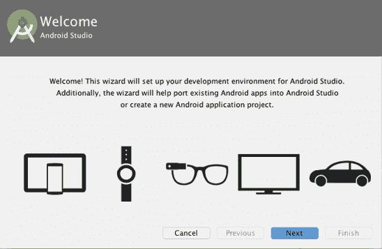

图 2-2

如果出现向导，请点击 `Next` 按钮，选择标准安装选项并再次点击 `Next`。

Android Studio 将继续下载并配置最新的 Android SDK 以及一些额外的组件和包。一旦此过程完成，在“Downloading Components”对话框中点击 `Finish` 按钮，随后将显示“Welcome to Android Studio”界面：

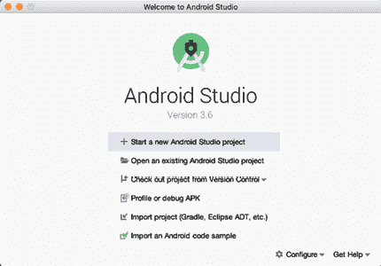

图 2-3

## 2.5 安装额外的 Android SDK 包

到目前为止执行的操作已安装 Java、Android Studio IDE 以及当前 set 的默认 Android SDK 包。在继续操作之前，值得花些时间验证安装了哪些包，并安装任何缺失或更新的包。

此任务可以使用 Android SDK Settings 界面完成，您可以在 Android Studio 欢迎对话框中选择 `Configure` -> `SDK Manager` 选项从 Android Studio 工具内部启动它。一旦调用，将出现默认设置对话框中的 Android SDK SDK 界面，如图 2-4 所示：

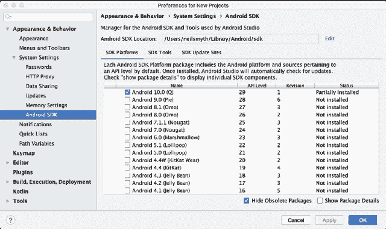

图 2-4

在首次安装 Android Studio 之后，可能只安装了最新发布的 Android SDK 版本。要安装旧版本的 Android SDK，只需选择对应版本对应的复选框并点击 `Apply` 按钮。

也可能列出最新 SDK 有可用更新。要访问有关可用更新包的详细信息，请启用位于屏幕右下角的 `Show Package Details` 选项。这将显示与图 2-5 所示相似的信息：

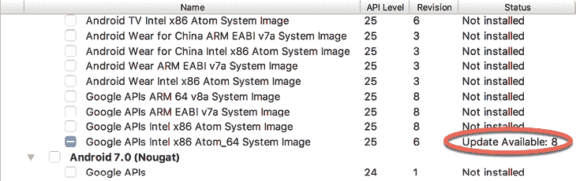

图 2-5

上面的图片突出了更新的可用性。要安装更新，请启用项目名称左侧的复选框并点击 `Apply` 按钮。

除了 Android SDK 包，还安装了许多用于构建 Android 应用程序工具。要查看当前安装的包并检查更新，请留在 SDK 设置界面，并选择如图 2-6 所示的 `SDK Tools` 标签：

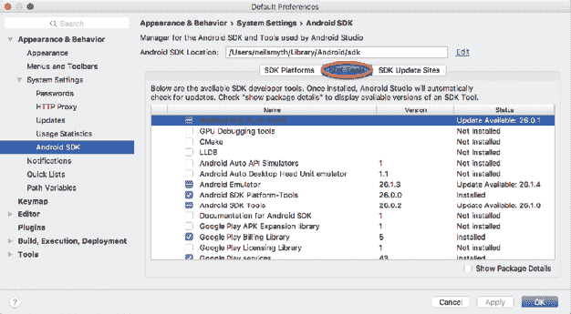

图 2-6

在 Android SDK Tools 界面中，确保以下包在 Status 列中均列为 Installed（已安装）：

* `Android SDK Build-tools`
* `Android Emulator`
* `Android SDK Platform-tools`
* `Android SDK Tools`
* `Google Play Services`
* `Intel x86 Emulator Accelerator (HAXM installer)`
* `Google USB Driver (Windows only)`

如果上述任何包被列为 Not Installed（未安装）或需要更新，只需选择这些包旁边的复选框并点击 `Apply` 按钮以启动安装过程。

一旦安装完成，请检查包列表并确保所选包现在在 Status 列中被列为 Installed。如果任何一个被列为 Not installed，请确保它们已被选中并再次点击 `Apply` 按钮。

## 2.6 使 Android SDK 工具可以通过命令行访问

大多数情况下，Android SDK 的底层工具将在 Android Studio 环境内部访问。然而，尽管如此，在某些情况下，能够从命令提示符或终端窗口调用这些工具将是很有用的。为了让您正在开发的操作系统能够找到这些工具，有必要将它们添加到系统的 `PATH` 环境变量中。

无论哪种操作系统，都需要配置 `PATH` 变量以包含以下路径（其中 `<path_to_android_sdk_installation>` 代表安装 Android SDK 的文件系统位置）：

```
<path_to_android_sdk_installation>/sdk/tools
<path_to_android_sdk_installation>/sdk/tools/bin
<path_to_android_sdk_installation>/sdk/platform-tools
```

SDK 在您系统上的位置可以通过启动 SDK Manager 并参考设置面板顶部的 `Android SDK Location:` 字段来识别，如图 2-7 所示：

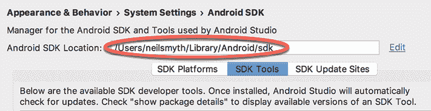

图 2-7

一旦确定了 SDK 的位置，将其添加到 `PATH` 变量的步骤取决于操作系统：

### 2.6.1 Windows 7

1. 右键点击桌面开始菜单中的 `Computer`，并在生成的菜单中选择 `Properties`。

2. 在属性面板中，选择 `Advanced System Settings` 链接，并在生成的对话框中，点击 `Environment Variables…` 按钮。

3. 在环境变量对话框中，在系统变量列表中找到 `Path` 变量，选择它并点击 `Edit…` 按钮。使用编辑对话框中的 `New` 按钮向路径添加三个新条目。例如，假设 Android SDK 安装在 `C:\Users\demo\AppData\Local\Android\Sdk`，则需要添加以下条目：

```
C:\Users\demo\AppData\Local\Android\Sdk\platform-tools
C:\Users\demo\AppData\Local\Android\Sdk\tools
C:\Users\demo\AppData\Local\Android\Sdk\tools\bin
```

4. 在每个对话框中点击 `OK` 并关闭系统属性控制面板。

一旦完成上述步骤，通过打开命令提示符窗口验证路径是否设置正确（开始 -> Command Prompt），并在提示符处输入：

```
echo %Path%
```

返回的路径值应包含 Android SDK 文件夹的路径。通过尝试运行 `adb` 工具来验证 `platform-tools` 值是否正确：

```
adb
```

执行后，工具将列出命令行选项。同样，通过尝试调用 Android Manager 命令行工具来检查工具设置（如果 `avdmanager` 工具报告有关 Java 的问题，稍后会处理）：

```
avdmanager
```

如果上述命令中的任何一个出现以下信息，很可能是将错误的路径添加到了 `PATH` 环境变量中：

`'adb' is not recognized as an internal or external command,` `operable program or batch file.`

### 2.6.2 Windows 8.1

1. 在启动屏幕上，将鼠标移动到屏幕右下角并在生成的菜单中选择 `Search`。在搜索框中输入 `Control Panel`。当 `Control Panel` 图标出现在结果区域时，点击它在桌面启动。

2. 在控制面板中，使用 `Category` 菜单将显示更改为 `Large Icons`。从列表中选择 `System`。

3. 按照 Windows 7 的概述步骤从第 2 步开始。

打开命令提示符窗口（鼠标移动到屏幕右下角，选择 `Search` 并在搜索框中输入 `cmd`）。从搜索结果中选择 `Command Prompt`。

在命令提示符窗口中，输入：

```
echo %Path%
```


返回的路径值应包含上述路径。通过尝试运行 `adb` 工具来验证 `platform-tools` 值是否正确：

```
adb
```

执行后，工具将列出命令行选项。同样，通过尝试调用 Android Manager 命令行工具来检查工具设置（如果 `avdmanager` 工具报告有关 Java 的问题，稍后会处理）：

```
avdmanager
```

如果上述命令中的任何一个出现以下信息，很可能是将错误的路径添加到了 `PATH` 环境变量中：

`'adb' is not recognized as an internal or external command,` `operable program or batch file.`

### 2.6.3 Windows 10

右键点击开始菜单，从弹出的菜单中选择“设置”，并在“查找设置”文本框中输入“编辑系统环境变量”。在“系统属性”对话框中，点击“环境变量...”按钮。按照 Windows 7 从第 3 步开始的步骤进行操作。

### 2.6.4 Linux

在 Linux 上，此配置通常可以通过向家目录下的 `.bashrc` 文件中添加命令来实现（具体取决于所使用的特定 Linux 发行版）。假设 Android SDK 捆绑包安装在 `/home/demo/Android/sdk`，则 `.bashrc` 文件中的 `export` 行如下：

```bash
export PATH=/home/demo/Android/sdk/platform-tools:/home/demo/Android/sdk/tools:/home/demo/Android/sdk/tools/bin:/home/demo/android-studio/bin:$PATH
```

请注意，上述命令将 `android-studio/bin` 目录添加到 `PATH` 变量中。这将使得无论在终端窗口的哪个目录下，都可以执行 `studio.sh` 脚本。

### 2.6.5 macOS

在 macOS 上，可以使用多种技术来修改 `$PATH` 变量。认为最干净的方法是在 `/etc/paths.d` 目录中创建一个新文件，其中包含要添加到 `$PATH` 的路径。假设 Android SDK 安装位置为 `/Users/demo/Library/Android/sdk`，可以通过在 `/etc/paths.d` 目录下创建一个名为 `android-sdk` 的新文件并包含以下行来配置路径：

```
/Users/demo/Library/Android/sdk/tools
/Users/demo/Library/Android/sdk/tools/bin
/Users/demo/Library/Android/sdk/platform-tools
```

注意，由于这是一个系统目录，在创建文件时需要使用 `sudo` 命令。例如：

```bash
sudo vi /etc/paths.d/android-sdk
```

### 2.7 Android Studio 内存管理

Android Studio 是一个大型且复杂的应用程序，由许多后台进程组成。尽管 Android Studio 过去曾因性能不佳而受到批评，但 Google 在最近的发布中已了重大的性能改进，并在每个新版本中持续改进。这些改进之一包括允许用户配置 Android Studio IDE 以及用于构建和运行应用程序的后台进程所使用的内存量。这使得软件能够利用具有更大 RAM 的系统。

如果你在具有足够空闲 RAM 以增加这些值的系统上运行 Android Studio（此功能仅在具有 5GB 或更多 RAM 的 64 位系统上可用），并且发现 Android Studio 的性能似乎有所下降，那么尝试这些内存设置可能是值得的。Android Studio 还可能通过类似于所示的对话框通知你可以提高性能：

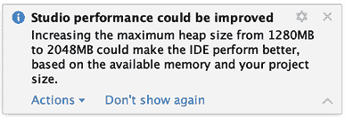

图 2-8

要查看并修改当前内存配置，请选择 `File -> Settings...`（macOS 上为 `Android Studio -> Preferences...`）菜单选项，并在弹出的对话框中，选择左侧导航面板中 `System Settings` 下的 `Memory Settings` 选项，如下方的图 2-9 所示。

在更改内存分配时，请确保不要分配比需要更多的内存，也不要在不减慢其他进程的情况下超出系统承受范围。

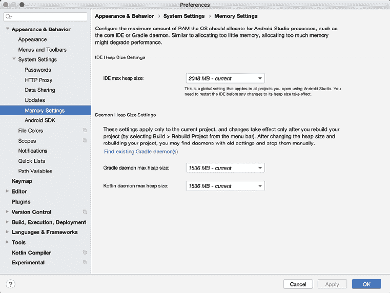

图 2-9

IDE 内存设置调整分配给 Android Studio 的内存，并且适用于当前加载的任何项目。另一方面，当从 Android Studio 构建并运行项目时，许多后台进程（称为守护进程）执行编译和运行应用程序的任务。在编译和运行大型复杂项目时，通过调整守护进程堆设置，可能会改进构建时间。与 IDE 堆设置不同，这些设置仅适用于当前项目。

### 2.8 更新 Android Studio 和 SDK

Android Studio 和 Android SDK 定期会发布新版本。新版本的 SDK 使用 Android SDK Manager 安装。当有更新可以安装时，Android Studio 通常会通知你。

要手动检查 Android Studio 更新，请在 Android Studio 欢迎界面内点击 `Configure -> Check for Updates` 菜单选项，或者从 Android Studio 主窗口内使用可访问的 `Help -> Check for Updates...`（macOS 上为 `Android Studio -> Check for Updates...`）菜单选项。

## 2.9 总结

在开始开发 Android 应用程序之前，第一步是搭建合适的开发环境。这包括 Android SDK 和 Android Studio IDE（它还包括 OpenJDK 开发环境）。在本章中，我们涵盖了在 Windows、macOS 和 Linux 上安装这些包的必要步骤。

# 3. 在 Android Studio 中创建示例 Android 应用程序

本书的前几个章节已经涵盖了使用 Android Studio IDE 配置适用于 Android 应用程序开发的环境的必要步骤。在转向稍高级的主题之前，现在是验证所有必要的开发包都已安装并正常运行的好时机。实现这一目标的最佳方法是创建一个 Android 应用程序并编译、运行它。本章将涵盖如何使用 Android Studio 创建一个简单的 Android 应用程序项目。项目创建后，稍后的章节将探索使用 Android 模拟器环境对应用程序进行测试运行。

## 3.1 关于项目

在本章创建的项目是一个非常简单的货币转换计算器（事实上，它非常简单，只负责从美元转换为欧元，并使用估算汇率进行转换）。该项目还将使用 Android Studio 最基础的项目模板之一。这种简单性允许我们介绍 Android 应用开发的一些关键方面，而不会因一次性引入过多概念（如推荐的应用架构和 Android 架构组件）让初学者感到不堪。遵循本章的教程时，请放心示例项目中使用的所有技术和代码将在后面的章节中进行详细介绍。

## 3.2 创建新 Android 项目

应用程序开发过程的第一步是在 Android Studio 环境中创建一个新项目。因此，首先启动 Android Studio，使其如图 3-1 所示显示“Welcome to Android Studio”屏幕：

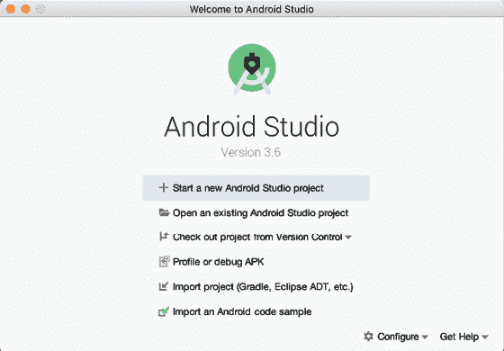

图 3-1

一旦此窗口出现，Android Studio 已准备好创建项目。要创建新项目，只需点击 `Start a new Android project` 选项显示第一个屏幕。

## 3.3 创建 Activity

第一步是定义为应用程序创建的初始 Activity 类型。可以选择为 `Phone and Tablet`、`Wear OS`、`TV`、`Android Audio` 或 `Android Things` 创建项目。开发 Android 应用程序时有多种不同的 Activity 类型，其中许多将在后面的章节中详细介绍。然而，对于本示例而言，只需在 `Phone and Tablet` 屏幕上选择 `Empty Activity`。`Empty Activity` 选项会创建一个包含单个 `TextView` 对象的模板用户界面。

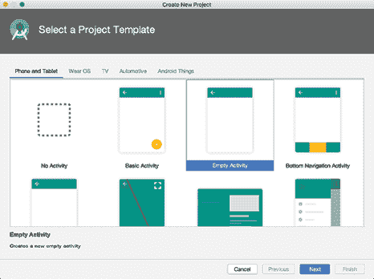

图 3-2

选择 `Empty Activity` 选项后，点击 `Next` 继续项目配置。

在项目配置窗口（图 3-3）中，将 `Name` 字段设置为 `AndroidSample`。应用程序名称是在 Android Studio 中用于引用和识别应用程序的名称，如果完成后的应用程序要在 Google Play 商店销售，也将使用该名称。

`Package` 包名用于在 Android 应用生态系统中唯一标识应用程序。虽然这可以设置为任何唯一标识你应用程序的字符串，但传统上它是基于域名的反转 URL，随后加上应用程序名称。例如，如果你的域名是 `www.mycompany.com`，并且应用程序命名为 `AndroidSample`，那么包名可能指定如下：

```
com.mycompany.androidsample
```

如果你没有域名，可以在 `Company Domain` 字段中输入任何其他字符串，或者为了测试目的使用 `example.com`，但在发布应用程序之前需要将其更改：

```
com.example.androidsample
```

`Save location` 设置将默认位于你主目录下的名为 `AndroidStudioProjects` 文件夹中的位置，可以通过点击包含当前路径设置的文本字段右侧文件夹图标进行更改。

将 `minimum SDK` 设置为 `API 26`：Android 8.0 (Oreo)。这是书中创建的大多数项目将使用的 SDK，除非某个必要功能仅在较新版本可用。

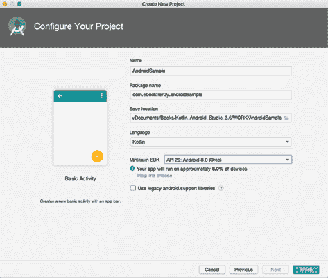

图 3-3

最后，将 `Language` 菜单更改为 `Kotlin` 并点击 `Finish` 开始项目创建过程。

## 3.5 修改示例应用程序

此时，Android Studio 已经创建了一个简单的示例应用程序项目并打开了主窗口。

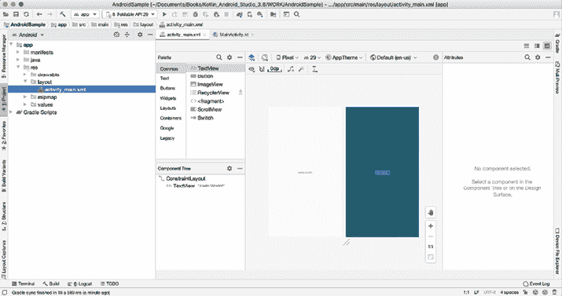

图 3-4

新创建的项目和对相关文件的引用列在主项目窗口左侧的 `Project` 工具窗口中。`Project` 工具窗口有多种显示信息的模式。默认情况下，此面板应处于 `Android` 模式。此设置由面板顶部的菜单控制，如图 3-5 所示。如果面板当前未处于 `Android` 模式，请使用菜单切换模式：

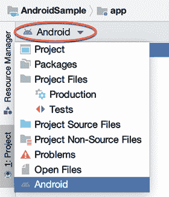

图 3-5

## 3.6 修改用户界面

我们的 Activity 用户界面设计存储在名为 `activity_main.xml` 的文件中，该文件位于项目文件层次结构的 `app` -> `res` -> `layout` 下。一旦在 `Project` 工具窗口中找到它，双击该文件将其加载到用户界面 `Layout Editor` 工具中，该工具将出现在 Android Studio 主窗口的中间面板：

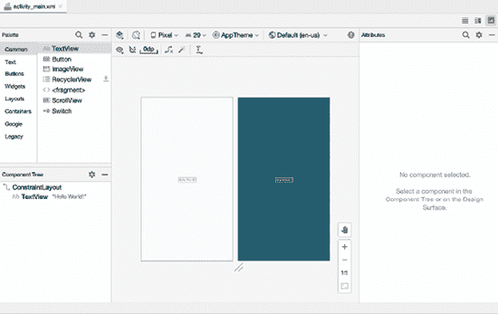

图 3-6

在 `Layout Editor` 窗口顶部的工具栏中有一个菜单（在上面的图中当前设置为 `Pixel`），它会反映在 `Layout Editor` 面板中设备的视觉表示上。点击此菜单可以选择广泛的其他设备选项。

要将设备表示在横屏和竖屏之间切换，只需使用设备选择菜单立即左侧的下拉菜单，该菜单显示为  图标。

从设备屏幕可以看到，内容布局已经包含一个显示“Hello World!”消息的标签。面板左侧是一个调色板，包含了用于构建用户界面的不同类别用户界面组件，例如按钮、标签和文本字段。然而，需要注意的是，并不是所有用户界面组件对用户都是显而见的。其中一个类别是布局。Android 支持多种布局，这些对视觉用户界面组件在屏幕上的定位和管理提供了不同层次的控制。虽然从用户界面的视觉表示上很难看出，但当前的设计是使用 `ConstraintLayout` 创建的。这可以通过查看 `Component Tree` 面板中的信息来确认，该面板默认位于 `Layout Editor` 面板的左下角，如图 3-7 所示：

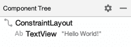

图 3-7

从组件树层次结构可以看出，用户界面布局由一个 `ConstraintLayout` 父对象和一个 `TextView` 子对象组成。

在继续之前，还要检查 `Layout Editor` 的 `Autoconnect`（自动连接）模式已启用。这意味着当组件添加到布局时，`Layout Editor` 将自动添加约束，以确保组件在不同的屏幕尺寸和设备方向上正确定位（该主题将在后续章节中更详细地介绍）。`Autoconnect` 按钮出现在 `Layout Editor` 工具栏中，用磁铁图标表示。禁用时，磁铁上带有一条斜线（图 3-8）。如有必要，点击此按钮重新启用 `Autoconnect` 模式。

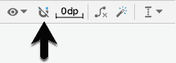

图 3-8

修改应用程序的下一步是在布局中添加一些额外的组件，第一个将是用户点击以启动货币转换的 `Button`。

`Palette` 面板由两列组成，左列包含视图组件类别列表。右列列出当前选择类别包含的组件。例如，在图 3-9 中，当前在 `Buttons` 类别中选择了 `Button` 视图：


图 3-9

从 `Buttons` 列表中点击并拖动 `Button` 对象，将其释放到用户界面设计的水平中心，使其位于现有 `TextView` 小部件下方：

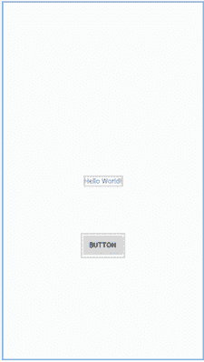

图 3-10

下一步是更改当前 `Button` 组件显示的文本。位于设计区域右侧的面板是 `Attributes` 面板。此面板显示分配给布局中当前组件的属性。在此面板中，在 `Common Attributes` 部分找到 `text` 属性，并将值从“Button”更改为“Convert”，如图 3-11 所示：

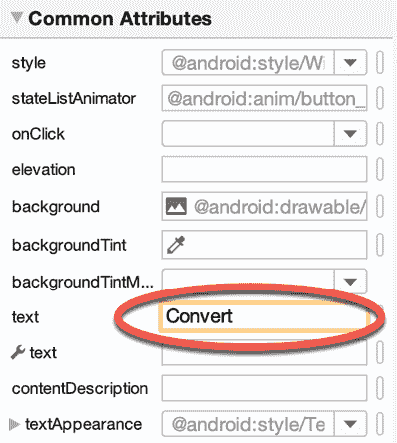

图 3-11

带有扳手的第二个 `text` 属性允许设置仅在 `Layout Editor` 工具中显示的属性，运行时不会显示。这对于测试视觉组件和布局在不同设置下的行为非常有用，而无需反复运行应用程序。

如果 `Autoconnect` 系统未能设置所有布局连接，点击 `Infer constraints` 按钮（图 3-12）为布局添加缺失的约束：

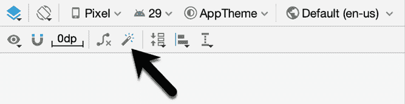

图 3-12

此时，解释位于 `Layout Editor` 工具右上角的警告按钮非常重要，如图 3-13 所示。显然，这表明布局存在潜在问题。要查看问题的详情，请点击该按钮：

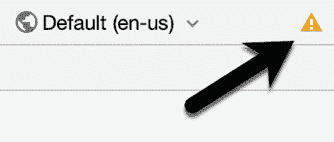

图 3-13

点击后，将出现一个面板（图 3-14），描述问题的性质并提供一些可能的纠正措施：

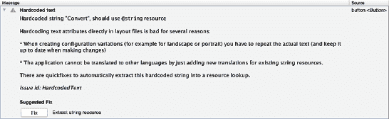

图 3-14

目前列出的唯一警告如下：

### 硬编码字符串 `"Convert"`，应使用 `@string` 资源

此 I18N 消息是在我们项目未来的国际化可能存在潜在问题（“I18N”一词源于“internationalization”一词以“I”开头，以“N”结尾，中间有 18 个字母）。该警告提醒我们，在开发 Android 应用程序时，应尽可能将文本字符串等属性和值以资源的形式存储。这样做可以让我们通过修改资源文件来更改应用程序的外观，而无需更改应用程序源代码。这在将用户界面翻译成不同的口语语言时尤为宝贵。如果用户界面中的所有文本都包含在一个资源文件中，例如，可以将该文件交给翻译人员，由他们完成翻译工作并返回翻译后的文件以包含在应用程序中。这使得在不需要更改任何源代码的情况下就能支持多种语言。在本例中，我们将创建一个名为 `convert_string` 的新资源，并将字符串“Convert”赋值给它。

点击问题说明（Issue Explanation）面板中的 `Fix` 按钮以显示提取资源（Extract Resource）面板（见图 3-15）。在此面板中，将资源名称字段更改为 `convert_string`，并在点击 `OK` 按钮之前将资源值保留为 `Convert`。

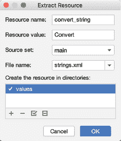

图 3-15

值得注意的是，当字符串输入到属性（Attributes）面板时，也可以将其分配给资源。这涉及点击属性面板中属性字段右侧的窄按钮，并在弹出的“资源”对话框中选择`添加新资源 -> 新字符串值...（Add new resource -> New String Value…）`菜单选项。但在实践中，直接为布局中任何控件的属性面板字段设置值通常更快，然后在布局完成后，按顺序处理警告对话框中的列表以提取任何必要的资源。


下一个要添加的组件是`EditText`组件，用户将向其中输入要转换的美元金额。从组件调板中，选择`Text`类别，并点击并拖动`Number (Decimal)`组件到布局中，使其水平居中，并放置在现有的`TextView`组件上方。选中该组件后，使用属性工具窗口将`hint`属性设置为“dollars”。点击警告图标并将字符串提取到名为`dollars_hint`的资源中。

在本章后面编写的代码需要访问用户在`EditText`字段中输入的美元值。它将通过引用分配给用户界面布局中组件的`id`来实现。Android Studio 为组件分配的默认`id`可以在布局中选中组件时，从属性工具窗口内部查看和更改，如图 3-16 所示：

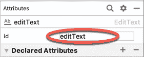

图 3-16

在继续之前将`id`更改为`dollarText`。

点击`推断约束（Infer constraints）`按钮添加任何缺失的布局约束。此时，布局应该类似于图 3-17 所示所示：

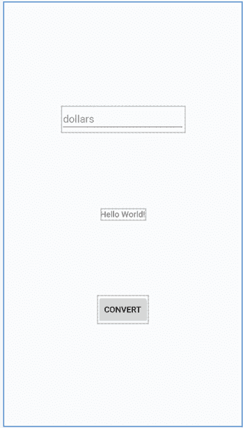

图 3-17

## 3.7 检查布局和资源文件

在进入下一步之前，我们将查看用户界面设计和资源处理的一些内部方面。在上一节中，我们通过使用布局编辑器（Layout Editor）工具修改`activity_main.xml`文件对用户界面进行了一些更改。事实上，布局编辑器所做的只是提供了一种易于的方法来编辑文件的底层 XML 内容。在实践中，没有理由你不能直接修改 XML 以进行用户界面更改，在某些情况下，这实际上比使用布局编辑器工具更快。在布局编辑器面板的右上角有三个按钮，如下方的图 3-18 所示所示：

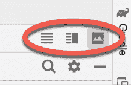

图 3-18

默认情况下，编辑器将处于`Design（设计）`模式，此时显示布局的视觉表示。最左侧的按钮将切换到`Code（代码）`模式以显示布局的 XML，而中间的按钮进入`Split（分割）`模式，同时显示布局和 XML，如图 3-19 所示：

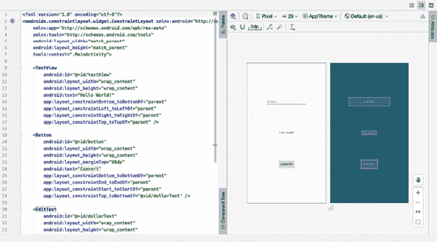

图 3-19

从 XML 文件的结构可以看出，用户界面由`ConstraintLayout`组件组成，而该组件又是`TextView`、`Button`和`EditText`对象的父级。我们也可以看到，例如，`Button`的文本属性设置为我们的`convert_string`资源。尽管复杂性和内容各异，所有用户界面布局都是这种层次化的、基于 XML 的结构。

当对 XML 布局进行更改时，这些更改将反映在布局画布上。也可以在布局画布面板内从视觉上修改布局，更改将显示在 XML 列表中。要看到此效果，切换到`Split`模式并修改 XML 布局将`ConstraintLayout`的背景颜色更改为红色，如下：

```xml
<?xml version="1.0" encoding="utf-8"?>
<androidx.constraintlayout.widget.ConstraintLayout xmlns:android="http://schemas.android.com/apk/res/android"
    xmlns:app="http://schemas.android.com/apk/res-auto"
    xmlns:tools="http://schemas.android.com/tools"
    android:layout_width="match_parent"
    android:layout_height="match_parent"
    tools:context=".MainActivity"
    android:background="#ff2438">
```

注意布局的颜色实时更改以匹配 XML 文件中的新设置。注意 XML 编辑器中包含颜色的行左侧边距（也称为槽）出现了一个红色小方块。这是属性上设置了红色的视觉提示。

在继续之前，从布局文件中删除`background`属性，使背景返回默认设置。

最后，使用项目（Project）面板找到`app -> res -> values -> strings.xml`文件并双击它将其加载到编辑器。目前 XML 应该如下：

```xml
<resources>
    <string name="app_name">AndroidSample</string>
    <string name="convert_string">Convert</string>
    <string name="dollars_hint">dollars</string>
</resources>
```

作为资源运行的演示，将分配给`convert_string`资源的字符串值更改为“Convert to Euros”，然后通过编辑器中的布局文件标签返回布局编辑器。注意布局已获取了字符串的新资源值。

访问 XML 文件中引用的资源值也有快速方法。当布局编辑器处于`Split`或`Code`模式时，点击`@string/convert_string`属性设置使其高亮，然后在键盘上按下`Ctrl-B`（macOS 上为`Cmd-B`）。Android Studio 随后将打开`strings.xml`文件并带您进入文件中定义该资源的行。利用此机会将字符串资源还原为原始的“Convert”文本，并添加以下额外的字符串资源条目，供以后在应用程序代码引用：

```xml
<resources>
    <string name="convert_string">Convert</string>
    <string name="dollars_hint">dollars</string>
    <string name="no_value_string">No Value</string>
</resources>
```

资源字符串也可以使用 Android Studio 的翻译编辑器进行编辑。要打开此编辑器，右键点击`app -> res -> values -> strings.xml`文件并选择`Open Translations Editor`（打开翻译编辑器）菜单选项。Android Studio 窗口的主面板中显示翻译编辑器：

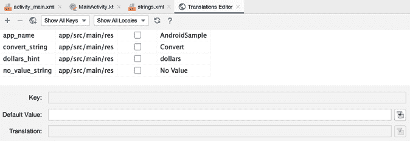

图 3-20

此编辑器允许编辑分配给资源键的字符串，并管理多种语言的翻译。

## 3.8 添加交互

本示例项目的最后一步是让应用程序具有交互性，这样当用户在`EditText`字段中输入一个美元金额并点击转换按钮时，转换后的欧元金额将显示在`TextView`上。这涉及在`Button`组件上实现一些事件处理。具体来说，需要配置`Button`，以便在触发`onClick`事件时调用应用代码中的方法。事件处理可以通过多种不同的方式实现，并在稍后题为“Android 事件处理概述与示例”的章节中详细介绍。将布局编辑器返回 Design（设计）模式，在布局编辑器中选择`Button`组件，参考`Attributes`（属性）工具窗口并指定名为`convertCurrency`的方法，如下所示：

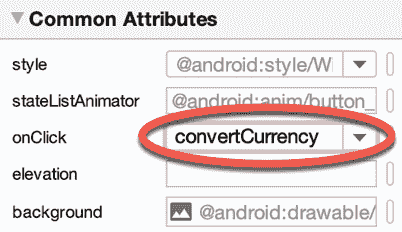

图 3-21

注意，`onClick`属性文本字段现在用红色边框突出，警告我们按钮已配置为调用一个尚不存在的方法。要解决这个问题，在 Project 工具窗口中双击`MainActivity.kt`文件（`app -> java -> <package name> -> MainActivity`）将其加载到代码编辑器中，并在类文件中添加`convertCurrency`方法的代码，使其读取内容如下，注意还需要导入一些额外的 Android 程序包：

```kotlin
package com.ebookfrenzy.androidsample

import androidx.appcompat.app.AppCompatActivity

import android.os.Bundle

import android.view.View

import kotlinx.android.synthetic.main.activity_main.*

class MainActivity : AppCompatActivity() {

    override fun onCreate(savedInstanceState: Bundle?) {
        super.onCreate(savedInstanceState)
        setContentView(R.layout.activity_main)
    }

    fun convertCurrency(view: View) {
        if (dollarText.text.isNotEmpty()) {
            val dollarValue = dollarText.text.toString().toFloat()
            val euroValue = dollarValue * 0.85f
            textView.text = euroValue.toString()
        } else {
            textView.text = getString(R.string.no_value_string)
        }
    }
}
```

该方法首先检查`dollarText` `EditText`视图的`text`属性，以确保它为空（换句话说，用户已输入美元金额）。如果没有输入值，则使用本章早些声明的字符串资源在`TextView`上显示“无值”字符串。相反，如果输入了金额，将其转换为浮点值并计算等值的欧元金额。然后将此浮点值转换为字符串并显示在`TextView`上。如果对这些任何内容不清楚，请放心，这些概念将在后面的章节中进行详细介绍。

## 3.9 总结

虽然并不复杂，但设置 Android 开发环境涉及许多步骤。在完成这些步骤后，通过一个简单的示例来确保环境已正确安装和配置是值得的。在本章中，我们创建了一个简单的应用程序，并使用 Android Studio 布局编辑器工具修改了用户界面布局。在此过程中，我们探索了尽可能使用资源的重要性，特别是在字符串值的情况下，并简要接触了布局的主题。接下来，我们查看了用于存储 Android 应用程序用户界面设计的底层 XML。

最后，在`Button`上添加了`onClick`事件，连接到一个已实现的方法，该方法从`EditText`组件中提取用户输入，将美元转换为欧元，然后结果显示在`TextView`上。

由于应用程序已准备好测试，为测试目的设置模拟器所需的步骤将在下一章中详细介绍。

# 4. 在 Android Studio 中创建 Android 虚拟设备 (AVD)

在 Android Studio 中开发 Android 应用的过程中，需要多次编译和运行应用程序。可以通过在物理设备上安装并运行或在 Android 虚拟设备 (AVD) 模拟器环境中来测试 Android 应用程序。在使用 AVD 之前，必须先创建并配置它以匹配特定设备模型的规格。因此，本章的目标是以 Pixel 3 手机为参考示例，完成创建此类虚拟设备的步骤。

## 4.1 关于 Android 虚拟设备

AVD 本质上是模拟器，允许在没有物理设备的情况下测试 Android 应用程序。AVD 可以配置为模拟硬件功能，如摄像头、GPS 导航支持或加速度计。作为 Android Studio 标准安装的一部分，许多模板允许为各种设备配置 AVD。

启动时，AVD 将作为一个包含 Android 设备的窗口出现。例如，图 4-1 显示了 Google Pixel 3 的 Android 界面。

新的 AVD 使用 Android Device Manager 创建和管理，该管理器可以在命令行模式下使用，也可以带有更用户友好的图形界面使用。


图 4-1

## 4.2 创建新的 AVD

为了在没有物理设备的情况下测试应用程序的行为，需要为特定设备创建 AVD。

创建新 AVD 的第一步是启动 AVD Manager。可以在 Android Studio 环境中通过选择`Tools -> AVD Manager`选项来实现。

一旦启动，如果已经创建了 AVD 实例，该工具将如图 4-2 所示所示：


图 4-2

要添加额外的 AVD，首先点击`Create Virtual Device`按钮以调用虚拟设备配置对话框：

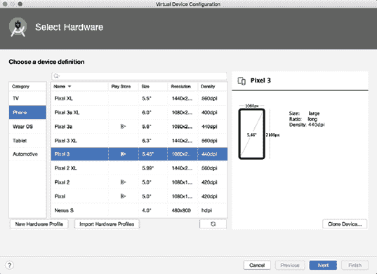

图 4-3

在对话框中，执行以下步骤创建一个兼容 Pixel 3 的模拟器：

1. 从`Category`面板选择`Phone`选项，以显示 Android 手机 AVD 模板列表。

2. 选择`Pixel 3`设备选项并点击`Next`。

3. 在`System Image`屏幕上，为`x86` ABI 选择最新 Android 版本。注意，如果系统镜像尚未安装，`Release Name`旁边将提供`Download`链接。点击此链接下载并安装系统镜像，然后再选择它。如果所需的镜像不在列表中，点击`x86 images`和`Other images`选项卡以查看备选列表。

4. 点击`Next`继续，并在`name`字段中输入描述性名称（例如 Pixel 3 API 29），或直接接受默认名称。

5. 点击`Finish`创建 AVD。

6. 创建 AVD 后，现在可以关闭`AVD Manager`了。如果以后需要对 AVD 进行修改，只需重新打开`AVD Manager`，从列表中选择该 AVD，并点击`AVD Manager`中设备行`Actions`列中的铅笔图标。

## 4.3 启动模拟器

要对新建的 AVD 模拟器进行测试，只需从`AVD Manager`中选择该模拟器并点击启动按钮（`Actions`列中的绿色三角形）。模拟器将在新窗口中出现并开始启动过程。模拟器启动所需的时间取决于 AVD 本身的配置以及运行它的系统配置。

虽然模拟器可能默认以竖屏方向显示，但此选项及其他默认选项是可以更改的。在`AVD Manager`中，选择新建的 Pixel 3 条目，并点击设备行`Actions`列中的铅笔图标。在配置界面中，找到`Startup`（启动）和`orientation`（方向）部分并更改方向设置。退出并重启模拟器会话以使更改生效。关于模拟器的更多详细信息请参阅下一章(“使用和配置 Android Studio AVD 模拟器”)。

为了节省本章下一节的时间，请在继续之前保持模拟器运行。

## 4.4 在 AVD 中运行应用程序

配置好 AVD 模拟器后，之前章节中创建的示例应用程序`AndroidSample`现在可以进行编译并运行了。将`AndroidSample`项目加载到 Android Studio 后，确保新创建的 Pixel 3 AVD 显示在设备菜单中（见下方图 4-4 中的标记 A），然后点击由绿色三角形表示的运行按钮 (B)、选择`Run -> Run ‘app’`菜单选项或使用键盘快捷键`Ctrl-R`：

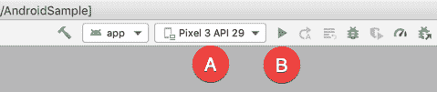

图 4-4

设备菜单 (A) 可用于选择不同的 AVD 实例或物理设备作为运行目标，并用于在多个设备上运行应用。该菜单还提供了访问`AVD Manager`以及设备连接故障排除选项的入口：

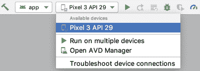

图 4-5

一旦应用程序安装并运行，第一个 fragment（片段）的用户界面将出现在模拟器中：

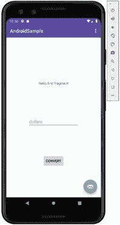

图 4-6

如果活动没有自动启动，请检查模拟器上的应用列表中是否出现了启动图标。如果是，只需点击它即可启动应用程序。一旦运行过程开始，`Run`工具窗口将变为可用。在应用程序包安装和启动期间，`Run`工具窗口将显示诊断信息。图 4-7 显示了成功启动应用程序时的`Run`工具窗口输出：

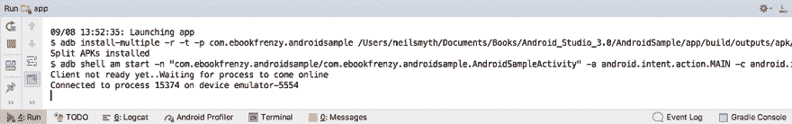

图 4-7

如果在启动过程中遇到问题，`Run`工具窗口将提供信息，这些信息可能有助于隔离问题原因。

假设应用程序加载到模拟器并按预期运行，那么我们已经安全地验证了 Android 开发环境已正确安装和配置。

## 4.5 停止运行的应用程序

要停止运行的应用程序，只需点击主工具栏上的停止按钮，如图 4-8 所示：

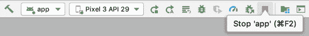

图 4-8

也可以使用`Run`工具窗口终止应用。首先，通过应用运行时变为可窗口栏按钮显示`Run`工具窗口。一旦`Run`工具窗口出现，点击下方图 4-9 中高亮显示的停止按钮：

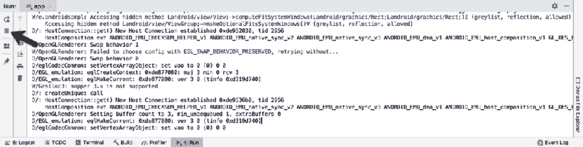

图 4-9

## 4.6 支持深色主题

Android 10 引入了备受期待的深色主题，但 Android Studio 项目默认未启用该功能。若要在 AVD 模拟器中测试深色主题，请在模拟器中运行的 Android 实例内打开`Settings`应用。访问设置应用有多种方法。最快的方法是显示主屏幕，然后从屏幕底部向上点击并拖动（搜索栏正下方）。这将显示设备上安装的所有应用，其中之一就是`Settings`应用。

在`Settings`应用中，选择`Display`（显示）类别并启用`Dark Theme`（深色主题）选项，如图 4-10 所示，这样屏幕背景将变为黑色：


图 4-10


启用深色主题后，运行`AndroidSample`应用，你会发现它看起来仍然一样，并不符合深色主题。

为了让应用采用深色主题，它必须继承自 Android DayNight 主题。默认情况下，新项目使用`Light.DarkActionBar`主题。要更改此设置，请在项目窗口中导航到`res -> values -> styles.xml`文件，如图 4-11 所示：


图 4-11

加载后，编辑`AppTheme`样式，使其内容如下：

```xml
<resources>
    <style name="AppTheme" parent="AppCompat.DayNight">
        ...
    </style>
</resources>
```

做出更改后，在模拟器上重新运行应用，注意它现在符合如图 4-12 所示的深色主题：

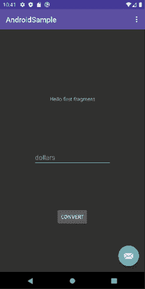

图 11（此处原文为 12）

### 4.7 命令行创建 AVD

如前所述，除了图形界面外，还可以直接从命令行创建 AVD。这通过使用`avdmanager`工具结合某些命令行来实现。一旦启动，工具将提示额外信息以创建 AVD。

`avdmanager`工具需要访问 Java 环境（JRE）才能运行。如果在尝试运行`avdmanager`时出现找不到`java`命令的消息，可以将运行命令的命令提示符或终端窗口配置为使用 Android Studio 绑定的 OpenJDK。按照以下步骤识别 OpenJDK 的位置：

1. 启动 Android Studio 并打开之前创建的`AndroidSample`项目。

2. 选择`File -> Project Structure...`菜单选项。

3. Project Structure 对话框中 JDK 字段中的路径。这代表了与 Android Studio 绑定的 JRE 位置。

在 Windows 上，在运行`avdmanager`的命令提示符中执行以下命令（将`<path to jre>`替换为从 Project Structure 对话框复制的路径）：

```
set JAVA_HOME=<path to jre>
```

在 macOS 或 Linux 上，执行以下命令：

```bash
export JAVA_HOME="<path to jre>"
```

如果你预计频繁使用`avdmanager`工具，请按照设置 Android Studio 开发环境章节中列出的操作系统环境变量步骤，在系统范围内配置`JAVA_HOME`。

假设系统已配置将 Android SDK 工具目录包含在`PATH`环境变量中，可以通过在终端或命令窗口中发布以下命令获取新 AVD 的可用目标列表：

```
avdmanager list targets
```

上述命令的输出将包含系统中可用的 Android SDK 版本列表。例如：

# 可用的 Android 目标

- id: `1` 或 `"android-29"`

  - Name: Android API 29

  - Type: Platform

  - API level: 29

  - Revision: 1

- id: `2` 或 `"android-26"`

  - Name: Android API 26

  - Type: Platform

  - API level: 26

  - Revision: 1

`avdmanager`工具还允许从命令行创建新的 AVD 实例。例如，要使用`x86` ABI 针对 Android API 级别 29 设备的目标 ID 创建名为`myAVD`的新 AVD，可以使用以下命令：

```bash
avdmanager create avd -n myAVD -k "system-images;android-29;google_apis_playstore;x86"
```

`android`工具将根据基础 Android 8 设备的所需规格创建新 AVD，同时也提供了在需要时创建自定义配置以匹配特定设备规格的选项。从命令行创建新的 AVD 后，在点击刷新（Refresh）按钮之前，它可能不会显示在 Android 设备管理器工具中。

除了创建新的 AVD 外，还可以从命令行执行许多其他任务。例如，可以使用`list avd`命令行参数获取当前可用 AVD 的列表：

```bash
avdmanager list avd
```

## 可用的 Android 虚拟设备

- Name: `Pixel_XL_API_28_No_Play`

  - Device: `pixel_xl (Google)`

  - Path: `/Users/neilsmyth/.android/avd/Pixel_XL_API_28_No_Play.avd`

  - Target: Google APIs (Google Inc.)

  - Based on: Android API 28 Tag/ABI: `google_apis/x86`

  - Skin: `pixel_xl_silver`

  - Sdcard: `512M`

同样，要删除现有的 AVD，只需如下所示使用`delete`选项：

```bash
avdmanager delete avd –n <avd name>
```

## 4.8 Android 虚拟机配置文件

默认情况下，与 AVD 关联的文件存储在用户主目录的`.android/avd`子目录中，其结构如下（其中`<avd name>`被替换为分配给 AVD 的名称）：

- `<avd name>.avd/config.ini`

- `<avd name>.avd/userdata.img`

- `<avd name>.ini`

`config.ini`文件包含 AVD 创建过程中指定的设备配置设置，如显示尺寸和内存。这些设置可以直接在配置文件中更改，并在 AVD 下次调用时被采用。

`<avd name>.ini`文件包含对目标 Android SDK 的引用以及 AVD 文件的路径。请注意，`config.ini`文件中`image.sysdir`值的更改也需要反映在该文件的`target`值中。

## 4.9 移动和重命名 Android 虚拟设备

可以使用`avdmanager`工具的`move avd`参数从命令行更改 AVD 的当前名称或文件位置。例如，要将名为`Nexus9`的 AVD 重命名为`Nexus9B`，可以执行以下命令：

```bash
avdmanager move avd -n Nexus9 -r Nexus9B
```

要物理移动与 AVD 关联的文件，应使用以下命令语法：

```bash
avdmanager move avd -n <avd name> -p <path to new location>
```

例如，将 AVD 从其当前的文件系统位置移动到`/tmp/Nexus9Test`：

```bash
avdmanager move avd -n Nexus9 -p /tmp/Nexus9Test
```

注意在执行移动 AVD 的命令之前，目标目录不能已经存在。

## 4.10 总结

典型的应用程序开发过程遵循编码、编译和在测试环境中运行的循环。Android 应用程序可以在物理 Android 设备上测试，也可以使用 Android 虚拟机 (AVD) 模拟器进行测试。AVD 使用 Android AVD Manager 工具创建和管理，该工具可以作为命令行工具使用，也可以通过图形用户界面使用。在创建 AVD 模拟特定的 Android 设备型号时，确保虚拟设备的硬件规格与物理设备的规格匹配非常重要。

# 5. 使用和配置 Android Studio AVD 模拟器

Android Studio 1.x 捆的 Android 虚拟机 (AVD) 模拟器环境在原本声誉良好的应用程序开发环境中是一个不寻常的弱点。许多开发者认为该模拟器缓慢、缺乏活性且不可靠，早已该进行重构。幸运的是，Android Studio 2 引入了增强的模拟器环境，在配置灵活性和整体性能方面提供了显著改进，并在随后的发布版本中进行了进一步的增强。

在下一章探索在物理 Android 设备上进行测试之前，本章将花一些时间提供 Android Studio AVD 模拟器的概述，并突出许多可用于自定义环境的配置功能。

## 5.1 模拟器环境

启动模拟器时，它在加载过程中会显示一个初始启动屏幕。加载完成后，会出现主模拟器窗口，其中包含所选设备的表示（以 Nexus 5 设备为例）：

位于窗口右侧边缘的是工具栏，提供了对模拟器控制快速访问。

## 5.2 模拟器工具栏选项

模拟器工具栏提供了与模拟器外观和行为相关的系列选项。

尽管工具栏中的许多选项显而易见，但为了完整起见，将对每个选项进行介绍：

- 退出 (Exit) / 最小化 (Minimize)：工具栏顶部的‘x’按钮在选择时会退出模拟器会话，而‘-’选项则会最小化整个窗口。

- 电源 (Power)：电源按钮模拟物理 Android 设备上的电源按钮。点击并释放此按钮将锁定设备并关闭屏幕。点击并按住此按钮将启动设备关机序列。

- 音量增大 (Volume Up) / 减小 (Volume Down)：控制模拟环境内播放音量的两个按钮。

- 左/右旋转 (Rotate Left/Right)：在竖屏和横屏方向之间旋转模拟设备。

- 截图 (Take Screenshot)：对设备屏幕上显示的内容截图。捕取的图像存储在扩展控制面板设置屏幕指定的位置。

- 缩放模式 (Zoom Mode)：此按钮切换进入和退出缩放模式，将在本章稍后介绍。

- 返回 (Back)：模拟标准的 Android“返回”按钮。与下方列出的首页和概述按钮一样，通过选择模拟器屏幕上的实际按钮也可以获得相同的结果。

- 首页 (Home)：模拟标准的 Android“首页”按钮。

- 概览 (Overview)：模拟标准的 Android“概览”按钮，显示设备上当前运行的应用程序。

- 折叠设备 (Fold Device)：模拟折叠设备的折叠和展开。此选项仅在模拟器运行折叠设备系统镜像时可用。

- 扩展控制 (Extended Controls)：显示扩展控制面板，允许配置如模拟位置和电话活动、电池强度、移动网络类型和指纹识别等选项。

## 5.3 在缩放模式下工作

位于模拟器工具栏上的缩放按钮可以进入和退出缩放模式。当缩放模式激活时，工具栏按钮将处于按下状态，且鼠标指针悬停在设备屏幕上时将显示为放大镜。点击鼠标左键将导致显示相对于屏幕上的选点进行放大，重复点击将增加放大倍数。相反，点击鼠标右键将缩小放大倍数。关闭缩放按钮会将显示恢复到默认大小。

在缩放模式下，点击并拖动将定义一个矩形区域，释放鼠标按钮后视图将缩放到该区域。

在缩放模式下，可以使用模拟器窗口内的水平和垂直滚动条对屏幕可视区域进行移动。

## 5.4 调整模拟器窗口大小

可以通过点击并拖动窗口的任何角或边框，随时更改模拟器窗口（以及相应的设备表示）的大小。

## 5.5 扩展控制选项

扩展控制工具栏按钮会显示图 5-3 所示的面板。默认情况下，将显示位置设置。在左侧面板中选择不同的类别，将显示相应的控件组：

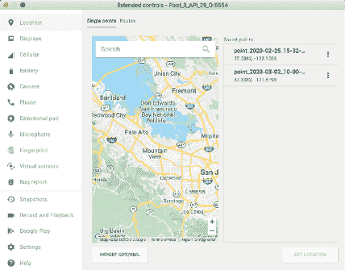

图 5-3

### 5.5.1 位置

位置控制允许以十进制或六十进制坐标的形式向模拟器发送模拟的位置信息。位置信息可以采取单个位置的形式，也可以是代表设备移动的点序列，后者通过 GPS 交换格式 (GPX) 或 Keyhole 标记语言 (KML) 格式的文件提供。或者，也可以使用集成的 Google Maps（谷歌地图）面板来视觉目视化地选择单点或旅行路线。

### 5.5.2 显示

除了模拟器屏幕内显示的主显示器外，`Displays`允许在同一个 Android 实例中运行额外的显示器。这对于为 Microsoft Surface Duo 等双屏设备测试应用非常有用。这些额外的屏幕可以配置为任何所需的尺寸，并与主屏幕一起出现在同一个模拟器窗口中。

### 5.5.3 蜂窝

可以在蜂窝设置屏幕中更改模拟的蜂窝连接类型。可以选择模拟不同的网络类型（`CSM`、`EDGE`、`HSDPA`等），以及各种语音和数据场景，如漫游和拒绝访问。

### 5.5.4 摄像头

当摄像头激活时，模拟器会模拟 3D 场景。这表现为虚拟建筑的内部，在模拟器内录制视频或拍照之前，可以通过按住 Option 键（Windows 上为`Alt`）同时使用鼠标指针和键盘键进行导航。此扩展配置选项允许上传不同的图像以显示在虚拟环境中。

### 5.5.5 电池

在扩展控制屏幕的此面板上，可以模拟各种电池状态和充电条件，包括电池电量、电池健康状况以及当前是否连接了 AC 器。

### 5.5.6 电话

手机扩展控制在模拟器中提供了两个非常简单但实用的模拟。第一个选项允许模拟来自指定号码的呼入电话。这在测试应用如何处理此类高层中断时特别有用。

第二个选项允许在模拟器会话中模拟接收短信。与现实世界一样，这些消息会出现在 Message（消息）应用中，并触发模拟器内的标准通知。

### 5.5.7 方向键

方向键（`D-Pad`）是内置在 Android 设备中或外部连接（如游戏控制器）的另一组控件，提供方向控制（左、右、上、下）。方向键设置允许在模拟器中模拟 D-Pad 交互。

### 5.5.8 麦克风

麦克风设置允许启用麦克风并模拟虚拟耳机和麦克风连接。还有一个按钮用于启动模拟器上的语音助手。

### 5.5.9 指纹

许多 Android 设备现在配备了内置指纹检测硬件。AVD 模拟器使得无需在带有指纹传感器的物理设备上测试应用即可测试指纹认证。有关如何在模拟器中配置指纹测试的细节将在本章后面详细介绍。

### 5.5.10 虚拟传感器

虚拟传感器选项允许模拟加速度计和磁力计，通过偏航（yaw）、俯仰（pitch）和滚滚（roll）设置模拟设备的物理运动效果，如旋转、移动和倾斜。

### 5.5.11 快照

快照包含当前运行的 AVD 会话的状态，可以保存并快速恢复，从而轻松将模拟器回到精确的状态。快照将在本章后面详细介绍。

### 5.5.12 录制和播放

允许将模拟器屏幕和音频录制并保存为 WebM 或动画 GIF 格式。

### 5.5.13 Google Play

如果模拟器运行安装了 Google Play 服务的 Android 版本，此选项将显示当前的 Google Play 版本，并提供更新模拟器到最新版本的选项。

### 5.5.14 设置

设置面板提供了一组配置选项。使用此面板为工具栏和扩展控制面板选择较深的主题，指定要保存屏幕截图的文件系统位置，配置 OpenGL 支持级别，并配置模拟器窗口显示在桌面上其他窗口之上。

### 5.5.15 帮助

帮助屏幕包含三个子面板，其中包含快捷键列表、访问模拟器在线文档的链接、报告 bug 和发送反馈的链接，以及模拟器版本信息。

## 5.6 使用快照

当模拟器首次启动时，它会执行冷启动，就像物理 Android 设备开机一样。冷启动过程需要一些时间才能完成，因为操作系统正在加载并启动所有后台进程。为了避免每次启动模拟器都经过此过程，系统被配置为每次退出时自动保存模拟器当前状态的快照（称为快速启动快照）。下次启动模拟器时，快速启动快照将加载到内存中，并从之前离开的地方继续，允许模拟器以短于冷启动完成所需的时间重启。

扩展控制面板的快照屏幕可以在模拟器执行期间的任何点存储额外的快照。这保存了整个模拟器的精确状态，允许模拟器恢复到拍摄快照时的精确时间点。在屏幕内部，可以使用`Take Snapshot`按钮（图 5-4 中的 A）拍摄快照。要恢复现有快照，从列表（B）中选择它并点击屏幕底部的`run`按钮（C）。还提供了编辑（D）快照名称和描述以及删除（E）当前选定快照的选项：

`Settings`（设置）选项（`F`）提供了配置自动保存快速启动快照的选项（默认情况下，模拟器会在每次退出时都会询问是否保存快速启动快照）以及加载最近快照的功能。要强制模拟器会话执行冷启动而不是使用之前的快速启动快照，请打开`AVD Manager`（`Tools` -> `AVD Manager`），点击模拟器操作列中的向下箭头，并选择`Cold Boot Now`（立即冷启动）菜单选项。

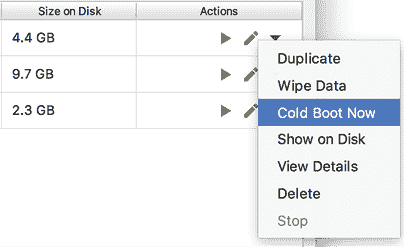

图 5-5

## 5.7 配置指纹模拟

模拟器允许配置多达 10 个模拟指纹，用于测试 Android 应用中的指纹认证。要配置模拟指纹，首先启动模拟器，打开`Settings`应用并选择`Security & Location`（安全与位置）选项。

在`Security`设置屏幕内，选择`Use fingerprint`（使用指纹）选项。在在弹出的信息屏幕上点击`Next`（下一步）按钮进入`Fingerprint`（指纹）设置屏幕。在启用指纹安全之前，必须配置备份屏幕解锁方法（例如`PIN`码）。点击`Fingerprint + PIN`按钮，并在提示时选择在设备启动时不不再需要`PIN`。输入并确认合适的`PIN`码，并通过接受默认通知选项完成`PIN`输入过程。

继续后续剩余屏幕，直到`Settings`应用要求在传感器上进行指纹。此时，显示扩展控制对话框，在左侧面板中选择`Fingerprint`类别，并确保主设置面板中已选择`Finger 1`（指纹 1）：

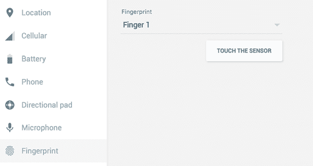

图 5-6

点击`Touch the Sensor`（触摸传感器）按钮以模拟`Finger 1`触摸指纹传感器。模拟器将报告指纹添加成功：


图 5-7


要添加更多指纹，点击`Add Another`（添加另一个）按钮，在再次点击`Touch the Sensor`按钮之前，从扩展控制面板菜单中选择另一只手指。关于在 Android 应用中构建指纹认证的话题，将在题为“Android 生物识别认证教程”的章节中详细介绍。

## 5.8 总结

`Android Studio 3.6`包含了一个全新的改进 Android 虚拟设备模拟器环境，旨在更方便地测试应用程序，而无需在物理 Android 设备上运行。本章对模拟器进行了简要介绍，并强调了用于配置和自定义环境以模拟不同测试条件的关键功能。

## 6. Android Studio 用户界面概览

虽然直接运行上一章创建的示例应用程序可能很有吸引力，但这样做涉及 Android Studio 用户界面的某些方面，这些内容最好先进行描述。

`Android Studio`是一个强大且功能丰富的开发环境，在很大程度上是直观易用的。尽管如此，现在花时间熟悉 `Android Studio`用户界面的布局和组织，将大大缩短书中后续章节的学习曲线。考虑到这一点，本章将提供对组成`Android Studio`环境的各个区域和组件的初步概述。

### 6.1 欢迎界面

欢迎界面（见图 6-1）在`Android Studio`运行且当前没有打开的项目时显示（可以随时选择`File` -> `Close Project`菜单选项关闭已打开的项目）。如果`Android Studio`在项目仍处于打开状态时退出，工具下次启动时将跳过欢迎界面，自动打开之前活跃的项目。


图 6-1

除了最近项目列表，`Quick Start`（快速启动）菜单提供了一系列执行任务的选项，如打开、创建和导入项目，以及访问当前受版本控制的项目。此外，底部的`Settings`菜单还提供了各种选项。

### 6.2 主窗口

当创建新项目或打开现有项目时，主窗口将显示。当多个项目同时打开时，每个项目将分配自己的窗口。窗口的精确配置取决于上次显示的工具和面板，类似于图 6-2。


图 6-2

主窗口的各种元素总结如下：

A - **Menu Bar**（菜单栏）：包含执行`Android Studio`内任务的一系列菜单。

B - **Toolbar**（工具栏）：频繁操作的快捷按钮。可以通过右键点击工具栏并选择`Customize Menus and Toolbars...`选项来自定义。如果工具栏不可见，可以使用`View` -> `Appearance` -> `Toolbar`菜单选项显示。

C - **Navigation Bar**（导航栏）：提供了在项目文件文件夹之间移动的方便方法。点击导航栏中的元素将显示该位置的子文件夹和文件列表。这是`Project`工具窗口的替代方案。

D - **Editor Window**（编辑器窗口）：显示开发者正在处理的文件内容。然而，此处显示取决于上下文。例如，编辑代码时将显示代码编辑器；而在处理用户界面布局文件时，将显示用户界面编辑器。当打开多个文件时，每个文件由编辑器顶部的标签页表示，如`图 6-3`。

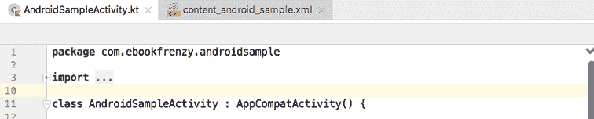

图 6-3

E - **Status Bar**（状态栏）：显示有关项目和`Android Studio`活动的消息，以及位于最左角的工具菜单按钮。悬停在状态栏项目上将提供该字段的描述。许多字段是交互式的，允许用户点击以执行任务或获取更详细的状态信息。

F - **Project Tool Window**（项目工具窗口）：项目工具窗口提供了项目文件结构的层级概述，允许导航到特定的文件和文件夹。工具栏可以使用多种方式显示项目。默认设置是 Android 视图，这是本书其余部分主要使用的模式。

项目工具窗口只是`Android Studio`环境中提供的许多工具窗口之一。

### 6.3 工具窗口

除了项目视图工具窗口外，`Android Studio`还包含许多其他窗口，这些窗口在启用后将显示在主窗口的底部和侧边。可以通过将鼠标指针悬停在状态栏最左角的按钮上（见图 6-4）而无需点击鼠标即可访问工具窗口快速访问菜单。

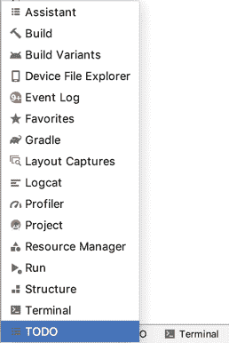

图 6-4

从快速访问菜单中选择项目将使相应的工具窗口在主窗口中出现。

或者，可以通过点击状态栏上的快速访问菜单图标来显示一组工具窗口栏。这些栏出现在主窗口的左侧、右侧和底部边缘（如图 6-5 中的箭头所示），并包含用于显示和隐藏每个工具窗口的按钮。当工具窗口栏显示时，再次点击状态栏中的按钮将隐藏它们。

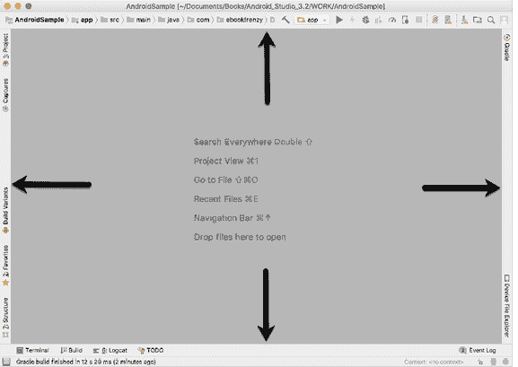

图 6-5

点击按钮将显示相应的工具窗口，而再次点击将隐藏该窗口。带有数字前缀的按钮（例如 1: Project）表示可以通过按下键盘上的`Alt`键（或 macOS 上的`Command`键）配合相应的数字显示该工具窗口。

按钮在工具窗口栏中的位置表示该窗口在显示时将出现在窗口的哪侧。可以通过点击并拖动按钮到其他窗口工具栏中的不同位置来更改这些位置。

每个工具窗口在顶部边缘都有自己的工具栏。这些工具栏中的按钮随工具的不同而异，但所有工具窗口都包含一个由齿轮图标表示的设置选项，该选项允许更改窗口的各个方面。图 6-6 显示了项目视图工具窗口的设置菜单。提供了可用选项，例如取消停靠窗口并允许其浮在`Android Studio`主窗口边界之外，以及移动和调整工具面板的大小。

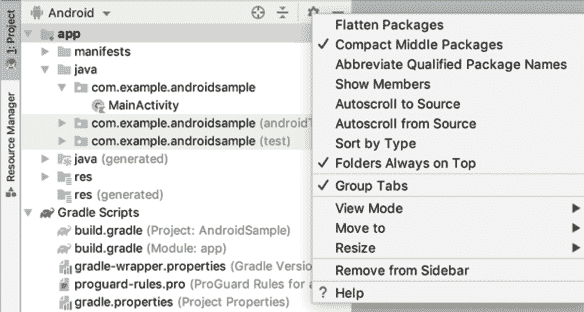

图 6-6

所有窗口在工具栏的最右侧还包含一个按钮，提供了隐藏工具窗口视图的额外方法。只需通过点击该窗口使其获得焦点然后输入搜索词，即可对工具窗口内的项目进行搜索（例如 Project 工具窗口中的文件名称）。搜索框将出现在窗口的工具栏中，匹配搜索结果的项目将会被高亮显示。

`Android Studio`提供了广泛工具窗口，其中最常用的如下：

- **Project（项目）** – 项目视图提供了组成项目的文件结构概览，允许在文件之间快速导航。通常情况下，在项目视图中双击文件将导致该文件加载到相应的编辑工具中。

- **Structure（结构）** – 结构工具提供当前编辑器中显示的源文件结构的高级视图。此信息包括文件中的类、方法和变量等项列表。从结构列表中选择一个项将带您去到编辑器窗口中源文件中的对应位置。

- **Layout Captures（布局捕获）** – 访问之前使用布局检查器（`Tools` -> `Layout Inspector`）捕获的所有布局层级快照。

- **Favorites（收藏）** – 可以将各种项目项添加到收藏列表中。例如，在项目视图中右键点击文件可以访问`Add to Favorites`菜单选项。同样，可以在结构工具窗口中右键点击源文件中的方法并将其添加到收藏。添加到收藏列表的任何内容都可以通过收藏工具窗口访问。

- **Build Variants（构建变体）** – 构建变体工具窗口提供了一种为当前应用程序项目配置不同构建目标的快速方法（例如，为应用程序的调试和发布版本提供不同的构建，或针对不同设备类别的多个构建）。

- **TODO** – 正如其名，此工具提供了一个查看项目中尚未完成项的地方。`Android Studio`通过扫描组成项目的源文件并查找匹配指定 TODO 模式的注释来编译此列表。可以通过选择`File` -> `Settings…`菜单选项（macOS 上为`Android Studio` -> `Preferences…`）并导航到 Editor 下的 TODO 页面查看并更改这些模式。

- **Logcat** – Logcat 工具窗口提供了对运行应用程序监控日志输出的访问，此外还有拍摄应用程序截图和视频以及停止重启进程的选项。

- **Terminal（终端）** – 提供对运行`Android Studio`的系统的终端窗口的访问。在 Windows 系统上这是命令提示符界面，而在 Linux 和 macOS 系统上，它表现为终端提示符。

- **Build（构建）** – 构建工具窗口在项目编译和打包期间显示有关构建过程的信息，并显示遇到的任何错误的详细信息。

- **Run（运行）** – 当应用程序运行时，运行工具窗口可用，提供运行结果视图以及停止或重启运行进程的选项。如果应用程序无法在设备或模拟器上安装和运行，此窗口通常提供与问题相关的诊断信息。

- **Event Log（事件日志）** – 事件日志窗口显示与`Android Studio`内执行的事件和活动相关的消息。例如，项目的成功构建或应用程序正在运行的情况将在此工具窗口中报告。

- **Gradle** – Gradle 工具窗口提供了组成项目构建配置的 Gradle 任务视图。该窗口列出了将项目各种元素编译为可执行应用程序所需的任务。右键点击顶级 Gradle 任务并选择`Open Gradle Config`菜单选项，可以将当前项目的 Gradle 构建文件加载到编辑器中。本书将在后文中详细介绍 Gradle。

- **Profiler（性能分析器）** – Android Profiler 工具窗口提供实时监控和分析工具，用于识别运行应用中的性能问题，包括 CPU、内存和网络使用情况。当应用程序运行时，此选项变为可用。

- **Device File Explorer（设备文件管理器）** – Device File Explorer 工具窗口提供对当前连接 Android 设备或模拟器文件系统的直接访问，允许浏览文件系统并将文件复制到本地系统。

- **Resource Manager（资源管理器）** - 用于添加和管理项目中的资源和资产，如图像、颜色和布局文件。（注：后续关于 6.4 和 6.5 章节的内容因原文提供不完整，未在此处完整翻译）

# 6.6 更改 Android Studio 主题

`Android Studio`环境的整体主题可以通过欢迎界面的`Configure` -> `Settings`选项，或者通过主窗口的`File` -> `Settings…`菜单选项（macOS 为`Android Studio` -> `Preferences…`）进行更改。

显示设置对话框后，在左侧面板中选择`Appearance`选项，然后在点击`Apply`按钮之前更改`Theme`菜单的设置。可用的主题取决于平台，但通常包括`Light`、`IntelliJ`、`Windows`、`High Contrast`和`Darcula`等选项。图 6-9 显示了选择了`Darcula`主题的主窗口示例：

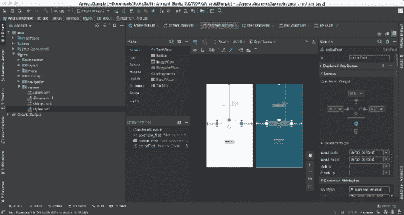

图 6-9

# 6.7 总结

`Android Studio`环境的主要元素由欢迎界面和主窗口组成。每个打开的项目都分配其自己的主窗口，该窗口又由菜单栏、工具栏、编辑和设计区域、状态栏以及一组工具窗口组成。工具窗口出现在主窗口的侧边和底部，可以通过状态栏中的快速访问菜单访问，也可以通过可选的工具窗口栏访问。

`Android Studio`中有极少数的操作是无法通过快捷键触发的。可以随时从`Android Studio`主窗口内访问默认快捷键的键位映射（keymap）。

# 7. 在物理 Android 设备上测试 Android Studio 应用

虽然使用 Android 虚拟设备 (AVD) 测试应用程序可以实现很多功能，但在物理 Android 设备上进行真实的应用测试是不可替代的，而且许多 Android 功能仅在物理 Android 设备上可用。

与 AVD 实例和连接的 Android 设备之间的通信由 Android 调试桥接 (ADB) 处理。在本章中，我们将学习配置`adb`环境步骤，以便在基于 macOS、Windows 和 Linux 的系统的物理 Android 设备上进行应用测试。

## 7.1 Android 调试桥接 (ADB) 概述

`ADB`的主要目的是便于开发系统（在此例中 Android Studio）与 AVD 模拟器以及物理 Android 设备之间的交互，用于运行和调试应用程序。

`ADB`包含一个客户端、一个在开发系统后台运行的服务器进程，以及一个运行在 AVD 或真实 Android 设备（如手机和平板电脑）上的守护进程后台进程。

`ADB`客户端有多种形式。例如，提供了一个位于 Android SDK `platform-tools`子目录下的名为`adb`的命令行工具形式的客户端。同样，`Android Studio`也有一个内置的客户端。

可以使用`adb`命令行工具执行各种任务。例如，可以使用`devices`命令行参数获取当前活动的虚拟或物理设备列表。以下命令输出表示系统上存在一个 AVD 但没有物理设备：

```
adb devices
List of devices attached
emulator-5554 device
```

## 7.2 在基于 Android 的设备上启用 ADB

在`ADB`连接到 Android 设备之前，必须先配置该设备以允许连接。在运行 Android 6.0 或更高版本的手机和平板设备上，实现此点的步骤如下：

1. 打开设备上的`Settings`应用并选择`About tablet`或`About phone`选项（在较新的 Android 版本中，可以在`Settings`应用的`System`页面找到）。

2. 在`About`屏幕上，滚动到`Build number`字段（图 7-1）并点击它七次，直到出现指示开发者模式已启用的消息。如果没有显示版本号，请展开列表中的`Advanced`部分。

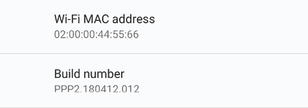

图 7-1

3. 返回主`Settings`屏幕，注意到出现了一个名为`Developer options`的新选项。选择此选项并找到开发者屏幕上名为`USB debugging`的设置。启用此项目旁边的开关，如图 7-2 所示：

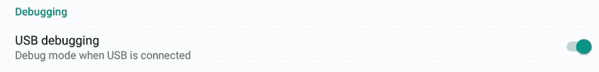

图 7-2

4. 从屏幕顶部向下滑动显示通知面板（图 7-3），并注意设备当前已连接用于调试。


图 7-3

此时，设备已配置为接受来自开发系统上`adb`的调试连接。剩下的工作是配置开发系统以便在设备连接时检测到它。虽然这是一个相对简单的过程，但涉及的步骤取决于开发系统运行的是 Windows、macOS 还是 Linux。注意，以下步骤假设 Android SDK `platform-tools`目录已包含在操作系统`PATH`环境变量中，正如“设置 Android Studio 开发环境”章节中所描述的那样。

### 7.2.1 macOS ADB 配置

为了在 macOS 系统上配置`ADB`环境，请使用 USB 线将设备连接到计算机系统，打开终端窗口并执行以下命令重启`adb`服务：

```
adb kill-server
adb start-server
* daemon not running. starting it now on port 5037 *
* daemon started successfully *
```

一旦服务器成功运行，执行以下命令验证设备是否已检测到：

```
adb devices
List of devices attached
emulator-5554 device
```

如果服务器成功运行但未列出设备，请检查设备上是否出现了请求允许 USB 调试的对话框（图 7-4）。

对于 Google USB 驱动不支持的 Android 设备，需要下载制造商提供的驱动程序。在线获取驱动列表以及下载和安装信息：

[`developer.android.com/tools/extras/oem-usb.html`](https://developer.android.com/tools/extras/oem-usb.html)

驱动安装且设备识别为正确的设备类型后，打开命令提示符窗口并执行以下命令：

```
adb devices
```

该命令应输出类似下面的已连接设备信息：

```
List of devices attached
HT4CTJT01906 offline
```

如果设备被列为离线或未授权，请查看设备屏幕并检查如图 7-4 所示请求允许 USB 调试的对话框。

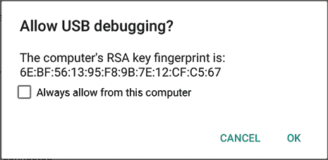

图 7-4

勾选允许此计算机旁边的复选框，然后点击确定。重复`adb devices`命令现在应该列出设备已就绪：

```
List of devices attached
```

# HT4CTJT01906 设备

如果设备未列在列表中，请执行以下命令重启 ADB 服务：

```bash
adb kill-server
adb start-server
```

如果设备仍然未在列表中，请尝试执行以下命令：

```bash
android update adb
```

请注意，可能还需要重启系统。

## 7.2.3 Linux adb 配置

在本章中，我们将再次使用 Ubuntu Linux 作为参考示例，介绍如何在 Linux 上配置`adb`以连接到物理 Android 设备进行应用测试。

在 Ubuntu Linux 上进行物理设备测试需要安装一个名为`android-tools-adb`的包，这又要求 Android Studio 用户必须是`plugdev`组的成员。这是大多数 Ubuntu 版本中用户账户的默认设置，可以通过运行`id`命令进行验证。如果列表中没有显示`plugdev`组，请运行以下命令将您的账户添加到该组：

```bash
sudo usermod -aG plugdev $LOGNAME
```

在满足组成员要求后，可以通过执行以下命令安装`android-tools-adb`包：


```bash
sudo apt-get install android-tools-adb
```

完成上述更改后，重启 Ubuntu 系统。系统重启后，打开终端窗口，启动`adb`服务并检查连接的设备列表：

```bash
$ adb start-server
* daemon not running. starting it now on port 5037 *
* daemon started successfully *
$ adb devices
List of devices attached
015d41d4454bf80c offline
```

如果设备显示为离线（`offline`）或未授权（`unauthorized`），请检查 Android 设备并查看图 7-4 所示请求允许 USB 调试的对话框。

## 7.3 测试 adb 连接

假设在您选择的开发平台上已成功配置了`adb`，下一步是尝试在设备上运行“在 Android Studio 中创建示例 Android 应用”章节创建的测试应用程序。启动 Android Studio，打开`AndroidSample`项目，并验证设备是否出现在设备选择菜单中，如图 7-5

图 7-5

请注意，此菜单还包含同时在多个设备和模拟器上测试应用的选项。当选中此选项时，会显示图 7-6 所示的对话框，可以在其中选择多个部署目标。

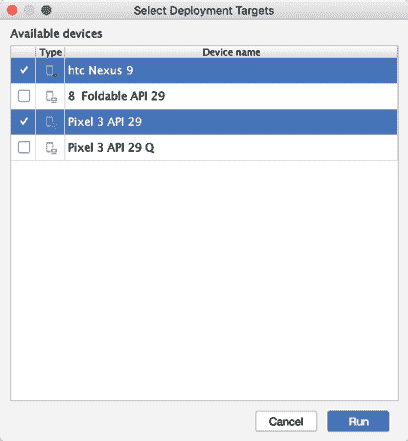

图 7-6

## 7.4 总结

虽然 Android 虚拟设备模拟器提供了一个极佳的测试环境，但重要的是，确保应用程序在物理 Android 设备上正常运行没有真正的替代方案。毕竟，这才是应用程序在现实世界中使用的地方。

但是，Android Studio 环境默认并未配置为将 Android 设备作为目标测试设备。因此，必须执行某些步骤，以便从 Android Studio 开发环境中直接将应用加载到 Android 设备。实现此目标的确切步骤取决于所使用的开发平台。在本章中，我们涵盖了适用于 Linux、macOS 和基于 Windows 平台的步骤。

# 8. Android Studio 代码编辑器的基础

为 Android 开发应用涉及大量的编程工作，根据定义，这涉及输入、审查和修改代码行。开发者花费在 Android Studio 大大部分时间通常都在编辑器窗口内编辑代码，这并不意外。

现代代码编辑器需要远超最初的输入、删除、剪切和粘贴基础。今天，代码编辑器的实用性通常由等因素衡量，例如它在多程度上减少了程序员所需的输入量、大型源文件导航的简易性，以及编辑器在编写代码时实时检测并突出编程错误的能力。正如本章将要说明的那样，这些只是 Android Studio 编辑器出色的少数领域。

虽然本章并非对 Android Studio 编辑器功能的详尽概述，但旨在提供该工具关键功能的指南。丰富的程序员会发现，这些功能中的某些对于目前大多数代码编辑器来说是通用的，而许多是这一特定编辑环境独有的。

## 8.1 Android Studio 编辑器

当选择 Java、Kotlin、XML 或其他文本文件进行编辑时，Android Studio 编辑器出现在主窗口中央。例如，图 8-1 显示了一个加载了 Kotlin 源代码文件的典型编辑会话：

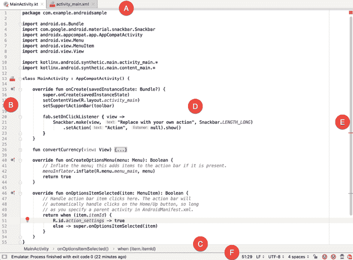

图 8-1

构成编辑器窗口的元素可以总结如下：

**A – 文档标签页** – Android Studio 能够同时打开多个文件进行编辑。每打开一个文件，它就会被分配一个文档标签页，在编辑器窗口顶部边缘的标签栏中显示文件名。当空间不足以显示所有标签页时，标签栏的最右侧会出现一个小的下拉菜单。点击此菜单将列出其他已打开的文件列表。标签页中文件名下方的红色波波浪线表示该文件中的代码包含一个或多个在项目编译和运行前需要解决的错误。

切换文件只需点击相应的标签页即可。

**B – 编辑器侧边区域（Gutter Area）** – 侧边区域被编辑器用于显示信息图标和控件。侧边区域中显示的典型项目包括：调试断点标记、折叠和展开代码块的控件、书签、更改标记和行号。行号默认开启，但可以通过右键点击侧边区域并选择“显示行号”选项来禁用。

**C – 代码结构位置** – 编辑器底部的此栏显示光标位置与代码整体结构的关系。例如在下面的图中，该栏显示正在编辑一个`setOnClickListener`方法调用，并且该行代码位于`MainActivity`类的`onCreate`方法之中。

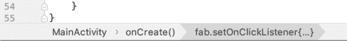

图 8-2

选择栏中的元素会将光标移动到代码文件相应位置。例如，选择`onCreate()`项会将光标移动到源文件中`onCreate`方法的顶部。

**D – 编辑器区域** – 这是用户显示、输入和编辑代码的主要区域。本章的后续章节将详细介绍编辑区域的关键功能。

## E – 验证与标记侧边栏

Android Studio 集成了一个名为“即时代码分析”的功能。这本质上意味着当你在输入代码时，编辑器会分析代码以检查警告和语法错误。验证侧边栏顶部的指示器将从绿色勾钩（未检测到警告或错误）变为黄色正方形（检测到警告）或红色警报图标（检测到错误）。点击此指示器将显示一个弹出窗口，其中包含编辑器代码中发现问题的摘要，如图 8-3 所示：


图 8-3

侧边栏还会使用相同的颜色编码在检测到问题的位置显示标记。当编辑器区域显示某行代码时，将鼠标指针悬停在标记上，将显示一个包含问题描述的弹出窗口（见图 8-4）：


图 8-4

当鼠标指针悬停在当前滚动出编辑器视图区域的代码行标记上时，将显示一个“透镜”覆盖层，其中包含问题所在的代码块（见图 8-5），从而允许无需滚动到编辑器的该位置即可查看代码：


图 8-5

同样值得注意的是，透镜覆盖层不仅限于侧边栏中的警告和错误。悬停在侧边栏的任何部分都会出现一个透镜，其中包含源文件中该位置的代码。

## F – 状态栏

虽然状态栏实际上是主窗口的一部分，而不是编辑器的一部分，但它确实包含了一些关于当前活动编辑会话的信息。这些信息包括光标在当前会话中的位置（以行和字符为单位）以及文件的编码格式（UTF-8、ASCII 等）。点击状态栏中的这些值可以更改相应的设置。例如，点击行号将显示“转到行”对话框。

在概述了构成 Android Studio 编辑器的元素后，本章的剩余部分将更详细地探讨编辑环境的关键特性。

## 8.2 分割编辑器窗口

默认情况下，编辑器将显示单个面板，显示当前选中文件的内容。在同时处理多个源文件时，一个特别实用的功能是将编辑器拆分为多个窗格。要拆编辑器，请右键点击编辑器窗口内的文件标签，并选择`Split Vertically`（垂直拆）或`Split Horizontally`（水平拆）菜单选项。例如，图 8-6 显示了分割器的工作状态，编辑器被拆分为三个面板：


图 8-6

随时可以通过右键点击相应的标签并选择`Change Splitter Orientation`（更改分割器方向）菜单选项来更改分割面板的方向。重复这些步骤可以取消单个面板的拆分，这次只需选择`Unsplit`（取消拆）选项。可以通过右键点击任何标签并选择`Unsplit All`（取消所有拆）菜单选项移除所有分割面板。

窗口分割可用于显示不同的文件或为同一个文件提供多个窗口，允许同时查看和编辑同一文件的不同区域。

## 8.3 代码补全

Android 编辑器对 Kotlin 编程语法以及构成 Android SDK 的类和方法拥有大量的内置知识，同时也对你自己的代码库有深入的了解。随着代码的输入，编辑器会扫描正在输入的内容，并在适当的情况下，针对完成语句或引用可能需要的内容提供建议。当编辑器检测到补全建议时，将出现一个包含建议列表的面板。例如，在图 8-7 中，编辑器正为`String`声明的开头提供可能的选择：


图 8-7

如果没有任何自动补全建议是正确的，只需继续输入，编辑器将在适当的情况下继续完善建议。要采纳最顶部的建议，只需按下键盘上的`Enter`或`Tab`键。要选择不同的建议，请使用方向键在列表中向上或移动，然后再次使用`Enter`或`Tab`键选择被选中的项。

可以使用`Ctrl-Space`键盘组合键手动调用补全建议。这在更改编辑器中的单词或声明时非常有用。当光标位于编辑器中的某个单词上时，该单词将自动高亮。按下`Ctrl-Space`将显示备选建议列表。要将当前单词替换为建议列表中当前高亮的项，只需按下`Tab`键。

除了实时自动补全功能外，Android 编辑器还提供了一种名为智能补全（Smart Completion）的系统。智能补全通过`Shift-Ctrl-Space`键盘组合键调用，选中后将根据代码的当前上下文提供更详细的建议。再次按下`Shift-Ctrl-Space`快捷键将从更广泛的可能性中提供更多建议。

代码补全对许多程序员来说可能是个人喜好。为了承认这一事实，Android Studio 对自动补全设置提供了高级别的控制。可以通过选择`File -> Settings`（macOS 上为`Android Studio -> Preferences…`）并在设置面板中选择`Editor -> General -> Code Completion`来查看和修改这些设置，如图 8-8 所示：


图 8-8

## 8.4 语句补全

Android 编辑器提供的另一种自动补全形式是语句补全。它可以用于自动填充方法和循环语句的括号。语句补全通过`Shift-Ctrl-Enter`（macOS 上为`Shift-Cmd-Enter`）键盘组合键调用。考虑以下代码：

```kotlin
fun myMethod()
```

在编辑器中输入此代码后，触发语句补全将导致编辑器为方法添加括号：

```kotlin
fun myMethod() {

}
```

## 8.5 参数信息

还可以请求编辑器提供关于方法接受参数的信息。当光标位于方法调用括号之间时，按下`Ctrl-P`（macOS 上为`Cmd-P`）键盘组合键将显示该方法接受的参数，最可能的建议将加粗显示：


图 8-9

## 8.6 参数名称提示

可以配置代码编辑器在方法调用中显示参数名称提示。图 8-10 示例突出了了`Snackbar`类`make()`和`setAction()`方法调用中的参数名称提示：


图 8-10

此模式的设置可以通过选择`File -> Settings`（macOS 上为`Android Studio -> Preferences…`）菜单选项，然后在左侧面板中的`Editor -> Appearance`来配置。在外观屏幕上，启用或禁用`Show parameter name hints`。要调整提示设置，点击`Configure...`按钮，选择编程语言并进行任何调整。

## 8.7 代码生成

除了在输入代码时完成代码外，编辑器在某些条件下还可以为您生成代码。当光标位于文件中需要生成代码的位置时，可以使用`Alt-Insert`（macOS 上为`Cmd-N`）快捷键访问图 8-11 中所示的可用代码生成选项列表。


图 8-11

为了便于说明，让我们考虑一种情况：我们希望在项目中的一个`Activity`（活动/活动）即将被操作系统销毁时能够收到通知。正如本书后续章节将将概述的那样，这可以通过重写`Activity`超类的`onStop()`生命周期方法来实现。若要让 Android Studio 为此生成一个存根方法，只需从代码生成列表中选择`Override Methods…`（重写方法……）选项，然后在可用方法列表中选择`onStop()`方法：


图 8-12

选择好要重写的方法后，点击 OK 将在 Kotlin 源文件的当前光标位置生成如下存根方法：

```kotlin
override fun onStop() {
    super.onStop()
}
```

### 8.8 代码折叠

一旦源文件达到一定大小，即使是格式化最精细、组织最好的代码也可能变得难以处理和难以导航。Android Studio 认为，并不总是需要让每个代码块的内容始终可见。通过使用 Android Studio 编辑器的代码折叠功能，可以使代码导航变得更容易。代码折叠通过出现在编辑器行隙中源文件中每个代码块开头和结尾的标记来控制。例如，图 8-13 显示了当前未折叠的方法声明的开始和结束标记：


图 8-13

点击这些标记中的任意一个都将折叠语句，使仅保留签名行可见，如图 8-14 所示：


图 8-14

要展开已折叠的代码段，只需点击编辑器行隙中的`+`标记。若要在不展开的情况下查看隐藏代码，请将鼠标指针悬停在`{…}"`指示器上，如图 8-15 所示。编辑器随后将显示包含折叠代码块的透镜叠加：


图 8-15

可以使用`Ctrl-Shift-Plus`和`Ctrl-Shift-Minus`快捷键折叠或展开文件中的所有代码块。

默认情况下，Android Studio 编辑器会在打开源文件时自动折叠某些代码。要配置发生这种情况的情况，请选择`File -> Settings…`（macOS 上为`Android Studio -> Preferences…`）并在生成的设置面板中选择`Editor -> General -> Code Folding`（编辑器 -> 常 -> 代码折叠）项（图 8-16）：


图 8-16

### 8.9 快速文档查询

通过将光标放在需要文档的声明上并按下`Ctrl-Q`快捷键（macOS 上为`Ctrl-J`），可以访问上下文相关的 Kotlin 和 Android 文档。这将显示一个包含该项目相关参考文档的弹出窗口。例如，图 8-17 显示了 Android`Snackbar`类的文档。


图 8-17

显示后，可以根据需要可以在屏幕上移动弹出窗口。点击位于弹出窗口标题栏右角的大图针图标，可以确保在焦点移回编辑器后弹出窗口仍然保持可见，以便在编写代码时将文档作为参考。

### 8.10 代码重新格式化

通常情况下，Android Studio 编辑器会在添加语句和代码块时，自动在缩进、间距和嵌套方面对代码进行格式化。在需要重新格式化代码行的情况下（这很常见，例如从网站剪切并粘贴示例代码时），编辑器提供了源代码重新格式化功能，选中后将自动格式化代码以匹配主流的代码风格。

要重新格式化源代码，请按`Ctrl-Alt-L`（macOS 上为`Cmd-Opt-L`）快捷键序列。要显示重新格式化代码对话框（图 8-18），使用`Ctrl-Alt-Shift-L`（macOS 上为`Cmd-Opt-Shift-L`）。此对话框提供了仅格式化当前选中代码、编辑器中当前活动的整个源文件或仅格式化由于源码控制更新而更改的代码选项。


图 8-18

完整的代码风格偏好都可以在项目设置对话框中更改。选择`File -> Settings`菜单选项（macOS 上为`Android Studio -> Preferences…`）并在左侧面板中选择`Code Style`以访问支持的语言列表。选择一种语言将提供大量的格式选项，所有选项都可以从 Android 默认设置进行修改。

### 8.11 查找示例代码

Android Studio 编辑器提供了访问当前高亮项相关示例代码的方法。此功能对于学习如何使用特定的类或方法非常有用。要查找示例代码，在编辑器中突出方法或类名，右键点击并选择 Find Sample Code。查找示例代码面板（图 8-19）将出现在编辑器下方并显示列表。从列表中选择一个示例将代码加载到右侧面板：


图 8-19

### 8.12 总结

Android Studio 编辑器尽力减少编写代码所需的输入量，并使代码更容易阅读和导航。在本章中，我们涵盖了许多关键编辑器功能，包括代码补全、代码生成、编辑器窗口分割、代码折叠、重新格式化和文档查询。

# 9 Android 架构概述

到目前为止，本书已经设置了适用于开发 Android 应用的环境。通过创建一个简单的 Android Studio 应用项目，我们也迈出了应用开发过程的第一步。

然而，在进一步研究 Android 应用开发的实际问题之前，了解 Android SDK 和泛指 Android 开发的一些更抽象的概念是非常重要的。现在清晰地理解这些概念将为进一步学习知识奠定坚实的基础。


从本章的 Android 架构概述开始并在接下来的几章中继续，目标是为 Android 开发的基础提供详细概述。

## 9.1 Android 软件栈

Android 以软件栈的形式结构化，由应用程序、操作系统、运行时环境、中间件、服务和库组成。这种架构可以通过图 9-1 所示的视觉方式进行最佳表征。栈的每一层以及每层中的相应元素都经过紧密集成并经过仔细调优，为移动设备提供最优的应用程序开发和执行环境。本章的剩余部分将逐步介绍 Android 栈的不同层级，从底部的 `Linux Kernel` 开始。


图 9-1

## 9.2 Linux 内核

`Linux Kernel` 位于 Android 软件栈的底部，在设备硬件和 Android 软件栈上层之间提供抽象层。基于 `Linux` 版本 `2.6`，内核提供了抢占式多任务处理、内存、进程和电源管理等低级核心系统服务，还为设备显示、Wi-Fi 和音频等硬件提供了网络栈和设备驱动程序。

原始的 `Linux` 内核由 `Linus Torvalds` 于 1991 年开发，并与 `Richard Stallman` 在 `Free Software Foundation` 开发的一系列工具、实用程序和编译器相结合，创建一个被称为 `GNU/Linux` 的完整操作系统。各种 `Linux` 分发版都是基于这些基础衍生的，例如 `Ubuntu` 和 `Red Hat Enterprise Linux`。

然而，重要的是，Android 仅使用 `Linux kernel`。尽管如此，值得注意的是，`Linux kernel` 最初是为桌面电脑和服务器形式的传统计算机设计的。事实上，`Linux` 现在最广泛部署在任务关键的企业服务器环境中。我们发现这种软件位于 Android 软件栈的核心，既证明了今天移动设备的强大，也证明了 `Linux kernel` 的效率和性能。

## 9.3 Android Runtime – ART

当 Android 应用在 `Android Studio` 中构建时，它会被编译成一种中间字节码格式（称为 `DEX format`）。当应用程序随后加载到设备上时，`Android Runtime (ART)` 使用一种称为“提前编译（`AOT` 编译）”的过程将字节码翻译为设备处理器所需的本地指令。这种格式被称为“可执行和链接格式（`ELF`）”。

此后每次启动应用程序时，都会运行 `ELF` 可执行版本，从而获得更快的应用程序性能和改进的电池寿命。

这与旧版 Android 实现使用的“即时编译（`JIT`）”编译方法形成对比，在那种方法中，字节码每次启动应用程序时都在虚拟机（`VM`）中进行翻译。

## 9.4 Android 库

除了一组标准的 Java 开发库（提供对字符串处理、网络和文件操作等通用任务的支持）外，Android 开发环境还包含 `Android Libraries`。这些是针对 Android 开发的一系列基于 Java 的库。此类库的示例包括应用程序框架库，以及有助于构建用户界面、图形绘制和数据库访问的库。

Android 开发者可用的某些关键核心 Android 库摘要如下：

- `android.app` – 提供对应用程序模型的访问，是所有 Android 程序的基石。
- `android.content` – 应用程序与应用程序组件之间的内容访问、发布和消息传递。
- `android.database` – 用于访问内容提供者发布的数据，包含 `SQLite` 数据库管理类。
- `android.graphics` – 一个低级 2D 图形绘制 API，包括颜色、点、过滤器、矩形和画布。
- `android.hardware` – 提供访问加速度计和光传感器等硬件的 API。
- `android.opengl` – 连接到 `OpenGL ES` 3D 图形渲染 API 的 Java 接口。
- `android.os` – 为应用程序提供标准操作系统服务的访问，包括消息、系统服务和进程间通信。
- `android.media` – 提供启用音频视频播放的类。
- `android.net` – 一组访问网络栈的 API。包括 `android.net.wifi`，它提供对设备无线栈的访问。
- `android.print` – 包括一组类，允许从 Android 内部将内容发送到配置的打印机。
- `android.provider` – 一组便利类，提供对标准 Android 内容提供者数据库的访问，例如日历和联系人应用程序维护的数据库。
- `android.text` – 用于在设备显示上渲染和操作文本。
- `android.util` – 一组工具类，用于执行字符串和数字转换、XML 处理以及日期处理等任务。
- `android.view` – 应用程序用户界面的基础构建模块。
- `android.widget` – 一组丰富的预构建用户界面组件，如按钮、标签、列表视图、布局管理器、单选按钮等。
- `android.webkit` – 一组旨在将网络浏览功能构建到应用程序中的类。

在涵盖了 Android 运行时基于 Java 的库之后，现在是时候转向 Android 软件栈这一层包含的基于 C/C++ 的库了。

### 9.4.1 C/C++ 库

在前一节概述的 Android 运行时核心库是基于 Java 的，为编写 Android 应用程序的开发者提供了主要的 API。然而，重要的是，核心库并没有执行许多实际工作，事实上，它们本质上是对一组基于 C/C++ 的库的 Java“封装”。例如，当调用 `android.opengl` 库在设备显示器上绘制 3D 图形时，该库最终会调用 `OpenGL ES C++` 库，而该库反过来与底层 `Linux kernel` 协作执行绘制任务。

包含 C/C++ 库是为了满足广泛的功能，包括 2D 和 3D 图形绘制、安全套接层（`SSL`）通信、`SQLite` 数据库管理、音频视频播放、位图和矢量字体渲染、显示子系统和图形层管理，以及标准 C 系统库（`libc`）的实现。

在实践中，典型的 Android 开发者将仅通过 Java 库 API 访问这些库。在需要直接访问这些库的情况下，可以使用 `Android Native Development Kit (NDK)` 实现，其目的是通过 `Java Native Interface (JNI)` 从 Java 代码调用非 Java 或 Kotlin 语言（如 C 和 C++）的本地方法。

## 9.5 应用程序框架

应用程序框架是一组共同构成 Android 应用程序运行和管理环境的服务。该框架实现了 Android 应用程序是由重用、可交换和可替换组件构建的概念。基于这一概念，应用程序还可以发布其能力及其相关数据，以便其他应用程序发现并重用。

Android 框架包含以下关键服务：

- `Activity Manager` – 控制应用程序生命周期和活动栈的所有方面。
- `Content Providers` – 允许应用程序与其他应用程序发布和共享数据。
- `Resource Manager` – 提供对非代码嵌入资源的访问，如字符串、颜色设置和用户界面布局。
- `Notifications Manager` – 允许应用程序向用户显示警报和通知。
- `View System` – 一组用于创建应用程序用户界面的可扩展视图集合。
- `Package Manager` – 应用程序通过该系统获取设备上已安装的其他应用程序信息的系统。
- `Telephony Manager` – 向应用程序提供有关设备上可用电话服务的信息，例如状态和订阅者信息。
- `Location Manager` – 提供对位置服务的访问，允许应用程序接收有关位置更改的更新。

## 9.6 应用程序

应用程序位于 Android 软件栈的顶部。这些应用程序包括由特定 Android 实现版本提供的原生应用程序（例如网络浏览器和电子邮件应用程序），也包括用户在购买设备后安装的第三方应用程序。

## 9.7 总结

良好的 Android 开发知识基础需要对 Android 的整体架构有理解。Android 以软件栈架构的形式实现，由一个 `Linux kernel`、一个运行时环境及相应的库、一个应用程序框架以及一组应用程序组成。应用程序主要使用 `Java` 或 `Kotlin` 编写，并在 `Android Studio` 构建环境中编译为字节码格式。当应用程序随后安装到设备上时，这些字节码将由 `Android Runtime`（`ART`）编译为 CPU 使用的本地格式。Android 架构的关键目标是性能和效率，这体现在应用程序执行以及应用程序设计中的复用实现中。

## 10. Android 应用程序剖析

无论你之前的编程经验是基于 Windows、macOS、Linux 甚至 iOS 的，Android 开发可能与你以前遇到过的任何东西都大相同。

因此，本章的目的是提供对 Android 应用程序架构背后的高级概念的理解。在此，我们将详细探索用于构建应用程序的各种组件，以及允许这些组件协同工作以创建一个统一应用程序的机制。

### 10.1 Android Activity（活动）

熟悉 `Java`、`Kotlin`、`C++` 或 `C#` 等面向对象编程语言的人熟悉将应用程序功能元素封装在类中的概念，然后将其实例化为对象并进行操作以创建应用程序。由于 Android 应用程序是用 `Java` 和 `Kotlin` 编写的，情况依然如此。然而，Android 还将复用组件的概念提升到了更高的水平。

Android 应用程序通过汇聚一个或多个称为 `Activities` 的组件来创建。Activity 是一个单一、独立的应用程序功能模块，通常直接对应单个用户界面屏幕及其相应的功能。例如，一个预约应用程序可能会有一个 Activity 屏幕，显示当天设置的预约。该应用程序可能还会使用第二个 Activity，它包含一个用户可以在其中输入新预约的屏幕。

`Activities` 被设计为完全可复用且可交换的构建块，可以在不同的应用程序之间共享。例如，一个现有的电子邮件应用程序可能包含一个专门用于编写和发送电子邮件消息的 Activity。开发者可能正在编写一个应用程序，该程序也有发送电子邮件消息的需求。开发者无需为这个新应用程序专门开发一个邮件编写 Activity，而是简单地使用现有电子邮件应用程序中的 Activity。

`Activities` 是作为 `Activity` 类的子类创建的，并且必须实现为完全与应用程序中的其他 Activity 独立。换句话说，共享的 Activity 不能依赖于在程序流的已知点被调用（因为其他应用程序可能会以意想不到的方式使用该 Activity），而且一个 Activity 不能直接调用另一个 Activity 的方法或访问其实例数据。相反，这是通过使用 `Intents` 和 `Content Providers` 实现的。

默认情况下，Activity 无法向调用它的 Activity 返回结果。如果需要此功能，则必须将 Activity 特定启动为源 Activity 的子 Activity。

### 10.2 Android Fragment（片段）

如上所述，Activity 通常代表应用中的单个用户界面屏幕。一种方案是使用单个用户界面布局和一个对应的 Activity 类文件来构建 Activity。然而，更好的替代方案是将 Activity 拆分为不同的部分。这些部分中的每一个被称为一个 `fragment`，每个片段由用户界面布局的一部分和匹配的类文件（声明为 `Fragment` 类的子类）组成。在这种情况下，Activity 仅仅变成了一个容器，在其中嵌入一个或多个片段。

事实上，`fragments` 为每个用户界面屏幕都由单独的 Activity 表示提供了一种高效的替代方案。相反，一个应用可以由单一 Activity 组成，该 Activity 在不同的片段之间切换，每个片段代表不同的应用屏幕。

### 10.3 Android Intent（意图）

`Intents` 是一个 Activity 启动另一个 Activity 并实现组成应用程序的 Activity 之间流的机制。`Intents` 由对要执行的操作的描述以及可选的要执行该操作的数据组成。

`Intents` 可以是显式的（explicit），即它们通过类名引用 Activity 来请求启动特定的 Activity；也可以是隐式的（implicit），即通过阐明要执行的操作类型或提供要执行该操作的特定类型的数据。在隐式意图的情况下，Android 运行时将使用称为“意图解析”（Intent Resolution）的过程选择与 `Intent` 指定标准最匹配的 Activity 进行启动。

### 10.4 Broadcast Intent（广播意图）

另一种 `Intent` 类型是 `Broadcast Intent`，它是一种系统范围的意图，发送给所有注册了“感兴趣”`Broadcast Receiver` 的应用程序。例如，Android 系统通常会发送 `Broadcast Intents` 来指示设备状态的变化，例如系统启动完成、外部电源连接到设备或屏幕开启或关闭。

`Broadcast Intent` 可以是普通的（异步的），因为它几乎在同一时间发送给所有感兴趣的 `Broadcast Receivers`；也可以是有序的，因为它一次只发送给一个接收器，接收器可以对其进行处理，然后将其终止或允许传递给下一个 `Broadcast Receiver`。

### 10.5 Broadcast Receiver（广播接收器）

`Broadcast Receivers` 是应用程序响应 `Broadcast Intents` 的机制。`Broadcast Receiver` 必须由应用程序注册，并配置 `Intent Filter` 以指示它感兴趣的广播类型。当匹配的意图被广播时，无论注册接收器的应用程序当前是否运行，Android 运行时都会调用接收器。随后，接收器在 5 秒内必须完成对其要求的任何任务（例如启动 `Service`、更新数据或向用户发布通知），然后返回。`Broadcast Receivers` 在后台运行，没有用户界面。

### 10.6 Android Services（服务）

Android 服务是在后台运行且没有用户界面的进程。它们可以从活动程序（activities）、广播接收器（Broadcast Receivers）或其他服务启动并随后进行管理。对于需要继续执行任务但并不一定需要用户看到用户界面的情况，Android 服务是理想选择。虽然服务缺少用户界面，但它们仍然可以使用通知（notifications）和吐司（toasts，即出现在屏幕上但不中断当前可见活动的小型通知消息）来通知用户事件，并且能够发送意图（`Intents`）。

Android 运行时赋予服务的优先级高于许多其他进程，系统只有在为了释放资源的万不得已的情况下才会作为最后手段将其终止。然而，如果运行时确实需要杀死某个服务，一旦资源再次可用，它将自动重新启动。服务可以通过声明自己为需要在前台运行来降低被终止的风险。这是通过调用 `startForeground()` 实现的。这仅建议用于会对用户体验产生不利影响的情况（例如，用户正在收听由服务流的音频）。

服务可能作为实际解决方案的示例场景包括（如前所述）：当应用程序不再活跃时仍继续播放的音频流，或者当股票达到指定价格时需要通知用户的股票市场跟踪应用程序。

## 10.7 内容提供者（Content Providers）

内容提供者实现了一种应用程序之间共享数据的机制。任何应用程序都可以通过实现内容提供者为其他应用程序提供对其底层数据的访问，包括添加、删除和查询数据的能力（受权限限制）。对数据的访问通过内容提供者定义的通用资源标识符（URI）提供。数据可以以文件或整个 `SQLite` 数据库的形式共享。

原生 Android 应用程序包含了标准的内容提供者，允许应用程序访问联系人和多媒体文件等数据。Android 系统上当前可用的内容提供者可以使用 `Content Resolver`（内容解析器）进行定位。

## 10.8 应用程序清单（The Application Manifest）

构成应用程序的各种元素结合的胶水是应用程序清单文件。在这个基于 XML 的文件中，应用程序概述了构成完整应用程序的活动、服务、广播接收器、数据提供者和权限。

## 10.9 应用程序资源（Application Resources）

除了清单文件和包含字节码的 `Dex` 文件，Android 应用程序包通常还包含一组资源文件。这些文件包含了用户界面中的资源，如字符串、图像、字体和颜色，以及用户界面布局的 XML 表示。默认情况下，这些文件存储在应用程序项目层次结构的 `/res` 子目录下。

## 10.10 应用程序上下文（Application Context）

当应用程序编译时，会创建一个名为 `R` 的类，其中包含对应用程序资源的引用。应用程序清单文件和这些资源结合了所谓的应用程序上下文（Application Context）。此上下文由 `Android Context` 类表示，可以在应用程序代码中使用以便在运行时访问应用程序资源。此外，可以在应用程序上下文中调用广泛的方法来收集信息并在运行时更改应用程序的环境。

## 10.11 总结（Summary）

可以结合许多不同的元素来创建一个 Android 应用程序。在本章中，我们提供了活动（`Activities`）、片段（`Fragments`）、服务（`Services`）、意图（`Intents`）和广播接收器的高级概述，以及对清单文件和应用程序资源的概述。

通过以活动和意图的形式创建独立的、单独的功能模块，促进了最大重用和互操作性，而应用程序之间的数据共享则通过实现内容提供者来实现。

活动程序专注于用户与应用程序交互的区域（一个活动本质等同于单个用户界面屏幕，通常由一个或多个片段组成），而后台处理通常由服务和广播接收器处理。

构成应用程序的组件在清单文件中为 Android 运行时系统进行了概述，该文件与应用程序资源结合，代表了应用程序的上下文。


本章涵盖了许多对普通开发者来说很可能是新颖的内容。然而，请放心，在随后的章节中将对这些概念进行广泛的探索和实际应用，以确保在构建您自己的应用程序时拥有坚实的知识基础。

## 11. Kotlin 简介 (An Introduction to Kotlin)

Android 开发主要使用 Android Studio 进行，而 Android Studio 又是基于名为 JetBrains 的公司创建的 IntelliJ IDEA 开发环境的。在 Android Studio 3.0 发布之前，所有 Android 应用程序都是使用 Android Studio 和 Java 编程语言编写的（在需要时偶尔带有一些 C++ 代码）。

然而，自 Android Studio 3.0 引入以来，开发者现在可以选择使用另一种名为 Kotlin 的编程语言来创建 Android 应用程序。尽管对该语言所有功能的详细介绍超出了本书的范围（完全可以且已经写过专门介绍 Kotlin 的整本书），但本章及后续六章的目标是提供足够的信息来开始使用 Kotlin 编程，并快速上手使用这种编程语言开发 Android 应用程序。

### 11.1 什么是 Kotlin？

Kotlin 以位于波罗的海的一个岛屿命名，是由 JetBrains 创建的编程语言，遵循了用岛屿命名编程语言的传统。Kotlin 代码旨在比许多其他编程语言更容易理解和编写，而且更安全。该语言、编译器和相关工具都是开源的，并根据 Apache 2 许可证下免费提供。

Kotlin 语言的主要目标是使代码既简洁又安全。当代码可以易于阅读和理解时，通常被认为是简洁的。简洁性在编写代码时也起着作用，允许更快、更高效地编写代码。在安全性方面，Kotlin 包含了许多功能，提高了在编写代码时识别潜在问题的概率，而不是导致运行时崩溃。

Kotlin 设计和实现中的第三个目标涉及与 Java 的互操作性。

### 11.2 Kotlin 和 Java

Java 由 Sun Microsystems 于 1995 年最初引入，至今仍然是世界上最流行的编程语言。在 Kotlin 引入之前，很可能市场上提供的每个 Android 应用程序都是用 Java 编写的。自从收购 Android 操作系统，Google 投入了大量精力调整和优化在 Android 设备上运行 Java 代码的编译和运行时环境。

Kotlin 并不是尝试重新发明轮子，而是与 Java 集成并协同工作。当 Kotlin 代码被编译时，它生成的与 Java 编译器生成的字节码相同，使得项目可以使用 Java 和 Kotlin 代码的组合进行构建。这种兼容性还允许在 Kotlin 代码中无缝使用现有的 Java 框架和库，并允许在 Java 代码中调用 Kotlin 代码。

Kotlin 的创建者也承认，虽然有改进现有语言的方法，但 Java 的许多功能并不需要更改。因此，熟悉 Java 编程的开发者会发现这些技能中的许多可以迁移到基于 Kotlin 的开发中。具有 Swift 编程经验的程序员在学习 Kotlin 时，也会发现许多熟悉的内容。

## 11.3 从 Java 转换为 Kotlin

鉴于 Kotlin 和 Java 之间具有很高的互操作性，将现有的 Java 代码转换为 Kotlin 并不是必须的，因为这两种语言可以在同一个项目内舒适地共存。尽管如此，可以在 Android Studio 内部使用内置的 Java 转 Kotlin 转换器将 Java 代码转换为 Kotlin。要将整个 Java 源文件转换为 Kotlin，请将文件加载到 Android Studio 代码编辑器中，并选择 `Code` -> `Convert Java File to Kotlin File` 菜单选项。或者，也可以通过剪切代码并将其粘贴到 Android Studio 代码编辑器中现有的 Kotlin 文件中将 Java 代码块转换为 Kotlin。注意，在执行 Java 到 Kotlin 的转换时，Java 代码并不总是能转换为最好的 Kotlin 代码，因此在转换后应该花时间进行审查和整理。

## 11.4 Kotlin 和 Android Studio

Android Studio 通过 `Kotlin Plug-in` 提供对 Kotlin 支持，该插件默认集成在 Android Studio 3.0 或更高版本中。

## 11.5 尝试 Kotlin

在学习新编程语言时，能够输入并执行代码片段通常很有用。使用 Kotlin 这一点的最佳方法之一是使用在线游乐场（图 11-1），位于 `https://try.kotl.in`。在线游乐场除了提供了一个快速输入和执行 Kotlin 代码的环境外，还包含了一组演示关键 Kotlin 特性运行的示例。

左侧的面板（在图 11-1 中标记为 A）包含编码示例列表以及你创建的任何示例。代码在主面板 (B) 中输入，并通过点击 `Run` 按钮 (C) 执行。代码执行的任何输出显示在控制台面板 (D) 中。可以通过将参数输入标记为 E 的字段来传递给 `main` 函数。


图 11-1

通过打开浏览器窗口、导航到在线游乐场并在主代码面板中输入以下内容来尝试一些 Kotlin 代码：

```kotlin
fun main(args: Array<String>) {
    println("Welcome to Kotlin")
    for (i in 1..8) {
        println("i = $i")
    }
}
```

输入代码后，点击 `Run` 按钮并注意控制台面板中的输出：


图 11-2

在线游乐场也可用于查找 Java 代码片段的 Kotlin 等效代码。只需将 Java 代码输入（或剪贴）到主面板并点击 `Convert from Java` 按钮（标记为 E）。

## 11.6 Kotlin 中的分号

与 Java 和 C++ 等编程语言不同，Kotlin 不需要在每个语句或表达式行的末尾使用分号。因此，以下是有效的 Kotlin 代码：

```kotlin
val mynumber = 10
println(mynumber)
```

只有当多个语句出现在同一行上时，才需要分号：

```kotlin
val mynumber = 10; println(mynumber)
```

## 11.7 总结

自 Android 操作系统引入以来，开发者现在有了用 Java 代码编写应用程序的替代方案。Kotlin 是由 JetBrains 开发的编程语言，该公司创建了 Android Studio 所基于的开发环境。Kotlin 旨在让代码更安全、更易理解和编写。Kotlin 与 Java 具有兼容性，允许 Java 和 Kotlin 代码在同一个项目中共存。这种互操作性确保了在使用 Kotlin 进行开发时，大多数标准的 Java 和基于 Java 的 Android 库和框架均可用。

Android Studio 的 Kotlin 支持通过与 Android Studio 3.0 或更高版本一起提供的插件提供。该插件还提供了一个将 Java 代码转换为 Kotlin 的转换器。

在学习 Kotlin 时，在线游乐场提供了一个快速尝试 Kotlin 代码的有用环境。

## 12. Kotlin 数据类型、变量和空安全性

本章以及接下来的几章都旨在介绍 Kotlin 编程语言的基础。本章将重点关注 Kotlin 代码中提供的各种数据类型。这还包括对常量、变量、类型转换以及 Kotlin 处理空值的解释。

正如上一章“Kotlin 简介”所述，实验该语言的一种实用方法是使用 Kotlin 在线游乐场环境。因此，在开始本章之前，打开浏览器窗口，导航到 [`try.kotl.in`](http://try.kotl.in) 并使用游乐场尝试本章以及后续其他 Kotlin 简介章节中的代码。

### 12.1 Kotlin 数据类型

当我们观察运行在计算机系统和移动设备上的不同软件类型时，从财务应用程序到图形密集型游戏，很容易忘记计算机实际上只是二进制机器。二进制系统以 0 和 1、真或假、设置或未设置的方式工作。存储在 RAM 中、存储在磁盘驱动器上以及在电路板和总线中流的所有数据无非是 1 和 0 的序列。每个 1 或 0 被称为一个位（bit）。它们每 8 个一组，每组被称为一个字节（byte）。当人们谈论 32 位和 64 位计算机系统时，他们指的是 CPU 同时处理的比特数。例如，64 位 CPU 能够处理 64 位块的数据，其性能比 32 位系统更快。

当然，人类并不是以二进制思维的。我们使用十进制数、字母和单词。为了让人类能够轻松地（在此语境下，“轻松”是一个相对术语）编写计算机，需要在人类和计算机思维之间寻求某种折中方案。这就是 Kotlin 等编程语言大显身手的地方。编程语言允许人类以我们理解的术语和结构向计算机表达指令，然后将其编译为 CPU 可以执行的格式。

任何程序的基础之一都涉及数据，像 Kotlin 这样的编程语言定义了一组数据类型，允许我们在编程时以我们理解的格式来处理数据。例如，如果我们想在 Kotlin 程序中存储一个数字，可以使用类似于下面的语法进行操作：

```kotlin
val mynumber = 10
```

在上面的示例中，我们创建了一个名为 `mynumber` 的变量，并给它赋值为 10。当我们把源代码编译为 CPU 使用的机器码时，计算机以二进制形式看到数字 10：

`1010`

同样，我们可以使用以下语法表示字母、数字的视觉表示（‘0’ 到‘9’）或标点符号（在计算机术语中称为字符）：

```kotlin
val myletter = 'c'
```

再次，这对于人类程序员来说是可以理解的，但会被编译为 CPU 可理解的二进制序列。在这种情况下，字母 ‘c’ 使用 ASCII 表（一种为人类读字符分配数值的国际标准）表示为十进制 99。转换为二进制后，它存储为：

`101011001`

现在我们对数据类型概念以及为什么需要它们有了基本的了解，可以更详细地查看 Kotlin 支持的一些更常用数据类型。

#### 12.1.1 整数数据类型

Kotlin 整数数据类型用于存储整数（换句话说，没有小数部分的数字）。Kotlin 中的所有整数都是有符号的（换句话说，能够存储正值、负值和零）。

Kotlin 提供对 8、16、32 和 64 位整数的支持（分别由 `Byte`、`Short`、`Int` 和 `Long` 类型表示）。

## 12.1.2 浮点数据类型

Kotlin 浮点数据类型能够存储包含小数位的值。例如，`4353.1223` 将被存储在浮点数据类型中。Kotlin 提供了 `Float` 和 `Double` 两种浮点数据类型。使用哪种类型取决于要存储的值的大小以及所需的精度水平。`Double` 类型可用于存储多达 64 位的浮点数。而 `Float` 数据类型则限制为 32 位浮点数。

## 12.1.3 布尔数据类型

Kotlin 与其他语言一样，包含一种用于处理真或假（1 或 0）条件的数据类型。Kotlin 专门为处理布尔数据类型提供了两个布尔常量值（`true` 和 `false`）。

## 12.1.4 字符数据类型

Kotlin 的 `Char` 数据类型用于存储渲染文本的单个字符，例如字母、数字、标点符号或符号。Kotlin 内部的字符以 16 位 Unicode 字形簇（grapheme clusters）的形式存储。一个字形簇由两个或多个 Unicode 码点组合而成，表示单个可见字符。

以下行将多种不同的字符分配给 `Character` 类型变量：

```kotlin
val myChar1 = 'f'
val myChar2 = ':'
val myChar3 = 'X'
```

也可以使用 Unicode 码点引用字符。以下示例使用 Unicode 将 ‘X’ 字符赋值给变量：

```kotlin
val myChar4 = '\u0058'
```

注意在给变量赋值字符时使用单引号。这向 Kotlin 表明这是一个 `Char` 数据类型，而不是表示 `String` 数据类型的双引号。

## 12.1.5 字符串数据类型

`String` 数据类型是字符序列，通常组成一个单词或句子。除了提供存储机制外，`String` 数据类型还包含了一系列字符串操作功能，允许对字符串进行搜索、匹配、拼接和修改。赋值期间使用双引号包围单行字符串，例如：

```kotlin
val message = "You have 10 new messages."
```

或者，可以使用三引号声明多行字符串：

```kotlin
val message = """You have 10 new messages,

               5 old messages

               and 6 spam messages."""
```

多行字符串每行开头的空格可以通过调用 `String` 数据类型的 `trimMargin()` 函数来移除：

```kotlin
val message = """You have 10 new messages,

               5 old messages

               and 6 spam messages.""".trimMargin()
```

字符串还可以使用字符串、变量、常量、表达式和函数调用的组合来构建，这种概念被称为字符串插值（string interpolation）。例如，以下代码在输出到控制台之前，使用字符串插值从各种不同的源创建一个新字符串：

```kotlin
val username = "John"
val inboxCount = 25
val maxcount = 100
val message = "$username has $inboxCount message. Message capacity remaining is ${maxcount - inboxCount}"

println(message)
```

执行时，代码将输出以下消息：

John has 25 messages. Message capacity remaining is 75 messages.

## 12.1.6 转义序列

除了上述概述的标准字符集外，还有一系列特殊字符（也称为转义字符），用于在字符串内指定换行、制表符或特定的 Unicode 值等。这些特殊字符通过在字符前加上反斜杠来识别（这种概念被称为转义）。例如，以下代码将换行赋值给名为 `newline` 的变量：

```kotlin
var newline = '\n'
```

本质上，任何置于反斜杠之前的字符都被视为特殊字符并进行相应处理。这产生了一个问题：如果你实际上想要一个反斜杠字符怎么办？这通过转义反斜杠本身来实现：

```kotlin
var backslash = '\\'
```

Kotlin 支持的特殊字符完整列表如下：

- `\n` - 新行

- `\r` - 回车

- `\t` - 水平制表符

- `\\` - 反斜杠

- `\"` - 双引号（在字符串声明中放置双引号时使用）

- `\'` - 单引号（在字符串声明中放置单引号时使用）

- `\$` - 用于当包含 `$` 的字符序列在字符串模板中被误认为变量时。

- `\unnnn` – 双字节 Unicode 标量，其中 `nnnn` 被替换为四个十六进制数字

## 12.2 可变变量

变量本质上是内存中用于存储数据的位置。程序员为每个变量赋予一个名称并分配一个值。这种访问可能涉及读取变量的值，或者在可变变量的情况下更改它。

## 12.3 不可变变量

不可变变量通常被称为常量，它与可变变量相似，在于它在内存中提供了一个命名的位置来存储值。不可变变量在一个显著方面与其不同：一旦分配了值，就无法更改。

如果某个值在整个应用程序中被重复使用，那么不可变变量特别有用。与其每次都使用该值，不如先将值分配给常量，这样代码更易读。例如，对于阅读你代码的人来说可能并不清楚为什么在表达式中使用 `5`。相反，如果你不是使用值 `5`，而是使用名为 `interestRate` 的不可变变量，该值的目的就会变得清晰得多。不可变值还有一个优势，如果程序员需要更改一个被广泛使用的值，只需要在常量声明中更改一次，而不需要每次引用都更改。

## 12.4 声明可变和不可变变量

可变变量使用 `var` 关键字声明，并可以在创建时用一个值初始化。例如：

```kotlin
var userCount = 10
```

如果声明变量时没有提供初始值，则必须声明变量的类型（该主题将在本章的下一节中详细介绍）。例如，以下是一个典型的声明，在声明后初始化变量：

```kotlin
var userCount: Int
userCount = 42
```

不可变变量使用 `val` 关键字声明。

```kotlin
val maxUserCount = 20
```

与可变变量一样，在未初始化声明变量时也必须指定类型：

```kotlin
val maxUserCount: Int
maxUserCount = 20
```

在编写 Kotlin 代码时，应尽可能使用不可变变量代替可变变量。

## 12.5 数据类型是对象

上述所有数据类型实际上都是对象，每个对象都提供了一系列函数和属性，用于执行各种特定类型的任务。这些函数和属性通过所谓的点符号法（dot notation）访问。点符号法通过指定变量名后跟一个点，然后是要访问的属性或要调用的函数名称来访问对象的函数或属性。

例如，字符串变量可以通过调用 `String` 类的 `toUpperCase()` 函数转换为大写：

```kotlin
val myString = "The quick brown fox"
val uppercase = myString.toUpperCase()
```

同样，可以通过访问 `length` 属性获取字符串的长度：

```kotlin
val length = myString.length
```


`String`类中也提供了许多函数，用于执行比较和检查特定单词是否存在等任务。例如，以下代码将返回一个布尔值`true`，因为单词“fox”出现在赋值给`myString`变量的字符串中：

```
val result = myString.contains("fox")
```

所有数字数据类型都包含了用于执行任务的函数，例如从一种数据类型转换为另一种类型，如将`Int`转换为`Float`：

```kotlin
val myInt = 10
val myFloat = myInt.toFloat()
```

Kotlin数据类型类提供的所有属性和函数的详细概述超出了本书的范围（其多达数百个）。然而，可以在可以在提供的在线Kotlin参考文档中找到所有数据类型的详尽列表：

`https://kotlinlang.org/api/latest/jvm/stdlib/kotlin/`

## 12.6 类型注解与类型推断

Kotlin被归类为静态类型编程语言。这本质上意味着，一旦确定了变量的数据类型，该变量就无法随后用于存储任何类型的数据，否则会引发编译错误。这与松类型编程语言形成对比，在松类型语言中，变量一旦声明，随后就可以用于存储其他数据类型。

变量的类型识别有两种方式。一种方法是在代码声明变量时使用类型注解。这是通过在变量名后加上冒号并跟上类型声明来实现的。例如，下面的代码声明了一个名为`userCount`的变量，类型为`Int`：

```
val userCount: Int = 10
```

在声明中没有类型注解的情况下，Kotlin编译器使用称为“类型推断”的技术来识别变量的类型。依赖类型推断时，编译器会查看在初始化点赋值给变量的是什么类型的值，并将其作为类型。例如，考虑以下变量声明：

```kotlin
var signalStrength = 2.231
val companyName = "My Company"
```

在编译上述代码时，Kotlin将推断出`signalStrength`变量的类型为`Double`（Kotlin中的类型推断对所有浮点数默认为`Double`），并且`companyName`常量的类型为`String`。

当在声明常量时不使用类型注解时，必须在声明点赋值值：

```
val bookTitle = "Android Studio Development Essentials"
```

然而，如果在声明常量时使用了类型注解，则可以在代码后部分进行赋值。例如：

```kotlin
val iosBookType = false
val bookTitle: String

if (iosBookType) {
    bookTitle = "iOS App Development Essentials"
} else {
    bookTitle = "Android Studio Development Essentials"
}
```

## 12.7 可空类型

Kotlin的可空类型（`nullable types`）是一个在大多数其他编程语言中不存在的概念（Swift中的可选类型除外）。可空类型的目的是提供一种安全且一致的方法来处理变量可能被赋值空值的情况。换句话说，目标是避免代码在遇到非预期的空值时因空指针异常错误导致程序崩溃的常见问题。

默认情况下，Kotlin中的变量不能被赋值空值。例如，考虑以下代码：

```
val username: String = null
```

尝试编译上述代码将导致类似下面的编译错误：

`Error: Null cannot be a value of a non-null string type String`

如果需要变量能够存储空值，则必须通过在类型声明后加上问号（`?`）将其显式声明为可空类型：

```
val username: String? = null
```

现在`username`变量可以被赋值空值而不会触发编译器错误。一旦变量被声明为可空，编译器就会对该变量施加一系列限制，以防止其在可能导致空指针异常的情况下使用。例如，可空变量不能赋值给一个非空类型的变量，如下面的代码所示：

```kotlin
val username: String? = null
val firstname: String = username
```

编译器在遇到上述代码时，会引发以下错误：

`Error: Type mismatch: inferred type is String? but String was expected`

允许该赋值的唯一方法是添加一些代码来检查赋值给可空变量的值是否非空：

```kotlin
val username: String? = null
if (username != null) {
    val firstname: String = username
}
```

在上述情况下，只有当`username`变量引用非空值时，赋值才会发生。

## 12.8 安全调用运算符

可空变量也不能以通常的方式调用函数或访问属性。在本章前面，曾对`String`对象调用过`toUpperCase()`函数。考虑到这会导致在空引用上调用函数，编译器将不允许执行以下代码：

```
val username: String? = null
val uppercase = username.toUpperCase()
```

在这种情况下，编译器生成的准确错误信息如下：

`Error: (Only safe (?.) or non-null asserted (!!.) calls are allowed on a nullable receiver`

在此实例中，编译器本质上拒绝允许该函数调用，因为没有尝试验证该变量是否非空。绕过此问题的一种方法是在调用函数之前添加一些代码来验证赋值的是非空值：

```kotlin
if (username != null) {
    val uppercase = username.toUpperCase()
}
```

然而，实现这种验证的更有效的方法是使用安全调用运算符（用`?.`表示）调用函数：

```
val uppercase = username?.toUpperCase()
```

在上述示例中，如果`username`变量为空，则不会调用`toUpperCase()`函数，并将执行下一行代码。相反，如果赋值了非空值，则将调用`toUpperCase()`函数并将结果赋值给`uppercase`变量。

除了函数调用外，访问属性时也可以使用安全调用运算符：

```
val uppercase = username?.length
```

## 12.9 非空断言

非空断言消除了可空类型的所有编译器限制，允许像使用非空类型一样使用它，即使已被赋值了空值。这种断言通过在变量名后使用双感叹号来实现，例如：

```
val username: String? = null
val length = username!!.length
```

上述代码现在可以编译，但在运行时会因以下异常而崩溃，因为正尝试在一个不存在的对象上调用函数：

`Exception in thread "main" kotlin.KotlinNullPointerException`

显然，这导致了可空类型旨在避免的问题。通常不建议使用非空断言，仅应在你确定值不为空的情况下才使用。

## 12.10 可空类型与 let 函数

在本章较早之前，我们查看了在调用属于可空类型的函数时如何使用安全调用操作符。这种技术使得检查一个值是否为空变得更加容易，而无需在每次访问变量时都编写一个`if`语句。当将可空类型作为参数传递给期望非空参数的函数时，也会出现类似的问题。例如，考虑`Int`类型的`times()`函数。当在`Int`对象上调用它并将另一个整数作为参数传递时，该函数会将两个值相乘并返回结果。例如，执行以下代码时，控制台中将显示200的值：

```kotlin
val firstNumber = 10
val secondNumber = 20
val result = firstNumber.times(secondNumber)
print(result)
```

上面的示例之所以有效，是因为`secondNumber`变量是非空类型。然而，如果`secondNumber`变量被声明为可空类型，就会出现问题：

```kotlin
val firstNumber = 10
val secondNumber: Int? = 20
val result = firstNumber.times(secondNumber)
print(result)
```

现在，编译将失败并显示以下错误信息，因为向期望非空参数的函数传递了一个可空类型：

`Error: Type mismatch: inferred type is Int? but Int was expected`

解决此问题的可能方法是只需编写一个`if`语句，在调用函数之前验证赋值给变量的值是否非空：

```kotlin
val firstNumber = 10
val secondNumber: Int? = 20
if (secondNumber != null) {
    val result = firstNumber.times(secondNumber)
    print(result)
}
```

然而，解决此问题的更方便的方法是使用`let`函数。当在可空类型对象上调用`let`函数时，该函数会将可空类型转换为名为`it`的非空变量，然后可以在lambda表达式中引用该变量。

```kotlin
secondNumber?.let {
    val result = firstNumber.times(it)
    print(result)
}
```

注意在上面的示例中对`secondVariable`运行`let`函数时使用了安全调用操作符。这确保了函数只有在变量被赋予非空值时才会被调用。

## 12.11 延迟初始化 (lateinit)

正如之前概述的，非空类型在声明时需要初始化。如果赋值给非空变量的值直到代码执行的较晚阶段才会确定，这可能会非常不便。解决此问题的方法之一是使用`lateinit`修饰符声明变量。该修饰符指定值将在稍后初始化。这样做的好处是可以在初始化之前声明非空类型，但缺点是程序员需要负责确保在尝试访问变量之前已执行初始化。考虑以下变量声明：

```kotlin
var myName: String
```

显然，这是无效的，因为该变量是非空类型但尚未被赋值。然而，假设赋值给变量的值直到程序执行的较晚阶段才会确定。在这种情况下，可以如下所示使用`lateinit`修饰符：

```kotlin
lateinit var myName: String
```

以这种方式声明变量后可以稍后赋值，例如：

```kotlin
myName = "John Smith"
print("My Name is " + myName)
```

当然，如果在初始化之前访问了该变量，代码将抛出异常并失败：

```kotlin
lateinit var myName: String
print("My Name is " + myName)
```

`Exception in thread "main" kotlin.UninitializedPropertyAccessException: lateinit property myName has not been initialized`

要验证`lateinit`变量是否已初始化，请检查变量上的`isInitialized`属性。要做到这一点，我们需要通过在名称前加上`::`操作符来访问变量的属性：

```kotlin
if (::myName.isInitialized) {
    print("My Name is " + myName)
}
```

## 12.12 Elvis 操作符

Kotlin Elvis操作符可以与可空类型结合使用，定义当值或表达式结果为空时返回的默认值。Elvis操作符`?:`用于分隔两个表达式。如果左侧的表达式没有解析为空值，则返回该值，否则返回最右侧表达式的结果。这可以被认为是编写`if-else`语句来检查空值的快速替代方案。考虑以下代码：

```kotlin
if (myString != null) {
    return myString
} else {
    return "String is null"
}
```

使用Elvis操作符可以用更少的代码实现相同的结果，如下：

```kotlin
return myString ?: "String is null"
```

## 12.13 类型转换和类型检查

在编译Kotlin代码时，编译器通常可以推断对象的类型。然而，也会出现编译器无法识别特定类型的情况。这通常发生在值类型具有歧义或从函数调用返回未指定的对象时。在这种情况下，可能需要让编译器知道代码期望的对象类型，或者编写代码来检查对象是否为特定类型。

让编译器知道期望的对象类型被称为类型转换，并在Kotlin代码中使用`as`转换操作符来实现。例如，以下代码让编译器知道`getSystemService()`方法的结果需要被处理为`KeyguardManager`对象：

```kotlin
val keyMgr = getSystemService(Context.GUARD_SERVICE) as KeyguardManager
```

Kotlin语言包含了安全和不转换运算符。上面的转换是不安全的转换，如果无法执行转换将导致异常。相比之下，安全转换使用`as?`运算符，如果无法执行转换则返回null：

```kotlin
val keyMgr = getSystemService(Context.GUARD_SERVICE) as? KeyguardManager
```

可以使用`is`运算符执行类型检查以验证对象是否符合特定类型，例如：

```kotlin
if (keyMgr is KeyguardManager) {
    // 它是一个KeyguardManager对象
}
```

## 12.14 总结

本章通过探索数据类型以及声明变量的概述开始了对Kotlin的介绍。本章还介绍了可空类型、类型转换和类型检查以及Elvis操作符等概念，这些都是Kotlin编程不可或缺的一部分，并专门设计用于减少代码错误。

## 13 Kotlin 运算符和表达式

到为止，我们查看了在Kotlin中使用变量和常量，并描述了不同的数据类型。然而，创建变量只是故事的一部分。下一步是学习如何在Kotlin代码中使用这些变量。处理数据的主要方法是以表达式的形式。

### 13.1 Kotlin 中的表达式语法

最基本的表达式由一个操作符、两个操作和一个赋值组成。以下是一个表达式的示例：

```kotlin
val myresult = 1 + 2
```

在上面的示例中，`+`操作符用于两个两个数（1和2）。赋值运算符`=`将相加的结果赋值给名为`myresult`的变量。操作数也可以完全是变量（或值与变量的混合），而不是示例中使用的实际数值。

在本章的剩余部分中，我们将查看Kotlin中可用的基本运算符类型。

### 13.2 基础赋值运算符

我们已经查看了最基本的赋值运算符，即`=`运算符。该赋值运算符简单地将表达式的结果赋值给变量。从本质上说，赋值运算符接收两个操作数。左侧操作数是要赋值的变量，右侧操作数是待赋值的值。右侧操作数通常是一个表达式，执行某种类型的算术或逻辑评估，或者是一个函数调用，其结果将被赋值给变量。以下示例均为赋值运算符的有效用法：

```
var x: Int // 声明可变的Int变量
val y = 10 // 声明并初始化一个不可变的Int变量
x = 10 // 给x赋值值
x = x + y // 将x + y的结果赋值给x
x = y // 将y的值赋值给x
```

## 13.3 Kotlin 算术运算符

Kotlin提供了一系列用于创建数学表达式的运算符。这些运算符主要属于二元运算符，因为它们接受两个操作数。例外是一元负运算符`-`，它用于表示一个值为负值而不是正值。这与接受两个操作数的减法运算符`-`形成对比（即从一个值中减去另一个值）。例如：

```
var x = -10 // 使用一元-运算符将-10赋值给变量x
x = x - 5 // 减法运算符。从x中减去5
```

下表列出了主要的Kotlin算术运算符：

| 运算符 | 描述 |

| :--- | :--- |

| `-(unary)` | 取变量或表达式的反 |

| `*` | 乘法 |

| `/` | 除法 |

| `+` | 加法 |

| `-` | 减法 |

| `%` | 余数/模 |

表13-1

注意，同一个表达式可以使用多个运算符。例如：

```
x = y * 10 + z - 5 / 4
```

## 13.4 复合赋值运算符

在之前的章节中，我们查看了基本的赋值运算符`=`。Kotlin提供了许多旨在将赋值与数学或逻辑操作相结合的运算符。这些运算符在执行并将结果存储在操作数之一时非常有用。例如，可能会编写如下表达式：

```
x = x + y
```

上述表达式将变量`x`中的值与变量`y`中的值相加，并将结果存储在变量`x`中。可以使用加法复合赋值运算符简化：

```
x += y
```

上述表达式执行的任务与`x = x + y`完全相同，但为程序员节省了大量的输入工作。Kotlin中提供了许多复合赋值运算符。其中最常用的列如下表所示：

| 运算符 | 描述 |

| :--- | :--- |

| `x += y` | 将`x`加到`y`上并将结果放在`x` |

| `x -= y` | 从`x`中减去`y`并将结果放在`x` |

| `x *= y` | 将`x`乘以`y`并将结果放在`x` |

| `x /= y` | 将`x`除以`y`并将结果放在`x` |


| `x %= y` | 对`x`和`y`取模并将结果放在`x` |

表 13-2

## 13.5 增和和减运算符

使用 Kotlin 的增和和减运算符可以实现另一种实用的快捷方法（这些运算符也称为一元运算符，因为它们作用于单个操作数）。考虑下面的代码段：

```
x = x + 1 // 变量 x 的值增加 1
x = x - 1 // 变量 x 的值减少 1
```

这些表达式将`x`的值递减 1。然而，与其使用这种方法，使用`++`和`--`运算符更快。以下示例执行的任务与上述示例完全相同：

```
x++ // x 增 1
x-- // x 减 1
```

这些运算符可以放在变量名之前或之后。如果将运算符放在变量名之前，则增或递减操作会在对变量进行任何其他操作之前执行。例如，在下面的代码中，`x`在赋值给`y`之前先增，导致`y`的值为 10：

```
var x = 9
val y = ++x
```

但在下一个示例中，在执行递减之前，`x`的值 (9) 会被赋值给变量`y`。在表达式评估后，`y`的值将为 9，`x`的值将为 8。

```
var x = 9
val y = x--
```

## 13.6 相等运算符

Kotlin 还包含一组用于执行比较的逻辑运算符。这些运算符根据比较结果返回布尔值（`Boolean`）。这些运算符是二元运算符，因为它们与两个操作数一起工作。

相等运算符最用于构建程序流控制逻辑。例如，`if`语句可以根据一个值是否匹配另一个值来构建：

```
if x == y {
    // 执行任务
}
```

比较的结果也可以存储在布尔变量中。例如，以下代码将导致一个`true`值存储在变量`result`中：

```kotlin
var result: Bool
val x = 10
val y = 20
result = x < y
```

显然 10 小于 20，导致`x < y`表达式评估结果为`true`。下表列出了所有的 Kotlin 运算符：

| 运算符 | 描述 |
| :--- | :--- |
| `x == y` | 如果`x`等于`y` |
| `x > y` | 如果`x`大于`y` |
| `x >= y` | 如果`x`大于或等于`y` |
| `x < y` | 如果`x`小于`y` |
| `x <= y` | 如果`x`小于或等于`y` |
| `x != y` | 如果`x`不等于`y` |

表 13-3

## 13.7 布尔逻辑运算符

Kotlin 还提供了一组用于返回`true`或`false`的逻辑运算符。这些运算符接受布尔值作为操作数。关键是`!`、`&&`和`||`。

`!`运算符简单地反转布尔变量或表达式的结果。例如，如果名为`flag`的变量当前为 true，在前加上`!`将将其反转为 false：

```
val flag = true // flag 为 true
val secondFlag = !flag // secondFlag 为 false
```

`||`运算符如果其操作数之一为`true`则返回 true，否则返回 false。例如，以下代码评估为真，因为 OR 运算符两侧至少有一个表达式为真：

```
if ((10 < 20) || (20 < 10)) {
    print("Expression is true")
}
```

`&&`运算符只有当两个操作数都真时才返回 true。下面的示例将返回 false，因为只有一个表达式评估为`true`：

```
if ((10 < 20) && (20 < 10)) {
    print("Expression is true")
}
```

## 13.8 范围运算符

Kotlin 包含一个允许声明值范围的有用运算符。正如在后续章节所示，该运算符在处理程序逻辑循环时非常有价值。

范围运算符的语法如下：

```
x..y
```

这表示从`x`开始到`y`结束的范围，其中`x`和`y`都在范围内（称为闭范围）。例如，范围运算符`5..8`指定了数字 5、6、7 和 8。

## 13.9 位运算符

如之前所述，计算机处理器以二进制方式工作。这些本质上是零和一的流，每个数字被称为一个位。位每 8 个组成一个字节。因此，我们作为程序员偶尔在代码中工作于这一层次并不意外。为了满足这一需求，Kotlin 提供了一系列位运算符。

熟悉 C、C++、C#、Objective-C 和 Java 等其他语言位运算符的人来说，在 Kotlin 语言语法的这一领域不会发现任何新奇。

为了本次练习的目的，我们将处理两个数字的二进制表示。首先，十进制数字 171 的二进制表示为：

10101011

其次，数字 3 由以下二进制序列表示：

00000011

现在我们已经有了两个可以操作的二进制数，可以开始查看 Kotlin 的位操作符了：

### 13.9.1 按位取反 (Bitwise Inversion)

按位取反（也称为 NOT）通过`inv()`操作执行，其效果是反转数字中所有的位。换句话说，所有的 0 都会变成 1，所有的 1 都会变成 0。以我们的数字 3 为例，按位取反的操作结果如下：

00000011 NOT
========
11111100

因此，以下 Kotlin 代码的结果为 -4 的值：

```kotlin
val y = 3
val z = y.inv()
print("Result is $z")
```

### 13.9.2 按位与 (Bitwise AND)

位与操作通过`and()`操作执行。它对两个数字进行逐位比较。每个数字的二进制序列中，任何两个对应位都为 1 的位置都会导致结果数字的相同位置出现一个 1。如果其中一个位位包含 0，则结果中会出现一个 0。以我们的两个示例数字为例，显示如下：

10101011 AND
00000011
========
00000011

正如我们所见，两个数字都有 1 的唯一位置是最后两个。因此，如果我们在 Kotlin 代码中执行此操作，我们会发现结果是 3 (00000011)：

```kotlin
val x = 171
val y = 3
val z = x.and(y)
print("Result is $z")
```

### 13.9.3 按位或 (Bitwise OR)

位或也对两个二进制序列进行逐位比较。与与操作不同的是，如果第一个或第二个操作数中存在 1，则位操作会在结果中放置一个 1。使用我们的示例数字，结果将如下：

10101011 OR
00000011
========
10101011

如果我们在 Kotlin 中使用`or()`操作执行此操作，结果将是 171：

```kotlin
val x = 171
val y = 3
val z = x.or(y)
print("Result is $z")
```

### 13.9.4 按位异或 (Bitwise XOR)

位异或（通常称为异或，通过`xor()`操作执行）执行的任务与或操作类似，不同在于，如果两个数字中一个或另一个对应位为 1，则在结果中放置一个 1。如果两个位置都是 1 或都是 0，则结果中的对应位被设置为 0。例如：

10101011 XOR
00000011
========
10101000

在这种情况下，结果为 10101000，转换为十进制为 168。为了验证这一点，我们可以再次尝试一些 Kotlin 代码：

```kotlin
val x = 171
val y = 3
val z = x.xor(y)
print("Result is $z")
```

执行时，我们得到 print 的以下输出：

Result is 168

### 13.9.5 按位左移 (Bitwise Left Shift)

位左移将二进制数中的每个位向左移动指定的位数。将一个整数向左移动一位的效果是将该值翻倍。

随着位向左移动，0 被放置在空出的最右侧（低位）位置。还要注意，一旦最左侧（高位）位移出了包含该值的变量范围，这些高位位就会被丢弃：

10101011 Left Shift one bit（左移一位）
========
101010110

在 Kotlin 中，位左移操作符通过`shl()`操作执行，传递要移动的位数。例如，向左移动 1 位：

```kotlin
val x = 171
val z = x.shl(1)
print("Result is $z")
```

编译并执行上述代码后，它将显示一条消息，说明结果为 342，当其转换为二进制时，等同于 101010110。

### 13.9.6 按位右移 (Bitwise Right Shift)

位右移正如你预期的，与左移相同，只是移动的方向相反。将一个整数向右移动一位的效果是将该值减半。

注意，由于我们是向右移动，无论使用什么数据类型来存储结果，都没有机会保留最低位。因此，低位会被丢弃。空出的高位位置被 0 还是 1 取替取决于指示正负数的符号位是否被设置。

10101011 Right Shift one bit（右移一位）
========
01010101

位右移通过`shr()`操作执行并传递位移计数：

```kotlin
val x = 171
val z = x.shr(1)
print("Result is $z")
```

执行时，上述代码将报告位数为 85。

## 13.1 总结

运算符和表达式提供了变量和常量的底层机制，这些可以以最简单的形式在本章中得到涵盖。

# 14 控制流

无论使用什么编程语言，应用开发很大程度上是逻辑应用的练习，其中大部分基于决策的。这通常被称为控制流，因为它控制了执行流。

## 14.1 循环控制流

本章将从循环的形式开始查看控制。循环本质上是满足特定条件的重复执行的语句序列。我们将探讨第一个循环语句是 for 循环。

### 14.1.1 Kotlin for 语句

for 循环用于遍历集合或范围中的序列。

for 循环的语法如下：

```kotlin
for variable name in collection or range {
    // 要执行的代码
}
```

在此语法中，`variable name`是用于变量的名称，该变量将包含来自集合或范围的当前项。循环体中的代码通常使用此名称作为循环中当前项的引用。`collection or range`引用循环正在遍历的项目。例如，它可以是一个字符串数组、一个范围操作符，甚至是字符字符串。

考虑以下这个 for 循环结构示例：

```kotlin
for (index in 1..5) {
    println("Value of index is $index")
}
```

循环开始时声明将当前项赋值给名为`index`的常量。语句随后声明了一个闭区间范围操作符，指示 for 循环将遍历从 1 开始到 5 结束的数字范围。循环体只需向控制台打印指示分配给`index`常量的当前值，产生如下输出：

Value of index is 1
Value of index is 2
Value of index is 3
Value of index is 4
Value of index is 5

for-in 循环的操作可以通过`downTo`和`until`函数进行配置。`down-to`函数会使 for 循环反向遍历指定的集合，直到达到指定的数字。以下 for 循环从 100 开始反向倒数计数，直到达到数字 90：

```kotlin
for (index in 100 downTo 90) {
  print("$index.. ")
}
```

执行上述循环时，它将生成以下输出：

100.. 99.. 98.. 97.. 96.. 95.. 94.. 93.. 92.. 91.. 90..

`until`函数的工作方式与此相似，不同之处在于计数从集合范围的底部开始，一直向上直到（但不包含）指定的终点（这一概念被称为半闭区间）：

```kotlin
for (index in 1 until 10) {
  print("$index.. ")
}
```

上述代码的输出范围从起始值 1 到 9：

1.. 2.. 3.. 4.. 5.. 6.. 7.. 8.. 9..

循环中每次迭代使用的增量也可以通过`step`函数定义，如下所示：

```kotlin
for (index in 0 until 100 step 10) {
  print("$index.. ")
}
```

上述代码将产生以下控制台输出：

0.. 10.. 20.. 30.. 40.. 50.. 60.. 70.. 80.. 90..

## 14.1.2 while 循环

之前描述的 Kotlin for 循环在预先知道程序中某个任务需要重复的次数时工作效果良好。然而，在某些情况下，代码需要重复执行直到满足某个特定条件，而无法预先知道需要重复多少次才能满足该标准。为了满足这一需求，Kotlin 包含了`while`循环。

本质上，`while`循环在满足指定条件时重复一组任务。`while`循环的语法定义如下：

```kotlin
while condition {
  // 在此处编写 Kotlin 语句
}
```

在上述语法中，`condition`是一个返回`true`或`false`的表达式，而`// 在此处编写 Kotlin 语句`注释代表在条件表达式为真时执行的代码。例如：

```kotlin
var myCount = 0

while (myCount < 100) {
  myCount++
  println(myCount)
}
```

在上面的示例中，`while`表达式将评估变量`myCount`是否小于 100。如果它已经大于 100，则大括号中的代码将被跳过，循环将退出且不执行任何任务。

相反，如果`myCount`不大于 100，则大括号中的代码将被执行，循环返回`while`语句并重复对`myCount`进行评估。这个过程一直重复直到`myCount`的值大于 100，此时循环退出。

## 14.1.3 do ... while 循环

将`do ... while`循环视为反转的`while`循环通常很有帮助。`while`循环在执行循环体中的代码之前会评估一个表达式。如果表达式在第一次检查时结果为假，则不执行代码。相比之下，`do ... while`循环用于此类情况：你知道循环体中的代码至少需要执行一次。例如，你可能希望继续遍历数组中的项，直到找到某个特定项。你知道至少必须检查数组中的第一个项，才有机会找到你需要的条目。`do ... while`循环的语法如下：

```kotlin
do {
  // 在此处编写 Kotlin 语句
} while conditional expression
```

在下方的`do ... while`示例中，循环将持续到名为`i`的变量值等于 0：

```kotlin
var i = 10

do {
  i--
  println(i)
} while (i > 0)
```

## 14.1.4 跳出循环

创建循环后，在某些条件下，你可能在满足完成标准之前跳出循环（特别是如果你创建了无限循环）。其中一个示例可能涉及持续检查网络套字上的活动。一旦检测到活动，可能需要跳出监控循环并执行其他任务。

为了跳出循环，Kotlin 提供了`break`语句，它会跳出当前循环并在循环后的后的代码处恢复执行。例如：

```kotlin
var j = 10

for (i in 0..100) {
  j += j
  if (j > 100) {
    break
  }
  println("j = $j")
}
```

在上面的示例中，循环将继续执行直到`j`的值超过 100，此时循环将退出，执行将从循环后的下一行代码继续。

## 14.1.5 continue 语句

`continue`语句会导致跳过循环中剩余的所有代码语句，返回到循环顶部。在下面的示例中，当`i`为偶数时，会跳过`println`：

```kotlin
var i = 1

while (i < 20) {
  i += 1
  if (i % 2 != 0) {
    continue
  }
  println("i = $i")
}
```

## 标签

Kotlin 表达式可以通过在表达式前加上标签名称来分配标签。这样在使用`break`和`continue`语句时就可以引用该标签。这在跳出嵌套循环时特别有用。以下代码包含一个嵌套在另一个 for 循环中的 for 循环：

```kotlin
for (i in 1..100) {
  println("Outer loop = $i")
  for (j in 1..100) {
    println("Inner loop = $j")
    if (j == 10) break
  }
}
```

按照目前的实现，`break`语句将退出内部 for 循环，但执行将从外部 for 循环的顶部。然而，假设`break`语句也退出外部循环。这可以通过给外部循环分配标签并在`break`语句中引用该标签来实现：

```kotlin
outerloop@ for (i in 1..100) {
  println("Outer loop = $i")
  for (j in 1..100) {
    println("Inner loop = $j")
    if (j == 10) break@outerloop
  }
}
```

现在当`j`的值达到 10 时，`break`语句将跳出两个循环，并在循环后的代码行继续执行。

## 14.2 条件流控制

在前一章中，我们学习了如何使用 Kotlin 中的逻辑表达式来判断某事的真假。由于编程很大程度上是逻辑的应用，编程的艺术在于编写根据一个或多个标准做出决策的代码。这些决策决定了哪些代码被执行，反之哪些代码被跳过。

### 14.2.1 使用 if 表达式


`if` 表达式可能是 Kotlin 程序员最基本的流控制选项之一。熟悉 C、Swift、C++ 或 Java 的程序员将很快适应 Kotlin `if` 语句，尽管存在一些细微差异。

Kotlin `if` 表达式的基本语法如下：

```kotlin
if (boolean expression) {
  // 当表达式为真时执行 Kotlin 代码
}
```

与其他许多编程语言不同，需要注意的是，如果只有一行代码与 `if` 表达式关联，则 Kotlin 中的大括号是可选的。事实上，在这种情况下，该语句通常与 `if` 表达式位于同一行。

本质上，如果布尔表达式求值为真（true），则语句体中的代码将被执行。相反，如果表达式求值为假（false），则语句体中的代码将被跳过。

例如，如果需要根据一个值是否大于另一个值来做出决定，我们可以编写类似下面的代码：

```kotlin
val x = 10

if (x > 9) println("x is greater than 9!")
```

显然，`x` 确实大于 `9`，导致该消息在控制台面板中显示。

此时，重要的是要注意我们指的是 `if` 表达式，而不是 `if` 语句。这是因为，与其他编程语言中的 `if` 语句不同，Kotlin 的 `if` 会返回一个结果。这使得 `if` 结构可以用于表达式中。例如，一个用于识别两个数的最大值并将结果赋值给变量的典型 `if` 表达式如下：

```kotlin
if (x > y)
    largest = x
else
    largest = y
```

使用以下语法，在表达式中使用 `if` 语句也可以实现相同的结果：

`variable = if (condition) return_val_1 else return_val_2`

因此，原始示例可以重写为：

```kotlin
val largest = if (x > y) x else y
```

该技术不仅限于返回条件中包含的值。接下来的示例也是 `if` 在表达式中的另一种有效用法，在这种情况下，将一个字符串值赋值给变量：

```kotlin
val largest = if (x > y) "x is greatest" else "y is greatest"

println(largest)
```

对于熟悉 `Java` 等编程语言的人员来说，此特性允许在 Kotlin 中实现类似于三元运算符的代码结构。

## 14.2 使用 `if ... else …` 表达式

`if` 表达式的另一种变体允许我们在 `if` 表达式中的表达式求值为假时也指定要执行某些代码。该结构的语法如下：

```kotlin
if (boolean expression) {
    // 如果表达式为真，则执行的代码
} else {
    // 如果表达式为假，则执行的代码
}
```

再次，如果只执行一行代码，大括号是可选的。

使用上述语法，我们现在可以扩展之前的示例，在比较表达式求值为假时显示不同的消息：

```kotlin
val x = 10

if (x > 9) println("x is greater than 9!")
    else println("x is less than 9!")
```

在这种情况下，如果 `x` 的值小于 9，则将执行第二个 `println` 语句。

## 14.2.3 使用 `if ... else if ...` 表达式

为止，我们查看了根据单个逻辑表达式的结果做出决定的 `if` 语句。有时我们需要根据多个不同的标准做出决定。为此，我们可以使用 `if ... else if ...` 结构，示例如下：

```kotlin
var x = 9

if (x == 10) println("x is 10")
    else if (x == 9) println("x is 9")
        else if (x == 8) println("x is 8")
            else println("x is less than 8")
```

## 14.2.4 使用 `when` 语句

Kotlin 的 `when` 语句提供了 `if ... else if ...` 结构更简洁的替代方案，并使用以下语法：

```kotlin
when (value) {
    match1 -> // 匹配时执行的代码
    match2 -> // 匹配时执行的代码
    .
    .
    else -> // 如果无匹配，执行的默认代码
}
```

使用这种语法，可以将之前的 `if ... else if ...` 结构重写为使用 `when` 语句：

```kotlin
when (x) {
    10 -> println ("x is 10")
    9 -> println("x is 9")
    8 -> println("x is 8")
    else -> println("x is less than 8")
}
```

`when` 语句类似于许多其他编程语言中的 `switch` 语句。

## 14.3 总结

“流程控制”（flow control）一术语用于描述决定应用程序运行时在源代码中采取执行路径的逻辑。本章查看了 Kotlin 提供的两种类型的流程控制（循环和条件），并探索了用于实现这两种流程控制逻辑的各种 Kotlin 结构。

# 15. Kotlin 函数和 Lambda 概览

Kotlin 函数和 Lambda 是编写结构良好且高效代码的重要组成部分，它们提供了一种组织程序的方法，同时避免了代码重复。在本章中，我们将查看函数和 Lambda 在 Kotlin 中是如何被声明和用用的。

## 15.1 什么是函数？

函数是一个命名的代码块，可以调用它来执行特定任务。（注：原文此段存在大量重复句子，翻译时已精简保留核心定义）。

当使用单行表达式时，如果编译器能够推断出表达式返回的类型，可以省略返回类型，使得代码更加紧凑：

```kotlin
fun multiply(x: Int, y: Int) = x * y
```

## 15.5 本地函数

本地函数是嵌入另一个函数中的函数。此外，本地函数可以访问闭函数中包含的所有变量：

```kotlin
fun main(args: Array<String>) {
    val name = "John"
    val count = 5
    fun displayString() {
        for (index in 0..count) {
            println(name)
        }
    }
    displayString()
}
```

## 15.6 处理返回值

另一方面，为了调用一个名为 `buildMessage`、接收两个参数并返回结果的函数，我们可以编写如下代码：

```kotlin
val message = buildMessageFor("John", 10)
```

为了提高代码的可读性，在调用函数时也可以指定参数名：

```kotlin
val message = buildMessageFor(name = "John", count = 10)
```

在上面的示例中，我们创建了一个名为 `message` 的新变量，然后使用赋值运算符（`=`）来存储函数返回的结果。

## 15.7 声明默认函数参数

Kotlin 提供了这种功能：当调用函数时未提供参数值，可以指定一个要使用的默认参数值。这只需在声明函数时将默认值分配给参数即可。

为了演示默认参数的用法，将修改 `buildMessageFor` 函数，使得在未传递客户名称作为参数时，使用字符串“Customer”作为默认值。同样，`count` 参数被声明为具有默认值 0：

```kotlin
fun buildMessageFor(name: String = "Customer", count: Int = 0): String {
    return("$name, you are customer number $count")
}
```

当在调用函数时使用参数名时，任何指定了默认值的参数都可以被省略。例如，下面的函数调用省略了客户名称参数，但仍然可以编译，因为为第二个参数指定了参数名：

```kotlin
val message = buildMessageFor(count = 10)
```

然而，如果函数调用没有参数名，则只能省略尾部参数：

```kotlin
val message = buildMessageFor("John") // 有效
val message = buildMessageFor(10) // 无效
```

## 15.8 可变数量函数参数

在应用程序代码中调用函数时，并不总是预先知道函数需要接受多少个参数。Kotlin 通过使用 `vararg` 关键字来处理这种可能性，表示函数接受任意数量指定类型的参数。在函数体内，参数以数组对象的形式提供。例如，下面的函数接受变数量的字符串作为参数：

```kotlin
fun displayStrings(vararg messages: String) {
    for (message in messages) {
        println(message)
    }
}
```

## 15.9 Lambda 表达式

在涵盖函数基础之后，现在是来看 Lambda 表达式了。本质上，Lambda 是自包含的代码块。例如，下面的 Lambda 返回一个字符串：

```kotlin
val greeting = { "Hello World" }
```

可以通过在表达式末尾添加括号直接执行 Lambda 块：

```kotlin
val result = greeting()
```

## 15.10 高阶函数

表面上看，Lambda 和函数引用并不是特别吸引人的特性。然而，当我们考虑到 Lambda 和函数引用与许多其他数据类型相同的能力时，这些特性所提供的可能性就变得更加明显了。特别是，这些可以作为参数传递给另一个函数，甚至作为结果的结果返回。

能够接收函数或 Lambda 作为参数，或者将其作为结果返回的函数被称为高阶函数。

现在示例需要一个额外的函数，其目的是执行单位转换并在控制面板中打印结果。该函数需要尽可能通用，能够执行多种不同的测量单位转换。为了演示将函数作为参数使用，这个新函数将接受一个函数类型作为参数，该类型需要同时匹配 `inchesToFeet` 和 `inchesToYards` 函数，并连带一个待转换的值。由于这些函数的类型等同于 `(Double) -> Double`，我们的通用函数可以写如下所示：

```kotlin
fun outputConversion(converterFunc: (Double) -> Double, value: Double) {
    val result = converterFunc(value)
    println("Result of conversion is $result")
}
```

当调用 `outputConversion` 函数时，需要传递一个与声明类型匹配的函数。该函数将被调用以执行转换，并将结果显示在控制面板中。这意味着可以通过同一个函数将英寸转换为英尺或码，只需通过作为参数“插入”适当的转换函数即可，但要记住，传递作为参数的是函数引用：

```kotlin
outputConversion(::inchesToFeet, 22.45)
outputConversion(::inchesToYards, 22.45)
```

函数也可以作为数据类型返回，只需将函数的类型声明为返回类型即可。以下函数配置为根据 `Boolean` 参数的值，返回我们的 `inchesToFeet` 或 `inchesToYards` 函数类型（换句话说，一个接受并返回 `Double` 值的函数）：

```kotlin
fun decideFunction(feet: Boolean): (Double) -> Double
    if (feet) {
        return ::inchesToFeet
    } else {
        return ::inchesToYards
    }
}
```

调用时，该函数将返回一个函数引用，随后可以使用它来执行转换：

```kotlin
val converter = decideFunction(true)
val result = converter(22.4)
println(result)
```

# 15. 总结

函数和 lambda 表达式是自包含的代码块，可以被调用以执行特定任务，并为结构代码和促进重用提供了机制。本章介绍了函数和 lambda 声明及实现的基本概念，此外介绍了高阶函数的使用，高阶函数允许将 lambda 和函数作为参数传递并作为结果返回。

# 16. Kotlin 面向对象的基础

Kotlin 为开发面向对象的应用提供了广泛的支持。然而，面向对象编程的主题领域非常大。因此，对面向对象软件开发的详细概述超出了本书的范围。相反，我们将介绍涉及面向对象编程的基本概念，然后介绍与 Kotlin 应用开发相关的这些概念。

## 16.1 什么是对象？

对象（也称为实例）是自包含的功能模块，可以被易地使用，并作为软件应用程序的构建块进行重用。

对象由数据变量（称为 `properties`）和函数（称为 `methods`）组成，可以在对象或实例上访问并调用这些成员以执行任务，它们被统称为类成员。

## 16.2 什么是类？

正如蓝图或建筑师图纸定义了物品或建筑在建成后的样子一样，类定义了对象在创建时的样子。例如，它定义了方法将执行什么以及属性将是什么。

## 16.3 声明 Kotlin 类

在对象被实例化之前，我们首先需要定义该对象的类“蓝图”。在本章中，我们将创建一个银行账户类，以演示 Kotlin 面向对象编程的基本概念。

在声明一个新的 Kotlin 类时，我们指定一个可选的父类（新类派生自它），并定义该类将包含的属性和方法。新类的基本语法如下：

```kotlin
class NewClassName: ParentClass {
    // Properties
    // Methods
}
```

声明中的 `Properties` 部分定义了要在类中包含的变量和常量。它们的声明方式与 Kotlin 中声明任何其他变量的方式相同。

`Methods` 部分定义了可以在类和类实例上调用的方法。这些本质上是特定于类的函数，在被调用时执行特定操作，将在本章稍后的部分进行详细描述。

为了为我们的 `BankAccount` 类创建一个示例大纲，我们将使用以下代码：

```kotlin
class BankAccount {
}
```

现在我们有了类的大纲语法，下一步是向它添加一些属性。

## 16.4 为类添加属性

面向对象编程的一个关键目标是一个被称为数据封装（data encapsulation）的概念。数据封装背后的想法是数据应该存储在类中，并且仅通过该类定义的方法进行访问。封装在类中的数据称为 `properties` 或 `instance variables`。

我们的 `BankAccount` 类实例需要存储一些数据，特别是银行账户和账户当前持有的余额。属性的声明方式与 Kotlin 中声明任何其他变量的方式相同。因此，我们可以如下添加这些变量：

```kotlin
class BankAccount {
    var accountBalance: Double = 0.0
    var accountNumber: Int = 0
}
```

定义好属性后，我们现在可以定义类的方法，这些方法允许我们在忠于数据封装模型的同时对属性工作。

## 16.5 定义方法

类的方法本质上是可以在类的上下文中被调用以执行特定任务的代码程序。方法定义在所属类的左括号和小括号之间，并使用标准的函数语法声明。

例如，我们示例中显示账户余额的方法声明如下：

```kotlin
class BankAccount {
    var accountBalance: Double = 0.0
    var accountNumber: Int = 0

    fun displayBalance() {
        println("Number $accountNumber")
        println("Current balance is $accountBalance")
    }
}
```

## 16.6 声明和初始化类实例

到为止，我们只是了类的蓝图。为了对该类进行任何操作，我们需要创建它的实例。此过程的第一步是声明一个变量来存储创建时的实例引用。我们如下操作：

```kotlin
val account1: BankAccount = BankAccount()
```

执行时，我们的 `BankAccount` 类实例将被创建，并通过 `account1` 变量进行访问。当然，Kotlin 编译器在这里可以使用推断，使得类型是是的：

```kotlin
val account1 = BankAccount()
```

## 16.7 主构造函数和辅助构造函数

类通常需要在创建时执行某些初始化任务。这些任务可以通过类中的构造函数来实现。对于 `BankAccount` 类，在创建新的类实例时能够初始化 `accountNumber` 和 `balance` 属性将非常有用。为了实现这一点，可以在类头中声明辅助构造函数，如下：

```kotlin
class BankAccount {
    var accountBalance: Double = 0.0
    var accountNumber: Int = 0

    constructor(number: Int, balance: Double) {
        accountNumber = number
        accountBalance = balance
    }
}
```

在创建实例时，现在需要为 `accountNumber` 和 `balance` 属性提供初始化值：


进入`/path/to/xxx`目录，找到`xxx.json`。

在表达式`cvar = avar + bvar`中，加法运算符（`+`）将`avar`与`bvar`相加，得到它们的和`cvar`

在`List.of(arg0, arg1, arg2)`中，`List`接口的工厂方法`of()`接受一系列的元素，返回包含它们的只读列表。

之后我们这样调用`cmd`命令：`cmd arg0 arg1 arg2`。

```
if (condVar > someVal) {console.log("xxx")}
```

---

```kotlin
val account1: BankAccount = BankAccount(456456234, 342.98)
```

一个类可以包含多个辅助构造函数，允许使用不同的值集初始化类的实例。以下`BankAccount`类的变体包含一个额外的辅助构造函数，用于在初始化实例时除了相应的账户号码和余额外，还需要客户的姓：

```kotlin
class BankAccount {
    var accountBalance: Double = 0.0
    var accountNumber: Int = 0
    var lastName: String = ""
    constructor(number: Int,
                balance: Double) {
        accountNumber = number
        accountBalance = balance
    }
    constructor(number: Int,
                balance: Double,
                name: String ) {
        accountNumber = number
        accountBalance = balance
        lastName = name
    }
}
```

现在也可以按照以下方式创建`BankAccount`实例：

```kotlin
val account1: BankAccount = BankAccount(456456234, 342.98, "Smith")
```

也可以使用主构造函数来执行基础初始化任务。类的主构造函数在类头中声明，如下：

```kotlin
class BankAccount (val accountNumber: Int, var accountBalance: Double) {
    fun displayBalance()
    {
        println("Number $accountNumber")
        println("Current balance is $accountBalance")
    }
}
```

注意，现在两个属性都已经在主构造函数中声明，不再需要再次在类体中声明这些变量。由于类实例创建后账户号码将不再更改，因此该属性使用`val`关键字声明为不可变。

虽然一个类可能只包含一个主构造函数，但 Kotlin 允许在主构造函数之外声明多个辅助构造函数。在下面的类声明中，处理账户号码和余额的构造函数被声明为主构造函数，而同样接受用户姓的变体被声明为辅助构造函数：

```kotlin
class BankAccount (val accountNumber: Int, var accountBalance: Double) {
    var lastName: String = ""
    constructor(accountNumber: Int,
                accountBalance: Double,
                name: String ) : this(accountNumber, accountBalance) {
        lastName = name
    }
}
```

在上面的示例中，有两个需要注意的点。首先，由于`lastName`属性被辅助构造函数引用，该变量不会由主构造函数自动处理，而必须在类体中声明并在构造函数内部初始化。

```kotlin
var lastName: String = ""
lastName = name
```

其次，虽然`accountNumber`和`accountBalance`属性作为参数传递给辅助构造函数，但变量声明仍由主构造函数处理，无需声明。然而，为了将辅助构造函数中这些属性的引用与主构造函数关联，必须使用`this`关键字将其链接回主构造函数：

`... this(accountNumber, accountBalance)...`

## 16.8 初始化块

除了主构造函数和辅助构造函数外，类还可以包含初始化块，初始化块会在构造函数之后调用。由于主构造函数不能包含任何代码，因此这些方法是创建类实例时添加代码以执行初始化任务非常有用的位置。初始化块使用`init`关键字声明，初始化代码封装在大括号中：

```kotlin
class BankAccount (val accountNumber: Int, var accountBalance: Double) {
    init {
        // 初始化代码写在这里
    }
}
```

## 16.9 调用方法和访问属性

现在可能是回顾一下我们在本章中目前所做工作的好时候。我们创建了一个名为`BankAccount`的新 Kotlin 类。在这个新类中，我们声明了主构造函数来接收并初始化账户号码、余额和客户姓名属性。在前面的章节中，我们还介绍了创建和初始化实例的步骤。下一步是学习如何调用方法和访问属性。

## 16.10 定义访问器

在访问上一节中的属性时，会自动提供访问器。除了这些访问器外，还可以实现自定义访问器，允许在属性返回或设置之前进行计算。修改后的`BankAccount`类如下：

```kotlin
class BankAccount (val accountNumber: Int, var accountBalance: Double) {
    val fees: Double = 25.00
    val balanceLessFees: Double
        get() {
            return accountBalance - fees
        }
    fun displayBalance()
    {
        println("Number $accountNumber")
        println("Current balance is $accountBalance")
    }
}
```

上面的代码添加了一个 getter，它根据当前余额减去费用金额返回一个计算属性。也可以以类似的方式声明一个可选的 setter，用于设置减去费用后的余额值：

```kotlin
val fees: Double = 25.00
var balanceLessFees: Double
    get() {
        return accountBalance - fees
    }
    set(value) {
        accountBalance = value - fees
    }
```

新的 setter 接收一个`Double`值作为参数，在将结果赋值给当前属性之前从中扣除费用值。尽管这些是自定义访问器，但它们的访问方式与存储属性相同，使用点表示法。以下代码在将属性设置为新值之前，获取减去费用后的当前余额：

```kotlin
val balance1 = account1.balanceLessFees
account1.balanceLessFees = 12123.12
```

## 16.11 嵌套类和内部类

Kotlin 允许一个类嵌套在另一个类内部。在下面的代码中，`ClassB`嵌套在`ClassA`内部：

```kotlin
class ClassA {
    class ClassB {
    }
}
```

在上面的示例中，`ClassB`无法访问外部类中的任何属性。如果需要访问，嵌套类必须使用`inner`指令声明。在下面的示例中，`ClassB`现在可以访问属于`ClassA`的`myProperty`变量：

```kotlin
class ClassA {
    var myProperty: Int = 10
    inner class ClassB {
        val result = 20 + myProperty
    }
}
```

## 16.12 伴随对象

Kotlin 的`class`也可以包含一个`companion object`（伴生对象）。`companion object`包含了所有`class`实例共有的方法和变量。除了可以通过类实例访问外，这些属性还可以在类级别进行访问（也就是说，不需要创建`class`的实例）。

在`class`内部声明`companion object`的语法如下：

```kotlin
class ClassName: ParentClass {
    // Properties
    // Methods
    companion object {
        // properties
        // methods
    }
}
```

为了体验一个简单的`companion object`示例，请在 Kotlin 在线演练场`https://try.kotl.in`中输入以下内容：

```kotlin
class MyClass {
    fun showCount() {
        println("counter = " + counter)
    }
    companion object {
        var counter = 1
        fun counterUp() {
            counter += 1
        }
    }
}

fun main(args: Array<String>) {
    println(MyClass.counter)
}
```

该`class`包含一个`companion object`，其中包含一个`counter`变量和一个递增该变量的方法。该`class`还包含一个显示当前计数器值的方法。`main()`方法简单地显示了`counter`变量的当前值，但它是通过调用类本身的方法而不是类实例来实现：

```
println(MyClass.counter)
```

修改`main()`方法也递增计数器，并在执行前后都显示当前值：

```kotlin
fun main(args: Array<String>) {
    println(MyClass.counter)
    MyClass.counterUp()
    println(MyClass.counter)
}
```

运行代码并验证控制台中是否出现了以下输出：

```
1
2
```

接下来，在调用`showCount()`方法之前，添加一些代码创建`MyClass`的实例：

```kotlin
fun main(args: Array<String>) {
    println(MyClass.counter)
    MyClass.counterUp()
    println(MyClass.counter)
    val instanceA = MyClass()
    instanceA.showCount()
}
```

执行时，控制台中将出现以下输出：

```
1
2
counter = 2
```

显然，`class`可以访问包含在`companion object`中的变量和方法。

`companion objects`的另一个有用方面是，包含它的`class`的所有实例都能看到同一个`companion object`，包括当前的变量值。为了看到这一点，请创建`MyClass`的第二个实例并在该实例上调用`showCount()`方法：

```kotlin
fun main(args: Array<String>) {
    println(MyClass.counter)
    MyClass.counterUp()
    println(MyClass.counter)
    val instanceA = MyClass()
    instanceA.showCount()
    val instanceB = MyClass()
    instanceB.showCount()
}
```

运行后，代码将产生以下控制台输出：

```
1
2
counter = 2
counter = 2
```

注意，两个实例都返回了递增后的值`2`，说明两个类实例正在共享同一个`companion object`数据。

## 16.13 总结

像 Kotlin 这样的面向对象的语言鼓励创建类，以促进代码复用以及类实例内对数据的封装。本章涵盖了 Kotlin 中类和实例的基本概念，并对主构造函数、次构造函数、初始化块、属性、方法、伴生对象和自定义访问器进行了概述。

## 17. Kotlin 继承与子类化简介

在“Kotlin 面向对象编程基础”中，我们涵盖了面向对象编程的基本概念，并完成了一个使用 Kotlin 创建和操作新类的示例。在那个示例中，我们的新类并没有专门地派生自某个基类（尽管在实践中，所有的 Kotlin 类最终都派自`Any`类）。在本章中，我们将提供对 Kotlin 中子类化、继承和扩展概念的介绍。

### 17.1 继承、类与子类

继承的概念为编程引入了某种现实世界的视角。它允许定义一个具有特定特征（如方法和属性）的类，然后创建其他派生自该类的类。派生类继承父类的所有特征，并通常会在此基础上添加一些自己的特征。事实上，Kotlin 中所有的类最终都是`Any`超类的子类，该超类为所有类提供了基础。

通过派生类，我们创建了通常被称为类层次结构的结构。层次级结构顶端的类被称为基类或根类，派生类被称为子类。子类派生自的类被称为父类或超类。这被称为继承。

### 17.2 子类化语法

作为一种让 Kotlin 较不容易出错的安全措施，在从一个类派生出子类之前，父类必须被声明为`open`。这通过在类名中放置`open`关键字来实现：

```kotlin
open class ParentClass {
    var property = 0
}
```

对于这种类型的简单类，可以按如下方式创建子类：

```kotlin
class SubClass()
```

对于包含主构造函数的类，创建子类的规则更为复杂。考虑以下这个包含主构造函数的父类：

```kotlin
open class ParentClass(var property: Int)
```

为了创建该类的子类，子类声明在初始化父类时引用参数：

```kotlin
class SubClass(property: Int) : ParentClass(property)
```

相反，如果父类包含一个或多个次构造函数，则必须在子类声明中实现这些构造函数，并传入参数调用父类的次构造函数。在处理子类时，可以使用`super`关键字引用父类。一个带有次构造函数的父类可能如下：

```kotlin
open class ParentClass {
    var property = 0
    constructor(number: Int) {
        property = number
    }
}
```

相应的子类代码需要实现如下：

```kotlin
class SubClass(number: Int) : ParentClass(number)
```

如果在子类的构造中需要执行额外的任务，可以将其放在构造声明的大括号之后：

```kotlin
class SubClass(number: Int) : ParentClass(number) {
    // Sub 类构造代码
}
```

### 17.3 Kotlin 继承示例

与其他编程概念一样，Kotlin 中的继承主题可能通过示例得到最好的说明。在“Kotlin 面向对象编程基础”中，我们创建了一个名为`BankAccount`的类，用于存储银行账户和相应的当前余额。`BankAccount`类包含属性和方法。该类的简化声明复制如下，并将作为本章子类化示例的基础：

```kotlin
class BankAccount {
    var accountNumber = 0
    var accountBalance = 0.0
    constructor(number: Int, balance: Double) {
        accountNumber = number
        accountBalance = balance
    }
    open fun displayBalance() {
        println("Number $accountNumber")
        println("Current balance is $accountBalance")
    }
}
```

虽然这个类相当初级，但如果你只需要它存储账户号码和账户余额，它就能涵盖所有必要的功能。然而，假设除了`BankAccount`类之外，你还需要一个用于储蓄账户的类。储蓄账户仍然需要持有账户号码和当前余额，并且仍然需要方法来访问这些数据。一种方案是创建一个完全新的类，该类复制了`BankAccount`类的所有功能，并加上储蓄账户所需的新功能。然而，更有效的方法是创建一个作为`BankAccount`类子类的新类。该新类将继承`BankAccount`类的所有特性，但可以进行扩展以添加储蓄账户所需的额外功能。在创建`BankAccount`类的子类之前，需要修改声明将该类声明为`open`：

```kotlin
open class BankAccount {
```

要创建一个名为`SavingsAccount`的`BankAccount`子类，我们只需声明这个新类即可，这次指定`BankAccount`为父类，并添加代码来调用父类的构造函数：

```kotlin
class SavingsAccount : BankAccount {
    constructor(accountNumber: Int, accountBalance: Double) :
        super(accountNumber, accountBalance)
}
```


注意，尽管我们还没有添加任何属性或方法，但该类实际上继承了父类 `BankAccount` 类的所有方法和属性。因此，我们可以创建一个 `SavingsAccount` 类的实例，并以与之前示例中处理 `BankAccount` 类完全相同的方式设置变量和调用方法。话虽如此，如果我们不采取实际步骤扩展该类，我们还没有真正取得任何成就。

## 17.4 扩展子类的功能

到目前为止，我们能够创建一个包含父类所有功能的子类。然而，为了让这个练习具有意义，我们现在需要扩展子类，使其拥有我们存储储蓄账户信息所需的功能。要做到这一点，我们只需添加提供新功能的属性和方法，就像对可能想要创建的其他任何类这样做一样：

```kotlin
class SavingsAccount : BankAccount {
    var interestRate: Double = 0.0
    constructor(accountNumber: Int, accountBalance: Double) :
        super(accountNumber, accountBalance)

    fun calculateInterest(): Double
    {
        return interestRate * accountBalance
    }
}
```

## 17.5 重写继承的方法

在用继承时，在父类中发现一个几乎能完成你需求、但需要修改以提供你所需的精确功能的方法这并不罕见。话虽如此，你也可能继承一个名称准确描述了你想做的事的方法，但它实际上根本无法满足你的需求。在这种情况下，一种方案是忽略继承的方法并编写一个具有完全新名称的新方法。更好的选择是重写继承的方法，并在子类中编写该方法的新版本。

在继续示例之前，在重写方法时必须遵守三条规则。首先，子类中被重写的方法所取的参数数量和类型必须与父类中被重写的方法完全相同。其次，新方法的返回类型必须与父方法相同。最后，父类中的原始方法在编译器允许其重写之前必须声明为 `open`。

在我们的 `BankAccount` 类中，有一个名为 `displayBalance` 的方法，用于显示类实例持有的银行账户号码和当前余额。在我们的 `SavingsAccount` 子类中，我们可能还想输出分配给账户的利率。为了实现这一点，我们只需在 `SavingsAccount` 子类中声明 `displayBalance` 方法的新版本，并加上 `override` 关键字：

```kotlin
class SavingsAccount : BankAccount {
    var interestRate: Double = 0.0
    constructor(accountNumber: Int, accountBalance: Double) :
        super(accountNumber, accountBalance)

    fun calculateInterest(): Double
    {
        return interestRate * accountBalance
    }

    override fun displayBalance()
    {
        println("Number $accountNumber")
        println("Current balance is $accountBalance")
        println("Prevailing interest rate is $interestRate")
    }
}
```

在此代码编译之前，`BankAccount` 类中的 `displayBalance` 方法必须声明为 `open`：

```kotlin
open fun displayBalance()
{
    println("Number $accountNumber")
    println("Current balance is $accountBalance")
}
```

也可以从子类调用被重写的方法。例如，可以调用父类的 `displayBalance` 方法来显示账户号码和余额：

```kotlin
override fun displayBalance()
{
    super.displayBalance()
    println("Prevailing interest rate is $interestRate")
}
```

## 17.6 添加自定义构造函数

按照 `SavingsAccount` 类目前的状态，它调用了来自父类的辅助构造函数，该构造函数实现为：

```kotlin
constructor(accountNumber: Int, accountBalance: Double) :
    super(accountNumber, accountBalance)
```

显然，这个构造函数获取必要的账户号码和余额属性。然而，`SavingsAccount` 类包含 `interestRate` 变量形式的额外属性。因此，`SavingsAccount` 类需要自己的构造函数，以确保在创建实例时初始化 `interestRate` 属性。最后一次修改 `SavingsAccount` 类，添加一个允许指定利率的辅助构造函数：

```kotlin
class SavingsAccount : BankAccount {
    var interestRate: Double = 0.0
    constructor(accountNumber: Int, accountBalance: Double) :
        super(accountNumber, accountBalance)

    constructor(accountNumber: Int, accountBalance: Double, rate: Double) :
        super(accountNumber, accountBalance) {
            interestRate = rate
        }
}
```

## 17.7 使用 SavingsAccount 类

现在我们已经完成了对 `SavingsAccount` 类的工作，可以像之前处理 `BankAccount` 类的方式一样在示例代码中使用该类：

```kotlin
val savings1 = SavingsAccount(12311, 600.00, 0.07)
println(savings1.calculateInterest())
savings1.displayBalance()
```

## 17.8 总结

继承通过允许从现有类派生新类扩展了面向对象编程中对象重用的概念，并对这些新类进行扩展以添加新功能。当现有类提供了程序员部分但并非全部所需的功能时，继承允许该类被用作新子类的基础。新子类将继承父类的所有能力，但随后可以进行扩展以添加缺失的功能。

## 18. Android 绑定概述

开发 Android 应用的重要部分涉及代码与组成用户界面布局的视图之间的交互。本章将查看在代码中获取布局视图的可用选项，特别是 Android Studio 3.6 引入的一种新选项——视图绑定（view binding）。在介绍视图绑定的基础之后，本章将概述将 AndroidSample 项目转换为此方法所需的更改。

### 18.1 Find By View 和 Synthetic Properties

正如“Android 应用剖析”章节概述的，组成应用程序的所有资源都会编译成一个名为 `R` 的类。这些资源中包含了定义布局的资源。在 `R` 类中有一个名为 `layout` 的子类，它包含了布局资源，包括组成用户界面的视图。大多数应用都需要实现代码与这些视图之间的交互，例如当读取输入到 `EditText` 视图中的值或更改显示在 `TextView` 上的内容时。

多年来，已经引入了多种引用布局视图的方法。最旧的选择是编写代码通过名为 `findViewById()` 的方法根据 id 手动查找视图。例如：

```kotlin
val myTextView: TextView = findViewById(R.id.myTextView)
```

获取引用后，就可以访问视图的属性了。例如：

```kotlin
myTextView.text = "Hello"
```

事实上，在 Android Studio 3.6 引入之前，在用 Java 开发 Android 应用时，这仍然是选择。

对于 Kotlin 程序员来说，当 Kotlin 扩展中添加了合成属性（synthetic properties）后，情况有所改善。只需导入布局的 Kotlin 合成属性，就可以直接通过 id 访问视图。这是 AndroidSample 项目中使用的方法，并且通过以下导入语句实现：

```kotlin
import kotlinx.android.synthetic.main.activity_main.*
```

虽然通过 id 查找视图或使用合成属性仍然是可行的选择，但它们各自都有局限性，`findViewById()` 最大的缺点是可能会获取到一个尚未在布局中创建的视图引用，导致在尝试访问视图属性时出现空指针异常。

在 Android Studio 3.6 中，引入以视图绑定（view bindings）的形式引入了从应用代码访问视图的第三种方法。

## 18.2 视图绑定 (View Bindings)

当应用模块中启用视图绑定时，Android Studio 会自动为模块内的每个布局文件生成一个绑定类。使用此绑定类，可以在代码内部访问布局视图，而无需使用 `findViewById()` 或 Kotlin 合成属性。

Android Studio 生成的绑定类的名称基于布局文件名转换为所谓的“驼峰命名法”（camel case），并在末尾附加“Binding”单词。例如，对于 `activity_main.xml` 文件，绑定类将命名为 `ActivityMainBinding`。

在项目模块中使用视图绑定的过程可以总结如下：

1. 为任何需要支持的项目模块启用视图绑定。
2. 编辑代码以导入自动生成的视图绑定类。
3. 膨胀（Inflate）绑定类以获取绑定的引用。
4. 访问绑定中的根视图并使用它来指定用户界面的内容视图。
5. 作为绑定对象的属性通过名称访问视图。

## 18.3 转换 AndroidSample 项目

本章的剩余部分将通过将 AndroidSample 项目转换为使用视图绑定而不是 Kotlin 合成属性，演示视图绑定的用法。

启动 Android Studio 并打开“在 Android Studio 创建示例 Android 应用”章节中创建的 AndroidSample 项目。

## 18.4 视图绑定

从 Android Studio 3.6 开始，视图绑定默认未启用。因此，要使用视图绑定，必须对需要视图绑定的每个模块的 `build.gradle` 文件进行更改。对于 AndroidSample 项目，这将修改 `Gradle Scripts -> build.gradle (Module: app)` 文件。首先，必须按照如下方式应用 `kotlin-kapt` 插件：

```gradle
apply plugin: 'com.android.application'
apply plugin: 'kotlin-android'
apply plugin: 'kotlin-android-extensions'
apply plugin: 'kotlin-kapt'

android {
.
.
```

接下来，必须在文件的 `android` 节中启用 `viewBinding` 属性：

```gradle
.
.
android {
    viewBinding {
        enabled = true
    }
}
.
.
```

最后，必须将数据绑定编译器库添加到文件的 `dependencies` 节：

```gradle
dependencies {
.
.
    kapt 'androidx.databinding:databinding-compiler-common:3.4.0'
}
```

完成这些更改后，使用 `Build` 菜单清理并重新构建项目，以确保生成绑定类。下一步一步是在代码中使用绑定类。

## 18.5 使用视图绑定

此过程的第一步是“膨胀”视图绑定类，以便我们访问布局中的根视图。该根视图将用作布局的内容视图。

执行这些任务的逻辑位置是在与布局相关的 activity 的 `onCreate()` 方法中。一个典型的 `onCreate()` 方法读取如下：

```kotlin
override fun onCreate(savedInstanceState: Bundle?) {
    super.onCreate(savedInstanceState)
    setContentView(R.layout.activity_main)
}
```

要切换到使用视图绑定，需要导入绑定类并按如下修改 `onCreate()` 方法。注意，由于布局文件名为 `activity_main.xml`，我们可以推断 Android Studio 生成的绑定类命名为 `ActivityMainBinding`：

```kotlin
.
.
import com.ebookfrenzy.androidsample.databinding.ActivityMainBinding
.
.
class MainActivity : AppCompatActivity() {
    private lateinit var binding: ActivityMainBinding
    override fun onCreate(savedInstanceState: Bundle?) {
        super.onCreate(savedInstanceState)
        setContentView(R.layout.activity_main)
        binding = ActivityMainBinding.inflate(layoutInflater)
        setContentView(binding.root)
    }
}
```

现在我们有了绑定的引用，可以如下所示通过名称访问视图：

```kotlin
fun convertCurrency(view: View) {
    if (binding.dollarText.text.isNotEmpty()) {
        val dollarValue = binding.dollarText.text.toString().toFloat()
        val euroValue = dollarValue * 0.85f
        binding.textView.text = euroValue.toString()
    } else {
        binding.textView.text = getString(R.string.no_value_string)
    }
}
```

由于模块不再使用合成属性，现在可以从类文件中删除以下导入语句：

```kotlin
import kotlinx.android.synthetic.main.activity_main.*
```

编译并运行应用，并验证货币转换过程是否如以前一样正常工作。

## 18.6 选择方案

视图绑定的引入并没有使之前的选项失效，并且在可预见的未来它们将继续被广泛支持。然而，在避免空指针异常方面，与 `findViewById()` 方法相比，视图绑定显然是更安全的选项。因此在开发自己的项目时，应该使用视图绑定。

然而，对于书中的示例，重要的是记住视图绑定在 Android Studio 3.6 中默认未启用。不幸的是，为了在书中的示例中使用视图绑定，我们需要手动重复本章中的每个 `build.gradle` 和 `onCreate()` 方法更改 50 多次。仅就这一个原因，书中的示例继续使用合成属性。

话虽如此，如果你想这样做，完全没有理由不按照本章的步骤将书中的示例转换为使用视图绑定。事实上，我们鼓励你至少将书中的几个教程转换为使用视图绑定，作为一种练习以熟悉这些概念。

## 18.7 总结

在 Android Studio 3.6 引入之前，在 App 代码中访问布局视图通常需要使用 `findViewById()` 方法或 Kotlin 合成属性（synthetic properties）。现在提供了一种形式为视图绑定（view bindings）的替代方案。视图绑定由由 Android Studio 为每个 XML 布局文件自动生成的类组成。这些类包含对相应布局中每个视图的绑定，为合成属性提供了替代方案，并提供了比 `findViewById()` 方法提供的选项更安全的选择。然而，从 Android Studio 3.6 开始，视图绑定默认未启用，需要通过额外的步骤来在每个项目模块中手动启用并配置支持。

# 19. 理解 Android 应用程序和 Activity 生命周期周期

在前面的章节中，我们学习了 Android 应用程序运行在进程中，并且它们由活动（activities）、服务（services）和广播接收器（broadcast receivers）形式的多个组件组成。本章的目标是通过查看 Android 运行时系统中应用程序和 Activity 的生命周期来扩展这些知识。

无论如今移动设备的内存和计算能力与过去的桌面系统相比有多么大受瞩目，但请记住，根据现代桌面和笔记本系统的标准，这些设备仍然被认为是“资源受限”的，特别是在内存方面。因此，Android 系统的一项关键职责是确保这些有限资源得到有效管理，并确保操作系统和运行其上的应用程序始终对用户保持响应。为了实现这一点，Android 对对运行应用程序的进程以及构成这些应用程序的单个组件的生命周期和状态拥有完全控制权。


# 19. 理解 Android 应用程序和活动生命周期

因此，开发 Android 应用程序的一个重要因素是理解 Android 的应用程序和 Activity 生命周期管理模型，以及应用程序如何在其执行生命周期内响应可能对其施加的状态变化。

## 19.1 Android 应用程序与资源管理

操作系统将每个运行 Android 应用程序视为一个独立的进程。如果系统识别到设备上的资源达到容量，它将采取措施终止进程以释放内存。

在决定终止哪个进程以释放内存时，系统会考虑所有当前运行进程的优先级和状态，结合这些因素创建 Google 所谓的“重要性层次结构”（importance hierarchy）。系统将从最低优先级开始，按层级向上终止进程，直到释放出足够的资源供系统运行。

## 19.2 Android 进程状态

进程托管应用程序，应用程序由组件组成。在 Android 系统中，进程的当前状态由其所托管的应用程序中排名最高的活动组件定义。如 图 19-1 所示，进程在任何给定时间内处于以下五种状态之一：


图 19-1

### 19.2.1 前台进程 (Foreground Process)

这些进程被赋予最高优先级。在任何时刻，活跃的前台进程可能只有一个两个，而且这些通常是系统最后终止的进程。进程必须符合以下一个或多个标准才能获得前台状态：

* 托管用户正在交互的 Activity。
* 托管与用户正在交互的 Activity 连接的 `Service`。
* 托管一个通过调用 `startForeground()` 表示终止将破坏用户体验的 `Service`。
* 托管正在执行其 `onCreate()`、`onResume()` 或 `onStart()` 回调的 `Service`。
* 托管正在执行其 `onReceive()` 方法的广播接收器（Broadcast Receiver）。

### 19.2.2 可见进程 (Visible Process)

包含对用户可见但不是用户正在交互的 Activity 的进程被归类为“可见进程”。这通常发生在进程中的某个 Activity 对用户可见，但另一个 Activity（例如部分屏幕或对话框）处于前台时。如果一个进程托管一个本身绑定到可见或前台 Activity 的 `Service`，该进程也符合可见状态的条件。

### 19.2.3 服务进程 (Service Process)

包含已启动并正在执行的 `Service` 的进程。

### 19.2.4 后台进程 (Background Process)

包含一个或多个当前对用户不可见的 Activity，且没有托管任何符合服务进程状态的 `Service` 的进程。在需要为高优先级进程释放额外内存的情况下，属于此类别的进程面临高终止风险。Android 维护着后台进程的动态列表，按时间顺序终止进程，使得最久未处于前台的进程首先被杀死。

### 19.2.5 空进程 (Empty Process)

空进程不再包含任何活跃的应用程序，并被保留在内存中，准备好作为新启动应用程序的宿主。这在某种程度上类似于为了预计乘客到达而保持公交车门开启并引擎运行。显然，此类进程被认为优先级最低，是首批被杀死以释放资源的。

## 19.3 进程间依赖

关于确定最高优先级进程的情况比上一节描述的稍微复杂一点，简单的原因是进程之间往往是相互依赖的。因此，在确定进程的优先级时，Android 系统还会考虑该进程是否以某种方式为另一个更高优先级的进程服务（例如，作为前台进程的内容提供者的服务进程）。作为一个基本规则，Android 文档规定，进程的排名永远不会低于它当前正在服务的另一个进程。

## 19.4 Activity 生命周期

正如我们之前确定的，Android 进程的状态在很大程度上取决于其托管的应用程序的 Activity 和组件的状态。因此，理解这些 Activity 在应用程序的执行生命周期内也会经历不同的状态非常重要。Activity 的当前状态部分取决于它在所谓的“Activity 栈”（Activity Stack）中的位置。

## 19.5 Activity 栈

对于运行在 Android 设备上的每个应用程序，运行时系统都维护着一个 Activity 栈。当应用程序启动时，第一个启动的应用程序 Activity 被放置在栈上。当启动第二个 Activity 时，它被放置在栈顶，并将上一个 Activity 推。位于栈顶的 Activity 被称为活动（或运行中） Activity。当活动 Activity 退出时，它会被运行时从栈中弹出，栈中紧邻其下方的 Activity 变成当前的活动 Activity。例如，栈顶的 Activity 可能仅仅是因为它负责的任务已完成而简单退出。或者，用户可能选择了屏幕上的“返回”按钮以回到上一个 Activity，导致当前 Activity 被运行时系统从栈中弹出，从而被销毁。Android Activity 栈的视觉表示如 图 19-2 所示。

如图所示，当新的活动启动时，它们会被推入栈顶。当前活跃的活动位于栈的顶部，直到它被新活动推入栈下方，或者在它退出或用户导航到上一个活动时从栈中弹出。在资源受限的情况下，运行时会杀死活动，从栈底部的活动开始。

`Activity Stack`（活动栈）即在编程术语中被称为“后进先出”（LIFO）栈，因为最后一个推入栈的项是第一个被弹出的项。


图 19-2

## 19.6 活动状态

在应用程序运行的执行过程中，活动可以处于若干不同状态之一：

- `Active / Running`（活跃/运行）—— 活动位于 `Activity Stack` 栈的顶部，是设备屏幕上可见的前台任务，拥有焦点并且当前正在与用户交互。在资源短缺的情况下，这种活动最不容易被终止。
- `Paused`（暂停）—— 活动对用户可见，但当前没有焦点（通常是因为该活动被当前活跃的活动部分遮挡）。暂停的活动保留在内存中，保持与窗口管理器的连接，保留所有状态信息，并在移动到 `Activity Stack` 栈顶部时可以快速恢复到活跃状态。
- `Stopped`（停止）—— 活动当前对用户不可见（换句话说它在设备显示器上被其他活动完全遮挡）。与暂停的活动一样，它保留所有的状态和成员信息，但在低内存情况下被终止的风险更高。
- `Killed`（已杀死）—— 活动已被运行时系统终止以释放内存，不再存在于 `Activity Stack` 中。如果应用程序需要，则必须重启此类活动。

## 19.7 配置更改

到本章为止，我们已经查看了 Android 活动状态改变的两个原因，即活动在前台和后台之间的移动，以及为了释放内存而由运行时系统对活动进行的终止。事实上，还有第三种场景，在这种情况下活动的状态可能会发生剧烈变化，这涉及到设备配置的更改。

默认情况下，任何影响活动外观的更改（例如在竖屏和横屏之间旋转设备，或更改系统字体设置）都会导致活动被销毁并重建。这背后的逻辑是，此类更改会影响界面布局等资源，而简单地销毁和重建受影响的活动是活动响应配置更改的最快方式。然而，可以配置活动，使其在响应特定配置更改时不会被系统重启。

## 19.8 处理状态更改

无论如何，从本章中应该很明确，应用程序以及根据定义包含在其中的组件，在整个生命周期内将经历许多状态的转换。特别重要的一点是，这些状态更改（包括完全终止在内）是 Android 运行时根据用户操作和设备上资源的可用性强加给应用程序的。

但在实践中，这些状态更改并非完全在没有通知的情况下强加的，在大多数情况下，应用程序会收到运行时系统的更改通知，并获得做出相应反应的机会。这通常涉及保存或恢复内部数据结构和用户界面状态，从而允许用户在应用程序之间无缝切换，并至少提供多个并发运行应用程序的假象。

Android 提供了两种方法处理应用内对象生命周期状态的变化。方法涉及响应操作系统的状态更改方法调用，并在下一节“处理 Android 活动状态更改” 中进行详细介绍。

另一种方法（也是 Google 推荐的方法）涉及 Jetpack 架构组件包含的生命周期类，这些类在“使用 Jetpack 构建现代 Android 应用”中引入，并在“使用 Android 生命周期感知组件”章节中进行了更详细的解释。

## 19.9 总结

移动设备通常被认为是资源受限的，特别是在内置内存容量方面。因此，Android 操作系统的主要责任是确保应用程序以及整个操作系统对用户保持响应。

应用程序托管在 Android 的进程中。每个应用程序反过来由活动和服务（`Services`）形式的组件组成。

Android 运行时系统有权终止进程和单个活动以释放内存。运行时系统在决定一个进程是否为终止的候选者时会考虑进程状态。进程的状态很大程度上取决于该进程所托管的活动状态。

本章的核心信息是，应用程序在执行生命周期内会经历各种状态，对其在 Android 运行时环境中的命运控制很少。不直接与用户交互的进程和活动面临更高的运行时系统终止的风险。因此，Android 应用开发的一个基本要素是应用程序响应操作系统状态更改通知的能力。

# 20. 处理 Android 活动状态更改

根据“理解 Android 应用和活动生命周期”章节中概述的信息，现在很显然，构成应用程序的活动和片段在应用程序的生命周期内会经历各种不同的状态。从一个状态到另一个状态的转换是由 Android 运行时系统强加的，因此很大程度上不受活动本身的控制。但这并不意味着应用无法对这些更改做出反应并采取行动。

本章的主要目标是提供活动通知状态更改的高级概述，并概述建议保存或恢复状态信息的区域。在涵盖这些信息后，本章将简要触及活动生存主题。

## 20.1 新旧生命周期技术

直到最近，有一种标准方法可以在应用中构建生命周期感知。这是本章涵盖的方法，涉及在活动或片段实例中实现一组方法（每个生命周期状态对应一个），这些方法会在对象生命周期状态更改时由操作系统调用。这种方法自 Android 操作系统的早期以来一直没有变化，虽然在今天仍然是一个可行选项，但它确实存在一些局限性，这些局限性将在章的后后部分解释。

随着 Jetpack Android 架构组件生命周期类的引入，现在有了一种更好的方法来处理生命周期。这种现代的生命周期管理方法（结合 Jetpack 组件和架构指南）将在后面的章节中进行详细介绍。然而，出于以下几个原因，理解传统的生命周期方法仍然很重要。首先，作为一名 Android 开发者，你无法完全脱离传统的生命周期方法，并且仍然会使用其中一些。更重要的是，理解处理生命周期的旧方法将为你以后在书后学习新方法提供一个良好的知识基础。

## 20.2 Activity 和 Fragment 类

在极少数情况下，应用程序中的活动和片段（fragments）分别被创建为 `AppCompatActivity` 类和 `Fragment` 类的子类。

例如，考虑在“在 Android Studio 中创建示例 Android 应用”中创建的简单 `AndroidSample` 项目。将此项目加载到 Android Studio 环境中，并找到 `MainActivity.kt` 文件（位于 `app -> java -> com.<your domain>.androidsample`）。找到文件后，双击将其加载到编辑器中，其内容应如下：

```kotlin
package com.ebookfrenzy.androidsample

import androidx.appcompat.app.AppCompatActivity
import android.os.Bundle
import android.view.View
import kotlinx.android.synthetic.main.activity_main.*

class MainActivity : AppCompatActivity() {

    override fun onCreate(savedInstanceState: Bundle?) {
        super.onCreate(savedInstanceState)
        setContentView(R.layout.activity_main)
    }

    fun convertCurrency(view: View) {
        if (dollarText.text.isNotEmpty()) {
            val dollarValue = dollarText.text.toString().toFloat()
            val euroValue = dollarValue * 0.85f
            textView.text = euroValue.toString()
        } else {
            textView.text = getString(R.string.no_value_string)
        }
    }
}
```

在创建项目时，我们指示 Android Studio 同时也创建一个名为 `MainActivity` 的初始活动。如上述代码所示，`MainActivity` 类是 `AppCompatActivity` 类的子类。

查看 `AppCompatActivity` 类的参考文档可以发现，它本身也是 `Activity` 类的子类。这可以在 Android Studio 编辑器中使用层级（Hierarchy）工具窗口进行验证。在编辑器中加载了 `MainActivity.kt` 文件后，点击类声明行中的 `AppCompatActivity` 并按下 `Ctrl-H` 快捷键。层级工具窗口随后出现，显示所选类的层级结构。如图 20-1 所示，`AppCompatActivity` 显然继承自 `FragmentActivity` 类，而 `FragmentActivity` 最终也是 `Activity` 类的子类：


图 20-1

`Activity` 和 `Fragment` 类包含一系列方法，旨在由 Android 运行时调用以便在对象状态变化时通知该对象。在本章中，我们将这些方法称为生命周期方法。活动或片段类仅需重写这些方法并在其中实现必要的功能，以便对状态变化做出相应响应。

其中一个方法名为 `onCreate()`，再次回到上述代码段，我们可以看到该方法已经在 `MainActivity` 类中为我们重写并实现。在稍后的章节中，我们将详细探索 `onCreate()` 以及 `Activity` 和 `Fragment` 类其他相关的生命周期方法。

## 20.3 动态状态 vs 持久化状态

生命周期管理的核心目标是确保活动的状态在适当的时间保存并恢复。当我们在此语境下讨论“状态”时，指的是当前持有的数据。在这种上下文中，我们指的是当前活动中持有的数据。对于用户界面，活动可能会在内存中维护一个需要保存到数据库或文件中的模型。这种从一次调用到下一次调用之间保留的状态被称为**持久化状态**（persistent state）。

用户界面的状态（例如在单次调用期间保留但尚未提交到应用程序的输入）被称为**动态状态**（dynamic state）。理解这两种状态之间的区别是非常重要的，因为它们的保存方式以及原因有所不同。

保存持久化状态的目的是避免活动被运行时系统停止时导致数据丢失。另一方面，动态状态的保存的原因更为复杂。

例如，考虑一个应用程序包含一个活动（我们称之为 `Activity A`），它包含一个文本框和单选框。在使用应用程序期间，用户在文本框中输入了文本并在单选框中进行了选择。在保存这些更改之前，用户切换到了另一个活动，导致 `Activity A` 被推入栈并进入后台。一段时间后，运行时系统确定内存不足，从而为了释放资源杀死了 `Activity A`。但对于用户来说，`Activity A` 只是进入了后台，随时可以移动到前台。当 `Activity A` 返回前台时，用户预期输入的文本和单选框选择已被保留。在这种情况下，将创建一个 `Activity A` 的新实例，如果动态状态没有保存和恢复，之前的用户输入将会丢失。

因此，保存动态状态的主要目的是在前台和后台活动之间提供无缝切换的感知，无论活动是否被杀死并重启。

保存持久化状态和动态状态的机制将在本章后续章节中变得更加清晰。

## 20.4 Android 生命周期方法

如前所述，`Activity` 和 `Fragment` 类包含许多生命周期方法，当实例状态变化时作为处理程序运行。Android `Activity` 和 `Fragment` 类支持的主要方法如下：

- `onCreate(savedInstanceState: Bundle?)`: 活动首次创建时调用的方法，是执行大多数初始化任务的理想位置。该方法接收一个 `Bundle` 对象作为参数，其中可能包含来自活动之前调用的动态状态信息（通常与用户界面状态有关）。
- `onRestart()`: 当活动之前被运行时系统停止后重新启动时调用。
- `onStart()`: 始终在调用 `onCreate()` 或 `onRestart()` 方法之后立即调用，该方法指示活动即将对用户可见。如果活动移动到活动栈顶端，则此调用将随后调用 `onResume()`；如果被推入栈，则调用 `onStop()`。
- `onResume()`: 表示活动现在位于活动栈顶端，并且是用户当前正在交互的活动。
- `onPause()` – 表示上一个活动即将成为前台活动。此调用之后将分别调用 `onResume()` 或 `onStop()` 方法，取决于该活动是返回前台还是变得对用户不可见。在此方法中，可以采取措施来存储尚未被应用保存的持久化状态信息。为了避免在切换活动时出现延迟，应避免在此方法中执行耗时较长的操作，例如将数据存储到数据库或执行网络操作。此方法还应该确保停止任何 CPU 密集型任务（如动画）。
- `onStop()` – 活动现在对用户不再可见。紧随此调用之后可能发生的两种场景是：如果活动再次移动到前台，则调用 `onRestart()`；如果活动正在被终止，则调用 `onDestroy()`。


`onDestroy()` – 活动即将被销毁，可能是因为活动已完成任务并调用了`finish()`方法而主动销毁，也可能是运行时为了释放内存或由于配置更改（如设备方向改变）而终止该活动。需要注意的是，活动终止时并不总是会调用`onDestroy()`。

`onConfigurationChanged()` – 当发生配置更改且该活动已指示不需要重启时调用。该方法会接收一个概述新设备配置的`Configuration`对象，然后由活动负责对该更改做出响应。

以下生命周期方法仅适用于`Fragment`类：

- `onAttach()` - 当 fragment 分配给活动时调用。
- `onCreateView()` - 用于创建并返回 fragment 的用户界面布局视图层次结构。
- `onActivityCreated()` - 与 fragment 关联的活动的`onCreate()`方法已完成执行。
- `onViewStatusRestored()` - fragment 保存的视图层级结构已恢复。

除了上述列出的生命周期方法外，还有两个专门用于保存和恢复活动动态状态的方法：

- `onRestoreInstanceState(savedInstanceState: Bundle?)` – 当活动从之前保存了状态的调用中重启时，此方法会在调用`onStart()`方法后立即被调用。与`onCreate()`类似，此方法会传递一个包含先前的状态数据的`Bundle`节点。此方法通常用于以下情况：即在`onCreate()`和`onStart()`中完成活动初始化后，恢复之前的状态更具意义。

- `onSaveInstanceState(outState: Bundle?)` – 在活动销毁之前调用，以便保存当前的动态状态（通常与用户界面有关）。该方法传递一个应保存状态的`Bundle`对象，该状态在活动重启时会随之传递给`onCreate()`和`onRestoreInstanceState()`方法。注意，此方法仅在运行时确定需要保存动态状态时才会被调用。

在重写上述方法时，重要的是，除了`onRestoreInstanceState()`和`onSaveInstanceState()`之外，方法的实现都必须包含对父类中相应方法的调用。例如，下面的方法重写了`onRestart()`方法，但也包含了对父类实例方法的调用：

```kotlin
override fun onRestart() {
    super.onRestart()
    Log.i(TAG, "onRestart")
}
```

在方法重写中未调用父类方法将导致运行时在执行期间抛出异常。虽然在`onRestoreInstanceState()`和`onSaveInstanceState()`方法中对父类的调用是可选的（例如，在实现自定义保存和恢复行为时可以省略），但使用它们有显著的优势，这一主题将在 “保存和恢复 Android 活动的状态” 章节中介绍。

## 20.5 周期

最后一个要涵盖的主题涉及活动或 fragment 在执行期间将经历的整个可见和前台周期的概述：

- **整个生命周期 (Entire Lifetime)** – “整个生命周期”一词用于描述从首次调用`onCreate()`方法到对象终止前调用`onDestroy()`之间发生的一切。

- **可见生命周期 (Visible Lifetime)** – 涵盖从调用`onStart()`到`onStop()`之间的执行期间。在此期间，活动或 fragment 对用户可见，尽管它可能不是用户当前正在交互的对象。

- **前台生命周期 (Foreground Lifetime)** – 指调用`onResume()`和`onPause()`方法之间的执行期间。

需要注意的是，活动或 fragment 在整个生命周期内可能会多次经过前台和可见生命周期。

周期和生命周期方法的概念在 图 20-2 中所示所示：


图 20-2

## 20.6 折叠屏设备与多恢复

如前所述，当活动移动到前台并是用户当前交互的活动时，该活动被认为处于恢复状态。在标准设备上，应用在任何时候只能有一个活动处于恢复状态，而所有其他活动可能处于暂停或停止状态。

一段时间以来，Android 一直包含了多窗口支持，允许多个活动同时出现在分屏或自由形式配置中。虽然该功能最初主要用于大屏幕平板电脑设备，但随着折叠屏设备的引入，该功能可能会变得流行。

在运行 Android 10 且开启了多窗口支持的设备上（大多数折叠屏设备均如此），多个应用活动可能同时处于恢复状态（这种概念被称为多恢复），这使得即使在另一个活动当前获取焦点时，可见的活动仍能继续运行（例如流媒体内容或更新视觉数据）。尽管多个活动可以处于恢复状态，但这些活动中只有一个会被视为顶层恢复活动（句话说，用户最近交互的活动）。

活动可以通过实现`onTopResumedActivityChanged()`回调方法来获得或丢失顶层恢复状态的通知。

## 20.7 禁用配置更改重启

如前所述，活动可以指示在发生配置更改时不需要重启。这是通过在项目清单文件中的活动元素中添加`android:configChanges`指令实现的。下面的清单文件片段示例了该活动在发生方向或设备全局字体大小相关的配置更改时不会重启：

```xml
<activity android:name=".MainActivity"
          android:configChanges="orientation|fontScale"
          android:label="@string/app_name">
```

## 20.8 生命周期周期方法的局限性

正如本开头提到的，生命周期方法已经使用了多年，并且直到最近，它们是处理活动和 fragment 生命周期周期状态变化的唯一机制。然而，这种方法存在缺点。

生命周期方法的一个问题是，它们没有为活动（activity）或片段（fragment）提供在应用执行过程中任何一点获取其当前生命周期状态的方法。相反，对象需要在内部跟踪状态，或者等待下一次生命周期方法的调用。

此外，这些方法没有为一个对象提供简单的方法来观察应用内其他对象的生命周期状态变化。这是一个严重的考虑因素，因为应用中的许多其他对象都可能受到特定活动或片段生命周期状态变化的影响。

生命周期方法仅适用于`Fragment`和`Activity`类的子类。因此，无法构建出真正感知生命周期的自定义类。

最后，生命周期方法导致大多数生命周期处理代码被写在活动或片段内部，这可能导致代码复杂且易出错。理想情况下，这些代码大部分应该位于受状态变化影响的其他类中。例如，一个流媒体视频的应用可能包含一个专门用于管理输入流的类。如果应用需要在主活动停止时暂停流，那么执行该操作的代码应该位于流媒体类中，而不是主活动中。

所有这些以及更多问题都可以通过使用生命感知组件（lifecycle-aware components）来解决，这个主题将从标题为使用 Jetpack 构建现代 Android 应用架构的章节开始介绍。

# 20.9 总结

所有活动都源自 Android`Activity`类，该类包含许多生命周期方法，这些方法设计用于运行时系统在活动状态发生变化时调用。同样，`Fragment`类也包含许多可比的方法。通过重写这些方法，活动和片段可以响应状态变化，并在必要时采取步骤保存并恢复活动及应用的当前状态。生命周期状态可以被认为有两种形式。持久状态（persistent state）指的是在应用调用之间需要存储的数据（例如存储到文件或数据库）。另一方面，动态状态（dynamic state）涉及到用户界面的当前显示。

尽管生命周期方法有很多局限性，可以通过使用生命感知组件来避免，但理解这些方法对于充分理解理解书中后面介绍的生命周期管理新方法非常重要。

在本章中，我们强调了活动可用的生命周期方法，并涵盖了活动生命期的概念。在下一章——通过示例理解 Android Activity 状态变化中，我们将实现一个示例应用程序，将这些理论付诸实践。

# 21. 通过示例理解 Android Activity 状态变化

之前的章节详细讨论了构成 Android 应用的活动的不同状态和生命周期。在本章中，我们将通过创建一个示例应用程序，将处理活动状态变化的理论付诸实践。该示例应用程序的目的是提供一个真实的演示，展示活动在 Android 运行时通过各种不同状态的转换过程。在下一章——保存和恢复 Android Activity 状态中，本章构建的示例项目将得到扩展，以演示动态活动状态的保存和恢复。

## 21.1 创建状态变化示例项目

此练习的第一步是创建一个新项目。启动 Android Studio，并在必要时使用`File -> Close Project`菜单选项关闭任何当前打开的项目，以便显示欢迎界面。

从欢迎界面选择`Start a new Android Studio project`快速启动选项，在生成的新项目对话框中，点击`Next`按钮之前选择`Empty Activity`模板。

在`Name`字段中输入`StateChange`，并指定`com.ebookfrenzy.statechange`为包名。在点击`Finish`按钮之前，将 Minimum API level 设置为`API 26: Android 8.0 (Oreo)`，并将语言菜单更改为`Kotlin`。项目创建完成后，`StateChange`项目应列在位于 Android Studio 主窗口左侧的 Project 工具窗口中。

接下来的操作涉及活动的用户界面设计。它存储在一个名为`activity_main.xml`的文件中，该文件应该已经加载到 Layout Editor 工具中。如果尚未加载，请在项目工具窗口中导航到它，可以在`app -> res -> layout`文件夹中找到它。找到后，双击该文件将将其加载到 Android Studio Layout Editor 工具中。


图 21-1

## 21.2 设计用户界面

当用户界面布局加载到 Layout Editor 工具中后，现在是为示例应用程序设计用户界面了。与其用户界面设计中现有的“Hello world!”`TextView`，活动实际上需要一个`EditText`视图。在 Layout Editor 画布上选择`TextView`对象并按下键盘上的`Delete`键将其从设计中移除。

从 Layout Editor 左侧的调板中，选择`Text`类别，从文本组件列表中点击并拖动`Plain Text`组件到设备屏幕的视觉表示上。将组件移动到显示器中心，出现中心引导线，然后将其到位，使布局类似于图 21-2。


图 21-2

在使用`EditText`控件时，必须为视图指定输入类型。这简单地定义了用户将输入的文本或数据。例如，如果输入类型设置为`Phone`，则用户被限制输入数字。或者，如果输入类型设置为`TextCapCharacters`，输入将默认为大写字母。输入类型也可以组合。

出于本示例的目的，我们将输入类型设置为支持通用输入。要做到这一点，选择布局中的`EditText`控件，并在 Attributes 工具窗口中找到`inputType`条目。点击当前设置左侧的标志图标打开选项列表，并在列表中关闭`personName`同时启用`text`，然后点击`Apply`按钮。

默认情况下，`EditText`显示文本为“Name”。在 Attributes 面板中，从`text`属性字段中删除此内容，使布局中的视图为空。

## 21.3 重写活动生命周期方法

此时，项目包含一个名为`MainActivity`的活动，它派自 Android`AppCompatActivity`类。该活动的源代码包含在`MainActivity.kt`文件中，该文件已经在编辑器会话中打开，并在编辑器标签页中有表示。如果文件不再打开，请在 Project 工具面板中导航到它（`app -> java -> com.ebookfrenzy.statechange -> MainActivity`）并双击将其加载到编辑器中。加载后代码如下：

```kotlin
package com.ebookfrenzy.statechange

import androidx.appcompat.app.AppCompatActivity
import android.os.Bundle

class MainActivity : AppCompatActivity() {
    override fun onCreate(savedInstanceState: Bundle?) {
        super.onCreate(savedInstanceState)
        setContentView(R.layout.activity_main)
    }
}
```

到此为止，Activity 重写的唯一生命周期方法是`onCreate()`方法，该方法在为 Activity 设置用户界面之前已实现为调用父类的实例方法。现在我们将修改此方法，使其在每次执行时都能在 Android Studio 的 Logcat 面板中输出一条诊断消息。为了实现这一点，我们将使用`Log`类，这需要我们导入`android.util.Log`并声明一个标签（tag），以便我们能够在日志输出中过滤这些消息：

```kotlin
package com.ebookfrenzy.statechange

import androidx.appcompat.app.AppCompatActivity
import android.os.Bundle
import android.util.Log

class MainActivity : AppCompatActivity() {
    val TAG = "StateChange"

    override fun onCreate(savedInstanceState: Bundle?) {
        super.onCreate(savedInstanceState)
        setContentView(R.layout.activity_main)
        Log.i(TAG, "onCreate")
    }
}
```

下一个任务是重写更多方法，每个方法都包含一个相应的日志调用。这些重写方法可以手动添加，也可以使用`Alt-Insert`快捷键生成，正如“Android Studio 代码编辑器基础”章节中概述的那样。注意，如果方法是自动生成的，仍然需要手动添加`Log`调用：

```kotlin
override fun onStart() {
    super.onStart()
    Log.i(TAG, "onStart")
}

override fun onResume() {
    super.onResume()
    Log.i(TAG, "onResume")
}

override fun onPause() {
    super.onPause()
    Log.i(TAG, "onPause")
}

override fun onStop() {
    super.onStop()
    Log.i(TAG, "onStop")
}

override fun onRestart() {
    super.onRestart()
    Log.i(TAG, "onRestart")
}

override fun onDestroy() {
    super.onDestroy()
    Log.i(TAG, "onDestroy")
}

override fun onSaveInstanceState(outState: Bundle) {
    super.onSaveInstanceState(outState)
    Log.i(TAG, "onSaveInstanceState")
}

override fun onRestoreInstanceState(savedInstanceState: Bundle?) {
    super.onRestoreInstanceState(savedInstanceState)
    Log.i(TAG, "onRestoreInstanceState")
}
```

### 21.4 过滤 Logcat 面板

在`MainActivity.kt`的重写方法中添加的代码目的是将日志信息输出到 Logcat 工具窗口。此输出可以配置为显示与设备或模拟器会话相关的所有事件，也可以限制为与当前所选应用相关的事件。输出还可以进一步限制为仅匹配特定过滤器的日志事件。

显示 Logcat 工具窗口并点击过滤器菜单（在图 21-3 中标记为`B`）以查看可用选项。当此菜单设置为`Show only selected application`（仅显示所选应用程序）时，Logcat 面板中将仅显示标记为`A`的菜单选中应用相关的消息。相反，选择`No Filters`（无过滤器）将显示设备或模拟器生成的所有消息。


图 21-3

在运行应用程序之前，值得演示创建一个过滤器，当选择该过滤器时，它将进一步限制日志输出，以确保只显示包含我们在 Activity 中声明的标签的日志消息。


从过滤器菜单（`B`）中选择 `Edit Filter Configuration`（编辑过滤器配置）菜单项。在 `Create New Logcat Filter`（创建新 Logcat 过滤器）对话框（图 21-4）中，将过滤器命名为 `Lifecycle`，并在 `Log Tag` 字段中输入 `MainActivity.kt` 中声明的 `Tag` 值（在上面的代码示例中为 `StateChange`）。


图 21-4

在 `Package Name` 字段中输入包标识，更改完成后点击 `OK` 按钮创建过滤器并关闭对话框。Logcat 工具窗口现在应该选中新创建的过滤器，而不是 `No Filters`。

### 21.5 运行应用程序

为了获得最佳结果，应用程序应在物理 Android 设备或模拟器上运行。在配置设备并连接到开发电脑后，点击 Android Studio 工具栏上的绿色三角形运行按钮，如下方的图 21-5 所示，选择 `Run -> Run…` 菜单项或使用 `Shift+F10` 快捷键：


图 21-5

如果出现 `Choose Device` 对话框，请选择物理 Android 设备（假设你尚未将其配置为默认目标）。Android Studio 构建应用程序并将其安装到设备上后，它应该启动并在前台运行。

检查 Logcat 面板应指示到目前为止哪些方法被触发了（注意确保选择了上一节创建的 `Lifecycle` 过滤器，以过滤掉我们目前不感兴趣的日志事件）：


图 21-6

### 21.6 实验 Activity

诊断功能正常后，现在是时候通过运行应用程序来练习其生命周期变化了。首先，考虑初始的日志序列：

`onCreate`

`onStart`

`onResume`

显然，初始状态变化与理解 Android 应用和生命周期中的概述的一致。但注意，由于没有需要恢复的状态，因此没有调用 `onRestoreInstanceState()`。点击设备底部状态栏上的 `Home` 图标，并注意日志调用序列：

`onPause`

`onStop`

`onSaveInstanceState`

在这种情况下，运行时注意到 Activity 不再在前台、用户不可见并停止了 Activity，但并没有提供保存状态的机会。取决于运行时最终销毁了 Activity 还是重启了它，当用户返回 Activity 时，Activity 将通过 `onRestart()` 通知或重新经历创建序列。

正如理解 Android 应用和生命周期所示，通过更改设备配置（例如从竖屏旋转到横屏）可以触发 Activity 的销毁和重建。要查看效果，只需在 `StateChange` 应用程序在前台时旋转设备。日志调用序列如下：

`onPause`

`onStop`

`onSaveInstanceState`

`onDestroy`

`onCreate`

`onStart`

`onRestoreInstanceState`

`onResume`

显然，运行时系统在销毁和重启之前已经了 Activity 保存状态的机会。

### 21.7 总结

“一画胜千言”的古谚语在学习新的编程范式时对于示例同样适用。在本章中，我们创建了一个示例 Android 应用程序，旨在演示 Activity 可能经过的不同生命周期状态。在本章开发项目的过程中，我们还了从 Activity 内部生成诊断日志机制。

在下一章中，我们将扩展 `StateChange` 示例项目，演示如何保存和恢复 Activity 的动态状态。

# 22. 保存和恢复 Android Activity 的状态

如果前面的几章实现了目标，那么现在对于在 Activity 生命周期内的特定时间点保存和恢复用户界面状态的重要性应该更加清晰了。

在本章中，我们将扩展在通过示例了解 Android Activity 状态变化中创建的示例应用程序，演示当运行时系统销毁并重建 activity 时，保存和恢复状态的步骤。

保存和恢复动态状态的关键组件涉及使用 Android SDK 的 `Bundle` 类，本章也将涵盖这一主题。

## 22.1 保存动态状态

正如我们已经学到的，activity 有机会通过运行时系统调用其实现的 `onSaveInstanceState()` 方法来保存动态状态信息。作为该方法的参数，传递的是一个 `Bundle` 对象的引用，该方法需要向该 `Bundle` 中存储任何需要保存的动态数据。随后，运行时系统会代表 activity 存储 `Bundle` 对象，并在调用 activity 的 `onCreate()` 和 `onRestoreInstanceState()` 方法时，将其作为参数传递。然后，可以从这些方法中的 `Bundle` 对象中检索数据，并用于恢复 activity 的状态。

## 22.2 用户界面状态的默认保存

在上一章中，`StateChange` 示例应用程序的诊断输出显示，当运行它的设备旋转足够大以触发方向变化时，activity 会经历多次状态变化。

再次启动 `StateChange` 应用程序，这次在执行设备旋转之前，向 `EditText` 字段输入一些文本（在运行 Android 9 的设备或模拟器上，可能需要点击状态栏中的旋转按钮来完成旋转）。旋转设备后，`Logcat` 窗口中应该出现以下状态变化序列：

```text
onPause
onStop
onSaveInstanceState
onDestroy
onCreate
onStart
onRestoreInstanceState
onResume
```

显而易见，这导致了 activity 的销毁和重建。然而，检查运行应用程序的用户界面，应该显示输入到 `EditText` 字段中的文本已被保留。鉴于 activity 已经销毁并重建，且我们没有添加任何特定代码来确保文本被保存和恢复，这种行为需要一些解释。

事实上，Android SDK 包含的大多数视图控件已经实现了当 activity 重启时自动保存和恢复状态所需的行为。启用此行为的唯一要求是 activity 中的 `onSaveInstanceState()` 和 `onRestoreInstanceState()` 重写方法包含对父类对应方法的调用：

```kotlin
override fun onSaveInstanceState(outState: Bundle?) {
    super.onSaveInstanceState(outState)
    Log.i(TAG, "onSaveInstanceState")
}

override fun onRestoreInstanceState(savedInstanceState: Bundle?) {
    super.onRestoreInstanceState(savedInstanceState)
    Log.i(TAG, "onRestoreInstanceState")
}
```

在 XML 布局文件中通过将 `android:saveEnabled` 属性设置为 false 可以禁用用户界面视图的自动状态保存。为了示例，我们将禁用用户界面布局中 `EditText` 视图的自动状态保存机制，然后向应用程序添加代码来手动保存和恢复视图的状态。

为了配置 `EditText` 视图以便在 activity 重启时不保存和恢复状态，请编辑 `activity_main.xml` 文件，使视图的条目如下（注意可以通过点击布局编辑器面板底部的 Text 标签页直接编辑 XML）：

```xml
<EditText
    android:id="@+id/editText"
    android:layout_width="wrap_content"
    android:layout_height="wrap_content"
    android:ems="10"
    android:inputType="text"
    android:saveEnabled="false"
    app:layout_constraintBottom_toBottomOf="parent"
    app:layout_constraintEnd_toEndOf="parent"
    app:layout_constraintStart_toStartOf="parent"
    app:layout_constraintTop_toTopOf="parent" />
```

进行更改后，运行应用程序，输入文本并旋转设备，以在继续之前验证文本不再被保存和恢复。

## 22.3 Bundle 类

对于需要保存超出用户界面视图组件提供的默认功能状态的情况，`Bundle` 类提供了一个使用键值对机制存储数据的容器。键的形式为字符串值，而与这些键关联的值可以是原始值形式，也可以是任何实现 Android `Parcelable` 接口的对象。许多广泛的类已经实现了 `Parcelable` 接口。通过实现 `Parcelable` 接口定义的一组方法，可以使自定义类变为“parcelable”，详细信息可以在 Android 文档中找到：

`https://developer.android.com/reference/android/os/Parcelable.html`

`Bundle` 类还包含一组方法，可用于获取和设置各种数据类型的键值对，包括原始类型（包括 Boolean、char、double 和 float 值）和对象（如 `Strings` 和 `CharSequences`）。

为了本示例，并且已经禁用了 `EditText` 视图的文本自动保存，我们需要确保用户输入到 `EditText` 字段中的文本被保存到 `Bundle` 对象中并在随后被恢复。这将作为如何在 Android 应用程序中手动保存和恢复状态的演示，并将使用 `Bundle` 类的 `putCharSequence()` 和 `getCharSequence()` 方法实现。

## 22.4 保存状态

扩展 `StateChange` 应用程序的第一步是确保用户输入的文本从 `MainActivity` 中 `onSaveInstanceState()` 方法内的 `EditText` 组件中提取，并随后作为键值对保存到 `Bundle` 对象中。

为了从 `EditText` 对象中提取文本，我们首先需要在用户界面识别该对象。

```kotlin
override fun onSaveInstanceState(outState: Bundle?) {
    super.onSaveInstanceState(outState)
    Log.i(TAG, "onSaveInstanceState")
    val userText = editText.text
    outState?.putCharSequence("savedText", userText)
}
```

现在已经采取了保存状态的步骤，下一阶段是确保在需要时能够恢复它。

## 22.5 恢复状态

保存的动态状态可以在传递 `Bundle` 对象作为参数的生命周期方法中恢复。这让开发者可以自由选择使用 `onCreate()` 或 `onRestoreInstanceState()`。使用哪种方法取决于 Activity 的性质。在状态在 Activity 完成初始化任务后最适合恢复的情况下，通常 `onRestoreInstanceState()` 方法更为合适。为了本示例的演示，我们将在 `onRestoreInstanceState()` 方法中添加代码，使用 `"savedText"` 键从 `Bundle` 中提取保存的状态。然后，我们可以使用对象的 `setText()` 方法在 `editText` 组件上显示文本：

```kotlin
override fun onRestoreInstanceState(savedInstanceState: Bundle?) {
    super.onRestoreInstanceState(savedInstanceState)
    Log.i(TAG, "onRestoreInstanceState")
    val userText = savedInstanceState?.getCharSequence("savedText")
    editText.setText(userText)
}
```

## 22.6 测试应用程序

剩下的工作就是再次构建并运行 `StateChange` 应用程序。运行并处于前台时，触摸 `EditText` 组件并输入一些文本，然后将设备旋转到另一个方向。虽然之前文本的更改会丢失，但得益于我们在本章中为 Activity 添加的代码，新文本将保留在 `editText` 组件中。

在验证代码运行结果符合预期后，注释掉这两个方法中的 `super.onSaveInstanceState()` 和 `super.onRestoreInstanceState()` 调用，重新启动应用，你会发现设备旋转后文本仍然被保留。默认的保存和恢复系统本质上被自定义实现取代了，从而了一种在 Activity 内部动态且选择性保存和恢复状态的方法。

## 22.7 总结

在 Android 应用中保存和恢复动态状态，只需在适当的生命周期方法中实现相应的代码。对于大多数用户界面视图，这由 `Activity` 超类自动处理。在其他情况下，这通常包括在 `onSaveInstanceState()` 方法中提取值和设置，并将数据以键值对的形式保存到运行时系统传递给 Activity 的 `Bundle` 对象中。

可以在 Activity 的 `onCreate()` 或 `onRestoreInstanceState()` 方法中通过从 `Bundle` 对象提取值并根据存储的值更新 Activity 从而恢复状态。

在本章中，我们使用了这些技术更新了 `StateChange` 项目，使得 `Activity` 能够保留跨越销毁及后续重建的更改。

# 23. 理解 Android 视图、视图组和布局

除了收听流媒体音频外，用户与 Android 设备的交互在本质上主要是视觉和触觉的。所有这些交互都通过设备上安装的应用的用户界面进行，包括内置应用和用户安装的任何第三方应用。因此，开发 Android 应用的关键要素涉及用户界面的设计和创建，这并不令人意外。

在本章中，将涵盖 Android 用户界面结构主题，并概述构成用户界面的不同元素；即 Views（视图）、View Groups（视图组）和 Layouts（布局）。

## 23.1 为不同的 Android 设备设计

“Android 设备”术涵盖了大量具有不同尺寸和分辨率的平板电脑和智能手机产品。因此，应用程序的用户界面现在必须精心设计，以确保在尽可能广泛的显示尺寸上正确呈现。其关键部分之一是确保用户界面布局在不同设备上运行时能够正确调整缩放。这在很大程度上可以通过仔细的规划以及使用本章概述的布局管理器来实现。

同样重要的是，大多数基于 Android 的智能手机和平电脑用户都可以以竖屏和横屏模式持有。设计良好的用户界面应该能够适应这些变化，并做出合理的布局调整，以利用每种方向下的可用屏幕空间。

## 23.2 Views 和 View Groups

用户界面中的每一项都是 Android `View` 类的子类（准确来说是 `android.view.View`）。Android SDK 提供了一组预构建的视图可用于构建用户界面。典型示例包括标准项，如 `Button`、`CheckBox`、`ProgressBar` 和 `TextView` 类。这些视图也被称为小部件（widgets）或组件。对于 SDK 提供的小部件无法满足的需求，可以通过子类并扩展现有类来创建新视图，或者直接在 `View` 类之上构建创建一个全新的组件。

一个视图也可以由多个其他视图组成（统称为复合视图）。此类视图继承自 Android `ViewGroup` 类（`android.view.ViewGroup`），而 `ViewGroup` 本身是 `View` 的子类。此类视图的一个示例是 `RadioGroup`，它旨在包含多个 `RadioButton` 对象，使得在任何时刻只有一个对象处于“开启”状态。从结构上来说，复合视图由单个父视图（派自 `ViewGroup` 类，也称为容器视图或根元素）组成，该父视图能够包含其他视图（称为子视图）。

另一类基于 `ViewGroup` 的容器视图是布局管理器。

## 23.3 Android 布局管理器

除了上一节讨论的小部件样式视图外，SDK 还包含了一组称为布局（layouts）的视图。布局是容器视图（因此继承自 `ViewGroup`），其设计目的是为了控制子视图在屏幕上的位置。

Android SDK 包含了以下可用于 Android 用户界面设计的布局视图：

- `ConstraintLayout`：在 Android 7 中引入，建议对于大多数布局需求使用此布局管理器。`ConstraintLayout` 允许通过分配给每个子视图的简单约束设置来定义布局中视图的位置和行为。这种布局的灵活性允许快速地创建复杂的布局，而无需嵌套其他布局类型，从而提高了布局性能。`ConstraintLayout` 也紧密集成到 Android Studio 布局编辑器中。除非另有说明，否则它是书中大多数示例的首选布局。

- `LinearLayout`：根据所选的方向将子视图排列在单行或单列中。可以为每个子视图设置权重（weight），以指定该子视图相对于其他视图占据布局空间的比例。

- `TableLayout`：将子视图以行列的网格格式排列。表格中的每一行由一个 `TableRow` 对象子表示，而 `TableRow` 又为每个单元格包含一个视图对象。


- `FrameLayout` – `FrameLayout`的目的是分配一个屏幕区域，通常用于显示单个视图。如果添加了多个子视图，默认情况下，它们将相互堆叠，并定位在布局区域的左上角。通过在每个子视图上设置`gravity`值可以实现单个子视图的交替定位。例如，在子视图上设置`center_vertical`重力值将使其定位在包含性`FrameLayout`视图的垂直中心位置。

- `RelativeLayout` – `RelativeLayout`允许通过指定子视图的对齐方式和外边距，使子视图能够相对于彼此以及相对于包含的布局视图进行定位。例如，可以将子视图`View A`配置为位于包含性`RelativeLayout`视图的垂直和水平中心。另一方面，`View B`也可以配置为在布局视图中水平居中，但位于`View A`顶部上方30像素处，从而使其垂直位置上相对于`View A`。在设计必须在各种屏幕尺寸和方向上运行的用户界面时，`RelativeLayout`管理器可能尤为有用。

- `AbsoluteLayout` – 允许子视图在包含性布局视图内特定的`X`和`Y`坐标处进行。不建议使用此布局，因为它缺乏响应屏幕尺寸和方向变化的灵活性。

- `GridLayout` – `GridLayout`实例由不可见的线划分，形成一个包含行和列单元格的网格。子视图被放置在单元格中，并可以配置为水平和垂直方向上覆盖多个单元格，从而快速方便地实现各种布局选项。`GridLayout`中组件之间的间隙可以通过在相邻单元格中放置名为`Space`的特殊类型视图，或通过设置外边距参数来实现。

- `CoordinatorLayout` – `CoordinatorLayout`作为Android 5.0中Android设计支持库的一部分引入的，专门用于协调应用程序屏幕顶部的应用栏（app bar）与其他视图元素的外观和行为。当使用`Basic Activity`模板创建新活动时，主布局中的父视图将通过使用`CoordinatorLayout`实例实现。该布局管理器将从标题为“使用浮动操作按钮和Snackbar”的章节开始详细介绍。

在考虑在Android应用程序的用户界面中使用布局时，值得记住，正如下一节将概述的那样，这些布局可以相互嵌套，以创建几乎任何所需复杂程度的用户界面设计。

## 23.4 视图层次结构

用户界面中的每个视图都代表显示器上的矩形区域。视图负责在该矩形区域内绘制的内容，并响应发生在屏幕该部分的事件（例如，触摸事件）。

用户界面屏幕由视图层次结构组成，其中根视图位于树的顶端，子视图位于下方的分支上。容器视图的子视图显示在其父视图之上，并被限制在父视图显示区域的边界内显示。例如，考虑图23-1所示的用户界面：


图23-1

除了可见的按钮和复选框视图外，用户界面实际上还包含许多布局视图，这些视图控制可见视图的定位方式。图23-2显示了用户界面的另一种视图，这次强调了布局视图与子视图之间的关系：


图23-2

如之前讨论过的，用户界面是以视图层次结构的形式构建的，顶部有一个根视图。正因如此，我们也可以通过图23-3所示的视图树形式来视觉化上述用户界面示例：


图23-3

视图层次结构图可能提供了关于图23-1中所示的用户界面所构成的各种视图之间关系最清晰的概述。当用户界面显示给用户看时，Android运行时会遍历视图层次结构，从根视图开始向下遍历树，并渲染每个视图。

## 23.5 创建用户界面

在对视图、布局和视图层次结构的概念有了更清晰的理解后，接下来的几章将重点介绍为Android活动（activities）创建用户界面的步骤。事实上，用户界面设计有三种不同的方法：使用Android Studio布局编辑器工具、手写XML布局资源文件或编写Kotlin代码，每种方法都将得到涵盖。

## 23.6 总结

Android应用程序用户界面屏幕中的每个元素都是视图，它们最终派生自`android.view.View`类。每个视图代表设备显示器上的矩形区域，并负责该矩形区域内出现的内容以及处理发生在视图边界内的事件。多个视图可以组合成一个复合视图。复合视图中的视图是容器视图的子视图，容器视图通常是`android.view.ViewGroup`的子类（其本身也是`android.view.View`的子类）。用户界面是由视图层次结构形式构建的视图组成的。

Android SDK包含一系列预构建的视图，可用于创建用户界面。这些包括基础组件（如文本字段和按钮），以及一组可用于控制子视图定位的布局。如果提供的视图不能满足特定需求，可以创建自定义视图，方法可以是扩展或组合现有视图，也可以通过子类`android.view.View`创建全新的视图类。

用户界面可以使用Android Studio布局编辑器工具、手写XML布局资源文件或编写Kotlin代码来创建。这些方法都将在后续章节中介绍。

## 24 Android Studio布局编辑器工具指南

很难想象有哪个Android应用程序概念不需要某种形式的用户界面。大多数Android设备都配备触摸屏和键盘（虚拟或物理），点击和滑动是用户与应用程序之间交互的主要形式。这些交互始终通过应用程序的用户界面进行。

良好的设计和实现的用户界面是创建成功且流行的Android应用程序的重要因素，根据个人应用程序的设计需求，从简单到极其不等。无论复杂程度如何，Android Studio布局编辑器工具都极大简化了设计和实现Android用户界的工作。

### 24.1 基本活动与空活动模板

正如“Android应用程序结构”章节概述的，Android应用程序由一个或多个活动组成。活动是一个独立的应用程序功能模块，通常直接对应单个用户界面屏幕。因此，当我们使用Android Studio布局编辑器时，我们始终是在处理某个活动的布局。

在创建新的Android Studio项目时，可以使用许多不同的模板作为主Activity用户界面的起点。这些模板中最基础的是`Basic Activity`（基础活动）和`Empty Activity`（空活动）模板。尽管它们初看之下似乎相似，但这两个选项之间实际上存在相当的差异。要在布局编辑器中查看这些差异，请使用`View Options`（视图选项）菜单启用布局装饰，如下方的图24-1所示：


图24-1

`Empty Activity`模板创建一个单一的布局文件，其中包含一个`ConstraintLayout`实例实例，并包含一个`TextView`对象，如图24-2所示：


图24-2

另一方面，`Basic Activity`包含多个布局文件。顶层布局文件具有`CoordinatorLayout`作为根视图、一个显示在设备屏幕顶部的可配置应用栏（也称为操作栏，标记为图24-3中的A）以及一个浮动操作按钮（标记为B的电子邮件按钮）。除了这些项目，`activity_main.xml`布局文件还包含对名为`content_main.xml`的第二个文件的引用，该文件包含内容布局（标记为C）：


图24-3

`Basic Activity`包含两个屏幕的布局，两者都包含一个按钮和一个文本视图。该模板的目的是演示如何在App中实现多个屏幕之间的导航。如果运行一个使用`Basic Activity`模板且未修改的App，将出现这两个屏幕中的第一个（标记为图24-4中的A）。点击`Next`（下一步）按钮将导航到第二个屏幕(B)，而该屏幕反过来包含一个返回第一个屏幕的按钮：


图24-4

这种App行为利用了两个被称为`fragments`（片段）和`navigation`（导航）的Android功能，这两个都将分别从标题为“Android片简介`和“导航架构组件概述`的章节开始进行介绍。

`content_main.xml`文件包含一个名为`Navigation Host Fragment`（导航主机片段）的特殊片段，它允许根据`res -> layout -> nav_graph.xml`文件中配置的设置在视图中切换不同的内容。在`Basic Activity`模板的情况下，`nav_graph.xml`文件被配置为根据用户选择`Next`和`Previous`（上一个）按钮，在`fragment_first.xml`和`fragment_second.xml`文件中定义的用户界面布局之间进行切换。

显然，如果你在Activity中既不需要浮动操作按钮也不需要菜单，不需要`CoordinatorLayout`提供的特殊应用栏行为（例如在某些滚动操作期间使应用栏和工具栏从视图中折叠的选项，该主题在标题为“使用AppBar和折叠工具栏布局`的章节中介绍），那么`Empty Activity`模板是有用的。然而，`Basic Activity`的用处在于它默认提供了这些元素。事实上，使用`Basic Activity`模板创建一个新Activity并删除你不需要的元素，比使用`Empty Activity`模板并手动实现折叠工具栏、菜单或浮动操作按钮等行为要快得多。

然而，由于书中并不是所有示例都需要`Basic Activity`模板的功能，因此本章的大多数示例将使用`Empty Activity`模板，除非示例需要`Basic Activity`模板提供的某项功能。

为了以以后参考，如果你需要一个菜单但不需要浮动操作按钮，请使用`Basic Activity`并按照以下步骤删除浮动操作按钮：

1. 双击位于Project工具窗口`app -> res -> layout`路径下的主`activity_main.xml`布局文件，将其加载到`Layout Editor`中。当布局加载到`Layout Editor`工具后，选择浮动操作按钮并按下键盘上的`Delete`键从布局中删除该对象。

2. 找到并编辑Activity的Kotlin代码（位于`app -> java -> <package name> -> <activity class name>`），并如下所示从`onCreate`方法中删除浮动操作按钮代码：

```kotlin
override fun onCreate(savedInstanceState: Bundle?) {
    super.onCreate(savedInstanceState)
    setContentView(R.layout.activity_state_change)
    setSupportActionBar(toolbar)
    fab.setOnClickListener { view ->
        Snackbar.make(view, "Replace with your own action",
                      Snackbar.LENGTH_LONG)
                      .setAction("Action", null).show()
    }
}
```

如果你需要浮动操作按钮但不需要菜单，请使用`Basic Activity`模板并遵循以下步骤：

1. 编辑Activity类文件并删除`onCreateOptionsMenu`和`onOptionsItemSelected`方法。

2. 选择Project工具窗口中的`res -> menu`项并按下键盘`Delete`键，从项目中删除文件夹和相应的菜单资源文件。

如果你需要使用`Basic Activity`模板但不需要导航功能或第二个片段，请遵循以下步骤：

1. 在Project工具窗口中导航并双击`app -> res -> navigation -> nav_graph.xml`文件，将其加载到导航编辑器中。

2. 在编辑器中，选择`Destinations`面板中的`SecondFragment`并按下删除键将其从图中删除。

3. 找到并删除`SecondFragment.kt` (`app -> java -> <package name> -> SecondFragment`) 和`fragment_second.xml` (`app -> res -> layout -> fragment_second.xml`) 文件。

4. 最后的任务是从`FirstFragment`类中移除某些代码，使按钮视图在点击时不再导航到不存在的第二个片段。找到`FirstFragment.kt`文件，双击将其加载到编辑器中，并将`onViewCreated()`方法修改如下：

```kotlin
override fun onViewCreated(view: View, savedInstanceState: Bundle?) {
    super.onViewCreated(view, savedInstanceState)
    view.findViewById<Button>(R.id.button_first).setOnClickListener {
        val action = FirstFragmentDirections.actionFirstFragmentToSecondFragment("From FirstFragment")
        findNavController().navigate(action)
    }
}
```

## 概述

### A – 调板 (Palette)

调板提供了对Android SDK提供的系列视图组件的访问。这些组件被分类以便于导航。可以通过从调板拖拖视图组件并将其放置在布局上的所需位置来向布局中添加项。

### B – 设备屏幕 (Device Screen)

设备屏幕提供了设计过程中用户界面布局的视觉“所见即所得”表示。该布局允许对设计进行直接操作，允许对视图进行选择、删除、移动和调整大小。可以使用工具栏上的菜单随时更改布局所表示的设备模型。

### C – 组件树 (Component Tree)

正如上一节所述（“理解Android视图、分组和布局”），用户界面是使用层次结构构建的。组件树提供了用户界面设计层级的视觉概览。从组件树中选择一个元素将选中布局中相应的视图。同样，从设备屏幕布局中选择一个视图将选中组件树层级中的该视图。

### D – 属性 (Attributes)

调板中列出的所有组件视图都有一组相关的属性，这些属性可以用于调整该视图的行为和外观。布局编辑器的属性面板提供了对布局中当前选中视图属性的访问，从而进行更改。

### E – 工具栏 (Toolbar)

布局编辑器工具栏提供了对广泛选项的快速访问，包括但不限于：缩放设备屏幕布局、更改当前显示的设备模型、在竖屏和横屏之间旋转布局以及切换到不同的Android SDK API级别。工具栏还有一组上下文相关按钮，当在设备屏幕布局中选择相关的视图类型时，这些按钮将会。

### F – 模式切换控件 (Mode Switching Controls)

这三个按钮提供了一种在布局编辑器工具的设计(Design)、代码(Code)和拆分(Split)模式之间切换的方法。

### G - 缩放和平移控件 (Zoom and Pan Controls)

该控制面板允许对设计画布进行缩放，并抓取画布进行移动，以找到放大时被遮挡的区域。

## 24.4 调板

布局编辑器调板组织为两个面板，旨在方便查找和预览要添加到布局设计中的视图组件。类别面板（在图24-6中标记为A）列出了Android SDK支持的各种视图组件类别。当列表中列表中一个类别时，第二个面板(B)将更新以显示属于该类别的组件列表：


图24-6

要将调板中的组件添加到到布局画布上，只需从组件列表或预览面板中选择该项，将其拖到画布上的所需位置并放置到位即可。

在当前选定的类别中搜索特定组件，可以通过点击调板工具栏上的搜索按钮（在图24-6上方标记为C）并输入组件名称来启动。随着字符的输入，匹配的结果将实时显示在组件列表面板中。如果您不确定组件所属的类别，只需在搜索操作之前或期间直接选择“全部(All)”类别即可。

## 24.5 设计模式和布局视图

默认情况下，布局编辑器将以设计模式出现，如上方的图24-5所示。此模式提供了用户界面的视觉表示。可以通过点击如图24-7所示的最右侧的模式切换控件来随时选择设计模式：


图24-7

当布局编辑器工具处于设计模式时，可以用两种不同的方式查看布局。上方图24-5所示的视图是设计视图，它显示了布局和小部件在运行的应用中的样式。第二种模式称为“蓝图(Blueprint)”视图，可以替代设计视图显示，也可以与设计视图同时显示。图24-8所示的工具栏菜单提供了显示设计视图、蓝图视图或两者的选项。第四种选项“强制刷新布局(Force Refresh Layout)”会导致布局重新构建并重绘。当布局进入意外状态或未能准确反映当前设计设置时，此方法非常有用：


图24-8

是否显示布局视图、设计视图或两者取决于个人喜好。一种好的方法是如图24-9所示从同时显示两者开始：


图24-9


## 24.6 代码模式（Code Mode）

在使用 Android Studio 布局编辑器工具时，请记住它实际上所做的仅仅是提供一种创建 XML 布局资源文件的易用方法。在设计过程中的任何时候，只需点击布局编辑器工具面板右上角的“代码（Code）”按钮，即可查看并直接编辑底层的 XML，如图 24-10 所示：


图 24-10

图 24-11 显示了代码模式下的 Android Studio 布局编辑器工具，允许通过更改 XML 来更改用户界面：


图 24-11

## 24.7 拆分模式（Split Mode）

在拆分模式下，编辑器并排显示设计视图和代码视图，允许用户通过设计画布进行视觉修改以及通过更改 XML 来修改用户界面。要进入拆分模式，请点击下方图 24-12 所示的中间按钮：


图 24-12

XML 的任何更改都会反映在设计画布上，反之亦然。图 24-13 显示了拆分模式下的编辑器：


图 24-13

## 24.8 设置属性（Setting Attributes）

属性面板提供了对当前选中组件的所有可用设置的访问。例如，图 24-14 显示了 `TextView` 小部件的属性：


图 24-14

属性工具窗口分为以下不同部分：

- `id`：包含 `id` 属性，定义了在应用源码中引用当前选中对象的名称。
- 已声明属性（Declared Attributes）：包含所有已赋值的属性。
- 布局（Layout）：定义当前选中视图对象相对于屏幕和布局中其他对象的定位和大小的设置。
- 常用属性（Common Attributes）：对于当前选中视图对象类型通常需要更改的属性列表。
- 全部属性（All Attributes）：当前选中对象可用属性的完整列表。

也可以通过选择属性工具窗口工具栏上的搜索按钮并输入属性名称来搜索特定属性。

某些属性在值字段的右侧有一个窄按钮。这表示可以使用 `Resources` 对话框来帮助选择合适的属性值。要显示该对话框，只需点击该按钮。此按钮的外观会变化，以反映相应的属性值是存储在资源文件中还是硬编码的。如果值存储在资源文件中，文本属性字段右侧的按钮将变为填充，以指示该值不是硬编码，如下方的图 24-15 所示：


图 24-15

具有有限有效选项的属性将显示一个下拉菜单（图 24-16），可以从中进行选择。


图 24-16

可以点击吸管图标（如上方图 24-15 中 `backgroundTint` 字段所示）来显示颜色调色板。同样，当在此位置出现旗帜图标时，点击它可以显示该属性的可用选项列表，而图像图标会打开资源管理器面板，允许为该属性选择图像和其他资源类型。

## 24.9 转换视图

在布局中将视图从一种类型转换为另一种类型（例如将 `TextView` 转换为 `EditText`）可以在 Android Studio 布局编辑器中轻松完成，只需在屏幕布局或组件树（Component tree）窗口中对视图点击右键，并选择 `Convert view...`（转换视图...）菜单选项（图 24-17）：


图 24-17

一旦选中，将出现一个对话框，其中包含兼容的视图类型列表，所选对象可以转换为这些类型。例如，图 24-18 显示了现有 `TextView` 视图可以转换的类型：


图 24-18

这种技术也适用于将布局从一种类型转换为另一种类型（例如将 `ConstraintLayout` 转换为 `LinearLayout`）。

## 24.10 显示样本数据

在 Android Studio 中设计布局时，会出现这样的情况：用户界面中要显示的内容在应用完成并运行之前才可用。这有时会导致很难从布局编辑器内部评估布局在应用运行时的外观。

为了解决这个问题，布局编辑器允许指定样本数据，将用样本图像和数据填充布局编辑器中的视图。这些样本数据仅在布局编辑器中显示，在应用运行时不会显示。

可以直接编辑布局的 XML，也可以使用设计时助手，通过在设计区域中的小部件上点击右键并选择 `Set Sample Data`（设置样本数据）菜单选项来配置样本数据。设计时助手面板将为所选视图项显示一系列预配置的样本数据显示选项，包括各种配置的文本和图像组合。例如，图 24-19 显示了在 `RecyclerView` 列表中选择样本数据时显示的样本数据选项：


图 24-19

或者，可以在布局设计过程中提供自定义的文本和图像进行显示。在布局编辑器中使用样本数据的示例包含在后面的章节中，名为“布局编辑器样本数据教程”。

## 24.11 创建自定义设备定义

布局编辑器工具栏中的设备菜单（图 24-20）提供了一系列预配置的设备类型列表，选中后，它们将作为设备屏幕画布出现。除了预配置的设备类型外，之前在 Android Studio 环境中配置过的任何 `AVD` 实例也将列在菜单中。

要添加设备配置，显示设备菜单，选择 `Add Device Definition…`（添加设备定义...）选项，并按照标题为“在 Android Studio 中创建安卓虚拟设备（AVD）”的章节概述的步骤进行。


图 24-20

## 24.12 当前设备

作为设备选择菜单的替代方案，可以通过从设备菜单选择 `Custom`（自定义）选项，点击位于设备屏幕右下角的缩放手柄（图 24-21）并拖动以选择另一种设备显示格式。随着屏幕缩放，将出现标记，指示可选的各种尺寸选项和方向：


图 24-21

## 24.13 多重预览

多预览（Multi preview）选项允许在一系列 Pixel 尺寸的屏幕上同时预览用户界面布局。要访问多预览，点击 Android Studio 主窗口右上角附近的标签，如图 24-22 所示：


图 24-22

加载后，面板将如图 24-23 所示出现，在多个设备配置上渲染布局：


图 24-23

## 24.14 总结

开发 Android 应用的关键部分涉及创建用户界面。在 Android Studio 环境中，这是使用布局编辑器工具完成的，它以三种模式运行。

在设计（Design）模式下，从调色板选择视图组件并放置在代表 Android 设备的布局上，并使用属性列表进行配置。在代码（Code）模式下，可以直接编辑表示用户界面的底层 XML。拆分（Split）模式则允许同时通过直接使用 XML 创建和修改布局。

这些模式结合在一起提供了广泛且直观的用户界面设计。多重预览允许布局在不同设备尺寸上预览。

# 25. Android ConstraintLayout 指南

正如“理解 Android、视图组和布局”章节中所讨论的，Android 提供了多种布局管理器用于设计用户界面。随着 Android 7，Google 引入了一种新的布局，旨在解决旧布局器的许多缺点。

这种新布局称为 `ConstraintLayout`，将简单、丰富且灵活的布局系统与内置到 Android Studio 布局编辑器中的强大功能相结合，从而创建自动适应不同屏幕尺寸和设备方向变化的响应式用户界面布局。

本章将概述 `ConstraintLayout` 的基本概念，下一章将详细概述如何在 Android Studio 布局编辑器中使用 `ConstraintLayout` 创建基于约束的布局。

## 25.1 ConstraintLayout 的工作原理

与其他所有布局一样，`ConstraintLayout` 负责管理其包含的视觉组件（也称为小部件）的位置和尺寸行为。它根据在每个小部件上设置的约束连接来实现此功能。

为了充分理解和使用 `ConstraintLayout`，理解以下关键概念是非常重要的：

- 约束（Constraints）
- 外边距（Margins）
- 对抗约束（Opposing Constraints）
- 约束偏移（Constraint Bias）
- 链（Chains）
- 链样式（Chain Styles）
- 障碍（Barriers）

### 25.1.1 约束（Constraints）

约束本质上是一组规则，规定了组件与其他组件、容器 `ConstraintLayout` 边缘以及称为辅助线（guidelines）的特殊元素的对齐和距离方式。约束还决定了 Activity 的界面布局如何响应设备方向的变化，或者在不同屏幕尺寸的设备上显示时的布局方式。

为了配置组件，组件必须具有足够的约束连接，以便 `ConstraintLayout` 布局引擎能够在水平和垂直平面上都解析其位置。

### 25.1.2 边距（Margins）

边距是指定固定距离的约束形式。考虑一个需要放置在设备屏幕右上角的 `Button` 对象。这可以通过实现从 `Button` 顶部和右边缘的边距约束，并将其连接到父级 `ConstraintLayout` 的对应侧来实现，如图 25-1 所示：


图 25-1

如上图所示，这些约束连接中的每一个都关联有一个边距值，规定了组件距离父布局两侧的固定距离。在这种配置下，无论屏幕尺寸或设备方向如何，`Button` 对象将始终根据两个约束连接的指定，分别距离父级 `ConstraintLayout` 的顶部和右边缘 20 和 15 个设备独立像素（dp）。

虽然上述配置在某些情况下是可以接受的，但它没有在“允许 `ConstraintLayout` 布局引擎调整组件位置以响应设备旋转并支持不同尺寸屏幕”方面提供任何灵活性。为了向布局中添加这种响应性，必须实现对抗约束。

### 25.1.3 对抗约束（Opposing Constraints）

在单个组件上沿同一轴运行的两个约束被称为对抗约束。换句话说，在左侧和右侧都有约束的组件被认为具有水平对抗约束。例如，图 25-2 展示了在之前的布局中同时添加水平和垂直对抗约束：


图 25-2

这里需要理解的关键点是，一旦在特定轴上实现了对抗约束，组件的定位将基于百分比而不是基于坐标。例如，组件不再固定在距离布局顶部 20dp 处，而是位于距离布局顶部 30% 的位置。在不同的方向下以及在更大或更小的屏幕上运行时，`Button` 将始终处于相对于父布局尺寸的相同位置。

现在重要的是要理解，图 25-2 中列出的布局不仅使用了对抗约束实现的，还通过应用约束偏移（constraint bias）实现的。

### 25.1.4 约束偏移（Constraint Bias）

现在已经确定，`ConstraintLayout` 中的组件可能会受到对抗约束连接的影响。默认情况下，对抗约束是相等的，导致相应的组件在对抗轴上居中。例如，图 25-3 显示了一个使用水平和垂直对抗约束在包含它的 `ConstraintLayout` 中居中的组件：


图 25-3

为了在对抗约束的情况下调整组件位置，`ConstraintLayout` 实现了一种名为约束偏移（constraint bias）的功能。约束偏移允许组件沿对抗轴的定位根据指定的百分比偏向其中一个约束。例如，图 25-4 显示了上一个具有 75% 水平偏移和 10% 垂直偏移的约束布局：


图 25-4

下一章标题为“在 Android Studio 中使用 ConstraintLayout 指南”，将更详细地涵盖这些概念，并解释这些功能是如何集成到 Android Studio 布局编辑器工具中的。然而，在此期间还需要涵盖 `ConstraintLayout` 类的另外几个领域。

### 25.1.5 链（Chains）

`ConstraintLayout` 链提供了一种将两个或多个组件的布局行为定义为组的方法。链可以在垂直或水平轴上声明，并配置为定义链中组件的间距和大小。

当组件通过双向约束连接在一起时，它们就成了链。例如，图 25-5 展示了三个这样的链组件：


图 25-5

链中的第一个元素是链头（chain head），它在垂直链中对应顶部组件，在水平链中对应最左侧的组件。整个链的布局行为主要通过在链头组件上设置属性来配置。

### 25.1.6 链样式（Chain Styles）

`ConstraintLayout` 链的布局行为由应用于链头组件的链样式设置决定。`ConstraintLayout` 类目前支持以下链布局样式：

- **扩散链（Spread Chain）**：链包含的组件均匀分布在可用空间内。这是链的默认行为。

  

  图 25-6

- **内部链（Spread Inside Chain）**：链包含的组件均匀分布在链头和最后一个组件之间。头部和最后一个组件不包含在间距分布中。

  

  图 25-7

- **加权链（Weighted Chain）**：允许通过权重属性定义链中每个组件占据的空间。

  

  图 25-8

- **紧凑链（Packed Chain）**：构成链的组件无间距聚集在一起。可以应用偏移来控制链相对于容器的水平或垂直位置。

  

  图 25-9

## 25.2 基线对齐（Baseline Alignment）

到目前为止，本章仅提到了相对于组件侧边的对齐约束（通常称为侧约束）。然而，一种常见的需求是让组件相对于其显示的内容对齐，而不是相对于组件本身的边界。为了满足这一需求，`ConstraintLayout` 提供了基线对齐支持。

例如，假设之前的图 25-1 理论布局需要一个 `TextView` 组件放置在 `Button` 左侧 40dp 处。在这种情况下，`TextView` 需要与 `Button` 基线对齐。这意味着 `Button` 内部的文本需要与 `TextView` 内部的文本垂直对齐。该布局的额外约束需要按照如图 25-10 所示连接：


图 25-10

`TextView` 现在沿 `Button` 的基线垂直对齐，并在水平上距离 `Button` 对象左边缘 40dp。

## 25.3 使用辅助线（Working with Guidelines）

指南（Guidelines）是 `ConstraintLayout` 中提供的特殊元素，它们提供了一个额外的目标，约束可以连接到该目标。一个 `ConstraintLayout` 实例可以添加多个指南，这些指南可以被配置为水平或垂直方向。

一旦添加，就可以从布局中的控件到指南建立约束连接。当多个控件需要沿某条轴对齐时，这种方法特别有用。例如，在图 25-11 中，包含在 `ConstraintLayout` 内的三个 `Button` 对象沿着垂直指南进行约束：


图 25-11

## 25.4 配置控件尺寸

控制控件的尺寸是用户界面设计过程中的关键要素。`ConstraintLayout` 提供三个可以设置在单个控件上的选项来管理尺寸行为。这些设置针对高度和宽度进行单独配置：

- `Fixed`（固定）：控件固定到指定的尺寸。
- `Match Constraint`（匹配约束）：允许布局引擎调整控件的大小以满足现有的约束。也称为 `AnySize` 或 `MATCH_CONSTRAINT` 选项。
- `Wrap Content`（包裹内容）：控件的大小由其包含的内容（即文本或图形）决定。

## 25.5 使用屏障（Barriers）

与指南类似，屏障是虚拟视图，可以用于约束布局内的视图。与指南一样，屏障可以是垂直或水平的，并且一个或多个视图可以被约束在其上（为了避免混淆，这些被称为受约束视图）。

然而，与指南在布局中保持固定位置不同，屏障的位置是动态的。引入屏障是为了解决视图交叉的问题。例如，考虑下方图 25-12 所示的布局：


图 25-12

上述需要注意的关键点是，`ConstraintLayout` 提供了一种管理 UI 元素的灵活方式。`ConstraintLayout` 允许在不需要深层层次的情况下创建复杂的布局。通过减少视图组的数量也提高了布局的性能。

## 25.6 比例

控件的尺寸可以使用比例（ratio）定义。这允许控件无论大小如何都能保持特定的宽高比例。这对于创建响应式用户界面特别有用。

## 25.7 ConstraintLayout 的优势

`ConstraintLayout` 提供的灵活性允许在不需要深层层次的情况下创建复杂的布局。这种方法的好处是避免了视图的嵌套。通过减少视图组的数量也提高了布局的性能。`ConstraintLayout` 是设计布局的推荐选择。

## 25.8 ConstraintLayout 的可用性


尽管`ConstraintLayout`是随 Android 7 引入的，但它是作为主 SDK 的独立库提供的，并兼容到 API 9 的版本。这允许开发者在旧设备上使用现代布局特性。

## 25.9 总结

`ConstraintLayout`是随 Android 7 引入的布局管理器。它使用约束来控制控件相对于父容器的对齐和定位。它是新创建项目的推荐选择。通过这种简单而灵活的方法，可以以惊人的易用性实现复杂的用户界面。

## 26. 在 Studio 中`ConstraintLayout`的指南

正如前面的章节中多次提到的，Google 对 Android Studio 编辑器工具进行了重大更改，其中许多更改是为了支持用户界面设计。既然上一章中已经概述了`ConstraintLayout`的基本概念，本章将更详细地探讨这些概念，同时概述编辑器工具允许设计和实现基于`ConstraintLayout`的用户界面的方法。

### 26.1 设计与布局视图

名为“Android Studio 布局工具指南”的章节解释了 Android Studio 编辑器工具提供了两种方式以设计（Design）和布局（Layout，也称为蓝图）视图的形式查看活动的用户界面布局。这些布局视图可以单独显示，也可以像图 26-1 所示并排显示：


图 26-1

设计视图（位于上图的左侧）展示了布局的“所见即所得”表示，其中布局以其在运行中的应用程序中的形式出现。另一方面，布局视图显示了一种蓝图风格的视图，其中控件由阴影轮廓表示。如上方的图 26-1 所示，布局视图还显示约束连接（在这种情况下，用于将按钮在布局中居中的对立约束）。当选择布局中的特定控件或鼠标指针悬停在设计区域上时，这些约束也会叠加到设计视图上，如图 26-2 所示：


图 26-2

两种视图中约束连接的外观可以使用图 26-3 所示的视图选项（View Options）菜单进行更改：


图 26-3

除了两种显示用户界面布局模式外，`Layout Editor`工具还提供了为特定布局设计建立约束的三种不同方法。

### 26.2 自动连接模式 (Autoconnect Mode)

顾如其名，自动连接在项目添加到布局时会自动建立约束连接。可以使用图 26-4 所示的工具栏按钮来启用或禁用自动连接模式：


图 26-4

自动连接模式使用算法，根据组件的位置以及组件与父布局边缘及布局中其他元素的接近程度，来决定建立的最优约束。如果任何自动约束连接未能提供预期的行为，可以按照本章稍后介绍的方法进行手动修改。

### 26.3 推断模式 (Inference Mode)

推断模式使用涉及算法和概率的启发式方法，在组件已添加到布局后自动实现约束连接。这种模式通常用于关闭了`Autoconnect`功能且在没有任何约束连接的情况下将对象添加到布局的情况。这允许通过从调色板将对象拖放到布局画布上，并更改尺寸和位置，直到布局符合要求，从而简单地设计布局。本质上，这涉及到在不担心约束的情况下“绘制”布局。推断模式也可以在设计过程中的任何时候用于填充布局中缺失的约束。

点击`Infer constraints`（推断约束）按钮（图 26-5）时，约束会自动添加到布局中：


图 26-5

与`autoconnect`模式一样，`Layout Editor`工具始终存在推断错误约束的可能性，尽管可以手动修改和修正。

### 26.4 手动操作约束

实现约束连接的第三种选择是手动进行。这样做时，理解`Layout Editor`工具中组件周围出现的各种手柄会有所帮助。例如，考虑图 26-6 所示的组件：


图 26-6

显然，弹簧状线条 (A) 代表了从组件侧到目标的已建立约束连接。对象每个角的小正方形标记 (B) 是调整大小的手柄，点击并拖动它们可以调整组件尺寸。位于组件每侧的小圆圈手柄 (C) 是侧约束锚点。要创建约束连接，点击手柄并将生成的线条拖到要连接约束的元素（例如引导线或父布局侧边或另一个组件的侧边），如图 26-7 所示。当连接到另一个组件的侧边时，只需将线条拖到该组件的侧约束手柄，并在组件和手柄高亮时释放线条。


图 26-7

如果将约束线拖到组件上并释放，但未附加到约束手柄上，布局编辑器将显示一个菜单，其中包含约束可以附加的侧边列表。例如，在图 26-8 中，约束可以附加到目标按钮组件的顶部或底部：


图 26-8

额外的标记指示了基线约束（baseline constraints）的锚点，其中组件内部的内容（而非外部边缘）被用作对齐点。要显示此标记，只需右键点击组件并选择`Show Baseline`（显示基线）菜单选项。要从基线约束手柄建立约束连接，只需将鼠标指针悬停在手柄上，直到它开始闪烁，然后点击并拖动到目标（如图 26-9 所示的另一个组件的基线锚点）。当目标锚点开始闪烁绿色时，释放鼠标按钮以建立约束连接：


图 26-9

要隐藏基线锚点，再次右键点击组件并选择`Hide Baseline`（隐藏基线）菜单选项。

### 26.5 在检查器中添加约束

也可以使用位于`Attributes`工具窗口中的`Inspector`（检查器）面板向`Android Studio Layout Editor`工具中的视图添加约束，如图 26-10 所示。中间的正方形表示当前选中的视图，正方形周围的区域表示应用到视图相应侧的约束（如果有的话）：


图 26-10

视图侧边缺少约束由连接到带有加号的蓝色圆圈的虚线表示（上图中视图的底部即如此）。要添加约束，只需点击此蓝色圆圈，布局编辑器将添加一个连接到它认为布局中最合适目标的约束。

### 26.6 在属性窗口中查看约束

可以通过显示`Attributes`工具窗口的`Constraints`（约束）部分来查看当前选定组件上配置的约束列表，如下方的图 26-11 所示：


图 26-11

点击列表中的约束将在设计布局中选中该约束。

### 26.7 删除约束

要删除单个约束，只需在设计布局内或`Attributes`工具窗口中选择该约束使其高亮（例如在图 26-12 中，最右侧的约束已被选中），然后按下键盘上的 delete 键。该约束将从布局中移除。


图 26-12

另一种选项是在按住`Ctrl`键（macOS 上为`Cmd`）的同时将鼠标指针悬停在约束锚点上，并在变为红色后点击：


图 26-13

或者，通过右键点击组件并选择`Clear Constraints Selection`（清除选择约束）菜单选项来移除组件的所有约束。

要移除布局中每个组件的所有约束，使用图 26-14 所示的工具栏按钮：


图 26-14

### 26.8 调整约束偏移

在上一章中，概述了使用偏移设置偏于一个对立约束而非另一个的概念。`Android Studio Layout Editor`工具中的偏移是通过位于`Attributes`工具窗口中的`Inspector`来调整的，如下方的图 26-15 所示。图中箭头的两个滑块用于控制当前选定组件的垂直和水平对立约束的偏移。


图 26-15

### 26.9 理解`ConstraintLayout`边距

约束（Constraints）可以配合边距（margins）一同使用，以便在部件与其他元素（如另一个小部件、指南线或父布局的边缘）之间实现固定间距。例如图 26-16 中应用于`Button`对象的水平约束：


图 26-16

按照当前的配置，水平约束延伸到父容器`ConstraintLayout`的左、右边缘。因此，该小部件具有相对的水平约束，这意味着`ConstraintLayout`布局引擎在运行时对部件的实际定位具有一定的自主权。这使得布局具有灵活性，能够适应不同的屏幕尺寸和设备方向。水平偏置（horizontal bias）设置还可以控制部件的位置，直直到布局的右侧。例如图 26-17 显示了同一个按钮应用了 100% 的水平偏置：


图 26-17

`ConstraintLayout`边距可以出现在约束连接的末端，代表一个固定间距，即使调整偏置或响应活动中其他部分的布局变化，部件也无法移动到该区域。在图 26-18 中，右侧约束现在包含了一个 50dp 的边距，即使偏置仍设置为 100%，部件也无法进入该间距。


图 26-18

小部件上的边距值可以在检查器（Inspector）中进行修改。如图 26-19 所示，可以使用下拉菜单将当前选定小部件的右侧边距更改为 16dp。或者，点击当前值也可以在字段中输入数字。


图 26-19

新约束的默认边距可以随时使用图 26-20 中高亮显示的工具栏选项进行更改：


图 26-20

### 26.10 对向约束与偏置的重要性

正如前一章讨论的，在运行`ConstraintLayout`时，对向约束、边距和偏置是 Android 响应式布局设计的基石。当一个小部件在没有对向约束连接的情况下被约束时，这些约束本质上是边距约束。这在布局编辑器工具中通过实线直连线并配合边距测量值来直观地表示出来，如图 26-21 所示：


图 26-21

上述约束本质上将部件固定在该位置。结果是，如果设备旋转到横屏模式，该部件将不再可见，因为垂直约束将其推出了设备屏幕的顶部边缘（如图 26-22 所示）。如果应用程序在比设计过程中屏幕更小的设备上运行，也会出现类似的问题。


图 26-22

当实现对向约束时，约束连接由类似弹簧的锯齿线表示（弹簧比喻旨在表示部件的位置并非固定在绝对的 X 和 Y 坐标上）：


图 26-23

在上述布局中，配置了垂直和水平偏置设置，使得小部件始终位于距离父布局底部 90% 处，以及距离左侧边缘 35% 处。因此，当旋转时，小部件仍然可见，并且相对于屏幕尺寸处于相同的位置：


图 26-24

在设计响应式且适应良好的用户界面布局时，在手动设计用户界面布局以及对自动创建的约束进行修正时，同时考虑偏置和对向约束是非常重要的。

### 26.11 配置部件尺寸

`ConstraintLayout`内部部件的内部尺寸也可以使用检查器进行配置。如前一章概述的，小部件尺寸可以设置为包裹内容（wrap content）、固定（fixed）或匹配约束（match constraint）。当前选定小部件每个维度的流行设置显示在检查器中代表该部件的正方形框内，如图 26-25 所示：


图 26-25

在上方图中，水平和垂直维度都被设置为包裹内容模式（由向内指的 V 形符号表示）。检查器使用以下视觉指示来表示三种维度模式：

| 固定尺寸 (Fixed Size) |  |

| :--- | :--- |

| 匹配约束 (Match Constraint) |  |

| 包裹内容 (Wrap Content) |  |

表 26-1

要更改当前设置，只需点击指示器即可循环切换设置。当布局内视图的维度设置为匹配约束时，相应的侧边将用弹簧线而非普通的直线绘制。在图 26-26 中，仅视图的宽度被设置为匹配约束：


图 26-26

此外，可以使用水平扩展（Expand horizontally）和垂直扩展（Expand vertically）选项，根据约束允许的最大量水平或垂直扩展部件尺寸。这些选项可以通过右键点击布局中的部件并从生成的菜单中选择“组织”（Organize）选项来访问（图 26-27）。使用时，当前选的小部件将水平或垂直方向增大以填充周围的空间。


图 26-27

### 26.12 添加指南线

指南线（Guidelines）提供了可以锚定的额外元素。可以通过右键点击布局并选择“添加垂直指南线”或“添加水平指南线”菜单选项，或者使用图 26-28 所示的工具栏选项来添加指南线：


图 26-28

添加后，指南线将以虚线出现在布局中，可以通过点击并拖动来移动。要建立到指南线的约束连接，点击部件的约束柄并拖动到指南线然后释放。在图 26-29 中，两个按钮的左侧通过约束连接到垂直指南线。

垂直指南线的位置可以指定为距离父布局左侧或右侧的绝对距离（水平指南线则为距离顶部或底部）。例如，上图中垂直指南线距离左边缘 96dp。


图 26-29

此外，指南线也可以定位为父布局总宽度或高度的百分比。若要在这三种模式之间切换，请选择指南线并点击指南线顶部或起始处的圆（取决于指南线是垂直的还是水平的）。例如，图 26-30 显示了一个基于百分比定位的指南线：


图 26-30

### 26.13 添加屏障 (Barriers)

可以通过右键点击布局并在`Helpers`菜单中选择`Add Vertical Barrier`(添加垂直屏障）或`Add Horizontal Barrier`(添加水平屏障）选项来添加屏障，或者如之前图 26-28 所示使用工具栏菜单选项。

一旦向布局添加了屏障，它将作为`Component Tree`(组件树)面板中的一个项出现：


图 26-31

要将视图作为参考视图（换句话说，即控制屏障位置的视图），只需将`Component Tree`内部的小部件拖动到屏障项上。例如，在图 26-32 中，名为`textView1`和`textView2`的部件已被分配为`barrier1`的引用部件：


图 26-32

添加参考视图后，需要配置屏障以指定屏障相对于这些视图的方向。这是屏障方向设置，当在`Component Tree`面板中选中屏障时，在`Attributes`(属性)工具窗口中定义该设置：


图 26-33

下图显示了一个包含屏障的布局，其中`textView1`和`textView2`作为参考视图，`textview3`作为受约束视图。由于屏障从参考视图的末端推向约束视图，因此屏障方向已设置为`end`：


图 26-34

### 26.14 部件组对齐与分布

Android Studio 布局编辑器工具提供了在布局中选择两个或多个部件时可以执行的一系列对齐和分布操作。只需通过 Shift+点击每个要包含在操作中的部件，右键点击布局，并从`Align`(对齐) 菜单显示的许多选项中进行选择：


图 26-35

如下方的图 26-36 所示，这些选项也可以作为按钮出现在`Layout Editor`(布局编辑器)工具栏中：


图 26-36

同样，`Pack`(打包) 菜单（图 26-37）可用于共同定位所选部件，使它们在垂直或水平方向上紧凑在一起。它通过更改部件的绝对`x`和`y`坐标来实现，但不会应用任何约束。另一方面，`Pack`菜单中的两个分布选项会移动所选部件，使其在垂直或水平轴上均匀间距，并在视图之间应用约束以保持这种间距。


图 26-37


## 26.15 将其他布局转换为 `ConstraintLayout`

对于使用一个或多个其他 Android 布局类（如 `RelativeLayout` 或 `LinearLayout`）的现有用户界面布局，布局编辑器工具提供了一个将用户界面转换为使用 `ConstraintLayout` 的选项。

当布局编辑器工具打开并处于设计模式时，`Component Tree` 面板显示在 `Palette` 下方。要将布局转换为 `ConstraintLayout`，在 `Component Tree` 中找到它，右键点击它并选择 `Convert <current layout> to Constraint Layout`（将当前布局转换为 `ConstraintLayout`）菜单选项：


图 26-38

选择此菜单选项时，Android Studio 将将选定的布局转换为 `ConstraintLayout`，并使用推理建立旨在匹配原始布局类型行为的约束。

## 26.16 总结

重新设计的布局编辑器工具结合 `ConstraintLayout`，使得使用 Android Studio 设计复杂的用户界面布局成为一个相对快速且直观的过程。本章详细涵盖了约束、外边距（margins）和偏置（bias）的概念，同时探索了基于 `ConstraintLayout` 的设计集成到布局编辑器工具中的方式。

# 27. 在 Android Studio 中使用 `ConstraintLayout` 链（Chains）和比例（Ratios）

之前的章节介绍了 `ConstraintLayout` 类的关键功能，并概述了 Android Studio 布局编辑器中基于 `ConstraintLayout` 的用户界面设计的最佳实践。虽然 `ConstraintLayout` 链和比例的概念在名为 Android ConstraintLayout 指南的章节中已经概述，但我们尚未介绍如何在布局编辑器中使用这些功能。因此，本章的重点是提供在使用 `ConstraintLayout` 类时创建和管理链和比例的实际步骤。

## 27.1 创建链（Creating a Chain）

链可以通过向 XML 资源文件添加几行代码或使用布局编辑器的某些链功能来实现。考虑一个由三个 `Button` 部件组成的布局，被约束在 `ConstraintLayout` 的左侧、中心和右侧，如图 27-1 所示：


图 27-1

表示此类布局，XML 资源文件可能包含以下对应部件的项：

```xml
    android:layout_marginStart="8dp"
    android:layout_marginTop="16dp"
    android:text="Button"
    app:layout_constraintHorizontal_bias="0.5"
    app:layout_constraintEnd_toStartOf="@+id/button3"
    android:layout_constraintStart_toEndOf="@+id/button1"
    android:layout_constraintTop_toTopOf="parent" />

<Button
    android:id="@+id/button3"
    android:layout_width="wrap_content"
    android:layout_height="wrap_content"
    android:layout_marginEnd="8dp"
    android:layout_marginTop="16dp"
    android:text="Button"
    app:layout_constraintHorizontal_bias="0.5"
    app:layout_constraintEnd_toEndOf="parent"
    app:layout_constraintTop_toTopOf="parent"
    app:layout_constraintStart_toEndOf="@+id/button2" />
```

通过这些更改，小部件现在配置了双向水平约束。这在本质上构成了一个 `ConstraintLayout` 链，它在布局编辑器中通过链连接视觉化表示，如下方的图 27-2 所示。注意，在此配置中，链默认使用了分布链（spread chain）样式。


图 27-2

也可以通过右键点击其中一个视图并选择 `Chains` -> `Create Horizontal Chain`（创建水平链）或 `Chains` -> `Create Vertical Chain`（创建垂直链）菜单选项来创建链。

## 27.2 更改链样式

如果没有配置链样式，`ConstraintLayout` 将默认使用分布链样式。可以通过右键点击链中的任何小部件并选择 `Cycle Chain Mode`（循环链模式）菜单选项来更改链样式。每点击一次菜单选项，样式就会按照分布（spread）、内部分布（spread inside）和聚集（packed）的顺序切换到另一个设置。

或者，也可以在属性（Attributes）工具窗口中展开 `layout_constraints` 属性，并根据链的方向更改 `horizontal_chainStyle`（水平链样式）或 `vertical_chainStyle`（垂直链样式）属性：


图 27-3

## 27.3 内部分布链样式

图 27-4 展示了使用上述技术将链样式更改为内部分布链样式的效果：


图 27-4

## 27.4 聚集链样式

使用相同的技术，将链样式属性更改为 `packed`（聚集），会导致布局发生，如图 27-5 所示：


图 27-5

## 27.5 带有偏置（Bias）的聚集链样式

聚集链的位置可能会因应用偏置值（bias value）而受到影响。偏置值可以是 `0.0` 到 `1.0` 之间的任何值，其中 `0.5` 代表父容器的中心。偏置通过选择链头部件并在属性面板中为 `horizontal_bias`（水平偏置）或 `vertical_bias`（垂直偏置）属性赋值来控制。图 27-6 显示了一个水平偏置设为 `0.2` 的聚集链：


图 27-6

## 27.6 加权链

要探索的最后一个链区域涉及单个小部件的权重，以控制链中每个小部件在可用空间内占据的空间。加权链只能使用分布链样式实现，并且链中任何要响应权重属性的小部件必须将其相应的尺寸属性（垂直链为 `height`，水平链为 `width`）配置为 `match constraint`（匹配约束）模式。小部件尺寸的匹配约束模式可以通过选择小部件、显示属性面板并将尺寸更改为 `match_constraint`（等于 `0dp`）来配置。例如，在图 27-7 中，按钮的 `layout_width` 约束已设置为 `match_constraint`（`0dp`），表示小部件的宽度将根据现有的约束设置来确定：


图 27-7

假设已选择分布链样式，并且三个按钮都已配置为宽度尺寸设置为匹配约束，则链中的小部件将等扩展以填充可用空间：


图 27-8

通过向小部件添加权重（weight）属性，可以控制每个小部件相对于链中其他小部件所占据的空间量。图 27-9 显示了在 `button1` 上将权重属性设置为 `4` 的效果，而 `button2` 和 `button3` 各自占据四分之一的空间：


图 27-9

## 27.7 使用比例（Ratios）

`ConstraintLayout` 比例允许小部件的一个维度相对于另一个维度进行调整。可以通过将尺寸设置为匹配约束并配置 `layout_constraintRatio` 属性来配置比例。此比例值可以以浮点值或宽:高的格式指定。例如，以下 XML 代码段为 `ImageView` 配置了 `2:1` 的比例：

```xml
<ImageView
    android:layout_width="0dp"
    android:layout_height="100dp"
    android:id="imageView"
    app:layout_constraintRatio="2:1" />
```

上面的示例演示了高度如何受其约束的影响。在这种情况下，约束已配置为连接父容器的顶部和底部，从而使小部件填充整个父容器的高度。另一方面，宽度维度被限制为 `ImageView` 高的三分之一。考虑以下 `ImageView` 对象的 XML 代码段：

```xml
<ImageView
    android:layout_width="0dp"
    android:layout_height="0dp"
    android:id="@+id/imageView"
    app:layout_constraintBottom_toBottomOf="parent"
    app:layout_constraintRight_toRightOf="parent"
    app:layout_constraintLeft_toLeftOf="parent"
    app:layout_constraintTop_toTopOf="parent"
    app:layout_constraintRatio="W,1:3" />
```

无需手动编辑 XML 资源文件即可获得的结果。每当小部件尺寸设置为匹配约束模式时，属性面板的检查器（Inspector）区域就会显示比例控制开关。例如图 27-10 显示了按钮小部件的布局宽度和高度属性分别设置为匹配约束和 `100dp`，并亮显示了部件尺寸预览中的比例控制开关：


图 27-10

默认情况下，比例尺寸控制是关闭的。点击该控件将启用比例约束并显示可以更改比例的额外字段：


图 27-11

## 27.8 总结

链（chains）和比例（ratios）都是 `ConstraintLayout` 类的强大功能，旨在为 Android 应用中设计灵活且响应式的用户界面布局提供额外选项。正如本章概述，Android Studio 布局编辑器已经过增强，在使用用户界面设计过程中更方便地使用这些功能。

# 28. Android Studio 布局编辑器 `ConstraintLayout` 教程

到为止，为 Android 应用设计用户界面最简单且高效的方法是使用 Android Studio 布局编辑器工具。本章的目标是概述如何使用这种方法创建基于 `ConstraintLayout` 的用户界面。本章包含的练习也将作为一个机会，概述从一个“裸壳” Android Studio 项目开始创建一个活动（activity）。

在介绍 Android Studio 布局编辑器的使用之后，本章还将介绍布局检查器（Layout Inspector）工具。

## 28.1 Android Studio 布局编辑器工具示例

本示例阶段的第一步是创建一个新的 Android Studio 项目。因此，首先启动 Android Studio，并通过选择 `File -> Close Project` 菜单选项关闭之前打开的项目。

从欢迎界面选择 `Start a new Android Studio project` 快速启动选项。在之前的示例中，我们要求 Android Studio 为项目创建一个模板活动。然而，我们将利用此教程学习如何手动创建一个全新的活动以及相应的布局资源文件，因此在点击 `Next` 按钮之前，请确保选择了 `No Activity` 选项。

在 `Name` 字段中输入 `LayoutSample`，并指定 `com.ebookfrenzy.layoutsample` 为包名。在点击 `Finish` 按钮之前，将 `Minimum API level` 设置为 `API 26: Android 8.0 (Oreo)`，并将 `Language` 菜单更改为 `Kotlin`。

## 28.2 创建新活动

项目创建过程完成后，将出现 Android Studio 主窗口。项目的第一步是创建一个新活动。这将是一次有价值的学习练习，因为在开发 Android 应用的过程中，有很多情况需要从零开始创建新活动。

使用 `Alt-1/Cmd-1` 快捷键显示 `Project` 工具窗口（如果它尚未显示）。显示后，点击 `Project` 窗口中条目右侧的右箭头来展开层级结构。这里的目标是访问项目层次结构中的 `app -> java -> com.ebookfrenzy.layoutsample` 文件夹。包名可见后，右键点击它并选择如图 28-1 所示的 `New -> Activity -> Empty Activity` 菜单选项：


图 28-1

在生成的 `New Android Activity` 对话中，将新活动命名为 `MainActivity`，布局命名为 `activity_main`。活动自然需要布局资源文件，因此确保启用 `Generate Layout File` 选项。

为了应用程序能够在设备上运行，需要指定一个活动作为启动活动（launcher activity）。如果没有启动活动，操作系统将不知道在应用程序首次启动时启动哪个活动，导致应用程序将无法启动。由于此示例只有一个活动，它需要被指定为应用程序的启动活动，因此在点击 `Finish` 按钮之前，请确保启用了 `Launcher Activity` 选项。

此时 Android Studio 应已向项目添加了两个文件。活动的 Kotlin 源代码文件位于 `app -> java -> com.ebookfrenzy.layoutsample` 文件夹。

此外，用户界面的 XML 布局文件应该已创建在 `app -> res -> layout` 文件夹中。注意，此活动选择了 `Empty Activity` 模板，因此布局完全包含在 `activity_main.xml` 文件，没有单独的内容布局文件。

最后，新活动应已添加到 `AndroidManifest.xml` 文件中并指定为启动活动。清单文件可以在项目窗口的 `app -> manifests` 文件夹下找到，并应包含以下 XML：

```xml
<?xml version="1.0" encoding="utf-8"?>
<manifest xmlns:android="http://schemas.android.com/apk/res/android"
    package="com.ebookfrenzy.layoutsample">
    <application
        android:allowBackup="true"
        android:icon="@mipmap/ic_launcher"
        android:label="@string/app_name"
        android:roundIcon="@mipmap/ic_launcher_round"
        android:supportsRtl="true"
        android:theme="@style/AppTheme">
        <activity android:name=".MainActivity">
            <intent-filter>
                <action android:name="android.intent.action.MAIN" />
                <category android:name="android.intent.category.LAUNCHER" />
            </intent-filter>
        </activity>
    </application>
</manifest>
```

## 28.3 准备布局编辑器

找到并双击 `app -> res -> layout` 中的 `activity_main.xml` 文件将其加载到布局编辑器。由于本教程的目的是获得约束（constraints）经验，请使用布局编辑器工具栏上的按钮关闭 `Autoconnect`（自动连接）功能。禁用后，该按钮将显示一条删除线，如图 28-2 所示：


图 28-2

如果 `Autoconnect` 右侧的默认边距值不是 `8dp`，点击并在面板中选择 `8dp`。

用户界面设计还将使用 `ImageView` 对象来显示图像。在继续之前，应将此图像添加到项目中以便。该文件名为 `galaxys6.png`，可以在以下 URL 找到：

[`www.ebookfrenzy.com/retail/as36kotlin/index.php`](https://www.ebookfrenzy.com/retail/as36kotlin/index.php)


在 Android Studio 中，显示资源管理器工具窗口（`View -> Tool Windows -> Resource Manager`）。在文件导航器中找到 `galaxys6.png` 并将其拖放到资源管理器工具窗口。在生成的对话框中，点击 `Next` 然后点击 `Import` 按钮将图像添加到项目。图像现在应该出现在资源管理器中，如下文图 28-3 所示：


图 28-3

图像也将出现在 `Project` 工具窗口的 `res -> drawables` 部分：


图 28-4

## 28.4 向用户界面添加组件

从 `Common` 面板类别中，将 `ImageView` 对象拖入显示视图中心。注意会出现水平和垂直虚线，表示显示的中心轴。居中后，释放鼠标按钮将视图放置到位。一旦在布局中，将弹出 `Resources` 对话框，请求在视图中显示的图像。在对话框顶部的搜索栏中输入“galaxy”，以定位如图 28-5 所示的 `galaxys6.png` 资源：


图 28-5

选择图像并点击 `OK` 将其分配给 `ImageView` 对象。如有需要，使用调整柄调整 `ImageView` 的大小并将其重新定位到布局中心。此时，布局应匹配图 28-6：


图 28-6

从调面板的 `Common` 部分拖入 `TextView` 对象，并将其放置，使其显示在 `ImageView` 之上，如图 28-7 所示所示。

使用 `Attributes` 面板，展开 `Common Attributes` 部分中的 `textAppearance` 属性项，将 `textSize` 属性更改为 `24sp`，将 `textAlignment` 设置为 `center`，并将文本更改为“Samsung Galaxy S6”。


图 28-7

接下来，在布局底部添加三个 `Button` 小部件，并将这些视图的 `text` 属性设置为“Buy Now”、“Pricing”和“Details”。完成后的布局现在应该与图 28-8 保持一致：


图 28-8

此时，小部件的约束还不足以让布局引擎能够在运行时对它们进行定位和尺寸调整。如果应用程序现在运行，所有小部件都将位于位于屏幕的左上角。

将小部件添加到布局后，使用位于 `Layout Editor` 工具栏中的设备旋转按钮（如图 28-9 中的箭头所示）以横屏模式查看用户界面：


图 28-9

由于缺少约束，布局无法适应设备方向的变化，导致内容偏离中心，并且图像的一部分以及所有三个按钮都定位在屏幕可视区域之外。显然，为了将其变成一个响应式用户界面，还需要进行一些工作。

## 28.5 添加约束

约束是创建能够适应设备方向变化和不同屏幕尺寸的布局的关键。首先将布局旋转回竖向模式，并选择位于 `ImageView` 之上的 `TextView` 小部件。在选中小部件后，从 `TextView` 的左侧、右侧和顶部建立连接到父级 `ConstraintLayout` 对应侧的约束，如图 28-10 所示：


图 28-10

约束 `TextView` 小部件后，选择 `ImageView` 实例，并在左侧和右侧建立相反约束，每个约束连接到父级布局的对应侧。接下来，从 `ImageView` 的顶部到 `TextView` 的底部建立约束连接，从 `ImageView` 的底部到中心 `Button` 小部件的顶部建立连接。如有必要，点击并拖动 `ImageView`，使其位于布局的垂直中心位置。接下来，在 `ImageView` 的左、右侧建立到 `ConstraintLayout` 容器对应侧的约束。

在 `ImageView` 仍被选中的情况下，使用 `attributes` 面板中的 `Inspector` 将 `ImageView` 的顶部和底部边距分别更改为 `24` 和 `8`，并将小部件的 `height` 和 `width` 尺寸属性均更改为 `match_constraint`，以便小部件调整大小以匹配约束。这些设置将允许布局引擎在需要时增大或缩小 `ImageView` 的尺寸以适应布局变化：


图 28-11

图 28-12 显示了 `ImageView` 相对于布局中其他元素的当前实现约束：


图 28-12

最后一个任务是为三个 `Button` 小部件添加约束。在本例中，按钮将以链（chain）的形式放置。首先，通过点击图 28-2 中高亮的的工具栏按钮，在 `Layout Editor` 中开启 `Autoconnect`。

接下来，点击 `Buy Now` 按钮，然后按住 `Shift` 点击另外两个按钮，使三个按钮都被选中。右键点击 `Buy Now` 按钮，并在生成的菜单中选择 `Chains -> Create Horizontal Chain` 选项。默认情况下，链将使用 `spread` 样式显示，这是本例的正确行为。

最后，在 `Buy Now` 按钮与布局底部之间建立约束。对剩余按钮重复此步骤。

完成这些步骤后，按钮应该按照如图 28-13 所示的方式被约束：


图 28-13

## 28.6 测试布局

在布局中添加约束后，将屏幕旋转到横屏，并验证布局是否适应新的屏幕尺寸。

虽然 `Layout Editor` 工具为设计用户界面布局提供了一个实用的视觉环境，但在涉及测试时，没有任何东西可以替代对运行程序的测试。在物理 Android 设备或模拟器会话上启动应用程序，验证用户界面是否反映了在 `Layout Editor` 中创建的布局。图 28-14 显示了横屏模式下的应用程序：


图 28-14

非常简单的用户界面设计现在完成了。设计更复杂的用户界面布局是上述步骤的延续。只需将视图拖放到屏幕上，进行约束并设置属性。

## 28.7 使用布局检查器

可以使用 `Layout Inspector` 工具随时查看构成用户界面的组件层次结构。为了访问此信息，应用程序必须正在运行。应用程序运行时，选择 `Tools -> Layout Inspector` 菜单选项，然后选择要检查的进程。

一旦检查器加载，最左侧的面板 (A) 显示构成用户界面的组件层次结构。中间面板 (B) 显示布局设计的视觉表示。点击视觉布局上的小部件会导致该项在列表中亮起，从而找到其在整个布局层次结构中的位置。

最后，右侧面板（如图 28-15 所示）包含当前选中组件的所有设置，允许对的内部配置进行深入分析。


图 28-15

## 28.8 总结

Android Studio 中的 `Layout Editor` 工具与 `ConstraintLayout` 类紧密集成。本章通过创建一个示例用户界面，概述了如何使用 `Layout Editor` 工具通过添加小部件和设置约束来实现基于 `ConstraintLayout` 的用户界面。本章还介绍了 `Layout Inspector` 工具，该工具对于分析用户界面的结构组成非常有用。

## 29 在 Android Studio 中手动进行 XML 布局

虽然使用 Android Studio `Layout Editor` 工具设计布局可以大大提高效率，但仍然可以通过手动编辑底层 XML 创建 XML 布局。本章将介绍 Android XML 布局文件的基础知识。

此声明之后应当是布局的根元素，通常是一个容器视图（例如布局管理器）。它由起始标签、结束标签以及任何需要在视图上设置的属性共同表示。例如，下面的 XML 声明将 `ConstraintLayout` 视图声明为根元素，分配了 ID `activity_main` 并设置了 `match_parent` 属性，使其填充设备显示的所有可用空间：

```xml
<?xml version="1.0" encoding="utf-8"?>
<androidx.constraintlayout.widget.ConstraintLayout
    xmlns:android="http://schemas.android.com/apk/res/android"
    xmlns:app="http://schemas.android.com/apk/res-auto"
    xmlns:tools="http://schemas.android.com/tools"
    android:layout_width="match_parent"
    android:layout_height="match_parent"
    android:paddingLeft="16dp"
    android:paddingRight="16dp"
    android:paddingTop="16dp"
    android:paddingBottom="16dp"
    tools:context=".MainActivity">
</androidx.constraintlayout.widget.ConstraintLayout>
```

注意，在上面的示例中，布局元素每个侧都配置了 `16dp`（密度无关像素）的内边距。Android 布局中的任何间距规范必须使用以下单位之一：

*   `in` – 英寸。

*   `mm` – 毫米。

*   `pt` – （1/72 英寸）。

*   `dp` – 密度无关像素。一种基于设备显示相对于 `160dpi` 基准的物理密度的抽象测量单位。

*   `sp` – 缩放无关像素。与 `dp` 类似，但会根据用户的字体偏好进行缩放。

*   `px` – 实际像素。不建议使用，因为不同的显示器每英寸像素不同。请优先使用 `dp` 而非此单位。

任何需要添加到 `ConstraintLayout` 父元素的子元素都必须嵌套在起始和结束标签之间。在接下来的示例中，添加了一个 `Button` 控件作为 `ConstraintLayout` 的子：

```xml
<?xml version="1.0" encoding="utf-8"?>
<androidx.constraintlayout.widget.ConstraintLayout
    xmlns:android="http://schemas.android.com/apk/res/android"
    xmlns:app="http://schemas.android.com/apk/res-auto"
    xmlns:tools="http://schemas.android.com/tools"
    android:id="@+id/activity_main"
    android:layout_width="match_parent"
    android:layout_height="match_parent"
    android:paddingLeft="16dp"
    android:paddingRight="16dp"
    android:paddingTop="16dp"
    android:paddingBottom="16dp"
    tools:context=".MainActivity">
    <Button
        android:text="@string/button_string"
        android:layout_width="wrap_content"
        android:layout_height="wrap_content"
        android:id="@+id/button" />
</androidx.constraintlayout.widget.ConstraintLayout>
```

按照目前的实现，按钮没有任何约束连接。因此，在运行时，按钮将出现在屏幕的左上角（由于父布局分配了内边距，会缩进 `16dp`）。然而，如果向按钮两侧添加了相反的约束，它将会在布局居中显示：

```xml
<Button
    android:text="@string/button_string"
    android:layout_width="wrap_content"
    android:layout_height="wrap_content"
    android:id="@+id/button"
    app:layout_constraintBottom_toBottomOf="parent"
    app:layout_constraintEnd_toEndOf="parent"
    app:layout_constraintStart_toStartOf="parent"
    app:layout_constraintTop_toTopOf="parent" />
```

注意，每个约束都绑定到名为 `activity_main` 的元素，在这种情况下，该元素是父 `ConstraintLayout` 实例。

要向布局中添加第二个控件，只需将其嵌入 `ConstraintLayout` 元素的体内内部。例如，下面的修改为布局中添加了一个 `TextView` 控件：

```xml
<?xml version="1.0" encoding="utf-8"?>
<androidx.constraintlayout.widget.ConstraintLayout
    xmlns:android="http://schemas.android.com/apk/res/android"
    xmlns:app="http://schemas.android.com/apk/res-auto"
    xmlns:tools="http://schemas.android.com/tools"
    android:layout_width="match_parent"
    android:layout_height="match_parent"
    android:paddingLeft="16dp"
    android:paddingRight="16dp"
    android:paddingTop="16dp"
    android:paddingBottom="16dp"
    tools:context=".MainActivity">
    <!-- ... existing code and new TextView widget ... -->
    <TextView
        android:layout_width="wrap_content"
        android:layout_height="wrap_content" />
</androidx.constraintlayout.widget.ConstraintLayout>
```

### 29.2 手写 XML 与可视化布局设计

手动编写 XML 还是使用设计模式下的 `Layout Editor` 取个人偏好。然而，使用设计模式有其优势。

## 29.3 总结

Android Studio `Layout Editor` 工具提供了一种直观的方法来设计用户界面。通过拖拽范式结合一组属性编辑器，该工具为应用程序开发者带来了显著的生产力优势。

用户界面设计也可以通过手动编写 XML 布局资源文件来实现，其结构良好且易于理解。

`Layout Editor` 工具生成 XML 资源文件的事实意味着这两种界面设计方法可以结合起来，为用户界面开发提供一种“兼治两者”的方法。

# 30 使用约束集管理约束

在本书为止，所有的用户界面设计任务都是使用 `Android Studio Layout Editor` 工具完成的，且分为文本模式或设计模式。编写 XML 资源文件或使用 `Android Studio Layout Editor` 的替代方案是编写 `Kotlin` 代码来直接创建、配置和操作构成 Android `activity` 用户界面的视图对象。在本章中，在描述一些关键概念（如视图属性以及布局约束的创建和管理）之前，我们将先探索使用 `Kotlin` 代码创建用户界面的某些优点和缺点。

在下一章中，将创建并使用一个示例项目，用以演示这种 Android 用户界面创建方法中涉及的某一些典型步骤。

## 30.1 Kotlin 代码与 XML 布局文件


与编写`Kotlin`代码相比，使用XML资源文件来设计用户界面具有许多关键优势。事实上，Google在Android文档中花费了大量精力来赞扬XML资源优于`Kotlin`代码的优点。正如上一节所讨论的，XML方法的一个关键优势包括可以使用`Android Studio Layout Editor`工具，该工具本身会生成XML资源。另一个优势是，一旦创建了应用程序，就可以通过简单的修改XML文件对用户界面屏幕进行更改，从而避免了重新编译应用程序的必要。此外，即使是手动编写XML布局，也可以通过`Android Studio Layout Editor`工具的预览功能获得用户界面外观的即时反馈。为了测试由`Kotlin`创建的用户界面外观，开发者不可避免地将反复循环编写代码、编译和测试的过程，以完成设计工作。

在`Kotlin`编码布局布局的优势方面，`Kotlin`相比XML资源文件最显著优势可能是在处理动态用户界面时发挥作用。XML资源文件在定义静态布局时本质上最有用，换句话说，就是从每次调用`activity`之间不太发生显著变化的布局。而`Kotlin`代码则适合在运行时动态创建用户界面。这对于用户界面可能受外部因素影响而在每次执行`activity`时显示出不同的情况尤为有用。

在`Kotlin`代码中操作用户界面组件的知识，也可能在当需要在`activity`运行时实时对基于静态XML资源的布局进行动态更改时非常有用。

最后，一些开发者简单地倾向于编写`Kotlin`代码，而不是使用布局工具和XML，无论后方法提供了哪些优势。

## 30.2 创建视图

如前所述，Android SDK包含了一个视图类工具箱，旨在满足大多数基本的用户界面设计需求。在`Kotlin`中创建视图只需是创建这些类的实例，并传递与该视图关联的`activity`引用作为参数。

第一个视图（通常是一个可以添加额外子视图的容器视图）通过调用`activity`的`setContentView()`方法向用户显示。可以通过调用该对象的`addView()`方法向根视图添加额外的视图。

当使用`Kotlin`代码操作XML布局资源文件中包含的视图时，必须获取视图的ID。这一规则对于在`Kotlin`中创建的视图同样适用。因此，对于在后续`Kotlin`代码中需要进行某些类型访问的任何视图，必须为其分配一个ID。这通过调用相关视图对象的`setId()`方法来实现。在随后的代码中，可以通过对象的`id`属性获取视图的ID。

## 30.3 视图属性

每个视图类都关联有一系列属性。这些属性设置直接作用在视图实例上，通常定义了视图对象的外观或行为。属性的示例例如显示在`Button`对象上的文本，或`ConstraintLayout`视图的背景颜色。Android SDK中的每个视图类都有一组预定义的方法，允许用户设置和获取这些属性值。例如，`Button`类有一个`setText()`方法，可以在`Kotlin`代码内部调用该方法以将按钮上显示的文本设置为特定的字符串值。另一方面，`ConstraintLayout`对象的背景颜色可以通过调用对象的`setBackgroundColor()`方法来设置。

## 30.4 约束集

虽然属性设置是视图对象内部的，并决定了视图的外观和行为，但约束集用于控制视图相对于其父视图和其他兄弟视图的外观。每个`ConstraintLayout`实例都关联有一组约束，定义了其子视图是如何定位和受约束的。

在`Kotlin`代码中处理约束集的关键关键是`ConstraintSet`类。该类包含一系列方法，允许执行诸如创建、配置和将约束应用于`ConstraintLayout`实例的任务。此外，`ConstraintLayout`实例的当前约束可以复制到`ConstraintSet`对象中，并用于将相同的约束应用于其他布局（带有或不带修改）。

`ConstraintSet`实例的创建就像任何其他`Kotlin`对象一样：

```kotlin
val set = ConstraintSet()
```

一旦创建了约束集，就可以在该实例上调用方法执行广泛的任务。

### 30.4.1 建立连接

`ConstraintSet`类的`connect()`方法用于建立视图之间的约束连接。以下代码配置了一个约束集，其中`Button`视图的左侧连接到`EditText`视图的右侧，间距为70dp：

```kotlin
set.connect(button1.id, ConstraintSet.LEFT, editText1.id, ConstraintSet.RIGHT, 70)
```

### 30.4.2 应用约束

一旦配置了约束集，必须应用于`ConstraintLayout`实例才能生效。约束集的应用是通过调用`applyTo()`方法实现的，传递要应用设置的对象引用：

```kotlin
set.applyTo(myLayout)
```

### 30.4.3 父约束连接

也可以通过引用`ConstraintSet.PARENT_ID`常量在子视图与其父`ConstraintLayout`之间建立连接。在以下示例中，约束集被配置为将`Button`视图的顶部连接到父布局顶部，间距为100dp：

```kotlin
set.connect(button1.id, ConstraintSet.TOP, ConstraintSet.PARENT_ID, ConstraintSet.TOP, 100)
```

### 30.4.4 尺寸约束

有许多方法控制视图的尺寸行为。例如，以下代码将`Button`视图的水平尺寸设置为`wrap_content`，并将`ImageView`实例的垂直尺寸最大设置为250dp：

```kotlin
set.constrainWidth(button1.id, ConstraintSet.WRAP_CONTENT)
set.constrainMaxHeight(imageView1.id, 250)
```

### 30.4.5 约束偏置

正如“在Android Studio中使用ConstraintLayout指南”章节所述，当视图具有对立的约束时，它将沿着约束的轴（即水平或垂直方向）居中显示。这种居中位置可以通过在特定的约束轴上应用偏移（bias）来调整。在使用Android Studio布局编辑器时，这可以通过“属性”（Attributes）工具窗口中的控件来实现。然而，在处理约束集（constraint set）时，可以使用`setHorizontalBias()`和`setVerticalBias()`方法添加偏移，这些方法引用视图ID并以0到1之间的浮点值作为偏移量。

例如，下面的代码将`Button`的左侧和右侧约束到父布局的相应侧边，然后应用了25%的水平偏移：

```
set.connect(button1.id, ConstraintSet.LEFT,
          ConstraintSet.PARENT_ID, ConstraintSet.LEFT, 0)
set.connect(button1.getId(), ConstraintSet.RIGHT,
              ConstraintSet.PARENT_ID, ConstraintSet.RIGHT, 0)
set.setHorizontalBias(button1.id, 0.25f)
```

### 30.4.6 对齐约束

也可以使用约束集应用对齐设置。Android Studio布局编辑器提供的全套对齐选项也可以通过约束集使用`centerVertically()`和`centerHorizontally()`方法进行配置，这两个方法都会根据正在配置的对齐方式接收各种参数。此外，还可以使用`center()`方法将视图在两个其他视图之间居中排列。

在下面的代码中，`button2`的位置设置使其与`button1`水平对齐：

```
set.centerHorizontally(button2.id, button1.id)
```

### 30.4.7 复制和应用约束集

`ConstraintLayout`实例的当前约束集可以使用`clone()`方法复制到约束集对象中。例如，下面的代码行将名为`myLayout`的`ConstraintLayout`实例的约束设置复制到一个约束集对象中：

```
set.clone(myLayout)
```

一旦复制，可以将约束集直接应用到另一个布局，或者像下面的示例所示，在应用到第二个布局之前对其进行修改：

```kotlin
val set = ConstraintSet()
set.clone(myLayout)
set.constrainWidth(button1.id, ConstraintSet.WRAP_CONTENT)
set.applyTo(mySecondLayout)
```

### 30.4.8 ConstraintLayout链 (Chains)

也可以在约束集中使用`createHorizontalChain()`和`createVerticalChain()`方法创建垂直和水平链。使用这些方法的语法如下：

```
createVerticalChain(int topId, int topSide, int bottomId,
      int bottomSide, int[] chainIds, float[] weights, int style)
```

根据上面的语法，下面的示例创建了一个从`button1`开始到`button4`结束的水平分布链。在这些视图之间是`button2`和`button3`，它们的权重都设置为零：

```kotlin
val set = ConstraintSet()
val chainViews = intArrayOf( button2.id, button2.id )
val chainWeights = floatArrayOf(0f, 0f)
set.createHorizontalChain(button1.id, ConstraintSet.LEFT,
                              button4.id, ConstraintSet.RIGHT,
                              chainViews, chainWeights,
                              ConstraintSet.CHAIN_SPREAD)
```

可以通过将要移除的视图ID传递给`removeFromHorizontalChain()`或`removeFromVerticalChain()`方法来从链中移除视图。可以使用`addToHorizontalChain()`或`addToVerticalChain()`方法将视图添加到现有链中。在这两种情况下，这些方法接收的参数是新视图要插入的两个视图之间的ID，如下：

```
set.addToHorizontalChain(newViewId, leftViewId, rightViewId)
```

### 30.4.9 指南 (Guidelines)

使用`create()`方法向约束集添加指南，然后使用`setGuidelineBegin()`、`setGuidelineEnd()`或`setGuidelinePercent()`方法进行定位。在下面的代码中，创建了一个垂直指南并将其定位在父布局宽度的50%处。然后将按钮视图的左侧无间距地连接到该指南：

```kotlin
val set = ConstraintSet()
set.create(R.id.myGuideline, ConstraintSet.VERTICAL_GUIDELINE)
set.setGuidelinePercent(R.id.myGuideline, 0.5f)
set.connect(button.getId(), ConstraintSet.LEFT,
   R.id.myGuideline, ConstraintSet.RIGHT, 0)
set.applyTo(layout)
```

### 30.4.10 移除约束

可以使用`clear()`方法从视图中移除约束，传递参数为视图ID和要移除约束的锚点：

```
set.clear(button.id, ConstraintSet.LEFT)
```

同样，可以通过仅引用视图来一次性移除视图上的所有约束：

```
set.clear(button)
```

### 30.4.11 缩放

可以使用`setScaleX()`和`setScaleY()`方法调整布局内视图的比例，这些方法接收视图和一个表示缩放比例的浮点值。在下面的代码中，按钮被缩放为其宽度的两倍和高度的一半：

```
setScaleX(mybutton.id, 2f)
setScaleY(myButton.id, 0.5f)
```

### 30.4.12 旋转

可以使用`setRotationX()`和`setRotationY()`方法分别在X轴或Y轴上旋转视图，这两个方法都必须接收要旋转视图的ID和表示旋转角度的浮点值。旋转中心点可以通过调用`setTransformPivot()`、`setTransformPivotX()`和`setTransformPivotY()`方法来定义。下面的代码以500, 500处的中心点沿Y轴旋转30度：

```
setTransformPivot(button.getId(), 500, 500)
setRotationY(30)
```

总结

除了编写XML布局资源文件或使用Android Studio布局编辑器外，可以在`Kotlin`代码中动态创建Android用户界面。在`Kotlin`代码中创建布局包括创建类实例并对这些对象设置属性以定义所需的显示和行为。

视图相对于其`ConstraintLayout`父视图以及任何兄弟视图的位置和大小是通过使用约束集定义的。约束集由`ConstraintSet`类的实例表示，一旦创建，就可以广泛的方法调用进行配置，以执行诸如建立约束连接、控制视图尺寸行为和创建链等任务。

在`Name`字段中输入`KotlinLayout`并指定`com.ebookfrenzy.kotlinlayout`为包名。在点击`Finish`按钮之前，将`Minimum API level`设置更改为`API 26`: `Android 8.0 (Oreo)`，并将`Language`菜单更改为`Kotlin`。

项目创建完成后，`MainActivity.kt`文件将自动加载到编辑面板。正如我们预期的那样，`Android Studio`创建了一个模板活动并重写了`onCreate()`方法，为添加`Kotlin`代码以创建用户界面提供了理想的位置。

## 31.2 向Activity中添加视图

`onCreate()`方法目前设计为使用资源布局文件作为用户界面。因此，首先从该方法中删除此行：

```kotlin
override fun onCreate(savedInstanceState: Bundle?) {
    super.onCreate(savedInstanceState)
    setContentView(R.layout.activity_main)
}
```

下一次修改是向活动中添加一个包含单个`Button`视图子元素的`ConstraintLayout`对象。这涉及创建`ConstraintLayout`和`Button`类的新实例。然后需要将`Button`视图作为子元素添加到`ConstraintLayout`视图中，而通过调用活动实例的`setContentView()`方法显示：

```kotlin
package com.ebookfrenzy.kotlinlayout

import androidx.appcompat.app.AppCompatActivity
import android.os.Bundle
import androidx.constraintlayout.widget.ConstraintLayout
import android.widget.Button
import android.widget.EditText

class MainActivity : AppCompatActivity() {
    override fun onCreate(savedInstanceState: Bundle?) {
        super.onCreate(savedInstanceState)
        configureLayout()
    }

    private fun configureLayout() {
        val myButton = Button(this)
        val myLayout = ConstraintLayout(this)
        myLayout.addView(myButton)
        setContentView(myLayout)
    }
}
```

当以这种方式创建用户界面对象的新实例时，必须向构造方法传递创建对象时的上下文（context），在本例中，它是当前活动。由于上述代码位于活动类内部，因此通过标准的`this`关键字引用上下文：

```kotlin
val myButton = Button(this)
```

完成上述添加后，编译并运行应用程序（在物理设备或模拟器上）。一旦启动，可见结果将在`ConstraintLayout`视图的左上角出现一个没有任何文本的按钮，如图31-1所示：


图31-1

## 31.3 设置视图属性


  
为了本次练习，我们需要将`ConstraintLayout`视图的背景设置为蓝色，并在`Button`视图在黄色背景上显示为“Press Me”的文本。这两项任务都可以通过如下代码片段所示，在 Kotlin 代码中设置视图的属性来实现。为了让按钮上的文本能够轻松地翻译到其他语言，将将其作为`String`资源添加。在`Project`工具窗口中，找到`app -> res -> values -> strings.xml`文件，并修改它以为“Press Me”字符串添加一个资源值：

```xml
<resources>
    <string name="app_name">KotlinLayout</string>
    <string name="press_me">Press Me</string>
</resources>
```

虽然这是处理代码中直接引用的字符串的推荐方式，但为了避免在书的其余部分重复此步骤，许多后续代码示例将直接在代码中输入字符串。

一旦字符串存储为资源，就可以按照以下方式从代码内部访问：

```kotlin
getString(R.string.press_me)
```

创建字符串资源后，向`configureLayout()`方法添加代码以设置按钮文本和颜色属性：

```kotlin
import android.graphics.Color

private fun configureLayout() {
    val myButton = Button(this)
    myButton.text = getString(R.string.press_me)
    myButton.setBackgroundColor(Color.YELLOW)
    val myLayout = ConstraintLayout(this)
    myLayout.setBackgroundColor(Color.BLUE)
    myLayout.addView(myButton)
    setContentView(myLayout)
}
```

现在编译并运行应用程序时，布局将反映属性设置，布局将以蓝色背景显示，按钮将在黄色背景上显示指定的文本。

## 31.4 创建视图 ID

当布局完成后，它将由一个`Button`和一个`EditText`视图组成。在`ConstraintSet`类的方法中引用这些视图之前，必须为它们分配唯一的视图 ID。此过程的第一步是创建一个包含这些 ID 值的新资源文件。

右键点击`app -> res -> values`文件夹，选择`New -> Values resource file`菜单选项并将新资源文件命名为`id.xml`。创建资源文件后，编辑其内容如下：

```xml
<?xml version="1.0" encoding="utf-8"?>
<resources>
    <item name="myButton" type="id" />
    <item name="myEditText" type="id" />
</resources>
```

在教程的此阶段，仅创建了`Button`，因此编辑`configureLayout()`方法为对象分配相应的 ID：

```kotlin
fun configureLayout() {
    val myButton = Button(this)
    myButton.text = getString(R.string.press_me)
    myButton.setBackgroundColor(Color.YELLOW)
    myButton.id = R.id.myButton
}
```

## 31.5 配置 Set

在没有任何约束的情况下，`ConstraintLayout`视图将`Button`视图放置在角落。为了指示布局视图将按钮放在不同的位置（在本例中为水平和垂直居中），需要创建一个`ConstraintSet`实例，使用适当设置初始化它并应用于父布局。对于此示例，按钮需要约束为文本的大小并位于父布局。再次编辑`onCreate()`方法：

```kotlin
import androidx.constraintlayout.widget.ConstraintSet

private fun configureLayout() {
    val myButton = Button(this)
    myButton.text = getString(R.string.press_me)
    myButton.setBackgroundColor(Color.YELLOW)
    myButton.id = R.id.myButton
    val myLayout = ConstraintLayout(this)
    myLayout.setBackgroundColor(Color.BLUE)
    myLayout.addView(myButton)
    setContentView(myLayout)
    val set = ConstraintSet()
    set.constrainHeight(myButton.id, ConstraintSet.WRAP_CONTENT)
    set.constrainWidth(myButton.id, ConstraintSet.WRAP_CONTENT)
    set.connect(myButton.id, ConstraintSet.START, ConstraintSet.PARENT_ID, ConstraintSet.START, 0)
    set.connect(myButton.id, ConstraintSet.END, ConstraintSet.PARENT_ID, ConstraintSet.END, 0)
    set.connect(myButton.id, ConstraintSet.TOP, ConstraintSet.PARENT_ID, ConstraintSet.TOP, 0)
    set.connect(myButton.id, ConstraintSet.BOTTOM, ConstraintSet.PARENT_ID, ConstraintSet.BOTTOM, 0)
    set.applyTo(myLayout)
}
```

配置初始约束后，编译并运行应用程序，验证`Button`视图现在出现在布局中心：


图 31-2

## 31.6 添加 EditText 视图

要添加到布局的下一个项目是`EditText`视图。第一步是创建`EditText`对象，为其分配在`id.xml`资源文件中声明的 ID 并将其添加到布局中。实现这些步骤的代码更改现在对`onCreate()`方法进行：

```kotlin
private fun configureLayout() {
    val myButton = Button(this)
    myButton.text = getString(R.string.press_me)
    myButton.setBackgroundColor(Color.YELLOW)
    myButton.id = R.id.myButton
    val myEditText = EditText(this)
}
```

```kotlin
    myEditText.id = R.id.myEditText

    val myLayout = ConstraintLayout(this)

    myLayout.setBackgroundColor(Color.BLUE)

    myLayout.addView(myButton)

    myLayout.addView(myEditText)

    setContentView(myLayout)

}
```

`EditText`控件的大小旨在根据其显示的内容进行调整，在布局中水平居中，并位于现有`Button`视图 70dp 处。为`configureLayout()`方法添加代码，使其内容如下：

```kotlin
set.constrainHeight(myEditText.id,
                     ConstraintSet.WRAP_CONTENT)
set.constrainWidth(myEditText.id,
                   ConstraintSet.WRAP_CONTENT)
set.connect(myEditText.id, ConstraintSet.LEFT,
            ConstraintSet.PARENT_ID, ConstraintSet.LEFT, 0)
set.connect(myEditText.id, ConstraintSet.RIGHT,
            ConstraintSet.PARENT_ID, ConstraintSet.RIGHT, 0)
set.connect(myEditText.id, ConstraintSet.BOTTOM,
            myButton.getId(), ConstraintSet.TOP, 70)
set.applyTo(myLayout)
```

测试运行应用程序，应显示`EditText`字段位于按钮上方居中，并带有 70dp 的间距。

## 31.7 将密度无关像素 (dp) 转换为像素 (px)

本节练习的下一个任务是将`EditText`视图的宽度设置为 200dp。正如在标题为 "Android Studio 布局编辑器 ConstraintLayout 教程”(#ConstraintLayout_Tutorial.xhtml__idTextAnchor610) 的章节概述中所述，在用户界面布局中设置尺寸和位置时，使用密度无关像素 (dp) 比使用像素 (px) 更好。为了使用`dp`设置位置，必须在运行时将`dp`值转换为`px`值，并考虑设备显示器的密度。因此，为了将`EditText`视图的宽度设置为 200dp，需要在类中添加以下代码：

```kotlin
package com.ebookfrenzy.kotlinlayout

import android.content.res.Resources
import android.util.TypedValue

class MainActivity : AppCompatActivity() {

    override fun onCreate(savedInstanceState: Bundle?) {
        super.onCreate(savedInstanceState)
        configureLayout()
    }

    private fun convertToPx(value: Int): Int {
        val r = resources
        val px = TypedValue.applyDimension(
            TypedValue.COMPLEX_UNIT_DIP, value.toFloat(),
            r.displayMetrics).toInt()
        return px
    }

    private fun configureLayout() {
        val myButton = Button(this)
        myButton.text = getString(R.string.press_me)
        myButton.setBackgroundColor(Color.YELLOW)
        myButton.id = R.id.myButton
        val myEditText = EditText(this)
        myEditText.id = R.id.myEditText
        myEditText.width = convertToPx(200)
    }
}
```

再次编译并运行应用程序，注意`EditText`视图的宽度已经发生变化，如[图 31-3 所示：


图 31-3

## 31.8 总结

本章创建的示例 activity 创建了一个类似的用户界面（尽管背景颜色和视图类型有所不同），与之前的 "Android Studio 中手动设计 XML 布局” 章节创建的界面相同。本章应该让你领会到 Android Studio 布局编辑器工具和 XML 资源如何帮助开发者免受许多复杂性的影响。

## 32. Android Studio 中的应用更改指南

现在已经涵盖了使用 Android Studio 的一些基本概念，现在是时候引入 Apply Changes（应用更改）了。

### 32.1 引入 Apply Changes

当项目加载到 Android Studio 但尚未在设备或模拟器上运行时，可以使用工具栏上的运行（在图 32-1 中标记为 A）或调试（B）按钮照常启动它：


图 32-1

应用启动并运行后，运行按钮上的图标将发生变化，指示应用程序正在运行，并且下方的图 32-2 所示的 Apply Changes、Restart Activity 和 Apply Code Changes 按钮将可用：


图 32-2

### 32.2 理解 Apply Changes 选项

Android Studio 为对运行中的应用程序应用更改提供了三种选项，分别为 Run App、Apply Changes Activity 和 Apply Code Changes。这些选项可以总结如下：

-   **Run App (运行应用)**：停止当前运行的应用程序并重启它。如果自启动以来未对项目进行任何更改，此选项将简单地重启应用程序。另一方面，如果项目发生了更改，Android Studio 将重新构建并将应用程序安装到设备上。

-   **Apply Code Changes (应用代码更改)**：当对项目的唯一更改涉及对现有方法主体的修改或添加了新类时，可以使用此选项。选择后，更改将应用到运行的应用程序，而无需重启应用程序。然而，当对任何项目资源（例如布局文件）进行更改时，无法使用此模式。其他限制还包括添加或删除方法、更改方法签名、重命名类以及其他结构性代码更改。如果对项目清单进行了更改，也无法使用此选项。

-   **Apply Changes and Restart Activity (应用更改并重启活动)**：选择后，此模式将动态应用项目内对任何代码或资源更改并重启活动，而无需重新安装或重启应用程序。与 Apply Code changes 选项不同，当对项目代码和资源进行更改时可以使用此模式，尽管某些结构性代码更改和清单修改的限制仍然适用。

### 32.3 使用 Apply Changes

当选择其中一个`Apply Changes`按钮无法应用更改时，Android Studio 将显示一条指示失败的消息并附带解释。例如，图 32-3 显示了在资源文件进行更改后，选择`Apply Code Changes`选项时 Android Studio 的消息：


图 32-3

在这种情况下，解决方案是使用`Apply Changes`和`Restart Activity`选项（已提供相关链接）。同样，当尝试应用涉及方法的添加或删除的更改时，会出现以下消息：


图 32-4

在这种情况下，唯一的选项是点击`Run App`按钮来重新安装并启动应用程序。作为在这些情况下手动选择正确选项的替代方案，可以配置 Android Studio 自动回退到执行`Run App`操作。

### 32.4 配置 Apply Changes 回退设置

Apply Changes 回退设置位于 Android Studio 的`Preferences`窗口中，可以通过选择`File` -> `Settings`菜单（macOS 上为`Android Studio` -> `Preferences`）打开。在`Preferences`对话框中，在左侧面板选择`Build, Execution, Deployment`，然后选择`Deployment`，如图 32-5 所示：


图 32-5

一旦启用所需的选项，点击`Apply`然后点击`OK`按钮以提交更改并关闭对话框。启用这些默认设置后，Android Studio 将会在需要时自动重新安装并重启应用程序。

### 32.5 Apply Changes 教程

启动 Android Studio，从欢迎界面选择`Start a new Android Studio project`快速启动选项，在生成的新项目对话框中，点击`Next`按钮之前选择`Basic Activity`模板。

在`Name`字段中输入`ApplyChanges`，并指定包名为`com.ebookfrenzy.applychanges`。在点击`Finish`按钮之前，将`Minimum API level`设置更改为`API 26`：`Android 8.0 (Oreo)`，并将`Language`菜单更改为`Kotlin`。

### 32.6 使用 Apply Code Changes


点击运行按钮并选择合适的模拟器或物理设备作为运行目标。点击运行按钮后，跟踪示例应用在设备或模拟器上出现之前的时间。

运行后，点击操作按钮（位于屏幕右下角的显示信封图标的按钮）。注意，会出现一个 `Snackbar` 实例，显示为“Replace with your own action”的文本，如图 32-6 所示：


图 32-6

一旦应用程序运行，`Apply Changes` 按钮应该已经启用，这表示某些项目更改可以在无需重新安装和重启应用程序的情况下应用。要查看此效果，编辑 `MainActivity.kt` 文件，找到 `onCreate` 方法并修改操作代码，以便在选择操作按钮时显示不同的消息：

```
fab.setOnClickListener { view ->
    Snackbar.make(view, "Apply Changes is Amazing!", Snackbar.LENGTH_LONG)
            .setAction("Action", null).show()
}
```

实现代码更改后，点击 `Apply Code Changes` 按钮，注意几秒钟内会出现一条消息指示应用已更新。点击操作按钮，注意 `Snackbar` 中现在显示了新消息。

### 32.7 使用 Apply Changes 和 Restart Activity

任何资源更改都要求使用 `Apply Changes` 和 `Restart Activity` 选项。在 Android Studio 中选择 `app` -> `res` -> `layout` -> `fragment_first.xml` 布局文件。使用 `Design` 模式下的 `Layout Editor` 工具，选择默认的 `TextView` 组件，并在属性工具窗口中将 `text` 属性更改为“Hello Android”。在点击 `Apply Code Changes` 按钮之前，确保上述“Configuring Apply Changes Fallback Settings 中概述的回退选项已关闭。注意，请求失败是因为此更改涉及项目资源。点击 `Apply Changes` 和 `Restart Activity` 按钮，并验证活动已重启并在 `TextView` 控件上显示新文本。

### 32.8 使用 Run App

如前所述，方法的添加或删除需要对运行中的应用进行完整的重新安装和重启。为了体验这一过程，编辑 `MainActivity.kt` 文件，并在 `onCreate` 方法之后添加如下新方法：

```
fun demoMethod() {
}
```

点击两个 `Apply Changes` 按钮中的任何一个都会导致请求失败。此类更改后运行应用的唯一方法是点击 `Run App` 按钮。

## 32.9 总结

`Apply Changes` 是 Android Studio 的一项功能，旨在显著加速开发应用时执行的代码、构建和运行周期。`Apply Changes` 功能能够将更新推送到运行中的应用程序，在许多情况下无需重新安装甚至无需重启应用程序。`Apply Changes` 根据更改的性质提供了多个级别的支持。

# 33. Android 事件处理概述与示例

在之前的章节中已经涵盖了大量 Android 用户界面的设计。然而，尚未涵盖的一个领域涉及用户与界面的交互如何触发底层活动执行任务。也就是说，我们从之前的章节中知道如何创建包含按钮的用户界面，但不知道在用户触摸时会发生什么。

因此，本章的主要目的是提供 Android 事件处理的概述，并结合一个 Android Studio 示例项目。

## 33.1 理解 Android 事件

Android 事件可以采取多种形式，但通常是响应外部操作而产生的。常见的事件形式，特别是对于平板电脑和手机，涉及与触摸屏的某种交互。此类事件属于输入事件。

框架维护一个事件队列，事件在发生时会被放入其中。然后按照先进先出（FIFO）的原则从队列中移除。在输入事件（如触摸）的情况下，事件将传递给位于屏幕触摸位置的视图。

为了能够处理传递的事件，视图（view）必须设置好事件监听器。所有用户界面组件都派自 `View` 类，该类包含一系列事件监听器接口，每个接口都包含一个回调方法的抽象声明。为了能够响应特定类型的事件，视图必须注册相应的事件监听器并实现相应的回调。例如，如果一个按钮要响应点击事件（等同于用户触摸并释放按钮视图，就像点击物理按钮一样），它必须同时注册 `View.onClickListener` 事件监听器（通过调用目标视图的 `setOnClickListener()` 方法）并实现相应的 `onClick()` 回调方法。当在屏幕上按钮视图的位置检测到“点击”事件时，Android 框架会在该事件从事件队列中移除时，调用该视图的 `onClick()` 方法。当然，任何应该在响应按钮点击时执行的任务或由于按钮点击而调的其他方法，都应该在 `onClick()` 回调方法的实现内部完成。

## 33.2 使用 `android:onClick` 资源

在详细探索事件监听器之前，值得注意的是，当仅需要在用户“点击”用户界面中的按钮视图时调用回调方法时，提供了一种快捷方法。考虑一个包含名为 `button1` 的按钮视图的用户界面布局，其要求当用户触摸按钮时，调用在活动（activity）类中声明的 `buttonClick()` 方法。实现此行为只需要编写 `buttonClick()` 方法（该方法接收触发点击事件的视图引用作为参数），并在 XML 文件中的按钮视图声明中添加单行代码。例如：

```xml
<Button
      android:id="@+id/button1"
      android:layout_width="wrap_content"
      android:layout_height="wrap_content"
      android:onClick="buttonClick"
      android:text="Click me" />
```

这提供了一种捕捉点击事件的简单方法。然而，它没有提供事件处理器所提供的范围选项，事件处理器是本章其余部分的主题。正如后续章节将概述的，`onClick` 属性在涉及 fragment 的布局中也存在局限性。在 Android Studio 布局编辑器中工作时，当设备屏幕布局中选择了合适的视图类型时，可以在属性（Attributes）面板中找到并配置 `onClick` 属性。

## 33.3 事件监听器和回调方法

在本章稍后概述的示例活动中，将详细介绍注册事件监听器和实现回调方法的步骤。在在此之前，值得花些时间概述 Android 框架中提供的事件监听器以及与每个监听器相关的回调方法。

*   `onClickListener`: 用于检测点击式事件，即用户触摸然后释放被视图占据的设备显示区域。对应于 `onClick()` 回调方法，该方法将接收事件的视图引用作为参数传递。

*   `onLongClickListener`: 用于检测用户在视图上长时间保持触摸。对应于 `onLongClick()` 回调方法，该方法将接收事件的视图作为参数传递。

*   `onTouchListener`: 用于检测与触摸屏的任何形式的接触，包括单次或多次触摸以及手势动作。对应 `onTouch()` 回调，此主题将在“Android 触摸和多点事件处理”章节中进行更详细介绍。回调方法将接收事件的视图和一个 `MotionEvent` 对象作为参数传递。

*   `onCreateContextMenuListener`: 监听由于长按产生的上下文菜单创建。对应于 `onCreateContextMenu()` 回调方法。回调将菜单、接收事件的视图和菜单上下文对象传递给回调。

*   `onFocusChangeListener`: 检测由于轨迹球或导航键交互导致焦点移离当前视图。对应于 `onFocusChange()` 回调方法，该方法传递接收事件的视图和一个指示焦点是获得还是丢失的 `Boolean` 值。

*   `onKeyListener`: 用于检测当视图拥有焦点时按下设备上的按键。对应于 `onKey()` 回调方法。作为参数传递的是接收事件的视图、按下的物理键的 `KeyCode` 和一个 `KeyEvent` 对象。

## 33.4 事件处理示例

在本章的剩余部分，我们将完成创建一个简单的 Android Studio 项目，用于演示事件监听器和相应回调方法的实现，以检测用户何时点击了按钮。回调方法中的代码将更新文本视图（text view），以指示事件已处理。

1.  从欢迎界面选择“Start a new Android Studio project”快速启动选项，在弹出的新项目对话框中，在点击 `Next` 按钮之前选择 `Empty Activity` 模板。

2.  在 `Name` 字段中输入 `EventExample`，并指定 `com.ebookfrenzy.eventexample` 为包名。在点击 `Finish` 按钮之前，将 Minimum API 级别设置设置为 `API 26: Android 8.0 (Oreo)`，并将语言菜单更改为 `Kotlin`。

## 33.5 设计用户界面

示例中 `MainActivity` 类的用户界面布局将由一个 `ConstraintLayout`、一个 `Button` 和一个 `TextView` 组成，如图 33-1 所示。


图 33-1

1.  找到并选择 Android Studio 创建的 `activity_main.xml` 文件（位于 Project 窗口的 `app -> res -> layouts` 下），双击将其加载到布局编辑器。

2.  确保启用了 Autoconnect，然后从调板中拖入 `Button` 控件，并移动到布局水平居中并在现有 `TextView` 控件下方。当位置正确时，放下该控件，以便自动连接系统添加相应的约束。

3.  选择“Hello World!” `TextView` 控件，使用属性面板将 ID 设置为 `statusText`。重复此步骤将 `Button` 控件的 ID 改为 `myButton`。

4.  通过点击布局工具栏中的 Infer 按钮添加任何缺失的约束。

5.  选中 `Button` 控件，使用属性面板将 text 属性设置为 `Press Me`。使用位于布局编辑器右上角的黄色警告按钮（图 33-2），显示警告列表并点击 Fix 按钮，将按钮上的字符串提取到名为 `press_me` 的资源：


图 33-2

## 33.6 事件监听器和回调方法

用户界面布局完成后，下一步是注册事件监听器和回调方法。

在本示例中，需要为 `myButton` 视图注册一个 `onClickListener`。这通过调用按钮视图的 `setOnClickListener()` 方法来实现，传递一个新的 `OnClickListener` 对象作为参数，并实现 `onClick()` 回调方法。由于这是一个只需要在活动创建时执行一次的任务，良好的位置是 `MainActivity` 类的 `onCreate()` 方法。

如果 `MainActivity.kt` 文件已经在编辑器会话中打开，请通过点击编辑器面板中的标签页来选择它。或者，在项目（Project）工具窗口中通过导航到 (`app -> java -> com.ebookfrenzy.eventexample -> MainActivity`) 找到它，并双击将其加载到代码编辑器中。加载后，找到模板方法 `onCreate()` 并修改它以获取按钮视图的引用，注册事件监听器并实现 `onClick()` 回调方法：

```kotlin
package com.ebookfrenzy.eventexample

import androidx.appcompat.app.AppCompatActivity
import android.os.Bundle
import android.view.View
import kotlinx.android.synthetic.main.activity_main.*

class MainActivity : AppCompatActivity() {
    override fun onCreate(savedInstanceState: Bundle?) {
        super.onCreate(savedInstanceState)
        setContentView(R.layout.activity_event_example)
        myButton.setOnClickListener(object : View.OnClickListener {
            override fun onClick(v: View?) {
            }
        })
    }
}
```

上述代码现在已经在按钮上注册了事件监听器并实现了 `onClick()` 方法。事实上，使用 lambda 表达式可以让配置监听器的代码更加高效，如下：

```kotlin
override fun onCreate(savedInstanceState: Bundle?) {
    super.onCreate(savedInstanceState)
    setContentView(R.layout.activity_event_example)
    button.setOnClickListener(object : View.OnClickListener {
        override fun onClick(v: View?) {
        }
    })
    myButton.setOnClickListener {
    }
}
```

然而，如果此时运行应用程序，将没有任何指示表明安装在按钮上的事件监听器正在工作，因为 lambda 体内部尚未实现任何代码。本示例的目标是在点击按钮时在 `TextView` 上显示一条消息，因此需要进行进一步的代码更改：

```kotlin
override fun onCreate(savedInstanceState: Bundle?) {
    super.onCreate(savedInstanceState)
    setContentView(R.layout.activity_event_example)
    myButton.setOnClickListener {
        statusText.text = "Button clicked"
    }
}
```

通过在 AVD 模拟器或物理 Android 设备上编译并运行应用程序来完成本阶段的教程。在触摸并松开按钮视图（所谓的“点击”）时，文本视图应该更改为显示“Button clicked”文本。

## 33.7 消费事件

在视图上检测标准点击（相对于长按）是事件处理的一个非常简单的情况。现在将扩展该示例以包含对长按事件的检测，长按发生在用户点击并按住屏幕上的视图时，并由此涵盖了事件消费的主题。

考虑本章上一部分中 `onClick` 监听器的代码。分配给监听器的 lambda 代码不返回任何值值，也没有要求这样做。

另一方面，分配给 `onLongClickListener` 的代码需要向 Android 框架返回一个 `Boolean` 值。此返回值的目的是指示 Android 运行时回调是否已经消费了该事件。如果回调返回 `true` 值，框架将丢弃该事件。相反，如果回调返回 `false` 值，Android 框架将认为该事件仍然有效，并因此将其传递给在同一视图上注册的下一个匹配的事件监听器。

与许多编程概念一样，这可能通过示例演示得最好。第一步是为示例活动中的按钮视图添加长按事件监听器：

```kotlin
override fun onCreate(savedInstanceState: Bundle?) {
    super.onCreate(savedInstanceState)
    setContentView(R.layout.activity_event_example)
    myButton.setOnClickListener {
        statusText.text = "Button clicked"
    }
    myButton.setOnLongClickListener {
        statusText.text = "Long button click"
        true
    }
}
```


显然，当检测到长按时，lambda 代码将在文本视图上显示“Long button click”。但注意，回调方法也返回`true`值以表示它已经消费了该事件。运行应用程序并按住按钮，直到出现“Long button click”文本。

显然，当检测到长按时，lambda 代码将在文本视图上显示“Long button click”。但注意，回调方法也返回`true`值以表示它已经消费了该事件。接下来，修改代码让`onLongClickListener`返回`false`：

```kotlin
button.setOnLongClickListener {
    statusText.text = "Long button click"
    false
}
```

再次，编译并运行应用程序并按住按钮，直到出现“Long button click”文本。这是因为`onLongClickListener`返回的`false`值向框架指示该事件未被回调消费。

## 33.8 总结

如果用户界面包含的视图不对用户交互做出反应，那么它就没有任何实际用途。Android 通过事件监听器和回调方法桥起了用户界面与后端代码之间的关系。`View`类定义了一组事件监听器，可以注册在上面。每个事件监听器还关联了一个回调方法。

当事件发生在用户界面上时，该事件会被放入事件队列，并由 Android 运行时先顺序处理。如果发生事件的视图注册了匹配类型的监听器，将调用相应的回调方法或 lambda 表达式。该代码在返回之前执行执行活动所需的任何任务。

## 34 Android 触摸与多点触摸

大多数 Android 设备使用触摸屏作为用户与设备之间的主要界面。上一章介绍了屏幕触摸如何转化为运行中 Android 应用程序的动作机制。然而，触摸事件处理远不止是响应视图上的单个手指点击。大多数 Android 设备可以，例如，同时检测到多个触摸。触摸也不限于设备上的单个点。当然，当用户在屏幕表面滑动一个或多个点时，触摸可以是动态的。

应用程序还可以将触摸解释为手势。例如，水平滑动通常用于翻页电子书，或者考虑捏合动作如何用于放大或缩小显示的图像。

本章将解释涉及运动的触摸处理，并探索拦截多个并发触摸的概念。识别特定手势的主将在下一章介绍。

## 34.1 拦截触摸事件

视图对象可以通过注册`onTouchListener`事件监听器并实现相应的`onTouch()`回调方法或 lambda 表达式来拦截触摸事件。例如，以下代码确保了在名为`myLayout`的`ConstraintLayout`视图实例上的任何触摸都会调用 lambda 表达式：

```kotlin
myLayout.setOnTouchListener {v: View, m: MotionEvent ->
    // 在此处执行任务
    true
}
```

当然，上述代码也可以通过函数 own lambda 表达式来实现，如下所示，尽管 lambda 方式生成的代码更紧凑且更具可读性：

```kotlin
myLayout.setOnTouchListener(object : View.OnTouchListener {
    override fun onTouch(v: View, m: MotionEvent): Boolean {
        // 在此处执行任务
        return true
    }
})
```

正如代码示例所示，lambda 表达式需要返回一个`Boolean`值，用于指示 Android 运行时系统应该将该事件传递给在同一视图上注册的其他事件监听器，还是将其丢弃。该方法传递了触发事件的视图引用以及一个类型为`MotionEvent`的对象。

## 34.2 MotionEvent 对象

传递到`onTouch()`回调方法的`MotionEvent`对象是获取事件信息的关键。对象中包含的信息包括触摸在视图中的位置以及执行的操作类型。`MotionEvent`对象也是处理多点触摸的关键。

## 34.3 理解触摸动作（Touch Actions）

触摸事件处理的一个重要方面是能够识别用户执行的操作类型。与事件相关的操作类型可以通过调用传递到`onTouch()`回调方法的`MotionEvent`对象的`getActionMasked()`方法来获取。当视图上发生第一次触摸时，`MotionEvent`对象将包含类型为`ACTION_DOWN`的动作类型以及触摸坐标。当该触摸从屏幕上抬起时，会产生一个`ACTION_UP`事件。在`ACTION_DOWN`和`ACTION_UP`事件之间的任何触摸移动都将由`ACTION_MOVE`事件表示。

当在视图上同时进行多个触摸操作时，这些触摸被称为指针（pointers）。在多点触摸场景下，指针分别以类型为`ACTION_POINTER_DOWN`和`ACTION_POINTER_UP`的事件动作开始和结束。为了识别触发事件的指针索引，必须调用`MotionEvent`对象的`getActionIndex()`回调方法。

## 34.4 处理多点触摸

标题为“Android 事件处理概述与示例”的章节开始在单次触摸事件的狭窄范围内探索事件处理。在实践中，大多数 Android 设备都具有响应多个连续触摸的能力（尽管需要注意的是，可以检测到的同时触摸数量取决于设备）。

正如之前讨论的，在多点触摸情况下，每次触摸都被 Android 框架视为一个指针。每个指针反过来通过一个索引值被引用，并分配一个 ID。可以通过调用当前`MotionEvent`对象的`getPointerCount()`方法获取当前指针的数量。当前指针列表中特定索引处的指针的 ID 可以通过调用`MotionEvent.getPointerId()`方法获取。例如，以下代码段获取了指针计数以及索引 0 处指针的 ID：

```kotlin
myLayout.setOnTouchListener {v: View, m: MotionEvent ->
    val pointerCount = m.pointerCount
    val pointerId = m.getPointerId(0)
    true
}
```

注意，当`onTouch`监听器被触发时，指针计数将始终大于或等于 1（因为必须至少发生一次触摸才会触发回调函数）。

在视图上的触摸，特别是涉及跨屏幕移动的触摸，会在与屏幕的接触点抬起之前产生一系列事件。因此，应用程序可能需要跨多个触摸事件跟踪单个触摸。虽然特定触摸手势的 ID 不会从一个事件变为另一个事件，但重要的是，索引值（index value）会随着其他触摸事件的到来离开而改变。因此，在跨多个事件处理触摸手势时，必须使用 ID 值作为触摸引用，以确保跟踪的是同一个触摸。在调用需要索引值的方法时，应通过调用`MotionEvent`对象的`findPointerIndex()`方法将触摸的 ID 转换为对应的索引值来获取。

### 34.5 多点触摸应用示例

在本章剩余部分中创建的示例应用程序将跟踪在布局视图上移动的最多多两个触摸手势。当每个触摸的事件被触发时，每个触摸的坐标、索引和 ID 将显示在屏幕上。

从欢迎界面选择“Start a new Android Studio project”（新建 Android Studio 项目）快速启动选项，在生成的新项目对话框中，选择“Empty Activity”模板，然后点击“Next”按钮。

在`Name`字段中输入`MotionEvent`，并指定`com.ebookfrenzy.motionevent`为包名。在点击“Finish”按钮之前，将 Minimum API level 设置为 API 26。

## 34.6 设计 Activity 界面

该 Activity 的用户界面将由一个包含两个`TextView`对象的`ConstraintLayout`视图组成。在 Project 窗口中，导航到`app -> res -> layout`并双击`activity_main.xml`资源文件将其加载到 Android Studio 编辑器。选择并删除默认的“Hello World!” `TextView`控件，然后在开启自动连接（autoconnect）的情况下，拖放一个新的`TextView`控件，使其水平居中并在布局的顶部边缘留有 16dp 的间距。拖入第二个`TextView`控件，使其与第一个控件底部保持 32dp 的间距。使用 Attributes 窗口，将`TextView`控件的 ID 分别更改为`textView1`和`textView2`。将控件显示的文本更改为“Touch One”和“Touch Two”，并使用右上角的警告按钮将字符串提取到资源。在 Component Tree 中选择`ConstraintLayout`项，并使用 Attributes 面板将 ID 更改为`activity_main`。

## 34.7 实现触摸监听器

为了接收触摸事件通知，必须在`MainActivity`Activity 类的`onCreate()`方法中为布局视图注册触摸监听器。从 Android 编辑器面板选择`MainActivity.kt`标签以显示源代码。在`onCreate()`方法中，添加注册监听器的代码，并实现在该情况下该代码将调用一个名为`handleTouch()`的第二个方法，并传递`MotionEvent`对象：

```kotlin
package com.ebookfrenzy.motionevent

import androidx.appcompat.app.AppCompatActivity
import android.os.Bundle
import android.view.MotionEvent
import android.widget.TextView
import kotlinx.android.synthetic.main.activity_main

class MainActivity : AppCompatActivity() {
    override fun onCreate(savedInstanceState: Bundle?) {
        super.onCreate(savedInstanceState)
        setContentView(R.layout.activity_main)
        activity_main.setOnTouchListener {_, m: MotionEvent ->
            handleTouch(m)
            true
        }
    }
}
```

在测试应用程序之前的最后一项任务是实现由监听器调用的`handleTouch()`方法。该方法的代码如下：

```kotlin
private fun handleTouch(m: MotionEvent)
{
    val pointerCount = m.pointerCount
    for (i in 0 until pointerCount)
    {
        val x = m.getX(i)
        val y = m.getY(i)
        val id = m.getPointerId(i)
        val action = m.actionMasked
        val actionIndex = m.actionIndex
        var actionString: String
        when (action)
        {
            MotionEvent.ACTION_DOWN -> actionString = "DOWN"
            MotionEvent.ACTION_UP -> actionString = "UP"
            MotionEvent.ACTION_POINTER_DOWN -> actionString = "PNTR DOWN"
            MotionEvent.ACTION_POINTER_UP -> actionString = "PNTR UP"
            MotionEvent.ACTION_MOVE -> actionString = "MOVE"
            else -> actionString = ""
        }
        val touchStatus =
            "Action: $actionString Index: $actionIndex ID: $id X: $x Y: $y"
        if (id == 0)
            textView1.text = touchStatus
        else
            textView2.text = touchStatus
    }
}
```

在编译和运行应用程序之前，值得花时间系统地遍历这段代码，以突出正在执行的任务。

代码首先识别当前视图上有多少个活跃的指针：

```kotlin
val pointerCount = m.pointerCount
```

接下来，使用`pointerCount`变量启动一个`for`循环，为每个活跃的指针执行一组任务。循环的前几行获取了触摸的`X`和`Y`坐标，以及相应的事件 ID、动作类型和动作索引。最后，声明了一个字符串变量：

```kotlin
for (i in 0 until pointerCount)
{
    val x = m.getX(i)
    val y = m.getY(i)
    val id = m.getPointerId(i)
    val action = m.actionMasked
    val actionIndex = m.actionIndex
    var actionString: String
}
```


由于动作类型等同于整数值，因此使用`when`语句将动作类型转换为更有意义的字符串值，并将其存储在之前定义的`actionString`变量中：

```kotlin
when (action)
{
    MotionEvent.ACTION_DOWN -> actionString = "DOWN"
    MotionEvent.ACTION_UP -> actionString = "UP"
    MotionEvent.ACTION_POINTER_DOWN -> actionString = "PNTR DOWN"
    MotionEvent.ACTION_POINTER_UP -> actionString = "PNTR UP"
    MotionEvent.ACTION_MOVE -> actionString = "MOVE"
    else -> actionString = ""
}
```

最后，使用`actionString`值、`actionIndex`、触摸 ID 以及`X`和`Y`坐标构建字符串消息。然后使用`ID`值来决定是否将该字符串显示在第一个或第二个`TextView`对象上：

```kotlin
val touchStatus =
    "Action: $actionString Index: $actionIndex ID: $id X: $x Y: $y"
if (id == 0)
    textView1.text = touchStatus
else
    textView2.text = touchStatus
```

## 34.8 运行应用程序

在编译和运行应用程序之前，值得花时间系统地遍历这段代码，以突出正在执行的任务。

代码首先识别当前视图上有多少个活跃的指针：

```kotlin
val pointerCount = m.pointerCount
```

接下来，使用`pointerCount`变量启动一个`for`循环，为每个活跃的指针执行一组任务。循环的前几行获取了触摸的`X`和`Y`坐标，以及相应的事件 ID、动作类型和动作索引。最后，声明了一个字符串变量：

```kotlin
for (i in 0 until pointerCount)
{
    val x = m.getX(i)
    val y = m.getY(i)
    val id = m.getPointerId(i)
    val action = m.actionMasked
    val actionIndex = m.actionIndex
    var actionString: String
```

由于动作类型等同于整数值，因此使用`when`语句将动作类型转换为更有意义的字符串值，并将其存储在之前定义的`actionString`变量中：

```kotlin
when (action)
{
    MotionEvent.ACTION_DOWN -> actionString = "DOWN"
    MotionEvent.ACTION_UP -> actionString = "UP"
    MotionEvent.ACTION_POINTER_DOWN -> actionString = "PNTR DOWN"
    MotionEvent.ACTION_POINTER_UP -> actionString = "PNTR UP"
    MotionEvent.ACTION_MOVE -> actionString = "MOVE"
    else -> actionString = ""
}
```

最后，使用`actionString`值、`actionIndex`、触摸 ID 以及`X`和`Y`坐标构建字符串消息。然后使用`ID`值来决定是否将该字符串显示在第一个或第二个`TextView`对象上：

```kotlin
val touchStatus =
    "Action: $actionString Index: $actionIndex ID: $id X: $x Y: $y"
if (id == 0)
    textView1.text = touchStatus
else
    textView2.text = touchStatus
```

## 34.9 总结

Android SDK 提供了检测常见和自定义手势的机制。常见手势涉及点击、双击、长按或滑动等交互。

本章的目标是探索使用`GestureDetector`来检测设备上的常见手势。下一章标题为《在 Android 上实现自定义手势和缩放识别》，将涵盖更复杂的自定义手势。

在本章的剩余部分中，我们将通过创建一个示例项目，来将上述步骤付诸实践。

# 35.2 创建示例手势检测项目

该项目的目标是检测`GestureDetectorCompat`类当前支持的全范围常见手势，并向用户显示状态信息以指示检测到的手势类型。

从欢迎界面选择`Start a new Android Studio project`（新建 Android Studio 项目）快速启动选项，在出现的新项目对话框中，点击`Next`按钮之前选择`Empty Activity`模板。

在`Name`字段中输入`CommonGestures`，并指定包名为`com.ebookfrenzy.commongestures`。在点击`Finish`按钮之前，将`Minimum API level`（最低 API 级别）设置为`API 26: Android 8.0 (Oreo)`，并将`Language`（语言）菜单设置为`Kotlin`。

新项目创建完成后，在 Project 工具窗口中导航到`app -> res -> layout -> activity_main.xml`文件，并双击将其加载到 Layout Editor（布局编辑器）工具中。

在 Layout Editor 工具中，选择“Hello, World!” `TextView`组件，并在 Attributes（属性）工具窗口中输入`gestureStatusText`作为 ID。

## 35.3 实现监听器类

如前所述，有必要创建一个实现`GestureDetector.OnGestureListener`接口的类，如果需要检测双击，则还需要实现`GestureDetector.OnDoubleTapListener`接口。虽然这可以是一个全新的类，但在当前的 Activity 类中实现也是完全有效的。因此，为了本示例的目的，我们将修改`MainActivity`类来实现这些监听器接口。编辑`MainActivity.kt`文件，使其内容如下：

```kotlin
package com.ebookfrenzy.commongestures

import androidx.appcompat.app.AppCompatActivity
import android.os.Bundle
import android.view.GestureDetector
import android.widget.TextView
import android.view.MotionEvent
import kotlinx.android.synthetic.main.activity_main.*

class MainActivity : AppCompatActivity(),
    GestureDetector.OnGestureListener, GestureDetector.OnDoubleTapListener
{
.
.
```

声明该类实现了监听器接口意味着必须在类中也实现相应的方法：

```kotlin
class MainActivity : AppCompatActivity(),
    GestureDetector.OnGestureListener, GestureDetector.OnDoubleTapListener
{
    override fun onCreate(savedInstanceState: Bundle?) {
        super.onCreate(savedInstanceState)
        setContentView(R.layout.activity_common_gestures)
    }

    override fun onDown(event: MotionEvent): Boolean {
        gestureStatusText.text = "onDown"
        return true
    }

    override fun onFling(event1: MotionEvent, event2: MotionEvent,
                        velocityX: Float, velocityY: Float): Boolean {
        gestureStatusText.text = "onFling"
        return true
    }

    override fun onLongPress(event: MotionEvent) {
        gestureStatusText.text = "onLongPress"
    }

    override fun onScroll(e1: MotionEvent, e2: MotionEvent,
                          distanceX: Float, distanceY: Float): Boolean {
        gestureStatusText.text = "onScroll"
        return true
    }

    override fun onShowPress(event: MotionEvent) {
        gestureStatusText.text = "onShowPress"
    }

    override fun onSingleTapUp(event: MotionEvent): Boolean {
        gestureStatusText.text = "onSingleTapUp"
        return true
    }

    override fun onDoubleTap(event: MotionEvent): Boolean {
        gestureStatusText.text = "onDoubleTap"
        return true
    }

    override fun onDoubleTap(event: MotionEvent): Boolean {
        gestureStatusText.text = "onDoubleTap"
        return true
    }

    override fun onSingleConfirmed(event: MotionEvent): Boolean {
        gestureStatusText.text = "onSingleConfirmed"
        return true
    }
}
```

## 35.4 创建 GestureDetector 实例

现在 Activity 已经更新并实现了监听器接口，下一步是创建`GestureDetector`实例。由于只需要在 Activity 创建时执行一次，因此此代码的最佳位置是`onCreate()`方法中：

```kotlin
package com.ebookfrenzy.commongestures

import androidx.appcompat.app.AppCompatActivity
import android.os.Bundle
import android.view.GestureDetector
import android.widget.TextView
import android.view.MotionEvent
import androidx.core.view.GestureCompat
import kotlinx.android.synthetic.main.activity_main.*

class MainActivity : AppCompatActivity(), GestureDetector.OnGestureListener, GestureDetector.OnDoubleTapListener
{
    var gDetector: GestureDetector? = null

    override fun onCreate(savedInstanceState: Bundle?) {
        super.onCreate(savedInstanceState)
        setContentView(R.layout.activity_common_gestures)
        gDetector = GestureDetector(this, this)
        gDetector?.setOnDoubleTapListener(this)
    }
}
```

## 35.5 实现 onTouchEvent 方法

如果此时编译并运行应用程序，在设备上执行手势将没有任何反应。这是因为还没有添加代码来拦截触摸事件并将它们传递给`GestureDetector`实例。为了实现这一点，有必要在 Activity 类中重写`onTouchEvent()`方法并对其实现，使其调用`GestureDetector`实例的`onTouchEvent()`方法：

```kotlin
override fun onTouchEvent(event: MotionEvent): Boolean {
    gDetector?.onTouchEvent(event)
    // 确保调用父类的实现
    return super.onTouchEvent(event)
}
```

## 35.6 测试应用程序

在物理 Android 设备或 AVD 模拟器上编译并运行应用程序。启动后，尝试滑动、按下、滚动动作以及双击和单击。注意文本视图会更新以反映事件，如图 35-1 所示所示：


图 35-1

## 35.7 总结

用户与设备屏幕之间的任何物理接触都可以视为手势。由于缺乏传统计算机系统的物理键盘和鼠标指针，手势被广泛用作用户与应用程序之间交互的方法。虽然手势可以是任何动作序列，但确实有一套触摸设备用户非常熟悉的常用手势。通过使用 Android Gesture Detector 类，可以在应用程序中轻松检测许多所谓的“常见手势”。在本章中，我们已经从理论和示例项目实现两个概述了该技术的使用。

在本章涵盖了常见手势之后，下一章将介绍更广泛的手势类型，包括设计和检测自定义手势的能力。

上一章涵盖了如何从 Android 内部检测所谓的“常用手势”。然而，在实践中，一个手势理论上可以涉及 Android 设备屏幕上的几乎任何触摸动作序列。考虑到这一事实，Android SDK 允许应用程序开发者定义几乎任何性质的自定义手势，并在用户执行这些手势时触发事件。这是一个多阶段的过程，其细节是本章的主题。

## 3.1 Android Gesture Builder 应用程序

Android SDK 允许开发者设计自定义手势，然后这些手势会被存储在与 Android 应用程序包（APK）捆绑的手势文件中。这些自定义手势文件最简单的创建方法是使用 Gesture Builder 应用，该应用作为 Android SDK 提供的示例包的一部分提供的。创建手势文件涉及在物理设备或模拟器上启动 Gesture Builder 应用，并在屏幕上“绘制”应用程序需要检测的手势。一旦设计好手势，就可以将包含手势数据的文件从设备或模拟器的 SD 卡中提取并添加到应用程序项目中。在应用程序代码中，该文件会被加载到`GestureLibrary`类的实例中，并可以用它来搜索用户在设备屏幕上执行的任何手势的匹配项。

## 3.2 GestureOverlayView 类

为了方便在应用程序内检测手势，Android SDK 提供了`GestureOverlayView`类。这是一个透明视图，可以放置在用户界面的其他视图之上，唯一目的是为了检测手势。

## 3.3 检测手势

手势的检测是通过加载使用 Gesture Builder 应用创建的手势文件，然后在`GestureOverlayView`类的实例上注册`GesturePerformedListener`事件监听器来实现的。然后声明封装类实现`OnGesturePerformedListener`接口以及该接口所需的`onGesturePerformed`回调方法。当监听器检测到手势时，Android 运行时系统会触发对`onGesturePerformed`回调方法的调用。

## 3.4 识别特定手势

当检测到手势时，`onGesturePerformed`回调方法会被调用，并作为参数传递检测到手势的`GestureOverlayView`对象的引用，以及一个包含手势信息的`Gesture`对象。

通过访问`Gesture`对象，可以使用`GestureLibrary`将检测到的手势与之前加载到应用程序的手势文件中所包含的手势进行比较。`GestureLibrary`通过为每个手势计算预测分，报告用户执行的手势与手势文件条目匹配的概率。通常认为预测分达到 1.0 或更高表示文件中存储的手势与用户在设备屏幕上执行的手势之间良好匹配。

## 3.5 安装并运行 Gesture Builder 应用程序


创建手势文件最简单的方法是使用一个可以捕捉并保存手势动作的应用程序。虽然 Google 最初提供过一个此用途的程序，但它在较新版本的 Android 上已没有得到充分维护。幸运的是，由 Manan Gandhi 开发的 Gesture Builder 应用提供了替代方案，该应用可以通过以下 URL 从 Google Play Store 获取：

`https://play.google.com/store/apps/details?id=pack.GestureApp`

注意，该应用在运行 Android 9.0（API 28）或更旧版本的设备或模拟器上运行最好。

## 3.6 创建手势文件

一旦加载 Gesture Builder 应用，点击设备屏幕底部的 Add 按钮。在随后的屏幕上，如图 36-1 所示，使用屏幕上的圆形动作“绘制”手势。假设手势显示如预期（由设备屏幕上的黄色线条表示），点击保存按钮将手势添加到手势文件中，并在提示输入名称时输入“Circle Gesture”。


图 36-1

手势保存后，返回主屏幕，Gesture Builder 应用将显示当前定义的手势列表，此时该列表将仅包含新定义的 Circle Gesture。在继续之前，使用 Test 按钮验证手势是否按预期工作。

## 3.7 创建示例项目

从欢迎界面选择 Start a new Android Studio project 快速启动选项，在生成的新项目对话框中，在点击 Next 按钮之前选择 Empty Activity 模板。

在 Name 字段中输入 `CustomGestures`，并指定 `com.ebookfrenzy.customgestures` 为包名。在点击 Finish 按钮之前，将 Minimum API level 设置更改为 API 26: Android 8.0 (Oreo)，并将 Language 菜单改为 Kotlin。

## 3.8 从 SD 卡提取手势文件

由于每个手势都是在 Gesture Builder 应用中创建的，它们被添加到位于运行应用程序的模拟器或设备存储空间中的名为 `gesture.txt` 的文件中。然而，在将此文件添加到 Android Studio 项目之前，必须先从设备存储中复制并保存到本地文件系统。最简单的方法是使用 Android Studio 的 Device File Explorer 工具窗口。通过 View -> Tool Windows -> Device File Explorer 菜单显示此工具。显示后，从下拉菜单中选择创建手势文件的设备或模拟器，然后浏览文件系统到以下文件夹：

`sdcard/Android/data/pack.GestureApp/files`

在该文件夹中找到 `gesture.txt` 文件，右键点击它，选择 Save as… 菜单选项并将文件保存到临时位置，命名为 `gestures`。


图 36-2

一旦从设备存储提取了 `gestures` 文件，就可以作为资源文件添加到 Android Studio 项目中。

## 3.9 将手势文件添加到项目

在 Android Studio 项目窗口中，定位并右键点击 app 下的 `res` 文件夹，从生成的菜单中选择 New -> Directory。在 New Directory 对话框中输入 `raw` 作为文件夹名称并点击 OK 按钮。使用适用于你操作系统的文件资源管理器，找到之前从设备存储提取的手势文件，并将其复制到项目窗口中新的 `raw` 文件夹中。

## 3.10 设计用户界面

示例应用程序需要一个简单的用户界面，由一个 `LinearLayout` 视图和一个叠加在其上的 `GestureOverlayView` 组成，用于拦截用户执行的任何手势。找到 app -> res -> layout -> `activity_main.xml` 文件，双击将其加载到 Layout Editor 工具中并删除默认的 `TextView` 小部件。

切换到布局器的 Code 模式并修改 XML 如下：

```xml
<?xml version="1.0" encoding="utf-8"?>
<androidx.constraintlayout.widget.ConstraintLayout
    xmlns:android="http://schemas.android.com/apk/res/android"
    xmlns:app="http://schemas.android.com/apk/res-auto"
    xmlns:tools="http://schemas.android.com/tools"
    android:layout_width="match_parent"
    android:layout_height="match_parent"
    tools:context=".MainActivity">

    <android.gesture.GestureOverlayView
        android:id="@+id/gOverlay"
        android:layout_width="0dp"
        android:layout_height="0dp"
        app:layout_constraintBottom_toBottomOf="parent" />
</androidx.constraintlayout.widget.ConstraintLayout>
```

```xml
          app:layout_constraintEnd_toEndOf="parent"
          app:layout_constraintStart_toStartOf="parent"
          app:layout_constraintTop_toTopOf="parent" />

</androidx.constraintlayout.widget.ConstraintLayout>
```

## 36.11 加载手势文件

现在手势文件已添加到项目中，下一步是编写一些代码，以便在活动启动时加载该文件。为了本项目的目的，实现此目的的代码将添加到位于 `MainActivity.kt` 源文件的 `MainActivity` 类中，如下：

```kotlin
package com.ebookfrenzy.customgestures

import androidx.appcompat.app.AppCompatActivity
import android.os.Bundle
import android.gesture.GestureLibraries
import android.gesture.GestureLibrary
import android.gesture.GestureOverlayView
import android.gesture.GestureOverlayView.OnGesturePerformedListener
import kotlinx.android.synthetic.main.activity_main.*

class MainActivity : AppCompatActivity(), OnGesturePerformedListener {

    var gLibrary: GestureLibrary? = null

    override fun onCreate(savedInstanceState: Bundle?) {
        super.onCreate(savedInstanceState)
        setContentView(R.layout.activity_custom_gestures)
        gestureSetup()
    }

    private fun gestureSetup() {
        gLibrary = GestureLibraries.fromRawResource(this,
            R.raw.gestures)
        if (gLibrary?.load() == false) {
            finish()
        }
    }
}
```

除了一些必要的导入指令外，上述代码还创建了一个名为 `gLibrary` 的 `GestureLibrary` 实例，然后将位于 raw 资源文件夹的手势文件内容加载其中。活动类也已修改以实现 `OnGesturePerformedListener` 接口，这要求实现 `onGesturePerformed` 回调方法（该方法将在章的后续部分创建）。

## 36.12 注册事件监听器

为了让活动能够接收用户在屏幕上执行手势的通知，必须按照如下代码片段所示注册 `OnGesturePerformedListener` 事件监听器：

```kotlin
private fun gestureSetup() {
    gLibrary = GestureLibraries.fromRawResource(this,
        R.raw.gesture)
    if (gLibrary?.load() == false) {
        finish()
    }
    gOverlay.addOnGesturePerformedListener(this)
}
```

## 36.13 实现 `onGesturePerformed` 方法

在对应用程序进行首次运行之前，剩下的工作就是实现 `onGesturePerformed` 回调方法。当在 `GestureOverlayView` 实例上执行手势时，就会调用此方法：

```kotlin
package com.ebookfrenzy.customgestures

import androidx.appcompat.app.AppCompatActivity
import android.os.Bundle
import android.gesture.GestureLibraries
import android.gesture.GestureLibrary
import android.gesture.GestureOverlayView
import android.gesture.GestureOverlayView.OnGesturePerformedListener
import android.widget.Toast
import android.gesture.Gesture
import kotlinx.android.synthetic.main.activity_main.*

class MainActivity : AppCompatActivity(), OnGesturePerformedListener {

    override fun onGesturePerformed(overlay: GestureOverlayView,
                                    gesture: Gesture) {
        val predictions = gLibrary?.recognize(gesture)
        predictions?.let {
            if (it.size > 0 && it[0].score > 1.0) {
                val action = it[0].name
                Toast.makeText(this, action, Toast.LENGTH_SHORT).show()
            }
        }
    }
}
```

## 36.14 测试应用程序

在模拟器或物理设备上构建并运行应用程序，执行手势。注意，当手势被识别时，它会在屏幕上用亮黄色轮廓显示，而覆盖层不确定的手势则显示为淡黄色。这在开发期间很有用，但可能并不理想。

## 36.15 配置 `GestureOverlayView`

默认情况下，`GestureOverlayView` 被配置为显示黄色线条。用于绘制识别和未识别手势的颜色可以通过 `android:gestureColor` 和 `android:uncertainGestureColor` 属性定义。例如，要隐藏手势线条，请如下修改 `activity_main.xml` 文件：

```xml
<android.gesture.GestureOverlayView
    android:id="@+id/gOverlay"
    android:layout_width="0dp"
    android:layout_height="0dp"
    app:layout_constraintBottom_toBottomOf="parent"
    app:layout_constraintEnd_toEndOf="parent"
    app:layout_constraintStart_toStartOf="parent"
    app:layout_constraintTop_toTopOf="parent"
    android:gestureColor="#0000000"
    android:uncertainGestureColor="#0000000" />
```

重新运行应用程序后，手势应该是不可见的（因为它们在 `LinearLayout` 视图的背景上以白色绘制）。

## 36.16 拦截手势

如前所述，`GestureOverlayView` 是一个可以位于其他视图之上的透明覆盖层。这引出了问题：当手势被识别后，由覆盖层拦截的事件是否应该传递给底层视图？这通过 `GestureOverlayView` 实例的 `android:eventsInterceptionEnabled` 进行控制。当设置为 `true` 时，识别出手势时手势事件不会传递给底层视图。当手势在可能配置滚动的视图上执行时，此设置可能特别有用。

## 36.17 检测缩放手势

在离开通用触摸处理和特别是手势识别之前，本章的最后一个主题是处理缩放手势。虽然可以使用本章之前节所述的步骤创建并检测各种手势，但实际上，使用目前为止讨论的技术无法检测缩放手势（即使用两个手指进行伸展和捏合动作，通常用于放大或缩小视图或图像）。

检测缩放手势最简单的方法是使用 Android 的 `ScaleGestureDetector` 类。通常来说，检测缩放手势涉及以下三个步骤：

1. 声明一个实现 `SimpleOnScaleGestureListener` 接口的新类，其中包含所需的 `onScale()`、`onScaleBegin()` 和 `onScaleEnd()` 回调方法。
2. 创建 `ScaleGestureDetector` 类的实例，并将步骤 1 中创建的类实例作为参数传递进去。
3. 在外层的 activity 中实现 `onTouchEvent()` 回调方法，该方法反过来调用 `ScaleGestureDetector` 类的 `onTouchEvent()` 方法。

在本章的剩余部分中，我们将创建一个非常简单的示例，用于演示缩放手势识别的实现。

## 36.18 缩放手势示例项目

从欢迎界面选择 `Start a new Android Studio project` 快速启动选项，在生成的新项目对话框中，点击 `Next` 按钮之前选择 `Empty Activity` 模板。

在 `Name` 字段中输入 `PinchExample` 并指定 `com.ebookfrenzy.pinchexample` 为包名。在点击 `Finish` 按钮之前，将 `Minimum API level` 设置为 `API 26: Android 8.0 (Oreo)`，并将 `Language` 菜单改为 `Kotlin`。

在 `activity_main.xml` 文件中，选择默认的 `TextView` 对象并使用 `Attributes` 工具窗口将 `ID` 设置为 `myTextView`。

找到并加载 `MainActivity.kt` 文件到 Android Studio 编辑器并按如下方式修改文件：


```kotlin
package com.ebookfrenzy.pinchexample

import androidx.appcompat.app.AppCompatActivity
import android.os.Bundle
import android.view.MotionEvent
import android.view.ScaleGestureDetector
import android.view.ScaleGestureDetector.SimpleOnScaleGestureListener
import kotlinx.android.synthetic.main.activity_main.*

class MainActivity : AppCompatActivity() {

    var scaleGestureDetector: ScaleGestureDetector? = null

    override fun onCreate(savedInstanceState: Bundle?) {
        super.onCreate(savedInstanceState)
        setContentView(R.layout.activity_main)
        scaleGestureDetector = ScaleGestureDetector(this,
            MyOnScaleGestureListener())
    }

    override fun onTouchEvent(event: MotionEvent): Boolean {
        scaleGestureDetector?.onTouchEvent(event)
        return true
    }

    inner class MyOnScaleGestureListener : SimpleOnScaleGestureListener() {

        override fun onScale(detector: ScaleGestureDetector): Boolean {
            val scaleFactor = detector.scaleFactor
            if (scaleFactor > 1) {
                myTextView.text = "Zooming Out"
            } else {
                myTextView.text = "Zooming In"
            }
            return true
        }

        override fun onScaleBegin(detector: ScaleGestureDetector): Boolean {
            return true
        }

        override fun onScaleEnd(detector: ScaleGestureDetector) {
        }
    }
}
```

该代码声明了一个名为`MyOnScaleGestureListener`的新类，它扩展了 Android 的`SimpleOnScaleGestureListener`类。该接口要求实现三个方法（`onScale()`、`onScaleBegin()`和`onScaleEnd()`）。在此实例中，`onScale()`方法识别比例因子并在视图上显示消息，指示检测到的缩放手势类型。

在`onCreate()`方法中创建了一个新的`ScaleGestureDetector`实例，并将外层 activity 的引用和我们新类`MyOnScaleGestureListener`的实例作为参数传递。最后，为 activity 实现`onTouchEvent()`回调方法，它简单地调用`ScaleGestureDetector`对象对应的`onTouchEvent()`方法，并将`MotionEvent`对象作为参数传递。

在模拟器或物理 Android 设备上编译并运行应用程序，然后在屏幕上执行缩放手势。

# 37. Fragments 简介

随着你对本书章节的不断学习，你会发现 Android 系统背后的许多设计概念在构思时目标就是复用。本章将探讨的这样一个领域涉及 Fragments。本章将从 Fragment 是什么以及如何使用它们方面提供基础知识的概述。

## 37.1 什么是 Fragment？

Fragment 是应用程序界面的一个自包含、模块化部分及其相应的行为，可以嵌入到 activity 中。Fragment 可以在设计阶段组合以创建一个 activity，并在运行时添加到或从 activity 中移除。Fragment 只能作为 activity 的一部分使用，不能作为独立元素实例化。尽管如此，一个 fragment 可以被视为一个“子活动”，它具有与完整 activity 相似的生命周期。Fragment 存储为 XML 布局文件的形式，可以通过在 activity 的布局文件中放置`<fragment>`元素，或者直接通过 activity 类中的代码将其添加到 activity 中。

## 37.2 创建 Fragment

构成 fragment 的两个组件是一个 XML 布局文件和一个对应的 Kotlin 类。fragment 的 XML 布局文件格式与任何其他 activity 布局相同，并且可以包含布局管理器和视图的任何组合和复杂度。例如，下面的 XML 布局用于一个仅由带有红色背景且包含单个`TextView`的`RelativeLayout`组成的 fragment：

```xml
<?xml version="1.0" encoding="utf-8"?>
<RelativeLayout xmlns:android="http://schemas.android.com/apk/res/android"
    android:layout_width="match_parent"
    android:layout_height="match_parent"
    android:background="@color/red" >

    <TextView
        android:id="@+id/textView1"
        android:layout_width="wrap_content"
        android:layout_height="wrap_content"
        android:layout_centerHorizontal="true"
        android:layout_centerVertical="true"
        android:text="@string/fragone_label_text"
        android:textAppearance="?android:attr/textAppearanceLarge" />
</RelativeLayout>
```

与布局对应的类必须是`Fragment`类的子类。该类至少应该重写`onCreateView()`方法，该方法负责加载 fragment 布局。例如：

```kotlin
package com.example.myfragmentdemo

import android.os.Bundle
import android.view.LayoutInflater
import android.view.View
import android.view.ViewGroup
import androidx.fragment.app.Fragment

class FragmentOne : Fragment() {
    override fun onCreateView(inflater: LayoutInflater?,
             container: ViewGroup?, savedInstanceState: Bundle?): View? {
        // 加载此 fragment 的布局
        return inflater?.inflate(R.layout.activity_fragment_demo,
            container, false)
    }
}
```

除了`onCreateView()`方法外，该类还可以重写标准的生命周期方法。

一旦创建了 fragment 布局和类，fragment 就可以在应用程序的活动中使用。

## 37.3 使用布局 XML 文件向 Activity 添加 Fragment

可以通过编写 Kotlin 代码或将 fragment 嵌入到 activity 的 XML 布局文件中将其纳入活动。无论使用哪种方法，需要注意的关键点是：当使用支持库来兼容旧版本的 Android 发布时，任何使用 fragment 的 activity 必须实现为`FragmentActivity`的子类，而不是`AppCompatActivity`类：

```kotlin
package com.example.myFragmentDemo

import androidx.fragment.app.FragmentActivity
import android.os.Bundle

class MainActivity : FragmentActivity() {
    override fun onCreate(savedInstanceState: Bundle?) {
        super.onCreate(savedInstanceState)
        setContentView(R.layout.activity_fragment_example)
    }
}
```

fragment 使用`<fragment>`元素嵌入到 activity 布局文件中。下面的示例布局将本章上一节创建的 fragment 嵌入到 activity 布局中：

```xml
<RelativeLayout xmlns:android="http://schemas.android.com/apk/res/android"
    xmlns:tools="http://schemas.android.com/tools"
    android:layout_width="match_parent"
    android:layout_height="match_parent"
    tools:context=".MainActivity">
    <fragment
        android:id="@+id/fragment_one"
        android:name="com.example.myfragmentdemo.myfragmentdemo.FragmentOne"
        android:layout_width="match_parent"
        android:layout_height="wrap_content"
        android:layout_alignParentLeft="true"
        android:layout_centerVertical="true"
        tools:layout="@layout/fragment_one_layout" />
</RelativeLayout>
```

`<fragment>`元素中的关键属性是`android:name`（它必须引用与 fragment 关联的类）以及`tools:layout`（引用包含 fragment 布局的 XML 资源文件）。

一旦添加到 activity 的布局，就可以在 Android Studio Layout Editor 工具中查看和操作 fragment。例如，图 37-1 显示了 Android Studio Layout Editor 中带有嵌入 fragment 的布局：


图 37-1

## 37.4 在代码中添加和管理 Fragment

通过 activity 的 XML 布局文件向活动添加 fragment 虽然方便，但代价是活动在运行时无法移除 fragment。为了在运行时对 fragment 实现完全动态控制，必须通过代码添加这些活动。这种方法的优点是，可以在应用程序运行期间动态地添加、移除甚至让 fragment 相互替换。

使用代码管理 fragment 时，fragment 本身仍然由一个 XML 布局文件和一个相应的类组成。区别在于在宿活动内部操作 fragment。使用代码向活动添加 fragment 时，有一套标准的步骤序列：

1. 创建 fragment 类的实例。
2. 将任何额外的 intent 参数传递给该类实例。
3. 获取 fragment manager 实例的引用。
4. 在 fragment manager 实例上调用`beginTransaction()`方法。这将返回一个 fragment 事务实例。
5. 调用 fragment 事务实例的`add()`方法，并将要包含 fragment 的视图资源 ID 作为参数传递。
6. 调用`commit()`方法。

例如，下面的代码添加了一个 fragment：

```kotlin
val firstFragment = FragmentOne()
firstFragment.arguments = intent
val transaction = supportManager.beginTransaction()
transaction.add(R.id.LinearLayout1, firstFragment)
transaction.commit()
```

上面的代码为了清晰起见将每一步拆分为单独语句。然而，最后四行可以缩写为一行代码：

```kotlin
supportFragmentManager.beginTransaction().add(R.id.LinearLayout1, firstFragment).commit()
```

一旦添加到容器中，随后可以通过调用 fragment 事务实例的`remove()`方法来移除 fragment，并传递要移除 fragment 的引用：

```kotlin
transaction.remove(firstFragment)
```

同样，可以通过调用 fragment 事务实例的`replace()`方法用一个 fragment 替换另一个。该方法的参数是包含 fragment 的视图 ID 和新的 fragment。被替换的 fragment 也可以放在所谓的返回栈（back stack）中，以便在用户返回时可以快速恢复。这通过在调用`commit()`之前调用 fragment 事务的`addToBackStack()`方法来实现：

```kotlin
val secondFragment = FragmentTwo()
transaction.replace(R.id.LinearLayout1, secondFragment)
transaction.addToBackStack(null)
transaction.commit()
```

## 37.5 处理 Fragment 事件

如前，fragment 非常像一个拥有自己的布局、类和生命周期的子活动。fragment 内部的视图（如按钮和文本视图）能够像普通活动一样生成事件。这引发了一个问题：谁接收事件？是 fragment 本身还是嵌入它的活动？答案取决于事件处理程序的声明方式。

在 Android 事件处理概述与示例章节中，讨论了两种事件处理方法。第一种是在活动代码中配置事件监听器和回调方法。例如：

```kotlin
button.setOnClickListener { // 点击按钮时执行的代码 }
```

在拦截点击事件的情况下，第二种方法是在 XML 布局文件中设置`android:onClick`属性：

```xml
<Button
    android:id="@+id/button1"
    android:layout_width="wrap_content"
    android:layout_height="wrap_content"
    android:onClick="onClick"
    android:text="Click me" />
```

fragment 视图生成的事件的通用规则是：如果使用事件监听器和回调方法在 fragment 类中声明了监听器，则事件将首先由 fragment 处理。然而，如果使用了`android:onClick`资源，事件将直接传递给包含该 fragment 的活动。

## 37.6 实现 fragment 间通信

一旦一个或多个片段被嵌入活动中，很可能需要在片段与活动之间、以及片段与片段之间进行某种形式的通信。事实上，良好的做法要求片段之间不要直接相互通信。所有的通信都应该通过封装它们的活动进行。

为了让活动与片段进行通信，活动必须通过分配给片段的 ID 来识别片段对象。一旦获取了该引用，活动就可以简单调用片段对象的公共方法。

反方向的通信（从片段到活动）则稍微复杂一些。首先，片段必须定义一个监听器接口，然后在活动类中实现该接口。例如，以下代码在类名为`ToolbarFragment`的片段类上声明了一个名为`ToolbarListener`的接口。代码还声明了一个变量，稍后将存储对活动的引用：


```kotlin
class ToolbarFragment : Fragment() {

    var activityCallback: ToolbarFragment.ToolbarListener? = null

    interface ToolbarListener {
        fun onButtonClick(fontsize: Int, text: String)
    }
}
```

上述代码规定，任何实现 `ToolbarListener` 接口的类都必须实现名为 `onButtonClick` 的回调方法，该方法接受一个整数和一个 `String` 作为参数。

接下来，需要重写并实现片段类的 `onAttach()` 方法。当片段初始化并与活动关联时，Android 系统会自动调用此方法。该方法会接收包含该片段的活动引用。该方法必须存储对该活动的本地引用，并验证它实现了 `ToolbarListener` 接口：

```kotlin
override fun onAttach(context: Context?) {
    super.onAttach(context)
    try {
        activityCallback = context as ToolbarListener
    } catch (e: ClassCastException) {
        throw ClassCastException(context?.toString()
            + " must implement ToolbarListener")
    }
}
```

执行此示例后，活动的引用将存储在本地变量 `activityCallback` 中，如果该活动没有实现 `ToolbarListener` 接口，则会抛出异常。

下一步是从片段内部调用活动的回调方法。何时以及如何发生这种情况完全完全取决于片段需要联系活动的情况。例如，以下代码在按钮被点击时调用活动的回调方法：

```kotlin
override fun onButtonClick(arg1: Int, arg2: String) {
    activityCallback.onButtonClick(arg1, arg2)
}
```

剩下的就是修改活动类，使其实现 `ToolbarListener` 接口。例如：

```kotlin
class MainActivity : FragmentActivity(),
    ToolbarFragment.ToolbarListener {

    override fun onButtonClick(arg1: Int, arg2: String) {
        // 实现回调方法的代码
    }
}
```

从上面的代码中看到，活动声明了它实现了 `ToolbarFragment` 类的 `ToolbarListener` 接口，然后按照接口的要求实现了 `onButtonClick()` 方法。

## 37.7 总结

片段为创建可重用的用户界面布局和应用行为模块提供了一种强大的机制，这些模块一旦创建，就可以嵌入到活动中。片段可以通过将片段添加到活动的布局文件中，或者通过编写代码在运行时管理片段，从而在活动中使用片段。通过代码添加到活动中的片段可以在运行时动态地移除和替换。片段之间的所有通信都应该通过片段所嵌入的活动进行。

在本章涵盖了片段的基础知识后，下一章将通过一个教程，旨在强化本章概述的技术。

# 38. 在 Android Studio 中使用片段 - 示例

如上一章所述，片段为创建包含用户界面部分部分和相应行为的应用功能可重用模块提供了一种方便的机制。一旦创建，片段就可以嵌入到活动中。

在上一章探索了片段的整体理论后，本章的目标是使用 Android Studio 创建一个 Android 应用程序示例，演示创建和使用片段的实际步骤，并实现活动内片段与片段之间的通信。

## 38.1 关于示例片段应用程序

在本章创建的应用程序将由单个活动和两个片段组成。第一个片段的用户界面将包含某种工具栏，由 `EditText` 视图、`SeekBar` 和 `Button` 组成，所有元素都包含在一个 `RelativeLayout` 视图中。第二个片段将仅包含一个 `TextView` 对象，同样包含在一个 `RelativeLayout` 视图中。

这两个片段将嵌入应用程序的主活动中，并实现如下通信：当第一个片段中的按钮被按下时，输入到 `EditText` 视图中的文本将显示在第二个片段的 `TextView` 上，字体大小由第一个片段中 `SeekBar` 的位置决定。

由于此应用程序旨在在较早版本的 Android 上运行，因此还需要使用 Android 支撑库。

## 38.2 创建项目

从欢迎界面选择 `Start new Android project`（新建 Android 项目），并在生成的项目对话框中，选择 `Empty Activity` 模板。在 `Name` 字段中输入 `Example`，并指定 `com.ebookrenzy.fragment` 为包名。在点击 `Finish` 按钮之前，将 `Minimum API` 级别更改为 `26: Android 8.0 (Oreo)`，并将 `Language`（语言）菜单改为 `Kotlin`。

## 38.3 创建第一个片段布局

下一步是为活动中的第一个片段创建用户界面。此用户界面无疑存在于 XML 布局文件中，因此首先导航到项目窗口中 `app -> res` 下的 `layout` 文件夹。找到后，右键点击布局条目并选择 `New -> Layout resource file`。

在生成的对话框中，将布局命名为 `toolbar_fragment`，并在点击 `OK` 创建新资源文件之前将根元素更改为 `RelativeLayout`。

新资源文件将出现在布局编辑器中，准备好进行设计。将布局编辑器切换到 `Code` 模式，并按照所示修改 XML，向布局中添加三个视图元素：

```xml
<?xml version="1.0" encoding="utf-8"?>
<RelativeLayout
    xmlns:android="http://schemas.android.com/apk/res/android"
    android:layout_width="match_parent"
    android:layout_height="match_parent">

    <Button
        android:id="@+id/button1"
        android:layout_width="wrap_content"
        android:layout_height="wrap_content"
        android:layout_below="@+id/seekBar1"
        android:layout_centerHorizontal="true"
        android:layout_marginTop="17dp"
        android:text="Change Text" />

    <EditText
        android:id="@+id/editText1"
        android:layout_width="wrap_content"
        android:layout_height="wrap_content"
        android:layout_alignParentTop="true"
        android:layout_centerHorizontal="true"
        android:layout_marginTop="16dp"
        android:ems="10" />

</RelativeLayout>
```

```xml
        android:inputType="text" >

        <requestFocus />

    </EditText>
    <SeekBar
        android:id="@+id/seekBar1"
        android:layout_width="match_parent"
        android:layout_height="wrap_content"
        android:layout_alignParentStart="true"
        android:layout_below="@+id/editText1"
        android:layout_marginTop="14dp" />
</RelativeLayout>
```

完成更改后，将布局编辑器（Layout Editor）工具切换回设计（Design）模式，并点击设计区域右上角的警告按钮。选择硬编码文本警告，点击修复（Fix）按钮并将字符串分配给名为 `change_text` 的资源。

完成这些步骤后，用户界面布局应该类似于图 38-2 所示：


图 38-2

第一个片段（fragment）的布局实现后，下一步是创建一个与之对应的类。

## 38.4 创建第一个片段类

除了用户界面布局外，片段还需要一个关联的类来执行后台的实际工作。在 Project 工具窗口中展开 `app` -> `java` 文件夹，并右键点击项目创建时指定的包名（在本例中为 `com.ebookfrenzy.fragmentexample`），为项目添加一个为此目的的类。从弹出的菜单中，选择 `New` -> `Kotlin File/Class` 选项。在弹出的对话框中，将类命名为 `ToolbarFragment`，从列表中选择 `Class` 并按下键盘上的回车键（Return）以创建新类。

类创建后，它默认会出现在编辑面板中，内容如下：

```kotlin
package com.ebookfrenzy.fragmentexample

class ToolbarFragment {

}
```

目前，对该类的更改只是添加了一些导入指令（import directives），并重写 `onCreateView()` 方法，以确保在活动中使用该片段时布局文件能够被加载（inflate）并显示。类声明还需要指示该类扩展了 `Android Fragment` 类：

```kotlin
package com.ebookfrenzy.fragmentexample

import android.os.Bundle
import android.view.LayoutInflater
import android.view.View
import android.view.ViewGroup
import androidx.fragment.app.Fragment
import android.widget.Button

class ToolbarFragment : Fragment() {

    override fun onCreateView(inflater: LayoutInflater,
                             container: ViewGroup?,
                             savedInstanceState: Bundle?): View? {
        // 加载此片段的布局
        val view = inflater.inflate(R.layout.toolbar_fragment,
                             container, false)
        return view
    }
}
```

在本章稍后的后的部分，将向此类添加更多功能。在此之前，我们需要创建第二个片段。

## 38.5 创建第二个片段布局

向项目添加第二个新的 Android XML 布局资源文件，再次选择 `RelativeLayout` 作为根元素。将布局命名为 `text_fragment` 并点击确定。当布局加载到布局编辑器工具时，切换到代码（Code）模式并修改 XML 为片段布局中添加一个 `TextView`，如下：

```xml
<?xml version="1.0" encoding="utf-8"?>
<RelativeLayout
    xmlns:android="http://schemas.android.com/apk/res/android"
    android:layout_width="match_parent"
    android:layout_height="match_parent">
    <TextView
        android:id="@+id/textView1"
        android:layout_width="wrap_content"
        android:layout_height="wrap_content"
        android:layout_centerHorizontal="true"
        android:layout_centerVertical="true"
        android:text="Fragment"
        android:textSize="18sp" />
</RelativeLayout>
```

*（注：原文中提供的 XML 片段不完整，此处根据上下文逻辑进行了必要的补全排版以保持结构清晰）*

当用户点击工具栏片段（toolbar fragment）中的按钮时，该片段类需要从 `EditText` 视图获取文本以及 `SeekBar` 的当前值，并将它们发送到文本片段。如“Android Fragments 简介”所示概述，片段之间不应直接通信，而应该使用它们嵌入的 activity 作为中介。

此过程的第一步是确保工具栏片段对按钮点击有响应。我们还需要实现一些代码来跟踪 `SeekBar` 视图的值。为了本示例的演示，我们将在 `ToolbarFragment` 类中实现这些监听器。选择 `ToolbarFragment.kt` 文件并进行修改，使其内容如下列表所示：

```kotlin
package com.ebookfrenzy.fragmentexample

import android.os.Bundle
import androidx.fragment.app.Fragment
import android.view.LayoutInflater
import android.view.View
import android.view.ViewGroup
import android.widget.Button
import android.widget.SeekBar
import android.content.Context
import kotlinx.android.synthetic.main.toolbar_fragment.*

class ToolbarFragment : Fragment(), SeekBar.OnSeekBarChangeListener {

    var seekvalue = 10

    override fun onCreateView(inflater: LayoutInflater,
          container: ViewGroup?, savedInstanceState: Bundle?): View? {
        // Inflate the layout for this fragment
        val view = inflater?.inflate(R.layout.toolbar_fragment,
              container, false)
        val seekBar: SeekBar? = view?.findViewById(R.id.seekBar1)
        val button: Button? = view?.findViewById(R.id.button1)
        seekBar?.setOnSeekBarChangeListener(this)
        button?.setOnClickListener { v: View -> buttonClicked(v) }
        return view
    }

    private fun buttonClicked(view: View) {
    }

    override fun onProgressChanged(seekBar: SeekBar, progress: Int,
                                     fromUser: Boolean) {
        seekvalue = progress
    }

    override fun onStartTrackingTouch(arg0: SeekBar) {
    }

    override fun onStopTrackingTouch(arg0: SeekBar) {
    }
}
```


在继续之前，我们需要花时间来解释上述代码更改。首先，该类被声明实现了`OnSeekBarChangeListener`接口。这是因为用户界面包含一个`SeekBar`实例，片段需要在用户滑动滑条更改字体大小时接收通知。实现`OnSeekBarChangeListener`接口要求实现`onProgressChanged()`、`onStartTrackingTouch()`和`onStopTrackingTouch()`方法。这些方法已经实现，但实际上只需要`onProgressChanged()`方法来执行任务，在本例中，即是将新值存储在名为`seekvalue`的变量中，该变量在类开头已声明。还声明了一个变量用于存储`EditText`对象的引用。

`onCreateView()`方法已通过修改，在按钮上设置了`onClickListener`，配置为检测到点击事件时调用名为`buttonClicked()`的方法。该方法随后也被实现，尽管在此时它没有执行任何操作。

此过程的下一阶段是设置监听器，允许片段在按钮被点击时调用activity。这遵循了一章中概述的机制：

```kotlin
class ToolbarFragment : Fragment(), SeekBar.OnSeekBarChangeListener {

    var seekvalue = 10
    var activityCallback: ToolbarFragment.ToolbarListener? = null

    interface ToolbarListener {
        fun onButtonClick(position: Int, text: String)
    }

    override fun onAttach(context: Context) {
        super.onAttach(context)
        try {
            activityCallback = context as ToolbarListener
        } catch (e: ClassCastException) {
            throw ClassCastException(context.toString() + " must implement ToolbarListener")
        }
    }

    override fun onCreateView(inflater: LayoutInflater,
          container: ViewGroup?, savedInstanceState: Bundle?): View? {
        seekBar.setOnSeekBarChangeListener(this)
        button.setOnClickListener { v: View -> buttonClicked(v) }
        // Inflate the layout for this fragment
        return inflater?.inflate(R.layout.toolbar_fragment,
          container, false)
    }

    private fun buttonClicked(view: View) {
        activityCallback?.onButtonClick(seekvalue,
          editText.text.toString())
    }
}
```

上述实现将在按钮被点击时，在activity类中产生一个名为`onButtonClick()`的方法。因此，剩下的工作是声明activity类实现了新创建的`ToolbarListener`接口并实现`onButtonClick()`方法。

由于早期版本使用了Android Support Library进行支持，activity也需要更改为子类`FragmentActivity`而不是`AppCompatActivity`。将这些要求整合在下面的`MainActivity.kt`文件中：

```kotlin
package com.ebookfrenzy.fragmentexample
import androidx.appcompat.app.AppCompatActivity
import androidx.fragment.app.FragmentActivity
import android.os.Bundle

class MainActivity : FragmentActivity(),
      ToolbarFragment.ToolbarListener {
    override fun onCreate(savedInstanceState: Bundle?) {
        super.onCreate(savedInstanceState)
        setContentView(R.layout.activity_fragment_example)
    }
    override fun onButtonClick(fontsize: Int, text: String) {
    }
}
```

按照目前的代码更改，工具栏片段将检测用户何时点击按钮，并调用activity上的方法，传递`EditText`字段的内容和`SeekBar`视图的当前设置。现在是activity与文本片段通信并传递这些值的工作，以便片段更新`TextView`对象。

## 38.8 让 Activity 与文本片段

如“Android Fragments 简介”所示，activity可以通过获取片段实例的引用并调用其上的公共方法来与片段通信。因此，我们现在`TextFragment`类中实现一个名为`changeTextProperties()`的公共方法，该方法接收一个用于字号整数和一个用于新文本的字符串。该方法将使用这些值来修改`TextView`对象。在Android Studio编辑面板中，找到并修改`TextFragment.kt`文件，添加此新方法，并在`onCreateView()`方法中添加获取`TextView`对象ID的代码：

```kotlin
package com.ebookfrenzy.fragmentexample

import android.os.Bundle
import android.support.v4.app.Fragment
import android.view.LayoutInflater
import android.view.View
import android.view.ViewGroup
import androidx.fragment.app.Fragment
import kotlinx.android.synthetic.main.text_fragment.*

class TextFragment : Fragment() {
    override fun onCreateView(inflater: LayoutInflater?,
          container: ViewGroup?,
          savedInstanceState: Bundle?): View? {
        return inflater?.inflate(R.layout.text_fragment,
          container, false)
    }

    fun changeTextProperties(fontsize: Int, text: String) {
        textView1.textSize = fontsize.toFloat()
        textView1.text = text
    }
}
```

当`TextFragment`碎片放置在活的布局中时，它被赋予了ID`text_fragment`。通过此ID，活动现在可以获取碎片实例的引用，并调用对象上的`changeTextProperties()`方法。编辑`MainActivity.kt`文件并修改`onButtonClick()`方法如下：

```kotlin
override fun onButtonClick(fontsize: Int, text: String) {
    val textFragment = supportFragmentManager.findFragmentById(R.id.text_fragment) as TextFragment
    textFragment.changeTextProperties(fontsize, text)
}
```

## 38.9 测试应用程序

现在该项目的编码工作已经完成，最后一个剩余任务是运行应用程序。当应用程序启动时，主活动将启动，并创建且显示两个碎片。当用户触摸工具栏碎片中的按钮时，工具栏碎片会调用get的`onButtonClick()`方法，并传递来自`EditText`视图的文本和`SeekBar`的当前值。随后活动将调用第二个碎片的`changeTextProperties()`方法，该方法将修改`TextView`以反映新的文本和字体大小：


图 38-8

## 38.10 总结

本章的目标是完成一个示例项目的创建，专门用于演示在Android应用程序中使用碎片的步骤。涵盖的主题包括使用Android Support Library以兼容在引入碎片之前的Android版本、在活动布局中包含碎片，以及实现碎片间的通信。

## 39. 使用 Jetpack 的现代 Android 应用架构

直到最近，Google并没有推荐一种构建Android应用程序的特定方法，而是提供工具和开发包，让开发者自行决定哪种方法最适合特定的项目或个人编程风格。这种情况在2017年随着Android Architecture Components的引入而发生了改变，这些组件在2018年发布时成为了Android Jetpack的一部分。

本章的目的是提供Jetpack概念、Android应用架构建议以及一些关键架构组件的概述。在涵盖基础知识后，这些主题将在后续章节进行更详细的讨论，并通过实际示例进行演示。

### 39.1 什么是 Android Jetpack？

Android Jetpack由Android Studio、Android Architecture Components和Android Support Library，以及一组建议Android App应该结构的指南组成。Android Architecture Components的设计旨在使开发Android应用时执行常用任务更快、更简单，同时也符合架构指南的核心原则。

虽然本书将涵盖所有的Android Architecture Components，但本章的目标是介绍关键架构指南以及`ViewModel`、`LiveData`、`Lifecycle`组件，同时介绍数据绑定（Data Binding）和仓库（Repositories）的使用。

在继续之前，理解Jetpack应用开发方法并非强制性的这一点非常重要。尽管强调了一些多年来流行的其他技巧的缺点，但Google并没有完全谴责那些应用开发方法。Google似乎采取了这样立场：虽然开发应用没有对错之分，但存在一种推荐的方法。

## 39.2 “旧”架构

在题为在Android Studio中创建示例Android应用的章节中，创建了一个Android项目，它由一个单一活动组成，该活动包含了显示和管理用户界面的所有代码，以及应用程序的后端逻辑。在Jetpack引入之前，最常见的架构遵循这种范式，即应用由多个活动（应用中的每个屏幕对应一个）组成，每个活动类在某种程度上都混合了用户界面和后端代码。

这种方法导致了与应用生命周期的一系列问题（例如，用户每次旋转设备时，活动都会销毁并重建，导致任何保存到某种持久化存储形式的应用数据丢失），以及导航效率低的问题，涉及到为用户访问的每个应用屏幕启动一个新活动。

## 39.3 现代 Android 架构

在最基础的层，Google现在提倡单一活动应用，将不同的屏幕作为内容加载到同一个活动中。

现代架构指南还建议将应用中的不同职责区域划分到完全独立的模块中（Google将此概念称为“关注点分离”这种方法的关键之一是`ViewModel`组件。

### 39.4 ViewModel 组件

`ViewModel`的目的是将应用程序与用户界面相关的数据模型和逻辑与负责实际显示、管理用户界面以及与操作系统交互的代码隔离开。当这样设计时，应用程序将由一个或多个UI控制器（如活动）以及负责处理这些控制器所需数据的`ViewModel`实例组成。

实际上，`ViewModel`只感知数据模型和相应的逻辑。它完全不知道用户界面，也不会尝试直接访问或响应与用户界面内视图相关的事件。当UI控制器需要用于显示的数据时，它只需请求`ViewModel`提供。同样，当用户向用户界面内的视图输入数据时，UI控制器会将其传递给`ViewModel`进行处理。

这种职责分离解决了与UI控制器生命周期相关的问题。无论UI控制器在应用生命周期内被重建多少次，`ViewModel`实例都会保留在内存中，从而保持数据一致性。例如，由活动使用的`ViewModel`将一直留在内存中，直到活动完全结束，而在单一活动应用中，这意味着直到应用程序退出为止。


图 39-1

### 39.5 LiveData 组件

考虑一个显示实时数据（如金融股票价格）的应用程序。该应用可能会使用某种形式的股票价格网络服务持续更新`ViewModel`中的数据模型以最新信息。显然，如果这些实时数据不及时显示给用户，其用处不大。UI控制器只有两种方式可以确保在用户界面上显示最新数据。一种方案是控制器持续检查`ViewModel`，以发现自上次显示以来数据是否发生了变化。然而，这种方法的问题在于它效率低下。为了保持数据馈的实时性，UI控制器必须在循环中运行，持续检查数据的变化。

更好的解决方案是UI控制器在`ViewModel`内部特定数据项更改时接收通知。这是通过使用`LiveData`组件实现的。`LiveData`是一种数据持有者，允许值变得可观察的。简单来说，可观察对象具有在其数据发生变化时通知其他对象的能力，从而解决了确保用户界面始终与`ViewModel`中的数据匹配的问题。

这意味着，例如，一个感兴趣`ViewModel`值的UI控制器可以设置一个观察者，该观察者会在值发生变化时被通知。在我们假设的应用中，例如，股票价格将被封装在`ViewModel`中的一个`LiveData`对象中，UI控制器为该值分配一个观察者，声明一个在值变化时调用的方法。当该方法由数据变化触发时，将从`ViewModel`读取更新后的值并使用其来更新用户界面。


图 39-2

`LiveData`实例也可以被声明为可变的（mutable），允许观察实体更新`LiveData`对象中持有的底层值。例如，用户可能会在用户界面输入一个值，该值需要覆盖存储在`ViewModel`中的值。

使用`LiveData`的另一个关键优势是它可以感知观察者的生命周期状态。例如，如果一个activity包含一个`LiveData`观察者，相应的`LiveData`对象将知道activity生命周期周期状态何时变化并做出相应响应。如果activity被暂停（可能是应用被放入后台），`LiveData`对象将停止向观察者发送事件。如果activity刚刚启动或在暂停后恢复，`LiveData`对象将向观察者发送一个`LiveData`事件，以便activity拥有最新的值。同样，`LiveData`实例将知道activity已销毁并移除观察者以释放资源。

到目前为止，我们只讨论了UI控制器使用观察者的情况。在实践中，观察者可以用于任何符合Jetpack生命周期管理方法的方法的对象中。

### 39.6 ViewModel 状态保存

Android允许用户将运行中的应用放入后台，并在在设备上执行其他任务（包括运行其他应用）后重新返回。当设备资源不足时，操作系统将通过终止后台应用进程来纠正这一问题，从最少使用的应用开始。然而，当用户返回被终止的后台应用时，它应该显示为与放入后台时相同的状态，无论它之前是否被终止过。在与`ViewModel`关联的数据方面，可以通过`ViewModel Saved State`模块来实现。该模块允许将值存储在应用的保存状态中，并在系统发起的进程终止时恢复这些值，该主题将在后续的章节“An Android ViewModel Saved State Tutorial”中介绍。

### 39.7 LiveData 与数据绑定

Android Jetpack包含了数据绑定库（Data Binding Library），它允许`ViewModel`中的数据直接映射到XML用户界面布局文件中的特定视图。在之前创建的`AndroidSample`项目中必须编写代码来获取`EditText`和`TextView`视图的引用，并设置和获取文本属性以反映数据变化。数据绑定允许存储在`ViewModel`中的`LiveData`值可以直接在XML布局文件中被引用，避免了编写代码来保持布局视图更新。


图 39-3

数据绑定将从标题为“An Overview of Android Jetpack Data Binding”的章节开始进行更详细的介绍。


### 39.8 Android 生命周期

从 Android 组件创建到其被销毁的时间间隔被称为生命周期。在生命周期期间，组件将在不同的生命周期状态之间切换，通常受操作系统的控制并响应用户操作。例如，一个 `activity` 将从初始化状态开始，然后过渡到创建状态。一旦 `activity` 开始运行，它将切换到启动状态，并从该状态循环经过包括创建、启动、恢复和销毁在内的各种状态。

许多 Android Framework 类和组件允许其他对象访问它们的当前状态。也可以使用生命周期观察者（`Lifecycle observers`），以便对象在另一个对象的生命周期状态变化时接收通知。这是 `ViewModel` 组件在背后使用的技术，用于识别观察者何时重新启动或被销毁。此功能不仅局限于 Android 框架和架构组件，也可以构建在任何使用架构组件包含的生命周期组件的类中。

能够检测并响应其他对象生命周期状态变化的对象被称为生命周期感知的（`lifecycle-aware`），而提供其生命周期状态访问权限的对象被称为生命周期所有者（`lifecycle-owners`）。生命周期将在标题为 "Working with Android Lifecycle-Aware Components" 的章节中进行更详细的介绍。

### 39.9 仓库模块（Repository Modules）

如果 `ViewModel` 从一个或多个外部源（如数据库或网络服务）获取数据，那么将处理这些数据源的代码与 `ViewModel` 类分离是非常重要的。毕竟，这样做将违反关注点分离（`separation of concerns`）的指南。为了避免将此功能与 `ViewModel` 混合，Google 的架构指南建议将此代码放在单独的 `Repository` 模块中。

仓库不是 Android 架构组件，而是由应用开发者创建的 `Java` 类，负责与各种数据源衔接。该类为 `ViewModel` 提供一个接口，允许将数据存储在模型中。


图 39-4

### 39.10 总结

直到去年，Google 倾向于不推荐任何特定方法来构建 Android 应用。随着 Android Jetpack 的引入，情况现在发生了变化，Android Jetpack 由一组工具、组件、库和架构指南组成。Google 现在建议将应用项目划分为不同的模块，每个模块负责一个特定的功能领域，即所谓的"关注点分离"。

特别是，指南建议将应用的视图数据模型与处理用户界面的代码分离。此外，负责从网络服务或数据库等数据源提取代码应该构建在独立的仓库模块中，而不是与视图模型绑定。

Android Jetpack 包含了 Android 架构组件（Android Architecture Components），这些组件经过专门设计，旨在让更容易开发出符合推荐指南的应用。本章引入了 `ViewModel`、`LiveData` 和生命周期组件。这些将从下一章开始进行更详细的介绍。本章未提到的其他架构组件将在书中后部分介绍。

# 40. Android Jetpack ViewModel 教程

上一章介绍了 Android Jetpack 的核心概念并概述了现代 Android 应用的基础。Jetpack 实际上定义了一组描述如何构建 Android 应用项目的建议，同时提供了一组库和组件，使其更容易符合这些指南，目标是使用更少的代码和更少的错误开发出可靠的应用。

为了帮助强化和澄清上一章提供的信息，本章将逐步引导创建一个使用 `ViewModel` 组件的示例应用项目。该示例将在下一章中通过包含 `LiveData` 和数据绑定支持进行进一步增强。

## 40.1 关于项目

在标题为"在 Android Studio 中创建一个示例 Android 应用"的章节中，创建了一个名为 `AndroidSample` 的项目，该应用的所有代码都封装在主 `Activity` 类文件中。在随后的章节中，我们创建了一个 AVD 模拟器并使用它运行该应用。在应用运行时，我们亲身经历了以这种方式开发应用时会发生的问题：当 `TextView` 小部件上显示的数据在设备旋转期间丢失时。

本章将再次实现相同的货币转换器应用，但这次将使用 `ViewModel` 组件并遵循 Google 的应用架构指南，以避免 `Activity` 生命周期的复杂性。

## 40.2 创建 ViewModel 示例项目

此练习的第一步是创建一个新项目。首先启动 Android Studio，如有必要，使用 `File -> Close Project` 菜单选项关闭任何当前打开的项目，以便显示欢迎界面。

在创建 `AndroidSample` 项目时，选择了 `Basic Activity` 模板作为项目的的基础。然而，对于本项目，将使用 `Fragment + ViewModel` 模板。这将生成一个结构符合架构指南的 Android Studio 项目。

从欢迎界面选择 `Start a new Android Studio project` 快速选项，在生成的新项目对话框中，点击 `Next` 按钮之前选择 `Fragment + ViewModel` 模板。

在 `Name` 字段中输入 `ViewModelDemo` 并指定 `com.ebookfrenzy.viewmodeldemo` 为包名。在点击 `Finish` 按钮之前，将 `Minimum API level` 设置为 `API 26: Android 8.0 (Oreo)`，并将 `Language` 菜单更改为 `Kotlin`。

## 40.3 查看项目

使用 `Fragment + ViewModel` 模板创建项目时，其结构在许多方面与创建 `AndroidSample` 项目时使用的 `Empty Activity` 有何。项目的关键组件如下：

### 40.3.1 主 Activity

首先需要注意的是，主 Activity 的用户界面结构已经过设计，允许单个活动作为最终完成的应用后所需的所有屏幕的容器。该活动的主用户界面布局包含在 `app -> res -> layout -> main_activity.xml` 文件中，并以 `FrameLayout` 的形式提供空容器空间（在图 40-1 中突出显示），屏幕内容将显示其中


图 40-1

### 40.3.2 内容 Fragment

`FrameLayout` 容器只是一个占位符，将在运行时由应用启动时第一个屏幕的内容替换。这些内容通常以 `Fragment` 的形式存在，由一个 XML 布局资源文件和相应的类文件组成。事实上，在创建项目时，Android Studio 为了此目的创建了一个初始 fragment。该 fragment 的布局资源文件可以在 `app -> res -> layout -> main_fragment.xml` 找到，当加载到布局编辑器时，它将如图 40-2 所示显示：


图 40-2

默认情况下，该 fragment 仅包含一个显示"MainFragment"文本的 `TextView`，但已准备好进行修改以包含应用第一个屏幕的布局。此时，值得花些时间查看 Android Studio 已经生成的用于在活动容器区域内显示此 fragment 的代码。

用 fragment 替换 `FrameLayout` 占位符的过程开始于 `MainActivity` 类文件（`app -> java -> <package name> -> MainActivity`）。关键代码行出现在该类的 `onCreate()` 方法中，并将容器 id（已分配给 `FrameLayout` 占位符视图）替换为 `MainFragment` 类：

```kotlin
override fun onCreate(savedInstanceState: Bundle?) {
    super.onCreate(savedInstanceState)
    setContentView(R.layout.main_activity)
    if (savedInstanceState == null) {
        supportFragmentManager.beginTransaction()
            .replace(R.id.container, MainFragment.newInstance())
            .commitNow()
    }
}
```

伴随 fragment 代码可以在 `MainFragment.kt` 文件中找到（`app -> <package name> -> ui.main -> MainFragment`）。该文件中包含 `onCreateView()` 方法，该方法在 fragment 创建时被调用。该方法用于加载 `main_fragment.xml` 布局文件，使其在主活动布局的容器区域内显示：

```kotlin
override fun onCreateView(inflater: LayoutInflater, container: ViewGroup?,
                         savedInstanceState: Bundle?): View {
    return inflater.inflate(R.layout.main_fragment, container, false)
}
```

### 40.3.3 ViewModel

该活动的 `ViewModel` 位于 `app -> java -> ui.main -> MainViewModel` 的 `MainViewModel.kt` 类文件中。它被声明为 `ViewModel` 架构类的子类，并已准备好修改以存储数据：

```kotlin
package com.ebookfrenzy.viewmodeldemo.ui.main
import androidx.lifecycle.ViewModel

class MainViewModel : ViewModel() {
    // TODO: Implement the ViewModel
}
```

## 40.4 设计 Fragment 布局

下一步是设计 fragment 的布局。在工具窗口中找到 `main_fragment.xml` 文件并双击它将其加载到布局编辑器。布局加载后，选择现有 `TextView` 并使用属性窗口将 `id` 更改为 `resultText`。

从调色板中拖入 `Number (Decimal)` 视图并放置在现有 `TextView` 上方。选中视图后，参考属性窗口将 id 更改为 `dollarText`。

将 `Button` 小部件拖到布局中，使其位于 `TextView` 下方，双击它编辑文本并将其更改为"Convert"。在选中按钮的情况下，将 `id` 属性更改为 `convertButton`。此时，布局应如图 40-3 所示：


图 40-3

点击推断约束按钮（图 40-4）以添加任何缺失的布局约束：


图 40-4

最后点击布局编辑器右上角的警告图标，将硬编码字符串转换为资源。

## 40.5 实现 View Model

用户界面布局完成后，需要在视图模型中创建应用的数据模型。在工具窗口中找到 `MainViewModel.kt` 文件，双击它将其加载到代码编辑器并修改该类如下所示：

```kotlin
package com.ebookfrenzy.viewmodeldemo.ui.main
import androidx.lifecycle.ViewModel

class MainViewModel : ViewModel() {
    private val usd_to_eu_rate = 0.74f
    private var dollarText = ""
    private var result: Float = 0f

    fun setAmount(value: String) {
        this.dollarText = value
        result = value.toFloat() * usd_to_eu_rate
    }

    fun getResult(): Float? {
        return result
    }
}
```

该类声明了变量用于存储当前的美元字符串值以及转换后的金额，并提供了 getter 和 setter 方法以提供对这些数据值的访问。当调用 `setAmount()` 方法时，它会将当前的美元金额作为参数并将其存储在局部变量 `dollarText` 中。随后，美元字符串值会被转换为浮点数，乘以一个虚拟的汇率，并将生成的欧元值[存储]在 `result` 变量中。另一方面，`getResult()` 方法简单地返回赋值给 `result` 变量的当前值。

## 40.6 将 Fragment 与 ViewModel 关联

显然，Fragment 需要某种方式来获取 `ViewModel` 的引用，以便能够访问模型并观察数据变化。`Fragment` 或 `Activity` 通过使用 `ViewModelProvider` 类的实例来维护其赖以以数据的 `ViewModels` 的引用。

在 `Fragment` 内部，使用 `ViewModelProviders` 类创建一个 `ViewModelProvider` 实例。当调用时，类初始化器会接收一个当前 `Fragment` 或 `Activity` 的引用，并按如下所示返回一个 `ViewModelProvider` 实例：

```
val viewModelProvider = ViewModelProvider(this)
```

一旦创建了 `ViewModelProvider` 实例，就可以在该实例上调用 `get()` 方法，并传递所需的特定 `ViewModel` 类。提供者将随后创建该 `ViewModel` 类的新实例，或者返回一个已存在的实例：

```
val viewModel = ViewModelProvider(this).get(MyViewModel::class.java)
```

编辑 `MainFragment.kt` 文件，并验证 Android Studio 是否已经在 `onActivityCreated()` 方法包含了此步骤（尽管为了简洁，该操作是通过代码代码完成的）：

```
viewModel = ViewModelProvider(this).get(MainViewModel::class.java)
```

在访问模型视图后，现在可以在 `Fragment` 中添加代码以开始处理数据模型。

## 40.7 修改 Fragment

现在需要更新 Fragment 类以响应按钮点击并与存储在 `ViewModel` 中的数据值进行交互。该类还需要用户界面布局中三个视图的引用，以便响应按钮点击、提取当前的美元值并显示转换后的货币金额。

在题为"在 Android Studio 中创建 Android 示例"的章节中，`Button` 控件的 `onClick` 属性被用于指定用户点击按钮时要调用的方法。遗憾的是，该属性只能调用 `Activity` 的方法，不能用于调用 `Fragment` 中的方法。为了解决这一局限性，我们需要向 `Fragment` 类中添加一些代码，在按钮上设置 `onClick` 监听器。实现此操作的代码可以如下添加到 `MainFragment.kt` 文件的 `onActivityCreated()` 方法中：

```kotlin
import kotlinx.android.synthetic.main.main_fragment.*

override fun onActivityCreated(savedInstanceState: Bundle?) {
    super.onActivityCreated(savedInstanceState)
    viewModel = ViewModelProviders.of(this).get(MainViewModel::class.java)
    convertButton.setOnClickListener {
    }
}
```

添加监听器后，每当用户点击按钮时，`onClick()` 方法中的任何代码都会被调用。

## 40.8 访问 ViewModel 数据

点击按钮时，`onClick()` 方法需要从 `EditText` 视图读取当前值，确认字段不为空，然后调用 `ViewModel` 实例的 `setAmount()` 方法。随后，该方法需要调用 `ViewModel` 的 `getResult()` 方法并将转换后的值显示在 `TextView` 控件上。

由于项目尚未未使用 `LiveData`，因此在每次创建 `Fragment` 时，都有必要从 `ViewModel` 获取最新的结果值。

在 `MainFragment.kt` 文件中，按照如下方式在 `onActivityCreated()` 方法实现这些需求：


```kotlin
import androidx.lifecycle.ViewModelProvider

override fun onActivityCreated(savedInstanceState: Bundle?) {
    super.onActivityCreated(savedInstanceState)
    viewModel = ViewModelProviders.of(this).get(MainViewModel::class.java)
    resultText.text = viewModel.getResult().toString()
    convertButton.setOnClickListener {
        if (dollarText.text.isNotEmpty()) {
            viewModel.setAmount(dollarText.text.toString())
            resultText.text = viewModel.getResult().toString()
        } else {
            resultText.text = "No Value"
        }
    }
}
```

## 40.9 测试项目

完成项目开发阶段后，在模拟器或物理设备上构建并运行应用，输入美元值并点击`Convert`按钮。转换后的金额应该显示在`TextView`上，这表明UI控制器和`ViewModel`的重构似乎按预期工作。

当运行原始的`AndroidSample`应用时，旋转设备会导致`resultText` `TextView`控件上显示的值丢失。现在用`ViewModelDemo`应用重复此测试，并注意当前欧元值被保留了。这是因为当`Fragment`被销毁时，`ViewModel`仍然留在内存中，并且添加了代码用结果值更新`TextView`。

虽然这对原始的`AndroidSample`应用有所改进，但通过使用`LiveData`和数据绑定可以实现更多简化工作，这两者都是后续章节的主题。

## 40.10 总结

在本章节中，我们回顾了书中之前创建的`AndroidSample`项目，并创建了一个符合架构指南的新版本项目。章节概述了`Fragment + ViewModel`项目模板的结构，并解释了基于单个`Activity`并使用`Fragments`来展示不同屏幕的概念。示例项目还演示了如何使用`ViewModels`将数据处理与用户界面代码分离。最后，章节展示了`ViewModel`方法如何避免`Fragment`和`Activity`生命周期产生的一些问题。

# 41. Android Jetpack LiveData 教程

上一章节开始了符合推荐Jetpack架构指南的应用设计过程。这些初始步骤涉及选择`Fragment+ViewModel`项目模板以及在`ViewModel`实例中实现应用用户界面的数据模型。

本章节将通过使用`LiveData`架构组件进一步增强应用设计。在本章节添加`LiveData`支持后，接下来的章节（从Android Jetpack Data Binding概述开始）将使用Data Binding库。

### 41.1 LiveData - 回顾

`LiveData`之前在题为使用Jetpack构建现代Android应用架构的章节中介绍过。如前所述，`LiveData`组件可以作为视图内部数据值的封装。一旦包含在`LiveData`实例中，变量就可以被应用内的其他对象（通常是`Activity`和`Fragment`等UI控制器）观察。这允许UI控制器在`LiveData`值变化时接收通知。通过创建`Observer`类的实例并定义在`LiveData`值变化时调用的`onChange()`方法，可以设置观察者。

`LiveData`实例可以使用`MutableLiveData`类声明为可变，这允许`ViewModel`和UI控制器都对底层数据值进行更改。

## 41.2 在 ViewModel 中添加 LiveData

启动Android Studio，打开上一章节创建的`ViewModelDemo`项目，并编辑`MainViewModel.kt`文件，该文件目前的内容应如下：

```kotlin
package com.ebookfrenzy.viewmodeldemo.ui.main

import androidx.lifecycle.ViewModel

class MainViewModel : ViewModel() {
    private val usd_to_eu_rate = 0.74f
    private var dollarText = ""
    private var result: Float = 0f
    fun setAmount(value: String) {
        this.dollarText = value
        result = value.toFloat() * usd_to_eu_rate
    }

    fun getResult(): Float? {
        return result
    }
}
```

本章此阶段的目标是将`result`变量封装在`MutableLiveData`实例中（该对象需要是可变的，以便在用户每次请求货币转换时都能更改值）。首先修改类，使其现在的内容如下，请注意在使用`LiveData`时需要导入额外的包：

```kotlin
package com.ebookfrenzy.viewmodeldemo.ui.main

import androidx.lifecycle.ViewModel
import androidx.lifecycle.MutableLiveData

class MainViewModel : ViewModel() {
    private val usd_to_eu_rate = 0.74f
    private var dollarText = ""
    private var result: Float = 0f
    private var result: MutableLiveData<Float> = MutableLiveData()
    fun setAmount(value: String) {
        this.dollarText = value
        result = value.toFloat() * usd_to_eu_rate
    }

    fun getResult(): Float? {
        return result
    }
}
```

既然`result`变量已包含在可变的`LiveData`实例中，`setAmount()`和`getResult()`方法都需要进行修改。在`setAmount()`方法中，不能再使用赋值运算符（`=`）为`result`变量赋值了。相反，必须调用`LiveData.setValue()`方法，并将新值作为参数传递。按照目前的实现方式，`getResult()`方法声明返回`Float`值，现在需要更改为返回`MutableLiveData`对象。完成这些剩余更改后将得到以下类文件：

```kotlin
package com.ebookfrenzy.viewmodeldemo.ui.main

import androidx.lifecycle.ViewModel
import androidx.lifecycle.MutableLiveData

class MainViewModel : ViewModel() {
    private val usd_to_eu_rate = 0.74f
    private var dollarText = ""
    private var result: MutableLiveData<Float> = MutableLiveData()
    fun setAmount(value: String) {
        this.dollarText = value
        result = value.toFloat() * usd_to_eu_rate
        result.setValue(value.toFloat() * usd_to_eu_rate)
    }

    fun getResult(): MutableLiveData<Float> {
        return result
    }
}
```

## 41.3 实现观察者

现在转换结果包含在`LiveData`实例中，下一步是在UI控制器中配置一个观察者，在本例中，它是`MainFragment`类。找到`MainFragment.kt`类（`app -> java -> <package name> -> MainFragment`），双击它将其加载到编辑器中，并修改`onActivityCreated()`方法以创建一个名为`resultObserver`的新`Observer`实例：

```kotlin
import androidx.lifecycle.Observer

override fun onActivityCreated(savedInstanceState: Bundle?) {
    super.onActivityCreated(savedInstanceState)
    viewModel = ViewModelProviders.of(this).get(MainViewModel::class.java)
    resultText.text = viewModel.getResult().toString()
    val resultObserver = Observer<Float> {
        result -> resultText.text = result.toString() }
}
```

`resultObserver`实例声明了lambda代码，当调用时会传入当前结果值，然后将其转换为字符串并显示在`result` `TextView`对象上。下一步是将观察者添加到结果`LiveData`对象中，可以通过调用`ViewModel`对象的`getResult()`方法获取该对象的引用。由于更新`result TextView`现在是`onChanged()`回调方法的职责，现在可以删除执行此任务的现有代码行：

```kotlin
override fun onActivityCreated(savedInstanceState: Bundle?) {
    super.onActivityCreated(savedInstanceState)
    viewModel = ViewModelProvider(this).get(MainViewModel::class.java)
    resultText.text = viewModel.getResult().toString()
    val resultObserver = Observer<Float> { result -> resultText.text =
    // ... 添加观察者的逻辑 ...
}
```

数据绑定支持由Android Jetpack Data Binding库提供，其目的是提供一种简单的方法，将用户界面布局中的视图连接到存储在代码中的数据（通常位于`ViewModel`实例中）。数据绑定还提供了一种方便的方法，将用户界面控件（如`Button`控件）映射到其他对象（如UI控制器和`ViewModel`实例）中的事件和监听器方法。

当数据绑定与`LiveData`组件结合使用时，会变得特别强大。例如，考虑使用数据绑定连接到`ViewModel`中`LiveData`变量的`EditText`视图。通过这种方式连接后，`ViewModel`中数据值的任何更改将自动显示在`EditText`视图中；当使用双向绑定时，输入到`EditText`中的任何数据将自动用于更新`LiveData`的值。最令人印象深刻的是，这可以在初始设置绑定所需的代码之外，不需要任何额外的代码即可。

传统上，将交互式视图（如`Button`控件）连接到UI控制器中的方法需要开发者编写代码来实现一个监听器方法，以便在点击按钮时调用它。数据绑定使得这一过程变得简单，只需在布局XML文件的`Button`中引用要调用的方法即可。

## 42.2 数据绑定的关键组件

默认情况下，Android Studio项目未配置数据绑定支持。事实上，在应用开始使用数据绑定之前，需要组合许多不同的元素。这些元素涉及项目构建配置、布局XML文件、数据绑定类以及数据绑定表达式语言的使用。虽然初初看起来可能有些复杂，但如果拆分开来，这些实际上是相当简单的步骤，一旦完成，在节省编码工作方面将是非常值得的。在本章的剩余部分中，将详细介绍这些元素中的每一个。在涵盖了这些基础知识后，下一章将通过一个详细的教程，在实际操作中演示这些步骤。

### 42.2.1 项目构建配置

在项目可以使用数据绑定之前，必须首先配置为使用Android Data Binding库，并启用对数据绑定类和绑定表达式语法的支持。幸运的是，只需在模块级`build.gradle`文件中添加几行代码（即项目工具窗口中Gradle Scripts下列为`build.gradle (Module: app)`的文件）即可实现。以下列出了启用了数据绑定的部分构建文件：

```
apply plugin: 'com.android.application'

android {
    compileSdkVersion 28
    dataBinding {
        enabled = true
    }
    defaultConfig {
        applicationId "com.ebookfrenzy.myapplication"
    }
```

### 42.2.2 数据绑定布局文件

正如我们在之前的章节中看到的，应用的用户界面通常包含在XML布局文件中。在这些布局文件中的视图利用数据绑定之前，必须先将布局文件转换为数据绑定布局文件。

正如书前面所述的，XML布局文件定义了布局中组件的层次结构，从顶层或根视图开始。通常，此根视图的形式为布局容器，例如`ConstraintLayout`、`FrameLayout`或`LinearLayout`实例，如`ViewModelDemo`项目中的`main_fragment.xml`文件：

```xml
<?xml version="1.0" encoding="utf-8"?>
<androidx.constraintlayout.widget.ConstraintLayout
    xmlns:android="http://schemas.android.com/apk/res/android"
    xmlns:app="http://schemas.android.com/apk/res-auto"
    xmlns:tools="http://schemas.android.com/tools"
    android:id="@+id/main"
    android:layout_width="match_parent"
    android:layout_height="match_parent"
    tools:context=".ui.main.MainFragment">
</androidx.constraintlayout.widget.ConstraintLayout>
```

为了能够数据绑定，布局层次结构必须有一个布局组件作为根视图，该组件反过来成为当前根视图的父视图。

在上述示例的情况下，这将需要对现有的布局文件进行以下更改：

```xml
<?xml version="1.0" encoding="utf-8"?>
<layout xmlns:app="http://schemas.android.com/apk/res-auto"
    xmlns:tools="http://schemas.android.com/tools"
    xmlns:android="http://schemas.android.com/apk/res/android">
    <androidx.constraintlayout.widget.ConstraintLayout
        xmlns:android="http://schemas.android.com/apk/res/android"
        xmlns:app="http://schemas.android.com/apk/res-auto"
        xmlns:tools="http://schemas.android.com/tools"
        android:id="@+id/main"
        android:layout_width="match_parent"
        android:layout_height="match_parent"
        tools:context=".ui.main.MainFragment">
    </androidx.constraintlayout.widget.ConstraintLayout>
</layout>
```

### 42.2.3 布局文件数据元素

数据绑定布局文件需要某种方式来声明项目中要绑定的类（例如`ViewModel`或UI控制器）。拥有这些类后，布局文件还需要一个变量名来引用这些实例。这是通过使用`data`实现的，示例所示：


```xml
<?xml version="1.0" encoding="utf-8"?>
<layout xmlns:app="http://schemas.android.com/apk/res-auto"
    xmlns:tools="http://schemas.android.com/tools"
    xmlns:android="http://schemas.android.com/apk/res/android">
    <data>
        <variable
            name="myViewModel"
            type="com.ebookfrenzy.myapplication.ViewModel" />
    </data>
    <androidx.constraintlayout.widget.ConstraintLayout
        android:id="@+id/main"
        android:layout_width="match_parent"
        android:layout_height="match_parent"
        tools:context=".ui.main.MainFragment">
    </androidx.constraintlayout.widget.ConstraintLayout>
</layout>
```

`data` 元素还可以导入其他类，然后这些类可以在布局文件的其他地方被引用。例如，如果你有一个类，其中在值显示给用户之前需要调用一个方法，可以如下所示导入该类：

```xml
<data>
    <import type="com.ebookfrenzy.MyFormattingTools" />
    <variable
        name="viewModel"
        type="com.ebookfrenzy.myapplication.ui.main.ViewModel" />
</data>
```

## 42.2.4 绑定类

对于绑定布局文件中 `data` 元素引用的每个类，Android Studio 自动生成对应的绑定类。该类是 `ViewDataBinding` 类的子类，并根据文件名使用单词大写字母和 `Binding` 后缀进行命名。因此，名为 `main_fragment.xml` 布局文件的绑定类将命名为 `MainFragmentBinding`。绑定类包含了布局文件中指定的绑定，并将它们映射到被绑定对象中的变量和方法。

尽管绑定类是自动生成的，但仍需要编写代码根据对应的数据绑定布局文件创建该类的实例。幸运的是，可以通过使用 `DataBindingUtil` 类来实现这一点。

`Activity` 或 `Fragment` 的初始化代码通常会设置内容视图或“膨胀”（inflate）用户界面布局文件。这简单意味着代码打开了布局文件、解析 XML 并在内存中创建并配置所有的视图对象。对于现有的 `Activity` 类，实现此点的代码可以在 `onCreate()` 方法中找到，读取内容如下：

```kotlin
setContentView(R.layout.activity_main)
```

对于 `Fragment`，这一过程发生在 `onCreateView()` 方法中：

```kotlin
return inflater.inflate(R.layout.main_fragment, container, false)
```

在 `Activity` 类中创建绑定类实例，只需按照如下方式修改此初始化代码即可：

```kotlin
lateinit var binding: MainFragmentBinding

binding = DataBindingUtil.inflate(
    inflater, R.layout.main_fragment, container, false)
```

对于 `Fragment`，代码读取方式如下：

```kotlin
lateinit var binding: MainFragmentBinding

binding = DataBindingUtil.inflate(
    inflater, R.layout.main_fragment, container, false)

binding.setLifecycleOwner(this)

return binding.root
```

## 42.2.5 数据绑定变量配置

如上所述，数据绑定布局文件包含一个 `data` 元素，该元素包含变量元素，由变量名和要建立绑定的类类型组成。例如：

```xml
<data>
    <variable
        name="viewModel"
        type="com.ebookfrenzy.viewmodeldemo.ui.main.MainViewModel" />
    <variable
        name="uiController"
        type="com.ebookfrenzy.viewmodeldemo_databinding.ui.main.MainFragment" />
</data>
```

在上面的示例中，第一个变量知道它将绑定到类型为 `MainViewModel` 的 `ViewModel` 类实例，但尚未尚未连接到实际的 `MainViewModel` 对象实例。这需要一个额外的步骤，将应用内部使用的 `MainViewModel` 实例分配给布局文件中声明的变量。这是通过调用数据绑定实例的 `setVariable()` 方法实现的，该实例的引用已在上一节中获取：

```kotlin
var MainViewModel viewModel =
    ViewModelProviders.of(this).get(MainViewModel::class.java)

binding.setVariable(myViewModel, viewModel)
```

上述 `data` 元素中的第二个变量引用了名为 `MainFragment` 的 `Fragment` UI 控制器。在这种情况下，UI 控制器（无论是 `Activity` 还是 `Fragment`）中的代码只需如下所示将自己分配给变量：

```kotlin
binding.setVariable(uiController, this)
```

## 42.2.6 绑定表达式（单向）

绑定表达式定义了特定视图与绑定对象交互的方式。例如，`Button` 上的绑定表达式可能会声明响应点击时调用对象上的哪个方法。或者，绑定表达式可能会定义存储在 `ViewModel` 中的哪个数据值显示在 `TextView` 中，以及如何对其进行呈现和格式化。

绑定表达式使用声明式语言，允许在决定如何使用绑定数据时使用逻辑以及和其他类和方法的访问。例如，表达式可以包含数学表达式、方法调用、字符串拼接、数组访问和比较操作。此外，默认导入了所有标准的 Java 语言库，因此在 Java 或 Kotlin 中可以实现的许多功能也可以在绑定表达式中执行。正如已经讨论过的，`data` 元素也可以用于导入自定义类，为表达式添加更多功能。

绑定表达式以 `@` 符号开头，后跟着用大括号 `{}` 包围的表达式。

例如，考虑一个包含名为 `result` 变量的 `ViewModel` 实例。假设该类已分配给数据绑定布局文件中名为 `viewModel` 的变量，并需要绑定到 `TextView` 对象，以便视图始终显示最新的结果值。如果此值被存储为 `String` 对象，则在布局文件中声明如下：

```xml
<TextView
    android:id="@+id/resultText"
    android:layout_width="wrap_content"
    android:layout_height="wrap_content"
    android:text="@{viewModel.result}"
    app:layout_constraintBottom_toBottomOf="parent"
    app:layout_constraintEnd_toEndOf="parent"
    app:layout_constraintStart_toStartOf="parent"
    app:layout_constraintTop_toTopOf="parent" />
```

在上面的 XML 中，`text` 属性被设置为存储在 `viewModel` 对象中 `result` `LiveData` 属性中的值。

然而，假设 `result` 在模型中存储为 `Float` 值而不是 `String`。如果是这样，上面的表达式将导致编译错误。显然，`Float` 值需要转换。

```xml
android:text="@{String.valueOf(result)}"
```

在进行此更改后运行应用，可能会出现以下警告：`myViewModel.result` 被装箱（boxed）但需要拆箱（unboxed）。要解决此，将出错的操作包裹在 `safeUnbox()` 调用中：

```xml
android:text="@{String.valueOf(myViewModel.result)}"
```

也可以使用字符串拼接。例如，要在结果值后包含“dollars”单词，将使用以下表达式：

```xml
android:text='@{String.valueOf(myViewModel.result)) + " dollars"}'
```

注意，由于附加的结果字符串使用了双引号，该表达式现在使用单引号封装以避免语法错误。

表达式语法还允许声明三元语句。在下面的表达式中，根据结果值是否大于 10 显示不同的文本：

```xml
@{myViewModel.result > 10 ? "Out of range" : "In range"}
```

还可以构造表达式来访问数据数组中的特定元素：

```xml
@{myViewModel.resultsArray[3]}
```

## 42.2.7 绑定表达式（双向）

到为止涵盖的表达式类型被称为单向绑定。也就是说，当相应的值更改时，布局不断更新，但布局内部对值的更改不会更新存储的值。

相反，双向绑定允许响应布局的变化更新数据模型。例如，`EditText` 视图可以配置双向绑定，这样当用户输入不同的值时，该值将用于更新相应的数据模型值。声明双向表达式时，语法与单向表达式相似，但它以 `@=` 开头。例如：

```xml
android:text="@={myViewModel.result}"
```

## 42.2.8 事件和监听器绑定

绑定表达式也可以响应视图事件触发方法调用。例如，`Button` 视图可以配置为在点击时调用方法。在之前的“在 Android Studio 中创建示例 Android 应用”章节中，例如按钮的 `onClick` 属性被配置为调用主 Activity 中名为 `convertCurrency()` 的方法。在 XML 文件中，其表示如下：

```xml
android:onClick="convertCurrency"
```

`convertCurrency()` 方法按如下行代码声明：

```kotlin
fun convertCurrency(view: View) {
    // implementation
}
```

注意，这种类型的方法调用始终会传递发生事件的视图引用。在数据绑定中，可以使用以下表达式实现相同的效果（假设布局已绑定到变量名为 `uiController` 的类）：

```xml
android:onClick="@{uiController::convertCurrency}"
```

另一个选项（且提供了向方法传递参数的能力）被称为监听器绑定（listener binding）。以下表达式使用这种方法在同一个 `viewModel` 实例上调用一个无参数的方法：

```xml
android:onClick='@{() -> myViewModel.methodOne()}'
```

接下来的表达式调用了一个期望三个参数的方法：

```xml
android:onClick='@{() -> myViewModel.methodTwo(viewModel.result, 10, "A String")}'
```

绑定表达式提供了一种丰富且灵活的语言，用于将用户界面视图绑定到其他对象中的数据和方法，本章仅涵盖了最常见的用例。要了解更多关于绑定表达式的知识，请查阅 Android 在线文档：

https://developer.android.com/topic/libraries/data-binding/expressions

## 42.3 总结

Android 数据绑定提供了一套系统，可以在无需编写代码的情况下，在用户界面布局中的视图与应用架构中其他对象的数据和方法之间建立连接。完成一些初始配置步骤后，数据绑定只需涉及在布局文件的视图元素中使用绑定表达式。这些绑定表达式可以是单向或双向的，还可以用于绑定在响应用户界面中按钮点击等事件的回调方法。

# 43. Android Jetpack 数据绑定教程

到本书为止，我们已经涵盖了现代 Android 应用架构的基础概念，并更详细地查看了 `ViewModel` 和 `LiveData` 组件。数据绑定的概念在上一章也涵盖过，现在将在本章中使用它来进一步修改 `ViewModelDemo` 应用。

## 43.1 移除冗余代码

如果你还没有执行此操作，请复制 `ViewModelDemo` 项目文件夹并将其保存为 `ViewModelDemo_LiveData`，以便在下一章中再次使用。复制完成后，打开原始的 `ViewModelDemo` 项目，准备实现数据绑定。

在 `ViewModelDemo` 应用中实现数据绑定之前，将通过删除项目中所有在本章结束时不再需要的代码来演示数据绑定的威力。

启动 Android Studio，打开 `ViewModelDemo` 项目，编辑 `MainFragment.kt` 文件并按如下方式修改代码：

```kotlin
package com.ebookfrenzy.viewmodeldemo.ui.main

import androidx.lifecycle.ViewModelProviders
import android.os.Bundle
import android.support.v4.app.Fragment
import android.view.LayoutInflater
import android.view.View
import android.view.ViewGroup
import com.ebookfrenzy.viewmodeldemo.R
import androidx.lifecycle.Observer
import kotlinx.android.synthetic.main.main_fragment.*

class MainFragment : Fragment() {

.

.

    override fun onActivityCreated(savedInstanceState: Bundle?) {
        super.onActivityCreated(savedInstanceState)
        viewModel = ViewModelProviders.of(this).get(MainViewModel::class.java)
        val resultObserver = Observer<Float> { result -> resultText.text = result.toString() }
        viewModel.getResult().observe(this, resultObserver)
        convertButton.setOnClickListener {
            if (dollarText.text.isNotEmpty()) {
                viewModel.setAmount(dollarText.text.toString())
                //resultText.text = viewModel.getResult().toString()
            } else {
                resultText.text = "No Value"
            }
        }
    }
}
```

接下来，编辑 `MainViewModel.kt` 文件并继续如下如下删除代码（同样注意 `dollarText` 变量转换为 `LiveData`）：


```kotlin
package com.ebookfrenzy.viewmodeldemo.ui.main

import androidx.lifecycle.ViewModel
import androidx.lifecycle.MutableLiveData

class MainViewModel : ViewModel() {

    private val usd_to_eu_rate = 0.74f
    private var dollarText = ""
    var dollarValue: MutableLiveData<String> = MutableLiveData()
    private var result: MutableLiveData<Float> = MutableLiveData()

    fun setAmount(value: String) {
        this.dollarText = value
        //result = value.toFloat() * usd_to_eu_rate
    }

    fun getResult(): MutableLiveData<Float> {
        return result
    }
}
```

虽然我们在数据绑定的过程中会添加几行代码，但显然数据绑定显著减少了代码量。

## 43.2 启用数据绑定

使用数据绑定的第一步是在 Android Studio 中启用它。这涉及向`build.gradle`文件添加一个属性，因此打开此文件（Module: app）：

```gradle
apply plugin: 'com.android.application'
apply plugin: 'kotlin-android'
apply plugin: 'kapt'

android {
    dataBinding {
        enabled = true
    }
    compileSdkVersion
}
```

一旦添加了该项，编辑器顶部将出现一个带有`Sync Now`链接的黄色条。点击此链接重新同步项目。

### 43.3 添加布局元素

正如“Android 数据绑定概述”中所述，为了能够使用数据绑定，布局层次结构必须以布局作为根。这需要对`main_fragment.xml`文件（app -> layout -> `main_fragment.xml`）进行以下更改。在布局编辑器中打开此文件，切换到 Code 模式并进行这些更改：

```xml
<?xml version="1.0" encoding="utf-8"?>
<layout xmlns:app="http://schemas.android.com/apk/res-auto"
    xmlns:tools="http://schemas.android.com/tools"
    xmlns:android="http://schemas.android.com/apk/res/android">

    <androidx.constraintlayout.widget.ConstraintLayout
        android:id="@+id/main"
        android:layout_width="match_parent"
        android:layout_height="match_parent"
        tools:context=".ui.main.MainFragment">

    </androidx.constraintlayout.widget.ConstraintLayout>
</layout>
```

完成这些更改后，切换回 Design 模式，注意新的根视图虽然在布局画布上不可见，但现在已列在组件树中，如图所示。

构建并运行应用，以验证布局元素的添加没有任何方式更改用户界面外观。

### 43.4 在布局文件中添加数据元素

将布局文件转换为数据绑定布局文件的下一步是添加数据元素。对于此示例，布局将绑定到`MainViewModel`，因此编辑`main_fragment.xml`文件以添加数据元素：

```xml
<?xml version="1.0" encoding="utf-8"?>
<layout xmlns:app="http://schemas.android.com/apk/res-auto">
```

```xml
<xmlns:tools="http://schemas.android.com/tools"
    xmlns:android="http://schemas.android.com/apk/res/android">
    <data>
        <variable
            name="myViewModel"
            type="com.ebookfrenzy.viewmodeldemo.ui.main.MainViewModel" />
    </data>
    <androidx.constraintlayout.widget.ConstraintLayout
        android:id="@+id/main"
        android:layout_width="match_parent"
        android:layout_height="match_parent"
        tools:context=".ui.main.MainFragment">
```

再次构建并运行应用以确保这些更改生效。

### 43.5 使用绑定类（Binding Class）

下一步是修改`MainFragment.kt`文件中的代码，以获取绑定类实例的引用。最佳方法是重写`onCreateView()`方法：

```kotlin
import androidx.databinding.DataBindingUtil
import com.ebookfrenzy.viewmodeldemo.databinding.MainFragmentBinding

class MainFragment : Fragment() {
    companion object {
        fun newInstance() = MainFragment()
    }
    private lateinit var viewModel: MainViewModel
    lateinit var binding: MainFragmentBinding
    override fun onCreateView(inflater: LayoutInflater, container: ViewGroup?,
                             savedInstanceState: Bundle?): View {
        binding = DataBindingUtil.inflate(
            inflater, R.layout.main_fragment, container, false)
        binding.setLifecycleOwner(this)
        return binding.root
    }
}
```

旧代码简单地膨胀了`main_fragment.xml`布局文件（换句话说创建了包含所有视图对象的布局），并返回根视图（顶层布局容器）的引用。Data Binding Library 包含一个工具类，它提供了一个特殊的膨胀方法，除了构建 UI，还会初始化并返回布局绑定类的实例。新代码调用此方法并将绑定类的实例引用存储在变量中：

```kotlin
binding = DataBindingUtil.inflate(
    inflater, R.layout.main_fragment, container, false)
```

`binding`对象只需要在 fragment 存在期间留在内存中。为了确保在 fragment 消失时销毁该实例，将当前 fragment 声明为`binding`对象的生命周期所有者（lifecycle owner）。

```kotlin
binding.setLifecycleOwner(this)
```

尽管`onCreateView()`方法的代码已经重写，但其返回布局根视图的基本要求没有改变。幸运的是，可以通过调用`binding`对象的`getRoot()`方法获取：

```kotlin
return binding.root
```

### 43.6 将 ViewModel 实例赋值给数据绑定变量

此时，数据绑定已经知道它将绑定到类型为`MainViewModel`的类实例，但尚未连接到实际的`MainViewModel`对象。这需要一个额外的步骤，将应用内部使用的`MainViewModel`实例赋值给布局文件中声明的`viewModel`变量。由于 ViewModel 的引用是在`onActivityCreated()`方法中获取的，因此在该处进行赋值是合理的：

```kotlin
import com.ebookfrenzy.viewmodeldemo.BR.myViewModel

override fun onActivityCreated(savedInstanceState: Bundle?) {
    super.onActivityCreated(savedInstanceState)
    viewModel = ViewModelProviders.of(this).get(MainViewModel::class.java)
    binding.setVariable(myViewModel, viewModel)
}
```

完成这些更改后，下一步是开始在数据绑定布局文件的视图元素中插入一些绑定表达式。

### 43.7 添加绑定表达式

第一个绑定表达式将`resultText` TextView 绑定到模型中的结果值。编辑`main_fragment.xml`文件，找到`resultText`元素并修改`text`属性，使元素内容如下：

```xml
<TextView
    android:id="@+id/resultText"
    android:layout_width="wrap_content"
    android:layout_height="wrap_content"
    android:text="MainFragment"
    android:text='@{Unbox(myViewModel.result) == 0.0 ? "Enter value" : String.valueOf(Unbox(myViewModel.result)) + " euros"}'
    app:layout_constraintBottom="parent"
    app:layout_constraintEnd="parent"
    app:layout_constraintStart_toStart="parent"
    app:layout_constraintTop_toTopOf="parent" />
```

该表达式首先检查结果值当前是否为零，如果是，则显示一条指示用户输入数值的消息。然而，如果结果不为，则将该值转换为字符串，并与单词“euros”拼接后显示给用户。

布局中的结果值只是单向绑定，永远不需要更新`ViewModel`中的值。相反，`dollarValue` `EditText`视图需要使用双向绑定，以便数据模型可以使用用户输入的最新值进行更新，并允许在发生如设备旋转触发的生命周期事件时，将当前值重新显示在视图中。`dollarText`元素现在应如下：

```xml
<EditText
    android:id="@+id/dollarText"
    android:layout_width="wrap_content"
    android:layout_height="wrap_content"
    android:layout_marginTop="96dp"
    android:ems="10"
    android:importantForAccessibility="no"
    android:inputType="numberDecimal"
    android:text="@={myViewModel.dollarValue}"
    app:layout_constraintEnd="parent"
    app:layout_constraintHorizontal_bias="0.50"
    app:layout_constraintStart_toStart="parent"
    app:layout_constraintTop_toTopOf="parent" />
```

添加这些初始绑定表达式后，现在需要编写一个方法，以便用户点击`Button`组件时执行转换。

### 43.8 添加转换方法

当点击 Convert 按钮时，它将调用`ViewModel`上的方法进行转换计算，并将欧元值放入`result`变量中。在`MainViewModel.kt`文件中添加此方法：

```kotlin
class MainViewModel : ViewModel() {
    private val usd_to_eu_rate = 0.74f
    public var dollarValue: MutableLiveData<String> = MutableLiveData()
    public var result: MutableLiveData<Float> = MutableLiveData()
    fun convertValue() {
        dollarValue.let {
            if (!it.value.equals("")) {
                result.value = it.value?.toFloat()?.times(usd_to_eu_rate)
            } else {
                result.value = 0f
            }
        }
    }
}
```

注意，在没有有效美元值的情况下会被赋值零。这确保了分配给`resultText` TextView 的绑定表达式在用户未输入时显示“Enter value”消息。

### 43.9 添加监听器绑定

测试项目之前的最后一步是为布局文件中的`Button`元素添加监听器绑定表达式，以便点击按钮时调用`convertValue()`方法。再次以代码模式编辑`main_fragment.xml`，找到`convertButton`元素并添加如下的`onClick`：

```xml
<Button
    android:id="@+id/convertButton"
    android:layout_width="wrap_content"
    android:layout_height="wrap_content"
    android:layout_marginTop="77dp"
    android:onClick="@() -> myViewModel.convertValue()}"
    android:text="Convert"
    app:layout_constraintEnd_toEndOf="parent"
    app:layout_constraintStart_toStartOf="parent"
    app:layout_constraintTop_toBottomOf="@+id/resultText" />
```

## 43.10 测试应用

编译并运行应用，测试在美元字段中输入一个值并点击“Convert”（转换）按钮，是否会在`TextView`上显示正确的结果（带有“euros”后缀），以及在美元字段为空时尝试转换，是否会显示“Enter value”（输入值）提示。此外，验证用户界面中显示的信息在设备旋转后仍然保留。

## 43.11 总结

本章的主要目标是完成设置项目使用数据绑定（data binding）的步骤，并演示单向、双向和监听器绑定表达式的使用。本章还提供了一个实例，说明了通过结合数据绑定和`LiveData`将用户界面视图与应用的后端数据和逻辑连接，可以节省多少代码编写。

# 44 Android ViewModel 状态保存教程

应用状态的保护与恢复关键在于当应用进入后台后，为用户在外观和行为上提供连续性。用户已经习惯了可以在不同应用之间进行切换，并在返回原始应用时，发现它正处于切换前的完全状态。

正如“理解 Android 应用程序和 Activity 生命周期”章节概述，当用户将应用置于后台时，如果资源受限，该应用就有可能被操作系统终止。当用户尝试将已终止的应用切回前台时，Android 只是简单地在一个新进程中重新启动该应用。由于这一切对用户来说是不可见的，因此应用有责任将自己恢复到最初进入后台时的相同状态，而不是以其“初始启动”状态呈现。对于基于`ViewModel`的应用，大部分此类行为可以使用`ViewModel` Saved State 模块来实现。

## 44.1 理解 ViewModel 状态保存

如前面的章节所述，`ViewModel`为应用开发带来了许多益处，包括在设备旋转等配置更改时恢复 UI 状态。为了查看其实效果，请运行`ViewModelDemo`应用（如果你尚未创建该项目，请从书籍随附的示例代码下载中加载`ViewModelDemo_LiveData`项目到 Android Studio）。

运行后，输入一个美元值并转换为欧元。在美元和欧元值都显示的情况下，旋转设备或模拟器，并注意：一旦应用响应了方向变化，两个值仍然可见。


但遗憾的是，这种行为并不适用于后台应用进程的终止。在应用仍在运行的情况下，点击设备主页键将`ViewModelDemo`应用置于后台，然后通过打开 Android Studio 中的`Logcat`工具窗口并点击图 44-1 中高亮的 terminate 按钮（不要点击 Android Studio 工具栏上的停止按钮）：

```

```

图 44-1

一旦应用被终止，返回设备或模拟器并从启动器中选择该应用（不要简单地从 Android Studio 内部重新运行应用）。一旦应用出现，它看起来就像刚刚启动的一样，之前的美元和欧元值都丢失了。然而，从用户的角度来看，应用仅仅是从后台恢复的，本应该仍然包含原始数据。在这种情况下，应用未能提供用户对 Android 应用所预期的连续性。

## 44.2 实现 ViewModel 状态保存

基础的`ViewModel`状态保存通过引入`ViewModel` Saved State 库得以实现。该库本质上扩展了`ViewModel`类，以支持通过后台进程终止及随后的重新启动维持状态。

保存状态的关键是`SavedStateHandle`类，它用于保存和恢复 view model 实例的状态。`SavedStateHandle`对象包含一个键值映射，允许通过引用相应的键来保存和恢复数据值。

为了支持保存状态，需要声明一种不同的`ViewModel`子类，在本例中，它包含一个可以接收`SavedStateHandle`实例的构造函数。一旦声明，就可以在创建时包含一个`SavedStateViewModelFactory`对象来创建此类类型的`ViewModel`实例。考虑以下来自标准`ViewModel`声明的代码片段：

```kotlin
package com.example.viewmodeldemo.ui.main

import androidx.lifecycle.ViewModel
import androidx.lifecycle.MutableLiveData

class MainViewModel : ViewModel() {
.
.
}
```

创建此类类实例的代码可能类似于：

```kotlin
private lateinit var viewModel: MainViewModel
viewModel = ViewModelProvider(this).get(MainViewModel::class.java)
```

另一方面，设计用于支持保存状态的`ViewModel`子类需要如下声明：

```kotlin
package com.example.viewmodeldemo.ui.main

import androidx.lifecycle.ViewModel
import androidx.lifecycle.MutableLiveData
import androidx.lifecycle.SavedStateHandle

class MainViewModel(private val savedStateHandle: SavedStateHandle) : ViewModel() {
.
.
}
```

当创建上述`ViewModel`实例时，必须如下所示向`ViewModelProvider`类初始化器传递一个`SavedStateViewModelFactory`实例：

```kotlin
private lateinit var viewModel: MainViewModel
val factory = SavedStateViewModelFactory(activity.application, this)
viewModel = ViewModelProvider(this, factory).get(MainViewModel::class.java)
```

## 44.3 保存和恢复状态

可以在`ViewModel`内部通过传递给`SavedStateHandle`实例的`set()`方法来保存对象或值，提供检索时使用的键字符串：

```kotlin
val NAME_KEY = "Customer Name"
savedStateHandle.set(NAME_KEY, customerName)
```

在使用`LiveData`对象时，可以使用`SavedStateHandle`实例的`getLiveData()`方法恢复之前的值，再次引用键如下：

```kotlin
var restoredName: LiveData<String> = savedStateHandle.getLiveData(NAME_KEY)
```

恢复非`LiveData`对象，只需使用`SavedStateHandle`的`get()`方法：

```kotlin
var restoredName: String? = savedStateHandle.get(NAME_KEY)
```

其他有用的`SavedStateHandle`方法包括：

- `contains(String key)` - 返回保存状态是否包含指定键的布尔值。
- `remove(String key)` - 从保存状态中移除值和键。返回被移除的值。
- `keys()` - 返回保存状态中包含的所有键集合。

## 44.4 为 ViewModelDemo 项目添加状态支持

在涵盖了`ViewModel`保存的基础后，可以扩展`ViewModelDemo`应用以包含此支持。首先将 "Android Jetpack LiveData 教程" 中创建的`ViewModelDemo_LiveData`项目加载到 Android Studio（示例代码下载中也有项目的副本），打开 `build.gradle (Module: app)` 文件并添加 Saved State 库依赖（一如既往，检查是否有较新的库版本）：

```gradle
dependencies {
.
.
    implementation "androidx.savedstate:savedstate:1.0.0"
    implementation 'androidx.lifecycle:lifecycle-viewmodel-savedstate:2.2.0'
.
.
}
```

接下来，修改`MainViewModel.kt`文件，使构造函数接收一个`SavedStateHandle`实例。同时导入`androidx.lifecycle.SavedStateHandle`，声明键字符串常量并修改结果`LiveData`变量，以便现在从保存状态中获取值：

```kotlin
package com.example.viewmodeldemo.ui.main

import androidx.lifecycle.ViewModel
import androidx.lifecycle.MutableLiveData
import androidx.lifecycle.SavedStateHandle

const val RESULT_KEY = "Euro Value"

class MainViewModel(private val savedStateHandle: SavedStateHandle) : ViewModel() {

    private val usd_to_eu_rate = 0.74f
    private var dollarText = ""
    private var result: MutableLiveData<Float> = savedStateHandle.getLiveData(RESULT_KEY)
}
```

在`MainViewModel.kt`文件中，修改`setAmount()`方法，包含一段代码以便在每次计算新的欧元金额时都保存结果值：

```kotlin
fun setAmount(value: String) {
    this.dollarText = value
    val convertedValue = value.toFloat() * usd_to_eu_rate
    result.value = convertedValue
    savedStateHandle.set(RESULT_KEY, convertedValue)
}
```

完成`ViewModel`的更改后，打开`MainFragment.kt`文件并进行以下更改，以便在`ViewModel`过程中包含一个`SavedState factory`实例：

```kotlin
import androidx.lifecycle.SavedStateViewModelFactory

override fun onActivityCreated(savedInstanceState: Bundle?) {
    super.onActivityCreated(savedInstanceState)
    activity?.application?.let {
        val factory = SavedStateViewModelFactory(it, this)
        viewModel = ViewModelProviders.of(this, factory).get(MainViewModel::class.java)
        val resultObserver = Observer<Float> {
            result -> resultText.text = result.toString()
        }
    }
}
```

完成更改后，构建并运行应用并进行货币转换。当屏幕 UI 填充了美元和欧元值后，将应用置于后台，从`Logcat`工具窗口中终止它，然后从设备或模拟器屏幕上重新启动它。重启后，之前的货币金额应该仍然显示在`TextView`和`EditText`组件中，这证实了状态已成功保存并恢复。

## 44.5 总结

一个设计良好的应用程序在从后台切前时，应该始终向用户呈现相同的状态，无论包含该应用的进程在此期间是否被操作系统终止。在处理`ViewModels`时，这可以通过利用`ViewModel Saved State`模块来实现这一点。这涉及修改`ViewModel`构造函数以接受一个`SavedStateHandle`实例，该实例可以通过一系列方法调用来保存和恢复数据值。在创建`ViewModel`实例时，必须传递一个`SavedStateViewModelFactory`实例。一旦实现了这些步骤，应用将在后台终止期间自动保存和恢复状态。

## 45. 与 Android 生命周期感知组件一起

之前标题为 "理解 Android 应用和 Activity 生命周期" 的章节描述了如何使用生命周期方法来跟踪 UI 控制器（如 activity 或 fragment）内部生命周期状态的变化。这些方法的主要问题之一是它们将处理生命周期更改的负担置于 UI 控制器上。从表面上看，这似乎是逻辑方法，因为 UI 控制器毕竟是经历状态更改的对象。然而，事实是，通常受状态更改影响的代码始终位于应用中的其他类中。这导致 UI 控制器中出现了复杂的代码，需要响应生命周期状态的变化来管理和操作其他对象。显然，在遵循 Android 架构指南时，这是最应该避免的场景。

更清晰、更有逻辑的方法是让应用中的对象能够观察其他对象的生命周期状态，并负责对状态更改采取任何必要的行动。例如，负责跟踪用户位置的类可以观察 UI 控制器的生命周期状态，并在控制器进入暂停状态时挂位置更新。当控制器进入恢复状态时，重新开始跟踪。这是通过 Android 架构组件随附的`Lifecycle`包提供的类和接口实现的。

本章将引入使 Android 应用能够构建生命周期感知能力的术语和关键组件。

### 45.1 生命周期感知

如果一个对象能够检测并响应生命周期的变化，则说它是生命周期感知的。

### 45.2 生命周期所有者 (Lifecycle Owners)

生命周期所有者只能观察实现了`LifecycleOwner`接口对象的状态。大多数 Android 框架组件（如`activity`和`fragment`）都是生命周期所有者。自定义类也可以通过`LifecycleRegistry`配置为生命周期所有者。例如：

```kotlin
class SampleOwner: LifecycleOwner {

    private val lifecycleRegistry: LifecycleRegistry

    init {
        lifecycleRegistry = LifecycleRegistry(this)
        lifecycle.addObserver(DemoObserver())
    }

    override fun getLifecycle(): Lifecycle {
        return lifecycleRegistry
    }
}
```

除非生命周期所有者是另一个生命周期感知组件的子类，否则该类需要通过调用`LifecycleRegistry`的方法自行触发状态更改。可以使用`markState()`方法通过传递新的状态值来触发生命周期状态更改：

```kotlin
fun resuming() {
    lifecycleRegistry.markState(Lifecycle.State.RESUMED)
}
```

上述调用也将导致调用相应的事件。或者，可以调用`LifecycleRegistry.handleLifecycleEvent()`方法并传递要触发的生命周期事件。例如：

```kotlin
lifecycleRegistry.handleLifecycleEvent(Lifecycle.Event.ON_START)
```

### 45.3 生命周期观察者 (Lifecycle Observers)

为了让生命周期感知组件观察生命周期所有者的状态，它必须实现`LifecycleObserver`接口，并包含它需要观察的任何生命周期更改的事件处理器。

```kotlin
class DemoObserver: LifecycleObserver {
    // 生命周期事件方法写在这里
}
```

然后创建此观察者类的实例并将其添加到`Lifecycle`对象维护的观察者列表中：

```kotlin
lifecycle.addObserver(DemoObserver())
```

### 45.4 生命周期状态和事件

当生命周期所有者的状态发生时，分配的`Lifecycle`对象将用新状态更新。在任何给定时刻，生命周期所有者将处于以下五个状态之一：

- `Lifecycle.State.INITIALIZED`
- `Lifecycle.State.CREATED`
- `Lifecycle.State.STARTED`
- `Lifecycle.State.RESUMED`
- `Lifecycle.State.DESTROYED`

随着组件在不同状态之间转换，`Lifecycle`对象将对任何已添加到列表的观察者触发事件。在生命周期观察者中可以实现以下事件：

- `Lifecycle.Event.ON_CREATE`
- `Lifecycle.Event.ON_START`
- `Lifecycle.Event.ON_RESUME`
- `Lifecycle.Event.ON_PAUSE`
- `Lifecycle.Event.ON_STOP`
- `Lifecycle.Event.ON_DESTROY`
- `Lifecycle.Event.ON_ANY`

注解用于观察者类内部，将方法与生命周期事件关联。例如，下面的代码配置了观察者中的一个方法，使其在响应`ON_RESUME`生命周期事件时被调用：

```kotlin
@OnLifecycleEvent(Lifecycle.Event.ON_RESUME)
fun onResume() {
    // 执行响应状态变为 RESUMED 状态的任务
}
```

分配给`ON_ANY`事件的方法将在所有生命周期事件时被调用。该事件类型的方法将接收一个生命周期所有者（lifecycle owner）的引用和一个事件对象，可以使用该对象来查找当前状态和事件类型。例如，下面的方法提取了当前状态和事件的名称：

```kotlin
@OnLifecycleEvent(Lifecycle.Event.ON_ANY)
fun onAny(owner: LifecycleOwner, event: Lifecycle.Event) {
    var currentState = owner.lifecycle.currentState.name
    var eventName = event.name
}
```

当所有者状态需要处于特定的生命周期级别时，也可以使用当前状态对象的`isAtLeast()`方法：

```kotlin
if (owner.lifecycle.currentState.isAtLeast(Lifecycle.State.STARTED)) {
}
```


图 45-2 中的流程图说明了生命周期所有者的状态变化序列，以及在每个状态转换之间会在观察者上触发的生命周期事件：


图 45-2

## 45.5 总结

本章介绍了生命周期感知的基础知识，以及包含在 Android Jetpack 中的 Android Lifecycle 包的类和接口。该包包含了许多用于创建生命周期所有者、生命周期观察者和生命周期感知组件的类和接口。生命周期所有者被分配了一个`Lifecycle`对象，该对象维护了所有者状态的记录以及订阅的观察者列表。当所有者的状态发生变化时，会通过生命周期事件方法通知观察者，以便响应该变化。

下一章将创建一个 Android Studio 项目，演示如何使用和创建生命周期感知组件，包括生命周期观察者和所有者的创建，以及生命周期状态变化和事件的处理。

## 46. Android Jetpack 生命周期感知教程

上一章概述了生命周期感知的概念，并概述了在 Android 应用项目内实现此点的关键类和接口。本章将在此知识的基础上，通过构建一个 Android Studio 项目来突出展示运行中的生命周期感知。

### 46.1 创建示例生命周期项目

从欢迎界面选择`Start a new Android Studio project`（新建 Android Studio 项目）快速启动选项，在生成的新项目对话框中，点击`Next`（下一步）按钮之前选择`Fragment + ViewModel`模板。

在`Name`字段中输入`LifecycleDemo`并指定`com.ebookfrenzy.lifecycledemo`为包名。在点击`Finish`（完成）按钮之前，将`Minimum API level`（最低 API 级别）设置为`API 26: Android 8.0 (Oreo)`，并将`Language`（语言）菜单设置为`Kotlin`。

### 46.2 创建生命周期观察者

正如之前讨论的，activity 和 fragment 已经实现了`LifecycleOwner`接口，并准备好被其他对象观察。为了在实践中查看，本教程的下一步是向项目添加一个新类，该类能够观察`MainFragment`实例。

要添加新类，在 Project 工具窗口右键点击`app -> java -> com.ebookfrenzy.lifecycledemo`，并在生成的菜单中选择`New -> Kotlin File/Class...`。在`New Class`对话框中，将类命名为`DemoObserver`，从列表中选择`Class`并按下键盘上的`Return`键创建`DemoObserver.kt`文件。新文件应自动在编辑器中打开，其内容如下：

```kotlin
package com.ebookfrenzy.lifecycledemo

class DemoObserver {

}
```

保持在编辑器中，修改类文件以声明它将实现`LifecycleObserver`接口：

```kotlin
package com.ebookfrenzy.lifecycledemo

import androidx.lifecycle.LifecycleObserver

class DemoObserver: LifecycleObserver {

}
```

下一步是添加生命周期方法并将它们分配为生命周期事件处理器。在本例中，所有事件都将被处理，每个事件向 Logcat 面板输出显示事件类型的消息。按照下面的列表更新观察者类：

```kotlin
package com.ebookfrenzy.lifecycledemo

import android.util.Log
import androidx.lifecycle.LifecycleObserver
import androidx.lifecycle.Lifecycle
import androidx.lifecycle.OnLifecycleEvent
import androidx.lifecycle.LifecycleOwner

class DemoObserver: LifecycleObserver {

    private val LOG_TAG = "DemoObserver"

    @OnLifecycleEvent(Lifecycle.Event.ON_RESUME)
    fun onResume() {
        Log.i(LOG_TAG, "onResume")
    }

    @OnLifecycleEvent(Lifecycle.Event.ON_PAUSE)
    fun onPause() {
        Log.i(LOG_TAG, "onPause")
    }

    @OnLifecycleEvent(Lifecycle.Event.ON_CREATE)
    fun onCreate() {
        Log.i(LOG_TAG, "onCreate")
    }

    @OnLifecycleEvent(Lifecycle.Event.ON_START)
    fun onStart() {
        Log.i(LOG_TAG, "onStart")
    }

    @OnLifecycleEvent(Lifecycle.Event.ON_STOP)
    fun onStop() {
        Log.i(LOG_TAG, "onStop")
    }

    @OnLifecycleEvent(Lifecycle.Event.ON_DESTROY)
    fun onDestroy() {
        Log.i(LOG_TAG, "onDestroy")
    }

    @OnLifecycleEvent(Lifecycle.Event.ON_ANY)
    fun onAny(owner: LifecycleOwner, event: Lifecycle.Event) {
        Log.i(LOG_TAG, owner.lifecycle.currentState.name)
    }
}
```

为了能够相对于 fragment 当前状态跟踪事件，还将添加一个`ON_ANY`事件处理器。由于该方法接收生命周期所有者的引用，可以添加代码来获取当前状态。

### 46.3 添加观察者

观察者通过调用所有者`Lifecycle`对象的`addObserver()`方法添加到生命周期所有者，该对象通过调用`getLifecycle()`方法获取。编辑`MainFragment.kt`类并在`onActivityCreated()`方法中添加代码以添加观察者：

```kotlin
...
import com.ebookfrenzy.lifecycledemo.DemoObserver
...

override fun onActivityCreated(savedInstanceState: Bundle?) {
    super.onActivityCreated(savedInstanceState)
    viewModel = ViewModelProviders.of(this).get(MainViewModel::class.java)
    lifecycle.addObserver(DemoObserver())
}
```

### 46.4 测试观察者

由于`DemoObserver`类向 Logcat 控制台输出诊断信息，如果配置了过滤器仅显示`DemoObserver`消息，将更容易看到输出。使用之前在“Android Activity 状态示例”中概述的步骤，在运行应用之前为`DemoObserver`标签的消息配置过滤器。

成功启动应用后，Logcat 输出应指示以下生命周期状态变化和事件：

```
onCreate
CREATED
onStart
STARTED
onResume
RESUMED
```

在应用运行时，旋转设备以触发 fragment 的销毁和重建，产生以下额外的输出：

```
onPause
STARTED
onStop
CREATED
onDestroy
DESTROYED
onCreate
CREATED
onStart
STARTED
onResume
RESUMED
```

在移动到本章下一节之前，花些时间将应用的输出与上一章的图 45-2 中的流程图进行对比。

### 46.5 创建生命周期所有者 (Lifecycle Owner)

本章最后一个任务是创建一个自定义生命周期所有者类，并演示如何在该类内部触发事件并修改生命周期状态。

在 Project 工具窗口中，右键点击`app -> java -> com.ebookfrenzy.lifecycledemo`项，选择`New -> Kotlin File/Class...`菜单选项添加新类。在`Create Class`对话框中将类命名为`DemoOwner`，选择`Class`选项，然后按键盘上的`Return`键。当新的`DemoOwner.kt`文件加载到代码编辑器后，对其进行如下修改：

```kotlin
package com.ebookfrenzy.lifecycledemo

import androidx.lifecycle.Lifecycle
import androidx.lifecycle.LifecycleOwner
import androidx.lifecycle.LifecycleRegistry

class DemoOwner: LifecycleOwner {

}
```

该类需要一个用自身引用初始化的`LifecycleRegistry`实例，以及一个配置为返回`LifecycleRegistry`实例的`getLifecycle()`方法。声明一个变量来存储`LifecycleRegistry`引用，一个用于初始化`LifecycleRegistry`实例的构造函数并添加`getLifecycle()`方法：

```kotlin
package com.ebookfrenzy.lifecycledemo

import androidx.lifecycle.Lifecycle
import androidx.lifecycle.LifecycleOwner
import androidx.lifecycle.LifecycleRegistry

class DemoOwner: LifecycleOwner {

    private val lifecycleRegistry: LifecycleRegistry

    init {
        lifecycleRegistry = LifecycleRegistry(this)
    }

    override fun getLifecycle(): Lifecycle {
        return lifecycleRegistry
    }
}
```

接下来，该类需要通知注册表生命周期状态的变化。可以通过`LifecycleRegistry`对象的`markState()`方法标记状态，也可以通过`handleLifecycleEvent()`方法触发生命周期事件。自定义类中什么构成状态变化取决于类的用途。在本示例中，我们将添加一些方法，在调用时简单地触发生命周期事件：

```kotlin
fun startOwner() {
    lifecycleRegistry.handleLifecycleEvent(Lifecycle.Event.ON_START)
}

fun stopOwner() {
    lifecycleRegistry.handleLifecycleEvent(Lifecycle.Event.ON_STOP)
}

override fun getLifecycle(): Lifecycle {
    return lifecycleRegistry
}
```

`DemoOwner`类中的最后一项更改是将`DemoObserver`类作为观察者添加。此调用将在构造函数如下执行：

```kotlin
init {
    lifecycleRegistry = LifecycleRegistry(this)
    lifecycle.addObserver(DemoObserver())
}
```

将`MainFragment.kt`文件加载到代码编辑器，找到`onActivityCreated()`方法，并添加代码创建`DemoOwner`类的实例并调用`startOwner()`和`stopOwner()`方法。请注意，添加`DemoObserver`作为观察者的调用已被移除。虽然一个观察者可以与多个所有者一起，但在这种情况下将其移除是为了避免在 Logcat 工具窗口中产生重复且混淆的输出：

```kotlin
import com.ebookfrenzy.lifecycledemo.DemoOwner

private lateinit var demoOwner: DemoOwner

override fun onActivityCreated(savedInstanceState: Bundle?) {
    super.onActivityCreated(savedInstanceState)
    viewModel = ViewModelProviders.of(this).get(MainViewModel::class.java)
    demoOwner = DemoOwner()
    demoOwner.startOwner()
    demoOwner.stopOwner()
    lifecycle.addObserver(DemoObserver())
}
```

### 46.6 测试自定义生命周期所有者

最后一次构建并运行应用，参考 Logcat 工具窗口并确认观察者按照以下顺序检测到创建、启动和停止生命周期事件：

`onCreate`
`CREATED`
`onStart`
`STARTED`
`onStop`
`CREATED`

注意，尽管没有添加代码，但“created”状态变化仍被触发了。

### 46.7 总结

本章演示了在 Android 应用中实现生命周期感知实用步骤，包括创建生命周期所有者以及设计和实现观察者。

## 47. 导航组件概览

如今的 Android 应用很少只有一个屏幕。事实上，大多数应用都包含多个屏幕，用户通过这些屏幕进行导航。在 Android Jetpack 引入之前，应用内的导航实现很大程度上是一个手动过程，没有简单的方法来处理复杂的导航路径。然而，随着导航组件的引入以及 Android Studio 对导航图的支持，这种情况得到了显著改善。

### 47.1 理解导航

每个应用在启动后都有一个屏幕（启动屏是应用加载时临时显示的屏幕）。从主屏幕开始，用户通常会执行任务导致其他屏幕的出现。这些屏幕通常以应用内其他 Activity 或 Fragment 的形式存在。例如，一个消息应用可能有一个列出消息的主屏幕，用户可以导航到联系人列表或设置屏幕。联系人列表屏幕可能允许用户导航到可以添加新用户或更新现有联系人的屏幕。图中，应用的导航图可以如图 47-1 所示：

(Images/jetpack_navigation_graph.png)

图 47-1

构成应用的每个屏幕（包括主屏幕）被称为目标，通常是 Fragment 或 Activity。Android 导航架构使用导航栈来跟踪用户遍历位置的路径。当应用首次启动时，主屏幕是第一个放入栈中的目标，并成为当前目标。当用户导航到另一个目标时，该屏幕成为当前目标并推入主屏幕之上。图 47-2 显示了假设消息应用导航到“添加联系人”屏幕时导航栈的当前状态：

(Images/jetpack_navigation_stack.png)

图 47-2

当用户使用系统返回键返回屏幕时，每个目标都会从栈中弹出，直到主屏幕再次成为栈上的唯一目标。在图 47-3 中，用户已从添加联系人屏幕返回，将其弹出栈并使联系人列表屏幕成为当前目标：

(Images/jetpack_navigation_stack_pop.png)

图 47-3

处理目标间导航和管理导航栈的所有工作由导航控制器处理，导航控制器由`NavController`类表示。

### 导航宿主 (Navigation Host)

导航宿主（Navigation host）是一个特殊的片段（`NavHostFragment`），它嵌入到 activity 的用户界面布局中，并作为用户导航到目的地的占位符。例如，图 47-4 显示了一个典型的 activity 屏幕并高亮了由导航宿主片段表示的区域：


图 47-4

可以在 Android Studio 布局编辑器中通过从调色板的容器（Containers）部分拖放实例，或者通过如下所示手动编辑 XML，将`NavHostFragment`放置到 activity 布局中：

```xml
<?xml version="1.0" encoding="utf-8"?>
<FrameLayout xmlns:android="http://schemas.android.com/apk/res/android"
    xmlns:app="http://schemas.android.com/apk/res-auto"
    xmlns:tools="http://schemas.android.com/tools"
    android:id="@+id/container"
    android:layout_width="match_parent"
    android:layout_height="match_parent"
    tools:context=".MainActivity">

    <fragment
```


```xml
android:id="@+id/demo_nav_host_fragment"

android:name="androidx.navigation.fragment.NavHostFragment"

android:layout_width="match_parent"

android:layout_height="match_parent"

app:defaultNavHost="true"

app:navGraph="@navigation/navigation_graph" />

</FrameLayout>
```

上述导航宿主片段元素中的注意点是：`name` 属性中对 `NavHostFragment` 的引用、`defaultNavHost` 设置为 `true`，以及将包含导航图的文件分配给 `navGraph` 属性。

当 activity 启动时，此导航宿主片段将被导航图中指定的首页目的地所替换。当用户在应用屏幕之间导航时，宿主片段将被对应目的地的适当片段所替换。

## 47.3 导航图

导航图是一个 XML 文件，包含了包含在应用导航中的目的地。除了这些目的地外，该文件还包含定义目的地之间导航的动作（actions），以及用于从一个目的地传递数据到另一个目的地的可选参数（arguments）。Android Studio 提供了一个导航图编辑器，可用于可视化或通过手动编辑 XML 来设计图并实现动作。

图 47-5 显示了设计模式下的 Android Studio 导航图编辑器：


图 47-5

目的地列表（A）提供了图中当前包含的所有目的地的列表。从列表中选择一个目的地将定位并选中图中的相应目的地（这对于在大型图中定位特定目的地特别有用）。导航图面板（B）为每个目的地都包含一个对话框，显示用户界面布局的表示。在示例中，此图包含两个名为 `mainFragment` 和 `secondFragment` 的目的地。

目的地之间的箭头（C）代表导航动作连接。可以通过将鼠标指针悬停在起点边缘直到出现一个圆圈，然后从圆圈点击并拖动到目的地来添加动作。

属性面板（D）允许查看和修改当前选中的目的地或动作连接的属性。在上面的图中，显示了动作的属性。

通过点击标记为 E 的按钮并从菜单中选择选项可以添加新目的地。可以选择添加现有的片段或 activity 作为目的地，也可以创建新的空白片段目的地。

可以通过将编辑器切换到代码模式来查看和修改导航图的底层 XML。接下来的 XML 列表代表了上方图 47-5 所示目的地和动作连接的导航图：

```xml
<?xml version="1.0" encoding="utf-8"?>

<navigation xmlns:android="http://schemas.android.com/apk/res/android"

    xmlns:app="http://schemas.android.com/apk/res-auto"

    xmlns:tools="http://schemas.android.com/tools"

    android:id="@+id/navigation_graph"

    app:startDestination="@id/mainFragment">

    <fragment

        android:id="@+id/mainFragment"

        android:name="com.ebookfrenzy.navigationdemo.ui.main.MainFragment"

        android:label="main_fragment"

        tools:layout="@layout/main_fragment">

        <action

            android:id="@+id/action1"

            app:destination="@id/secondFragment" />

    </fragment>

</navigation>
```

## 47.4 导航控制器

从一个目的地导航到另一个目的地通常是为了响应应用内的某种事件，例如按钮点击。在触发导航动作之前，代码必须先获取导航控制器（navigation controller）的引用。这需要调用 `Navigation` 或 `NavHostFragment` 类的 `findNavController()` 方法。

例如，可以使用以下代码访问 activity 的导航控制器。注意，为了使代码生效，activity 必须包含导航宿主：

```kotlin
val controller: NavController = Navigation.findNavController(activity, R.id.demo_nav_host_fragment)
```

在这种情况下，方法传递了 activity 的引用和嵌入 activity 布局的 `NavHostFragment` 的 id。

或者，也可以通过将视图传递给方法来识别与视图关联的导航控制器：

```kotlin
val controller: NavController = Navigation.findNavController(button)
```

最后的选项是通过调用 `NavHostFragment` 类的 `findNavController()` 方法并传递片段的引用来查找片段的导航控制器：

```kotlin
val controller: NavController = NavHostFragment.findNavController(fragment)
```

## 47.5 触发导航动作

一旦找到导航控制器，就可以通过调用控制器的 `navigate()` 方法并传递要执行动作的资源 id 来触发导航动作。例如：

```kotlin
controller.navigate(R.id.goToContactsList)
```

动作的 id 是在导航图编辑器选中动作连接时在属性面板中定义的。

## 47.6 传递参数

在导航动作期间，可以使用在导航图中定义的参数（arguments）将数据从一个目的地传递到另一个目的地。参数由名称、类型和可选的默认值组成，可以在 XML 中手动添加，也可以在图中选中动作箭头或目的地时使用属性面板添加。

例如，在图 47-6 中，声明了一个名为 `contactsCount` 的整数参数，默认值为 0。

一旦添加，参数将放置在接收目的地的 XML 元素中，例如：

```xml
<fragment

    android:id="@+id/secondFragment"
```

```xml
<fragment

    android:name="com.ebookfrenzy.navigationdemo.SecondFragment"

    android:label="fragment_second"

    tools:layout="@layout/fragment_second">

    <argument

        android:name="contactsCount"

        android:defaultValue=0

        app:type="integer" />

</fragment>
```

导航架构组件（Navigation Architecture Component）提供了两种在目的地之间传递数据的技术。一种方法是将数据放入 `Bundle` 对象中，在执行操作（action）时将其传递给目的地，然后在目的地处进行解包并提取参数。

这种特定方法的主要缺点是它不是“类型安全的”（type safe）。换句话说，如果接收端目的地将参数处理为与声明不同的类型（例如，将字符串处理为整数），编译器将不会捕获此错误，并可能在运行时引发问题。

更好的选择（也是本书所采用的方法）是使用 `safeargs`。`safeargs` 是 Android Studio Gradle 构建系统的一个插件，它能够自动生成特殊类，允许以类型安全的方式传递参数。下一章将描述并演示 `safeargs` 的参数传递方法（“An Android Jetpack Navigation Component Tutorial”）。

## 47.7 Summary

在 Android 应用用户界面语境下，“导航”（Navigation）一词指的是用户在不同屏幕之间来回移动。曾经实现这一点非常耗时且难以组织，现在 Android Studio 和导航架构组件使得在 Android 项目中实现和管理导航变得更容易。

应用中的不同屏幕被称为目的地（destinations），通常由片段（fragments）或活动（activities）表示。所有应用都有主目的地（home destination），包括应用首次加载时显示的屏幕。

该布局的内容区域被导航主机片段（navigation host fragment）取代，当用户导航应用时，该片段与其他目的地片段进行切换。导航路径由导航图文件定义，该文件由目的地、连接它们的操作（actions）以及目的地之间传递的任何参数组成。

导航由导航控制器（navigation controllers）处理，它们除了管理导航栈外，还提供了从应用代码启动导航操作的方法。

# 48. An Android Jetpack Navigation Component Tutorial

上一章介绍了 Android Jetpack 导航组件以及它如何与 Android Studio 的导航图表功能集成，从而为 Android 应用屏幕之间实现导航提供了一种简单的方法。在本章中，将创建一个新的 Android Studio 项目，利用这些导航功能实现一个包含多个屏幕的简单应用。

除了演示 Android Studio 导航图编辑器的使用外，示例项目还将实现使用类型安全参数在源屏幕和目的地屏幕之间传递数据。

## 48.1 Creating the NavigationDemo Project

从欢迎界面选择“Start a new Android Studio project”（启动一个新的 Android Studio 项目）快速启动选项，在生成的新项目对话框中，点击 Next（下一步）按钮之前选择 Fragment + ViewModel 模板。

在 Name 字段中输入 `NavigationDemo`，并指定 `com.ebookfrenzy.navigationdemo` 为包名。在点击 Finish（完成）按钮之前，将 Minimum API level 级别设置更改为 `API 26: Android 8.0 (Oreo)`，并将 Language 菜单设置为 Kotlin。

## 48.2 Adding Navigation to the Build Configuration

默认情况下，新的 Android Studio 项目在构建配置文件中包含导航组件库。因此，在执行任何其他任务之前，第一步是修改 app 级别的 `build.gradle` 文件。

在项目工具窗口中找到该文件（`Gradle Scripts -> build.gradle (Module: app)`），双击它将其加载到代码编辑器中，并修改 dependencies 部分添加导航库：

```gradle
dependencies {

    implementation 'androidx.navigation:navigation-fragment-ktx:2.2.1'

    implementation 'androidx.navigation:navigation-ui-ktx:2.2.1'

}
```

注意，自本书出版以来，这些库可能已经发布了更新版本。要识别并使用更新版本的库，请将上述行添加到构建文件中，然后打开 Project Structure 对话框（`File -> Project Structure...`）。

在 Project Structure 对话框中，选择 Suggestions 选项以显示可用更新。如果有新的库版本，点击 Update 按钮以确保在点击 Apply（应用）按钮之前 `build.gradle` 文件使用了最新版本：


图 48-1

在文件中添加导航依赖项后，点击 `Sync Now` 链接重新同步项目的构建配置。

## 48.3 Creating the Navigation Graph Resource File

在构建配置中添加了导航库后，现在可以向项目添加导航图资源文件了。正如 “An Overview of the Navigation Architecture Component” 所述，这是一个 XML 文件，包含了用户可以导航的片段和活动，以及执行转换的操作以及在目的地之间传递的任何数据。

在 Project 工具窗口中，找到 `res` 文件夹（`app -> res`），右键点击并选择 `New -> Android Resource File` 菜单选项：


图 48-2

选择菜单项后，将打开 New Resource File 对话框。在此对话框中，将文件命名为 `navigation_graph`，并按照 Figure 48-3 所示将 Resource type 更改为 Navigation，然后点击 OK 按钮创建文件。


图 48-3

导航图资源文件添加到项目后，它将出现在主面板中，准备好添加目的地。在添加任何目的地之前，将编辑器切换到 Code 模式并查看图表的 XML：

```xml
<?xml version="1.0" encoding="utf-8"?>

<navigation xmlns:android="http://schemas.android.com/apk/res/android"

    xmlns:app="http://schemas.android.com/apk/res-auto"

    android:id="@+id/navigation_graph">

</navigation>
```

将编辑器切换回 Design 模式，注意目的地面板中的 Host 部分显示项目中未检测到主机片段：


图 48-4

在导航图中添加任何目的地之前，下一步是向项目添加导航主机片段。

## 48.4 Declaring a Navigation Host

在本项目中，导航主机片段将包含在主活动的布局中。这意味着导航图中的目的地片段将出现在当前由 `main_fragment.xml` 布局占据的应用内容区域。

在项目工具窗口中找到活动布局文件（`app -> res -> layout -> main_activity.xml`）并将其加载到布局编辑器中。

当布局编辑器处于 Design 模式时，从 Palette 的 Containers 部分拖入 `NavHostFragment` 元素，将其释放到活动布局的容器区域，如 Figure 48-5 中的箭头所示：


图 48-5

在生成的 Navigation Graphs 对话框中，选择上一节创建的 `navigation_graph.xml` 文件并点击 OK 按钮。

在布局中选中新添加的 `NavHostFragment` 实例，使用 Attributes 工具窗口将元素的 ID 更改为 `demo_nav_host_fragment`。

将布局编辑器切换到 Code 模式并检查 XML 文件。注意，编辑器已正确配置导航图属性以引用 `navigation_graph.xml` 文件，且 `defaultNavHost` 属性已设置为 `true`：

```xml
<?xml version="1.0" encoding="utf-8"?>

<FrameLayout xmlns:android="http://schemas.android.com/apk/res/android"

    xmlns:app="http://schemas.android.com/apk/res-auto"

    xmlns:tools="http://schemas.android.com/tools"

    android:id="@+id/container"

    android:layout_width="match_parent"

    android:layout_height="match_parent"

    tools:context=".MainActivity">

    <fragment

        android:id="@+id/demo_nav_host_fragment"

        android:name="androidx.navigation.fragment.NavHostFragment"

        android:layout_width="match_parent"

        android:layout_height="match_parent"

        app:defaultNavHost="true"

        app:navGraph="@navigation/navigation_graph" />

</FrameLayout>
```


在主活动布局文件中配置了`NavHostFragment`后，需要从`MainActivity.kt`类文件中删除一些代码，以防止 Activity 在运行时加载`main_fragment.xml`文件。将此文件加载到代码编辑器，找到`onCreate()`方法并删除负责显示主 fragment 的代码：

```kotlin
override fun onCreate(savedInstanceState: Bundle?) {

    super.onCreate(savedInstanceState)

    setContentView(R.layout.main_activity)

    if (savedInstanceState == null) {

        supportFragmentManager.beginTransaction()

            .replace(R.id.container, MainFragment.newInstance())

            .commitNow()

    }

}
```

返回`navigation_graph.xml`文件并确认已检测到`NavHostFragment`实例（在更改生效之前，可能需要关闭并重新打开文件）：


图 48-6

## 48.5 添加导航目的地

留在导航图中，现在是时候添加第一个目的地了。由于项目已经有一个用于第一个屏幕的 fragment（`main_fragment.xml`），这将是要添加到图中的第一个目的地。点击图 48-7 中突出显示的新目的地按钮来选择或创建目的地：


图 48-7

选择`main_fragment`作为目的地，使其显示在导航图中：


图 48-8

位于目的地节点上方的房屋图标表示这是起始目的地。这意味着当包含`NavHostFragment`的 Activity 创建时，该目的地将是第一个显示的。要将起始目的地更改为另一个目的地，请选择图中的该节点并点击位于属性（Attributes）工具窗口的设置起始目的地（Set Start Destination）按钮。

通过将编辑器切换到 Code 模式检查导航图的 XML 内容：

```xml
<?xml version="1.0" encoding="utf-8"?>

<navigation xmlns:android="http://schemas.android.com/apk/res/android"

    xmlns:app="http://schemas.android.com/apk/res-auto"

    xmlns:tools="http://schemas.android.com/tools"

    android:id="@+id/navigation_graph"

    app:startDestination="@id/mainFragment">

    <fragment

        android:id="@+id/mainFragment"

        android:name="com.ebookfrenzy.navigationdemo.ui.main.MainFragment"

        android:label="main_fragment"

        tools:layout="@layout/main_fragment" />

</navigation>
```

在执行任何导航之前，图至少还需要另一个目的地。这次，将使用导航图编辑器来创建一个新的空白目的地。切换回 Design 模式并再次点击新目的地（New Destination）按钮，这次选择创建目的地（Create destination）。在弹出的对话框中，将 fragment 命名为`SecondFragment`。稍短延迟后，新 fragment 将作为另一个目的地出现在图中：


图 48-9

## 48.6 设计目的地布局

在添加用于在目的地之间跳转的动作（actions）之前，是为 fragment 添加一些用户界面的好时机。双双击`mainFragment`目的地，使`main_fragment.xml`加载到编辑器中。选择并删除默认的`TextView`，然后将一个`Button`拖放到布局中，使其位置如图 48-10 所示：


图 48-10

视图位置确定后，点击 Infer 按钮以添加任何约束。选中`TextView`后，使用属性窗口将 ID 更改为`userText`。返回`navigation_graph.xml`并双击`SecondFragment`将`fragment_second.xml`加载到编辑器中，然后选择并删除`TextView`。在组件树（Component Tree）中，右键点击`FrameLayout`并选择从`FrameLayout`转换为`ConstraintLayout`选项，接受弹出对话框中的默认设置：


图 48-11

使用属性窗口将`ConstraintLayout`的 ID 更改为`constraintLayout`。在 fragment 布局转换后，拖放一个新的`TextView`使其位于居中，并点击 Infer 按钮添加任何约束。选中`TextView`后，将其 ID 更改为`arg`。

## 48.7 为导航图添加动作

现在两个目的地已添加到图中并设计了相应的用户界面，项目现在需要一种从主 fragment 导航到第二个的方法。这将通过向图中添加动作来实现，动作可以在代码中引用。

要建立以主 fragment 为起点、第二个 fragment 为目的地的动作连接，打开导航图并将鼠标指针悬停在`mainFragment`目的地的垂直边缘，如图 48-12 所示：


图 48-12

点击圆内部并将连线拖到`SecondFragment`目的地：


图 48-13

释放连线以建立起点和目的地之间的动作连接，此时线条将变为箭头，如图 48-14 所示：


图 48-14

可以随时通过选择动作并按下键盘 Delete 键来删除。选中箭头后，查看属性窗口中的可用属性并将 ID 更改为`mainToSecond`。这是代码引用引用动作的 ID。将编辑器切换到 Code 模式，注意动作已包含在 XML 中：

```xml
<?xml version="1.0" encoding="utf-8"?>

<navigation xmlns:android="http://schemas.android.com/apk/res/android"

    xmlns:app="http://schemas.android.com/apk/res-auto"

    xmlns:tools="http://schemas.android.com/tools"

    android:id="@+id/navigation_graph"

    app:startDestination="@id/mainFragment">

    <action

        android:id="@+id/mainToSecond"

        app:destination="@id/SecondFragment" />

    <fragment

        android:id="@+id/mainFragment"

        android:name="com.ebookfrenzy.navigationdemo.ui.main.MainFragment"

        android:label="main_fragment"

        tools:layout="@layout/main_fragment" />

</navigation>
```

```xml
<fragment

    android:id="@+id/mainFragment"

    android:name="com.ebookfrenzy.navigationdemo.ui.main.MainFragment"

    android:label="main_fragment"

    tools:layout="@layout/main_fragment" >

    <action

        android:id="@+id/mainToSecond"

        app:destination="@id/secondFragment" />

</fragment>

<fragment

    android:id="@+id/secondFragment"

    android:name="com.ebookfrenzy.navigationdemo.SecondFragment"

    android:label="fragment_second"

    tools:layout="@layout/fragment_second" />
```

## 48.8 实现 OnFragmentInteractionListener

在添加触发动作的代码之前，需要修改`MainActivity`类以实现`OnFragmentInteractionListener`接口。该接口是在导航图编辑器中创建空白 fragment 时，在`SecondFragment`类内部生成的。为了符合该接口，activity 需要实现一个名为`onFragmentInteraction()`的方法，该方法用于实现 fragment 与 activity 之间的通信。

编辑`MainActivity.kt`文件并进行修改如下：

```kotlin
import android.net.Uri

class MainActivity : AppCompatActivity(),

    SecondFragment.OnFragmentInteractionListener {

    override fun onCreate(savedInstanceState: Bundle?) {

        super.onCreate(savedInstanceState) own        setContentView(R.layout.main_activity)

    }

    override fun onFragmentInteraction(uri: Uri) { own    }

}
```

如果 Android Studio 报告`OnFragmentInteractionListener`未定义（某些版本的 Android Studio 会自动添加它，而其他版本则不会），请编辑`SecondFragment.kt`文件并如下添加：

```kotlin
ownimport android.net.Uri

class SecondFragment : Fragment() {

    interface OnFragmentInteractionListener {

        // TODO: 更新参数类型和名称

        fun onFragmentInteraction(uri: Uri)

    }

}
```

## 48.9 触发动作

现在动作已经添加到导航图中，下一步是在主 fragment 中添加一些代码，以便在点击`Button`挂件时触发该动作。找到`MainFragment.kt`文件，将其加载到代码编辑器中并修改`onActivityCreated()`方法，获取按钮实例的引用，并配置一个`onClickListener`实例，在用户点击按钮时调用：

```kotlin
import androidx.navigation.Navigation

import kotlinx.android.synthetic.main.main_fragment.*

class MainFragment : Fragment() {

    override fun onActivityCreated(savedInstanceState: Bundle?) {

        super.onActivityCreated(savedInstanceState)

        viewModel = ViewModelProviders.of(this).get(MainViewModel::class.java)

        button.setOnClickListener {

            Navigation.findNavController(it).navigate(

                R.id.mainToSecond)

        }

    }

}
```

上述代码获取了导航器的引用，并在实例上调用了`navigate()`方法，将导航动作的资源 ID 作为参数传递。

编译并运行应用，验证点击主 fragment 中的按钮是否跳转到第二个 fragment。

作为这种设置监听器方法的替代方案，`Navigation`类还包含一个名为`createNavigateOnClickListener()`的方法，它提供了一种更高效的方法来设置监听器并导航到目的地。因此，可以使用以下单行代码启动跳转：

```kotlin
button.setOnClickListener(Navigation.createNavigateOnClickListener(

    R.id.mainToSecond))
```

## 48.10 使用 Safeargs 传递数据

本教程的下一个目标是将输入的`EditText`中的文本传递到第二个 fragment 并在那里显示。如上一节所述，Android Navigation 组件支持两种传递方法。本章将重点介绍安全传递（safe passing）。

使用`safeargs`的第一步是将插件添加到 Gradle 配置中。使用`Project`工具窗口，找到并编辑项目层级的`build.gradle`文件，将插件添加到`dependencies`中（请注意现在可能有更新的版本可用）：

```gradle
buildscript {

    ext.kotlin_version = '1.3'

    repositories {

        google()

        jcenter()

    }

    dependencies {

        classpath 'com.android.tools.build:gradle:3.6'

        classpath "org.jetbrains.kotlin:kotlin-gradle-plugin:$kotlin_version"

        classpath "androidx.navigation:navigation-safe-args-gradle:2.3.0"

    }

}
```

接下来，编辑 app 级别的`build.gradle` (Module: App) 如下应用插件，并在提示时重新同步项目：

```gradle
apply plugin 'com.android.application'

apply plugin 'androidx.navigation.safeargs'

android {

}
```

下一步是定义目的地（在本例中为第二个 fragment）接收的任何参数。编辑导航图，选择`secondFragment`目的地，并在 Attributes 窗口中找到`Arguments`部分。点击`+`按钮添加新参数。将参数命名为`message`，将类型设置为`String`并在默认值中输入`No Message`。

新配置的参数将如下出现在`navigation_graph.xml`文件的`secondFragment`元素中：

```xml
<fragment

    android:id="@+id/secondFragment"

    android:name="com.ebookfrenzy.navigationdemo.SecondFragment"

    android:label="fragment_second"

    tools:layout="@layout/fragment_second" >

    <argument

        android:name="message"

        android:defaultValue="No Message"

        app:argType="string" />

</fragment>
```


下一步是在`MainFragment.kt`中添加代码，以从`EditText`提取文本并在导航动作期间将其传递给第二个 fragment。这将涉及使用由`safeargs`插件自动生成的特殊导航类。目前导航涉及`MainFragment`类、`SecondFragment`类、名为`mainToSecond`的导航动作以及名为`message`的参数。

构建项目时，`safeargs`插件将生成以下额外类，用于在导航期间传递和接收参数：

- `MainFragmentDirections`：该类代表导航动作的起点（使用导航源类名加上"Directions"），并提供对动作对象的访问。
- `ActionMainToSecond`：代表执行跳转的动作类（根据导航图文件中分配给动作的 ID 命名，并加上"Action"）。该类为目的地配置的每个参数包含一个 setter 方法。例如，由于第二个 fragment 目的地包含名为`message`的参数，该类包含一个名为`setMessage()`方法。配置完成后，将该类的实例传递给导航控制器的`navigate()`方法即可导航到目的地。
- `SecondFragmentArgs`：在目标 fragment 中使用的类，用于访问从源端传递的参数（使用导航目的地类名并在末尾附加"Args"来命名）。该类为传递到目的地的每个参数都包含一个 getter 方法（例如`getMessage()`）。

使用这些类，可以对`MainFragment.kt`文件中`onActivityCreated()`方法内的`onClickListener`代码进行如下修改，以从`EditText`控件中提取当前文本，将其应用于操作（action）并启动到第二个 fragment 的过渡：

```kotlin
button.setOnClickListener {

    var action: MainFragmentDirections.MainToSecond =

        MainFragmentDirections.mainToSecond()

    action.setMessage(userText.text.toString())

    Navigation.findNavController(it).navigate(action)

}
```

上述代码获取 action 对象的引用，使用`setMessage()`方法设置消息参数字符串，然后调用导航控制器的`navigate()`方法并传递 action 对象。

剩下的工作是修改`SecondFragment.kt`类文件，以便在导航执行后接收参数并显示在`TextView`控件上。在本例中，将使用`onStart()`生命周期方法添加实现这些任务的代码。编辑`SecondFragment.kt`文件并添加该方法，使其内容如下：

```kotlin
import kotlinx.android.synthetic.main.fragment_second.*

override fun onStart() {

    super.onStart()

    arguments?.let {

        var args = SecondFragmentArgs.fromBundle(it)

        argText.text = args.message

    }

}
```

上述方法代码首先获取`TextView`控件的引用。接下来，调用`SecondFragmentArgs`类的`fromBundle()`方法来从源端提取`SecondFragmentArgs`对象。由于示例中的参数在`navigation_graph.xml`文件中命名为`message`，因此在`args`对象上调用相应的`getMessage()`方法以获取字符串值。然后将该字符串显示在`TextView`控件上。

编译并运行应用，在点击`Button`控件之前输入一些文本。当第二个 fragment 目的地出现时，`TextView`现在应该显示在主 fragment 中输入的文本，表明数据已成功在导航目的地之间传递。

## 48.11 总结

本章提供了一个实用示例，展示了如何使用导航架构组件（Navigation Architecture Component）结合 Android Studio 导航图编辑器实现 Android 应用导航。涵盖的主题包括创建包含现有和新目的地 fragment 的导航图、在 activity 布局中嵌入宿主 fragment（host fragment）、编写触发导航事件的代码以及使用 Gradle `safeargs`插件在目的地之间传递参数。

# 49. 在 Android 上创建和管理溢出菜单

用户界面设计中一个书中尚未涵盖的领域与 Android 应用程序菜单（menus）的概念有关。菜单提供了一种机制，可以在用户界面布局中存在的视图组件之外为用户提供额外的选择。虽然 Android 开发者可以使用多种不同的菜单系统，但本章将重点介绍更常用的溢出菜单（Overflow menu）。本章将涵盖如何通过 XML 手动创建菜单以及使用 Android Studio 布局编辑器工具可视化地创建菜单。

## 49.1 溢出菜单

溢出菜单（也称为选项菜单 options menu）是用户可以通过设备屏幕访问的菜单，允许开发者包含应用程序界面中包含之外的其它应用程序选项。溢出菜单的位置取决于设备运行的 Android 版本。从 Android 4.0 及更高版本开始，溢出菜单按钮位于操作栏的右上角，由三个正方形堆叠图标表示：


图 49-1

## 49.2 创建溢出菜单

菜单中的项可以在 XML 文件中声明，然后根据需要加载（inflate）并显示给用户。这涉及使用`<menu>`元素，其中每个菜单项包含一个`<item>`子元素。例如，下面的 XML 定义了一个由两个与颜色选择相关的菜单项组成的菜单：

```xml
<menu xmlns:android="http://schemas.android.com/apk/res/android"

    xmlns:app="http://schemas.android.com/apk/res-auto"

    xmlns:tools="http://schemas.android.com/tools"

    tools:context=".MainActivity" >

    <item

        android:id="@+id/menu_red"

        android:ordinal="1"

        app:showAsAction="never"

        android:title="@string/red"/>

    <item

        android:id="@+id/menu_green"

        android:ordinal="2"

        app:showAsAction="never"

        android:title="@string/green"/>

</menu>
```

在上述 XML 中，`android:ordinal`属性决定了项出现的顺序。相反，`app:showAsAction`属性控制项作为操作项显示的条件。例如，如果设置为`if`，该项将出现在操作栏（action bar）中。


图 49-2

应节慎使用此属性以避免操作栏拥挤。默认情况下，Android Studio 在创建新的 Android 项目时会创建一个菜单 XML 文件。该文件位于`app -> menu`文件夹，并包含一个名为"Settings"的单个菜单项：

```xml
<menu xmlns:android="http://schemas.android.com/apk/res/android"

    xmlns:app="http://schemas.android.com/apk/res-auto"

    xmlns:tools="http://schemas.android.com/tools"

    tools:context=".MainActivity">

    <item

        android:id="@+id/action_settings"

        android:title="@string/action_settings"

        android:ordinal="100"

        app:showAsAction="never" />

</menu>
```

此菜单已配置为在用户在界面上选择溢出菜单时显示，因此只需根据需要对其进行修改。

## 49.3 显示溢出菜单

溢出菜单通过重写对应方法的`onCreateOptionsMenu()`方法并加载菜单 XML 文件来创建。例如，以下代码创建了名为`menu_main`的 XML 文件中的菜单：

```kotlin
override fun onCreateOptionsMenu(menu: Menu): Boolean {

    menuInflater.inflate(R.menu.menu_main, menu)

    return true

}
```

与菜单 XML 文件一样，Android Studio 已在新创建的 Android 应用中重写了此方法。如果 activity 不需要溢出菜单，请删除或注释此方法。

## 49.4 响应菜单项选择

一旦实现了菜单，问题在于应用程序如何在用户选择菜单项时接收通知。activity 接收菜单选择通知只需要重写`onOptionsItemSelected()`方法。作为参数传递给该方法的是所选菜单项的引用。然后可以调用该项目的`getItemId()`方法来获取 ID，该 ID 可用于识别选择了哪一个项。例如：

```kotlin
override fun onOptionsItemSelected(item: MenuItem): Boolean {

    when (item.itemId) {

        R.id.menu_red -> {

            return true

        }

        R.id.menu_green -> {

            return true

        }

    else -> return super.onOptionsItemSelected(item)

    }

}
```

## 49.5 创建可检查项组

除了配置独立的菜单项外，还可以创建菜单项组。这在创建可检查菜单项时特别有用，因为在任何时候只能从多个选项中选择一个。可以通过将菜单项封装在`<group>`标签中将将其分配给一个组。使用`android:checkableBehavior`属性将组声明为可检查，将其值设置为`single`、`all`或`none`。以下 XML 声明了两个菜单项组成一个组，其中在任何给定时间只能选择其中一项：

```xml
<menu xmlns:android="http://schemas.android.com/apk/res/android"

    xmlns:app="http://schemas.android.com/apk/res-auto">

    <group android:checkableBehavior="single">

        <item

            android:id="@+id/menu_red"

            android:title="@string/red_string"/>

        <item

            android:id="@+id/menu_green"

            android:title="@string/green_string"/>

    </group>

</menu>
```

当菜单组被配置为可检查时，菜单中的项旁边会出现一个一个小圆圈，如图图 49-3 所示。需要注意的是，此指示器的设置和取消并不是自动发生的。因此，检查和取消勾选菜单项是应用程序的责任。


图 49-3

继续本章之前使用的颜色示例，其实现方式如下：

```kotlin
override fun onOptionsItemSelected(item: MenuItem): Boolean {

    when (item.itemId) {

        R.id.menu_red -> {

            if (item.isChecked)

                item.isChecked = false

            else

                item.isChecked = true

            return true

        }

        R.id.menu_green -> {

            if (item.isChecked)

                item.isChecked = false

            else

                item.isChecked = true

            return true

        }

        else -> return super.onOptionsItemSelected(item)

    }

}
```

## 49.6 菜单与 Android Studio 菜单编辑器

Android Studio 允许通过只需将菜单资源文件加载到菜单编辑器工具中、从调色板拖放菜单元素并设置属性来视觉化设计菜单。这极地简化了菜单设计过程，但需要注意的是，仍然需要在`onOptionsItemSelected()`方法中编写代码来实现菜单行为。

要视觉化设计菜单，请找到菜单资源文件并双击它将其加载到菜单编辑器工具中。例如，图 49-4 显示了以设计模式加载到菜单编辑器的基础 Activity 默认菜单资源文件：


图 49-4

调色板 (A) 包含可以添加到设计区域 (C) 菜单中的项。组件树 (B) 是识别菜单层级结构的有用工具。属性面板 (D) 包含了当前所选项的常用属性子集。"查看所有"链接 (E) 可用于访问属性的完整列表。可以通过将对象拖放到布局画布或组件树上来向菜单中添加新元素。在布局编辑器工具中处理菜单时，有时将项丢到树上更容易，因为这对项的放置位置提供了更大的控制。这在例如向组中添加项时特别有用。尽管菜单编辑器提供了构建菜单的视觉化方法，但底层的菜单仍然以 XML 格式存储，可以通过使用上方标记为 F 的标签页从"设计"切换到"代码"来手动查看和编辑。

## 49.7 创建示例

要查看溢出菜单的运行，请从欢迎屏幕选择一个新的 Android Studio 项目，并在生成的项目对话框中，点击"Next"按钮之前选择"Basic Activity"模板。在点击"Finish"按钮之前，将 API 级别设置为`26: Android 8.0 (Oreo)`，语言设置为`Kotlin`，名称设置为`Example`，包名设置为`com.ebookfrenzy.menuexample`。项目完成后，导航到`app -> res -> layout`并双击`activity_main.xml`将加载到布局编辑器。

## 49.8 设计菜单

在项目窗口中，找到项目的`app -> res -> menu -> main.xml`文件并双击它将其加载到菜单编辑器。如果必要，切换到设计模式并删除由 Android 添加的默认菜单项。从调色板点击并将菜单组对象拖到布局画布的标题栏上，如图图 49-5 所示：


图 49-5

虽然添加了组，但它在布局中是不可见的。要验证元素的存在，请参考组件树，组将列在其中：


图 49-6

选择组件树中的组项，并在属性面板将`checkableBehavior`属性设置为`single`，以便任何时候只能选择一个组项：


图 49-7

接下来，从调色板拖四个菜单项元素并丢到组件树中的组元素上。选择第一项并在属性面板将标题更改为"Red"，并将 ID 更改为`menu_red`：


图 49-8

对其余三个菜单项重复这些步骤，将标题设置为"Green"、"Yellow"和"Blue"，对应的 ID 为`menu_green`、`menu_yellow`和`menu_blue`。使用组件树中菜单项右侧的按钮将字符串提取到资源：


图 49-9

完成这些步骤后，菜单布局应与下方图 49-10 所示：


图 49-10

将布局编辑器切换到代码模式查看菜单的 XML 表示，它应该如下：

```xml
<menu xmlns:android="http://schemas.android.com/apk/res/android"

    xmlns:app="http://schemas.android.com/apk/res-auto"

    xmlns:tools="http://schemas.android.com/tools"

    tools:context="com.ebookfrenzy.menuexample.MainActivity">
```


```xml
<group android:checkableBehavior="single">
    <item android:title="@string/red_string" android:id="@+id/menu_red" />
    <item android:title="@string/green_string" android:id="@+id/menu_green" />
    <item android:title="@string/yellow_string" android:id="@+id/menu_yellow" />
    <item android:title="@string/blue_string" android:id="@+id/menu_blue" />
</group>
</menu>
```

## 49.9 修改`onOptionsItemSelected()`方法

当从菜单中选择项时，应用程序的重写`onOptionsItemSelected()`方法将被调用。该方法的作用是识别选择了哪个项，并将布局视图的背景更改更改相应的颜色。找到并双击`app -> java -> com.ebookfrenzy.menuexample -> MainActivity`文件并按如下方式修改方法：

```kotlin
package com.ebookfrenzy.menuexample

import kotlinx.android.synthetic.main.content_main.*

class MainActivity : AppCompatActivity() {

    override fun onCreateOptionsMenu(menu: Menu): Boolean {
        // Inflate the menu; this adds items to the action bar if it is present.
        menuInflater.inflate(R.menu.menu_main, menu)
        return true
    }

    override fun onOptionsItemSelected(item: MenuItem): Boolean {
        when (item.itemId) {
            R.id.menu_red -> {
                item.isChecked = !item.isChecked
                layoutView.setBackgroundColor(android.graphics.Color.RED)
                return true
            }

            R.id.menu_green -> {
                item.isChecked = !item.isChecked
                layoutView.setBackgroundColor(android.graphics.Color.GREEN)
                return true
            }

            R.id.menu_yellow -> {
                item.isChecked = !item.isChecked
                layoutView.setBackgroundColor(android.graphics.Color.YELLOW)
                return true
            }

            R.id.menu_blue -> {
                item.isChecked = !item.isChecked
                layoutView.setBackgroundColor(android.graphics.Color.BLUE)
                return true
            }

            else -> return super.onOptionsItemSelected(item)
        }
    }
}
```

## 49.10 测试应用程序

在模拟器或物理设备上构建并运行应用程序。使用溢出菜单（overflow menu）选择菜单项，并验证布局背景颜色是否发生了相应的变化。请注意，菜单会显示当前选中的颜色。

## 49.11 总结

Android 溢出菜单通过屏幕顶部操作工具栏的最右侧访问。该菜单为应用程序向用户提供额外选项的位置。菜单的结构最容易在 XML 文件中定义，而 activity 通过重写并实现`onOptionsItemSelected()`方法来接收菜单项选择的通知。

# 50 使用 Android 过渡框架制作用户界面

Android 过渡框架（Transitions framework）作为 Android 4.4 KitKat 版本的一部分引入，旨在让你作为 Android 开发者能够轻松为构成应用程序屏幕的视图添加动画效果。正如本章及后续章节将概述的那样，使用过渡框架时，只需几行代码即可实现动画效果，例如让用户界面中的视图轻轻淡入淡出，并平滑地滑动到屏幕上的新位置。

## 50.1 介绍 Android 过渡与场景

过渡允许在应用程序运行时，对用户界面中视图的布局和外观变化进行动画处理。虽然在应用程序代码内部实现过渡有多种方法，但可能最强大的机制涉及对场景（Scenes）的使用。一个场景代表整个用户界面屏幕的整个布局，或者是布局的一个子集（由`ViewGroup`表示）。

要使用这种方法实现过渡，需要定义反映两种不同用户界面状态的场景（这些可以被视为“之前”和“之后”场景）。例如，一个场景可能由位于屏幕顶部的`EditText`、`Button`和`TextView`视图组成。第二个场景可能会移除`Button`视图，并将剩余的`EditText`和`TextView`对象移动到屏幕底部，为引入`MapView`实例留出空间。使用过渡框架，这两个场景之间的变化可以进行动画处理，使得`Button`淡出消失，`EditText`和`TextView`滑动到新位置，并且地图轻轻地淡入视图。

可以通过代码从`ViewGroups`创建场景，也可以在布局资源文件中实现场景，并在应用程序运行时加载到`Scene`实例中。

过渡也可以从应用程序代码内部动态实现。使用这种方法，通过引用`ViewGroups`形式的用户界面视图集合来创建场景，然后使用`TransitionManager`类对这些元素执行过渡，该类提供了一系列方法来触发和管理场景之间的过渡。

可能最简单的过渡形式涉及使用`TransitionManager`类的`beginDelayedTransition()`方法。当调用该方法并传递代表场景的`ViewGroup`时，对该场景内任何视图的任何后续更改（如移动、调整大小、添加或删除视图）将由过渡框架进行动画处理。

实际的动画由过渡框架通过`Transition`类的实例处理。`Transition`实例负责检测场景内视图的大小、位置和可见性的变化，并相应地对这些变化进行动画处理。

默认情况下，过渡将使用由`AutoTransition`类定义的标准进行动画处理。自定义过渡可以通过 XML 过渡文件中的设置创建或直接在代码中创建。多个过渡可以组合在`TransitionSet`中，并配置为并行或顺序执行。

## 50.2 在过渡中使用插值器（Interpolators）

过渡框架大量利用了 Android 动画框架来实现动画效果。在使用过渡时，这一事实在很大程度上是偶然的，因为大部分工作都在后台完成，从而保护了开发者免受动画框架某些复杂性的影响。然而，在使用过渡时，某些关于动画框架的知识是有益的，涉及到插值器（interpolators）的概念。

插值器是 Android 动画框架的一个功能，允许以多种预定义方式修改动画。目前，动画框架提供了以下插值器，所有插值器均可自定义过渡：

- `AccelerateDecelerateInterpolator`：默认情况下，动画以恒定速率执行。可以使用`AccelerateDecelerateInterpolator`使动画缓慢开始，在中间加速，然后在序列结束时逐渐减速。
- `AccelerateInterpolator`：正如名称所示，`AccelerateInterpolator`使动画缓慢开始，并以指定的速率加速，在结束时没有减速。
- `AnticipateInterpolator`：`AnticipateInterpolator`提供一种类似于弹弓的效果。视图在向正确方向飞出之前，会先向配置的反方向移动一短距离。可以通过指定张力值来控制向后的力量。
- `AnticipateOvershootInterpolator`：结合了`AnticipateInterpolator`的效果与动画对象越界并返回屏幕上目标位置的效果。
- `BounceInterpolator`：使动画视图在到达目标位置时产生弹跳。
- `CycleInterpolator`：配置动画按指定的次数重复。
- `DecelerateInterpolator`：`DecelerateInterpolator`使动画快速开始，并在接近结束时按指定的因子减速。
- `LinearInterpolator`：用于指定动画以恒定速率执行。
- `OvershootInterpolator`：使动画视图在返回指定的边界位置之前先越界。可以通过指定张力值来配置越界效果。

正如在本章及随后的章节将演示的那样，插值器既可以在代码和 XML 文件中指定。

## 50.3 使用场景过渡

场景可以通过 Android Studio XML 布局文件的内容来表示。例如，以下 XML 可以用于表示一个在`RelativeLayout`父布局内包含三个按钮视图的场景：

```xml
<?xml version="1.0" encoding="utf-8"?>
<RelativeLayout xmlns:android="http://schemas.android.com/apk/res/android"
    android:id="@+id/RelativeLayout1"
    android:layout_width="match_parent"
    android:layout_height="match_parent"
    android:orientation="vertical">

    <Button
        android:id="@+id/button1"
        android:layout_width="wrap_content"
        android:layout_height="wrap_content"
        android:layout_alignParentLeft="true"
        android:layout_alignParentTop="true"
        android:onClick="goToScene2"
        android:text="@string/one_string" />

    <Button
        android:id="@+id/button2"
        android:layout_width="wrap_content"
        android:layout_height="wrap_content"
        android:layout_alignParentRight="true"
        android:layout_alignParentTop="true"
        android:onClick="goToScene1"
        android:text="@string/two_string" />

    <Button
        android:id="@+id/button3"
        android:layout_width="wrap_content"
        android:layout_height="wrap_content"
        android:layout_centerHorizontal="true"
        android:layout_centerVertical="true"
        android:text="@string/three_string" />
</RelativeLayout>
```

假设上述布局位于项目`res/layout`文件夹下的`scene1_layout.xml`文件中，可以使用`Scene`类的`getSceneForLayout()`方法将布局加载到场景中。例如：

```kotlin
val scene1 = Scene.getSceneForLayout(rootContainer, R.layout.scene1_layout, this)
```

注意，该方法的调用需要一个根容器（root container）的引用。它是显示场景的视图层级顶部的视图。

若要在无任何过渡动画的情况下向用户显示场景，可以在场景实例上调用`enter()`方法：

```kotlin
scene1.enter()
```

使用默认的`AutoTransition`类在两个场景之间进行过渡可以通过`TransitionManager`类的`go()`方法触发：

```kotlin
TransitionManager.go(scene2)
```

在代码中，通过将视图元素封装在一个或多个`Views`中并从这些组创建场景，可以创建创建实例。例如：

```kotlin
val scene1 = Scene(viewGroup1)
val scene2 = Scene(viewGroup2, viewGroup3)
```

## 50.4 代码中的自定义过渡和`TransitionSets`

本章之前列出的示例使用了默认过渡设置，其中缩放、淡入和运动是使用预配置的行为进行动画处理的。可以通过创建自定义过渡来修改这些，然后在过渡过程中引用它们。动画被分为边界变化（与视图的位置和大小变化有关）和淡入（与视图的可见性或其他状态有关）。

可以按如下方式创建单个`Transition`：

```kotlin
val myChangeBounds = ChangeBounds()
```

之后在执行过渡时可以使用这个新过渡：

```kotlin
TransitionManager.go(scene2, myChangeBounds)
```

多个过渡可以组合到一个`TransitionSet`实例中。例如，以下代码创建了一个由边界变化和淡入过渡效果组成的新`TransitionSet`对象：

```kotlin
val myTransition = TransitionSet()
myTransition.addTransition(ChangeBounds())
myTransition.addTransition(Fade())
```

过渡可以配置为针对特定的视图（通过视图 ID 引用）。例如，以下代码将之前的淡入过渡配置为仅针对 ID 匹配`myButton1`的视图：

```kotlin
val myTransition = TransitionSet()
myTransition.addTransition(ChangeBounds())

val fade = Fade()
fade.addTarget(R.id.myButton1)
```

过渡的其他方面也可以进行自定义，例如持续。以下代码指定了持续时间：

```kotlin
val myTransition = ChangeBounds()
myTransition.duration = 2000
```

## 50.5 XML 中的自定义过渡

虽然过渡可以在代码中实现，但通过 XML 实现通常更简单。XML 中的过渡应该存储在它们使用的`res/transition`文件夹中。例如，以下 XML 定义了一个`transitionSet`：

```xml
<?xml version="1.0" encoding="utf-8"?>
<transitionSet xmlns:android="http://schemas.android.com/apk/res/android"
    android:transitionOrdering="together">

    <fade
        android:duration="2000"
        android:enterMode="fade-in" />

    <changeBounds
        android:duration="5000" />
</transitionSet>
```

默认情况下，`TransitionSet`内的过渡是并行执行的。要指示 Transition 框架按顺序执行动画，请向资源文件的`transitionSet`元素添加`android:transitionOrdering`属性：

```xml
<?xml version="1.0" encoding="utf-8"?>
<transitionSet xmlns:android="http://schemas.android.com/apk/res/android"
    android:transitionOrdering="sequential">

    <fade


```xml
android:duration="2000"

android:exitMode="fade-out" />

<changeBounds

    android:duration="5000" />

</transitionSet>
```

包含在 XML 中的过渡可以在代码中被加载。例如，以下代码加载了名为`transition`的过渡：

```kotlin
val myTransition = TransitionInflater.from(this).inflate(R.transition.transition)

TransitionManager.go(scene1, myTransition)
```

## 50.6 使用 Interpolators

如之前所述，插值器可以通过多种方式修改过渡的行为，并可以在代码中指定，也可以通过过渡 XML 资源文件指定。

在代码中工作时，可以通过调用所需插值器类的构造方法创建新的插值器实例，并在适当传递值以进一步修改插值器行为：

- `AccelerateDecelerateInterpolator()`
- `AccelerateInterpolator(float factor)`
- `AnticipateInterpolator(float tension)`
- `AnticipateOvershootInterpolator(float tension)`
- `BounceInterpolator()`
- `CycleInterpolator(float cycles)`
- `DecelerateInterpolator(float factor)`
- `LinearInterpolator()`
- `OvershootInterpolator(float tension)`

创建后，可以使用`Transition`类的`setInterpolator()`方法将插值器实例附加到过渡中。例如，以下代码为边界变化过渡添加了弹跳插值器：

```kotlin
val changeBounds = ChangeBounds()

changeBounds.interpolator = BounceInterpolator()
```

同样，以下代码为同一过渡添加了加速插值器，并指定了 1.2 的加速因子：

```kotlin
changeBounds.interpolator = AccelerateInterpolator(1.2f)
```

```kotlin
changeBounds.interpolator = AccelerateInterpolator(1.2f)
```

在基于 XML 的过渡资源的情况下，使用以下语法声明默认插值器（interpolator）：

```xml
android:interpolator="@android:anim/<interpolator_element>"
```

在上述语法中，必须将`<interpolator_element>`替换为从下列表中选择的相应插值器的资源 ID：

- `accelerate_decelerate_interpolator`
- `accelerate_interpolator`
- `anticipate_interpolator`
- `anticipate_overshoot_interpolator`
- `bounce_interpolator`
- `cycle_interpolator`
- `decelerate_interpolator`
- `linear_interpolator`
- `overshoot_interpolator`

例如，以下 XML 片段为包含在过渡集（transition set）中的边界变化过渡（change bounds transition）添加了弹跳插值器：

```xml
<?xml version="1.0" encoding="utf-8"?>

<transitionSet
    xmlns:android="http://schemas.android.com/apk/res/android"
    android:transitionOrdering="sequential">

    <changeBounds
        android:interpolator="@android:anim/bounce_interpolator"
        android:duration="2000" />

    <fade
        android:duration="1000"
        android:fadingMode="fade_in" />

</transitionSet>
```

这种在 XML 资源中为过渡添加插值器的方法在需要插值器的默认行为时效果良好。当需要更改插值器的默认行为时，任务会变得稍微复杂一些。以循环插值器（cycle interpolator）为例。该插值器的目的是让动画或过渡按指定的次数重复。在没有设置`cycles`属性（`cycles` attribute）的情况下，循环插值器将只执行一次循环。遗憾的是，当使用上述技术添加插值器时，无法直接指定循环次数（或任何其他插值器属性）。相反，必须创建一个自定义插值器，然后在过渡文件中引用它。

## 50.7 创建自定义插值器

自定义插值器必须在单独的 XML 文件中声明，并存储在项目的`res/anim`文件夹中。XML 文件的名称将作为 Android 系统用于自定义插值器的资源 ID。

在自定义插值器 XML 资源文件中，语法应如下：

```xml
<?xml version="1.0" encoding="utf-8"?>

<interpolatorElement
    xmlns:android="http://schemas.android.com/apk/res/android"
    android:attribute="value" />
```

在上述语法中，必须将`interpolatorElement`替换为从下列表中选择的插值器的元素名称：

- `accelerateDecelerateInterpolator`
- `accelerateInterpolator`
- `anticipateInterpolator`
- `anticipateOvershootInterpolator`
- `bounceInterpolator`
- `cycleInterpolator`
- `decelerateInterpolator`
- `linearInterpolator`
- `overshootInterpolator`

`attribute`关键字被需要更改其值的插值器的`name`属性所替换（例如，使用`tension`来更改越界插值器的张力属性）。最后，`value`代表分配给指定属性的值。例如，以下 XML 包含一个配置为循环 7 次的自定义循环插值器：

```xml
<?xml version="1.0" encoding="utf-8"?>

<cycleInterpolator
    xmlns:android="http://schemas.android.com/apk/res/android"
    android:cycles="7" />
```

假设上述 XML 存储在项目`res/anim`文件夹名为`my_cycle.xml`的资源文件中，可以使用以下 XML 语法将自定义插值器添加到过渡资源文件中：

```xml
<changeBounds
    xmlns:android="http://schemas.android.com/apk/res/android"
    android:duration="5000"
    android:interpolator="@anim/my_cycle">
```

## 50.8 使用 beginDelayedTransition 方法

可能基于过渡（Transition）的用户界面动画最简单的形式涉及使用`TransitionManager`类的`beginDelayedTransition()`方法。该方法传递一个代表需要动画场景的视图组（viewgroup）根视图的引用。随后对子视图视图的变化将使用默认过渡设置进行动画处理：

```java
TransitionManager.beginDelayedTransition(myLayout)

//在此处对场景进行更改
```

如果需要默认动画行为以外的行为，只需向方法调用传递一个配置适当的`Transition`或`TransitionSet`实例：

```java
TransitionManager.beginDelayedTransition(myLayout, myTransition)
```

## 50.9 总结

Android 4.4 KitKat SDK 发布了过渡框架（Transition Framework），其目的是简化为构成 Android 应用程序界面的视图添加动画的任务。通过一些简单的配置和几行代码，就可以利用过渡框架对视图的移动、可见性和调整大小等动画效果进行动画处理。有多种实现过渡的不同方法，涉及 Kotlin 代码和 XML 资源文件的组合。通过使用一系列插值器，还可以增强过渡的动画效果。

在涵盖了 Android 过渡（Transitions）的一些理论后，接下来的两个章节将通过处理一些基于 Android Studio 的过渡实现，将这些理论付诸实践。

## 51. 使用 beginDelayedTransition 的 Android 过渡教程

上一章标题为“使用 Android Transitions 动画用户界面”，介绍了使用 Transitions 框架进行用户界面动画。本章将使用教程的方法，通过`TransitionManager`类的`beginDelayedTransition()`方法演示过渡。

下一章将创建一个更复杂的示例，使用布局文件和过渡资源文件来实现场景之间的过渡。

## 51.1 创建 Android Studio 项目

在欢迎屏幕上选择 Start a new project（新建 Android 项目），并在出现的新项目对话框中选择 Empty Activity 模板。

在 Name 字段中输入`TransitionDemo`，并指定`com.ebookfrenzy.transitiondemo`为包名。在点击 Finish 按钮之前，将 Minimum API 级别设置为 API 26：Android 8.0 (Oreo)，语言设置为 Kotlin。

### 51.2 准备项目文件

第一个示例动画将通过使用`TransitionManager`类的`beginDelayedTransition()`方法来实现。如果 Android Studio 没有自动加载文件，请在 Project 面板中找到并双击`app/res/layout/activity_main.xml`文件以加载布局编辑器。

将布局编辑器切换到 Design 模式，删除“Hello World!”TextView，从布局编辑器色板的 Widget 部分拖入一个 Button 并放置在设备屏幕布局的左上角。放置完成后，选择按钮并使用 Attributes 工具窗口指定 ID `myButton`。

在组件树（Component Tree）窗口中选择`ConstraintLayout`项，并使用 Attributes 窗口将其设置为`myLayout`。

### 51.3 实现 beginDelayedTransition 动画

本教程初始阶段目标是实现一个触摸处理器，当用户点击布局视图时，按钮视图移动到屏幕的右下角。

打开`MainActivity.kt`文件（位于 Project 窗口`app/java/com.ebookfrenzy.transitiondemo`下），修改`onCreate()`方法以实现`onTouch`处理器：

```kotlin
package com.ebookfrenzy.transitiondemo

import androidx.appcompat.app.AppCompatActivity

import android.os.Bundle

import android.view.MotionEvent

import android.view.View

import androidx.constraintlayout.widget.ConstraintSet

import kotlinx.android.synthetic.main.activity_main.*
```

```kotlin
class MainActivity : AppCompatActivity() {

    override fun onCreate(savedInstanceState: Bundle?) {

        super.onCreate(savedInstanceState)

        setContentView(R.layout.activity_transition_demo)

        myLayout.setOnTouchListener { v: View, m: MotionEvent ->

            handleTouch()

            true

        }

    }

}
```

上述代码只是在`ConstraintLayout`容器上设置了一个触摸监听器，并配置其在检测到触摸时调用名为`handleTouch()`的方法。因此，接下来的任务如下实现`handleTouch()`方法：

```kotlin
private fun handleTouch() {

    myButton.minWidth = 500

    myButton.minHeight = 350

    val set = ConstraintSet()

    set.connect(R.id.myButton, ConstraintSet.BOTTOM,
              ConstraintSet.PARENT_ID, ConstraintSet.BOTTOM, 0)

    set.connect(R.id.myButton, ConstraintSet.RIGHT,
              ConstraintSet.PARENT_ID, ConstraintSet.RIGHT, 0)

    set.constrainWidth(R.id.myButton, ConstraintSet.WRAP_CONTENT)

    set.applyTo(myLayout)

}
```

此方法获取用户界面布局中按钮视图的引用，并设置新的最小高度和宽度属性，以便按钮尺寸增大。

随后创建一个`ConstraintSet`对象，并配置约束条件，这些约束将按钮放置在父布局的右下角。然后，将此约束集应用到布局中。

通过编译并运行应用程序来测试目前的代码。启动后，触摸背景（而不是按钮），并注意按钮将如图 51-1 所示所示移动并调整大小：


图 51-1

尽管布局更改生效了，但它们是瞬间完成的，没有任何任何形式的动画。这时就需要调用`TransitionManager`类的`beginDelayedTransition()`方法了。要为此布局更改添加动画，只需要在实现布局更改之前添加一行代码。在保持`MainActivity.kt`文件不变的情况下，将代码修改如下：

```kotlin
import android.transition.TransitionManager

private fun handleTouch() {

    TransitionManager.beginDelayedTransition(myLayout)

    myButton.minWidth = 500

    myButton.minHeight = 350

    val set = ConstraintSet()

    set.connect(R.id.myButton, ConstraintSet.BOTTOM,
              ConstraintSet.PARENT_ID, ConstraintSet.BOTTOM, 0)

    set.connect(R.id.myButton, ConstraintSet.RIGHT,
              ConstraintSet.PARENT_ID, ConstraintSet.RIGHT, 0)

    set.constrainWidth(R.id.myButton, ConstraintSet.WRAP_CONTENT)

    set.applyTo(myLayout)

}
```

再次编译并运行应用程序，注意过渡现在具有动画效果了。

## 51.4 自定义过渡

此示例中的最后一个任务是修改`changeBounds`过渡，使其在较长的时间内执行，并在视图到达新屏幕位置时包含弹跳效果。这涉及到创建一个具有适当持续插值器设置的`Transition`实例，该实例随后将作为参数传递给`beginDelayedTransition()`方法：

```kotlin
import android.transition.ChangeBounds

import android.transition.Transition

import android.view.animation.BounceInterpolator

private fun handleTouch() {

    val changeBounds: Transition = ChangeBounds()

    changeBounds.duration = 3000

    changeBounds.interpolator = BounceInterpolator()
```


```kotlin
TransitionManager.beginDelayedTransition(myLayout, changeBounds)

myButton.minWidth = 500

myButton.minHeight = 350

val set = ConstraintSet()

set.connect(R.id.myButton, ConstraintSet.BOTTOM,
        ConstraintSet.PARENT_ID, ConstraintSet.BOTTOM, 0)

set.connect(R.id.myButton, ConstraintSet.RIGHT,
        ConstraintSet.PARENT_ID, ConstraintSet.RIGHT, 0)

set.constrainWidth(R.id.myButton, ConstraintSet.WRAP_CONTENT)

set.applyTo(myLayout)

}
```

当应用程序执行时，布局将变慢以匹配新的持续时间，按钮将在到达时弹跳。

## 51.5 总结

最基础的过渡形式涉及 `TransitionManager` 类的 `beginDelayedTransition()` 方法。一旦调用，下一帧中视图尺寸和位置的任何变化将具有动画效果。本章通过一个简单的示例演示了过渡。

## 52 实现场景过渡——教程

本章将在使用 Transitions 动画用户界面中概述的理论基础上，通过完成一个演示过渡的项目。

### 52.1 项目概述

在本章创建的应用程序将包含两个场景，每个场景由一个 XML 布局文件表示。将使用过渡来制作从一个场景到另一个场景的变化。第一个场景将包含三个按钮视图。第二个场景将包含两个按钮。

### 52.2 创建 Android Studio SceneTransitions

从欢迎界面选择“Start a new Android Studio project”快速启动选项，在出现的新项目对话框中，选择 Empty Activity 模板。

在 Name 字段输入 `SceneTransitions` 并指定 `com.ebookfrenzy.scenetitions` 为包名。在点击 Finish 按钮之前，将 Minimum API level 设置更改为 API 26: Android 8.0 (Oreo)，并将 Language 菜单设置为 Kotlin。

### 52.3 识别并准备根容器

在处理过渡时，识别场景的根容器非常重要。这本质上是用于显示场景的父布局容器。当创建项目时，Android Studio 在 `app/res/layout` 文件夹中创建了一个名为 `activity_main.xml` 的布局资源文件，其中包含一个布局容器和 `TextView`。当应用程序启动时，这是在设备屏幕上向用户显示的第一个布局。

首先找到 `activity_main.xml` 布局资源文件，将其加载到 Android Editor 工具中并删除默认的 `TextView` 组件。在 Component Tree 窗口中选择 `ConstraintLayout` 项，并将 Attributes 工具窗口中的 ID 属性更改为 `rootContainer`。

### 52.4 设计第一个场景

第一个场景将包含一个带有三个按钮视图的布局。通过右键点击 Project 窗口中的 `app/res/layout` 项并选择 New -> Layout resource file… 菜单选项创建此布局资源文件。在出现的对话框中，将文件命名为 `scene1_layout` 并输入 `androidx.constraintlayout.widget.ConstraintLayout` 作为根元素。

当新创建的布局文件加载到 Layout Editor 工具时，检查 Autoconnect 模式已启用，从调色板的 Common 部分拖入 `Button` 视图到布局画布上，并将其放置在布局视图的左上角，如图 52-1 所示。在此位置放上 `Button` 视图，选择它并在 Attributes 工具窗口中将 text 值更改为“One”。


图 52-1

从调板中拖入第二个 `Button` 视图并将其放置在布局视图的右上角，使边距指南出现。重复第一个按钮的操作，分配显示为“Two”（二）的文本。

拖入第三个 `Button` 视图并将其放置为在布局的水平和垂直方向上都居中，这次将按钮文本配置为“Three”（三）。

点击布局编辑器（Layout Editor）右上角的警告按钮，并处理硬编码文本警告列表，将三个按钮字符串提取到资源值中。

完成上述步骤后，第一个场景的布局应类似于图 52-2 所示：


图 52-2

选择“One”按钮，并使用属性（Attributes）工具窗口配置 `onClick` 属性以调用名为 `goToScene2` 的方法。对“Two”按钮重复此步骤，这次在 `onClick` 字段中输入名为 `goToScene1` 的方法。

## 52.5 设计第二个场景

第二个场景只是第一个场景的修改版本。第一个和第二个按钮仍然存在，但将分别位于布局的右下角和左下角。另一方面，第二个场景不再出现三个按钮。

为了避免重复工作，第二个场景的布局文件将通过复制和修改 `scene1_layout.xml` 文件创建。在项目（Project）工具窗口中，找到 `app` -> `res` -> `layout` -> `scene1_layout.xml` 文件，右键点击它并选择 `Copy`（复制）菜单。右键点击布局文件夹，这次选择 `Paste`（粘贴）菜单，并在提示时将文件名更改为 `scene2_layout.xml`。

双击新的 `scene2_layout.xml` 文件将其加载到布局编辑器工具中，并在必要时切换到设计（Design）模式。使用工具栏上的 `Clear all Constraints`（清除所有约束）按钮移除布局中的当前约束。

选择并删除“Three”按钮，并将第一个和第二个按钮移动到图 52-3 所示的右下和左下位置：


图 52-3

## 52.6 进入第一个场景

如果现在运行应用程序，将只会显示由 `activity_main.xml` 文件表示的空白布局。因此，必须在 `MainActivity.kt` 文件中的 `onCreate()` 方法中添加一些代码，以便在创建时显示第一个场景。可以通过以下方式实现：

```kotlin
package com.ebookfrenzy.scenetransitions

import androidx.appcompat.app.AppCompatActivity

import android.os.Bundle

import android.transition.Scene

import android.view.View

import android.transition.TransitionManager

import kotlinx.android.synthetic.main.activity_main.*

class MainActivity : AppCompatActivity() {

    var scene1: Scene? = null

    override fun onCreate(savedInstanceState: Bundle?) {

        super.onCreate(savedInstanceState)

        setContentView(R.layout.activity_main)

        scene1 = Scene.getSceneForLayout(rootContainer,
                R.layout.scene1_layout, this)

        scene1?.enter()

    }

}
```

添加到活动类中的代码声明了一些变量，用于存储对根容器和第一个场景的引用，并获取根容器视图的引用。然后使用 `Scene` 类的 `getSceneForLayout()` 方法从 `scene1_layout.xml` 文件中包含的布局创建场景，并将该布局转换为场景。然后通过调用 `enter()` 方法进入场景，以便将其显示给用户。

此时编译并运行应用程序，验证在应用程序启动后显示了场景 1。

## 52.7 加载场景 2

在实现第一个和第二个场景之间的过渡之前，首先需要添加一些代码将 `scene2_layout.xml` 文件中的布局加载到 `Scene` 实例中。因此，在 `MainActivity.kt` 文件中，添加如下代码：

```kotlin
class MainActivity : AppCompatActivity() {

    var scene1: Scene? = null

    var scene2: Scene? = null

    override fun onCreate(savedInstanceState: Bundle?) {

        super.onCreate(savedInstanceState)

        setContentView(R.layout.activity_main)

        scene1 = Scene.getSceneForLayout(rootContainer,
                R.layout.scene1_layout, this)

        scene2 = Scene.getSceneForLayout(rootContainer,
                R.layout.scene2_layout, this)

        scene1?.enter()

    }

}
```

## 52.8 实现过渡

第一个和第二个按钮已配置为在选择时分别调用名为 `goToScene2` 和 `goToScene1` 的方法。正如方法所示，这些方法的职责是触发两个场景之间的过渡。在 `MainActivity.kt` 文件中添加这两个方法，其读取内容如下：

```kotlin
fun goToScene2(view: View) {

    TransitionManager.go(scene2)

}

fun goToScene1(view: View) {

    TransitionManager.go(scene1)

}
```

运行应用程序，注意选择第一个按钮会在两个场景之间切换布局。由于我们尚未配置任何过渡，这些布局没有动画。

## 52.9 添加过渡文件

项目中所有的过渡效果将在单个过渡文件中实现。正如使用 Android 动画用户界面所述，过渡文件必须放置在 `app` -> `res` 文件夹中。因此，首先右键点击 `res` 文件夹并选择 `New` -> `Directory`（目录）。在生成的对话框中命名文件夹为 `transition` 并点击 OK。右键点击新文件夹，这次选择 `New` -> `Transition Resource File` 并命名新文件为 `transition`。

选中新创建的 `transition.xml` 文件并加载到编辑面板后，添加以下 XML 内容以添加带有持续时间的过渡集：

```xml
<?xml version="1.0" encoding="utf-8"?>

<transitionSet xmlns:android="http://schemas.android.com/apk/res/android">

    <changeBounds android:duration="2000"/>

</transitionSet>
```

## 52.10 加载并使用过渡集

虽然已创建并填充了过渡资源文件，但在添加代码将过渡加载到 `TransitionManager` 并在场景更改中引用它之前，不会产生任何效果。实现此目的的更改如下：

```kotlin
package com.ebookfrenzy.scenetransitions

import androidx.appcompat.app.AppCompatActivity

import android.os.Bundle

import android.transition.Scene

import android.view.View

import android.transition.TransitionManager

import android.transition.TransitionInflater

import android.transition.Transition

import kotlinx.android.synthetic.main.activity_main.*

class MainActivity : AppCompatActivity() {

    var scene1: Scene? = null

    var scene2: Scene? = null

    var transitionMgr: Transition? = null

    override fun onCreate(savedInstanceState: Bundle?) {

        super.onCreate(savedInstanceState)

        setContentView(R.layout.activity_main)

        transitionMgr = TransitionInflater.from(this)
            .inflateTransition(R.transition.transition)

        scene1 = Scene.getSceneForLayout(rootContainer,
                R.layout.scene1_layout, this)

        scene2 = Scene.getSceneForLayout(rootContainer,
                R.layout.scene2_layout, this)

        scene1?.enter()

    }

}
```

```kotlin
TransitionManager.go(scene2, transitionMgr)

}

fun goToScene1(view: View) {

    TransitionManager.go(scene1, transitionMgr)

}
```

当现在运行应用程序时，两个按钮将在过渡期间平滑地滑动到它们的新位置。

### 52.11 配置额外的过渡

一旦过渡文件集成到项目中，就可以向文件中添加任意数量的额外过渡，而无需对 activity 的 Kotlin 源代码进行任何进一步更改。例如，对 `transition.xml` 文件进行以下更改，为边界变化过渡（change bounds transition）添加一个弹性插值器（bounce interpolator），为第三个按钮引入淡入过渡，并修改过渡方式使其按顺序执行：

```xml
<?xml version="1.0" encoding="utf-8"?>

<transitionSet
    xmlns:android="http://schemas.android.com/apk/res/android"
    android:transitionOrdering="sequential">

    <fade
        android:duration="2000"
        android:fadingMode="fade_in">

        <targets>

            <target android:targetId="@id/button3" />

        </targets>

    </fade>

    <changeBounds
        android:duration="2000"
        android:interpolator="@android:anim/bounce_interpolator">

    </changeBounds>

</transitionSet>
```


按钮一和二现在到达终点时会弹跳，按钮三在从场景 2 过到场景 1 时将平滑地淡入视图。

花时间通过更改`transition.xml`文件并重新运行应用程序来尝试不同的过渡和插值器。

### 52.12 总结

基于场景的过渡为 Android 应用程序中用户界面布局变化的动画提供了一种灵活的方法。本章演示了表示两个布局资源文件的场景之间进行过渡动画的步骤。此外，示例还使用了过渡 XML 资源文件来配置两个场景之间的过渡动画效果。

### 53. 使用悬浮动作按钮和 Snackbar

本章的目标之一是提供材料设计（material design）概念的概述。材料设计最初作为 Android 5.0 的引入，是一套设计指南，规定了 Android 用户界面以及运行在 Android 上的应用程序的外观和行为。

作为材料设计概念实现的一部分，Google 还引入了 Android 设计支持库（Android Design Support Library）。该库包含许多不同的组件，允许将材料设计的许多关键功能构建到 Android 应用程序中。这些组件中的悬浮动作按钮（floating action button）和`Snackbar`将在本章介绍许多其他组件之前先进行介绍。

## 53.1 材料设计

Android 环境的整体外观由材料设计原则定义。材料设计由 Google 的 Android 团队创建，规定构成 Android 用户界面和运行在其上的应用程序的元素在行为、阴影、动画和样式方面以某种方式出现和运行。材料设计的原则之一是用户界面的元素似乎具有物理深度，并且感觉项目是由物理材料层构建的。例如，按钮通过使用阴影效果似乎悬浮在它所处布局的表面之上。按下按钮会导致按钮弯曲和抬起，就像由薄材料制成的，释放时会产生涟漪。

材料设计还规定了许多标准用户界面元素的布局和行为。一个关键示例是位于屏幕顶部的应用栏的外观，以及它相对于活动主内容内发生的滚动活动的行为方式。

事实上，材料设计涵盖了从推荐的颜色样式到对象动画方式的广泛领域。您可以在以下链接在线上找到材料设计概念和指南的完整描述，这是所有 Android 开发人员的推荐读物：

https://www.google.com/design/spec/material-design/introduction.html

### 53.2 设计库

实现采用材料设计原则的 Android 应用程序所需的许多构建块包含在 Android 设计支持库中。该库包含一组用户界面组件，可以包含在 Android 应用程序中以实现材料设计的大部分外观、感觉和行为。库中的两个组件——悬浮动作按钮和`Snackbar`将在本章介绍，而其他组件将在后续章节介绍。

### 53.3 悬浮动作按钮 (FAB)

悬浮动作按钮是一个悬浮在应用程序用户界面表面方的按钮，通常用于促进用户界面屏幕中最常见的操作。例如，可以将悬浮动作按钮放置在屏幕上，允许用户向项目列表添加条目。

为了符合材料设计指南，使用悬浮动作按钮时应遵循许多规则。悬浮动作按钮必须是圆形的，尺寸可以是 56 x 56dp（默认）或 40 x 40dp（微型）。按钮在手机上距离屏幕边缘至少 16dp，在桌面电脑和平板设备上至少 24dp。无论尺寸如何，按钮必须包含一个 24x24dp 大小的内部图标，并且建议每个用户界面屏幕只有一个悬浮动作按钮。

悬浮动作按钮可以进行动画处理，或设计为触摸时形变为其他形状。例如，悬浮动作按钮可以在被点击时旋转，或形变为另一个元素，如工具栏或面板。

### 53.4 Snackbar

`Snackbar`组件提供了一种以屏幕底部面板的形式向用户展示信息的方法。`Snackbar`实例包含一条短的文本消息和一个可选的操作按钮，该按钮在用户点击时将执行任务。一旦显示，`Snackbar`将自动超时消失，或者可以由用户通过滑动操作手动移除。在`Snackbar`显示期间，应用程序将继续运行并以正常方式响应用户交互。

在本章的剩余部分，将创建一个示例应用程序，该程序利用悬浮动作按钮和`Snackbar`的基本功能向项目列表添加条目。

### 53.5 创建示例项目

从欢迎屏幕上选择新建 Android Studio 项目的快速启动选项，在生成的新项目对话框中选择 Basic Activity 模板，然后点击 Next 按钮。

在 Name 字段中输入`FabExample`，并将`com.ebookfrenzy.fabexample`指定包包。在点击 Finish 按钮之前，将 Minimum API level 设置为 API 26: Android 8.0 (Oreo)，并将 Language 菜单设置为 Kotlin。

### 53.6 查看项目

由于选择了 Basic Activity 模板，该活动包含两个布局文件。`activity_main.xml`文件由一个`CoordinatorLayout`管理器组成，包含应用栏、工具栏和悬浮动作按钮的条目。

`content_main.xml`文件代表了活动内容区域的布局，包含一个`NavHostFragment`实例。该文件通过以下`include`指令嵌入到`activity_main.xml`文件中：

```xml
<include layout="@layout/content_main" />
```

`activity_main.xml`文件中的悬浮按钮（floating action button）元素如下：

```xml
<com.google.android.material.floatingactionbutton.FloatingActionButton
    android:id="@+id/fab"
    android:layout_width="wrap_content"
    android:layout_height="wrap_content"
    android:layout_gravity="bottom|end"
    android:layout_margin="@dimen/fab_margin"
    app:srcCompat="@android:drawable/ic_dialog_email" />
```

这声明按钮将出现在屏幕的右下角，边距由`values/dimens.xml`文件中的`fab_margin`标识符表示（在此情况下设置为 16dp）。XML 进一步声明按钮的内部图标将采用标准的内置可绘制邮件图标形式。

空白模板还配置了悬浮按钮，当用户点击时会显示一个`Snackbar`实例。实现此功能的代码可以在`MainActivity.kt`文件的`onCreate()`方法中找到，如下：

```kotlin
fab.setOnClickListener { view ->
    Snackbar.make(view, "Replace with your own action", Snackbar.LENGTH_LONG)
        .setAction("Action", null).show()
}
```

该代码通过按钮 ID 获取悬浮按钮的引用，并为其添加了一个`onClickListener`处理程序，在按钮被点击时调用。此方法简单地显示了一个配置了消息但没有操作的`Snackbar`实例。

当项目编译并运行后，悬浮按钮将出现在屏幕底部，如图图 53-3 所示：


图 53-3

点击悬浮按钮将触发`onClickListener`处理方法，导致`Snackbar`显示在屏幕底部：


图 53-4

当`Snackbar`在较窄的设备上显示时（如上方图 53-4 所示），请注意悬浮按钮向上移动以为`Snackbar`的出现留出空间。这由`activity_main.xml`布局资源文件`CoordinatorLayout`容器自动为我们处理。

### 53.7 移除导航功能

正如“Android Studio 布局编辑器工具指南”所述，基础 Activity 模板包含多个 fragment 和按钮，用于在不同 fragment 之间进行导航。对于本教程而言，这些功能是不必要的，如果不移除，稍后会产生问题。在继续教程之前，请按照以下方式修改项目：

1. 在 Project 工具窗口中，导航并双击`app -> res -> navigation -> nav_graph.xml`文件，将其加载到导航编辑器中。
2. 在编辑器中，选择 Destinations 面板中的`SecondFragment`条，并按键盘删除键将其从图中移除。
3. 找到并删除`SecondFragment.kt`（`app -> java -> <package name> -> SecondFragment`）和`fragment_second.xml`（`app -> res -> layout -> fragment_second.xml`）文件。
4. 找到`FirstFragment.kt`文件，双击它将其加载到编辑器，并移除`onViewCreated()`方法中的代码，使其内容如下：

```kotlin
override fun onViewCreated(view: View, savedInstanceState: Bundle?) {
    super.onViewCreated(view, savedInstanceState)
    view.findViewById<Button>(R.id.button_first).setOnClickListener {
        val action = FirstFragmentDirections.actionFirstFragmentToSecondFragment("From FirstFragment")
        findNavController().navigate(action)
    }
}
```

### 53.8 修改悬浮按钮

由于此示例的目标是配置悬浮按钮以向列表添加条目，因此目前按钮上显示的邮件图标需要更改为更能指示所执行操作的内容。将用于按钮的图标名为`ic_add_entry.png`，可以在从以下 URL 下载的示例代码`project_icons`文件夹中找到：

[`www.ebookfrenzy.com/retail/as36kotlin/index.php`](https://www.ebookfrenzy.com/retail/as36kotlin/index.php)

在操作系统的文件系统导航器中找到此图像并复制图像文件。在 Project 工具窗口的`app -> res -> drawable`处点击右键并选择粘贴：


图 53-

接下来，编辑`activity_main.xml`文件，将图标源从`@android:drawable/ic_email`更改为`@drawable/add_entry`：

```xml
<com.google.android.material.floatingactionbutton.FloatingActionButton
    android:id="@+id/fab"
    android:layout_width="wrap_content"
    android:layout_height="wrap_content"
    android:layout_gravity="bottom|end"
    android:layout_margin="@dimen/fab_margin"
    app:srcCompat />
```

在布局预览中，内部图标已更改为加号。悬浮按钮的背景颜色由应用程序使用的`colorAccent`属性定义。该值在`app -> res -> values`的`colors.xml`文件中声明。编辑该文件并将`colorAccent`更改为值：

```xml
<?xml version="1.0" encoding="utf-8"?>
<resources>
    <color name="colorPrimary">#008577</color>
    <color name="colorPrimaryDark">#0057B</color>
    <color name="colorAccent">#FFDE03</color>
</resources>
```

返回`activity_main.xml`文件，验证悬浮按钮现在显示为黄色。

### 53.9 添加 ListView

教程的下一步是在`fragment_first.xml`中添加`ListView`实例。`ListView`类提供了显示列表，可以在布局编辑器的`Legacy`部分找到。

将`fragment_first.xml`文件加载到布局编辑器，必要时选择设计模式，并删除默认的`TextView`和`Button`对象。在调板的`Legacy`类别中找到`ListView`对象，并在启用自动连接的情况下将其拖到画布中心。选择`ListView`对象并在属性窗口中将 ID 更改为`listView`。布局编辑器应该已调整`ListView` own 以填充整个容器并在所有边缘建立了约束，如图图 53-6 所示：


图 53-6

选中`ListView`对象，使用属性窗口为顶部约束添加`64dp`边距，以便在应用程序运行时不会被工具栏遮挡：


图 53-7

### 53.10 向 ListView 添加项目

每当用户点击悬浮按钮时，就会以当前时间的格式向`ListView`添加新项目。为了实现这一功能，需要对`MainActivity.kt`文件进行修改。

通过修改`onStart()`方法获取`ListView`实例的引用，并初始化`adapter`实例以便我们以数组的形式向列表添加项目：

```kotlin
import android.os.Bundle
import com.google.android.material.snackbar.Snackbar
import androidx.appcompat.app.AppCompatActivity
import android.view.Menu
import android.view.MenuItem
import android.view.View
import android.widget.ArrayAdapter
import kotlinx.android.synthetic.main.activity_main.*
import kotlinx.android.synthetic.main.fragment_first.*
import java.util.ArrayList
```

```kotlin
class MainActivity : AppCompatActivity() {

    var listItems = ArrayList<String>()

    var adapter: ArrayAdapter<String>? = null

    override fun onStart() {
        super.onStart()
        adapter = ArrayAdapter(this,
            android.R.layout.simple_list_item_1,
            listItems)
        listView.adapter = adapter
    }
}
```

注意，这里使用了`onStart()`周期方法而不是常用的`onCreate()`方法。这是因为包含`ListView`对象的 fragment 在调用`onCreate()`方法时尚未初始化，这会导致应用程序崩溃。

`ListView`需要一个项目项数组用于显示，一个用于管理该数组中项的`adapter`，以及一个用于定义如何向用户展示项的布局定义。

在上述代码更改中，项存储在`ArrayList`实例中，并赋值给形式为`ArrayAdapter`的`adapter`。添加到列表中的项将使用`simple_list_item_1`布局在`ListView`中显示，该布局是 Android 提供的的，用于在`ListView`实例中显示基于字符串的简单项。

接下来，编辑浮动操作按钮的`OnClickListener`代码，以便在`Snackbar`中显示不同的消息，并调用方法向列表添加一个项：

```kotlin
fab.setOnClickListener { view ->
    addListItem()
    Snackbar.make(view, "Item added to list", Snackbar.LENGTH_LONG)
        .setAction("Action", null).show()
}
```

在`MainActivity.kt`文件中，按照如下方式添加`addListItem()`方法：


`addListItem()` 方法中的代码识别并格式化当前日期时间，将其添加到列表项数组中。通知分配给`ListView`的数组适配器列表数据已更改，导致`ListView`更新以显示最新的列表项。

编译并运行应用程序，测试点击浮动操作按钮是否向`ListView`添加新的的日期条目，并每次都如图 53-8 所示显示`Snackbar`：


图 53-8

### 53.11 为 Snackbar 添加操作

项目的最后一个任务是为`Snackbar`添加一个操作，允许用户撤销最近一次对列表的操作。编辑`MainActivity.kt`文件并修改`Snackbar`创建代码，添加一个标题为“Undo”（撤销）的操作，并配置名为`undoOnClickListener`的`onClickListener`：

```kotlin
fab.setOnClickListener { view ->
    addListItem()
    Snackbar.make(view, "Item added to list", Snackbar.LENGTH_LONG)
        .setAction("Undo", undoOnClickListener).show()
}
```

在`MainActivity.kt`文件中添加监听器处理器：

```kotlin
var undoOnClickListener: View.OnClickListener = View.OnClickListener { view ->
    listItems.removeAt(listItems.size - 1)
    adapter?.notifyDataSetChanged()
    Snackbar.make(view, "Item removed", Snackbar.LENGTH_LONG)
        .setAction("Action", null).show()
}
```

`onClick`方法中的代码识别列表数组中最后一个项的位置，并在触发列表视图执行更新之前将其从列表中删除。然后会显示一个新的`Snackbar`，指示最后一项已从列表中删除。

再次运行应用程序，并向列表添加一些项。在最后一次添加时，点击`Snackbar`中的 Undo 按钮（图 53-9）：


图 53-9

### 53.12 总结

本章提供了对物化设计（Material Design）、浮动操作按钮和`Snackbar`的概括介绍，随后介绍了一个使用这些特性的示例。浮动操作按钮和`Snackbar`都是设计方法的一部分。

### 54. 使用 TabLayout 组件创建标签页界面

上一章概述了物化设计的概念，并引入了设计库提供的两个组件。本章将演示如何使用设计库的另一个组件`TabLayout`，它可以与`ViewPager`结合创建标签页界面。

#### 54.1 ViewPager 简介

虽然`ViewPager`不属于设计库，但在与`TabLayout`配合使用时，它是实现标签页界面的有用伴侣。`ViewPager`的主要作用是允许用户翻阅不同的页面，每个页面通常由布局表示。与`ViewPager`关联的 fragment 由`FragmentPagerAdapter`实例管理。

#### 54.2 TabLayout 组件概述

如前所述，`TabLayout`是作为物化设计的一部分引入的组件之一，并包含在设计库中。`TabLayout`的目的是向用户展示一行标签，用户可以通过选择这些标签来显示不同的页面。标签可以是固定的也可以是可滚动的，用户可以向左或向右滑动以查看当前屏幕上无法容下的更多标签。标签上显示的信息可以是基于文本的、图像或文本与图像的。

#### 54.3 创建 TabLayoutDemo 项目

从欢迎界面选择“Start a new Android project”快速启动选项，在弹出的新项目对话框中，选择“Basic Activity”模板并点击“Next”按钮。

在 Name 字段中输入 TabLayoutDemo，并在包名中指定`com.ebookfrenzy.tablayoutdemo`。在点击“Finish”按钮之前，将 Minimum API level 设置为 API 26: Android 8.0 (Oreo)，并将 Language 菜单改为 Kotlin。

项目创建后，在布局编辑器工具中加载`content_main.xml`文件，选择`NavHostFragment`对象，然后将其删除。

`TabLayout`上的每个标签页在选中时将显示不同的 fragment。在 Project 工具窗口中，右键点击`app -> java -> com.ebookfrenzy.tablayoutdemo`节点，并选择`New -> Fragment -> Fragment (Blank)`选项来创建这些 fragment 中的第一个。在弹出的对话框中，在`Fragment Name:`字段中输入`Tab1Fragment`并在`Fragment Layout Name:`字段中输入`fragment_tab1`。启用`Create layout XML?`和`Include fragment factory methods?`选项。点击`Finish`按钮创建新 fragment：


图 54-3

编辑`Tab1Fragment.kt`文件，如果 Android Studio 没有自动添加，请如下所示添加`OnFragmentInteractionListener`接口声明：

```kotlin
.
.
import android.net.Uri
.
.
    interface OnFragmentInteractionListener {
        fun onFragmentInteraction(uri: Uri)
    }
.
.
```

将新创建的`fragment_tab1.xml`文件（位于`app -> res -> layout`）加载到 Layout Editor 工具中，右键点击`Component Tree`面板中的`FrameLayout`节点并选择`Convert FrameLayout to ConstraintLayout`菜单选项。在弹出的对话框中，在点击`OK`之前确保选中了所有转换选项。将布局的 ID 更改为`constraintLayout`。

一旦布局转换为`ConstraintLayout`，从布局中删除`TextView`。从`Palette`找到`TextView`控件并将其拖放到布局的中心位置。编辑对象的 text 属性，使其显示为“Tab 1 Fragment”，并将字符串提取到命名为`tab_1_fragment`的资源中，此时布局应与图 54-4 一致：


图 54-4

## 54.5 复制 Fragments

到目前为止，项目包含了四个要求的 fragment 中的一个。与其使用之前的步骤创建其余三个 fragment，不如复制第一个 fragment 快得多。每个 fragment 都由一个布局 XML 文件和一个 Kotlin 类文件组成，这两个文件都需要复制。

在 Project 工具窗口中右键点击`fragment_tab1.xml`文件，并在弹出的菜单中选择`Copy`选项。右键点击布局节点，这次选择`Paste`选项。在弹出的对话框中，点击`OK`按钮之前将新布局文件命名为`fragment_tab2.xml`。编辑新的`fragment_tab2.xml`文件，并将`Text View`文本更改为“Tab 2 Fragment”，按照通常步骤将字符串提取到命名为`tab_2_fragment`的资源中。

要复制`Tab1Fragment`类文件，右键点击`app -> java -> com.ebookfrenzy.tablayoutdemo`下列出的类并选择`Copy`。右键点击`com.ebookfrenzy.tablayoutdemo`节点并选择`Paste`。在`Copy Class`对话框中，在`New name:`字段输入`Tab2Fragment`并点击`OK`。编辑新的`Tab2Fragment.kt`文件，更改类名和`onCreateView()`方法以加载`fragment_tab2`布局文件：

```kotlin
.
.
class Tab2Fragment : Fragment() {
.
.
override fun onCreateView(inflater: LayoutInflater?, container: ViewGroup?,
                         savedInstanceState: Bundle?): View? {
    // Inflate the layout for this fragment
    return inflater.inflate(R.layout.fragment_tab2, container, false)
}
```

再次执行上述复制步骤两次，为其余两个 fragment 创建布局和类文件。完成这些步骤后，项目结构应与图 54-5 一致：


图 54-5

## 54.6 添加 TabLayout 和 ViewPager

现在 fragment 创建过程已完成，下一步是向主活动布局文件添加`TabLayout`和`ViewPager`。编辑`activity_main.xml`文件并按照下面的 XML 列表所示添加这些元素。注意`TabLayout`组件嵌入在`AppBarLayout`元素中，而`ViewPager`放置在`AppBarLayout`之后：

```xml
<?xml version="1.0" encoding="utf-8"?>
<androidx.coordinatorlayout.widget.CoordinatorLayout xmlns:android="http://schemas.android.com/apk/res/android"
    xmlns:app="http://schemas.android.com/apk/res-auto"
    xmlns:tools="http://schemas.android.com/tools"
    android:layout_width="match_parent"
    android:layout_height="match_parent"
    tools:context=".MainActivity">
    <com.google.android.material.appbar.AppBarLayout
        android:layout_width="match_parent"
        android:layout_height="wrap_content"
        android:theme="@style/AppTheme.Overlay">
        <androidx.appcompat.widget.Toolbar
            android:id="@+id/toolbar"
            android:layout_width="match_parent"
            android:layout_height="?attr/actionBarSize"
            android:background="?attr/colorPrimary"
            app:popupTheme="@style/AppTheme.Overlay">
        <com.google.android.material.tabs.TabLayout
            android:id="@+id/tab_layout"
            android:layout_width="match_parent"
            android:layout_height="wrap_content"
            app:tabMode="fixed"
            app:tabGravity="fill"/>
    </com.google.android.material.appbar.AppBarLayout>
    <androidx.viewpager.widget.ViewPager
        android:id="@+id/pager"
        android:layout_width="match_parent"
        android:layout_height="match_parent"
        app:layout_behavior="@string/app_scrolling_view_behavior" />
    <include layout="@layout/content_main" />
    <com.google.android.material.floatingactionbutton.FloatingActionButton
        android:id="@+id/fab"
        android:layout_width="wrap_content"
        android:layout_height="wrap_content"
        android:layout_gravity="bottom|end"
        android:layout_margin="@dimen/fab_margin"
        app:srcCompat="@android:drawable/ic_email" />
</CoordinatorLayout>
```

## 54.7 创建 Pager Adapter

本示例将使用`ViewPager`方法来处理分配给`TabLayout`的 fragment。在使用`ViewPager`添加到布局资源文件后，需要在项目中添加一个子类化`FragmentPagerAdapter`的新类，用于管理用户选择项时显示的 fragment。

在 Project 工具窗口中右键点击`com.ebookfrenzy.tablayoutdemo`节点并选择`New -> Kotlin File/Class`选项。在新类对话框中，在`Name:`字段输入`TabPagerAdapter`，选择列表中的`Class`项并按回车键。

编辑`TabPagerAdapter.kt`文件，使其内容如下：

```kotlin
package com.ebookfrenzy.tablayoutdemo

import androidx.fragment.app.Fragment
import androidx.fragment.app.FragmentManager
import androidx.fragment.app.FragmentPagerAdapter

class TabPagerAdapter(fm: FragmentManager, private var tabCount: Int) :
         FragmentPagerAdapter(fm,
             FragmentPagerAdapter.BEHAVIOR_RESUME_ONLY_CURRENT_FRAGMENT) {
    override fun getItem(position: Int): Fragment {
        when (position) {
            0 -> return Tab1Fragment()
            1 -> return Tab2Fragment()
            2 -> return Tab3Fragment()
            3 -> return Tab4Fragment()
            else -> return null
        }
    }

    override fun getCount(): Int {
        return tabCount
    }
}
```

## 54.8 执行初始化任务

剩余的任务涉及初始化`TabLayout`、`ViewPager`和`TabPagerAdapter`实例，并声明主 Activity 类实现四个标签页 fragment 的片段交互监听器。编辑`MainActivity.kt`文件，使其内容如下：


`package com.ebookfrenzy.tablayoutdemo`

```kotlin
package com.ebookfrenzy.tablayoutdemo

import android.os.Bundle
import com.google.android.material.snackbar.Snackbar
import androidx.appcompat.app.AppCompatActivity
import android.view.Menu
import android.view.MenuItem
import com.google.android.material.tabs.TabLayout
import android.net.Uri
import kotlinx.android.synthetic.main.activity_main.*

class MainActivity : AppCompatActivity(),
          Tab1Fragment.OnFragmentInteractionListener,
          Tab2Fragment.OnFragmentInteractionListener,
          Tab3Fragment.OnFragmentInteractionListener,
          Tab4Fragment.OnFragmentInteractionListener {

    override fun onCreate(savedInstanceState: Bundle?) {
        super.onCreate(savedInstanceState)
        setContentView(R.layout.activity_tab_layout_demo)
        setSupportActionBar(toolbar)
        fab.setOnClickListener { view ->
            Snackbar.make(view, "Replace with your own action", Snackbar.LENGTH_LONG)
                .setAction("Action", null).show()
        }
        configureTabLayout()
    }

    private fun configureTabLayout() {
        tab_layout.addTab(tab_layout.newTab().setText("Tab 1 Item"))
        tab_layout.addTab(tab_layout.newTab().setText("Tab 2 Item"))
        tab_layout.addTab(tab_layout.newTab().setText("Tab 3 Item"))
        tab_layout.addTab(tab_layout.newTab().setText("Tab 4 Item"))
        val adapter = TabPagerAdapter(supportFragmentManager,
                    tab_layout.tabCount)
        pager.adapter = adapter
        pager.addOnPageChangeListener(
                    TabLayout.TabLayoutOnPageChangeListener(tab_layout))
        tab_layout.addOnTabSelectedListener(object :
            TabLayout.OnTabSelectedListener {
                override fun onTabSelected(tab: TabLayout.Tab) {
                    pager.currentItem = tab.position
                }
                override fun onTabUnselected(tab: TabLayout.Tab) {
                }
                override fun onTabReselected(tab: TabLayout.Tab) {
                }
            })
    }
    override fun onFragmentInteraction(uri: Uri) {
    }
}
```

代码开始创建四个标签页，并为每个标签页分配要显示的文本：

`tab_layout.addTab(tab_layout.newTab().setText("Tab 1 Item"))`

`tab_layout.addTab(tab_layout.newTab().setText("Tab 2 Item"))`

`tab_layout.addTab(tab_layout.newTab().setText("Tab 3 Item"))`

`tab_layout.addTab(tab_layout.newTab().setText("Tab 4 Item"))`

从布局文件中获取`ViewPager`实例的引用，并创建一个`TabPagerAdapter`类的实例。注意，创建`TabPagerAdapter`实例的代码传递了分配给`TabLayout`组件的标签页数量。随后，将`TabPagerAdapter`实例赋值为`ViewPager`的适配器，并将`TabLayout`组件添加到页面监听器中：

```kotlin
val adapter = TabPagerAdapter(supportFragmentManager,
            tab_layout.tabCount)
pager.adapter = adapter
pager.addOnPageChangeListener(TabLayout.TabLayoutOnPageChangeListener(tab_layout))
```

最后，在`TabLayout`实例上配置了`onTabSelectedListener`，并实现了`onTabSelected()`方法，根据选定的标签页设置`ViewPager`的当前页面。为了完整性，其他监听器方法已作为存根（stub）添加：

```kotlin
tab_layout.addOnTabSelectedListener(object :
    TabLayout.OnTabSelectedListener {
        override fun onTabSelected(tab: TabLayout.Tab) {
            pager.currentItem = tab.position
        }
        override fun onTabUnselected(tab: TabLayout.Tab) {
        }
        override fun onTabReselected(tab: TabLayout.Tab) {
        }
    })
```

### 54.9 测试应用程序

在设备或模拟器上编译并运行应用，确保选择标签页会导致相应的 fragment 出现在屏幕的内容区域：


图 54-6

### 54.10 自定义 TabLayout

此示例中的`TabLayout`是使用固定模式（fixed mode）配置的。这种模式适用于标签数量有限且标题较短的情况。如图 54-7 所示，如果标签数量更多或标题较长，使用固定模式会很快出现问题：


图 54-7

为了尝试将标签页放入可用宽度内，`TabLayout`使用了多行文本。尽管如此，第二行明显被截断了，导致无法看到完整标题。解决此问题的方案是将`TabLayout`切换到可滚动模式（scrollable mode）。在这种模式下，标题将以全长度单行格式显示，允许用户水平滑动以查看可用项目，如图 54-8 所示：


图 54-8

要将`TabLayout`切换到可滚动模式，只需将`activity_main.xml`布局文件中的`app:tabMode`属性从 "fixed" 更改为 "scrollable" 即可：

```xml
<android.support.design.widget.TabLayout
    android:id="@+id/tab_layout"
    android:layout_width="match_parent"
    android:layout_height="wrap_content"
    app:tabMode="scrollable"
    app:tabGravity="fill"/>
</android.support.design.widget.AppBarLayout>
```

在固定模式下，可以通过`app:tabGravity`属性配置`TabLayout`以控制标签项占据屏幕的空间。例如，设置为 "fill"，项目将分布整个`TabLayout`的宽度，如图 54-9 所示：


图 54-9

将属性值更改为 "center"会导致项目相对于标签栏中心对齐：


图 54-10

在进行本章最后一步之前，将`activity_main.xml`文件中的`tabMode`和`tabGravity`属性还原为 "fixed" 和 "fill"。

### 54.11 显示图标标签

本教程的最后一步是将基于文本的标签替换为图标。通过修改`MainActivity.kt`文件中的`onCreate()`方法为标签项分配内置的 drawable 图标来实现这一点：

```kotlin
private fun configureTabLayout() {
    tab_layout.addTab(tab_layout.newTab().setIcon(
            android.R.drawable.ic_dialog_email))
    tab_layout.addTab(tab_layout.newTab().setIcon(
            android.R.drawable.ic_dialog_dialer))
    tab_layout.addTab(tab_layout.newTab().setIcon(
            android.R.drawable.ic_dialog_map))
    tab_layout.addTab(tab_layout.newTab().setIcon(
            android.R.drawable.ic_dialog_info))
}
```

代码不再使用标签项的`setText()`方法，而是调用`setIcon()`方法并传递 drawable 图标引用。编译并运行时，标签栏应如图 54-11 所示。注意如果使用 Instant Run，则需要使用 Ctrl+Shift+R 触发热替换使更改生效：


图 54-11

### 54.12 总结

TabLayout 是 Android Material 设计实现引入的组件之一。`TabLayout`组件的目的是呈现一系列标签项，被选中后向用户显示不同的内容。标签项可以显示文本、图像或两者的结合。与`ViewPager`类和 fragment 结合时，可以轻松地创建标签布局，每个标签项的选择都会显示不同的 fragment。

### 55. 使用 RecyclerView 和 CardView 小部件

RecyclerView 和 CardView 控件共同工作，为用户提供可滚动的信息列表，其中信息以单个卡片的形式呈现。在本章中，在进行示例项目的设计和实现之前，将介绍这两个类的详细信息。

## 55.1 RecyclerView 概述

与标题为 “使用悬浮操作按钮和 Snackbar  的章节中概述的`ListView`类类似，`RecyclerView`的目的是允许以可滚动列表的形式向用户展示信息。然而，`RecyclerView`比`ListView`提供了许多优势。特别是`RecyclerView`在管理构成列表的视图方面要高效得多，它本质上是在列表项滚动出屏幕时，复用构成列表项的现有视图，而不是创建新视图（因此名为“recycler”，回收器）。这既提高了性能，又减少了列表占用的资源，这一特性在向用户展示大量数据时特别有益。

与`ListView`不同，`RecyclerView`还提供了三种内置布局管理器的选择，以控制列表项呈现给用户的方式：

*   `LinearLayoutManager` – 列表项以水平或垂直滚动列表的形式呈现。


图 55-1

*   `GridLayoutManager` – 列表项以网格格式呈现。当列表项大小一致时，使用此管理器效果最佳。


图 55-2

*   `StaggeredGridLayoutManager` - 列表项以交错网格格式呈现。当列表项大小不一致时，使用此管理器效果最佳。


图 55-3

对于三种内置管理器都无法提供所需布局的情况，可以通过子类`RecyclerView.LayoutManager`类来实现自定义布局管理器。

在`RecyclerView`中显示的每个列表项都是作为`ViewHolder`类的实例创建的。`ViewHolder`实例包含了`RecyclerView`显示列表项所需的所有内容，包括要显示的信息和用于显示项的视图布局。

与`ListView`一样，`RecyclerView`依赖于适配器（adapter）作为`RecyclerView`实例与要显示给用户的数据之间中介。适配器被创建为`RecyclerView.Adapter`类的子类，并且至少要实现以下方法，这些方法将由分配给适配器的`RecyclerView`对象在不同点调用：

*   `getItemCount()` – 此方法必须返回列表中要显示的项数。

*   `onCreateViewHolder()` – 此方法创建并返回一个`ViewHolder`对象，该对象用用于显示数据的视图进行初始化。此视图通常通过膨胀 XML 布局文件创建。

*   `onBindViewHolder()` – 此方法接收由`onCreateViewHolder()`方法创建的`ViewHolder`对象，以及一个指示即将显示的列表项的整数值。`ViewHolder`对象中包含了由`onCreateViewHolder()`方法分配的布局。`onBindViewHolder()`方法的责任是将布局中的视图填充与指定项对应的文本和图形，并将该对象返回给`RecyclerView`，随后由其展示给用户。

在布局中添加`RecyclerView`只需要在它出现的活动（activity）的 XML 内容布局文件中添加相应的元素即可。例如：

```xml
<?xml version="1.0" encoding="utf-8"?>
<androidx.constraintlayout.widget.ConstraintLayout
    xmlns:android="http://schemas.android.com/apk/res/android"
    xmlns:app="http://schemas.android.com/apk/res-auto"
    xmlns:tools="http://schemas.android.com/tools"
    android:layout_width="match_parent"
    android:layout_height="match_parent"
    app:layout_behavior="@string/appbar_scrolling_view_behavior"
    tools:context=".MainActivity"
    tools:showIn="@layout/activity_card_demo">
    <androidx.recyclerview.widget.RecyclerView
        android:id="@+id/recycler_view"
        android:layout_width="0dp"
        android:layout_height="0dp"
        app:layout_constraintBottom_toBottomOf="parent"
        app:layout_constraintEnd_toEndOf="parent"
        app:layout_constraintStart_toStartOf="parent"
        app:layout_constraintTop_toTopOf="parent"
        tools:listItem="@layout/card_layout" />
</androidx.constraintlayout.widget.ConstraintLayout>
```

在上面的示例中，`RecyclerView`被嵌入到主活动布局文件的`CoordinatorLayout`中，连同 AppBar 和 Toolbar。这提供了一些额外功能，例如配置 Toolbar 和 AppBar 使其滚动出屏幕。

## 55.2 CardView 概述


`CardView`是一种允许使用卡片分组呈现信息的用户界面。卡片通常使用`RecyclerView`实例以列表的形式呈现，并可以配置阴影效果和圆角。


图 55-4

使用`CardView`展示的用户界面定义在XML文件中，并在运行时加载到`CardView`中。`CardView`可以包含任何复杂性的布局，使用如`RelativeLayout`等标准布局。以下XML布局表示一个`RelativeLayout`的卡片布局：

```xml
<?xml version="1.0" encoding="utf-8"?>
<androidx.cardview.widget.CardView
    xmlns:card_view="http://schemas.android.com/apk/res-auto"
    xmlns:android="http://schemas.android.com/apk/res/android"
    android:id="@+id/card_view"
    android:layout_width="match_parent"
    android:layout_height="wrap_content"
    android:layout_margin="5dp"
    card_view:cardRadius="12dp"
    card_view:cardElevation="3dp"
    card_view:contentPadding="4dp">
    <RelativeLayout
        android:layout_width="match_parent"
        android:layout_height="wrap_content"
        android:padding="16dp">
        <ImageView
            android:id="@+id/item_image"
            android:layout_width="100dp"
            android:layout_height="100dp"
            android:layout_alignParentLeft="true"
            android:layout_alignParentTop="true"
            android:layout_marginRight="16dp" />
    </RelativeLayout>
</androidx.cardview.widget.CardView>
```

当与`RecyclerView`创建可滚动卡片列表时，视图的`onCreateViewHolder()`方法会膨胀卡片的布局资源文件，将其给`ViewHolder`实例并返回给`RecyclerView`实例。

## 55.3 总结

本章介绍了Android `RecyclerView`和`CardView`组件。`RecyclerView`为Android应用内显示可滚动视图列表提供了一种资源高效的方法。`CardView`在以卡片形式呈现分组数据（例如姓名和地址列表）时非常有用。正如之前概述的，并在下一章包含的教程所示的那样，`RecyclerView`和`CardView`结合使用时特别有用。

# 56. Android RecyclerView 和 CardView 教程

在本章将创建一个示例项目，该项目将同时使用`CardView`和`RecyclerView`组件创建一个可滚动的卡片列表。完成后的应用将显示包含图像和文本的卡片列表。除了显示卡片列表外，项目还将实现为选择卡片时会向用户显示消息，指示用户点击了哪一个卡片。

## 56.1 创建 CardDemo 项目

从欢迎界面选择`Start a new Android Studio project`快速选项，在弹出的新项目对话框中，点击`Next`按钮之前选择`Basic Activity`模板。

在`Name`字段中输入`CardDemo`，并将包名（package name）指定为`com.ebookfrenzy.carddemo`。点击`Finish`按钮之前，将`Minimum API level`设置更改为`API 26: Android 8.0 (Oreo)`，并将`Language`菜单改为`Kotlin`。

项目创建完成后，在`Layout Editor`工具中加载`content_main.xml`文件，并选择删除“Hello World”`TextView`对象。

## 56.2 修改 Basic Activity 项目

由于选择了`Basic Activity`，布局包含一个此项目并不需要的悬浮按钮（floating action button）。在`Layout Editor`工具中加载`activity_main.xml`布局文件，选择悬浮按钮并按下删除键从布局中移除该对象。编辑`MainActivity.kt`文件，如下所示从`onCreate`方法中移除悬浮按钮代码：

```kotlin
override fun onCreate(savedInstanceState: Bundle?) {
    super.onCreate(savedInstanceState)
    setContentView(R.layout.activity_card_demo)
    setSupportActionBar(toolbar)
    fab.setOnClickListener { view ->
        Snackbar.make(view, "Replace with your own action", Snackbar.LENGTH_LONG)
            .setAction("Action", null).show()
    }
}
```

项目不需要默认的导航功能，因此打开`content_main.xml`文件并从布局中删除`NavHostFragment`对象，只保留`ConstraintLayout`父布局。

## 56.3 设计 CardView 布局

卡片内视图的布局将在单独XML布局文件中定义。在`Project`工具窗口中，右键点击`app` -> `res` -> `layout`项并选择`New` -> `Layout resource file`菜单选项。在`New Resource Dialog`中，在`File name:`字段输入`card_layout`，并在点击`OK`按钮之前在根元素字段输入`androidx.cardview.widget.CardView`。

在`Layout Editor`工具中加载`card_layout.xml`文件，切换到`Code`模式并修改布局如下：

```xml
<?xml version="1.0" encoding="utf-8"?>
<androidx.cardview.widget.CardView
    xmlns:android="http://schemas.android.com/apk/res/android"
    xmlns:app="http://schemas.android.com/apk/res-auto"
    android:layout_width="match_parent"
    android:layout_height="wrap_content"
    android:id="@+id/card_view"
    android:layout_margin="5dp"
    app:cardBackgroundColor="#81C784"
    app:cardCornerRadius="12dp"
    app:cardElevation="3dp"
    app:contentPadding="4dp" >
    <androidx.constraintlayout.widget.ConstraintLayout
        android:id="@+id/relativeLayout"
        android:layout_width="match_parent"
        android:layout_height="wrap_content"
        android:padding="16dp">
        <ImageView
            android:id="@+id/item_image"
            android:layout_width="100dp"
            android:layout_height="100dp"
            app:layout_constraintLeft_toLeftOf="parent"
            android:layout_constraintStart_toStartOf="parent"
            app:layout_constraintTop_toTopOf="parent" />
        <TextView
            android:id="@+id/item_title"
            android:layout_width="236dp"
            android:layout_height="39dp"
            android:layout_marginStart="16dp"
            android:textSize="30sp"
            app:layout_constraintLeft_toRightOf="@+id/item_image"
            app:layout_constraintStart_toEndOf="@+id/item_image"
            app:layout_constraintTop_toTopOf="parent" />
        <TextView
            android:id="@+id/item_detail"
            android:layout_width="236dp"
            android:layout_height="16dp"
            android:layout_marginStart="16dp"
            android:layout_marginTop="8dp"
            app:layout_constraintLeft_toRightOf="@+id/item_image"
            app:layout_constraintStart_toEndOf="@+id/item_image"
            app:layout_constraintTop_toBottomOf="@+id/item_title" />
    </androidx.constraintlayout.widget.ConstraintLayout>
</androidx.cardview.widget.CardView>
```

## 56.4 添加 RecyclerView

选择`content_main.xml`布局文件，从调色板（palette）的`Containers`部分将`RecyclerView`对象拖到布局中，使其位于屏幕中心，以便自动调整以填充整个屏幕。使用`Infer constraints`按钮添加任何约束。使用`Attributes`窗口将`RecyclerView`实例的`ID`更改为`recyclerView`，并将`layout_width`和`layout_height`属性更改为`match_parent`。

## 56.5 创建 RecyclerView Adapter

如章所述，`RecyclerView`需要一个适配器来处理列表项。通过右键点击`Project`工具窗口中的`app` -> `java` -> `com.ebookfrenzy.carddemo`项并选择`New` -> `Kotlin File/Class`选项来向项目添加此新类。在新对话框中，在`Name`字段输入`RecyclerAdapter`，按下回车键创建Kotlin类文件。

编辑新的`RecyclerAdapter.kt`文件，添加一些导入指令并声明该类现在继承`RecyclerView.Adapter`。与其创建一个单独的类来提供显示的数据，不如向适配器添加基础数组作为应用数据：

```kotlin
package com.ebookfrenzy.carddemo

import android.view.LayoutInflater
import android.widget.ImageView
import android.widget.TextView
import android.view.View
import android.view.ViewGroup
import androidx.recyclerview.widget.RecyclerView

class RecyclerAdapter : RecyclerView.Adapter<RecyclerAdapter.ViewHolder>() {
    private val titles = arrayOf("Chapter One",
        "Chapter Two", "Chapter Three", "Chapter Four",
        "Chapter Five", "Chapter Six", "Chapter Seven",
        "Chapter Eight")
    private val details = arrayOf("Item one details", "Item two details",
        "Item three details", "Item four details",
        "Item five details", "Item six details",
        "Item seven details", "Item eight details")
    private val images = intArrayOf(R.drawable.android_image_1,
        R.drawable.android_image_2, R.drawable.android_image_3,
        R.drawable.android_image_4, R.drawable.android_image_5,
        R.drawable.android_image_6, R.drawable.android_image_7,
        R.drawable.android_image_8)
}
```

在`RecyclerAdapter`类中，我们现在需要`ViewHolder`类的自己的实现，以引用`card_layout.xml`文件中的视图元素。留在`RecyclerAdapter.kt`文件中，如下实现此类：

```kotlin
class RecyclerAdapter : RecyclerView.Adapter<RecyclerAdapter.ViewHolder>() {
    inner class ViewHolder(itemView: View) : RecyclerView.ViewHolder(itemView) {
        var itemImage: ImageView
        var itemTitle: TextView
        var itemDetail: TextView

        init {
            itemImage = itemView.findViewById(R.id.item_image)
            itemTitle = itemView.findViewById(R.id.item_title)
            itemDetail = itemView.findViewById(R.id.item_detail)
        }
    }
}
```

`ViewHolder`类包含一个`ImageView`和两个`TextView`变量，并有一个构造方法，该方法将这些变量初始化为指向`card_layout.xml`文件中三个视图项的引用。

下一个要添加到`RecyclerAdapter.kt`文件中的条项是`onCreateViewHolder()`方法的实现：

```kotlin
override fun onCreateViewHolder(viewGroup: ViewGroup, i: Int): ViewHolder {
    val v = LayoutInflater.from(viewGroup.context)
        .inflate(R.layout.card_layout, viewGroup, false)
    return ViewHolder(v)
}
```

该方法将由`RecyclerView`调用以获取一个`ViewHolder`对象。它会加载`card_layout.xml`视图层级文件，并创建一个`ViewHolder`类的实例，用视图层级对其进行初始化，然后将其返回给`RecyclerView`。


`onBindViewHolder()`方法的目的是在`ViewHolder`对象中的视图层级中填充要显示的数据。它接收一个`ViewHolder`对象和一个表示要位置的列表项的整数值。现在应该添加该方法，并使用项目编号作为数据数组的索引。这些数据随后将使用`ViewHolder`类构造方法中创建的引用显示在布局视图上：

```kotlin
override fun onBindViewHolder(viewHolder: ViewHolder, i: Int) {
    viewHolder.itemTitle.text = titles[i]
    viewHolder.itemDetail.text = details[i]
    viewHolder.itemImage.setImageResource(images[i])
}
```

适配器类的最后一个要求是实现`getItem()`方法，在这种情况下，它简单地返回`titles`数组中项的数量：

```kotlin
override fun getItemCount(): Int {
    return titles.size
}
```

## 56.6 添加图像文件

除了两个`TextView`之外，卡片布局还包含一个`ImageView`，`Recycler`适配器已配置为显示图像。在测试项目之前，必须添加这些图像。项目将使用的图像命名为`android_image_<n>.jpg`，可以在以下 URL 下载的示例代码的`project_icons`文件夹中找到：

[`www.ebookfrenzy.com/retail/as36kotlin/index.php`](https://www.ebookfrenzy.com/retail/as36kotlin/index.php)

在操作系统的文件导航器中找到这些图像，选择并复制这八张图像。在`Project`工具窗口中右键点击`app` -> `res` -> `drawable`条目，并选择`Paste`将文件添加到文件夹中：


图 56-1

## 56.7 初始化 RecyclerView 组件

此时，项目由一个`RecyclerView`实例、一个用于`CardView`实例的 XML 布局文件以及一个`RecyclerView`适配器组成。在测试目前进展之前的最后一步是使用布局管理器（layout manager）初始化`RecyclerView`，创建适配器实例，并将该实例分配给`RecyclerView`对象。出于本示例的考虑，`RecyclerView`将被配置为使用`LinearLayoutManager`布局选项项。编辑`MainActivity.kt`文件并修改`onCreate()`方法以实现此初始化代码：

```kotlin
package com.ebookfrenzy.carddemo

import android.os.Bundle
import com.google.android.material.snackbar.Snackbar
import androidx.appcompat.app.AppCompatActivity
import android.view.Menu
import android.view.MenuItem
import androidx.recyclerview.widget.LinearLayoutManager
import androidx.recyclerview.widget.RecyclerView
import kotlinx.android.synthetic.main.content_main.*
import kotlinx.android.synthetic.main.activity_main.*

class MainActivity : AppCompatActivity() {
    private var layoutManager: RecyclerView.LayoutManager? = null
    private var adapter: RecyclerView.Adapter<RecyclerAdapter.ViewHolder>? = null

    override fun onCreate(savedInstanceState: Bundle?) {
        super.onCreate(savedInstanceState)
        setContentView(R.layout.activity_card_demo)
        setSupportActionBar(toolbar)
        layoutManager = LinearLayoutManager(this)
        recycler_view.layoutManager = layoutManager
        adapter = RecyclerAdapter()
        recycler_view.adapter = adapter
    }
}
```

## 56.8 测试应用程序

在物理设备或模拟器会话上编译并运行应用，滚动列表中的不同的卡片项：


图 56-2

## 56.9 响应卡片选择

该项目的最后阶段是使列表中的卡片变为可选的，这样点击卡片就会触发应用内的事件。在例例中，卡片将被配置为在用户点击时在显示器上显示消息。为了响应点击，需要修改`ViewHolder`类，以便在每个项视图上分配一个`onClickListener`。编辑`RecyclerAdapter.kt`文件并修改`ViewHolder`类，使其内容如下：

```kotlin
inner class ViewHolder(itemView: View) : RecyclerView.ViewHolder(itemView) {
    var itemImage: ImageView
    var itemTitle: TextView
    var itemDetail: TextView

    init {
        itemImage = itemView.findViewById(R.id.itemImage)
        itemTitle = itemView.findViewById(R.id.itemTitle)
        itemDetail = itemView.findViewById(R.id.itemDetail)
        itemView.setOnClickListener { v ->
        }
    }
}
```

在`onClick`处理器的体内部，现在可以添加代码来显示卡片被点击的消息。由于点击产生的操作可能取决于哪一张卡片，因此识别所选的卡片是重要的。这些信息可以通过调用`RecyclerView`的`getPosition()`方法获取。在`RecyclerAdapter.kt`文件中，为`onClick`处理器添加代码，使其如下：

```kotlin
import com.google.android.material.snackbar.Snackbar

itemView.setOnClickListener { v ->
    var position: Int = getPosition()
    Snackbar.make(v, "Click detected on item $position", Snackbar.LENGTH_LONG).setAction("Action", null).show()
}
```

最后一个任务是启用项被点击时显示的材料设计波纹效果（ripple effect）。这只需在`card_layout.xml`文件中`CardView`的声明中添加一些属性：

```xml
<?xml version="1.0" encoding="utf-8"?>
<androidx.cardview.widget.CardView
    xmlns:android="http://schemas.android.com/apk/res/android"
    xmlns:card_view="http://schemas.android.com/apk/res-auto"
    android:layout_width="match_parent"
    android:layout_height="match_parent"
    android:id="@+id/card_view"
    android:layout_margin="5dp"
    app:cardBackgroundColor="#81C784"
    app:cardCornerRadius="12dp"
    app:cardElevation="3dp"
    app:contentPadding="4dp"
    android:foreground="?selectableItemBackground"
    android:clickable="true" >
```

## 56.10 总结

本章讲解了结合`CardView`和`RecyclerView`组件以显示可滚动卡片列表的步骤。示例还涵盖了对列表项点击的检测，包括识别所选项以及在被点击的`CardView`实例上启用波纹视觉反馈。

## 57. 布局编辑器示例数据教程

在前章节中创建的`CardDemo`项目提供了一个很好的例子，说明在测试完成的应用之前，很难从布局编辑器准确评估用户界面的外观。当用户界面中显示的内容只有在用户安装并运行应用后才会生成或获取时，这是一个经常出现的问题。

长期以来，Android Studio 布局编辑器一直提供了指定简单属性的能力，这些属性仅在设计布局时有效。例如，可以将一个仅在设计时使用的字符串资源分配给布局编辑器中的`TextView`，而该资源在应用运行时不会显示。随着 Android Studio 布局编辑器引入了示例数据支持，这一功能得到了显著扩展，并在本章将利用该功能来改进`CardDemo`项目中的布局编辑器体验。

## 57.1 为项目添加示例数据

在用户界面布局的设计阶段，`RecyclerView`实例（#图 57-1]）与上一章末尾测试的运行中的应用几乎没有相似之处：


图 57-1

在书中前面的“使用 Jetpack 构建现代 Android 应用架构”章节中，已经介绍了示例数据的概念。为了演示示例数据的使用，现在将修改项目，使得完全填充的卡片能够在布局编辑器中显示在`RecyclerView`内部。然而，在此之前，值得注意的是，布局编辑器有一组预配置的示例数据模板，可以在设计用户界面时使用。要查看这些模板的实际效果，将`content_main.xml`布局文件加载到布局编辑器并选择`RecyclerView`实例。右键点击`RecyclerView`并选择`Set Sample Data`（设置示例数据）菜单，显示设计时视图属性面板：


图 57-2

将模板更改为`Email Client`选项并将项目计数更改为 12，注意`RecyclerView`变化为显示来自模板的数据：


图 57-3

这些模板对于在不进行任何额外工作的情况下显示示例数据非常有用，并且通常提供足够完成布局设计的内容。然而，在这个示例中，将使用示例数据来显示`RecyclerView`中的卡片，就像它们在运行应用中出现一样。在`content_main.xml`文件仍加载在布局编辑器的情况下，切换到 Code（代码）模式并找到`RecyclerView`元素，其内容应如下：

```xml
<androidx.recyclerview.widget.RecyclerView
    android:id="@+id/recycler_view"
    android:layout_width="0dp"
    android:layout_height="0dp"
    app:layout_constraintBottom_toBottomOf="parent"
    app:layout_constraintEnd_toEndOf="parent"
    app:layout_constraintStart_toStartOf="parent"
    app:layout_constraintTop_toTopOf="parent"
    tools:itemCount="12"
    tools:listitem="@layout/recycler_view_item" />
```

注意当前配置的两个特殊`tools`属性，它们用于列表中显示 12 个项目，每个项目都使用位于`recycler_view_item.xml`文件中的布局。布局编辑器提供了可在可在布局文件中配置的一系列`tools`选项。虽然涵盖所有这些设置超出了本书的范围，但在以下 URL 可以找到每个设置的完整描述：

https://developer.android.com/studio/write/tool-attributes#toolssample_resources

上述的`recycler_view_item.xml`文件是布局编辑器在选择示例数据模板时自动生成的，可以在项目工具窗口中找到。

切换回 Design（设计）模式，在选中`RecyclerView`，使用设计时视图属性面板将模板切回默认设置。`recycler_view_item.xml`文件将从项目中移除，同时`content_main.xml` XML 文件中的两个`tools`属性行也会被移除。

要切换到使用卡片布局显示示例数据，添加`listitem`属性以引用`card_layout.xml`文件。在布局中选中`RecyclerView`，在 Attributes（属性）工具窗口搜索`listitem`属性，并在属性字段中输入`@layout/card_layout`，如图 57-4]所示：


图 57-4

切换回 Design（设计）模式，注意现在每个列表项都显示了卡片布局，尽管没有任何图像且使用的是示例文本数据：


图 57-5

下一步是在卡片布局的视图中显示一些图像和不同的文本。这既可以是布局编辑器提供的模板示例数据形式，也可以是专门为此项目添加的自定义示例数据。将`card_layout.xml`文件加载到布局编辑器，选中`ImageView`并按本章早些时候概述显示设计时视图属性面板。从`srcCompat`菜单选择内置的`backgrounds/scenic`图像集，如图 57-6]所示：


图 57-6

接下来，右键点击`item_title` `TextView`，选择`Sample Data`（示例数据）选项，并在设计时面板中选择`cities`文本。对`item_detail`视图重复此步骤，如图 57-7]所示选择`full_names`选项：


图 57-7

在 Design 模式下打开`content_main.xml`文件，注意`RecyclerView`现在使用了内置图像和示例数据：


图 57-8

## 57.2 使用自定义示例数据

本章的最后一步是在布局中使用自定义示例数据和图像。这需要创建一个示例数据目录并添加文本和图像文件。在项目窗口中，右键点击`app`并选择`New -> Sample Data`（新建 -> 示例数据）选项，此时项目窗口中会出现一个名为`sampledata`的目录。

右键点击`sampledata`目录，创建一个名为`images`的子目录，并按照上一章概述的步骤复制 Android 图像。再次显示`ImageView`的时视图属性面板，这次点击`Browse`（浏览）链接并在资源对话框中选择新添加的 Android 图像（如果文件夹未出现，请重新构建项目）：


图 57-9

再次右键点击`sampledata`目录，选择`New File`（新建文件）选项，文件命名为`chapters`并类型设置为`Text`。文件创建后，输入以下内容：

```
Chapter One
Chapter Two
Chapter Three
Chapter Four
Chapter Five
Chapter Six
Chapter Seven
Chapter Eight
```

接下来，创建一个名为`items`的第二个文本文件，内容如下：

```
Item one details
Item two details
Item three details
Item four details
Item five details
Item six details
Item seven details
Item eight details
```

创建示例文本后，剩下的就是在`card_layout.xml`文件的视图元素中如下引用它们：


返回 `content_main.xml` 文件中的布局设计，此时自定义的样本数据和图像应该显示在 `RecyclerView` 列表中：

```xml
<TextView
    android:layout_width="wrap_content"
    android:layout_height="wrap_content"
    android:id="@+id/item_title"
    android:layout_toEndOf="@+id/item_image"
    android:layout_toRightOf="@+id/item_image"
    android:layout_alignParentTop="true"
    android:textSize="30sp"
    tools:text="@sample/chapters" />

<TextView
    android:layout_width="wrap_content"
    android:layout_height="wrap_content"
    android:id="@+id/item_detail"
    android:layout_toEndOf="@+id/item_image"
    android:layout_toRightOf="@+id/item_image"
    android:layout_below="@+id/item_title"
    tools:text="@sample/items" />
```


图 57-10

与其使用两个独立的文本文件并对图像集的引用，另一种方案是在 JSON 文件中声明样本数据。例如：

```json
{
  "mydata": [
    {
      "chapter" : "Chapter One",
      "details": "Item one details",
      "image": "@sample/images"
    },
    {
      "chapter" : "Chapter Two",
      "details": "Item two details",
      "image": "@sample/images"
    }
  ]
}
```

假设上述内容包含在一个名为 `chapterdata.json` 的文件中，那么在视图 XML 元素中引用样本数据的方式如下：

```xml
<ImageView
    tools:src="@sample/chapterdata.json/mydata/image" />
<TextView
    tools:text="@sample/chapterdata.json/mydata/chapter" />
<TextView
    tools:text="@sample/chapterdata.json/mydata/details" />
```

## 57.3 总结

本章演示了如何在布局编辑器中使用样本数据，以更真实地呈现用户界面在运行时的外观。本教程涵盖的步骤包括使用预先存在的样本数据模板以及自定义样本数据的集成。

## 58. 使用 AppBar 和折叠工具栏布局

在本章中，我们将探索如何自定义 Activity 布局中的应用栏（app bar），并使其能够对屏幕上其他视图中发生的滚动事件做出响应。通过结合使用 `CoordinatorLayout`、`AppBarLayout` 和 `CollapsingToolbarLayout` 容器，可以配置应用栏显示图像并使其在视图中淡入淡出动画效果。例如，列表的向上滚动动作可以配置为：让应用栏从视图中退回，并在执行向下滚动动作时重新出现。

本章将从构成应用栏的元素概览开始，然后介绍各种应用栏配置的示例。

### 58.1 AppBar 的结构

应用栏是应用运行时显示在屏幕顶部的区域，它可以配置为包含各种不同的项目，包括状态栏、工具栏（toolbar）、标签栏（tab bar）和弹性空间区域。例如，图 58-10 显示了一个包含状态栏、工具栏和标签栏的应用栏：


图 58-1

弹性空间区域可以用空白背景颜色填充，或者如图 58-2 所示，显示在 `ImageView` 对象上的图像：


图 58-2

正如本章其余部分将演示的那样，如果 Activity 用户界面布局的主内容区域包含可滚动的内容，则应用栏的元素可以根据屏幕内容滚动的情况进行展开和收缩。

### 58.2 示例项目

为了本示例，将对早期章节中创建的 `CardDemo` 项目进行修改，该项目标题为 Android RecyclerView 和 CardView 教程。首先启动 Android Studio 并加载此项目。

项目加载后，运行应用，并注意当向上滚动列表时，工具栏保持可见，如图 58-3 所示：


图 58-3

第一步是进行配置更改，使工具栏在向上滚动过程中收缩，并在向下滚动时展开。

#### 58.3 协调 RecyclerView 和 Toolbar

将 `activity_main.xml` 文件加载到布局编辑器工具中，切换到代码模式并查看 XML 布局设计，其层级结构由图 58-4 中的图所示：


图 58-4

层级结构的顶层是 `CoordinatorLayout`，正如其名所示，它协调其包含的各种子视图元素之间的交互。例如在“使用浮动按钮和 Snackbar”中强调的那样，`CoordinatorLayout` 会自动向上滑动浮动按钮以容纳 `Snackbar` 的出现，然后在该条消失后将按钮移回。

`CoordinatorLayout` 同样可以用于根据视图层级中某些视图的滚动动作，使应用栏的元素滑入或滑出视图。图 58-4 所示的布局层级结构中的其中一个元素是 `ConstraintLayout`。要实现这一点，必须在发生滚动的元素以及与滚动发生交互的元素上都设置属性。在滚动元素（在本例中为 `RecyclerView`）上，必须将 `android:layout_behavior` 属性设置为 `appbar_scrolling_behavior`。在 `content_main.xml` 文件中，找到顶层 `ConstraintLayout` 元素，并注意该属性已设置：

```xml
<androidx.constraintlayout.widget.ConstraintLayout
    xmlns:android="http://schemas.android.com/apk/res/android"
    xmlns:app="http://schemas.android.com/apk/res-auto"
    xmlns:tools="http://schemas.android.com/tools"
    android:layout_width="match_parent"
    android:layout_height="match_parent"
    app:layout_behavior="@string/appbar_scrolling_behavior"
    tools:context=".MainActivity"
    tools:showIn="@layout/demo">
```

接下来，在布局编辑器中打开 `activity_main.xml` 文件，切换到代码模式并找到 `AppBarLayout` 元素。注意 `AppBarLayout` 的唯一子是 `Toolbar`。为了让工具栏响应 `RecyclerView` 中发生的滚动事件，必须在该元素上设置 `app:layout_scrollFlags` 属性。赋值给该属性的值取决于所需的交互，并由以下一个或多个组成：

- `scroll`: 表示视图将滚动出屏幕。如果不设置此项，视图在滚动期间将保持在屏幕顶部。

- `enterAlways`: 与 `scroll` 结合使用时，向上滚动会导致视图退回。在此模式下，任何向下滚动动作都会导致视图重新出现。

- `enterAlwaysCollapsed`: 设置在视图上，在向下滚动达到列表限制之前，视图不会从折叠状态展开。如果设置了 `minHeight` 属性，视图将在初始滚动期间出现，但直到达到最小高度。随后它将保持在该高度，直到到达列表顶部才会完全展开。注意此选项仅在结合使用 `enterAlways` 和 `scroll` 选项时有效。例如：`app:layout_scrollFlags="scroll|enterAlways|enterAlwaysCollapsed"` `android:minHeight="20dp"`

- `exitUntilCollapsed`: 设置后，视图在向上滚动期间将折叠，直到满足 `minHeight` 阈值，此时在滚动方向改变之前它将保持在该高度。

为了本示例，`scroll` 和 `enterAlways` 选项将如下设置在 `Toolbar` 上：

```xml
<androidx.appcompat.widget.Toolbar
    android:id="@+id/toolbar"
    android:layout_width="match_parent"
    android:layout_height="?attr/actionBarSize"
    android:background="?attr/colorPrimary"
    app:popupTheme="@style/AppTheme.PopupOverlay"
    app:layout_scrollFlags="scroll|enterAlways" />
```

设置好相应的属性后，再次运行应用，并在 `RecyclerView` 列表中执行向上滚动。这应该导致工具栏折叠并移出视线（图 58-5）。向下滚动动作将使工具栏重新出现。


图 58-5

### 58.4 引入折叠工具栏布局

`CollapsingToolbarLayout` 容器通过提供更广泛的选项以及对应用栏及其元素在响应协调滚动动作时的折叠进行更深层次的控制，增强了标准工具栏的功能。`CollapsingToolbarLayout` 类旨在作为 `AppBarLayout` 的子元素添加，并提供诸如功能，例如随着工具栏的折叠和展开自动调整工具栏标题的字体大小。`parallax`（视差）模式允许应用栏中的指定内容在折叠时淡出视图，而 `pin`（固定）模式则允许应用栏的元素在收缩期间保持固定位置。

此外还有 `scrim`（遮罩）选项用于指定工具栏在折叠序列期间过渡的颜色。

为了直观看到这些功能，将修改 `activity_main.xml` 文件中包含的应用栏，使其使用 `CollapsingToolbarLayout` 类，并添加一个 `ImageView` 以更好地演示 `parallax` 模式的效果。使用 `CollapsingToolbarLayout` 的新视图层级如图图 58-6 所示：


图 58-6

在 `Code` 模式下将布局编辑器工具加载 `activity_main.xml` 文件，并修改布局使其如下：

```xml
<?xml version="1.0" encoding="utf-8"?>
<androidx.coordinatorlayout.widget.CoordinatorLayout
    xmlns:android="http://schemas.android.com/apk/res/android"
    xmlns:app="http://schemas.android.com/apk/res-auto"
    xmlns:tools="http://schemas.android.com/tools"
    android:layout_width="match_parent"
    android:layout_height="match_parent"
    tools:context=".MainActivity">
    <com.google.android.material.appbar.AppBarLayout
        android:layout_width="match_parent"
        android:layout_height="wrap_content"
        android:theme="@style/AppTheme.AppBarOverlay">
        <com.google.android.material.appbar.CollapsingToolbarLayout
            android:id="@+id/collapsing_toolbar"
            android:layout_width="match_parent"
            android:layout_height="match_parent"
            app:layout_scrollFlags="scroll|enterAlways"
            android:fitsSystemWindows="true"
            app:contentScrim="?attr/colorPrimary"
            app:expandedTitleMarginStart="48dp"
            app:expandedTitleMarginEnd="64dp">
        <ImageView
            android:id="@+id/backdrop"
            android:layout_width="match_parent"
            android:layout_height="200dp"
            android:scaleType="centerCrop"
            android:fitsSystemWindows="true"
            app:layout_collapseMode="parallax"
            android:src="@drawable/appbar_image" />
        <androidx.appcompat.widget.Toolbar
            android:id="@+id/toolbar"
            android:layout_width="match_parent"
            android:layout_height="?attr/actionBarSize"
            android:background="?attr/colorPrimary"
            app:popupTheme="@style/AppTheme.PopupOverlay"
            app:layout_scrollFlags="scroll|enterAlways"
            app:layout_collapseMode="pin" />
        </com.google.android.material.appbar.CollapsingToolbarLayout>
    </com.google.android.material.appbar.AppBarLayout>
    <include layout="@layout/content_main" />
</androidx.coordinatorlayout.widget.CoordinatorLayout
```

除了向布局中添加新元素外，还删除了 `background` 属性。此更改的优点是提供了一个透明的工具栏，允许应用栏显示更多的图像。

使用操作系统的文件系统，在代码示例的 `project_icons` 文件夹中找到 `appbar_image.jpg` 文件并复制它。在 Project 窗口中右键点击 `res` -> `drawable` 并选择粘贴。

运行时，应用栏应如图 58-7 所示：


图 58-7

向上滚动列表将导致应用栏逐渐折叠。在收缩过程中，图像将淡出到 `scrim` 属性定义的颜色，同时标题文本的字体大小将以相应的速率减小，直到只看到工具栏：


图 58-8

在滚动动作的初始阶段，工具栏保持可见（如果继续向上滚动，工具栏也将移出视线），这是因为 `activity_main.xml` 文件中的工具栏元素被配置为使用 `pin` 模式：`app:layout_collapseMode="pin"`。如果将折叠模式设置为 `parallax`，工具栏将随图像视图一起收回。

继续向上滚动动作将导致工具栏也折叠，只留状态栏可见：


图 58-9

由于 `CollapsingToolbarLayout` 元素的 `scroll flags` 属性包含了 `enterAlways` 选项，向下滚动将使应用栏再次展开。为了固定工具栏位置使其在向上滚动期间不再收回，请将 `activity_main.xml` 文件中 `CollapsingToolbarLayout` 元素中的 `enterAlways` 替换为 `exitCollapsed`：


```xml
<com.google.android.material.appbar.CollapsingToolbarLayout
    android:id="@+id/collapsing_toolbar"
    android:layout_width="match_parent"
    android:layout_height="match_parent"
    app:layout_scrollFlags="scroll|exitCollapsed"
    android:fitsSystemWindows="true"
    app:contentScrim="?attr/colorPrimary"
    app:expandedTitleMarginStart="48dp"
    app:expandedTitleMarginEnd="64dp">
```

## 58.5 修改标题和遮罩颜色

最后一个任务是编辑`MainActivity.kt`文件并在`onCreate()`方法中添加代码来更改折叠实例的标题并设置不同的遮罩颜色（注意遮罩颜色也可以在布局文件中设置）：

```kotlin
package com.ebookrenzy.carddemo

import android.graphics.Color

class MainActivity : AppCompatActivity() {
    override fun onCreate(savedInstanceState: Bundle?) {
        super.onCreate(savedInstanceState)
        setContentView(R.layout.activity_card_demo)
        setSupportActionBar(toolbar)
        collapsing_toolbar.title = "My Toolbar Title"
        collapsing_toolbar.setContentScrimColor(Color.GREEN)
        layoutManager = LinearLayoutManager(this)
        recycler_view.layoutManager = layoutManager
        adapter = RecyclerAdapter()
        recycler_view.adapter = adapter
    }
}
```

最后运行一次应用，注意新标题出现在应用栏中，并且滚动会导致工具栏在收回时变为绿色。

## 58.6 总结

大多数 Android 应用顶部的应用栏由多个不同的元素组成，包括工具栏、标签布局甚至是图像视图。当嵌入`CoordinatorLayout`父布局时，可以使用许多选项来控制应用栏响应滚动事件的行为。为了对这种行为进行更好的控制，`CollapsingToolbarLayout`管理器提供了一系列额外的控制级别，用于控制应用栏内容相对于滚动活动的扩展和收缩。

## 59. Android Studio 主界面/详情流教程

本章将解释主列表/详情（Master/Detail）用户界面设计概念，然后详细介绍构成 Android Studio 带“主列表/详情流”模板的元素。随后，将创建一个示例应用程序，演示修改模板以满足应用程序开发者特定需求的各个步骤。

# 59.1 主列表/详情流

主列表/详情流是一种界面设计概念，通过向用户显示项目列表（称为主列表）。当用户从列表中选择一个项目时，与该项目相关的附加信息将在详情窗格中呈现给用户。例如，一个电子邮件应用程序可能包含一个收件邮件主列表，其中包含发送者地址和邮件主题。当从主列表中选择一条消息后，邮件正文将出现在详情窗格中。

在横屏模式的平板电脑尺寸 Android 设备屏幕上，主列表显示在屏幕左侧的狭窄垂直面板中。屏幕的其余部分分配给详情窗格，这种布局被称为双窗格模式（two-pane mode）。例如，图 59-1 展示了主列表/详情双窗格布局，其中列出了主列表，并在详情窗格中显示了项目一的内容：


图 59-1

在较小的手机尺寸 Android 设备上，主列表占据整个屏幕，而详情窗格则在从主列表中进行选择时显示在单独屏幕上。在模式模式下，详情屏幕包含一个用于返回主列表的操作栏条目。例如，图 59-2 展示了在 4 英寸手机屏幕上同一项目列表的主列表和详情屏幕：


图 59-2

# 59.2 创建主列表/详情流 Activity

在本章的下一节中，将详细介绍构成主列表/详情流模板的各个元素。实现此点的最佳方法是使用“主列表/详情流”模板创建一个项目，并在学习相关信息时进行操作。该项目随后将作为章节末教程的基础。

尽管项目创建向导包含了选择“主列表/详情流”模板的选项，但在创建项目后添加 Activity 可以在配置模板方面获得更大的灵活性。

从欢迎界面选择`Start a new Android Studio project`快速启动选项，在新建的项目对话框中，点击`Next`按钮之前选择`Add No Activity`模板。

在`Name`字段中输入`MasterDetailFlow`并指定`com.ebookfrenzy.masterdetailflow`为包名。在点击`Finish`按钮之前，将`Minimum API level`设置为`API 26: Android 8.0 (Oreo)`，并将`Language`菜单更改为`Kotlin`。

项目完成后，在 Project 工具窗口中右键点击`app` -> `java` -> `com.ebookfrenzy.masterdetailflow`项，选择`New` -> `Activity` -> `Master/Detail Flow`菜单选项。

新建 Android Activity 屏幕（图 59-3）提供了配置在主列表/详情 Activity 中显示的对象的机会。在本章后面的教程中，主列表将包含一些网站名称，选择这些名称时，会将所选网站加载到详情窗格内的 web view 中。考虑到这些需求，将`Object Kind`字段设置为“Website”，并将`Object Kind Plural`和`Title`设置为“Websites”。


图 59-3

在点击`Finish`按钮之前，确保启用`Launcher Activity`选项并将`Source Language`菜单设置为`Kotlin`。

# 59.3 主列表/详情流模板的结构

一旦使用主列表/详情流模板创建了新项目，会自动创建许多 Kotlin 和 XML 布局资源文件。理解这些不同文件对于使模板适应特定需求至关重要。在 Android Studio Project 工具窗口中查看项目将发现以下文件，其中`<item>`被创建项目时指定的`Object Kind`名称所替换（在`MasterDetailFlow`示例项目中即为“Website”）：

* `activity_<item>_list.xml` – 主列表的顶层布局文件，该文件由`<item>ListActivity`类加载。此布局包含一个工具栏、一个浮动按钮并包含了`<item>_list.xml`文件。

* `<item>ListActivity.kt` – 负责显示和管理主列表（在`activity_<item>_list.xml`文件中声明）以及负责显示和响应列表内项目选择的 Activity 类。

* `<item>_list.xml` – 用于在单窗格模式下（主列表和详情窗格显示在不同屏幕上）显示项目主列表的布局文件。该文件包含一个配置为使用`LinearLayoutManager`的`RecyclerView`对象。`RecyclerView`元素声明主列表中的每个项目都使用`<item>_list_content.xml`文件中定义的布局进行显示。

* `<item>_list.xml (w900dp)` – 平板横屏模式下的主列表布局文件（列表和详情窗格并列显示）。此文件包含一个水平`LinearLayout`，其中包含一个用于显示主列表的`RecyclerView`和一个包含详情内容的`FrameLayout`。与该文件的单窗格变体一样，`RecyclerView`元素声明主列表中的每个项目都使用`<item>_list_content.xml`中的布局进行显示。

* `<item>_list_content.xml` – 主列表中每个项目的布局文件。默认情况下，它由嵌入在`LinearLayout`中的两个`TextView`对象组成，但可以根据应用程序需求进行更改。

* `activity_<item>_detail.xml` – 单窗格模式下详情窗格的顶层布局文件。此布局包含一个应用栏、折叠工具栏、滚动视图和一个浮动按钮。在运行时，该布局文件由`<item>DetailActivity`类加载并显示。

* `<item>DetailActivity.kt` – 该类显示`activity_<item>_detail.xml`定义的布局。该类还初始化并显示包含`<item>_detail.xml`和`<item>DetailFragment.kt`定义内容的片段。

* `<item>_detail.xml` – 随`<item>DetailFragment`类对应的布局文件，包含详情内容的区域布局。默认情况下，它包含单个`TextView`对象，但可以根据特定的应用程序需求进行更改。在单窗格模式下，此片段加载到由`activity_<item>_detail.xml`定义的布局中。在双窗格模式下，此布局加载到`<item>_list.xml (w900dp)`文件的`FrameLayout`区域。

* `<item>DetailFragment.kt` – 负责显示`<item>_detail.xml`布局并填充详情窗格中显示内容的片段类。此片段在`<item>DetailActivity.kt`文件中初始化并显示，以为单窗格模式下的`activity_<item>_detail.xml`布局和双窗格模式下的`<item>_list.xml (w900dp)`布局提供内容。

* `DummyContent.kt` – 用于为模板提供示例数据的类文件。该类可以根据应用程序需求进行修改或完全替换。默认情况下，此类提供的内容仅由若干字符串项组成。

# 59.4 修改主/详情流模板

虽然主/详情流模板的结构初看起来可能很困惑，但随着在本章的后续部分对默认模板进行修改，其核心概念将变得清晰。显而易见，对于许多主/详情实现需求，该模板提供的许多功能可以保持不变。

在本章的剩余部分，将对`MasterDetailFlow`项目进行修改，使主列表显示网站名称列表，并将详情面板更改为包含一个`WebView`对象而不是现的`TextView`。当用户选择某个网站时，相应的网页将在详情面板中加载并显示。

## 59.5 更改内容模型

目前示例的内容由`DummyContent`类文件定义。因此，请先选择`DummyContent.kt`文件（位于 Project 工具窗口`app -> java -> com.ebookfrenzy.masterdetailflow -> dummy`文件夹下）并查看代码。在文件底部，有一个名为`DummyItem`的类声明，该类目前能够存储两个表示内容字符串和 ID 的`String`对象。相比之下，更新后的项目需要每个项目对象包含一个`ID`字符串、一个网站名称字符串以及一个相应的网站 URL 字符串。为了添加这些功能，请修改`DummyItem`类使其内容如下：

```kotlin
data class DummyItem(val id: String, val website_name: String,
        val website_url: String) {

    override fun toString(): String = website_name
}
```

注意，封装的`DummyContent`类目前包含一个`for`循环，通过多次调用名为`createDummyItem()`和`makeDetails()`方法来添加 25 个项目。这些代码中的大部分将不再需要，应按如下方式从类中删除：

```kotlin
object DummyContent {
    /**
     * 示例（虚拟）项的数组。
     */
    val ITEMS: MutableList<DummyItem> = ArrayList()

    /**
     * 按 ID 划分的示例（虚拟）项映射。
     */
    val ITEM_MAP: MutableMap<String, DummyItem> = HashMap()

    private val COUNT = 25

    init {
        // 添加一些示例项。
        for (i in 1..COUNT) {
            addItem(createDummyItem(i))
        }
    }

    private fun addItem(item: DummyItem) {
        ITEMS.add(item)
        ITEM_MAP.put(item.id, item)
    }

    private fun createDummyItem(position: Int): DummyItem {
        return DummyItem(position.toString(), "Item " +
                position, makeDetails(position))
    }

    private fun makeDetails(position: Int): String {
        val builder = StringBuilder()
        builder.append("Details about Item: ").append(position)
        for (i in 0..position - 1) {
            builder.append("\nMore details information here.")
        }
        return builder.toString()
    }
}
```

此代码需要修改，以使用所需的网站数据初始化数据模型：

```kotlin
val ITEMS: MutableList<DummyItem> = ArrayList()

init {
    // 添加 3 个示例项。
    addItem(DummyItem("1", "eBookFrenzy", "https://www.ebookfrenzy.com"))
    addItem(DummyItem("2", "Amazon", "https://www.amazon.com"))
    addItem(DummyItem("3", "New York Times", "https://www.nytimes.com"))
}
```

现在代码利用了修改后的`DummyItem`类来存储每个项目的 ID、站点名称和 URL。

## 59.6 更改详情面板

当用户从主列表中选择一个项目时，显示给用户的详情信息目前通过`website_detail.xml`中的布局显示。默认情况下，它包含一个`TextView`形式的单个视图。由于`TextView`类无法显示网页，在本教程中，需要将其更改为`WebView`对象。要实现这一点，请在 Project 窗口中导航到`app -> res -> layout -> website_detail.xml`并双击它将其加载到布局编辑器中。切换到 Code 模式并删除文件中的当前 XML。将此内容替换为以下 XML：

```xml
<WebView xmlns:android="http://schemas.android.com/apk/res/android"
    xmlns:tools="http://schemas.android.com/tools"
    android:layout_width="match_parent"
    android:layout_height="match_parent"
    android:id="@+id/website_detail"
    tools:context=".WebsiteDetailFragment">
```

切换到 Design 模式并验证布局现在与图 59-4 所示匹配。

## 59.7 修改 WebsiteDetail 类

此时，用户界面详情面板已过修改，但相应的 Kotlin 类仍设计用于处理`TextView`而不是`WebView`。通过在 Project 窗口中双击`WebsiteDetailFragment.kt`文件加载该类的源代码。为了加载与当前项目对应的网页 URL，仅需要更改几行代码。一旦完成此更改，代码应如下：


```kotlin
package com.ebookfrenzy.masterdetailflow

import android.webkit.WebResourceRequest
import android.webkit.WebView
import android.webkit.WebViewClient
import com.ebookfrenzy.masterdetailflow.dummy.DummyContent

class WebsiteDetailFragment : Fragment() {
    /**
     * 此 fragment 展示的虚拟内容。
     */
    private var item: DummyContent.DummyItem? = null

    override fun onCreate(savedInstanceState: Bundle?) {
        super.onCreate(savedInstanceState)
        arguments?.let {
            if (it.containsKey(ARG_ITEM_ID)) {
                // 加载 fragment 指定的虚拟内容
                // arguments。在现实场景中，使用 Loader
                // 从 content provider 加载内容。
                item = DummyContent.ITEM_MAP[it.getString(ARG_ITEM_ID)]
                activity?.toolbar_layout?.title = item?.website_name
            }
        }
    }

    override fun onCreateView(inflater: LayoutInflater, container: ViewGroup?,
            savedInstanceState: Bundle?): View? {
        val rootView = inflater.inflate(R.layout.website_detail, container, false)
        item?.let {
            val webView: WebView = rootView.findViewById(R.id.website_detail)
            webView.webViewClient = object : WebViewClient() {
                override fun shouldOverrideLoading(view: WebView, request: WebResourceRequest): Boolean {
                    return super.shouldOverrideLoading(view, request)
                }
            }
            webView.loadUrl(item?.website_url)
        }
        return rootView
    }
}
```

上述更改修改了`onCreate()`方法，以便在应用栏上显示网站名称：

`activity?.toolbar_layout?.title = it.website_name`

然后修改了`onCreateView()`方法，以查找 ID 为`website_detail`的视图（这以前是`TextView`，现在是`WebView`）并从所选项目中提取网站 URL。创建了`WebViewClient`类的实例并分配了`shouldOverrideLoading()`回调方法。实现此方法的目的是强制系统使用`WebView`实例来加载页面，而不是 Chrome 浏览器。最后，在`webView`实例上启用了 JavaScript 支持并加载了网页。

## 59.8 修改 WebsiteListActivity 类

还需要`WebsiteListActivity.kt`文件进行微调，以确保网站名称显示在主列表中。编辑此文件，找到`onBindViewHolder()`方法并修改`setText()`方法调用以引用网站名称：

```kotlin
override fun onBindViewHolder(holder: ViewHolder, position: Int) {
```

```kotlin
val item = mValues[position]

holder.mIdView.text = item.id

holder.mContentView.text = item.website_name
```

## 59.9 添加 Manifest 权限

最后一步是通过清单文件为应用程序添加互联网权限。这将允许`WebView`对象能够访问互联网并下载网页。在 Project 工具窗口中（app -> manifests）导航到并加载`AndroidManifest.xml`文件，然后双击它将其加载到编辑器中。加载后，向文件中添加适当的权限行：

```xml
<?xml version="1.0" encoding="utf-8"?>
<manifest xmlns:android="http://schemas.android.com/apk/res/android"
    package="com.example.masterdetailflow" >
    <uses-permission android:name="android.permission.INTERNET" />
    <application
        android:allowBackup="true"
        android:icon="@mipmap/ic_launcher"
        android:label="@string/app_name"
        android:theme="@style/AppTheme" >
```

## 59.10 运行应用程序

在配置适当的模拟器或连接的 Android 设备上编译并运行应用程序。根据显示屏的大小，应用程序将以小屏或双窗格模式显示。无论如何，主列表都应该预先加载内容模型中定义的三个网站的名称。选择一个项目将导致相应的网站出现在详情窗格中，如图 59-5 中的双窗格模式所示：


图 59-5

## 59.11 总结

主/详情用户界面由一个项目主列表组成，当选择某项时，会在详情窗格中显示关于该选择的额外信息。主/详情流（Master/Detail Flow）是 Android Studio 提供的一个模板，允许快速且相对轻松地创建主/详情布局。正如本章所示，通过对默认模板文件进行细小的修改，就可以极少的代码和设计工作实现广泛基于主/详情的功能。

# 60. Android Intent 概览

到本书的这一阶段，读者应该已经清楚 Android 应用程序是由一个或多个活动（activity）组成的。然而，一个尚未详细介绍的领域是一个活动触发另一个活动启动的机制。正如“Android 应用程序剖析”章节简要概述的那样，这主要通过使用 Intent 实现。

在后续章节中通过基于 Android Studio 的 Intent 示例实现之前，本章的目标是以显式 Intent（explicit intents）和隐式 Intent（implicit intents）的形式提供 Intent 的概览，并介绍意图过滤器（intent filters）。

## 60.1 Intent 概览

Intent（`android.content.Intent`）是一个活动能够启动另一个活动的消息系统。例如，一个活动可以发出一个 Intent 来请求启动同一应用程序中的另一个活动。然而，Intent 的概念还超出了这一范围，它允许活动请求设备上任何其他已适当注册并配置了权限的活动的服务。例如，考虑应用程序中包含一个需要加载并向用户显示网页的活动。应用程序不需要包含第二个活动来执行此任务，代码可以简单地向 Android 运行时发送一个 Intent，请求任何注册了显示网页能力的活动的服务。运行时系统会将该请求与设备上的可用活动进行匹配，并启动匹配的活动，或者在存在多个匹配的情况下，允许用户决定使用哪个活动。

Intent 还允许将数据从发送活动传输到接收活动。例如，在之前描述的场景中，发送活动需要将要显示的网页的 URL 发送给第二个活动。同样，接收活动也可以被配置为在完成所需任务后向发送活动返回数据。

虽然在后面的章节中才会介绍，但值得强调的是，除了启动活动外，Intent 还用于启动并与服务（services）以及广播接收器（broadcast receivers）通信。

Intent 分为显式或隐式。

## 60.2 显式 Intent

显式 Intent 通过引用目标活动的组件名称（实际上是类名）来请求启动特定的活动。当启动与发送活动位于同一应用程序的活动时，这种方法常见（因为应用程序开发者知道类名）。

显式 Intent 是通过创建`Intent`类的实例发出的，传递活动上下文（context）和要启动的活动的组件名称。然后调用`startActivity()`方法并将 Intent 对象作为参数传递。例如，以下代码段发出了启动类名为`ActivityB`的活动的 Intent：

```kotlin
val i = Intent(this, ActivityB::class.java)
startActivity(i)
```

可以在启动 Intent 之前，通过调用 Intent 对象的`putExtra()`方法将其添加到 Intent 对象中从而传输到接收活动。数据必须以键值对的形式添加。以下代码扩展了之前的示例，向 Intent 中分别添加键为`myString`和`myInt`的字符串和整数值：

```kotlin
val i = Intent(this, ActivityB::class.java)
i.putExtra("myString", "This is a message for ActivityB")
i.putExtra("myInt", 100)
startActivity(i)
```

目标活动通过`Bundle`对象接收数据，该对象可以通过调用`getIntent().getExtras()`获取。`Activity`类的`getIntent()`方法返回启动该活动的 Intent，而`Intent`类的`getExtras()`方法返回包含数据的`Bundle`对象。例如，提取传递给`ActivityB`的数据：

```kotlin
val extras = intent.extras ?: return
val myString = extras.getString("myString")
int myInt = extras.getInt("MyInt")
```

在使用 Intent 启动同一应用程序内的其他活动时，在应用程序清单文件中列出这些活动是至关重要的。以下`AndroidManifest.xml`内容为包含`ActivityA`和`ActivityB`的应用程序进行了正确配置：

```xml
<?xml version="1.0" encoding="utf-8"?>
<manifest xmlns:android="http://schemas.android.com/apk/res/android"
    package="com.ebookfrenzy.intent1.intent1" >
    <application
        android:allowBackup="true"
        android:icon="@mipmap/ic_launcher"
        android:label="@string/app_name"
        android:theme="@style/AppTheme" >
        <activity
            android:label="@string/app_name"
            android:name="com.ebookfrenzy.intent1.intent1.ActivityA" >
            <intent-filter>
                <action android:name="android.intent.action.MAIN" />
                <category android:name="android.intent.category.LAUNCHER" />
            </intent-filter>
        </activity>
        <activity
            android:name="ActivityB"
            android:label="ActivityB" >
        </activity>
    </application>
</manifest>
```

## 60.3 从活动返回数据

如上一节示例所示，当数据传输到`ActivityB`时，没有办法将数据返回给第一个活动（我们将其称为`ActivityA`）。然而，这可以通过将`ActivityB`启动为`ActivityA`的子活动来实现。通过调用`startActivityForResult()`方法而不是使用`startActivity()`，可以启动一个作为子活动的活动。除了 intent 对象外，此方法还接收一个请求码（request code）值，该值用于在子活动返回时识别返回的数据。例如：

```
startActivityForResult(i, REQUEST_CODE)
```

为了将数据返回给父活动，子活动必须实现`finish()`方法，其目的是创建一个包含要返回数据的新`Intent`对象，然后调用封装活动的`setResult()`方法，传递一个结果代码和一个包含返回数据的 intent。结果代码通常为`RESULT_OK`或`RESULT_CANCELED`，但也可以根据开发者的需求使用自定义值。如果子活动崩溃，父活动将收到`RESULT_CANCELED`结果代码。

例如，以下代码说明了典型的子活动`finish()`方法的实现：

```kotlin
override fun finish() {
    val data = Intent()
    data.putExtra("returnString1", "Message to parent activity")
    setResult(RESULT_OK, data)
    super.finish()
}
```

为了获取并提取返回的数据，父活动必须实现`onActivityResult()`方法，例如：

```kotlin
override fun onActivityResult(requestCode: Int, resultCode: Int, data: Intent) {
    if ((requestCode == request_code) &&
        (resultCode == RESULT_OK)) {
        if (data.hasExtra("returnString1")) {
            val returnString = data.extras.getString("returnString1")
        }
    }
}
```

注意，上述方法检查了返回的请求码值，以确保它与传递给`startActivityForResult()`方法的值匹配。启动多个子活动时，使用请求码来跟踪哪个活动正在返回结果尤为重要，因为所有活动在退出时都会调用同一个`onActivityResult()`方法。

## 60.4 隐式 Intent (Implicit Intents)

与显式 Intent 引用要启动的活动类名不同，隐式 Intent 通过指定要执行的操作（action）和接收活动要处理的数据类型来标识要启动的活动。例如，类型为`ACTION_VIEW`的操作伴以`URI`对象形式的网页 URL，将指示 Android 系统搜索并随后启动能够浏览器的活动。以下隐式 Intent 在 Android 设备上执行时，将导致指定的网页显示在 Web 活动中：

```kotlin
val intent = Intent(Intent.ACTION_VIEW, Uri.parse("http://www.ebookzy.com"))
startActivity(intent)
```

当由活动发布上述隐式 Intent 时，Android 系统将通过称为“意图解析”（intent resolution）的过程在设备上搜索能够处理`http`方案下`ACTION_VIEW`请求的活动。如果找到一个匹配项，将启动该活动。如果找到多个匹配项，将提示用户从可用活动中进行选择。

## 60.5 使用意图过滤器 (Intent Filters)

意图过滤器是活动向 Android 意图过程“宣告”其支持的操作和数据处理能力的机制。继续上一节的示例，一个能够显示网页的活动会在其清单文件中包含一个意图过滤器部分，指示支持对`http`方案数据的`ACTION_VIEW`类型意图请求。

需要注意的是，发送活动和接收活动都必须为要执行的操作类型请求权限。这通过在两个活动的清单文件中添加`<uses-permission>`标签来实现。例如，以下清单请求了访问互联网和联系人的权限：


```xml
<uses-permission android:name="android.permission.READ_CONTACTS" />
<uses-permission android:name="android.permission.INTERNET"/>
```

以下`AndroidManifest.xml`文件说明了一个名为`WebViewActivity`的活动的配置，该活动启用了意图过滤器和访问互联网的权限：

```xml
<?xml version="1.0" encoding="utf-8"?>
<manifest xmlns:android="http://schemas.android.com/apk/res/android"
    package="com.ebookfrency.WebView"
    android:versionCode="1"
    android:versionName="1.0" >
    <uses-sdk android:SdkVersion="10" />
    <uses-permission android:name="android.permission.INTERNET" />
    <application
        android:icon="@mipmap/ic_launcher"
        android:label="@string/app_name" >
        <activity
            android:label="@string/app_name"
            android:name=".MainActivity" >
            <intent-filter>
                <action android:name="android.intent.action.VIEW" />
                <category android:name="android.intent.category.DEFAULT" />
                <data android:scheme="http" />
            </intent-filter>
        </activity>
    </application>
</manifest>
```

## 60.6 检查意图可用性

假设某个活动对于特定意图总是可通常是不明智的，特别是因为缺少匹配的操作通常会导致应用程序崩溃。幸运的是，在向运行时系统发送意图之前，可以识别特定意图对应的可用活动。以下方法可用于识别指定意图操作类型的活动可用性：

```kotlin
fun isIntentAvailable(context: Context, action: String): Boolean {
    val packageManager = context.packageManager
    val intent = Intent(action)
    val list = packageManager.queryIntentActivities(intent,
        PackageManager.MATCH_DEFAULT_ONLY)
    return list.size > 0
}
```

## 60.7 总结

意图是一个 Android 活动可以启动另一个活动的消息机制。显式意图通过类类引用接收活动来引用要启动的特定活动。显式意图通常（但不限于）用于启动位于相同应用程序内的活动。隐式意图指定要执行的操作和要处理的数据类型，并让 Android 运行时找到匹配的活动进行启动。隐式意通常用于启动位于不同应用程序的活动。

在本章创建的 Android Studio 示例项目中将演示如何使用显式意图（`explicit intent`）启动活动，包括在发送活动和接收活动之间传输数据。下一章（Android 隐式意图——实例演示）将演示如何使用隐式意图。

## 61.1 创建显式意图示例应用程序

从欢迎界面选择`Start a new Android Studio project`快速启动选项，在弹出的新项目对话框中，点击`Next`按钮之前选择`Empty Activity`模板。

在`Name`字段中输入`ExplicitIntent`并指定`com.ebookfrenzy.explicitintent`为包名。在点击`Finish`按钮之前，将`Minimum API level`设置为`API 26: Android 8.0 (Oreo)`并将`Language`菜单改为`Kotlin`。

## 61.2 为 MainActivity 设计用户界面布局

`MainActivity`的用户界面将由一个`ConstraintLayout`视图组成，其中包含`EditText`（纯文本）、`TextView`和名为`editText1`、`textView1`以及`button1`的`Button`视图。使用`Project`工具窗口找到`MainActivity`的`activity_main.xml`资源文件（位于`app -> res -> layout`下），并双击将其加载到`Android Studio Layout Editor`工具中。选择并删除默认的“Hello World!”`TextView`。

从调色板拖入一个`TextView`小组件并将其放置在布局的位置，使用`Attributes`工具窗口为其分配 ID `textView1`。

从调色板拖入一个`Button`对象并调整其位置，使其水平居中并位于`TextView`底部边缘下方。更改`text`属性使其显示为“Ask Question”，并配置`onClick`属性以调用名为`askQuestion`的方法。

接下来，添加一个`Plain Text`对象，使其水平居中并位于`TextView`顶部上方。使用`Attributes`工具窗口移除分配给`text`属性的“Name”字符串，并将 ID 设置为`editText1`。布局完成后，点击工具栏上的`Infer constraints`按钮以添加相应的约束：


图 61-1

最后，点击`Layout Editor`窗口右上角的红色警告按钮，并使用生成的面板将“Ask Question”字符串提取到名为`ask_question`的资源中。

布局完成后，用户界面应该类似于图 61-2 所示：


图 61-2

## 61.3 创建第二个活动类

当用户触碰“Ask Question”按钮时，将发出一个意图，请求启动第二个活动，用户可以在其中输入答案。因此，下一步是创建第二个活动。在`Project`工具窗口中，右键点击`app -> java`下的`com.ebookfrenzy.explicitintent`包名，选择`New -> Activity -> Empty Activity`菜单选项，显示如图 61-3](#Explicit_Intents.xhtml__idTextAnchor1114) 所示的`New Android Activity`对话框：


图 61-3

在`Activity Name`和`Title`字段中输入`ActivityB`，并将布局文件命名为`activity_b`，将`Language`菜单改为`Kotlin`。由于此活动在应用程序启动时不会启动（将在点击按钮时通过`MainActivity`的意图启动），因此在点击`Finish`按钮之前确保禁用`Launcher Activity`选项。

## 61.4 为 ActivityB 设计用户界面布局

第二个活动用户界面所需的元素是`Plain Text EditText`、`TextView`和`Button`视图。根据这些需求，将`activity_b.xml`布局加载到`Layout Editor`工具并添加视图。

在设计过程中，注意按钮视图上的`onClick`属性已配置为调用名为`answerQuestion`的方法，且`TextView`和`EditText`视图分别分配了 ID `textView1`和`editText1`。完成后，布局应该类似于图 61-4 所示。注意按钮上的文本（显示为“Answer Question”）已提取到名为`answer_question`的字符串资源中。

布局完成后，点击`Infer constraints`工具栏按钮为布局添加必要的约束：


图 61-4

## 61.5 检查应用程序清单文件

为了让`MainActivity`能够使用意图启动`ActivityB`，必须在`AndroidManifest.xml`文件中存在`ActivityB`的条目。在`Project`工具窗口中找到此文件 (`app -> manifests`），双击将其加载到编辑器中并验证 Android Studio 已自动添加了该活动的条目：

```xml
<?xml version="1.0" encoding="utf-8"?>
<manifest xmlns:android="http://schemas.android.com/apk/res/android"
    package="com.ebookfrenzy.explicitintent">
    <application
        android:allowBackup="true"
        android:icon="@mipmap/ic_launcher"
        android:label="@string/app_name"
        android:roundIcon="@mipmap/ic_launcher"
        android:supportsRtl="true"
        android:theme="@style/AppTheme">
        <activity android:name=".MainActivity">
            <intent-filter>
                <action android:name="android.intent.action.MAIN" />
                <category android:name="android.intent.category.LAUNCHER" />
            </intent-filter>
        </activity>
        <activity android:name=".ActivityB"></activity>
    </application>
</manifest>
```

在创建第二个活动并列在清单文件中后，现在需要在`MainActivity`中编写代码来发出意图。

## 61.6 创建意图

`MainActivity`的目标是在用户触碰“Question”按钮时创建并启动意图。在创建意图的过程中，用户在`EditText`中输入的字符串将作为键值对添加到意图对象中。当创建`MainActivity`用户界面布局时，按钮已配置为在用户点击时调用名为`askQuestion`的方法。现在需要向`MainActivity.kt`源文件添加该方法：

```kotlin
package com.ebookfrenzy.explicitintent

import androidx.appcompat.app.AppCompatActivity
import android.os.Bundle
import android.view.View
import android.content.Intent
import kotlinx.android.synthetic.main.activity_main

class MainActivity : AppCompatActivity() {
    override fun onCreate(savedInstanceState: Bundle?) {
        super.onCreate(savedInstanceState)
        setContentView(R.layout.activity_a)
    }

    fun askQuestion(view: View) {
        val i = Intent(this, ActivityB::class.java)
        val myString = editText1.text.toString()
        i.putExtra("qString", myString)
        startActivity(i)
    }
}
```

`askQuestion()`方法的代码遵循 Android 意图概述 中概述的技术。

编译并运行应用程序，触碰“Ask Question”按钮启动`ActivityB`，然后点击返回键（位于显示器底部工具栏）返回`MainActivity`。

## 61.7 提取意图数据

现在`ActivityB`正从`MainActivity`启动，下一步是提取`intent`中包含的`String`数据值，并将其赋值给`ActivityB`用户界面中的`TextView`对象。这涉及到在`ActivityB.kt`源文件的`onCreate()`方法中添加一些代码：

```kotlin
package com.ebookfrenzy.explicitintent

import androidx.appcompat.app.AppCompatActivity
import android.os.Bundle
import android.view.View
import android.content.Intent
import kotlinx.android.synthetic.main.activity_b.*

class ActivityB : AppCompatActivity() {
    override fun onCreate(savedInstanceState: Bundle?) {
        super.onCreate(savedInstanceState)
        setContentView(R.layout.activity_b)
        val extras = intent.extras ?: return
        val qString = extras.getString("qString")
        textView1.text = qString
    }
}
```

在模拟器或物理 Android 设备上编译并运行应用程序。在点击“Ask Question”按钮之前，在`MainActivity`的文本框中输入一个问题。现在，该问题应该出现在`ActivityB`用户界面的`TextView`组件上。

## 61.8 将 ActivityB 作为子 Activity

为了让`ActivityB`能够向`MainActivity`返回数据，`ActivityB`必须作为`MainActivity`的子活动启动。这意味着`MainActivity`中`askQuestion()`方法的`startActivity()`调用需要替换为`startActivityForResult()`的调用。与仅接受`intent`对象作为参数的`startActivity()`方法不同，`startActivityForResult()`要求传递一个请求码（`request code`）。请求码可以是任意数字，用于标识哪个子 Activity 与哪组返回数据相关。为了本例的演示，将使用请求码`5`，这让我们得到了一个如下修改后的`MainActivity`类：

```kotlin
package com.ebookfrenzy.explicitintent

import android.content.Intent
import androidx.appcompat.app.AppCompatActivity
import android.os.Bundle
import android.view.View
import kotlinx.android.synthetic.main.activity_main.*

class MainActivity : AppCompatActivity() {
    private val request_code = 5
    override fun onCreate(savedInstanceState: Bundle?) {
        super.onCreate(savedInstanceState)
        setContentView(R.layout.activity_a)
    }
    fun askQuestion(view: View) {
        val i = Intent(this, ActivityB::class.java)
        val myString = editText.text.toString()
        i.putExtra("qString", myString)
        startActivityForResult(i, request_code)
    }
}
```


当子 Activity 退出时，父 Activity 的 `onActivityResult()` 方法会被调用，并作为参数传递与 `intent` 关联的 `request code`、表示子 Activity 成功与否的结果码以及一个包含子 Activity 返回的任何数据的 `intent` 对象。留在 `MainActivity` 类源文件中，按照如下方式实现此方法：

```kotlin
override fun onActivityResult(requestCode: Int, resultCode: Int, data: Intent?) {
    super.onActivityResult(requestCode, resultCode, data)
    if ((requestCode == request_code) && (resultCode == RESULT_OK)) {
        data?.let {
            if (it.hasExtra("returnData")) {
                val returnString = it.extras?.getString("returnData")
                textView1.text = returnString
            }
        }
    }
}
```

上述方法中的代码首先检查 `request code` 是否与发布 `intent` 时使用的请求码匹配，并确保活动执行成功。然后从 `intent` 中提取返回数据并显示在 `TextView` 对象上。

## 61.9 从子 Activity 返回数据

`ActivityB` 现在作为 `MainActivity` 的子活动启动，而 `MainActivity` 反过来也经过修改以处理来自 `ActivityB` 的返回数据。剩下的工作是修改 `ActivityB.kt` 以实现 `finish()` 方法。

```kotlin
fun answerQuestion(view: View) {
    finish()
}

override fun finish() {
    val data = Intent()
    val returnString = editText1.text.toString()
    data.putExtra("returnData", returnString)
    setResult(RESULT_OK, data)
    super.finish()
}
```

## 61.10 测试应用程序

编译并运行应用程序，在 `MainActivity` 的文本字段中输入一个问题并点击“Ask Question”按钮。当 `ActivityB` 出现时，输入答案并使用返回键或“Submit”按钮返回 `MainActivity`，答案应该出现在文本视图中。

## 61.11 总结

在上一章中涵盖了意图的基础知识后，本章的目标是完成一个应用程序项目的创建，以演示显式意（explicit intents）的使用，以及父活动与子活动之间数据传输的概念。

# 62. Android 隐式意 – 实例演示

在本章中，将创建一个示例来演示隐式意（implicit intents）的实际实现。目标将是创建并发送一个意图，请求加载并显示特定网页的内容。由于示例应用程序本身不包含能够执行此任务的活动，因此将发布一个隐式意，以便触发 Android 意图解析算法从其他地方识别并启动一个合适的活动。这可能是 Android 操作系统自带的 Chrome 浏览器活动。

在成功启动内置浏览器后，将创建一个包含可以显示网页的的项目。它将被安装到设备或模拟器上，并演示当两个活动符合隐式意标准时会发生什么。

## 62.1 创建 Android 示例项目

在欢迎界面选择 Start a new Android project 快速启动选项，在出现的新项目对话框中选择 Empty Activity 模板，点击 Next 按钮。

在 Name 字段输入 `ImplicitIntent`，并在 package name 中指定 `com.ebookfrenzy.implicitintent`。在点击 Finish 按钮之前，将 Minimum API level 设置为 API 26 并将 Language 菜单设置为 Kotlin。

## 62.2 设计用户界面

`MainActivity` 类的用户界面非常简单，仅由一个 `ConstraintLayout` 和一个 `Button` 对象组成。在 Project 工具窗口中，找到 `app -> res -> layout -> activity_main.xml` 文件并双击将其加载到布局编辑器中。

删除默认的 `TextView`，并在 Autoconnect 模式下，放置一个 `Button` 小部件使其在布局中居中。注意按钮上的文本（“Show Web Page”）已提取到名为 `show_web_page` 的字符串资源。

选中 `Button` 后，使用 Attributes 工具窗口配置 `onClick` 属性以调用名为 `showWebPage()` 的方法。

如上所述，隐式意将在一个名为 `showWebPage()` 的方法内部创建并发出，该方法需要在 `MainActivity` 类中实现，而该类位于 `MainActivity.kt` 源文件中。在 Project 工具窗口中找到该文件并双击它将其加载到编辑窗中。加载后，修改代码添加 `showWebPage()` 方法以及若干必要的导入：

```kotlin
package com.ebookfrenzy.implicitintent

import androidx.appcompat.app.AppCompatActivity
import android.os.Bundle
import android.content.Intent
import android.view.View
import android.net.Uri

class MainActivity : AppCompatActivity() {
    override fun onCreate(savedInstanceState: Bundle?) {
        super.onCreate(savedInstanceState)
        setContentView(R.layout.activity_implicit_intent)
    }
    fun showWebPage(view: View) {
        val intent = Intent(Intent.ACTION_VIEW,
            Uri.parse("https://www.ebookfrenzy.com"))
        startActivity(intent)
    }
}
```

该方法执行的任务非常简单。首先，创建了一个新的意图对象。然而，代码并没有指定意图的类名，而是使用 `ACTION_VIEW` 选项指示了意图的性质（向用户显示某些内容）。意图对象还包含一个包含要显示的 URL 的 `URI`。这告诉 Android 意图解析系统，该 Activity 请求显示一个网页。然后通过调用 `startActivity()` 方法发出意图。

在模拟器或物理 Android 设备上编译并运行应用程序，运行后，点击“Show Web Page”（显示网页）按钮。点击后，应该出现一个网络浏览器视图并加载由 URL 指定的网页。此时，一个成功的隐式意图已经执行完毕。

## 62.4 添加第二个匹配的 Activity

本章的剩余部分将用于演示：当设备上安装了多个符合隐式意图要求的 Activity 时会产生什么。为了实现这一点，将在设备或模拟器上创建并安装第二个应用程序。因此，首先在 Android Studio 中创建一个新项目，将应用程序名称设置为 `MyWebView`，使用与本章之前创建 `ImplicitIntent` 项目时相同的 SDK 配置选项，并再次选择 Empty Activity（空 Activity）。

## 62.5 为 UI 添加 Web View

新 `MyWebView` 项目包含的唯一 Activity 的用户界面将由一个 Android `WebView` 组件的实例组成。在 Project 工具窗口中，找到 `activity_main.xml` 文件（该文件包含 Activity 的用户界面描述），双击它将其加载到 Layout Editor（布局编辑器）工具中。

在设计模式下的 Layout Editor 工具中，选择默认的 `TextView` 组件并使用键盘删除键将其从布局移除。从调色板的 Widgets（控件）部分拖放 `WebView` 对象到现有的 `ConstraintLayout` 视图上，如图：


图 62-2

在继续之前，将 `WebView` 实例的 ID 更改为 `webView1`。

## 62.6 获取意图 URL

当创建用于显示浏览器窗口的隐式意图对象时，要显示的网页 URL 将封装在意图对象中的 `Uri` 对象中。`MainActivity` 类中 `onCreate()` 方法的任务是从意图对象中提取此 `Uri`，将其转换为 URL 字符串并赋值给 `WebView` 对象。为了实现此功能，修改 `MainActivity.kt` 文件如下：

```kotlin
package com.ebookfrenzy.mywebview

import androidx.appcompat.app.AppCompatActivity
import android.os.Bundle
import kotlinx.android.synthetic.main.activity_main.*
import java.net.URL

class MainActivity : AppCompatActivity() {
    override fun onCreate(savedInstanceState: Bundle?) {
        super.onCreate(savedInstanceState)
        setContentView(R.layout.activity_my_web_view)
        handleIntent()
    }
    private fun handleIntent() {
        val intent = this.intent
        val data = intent.data
        var url: URL? = null
        try {
            url = URL(data?.scheme,
                data?.host,
                data?.path)
        } catch (e: Exception) {
            e.printStackTrace()
        }
        webView1.loadUrl(url?.toString())
    }
}
```

添加到 `onCreate()` 的新代码执行了以下操作：

- 获取导致此 Activity 启动的意图引用

- 从意图中提取 `Uri` 数据

- 将 `Uri` 数据转换为 `URL` 对象

- 将 URL 加载到 web view 中，并将 URL 转换为 `String`

`MyWebView` 项目的代码部分现在已完成。剩下的只需修改 manifest（清单）文件。

## 62.7 修改 MyWebView Manifest 文件

在测试之前，必须对 `MyWebView` 的 manifest 文件进行若干更改。首先，该 Activity 需要请求访问互联网的权限（因为需要加载网页）。这通过在 manifest 中添加相应的行来实现：

`<uses-permission name="android.permission.INTERNET" />`

此外，检查 `MyWebView` 项目的 `AndroidManifest.xml` 文件的意图过滤器内容，将发现以下内容：

```xml
<intent-filter>
    <action name="android.intent.action.MAIN" />
    <category name="android.intent.category.LAUNCHER" />
</intent-filter>
```

在上述 XML 中，`android.intent.action.MAIN` 表示该 Activity 是应用程序在没有数据输入时的入口点。另一方面，`android.intent.category.LAUNCHER` 指令表示该 Activity 应出现在设备的应用程序列表中。

由于该 Activity 不需要作为应用程序的入口、在没有数据输入（在此例为 URL）的情况下运行且不需要出现在启动器，因此该 Activity 的 manifest 文件不需要 `MAIN` 或 `LAUNCHER` 指令。然而，`MainActivity` Activity 的意图过滤器需要修改，以指示它可以处理 `http` 方案的 `ACTION_VIEW` 意图。

Android 要求任何处理隐式意图但不包含 `MAIN` 和 `LAUNCHER` 项的 Activity 都在意图过滤器中包含所谓的 `browsable` 和 `default` 类别。因此，修改后的意图过滤器如下：

```xml
<intent-filter>
    <action name="android.intent.action.VIEW" />
    <category name="android.intent.category.BROWSABLE" />
    <category name="android.intent.category.DEFAULT" />
    <data scheme="http" />
</intent-filter>
```

将这些要求结合起来，得到了完整的 `AndroidManifest.xml` 文件：

```xml
<manifest>
  <application>
    <activity>
      <intent-filter>
        <data android:scheme="https" />
      </intent-filter>
    </activity>
  </application>
</manifest>
```

通过双击 Project 工具窗口中的文件名，将 `AndroidManifest.xml` 文件加载到清单文件（manifest）编辑器中。加载后，修改 XML 以匹配上述更改。

对 manifest 文件进行适当的修改后，新的 activity 就已准备好安装到设备上。

## 62.8 在设备上安装 MyWebView 包

在 `MyWebView` 主 activity 作为隐式意图的接收者之前，必须将其安装到设备上。这通过正常方式运行应用程序来实现。由于 manifest 文件既不包含 `android.intent.action.MAIN` 也不包含 `android.intent.category.LAUNCHER` 设置，因此需要指示 Android Studio 只安装但不启动应用。要配置此行为，从工具栏上选择 `app -> Edit configurations…` 菜单，如图 62-3 所示：


图 62-3

在 `Run/Debug Configurations` 对话框中，将面板中 `Launch Options` 部分的 `Launch` 选项更改为 `Nothing`，点击 `Apply` 然后点击 `OK`：


图 62-4

配置此设置后，照常运行应用。请注意应用已安装到设备上，但并未启动。

## 62.9 测试应用程序

为了测试 `MyWebView`，只需重新启动在本章之前创建的 `ImplicitIntent` 应用程序并点击 `Show Web Page` 按钮。然而，这次意图解析过程将找到两个与隐式意图过滤器匹配的 activity。因此，系统将显示一个对话框（图 62-5），为用户提供要启动的 activity 选择。


图 62-5

选择 `MyWebView` 选项并点击 `Just once` 按钮将导致意图由我们新的 `MyWebView` 主 activity 处理，该 activity 随后将出现并显示指定的网页。

如果网页加载到 `Chrome` 浏览器而没有出现上述选择对话框，可能是 `Chrome` 已被配置为设备上的默认浏览器。可以通过进入设备上的 `Settings -> Apps & notifications` 然后点击 `App info` 来更改。向下滚动应用列表并选择 `Chrome`。在 `Chrome` 应用的应用信息屏幕上，点击 `Open by default` 选项，然后点击 `Clear Defaults` 按钮。

## 62.10 总结

隐式意图提供了一种机制，一个 activity 可以通过指定操作类型以及（可选的）执行该操作的数据，来请求另一个应用的服务。然而，为了成为隐式意图的目标候选者，activity 必须配置为从传入的意图对象中提取适当的数据，并包含在正确配置的 manifest 文件中，包括适当的权限和意图过滤器。当在意图解析搜索期间找到多个匹配隐式意图的 activity 时，将提示用户选择使用哪一个。

在本章中，创建了一个示例来演示隐式意图的发送，以及能够处理此类意图的示例 activity 的创建。


# 63. Android 广播意图和广播接收器

意图不仅提供了启动应用 activity 的机制，还用于向系统的其他组件广播系统级消息。这涉及广播意图（Broadcast Intents）和广播接收器（Broadcast Receivers）的实现，两者都是本章的主题。

## 63.1 广播意图概述

广播意图是通过调用`Activity`类的`sendBroadcast()`、`sendStickyBroadcast()`或`sendOrderedBroadcast()`方法的`Intent`对象（后者在需要广播结果时使用）。除了在应用组件之间提供消息传递和事件系统外，Android 系统还使用广播意图来通知感兴趣的应用有关的关键系统事件（例如外部电源或耳机的连接或断开）。

当创建广播意图时，除了可选的数据和类别字符串外，它必须包含一个操作字符串。与标准意图一样，数据是使用意图对象的`putExtra()`方法结合键值对添加到广播意图中的。可选的类别字符串可以通过调用`addCategory()`方法分配给广播意图。

用于标识广播事件的操作字符串必须是唯一的，并且通常使用应用程序的包名语法。例如，下面的代码段创建并发送了一个包含唯一操作字符串和数据的广播意图：

```kotlin
val intent = Intent()
intent.action = "com.example.Broadcast"
intent.putExtra("MyData", 1000)
sendBroadcast(intent)
```

上述代码将在运行 Android 3.0 之前的版本的设备上成功启动相应的广播接收器。然而，在较新的 Android 版本上，意图将不会被广播接收器接收。这是因为 Android 3.0 引入了一种启动控制安全措施，防止通过意图启动已停止应用的组件。如果应用程序刚刚安装且之前没有启动过，或者被用户使用应用管理器手动停止，则该应用程序被认为处于停止状态。为了解决这个问题，可以在发送意图之前为其添加一个标记，指示允许意图启动已停止的组件。该标记是`FLAG_STOPPED_PACKAGES`，使用如下代码适配所示：

```kotlin
val intent = Intent()
intent.action = "com.example.Broadcast"
intent.putExtra("MyData", 1000)
intent.flags = Intent.FLAG_STOPPED_PACKAGES
sendBroadcast(intent)
```

## 63.2 广播接收器概述

应用程序通过注册广播接收器来监听特定的广播意图。广播接收器通过扩展`BroadcastReceiver`类并重写`onReceive()`方法来实现。广播接收器可以在代码中（例如在 activity 中）或 manifest 文件中注册。注册实现的一部分涉及创建意图过滤器以指示接收器需要监听的广播意图。这是通过引用广播意图的操作字符串实现的。当检测到匹配的广播时，会调用广播接收器的`onReceive()`方法，此时该方法有 5 秒的时间完成所有必要的任务。需要注意的是，广播接收器不需要一直运行。在检测到匹配意图的情况下，Android 运行时系统会在调用`onReceive()`方法之前自动启动广播接收器。

下面的代码概述了一个模板广播接收器子类：

```kotlin
package com.ebookfrenzy.sendbroadcast

import android.content.BroadcastReceiver
import android.content.Context
import android.content.Intent

class MyReceiver : BroadcastReceiver() {
    override fun onReceive(context: Context, intent: Intent) {
        // TODO: 此方法在广播接收器接收意图广播时被调用
        throw UnsupportedOperationException("Not yet implemented")
    }
}
```

在 manifest 文件中注册广播接收器时，必须为该接收器添加`<receiver>`条目。

以下示例 manifest 文件注册了上述示例广播接收器：

```xml
<?xml version="1.0" encoding="utf-8"?>
<manifest xmlns:android="http://schemas.android.com/apk/res/android"
    package="com.example.broadcastdetector.broadcastdetector"
    android:versionCode="1"
    android:versionName="1.0" >
    <uses-sdk android:minSdkVersion="17" />
    <application
        android:icon="@mipmap/ic_launcher"
        android:label="@string/app_name" >
        <receiver android:name="MyReceiver" >
        </receiver>
    </application>
</manifest>
```

在 Android 8.0 之前的版本上运行时，与接收器关联的意过滤器（intent filters）可以放在 manifest 文件中的 receiver 元素内，如下所示：

```xml
<receiver android:name="MyReceiver" >
    <intent-filter>
        <action android:name="com.example.Broadcast" >
    </action>
    </intent-filter>
</receiver>
```

在 Android 8.0 或更高版本上，接收器必须使用`Activity`类的`registerReceiver()`方法结合适当配置的`IntentFilter`对象在代码中进行注册：

```kotlin
val filter = IntentFilter()
filter.addAction("com.example.Broadcast")
val receiver: MyReceiver = MyReceiver()
registerReceiver(receiver, filter)
```

当代码中注册的广播接收器不再需要时，可以通过调用 activity 类的`unregisterReceiver()`方法进行注销，并传递接收器对象的引用作为参数。例如，以下代码将注销上述广播接收器：

```kotlin
unregisterReceiver(receiver)
```

请记住，某些系统广播意图只有在广播接收器注册于代码中而非 manifest 文件时才能被检测到。请查看`Intent`类文档以获取系统广播意图及相应要求的详细概述：

[`developer.android.com/reference/android/content/Intent`](https://developer.android.com/reference/android/content/Intent)

## 63.3 从广播获取结果

当使用`sendBroadcast()`方法发送广播意图时，发起的 activity 无法从接收广播的任何广播接收器处获取结果。如果需要返回结果，则必须使用`sendOrderedBroadcast()`方法。当使用此方法发送广播意图时，它将按照顺序传递给每个注册了感兴趣内容的广播接收器。

调用`sendOrderedBroadcast()`方法时会传入多个参数，包括指向另一个广播接收器的引用（称为结果接收器，result receiver），该接收器将在所有其他广播接收器处理完意图后收到通知，同时还有一组数据引用，这些接收器可以将结果数据存放在其中。当所有广播接收器都获得了处理广播的机会时，结果接收器的`onReceive()`方法将被调用并传入结果数据。

## 63.4 粘性广播意图（Sticky Broadcast Intents）

默认情况下，广播意图在发送并被任何感兴趣的广播接收器处理后就会消失。然而，广播意图可以被定义为“粘性”（sticky）。粘性意图及其包含的数据在完成后仍留存在系统中。可以通过调用`registerReceiver()`方法的返回值（使用通常的参数：广播接收器引用和意过滤器对象）获取存储在粘性广播意图中的数据。许多 Android 系统广播都是粘性的，一个典型的例子是与电量状态相关的广播。

粘性广播可以通过调用`removeStickyBroadcast()`方法随时移除，并传递要移除的广播意图的引用作为参数。

## 63.5 广播意图示例

本章的剩余部分将详细介绍一个基于 Android Studio 的广播意图运行示例。首先，将创建一个简单的应用程序，用于发送自定义广播意图。随后，将创建一个相应的广播接收器，当检测到广播时，它将在 Android 设备的屏幕上显示消息。最后，将修改广播接收器以检测系统关于外部电源已从设备断开通知。

## 63.6 创建示例应用程序

从欢迎界面选择“Start a new Android Studio project”（启动一个新的 Android Studio 项目）快速启动选项，在生成的新项目对话框中，点击 Next 按钮之前选择 Empty Activity 模板。

在`Name`字段中输入`SendBroadcast`，并指定`com.ebookfrenzy.sendbroadcast`为包名。在点击 Finish 按钮之前，将 Minimum API level 设置更改为 API 26: Android 8.0 (Oreo)，并将 Language 菜单设置为 Kotlin。

一旦创建了新项目，在 Project 工具窗口的`app -> res -> layout`路径找到并加载`activity_main.xml`布局文件，并在 Layout Editor 工具的 Design 模式下，将`TextView`对象替换为`Button`视图，并设置文本属性使其读取“Send Broadcast”。一旦设置了文本值，按照通常步骤将字符串提取到命名为`send_broadcast`的资源中。

在仍选中按钮的情况下，找到`onClick`属性并配置其调用一个名为`broadcastIntent`的方法。

## 63.7 创建并发送广播意图

创建了`SendBroadcast`应用程序的框架后，现在是实现发送意图代码了。这涉及实现之前指定的作为 Button 的`onClick`目标的`broadcastIntent()`方法。找到并双击`MainActivity.kt`文件并对其进行修改以添加创建和发送意图的代码。修改后，该类的源代码应如下：

```kotlin
package com.ebookfrenzy.sendbroadcast

import androidx.appcompat.app.AppCompatActivity
import android.os.Bundle
import android.content.Intent
import android.view.View

class MainActivity : AppCompatActivity() {
    override fun onCreate(savedInstanceState: Bundle?) {
        super.onCreate(savedInstanceState)
        setContentView(R.layout.activity_broadcast)
    }

    fun broadcastIntent(view: View) {
        val intent = Intent()
        intent.action = "com.ebookfrenzy.sendbroadcast"
        intent.flags = Intent.FLAG_INCLUDE_STOPPED_PACKAGES
        sendBroadcast(intent)
    }
}
```

注意，在此实例中意图的动作字符串为`com.ebookfrenzy.sendbroadcast`。在本章节后续创建广播接收器类时，意过滤器必须匹配此动作字符串。

发送广播意图的应用程序创建完成。剩下的就是构建匹配的广播接收器。

## 63.8 创建广播接收器

为了创建广播接收器，需要创建一个子自`BroadcastReceiver`超类的类。在 Project 工具窗口中，导航到`app -> java`并右键点击包。从生成的菜单中选择 New -> Other -> Broadcast Receiver，将类命名为`MyReceiver`并确保选中 Exported 和 Enabled 。这些设置允许 Android 系统在需要时启动接收器，并确保该类能够接收设备上其他应用程序发送的消息。配置完成后，点击 Finish。

一旦创建，Android Studio 将自动将新的`MyReceiver.kt`类文件加载到编辑器中，其内容如下：

```kotlin
package com.ebookfrenzy.sendbraodcast

import android.content.BroadcastReceiver
import android.content.Context
import android.content.Intent

class MyReceiver : BroadcastReceiver() {
}
```

```kotlin
override fun onReceive(context: Context, intent: Intent) {
    // 当 BroadcastReceiver 接收到 Intent 广播时调用此方法。
    TODO("MyReceiver.onReceive() is not implemented")
}
```

如所示，Android Studio 为新类生成了模板，并为`onReceive()`方法生成了存根代码。现在需要对该类进行一些更改以实现所需的行为。因此，在`MyReceiver.kt`文件中，修改代码使其如下：

```kotlin
package com.ebookfrenzy.sendbroadcast

import android.content.BroadcastReceiver
import android.content.Context
import android.content.Intent
import android.widget.Toast

class MyReceiver : BroadcastReceiver() {
    override fun onReceive(context: Context, intent: Intent) {
        // 当 BroadcastReceiver 接收到 Intent 广播时调用此方法。
        throw UnsupportedOperationException("Not implemented")
        Toast.makeText(context, "Broadcast Intent.",
                     Toast.LENGTH_LONG).show()
    }
}
```

广播接收器的代码已完成。

## 63.9 注册广播接收器

项目需要公示广播接收器的存在，并且必须包含一个意图过滤器来指定接收器感兴趣的广播意图。当上一节创建`BroadcastReceiver`类时，Android Studio 已在清单文件中添加了`<receiver>`元素。剩下的是在`MainActivity.kt`文件中添加代码来创建意图过滤器并注册接收器：


# 63.9 注销广播接收器

```kotlin
package com.ebookfrenzy.sendbroadcast

import androidx.appcompat.app.AppCompatActivity
import android.os.Bundle
import android.content.Intent
import android.view.View
import android.content.IntentFilter
import android.content.BroadcastReceiver

class MainActivity : AppCompatActivity() {
    var receiver: BroadcastReceiver? = null
    override fun onCreate(savedInstanceState: Bundle?) {
        super.onCreate(savedInstanceState)
        setContentView(R.layout.activity_send_broadcast)
        configureReceiver()
    }

    private fun configureReceiver() {
        val filter = IntentFilter()
        filter.addAction("com.ebookfrenzy.sendbroadcast")
        receiver = MyReceiver()
        registerReceiver(receiver, filter)
    }
// ...
    override fun onDestroy() {
        super.onDestroy()
        unregisterReceiver(receiver)
    }
}
```

当不再需要广播接收器时，注销它也是重要的。

## 63.10 测试示例

为了测试广播发送端和接收端，在设备或 AVD 上运行`SendBroadcast`应用并等待其出现。运行后，点击按钮，“Broadcast Intent Detected.”消息将弹出几秒后消失。

## 63.11 监听系统广播

此示例的最后阶段是修改广播接收器的意图过滤器，以监听断开外部电源时广播的系统意图。该动作是`android.intent.action.ACTION_POWER_DISCONNECTED`。修改`MainActivity.kt`文件中的`onCreate()`方法以添加此过滤器：

```kotlin
private fun configureReceiver() {
    val filter = IntentFilter()
    filter.addAction("com.ebookfrenzy.sendbroadcast")
    filter.addAction("android.intent.action.ACTION_POWER_DISCONNECTED")
    receiver = MyReceiver()
    registerReceiver(receiver, filter)
}
```

由于`onReceive()`方法现在将监听两种广播意图，值得修改代码以便当前意图的动作字符串也显示在 toast 消息中。此字符串可以通过调用传递给`onReceive()`方法的`intent`对象的`getAction()`方法获取：

```kotlin
override fun onReceive(context: Context, intent: Intent) {
    val message = "Broadcast intent detected " + intent.action
    Toast.makeText(context, message,
                 Toast.LENGTH_LONG).show()
}
```

通过修改后的动作测试接收器。现在点击按钮会导致以下 toast 消息：

`Broadcast intent detected com.ebookfrenzy.sendbroadcast`

接下来，断开设备电源，接收器应报告以下消息：

`Broadcast intent detected android.intent.action.ACTION_POWER_DISCONNECTED`

## 63.12 总结

广播意图是 Android 上多个组件使用的机制，通过注册`Receiver`来检测广播，接收器反会被配置为监听特定的动作字符串。通常情况下，广播接收器保持休眠状态，直到检测到匹配的意图时被系统唤醒。系统还使用广播意图发布事件通知，例如电量低或设备连接/断开外部电源。除了提供广播意图和接收器的概述外，本章还演示了发送广播意图的示例以及监听自定义和系统广播意图的广播接收器的实现。

# 64. 线程和 AsyncTask 概述

下一章将是系列章节开启，旨在介绍使用`Service`在后台执行应用程序任务。然而，如果不先简单了解 Android 应用中的线程概念，是不可能理解实现`Service`所涉及的步骤。因此，线程和`AsyncTask`类是本章的主题。

## 64.1 线程概述

线程是任何多任务操作系统的基石，可以被视为运行在主进程中的微进程，其目的是让应用程序内部至少出现并行执行路径。

## 64.2 应用程序主线程

当 Android 应用首次启动时，运行时系统会创建一个线程，所有应用程序组件默认在该线程中运行。该线程通常被称为主线程。主线程的主要作用是在事件处理和与用户界面中的视图交互方面处理用户界面。在应用程序内启动的任何额外组件默认也会运行在主线程。

应用程序中任何使用主线程执行耗时任务的组件都会导致整个应用程序看起来锁死，直到任务完成。这通常会导致操作系统向用户显示“应用程序未响应”的警告。显然，这远不是任何应用程序所期望的行为。这可以通过简单将要执行的任务启动在单独线程中来避免，让主线程不受干扰地继续处理其他任务。

## 64.3 线程处理器 (Handlers)

显然，Android 开发的关键规则之一是永远不要在应用程序的主线程上执行耗时操作。第二条同样重要的规则是，在任何情况下，在独立线程中的代码都绝不能直接更新用户界面的任何部分。对用户界面的任何更改都始终在主线程内执行。这是因为 Android UI 工具包不是线程安全的。在多个线程中尝试处理非线程安全的代码通常会导致间歇性问题和不可预测的应用程序行为。

如果一个耗时任务需要在后台线程中运行并同时更新用户界面，最佳方法是通过子化`AsyncTask`类来实现一个异步任务。

## 64.4 基础 AsyncTask 示例

本章的剩余部分将通过一些简单的示例，旨在为线程的使用和`AsyncTask`类的使用提供基础介绍。第一步将强调在主线程之外的独立线程中执行耗时任务的重要性。

从欢迎界面选择`Start a new Android Studio project`（新建 Android Studio 项目）快速启动选项，在弹出的新项目对话框中，点击`Next`（下一步）按钮之前选择`Empty Activity`（空活动）模板。

在`Name`（名称）字段中输入`AsyncDemo`，并指定`com.ebookfrenzy.asyncdemo`为包名。在点击`Finish`（完成）按钮之前，将`Minimum API level`（最低 API 级别）设置为`API 26: Android 8.0 (Oreo)`，并将`Language`（语言）菜单改为`Kotlin`。

将项目的`activity_main.xml`文件加载到 Layout Editor 工具中。选择默认的`TextView`组件，并在 Attributes（属性）工具窗口中将视图的 ID 改为`myTextView`。

在用户界面上添加一个`Button`视图，将其位于现有`TextView`对象正下方，如图图 64-1

图 64-1

接下来，加载`MainActivity.kt`文件到编辑面板，并添加代码实现`buttonClick()`方法，该方法将在用户触摸`Button`视图时被调用。这里的目标是演示在主线程上执行耗时任务的问题，代码将会在在`TextView`对象上显示不同的文本之前简单暂停 20 秒：

```kotlin
package com.ebookfrenzy.asyncdemo

import androidx.appcompat.app.AppCompatActivity
import android.os.Bundle
import android.view.View
import kotlinx.android.synthetic.main.activity_main.*

class MainActivity : AppCompatActivity() {

    override fun onCreate(savedInstanceState: Bundle?) {
        super.onCreate(savedInstanceState)
        setContentView(R.layout.activity_async_demo)
    }

    fun buttonClick(view: View) {
        var i = 0
        while (i <= 20) {
            try {
                Thread.sleep(1000)
                i++
            } catch (e: Exception) {
            }
        }
        myTextView.text = "Button Pressed"
    }
}
```

代码更改完成后，在物理设备或模拟器上运行应用程序。一旦应用程序运行，触摸`Button`，此时应用程序将看起来冻结。例如，将无法第二次触摸按钮，在某些情况下，如图 64-2 所示，操作系统将报告应用程序无响应：


图 64-2

显然，在`buttonClick()`方法中任何需要时间完成的事务都必须在独立线程中执行。

## 64.5 子化 AsyncTask

为了创建一个新线程，在线程中执行的代码需要在`AsyncTask`实例内执行。第一步是在`MainActivity.kt`文件中按如下所示子化`AsyncTask`：

```kotlin
package com.ebookfrenzy.asyncdemo

import android.os.AsyncTask

class MainActivity : AppCompatActivity() {
    private inner class MyTask : AsyncTask<String, Void, String>() {
        override fun onPreExecute() {
        }
        override fun doInBackground(vararg params: String): String {
        }
        override fun onProgressUpdate(vararg values: Int?) {
        }
        override fun onPostExecute(result: String) {
        }
    }
}
```

`AsyncTask`类使用了三种类型，在类行中声明如下：

`private inner class MyTask : AsyncTask<Type 1, Type 2, Type 3>()`

这三种类型分别对应于`doInBackground()`、`onProgressUpdate()`和`onPostExecute()`方法的参数类型。如果方法不期望参数，则使用`Void`，如上述代码中的`onProgressUpdate()`所示。要更改方法的参数，请同时更改类声明和方法签名中的类型。对于此示例，`onProgressUpdate()`方法将传递一个`Integer`，因此按如下修改类声明：

`private inner class MyTask : AsyncTask<String, Int, String>()`

`override fun onProgressUpdate(vararg values: Int?) { }`

`onPreExecute()`方法在后台任务启动之前调用，可以用于初始化步骤。该方法在主线程上运行，可以更新用户界面。`doInBackground()`方法在与主线程不同的线程中执行，因此无法访问用户界面。然而，每当`doInBackground()`方法内部调用`publishProgress()`方法时，`onProgressUpdate()`方法就会被调用，并可以在主线程上通过进度信息更新用户界面。`onPostExecute()`方法在`doInBackground()`方法中执行的任务完成后被调用。它接收`doInBackground()`方法的返回值并在主线程中运行，允许进行用户界面更新。

按如下将`buttonClick()`方法中的计时代码移动到`doInBackground()`方法：

```kotlin
override fun doInBackground(vararg params: String): String {
    var i = 0
    while (i <= 20) {
        try {
            Thread.sleep(1000)
            i++
        } catch (e: Exception) {
            return(e.localizedMessage)
        }
    }
    return "Button Pressed"
}
```

接下来，将`TextView`更新代码移动到`onPostExecute()`方法，它将显示由`doInBackground()`返回的文本：

```kotlin
override fun onPostExecute(result: String) {
    myTextView.text = result
}
```

为了通过`doInBackground()`方法提供定期更新，修改类以在计时循环代码中添加`publishProgress()`方法（传递当前的计数器），并在`onProgressUpdate()`方法中显示当前计数值：

```kotlin
override fun doInBackground(vararg params: String): String {
    var i = 0
    while (i <= 20) {
        try {
            Thread.sleep(1000)
            publishProgress(i)
            i++
        } catch (e: Exception) {
            return(e.localizedMessage)
        }
    }
    return "Button Pressed"
}

override fun onProgressUpdate(vararg values: Int?) {
    super.onProgressUpdate(*values)
    val counter = values.get(0)
    myTextView.text = "Counter = $counter"
}
```

最后，修改`buttonClick()`方法以开始异步任务执行：

```kotlin
fun buttonClick(view: View) {
    val task = MyTask().execute()
}
```

默认情况下，异步任务是串行执行的。换句话说，如果应用执行了多个任务，只有第一个任务会开始执行。剩余的任务被放置在队列中，并在每个任务完成后按顺序执行。要并行执行异步任务，必须如下使用`AsyncTask`线程池执行器执行这些任务：

```kotlin
val task = MyTask().executeOnExecutor(AsyncTask.THREAD_POOL_EXECUTOR)
```

使用这种方法并行执行的任务数量受设备上核心池大小的限制，而核心池大小又取决于可用的 CPU 核心数。在应用内部可以使用以下代码识别设备上的可用 CPU 核心数：

```kotlin
val cpu_cores = Runtime.getRuntime().availableProcessors()
```

Android 使用一种算法来计算池线程的默认数量。最小线程数为 2，而最大默认值等于 4 或 CPU 核心数减 1（取两者中较小的一个）。任何设备上线程池可用的最大线程数是通过 CPU 核心数乘以 2 再加 1 计算得的。

## 64.6 测试应用程序

现在运行应用程序时，点击按钮会导致延迟在一个新的线程中执行，从而主线程继续处理用户界面，包括响应额外的按钮点击。在延迟期间，用户界面将每秒更新一次以显示计数器值。超时完成后，`TextView`将显示“Button Pressed”消息。

### 64.7 取消任务

可以通过调用任务对象的`cancel()`方法来取消正在运行的任务，并传递一个布尔值，表示在进行中的任务完成之前是否可以中断任务：

```kotlin
val task = MyTask().execute()

task.cancel()
```

### 64.8 总结


本章概述了 Android 应用中的线程。当应用程序首次在进程中启动时，运行时系统会创建一个主线程，所有随后启动的应用组件默认在该线程中运行。主线程的主要作用是处理用户界面，因此在该线程中执行任何耗时任务都会导致应用假死的假象。因此，将可能需要时间完成的任务在单独线程中启动是至关重要的。

由于 Android 用户界面工具包不是线程安全的，因此不应在主线程之外任何线程中更改用户界面。可以通过子类`AsyncTask`类并实现类方法来执行任务并更新用户界面，从而在单独线程中执行后台任务。

## 65. Kotlin 协程简介

上一章引入了 Android 线程的概念，并解释了应用的用户界面如何在主线程上运行。为了避免降低或中断用户界面的响应能力，确保耗时任务不阻塞主线程的执行至关重要。如上一章所述，一种方案是将任何此类任务在后台线程中运行，从而让主线程继续管理用户界面。这可以通过直接使用线程句柄（thread handlers）或利用`AsyncTask`类来实现。

尽管`AsyncTask`和线程句柄提供了一种在单独线程上执行任务的方法，但实现它们可能非常耗时，而且在应用项目里阅读和维护相关代码会非常令人困惑。当应用需要大量线程时，这种方法也并非最高效的解决方案。

幸运的是，Kotlin 以协程（Coroutines）的形式提供了一种轻量级的替代方案。在本章中，我们将引入协程的基本概念，包括调度器（dispatchers）、协程作用域（coroutine scope）、挂起函数（suspend functions）、协程构建器（coroutine builders）和结构化并发（structured concurrency）。本章还将介绍协程之间基于通道的通信的基本概念。

## 65.1 什么是协程？

协程是异步执行的代码块，且不会阻塞其启动的线程。实现协程时，无需担心构建复杂的`AsyncTask`实现或直接管理多个线程。由于其实现方式，协程比使用传统的多线程选项要高效得多，资源消耗也更少。协程还使得代码变得更容易编写、理解和维护，因为它允许按顺序编写代码，而无需编写回调函数来处理线程相关的事件和结果。

尽管协程是 Kotlin 较晚添加的功能，但协程本身并没有新奇或创新。各种形式的协程自 20 世纪 60 年代以来存在于编程语言中，并且基于名为通信顺序进程（Communicating Sequential Processes, CSP）的模型。事实上，Kotlin 在后台仍然使用多线程，尽管其执行方式非常高效。

### 65.2 线程 vs 协程

线程的问题在于它们是有限的资源，在 CPU 能力和系统开销方面非常昂贵。在后台，创建、调度和销毁一个线程涉及大量工作。尽管现代 CPU 能够运行大量线程，但任何时刻可并行运行的实际线程数量受到 CPU 核心数的限制（尽管较新的 CPU 有 8 个核心，但大多数 Android 设备包含具有 4 个核心的 CPU）。当需要的线程多于 CPU 核心数时，系统必须执行线程调度，以决定这些线程的执行如何在可用核心之间共享。

为了避免这些开销，Kotlin 并没有为每个协程启动新线程并在协程退出时销毁它，而是维护一个活跃线程池并管理如何将协程分配到这些线程。当一个活跃协程挂起时，它会被 Kotlin 运行时保存，并恢复另一个协程来接替。当协程恢复时，它只需被恢复到池中一个现有的空闲线程中继续执行，直到它完成或被挂起。通过这种方法，可以使用有限的线程高效地执行异步任务，并可能执行大量并发任务，而不会出现标准多线程中固有的性能下降。

### 65.3 协程作用域

所有协程都必须在一个特定的作用域内运行，以便能够作为一个组而不是单个协程来管理它们。这在取消和清理协程时（例如当 Fragment 或 Activity 被销毁时）特别重要，确保协程不会“泄漏”（换句话说，在应用不再需要它们时仍在后台运行）。通过将协程分配给作用域，它们在不再需要时可以被批量取消。

Kotlin 提供了一些内置作用域，以及使用`CoroutineScope`类创建自定义作用域的选项。内置作用域总结如下：

- `GlobalScope`：`GlobalScope`用于启动顶层协程，其生命周期与整个应用程序挂钩。由于该作用域中的协程可能在不需要时继续运行（例如当 Activity 退出时），因此不建议在 Android 应用中使用此作用域。在`GlobalScope`中运行的协程被认为使用了非结构化并发。

- `ViewModelScope`：专门为在使用 Jetpack 架构组件 ViewModel 的`ViewModel`实例提供。当相应的`ViewModel`实例被销毁时，从该实例在该作用域中启动的协程会被 Kotlin 运行时系统自动取消。

对于所有其他需求，通常会使用自定义作用域。例如，下面的代码创建了一个名为`myCoroutineScope`的自定义作用域：

```kotlin
private val myCoroutineScope = CoroutineScope(Dispatchers.Main)
```

`coroutineScope`定义了用于运行协程的调度器（尽管这可以被覆盖），并且如果要把协程包含在作用域内，则每次启动协程时必须引用它。作用域中所有运行中的协程都可以通过调用该实例的`cancel()`方法来取消：

```kotlin
myCoroutineScope.cancel()
```

## 65.4 挂起函数 (Suspend Functions)

挂起函数是一种特殊的 Kotlin 函数，它包含协程的代码。它使用 Kotlin 的`suspend`关键字声明，该关键字告诉 Kotlin 该函数可以被挂起并在稍后恢复，从而允许耗时计算在执行时不会阻塞主线程。

以下是一个挂起函数的示例：

```kotlin
suspend fun mySlowTask() {
    // 在此处执行耗时任务
}
```

## 65.5 协程调度器 (Coroutine Dispatchers)

Kotlin 为不同类型的异步活动维护了线程，在启动协程时，需要从以下选项中选择合适的调度器：

* `Dispatchers.Main` – 在主线程上运行协程，适用于需要更改 UI 的协程，并可作为执行轻量任务的通用选项。

* `Dispatchers.IO` – 推荐用于执行网络、磁盘或数据库操作的协程。

* `Dispatchers.Default` – 用于 CPU 密集型任务，例如对数据排序或执行复杂的计算。

调度器负责将协程分配给相应的线程，并在协程的生命周期内挂起和恢复协程。除了预定义的调度器外，还可以为您自定义的线程池创建调度器。

## 65.6 协程构建器 (Coroutine Builders)

协程构建器汇集了目前为止的所有组件，并实际启动协程使其开始执行。为此，Kotlin 提供了以下六种构建器：

* `launch` – 启动协程且不阻塞当前线程，并且不向调用者返回结果。当在传统函数内部调用挂起函数，且不需要处理协程结果时，请使用此构建器（有时被称为“发后即忘”协程）。

* `async` – 启动协程并允许调用者使用`await()`函数等待结果，而不会阻塞当前线程。当有多个需要并行运行的协程时，请使用`async`。`async`构建器只能在另一个挂起函数内部使用。

* `withContext` – 允许协程在与父协程不同的上下文中启动。例如，一个使用`Main`上下文运行的协程可以使用此构建器在`Default`上下文中启动子协程。`withContext`构建器在从协程返回结果时，也提供了`async`的有用替代方案。

* `coroutineScope` – `coroutineScope`构建器非常适用于以下情况：一个挂起函数启动了多个并行运行的协程，并且只有在所有协程完成后才需要执行某些操作。如果这些协程是使用`coroutineScope`构建器启动的，则调用将在所有子协程完成之前不会返回。使用`coroutineScope`时，任何一个协程的失败都会导致所有其他协程被取消。

* `supervisorScope` – 与上述的`coroutineScope`类似，不同之处其中一个子协程的失败不会导致其他协程的取消。

* `runBlocking` - 启动协程并阻塞当前线程直到协程完成。这通常与协程所希望的效果完全相反，但对于测试代码以及集成遗留代码和库非常有用。在其他情况下应避免。

## 65.7 Jobs

每次对如`launch`或`async`等协程构建器的调用都会返回一个`Job`实例，该实例反过来可以用于跟踪和管理相应协程的生命周期。在协程内部的后续构建器调用会创建新的`Job`实例，这些实例将成为直接父级`Job`的子级，形成一个父子关系树，其中取消父级`Job`会递归地取消所有子级。然而，取消子级不会取消父级，但在使用`launch`构建器创建的子级内部发生未捕获的异常可能会导致父级的取消（使用`async`构建器创建的子级则不会如此，因为它会将异常封装在返回给父级的结果中）。

可以通过访问关联`Job`对象的`isActive`、`isCompleted`和`isCancelled`属性来识别协程的状态。除了这些属性外，`Job`实例上还提供了许多方法。例如，可以通过调用`Job`对象的`cancel()`方法取消`Job`及其所有子级，而调用`cancelChildren()`方法将取消所有子协程。

可以调用`join()`方法来挂起与该任务关联的协程，直到其所有子任务完成。要执行此任务并在所有子任务完成后取消该`Job`，只需调用`cancelAndJoin()`方法即可。

这种分级的`Job`结构结合协程作用域共同构成了结构化并发的基础，其目标是确保协程的运行时间不会超过所需时间，而无需手动保留每个协程的引用。

## 65.8 协程 – 挂起与恢复 (Coroutines – Suspending and Resuming)

为了更好地理解协程的挂起，查看协程运行的简单示例会有帮助。首先，假设我们有一个简单的 Android 应用，包含一个按钮，点击时会调用名为`startTask()`的函数。该函数的职责是使用`Main`协程调度器调用名为`performSlowTask()`的挂起函数。代码可能如下：

```kotlin
private val myCoroutineScope = CoroutineScope(Dispatchers.Main)

fun startTask(view: View) {
    myCoroutineScope.launch(Dispatchers.Main) {
        performSlowTask()
    }
}
```

在上面的代码中，在`launch`构建器的调用定义并引用了自定义作用域，进而调用了`performSlowTask()`挂起函数。注意，由于`startTask()`不是挂起函数，必须使用`launch`构建器而不是`async`构建器。

接下来，我们可以这样声明`performSlowTask()`挂起函数：

```kotlin
suspend fun performSlowTask() {
    Log.i(TAG, "performSlowTask before")
    delay(5000) // 模拟耗时任务
    Log.i(TAG, "performSlowTask after")
}
```

按照目前的实现，该函数的作用是在执行 5 秒延迟前后输出诊断信息，模拟一个耗时任务。在 5 秒延迟期间，用户界面将继续保持响应，因为主线程没有被阻塞。为了理解为什么，探索幕后发生的情况会有帮助。

当`delay()`函数执行完成后，挂起的协程将恢复并恢复到线程池中的一个线程，在那里它可以显示 Log 消息并返回到`startTask()`函数。

在 Android Studio 中处理协程时，代码编辑器中的挂起点（suspend points）如图所示：


图 65-1

### 65.9 从协程返回结果

上面的示例以协程的形式运行了一个挂起函数，但并没有演示如何返回结果。然而，假设`performSlowTask()`函数需要返回一个字符串值，该值将通过`TextView`对象显示给用户。

为了实现这一点，我们需要重写该挂起函数以返回一个`Deferred`对象。`Deferred`对象本质上是承诺在未来的某个点提供一个值。通过在`Deferred`对象上调用`await()`函数，Kotlin 运行时将在协程返回值时传递该值。因此，我们`startTask()`函数中的代码可能被重写如下：

```kotlin
fun startTask(view: View) {
    coroutineScope.launch(Dispatchers.Main) {
        statusText.text = performSlowTask().await()
    }
}
```

现在的问题是，我们需要使用`launch`构建器来启动协程，因为`startTask()`不是一个挂起函数。正如本章早期概述，只有在使用`async`构建器时才可能返回结果。为了解决这个问题，我们必须调整挂起函数使用`async`构建器启动另一个返回`Deferred`结果的协程：

```kotlin
suspend fun performSlowTask(): Deferred<String> =
    coroutineScope.async(Dispatchers.Default) {
        Log.i(TAG, "performSlowTask before")
        delay(5_000)
        Log.i(TAG, "performSlowTask after")
        return@async "Finished"
}
```

现在当应用运行时，当`performSlowTask()`协程完成后，“Finished”结果字符串将显示在`TextView`对象上。再次，等待结果的过程将在后台进行，而不会阻塞主线程。

### 65.10 使用 withContext

正如我们所看到的，协程是在指定的范围内并使用特定的调度器启动的。默认情况下，任何子协程都会继承与父协程相同的调度器。考虑以下代码，用于在挂起函数内部调用多个函数：

```kotlin
fun startTask(view: View) {
    coroutineScope.launch(Dispatchers.Main) {
        performTasks()
    }
}

suspend fun performTasks() {
    performTask1()
    performTask2()
    performTask3()
}

suspend fun performTask1() {
    Log.i(TAG, "Task 1 ${Thread.currentThread().name}")
}

suspend fun performTask2() {
    Log.i(TAG, "Task 2 ${Thread.currentThread().name}")
}

suspend fun performTask3 () {
    Log.i(TAG, "Task 3 ${Thread.currentThread().name}")
}
```

由于`performTasks()`函数是使用`Main`调度器启动的，所有三个函数将默认位于主线程。为了证明这一点，这些函数被编写为输出它们运行的线程名称。执行时，Logcat 面将包含以下输出：

Task 1 main

Task 2 main

Task 3 main

然而，假设`performTask2()`函数执行某些更适合`IO`调度器的网络密集型操作。可以使用`withContext`启动器轻松实现这一点，它允许在保持在相同协程范围的同时更改协程的上下文。以下更改将`performTask2()`协程切换到`IO`线程：

```kotlin
suspend fun performTasks() {
    performTask1()
    withContext(Dispatchers.IO) { performTask2() }
    performTask3()
}
```

执行时，输出将如下所示，表明 Task 2 协程不再主线程上：

Task 1 main

Task 2 DefaultDispatcher-worker-1

Task 3 main

`withContext`构建器还为返回结果时提供了一个使用`async`构建器和`Deferred`对象`await()`调用的有趣替代方案。使用`withContext`，上一节的代码可以重写如下：

```kotlin
fun startTask(view: View) {
    coroutineScope.launch(Dispatchers.Main) {
        statusText.text = performSlowTask()
    }
}

suspend fun performSlowTask(): String =
    withContext(Dispatchers.Main) {
        Log.i(TAG, "performSlowTask before")
        delay(5_000)
        Log.i(TAG, "performSlowTask after")
        return@withContext "Finished"
    }
```

### 65.11 Channel 通信

Channel（通道）提供了一种实现协程与流之间通信的简单方法。在最简单的形式，这涉及创建`Channel`实例并调用`send()`方法发送数据。一旦发送，传输的数据可以通过同一个`Channel`的`receive()`方法在另一个协程中接收。


例如，以下代码将整数从一个协程传递到另一个协程：

```kotlin
import kotlinx.coroutines.channels.*

val channel = Channel<Int>()

suspend fun channelDemo() {
    coroutineScope.launch(Dispatchers.Main) {
        task1()
    }
    coroutineScope.launch(Dispatchers.Main) {
        task2()
    }
}

suspend fun task1() {
    (1..6).forEach {
        channel.send(it)
    }
}

suspend fun task2() {
    repeat(6) {
        Log.d(TAG, "Received: ${channel.receive()}")
    }
}
```

执行时，将生成以下输出：

```
Received: 1
Received: 2
Received: 3
Received: 4
Received: 5
Received: 6
```

## 65.12 总结

Kotlin 协程提供了比多线程更简单更高效的方法来实现异步任务。协程允许以结构化的方式实现异步任务。本章介绍了协程的基本概念，包括任务、范围、构建器、挂起函数、结构化并发和基于通道的通信。

### 66. Kotlin 协程教程

上一章介绍了在 Android 应用中使用协程执行异步任务的关键概念。本章将基于这些知识创建一个可以启动数千个协程的示例应用。

#### 66.1 创建协程示例应用程序

从欢迎屏幕选择 `Start a new project` 快速启动，并在出现的新项目对话框中选择 `Empty Activity` 模板，然后点击 `Next` 按钮。

在 `Name` 字段中输入 `CoroutineDemo`，并指定 `com.ebookzy.coroutinedemo` 为包名。在点击 `Finish` 按钮之前，将 `Minimum API level` 设置为 `API 26: Android 8.0 (Oreo)`，并将 `Language` 菜单更改为 `Kotlin`。

#### 66.2 为项目添加协程支持

当前版本的 Android Studio 不会自动为新创建的项目包含协程支持。因此，在继续之前，编辑 `Gradle Scripts -> build.gradle (Module: app)` 文件，并在 `dependencies` 部分添加以下行（注意，一如既往，可能有更新版本的库）：

```gradle
dependencies {
    implementation 'org.jetbrains.kotlinx:kotlinx-coroutines-core:1.3.2'
    implementation 'org.jetbrains.kotlinx:kotlinx-coroutines-android:1.3.2'
}
```

进行更改后，点击编辑器顶部的 `Sync Now` 链接提交更改。

#### 66.3 设计用户界面

用户界面将包含一个用于启动协程的按钮以及一个用于指定每次点击按钮时异步启动多少个协程的 `Seekbar`。当协程执行时，`TextView` 将会在单个协程开始和结束时更新。

首先加载 `activity_main.xml` 布局文件并添加 `Button`、`TextView` 和 `SeekBar` 对象，使布局外观类似于图 66-1 所示：


图 66-1

要实现上述所示的布局约束，首先使用工具栏按钮清除布局上的所有约束。按住 `Shift` 并点击四个对象以全部选中它们，右键点击最上方的 `TextView` 并选择 `Center -> Horizontally`（居中水平）菜单选项。再次右键点击，这次选择 `Chains -> Create Vertical Chain`（链 -> 创建垂直链）选项。

选择 `SeekBar` 将 `layout_width` 属性更改为 `0dp`（`match_constraints`），然后如图 66-2 所示，在左右两侧添加 `24dp` 的外边距：


图 66-2

修改 `Button` 的 `onClick` 属性以调用名为 `launchCoroutines` 的方法，并将最上方 `TextView`、`SeekBar` 和下方的 `TextView` 的 `ids` 分别更改为 `countText`、`seekBar` 和 `statusText`。最后，将 `Button` 上的文本改为“Launch Coroutines”，并将其文本提取到字符串资源中。

## 66.4 实现 SeekBar

`SeekBar` 控制每次点击按钮时启动的异步协程数量，范围从 1 到 2000 不等。留在 `activity_main.xml` 文件中，选择 `SeekBar` 并使用 `Attributes` 工具窗口将 `max` 属性更改为 `2000`。接下来，编辑 `MainActivity.kt` 文件，添加一个变量来存储当前的滑块设置，并修改 `onCreate()` 方法以添加一个 `SeekBar` 监听器：

```kotlin
import android.widget.SeekBar
import kotlinx.android.synthetic.main.activity_main.*

class MainActivity : AppCompatActivity() {
    private var count: Int = 1

    override fun onCreate(savedInstanceState: Bundle?) {
        super.onCreate(savedInstanceState)
        setContentView(R.layout.activity_main)
        seekBar?.setOnSeekBarChangeListener(object :
            SeekBar.OnSeekBarChangeListener {
                override fun onProgressChanged(seek: SeekBar,
                                              progress: Int, fromUser: Boolean) {
                    count = progress
                    countText.text = "${count} coroutines"
                }
                override fun onStartTrackingTouch(seek: SeekBar) {
                }
                override fun onStopTrackingTouch(seek: SeekBar) {
                }
            })
    }
}
```

当滑块滑动时，当前值将存储在 `count` 变量中显示在 `countText` 视图上。

## 66.5 添加挂起函数

当用户点击按钮时，应用需要启动 `SeekBar` 中选择数量的协程。`launchCoroutines()` `onClick` 方法将使用协程启动器通过执行 `suspend` 函数来实现这一目标。由于 `suspend` 函数将返回一个状态字符串并显示在 `statusText` `TextView` 对象上，因此它需要使用 `async` 构建器来实现。所有这些操作都需要在一个也需要声明的协程作用范围内执行。在 `MainActivity.kt` 文件中进行以下更改：

```kotlin
import kotlinx.coroutines.*

class MainActivity : AppCompatActivity() {
    private val coroutineScope = CoroutineScope(Dispatchers.Main)

    suspend fun performTask(tasknumber: Int): Deferred<String> =
        coroutineScope.async(Dispatchers.Main) {
            delay(5_000)
            return@async "Finished Coroutine $tasknumber"
        }
}
```

由于 `suspend` 函数将返回一个状态字符串并显示在 `statusText` `TextView` 对象上，因此它需要使用 `async` 构建器来实现。所有这些操作都需要在一个也需要声明的协程作用范围内执行。

## 66.6 实现 launchCoroutines 方法

最后一个任务是添加 `launchCoroutines`：

```kotlin
import android.view.View

fun launchCoroutines(view: View) {
    (1..count).forEach {
        coroutineScope.launch(Dispatchers.Main) {
            statusText.text = "Started Coroutine"
            performTask(it).await()
            statusText.text = "Completed Coroutine"
        }
    }
}
```

## 66.7 测试应用

在设备或模拟器上构建并运行应用。将 `SeekBar` 设置为一个低数字（例如 10）并点击按钮。大约点击 15 次后，`Logcat` 将开始显示类似下面的消息：

```
I/Choreographer: Skipped 52 frames! The application may be doing too much work on its main thread.
```

尽管应用仍在运行，但显然运行的协程数量已开始导致主线程过载。只有在执行成数万个协程时才会发生这种情况，这证明了 Kotlin 协程的效率。将 `SeekBar` 设置为 2000 重复此过程并反复点击按钮直到主线程被阻塞。

## 66.8 总结

在 Kotlin 协程简介（此处此处）所涵盖的信息的基础上，本章通过创建一个示例应用介绍了如何在 Android 应用中使用协程。该示例演示了如何使用主调度器启动数千个异步协程，包括返回结果。

默认情况下，服务将在与启动它的应用程序进程相同的主线程中运行（称为本地服务）。因此，至关重要的是，任何 CPU 密集型任务都应该在服务内部的新线程中执行。要让服务在独立的进程中运行（因此被称为远程服务），则需要在清单文件（`manifest`）中进行配置更改。

除非服务被专门配置为私有（再次通过清单文件中的设置实现），否则该服务可以被同一 Android 设备上的其他组件启动。这是通过使用 `Intent` 机制实现的，其方式与前面的章节所述的一个 `activity` 启动另一个相同。

已启动的服务（`Started services`）通过调用 `startService()` 方法启动，并传递一个标识要启动服务的 `Intent` 对象作为参数。当启动的服务完成任务后，它应该通过调用 `stopSelf()` 方法自行停止。或者，运行中的服务可以通过另一个组件通过调用 `stopService()` 方法来停止，并传递一个与要停止的服务匹配的 `Intent` 作为参数。

Android 系统赋予服务极高的优先级，它们通常是释放资源时最后被终止的服务。

## 67.2 Intent Service

如前所述，服务默认在与启动它的组件相同的主线程中运行。因此，服务需要执行的任何 CPU 密集型任务应该在新线程中进行，以避免影响调用应用程序的性能。

`IntentService` 类是一个便利类（继承自 `Service` 类），它设置了一个工作线程（worker thread）来处理后台任务，并以异步方式处理每个请求。一旦服务处理完了所有队列中的请求，它就会直接退出。使用 `IntentService` 类时，只需要实现 `onHandleIntent()` 方法，并在其中包含为每个请求执行的代码即可。

对于不需要同步处理请求的服务，`IntentService` 是推荐的选项。然而，需要同步处理请求的服务将需要继承自 `Service` 类，并手动实现和管理线程，以高效地处理任何 CPU 密集型任务。

## 67.3 Bound Service

绑定服务（`Bound service`）类似于启动服务，不同之处在于，启动的服务通常不会返回结果，也不允许与启动它的组件进行交互。相反，绑定服务允许启动组件与服务进行交互并从服务处接收结果。通过实现进程间通信（`IPC`），这种交互也可以跨进程边界进行。例如，一个 `activity` 可能会启动一个服务来处理音频播放。该 `activity` 很有可能包含一个用户界面，为用户提供控制功能以暂停播放或跳到下一曲目。同样，服务很可能需要向调用它的 `activity` 通信信息，指示当前音频轨道已完成，并提供即将开始播放的下一曲目的详情。

组件（在此文中也称为客户端）通过调用 `bindService()` 方法启动并绑定到一个绑定服务。此外，多个组件可以同时绑定到一个服务。当客户端不再需要服务绑定关系时，应该调用 `unbindService()` 方法。当最后一个绑定的客户端从服务取消绑定时，Android 运行时系统将终止该服务。需要注意的是，绑定服务也可以通过调用 `startService()` 启动。一旦启动，组件就可以通过 `bindService()` 调用绑定到它。当通过调用 `startService()` 启动一个绑定服务时，即使在最后一个客户端从它处取消绑定后，它仍将继续运行。

绑定服务必须包含 `onBind()` 方法的实现，该方法在服务首次创建以及其他客户端随后绑定到运行中的服务时都会被调用。该方法的目的是向绑定的客户端返回一个 `IBinder` 类型的对象，该对象包含了客户端与服务通信所需的信息。

在实现客户端与绑定服务之间的通信方面，推荐的技术取决于客户端和服务是否位于相同或不同的进程中，以及该服务是否对客户端是私有的。本地通信可以通过扩展 `Binder` 类并在 `onBind()` 方法中返回一个实例来实现。另一方面，进程间通信需要 `Messenger` 和 `Handler` 的实现。这两种方法的细节将在后面的章节中介绍。

## 67.4 服务的结构分析

如前提到的，服务必须创建为 Android `Service` 类的子类（具体为 `android.app.Service`）或其子类（如 `android.app.IntentService`）。在子类化过程中，取决于所创建的服务的具体性质，必须重写以下一个或多个父类回调方法：

- `onStartCommand()` – 当另一个组件通过调用 `startService()` 方法启动服务时调用的该方法。绑定服务不需要实现此方法。

- `onBind()` – 当组件通过调用 `bindService()` 方法绑定到服务时调用。在实现绑定服务时，此方法必须返回一个 `IBinder` 对象以促进与客户端的通信。对于启动服务，此方法必须实现并返回 `NULL` 值。

- `onCreate()` – 旨在执行初始化任务的地方，该方法在调用 `onStartCommand()` 或首次调用 `onBind()` 方法之前立即调用。

- `onDestroy()` – 当服务被销毁时调用。

- `onHandleIntent()` – 仅适用于 `IntentService` 子类。调用此方法来处理服务的逻辑。它在独立于主程序的线程中执行。

注意，`IntentService` 类包含了 `onStartCommand()` 和 `onBind()` 回调方法的实现，因此在子类中不需要重新实现它们。

## 67.5 控制销毁服务的重启选项

`onStartCommand()` 回调方法要求返回一个整数值，以定义当服务被 Android 运行时系统销毁时发生的情况。这些方法的可能返回值如下：

- `START_NOT_STICKY` – 指示系统在服务被销毁时不要重启它，除非有等待交付的意图。

- `START_STICKY` – 指示如果服务在 `onStartCommand()` 方法返回后被销毁，则应尽快重启它。如果没有等待交付的意图，则调用 `onStartCommand()` 回调方法时传入 `NULL` 意图。在服务销毁时正在处理的意图将被丢弃。

- `START_REDELIVER_INTENT` – 指示如果服务从 `onStartCommand()` 回调方法返回后被销毁，则应重启服务，并将当前意图重新交付给 `onStartCommand()` 方法，随后再交付任何待处理的意图。

## 67.6 在清单文件中声明服务

为了使服务可用，必须首先在清单文件中声明。这涉及到在现有的 `<application>` 条目中嵌入一个配置适当的 `<service>` 元素。至少，`<service>` 元素必须包含一个声明服务类名的属性，如下 XML 片段所示：

```xml
.
```


```xml
<manifest>
<application
    android:icon="@mipmap/ic_launcher"
    android:label="@string/app_name" >
    <activity
        android:label="@string/app_name"
        android:name=".MainActivity" >
        <intent-filter>
            <action android:name="android.intent.action.MAIN" />
            <category android:name="android.intent.category.LAUNCHER" />
        </intent-filter>
    </activity>
    <service android:name="MyService">
    </service>
</application>
</manifest>
```

默认情况下，服务被声明为公开的，这意味着它们可以被其所在应用程序包之外的组件访问。为了将服务设为私有，必须在清单文件的 `<service>`元素元素将 `android:exported` 属性声明为 `false`。例如：

```xml
<service android:name="MyService"
android:exported="false">
</service>
```

如前所述的，服务默认在与调用组件相同的进程中运行。为了强制服务在自己的独立进程中运行，请向 `<service>` 元素添加 `android:process` 属性，并声明一个以冒号（`:`）为缀的进程名称：

```xml
<service android:name="MyService"
android:exported="false"
android:process=":myprocess">
</service>
```

冒号前缀表示新进程对于本地应用程序是私有的。然而，如果进程名以小写字母而不是冒号开头，则该进程将是全局的。

最后，通过使用与活动相同的意图过滤器机制，服务还可以向运行设备上的其他应用程序发布功能。有关意图过滤器的更多细节，请参阅“Android Intent 概述”章节。

## 67.7 在系统启动时启动运行的服务

考虑到服务的后台性质，在 Android 系统首次启动时需要启动一个服务并不罕见。这可以通过创建一个广播接收器来实现，并配置其意图过滤器以监听系统 `android.intent.action.BOOT_COMPLETED` 意图。当检测到此类意图时，广播接收器只需调用必要的服务然后返回。请注意，为了能够运行，此类广播接收器需要请求 `android.permission.RECEIVE_BOOT_COMPLETED` 权限。

## 67.8 总结

Android 服务是一种强大的机制，允许应用程序在后台执行任务。服务一旦启动，无论调用应用程序是否为前台任务，它都会继续运行，即使在启动服务的组件被销毁的情况下也是如此。

服务继承自 `Android Service` 类，并分为启动服务或绑定服务两类。启动服务一直运行直到被停止或销毁，它们本身并不提供一种与其他组件进行交互或数据交换的机制。另一方面，绑定服务为其他客户端组件提供了通信接口，并且通常一直运行直到最后一个客户端从服务解绑为止。

默认情况下，服务在与调用应用程序相同的进程和主线程中本地运行。因此，应该在服务内部创建一个新线程，用于处理 CPU 密集型任务。通过对应用程序清单文件中对应的 `<service>` 条目进行细小的配置更改，可以在单独的进程中启动远程服务。

`IntentService` 类（本身是 `Android Service` 类的子类）提供了一种在单独工作线程中处理异步服务请求的便利机制。

## 68. 实现一个 Android 启动服务 – 实例示例

上一章涵盖了大量关于 Android 服务的信息，在此时，服务的概念可能看起来有些无从。。为了加强上一章中信息的记忆，本章将通过一个 Android Studio 教程，旨在逐步引入启动服务实现的概念。

在本章中，将创建一个示例应用并将其作为实现 Android 服务的基础。首先，将使用 `IntentService` 类创建服务。此示例随后将进行扩展，以演示 `Service` 类的用法。最后，将实现在使用 `Service` 类时在单独线程中执行任务的步骤。在本章涵盖了启动服务后，下一章（标题为“Android 本地绑定服务 – 实例示例”）将关注绑定服务的实现和客户端与服务之间的通信。

### 68.1 创建示例项目

从欢迎界面选择“启动新的 Android Studio 项目”快速启动选项，在出现的新项目对话框中，点击“下一步”（Next）按钮之前选择“空活动”（Empty Activity）模板。

在`Name`字段中输入 `ServiceExample`，并指定 `com.ebookfrenzy.serviceexample` 为包名。在点击“完成”（Finish）按钮之前，将最低 API 级别更改为 `26: Android 8.0 (Oreo)`并将语言改为 Kotlin。

### 68.2 创建服务类

在编写任何代码之前，第一步是向项目添加一个新类来包含服务。本教程中演示的第一种服务类型将基于 `IntentService` 类。正如前一章（“启动和绑定服务概述”）所述，`IntentService` 类的目的是为开发者提供一种便利的机制，用于创建在调用应用程序独立线程中执行任务的服务。

通过右键点击项目窗口中 `app` -> `java` 下的 `com.ebookfrenzy.serviceexample` 包名，并选择 `New` -> `Kotlin File/Class` 来向项目添加新类。在弹出的对话框中，将新类命名为 `MyIntentService` 并选择 `Class`。最后，按下键盘回车键创建新类。

查看 Android Studio 编辑器中新的 `MyIntentService.kt` 文件，其内容如下：

```kotlin
package com.ebookfrenzy.serviceexample

class MyIntentService {

}
```

该类需要被修改以继承 `IntentService` 类。在继承 `IntentService` 类时，必须遵循两个规则：首先，必须实现该类的构造函数，调用父类构造函数并传递类名称。其次，类必须重写 `onHandleIntent()` 方法。因此，修改 `MyIntentService.kt` 文件中的代码，使其内容如下：

```kotlin
package com.ebookfrenzy.serviceexample

import android.app.IntentService
import android.content.Intent

class MyIntentService : IntentService("MyIntentService") {

    override fun onHandleIntent(arg0: Intent?) {

    }
}
```

此时剩下的是在 `onHandleIntent()` 方法中实现一些代码，以便服务在调用时实际执行操作。通常，这涉及执行需要时间完成的任务，例如下载大文件或播放音频。然而，对于本示例而言，处理程序将向 Android Studio Logcat 面板输出消息：

```kotlin
package com.ebookfrenzy.serviceexample

import android.app.IntentService
import android.content.Intent
import android.util.Log

class MyIntentService : IntentService("MyIntentService") {

    private val TAG = "ServiceExample"

    override fun onHandleIntent(arg0: Intent?) {
        Log.i(TAG, "Intent Service started")
    }

}
```

### 68.3 将服务添加到清单文件中

在调用服务之前，它必须先被添加到所属应用的清单文件（manifest）中。至少，这涉及到添加一个 `<service>` 元素以及服务的类名。

双击当前项目的 `AndroidManifest.xml` 文件（app -> manifests）将其加载到编辑器中，并修改 XML 如下列表所示添加服务元素：

```xml
<?xml version="1.0" encoding="utf-8"?>
<manifest xmlns:android="http://schemas.android.com/apk/res/android"
    package="com.ebookfrenzy.serviceexample">
    <application
        android:allowBackup="true"
        android:icon="@mipmap/ic_launcher"
        android:label="@string/app_name"
        android:supportsRtl="true"
        android:theme="@style/AppTheme">
        <activity android:name=".MainActivity">
            <intent-filter>
                <action android:name="android.intent.action.MAIN" />
                <category android:name="android.intent.category.LAUNCHER" />
            </intent-filter>
        </activity>
        <service android:name=".MyIntentService" />
    </application>
</manifest>
```

## 68.4 启动服务

现在服务已经实现并在清单文件中声明，下一步是添加代码在应用程序启动时启动该服务。通常情况下，此类代码的理想位置是活动 类的 `onCreate()` 回调方法（在本例中，可以在 `MainActivity.kt` 文件中找到）。找到并加载此文件到编辑器中，修改 `onCreate()` 方法以添加启动服务的代码：

```kotlin
package com.ebookfrenzy.serviceexample

import androidx.appcompat.app.AppCompatActivity
import android.os.Bundle
import android.content.Intent

class MainActivity : AppCompatActivity() {
    override fun onCreate(savedInstanceState: Bundle?) {
        super.onCreate(savedInstanceState)
        setContentView(R.layout.activity_main)
        val intent = Intent(this, MyIntentService::class.java)
        startService(intent)
    }
}
```

所添加的代码只需创建一个新的 `Intent` 对象，并准备好服务的类名以启动，然后将其作为 `startService()` 方法的参数使用。

## 68.5 测试 IntentService 示例

现在基于 `IntentService` 的服务示例已完成并准备好进行测试。由于服务显示的消息将出现在 Logcat 面板中，因此在 Android Studio 环境中进行配置至关重要。

首先显示 Logcat 工具窗口，然后点击面板右上角的菜单（该目前可能显示为 "Show only selected application"）。从该菜单中，选择 `Edit Filter Configuration`（编辑过滤器配置）选项。

在 `Create New Logcat Filter` 对话框中将过滤器命名为 `ServiceExample`，并在 `by Log Tag` 字段中输入 `MyIntentService.kt` 中声明的 `TAG` 值（在上面的代码示例中该值为 `ServiceExample`）。

更改完成后，点击 `OK` 按钮创建过滤器并关闭对话框。Android 工具窗口中现在应该选择了新创建的过滤器。

配置好过滤器后，在物理设备或 AVD 模拟器会话上运行应用程序，注意 Logcat 面板中出现了“Intent Service Started”消息。请注意，应用程序启动后可能需要将过滤器菜单设置改回 `ServiceExample`：

```
06-29 09:05:16.887 3389-3948/com.ebookfrenzy.serviceexample I/ServiceExample: Intent Service started
```

如果服务被分配了长期任务，该服务将在独立的线程中后台继续运行，直到任务完成，允许应用程序继续运行并响应用户响应。由于我们所有的服务只是记录了一条消息，它在完成后将简单地停止运行。

## 68.6 使用 Service 类

虽然 `IntentService` 类允许用最少的代码实现服务，但在某些情况下，需要 `Service` 类的灵性和同步特性。正如本章将证明的，这涉及额外的工作。

## 68.7 创建新服务

出于本示例的目的，将向项目添加一个新类。在 `app` -> `java` 下的包名上点击右键，选择 `New` -> `Service`。创建一个名为 `MyService` 的类并勾选 `Exported` 选项。

```kotlin
package com.ebookfrenzy.serviceexample

import android.app.Service
import android.content.Intent
import android.os.IBinder
import android.util.Log

class MyService : Service() {
    private val TAG = "ServiceExample"

    override fun onCreate() {
        Log.i(TAG, "onCreate")
    }

    override fun onStartCommand(intent: Intent?, flags: Int, startId: Int): Int {
        Log.i(TAG, "onStartCommand " + startId)
        var i: Int = 0
        while (i <= 3) {
            try {
                Thread.sleep(10000)
                i++
            } catch (e: Exception) {
            }
            Log.i(TAG, "Service running")
        }
        return START_STICKY
    }

    override fun onBind(intent: Intent?): IBinder {
        Log.i(TAG, "onBind")
        TODO("not implemented")
    }

    override fun onDestroy() {
        Log.i(TAG, "onDestroy")
    }
}
```

服务实现后，将 `AndroidManifest.xml` 文件加载到编辑器中，验证 Android Studio 是否已为新服务添加了相应的条目，内容如下：

```xml
<service android:name=".MyService"
    android:enabled="true"
    android:exported="true" >
```

## 68.8 修改用户界面

正如运行应用程序时将所示，未能为服务创建新线程来执行任务会导致严重的可用性问题。为了充分理解此问题的严重性，需要在 `MainActivity` 的用户界面添加一个 `Button` 视图，并配置其在用户“点击”时调用方法。

在 Project 工具窗口中找到并加载 `activity_main.xml` 文件（app -> res -> layout -> activity_main.xml）。删除 `TextView` 并向布局添加一个 `Button` 视图。选择新按钮，将文本更改为“Start Service”，并将其提取为名为 `start_service` 的资源。

在选中新按钮的情况下，在 Attributes 面板中找到 `onClick` 属性，并为其分配一个名为 `buttonClick` 的方法。

接下来，编辑 `MainActivity.kt` 文件以添加 `buttonClick()` 方法，并删除 `onCreate()` 方法中之前添加的启动 `MyIntentService` 服务的代码。


```kotlin
import android.os.Bundle

import android.content.Intent

import android.view.View

class MainActivity : AppCompatActivity() {

    override fun onCreate(savedInstanceState: Bundle?) {
        super.onCreate(savedInstanceState)
        setContentView(R.layout.activity_main)
        val intent = Intent(this, MyIntentService::class.java)
        startService(intent)
    }

    fun buttonClick(view: View)
    {
        intent = Intent(this, MyService::class.java)
        startService(intent)
    }
}
```

`buttonClick()` 方法所做的只是为新服务创建一个 `intent` 对象并启动它。

# 68.9 运行应用程序

运行应用程序，加载完成后，点击 Start Service（启动服务）按钮。在 Logcat 工具窗口中（使用之前创建的 `ServiceExample` 过滤器），日志消息将会出现，指示 `onCreate()` 方法已被调用，且 `onStartCommand()` 方法中的循环正在执行。

在最后一条循环消息出现之前，尝试第二次点击 Start Service 按钮。注意此时该按钮没有响应。大约 20 秒后，系统可能会显示一个包含“ServiceExample isn’t responding”（ServiceExample 未响应）消息的警告对话框。这是因为应用程序的主线程在执行循环任务时被服务阻塞了。这不仅阻止了应用程序响应用户，也阻止了响应系统，系统最终会认为应用程序由于某种原因锁定了。

显然，需要修改服务的代码，以便在主线程的单独线程中执行任务。

# 68.10 使用协程处理服务任务

正如“线程和 AsyncTask 基础概述”中所述，当 Android 应用程序首次启动时，运行时系统会创建一个单线程，所有应用程序组件默认都会在该线程中运行。该线程通常被称为主线程。主线程的主要作用是处理用户界面，包括事件处理以及与用户界面视图的交互。在应用程序内启动的任何额外组件默认也会运行在主线程上。

解决此问题的非常非常的方案是在 Kotlin 协程（Coroutine）中执行服务任务。首先，编辑 Gradle Scripts -> `build.gradle` (Module: app) 文件，在 dependencies 部分添加以下行：

```gradle
dependencies {
    .
    .
    implementation 'org.jetbrains.kotlinx:kotlinx-coroutines-core:1.3.2'
    implementation 'org.jetbrains.kotlinx:kotlinx-coroutines-android:1.3.2'
    .
    .
}
```

完成更改后，点击编辑器面板顶部的 Sync Now（立即同步）链接以提交更改。

接下来，修改 `MyService.kt` 文件如下：

```kotlin
.
.
import kotlinx.coroutines.*

class MyService : Service() {
    private val coroutineScope = CoroutineScope(Dispatchers.Default)
.
.
```

声明作用后，将循环代码从 `onStartCommand()` 函数中提取出来并放入 `suspend` 函数中（注意，sleep 调用被替换为 `delay()` 挂起函数的调用）：

```kotlin
override fun onStartCommand(intent: Intent?, flags: Int, startId: Int): Int {
    Log.i(TAG, "Service onStartCommand " + startId)
    var i: Int = 0
    while (i <= 3) {
        try {
            Thread.sleep(10000)
            i++
        } catch (e: Exception) {
        }
        Log.i(TAG, "Service running")
    }
    return Service.START_STICKY
}

suspend fun performTask(startId: Int) {
    Log.i(TAG, "Service onStartCommand " + startId)
    var i: Int = 0
    while (i <= 3) {
        try {
            delay(10_000)
            i++
        } catch (e: Exception) {
        }
        Log.i(TAG, "Service running")
    }
}
```

在本章剩余部分中创建的示例应用程序将由一个 activity 和一个绑定服务组成。该绑定服务的目的是从系统获取当前时间，并将该信息返回给 activity，以便在 activity 中显示给用户。该绑定服务将是本地的，并且仅与 activity 相同的应用程序可见。

从欢迎界面选择 `Start a new Android Studio project`（启动新的 Android Studio 项目）快速选项，并在弹出的新项目对话框中点击 `Next` 按钮之前选择 `Empty Activity` 模板。

在 `Name` 字段中输入 `LocalBound`，并指定 `com.ebookfrenzy.localbound` 为包名。在点击 `Finish` 按钮之前，将 `Minimum API level` 设置为 `API 26: Android 8.0 (Oreo)`，并将 `Language` 菜单更改为 `Kotlin`。

项目创建完成后，下一步是添加一个新类作为绑定服务。

## 69.4 向项目添加绑定服务

要向项目添加新类，请在 Project 工具窗口中，右键点击包名（位于 `app -> java -> com.ebookfrenzy.localbound` 下），并选择 `New -> Service -> Service` 菜单选项。指定 `BoundService` 为类名，并在点击 `Finish` 创建类之前，确保勾选了 `Exported` 和 `Enabled` 选项。默认情况下，Android Studio 将将 `BoundService.kt` 文件加载到编辑器中，其内容如下：

```kotlin
package com.ebookfrenzy.localbound

import android.app.Service
import android.content.Intent
import android.os.IBinder

class BoundService : Service() {
    override fun onBind(intent: Intent): IBinder {
        TODO("Return the communication channel to the service.")
    }
}
```

## 69.5 实现 Binder

如前所述，本地绑定服务可以通过向客户端传递适当配置的 `Binder` 对象来与绑定客户端进行通信。这是通过在绑定服务类中创建一个 `Binder` 子类，并通过添加一个或多个客户端可以调用的新方法来扩展它的。在大多数情况下，这只需实现一个返回绑定服务实例引用的方法。有了该实例的引用，客户端就可以直接访问数据并调用绑定服务中的方法。

因此，出于本示例的目的，需要对上一节创建的模板类 `BoundService` 进行一些更改。首先，需要声明一个 `Binder` 子类。该类将包含一个名为 `getService()` 的方法，该方法只需返回当前服务对象实例的引用（由 `this` 关键字表示）。考虑到这些要求，编辑 `BoundService.kt` 文件并进行如下修改：

```kotlin
package com.ebookfrenzy.localbound

import android.app.Service
import android.content.Intent
import android.os.IBinder
import android.os.Binder

class BoundService : Service() {
    private val myBinder = MyLocalBinder()

    override fun onBind(intent: Intent): IBinder {
        TODO("Return the communication channel to the service.")
    }

    inner class MyLocalBinder : Binder() {
        fun getService() : BoundService {
            return this@BoundService
        }
    }
}
```

对类进行修改后，值得花时间回顾一下这里执行的步骤。首先，声明了一个 `Binder` 的新子类（命名为 `MyLocalBinder`）。该类包含一个方法，唯一目的是返回 `BoundService` 类当前实例的引用。创建了 `MyLocalBinder` 类的新实例并将其赋值给 `myBinder` `IBinder` 引用（由于 `Binder` 是 `IBinder` 的子类，因此此类赋值不存在类型不）。

接下来，需要修改 `onBind()` 方法以返回 `myBinder` 对象的引用，并实现一个新的公共方法，以便在被任何绑定到服务的客户端调用时返回当前时间：

```kotlin
package com.ebookfrenzy.localbound

import android.app.Service
import android.content.Intent
import android.os.Binder
import android.os.IBinder
import java.text.SimpleDateFormat
import java.util.*

class BoundService : Service() {
    private val myBinder = MyLocalBinder()

    override fun onBind(intent: Intent): IBinder? {
        return myBinder
    }

    fun getCurrentTime(): String {
        val dateformat = SimpleDateFormat("HH:mm:ss MM/dd/yyyy", Locale.US)
        return dateformat.format(Date())
    }

    inner class MyLocalBinder : Binder() {
        fun getService() : BoundService {
            return this@BoundService
        }
    }
}
```

到此时，绑定服务已完成，准备好添加到项目清单文件中。在工具窗口中找到并双击 `LocalBound` 项目的 `AndroidManifest.xml` 文件，一旦加载到 Manifest 编辑器中，验证 Android Studio 是否已按如下所示为服务了 `<service>` 条目：

```xml
<?xml version="1.0" encoding="utf-8"?>
<manifest xmlns:android="http://schemas.android.com/apk/res/android"
    package="com.ebookfrenzy.localbound">
    <application
        android:allowBackup="true"
        android:icon="@mipmap/launcher"
        android:label="@app_name"
        android:theme="@style/AppTheme" >
        <service
            android:name=".BoundService"
            android:enabled="true"
            android:exported="true" >
        <activity
            android:name=".MainActivity" >
            <intent-filter>
                <action android:name="android.intent.action.MAIN" />
                <category android:name="android.intent.category.LAUNCHER" />
            </intent-filter>
        </activity>
    </application>
</manifest>
```

下一个阶段是在 activity 中实现必要的代码以绑定到服务并调用 `getCurrentTime()` 方法。

## 69.6 将客户端绑定到服务

出于本教程的目的，客户端是运行中的 `MainActivity` 实例。如之前所述，为了成功绑定到服务并接收 `onBind()` 方法返回的 `IBinder` 对象，有必要创建一个 `ServiceConnection` 子类并实现 `onServiceConnected()` 和 `onServiceDisconnected()` 回调方法。编辑 `MainActivity.kt` 文件并进行如下修改：

```kotlin
package com.ebookfrenzy.localbound

import androidx.appcompat.app.AppCompatActivity
import android.os.Bundle
import android.content.ComponentName
import android.content.Context
import android.content.ServiceConnection
import android.os.IBinder
import android.content.Intent

class MainActivity : AppCompatActivity() {
    var myService: BoundService? = null
    var isBound = false

    override fun onCreate(savedInstanceState: Bundle?) {
        super.onCreate(savedInstanceState)
        setContentView(R.layout.activity_local_bound)
    }

    private val myConnection = object : ServiceConnection {
        override fun onServiceConnected(className: ComponentName, service: IBinder) {
            val binder = service as BoundService.MyLocalBinder
            myService = binder.getService()
            isBound = true
        }

        override fun onServiceDisconnected(name: ComponentName) {
            isBound = false
        }
    }
}
```

当客户端成功绑定到服务时，将调用 `onServiceConnected()` 方法。该方法作为参数接收服务的 `onBind()` 方法返回的 `IBinder` 对象。该参数被转换为 `MyLocalBinder` 类型的对象，然后调用 binder 对象的 `getService()` 方法以获取服务实例的引用，随后将其赋值给 `myService`。使用一个布尔标志来指示连接已建立。

`onServiceDisconnected()` 方法在连接结束时被调用，它简单地将 `Boolean` 标志设置为 false。

建立连接后，下一步是修改活动以绑定到该服务。这涉及创建一个 `intent` 并调用 `bindService()` 方法，这些操作可以在传入的 `onCreate()` 方法中执行：


### 69.7 完成示例

剩下的工作就是实现一种调用 `getCurrentTime()` 方法并将结果显示给用户的机制。按照惯例，Android Studio 已经为该活动创建了一个 `activity_main.xml` 模板文件，其中只包含一个 `TextView`。将此文件加载到布局编辑器（Layout Editor）工具中，并在设计模式下选择 `TextView` 组件并将 ID 更改为 `myTextView`。在 `TextView` 下方添加一个 `Button` 视图，并将按钮上的文本更改为“Show Time”，将文本提取到名为 `show_time` 的字符串资源。完成这些更改后，布局应该类似于图 69-1 所示。如果缺少任何约束，点击布局编辑器工具栏上的“Infer Constraints”（推约束）按钮。


图 69-1

通过选择 `Button` 并配置 `onClick` 属性调用名为 `showTime` 的方法来完成用户界面设计。

最后，编辑 `MainActivity.kt` 文件中的代码以实现 `showTime()` 方法。该方法简单地调用服务的 `getCurrentTime()` 方法（得益于 `onServiceConnected()` 方法，现在可以通过 `myService` 引用从活动内部访问）并将字符串赋值给 `TextView`：

```kotlin
package com.ebookfrenzy.localbound

import android.content.ComponentName
import android.content.Context
import android.content.ServiceConnection
import androidx.appcompat.app.AppCompatActivity
import android.os.Bundle
import android.os.IBinder
import android.content.Intent
import android.view.View
import kotlinx.android.synthetic.main.activity_main.*

class MainActivity : AppCompatActivity() {
    var myService: BoundService? = null
    var isBound = false
    fun showTime(view: View) {
        val currentTime = myService?.getCurrentTime()
        myTextView.text = currentTime
    }
}
```

### 69.8 测试应用程序

代码更改完成后，对应用程序进行测试运行。一旦可见，触摸按钮并注意文本视图将更改为显示当前日期和时间。该示例已成功启动并绑定到一个服务，然后调用了该服务的方法以执行任务并将结果返回给活动。

### 69.9 总结

当绑定服务是本地的且对某个应用程序私有时，该应用程序内的组件就可以与服务进行交互，而无需诉诸于进程间通信（IPC）。通常情况下，服务的 `onBind()` 方法返回一个 `IBinder` 对象，该对象包含对运行服务实例的引用。客户端组件实现 `ServiceConnection` 子类，该子类包含回调方法，这些方法在服务连接和断开连接时被调用。前一个方法接收由 `onBind()` 方法返回的 `IBinder` 对象，从而允许调用服务内的公共方法。

在涵盖了本地绑定服务的实现后，下一章将重点介绍使用 IPC 与远程绑定服务进行交互。

## 70. Android 远程绑定服务 - 实例详解

在这一关于 Android 服务的最后一章节中，将开发一个示例应用程序，以演示使用 `messenger` 和 `handler` 配置来促进客户端与远程绑定服务之间的交互。

### 70.1 客户端到远程服务的通信

正如上一章所述，客户端与本地服务之间的交互可以通过向客户端返回一个包含对服务对象引用的 `IBinder` 对象来实现。然而，对于远程服务，这种方法行不通，因为远程服务运行在不同的进程中，因此无法从客户端直接访问。

在远程服务的情况下，必须创建一个 `Messenger` 和 `Handler` 配置，以允许消息在客户端和服务端之间跨越进程边界进行传递。

具体而言，服务会创建一个 `Handler` 实例，当接收到来自客户端的消息时将调用它。在初始化方面，`Handler` 的工作是创建一个 `Messenger` 对象，该对象反过来又创建一个 `IBinder` 对象，并在 `onBind()` 方法中返回给客户端。客户端使用此 `IBinder` 对象创建 `Messenger` 对象的实例，随后将消息发送给服务处理器。客户端每发送一次消息，处理器的 `handleMessage()` 方法就会被调用一次，并传递 `message` 对象。

在本章创建的简单示例将包含一个运行在单独进程中的活动和一个绑定服务。将使用 `Messenger/Handler` 机制向服务发送一个字符串，然后服务将在 `Toast` 消息中显示该字符串。

### 70.2 创建示例应用程序

从欢迎界面选择“Start a new Android Studio project”快速启动选项，在生成的新项目对话框中，点击 Next 按钮之前选择 `Empty Activity` 模板。

在 `Name` 字段中输入 `RemoteBound` 并指定 `com.ebookfrenzy.remotebound` 为包名。在点击 Finish 按钮之前，将 `Minimum API level` 设置为 `26: Android 8.0 (Oreo)` 并将 `Language` 菜单设置为 `Kotlin`。

### 70.3 设计用户界面

在项目窗口中找到 `activity_main.xml` 文件并双击它将其加载到布局编辑器中。在设计模式下的布局编辑器中，右键点击默认的 `TextView` 实例，选择 `Convert view...` 选项，从对话框中选择 `Button` 视图并点击 Apply。将按钮的文本属性更改为“Send Message”，将其提取到名为 `send_message` 的资源。

最后，配置 `onClick` 属性调用名为 `sendMessage` 方法。

### 70.4 实现远程绑定服务

为了实现示例的远程绑定服务，通过右键点击项目窗口中的包名（位于 `app -> java` 下）向项目添加新类并选择 `New -> Service -> Service` 选项。指定 `RemoteService` 为类名，并在点击 Finish 之前确保 `Exported` 和 `Enabled` 选项均已选中。

下一步是为新服务实现处理器类。这通过扩展 `Handler` 类并实现 `handleMessage()` 方法来实现。该方法在接收到来自客户端的消息时被调用。它将接收一个 `Message` 对象作为参数，包含客户端需要传递给服务的任何数据。在此实例中，这将包含要显示给用户的字符串的 `Bundle` 对象。实现后，`RemoteService.kt` 文件中的修改后的类应如下：

```kotlin
package com.ebookfrenzy.remotebound

import android.app.Service
import android.content.Intent
import android.os.IBinder
import android.os.Handler
import android.os.Message
import android.os.Messenger
import android.widget.Toast

class RemoteService : Service() {
    inner class IncomingHandler : Handler() {
        override fun handleMessage(msg: Message) {
            val data = msg.data
            val dataString = data.getString("MyString")
            Toast.makeText(applicationContext,
                dataString, Toast.LENGTH_SHORT).show()
        }
    }

    override fun onBind(intent: Intent): IBinder? {
        // TODO: 将通信通道返回给服务。
        throw UnsupportedOperationException("Not yet implemented")
    }
}
```

在实现了 handler 后，服务代码方面唯一的任务是修改 `onBind()` 方法，使其返回一个包含 `Messenger` 对象的 `IBinder` 对象，而该 `Messenger` 对象又包含对 handler 的引用：

```kotlin
private val myMessenger = Messenger(IncomingHandler())

override fun onBind(intent: Intent): IBinder {
  return myMessenger.binder
}
```

上述代码片段的第一行创建了我们 handler 类的新实例，并将其传递给新 `Messenger` 对象的构造函数。在 `onBind()` 方法中，调用 messenger 对象的 `getBinder()` 方法来返回 messenger 的 `IBinder` 对象。

### 70.5 在 Manifest 文件中配置远程服务

为了准确地描述客户端与远程服务之间的通信，有必要配置服务运行在与应用程序其他部分独立的进程中。这通过在清单文件中服务的 `<service>` 标签内添加 `android:process` 属性来实现。为了启动远程服务，还需要为服务提供一个意图过滤器（intent filter）。要实现这些更改，请修改 `AndroidManifest.xml` 文件添加所需的条目：

```xml
<?xml version="1.0" encoding="utf-8"?>
<manifest xmlns:android="http://schemas.android.com/apk/res/android"
    package="com.ebookfrenzy.remotebound" >
    <application
        android:allowBackup="true"
        android:icon="@mipmap/ic_launcher"
        android:label="@string/app_name"
        android:supportsRtl="true"
        android:theme="@style/AppTheme" >
        <service
            android:name=".RemoteService"
            android:enabled="true"
            android:exported="true"
            android:process=":my_process" >
        </service>
        <activity
            android:name=".MainActivity" >
            <intent-filter>
                <action android:name="android.intent.action.MAIN" />
                <category android:name="android.intent.category.LAUNCHER" />
            </intent-filter>
        </activity>
    </application>
</manifest>
```

### 70.6 启动并绑定到远程服务

与本地绑定服务一样，客户端组件需要实现 `ServiceConnection` 类实例，并包含 `onServiceConnected()` 和 `onServiceDisconnected()` 方法。同样，与本地服务相同，`onServiceConnected()` 方法将接收由远程服务 `onBind()` 方法返回的 `IBinder` 对象，并将用于向服务器 handler 发送消息。在本例中，客户端是 `MainActivity`，其代码位于 `MainActivity.kt`。加载此文件并进行修改，添加 `ServiceConnection` 类和一个用于存储接收到的 `Messenger` 对象引用的变量，以及一个用于指示是否已连接的 `Boolean` 标记：

```kotlin
package com.ebookfrenzy.remotebound

import androidx.appcompat.app.AppCompatActivity
import android.os.Bundle
import android.content.ComponentName
import android.content.ServiceConnection
import android.os.*
import android.view.View

class MainActivity : AppCompatActivity() {
    var myService: Messenger? = null
    var isBound: Boolean = false
    override fun onCreate(savedInstanceState: Bundle?) {
        super.onCreate(savedInstanceState)
        setContentView(R.layout.activity_main)
    }
    private val myConnection = object : ServiceConnection {
        override fun onServiceConnected(className: ComponentName, service: IBinder) {
            myService = Messenger(service)
            isBound = true
        }
        override fun onServiceDisconnected(className: ComponentName) {
            myService = null
            isBound = false
        }
    }
}
```

接下来，需要添加一些代码来绑定到远程服务。这涉及到创建一个与清单文件中声明的服务意图过滤器匹配的 `intent`，然后调用 `bindService()` 方法，并将 `intent` 和 `ServiceConnection` 实例引用作为参数提供。为了本示例，此代码将在 activity 的 `onCreate()` 方法中实现：

```kotlin
import android.content.Context
import android.content.Intent

override fun onCreate(savedInstanceState: Bundle?) {
    super.onCreate(savedInstanceState)
    setContentView(R.layout.activity_main)
    val intent = Intent(applicationContext, RemoteService::class.java)
    bindService(intent, myConnection, Context.BIND_AUTO_CREATE)
}
```

### 70.7 向远程服务发送消息

在测试应用程序之前，剩下的工作是在 `MainActivity` 类中实现 `sendMessage()` 方法，该方法被配置为点击用户界面上的按钮时调用。此方法需要检查服务是否已连接，创建一个包含由服务器显示的字符串的 `bundle` 对象，将其添加到 `Message` 对象并发送到服务器：


```kotlin
fun sendMessage(view: View) {
    if (!isBound) return
    val msg = Message.obtain()
    val bundle = Bundle()
    bundle.putString("MyString", "Message Received")
    msg.data = bundle
    try {
        myService?.send(msg)
    } catch (e: RemoteException) {
        e.printStackTrace()
    }
}
```

代码完成后，编译并运行应用程序。加载后，点击用户界面上的按钮，会出现显示“Message Received”的 Toast 消息。

## 70.8 总结

为了实现客户端与远程服务之间的交互，有必要实现一个 `handler`/消息通信框架。本章涵盖了该技术的基本概念，并实现了一个运行在独立进程中的客户端和服务服务的示例应用程序。

# 71. Android 通知教程

通知提供了一种在应用程序未运行或处于后台时向用户传递消息的方式。例如，消息应用可能会发布通知，让用户知道来自某人的新消息。通知可以分类为本地或远程。本地通知由运行设备上的应用程序本身触发。而远程通知则由远程服务器启动并传递到设备上向用户展示。通知出现在从状态栏下拉的通知屉中，每个通知都可以包含发送通知的应用程序的操作。

本章的目标是概述并演示 Android 应用中本地通知的实现。下一章（“Android 直接回复通知教程”）将涵盖直接回复通知的实现。

## 71.1 通知概述

当在 Android 设备上启动通知时，它会作为状态栏中的图标出现。图 71-1 所示了一个带有多个通知图标的状态栏：


图 71-1

要查看通知，用户需要从状态栏开始向下滑动动作以拉下通知屉，如图 71-2 所示：


图 71-2

在运行 `Android 8` 或更高版本的设备上，长按应用启动器图标将显示与该应用关联的所有待处理通知，如图 71-3 所示：


图 71-3

`Android 8` 及更高版本还支持通知点，当有通知等待用户查看时，该点会出现在应用启动器图标上。

典型的通知会简单地显示一条消息，点击后将启动发布该通知的应用。通知还可能包含操作按钮，点击这些按钮会执行对应应用程序的特定任务。例如，图 71-4 显示了一个包含两个操作按钮的通知，允许用户删除或保存收到的消息。


图 71-4

用户还可以在通知中输入内联文本回复并发送给应用，如下方的图 71-5 所示。这允许用户无需将相应的应用程序调到前台即可对通知做出响应。


图 71-5

本章的剩余部分将介绍创建和发布包含操作的简单通知的步骤。关于直接回复支持的话题将在下一节介绍，标题为“Android 直接回复通知教程”。

## 71.2 创建 NotifyDemo 项目

从欢迎界面选择 `Start a new Android Studio project`（启动新的 Android Studio 项目）快速启动选项，在生成的新项目对话框中，点击 `Next` 按钮之前选择 `Empty Activity` 模板。

在 `Name` 字段中输入 `NotifyDemo` 并指定 `com.ebookfrenzy.notifydemo` 为包名。在点击 `Finish` 按钮之前，将 `Minimum API level` 设置更改为 `API 26: Android 8.0 (Oreo)`，并将 `Language` 菜单改为 `Kotlin`。

## 71.3 设计用户界面

主活动（`main activity`）将包含一个按钮，其目的是创建并发布一个意。找到并加载 `activity_main.xml` 文件到 `Layout Editor` 工具中，并删除默认的 `TextView` 组件。

在启用 `Autoconnect`（自动连接）的情况下，从面板中将 `Button` 对象拖放到布局画布的中心，如图 71-6 所示。

在布局中选中 `Button` 组件后，使用 `Attributes` 面板配置 `onClick` 属性以调用名为 `sendNotification` 的方法。


图 71-6

选择 `Button` 组件，在 `Attributes` 工具窗口中将 `text` 属性更改为“Notify”，并将属性值提取到字符串资源。

## 71.4 创建第二个 Activity

为了本例演示，应用将包含第二个 Activity，用户将能够从通知内部启动该 Activity。通过右键点击 `app -> java` 下的 `com.ebookfrenzy.notifydemo` 包名，选择 `New -> Activity -> Empty Activity` 菜单选项显示 `New Android Activity` 对话框，从而添加此新 Activity。

在 `Activity Name` 字段中输入 `ResultActivity` 并布局文件命名为 `activity_result`。由于此 Activity 在应用启动时不会启动（而是将通过通知内部的 `intent` 启动），在点击 `Finish` 按钮之前，确保禁用 `Launcher Activity` 选项。

打开第二个 Activity 的布局（`app -> res -> layout -> activity_result.xml`），并拖放一个 `TextView` 组件使其位于布局中心。编辑 `TextView` 的文本显示为“Result Activity”，并将属性值提取到字符串资源。

## 71.5 创建通知通道

在应用发送通知之前，必须先创建一个通知通道。通知通道由一个在应用内唯一标识该通道的 ID、一个通道名称和一个通道描述组成（其中只有后两个对用户可见）。通道是通过配置 `NotificationChannel` 实例，然后将该对象传递给 `NotificationManager` 类的 `createNotificationChannel()` 方法来创建的。对于本例，应用将包含一个名为“NotifyDemo News”的单一通知通道。编辑 `MainActivity.kt` 文件并实现应用启动时创建通道的代码：

```kotlin
import android.app.NotificationChannel
import android.app.NotificationManager
import android.content.Context
import android.graphics.Color

class MainActivity : AppCompatActivity() {
    private var notificationManager: NotificationManager? = null

    override fun onCreate(savedInstanceState: Bundle?) {
        super.onCreate(savedInstanceState)
        setContentView(R.layout.activity_main)
        notificationManager =
            getSystemService(Context.NOTIFICATION_SERVICE) as NotificationManager
        notificationManager?.createNotificationChannel(
                "com.ebookfrenzy.notifydemo",
                "NotifyDemo News",
                "Example Channel")
    }

    private fun createNotificationChannel(id: String, name: String, description: String) {
        val importance = NotificationManager.IMPORTANCE_LOW
        val channel = NotificationChannel(id, name, importance)
        channel.description = description
        channel.enableLights(true)
        channel.lightColor = Color.RED
        channel.enableVibration(true)
        channel.vibrationPattern = longArrayOf(100, 200, 300, 400, 500, 400, 300, 200, 400)
        notificationManager?.createNotificationChannel(channel)
    }
}
```

## 7.6 创建并发布基础通知

通知使用 `Notification.Builder` 类创建，并且必须包含图标、标题和内容。打开 `MainActivity.kt` 文件并按如下所示实现 `sendNotification()` 方法以构建基础通知：

```kotlin
import android.view.View

fun sendNotification(view: View) {
    val channelID = "com.ebookfrenzy.notifydemo.news"
}
```

```kotlin
val notification = Notification.Builder(this@MainActivity, channelID)
    .setContentTitle("Example Notification")
    .setContentText("This is an example notification.")
    .setSmallIcon(android.R.drawable.ic_dialog_info)
    .setChannelId(channelID)
    .build()
```

一旦构建了通知，就需要使用 `NotificationManager` 实例的 `notify()` 方法进行发布。访问 `NotificationManager` 并发布通知的代码需要添加到 `sendNotification()` 方法中，如下：

```kotlin
fun sendNotification(view: View) {
    val notificationID = 101
    val channelID = "com.ebookfrenzy.notifydemo.news"
    val notification = Notification.Builder(this@MainActivity, channelID)
        .setContentTitle("Example Notification")
        .setContentText("This is an example notification.")
        .setSmallIcon(android.R.drawable.ic_dialog_info)
        .setChannelId(channelID)
        .build()
    notificationManager?.notify(notificationID, notification)
}
```

注意，当发布通知时，会为其分配一个通知 ID。这可以是任何整数，并可能在以后更新通知时使用。

编译并运行应用，点击主活动上的按钮。当通知图标出现在状态栏中时，从状态栏向下触摸并滑动以查看完整通知：


图 71-8

点击并向右滑动通知，然后选择设置齿轮图标以查看有关通知的更多信息：


图 71-9

接下来，将应用置于后台，导航到显示所有应用启动器图标的桌面，并注意如 图 71-10 所示，`NotifyDemo` 启动器图标上出现了一个通知点：


图 71-10

如果没有出现该点，请检查“设置”应用中 `NotifyDemo` 的通知选项，以确认已按照本章前面介绍的方法启用了“通知点”。如果该点仍未出现，请长按设备主屏幕的空白区域，从弹出的菜单中选择`主屏幕设置`选项并启用“通知点”选项。

长按启动器图标将显示一个包含通知的弹出窗口：


图 71-11

如果一个应用有多个待处理通知，长按菜单弹出窗口将包含通知数量计数（如上图所示）。此数字可以通过在构建通知时调用 `setNumber()` 方法在应用内部进行配置：

```kotlin
val notification = Notification.Builder(this@MainActivity, channelID)
    .setContentTitle("Example Notification")
    .setContentText("This is an example notification.")
    .setSmallIcon(android.R.drawable.ic_dialog_info)
    .setChannelId(channelID)
    .setNumber(10)
    .build()
```

按照目前的实现，无论在何处访问，点击通知都没有效果。下一步是配置通知，以便在点击时启动一个活动（Activity）。

### 71.7 从通知启动活动

理想情况下，通知应该允许用户执行某些形式的操作，例如启动相应的应用，或响应通知采取其他形式的操作。一个常见的需求是，当用户点击通知时，简单启动属于该应用的活动。

这种方法需要启动一个活动以及一个用于启动该活动的 `Intent`。假设应用包含一个名为 `ResultActivity` 的活动，则 `intent` 的创建方式如下：

`val resultIntent = Intent(this, ResultActivity::class.java)`

此 `intent` 需要被封装在 `PendingIntent` 实例中。`PendingIntent` 对象的设计用于将 `intent` 传递给其他应用程序，实质上授予这些应用程序在未来的某个时间执行该意图的。在这种情况下，`PendingIntent` 对象被用于为通知系统提供一种方式在用户点击通知时启动 `ResultActivity`：

`val pendingIntent = PendingIntent.getActivity(this, 0, resultIntent, PendingIntent.FLAG_UPDATE_CURRENT)`

剩下的工作是在构建通知期间使用 `setContentIntent()` 方法分配 `PendingIntent` 对象。将这些更改整合后，得到修改后的 `sendNotification()` 方法，内容如下：

```kotlin
import android.app.PendingIntent
import android.content.Intent
import android.graphics.drawable.Icon

class MainActivity : AppCompatActivity() {
    fun sendNotification(view: View) {
        val notificationID = 101
        val resultIntent = Intent(this, ResultActivity::class.java)
        val pendingIntent = PendingIntent.getActivity(
            this,
            0,
            resultIntent,
            PendingIntent.FLAG_UPDATE_CURRENT
        )
        val channelID = "com.ebookfrenzy.notifydemo.news"
        val notification = Notification.Builder(this@MainActivity, channelID)
            .setContentTitle("Example Notification")
            .setContentText("This is an example notification.")
            .setSmallIcon(android.R.drawable.ic_dialog_info)
            .setChannelId(channelID)
            .setContentIntent(pendingIntent)
            .build()
        notificationManager?.notify(notificationID, notification)
    }
}
```

再次编译并运行应用，点击按钮并显示通知栏。然而这一次，点击通知将导致 `ResultActivity` 启动。

### 71.8 为通知添加操作


为通知添加交互性的另一种方法是创建操作（Actions）。这些操作以按钮的形式出现在通知消息下方，并被设计为在用户点击时触发特定的意图。如果将以下代码添加到`sendNotification()`方法中，它将添加一个标记为“打开”的操作按钮，在选择时会启动引用的等待意图：

```kotlin
val icon: Icon = Icon.createWithResource(this, android.R.drawable.ic_dialog_info)
val action: Notification.Action =
    Notification.Action.Builder(icon, "Open", pendingIntent).build()
val notification = Notification.Builder(this@MainActivity, channelID)
    .setContentTitle("Example Notification")
    .setContentText("This is an example notification.")
    .setSmallIcon(android.R.drawable.ic_dialog_info)
    .setChannelId(channelID)
    .setContentIntent(pendingIntent)
    .setActions(action)
    .build()

notificationManager?.notify(notificationID, notification)
```

将上述代码添加到方法中并运行应用。发布通知并注意通知内出现的“打开”操作（取决于 Android 版本，可能需要下拉通知面板以显示“打开”操作）：


图 71-12

点击该操作将触发等待意图并启动`ResultActivity`。

### 71.9 捆绑通知

如果一个应用倾向于定期发布通知，可能会导致这些通知迅速占满状态栏和通知栏，为用户提供欠佳的体验。这对于新闻或消息应用尤为如此，这些应用每当有突发新闻或收到联系人的新消息时都会发送通知。例如，考虑图 71-13 中的通知：


图 71-13

现在想象一下如果收到了十条甚至二十条新消息。为了避免这类问题，Android 允许将通知打包成组。

要打包通知，必须通过`setGroup()`方法将每条通知指定为属于同一个组，并且必须发布并配置一条额外的通知作为摘要通知（summary notification）。例如，下面的代码创建并发布了上方 图 71-13 所示的三个通知，但将它们打包到了同一个组中。该代码还发布了一个通知作为摘要：

```kotlin
val GROUP_KEY_NOTIFY = "group_key_notify"

var builderSummary: Notification.Builder = Notification.Builder(this, channelID)
        .setSmallIcon(android.R.drawable.ic_dialog_info)
        .setContentTitle("A Bundle Example")
        .setContentText("You have 3 new messages")
        .setGroup(GROUP_KEY_NOTIFY)
        .setGroupSummary(true)

var builder1: Notification.Builder = Notification.Builder(this, channelID)
        .setSmallIcon(android.R.drawable.ic_dialog_info)
        .setContentTitle("New Message")
        .setContentText("You have a new message from Kassidy")
        .setGroup(GROUP_KEY_NOTIFY)

var builder2: Notification.Builder = Notification.Builder(this, channelID)
        .setSmallIcon(android.R.drawable.ic_dialog_info)
        .setContentTitle("New Message")
        .setContentText("You have a new message from Caitlyn")
        .setGroup(GROUP_KEY_NOTIFY)

var builder3: Notification.Builder = Notification.Builder(this, channelID)
        .setSmallIcon(android.R.drawable.ic_dialog_info)
        .setContentTitle("New Message")
        .setContentText("You have a new message from Jason")
        .setGroup(GROUP_KEY_NOTIFY)

var notificationId0 = 100
var notificationId1 = 101
var notificationId2 = 102
var notificationId3 = 103

notificationManager?.notify(notificationId1, builder1.build())
notificationManager?.notify(notificationId2, builder2.build())
notificationManager?.notify(notificationId3, builder3.build())
notificationManager?.notify(notificationId0, builderSummary.build())
```

当代码执行时，尽管应用程序实际上发布了四条通知，状态栏中也只会出现一个通知图标。在通知栏中，会显示一个单一的摘要通知，列出每个打包通知的信息：


图 71-14

进一步向下滑动通知条目可以展开面板，显示每个打包通知的详细信息：


图 71-15

## 71.10 总结

通知为应用程序提供了一种在未运行或当前处于后台时向用户传递消息的方法。通知显示在状态栏和通知栏中。本地通知由运行的应用程序在设备上触发，而远程通知则由远程服务器启动并递送到设备。本地通知使用`NotificationCompat.Builder`类创建，并使用`NotificationManager`服务发布。

正如本章所演示的，可以通过利用操作（actions）、意图（intents）和`PendingIntent`类配置通知为用户提供选项（例如启动活动或保存消息）。通知打包提供了一种将通知分组的机制，为发布大量通知的应用程序提供了更好的体验。

## 72. Android 直接回复通知教程

直接回复（Direct reply）是 Android 7 中引入的一项功能，允许用户在通知中输入文本并发送到与通知关联的应用程序。这使用户无需启动应用程序内的活动即可在通知中回复消息。本章将基于上一章学到的知识，创建一个使用此通知功能的示例应用程序。

### 72.1 创建 DirectReply 项目

从欢迎界面选择“Start a new Android Studio project”快速启动选项，在弹出的新项目对话框中，点击 Next 按钮之前选择“Empty Activity”模板。

在`Name`字段中输入`DirectReply`，并指定包名为`com.ebookfrenzy.directreply`。

## 72.2 设计用户界面

加载`activity_main.xml`文件到布局。在启用自动连接（Autoconnect）的情况下，在现有的“World!”标签下方添加一个`Button`对象。在布局中选中`Button`，使用属性工具将`onClick`属性设置为调用方法`sendNotification`。


图 71-13

在继续之前，选择“World!”对应的`TextView`并将`id`更改为 "Notify"。

### 72.3 创建通道

与上一章的示例一样，在发送通知之前必须创建一个通道。编辑`MainActivity.kt`并添加代码创建新通道：

```kotlin
import android.app.NotificationChannel
import android.app.NotificationManager
import android.content.Context
import android.graphics.Color

class MainActivity : AppCompatActivity() {
    private var notificationManager: NotificationManager? = null
    private val channelID = "com.ebookfrenzy.directreply.news"

    override fun onCreate(savedInstanceState: Bundle?) {
        super.onCreate(savedInstanceState)
        setContentView(R.layout.activity_main)
        notificationManager = getSystemService(Context.NOTIFICATION_SERVICE) as NotificationManager
        createNotificationChannel(channelID, "Direct News", "Example Channel")
    }

    private fun createNotificationChannel(id: String, name: String, description: String) {
        val importance = NotificationManager.IMPORTANCE_HIGH
        val channel = NotificationChannel(id, name, importance)
        channel.description = description
        channel.enableLights(true)
        channel.lightColor = Color.RED
        channel.enableVibration(true)
        channel.vibrationPattern = longArrayOf(100, 200, 300, 400, 500, 400, 300, 200, 400)
        notificationManager?.createNotificationChannel(channel)
    }
}
```

### 72.4 构建 RemoteInput 对象

使通知内实现直接回复回复文本的关键元素是`RemoteInput`类。之前的章节介绍了`PendingIntent`类，并解释了它如何允许应用程序创建一个意图，然后授予其他应用程序或服务在原始应用程序之外启动该意图的能力。在标题为 An Notifications Tutorial 的章节中，创建了一个等待意图，允许从通知内部启动原始应用程序中的活动。`RemoteInput`类允许将用户输入请求包含在`PendingIntent`对象中并与意图一同。

在通知中实现直接回复的第一步是创建`RemoteInput`对象。这是通过使用`RemoteInput.Builder()`方法实现的。构建`RemoteInput`对象时，需要一个键字符串（key），用于从生成的意 中提取输入内容。该对象还需要一个标签字符串（label），它将显示在通知的文本输入字段中。编辑`MainActivity.kt`文件并开始实现`sendNotification()`方法。请注意添加了一些导入指令和变量，它们将在后续章节进展中被用到：

```kotlin
package com.ebookfrenzy.directreply

.

import android.content.Intent
import android.app.RemoteInput
import android.view.View
import android.app.PendingIntent

class MainActivity : AppCompatActivity() {
    private val notificationId = 101
    private val KEY_TEXT_REPLY = "key_text_reply"
    private var notificationManager: NotificationManager? = null
    private val channelID = "com.ebookfrenzy.directreply.news"

    fun sendNotification(view: View) {
        val replyLabel = "Enter your reply here"
        val remoteInput = RemoteInput.Builder(KEY_TEXT_REPLY)
            .setLabel(replyLabel)
            .build()
    }
}
}
```

现在`RemoteInput`对象已经创建并使用键和标签字符串进行了初始化，它需要被放置在通知动作对象中。在执行该步骤之前，需要创建`PendingIntent`实例。

### 72.5 创建 PendingIntent

创建`PendingIntent`的步骤与“Android 通知教程”章节中概述的步骤相同，不同之处该意图（intent）将配置为启动`MainActivity`。留在`MainActivity.kt`文件中，添加以下代码来创建`PendingIntent`：

```kotlin
fun sendNotification(view: View) {
    val replyLabel = "Enter your reply here"
    val remoteInput = RemoteInput.Builder(KEY_TEXT_REPLY)
            .setLabel(replyLabel)
            .build()
    val resultIntent = Intent(this, MainActivity::class.java)
    val resultPendingIntent = PendingIntent.getActivity(
            this,
            0,
            resultIntent,
            PendingIntent.FLAG_UPDATE_CURRENT
    )
}
```

### 72.6 创建回复动作

内联回复可以通过通知中的动作按钮访问。现在需要创建此动作，并为其配置图标、显示在按钮上的标签、`PendingIntent`对象以及`RemoteInput`对象。修改`sendNotification()`方法以添加创建此动作的代码：

```kotlin
.
import android.graphics.drawable.Icon
import android.app.Notification
.

fun sendNotification(view: View) {
    val replyLabel = "Enter your reply here"
    val remoteInput = RemoteInput.Builder(KEY_TEXT_REPLY)
            .setLabel(replyLabel)
            .build()
    val resultIntent = Intent(this, MainActivity::class.java)
    val resultPendingIntent = PendingIntent.getActivity(
            this,
            0,
            resultIntent,
            PendingIntent.FLAG_UPDATE_CURRENT
    )
    val icon = Icon.createWithResource(this@MainActivity,
            android.R.drawable.ic_dialog_info)
    val replyAction = Notification.Action.Builder(
            icon,
            "Reply", resultPendingIntent)
            .addRemoteInput(remoteInput)
            .build()
}
```


在教程的这个阶段，我们已经构建了可用的`RemoteInput`、`PendingIntent`和`Action`对象。下一阶段是构建并发布通知：

```kotlin
import androidx.core.content

fun sendNotification(view: View) {
    val replyLabel = "Enter your reply here"
    val remoteInput = RemoteInput.Builder(KEY_TEXT_REPLY)
            .setLabel(replyLabel)
            .build()
    val resultIntent = Intent(this, MainActivity::class.java)
    val resultPendingIntent = PendingIntent.getActivity(
            this,
            0,
            resultIntent,
            PendingIntent.FLAG_UPDATE_CURRENT
    )
    val icon = Icon.createWithResource(this@MainActivity,
            android.R.drawable.ic_dialog_info)
    val replyAction = Notification.Action.Builder(
            icon,
            "Reply", resultPendingIntent)
            .addRemoteInput(remoteInput)
            .build()
    val newMessageNotification = Notification.Builder(this, channelID)
            .setColor(ContextCompat.getColor(this,
                R.color.colorPrimary))
            .setSmallIcon(
                android.R.drawable.ic_dialog_info)
            .setContentTitle("My Notification")
            .setContentText("This is a test message")
            .addAction(replyAction).build()
    val notificationManager = getSystemService(
            Context.NOTIFICATION_SERVICE) as NotificationManager
    notificationManager.notify(notificationId,
            newMessageNotification)
}
```

完成更改后，编译并运行应用，测试点击按钮是否能成功发布通知。当查看通知栏时，通知应该如图 72-2 所示：


图 72-2

点击`Reply`动作按钮，使文本输入字段出现并显示创建`RemoteInput`对象时嵌入的回复标签。


图 72-3

输入文本并点击输入字段末尾的发送按钮。

### 72.7 接收直接回复输入

现在通知已成功获取用户的输入，应用需要对该输入进行某些处理。本教程的目标是让用户输入的文本显示在 Activity 的`TextView`中。

当用户输入文本并点击发送按钮时，通过`PendingIntent`对象中的意图启动`MainActivity`。该意图中包含了输入的文本。在 Activity 的`onCreate()`方法中，调用`getIntent()`方法将返回意图副本。将此意图传递给`RemoteInput.getResultsIntent()`方法将返回一个包含回复文本的`Bundle`对象，可以提取并赋值给`TextView`。这使得`MainActivity.kt`文件中的`onCreate()`方法修改如下：

```kotlin
import kotlinx.android.synthetic.main.activity_main

override fun onCreate(savedInstanceState: Bundle?) {
    super.onCreate(savedInstanceState)
    setContentView(R.layout.activity_main)
    notificationManager = getSystemService(Context.NOTIFICATION_SERVICE) as NotificationManager
    createNotificationChannel(channelID, "DirectReply News", "Example News Channel")
    handleIntent()
}

private fun handleIntent() {
    val intent = this.intent
    val remoteInput = RemoteInput.getResultsIntent(intent)
    if (remoteInput != null) {
        val inputString = remoteInput.getCharSequence(KEY_TEXT_REPLY).toString()
        textView.text = inputString
    }
}
```

完成这些代码更改后，再次构建并运行应用。点击按钮发布通知，并在通知面板内输入并发送文本。注意`MainActivity`中的`TextView`控件已更新，显示了输入的内联文本。

## 72.8 更新通知

在通知中回复后，你可能注意到通知面板中的进度指示器仍在旋转，如图 72-4 所示：


图 72-4

通知正在显示此指示器，是因为它正在等待活动确认已收到发送文本的响应。执行此任务的推荐方法是更新通知，显示一条新消息指示回复已收到并处理。由于原始通知在发布时已分配了一个 ID，可以再次使用该 ID 来执行更新。将以下代码添加到`handleIntent()`方法中执行此任务：

```kotlin
private fun handleIntent() {
    val intent = this.intent
    val remoteInput = RemoteInput.getResultsFromIntent(intent)
    if (remoteInput != null) {
        val inputString = remoteInput.getCharSequence(
                KEY_TEXT_REPLY).toString()
        textView.text = inputString
        val repliedNotification = Notification.Builder(this, channelID)
                .setSmallIcon(
                        android.R.drawable.ic_dialog_info)
                .setContentText("Reply received")
                .build()
        notificationManager?.notify(notificationId,
                repliedNotification)
    }
}
```

最后测试一次应用程序，并验证在发送内联回复文本后进度指示器会消失，并且会出现一个新面板表示回复已收到：


图 72-5

## 72.9 总结

直接回复通知功能允许用户在通知内输入文本，并通过 intent 传递给相应应用程序的活动。直接回复的实现依赖于`RemoteInput`类，该类的实例可以嵌入到操作中，并与通知一起打包。在处理直接回复通知时，让`NotificationManager`服务知道回复已收到并处理是非常重要的。实现这一点的最佳方法是简单地使用在首次发布通知时提供的`notification ID`来更新通知消息。

### 73. 折叠屏设备和多窗口支持

无论我们是否准备好，折叠屏设备都会到来（或者对于第一代三星 Galaxy Fold 来说，可能在设备本身准备好之前就出现了）。为了给这种新类型的设备做准备，注意一些应该采取的额外步骤，以确保你的应用在折叠屏设备上运行正常。幸运的是，Android 支持折叠屏设备的大部分行为已经以多窗口支持的形式存在。

#### 73.1 折叠屏与多窗口支持

当应用在折叠屏设备上运行时，它可能会与其他应用共享屏幕，并遇到重大的配置更改（例如用户折叠或展开显示器导致屏幕尺寸变化）。如果你的应用已经设计可以处理设备方向的变化，那么它可能也能处理由屏幕折叠引起的变化，尽管建议进行彻底测试。

多窗口支持最初在 Android 7 中引入。与之前的 Android 版本不同，Android 7 中的多窗口支持允许在设备屏幕上同时显示多个活动。

Android 中的多窗口支持提供了不同形式的窗口支持。分屏模式在大多数手机、折叠屏设备和平板电脑上可用，它提供了一个分屏环境，其中两个活动并排显示或一在上一下。它提供了一个可移动的分割线，当用户拖动它时，会调整分配给每个相邻活动的屏幕百分比：


图 73-1

自由窗口模式（Freeform mode）为屏幕较大的设备提供了一个窗口化环境，目前由设备制造商决定启用。自由窗口模式与分屏模式的区别在于，它允许每个活动在独立的、可调整大小的窗口中出现，并且不限于同时显示两个活动。例如，图 73-2 显示了一个处于自由窗口模式的设备，计算器和第二个应用显示在独立的窗口中：


图 73-2

画中画（Picture-in-picture）支持顾如其名，允许视频在用户执行其他任务时在较小的窗口中继续播放，该主题将在题为 Android 画中画模式的章节开始介绍。

## 73.2 使用折叠屏模拟器

尽管在编写时，市场上还没有用于测试的折叠屏设备，但 Android SDK 包含了折叠屏模拟器。要创建一个折叠屏模拟器，选择 Android Studio Tools -> AVD Manager 菜单，点击 Create Virtual Device 按钮，在硬件选择屏幕上，选择下方图 73-3 所示的 Foldable 选项之一：


图 73-3

在选择折叠屏后，继续创建过程，选择 Android 29 或更高版本作为系统镜像。一旦模拟器启动，工具栏中会出现一个额外的按钮，允许模拟器在折叠和展开配置之间进行切换：


图 73-4

#### 73.3 进入多窗口模式

可以通过显示概览（Overview）屏幕、长按工具栏中的应用图标并选择如图 73-5 所示的“分屏”（Split screen）菜单选项来进入分屏模式：


图 73-5

一旦进入分屏模式，概览按钮将变为显示两个矩形（在图 73-6 中标记为 A），当前活动将占据屏幕的一部分（B），概览屏幕出现在相邻部分允许选择第二个活动（C）：


图 73-6

一旦选择了第二个应用，屏幕将如上文图 73-1 所示被均匀分割。

要退出分屏模式，只需拖动两个活动之间的分割线到边缘，使一个活动占据整个屏幕，或者长按概览按钮直到它恢复为正方形。

#### 73.4 启用并使用自由窗口支持

尽管并非在所有设备上都正式支持，但在大屏设备和模拟器上启用自由窗口多窗口模式。要启用此模式，在模拟器运行时或设备连接时运行以下`adb`命令：

```bash
adb shell settings put global enable_freeform_support 1
```

在进行此更改后，可能需要重启设备使设置生效。启用后，在概览屏幕中长按应用图标时会出现一个额外的选项，如图 73-7 所示：


图 73-7

#### 73.5 检查自由窗口支持

正如本章开头概述的，Google 将是否启用自由窗口多窗口模式的选择权交给了各个 Android 设备制造商。由于自由窗口模式仅在较大的设备上使用才会有意义，因此无法保证在每个可能运行该 App 的设备上都支持自由窗口模式。幸运的是，如果设备不支持自由窗口模式，系统将忽略所有与自由窗口特定的方法和属性，因此使用这些内容不会导致 App 在不支持自由窗口的设备上崩溃。然而，可能会出现某些情况，检测设备是否支持自由窗口多窗口模式是有用的。幸运的是，可以通过检查包管理器（package manager）中的自由窗口窗口管理功能来实现。下面的代码示例检查了对自由窗口多窗口的支持，并根据测试结果返回`Boolean`值：

```kotlin
fun checkFreeform(): Boolean {
    return packageManager.hasSystemFeature(
            PackageManager.FEATURE_FREEFORM_WINDOW_MANAGEMENT)
}
```

## 73.6 在 App 中启用多窗口支持

清单文件中的`android:resizableActivity`设置控制 App 是否支持多窗口行为。该设置可以在应用程序级别或单个 activity 级别进行配置。例如，下面的代码片段配置了名为`MainActivity`的 activity，使其支持分屏和自由窗口多窗口模式：

```xml
<activity
    android:name=".MainActivity"
    android:resizeableActivity="true"
    android:label="@string/app_name"
    android:theme="@style/AppTheme.NoActionBar">
    <intent-filter>
        <action android:name="android.intent.action.MAIN" />
        <category android:name="android.intent.category.LAUNCHER" />
    </intent-filter>
</activity>
```

将该属性设置为`false`将防止该 activity 出现在分屏或自由窗口模式下，且相应的按钮将不会出现在 App 的概览（Overview）菜单中。在分屏配置中选择一个禁用多窗口支持的 activity 作为第二个 activity，将显示一条消息，指示该 App 可能不支持多窗口模式。

## 73.7 指定多窗口属性

`<layout>`元素提供了许多属性，用于指定 activity 在多窗口模式下启动时的尺寸和位置。当 activity 在自由窗口模式下启动时，初始高度、宽度和位置可以使用以下属性指定：

* `android:defaultWidth` – 指定 activity 的默认宽度。

* `android:defaultHeight` – 指定 activity 的默认高度。

* `android:gravity` – 指定 activity 的初始位置（start、end、left、right、top 等）。

注意，上述属性仅在 activity 于自由窗口模式下显示时才生效。下面的示例配置了 activity 在屏幕起始边缘顶部以特定的高度和宽度显示：

```xml
<activity android:name=".MainActivity ">
    <layout android:defaultHeight="350dp"
             android:defaultWidth="450dp"
             android:gravity="start|end" />
</activity>
```

以下`<layout>`属性可以指定 activity 在分屏视图或自由窗口模式下可以缩小的最小宽度和高度：

* `android:minimalHeight` – 指定 activity 在分屏模式或自由窗口模式下可以缩小的最小高度。

* `android:minimalWidth` - 指定 activity 在分屏模式或自由窗口模式下可以缩小的最小宽度。

当用户将分屏分割线滑出最小高度或宽度边界时，系统将停止调整收缩中 activity 的布局，并简单裁剪用户界面以为相邻的 activity 留出空间。

下面的清单文件片段为 activity 实现了最小宽度和高度属性：

```xml
<activity android:name=".MainActivity ">
    <layout android:minimalHeight="400dp"
             android:minimalWidth="290dp" />
</activity>
```

## 73.8 在 Activity 中检测多窗口模式


可能会出现某些情况，`activity`需要检测当前是否正以多窗口模式显示给用户。可以通过调用`Activity`类的`isInMultiWindowMode()`方法获取当前状态。调用此方法时，它返回`true`或`false`值，取决于`activity`当前是否处于全屏状态：

```kotlin
if (this.isInMultiWindowMode()) {
    // Activity 正在多窗口模式运行
} else {
    // Activity 不在多窗口模式
}
```

## 73.9 接收多窗口通知

如果`activity`重写了`onMultiWindowModeChanged()`回调方法，它将接收进入或退出多窗口模式的通知。传递给方法的第一个参数在进入多窗口模式时为`true`，在`activity`退出该模式时为`false`。新的配置设置包含在作为第二个参数传递的`Configuration`对象中：

```kotlin
override fun onMultiWindowModeChanged(isInMultiWindowMode: Boolean, newConfig: Configuration?) {
    super.onMultiWindowModeChanged(isInMultiWindowMode, newConfig)
    if (isInMultiWindowMode) {
        // Activity 进入了多窗口模式
    } else {
        // Activity 已退出多窗口模式
    }
}
```

正如“处理 Activity 状态更改”章节中所概述的，Android 10 及更高版本允许多个`activity`处于恢复状态（也称为多恢复，multi-resume）。最近与之交互的`activity`被称为顶部恢复 activity（topmost resumed activity）。为了跟踪`activity`获得和丢失顶部状态，可以在`activity`中实现`onTopResumedChanged()`方法，例如：

```kotlin
override fun onTopResumedChanged(isTopResumed: Boolean) {
    super.onTopResumedChanged(isTopResumed)
    if (isTopResumed) {
        // Activity 现在是顶部恢复 activity
    } else {
        // Activity 不再是顶部恢复 activity
    }
}
```

在某些运行 9 的设备上，通过在 App 清单中启用以下属性，也可以利用多恢复：

```xml
<meta-data name="android.allow_resumed_activities" value="true" />
```

## 73.10 在多窗口模式下启动 Activity

在本书的“Android 显式 Intent – 工作示例”章节中，创建了一个示例 App，其中`activity`使用`intent`启动另一个`activity`。默认情况下，通过`intent`启动的`activity`被认为位于源`activity`相同的任务栈中。然而，通过传递`intent`传递标志，可以启动到一个新的任务栈。

当多窗口模式下的`activity`在同一任务栈中启动另一个`activity`时，新`activity`将替换分屏或自由窗口中的源`activity`（用户通过返回键回到原始`activity`）。

然而，在分屏模式下启动新的任务栈时，第二个`activity`将出现在原始`activity`相邻的窗口中，允许同时查看两个`activity`。在自由窗口模式下，启动的`activity`将出现在原始`activity`的独立窗口中。

为了将`activity`启动到新的任务栈，必须启动`intent`前设置以下标志：

* `Intent.FLAG_ACTIVITY_LAUNCH_ADJACENT`

* `Intent.FLAG_ACTIVITY_MULTIPLE_TASK`

* `Intent.FLAG_ACTIVITY_NEW_TASK`

下面的代码示例配置并启动了设计为在独立窗口显示的第二个`activity`：

```kotlin
val i = Intent(this, SecondActivity::class.java)
```

```kotlin
i.addFlags(Intent.FLAG_ACTIVITY_LAUNCH_ADJACENT or
           Intent.FLAG_ACTIVITY_MULTIPLE_TASK or
           Intent.FLAG_ACTIVITY_NEW_TASK)
startActivity(i)
```

## 73.11 配置自由窗口活动的大小和位置

默认情况下，在自由窗口（freeform）模式下启动到不同任务栈的活动将位于屏幕中心，其大小由系统决定。此窗口的位置和维度可以通过`ActivityOptions`类将启动边界设置（launch bounds settings）传递给`intent`来控制。此过程的第一步是创建一个`Rect`对象，并配置代表活动窗口的矩形的左侧（X）、顶部（Y）、右侧（X）和底部（Y）坐标。例如，以下代码创建了一个`Rect`对象，其左上角位于坐标 (0, 0)，右下角位于 (100, 100)：

```kotlin
val rect = Rect(0, 0, 100, 100)
```

下一步是创建`ActivityOptions`类的基本实例，并通过`setLaunchBounds()`方法使用`Rect`设置对其初始化：

```kotlin
val options = ActivityOptions.makeBasic()
val bounds = options.setLaunchBounds(rect)
```

最后，将`ActivityOptions`实例转换为`Bundle`对象并与`Intent`对象一起传递给`startActivity()`方法：

```kotlin
startActivity(i, bounds.toBundle())
```

将这些步骤结合起来，代码序列如下：

```kotlin
val i = Intent(this, SecondActivity::class.java)
i.addFlags(Intent.FLAG_ACTIVITY_LAUNCH_ADJACENT or
           Intent.FLAG_ACTIVITY_MULTIPLE_TASK or
           Intent.FLAG_ACTIVITY_NEW_TASK)
val rect = Rect(0, 0, 100, 100)
val options = ActivityOptions.makeBasic()
val bounds = options.setLaunchBounds(rect)
startActivity(i, bounds.toBundle())
```

当源活动处于自由窗口模式时，通过`intent`启动第二个活动，新的活动活动窗口将以`Rect`对象中定义的位置和维度出现。

## 73.12 总结

Android 7 引入了多窗口支持，该系统允许屏幕上同一时间显示多个`activity`。此功能现在构成了为折叠设备提供支持的基础。多窗口支持提供的三种模式是分屏（split-screen）、自由窗口（freeform）和画中（picture-in-picture）。在分屏模式下，屏幕水平或垂直分为两个窗格，每个窗格中显示一个`activity`。自由窗口模式仅支持某些 Android 设备，允许每个`activity`出现在独立的、可移动且可调整大小的窗口中。如本章概述，Android SDK 中提供了许多方法和属性设置，用于检测、响应和控制应用内部的多窗口行为。

# 74. Android SQLite 数据库概览

不需要存储至少某些持久化数据的移动应用寥寥无几。数据库的使用大多数应用程序必不可少的方面，从几乎完全由数据驱动的应用，到只需要存储少量数据（例如游戏的当前得分）的应用都是。

考虑到典型 Android 应用具有某种短暂的生命周期，持久化数据存储的重要性变得更加明显。由于 Android 运行时系统随时存在终止应用程序组件以释放资源的风险，制定一个避免数据丢失的全面数据存储策略是任何应用开发策略设计和实施的关键因素。

本章将提供与 Android 操作系统绑定的 SQLite 数据库管理系统的概述，并概述提供的 Android SDK 类，以便从 Android 内部实现基于 SQLite 的持久化数据库存储。然而，在深入探讨 Android 开发背景下的 SQLite 细节之前，将对数据库和 SQL 进行简要概述。

## 74.1 理解数据库表

数据库表（Database Tables）提供了数据库中最基础的数据结构级别。每个数据库都可能包含多个表，每个表都设计用于持有特定类型的信息。例如，数据库可能包含一个客户表，其中包含特定业务每个客户的名称、地址和电话。同一个数据库可能还包含一个产品表，用于存储该业务销售的商品描述以及相关的产品代码。

数据库中的每个表都分配有一个名称，该名称在该特定数据库中必须唯一。表名一旦分配给某个数据库中的表，除非在另一个数据库范围内，否则不能用于另一个表。

## 74.2 引入数据库模式（Schema）

数据库模式（Database Schemas）定义了存储在数据库表中的数据的特征。例如，客户表的模式可能定义客户名称为长度不超过 20 个字符的字符串，客户电话为特定格式的数值数据字段。

模式还用于定义整个数据库的结构以及每个数据库包含的各种表之间的关系。

## 74.3 列和数据类型

在此阶段，将数据库表视为类似于电子表格是有帮助的，数据存储在行和列中。

每一列（Column）代表对应表中的一个数据字段。例如，表中的名称、地址和电话数据字段都是列。

每一列反过来被定义包含某种类型的数据。因此，设计用于存储数字的列将被定义为包含数值数据。

## 74.4 数据库行

每个保存到表的新记录都存储在行（Row）中。每一行反过来由与保存记录相关的列组成。再次考虑本章之前描述的电子表格类比。客户表中的每个条目等同于表格中的行，每一列包含客户的数据。当向表中添加新客户时，会创建一个新行并将该客户的数据存储在相应的列中。行也被称为记录或条目，这些术语通常可以换使用。

## 74.5 引入主键

每个数据库表都应该包含一个或多个可以唯一标识表中每一行的列。这在数据库术语中被称为主键（Primary Keys）。例如，一个表可以使用银行账户号码列作为主键。或者，客户表可以使用客户的社会安全码作为主键。主键允许数据库管理系统唯一地标识表中的特定行。没有主键，将无法检索或删除表中的特定行，因为无法确定选择了正确的行。例如，假设有一个表将客户的姓氏定义为主键。那么，请想象一下如果数据库中记录了多个姓“Smith”的客户，可能会出现什么问题。如果没有某种保证可以唯一标识特定行的方法，就无法确保在任何时候访问正确的数据。

主键可以由表中的单列或多列组成。要符合单列主键的条件，没有两个行包含相同的主键值。当使用多个列来构建主键时，单个列的值不需要唯一，但所有列的值组合在一起必须是唯一的。

## 74.6 什么是 SQLite?

SQLite 是一种嵌入式关系型数据库管理系统（RDBMS）。大多数关系型数据库（以 Oracle、SQL Server 和 MySQL 为例）都是独立的服务器进程，它们与需要数据库访问的应用程序独立运行并相互协作。SQLite 被称为嵌入式，是因为它是以库的形式提供的，并链接到应用程序中。因此，后台没有运行独立的数据库服务器。所有的数据库操作都是通过调用 SQLite 库中包含的函数，在应用程序内部处理的。

SQLite 的开发者已将该技术归入公共领域，因此它现在已成为广泛部署的数据库解决方案。

SQLite 使用 C 语言编写，因此 Android SDK 为底层数据库接口提供了一个基于 Java 的“封装器”。这本质上包含了一组类，可以在应用程序的 Java 或 Kotlin 代码中使用这些类来创建和管理基于 SQLite 的数据库。

有关 SQLite 的更多信息，请参阅 [`www.sqlite.org`](http://www.sqlite.org)。

## 74.7 结构化查询语言 (SQL)

SQLite 数据库中的数据通过一种名为结构化查询语言的高级语言访问。这通常缩写为 `SQL`，读音为 sequel。`SQL` 是大多数关系型数据库管理系统所使用的标准语言。SQLite 大部分符合 `SQL-92` 标准。

`SQL` 本质上是一种非常简单且易于使用的语言，专门设计用于启用读写数据库数据。由于 `SQL` 包含一小部分关键字，可以快速学习。此外，大多数 DBMS 实现之间的 `SQL` 语法或多程度上相同，因此在学习了某个系统的 `SQL` 后，你的技能很可能会迁移到其他数据库管理系统。

虽然本章将使用一些基础的 `SQL` 语句，但对 `SQL` 的详细概述超出了本书的范围。然而，还有许多其他资源可以提供比我们在此章节中能够提供的要好得多的 `SQL` 概述。

## 74.8 在 Android 虚拟设备 (AVD) 上尝试 SQLite

对于对通用数据库（特别是 SQLite）不熟悉的读者来说，直接开始创建一个使用 SQLite 的 Android 应用程序可能看起来有些令人生畏。幸运的是，Android 自带预装了 SQLite，包括一个交互式环境，允许从连接到运行中的 Android AVD 模拟器实例的 `adb shell` 会话发出 `SQL` 命令。这既是学习 SQLite 和 `SQL` 的有效方法，也是识别模拟器中运行应用程序所创建的数据库问题的宝贵工具。

要启动交互式 SQLite 会话，首先运行 AVD 会话。这可以通过 Android Studio 启动 Android 虚拟设备管理器（Tools -> AVD Manager），选择一个之前配置过的 AVD 并点击启动按钮来实现。

一旦 AVD 启动并运行，打开终端（Terminal）或命令提示符（Command-Prompt）窗口，使用`adb`命令行工具连接到模拟器（注意`-e`标志指示工具查找要连接的模拟器，而不是物理设备）：

```bash
adb –e shell
```

连接后，shell 环境将提供一个命令提示符，可以在其中输入命令。首先使用`su`命令获取超级用户权限：

```
Generic_x86:/ su
root@android:/ #
```

如果出现消息表示不允许超级用户权限，则可能是该 AVD 实例包含了 Google Play 支持。要解决这个问题，请创建一个新的 AVD，并在“Choose a device definition”屏幕上选择一个在“Play Store”列没有标记的设备。

存储在 SQLite 数据库中的数据实际上存储在运行应用程序的 Android 设备的文件系统的数据库文件中。默认情况下，这些数据库文件的文件系统路径如下：

`/data/data/<package name>/databases/<database filename>.db`

例如，如果一个包名为`com.example.MyDBApp`的应用程序创建了一个名为`mydatabase.db`的数据库，则设备上的文件路径如下：

`/data/data/com.example.MyDBApp/databases/mydatabase.db`

出于本次练习的目的，请在`adb shell`中切换目录到`/data/data`并创建一个适用于 SQLite 实验的子目录结构：

```bash
cd /data/data
mkdir com.example.dbexample
cd com.example.dbexample
mkdir databases
cd databases
```

为数据库文件创建了合适的位置后，如下方式启动交互式 SQLite 工具：

```
root@android:/data/data/databases # sqlite3 ./mydatabase.db
sqlite3 ./mydatabase.db
SQLite version 3.8.10.2 2015-05-20 18:17:19
Enter ".help" for usage hints.
sqlite>
```

在`sqlite>`提示符下，可以输入命令来执行任务，如创建表、插入和检索数据。例如，要在我们的数据库中创建一个包含存储 ID、名称、地址和电话号码字段的新表，需要以下语句：

```sql
create table contacts (_id integer primary key autoincrement, name text, address text, phone text);
```

注意，表中的每行都应该有一个对于该行唯一的主键。在上面的示例中，我们将`_id`字段指定为主键，将其声明为`integer`类型，并要求 SQLite 在每次添加新行时自动增加该数字。这是确保每行都有有唯一主键的常用方法。在大多数其他平台上，主键名称的选择是任意的。但在 Android 的情况下，将键命名为`_id`是至关重要的，以便使用所有的 Android 数据库类来访问数据库。其余字段均声明为`text`类型。

要列出当前选择数据库中的表，使用`.tables`语句：

```sql
sqlite> .tables
contacts
```

向表中插入记录：


```sql
sqlite> insert into contacts (name, address, phone) values ("Bill Smith", "123 Main Street, California", "123-555-2323");
sqlite> insert into contacts (name, address, phone) values ("Mike Parks", "10 Upping Street, Idaho", "444-444-1212");
```

从表中检索所有行：

```sql
sqlite> select * from contacts;
1|Bill Smith|123 Main Street, California|123-555-2323
2|Mike Parks|10 Upping Street, Idaho|444-444-1212
```

提取符合特定标准的行：

```sql
sqlite> select * from contacts where name="Mike Parks";
2|Mike Parks|10 Upping Street, Idaho|444-444-1212
```

退出`sqlite3`交互环境：

```sql
sqlite> .exit
```

当在模拟器环境中运行 Android 应用程序时，任何数据库文件将按照讨论的路径约定创建在模拟器的文件系统中。这样做的好处是你可以通过`adb`连接、导航到数据库文件位置、将其加载到`sqlite3`交互工具并对数据进行操作，以识别应用程序代码中可能出现的问题。

同样重要的是，虽然可以通过`adb shell`连接到物理 Android 设备，但默认情况下 shell 并未获得足够的权限来创建和管理 SQLite 数据库。因此，数据库问题的调试最好使用 AVD 会话进行。

## 74.9 Android Room 持久化库

如前所述，SQLite 是用`C`语言编写的，而 Android 应用程序主要使用`Java`或`Kotlin`开发。为了弥补过去的这种“语言鸿沟”，`Android SDK`包含了一组类，它们在`SQLite`数据库管理系统之上提供了一个层。尽管这些类在`SDK`中仍然可用，但使用这些类仍需编写大量的代码，并且没有利用新的架构指南以及如`LiveData`和生命周期管理等特性。为了解决这些缺点，`Android Jetpack Architecture Components`包含了`Room`持久化库。该库在`SQLite`数据库系统之上提供了一个层级接口，使其能够以极少的代码在 Android 设备上本地存储数据，同时符合现代应用程序架构的建议。

接下来的几章将提供使用`Room`持久化库进行`SQLite`数据库管理的概述和教程。

## 74.10 总结

SQLite 是一个轻量级的嵌入式关系型数据库管理系统，作为 Android 框架的一部分，并为 Android 应用程序实现组织的持久化数据存储提供了机制。与`Room`持久化库结合时，Android 提供了一种在 Android 内部实现数据存储的现代方式。

本章的目标是在 Android 应用程序开发的背景下，提供通用数据库以及`SQLite`的概述。接下来的章节将提供`Room`持久化库的概述，之后我们将学习创建一个示例应用程序。

# 75. Android Room 持久化库

`Room`持久化库包含在`Android Architecture Components`中，专门设计用于更方便地为 Android 应用程序添加数据库存储支持，且这种方式与 Android 架构指南保持一致。在上一章涵盖了`SQLite`数据库的基础知识后，本章将探索基于`Room`的数据库管理的基本概念、在 Android 应用程序中协同工作实现`Room`支持的关键元素，以及这些元素在架构和编码方面是如何实现的。在涵盖这些主题后，接下来的两章将以示例`Room`数据库项目的形式将理论付诸实践。

### 75.1 重新审视现代应用架构

名为“使用 Jetpack 构建现代 Android 应用架构”章节介绍了现代应用架构的概念，并强调了分离应用内不同责任区域的重要性。图 75-1 所示的图概述了典型 Android 应用程序的推荐架构：


图 75-1

由于本书之前的章节已详细介绍了该架构架构的前三个层级，现在是时候在`Room`持久化库的范围内开始探索仓库和数据库架构层了。

### 75.2 Room 数据库持久化的关键元素

在章节稍后进行更详细的讨论之前，首先值得总结使用`Room`持久化库操作`SQLite`数据库涉及的关键元素：

### 75.2.1 仓库 (Repository)

如前所述，仓库模块包含了直接处理应用程序所用所有数据源所需代码。这避免了 UI 控制器和`ViewModel`需要包含直接访问数据库或网络服务等源的代码。

### 75.2.2 Room 数据库 (Room Database)

`room database`对象提供了指向底层`SQLite`数据库的接口。它还为仓库提供了访问数据访问对象（`DAO`）的权限。应用程序应该只有一个`room database`实例，该实例可以被用于访问多个数据库表。

### 75.2.3 数据访问对象 (DAO)

`DAO`包含了仓库在`SQLite`数据库中插入、检索和删除数据所需的`SQL`语句。这些`SQL`语句映射到方法，然后从仓库内部调用这些方法来执行相应的查询。

### 75.2.4 实体 (Entities)

实体是定义数据库中表模式的类，它定义了表名、列名和数据类型，并标识哪一列是主键。除了声明表结构外，实体类还包含 getter 和 setter 方法，以提供对这些数据字段的访问。`DAO`响应`SQL`查询方法调用返回给仓库的数据将以这些实体类实例的形式存在。然后调用 getter 方法从实体对象中提取数据。同样地，当仓库需要向数据库写入新记录时，它会创建一个实体实例，通过 setter 调用在对象上配置值，然后调用`DAO`中声明的`insert`方法，传递要保存的实体实例。

### 75.2.5 SQLite 数据库 (SQLite Database)

负责存储和提供数据访问的实际`SQLite`数据库。应用程序代码（包括仓库）绝不应直接访问此底层数据库。所有的数据库操作都通过`room database`、`DAOs`和实体的组合来完成。

图 75-2 中的架构图说明了这些不同元素如何交互以便在 Android 应用程序中提供基于`Room`的数据库存储：


图 75-2

上述架构图中的编号的连接可以总结如下：

1. 仓库与`Room Database`交互以获取数据库实例，该实例反过来用于获取`DAO`实例的引用。

2. 仓库创建实体并配置数据，然后将它们传递给`DAO`用于搜索和插入操作。

3. 仓库调用`DAO`的方法并传递要插入数据库的实体，并在响应搜索查询时返回实体实例。

4. 当`DAO`有结果要返回给仓库时，它会将这些结果封装成实体对象。

5. `DAO`与`Room Database`交互以启动数据库操作并处理结果。

6. `Room Database`处理与底层`SQLite`数据库的所有底层交互，提交查询并接收结果。

在了使用`Room`持久库进行数据库访问的基本元素后，现在是时候详细探索实体、`DAOs`、`room databases`和仓库了。

## 75.3 理解实体

每个数据库表都有一个关联的实体类。该类定义了表的模式，并呈现为一个插了一些特殊`Room`注解的标准 Kotlin 类。一个声明要存储在数据库表中的 Kotlin 类示例如下：

```kotlin
class Customer {
    var id: Int = 0
    var name: String? = null
    var address: String? = null

    constructor() {}

    constructor(id: Int, name: String, address: String) {
        this.id = id
        this.name = name
        this.address = address
    }

    constructor(name: String, address: String) {
        this.name = name
        this.address = address
    }
}
```

按照目前的实现方式，上述代码声明了一个基础 Kotlin 类，包含若干代表数据库表字段的变量以及一组 getter 和 setter 方法。然而，该类尚不是实体。为了使该类成为实体并使其在`SQL`语句中可用，需要按如下添加一些`Room`注解：

```kotlin
@Entity(tableName = "customers")
class Customer {
    @PrimaryKey(autoGenerate = true)
    @NonNull
    @ColumnInfo(name = "customerId")
```

```kotlin
class Customer {
    var id: Int = 0

    @ColumnInfo(name = "customerName")
    var name: String? = null
    var address: String? = null

    constructor() {}

    constructor(id: Int, name: String, address: String) {
        this.id = id
        this.name = name
        this.address = address
    }

    constructor(name: String, address: String) {
        this.name = name
        this.address = address
    }
}
```

上述注解首先声明该类表示一个实体，并分配了表名“customers”。该名称是在 DAO SQL 语句中引用该表时将使用的名称：

```kotlin
@Entity(tableName = "customers")
```

每个数据库表都需要一个列作为主键。在这种情况下，customer id 被声明为主键。还添加了注解，以指定一个在 SQL 查询中引用的列名，并指示该字段不能存储空值。最后，`id`值被配置为自动生成。这意味着分配给新记录的`id`将由系统自动生成，以避免键冲突。

```kotlin
@PrimaryKey(autoGenerate = true)
@NonNull
@ColumnInfo(name = "customerId")
var id: Int = 0
```

customer name 字段也分配了一个列名。但请注意，`address`字段没有分配列名。这意味着`address`数据仍然存储在数据库中，但不需要在 SQL 语句中引用。如果实体中的某个字段不需要存储在数据库中，只需使用`@Ignore`注解即可：

```kotlin
@Ignore
var MyString: String? = null
```

注解也可以包含在实体类中，以使用被称为“外键”的关系型数据库概念与其他实体建立关系。外键允许一个表引用另一个表中的主键。例如，可以在名为`Purchase`的实体与我们现有的`Customer`实体之间建立如下关系：

```kotlin
@Entity(ForeignKeys = @ForeignKey(entity = Customer.class,
        parentColumns = "id", childColumns = "purchaseId"))
class Purchase {
    @PrimaryKey(autoGenerate = true)
    @NonNull
    @ColumnInfo(name = "purchaseId")
    var int id: Int = 0
    @ColumnInfo(name = "productName")
    var name: String? = null
}
```

## 75.4 数据访问对象 (Data Access Objects)

数据访问对象提供了一种访问存储在 SQLite 数据库中的数据的方法。`DAO`被声明为一个标准的 Kotlin 接口，带有一些额外的注解，将特定的 SQL 语句映射到方法，这些方法随后可以由仓库调用。

第一步是创建接口并使用`@Dao`注解将其声明为 DAO：

```kotlin
@Dao
interface CustomerDao {
}
```

接下来，添加由 SQL 语句和对应方法名的条目。例如，下面的声明允许通过调用名为`getAllCustomers()`的方法检索`customers`表中的所有行：

```kotlin
@Dao
interface CustomerDao {
    @Query("SELECT * FROM customers")
    fun getAllCustomers: LiveData<List<Customer>>
}
```

注意，`getAllCustomers()`方法返回一个`List`对象，其中包含从数据库表中检索出的对应每条记录的`Customer`实体对象。`DAO`还使用了`LiveData`，以便仓库能够观察数据库的变化。

参数也可以传递给方法并在相应的 SQL 语句中引用。考虑下面的 DAO 声明，它搜索与客户名称匹配的数据库记录（注意`WHERE`条件中引用的列名是分配给实体类中列的）：

```kotlin
@Query("SELECT * FROM customers WHERE name = :customerName")
fun findCustomer(customerName: String): List<Customer>
```

在这个示例中，方法传递了一个字符串值，该值通过在变量名前前加冒号 (`:`) 包含在 SQL 语句中。

基础的插入操作可以使用`@Insert`方便注解声明如下：

```kotlin
@Insert
fun addCustomer(Customer customer)
```

这被称为方便注解，因为 Room 持久库可以推断出传递给`addCustomer()`方法的`Customer`实体将插入数据库，而不需要提供 SQL 插入语句。也可以在单个事务中插入多条数据库记录，如下：

```kotlin
@Insert
fun insertCustomers(Customer... customers)
```

下面的 DAO 声明删除了所有与提供的客户名称匹配的记录：

```kotlin
@Query("DELETE FROM customers WHERE name = :name")
fun deleteCustomer(String name)
```

除了使用`@Query`注解执行删除操作外，还可以使用`@Delete`方便注解。在下面的示例中，传递给`deleteCustomers()`方法的所有记录将被删除：

```kotlin
@Delete
fun deleteCustomers(Customer... customers)
```

`@Update`注解在更新记录时提供了类似的行为：

```kotlin
@Update
fun update(Customer... customers)
```

这些类型操作的 DAO 方法也可以声明返回一个`int`，表示受影响的行数，例如：

```kotlin
fun deleteCustomers(Customer... customers): int
```

`Room`数据库通过扩展`RoomDatabase`类创建，并作为实际数据库之层。该类负责创建新实例并提供对 DAO 实例的访问。Room 库了一个用于创建实例的构建器。每个 Android 应用都应该有一个数据库实例，因此最好在类内部实现代码以防止出现多个实例。以下代码概述了一个使用的 Room 实现：


```kotlin
import android.content.Context
import android.arch.room.Database
import android.arch.room.Room

@Database(entities = [Customer::class], version = 1)
abstract class CustomerDatabase : RoomDatabase() {
    abstract fun customerDao(): CustomerDao

    companion object {
        private var INSTANCE: CustomerDatabase? = null

        internal fun getDatabase(context: Context): CustomerDatabase? {
            if (INSTANCE == null) {
                synchronized(CustomerDatabase::class.java) {
                    if (INSTANCE == null) {
                        INSTANCE = Room.databaseBuilder<CustomerDatabase>(
                            context.applicationContext,
                            CustomerDatabase::class.java,
                            "customer_database"
                        ).build()
                    }
                }
            }
            return INSTANCE
        }
    }
}
```

上述示例中重要的区域是类声明上方的注解（声明工作的实体）、检查类实例是否已创建的代码以及为实例分配名称“customer_database”。

## 75.6 仓库（Repository）

仓库负责获取 `Room` 数据库实例，使用该实例访问关联的 `DAO`，然后调用 `DAO` 方法执行数据库操作。一个为 `Room` 数据库设计的典型构造函数如下：

```kotlin
class CustomerRepository(application: Application) {
    private var customerDao: CustomerDao?

    init {
        val db: CustomerDatabase? = CustomerDatabase.getDatabase(application)
    }
}
```

```kotlin
customerDao = db?.customerDao()
```

一旦仓库访问了 `DAO`，它就可以调用数据访问方法。例如，下面的代码调用了 `getAllCustomers()` `DAO` 方法：

```kotlin
val allCustomers: LiveData<List<Customer>>?
allCustomers = customerDao.getAllCustomers()
```

在调用 `DAO` 方法时，需要注意这一点：除非该方法返回一个 `LiveData` 实例（该实例会自动在单独线程上运行查询），否则不能在应用的主线程上执行该操作。事实上，尝试这样做会导致应用崩溃，并输出如下诊断信息：

`Cannot access database on the main thread since it may potentially lock the UI for a long period of time`

由于某些数据库事务可能需要更长时间才能完成，因此在单独线程上运行这些操作可以避免应用出现死锁假顿现象。正如在标题为“Android Room 数据库和仓库教程”的章节中所示，通过使用 `AsyncTask` 类可以轻松解决这个问题（如需更多信息或回顾如何使用 `AsyncTask`，请参阅标题为“线程和 AsyncTask 概述”的章节）。

## 75.7 内存数据库

本章概述的示例使用了存在于 Android 设备持久化存储上的数据库文件的 `SQLite` 数据库。这确保了数据在应用进程终止后仍然存在。

`Room` 数据库持久化库也支持内存数据库。这些数据库完全驻留在内存中，并在应用终止时丢失。与内存数据库工作时唯一需要的更改是调用 `Room Database` 类的 `Room.inMemoryDatabaseBuilder()` 方法，而不是 `Room.databaseBuilder()`。下面的代码显示了方法调用之间的区别（注意内存数据库不需要数据库名称）：

```kotlin
// 创建一个基于文件存储的数据库
INSTANCE = Room.databaseBuilder<CustomerRoomDatabase>(
    context.applicationContext,
    CustomerRoomDatabase::class.java,
    "customer_database"
).build()

// 创建一个内存数据库
INSTANCE = Room.inMemoryDatabaseBuilder<CustomerRoomDatabase>(
    context.getApplicationContext(),
    CustomerRoomDatabase.class
).build()
```

## 75.8 总结

Android `Room` 持久化库包含在 Android 架构组件中，并作为底层 `SQLite` 数据库之上的抽象层。该库的设计旨在使其符合 Android 架构指南的同时，使数据库操作变得简单。本章介绍了在 Android 应用项目中构建基于 `Room` 的数据库存储的不同交互元素，包括实体（entities）、仓库（repositories）、数据访问对象（DAO）、注解以及 `Room Database` 实例。

在涵盖了 `SQLite` 和 `Room` 架构组件的基础之后，下一步是创建一个将这些理论付诸实践的示例应用程序。由于示例的用户界面需要基于表单的布局，下一章标题为“Android TableLayout 和 TableRow 教程”，它将稍微偏离核心主题，介绍 `TableLayout` 和 `TableRow` 视图的基础。

# 76. Android TableLayout 和 TableRow 教程

在开始编写本书的下一章（“Android Room 数据库和仓库教程”）时，最初打算包含为 `Room` 数据库示例应用设计用户界面布局的步骤。然而，很快发现实现用户界面的最佳方法是使用 Android 的 `TableLayout` 和 `TableRow` 视图，并且这一主题领域值得一个独立的章节。因此，本章将专门关注下一章要完成的数据库应用程序的用户界面设计，并在此过程中花一些时间介绍 Android Studio 中表格布局的基本概念。

## 76.1 TableLayout 和 TableRow 布局视图

`TableLayout` 容器视图的目的是允许用户界面元素以行和列组成的表格格式组织在屏幕上。`TableLayout` 中的每一行都由一个 `TableRow` 实例占据，而 `TableRow` 又被划分为多个单元格，每个单元格包含一个子视图（该单元格本身也可以是一个包含多个子视图的容器）。

表格中的列数由列数最多的行决定，默认情况下，每列的宽度由该列中最宽的单元格定义。列可以配置为可收缩或可伸展（或两者兼有），使其相对于父 `TableLayout` 发生变化。此外，单个单元格可以配置为跨越多个列。

考虑图 76-1 所示的用户界面布局：


图 76-1

从布局的视觉外观来看，很难识别用于设计界面的 `TableLayout` 结构。然而，图 76-2 所示的层级树使得结构稍微更容易理解：


图 76-2

显然，布局由一个带有 `TableLayout`、`LinearLayout` 和 `RecyclerView` 子视图的父 `LinearLayout` 视图组成。`TableLayout` 包含三个 `TableRow` 子视图，代表表格中的三行。`TableRow` 包含两个子视图，每个子视图代表表格列的内容。`LinearLayout` 子视图包含三个 `Button` 子视图。

图 76-2 所示的布局是下一章完成的数据库示例所需的精确布局。因此，本章的剩余部分将使用 Android Studio 布局工具逐步完成该用户界面的设计。

## 76.2 创建 Room 数据库项目

在欢迎界面选择 `Start a Android project`，在弹出的新项目对话框中选择 `Fragment + ViewModel` 模板，然后点击 `Next` 按钮。

在 `Name` 字段输入 `RoomDemo`，并指定 `com.ebookrenzy.roomdemo` 为包名。在点击 `Finish` 按钮之前，将 `Minimum API level` 设置为 26：Android 8.0 (Oreo)，并将 `Language` 设置为 Kotlin。

## 76.3 转换为 LinearLayout

在 `Project` 窗口（`app -> res -> layout`）找到 `main_fragment.xml` 文件并双击将其加载到 `Layout Editor` 工具。默认情况下，Android Studio 使用 `ConstraintLayout` 作为用户界面的根布局元素。这需要转换为垂直方向的 `LinearLayout`。在 `Layout Editor` 的 `Design` 模式下，在 `Component Tree` 中找到主 `ConstraintLayout` 组件并右键点击显示图 76-3 所示的菜单，然后选择 `Convert View...` 选项：


图 76-3

在结果对话框（图 76-4）中选择转换为 `LinearLayout` 的选项，然后点击 `Apply` 按钮：


图 76-4

默认情况下，布局编辑器会将 `ConstraintLayout` 转换为水平的 `LinearLayout`，因此在 `Component Tree` 窗口中选择布局组件，参考 `Attributes` 工具窗口并将 `orientation` 属性更改为 `vertical`：


图 76-5

转换完成后，选择并删除布局中默认的 `TextView` 控件。

## 76.4 在用户界面中添加 TableLayout

在 `main_fragment.xml` 文件中，参考 `Palette`（调色板）中的 `Layouts`（布局）类别，拖放一个 `TableLayout` 视图，使其位于 `LinearLayout` 画布区域的顶部。

完成这些初始步骤后，布局的 `Component Tree`（组件树）应该类似于图 76-6 所示的图。


图 76-6

显然，Android Studio 已自动向 `TableLayout` 添加了四个 `TableRow` 实例。由于此示例只需要三行，请选择并删除第四个 `TableRow` 实例。您可以随时从调色板中拖动 `TableRow` 对象并将其释放到 `Component Tree` 工具窗口中的 `TableLayout` 条目上，从而向 `TableLayout` 添加额外的行。

选中 `TableLayout` 后，使用 `Attributes`（属性）工具窗口将 `layout_height` 属性更改为 `wrap_content`，并将 `layout_width` 更改为 `match_parent`。

## 76.5 配置 TableRows

从调色板的 `Text` 部分，将两个 `TextView` 对象拖放到 `Component Tree` 中最顶部的 `TableRow` 条目上（图 76-7）：


图 76-7

选择屏幕布局中最左侧的 `TextView`，并在 `Attributes` 工具窗口中将 `text` 属性更改为“Product ID”。对最右侧的 `TextView` 重复此步骤，这次将文本更改为“Not assigned”，并指定 `ID` 值为 `productID`。

将另一个 `TextView` 控件拖放到 `Component Tree` 中的第二个 `TableRow` 条目上，并将视图上的文本更改为“Product Name”。在调色板中找到 `Plain Text`（纯文本）对象并将其拖放，使其位于图 76-8 所示的 `Product Name` `TextView` 下方。选中 `TextView`，将 `inputType` 属性从 `textPersonName` 更改为 `none`，从 `text` 属性中删除“Name”字符串并将 `ID` 设置为 `productName`。


图 76-8

将另一个 `TextView` 和一个 `Number (Decimal) Text Field`（数字文本框）拖放到第三个 `TableRow` 上，使 `TextView` 在层次结构中位于 `Text Field` 上方。将 `TextView` 文本更改为 Product Quantity，并将 `Text Field` 对象的 `ID` 更改为 `productQuantity`。

按住 `Shift` 点击选择布局中的所有控件（如下图 76-9 所示），并使用 `Attributes` 工具窗口将所有对象的 `textSize` 属性设置为 `18sp`。


图 76-9

在继续之前，请确保将上述步骤中添加的所有 `text` 属性提取到字符串资源中。

## 76.6 向布局中添加按钮栏

下一步向父 `LinearLayout` 视图添加一个 `LinearLayout (Horizontal)`（水平布局）视图，位置紧邻 `TableLayout` 视图下方。首先点击 `Component Tree` 中 `TableLayout` 条目左侧的小展开箭头，使 `TableRow` 折叠隐藏。从 `Layout Editor` 调色板的 `Layouts` 部分拖动一个 `LinearLayout (horizontal)` 实例，将其释放到 `Component Tree` 面板中 `TableLayout` 条目的正下方，并将 `layout_height` 属性更改为 `wrap_content`：


图 76-10

将三个 `Button` 控件拖放到新的 `LinearLayout` 中，并为每个按钮分配内容分别为“Add”、“Find”和“Delete”的字符串资源。此类按钮栏布局中的按钮通常应以无框样式显示。对于每个按钮，使用 `Attributes` 工具窗口将样式设置更改为 `Widget.AppCompat.Button.Borderless`。将按钮的 `ID` 分别更改为 `addButton`、`deleteButton` 和 `findButton`。


图 76-11

在 `Component Tree` 中选中新的水平 `LinearLayout` 视图，将 `gravity` 属性更改为 `center_horizontal`，以便按钮在显示区域水平居中。

## 76.7 添加 RecyclerView

在 `Component Tree` 中，点击新添加的水平 `LinearLayout` 条目右侧的展开箭头，折叠所有子项。

从调色板的 `Containers`（容器）部分拖动 `RecyclerView` 实例并将其释放到 `Component Tree` 上，使其位于图 76-12 所示的按钮栏 `LinearLayout` 下方。确保 `RecyclerView` 是作为父垂直 `LinearLayout` 视图的直接子级，而不是水平按钮栏 `LinearLayout` 的子级。


图 76-12

当 `RecyclerView` 添加到布局时，Android Studio 可能会提供将相应库添加到项目中的选项，如下所示。在继续之前点击此项：


图 76-13

在布局中选中 `RecyclerView`，将视图的 `ID` 更改为 `product_recycler`，并将 `layout_height` 设置为 `match_parent`。在继续之前，检查 `Component Tree` 中的布局结构是否与下图所示：


图 76-14

## 76.8 调整布局间距


只需调整部分布局间距。首先点击`Component Tree`面板中的第一个`TableRow`条目使其选中。按住键盘上的`Cmd/Ctrl`键并点击第二个、三个`TableRow`、水平`LinearLayout`以及`RecyclerView`，使所有五个项目被选中。在`Attributes`面板中找到`layout_margin`属性，找到后将其值更改为`10dp`，如 图 76-15 所示：


图 76-15

设置间距后，用户界面应如 图 76-1 所示。

## 76.9 总结

Android`TableLayout`容器视图提供了一种按行列配置安排视图的方法。虽然`TableLayout`视图提供了整体容器，但每一行及其包含的单元格都是通过`TableRow`实例来实现的。在本章中，我们使用`TableLayout`和`TableRow`设计了用户界面。

# 77. Room 数据库与存储库教程

本章将把 The Android Room Persistence Library 中学到的知识与上一节创建的初始项目相结合，提供一个详细教程，演示如何使用 Room 存储库实现基于 SQLite 的存储。根据 Android 架构指南，项目将使用 ViewModel 和 Repository（仓库）。教程将利用 The Android Room Persistence Library 中涵盖的所有元素，包括实体、数据访问对象（DAO）、Room 数据库和异步数据库查询。

## 77.1 关于 RoomDemo 项目

在前章节中创建的用户界面布局是创建一个简单的库存管理应用的第一步，该应用旨在存储产品的名称和数量。完成后，该应用将提供添加、删除和搜索数据库条目的功能，同时还会显示当前存储在数据库中的所有产品的可滚动列表。当数据库条目被添加或删除时，此产品列表将自动更新。

## 77.2 修改构建配置

首先，启动 Android Studio 并打开上一章开始的`RoomDemo`项目。在向项目添加任何新类之前，第一步是在构建配置中添加一些额外的库，特别是 Room 持久化库和 RecyclerView 库。找到模块级`build.gradle`文件（`app -> Gradle Scripts -> build.gradle (Module: app)`）并进行如下修改：

```gradle
apply plugin: 'com.android.application'
apply plugin: 'kotlin-android'
apply plugin: 'kotlin-android-extensions'
apply plugin: 'kotlin-kapt'

dependencies {
    implementation fileTree(dir: 'libs', include: ['*.jar'])
    implementation 'androidx.recyclerview:recyclerview:1.0.0'
    implementation "androidx.room:room-runtime:2.1.0"
    kapt "androidx.room:room-compiler:2.1.0"
}
```

## 77.3 构建实体

该项目将从创建实体开始，实体定义了数据库表的结构。实体将包含一个用于产品 id 的整数、一个存储产品名称的字符串列以及另一个存储数量的整数值。product id 列将作为主键并自动生成。表 77-1 总结了实体的结构：

| 列名 | 数据类型 |
| :--- | :--- |
| productid | Integer / 主键 / 自动递增 |
| productname | String |
| productquantity | Integer |

在 Project 工具窗口中右键点击`app -> java -> com.ebookfrenzy.roomdemo`项，选择`New -> Kotlin File/Class`菜单选项来为实体添加类文件。在新类对话框中，将类命名为`Product`，在列表中选择`Class`项并按回车键生成文件。

当`Product.kt`文件在编辑器中打开时，将其修改为如下内容：

```kotlin
package com.ebookfrenzy.roomdemo

class Product {
    var id: Int = 0
    var productName: String? = null
    var quantity: Int = 0

    constructor() {}

    constructor(id: Int, productname: String, quantity: Int) {
        this.id = id
        this.productName = productname
        this.quantity = quantity
    }

    constructor(productname: String, quantity: Int) {
        this.productName = productname
        this.quantity = quantity
    }
}
```

该类现在有了数据库表列的变量以及对应的 getter 和 setter 方法。当然，在对类添加注解之前，它不会成为实体。在编辑器中仍保留类文件的情况下，添加注解和相应的导入语句：

```kotlin
package com.ebookfrenzy.roomdemo

import androidx.annotation.NonNull
import androidx.room.ColumnInfo
import androidx.room.Entity
import androidx.room.PrimaryKey

@Entity(tableName = "products")
class Product {
    @PrimaryKey(autoGenerate = true)
    @NonNull
    @ColumnInfo(name = "productId")
    var id: Int = 0
    @ColumnInfo(name = "productName")
    var productName: String? = null
    var quantity: Int = 0

    constructor() {}

    constructor(id: Int, productname: String, quantity: Int) {
        this.id = id
        this.productName = productname
        this.quantity = quantity
    }

    constructor(productname: String, quantity: Int) {
        this.productName = productname
        this.quantity = quantity
    }
}
```

这些注解声明此类为名为`products`的表的实体，并为`id`和`name`变量分配了列名。`id`列也被配置为主键并自动生成。由于主键永远不会为空，因此应用了`@NonNull`注解。由于在 SQL 查询中没有必要引用`quantity`列，因此没有为`quantity`变量分配列名。

## 77.4 创建数据访问对象 (DAO)

在定义了产品实体后，下一步是创建 DAO 接口。再次参考 Project 工具窗口，右键点击`app -> java -> com.ebookfrenzy.roomdemo`项，选择`New -> Kotlin File/Class`菜单选项。在新类对话框中，在`Name`字段输入`ProductDao`并从列表中选择`Interface`。

点击 OK 生成新接口，并在`ProductDao.kt`文件加载到代码编辑器后，进行以下更改：

```kotlin
package com.ebookfrenzy.roomdemo

import androidx.lifecycle.LiveData
import androidx.room.Dao
import androidx.room.Insert
import androidx.room.Query

@Dao
interface ProductDao {
    @Insert
    fun insert(product: Product)

    @Query("SELECT * FROM products WHERE productName = :name")
    fun find(name: String): Product?

    @Query("DELETE FROM products WHERE productName = :name")
    fun delete(name: String)

    @Query("SELECT * FROM products")
    fun getAllProducts(): LiveData<List<Product>>
}
```

`DAO`实现`insert`、`find`和`delete`方法。`insert`方法接收一个要存储的`Product`对象，而`find`和`delete`方法接收产品名称。`getAllProducts()`方法返回一个包含所有记录的`LiveData`对象。

## 77.5 添加数据库

在添加仓库之前的最后一个任务是实现 Room 数据库。向项目中添加一个名为`RoomDatabase`的新类。文件生成后，将其修改如下如下：

```kotlin
package com.ebookfrenzy.roomdemo

import android.content.Context
import androidx.room.Database
import androidx.room.Room
import androidx.room.RoomDatabase

@Database(entities = [Product::class], version = 1)
abstract class RoomDatabase : RoomDatabase() {
    abstract fun productDao(): ProductDao

    companion object {
        private var INSTANCE: RoomDatabase? = null

        fun getDatabase(context: Context): RoomDatabase? {
            if (INSTANCE == null) {
                synchronized(RoomDatabase::class.java) {
                    if (INSTANCE == null) {
                        INSTANCE = Room.databaseBuilder(
                            context.applicationContext,
                            RoomDatabase::class.java,
                            "product_database"
                        ).build()
                    }
                }
            }
            return INSTANCE
        }
    }
}
```

## 77.6 添加仓库

向项目中添加一个名为`ProductRepository`的新类，并选择`Class`选项。

`repository`类负责代表`ViewModel`与`Room`数据库进行交互，并需要提供使用`DAO`插入、删除和查询产品记录的方法。除了`getAllProducts()` DAO 方法（返回一个`LiveData`对象）外，这些数据库操作都需要使用`AsyncTask`类在主线程之外的线程上执行。

在`ProductRepository.kt`文件中，添加用于搜索的`AsyncTask`代码。还要添加一个名为`asyncFinished()`的方法，该方法将被查询`AsyncTask`调用，以便搜索结果返回给仓库线程：

```kotlin
package com.ebookfrenzy.roomdemo

import android.app.Application
import android.os.AsyncTask
import androidx.lifecycle.LiveData
import androidx.lifecycle.MutableLiveData

class ProductRepository(application: Application) {
    val searchResults = MutableLiveData<List<Product>>()

    fun asyncFinished(results: List<Product>) {
        searchResults.value = results
    }

    private class QueryAsyncTask constructor(val asyncTaskDao: ProductDao?) :
        AsyncTask<String, Void, List<Product>>() {
        var delegate: ProductRepository? = null
        override fun doInBackground(vararg params: String): List<Product>? {
            return asyncTaskDao?.findProduct(params[0])
        }
        override fun onPostExecute(result: List<Product>) {
            delegate?.asyncFinished(result)
        }
    }
}
```

上述代码声明了一个名为`searchResults`的`MutableLiveData`变量，当异步搜索任务完成时，搜索结果就会存储其中（在随后的教程中，`ViewModel`内部的观察者将监控此活动数据对象）。

`AsyncTask`类包含一个构造方法，必须向其传递`DAO`对象的引用。`doInBackground()`方法接收一个包含产品名称的`String`（用于执行搜索），将其传递给`DAO`的`findProduct()`方法，并返回匹配的`Product`实体对象列表，这些对象随后会被传递给`onPostExecute()`方法。最后，`onPostExecute()`方法将匹配的产品列表存储在`searchResults` `MutableLiveData`对象中。

仓库还需要包含以下`AsyncTask`实现，用于向数据库插入产品：

```kotlin
private class InsertAsyncTask constructor(private val asyncTaskDao: ProductDao?) : AsyncTask<Product, Void, Void>() {
    override fun doInBackground(vararg params: Product): Void? {
        asyncTaskDao?.insertProduct(params[0])
        return null
    }
}
```

再次通过构造方法传递了`DAO`对象的引用，但这次`doInBackground()`方法传递的是一个要插入数据库的`Product`实体对象数组。由于应用程序一次允许添加一个新产品，该方法通过调用`insertProduct()` DAO 方法将数组中的第一个`Product`插入数据库。在这种情况下，任务不需要返回任何结果。

最后一个`AsyncTask`将用于从数据库中删除产品，并应如下添加到`insertAsyncTask`声明下方：

```kotlin
private class DeleteAsyncTask constructor(private val asyncTaskDao: ProductDao?) : AsyncTask<String, Void, Void>() {
    override fun doInBackground(vararg params: String): Void? {
        asyncTaskDao?.deleteProduct(params[0])
        return null
    }
}
```

定义好`AsyncTask`类后，`repository`类现在需要一些可以由`ViewModel`调用以启动这些操作的方法。这些方法将创建并调用适当的`AsyncTask`实例，并传递`DAO`的引用。然而，为了实现这一点，仓库需要通过`ProductRoomDatabase`实例获取`DAO`引用。为`ProductRepository`类添加一个构造方法来执行这些任务：


有了`DAO`引用，就可以将这些方法添加到类中了：

```kotlin
fun insertProduct(newproduct: Product) {
    val task = InsertAsyncTask(productDao)
    task.execute(newproduct)
}

fun deleteProduct(name: String) {
    val task = DeleteAsyncTask(productDao)
    task.execute(name)
}

fun findProduct(name: String) {
    val task = QueryAsyncTask(productDao)
    task.delegate = this
    task.execute(name)
}
```

完成仓库还需要最后一项任务。用户界面中的`RecyclerView`需要保持数据库中存储的当前产品列表更新。`DAO`类已经包含一个`getAllProducts()`方法，它使用查询选择数据库中的所有内容并将其封装在`LiveData`对象中返回。仓库需要在初始化后调用此方法，并将结果存储在`LiveData`对象中，该对象可以被`ViewModel`以及UI控制器观察到。

```kotlin
class ProductRepository(application: Application) {
    val allProducts: LiveData<List<Product>>?
    init {
        val db: ProductRoomDatabase? = ProductRoomDatabase.getDatabase(application)
        val productDao = db?.productDao()
        allProducts = productDao?.getAllProducts()
    }
}
```

## 修改`ViewModel`

`ViewModel`负责创建`repository`实例，并提供UI控制器利用的方法和`LiveData`对象，以保持界面与底层数据库同步。正如`ProductRepository.kt`实现所示，构造函数需要访问上下文以便获取`Room`数据库实例。为了在`ViewModel`内部访问上下文并将其传递给仓库，`ViewModel`需要子类`AndroidViewModel`而不是`ViewModel`。因此，首先编辑`MainViewModel.kt`文件（位于项目工具窗口的`app` -> `java` -> `com.ebookfrenzy.roomdemo` -> `ui.main`下），将类改为`AndroidViewModel`并实现默认构造函数：

```kotlin
package com.ebookfrenzy.roomdemo.ui.main

import android.app.Application
import androidx.lifecycle.AndroidViewModel
import androidx.lifecycle.LiveData
import androidx.lifecycle.MutableLiveData
import com.ebookfrenzy.roomdemo.Product
import com.ebookfrenzy.roomdemo.ProductRepository
import androidx.lifecycle.ViewModel

class MainViewModel(application: Application) : AndroidViewModel(application) {
    private val repository: ProductRepository = ProductRepository(application)
    private val allProducts: LiveData<List<Product>>?
    private val searchResults: MutableLiveData<List<Product>>

    init {
        allProducts = repository.allProducts
        searchResults = repository.searchResults
    }
}
```

构造函数本质上创建了一个存储库实例，然后使用它来获取结果和实时数据对象的引用，以便UI控制器可以观察到它们。现在`ViewModel`中剩下的工作是实现这些方法，这些将在UI控制器响应按钮点击以及在`LiveData`对象上设置观察者时被调用：

```kotlin
fun insertProduct(product: Product) {
    repository.insertProduct(product)
}

fun findProduct(name: String) {
    repository.findProduct(name)
}

fun deleteProduct(name: String) {
    repository.deleteProduct(name)
}

fun getSearchResults(): MutableLiveData<List<Product>> {
    return searchResults
}

fun getAllProducts(): LiveData<List<Product>>? {
    return allProducts
}
```

## 创建产品项布局

数据库中的每个产品名称将出现在主用户界面的`RecyclerView`列表中。这需要一个简单的布局资源文件，其中包含一个用于列表每行的`TextView`。现在，通过在Project工具窗口中右键点击`app` -> `res` -> `layout`项，并选择`New` -> `Layout resource file`菜单选项添加此文件。将文件命名为`product_list_item`，并在点击`OK`创建文件并将其加载到布局编辑器之前，将根元素更改为`LinearLayout`。在布局编辑器的Design（设计）模式下，从调色板拖`TextView`对象到布局中，它默认将出现在布局的顶部：


图 77-2

在布局中选中`TextView`，使用Attributes（属性）工具窗口将视图的ID设置为`product_row`并将`layout_height`设置为`30dp`。在Component Tree窗口中选择`LinearLayout`项，并将`layout_height`属性设置为`wrap_content`。

## 添加`RecyclerView`适配器

正如"与`RecyclerView`和`CardView`组件一起工作"章节详细概述的那样，`RecyclerView`需要一个适配器类来提供要显示的数据。现在，通过在Project工具窗口中右键点击`app` -> `java` -> `com.ebookfrenzy.roomdemo` -> `ui.main`项，并选择`New` -> `Kotlin File/Class...`菜单。在对话框中，将类命名为`ProductListAdapter`并从列表中`Class`，然后按下键盘回车键。将生成的`ProductListAdapter.kt`类加载到编辑器中，按如下实现该类：

```kotlin
package com.ebookfrenzy.roomdemo.ui.main

import android.view.LayoutInflater
import android.view.View
import android.view.ViewGroup
import android.widget.TextView
import androidx.recyclerview.widget.RecyclerView
import com.ebookfrenzy.roomdemo.Product
import com.ebookfrenzy.roomdemo.R

class ProductListAdapter(private val productItemLayout: Int) :
    RecyclerView.Adapter<ProductListAdapter.ViewHolder>() {

    private var productList: List<Product>? = null

    override fun onBindViewHolder(holder: ViewHolder, listPosition: Int) {
        val item = holder.item
        productList.let {
            item.text = it!![listPosition].productName
        }
    }

    override fun onCreateViewHolder(parent: ViewGroup, viewType: Int): ViewHolder {
        val view = LayoutInflater.from(parent.context).inflate(
            productItemLayout, parent, false)
        return ViewHolder(view)
    }

    fun setProductList(products: List<Product>) {
        productList = products
        notifyDataSetChanged()
    }

    override fun getItemCount(): Int {
        return if (productList == null) 0 else productList!!.size
    }

    class ViewHolder(itemView: View) : RecyclerView.ViewHolder(itemView) {
        var item: TextView = itemView.findViewById(R.id.product_row)
    }
}
```

## 准备主`Fragment`

最后一个需要修改的组件是`MainFragment`类，它需要并在`Button`视图上配置监听器，并在`ViewModel`中的实时数据对象上配置观察者。在添加此代码之前，需要进行一些准备工作以添加导入、变量并获取id的引用。编辑`MainFragment.kt`文件并进行如下修改：

```kotlin
package com.ebookfrenzy.roomdemo.ui.main

import androidx.lifecycle.Observer
import androidx.recyclerview.widget.LinearLayoutManager
import androidx.recyclerview.widget.RecyclerView
import com.ebookfrenzy.roomdemo.Product
import kotlinx.android.synthetic.main_fragment.*
import java.util.*

class MainFragment : Fragment() {
    private var adapter: ProductListAdapter? = null

    override fun onActivityCreated(savedInstanceState: Bundle?) {
        super.onActivityCreated(savedInstanceState)
        viewModel = ViewModelProviders.of(this).get(MainViewModel::class.java)
        listenerSetup()
        observerSetup()
        recyclerViewSetup()
    }
```

在代码的各个阶段，应用需要清除用户界面中的产品信息。为了避免代码重复，请添加以下`clearFields()`便利函数：

```kotlin
private fun clearFields() {
    productID.text = ""
    productName.setText("")
    productQuantity.setText("")
}
```

在应用构建和测试之前，需要将从`onActivityCreated()`方法调用的三个设置方法添加到类中。

## 添加监听器

主fragment用户界面布局包含三个按钮，每个按钮在被用户点击时都需要执行特定任务。编辑`MainFragment.kt`文件并添加`listenerSetup()`方法：

```kotlin
private fun listenerSetup() {
    addButton.setOnClickListener {
        val name = productName.text.toString()
        val quantity = productQuantity.text.toString()
        if (name != "" && quantity != "") {
            val product = Product(name, Integer.parseInt(quantity))
            viewModel.insertProduct(product)
            clearFields()
        } else {
            productID.text = "Incomplete information"
        }
    }
    findButton.setOnClickListener { viewModel.findProduct(productName.text.toString()) }
    deleteButton.setOnClickListener {
        viewModel.deleteProduct(productName.text.toString())
        clearFields()
    }
}
```

`addButton`监听器执行基础验证，确保用户输入了产品名称和数量，并使用这些数据创建一个新的`Product`实体（注意数量字符串被转换为整数以匹配实体类型）。随后调用`ViewModel insertProduct()`方法并传递`Product`对象，然后清除字段。

`findButton`和`deleteButton`监听器将产品名称传递给`ViewModel findProduct()`或`deleteProduct()`方法。

## 添加`LiveData`观察者

用户界面现在需要添加观察者，以与`ViewModel`中的`searchResults`和`allProducts`实时数据对象保持同步。在`Mainfragment.kt`文件中，按如下实现观察者设置方法：

```kotlin
private fun observerSetup() {
    viewModel.getAllProducts()?.observe(this, Observer { products ->
        products?.let {
            adapter?.setProductList(it)
        }
    })
    viewModel.getSearchResults().observe(this, Observer { products ->
        products?.let {
            if (it.isNotEmpty()) {
                productID.text = String.format(Locale.US, "%d", it[0].id)
                productName.setText(it[0].productName)
                productQuantity.setText(String.format(Locale.US, "%d", it[0].quantity))
            } else {
                productID.text = "No Match"
            }
        }
    })
}
```


“所有产品”观察者只是简单地将当前产品列表传递给 `RecyclerAdapter` 的`setProductList()`方法，从而更新显示的列表。

“搜索结果”观察者会检查数据库中是否至少找到了匹配的结果，从列表中提取第一个匹配的`Product`实体对象，从该对象获取数据，在必要时对其进行转换，并赋值给布局中的`TextView`和`EditText`视图。如果产品搜索失败，则将通过显示在产品 ID `TextView`上的消息通知用户。

## 77.13 初始化 RecyclerView

添加以下最终设置方法来初始化和配置`RecyclerView`适配器：

```kotlin
private fun recyclerSetup() {
    adapter = ProductListAdapter(R.layout.product_list_item)
    val recyclerView: RecyclerView? = view?.findViewById(R.id.product_recycler)
    recyclerView?.layoutManager = LinearLayoutManager(context)
    recyclerView?.adapter = adapter
}
```

## 77.14 测试 RoomDemo 应用

在设备或模拟器上编译并运行应用，添加一些产品并确保它们自动显示在`RecyclerView`中。对现有产品进行搜索，并验证产品 ID 和数量字段是否相应更新。最后，输入一个现有产品的名称，将其从数据库中删除，并确认它已从`RecyclerView`产品列表中移除。

## 77.15 总结

本章演示了使用`Room`持久化库在`SQLite`数据库中存储数据。完成的项目使用了仓库（repository）将`ViewModel`与所有数据库操作分离，并演示了实体、`DAO`和 room 数据库实例的创建，包括在执行某些数据库操作时使用异步任务。

# 78. 使用 Android 存储访问框架访问云存储

近年来，远程存储服务（又称为“云存储”）被广泛用于存储用户文件和数据。驱动这一增长的因素有两个。其之一是，大多数移动设备现在都提供持续、高速的互联网连接，从而使得数据传输既快速又廉价。第二个因素是，与传统的计算机系统（如台式电脑和笔记本电脑）相比，这些移动设备在内部存储资源受到限制。例如，今天一台高规格的 Android 平板通常具有 128Gb 的存储容量。与带有 750Gb 硬盘驱动器的中端笔记本系统相比，文件的无缝远程存储是今天许多移动应用的一个关键需求。

由于这一事实，Google 在 Android 4.4 SDK 中引入了`Storage Access Framework`（存储访问框架）。本章将提供存储访问框架的高级概述，为下一章中更详细的教程做准备，该章节标题为 An Android Storage Access Framework Example。

## 78.1 存储访问框架

从用户的角度来看，`Storage Access Framework`提供了一个直观的用户界面，允许用户在 Android 内部浏览、选择、删除和创建由存储服务（也称为文档提供者）托管的文件。通过此浏览界面（也称为选择器），用户可以浏览其所选文档提供者托管的文件（如文档、音频、图像和视频）。例如，图 78-1 显示了选择器界面展示了由文档提供者服务托管的一系列文件：


图 78-1

文档提供者可以从云服务到运行在客户端应用程序同一设备上的本地文档提供者不等。在编写时，与`Storage Access Framework`兼容的最著名的文档提供者是`Box`，以及意而之中的`Google Drive`。很有可能其他云存储提供者和应用程序开发者很快也会提供符合`Storage Access Framework`的服务。

除了云端文档提供者外，选择器还提供了设备内部存储的访问，为应用程序用户提供一系列文件存储选项。

通过一组`Intents`，Android 应用程序开发者只需几行代码即可将这些存储能力集成到应用程序中。从开发者角度来看，`Storage Access Framework`特别吸引人的一点是，用户选择的底层文档提供者对应用程序是完全透明的。一旦在应用程序中使用该框架实现了存储功能，它将与所有文档提供者配合，无需任何代码修改。

`Storage Access Framework`的 intents 可以总结如下：

- `ACTION_OPEN_DOCUMENT` – 为用户提供选择器界面的权限，以便从设备上配置的文档提供者中选择文件。选中的文件以`Uri`对象的格式传回应用程序。

- `ACTION_CREATE_DOCUMENT` – 允许用户选择文档提供者、该提供者存储上的一个位置以及新文件的文件名。一旦选择，文件将由`Storage Access Framework`创建，并将该文件的`Uri`返回给应用程序进行进一步处理。

## 78.3 过滤选择器文件列表

当启动 intent 时，选择器界面中列出的文件可以使用多种选项进行过滤。例如，考虑以下启动`ACTION_OPEN_DOCUMENT` intent 的代码：

```kotlin
val OPEN_REQUEST_CODE = 41
val intent = Intent(Intent.ACTION_OPEN_DOCUMENT)
startActivityForResult(intent, OPEN_REQUEST_CODE)
```

执行上述代码将显示选择器界面，允许用户浏览并选择由可用文档提供者托管的文件。一旦用户选择了文件，应用程序将以`Uri`对象的形式获得该文件的引用。随后应用程序可以使用`openFileDescriptor`方法打开文件。然而，存在某种风险，并非文档提供者列出的所有文件都能通过这种方式打开。通过`CATEGORY_OPENABLE`选项修改 intent 可以在选择器中排除此类文件。例如：

```kotlin
val OPEN_REQUEST_CODE = 41
val intent = Intent(Intent.ACTION_OPEN_DOCUMENT)
intent.addCategory(Intent.CATEGORY_OPENABLE)
startActivityForResult(intent, OPEN_REQUEST_CODE)
```

现在显示选择器时，无法使用`openFileDescriptor()`方法打开的文件将被列出但不可供用户选择。

另一种有效的过滤方法允许根据文件类型限制可选择的文件。这涉及指定应用程序能够处理的文件类型。例如，图像编辑应用程序可能只想向用户提供从文档提供者选择图像文件的选项。这是通过为 intent 对象配置供用户选择的文件的 MIME 类型来实现的。以下代码指定了只有图像文件适用于选择器中的选择：

```kotlin
val intent = Intent(Intent.ACTION_OPEN_DOCUMENT)
intent.addCategory(Intent.CATEGORY_OPENABLE)
intent.type = "image/*"
startActivityForResult(intent, OPEN_REQUEST_CODE)
```

这可以进一步优化，将选择限制为 JPEG 图片：

```kotlin
intent.type = "image/jpeg"
```

或者，音频播放器应用可能只能处理音频文件：

```kotlin
intent.type = "audio/*"
```

该音频应用可能进一步限制为仅支持播放 MP4 格式的音频文件：

```kotlin
intent.type = "audio/mp4"
```

在配合`Storage Access Framework`时，可以使用多种 MIME 类型设置，其中更常见的可以在线上的列表中找到：

https://en.wikipedia.org/wiki/Internet_media_type#List_of_common_media_types

## 78.4 处理 Intent 结果

当一个`intent`将控制权返回给应用程序时，它是通过调用启动该`intent`的 activity 的`onActivityResult()`方法来实现的。该方法接收了启动时传递给`intent`的`requestCode`、一个指示`intent`是否执行成功的`resultCode`以及一个包含所选文件`Uri`的`resultData`对象。例如，下面的代码可以作为处理上一节概述的`ACTION_OPEN_DOCUMENT` intent 结果的基础：

```kotlin
public override fun onActivityResult(requestCode: Int, resultCode: Int, resultData: Intent?) {
    var currentUri: Uri? = null
    if (resultCode == Activity.RESULT_OK) {
        if (requestCode == OPEN_REQUEST_CODE) {
            resultData?.let {
                currentUri = it.data
                try {
                    val content = readFileContent(currentUri)
                    fileText.setText(content)
                } catch (e: IOException) {
                    // 在此处处理错误
                }
            }
        }
    }
}
```

上述方法验证了`intent`是否成功，检查`requestCode`是否与文件打开请求的匹配，然后从`intent`数据中提取`Uri`。随后可以使用该`Uri`来读取文件内容。

## 78.5 读取文件内容

读取由文档提供程序托管的文件所需的具体步骤很大程度上取决于文件的类型。例如，从文本文件中读取行的步骤与读取图像或音频文件的步骤不同。

通过从`Uri`对象中提取文件描述符，然后将图像解码为`BitmapFactory`实例，可以将图像文件分配给`Bitmap`对象。例如：

```kotlin
val pFileDescriptor = contentResolver.openFileDescriptor(uri, "r")
val fileDescriptor = pFileDescriptor.fileDescriptor
val image = BitmapFactory.decodeFileDescriptor(fileDescriptor)
pFileDescriptor.close()

val myImageView = ImageView(this)
myImageView.setImageBitmap(image)
```

注意，文件描述符是以“r”模式打开的。这表示文件将用于用于读取。其他选项包括用于写访问的“w”以及用于读写写访问的“rwt”，其中文件中现有的内容将被新内容截断。

读取文本文件的内容需要稍多的工作并并使用`InputStream`对象。例如，下面的代码从文本文件中读取行：

```kotlin
val inputStream = contentResolver.openInputStream(uri)
val reader = BufferedReader(InputStreamReader(inputStream))
var currentline = reader.readLine()
while (currentline != null) {
    // 对文件中的每一行进行某些操作
}
inputStream.close()
```

## 78.6 向文件写入内容

写入由文档提供程序托管的打开文件与读取类似，区别在于使用的是输出流而不是输入流。例如，下面的代码将文本写入指定的`Uri`所引的存储文件的输出流中：

```kotlin
try {
    val pfd = contentResolver.openFileDescriptor(uri, "w")
    val fileOutputStream = FileOutputStream(pfd.fileDescriptor)
    val textContent = fileText.toString()
    fileOutputStream.write(textContent.toByteArray())
    fileOutputStream.close()
    pfd.close()
} catch (e: FileNotFoundException) {
    e.printStackTrace()
} catch (e: IOException) {
    e.printStackTrace()
}
```

首先，从`Uri`中提取文件描述符，随后用它获取输出流。

## 78.7 删除文件

能否从存储中删除文件取决于提供程序是否支持删除。假设允许删除，可以如下所示对`Uri`执行删除：

```kotlin
if (DocumentsContract.deleteDocument(contentResolver, uri)) {
    // 删除成功
} else {
    // 删除失败
}
```

## 78.8 获取对文件的持久访问权限

当应用程序通过`Storage Access Framework`获取文件权限时，该访问将一直有效，直到运行该应用程序的设备重启。可以通过“获取”必要的权限来获得对特定文件的持久访问权限。例如，下面的代码对`Uri`持久化了读写权限：

```kotlin
val takeFlags = intent.flags and (Intent.FLAG_GRANT_READ_PERMISSION or Intent.FLAG_GRANT_WRITE_PERMISSION)
contentResolver.takePersistablePermission(uri, takeFlags)
```

一旦应用程序获取了文件的权限，并且假设`Uri`已经被应用程序保存，用户应该能够继续访问该文件，而无需用户从选择器中重新选择。

如果在任何时候不再需要这些持久权限，可以通过调用`content resolver`的`releasePersistablePermission()`方法来释放：

```kotlin
val takeFlags = intent.flags and (Intent.FLAG_GRANT_READ_PERMISSION or Intent.FLAG_GRANT_WRITE_PERMISSION)
contentResolver.releasePersistablePermission(uri, takeFlags)
```

## 78.9 总结

考虑多年来人们对存储定义的演是非常有趣的。“存储”一词曾与大容量内置硬盘等同名词，但现在它同样可能指的是托管在远程云端并通过互联网连接访问的存储空间。随着资源受限、始终连接且内部存储容量的移动设备的广泛采用，这种情况变得日益普遍。

`Storage Access Framework`为用户和应用程序开发者提供了无缝访问云文件的简单机制。通过使用一组 intent 以及用于选择文档提供程序和文件的内置用户界面，现在可以用极少的代码将全面的云存储集成到 Android 应用程序中。

# 79. 一个 Android Storage Access Framework 示例

## 79.1 关于 Storage Access Framework 示例

本章创建的 Android 应用将以基础文本编辑器的形式存在，旨在创建并将文本文件远程存储到云端存储服务中。在实践中，该示例适用于任何兼容存储访问框架（Storage Access Framework）的云端文档存储提供商，但为了示例演示，我们假设使用 Google Drive。

从功能角度来看，应用程序将为用户提供一个多行文本视图，用户可以在其中输入和编辑文本，并提供一组允许创建、打开和保存基于存储的文本文件的按钮。

## 79.2 创建存储访问框架示例

从欢迎界面选择“Start a new Android Studio project”（启动新的 Android Studio 项目）快速启动选项，在生成新项目对话框中，点击`Next`按钮之前选择`Empty Activity`模板。

在`Name`字段中输入`StorageDemo`，并指定`com.ebookfrenzy.storagedemo`为包名。在点击`Finish`按钮之前，将`Minimum API level`设置为`API 26: Android 8.0 (Oreo)`，并将`Language`菜单改为 Kotlin。

## 79.3 设计用户界面

用户界面将需要由三个`Button`视图和一个`EditText`视图组成。在 Project 工具窗口中，导航到位于`app -> res -> layout`的`activity_main.xml`布局文件并双击它加载到 Layout Editor 工具中。在工具的 Design 模式下，选择并删除 Hello World! `TextView`对象。

在布局的左上角拖动并放置一个`Button`组件，以便在释放组件之前同时出现左侧和顶部的虚线边距引导线。放置第二个`Button`，使其中心和顶部边距引导线出现。第三个`Button`组件应被放置在出现顶部和右侧边距引导线的位置。


将三个按钮的文本属性分别更改为“New”、“Open”和“Save”。接下来，放置一个`Plain Text`组件，使其水平居中并位于中间的`Button`下方，以便用户界面的布局与图 79-1 所示。使用 Layout Editor 工具栏上的`Infer Constraints`（推约束）按钮添加任何缺失的约束。

在布局中选择`Plain Text`组件，删除当前的文本属性设置使该字段初始为空，并将`ID`设置为`fileText`，记住将所有字符串属性提取到资源值：


图 79-1

使用 Attributes 工具窗口配置`Button`组件上的`onClick`属性，分别调用名为`newFile`、`openFile`和`saveFile`的方法。

## 79.4 声明请求代码

在存储访问框架中处理文件涉及根据要执行的具体操作触发各种意图（intent）。这通常会导致框架显示存储选择器用户界面，使用户可以指定存储位置（例如 Google Drive 上的目录和文件名）。当意图的工作完成后，应用程序将通过调用名为`onActivityResult()`的方法接收通知。

由于来自单个 Activity 的意图都会调用同一个`onActivityResult()`方法，因此需要一种机制来识别是哪个意图触发了调用。这可以通过启动意图时传递一个请求代码来实现。该代码随后由意图传递给`onActivityResult()`方法，使方法能够识别用户请求了哪种操作。在实现创建、保存和打开文件的`onClick`处理器之前，第一步是为这三个操作声明一些请求代码。

找到并加载`MainActivity.kt`文件到编辑器，并为应用程序执行的三个操作声明常量值。

```kotlin
package com.ebookfrenzy.storagedemo

import androidx.appcompat.app.AppCompatActivity
import android.os.Bundle

class MainActivity : AppCompatActivity() {
    private val CREATE_REQUEST_CODE = 40
    private val OPEN_REQUEST_CODE = 41
    private val SAVE_REQUEST_CODE = 42
}
}
```

## 79.5 创建新的存储文件

当选择 New 按钮时，应用程序需要触发一个`ACTION_CREATE_DOCUMENT`意图，该意图配置为创建一个纯文本 MIME 类型的文件。在设计用户界面时，New 按钮被配置为调用名为`newFile()`的方法。需要在该方法内部启动适当的意图。

留在`MainActivity.kt`文件中，如下方式实现此方法：

```kotlin
package com.ebookfrenzy.storagedemo

import android.app.Activity
import androidx.appcompat.app.AppCompatActivity
import android.os.Bundle
import android.content.Intent
import android.view.View
import android.net.Uri
import kotlinx.android.synthetic.main.activity_main.*

class MainActivity : AppCompatActivity() {
    private val CREATE_REQUEST_CODE = 40
    private val OPEN_REQUEST_CODE = 41
    private val SAVE_REQUEST_CODE = 42

    fun newFile(view: View) {
        val intent = Intent(Intent.ACTION_CREATE_DOCUMENT)
        intent.addCategory(Intent.CATEGORY_OPENABLE)
        intent.type = "text/plain"
        intent.putExtra(Intent.EXTRA_TITLE, "new.txt")
        startActivityForResult(intent, CREATE_REQUEST_CODE)
    }
}
```

此代码创建了一个`ACTION_CREATE_DOCUMENT`意图。该意图随后配置为仅返回可以打开的文件（通过`CATEGORY_OPENABLE`）。接下来指定要打开的文件是纯文本，并提供文件名（用户可以更改）。最后，启动意图并传递`CREATE_REQUEST_CODE`。

## 79.6 onActivityResult 方法

`onActivityResult()`方法将由应用程序生命周期内调用的所有意图共享。在每种情况下，该方法都会接收一个请求代码、结果代码和包含存储文件 Uri 的结果数据。该方法的实现需要能够检查意图的执行结果、识别操作类型并从结果中提取 Uri。在教程的目前阶段，方法只需要处理新文件的创建，因此修改`MainActivity.kt`文件添加此方法：

```kotlin
override fun onActivityResult(requestCode: Int, resultCode: Int, resultData: Intent?) {
    super.onActivityResult(requestCode, resultCode, resultData)
    var currentUri: Uri? = null
    if (resultCode == Activity.RESULT_OK) {
        if (requestCode == CREATE_REQUEST_CODE) {
            if (resultData != null) {
                fileText.setText("")
            }
        }
    }
}
```

此方法的代码非常直观。检查活动的结果，如果成功，则将请求代码与`CREATE_REQUEST_CODE`值进行比较，以验证用户正在创建新文件。如果是这样，清除编辑视图中之前的文本以表示新文件的创建。

编译并运行应用程序，选择 New 按钮。存储访问框架随后应显示如图 79-3 所示的下载用户界面：


图 79-2

点击上方高亮的菜单按钮，选择`Drive`选项，然后选择`My Drive`，并导航到你 Google Drive 存储空间中的合适位置以保存文件。在选择器界面底部的文本字段中，在选择 Save（保存）选项之前，将名称从“newfile.txt”更改为合适的名称（但保留`.txt`扩展名）。


图 79-3

一旦创建了新文件，应用程序应该返回主活动，并且通知面板中会出现一条显示“1 file uploaded”（1 文件已上传）的通知。


图 79-4

此时，应该能够在浏览器窗口中登录 Google Drive 账号，并在请求的位置找到新创建的文件。如果文件丢失，请确保运行应用程序的 Android 设备已连接到互联网。也可以通过运行 Google Drive 应用来验证设备对 Google Drive 的访问，该应用在许多 Android 设备上默认安装，并可从 Google Play 商店下载。

## 79.7 保存到存储文件

现在应用程序能够创建新的存储基础文件了，下一步是添加将用户输入的任何文本保存到文件的功能。用户界面配置为在用户选择 Save（保存）按钮时调用`saveFile()`方法。该方法将负责启动一个类型为`ACTION_OPEN_DOCUMENT`的新意图（intent），这将导致选择器界面出现，用户可以选择存储文本的文件。由于我们只处理纯文本文件，因此意图需要配置，以将用户的选择选项限制为匹配`text/plain` MIME 类型的现有文件。在确定了`saveFile()`方法要执行的操作后，现在将其添加到`MainActivity.kt`类文件中，如下所示：

```kotlin
fun saveFile(view: View) {
    val intent = Intent(Intent.ACTION_OPEN_DOCUMENT)
    intent.addCategory(Intent.CATEGORY_OPENABLE)
    intent.type = "text/plain"
    startActivityForResult(intent, SAVE_REQUEST_CODE)
}
```

由于`SAVE_REQUEST_CODE`已经传递给了意图，现在必须扩展`onActivityResult()`方法来处理保存操作：

```kotlin
class MainActivity : AppCompatActivity() {
// ...
    public override fun onActivityResult(requestCode: Int, resultCode: Int,
                                     resultData: Intent?) {
        super.onActivityResult(requestCode, resultCode, resultData)
        var currentUri: Uri? = null
        if (resultCode == Activity.RESULT_OK) {
            if (requestCode == CREATE_REQUEST_CODE) {
                if (resultData != null) {
                    fileText.setText("")
                }
            } else if (requestCode == SAVE_REQUEST_CODE) {
                resultData?.let {
                    currentUri = it.data
                    currentUri?.let {
                        writeFileContent(it)
                    }
                }
            }
        }
    }
}
```

该方法现在检查保存请求，提取用户在存储选择器中选择的文件的`Uri`，并调用方法`writeFileContent()`，将要写入文本的文件`Uri`传递。留在`MainActivity.kt`文件中，实现该方法使其读取方式如下：

```kotlin
package com.ebookrenzy.storagedemo
import java.io.FileOutputStream
import java.io.IOException
// ...
class MainActivity : AppCompatActivity() {
    private fun writeFileContent(uri: Uri) {
        try {
            val pfd = contentResolver.openFileDescriptor(uri, "w")
            val fileOutputStream = FileOutputStream(
                pfd?.fileDescriptor)
            val textContent = fileText.text.toString()
            fileOutputStream.write(textContent.toByteArray())
            fileOutputStream.close()
            pfd?.close()
        } catch (e: Throwable) {
            e.printStackTrace()
        } catch (e: IOException) {
            e.printStackTrace()
        }
    }
}
```

该方法首先从用户选择的文件`Uri`获取并打开文件描述符。由于代码需要向文件写入内容，因此描述符以写入模式 (`w`) 打开。然后使用该文件描述符作为创建输出流的基础，以便应用程序能够写入文件。用户输入的文本从编辑框对象中提取，并在文件描述符和流关闭之前写入输出流中。还添加了代码来处理文件写入过程中遇到的任何 IO 异常。

添加新方法后，编译并运行应用程序，在文本视图中输入一些文本并选择 Save 按钮。从选择器界面中，找到 Google Drive 存储中之前创建的文件，以便将文本保存到该文件中。返回浏览器窗口中的 Google Drive 账号并选择文本文件以显示内容。文件现在应该包含在 Android 设备 StorageDemo 应用程序中输入的文本。

## 79.8 打开并读取存储文件

在编写了创建和保存文本文件的代码后，最后的任务是添加一些从存储器打开并读取文件的功能。这将涉及编写`openFile()`点击事件处理方法并实现它，使其启动`ACTION_OPEN_DOCUMENT`意图：

```kotlin
fun openFile(view: View) {
    val intent = Intent(Intent.ACTION_OPEN_DOCUMENT)
    intent.addCategory(Intent.CATEGORY_OPENABLE)
    intent.type = "text/plain"
    startActivityForResult(intent, OPEN_REQUEST_CODE)
}
```

在此代码中，意图被配置为过滤应用程序可以打开的文件。启动活动时，它传递了打开请求常量，该常量现在需要在`onActivityResult()`方法中处理：

```kotlin
public override fun onActivityResult(requestCode: Int, resultCode: Int,
                                     resultData: Intent?) {
    super.onActivityResult(requestCode, resultCode, resultData)
    var currentUri: Uri? = null
    if (resultCode == Activity.RESULT_OK) {
        if (requestCode == CREATE_REQUEST_CODE) {
            if (resultData != null) {
                fileText.setText("")
            }
        } else if (requestCode == SAVE_REQUEST_CODE) {
            resultData?.let {
                currentUri = it.data
                currentUri?.let {
                    writeFileContent(it)
                }
            }
        } else if (requestCode == OPEN_REQUEST_CODE) {
            resultData?.let {
                currentUri = it.data
                currentUri?.let {
                    try {
                        val content = readFileContent(it)
                        fileText.setText(content)
                    } catch (e: IOException) {
                        e.printStackTrace()
                    }
                }
            }
        }
    }
}
```

上述用于处理打开请求的新代码从选择器用户界面获取用户选择的文件`Uri`，并将其传递给`readFileContent()`方法，该方法预期以 String 对象的形式返回所选文件的内容。结果字符串被赋值给编辑视图的文本属性。显然，下一个任务是实现`readFileContent()`方法：

```kotlin
private fun readFileContent(uri: Uri): String {
    val inputStream = contentResolver.openInputStream(uri)
    val reader = BufferedReader(InputStreamReader(
        inputStream))
}
```


```kotlin
val stringBuilder = StringBuilder()

var currentline = reader.readLine()
while (currentline != null) {
    stringBuilder.append(currentline + "\n")
    currentline = reader.readLine()
}
inputStream?.close()
return stringBuilder.toString()
```

此方法首先开始提取所选文本文件的描述符并将其打开以进行读取。随后打开与`Uri`关联的输入流，并将其作为`BufferedReader`实例的输入源。文件中的每一行都会被读取并存储在`StringBuilder`对象中。一旦所有行都读取完毕，输入流和文件描述符都将被关闭，并将文件内容作为`String`对象返回。

## 79.9 测试存储访问应用程序

编码阶段完成后，该应用程序现在已准备好进行全面测试。首先，在配置了你的 Google 账户身份的 Android 设备或 AVD 上启动应用程序，并点击“新建”（New）按钮。在生成的存储选择器界面中，选择一个 Google Drive 位置，并将文本文件命名为`storagedemo.txt`，然后点击文件名字段右侧的保存（Save）选项。

当控制权返回到你的应用程序时，寻找文件上传通知，然后在选择“保存”（Save）按钮之前向文本区域输入一些文本。从选择器中选择之前创建的`storagedemo.txt`文件将内容保存到文件中。返回应用程序后，删除文本并选择“打开”（Open）按钮，再次选择`storagedemo.txt`文件。当控制权返回到应用程序时，文本视图应该已经填充了文本文件的内容。

需要注意的是，如果 Android 设备缺少活跃的互联网连接，存储访问框架（Storage Access Framework）将会在本地缓存存储文件。然而，一旦重新建立连接，任何缓存数据都将与远程存储服务同步。因此，作为对应用程序的最终测试，请在浏览器窗口中登录你的 Google Drive 账户，导航到`storagedemo.txt`文件并点击它查看内容，在一切顺利的情况下，该内容应该包含应用程序保存的文本。

## 79.10 总结

本章详细介绍了如何创建一个 Android Studio 应用程序示例，该示例程序是一个非常原始的文本编辑器，旨在使用 Android 存储访问框架利用云存储来创建、保存和打开文件。

## 80. 使用 VideoView 和 MediaController 类在 Android 上实现视频播放

智能手机和平板电脑的主要用途之一是提供在线内容的访问。一种被广泛使用的内容形式（特别是平板电脑设备）是视频。

Android SDK 包含了两个类，它们在开发应用程序时使得在 Android 设备上实现视频播放变得极其简单。本章将在介绍创建一个简单的视频播放应用程序之前，对`VideoView`和`MediaController`这两个类进行概述。

### 80.1 介绍 Android VideoView 类

目前为止，在 Android 应用程序中视频的最简单的方法是使用`VideoView`类。这是一个视觉组件，当它被添加到 Activity 的布局时，它提供了一个可以播放视频的表面。Android 目前支持以下视频格式：

* H.263
* H.264 AVC
* H.265 HEVC
* MPEG-4 SP
* VP8
* VP9

`VideoView`类有一系列方法可以调用，以管理视频播放。一些较常用的方法如下：

* `setVideoPath(String path)` – 指定要播放的视频媒体的路径（字符串形式）。这可以是远程视频文件的 URL，也可以是设备本地的视频文件。
* `setVideoUri(Uri uri)` – 执行与`setVideoPath()`方法相同的任务，但接受`Uri`对象作为参数而不是字符串。
* `start()` – 开始视频播放。
* `stopPlayback()` – 停止视频播放。
* `pause()` – 暂停视频播放。
* `isPlaying()` – 返回一个布尔值，表示视频是否正在播放。
* `setOnPreparedListener(MediaPlayer.OnPreparedListener)` – 允许在视频准备好播放时调用回调方法。
* `setOnErrorListener(MediaPlayer.OnErrorListener)` - 允许在视频播放期间发生错误时调用回调方法。
* `setOnCompletionListener(MediaPlayer.OnCompletionListener)` - 允许在视频结束时调用回调方法。
* `getDuration()` – 返回视频时长。除非在`OnPreparedListener()`回调方法中调用，否则通常会返回 -1。
* `getCurrentPosition()` – 返回指示当前播放位置的整数值。
* `setMediaController(MediaController)` – 指定一个`MediaController`实例，允许向用户显示播放控制。

### 80.2 介绍 Android MediaController 类

如果仅使用`VideoView`类播放视频，用户将无法对播放进行任何控制，视频将一直运行到结束。这个问题可以通过将`MediaController`类的实例挂载到`VideoView`实例来解决。`MediaController`将提供一组控制，允许用户管理播放（例如暂停以及在视频时间轴上后退/向前进）。

控制控件的位置通过将控制器实例锚定到视图（view）来指定。一旦挂载并锚定，控制在播放开始时会短暂显示，随后用户可以通过点击其所锚定的视图在任何时候恢复它。

该类的一些关键方法是：

* `setAnchorView(View view)` – 指定控制器要锚定的视图。这决定了控制在屏幕上的位置。
* `show()` – 显示控制。
* `show(int timeout)` – 在指定时间（毫秒）内显示控制。
* `hide()` – 向用户隐藏控制。
* `isShowing()` – 返回一个指示控制是否可见的布尔值。

### 80.3 创建视频播放示例

本章剩余部分将创建一个示例应用程序，该程序旨在使用`VideoView`和`MediaController`类播放 MPEG-4 视频文件。

欢迎界面上选择 Start a new Android Studio project 快速选项，并在生成的新项目对话框中选择 Empty Activity 模板，然后点击 Next 按钮。

在 Name 字段输入`VideoPlayer`并指定`com.ebookfzy.videoplayer`为包名。在点击 Finish 按钮之前，将 Minimum API level 设置为 API 26: Android 8.0 (Oreo)，并将 Language 菜单设置为 Kotlin。

### 80.4 设计 VideoPlayer 布局

主 Activity 的界面将仅由`VideoView`类的实例组成。使用 Project 工具窗口找到`app -> res -> layout -> activity_main.xml`文件，双击它，将 Layout Editor 工具切换到 Design 模式并删除默认的`TextView`组件。

从 Palette 面板的 Widgets 类别中将`VideoView`实例拖入布局中，使其如图 80-1 所示填充可用画布区域。使用 Attributes 面板，将`layout_width`和`layout_height`属性分别更改为`match_constraint`和`wrap_content`。同时移除连接`VideoView`底部与父`ConstraintLayout`底部的约束。最后，将组件的 ID 更改为`videoView1`。

### 80.5 下载视频文件

由`VideoPlayer`应用播放的视频是一个 MPEG-4 格式编码的短动画电影片段。使用网络浏览器，导航到以下 URL 播放视频：

`https://www.ebookfrenzy.com/android_book/movie.mp4`

在浏览器窗口内，右键点击视频播放区域并选择保存或下载视频到本地文件的选项，选择一个合适的临时文件系统位置，并将文件命名为`movie.mp4`。

在 Android Studio 中，在`Project`工具窗口中找到`res`文件夹，右键点击它并选择`New -> Directory`菜单选项，在点击`OK`按钮之前在名称字段输入`raw`。使用你操作系统的文件系统导航器找到上述下载的`movie.mp4`文件并将其复制。返回 Android Studio，右键点击新创建的`raw`目录并选择`Paste`选项将视频文件复制到项目中。添加完成后，`raw`文件夹应与`Project`工具窗口中的图 80-2 一致：


图 80-2

### 80.6 配置 VideoView

下一步是为`VideoView`配置要播放的视频路径并开始播放。这将在主活动初始化后执行，因此将`MainActivity.kt`文件加载到编辑器并按照以下列表概述进行修改：

```kotlin
package com.ebookfrenzy.videoplayer

import androidx.appcompat.app.AppCompatActivity
import android.os.Bundle
import android.net.Uri
import kotlinx.android.synthetic.main.activity_main.*

class MainActivity : AppCompatActivity() {
    override fun onCreate(savedInstanceState: Bundle?) {
        super.onCreate(savedInstanceState)
        setContentView(R.layout.activity_video_player)
        configureVideoView()
    }

    private fun configureVideoView() {
        videoView1.setVideoURI(Uri.parse("android.resource://"
                      + getPackageName() + "/" + R.raw.movie))
        videoView1.start()
    }
}
```

这段代码的作用是获取布局中`VideoView`实例的引用，为其分配一个指向位于`raw`资源目录中的电影文件的`URI`对象，然后开始播放视频。

在物理 Android 设备上运行应用程序以测试它。应用程序启动后，在播放开始之前，视频内容缓冲可能会有短暂延迟（图 80-3）。


图 80-3

这说明了将视频播放集成到 Android 应用中是多么简单。在本示例中到为止的所有内容都是使用一个`VideoView`实例和三行代码实现的。

### 80.7 在 Video View 中添加 MediaController

目前`VideoPlayer`应用的状态是用户无法控制播放。如前所述，这可以通过`MediaController`类来实现。若要为`VideoView`添加控制器，请再次修改`configureVideoView()`方法：

```kotlin
package com.ebookfrenzy.videoplayer

...

import android.widget.MediaController
import kotlinx.android.synthetic.main.activity_main.*

class MainActivity : AppCompatActivity() {
    private var mediaController: MediaController? = null

...

    private fun configureVideoView() {
        videoView1.setVideoURI(Uri.parse("android.resource://"
                      + getPackageName() + "/" + R.raw.movie))
        mediaController = MediaController(this)
        mediaController?.setAnchorView(videoView1)
        videoView1.setMediaController(mediaController)
        videoView1.start()
    }
}
```

当实现这些更改并启动应用程序时，点击`VideoView`画布将使媒体控件出现在视频播放上层。这些控件应包含一个进度条以及快进、后退和播放/暂停按钮。在控件从视线中消失后，可以通过再次点击`VideoView`画布随时恢复它们。只需额外三行代码，图 80-4：


图 80-4

### 80.8 设置 onPreparedListener

作为处理多媒体的最后一个示例，现在将扩展该活动以演示监听器。在这种情况下，将实现一个监听器，在 Android Studio Logcat 中输出视频持续时间：

```kotlin
package com.ebookfrenzy.videoplayer

...

import android.util.Log

...

class MainActivity : AppCompatActivity() {
    private var TAG = "VideoPlayer"

...

    private fun configureVideoView() {
        videoView1.setVideoURI(Uri.parse("android.resource://"
                      + getPackageName() + "/" + R.raw.movie))
        mediaController = MediaController(this)
        mediaController?.setAnchorView(videoView1)
        videoView1.setMediaController(mediaController)
        videoView1.setOnPrepared { mp ->
            mp.isLooping = true
            Log.i(TAG, "Duration = " + videoView1.duration)
        }
        videoView1.start()
    }
}
```

### 80.9 总结

Android 设备是交付内容的优秀平台，特别是视频形式。如本章所述，Android SDK 提供了两个类，即`VideoView`和`MediaController`，它们结合使得将视频播放集成到 Android 应用中变得快捷简单。

## 81 Android 画中画模式

在前面的章节中介绍 Android 的多任务处理时，画中画（PiP）模式被简单提到，但没有进行详细介绍。PiP 模式主要为视频播放设计，它允许活动屏幕缩小并放置在屏幕的任何位置。在此状态下，活动继续运行，无论设备上运行其他活动，窗口都会保持可见。这允许用户例如在执行检查电子邮件或处理电子表格等任务的同时继续观看视频。

本章将提供画中画模式的概述，并在下一章`VideoPlayer`项目中添加画中画支持。

### 81.1 画中画功能

正如本章后面介绍的，通过运行的应用内部的 API 调用进入 PiP 模式。进入 PiP 模式后，可以指定配置选项来控制 PiP 窗口的宽高比，并定义包含在窗口中的活动屏幕区域。例如图 81-1 显示了处于 PiP 模式的视频播放活动：


图 81-1

图 81-2 显示了被用户点击后的画中画（PiP）模式窗口。在此模式下，窗口看起来会变大，并在中心包含一个全屏操作按钮，点击该按钮会将窗口恢复到全屏模式；同时右上角有一个退出按钮，用于关闭窗口并将应用程序置于后台。任何添加到 PiP 窗口的自定义操作也会在显示此模式下时显示在屏幕上。如图 81-2 所示，PiP 窗口包含了自定义的播放和暂停操作按钮：


图 81-2

本章的剩余部分将概述如何在 Android 应用程序内部启用和管理 PiP 模式。

## 81.2 启用画中画模式

PiP 模式目前仅支持运行`API 26`：即 Android 8.0（Oreo）或更高版本的设备。实现 PiP 模式的第一步是在项目的清单文件（manifest）中启用它。通过在每个需要 PiP 支持的 activity 元素添加以下行，可以按 activity 配置 PiP 模式：


```xml
<activity android:name=".MyActivity"
    android:supportsPictureInPicture="true"
    android:configChanges=
        "screenSize|smallestScreenSize|screenLayout|orientation"
    <intent-filter>
        <action android:name="android.intent.action.MAIN" />
        <category android:name="android.intent.category.LAUNCHER" />
    </intent-filter>
</activity>
```

`android:supportsPictureInPicture` 条目启用该 activity 的 PiP 功能，而 `android:configChanges` 属性通知 Android 该 activity 能够处理布局配置更改。如果没有此设置，每次 activity 进入或退出 PiP 模式，activity 都会重新启动，导致在切换期间视频从头重新播放。

## 81.3 配置画中画参数

PiP 行为通过使用 `PictureInPictureParams` 类定义，可以使用 `Builder` 类创建其实例，如下：

```kotlin
val params = PictureInPictureParams.Builder().build()
```

上述代码创建了一个带有已定义特殊参数的默认 `PictureInPictureParams` 实例。还可以使用以下可选方法调用来自定义参数：

- `setActions()` – 用于定义 activity 在处于 PiP 模式时从 PiP 窗口内执行的操作。将在本章稍后部分详细介绍操作。
- `setAspectRatio()` – 声明 PiP 窗口显示的优选宽高比。该方法接收一个 `Rational` 对象作为参数，该对象包含高度/宽度比例。
- `setSourceRectHint()` – 接收一个 `Rect` 对象作为参数，定义要在 PiP 窗口中显示的 activity 屏幕区域。

例如，以下代码在 `PictureInPictureParams` 对象中配置了宽高比和操作参数。对于宽高比，它是使用 `VideoView` 实例的宽度和高度维度定义的：

```kotlin
val rational = Rational(videoView.width,
        videoView.height)
val params = PictureInPictureParams.Builder()
    .setAspectRatio(rational)
    .setActions(actions)
    .build()
```

一旦定义，可以随时使用 `setPictureInPictureParams()` 方法设置 PiP 参数，如下：

```kotlin
setPictureInPictureParams(params)
```

在进入 PiP 模式时也可以指定参数。

## 81.4 进入画中画模式

通过调用 `enterPictureInPictureMode()` 方法并传递 `PictureInPictureParams` 对象，可以将 activity 画中画模式：

```kotlin
enterPictureInPictureMode(params)
```

如果不需要参数，只需按照上一节所述创建一个默认的 `PictureInPictureParams` 对象即可。如果之前已使用 `setPictureInPictureParams()` 方法设置了参数，则这些参数将与在 `enterPictureInPictureMode()` 方法调用时指定的参数合并。

## 81.5 检测画中画模式的变化

当 activity 进入 PiP 模式时，隐藏任何不必要的视图是非常重要的，这样 PiP 窗口内只显示视频播放。当 activity 重新进入全屏模式时，需要恢复任何隐藏的用户界面组件。这些以及任何其他特定于应用程序的任务可以通过重写 `onPictureInPictureModeChanged()` 方法来实现。当此方法添加到 activity 后，每次 activity 在 PiP 模式和全屏模式之间切换时都会被调用，并传递一个 `Boolean` 值，指示 activity 当前是否处于 PiP 模式：

```kotlin
override fun onPictureInPictureModeChanged(
        isInPictureInPictureMode: Boolean, newConfig: Configuration?) {
    super.onPictureInPictureModeChanged(isInPictureInPictureMode)
    if (isInPictureInPictureMode) {
        // 进入了画中画模式
    } else {
        // 进入了全屏模式
    }
}
```

## 81.6 添加画中画操作

画中画操作在 PiP 窗口被点击时会以图标的形式出现。实现 PiP 操作是一个多步骤过程，首先要实现让 PiP 窗口通知 activity 已选择操作的方法。这通过在 activity 内部设置广播接收器（broadcast receiver），然后创建一个该广播接收器监听的意来实现。PiP 操作使用 `RemoteAction` 实例声明，并使用图标、标题和描述进行初始化。

以下代码片段演示了在应用 `PictureInPictureParams` 之前创建这些对象：

```kotlin
val actions = ArrayList<RemoteAction>()
val actionIntent = Intent("MY_ACTION")
val pendingIntent = PendingIntent.getBroadcast(this@MyActivity,
        REQUEST_CODE, actionIntent, 0)

val icon = Icon.createResource(this, R.drawable.action_icon)
val remoteAction = RemoteAction(icon,
        "My Action Title",
        "My Action Description",
        pendingIntent)

actions.add(remoteAction)

val params = PictureInPictureParams.Builder()
    .setActions(actions)
    .build()

setPictureInPictureParams(params)
```

# 82. Android 画中画教程

接续之前的章节，本章将对现有的 `VideoPlayer` 项目进行增强，以添加画中画（Picture-in-Picture，PiP）支持，包括检测 PiP 模式的变化以及添加一个用于显示当前运行视频信息的 PiP 动作。

## 82.1 在 Manifest 中添加画中画支持

在 Android 项目中添加 PiP 支持的第一步是在项目的 Manifest 文件中启用它。打开 `manifests` -> `AndroidManifest.xml` 文件并修改 `activity` 元素以启用 PiP 支持：

```xml
<activity android:name=".MainActivity"
  android:supportsPictureInPicture="true"
  android:configChanges="screenSize|smallestScreenSize|screenLayout|orientation">
    <intent-filter>
        <action android:name="android.intent.action.MAIN" />
        <category android:name="android.intent.category.LAUNCHER" />
    </intent-filter>
</activity>
```

## 82.2 添加画中画按钮

按照目前的设计，`VideoPlayer` activity 的布局仅包含一个 `VideoView` 实例。现在将在布局中添加一个按钮，用于切换到 PiP 模式。将 `activity_main.xml` 文件加载到布局编辑器中，从调色板拖入 `Button` 对象到布局中，使其位置如图 82-1 所示：


图 82-1

更改按钮上的文本使其显示为“Enter PiP Mode”，并将字符串提取为名为 `enter_pip_mode` 的资源。在继续下一步之前，将按钮的 ID 更改为 `pipButton` 并配置该按钮调用名为 `enterPipMode` 的方法。

## 82.3 进入画中画模式

现在需要将 `enterPipMode` `onClick` 回调方法添加到 `MainActivity.kt` 类文件中。找到该文件，在代码编辑器中打开它并按所示添加该方法：

```kotlin
import android.app.PictureInPictureParams
import android.util.Rational
import android.view.View
import android.content.res.Configuration

fun enterPipMode(view: View) {
    val rational = Rational(videoView1.width,
               videoView1.height)
    val params = PictureInPictureParams.Builder()
               .setAspectRatio(rational)
               .build()
    pipButton.visibility = View.INVISIBLE
    videoView1.setMediaController(null)
    enterPictureInPictureMode(params)
}
```

该方法首先获取 `Button` 视图的引用，然后创建一个包含 `VideoView` 宽度和高的 `Rational` 对象。随后使用 `PictureInPictureParams` `Builder` 创建一组画中画参数，并将 `Rational` 对象作为视频播放的宽高比例传递。由于按钮在视频处于 PiP 模式时不需要显示，因此将其设为不可见。视频播放控件也会隐藏，以确保视频视图在 PiP 模式下不会被遮挡。

在运行 Android 版本 8 或更高版本的设备或模拟器上编译并运行应用，在点击 PiP 模式按钮之前等待视频开始播放。视频播放将最小化并出现在 PiP 窗口中，如图 82-2 所示：


图 82-2

尽管视频现在 PiP 窗口中播放，但大部分视图被标准的 Android action bar 遮住了。要移除它，需要更改活动的应用主题样式。在 Android Studio 中，找到并编辑 `app` -> `res` -> `styles.xml` 文件，修改 `AppTheme` 元素使用 `NoActionBar` 主题：

```xml
<resources>
    <!-- Base application theme. -->
    <style name="AppTheme" parent="Theme.AppCompat.Light.NoActionBar">
        <!-- 在此处自定义您的主题。 -->
        <item name="colorPrimary">@color/colorPrimary</item>
        <item name="colorPrimaryDark">@color/colorPrimaryDark</item>
        <item name="colorAccent">@color/colorAccent</item>
    </style>
</resources>
```

编译并运行应用，将视频播放进入 PiP 模式，并注意窗口中不再出现 action bar：


图 82-3

点击 PiP 窗口使其增大，然后点击窗口中心出现的全屏标记。虽然 activity 回到了全屏模式，但请注意按钮和媒体控件仍然保持隐藏状态。显然，需要在项目中添加一些代码来检测 activity 内部何时发生 PiP 模式。

## 82.4 检测画中画模式

正如上一节所述，PiP 模式的变化是通过重写受影响 activity 内部的 `onPictureInModeChanged()` 方法检测的。在这种情况下，需要编写该方法以检测 activity 是正在进入还是退出 PiP 模式，并采取适当的操作重新激活 PiP 按钮和播放控件。在留在 `MainActivity.kt` 文件中，添加此方法：

```kotlin
override fun onPictureInModeChanged(
  isInPictureMode: Boolean, newConfig: Configuration?) {
  super.onPictureInModeChanged(
PictureMode,
Config)
  if ( {
Mode) {
  } else {
    


 =.

.

Controller)
  }
}
```

当该方法被调用时，会传入一个布尔值，表示 activity 现在是否处于 PiP 模式。上述方法简单地检查此值以决定是否显示 PiP 按钮并激活播放控件。

## 82.5 添加广播接收器

项目的最后一步是为 PiP 窗口添加一个动作。该动作的目的是显示包含当前播放视频的 `Toast` 消息。这需要在 PiP 窗口与 activity 之间进行通信。实现此点的方法之一是在 activity 内部实现广播接收器，并使用 intent 从 PiP 窗口广播消息。这些步骤每次 activity 进入 PiP 模式时都需要执行，因此需要在 `onPictureInModeChanged()` 方法中添加代码。现在找到该方法，首先添加一些代码创建意图过滤器并初始化广播接收器：

```kotlin
import android.content.BroadcastReceiver
import android.content.Context
import android.content.Intent
import android.content.IntentFilter
import android.widget.Toast

class MainActivity : AppCompatActivity() {
  private var TAG = "VideoPlayer"
  private var mediaController: MediaController? = null
  private val receiver: BroadcastReceiver? = null

  override fun onPictureInModeChanged(
    isInPictureMode: Boolean, newConfig: Configuration?) {
    super.onPictureInModeChanged(isInPictureMode, newConfig)
    if (isInPictureMode) {
      val filter = IntentFilter()
      filter.addAction("com.ebookfrenzy.videoplayer.VIDEO_INFO")
      val receiver = object : BroadcastReceiver() {
        override fun onReceive(context: Context,
          intent: Intent) {
          Toast.makeText(context,
              "Favorite Home Movie Clips",
              Toast.LENGTH_LONG).show()
        }
      }
      registerReceiver(receiver, filter)
    } else {
      pipButton.visibility = View.VISIBLE
      videoView1.setMediaController(mediaController)
      receiver?.let {
        unregisterReceiver(it)
      }
    }
  }
}
```

## 82.6 添加 PiP 动作


## 82.4 检测画中画模式

正如上一节所述，PiP 模式的变化是通过重写受影响 activity 内部的 `onPictureInModeChanged()` 方法检测的。在这种情况下，需要编写该方法以检测 activity 是正在进入还是退出 PiP 模式，并采取适当的操作重新激活 PiP 按钮和播放控件。在`MainActivity.kt`文件中，添加此方法：

```kotlin
override fun onPictureInModeChanged(
  isInPictureMode: Boolean, newConfig: Configuration?) {
  super.onPictureInModeChanged(isInPictureMode, newConfig)
  if (isInPictureMode) {
  } else {
    pipButton.visibility = View.VISIBLE
    videoView1.setMediaController(mediaController)
  }
}
```

当该方法被调用时，会传入一个布尔值，表示 activity 现在是否处于 PiP 模式。上述方法简单地检查此值以决定是否显示 PiP 按钮并激活播放控件。

## 82.5 添加广播接收器

项目的最后一步是为 PiP 窗口添加一个动作。该动作的目的是显示包含当前播放视频的 `Toast` 消息。这需要在 PiP 窗口与 activity 之间进行通信。实现此点的方法之一是在 activity 内部实现广播接收器，并使用 intent 从 PiP 窗口广播消息。这些步骤每次 activity 进入 PiP 模式时都需要执行，因此需要在 `onPictureInModeChanged()` 方法中添加代码。现在找到该方法，首先添加一些代码创建意图过滤器并初始化广播接收器：

```kotlin
import android.content.BroadcastReceiver
import android.content.Context
import android.content.Intent
import android.content.IntentFilter
import android.widget.Toast

class MainActivity : AppCompatActivity() {
  private var TAG = "VideoPlayer"
  private var mediaController: MediaController? = null
  private val receiver: BroadcastReceiver? = null

  override fun onPictureInModeChanged(
    isInPictureMode: Boolean, newConfig: Configuration?) {
    super.onPictureInModeChanged(isInPictureMode, newConfig)
    if (isInPictureMode) {
      val filter = IntentFilter()
      filter.addAction("com.ebookfrenzy.videoplayer.VIDEO_INFO")
      val receiver = object : BroadcastReceiver() {
        override fun onReceive(context: Context,
          intent: Intent) {
          Toast.makeText(context,
              "Favorite Home Movie Clips",
              Toast.LENGTH_LONG).show()
        }
      }
      registerReceiver(receiver, filter)
    } else {
      pipButton.visibility = View.VISIBLE
      videoView1.setMediaController(mediaController)
      receiver?.let {
        unregisterReceiver(it)
      }
    }
  }
}
```

## 82.6 添加 PiP 动作

实现广播接收器后，下一步是创建一个 `RemoteAction` 对象，并配置一个图像来代表 PiP（画中画）窗口中的操作。在本示例中，将使用一个文件名为 `ic_info_24dp.xml` 的图像图标文件。该文件可以在以下 URL 源码下载包的 `project_icons` 文件夹中找到：

[`www.ebookfrenzy.com/retail/as36kotlin/index.php`](http://www.ebookfrenzy.com/retail/as36kotlin/index.php)

找到此图标文件，并将其复制粘贴到 Project 工具窗口中的`app` -> `res` -> `drawables`文件夹中：


图 82-4

下一步是创建一个将发送到广播接收器的 `Intent`。然后，该意需要被封装在一个 `PendingIntent` 对象中，以便在用户点击 PiP 窗口中的操作按钮时触发该意。

编辑`MainActivity.kt`文件，添加一个方法来创建 `Intent` 和 `PendingIntent` 对象，如下所示：

```kotlin
import android.app.PendingIntent

class MainActivity : AppCompatActivity() {
    private val REQUEST_CODE = 101

    private fun createPipAction() {
        val actionIntent = Intent("com.ebookfrenzy.videoplayer.VIDEO_INFO")
        val pendingIntent = PendingIntent.getBroadcast(this@MainActivity,
            REQUEST_CODE, actionIntent, 0)
    }
}
```

现在 `Intent` 对象和包含它的 `PendingIntent` 实例都已创建，则需要创建一个 `RemoteAction` 对象，其中包含将显示在 PiP 窗口中的图标以及 `PendingIntent` 对象。继续在 `createPipAction()` 方法中，添加如下代码：

```kotlin
import android.app.RemoteAction
import android.graphics.drawable.Icon

private fun createPipAction() {
    val actions = ArrayList<RemoteAction>()
    val actionIntent = Intent("com.ebookfrenzy.videoplayer.VIDEO_INFO")
    val pendingIntent = PendingIntent.getBroadcast(this@MainActivity,
        REQUEST_CODE, actionIntent, 0)
    val icon = Icon.createWithResource(this, R.drawable.ic_info_24dp)
    val remoteAction = RemoteAction(icon, "Info", "Video Info", pendingIntent)
    actions.add(remoteAction)
}
```

现在需要创建一个包含该操作的 `PictureInPictureParams` 对象并应用参数，以便操作显示在 PiP 窗口中：

```kotlin
private fun createPipAction() {
    val actions = ArrayList<RemoteAction>()
    val actionIntent = Intent("com.ebookfrenzy.videoplayer.VIDEO_INFO")
    val pendingIntent = PendingIntent.getBroadcast(this@MainActivity,
        REQUEST_CODE, actionIntent, 0)
    val icon = Icon.createWithResource(this,
        R.drawable.ic_info_24dp)
    val remoteAction = RemoteAction(icon, "Info",
        "Video Info", pendingIntent)
    actions.add(remoteAction)
    val params = PictureInPictureParams.Builder()
        .setActions(actions)
        .build()
    setPictureInPictureParams(params)
}
```

在测试操作前的最后一个任务是当 Activity 进入 PiP 模式时调用 `createPipAction()` 方法：

```kotlin
override fun onPictureInPictureModeChanged(
    isInPictureInPictureMode: Boolean, newConfig: Configuration?) {
    super.onPictureInPictureModeChanged(isInPictureInPictureMode, newConfig)

    registerReceiver(receiver, filter)
    createPipAction()
} else {
    // ... logic
}
```

Android Support Library 包含许多方法，用于在 Android 应用的代码中查找和管理危险权限。无论应用运行在哪个版本的 Android 系统上，这些 API 调用都是安全的，但只有在运行 Android 6.0 或更高版本的系统上执行时，它们才会执行有意义的任务。

在应用尝试使用需要批准危险权限的功能之前，无论之前是否已授予权限，代码都必须检查该权限是否已授予。这可以通过调用 `ContextCompat` 类的 `checkSelfPermission()` 方法来实现，并将当前活动引用和请求的权限作为参数传递。该方法将检查权限是否已授予，并返回与 `PackageManager.PERMISSION_GRANTED` 或 `PackageManager.PERMISSION_DENIED` 匹配的整数值。

在示例项目的`MainActivity.kt`文件中，修改代码以检查是否已授予应用录音的权限：

```kotlin
package com.ebookfrenzy.permissiondemo

import androidx.appcompat.app.AppCompatActivity
import android.os.Bundle
import android.Manifest
import android.content.pm.PackageManager
import androidx.core.content.ContextCompat
import android.util.Log

class MainActivity : AppCompatActivity() {
    private val TAG = "PermissionDemo"

    override fun onCreate(savedInstanceState: Bundle?) {
        super.onCreate(savedInstanceState)
        setContentView(R.layout.activity_permission_demo)
        setupPermissions()
    }

    private fun setupPermissions() {
        val permission = ContextCompat.checkSelfPermission(this,
            Manifest.permission.RECORD_AUDIO)
        if (permission != PackageManager.PERMISSION_GRANTED) {
            Log.i(TAG, "Permission to record denied")
        }
    }
}
```

在运行 Android 6.0 之前的版本的设备或模拟器上运行该应用，并检查 Android Studio 中的 Logcat 输出。应用启动后，Logcat 输出应包含“Permission to record denied”消息。

编辑`AndroidManifest.xml`文件（位于 Project 工具窗口的`app -> manifests`目录下），并添加一行代码来请求录音权限：

```xml
<?xml version="1.0" encoding="utf-8"?>
<manifest xmlns:android="http://schemas.android.com/apk/res/android"
    package="com.ebookfrenzy.permissiondemoactivity" >
    <uses-permission android:name="android.permission.RECORD_AUDIO" />
    <application
        android:allowBackup="true"
        android:icon="@mipmap/ic_launcher"
        android:label="@sxtring/app_name"
        android:supportsRtl="true"
        android:theme="@style/AppTheme" >
        <activity android:name=".MainActivity" >
            <intent-filter>
                <action android:name="android.intent.action.MAIN" />
                <category android:name="android.intent.category.LAUNCHER" />
            </intent-filter>
        </activity>
    </application>
</manifest>
```

再次编译并运行应用，注意这次权限被拒绝的消息没有出现。显然，在旧版本 Android 上请求此权限所需要的所有工作都已完成。然而，在运行 Android 6.0 或更高版本的设备或模拟器上运行应用时，你会发现尽管已在 manifest 文件中添加了权限，检查仍然报告权限被拒绝。这是因为 Android 6 及更高版本要求应用在运行时也请求危险权限。

## 83.4 在运行时请求权限

权限请求是通过调用 `ActivityCompat` 类的 `requestPermissions()` 方法发出的。当调用此方法时，权限请求将进行异步处理，并在任务完成后调用一个名为 `onRequestPermissionsResult()` 的方法。

`requestPermissions()` 方法的参数包括当前活动的引用、所请求权限的标识符以及一个请求代码。请求代码可以是任意整数值，用于标识是哪一个请求触发了 `onRequestPermissionsResult()` 方法的调用。修改`MainActivity.kt`文件以声明一个请求代码，并在权限检查失败时请求录音权限：


```kotlin
package com.ebookfrenzy.permissiondemo

import androidx.appcompat.app.AppCompatActivity
import android.os.Bundle
import android.Manifest
import android.content.pm.PackageManager
import androidx.core.content.ContextCompat
import android.util.Log
import androidx.core.app.ActivityCompat

class MainActivity : AppCompatActivity() {
    private val TAG = "PermissionDemo"
    private val RECORD_REQUEST_CODE = 101

    private fun setupPermissions() {
        val permission = ContextCompat.checkSelfPermission(this,
            Manifest.permission.RECORD_AUDIO)
        if (permission != PackageManager.PERMISSION_GRANTED) {
            Log.i(TAG, "Permission to record denied")
            makeRequest()
        }
    }

    private fun makeRequest() {
        ActivityCompat.requestPermissions(this,
            arrayOf(Manifest.permission.RECORD_AUDIO),
            RECORD_REQUEST_CODE)
    }
}
```

接下来，实现 `onRequestPermissionsResult()` 方法，其内容如下：

```kotlin
override fun onRequestPermissionsResult(requestCode: Int,
    permissions: Array<String>, grantResults: IntArray) {
    when (requestCode) {
        RECORD_REQUEST_CODE -> {
            if (grantResults.isEmpty() || grantResults[0] != PackageManager.PERMISSION_GRANTED) {
                Log.i(TAG, "Permission denied by user")
            } else {
                Log.i(TAG, "Permission granted by user")
            }
        }
    }
}
```

在 Android 6 或更高版本的模拟器或设备上编译并运行应用，注意会出现一个请求录音权限的对话框，如图 83-3 所示：


图 83-3

点击“允许”按钮，检查 Logcat 面板是否出现“Permission granted by user”消息。一旦用户授予了请求的权限，未来的 `checkSelfPermission()` 调用将返回 `PERMISSION_GRANTED` 结果，除非用户卸载并重装应用或在设置中更改应用权限。

## 83.5 为权限请求提供理由

从图 83-3 可以看出，用户拥有拒绝请求权限的选项。在这种情况下，除非用户在点击“拒绝”按钮之前选择了“不再询问”选项，否则应用在每次由用户启动时都会继续请求该权限。用户的反复拒绝可能表明用户不理解为什么应用需要该权限。因此，如果我们在请求时解释了需求的原因，用户可能可能会授予权限。遗憾的是，无法更改请求对话框的内容以包含此类解释。

最好的做法是将解释包含在一个独立的对话框中，并在向用户展示请求对话框之前显示。这引发了何时显示此解释对话框的问题。Android 文档建议仅在用户之前拒绝过权限的情况下才显示解释对话框，并提供了一个方法来识别何时存在这种情况。

调用 `ActivityCompat` 类的 `shouldShowRequestPermissionRationale()` 方法，如果用户之前拒绝过对特定权限的请求，则将返回 `true`；如果之前没有请求过该权限，则返回 `false`。如果结果为 `true`，应用程序应该显示一个包含该权限理由的对话框，并在用户阅读并关闭该对话框后，应重新请求权限。

要在示例应用程序中添加此功能，请修改 `onCreate()` 方法，使其内容如下：

```kotlin
import android.app.AlertDialog

private fun setupPermissions() {
    val permission = ContextCompat.checkSelfPermission(this,
            Manifest.permission.RECORD_AUDIO)
    if (permission != PackageManager.PERMISSION_GRANTED) {
        Log.i(TAG, "Permission to record denied")
        if (ActivityCompat.shouldShowRequestPermissionRationale(this,
                Manifest.permission.RECORD_AUDIO)) {
            val builder = AlertDialog.Builder(this)
            builder.setMessage("Permission to access the microphone is required for this app to record audio.")
                .setTitle("Permission required")
            builder.setPositiveButton("OK") { dialog, id ->
                Log.i(TAG, "Clicked")
                makeRequest()
            }
            val dialog = builder.create()
            dialog.show()
        } else {
            makeRequest()
        }
    }
}
```

该方法仍然检查权限是否已授予，但现在还会识别是否需要显示理由。如果用户之前拒绝过请求，则会显示一个包含说明和“OK”按钮的对话框，并在该按钮上配置监听器，以便在点击按钮时调用 `makeRequest()` 方法。如果之前没有进行过权限请求，代码将直接跳转到请求权限。

### 83.6 测试权限应用程序

在进行测试的 Android 6 或更高版本的设备或模拟器会话上，启动 `Settings` 应用，选择 `Apps & notifications` 选项，然后滚动并选择 `PermissionDemo` 应用程序。在应用设置屏幕上，点击卸载按钮从设备中移除该应用。

再次运行应用程序，当权限请求对话框出现时，点击 `Deny` 按钮。停止并重启应用程序，验证理由对话框是否出现。点击 `OK` 按钮，当权限请求对话框出现时，点击 `Allow` 按钮。

返回 `Settings` 应用，选择 `Apps` 选项并再次从列表中选择 `PermissionDemo` 应用程序。一旦列出应用的设置，请验证 `Permissions` 部分是否列出了 `Microphone` 权限：


图 83-4

### 83.7 总结

在 Android 6.0 引入之前，应用程序请求访问某些功能权限的唯一步骤是在应用程序的清单文件（manifest file）中添加适当的代码行。用户在安装应用程序时会被提示批准该权限。对于大多数权限来说仍然如此，但一组被认为是“危险”的权限除外。被认为是危险的权限通常具有允许应用程序违反用户隐私的潜力，例如允许访问麦克风、联系人列表或外部存储。

正如本章概述，基于 Android 6 或更高版本的应用程序现在在启动时，除了在清单文件中包含权限请求外，还必须向用户请求危险权限批准。

# 84. 使用 MediaPlayer 和 MediaRecorder 进行 Android 音录制和播放

本章将提供 `MediaRecorder` 类概述，并解释如何使用该类录制音频或视频的基础。还将涵盖使用 `MediaPlayer` 类播放音频的内容。在介绍基础之后，将创建一个示例应用程序来演示这些技术的实际应用。除了基础知识，本章还将涉及文件保存主题。

## 84.1 播放音频

可以使用 `MediaPlayer` 或 `AudioTrack` 执行音频播放。`MediaPlayer` 类提供了更简单的接口，并用于大多数播放场景。在典型的实现中，应用程序将实例化 `MediaPlayer` 对象，设置音频源，然后调用 `prepare()` 随后调用 `start()`。例如：

```kotlin
val mediaPlayer = MediaPlayer()
mediaPlayer?.setDataSource("https://www.yourcompany.com/myaudio.mp3")
mediaPlayer?.prepare()
mediaPlayer?.start()
```

## 84.2 使用 MediaRecorder 类录制音频和视频

与音频播放一样，录制可以使用多种不同的技术。一种选择是使用 `MediaRecorder` 类，它与 `MediaPlayer` 类一样，提供了许多用于录制音频的方法：

- `setAudioSource()`：指定要录制的音频源（通常这将会是 `MediaRecorder.AudioSource.MIC`）。
- `setVideoSource()`：指定要录制的视频源（例如 `MediaRecorder.VideoSource.CAMERA`）。
- `setOutputFormat()`：指定存储录制的音频或视频的格式（例如 `MediaRecorder.OutputFormat.AAC_ADTS`）。
- `setAudioEncoder()`：指定用于录制音频的音频编码器（例如 `MediaRecorder.AudioEncoder.AAC`）。
- `setOutputFile()`：配置存储录制的音频或视频的文件路径。
- `prepare()`：准备 `MediaRecorder` 实例以开始录制。
- `start()`：开始录制过程。
- `stop()`：停止录制过程。一旦录制器停止，在重新启动之前需要完全重新配置并准备就。
- `reset()`：重置录制器。
- `release()`：当录制器实例不再需要时应调用此方法。

使用此 `MediaRecorder` 的典型实现将设置源、输出、编码格式以及输出文件。随后将调用 `prepare()` 和 `start()` 方法。当录制结束时将调用 `stop()` 方法，然后是 `reset()` 方法。当应用程序不再需要录制器实例时，建议调用 `release()` 方法：

```kotlin
val mediaRecorder = MediaRecorder()

mediaRecorder?.setAudioSource(MediaRecorder.AudioSource.MIC)

mediaRecorder?.setOutputFormat(MediaRecorder.OutputFormat.THREE_GPP)

mediaRecorder?.setAudioEncoder(MediaRecorder.AudioEncoder.AMR_NB)

mediaRecorder?.setOutputFile(audioFilePath)

mediaRecorder?.prepare()

mediaRecorder?.start()

.

.

mediaRecorder?.stop()

mediaRecorder?.reset()

mediaRecorder?.release()
```

为了录制音频，应用程序的清单文件必须包含 `android.permission.RECORD_AUDIO` 权限：

```xml
<uses-permission android:name="android.permission.RECORD_AUDIO" />
```

正如在 Android 中请求运行时权限章节中所概述的，访问麦克风属于危险权限类别。因此，为了支持 Android 6，在应用程序启动时也必须对麦克风访问进行特定请求，相关步骤将在本章稍后部分介绍。

## 84.3 关于示例项目

本章的剩余部分将通过创建一个示例应用程序，旨在演示如何使用 `MediaPlayer` 和 `MediaRecorder` 类在 Android 设备上实现音频的录制和播放。

在开发使用特定硬件功能的应用程序时（麦克风就是一个例子），在尝试在程序代码中访问该功能之前，检查该功能的可用性是非常重要的。因此，本章创建的应用程序还将包含检测设备上是否存在麦克风的代码。

完成后，该应用程序将提供一个非常简单的界面，允许用户录制和播放音频。录制的音频需要存储在设备上的音频文件中。既然如此，本教程还将简要探究使用 SD 卡存储的机制。

## 84.4 创建 AudioApp 项目

从欢迎界面选择“Start a new Android Studio project”快速启动选项，在出现的新项目对话框中，点击“Next”按钮之前选择“Empty Activity”模板。

在 `Name` 字段中输入 `AudioApp`，并指定 `com.ebookfrenzy.audioapp` 为包名。在点击“Finish”按钮之前，将 Minimum API level 设置为 API 26: Android 8.0 (Oreo)，并将 Language 菜单设置为 Kotlin。

## 84.5 设计用户界面

创建新项目后，从 Project 工具窗口选择 `activity_main.xml` 文件，并在 Design 模式下的 Layout Editor 工具中，选择“Hello World!” `TextView` 并将其从布局中删除。

将三个 `Button` 视图拖放到布局中。按钮的位置对于本示例并不至关重要，尽管图 84-1 显示了一个使用垂直链的建议布局。

配置按钮以显示读取 Play、Record 和 Stop 的字符串资源，并分别为它们赋予 `playButton`、`recordButton` 和 `stopButton` 视图 ID。

选择 Play 按钮，并在 Attributes 面板中配置 `onClick` 属性，以便在用户选择时调用名为 `playAudio` 的方法。重复这些步骤配置其余按钮分别调用名为 `recordAudio` 和 `stopAudio` 的方法。


图 84-1

## 84.6 检查麦克风可用性

在没有麦克风的设备上尝试录制音频会导致 Android 系统抛出异常。因此，代码在进行此类尝试之前检查麦克风的存在至关重要。有多种方法可以实现，包括检查设备的物理存在。一种更简单且可能在不同 Android 设备上生效的方法是询问 Android 系统是否安装了针对特定功能的包。这涉及创建一个 `Android PackageManager` 类的实例，然后调用该对象的 `hasSystemFeature()` 方法。`PackageManager.FEATURE_MICROPHONE` 是本例中关注的功能。

为了本示例，我们将创建一个名为 `hasMicrophone()` 的方法，可以调用它来检查麦克风的存在。在 Project 工具窗口中，找到并双击 `MainActivity.kt` 文件，并修改它以添加此方法：

```kotlin
package com.ebookfrenzy.audioapp

import androidx.appcompat.app.AppCompatActivity
import android.os.Bundle
import android.content.pm.PackageManager

class MainActivity : AppCompatActivity() {

    override fun onCreate(savedInstanceState: Bundle?) {
        super.onCreate(savedInstanceState)
        setContentView(R.layout.activity_audio_app)
    }

    private fun hasMicrophone(): Boolean {
        val pmanager = this.packageManager
        return pmanager.hasSystemFeature(
                PackageManager.FEATURE_MICROPHONE)
    }
}
```

## 84.7 执行 Activity 初始化

下一步是修改 activity 以执行若干初始化任务。在 `MainActivity.kt` 文件中，修改代码如下：


```kotlin
import android.media.MediaRecorder
import android.os.Environment
import android.view.View
import android.media.MediaPlayer
import kotlinx.synthetic.main.activity_main

class MainActivity : AppCompatActivity() {
    private var mediaRecorder: MediaRecorder? = null
    private var mediaPlayer: MediaPlayer? = null
    private var audioFilePath: String? = null
    private var isRecording = false

    override fun onCreate(savedInstanceState: Bundle?) {
        super.onCreate(savedInstanceState)
        setContentView(R.layout.activity_audio_app)
        audioSetup()
    }

    private fun audioSetup() {
        if (!hasMicrophone()) {
            stopButton.isEnabled = false
            playButton.isEnabled = false
            recordButton.isEnabled = false
        } else {
            playButton.isEnabled = false
            stopButton.isEnabled = false
        }
        audioFilePath = this.getExternalFilesDir(Environment.DIRECTORY_MUSIC)?.absolutePath + "/myaudio.3gp"
    }
}
```

代码首先获取界面三个按钮的引用。接下来，调用之前实现的 `hasMicrophone()` 方法来确定设备是否包含麦克风。如果没有，则禁用所有按钮，否则只禁用 Stop 和 Play 按钮。

下一行代码需要更多的解释：

`audioFilePath = this.getExternalFilesDir(Environment.DIRECTORY_MUSIC)?.absolutePath + "/myaudio.3gp"`

此代码的目的是识别外部存储的位置（即使在许多 Android 设备上它是内部的，也被称为外部存储），并利用它创建一个名为 `myaudio.3gp` 的文件路径。`getExternalFilesDir()` 方法的参数是所需的存储类型（在本例中，我们请求音乐目录的路径，尽管播客、有声书、电影、图片等选项可用）。

在处理外部存储时，必须注意应用程序的此类活动需要在应用程序清单文件中请求权限。例如：

```xml
<uses-permission android:name="android.permission.WRITE_EXTERNAL_STORAGE" />
```

## 84.8 实现 `recordAudio()` 方法

当用户点击录制（Record）按钮时，将调用 `recordAudio()` 方法。该方法需要启用和禁用相应的按钮，并配置 `MediaRecorder` 实例，包含音频源信息、输出格式和编码，以及存储音频的文件位置信息。最后，需要调用 `MediaRecorder` 对象的 `prepare()` 和 `start()` 方法。结合这些要求，在 `MainActivity.kt` 文件中实现了以下方法实现：

```kotlin
fun recordAudio(view: View) {
    isRecording = true
    stopButton.isEnabled = true
    playButton.isEnabled = false
    recordButton.isEnabled = false
    try {
        mediaRecorder = MediaRecorder()
        mediaRecorder?.setAudioSource(MediaRecorder.AudioSource.MIC)
        mediaRecorder?.setOutputFormat(
                MediaRecorder.OutputFormat.THREE_GPP)
        mediaRecorder?.setOutputFile(audioFilePath)
        mediaRecorder?.setAudioEncoder(MediaRecorder.AudioEncoder.AMR_NB)
        mediaRecorder?.prepare()
    } catch (e: Exception) {
        e.printStackTrace()
    }
    mediaRecorder?.start()
}
```

## 84.9 实现 `stopAudio()` 方法

`stopAudio()` 方法负责启用播放按钮、禁用停止按钮，然后停止并重置 `MediaRecorder` 实例。实现此目的的代码如下述列表所示，并应添加到 `MainActivity.kt` 文件中：

```kotlin
fun stopAudio(view: View) {
    stopButton.isEnabled = false
    playButton.isEnabled = true
    if (isRecording) {
        recordButton.isEnabled = false
        mediaRecorder?.stop()
        mediaRecorder?.release()
        mediaRecorder = null
        isRecording = false
    } else {
        mediaPlayer?.release()
        mediaPlayer = null
        recordButton.isEnabled = true
    }
}
```

## 84.10 实现 `playAudio()` 方法

`playAudio()` 方法将创建一个新的 `MediaPlayer` 实例，将位于 SD 卡上的音频文件分配为数据源，然后准备并开始播放：

```kotlin
fun playAudio(view: View) {
    playButton.isEnabled = false
    recordButton.isEnabled = false
    stopButton.isEnabled = true
    mediaPlayer = MediaPlayer()
    mediaPlayer?.setDataSource(audioFilePath)
    mediaPlayer?.prepare()
    mediaPlayer?.start()
}
```

## 84.11 配置并请求权限

在测试应用之前，必须在应用的清单（manifest）文件中为应用请求相应的权限。具体而言，应用需要录制音频和访问外部存储（SD 卡）的权限。在 Project 工具窗口中，找到并双击 `AndroidManifest.xml` 文件将其加载到编辑器，并修改 XML 以添加两个权限标签：

```xml
<?xml version="1.0" encoding="utf-8"?>
<manifest xmlns:android="http://schemas.android.com/apk/res/android"
    package="com.ebookfrenzy.audioapp" >
    <uses-permission android:name=
                "android.permission.WRITE_EXTERNAL_STORAGE" />
    <uses-permission android:name="android.permission.RECORD_AUDIO" />
    <application
...
```

上述步骤将确保当应用安装在运行 Android 6.0 之前版本的设备上时，用户会启用这些权限。在 Android 中，麦克风和外部存储访问被归类为危险权限，因为它们让应用具有可能损害用户隐私的风险。因此，为了让示例应用在 Android 6 或更高版本的设备上运行，需要添加代码以在应用运行时专门请求这两个权限。

编辑 `MainActivity.kt` 文件，首先添加一些额外的导入指令和常量，以作为所请求权限的请求识别码：

```kotlin
...
import android.Manifest
import android.widget.Toast
import androidx.core.app.ActivityCompat
import androidx.core.content.ContextCompat
...
class MainActivity : AppCompatActivity() {
...
    private val RECORD_REQUEST_CODE = 101
    private val STORAGE_REQUEST_CODE = 102
...
```

接下来，需要在类中添加一个方法，该方法的作用是接收要请求的权限和相应的请求识别码作为参数。留在 `MainActivity.kt` 类文件中，如下所示实现此方法：

```kotlin
private fun requestPermission(permissionType: String, requestCode: Int) {
    val permission = ContextCompat.checkSelfPermission(this,
            permissionType)
    if (permission != PackageManager.PERMISSION_GRANTED) {
        ActivityCompat.requestPermissions(this,
            arrayOf(permission), requestCode)
    }
}
```

使用本书中“在 Android 中进行运行时请求”章节概述的步骤，上述方法在发出请求之前验证指定的权限是否尚未授予，并将识别码作为参数传递。当请求被处理后，将调用 Activity 上的 `onRequestPermissions()` 方法，并传递识别码和请求结果。因此，下一步是在 `MainActivity.kt` 文件中如下实现此方法：

```kotlin
override fun onRequestPermissions(requestCode: Int,
        permissions: Array<String>, grantResults: IntArray) {
    when (requestCode) {
        RECORD_REQUEST_CODE -> {
            if (grantResults.isEmpty() || grantResults[0]
            != PackageManager.PERMISSION_GRANTED) {
                recordButton.isEnabled = false
                Toast.makeText(this,
                    "Record permission required",
                    Toast.LENGTH_LONG).show()
            } else {
                requestPermission(
                    Manifest.permission.WRITE_EXTERNAL_STORAGE,
                    STORAGE_REQUEST_CODE)
            }
            return
        }
        STORAGE_REQUEST_CODE -> {
            if (grantResults.isEmpty() || grantResults[0]
            != PackageManager.PERMISSION_GRANTED) {
                recordButton.isEnabled = false
                Toast.makeText(this,
                    "External Storage permission required",
                    Toast.LENGTH_LONG).show()
            }
            return
        }
    }
}
```

上述代码检查请求识别码以确定哪个权限请求已返回，然后检查相应的权限是否已授予。如果用户授予了访问麦克风的权限，代码将继续请求访问外部存储。如果任何权限被拒绝，将向用户显示消息，指示应用将无法运行。在两种情况下，录制按钮都被禁用。

在测试应用之前，最后的操作是在应用启动时调用新添加的麦克风访问 `requestPermission()` 方法。在 `MainActivity.kt` 文件中，如下修改 `audioSetup()` 方法：

```kotlin
private fun audioSetup() {
    if (!hasMicrophone()) {
        stopButton.isEnabled = false
        playButton.isEnabled = false
        recordButton.isEnabled = false
    } else {
        playButton.isEnabled = false
        stopButton.isEnabled = false
    }
    audioFilePath = this.getExternalFilesDir(Environment.DIRECTORY_MUSIC)?.
            absolutePath + "/myaudio.3gp"
    requestPermission(Manifest.permission.RECORD_AUDIO,
        RECORD_REQUEST_CODE)
}
```

## 84.12 测试应用

在带有麦克风的 Android 设备上编译并运行应用程序，允许请求的权限并点击记录（Record）按钮。记录完成后，点击停止（Stop）然后播放（Play），此时录制的音频应通过设备扬声器播放。如果是在 Android 6.0 或更高版本上运行，请注意应用在首次启动时请求使用外部存储和录制音频的权限。

## 84.13 总结

Android SDK 提供了多种实现录制和播放的机制。本章通过 `MediaPlayer` 和 `MediaRecorder` 类介绍了其中两种机制。在涵盖了使用这些技术的理论后，本章详细实现了一个用于录制并播放音频的示例应用程序。在 Android 中处理音频的过程中，本章还研究了在尝试录制音频之前确保运行应用程序的设备具有麦克风的步骤。此外，还涵盖了以 SD 卡形式使用外部存储的内容。

# 85. 在 Android Studio 中使用 Google Maps Android API

当 Google 在许多年前决定引入地图服务时，很难说他们是否曾预见到会有一个可以集成到移动应用程序中的版本。当 2005 年推出最终被称为 Google Maps 的第一个 Web 版本时，iPhone 尚未点燃智能手机革命，而开发 Android way 系统的公司在六个月后才被 Google 收购。无论 Google 对 Google Maps 的未来有何种愿景，考虑到现在可以通过 Google Maps Android API 直接通过 Android 应用程序访问 Google Maps 的所有功能，这都是非常令人惊叹。

本章旨在概述 Google Maps 系统和 Google Maps Android API。本章将概述组成 API 的不同元素，详细说明配置开发环境以使用 Google Maps 所需的步骤，并通过一些代码示例演示 Google Maps Android 集成的一些基础知识。

## 85.1 Google Maps Android API 的元素

Google Maps Android API 由一组核心类组成，这些类结合在一起为 Android 应用程序提供地图绘制功能。地图的关键元素如下：

- `GoogleMap` – Google Maps Android API 的主类。该类负责下载和显示地图瓦片，并显示和响应地图控制控件。`GoogleMap` 对象不是由应用程序直接创建的，而是在创建 `MapView` 或 `MapFragment` 实例时创建。在应用程序代码中，可以通过调用 `MapView`、`MapFragment` 或 `SupportMapFragment` 实例的 `getMap()` 方法来获取 `GoogleMap` 对象的引用。

- `MapView` - `View` 类的子类，该类提供视图画布，`GoogleMap` 对象在其上绘制地图，允许将地图放置在 Activity 的用户界面布局中。


- `SupportMapFragment` – `Fragment` 类的子类，该类允许将地图放置在 Android 布局中的 `Fragment` 中。

- `Marker` – `Marker` 类的作用允许在地图上标记位置。通过获取与地图关联的`GoogleMap`对象引用，然后调用该对象实例的`addMarker()`方法将标记添加到地图中。标记的位置通过`Longitude`（经度）和`Latitude`（纬度）定义。标记可以通过多种方式配置，包括指定标题、文本和图标。标记还可能被设置为“可拖拽的”（draggable），允许用户将标记移动到地图上的不同位置。

- `Shapes` – 在地图上绘制线条和形状是通过使用`Polyline`、`Polygon`和`Circle`类实现的。

- `UiSettings` – `UiSettings`类提供了从应用程序内部控制地图上出现的用户界面控件显示的方法。例如，使用该类，应用程序可以控制地图上是否显示缩放、当前位置和罗指南控件。该类还可以用于配置地图识别哪些触摸屏手势。

- `My Location Layer`（我的位置层） – 启用后，我的位置层会在地图上显示一个按钮，用户选择后会将地图中心置于用户的当前地理位置。如果用户处于静止状态，该位置在地图上用蓝色标记表示。如果用户正在移动，位置将由一个指示用户行驶方向的箭头（chevron）表示。

熟悉 Google Maps Android API 的最佳方法是运行示例。本章的其余部分将创建一个基于 Google Maps 的简单应用程序同时突出 API 的关键区域。

## 85.2 创建 Google Maps 项目

从欢迎界面选择“Start a new Android Studio project”（启动新的 Android Studio 项目）快速启动选项，在生成的新项目对话框中，点击“Next”（下一步）之前选择 Google Maps Activity 模板。

在`Name`字段中输入`MapDemo`并指定`com.ebookfrenzy.mapdemo`为包名。在点击“Finish”（完成）按钮之前，将 Minimum API level（最低 API 级别）设置为`API 26: Android 8.0 (Oreo)`，并将 Language（语言）菜单更改为`Kotlin`。

## 85.3 获取您的开发者签名

应用程序在使用 Google Maps Android API 之前，必须首先在 Google APIs Console 中注册。然而，在注册应用程序之前，必须识别与您的开发环境相关的开发者签名（也称为`SHA-1`指纹）。该签名包含位于家目录下`.android`子目录下的 keystore 文件中，可以使用 Java SDK 提供的`keytool`工具获取。然而，为了使过程变得更简单，在创建项目期间选择 Google Maps 选项时，Android Studio 会向项目添加一些额外文件。其中一个文件名为`google_maps_api.xml`，位于项目的`app -> res -> values`文件夹中。

`google_maps_api.xml`文件包含指向 Google 控制台的链接。复制并粘贴到浏览器窗口。加载后，将显示如下页面：

(Images/2427.png)

图 85-1

在点击“Continue”（继续）按钮之前，验证设置为创建项目。启用 API 后，点击“Create API Key”按钮。稍后将创建项目并显示一个提供应用程序 API 密钥的面板。

(Images/24364.png)

图 85-2

复制此密钥，返回 Android Studio 并 API 密钥粘贴到文件的`YOUR_KEY_HERE`部分：

```xml
<string name="google_maps_key" templateStrategy="preserve" translatable="false">YOUR_KEY_HERE</string>
```

## 85.4 添加 Apache HTTP 库要求由于由于示例项目针对 Android 9.0 或更高版本构建，因此需要在`AndroidManifest.xml`文件的`<application>`部分添加以下声明：

```xml
<application
    android:allowBackup="true"
    android:icon="@mipmap/ic_launcher"
    android:label="@string/app_name"
    android:roundIcon="@mipmap/ic_launcher_round"
    android:supportsRtl="true"
    android:theme="@style/AppTheme">

    <uses-library
        android:name="org.apache.http.legacy"
        android:required="false" />

</application>
```

## 85.5 测试应用程序

运行应用程序以验证 API 密钥是否配置正确。假设配置正确，应用程序将运行并在屏幕上显示地图。

如果地图未显示，请检查以下区域：

- 如果应用程序运行在模拟器上，请确保模拟器运行的 Android 版本包含`Google APIs`。可以通过选择`Tools` -> `Android` -> `AVD Manager`菜单选项来更改`AVD`配置的当前操作系统，点击`AVD`对应`Actions`列中的铅笔图标，然后点击当前 Android 版本旁边的`Change…`按钮。在系统镜像对话框中，选择一个包含`Google APIs`的目标。

- 检查`Logcat`输出，是否有任何与`Google Maps API`认证问题的内容。这通常意味着 API 密钥输入错误，或者应用程序包名与生成 API 密钥时指定的名称不匹配。

- 在 Google API 控制台中验证是否已在`Services`面板中启用了`Google Maps Android API`。

# 85.6 理解地理编码和反向地理编码

如果不预先介绍地理编码（Geocoding）主题，就无法谈论地图和地理位置。地理编码可以最好地描述为将基于文本的地理位置（如街道地址）转换为以经纬度表示的地理坐标的过程。

可以使用 Android`Geocoder`类实现地理编码。例如，可以向`Geocoder`类实例传递一个表示位置的字符串，如城市名称、街道地址或机场代码。`Geocoder`将尝试查找该位置的匹配项，并返回一个可能与位置字符串匹配的`Address`对象列表，按顺序排序，最接近的匹配项位于列表的索引`0`。随后可以从`Address`对象中提取各种信息，包括可能匹配项的经纬度。

例如，以下代码请求了华盛顿特区国家航空航天博物馆的位置：

```kotlin
import android.location.Geocoder
import android.location.Address
import java.io.IOException

val latitude: Double
val longitude: Double
var geocodeMatches: List<Address>? = null

try {
    geocodeMatches = Geocoder(this).getFromLocationName(
        "600 Independence Ave SW, Washington, DC 20560", 1)
} catch (e: IOException) {
    e.printStackTrace()
}

if (geocodeMatches != null) {
    latitude = geocodeMatches[0].latitude
    longitude = geocodeMatches[0].longitude
}
```

注意，值`1`被作为第二个参数传递给`getFromLocationName()`方法。这只是告诉`Geocoder`在数组中只返回一个结果。鉴于所提供地址的特殊性，应该只有一个潜在的匹配项。然而，对于更模糊的位置名称，可能需要请求更多潜在匹配项并允许用户选择正确的那个。

上述代码是正向编码（forward-geocoding）的示例，即根据文本位置描述计算坐标。反向地理编码（Reverse-geocoding）顾其实义，涉及将地理坐标转换为人类可读的地址字符串。例如，考虑以下代码：

```kotlin
import android.location.Geocoder
import android.location.Address
import java.io.IOException

var geocodeMatches: List<Address>? = null
val Address1: String?
val Address2: String?
val State: String?
val Zipcode: String?
val Country: String?

try {
    geocodeMatches = Geocoder(this).getFromLocation(38.8874245, -77.0200729, 1)
} catch (e: IOException) {
    e.printStackTrace()
}

if (geocodeMatches != null) {
    Address1 = geocodeMatches[0].getAddressLine(0)
    Address2 = geocodeMatches[0].getAddressLine(1)
    State = geocodeMatches[0].adminArea
    Zipcode = geocodeMatches[0].postalCode
    Country = geocodeMatches[0].countryName
}
```

在这种情况下，`Geocoder`对象通过`getFromLocation()`方法使用经度和纬度值进行初始化。再次，仅请求了单个匹配结果。然后从生成的`Address`对象中提取基于文本的地址信息。

需要注意的是，地理编码实际上并不是在 Android 设备上执行的，而是在服务器上执行，设备在需要翻译时连接到服务器，翻译完成后返回结果。因此，地理编码只有在设备具有活动 Internet 连接时才能发生。

# 85.7 为应用程序添加地图

向应用程序添加地图最简单的方法是在 Activity 的界面布局 XML 文件中指定它。以下布局文件示例显示了 Android Studio 创建的`activity_maps.xml`文件添加了`SupportMapFragment`实例：

```xml
<fragment xmlns:android="http://schemas.android.com/apk/res/android"
    xmlns:tools="http://schemas.android.com/tools"
    android:layout_width="match_parent"
    android:layout_height="match_parent"
    android:id="@+id/map"
    tools:context=".MapsActivity"
    android:name="com.google.android.gms.SupportMapFragment"/>
```

# 85.8 请求当前位置

正如“运行时请求”章节概述的，某些权限被归类为危险权限，在 Android 6.0 或更高版本中需要进行处理。其中一种权限赋予应用程序识别用户位置的能力。默认情况下，Android Studio 已在`AndroidManifest.xml`中放置了位置请求。在项目窗口的`app -> manifests`下找到此文件并定位以下行：

```xml
<uses-permission android:name="android.permission.FINE_LOCATION" />
```

这将确保在旧版本的 Android 上获得位置的机会，但为了支持 6.0 或更高版本，应用程序必须在运行时请求请求权限。要实现这一点，需要在`MapsActivity.kt`文件中添加一些代码。首先添加一些导入：

```kotlin
package com.frenzy.map

import androidx.core.content.ContextCompat
import androidx.core.app.ActivityCompat
import android.Manifest
import android.widget.Toast
import android.pm.PackageManager

class MapsActivity : FragmentActivity(), OnMapReadyCallback {
    private val LOCATION_REQUEST_CODE = 101
    private lateinit var mMap: GoogleMap = null
```

接下来，需要在类中添加一个方法向用户请求指定的权限：

```kotlin
private fun requestPermission(permissionType: String, requestCode: Int) {
    ActivityCompat.requestPermissions(this, arrayOf(permissionType), requestCode)
}
```

当用户响应权限请求时，Activity 将调用`onRequestPermissionsResult()`。留在`MapsActivity.kt`文件中，实现此方法使其如下：

```kotlin
override fun onRequestPermissionsResult(requestCode: Int, permissions: Array<String>, grantResults: IntArray) {
    when (requestCode) {
        LOCATION_REQUEST_CODE -> {
            if (grantResults.isEmpty() || grantResults[0] != PackageManager.PERMISSION_GRANTED) {
                Toast.makeText(this, "Unable to show location - permission required", Toast.LENGTH_LONG).show()
            } else {
                val mapFragment = supportFragmentManager.findFragmentById(R.id.map) as SupportMapFragment
                mapFragment.getMapAsync(this)
            }
        }
    }
}
```

如果用户未授予权限，应用程序将显示一条消息，指示无法显示当前位置。相反，如果授予了权限，地图将进行刷新，以便显示位置标记。

## 85.9 显示用户的当前位置

一旦授予了相应的权限，可以通过获取与显示的地图关联的`GoogleMap`对象的引用，并调用该实例的`setMyLocationEnabled()`方法（传入`true`值），从而在地图上显示用户的当前位置。

当地图准备好显示时，会调用 Activity 的`onMapReady()`方法。当地图在上述的`onRequestPermissionsResult()`方法中进行刷新时，该方法也会被调用。默认情况下，Android Studio 已经实现了此方法，并添加了一些代码，将地图对准澳大利亚，并在悉尼市上方放置一个标记。请找到并编辑`MapsActivity.kt`文件中的`onMapReady()`方法，以移除这些模板代码，并添加代码在启用显示用户当前位置之前检查是否已授予位置权限。如果未授予权限，将通过调用之前添加的`requestPermission()`方法向用户发出请求：

```kotlin
override fun onMapReady(googleMap: GoogleMap) {

    mMap = googleMap
    // Add a marker in Sydney and move the camera
    val sydney = LatLng(-34.0, 151.0)
    mMap.addMarker(MarkerOptions().position(sydney).title("Marker in Sydney"))
    mMap.moveCamera(CameraUpdateFactory.newLatLng(sydney))
    val permission = ContextCompat.checkSelfPermission(this,
            Manifest.permission.ACCESS_FINE_LOCATION)
    if (permission == PackageManager.PERMISSION_GRANTED) {
        mMap.isMyLocationEnabled = true
    } else {
        requestPermission(
                Manifest.permission.ACCESS_FINE_LOCATION,
                LOCATION_REQUEST_CODE)
    }
}
```


现在运行应用程序，将出现图 85-3 所示的对话框，请求位置权限。如果授予了权限，地图上将出现一个蓝点，表示设备的当前位置。


图 85-3

## 85.10 更改地图类型

通过调用相应的 `GoogleMap` 对象的 `setMapType()` 方法并传入以下值之一，可以动态修改显示的地图类型：

- `GoogleMap.MAP_TYPE_NONE` – 一个不显示任何地图瓦片的空网格。
- `GoogleMap.MAP_TYPE_NORMAL` – 由经典道路地图组成的标准视图。
- `GoogleMap.MAP_TYPE_SATELLITE` – 显示地图区域的卫星图像。
- `GoogleMap.MAP_TYPE_HYBRID` – 显示叠加了道路地图的卫星图像。
- `GoogleMap.MAP_TYPE_TERRAIN` – 显示等高线和颜色等地形信息。

例如，对 `onMapReady()` 方法进行以下代码更改，可以将地图切换到卫星模式：

```kotlin
if (mMap != null) {
    val permission = ContextCompat.checkSelfPermission(this,
            Manifest.permission.ACCESS_FINE_LOCATION)
    if (permission == PackageManager.PERMISSION_GRANTED) {
        mMap.isMyLocationEnabled = true
    } else {
        requestPermission(
                Manifest.permission.ACCESS_FINE_LOCATION,
                LOCATION_REQUEST_CODE)
    }
}
```

（注：提供的文本包含重复逻辑和碎片化的 XML 风格片段，已为了提高可读性进行了清理，同时保留了核心逻辑。）

通过在屏幕上放置两个手指并进行圆周运动，当启用地图旋转手势时，用户可以旋转地图的方向。这种手势的支持可以通过代码中 `UiSettings` 实例的 `isRotateGesturesEnabled` 属性来启用或禁用，例如：

```kotlin
val mapSettings = mMap.uiSettings

mapSettings?.isRotateGesturesEnabled = true
```

也可以使用 XML 布局资源文件中的 `map:uiRotateGestures` 属性来启用或禁用旋转手势。

## 85.13 创建地图标记（Markers）

标记用于通知用户地图上的位置，其形式可以是标准图标或自定义图标。标记还可能包含一个标题（title）和可选的文本（称为摘要，snippet），并可以配置为允许用户将其拖动到地图上的不同位置。当用户点击时，将出现信息窗口（info window），显示有关标记位置的额外信息。

标记由 `Marker` 类的实例表示，并通过调用相应 `GoogleMap` 对象的 `addMarker()` 方法添加到地图上。传递给该方法的参数是一个 `MarkerOptions` 类的实例，它包含了标记所需的各种选项，如标题和摘要文本。标记的位置通过指定纬度和经度值来定义，这些值也包含在 `MarkerOptions` 实例中。例如，以下代码向地图上的特定位置添加了一个包含标题、摘要和位置的标记：

```java
import com.google.android.gms.maps.model.LatLng

import com.google.android.gms.maps.model.MarkerOptions

.

val position = LatLng(38.8874245, -77.0200729)

mMap.addMarker(MarkerOptions()
        .position(position)
        .title("Museum")
        .snippet("National Air and Space Museum"))
```

执行上述代码后，将标记指定的位置。点击该位置时，将显示一个包含标题和摘要的信息窗口，如图 85-4 所示：


图 85-4

## 85.14 控制地图相机

由于 Android 设备屏幕是平面的，而地球是球体，Google Maps Android API 使用墨卡托投影（Mercator projection）在平面上表示地球。地图的默认视图呈现给用户，就像通过一个悬挂在地图上方并直接指向地图的相机一样。Google Maps Android API 允许在应用程序内部实时更改相机的目标（target）、缩放（zoom）、方位（bearing）和倾角（tilt）：

- **Target（目标）** – 地图在设备显示中的中心位置，以经纬度表示。
- **Zoom（缩放）** – 相机的缩放级别，以级别为单位。缩放级别增加 1.0，显示的地图宽度翻倍。
- **Tilt（倾角）** – 相机的视角角度，表示为跨越可视地图区域正上方弧线上的位置，从弧顶开始测量角度（弧顶是弧的最低点，相机在此直接指向地图）。
- **Bearing（方位）** – 地图的方向，以从北向开始顺时针方向的角度表示。

相机的更改通过创建一个具有适当设置的 `CameraUpdate` 类实例来实现。`CameraUpdate` 实例是通过对 `CameraUpdateFactory` 类的方法调用来创建的。一旦创建了 `CameraUpdate` 实例，就可以通过调用 `GoogleMap` 实例的 `moveCamera()` 方法将其应用于地图。为了在相机更改时获得平滑的动画效果，可以调用 `animateCamera()` 方法而不是 `moveCamera()`。

`CameraUpdateFactory` 方法的摘要如下：

- `CameraUpdateFactory.zoomIn()` – 提供一个放大一级的 `CameraUpdate` 实例。
- `CameraUpdateFactory.zoomOut()` – 提供一个缩小一级的 `CameraUpdate` 实例。
- `CameraUpdateFactory.zoomTo(float)` – 生成一个将缩放级别更改为指定值的 `CameraUpdate` 实例。
- `CameraUpdateFactory.zoomBy(float)` – 提供一个按指定量级增加或减少缩放层级的 `CameraUpdate` 实例。
- `CameraUpdateFactory.zoomBy(float, Point)` – 创建一个按指定值增加或减少缩放层级的 `CameraUpdate` 实例。
- `CameraUpdateFactory.newLatLng(LatLng)` – 创建一个更改相机目标纬度和经度的 `CameraUpdate` 实例。
- `CameraUpdateFactory.newLatLngZoom(LatLng, float)` – 生成一个更改相机纬度、经度和缩放的 `CameraUpdate` 实例。
- `CameraUpdateFactory.newCameraPosition(CameraPosition)` – 返回一个将相机移动到指定位置的 `CameraUpdate` 实例。可以使用 `CameraPosition.Builder()` 获取 `CameraPosition` 实例。

例如，以下代码使用动画将相机放大一级：

```kotlin
mMap.animateCamera(CameraUpdateFactory.zoomIn())
```

相反，以下代码在不使用动画的情况下将相机移动到新位置并将缩放级别调整为 10：

```java
val position = LatLng(38.8874245, -77.0200729)

mMap.moveCamera(CameraUpdateFactory.newLatLngZoom(position, 10f))
```

最后，下一个代码示例使用 `CameraPosition.Builder()` 创建了一个带有目标、缩放、方位和倾角更改的 `CameraPosition` 对象。然后通过动画应用此更改：

```java
import com.google.android.gms.maps.model.CameraPosition

import com.google.android.gms.maps.model.CameraUpdateFactory

val cameraPosition = CameraPosition.Builder()
    .target(position)
    .zoom(50f)
    .bearing(70f)
    .tilt(25f)
    .build()

mMap.animateCamera(CameraUpdateFactory.newCameraPosition(cameraPosition))
```

## 85.15 总结

本章概述了构成 Google Maps API 的关键类和方法，并概述了准备开发环境和应用程序项目以使用该 API 的步骤。

# 86 使用 Android 框架打印

由于 Android 4.4 KitKat 版本的发布，已经可以在应用程序内部打印内容。虽然后续章节将详细探讨为自己的应用程序添加打印支持的选项，但本章将重点关注目前可用的各种打印选项。

## 86.1 Android 打印架构

Android 打印由打印框架提供。简单来说，该框架由一个打印管理器和多个打印服务插件组成。打印管理器负责处理来自设备应用程序的打印请求，并与设备上安装的打印服务插件交互，从而确保打印请求得到履行。

可以通过加载 Google Play 应用并搜索“Print Service Plugin”（打印服务插件）来验证 Android 设备上是否存在 `Print Service Plugin`。一旦该插件出现在 Play 商店列表中，如果该插件尚未安装，则可以通过“安装”按钮进行安装。例如，图 86-1 显示了 Google Play 中的 HP 打印服务插件。

打印服务插件将自动检测 Android 设备当前连接到网络上的兼容打印机，并在从应用程序进行打印时将它们列为选项。


图 86-1

## 86.3 Google Cloud Print

Google Cloud Print 是由 Google 提供的一项服务，使您能够从任何连接互联网的地方通过网络将内容打印到自己的打印机上。Google Cloud Print 支持以云就绪（Cloud Ready）和经典（Classic）打印机形式存在的设备和打印机型号。云就绪打印机内置了允许通过网页打印的技术。提供云就绪打印机的制造商包括兄弟（Brother）、佳能（Canon）、戴尔、爱普生（Epson）、HP、柯达（Kodak）和三星（Samsung）。要识别您的打印机是否既云就绪又受 Google Cloud Print 支持，请查看以下 URL 上的打印机列表：

[`www.google.com/cloudprint/learn/printers.html`](https://www.google.com/cloudprint/learn/printers.html)

对于经典的非云就绪打印机，Google Cloud Print 通过在连接到经典打印机的计算机系统（直接连接或通过家庭或办公室网络连接）上安装软件来提供云打印支持。

要设置 Google Cloud Print，请访问以下网页并使用您登录 Android 设备时相同的 Google 账户 ID 登录：

[`www.google.com/cloudprint/learn/index.html`](https://www.google.com/cloudprint/learn/index.html)

一旦将打印机添加到您的 Google Cloud Print 账户，当您在设备上的 Android 应用程序中打印时，它们将列为打印目标选项。

## 86.4 打印到 Google Drive

除了支持物理打印机外，还可以将打印输出保存到您的 Google Drive 账户中。从设备进行打印时，选择打印面板中的“保存到 Google Drive”选项。要打印的内容将被转换为 PDF 文件，并保存到与设备上当前激活 Google 账户 ID 关联的 Google Drive 云存储中。

## 86.5 保存为 PDF

Android 提供的最后一个打印选项允许将打印内容以 PDF 文件的格式本地保存到 Android 设备上。一旦选择此选项，系统将请求 PDF 文件名以及保存文档的设备位置。

在测试自己的 Android 应用程序的打印功能时，“保存为 PDF”和“Google Drive”选项在节约纸方面可能极具价值。

## 86.6 从 Android 设备打印

Google 建议提供打印内容能力的应用程序将打印选项放置在溢出菜单（Overflow menu）中（该主题在名为“Android 上创建和管理溢出菜单”的章节中有详细介绍）。与 Android 捆绑的许多应用程序现在都包含了“打印……”菜单选项。例如，图 86-2 显示了通过选择 Chrome 浏览器应用程序溢出菜单中的“共享……”选项来访问打印选项：


图 86-2

一旦在应用程序内部选择了打印选项，将出现标准的 Android 打印屏幕，显示打印内容的预览，如图 86-3 所示：


图 86-3

点击屏幕顶部的面板将显示全范围的打印选项：


图 86-4

Android 打印面板提供了常用的打印选项，如纸张大小、颜色、方向和打印份数。可以通过点击当前打印机或 PDF 输出选择来访问其他打印目标选项。

## 86.7 在 Android 应用中构建打印支持的选项

打印框架（Printing framework）为在 Android 应用程序中整合打印支持提供了选项。这些选项可以分类如下：

### 86.7.1 图像打印

顾名思义，此选项允许将图像打印集成到 Android 应用程序中。向应用程序添加此功能时，第一步是创建 `PrintHelper` 类的一个新实例：

```kotlin
val imagePrinter = PrintHelper(context)
```

接下来，可以通过调用 `PrintHelper` 实例的 `setScaleMode()` 方法来指定打印图像的缩放模式。选项如下：

- `SCALE_MODE_FIT` – 图像将缩放以适应纸张大小，而不进行任何裁剪或更改比例。这通常会导致在一个维度出现留白。
- `SCALE_MODE_FILL` – 图像将缩放以填充纸张大小，并在必要时进行裁剪，以避免打印输出中出现留白。

在没有设置缩放模式的情况下，系统默认使用 `SCALE_MODE_FILL`。例如，以下代码对之前声明的 `PrintHelper` 实例将缩放设置为适应模式：

```kotlin
imagePrinter.setScaleMode(PrintHelper.SCALE_MODE_FIT)
```

同样，也可以配置颜色模式，以指示打印输出是彩色还是黑白。通过向 `setColorMode()` 方法传递以下选项来实现：

- `COLOR_MODE_COLOR` – 表示打印输出为彩色。
- `COLOR_MODE_MONOCHROME` – 表示打印输出为黑白。

除非按如下方式指定选项，否则打印框架将默认进行彩色打印：

```kotlin
imagePrinter.colorMode = PrintHelper.COLOR_MONOCHROME
```

完成打印操作仅需要打印的图像，并调用 `PrintHelper` 实例的 `printBitmap()` 方法，传递一个表示打印任务名称的字符串以及图像的引用（位图对象或 Uri 引用）：

```kotlin
val bitmap = BitmapFactory.decodeResource(resources, R.drawable.oceanscene)
imagePrinter.printBitmap("My Print Job", bitmap)
```

一旦启动打印任务，打印框架将显示打印对话框，并处理后续的用户交互以及在用户选择的打印目标上的打印。

### 86.7.2 创建并打印 HTML 内容

Android 打印框架还提供了一种应用程序内部打印 HTML 内容的简单方法。这些内容可以是网页 URL 引用的 HTML 内容，也可以是在应用程序内部动态创建的 HTML 内容。

为了启用 HTML 打印，`WebView` 类已经过扩展，以最少的代码需求支持打印。

动态创建 HTML 内容时（与加载和打印现有网页不同），该过程涉及创建一个 `WebView` 对象并与其关联一个 `WebViewClient` 实例。然后配置 web view client 在 HTML 加载到 `WebView` 后启动打印任务。在配置了 web view client 后，HTML 将被加载到 `WebView`，从而触发打印过程。

例如，考虑以下代码：

```kotlin
private fun printWebView() {
    val webView = WebView(this)
    webView.webViewClient = object : WebViewClient() {
        override fun shouldOverrideUrlLoading(view: WebView,
```


```kotlin
request: WebResourceRequest): Boolean {
    return false
}

override fun onPageFinished(view: WebView, url: String) {
    createWebPrintJob(view)
    myWebView = null
}
}
}
val htmlDocument = "<html><body><h1>Android Print Test</h1><p>" +
    "This is some sample content.</p></body></html>"
webView.loadDataWithBaseURL(null, htmlDocument,
    "text/HTML", "UTF-8", null)
myWebView = webView
}
```

该方法中的代码首先声明了一个名为`myWebView`的变量，用于存储在方法中创建的`WebView`实例的引用。在`printContent()`方法内部，会创建一个`WebView`类的实例，并为其分配一个`WebViewClient`实例。

分配给 web view 对象的`WebViewClient`被配置为指示 HTML 内容的加载将由`WebView`实例处理（通过从`shouldOverrideUrlLoading()`方法返回`false`）。更重要的是，声明并实现了一个`onPageFinished()`处理方法，用于调用名为`createWebPrintJob()`的方法。当所有 HTML 内容加载到 web view 时，`onPageFinished()`回调方法会被调用。这确保了在内容准备绪之前不会启动打印任务，从而确保所有内容都能被打印。

接下来，创建一个包含某些 HTML 的字符串作为内容。然后将其加载到 web view 中。一旦 HTML 加载完成，`onPageFinished()`方法就会被触发。最后，该方法存储了 web view 对象的引用。如果没有这一至关的一步，Java 运行时系统可能会认为应用程序不再需要该 web view 对象并将其丢弃以释放内存（在 Java 术语中称为“垃圾回收”），从而导致打印任务在完成之前就终止了。

此示例中剩下的工作是按照如下方式实现`createWebPrintJob()`方法：

```kotlin
private fun createWebPrintJob(webView: WebView) {
    val printManager = this
        .getSystemService(Context.PRINT_SERVICE) as PrintManager
    val printAdapter = webView.createPrintDocumentAdapter("MyDocument")
    val jobName = getString(R.string.app_name) + " Document"
    printManager.print(jobName, printAdapter,
        PrintAttributes.Builder().build())
}
```

该方法简单地获取`PrintManager`服务的引用，并指令 web view 实例创建一个打印适配器。创建一个新字符串来存储打印任务名称（在此情况下，该名称基于应用程序名称和“Document”一词）。

最后，通过调用打印管理器的`print()`方法启动打印任务，传递任务名称、打印适配器和一组默认打印属性。如果需要，可以对打印属性进行自定义，以指定分辨率（每英寸点数）、边距和颜色选项。

## 86.7.3 打印网页

打印网页涉及的步骤与上述概述类似，不同之处在于传递给 web view 的要打印网页的 URL，而不是动态创建的 HTML，例如：

```
myWebView?.loadUrl("https://developer.android.com/google/index.html")
```

同样重要的是，只有当网页在加载后需要自动打印时，才有必要配置`WebViewClient`。如果打印是由用户在页面加载后选择菜单选项启动的，则只需要在应用程序代码中包含上述概述的`createWebPrintJob()`方法。下一章名为“Android HTML 和 Web 内容打印示例”，将演示这样一个场景。

## 86.7.4 打印自定义文档

虽然打印框架引入的 HTML 和 Web 打印功能为从 Android 应用程序内部打印内容提供了方便的路径，但显然，这些选项对于更高级的打印需求过于简单。对于更复杂的打印任务，打印框架还提供了自定义文档打印支持。这允许将文本和图形形式的内容绘制到画布上然后进行打印。

与可以较容易实现的 HTML 和图像打印不同，自定义文档打印是一个更复杂、多阶段的过程，它将在“Android 文档打印指南”中进行概述。这些步骤可以总结如下：

- 连接到 Android 打印
- 从`PrintDocumentAdapter`类创建自定义打印适配器子类
- 创建`PdfDocument`实例来表示页面，每个页面都关联着一个`Canvas`实例
- 在页面上绘制内容
- 通知打印框架文档已准备好打印

## 86.8 总结

Android SDK 包含了从应用内部打印内容的能力。打印输出可以重定向到配置适当的打印机、本地 PDF 文件或通过 Google Drive 到云端。从 Android 应用程序开发者的角度来看，可以通过使用打印框架在应用程序中使用这些功能。到目前，最容易实现的打印选项是涉及图像和 HTML 格式的内容。然而，更高级的打印可以使用自定义打印功能实现。

# Android HTML 和 Web 内容打印示例

在前一章（名为“使用 Android 框架进行打印”）中概述，Android 打印框架可以用于打印网页和动态创建的 HTML 内容。虽然这两种打印方法之间有很多相似之处，但也存在一些需要考虑的细微差异。本章将通过创建两个示例应用程序，对这两种打印选项提供清晰说明。

## 87.1 创建 HTML 打印示例

从欢迎屏幕选择“新建 Android Studio 项目”快速启动，并在新项目对话框中选择“Empty Activity”模板，然后点击“Next”按钮。

在 Name 字段输入`HTMLPrint`并指定`com.ebookfrenzy.htmlprint`为包名。在点击“Finish”按钮之前，将 Minimum API level 设置为 API 26: Android 8.0 (Oreo)，并将 Language 菜单设置为 Kotlin。

```kotlin
import android.webkit.WebResourceRequest
import android.webkit.WebView
import android.webkit.WebViewClient
import android.content.Context

class MainActivity : AppCompatActivity() {
    private var myWebView: WebView? = null

    override fun onCreate(savedInstanceState: Bundle?) {
        super.onCreate(savedInstanceState)
        setContentView(R.layout.activity_html_print)
        printWebView()
    }

    private fun printWebView() {
        val webView = WebView(this)
        webView.webViewClient = object : WebViewClient() {
            override fun shouldOverrideUrlLoading(view: WebView,
                                                 request: WebResourceRequest): Boolean {
                return false
            }
            override fun onPageFinished(view: WebView, url: String) {
                createWebPrintJob(view)
                myWebView = null
            }
        }
        val htmlDocument = "<html><body><h1>Android Print Test</h1><p>" +
                                   "This is some sample content.</p></body></html>"
        webView.loadDataWithBaseURL(null, htmlDocument,
            "text/HTML", "UTF-8", null)
        myWebView = webView
    }
}
```

代码更改首先声明了一个名为`myWebView`的变量，其中将存储用于打印操作的`WebView`实例引用。在`onCreate()`方法中，创建了一个`WebView`类的实例，并为其分配了一个`WebViewClient`实例。

分配给 web view 对象的`WebViewClient`配置为：HTML 内容的加载由`WebView`实例处理（通过从`shouldOverrideUrlLoading()`方法返回`false`）。更重要的是，声明并实现了一个`onPageFinished()`处理程序方法，用于调用名为`createWebPrintJob()`的方法。当所有 HTML 内容加载到 web view 时，`onPageFinished()`方法将会被自动调用。正如上一章所述，在打印动态创建的 HTML 内容时，这一步是必要的，以确保在内容完全加载到`WebView`之前不会启动打印任务。

接下来，创建了一个包含某些 HTML 的`String`对象作为内容，并将其加载到 web view 中。一旦 HTML 加载完成，`onPageFinished()`回调方法就会触发。最后，该方法将 web view 对象的引用存储在之前声明的`myWebView`变量中。如果没有这个关键步骤，Java 运行时系统可能会认为应用程序不再需要该 web view 对象并将其丢弃以释放内存，导致打印任务在完成之前终止。

此示例中剩下的就是实现`createWebPrintJob()`方法，该方法目前配置为由`onPageFinished()`回调方法调用。因此，在`MainActivity.kt`文件中实现该方法，使其如下：

```kotlin
private fun createWebPrintJob(webView: WebView) {
    val printManager = this
            .getSystemService(Context.PRINT_SERVICE) as PrintManager
    val printAdapter = webView.createPrintDocumentAdapter("MyDocument")
    val jobName = getString(R.string.app_name) + " Print Test"
    printManager.print(jobName, printAdapter,
            PrintAttributes.Builder().build())
}
```

此方法获取`PrintManager`服务的引用，并指示 web view 实例创建一个打印适配器。创建一个新字符串来存储打印任务名称（在此例中，基于应用程序名称和“Print Test”字样）。

最后，通过调用打印管理器的`print()`方法启动打印任务，传入任务名称、打印适配器和一组默认打印属性。

在运行 Android 5.0 或更高版本的设备或模拟器上编译并运行该应用程序。启动后，将出现标准的 Android 打印页面，如图 87-1 所示。


图 87-1

如果你配置了物理打印机，可以打印到打印机；保存到 Google Drive，或者选择保存为 PDF 文件选项。一旦启动打印任务，请在所选的目标上检查生成的输出。请注意，当使用“保存为 PDF”选项时，系统将请求。

如果`fragment_first.xml`布局资源文件尚未加载，请将其加载到`Layout Editor`工具中，并在`Design mode`（设计模式）下选择并删除`TextView`和`Button`对象。从调板的`Widgets`部分，将`WebView`对象拖到设备屏幕布局的中心。使用`Attributes`（属性）工具窗口，将`WebView`的`layout_width`和`layout_height`属性更改为匹配约束（constraint），使其像图 87-2 所示的那样填充整个布局画布：


图 87-2

选择新添加的`WebView`实例，并将视图的 ID 更改为`myWebView`。

在继续本教程的后续步骤之前，需要向项目添加额外的权限，以允许`WebView`对象访问互联网并下载用于打印的网页。请通过在`Project`工具窗口中找到`AndroidManifest.xml`文件并双击它将其加载到编辑面板中。加载后，编辑 XML 内容以添加如下所示所示适当权限行：

```xml
<?xml version="1.0" encoding="utf-8"?>
<manifest xmlns:android="http://schemas.android.com/apk/res/android"
    package="com.ebookfrenzy.webprint" >
    <uses-permission android:name="android.permission.INTERNET" />
    <application
        android:allowBackup="true"
        android:icon="@mipmap/ic_launcher"
        android:label="@string/app_name"
        android:supportsRtl="true"
        android:theme="@style/AppTheme" >
        <activity
            android:name=".MainActivity"
            android:label="@string/app_name"
            android:theme="@style/AppTheme.NoActionBar" >
            <intent-filter>
                <action android:name="android.intent.action.MAIN" />
                <category android:name="android.intent.category.LAUNCHER" />
            </intent-filter>
        </activity>
    </application>
</manifest>
```

## 87.7 将网页加载到 WebView

在打印网页之前，需要将其加载到`WebView`实例中。就本教程而言，这将通过调用`WebView`实例的`loadUrl()`方法来实现，该方法将放置于名为`configureWebView()`的方法中，并在`MainActivity`类的`onStart()`方法内部调用。因此，编辑`MainActivity.kt`文件并进行如下修改：


```kotlin
package com.ebookfrenzy.webprint

import android.os.Bundle
import androidx.appcompat.app.AppCompatActivity
import android.view.Menu
import android.view.MenuItem
import android.webkit.WebView
import android.webkit.WebViewClient
import android.webkit.WebResourceRequest
import android.content.Context
import kotlinx.android.synthetic.main.activity_main.*
import kotlinx.android.synthetic.main.fragment_first.*

class MainActivity : AppCompatActivity() {
.
.
    override fun onStart() {
        super.onStart()
        configureWebView()
    }

    private fun configureWebView() {
        myWebView?.webViewClient = object : WebViewClient() {
            override fun shouldOverrideUrlLoading(
                view: WebView, request: WebResourceRequest): Boolean {
                return super.shouldOverrideUrlLoading(
                    view, request)
            }
        }
        myWebView?.loadUrl(
            "https://developer.android.com/google/index.html")
    }
.
.
}
```

## 87.8 添加打印菜单选项

现在将使用标题为在 Android 上创建和管理溢出菜单的章节中概述的技术，将打印网页的选项添加到 `Overflow`（溢出）菜单中。

第一个要求是带有用于标记菜单的字符串资源。在 `Project` 窗口中，找到`app` -> `res` -> `strings.xml`文件，双击将其加载到编辑器并添加新字符串：

```xml
<resources>
    <string name="app_name">WebPrint</string>
    <string name="settings">Settings</string>
    <string name="print">Print</string>
</resources>
```

接下来，将`app` -> `res` -> `menu_main.xml`文件加载到菜单编辑器中，切换到`Code`（代码）模式并将菜单替换为：

```xml
<menu xmlns:android="http://schemas.android.com/apk/res/android"
    xmlns:tools="http://schemas.android.com/tools"
    tools:context="com.ebookfrenzy.webprint.MainActivity">
    <item
        android:id="@+id/settings"
        android:title="@string/settings"
        android:priority="100"
        app:showAsAction="never" />
    <item
        android:id="@+id/print"
        android:title="@string/print"
        android:priority="100"
        app:showAsAction="never" />
</menu>
```

配置菜单方面仅剩下修改`MainActivity.kt`中的`onOptions()`处理程序：

```kotlin
override fun optionsItemSelected(item: MenuItem): Boolean {
    if (item.itemId == R.id.print) {
        createWebJob(myWebView)
    }
    return super.onOptionsItemSelected(item)
}
```

## 87.9 总结

在网页可以打印之前，需要将其加载到`WebView`实例中。就本教程而言，这将通过调用`WebView`实例的`loadUrl()`方法来实现，该方法将放置于名为`configureWebView()`的方法中，并在`MainActivity`类的`onStart()`方法内部调用。因此，编辑`MainActivity.kt`文件并进行如下修改：

## 88. Android 自定义文档打印指南

正如我们在前面的章节中所看到的，只要内容是以图像或 HTML 标记的形式存在，Android 打印框架使得在应用程序中构建打印支持变得相对简单。更高级的打印需求可以通过使用打印框架的自定义文档打印功能来实现。

### 88.1 Android 自定义文档打印概述

简单来说，自定义文档打印使用画布（canvases）来表示要打印的文档页面。应用程序以形状、颜色、文本和图像的形式将待打印的内容绘制到这些画布上。事实上，这些画布是由 Android `Canvas` 类的实例表示的，从而提供了丰富的绘图选项。一旦完成所有页面的绘制，文档就会被打印。

虽然这听起来非常简单，但实际上实现这一过程需要执行许多步骤，这些步骤可以总结如下：

- 实现一个继承自`PrintDocumentAdapter`类的自定义打印适配器
- 获取打印管理器服务（`Print Manager Service`）的引用
- 创建`PdfDocument`类的实例，并在其中存储文档页面
- 以`PdfDocument.Page`实例的形式将页面添加到`PdfDocument`中
- 获取与文档页面关联的`Canvas`对象引用
- 在画布上绘制内容
- 将 PDF 文档写入由打印框架提供的目标输出流中
- 通知打印框架文档已准备好可以打印

在本章中，将提供对这些步骤的概述，随后将提供一个详细的教程，旨在演示如何在 Android 应用程序中实现自定义文档打印。

### 88.1.1 自定义打印适配器

打印适配器的作用是为打印框架提供待打印的内容，并确保其按照用户选择的偏好进行格式化（考虑纸张大小和页面方向等因素）。

在打印 HTML 和图像时，大部分工作由 Android 打印框架提供的适配器完成，这些适配器是为这些特定的打印任务设计的。例如，在打印网页时，当我们调用`WebView`类实例的`createPrintDocumentAdapter()`方法时，系统会我们创建一个打印适配器。

然而，在自定义文档打印的情况下，设计打印适配器并实现绘制和格式化内容以准备打印是应用程序开发者的责任。

自定义打印适配器是通过子类`PrintDocumentAdapter`类并重写该类中的一组回调方法创建的，这些方法会在打印过程的不同阶段由打印框架调用。这些回调方法可以总结如下：

- `onStart()` – 该方法在打印过程开始时被调用，提供的目的是让应用程序代码有机会在创建打印作业之前执行任何必要的任务。在`PrintDocumentAdapter`子类中实现此方法是可选的。
- `onLayout()` – 该回调方法在调用`onStart()`方法后被调用，并且每当用户更改打印设置时（如更改方向、纸张大小或颜色设置）都会再次调用。此方法应根据需要调整内容和布局以适应这些更改。更改完成后，该方法必须返回要打印的页数。在`PrintDocumentAdapter`子类中实现`onLayout()`方法是强制的。
- `onWrite()` – 该方法在每次调用`onLayout()`后被调用，负责在待打印页面的画布上渲染内容。除了其他参数外，此方法还会接收一个文件描述符，渲染完成后必须生成的 PDF 文档写入其中。然后调用`onWriteFinished()`回调方法，并传递一个包含打印页面范围信息的参数。在`PrintDocumentAdapter`子类中实现`onWrite()`方法是强制的。
- `onFinish()` – 一个可选方法，如果实现，它将在打印过程完成后由打印框架调用一次，从而为应用程序提供执行任何可能必要的清理操作的机会。

### 88.2 准备自定义文档打印项目

从欢迎界面选择“Start a new Android Studio project”（启动新的 Android Studio 项目）快速启动选项，在生成的新项目对话框中，点击“Next”（下一步）按钮之前选择“Empty Activity”（空活动）模板。

在`Name`字段中输入`CustomPrint`，并指定`com.ebookfrenzy.customprint`为包名。在点击“Finish”（完成）按钮之前，将 Minimum API level 设置更改为 API 26: Android 8.0 (Oreo)，并将 Language 菜单设置为 Kotlin。

将`activity_main.xml`布局文件加载到 Layout Editor（布局编辑器）工具中，在 Design（设计）模式下，选择并删除“Hello World!”`TextView`对象。从调色板的 Form Widgets 部分拖入一个`Button`视图并将其放置在布局视图的中心。选中`Button`视图后，将 text 属性更改为“Print Document”，并将字符串提取到新资源中。完成后，用户界面布局应与[图 88-1]所示所示。


图 88-1

当在应用程序中选择按钮时，需要调用一个方法来启动文档打印过程。在 Attributes（属性）工具窗口中，将`onClick`属性设置为调用名为`printDocument`的方法。

### 88.3 创建自定义打印适配器

在 Android 应用程序内部打印自定义文档涉及的大部分工作涉及自定义打印适配器的实现。此示例将需要一个实现了`onLayout()`和`onWrite()`回调方法的打印适配器。在`MainActivity.kt`文件中添加此新类的模板，使其内容如下：

```kotlin
package com.ebookfrenzy.customprint

import androidx.appcompat.app.AppCompatActivity

import android.os.Bundle

import android.os.ParcelFileDescriptor

import android.print.PageRange

import android.print.PrintAttributes

import android.print.PrintDocumentAdapter

import android.os.CancellationSignal

import android.content.Context

class MainActivity : AppCompatActivity() {

    inner class MyPrintDocumentAdapter(private var context: Context) {
```

### 88.4 实现 onLayout() 回调方法

继续留在`MainActivity.kt`文件中，首先添加`onLayout()`方法代码所需的某些导入指令：

```kotlin
package com.ebookfrenzy.customprint

import android.print.PrintDocumentInfo

import android.print.pdf.PrintedPdfDocument

import android.graphics.pdf.PdfDocument

class MainActivity : AppCompatActivity() {
```

接下来，修改`MyPrintDocumentAdapter`类以声明`onLayout()`方法中使用的变量：

```kotlin
inner class MyPrintDocumentAdapter(private var context: Context) :

PrintDocumentAdapter() {
    private var pageHeight: Int = 0
    private var pageWidth: Int = 0
    private var myPdfDocument: PdfDocument? = null
    private var totalpages = 4
}
```

请注意，在本示例中，将打印一个四页的文档。在更复杂的情况下，应用程序可能需要根据内容数量相对于用户纸张尺寸和页面方向的选择，动态计算需要打印的页数。

声明变量后，请按照下面的代码列表实现`onLayout()`方法：

```kotlin
override fun onLayout(oldAttributes: PrintAttributes?,
                    newAttributes: PrintAttributes?,
                    cancellationSignal: CancellationSignal?,
                    callback: LayoutResultCallback?,
                    metadata: Bundle?) {
    myPdfDocument = PrintedPdfDocument(context, newAttributes)
    val height = newAttributes.mediaSize?.heightMils
    val width = newAttributes.mediaSize?.heightMils
    height?.let {
        pageHeight = it / 1000 * 72
    }
    width?.let {
        pageWidth = it / 1000 * 72
    }
    cancellationSignal?.let {
        if (it.isCanceled) {
            callback?.onLayoutCancelled()
            return
        }
    }
    if (totalpages > 0) {
        val builder =
            PrintDocumentInfo.Builder("print_output.pdf").setContentType(
                    PrintDocumentInfo.CONTENT_TYPE_DOCUMENT)
                    .setPageCount(totalpages)
        val info = builder.build()
        callback?.onLayoutFinished(info, true)
    } else {
        callback?.onLayoutFailed("Page count is zero.")
    }
}
```

显然，此方法执行了相当多的任务，每项任务都需要详细的解释。

首先，会以`PdfDocument`类实例的形式创建一个新的 PDF 文档。当打印框架调用`onLayout()`方法时，传入的参数之一是一个类型为`PrintAttributes`的对象，包含了用户为打印输出选择的纸张尺寸、分辨率和颜色设置的细节。在创建 PDF 文档时会使用这些设置，以及通过构造方法之前为我们存储的 activity 环境：

`myPdfDocument = PrintedPdfDocument(context, newAttributes)`

该方法随后使用`PrintAttributes`对象提取文档页面的高度和宽度值。这些维度以英寸千分之一的形式存储在对象中。由于本示例中稍后使用这些值的方法是以 1/72 英寸为单位的，因此这些数字在存储之前经过了转换：

```kotlin
val height = newAttributes?.mediaSize?.heightMils
val width = newAttributes?.mediaSize?.heightMils
height?.let {
    pageHeight = it / 1000 * 72
}
width?.let {
    pageWidth = it / 1000 * 72
}
```

虽然此示例没有使用用户的颜色，但可以通过调用`PrintAttributes`对象的`getColorMode()`方法获取此属性，该方法将返回`COLOR_MODE_COLOR`或`COLOR_MODE_MONOCHROME`值。


当调用`onLayout()`方法时，会传入一个类型为`LayoutResultCallback`的对象。该对象为方法提供了一种通过一组方法向打印框架反馈状态。例如，当用户取消打印时，会调用`onLayout()`方法。进程已取消的事实通过`cancellationSignal`参数中的设置指示。如果检测到取消操作，`onLayout()`方法必须调用`LayoutResultCallback`的`onLayoutCancelled()`方法，以通知打印框架已收到取消且布局任务已取消：

```kotlin
cancellationSignal?.let {
    if (it.isCanceled) {
        callback?.onLayoutCancelled()
        return
    }
}
```

当布局工作完成后，该方法需要调用`LayoutResultCallback`对象的`onLayoutFinished()`方法并传递两个参数。第一个参数的形式为`PrintDocumentInfo`对象，包含有关要打印文档的信息。这些信息包括 PDF 文档使用的名称、内容类型（在本例中是文档而非图像）以及页数。第二个参数是一个`Boolean`值，表示自上一次调用`onLayout()`方法以来布局是否发生了变化：

```kotlin
if (totalpages > 0) {
    val builder = PrintDocumentInfo.Builder("print_output.pdf").setContentType(
            PrintDocumentInfo.CONTENT_TYPE_DOCUMENT)
            .setPageCount(totalpages)
    val info = builder.build()
    callback?.onLayoutFinished(info, true)
} else {
    callback?.onLayoutFailed("Page count is zero.")
}
```

如果页数为零，代码将通过调用`LayoutResultCallback`对象的`onLayoutFailed()`方法向打印框架报告此失败。调用`onLayoutFinished()`方法通知打印框架布局工作已完成，触发对`onWrite()`方法的调用。

## 8.5 实现`onWrite()`回调方法

`onWrite()`回调方法负责渲染文档页面，然后通知打印框架文档已准备好打印。完成后，`onWrite()`方法如下：

```kotlin
package com.ebookfrenzy.customprint
import java.io.FileOutputStream
import java.io.IOException

override fun onWrite(pageRanges: Array<out PageRange>?,
                    destination: ParcelFileDescriptor,
                    cancellationSignal: android.os.CancellationSignal?,
                    callback: WriteResultCallback?) {
    for (i in 0 until totalpages) {
        if (pageInRange(pageRanges, i)) {
            val newPage = PdfDocument.PageInfo.Builder(pageWidth,
                    pageHeight, i).create()
            val page = myPdfDocument?.startPage(newPage)
            cancellationSignal?.let {
                if (it.isCanceled) {
                    callback?.onWriteCancelled()
                    myPdfDocument?.close()
                    myPdfDocument = null
                    return
                }
            }
            page?.let {
                drawPage(it, i)
            }
            myPdfDocument?.finishPage(page)
        }
    }

    try {
        myPdfDocument?.writeTo(FileOutputStream(destination?.fileDescriptor))
    } catch (e: IOException) {
        callback?.onWriteFailed(e.toString())
        return
    } finally {
        myPdfDocument?.close()
        myPdfDocument = null
    }

    callback?.onWriteFinished(pageRanges)
}
```

在将页面写入 PDF 文档时，`onWrite()`方法必须采取措施，以确保只打印用户指定的页面。为了实现这一点，打印框架（`Printing framework`）会传递一个`PageRange`对象数组作为参数，用于指示要打印的页面范围。在上面的`onWrite()`实现中，会为每个页面调用一个名为`pagesInRange()`的方法，以验证该页面是否在指定的范围内。`pagesInRange()`方法的代码将在本章稍后实现。

```kotlin
for (i in 0 until totalpages) {
    if (pageInRange(pageRanges, i)) {
```

对于位于任何指定范围内的每个页面，都会创建一个新的`PdfDocument.Page`对象。在创建新页面时，会将之前由`onLayout()`方法存储的高度和宽度值作为参数传递，以便使页面大小与用户选择的打印选项匹配：

```kotlin
val newPage = PageInfo.Builder(pageWidth, pageHeight, i).create()
val page = myPdfDocument?.startPage(newPage)
```

与`onLayout()`方法一样，`onWrite()`方法需要响应取消请求。在这种情况下，代码会在关闭并取消`myPdfDocument`变量引用之前，通知打印框架取消已执行：

```kotlin
cancellationSignal?.let {
    if (it.isCanceled) {
        callback?.onWriteCancelled()
        myPdfDocument?.close()
        myPdfDocument = null
        return
    }
}
```

只要打印过程没有被取消，该方法就会调用一个方法在当前页面上绘制内容，然后调用`myPdfDocument`对象的`finishedPage()`方法：

```kotlin
page?.let {
    drawPage(it, i)
}
myPdfDocument?.finishPage(page)
```

`drawPage()`方法负责将内容绘制到页面上，并在`onWrite()`方法完成后实现。

当所需的页面数量已添加到 PDF 文档后，文档将通过作为`onWrite()`方法参数传递的文件符（file descriptor）写入目标流。如果由于任何原因写入操作失败，该方法将通过调用`WriteResultCallback`对象的`onWriteFailed()`方法（同样也作为`onWrite()`方法的参数传递）来通知框架：

```kotlin
try {
    myPdfDocument?.writeTo(FileOutputStream(
            destination?.fileDescriptor))
} catch (e: IOException) {
    callback?.onWriteFailed(e.toString())
    return
} finally {
    myPdfDocument?.close()
    myPdfDocument = null
}
```

最后，调用`WriteResultsCallback`对象的`onWriteFinish()`方法，以通知打印框架文档已准备好打印。

## 8.6 检查页面是否在范围内

如前所述，当调用`onWrite()`方法时，它会接收一个`PageRange`对象数组，用于指示文档内要打印的页面范围。`PageRange`类设计用于存储页面范围的起始页和结束页，这些信息可以通过该类的`getStart()`和`getEnd()`方法进行访问。

在上一节实现`onWrite()`方法时，调用了一个名为`pageInRange()`的方法，该方法接受一个`PageRange`对象数组和一个页码作为参数。`pageInRange()`方法的作用是识别指定的页码是否在指定的范围内，它可以如下所示在`MainActivity.kt`类的`MyPrintDocumentAdapter`类中实现：

```kotlin
inner class MyPrintDocumentAdapter(private var context: Context) :
    PrintDocumentAdapter() {

    private fun pageInRange(pageRanges: Array<out PageRange>?, page: Int): Boolean {
        pageRanges?.let {
            for (i in it.indices) {
                if (page >= it[i].start && page <= it[i].end)
                    return true
            }
        }
        return false
    }
```

### 8.7 绘制打印页面内容

我们现在已经到了需要编写代码来在页面上绘制内容的阶段，以便它们准备好打印。所绘制的内容完全取决于应用程序，并受到使用`Canvas`类所能实现内容的限制。然而，为了本示例，将在画布上绘制一些简单的文本和图形。`onWrite()`方法被设计为调用名为`drawPage()`的方法，该方法接受代表当前页面的`PdfDocument.Page`对象和一个代表页码的整数作为参数。在`MainActivity.kt`中，此方法现在应如下实现：

```kotlin
package com.ebookrenzy.customprint

import android.graphics.Color
import android.graphics.Paint

class MainActivity : AppCompatActivity() {

    inner class MyPrintDocumentAdapter(private var context: Context) :
        PrintDocumentAdapter() {

        private fun drawPage(page: PdfDocument.Page, pagenumber: Int) {
            var pagenum = pagenumber
            val canvas = page.canvas
            pagen++ // 让页码从 1 开始
            val titleBaseLine = 72
            val leftMargin = 5
            val paint = Paint()
            paint.color = Color.BLACK
            paint.textSize = 40f
            canvas.drawText(
                "Test Document Page " + pagenum,
                leftMargin.toFloat(),
                titleBaseLine.toFloat(),
                paint)
            paint.textSize = 14f
            canvas.drawText("This is some test content to verify that custom document printing works", leftMargin.toFloat(), (titleBaseLine + 35).toFloat(), paint)
            if (pagenum % 2 == 0)
                paint.color = Color.RED
            else
                paint.color = Color.GREEN
            val pageInfo = page.info
            canvas.drawCircle((pageInfo.pageWidth / 2).toFloat(),
                (pageInfo.pageHeight / 2).toFloat(),
                150f, paint)
        }
}
```

在画布上绘制完成后，该方法将控制权返回给`onWrite()`方法。

随着`drawPage()`方法完成，`MyPrintDocumentAdapter`类现在完成。

## 8.8 启动打印任务

当用户点击"Print Document"（打印文档）按钮时，将调用`printDocument()` onClick 事件处理方法。因此，在开始测试之前，剩下的工作是将此方法添加到`MainActivity.kt`文件中，并特别确保将其放置在`MyPrintDocumentAdapter`类之外：

```kotlin
package com.ebookfrenzy.customprint

import android.print.PrintManager
import android.view.View

class MainActivity : AppCompatActivity() {
    fun printDocument(view: View) {
        val printManager = this
            .getSystemService(Context.PRINT_SERVICE) as PrintManager
        val jobName = this.getString(R.string.app_name) + " Document"
        printManager.print(jobName, MyPrintDocumentAdapter(this), null)
    }
}
```

该方法在创建一个新的`String`对象作为打印任务的名称之前，获取了设备上运行的`Print Manager`（打印管理器）服务的引用。最后，调用`Print Manager`的`print()`方法来启动打印任务，并传递任务名称和我们自定义打印文档适配器类的实例。

## 8.9 测试应用程序

在运行 Android 4.4 或更高版本的 Android 设备或模拟器上编译并运行应用程序。应用程序加载后，点击"Print Document"按钮以启动打印任务，并为输出选择合适的目标（"Save to PDF"选项是避免浪费纸张和打印机墨水的实用选项）。

检查打印输出，它应该包含包含文本和图形的 4 个页面。例如，图 88-3 显示了作为`PDF`文件查看的四页文档，准备保存在设备上。

尝试其他的打印配置选项，例如在打印面板中更改纸张大小、方向和页面设置。每个设置更改都应反映在打印输出中，这表明自定义打印文档适配器运行正常。


## 8.10 总结

虽然实现自定义文档打印比`Android Printing framework`的 HTML 和图像打印选项更复杂，但自定义文档打印在从 Android 内部打印复杂内容方面提供了相当大的灵活性。实现自定义文档打印的大部分工作涉及创建一个自定义的`Print Adapter`（打印适配器）类，以便它不仅能在文档页面上绘制内容，还能在用户对打印设置（如页面大小和打印范围）进行更改时做出正确响应。

## 89. Android App Links 简介

随着技术的演进，Web 内容和移动内容之间的传统区别开始模糊。这一点最明显的一个领域是渐进式 Web 应用（PWA）的日益普及，这些 Web 应用的外观和行为非常像传统的移动应用。

另一个趋势是让移动应用中的内容可以在 Web 搜索和通过 URL 链接被发现。在 Android 应用开发背景下，`App Links`（应用链接）功能专门设计用于让用户更容易地发现和访问存储在 Android 应用中的内容，即使用户没有安装该应用。


## 89.1 Android App Links 概述

App link（应用链接）是一个标准的 `HTTP URL`，旨在作为一种从网站或应用等外部源直接链接到应用中特定位置的便捷方式。App links（也称为深度链接）主要用于鼓励用户与应用交互，并允许用户分享应用内容。

App link 的实现是一个多步骤过程，涉及在项目清单文件中添加 `intent filters`（意图过滤器）、在关联应用 `Activity` 中实现链接处理代码，以及使用数字资产文件将应用与 Web 内容关联。

这些步骤可以通过手动修改项目更改来完成，也可以使用 `Android Studio App Links Assistant` 自动完成。

本章的剩余部分将从对项目需要进行的更改来概述 app links 的实现。下一章（“Android Studio App Links Tutorial”）将演示如何使用 `App Links Assistant` 实现相同的结果。

## 89.2 App Link Intent Filters

App link URL 需要映射到应用项目中的特定 `Activity`。这是通过在项目的 `AndroidManifest.xml` 文件中添加 `intent filters` 实现的，这些过滤器旨在响应 `android.intent.action.VIEW` 操作来启动 `Activity`。意图过滤器在要启动的 `Activity` 元素内声明，并且包含概述 app link URL 的 `scheme`（方案）、`host`（主机）和路径的数据。例如，下面的清单声明了一个意图过滤器，当检测到匹配 `http://www.example.com/welcome` 的 app link 时，启动名为 `MyActivity` 的 `Activity`：

```xml
<activity android:name="com.ebookfrenzy.myapp.MyActivity">
    <intent-filter>
        <action android:name="android.intent.action.VIEW" />
        <category android:name="android.intent.category.DEFAULT" />
        <category android:name="android.intent.category.BROWSABLE" />
        <data android:scheme="http" android:host="www.example.com" android:pathPrefix="/welcome" />
    </intent-filter>
</activity>
```

处理歧义意图过滤器的顺序可以使用 `intent-filter` 标签的 `order` 属性指定，如下所示：

```xml
<application>
    <activity android:name=" com.ebookfrenzy.myapp.MyActivity">
        <intent-filter order="1">
            ...
        </intent-filter>
    </activity>
</application>
```

意图过滤器将导致 app link 启动正确的 `Activity`，但目标 `Activity` 仍需要实现代码来处理意图。

## 89.3 处理 App Link Intents

在大多数情况下，启动的 `Activity` 需要获取 app link URL 的访问，并根据 URL 的结构采取特定行动。继续上面的示例，当通过包含路径 `/welcome/newuser` 的 URL 启动时，`Activity` 显示的内容可能与路径设置为 `/welcome/existinguser` 的 URL 显示的内容不同。

当通过链接启动 `Activity` 时，会传递一个 `intent` 对象，其中包含有关启动 `Activity` 操作的数据，包括一个包含 app link URL 的 `Uri` 对象。在 `Activity` 的初始化阶段，可以添加代码按如下提取这些数据：

```kotlin
val appLinkIntent = intent
val appLinkAction = appLinkIntent.action
val appLinkData = appLinkIntent.data
```

获取 app link 的 `Uri` 后，可以使用构成 URL 路径的各种组件对在 `Activity` 内要执行的操作做出决策。在下面的代码示例中，URL 的最后一个组件被用于识别为新用户还是现有用户显示内容：

```kotlin
val userType = appLinkData.lastPathSegment
if (userType == "newuser") {
    // 显示新用户内容
} else {
    // 显示现有用户内容
}
```

## 89.4 将应用与网站关联

默认情况下，Android 将为用户提供一组处理 app link 的选项，如图 89-1 所示的面板。这通常包含 Chrome 浏览器和目标应用。


图 89-1

为了防止这种情况发生，app link URL 需要与其基础的网站进行关联。这是通过创建一个名为 `assetlinks.json` 的数字资产链接文件并将其安装在网站的 `.well-known` 文件夹中实现的。注意，数字资产链接仅适用于基于 `https` 的网站。

数字资产链接文件包含一个关系声明，用于允许目标应用使用网站的链接 URL 启动，以及一个目标声明，用于声明该项目的伴侣应用包名和 SHA-256 证书指纹。例如，典型的资源链接文件内容可能如下：

```json
[{
    "relation": ["delegate_permission/common.handle_all_urls"],
    "target" : { "namespace": "android_app",
      "package_name": "<app package name here>",
      "sha256_cert_fingerprints": ["<app certificate here>"] }
}]
```

`assetlinks.json` 文件可以包含多个数字资产链接，可能允许单个网站与多个伴侣应用关联。

## 89.5 总结

Android App 链接（App Links）允许通过来自外部网站或其他应用程序的 URL 链接启动应用活动。App 链接是通过项目清单文件中的意图过滤器（intent filters）与启动活动中的意图处理代码（intent handling code）结合实现的。此外，通过使用数字资产链接文件（Digital Assets Link file），可以将应用链接中使用的域名与相应的网站关联。一旦建立关联，当使用 App 链接时，Android 就不再需要用户选择目标应用。

# 90. Android Studio App 链接教程

本章的目标是为 Android 应用链接和 Android Studio App 链接助手（App Link Assistant）提供实际演示。

本章将为现有的 Android 应用添加应用链接支持，允许通过应用链接 URL 启动活动。除了启动活动外，所显示的内容将在 URL 的路径中指定。

## 90.1 关于示例应用

本章使用的项目命名为 `AppLinking`，是一个基础应用，旨在让用户查找有关伦敦地标的信息。该应用使用通过标准 Android 内容提供者类（content provider class）访问的 `SQLite` 数据库。该应用提供了一个现有的数据库，其中包含伦敦一些热门旅游景点的记录。除了现有的数据库条目外，应用还允许用户添加和删除地标描述。

在目前的形式下，该应用允许搜索现有记录，并添加新记录和删除记录。

该项目包含两个名为 `AppLinkingActivity` 和 `LandmarkActivity` 的活动。`AppLinkingActivity` 是应用启动时启动的主活动。该活动允许用户输入搜索标准并向数据库中添加额外记录。当搜索找到匹配的记录时，`LandmarkActivity` 将启动并显示相关地标的信息。

本章的目标是增强该应用以添加对应用链接的支持，以便可以使用 URL 在应用内显示特定的地标记录。

## 90.2 数据库模式

示例应用的数据包含项目层次结构中 `app -> assets -> databases` 文件夹下的名为 `landmarks.db` 的文件中。数据库包含一个名为 `locations` 的单表，其结构概括如表 90-1 所示：

| 列名 | 类型 | 描述 |
| :--- | :--- | :--- |
| `_id` | `String` | 主索引，此列包含唯一标识数据库中地标的字符串值。 |
| `Title` | `String` | 地标的名称（例如，伦敦桥）。 |
| `description` | `String` | 地标的描述。 |
| `personal` | `Boolean` | 表示该记录是私人的还是公开的。对于用户添加的所有记录，此值被设置为 `true`。数据库提供的现有记录被设置为 `false`。 |

表 90-1

## 90.3 加载并运行项目

该项目位于以下 URL 处的示例源码下载包的 `AppLinking` 文件夹中：

[`www.ebookfrenzy.com/retail/as36kotlin/index.php`](http://www.ebookfrenzy.com/retail/as36kotlin/index.php)

找到文件夹后，在 Android Studio 中打开它并在设备或模拟器上运行应用。一旦应用启动，将出现图 90-1 所示的屏幕：


图 90-1

按照目前的实现方式，使用位置 ID 定位地标。默认数据库配置当前包含由 ID `londonbridge` 和 `toweroflondon` 引用的两条记录。通过在 ID 字段中输入 `londonbridge` 并点击 `Find` 按钮测试搜索功能。当找到匹配的记录时，将启动第二个活动（`LandmarkActivity`）并传递用于显示的记录的信息。这些信息以添加到 `Intent` 对象的额外数据（extra data）的形式存在。`LandmarkActivity` 使用这些信息从数据库中提取记录，并使用图 90-2 所示的屏幕显示给用户。


图 90-2

## 90.4 添加 URL 映射

现在应用已加载到 Android Studio 并经过测试，项目已准备好添加应用链接支持。目标是让 `LandmarkActivity` 屏幕在响应应用链接点击时启动并显示信息。这是通过将 URL 映射到 `LandmarkActivity` 实现的。对于此示例，URL 的格式如下：

`http://<website domain>/landmarks/<landmarkId>`

完成所有步骤后，例如 URL 应导致应用显示伦敦塔的信息：

`http://yourdomain.com/landmarks/toweroflondon`

要向项目添加 URL 映射，首先通过 `Tools -> App Links` 菜单选项打开 App 链接助手。打开后，助手将如图 90-3 所示：


图 90-3

点击 `Open URL Mapping` 按钮开始将 URL 映射到活动。在映射屏幕内，点击 `+` 按钮（如图 90-4 所示）以添加新 URL：


图 90-4

在 `Add URL Mapping` 对话框的 `Host` 字段中，输入您的网站域名，如果没有则输入 `http://example.com`。

`Path` 字段（在图 90-5 中标记为 A）是声明 URL 路径组件的地方。路径必须以 `/` 开头，因此在此字段中输入 `/landmarks`。

`Path` 菜单（B）提供了以下三种匹配选项：

- `path`：URL 必须精确匹配 URL 的路径组件才能启动活动。如果路径设置为 `/landmarks`（例如），`http://example.com/landmarks` 被视为匹配。然而，`http://example.com/landmarks/londonbridge` 则将不会被视为匹配。
- `pathPrefix`：指定的路径仅被视为前缀。在 `/landmarks` 组件之后可以包含额外的路径组件（例如 `http://example.com/landmarks/londonbridge` 仍被视为匹配）。
- `pathPattern`：允许使用基本正则表达式和通配符的形式指定路径，例如 `landmarks/*/[l-L]ondon/*`。

由于此示例中的路径是地标 ID 组件的前缀，请选择 `pathPrefix` 菜单选项。

最后，使用 `Activity` 菜单（C）选择 `LandmarkActivity` 作为响应应用链接启动的活动：


图 90-5

在对话框中完成设置后，点击 `OK` 按钮提交更改。通过在映射屏幕的 `Check URL Mapping` 字段中输入以下 URL（`<your domain>` 设置为上方 `Host` 字段中指定的域名），来检查 URL 格式是否正确并分配给相应的活动：

`http://<your domain>/landmarks/toweroflondon`

如果映射配置正确，`LandmarkActivity` 将列为映射的活动：


图 90-6

最新版本的 Android 要求必须对 `HTTP` 和 `HTTPS` 协议都声明 App Links，即使只使用了其中一个。因此，在继续下一步之前，请重复上述步骤，将 `HTTPS` 版本的 URL 添加到列表中。

下一步操作也将在 `App Links Assistant` 的 URL 映射屏幕中进行，因此请留在该屏幕。

## 90.5 添加 Intent Filter

如上一章所述，需要一个意图过滤器（intent filter）来允许目标活动响应应用链接点击并启动。事实上，当添加 URL 映射时，意图过滤器已添加到项目清单文件中。在 `App Links Assistant` 的 URL 映射列表中选择了 URL 映射，向下滚动屏幕，直到意图过滤器的 `Preview`（预览）部分进入视野。预览应包含修改后的 `AndroidManifest.xml` 文件，其中包含了新添加的意图过滤器：


图 90-7

## 90.6 添加 Intent 处理代码

到目前为止的步骤确保了在响应格式正确的应用链接 URL 时会启动正确的活动。下一步是在 `LandmarkActivity` 类中处理 `intent`，以便从数据库中提取正确的记录并将其显示给用户。在对 `LandmarkActivity.kt` 文件中的代码进行任何更改之前，值得审查现有代码的某些区域。在代码编辑器中打开 `LandmarkActivity.kt` 文件，并找到 `onCreate()` 和 `handleIntent()` 方法，它们目前的内容如下：

```kotlin
override fun onCreate(savedInstanceState: Bundle?) {
    super.onCreate(savedInstanceState)
    setContentView(R.layout.activity_landmark)
    handleIntent(intent)
}

private fun handleIntent(intent: Intent) {
    val landmarkId = intent.getStringExtra(AppLinkingActivity.LANDMARK_ID)
    displayLandmark(landmarkId)
}
```

在目前的形式下，代码期望在 `Intent` bundle 的额外数据中找到 landmark ID。由于活动现在也可以通过应用链接启动，因此此代码需要更改以处理这两种情况。首先删除 `onCreate()` 方法中对 `handleIntent()` 的调用：

```kotlin
override fun onCreate(savedInstanceState: Bundle?) {
    super.onCreate(savedInstanceState)
    setContentView(R.layout.activity_landmark)
    handleIntent(intent)
}
```

要添加初始的应用链接意图处理代码，返回 `App Links Assistant` 面板，并点击步骤 2 下列出的 `Select Activity` 按钮。在活动选择对话框中，点击 `Insert Code` 按钮之前，选择 `LandmarkActivity` 条目：


图 90-8

返回 `LandmarkActivity.kt` 文件，注意以下代码已插入到 `onCreate()` 方法中（注意，如果 Android Studio 无法完成请求，您可以手动添加此代码）：

```kotlin
// ATTENTION: This was auto-generated to handle app links.

val appLinkIntent = intent
val appLinkAction = appLinkIntent.action
val appLinkData = appLinkIntent.data
```


此代码访问`Intent`对象并提取提取`Action`字符串和`Uri`。如果活动启动是应用链接的结果，则`action`字符串将设置为`android.intent.action.VIEW`，这与添加到清单文件中意图过滤器里声明的`action`匹配。相反，如果活动是通过主活动`findLandmark()`方法中的标准意图启动代码启动的，则`action`字符串将为空。通过检查分配给`action`字符串的值，可以编写代码来识别启动活动并采取适当的操作：

```kotlin
override fun onCreate(savedInstanceState: Bundle?) {
    super.onCreate(savedInstanceState)
    setContentView(R.layout.activity_landmark)
    // ATTENTION: This was auto-generated to handle app links.
    val appLinkIntent = intent
    val appLinkAction = appLinkIntent.action
    val appLinkData = appLinkIntent.data
    val landmarkId = appLinkData?.lastPathSegment
    if (landmarkId != null) {
        displayLandmark(landmarkId)
    }
}
```

剩下的只需在该方法中添加一些额外代码以识别应用链接 URL 路径中的最后一个组件，并在查询数据库时将其作为`landmark ID`使用：

```kotlin
override fun onCreate(savedInstanceState: Bundle?) {
    super.onCreate(savedInstanceState)
    setContentView(R.layout.activity_landmark)
    // ATTENTION: This was auto-generated to handle app links.
    val appLinkIntent = intent
    val appLinkAction = appLinkIntent.action
    val appLinkData = appLinkIntent.data
    if (appLinkAction != null) {
        if (appLinkAction == "android.intent.action.VIEW") {
            val landmarkId = appLinkData?.lastPathSegment
            if (landmarkId != null) {
                displayLandmark(landmarkId)
            }
        }
    } else {
        handleIntent(appLinkIntent)
    }
}
```

要生成数字资产链接（Digital Asset Links）文件，请显示 App Links 助手并点击`Open Digital Asset Links File Generator`按钮。这将显示如图 90-11 所示的面板：


图 90-11

输入要上传资产文件的网站 URL，并验证应用 ID 是否与包名匹配。选择包含项目 SHA 签名密钥的密钥库文件（keystore），或使用菜单选择 Android Studio 的发布（release）或调试（debug）签名配置。请注意，在将应用发布到 Google Play 商店之前，需要将调试密钥替换为发布密钥。

如果您的应用使用 Google 登录或其他支持的登录提供程序验证用户身份，并结合 Google 的 Smart Lock 功能存储密码，则选择“在应用和网站之间共享凭据”选项将允许用户存储登录凭据，以便在两个平台登录时使用。

配置好资产文件后，点击“Generate Digital Asset Link File”按钮来预览并保存文件：


图 90-12

文件保存后，将其上传到上图中预览面板下方指定的路径，并点击“Link and Verify”按钮以完成流程。

数字资产链接文件被链接并验证后，Android 在启动标记活动（landmark activity）之前将不再显示选择面板。

## 90.9 总结

本章演示了在 Android 应用项目中实现 App Link 支持涉及的步骤。本章涵盖的内容包括在 Android Studio 中使用 App Link 助手、App Link URL 映射、意图过滤器（intent filters）、使用数字资产文件项处理网站关联以及 App Link 测试。

# 91. Android Studio Profiler 指南

Android Profiler 在 Android Studio 3.0 中引入，提供了一种在应用于设备或模拟器上运行时实时监控其 CPU、网络和内存指标的方法。这对于执行诸如识别应用性能瓶颈、检查应用是否恰当使用内存资源以及确保应用不使用过度网络数据带宽等任务是一个非常有价值的工具。本章将提供 Android Profiler 的引导，以便您可以开始使用它来监控自己的应用的行为和性能。

## 91.1 访问 Android Profiler

Android Profiler 显示在工具窗口中，可以通过`View -> Tool Windows -> Android Profiler`菜单选项或任何用于显示 Android Studio 工具窗口的常规工具栏选项启动。显示后，Profiler 工具窗口将如图 91-1 所示：


图 91-1

在上方图中，在任何连接的设备或当前运行的模拟器上都未检测到进程。要查看分析（profiling）信息，需要启动应用。但在在此之前，可能需要配置项目以启用收集高级分析信息。

## 91.2 启用高级分析

如果应用使用比 API 26 更旧的 SDK 构建，则必须在编译期间插入一些额外的监控代码来构建应用，以便监控 Android Profiler 支持的所有指标。要启用高级分析，请通过使用 Android Studio 工具栏中如图 91-2 所示的菜单，开始编辑构建构建的构建配置设置：


图 91-2

在`Run/Debug`配置对话框中，选择`Profiling`选项卡，并在点击`Apply`和`OK`按钮之前启用`Enable advanced profiling`选项。

## 91.3 Android Profiler 工具窗口

监控运行应用的活跃 Profiler 工具窗口如图 91-3 所示。


图 91-3

`Sessions`面板（标记为 A）列出了当前分析会话以及自 Android Studio 上次启动以来执行的任何其他存储会话。`Sessions`面板的右侧是实时分析窗口。除非使用`Live`按钮（B）进行暂停，否则窗口将继续随最新指标进行滚动。再次点击该按钮将跳转到当前时间并恢复滚动。可以使用水平滚动在记录的时间轴内手动来回。

窗口的顶行（C）是事件时间轴，显示了应用活动状态的变化，以及如用户触摸屏幕、输入文本或更改设备方向等其他事件。底部的时间轴（D）记录了自应用启动以来的流逝时间。

其余的时间轴显示了 CPU、内存、网络和能量使用的实时数据。将鼠标指针悬停在时间轴的任意一点上（不点击）将显示类似于图 91-4 所示的额外信息：


图 91-4

点击 CPU、内存、网络或能量时间轴内部将显示相应的分析器窗口，本章剩余部分将对每个窗口进行探讨。

## 91.4 Sessions 面板

当应用运行并显示 Profiler 工具窗口时，分析器将自动附加到应用并开始分析。显示应用名称、运行它的设备或模拟器以及开始时间的条目将出现在`Sessions`面板中，如图 91-5 所示。时间旁边的绿色圆表示正在进行分析。点击红色停止按钮将结束当前会话，但数据和图将在 Android Studio 退出之前保持可用。可以通过点击`+`按钮并选择设备和应用启动额外的分析会话：


图 91-5

时间旁边的绿色圆表示正在进行分析。点击红色停止按钮将结束当前会话，但数据和图将在 Android Studio 退出之前保持可用。可以通过点击`+`按钮并选择设备和应用启动额外的分析会话：


图 91-6

`Load from file...`菜单选项允许之前从 CPU 分析器保存的 CPU 跟踪加载到 Profiler 中进行检查。

要在应用启动时自动开始分析（而不是在应用启动后手动启动分析会话），首先打开如图 91-2 所示的`Run / Debug Configurations`对话框。

在对话框中，选择`Profiling`屏幕并启用`Start recording CPU activity startup`选项：


图 91-7

要使此设置生效，必须使用 Android Studio 的`Run -> Profile ‘app’`菜单选项启动应用。

## 91.5 CPU 分析器

显示后，CPU 分析器窗口将如图 91-8 所示。与主窗口一样，数据是实时显示的，包括事件时间轴（A）以及显示当前应用和设备上所有其他进程总和的 CPU 使用情况实时滚动图（B）：


图 91-8

图表下方列出了与当前应用 (C) 关联的所有线程列表。这被称为线程活动时间线，它以滚动时间线的形式呈现，通过颜色块显示每个线程的状态（绿色表示活动，黄色表示活动但正在等待磁盘或网络 I/O 操作完成，灰色表示线程当前处于睡眠状态）。

CPU 分析器支持两种类型的方法跟踪（换句话说，对运行中应用中的单个方法进行分析）。当前的跟踪类型（采样或插桩）通过标记为 D 的菜单进行选择。跟踪类型可以总结如下：

- `Sampled (Java)`（采样）：以频繁的间隔捕捉方法调用堆栈，以收集 Java 代码执行的跟踪数据。虽然比插桩方法的侵入性较小，但如果方法调用发生在捕获间隔期间，采样跟踪可能会漏掉这些调用。可以通过选择类型选择菜单中的`Edit configurations…`按钮并创建新的自定义跟踪类型来更改快照频率。

- `Instrumented (Java)`（插桩）：跟踪运行应用内执行的所有 Java 方法调用的开始和结束。这种方法的优点是分析过程中不会遗漏任何方法调用，但可能由于跟踪所有方法调用的开销而影响应用性能，导致误导性的性能数据。

- `Sampled (Native)`（原生采样）：以频繁的间隔捕捉方法调用堆栈，以收集应用内原生（例如 C 或 C++）代码执行的跟踪数据。

- `System Trace`（系统跟踪）：分析应用运行时运行时设备上的系统级 CPU 和线程活动（换句话说，发生在应用进程之外的 CPU 活动）。

在点击记录按钮 (E) 后才会开始方法跟踪，并持续到停止记录。一旦记录完成，分析器工具窗口将以调用图格式显示方法跟踪，如图 91-12 所示，包括有关方法执行时间的信息。记录的跟踪还将出现在 Sessions（会话）面板中。点击磁盘图标（如下方图 91-9 所示）可以将跟踪保存到文件中，以便日后在本章前面介绍的部分在分析器中进行检查：


图 91-9

跟踪结果可以在 Top Down（自顶向下）、Bottom Up（自底向上）、Call Chart（调用图）和 Flame Chart（火焰图）模式下查看，每种模式可以总结如下：

- `Top Down`：以层级格式显示跟踪期间调用的方法。选择一个方法将展开层次结构的下一层，并显示该方法调用的任何方法：


图 91-10

- `Bottom Up`：显示跟踪期间调用的方法的反向层级列表。选择一个方法将显示调用所选方法的方法列表：


图 91-11

- `Call Chart`：提供方法跟踪列表的图形化表示，其中横轴表示方法调用的开始、结束和持续时间。在纵轴上，每一行代表由上方方法调用的方法。应用包含的方法显示为绿色，API 方法为橙色，第三方方法显示为蓝色：


图 91-12

- `Flame Chart`：提供方法跟踪列表的反向图形化表示，其中每个方法在横轴上的尺寸取决于其相对于其他方法的执行时间量。图表中较宽的条目代表相对于其他方法使用最多执行时间的方法，这易于识别哪些方法耗时最长。请注意，具有匹配调用堆栈的方法调用（换句话说，由于同一序列的前置方法调用结果导致方法被重复调用的情况）在此视图中会被合并，以提供方法在跟踪期间性能的整体表示：


图 91-13

在上述任何视图中的方法条目上点击右键，提供了在代码编辑窗口中打开该方法源代码的选项。

## 91.6 内存分析器 (Memory Profiler)

在 Android 分析器主工具窗口点击内存时间线时，会显示内存分析器，并如图 91-14 所示：


图 91-14

内存时间线显示了相对于时间线右侧刻度的不同范围的内存分配，如颜色例所示。虚线 (A) 代表相对于时间线图左侧刻度的为应用分配的对象数量。

垃圾桶图标 (B) 表示垃圾回收事件。当 Android 运行时认为内存中的对象不再需要并自动将其移除以释放内存时，就会发生垃圾回收事件。

除了通常的时间线，窗口还包含按钮 (C)，用于强制执行垃圾回收事件和捕捉堆转储 (heap dump)。

堆转储（图 91-15）列出了执行转储时使用内存的应用内所有对象，显示了堆中对象实例的数量（分配计数）、对象所有实例的大小（浅大小 shallow size）以及 Android 运行时系统为这些对象保留内存总量（保留大小 retained size）。


图 91-15

在堆转储列表中双击一个对象将显示实例视图（Instance View）。从列表中选择一个实例将显示引用该对象的引用面板（References panel）。如图 91-16 所示，例如显示了一个`String`实例被选中，并被位于`MainActivity`类中的变量`myString`引用：


图 91-16

右键点击引用将提供了堆堆列表`MainActivity`类或跳转到该类源代码的选项。

## 91.7 网络分析器 (Network Profiler)

网络分析器是 Android 分析器提供的工具中最简单的。选中后，网络工具窗口如图 91-17 所示：


图 91-17

与其他分析器窗口一样，网络分析器窗口包含事件时间线。无线电时间线（如图 91-17 所示）显示了相对于 Wi-Fi 连接的电源状态。

时间线图 (B) 包括发送和接收的数据以及当前连接数。在编写时，网络分析器只能监控基于`HttpURLConnection`和`OkHttp`连接执行的网络活动。

要查看发送或接收的文件信息，在时间线上点击并拖动以选择一段时间。完成选择后，将出现图 91-18 中标记为 A 的面板，列出文件。从列表中选择一个文件将显示详情面板 (B)，可以从中获取更多信息，包括响应、头部和调用堆栈信息：


图 91-18

## 91.8 能量分析器 (Energy Profiler)

能量分析器（图 91-19）对当前运行应用的能量消耗进行实时分析，按 CPU、网络和位置跟踪活动进行分类。


图 91-19

能量分析器包含一个事件时间线 (A) 和一个显示当前能量使用情况的图表 (B)。图表根据图例 (C) 着色，图例还显示了三个类别当前的能量使用水平。选择图表的某个部分将列出任何导致能量过度消耗的系统进程，例如报警和作业、位置请求或唤醒锁（wake locks）。

# 91. 总结

Android Profiler 可以实时监控应用的 CPU、内存、网络和能量资源使用情况，提供了一个可视化环境，以便其中定位内存泄漏、性能问题以及过度或低效的电池使用量，或通过网络连接进行的数据传输。Android Profiler 由不同的分析器视图组成，允许对详细指标进行监控、记录和分析。

# 92. Android 生物识别认证教程

触控传感器现在已内置在许多 Android 设备中，用于识别用户并提供对设备功能以及应用功能的访问权限，例如使用指纹识别的应用内支付选项。当然，指纹识别只是多种不同身份验证方法之一，包括密码、PIN 码以及最近推出的面部识别。


尽管目前市场上只有少数 Android 设备提供面部识别，但在很不久的将来，这可能会变得更加常见。为了应对这一趋势，Google 已开始从以指纹为中心的应用身份认证方法转向一种不具特定性的方法，这种方法被称为“生物识别认证”。在 Android 8 的初始版本中，这些生物识别功能仅涵盖指纹认证，但这将在 Android 操作系统和 SDK 的后续版本和更新中发生变化。

本章既提供了生物识别认证的概述，还提供了一个详细的逐步教程，演示了在 Android 应用项目项目中实现生物识别认证的实用方法。

## 92.1. 生物识别认证概述

关键的生物识别认证组件是`BiometricPrompt`类。该类执行了许多在早期 Android 版本中通过编写代码才能完成的工作，包括显示标准对话框以引导用户完成认证过程、执行认证并将结果报告给应用。该类还处理了多次失败的认证尝试，并在用户再次尝试之前强制执行超时限制。

`BiometricPrompt`类包含一个伴生类`Builder`，可以使用它来配置和创建`BiometricPrompt`实例，包括定义显示在生物识别认证对话框中的文本，以及对对话框中出现的取消按钮（也称为否定按钮）进行自定义。

`BiometricPrompt`实例还分配了一组认证回调，这些回调将被调用以向应用提供认证操作的结果。还使用`CancellationSignal`实例来允许应用在认证进行过程中取消认证。

在涵盖这些基础知识后，本章的剩余部分将在示例项目中实现基于指纹的生物识别认证。

## 92.2. 创建生物识别认证项目

从欢迎界面选择“Start a new Android Studio project”（新建 Android 项目）快速启动选项，在生成的新项目对话框中，点击“Next”（下一步）按钮之前选择“Empty Activity”（空活动）模板。

在“Name”字段中输入`BiometricDemo`，并指定`com.ebookfrenzy.biometricdemo`为包名。在点击“Finish”（完成）按钮之前，将“Minimum API level”（最低 API 级别）设置为`API 29: Android 9.0 (Pie)`，并将“Language”（语言）菜单更改为`Kotlin`。

## 92.3. 配置设备指纹认证

指纹认证仅适用于包含触控传感器且已采取适当配置步骤以保护设备并录入至少一个指纹的设备。有关配置模拟器会话以测试指纹认证的步骤，请参考标题为[Using and Configuring the Android Studio AVD Emulator]的章节。

要在设备上配置指纹认证，首先打开“Settings”（设置）应用并选择“Security”（安全）选项。在“Security”设置屏幕内，选择“Fingerprint”（指纹）选项。在生成的信息屏幕上，点击“Next”按钮进入指纹设置屏幕。在启用指纹安全之前，必须配置备份锁屏解锁方法（如 PIN 码）。如果锁屏尚未加密，请按照步骤配置 PIN、图案或密码安全。

锁屏加密后，继续进入指纹检测屏幕，并在提示时触摸传感器，如果需要，重复此过程以添加更多指纹。


图 92-1

## 92.4. 在 Manifest 文件添加生物识别权限

生物识别认证要求应用在项目清单文件中请求`USE_BIOMETRIC`权限。在 Android Studio 项目工具窗口中，找到并编辑`app -> manifests -> AndroidManifest.xml`文件，按按如下方式添加权限请求：

```xml
<?xml version="1.0" encoding="utf-8"?>
<manifest xmlns:android="http://schemas.android.com/apk/res/android"
    package="com.ebookfrenzy.biometricdemo">
    <uses-permission
        android:name="android.permission.USE_BIOMETRIC" />
.
``` 

## 92.5. 设计用户界面

为了保持示例尽可能简单，用户界面中的唯一视觉元素将是一个`Button`。找到并选择`activity_main.xml`布局资源文件，将其加载到 Layout Editor（布局编辑器）工具中。

删除示例`TextView`对象，从调色板的 Common 类别中拖入`Button`对象，并将其放置在布局画布的中心。使用 Attributes（属性）工具窗口，将按钮的 text（文本）属性更改为“Authenticate”，将其提取到资源中。最后，配置`onClick`属性调用名为`authenticateUser`的方法。

完成上述步骤后，布局应与图 92-2 所示：


图 92-2

## 92.6. 添加 Toast 方便方法

在示例代码的各个点，应用将被设计为通过`Toast`消息向用户显示信息。为了避免重复相同的 Toast 代码，将在主活动中添加名为`notifyUser()`的方便方法。该方法接受单个`String`值，并以 Toast 消息的形式显示给用户。现在编辑`MainActivity.kt`文件并添加该方法：

```
.
.
import android.widget.Toast
.
.
private fun notifyUser(message: String) {
    Toast.makeText(this,
             message,
             Toast.LENGTH_LONG).show()
}
```

## 92.7. 检查安全设置

在本章之前，已在要测试应用的设备或模拟器上配置了锁屏并注册了指纹。然而，重要的是应用程序中包含防御性代码，以确保在尝试指纹认证之前满足这些要求。这些步骤将在`MainActivity.kt`文件中的`onCreate`方法中执行，并利用`Keyguard`和`PackageManager`管理服务。注意已添加代码来验证应用是否配置了`USE_BIOMETRIC`权限：

```kotlin
import androidx.core.app.ActivityCompat
import android.Manifest
import android.app.KeyguardManager
import android.content.Context
import android.content.pm.PackageManager
```

```kotlin
class MainActivity : AppCompatActivity() {

    override fun onCreate(savedInstanceState: Bundle?) {
        super.onCreate(savedInstanceState)
        setContentView(R.layout.activity_biometric_demo)
        checkBiometricSupport()
    }

    private fun checkBiometricSupport(): Boolean {
        val keyguardManager = getSystemService(Context.KEYGUARD_SERVICE) as KeyguardManager
        if (!keyguardManager.isKeyguardSecure) {
            notifyUser("Lock screen security not enabled in Settings")
            return false
        }
        if (ActivityCompat.checkSelfPermission(this, Manifest.permission.USE_BIOMETRIC) != PackageManager.PERMISSION_GRANTED) {
            notifyUser("Fingerprint authentication permission not enabled")
            return false
        }
        return if (packageManager.hasSystemFeature(PackageManager.FEATURE_FINGERPRINT)) {
            true
        } else true
    }
}
```

上述代码通过使用`Keyguard`管理器来验证是否配置了备用解锁方法（换句话说，可以使用 PIN 或其他身份验证方法作为指纹认证的替代方案来解锁屏幕）。如果锁屏未设置安全，代码将向用户报告该问题并从方法返回。

随后，该方法会在在使用`package manager`验证设备是否支持指纹认证之前，检查用户是否已为该应用启用了生物识别身份验证权限。

## 92.8 配置身份验证回调

当配置生物识别提示对话框时，需要为其分配一组身份验证回调方法，这些方法会被调用以通知应用身份验证过程的成功或失败。这些方法需要封装在`BiometricPrompt.AuthenticationCallback`类实例中。在`MainActivity.kt`文件中保持不变，添加一个方法来创建并返回该类的实例，并实现其中相应的方法：

```kotlin
import android.hardware.biometrics.BiometricPrompt

private val authenticationCallback: BiometricPrompt.AuthenticationCallback
    get() = object : BiometricPrompt.AuthenticationCallback() {
        override fun onAuthenticationError(errorCode: Int, errString: CharSequence) {
            notifyUser("Authentication error: $errString")
            super.onAuthenticationError(errorCode, errString)
        }
        override fun onAuthenticationHelp(helpCode: Int, helpString: CharSequence) {
            super.onAuthenticationHelp(helpCode, helpString)
        }
        override fun onAuthenticationFailed() {
            super.onAuthenticationFailed()
        }
        override fun onAuthenticationSucceeded(result: BiometricPrompt.AuthenticationResult) {
            notifyUser("Authentication Succeeded")
            super.onAuthenticationSucceeded(result)
        }
    }
```

## 92.9 添加 CancellationSignal

一旦启动，生物识别身份验证过程将独立于应用执行。为了给应用提供取消操作的方法，会创建一个`CancellationSignal`类实例并传递给生物识别身份验证过程。该`CancellationSignal`实例可以在需要时取消该过程。取消实例可以配置一个监听器，在取消完成完成后会被调用。在活动中添加一个新方法，如下所示配置并返回`CancellationSignal`对象：

```kotlin
import android.os.CancellationSignal

private var cancellationSignal: CancellationSignal? = null

private fun getCancellationSignal(): CancellationSignal {
    cancellationSignal = CancellationSignal()
    cancellationSignal?.setOnCancelListener {
        notifyUser("Cancelled via signal")
    }
    return cancellationSignal as CancellationSignal
}
```

## 92.10 启动生物识别提示

剩下的工作是在`authenticateUser()`方法中添加代码，以创建并配置`BiometricPrompt`实例并启动身份验证。如下添加`authenticateUser()`方法：

```kotlin
import android.view.View
import android.content.DialogInterface

fun authenticateUser(view: View) {
    val biometricPrompt = BiometricPrompt.Builder(this)
        .setTitle("Biometric Demo")
        .setSubtitle("Authentication is required to continue")
        .setDescription("This app uses biometric authentication to protect your data.")
        .setNegativeButton("Cancel", this.mainExecutor, DialogInterface.OnClickListener { dialogInterface, i ->
            notifyUser("Authentication cancelled")
        }).build()
    biometricPrompt.authenticate(getCancellationSignal(), mainExecutor, authenticationCallback)
}
```

使用`BiometricPrompt.Builder`类来创建一个新的`BiometricPrompt`实例，并配置了标题、副标题和描述文本，将显示在提示对话框中。负按钮被配置为显示“Cancel”文本，并配置了一个监听器在点击此按钮时显示消息。最后，调用`BiometricPrompt`实例的`authenticate()`方法，并传入`AuthenticationCallback`和`CancellationSignal`实例。生物识别提示还需要知道在哪个线程上执行身份验证。这是通过传递一个为所需线程配置的`Executor`对象定义的。在这种情况下，使用`getMainExecutor()`方法将主`Executor`对象传递给`BiometricPrompt`实例，以便身份验证过程在应用的主线程上进行。

## 92.11 测试项目

项目现在完成，在物理 Android 设备或模拟器会话上运行应用并点击 Authenticate（认证）按钮，如图 92-3 所示显示`BiometricPrompt`对话框：


图 92-3

运行时，可以通过触摸指纹传感器或使用模拟器内的扩展控制面板来模拟指纹触摸，正如“使用和配置 Android Studio AVD 模拟器”章节概述的那样。假设检测到已注册指纹，提示对话框将返回主活动，此时将显示来自成功身份验证方法的提示。

再次点击 Authenticate 按钮，这次使用未注册的指纹尝试身份验证。这次生物识别提示对话框将指示指纹未被识别：


图 92-4

通过点击生物识别提示框之外的活动来验证错误处理回调是否正常。提示对话框将消失，并出现以下提示消息：

Authentication error: Fingerprint operation cancelled by user.

检查使用取消按钮取消提示对话框是否会触发“Authentication Canceled”提示消息。最后，使用未注册的指纹多次尝试身份验证，并注意在尝试多次后，提示对话框会指示发生了过多失败，在稍后之前无法再次尝试。

## 92.12 总结

本章概述了如何在 Android 应用项目中集成生物识别身份验证。这涉及对`BiometricPrompt`类的使用，一旦配置了适当的消息文本和回调，它将自动处理大部分身份验证过程。

一旦 Android 应用程序的开发工作完成并在各种 Android 设备上通过了测试，下一步就是准备将应用程序提交到 Google Play。然而，在提交之前，必须对应用程序进行发布打包并使用私钥签名。本章将详细介绍获取私钥、为项目准备 Android App Bundle（应用包）以及将其上传到 Google Play 的步骤。

## 93.1 发布准备流程

在本书的在此之前，我们一直在以适用于测试和调试的模式构建应用程序项目。另一方面，要通过 Google Play 向客户发布应用程序包，需要采取一些额外的步骤。第一个要求是应用程序必须以发布模式（release mode）而非调试模式（debug mode）编译。其次，应用程序必须使用私密钥进行签名，该密钥用于唯一标识你作为应用程序的开发者。最后，应用程序必须打包成 Android App Bundle。


虽然这些任务都可以在 Android Studio 环境之外完成，但正如本章其余部分所述，使用 Android Studio 的构建机制可以更轻松地执行这些程序。不过，重要的是要进一步了解 `Android App Bundle`。

## 93.2 Android App Bundles

当用户从 Google Play 安装应用时，应用将以`APK`文件的形式下载。该文件包含了在用户设备上安装和运行应用的所有内容。在 Android Studio 3.2 引入之前，开发者会使用 Android Studio 生成一个或多个`APK`文件并将其上传到 Google Play。为了支持多种设备类型、屏幕尺寸和语言，这需要创建并上传针对每个目标设备和语言定制的多个`APK`文件，或者生成一个包含所有不同配置资源和平台二进制文件的大型通用`APK`。

创建多个`APK`文件涉及大量工作，且每次更新应用时都需要重复，这给应用发布过程造成了相当的时间开销。

通用`APK`选项减轻了开发者的负担，但导致了一个完全意想不到的问题。通过分析应用安装指标，Google 发现安装`APK`文件越大（导致下载时间变长和设备存储占用增加），应用获得的转化率就越低。转化率的计算方式为在 Google Play 上查看应用后完成安装的用户的百分比。事实上，Google 估计`APK`文件大小每增加 6MB，应用的转化率就会下降 1%。

Android App Bundles 通过提供一种方式解决了这两个问题：开发者可以在 Android Studio 内部创建一个单一包，并让 Google Play 为每个单独的支持配置自动生成自定义的`APK`文件（这一概念被称为动态交付 Dynamic Delivery）。

Android App Bundle 本质上是一个`ZIP`文件，包含了构建适用于项目内已支持的设备和语言的`APK`文件所需的所有文件。例如，项目可能包含针对不同屏幕尺寸的资源和图像。当用户安装应用时，Google Play 会接收有关用户设备的信息，包括显示器、处理器架构和语言。利用这些信息，适当的预生成`APK`文件将传输到用户的设备上。

动态交付的额外优点是能够将应用拆分为多个模块，称为动态功能模块（dynamic feature modules），每个模块包含应用内特定功能区域的代码和资源。每个动态功能模块都包含在与基础模块分离的独立`APK`文件中，并且在用户需要该功能时才会下载到设备上。动态交付和应用包还允许创建即时动态功能模块，这些可以在无需安装整个应用的情况下立即在设备上运行。这些主题将从标题为 Android 动态功能模块概述 的章节开始进行详细介绍。

尽管仍然可以从 Android Studio 生成`APK`文件，但应用包现在是向 Google Play 上传应用的推荐方式。

## 93.3 注册 Google Play 开发者控制台账户

应用程序提交过程的第一步是创建 Google Play 开发者控制台账户。访问`https://play.google.com/apps/publish/signup/`并按照说明完成注册过程。请注意，注册需要支付一次性 25 美元的费用。一旦应用上市，Google 将保留与应用相关的所有收入的 30%。

账户创建后，下一步是收集有关应用程序的信息。为了将您的应用推市场，需要以下信息：

* 标题（Title）——应用程序的标题。
* 短描述（Short Description）——最多 80 个单词的应用描述。
* 完整描述（Full Description）——最多 4000 个单词的应用描述。
* 截图（Screenshots）——至多 8 张应用程序运行截图（至少需要两个）。Google 建议提交在 7 英寸或 10 英寸平板电脑上运行的应用截图。
* 语言（Language）——应用的语言（默认为美式英语）。
* 宣传文本（Promotional Text）——当您的应用出现在 Google Play 环境内的特殊促销活动中时将使用的文本。
* 应用类型（Application Type）——您的应用程序被视为游戏还是普通应用。
* 类别（Category）——最能描述应用程序的类别（例如：金融、健康与健身、教育、体育等）。
* 地区（Locations）——您希望您的应用程序可以购买的地理位置。
* 联系详情（Contact Details）——用户可以通过哪些方式与您联系以获取应用支持。选项包括网页、电子邮件和电话。
* 定价与发行（Pricing & Distribution）——关于应用程序价格以及营销和销售地理位置的信息。

收集上述信息后，点击 Google Play 控制台中的“创建应用”按钮开始创建过程。

## 93.4 在控制台中配置应用

首次点击“创建应用”按钮时，将出现商店列表界面，如下图 93-1

图 93-1

## 93.5 启用 Google Play 应用签名

一旦应用条目完全配置，下一步是启用应用签名并上传应用包。

直到最近，Google Play 的上传是通过在 Android Studio 内部使用发布版应用签名密钥进行签名，然后上传到 Google Play 控制台。虽然此选项仍然可用，但现在推荐的上传方式是使用一种被称为“Google Play 应用签名”（Google Play App Signing）的流程。对于新创建的应用，这涉及选择加入 Google Play 应用签名，然后生成一个上传密钥（upload key），用于在 Android Studio 内部签名应用包文件（app bundle）。当上传由 Android Studio 生成的应用包文件时，Google Play 控制台会移除上传密钥，然后使用安全存储在 Google Play 服务器中的应用签名密钥对文件进行签名。对于现有应用，需要一些额外的步骤来启用 Google Play 签名，这将在本章末尾进行介绍。

### 加入 Google Play 应用签名

在`Google Play console`中，从仪表板选择新添加的应用条目，并点击左侧导航面板中的`App releases`（应用发布）选项。在`App releases`界面，选择`Internal test track`（内部测试轨道）部分中的`Manage`（管理）按钮。内部测试轨道在应用开发周期早期进行测试或进行 Android App Bundles 实验时非常有用。应用最终将通过 Alpha 和 Beta 测试，最后准备好进行正式发布。


图 93-2

在随后的屏幕上，点击`Create Release`（创建发布）按钮显示如图 93-3 所示的设置界面：


图 93-3

要将应用加入 Google Play 应用签名，请点击上方图中显示的`Continue`（继续）按钮。这将为应用生成一个应用签名证书，该证书将安全地存储在 Google Play 中。下一步是在 Android Studio 内部生成上传密钥。这是生成已签名应用包过程的一部分。

### 93.6 创建 Keystore 文件

要创建 keystore 文件，选择`Android Studio Build` -> `Generate Signed Bundle / APK…`菜单选项，以显示如图 93-4 所示的`Generate Signed Bundle or APK Wizard`对向框：


图 93-4

在点击`Next`（下一步）按钮之前，确认已选中`Android App Bundle`选项。

如果你有一个现有的发布版 keystore 文件，请点击下一个屏幕上的`Choose existing…`（选择现有…）按钮并导航选择该文件。如果你尚未创建 keystore 文件，点击`Create new…`（新建…）按钮显示`New Key Store`对话框（图 93-5）。点击`Key store path`字段右侧的按钮，导航到文件系统上的合适位置，为 keystore 文件输入名称（例如`release.keystore.jks`），并点击`OK`按钮。

`New Key Store`对话框分为两个部分。顶部部分与 keystore 文件有关。在此部分中，在`Password`和`Confirm`字段中都输入一个强密码来保护 keystore 文件。对话框的下部部分与存储在 key store 文件中的上传密钥有关。


图 93-5

在`New Key Store`对话框的`Certificate`（证书）部分中，输入以下详细信息：

- 引用密钥的别名。可以是任何字符序列，但系统仅使用前 8 个字符。
- 用于保护密钥的强密码。
- 密钥有效的年数（Google 建议超过 25 年）。
- 此外，必须为剩余字段中的至少一个提供信息（例如，你的姓和，或组织名称）。


图 93-6

信息输入完成后，点击`OK`按钮继续创建包。

### 93.7 创建 Android App Bundle

下一步是指示 Android Studio 以发布模式构建应用包包文件，然后使用新创建的私钥对其进行签名。此时，`Generate Signed Bundle or APK`对话框应仍显示，且 keystore 路径、密码和密钥别名字段已填充信息：


图 93-7

确保已启用`Export Encrypted Key`（导出加密密钥）选项，并在假设其他设置正确的情况下，点击`Next`按钮进入应用包生成屏幕（图 93-8）。在此屏幕中，检查`Destination Folder:`（目标文件夹）设置，以验证生成应用包文件的位置是否可以接受。如果偏好另一个位置，请点击文本字段右侧的按钮，并导航到所需的文件系统位置。


图 93-8

点击`Finish`（完成）按钮并等待`Gradle`系统构建应用包。一旦构建完成，将出现一个对话框，提供在资源管理器窗口中打开包含应用包文件的文件夹的选项，或将文件加载到`APK Analyzer`中：


图 93-9

此时已准备好提交到 Google Play。点击定位链接打开文件浏览器。该文件应命名为`bundle.aab`且位于`app/release`子目录下，除非指定了其他位置。在此过程中生成的私钥应在签名和发布未来的应用时使用，并妥善备份。

### 93.8 生成测试 APK 文件

此阶段的一个可选步骤是从应用包生成 APK 文件并安装到设备或模拟器上。Google 提供了一个名为`bundletool`的命令行工具专门为此设计，可以从以下 URL 下载：

`https://github.com/bundletool/releases`

在编写时，`bundletool`以`.jar`形式提供，可以如下从命令行执行（注意版本号可能已更改）：

```
java -jar bundletool-all-0.9.jar
```

运行上述命令将列出工具中的所有可用选项。从应用包生成 APK 文件，使用`build-apks`选项。生成可以安装到设备或模拟器上的 APK 文件，还需要进行签名。为了实现这一点，包含`--ks`选项以指定在本章之前创建的 keystore 文件路径，以及`--ks-key-alias`选项以指定生成密钥时的别名。

最后，必须使用`--output`标志来指定生成 APK 文件的路径（称为 APK 集合）。该文件不能已存在，并且要求具有`.apks`扩展名。将这些要求结合起来，得到如下命令行（考虑到你操作系统路径的差异）：

```
java -jar bundletool-all-0.9.jar build-apks --bundle=/tmp/MyApps/app/release/bundle.aab --output=/tmp/MyApks.apks --ks=/MyKeys/release.keystore.jks --ks-key-alias=MyReleaseKey
```

要将相应的 APK 文件安装到连接的设备或模拟器上，使用类似于下面的命令：

```
java -jar bundletool-all-0.9.jar install-apks --apks=/tmp/MyApks.apks
```

此命令将指示工具为连接的设备识别合适的 APK 文件并安装它们，以便启动和测试应用。

也可以从连接设备的 APK 集合（APK Set）中提取 APK 文件而无需安装它们。此过程的第一步是获取连接设备的规格，如下所示：

```bash
java -jar bundletool-all-0.9.0.jar get-device-spec --output=/tmp/device.json
```

上述命令将生成一个类似于下面的 JSON 文件：

```json
{
  "supportedAbis": ["x86"],
  "supportedLocales": ["en-US"],
  "screenDensity": 420,
  "sdkVersion": 27
}
```

接下来，使用此规格文件从 APK Set 中提取匹配的 APK 文件：

```bash
java -jar bundletool-all-0.9.0.jar extract-apks --apks=/tmp/MyApks.apks --output-dir=/tmp/nexus5_apks --device-spec=/tmp/device.json
```

执行时，通过`--output-dir`标志指定的目录将包含适用于指定设备配置的正确 APK 文件。

将 Android 应用推向市场的下一步是将其提交到 Google Play 开发者控制台，以便进行测试。

## 93.9 将应用包包上传到 Google Play 开发者控制台

返回 Google Play 控制台内的内部测试轨道屏幕，通过将应用包拖放到指定区域进行上传，或者点击按钮浏览应用包文件：


图 93-10

应用包文件上传后，Google Play 将生成所有必要的 APK 文件以备测试。一旦生成了 APK 文件，向下滚动到屏幕底部并点击`Save`（保存）按钮。保存设置后，点击`Review`（审核）按钮。

## 93.10 探索应用包

在审核屏幕上，点击包名称以展开有关该包的信息，如图 93-11 所示：


图 93-11

屏幕的此部分提供了与应用包支持的 API 级别、屏幕布局和平台相关的摘要信息。如需更多信息，请点击上方图中显示的`Explore App Bundle`（探索应用包）选项。这将显示与通用 APK 文件（在图 93-12 中标记为 A）相比的尺寸节省情况，并提供下载单个 APK 文件用于本地测试 (B) 的选项，作为使用`bundletool`的替代方案：


图 93-12

包探索器还列出了支持的屏幕密度 (C) 以及相应的安装 APK 大小。点击屏幕密度的`View Devices`（查看设备）选项将显示 APK 文件支持的设备：


图 93-13

此时，应用已准备好进行测试，但在控制台中设置好测试人员之前，无法发布。

## 93.11 管理测试人员

如果应用仍处于内部、Alpha 或 Beta 测试阶段，可以通过在 Google Play 控制台中选择应用，点击导航面板中的`App releases`（应用发布），选择发布类型的`Manage`（管理）按钮，并展开发布屏幕上的`Manage testers`（管理测试人员）部分（如图 93-14 所示）来指定授权测试人员列表：


图 93-14

应用测试可用选项：

* **内部测试（Internal Testing）** – 向最多 100 个指定的内部测试人员提供。这是将应用提供给少数已知测试人员的最快方法。
* **封闭测试（Closed Testing）** – 仅对通过电子邮件地址或 Google Groups 和 Google+ 社区成员指定的用户开放测试。
* **开放测试（Open Testing）** – 向 Google Play Store 内的所有用户提供。用户在测试期间提供了向您提供反馈的机制。也可以指定测试人员的总数（但不能少于 1000 人）。

如需使用`Choose testing method`（选择测试方法）菜单选择要执行的测试类型，点击`Create List`（创建列表）按钮，并手动或通过上传 CSV 文件指定测试用户的电子邮件地址。

应用发布进行测试后，将显示选择加入 URL（opt-in URL）。返回应用的审核页（App Releases -> Manage -> Edit Release -> Review）并点击`Start Rollout to Internal Testers`（向内部测试人员发布）按钮。

现在可以从管理测试人员屏幕（上方图 93-14）复制 URL 并提供给测试人员，让他们接受测试邀请并下载应用。


## 93.12 上传新的应用包版本

为您的应用程序上传的第一个应用包版本号始终为`1`。如果尝试上传具有相同版本号的包文件，控制台将带有以下错误拒绝该文件：

`You need to use a different version code for your APK because you already have one.`

要解决此问题，需要增加嵌入包文件的版本代码。这在项目的模块级`build.gradle`文件中进行，如图 93-15 所示：


图 93-15

默认情况下，该文件内容如下：

```gradle
apply plugin: 'com.android.application'

android {
    compileSdkVersion 28
    defaultConfig {
        applicationId "com.example.myapplication"
        minSdkVersion 26
        targetSdkVersion 29
        versionCode 1
        versionName "1.0"
        testInstrumentationRunner "android.support.test.AndroidJUnitRunner"
    }
    buildTypes {
        release {
            minifyEnabled false
            proguardFiles getDefaultProguardFile('proguard-optimize.txt'), 'proguard-rules.pro'
        }
    }
}

dependencies {
    implementation fileTree(dir: 'libs', include: ['*.jar'])
    implementation 'com.android.support:appcompat7:28.0'
    implementation 'com.android.support:support-v4:28.0'
    implementation 'com.android.support:design:28.0'
    implementation 'com.android.support.constraint:constraint-layout:1.1.3'
    testImplementation 'junit:junit:4.12'
    androidTestImplementation 'com.android.support.test.runner:1.0.2'
    androidTestImplementation 'com.android.support.test.espresso:espresso-core:3.0.2'
}
```

要更改版本代码，只需更改`versionCode`声明的数字。要更改显示给用户的版本号，更改`versionName`字符串。例如：

```gradle
versionCode 2
versionName "2.0"
```

完成这些更改后，重新构建 APK 并再次上传。

## 93.13 分析应用包文件

Android Studio 分析应用包文件的内容。要分析包文件，选择 Android Studio 的`Build -> Analyze APK…`菜单，导航并选择要审核的包文件。加载后，工具将显示有关包原始大小和下载大小的信息，以及包结构列表，如图 93-16 所示：


图 93-16

选择`classes.dex`文件将在下方面板中显示文件的类结构。在此面板中，可以探索单个类的详细信息，一直到类的方法级别：


图 93-17

同样，在文件列表中选择资源或图像文件将在下方面板中显示该文件的内容。可以通过点击`Compare with previous APK…`（与之前的 APK 对）按钮并选择第二个 bundle 文件来查看两个 bundle 文件之间的大小差异。

### 93.14 为现有应用启用 Google Play 签名

要对已在 Google Play 控制台中注册的应用启用 Google Play 签名，首先从控制台仪表板的应用列表中选择该应用。选中后，点击如图 93-18 所示的左侧导航面板中的`App signing`链接：


图 93-18

第一步是点击按钮下载`PEPK Tool`(A)，该工具将用于加密项目的应用签名密钥。下载后，将其复制到包含现有密钥库（keystore）文件的目录中，并运行以下命令（将`<your app signing key file>`和`<your alias>`分别替换为您的密钥库文件名和相应的别名密钥）：

```bash
java -jar pepk.jar --keystore=<your app signing key file> --alias=<your alias> --output=encrypted_private_key_path --encryptionkey=<your app signing key>
```

在提示时输入密钥库和密钥密码，然后检查是否生成了名为`encrypted_private_key_path`的文件。该文件包含了加密后上传到 Google Play 商店的应用签名密钥。返回 Google Play 控制台，点击`App Signing Key`按钮 (B) 并上传`encrypted_private_key_path`文件。

接下来，按照本章之前介绍的步骤生成上传密钥并将其存储新的密钥库文件中。在终端或命令提示符窗口中，切换目录到上传密钥库文件所在的位置，运行以下命令将密钥转换为 PEM 证书格式文件：

```bash
keytool -export -rfc -keystore <your upload key file> -alias <your alias> -file upload_certificate.pem
```

生成文件后，点击 Google Play 控制台中的`Upload Public Key Certificate`（上传公钥证书）按钮 (C) 并上传 PEM 证书文件。

最后，点击`Enroll`按钮 (D) 将应用加入 Google Play 签名。一旦应用加入，每在 Android Studio 中生成签名的应用 bundle 文件时，都必须使用新的上传密钥库文件。

可以通过将 bundle 文件加载到 Android Studio 的`APK Analyzer`工具中随时查看 bundle 文件的内容。

### 94. Android 动态特性模块概述

如前章所述，应用包（App Bundles）和动态交付（Dynamic Delivery）的引入显著减少了用户在 Android 设备上安装应用时需要下载的应用包文件的大小。虽然最初的意图是为每种可能的设备配置自动生成独立的包文件，但动态交付的另一个关键优势是能够将应用拆分为多个可以按需安装的动态特性模块。

在本章中，我们将开始探索动态特性模块的基本概念，为在下一章进行详细的实践示例做准备。

### 94.1 动态特性模块概述

动态交付的主要目标是缩短从应用商店安装应用所需的时间和带宽，同时确保应用在安装后仅占用最少的存储空间。

动态特性模块（也称为按需模块）允许将组成 Android 应用的不同功能打包到独立的模块中，只有在用户需要时，这些模块才会被下载并安装到设备上。例如，一个应用可能包含新闻和讨论功能。在这种情况下，应用可能默认只安装新闻功能，并将讨论功能拆分为动态特性模块。当用户尝试访问讨论功能时，应用将从 Google Play 商店下载该特性模块并启动它。如果用户从未访问该功能，该模块将永远不会被安装，从而确保应用仅使用绝对最少的存储空间。

使用动态特性模块的应用可以完全控制模块的安装方式和时间。事实上，应用还可以监控用户访问特定功能的频率，并临时移除任何不经常使用的模块。

动态特性还可能被标记为“即时”（instant）模块。这取代了早期 Android 版本中的“即时应用”（Instant App）概念，允许在不安装应用的情况下在设备上运行动态特性模块。这使得应用可以在 Google Play 商店中显示一个“立即尝试”按钮，或者通过点击网络 URL 在设备上立即启动。

### 94.2 动态特性模块架构

Android 从设计之初就考虑了模块化，特别是在`Intents`和`Activities`概念方面。动态特性将这种哲学推向了逻辑终，允许应用在用户需要的时候只安装用户需要的内容。鉴于这种能力的灵活性和强大，动态特性模块的实现相对简单。

简单来说，动态特性模块是使用拆分 APK 文件构建的，这些文件允许多个 APK 文件组合成一个单一应用。

正如我们在创建、测试和上传 Android 应用包中所学习的，动态交付和应用包通过生成自定义 APK 文件来工作，该文件包含在特定设备上运行应用所需的字节码和资源。在这种情况下，应用仍然通过单个 APK 文件安装，尽管它是为用户定制的。

相比之下，动态特性模块通过将应用拆分为多个称为拆分 APK 的来工作。

当应用使用拆分 APK 文件时，在首次下载应用时仅安装基础模块（base module）。基础模块通过可启动的 Activity 作为应用的入口，并包含应用基础功能的字节码和资源，以及应用其他部分所需的配置和构建资源。例如，基础模块清单文件包含了与应用打包的所有动态特性模块清单文件的合并。此外，所有动态特性模块的版本号由基础模块构建文件中的版本代码设置决定。

基础模块还包含了应用包中动态特性模块的列表，且所有动态特性模块必须在它们的构建中列出基础模块作为依赖。

每个动态特性都以模块的形式存在，包含字节码、清单、资源和构建配置，以及该特定功能的任何其他资产（如图像或数据文件）。

当用户请求从应用商店安装应用时，商店将为该模块生成一个`Base APK`文件，该文件包含了所有设备配置通用的字节码和资源，此外还会生成一组专门针对用户设备配置的`Configuration APK`文件。同样，安装动态功能模块的请求除了会生成相应的`Configuration APK`文件外，还会生成一个`Dynamic Feature APK`文件，如下方的图 94-1 所示：


图 94-1

### 94.3 创建动态功能模块

可以通过添加全新的模块或迁移现有模块来向项目中添加动态功能。如需添加新模块，只需选择 Android Studio 的`File` -> `New` -> `New Module...`菜单选项。在弹出的对话框中，根据你正在创建的动态功能类型，选择`Dynamic Feature Module`或`Instant Dynamic Feature Module`模板：


图 94-2

选择合适的动态功能选项后，点击`Next`按钮，并在配置界面中命名模块并更改最小 API 设置，使其与基础模块选择的 API 级别相匹配（如果这些版本不匹配，项目将构建失败）。

再次点击`Next`按钮以配置`On-Demand`（按需）选项：


图 94-3

当启用`Fusing`选项时，在运行旧版本 Android（`Android 4.4 API 20`或更早）且动态交付引入之前的设备上，模块将与`base APK`一起下载。`Module Title`字符串长度可达 50 个字符，Google Play 在消息和通知中向用户描述该功能时将使用。

`Install-time`（安装时）包含菜单提供了选项，用于控制模块按需安装的条件，而不是包含在用户设备上应用的初始安装中。该菜单提供以下选项：

- **不要在安装时包含模块（仅按需）**：无论设备配置如何或用户国家为何，在应用请求之前，不会安装该模块。

- **在安装时包含模块**：禁用所有设备和用户国家的按需动态安装。模块将在应用安装到设备时同时进行安装。

- **仅对具有特定功能的设备在安装时包含模块**：对于符合指定标准的设备配置和用户国家，将在安装时包含该模块。所有其他国家和设备配置将使用动态按需安装。选择此选项时，将出现额外选项允许输入设备功能。例如在图 94-4 中，模块将在具有麦克风和指纹识别器的设备上于安装时包含。在所有其他设备上，该模块将根据需要动态动态安装：


图 94-4

其他标准（如国家和 API 级别）必须在项目清单（`AndroidManifest.xml`）文件中声明。例如，以下条目将禁用法国用户以及运行 Android 版本低于 API 21 的设备的动态按需功能安装：

```xml
<dist:conditions>
  <dist:user-countries dist:exclude="true">
      <dist:country dist:code="FR"/>
  </dist:user-countries>
  <dist:min-sdk dist:value="21"/>
</dist:conditions>
```

### 94.4 将现有模块转换为动态交付

如果应用包含一个非常适合动态交付的现有功能，可以通过几个基本步骤将其转换为动态功能。例如，考虑以下项目结构：


图 94-5

在此项目中，`app`模块将作为基础模块，而`secondfeature`模块是转换为动态功能模块的理想候选者。

要将你的应用中的现有模块转换为动态功能模块，首先编辑模块层级的`build.gradle`文件（在上述示例中为`Gradle Scripts` -> `build.gradle (Module: secondfeature)`），并修改为使用`com.android.dynamic-feature`代替`com.android.application`插件，并更改依赖关系使模块仅依赖于基础（`app`）模块。例如：

```gradle
apply plugin: 'com.android.application'
apply plugin: 'com.android.dynamic-feature'

...

dependencies {
    implementation fileTree(dir: 'libs', include: ['*.jar'])
    api 'androidx.appcompat:appcompat:1.0.2'
    api 'androidx.constraintlayout:constraintlayout:1.1.3'
    testImplementation 'junit:junit:4.12'
    androidTestImplementation 'androidx.test.ext:junit:1.1.1'
    androidTestImplementation 'androidx.test.espresso:espresso-core:3.2.0'
    implementation project(':app')
}
```

接下来，编辑模块的`AndroidManifest.xml`文件并进行如下修改（注意在此示例中，这是一个按需模块）：

```xml
<?xml version="1.0" encoding="utf-8"?>
<manifest xmlns:android="http://schemas.android.com/apk/res/android"
    xmlns:dist="http://schemas.android.com/apk/distribution"
    package="frenzy.mymodule">
    <dist:module instant="false"
        onDemand="true"
        dist:title="@string/dynamic_feature">
        <dist:fusing include="true" />
    </dist:module>
</manifest>
```

注意`title`属性引用了一个字符串资源，该资源需要在`strings.xml`文件中声明。接下来，基础模块的`build.gradle`文件（`build.gradle (Module: app)`）需要修改以引用该动态功能并添加库依赖：

```gradle
apply plugin: 'com.android.application'

android {
    compileSdkVersion 29

    dynamicFeatures = [":secondfeature"]
}

dependencies {
    api 'com.google.android.play:core:1.5.0'
}
```

最后，编辑基础模块的`AndroidManifest.xml`文件，将模块声明派自`SplitCompat`：


```xml
<?xml version="1.0" encoding="utf-8"?>
<manifest xmlns:android="http://schemas.android.com/apk/res/android"
    package="frenzy.mydemoapp">
    <application
        android:name="com.google.android.play.core.splitcompat.SplitCompat"
        android:allowBackup="true">
</application>
</manifest>
```

### 94.5 使用动态功能模块

一旦应用项目添加了一个或多个动态功能模块，就需要编写代码来安装和管理这些模块。这涉及执行诸如检查模块是否已安装、安装模块、跟踪安装进度以及删除不再需要的已安装模块。所有这些任务都使用 Play Core 提供的 API 完成，大多数 API 调用涉及`SplitInstallManager`实例，可以通过以下方式创建：

```kotlin
private lateinit var manager: SplitInstallManager
manager = SplitInstallManagerFactory.create(this)
```

通常，在允许用户启动动态功能之前的第一步是检查相应的模块是否已经安装。例如，以下代码获取已安装模块列表并检查特定模块是否安装：

```kotlin
if (manager.installedModules.contains("my_dynamic_feature")) {
    // 模块已安装
}
```

通过构建`SplitInstallRequest`对象并将其传递`SplitInstallManager`实例的`startInstall()`方法，可以安装一个或多个模块。

```kotlin
private var mySessionId = 0

val request = SplitInstallRequest.newBuilder()
    .addModule("my_dynamic_feature")
    .build()
manager.startInstall(request)
    .addOnSuccessListener { sessionId ->
        mySessionId = sessionId
    }
    .addOnFailureListener { exception ->
    }
```

当执行上述代码时，模块安装将立即开始。或者，也可以通过向`deferredInstall()`方法传递特性模块名称数组来执行延迟安装，如下：

```kotlin
manager.deferredInstall(Arrays.asList("my_dynamic_feature", "my_dynamic_feature2"))
```

延迟下载将由操作系统根据情况在后台进行。

虽然无法跟踪延迟安装的状态，但可以通过向连接器添加监听器来跟踪非延迟安装的状态：

```kotlin
private var listener: SplitInstallStateUpdatedListener =
    SplitInstallStateUpdatedListener { state ->
        if (state.sessionId() == mySessionId) {
            when (state.status()) {
                SplitInstallSessionStatus.DOWNLOADING ->
                    // 模块正在下载
                SplitInstallSessionStatus.INSTALLING ->
                    // 已下载的模块正在安装
                SplitInstallSessionStatus.DOWNLOADED ->
                    // 模块下载已完成
                SplitInstallSessionStatus.INSTALLED ->
                    // 模块已成功安装
                SplitInstallSessionStatus.CANCELED ->
                    // 用户取消了下载
                SplitInstallSessionStatus.PENDING ->
                    // 安装已延迟
                SplitInstallSessionStatus.FAILED ->
                    // 安装失败
            }
        }
    }
```

一旦实现了监听器，则需要将其向`SplitInstallManager`实例进行注册，并在不再需要时取消注册。

```kotlin
manager.registerListener(listener)
manager.unregisterListener(listener)
```

### 94.6 处理大型动态特性模块

Android 动态交付系统不允许在未向用户请求权限的情况下下载大于 10MB 的动态特性模块。当请求下载大型特性模块时，监听器会被调用并传递`REQUIRES_USER_CONFIRMATION`状态。此时，由应用负责显示确认对话框，并可选地实现`onActivityResult()`方法来识别用户是批准还是拒绝了下载。

```kotlin
private val REQUESTCODE = 101

private var listener: SplitInstallStateUpdatedListener =
    SplitInstallStateUpdatedListener { state ->
        if (state.sessionId() == mySessionId) {
            when (state.status()) {
                SplitInstallSessionStatus.REQUIRES_USER_CONFIRMATION -> {
                    try {
                        manager.startConfirmationDialog(
                            state,
                            this@MainActivity,
                            REQUESTCODE
                        )
                    } catch (ex: IntentSender.SendIntentException) {
                        // 请求失败
                    }
                }
            }
        }
    }
```

上述代码启动了一个意，该意随后显示内置的确认对话框。该意将向`onActivityResult()`方法返回结果码，该方法可以实现如下：

```kotlin
public override fun onActivityResult(requestCode: Int, resultCode: Int, data: Intent?) {
    if (requestCode == REQUESTCODE) {
        if (resultCode == Activity.RESULT_OK) {
            // 用户批准安装
        } else {
            // 用户拒绝安装
        }
    }
}
```

如果用户批准了请求，动态特性模块将自动下载并安装。

### 94.7 总结

动态特性模块允许将 Android 应用拆分为独立的特性，这些特性在用户需要时按需下载。动态特性模块还可以被配置为即时特性（instant features）。即时特性可以在不向设备上安装应用的情况下运行，用户可以通过应用商店页面上的“立即尝试”按钮或通过 Web URL 访问。

动态特性的实现涉及将应用拆分为一个基础模块和一个或多个动态特性模块。可以在 Android Studio 中创建新的动态特性模块，并通过少量项目配置更改将现有模块转换为动态特性模块。

一旦将动态特性模块添加到应用中，这些模块的下载和管理将由应用通过 Play Core Library 中的`SplitInstall`类来处理。

## 95. Android Studio 动态特性教程

在上一章中涵盖了 Android 动态交付和动态特性的基本概念后，本章将以示例项目的形式将这些理论付诸实践。在本章中创建的应用将包含两个 Activity，第一个将作为应用的基模块，而第二个将指定为从运行中的应用内部按需下载的动态特性。本教程将包括在 Android Studio 内部创建动态模块的步骤、将应用包上传到 Google Play 商店进行测试，以及使用 Play Core Library 下载和管理动态特性。本章还将探索延迟动态特性安装的使用。

### 95.1 创建 DynamicFeature 项目

从欢迎界面选择“Start a new Android Studio project”（启动一个新的 Android Studio 项目）快速启动选项，在生成的新项目对话框中，点击 Next（下一步）按钮之前选择“Empty Activity”模板。

在 Name 字段中输入`DynamicFeature`，并指定在 Google Play 生态系统中唯一标识您的应用的包名（例如`com.<your company>.dynamicfeature`）。在点击 Finish（完成）按钮之前，将 Minimum API level（最低 API 级别）设置为 API 26: Android 8.0 (Oreo)，并将 Language（语言）菜单设置为 Kotlin。

### 95.2 为项目添加动态支持

在实现应用之前，需要对项目进行两项更改以支持动态特性。由于项目将大量使用 Play Core Library，因此需要在构建配置中添加指令以包含该库。在 Android Studio 中，打开应用层级的`build.gradle`文件（Gradle Scripts -> `build.gradle (Module: app)`），找到`dependencies`部分并如下添加 Play Core Library（请记住，一如既往，可能有更高版本可用）：

```gradle
dependencies {
    implementation 'com.google.android.play:core:1.6.5'
}
```

一旦动态特性模块被下载，用户很可能需要立即访问组成特性的代码和资源资产。然而，在重启应用之前，新安装的特性模块对应用的其他部分无效。幸运的是，通过在项目中启用`SplitCompat`库可以避免这一缺陷。实现这一点简单的方法是在主`AndroidManifest.xml`文件（也称为基模块清单）中将应用程序声明为`SplitCompatApplication`的子类，如下：

```xml
<?xml version="1.0" encoding="utf-8"?>
<manifest xmlns:android="http://schemas.android.com/apk/res/android"
    package="com.ebookfrenzy.dynamicfeature">

<application
    android:name="com.google.android.play.core.splitcompat.SplitCompatApplication"
    android:allowBackup="true"
    android:icon="@mipmap/ic_launcher"
    android:label="@string/app_name">

```

android:roundIcon="@mipmap/ic_launcher_round"

### 95.3 设计基础 Activity 用户界面

此时，项目包含一个 activity，它将作为应用基础模块的入口点。该基础模块将负责请求、安装和管理动态功能模块（dynamic feature module）。

为了演示动态功能的使用，基础 activity 由一系列按钮组成，这些按钮允许安装、启动和移除动态功能模块。用户界面还将包含一个`TextView`对象，用于显示与动态功能模块相关的状态信息。根据这些要求，将`activity_main.xml`布局文件加载到布局编辑器中，删除默认的`TextView`对象，并实现设计使其类似于下方的图 95-1。


图 95-1

一旦定位了这些对象，选择`TextView`小部件并使用属性（Attributes）工具窗口将`id`属性设置为`status_text`。通过选择布局中的所有对象，开始应用布局约束：右键点击`TextView`对象并从菜单中选择`Center -> Horizontally in Parent`选项，从而将四个对象约束在屏幕的水平中心。

在所有对象仍被选的情况下，再次右键点击`TextView`，这次选择`Chains -> Create Vertical Chain`菜单选项。在继续之前，将所有按钮文本字符串提取到资源，并配置三个按钮分别调用名为`launchFeature`、`installFeature`和`deleteFeature`的方法。

### 95.4 添加动态功能模块

要向项目添加动态功能模块，选择`File -> New -> New Module...`菜单选项，并在生成的对话框中，如图 95-2 所示选择 Dynamic Feature Module 选项：


图 95-2

选择 Dynamic Feature Module 后，点击`Next`按钮，并在配置屏幕上将模块命名为`my_dynamic_feature`，并将最小 API 设置更改为 API 26：Android 8.0 (Oreo)，以便与为基础模块选择的 API 级别匹配：


图 95-3

再次点击`Next`按钮配置按需（On-Demand）选项，确保启用了`Fusing`选项。在 Module Title 字段中，输入文本“My Example Dynamic Feature”：


图 95-4

为了本示例，在点击`Finish`按钮提交更改之前，将安装包含菜单设置为`Do not include module at install time (on-demand only)`，然后将动态功能模块添加到项目项目中。

### 95.5 审查动态功能模块

在进行下一步之前，值得花些时间查看 Android Studio 对项目所做的更改。理解这些更改在解决问题以及将现有应用功能转换为动态功能时都很有用。

首先参考`Project`工具窗口，那里将出现一个新条目，代表包含新动态功能模块的文件夹：


图 95-5

注意，该功能拥有自己的子结构，包括一个清单文件（manifest）、一个可以添加代码和资源的包以及一个`res`文件夹。打开并审查`AndroidManifest.xml`文件，它应该包含在功能创建过程中选选的属性设置，包括按需、融合（fusing）和功能标题值：

```xml
<manifest xmlns:android="http://schemas.android.com/apk/res/android"
    xmlns:dist="http://schemas.android.com/apk/distribution"
    package="com.ebookfrenzy.my_dynamic_feature">
    <dist:module
        dist:instant="false"
        dist:title="@string/title_my_dynamic_feature">
        <dist:delivery>
            <dist:on-demand />
        </dist:delivery>
        <dist:fusing dist:include="true" />
    </dist:module>
</manifest>
```

特别感兴趣的一点是，模块标题字符串被存储为字符串资源，而不是直接输入到清单文件中。这是标题字符串的前提，可以在基础模块的`strings.xml`文件（`app -> res -> values -> strings.xml`）中找到并在必要时修改该资源。

动态功能模块的构建配置可以在`Gradle Scripts -> build.gradle (Module: my_dynamic_feature)`文件中找到，内容如下：


`apply plugin: 'com.android.dynamic-feature'`

`android {`
    `compileSdkVersion 29`
    `defaultConfig {`
        `minSdkVersion 26`
        `targetSdkVersion 29`
        `versionCode 1`
        `versionName "1.0"`
    `}`
`}`

`dependencies {`
    `implementation fileTree(dir: 'libs', include: ['*.'])`
    `implementation project(':app')`
`}`

该文件中的关键条目是 `com.android.dynamic-feature` 插件的 `application`，它确保该模块被视为动态功能，以及最后的 `implementation` 行，指示该功能依赖于基础模块（`app`）。基础模块的 `build.gradle` 文件也包含该动态功能的项：

```gradle
apply plugin: 'com.android.application'

android {
    compileSdkVersion 29
    defaultConfig {
        applicationId "com.ebookrenzy.dynamicfeature"
        minSdkVersion 26
        targetSdkVersion 29
        versionCode 1
        versionName "1.0"
        testRunner "androidx.test.runner.AndroidJUnit"
    }
    buildTypes {
        release {
            minifyEnabled false
        }
    }
    dynamicFeatures = [":my_feature"]
}
dependencies {
```

添加到项目的任何动态功能也需要在此引用，例如：`dynamicFeatures = [":my_feature", ":second_feature", ...]`

## 95.6 添加动态功能 Activity

从上方图 95-5 所示的 `Project` 工具窗口可以发现，此时动态功能除了清单文件。下一步是向模块添加一个活动。在 `Project` 工具窗口中，右键点击 `my_dynamic_feature -> java` 下的包并选择 `New -> Activity -> Empty Activity` 菜单选项。将活动命名为 `MyFeatureActivity`，并在点击 `Finish` 按钮之前启用 `Generate Layout File` 选项，但禁用 `Launcher Activity` 选项。


图 95-6

一旦活动已添加到模块，编辑 `AndroidManifest.xml` 文件并进行修改以添加意图过滤器（intent filter），允许基础模块启动该活动（将 `<com.yourcompany>` 替换为为了让您的应用在 Google Play 上唯一而选择的包名）：

```xml
<?xml version="1.0" encoding="utf-8"?>
<manifest xmlns:android="http://schemas.android.com/apk/res/android"
    xmlns:dist="http://schemas.android.com/apk/distribution"
    package="com.ebookfrenzy.my_dynamic_feature">
    <dist:module
        dist:instant="false"
        dist:title="@string/title_my_dynamic_feature">
        <dist:delivery>
            <dist:on-demand />
        </dist:delivery>
        <dist:fusing dist:include="true" />
    </dist:module>
    <application>
        <activity android:name=".MyFeatureActivity">
            <intent-filter>
                <action android:name="android.intent.action.VIEW" />
```

```xml
"<com.yourcompany>.my_dynamic_feature.MyFeatureActivity" />
<category android:name="android.intent.category.DEFAULT" />
</intent-filter>
</activity>
</application>
</manifest>
```

将 `activity_my_feature.xml` 文件加载到布局编辑器工具中，并添加一个显示“My Dynamic Feature Module”文本的 `TextView` 对象，即可完成该功能：


图 95-7

### 实现 `launchFeature()` 方法

在项目结构和用户界面设计完成后，现在是使用 Play Core Library 开始处理动态功能模块了。第一步是实现 `launchFeature()` 方法，其目的是使用 intent 启动动态功能 activity。然而，尝试启动尚未安装的动态功能模块中的 activity 将导致应用崩溃。因此，`launchFeature()` 方法需要包含一些防御性代码以确保动态功能已经安装。为了实现这一点，我们需要创建一个 `SplitInstallManager` 类的实例，并调用该对象的 `getInstalledModules()` 方法来检查 `my_dynamic_feature` 模块是否已经安装。如果已安装，则可以安全地启动模块中的 activity，否则则需要在状态 `TextView` 上向用户显示消息。在 `MainActivity.kt` 文件中，对类进行以下更改：

```kotlin
.
.
import android.view.View
import android.content.Intent
import kotlinx.android.synthetic.main.activity_main.*
.
.
import com.google.android.play.core.splitinstall.SplitInstallManager
import com.google.android.play.core.splitinstall.SplitInstallManagerFactory
.
.
class MainActivity : AppCompatActivity() {
    private lateinit var manager: SplitInstallManager
    override fun onCreate(savedInstanceState: Bundle?) {
        super.onCreate(savedInstanceState)
        setContentView(R.layout.activity_main)
        manager = SplitInstallManagerFactory.create(this)
    }
    fun launchFeature(view: View) {
        if (manager.installedModules.contains("my_dynamic_feature")) {
            startActivity(Intent(
                "com.ebookfrenzy.my_dynamic_feature.MyFeatureActivity"))
        } else {
            status_text.text = "Feature not yet installed"
        }
    }
}
.
.
```

### 上传 App Bundle 进行测试

项目现在已准备好进行第一阶段测试。这涉及生成一个发布版 app bundle 并将其上传到 Google Play Console。实现这些步骤的操作在标题为创建、测试和上传 Android App Bundle 的章节中概述过，但可以总结如下：

1. 登录 Google Play Console 并创建一个新应用。
2. 按照步骤在标题、描述、分类和图像资源（示例图像资源可以在随书附带的示例代码下载的 `image_assets` 文件夹中找到）配置应用，并保存草稿设置。
3. 使用 Android Studio 的 `Build -> Generate Signed App Bundle / APK...` 菜单生成签名的发布版 app bundle。
4. 在 Google Play Console 中，从左侧导航面板选择 `App Releases` 选项，在结果屏幕中找到 `Internal test track` 部分，并点击 `Manage` 按钮。
5. 在内部测试界面上，点击 `Create Release` 按钮并点击 `Continue` 以接受让 Google 管理密钥签名任务的选项。将上方生成的 app bundle 文件拖放到“Android App Bundles and APKs to add”框中并点击 `Save`。
6. 完成最后的配置步骤，包括 `Content Rating` 和 `Pricing & Distribution` 屏幕。
7. 在控制台中导航到 `App Releases` 页面，点击位于 `Internal Test track section` 中的 `Manage` 按钮。
8. 在 `Manage testers` 部分，添加将用于在一个或多个物理设备上测试应用的账户邮箱地址。
9. 返回内部测试界面并点击 `Edit Release` 按钮。滚动到页面底部并点击 `Review` 按钮。
10. 在确认屏幕上，点击 `Start Rollout to Internal Test` 按钮。应用将列为 `Pending publication`（等待发布）。一旦通过 Google 的批准（此过程可能需要几分钟到几小时不等），应用即可进行测试。

一旦发布用于测试并并通过审核，将向内部测试轨道上的所有用户发送通知，要求他们加入应用的测试轨道。或者，复制 `Manage testers` 屏幕上列出的 `Opt-in URL` 并发送给测试用户。一旦用户加入，将提供一个链接，在设备上打开该链接将启动 Play Store 应用并打开 DynamicFeature 应用的下载页，如图 95-8 所示：


图 95-8

点击按钮安装应用，然后打开它并点击 `Launch Feature` 按钮。动态功能尚未安装的情况应反映在状态文本中。

### 实现 `installFeature()` 方法

`installFeature()` 方法将为 `my_dynamic_feature` 模块创建一个 `SplitInstallRequest` 对象，然后使用 `SplitInstallManager` 实例启动安装。还将实现监听器以显示指示状态的 Toast 消息。在 `MainActivity.kt` 文件中，如下所示添加 `installFeature()` 方法：

```kotlin
.
.
import android.widget.Toast
import com.google.android.play.core.splitinstall.SplitInstallRequest
.
.
fun installFeature(view: View) {
    val request = SplitInstallRequest.newBuilder()
        .addModule("my_dynamic_feature")
        .build()
    manager.startInstall(request)
        .addOnSuccessListener { sessionId ->
            Toast.makeText(this@MainActivity,
                "Module started",
                Toast.LENGTH_SHORT).show()
        }
        .addOnFailureListener { exception ->
            Toast.makeText(this@MainActivity,
                "Module failed: $exception",
                Toast.LENGTH_SHORT).show()
        }
}
```

编辑 `Gradle Scripts -> build.gradle (Module: app)` 文件并增加 `versionCode` 和 `versionName` 值，以便上传新版本的 app bundle 以进行测试：

```kotlin
android {
.
.
    versionCode 2
    versionName "2.0"
}
```

重复此步骤，在 `Gradle Scripts -> build.gradle (Module: my_dynamic_feature)` 文件中声明匹配的版本号。

按照以下步骤上传新的应用包并将其发布到内部测试。在测试设备上，打开 `Google Play Store` 应用并确保 `Install`（安装）按钮已变为 `Update`（更新）按钮（如果没有变为，请关闭 `App Store` 应用并在几分钟后重试），然后更新到新版本。更新完成后，运行应用，点击 `Install Feature` 并检查 `Toast` 消息以确保安装已启动。在下载功能时，屏幕顶部的状态栏应短暂出现一个下载图标。下载完成后，点击 `Launch Feature`按钮显示第二个活动。

如果安装失败或应用崩溃，通常可以通过 `LogCat` 输出识别原因。要查看此输出内容，请将设备连接到开发计算机，打开终端或命令提示窗口并执行以下命令：

```bash
adb logcat
```

此 `adb` 命令将实时显示 `LogCat` 输出，包括应用遇到问题或崩溃时生成的任何异常或诊断错误。

## 95.10 添加更新监听器

为了更详细地跟踪动态功能模块的安装进度，可以在应用中添加 `SplitInstallStateUpdatedListener` 实例。由于可能同时安装多个功能模块，因此需要添加一些代码来跟踪分配给安装过程会话 ID。首先添加一些导入，在 `MainActivity.kt` 文件中声明一个包含当前会话 ID 的变量，并修改 `installFeature()` 方法以便每次成功启动安装时存储会话 ID 并注册监听器：

```kotlin
import com.google.android.play.core.splitinstall.SplitInstallStateUpdatedListener
import com.google.android.play.core.splitinstall.model.SplitInstallSessionStatus
import java.util.*

class MainActivity : AppCompatActivity() {
    private lateinit var manager: SplitInstallManager
    private var mySessionId = 0

    fun installFeature(view: View) {
        manager.registerListener(listener)
        val request = SplitInstallRequest.newBuilder()
            .addModule("my_dynamic_feature")
            .build()
        manager.startInstall(request)
            .addOnSuccessListener { sessionId ->
                mySessionId = sessionId
                Toast.makeText(this@MainActivity,
                    "Module installation started",
                    Toast.LENGTH_SHORT).show()
            }
            .addOnFailureListener { exception ->
                Toast.makeText(this@MainActivity,
                    "Module installation failed: $exception",
                    Toast.LENGTH_SHORT).show()
            }
    }
}
```


接下来，实现监听器代码，如下如下：

```kotlin
private var listener: SplitInstallStateUpdatedListener =
    SplitInstallStateUpdatedListener { state ->
        if (state.sessionId() == mySessionId) {
            when (state.status()) {
                SplitInstallSessionStatus.DOWNLOADING -> {
                    val size = state.totalBytesToDownload()
                    val downloaded = state.bytesDownloaded()
                    status_text.text =
                        String.format(Locale.getDefault(),
                        "%d of %d downloaded.", downloaded, size)
                }
                SplitInstallSessionStatus.INSTALLING -> {
                    status_text.text = "Installing feature"
                }
                SplitInstallSessionStatus.DOWNLOADED -> {
                    status_text.text = "Download Complete"
                }
                SplitInstallSessionStatus.INSTALLED -> {
                    status_text.text = "Installed - Feature is ready"
                }
                SplitInstallSessionStatus.CANCELED -> {
                    status_text.text = "Installation cancelled"
                }
                SplitInstallSessionStatus.PENDING -> {
                    status_text.text = "Installation pending"
                }
                SplitInstallSessionStatus.FAILED -> {
                    status_text.text =
                        String.format(Locale.getDefault(),
                        "Installation Failed. Error code: %s", state.errorCode())
                }
            }
        }
    }
```

该监听器捕获许多常见的安装状态并相应地更新状态文本，包括有关下载大小和到目前已下载字节总数的信息。在继续之前，添加`onPause()`和`onResume()`周期方法，以确保在应用非活动时注销监听器：

```kotlin
override fun onResume() {
    manager.registerListener(listener)
    super.onResume()
}

override fun onPause() {
    manager.unregisterListener(listener)
    super.onPause()
}
```

通过增加两个模块级`build.gradle`文件中的版本号信息、生成并上传新的发布应用包并发布测试，来测试监听器代码是否有效。如果设备上已经安装了动态功能模块，`Play Core Library`类将忽略再次下载该模块的尝试。因此，为了充分测试监听器，必须在安装更新的发布之前从`Play Store`应用中卸载应用。当然，移除应用后将不会有`Update`按钮告诉我们新版本已就绪。若要确定`Play Store`应用将安装哪个版本，向下滚动应用页面到`Read More`按钮，选择它并检查`App Info`部分的`Version`字段。

在测试这些代码更改之前，动态功能模块的大小需要增加到 10MB 限制以上。为了实现这一点，我们将把一个大文件作为资源添加到项目。首先，在 Project（项目）工具窗口中右键点击`my_dynamic_feature`入口点，并选择`New -> Folder -> Assets Folder`菜单选项。在配置对话框中，点击`Finish`按钮之前，将`Target Source Set`菜单更改为`main`。

接下来，将以下资源文件下载到你开发系统上的临时位置：

[`www.ebookfrenzy.com/code/LargeAsset.zip`](https://www.ebookfrenzy.com/code/LargeAsset.zip)

下载完成后，在文件系统浏览器中找到该文件，将其复制并粘贴到 Android Studio Project 工具窗口中的 assets 文件夹中，并在确认对话框中点击`OK`：


图 95-11

按照通常步骤增加版本号、构建新的应用包（app bundle）、将其上传到 Google Play 并发布测试。从设备中删除之前的版本，安装新版本，并尝试执行功能下载，以测试确认对话框是否如下方图 95-12 所示：


图 95-12

## 95.12 使用延迟安装

延迟安装（Deferred installation）会导致动态功能模块在后台下载，并将由操作系统的决定完成。当启动延迟安装时，监听器（listener）将以待处理（pending）状态被调用，但除了检查模块是否已安装外，没有其他方法可以跟踪安装进度。

要尝试延迟安装，请修改`installFeature()`方法使其读取内容如下：

```kotlin
fun installFeature(view: View) {
    manager.deferredInstall(Arrays.asList("my_dynamic_feature"))
}
```

注意，`deferredInstall()`方法传递了一个数组，允许对多个模块进行延迟安装。

## 95.13 移除动态模块

该项目的最后一个任务是在`MainActivity.kt`文件中按如下实现`deleteFeature()`方法：

```kotlin
fun deleteFeature(view: View) {
    manager.deferredUninstall(Arrays.asList("my_dynamic_feature"))
}
```

该功能的移除将在操作系统需要额外存储空间时在后台执行。与`deferredInstall()`方法一样，可以在单次调用中调度多个功能的移除。

## 95.14 总结

本章详细介绍了一个示例应用的创建，该应用旨在演示如何在 Android 应用中使用动态功能模块。涵盖的主题包括动态功能模块的创建，以及使用 Play Core Library 的类和方法来安装和管理动态功能模块。

## 96 Android Studio 中的 Gradle 概述

直到此时，在大多数情况下，人们都认为 Android Studio 会采取必要的步骤来编译和运行已创建的应用项目。Android Studio 一直通过一个名为`Gradle`的系统在后台实现这一点。

现在是时候查看如何使用`Gradle`来编译并打包应用项目的各种元素，并开始探索当在 Android Studio 中构建项目有更高级的需求时，如何配置此系统。

### 96.1 Gradle 概述

`Gradle`是一个自动化构建工具包，允许通过一组构建配置文件来配置和管理项目的构建方式。这包括定义如何构建项目、项目成功构建需要满足哪些依赖项，以及构建过程的最终结果（或结果）应该是什么。

`Gradle`的优势在于它为开发者提供的灵活性。`Gradle`系统是一个自包含的、基于命令行的环境，可以通过插件（plug-ins）集成到其他环境中。在 Android Studio 的情况下，`Gradle`集成是通过命名恰当的 Android Studio 插件提供的。

尽管 Android Studio 插件允许在 Android Studio 内部启动和管理`Gradle`任务，但仍然可以使用`Gradle`命令行封装（wrapper）来构建基于 Android Studio 的项目，包括在未安装 Android Studio 的系统上。

构建项目的配置规则声明在基于`Groovy`语言的`Gradle`构建文件和脚本中。

### 96.2 Gradle 与 Android Studio

`Gradle`为构建 Android 应用项目带来了许多强大功能。其中一些关键功能如下：

#### 96.2.1 性默认值

`Gradle`实现了一种被称为“约定优于配置”（convention over configuration）的概念。这简单意味着`Gradle`拥有一套预定义的合理默认配置设置，除非它们被构建文件中的设置所覆盖，否则将使用。这意味着可以使用开发者所需的最少配置执行构建。只有当默认配置不能满足你的构建需求时，才需要对构建文件进行更改。

#### 96.2.2 依赖

`Gradle`功能的另一个关键领域是依赖项（dependencies）。例如，考虑 Android Studio 项目中的一个模块，它触发意图（intent）来加载项目中的另一个模块。第一个模块实际上对第二个模块有依赖，因为如果在运行时无法找到并启动第二个模块，应用程序将无法构建。这种依赖关系可以在第一个模块的`Gradle`构建文件中声明，以便包含第二个模块，或者在第二个模块无法找到或构建时标记错误。其他依赖示例是项目编译和运行所需的库和 JAR 文件。

`Gradle`依赖可以分为本地和远程。本地依赖引用执行构建的计算机系统文件系统上的项。远程依赖引用远程服务器（通常称为仓库）上的项。

Android 项目使用另一个名为`Maven`的项目管理工具处理远程依赖。如果在`Gradle`构建文件中使用`Maven`语法声明了远程依赖，则该依赖将从指定的仓库自动下载并包含在构建过程中。例如，以下依赖会导致从 Google 仓库向项目添加`AppCompat`库：

```gradle
api 'androidx.appcompat:appcompat:1.0.2'
```

#### 96.2.3 构建变体

除了依赖之外，`Gradle`还为 Android 项目提供了构建变体（build variants）支持。这允许从单个项目构建应用程序的多个变。Android 运行在许多设备上，涵盖各种处理器类型和屏幕尺寸。为了针对尽可能广泛的设备类型和尺寸，通常需要构建应用程序的多个变体（例如，一个适用于手机界面，另一个适用于平板电脑屏幕）。通过使用`Gradle`，这在 Android Studio 中是可行的。

#### 96.2.4 清单项

每个 Android Studio 项目都关联有一个`AndroidManifest.xml`文件，包含有关应用的配置信息。可以在`Gradle`构建文件中指定许多清单项，这些项在构建项目时将自动生成到清单文件中。这种能力与构建变体功能互补，允许为每个构建变体配置不同的应用版本号、`application ID`和`SDK`版本信息。

#### 96.2.5 APK 签名

标题为创建、测试和上传 Android App Bundle 的章节涵盖了如何使用 Android Studio 环境创建签名的发布版 APK 文件。此外，也可以通过 Android Studio 用户界面输入的签名信息包含在 Gradle 构建文件中，以便能够从命令行生成已签名的 APK 文件。

## 96.2.6 ProGuard 支持

ProGuard 是 Android Studio 自带的一个工具，它用于对 Java 字节码进行优化、收缩和混淆，使其更高效且更难被反向工程（反向工程是指他人通过分析编译后的 Java 字节码来识别应用程序逻辑的方法）。Gradle 构建文件提供了在构建应用程序时控制是否对该应用运行 ProGuard 的功能。

## 96.3 顶层 Gradle 构建文件

一个完整的 Android Studio 项目包含了构建 Android 应用所需的所有内容，由模块、库、清单文件（manifest files）和 Gradle 构建文件组成。

每个项目都包含一个顶层 Gradle 构建文件。该文件列为`build.gradle` (Project: `<project name>`)，可以在项目窗口中找到，如图 96-1 所示：


图 96-1

默认情况下，顶层 Gradle 构建文件的内容如下：

```gradle
// 顶层构建文件，您可以在此处添加所有子项目/模块通配置选项。

buildscript {
    ext.kotlin_version = '1.3.61'
    repositories {
        google()
        jcenter()
    }
    dependencies {
        classpath 'com.android.tools.build:gradle:3.6.0-rc03'
        classpath "org.jetbrains.kotlin:kotlin-gradle-plugin:$kotlin_version"
        // 注意：不要在此处放置应用程序依赖项；它们属于
        // 各个模块的 build.gradle 文件
    }
}

allprojects {
    repositories {
        google()
        jcenter()
    }
}

task clean(type: Delete) {
    delete rootProject.buildDir
}
```

目前，该文件的作用仅仅声明使用 jcenter 仓库获取远程库，并声明构建依赖于 Gradle 的 Android 插件。在大多数情况下，没有必要对此构建文件进行任何更改。

## 96.4 模块级 Gradle 构建文件

Android Studio 项目由一个或多个模块组成。例如，假设有一个名为`GradleDemo`的应用程序项目，它包含两个分别名为`Module1`和`Module2`的模块。在这种情况下，每个模块都需要自己的 Gradle 构建文件。从项目结构的角度来看，这些文件的位置如下：

* `Module1/build.gradle`

* `Module2/build.gradle`

默认情况下，`Module1`的`build.gradle`文件将类似于下面的列表：


```gradle
apply plugin: 'com.android.application'
apply plugin: 'kotlin-android'
apply plugin: 'kotlin-android-extensions'

android {
    compileSdkVersion 29
    buildToolsVersion "29.0.3"
    defaultConfig {
        applicationId "com.ebookfrenzy.module1"
        minSdkVersion 26
        targetSdkVersion 29
        versionCode 1
        versionName "1.0"
        testInstrumentationRunner "androidx.test.runner.AndroidJUnitRunner"
    }
    buildTypes {
        release {
            minifyEnabled false
            proguardFiles getDefaultProguardFile('proguard-android-optimize.txt'), 'proguard-rules.pro'
        }
    }
}

dependencies {
    implementation fileTree(dir: 'libs', include: ['*.jar'])
    implementation "org.jetbrains.kotlin:kotlin-stdlib-jdk7:$kotlin_version"
    api 'androidx.appcompat:appcompat:1.1.0'
    api 'androidx.core:core-ktx:1.2.0'
    api 'androidx.constraintlayout:constraintlayout:1.1.3'
    testImplementation 'junit:4.12'
    androidTestImplementation 'androidx.test.ext:junit:1.1.1'
    androidTestImplementation 'androidx.test.espresso:espresso-core:3.2.0'
    api "org.jetbrains.kotlin:kotlin-stdlib-jdk7:$kotlin_version"
}
```

从文件中可以看出，构建文件开头声明了使用 Android 应用程序插件：`apply plugin: 'com.android.application'`。文件的`android`部分说明了在构建`Module1`时使用的 SDK 版本：`android { compileSdkVersion 29 }`。`defaultConfig`部分声明的项定义了将生成到模块`AndroidManifest.xml`中的元素。这些设置可以在构建文件中修改，它们是在创建模块时从 Android Studio 中获取的：

```gradle
defaultConfig {
    applicationId "com.ebookfrenzy.module1"
    minSdkVersion 26
    targetSdkVersion 29
    versionCode 1
    versionName "1.0"
    testInstrumentationRunner "androidx.test.runner.AndroidJUnitRunner"
}
```

`buildTypes`部分包含了关于在构建应用程序发布版版本时，是否以及如何在 APK 上运行 ProGuard 的指令：

```gradle
buildTypes {
    release {
        minifyEnabled false
        proguardFiles getDefaultProguardFile('proguard-android-optimize.txt'), 'proguard-rules.pro'
    }
}
```

按照目前的配置，在构建`Module1`时不会运行 ProGuard。要启用 ProGuard，需要将`minifyEnabled`项从`false`改为`true`。`proguard-rules.pro`文件可以在项目目录中找到。

## 96.5 在构建文件中配置签名设置

本书的创建、测试和上传 Android App Bundle 章节涵盖了使用 Android Studio 用户界面设置密钥和生成签名发布版 APK 文件的步骤。这些设置也可以在`build.gradle`文件的`signingSettings`部分声明。例如：

```gradle
apply plugin: 'com.android.application'

android {
    compileSdkVersion 28
    defaultConfig {
        //
    }
    signingConfigs {
        release {
            storeFile file("keystore.release")
            storePassword "your keystore password here"
            keyAlias "your key alias here"
            keyPassword "your key password here"
        }
    }
    buildTypes {
        //
    }
}
```

上面的示例将密钥密码信息直接嵌入到构建文件中。这种方法的替代方案是从系统环境变量中提取这些值：

```gradle
signingConfigs {
    release {
        storeFile file("keystore.release")
        storePassword System.getenv("KEYSTOREPASSWD")
    }
}
```

```gradle
keyAlias "your key alias here"

keyPassword System.getenv("KEYPASSWD")

}
}
```

另一种方法是配置构建文件，让 Gradle 在构建过程中提示输入要输入的密码：

```gradle
signingConfigs {
    release {
        storeFile file("keystore.release")
        storePassword System.console().readLine("\nEnter Keystore password: ")
        keyAlias "your key alias here"
        keyPassword System.console().readLIne("\nEnter Key password: ")
    }
}
```

## 96.6 从命令行运行 Gradle 任务

每个 Android Studio 项目都包含一个 Gradle 包装器工具（Gradle wrapper），用于允许从命令行调用 Gradle 任务。该工具位于每个项目文件夹的根目录下。虽然此包装器在 Windows 系统上是可执行的，但在 Linux 和 macOS 上使用之前，需要启用执行权限。要启用执行权限，请打开终端窗口，切换目录到需要该包装器的项目文件夹，并执行以下命令：

```bash
chmod +x gradlew
```

一旦文件具有执行权限，则需要将该文件的位置添加到您的`$PATH`环境变量中，或者在名称名前加上`./`才能运行。例如：

```bash
./gradlew tasks
```

Gradle 将项目构建视为许多不同的任务。通过在项目目录中运行以下命令，可以获取当前项目可用任务的完整列表（如果 macOS 或 Linux 上运行，请记住在命令前加上`./`）：

```bash
gradlew tasks
```

要构建适用于设备或模拟器测试的项目调试发布版本（debug release），请使用`assembleDebug`选项：

```bash
gradlew assembleDebug
```

或者，要构建应用程序的发布版本：

```bash
gradlew assembleRelease
```

## 96.7 总结

在大多数情况下，Android Studio 在后台执行应用构建，无需开发人员的任何干预。此构建过程是使用 Gradle 系统处理的，它是一套自动化构建工具包，旨在允许通过一组构建配置文件来配置和管理项目的构建方式。虽然 Gradle 的默认行为已足以满足许多基础项目构建的需求，但对于更复杂的项目来说，配置构建过程的需求是不可避免的。本章概述了 Android Studio 项目背景下的 Gradle 构建系统和配置文件。

# 索引

### 符号

- `?.` 87
- `<application>` 503
- `<changeBounds>` 374
- `<fade>` 374
- `<fragment>` 275
- `<fragment>` element 275
- `<menu>` 361
- `<receiver>` 474
- `<service>` 503, 516, 523
- `<transitionSet>` 374
- `<uses-permission>` 454
- 代码重格式 67
- `@layout/toolbar_fragment` 284
- `::` operator 89
- `.well-known` folder 691

#### A

- `AbsoluteLayout` 162
- `accelerate_decelerate_interpolator` 376
- `accelerateDecelerateInterpolator` 377
- `AccelerateDecelerateInterpolator` 372
- `AccelerateDecelerateInterpolator()` method 376
- `accelerate_interpolator` 376
- `accelerateInterpolator` 377
- `AccelerateInterpolator` 372
- `AccelerateInterpolator()` method 376
- `ACCESS_COARSE_LOCATION` permission 628
- `ACCESS_FINE_LOCATION` permission 628
- `ACTION_CREATE_DOCUMENT` 601
- `ACTION_CREATE_INTENT`
- `ACTION_DOWN` 252
- `ACTION_MOVE` 252
- `ACTION_OPEN_DOCUMENT` 595
- `ACTION_OPEN_DOCUMENT` 594
- `ACTION_POINTER_DOWN` 252
- `ACTION_POINTER_UP` 252
- `ACTION_UP` 252
- `Active` 469
- `Activity` 36
- `Activity` 72
- `Activity` 135
- `Activity` 139
- `Activity` 147
- `Activity` 213
- `Activity` 233
- `Activity` 136
- `Activity` 143
- `ActivityCompat` 633
- `adb` 53
- `adb` 36
- `adb` 53
- `adb` 54
- `adb` 56
- `adb` 56
- `android`
- `commandline tool` 33
- `checkableBehavior` 363
- `exported` 503
- `gestureColor` 268
- `layout_behavior` property 435
- `onClick` 277
- `process` [523]
- `transitionOrdering` 375

# Android

## Activity

- `Activity`
- `onClick` 资源
- `process`
- `architecture`
- `events`
- `intents`
- `runtime`

## SDK 包

- `android.app`
- Android 架构组件
- `android.content`
- `android.content.Intent`
- `android.database`
- Android 调试桥接（ADB）。参见 ADB
- Android 设计支持库

## Android 开发

### 系统要求

## Android 设备

- 针对不同设备设计
- `android.graphics`
- `android.hardware`
- `android.intent.action`
- `android.intent.action.BOOT_COMPLETED`
- `android.intent.action.MAIN`
- `android.intent.category.LAUNCHER`

## Android 库

- `AndroidManifest.xml` 文件
- `android.media`
- Android Monitor 工具窗口
- Android 原生开发包 (NDK)
- `android.net`
- `android.opengl`
- `android.os`
- `android.permission.RECORD_AUDIO`
- `android.print`
- Android Profiler

## Android 项目

- 创建新
- `android.provider`

## Android SDK

- 识别
- Android SDK Manager
- Android SDK 包
- 版本要求

## Android SDK 工具

- 命令行访问
- Linux
- macOS
- Windows 7
- Windows 8

## Android 软件栈

- Android 存储访问框架

## Android Studio

- 更改主题
- 下载
- 编辑器窗口
- 安装
- Linux 安装
- macOS 安装
- 主窗口
- 菜单栏
- 导航栏
- 项目工具窗口
- 设置向导程序
- 状态栏
- 工具栏
- 更新
- 欢迎界面
- Windows 安装
- `android.text`
- Android 工具窗口
- `android.util`
- `android.view`
- `android.view.View`
- `android.view.ViewGroup`

## Android 虚拟设备。参见 AVD

- 概述
- Android 虚拟设备
- `android.webkit`
- `android.widget`
- 动画框架
- `anticipate_interpolator`
- `anticipate`
- `anticipate()`
- `anticipate_overshoot`
- `anticipate_overshoot`
- `anticipate_overshoot()`
- APK
- APK 文件
- APK 分析
- APK 签名
- APK 对话
- App
- App 架构
- `appbar_scrolling_view_behavior`
- App Bundles
- 创建
- 概述
- 修订
- 上传
- `AppCompatActivity` 类
- Application
- Application 上文
- Application 框架
- Application 清单 (Manifest)
- Application 资源
- App Link
- 添加意图过滤器 (Intent Filter)
- 助手
- 数字资产链接文件
- Intent Filter 处理
- Intent Filters
- Intent 处理
- 测试
- 教程
- URL 映射
- 网站关联
- App Link 助手
- App Links
- 概述
- 应用更改
- 应用更改并重启 Activity
- 应用代码更改

`uncertainGestureColor`

`android\`

# 回退设置 [243]

# 选项 [241]

# 运行应用 [241]

# 教程 [243]

# 架构组件 [291]

## ART [70]

## as [89]

## as? [89]

## assetlinks.json [691]

## async [489]

## AsyncTask

- `doInBackground()` 方法 [484]
- 示例 [481]
- `onPostExecute()` 方法 [484]
- `onPreExecute()` 方法 [484]
- `onProgressUpdate()` 方法 [484]
- `publishProgress()` 方法 [484]
- 子类化 [483]
- 线程池执行器 [486]

# Audio

## 支持的格式 [635]

## 录制 [635]

## 音频播放 [635]

## 自动连接模式 [190]


# AVD

## 命令行创建 [28], [33]

## 配置文件 [34]

## 创建 [28]

## 概述 [27]

## 重命名 [34]

## 运行应用 [29]

## 启动 [29]

## 启动尺寸和方向 [29]

# B

## 后台进程 [134]

## 屏 [184]

## 添加 [201]

## 约束视图 [184]

## Base APK 文件 [738]

## 基线对齐 [183]

## beginDelayedTransition

- 教程 [379]
- `beginDelayedTransition()` 方法 [371], [378]
- `beginTransaction()` 方法 [276]

## 绑定表达式 [313]

- 单向 [313]
- 双向 [314]
- `bindService()` 方法 [502], [513], [517]

## 生物识别认证 [715]

- 回函数 [719]
- 概述 [715]
- 教程 [715]

## 生物识别提示 [720]

## `BitmapFactory` [596]

## 位位与 [95]

## 位位取反 [95]

## 位位左移 [96]

## 位位或 [95]

## 位位右移 [96]

## 位位异异 [96]

## 黑色 Activity [14]

## 空模板 [165]

## 蓝图视图 [189]

## `BODY_SENSORS` 权限 [628]

## `Boolean` [82]

## 自底向上 [709]

## `bounce_interpolator` [376]

## `bounceInterpolator` [377]

## `BounceInterpolator` [372]

- `BounceInterpolator()` 方法 [376]

## `Bound Service` [501], [502], [513]

- 添加到项目中 [514]
- 实现 `Binder` [514]
- 交互选项 [513]

## `BoundService` 类 [515]

## 广播 Intent [473]

- 示例 [476]
- 概述 [74], [473]
- 发送 [476]
- 粘性 [475]

## 广播接收器 [473]

- 添加到清单文件 [478]
- 创建 [477]
- 概述 [74], [474]

## `BroadcastReceiver` 类 [474]

- `BroadcastReceiver` 超类 [477]

## `BufferedReader` 对象 [607]

## 构建变变体 [764]

- 构建变变体工具窗口 [49]

## `Bundle` 类 [156]

## 捆绑通知 [536]

# C

## 日历权限 [628]

## 通话图表 [710]

## `CALL_PHONE` 权限 [628]

## `CAMERA` 权限 [628]

## 摄像头权限 [628]

## `CameraUpdateFactory` 类

- 方法 [656]
- `cancelAndJoin()` [490]
- `cancelChildren()` [489]

## `CancellationSignal` [720]

## `Canvas` 类 [684]

## 捕获工具窗口 [49]

## CardView

- 示例 [417]
- 布局文件 [415]
- 响应选择的 [423]

## `CardView` 类 [415]

## `CATEGORY_OPENABLE` [594]

## C/C++ 库 [71]

## 链偏置 [208]

## 链头 [182]

## 链 [182]

# Chains

## 创建 [205]

## 链样式

- 更改 [207]
- 链样式 [182]

## `changeBounds` 过渡 [382]

## `Char` [82]

## `CharSequence` [157]

## `CheckBox` [161]

- `checkSelfPermission()` 方法 [632]

# Circle 类 [645]

# 代码编辑器

## 基础 [59]

- 代码补全 [62]
- 代码生成 [64]
- 代码格式化 [67]

### 特性

- 文档标签 [60]
- 编辑区域 [60]
- 侧边区域 [60]
- 分割 [61]
- 语句完成 [63]
- 状态栏 [61]
- 代码生成 [64]

## 代码样本

- 下载 [1]

# CollapsingToolbarLayout

- 示例 [437]
- 介绍 [436]
- 视差模式 [436]
- 固定模式 [436]
- 设置遮罩颜色 [439]
- 设置标题 [439]
- 带有图片 [436]

# Color 类 [686]

- `COLOR_MODE_COLOR` [660], [680]
- `COLOR_MODE_MONOCHROME` [660], [680]
- `com.android.application` [741]
- `com.android.dynamic-feature` [741]

# 普通手势 [257]

- 检测 [257]

# 通信顺序进程 [487]

# 伴侣对象 [119]

# 组件树 [17]

# 配置 APK 文件 [738]

# 约束偏移 [181]

- 调整 [195]

# ConstraintLayout

- 优点 [186]
- 可用性 [186]
- 障障 [184]
- 基线对齐 [183]
- 链偏移 [208]
- 链头 [182]
- 链 [182]
- 链样式 [182]
- 约束偏移 [181]
- 约束 [179]
- 转换为 [204]
- 删除约束 [194]
- 引导 [200]
- 指南 [184]
- 手动约束操作 [191]
- 外边距 [180], [195]
- 对抗约束 [180], [197]
- 概述 [179]
- 紧凑链 [183], [208]
- 比例 [186], [209]
- 散开链 [182]
- 内部散开 [208]
- 链内散开 [182]
- 教程 [213]
- 使用 Android Studio [189]
- 权重链 [183], [208]
- 组件尺寸 [184], [199]
- 组件组对齐 [203]
- 创建 [205]
- 在布局编辑器中 [205]
- `ConstraintLayout` 样式 [207]
- 删除 [194]
- `addToHorizontalChain()` [230]
- `addToVerticalChain()` [230]
- 对齐约束 [229]
- 应用于布局 [228]
- `applyTo()` [228]
- `centerHorizontally()` [229]
- `centerVertically()` [229]
- 链 [229]
- `clear()` [230]
- `clone()` [229]
- `connect()` [228]
- 连接到父级 [228]
- 约束偏移 [229]
- 复制约束 [229]
- 创建 [228]
- 创建连接 [228]
- `createHorizontalChain()` [229]
- `createVerticalChain()` [229]
- 引导 [230]
- `removeFromHorizontalChain()` [230]
- `removeFromVerticalChain()` [230]
- 约束 [230]
- 旋转 [231]
- 缩放 [230]
- `setGuidelineBegin()` [230]
- `setGuidelineEnd()` [230]
- `setGuidelinePercent()` [230]
- `setHorizonalBias()` [229]
- `setRotationX()` [231]
- `setRotationY()` [231]
- `setScaleX()` [230]
- `setScaleY()` [230]
- `setTransformPivot()` [231]
- `setTransformPivotX()` [231]
- `setTransformPivotY()` [231]
- `setVerticalBias()` [229]
- 尺寸约束 [229]
- 教程 [233]
- 视图 ID [235]

# ConstraintSet 类 [227], [228]

- `ConstraintSet.PARENT_ID` [228]
- 约束集 [228]

# 联系人权限 [628]

# 容器视图 [161]

# Content Provider

## 概述

## Context 类

## `CoordinatorLayout`

## 协程构建器

- `async`
- `coroutineScope`
- `launch`
- `runBlocking`
- `supervisorScope`
- `withContext`

## 协程调度器

## 协程

- 添加库
- 通道通信
- `GlobalScope`
- 返回结果

## 挂起函数

- `suspending`
- 教程

## `ViewModelScope`

- 对比 线程
- `coroutineScope`

## 协程作用域

## CPU 分析分析器

## `createPrintDocumentAdapter()` 方法

## 自定义访问器

## 自定义文档打印

## 自定义手势识别

## 自定义插值器

## 自定义打印适配器实现

## 自定义打印适配器

- `cycle_interpolator`
- `cycleInterpolator`
- `CycleInterpolator`
- `CycleInterpolator()` 方法

# D

## 危险权限列表

## 深色主题

- 在设备上启用

## 数据访问对象 (DAO)

- 数据库行
- 数据库架构
- 数据库表

## 数据绑定

### 数据绑定

- 绑定表达式
- 绑定类
- 启用
- 事件与监听绑定
- 核心组件
- 概述
- 教程
- 变量

## `withLiveData`

## DDMS

## 调试

- 在设备上启用
- `decelerate_interpolator`
- `decelerateInterpolator`
- `Decelerate`
- `Decelerate()` 方法

- 默认函数参数
- 密度无关像素
- 转换为像素

## 开发者签名

- 自定义
- 数字资产文件
- 数字资源文件
- 直接输入
- 直接通知
- `Dispatchers.Default`
- `Dispatchers.IO`
- `Dispatchers.Main`
- 内容提供
- `dp`

## 动态交付

## 动态功能 APK

## 动态功能模块

- 架构
- 概述
- 移除
- 教程

## 动态功能模块

- 延迟安装
- 大文件处理

## 动态功能支持

- 添加到项目
- 动态状态
- 保存

# E

## Elvis 运算符

## 空进程

## 空模板

## 模拟器

- 电池模拟
- 蜂窝配置
- 配置指纹
- 创建
- 方向键
- 扩展控制选项
- 扩展控制
- 指纹
- 位置配置
- 手机设置
- 调整大小
- 旋转
- 屏幕录制
- 快照
- 启动
- 截图
- 工具栏
- 工具栏选项
- 虚拟传感器
- 缩放

## 启用 ADB 支持

## 能量分析器

## 转义序列

## 事件处理

- 示例
- 事件监听器

# 事件监听器 [246]

# 事件日志工具窗口 [49]

## 事件

- 消费 [249]
- 显式
- 意图 [74]
- 显式意图 [451]
- 显式意图 [451]

## 扩展控制

- 选项 [39]

# F

## 收藏工具窗口 [49]

## 文件

- 切换 [60]
- `findPointerIndex()` 方法 [252]
- `findViewById()` [129]

## 指纹

- 模拟 [42]

## 指纹认证

- 设备配置 [716]
- 权限 [716]
- 实现步骤 [715]

## 指纹认证

- 概述 [715]
- 教程 [715]
- `FLAG_INCLUDE_STOPPED_PACKAGES` [473]

## 火焰图 [710]

- 灵活空间区域 [433]

## 浮动 [82]

- 浮动操作按钮 [14], [391], 166
- 改变外观 [394]
- 边距 [392]
- 概述 [391]
-  [167]
- 尺寸 [392]

## 折叠屏设备 [144]

- 多恢复 [144]

## 折叠屏模拟器 [550]

## 折叠屏 [549]

## 前台进程 [134]

## 正向地理编码 [648]

# Fragment

- 创建 [273]
- 事件处理 [276]
- XML 文件 [273], [274]
- `FragmentActivity` 类 [140]

## Fragment 间通信 [277]

- `FragmentPagerAdapter` 类 [406]

# Fragments [273]

- 在代码中添加 [275]
- 重复 [403]
- 示例 [279]
- 概述 [273]
- `FrameLayout` [162]

## 函数参数

- 可变数量的 [109]

## 函数 [107]

# G

- `Geocoder` 类 [648]
- `Geocoder` 对象 [649]
- 地理编码 [648]

## 手势构建器应用 [263]

- 构建与运行 [264]
- `GestureDetector` 类 [257]
- `GestureDetectorCompat` [260]
- 实例创建 [260]
- `GestureDetectorCompat` 类 [257]
- `GestureDetector.OnTapListener` [257], [258]
- `GestureDetector.OnGestureListener` [258]
- `GestureLibrary` [263]
- `GestureLibrary` 类 [263]
- `GestureOverlayView` [263]
- 配置颜色 [268]
- 配置多笔画 [268]
- `GestureOverlayView` 类 [263]
- `GesturePerformedListener` [263]

## 手势

- 拦截 [269]
- 创建 [264]
- 从 SD 卡提取 [265]
- 加载到应用 [266]
- `GET_ACCOUNTS` 权限 [628]
- `getAction()` 方法 [479]
- `getFromLocation()` 方法 [649]
- `getId()` 方法 [228]
- `getIntent()` 方法 [452]
- `getItemId()` 方法 [363]
- `getPointerCount()` 方法 [252]
- `getPointerId()` 方法 [252]
- `getSceneForLayout()` 方法 [373], [386]
- `getService()` 方法 [517]
- `GlobalScope` [488]
- GNU/Linux [70]
- `go()` 方法 [373]
- Google Cloud Print [658]
- Google Drive [594]
- 打印到 [658]
- `GoogleMap` [645]
- 地图类型 [652]
- `GoogleMap.MAP_TYPE_HYBRID` [652]
- `GoogleMap.MAP_TYPE_NONE` [652]
- `GoogleMap.MAP_TYPE_NORMAL` [652]
- `GoogleMap.MAP_TYPE_SATELLITE` [652]
- `GoogleMap.MAP_TYPE_TERRAIN` [652]

## Google Maps [645]

- Google Maps Android API [645]
- 控制地图相机 [655]
- 开发者签名 [646]
- 显示控件 [653]
- 手势处理 [653]

## 地图标记 [654]

- 概述 [645]

# Google Play 开发者中心 [724]

# Gradle

- APK 签名设置 [768]
- 编译变体 [764]
- 命令行任务 [769]
- 依赖 [763]
- Manifest 条目 [764]
- 概述 [763]
- 默认值 [763]

## Gradle 构建文件

- 顶层 [764]

## Gradle 构建文件

- 模块级 [766]
- Gradle 工具窗口 [49]
- `GridLayout` [162]
- `GridLayoutManager` [413]

# H

- `Handler` 类 [522]
- 高阶函数 [111]

# HP 打印服务 657

## HTML 打印 661

## HTML 打印

### 示例 665

# I

## IBinder 502, 515


### IBinder 对象 513, 521, 522

## 打印 660

## 不变变量 84

### 隐式 (implicit)

### 意图 74

### 隐式意图 451

### 隐式意图 (Implicit Intent) 453

### 隐式意图示例 465

### 在 223

### 初始化块 117

### 内存数据库 570

### 内部类 118

### 瞬时动态特性 738

### IntelliJ IDEA 77

## 意图 (Intent)

### 意图 74

### 显式 (explicit) 74

### 隐式 (implicit) 74

### 可用性检查 455

### `Intent.CATEGORY_OP` 601

### 意图过滤器 451

### 意图过滤器 (Intent Filters) 454

### 应用链接 689

### 意图解析 454

### 意图 (Intents) 451

### 概览 451

### 意图服务 501

### `IntentService` 508

### `IntentService` 类 501, 504, 505

### 意图 URL 467

## 插值器 (Interpolator)

### 自定义 377

### 插值器元素 377

### 插值器 (Interpolators)

### 渡渡 372

### 过渡效果 (transitions) 376

### 是 89

### `isInitialized` 属性 89

## J

### Java

### 转换为 Kotlin 77

### Java 原生接口 (Java Native Interface) 71

### JetBrains 77

### Jetpack 291

### 概览 291

### `join()` 489

## K

### 快捷键 50

### 密钥库文件 (Keystore File)

### 创建 726

### 杀杀死状态 136

## Kotlin

### 类类属性 117

### 以及 Java 77

### 算术运算符 91

### 赋值运算符 91

### 复合赋值运算符 92

### 位运算运算符 94

### 布尔类型 (Boolean) 82

### 终止 102

### 跳出循环 101

### 运行类方法 117

### 字符 (Char) 82

### 类声明 113

### 类初始化 114

### 类属性 114

### 伴随对象 (Companion Objects) 119

### 控制流 103

### 标签 111

### `continue` 语句 102

### 转换为 Java 77

### 自定义访问器 117

### 数据类型 81

### 递减运算符 92

### 定义类 114

### 循环 101

### 等等运算符 93

### 转义序列 85

### 表达式 语法 91

### 浮点型 (Float) 82

### 控制流 99

### `for` 循环 99

### 函数调用 108

### 函数 (Functions) 108

### 高阶函数 110

### `if ... else` 表达式 104

### `if` 表达式 103

### 继承 123

### 递增运算符 94

### Lambda 表达式 110

### `let` 函数 87

### 本地函数 108

### 逻辑运算符 93

### 循环 100

### 可变变量 84

### 非空断言 87

### 可空类型 86

### 覆盖继承的方法 126

### 游练场 78

### 主构造函数 114

### 属性 117

### 范围运算符 94

### 安全调用运算符 86

### 次要构造函数 114

### 单表达式函数 108

### 字符串 (String) 82

### 子类化 123

### 类型注解 85

### 类型转换 89

### 类型检查 89

### 类型推断 85

### 变量参数 109

### `when` 语句 104

### `while` 循环 100

# Lambda 表达式 110

# `lateinit` 88

# 延迟初始化 88

# `launch` 489

# 启动 Activity 214

# `layout_collapseMode`

# `parallax` 438

# `pin` 438

# `layout_constraintDimentionRatio` 210

# `layout_constraintHorizontal_bias` 208

# `layout_constraintVertical_bias` 208

# 布局编辑器

# `ConstraintLayout` 链 205

# 布局编辑器 16, 213

# 自动连接模式 190

# 代码模式 171

# 组件树 169

# 设计模式 169

# 设备屏幕 169

# 示例项目 213

# 推断模式 191

# 调面板 169

# 属性面板 169

# 示例数据 175

# 设置属性 173

# 工具栏 169

# 用户界面设计 215

# 视图转换 175

# 布局编辑器工具具

# 更改方向 16

# 概述 168

# 布局管理器 161

# `LayoutResultCallback` 对象 681

# 布局 161

# `layout_scrollFlags`

# `enterAlwaysCollapsed` 模式 435

# `enterAlways` 模式 435

# `exitUntilCollapsed` 模式 435

# 滚动模式 435

# `let` 函数 87

# `libc` 71

# 生命周期

# 周期感知 331

# 组件 294

# 观察者 332

# 所有者 331

# 状态与事件 332

# 教程 335

# 生命周期感知组件 331

# 生命周期方法 141

# 生命周期观察者 335

# 创建一个 335

# 生命周期所有者

# 创建一个 338

# 生命周期

# 现代 294

# `linear_interpolator` 377

# `linearInterpolator` 378

# `LinearInterpolator` 372

# `LinearInterpolator()` 方法 376

# `LinearLayout` 162

# `LinearLayoutManager` 413

# `LinearLayoutManager` 布局 421

# Linux 内核 70

# 列表设备 53

# `ListView`

# `adapt` 396

# 添加项目 396

# 示例 395

# `LiveData` 292, 305

# 添加到 `ViewModel` 305

# 观察者 305

# 教程 305

# 本地绑定服务 513

# 示例 513

# 本地函数 108

# 位置管理器 72

# 位置权限 628

# `mm` 223

# `MotionEvent` 251, 252, 271

# `getActionMasked()` 252

# `moveCamera()` 方法 655

# 多触摸处理 252

# 多重恢复 144

# 多触摸 253

# 多触摸事件处理 251

# 多窗口

# 属性 553

# 多窗口模式

# 检测 554

# 进入 551

# 启动 Activity 进入 555

# 多窗口通知 554

# 多窗口支持 144

# `LogCat`

# 启用 150

# 过滤器配置 151

# 主线程 481

# `Manifest` 文件

# 权限 468

# 地图 645

# `MapView` 645

# 添加到布局 649

# `Marker` 类 645

# 主/详情流

# 结构分析 443

# 创建 442

# 对象类型 442, 443

# 双窗模式 441

# `match_parent` 属性 223

# Material 设计 391

# 媒体控制器

# 添加到 `VideoView` 实例 613

# `MediaController` 类 610

# 方法 610

# `MediaPlayer` 类 635

# 方法 635

# `MediaRecorder` 类 635

# 方法 636

# 录制音频 636

# 内存分析器 711

# 菜单编辑器 364

# 菜单项选择 363

# 菜单 361

# 菜单编辑器 364

# `Messenger` 对象 522

# 麦克风

# 检查可用性 638

# 麦克风权限 628

## 可变变量 [84]

## 我的位置层 [646]

## 导航 [341]

#### 添加目的地 [351]

#### 概述 [341]

#### 使用 `safeargs` 传递数据 [357]

#### 传递参数 [346]

#### `safeargs` [346]

#### 栈 [341]

#### 教程 [347]

### 导航动作

#### 触发 [345]

### 导航架构组件 [341]

##### 导航组件

#### 教程 [347]

##### 导航控制器

#### 访问 [345]

#### 导航图 [344], [348]

#### 添加动作 [354]

#### 创建一个 [348]

##### 导航宿主 [342]

#### 声明 [349]

## 网络性能分析器 [712]

#### 非线程安全代码 [481]

#### 正常权限 [627]

## 通知

#### 添加动作 [536]

#### 直接回复 [539]

#### 直接回复输入 [544]

#### 发起一个基础 [532]

#### 从...启动 Activity [534]

#### `PendingIntent` [541]

#### 回复动作 [542]

#### 更新直接回复 [546]

## 通知 [527]

#### 组 [536]

#### 概述 [527]

## 通知管理器 [72]

## 非空断言 [87]

## 可空类型 [86]

## 观察者

#### 实现 `LiveData` [307]

#### `onActivityResult()` 方法 [453], [462], [600], [602]

#### `onAttach()` 方法 [277]

#### `onBind()` 方法 [502], [508], [513], [521]

#### `onBindViewHolder()` 方法 [420]

#### `onClickListener` [246], [248], [250]

#### `onClick()` 方法 [245]

#### `onCreateContextMenuListener` [246]

#### `onCreate()` 方法 [134], [141], [502]

#### `onCreateOptionsMenu()` 方法 [362]

#### 按需加载模块 [737]

#### `onDestroy()` 方法 [142], [502]

#### `onDoubleTap()` 方法 [257]

#### `onDown()` 方法 [257]

#### `onFling()` 方法 [257]

#### `onFocusChangeListener` [246]

#### `FragmentInteractionListener` 实现 [355]

#### `onGesturePerformed()` 方法 [263]

#### `onHandleIntent()` 方法 [501], [502], [506]

#### `onKeyListener` [246]

#### `onLayoutFailed()` 方法 [681]

#### `onLayoutFinished()` 方法 [681]

#### `onLongClickListener` [246], [249]

#### `onLongPress()` 方法 [257]

#### `onMapReady()` 方法 [651]

#### `onOptionsItemSelected()` 方法 [363]

#### `onOptionsItemsSelected()` 方法 [368]

#### `onPageFinished()` 回调 [666]

#### `onPause()` 方法 [142]

#### `onReceive()` 方法 [134], [474], [475], [477]

#### `onRequestPermissionsResult()` 方法 [631], [642]

#### `onRestart()` 方法 [141]

#### `onRestoreInstanceState()` 方法 [142]

#### `onResume()` 方法 [134], [142]

#### `onSaveInstanceState()` 方法 [142]

#### `onScaleBegin()` 方法 [269]

#### `onScaleEnd()` 方法 [269]

#### `onScale()` 方法 [269]

#### `onScroll()` 方法 [257]

#### `OnSeekBarChangeListener` [287]

#### `onServiceConnected()` 方法 [513], [516], [523]

#### `onServiceDisconnected()` 方法 [513], [516], [523]

#### `onShowPress()` 方法 [257]

#### `onSingleTapUp()` 方法 [257]

#### `onStartCommand()` 方法 [502], [508], [510]

#### `onStart()` 方法 [142]

#### `onStop()` 方法 [142]

#### `onTabSelectedListener` [408]

#### `onTouchEvent()` 方法 [257], [269]

#### `onTouchListener` [246], [251]

#### `onTouch()` 方法 [251], [252]

#### `openFileDescriptor()` 方法 [594], [595]

## 溢出菜单 [361]

#### 创建 [361]

#### 显示 [362]

#### 概述 [361]

# XML 文件 [361]

## 溢出菜单

### 可选项目组 [363]

### `overshoot_interpolator` [377]

### `overshootInterpolator` [378]

### `OvershootInterpolator` [372]

### `OvershootInterpolator()` 方法 [376]

## P

### 包资源管理器 [15]

### 包管理器 [72]

### `PackageManager` 类 [638]

### `PackageManager.FEATURE_MICROPHONE` [638]

### `PackageManager.PERMISSION_DENIED` [629]

### `PackageManager.PERMISSION_GRANTED` [629]

### 包名 [14]

### 打包链 [183], [208]

### 页范围 [682], [684]

### `Paint` 类 [686]

### 父级视图 [163]

### 暂停状态 [136]

### `PdfDocument` [663]

### `PdfDocument.Page` [675], [682]

### `PendingIntent` 类 [541]

## 权限

### 检查 [629]

### 权限

### 危险 [627]

### 普通 [627]

### 持久状态 [141]

### 手机权限 [628]

### 选择器 [593]

## 缩放手势

### 检测 [269]

### 示例 [269]

### 缩放手势识别 [263]

## Play Core 库 [743], [747]

### `Polygon` 类 [645]

### `Polyline` 类 [645]

### 主构造函数 [114]

### `PrintAttributes` [680]

### `PrintDocumentAdapter` [663], [675]

### `PrintDocumentInfo` [680]

## 打印

### 颜色 [660]

### 单色 [660]

### 打印框架

### 架构 [657]

### 打印框架 [657]

### 打印任务

### 开始启动 [686]

### 打印管理器 [657]

### `PrintManager` 服务 [667]

### `PROCESS_OUTGOING_CALLS` 权限 [628]

## 进程状态 [133]

### 性能分析器 [705]

### 自底向上 [709]

### 调用图 [710]

### CPU 性能分析器 [708]

### 启用高级分析 [705]

### 能量分析器 [714]

### 火焰图 [710]

### 插桩 [709]

### 内存 [711]

### 网络 [712]

### 采样 [708]

### 会话面板 [707]

### 自上而下 [709]

### `ProgressBar` [161]

### `proguard-rules` 文件 [767]

### ProGuard 支持 [764]

### 项目名称 [14]


## 项目窗口 [15], [49]

## pt [23]

## `putExtra()` 方法 [45], [473]

## px [224]

# Q

## 快速文档 [66]

# R

## `RadioButton` [161]

## 范围运算符 [94]

## 比例率 [209]

## `READ_CALENDAR` 权限 [628]

## `READ_CALL_LOG` 权限 [628]

## `READ_CONTACTS` 权限 [628]

## `READ_EXTERNAL_STORAGE` 权限 [629]

## `READ_PHONE_STATE` 权限 [628]

## `READ_SMS` 权限 [628]

## `RECEIVE_MMS` 权限 [628]

## `RECEIVE_SMS` 权限 [628]

## `RECEIVE_WAP_PUSH` 权限 [628]

## 最近文件导航 [50]

## `RECORD_AUDIO` 权限 [628]

## 录音权限 [637]

## `RecyclerView` [413]

### 添加到布局文件 [414]

### 示例 [417]

### `GridLayoutManager` [413]

### 初始化 [421]

### `LinearLayoutManager` [413]

### `StaggeredGridLayoutManager` [414]

## RecyclerView 适配器

### 创建 [419]

### `RecyclerView.Adapter` [414], [419]

### `getItemCount()` 方法 [414]

### `onBindViewHolder()` 方法 [414]

### `onCreateViewHolder()` 方法 [414]

## RecyclerView.ViewHolder

### `getAdapterPosition()` 方法 [423]

### `registerReceiver()` 方法 [475]

### `RelativeLayout` [162]

### 释放模式 [723]

### `releasePersistableUriPermission()` 方法 [597]

### 发布准备 [723]

### 远程绑定服务 [521]

#### 客户端通信 [521]

#### 实现 [522]

#### 清单文件声明 [523]

### `RemoteInput.Builder()` 方法 [541]

### `RemoteInput` 对象 [541]

### 远程服务

#### 启动与绑定 [523]

#### 发送消息 [525]

### 仓库

#### 教程 [579]

### 仓库模块 [294]

### `requestPermissions()` 方法 [631]

# 资源

## 字符串创建 [19]

## 资源文件 [21]

## 资源管理 [133]

## 资源管理器 [72]

## 结果接收器 [475]

## 反向地理编码 [648]

## Reverse-geocoding

## Room

### 数据访问对象 (DAO) [564]

- 实体 [564], [565]
- 内存数据库 [570]
- 仓库 [564]
- Room 数据库 [564]
- 教程 [579]

## Room 数据库持久化 [563]

- Room 持久化库 [561], [563]

## 根元素 [161]

## 根视图 [163]

## `runBlocking` [489]

## 运行时权限请求 [627]

## 工具窗口 [49]

# S

- `safeargs` [346], [357]
- 安全调用运算符 [86]
- 示例数据 [175], [425]
  - 教程 [425]
- 保存状态 [293], [325]
  - 库依赖 [327]
  - `SavedStateHandle` [326], [327]
    - `contains()` 方法 [327]
    - `keys()` 方法 [327]
    - `remove()` 方法 [327]
- 保存状态模块 [325]
- `SavedStateViewModelFactory` [326]
- `ScaleGestureDetector` 类 [269]
- 尺寸无关 [223]

## 场景

- 转换 [371]
- 场景切换 [372]
- 教程 [383]

## SD 卡存储 [637]

## SDK 管理器 [45]

- SDK 软件包 [6]
- SDK 设置 [6]

## 辅助构造函数 [114]

## 安全传输层 (SSL) [71]

## `SeekBar` [279]

- `sendBroadcast()` 方法 [473], [475]
- `sendOrderedBroadcast()` 方法 [473], [475]
- `SEND_SMS` 权限 [628]
- `sendStickyBroadcast()` 方法 [473]
- 传感器权限 [628]

## Service

- 概析 [502]
- 系统启动时启动 [504]
- 清单条目 [503]
- 概述 [74]
- 在独立进程中运行 [504]
- 启动中 [507]

## `ServiceConnection` 类 [523]

- 服务进程 [134]
- 服务重启 [503]
- `setAudioEncoder()` 方法 [636]
- `setAudioSource()` 方法 [636]
- `setBackgroundColor()` [228]
- `setCompassEnabled()` 方法 [653]
- `setContentView()` 方法 [227], [233]
- `setId()` 方法 [228]
- `setInterpolator()` 方法 [376]
- `setButtonEnabled()` 方法 [653]
- `setOnClickListener()` 方法 [245], [248]
- `setOnDoubleTapListener()` 方法 [257], [260]
- `setOutputFile()` 方法 [636]
- `setOutputFormat()` 方法 [636]
- `setResult()` 方法 [453]
- `setText()` 方法 [158]
- `setVideoSource()` 方法 [636]
- `shouldOverrideUrlLoading()` 方法 [666]
- `shouldShowRequestRationale()` 方法 [633]
- `SimpleOnScaleGestureListener` [269]
- `SimpleOnScaleGestureListener` 类 [271]
- SMS 权限 [628]
- `Snackbar` [391], [392], [393]
  - 添加操作项 [399]
  - 概述 [392]

## 快照

- 模拟器 [41]
- sp [223]
- `Space` 类 [162]
- 分离 APK 文件 [738]
- `SplitCompatApplication` [742]
- `SplitInstallManager` [743]
- 传播链 [182]
  - 内部传播 [208]
  - 内部传播链 [182]

# SQL [558]

## SQLite [557]

- AVD 命令行使用 [559]
- 列和数据类型 [557]
- 概述 [558]
- 主键 [558]

## `StaggeredGridLayoutManager` [414]

- `startActivityForResult()` 方法 [452], [462]
- `startActivity()` 方法 [451]
- 已启动服务 [501]
  - 示例 [505]
- `startForeground()` 方法 [134]
- `START_NOT_STICKY` [503]
- `START_REDELIVER_INTENT` [503]
- `startService()` 方法 [501], [507]

# `START_STICKY`

## 状态

- `restoring`

## 状态变更

- `handling`

## 语句完成

- 状态栏

## 粘性广播意图 (Sticky Broadcast Intents)

- 停止状态
- `stopSelf()` 方法
- `stopService()` 方法

## 存储访问框架 (Storage Access Framework)

- `ACTION_CREATE_DOCUMENT`
- `ACTION_OPEN_DOCUMENT`
- 删除文件
- 示例
- 文件创建
- 文件过滤
- 文件读取
- 文件写入
- 意图 (intents)
- MIME 类型
- 持久访问 (Persistent Access)
- 选择器 (picker)

## 存储权限

- `String`
- `StringBuilder` 对象
- `strings.xml` 文件

## 结构化查询语言 (Structured Query Language)

- 结构工具窗口
- `supervisorScope`
- `SupportMapFragment` 类
- 挂起函数 (Suspend Functions)
- 切换器 (Switcher)
- `syncTask`
- 合成属性 (synthetic properties)
- 系统广播 (System Broadcasts)
- 系统要求

# T

## 标签栏 (tab bar)

- `TabLayout`
  - 添加到布局
  - `addTab()` 方法
  - `tabGravity` 属性
  - `tabMode` 属性
  - 示例
  - 固定模式
  - `getCount()` 方法
  - `getItem()` 方法
  - `onTabSelectedListener`
  - 概览
  - 可滚动模式
  - `setIcon()` 方法
  - 设置标签图标
- `TableLayout`
- `TableRow`

## 电话管理器 (Telephony Manager)

## 模板

- 空白 vs 空空 (blank vs. empty)
- 终端工具窗口
- 线程处理器 (Thread Handlers)
- 线程 (Threads)
  - 创建
  - 概览
- `TODO` 工具窗口
- 工具栏 (toolbar)
- `ToolbarListener`
- 工具 (tools)
  - 工具栏 (tool bars)
  - 工具窗口 (Tool Windows)

# 自顶向下 (Top Down)

## 触摸操作 (Touch Actions)

- 触摸事件侦听器 (Touch Event Listener)
  - 实现
- 触摸事件 (Touch Events)
  - 拦截
  - 处理

## Transition 类

- 创建一个
- 进入
- 加载中
- `TransitionManager`
- `TransitionManager` 类
  - 自定义
  - 插值器 (interpolators)
- 根容器 (Root Container)
- 过渡场景 (Transition Scene)
  - 使用
- `TransitionSet`
  - 在代码中
  - 在 XML 中
- 过渡框架 (Transitions Framework)
- 类型注解 (Type Annotations)
- 类型转换 (Type Casting)
- 类型检查 (Type Checking)
- 类型推断 (Type Inference)

# U

## `UiSettings` 类

- `unbindService()` 方法
- `unregisterReceiver()` 方法
- URL 映射 (URL Mapping)

## USB 调试

- 启用
- `USE_BIOMETRIC`
- 用户界面状态
- `USE_SIP` 权限

# V

## 视频播放 (Video Playback)

- `VideoView` 类
  - 方法
  - 支持的格式
- 视图绑定 (view bindings)
  - 启用
  - 使用

## View 类

- 设置属性
- 视图转换
- `ViewGroup`
- 视图组 (View Groups)
- 视图层级 (View Hierarchy)
- `ViewHolder` 类
  - 示例实现

## ViewModel

- 添加 LiveData
- 数据访问
- Fragment 关联 (fragment association)
- 概览
- 保存状态 (saved state)
- 保存状态 (Saved State)
- 教程
- `ViewModelProvider`

## `ViewModelProviders.of` [326]

## ViewModel Saved State [325]

## `ViewModelScope` [488]

## `ViewPager` [401], [405]

- adapter [405]
- 添加到布局 [404]
- example [402]

## Views [161]

- Java 创建 [227]

## View System [72]

## 虚拟设备配置对话框 [28]

## 虚拟传感器 [40]

## 可见进程 [134]

# W

## `WebViewClient` [661], [666]

## `WebView` view [467]

## Weighted chain [183], [208]

## `while` Loop [100]

## Widget 尺寸 [184]

## Widget Group 对齐 [203]

## Widgets 调整 [216]

## `withContext` [489], [492]

## `wrap_content` 属性 [225]

## `WRITE_CALENDAR` 权限 [628]

## `WRITE_CALL_LOG` 权限 [628]

## `WRITE_CONTACTS` 权限 [628]

## `WRITE_EXTERNAL_STORAGE` 权限 [629]

# X

# XML Layout File

## 手动创建 [223]

## vs. Java 代码 [227]
