# Android Studio 4.1 开发核心要素 - Java 版：使用 Android Studio 4.1、Java 和 Android Jetpack 开发 Android 11 应用


## 79.2 准备自定义打印项目

## 79.3 创建自定义打印适配器

## 79.4 实现 `onLayout()` 方法

## 79.5 实现 `onWrite()` 方法

## 79.6 检查范围内的页面

## 79.7 在页面 `Canvas` 上绘制内容

## 79.8 启动打印作业

## 79.9 测试应用程序

## 79.10 总结

## 80. Android App Links 简介

## 80.1 Android App Links 概述

## 80.2 App Link 过滤器

## 80.3 处理 App Link Intent

## 80.4 将 App 与网站关联

## 80.5 总结

## 81. Android Studio App Links 教程

## 81.1 关于示例 App

## 81.2 数据库结构

## 81.3 加载并运行项目

## 81.4 添加 URL 映射

## 81.5 添加 Intent 过滤器

## 81.6 添加 Intent 处理代码

## 81.7 测试 App Link

## 81.8 将 App Link 与网站关联

## 81.9 总结

## 82. Android Studio Profiler 指南

## 82.1 使用 Android Profiler

## 82.2 启用高级分析

## 82.3 Android Profiler 工具窗口

## 82.4 会话面板

## 82.5 CPU 分析器

## 82.6 内存分析器

## 82.7 网络分析器

## 82.8 能量分析器

## 82.9 总结

## 83. Android 生物识别认证教程

## 83.1 生物识别概述

## 83.2 创建生物识别认证项目

## 83.3 配置设备指纹认证

## 83.4 在 Manifest 文件中添加生物识别权限

## 83.5 设计用户界面

## 83.6 添加 Toast 便利方法

## 83.7 检查安全设置

## 83.8 配置身份验证回调

## 83.9 添加 CancellationSignal

## 83.10 启动生物识别提示

## 83.11 测试项目

## 83.12 总结

## 84. 创建、测试和上传 Android App Bundle

## 84.1 发布准备流程

## 84.2 Android App Bundles

## 84.3 注册 Google Play 开发者控制台账号

## 84.4 在控制台中配置应用

## 84.5 启用 Google Play 应用签名

## 84.6 创建密钥库文件 (Keystore)

## 84.7 创建 Android App Bundle

## 84.8 生成测试 APK 文件

## 84.9 将 App Bundle 上传到 Google Play 开发者控制台

## 84.10 探索 App Bundle

## 84.11 管理测试人员

## 84.12 推出应用进行测试

## 84.13 上传新的 App Bundle 版本

## 84.14 分析 App Bundle 文件

## 84.15 总结

## 85. Android 动态特性模块概述

## 85.1 动态特性模块概述

## 85.2 动态特性模块架构

## 85.3 创建动态特性模块

## 85.4 将现有模块转换为支持动态交付

## 85.5 使用动态特性模块

## 85.6 处理大型动态特性模块

## 85.7 总结

## 86. Android Studio 动态特性模块教程

## 86.1 创建 DynamicFeature 项目

## 86.2 为项目添加动态特性模块支持

## 86.3 设计基础 Activity 用户界面

## 86.4 添加动态特性模块

## 86.5 检查动态特性模块

## 86.6 添加动态特性模块 Activity

## 86.7 实现 `launchIntent()` 方法

## 86.8 上传 App Bundle 用于测试

## 86.9 实现 `installFeature()` 方法

## 86.10 添加更新监听器

## 86.11 处理大型下载

## 86.12 使用推迟安装

## 86.13 移除动态模块

## 86.14 总结

## 87. Android Studio 中的 Gradle 概述

## 87.1 Gradle 概述

## 87.2 Gradle 与 Android Studio

### 87.2.1 默认配置 (Sensible)

### 87.2.2 依赖

### 87.2.3 变体 (Variants)

### 87.2.4 Manifest

### 87.2.5 APK 签名

### 87.2.6 ProGuard 支持

## 87.3 根级构建文件

## 87.4 模块级构建文件

## 87.5 在构建文件中配置签名

## 87.6 从命令行运行 Gradle

## 87.7 总结

# 索引

## 1.1 导言

Google 在 2018 年向开发者社区引入了 Jetpack。Jetpack 旨在更快速、更容易开发现代且可靠的应用，它由一系列工具、库和架构指南组成。Jetpack 的主要元素包括 Android Studio 集成开发环境 (IDE)、架构组件 (Architecture Components) 和架构指南。

本书已针对 Android Studio 4.1 进行了完全更新，目标是教授使用 Java 语言开发 Android 应用所需的技能。

本书从基础知识开始，提供了设置 Android 开发和测试环境所需的步骤大纲。书中包含了对 Android Studio 的概述，涵盖了工具窗口、代码编辑器和布局编辑器 (Layout Editor) 等领域。在介绍 Android 架构之后，深入探讨了如何使用 Android Studio 环境设计 Android 应用和用户界面。

章节还涵盖了 Android 架构组件，包括视图 (ViewModels)、生命周期管理、Room 数据库访问、数据库检查器 (Database Inspector)、应用导航、活动数据 (Live Data) 和数据绑定 (Data Binding)。

书中还涵盖了如 Intent 等更高级的话题，以及触摸屏处理、手势识别以及音频的录制和播放。本版还涵盖了打印、过渡、云存储和对折叠设备的支持。

书中还详细介绍了材料设计 (Material Design) 的概念，包括悬浮操作按钮 (FAB)、Snbars、标签页界面、卡片视图 (Card Views)、导航抽屉和折叠工具栏。

此外还详细介绍了 Android Studio 4.1 和 Android 的其他关键特性，包括布局编辑器、`ConstraintLayout` 和 `ConstraintSet` 类、MotionLayout 编辑器、视图绑定、约束链 (Constraint Chains)、屏障 (Barriers) 和直接回复通知。

假设你已经具备 Java 编程经验，已准备好下载 Android Studio 和 Android SDK，拥有 Windows、Mac 或 Linux 系统，并对要开发的应用有一些想法，那么你就可以开始了。

## 1.1 下载代码示例

书中包含的示例源码和 Android Studio 项目文件可以在以下处下载：

`https://www.ebookfrenzy.com/retail/androidstudio41/index.php`

从代码示例将项目加载到 Android Studio 的步骤如下：

1. 从“Welcome to Android Studio”对话框中，选择“Open an Existing Project”（打开现有项目）选项。
2. 在项目选择对话框中，导航到选择包含要导入项目的文件夹并点击 OK。

## 1.2 反馈

希望您对购买此本书感到满意。如果您在书中发现任何错误，或有任何意见、问题或建议，请通过 `feedback@ebookfrenzy.com` 与我们联系。

### 1.3 勘误

虽然我们尽力确保书籍内容的准确性，但对于涵盖如此规模和复杂领域的书籍，难免会包含一些错误和遗漏。书中任何已知问题将在以下 URL 列出，并提供解决方案：

`https://www.ebookfrenzy.com/errata/androidstudio41.html`

如果您发现勘误列表中未列出的错误，请发送电子邮件给我们的技术支持团队 `feedback@ebookfrenzy.com` 告知我们。他们将为您提供帮助，并努力解决您可能遇到的任何问题。

本书最初下载自 `sanet.st`。


# 2. 搭建 Android Studio 开发环境

在开始开发 Android 应用程序之前，第一步是配置计算机系统作为开发平台。这涉及多个步骤，包括安装 Android Studio 集成开发环境 (IDE)，它还包含了 Android 软件开发包 (SDK) 和 OpenJDK Java 开发环境。

本章将介绍在 Windows、macOS 和 Linux 系统上安装 Android 应用开发所需组件的步骤。

## 2.1 系统要求

Android 应用程序开发可以在任何系统类型进行：

- Windows 7/8/10（32 位或 64 位，但 Android 模拟器仅能在 64 位系统上运行）
- macOS 10.10 或更高版本（仅限 Intel 芯片系统）
- 配置 Intel i5 或更高处理器且至少 8GB RAM 的 ChromeOS 设备
- 安装 2.19 或更高版本 GNU C 库 (`glibc`) 的 Linux 系统
- 至少 4GB RAM（建议 8GB）
- 约 4GB 可用磁盘空间
- 最低屏幕分辨率 1280 x 800

## 2.2 下载 Android Studio 包

开发 Android 应用的大部分工作将使用 Android Studio 环境完成。书中的内容和示例是基于 Android Studio 4.1 版本并使用 Android 11.0 (Q) API 30 SDK 创建的，这些版本在编写时是最新版本。

Android Studio 频繁更新，因此自本书出版以来可能已经发布了更新版本。

可以从以下 URL 的主下载页面下载最新的 Android Studio：

`https://developer.android.com/studio/index.html`

如果该页面提供了下载新版本 Android Studio 的说明，请注意本书与软件之间可能存在某些细微差异。如果这些差异导致问题，通过网页搜索“Android Studio 4.1”应该可以找到下载旧版本的选项。或者，访问以下网页在归档中找到 Android Studio 4.1：

`https://developer.android.com/studio/archive/`

## 2.3 安装 Android Studio

下载完成后，安装 Android Studio 的具体步骤取决于执行安装的操作系统。

### 2.3.1 在 Windows 上安装

在 Windows 资源管理器窗口中找到下载的 Android Studio 安装可执行文件（名为 `android-studio-ide-<version>-windows.exe`），并双击它开始安装过程。如果弹出用户账户控制对话框，点击“是”。

当 Android Studio 安装向导出现后，按照各个屏幕进行配置，以满足您的需求，包括 Android Studio 的安装文件系统位置，以及是否供系统其他用户使用。在提示选择要安装的组件时，确保勾选了 Android Studio 和 Android Virtual Device（Android 虚拟机）。

虽然对 Android Studio 的安装位置没有严格规定，但本书的其余部分将假设安装在 `C:\Program Files\Android\Android Studio`，并且 Android SDK 包已安装在用户的 `AppData\Local\Android\sdk` 子文件夹中。配置好选项后，点击“安装”按钮开始安装。

在带有开始菜单的 Windows 版本上，可以从安装期间添加到该菜单的条目启动新安装的 Android Studio。可以通过导航到 `Android Studio\bin` 目录，右键点击可执行文件并选择“固定到任务栏”菜单选项，将其固定以便方便访问。注意可执行文件提供了 32 位 (`studio`) 和 64 位 (`studio64`) 的可执行版本。如果您运行的是 32 位系统，请务必使用 `studio` 可执行文件。

### 2.3.2 在 macOS 上安装

macOS 版 Android Studio 以磁盘镜像 (`.dmg`) 文件的形式下载。下载 `android-studio-ide-<version>-mac.dmg` 文件后，在 Finder 窗口中找到它并双击打开它，如图 2-1 所示：


图 2-1

要安装此包，只需将 Android Studio 图标拖到“应用程序”文件夹中。Android Studio 包将安装到应用程序文件夹中，此过程通常需要几分钟完成。

要启动 Android Studio，在 Finder 窗口的应用程序文件夹中找到可执行文件并双击它。

为了以后方便访问，从 Finder 窗口将 Android Studio 图标拖到 Dock 栏。

### 2.3.3 在 Linux 上安装

下载 Linux Android Studio 包后，打开终端，切换到要安装 Android Studio 的位置并执行以下命令：

```bash
unzip /path>/android-studio-ide-<version>.zip
```

注意 Android Studio 包将安装到名为 `android-studio` 的子目录。假设上述命令在 `/home/demo` 执行，则软件包将解压到 `/home/demo/android-studio`。

要启动 Android Studio，打开终端，切换到 `android-studio/bin` 子目录并执行以下命令：

```bash
./studio.sh
```

在 64 位 Linux 系统上运行时，在 Android Studio 运行之前需要安装一些 32 位支持库。在 Ubuntu 上可以使用以下命令安装这些库：

```bash
sudo apt-get install libc6:i386 ncurses5:i386 libstdc++6:i386 lib32z1 libbz2-1.0:i386
```

在 Red Hat 和 Fedora 的 64 位系统上，使用以下命令：

```bash
sudo yum install zlib.i686 ncurses-libs.i686 bzip2-libs.i686
```

## 2.4 Android Studio 设置向导

安装后首次启动 Android Studio 时，会出现一个导入设置的对话框。如果您有之前的设置并希望将其导入最新安装中，请选择相应的选项和位置。或者，指示不需要导入任何之前的设置并点击“确定”继续。

接下来，可能会如图 2-2 所示出现向导，尽管该对话框并非在所有平台上都会出现：

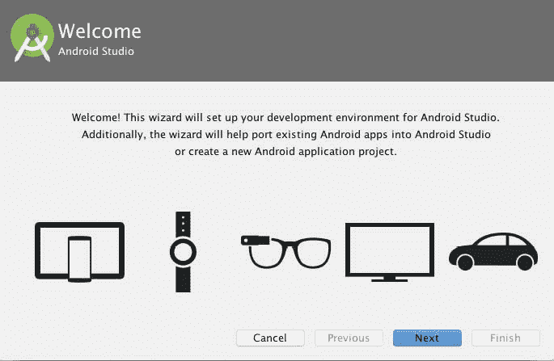

图 2-2

如果出现了向导，点击“下一步”，选择“标准”安装选项并再次点击“下一步”。

Android Studio 将继续下载并配置最新的 Android SDK 以及一些额外的组件和包。一旦此过程完成，点击下载组件（Downloading Components）对话框中的 `Finish` 按钮，随后将出现 Welcome to Android Studio 界面：

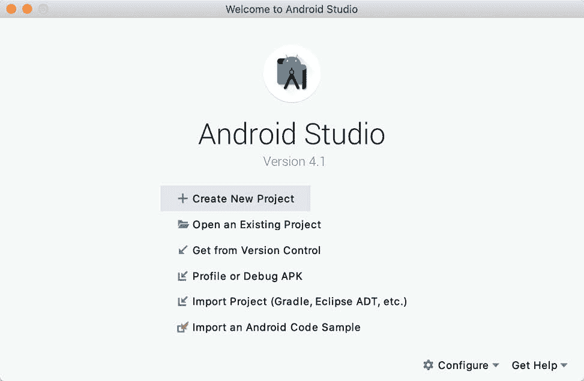

图 2-3

## 2.5 安装额外的 Android SDK 软件包

到目前为止的操作已经安装了 Java、Android Studio IDE 以及当前默认的 Android SDK 包。在继续之前，值得花一些时间验证安装了哪些包，并安装任何缺失或更新的包。

此任务可以使用 Android SDK 设置界面完成，可以通过在 Android Studio 欢迎对话框中选择 `Configure -> SDK Manager` 选项从 Android Studio 工具内部启动它。一旦调用，将显示默认设置对话框中的 Android SDK 界面，如下所示：

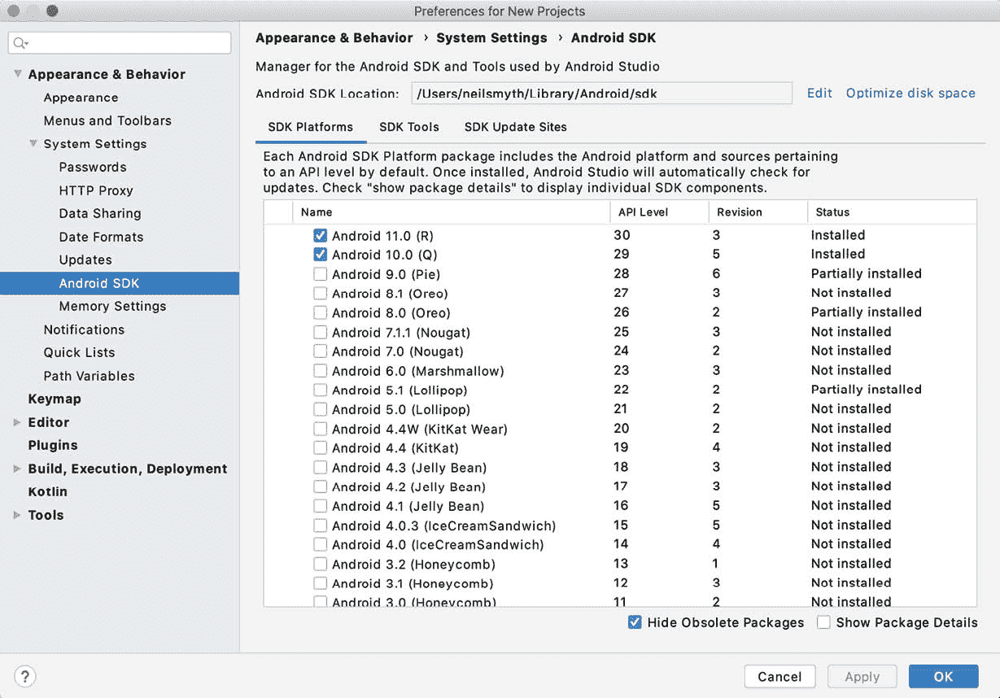

图 2-4

在首次安装 Android Studio 后，可能只安装了最新发布的 Android SDK 版本。要安装旧版本的 Android SDK，只需选择对应版本的复选框并点击 `Apply` 按钮。

可能还会列出最新 SDK 有可用更新。要访问有关可用更新包的详细信息，请启用屏幕右下角的 `Show Package Details`。这将显示与图中所示的信息：

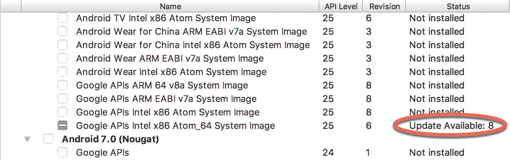

图 2-5

上图强调了更新可用。要安装更新，启用项目名称左侧的复选框并点击 `Apply` 按钮。

除了 Android SDK 包外，还安装了许多用于构建 Android 程序的工具。要查看当前安装的包并检查更新，请留在 SDK 设置界面并选择 `SDK Tools` 选项卡，如下：

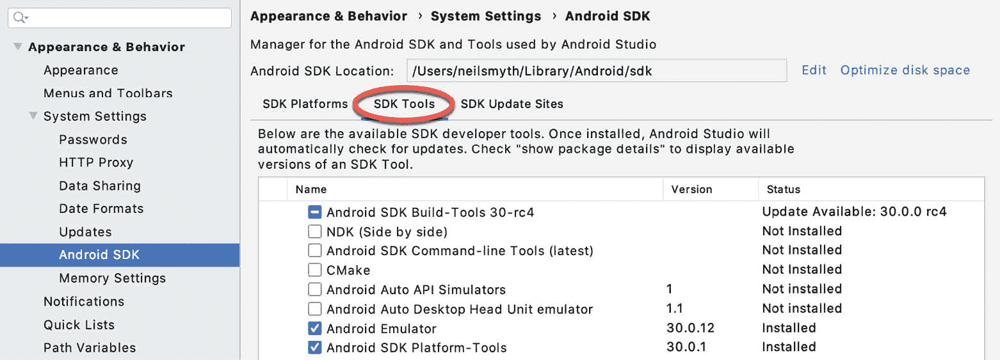

图 2-6

在 Android SDK Tools 界面中，请确保以下包在 Status（状态）列中被列为 Installed（已安装）：

- Android SDK Build-tools


- `Android Emulator`
- `Android SDK Platform-tools`
- `Android SDK Tools`
- `Google Play Services`
- `Intel x86 Emulator Accelerator (HAXM installer)`
- `Google USB Driver`（仅限 Windows）
- `Layout Inspector image server`

如果上述任何包被列为 `Not Installed`（未安装）或需要更新，只需选择这些包旁边的复选框并点击 `Apply` 按钮以启动安装过程。

安装完成后，请检查包列表并确保所选包现在在 `Status` 列中被列为 `Installed`。如果有任何包列为 `Not installed`，请确保它们已被选中并再次点击 `Apply` 按钮。

## 2.6 使 `Android SDK` 工具可在命令行中访问

在大多数情况下，`Android SDK` 的底层工具将在 `Android Studio` 环境内部进行访问。尽管如此，在某些情况下，从命令提示符或终端窗口调用这些工具将是很有用的。为了让你开发运行的操作系统能够找到这些工具，有必要将它们添加到系统的 `PATH` 环境变量中。

无论哪种操作系统，都需要配置 `PATH` 变量以包含以下路径（其中`<path_to_android_sdk_installation>` 代表安装 `Android SDK` 的文件系统位置）：

- `<path_to_android_sdk_installation>/sdk/tools`
- `<path_to_android_sdk_installation>/sdk/tools/bin`
- `<path_to_android_sdk_installation>/sdk/platform-tools`

可以通过启动 `SDK Manager` 并参考设置面板顶部的 `Android SDK Location:` 字段来识别 SDK 在你系统上的位置，如下：

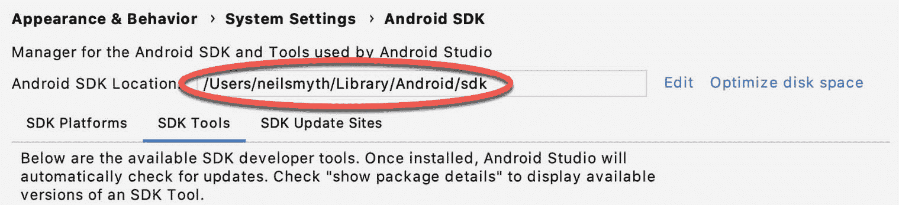

图 2-7

一旦确定了 SDK 的位置，将其添加到 `PATH` 变量的步骤取决于操作系统：

### 2.6.1 Windows 7

1. 右键点击桌面开始菜单中的 `Computer`，并从生成的菜单中选择 `Properties`。
2. 在属性面板中，选择 `Advanced System Settings` 链接，并在生成的对话框中点击 `Environment Variables…` 按钮。
3. 在 `Environment Variables` 对话框中，在系统变量列表中找到 `Path` 变量，选中它并点击 `Edit…`。使用编辑对话框中的 `New` 按钮向路径添加三个新条目。例如，假设 `Android SDK` 安装在 `C:\Users\demo\AppData\Local\Android\Sdk`，则需要添加以下条目：

   - `C:\Users\demo\AppData\Local\Android\Sdk\platform-tools`
   - `C:\Users\demo\AppData\Local\Android\Sdk\tools`
   - `C:\Users\demo\AppData\Local\Android\Sdk\tools\bin`

4. 点击每个对话框中的 `OK` 并关闭系统属性控制面板。

完成上述步骤后，通过打开命令提示符窗口（开始 -> 所有程序 -> 附件 -> 命令提示符）并在提示符处输入以下内容来验证路径设置正确：

```
echo %Path%
```

返回的路径变量值应包含 `Android SDK` 平台工具文件夹的路径。通过尝试如下运行 `adb` 工具来验证 `platform-tools` 值是否正确：

```
adb
```

该工具执行时应输出命令行选项列表。

同样，通过尝试运行 `avdmanager` 工具来检查工具路径设置（如果 `avdmanager` 工具报告 Java 问题，请忽略，稍后会处理）：

```
avdmanager
```

如果这两个命令中的任何一个出现类似的消息，很可能是 `PATH` 附加了错误的路径：

`'adb' 不是内部或外部命令、程序或批文件。`

### 2.6.2 Windows 8.1

1. 在启动屏幕，将鼠标移动到屏幕右下角，从生成的菜单中选择 `Search`。在搜索框中输入 `Control Panel`。当 `Control Panel` 图标出现在结果区域时，点击它启动工具。
2. 在 `Control Panel` 中，使用 `Category` 菜单将显示方式更改为 `Large Icons`。从列表中选择 `System`。
3. 按照 Windows 7 的说明，从第 2 步开始操作。

打开命令提示符窗口（将鼠标移动到屏幕右下角，选择 `Search` 选项并在搜索框中输入 `cmd`）。从搜索结果中选择 `Command Prompt`。

在命令提示符窗口中输入：

```
echo %Path%
```

返回的路径变量值应包含 `Android SDK` 平台工具文件夹的路径。通过尝试如下运行 `adb` 工具来验证 `platform-tools` 值是否正确：

```
adb
```

该工具执行时应输出命令行选项列表。

同样，通过尝试运行 `avdmanager` 工具来检查工具路径设置（如果 `avdmanager` 工具报告 Java 问题，请忽略，稍后会处理）：

```
avdmanager
```

如果这两个命令中的任何一个出现类似的消息的消息，很可能是 `PATH` 附加了错误的路径：

`'adb' 不是内部或外部命令、程序或批文件。`

### 2.6.3 Windows 10

右键点击开始菜单，从弹出的菜单中选择`设置`，并在“查找设置”文本框中输入“编辑系统环境变量”。在系统属性对话框中，点击`环境变量...` 按钮。按照 Windows 7 的步骤说明从第 3 步开始后续操作。

### 2.6.4 Linux

在 Linux 上，此配置通常可以通过向家目录下的 `.bashrc` 文件中添加命令来实现（具体细节取决于所使用的特定 Linux 发行版）。假设 `Android SDK` 捆绑包安装在 `/home/demo/Android/sdk`，则 `.bashrc` 文件中的 `export` 行内容如下：

```
export PATH=/home/demo/Android/sdk/platform-tools:/home/demo/Android/sdk/tools:/home/demo/Android/sdk/tools/bin:/home/demo/android-studio/bin:$PATH
```

请注意，上述命令将 `android-studio/bin` 目录添加到 `PATH` 变量中。这将使得无论在终端窗口的哪个目录下，都可以执行 `studio.sh` 脚本。

### 2.6.5 macOS

在 macOS 上，可以使用多种技术来修改 `$PATH` 环境变量。认为最干净的方法是在 `/etc/paths.d` 目录中创建一个新文件，其中包含要添加到 `$PATH` 的路径。假设 `Android SDK` 安装位置为 `/Users/demo/Library/Android/sdk`，可以通过在 `/etc/paths.d` 目录中创建一个名为 `android-sdk` 的新文件并包含以下行来配置路径：

```
/Users/demo/Library/Android/sdk/tools
/Users/demo/Library/Android/sdk/tools/bin
/Users/demo/Library/Android/sdk/platform-tools
```

注意，由于这是一个系统目录，在创建文件时需要使用 `sudo` 命令。例如：

```
sudo vi /etc/paths.d/android-sdk
```

### 2.7 Android Studio 内存管理

`Android Studio` 是一个大型且复杂的软件应用程序，由许多后台进程组成。尽管 `Android Studio` 过去因性能不佳而受到批评，但 Google 在最近的发布中进行了显著的性能改进，并在每个新版本中持续改进。这些改进的一部分包括允许用户配置 `Android Studio` IDE 以及用于构建和运行应用程序的后台进程所使用的内存。这允许软件充分利用具有较大 `RAM` 的系统。

如果你运行 `Android Studio` 的系统具有足够的空闲 `RAM` 来增加这些值（此功能仅适用于具有 5GB 或更多 RAM 的 64 位系统），并且发现 `Android Studio` 的性能似乎有所下降，那么尝试这些内存设置可能是值得的。`Android Studio` 还可能通过类似于下面所示的对话框通知你可以提高性能：


图 2-8

要查看并修改当前的内存配置，请选择`File -> Settings...`（macOS 上为 `Android Studio -> Preferences...`）菜单选项，并在弹出的对话框中，选择左侧导航面板中 `System Settings` 下的 `Memory Settings` 选项，如下方的图 2-9 所示。

在更改内存分配时，请确保不要分配超过必要的内存，也不要在不减慢其他进程的情况下分配超过系统能承受的内存。

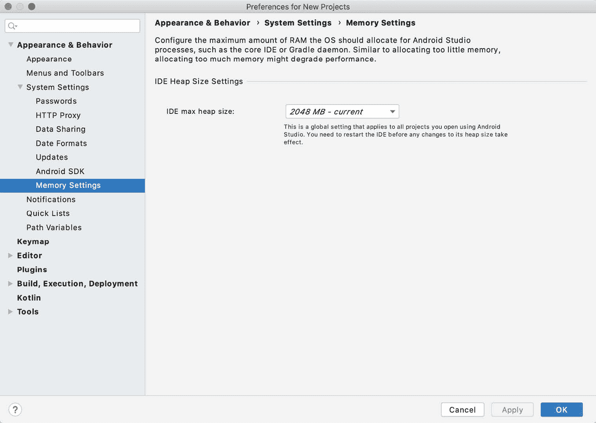

图 2-9

### 2.8 更新 Android Studio 和 SDK

`Android Studio` 和 `Android SDK` 会不定期发布新版本。新版本的 SDK 使用 `Android SDK Manager` 安装。当有更新可供安装时，`Android Studio` 通常会通知你。

要手动检查 `Android Studio` 更新，请在 `Android Studio` 欢迎界面内点击`Configure -> Check for Updates` 菜单选项，或从 `Android Studio` 主窗口内访问`Help -> Check for Updates...`（macOS 上为 `Android Studio -> Check for Updates...`）菜单选项。

## 2.9 总结

在开始开发 Android 应用程序之前，第一步是搭建合适的开发环境。这包括 `Android SDKs` 和 `Android Studio` IDE（它还包括 `OpenJDK` 开发环境）。在本章中，我们涵盖了在 Windows、macOS 和 Linux 上安装这些包的必要步骤。

# 3. 在 Android Studio 中创建示例 Android 应用程序

本书前面的章节已经涵盖了使用 `Android Studio` IDE 配置适用于 Android 应用程序开发的环境的必要步骤。在进入稍高级的话题之前，现在是验证所有所需的开发包均已安装并正常运行的好时机。实现这一目标的最佳方法是创建一个 Android 应用程序并编译、运行它。本章将介绍如何使用 `Android Studio` 创建 Android 应用程序项目。项目创建完成后，随后的章节将探索如何使用 `Android` 模拟器环境对应用程序进行测试运行。

## 3.1 关于项目

在本章中创建的项目是一个原始的货币转换计算器（事实上，它非常简单，只进行从美元到欧元的转换，并使用估算的汇率进行转换）。该项目还将使用 `Android Studio` 项目模板的基础之一。这种简单性允许我们介绍 Android 应用开发的一些关键方面，而不会因一次性引入过多的概念（例如推荐的应用程序架构和 `Android` 架构组件）而让初学者无所措。在遵循本章的教程时，请放心，初始示例项目中使用的所有技术和代码将在后面的章节中进行更详细的介绍。

## 3.2 创建新 Android 项目

应用程序开发过程的第一步是在 `Android Studio` 环境中创建一个新项目。因此，首先启动 `Android Studio`，出现如图 3-1 所示的“Welcome to Android Studio”：

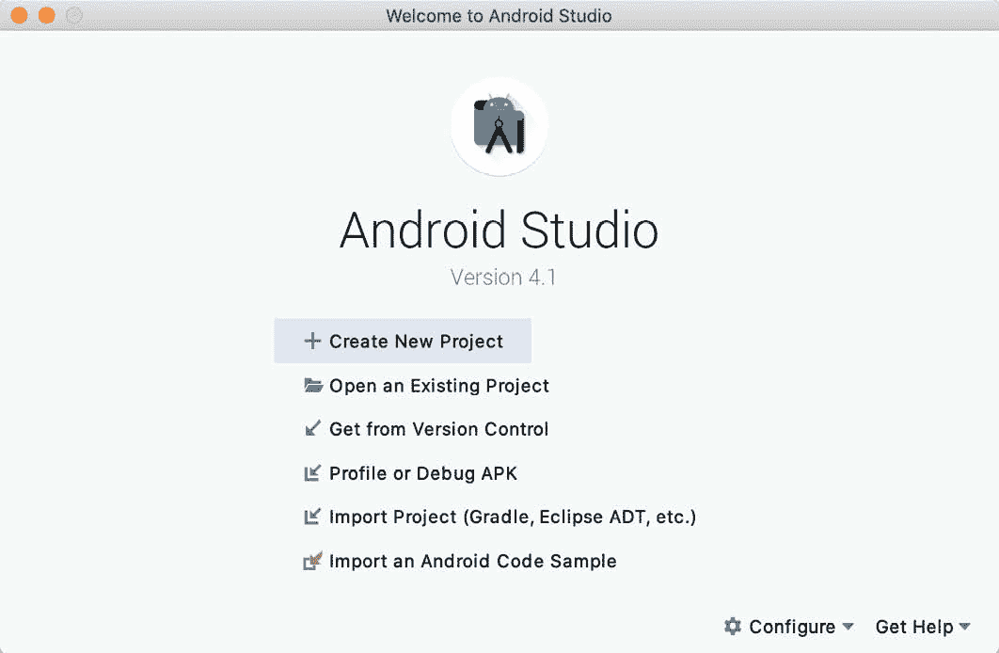

图 3-1

一旦出现此窗口，`Android Studio` 已准备好创建新项目。要创建新项目，只需点击`Create New Project` 选项即可显示项目向导的第一个屏幕。

## 3.3 创建 Activity

第一步是定义为应用程序创建的初始 `Activity` 类型。提供了创建适用于手机和平板、`Wear OS`、电视、`Android Audio` 或 `Android Things` 的项目。开发 Android 应用程序时有多种不同的 `Activity` 类型，其中许多将在后面的章节中详细介绍。然而，对于本示例而言，只需在手机和平板屏幕上选择创建 `Empty Activity`。`Empty Activity` 选项会创建一个由单个 `TextView` 对象的模板用户界面。

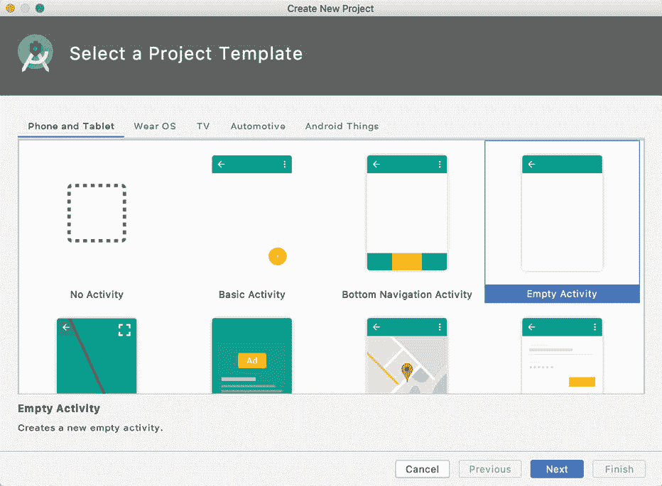

图 3-2

选择 `Empty Activity` 选项后，点击 `Next` 继续项目配置。

### 3.4 定义项目和 SDK 设置

在项目配置窗口（图 3-3）中，将 `Name` 字段设置为 `AndroidSample`。应用程序名称是在 `Android Studio` 中引用和识别应用程序的名称，也是如果完成的应用程序要在 `Google Play` 商店发售时将使用的名称。

`Package`（包名）用于在 Android 应用生态系统中唯一标识应用程序。虽然它可以设置为任何唯一标识您的应用的的字符串，但传统上，它是基于域名的反转 URL，后跟应用程序名称。例如，如果您的域名是 `www.mycompany.com`，且应用程序命名为 `AndroidSample`，那么包名可以指定如下：

```
com.mycompany.androidsample
```

如果您没有域名，可以在 `Company Domain`（公司域名）字段中输入任何其他字符串，或者为了测试目的可以使用 `example.com`，但在发布应用程序之前需要对其进行更改：

```
com.example.androidsample
```

`Save location`（保存位置）设置将默认位于您主目录下名为 `AndroidStudioProjects` 的文件夹中，可以通过点击包含当前路径设置的字段右侧的文件夹图标进行更改。

将 `minimum SDK` 设置为 `API 26`：`Android 8.0 (Oreo)`。除非某些功能仅在更高版本可用，否则本书创建的大多数项目将使用此 SDK。

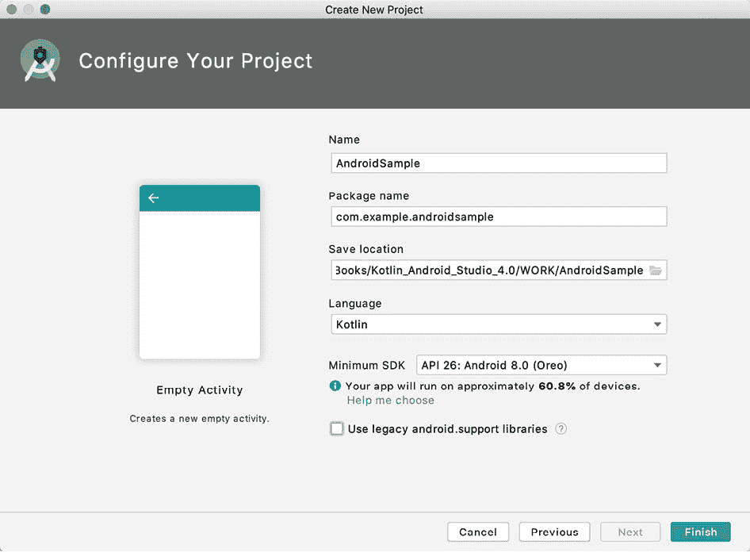

图 3-3

最后，将 `Language`（语言）菜单更改为 `Java` 并点击 `Finish`（完成）启动项目创建过程。

## 3.5 修改示例应用程序

此时，`Android Studio` 已经创建了一个最小的示例应用程序项目并打开了主窗口。

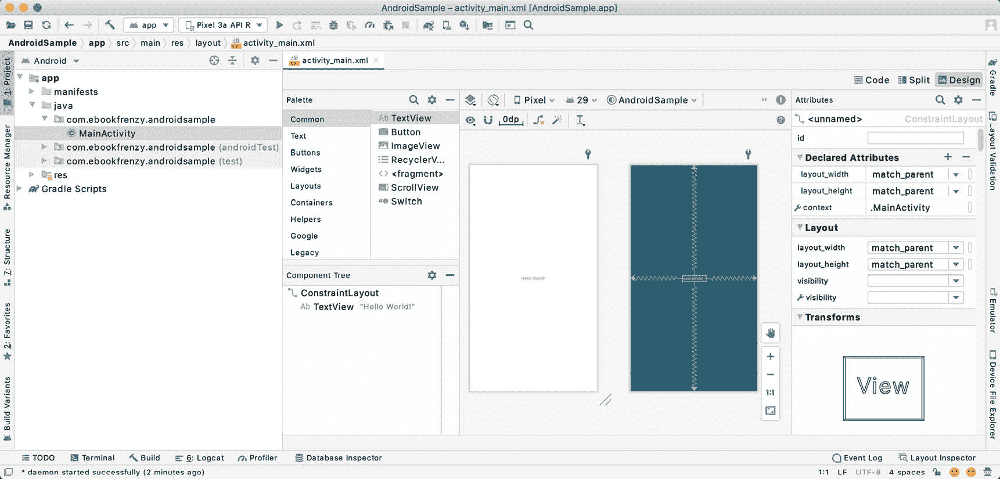

图 3-4

新创建的项目和相关文件的引用列位于主项目窗口左侧的 `Project`（项目）工具窗口中。`Project` 工具窗口有多种可以显示信息的模式。默认情况下，此面板应处于 `Android` 模式。此设置由面板顶部的菜单控制，如图 3-5 所示。如果面板当前未处于 `Android` 模式，请使用菜单切换模式：

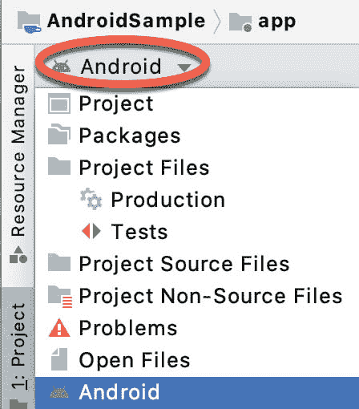

图 3-5

## 3.6 修改用户界面

我们的 `Activity` 用户界面设计存储在名为 `activity_main.xml` 的文件中，该文件位于项目文件层次结构中的 `app -> res -> layout` 下。一旦在 `Project` 工具窗口中找到该文件，双击文件即可将其加载到用户界面 `Layout Editor`（布局编辑器）工具中，该工具将出现在 `Android Studio` 主窗口的中心面板中：

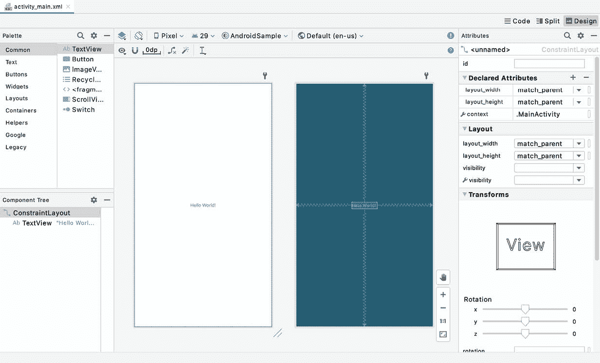

图 3-6

在 `Layout Editor` 窗口顶部工具栏上有一个菜单（在上面的图中当前设置为 `Pixel`），它反映在 `Layout Editor` 面板中设备的视觉表示上。通过点击此菜单，可以选择广泛的其他设备选项。

若要在设备表示的横屏和竖屏之间切换方向，只需使用设备选择菜单立即左侧的下拉菜单即可，该菜单显示着  图标。

从设备屏幕可以看出，内容布局已经包含一个显示“Hello World!”消息的标签。面板左侧运行着调色板，其中包含用于构建用户界面的不同类别用户界面组件，例如按钮、标签和文本字段。然而，并不是所有用户界面组件对用户都是显而可见的。其中一类就是布局。Android 支持多种布局，它们对屏幕上如何定位和管理视觉用户界面组件提供不同层级的控制。虽然从用户界面的视觉表示很难判断，但当前的设计是使用 `ConstraintLayout`（约束布局）创建的。这可以通过查看 `Component Tree`（组件树）面板中的信息来确认，该面板默认位于 `Layout Editor` 面板的左下角，如图 3-7 所示：


图 3-7

从组件树层次结构可以看出，用户界面布局由一个 `ConstraintLayout` 父对象和一个 `TextView` 子对象组成。


在继续之前，还要检查`Layout Editor`的`Autoconnect`（自动连接）模式是否启用。这意味着当组件添加到布局中时，`Layout Editor`将自动添加约束，以确保组件在不同的屏幕尺寸和设备方向上正确定位（该主题将在后续章节中进行更详细的介绍）。`Autoconnect`出现在`Layout Editor`工具栏中，用磁铁图标表示。当禁用时，磁铁上会有一条斜线（图 3-8）。如有必要，通过点击此按钮重新启用`Autoconnect`模式。

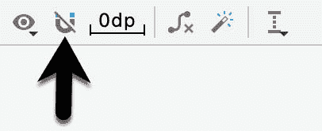

图 3-8

修改应用程序的下一步是向布局中添加一些额外的组件，第一个将是`Button`。

`Palette`（调色板）面板由两列组成，左侧列包含视图类别列表，右侧列列出当前选择类别内的组件。在图 3-9 中，例如，选中了`Buttons`类别：


图 3-9

从`Buttons`列表中拖动`Button`对象并将其放置在用户界面设计的中心，使其位于现有的`TextView`小部件下方：


图 3-10

下一步是更改`Button`组件显示的文本。位于设计区域右侧的面板是`Attributes`（属性）面板。此面板显示分配给当前组件的属性。在此面板中，找到`Common Attributes`（常用属性）部分的`text`属性，并将值从“Button”更改为“Convert”，如图 3-11 所示：


图 3-11

带有扳手图标的第二个`text`属性允许设置仅在`Layout Editor`中显示而不在运行时显示的属性。这对于测试不同设置下视觉组件和布局的行为非常有用。

万一`Autoconnect`系统未能设置所有布局连接，点击`Infer constraints`按钮（图 3-12）为布局添加任何缺失的约束：

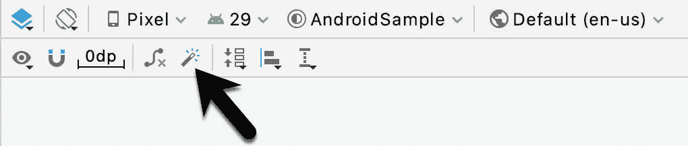

图 3-12

此时，重要的是说明位于`Layout Editor`工具右上角的警告按钮，如图 3-13 所示。显然，这表明布局存在潜在问题。要查看问题的详情，请点击该按钮：


图 3-13

点击后，将出现一个面板（图 3-14），描述问题的性质并提供一些可能的纠正措施：

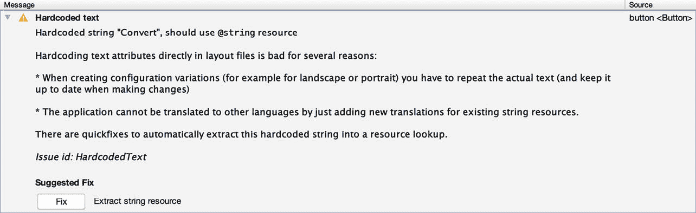

图 3-14

目前，列出的唯一警告内容如下：

> 硬编码字符串 `"Convert"`，应使用`@string`资源

此 I18N 消息是在告知我们项目未来的国际化方面存在一个潜在问题（“I18N”源于单词“internationalization”，该词以“I”开头，以“N”结尾，中间有 18 个字母）。该警告提醒我们，在开发 Android 应用程序时，应尽可能将文本字符串等属性和值存储为资源的形式。这样做可以通过修改资源文件来更改应用程序的外观，而无需更改应用程序的源代码。这在将用户界面翻译成不同的口语语言时尤为有价值。如果用户界面中的所有文本都包含在一个资源文件中，例如，可以将该文件交给翻译人员，由他们执行翻译工作并返回翻译后的文件以包含应用程序中。这使得在不需要修改任何源代码的情况下，就可以支持多种语言目标。在本例中，我们将创建一个名为`convert_string`的新资源，并为其分配字符串“Convert”。

点击问题说明（Issue Explanation）面板中的`Fix`按钮以显示“提取资源”（Extract Resource）面板（图 3-15）。在此面板中，将资源名称字段更改为`convert_string`，并在点击`OK`按钮之前，将资源值设置为`Convert`。

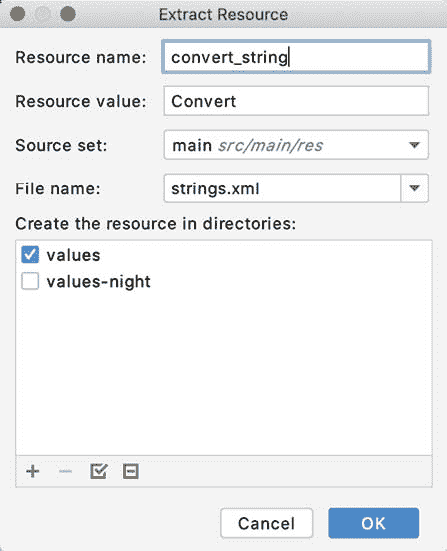

图 3-15

下一个要添加的部件是一个`EditText`部件，用户将向其中输入要转换的美元金额。从部件调板中，选择`Text`类别，并点击拖动一个`Number (Decimal)`组件到布局中，使其在水平方向上居中并位于现有`TextView`部件上方。选中部件后，使用`Attributes`（属性）工具窗口将`hint`属性设置为“dollars”。点击警告图标并将字符串提取到名为`dollars_hint`的资源中。

在本章稍后编写的代码将需要访问用户在`EditText`字段中输入的美元值。它将通过引用分配给用户界面布局中部件的`id`来实现。当在布局中选中部件时，可以在`Attributes`工具窗口中查看并更改 Android Studio 为部件分配的默认`id`，如图 3-16 所示：

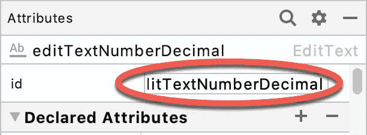

图 3-16

将`id`更改为`dollarText`，并在`Rename`（重命名）对话框中点击`Refactor`（重构）按钮。这将确保项目其他地方对旧`id`的任何引用自动更新为使用新`id`：

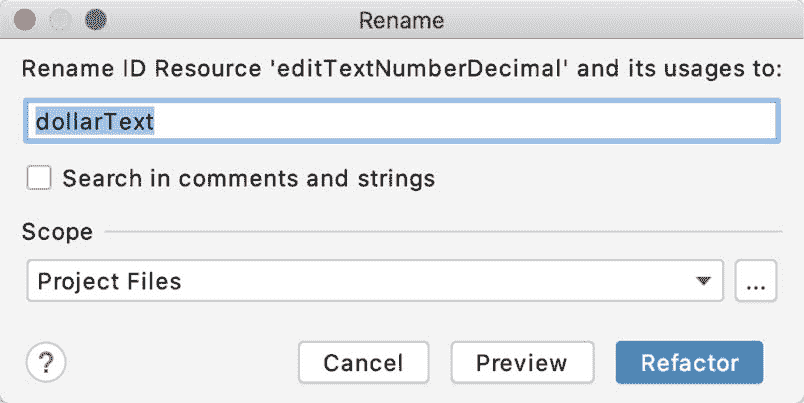

图 3-17

点击`Infer constraints`（推断约束）按钮添加任何缺失的布局约束。此时，布局应该类似于图 3-18 所示：


图 3-18

## 3.7 审查布局和资源文件

在继续后续步骤之前，我们将查看用户界面设计和资源处理的一些内部方面。在上一节中，我们通过使用`Layout Editor`（布局编辑器）工具修改`activity_main.xml`文件，对用户界面进行了一些更改。事实上，`Layout Editor`所做的只是提供了一种易于用户编辑文件底层 XML 内容的方法。在实践中，没有理由不直接修改 XML 以进行用户界面更改，在某些情况下，这实际上可能比使用`Layout Editor`工具更快。在`Layout Editor`面板的右上角有三个按钮，如下方的图 3-19 所示：

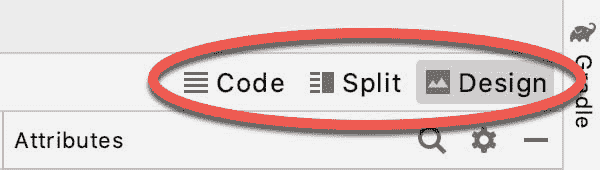

图 3-19

默认情况下，编辑器将处于`Design`（设计）模式，此时仅显示布局的视觉表示。最左侧的按钮将切换到`Code`（代码）模式以显示布局的 XML，而中间的按钮进入`Split`（分割）模式，即同时显示布局和 XML，如图 3-20 所示：

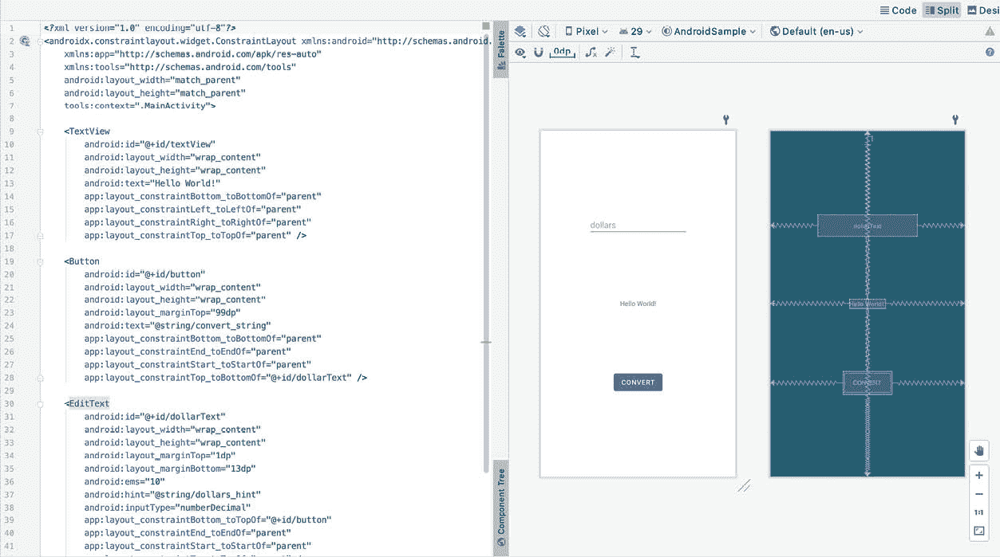

图 3-20

从 XML 文件的结构可以看出，用户界面由`ConstraintLayout`组件组成，该组件又是`TextView`、`Button`和`EditText`对象的父级。我们还可以看到，例如，`Button`的`text`属性设置为我们的`convert_string`资源。尽管复杂性和内容不同，但所有用户界面布局都是按这种层次化的、基于 XML 的结构组织的。

对 XML 布局进行更改时，这些更改将反映在布局画布上。也可以在布局画布面板内对布局进行视觉修改，更改将出现在 XML 列表中。要查看此操作，请切换到`Split`模式并修改 XML 布局，将`ConstraintLayout`的背景颜色更改为红色系，如下：

```xml
<?xml version="1.0" encoding="utf-8"?>
<androidx.constraintlayout.widget.ConstraintLayout xmlns:android="http://schemas.android.com/apk/res/android"
    xmlns:app="http://schemas.android.com/apk/res-auto"
    xmlns:tools="http://schemas.android.com/tools"
    android:layout_width="match_parent"
    android:layout_height="match_parent"
    tools:context=".MainActivity"
    android:background="#ff2438">
</androidx.constraintlayout.widget.ConstraintLayout>
```

注意布局的颜色会实时匹配 XML 文件中的设置。此外，XML 编辑器左侧边距（也称为槽位 gutter）会出现一个小方块，这是已设置颜色的视觉提示。点击方块将显示颜色选择器，允许选择不同的颜色：


图 3-21

在继续之前，从布局文件中删除`background`属性，使背景恢复默认。

最后，使用`Project`面板找到`app` -> `res` -> `values` -> `strings.xml`文件，并双击将其加载到编辑器中。目前 XML 如下：

```xml
<resources>
    <string name="app_name">AndroidSample</string>
    <string name="convert_string">Convert</string>
    <string name="dollars_hint">dollars</string>
</resources>
```

为了演示资源的作用，将分配给`convert_string`资源的字符串值更改为“Convert to Euros”，然后通过布局文件返回`Layout Editor`工具。注意布局获取了字符串的新资源值。

还有一种快速访问 XML 中引用值的方法。在`Layout Editor`工具的`Split`或`Code`模式下，点击`@string/convert_string`属性设置使其高亮，然后在键盘上按下`Ctrl-B`（macOS 上为`Cmd-B`）。Android Studio 随后将打开`strings.xml`文件并带您到定义该资源的位置。利用此机会将字符串资源还原为原始“Convert”文本，并添加以下供后续代码引用的额外资源条目：

```xml
<resources>
    <string name="convert_string">Convert</string>
    <string name="dollars_hint">dollars</string>
    <string name="no_value_string">No Value</string>
</resources>
```

资源字符串也可以使用 Android Studio 的`Translations Editor`（翻译编辑器）进行编辑。要打开此编辑器，右键点击`app` -> `res` -> `values` -> `strings.xml`文件并选择`Open Translations Editor`选项。将在 Android Studio 窗口的主面板中显示`Translation Editor`：

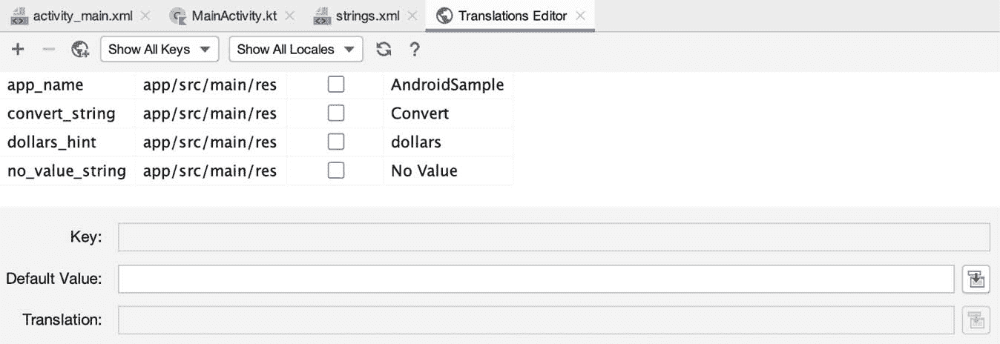

图 3-22

此编辑器允许对分配给资源键的字符串进行编辑，并管理多种语言的翻译。

## 3.8 添加交互

此示例项目的最后一步是让应用程序具有交互性，以便当用户在`EditText`字段中输入美元值并点击转换按钮时，转换后的欧元值将显示在`TextView`上。这涉及在`Button`组件上实现某些事件处理。具体来说，需要配置`Button`，以便在触发`onClick`事件时调用应用代码中的一个方法。事件处理可以通过多种不同的方式实现，并在后续标题为 Android 事件处理概述与示例的章节中进行详细介绍。返回布局编辑器到`Design`（设计）模式，在布局编辑器中选择`Button`组件，参考`Attributes`（属性）工具窗口，并如下所示指定名为`convertCurrency`的方法：

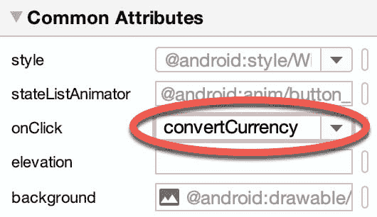

图 3-23

注意，`onClick`属性的文本字段现在用红色边框突出显示，警告我们按钮已配置为调用一个尚不存在的方法。为了解决这个问题，双击项目（`Project`）工具窗口中的`MainActivity.java`文件（`app` -> `java` -> `<package name>` -> `MainActivity`）将其加载到代码编辑器中，并向类文件中添加`convertCurrency`方法的代码，使其读取如下，请注意还需要导入一些额外的 Android 程序包：

```java
package com.ebookfrenzy.androidsample;

import androidx.appcompat.app.AppCompatActivity;

import android.os.Bundle;

import android.view.View;

import android.widget.EditText;

import android.widget.TextView;

public class MainActivity extends AppCompatActivity {

    @Override
    protected void onCreate(Bundle savedInstanceState) {
        super.onCreate(savedInstanceState);
        setContentView(R.layout.activity_main);
    }

    public void convertCurrency(View view) {
        EditText dollarText = findViewById(R.id.dollarText);
        TextView textView = findViewById(R.id.textView);
        if (!dollarText.getText().toString().equals("")) {
            Float dollarValue = Float.valueOf(dollarText.getText().toString());
            Float euroValue = dollarValue * 0.85F;
            textView.setText(euroValue.toString());
        } else {
            textView.setText(R.string.no_value_string);
        }
    }
}
```

该方法首先通过调用名为`findViewById`的方法并传递布局文件中分配的`id`来获取`EditText`和`TextView`对象的引用。然后进行检查以确保用户已输入了美元值，如果是，则提取该值，将其从`String`转换为浮点值并转换为欧元。最后，结果显示在`TextView`组件上。如果其中任何不清楚的地方，请放心，这些概念将在后面的章节中进行更详细的介绍。

## 3.9 总结

虽然并不复杂，但设置 Android 开发环境涉及许多步骤。在完成这些步骤后，通过运行一个示例来确保环境已正确安装和配置是值得的。在本章中，我们创建了一个示例应用程序，并使用 Android Studio 布局编辑器工具修改了用户界面布局。在此过程中，我们探索了尽可能使用资源的重要性，特别是在字符串值的情况下，并简要触及了布局主题。接下来，我们查看了用于存储 Android 应用用户界面设计的底层 XML。

最后，在`Button`上添加了`onClick`事件，该按钮连接到一个实现的方法，该方法从`EditText`组件中提取用户输入，将美元转换为欧元，然后在`TextView`上显示结果。

由于应用程序已准备好进行测试，为测试目的设置模拟器所需的步骤将在下一章中进行详细介绍。

# 4. 在 Android Studio 中创建 Android 虚拟设备（AVD）

在 Android Studio 中开发 Android 应用的过程中，需要多次编译和运行应用程序。Android 应用可以通过安装并运行在物理设备上，或者在 Android 虚拟设备（AVD）模拟器环境中运行来完成测试。在使用 AVD 之前，必须先创建并配置它以匹配特定设备模型的规格。因此，本章的目标是以 Pixel 3 手机作为参考示例，完成创建此类虚拟设备的涉及步骤。

## 4.1 关于 Android 虚拟设备

AVD 本质上是模拟器，允许在无需将应用程序安装在物理 Android 设备上的情况下测试 Android 应用程序。AVD 可以配置为模拟各种硬件功能，包括屏幕尺寸、内存容量、摄像头、GPS 导航支持或加速度计。作为标准 Android 安装的一部分，安装了许多模板，允许为不同的设备配置 AVD。AVD 会话可以独立出现也可以嵌入。例如，图 4-1 显示了一个 Pixel 3。新的 AVD 使用 Android 设备管理器（Android Device Manager）创建和管理，它可以在命令行模式下使用，也可以使用更友好的图形界面。


图 4-1

## 4.2 创建新的 AVD

为了在没有物理设备的情况下测试应用程序的行为，需要为特定设备创建一个 AVD。创建新 AVD 的第一步是启动 AVD Manager。这可以通过 Android Studio 内部的`Tools -> AVD Manager`菜单来实现。一旦启动，如果没有创建过 AVD 实例，该工具将如图 4-2 所示：


图 4-2

在对话框中，执行以下步骤创建一个兼容 Pixel 4 的模拟器：


# 4.2 创建 AVD

1. 从`Category`面板选择`Phone`选项，以显示可用 Android 手机 AVD 模板列表。

2. 选择`Pixel 4`设备选项并点击`Next`。

3. 在`System Image`屏幕上，为`x86` ABI 选择最新版本的 Android。注意，如果尚未安装系统镜像，`Release Name`旁边将提供`Download`链接。点击此链接下载并安装系统镜像后再选择它。如果所需的镜像未列表，请点击`x86 images`和`Other images`选项卡查看备选列表。

4. 点击`Next`继续，并在`name`字段中输入一个描述性名称（例如`Pixel 4 API 30`），或直接接受默认名称。

5. 点击`Finish`创建 AVD。

6. AVD 创建后，现在可以关闭 AVD Manager。如果以后需要对 AVD 进行修改，只需重新打开 AVD Manager，从列表中选择 AVD，并点击 AVD Manager 中设备行`Actions`列中的铅笔图标。

```

```

图 4-3

## 4.3 启动模拟器

对新创建的`AVD`模拟器进行测试运行，只需从`AVD Manager`中选择该模拟器并点击启动按钮（Actions 列中的三角形）。模拟器将在新窗口中出现并开始启动过程。模拟器启动所需的时间取决于`AVD`本身及其运行系统的配置。

尽管模拟器可能默认以竖屏方向显示，但此设置和其他默认选项是可以更改的。在`AVD Manager`中，选择新的`Pixel 4`条目，并点击设备行 Actions 列中的铅笔图标。在配置屏幕中找到`Startup orientation`（启动方向）部分，并更改`orientation`（方向）设置。退出并重启模拟器会使此更改生效。关于模拟器的更多细节请参阅下一章（“使用和配置 Android Studio AVD 模拟器”）。

为了在本章的下一节中节省时间，请在继续之前保持模拟器运行。

## 4.4 在 AVD 中运行应用程序

配置好`AVD`模拟器后，之前章节中创建的示例应用程序`AndroidSample`现在可以编译和运行了。将`AndroidSample`项目加载到`Android Studio`后，确保新创建的`Pixel 4 AVD`显示在设备菜单中（如下方图 4-4 中标记为`A`），然后点击由绿色三角形 (B) 表示的运行按钮、选择`Run -> Run 'app'`菜单选项或使用键盘快捷键`Ctrl-R`：

```
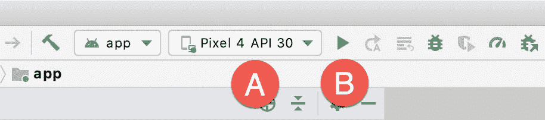
```

图 4-4

设备菜单 (A) 可用于选择不同的`AVD`实例或物理设备作为运行目标，并可以在多个设备上运行应用。该菜单还提供了访问`AVD Manager`和设备连接故障排除选项的接口：

```

```

图 13

`themes.xml`文件包含亮色模式的主题，而`themes.xml`(night) 文件包含设备深色模式时采用的主题如下：

```
<resources xmlns:tools="http://schemas.android.com/tools">
    <!-- 基础应用 -->
    <style name="Theme.AndroidSample" parent="MaterialComponents.DayNight.DarkActionBar">
        <!-- 主颜色 -->
        <item name="colorPrimary">@color/purple_200</item>
        <item name="colorPrimaryDark">@color/purple_700</item>
        <item name="colorOnPrimary">@color/black</item>
        <!-- 次要颜色 -->
        <item name="colorSecondary">@color/teal_200</item>
        <item name="colorSecondaryVariant">@color/teal_200</item>
        <item name="colorOnSecondary">@color/black</item>
        <!-- 状态栏颜色 -->
        <item name="android:statusBarColor" tools:targetApi="l">?attr/colorPrimaryVariant</item>
        <!-- 在此处自定义您的主题 -->
    </style>
</resources>
```

使用编辑器行隙中的颜色块进行颜色实验（例如为`colorPrimary`资源尝试不同的颜色）。进行更改后，再次运行应用以查看效果。

实验主题后，打开模拟器中的`Settings`应用，关闭深色模式并返回`AndroidSample`应用。应用程序应该会自动切换回亮色。

## 4.8 在工具窗口中运行模拟器

在本章之前，我们只作为窗口使用模拟器。模拟器也可以作为嵌入工具窗口运行。要嵌入模拟器，选择`File -> Settings...`菜单选项（macOS 上为`Android Studio -> Preferences...`），在设置对话框的左侧导航面板中导航到`Tools -> Emulator`，并启用`Launch in a tool window`选项：

```

```

图 4-14

启用该选项后，点击`Apply`按钮以及`OK`提交更改，然后退出独立的模拟器会话。

再次运行示例应用，此时模拟器将出现在`Android Studio`窗口内，如图 4-15 所示：

```

```

图 4-15

## 图 4-15

要隐藏或显示模拟器工具窗口，请点击模拟器工具窗口按钮（如上方的标记 A 处所示）。点击标签页旁边的“x”关闭按钮 (B) 即可退出模拟器。模拟器工具窗口可以容纳多个模拟器会话，每个会话都由一个标签页表示。例如，图 4-16 显示了一个包含两个模拟器会话的工具窗口：

```

```

### 图 4-16

要在不同的会话之间切换，只需点击相应的标签页即可。

## 4.9 AVD 命令行创建

如前所述，除了图形化用户界面外，还可以直接从命令行创建新的 AVD。这是通过使用`avdmanager`工具结合某些命令行选项来实现的。一旦启动，工具将在创建新 AVD 之前提示你输入额外信息。

`avdmanager`工具需要访问 Java 运行时环境 (JRE) 才能运行。如果在尝试运行`avdmanager`时出现错误消息提示找不到`java`命令，则可以配置运行命令的命令提示符或终端窗口，以使用 Android Studio 捆带的 OpenJDK 环境。首先按照以下方式识别 OpenJDK JRE 的位置：

1. 启动 Android Studio 并打开书中之前创建的 AndroidSample 项目。

2. 选择`File -> Project Structure...`菜单选项。

3. 复制 Project Structure 对话框中`JDK location`字段包含的路径。这代表了 Android Studio 捆带的 JRE 位置。

在 Windows 上，在运行`avdmanager`的命令提示符窗口执行命令（`<path to jre>`替换为从 Project Structure 对话框复制的路径）：

```bash
set JAVA_HOME=<path to jre>
```

在 macOS 或 Linux 上，执行以下命令：

```bash
export JAVA_HOME="<path to jre>"
```

如果你预计频繁使用`avdmanager`工具，请按照“设置 Android Studio 开发环境”章节中列出的你操作系统的环境变量步骤，在系统级范围内配置`JAVA_HOME`。

假设系统已配置为将 Android SDK 工具目录包含在`PATH`环境变量中，可以通过在终端或命令窗口中发布以下命令获取新 AVD 的可用目标列表：

```bash
avdmanager list targets
```

上述命令的输出结果将包含系统上可用的 Android SDK 版本列表。例如：

```
Available Android targets:

----------

id: 1 or "android-29"

     Name: Android API 29

     Type: Platform

     API level: 29

     Revision: 1

----------

id: 2 or "android-26"

     Name: Android API 26

     Type: Platform

     API level: 26

     Revision: 1
```

`avdmanager`工具还允许从命令行创建新的 AVD 实例。例如，要使用 x86 ABI 的 Android API level 29 设备的目标 ID 创建名为`myAVD`的新 AVD，可以使用以下命令：

```bash
avdmanager create avd -n myAVD -k "system-images;android-29;google_apis_playstore;x86"
```

`android`工具将根据基础 Android 8 设备所需的规格创建新 AVD，同时如果需要，还提供创建匹配特定设备规格的自定义配置的选项。一旦从命令行创建了新 AVD，它可能不会显示在 Android Device Manager 工具中，直到刷新。

虽然工具栏中的许多选项都是显而易见的，但为了完整起见，我们将对每个选项进行介绍：

- **退出 / 最小化 (Exit / Minimize)** – 工具栏最顶部的“x”按钮在选中时会退出模拟器会话，而“-”选项则最小化整个窗口。

- **电源 (Power)** – 电源按钮模拟物理 Android 设备上的电源按钮。点击并释放此按钮将锁定设备并关闭屏幕。长按此按钮将启动设备的“关机”请求序列。

- **音量增大/减小 (Volume Up / Down)** – 控制模拟器环境内播放音频音量的两个按钮。

- **左旋/右旋 (Rotate Left/Right)** – 在模拟设备的纵屏和横屏方向之间切换旋转。

- **截屏 (Take Screenshot)** – 截取设备屏幕上当前显示的内容。截取的图像存储在本章稍后介绍的扩展控制面板的设置界面中指定的位置。

- **缩放模式 (Zoom Mode)** – 此按钮切换进入和退出缩放模式，细节将在本章稍后介绍。

- **返回 (Back)** – 模拟选择标准的 Android“返回”按钮。与下文介绍的“首页”和“概述”按钮一样，通过选择模拟器屏幕上的实际按钮也可以实现相同的结果。

- **主页 (Home)** – 模拟选择标准的 Android“主页”按钮。

- **概述 (Overview)** – 模拟选择标准的 Android“概述”按钮，用于显示设备上正在运行的应用。

- **折叠设备 (Fold Device)** – 模拟折叠设备的折叠和展开。只有当模拟器运行折叠设备系统镜像时，此选项可用。

- **扩展控制 (Extended Controls)** – 显示扩展控制面板，允许配置模拟位置和电话活动、电池电量、蜂窝网络类型和指纹识别等选项。

## 5.3 在缩放模式下工作

模拟器工具栏上的缩放按钮用于进入和退出缩放模式。当缩放模式激活时，工具栏按钮处于按下状态，且鼠标指针在悬停于设备屏幕上时显示为放大镜。点击鼠标左键将导致显示相对于屏幕上的选定点放大，重复点击会增加缩放级别。相反，点击右键将减小缩放级别。关闭缩放按钮将显示恢复到默认大小。

在缩放模式下点击并拖动将定义一个矩形区域，释放鼠标按钮时视图将缩放至该区域。

在缩放模式下，可以使用模拟器窗口内的水平和垂直滚动条对屏幕可见区域进行移动。

## 5.4 调整模拟器窗口大小

模拟器窗口的大小（以及相应的设备表示）可以通过点击并拖动窗口的任何角或侧边来随时更改。

## 5.5 扩展控制选项

扩展控制工具栏按钮会显示图 5-3 所示的面板。默认情况下，将显示位置设置。从左侧面板选择不同的类别将显示相应的控制组：

```
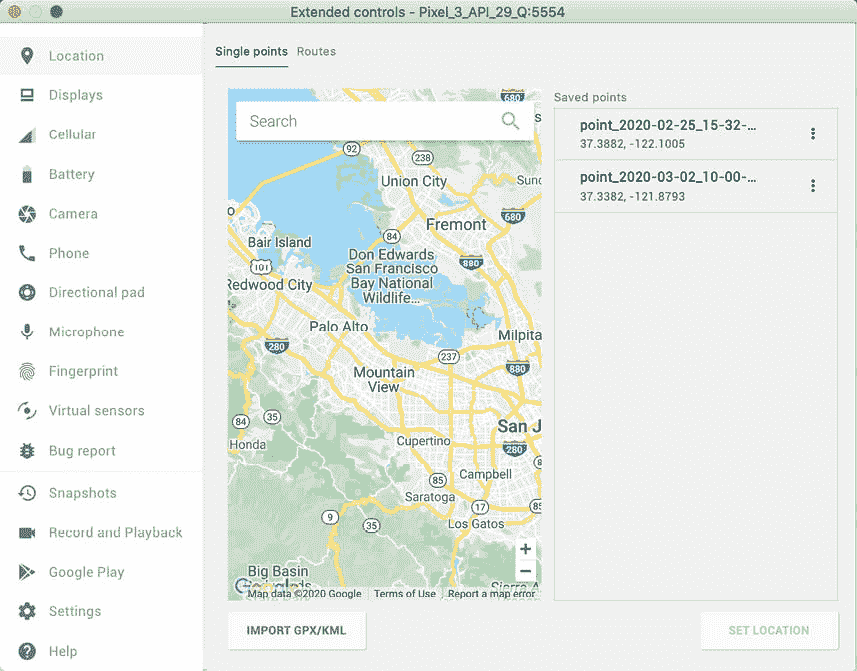
```

图 5-3

### 5.5.1 位置 (Location)

位置控制允许以十进制或六角坐标的形式将模拟位置信息发送到模拟器。位置信息可以是单个位置，也可以是代表设备移动的点序列，后者通过 GPS 交换 (`GPX`) 或 Keyhole 标记语言 (`KML`) 格式的文件提供。或者，可以使用集成的 Google Maps 面板视觉化选择点或旅行路线。

### 5.5.2 显示 (Displays)

除了模拟器屏幕内显示的主显示外，“显示”选项允许在同一个 Android 实例中运行额外的显示器。这对于测试如 Microsoft Surface Duo 等双屏设备的应用非常有用。这些额外的屏幕可以配置为任何所需的尺寸，并出现在与主屏幕相同的同一个模拟器窗口中。

### 5.5.3 蜂窝 (Cellular)

可以在蜂窝设置界面中更改模拟的蜂窝连接类型。可以选择模拟不同网络类型（如`CSM`、`EDGE`、`HSDPA`等）以及一系列语音和数据场景，如漫游和拒绝访问。

### 5.5.4 摄像头 (Camera)

当摄像头激活时，模拟器会模拟 3D 场景。这是一个虚拟建筑内部，在模拟器内录制视频或拍照之前，可以通过按住`Option`键（Windows 上为`Alt`）同时使用鼠标指针和键盘键在其中进行导航。此扩展配置选项允许上传不同的图像显示在虚拟环境中。

### 5.5.5 电池 (Battery)

在此扩展控制屏幕面板上可以模拟各种电池状态和充电条件，包括电池电量、电池健康状况以及当前是否连接了交流充电器。

### 5.5.6 电话 (Phone)

电话扩展控制在模拟器内提供了两个简单但实用的模拟。第一个选项允许模拟来自指定电话号码的来电。这在测试应用如何处理此类高级中断时特别有用。

第二个选项允许在模拟器会话中模拟接收短信。与现实世界一样，这些消息出现在“消息”应用中，并触发模拟器内的标准通知。

### 5.5.7 方向键 (Directional Pad)

方向键 (`D-Pad`) 是内置在 Android 设备中或外部连接（如游戏控制器）的另一组额外控件，提供方向控制（左、右、上、下）。方向键设置允许在模拟器内模拟 D-Pad 交互。

### 5.5.8 麦克风 (Microphone)

麦克风设置允许启用麦克风并模拟耳机和麦克风连接。还提供了一个按钮启动模拟器上的语音助手。

### 5.5.9 指纹 (Fingerprint)

许多 Android 设备现在配备了内置指纹检测硬件。AVD 模拟器使得无需在带有指纹传感器的物理设备上测试指纹验证。如何在模拟器内配置指纹测试的细节将在本章稍后详细介绍。

### 5.5.10 虚拟传感器 (Virtual Sensors)

虚拟传感器选项允许模拟加速度计和磁力计，通过偏航、俯仰和滚动设置模拟设备的物理运动（如旋转、移动和倾斜）。

### 5.5.11 快照 (Snapshots)

快照包含保存并快速恢复的当前运行 AVD 会话状态，可以让模拟器回到精确状态。快照在本章稍后详细介绍。

### 5.5.12 录制与播放 (Record and Playback)

允许将模拟器屏幕和音频录制并保存为 WebM 或动画 GIF 格式。

### 5.5.13 Google Play

如果模拟器运行的版本带有 Google Play 服务，此选项将显示当前的 Google Play 版本并提供更新模拟器到最新版本的选项。

### 5.5.14 设置 (Settings)

设置面板提供了一组配置选项。使用此面板为工具栏和扩展控制面板选择更深色的主题、指定保存截图的文件系统位置、配置 OpenGL 支持级别，以及配置模拟器窗口位于桌面上其他窗口之上。

### 5.5.15 帮助 (Help)

帮助屏幕包含三个子面板，分别包含快捷键列表、访问模拟器在线文档/报告错误及发送反馈的链接，以及模拟器版本信息。

## 5.6 使用快照（Snapshots）

当模拟器首次启动时，它会执行一次类似于物理 Android 设备开机时的冷启动。由于系统的加载和所有后台进程的启动，冷启动过程可能需要一些时间才能完成。为了避免每次启动模拟器时都经历此过程，系统被配置为每次退出时自动保存模拟器当前状态的快照（称为快速启动快照）。下次启动模拟器时，快速启动快照将加载到内存中，并从上次离开的地方继续执行，允许模拟器所需的时间仅为冷启动所需时间的一小部分。

扩展控制面板的`Snapshots`屏幕用于在模拟器运行期间的任何点存储额外的快照。这保存了整个模拟器的精确状态，允许模拟器恢复到拍摄快照时的精确时间点。在屏幕界面中，可以使用`Take Snapshot`按钮（在图 5-4 中标记为 A）拍摄快照。要恢复现有的快照，从列表中选择它 (B) 并点击屏幕底部的`run`按钮 (C)。还提供了选项来编辑 (D) 快照名称和描述，并删除 (E) 当前选中的快照：

```
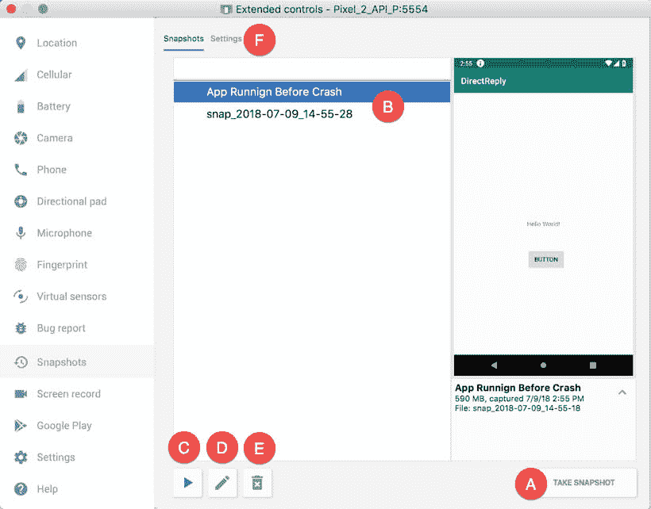
```

图 5-4


`Settings` 选项 (F) 配置自动保存快速启动快照（默认情况下，模拟器在每次退出时都会询问是否保存快速启动快照）以及重新加载最新快照的选项。要强制模拟器执行冷启动而不是使用之前的快速启动快照，打开 `AVD Manager`（`Tools -> AVD Manager`），点击模拟器操作列中的向下箭头并选择 `Cold Boot Now` 菜单选项。

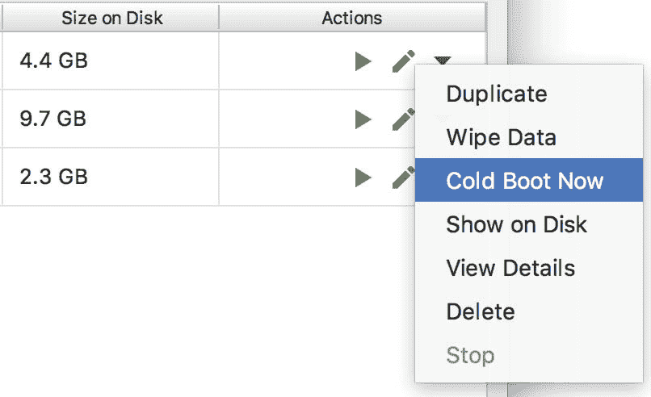

图 5-5

## 5.7 配置指纹模拟

模拟器允许配置最多 10 个模拟指纹，并用于测试 Android 应用内的指纹验证。要配置模拟指纹，首先启动模拟器，打开 `Settings` 应用并选择 `Security & Location` 选项。

在 `Security` 设置屏幕中，选择 `Use fingerprint` 选项。在弹出信息屏幕上点击 `Next` 按钮进入指纹设置屏幕。在启用指纹安全之前，必须配置备份屏幕解锁方法（如 PIN 码）。点击 `Fingerprint + PIN` 按钮，并在提示时选择在设备启动时不需要 PIN。输入并确认合适的 PIN 码，通过接受默认通知选项来完成 PIN 输入过程。

继续通过后续屏幕，直到 `Settings` 应用请求在传感器上指纹。此时，显示扩展控制对话框，在左侧面板中选择 `Fingerprint` 类别，并确保主设置面板中选择了 `Finger 1`：

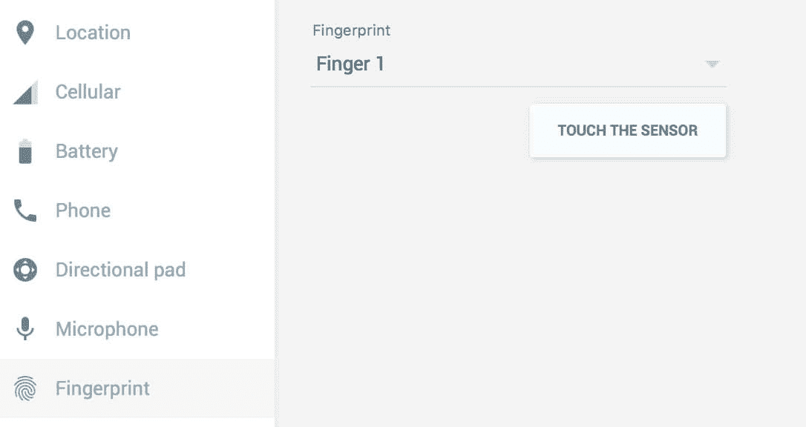

图 5-6

点击 `Touch the Sensor` 按钮模拟 `Finger 1` 触摸指纹传感器。模拟器将报告指纹添加成功：

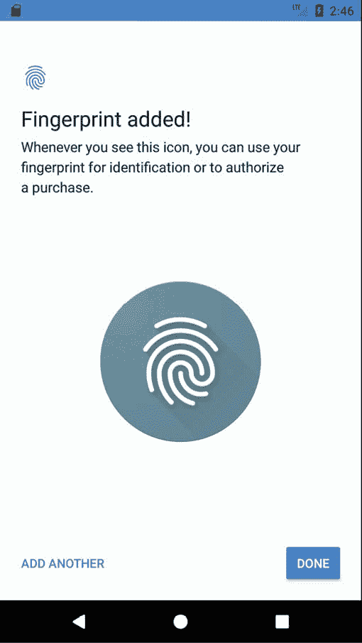

图 5-7

要添加更多指纹，点击 `Add Another` 按钮，并在再次点击 `Touch the Sensor` 按钮之前，从扩展控制面板菜单中选择另一个手指。关于在 Android 应用中构建指纹验证的主题，在名为“Android 生物识别认证教程”的章节中有详细介绍。

## 5.8 工具窗口模式下的模拟器

如上一章所述（“在 Android Studio 中创建 Android 虚拟设备 (AVD)”），可以配置 Android Studio 以嵌入工具窗口的形式启动模拟器，这样它就不会出现在独立的窗口中。当在此模式下运行时，工具栏中将提供独立模式下可用的一小部分控件，如图 5-8 所示：

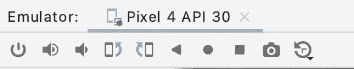

图 5-8

从左到右，这些按钮执行以下任务（详细信息与独立模式一致）：

- 电源（Power）
- 音量增加（Volume Up）
- 音量减小（Volume Down）
- 左旋转（Rotate Left）
- 右旋转（Rotate Right）
- 返回（Back）
- 主页概览（Home Overview）
- 截图（Take Screenshot）
- 拍摄快照（Take Snapshot）

## 5.9 总结

Android Studio 4.1 包含 Android 虚拟设备模拟器环境，旨在更方便地测试应用程序，无需在物理 Android 设备上运行。本章简要介绍了模拟器，并强调了配置和自定义环境以模拟不同测试条件的关键功能。

# 6. Android Studio 用户界面漫览

虽然人们急于开始运行上一章创建的示例应用程序，但这样做涉及 Android Studio 用户界面的某些方面，这些方面最好先进行描述。

Android Studio 是一个强大且功能丰富的开发环境，在很大程度上是直观的。尽管如此，现在花时间熟悉 Android Studio 用户界面的布局和组织将大大缩短本书后续章节的学习曲线。考虑到这一点，本章将提供组成 Android Studio 环境的各个区域和组件的初步概述。

## 6.1 欢迎屏幕

欢迎屏幕（图 6-1）在 Android Studio 运行时没有任何打开的项目时显示（可以随时通过选择 `File -> Close Project` 选项关闭打开的项目）。如果 Android Studio 在有打开的项目时退出，下次启动时将跳过欢迎屏幕，自动打开之前激活的项目。

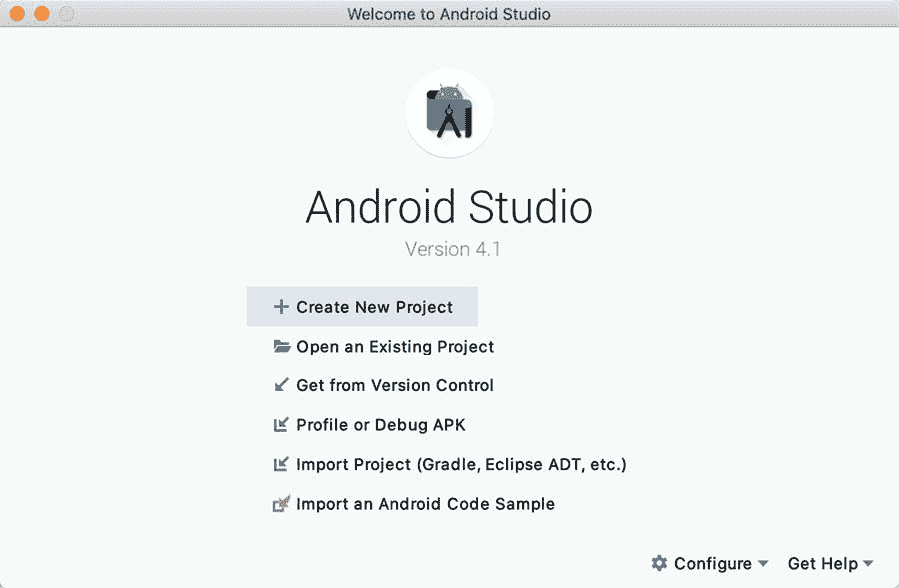

图 6-1

除了最近的项目列表，`Quick Start` 菜单提供了执行诸如打开、创建和导入项目等选项，并访问受版本控制的项目。此外，窗口底部的 `Configure` 菜单提供了访问 `SDK` 以及大量设置和配置选项。通过这些选项可以很快发现，Android Studio 几乎没有方面是不根据你的特定需求进行配置的。

`Configure` 菜单还包含检查是否有可下载的 Android Studio 更新选项。

## 6.2 主窗口

当创建新项目或打开现有项目时，Android Studio 主窗口将出现。当同时打开多个项目时，每个项目将拥有自己的主窗口。窗口的精确配置取决于上次打开项目时显示了工具和面板，但通常类似于图 6-2。

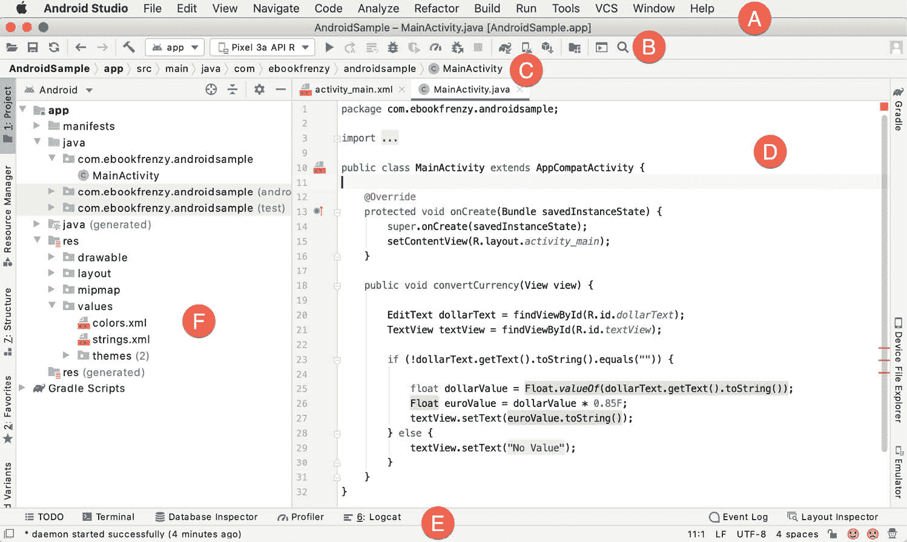

图 6-2

主窗口的各种元素可以总结如下：

**A – `Menu Bar`（菜单栏）**——包含用于 Android Studio 环境内执行任务的一系列菜单。

### B – 工具栏 (Toolbar)

一组用于常用操作的快捷键。工具栏按钮可以快速访问一组特定的菜单栏操作。可以通过在工具栏上点击右键并选择 `Customize Menus and Toolbars…` 菜单选项来自定义工具栏。如果工具栏可见，可以使用 `View -> Appearance -> Toolbar` 菜单选项显示它。

### C – 导航栏 (Navigation Bar)

导航栏提供了在组成项目的文件和文件夹之间移动的便捷方式。点击导航栏中的某个元素将弹出一个菜单，列出该位置的子文件夹和文件以供选择。同样，点击类名将显示列出该类包含的方法的列表。从列表中选择一个方法，即可跳转到代码编辑器中相应的位置。使用 `View -> Appearance -> Navigation Bar` 菜单选项隐藏或显示此栏。

### D – 编辑器窗口 (Editor Window)

编辑器窗口显示开发者当前工作的文件内容。然而，在此位置显示的内容取决于上下文。例如，在编辑代码时，将显示代码编辑器。相反，在处理用户界面布局文件时，将显示用户界面布局编辑器（Layout Editor）工具。当打开多个文件时，每个文件都由编辑器顶部边缘的标签页表示，如图 6-3 所示。

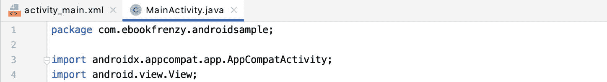

图 6-3

### E – 状态栏 (Status Bar)

状态栏显示关于项目和 Android Studio 活动的消息信息，以及位于最左角的工具菜单按钮。悬停在状态栏条目上将提供该字段的描述。许多字段是可交互的，允许用户点击以执行任务或获取更详细的状态信息。

### F – 项目工具窗口 (Project Tool Window)

项目工具窗口提供了项目文件结构的层级概述，允许对特定的文件和文件夹进行导航。可以使用工具栏以多种不同的方式显示项目。默认设置是 Android 视图，这是书中其余部分使用的模式。

项目工具窗口只是 Android Studio 环境中众多可用工具窗口之一。

## 6.3 工具窗口 (The Tool Windows)

除了项目视图工具窗口外，Android Studio 还包含了许多其他窗口，启用后它们会显示在主窗口的底部和侧边。只需将鼠标指针悬停在状态栏最左角的按钮上（图 6-4），即可访问工具窗口快速访问菜单无需点击鼠标。

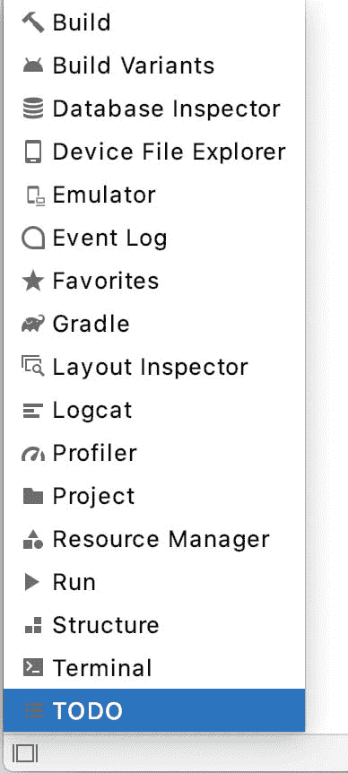

图 6-4

从快速访问菜单中选择项目将导致相应的工具窗口出现在主窗口中。

或者，可以通过点击状态栏中的快速访问菜单图标显示一组工具窗口栏。这些栏出现在主窗口的左侧、右侧和底部边缘（如图 6-5 中的箭头所示），并包含显示和隐藏每个工具窗口的按钮。当工具窗口栏显示时，再次点击状态栏中的按钮将把它们隐藏。

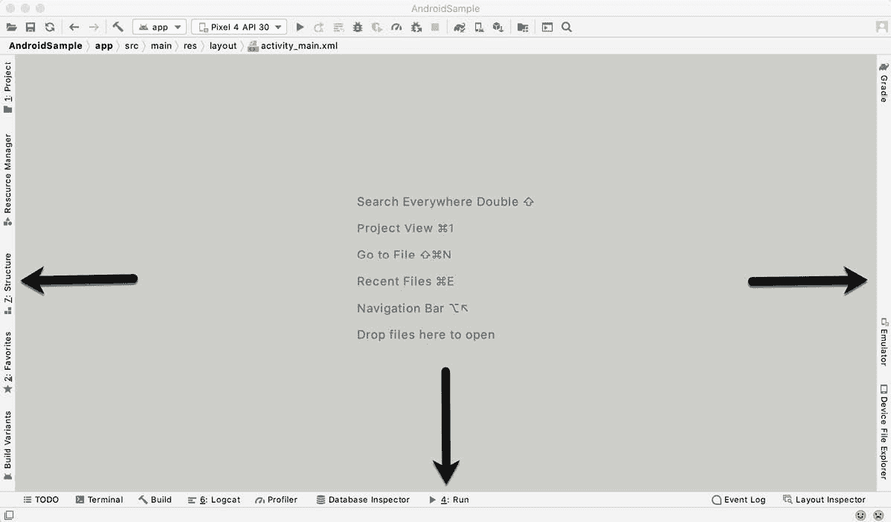

图 6-5

点击按钮将显示相应的工具窗口，而再次点击将隐藏该窗口。带有数字开头的按钮（例如 1: Project）表示可以通过按下键盘上的 `Alt` 键（macOS 为 `Command` 键）配合相应的数字来显示该工具窗口。

工具窗口栏中按钮的位置表示窗口在显示时位于窗口的哪侧。可以通过点击并拖动按钮到其他窗口工具栏的不同位置来更改这些位置。

每个工具窗口在顶部边缘都有自己的工具栏。这些工具栏中的按钮随工具的不同而异，但所有工具窗口都包含一个由齿轮图标表示的设置选项，允许更改窗口的各个方面。图 6-6 显示了项目视图工具窗口的设置菜单。提供可用选项，例如取消固定（undock）窗口使其浮动在 Android Studio 主窗口边界之外，以及移动和调整工具面板的大小。

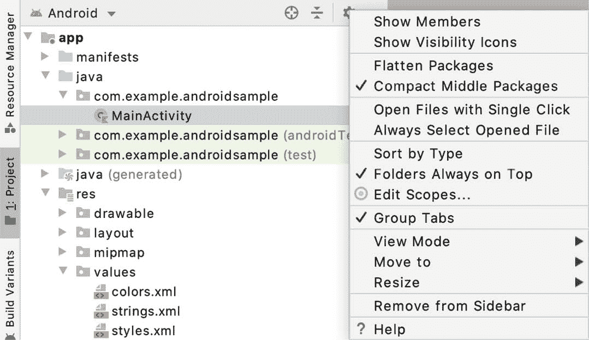

图 6-6

所有窗口的工具栏最右侧都包含一个按钮，提供了隐藏工具窗口以备视图的额外方法。只需通过点击该窗口使其获取焦点，然后输入搜索术语（例如项目工具窗口中的文件名），即可对工具窗口内的条目进行搜索。搜索框将出现在窗口的工具栏中，匹配搜索词的条目将被高亮。

Android Studio 提供了广泛的工具窗口，最常用的如下：

- **Project (项目)**：项目视图提供了项目文件结构的概述，允许在文件之间快速导航。通常情况下，在项目视图中双击文件将导致该文件加载到适当的编辑工具中。
- **Structure (结构)**：结构工具提供了当前编辑器中显示的源文件结构的高级视图。此信息包括文件中的类、方法和变量等条目的列表。从结构列表中选择一个项目将带您跳转到编辑器窗口中源文件的相应位置。
- **Favorites (收藏)**：可以将各种项目条目添加到收藏列表。例如，在项目视图中右键点击文件可以提供 `Add to Favorites`（添加到收藏）菜单选项。同样，也可以在结构窗口中右键点击源文件中的方法将其添加为收藏。添加到收藏列表的任何内容都可以通过收藏工具窗口访问。
- **Build Variants (构建变体)**：构建变体窗口为应用程序项目配置不同的构建目标提供了快速方法（例如调试版本和发布版本的不同构建，或针对不同设备类别的多个构建）。
- **TODO**：如名称所示，此工具提供了一个查看项目中尚未完成事项的地方。Android Studio 通过扫描组成项目的源文件寻找匹配指定 TODO 模式的注释来编译此列表。可以通过选择 `File -> Settings…` 菜单选项（macOS 为 `Android Studio -> Preferences…`）并导航到 `Editor` 下的 TODO 页面查看和更改这些模式。
- **Logcat**：`Logcat` 工具窗口提供了对运行应用程序监控日志输出的访问，以及拍摄应用程序截图、视频停止和重启进程的选项。
- **Terminal (终端)**：提供了对运行 Android Studio 的系统的终端窗口的访问。在 Windows 系统上这是命令提示符，而在 Linux 和 macOS 系统上以终端提示符的形式存在。
- **Build (构建)**：构建工具窗口在项目编译和打包时显示构建过程的信息，并显示遇到任何错误时的详细信息。
- **Run (运行)**：当应用程序运行时，运行工具窗口可用，并提供运行结果视图以及停止或重启运行进程的选项。如果应用程序无法在设备或模拟器上安装和运行，此窗口通常会提供与问题相关的诊断信息。
- **事件日志 (Event Log)**：事件日志窗口显示与 Android Studio 内执行的事件和活动相关的消息。例如，项目的成功构建或应用程序正在运行等情况将在此工具窗口中报告。
- **Gradle**：`Gradle` 工具窗口提供了组成项目构建配置的 `Gradle` 任务的视图。该窗口列出了在将项目的各种元素编译为可执行应用程序时涉及的任务。右键点击顶层 `Gradle` 任务并选择 `Open Gradle Config`（打开 Gradle 配置）菜单选项，可以将当前项目的 `Gradle` 构建文件加载到编辑器中。本书的后后部分将更详细地介绍 `Gradle`。
- **性能分析器 (Profiler)**：Android 分析器工具窗口提供了实时监控和分析工具，用于识别运行的应用程序中的性能问题，包括 CPU、内存和网络使用。当应用程序当前运行时，此选项将可用。
- **设备文件管理器 (Device File Explorer)**：设备文件管理器工具窗口提供了直接访问当前连接的 Android 设备或模拟器文件系统的权限，允许浏览文件并将文件复制到本地文件系统。
- **资源管理器 (Resource Manager)**：用于添加和管理项目包含的资源和资产工具，如图像、颜色和布局文件。
- **布局检查器 (Layout Inspector)**：提供构成用户界面布局的组件层次结构的视觉 3D 渲染。
- **模拟器 (Emulator)**：如果已启用在工具窗口中运行模拟器的选项（如标题为在 Android Studio 中创建 Android 虚拟设备 (AVD)的章节所示），则其中包含 AVD 模拟器。

## 6.4 Android Studio 快捷键

Android Studio 包含了大量的快捷键，旨在执行常用任务时节省时间。您可以在 Android Studio 项目窗口内选择 `Help -> Keymap Reference`（帮助 -> 键映射引用）菜单选项来查看并打印完整的快捷键映射列表。您还可以通过选择 `File -> Settings...`（文件 -> 设置...）菜单选项（macOS 上为 `Android Studio -> Preferences...`）并点击下方的 `Keymap`（键映射）项来列出和修改快捷键，如下方的图 6-7：

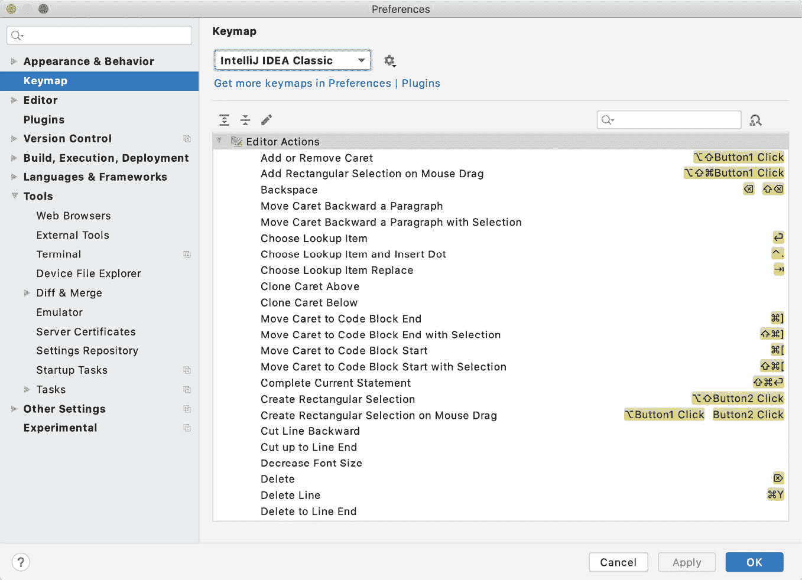

图 6-7

## 6.5 切换器与最近文件导航

在 Android Studio 主窗口内导航的另一种有用机制是使用 `Switcher`（切换器）。通过 `Ctrl-Tab` 快捷键访问，切换器显示为一个列出所有工具窗口和当前打开文件的面板（图 6-8）。

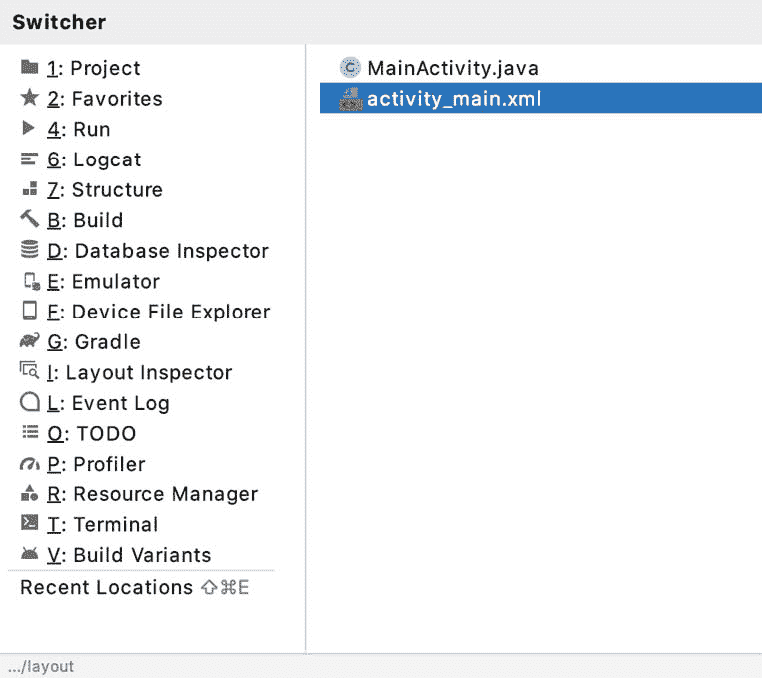

图 6-8

一旦显示，只要 `Ctrl` 键保持按下，切换器就会保持可见。在按住 `Ctrl` 键的同时反复点击 `Tab` 键可以在各种选择选项之间循环，而释放 `Ctrl` 键会导致当前高亮的项选中并在主窗口中显示。

除了切换器外，`Recent Files`（最近文件）面板还提供了到最近打开文件的导航（图 6-9）。可以使用 `Ctrl-E` 快捷键（macOS 上为 `Cmd-E`）访问该面板。显示后，既可以使用鼠标指针选择选项，也可以使用键盘方向键在文件名和工具窗口选项之间滚动。按下 `Enter` 键将选中当前高亮的项。

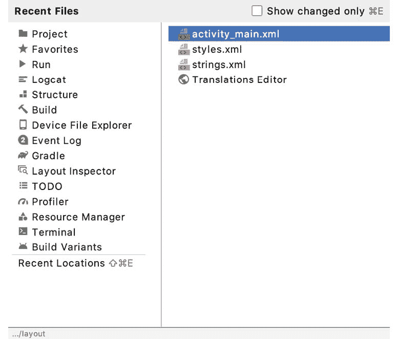

图 6-9

## 6.6 修改 Android Studio 主题

Android Studio 环境的整体主题可以通过欢迎界面上的 `Configure -> Settings`（配置 -> 设置）选项，或者通过主窗口的 `File -> Settings…`（文件 -> 设置…）（macOS 上为 `Android Studio -> Preferences…`）菜单选项进行更改。

显示设置对话框后，在左面板选择 `Appearance & Behavior`（外观与行为）选项，随后选择 `Appearance`（外观），然后更改设置。在点击 `Apply` 按钮之前，图 6-10 显示了 `Light`、`IntelliJ`、`Windows` 以及 `Darcula` 等可用主题：

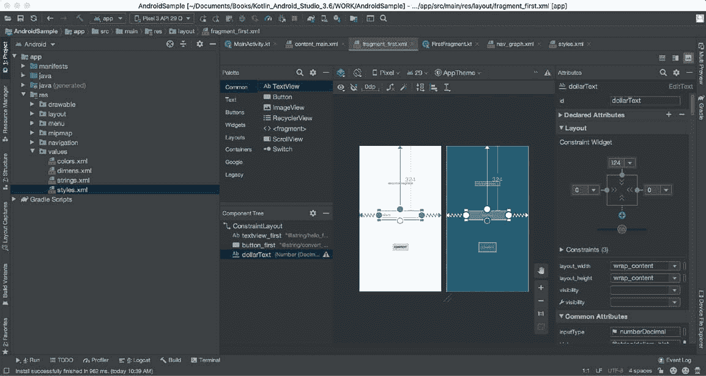

图 10

## 6.7 总结

Android Studio 环境的要素元素包括欢迎界面和主窗口。每个项目都分配了一个主窗口，该窗口由菜单栏、工具栏、编辑区域、状态栏和工具窗口组成。在 Android Studio 内，某些操作可以通过快捷键触发。可以随时从 Android Studio 访问快捷键映射。在物理设备上测试 Android 应用可以使用许多功能。

# 7. 在物理设备上测试 Android 应用

虽然可以使用 Android 虚拟设备 (AVD) 测试应用程序，但某些功能只有在对物理设备进行测试时可用。与 AVD 实例和连接的 Android 设备通信由 Android 桥接 (`ADB`) 处理。

## 7.1 Android 桥接 (ADB) 概述

`ADB` 的主要目的是促进开发系统（在本例中为 Android）与 AVD 模拟器以及物理设备之间的交互。

`ADB` 由一个客户端、一个运行在开发系统上的服务器进程以及一个运行在 AVD 或真实设备上的守护进程组成。

`ADB` 客户端有多种形式。例如，它以 Android SDK `platform-tools` 子目录下的名为 `adb` 的命令行工具的形式提供。同样，Android Studio 也内置了一个客户端。可以使用 `adb` 命令行工具执行各种任务。例如，可以使用 `devices` 命令行参数获取当前虚拟或物理设备列表。以下命令输出表示系统中存在 AVD 但没有物理设备：

```
adb devices
List of devices attached
emulator-5554 device
```

## 7.2 在 Android 设备上启用 ADB

在 `ADB` 连接到 Android 设备之前，必须先配置该设备允许连接。对于运行 Android 6.0 或更高版本的手机和平板设备，实现此点的步骤如下：

1. 打开设备上的 `Settings` 应用并选择 `About tablet` 或 `About phone`（在较新版本的 Android 可以在 `Settings` 的 `System` 页面找到）。


2. 在`About`屏幕上，滚动到`Build number`字段（图 7-1）并点击多次，直到出现已启用开发者模式的消息。如果`Build number`未列在`About`屏幕上，可以通过`Software information`访问。或者，如果可用，展开列表中的`Advanced`部分。

3. 返回设置主界面，注意出现了一个名为`Developer options`（开发者选项）的新选项。选择此选项并找到开发者屏幕上名为`USB debugging`（USB 调试）的设置。启用该项目旁边的开关，如下所示图 7-2：

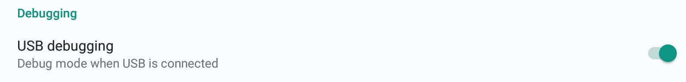

图 7-2

4. 从屏幕顶部向下滑动显示通知面板（图 7-3），并注意设备当前已连接用于调试。


图 7-3

此时，设备已配置好可以接受来自开发系统上`adb`的调试连接。剩下的工作工作是配置开发系统，以便在设备连接时能够检测到它。虽然这是一个相对简单的过程，但涉及的步骤取决于开发系统运行的是 Windows、macOS 还是 Linux。请注意，后续步骤假设 Android SDK 的`platform-tools`目录已包含在操作系统的`PATH`环境变量中，这在“设置 Android Studio 开发环境”章节中所描述。

### 7.2.1 macOS ADB 配置

为了在 macOS 系统上配置`ADB`环境，请使用 USB 数据线将设备连接到计算机系统，打开终端窗口并执行以下命令以重启`adb`服务：

```bash
$ adb kill-server
$ adb start-server
```

* daemon not running. starting it now on port 5037 *

* daemon started successfully *

一旦服务器成功运行，执行以下命令验证是否已检测到设备：

```bash
$ adb devices
List of devices attached
74CE000600000001 offline
```

如果设备显示为`offline`（离线），请前往 Android 设备并检查是否存在图 7-4 所示的对话框，请求权限以`允许 USB 调试`。在点击确定 之前，勾选`始终来自此计算机`旁边的复选框。再次执行`adb devices`命令现在应该会将设备列为可用：

```bash
List of devices attached
015d41d4454bf80c device
```

如果设备未列出，请尝试注销并重新登录 macOS 桌面，如果问题仍然存在，请重启系统。

### 7.2.2 Windows ADB 配置

配置基于 Windows 的开发系统通过`ADB`连接到 Android 设备的第一步是在系统上安装相应的 USB 驱动程序。要安装的 USB 驱动程序取决于 Android 设备的型号。如果您有 Google Nexus 设备，则需要在您的 Windows 系统上安装并配置`Google USB Driver`包。实现此操作的详细步骤在以下网页上概述：

[`developer.android.com/sdk/win-usb.html`](http://developer.android.com/sdk/win-usb.html)

对于 Google USB 驱动程序不支持的 Android 设备，则需要下载设备制造商提供的驱动程序。可以在此处在线获取驱动程序列表以及下载和安装信息：

[`developer.android.com/tools/extras/oem-usb.html`](https://developer.android.com/tools/extras/oem-usb.html)

安装驱动程序后，设备现在会被识别为正确的设备类型，打开命令提示符窗口并执行以下命令：

```cmd
adb devices
```

此命令应输出连接设备的信息，如下所示：

```text
List of devices attached
HT4CTJT01906 offline
```

如果设备显示为`offline`或`unauthorized`（未授权），请查看设备显示器并检查是否存在图 7-4 所示的对话框，请求权限以`允许 USB 调试`。


图 7-4

在点击确定 之前，勾选`始终来自此计算机`旁边的复选框。再次执行`adb devices`命令现在会将设备列为已就绪：

```text
List of devices attached
HT4CTJT01906 device
```

如果设备未列出，执行以下命令以重启`ADB`服务：

```cmd
adb kill-server
adb start-server
```

如果设备仍然未列出，尝试执行以下命令：

```cmd
android update adb
```

请注意，可能还需要重启系统。

### 7.2.3 Linux adb 配置

出于本章的需要，我们将再次使用 Ubuntu Linux 作为参考示例，介绍在 Linux 上配置`adb`以连接到物理 Android 设备进行应用程序测试。

在 Ubuntu Linux 上进行物理设备测试需要安装名为`android-tools-adb`的包，这反而要求 Android Studio 用户是`plugdev`组的成员。这是大多数 Ubuntu 版本用户账户的默认设置，可以通过运行`id`命令进行验证。如果未列出`plugdev`组，请运行以下命令将您的账户添加到该组：

```bash
sudo usermod -aG plugdev $LOGNAME
```

满足组成员要求后，可以通过执行以下命令来安装`android-tools-adb`包：

```bash
sudo apt-get install android-tools-adb
```

完成上述更改后，重启 Ubuntu 系统。系统重启后，打开终端窗口，启动`adb`服务并检查已连接设备列表：

```bash
$ adb start-server
* daemon not running. starting it now on port 5037 *
* daemon started successfully *

$ adb devices
List of devices attached
015d41d4454bf80c offline
```

如果设备显示为`offline`或`unauthorized`，请前往设备并检查是否存在图 7-4 所示的对话框，请求权限以`允许 USB 调试`。

## 7.3 测试 adb 连接

假设在您选择的平台上`adb`配置成功，下一步是在设备上运行在“在 Android Studio 中创建 Android 应用”章节中创建的应用程序。启动 Android Studio，打开项目，并验证设备是否出现在图 7-5 所示的设备菜单中：


图 7-5

## 7.4 总结

虽然 Android 虚拟机提供了一个极佳的测试环境，但请记住没有什么可以替代在真实设备上确保应用程序正常运行。但是，Android Studio 环境默认未配置将 Android 设备作为测试设备。因此，需要执行某些步骤，以便从 Android Studio 环境中将应用程序加载到 Android 设备。具体步骤取决于所使用的开发平台。在本章中，我们涵盖了适用于 Linux、macOS 和 Windows 平台的步骤。

## 8. Android 代码编辑器的基础

为 Android 开发应用程序涉及大量的编程工作，根据定义，这涉及代码行的输入、审查和修改。这并不意外，开发者使用 Android Studio 的大部分时间通常会在编辑器窗口内编辑代码。

现代代码编辑器需要远超基础的输入、删除、剪切和粘贴。今天，代码编辑器的实用性通常根据以下因素衡量：它在多大程度上减少了程序员的输入量、在大型源文件中的导航便利性，以及编辑器在编写代码时实时检测并高亮编程错误的能力。正如本章将所示的，这些只是 Android Studio 编辑器出色的领域之一。

虽然本章并不是 Android Studio 编辑器功能的详尽概述，但旨在提供该工具的关键功能指南。经验丰富的程序员会发现，其中某些功能是目前许多代码编辑器共有的，而另许多功能是此特定编辑环境所独特的。

### 8.1 Android Studio 编辑器

当选中 Java、Kotlin、XML 或其他基于文本的文件进行编辑时，Android Studio 编辑器出现在主窗口的中心。例如，图 8-1 显示了一个加载了 Java 源代码文件的典型编辑器会话：

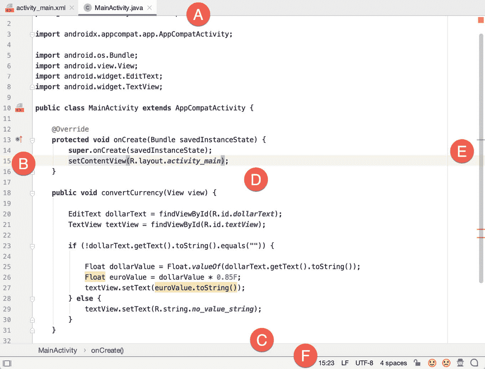

图 8-1

构成编辑器窗口的元素可以总结如下：

#### A – 文档标签 (Document Tabs)

Android Studio 能够同时打开多个文件进行编辑。每打开一个文件，它都会被分配一个文档标签，在编辑器窗口顶部边缘的标签栏中显示文件名。当空间不足以显示所有标签时，标签栏的最右侧会出现一个微小的下拉菜单。点击此菜单将列出其他已打开的文件列表。标签中文件名下方的红色波浪线表示该文件中的代码包含一个或多个错误，这些错误在项目编译和运行之前需要解决。

在文件之间切换只需点击相应的标签，或使用快捷键`Alt-Left`和`Alt-Right`。文件之间的导航也可以也可以使用切换器（Switcher）机制（通过快捷键`Ctrl-Tab`访问

要将编辑器面板从 Android Studio 主窗口分离并使其在单独窗口中显示，请点击标签并将其拖到主窗口之外的桌面区域。要将编辑器返回主窗口，请点击分离编辑器窗口中的文件标签，将其拖放到主窗口中的原始编辑器标签栏上。

#### B – 编辑器行槽区域 (The Editor Gutter Area)

行槽区域用于编辑器显示信息图标和控件。在该行槽区域出现的一些典型项目包括调试断点标记、折叠和展开代码块的控件、书签、更改标记和行号。行号默认开启，但可以通过在行槽中点击右键并选择`Show Line Numbers`（显示行号）菜单选项来禁用。

#### C – 代码结构位置 (Code Structure Location)

编辑器底部的此栏显示光标相对于代码整体结构的当前位置。例如，在下面的图中，该栏表示当前正在编辑一个`setOnClickListener`方法调用，且该行代码包含`MainActivity`类的`convertCurrency`方法中。


图 8-2

双击栏中的元素会将光标移动到代码文件中的相应位置。例如，双击`convertCurrency(view: View)`条目将把光标移动到源代码中`convertCurrency`方法的顶部。同样，点击`MainActivity`条目将弹出一个可用的代码导航点列表供选择：

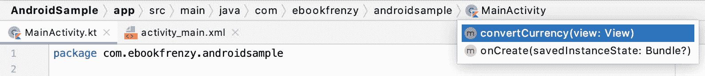

图 8-3

#### D – 编辑器区域 (The Editor Area)

这是用户显示、输入和编辑代码的主区域。本章随后的章节将详细介绍编辑区域的关键功能。

#### E – 验证与标记侧侧边栏 (The Validation and Marker Sidebar)

Android Studio 整合了一项名为“即时代码分析”的功能。这本质上意味着当您编写代码时，编辑器正在分析代码以检查警告和语法错误。验证侧边栏顶部的指示器将从绿色标记（未检测到警告或错误）变为黄色正方形（检测到警告）或红色警报图标（已检测到错误）。点击此指示器将显示一个弹出窗口，其中包含编辑器代码发现的问题摘要，如图 8-4 所示：

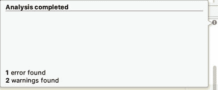

图 8-4

侧边栏还使用相同的颜色代码在检测到问题的位置显示标记。当编辑器区域显示该行代码时，将鼠标指针悬停在标记上，将显示一个包含问题描述的弹出窗口（图 8-5）：


图 8-5

当某行代码目前滚动出编辑器可视区域时，将鼠标指针悬停在该行的标记上，将显示一个“透镜”（lens）覆盖层，其中包含问题所在的代码块（图 8-6），从而无需滚动到编辑器的该位置即可查看：

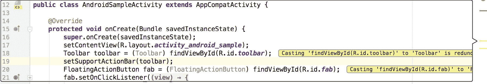

图 8-6

值得注意的是，透镜覆盖层不仅限于侧边栏中的警告和错误。悬停在侧边栏的任何部分都会出现一个透镜，其中包含源文件中该处的代码。

#### F – 状态栏 (The Status Bar)

虽然状态栏实际上是主窗口的一部分而非编辑器，但它包含有关当前活动编辑会话的信息。这些信息包括光标在行和字符方面的当前位置，以及文件的编码格式（UTF-8、ASCII 等）。点击状态栏中的这些值可以更改相应的设置。例如，点击行号会显示`Go to Line`（转到行）对话框。

在提供了构成 Android Studio 编辑器的元素概述后，本章的剩余部分将更详细探索编辑环境的关键功能。

### 8.2 分屏编辑器窗口 (Splitting the Editor Window)

默认情况下，编辑器将显示当前选中文件内容的单个面板。在同时处理多个源文件时，一个特别实用的功能是将编辑器拆分为多个窗格。要拆分编辑器，右键点击编辑器窗口内的文件标签并选择`Split Vertically`（垂直拆分）或`Split Horizontally`（水平拆分）菜单选项。例如，图 8-7 显示了分屏器的用法，编辑器被拆分为三个面板：

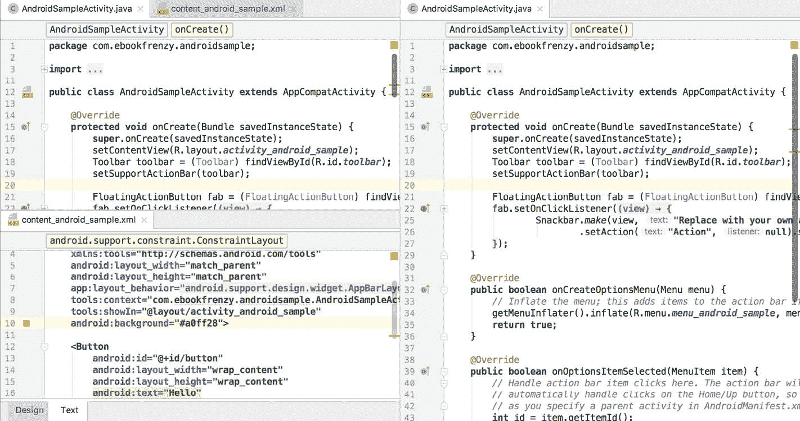

图 8-7

可以随时通过右键点击相应的标签并选择`Change Splitter Orientation`（更改拆分方向）菜单选项来更改分屏面板的方向。重复这些步骤可以取消单个面板，此时从菜单中选择`Unsplit`。可以通过点击任何标签并选择`Unsplit All`移除所有分屏面板。

窗口分屏可显示不同的文件，或为同一文件提供多个窗口，以便同时查看和编辑文件的不同区域。

### 8.3 代码完成 (Code Completion)

Android Studio 编辑器拥有大量的 Java 编程语法和 Android SDK 类方法的内置知识，以及对您代码库的了解。在输入代码时，编辑器会扫描输入内容，并在适当的情况下对完成语句或引用所需的内容建议。当编辑器检测到补全建议时，将出现一个包含建议列表的面板。在图 8-8 中，编辑器正在为`String`声明的开头提供建议：

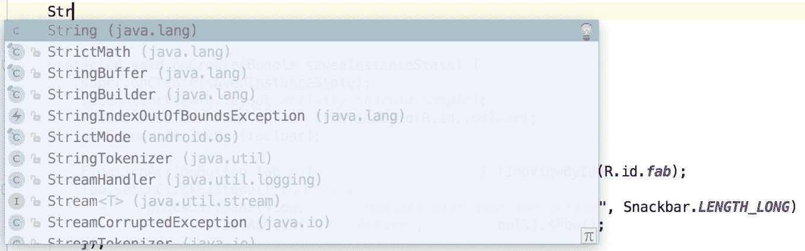

图 8-8

如果自动补全建议都不正确，只需继续输入，编辑器将在适当的情况下继续完善建议。要接受最顶部的建议，只需按下键盘上的`Enter`或`Tab`键。要选择不同的建议，使用方向键在列表中上下移动，再次使用`Enter`或`Tab`键选中高亮项。

可以使用`Ctrl-Space`组合键手动调用补全建议。当在编辑器中更改单词或声明时，此功能非常有用。当光标置于编辑器中的某个单词上时，该单词将自动高亮。按下`Ctrl-Space`将显示一个备选建议列表。要将当前单词替换为建议列表中当前高所示的项，只需按下`Tab`键即可。

除了实时自动补全功能，Android Studio 编辑器还提供了一种名为“智能补全”（Smart Completion）的系统。智能补全通过`Shift-Ctrl-Space`组合键调用，选中后，它将根据代码的当前上下文提供更详细的建议。再次按下`Shift-Ctrl-Space`快捷键将从更广泛的可能范围内提供更多建议。

对于许多程序员来说，代码补全可能取决于个人的喜好。考虑到这一事实，Android Studio 对自动补全设置提供了高细粒度的控制。可以通过选择`File -> Settings…`（macOS 上为`Android Studio -> Preferences…`）菜单选项，并在设置面板中选择`Editor -> General -> Code Completion`来查看和修改这些设置，如图图 8-9 所示：

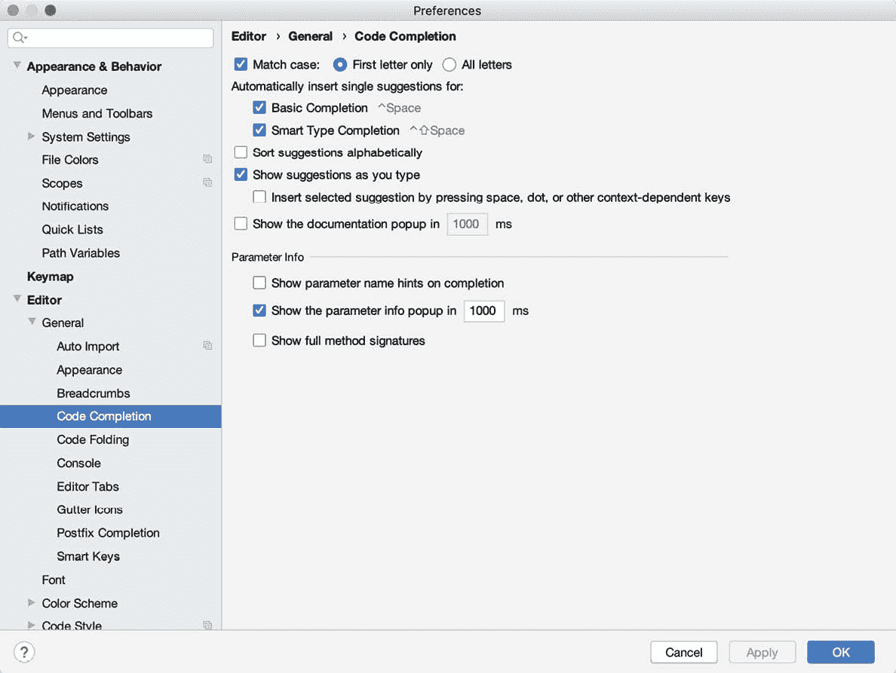

图 8-9

### 8.4 语句补全

Android Studio 编辑器提供的另一种自动补全形式是语句补全。它可以用于自动填充方法和循环语句等项的括号和大括号。语句补全通过`Shift-Ctrl-Enter`（macOS 上为`Shift-Cmd-Enter`）组合键调用。考虑以下代码：

```
myMethod()
```

在编辑器中输入此代码后，触发语句补全将导致编辑器自动为该方法添加大括号：

```java
myMethod() {

}
```

### 8.5 参数信息

还可以请求编辑器提供有关方法接受的参数参数的信息。当光标置于方法调用的括号之间时，按下`Ctrl-P`（macOS 上为`Cmd-P`）组合键将显示已知该方法接受的参数，其中最可能的建议将以**粗体**显示：

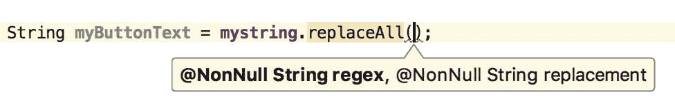

图 8-10

### 8.6 参数名称提示

代码编辑器可以配置为在方法调用中显示参数名称提示。例如，图 8-11 高亮了`Snackbar`类`make()`和`setAction()`方法调用中的参数名称提示：


图 8-11

此模式的设置可以通过选择`File -> Settings`（macOS 上为`Android Studio -> Preferences`）菜单选项，然后在左侧面板中选择`Editor -> Appearance`来配置。在 Appearance（外观）屏幕上，启用或禁用`Show parameter name hints`。要调整提示设置，点击`Configure...`按钮，选择编程语言并进行任何调整。

### 8.7 代码生成


除了在输入时补全代码外，编辑器在某些条件下还可以为您生成代码。如图 8-12 所示的可用代码生成选项列表，当光标位于文件中需要生成代码的位置时，可以使用`Alt-Insert`（macOS 上为`Ctrl-N`）快捷键进行访问。


图 8-12

为了演示示例，考虑一种情况：我们希望在项目中的`Activity`将被操作系统销毁时收到通知。正如本书后续章节将概述的，这可以通过重写`Activity`超类的`onStop()`周期方法来实现。要让 Android Studio 为此生成一个存根方法，只需从代码生成列表中选择`Override Methods…`选项，并在生成的可用方法列表中选择`onStop()`方法：

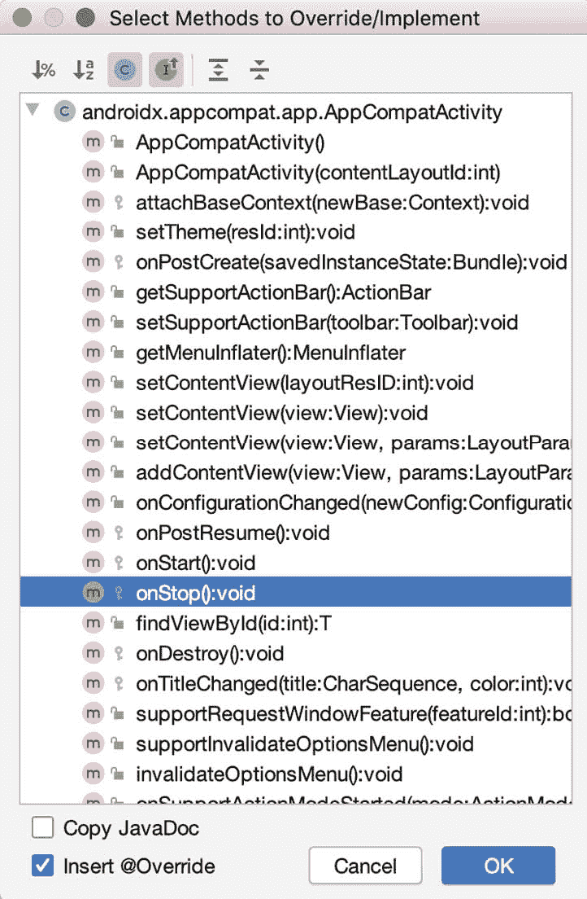

图 8-13

选择好要重写的方法后，点击`OK`将在 Java 源文件的当前光标位置生成如下所示的存根方法：

```java
@Override
protected void onStop() {
    super.onStop();
}
```

## 8.8 代码折叠

一旦源代码文件达到一定大小，即使是格式最整齐、组织最良好的代码也可能变得难以处理和导航。Android Studio 认为，并不总是需要让每个代码块的内容始终可见。通过使用 Android Studio 编辑器的代码折叠功能，可以使代码导航变得更容易。代码折叠通过出现在源文件每个代码块开头和结尾的编辑器行槽（gutter）中的标记来控制。例如，图 8-14 高亮了当前未折叠的方法声明的起始和结束标记：


图 8-14

点击这些标记中的任一个都会折叠该语句，使仅签名行可见，如图 8-15 所示：


图 8-15

要展开已折叠的代码段，只需点击编辑器行槽中的`+`标记。要在不展开的情况下查看隐藏的代码，请将鼠标指针悬停在`{}`指示器上，如图 8-16 所示。编辑器将显示包含折叠代码的覆盖层：


图 8-16

可以使用`Ctrl-Shift-Plus`和`Ctrl-Shift-Minus`序列折叠或展开文件中的代码块。默认情况下，Android Studio 编辑器会在打开源文件时自动折叠代码。要配置发生这种情况条件，选择`File -> Settings…`（macOS 上为`Android Studio -> Preferences…`）并在设置面板中选择`Editor -> General -> Code Folding`（图 8-17）：


图 8-17

## 8.9 快速文档查找

可以通过光标置于所需的声明上并按下`Ctrl-Q`快捷键（macOS 上为`Ctrl-J`）访问上下文相关的 Java 和 Android 文档。这将显示一个包含相关文档的弹出窗口。例如，图 8-18 显示`Snackbar`类的文档。


图 8-18

显示后，根据需要移动文档弹出窗口。点击标题栏右上角的图钉图标可以确保在焦点移回编辑器后弹出窗口保持可见，以便在编写代码时作为参考。

## 8.10 代码重格式化

通常情况下，Android Studio 编辑器会在添加语句和代码块时自动对缩进、间距和嵌套进行格式化。在需要重新格式化行的情况下（例如从网站复制粘贴示例代码时），编辑器提供了源代码重格式化功能，选中后将自动格式化代码以匹配现的代码样式。

要格式化源代码，按下`Ctrl-Alt-L`（macOS 上为`Cmd-Opt-L`）组合键序列。要显示`Reformat Code`对话框（图 8-19），使用`Ctrl-Alt-Shift-L`（macOS 上为`Cmd-Opt-Shift-L`）。此对话框提供了仅格式化当前选中的代码、整个编辑器中的活动源文件或仅作为源码控制更新结果而更改的代码的选项。

# 图 8-19

所有的代码风格偏好都可以在项目设置对话框中更改。选择`File -> Settings`菜单选项（macOS 上为`Android Studio -> Preferences…`），并在左侧面板中选择`Code Style`，以访问支持的编程和标记语言列表。选择一种语言将提供大量的格式化样式选项，所有选项都可以从 Android Studio 默认值进行修改，以匹配你偏好的代码风格。例如，要配置上述对话框中`Rearrange`代码选项的设置，请先展开`Code Style`部分，选择`Java`，然后从`Java`设置中选择`Arrangement`选项卡。

## 8.11 查找示例代码

Android Studio 编辑器提供了一种方法来访问与代码列表中当前高亮项相关的示例代码。此功能对于学习特定的 Android `class`或方法如何非常有用。要查找示例代码，可以在编辑器中高亮方法或类名，右键点击它并选择`Find Sample Code`菜单选项。`Find Sample Code`面板（图 8-20）将出现在编辑器下方，并列出匹配的示例。从列表中选择一个示例将相应的代码加载到右侧面板：


图 8-20

## 8.12 Live Templates

在编写 Android 代码时，你会发现有一些经常使用的常用结构。例如，一个常见的需求是通过`Toast`类向用户显示弹出消息。Live templates（实时模板）是常用代码结构的集合，可以通过在编辑器中输入初始字符后按特殊键（默认设置为`Tab`键）来插入模板代码。要体验这一效果，在代码编辑器中输入`toast`然后按`Tab`键，Android Studio 将在光标位置插入以下代码并供你编辑：

```
Toast.makeText(, "", Toast.LENGTH_SHORT).show()
```

要列出并编辑现有模板、更改特殊键或添加你自己的模板，请打开`Preferences`对话框，并在左侧导航面板的`Editor`部分选择`Live Templates`：


图 8-21

使用上方图 8-21 中标记为 A 的按钮添加、删除、复制或重置模板。要修改模板，请从列表中选择它 (B) 并更改标记为 C 的面板中的设置。

## 8.13 总结

Android Studio 编辑器极力减少编写代码所需的打字量，并使代码更易阅读和导航。在本章中，我们涵盖了许多关键编辑器功能，包括代码补全、代码生成、编辑器窗口拆、代码折叠、重格式化、文档查询和 live templates。

## 9. Android 架构概述

到目前为止，本书已经采取了步骤来建立一个适用于使用 Android Studio 开发 Android 应用的环境。通过创建 Android Studio 应用程序项目，也已经迈出了应用开发过程的第一步。

然而，在深入研究 Android 应用开发的实际操作问题之前，理解 Android SDK 以及通用的 Android 开发中一些较为抽象的概念是非常重要的。现在清晰地理解这些概念将为进一步构建知识提供坚实的基础。

从本章对 Android 架构的概述开始，并在本书的接几章中继续，目标是提供 Android 开发基础的详细概述。

## 9.1 Android 软件栈

Android 以软件栈的形式结构化，由应用程序、操作系统、运行时环境、中间件、服务和库组成。这种架构或许可以通过图 9-1 所示的视觉方式表示得。栈的每一层以及每层中的相应元素都紧密集成并经过仔细调整，以为移动设备提供最佳的应用开发和执行环境。本章的其余部分将介绍 Android 栈的不同层，从底部的`Linux Kernel`开始。


图 9-1

## 9.2 Linux 内核

`Linux Kernel`位于 Android 软件栈底部，在设备硬件和 Android 软件栈上层之间提供了一种抽象。基于 Linux 版本`2.6`，内核提供了抢式多任务处理、底层核心系统服务（如内存、进程和电源管理），还为显示器、Wi-Fi 和音频等硬件提供了网络栈和设备驱动程序。

原始的`Linux kernel`由 Linus Torvalds 于 1991 年开发，并与 Richard Stallman 在自由软件基金开发的一系列工具、实用程序和编译器相结合，创建了被称为`GNU/Linux`的完整操作系统。各种 Linux 发行版都是从这些基础衍生出来的，如`Ubuntu`和`Red Hat Enterprise Linux`。

然而，重要的是，Android 仅使用`Linux kernel`。尽管如此，值得注意的是，`Linux kernel`最初是为台式机和服务器形式的传统计算机设计的。事实上，Linux 现在最广泛地部署在任务关键型企业服务器环境中。我们发现这种软件位于 Android 软件栈的核心，这既证明了今天移动设备的强大，也证明了`Linux kernel`的效率和性能。

## 9.3 Android Runtime – ART

当在 Android Studio 中构建 Android 应用时，它会被编译为中间字节码格式（称为`DEX`格式）。当应用程序随后加载到设备上时，Android Runtime (ART) 使用一种称为预编译 (AOT) 的过程将字节码翻译为设备处理器所需的的原生指令。这种格式被称为可执行和可链接格式 (ELF)。

每当启动应用程序时，都会运行 ELF 版本，从而获得更快的性能和更长的电池寿命。

这与旧版 Android 实现中即时编译 (JIT) 方法形成对比，在旧方法中，每次启动应用程序时都会在虚拟机 (VM) 内翻译字节码。

## 9.4 Android 库

除了标准的 Java 开发库（提供字符串处理、网络和文件操作等通用任务的支持）外，Android 开发环境还包含 Android 库。这些是特定于 Android 开发的 Java 库。此类库的示例包括应用框架库，以及有助于构建用户界面、图形绘制和数据库访问的库。

Android 开发者可用的一些核心 Android 库摘要如下：

- `android.app` – 提供应用模型的访问，是所有 Android 应用程序的基础。
- `android.content` – 促进应用程序和应用程序组件之间的内容访问、发布和消息。
- `android.database` – 用于访问由内容提供者发布的数据并包含 SQLite 数据库管理类。
- `android.graphics` – 一个底层 2D 图形绘制 API，包括颜色、点、过滤器、矩形和画布。
- `android.hardware` – 提供了一个访问加速度计和光线传感器的硬件 API。
- `android.opengl` – OpenGL ES 3D 图形渲染 API 的 Java 接口。
- `android.os` – 为应用程序提供对标准操作系统服务的访问，包括消息、系统服务和进程间通信。
- `android.media` – 提供用于音频和视频播放的类。
- `android.net` – 一组提供对网络栈访问的 API。包括`android.net.wifi`，它提供了对设备无线栈的访问。
- `android.print` – 包含一组类，允许从 Android 应用程序内部将内容发送到配置的打印机。
- `android.provider` – 一组便利类，提供对标准 Android 内容提供数据库的访问，例如由日历和联系人应用程序维护的数据库。
- `android.text` – 用于在设备显示上渲染和操作文本。
- `android.util` – 一组工具类，用于执行字符串和数字转换、XML 处理以及日期和时间操作等任务。
- `android.view` – 应用程序界面的基础构建块。
- `android.widget` – 丰富的预构建用户界面组件集合，如按钮、标签、列表视图、布局管理器、单选按钮等。
- `android.webkit` – 一组旨在让应用程序内置 Web 浏览能力的类。

在涵盖了 Android 运行时基于 Java 的库之后，现在是将我们转向 Android 软件栈这一层包含的基于 C/C++ 的库。

### 9.4.1 C/C++ 库

在前节概述的 Android 运行时核心库是基于 Java 的，为编写 Android 应用程序的开发者提供了主要的 API。然而，重要的是，核心库并没有执行许多实际工作，事实上，它们本质上是对一组基于 C/C++ 的库的 Java “封装”（wrapper）。例如，在调用`android.opengl`库在设备显示器上绘制 3D 图形时，该库最终实际上调用了`OpenGL ES` C++ 库，而后者又与底层的 Linux 内核协作执行绘图任务。

包含 C/C++ 库是为了实现广泛多样的功能，包括 2D 和 3D 图形绘制、安全套接层 (SSL) 通信、SQLite 数据库管理、音频视频播放、位图和矢量字体渲染、显示子系统和图形层管理以及标准 C 库 (`libc`) 的实现。

在实践中，典型的 Android 应用程序开发者将仅通过基于 Java 的 Android 核心库 API 访问这些库。在需要直接访问这些库的情况下，可以使用 Android Native 开发包 (NDK) 实现，其目的是通过 Java Native Interface (JNI) 从 Java 代码中调用非 Java 或 Kotlin 编程语言（如 C 和 C++）的原生方法。

## 9.5 应用程序框架

应用程序框架是一组服务，共同构成了 Android 应用程序运行和管理的环境。该框架实现了这样一个概念：Android 应用程序是由可重用、可交换和可替换的组件构建的。这一概念更进一步，即应用程序还可以发布其功能以及任何相关数据，以便其他应用程序发现并重用。

Android 框架包括以下关键服务：

- `Activity Manager` – 控制应用程序生命周期的所有方面和活动堆栈。
- `Content Providers` – 允许应用程序发布并与其他应用程序共享数据。
- `Resource Manager` – 提供对非代码嵌入资源的访问，如字符串、颜色设置和用户界面布局。
- `Notifications Manager` – 允许应用程序向用户显示警报和通知。
- `View System` – 一组可扩展的视图，用于创建应用程序用户界面。
- `Package Manager` – 应用程序借此系统可以获取设备上当前安装的其他应用程序的信息。
- `Telephony Manager` – 为应用程序提供有关设备上可用电话服务的信息，如状态和订阅者信息。
- `Location Manager` – 提供对位置服务的访问，允许应用程序接收位置更改的更新。

## 9.6 应用程序

位于 Android 软件栈顶端的是应用程序。这些包含了由特定 Android 实现提供的原生应用程序（例如网络浏览器和电子邮件应用程序）以及用户在购买设备后安装的第三方应用程序。

## 9.7 总结

良好的 Android 开发知识基础需要理解 Android 的整体架构。Android 以软件栈架构的形式实现，由 Linux 内核、运行时环境及相应的库、应用程序框架和一组应用程序组成。应用程序主要用 Java 或 Kotlin 编写，并在 Android Studio 构建环境中编译为字节码格式。当应用程序随后安装在设备上时，这些字节码将由 Android 运行时 (ART) 编译为 CPU 使用的本地格式。Android 架构的关键目标是性能和效率，这既体现在应用程序执行中，也体现在应用程序设计的重用实现中。

## 10. Android 应用程序的剖析

无论你之前的编程经验是基于 Windows、macOS、Linux 甚至 iOS，Android 开发很有可能与你以前遇到过的任何东西都不同。

因此，本章的目标是提供对 Android 应用程序架构背后的高级概念的理解。在此，我们将详细探索用于构建应用程序的各种组件，以及允许这些组件协作以创建一个内贯应用程序的机制。

### 10.1 Android Activity

熟悉 Java、Kotlin、C++ 或 C# 等面向对象编程语言的人会熟悉将应用程序功能元素封装在类中的概念，然后将类实例化为对象并进行操作以创建应用程序。由于 Android 应用程序是用 Java 和 Kotlin 编写的，这仍然非常适用。然而，Android 还进一步将可重用组件的概念提升到了更高的水平。

Android 应用程序是通过汇集一个或多个被称为`Activities`（活动）的组件创建的。Activity 是一个独立的应用程序功能模块，通常直接对应于单个用户界面屏幕及其相应的功能。例如，一个预约应用程序可能会有一个 Activity 屏幕，显示当天设置的预约。该应用程序还可能使用第二个 Activity，该 Activity 由一个用户可以在其中输入新预约的屏幕组成。

Activity 的设计旨在作为完全可重用和可交换的构建块，可以在不同的应用程序之间共享。例如，一个现有的电子邮件应用程序可能包含一个专门用于编写和发送电子邮件消息的 Activity。开发者可能正在编写一个同样具有发送电子邮件消息要求的应用程序。开发者无需为新应用程序专门开发一个电子邮件编写 Activity，只需直接使用现有电子邮件应用程序中的 Activity 即可。

Activity（活动）是作为`Activity`类的子类创建的，并且必须实现为与应用程序中的其他活动完全独立。换句话说，共享的活动不能依赖于在程序流的已知点被调用（因为其他应用程序可能会以意想不到的方式使用该活动），而且一个活动不能直接调用另一个活动的方法或访问其实例数据。相反，这种功能是通过`Intents`（意图）和`Content Providers`（内容提供者）来实现的。


默认情况下，活动无法向调用它的活动返回结果。如果需要此功能，则必须将该活动作为源活动的子活动专门地启动。

## 10.2 Android Fragments（片段）

如上所述，Activity 通常代表应用中的一个单个用户界面屏幕。一种方案是使用单个用户界面布局和一个相应的活动类文件来构建该活动。然而，更好的替代方案是将活动拆分为不同的部分。这些部分中的每一个都被称为一个`fragment`（片段），每个片段由用户界面布局的一部分和一个匹配的类文件组成（声明为 Android `Fragment` 类的子类）。在这种情况下，Activity 仅仅变成了一个容器，一个或多个片段被嵌入其中。

事实上，片段为每个用户界面屏幕由单独的活动表示提供了一种高效的替代方案。相反，一个应用可以由单个活动组成，在不同的片段之间切换，每个片段代表不同的应用屏幕。

## 10.3 Android Intents（Android 意图）

`Intents`（意图）是通过这种机制，一个活动能够启动另一个活动，并实现构成应用程序的活动之间的流。`Intents` 由对要执行的操作的描述以及可选的在该操作上执行的数据组成。

`Intents` 可以是显式的（explicit），即通过通过类名引用活动来请求启动特定活动；也可以是隐式的（implicit），即通过说明要执行的操作类型或提供在该操作上执行的特定类型的数据。在隐式意图的情况下，Android 运行时将使用一种称为 Intent Resolution（意图解析）的过程，选择最符合`Intent`指定准的活动进行启动。

## 10.4 Broadcast Intents（广播意图）

另一种类型的`Intent`称为`Broadcast Intent`（广播意图），它是一种系统范围的意图，发送给所有注册了“感兴趣”的`Broadcast Receiver`（广播接收器）的应用程序。例如，Android 系统通常会发送`Broadcast Intents`以指示设备状态的变化，例如系统启动完成、外部电源连接到设备或屏幕的开启或关闭。

`Broadcast Intent`可以是普通的（异步的），因为它是几乎在相同的时间内发送给所有感兴趣的`Broadcast Receivers`的；也可以是有序的（ordered），因为它是一次发送给一个接收器的，接收器可以对其进行处理，然后将其中止或允许传递给下一个`Broadcast Receiver`。

## 10.5 Broadcast Receivers（广播接收器）

`Broadcast Receivers`（广播接收器）是应用程序响应`Broadcast Intents`的机制。`Broadcast Receiver`必须由应用程序注册，并配置一个`Intent Filter`（意图过滤器）以指示其感兴趣的广播类型。当一个匹配的意图被广播时，无论注册接收器的应用程序当前是否正在运行，Android 运行时都会调用该接收器。接收器随后有 5 秒钟的时间来完成对其要求的任何任务（例如启动`Service`、进行数据更新或向用户发出通知），然后返回。`Broadcast Receivers`在后台运行，并且没有用户界面。

## 10.6 Android Services（Android 服务）

`Android Services`是在后台运行的进程，没有用户界面。它们可以从活动、`Broadcast Receivers`或其他`Services`启动并随后管理。`Android Services`适用于应用程序需要继续执行任务但不一定需要向用户可见的用户界面的情况。虽然`Services`缺乏用户界面，但它们仍然可以使用通知和吐司（在屏幕上显示但不中断当前可见活动的小型通知消息）来通知用户事件，并且能够发出`Intents`。

Android 运行时赋予了`Services`比许多其他进程更高的优先级，系统只有在为了释放资源而作为最后手段时，才会将其终止。然而，如果运行时确实需要杀死一个`Service`，一旦再次获得足够的资源，它将自动重启。`Service`可以通过将其声明为需要在前台运行来降低被终止的风险。这是通过调用`startForeground()`实现的。这仅建议用于终止会对用户体验产生不利的情况（例如，如果用户正在听由`Service`传输的音频）。

`Service`可能作为实际解决方案的示例情况包括，如之前提到的，当应用程序不再活动时应继续的音频流，或者在股票达到指定价格时需要通知用户的股票市场跟踪应用程序。

## 10.7 Content Providers（内容提供者）

`Content Providers`（内容提供者）实现了一种在应用程序之间共享数据的机制。任何应用程序都可以通过实现`Content Provider`为其他应用程序提供对其底层数据的访问，包括添加、删除和查询数据的能力（取决于权限）。对数据的访问通过`Content Provider`定义的通用资源标识符 (`URI`)提供。数据可以以文件或整个 SQLite 数据库的形式共享。

原生 Android 应用程序包含许多标准的`Content Providers`，允许应用程序访问联系人和媒体文件等数据。Android 系统上当前可用的`Content Providers`可以使用`Content Resolver`（内容解析器）进行定位。

## 10.8 The Application Manifest（应用清单）

将构成应用程序的各种元素结合在一起的胶水是`Application Manifest`（应用清单）文件。在这个基于 XML 的文件中，应用程序概述了构成完整应用的活动、服务、广播接收器、数据提供和权限。

## 10.9 Application Resources（应用资源）

除了清单文件和包含字节的 Dex 文件外，Android 包通常还会包含一组资源文件。这些文件包含了显示在界面上的字符串、图像、字体和颜色，以及用户界面布局的 XML 表示。默认情况下，这些文件存储在应用程序项目层次结构的`/res`子目录中。

## 10.10 Application Context（应用上下文）

当应用程序编译时，会创建一个名为`R`的类，其中包含应用程序资源的引用。应用清单文件和这些资源结合产生`Application Context`（应用上下文）。该上下文由 Android `Context`类表示，可以在应用程序代码中使用以在运行时访问应用程序资源。此外，可以在上下文上调用广泛的方法来收集信息并在运行时更改应用程序的环境。

## 10.11 Summary（总结）

可以通过组合不同的元素来创建一个 Android 应用程序。在本章中，我们提供了 Activities、Fragments、Services、Intents 和 Broadcast Receivers 的高级概述，以及对清单文件和应用资源的概述。

通过创建以活动（activities）和意图（intents）形式存在的独立功能模块，促进了最大的重用性和操作性，而应用程序之间的数据共享则通过实现内容提供者（content providers）来实现。

专注于用户与应用程序交互的区域（活动本质上等同于单个用户界面屏幕，通常由一个或多个片段 fragments 组成），而后台处理通常由`Services`和广播接收器（Broadcast Receivers）处理。

构成应用程序的组件在清单文件中为 Android 系统概述，该文件结合应用程序的资源代表了应用程序的上下文（context）。

本章介绍了许多对普通开发者来说可能是新的内容。不过请放心，在后续章节中将对这些概念进行深入探索和实际应用，以确保为构建自己的应用程序打下坚实的知识基础。

# 11. Android 视图绑定（View Binding）概述

开发 Android 应用的一个重要部分是代码与构成用户界面布局的视图之间的交互。本章将介绍在代码中访问布局视图的可用选项，特别是 Android Studio 3.6 引入的名为`view binding`的选项。在介绍视图绑定的基础之后，本章将概述将`AndroidSample`项目转换为使用此方法所需的更改。

## 11.1 通过 ID 查找视图

正如“Android 应用程序结构”章节中概述的那样，构成应用程序的所有资源都被编译成一个名为`R`的类。这些资源中包含了定义布局的资源。`R`类中有一个名为`layout`的子类，它包含了布局资源，包括构成用户界面的视图。大多数应用程序都需要实现代码与这些视图之间的交互，例如当读取在`EditText`视图中输入的值或更改在`TextView`上显示的内容时。

在 Android Studio 3.6 引入之前，从应用代码内部访问视图唯一选项是编写代码通过名为`findViewById()`的方法根据其 id 手动查找视图。例如：

```
TextView exampleView = findViewById(R.id.exampleView);
```

获取引用后，就可以访问视图的属性。例如：

```
exampleView.setText("Hello");
```

虽然通过 ID 查找视图仍然是一个可行的选项，但它具有一些局限性，`findViewById()`最大的缺点可能是获取到布局中尚未创建的视图的引用，从而在尝试访问视图属性时导致空指针异常。

自 Android Studio 3.6 以来，已经以`view bindings`的形式提供了从应用代码访问视图的替代方法。

## 11.2 视图绑定

当应用模块中启用视图绑定时，Android Studio 会自动为模块中的每个布局文件生成一个绑定类（binding class）。使用此绑定类，可以在代码内部访问布局视图，而无需使用`findViewById()`。

Android Studio 生成的绑定类的名称基于将布局文件名转换为所谓的“驼峰命名”，并在末尾附加单词“Binding”。例如，对于`activity_main.xml`文件，绑定类将命名为`ActivityMainBinding`。

在项目模块中使用视图绑定的过程可以总结如下：

1. 为任何需要支持的项目模块启用视图绑定。

2. 编辑代码以导入自动生成的视图绑定类。

3. 膨胀（Inflate）绑定类以获取绑定的引用。

4. 访问绑定中的根视图并使用它指定用户界面的内容视图。

5. 作为绑定对象的属性通过名称访问视图。

## 11.3 转换 AndroidSample 项目

本章的剩余部分将通过将`AndroidSample`项目转换为使用视图绑定而不是使用`findViewById()`来演示视图绑定的使用。

首先启动 Android Studio 并打开在在 Android Studio 中创建示例 Android 应用”章节中创建的`AndroidSample`项目。

## 11.4 启用视图绑定

从 Android Studio 4.0 开始，视图绑定默认未启用。因此，要使用视图绑定，必须对需要视图绑定的模块的`build.gradle`文件进行一些更改。对于`AndroidSample`项目，这将需要更改`Gradle Scripts -> build.gradle (Module: AndroidSample.app)`文件。首先，必须在文件的`android`部分中启用`viewBinding`属性：

```
android {
    buildFeatures {
        viewBinding = true
    }
}
```

一旦执行了这些更改，使用 Build 菜单清理（clean）然后重新构建（rebuild）项目，以确保生成绑定类。下一步是在代码中使用绑定类。

## 11.5 使用视图绑定

此过程的第一步是“膨胀”视图绑定类，以便我们可以访问布局中的根视图。该根视图将被用作布局的内容视图。

执行这些任务的逻辑位置是在与布局相关的活动的`onCreate()`方法中。一个典型的`onCreate()`方法如下：

```java
@Override
protected void onCreate(Bundle savedInstanceState) {
    super.onCreate(savedInstanceState);
    setContentView(R.layout.activity_main);
}
```

要切换到使用视图绑定，需要导入视图绑定类并按如下方式修改类。注意，由于布局文件名为`activity_main.xml`，我们可以推断 Android Studio 生成的绑定类将是`ActivityMainBinding`。注意，如果你在创建项目时使用了`com.example`的域，则下面的导入语句需要更改以反映：

```java
import android.widget.EditText;
import android.widget.TextView;
import com.ebookzy.androidsample.databinding.ActivityMainBinding;

public class MainActivity extends AppCompatActivity {
    private ActivityMainBinding binding;

    @Override
    protected void onCreate(Bundle savedInstanceState) {
        super.onCreate(savedInstanceState);
        setContentView(R.layout.activity_main);
        binding = ActivityMainBinding.inflate(getLayoutInflater());
        View view = binding.getRoot();
        setContentView(view);
    }

// 现在我们有了绑定的引用，可以如下方式通过名称访问视图：

public void convertCurrency(View view) {
    EditText dollarText = findViewById(R.id.dollarText);
    TextView textView = findViewById(R.id.textView);
    if (!binding.dollarText.getText().toString().equals("")) {
        Float dollarValue = Float.valueOf(binding.dollarText.getText().toString());
        Float euroValue = dollarValue * 0.85F;
        binding.textView.setText(euroValue.toString());
    } else {
        binding.textView.setText(R.string.no_value_string);
    }
}
```编译并运行应用程序，验证货币转换仍然像以前一样工作。

## 11.6 选择选项

视图绑定的引入并没有使之前的选项失效，在可可见的未来都会继续被广泛支持。但在避免空指针异常方面，与使用`findViewById()`方法相比，视图绑定显然是更安全的选项。因此，开发自己的项目时，应该使用视图绑定。

关于书中的示例，需要注意的是，在 Android Studio 4.1 中，视图绑定（view bindings）并不是默认开启的。遗憾的是，如果要在书中的示例中使用视图绑定，则需要手动重复本章中对`build.gradle`和`onCreate()`方法的每次修改 50 多次。仅就此一点，书中的示例将继续使用`findViewById()`。

尽管如此，如果你想这样做，完全没有理由不按照本章的步骤，将书中的示例适配为使用视图绑定。事实上，我们鼓励你至少将书中的几个教程转换为使用视图绑定，以此作为练习来熟悉熟悉这些概念。

## 11.7 总结

在 Android Studio 3.6 引入之前，从应用代码内部访问布局视图（layout views）需要使用`findViewById()`方法。现在有了视图绑定（view bindings）这一替代方案。视图绑定由 Android Studio 为每个 XML 布局文件自动生成的类组成。这些类包含了对对应布局中每个视图的绑定，提供了比`findViewById()`方法更高的选项。然而，从 Android Studio 3.6 开始，视图绑定并不是默认开启的，需要额外的步骤来在每个项目模块中手动启用和配置支持。

# 12 理解 Android 应用和 Activity 生命周期

在较早的章节中，我们已经了解到 Android 应用运行在进程中，并且它们由活动（activities）、服务（services）和广播接收器（broadcast receivers）等多个组件组成。本章的目标是通过查看 Android 运行时系统中应用和活动的生命周期来扩展这些知识。

无论对于如今移动设备与过去的桌面系统相比拥有多少内存和计算能力有如何渲染，请记住，根据现代桌面和笔记本电脑系统的标准，这些设备仍被认为是“资源受限的”，特别是在内存方面。因此，Android 系统的一项关键职责是确保这些有限资源得到有效管理，并确保操作系统和运行其上的应用程序始终对用户保持响应。为了实现这一目标，Android 对运行应用的进程以及组成这些应用的各个组件的生命周期和状态拥有完全控制权。

因此，开发 Android 应用的一个重要因素是理解 Android 的应用和 Activity 生命周期周期管理模型，以及应用程序在执行生命周期内对可能发生的状态变化反应的方式。

## 12.1 Android 应用与资源管理

每个运行的 Android 应用都被操作系统视为一个独立的进程。如果系统识别出设备上的资源达到容量，它将采取措施终止进程以释放内存。


在决定终止哪个进程以释放内存时，系统会同时考虑所有当前运行进程的优先级和状态，结合这些因素创建 Google 所说的“重要性层次结构”（importance hierarchy）。进程将从最低优先级开始终止，按层级向上移动，直到释放出足够的资源供系统运行。

## 12.2 Android 进程状态

进程宿载应用程序，而应用程序由组件组成。在 Android 系统中，进程的当前状态由其所宿载的应用中排名最高的活动组件定义。如图 12-1 所示，进程在任何时刻都可以处于以下五种状态之一：


图 12-1

### 12.2.1 前台进程

这些进程被赋予了最高级别的优先级。在任何时刻，活跃的前台进程可能只有一个或两个，而且这些通常是系统最后终止的进程。进程必须满足以下一个或多个标准才能获得前台状态：

* 宿载用户当前正在交互的活动。
* 宿载与用户正在交互的活动连接的服务（`Service`）。
* 宿载一个通过调用`startForeground()`指明终止会破坏用户体验的服务。
* 宿载一个正在执行其`onCreate()`、`onResume()`或`onStart()`回调函数的服务。
* 宿载一个当前正在执行其`onReceive()`方法的广播接收器。

### 12.2.2 可见进程

包含一个对用户可见但不是用户正在交互的活动的进程被归类为“可见进程”（visible process）。这通常发生在进程中的某个活动对用户可见，但另一个活动（如部分屏幕或对话框）处于前台时。如果一个进程宿载的某个`Service`本身绑定到可见或前台活动上，那么该进程也有资格获得可见状态。

### 12.2.3 服务进程

包含已经启动且正在执行的服务的进程。

### 12.2.4 后台进程

包含一个或多个当前对用户不可见的活动，且没有宿载符合服务进程状态的服务的进程。属于此类别的进程在需要为更高优先级进程释放额外内存时，面临极高的终止风险。Android 维护了一个后台进程的动态列表，按时间顺序终止进程，因此最久未处于前台的进程会被首先杀死。

### 12.2.5 空进程

空进程不再包含任何活跃的应用，并保留在内存中，准备作为新启动应用程序的宿主。这在某种程度上类似于为了等待乘客到达而保持巴士车门开启且引擎运转。此类进程显然被认为是优先级最低，是释放资源时最先杀死的。

## 12.3 进程间依赖关系

确定最高优先级进程的情况比上一节概述的要复杂一些，其简单原因是进程之间往往是相互依赖的。因此，在确定进程的优先级时，Android 系统还会考虑该进程是否以某种方式为另一个高优先级进程服务（例如，作为前台进程的内容提供者的服务进程）。作为一个基本规则，Android 文档说明一个进程的优先级永远不会低于它正在服务的另一个进程。

## 12.4 Activity 生命周期

正如我们之前确定的，Android 进程的状态在很大程度上取决于其宿载的活动和组件的状态。因此，理解这些活动在应用程序执行生命周期内也会经历不同的状态是非常重要的。活动的当前状态在部分取决于它在被称为“活动栈”（`Activity Stack`）中的位置。

## 12.5 活动栈

对于运行在 Android 设备上的每个应用程序，运行时系统都维护着一个`Activity Stack`（Activity 栈）。当应用程序启动时，首先启动的应用程序活动会被放入栈中。当启动第二个活动时，它会被放置在栈顶，而之前的活动则会被推到栈下方。位于栈顶的活动被称为活跃活动（或正在运行的活动）。当活跃活动退出时，运行时系统会将其从栈中弹出，位于栈中紧邻其下方的活动将成为当前的活跃活动。例如，栈顶的活动可能因为其所负责的任务已完成而简单地退出。或者，用户可能选择了屏幕上的“返回”按钮以返回上一个活动，这会导致当前活动被运行时系统从栈中弹出并被销毁。Android`Activity Stack`的视觉化表示如图 12-2 所示。

如图所示，新活动在启动时会被推到栈顶。当前的活跃活动一直位于栈顶，直到它被新活动推到栈的后续位置，或者在它退出或用户导航到上一个活动时被从栈中弹出。在资源受限的情况下，运行时将杀死活动，从栈底开始。

`Activity Stack`就是编程术语中所谓的“后进先出”（LIFO）栈，因为最后一个被推入栈的项是第一个被弹出的项。


图 12-2

## 12.6 Activity 状态

在应用程序内部的执行过程中，活动可以处于以下若干不同状态之一：

* **活跃 / 正在运行（Active / Running）** – 该活动位于`Activity Stack`栈顶，是设备屏幕上可见的前台任务，拥有焦点并且当前正在与用户交互。在资源短缺的情况下，这种活动被终止的概率最低。
* **已暂停（Paused）** – 该活动对用户可见，但目前没有焦点（通常是因为该活动被当前的活跃活动部分遮挡）。已暂停的活动保留在内存中，仍与窗口管理器保持连接，保留所有的状态信息，并在移动到`Activity Stack`栈顶时可以快速地恢复到活跃状态。
* **已停止（Stopped）** – 该活动目前对用户不可见（换句话说，它在设备显示上被其他活动完全遮挡）。与已暂停的活动一样，它保留所有的状态和成员信息，但在低内存情况下被终止的风险更高。
* **已杀死（Killed）** – 该活动已被运行时系统终止以释放内存，不再存在于`Activity Stack`中。如果应用程序需要，必须重新启动此类活动。

## 12.7 配置更改（Configuration Changes）

在本章之前，我们已经了解了导致 Android 活动状态变化的两种原因，即活动在以前台和后台之间的移动，以及运行时系统为了释放内存而对活动进行的终止。事实上，还有第三种情况会导致活动状态发生剧烈变化，这涉及到设备配置的更改。

默认情况下，任何影响活动外观的配置更改（例如在竖屏和横屏模式之间旋转设备方向，或更改系统字体设置）都会导致活动被销毁并重建。这背后的原因是此类更改会影响如用户界面布局等资源，而简单地销毁并重建受影响的活动是活动响应配置更改最快的方法。然而，也可以配置活动，使其不会因响应特定的配置更改而被系统重启。

## 12.8 处理状态变化

即便没有其他，本章也应该让人明确：应用程序以及根据定义，其内部组件会发生状态变化。

本章的主要目的是提供关于活动如何接收状态更改通知的高级概述，并概述建议保存或恢复状态信息的区域。在介绍这些信息后，本章将简要介绍活动生命周期（lifetimes）的主题。

## 13.1 新旧生命周期技术

直到最近，在应用中构建生命周期感知能力有一种标准方法。这就是本章所涵盖的方法，它涉及在`activity`或`fragment`实例中实现一组方法（每个生命周期状态对应一个方法），这些方法会在对象的生命周期状态改变时由操作系统调用。这种方法自 Android 操作系统早期以来一直没有变化，虽然它在今天仍然是一个可行方案，但它确实存在一些局限性，这些局限性将在本章稍后部分进行解释。

随着`Jetpack`Android 架构组件引入了生命周期类，现在已经有了更好的生命周期处理方法。这种现代的生命周期管理方法（结合`Jetpack`组件和架构指南）将在后面的章节中进行详细介绍。然而，出于几个原因，理解传统的生命周期方法仍然很重要。首先，作为一名 Android 开发者，你无法完全隔离开传统的生命周期方法，并且仍然会使用其中一些。更重要的是，理解处理生命周期的旧方法将为你提供良好的知识基础，以便在书的后部分开始学习新方法。

## 13.2 Activity 和 Fragment 类

除少数例外外，应用程序中的活动（activities）和碎片（fragments）分别创建为 Android`AppCompatActivity`类和`Fragment`类的子类。

例如，考虑在“在 Android Studio 中创建 Android 应用”中创建的`AndroidSample`项目。将此项目加载到 Android Studio 环境中并找到`MainActivity.java`文件（位于`app -> java -> com.<your domain>.androidsample`）。找到文件后，双击它将其加载到编辑器中，其内容如下：

```java
package com.ebookfrenzy.androidsample;

import androidx.appcompat.app.AppCompatActivity;

import android.os.Bundle;

import android.view.View;

import android.widget.EditText;

import android.widget.TextView;

public class MainActivity extends AppCompatActivity {

    @Override
    protected void onCreate(Bundle savedInstanceState) {
        super.onCreate(savedInstanceState);
        setContentView(R.layout.activity_main);
    }

    public void convertCurrency(View view) {
        EditText dollarText = findViewById(R.id.dollarText);
        TextView textView = findViewById(R.id.textView);
        if (!dollarText.getText().toString().equals("")) {
            Float dollarValue = Float.valueOf(dollarText.getText().toString());
            Float euroValue = dollarValue * 0.85F;
            textView.setText(euroValue.toString());
        } else {
            textView.setText(R.string.no_value_string);
        }
    }
}
```

在创建项目时，我们指示 Android Studio 同时也创建一个名为`MainActivity`的初始活动。如上述代码所示，`MainActivity`类是`AppCompatActivity`类的子类。

查看`AppCompatActivity`类的参考文档可以发现它本身也是`Activity`类的子类。可以在 Android Studio 编辑器中使用层次结构（Hierarchy）工具窗口来验证这一点。当`MainActivity.java`文件加载到编辑器中时，点击类声明行中的`AppCompatActivity`并按下快捷键`Ctrl-H`。随后将出现层次结构窗口，显示所选类的类层次结构。如图 13-1 所示，`AppCompatActivity`继承自`FragmentActivity`类，而`FragmentActivity`最终也是`Activity`类的子类：


图 13-1

`Activity`和`Fragment`类包含了一系列方法，旨在由 Android 运行时调用，以便在对象状态更改时通知该对象。为了本章，我们将这些方法称为生命周期方法。`activity`或`fragment`类只需要重写这些方法并在其中实现必要的功能，以便对状态更改做出相应响应。

其中一个方法命名为`onCreate()`，再次回到上面的代码片段，我们可以该方法在`MainActivity`类中已经为我们重写并实现。在稍后的章节中，我们将详细探索`onCreate()`以及`Activity`和`Fragment`类的其他相关生命周期方法。

## 13.3 动态状态 vs. 持久化状态

生命周期管理的一个目标是确保`activity`的状态在适当的时间被保存和恢复。当我们在此语境下讨论状态时，我们指的是当前活动中持有的数据以及用户界面的显示。例如，活动可能会维护一个需要保存到数据库或文件的数据模型。这种状态信息因为在应用程序的多次调用之间持续，因此被称为**持久化状态**（persistent state）。

用户界面的显示（例如输入到字段中但尚未提交到数据模型的文本）被称为**动态状态**（dynamic state），因为它通常在应用程序的单次调用期间保留（也称为用户界面状态或实例状态）。理解这两种状态之间的区别很重要，因为它们的保存方式以及保存的原因都不同。

保存持久化状态的目的是避免活动在后台被杀死时可能导致的数据丢失。另一方面，动态状态的保存和恢复的原因稍微复杂。

例如，假设应用程序包含一个活动（我们称之为`Activity A`），其中包含一个文本框和一些单选按钮。在使用应用程序期间，用户在文本框中输入了文本并从单选按钮中进行了选择。然而，在执行保存更改的操作之前，用户切换到了另一个活动，导致`Activity A`推入活动栈并进入后台。一段时间后，运行时系统确定内存不足，因此杀死`Activity A`以释放资源。但对于用户来说，`Activity A`只是进入了后台，并随时准备返回前台。当`Activity A`回到前台时，用户理所当然地预期输入的文本和单选按钮的选择已被保留。然而在这种情况下，将创建一个`Activity A`的新实例，如果动态状态没有被保存和恢复，之前的用户输入将会丢失。

因此，保存动态状态的主要目的是提供一种在前台和后台活动之间无缝切换的感知，无论活动实际上是否在用户不知情的情况下杀死并重启。

保存持久化和动态状态的机制将在本章后续章节中变得更加清晰。

## 13.4 Android 生命周期方法

正如前面提到的，`Activity`和`Fragment`类包含许多生命周期方法，它们在实例状态更改时作为事件处理器。Android`Activity`和`Fragment`类支持的主要方法如下：

### Activity 生命周期方法

- `onCreate(Bundle savedInstanceState)` – 在 activity 首次创建时调用的方法，是执行大多数初始化任务的理想位置。该方法接收一个`Bundle`对象的形式的参数，该对象可能包含来自 activity 之前调用的动态状态信息（通常与用户界面状态有关）。
- `onRestart()` – 在 activity 在被运行时系统停止后准备重新启动时调用。
- `onStart()` – 通常在调用`onCreate()`或`onRestart()`方法后立即被调用，此方法通知 activity 它即将对用户可见。如果 activity 移动到 activity 栈的顶端，则此调用将随后调用`onResume()`；如果它被另一个 activity 推入栈底端，则将调用`onStop()`。
- `onResume()` – 表示 activity 现在处于 activity 栈的顶端，并且是用户当前正在交互的 activity。
- `onPause()` – 表示上一个 activity 即将成为前台 activity。此调用将随后调用`onResume()`或`onStop()`方法，取决于 activity 是返回前台还是对用户不可见。在此方法中可以采取措施存储尚未被应用保存的持久化状态信息。为了避免切换 activity 之间的延迟，应避免在此方法中执行耗时操作，如将数据存储到数据库或执行网络操作。此方法还应该停止任何 CPU 密集型任务（如动画）。
- `onStop()` – activity 现在对用户不再可见。此之后有两种可能：如果 activity 再次移动前台，则调用`onRestart()`；如果 activity 将被终止，则调用`onDestroy()`。
- `onDestroy()` – activity 即将被销毁，可能是因为 activity 完成了任务并调用了`finish()`方法，也可能是因为运行时为了释放内存或由于配置更改（如设备方向改变）而终止它。需要注意的是，当 activity 终止时并不总是会调用`onDestroy()`。
- `onConfigurationChanged()` – 当发生配置更改且 activity 指明其不需要重启时调用。该方法接收一个`Configuration`对象，该对象概述了新的设备配置，然后由 activity 负责对更改做出响应。

### Fragment 生命周期方法

以下生命周期方法仅适用于`Fragment`类：

- `onAttach()` - 当 fragment 分配给 activity 时调用。
- `onCreateView()` - 用于创建并返回 fragment 的用户界面布局层级结构。
- `onActivityCreated()` - fragment 所关联的 activity 的`onCreate()`方法已执行完毕。
- `onViewStatusRestored()` - fragment 保存的视图层级结构已恢复。

### 状态保存与恢复

除了上述生命周期方法外，还有两个专门用于保存和恢复 activity 的动态状态：

- `onRestoreInstanceState(Bundle savedInstanceState)` – 当 activity 从之前保存了状态的调用重新启动时，此方法在调用`onStart()`方法后立即被调用。与`onCreate()`一样，此方法传递一个包含之前状态数据的`Bundle`对象。此方法通常用于以下情况：即在`onCreate()`和`onStart()`中完成 activity 初始化后，恢复之前的状态更具意义。


`onSaveInstanceState(Bundle outState)` – 在 activity 销毁之前调用，以便保存当前的动态状态（通常与用户界面有关）。该方法接收一个应将状态保存到其中的 `Bundle` 对象，该状态随后会在 activity 重启时传递给 `onCreate()` 和 `onRestoreInstanceState()` 方法。请注意，此方法仅在运行时确定需要保存动态状态时才会被调用。

在重写上述方法时，重要的是记住，除了`onRestoreInstanceState()`和`onSaveInstanceState()`之外，方法实现必须包含对父类中对应方法的调用。例如，以下方法重写了`onRestart()`方法，但也包含了对父类实例该方法的调用：

```java
protected void onRestart() {
    super.onRestart();
    Log.i(TAG, "onRestart");
}
```

在方法重写中未调用父类方法将导致运行时在执行期间抛出异常。虽然在`onRestoreInstanceState()`和`onSaveInstanceState()`方法中对父类的调用是可选的（例如，在实现自定义保存和恢复行为时可以省略它们），但使用它们有显著益处，该主题将在“[保存和恢复 Android Activity 状态]”章节中介绍。

## 13.5 生命周期

最后一个要涵盖的话题是 activity 或 fragment 在执行期间将经历的整个、可见和前台生命期的概述：

- **整个生命 (Entire Lifetime)** – “整个生命”一术语用于描述从首次调用`onCreate()`方法到对象终止前调用`onDestroy()`之间发生的一切。

- **可见生命 (Visible Lifetime)** – 涵盖了调用`onStart()`和`onStop()`之间的执行期。在此期间，activity 或 fragment 对用户是可见的，尽管它可能不是用户当前正在交互的对象。

- **前台生命 (Foreground Lifetime)** – 指在调用`onResume()`和`onPause()`方法之间的执行期。

需要注意的是，activity 或 fragment 在整个生命周期内可能会多次经过前台和可见生命。

生命和生命周期方法的概念如图 13-2 所示：


图 13-2

## 13.6 折叠屏设备与多恢复

如前所述，在发生某些配置更改时，活动可以指示其不要被重启。这通过在项目清单文件中的`activity`元素中添加`android:configChanges`指令来实现。例如，下面的清单文件片段指明，当发生与方向或设备级字体大小相关的配置更改时，该活动不应重启：

```xml
<activity android:name=".MainActivity"
          android:configChanges="orientation|fontScale"
          android:label="@string/app_name">
```

## 13.8 生命周期周期方法的局限性

正如在本章开头讨论的，生命周期方法已经使用了多年，直到最近，它们一直是处理活动和 fragment 生命周期周期状态变化的唯一机制。然而，这种方法存在缺点。

生命周期方法的一个问题是，它们没有提供一种简单的方法，让活动或 fragment 在应用执行过程中的任何一点发现其当前的生命周期状态。相反，对象需要在内部跟踪状态，或者等待下一次生命周期方法的调用。

此外，这些方法没有提供一种简单的方法让一个对象观察应用内其他对象的生命周期状态变化。这是一个严肃考虑，因为应用中的许多其他对象都可能受到特定活动或 fragment 生命周期状态变化的影响。

生命周期方法仅适用于`Fragment`和`Activity`类的子类。因此，无法构建真正感知生命周期的自定义类。

最后，生命周期方法导致大多数生命周期处理代码被写在活动或 fragment 内部，这可能导致代码复杂且易出错。理想情况下，这些代码大部分应该位于受状态变化影响的其他类中。例如，一个流媒体视频的应用可能包含一个专门用于管理输入流的类。如果应用需要在主活动停止时暂停流，那么执行此操作的代码应该位于流类中，而不是主活动。

所有这些以及更多问题都可以通过使用生命感知组件来解决，该主题将从标题为使用 Jetpack 构建现代 Android 应用架构的章节开始介绍。

## 13.9 总结

所有活动都派自`Activity`类，该类包含许多生命周期方法，这些方法旨在由运行时系统在活动状态更改时调用。同样，`Fragment`类也包含许多类似的方法。通过重写这些方法，活动和 fragment 可以对状态变化做出响应，并在必要时采取步骤保存并恢复活动以及应用的当前状态。生命周期状态可以被认为有两种形式。持久状态是指在应用调用之间需要存储的数据（例如存储到文件或数据库）。动态状态则与用户界面的当前显示有关。

尽管生命周期方法有很多局限性，可以通过生命感知组件来避免，但理解这些方法对于充分理解书中后面介绍的生命周期管理新方法非常重要。

在本章中，我们强调了活动提供的生命周期方法，并涵盖了活动生命周期的概念。在下一章标题为通过示例理解 Android 活动状态变化的章节中，我们将实现一个示例应用，将这些理论付诸实践。

## 14. 通过示例理解 Android 活动状态变化

之前的章节详细讨论了构成 Android 应用程序的活动的不同状态和生命周期。在本章中，我们将通过创建一个示例应用，将处理活动状态变化的理论付诸实践。该示例应用的目的是提供一个活动在 Android 运行时经过各种不同状态的真实世界演示。在下一章标题为保存和恢复 Android 活动状态的章节中，在本章中构建的示例项目将被扩展，以演示动态活动状态的保存和恢复。

### 14.1 创建状态变化示例项目

此练习的第一步是创建新项目。首先启动 Android Studio，如果有必要，使用`File -> Close Project`菜单选项关闭任何当前打开的项目，以便显示欢迎界面。

从欢迎界面选择`Create New Project`快速启动选项，在生成的新项目对话框中，在点击`Next`按钮之前选择`Empty Activity`模板。

在`Name`字段中输入`StateChange`，并指定`com.ebookfrenzy.statechange`为包名。在点击`Finish`按钮之前，将`Minimum API level`设置更改为`API 26: Android 8.0 (Oreo)`并将`Language`菜单更改为`Java`。项目创建过程完成后，`StateChange`项目应列在位于 Android Studio 主窗口左侧边缘的`Project`工具窗口中。

接下来的操作涉及活动用户界面的设计。它存储在名为`activity_main.xml`的文件中，该文件应该已经加载到`Layout Editor`工具中。如果没有加载，请在项目工具窗口中导航到此处，可以在`app -> res -> layout`文件夹中找到。一旦找到，双击该文件将其加载到 Android Studio Layout Editor 工具中。


图 14-1

## 14.2 设计用户界面

当用户界面布局加载到`Layout Editor`工具后，现在是为示例应用设计用户界面了。用户界面中目前有一个“Hello World!” `TextView`，活动实际上需要一个`EditText`。在 Layout Editor 画布上选择`TextView`对象并按键盘上的`Delete`键将其从设计中删除。

从 Layout Editor 左侧的`Palette`中，选择`Text`类别，从文本组件列表中点击并拖动`Plain Text`组件到设备屏幕的视觉表示上。将组件移动到显示器中心，使中心引导线出现并将其放置到位，使布局类似于图 14-2。


图 14-2

在使用`EditText`小控件时，有必要为视图指定输入类型。这简单地定义了用户将输入的文本或数据类型。例如，如果输入类型设置为`Phone`，则用户将被限制在视图中输入数字。或者，如果输入类型设置为`TextCapCharacters`，则输入将默认为大写字母。输入类型设置也可以组合。

出于本示例的考虑，我们将设置输入类型以支持普通文本输入。要这样做，在布局中选择`EditText`小控件，并在`Attributes`工具窗口中找到`inputType`条目。点击当前设置左侧的标志图标打开选项列表，并在列表中关闭`textPersonName`并启用`text`，然后点击`Apply`按钮。继续留在`Attributes`工具窗口中，将视图的`id`更改为`editText`并在生成的对话框中点击`Refactor`按钮。

默认情况下，`EditText`显示的文本为“Name”。请留在“属性（Attributes）”面板中，删除`text`属性字段中的该内容，这样布局中的视图将保持为空白。

## 14.3 重写 Activity 生命周期周期方法

此时，项目包含一个名为`MainActivity`的单一 activity，它派自 Android 的`AppCompatActivity`类。该 activity 的源代码包含在`MainActivity.java`文件中，它已经在编辑器会话中打开，并在编辑器标签栏中以标签页显示。如果该文件未打开，请在项目（Project）工具窗口面板中导航到此处（`app -> java -> com.ebookfrenzy.statechange -> MainActivity`），并双击将其加载到编辑器中。加载后，代码如下：

```java
package com.ebookfrenzy.statechange;

import androidx.appcompat.app.AppCompatActivity;

import android.os.Bundle;

public class MainActivity extends AppCompatActivity {

    @Override
    protected void onCreate(Bundle savedInstanceState) {
        super.onCreate(savedInstanceState);
        setContentView(R.layout.activity_main);
    }
}
```

到目前为止，activity 重写的唯一生命周期方法是`onCreate()`方法，该方法已实现为在为 activity 设置用户界面之前调用该方法的父类实例。我们现在将修改此方法，使其在每次执行时都在 Android Studio 的 Logcat 面板中输出一条诊断消息。为了实现这一点，我们将使用`Log`类，这要求导入`android.util.Log`并声明一个标签（tag），以便我们在日志输出中过滤这些消息：

```java
package com.ebookfrenzy.statechange;

import android.util.Log;
import androidx.annotation.NonNull;

public class MainActivity extends AppCompatActivity {
    private static final String TAG = "StateChange";

    @Override
    protected void onCreate(Bundle savedInstanceState) {
        super.onCreate(savedInstanceState);
        setContentView(R.layout.activity_main);
        Log.i(TAG, "onCreate");
    }
}
```

下一个任务是重写更多方法，每个方法都包含一个相应的日志调用。这些重写方法可以手动添加，也可以使用“Android Studio 代码编辑器基础”章节中概述的`Alt-Insert`快捷键生成。注意，如果方法是自动生成的，仍然需要手动添加 Log 调用：

```java
@Override
protected void onStart() {
    super.onStart();
    Log.i(TAG, "onStart");
}

@Override
protected void onResume() {
    super.onResume();
    Log.i(TAG, "onResume");
}

@Override
protected void onPause() {
    super.onPause();
    Log.i(TAG, "onPause");
}

@Override
protected void onStop() {
    super.onStop();
    Log.i(TAG, "onStop");
}

@Override
protected void onRestart() {
    super.onRestart();
    Log.i(TAG, "onRestart");
}

@Override
protected void onDestroy() {
    super.onDestroy();
    Log.i(TAG, "onDestroy");
}

@Override
protected void onSaveInstanceState(@NonNull Bundle outState) {
    super.onSaveInstanceState(outState);
    Log.i(TAG, "onSaveInstanceState");
}

@Override
protected void onRestoreInstanceState(@NonNull Bundle savedInstanceState) {
    super.onRestoreInstanceState(savedInstanceState);
    Log.i(TAG, "onRestoreInstanceState");
}
```

## 14.4 过滤 Logcat 面

在`MainActivity.java`的重写方法中添加代码目的是将日志信息输出到 Logcat 工具窗口。此输出可以配置为显示与设备或模拟器会话的所有事件，也可以限制为与当前选定应用相关的事件。输出还可以进一步限制为仅匹配特定过滤器的日志事件。

显示 Logcat 工具窗口并点击过滤器菜单（在图 14-3 中标记为 B），以查看可用选项。当此菜单被设置为“仅显示选定的应用程序（Show only selected application）”时，Logcat 面将只显示与标记为 A 的菜单应用相关的消息。相反，选择“无过滤器（No Filters）”将显示设备或模拟器生成的所有消息。


图 14-3

在运行应用程序之前，值得演示创建一个过滤器，当选择它时，将进一步限制我们感兴趣的日志输出。从过滤器菜单 (B) 选择“编辑配置（Edit Configuration）”选项。在创建新 Logcat 对话框（图 14-4）中，将过滤器命名为 Lifecycle，并在 Tag 字段中输入在`MainActivity.java`中声明的值（在上述代码中为`StateChange`）。


图 14-4

在 Package Name 字段中输入包标识符，更改完成后，点击 OK 按钮创建过滤器并关闭对话框。Logcat 窗口中现在不再显示“无过滤器”，而是选中了新创建的过滤器。

## 14.5 运行应用程序

为了获得最佳结果，应在物理设备或模拟器上运行应用程序。在设备配置好并连接到开发电脑后，点击 Android Studio 工具栏上的绿色三角形运行按钮（如下图 14-5 所示），选择 Run -> Run… 选项或使用快捷键`Shift+F10`：


图 14-5

如果出现选择设备对话框，请选择物理 Android 设备（假设你尚未将其配置为默认目标）。在 Android Studio 构建应用程序并将其安装到设备上后，它应该启动并在前台运行。查看 Logcat 面板可以指示到为止触发了哪些方法（请确保选择了上一节创建的 Lifecycle 过滤器，以过滤掉我们目前感兴趣的日志事件）：


图 14-6

## 14.6 测试 Activity

诊断功能正常后，现在是时候通过运行应用程序来理解 activity 生命周期状态了。首先，考虑 Logcat 面板中的初始日志事件序列：

```
onCreate
onStart
onResume
```

显然，初始状态变化与“理解 Android 应用和 Activity 生命周期”中概述的完全一致。注意，并没有调用`onRestoreInstanceState()`，因为 Android 运行时检测到在这种没有需要恢复的状态。

点击设备屏幕底部状态栏上的主图标，并注意日志中报告的方法调用序列如下：

```
onPause
onStop
onSaveInstanceState
```


在这种情况下，运行时注意到 `activity` 不再处于前台、对用户不可见并停止了活动，但在此并未提供 `activity` 保存动态状态的机会。取决于运行时最终销毁了 `activity` 还是重新启动了它，当用户返回 `activity` 时，`activity` 将通过 `onRestart()` 被通知其已重新启动，或者将再次经历创建序列。

正如“理解 Android 应用程序和 Activity 生命周期”中所概述，`Activity` 的销毁和重建可以通过对设备进行配置更改触发，例如从竖屏旋转到横屏。要直观观察这一过程，只需在`StateChange`应用程序处于前台时旋转设备即可。当使用模拟器时，可以使用模拟器工具栏上的旋转按钮来模拟设备旋转。为了完成旋转，还需要点击设备或模拟器屏幕工具栏中出现的旋转按钮，如图 14-7 所示：


图 14-7

日志中产生的方法调用序列应该如下所示：

```
onPause
onStop
onSaveInstanceState
onDestroy
onCreate
onStart
onRestoreInstanceState
onResume
```

显然，运行时系统在 `Activity` 被销毁和重启之前，确实为它提供了一个保存状态的机会。

## 14.7 总结

“一画胜千言”这句古谚语在学习新的编程范式的示例中同样适用。在本章中，我们创建了一个示例 Android 应用程序，旨在演示 `Activity` 可能会经过的各种生命周期状态。在本章的项目开发过程中，我们还了从 `Activity` 内部生成诊断日志信息的机制。

在下一章中，我们将扩展 `StateChange` 示例项目，以演示如何保存和恢复 `Activity` 的动态状态。

## 15. 保存和恢复 Android Activity 的状态

如果前面的几个章节已经实现了目标，那么现在对于在 `Activity` 生命周期内的特定时间点保存和恢复用户界面状态的重要性，应该会变得更清晰一些了。

在本章中，我们将扩展在“通过示例理解 Android Activity 状态变化”中创建的示例应用程序，演示当 `Activity` 被运行时系统销毁和重建时保存和恢复状态的步骤。

保存和恢复动态状态的关键组件涉及使用 Android SDK 中的 `Bundle` 类，该主题在本章也将会介绍。

## 15.1 保存动态状态

正如我们已经学到的，`Activity` 有机会通过运行时系统调用 `Activity` 实现的 `onSaveInstanceState()` 方法来保存动态状态信息。作为方法的参数传递的是一个 `Bundle` 对象的引用，该方法需要向该对象存储任何需要保存的动态数据。`Bundle` 对象随后由运行时系统代表 `Activity` 进行存储，并在随后调用 `Activity` 的 `onCreate()` 和 `onRestoreInstanceState()` 方法时，它将作为参数传递给这些方法。然后可以从这些方法内部的 `Bundle` 对象中检索数据，并用于恢复 `Activity` 的状态。

### 15.2 用户界面状态的默认保存

在上一章中，`StateChange` 示例应用程序的诊断输出显示，当运行它的设备旋转得足够以触发方向变化时，`Activity` 会经历多次状态变化。

再次启动 `StateChange` 应用程序，这次在执行设备旋转之前，向 `EditText` 字段中输入一些文本（在运行 Android 9 或更高版本的设备或模拟器上，可能需要点击位于状态栏中的旋转按钮来完成旋转）。旋转设备后，`Logcat` 窗口中会出现以下状态变化序列：

```
onPause
onStop
onSaveInstanceState
onDestroy
onCreate
onStart
onRestoreInstanceState
onResume
```

显然，这导致了 `Activity` 的销毁和重建。然而，检查运行中应用程序的用户界面，应该发现输入到 `EditText` 字段中的文本已被保留。鉴于 `Activity` 被销毁并重建了，且我们没有添加任何特定代码来确保文本被保存和恢复，这种行为需要一些解释。

事实上，Android SDK 包含的绝大多数视图控件（widgets）已经实现了在 `Activity` 重启时自动保存和恢复状态所需的行为。启用此行为的唯一要求是 `Activity` 中的重写方法 `onSaveInstanceState()` 和 `onRestoreInstanceState()` 必须包含对父类对应方法的调用：

```java
@Override
protected void onSaveInstanceState(@NonNull Bundle outState) {
    super.onSaveInstanceState(outState);
}

@Override
protected void onRestoreInstanceState(@NonNull Bundle savedInstanceState) {
    super.onRestoreInstanceState(savedInstanceState);
}
```

在 XML 布局文件中，可以通过将 `android:saveEnabled` 属性设置为 `false` 来禁用用户界面视图状态的自动保存。为了示例演示，我们将禁用用户界面布局中 `EditText` 视图的自动状态保存机制，然后在应用程序中添加代码来手动保存和恢复视图的状态。

要配置 `EditText` 视图以便在 `Activity` 重启时不再保存和恢复状态，请编辑 `activity_main.xml` 文件，使该视图的条目如下（注意，可以通过 `Layout Editor` 面板底部的 `Text` 标签页直接编辑 XML）：

```xml
<EditText
    android:id="@+id/editText"
    android:layout_width="wrap_content"
    android:layout_height="wrap_content"
    android:ems="10"
    android:inputType="text"
    android:saveEnabled="false"
    app:layout_constraintBottom_toBottomOf="parent"
    app:layout_constraintEnd_toEndOf="parent"
    app:layout_constraintStart_toStartOf="parent"
    app:layout_constraintTop_toTopOf="parent" />
```

更改后，运行应用程序，输入文本并旋转设备，以验证文本不再保存。

## 15.3 Bundle 类

对于需要在界面组件提供的默认功能之外保存状态的情况，`Bundle` 类提供了一个使用键值对机制存储数据的容器。键的形式为字符串值，而与这些键关联的值可以是原始值，也可以任何实现了 Android `Parcelable` 接口的对象。广泛的类已经实现了 `Parcelable` 接口。自定义类可以通过实现 `Parcelable` 接口定义的方法集来变为“可序列化的”，细节可以在 Android 文档中找到：

[`developer.android.com/reference/android/os/Parcelable.html`](https://developer.android.com/reference/android/os/Parcelable.html)

`Bundle` 类还包含一组用于设置各种数据类型键值对的方法，包括原始类型（包括布尔、字符、双精度浮点值）和对象（如 `String` 和 `CharSequence`）。

为了本示例，由于已经禁用了 `EditText` 视图的文本自动保存，我们需要确保用户输入到 `EditText` 字段中的文本保存到 `Bundle` 对象中，并在随后恢复。这将通过分别使用 `Bundle` 类的 `putCharSequence()` 和 `getCharSequence()` 方法演示如何在 Android 应用程序中手动保存和恢复状态。

## 15.4 保存状态

扩展 `StateChange` 应用的第一步是确保将用户输入的文本从 `MainActivity` 活动的 `onSaveInstanceState()` 方法中的 `EditText` 组件中提取出来，然后以键值对的形式保存到 `Bundle` 对象中。

为了从 `EditText` 对象中提取文本，我们首先需要在用户界面中识别出该对象。显然，这涉及到在 `Activity` 的 Java 代码（包含在 `MainActivity.java` 源文件中）与用户界面的 XML 表示（包含在 `activity_main.xml` 资源文件中）之间建立桥梁。为了提取输入到 `EditText` 组件的文本，我们需要获取该用户界面对象的访问权限。

用户界面中的每个组件都关联有一个唯一的标识符。默认情况下，`Layout Editor` 工具会根据对象类型为新添加的组件构建 `id`。如果布局中包含多个同种类型的视图，则类型名称后面会跟一个顺序数字（尽管开发者可以并且应该将其更改为更有意义的内容）。正如在选中 `activity_main.xml` 文件并显示 `Layout Editor` 工具时，检查 Android Studio 主窗口中的 `Component Tree`（组件树）面板所所示，`EditText` 组件被分配了 `id editText`：


图 15-1

在了解视图 `id` 后，我们可以从 `Activity` 代码内部获取该视图的引用：

```java
final EditText editText = findViewById(R.id.editText);
```

我们现在可以通过对象的 `getText()` 方法获取 `editText` 视图包含的文本，该方法反过来返回当前文本：

```java
CharSequence userText = editText.getText();
```

最后，我们可以使用 `Bundle` 对象的 `putCharSequence()` 方法保存文本，将键（这可以是任何字符串值，在本例中，我们将其声明为“savedText”）和 `userText` 对象作为参数传递：

```java
outState.putCharSequence("savedText", userText);
```

将所有这些整合在一起，我们在 `MainActivity.java` 文件中得到了一个修改后的 `onSaveInstanceState()` 方法，内容如下（同时注意对 `android.widget.EditText` 的额外导入指令）：

```java
package com.ebookfrenzy.statechange;

.
.

import android.widget.EditText;

public class MainActivity extends AppCompatActivity {
.
.
.
    protected void onSaveInstanceState(@NonNull Bundle outState) {
            super.onSaveInstanceState(outState);
            Log.i(TAG, "onSaveInstanceState");
            final EditText editText =
                        findViewById(R.id.editText);
            CharSequence userText = editText.getText();
            outState.putCharSequence("savedText", userText);
        }
.
.
}
```

现在采取了保存状态的步骤，下一阶段是确保在需要时恢复它。

## 15.5 恢复状态

保存的动态状态可以在传递 `Bundle` 对象作为参数的生命周期方法中恢复。这让开发者可以选择 `onCreate()` 或 `onRestoreInstanceState()`。使用哪种方法取决于 `Activity` 的性质。在 `Activity` 执行初始化任务后最适合恢复状态的情况下，`onRestoreInstanceState()` 方法通常更合适。为了本例的目的，我们向 `onRestoreInstanceState()` 方法中添加代码，使用“savedText”键从 `Bundle` 中提取保存的状态。然后，我们可以使用对象的 `setText()` 方法在 `editText` 组件上显示文本：

```java
@Override
protected void onRestoreInstanceState(@NonNull Bundle savedInstanceState) {
   super.onRestoreInstanceState(savedInstanceState);
   Log.i(TAG, "onRestoreInstanceState");
   final EditText editText =
        findViewById(R.id.editText);
   CharSequence userText =
               savedInstanceState.getCharSequence("savedText");
   editText.setText(userText);
}
```

## 15.6 测试应用

剩下的只是再次构建并运行 `StateChange` 应用。运行并处于前景状态时，在旋转设备到另一种方向之前，触摸 `EditText` 组件并输入一些文本。以前文本更改会丢失，但得益于我们在本章向 `Activity` 中添加的代码，新文本将保留在 `editText` 组件中。

验证代码按预期执行后，从这两个方法中注释掉 `super.onSaveInstanceState()` 和 `super.onRestoreInstanceState()` 调用，重新启动应用，并注意在设备旋转后文本仍然被保留。默认的保存和恢复系统本质上被自定义实现取代了，从而提供了一种动态和恢复状态的方法。

## 15.7 总结

在 Android 应用中保存和恢复动态状态简单来说是在适当的生命周期方法中实现适当的代码。对于大多数用户界面视图，这由 `Activity` 超类自动处理。在其他情况下，这通常涉及在 `onSaveInstanceState()` 方法中提取值，并将数据作为键值对保存在传递给 `Activity` 的 `Bundle` 对象中。

可以通过 `Activity` 的 `onCreate()` 或 `onRestoreInstanceState()` 方法从 `Bundle` 对象中提取值来恢复状态。

在本章中，我们使用了这些技术更新了 `StateChange` 项目，使 `Activity` 能够在在销毁及随后的重建过程中保留更改。

# 16 理解 Android 视图、视图组和布局

除了可能的流媒体音频外，用户与 Android 设备的交互主要是视觉和触觉的。所有这些交互都通过安装在设备上的应用程序的用户界面进行，包括内置应用程序和用户安装的任何第三方应用程序。因此，这并不意外，开发 Android 应用的一个关键要素涉及用户界面的设计和创建。

在本章中，我们将涵盖 Android 用户界面结构主题，并概述组成用户界面的不同元素；即 `Views`、`View Groups` 和 `Layouts`。

## 16.1 为不同的 Android 设备进行设计

用户界面中的每一个项目都是 `Android View` 类的子类（确切地说是 `android.view.View`）。Android SDK 提供了一组预构建的视图，可用于构建用户界面。典型示例包括标准项，如 `Button`、`CheckBox`、`ProgressBar` 和 `TextView` 类。这些视图也被称为控件（widgets）或组件（components）。对于 SDK 提供的控件无法满足的需求，可以通过子类并扩展现有类来创建新视图，也可以通过直接在 `View` 类之上构建一个全新的组件来创建新视图。

视图也可以由多个其他视图组成（也称为复合视图，composite view）。此类视图派自 `Android ViewGroup` 类（`android.view.ViewGroup`），而 `ViewGroup` 本身也是 `View` 的子类。这种视图的一个示例是 `RadioGroup`，它旨在用于包含多个 `RadioButton` 对象，使得在任何时候只有一个对象可以处于“开启”状态。从结构上来说，复合视图由单个父视图（派生自 `ViewGroup` 类，另称为容器视图或根元素）组成，该父视图能够包含其他视图（称为子视图）。

另一类基于 `ViewGroup` 的容器视图是布局管理器。

### 16.3 Android 布局管理器

除了上一节讨论的控件式视图外，SDK 还包含了一组被称为布局（layouts）的视图。布局是容器视图（因此派自 `ViewGroup`），其设计的唯一目的是控制子视图在屏幕上的对齐和定位方式。

Android SDK 包含了以下可能在 Android 用户界面设计中使用的布局视图：

-   `ConstraintLayout` – 引入自 Android 7，对于大多数布局需求，都建议使用此布局管理器。`ConstraintLayout` 允许通过分配给每个子视图的简单约束设置，来定义布局中视图的位置和行为。该布局的灵活性允许快速、方便地创建复杂布局，而无需在其他布局类型内部嵌套其他布局类型，从而提升了布局性能。`ConstraintLayout` 还被紧密集成到 Android Studio 布局编辑器（`Layout Editor`）工具中。除非另有说明，它是书中大部分示例的优选布局。


# 16.3 Android 布局管理器

除了上一节讨论的控件式视图外，SDK 还包含了一组被称为布局（layouts）的视图。布局是容器视图（因此派自`ViewGroup`），其设计的唯一目的是控制子视图在屏幕上的对齐和定位方式。

Android SDK 包含了以下可能在 Android 用户界面设计中使用的布局视图：

- `ConstraintLayout` – 引入自 Android 7，对于大多数布局需求，都建议使用此布局管理器。`ConstraintLayout`允许通过分配给每个子视图的简单约束设置，来定义布局中视图的位置和行为。该布局的灵活性允许快速、方便地创建复杂布局，而无需在其他布局类型内部嵌套其他布局类型，从而提升了布局性能。`ConstraintLayout`还被紧密集成到 Android Studio 布局编辑器（Layout Editor）工具中。除非另有说明，它是书中大部分示例的优选布局。

- `LinearLayout` – 根据所选的方向（orientation），将子视图对齐在单行或单列中。可以在每个子视图上设置权重值（weight），以指定该子视图相对于其他子视图应占据布局空间的比例。

- `TableLayout` – 将子视图按行和列的网格格式排列。表格中的每一行由一个`TableRow`对象子表示，该对象反过来又包含每个单元格的视图对象。

- `FrameLayout` – `FrameLayout`的目的是分配屏幕区域，通常用于显示单个视图。如果添加了多个子视图，默认情况下它们将堆叠在一起，并位于布局区域的左上角。通过为每个子视图设置重力值（gravity），可以实现单个子视图的交替定位。例如，在子视图上设置`center_vertical`重力值将导致它位于包含它的`FrameLayout`视图的垂直中心。

- `RelativeLayout` – `RelativeLayout`允许通过指定子视图的对齐方式（alignments）和外边（margins），使子视图相对于彼此以及容器布局视图进行定位。例如，可以将子视图`View A`配置为位于包含它的`RelativeLayout`视图的水平和垂直中心。另一方面，`View B`也可以配置为在布局视图中水平居中，但位于`View A`顶部上方 30 像素处，从而使其垂直位置相对于`View A`确定。在设计必须适应各种屏幕尺寸和方向的用户界面时，`RelativeLayout`管理器可能特别有用。

- `AbsoluteLayout` – 允许将子视图固定在容器布局视图内特定的`X`和`Y`坐标处。不建议使用此布局，因为它缺乏响应尺寸变化的灵活性。

- `GridLayout` – `GridLayout`是由行和列划分的网格，允许将视图放置在网格单元中。可以通过指定行数和列数来定义网格，并允许视图跨越多个行或列。

- `Space` – `Space`是一个不可见的视图，用于在布局中留出空白区域。它在`GridLayout`中可以通过放置相邻网格单元的`Space`视图来实现网格之间的间隙，或者通过设置布局参数来实现。

## 16.4 视图层级（View Hierarchy）

用户界面中的每一个项都是`Android View`类的子类（确切地说是`android.view.View`）。

视图也可以由多个其他视图组成（也称为复合视图，composite view）。此类视图派自`Android ViewGroup`类（`android.view.ViewGroup`），而`ViewGroup`本身也是`View`的子类。这种视图的一个示例是`RadioGroup`，它旨在用于包含多个`RadioButton`对象，使得在任何时候只有一个对象可以处于“开启”状态。从结构上来说，复合视图由单个父视图（派生自`ViewGroup`类，另称为容器视图或根元素）组成，该父视图能够包含其他视图（称为子视图）。

另一类基于`ViewGroup`的容器视图是布局管理器。

用户界面中的每一个视图代表一个矩形区域。视图负责在该区域内绘制内容，并响应发生在该区域的事件（例如触摸事件）。

用户界面屏幕由一个视图层级组成，根视图位于顶部，子视图位于下方。容器视图的子显示在父视图之上，并被限制在父视图的边界内。

## 16.5 创建用户界面

在对视图、布局和视图层级概念有了更清晰的理解之后，后续章节将重点关注为 Android Activity 创建用户界面的步骤。事实上，有三种设计用户界面的方法：使用 Android Studio 布局编辑器工具、手写 XML 布局资源文件或编写 Java 代码，每种方法都将被涵盖。

## 16.6 总结

Android 应用用户界面中的每个元素都是视图（view），它们最终都继承自`android.view.View`类。每个视图代表设备显示器上的一个矩形区域，既负责该区域内显示的内容，又负责处理发生在视图边界内的事件。多个视图可以组合成单个复合视图。复合视图中的视图是容器视图的子视图，容器视图通常是`android.view.ViewGroup`的子类（而它本身又是`android.view.View`的子类）。用户界面是由以视图层次结构构建的视图组成的。

Android SDK 包含了一系列预构建的视图，用于创建用户界面。这些视图包括文本字段和按钮等基本组件，以及一系列可用于控制子视图位置的布局管理器。如果提供的视图不能满足特定需求，可以通过扩展或组合现有视图，或者通过继承`android.view.View`并创建一个完全全新的视图类来创建自定义视图。

用户界面可以使用 Android Studio 布局编辑器（Layout Editor）工具、手动编写 XML 布局资源文件或编写 Java 代码来创建。这些方法都将在接下来的章节中进行介绍。

# 17. Android Studio 布局编辑器工具指南

很难想象有一个不需要某种用户界面的 Android 应用概念。大多数 Android 设备都配备了触摸屏和键盘（虚拟或物理），点击和滑动是用户与应用程序之间交互的主要形式。这些交互不可避免地通过应用程序的用户界面进行。

设计良好且实现的用户界面是创建一个成功且流行的 Android 应用的重要因素，根据单个应用程序的设计需求，它可以从简单到极其复杂不等。无论复杂程度如何，Android Studio 布局编辑器工具都显著简化了设计和实现 Android 用户界面的任务。

## 17.1 基础活动 vs. 空活动模板

正如名为“Android 应用的剖析”的章节概述的，Android 应用由一个或多个活动（activity）组成。活动是应用程序功能的一个独立模块，通常直接对应于单个用户界面屏幕。因此，当使用 Android Studio 布局编辑器时，我们总是在为某个活动编写布局。

在创建新的 Android Studio 项目时，可以使用许多不同的模板作为主活动用户界面的起点。这些模板中最基础的是基础活动（Basic Activity）模板和空活动（Empty Activity）模板。尽管它们初看之下很相似，但这两个选项之间实际上存在显著差异。要在布局编辑器中查看这些差异，请使用视图选项（View Options）菜单启用“显示系统 UI（Show System UI）”，如下图 17-1 所示：


图 17-1

空活动模板创建一个单一布局文件，由一个包含`TextView`对象的`ConstraintLayout`管理器实例组成，如下图 17-2 所示：


图 17-2

另一方面，基础活动由多个布局文件组成。顶层布局文件具有`CoordinatorLayout`作为根视图、一个可配置的应用程序栏（也称为操作栏），它显示在设备屏幕顶部（在图 17-3 中标记为 A），以及一个悬浮按钮（标记为 B 的邮件按钮）。除了这些项目，`activity_main.xml`布局文件还包含对名为`content_main.xml`的第二个文件的引用，该文件包含内容布局（标记为 C）：


图 17-3

基础活动包含两个屏幕的布局，两者都包含一个按钮和一个文本视图。此模板的目的是演示如何在应用内实现多个屏幕之间的导航。如果运行一个使用基础活动模板的未修改的应用程序，将显示这两个屏幕中的第一个（在图 17-4 中标记为 A）。按下“下一步（Next）”按钮将导航到第二个屏幕（B），该屏幕反过来包含一个返回第一个屏幕的按钮：


图 17-4

这种应用行为使用了两个 Android 特性，分别称为碎片（fragments）和导航（navigation），这两者都将分别从名为“Android 碎片简介”和“导航架构组件概述”的章节开始介绍。

`content_main.xml`文件包含一个特殊的碎片，称为导航主机碎片（Navigation Host Fragment），它允许根据`res -> layout -> nav_graph.xml`文件中配置的设置在视图中切换不同的内容。在基础活动模板的情况下，`nav_graph.xml`文件配置为根据用户做出的“下一步”和“上一步”按钮选择，在`fragment_first.xml`和`fragment_second.xml`文件中定义的用户界面布局之间切换。

显然，如果你在活动中既不需要悬浮按钮也不需要菜单，不需要`CoordinatorLayout`提供的特殊应用栏行为（例如在滚动操作期间使应用栏和服务栏从视图中折叠的选项，该主题在“使用 AppBar 和折叠工具栏布局”章节中介绍），那么空活动模板是非常有用的。然而，基础活动的有用之处在于它默认提供了这些元素。事实上，与其使用基础活动模板创建一个新活动并删除不需要的元素，比使用空活动模板手动实现折叠工具栏、菜单或悬浮按钮要快得多。

然而，由于书中并非所有示例都需要基础活动模板的功能，因此本章的大多数示例将使用空活动模板，除非示例需要基础活动模板提供的一个或多个功能。

为了以后参考，如果你需要菜单但不需要悬浮按钮，请使用基础活动并按照以下步骤删除悬浮按钮：

1. 在项目窗口的`app -> res -> layout`下双击`activity_main.xml`布局文件，将其加载到布局编辑器中。布局加载到布局编辑器工具后，选择悬浮按钮并按下键盘 `Delete` 键从布局中删除该对象。

2. 定位并编辑活动的 Java 代码（位于`app -> java -> <package name> -> <activity class name>`），如下所示从`onCreate`方法中删除悬浮按钮代码：

```java
@Override
protected void onCreate(Bundle savedInstanceState) {
    super.onCreate(savedInstanceState);
    setContentView(R.layout.activity_main);
    Toolbar toolbar = findViewById(R.id.toolbar);
    setSupportActionBar(toolbar);
    FloatingActionButton fab =
        findViewById(R.id.fab);
    fab.setOnClickListener(new View.OnClickListener() {
        @Override
        public void onClick(View view) {
            Snackbar.make(view, "替换为自己的操作",
                Snackbar.LENGTH_LONG)
                .setAction("Action", null).show();
        }
    });
}
```

如果你需要一个悬浮操作按钮但不需要菜单，使用`Basic Activity`模板并按照以下步骤操作：

1. 编辑 activity 类文件并删除`onCreateOptionsMenu`和`onOptionsItemSelected`方法。

2. 在 Project 工具窗口中选择`res -> menu`项，并按下键盘上的`Delete`键从项目中删除该文件夹和相应的菜单资源文件。

如果你需要使用`Basic Activity`模板，但既不需要导航功能也不需要第二个内容片段，请按照以下步骤操作：

1. 在 Project 工具窗口中，导航并双击`app -> res -> navigation -> nav_graph.xml`文件以将其加载到导航编辑器中。

2. 在编辑器中，在`Destinations`面板中选择`SecondFragment`条目，并按下键盘上的`Delete`键将其从图中移除。

3. 找到并删除`SecondFragment.java`（`app -> java -> <package name> -> SecondFragment`）和`fragment_second.xml`（`app -> res -> layout -> fragment_second.xml`）文件。

4. 最后的任务是从`FirstFragment`类中移除一些代码，以便`Button`视图在点击时不再导航到已不存在的第二个片段。找到`FirstFragment.java`文件，双击它将其加载到编辑器，并修改`onViewCreated()`方法中的代码，使其内容如下：

```java
public void onViewCreated(@NonNull View view, Bundle savedInstanceState) {
    super.onViewCreated(view, savedInstanceState);
    view.findViewById(R.id.button_first).setOnClickListener(new View.OnClickListener() {
        @Override
        public void onClick(View view) {
            NavHostFragment.findNavController(FirstFragment.this)
                          .navigate(R.id.action_FirstFragment_to_SecondFragment);
        }
    });
}
```

## 17.2 Android Studio 布局编辑器


如前面的章节所演示，`Layout Editor` 工具提供了一个“所见即所得”（WYSIWYG）的环境，在该环境中，可以从调色板中选择视图，然后将其放置在代表 Android 设备显示的画布上。一旦视图放置在画布上，就可以对其进行移动、删除和调整大小（受父视图约束的限制）。此外，可以使用`Attributes`工具窗口修改与所选视图相关的各种属性。

在底层，`Layout Editor`工具实际上会构建一个包含正在设计的用户界面定义的 XML 资源文件。因此，`Layout Editor`以三种不同的模式运行，称为`Design`、`Code`和`Split`模式。

## 17.3 设计模式

在设计模式下，可以通过直接操作视图调色板和布局的图形表示来视觉化处理用户界面。图 17-5 突出了 Android Studio 布局编辑器在设计模式下的关键区域：


图 17-5

* **A – 调色板 (Palette)** – 调色板提供了 Android SDK 提供的系列视图组件的访问。这些组件被分类以便于导航。可以通过从调色板拖入视图组件并将其放置在布局上的所需位置来向布局添加项。

* **B – 设备屏幕 (Device Screen)** – 设备屏幕提供了正在设计中的用户界面布局的视觉化“所见即所得”表示。此布局允许对设计进行直接操作，允许选择、删除、移动和调整视图的大小。可以使用工具栏中的菜单随时更改布局表示的设备模型。

* **C – 组件树 (Component Tree)** – 如前一节所述（“理解 Android Views、View Groups 和 Layouts”），用户界面是使用分级结构构建的。组件树提供了用户界面设计层次结构的视觉概览。从组件树中选择元素将选中布局中相应的视图。同样，从设备屏幕布局中选择视图将选中组件树层次中的该视图。

* **D – 属性 (Attributes)** – 调色板中列出的所有组件视图都有一组相关的属性，用于调整该视图的行为和外观。布局编辑器的属性面板提供了对布局中当前选中视图属性的访问，以便进行更改。

* **E – 工具栏 (Toolbar)** – 布局编辑器工具栏提供了许多选项的快速访问，包括放大和缩放设备屏幕布局、更改当前显示的设备模型、在竖屏和横屏之间旋转布局以及切换到不同的 Android SDK API 。工具栏还有一组上下文相关按钮，当在设备屏幕布局中选择相关的视图类型时，这些按钮将会出现。

* **F – 模式切换控制 (Mode Switching Controls)** – 这三个按钮提供了在布局编辑器工具的`Design`、`Code`和`Split`模式之间切换的方法。

* **G - 缩放和平移控制 (Zoom and Pan Controls)** - 此控制面板允许你对设计画布进行放大和缩小，并抓取画布进行移动以找到放大时被遮挡的区域。

## 17.4 调色板 (Palette)

布局编辑器调色板分为两个面板，旨在便于查找和预览要添加到布局中的视图组件。类别面板（在图 17-6 中标记为 A）列出了 SDK 支持的不同类别的视图组件。当选择某个类别时，第二个面板将更新以显示该类别下的组件列表：


图 17-6

要将调色板中的组件添加到画布上，只需从组件列表或预览面板选择该项，将其拖到画布上的所需位置并释放即可。

在当前选择的类别内搜索特定组件可以通过点击调色板工具栏上的搜索按钮（在图 17-6 中标记为 C）并输入组件名称来实现。随着字符的输入，匹配的结果将出现在组件列表中。如果你不确定组件所在的类别，只需在搜索操作之前或期间选择全部（All）类别。

## 17.5 设计模式与布局视图

默认情况下，布局编辑器以设计模式出现，如图 17-5 所示。此模式提供了用户界面的视觉表示。可以通过点击图 17-7 所示的最右侧模式切换控件随时选择设计模式：


图 17-7

当布局编辑器工具处于设计模式时，可以通过两种方式查看布局。图 17-5 所示的视图是设计视图，显示了在运行应用程序中显示的布局和控件。另一种模式被称为蓝图视图（Blueprint view），可以替换设计视图显示，也可以与设计视图同时显示。图 17-8 所示的工具栏菜单提供了显示设计、蓝图或两种视图的选项。第四种选项“强制刷新布局”（Force Refresh Layout）会导致布局重新构建并重绘。当布局进入意外状态或未能准确反映当前设计设置时，这非常有用：


图 17-8

显示布局视图、设计视图或两者都取决于个人喜好。一种好的方法是从同时显示两者开始，如图 17-9 所示：


图 17-9

## 17.6 代码模式

在使用 Android Studio 布局编辑器工具时，重要的是记住，它实际上所做的仅仅是为创建 XML 布局资源文件提供了一种用户友好的方法。在设计过程的任何时候，只需通过点击位于布局编辑器工具面板右上角的`Code`按钮，即可查看并直接底层的 XML，如图 17-10 所示：


图 17-10

图 17-11 显示了代码模式下的 Android Studio 布局编辑器工具，允许通过修改 XML 对用户界面声明进行更改：


图 17-11

## 17.7 分屏模式

在分屏模式下，编辑器并排显示设计和代码视图，允许用户通过设计画布进行视觉上的用户界面修改，并通过直接更改 XML 声明进行修改。要进入分屏模式，点击下方图 17-12 所示的中间按钮：


图 17-12

对 XML 的任何更改都会自动反映在设计画布上，反之亦然。图 17-13 显示了分屏模式下的编辑器：


图 17-13

## 17.8 设置属性

属性面板（Attributes panel）提供了当前所选组件的所有可用设置访问。例如，图 17-14 显示了`TextView`小部件的属性：


图 17-14

属性工具窗口分为以下不同部分。

- `id`：包含`id`属性，定义了在应用程序源码中引用当前所选对象时的名称。

- `Declared Attributes`（已声明属性）：包含所有已赋值的属性。

- `Layout`（布局）：定义当前所选视图对象相对于屏幕和布局中对象的定位和尺寸的设置。

- `Transforms`（变换）：包含允许当前所选对象旋转、缩放和偏移的控件。

- `Common Attributes`（常用属性）：当前所选视图对象类通常需要更改的属性列表。

- `All Attributes`（所有属性）：当前所选对象所有可用属性的完整列表。

也可以通过选择属性窗口工具栏中的搜索按钮并输入属性名称来搜索特定属性。

某些属性在值字段右侧有一个窄按钮。这表示可以使用资源对话框（Resources dialog）来协助选择合适的属性值。要显示该对话框，只需点击该按钮。该按钮的外观会 way，以反映相应的属性值是存储在资源文件中还是硬编码的。如果值存储在资源文件中，`text`属性字段右侧的按钮将填充，以指示该值不是硬编码，如下方的图 17-15 所示：


图 17-15

具有有限数量有效选项的属性将呈现一个下拉菜单（图 17-16），可以从中进行选择。


图 17-16

点击滴管图标（如上方图 17-15 中`backgroundTint`字段所示）可以显示颜色选择调色板。同样，当此位置出现旗帜图标时，点击它可以显示该属性的选项列表，而图像图标会打开资源管理器面板，允许为属性选择图像和其他资源类型。

## 17.9 变换

属性工具窗口内的变换面板（图 17-17）提供了一组控件和属性，用于控制当前所选对象在旋转、透明度（用于视图淡入淡出）、缩放（尺寸）和平移（当前位置的偏移）方面的视觉方面：


图 17-17

面板包含视图的视觉表示，该表示随属性的更改而更新。这些更改也会反映在布局画布内的视图上。

## 17.10 工具可见性切换

在代码模式下查看 Android Studio XML 布局文件的内容时，你会注意到许多定义视图外观和行为的属性都以特定的前缀开头（此处原文未给出前缀词，但语境为属性定义）。

*(注：由于提供的文本在 17.10 之后似乎是后续示例描述的开头，此处翻译根据您提供的文本逻辑进行。)*

这些切换开关控制`android`和`tools`命名空间对应视图的可见性，并提供`not set`、`visible`、`invisible`和`gone`选项。当设置了冲突的属性时（例如`android`命名空间开关被设置为`visible`，而`tools`值被设置为`invisible`），在布局预览中，`tools`命名空间具有优先级。当选了切换选项时，Android Studio 会自动在布局文件的 XML 视图元素中添加相应的属性。

除了`Component Tree`（组件树）面板中的可见性切换开关外，布局编辑器还包含了下方图 17-20 中所示高亮显示的`tools`可见性和位置切换按钮：


图 17-20

此按钮切换当前的`tools`可见性设置。例如，如果上方显示的`Button`视图当前`tools`可见性属性设置为`gone`，则切换此按钮将使其可见。这使得在视图添加到布局或从布局中移除时，能够快速检查布局行为。此切换开关也有助于检查布局中的视图是否正确约束，该主题将在“在 Android Studio 中使用 ConstraintLayout 的指南”章节中介绍。

## 17.11 转换视图

在布局中将视图从一种类型转换为另一种类型（例如将`TextView`转换为`EditText`）可以在 Android Studio 布局编辑器中轻松完成，只需在屏幕布局或`Component tree`窗口中右键点击该视图，并选择`Convert view...`菜单选项（图 17-21）：


图 17-21

一旦选中，将出现一个对话框，其中包含所选对象有资格转换的兼容视图类型列表。例如，图 17-22 显示了现有`TextView`视图可以转换的类型：


图 17-22

这种技术也适用于将布局从一种类型转换为另一种类型（例如将`ConstraintLayout`转换为`LinearLayout`）。

## 17.12 显示示例数据

在 Android Studio 中设计布局时，会出现这样的情况：用户界面中要显示的内容在应用完成并运行之前无法可用。这有时会很难从布局编辑器内部评估布局在应用运行时的外观。为了解决这个问题，布局编辑器允许指定示例数据，这些数据将用示例图像和数据填充布局编辑器中的视图。这些示例数据仅在布局编辑器中显示，在应用运行时不会显示。可以通过直接编辑布局的 XML 或通过可视化使用设计时助手（右键点击设计区域中的小部件并选择`Set Sample Data`菜单选项）来配置示例数据。设计时助手面板将为所选的视图项显示一系列预配置的示例数据选项，包括各种配置下的文本和图像的组合。例如，图 17-23 显示了在选择在`RecyclerView`列表中示例数据时显示的示例数据选项：


图 17-23

或者，可以在布局设计过程中提供自定义的文本和图像进行显示。在布局编辑器中使用示例数据的示例包含在随后的章节“布局编辑器示例数据教程”中。由于示例数据是实现为`tools`属性的，预览中数据的可见性可以使用上文图 17-20 中高亮显示的切换按钮进行进行控制。

## 17.13 创建自定义设备定义

布局编辑器工具栏中的设备菜单（图 17-24）提供了一个预配置的设备类型列表，选中后它们将作为设备屏幕画布出现。除了预配置的设备类型外，之前在 Android Studio 环境中配置过的任何`AVD`实例也将列在菜单中。要添加额外的设备配置，显示设备菜单，选择`Add Device Definition…`选项，并按照“在 Android Studio 中创建 Android 虚拟设备 (AVD)”章节中概述的步骤进行。


图 17-24

## 17.14 更改当前设备

作为设备选择菜单的替代，可以通过从设备菜单选择`Custom`选项，点击位于设备屏幕右下角的缩放手（图 17-25）并拖动以选择备用设备显示格式。随着屏幕调整大小，将出现标记，指示可选的各种尺寸选项和方向：


图 17-25

## 17.15 布局验证（多预览）

布局验证（也称为多预览）选项允许在范围内的多个 Pixel 尺寸屏幕上同时预览用户界面布局。要访问多预览，请点击位于 Android Studio 主窗口右上角附近的标签页，如图 17-26 所示：


图 17-26

加载后，面板将如图 17-27 所示出现，在多个 Pixel 设备配置上渲染布局：


图 17-27

## 17.16 总结

开发 Android 应用的关键部分是创建用户界面。在 Android Studio 环境中，这是通过布局编辑器完成的，具有三种模式。在`Design`模式下，从调板中选择组件并放置在代表 Android 设备屏幕的布局上，使用属性列表进行配置。在`Code`模式下，可以直接编辑表示用户界面布局的底层 XML。另一方面，`Split`模式允许通过可视化和直接编辑 XML 来创建和修改布局。这些模式提供了丰富且直观的用户界面设计环境。

布局验证允许在各种屏幕尺寸范围内快速预览用户界面布局。

## 18 Android ConstraintLayout 指南

正如“理解 Android 视图、视图组和布局”章节中所提到的，Android 提供了多种布局管理器用于设计用户界面。从 Android 7 开始，Google 引入了一种新的布局，旨在解决许多布局管理器的缺点。这种新布局称为`ConstraintLayout`，它将简单、表达且灵活的布局系统与 Android Studio 布局编辑器内置的强大功能相结合，从而有助于创建适应不同屏幕尺寸和设备方向变化的响应式用户界面布局。

本章将概述`ConstraintLayout`的基本概念，而下一章将详细概述如何在 Android Studio 布局编辑器工具中使用`ConstraintLayout`创建基于约束的布局。

## 18.1 ConstraintLayout 如何工作

与所有其他布局一样，`ConstraintLayout`负责管理其包含的视觉组件（也称为`widgets`）的定位和尺寸调整行为。它是根据设置在每个子`widget`上的约束连接来实现此点的。

为了完全理解和使用`ConstraintLayout`，掌握以下核心概念至关重要：

- 约束 (Constraints)

- 边距 (Margins)

- 对抗约束 (Opposing Constraints)

- 约束偏置 (Constraint Bias)

- 链 (Chains)

- 链样式 (Chain Styles)

- 辅助 (Guidelines)

- 组 (Groups)

- 屏障 (Barriers)

- 流 (Flow)

### 18.1.1 约束

约束本质上是一组规则，规定了 widget 相其他 widget、容器`ConstraintLayout`的边缘以及名为`guidelines`的特殊元素的对齐方式和间距。约束还决定了 activity 的界面布局如何响应设备方向的变化，或者在不同屏幕尺寸的设备上显示时的表现。为了进行充分配置，widget 必须具有足够的约束连接，以便`ConstraintLayout`布局引擎能够在水平和垂直平面上解析其位置。

### 18.1.2 边距

边距是指定固定距离的约束形式。考虑一个需要放置在设备屏幕右上角的`Button`对象。这可以通过实现从`Button`顶部和右侧边缘的边距约束来实现，并连接到父级`ConstraintLayout`的对应侧边，如 图 18-1 所示：


图 18-1

如上图所示，这些约束连接中的每一个都关联有一个边距值，规定了 widget 距离父布局两侧的固定距离。在这种配置下，无论屏幕大小或设备方向如何，`Button`对象将始终根据两个约束连接的指定，分别距离父级`ConstraintLayout`的顶部和右侧边缘 20 和 15 个设备独立像素 (dp)。


虽然上述配置在某些情况下是可以接受的，但它没有提供任何让`ConstraintLayout`布局引擎调整`widget`位置以响应设备旋转并支持不同尺寸屏幕的灵活性。若要在布局中添加这种响应性，则必须实现对抗约束。

### 18.1.3 对抗约束

在单个`widget`上沿同一轴运行的两个约束被称为对抗约束。换句话说，左侧和右侧都具有约束的`widget`被认为具有水平对抗约束。例如，图 18-2 展示了在之前的布局中同时添加了水平和垂直对抗约束：


图 18-2

这里需要理解的关键点是，一旦在特定轴上实现了对抗约束，`widget`的定位将变为基于百分比而不是坐标。例如，`widget`不再固定在距离布局顶部 20dp 处，而是定位在距离布局顶部 30% 的位置。在不同的方向以及在更大或更小的屏幕上运行时，`Button`相对父布局的尺寸始终位于相同的位置。

现在需要理解的是，图 18-2](#Constraint_Layout.xhtml__idTextAnchor400) 中列出的布局不仅使用了对抗约束，还通过应用约束偏置实现的。

### 18.1.4 约束偏置

现在已经确定，`ConstraintLayout`中的`widget`可能会受到对抗约束连接的影响。默认情况下，对抗约束是相等的，导致对应的`widget`在对抗轴上居中。例如，图 18-3 显示了一个`widget`在包含的`ConstraintLayout`中通过水平和垂直对抗约束居中：


图 18-3

为了在对抗约束的情况下调整`widget`位置，`ConstraintLayout`实现了一项名为`constraint bias`（约束偏置）的功能。`Constraint bias`允许`widget`沿对抗轴的定位通过百分比进行偏移。例如，图 18-4 显示了具有 75% 水平偏置和 10% 垂直偏置的上述布局：


图 18-4

下一章题为 在 Android Studio 中使用 ConstraintLayout 的指南，将更详细地涵盖这些概念，并解释这些功能是如何集成到 Android Studio 工具中的。然而，在此还需要涵盖`ConstraintLayout`的另外几个领域。

### 18.1.5 链

`ConstraintLayout`链提供了一种方法，可以将两个或多个`widget`的布局行为定义为一个组。链可以在垂直或水平轴上声明，并配置为定义`widget`之间的间距。当`widget`通过双向约束连接时，它们就构成了链。例如，图 18-5 展示了三个以此方式连接成链的`widget`：


图 18-5

链中的第一个元素是`chain head`（链头），它在垂直链中对应顶部的`widget`，或者在水平链中对应最左侧的`widget`。整个链的布局行为主要通过设置`chain head`上的属性来配置。

### 18.1.6 链样式

`ConstraintLayout`链的布局行为由应用到`chain head` widget上的`chain style`设置决定。`ConstraintLayout`类支持以下链样式：

- **Spread Chain（扩散链）**：链内的`widget`均匀分布在可用空间中。这是链的默认行为。


图 18-6

- **Spread Inside Chain（内部链）**：链内的`widget`在链头和最后一个`widget`之间均匀分布。链头和最后一个`widget`不在间距分布内。


图 18-7

- **Weighted Chain（权重链）**：允许通过权重属性定义链中每个`widget`占据的空间。


图 18-8

- **Packed Chain（排列链）**：构成链的`widget`紧凑在一起，没有任何间距。可以使用偏置来控制链相对于父容器的水平或垂直位置。


图 18-9

## 18.2 基线对齐

到目前为止，本章仅提到了相对于`widget`侧的对齐约束（通常称为侧约束）。然而，一种常见的需求是让`widget`相对于其显示的内容进行对齐，而不是`widget`自身的边界。为了满足这一需求，`ConstraintLayout`提供了基线对齐支持。

例如，假设之前的 图 18-1 布局需要一个`TextView` widget放置在`Button`左侧 40dp 处。在这种情况下，`TextView`需要与`Button`视图基线对齐。这意味着`Button`内的文本需要与`TextView`内的文本垂直对齐。该布局的额外约束需要如 图 18-10 所示进行连接：


图 18-10

`TextView`现在沿`Button`的基线垂直对齐，并在水平方向上距离`Button`对象的左边缘 40dp。

## 18.3 配置组件尺寸

控制组件的尺寸是用户界面设计过程中的关键元素。`ConstraintLayout`提供了三个可以设置在单个组件上的选项，用以管理尺寸行为。这些设置针对高度和宽度维度进行单独配置：

- `Fixed`（固定）—— 组件固定为指定的尺寸。

- `Match Constraint`（匹配约束）—— 允许布局引擎调整组件的大小以满足现有的约束条件。也称为`AnySize`或`MATCH_CONSTRAINT`选项。

- `Wrap Content`（包裹内容）—— 组件的大小由其包含的内容（即文本或图形）决定。

## 18.4 指南线助手 (Guideline Helper)

指南线是`ConstraintLayout`中提供的特殊元素，它们为约束条件的连接提供了一个额外的目标。可以在`ConstraintLayout`实例中添加多个指南线，这些指南线可以被配置为水平或垂直方向。一旦添加，就可以建立布局中的组件到指南线的约束连接。当多个组件需要沿某个轴对齐时，这特别有用。例如，在图 18-11 中，包含在`ConstraintLayout`中的三个`Button`对象沿一条垂直指南线进行约束：


图 18-11

## 18.5 组助手 (Group Helper)

`ConstraintLayout`的此功能允许将组件放置在逻辑组中，并作为一个实体控制这些组件的可见性。`Group`本质上是布局中其他组件的引用列表。一旦定义，更改`group`实例的可见性属性（`visible`、`invisible`或`gone`）将应用到所有组成员。这使得通过更改单个属性即可轻松隐藏和显示多个组件。单个布局可以包含多个组，一个组件也可以属于多个组。如果组之间发生冲突，则 XML 文件中最后声明的组具有优先级。

## 18.6 屏障助手 (Barrier Helper)

与指南线类似，屏障（Barrier）是用于约束布局内视图的虚拟视图。与指南线一样，屏障可以是垂直或水平的，并且一个或多个视图可以约束到它（为了避免混淆，这些被称为受约束视图）。然而，与指南线在布局中保持固定位置不同，屏障的位置是由一组所谓的参考视图定义的。引入屏障是为了解决某些情况下频繁发生的视图重叠的问题。例如，考虑下方的图 18-12 所示的布局：


图 18-12

关于上述布局需要注意的要点是，`View 3`的宽度设置为匹配约束模式，且该视图的左边缘连接到`View 1`的右边缘。按照目前的实现，增加`View 1`的宽度将产生缩小`View 3`宽度的效果：


图 18-13

但是，如果增加的是`View 2`的宽度而不是`View 1`，就会出现一个问题：


图 18-14

显然，由于`View 3`仅受`View 1`约束，它不会为了适应`View 2`宽度的增加而调整大小，导致视图重叠。

解决此问题的方法是添加一个垂直屏障并将`Views 1`和`View 2`分配为屏障的参考视图，以便它们控制屏障的位置。`View 3`的左边缘将相对于屏障进行约束，使其成为受约束视图。

现在，当`View 1`或`View 2`的任一宽度增加时，屏障将移动以适应两个中最宽的一个，导致`View 3`的宽度相对于新的屏障位置发生变化：


图 18-15

在使用屏障时，与单个屏障关联的参考视图和受约束视图的数量没有限制。

## 18.7 流助手 (Flow Helper)

`ConstraintLayout` Flow 助手允许视图组以流式网格布局样式显示。与`Group`助手一样，`Flow`包含了对其负责定位的视图引用，并提供了多种配置选项，包括垂直和水平方向、换行行为（包括换行之前的最大组件数量）、间距和对齐属性。链行为也可以应用于`Flow`布局，包括分散（spread）、内部分散（spread inside）和打包（packed）选项。

图 18-16 表示使用`Flow`助手实例以水平模式且无换行设置定位的五个大小相同的按钮的布局：


图 18-16

图 18-17 显示了相同的按钮在水平流配置下，并设置为每第三个组件后换行：


图 18-17

另一方面，图 18-18 显示了设置换行并在链模式使用内部分散的按钮（其效果仅在第二行是可见的）。该配置还设置了`gap`属性以在按钮之间添加间距：


图 18-18

作为 Flow 助手灵活性的最后一个演示，图 18-19 显示了在水平打包模式下每三个组件换行的五个不同大小的按钮。此外，通过设置`horizontal-bias`值为`1.0`使网格内容右对齐（`0.0`值会导致左对齐，而`0.5`则将网格内容居中）：


图 18-19

## 18.8 比例

可以使用比例设置定义组件的尺寸。例如，可以使用比例约束组件，使得无论如何调整大小，宽度都是高度的两倍。

## 18.9 ConstraintLayout 的优势

`ConstraintLayout`提供的灵活性使得旧布局的许多功能可以通过单个布局实例实现，而以前可能需要嵌套多个布局。这具有避免布局嵌套固有问题的优点，因为它允许设计所谓的“扁平化”或“浅层”布局层次，从而减少了布局的复杂性并提高了运行时的用户界面性能。

`ConstraintLayout`的实现也是为了解决目前市场上各种 Android 设备屏幕尺寸的问题。`ConstraintLayout`的灵活性使得设计能够响应并适应运行应用程序设备的用户界面变得更容易。

最后，正如在 Android Studio 中使用 ConstraintLayout 的指南章节所示，Android Studio 布局编辑器工具已针对基于`ConstraintLayout`的用户界面设计进行了增强。

## 18.10 ConstraintLayout 的可用性

虽然`ConstraintLayout`是随 Android 7 引入的，但它是作为独立的 Android SDK 支持库提供的，可以兼容到 API 9（Gingerbread）的更旧 Android 版本。这使得使用这种新布局的应用程序可以在运行较旧版本 Android 的设备上运行。

## 18.11 总结

`ConstraintLayout`是随 Android 7 引入的一种布局管理器。它的设计旨在便于创建灵活的布局，以适应目前市面上许多 Android 设备的尺寸和方向。`ConstraintLayout`使用约束（constraints）来控制控件相对于父`ConstraintLayout`实例、辅助线（guidelines）、栅障（barriers）以及布局中其他控件的对齐和定位。`ConstraintLayout`是新创建的 Android Studio 项目的默认布局，也是设计用户界面布局时的推荐选择。通过这种简单而灵活的布局管理方法，可以极其轻松地实现复杂且响应式的用户界面。

## 19. 在 Android Studio 中使用 ConstraintLayout 的指南

正如前面的章节中多次提到的，Google 对 Android Studio 布局编辑器工具进行了重大更改，其中许多更改仅是为了支持使用`ConstraintLayout`进行用户界面布局设计。在上一节概述了`ConstraintLayout`的基本概念后，本章将详细探讨这些概念，同时概述布局编辑器工具如何允许设计和实现基于`ConstraintLayout`的用户界面。

## 19.1 设计与布局视图

标题为“Android Studio 布局编辑器指南”的章节解释了 Android Studio 布局编辑器工具提供了两种方式来查看活动的用户界面布局，即设计视图（Design）和布局视图（Layout，也称为蓝图视图）。这些布局视图可以单独显示，也可以像图 19-1 那样并排显示：


图 19-1

`Design`视图（位于图左侧）呈现了布局的“所见即所得”表示，其中布局以其在运行应用中的形式显示。相反，`Layout`视图显示蓝图风格的视图，其中控件由阴影轮廓表示。如上面的图 19-1 所示，`Layout`视图还显示了约束连接（在本例中，是用于将按钮在布局中居中的相对约束）。当选择布局中的特定控件或当鼠标指针悬停在设计区域上时，这些约束也会叠加到`Design`视图上，如图 19-2 所示：


图 19-2

两种视图中约束连接的外观可以使用图 19-3 所示的`View Options`菜单进行更改：


图 19-3

除了显示用户界面布局的两种模式外，布局编辑器工具还提供了三种不同的方法为特定的布局设计建立所需的约束。

## 19.2 自动连接模式

`Autoconnect`（自动连接）顾其实名，会在项目添加到布局时自动建立约束连接。可以使用图 19-4 所示的工具栏按钮启用或禁用`Autoconnect`模式：


图 19-4

`Autoconnect`模式使用算法根据控件的位置以及控件与父布局边界和布局中其他元素的接近程度来决定建立的最佳约束。如果任何自动约束连接未能提供预期的行为，可以像本章稍后概述的那样手动修改。

## 19.3 推断模式

`Inference`（推断）模式使用涉及算法和概率的启发式方法，在控件已添加到布局中后自动实现约束连接。这种模式通常在关闭`Autoconnect`功能且在没有任何约束连接的情况下将对象添加到布局时使用。这允许通过从调色板将对象拖放到布局画布上，并不断更改尺寸和位置，直到布局符合要求，从而简单地设计布局。从本质上说这涉及到在不担心约束的情况下“绘制”布局。`Inference`模式也可以在设计过程中的任何时候使用，填充布局中缺失的约束。

点击`Infer constraints`（推断约束）按钮（图 19-5）时，约束会自动添加到布局中：


图 19-5

与`Autoconnect`模式一样，布局编辑器工具始终存在推断错误约束的可能性，尽管可以手动进行修改和修正。

## 19.4 手动操作约束

实现约束连接的第三种选择是手动进行。这样做时，理解布局编辑器工具中控件周围出现的各种手将非常有帮助。例如，考虑图 19-6 所示的控件：


图 19-6

很显然，像弹簧一样的线条 (A) 代表从控件侧边到目标的已建立的约束连接。对象每个角的小正方形标记 (B) 是缩放手柄，点击并拖动它们时可以调整控件大小。位于控件每侧的小圆形手柄 (C) 是侧约束锚点。要创建约束连接，点击手柄并将生成的线拖到要连接的元素（例如辅助线、父布局边界或另一个控件），如图 19-7 所示。当连接到另一个控件侧侧时，只需将线拖到该控件的侧约束手柄并在高亮时释放。


图 19-7

如果将约束线拖到控件但未连接到约束手柄，布局编辑器将显示一个包含可以连接的侧列表菜单。例如，在图 19-8 中，约束可以连接到目标按钮控件的顶部或底部：


图 19-8

额外的标记指示基线约束的锚点，使用控件内部的内容（而非外部边缘）作为对齐点。要显示此标记，只需右键点击控件并选择`Show Baseline`菜单选项。从基线约束手柄建立约束连接，只需将鼠标指针悬停手柄上直到开始闪烁，然后点击并拖到目标（例如另一个控件的基线锚点，如图 19-9 所示）。当目标锚点开始闪绿光时，释放鼠标按钮建立约束连接：


图 19-9

要隐藏基线锚点，再次右键点击控件并选择`Hide Baseline`菜单选项。


也可以通过位于`Attributes`工具窗口的`Inspector`面板向 Android Studio 布局编辑器工具中的视图添加约束，如 图 19-10 所示。中心正方形表示当前选中的视图，正方形周围的区域则表示约束（如果有的话），这些约束应用在视图的相应边上：


图 19-10

视图某侧缺少约束将由一条指向包含加号的蓝色圆圈的虚线表示（如上图中视图底部边缘所示）。要添加约束，只需点击此蓝色圆圈，布局编辑器将添加一个约束，连接到它认为布局内最合适的目标上。

### 19.6 在 Attributes 窗口中查看约束

通过显示`Attributes`工具窗口的`Constraints`部分，可以查看当前选中小部件上配置的约束列表，如下方的 图 19-11 所示：


图 19-11

点击列表中的约束将在设计布局中选中该约束。

### 19.7 删除约束

要删除单个约束，只需在设计布局或`Attributes`工具窗口中选中该约束使其高亮（例如，在 图 19-12 中所示，选中了最右侧的约束），然后按下键盘上的`delete`键。该约束将从布局中移除。


图 19-12

另一种选项是在按住`Ctrl`（macOS 上为`Cmd`）键的同时，将鼠标指针悬停在约束锚点上，并在它变为红色后点击该锚点：


图 19-13

或者，通过右键点击小部件并选择`Clear Constraints of Selection`菜单选项来移除该小部件上的所有约束。

要移除布局中每个小部件的所有约束，请使用 图 19-14 中高亮的工具栏按钮：


图 19-14

### 19.8 调整约束偏置 (Bias)

在上一章中，概述了使用偏置设置来倾向于一个相对约束而非另一个的概念。Android Studio 布局编辑器工具中的偏置是通过位于`Attributes`工具窗口的`Inspector`进行调整的如 图 19-15 所示。图中箭头指示的两个滑块用于控制当前选中小部件的垂直和水平相对约束的偏置。


图 19-15

### 19.9 理解 ConstraintLayout 边距

约束可以配合边距（`margins`）使用，以便在部件与另一个元素（如另一个小部件、辅助线或父布局的边缘）之间实现固定间隙。例如，考虑应用于 图 19-16 中`Button`对象的水平约束：


图 19-16

按照目前的配置，水平约束运行到父`ConstraintLayout`的左边缘和右边缘。因此，该小部件具有相对水平约束，表明`ConstraintLayout`布局引擎在运行时小部件的实际位置方面有一定的裁量权。这使得布局具有灵活性，以适应不同的屏幕尺寸和设备方向。水平偏置设置还能控制小部件的位置，一直到布局的右侧。例如，图 19-17 显示了应用了 100% 水平偏置的同一个按钮：


图 19-17

`ConstraintLayout`边距可能会出现在约束连接的末端，代表一个固定间隙，即使在调整偏置或响应活动中其他地方的变化时，部件也无法移动到该间隙内。在 图 19-18 中，右侧约束现在包含一个`50dp`的边距，即使偏置仍设为 100%，部件也无法移动到其中。


图 19-18

小部件上现有的边距值可以在`Inspector`中进行修改。如 图 19-19 所示，正在使用下拉菜单将当前选中小部件的右侧边距更改为`16dp`。或者，点击当前值也允许在字段中输入数字。


图 19-19

新约束的默认边距可以通过 图 19-20 所示的工具栏选项随时更改：


图 19-20

### 19.10 相对约束与偏置的重要性

正如上一章中讨论的，在使用`ConstraintLayout`时，相对约束、边距和偏置是响应式布局设计的基石。当小部件没有相对约束时，这些约束本质上是边距约束。这在布局编辑器中通过带有边距测量值的实线表示，如 图 19-21 所示：


图 19-21

上述约束将将部件固定在该位置。结果是，当设备旋转到横屏模式时，部件将不再可见，因为垂直约束将其推出了设备边缘（如 图 19-22 所示）。如果在比设计时更小的设备上运行程序，也会出现类似的问题。


图 19-22

当实现相对约束时，约束连接由弹簧状锯齿线表示（弹簧比喻旨在指示部件的位置未固定在绝对`X`和`Y`坐标上）：


图 19-23

在上述布局中，垂直和水平偏置设置已配置，使得部件始终距离底部 90%，距离左侧边缘 35%。因此，当旋转时，小部件仍然可见，并相对于屏幕尺寸保持在相同位置：


图 19-24

在设计响应式且自适应的用户界面布局时，手动设计用户界面布局以及修正自动创建的约束时，考虑到偏置和相对约束是非常重要的。

### 19.11 配置小部件尺寸

`ConstraintLayout`中小部件的内部尺寸也可以通过`Inspector`进行配置。正如上一章概述的，小部件尺寸可以设置为`wrap content`、`fixed`或`match constraint`模式。当前选中小部件每个维的现行设置显示在`Inspector`中代表小部件的正方形内，如 图 19-25 所示：


图 19-25

在上方图中，水平和垂直维度都被设置为“包裹内容”（`wrap content`）模式（由向内的箭头符号指示）。检查器使用以下视觉指示器表示三种维度模式：

| 固定大小 (Fixed Size) | 图像 (Image) |

| :--- | :--- |

| 固定大小 (Fixed Size) |  |

| 匹配约束 (Match Constraint) |  |

| 包裹内容 (Wrap Content) |  |

表 19-1

只需点击指示器即可在三个不同的设置之间切换。当布局编辑器中视图的维度设置为匹配约束（`match constraint`）模式时，视图相应的边将用类似弹簧的线条而不是普通的直线绘制。例如，在图 19-26 中，仅视图的宽度设置为匹配约束：


图 19-26

此外，可以使用“水平扩展”（`Expand horizontally`）和“垂直扩展”（`Expand vertically`）选项将组件的大小在水平或垂直方向上扩展到布局约束和其他组件允许的最大值。这些选项可以通过右键点击布局内的组件并从生成的菜单中选择“组织”（`Organize`）选项来访问（图 19-27）。使用时，当前选中的组件将在水平或垂直方向上增大以填充其周围的可用空间。


图 19-27

## 19.12 设计时定位

名为“Android Studio 布局编辑器工具指南”的章节介绍了`tools`命名空间的概念，并解释了如何使用它来设置仅在布局编辑器中生效可见性属性。在后台，Android Studio 还使用`tools`属性在组件在没有约束的情况下放置在布局上时将其保持在位置。例如，想象在禁用自动连接模式时将一个`Button`放置在布局上。虽然组件在预览画布上似乎处于正确位置，但当运行应用时，它将出现在屏幕的左上角。这是因为组件没有约束告诉父布局`ConstraintLayout`应该将其放在哪里。

组件在布局编辑器中出现在正确位置的原因是 Android Studio 设置了绝对的`X`和`Y`定位`tools`属性，以便在添加约束之前将其保持在正确位置。在 XML 布局文件中，读取可能如下：

```xml
<Button
    android:id="@+id/button4"
    android:layout_width="wrap_content"
    android:layout_height="wrap_content"
    android:text="Button"
    tools:layout_editor_absoluteX="111dp"
    tools:layout_editor_absoluteY="88dp" />
```

一旦为组件添加了足够的约束，布局编辑器将移除这些`tools`属性。快速识别哪些组件缺少约束（无需等待应用运行）的实用技巧是：点击图 19-28 中高亮显示的按钮来切换`tools`位置可见性。任何跳转到左上角的组件都未完全约束，并通过临时的`tools`绝对`X`和`Y`定位属性保持位置。


图 19-28

## 19.13 添加辅助线

辅助线提供了额外的元素，约束可以锚定在其。可以通过右键点击布局并选择“添加垂直辅助线”（`Add Vertical Guideline`）或“添加水平辅助线”（`Add Horizontal Guideline`）菜单选项，或使用如图 19-29 所示的工具栏菜单选项来添加辅助线：


图 19-29

也可以从调色板（`Palette`）的“帮助”（`Helpers`）部分拖动水平和垂直`Guidelines`并将其到布局画布或“组件树”（`Component Tree`）面板：


图 19-30

添加后，辅助线将以虚线的形式显示在布局中，只需点击并拖动线条即可移动。要建立到辅助线的约束连接，点击组件的约束处理程序，并在释放之前拖动到辅助线。在图 19-31 中，两个`Buttons`的左侧通过约束连接到一条垂直辅助线。

垂直辅助线的位置可以指定为距离父布局左侧或右侧的绝对距离（水平辅助线为顶部或底部）。例如，上方图中的垂直辅助线距离父布局左边缘`96dp`。


图 19-31

或者，辅助线可以定位为父布局总宽度或高度的百分比。要在这三种模式之间切换，请选择辅助线并点击辅助线顶部或起始处的圆（取决于辅助线是垂直还是水平的）。图 19-32 显示了按百分比定位的辅助线：


图 19-32

## 19.14 添加屏障

屏障可以通过右键点击布局并从“帮助”菜单中选择“添加垂直屏障”（`Add Vertical Barrier`）或“添加水平屏障”（`Add Horizontal Barrier`），或使用如图 19-29 所示的工具栏选项来添加。或者，在调色板的“帮助”部分找到`Barrier`类型并将其拖放到布局画布或“组件树”面板。

一旦向布局添加了屏障，它将作为一个项出现在“组件树”中：


图 19-33

要将视图作为引用视图（即控制屏障位置的视图），只需从“组件树”中将组件拖到屏障项上。在图 19-34 中，名为`textView1`和`textView2`的组件已被分配为`barrier1`的引用组件：


图 19-34

在添加引用视图后，需要配置屏障以指定屏障相对于这些视图的方向。这是`barrier direction`设置，当在“组件树”中选择屏障时，在“属性”（`Attributes`）窗口中定义：


图 19-35

下图显示了一个包含屏障的布局，其中`textView1`和`textView2`作为引用视图，`textView3`作为约束视图。由于屏障从引用视图的末端推向约束视图，因此屏障方向设置为`end`：


图 19-36

## 19.15 添加分组

要向布局添加组（`Group`），右键点击布局并从“帮助”菜单中选择“添加分组”（`Add Group`）选项，或使用如图 19-29 所示的工具栏选项。或者，在调色板的“帮助”部分找到`Group`项并将其拖放到布局画布或“组件树”面板。

要将组件添加到组中，在“组件树”中选择它们并将其拖放到分组项上。图 19-37 显示了三个选中的组件被添加到一个组中：


图 19-37

组引用的任何组件都将以斜体形式显示在`Component Tree`（组件树）中组条目下方，如图 19-38 所示。要从组中移除组件，只需选择该组件并按下键盘上的删除键：


图 19-38

一旦将组件分配给组，可以使用`Attributes`（属性）工具窗口的`Constraints`（约束）部分修改可见性设置：


图 19-39

### 19.16 使用 Flow（流）辅助工具

可以使用菜单或`Palette`（调色板）添加流辅助工具，如之前其他辅助工具所述。与`Group`（组）辅助工具（图 19-37）一样，通过将组件在`Component Tree`中拖动到`Flow`条目上，即可将其添加到`Flow`实例中。添加流辅助工具并分配组件后，在`Component Tree`中选择它，并使用`Attribute`工具窗口的`Common Attributes`（通用属性）部分配置流布局行为：


图 19-40

### 19.17 组件组的对齐与分布

`Android Studio Layout Editor`（布局编辑器）工具提供了一系列在布局中选择两个或多个组件时可以执行的对齐和分布操作。只需按住`Shift`点击要包含在操作中的每个组件，在布局上点击鼠标右键，并从`Align`（对齐）菜单显示的许多选项中选择一项：


图 19-41

如下方的图 19-42 所示，这些选项作为`Layout Editor`工具栏上的按钮可用：


图 19-42

同样，`Pack`（打包）菜单（图 19-43）可用于共同重新定位所选组件，使其在垂直或水平方向上紧凑排列在一起。它通过更改组件的绝对`x`和`y`坐标来实现，但不会应用任何约束。相反，`Pack`菜单中的两个分布选项会移动所选组件，使其在垂直或水平轴上间距均匀，并在视图之间应用约束以保持这种间距。


图 19-43

### 19.18 将其他布局转换为 ConstraintLayout

对于使用了一个或多个其他 Android 布局类（如`RelativeLayout`或`LinearLayout`）的现有用户界面布局，`Layout Editor`工具提供了将用户界面转换为使用`ConstraintLayout`的选项。

当`Layout Editor`工具打开并处于`Design mode`（设计模式）时，`Component Tree`面板显示在`Palette`下方。要将布局转换为`ConstraintLayout`，在`Component Tree`中找到它，右键点击它并选择`Convert <current layout> to Constraint Layout`菜单选项：


图 19-44

选择此菜单选项时，Android Studio 将将所选布局转换为`ConstraintLayout`，并使用推理建立设计以匹配原始布局类型行为的约束。

## 19.19 总结

重新设计的`Layout Editor`工具结合`ConstraintLayout`，使得使用 Android Studio 设计复杂的用户界面布局成为一个相对快速且直观的过程。本章详细介绍了约束（`constraints`）、外边距（`margins`）和偏置（`bias`）的概念，同时探索了基于`ConstraintLayout`的设计如何集成到`Layout Editor`工具中。


## 20. 在 Android Studio 中处理 `ConstraintLayout` 链（Chains）和比例（Ratios）

之前的章节介绍了 `ConstraintLayout` 类的关键功能，并概述了在 `Android Studio Layout Editor` 中基于 `ConstraintLayout` 的用户界面设计的最佳实践。尽管 `ConstraintLayout` 链和比例的概念在名为“A Guide to the Android ConstraintLayout”的章节中已经过，但我们尚未讨论如何在 `Layout Editor` 中利用这些功能。因此，本章的重点是提供在使用 `ConstraintLayout` 类时创建和管理链和比例的实际步骤。

### 20.1 创建链（Chain）

链可以通过在 Activity 的 XML 布局资源文件中添加几行代码，或者使用 `Layout Editor` 的某些链特定功能来实现。

考虑一个由三个 `Button` 组件组成的布局，这些组件被约束为定位在 `ConstraintLayout` 父容器的左上角、顶部中央和右上角，如图 20-1 所示：


图 20-1

为了表示此类布局，XML 布局资源文件可能包含以下按钮组件的条目：

```xml
<Button
    android:id="@+id/button1"
    android:layout_width="wrap_content"
    android:layout_height="wrap_content"
    android:layout_marginStart="8dp"
    android:layout_marginTop="16dp"
    android:text="Button"
    app:layout_constraintHorizontal_bias="0.5"
    app:layout_constraintStart_toStartOf="parent"
    app:layout_constraintTop_toTopOf="parent" />
<Button
    android:id="@+id/button2"
    android:layout_width="wrap_content"
    android:layout_height="wrap_content"
    android:layout_marginEnd="8dp"
    android:layout_marginStart="8dp"
    android:layout_marginTop="16dp"
    android:text="Button"
    app:layout_constraintHorizontal_bias="0.5"
    app:layout_constraintEnd_toStartOf="button3"
    app:layout_constraintStart_toEndOf="button1"
    app:layout_constraintTop_toTopOf="parent" />
<Button
    android:id="@+id/button3"
    android:layout_width="wrap_content"
    android:layout_height="wrap_content"
    android:layout_marginEnd="8dp"
    android:layout_marginTop="16dp"
    android:text="Button"
    app:layout_constraintHorizontal_bias="0.5"
    app:layout_constraintEnd_toEndOf="parent"
    app:layout_constraintTop_toTopOf="parent" />
```

目前的配置下，没有双向约束将这些组件组合成链。为了解决这个问题，需要添加从 `button1` 的右侧到 `button2` 的左侧，以及从 `button3` 的左侧到 `button2` 的右侧的约束，如下：

```xml
<Button
    android:id="@+id/button1"
    android:layout_width="wrap_content"
    android:layout_height="wrap_content"
    android:layout_marginStart="8dp"
    android:layout_marginTop="16dp"
    android:text="Button"
    app:layout_constraintHorizontal_bias="0.5"
    app:layout_constraintStart_toStartOf="parent"
    app:layout_constraintTop_toTopOf="parent"
    app:layout_constraintEnd_toStartOf="button2" />
<Button
    android:id="@+id/button2"
    android:layout_width="wrap_content"
    android:layout_height="wrap_content"
    android:layout_marginEnd="8dp"
    android:layout_marginStart="8dp"
    android:layout_marginTop="16dp"
    android:text="Button"
    app:layout_constraintHorizontal_bias="0.5"
    app:layout_constraintEnd_toStartOf="button3"
    app:layout_constraintStart_toEndOf="button1"
    app:layout_constraintTop_toTopOf="parent" />
<Button
    android:id="@+id/button3"
    android:layout_width="wrap_content"
    android:layout_height="wrap_content"
    android:layout_marginEnd="8dp"
    android:layout_marginTop="16dp"
    android:text="Button"
    app:layout_constraintHorizontal_bias="0.5"
    app:layout_constraintEnd_toEndOf="parent"
    app:layout_constraintTop_toTopOf="parent"
    app:layout_constraintStart_toEndOf="button2" />
```

通过这些更改，小部件现在配置了双向水平约束。这在本质上构成了一个 `ConstraintLayout` 链，它在布局编辑器中通过链连接以视觉形式表示，如下方的图 20-2 所示。请注意，在此配置下，链默认使用了散开（spread）链样式。


图 20-2

也可以通过右键点击其中一个视图并选择 `Chains` -> `Create Horizontal Chain`（创建水平链）或 `Chains` -> `Create Vertical Chain`（创建垂直链）菜单选项来创建链。

### 20.2 更改链样式

如果没有配置任何链样式，`ConstraintLayout` 将默认使用散开链样式。可以通过右键点击链中的任何小部件并选择 `Cycle Chain Mode`（循环链模式）菜单选项来更改链样式。每点击一次菜单选项，样式就会按照散开（spread）、内部散开（spread inside）和打包（packed）的顺序切换到另一个设置。

或者，也可以在属性工具窗口中指定样式，展开 `layout_constraints` 属性，并根据链的方向更改 `horizontal_chainStyle` 或 `vertical_chainStyle` 属性：


图 20-3

### 20.3 内部散开链样式

图 20-4 插图了使用上述技术将链样式更改为内部散开链的效果：


图 20-4

### 20.4 打包链样式

使用相同的技术，将链样式属性更改为 `packed`（打包）会导致布局发生变化，如图 20-5 所示：


图 20-5

### 20.5 带有偏性的打包链样式

打包链的位置可以通过应用偏性（bias）值来影响。偏性可以是 0.0 到 1.0 之间的任何值，其中 0.5 代表父容器的中心。偏性通过选择链头小部件并在属性面板的 `layout_constraintHorizontal_bias` 或 `layout_constraintVertical_bias` 属性中赋值来控制。图 20-6 展示了一个水平偏性设置为 0.2 的打包链：


图 20-6

### 20.6 加权链

要探索的链的最后一个区域涉及对单个小部件进行加权，以控制链中每个小部件在可用空间中所占据的空间。加权链可以使用散开链样式实现，且链中任何要响应权重属性的小部件都必须将相应的尺寸属性（垂直链为 `height`，水平链为 `width`）配置为匹配约束（match constraint）模式。小部件尺寸的匹配约束模式可以通过选择小部件、显示属性面板并将尺寸更改为 `match_constraint`（等同于 `0dp`）来配置。例如，在图 20-7 中，按钮的 `layout_width` 约束已设置为 `match_constraint`（`0dp`），表示该小部件的宽度将根据现有的约束设置确定：


图 20-7

假设已选择散开链样式，并且三个按钮都已配置为宽度设置为匹配约束，则链中的小部件将等量扩展以填充可用空间：


图 20-8

每个小部件相对于链中其他小部件占据的空间量可以通过向小部件添加权重属性来控制。图 20-9 展示了将 `button1` 的 `layout_constraintHorizontal_weight` 属性设置为 4，将 `button2` 和 `button3` 分别设置为 2 的效果：


图 20-9

由于这些权重值，`button1` 占据了一半的空间（4/8），而 `button2` 和 `button3` 分别占据空间的四分之一（2/8）。

### 20.7 使用比例

`ConstraintLayout` 比例允许小部件的一个维度相对于该小部件的另一个维度（也称为宽高比）进行尺寸调整。例如，可以将宽高比设置应用到 `ImageView` 上，以确保其宽度始终是高度的两倍。

尺寸比例约束通过将受约束的维度设置为匹配约束模式，并在该小部件上将 `layout_constraintDimensionRatio` 属性配置为所需的比例来实现。该比例值可以指定为浮点值或宽:高比例设置。例如，下面的 XML 片段在 `ImageView` 小部件上配置了 2:1 的比例：

```xml
<ImageView
    android:layout_width="0dp"
    android:layout_height="100dp"
    app:layout_constraintDimensionRatio="2:1" />
```

上面的示例演示了当仅设置一个维度为匹配约束时如何配置比例。当两个维度都设置为匹配约束时，也可以应用比例。这涉及在指定的比例前面加上 `H` 或 `W`，以指示哪个维度是相对于另一个维度受约束的。例如，考虑下面的 XML 片段：

```xml
<ImageView
    android:layout_width="0dp"
    android:layout_height="0dp"
    android:id="@+id/imageView"
    app:layout_constraintBottom_toBottomOf="parent"
    app:layout_constraintRight_toRight="parent"
    app:layout_constraintLeft_toLeft="parent"
    app:layout_constraintTop_toTopOf="parent"
    app:layout_constraintDimensionRatio="W,1:3" />
```

在上面的示例中，高度将根据应用于其上的约束来定义。在这种情况下，约束配置为使其附加到父容器的顶部和底部，实质上拉伸小部件以填充整个父容器的高度。另一方面，宽度维度被约束为高度的三分之一。因此，无论布局在什么尺寸的屏幕或方向上显示，`ImageView` 的高度始终与父容器相同，宽度为高度的三分之一。

相同的结果也可以无需手动编辑 XML 资源文件来实现。每当小部件维度设置为匹配约束模式时，属性面板的检查器区域就会出现比例切换开关。图 20-10 展示了按钮小部件的布局宽度和高度属性分别设置为匹配约束模式和 10dp，并突出显示了部件尺寸预览中的比例切换开关：


图 20-10

默认情况下，比例尺寸开关是关闭的。点击该开关将启用比例约束并显示可以更改比例的额外字段：


图 20-11

### 20.8 总结

链和比例都是 `ConstraintLayout` 类的强大功能，旨在为 Android 应用程序中设计灵活且响应式的用户界面布局提供更多选项。如本文所述，Android Studio 布局编辑器已经增强，以便在用户界面设计过程中使用这些功能更加方便。

## 21. Android Studio 布局编辑器 ConstraintLayout 教程

到目前为止，为 Android 应用设计用户界面最简单且高效的方法是使用 Android Studio Layout Editor（布局编辑器）。本章的目标概述如何使用这种方法创建一个基于 `ConstraintLayout` 的用户界面。本章包含的练习也将作为一次机会，概述从一个“裸壳”Android Studio 项目开始创建一个 Activity（活动）的过程。

在介绍了 Android Studio Layout Editor 之后，本章还将介绍 Layout Inspector（布局检查器）工具。

### 21.1 Android Studio Layout Editor 工具示例

本示例的第一步是创建一个新的 Android Studio 项目。因此，请先启动 Android Studio，并通过选择 `File -> Close Project` 菜单选项关闭之前打开的项目。

从欢迎界面选择 `Create New Project`（创建新项目）快速启动选项。在之前的示例中，我们要求 Android Studio 为项目创建一个模板 Activity。然而，我们将通过本教程学习如何手动创建一个全新的 Activity 以及相应的布局资源文件，因此在点击 `Next` 按钮之前，请确保选择了 `No Activity`（无 Activity）选项。

在 `Name` 字段中输入 `LayoutSample`，并指定 `com.ebookfrenzy.layoutsample` 为包名。在点击 `Finish` 按钮之前，将 `Minimum API level` 设置为 `API 26: Android 8.0 (Oreo)`，并将 `Language` 菜单改为 `Java`。

### 21.2 创建新 Activity

一旦项目创建过程完成，将出现 Android Studio 主窗口。项目的第一步是创建一个新的 Activity。这将是一次非常有价值的学习练习，因为在开发 Android 应用的过程中，有很多情况需要从零开始创建新的 Activity。

如果 `Project` 工具窗口尚未显示，请使用快捷键 `Alt-1/Cmd-1` 将其显示。显示后，通过点击 `Project` 窗口中条目右侧指向右的箭头来展开层级结构。这里的目标是访问项目层级中的 `app -> java -> com.ebookfrenzy.layoutsample` 文件夹。一旦包名可见，右键点击它，并如图 21-1 所示选择 `New -> Activity -> Empty Activity` 菜单选项。或者，选择 `New -> Activity -> Gallery...` 选项来浏览可用模板并在 `New Android Activity` 对话框中进行选择。


图 21-1


在生成的 `New Android Activity` 对话框中，将新 Activity 命名为 `MainActivity`，布局命名为 `activity_main`。Activity 当然需要一个布局资源文件，因此确保启用 `Generate Layout File`（生成布局文件）选项。

为了让应用程序能够在设备上运行，需要指定一个 Activity 作为启动 Activity（launcher activity）。如果没有启动 Activity，操作系统将不知道在应用程序首次启动时启动哪个 Activity，导致应用程序无法启动。由于此示例只有一个 Activity，它需要被指定为应用程序的启动 Activity，因此在点击 `Finish` 按钮之前，请确保 `Launcher Activity` 选项已启用。

此时，Android Studio 应该已向项目添加两个文件。Activity 的 Java 源代码文件位于 `app -> java -> com.ebookfrenzy.layoutsample` 文件夹中。

此外，用户界面的 XML 布局文件应该已在 `app -> res -> layout` 文件夹中创建。注意此 Activity 使用了 `Empty Activity` 模板，因此布局完全包含在 `activity_main.xml` 文件中，没有单独的内容布局文件。

最后，新的 Activity 应该已添加到 `AndroidManifest.xml` 文件中并指定为启动 Activity。清单文件可以在项目窗口的 `app -> manifests` 文件夹下找到，并包含以下 XML：

```xml
<?xml version="1.0" encoding="utf-8"?>
<manifest xmlns:android="http://schemas.android.com/apk/res/android"
    package="com.ebookfrenzy.layoutsample">
    <application
        android:allowBackup="true"
        android:icon="@mipmap/ic_launcher"
        android:label="@string/app_name"
        android:roundIcon="@mipmap/ic_launcher_round"
        android:supportsRtl="true"
        android:theme="@style/AppTheme">
        <activity android:name=".MainActivity">
            <intent-filter>
                <action android:name="android.intent.action.MAIN" />
                <category android:name="android.intent.category.LAUNCHER" />
            </intent-filter>
        </activity>
    </application>
</manifest>
```

## 21.3 准备布局编辑器

找到并双击 `app -> res -> layout` 下的 `activity_main.xml` 文件，将其加载到布局编辑器中。由于本教程的目的是获得约束方面的经验，请使用布局编辑器中的按钮关闭 `Autoconnect`（自动连接）功能。禁用后，该按钮将显示一条划线，如图 21-2 所示：


图 21-2

如果 Autoconnect 右侧的默认边距值未设置为 0，请点击它并在生成的面板中选择 `8dp`。用户界面设计也将使用 `ImageView` 对象来显示图像。在继续之前，此图像应已添加到项目中准备使用。该文件名为 `galaxys.png`，可以在以下 URL 找到：

[`www.ebookfrenzy.com/retail/androidstudio41/index.php`](https://www.ebookfrenzy.com/retail/androidstudio41/index.php)

在 Android Studio 中，显示 `Resource`（资源管理器）工具窗口（`View -> Tool Windows -> Resource Manager`）。在文件系统导航器中找到 `galaxys.png` 图像，并将其拖到 `Resource Manager` 工具窗口。在生成的对话框中，点击 `Next` 然后点击 `Import` 按钮将图像添加到项目。图像现在应该出现在 `Resource Manager` 中，如下方图 21-3 所示：


图 21-3

图像也会出现在 `Project` 工具窗口的 `res -> drawables` 部分：


图 21-4

## 21.4 向用户界面添加组件

从 `Common` 类别中，将 `ImageView` 对象拖到显示视图的中心。注意会出现水平和垂直虚线表示显示的中心轴。对齐后，释放鼠标按钮将视图放置到位。一旦放置在布局中，将出现 `Resources` 对话框，寻求要在视图内显示的图像。在对话框顶部的搜索栏中输入“galaxy”以找到 `galaxys.png` 资源，如图 21-5 所示：


图 21-5

选择图像并点击 `OK` 将其分配给 `ImageView` 对象。如有必要，使用调整大小手柄调整 `ImageView` 的大小，并重新定位到布局中心。此时，布局应与图 21-6 匹配：


图 21-6

从色面板的 `Common` 部分点击并拖拽 `TextView` 对象，并将其置于 `ImageView` 上方，如图 21-7 所示。

使用 `Attributes`（属性）面板，展开 `Common Attributes`（通用属性）部分的 `textAppearance` 属性条目，将 `textSize` 属性更改为 `24sp`，将 `textAlignment` 设置设置为 `center`（居中），并将文本改为“Samsung Galaxy S6”。


图 21-7

接下来，在布局底部添加三个 `Button`（按钮）控件，并将这些视图的 `text` 属性设置为“Buy Now”（立即购买）、“Pricing”（定价）和“Details”（详情）。完成后的布局应当与图 21-8 匹配：


图 21-8

此时，控件的约束条件还不足以让布局引擎能够在运行时对它们进行定位和尺寸调整。如果现在运行该应用程序，所有控件都将定位在屏幕的左上角。

将控件添加到布局后，使用位于 `Layout Editor`（布局编辑器）工具栏中的设备旋转按钮（如图 21-9 中的箭头所示）以横屏模式查看用户界面：


图 21-9

由于缺少约束，布局无法适应设备方向的变化，导致内容未居中，且部分图像以及所有三个按钮都位于屏幕的可视区域之外。显然，仍然需要进行一些工作才能将其变为响应式用户界面。

## 21.5 添加约束

约束是创建能够适应设备方向变化和不同屏幕尺寸布局的关键。首先，将布局旋转回竖屏模式，并选择位于 `ImageView` 之上的 `TextView` 控件。选中控件后，从 `TextView` 的左侧、右侧和顶部建立到父级 `ConstraintLayout` 对应侧边缘的约束，如图 21-10 所示：


图 21-10

约束 `TextView` 控件后，选择 `ImageView` 实例，并在左右两侧建立对等约束，每个约束连接到父级布局的对应侧。接下来，从 `ImageView` 的顶部到 `TextView` 的底部建立连接，从 `ImageView` 的底部到中间 `Button` 控件的顶部建立连接。如有必要，点击并拖动 `ImageView`，使其保持在布局的垂直中心。

在仍选中 `ImageView` 的情况下，使用 `attributes` 面板中的 `Inspector`（检查器）将 `ImageView` 的顶部和底部边距分别更改为 24 和 8，并将控件的高度和宽度维度属性均更改为 `match_constraint`，以便控件调整大小以匹配约束。这些设置将允许布局引擎在需要时放大或缩小 `ImageView` 的大小以适应布局变化：


图 21-11

图 21-12 显示了 `ImageView` 相对于布局中其他元素的当前实现约束：


图 21-12

最后一个任务是为三个 `Button` 控件添加约束。在本例中，按钮将放置在一个链中。首先，通过点击图 21-2 中突出显示的工具栏按钮，在 `Layout Editor` 中开启 `Autoconnect`（自动连接）。

接下来，点击 `Buy Now` 按钮，然后按 Shift 键点击另外两个按钮，使三个按钮都被选中。右键点击 `Buy Now` 按钮，并在弹出菜单中选择 `Chains -> Create Horizontal Chain`（链 -> 创建水平链）选项。默认情况下，链将使用 `spread`（分布）样式显示，这是本例正确的行为。

最后，在 `Buy Now` 按钮底部和布局底部之间建立约束。对剩余按钮重复此步骤。

完成这些步骤后，按钮应当如图 21-13 所示受到约束：


图 21-13

## 21.6 测试布局

在布局中添加约束后，将屏幕旋转到横屏模式，验证布局是否适应以适应新的屏幕尺寸。

虽然 `Layout Editor` 工具提供了一个实用的视觉环境来设计用户界面布局，但在测试方面，运行应用程序测试是不可替代的。在物理 Android 设备或模拟器会话上启动应用，并验证用户界面是否反映了在 `Layout Editor` 中创建的布局。例如，图 21-14 显示了横屏下运行的应用程序：


图 21-14

用户界面设计现在已完成。设计更复杂的用户界面布局是上述步骤的延续。只需将视图拖到显示器上，根据需要进行定位、约束并设置属性即可。

### 21.7 使用布局检查器

可以使用 `Layout Inspector`（布局检查器）随时查看构成用户界面布局的层次结构。为了访问此信息，应用程序必须运行。程序运行后，选择 `Tools -> Layout Inspector` 菜单选项，然后按照图 21-15 中标记的 A 所示选择要检查的过程。

一旦检查器加载，左侧的面板（B）显示构成用户界面布局的层次结构。中间面板（C）显示布局的视觉表示。点击布局中的控件会导致该项在层次结构中高亮，从而轻松找到其所在位置。

最后，最右侧的面板（图 21-15 标记为 D）包含当前选中控件的所有设置，允许对配置进行深入分析。在适当的情况下，值单元格将包含指向源代码中属性位置的链接。


图 21-15

要以 3D 视图查看布局，请点击布局预览区域的任意位置。这将显示层次结构的“爆炸”表示，以便进行旋转和检查。这对于识别被遮挡的视图非常有帮助：


图 21-16

点击并拖动渲染图进行三维旋转，使用图中箭头所示的滑块增加层之间的间距。点击标记为 E 的按钮可将渲染图重置为原始位置。

## 21.8 总结

Android Studio 中的 Layout Editor 工具与 `ConstraintLayout` 类紧密集成。本章通过创建一个示例用户界面，概述了使用 Layout Editor 工具通过添加控件和设置约束来实现基于 `ConstraintLayout` 的用户界面的方法。本章还介绍了实时布局检查器工具，它用于分析用户界面的结构组成。

### 22 在 Android Studio 中手动创建 XML 布局

虽然使用 Android Studio Layout Editor 工具设计布局大大提高了效率，但仍然可以通过手动编辑 XML 来创建 XML 布局。本章将介绍 Android XML 布局格式的基础。

### 22.1 手动创建 XML 布局

XML 布局文件的结构实际上非常简单，并遵循视图树（view tree）的层级方法。XML 资源文件的第一行理想情况下包含以下标准声明：

```xml
<?xml version="1.0" encoding="utf-8"?>
```

该声明之后紧应该是布局的根元素，通常是一个容器视图，例如布局管理器。它由起始标签和结束标签表示，并包含需要在视图上设置的任何属性。例如，接下来的 XML 将一个 `ConstraintLayout` 视图声明为根元素，分配了 ID `activity_main` 并设置了 `match_parent` 属性，使其填充设备显示屏的所有可用空间：

```xml
<?xml version="1.0" encoding="utf-8"?>

<androidx.constraintlayout.widget.ConstraintLayout
    xmlns:android="http://schemas.android.com/apk/res/android"
    xmlns:app="http://schemas.android.com/apk/res-auto"
    xmlns:tools="http://schemas.android.com/tools"
    android:layout_width="match_parent"
    android:layout_height="match_parent"
    android:paddingLeft="16dp"
    android:paddingRight="16dp"
    android:paddingTop="16dp"
    android:paddingBottom="16dp"
    tools:context=".MainActivity">

</androidx.constraintlayout.widget.ConstraintLayout>
```

注意，在上面的示例中，布局元素在每个侧都配置了 `16dp`（密度无关像素）的内边距（padding）。Android 布局中的任何间隔指定都必须使用以下单位之一：

*   `in` – 英寸。

*   `mm` – 毫米。

*   `pt` – 磅（1/72 英寸）。

*   `dp` – 密度无关像素。一种基于设备显示屏相对于 160dpi 显示屏基准的物理密度的抽象测量单位。

*   `sp` – 比例无关像素。与 `dp` 类似，但会根据用户的字体偏好进行缩放。

*   `px` – 实际屏幕像素。不建议使用，因为不同的显示器每英寸像素数不同。优先于此单位使用 `dp`。

任何需要添加到 `ConstraintLayout` 父元素的子元素都必须嵌套在起始和结束标签之间。在下面的示例中，添加了一个 `Button` 控件作为 `ConstraintLayout` 的子元素：

```xml
<?xml version="1.0" encoding="utf-8"?>

<androidx.constraintlayout.widget.ConstraintLayout
    xmlns:android="http://schemas.android.com/apk/res/android"
    xmlns:app="http://schemas.android.com/apk/res-auto"
    xmlns:tools="http://schemas.android.com/tools"
    android:id="@+id/activity_main"
    android:layout_width="match_parent"
    android:layout_height="match_parent"
    android:paddingLeft="16dp"
    android:paddingRight="16dp"
    android:paddingTop="16dp"
    android:paddingBottom="16dp"
    tools:context=".MainActivity">
    <Button
        android:text="@string/button_string"
        android:layout_width="wrap_content"
        android:layout_height="wrap_content"
        android:id="@+id/button" />
</androidx.constraintlayout.widget.ConstraintLayout>
```

按照目前的实现，按钮没有任何约束连接。因此，在运行时，按钮将出现在屏幕的左上角（尽管由于父布局分配的内边距而缩进了 `16dp`）。然而，如果在按钮的两侧添加了相反的约束，它将显示在布局正中。


```xml
<Button
    android:text="@string/button_string"
    android:layout_width="wrap_content"
    android:layout_height="wrap_content"
    android:id="@+id/button"
    app:layout_constraintBottom_toBottomOf="parent"
    app:layout_constraintEnd_toEndOf="parent"
    app:layout_constraintStart_toStartOf="parent"
    app:layout_constraintTop_toTopOf="parent" />
```

注意，每个约束都附着在名为`activity_main`的元素上，在这种情况下，它是父级`ConstraintLayout`实例。

要向布局中添加第二个控件，只需将其嵌入`ConstraintLayout`元素的体内部即可。例如，下面的修改向布局中添加了一个`TextView`控件：

```xml
<?xml version="1.0" encoding="utf-8"?>

<androidx.constraintlayout.widget.ConstraintLayout
    xmlns:android="http://schemas.android.com/apk/res/android"
    xmlns:app="http://schemas.android.com/apk/res-auto"
    xmlns:tools="http://schemas.android.com/tools"
    android:id="@+id/activity_main"
    android:layout_width="match_parent"
    android:layout_height="match_parent"
    android:paddingLeft="16dp"
    android:paddingTop="16dp"
    android:paddingRight="16dp"
    android:paddingBottom="16dp"
    tools:context=".MainActivity">
    <Button
        android:text="@string/button_string"
        android:layout_width="wrap_content"
        android:layout_height="wrap_content"
        android:id="@+id/button"
        app:layout_constraintBottom_toBottomOf="parent"
        app:layout_constraintEnd_toEndOf="parent"
        app:layout_constraintStart_toStartOf="parent"
        app:layout_constraintTop_toTopOf="parent" />
    <TextView
        android:text="@string/text_string"
        android:layout_width="wrap_content"
        android:layout_height="wrap_content"
        android:id="@+id/textView" />
</androidx.constraintlayout.widget.ConstraintLayout>
```

再次注意，由于新添加的`TextView`没有约束，它在运行时将出现在左上角。下面的修改通过向父布局添加相反的约束将控件水平居中，并将`TextView`的底部连接到按钮顶部：

```xml
<TextView
    android:text="@string/text_string"
    android:layout_width="wrap_content"
    android:layout_height="wrap_content"
    android:id="@+id/textView"
    app:layout_constraintBottom_toTopOf="@+id/button"
    app:layout_constraintEnd_toEndOf="parent"
    app:layout_constraintHorizontal_bias="0.498"
    app:layout_constraintStart_toStartOf="parent" />
```

此外，`Button`和`TextView`视图都声明了许多属性。两个视图都分配了 ID，并配置为显示由字符串资源`button_string`和`text_string`表示的文本。此外，两个对象都声明了`wrap_content`高宽属性，以适应内容。

## 手动 XML 可视化布局设计

手动编写 XML 还是使用设计模式下的布局编辑器取决于个人偏好。然而，使用设计模式具有优势。

首先，设计模式通常更快，因为它避免了输入 XML 行。此外，设计模式避免了学习 Android SDK 视图类各种属性值的复杂性。与其不断参考 Android 文档来查找正确的关键字和值，大多数属性可以通过属性面板（Attributes panel）找到。

Android Studio 布局编辑器工具为用户界面的设计提供了一种视觉直观的方法。该工具结合了拖放范式和一系列属性编辑器，为应用程序开发者带来了显著的生产力优势。

用户界面设计也可以通过手动编写 XML 布局资源文件来实现，这些文件的格式结构良好且易于理解。

布局编辑器工具可以生成 XML 资源文件，这一事实意味着这两种界面设计方法可以相结合，为用户界面开发提供一种“兼顾两者优点”的方法。

# 23. 使用约束集（Constraint Sets）管理约束

到本书为止，所有的用户界面设计任务都是使用 Android Studio 布局编辑器工具完成的，无论是使用文本模式还是设计模式。编写 XML 资源文件或使用 Android Studio 布局编辑器的替代方案是编写`Java`代码来直接创建、配置和操作组成 Android Activity 用户界面的视图对象。在本章的上下文中，在描述如视图属性以及布局约束的创建与管理等关键概念之前，我们将先探索使用 Java 代码创建用户界面的的一些优缺点。

在下一章节中，将创建并使用一个示例项目，以演示这种 Android 用户界面创建方法中涉及的一些典型步骤。

## 23.1 Java 代码与 XML 布局文件

与编写 Java 代码相比，使用 XML 资源文件设计用户界面具有许多关键优势。事实上，Google 在 Android 文档中花费大量精力来赞扬 XML 资源优于 Java 代码的这些处。如上一节所述，XML 方法的一个关键优势包括可以使用 Android Studio 布局编辑器工具，该工具本身会生成 XML 资源。另一个优势是，一旦创建了应用程序，可以通过修改 XML 文件来更改用户界面屏幕，从而避免了重新编译应用程序的必要。此外，即使是手动编写 XML 布局，也可以通过 Android Studio 布局编辑器的预览功能获取用户界面外观的实时反馈。为了测试由 Java 创建的用户界面的外观，开发者不可避免地反复循环“编写代码-编译-测试”的循环，以完成设计工作。

在 Java 代码创建布局的优势方面，Java 相比 XML 资源文件最显著的优势可能是在处理动态用户界面时发挥作用。XML 资源文件在定义静态布局时本质上最有用，换句话说，就是 Activity 的每次调用之间不太可能发生显著变化的布局。而 Java 代码非常适合在运行时动态创建用户界面。这在用户界面可能受外部因素影响而在每次 Activity 执行时显示得不同的情况下特别有用。

当需要在 Activity 运行时对基于静态 XML 资源的布局进行实时动态更改时，在 Java 代码中操作用户界面组件的知识也会有用。

最后，一些开发者简单地倾向于编写 Java 代码而不是使用布局工具和 XML，无论后者提供了哪些优势。

## 23.2 创建视图

如前所述，Android SDK 包含了一个视图类工具箱，旨在满足大多数基础用户界面设计需求。在 Java 中创建视图只需创建这些类的实例，并将与该视图关联的 Activity 引用作为参数传递即可。

第一个视图（通常是一个可以添加额外子视图的容器视图）通过调用 Activity 的`setContentView()`方法向用户显示。可以通过调用对象的`addView()`方法向根视图添加额外的视图。

当使用 Java 代码操作包含在 XML 布局资源文件中的视图时，必须获取视图的 ID。对于在 Java 中创建的视图也遵循相同的规则。因此，对于在后续 Java 代码中需要进行某些类型访问的任何视图，必须为其分配一个 ID。这是通过调用相关视图对象的`setId()`方法实现的。在随后的代码中，可以通过对象的`getId()`方法获取视图的 ID。

## 23.3 视图属性

每个视图类都关联有一系列属性。这些属性设置直接设置在视图实例上，通常定义了视图对象的外观或行为。属性的示例例如显示在`Button`对象上的文本，或`ConstraintLayout`视图的背景颜色。Android SDK 中的每个视图类都有一组预定义的方法，允许用户设置和获取这些属性值。例如，`Button`类有一个`setText()`方法，可以在 Java 代码中调用，将按钮上显示的文本设置为特定的字符串值。另一方面，`ConstraintLayout`对象的背景颜色可以通过调用对象的`setBackgroundColor()`方法来设置。

## 23.4 约束集

虽然属性设置是视图内部的，并决定了视图外观和行为，但约束集（constraint sets）用于控制视图相对于其父视图和其他兄弟视图的外观。每个`ConstraintLayout`实例都关联一组约束，定义了其子视图是如何定位和受限的。

在 Java 代码中操作约束集的关键是`ConstraintSet`类。该类包含一系列方法，允许执行如创建、配置和将约束应用于`ConstraintLayout`实例等任务。此外，`ConstraintLayout`实例的当前约束可以复制到`ConstraintSet`对象中，并用于将相同的约束应用于其他布局（带有或不带有修改）。

`ConstraintSet`实例的创建方式与其他任何 Java 对象一样：

```java
ConstraintSet set = new ConstraintSet();
```

一旦创建了约束集，就可以在实例上调用方法来执行广泛的任务。

### 23.4.1 建立连接

`ConstraintSet`类的`connect()`方法用于建立视图之间的连接。以下代码配置了一个约束集，其中`Button`的左侧连接到`EditText`的右侧，间距为 70dp：

```java
set.connect(button1.getId(), ConstraintSet.LEFT, editText1.getId(), ConstraintSet.RIGHT, 70);
```

### 23.4.2 应用布局约束

一旦配置了约束集，必须将其应用于`ConstraintLayout`实例才能生效。约束集的应用是通过调用`applyTo()`方法实现的，并传入要应用的布局引用：

```java
set.applyTo(myLayout);
```

### 23.4.3 父约束连接

通过引用`ConstraintSet.PARENT_ID`常量，也可以在子视图与其父`ConstraintLayout`之间建立连接。在以下示例中，配置约束集将`Button`视图的顶部连接到父布局的顶部，间距为 100dp：

```java
set.connect(button1.getId(), ConstraintSet.TOP, ConstraintSet.PARENT_ID, ConstraintSet.TOP, 100);
```

### 23.4.4 尺寸约束

有许多方法可以控制视图的行为。例如，以下代码将`Button`视图的水平尺寸设置为`wrap_content`，并将`ImageView`实例的垂直尺寸最大设置为 250dp：

```java
set.constrainWidth(button1.getId(), ConstraintSet.WRAP_CONTENT);
set.constrainMaxHeight(imageView1.getId(), 250);
```

### 23.4.5 约束偏移 (Constraint Bias)

正如“在 Android Studio 中使用 ConstraintLayout 的指南”章节概述的，当一个视图具有对立的约束时，它将沿着约束轴（即水平或垂直方向）居中。这种居中方式可以通过在特定的约束轴上应用偏移（bias）来调整。在使用 Android Studio 布局编辑器时，这是通过属性（Attributes）工具窗口中的控件实现的。然而，在使用约束集时，可以使用`setHorizontalBias()`和`setVerticalBias()`方法添加偏移，这些方法引用视图 ID，并将 0 到 1 之间的浮点值作为偏移量。

例如，下面的代码将`Button`的左侧和右侧约束到父布局相应的侧边，然后应用 25% 的水平偏移：

```java
set.connect(button1.getId(), ConstraintSet.LEFT, ConstraintSet.PARENT_ID, ConstraintSet.LEFT, 0);
set.connect(button1.getId(), ConstraintSet.RIGHT, ConstraintSet.PARENT_ID, ConstraintSet.RIGHT, 0);
set.setHorizontalBias(button1.getId(), 0.25f);
```

### 23.4.6 对齐约束 (Alignment Constraints)

也可以使用约束集应用对齐。Android Studio 布局编辑器中提供的全套对齐选项也可以通过约束集使用`centerVertically()`和`centerHorizontally()`方法进行配置，这两个方法都会根据正在配置的对齐方式接收不同的参数。此外，可以使用`center()`方法将视图在两个其他视图之间居中。

在下面的代码中，`button2`的位置设置使其与`button1`水平对齐：

```java
set.centerHorizontally(button2.getId(), button1.getId());
```

### 23.4.7 复制与应用约束集 (Copying and Applying Constraint Sets)

`ConstraintLayout`实例的当前约束集可以使用`clone()`方法复制到约束集对象中。例如，下面行代码将从名为`myLayout`的`ConstraintLayout`实例的约束设置复制到一个约束集对象中：

```java
set.clone(myLayout);
```

一旦复制，约束集就可以直接应用到另一个布局，或者像下面的示例一样，在应用到第二个布局之前进行修改：

```java
ConstraintSet set = new ConstraintSet();
set.clone(myLayout);
set.constrainWidth(button1.getId(), ConstraintSet.WRAP_CONTENT);
set.applyTo(mySecondLayout);
```

### 23.4.8 ConstraintLayout 链 (ConstraintLayout Chains)

也可以在约束集中使用`createHorizontalChain()`和`createVerticalChain()`方法创建垂直和水平链。使用这些方法的语法如下：

```java
createHorizontalChain(int leftId, int leftSide, int rightId, int rightSide, int[] chainIds, float[] weights, int style);
```

根据上面的语法，下面的示例创建了一个从`button1`开始到`button4`结束的水平分布链（spread chain）。在这些视图之间是`button2`和`button3`，两者的权重都设置为零：

```java
int[] chainViews = {button2.getId(), button3.getId()};
float[] chainWeights = {0, 0};
set.createHorizontalChain(button1.getId(), ConstraintSet.LEFT, button4.getId(), ConstraintSet.RIGHT, chainViews, chainWeights, ConstraintSet.CHAIN_SPREAD);
```

可以通过将要移除的视图 ID 传递给`removeFromHorizontalChain()`或`removeFromVerticalChain()`方法来从链中移除视图。可以使用`addToHorizontalChain()`或`addToVerticalChain()`方法将视图添加到现有链中。在这两种情况下，方法接收的参数是新视图要插入的两个视图之间的 ID。


```java
set.addToHorizontalChain(newViewId, leftViewId, rightViewId);
```

### 23.4.9 辅助线（Guidelines）

使用`create()`方法向约束集添加辅助线，然后使用`setGuidelineBegin()`、`setGuidelineEnd()`或`setGuidelinePercent()`方法进行定位。在下面的代码中，创建垂直辅助线并将其定位在父布局宽度的 50% 处。然后将按钮视图的左侧连接到该辅助线，且没有间距：

```java
set.create(R.id.myGuideline, ConstraintSet.VERTICAL_GUIDELINE);

set.setGuidelinePercent(R.id.myGuideline, 0.5f);

set.connect(button.getId(), ConstraintSet.LEFT, R.id.myGuideline, ConstraintSet.RIGHT, 0);

set.applyTo(layout);
```

### 23.4.10 移除约束（Removing Constraints）

可以使用`clear()`方法从视图中移除约束，并将视图 ID 和锚点作为参数。同样，通过在`clear()`调用中引用视图可以一次性移除视图上的所有约束：

（注意：逻辑已优化）

### 23.4.11 缩放（Scaling）

可以使用`setScaleX()`和`setScaleY()`方法调整布局内视图的缩放，这些方法接收执行操作的视图以及表示缩放比例的浮点值。在下面的代码中，按钮对象被缩放为宽的两倍和高度的一半：

```java
set.setScaleX(myButton.getId(), 2f);

set.setScaleY(myButton.getId(), 0.5f);
```

### 23.4.12 旋转（Rotation）

可以使用`setRotationX()`和`setRotationY()`分别在 X 轴或 Y 轴上旋转视图，这两个方法必须传递要旋转视图的 ID 和表示旋转角度的浮点值。旋转发生的轴点可以通过调用`setTransformPivot()`、`setTransformPivotX()`和`setTransformPivotY()`方法来定义。下面的代码使用位于 500, 500 的轴点在 Y 轴上旋转按钮 30 度：

```java
set.setTransformPivot(button.getId(), 500, 500);

set.setRotationY(button.getId(), 30);

set.applyTo(layout);
```

## 23.5 总结（Summary）

作为编写 XML 布局资源文件或使用 Android Studio 布局编辑器的替代方案，Android 用户界面也可以在 Java 代码中动态创建。

在 Java 代码中创建布局包括实例化视图类，并对这些对象设置属性以定义所需的显示和行为。

视图相对于其`ConstraintLayout`父视图以及任何兄弟视图的定位和大小是通过使用约束集定义的。约束集由`ConstraintSet`类的实例表示，一旦创建，就可以使用广泛的方法对其进行配置，以执行诸如建立约束连接、控制视图大小行为和创建链等任务。

## 24. Android ConstraintSet 教程

## 24.1 在 Android Studio 中创建示例项目

启动`Android Studio`，并在欢迎界面的快速启动菜单中选择`Create New Project`。在生成的新项目对话框中，点击`Next`按钮之前选择`Empty Activity`模板。

在`Name`字段中输入`JavaLayout`，并指定`com.ebookfrenzy.javalayout`为包名。在点击`Finish`按钮之前，将`Minimum API level`设置为`API 26: Android 8.0 (Oreo)`，并将`Language`菜单更改为`Java`。

项目创建完成后，`MainActivity.java`文件将自动加载到编辑面板中。正如我们预期的那样，`Android Studio`创建了一个模板 Activity 并重写了`onCreate()`方法，为添加 Java 代码以创建用户界面提供了理想的位置。

## 24.2 向 Activity 添加视图

`onCreate()`方法目前设计为使用资源布局文件作为用户界面。因此，首先从该方法中删除此行：

```java
@Override

protected void onCreate(Bundle savedInstanceState) {

    super.onCreate(savedInstanceState);

    setContentView(R.layout.activity_main);

}
```

下一个修改是向 Activity 添加一个带有单个`Button`视图子元素的`ConstraintLayout`对象。这涉及创建`ConstraintLayout`和`Button`类的新实例。然后，需要将`Button`视图作为子视图添加到`ConstraintLayout`视图中，而该视图通过调用 Activity 实例的`setContentView()`方法进行显示：

```java
package com.ebookfrenzy.javalayout;

import androidx.appcompat.app.AppCompatActivity;

import android.os.Bundle;

import androidx.constraintlayout.widget.ConstraintLayout;

import android.widget.Button;

import android.widget.EditText;

public class MainActivity extends AppCompatActivity {

    @Override

    protected void onCreate(Bundle savedInstanceState) {

        super.onCreate(savedInstanceState);

        configureLayout();

    }

    private void configureLayout() {

        Button myButton = new Button(this);

        ConstraintLayout myLayout = new ConstraintLayout(this);

        myLayout.addView(myButton);

        setContentView(myLayout);

    }

}
```

当以此方式创建用户界面对象的新实例时，必须向构造方法传递创建对象时的上下文，在本例中，上下文是当前 Activity。由于上述代码位于 Activity 类内部，因此通过标准的`this`关键字引用上下文：

```java
Button myButton = new Button(this);
```

完成上述添加后，编译并运行应用程序（在物理设备或模拟器上）。启动后，可见的结果是在`ConstraintLayout`视图的左上角出现一个没有文本的按钮，如图 24-1 所示：


图 24-1

## 24.3 设置视图属性

为了本次练习，我们需要`ConstraintLayout`视图的背景为蓝色，并让`Button`视图在黄色背景上显示内容为“Press Me”的文本。这两项任务都可以通过如下代码段所示，在 Java 代码中设置视图的属性来实现。为了让按钮上的文本能够轻松翻译到其他语言，将将其作为 String 资源添加。在 Project 工具窗口中，找到`app -> res -> values -> strings.xml`文件并对其进行修改，为“Press Me”字符串添加一个资源值：

```xml
<resources>

    <string name="app_name">JavaLayout</string>

    <string name="press_me">Press Me</string>

</resources>
```

虽然这是处理代码中直接引用字符串的推荐方法，但为了避免在书中剩余部分重复此步骤，后续许多代码示例将直接在代码中输入字符串。

一旦字符串存储为资源，就可以如下从代码内部访问它：

```java
getString(R.string.press_me);
```

创建字符串资源后，向`configureLayout()`方法添加代码以设置按钮的文本和颜色属性：

```java
import android.graphics.Color;

public class MainActivity extends AppCompatActivity {

    private void configureLayout() {

        Button myButton = new Button(this);

        myButton.setText(getString(R.string.press_me));

        myButton.setBackgroundColor(Color.YELLOW);

        ConstraintLayout myLayout = new ConstraintLayout(this);

        myLayout.setBackgroundColor(Color.BLUE);

        myLayout.addView(myButton);

        setContentView(myLayout);

    }

}
```

当应用程序编译并运行时，布局将反映这些设置，布局将呈现蓝色背景。

## 24.4 创建视图 ID

当布局完成后，它将包含`Button`和`EditText`。在`ConstraintSet`类的方法中引用这些视图之前，必须为它们分配唯一的 ID。此过程的第一步是创建一个资源文件。右键点击`app -> res -> values`，选择`New -> Resource file`并将文件命名为`ids`。创建资源文件后，将其编辑为：

```xml
<resources>

    <id name="myButton" />

</resources>
```

此时已创建了`Button`，因此编辑`configureLayout()`方法为对象分配相应的 ID：

```java
private void configureLayout() {
    Button myButton = new Button(this);
    myButton.setText(getString(R.string.press_me));
    myButton.setBackgroundColor(Color.YELLOW);
    myButton.setId(R.id.myButton);
    ...
}
```

## 24.5 配置约束集

在没有任何约束的情况下，`ConstraintLayout`视图将`Button`视图放在左上角。为了指示布局视图将按钮放置在不同的位置（在本例中为水平垂直居中），需要创建一个`ConstraintSet`实例，对其进行初始化并将其应用于父布局。对于此示例，需要配置按钮，使其宽度和高度约束为文本的大小。编辑`configureLayout()`方法以进行这些更改：

```java
import androidx.constraintlayout.widget.ConstraintSet;

private void configureLayout() {
    Button myButton = new Button(this);
    myButton.setText(getString(R.string.press_me));
    myButton.setBackgroundColor(Color.YELLOW);
    myButton.setId(R.id.myButton);
    ConstraintLayout myLayout = new ConstraintLayout(this);
    myLayout.setBackgroundColor(Color.BLUE);
    myLayout.addView(myButton);
    setContentView(myLayout);

    ConstraintSet set = new ConstraintSet();
    set.constrainHeight(myButton.getId(), ConstraintSet.WRAP_CONTENT);
    set.constrainWidth(myButton.getId(), ConstraintSet.WRAP_CONTENT);
    set.connect(myButton.getId(), ConstraintSet.START, ConstraintSet.PARENT_ID, ConstraintSet.START, 0);
    set.connect(myButton.getId(), ConstraintSet.END, ConstraintSet.PARENT_ID, ConstraintSet.END, 0);
    set.connect(myButton.getId(), ConstraintSet.TOP, ConstraintSet.PARENT_ID, ConstraintSet.TOP, 0);
    set.connect(myButton.getId(), ConstraintSet.BOTTOM, ConstraintSet.PARENT_ID, ConstraintSet.BOTTOM, 0);
    set.applyTo(myLayout);
}
```

下一个要添加到布局中的项是`EditText`视图。第一步是创建`EditText`对象，为其分配在`id.xml`资源文件中声明的 ID，并将其添加到布局中。现在需要对`configureLayout()`方法进行如下代码更改以来实现这些步骤：

```java
private void configureLayout() {
    Button myButton = new Button(this);
    myButton.setText(getString(R.string.press_me));
    myButton.setBackgroundColor(Color.YELLOW);
    myButton.setId(R.id.myButton);
    EditText myEditText = new EditText(this);
    myEditText.setId(R.id.myEditText);
    ConstraintLayout myLayout = new ConstraintLayout(this);
    myLayout.setBackgroundColor(Color.BLUE);
    myLayout.addView(myButton);
    myLayout.addView(myEditText);
    setContentView(myLayout);
}
```

`EditText`部件的大小将根据其显示的内容进行调整，在布局中水平居中，并位于现有`Button`视图上方 70dp 处。在`configureLayout()`方法中添加如下代码，使其内容如下：


```java
set.connect(myButton.getId(), ConstraintSet.START,
            ConstraintSet.PARENT_ID, ConstraintSet.START, 0);
set.connect(myButton.getId(), ConstraintSet.END,
            ConstraintSet.PARENT_ID, ConstraintSet.END, 0);
set.connect(myButton.getId(), ConstraintSet.TOP,
            ConstraintSet.PARENT_ID, ConstraintSet.TOP, 0);
set.connect(myButton.getId(), ConstraintSet.BOTTOM,
            ConstraintSet.PARENT_ID, ConstraintSet.BOTTOM, 0);
set.constrainHeight(myEditText.getId(),
                    ConstraintSet.WRAP_CONTENT);
set.constrainWidth(myEditText.getId(),
                    ConstraintSet.WRAP_CONTENT);
set.connect(myEditText.getId(), ConstraintSet.START,
            ConstraintSet.PARENT_ID, ConstraintSet.START, 0);
set.connect(myEditText.getId(), ConstraintSet.END,
            ConstraintSet.PARENT_ID, ConstraintSet.END, 0);
set.connect(myEditText.getId(), ConstraintSet.BOTTOM,
            myButton.getId(), ConstraintSet.TOP, 70);
set.applyTo(myLayout);
```

运行应用程序，应显示`EditText`字段位于按钮正上方，并有 70dp 的间距。

## 24.7 将密度无关像素 (dp) 转换为像素 (px)

本次练习的下一个任务是将`EditText`视图的宽度设置为 200dp。正如 Android Studio 布局编辑器 ConstraintLayout 教程章节所述，在用户界面布局中设置尺寸和位置时，使用密度无关像素 (dp)优于像素 (px)。为了使用 dp 设置位置，必须在运行时将 dp 值转换为 px 值，并考虑设备显示器的密度。因此，为了将`EditText`视图的宽度设置为 200dp，需要向类中添加以下代码：

```java
package com.ebookfrenzy.javalayout;

import android.content.res.Resources;
import android.util.TypedValue;

public class MainActivity extends AppCompatActivity {
    private int convertToPx(int value) {
        Resources r = getResources();
        int px = (int) TypedValue.applyDimension(
                TypedValue.COMPLEX_UNIT_DIP, value, r.getDisplayMetrics().density);
        return px;
    }

    private void configureLayout() {
        Button myButton = new Button(this);
        myButton.setText(getString(R.string.press_me));
        myButton.setBackgroundColor(Color.YELLOW);
        myButton.setId(R.id.myButton);
        EditText myEditText = new EditText(this);
        myEditText.setId(R.id.myEditText);
        ConstraintLayout myLayout = new ConstraintLayout(this);
        myLayout.setBackgroundColor(Color.BLUE);
        myLayout.addView(myButton);
        myLayout.addView(myEditText);
        setContentView(myLayout);
    }
}
```

## 25. Android Studio 更改使用指南

现在已经涵盖了使用 Android Studio 进行 Android 开发的一些基本概念，是引入应用更改（Apply Changes）功能的好时机。正如所有经验丰富的开发人员所知，等待应用编译的每一秒都是浪费在编写和完善代码的时间。

## 25.1 引入应用更改

在 Android Studio 的早期版本中，每当需要测试项目的更改时，Android Studio 都会重新编译代码，将其转换为 Dex 格式，生成 APK 包文件并安装到设备或模拟器上。完成这些步骤后，应用程序才能准备好测试。即使在快速的开发系统上，这也是一个需要大量时间完成的过程。

相比之下，应用更改（Apply Changes）允许项目中的许多代码和资源更改在运行时即时反映。举例来说，考虑在 Android Studio 中开发并已经在设备或模拟器上启动的应用。如果对资源设置或方法中的代码进行了更改，应用更改将更新后的代码和资源推送到运行的应用中并动态地“交换”更改。随后更改将反映在运行的应用中，而无需构建、部署和重新启动整个应用程序。在许多情况下，这使得测试可以在远短于以往的时间完成。

### 25.2 理解应用更改选项

Android Studio 提供了三种针对运行应用应用更改的形式，即运行应用（Run App）、应用更改（Apply Changes）以及重启活动并应用代码更改（Restart Activity and Apply Code Changes）。

- **运行应用 (Run App)**：停止当前运行的应用并重新启动。如果自上次启动以来项目未发生任何更改，此选项将简单地重启应用。相反，如果项目已发生更改，Android Studio 将重新构建并将应用安装到设备或模拟器上然后启动。
- **应用代码更改 (Apply Code Changes)**：当对项目所更改仅涉及现有方法的体修改，或者添加了新类或方法时，可以使用此选项。选择后，更改将应用于运行的应用，无需重启应用或当前运行的活动。然而，如果对任何项目资源（如布局文件）进行了更改，则无法使用此模式。其他限制还包括删除方法、更改方法签名、重命名类以及其他结构性代码更改。当项目清单（Manifest）发生更改时也无法使用此选项。
- **应用更改并重启活动** - 选中后，此模式将动态应用项目内所做的任何代码或资源更改，并在无需重新安装或重启应用的情况下重启活动。与`Apply Code`（应用代码更改）选项不同，此选项可以在项目代码和资源已更改时使用，但仍然适用于涉及某些结构性代码更改和 manifest 修改的相同限制。

## 25.3 使用应用更改

当项目已加载到 Android Studio 中但尚未在设备或模拟器上运行时，可以像往常一样使用工具栏上的运行（在图 25-1 中标记为`A`）或调试（标记为`B`）按钮来启动：


图 25-1

应用启动并运行后，运行按钮上的图标将更改，表示应用正在运行，并且“应用更改并重启活动”和“应用代码更改”按钮将如下方图 25-2 所示启用：


图 25-2

如果在选择其中一个`Apply Changes`按钮时无法应用更改，Android Studio 将显示一条失败的消息以及解释。例如，图 25-3 显示了在对资源文件进行更改后选择`Apply Code Changes`选项时 Android Studio 显示的消息：


图 25-3

在这种情况下，解决方案是使用`Apply Changes and Restart Activity`选项（此处提供了链接）。同样，当尝试应用涉及添加或删除方法的更改更改时，将出现以下消息：


图 25-4

在这种情况下，唯一的选项是点击`Run App`（运行应用）按钮重新安装并重启应用。作为在这些情况下手动选择正确选项的替代方案，Android Studio 可以配置为自动回退到执行`Run App`操作。

## 25.4 配置应用更改回退设置

`Apply Changes`回退设置位于 Android Studio 的`Preferences`窗口，通过选择`File -> Settings`get（macOS 上为`Android Studio -> Preferences`）显示。在`Preferences`对话框中，在左侧面板中选择`Build, Execution, Deployment`，然后选择`Deployment`，如图 25-5 所示：


图 25-5

一旦启用所需的选项，点击`Apply`然后点击`OK`按钮以提交更改并关闭对话框。启用这些默认设置后，Android Studio 将根据需要自动重新安装并重启应用。

## 25.5 应用更改教程

启动 Android Studio，从欢迎界面选择`Create New Project`（创建新项目）快速启动选项，并在生成的项目对话框中，点击`Next`（下一步）按钮之前选择`Basic Activity`（基础活动）模板。

在`Name`字段中输入`ApplyChanges`并指定`com.ebookrenzy.applychanges`为包名。在点击`Finish`（完成）按钮之前，将`Minimum API level`设置更改为`26: Android 8.0 (Oreo)`，并将`Language`菜单改为`Java`。

## 25.6 使用应用代码更改

首先点击`run`按钮并选择合适的模拟器或物理设备作为运行目标。点击`run`按钮后，跟踪示例应用在设备或模拟器上出现之前的时间。

运行后，点击操作按钮（位于屏幕右下角的显示信封图标的按钮）。注意会出现`Snackbar`实例，显示为“Replace with own action”（替换为自己的操作）的消息，如图 25-6 所示：


图 25-6

一旦应用运行，`Apply Changes`按钮应该已经启用，表示某些项目更改可以在无需重新安装和重启应用的情况下应用。要查看此效果，编辑`MainActivity.java`文件，找到`onCreate`方法并修改操作代码，以便在选择操作按钮时显示不同的消息：

```java
FloatingActionButton fab = findViewById(R.id.fab);
fab.setOnClickListener(new View.OnClickListener() {
    @Override
    public void onClick(View view) {
        Snackbar.make(view, "Apply Changes is Amazing!", Snackbar.LENGTH_LONG)
            .setAction("Action", null).show();
    }
});
```

实现代码更改后，点击`Apply Code Changes`按钮，注意几秒钟内会出现消息，指示应用已更新。点击操作按钮并注意现在`Snackbar`中显示了新消息。

## 25.7 使用应用更改并重启活动

任何资源更改都要求使用`Apply Changes and Restart Activity`选项。在 Android Studio 中，选择`app -> res -> layout -> fragment_first.xml`布局文件。在`Design`模式下使用`Layout Editor`工具，选择默认的`TextView`组件并在属性工具窗口中将`text`属性更改为“Hello Android”。

在点击`Apply Code Changes`按钮之前，确保关闭了上述“Configuring Apply Changes Fallback Settings”中概述的回退选项。注意请求失败是因为此更改涉及项目资源。点击`Apply Changes and Restart Activity`按钮并验证活动已重启并在`TextView`部件上显示了新文本。

## 25.8 使用运行应用

如之前所述，删除方法需要完全重新安装并重启正在运行的应用。要体验这一点，请编辑`MainActivity.java`文件并在`onCreate`方法之后按所示添加新方法：

```java
public void demoMethod() {
}
```

使用`Apply Code Changes`按钮并确认更改在无需重新安装应用的情况下已应用。

接下来，删除新方法并验证点击两个`Apply Changes`按钮之一都会导致请求失败。在此类更改后运行应用的唯一方法是点击`Run App`按钮。

## 25.9 总结

`Apply Changes`是 Android Studio 的一项功能，旨在显著加速开发应用时的代码、构建和运行周期。`Apply Changes`功能能够在许多情况下无需重新安装或重启应用即可向运行应用推送更新。

## 26. Android 事件处理概述与示例

之前的章节已经涵盖了许多关于 Android 应用程序界面设计的内容。然而，一个尚未涵盖的领域涉及用户与用户界面交互触发底层活动执行任务的方式。换句话说，我们从之前的章节中知道如何创建一个包含按钮视图的用户界面，但不知道当用户触摸时会发生什么。

因此，本章的主要目标是提供 Android 应用程序事件处理的概述，以及基于 Android Studio 的示例项目。

## 26.1 理解 Android 事件

Android 事件可以有多种形式，但通常是响应外部操作产生的。常见的事件形式（特别是对于平板电脑和智能手机等设备）涉及与触摸屏的某种交互。此类事件属于输入事件。

Android 框架维护着事件队列，事件在发生时会被放入该队列中。随后，事件按照先进先出（FIFO）的原则从队列中移除。对于像屏幕触摸这样的输入事件，事件将传递给屏幕上触摸发生位置处位置的视图（view）。除了事件通知外，视图还会接收到有关事件性质的一系列信息（取决于事件类型），例如用户手指与屏幕之间接触点的坐标。

为了能够处理传递过的事件，视图必须就绪一个事件监听器（event listener）。所有用户界面组件都派生自`View`类，该类包含了一系列事件监听器接口，每个接口都包含一个回调方法的抽象声明。为了能够响应特定类型的事件，视图必须注册适当的事件监听器并实现相应的回调。例如，如果一个按钮要响应点击事件（等同于用户触摸并释放按钮视图，就像点击物理按钮一样），它必须既注册`View.onClickListener`事件监听器（通过调用目标视图的`setOnClickListener()`方法），又实现相应的`onClick()`回调方法。当在屏幕上按钮视图的位置检测到“点击”事件时，Android 框架会在该事件从事件队列中移除时调用该视图的`onClick()`方法。当然，任何任务的执行或响应按钮点击的其他方法调用都应该在`onClick()`回调方法的实现内部完成。

## 26.2 使用`android:onClick`资源

在详细探索事件监听器之前，值得注意的是，当仅需在用户在用户界面“点击”按钮视图时调用回调方法时，可以使用一种快捷方法。考虑一个包含名为`button1`的按钮视图的用户界面布局，其要求是当用户触摸按钮时，调用 activity 类中声明的名为`buttonClick()`方法。实现此行为只需要编写`buttonClick()`方法（该方法接收一个触发点击事件的视图引用作为参数），并在 XML 文件中的按钮视图声明中添加一行即可。例如：

```xml
<Button
    android:id="@+id/button1"
    android:layout_width="wrap_content"
    android:layout_height="wrap_content"
    android:onClick="buttonClick"
    android:text="Click me" />
```

这提供了一种捕获点击事件的简单方法。然而，它并没有提供处理程序（event handlers）所提供的范围范围，后者是本章其余部分的主题。正如后续章节将概述的，`onClick`属性在涉及 fragment 的布局中也有局限性。在 Android Studio Layout 编辑器中工作时，当设备屏幕布局中选择了合适的视图类型时，可以在属性面板中找到并配置`onClick`属性。

## 26.3 事件监听器和回调方法


在本章后面概述的示例 `activity` 中，将详细介绍注册事件监听器和实现回调方法的涉及步骤。在此之前，值得花些时间概述 Android 框架中提供的事件监听器以及每个关联的回调方法。

*   `onClickListener` – 用于检测点击式事件，即用户触摸然后释放由视图占据的设备显示区域。对应于 `onClick()` 回调方法，该方法将接收事件的视图引用作为参数传递。
*   `onLongClickListener` – 用于检测用户是否在视图上长时间按住触摸状态。对应于 `onLongClick()` 回调方法，该方法将接收事件的视图作为参数传递。
*   `onTouchListener` – 用于检测与触摸屏的任何形式接触，包括单个或多次触摸以及手势动作。与 `onTouch()` 回调对应，此主题将在题为 “Android Touch and Multi-touch Event Handling” 的章节中进行详细介绍。回调方法将接收事件的视图和一个 `MotionEvent` 对象作为参数传递。
*   `onCreateContextMenuListener` – 监听由于长按产生的上下文菜单的创建。对应于 `onCreateContextMenu()` 回调方法。回调将接收 `menu`、接收事件的视图和一个菜单上下文对象。
*   `onFocusChangeListener` – 检测当由于与轨迹球或导航键交互时，焦点移出当前视图的情况。对应于 `onFocusChange()` 回调方法，该方法将接收事件的视图和一个指示焦点是否获得或丢失的 `Boolean` 值传递。
*   `onKeyListener` – 用于检测当视图拥有焦点时设备上的按键被按下。对应于 `onKey()` 回调方法。作为参数传递的是接收事件的视图、被按下物理键的 `KeyCode` 以及一个 `KeyEvent` 对象。

## 26.4 事件处理示例

在本章的剩余部分中，我们将完成一个 Android Studio 项目的创建，旨在演示事件监听器和相应回调方法的实现，以检测用户何时点击了按钮。回调方法中的代码将更新文本视图，以指示事件已处理。

从欢迎界面选择“Create New Project”快速启动选项，在生成的新项目对话框中，点击“Next”按钮之前，选择 `Empty Activity` 模板。

在 `Name` 字段中输入 `EventExample`，并指定 `com.bookrenzy.eventexample` 为包名。在点击“Finish”按钮之前，将 API 级别设置为 `API 26: Android 8.0 (Oreo)`，并将语言菜单改为 `Java`。

## 26.5 设计用户界面

示例中 `MainActivity` 类的用户界面布局由一个 `ConstraintLayout`、一个 `Button` 和一个 `TextView` 组成，如图 26-1 所示。


找到并选择 Android Studio 创建的 `activity_main.xml` 文件（位于 `Project` 工具窗口的 `app -> res -> layouts` 下），并双击将其加载到布局编辑器中。

确保已启用 `Autoconnect`（自动连接），然后从调色板中拖入一个 `Button` 组件并移动使其位于布局的水平中心且位于现有 `TextView` 组件下方。当位置正确时，将组件放置在指定位置，以便自动连接系统添加相应的约束。

选择“Hello World!” `TextView` 组件，并使用属性面板将 ID 设置为 `statusText`。重复此步骤将 `Button` 组件的 ID 改为 `myButton`。

点击布局编辑器工具栏上的 `Infer Constraints`（推断约束）按钮添加任何缺失的约束。

选中 `Button` 组件后，使用属性面板将文本属性设置为 `Press Me`。使用布局编辑器右上角的黄色警告按钮（图 26-2）显示警告列表，并点击 `Fix` 按钮将按钮上的文本字符串提取到名为 `press_me` 的资源：


为了本示例的目的，需要为 `myButton` 视图注册一个 `onClickListener`。这通过调用按钮视图的 `setOnClickListener()` 方法来实现，并将一个新的 `onClickListener` 对象作为参数传递，同时实现 `onClick()` 回调方法。由于该任务只需要在 `activity` 创建时执行，因此合适的位置是 `MainActivity` 类的 `onCreate()` 方法。

如果 `MainActivity.java` 文件已经在编辑器会话中打开，请通过点击编辑器面板中的标签页来选择它。或者，通过导航到 `app -> java -> com.ebookfrenzy.eventexample -> MainActivity` 在 `Project` 工具窗口中找到它，并双击它将其加载到代码编辑器中。加载完成后，找到模板方法 `onCreate()` 并对其进行修改，以获取按钮视图的引用、注册监听器并实现 `onClick()` 回调方法：

```java
package com.ebookfrenzy.eventexample;

import androidx.appcompat.app.AppCompatActivity;

import android.os.Bundle;

import android.view.View;

import android.widget.Button;

import android.widget.TextView;

public class MainActivity extends AppCompatActivity {
    @Override
    protected void onCreate(Bundle savedInstanceState) {
        super.onCreate(savedInstanceState);
        setContentView(R.layout.activity_event_example);
        Button button = findViewById(R.id.myButton);
        button.setOnClickListener(
                    new Button.OnClickListener() {
                        public void onClick(View v) {
                        }
                    }
        );
    }
}
```

上述代码现在已经在按钮上注册了事件监听器并实现了 `onClick()` 方法。然而，如果此时运行应用程序，将没有任何迹表明安装在按钮上的事件监听器正在工作，因为目前 `onClick()` 回调方法的体内尚未实现任何代码。本示例的目标是在点击按钮时在 `TextView` 上显示一条消息，因此需要进行一些进一步的代码更改：

```java
@Override
protected void onCreate(Bundle savedInstanceState) {
    super.onCreate(savedInstanceState);
    setContentView(R.layout.activity_event_example);
    Button button = findViewById(R.id.myButton);
    button.setOnClickListener(
        new Button.OnClickListener() {
            public void onClick(View v) {
                TextView statusText = findViewById(R.id.statusText);
                statusText.setText("Button clicked");
            }
        }
    );
}
```

在 AVD 模拟器或物理 Android 设备上编译并运行应用程序以完成教程的这一阶段。触摸并释放按钮视图（也称为“点击”），文本视图应该改变并显示“Button clicked”文本。

## 26.7 消费事件

在视图上检测标准点击（相对于长点击）是事件处理中非常简单的一种情况。现在示例将扩展为包含对长点击事件的检测，长点击发生在用户点击并按住屏幕上的视图时，从而涵盖了事件消费的主题。考虑本章上一节中 `onClick()` 方法的代码。该回调被声明为 `void`，因此在执行后不会向 Android 框架返回任何值。另一方面，分配给 `onLongClickListener` 的代码需要向 Android 框架返回一个 `Boolean` 值。此返回值的目的是向 Android 运行时指示该回调是否已经消费了该事件。如果回调返回 `true` 值，框架将丢弃该事件。相反，如果回调返回 `false` 值，Android 框架将认为该事件是活跃的，并随之传递给注册在同一视图上的下一个事件监听器。由于涉及许多编程概念，可能通过示例来演示最好。第一步为示例活动中的按钮视图添加长点击的事件监听器和回调：

```java
@Override
protected void onCreate(Bundle savedInstanceState) {
    super.onCreate(savedInstanceState);
    setContentView(R.layout.activity_event_example);
    Button button = findViewById(R.id.myButton);
    button.setOnClickListener(
        new Button.OnClickListener() {
            public void onClick(View v) {
                TextView statusText = findViewById(R.id.statusText);
                statusText.setText("Button clicked");
            }
        }
    );
    button.setOnLongClickListener(
        new Button.OnLongClickListener() {
            public boolean onLongClick(View v) {
                TextView statusText = findViewById(R.id.statusText);
                statusText.setText("Long button click");
                return true;
            }
        }
    );
}
```

显然，当检测到长点击时，`onLongClick()` 回调方法将在文本视图上显示“Long button click”。但注意，回调方法还返回了 `true` 值以表示它已消费了该事件。运行应用程序并按住 `Button` 视图，直到文本视图中出现“Long button click”文本。释放按钮时，文本视图继续显示“Long button click”文本，表明 `onClick` 监听器代码未被调用。

接下来，修改代码使 `onLongClickListener` 监听器现在返回 `false` 值：

```java
button.setOnLongClickListener(
    new Button.OnLongClickListener() {
        public boolean onLongClick(View v) {
            TextView statusText = findViewById(R.id.statusText);
            statusText.setText("Long button click");
            return false;
        }
    }
);
```

再次编译并运行应用程序，对按钮执行长点击，直到出现长点击消息。然而，这次释放按钮时，请注意 `onClick` 监听器也被触发了，文本变为“Button clicked”。这是因为 `onLongClick` 监听器代码返回的 `false` 值向 Android 框架指示事件未被消费，可以被传递。

## 26.8 总结

如果用户界面包含的视图不对用户交互做出任何响应，那么它几乎没有实际用处。Android 通过事件监听器和回调方法的概念弥合了用户界面与应用程序后端代码之间的差距。`View` 类定义了一组事件监听器，这些监听器可以注册在视图对象。每个事件监听器还关联了一个回调方法。

当事件发生在用户界面视图上时，该事件被放入事件队列并由 Android 运行时按先顺序处理。如果发生事件的视图注册了与事件类型匹配的监听器，将调用相应的回调方法。该代码随后将执行活动所需的任何任务。

在涵盖了事件处理的基础知识后，下一章将深入探讨触摸事件主题，特别强调多点触摸的处理。

## 27. Android 触摸与多点事件处理

大多数基于 Android 的设备都使用触摸屏作为用户与设备之间的主要接口。上一章介绍了将屏幕触摸操作转换为运行中的 Android 应用程序内动作的机制。然而，触摸事件的处理远比对视图对象上的单指点击响应要复杂得多。例如，大多数 Android 设备可以同时检测到多个触摸点。触摸也不局限于设备显示器上的单点。当然，当用户在屏幕表面上滑动一个或多个接触点时，触摸也可以是动态的。

应用程序还可以将触摸解释为一种手势。例如，考虑水平滑动通常用于翻阅电子书的页码，或者如何使用捏合动作对屏幕上显示的图像进行放大或缩小。

本章将解释涉及运动的触摸处理，并探索拦截多个并发触摸的概念。识别不同手势的主将在下一章介绍。

## 27.1 拦截触摸事件

视图对象可以通过注册 `onTouchListener` 事件监听器并实现相应的 `onTouch()` 回调方法来拦截触摸事件。例如，下面的代码确保了对名为 `myLayout` 的 `ConstraintLayout` 视图实例上的任何触摸都会调用 `onTouch()` 方法：

```
myLayout.setOnTouchListener(
    new ConstraintLayout.OnTouchListener() {
        public boolean onTouch(View v, MotionEvent m) {
            // 在此处执行任务
            return true;
        }
    }
);
```

如示例所示，`onTouch()` 回调需要返回一个 `Boolean` 值，指示 Android 运行时系统是将该事件传递给在同一视图上注册的其他事件监听器，还是将其丢弃。方法传递了触发事件的视图引用和一个类型为 `MotionEvent` 的对象。

## 27.2 MotionEvent 对象

传递给 `onTouch()` 回调方法的 `MotionEvent` 对象是获取事件信息的关键。对象中包含的信息包括触摸在视图中的位置以及所执行的操作类型。`MotionEvent` 对象也是处理多点触摸的关键。

## 27.3 理解触摸动作

触摸事件处理的一个重要方面是能够识别用户执行的操作类型。通过对传递给 `onTouch()` 回调方法的 `MotionEvent` 对象调用 `getActionMasked()` 方法，可以获取与事件关联的操作类型。当视图上的第一次触摸发生时，`MotionEvent` 对象将包含动作类型 `ACTION_DOWN` 以及触摸坐标。当触摸从屏幕上抬起时，会产生一个 `ACTION_UP` 事件。在 `ACTION_DOWN` 和 `ACTION_UP` 事件之间的任何触摸运动都将由 `ACTION_MOVE` 事件表示。

当在视图上同时进行多个触摸时，这些触摸被称为指针（pointers）。在多点触摸场景下，指针分别以类型为 `ACTION_POINTER_DOWN` 和 `ACTION_POINTER_UP` 的事件动作开始和结束。为了识别触发事件的指针索引，必须调用 `MotionEvent` 对象的 `getActionIndex()` 回调方法。

## 27.4 处理多点触摸

标题为“Android 事件处理概述与示例”的章节开始在单点触摸事件的狭窄背景下探索事件处理。在实践中，大多数 Android 设备都具备响应多个连续触摸的能力（尽管注意的是，可以同时检测到的触摸数量取决于设备）。

如前所述，多点触摸情况下的每个触摸都被 Android 框架视为一个指针。每个指针反过来通过一个索引值引用并分配一个 ID。可以通过调用当前 `MotionEvent` 对象的 `getPointerCount()` 方法获取指针的当前。当前指针列表中特定索引处的指针的 ID 可以通过调用 `MotionEvent.getPointerId()` 方法获取。例如，下面的代码段获取了指针计数以及索引为 0 的指针的 ID：

```
public boolean onTouch(View v, MotionEvent m) {
    int pointerCount = m.getPointerCount();
    int pointerId = m.getPointerId(0);
    return true;
}
```

请注意，当 `onTouch` 监听器被触发时，指针点计数将始终大于或等于 1（因为至少发生了一次触摸，回调才会被触发）。


视图上的触摸，特别是涉及跨屏幕运动的触摸，会在接触点抬起之前产生一系列事件。因此，应用程序可能需要跟踪单个触摸。这应该通过通过`MotionEvent`的`findPointerIndex()`方法将 ID 转换为相应的索引值来实现。

## 27.5 一个多点触摸应用程序示例

在本章剩余部分创建的示例应用程序将跟踪跨越布局的最多两个触摸手势。当每个触摸的事件触发时，每个触摸的坐标、索引和 ID 将显示在屏幕上。

从欢迎屏幕选择“创建新项目”（Create New Project）快速启动选项，在生成的新项目对话框中，点击“下一步”（Next）按钮之前选择“空 Activity”（Empty Activity）模板。

在名称字段中输入`MotionEvent`并指定包名为`com.ebookzy.motvent`。在点击完成（Finish）按钮之前，将最低 API 级别设置为 API 26: Android 8.0 (Oreo)，并将语言菜单设置为 Java。

## 27.6 设计 Activity 用户界面

应用程序唯一 Activity 的界面由一个包含两个`TextView`对象的`ConstraintLayout`视图组成。在项目窗口中导航到`app -> res -> layout`并双击`activity_main.xml`布局资源文件将其加载到 Android Studio 布局编辑器。

选择并删除默认的“Hello World!”`TextView`组件，然后在开启自动连接（autoconnect）的情况下，拖放一个新的`TextView`组件，使其水平居中并位于布局顶部 16dp 边距线处：


Figure 27-1

拖入第二个`TextView`组件并进行定位和约束，使其与第一个组件底部之间保持 32dp 的间距：


Figure 27-2

使用属性（Attributes）工具窗口将`TextView`组件的 ID 分别更改为`textView1`和`textView2`。将组件显示的文本改为“Touch One Status”和“Touch Two Status”，并使用编辑器右上角的警告按钮将字符串提取到资源中。

选择组件树（Component Tree）中的`ConstraintLayout`，并使用属性面板将 ID 更改为`activity_main`。

## 27.7 实现触摸事件监听器

为了接收触摸事件通知，有必要在`MainActivity`类的`onCreate()`方法中对布局视图注册一个触摸监听器。从 Android Studio 编辑器面板中选择`MainActivity.java`标签以显示源代码。在`onCreate()`方法中，添加代码来识别`ConstraintLayout`视图对象、注册触摸监听器并实现代码；在此情况下，代码将调用名为`handleTouch()`的第二个方法并向其传递`MotionEvent`对象：

```java
package com.ebookfrenzy.motionevent;

import androidx.appcompat.app.AppCompatActivity;

import android.os.Bundle;
import android.view.MotionEvent;
import android.view.View;
import androidx.constraintlayout.widget.ConstraintLayout;
import android.widget.TextView;

public class MainActivity extends AppCompatActivity {
    @Override
    protected void onCreate(Bundle savedInstanceState) {
        super.onCreate(savedInstanceState);
        setContentView(R.layout.activity_main);
        ConstraintLayout myLayout =
                findViewById(R.id.activity_main);
        myLayout.setOnTouchListener(
                new ConstraintLayout.OnTouchListener() {
                    public boolean onTouch(View v,
                                           MotionEvent m) {
                        handleTouch(m);
                        return true;
                    }
                }
        );
    }
}
```

在测试应用程序之前的最后一个任务是实现由监听器调用的`handleTouch()`方法。该方法的代码如下：

```java
void handleTouch(MotionEvent m)
{
    TextView textView1 = findViewById(R.id.textView1);
    TextView textView2 = findViewById(R.id.textView2);
    int pointerCount = m.getPointerCount();
    for (int i = 0; i < pointerCount; i++)
    {
        int x = (int) m.getX(i);
        int y = (int) m.getY(i);
        int id = m.getPointerId(i);
        int action = m.getActionMasked();
        int actionIndex = m.getActionIndex();
        String actionString;
        switch (action)
        {
            case MotionEvent.ACTION_DOWN:
                actionString = "DOWN";
                break;
            case MotionEvent.ACTION_UP:
                actionString = "UP";
                break;
            case MotionEvent.ACTION_POINTER_DOWN:
                actionString = "PNTR DOWN";
                break;
            case MotionEvent.ACTION_POINTER_UP:
                actionString = "PNTR UP";
                break;
            case MotionEvent.ACTION_MOVE:
                actionString = "MOVE";
                break;
            default:
                actionString = "";
        }
        String touchStatus = "Action: " + actionString + " Index: " + actionIndex + " ID: " + id + " X: " + x + " Y: " + y;
        if (id == 0)
        textView1.setText(touchStatus);
        else
        textView2.setText(touchStatus);
}
```

在编译和运行应用程序之前，值得花时间系统地梳理这段代码，以突出所执行的任务。

代码首先获取用户界面中两个`TextView`对象的引用，并识别视图上有多少个活动指针：

```java
textView1 = findViewById(R.id.textView1);
textView2 = findViewById(R.id.textView2);
int pointerCount = m.getPointerCount();
```

接下来，使用`pointerCount`变量启动`for`循环，为每个活动指针执行一组任务。循环的前几行获取了触摸的`X`和`Y`坐标，以及相应的`ID`、动作类型和动作索引。最后，声明了一个`string`变量：

```java
for (int i = 0; i < pointerCount; i++)
{
    int x = (int) m.getX(i);
    int y = (int) m.getY(i);
    int id = m.getPointerId(i);
    int action = m.getActionMasked();
    int actionIndex = m.getActionIndex();
    String actionString;
```

由于动作类型等于整数值，因此使用`switch`语句将动作类型转换为更有意义的字符串，并存储在之前声明的`actionString`变量中：

```java
switch (action)
{
    case MotionEvent.ACTION_DOWN:
        actionString = "DOWN";
        break;
    case MotionEvent.ACTION_UP:
        actionString = "UP";
        break;
    case MotionEvent.ACTION_POINTER_DOWN:
        actionString = "PNTR DOWN";
        break;
    case MotionEvent.ACTION_POINTER_UP:
        actionString = "PNTR UP";
        break;
    case MotionEvent.ACTION_MOVE:
        actionString = "MOVE";
        break;
    default:
        actionString = "";
}
```

最后，使用`actionString`值、动作索引、触摸 ID 以及`X`和`Y`坐标构建字符串消息。然后使用`ID`值决定该字符串应该显示在第一个或第二个`TextView`对象上：

```java
String touchStatus = "Action: " + actionString + " Index: " + actionIndex + " ID: " + id + " X: " + x + " Y: " + y;
if (id == 0)
textView1.setText(touchStatus);
else
textView2.setText(touchStatus);
```

## 27.8 运行示例应用程序

编译并运行应用程序，启动后，在屏幕上尝试单次和多次触摸，并注意如图 27-3 所示文本视图的更新。在模拟器上运行时，可以通过按住 Ctrl 键（macOS 上为 Cmd）点击鼠标按钮来模拟多次触摸（注意如果模拟器在工具窗口中运行，模拟多次触摸可能无效）：


图 27-3

## 27.9 总结

Activity 通过注册`onTouchListener`并实现`onTouch()`回调方法来接收触摸事件通知，该方法在被 Android 运行时时接收一个`MotionEvent`对象。该对象包含了触摸的信息，例如触摸事件类型、触摸坐标以及当前接触视图的数量。

当涉及多次触摸时，每个接触点被称为指针，每个指针都分配了一个索引和一个 ID。虽然触摸索引会在不同事件之间发生变化，但在触摸结束之前 ID 将保持不变。

本章介绍了如何创建一个示例 Android 应用程序，该程序用于显示设备屏幕上多两个同时触摸的坐标和动作类型。

在涵盖了通用触摸之后，下一章将通过实现手势识别进一步研究触摸屏幕事件处理。

“手势”（gesture）一词用于定义触摸屏幕与用户之间连续的交互序列。典型的手势开始于屏幕首次触摸的点，并在最后一个手指或指针设备离开显示表面时结束。当正确利用时，手势可以实现用户与应用程序之间的一种通信形式。翻页电子书页面的滑动动作，或涉及两次触摸以放大或缩小图像的捏合动作，都是使用手势来与应用程序交互的典型示例。

Android SDK 提供了在应用内检测常用手势和自定义手势的机制。常用手势涉及点击（tap）、双击（double tap）、长按（long press）或水平或垂直方向的滑动动作（在 Android 术语中称为 fling）等交互。

本章的目标是探索使用`GestureDetector`类检测在 Android 设备屏幕上执行常用手势。下一章标题为在 Android 上实现自定义手势和双指缩放，将涵盖更复杂的自定义手势的检测，如圆形运动和捏合动作。

## 28.1 实现常用手势检测

当用户与 Android 设备的屏幕进行交互时，系统会调用当前活跃应用程序的`onTouchEvent()`方法，并传递包含用户与屏幕接触数据的`MotionEvent`对象。这些数据可以被解释，用以识别屏幕上的动作是否匹配常用手势（如点击或滑动）。通过使用`GestureDetectorCompat`类，只需极少的编程工作即可实现这一点。该类专门设计用于接收应用程序的运动事件信息，并根据检测到的常用手势类型（如果有）触发方法调用。

检测常用手势的基本步骤如下：

1. 声明一个实现`GestureDetector.OnGestureListener`接口的类，包括所需的`onFling()`、`onDown()`、`onScroll()`、`onShowPress()`、`onSingleTapUp()`和`onLongPress()`回调方法。注意，这可以是一个全新的类，也可以是所在的 Activity 类。如果需要检测双击手势，该类还必须实现`GestureDetector.OnDoubleTapListener`接口并包含相应的`onDoubleTap()`方法。

2. 创建`GestureDetectorCompat`类的实例，并将步骤 1 中创建的类实例作为参数传递。

3. 可选调用`GestureDetectorCompat`实例的`setOnDoubleTapListener()`方法，以便在需要时启用双击检测。

4. 在所在的 Activity 中实现`onTouchEvent()`回调方法，该方法反过来必须调用`GestureDetectorCompat`实例的`onTouchEvent()`方法，并将当前的运动事件对象作为参数传递给该方法。

一旦实现，结果就是在应用程序代码中一组当检测到特定类型的手势时会被调的方法。这些方法中的代码可以用来执行响应相应手势需要执行的任何任务。

在本章的剩余部分，我们将通过创建一个示例项目来将上述步骤付诸实践。

## 28.2 创建示例手势检测项目

项目的目标是检测`GestureDetectorCompat`类目前支持的所有常用手势，并向用户显示指示已检测手势类型的状态信息。

从欢迎屏幕选择“新建项目”（Create New Project）快速启动选项，在生成的新项目对话框中，点击“下一步”（Next）按钮之前选择 Empty Activity 模板。

在 Name 字段输入`CommonGestures`并指定`com.ebookfrenzy.commongestures`为包名。在点击“完成”（Finish）按钮之前，将 Minimum API 级别设置为 API 26: Android 8.0 (Oreo)，并将 Language 菜单设置为 Java。

一旦创建新项目，在 Project 工具窗口中导航到`app -> res -> layout -> activity_main.xml`文件并双击它将其加载到 Layout Editor 工具中。

在 Layout Editor 工具中，选择“Hello, World!”TextView 组件，并在 Attributes（属性）工具窗口中输入`gestureStatusText`作为 ID。

## 28.3 实现监听器类

如前所述，有创建一个实现`GestureDetector.OnGestureListener`接口的类，如果需要双击检测，还需要实现`GestureDetector.OnDoubleTapListener`接口。虽然这可以是一个全新的类，但在当前 Activity 类中实现也是完全有效的。因此，为了本示例，我们将修改`MainActivity`类来实现这些监听器接口。编辑`MainActivity.java`文件，使其内容如下，以便声明接口并提取和存储用户界面中 TextView 组件的引用：


```java
package com.ebookfrenzy.commongestures;

import androidx.appcompat.app.AppCompatActivity;

import android.os.Bundle;

import android.view.GestureDetector;

import android.widget.TextView;

public class MainActivity extends AppCompatActivity
      implements GestureDetector.OnGestureListener,
      GestureDetector.OnDoubleTapListener
{

    private TextView gestureText;

    @Override
    protected void onCreate(Bundle savedInstanceState) {
        super.onCreate(savedInstanceState);
        setContentView(R.layout.activity_common_gestures);
        gestureText = findViewById(R.id.gestureStatusText);
    }
}
```

声明类实现了监听器接口，强制要求实现对应的方法：

```java
package com.ebookfrenzy.commongestures;

import androidx.appcompat.app.AppCompatActivity;
import android.os.Bundle;
import android.view.GestureDetector;
import android.widget.TextView;
import android.view.MotionEvent;

public class MainActivity extends AppCompatActivity
      implements GestureDetector.OnGestureListener,
      GestureDetector.OnDoubleTapListener {

    private TextView gestureText;

    @Override
    protected void onCreate(Bundle savedInstanceState) {
        super.onCreate(savedInstanceState);
        setContentView(R.layout.activity_common_gestures);
        gestureText = findViewById(R.id.gestureStatusText);
    }

    @Override
    public boolean onDown(MotionEvent event) {
        gestureText.setText("onDown");
        return true;
    }

    @Override
    public boolean onFling(MotionEvent event1, MotionEvent event2, float velocityX, float velocityY) {
        gestureText.setText("onFling");
        return true;
    }

    @Override
    public void onLongPress(MotionEvent event) {
        gestureText.setText("onLongPress");
    }

    @Override
    public boolean onScroll(MotionEvent e1, MotionEvent e2, float distanceX, float distanceY) {
        gestureText.setText("onScroll");
        return true;
    }

    @Override
    public void onShowPress(MotionEvent event) {
        gestureText.setText("onShowPress");
    }

    @Override
    public boolean onSingleTapUp(MotionEvent event) {
        gestureText.setText("onSingleTapUp");
        return true;
    }

    @Override
    public boolean onDoubleTap(MotionEvent event) {
        gestureText.setText("onDoubleTap");
        return true;
    }

    @Override
    public boolean onDoubleTapEvent(MotionEvent event) {
        gestureText.setText("onDoubleTapEvent");
        return true;
    }

    @Override
    public boolean onSingleTapConfirmed(MotionEvent event) {
    }
}
```

```java
gestureText.setText("onSingleTapConfirmed");

return true;

}

}
```

请注意，这些方法中的许多会返回`true`。这向 Android 框架表明该事件已被该方法消费，不需要传递给栈中的下一个事件处理器。

## 28.4 创建 GestureDetectorCompat 实例

现在 activity 类已更新以实现监听器接口，下一步是创建`GestureDetectorCompat`类的实例。由于这只需要在 activity 创建时执行一次，因此此代码的最佳位置是`onCreate()`方法。由于我们还想检测双击，代码还需要调用`GestureDetectorCompat`实例的`setOnDoubleTapListener()`方法：

```java
package com.ebookfrenzy.commongestures;

import androidx.appcompat.app.AppCompatActivity;

import android.os.Bundle;

import android.view.GestureDetector;

import android.widget.TextView;

import android.view.MotionEvent;
import androidx.core.view.GestureDetectorCompat;

public class MainActivity extends AppCompatActivity
        implements GestureDetector.OnGestureListener,
        GestureDetector.OnDoubleTapListener {

    private TextView gestureText;
    private GestureDetectorCompat gDetector;

    @Override
    protected void onCreate(Bundle savedInstanceState) {
        super.onCreate(savedInstanceState);
        setContentView(R.layout.activity_common_gestures);
        gestureText = findViewById(R.id.gestureStatusText);
        this.gDetector = new GestureDetectorCompat(this,this);
        gDetector.setOnDoubleTapListener(this);
    }
}
```

## 28.5 实现 onTouchEvent() 方法

如果此时编译并运行应用程序，即使在设备显示屏上执行手势，也不会发生任何事情。这是因为还没有添加代码来拦截触摸事件并将其传递给`GestureDetectorCompat`实例。为了实现这一点，必须在 activity 类中重写`onTouchEvent()`方法并对其进行实现，使其调用`GestureDetectorCompat`实例的`onTouchEvent()`方法。因此，在`MainActivity.java`文件中实现该方法，代码如下：

```java
@Override
public boolean onTouchEvent(MotionEvent event) {
    this.gDetector.onTouchEvent(event);
    // 确保调用父类的实现
    return super.onTouchEvent(event);
}
```

## 28.6 测试应用程序

在物理 Android 设备或 AVD 模拟器上编译并运行应用程序。启动后，尝试滑动、按下、滚动动作以及双击和单击。注意，文本视图会更新以反映这些事件，如图 28-1 所示：


图 28-1

## 28.7 总结

用户与设备触摸屏显示之间的任何物理接触都可以被视为“手势”。由于缺乏传统计算机系统的物理键盘和鼠标指针，手势被广泛用作用户与应用程序之间交互的方法。虽然手势可以由几乎任何动作序列组成，但有一套广泛使用的触摸屏设备用户已经熟悉的常用手势。通过使用 Android Gesture Detector 类，可以轻松地在应用程序中检测许多“常用手势”。在本章中，我们已经从理论和示例项目实现方面概述了该技术的使用。

在本章涵盖了常用手势之后，下一章将介绍检测更广泛的手势类型，包括同时设计和检测自定义手势的能力。

## 29. 在 Android 上实现自定义手势和缩放识别

上一章涵盖了在 Android 应用程序内部检测所谓的“常用手势”。然而，在实践中，一个手势理论上可以涉及 Android 设备屏幕上的几乎任何触摸动作序列。由于这一事实，Android SDK 允许应用程序开发者定义几乎任何性质的自定义手势，并在用户执行这些手势时触发事件。这是一个多阶段的过程，其细节是本章的主题。

## 29.1 Android Gesture Builder 应用程序

Android SDK 允许开发者设计自定义手势，然后将手势存储在与 Android 应用程序包一起的手势文件中。这些自定义手势文件最简单的创建方法是使用 Gesture Builder 应用程序，它是作为 Android SDK 示例包的一部分。创建手势文件涉及在物理设备或模拟器上启动 Gesture Builder 程序，并“绘制”应用程序需要检测的手势。一旦设计好手势，就可以将包含手势的文件从 SD 卡中取出并添加到应用程序中。在应用程序代码中，该文件会被加载到`GestureLibrary`实例中，并在其中用于检测用户执行的手势。

## 29.2 GestureOverlayView 类

为了方便在应用程序中检测手势，Android SDK 提供了`GestureOverlayView`类。这是一个透明视图，可以放置在其他视图之上，唯一目的是为了检测手势。

## 29.3 检测手势

手势是通过加载使用 Gesture Builder 创建的手势文件，然后在`GestureOverlayView`实例上注册`GesturePerformedListener`事件监听器来检测的。然后声明包装类实现`OnPerformedListener`接口以及该接口所需的`onGesturePerformed`回调方法。当监听器检测到手势时，Android 运行时将触发`onGesturePerformed`回调方法的调用。

## 29.4 识别特定手势

当检测到手势时，会调用`onGesturePerformed`回调方法并将检测手势的`GestureOverlayView`对象以及包含手势信息的`Gesture`对象作为参数传递。

获取`Gesture`对象后，可以使用`GestureLibrary`将检测到的手势与之前加载到应用程序的手势文件进行比较。`GestureLibrary`通过计算预测分数来报告用户执行的手势与手势文件条目的匹配概率。1.0 或更高的预测分数通常被认为文件中存储的手势与用户在设备显示屏上执行的手势之间良好匹配。

## 29.5 安装和运行 Gesture Builder 应用程序

创建手势文件的简单方法是使用允许捕和保存手势动作的应用程序。虽然 Google 最初提供过一个此类用途的应用程序，但它对于较新版本的 Android 并没有得到良好的维护。幸运的是，有一个 Manan Gandhi 开发的 Gesture Builder 应用程序作为替代方案，可以通过 Google Play 商店中的以下 URL 获取：

`https://play.google.com/store/apps/details?id=pack.GestureApp`

注意，该程序在运行 Android 9.0 (API 28) 或更旧设备或模拟器上效果最好。

## 29.6 创建手势文件

一旦 Gesture Builder 应用加载完成，点击设备屏幕底部的 Add（添加）按钮，在随后的屏幕上，通过在屏幕上的圆形运动“画”出一个手势，如图 29-1 所示。假设手势按要求显示（用设备屏幕上的黄色线条表示），点击 save（保存）按钮将手势添加到手势文件中，在提示输入名称时输入“Circle Gesture”：


图 29-1

手势保存后，返回主屏幕，Gesture Builder 应用将显示当前定义的手势列表，此时该列表将仅包含新创建的 Circle Gesture（圆形手势）。在继续之前，使用 Test（测试）按钮验证该手势工作是否符合预期。

## 29.7 创建示例项目

从欢迎界面选择 Create New Project（新建项目）快速启动选项，在生成的新项目对话框中，点击 Next（下一步）按钮之前选择 Empty Activity（空活动）模板。

在`Name`（名称）字段中输入`CustomGestures`，并指定`com.ebookfrenzy.customgestures`为包名。在点击 Finish（完成）按钮之前，将 Minimum API level（最低 API）设置改为`API 26`：Android 8.0 (Oreo)，并将语言菜单改为`Java`。

## 29.8 从 SD 卡提取手势文件

由于每个手势都是在 Gesture Builder 应用中创建的，它们被添加到运行该应用的模拟器或设备存储中名为`gesture.txt`的文件中。然而，在将此文件添加到 Android Studio 项目之前，必须先从设备存储中复制并保存到本地文件系统中。最简单的方法是使用 Android Studio 的 Device File Explorer（设备文件管理器）工具窗口。通过`View -> Tool Windows -> Device File Explorer`菜单显示此工具。显示后，从下拉菜单中选择创建手势文件的设备或模拟器，然后导航文件系统到以下文件夹：

`sdcard/Android/data/pack.GestureApp/files`

在该文件夹中找到`gesture.txt`文件，右键点击它，选择`Save as…`（另存为……）菜单选项并将文件保存到临时位置，命名为`gestures`。


图 29-2

一旦手势文件被创建并从设备存储中拉取，就可以作为资源文件添加到 Android Studio 项目中了。

## 29.9 将手势文件添加到项目

在 Android Studio Project 工具窗口中，找到并右键点击`res`文件夹（位于`app`下），从生成的菜单中选择`New -> Directory`（新建 目录）。在 New Directory（新建目录）对话框中，输入`raw`作为文件夹名称并点击 OK（确定）按钮。使用适用于你操作系统的相应文件管理器工具，找到之前从设备存储中提取的`gestures`文件，并将其复制粘贴到 Project 工具窗口中新的`raw`文件夹中。

## 29.10 设计用户界面

此示例应用程序需要一个由`ConstraintLayout`视图组成的用户界面，在其上层叠加一个`GestureOverlayView`以拦截用户执行的任何手势。找到`app -> res -> layout -> activity_main.xml`文件，双击它将其加载到 Layout Editor（布局编辑器）工具中，并选择删除默认的`TextView`控件。

切换布局编辑器的 Code（代码）模式并修改 XML，使其内容如下：


```xml
<?xml version="1.0" encoding="utf-8"?>
<androidx.constraintlayout.widget.ConstraintLayout
    xmlns:android="http://schemas.android.com/apk/res/android"
    xmlns:app="http://schemas.android.com/apk/res-auto"
    xmlns:tools="http://schemas.android.com/tools">

    <com.example.gesture.GestureOverlayView
        android:id="@+id/gOverlay"
        android:layout_width="0dp"
        android:layout_height="0dp"
        app:layout_constraintBottom_toBottomOf="parent"
        app:layout_constraintLeft_toLeftOf="parent"
        app:layout_constraintRight_toRightOf="parent"
        app:layout_constraintTop_toTopOf="parent" />

</androidx.constraintlayout.widget.ConstraintLayout>
```

## 29.11 加载手势文件

手势文件已添加到项目，下一步是让应用程序在启动时加载该文件。为了实现这一目的，以下代码将添加到`MainActivity`源文件中：

```java
package com.ebookfrenzy.customgestures;

import androidx.appcompat.app.AppCompatActivity;
import android.os.Bundle;

public class MainActivity extends AppCompatActivity {
    private GestureLibrary gLibrary;

    @Override
    protected void onCreate(Bundle savedInstanceState) {
        super.onCreate(savedInstanceState);
        setContentView(R.layout.activity_main);
        setup();
    }

    private void setup() {
        gLibrary = GestureLibraries.fromResource(this, R.raw.gestures);
        if (!gLibrary.load()) {
            finish();
        }
    }
}
```

## 29.12 注册事件

为了让活动接收用户在屏幕上执行手势的通知，需要在`layout`视图上注册`OnListener`监听器，可以通过如下所示的方法获取其引用：

```java
private void setup() {
    gLibrary = GestureLibraries.fromResource(this, R.raw.gestures);
    if (!gLibrary.load()) {
        finish();
    }
    GestureOverlayView gOverlay = findViewById(R.id.gOverlay);
    gOverlay.addOnGestureListener(this);
}
```

## 29.13 实现 onGesturePerformed 方法

现在只需对初始测试运行是实现`onGesturePerformed`方法。这是在`GestureOverlayView`实例上执行手势时会被调用的方法：

```java
public void onGesturePerformed(GestureOverlayView overlay, Gesture gesture) {
    ArrayList<Prediction> predictions = gLibrary.recognize(gesture);
    if (predictions.size() > 0 && predictions.get(0).score > 1.0) {
        String action = predictions.get(0).name;
        Toast.makeText(this, action, Toast.LENGTH_SHORT).show();
    }
}
```

当 Android 运行时在`GestureOverlayView`视图对象上检测到手势时，会调用`onGesturePerformed`方法。作为参数传递的是检测到手势的`GestureOverlayView`对象的引用，以及一个`Gesture`类型的对象。`Gesture`类用于存储定义特定手势的信息（本质上是屏幕上一系列带时间点，描绘了构成手势的笔画路径）。

`Gesture`对象被传递给`gLibrary`实例的`recognize()`方法，其目的是将当前手势与从手势文件中的每个手势进行比较。一旦任务完成，`recognize()`方法将返回一个`ArrayList`对象，其中包含每次比较执行所需的`Prediction`对象。该列表按匹配程度从最好（数组位置 0 位）到最差进行排序。每个预测对象中包含了来自手势文件的对应手势名称，以及一个指示其与当前手势匹配程度的预测评分。

因此，上述方法中的代码获取位置 0（最匹配的项）的预测，确保其评分大于 1.0，然后显示一个`Toast`消息（一种用于向用户显示通知弹窗的 Android 类），用以显示匹配的手势名称。

## 29.14 测试应用程序

在模拟器或物理 Android 设备上构建并运行应用程序，并在屏幕上执行圆形手势。执行后，应该出现一个包含检测到的手势名称的 toast 提示通知。请注意，当手势被识别时，它会在屏幕上用亮黄色的线条轮勒形式显示，而覆盖层表示不确定的手势则显示为淡黄色的线条。虽然这在开发期间很有用，但对于实际应用来说可能并不理想。显然，因此还有一些配置工作需要完成。

## 29.15 配置 GestureOverlayView

默认情况下，`GestureOverlayView`配置为在手势期间显示黄色线条。用于绘制已识别和未识别手势的颜色可以通过`android:gestureColor`和`android:uncertainGestureColor`属性定义。例如，要隐藏手势线条，请如下所示修改示例项目中的`activity_main.xml`文件：

```xml
<android.gesture.GestureOverlayView
    android:id="@+id/gOverlay"
    android:layout_width="0dp"
    android:layout_height="0dp"
    app:layout_constraintBottom_toBottomOf="parent"
    app:layout_constraintEnd_toEndOf="parent"
    app:layout_constraintStart_toStartOf="parent"
    app:layout_constraintTop_toTopOf="parent"
    android:gestureColor="#00000000"
    android:uncertainGestureColor="#00000000" />
```

重新运行应用程序后，手势现在应该是不可见的（因为它们是在`ConstraintLayout`视图的白色背景上以白色绘制）。

## 29.16 拦截手势

如前所述，`GestureOverlayView`是一个透明覆盖层，可以放置在其他视图之上。这引出了问题：当手势被识别时，手势覆盖层拦截的事件是否应该传递给底层视图？这通过`GestureOverlayView`实例的`android:eventsInterceptionEnabled`属性进行控制。设置为`true`时，当识别出手势时，手势事件不会传递给底层视图。当手势在可能配置为响应某些手势而滚动的视图上执行时，此设置可能特别有用。将此属性设置为`true`可以避免手势同时被解释为底层视图向特定方向滚动的指令。

## 29.17 检测缩放手势

在离开通用触摸处理特别是手势识别之前，本章的最后一个主题是处理缩放手势（pinch gestures）。虽然可以使用本章之前节节概述的步骤创建并检测各种手势，但实际上，使用目前为止讨论的技术无法检测缩放手势（即使用两个手指进行拉伸和捏合动作，通常用于放大或缩小视图或图像）。

检测缩放手势最简单的方法是使用 Android 的`ScaleGestureDetector`类。泛来说，检测缩放手势涉及以下三个步骤：

1. 声明实现`SimpleOnScaleGestureListener`接口的新类，包括所需的`onScale()`、`onScaleBegin()`和`onScaleEnd()`回调方法。

2. 创建`ScaleGestureDetector`类实例，并将创建的类实例作为参数传递。

3. 在封装的 activity 中实现`onTouchEvent()`回调方法，该方法反过来调用`ScaleGestureDetector`的`onTouchEvent()`方法。

在本章的剩余部分中，我们将创建一个示例来演示缩放手势识别的实现。

## 29.18 缩放手势示例项目

从欢迎屏幕选择`Create New Project`快速启动，并在生成的新项目对话框中，点击`Next`按钮之前选择`Empty Activity`模板。

在`Name`字段输入`PinchExample`并指定`com.ebookfrenzy.pinchexample`为包名。在点击`Finish`按钮之前，将最低 API 设置为`API 26: Android 8.0 (Oreo)`，并将语言菜单设置为`Java`。

在`activity_main.xml`文件中，选择默认的`TextView`对象并使用属性工具窗口将 ID 设置为`myTextView`。

找到并加载`MainActivity.java`文件到 Android Studio 编辑器中，并如下所示修改文件：

在`onCreate()`方法中，获取文本视图对象的引用并将其赋值给变量`scaleText`。接下来，创建一个新的`ScaleGestureDetector`实例，并将所包含 activity 的引用以及我们新创建的`MyOnScaleGestureListener`类的实例作为参数传递。最后，为 activity 实现`onTouchEvent()`回调方法，该方法简单地调用`ScaleGestureDetector`对象对应的`onTouchEvent()`方法，并将`MotionEvent`对象作为参数传递。

在模拟器或物理 Android 设备上编译并运行该应用程序，并在屏幕上执行捏合手势。注意，文本视图会根据捏合动作显示放大或缩出的消息。在模拟器的独立模式下，可以通过按住`Ctrl`（或`Cmd`）键并点击和拖动鼠标指针来模拟捏合手势，如图 29-3 所示：


图 29-3

## 29.19 总结

手势本质上是触摸屏幕上接触点的运动，涉及一次或多次笔画，可以作为用户与应用程序之间的通信方法。Android 允许使用 Gesture Builder 应用程序设计手势。一旦创建，手势就可以保存到手势文件中，并在应用程序运行时使用`GestureLibrary`加载到 activity 中。

通过在现有视图上覆盖透明的`GestureOverlayView`类的实例并实现`OnGesturePerformedListener`事件监听器，可以在显示区域上检测手势。使用`GestureLibrary`，可以生成用户执行的手势与存储在手势文件中的势之间的匹配列表，并使用预测分数判断手势是否足够匹配。

捏合手势可以通过实现`ScaleGestureDetector`类来检测，本章也提供了该类的示例。

## 30. Android Fragment（片段）简介

随着你对本书章节的深入学习，你会发现 Android 系统背后的许多设计概念其构想目标都是促进构成应用程序的不同元素之间的复用和交互。本章将探讨的一个领域涉及 Fragment（片段）的使用。

本章将概述 Fragment 的基础知识，包括它们是什么，以及如何在应用程序中创建和使用。下一章将通过一个教程，展示在 Android Studio 中开发应用程序时 Fragment 的运行情况，包括片段之间的通信实现。

## 30.1 什么是 Fragment？

Fragment 是应用程序用户界面及其相应行为的自包含、模块化部分，可以嵌入到 activity 中。Fragment 可以在应用程序设计阶段组合以创建一个 activity，并在应用程序运行时添加到 activity 中或从 activity 中移除，以创建动态变化的用户界面。

Fragment 只能作为 activity 的一部分使用，不能被实例化为独立的应用程序元素。尽管如此，一个 fragment 可以被认为是一个功能性的“子 activity”，它具有与完整 activity 类似的生命周期。

Fragment 以 XML 布局文件的形式存储，可以通过在 activity 的布局文件中放置适当的`<fragment>`元素或直接通过 activity 类实现中的代码将其添加到 activity 中。

## 30.2 创建 Fragment

构成 Fragment 的两个组件都是一个 XML 布局文件和一个对应的 Java 类。Fragment 的 XML 布局文件格式与任何其他 activity 布局的格式相同，可以包含任何组合和任何复杂度的布局管理器和视图。例如，下面的 XML 布局用于一个由`ConstraintLayout`组成的片段，该布局具有红色背景，并包含一个白色前景的`TextView`：

```xml
<?xml version="1.0" encoding="utf-8"?>
<androidx.constraintlayout.widget.ConstraintLayout xmlns:android="http://schemas.android.com/apk/res/android"
    xmlns:app="http://schemas.android.com/apk/res-auto"
    xmlns:tools="http://schemas.android.com/tools"
    android:id="@+id/constraintLayout"
    android:layout_width="match_parent"
    android:layout_height="match_parent"
    android:background="@android:color/holo_red_dark"
    tools:context=".FragmentOne">
    <TextView
        android:id="@+id/textView1"
        android:layout_width="wrap_content"
        android:layout_height="wrap_content"
        android:text="My First Fragment"
        android:textAppearance="@style/TextAppearance.AppCompat.Large"
        android:textColor="@color/white"
        app:layout_constraintBottom_toBottomOf="parent"
        app:layout_constraintEnd_toEndOf="parent"
        app:layout_constraintStart_toStartOf="parent"
        app:layout_constraintTop_toTopOf="parent" />
</androidx.constraintlayout.widget.ConstraintLayout>
```

与布局对应的类必须是`Fragment`类的子类。该类至少应该重写`onCreateView()`方法，该方法负责加载 fragment。例如：


```java
package com.example.fragmentdemo;
import android.os.Bundle;
import android.view.LayoutInflater;
import android.view.View;
import android.view.ViewGroup;
import androidx.fragment.app.Fragment;

public class FragmentOne extends Fragment {
    @Override
    public View onCreateView(LayoutInflater inflater, ViewGroup container, Bundle savedInstanceState) {
        // 加载此片段的布局
        return inflater.inflate(R.layout.fragment_one, container, false);
    }
}
```

除了`onCreateView()`方法外，该类还可以重写标准的生命周期方法。一旦 fragment 布局和类创建完成，就可以在 activity 中使用了。

### 30.3 使用布局 XML 将 Fragment 添加到 Activity

可以通过编写 Java 代码或将 fragment 嵌入 activity 的布局文件将其纳入 activity。无论采用哪种方法，需要注意的关键点是，当旧版本使用支持库时，任何使用 fragment 的 activity 必须实现为`FragmentActivity`的子类，而不是`AppCompatActivity`类：

```java
package com.example.fragmentdemo;
import android.os.Bundle;
import androidx.fragment.app.FragmentActivity;
import android.view.Menu;

public class MainActivity extends FragmentActivity {
    @Override
    protected void onCreate(Bundle savedInstanceState) {
        super.onCreate(savedInstanceState);
        setContentView(R.layout.activity_demo);
    }
}
```

Fragment 使用`<fragment>`元素嵌入到 activity 布局文件中。下面的示例布局将本章上一节创建的 fragment 嵌入到 activity 布局中：

```xml
<?xml version="1.0" encoding="utf-8"?>
<androidx.constraintlayout.widget.ConstraintLayout xmlns:android="http://schemas.android.com/apk/res/android"
    xmlns:app="http://schemas.android.com/apk/res-auto"
    xmlns:tools="http://schemas.android.com/tools"
    android:layout_width="match_parent"
    android:layout_height="match_parent"
    tools:context=".MainActivity">
    <fragment
        android:id="@+id/fragment2"
        android:name="com.ebookfrenzy.myfragmentdemo.FragmentOne"
        android:layout_width="0dp"
        android:layout_height="wrap_content"
        android:layout_marginStart="32dp"
        android:layout_marginEnd="32dp"
        app:layout_constraintBottom_toBottomOf="parent" />
</androidx.constraintlayout.widget.ConstraintLayout>
```

```xml
app:layout_constraintEnd_toEndOf="parent"
app:layout_constraintStart_toStartOf="parent"
app:layout_constraintTop_toTopOf="parent"
tools:layout="@layout/fragment_one" />
</androidx.constraintlayout.widget.ConstraintLayout>
```

`<fragment>`元素中的关键属性是`android:name`（必须引用与 fragment 的类）和`tools:layout`（必须引用包含 fragment 布局的 XML 资源文件）。

一旦添加到 activity 的布局中，就可以在 Android Studio 布局编辑器（Layout Editor）工具中查看和操作 fragment。例如图 30-1 显示了 Android Studio 布局编辑器中嵌入 fragment 的上述布局：


图 30-1

## 30.4 在代码中添加和管理 Fragment

通过 activity 的 XML 布局文件添加 fragment 虽然方便，但代价是 activity 无法在运行时移除该 fragment。为了在运行时对 fragment 实现完全的动态控制，必须通过代码添加这些 activity。这样做的优点是，在应用程序运行时，可以动态地添加、移除甚至让它们相互替换。

使用代码管理 fragment 时，fragment 本身仍然由一个 XML 布局文件和一个相应的类组成。区别在于在宿主 activity 中操作 fragment 的方式。使用代码向 activity 添加 fragment 时，有一套标准的步骤序列：

1. 创建 fragment 类实例。
2. 将任何额外的意图参数（intent arguments）传递给类实例。
3. 获取 fragment 管理器（fragment manager）实例的引用。
4. 调用 fragment 管理器实例的`beginTransaction()`方法。这将返回一个 fragment 事务（fragment transaction）实例。
5. 调用 fragment 事务实例的`add()`方法，将包含 fragment 的视图资源 ID 和 fragment 类实例作为参数传递。
6. 调用 fragment 事务的`commit()`方法。

例如，下面的代码添加了由`FragmentOne`类定义的 fragment，使其显示在 ID 为`LinearLayout1`的容器视图中：

```java
FragmentOne firstFragment = new FragmentOne();
firstFragment.setArguments(getIntent().getExtras());
FragmentManager fragManager = getSupportFragmentManager();
FragmentTransaction transaction = fragManager.beginTransaction();
transaction.add(R.id.LinearLayout1, firstFragment);
transaction.commit();
```

上面的代码为了清晰起见，将每个步骤拆分为单独语句。然而，最后四行可以简写为一行代码：

```java
getSupportFragmentManager().beginTransaction()
    .add(R.id.LinearLayout1, firstFragment).commit();
```

一旦添加到容器中，随后可以通过调用 fragment 事务实例的`remove()`方法来移除 fragment，并传递要移除的 fragment 实例引用：

```java
transaction.remove(firstFragment);
```

同样，可以通过调用 fragment 事务实例的`replace()`方法用一个 fragment 替换另一个。该方法的参数是包含 fragment 的视图 ID 和新 fragment 的实例。被替换的 fragment 也可以放置在所谓的回栈（back stack）中，以便在用户导航返回时快速恢复。这是通过在调用`commit()`方法之前，调用 fragment 事务对象的`addToBackStack()`方法实现的：

```java
FragmentTwo secondFragment = new FragmentTwo();
transaction.replace(R.id.LinearLayout1, secondFragment);
transaction.addToBackStack(null);
transaction.commit();
```

## 30.5 处理 Fragment 事件

如前所述，fragment 非常别像一个子 activity，拥有它自己的布局、类和生命周期。fragment 内部的视图组件（如按钮和文本视图）能够像普通 activity 一样产生事件。这引出了一个问题：哪个类来接收来自 fragment 中视图的事件？是 fragment 本身，还是嵌入 fragment 的 activity？问题的答案取决于事件处理程序是如何声明的。

在标题为 Android 事件处理概述与示例的章节中，讨论了两种处理事件的方法。第一方法涉及在 activity 的代码中配置事件监听器和回调方法。例如：

```java
button.setOnClickListener(
    new Button.OnClickListener() {
        public void onClick(View v) {
            // 当按钮被点击时
            // 执行的代码
        }
    }
);
```

在拦截事件的情况下，第二种方法涉及在布局中设置`android:onClick`属性：

```xml
<Button
    android:id="@+id/button1"
    android:layout_width="wrap_content"
    android:layout_height="wrap_content"
    android:onClick="onClick"
    android:text="Click me" />
```

fragment 中视图生成的事件通用规则是：如果使用事件监听器和回调方法在 fragment 类中声明了事件监听器，则事件将首先由 fragment 处理。如果使用了`android:onClick`资源，事件将传递给包含该 fragment 的 activity。

## 30.6 实现 Fragment 通信

一旦一个或多个 fragment 被嵌入 activity 中，fragment 与 activity 之间以及 fragment 之间很可能需要某种形式的通信。事实上，良好的实践要求 fragment 之间不直接通信。所有通信应通过封装它的 activity 进行。

为了 activity 与 fragment 通信，activity 必须通过分配的 ID 识别 fragment。一旦获取引用，activity 就可以调用 fragment 的公共方法。

反向通信（从 fragment 到 activity）稍微复杂一些。首先，fragment 必须定义一个监听接口，然后在 activity 类中实现它。例如，下面的代码在`ToolbarFragment`类中定义了一个名为`ToolbarListener`的接口。代码还声明了一个变量，稍后存储 activity 的引用：

```java
public class ToolbarFragment extends Fragment {
    ToolbarListener activityCallback;

    public interface ToolbarListener {
        void onButtonClick(int position, String text);
    }
}
```

上面的代码规定任何实现`ToolbarListener`接口的类都必须实现名为`onButtonClick`的回调方法，该方法接受一个`int`和一个`String`作为参数。

接下来，需要重写并实现 fragment 类的`onAttach()`方法。Android 系统在 fragment 初始化并关联 activity 时会自动调用该方法。该方法传递包含 fragment 的 activity 引用。该方法必须存储该 activity 的本地引用，并验证它是否实现了`ToolbarListener`接口：

```java
@Override
public void onAttach(Context context) {
    super.onAttach(context);
    try {
        activityCallback = (ToolbarListener) activity;
    } catch (ClassCastException e) {
        throw new ClassCastException(activity.toString() + " must implement ToolbarListener");
    }
}
```

执行此示例后，该 activity 的引用将存储在本地变量`activityCallback`中，如果该 activity 没有实现`ToolbarListener`接口，则会抛出异常。

下一步是从 fragment 内部调用 activity 的回调方法。这在何时以及如何发生，完全取决于 fragment 需要联系 activity 的具体情况。例如，以下代码在点击按钮时调用 activity 的回调方法：

```java
public void buttonClicked (View view) {
    activityCallback.onButtonClick(arg1, arg2);
}
```

剩下的工作是修改 activity 类以实现`ToolbarListener`接口。例如：

```java
public class MainActivity extends FragmentActivity
               implements ToolbarFragment.ToolbarListener {

        public void onButtonClick(String arg1, int arg2) {
            // 实现回调方法的代码
        }
}
```

从上述代码中我们可以看到，activity 声明了它实现了`ToolbarFragment`类的`ToolbarListener`接口，然后按照接口的要求实现了`onButtonClick()`方法。

## 30.7 总结

Fragment 为创建可重用的用户界面布局和应用行为模块提供了一种强大的机制，这些模块一旦创建，就可以嵌入到 activity 中。一个 fragment 由一个用户界面布局文件和一个类组成。可以通过将 fragment 添加到 activity 的布局文件中或者通过编写代码在运行时管理 fragment 来在 activity 中使用 fragment。通过代码添加到 activity 的 fragment 可以在运行时动态地删除和替换。fragment 之间的所有通信应该通过嵌入这些 fragment 的 activity 进行。

在本章涵盖了 fragment 的基础知识后，下一章将通过一个教程来强化本章中概述的技术。

# 31. 在 Android Studio 中使用 Fragments - 示例

正如上一章所述，fragment 为创建可重用的应用功能模块提供了一种方便的机制，这些模块由用户界面的部分和相应的行为组成。一旦创建，fragment 就可以嵌入到 activity 中。

在上一章探索了 fragment 的整体理论后，本章的目标是使用 Android Studio 创建一个 Android 应用程序示例，用于演示创建和使用 fragment 的实际步骤，并实现 activity 内部两个 fragment 之间的通信。

## 31.1 关于示例 Fragment 应用

在本章创建的应用程序将由一个 activity 和两个 fragment 组成。第一个 fragment 的用户界面将包含某种类型的工具栏，由一个`EditText`视图、一个`SeekBar`和一个`Button`组成，都包含在一个`ConstraintLayout`视图中。第二个 fragment 将仅由一个`TextView`对象组成，同样包含在一个`ConstraintLayout`视图中。

这两个 fragment 将嵌入应用程序的主 activity 中，并实现此类通信：当第一个 fragment 中的按钮被按下时，输入到`EditText`视图中的文本将出现在第二个 fragment 的`TextView`上，其字体大小由第一个 fragment 中`SeekBar`的位置决定。


由于此应用程序旨在运行在旧版本的 Android 上，因此也需要使用适当的 Android 支持库。

## 31.2 创建示例项目

从欢迎界面选择`Create New Project`快速启动选项，在生成的新项目对话框中，点击`Next`按钮之前选择`Empty Activity`模板。

在`Name`字段中输入`FragmentExample`，并指定`com.ebookfrenzy.fragmentexample`为包名。在点击`Finish`按钮之前，将`Minimum API level`设置为`API 26: Android 8.0 (Oreo)`，并将`Language`菜单更改为`Java`。

## 31.3 创建第一个 Fragment 布局

下一步是为将在我们的 activity 中使用的第一个 fragment 创建用户界面。

该用户界面将由一个 XML 布局文件和一个 fragment 类组成。虽然可以手动添加，但让 Android Studio 为我们创建会更快。在项目工具窗口中，找到`app -> java -> com.ebookfrenzy.fragmentexample`条目并右键点击它。从生成的菜单中，选择`New -> Fragment -> Gallery...`选项显示下方图 31-1 所示的对话框：


图 31-1

点击`Next`按钮之前选择`Fragment (Blank)`模板。在后续屏幕上，将 fragment 命名为`ToolbarFragment`，布局文件命名为`fragment_toolbar`：


图 31-2

使用`Design`模式将`fragment_toolbar.xml`文件加载到布局编辑器，在 Component Tree 面板中右键点击`FrameLayout`条目并选择`Convert FrameLayout to ConstraintLayout`菜单选项，并在确认对话框中接受默认设置。将`id`从`frameLayout`改为`constraintLayout`。选择并删除默认的`TextView`，向布局中添加`Plain EditText`、`Seekbar`和`Button`，并将视图 id 分别更改为`editText1`、`button1`和`seekBar1`。

将按钮上的文本改为“Change Text”，将文本提取到命名为`change_text`的字符串资源，并移除`EditText`视图中的`Name`文本。最后，将 Seekbar 的`layout_width`属性设置为`match_constraint`，左右边缘的边距设置为 16dp。

使用`Infer constraints`按钮添加任何缺失的约束，此时布局应与下方图 31-3 所示：


图 31-3

## 31.4 添加第二个 Fragment

重复创建 toolbar fragment 的步骤，添加另一个命名为`TextFragment`的空 fragment，布局文件命名为`fragment_text`。再次将`FrameLayout`容器转换为`ConstraintLayout`（将`id`改为`constraintLayout2`）并移除默认的`TextView`。

从调色板拖入一个`TextView`组件到布局中心，使用`Infer constraints`按钮添加任何缺失的约束。将视图的`id`更改为`textView1`，文本改为“Fragment Two”，并修改`textAppearance`属性为`Large`。

完成后，布局应与下方图 31-4 所示：


图 31-4

## 31.5 将 Fragments 添加到 Activity

主 activity 有关联名为`activity_main.xml`的 XML 布局文件。在本例中，将使用该文件中的`<fragment>`元素将 fragment 添加到 activity 中。使用项目工具窗口，导航到`FragmentExample`项目的`app -> res -> layout`部分，双击`activity_main.xml`文件将其加载到 Android Studio 布局编辑器。

使布局编辑器处于`Design`模式，选择并删除布局中默认的`TextView`对象，并在调色板中选择`Common`类别。从视图列表中拖动`<fragment>`组件丢到布局上，使其水平居中并位于虚线出现在顶部布局边缘的位置：


图 31-5

将 fragment 丢到布局上后，将出现对话框，显示当前项目中可 Fragments 列表，如图 31-6 所示：


图 31-6

从列表中选择`ToolbarFragment`条目并点击`OK`按钮关闭`Fragments`对话框。添加后，点击布局编辑器右上角的红色警告按钮以显示警告面板。将列出一条“未知 fragment”（unknown fragments）的消息（图 31-7），这表明布局编辑器工具在预览期间需要知道显示哪一个 fragment。点击消息中的`Use @layout/toolbar_fragment`链接来显示`ToolbarFragment` fragment：


图 31-7

选中 fragment 后，将`layout_width`属性更改为`match_constraint`，使其占据整个屏幕宽度。从面板中点击并拖动另一个`<fragment>`条目，将其放置在水平居中的位置并位于第一个 fragment 的下边缘下方。在弹出提示时，从 fragment 对话框中选择`TextFragment`条目，然后点击`OK`按钮。再次显示错误面板并点击`Use @layout/fragment_text`选项。使用`Infer constraints`按钮建立任何缺失的布局约束。

注意，fragment 现在在布局中可见了，如 图 31-8 所示：


图 31-8

在继续下一步之前，在布局中选择`TextFragment`实例，并在 Attributes 工具窗口中将 fragment 的 ID 更改为`text_fragment`。

### 31.6 让 Tool 栏 Fragment 与 Activity 通信

当用户触摸 toolbar fragment 中的按钮时，fragment 类需要从`EditText`视图获取文本以及`SeekBar`的当前值，并将它们发送到文本 fragment。正如 “Android Fragments 简介” 所述，fragment 之间不应直接通信，而应该使用嵌入它们的 activity 作为中间媒介。

此过程的第一步是确保 toolbar fragment 对应按钮点击事件有响应。我们还需要实现一些代码来跟踪`SeekBar`视图的值。为了本例的起见，我们将在`ToolbarFragment`类中实现这些监听器。选择`ToolbarFragment.java`文件并进行修改，使其读取内容如下所示：

```java
package com.ebookfrenzy.fragmentexample;

import android.os.Bundle;
import androidx.fragment.app.Fragment;
import android.view.LayoutInflater;
import android.view.View;
import android.view.ViewGroup;
import android.content.Context;
import android.widget.Button;
import android.widget.EditText;
import android.widget.SeekBar;
import android.widget.SeekBar.OnSeekBarChangeListener;

public class ToolbarFragment extends Fragment implements OnSeekBarChangeListener {

    private static int seekvalue = 10;
    private static EditText edittext;

    @Override
    public View onCreateView(LayoutInflater inflater, ViewGroup container, Bundle savedInstanceState) {
        // Inflate the layout for this fragment
        return inflater.inflate(R.layout.fragment_toolbar, container, false);
        View view = inflater.inflate(R.layout.fragment_toolbar, container, false);
        edittext = view.findViewById(R.id.editText1);
        final SeekBar seekbar = view.findViewById(R.id.seekBar1);
        seekbar.setOnSeekBarChangeListener(this);
        final Button button = view.findViewById(R.id.button1);
        button.setOnClickListener(new View.OnClickListener() {
            public void onClick(View v) {
                buttonClicked(v);
            }
        });
        return view;
    }

    public void buttonClicked (View view) {
    }

    @Override
    public void onProgressChanged(SeekBar seekBar, int progress, boolean fromUser) {
        seekvalue = progress;
    }

    @Override
    public void onStartTrackingTouch(SeekBar arg0) {
    }

    @Override
    public void onStopTrackingTouch(SeekBar arg0) {
    }
}
```

在继续之前，我们需要花时间解释一下上面的代码。首先，该类声明实现了`OnSeekBarChangeListener`。这是因为用户包含一个`SeekBar`实例，且 fragment 需要在用户滑动条时接收通知。`OnSeekBarChangeListener`要求实现`onProgressChanged()`、`onStartTrackingTouch()`和`onStopTrackingTouch()`。这些方法都已实现，但实际上只需要实现`onProgressChanged()`，在此情况下，它将新值存储在开头声明的变量`seekvalue`中。此外，还声明了一个用于存储`EditText`引用的变量。添加`onCreateView()`是为了获取布局中`EditText`和`Button`视图的引用。一旦获取了按钮的引用，它被用于在按钮上设置`OnClickListener`，并配置为在检测到事件时调用`buttonClicked()`方法。该方法也已实现，尽管目前它什么都没做。此阶段的阶段是设置监听器，允许 fragment 在按钮被点击时调用 activity。这遵循了上一章的内容：

```java
class ToolbarFragment extends Fragment implements OnSeekBarChangeListener {

    private static int seekvalue = 10;
    private static EditText edittext;

    public interface ToolbarListener {
        void onButtonClick(int position, String text);
    }

    @Override
    public void onAttach(Context context) {
        super.onAttach(context);
        try {
            activityCallback = (ToolbarListener) context;
        } catch (ClassCastException e) {
            throw new ClassCastException(context.toString() + " must implement ToolbarListener");
        }
    }

    public void buttonClicked (View view) {
        activityCallback.onButtonClick(seekvalue, edittext.toString());
    }
}
```

上述实现将导致当用户点击按钮时，调用属于 activity 类的名为`onButtonClick()`方法。因此，剩下的工作是声明 activity 类实现了新创建的`ToolbarListener`接口并实现`onButtonClick()`方法。

由于在早期 Android 版本中使用 Android Support Library 来支持 fragment，activity 还需要更改为子自`FragmentActivity`而不是`AppCompatActivity`。将这些要求结合起来得到了如下修改后的`MainActivity.java`文件：

```java
package com.ebookfrenzy.fragmentexample;

import androidx.appcompat.app.AppCompatActivity;
import androidx.fragment.app.FragmentActivity;
import android.os.Bundle;

public class MainActivity extends FragmentActivity implements ToolbarFragment.ToolbarListener {

    @Override
    protected void onCreate(Bundle savedInstanceState) {
        super.onCreate(savedInstanceState);
        setContentView(R.layout.activity_fragment_example);
    }

    public void onButtonClick(int fontsize, String text) {
    }
}
```

按照目前的代码更改，工具栏片段（toolbar fragment）将检测用户点击按钮的操作，并调用 activity 的方法，传递`EditText`字段的内容和`SeekBar`视图的当前设置。现在轮到 activity 与文本片段（Text Fragment）进行通信并传递这些值，以便片段能够相应地更新`TextView`对象。

### 31.7 让 Activity 与文本片段进行通信

如“Android Fragments 简介”所述，activity 可以通过获取片段类实例的引用，然后调用对象上的公共方法与片段进行通信。因此，在`TextFragment`类中，我们现在实现一个名为`changeTextProperties()`的公共方法，该方法接受一个表示字体大小的整数和一个表示要显示的新文本的字符串作为参数。该方法将使用这些值来修改`TextView`对象。在 Android Studio 编辑面板中，找到并修改`TextFragment.java`文件以添加此新方法，并在`onCreateView()`方法中添加代码以获取`TextView`对象的 ID。


```java
package com.ebookfrenzy.fragmentexample;

import android.os.Bundle;

import androidx.fragment.app.Fragment;

import android.view.LayoutInflater;

import android.view.View;

import android.view.ViewGroup;

import android.widget.TextView;

public class TextFragment extends Fragment {
    private static TextView textview;

    @Override
    public View onCreateView(LayoutInflater inflater,
                             ViewGroup container,
                             Bundle savedInstanceState) {
        // Inflate the layout for this fragment
        return inflater.inflate(R.layout.fragment_text, container, false);
        View view = inflater.inflate(R.layout.fragment_text,
                    container, false);
        textview = view.findViewById(R.id.textView1);
        return view;
    }

    public void changeTextProperties(int fontsize, String text)
    {
        textview.setTextSize(fontsize);
        textview.setText(text);
    }
}
```

当`TextFragment`片段放入`activity`的布局中，它被赋予了 ID `text_fragment`。通过使用此 ID，`activity`现在可以获取片段实例的引用并调用对象上的`changeTextProperties()`方法。编辑`MainActivity.java`文件并按如下方式修改`onButtonClick()`方法：

```java
public void onButtonClick(int fontsize, String text) {
    TextFragment textFragment =
    (TextFragment)
      getSupportFragmentManager().findFragmentById(R.id.text_fragment);
    textFragment.changeTextProperties(fontsize, text);
}
```

### 31.8 测试应用程序

该项目的编码工作现在已经完成，最后一个任务是运行应用程序。当应用程序启动时，主`activity`将启动，并转创建并显示两个片段。当用户触摸工具栏片段中的按钮时，工具栏片段将调用`activity`的`onButtonClick()`方法，并传递来自`EditText`视图的文本和`SeekBar`的当前值。随后`activity`将调用第二个片段的`changeTextProperties()`方法，该方法将修改`TextView`以反映新的文本和字体大小：


图 31-9

### 31.9 总结

本章的目标是创建一个示例项目，该项目专门用于演示 Android 应用程序中使用片段的步骤。涵盖的主题包括使用 Android Support Library 以兼容引入片段之前的 Android 版本，在`activity`布局中包含片段，以及实现片段间的通信。

# 32. 使用 Jetpack 构建现代 Android 应用架构

直到最近，Google 并没有推荐构建 Android 应用的特定方法，而是提供工具和开发工具包，让开发者自行决定什么方法对特定项目或个人编程风格有效。这种情况在 2017 年随着 Android Architecture Components 的引入而发生了，它随后在 2018 年发布时成为了 Android Jetpack 的一部分。

本章的目的是提供 Jetpack 概念、Android 应用架构建议以及一些关键架构组件的概述。在涵盖基础知识后，这些主题将在后续章节中详细介绍并通过实际示例进行演示。

## 32.1 什么是 Android Jetpack？

Android Jetpack 由 Android Studio、Android Architecture Components 和 Android Support Library 连同一组建议 Android 应用应该如何构建的指南组成。Android Architecture Components 的设计是为了在开发 Android 应用时让执行常用任务变得更快、更简单，同时符合架构指南的核心原则。

虽然本书将涵盖所有的 Android Architecture Components，但本章的目标是介绍关键架构指南以及`ViewModel`、`LiveData`、`Lifecycle`组件，同时引入数据绑定（Data Binding）和存储库（Repositories）的使用。

在继续之前，了解 Jetpack 应用开发方法并非强制性的，这一点很重要。虽然 Google 强调了一些多年来越来越受欢迎的其他技术的缺点，但 Google 并没有完全谴责那些应用开发方法。Google 似乎采取了这样的立场：虽然开发应用没有绝对对错之分，但存在一种推荐的方法。

## 32.2 “旧”架构

在名为“在 Android Studio 中创建 Android 应用”的章节中，创建了一个 Android 项目，由单个`activity`组成，该`activity`包含了呈现和管理用户界面的所有代码以及应用程序的后端逻辑。在 Jetpack 引入之前，最常见的架构遵循这种范式，应用由多个`activity`（应用中的每个屏幕对应一个）组成，且每个`activity`类在某种程度上混合了用户界面和后端代码。

这种方法导致了一系列与应用生命周期相关的问题（例如，当用户旋转设备时，`activity`会被销毁并重建，导致未保存到某种持久化存储中的应用数据丢失），以及如导航低效等问题（为用户访问的每个应用屏幕启动新的`activity`）。

### 32.3 现代 Android 架构

在最基础层面，Google 现在提倡单`activity`应用，不同的屏幕作为内容加载到同一个`activity`中。

现代架构指南还建议将应用内部的不同职责区域划分到完全独立的模块（Google 将此称为“关注点分离”）。这种方法的关键之一是`ViewModel`组件。

### 32.4 ViewModel 组件

`ViewModel`的目的是将应用中用户界面相关的数据模型和逻辑与负责实际显示、管理用户界面以及与操作系统交互的代码分离。通过这种设计，应用将由一个或多个 UI 控制器（如`activity`）以及负责处理这些控制器所需数据的`ViewModel`实例组成。

实际上，`ViewModel`只感知数据模型和相应的逻辑。它对用户界面一无所知，也不会尝试直接访问或响应与用户界面内视图相关的事件。当 UI 控制器需要数据进行显示时，它只需请求`ViewModel`提供即可。同样，当用户在用户界面内的视图中输入数据时，UI 控制器会将其传递给`ViewModel`进行处理。

这种职责的分离解决了与 UI 控制器生命周期相关的问题。无论 UI 控制器在应用生命周期内被重建多少次，`ViewModel`实例都会保留在内存中，从而保持数据的一致性。例如，`activity`使用的`ViewModel`将一直保留在内存中，直到`activity`完全结束；在单`activity`应用中，这意味着要等到应用退出时才会结束。


图 32-1

## 32.5 LiveData 组件

考虑一个显示实时数据（如金融股票的当前价格）的应用。该应用可能会使用某种形式的股票价格 Web 服务，用最新信息持续更新`ViewModel`中的数据模型。显然，如果这些实时数据不能及时显示给用户，它们将毫无用处。UI 控制器只有两种方式可以确保在用户界面显示最新数据。一种方案是控制器持续检查`ViewModel`，以确定数据自上次显示以来是否发生了变化。然而，这种方法的问题在于它效率低下。为了保持数据流的实时性，UI 控制器必须在循环中运行，持续检查数据是否变化。

更好的解决方案是当`ViewModel`中的某个特定数据项发生变化时，UI 控制器接收到一个通知。这通过使用`LiveData`组件实现。`LiveData`是一个数据持有者，允许一个值变得可观察。简单来说，可观察对象具有在对其数据发生变化时通知其他对象的能力，从而解决了确保用户界面始终与`ViewModel`中的数据匹配的问题。

这意味着，例如，对`ViewModel`值感兴趣的 UI 控制器可以设置一个观察者，该观察者会在该值变化时反过来收到通知。在我们假设的应用中，例如，股票价格将被封装在`ViewModel`内部的`LiveData`对象中，UI 控制器为该值分配一个观察者，声明一个在值变化时调用的方法。当该方法被数据变化触发时，将从`ViewModel`读取更新后的值并使用它来更新用户界面。


图 32-2

`LiveData`实例也可以被声明为可变的，允许观察实体更新`LiveData`对象中持有的底层值。例如，用户可能会在用户界面中输入一个需要覆盖存储在`ViewModel`中的值。

使用`LiveData`的另一个关键优势是它能够感知观察者的生命周期状态。例如，如果一个`activity`包含一个`LiveData`观察者，相应的`LiveData`对象将知道`activity`的生命周期状态何时变化并做出相应响应。如果`activity`被暂停（可能是应用被放入后台），`LiveData`对象将停止向观察者发送事件。如果`activity`刚刚启动或在暂停后恢复，`LiveData`对象将向观察者发送一个`LiveData`事件，以便`activity`拥有最新的值。同样，`LiveData`实例将知道`activity`何时销毁，并移除观察者以释放资源。

到为止，我们只谈到了 UI 控制器使用观察者。但在实践中，观察者可以在任何符合 Jetpack 生命周期周期管理方法的对象内部使用。

## 32.6 ViewModel 保存状态

Android 允许用户将活动应用放入后台，并在设备上执行其他任务（包括运行其他应用）后返回。当设备资源不足时，操作系统将通过终止后台应用进程来纠正这个问题，从最久使用的应用开始。然而，当用户返回被终止的后台应用时，它应该显示为被放入后台时相同的状态，无论它是否被终止。对于与`ViewModel`关联的数据，可以通过`ViewModel Saved State`（ViewModel 保存状态）模块来实现。该模块允许将值存储在应用的保存状态中，并在系统启动的进程终止时恢复，该主题将在书中后面标题为 Android ViewModel 保存状态教程”(`#ViewModel_Saved_State.xhtml__idTextAnchor766`) 的章节中介绍。

## 32.7 LiveData 和数据绑定

Android Jetpack 包含了数据绑定库（Data Binding Library），它允许将`ViewModel`中的数据直接映射到 XML 用户界面布局文件中的特定视图。在之前创建的`AndroidSample`项目中，必须编写代码来同时获取`EditText`和`TextView`视图的引用，并编写代码设置和获取文本属性以反映数据变化。数据绑定允许存储在`ViewModel`中的`LiveData`值直接在 XML 布局文件中被引用，避免了编写代码来保持布局视图更新的需求。


数据绑定将在标题为 [“Android Jetpack 数据绑定概览”](#Data_Binding_Overview.xhtml__idTextAnchor737) 的章节开始进行更详细的介绍。

## 32.8 Android 生命周期

从 Android 组件创建到其被销毁的时间被称为生命周期。在这一生命周期内，组件将在不同的生命周期状态之间切换，通常受操作系统的控制并响应用户操作。例如，`activity`将从初始化状态开始，然后过渡到创建状态。一旦`activity`开始运行，它将切换到启动状态，并在此之后创建、启动、恢复和销毁等状态之间循环。

许多 Android 框架类和组件允许其他对象访问其当前状态。也可以使用生命周期观察者，以便在另一个对象的生命周期状态变化时接收通知。这是`ViewModel`组件在背后使用的技术，用于识别观察者何时已重启或销毁。此功能不仅限于 Android 框架和架构组件，也可以构建在任何使用架构组件包含的组件的类中。

能够检测并响应其他对象生命周期变化的对象被称为生命周期感知型（lifecycle-aware），而提供其生命周期状态的对象被称为生命周期所有者（lifecycle-owners）。生命周期将在标题为 [“使用 Android 生命周期感知组件”](#Lifecycle_Components.xhtml__idTextAnchor773) 的章节中进行更详细的介绍。

## 32.9 仓库模块

如果`ViewModel`从一个或多个外部源（如数据库或 Web 服务）获取数据，那么将处理这些数据源的代码与`ViewModel`类分离是非常关重要的。毕竟，这样做将违反关注点分离原则。为了避免将此功能与`ViewModel`混合在一起，Google 的架构指南建议将此代码放置在独立的仓库（Repository）模块中。

Repository（仓库）并不是 Android 架构组件，而是由应用开发者创建的 Java 类，负责与各种数据源进行交互。该类随后为`ViewModel`提供一个接口，允许数据存储在模型中。


图 32-4

## 32.10 总结

直到去年，Google 倾向于不推荐任何特定的 Android 应用结构方法。随着 Android Jetpack 的引入，这种情况现在发生了变化。Jetpack 包含了一套工具、组件、库和架构指南。Google 现在建议将应用项目划分为单独模块，每个模块负责特定的功能区域，即所谓的“关注点分离”（separation of concerns）。

特别是，指南建议将应用的视图数据模型与负责处理用户面的代码分离。此外，负责从网络服务或数据库等数据源收集数据的代码应该构建在独立的 repository 模块中，而不是与`ViewModel`绑定。

Android Jetpack 包含了 Android 架构组件（Android Architecture Components），这些组件专门设计用于便于开发符合推荐指南的应用程序。本章介绍了`ViewModel`、`LiveData`和`Lifecycle`组件。从下一章开始，我们将详细介绍这些内容。本书后面将介绍本章未提到的其他架构组件。

# 33. Android Jetpack ViewModel 教程

上一章介绍了 Android Jetpack 的核心概念，并概述了现代 Android 应用架构的基础。Jetpack 本质上定义了一组建议，描述了 Android 应用项目应该如何构建，同时提供了一系列库和组件，使其更容易符合这些指南，目标是用更少的代码和更少的错误开发出可靠的应用。

为了帮助强化和澄清上一章提供的信息，本章将逐步演示创建一个使用`ViewModel`组件的示例应用项目。该示例将在下一章中通过包含`LiveData`和数据绑定支持来进一步增强。

## 33.1 关于项目

在题为“在 Android Studio 中创建示例 Android 应用”的章节中，创建了一个名为`AndroidSample`的项目，应用的所有代码都封装在主`Activity`类文件中。在随后的章节中，创建了一个 AVD 模拟器并使用它运行该应用。在应用运行时，我们亲身经历了以这种方式开发应用时发生的问题：当`TextView`小部件上显示的数据在设备旋转期间会丢失。

本章将实现相同的货币转换器应用，这次将使用`ViewModel`组件并遵循 Google 应用架构指南，以避免`Activity`生命周期带来的复杂性。

### 33.2 创建 ViewModel 示例项目

此练习的第一步是创建新项目。首先启动 Android Studio，如有必要，使用`File -> Close Project`菜单选项关闭任何当前打开的项目，以便出现欢迎界面。

创建`AndroidSample`项目时，选择了`Empty Activity`模板作为项目的基础。然而，对于此项目，将使用`Fragment + ViewModel`模板。这将生成一个结构符合架构指南的 Android Studio 项目。

从欢迎界面选择`Create New Project`快速启动选项，在生成的新项目对话框中，点击`Next`按钮之前选择`Fragment + ViewModel`模板。


在`Name`字段中输入`ViewModelDemo`，并指定`com.ebookfrenzy.viewmodeldemo`为包名。在点击`Finish`按钮之前，将`Minimum API level`设置为`API 26: Android 8.0 (Oreo)`，并将`Language`菜单改为`Java`。

## 33.3 检查项目

使用`Fragment + ViewModel`模板创建项目时，其结构在许多方面与创建`AndroidSample`项目时使用的`Empty Activity`不同。项目的关键组件如下：

### 33.3.1 主 Activity

首先需要注意的是，主 Activity 的用户界面结构经过了处理，允许单个活动作为完成应用最终所需的所有屏幕的容器。活动的主用户界面布局包含在`app -> res -> layout -> main_activity.xml`文件中，并以`FrameLayout`（如图 33-1 所示）的形式提供了一个空容器空间，屏幕内容将出现在其中：


图 33-1

### 33.3.2 内容 Fragment

`FrameLayout`容器只是一个占位符，将在运行时由应用启动时显示的第一个屏幕的内容替换。该内容通常以`Fragment`形式存在由 XML 布局资源文件和相应的类文件组成。事实上，在创建项目时，Android Studio 为此目的创建了一个初始 fragment。该 fragment 的布局资源文件可以在`app -> res -> layout -> main_fragment.xml`找到，当加载到布局编辑器时，将如图 33-2 所示：


图 33-2

默认情况下，该 fragment 包含一个显示文本“MainFragment”的`TextView`，但其他方面已准备好被修改以包含第一个应用屏幕的布局。此时值得花时间查看 Android Studio 已经生成的在 activity 容器区域显示此 fragment 代码。

将`FrameLayout`占位符替换为 fragment 的过程从`MainActivity`类文件（`app -> java -> <package name> -> MainActivity`）开始。关键代码出现在该类的`onCreate()`方法中，将 id 为`container`的对象（已分配给`FrameLayout`）替换为`MainFragment`类：

```java
@Override
protected void onCreate(Bundle savedInstanceState) {
    super.onCreate(savedInstanceState);
    setContentView(R.layout.main_activity);
    if (savedInstanceState == null) {
        getSupportFragmentManager().beginTransaction()
            .replace(R.id.container, MainFragment.newInstance())
            .commitNow();
    }
}
```

伴随 fragment 的代码可以在`MainFragment.java`文件（`app -> <package name> -> ui.main -> MainFragment`）中找到。该类包含`onCreateView()`方法，该方法在 fragment 创建时被调用。此方法加载`main_fragment.xml`布局文件，使其显示在主布局的容器区域：

```java
@Override
public View onCreateView(@NonNull LayoutInflater inflater, @Nullable ViewGroup container, @Nullable Bundle savedInstanceState) {
    return inflater.inflate(R.layout.main_fragment, container, false);
}
```

### 33.3.3 ViewModel

活动的 ViewModel 包含在`MainViewModel.java`类文件中，位于`app -> java -> ui.main -> MainViewModel`。它被声明为 Android 架构组件类的子类，并准备好被修改以存储应用的数据模型：

```java
package com.ebookfrenzy.viewmodeldemo.ui.main;

import androidx.lifecycle.ViewModel;

public class MainViewModel extends ViewModel {
    // TODO: Implement the ViewModel
}
```

## 33.4 设计 Fragment 布局

下一步是设计 fragment 的布局。在 Project（项目）工具窗口中找到`main_fragment.xml`文件，双击它将其加载到布局编辑器中。布局加载完成后，选择现有的`TextView`组件，并使用 Attributes（属性）工具窗口将`id`属性更改为`resultText`。

从调色板（palette）中拖入一个`Number (Decimal)`视图视图，并将其放置在现有`TextView`之上。在布局中选中该视图后，参考 Attributes 工具窗口并将`id`改为`dollarText`。

将一个`Button`（按钮）组件拖到布局中，使其位于`TextView`下方，并将文本（text）属性改为“Convert”（转换）。在按钮仍处于选中状态时，将`id`属性更改为`convertButton`。此时，布局应该类似于图 33-3 所示：


图 33-3

点击`Infer constraints`（推断约束）按钮（图 33-4）来添加任何缺失的布局约束：


图 33-4

最后，点击布局编辑器右上角的警告图标，并将硬编码字符串转换为资源。

## 33.5 实现 View Model

完成用户界面布局后，需要在 view model 中创建应用的数据模型。在 Project 工具窗口中，找到`MainViewModel.java`文件，双击它将其加载到代码编辑器中，并修改该类使其内容如下：

```java
package com.ebookfrenzy.viewmodeldemo.ui.main;

import androidx.lifecycle.ViewModel;

public class MainViewModel extends ViewModel {
    private static final Float usd_to_eu_rate = 0.74F;
    private String dollarText = "";
    private Float result = 0F;

    public void setAmount(String value) {
        this.dollarText = value;
        result = Float.parseFloat(dollarText)*usd_to_eu_rate;
    }

    public Float getResult()
    {
        return result;
    }
}
```

该类声明了变量来存储当前的美元字符串值以及转换后的金额，并配有 getter 和 setter 方法以访问这些数据值。当调用`setAmount()`方法时，它接收当前美元金额作为参数并将其存储在局部变量`dollarText`中。美元字符串值被转换为浮点数，乘以一个虚构的汇率，并将生成的欧元值存储在`result`变量中。另一方面，`getResult()`方法只需返回赋值给`result`变量的当前值。

## 33.6 将 Fragment 与 View Model 关联

显然，fragment 需要某种方式来获取`ViewModel`的引用，以便访问模型并观察数据变化。`Fragment`或`Activity`使用`ViewModelProvider`类的实例来维护其赖以获取数据的`ViewModels`。

在`Fragment`内部使用`ViewModelProvider`类创建`ViewModelProvider`实例。调用时，类初始化器会接收当前`Fragment`或`Activity`的引用，并返回如下`ViewModelProvider`实例：

```java
ViewModelProvider viewModelProvider = new ViewModelProvider(this);
```

一旦创建了`ViewModelProvider`实例，就可以在该实例上调用`get()`方法，并传递所需的特定`ViewModel`类。提供者将随后创建该`ViewModel`类的新实例，或者返回一个已存在的实例：

```java
ViewModel viewModel = viewModelProvider.get(MainViewModel.class);
```

编辑`MainFragment.java`文件，并验证 Android Studio 是否已经在`onActivityCreated()`方法中包含了此步骤（为了简洁起见，在单行代码中执行该操作）：

```java
viewModel = new ViewModelProvider(this).get(MainViewModel.class);
```

访问模型视图后，现在可以向`Fragment`中添加代码以开始处理数据模型。

## 33.7 修改 Fragment

现在需要更新 fragment 类以响应按钮点击并与存储在`ViewModel`中的数据值进行交互。该类还需要用户界面布局中三个视图的引用，以便响应按钮点击、提取当前美元值并显示转换后的货币金额。在将`MainFragment`类文件加载到代码编辑器后，修改`onActivityCreated()`方法，如下所示获取并存储三个视图对象的引用：

```java
import android.widget.Button;
import android.widget.EditText;
import android.widget.TextView;
import com.ebookfrenzy.viewmodeldemo.R;

public class MainFragment extends Fragment {
    private MainViewModel mViewModel;
    private EditText dollarText;
    private TextView resultText;
    private Button convertButton;

    @Override
    public void onActivityCreated(@Nullable Bundle savedInstanceState) {
        super.onActivityCreated(savedInstanceState);
        mViewModel = new ViewModelProvider(this).get(MainViewModel.class);
        dollarText = getView().findViewById(R.id.dollarText);
        resultText = getView().findViewById(R.id.resultText);
        convertButton = getView().findViewById(R.id.convertButton);
    }
}
```

在章节创建一个 Android 应用 中，曾使用`Button`的`onClick`属性来指定点击按钮时调用的方法。遗憾的是，该属性只能调用`Activity`的方法，而不能用于调用`Fragment`中的方法。为了解决这个问题，我们需要在`Fragment`中添加代码来设置`onClick`。可以将此代码添加到`MainFragment.java`的`onActivityCreated()`方法中，如下：

```java
@Override
public void onActivityCreated(@Nullable Bundle savedInstanceState) {
    super.onActivityCreated(savedInstanceState);
    mViewModel = new ViewModelProvider(this).get(MainViewModel.class);
    dollarText = getView().findViewById(R.id.dollarText);
    resultText = getView().findViewById(R.id.resultText);
    convertButton = getView().findViewById(R.id.convertButton);
    convertButton.setOnClickListener(new View.OnClickListener() {
        @Override
        public void onClick(View v) {
        }
    });
}
```

添加监听器后，每当用户点击按钮时，放置`onClick()`方法中的代码都会被调用。

## 33.8 访问 ViewModel 数据

点击按钮时，`onClick()`方法需要从`EditText`读取当前值，确认字段为空，然后调用`ViewModel`的`setAmount()`方法。随后方法需要调用`ViewModel`的`getResult()`方法并将转换后的值显示在`TextView`上。

由于项目尚未使用`LiveData`，因此每次创建`Fragment`时，都有必要从`ViewModel`获取最新结果。

在`MainFragment.java`文件中，在`onActivityCreated()`方法中实现这些需求：

```java
@Override
public void onActivityCreated(@Nullable Bundle savedInstanceState) {
    super.onActivityCreated(savedInstanceState);
    mViewModel = new ViewModelProvider(this).get(MainViewModel.class);
    dollarText = getView().findViewById(R.id.dollarText);
    resultText = getView().findViewById(R.id.resultText);
    convertButton = getView().findViewById(R.id.convertButton);
    resultText.setText(mViewModel.getResult().toString());
    convertButton.setOnClickListener(new View.OnClickListener() {
        @Override
        public void onClick(View v) {
            if (!dollarText.getText().toString().equals("")) {
                mViewModel.setAmount(dollarText.getText().toString());
                resultText.setText(mViewModel.getResult().toString());
            }
        }
    });
}
```

```java
        } else {
            resultText.setText("No Value");
        }
    });
}
```

## 33.9 测试项目

随着项目开发阶段的完成，请在模拟器或物理设备上构建并运行应用，输入美元金额并点击`Convert`按钮。转换后的金额应显示在`TextView`上，这表明 UI 控制器和`ViewModel`的重构似乎按预期工作。

当运行原始的`AndroidSample`应用时，旋转设备会导致`resultText` `TextView`控件上显示的值丢失。现在对`ViewModelDemo`应用重复此此测试，你会注意到旋转后当前的欧元值被保留了。这是因为当`Fragment`被销毁和重建时，`ViewModel`继续保留在内存中，并且在`onActivityCreated()`方法中添加了代码，每次`Fragment`重新启动时都会使用`ViewModel`中的结果数据值更新`TextView`。


虽然这是对原始`AndroidSample`应用的改进，但通过利用`LiveData`和数据绑定（data binding），可以进一步简化项目，这两者都是后续章节的主题。

## 33.10 总结

在本章中，我们重新回顾了书中之前创建的`AndroidSample`项目，并创建了一个新版本，其结构符合 Android Jetpack 架构指南。本章概述了`Fragment` + `ViewModel`项目模板的结构，并解释了基于单一`Activity`构建应用、使用`Fragments`在单个`Activity`布局中呈现不同屏幕的概念。示例项目还演示了使用`ViewModels`将数据处理与用户界面相关的代码分离。最后，本章展示了`ViewModel`方法如何避免处理`Fragment`和`Activity`生命周期时出现的一些某些问题。

## 34. Android Jetpack LiveData 教程

上一章开始了设计符合推荐 Jetpack 架构指南的应用过程。这些初始步骤包括选择`Fragment`+`ViewModel`项目模板，以及在`ViewModel`实例中为应用用户界面实现数据模型。

本章将通过使用`LiveData`架构组件进一步增强应用设计。一旦在本章为项目添加了`LiveData`支持，接下来的章节将利用 Jetpack Data Binding 库从项目中消除更多代码。

## 34.1 LiveData - 回顾

`LiveData`在此前的“使用 Jetpack 构建现代 Android 应用架构”章节中介绍过。如前所述，`LiveData`组件可以用作 view model 中数据值的包装器。一旦包含在`LiveData`实例中，这些变量对应用内的其他对象（通常是 UI 控制器，如`Activities`和`Fragments`）变得可见。这允许 UI 控制器在底层`LiveData`值发生变化时接收通知。通过创建`Observer`类的实例并定义`onChange()`方法（当`LiveData`值发生变化时调用）来设置观察者。一旦创建了`Observer`实例，就会通过调用`LiveData`对象的`observe()`方法将其附加到`LiveData`对象上。

`LiveData`实例可以使用`MutableLiveData`类声明为可变，允许`ViewModel`和 UI 控制器对底层数据值进行更改。

## 34.2 为 ViewModel 添加 LiveData

启动 Android Studio，打开上一章创建的`ViewModelDemo`项目，并编辑`MainViewModel.java`文件，该文件目前的内容如下：

```java
package com.ebookfrenzy.viewmodeldemo.ui.main;

import androidx.lifecycle.ViewModel;

public class MainViewModel extends ViewModel {
    private static final Float usd_to_eu_rate = 0.74F;
    private String dollarText = "";
    private Float result = 0F;

    public void setAmount(String value) {
        this.dollarText = value;
        result = Float.valueOf(dollarText)*usd_to_eu_rate;
    }

    public Float getResult()
    {
        return result;
    }
}
```

本章此阶段的目标是将`result`变量封装在`MutableLiveData`实例中（该对象需要是可变的，以便在用户每次请求货币转换时都能更改值）。首先修改该类，使其内容如下所示，请注意在使用`LiveData`时需要导入额外的包：

```java
package com.ebookfrenzy.viewmodeldemo.ui.main;

import androidx.lifecycle.MutableLiveData;
import androidx.lifecycle.ViewModel;

public class MainViewModel extends ViewModel {
    private static final Float usd_to_eu_rate = 0.74F;
    private String dollarText = "";
    private Float result = 0F;
    private MutableLiveData<Float> result = new MutableLiveData<>();

    public void setAmount(String value) {
        this.dollarText = value;
        result = Float.valueOf(dollarText)*usd_to_eu_rate;
    }

    public Float getResult()
    {
        return result;
    }
}
```

既然`result`变量包含在`MutableLiveData`实例中，`setAmount()`和`getResult()`方法都都需要修改。在`setAmount()`方法中，不能再使用赋值运算符为`result`变量赋值。相反，必须调用`setValue()`方法并将新值作为参数传递。按照目前的实现，`getResult()`方法被声明为返回`Float`，现在需要更改为返回`MutableLiveData`对象。进行这些更改后，类如下：

```java
package com.ebookfrenzy.viewmodeldemo.ui.main;

import androidx.lifecycle.MutableLiveData;
import androidx.lifecycle.ViewModel;

public class MainViewModel extends ViewModel {
    private static final Float usd_to_eu_rate = 0.74F;
    private String dollarText = "";
    private Float result = 0F;
    private MutableLiveData<Float> result = new MutableLiveData<>();

    public void setAmount(String value) {
        this.dollarText = value;
        result = Float.valueOf(dollarText)*usd_to_eu_rate;
        result.setValue(Float.valueOf(dollarText)*usd_to_eu_rate);
    }

    public MutableLiveData<Float> getResult()
    {
        return result;
    }
}
```

## 34.3 实现观察者

现在转换结果包含在`LiveData`实例中，下一步是在 UI 控制器中配置观察者，在示例中是`MainFragment`类。找到`MainFragment.java`类（app -> java -> `<package name>` -> `MainFragment`），双击它将其加载到编辑器，并修改`onActivityCreated()`方法创建一个名为`resultObserver`的新`Observer`实例：

```java
package com.ebookfrenzy.viewmodeldemo.ui.main;

import androidx.lifecycle.Observer;

@Override
public void onActivityCreated(@Nullable Bundle savedInstanceState) {
    dollarText = getView().findViewById(R.id.dollarText);
    resultText = getView().findViewById(R.id.resultText);
    convertButton = getView().findViewById(R.id.convertButton);
    resultText.setText(mViewModel.getResult().toString());

    final Observer<Float> resultObserver = new Observer<Float>() {
        @Override
        public void onChanged(@Nullable final Float result) {
            resultText.setText(result.toString());
        }
    };
}
```

`resultObserver`实例声明了`onChanged()`方法，该方法在调用时会接收到当前的结果值，然后将其转换为字符串并显示在`result TextView`对象上。下一步是将观察者添加到`result LiveData`对象中，可以通过调用`ViewModel`对象的`getResult()`方法获取该对象的引用。由于更新`result TextView`的责任现在由`onChanged()`回调方法承担，现在可以删除执行此任务的现有代码行：

```java
@Override
public void onActivityCreated(@Nullable Bundle savedInstanceState) {
    super.onActivityCreated(savedInstanceState);
    mViewModel = new ViewModelProvider(this).get(MainViewModel.class);
    dollarText = getView().findViewById(R.id.dollarText);
    resultText = getView().findViewById(R.id.resultText);
    convertButton = getView().findViewById(R.id.convertButton);
    resultText.setText(mViewModel.getResult().toString());
    final Observer<Float> resultObserver = new Observer<Float>() {
        @Override
        public void onChanged(@Nullable final Float result) {
            resultText.setText(result.toString());
        }
    };
    mViewModel.getResult().observe(getViewLifecycleOwner(), resultObserver);
    convertButton.setOnClickListener(new View.OnClickListener() {
        @Override
        public void onClick(View v) {
            if (!dollarText.getText().toString().equals("")) {
                mViewModel.setAmount(Float.valueOf(dollarText.getText().toString()));
                resultText.setText(mViewModel.getResult().toString());
            } else {
                resultText.setText("No Value");
            }
        }
    });
}
```

编译并运行应用，在美元字段中输入一个值，点击`Convert`按钮并验证转换后的欧元金额是否显示在`TextView`上。这确认了观察者收到了结果值变化的通知，并调用了`onChanged()`方法来显示最新数据。

注意在上述`onActivityCreated()`方法的实现中，每次调用该方法时负责显示当前结果值的代码行被删除了。最初这样做是为了确保在`Fragment`因任何原因被重建时，显示的值不会丢失。由于`LiveData`会监控其观察者的生命周期状态，这一步不再是必要的。当`LiveData`检测到 UI 控制器被重建时，它会自动触发任何相关的观察者并提供最新数据。通过在`TextView`对象上显示欧元值时旋转设备并确认该值没有丢失，可以验证这一点。

在进入下一章之前，请关闭项目，复制`ViewModelDemo`项目文件夹并将其保存为`ViewModelDemo_LiveData`，以便以后在查看保存 ViewModel 状态时可以使用。

## 34.4 总结

本章演示了如何使用 Android`LiveData`组件来确保显示给用户的数据始终与存储在`ViewModel`中的数据匹配。这个相对简单的过程包括将`ViewModel`数据值封装在`LiveData`对象中，并在 UI 控制器中设置一个订阅该`LiveData`值的观察者。每当`LiveData`值发生变化时，观察者就会收到通知，并调用`onChanged()`方法，同时传入更新后的值。

在项目添加添加`LiveData`支持在很大程度上简化了项目设计。通过使用`Data Binding Library`（数据绑定库），还可以实现额外且重大的改进，其细节将在后面的章节中介绍。然而，在此之前，我们将查看如何保存 ViewModel 状态。

## 35. Android Jetpack Data Binding 概述

在名为“使用 Jetpack 构建现代 Android 应用架构”的章节中，我们引入了 Android`Data Binding`（数据绑定）的概念，并简要解释了如何如何将用户界面布局中的视图直接连接到应用中其他对象的方法和数据，而无需编写代码。本章将提供更多关于数据绑定的细节，重点解释如何在 Android Studio 项目中实现数据绑定。下一章的教程（“Android Jetpack Data Binding 教程”）将提供数据绑定的实际示例。

## 35.1 数据绑定概述

数据绑定支持由 Android Jetpack Data Binding Library 提供，其主要目的是提供一种简单的方法，将用户界面布局中的视图连接到方法。

当数据绑定与`LiveData`结合使用时，会变得特别强大。例如，考虑一个绑定到`ViewModel`中`LiveData`变量的`EditText`视图。通过这种方式连接后，`ViewModel`中数据的任何变化将自动显示在`EditText`视图中，并且使用双向绑定，输入`EditText`的任何数据将自动更新`LiveData`值。

传统上，将交互式视图（如`Button`组件）连接到 UI 控制器中的方法需要开发者编写代码来实现一个监听器方法，该方法在按钮被点击时被调用。数据绑定使得这变得像在布局文件中引用该方法一样简单。

### 35.2 数据绑的关键组件

默认情况下，Android Studio 项目未配置数据绑定。事实上，在应用开始使用数据绑定之前，需要组合许多不同的元素。这些涉及项目构建配置、布局 XML 文件、数据绑定类以及表达式语言的使用。虽然初初看起来可能有些无从从，但实际上，这些其实是简单的步骤，一旦完成，在节省编码工作量方面是非常值得的。在本章的剩余部分中，将详细介绍这些元素中的每一个。

#### 35.2.1 项目构建配置

在项目可以使用数据绑定之前，必须先配置为使用 Android Data Binding Library，并启用对数据绑定类和表达式语法的支持。幸运的是，这只需要在模块级`build.gradle`文件（项目工具窗口中 Gradle Scripts 下列出的`build.gradle (Module: app)`）中添加几行即可实现。以下列出了一个启数据绑定的部分构建文件：

```gradle
apply plugin: 'com.android.application'

android {
    compileSdkVersion 28
    buildFeatures {
        dataBinding = true
    }
    defaultConfig {
        applicationId "com.ebookfrenzy.myapplication"
    }
}
```

### 35.2.2 数据绑定布局文件

正如我们在之前的章节中看到的，应用的用户界面通常包含在 XML 布局文件中。在这些布局文件之一中的视图能够利用数据绑定之前，必须先将该布局文件转换为数据绑定布局文件。


正如书中早期概述，XML 布局文件定义了布局中组件的层级结构，从顶层视图或根视图开始。通常，此根视图采用布局容器的形式，例如 `ConstraintLayout`、`FrameLayout` 或 `LinearLayout` 实例，如 `ViewModelDemo` 项目中的 `main_fragment.xml` 文件：

```xml
<?xml version="1.0" encoding="utf-8"?>
<androidx.constraintlayout.widget.ConstraintLayout
    xmlns:android="http://schemas.android.com/apk/res/android"
    xmlns:app="http://schemas.android.com/apk/res-auto"
    xmlns:tools="http://schemas.android.com/tools"
    android:id="@+id/main"
    android:layout_width="match_parent"
    android:layout_height="match_parent"
    tools:context=".ui.main.MainFragment">
.
.
</androidx.constraintlayout.widget.ConstraintLayout>
```

为了能够使用数据绑定（data binding），布局层级必须有一个布局组件作为根视图，该组件反过来成为当前根视图的父级。在上述示例中，这意味着需要对现有布局文件进行以下更改：

```xml
<?xml version="1.0" encoding="utf-8"?>
<layout xmlns:app="http://schemas.android.com/apk/res-auto"
    xmlns:tools="http://schemas.android.com/tools"
    xmlns:android="http://schemas.android.com/apk/res/android">
    <androidx.constraintlayout.widget.ConstraintLayout
        xmlns:android="http://schemas.android.com/apk/res/android"
        xmlns:app="http://schemas.android.com/apk/res-auto"
        xmlns:tools="http://schemas.android.com/tools"
        android:id="@+id/main"
        android:layout_width="match_parent"
        android:layout_height="match_parent"
        tools:context=".ui.main.MainFragment">
.
.
    </androidx.constraintlayout.widget.ConstraintLayout>
</layout>
```

### 35.2.3 布局文件 `data` 元素

数据绑定布局文件需要某种方式来声明项目中的类，布局中的视图将绑定到这些类（例如 `ViewModel` 或 UI 控制器）。在声明这些类后，布局文件还需要一个变量名称，以便在绑定表达式中引用这些实例。这是通过使用 `data` 元素实现的，如下所示：

```xml
<?xml version="1.0" encoding="utf-8"?>
<layout xmlns:app="http://schemas.android.com/apk/res-auto"
    xmlns:tools="http://schemas.android.com/tools"
    xmlns:android="http://schemas.android.com/apk/res/android">
    <data>
        <variable
            name="myViewModel"
            type="com.ebookfrenzy.myapp.ui.main.MainViewModel" />
    </data>
    <androidx.constraintlayout.widget.ConstraintLayout
        android:id="@+id/main"
        android:layout_width="match_parent"
        android:layout_height="match_parent"
        tools:context=".ui.main.MainFragment">
.
.
</layout>
```

上述 `data` 元素声明了一个名为 `myViewModel` 的新变量，类型为 `MainViewModel`（注意，在声明变量时，必须声明 `MyViewModel` 类的完整包名）。

`data` 元素还可以导入其他类，这些类可以在布局文件的其他地方绑定表达式中引用。例如，如果你有一个类，其中包含在显示给用户之前需要对某个值调用的方法，可以导入该类：

```xml
<data>
    <import type="com.ebookfrenzy.MyFormatting"/>
    <variable
        name="viewModel"
        type="com.ebookfrenzy.myapp.ui.main.MainViewModel" />
</data>
```

### 35.2.4 绑定类

对于每个包含数据绑定的布局文件，Android Studio 都会生成一个绑定类。该类提供了访问布局中视图的方法。例如，对于 `activity_main.xml`，生成的类将是 `MainBinding`。

在 `Activity` 中，你如下使用绑定类：

```java
MainBinding binding = DataBindingUtil.inflate(getLayoutInflater(), R.layout.activity_main, null, false);
setContentView(binding.getRoot());
```

在 `Fragment` 中，过程略有不同，使用 `onCreateView()`：

```java
binding = DataBindingUtil.inflate(inflater, R.layout.fragment_main, container, false);
binding.setLifecycleOwner(getViewLifecycleOwner());
return binding.getRoot();
```

### 35.2.5 数据绑定变量配置

如上所述，数据绑定布局文件包含 `data` 元素，该元素包含由变量名和类类型组成的变量元素。例如：

```xml
<data>
    <variable
        name="viewModel"
        type="com.ebookfrenzy.myapp.ui.main.MainViewModel" />
    <variable
        name="uiController"
        type="com.ebookfrenzy.viewdatabinding.MainFragment" />
</data>
```

在上述示例中，第一个变量知道它将绑定到 `ViewModel` 的实例，但尚未连接到实际的 `MainViewModel` 对象实例。这需要一个额外的步骤，将应用内部使用的 `MainViewModel` 实例赋值给该变量。这是通过调用数据绑定实例的 `setVariable()` 方法实现的：

```java
MainViewModel mViewModel = new ViewModelProvider(this).get(MainViewModel.class);
binding.setVariable(viewModel, mViewModel);
```

上述数据元素中的第二个变量引用了 `Fragment` 形式的 UI 控制器类。在这种情况下，UI 控制器（无论是 `Activity` 还是 `Fragment`）内部的代码只需要将自身赋值给变量即可：

```java
binding.setVariable(uiController, this);
```

### 35.2.6 绑定表达式（单向）

绑定表达式定义了特定视图如何与绑定对象交互。例如，`Button` 上的绑定表达式可以声明点击时调用对象的哪个方法。或者，绑定表达式可以定义 `ViewModel` 中存储的数据值将显示在 `TextView` 中，以及如何进行展示和格式化。

绑定表达式使用声明式语言，允许使用逻辑以及对其他类和方法的访问来决定如何使用绑定数据。表达式可以包括：数学表达式、方法调用、字符串拼接、数组元素访问和比较操作。此外，所有标准 Java 语言库都默认导入，因此许多在 Java 中实现的功能也可以在绑定表达式中完成。

绑定表达式（binding expression）以 `@` 符号开头，后跟用大括号 `{}` 包起来的内容。

例如，考虑一个包含名为 `result` 变量的 `ViewModel` 实例。假设该类已赋值给数据绑定布局文件中名为 `viewModel` 的变量，并且需要绑定到 `TextView` 对象，以便该视图始终显示最新的 `result` 值。如果此值是以 `String` 对象的形式存储的，则在布局文件中的声明如下：

```xml
<TextView
    android:id="@+id/resultText"
    android:layout_width="wrap_content"
    android:layout_height="wrap_content"
    android:text="@{viewModel.result}"
    app:layout_constraintBottom_toBottomOf="parent"
    app:layout_constraintEnd_toEndOf="parent"
    app:layout_constraintStart_toStartOf="parent"
    app:layout_constraintTop_toTopOf="parent" />
```

在上述 XML 中，`text` 属性被设置为 `viewModel` 对象中 `result` `LiveData` 属性所包含存储的值。

然而，考虑如果 `result` 在模型中是以 `Float` 值而不是 `String` 存储。在这种情况下，上述表达式将导致编译错误。显然，在 `TextView` 显示它之前，需要将 `Float` 值转换为字符串。为了解决此类问题，绑定表达式可以包含使用标准 Java 语言类完成转换所需的步骤：

```xml
android:text="@{String.valueOf(viewModel.result)}"
```

在进行此更改后运行应用时，需要注意 Android Studio 控制台中可能会出现警告：

`warning: myViewModel.result.getValue() is a boxed field but needs to be un-boxed to execute String.valueOf(viewModel.result.getValue()).`

Java 中的值可以以原始值的形式（如 `boolean` 类型，称为未装箱）或包装在 Java 对象（如 `Boolean` 类型）中并通过该对象的引用进行访问（即装箱）。拆箱过程涉及从对象中拆出原始值。

为了避免此消息，请按照如下所示使用 `safeUnbox()` 调用将引起的操作封装起来：

```xml
android:text="@{String.valueOf(safeUnbox(myViewModel.result))}"
```

也可以使用字符串拼接。例如，要在结果字符串值后包含单词“dollars”，将使用以下表达式：

```xml
android:text='@{String.valueOf(safeUnbox(myViewModel.result)) + " dollars"}'
```

注意，由于附加的结果字符串被封装在双引号中，现在表达式本身使用单引号封装，以避免语法错误。

表达式语法还允许声明三元语句。在以下表达式中，视图将根据 `result` 值是否大于 10 显示不同的文本。

```xml
@{myViewModel.result > 10 ? "Out of range" : "In range"}
```

表达式还可以构造用于访问数据数组中的特定元素：

```xml
@{myViewModel.resultsArray[3]}
```

### 35.2.7 绑定表达式（双向）

到目前为止涵盖的表达式类型被称为单向绑定。换句话说，随着相应值的变化，布局会不断更新，但从布局内部对值的更改不会更新存储的值。

另一方面，双向绑定允许数据模型以响应布局的变化而进行更新。例如，`EditText` 视图可以配置双向绑定，这样当用户输入不同的值时，该值将被用于更新对应的数据模型值。在声明双向表达式时，语法与单向表达式相似，区别在于它以 `@=` 开头。例如：

```xml
android:text="@={myViewModel.result}"
```

### 35.2.8 事件和监听器绑定

绑定表达式还可用于响应视图上的事件来触发方法调用。例如，`Button` 视图可以配置为点击时调用某个方法。在标题为“在 Android Studio 中创建一个 Android 应用”的章节中，例如，按钮的 `onClick` 属性被配置为调用应用主 `Activity` 中名为 `convertCurrency()` 的方法。在 XML 文件中，其表示如下：

```xml
android:onClick="convertCurrency"
```

`convertCurrency()` 方法在以下几行中被声明：

```java
public void convertCurrency(View view) {
.
.
}
```

注意，这种类型的方法调用总是会接收一个发生事件的视图的引用。在数据绑定中，可以使用以下表达式实现相同的效果（假设布局已绑定到一个变量名为 `uiController` 的类）：

```xml
android:onClick="@{uiController::convertCurrency}"
```

另一个选项，也是一种提供了向方法传递参数的能力，被称为监听器绑定。以下表达式使用这种方法调用了同一个 `viewModel` 实例上的无参数方法：

```xml
android:onClick='@{() -> myViewModel.methodOne()}'
```

以下表达式调用了一个需要三个参数的方法：

```xml
android:onClick='@{() -> myViewModel.methodTwo(viewModel.result, 10, "A String")}'
```

绑定表达式提供了一种丰富且灵活的语言，可以将用户界面视图绑定到其他对象的数据和方法，本章仅涵盖了最常见的用例。要了解更多关于表达式的信息，请查看在线文档：

`https://developer.android.com/topic/libraries/data-binding/expressions`

## 35.3 总结

Android 数据绑定提供了一种视图与其他对象的数据和方法之间建立连接的方法，无需编写代码。在完成某些配置步骤后，数据绑定只需在布局文件中使用表达式。这些表达式可以是单向或双向的，并用于响应按钮点击等事件。

## 36. Android Jetpack 教程

到目前我们涵盖了现代架构的基本概念，并详细介绍了 `ViewModel` 和 `LiveData` 组件。数据绑定的概念在之前的章节中也涵盖过，现在将在本章中使用它来进一步修改 `ViewModelDemo` 应用。

### 36.1 冗余代码

如果你还没有这样做，请复制 `ViewModelDemo` 项目文件夹并将其保存为 `ViewModelDemo_LiveData`，以便在后续章节中使用。复制完成后，打开原始的 `ViewModelDemo` 项目准备实现数据绑定。

在 `ViewModelDemo` 应用中实现数据绑定之前，通过删除项目中不再需要的代码来演示数据绑定的威力。

启动 Android Studio，打开 `ViewModelDemo` 项目，编辑 `MainFragment.java` 文件如下如下：


```java
package com.ebookfrenzy.viewmodeldemo.ui.main;

import android.arch.lifecycle.Observer;
import androidx.lifecycle.ViewModelProvider;
import android.os.Bundle;
import android.support.annotation.NonNull;
import android.support.annotation.Nullable;
import android.support.v4.app.Fragment;
import android.view.LayoutInflater;
import android.view.View;
import android.view.ViewGroup;
import android.widget.Button;
import android.widget.EditText;
import android.widget.TextView;
import com.ebookfrenzy.viewmodeldemo.R;

public class MainFragment extends Fragment {
    private MainViewModel mViewModel;
    private EditText dollarText;
    private TextView resultText;
    private Button convertButton;

    @Override
    public void onActivityCreated(@Nullable Bundle savedInstanceState) {
        super.onActivityCreated(savedInstanceState);
        mViewModel = new ViewModelProvider(this).get(MainViewModel.class);
    }
}
```

```java
dollarText = getView().findViewById(R.id.dollarText);
resultText = getView().findViewById(R.id.resultText);
convertButton = getView().findViewById(R.id.convertButton);
final Observer<Float> resultObserver = new Observer<Float>() {
    @Override
    public void onChanged(@Nullable final Float result) {
        resultText.setText(result.toString());
    }
};
mViewModel.getResult().observe(this, resultObserver);
convertButton.setOnClickListener(new View.OnClickListener() {
    @Override
    public void onClick(View v) {
        if (!dollarText.getText().toString().equals("")) {
            mViewModel.setAmount(dollarText.getText().toString());
        } else {
            resultText.setText("No Value");
        }
    }
});
}
```

接下来，编辑`MainViewModel.java`文件并继续按照如下所示删除代码（同时注意`dollarText`变量转换为`LiveData`）：

```java
package com.ebookfrenzy.viewmodeldemo.ui.main;

import android.arch.lifecycle.MutableLiveData;
import android.arch.lifecycle.ViewModel;

public class MainViewModel extends ViewModel {
    private static final Float usd_to_eu_rate = 0.74F;
    public MutableLiveData<String> dollarValue = new MutableLiveData<>();
    private String dollarText = "";
    private public MutableLiveData<Float> result = new MutableLiveData<>();

    public void setAmount(String value) {
        this.dollarText = value;
        result.setValue(Float.valueOf(dollarText)*usd_to_eu_rate);
    }

    public MutableLiveData<Float> getResult() {
        return result;
    }
}
```

虽然我们在实现数据绑定的过程中会添加几行额外的代码，但显然数据绑定显著减少了需要编写的代码量。

## 36.2 启用数据绑定

使用数据绑定的第一步是在 Android Studio 项目中启用它。这涉及向 Module 级的`build.gradle`文件添加一个新属性，因此打开此文件（`app -> Gradle Scripts -> build.gradle (Module: ViewModelDemo.app)`），如图 36-1 所示：


图 36-1

在`build.gradle`文件中，添加所示元素以在项目内启用数据绑定：

```gradle
plugins {
    id 'com.android.application'
}

android {
    buildFeatures {
        dataBinding = true
    }
    compileSdkVersion 29
}
```

一旦添加了该项，编辑器顶部会出现一个带有`Sync Now`（立即同步）链接的黄色条。点击此链接以用新的构建配置重新同步项目：


图 36-2

## 36.3 添加布局元素

正如“Android 数据绑定概述”所述，为了使用数据绑定，布局层次结构必须有一个`layout`组件作为根节点。这需要对`main_fragment.xml`布局（`app -> res -> layout -> main_fragment.xml`）进行以下更改。在布局编辑器中打开此文件，切换到 Code 模式并进行这些更改：

```xml
<?xml version="1.0" encoding="utf-8"?>
<layout xmlns:app="http://schemas.android.com/apk/res-auto"
    xmlns:tools="http://schemas.android.com/tools"
    xmlns:android="http://schemas.android.com/apk/res/android">
    <androidx.constraintlayout.widget.ConstraintLayout
        android:id="@+id/main"
        android:layout_width="match_parent"
        android:layout_height="match_parent"
        tools:context=".ui.main.MainFragment">
    </androidx.constraintlayout.widget.ConstraintLayout>
</layout>
```

完成这些更改后，切换回 Design 模式，注意新的根视图虽然在布局画布上不可见，但在组件树中列出，如图 36-3 所示：


图 36-3

编译并运行应用，以验证`layout`元素的添加没有改变改变用户界面。

## 36.4 在布局文件中添加数据元素

将布局文件转换为数据绑定布局文件的下一步是添加`data`元素。在本示例中，布局将绑定到`MainViewModel`，因此编辑`main_fragment.xml`文件并如下所示添加`data`元素：

```xml
<?xml version="1.0" encoding="utf-8"?>
<layout xmlns:app="http://schemas.android.com/apk/res-auto"
    xmlns:tools="http://schemas.android.com/tools"
    xmlns:android="http://schemas.android.com/apk/res/android">
    <data>
        <variable
            name="myViewModel"
            type="com.ebookfrenzy.viewmodeldemo.ui.main.MainViewModel" />
    </data>
    <androidx.constraintlayout.widget.ConstraintLayout
        android:id="@+id/main"
        android:layout_width="match_parent"
        android:layout_height="match_parent"
        tools:context=".ui.main.MainFragment">
</layout>
```

编译并运行应用，以确保这些更改生效。

## 36.5 使用绑定类工作

下一步是修改`MainFragment.java`文件中的代码以获取绑定类实例。最有效的方法是重写`onCreateView()`方法：

```java
import androidx.databinding.DataBindingUtil;
import com.ebookfrenzy.viewmodeldemo.databinding.MainFragmentBinding;

public class MainFragment extends Fragment {
    private MainViewModel mViewModel;
    public MainFragmentBinding binding;

    @Nullable
    @Override
    public View onCreateView(@NonNull LayoutInflater inflater,
            @Nullable ViewGroup container,
            @Nullable Bundle savedInstanceState) {
        binding = DataBindingUtil.inflate(
                inflater, R.layout.main_fragment, container, false);
        binding.setLifecycleOwner(this);
        return binding.getRoot();
    }
```

旧代码简单地填充了`main_fragment.xml`布局文件（换句话说创建了包含视图对象的布局），并返回根视图（顶层布局容器）。数据绑定库包含一个工具类，提供了一个特殊的膨方法，在构建 UI 的同时还初始化并返回布局的数据绑定类实例。新代码调用该方法并将绑定类实例存储在变量中：

`binding = DataBindingUtil.inflate(inflater, R.layout.main_fragment, container, false);`

绑定对象只需要在 fragment 存在期间保留在内存中。为了确保实例在 fragment 消失时被销毁，将当前 fragment 声明为绑定对象的生命周期所有：

`binding.setLifecycleOwner(this);`

尽管`onCreateView()`方法的代码已被重写，但它返回布局根视图的基本要求没有改变。幸运的是，可以通过调用绑定对象的`getRoot()`方法获取它：

`return binding.getRoot();`

此时，数据绑定已经知道它将绑定到类型为`MainViewModel`的类实例上，但尚未连接到实际的`MainViewModel`对象。这需要一个额外的步骤，将 App 内部使用的`MainViewModel`实例赋值给布局文件中声明的`viewModel`变量。由于 ViewModel 的引用是在`onActivityCreated()`方法中获取的，因此在该处进行赋值是合理的：

```java
import static com.ebookfrenzy.viewmodeldemo.BR.myViewModel;

@Override
public void onActivityCreated(@Nullable Bundle savedInstanceState) {
    super.onActivityCreated(savedInstanceState);
    mViewModel = new ViewModelProvider(this).get(MainViewModel.class);
    binding.setVariable(myViewModel, mViewModel);
}
```

如果 Android Studio 报告`myViewModel`未定义，请使用`Build -> Make Project`菜单选项重新构建项目，以强制生成该类。完成这些更改后，下一步是开始在数据绑定布局文件的视图元素中插入绑定表达式。

## 36.7 添加绑定表达式

第一个绑定表达式将`resultText`TextView 绑定到模型视图中的`result`值。编辑`main_fragment.xml`文件，找到`resultText`元素并修改`text`属性，使元素内容如下：

```xml
<TextView
    android:id="@+id/resultText"
    android:layout_width="wrap_content"
    android:layout_height="wrap_content"
    android:text="MainFragment"
    android:text='@{safeUnbox(myViewModel.result) == 0.0 ? "Enter value" : String.valueOf(safeUnbox(myViewModel.result)) + " euros"}'
    app:layout_constraintBottom_toBottomOf="parent"
    app:layout_constraintEnd_toEndOf="parent"
    app:layout_constraintStart_toStartOf="parent"
    app:layout_constraintTop_toTopOf="parent" />
```

该表达式首先检查`result`值当前是否为零，如果是，则显示一条指示用户输入数值的消息。然而，如果结果不为零，则该值转换为字符串与单词“euros”拼接，然后显示给用户。

`result`值只需要单向绑定，因为布局永远不需要更新存储在`ViewModel`中的值。相比之下，`dollarValue`EditText 视图需要使用双向绑定，以便数据模型可以用用户输入的最新值进行更新，并在由于设备旋转等生命周期事件触发时，允许将当前值在视图中重新显示。`dollarText`元素现在声明如下：

```xml
<EditText
    android:id="@+id/dollarText"
    android:layout_width="wrap_content"
    android:layout_height="wrap_content"
    android:layout_marginTop="96dp"
    android:ems="10"
    android:importantForAutofill="no"
    android:inputType="numberDecimal"
    android:text="@={myViewModel.dollarValue}"
    app:layout_constraintEnd_toEndOf="parent"
    app:layout_constraintHorizontal_bias="0.502"
    app:layout_constraintStart_toStartOf="parent"
    app:layout_constraintTop_toTopOf="parent" />
```

现在已经添加了这些初始绑定表达式，现在需要编写一个方法，在用户点击`Button`组件时执行转换。

## 36.8 添加转换方法


当点击`Convert`按钮时，它将调用`ViewModel`上的方法来执行转换计算，并将欧元值存入`result` `LiveData`变量。现在在`MainViewModel.java`文件添加此方法：

```java
public class MainViewModel extends ViewModel {
    private static final Float usd_to_eu_rate = 0.74F;
    public MutableLiveData<String> dollarValue = new MutableLiveData<>();
    public MutableLiveData<Float> result = new MutableLiveData<>();
    public void convertValue() {
        if ((dollarValue.getValue() != null) &&
            (!dollarValue.getValue().equals(""))) {
            result.setValue(Float.parseFloat(dollarValue.getValue())) * usd_to_eu_rate);
        } else {
            result.setValue(0F);
        }
    }
}
```

注意，在没有有效值的情况下，`result`被赋值为0。

## 36.9 添加监听器

测试前的最后一步是对`Button`添加监听器绑定以调用`convertValue()`。再次编辑`main_fragment.xml`文件，找到`convertButton`元素并按如下方式添加`onClick`：

```xml
<Button
    android:id="@+id/convertButton"
    android:layout_width="wrap_content"
    android:layout_height="wrap_content"
    android:layout_marginTop="77dp"
    android:text="Convert"
    android:onClick="@{() -> myViewModel.convertValue()}"
    app:layout_constraintEnd_toEndOf="parent"
    app:layout_constraintStart_toStartOf="parent"
    app:layout_constraintTop_toBottomOf="@+id/resultText" />
```

## 36.10 测试 App

编译并运行App，测试在`dollar`字段中输入值并点击`Convert`按钮是否会在`TextView`中显示正确的结果（带有euros后），以及当字段为空时是否显示“Enter value”提示。此外，验证用户界面中的信息在设备旋转后是否保留。

## 36.11 总结

本章的主要目标是完成设置项目使用绑定的步骤，并演示单向、双向和监听器绑定表达式的使用。本章提供了一个实际示例，说明了如何结合`LiveData`使用数据绑定来连接用户界面与App的后端数据和逻辑，从而减少多少代码编写。

## 37. Android ViewModel 保存状态教程

应用状态的保存与恢复是为了在App进入后台后，在外观和行为上为用户提供连续性。用户期望从一个App切换到另一个App，并在返回原始App时，发现它处于切换之前的完全相同的状态。

## 37.1 理解 ViewModel 状态保存

如前面的章节所述，`ViewModel`为应用开发带来了许多好处，包括在配置更改（如设备旋转）发生时恢复UI状态。要体验这一点，请运行`ViewModelDemo` App。

运行后，输入一个美元值并将其转换为欧元。在同时显示美元和欧元值的情况下，旋转设备或模拟器，并请注意，一旦应用响应了方向变化，两个值仍然可见的。

遗憾的是，这种行为并不适用于后台应用进程的终止。在应用仍运行状态下，点击设备主页将`ViewModelDemo`应用置于后台，然后通过打开Android Studio中的`Logcat`工具窗口并点击如图37-1所示的高亮终止（terminate）按钮来终止它（不要点击Android Studio工具栏上的停止按钮）：


图37-1

一旦应用被终止，返回设备或模拟器并从启动器（launcher）选择该应用（不要直接在Android Studio内部重新运行应用）。一旦应用出现，它的表现就像是刚刚启动一样，之前的美元和欧元值都丢失了。然而，从用户的角度来看，应用仅仅是从后台恢复的，并且本应该仍然包含原始数据。在这种情况下，应用未能提供用户对Android应用所期望的连续性。

## 37.2 实现 ViewModel 状态保存

基本的`ViewModel`状态保存通过引入`ViewModel Saved State`库得以实现。该库本质上扩展了`ViewModel`类，以支持在后台进程终止及随后的重新启动期间维护状态。

保存状态的关键是`SavedStateHandle`类，它用于保存和恢复view model实例的状态。`SavedStateHandle`对象包含一个键值映射，允许通过引用相应的键对数据值进行保存和恢复。

为了支持保存状态，需要声明不同的`ViewModel`子类，在这种情况下，该类应包含一个可以接收`SavedStateHandle`实例的构造函数。一旦声明，就可以在创建时包含一个`SavedStateViewModelFactory`对象来创建此类类型的`ViewModel`实例。考虑以下摘自标准`ViewModel`声明的代码片段：

```java
package com.ebookfrenzy.viewmodeldemo.ui.main;

import androidx.lifecycle.ViewModel;
import androidx.lifecycle.MutableLiveData;

public class MainViewModel extends ViewModel {

.
.

}
```

创建此类类实例的代码可能类似于以下：

```java
private MainViewModel mViewModel;

mViewModel = new ViewModelProvider(this).get(MainViewModel.class);
```

另一方面，旨在支持保存状态的`ViewModel`子类需要如下所示声明：

```java
package com.ebookfrenzy.viewmodeldemo.ui.main;

import android.util.Log;
import androidx.lifecycle.ViewModel;
import androidx.lifecycle.MutableLiveData;
import androidx.lifecycle.SavedStateHandle;

public class MainViewModel extends ViewModel {
    private SavedStateHandle savedStateHandle;

    public MainViewModel(SavedStateHandle savedStateHandle) {
        this.savedStateHandle = savedStateHandle;
    }
.
.
}
```

当创建上述`ViewModel`实例时，必须像如下向`ViewModelProvider`类初始化器传递一个`SavedStateViewModelFactory`实例：

```java
SavedStateViewModelFactory factory =
      new SavedStateViewModelFactory(getActivity().getApplication(),this);

mViewModel = new ViewModelProvider(this).get(MainViewModel.class);
```

## 37.3 保存和恢复状态

可以通过将对象或值传递给`SavedStateHandle`实例的`set()`方法来从`ViewModel`内部保存它，并提供在执行检索时用于引用的键字符串：

```java
private static final String NAME_KEY = "Customer Name";

savedStateHandle.set(NAME_KEY, customerName);
```

当与`LiveData`对象一起使用，可以使用`SavedStateHandle`实例的`getLiveData()`方法恢复之前保存的值，再次如所示引用相应的键：

```java
MutableLiveData<String> restoredName = savedStateHandle.getLiveData(NAME_KEY);
```

要恢复一个普通的（非`LiveData`）对象，只需使用`SavedStateHandle`的`get()`方法即可：

```java
String restoredName = savedStateHandle.get(NAME_KEY);
```

其他有用的`SavedStateHandle`方法包括：

- `contains(String key)` - 返回一个布尔值，表示保存的状态是否包含指定键的值。
- `remove(String key)` - 从保存的状态中移除该值和键。返回被移除的值。
- `keys()` - 返回包含在保存状态中的所有键的字符串集合。

## 37.4 为 ViewModelDemo 项目添加保存状态支持

在涵盖了`ViewModel`保存状态的基础知识后，可以扩展`ViewModelDemo`应用以包含此支持。首先，将在“An Android Jetpack LiveData Tutorial”中创建的`ViewModelDemo_LiveData`项目加载到Android Studio，打开`build.gradle` (Module: ViewModelDemo.app) 文件并添加Saved State库依赖（如既往常一样检查是否有更新的库版本）：

```gradle
dependencies {
.
.
    implementation "androidx.savedstate:savedstate:1.0.0"
    implementation "androidx.lifecycle:lifecycle-viewmodel-savedstate:2.2.0"
.
.
}
```

接下来，修改`MainViewModel.java`文件，使其构造函数包含一个可以接收`SavedStateHandle`实例。一旦声明，就可以在创建时包含一个`SavedStateViewModelFactory`对象来创建此类类型的`ViewModel`实例。考虑以下摘自标准`ViewModel`声明的代码片段：

```java
package com.ebookfrenzy.viewmodeldemo.ui.main;

import android.util.Log;
import androidx.lifecycle.ViewModel;
import androidx.lifecycle.MutableLiveData;
import androidx.lifecycle.SavedStateHandle;

public class MainViewModel extends ViewModel {
    private SavedStateHandle savedStateHandle;

    public MainViewModel(SavedStateHandle savedStateHandle) {
        this.savedStateHandle = savedStateHandle;
    }
.
.
}
```

当创建上述`ViewModel`实例时，必须像如下向`ViewModelProvider`类初始化器传递一个`SavedStateViewModelFactory`实例：

```java
SavedStateViewModelFactory factory =
      new SavedStateViewModelFactory(getActivity().getApplication(),this);

mViewModel = new ViewModelProvider(this).get(MainViewModel.class);
```

接下来，修改`MainViewModel.java`文件，使其构造函数接收并存储`SavedStateHandle`实例。同时导入`androidx.lifecycle.SavedStateHandle`，声明键常量并修改`result`变量，使其现在从保存状态获取值：

```java
package com.ebookfrenzy.viewmodeldemo.ui.main;

import android.util.Log;
import androidx.lifecycle.ViewModel;
import androidx.lifecycle.MutableLiveData;
import androidx.lifecycle.SavedStateHandle;

public class MainViewModel extends ViewModel {
    private static final String RESULT_KEY = "Euro Value";
    private static final Float usd_to_eu_rate = 0.74;
    private String dollarText = "";
    private SavedStateHandle savedStateHandle;
    private MutableLiveData<Float> result = new MutableLiveData<>();

    public MainViewModel(SavedStateHandle savedStateHandle) {
        this.savedStateHandle = savedStateHandle;
        result = savedStateHandle.getLiveData(RESULT_KEY);
    }
.
.
}
```

留在`MainViewModel.java`中，修改`setAmount()`方法，在计算新的欧元金额时包含保存结果值的代码：

```java
public void setAmount(String value) {
    this.dollarText = value;
    result.setValue(Float.valueOf(dollarText)*usd_to_eu_rate);
    Float convertedValue = Float.valueOf(dollarText)*usd_to_eu_rate;
    result.setValue(convertedValue);
    savedStateHandle.set(RESULT_KEY, convertedValue);
}
```

在完成`ViewModel`的更改后，打开`MainFragment.java`文件并进行以下更改，以便在`ViewModel`创建过程中包含`Saved State`工厂实例：

```java
.
.
import androidx.lifecycle.SavedStateViewModelFactory;

.
.
    @Override
    public void onActivityCreated(@Nullable Bundle savedInstanceState) {
        super.onActivityCreated(savedInstanceState);
        SavedStateViewModelFactory factory =
              new SavedStateViewModelFactory(getActivity().getApplication(),this);

        mViewModel = new ViewModelProvider(this).get(MainViewModel.class);
    }

.
.
```

完成更改后，构建并运行应用进行货币转换。当屏幕UI填充了美元和欧元值后，将应用置于后台，从`Logcat`工具窗口终止它，然后从设备或模拟器屏幕重新启动。重启后，之前的货币金额仍然显示在`TextView`和`EditText`组件中，确认状态已成功保存并恢复。

## 37.5 总结

一个设计良好的应用在从后台返回前台时，应该始终向用户呈现相同的状态，无论包含该应用的进程在此期间是否被操作系统终止。在处理`ViewModels`时，可以通过利用`ViewModel Saved State`模块来实现这一点。这涉及到修改`ViewModel`构造函数以接受一个`SavedStateHandle`实例，该实例反过来可以通过一系列方法调用来保存和恢复数据值。在创建`ViewModel`实例时，必须传递一个`SavedStateViewModelFactory`实例。一旦实现了这些步骤，应用将在进程被后台终止时自动保存和恢复状态。


# 38 使用 Android 生命周期感知组件

早些之前标题为“理解 Android 应用程序和 Activity 生命周期”的章节描述了如何使用生命周期方法来跟踪 UI 控制器（如 activity 或 fragment）内部生命周期状态的变化。这些方法的主要问题之一是它们将处理生命周期变化的负担转嫁给了 UI 控制器。从表面上看，这似乎是逻辑上的方法，因为 UI 控制器毕竟是经历状态变化的对象。然而事实是，通常受状态变化影响的代码始终位于应用中的其他类中。这导致 UI 控制器中出现了复杂的代码，需要响应生命周期状态的变化来管理和操作其他对象。显然，在遵循 Android 架构指南时，这是应该避免的场景。

更清晰且符合逻辑的方法是应用中的对象能够观察其他对象的生命周期状态，并负责对变化采取任何必要的操作。例如，负责跟踪用户位置的类可以观察 UI 控制器的生命周期状态，并在控制器进入暂停状态时挂起位置更新。当控制器进入恢复状态时，重新开始跟踪。这是通过与 Android 架构组件绑定的`Lifecycle`包中提供的类和接口实现的。

本章将引入使生命感知功能能够构建到 Android 应用中的术语和关键组件。

## 38.1 生命周期感知

如果一个对象能够检测并响应应用内其他对象生命周期状态的变化，则称该对象是生命感知的。某些 Android 组件（以`LiveData`为主要示例）已经是生命感知的。还可以通过在类中实现`LifecycleObserver`接口来配置任何类为生命感知对象。

## 38.2 生命周期所有者 (Lifecycle Owners)

生命感知组件只能观察那些作为生命所有者的对象的状态。生命所有者实现`LifecycleOwner`接口，并分配一个伴侣`Lifecycle`对象，该对象负责存储组件的当前状态并向生命观察者提供状态信息。大多数标准的 Android Framework 组件（如 activity 和 fragment 类）都是生命所有者。自定义类也可以通过`LifecycleRegistry`类并实现`LifecycleObserver`接口来配置为生命所有者。例如：

```java
public class SampleOwner implements LifecycleOwner {

    private LifecycleRegistry lifecycleRegistry;

    @Override
    protected void onCreate(Bundle savedInstanceState) {
        super.onCreate(savedInstanceState);
        lifecycleRegistry = new LifecycleRegistry(this);
    }

    @NonNull
    @Override
    public Lifecycle getLifecycle() {
        return lifecycleRegistry;
    }
}
```

除非生命所有者是另一个生命感知组件的子类，否则该类需要通过调用`LifecycleRegistry`类的方法来触发生命周期状态变化。可以使用`markState()`方法通过传递新状态值来触发生命周期状态变化：

```java
public void resuming() {
    lifecycleRegistry.markState(Lifecycle.State.RESUMED);
}
```

上述调用也将导致对相应的事件处理程序的调用。或者，可以调用`LifecycleRegistry.handleLifecycleEvent()`方法并传递要触发的生命周期事件（这将导致生命周期状态改变）。例如：

```java
lifecycleRegistry.handleLifecycleEvent(Lifecycle.Event.ON_START);
```

## 38.3 生命周期观察者 (Lifecycle Observers)

为了让生命感知组件能够观察生命所有者的状态，它必须实现`LifecycleObserver`接口，并包含它需要观察的任何生命周期变化事件的事件监听处理器。

```java
public class SampleObserver implements LifecycleObserver {

    // 生命周期事件方法写在这里
}
```

然后创建此观察者类的实例并将其添加到由`Lifecycle`对象维护的观察者列表中。

```java
getLifecycle().addObserver(new SampleObserver());
```

如果观察者不再需要跟踪生命周期状态，也可以随时从`Lifecycle`对象中移除该观察者。

图 38-1 明了提供生命感知的关键元素之间的关系：


图 38-1

## 38.4 生命周期状态和事件

当生命所有者的状态发生变化时，分配的`Lifecycle`对象将用新状态更新。在任何时刻，生命所有者将处于以下五个状态之一：

- `Lifecycle.State.INITIALIZED`
- `Lifecycle.State.CREATED`
- `Lifecycle.State.STARTED`
- `Lifecycle.State.RESUMED`
- `Lifecycle.State.DESTROYED`

随着组件在不同状态之间转换，`Lifecycle`对象将对任何已添加到列表的观察者触发事件。在生命周期观察者内部可以实现以下事件：

- `Lifecycle.Event.ON_CREATE`
- `Lifecycle.Event.ON_START`
- `Lifecycle.Event.ON_RESUME`
- `Lifecycle.Event.ON_PAUSE`
- `Lifecycle.Event.ON_STOP`
- `Lifecycle.Event.ON_DESTROY`
- `Lifecycle.Event.ON_ANY`

在观察者类中使用注解将方法与生命周期事件关联。例如，以下代码配置了观察者中的一个方法，以响应`ON_RESUME`生命周期事件：

```java
@OnLifecycleEvent(Lifecycle.Event.ON_RESUME)
public void onResume() {
    // 在响应进入恢复状态时执行任务
}
```

分配给`ON_ANY`事件的方法将为所有生命周期事件调用。此事件类型的方法传递了一个生命所有者的引用和一个事件对象，该对象用于查找当前状态和事件类型。例如，以下方法提取了当前状态和事件名称：

```java
@OnLifecycleEvent(Lifecycle.Event.ON_ANY)
public void onAny(LifecycleOwner owner, Lifecycle.Event event) {
    String currentState = getLifecycle().getCurrentState().name();
    String eventName = event.name();
}
```

当所有者状态需要达到某个生命周期级别时，也可以使用状态对象的`isAtLeast()`方法：

```java
if (getLifecycle().getCurrentState().isAtLeast(Lifecycle.State.STARTED)) {

}
```

图 38-2 中的流程图说明了生命所有者状态变化的顺序，以及在每个状态转换之间会在观察者触发的生命周期事件：


图 38-2

## 38.5 总结

本章介绍了生命周期感知的基础知识，以及 Android Jetpack 的`Android Lifecycle`包中的类和接口。该包包含许多用于创建生命周期所有者（lifecycle owners）、生命周期观察者（lifecycle observers）和生命周期感知组件的类和接口。生命周期所有者被分配了一个`Lifecycle`对象，该对象维护了所有者状态的记录以及一个订阅的观察者列表。当所有者的状态发生变化时，观察者会通过生命周期事件方法通知，以便对变化做出响应。

下一章将创建一个 Android Studio 项目，演示如何使用和创建生命周期感知组件，包括创建生命周期观察者和所有者，以及对生命周期状态变化和事件的处理。

# 39. Android Jetpack 生命周期感知感知教程

上一章概述了生命周期感知，并列勒了在 Android 应用项目中实现该功能的关键类和接口。本章将在此知识的基础上，通过构建一个 Android Studio 项目，来突出实际运行中的生命周期感知。

## 39.1 创建示例生命周期项目

从欢迎界面选择`Create New Project`（新建项目）快速启动选项，在弹出的新项目对话框中，选择`Fragment + ViewModel`模板，然后点击`Next`（下一步）按钮。

在`Name`字段输入`LifecycleDemo`，并指定包名为`com.ebookfrenzy.lifecycledemo`。在点击`Finish`（完成）之前，将`Minimum API level`（最低 API 级别）设置为`API 26: Android 8.0 (Oreo)`，并将`Language`（语言）菜单设置为`Java`。

## 39.2 创建生命周期观察者

如前所述，activity 和碎片已经实现了`LifecycleOwner`接口，并准备好被其他对象观察。为了在实践中看到这一点，教程的下一步是向项目添加一个新类，该类能够观察`MainFragment`实例。

要添加新类，在 Project 工具窗口右键点击`app` -> `java` -> `com.ebookfrenzy.lifecycledemo`，从结果菜单中选择`New` -> `Java Class...`。在`New Class`对话框中，将类命名为`DemoObserver`并按键盘的回车键创建`DemoObserver.java`文件。新文件将自动在编辑器中打开，其内容如下：

```java
package com.ebookfrenzy.lifecycledemo;

public class DemoObserver {

}
```

留在编辑器中，修改类文件以声明它将实现`LifecycleObserver`接口：

```java
package com.ebookfrenzy.lifecycledemo;

import androidx.lifecycle.LifecycleObserver;

public class DemoObserver implements LifecycleObserver {

}
```

下一步是添加生命周期方法并将它们分配为生命周期事件处理器。出于本示例的考虑，所有事件都将被处理，每个事件都会向 Logcat 面板输出一条显示事件类型的消息。按照下面的列表更新观察者类：

```java
package com.ebookfrenzy.lifecycledemo;

import android.util.Log;

import androidx.lifecycle.Lifecycle;
import androidx.lifecycle.LifecycleObserver;
import androidx.lifecycle.LifecycleOwner;
import androidx.lifecycle.OnLifecycleEvent;

public class DemoObserver implements LifecycleObserver {
    private String LOG_TAG = "DemoObserver";

    @OnLifecycleEvent(Lifecycle.Event.ON_RESUME)
    public void onResume() {
        Log.i(LOG_TAG, "onResume");
    }

    @OnLifecycleEvent(Lifecycle.Event.ON_PAUSE)
    public void onPause() {
        Log.i(LOG_TAG, "onPause");
    }

    @OnLifecycleEvent(Lifecycle.Event.ON_CREATE)
    public void onCreate() {
        Log.i(LOG_TAG, "onCreate");
    }

    @OnLifecycleEvent(Lifecycle.Event.ON_START)
    public void onStart() {
        Log.i(LOG_TAG, "onStart");
    }

    @OnLifecycleEvent(Lifecycle.Event.ON_STOP)
    public void onStop() {
        Log.i(LOG_TAG, "onStop");
    }

    @OnLifecycleEvent(Lifecycle.Event.ON_DESTROY)
    public void onDestroy() {
        Log.i(LOG_TAG, "onDestroy");
    }
}
```

为了能够跟踪与碎片当前状态相关的事件，还将添加一个`ON_ANY`事件处理器。由于该方法传递了生命周期所有者的引用，因此可以添加代码来获取当前状态。留在`DemoObserver.java`文件中，添加以下方法：

```java
@OnLifecycleEvent(Lifecycle.Event.ON_ANY)
public void onAny(LifecycleOwner owner, Lifecycle.Event event) {
    Log.i(LOG_TAG, owner.getLifecycle().getCurrentState().name());
}
```

DemoObserver 类完成后，下一步是将其作为观察者添加。

## 39.3 添加观察者

观察者通过`Lifecycle`对象的`addObserver()`方法添加到生命周期所有者，该对象的引用通过`Lifecycle()`方法获取。编辑`MainFragment`类并在`onCreate()`方法中添加代码：

```java
import com.ebookfrenzy.lifecycledemo.DemoObserver;

@Override
public void onActivityCreated(@Nullable Bundle savedInstanceState) {
    super.onActivityCreated(savedInstanceState);
    mViewModel = new ViewModelProvider(this).get(MainViewModel.class);
    getLifecycle().addObserver(new DemoObserver());
}
```

观察者创建并添加到生命周期所有者后，应用就可以进行测试了。

## 39.4 测试观察者

由于`DemoObserver`类会将诊断信息输出到 Logcat 控制台，如果配置了过滤器将更容易看到输出。运行应用之前，使用之前的步骤为`DemoObserver`标签配置过滤器。

成功启动应用后，Logcat 输出指示以下状态变化和事件：

```
CREATED
STARTED
RESUMED
```

在应用运行时，旋转设备以触发碎片的销毁和重建，产生以下输出：

```
PAUSE
STARTED
CREATED
DESTROYED
CREATED
STARTED
RESUMED
```

在移动本章的下一节之前，花时间将应用输出与上一章的图表进行对比。

## 39.5 创建生命周期所有者

本章的最后一个任务是创建一个自定义生命周期所有者类，并演示如何在类内部触发事件并修改生命周期状态。

在 Project 工具窗口中右键点击`app` -> `java` -> `com.ebookfrenzy.lifecycledemo`添加新类，在`Create Class`对话框中将类命名为`DemoOwner`然后按键盘的回车键。将新的`DemoOwner.java`文件加载到代码编辑器中，修改如下：

```java
package com.ebookfrenzy.lifecycledemo;

import androidx.lifecycle.Lifecycle;
import androidx.lifecycle.LifecycleOwner;
import androidx.lifecycle.LifecycleRegistry;
import org.jetbrains.annotations.NotNull;

public class DemoOwner implements LifecycleOwner {

}
```

该类需要一个用自身引用初始化的`LifecycleRegistry`实例，以及一个配置为返回`LifecycleRegistry`实例的`getLifecycle()`方法。声明一个存储`LifecycleRegistry`引用的变量、一个初始化`LifecycleRegistry`实例的构造函数并添加`getLifecycle()`方法：

```java
public class DemoOwner implements LifecycleOwner {

    private LifecycleRegistry lifecycleRegistry;

    public DemoOwner() {
        lifecycleRegistry = new LifecycleRegistry(this);
    }

    @NotNull
    @Override
    public Lifecycle getLifecycle() {
        return lifecycleRegistry;
    }
}
```


```java
public class DemoOwner implements LifecycleOwner {
    private final LifecycleRegistry lifecycleRegistry;

    public DemoOwner() {
        lifecycleRegistry = new LifecycleRegistry(this);
    }

    @NotNull
    @Override
    public Lifecycle getLifecycle() {
        return lifecycleRegistry;
    }
}
```

接下来，该类需要向注册表通知生命周期状态的变化。可以通过使用`LifecycleRegistry`对象的`markState()`方法标记状态，或者通过使用`handleLifecycleEvent()`方法触发生命周期事件来实现。在自定义类中，什么构成状态更改取决于该类的目的。在本示例中，我们将添加一些方法，它们在调用时只需触发生命周期事件：

```java
private LifecycleRegistry lifecycleRegistry;

    public void startOwner() {
        lifecycleRegistry.handleLifecycleEvent(Lifecycle.Event.ON_START);
    }

    public void stopOwner() {
        lifecycleRegistry.handleLifecycleEvent(Lifecycle.Event.ON_STOP);
    }

    @NotNull
    @Override
    public Lifecycle getLifecycle() {
        return lifecycleRegistry;
    }
```

`DemoOwner`类中的最后一项改动是添加`DemoObserver`类作为观察者。该调用将在构造函数中如下所示：

```java
public DemoOwner() {
    lifecycleRegistry = new LifecycleRegistry(this);
    getLifecycle().addObserver(new DemoObserver());
}
```

将`MainFragment.java`文件加载到代码编辑器中，找到`onActivityCreated()`方法并添加代码创建`DemoOwner`类的实例，并调用`startOwner()`和`stopOwner()`方法。请注意，添加`DemoObserver`作为观察者的调用已被移除。虽然一个观察者可以与多个所有者配合使用，但在本例中将其移除是为了以避免在`Logcat`工具窗口中出现重复且混淆的输出：

```java
import com.ebookfrenzy.lifecycledemo.DemoOwner;

private DemoOwner demoOwner;

@Override
public void onActivityCreated(@Nullable Bundle savedInstanceState) {
    super.onActivityCreated(savedInstanceState);
    mViewModel = new ViewModelProvider(this).get(MainViewModel.class);
    demoOwner = new DemoOwner();
    demoOwner.startOwner();
    demoOwner.stopOwner();
    getLifecycle().addObserver(new DemoObserver());
}
```

## 39.6 测试自定义生命周期 Owner

最后一次构建并运行应用，参考`Logcat`工具窗口并确认观察者按照以下顺序检测到创建、启动和停止生命周期事件：

- `onCreate`
- `CREATED`
- `onStart`
- `STARTED`
- `onStop`
- `CREATED`

注意，尽管没有在`DemoOwner`类中添加代码来手动执行，但“created”状态更改仍被触发了。事实上，这些更改是在所有者实例首次创建时以及随后处理`ON_STOP`事件时自动触发的。

## 39.7 总结

本章为在`Android`应用中实现生命周期感知所需的步骤提供了实际演示。这包括生命周期观察者的创建以及基础生命周期所有者类的设计与实现。

## 40. 导航架构组件概述

如今很少有`Android`应用仅由单个屏幕组成。事实上，大多数应用包含多个屏幕，用户通过屏幕手势、按钮点击和菜单选择在屏幕之间进行导航。在引入`Android Jetpack`之前，应用内的导航实现很大程度上是一个手动编码过程，没有简单的方法来查看和组织可能复杂的导航路径。然而，随着`Android`导航架构组件的引入以及`Android Studio`对导航图的支持，这种情况得到了显著改善。

## 40.1 理解导航

每个应用都有一个主屏幕，在应用启动以及任何启动屏出现（启动屏是应用加载时临时显示的应用品牌屏幕）之后就会出现。从这个主屏幕开始，用户通常会执行会导致其他屏幕出现的任务。这些屏幕通常以应用内其他`activity`和`fragment`的形式存在。例如，一个消息应用可能有一个列出当前消息的主屏幕，用户可以从那里导航到另一个屏幕访问联系人列表，或导航到设置屏幕。联系人列表屏幕可能会允许用户导航到其他屏幕，在其中可以添加新用户或更新现有联系人。在图形上，应用的导航图可以像图 40-1 所示表示。


图 40-1

构成应用的每个屏幕（包括主屏幕）被称为“目的地”（`destination`），通常是一个`fragment`或`activity`。`Android`导航架构使用导航栈来跟踪用户在应用内目的地之间的路径。当应用首次启动时，主屏幕是第一个被放置在栈顶的目的地，并成为当前目的地。当用户导航到另一个目的地时，该屏幕将成为当前目的地并推到主目的地之上的栈中。当用户导航到其他屏幕时，它们也会被推入栈中。图 40-2 显示了用户启动并导航到“添加联系人”屏幕后导航栈的当前状态：


图 40-2

当用户返回屏幕导航时，每个目的地都会从栈中弹出，直到屏幕再次回到主屏幕。在图 40-3 中，用户从“添加联系人”屏幕返回，将其从栈中弹出并使联系人列表屏幕成为当前目的地：


导航和处理导航栈的操作由`NavController`类负责处理。使用导航架构组件为`Android`项目添加导航是一个简单直接的过程，涉及导航主机（`navigation host`）、导航图、导航动作以及极少量的用于获取引用并与导航控制器实例进行交互。

## 40.2 声明导航主机

导航主机（`navigation host`）仅仅是一个特殊的`fragment`（`NavHostFragment`），它嵌入到`activity`的用户界面布局中，作为用户导航的目的地的占位符。例如，图 40-4 显示了一个典型的`activity`屏幕并突出显示了由导航主机表示的区域：


图 40-4

在`Android Studio`编辑器中，可以通过从调板的容器（`Containers`）部分拖放实例到`activity`布局中，或者通过以下方式手动编辑`XML`来放置`XML`：

```xml
<?xml version="1.0" encoding="utf-8"?>
<FrameLayout xmlns:android="http://schemas.android.com/apk/res/android"
    xmlns:app="http://schemas.android.com/apk/res-auto"
    xmlns:tools="http://schemas.android.com/tools"
    android:id="@+id/container"
    android:layout_width="match_parent"
    android:layout_height="match_parent"
    tools:context=".MainActivity" >

    <fragment
        android:id="@+id/demo_nav_host_fragment"
        android:name="androidx.navigation.fragment.NavHostFragment"
        android:layout_width="match_parent"
        android:layout_height="match_parent"
        app:defaultNavHost="true"
        app:navGraph="@navigation/navigation_graph" />

</FrameLayout>
```

上述导航宿主片段元素的注意事项包括：在`name`属性中对`NavHostFragment`的引用、将`defaultNavHost`设置为`true`以及将包含导航图的文件分配给`navGraph`属性。

当`Activity`启动时，此导航宿主片段将被导航图中指定的首页目的地所替换。当用户在应用屏幕之间导航时，宿主片段将被用于目标地点的相应`Fragment`替换。

## 40.3 导航图

导航图是一个`XML`文件，包含了将包含在应用导航中的目的地（`destinations`）。除了这些目的地，该文件还包含了定义目的地之间导航的导航动作（`actions`），以及用于从一个目的地传递数据到另一个目的可选参数。`Android Studio`包含一个导航图编辑器，可以通过可视化方式或手动编辑`XML`来设计图表并实现动作。

图 40-5 显示了设计模式下的`Android Studio`导航图编辑器：


图 40-5

目的地列表 (A) 提供了当前图中包含的所有目的地的列表。从列表中选择一个目的地将定位并选中图中对应的目的地（这对于在大型图中定位特定目的地特别有用）。导航图面板 (B) 包含每个目的地的对话框，显示了用户界面布局的表示。在示例示例中，此图包含两个名为`mainFragment`和`secondFragment`的目的地。目的地之间的箭头 (C) 代表导航动作的连接。添加动作的方法是将鼠标指针悬停在起点边缘直到出现一个圆圈，然后从该圆圈点击并拖动到目的地。属性面板 (D) 允许查看和修改当前所选目的地或动作连接的属性。在上方图中，显示了动作的属性。通过点击标记为 E 的按钮并从菜单中选择选项可以添加新目的地。可以选择现有的`Fragment`或`Activity`作为目的地，也可以创建新的空白`Fragment`目的地。组件树面板 (F) 提供了导航图的层级概览。

通过将编辑器切换到代码（`Code`）模式，可以查看和修改导航图的底层`XML`。以下`XML`列表表示上方图 40-5 所示目的地和动作连接的导航图：

```xml
<?xml version="1.0" encoding="utf-8"?>
<navigation xmlns:android="http://schemas.android.com/apk/res/android"
    xmlns:app="http://schemas.android.com/apk/res-auto"
    xmlns:tools="http://schemas.android.com/tools"
    android:id="@+id/navigation_graph"
    app:startDestination="@id/mainFragment">
    <fragment
        android:id="@+id/mainFragment"
        android:name="com.ebookfrenzy.navigationdemo.ui.main.MainFragment"
        android:label="main_fragment"
        tools:layout="@layout/main_fragment" >
        <action
            android:id="@+id/mainToSecond"
            app:destination="@id/secondFragment" />
    </fragment>
    <fragment
        android:id="@+id/secondFragment"
        android:name="com.ebookfrenzy.navigationdemo.SecondFragment"
        android:label="fragment_second"
        tools:layout="@layout/fragment_second" >
    </fragment>
</navigation>
```

如有必要，导航图也可以拆分为多个文件以改进组织并促进重用。以这种方式结构化，嵌套图会被嵌入到根图中。要创建嵌套图，只需对要嵌套的目的地按`Shift+点击`，在第一个目的地上右键并选择`Move to Nested Graph -> New Graph`（移动到嵌套图 -> 新图）菜单选项。嵌套图将作为图中的新节点出现。要访问嵌套图，只需双击嵌套图节点将图文件加载到编辑器中。

## 40.4 访问导航控制器

从一个目的地导航到另一个目的地通常是在响应应用内的某种事件（例如按钮点击或菜单选择）而发生的。在触发导航动作之前，代码必须先获取导航控制器实例的引用。这需要调用`Navigation`或`NavHostFragment`类的`findNavController()`方法。例如，以下代码可以用于访问`Activity`的导航控制器。注意，为了使代码生效，`Activity`必须包含导航宿主片段：

```java
NavController controller = Navigation.findNavController(activity, R.id.nav_fragment);
```

在这种情况下，方法传递了`Activity`的引用和嵌入布局中的`NavHostFragment`的 ID。

或者，通过将该视图传递给方法即可识别与任何视图关联的导航控制器：

```java
Button button = getView().findViewById(R.id.button);
NavController controller = Navigation.findNavController(button);
```

最后一种选项通过调用`NavHostFragment`类的`findNavController()`方法并传递`Fragment`来查找`Fragment`的导航控制器：

```java
NavController controller = NavHostFragment.findNavController(fragment);
```

## 40.5 触发导航动作

一旦找到导航控制器，可以通过调用控制器的`navigate()`方法并传递要执行动作的资源 ID 来触发导航动作。例如：

```java
controller.navigate(R.id.goToList);
```

动作的 ID 是在选中动作连接时在导航图编辑器的属性面板中定义的。

## 40.6 传递参数

在导航动作期间，可以使用定义在导航图中的参数从一个目的地传递数据到另一个目的地。参数由名称、类型和可选默认值组成，并可以在`XML`中手动添加，也可以在图中选择动作或目的地时使用属性面板添加。在图 40-6 中，例如，声明了一个名为`contactsCount`的整数参数，默认值为`0`：


图 40-6

添加后，参数放置在接收目的地的`XML`元素中，例如：

```xml
<fragment
    android:id="@+id/secondFragment"
    android:name="com.ebookfrenzy.navigationdemo.SecondFragment"
    android:label="fragment_second"
    tools:layout="@layout/fragment_second" >
    <argument
        android:name="contactsCount"
        android:defaultValue="0"
        app:type="integer" />
</fragment>
```

导航架构组件提供了两种在目的地之间传递数据的技术。一种方法是将数据放入一个`Bundle`对象中，并在动作期间将其传递给目的地，然后在目的地处对其进行解包并提取参数。

这种特定方法的主要缺点是它不是“类型安全”的。换句话说，如果接收目的地将参数处理为与其声明不同的类型（例如将字符串视为整数），此错误将不会被编译器捕获，并可能在运行时引起问题。


更好的选项也是本书所采用的方法是使用`safeargs`。`safeargs`是一个用于 Android Studio Gradle 构建系统的插件，它可以自动生成特殊的类，允许以类型安全的方式传递参数。使用`safeargs`传递参数的方法将在下一章中进行描述和演示（“Android Jetpack Navigation 组件教程”）。

## 40.7 总结

在 Android 应用用户界面的范围内，`Navigation`（导航）一词指的是用户在不同屏幕之间来回移动的能力。曾经实现非常耗时且难以组织，而 Android Studio 和导航架构组件（`Navigation Architecture Component`）现在让 Android 应用项目中的导航实现和管理变得更容易。

应用中的不同屏幕被称为目的地（`destinations`），通常由片段（`fragments`）或活动（`activities`）表示。所有应用都有一个主页（`home destination`），包括应用首次加载时显示的屏幕。该布局的内容区域被一个导航主机片段（`navigation host fragment`）取代，当用户导航应用时，该片段会切换为其他目的地片段。导航路径由导航图文件（`navigation graph`）定义，该文件由目的地以及连接它们的操作（`actions`）以及目的地之间传递的任何参数组成。导航由导航控制器（`navigation controllers`）处理，它们除了管理导航栈外，还提供了从应用代码启动导航动作的方法。

## 41. Android Jetpack Navigation 组件教程

上一章描述了 Android Jetpack 导航组件以及它如何与 Android Studio 的导航图表功能集成，为在 Android 应用屏幕之间实现导航提供了一种简单的方法。在本章中，将创建一个新的 Android Studio 项目，该项目将利用这些导航功能来实现一个包含多个屏幕的示例应用。除了演示 Android Studio 导航图编辑器的使用外，示例项目还将实现使用类型安全参数在源屏幕和目的地屏幕之间传递数据。

## 41.1 创建 NavigationDemo 项目

从欢迎界面选择`Create New Project`（新建项目）快速启动选项，在生成的新项目对话框中，点击`Next`（下一步）按钮之前选择`Fragment + ViewModel`模板。

在`Name`（名称）字段中输入`NavigationDemo`，并指定`com.ebookfrenzy.navigationdemo`为包名。在点击`Finish`（完成）按钮之前，将`Minimum API level`（最低 API 级别）设置更改`API 26: Android 8.0 (Oreo)`，并将`Language`（语言）菜单更改为`Java`。

### 41.2 向构建配置添加导航

新的 Android Studio 项目默认不会在构建文件中包含导航组件库。因此，在执行任何其他任务之前，第一步是修改应用级的`build.gradle`文件。在项目工具窗口中找到此文件（Gradle Scripts -> `build.gradle (Module: NavigationDemo.app)`），双击它将其加载到代码编辑器中，并修改`dependencies`部分以添加导航库：

```
dependencies {
    implementation 'androidx.navigation:navigation-fragment:2.3.0'
    implementation 'androidx.navigation:navigation-ui:2.3.0'
}
```

注意，自本书出版以来，可能已经发布了这些库的新版本。要识别并使用更高版本的库，请将上述行添加到构建文件中，然后打开`Project Structure`（项目结构）对话框（`File -> Project Structure...`）。在`Project Structure`对话框中，选择`Suggestions`（建议）选项以显示可用的更新。如果有新的库版本，点击`Update`按钮，以在点击`Apply`（应用）按钮之前确保`build.gradle`文件中使用这些最新版本：


图 41-1

在文件中添加导航依赖项后，点击`Sync Now`（立即同步）链接重新同步项目的构建配置。

### 41.3 创建导航图资源文件

在构建配置中添加导航库后，现在可以将导航图资源文件添加到项目中了。正如“导航架构组件概述”所述概述，这是一个 XML 文件，其中包含了用户可以进行导航的片段和活动，以及执行转换的操作和在目的地之间传递的任何数据。

在 Project 工具窗口中，找到`res`文件夹（`app -> res`），右键点击它并选择`New ->Android Resource File`（新建 -> Android 资源文件）菜单选项：


图 41-2

选择菜单项后，将出现`New Resource File`（新建资源文件）对话框。在此对话框中，将文件命名为`navigation_graph`，并在点击`OK`按钮创建文件之前，如图 41-3 所示将`Resource type`（资源类型）菜单更改为`Navigation`。


图 41-3

导航图资源文件添加到项目后，它将出现在主面板中，准备添加新的目的地。将编辑器切换到`Code`模式，并在添加任何目的地之前检查图图的 XML：

```
<?xml version="1.0" encoding="utf-8"?>
<navigation xmlns:android="http://schemas.android.com/apk/res/android"
    xmlns:app="http://schemas.android.com/apk/res-auto"
    android:id="@+id/navigation_graph">
</navigation>
```

在编辑器中切换回`Design`模式，注意`Host`部分显示尚未检测到导航主机片段：


图 41-4

在向导航图添加任何目的地之前，下一步是添加导航主机片段。

### 41.4 声明导航主机

对于本项目，导航主机片段将包含在主活动的用户界面中。这意味着导航图中的目的地片段将出现在由`main_activity.xml`布局占据的内容区域。在项目工具窗口中找到主活动布局文件（`app -> res -> layout -> main_activity.xml`）并将其加载到布局编辑器。

当布局编辑器处于`Design`模式时，从`Palette`的`Containers`部分拖入`NavHostFragment`元素并将其到到容器区域，如图 41-5 所示：


图 41-5

在生成的`Navigation Graphs`对话框中，选择之前创建的`navigation_graph.xml`文件并点击`OK`按钮。

在布局中选中新添加`NavHostFragment`实例，使用`Attributes`工具窗口将元素的 ID 更改为`demo_nav_host_fragment`。

将布局编辑器切换到`Code`模式并检查 XML 文件。注意编辑器已正确配置`graph`属性以引用`navigation_graph.xml`文件，并且`defaultNavHost`属性已设置为`true`：

```
<?xml version="1.0" encoding="utf-8"?>
<FrameLayout xmlns:android="http://schemas.android.com/apk/res/android"
    xmlns:app="http://schemas.android.com/apk/res-auto"
    xmlns:tools="http://schemas.android.com/tools"
    android:id="@+id/container"
    android:layout_width="match_parent"
    android:layout_height="match_parent"
    tools:context=".MainActivity" >

    <fragment
        android:id="@+id/demo_nav_host_fragment"
        android:name="androidx.navigation.fragment.NavHostFragment"
        android:layout_width="match_parent"
        android:layout_height="match_parent"
        app:defaultNavHost="true" />
</FrameLayout>
```

```
app:navGraph="@navigation/navigation_graph" />

</FrameLayout>
```

在主 Activity 布局文件中配置了`NavHostFragment`后，需要从`MainActivity.java`类文件中删除一些代码，以防止 Activity 在运行时加载`main_fragment.xml`文件。将此文件加载到代码编辑器，找到`onCreate()`方法并删除负责显示主 fragment 的代码：

```
@Override
protected void onCreate(Bundle savedInstanceState) {
    super.onCreate(savedInstanceState);
    setContentView(R.layout.main_activity);
    if (savedInstanceState == null) {
        getSupportFragmentManager().beginTransaction()
                .replace(R.id.container, MainFragment.newInstance())
                .commitNow();
    }
}
```

返回`navigation_graph.xml`文件并确认已检测到`NavHostFragment`实例（可能需要关闭并重新打开文件才能显示更改）：


插图 41-6

### 41.5 添加导航目的地

现在留在导航图中，是时候添加第一个目的地了。由于项目已经有一个用于第一个屏幕的 fragment（`main_fragment.xml`），它将成为被添加到图中第一个目的地。点击如图 41-7 所示的新目的地按钮，来选择或创建目的地：


插图 41-7

选择`main_fragment`作为目的地，使其它显示在导航图中：


插图 41-8

位于目的地节点上方的首页图标表示这是起始目的地。这意味着当包含`NavHostFragment`的 Activity 创建时，该目的地将是第一个显示的内容。要将起始目的地更改为另一个，请在图中选择该节点并点击工具栏上的主页按钮。

通过将编辑器切换到代码（Code）模式来查看导航图的 XML 内容：

```
<?xml version="1.0" encoding="utf-8"?>
<navigation xmlns:android="http://schemas.android.com/apk/res/android"
    xmlns:app="http://schemas.android.com/apk/res-auto"
    xmlns:tools="http://schemas.android.com/tools"
    android:id="@+id/navigation_graph"
    app:startDestination="@id/mainFragment">
    <fragment
        android:id="@+id/mainFragment"
        android:name="com.ebookfrenzy.navigationdemo.ui.main.MainFragment"
        android:label="main_fragment"
        tools:layout="@layout/main_fragment" />
</navigation>
```

在执行任何导航之前，图至少还需要另一个目的地。这次，将使用导航图编辑器来创建一个新的空白目的地。切换回设计（Design）模式并再次点击新目的地（New Destination）按钮，这次从菜单中选择创建新目的地选项。在弹出的对话框中，选择 Fragment（Blank）模板，将新 fragment 命名为`SecondFragment`，布局命名为`fragment_second`，然后点击完成（Finish）按钮。在项目重新构建的短暂等待后，新 fragment 将作为另一个目的地出现在图中，如图 41-9 所示：


插图 41-9

### 41.6 设计目的地 fragment 布局

在添加在目的地之间跳转的动作之前，现在是为图中两个目的地 fragment 添加一些用户界面组件的好时机。首先，双击`mainFragment`目的地，使`main_fragment.xml`文件加载到布局编辑器。选择并删除当前的`TextView`小控件，然后将`Button`和`Plain Text EditText`小控件拖放到布局中，使其看起来像下方的图 41-10 所示：


插图 41-10

一旦视图位置正确，点击工具栏上的推断约束（Infer constraints）按钮，为布局添加任何缺失的约束。选择`EditText`视图，并使用属性（Attributes）工具窗口删除默认的“Name”文本，并将控件的 ID 更改为`userText`。

返回`navigation_graph.xml`文件并双击`secondFragment`目的地，将`fragment_second.xml`文件加载到布局编辑器，然后选择并删除默认的`TextView`实例。在组件树（Component Tree）面板中，右键点击`FrameLayout`并选择转换为约束布局（Convert to ConstraintLayout）选项，接受默认设置：


插图 41-11

使用属性（Attributes）窗口更改`ConstraintLayout`的 ID。由于 fragment 的布局现在已转换，拖入一个`TextView`使其位于布局中心，并点击推断约束。在选中`TextView`后，将 ID 更改为`arg`。

### 41.7 向导航图中添加动作

现在目的地已经添加到图中，相应的界面布局也已设计完成，项目现在需要一种方法让用户户从主 fragment 导航到第二个 fragment。这将通过向图中添加动作来实现，随后可以在代码中引用该动作。

要建立一个以主 fragment 为起点、第二个 fragment 为目的地的动作，打开导航图并将鼠标指针悬停在`mainFragment`边缘，会出现如图 41-12 所示的圆圈：


插图 41-12

点击圆圈并将线条连接到`secondFragment`：


插图 41-13

释放线条以建立动作，此时线条将变为箭头，如图 41-14 所示：


插图 41-14

可以通过删除键删除动作连接。选中箭头后，查看属性（Attributes）窗口中的属性并将 ID 更改为`mainToSecond`。这是代码中引用动作的 ID。将编辑器切换到代码模式，注意动作现在包含在：


```xml
<?xml version="1.0" encoding="utf-8"?>
<navigation xmlns:android="http://schemas.android.com/apk/res/android"
    xmlns:app="http://schemas.android.com/apk/res-auto"
    xmlns:tools="http://schemas.android.com/tools"
    android:id="@+id/navigation_graph"
    app:startDestination="@id/mainFragment">
    <fragment
        android:id="@+id/mainFragment"
        android:name="com.ebookfrenzy.navigationdemo.ui.main.MainFragment"
        android:label="main_fragment"
        tools:layout="@layout/main_fragment" >
        <action
            android:id="@+id/mainToSecond"
            app:destination="@id/secondFragment" />
    </fragment>
    <fragment
        android:id="@+id/secondFragment"
        android:name="com.ebookfrenzy.navigationdemo.SecondFragment"
        android:label="fragment_second"
        tools:layout="@layout/fragment_second" />
</navigation>
```

### 41.8 实现 OnFragmentInteractionListener

在添加触发操作的代码之前，需要修改`MainActivity`类以实现`OnFragmentInteractionListener`接口。该接口是在导航图编辑器中创建空白碎片时，在`SecondFragment`类中生成的。为了符合该接口，`activity`需要实现一个名为`onFragmentInteraction()`的方法，该方法用于实现碎片与`activity`之间的通信。

编辑`MainActivity.java`文件并将其修改为如下内容所示：

```java
import android.net.Uri;

public class MainActivity extends AppCompatActivity implements SecondFragment.OnFragmentInteractionListener {

    @Override
    protected void onCreate(Bundle savedInstanceState) {
        super.onCreate(savedInstanceState);
        setContentView(R.layout.main_activity);
    }

    @Override
    public void onFragmentInteraction(Uri uri) {
    }
}
```

如果 Android Studio 报告`OnFragmentInteractionListener`未定义（某些 Android Studio 版本会自动添加它，而某些则不会），请编辑`SecondFragment.java`文件并如下所示添加：

```java
import android.net.Uri;

public interface OnFragmentInteractionListener {
    // TODO: Update argument type and name
    void onFragmentInteraction(Uri uri);
}
```

## 41.9 触发操作

现在操作已经添加到导航图中，下一步是在主碎片中添加一些代码，以便在点击`Button`控件时触发该操作。找到`MainFragment.java`文件，将其加载到代码编辑器中并修改`onActivityCreated()`方法，获取按钮实例的引用，并配置一个`onClickListener`实例以便在用户点击按钮时调用：

```java
import android.widget.Button;
import androidx.navigation.Navigation;

public class MainFragment extends Fragment {

    @Override
    public void onActivityCreated(@Nullable Bundle savedInstanceState) {
        super.onActivityCreated(savedInstanceState);
        mViewModel = new ViewModelProvider(this).get(MainViewModel.class);
        Button button = getView().findViewById(R.id.button);
        button.setOnClickListener(new View.OnClickListener() {
            @Override
            public void onClick(View view) {
                Navigation.findNavController(view).navigate(
                    R.id.mainToSecond);
            }
        });
    }
}
```

上述代码获取了导航控制器的引用，并在该实例上调用了`navigate()`方法，将导航操作的资源 ID 作为参数传递。

编译并运行应用，验证点击主碎片中的按钮是否跳转到第二个碎片。

作为这种设置监听器方法的替代方案，`Navigation`类还包含一个名为`createNavigateOnClickListener()`的方法，它提供了一种更高效的方法来设置监听器并导航到目的地。因此，可以使用以下单行代码来实现相同的结果并启动跳转：

```java
button.setOnClickListener(Navigation.createNavigateOnClickListener(
    R.id.mainToSecond, null));
```

## 41.10 使用 Safeargs 传递数据

本教程的下一个目标是将主碎片中`EditText`视图输入的文本传递给第二个碎片，并在那里将其显示在`TextView`控件上。如上一章所述，Android Navigation 组件支持两种传递数据的方法。本章将使用类型安全的参数传递。

使用`safeargs`的第一步是在 Gradle 构建配置中添加`safeargs`插件。使用项目（Project）工具窗口，找到并编辑项目级`build.gradle`文件（Gradle Scripts -> `build.gradle (Project: NavigationDemo)`），如下所示将插件添加到依赖项中（再次记住，现在可能有更新版本可用）：

```gradle
buildscript {
    repositories {
        google()
        jcenter()
    }
    dependencies {
        classpath 'com.android.tools.build:gradle:4.1.9'
        classpath "androidx.navigation:navigation-safe-args-gradle-plugin:2.3.0"
    }
}
```

接下来，编辑应用级`build.gradle`（Gradle Scripts -> `build.gradle (Module: App)`）以应用插件并同步项目：

```gradle
plugins {
    id 'com.android.application'
    id 'androidx.navigation.safeargs'
}
```

下一步是定义将被接收的任何参数。编辑导航图，选择`secondFragment`目的地并找到`Arguments`部分。点击`+`按钮添加新参数。点击`+`按钮后，会弹对话框，需要在其中输入参数名称、类型和默认值。将参数命名为`message`，将类型设置为`String`，并在默认值中输入`No Message`：

```xml
<fragment
    android:id="@+id/secondFragment"
    android:name="com.frenzy.navigation.SecondFragment"
    android:label="fragment_second"
    tools:layout="@layout/fragment_second">
    <argument
        android:name="message"
        app:argType="string"
        android:defaultValue="No Message" />
</fragment>
```

下一步是在`MainFragment.java`中添加代码，从`EditText`提取文本并在导航操作期间将其传递给第二个碎片。这将涉及使用由`safeargs`插件生成的特殊导航类。目前导航涉及`MainFragment`类、`SecondFragment`类、名为`mainToSecond`的操作以及名为`message`的参数。

当项目构建时，`safeargs`插件将生成以下额外的类，用于在导航期间传递和接收参数：

- `MainFragmentDirections`：该类代表操作的起点（使用导航源类的名称并在结尾加上 "Directions" 命名），并提供对操作对象的访问。

- `ActionMainToSecond`：执行跳转的操作类（根据导航图文件中分配给操作的 ID 命名，并带有前缀 "Action"）。该类包含为目的地配置的每个参数的设置方法。例如，由于第二个碎片碎片包含名为`message`的参数，该类包含一个名为`setMessage()`的方法。一旦配置完成，该实例将被传递给导航控制器的`navigate()`方法以导航到目的地。

- `SecondFragmentArgs`：用于目的地碎片中访问从起点传递的参数的类（使用导航目的类的名称并在结尾加上 "Args"）。该类包含传递到目的地的每个参数的访问方法（即`getMessage()`）。

使用这些类，可以对`MainFragment.java`文件中`onActivityCreated()`方法内的`onClickListener`代码进行修改，以提取`EditText`控件中的当前文本，将其应用于操作并启动到第二个碎片的跳转：

```java
import android.widget.EditText;

// ... inside onClick
EditText editText = getView().findViewById(R.id.editText);
String message = editText.getText().toString();
Action action = MainFragmentDirections.actionMainToSecond(message);
Navigation.findNavController(view).navigate(action);
```

```java
R.id.mainToSecond);

EditText userText = getView().findViewById(R.id.userText);

MainFragmentDirections.MainToSecond action =
    MainFragmentDirections.mainToSecond();

action.setMessage(userText.getText().toString());

Navigation.findNavController(view).navigate(action);

});
```

上述代码获取`action`对象的引用，使用`setMessage()`方法设置消息参数字符串，然后调用导航控制器的`navigate()`方法传递`action`对象。如果 Android Studio 报告`MainFragmentDirections`未定义，请使用`Build -> Make Project`菜单选项重新构建项目以生成该类。

剩下的工作是修改`SecondFragment.java`类文件，以便在导航执行后接收参数并显示在`TextView`部件上。对于此示例，将使用`onStart()`周期方法添加实现这些任务的代码。编辑`SecondFragment.java`文件并添加该方法，使其内容如下：

```java
import android.widget.TextView;

@Override
public void onStart() {
    super.onStart();
    TextView argText = getView().findViewById(R.id.argText);
    SecondFragmentArgs args = SecondFragmentArgs.fromBundle(getArguments());
    String message = args.getMessage();
    argText.setText(message);
}
```

上述方法代码首先获取`TextView`部件的引用。接下来，调用`SecondFragmentArgs`类的`fromBundle()`方法提取从源端接收到的`SecondFragmentArgs`对象。由于示例中的参数在`navigation_graph.xml`文件中命名为`message`，因此在`args`对象上调用相应的`getMessage()`方法来获取字符串值。然后将此字符串显示在`TextView`部件上。

编译并运行应用，在点击`Button`部件之前输入一些文本。当第二个 fragment 目标出现时，`TextView`现在应该显示在主 fragment 中输入的文本，这表明数据已在导航目标之间成功传递。

## 41.11 总结

本章提供了一个关于如何使用导航架构组件（Navigation Architecture Component）结合 Android Studio 导航图编辑器实现 Android 应用导航的实际示例。涵盖的主题包括创建包含现有和新目标 fragment 的导航图、在 activity 布局中嵌入导航宿主 fragment（navigation host fragment）、编写触发导航事件的代码以及使用 Gradle`safeargs`插件在目标之间传递参数。

## 42. 在 Android 上创建和管理溢出菜单

本书中尚未涵盖的用户界面设计领域之一是 Android 应用中的菜单概念。菜单提供了一种机制，可以在用户界面布局中存在的视图组件之外为用户提供额外的选择。虽然 Android 开发者可以使用多种不同的菜单系统，但本章将重点介绍更常用的溢出菜单（Overflow menu）。本章将涵盖如何通过 XML 手动以及使用 Android Studio 布局编辑器工具视觉化地创建菜单。

## 42.1 溢出菜单

溢出菜单（也称为选项菜单）是用户从设备显示器访问的菜单，允许开发者包含应用程序用户界面中包含之外的其他应用程序选项。溢出菜单的位置取决于设备上运行的 Android 版本。从 Android 4.0 及更高版本开始，溢出菜单按钮位于操作栏（action toolbar）的右上角，由三个堆叠的正方形图标表示：


图 42-1

## 42.2 创建溢出菜单

菜单中的项可以在 XML 文件中声明，然后根据需要进行加载（inflate）并显示给用户。这涉及使用`<menu>`元素，每个菜单项包含一个`<item>`子元素。例如，以下 XML 定义了一个由两个与颜色选择相关的菜单项组成的菜单：


```xml
<menu xmlns:android="http://schemas.android.com/apk/res/android"
    xmlns:app="http://schemas.android.com/apk/res-auto"
    xmlns:tools="http://schemas.android.com/tools"
    tools:context=".MainActivity">
    <item
        android:id="@+id/menu_red"
        android:orderInCategory="1"
        app:showAsAction="never"
        android:title="@string/red"/>
    <item
        android:id="@+id/menu_green"
        android:orderInCategory="2"
        app:showAsAction="never"
        android:title="@string/green"/>
</menu>
```

在上述 XML 中，`android:id` 属性决定了菜单项出现的顺序。另一方面，`app:showAsAction` 属性控制项是否出现在操作栏中。如果设置为 `never`，则项将出现在溢出菜单中。


图 42-2

此属性应谨慎使用。默认情况下，在创建新的 Android 项目时，Android Studio 会创建一个菜单文件。该文件位于 `res -> menu` 文件夹中，包含一个名为“Settings”的单个项：

```xml
<menu xmlns:android="http://schemas.android.com/apk/res/android"
    xmlns:app="http://schemas.android.com/apk/res-auto"
    xmlns:tools="http://schemas.android.com/tools"
    tools:context=".MainActivity">
    <item
        android:id="@+id/settings"
        android:title="@string/settings"
        android:orderInCategory="100"
        app:showAsAction="never"/>
</menu>
```

此菜单已配置为在应用运行时用户选择溢出菜单时显示，只需根据需要对其进行修改。

## 42.3 显示溢出菜单

溢出菜单通过重写对应 activity 的 `OptionsMenu()` 方法并加载菜单的 XML 文件来创建。例如，以下代码创建了名为 `menu_main` 的菜单文件中的菜单：

```java
@Override
public boolean onCreateOptionsMenu(Menu menu) {
    getMenuInflater().inflate(R.menu.menu_main, menu);
    return true;
}
```

与菜单 XML 文件一样，Android Studio 已经在新创建的 Android 应用中重写了此方法。如果 activity 不需要溢出菜单，请删除或注释掉此方法。

## 42.4 响应菜单选择

一旦实现了菜单，问题变为应用程序如何在用户做出菜单选择时接收通知。activity 接收选择通知唯一需要的是重写 `onOptionsItemSelected()` 方法。作为参数传递给方法的是所选菜单项的引用。可以在该项上调用 `getItemId()` 方法来获取 ID，该 ID 可用于识别选中了哪一项。例如：

```java
@Override
public boolean onOptionsItemSelected(MenuItem item) {
    switch (item.getItemId()) {
        case R.id.menu_red:
            // 红色项被选中
            return true;
        case R.id.menu_green:
            // 绿色项被选中
            return true;
        default:
            return super.onOptionsItemSelected(item);
    }
}
```

## 42.5 创建可勾选项组

除了配置独立的菜单项外，还可以创建菜单组。这在创建可检查的菜单项时特别有用，即在任何时刻从多个选项中选择一个。可以通过将菜单项封装在 `<group>` 标签中将其分配到一个组。使用 `android:checkableBehavior` 属性将组声明为可检查，将其值设置为 `single`、`all` 或 `none`。以下 XML 声明两个菜单项组成一个组，在任何时刻只能选择其中一项：

```xml
<menu xmlns:android="http://schemas.android.com/apk/res/android"
    xmlns:app="http://schemas.android.com/apk/res-auto">
    <group android:checkableBehavior="single">
        <item
              android:id="@+id/menu_red"
              android:title="@string/red_string"/>
        <item
              android:id="@+id/menu_green"
              android:title="@string/green_string"/>
    </group>
</menu>
```

当菜单组被配置为可检查时，菜单中的项旁边会出现一个小圆圈，如图图 42-3 所示。需要注意的是，此指示器的设置和取消不会自动发生。因此，检查和取消勾选菜单项是应用程序的责任。


图 42-3

继续本章之前使用的颜色示例，其实现方式如下：

```java
@Override
public boolean onOptionsItemSelected(MenuItem item) {
    switch (item.getItemId()) {
        case R.id.menu_red:
            if (item.isChecked()) item.setChecked(false);
            else item.setChecked(true);
            return true;
        case R.id.menu_green:
            if (item.isChecked()) item.setChecked(false);
            else item.setChecked(true);
            return true;
        default:
            return super.onOptionsItemSelected(item);
    }
}
```

## 42.6 菜单与 Android Studio 菜单编辑器

Android Studio 允许通过简单将菜单资源文件加载到菜单编辑器工具、从调色板拖放菜单元素并设置属性来视觉化地设计菜单。这极大地简化了菜单设计过程，但必须意识到，仍然需要在 `onOptionsItemSelected()` 方法中编写代码来实现菜单行为。

要视觉化设计菜单，请找到菜单资源文件并双击它将其加载到菜单编辑器工具。例如，图 42-4 显示了在设计模式下加载到菜单编辑器的基础 Activity 菜单资源文件：


图 42-4

调色板 (A) 包含可以添加到设计区域 (C) 菜单中的项。组件树 (B) 是识别菜单层级结构的有用工具。属性面板 (D) 包含了当前选中项的常用属性的子集。

可以通过将对象拖动到布局画布或组件树上向菜单中添加新元素。在布局编辑器工具中操作菜单时，有时将项丢弃到组件树上会更简单，因为这对该项在树中的放置位置提供了更大的控制。这在某些情况下特别有用，例如向组中添加项时。

尽管菜单编辑器提供了构建菜单的视觉化方法，但底层菜单仍然存储在 XML 格式中，可以通过使用标签 F 切换从设计模式到代码模式来手动查看和编辑。

## 42.7 创建示例项目

要查看溢出菜单的操作，从欢迎界面选择 `Create New Project`（新建项目）选项，并在生成的项目对话框中点击 `Next`（下一步）之前选择 `Basic Activity` 模板。

在 `Name` 字段中输入 `Menu` 并指定 `com.ebookfrenzy.menuexample` 为包名。在点击 `Finish`（完成）按钮之前，将最小 API 级别设置为 `API 26: Android 8.0 (Oreo)`，并将语言菜单设置为 `Java`。

项目创建后，在 Project 窗口中导航到 `app -> res -> layout` 文件夹并双击 `content_main.xml` 文件将其加载到 Android Studio 菜单编辑器。将工具切换到设计模式，从组件树面板选择 `ConstraintLayout` 并在属性面板的 ID 字段中输入 `layoutView`。

## 42.8 设计菜单

在 Project 窗口中，找到项目的 `app -> res -> menu -> menu_main.xml` 文件并双击它将其加载到布局编辑器工具。如有必要，切换到设计模式并选择并删除 Android Studio 添加的默认菜单项，使菜单没有任何项。

从调色板中点击并将菜单组对象拖到布局画布的标题栏上，如图 42-5 所示：


图 42-5

尽管已添加了组项，但它在布局中是不可见的。要验证该元素的存在，请参考组件树，组将作为菜单的子项列出：


图 42-6

在组件树中选择组项，并参考属性面板将 `checkable` 属性设置为 `single`，以便在任何时刻只能选择一个项：


图 42-7

接下来，从调色板拖动四个菜单项元素到组元素上。选择第一项并使用属性面板将标题更改为“Red”，并将 ID 更改为 `menu_red`：


图 42-8

对其余三个项重复这些步骤，将标题设置为“Green”、“Yellow”和“Blue”，对应的 ID 为 `menu_green`、`menu_yellow` 和 `menu_blue`。使用组件树中菜单项右侧的按钮将字符串提取出来：


图 42-9

完成这些步骤后，菜单布局应与下方[图 42-10](#Overflow_Menu.xhtml__idTextAnchor850)所示：


图 42-10

将布局编辑器切换到代码模式并检查菜单的 XML 表示，应如下：

```xml
<menu xmlns:android="http://schemas.android.com/apk/res/android"
    xmlns:app="http://schemas.android.com/apk/res-auto"
    xmlns:tools="http://schemas.android.com/tools"
    tools:context="com.ebookfrenzy.menuexample.MainActivity">
    <group android:checkableBehavior="single">
        <item title="@string/red_string" android:id="@+id/menu_red"/>
        <item title="@string/green_string" android:id="@+id/menu_green"/>
        <item title="@string/yellow_string" android:id="@+id/menu_yellow"/>
        <item title="@string/blue_string" android:id="@+id/menu_blue"/>
    </group>
</menu>
```

## 42.9 修改 `onOptionsItemSelected()` 方法

当从菜单中选择项时，应用程序重写的 `onOptionsItemSelected()` 方法将被调用。该方法的作用是识别选择了哪一项并将布局的背景颜色更改为相应的颜色。找到并双击 `app -> java -> com.ebookfrenzy.menuexample -> MainActivity` 文件并按如下方式修改方法：

```java
package com.ebookfrenzy.menuexample;

import com.google.android.material.floatingactionbutton.FloatingActionButton;
import com.google.android.material.snackbar.Snackbar;
import androidx.appcompat.app.AppCompatActivity;
import androidx.appcompat.widget.Toolbar;
```

```java
import androidx.constraintlayout.widget.ConstraintLayout;

import android.view.View;

import android.view.Menu;

import android.view.MenuItem;

public class MainActivity extends AppCompatActivity {

.

.

    @Override
    public boolean onOptionsItemSelected(MenuItem item) {
        ConstraintLayout mainLayout =
                findViewById(R.id.layoutView);
        switch (item.getItemId()) {
            case R.id.menu_red:
                if (item.isChecked()) item.setChecked(false);
                else item.setChecked(true);
                mainLayout.setBackgroundColor(android.graphics.Color.RED);
                return true;
            case R.id.menu_green:
                if (item.isChecked()) item.setChecked(false);
                else item.setChecked(true);
                mainLayout.setBackgroundColor(android.graphics.Color.GREEN);
                return true;
            case R.id.menu_yellow:
                if (item.isChecked()) item.setChecked(false);
                else item.setChecked(true);
                mainLayout.setBackgroundColor(android.graphics.Color.YELLOW);
                return true;
            case R.id.menu_blue:
                if (item.isChecked()) item.setChecked(false);
                else item.setChecked(true);
                mainLayout.setBackgroundColor(android.graphics.Color.BLUE);
                return true;
            default:
                return super.onOptionsItemSelected(item);
        }
    }

.

.
}
```

## 42.10 测试应用程序

在模拟器或物理 Android 设备上构建并运行应用程序。使用溢出菜单（overflow menu），选择菜单项并验证布局背景颜色是否发生了相应的变化。注意，当前选中的颜色将作为菜单中的被选中项显示。


图 42-11

## 42.11 总结

Android 溢出菜单可以通过运行应用屏幕顶部操作栏的最右侧访问。该菜单为应用程序向用户提供额外选项提供了位置。


菜单结构在 XML 文件中定义最为简单，应用程序活动通过重写并实现 `onOptionsItemSelected()` 方法来接收菜单项选择的通知。

## 43 MotionLayout 简介

`MotionLayout` 类提供了一种添加动画的简单方法。本章将从 `MotionLayout` 的概述开始，引入 `MotionScenes` 和关键帧（keyframes）的概念。在涵盖这些基础知识后，接两章（`MotionLayout Tutorial` 和 `Cycle Tutorial`）将提供 `MotionLayout` 的更多细节和示例。

### 43.1 MotionLayout 概述

`MotionLayout` 是一个容器，其主要目的是将视图从一个状态动画到另一个状态。`MotionLayout` 是 `ConstraintLayout` 的子类，支持所有的 `ConstraintLayout` 特性。`MotionLayout` 可以用于将视图从一个状态动画到另一个状态。

### 43.2 到 Motion

`MotionLayout` 可以用于将视图从一个状态动画到另一个状态。`MotionLayout` 可以用于将视图从一个状态动画到另一个状态。`MotionLayout` 可以用于将视图从一个状态动画到另一个状态。`MotionLayout` 可以用于将视图从一个状态动画到另一个状态。`MotionLayout` 可以用于将视图从一个状态动画到另一个状态。`MotionLayout` 可以用于将视图从一个状态动画到另一个状态。`MotionLayout` 可以用于将视图从一个状态动画到另一个状态。`MotionLayout` 可以用于将视图从一个状态动画到另一个状态。

### 43.3 MotionScene

正如我们在前面的章节中所看到的，一个 XML 文件包含了配置起始和结束 `ConstraintSets` 以及 `Transition` 所需的信息。对于将进行动画的视图，起始、结束状态和过渡存储在名为 `MotionScene` 的独立 XML 文件中。该文件被导入布局中，并包含用于动画的 `Transition` 元素。

以下列表了 `MotionScene` 的模板：

```xml
<?xml version="1.0" encoding="utf-8"?>
<MotionScene xmlns:android="http://schemas.android.com/apk/res/android"
    xmlns:motion="http://schemas.android.com/apk/res-auto">
    <Transition motion:constraintSetEnd="@+id/end"
        motion:constraintSetStart="@id/start"
        motion:duration="1000">
        <KeyFrameSet>
        </KeyFrameSet>
    </Transition>
    <ConstraintSet android:id="@+id/start">
    </ConstraintSet>
    <ConstraintSet android:id="@+id/end">
    </ConstraintSet>
</MotionScene>
```

### 43.4 配置 ConstraintSets

`MotionScene` 文件中的 `ConstraintSets` 允许在定位、尺寸以及与父视图和其他视图的关系方面将全套 `ConstraintLayout` 设置应用于视图。此外，以下属性也可以包含在 `ConstraintSet` 声明中：

- `alpha`
- `visibility`
- `elevation`
- `rotation`
- `rotationX`
- `rotationY`
- `translationX`
- `translationY`
- `translationZ`
- `scaleX`
- `scaleY`

例如，要在动画过程中将视图旋转 180°，可以在起始和结束约束中声明以下内容：

```xml
<ConstraintSet android:id="@+id/start">
    <Constraint
        motion:layout_constraintStart_toStartOf="parent"
        android:rotation="0">
    </Constraint>
</ConstraintSet>

<ConstraintSet android:id="@+id/end">
    <Constraint
        motion:layout_constraintBottom_toBottomOf="parent"
        android:rotation="180">
    </Constraint>
</ConstraintSet>
```

上述更改告诉 `MotionLayout` 视图将从 0° 开始，然后在动画过程中旋转完整的 180°，最后以倒置的状态停止。

### 43.5 自定义属性（Custom Attributes）

除了上述列出的标准属性外，还可以指定范围内的自定义属性（使用 `CustomAttribute` 声明）。事实上，视图类型上可用的几乎任何属性都可以指定为自定义属性以包含在动画中。要识别属性的名称，请从目标视图类的文档中查找 getter/setter 名称，删除 `get/set` 前缀并将剩余的第一个字母转换为小写。例如，在代码中更改 `Button` 视图的背景颜色时，我们可以如下调用 `setBackgroundColor()` setter 方法：

```
myButton.setBackgroundColor(Color.RED)
```

在约束集或关键帧中设置此属性时，属性名称将为 `backgroundColor`。除了属性名称外，值必须使用以下列表中的适当类型：

- `motion:customBoolean` - 布尔属性值。
- `motion:customColorValue` - 颜色属性值。
- `motion:customDimension` - 维度属性值。
- `motion:customFloatValue` - 浮点属性值。
- `motion:customIntegerValue` - 整数属性值。
- `motion:customStringValue` - 字符串属性值。

例如，颜色设置需要使用 `customColorValue` 类型进行赋值：

```xml
<CustomAttribute
    motion:attributeName="backgroundColor"
    motion:customColorValue="#43CC76" />
```

例如，以下来自 `MotionScene` 文件的片段声明了视图的起始和结束约束，并将背景颜色从绿色改为红色：

```xml
<ConstraintSet android:id="@+id/start">
    <Constraint
        android:layout_width="wrap_content"
        android:layout_height="wrap_content"
        motion:layout_editor_absoluteX="21dp"
        android:id="@+id/button"
        motion:layout_constraintTop_toTopOf="parent"
        motion:layout_constraintStart_toStartOf="parent" >
        <CustomAttribute
            motion:attributeName="backgroundColor"
            motion:customColorValue="#33CC33" />
    </Constraint>
</ConstraintSet>

<ConstraintSet android:id="@+id/end">
    <Constraint
        android:layout_width="wrap_content"
        android:layout_height="wrap_content"
        motion:layout_editor_absoluteY="21dp"
        android:id="@+id/button"
        motion:layout_constraintEnd_toEndOf="parent"
        motion:layout_constraintBottom_toBottomOf="parent" >
        <CustomAttribute
            motion:attributeName="backgroundColor"
            motion:customColorValue="#F80A1F" />
</Constraint>
</ConstraintSet>
```

### 43.6 触发动画（Triggering an Animation）

如果没有某种形式的事件告诉 `MotionLayout` 开始动画，`MotionScene` 文件中的任何设置都不会产生任何效果（视图将根据起始 `ConstraintSet` 进行定位除外）。

动画可以配置为响应屏幕点击（`OnClick`）或滑动动作（`OnSwipe`）来启动。`OnClick` 处理器会导致动画开始并运行到完成，而 `OnSwipe` 则将同步动画，使其沿触触摸运动来回移动。`OnSwipe` 处理器还会响应“飞掷”（flinging）动作。`OnSwipe` 处理器还提供了选项，用于配置动画如何对不同方向的拖做出反应，以及滑动附锚的目标视图的侧边。这允许例如通过向左拖动动作移动视图，同时防止向上运动导致视图横向移动（除非这确实是需要的行为）。

`OnSwipe` 和 `OnClick` 声明包含在 `MotionScene` 文件的 `Transition` 元素中。在两种情况下，必须指定视图 ID。例如，要实现一个响应锚定在名为 `button` 的视图底部的向下动作的 `OnSwipe` 处理器，可以将以下 XML 放在 `Transition` 元素中：

```xml
<Transition
    motion:constraintSetEnd="@+id/end"
    motion:constraintSetStart="@id/start"
    motion:duration="1000">
    <KeyFrameSet>
    </KeyFrameSet>
    <OnSwipe
        motion:touchAnchorId="@+id/button"
        motion:dragDirection="dragDown"
        motion:touchAnchorSide="bottom" />
</Transition>
```

或者，为同一个按钮添加 `OnClick` 处理器：

```xml
<OnClick motion:targetId="@id/button"
    motion:clickAction="toggle" />
```

在上面的示例中，动作已设置为 `toggle` 模式。上述模式模式，其他可用选项总结如下：

- `toggle` - 切换到相反状态。例如，如果当前处于起始点，它将切换到结束点。
- `jumpToStart` - 立即跳转到起始状态。
- `jumpToEnd` - 立即跳转到结束状态。
- `transitionToStart` - 带动画过渡到起始状态。
- `transitionToEnd` - 带动画过渡到结束状态。

### 43.7 弧线运动（Arc Motion）

默认情况下，视图位置的将在起始和结束点之间沿直线。要将运动改为弧线路径，只需在起始约束中使用 `pathMotionArc` 属性，并配置 `startHorizontal` 或 `startVertical` 来定义弧线是凹还是凸的：

```xml
<ConstraintSet android:id="@+id/start">
    <Constraint
        android:layout_width="wrap_content"
        android:layout_height="wrap_content"
        motion:layout_editor_absoluteX="21dp"
        android:id="@+id/button"
        motion:layout_constraintTop_toTopOf="parent"
        motion:layout_constraintStart_toStartOf="parent"
        motion:pathMotionArc="startVertical" />
</ConstraintSet>
```

图 43-1 展示了 `startVertical` 和 `startHorizontal` 弧与默认直线运动的对比：


图 43-1

### 43.8 关键帧（Keyframes）

到为止概述的所有 `ConstraintSet` 属性仅适用于动画的起始和结束点。换句话说，如果 `rotation` 属性在结束点设置为 180°，则旋转将在动画开始时开始并在到达结束点时完成。因此，无法配置旋转在动画进行到 50% 处达到完全 180°，然后在动画结束时旋转回原始方向。幸运的是，这种效果可以通过关键帧来实现。

关键帧用于定义动画过程中发生状态变化的中间点。例如，可以声明关键帧，使视图的背景颜色在动画进行到 50% 处过渡到蓝色，在 75% 处变为绿色，并在动画结束时回到原始颜色。关键帧在 `MotionScene` 文件的 `Transition` 元素内部实现，嵌入在 `KeyFrameSet` 元素中。

`MotionLayout` 支持多种类型的关键帧，总结如下：

#### 43.8.1 属性关键帧（Attribute Keyframes）

属性关键帧（使用 `KeyAttribute` 声明）允许在动画时间线的中间点更改视图属性。`KeyAttribute` 支持上述为 `ConstraintSets` 列出的相同属性集，并可以指定更改在动画时间轴的何位置生效。例如，以下关键帧声明将导致按钮视图在水平（`scaleX`）和垂直（`scaleY`）方向上逐渐增大一倍，在时间轴 50% 处达到完全尺寸。在时间轴的剩余时间内，视图的尺寸将缩小到原始尺寸：

```xml
<Transition
    motion:constraintSetEnd="@+id/end"
    motion:constraintSetStart="@id/start"
    motion:duration="1000">
    <KeyFrameSet>
        <KeyAttribute
              motion:motionTarget="@+id/button"
              motion:framePosition="50"
              android:scaleX="2.0" />
        <KeyAttribute
              motion:motionTarget="@+id/button"
              motion:framePosition="50"
              android:scaleY="2.0" />
    </KeyFrameSet>
</Transition>
```

#### 43.8.2 位置关键帧（Position Keyframes）

位置关键帧（`KeyPosition`）用于修改视图在起始位置和结束位置之间移动时遵循的路径。通过在时间轴上的不同点放置关键位置，可以为动画应用任意复杂度的路径。位置使用 `x` 和 `y` 坐标结合转换时间轴中的相应点来声明。这些坐标必须相对于以下坐标系之一声明：

- `parentRelative`（相对于父级）：`x` 和 `y` 坐标相对于指定指定坐标的父容器，以百分比表示（表现为 0.0 到 1.0 之间的值）：

  

  图 43-2

- `deltaRelative`（相对偏移量）：`x` 和 `y` 坐标相对于起始和结束位置，而不是父容器。例如，起点为 (0, 0)，终点为 (1, 1)。请记住 `x` 和 `y` 坐标可以是负值：

  

  图 43-3

- `pathRelative`（相对于路径）：`x` 和 `y` 坐标相对于路径，其中起点和终点之间的直线作为图表的 X 轴。同样，坐标以百分比（0.0 到 1.0）表示。这与 `deltaRelative` 坐标空间相似，但考虑了路径的角度。同样，坐标可以是负值：

  

  图 43-4

例如，以下 `ConstraintSets` 声明了设备屏幕两侧的起点和终点。默认情况下，使用这些点的视图过渡将像图 43-5 所示所示，跨越屏幕沿直线移动：


图 43-5

然而，假设视图需要遵循类似于下方图 43-6 所示的路径：


图 43-6


为了实现这一点，可以在转换内按如下声明关键帧位置点：

```xml
<KeyPosition
    motion:motionTarget="@+id/button"
    motion:framePosition="25"
    motion:keyPositionType="pathRelative"
    motion:percentY="0.3"
    motion:percentX="0.25"/>
<KeyPosition
    motion:motionTarget="@+id/button"
    motion:framePosition="75"
    motion:keyPositionType="pathRelative"
    motion:percentY="-0.3"
    motion:percentX="0.75"/>
```

上述元素使用`pathRelative`坐标系在路径的 25% 和 75% 处创建了关键帧位置点。第一个位置位于坐标 (0.25, 0.3)，第二个位置位于 (0.75, -0.3)。这些位置关键帧可以像下方图 43-7 所示进行可视化：


图 43-7

## 43.9 时间线性度 (Time Linearity)

在没有任何额外设置的情况下，上述动画将以恒速执行。为了改变动画速度（例如，使其加速和减速），可以在`ConstraintSet`或`Keyframe`中使用转换缓动属性（`transitionEasing`）。

对于复杂的缓动需求，可以通过在三次贝塞尔曲线（曲线）上绘制点来定义线性度，例如：

```xml
...
motion:layout_constraintBottom_toBottomOf="parent"
motion:transitionEasing="cubic(0.2, 0.7, 0.3, 1)"
android:rotation="360"
...
```

如果你不熟悉贝塞尔曲线，可以考虑使用以下 URL 中的在线曲线生成器：[`cubic-bezier.com/`](https://cubic-bezier.com/)

然而，对于大多数需求，可以使用内置标准指定缓动：

```xml
...
motion:layout_constraintBottom_toBottomOf="parent"
motion:transitionEasing="standard"
...
```

## 43.10 触发器 (KeyTrigger)

关键触发器（`KeyTrigger`）允许在动画到达指定的帧位置时调用视图上的方法。这还考虑了动画的方向。例如，可以根据动画是正向还是反向运行调用不同的方法。假设在动画到达时间轴 20% 处时显示按钮，可以在转换中如下使用`onCross`属性：

```xml
<KeyFrameSet>
    <KeyTrigger
          motion:motionTarget="@+id/button"
          motion:framePosition="20"
          motion:onCross="show"/>
</KeyFrameSet>
```

同样，如果动画反向降至 10% 时要隐藏按钮，可以使用`onNegativeCross`属性添加第二个触发器：

```xml
<KeyTrigger
      motion:motionTarget="@+id/button"
      motion:framePosition="10"
      motion:onNegativeCross="hide"/>
```

如果动画使用切换，只需使用`onCross`属性：

```xml
<KeyTrigger
      motion:motionTarget="@+id/button"
      motion:framePosition="20"
      motion:onCross="toggle"/>
```

## 43.11 循环与时间循环关键帧 (Cycle and Time Cycle Keyframes)

虽然位置关键帧可以用于向动画添加中间更改，但如果需要实现大量重复的位置更改，这将很快变得非常复杂。对于需要执行预测性更改的情况，`MotionLayout`包含了`Cycle`和`Time Cycle`关键帧，该主题将在`KeyCycle`教程章节中详细介绍。

## 43.12 从代码启动动画 (Starting an Animation from Code)

到目前，我们只查看了使用`OnSwipe`和`OnClick`处理程序控制动画。也可以通过调用`MotionLayout`实例的方法从代码启动动画。例如，以下代码将以 2000ms 的持续运行名为`motionLayout`的布局：

```java
motionLayout.setTransitionDuration(2000);
motionLayout.transitionToEnd();
```

在没有额外设置的情况下，使用的起始和结束状态将是`MotionScene`文件中`Transition`声明的状态。要使用特定的起始和结束约束集，只需在调用`MotionLayout`实例的`setTransition()`方法时引用它们的 ID 即可：

```java
motionLayout.setTransition(R.id.my_transition);
```

为了在动画运行时监控状态，如下所示为`MotionLayout`实例添加转换监听器：

```java
motionLayout.setTransitionListener(transitionListener);
MotionLayout.TransitionListener transitionListener =
```

```java
new MotionLayout.TransitionListener() {
    @Override
    public void onTransitionStarted(MotionLayout motionLayout, int startId, int endId) {
        // 在过渡开始时被调用
    }

    @Override
    public void onTransitionChange(MotionLayout motionLayout, int startId, int endId, float progress) {
        // 在属性每次变化时调用。跟踪进度值以找到
        // 当前位置
    }

    @Override
    public void onTransitionCompleted(MotionLayout motionLayout, int currentId) {
        // 在过渡完成后被调用
    }

    @Override
    public void onTransitionTrigger(MotionLayout motionLayout, int triggerId, boolean positive, float progress) {
        // 在跨触发关键帧阈值时调用
    }
};
```

## 总结

`MotionLayout`是`ConstraintLayout`的一个子类，专门用于为用户界面布局中的视图添加动画效果而设计。`MotionLayout`的工作原理是通过动画由起始和结束约束集（`constraint sets`）定义的两个状态之间的过渡来实现。通过使用关键帧（`keyframes`），可以在这些起始和结束点之间添加额外的动画效果。

动画可以通过`OnClick`或`OnSwipe`处理程序触发，也可以通过对`MotionLayout`实例调用方法进行编程触发。

# 44. Android MotionLayout 编辑器教程

现在已经涵盖了`MotionLayout`的基础知识，本章将提供一个在示例项目中尝试`MotionLayout`的机会。除了继续探索`MotionLayout`的主要功能外，本章还将介绍`MotionLayout`编辑器，并探索如何使用它来视觉化构建和修改`MotionLayout`动画。

在本章创建的项目将使用起始和结束`ConstraintSets`、手势处理器以及属性（`Attribute`）和位置关键帧（`Position Keyframes`）。

## 44.1 创建 MotionLayoutDemo 项目

从欢迎界面选择“Create New Project”（新建项目）快速启动选项，在生成的新项目对话中，点击“Next”（下一步）按钮之前选择“Empty Activity”（空活动）模板。

在“Name”字段中输入`MotionLayoutDemo`，并指定`com.ebookfrenzy.motionlayoutdemo`为包名。在点击“Finish”（完成）按钮之前，将`Minimum API level`（最低 API 级别）设置为`API 26: Android 8.0 (Oreo)`，并将“Language”（语言）菜单更改为`Java`。

## 44.2 ConstraintLayout 转换为 MotionLayout

与通常一样，Android Studio 会在`activity_main.xml`布局文件中放置一个`ConstraintLayout`容器作为父视图。下一步是将此容器转换为`MotionLayout`实例。在“Component Tree”（组件树）中，右键点击`ConstraintLayout`项，并选择“Convert to MotionLayout”（转换为 MotionLayout）菜单选项：


图 44-1

做出选择后，点击确认对话框中的“Convert”（转换）按钮。一旦转换完成，`MotionLayout`编辑器将出现在 Android Studio 主窗口中，如图 44-2 所示：


图 44-2

作为转换过程的一部分，Android Studio 还会创建一个名为`res -> xml`的新文件夹，并在其中放置一个名为`activity_main_scene.xml`的`MotionLayout`场景文件：


图 44-3

该文件由一个顶层`MotionScene`元素组成，包含`ConstraintSet`和`Transition`项，这将定义在主布局中执行的动画。默认情况下，该文件将包含起始和结束约束集的空元素以及初始过渡：

```xml
<?xml version="1.0" encoding="utf-8"?>
<MotionScene
    xmlns:android="http://schemas.android.com/apk/res/android"
    xmlns:motion="http://schemas.android.com/apk/res-auto">
    <Transition
        motion:constraintSetEnd="@+id/end"
        motion:constraintStart="@id/start"
        motion:duration="1000">
        <KeyFrame />
    </Transition>
    <ConstraintSet android:id="@+start"/>
    <ConstraintSet android:id="@+end"/>
</MotionScene>
```

对`MotionLayout`编辑器做的任何更改都将存储在该文件中。在`MotionLayout`编辑器中，起始点将是顶部的角。

## 44.3 配置起始和结束约束

加载`activity_main.xml`文件后，确保选中了`MotionLayout`框（如图 44-5 中标记 E 所示），然后在将`Button`视图拖放并释放到画布上之前，删除默认的`TextView`，如图 44-4 所示：


图 44-4

在`Button`选中的状态下，使用“Attributes”（属性）窗口将`id`更改为`myButton`。正如上一章所述，`MotionLayout`动画主要是指定视图如何在两个状态之间切换的用例。实现动画的第一步是指定定义这些状态的约束。对于此示例，起始点将是左上角。要配置这些约束，请在编辑器中选择起始约束项：


图 44-6

起始约束集需要将按钮位于布局顶部，带有`8dp`的偏移量并水平居中。在`myButton`仍被选中的情况下，使用“Attributes”窗口为视图的顶部、左侧和右侧设置约束：


图 44-7

选择结束约束项（如图 44-5 上方标记为 D 的处），并重复步骤创建一个新约束，这次将按钮放置在布局的水平中心，但距离布局底部有`8dp`的偏移量：


图 44-8

配置好起始和结束约束后，打开`activity_main_scene.xml`文件并注意约束已添加到到文件中。

```xml
<ConstraintSet android:id="@+id/start">
    <Constraint
        android:id="@+id/myButton"
        android:layout_width="wrap_content"
        android:layout_height="wrap_content"
        motion:layout_constraintTop_toTopOf="parent"
        android:layout_marginTop="8dp"
        motion:layout_constraintStart_toStartOf="parent"
        motion:layout_constraintEnd_toEndOf="parent" />
</ConstraintSet>
<ConstraintSet android:id="@+id/end">
    <Constraint
        android:id="@+id/myButton"
        android:layout_width="wrap_content"
        android:layout_height="wrap_content"
        motion:layout_editor_absoluteY="6dp"
        motion:layout_constraintStart_toStartOf="parent"
        motion:layout_constraintEnd_toEndOf="parent"
        motion:layout_constraintBottom_toBottomOf="parent"
        android:layout_marginBottom="8dp" />
</ConstraintSet>
</MotionScene>
```

请注意，`Transition`元素已经预先配置为在 1000 毫秒内对起点和终点之间的过渡进行动画处理。尽管我们还没有添加启动过渡的动作，但仍然可以在`MotionLayout`编辑器中预览动画。

## 44.4 预览 MotionLayout 动画

要在不构建和运行应用的情况下预览动画，请选择`MotionLayout`编辑器中下所示 图 44-9 标记为 A 的过渡箭头。这将显示时间线面板（标记为 B）：


图 44-9

要测试动画，请点击滑块 (C) 并沿着时间线拖动。随着滑块的移动，布局画布中的按钮将沿着虚线 (D) 移动。使用工具栏按钮 (E) 执行全量动画，或以不同的速度连续重复动画（正向、反向或来回往替）。

## 44.5 添加 OnClick 点击手势

虽然已经创建了一个简单的`MotionLayout`动画过渡，但我们仍然需要一种方法从运行的应用内部启动动画。这可以通过分配点击或滑动处理程序来实现。在本例中，我们将配置为在用户点击按钮时启动动画。在`MotionLayout`编辑器中，如果时间线动画当前处于循环设置并运行，请先暂停它。接下来，选择`Transition`箭头（如上方 图 44-9 所示标记为 A），在属性工具窗口中找到`OnClick`属性部分，并点击下所示 图 44-10 中箭头指示的`+`按钮：


图 44-10

`OnClick`面板中为第一个属性出现一个空行。对于属性名，输入`targetId`，在值字段中输入按钮的 ID`@id/myButton`。再次点击一次`+`按钮，这次在属性名字段中输入`clickAction`。在值字段中，点击向下箭头显示有效选项菜单：


图 44-11

在本例中，选择切换动作（`toggle action`）。这将导致视图在被点击时动画到相反的位置。一旦输入了这些设置，它们应该与 图 44-12 中所示的：


图 44-12

再次打开`activity_main_scene.xml`文件并检查`Transition`条目中的`OnClick`属性：

```xml
<Transition
    motion:constraintSetEnd="@+id/end"
    motion:constraintSetStart="@id/start"
    motion:duration="1000">
    <KeyFrameSet>
    </KeyFrameSet>
    <OnClick motion:targetId="@id/myButton"
    motion:clickAction="toggle" />
</Transition>
```

在设备或模拟器上编译并运行应用，确认点击按钮会导致它在`MotionScene`文件中定义的起点和终点之间来回过渡。

## 44.6 为过渡添加属性关键帧

到目前为止，示例项目仅在演示按钮视图从一个位置到另一个位置的运动。属性关键帧（`KeyAttribute`）提供了一种方法，可以在过渡期间指定其他更改生效的点。例如，可以定义一个`KeyAttribute`，使得当视图移动到时间线 30% 时，其尺寸必须增 50%。在本例中，我们将添加一个位于中点的旋转效果。

首先，在`MotionLayout`编辑器中打开`activity_main.xml`文件，选择过渡箭头以显示时间线，然后点击图 44-13 中高亮显示的按钮：


图 44-13

从菜单中选择`KeyAttribute`选项：


图 44-14

一旦选择，将出现如图 44-15 所示的对话框。在对话框中，确保选中了 ID 选项并引用了`myButton`。在位置字段中，输入 50（这以百分比指定，0 是起点，100 是终点）。最后在点击`Add`按钮之前，从`Attribute`下拉菜单中选择旋转（rotation）项：


图 44-15

添加`KeyAttribute`后，时间线内会出现该属性的一行。点击该行将其高亮，然后点击行最左侧的展开箭头以展开属性过渡图。注意，时间线上出现了一个小的菱形标记（如下方的图 44-16 所示），指示了关键帧的位置。图表表示效果的线性。在这种情况下，按钮将平稳地旋转到指定的角度，在关键帧位置达到最大旋转。当它到达终点时，按钮将旋转回 0 度：


图 44-16

要更改`KeyAttribute`的属性，请在时间线上选择它，然后参考属性工具窗口。在`KeyAttribute`面板中，将`rotation`属性更改为 360 度：


图 44-17

通过来回拖动滑块并观察按钮在遍历画布中动画路径时的旋转来检查属性是否有效。查看`activity_main_scene.xml`文件，它现在应该如下：

```xml
<Transition
    motion:constraintSetEnd="@+id/end"
    motion:constraintSetStart="@id/start"
    motion:duration="1000">
    <KeyFrameSet>
        <KeyAttribute
            motion:motionTarget="@+id/myButton"
            motion:framePosition="50"
            android:rotation="360" />
    </KeyFrameSet>
    <OnClick motion:targetId="@id/myButton"
    motion:clickAction="toggle" />
</Transition>
```

测试动画，可以使用过渡滑块，或者通过编译并运行应用来验证按钮现在在动画期间会旋转。

## 44.7 为过渡添加自定义属性

`KeyAttribute`属性仅限于缩放和旋转等内置效果。通过声明`CustomAttributes`也可以实现额外的更改。与存储在`Transition`元素中的`KeyAttributes`不同，`CustomAttributes`位于起始和结束约束集中。因此，这些属性只能声明在起始和结束点处生效（也就是说，你不能在过渡时间轴的中途位置指定属性关键帧）。

在本示例中，我们将配置按钮颜色从红色逐渐变为绿色。首先，在图 44-18 中标记为`A`的起始框，然后选择`myButton`视图约束集（`B`）：


图 44-18

参考`Attributes`工具窗口，点击下方所示的`CustomAttributes`区域中的`+`按钮：


图 44-19

在弹出的对话框（图 44-20）中，将属性类型更改为`Color`并在`Attribute Name`字段中输入`backgroundColor`。最后，将值设置为`#F80A1F`：


图 44-20

点击`OK`提交更改，然后选择结束约束集（上方图 44-18 中标记为`C`），并重复步骤添加自定义属性，这次指定`#33CC33`为颜色的 RGB 值。

使用时间轴滑块或运行应用，确保按钮在动画期间颜色改变。

添加`CustomAttributes`将反映在`activity_main_scene.xml`文件中如下：

```xml
<ConstraintSet android:id="@+id/start">
    <Constraint>
        <CustomAttribute
            motion:attributeName="backgroundColor"
            motion:customColorValue="#F80A1F" />
    </Constraint>
</ConstraintSet>
<ConstraintSet android:id="@+id/end">
    <Constraint>
        <CustomAttribute
            motion:attributeName="backgroundColor"
            motion:customColorValue="#33CC33" />
    </Constraint>
</ConstraintSet>
```

## 44.8 添加位置关键帧

本教程的最后一个任务是在动画路径上添加两个位置关键帧（`KeyPosition`），为动画引入一些横向移动。在`MotionLayout`编辑器显示过渡时间轴的情况下，点击按钮创建一个如上方图 44-13 所示的关键帧，并从菜单中选择下方图 44-21 所示的`KeyPosition`：


图 44-21

在弹出的对话框中，按照图 44-22 所示设置属性：


图 44-22

点击`Add`按钮提交更改，然后重复上述步骤添加配置如下的第二个位置关键帧：

- `Position`: `75`
- `Type`: `parentRelative`
- `PercentX`: `0.85`
- `PercentY`: `0.75`

完成这些更改后，`activity_main_scene.xml`文件中的`transition`元素将添加以下关键帧项：

```xml
<KeyFrameSet>
    <KeyPosition
        motion:motionTarget="@+id/myButton"
        motion:framePosition="25"
        motion:keyPositionType="parentRelative"
        motion:percentX="0.15"
        motion:percentY="0.25" />
    <KeyPosition
        motion:motionTarget="@+id/myButton"
        motion:framePosition="75"
        motion:keyPositionType="parentRelative"
        motion:percentX="0.85"
        motion:percentY="0.75" />
</KeyFrameSet>
```

```xml
      motion:framePosition="25"
      motion:motionTarget="@+id/button"
      motion:wavePeriod="1"
      motion:waveOffset="0dp"
      motion:waveShape="sin"
      android:translationY="50dp"/>
<KeyCycle
    motion:framePosition="50"
    motion:motionTarget="@+id/button"
    motion:wavePeriod="1"
    motion:waveOffset="0dp"
    motion:waveShape="sin"
    android:translationY="50dp"/>
<KeyCycle
    motion:framePosition="75"
    motion:motionTarget="@+id/button"
    motion:wavePeriod="1"
    motion:waveOffset="0dp"
    motion:waveShape="sin"
    android:translationY="50dp"/>
<KeyCycle
    motion:framePosition="100"
    motion:motionTarget="@+id/button"
    motion:wavePeriod="1"
    motion:waveOffset="0dp"
    motion:waveShape="sin"
    android:translationY="50dp"/>
</KeyFrameSet>
```

上述关键帧集将时间线划分为四个等周期。每个周期都配置为包含一个`sin`正弦波形状，该形状将按钮的`translationY`属性调整`50dp`。执行时，此动画将导致按钮在指定范围内多次垂直振荡。此关键帧集可以可视化，如图 45-1 所示，其中四个点代表关键帧的位置：


图 45-1

按照目前的实现方式，每个周期包含单个波形。假设我们需要的不再是这些均匀分布的波形，而是在最后一个周期内包含四个波形。这可以通过增加最后一个`KeyCycle`元素的`wavePeriod`属性轻松实现，如下所示：

.

.

      <KeyCycle

        motion:framePosition="75"

        motion:motionTarget="@+id/button"

        motion:wavePeriod="4"

        motion:waveOffset="0dp"

        motion:waveShape="sin"

        android:translationY="50dp"/>

.

.

进行此更改后，帧集可以按波形形式渲染如下：


图 45-2

到为止，本章中的示例一直使用`sin`波。事实上，在`MotionLayout`中处理循环关键帧时，有许多不同的波形可用。例如，图 45-3 展示了将所有循环关键帧的`waveShape`属性更改为锯齿波的效果：


图 45-3

除了`sin`和锯齿波，`MotionLayout`还支持三角形（三角形）、`square`（方形）、`bounce`（弹性）和`reverseSawtooth`（反锯齿）波形。

在上面的示例中，每个周期都沿 Y 轴在相同范围内移动按钮。然而，假设我们需要第二个周期沿正 Y 轴移动按钮的距离更远。这涉及对第二个周期的`waveOffset`属性进行调整，如下：

```xml
<KeyCycle
    motion:framePosition="25"
    motion:target="@+id/button"
    motion:wavePeriod="1"
    motion:waveOffset="100dp"
    motion:waveShape="sin"
    android:translationY="50dp"/>
```

通过此更改，帧集可以按波形形式渲染如下：


图 45-4

现在按钮在第二个周期内的运动范围将介于 Y 轴上大约 0 到 150dp 之间。如果我们仍然需要范围的低端与其他波形匹配，我们当然向`translationY`值添加了`100dp`：

```xml
<KeyCycle
    motion:framePosition="25"
    motion:target="@+id/button"
    motion:wavePeriod="1"
    motion:waveOffset="100dp"
    motion:waveShape="sin"
    android:translationY="150dp"/>
```

此更改现在为我们提供了以下波形：


图 45-5

## 45.2 使用 Cycle 编辑器

尽管并不复杂，但通过直接在`MotionScene`文件中编辑 XML`KeyCycle`条目来获取所需的精确配置可能需要一些时间。由于此，Google 的 Android 工程师开发了 Cycle Editor（循环编辑器编辑器）。这是一个基于 Java 的独立工具，不是 Android Studio 的一部分。`Cycle Editor`允许你可视化地设计和测试循环帧集。

`Cycle Editor`工具以 Java 归文件（`.jar`）的形式提供，这需要在开发系统上安装 Java 运行时。安装 Java 的步骤取决于您的操作系统。

一旦安装了 Java，可以从以下 URL 下载`CycleEditor.jar`文件：

[`github.com/googlesamples/android-ConstraintLayoutExamples/releases/download/1.0/CycleEditor.jar`](https://github.com/googlesamples/android-ConstraintLayoutExamples/releases/download/1.0/CycleEditor.jar)

下载后，打开命令行提示符或终端，进入 jar 文件所在的目录并运行以下命令：

```bash
java -jar CycleEditor.jar
```

工具加载后将显示如图 45-6 所示：


图 45-6

图中标记 A 显示了帧集的 XML，可以直接编辑或使用面板 B 中的控件。面板 C 显示了波形形式的渲染。遗憾的是，它在更改时不会重绘。相反，必须通过选择`File -> Parse XML`选项进行刷新。点击面板 B 中的播放按钮后，标记 D 的面板将显示动画。`Examples`菜单提供了用于学习或作为动画基础的示例集。

为了演示编辑器的用法，本章的剩余部分将创建一个实现循环动画的项目。

## 45.3 创建 CycleDemo 项目

从欢迎屏幕选择`Create New Project`启动选项，并在新建项目对话框中选择`Empty Activity`模板，然后点击 Next 按钮。

在 Name 字段中输入`CycleDemo`，并将包名指定为`com.ebook.keycycledemo`。在点击 Finish 按钮之前，将 Minimum API level 设置为`API 26: Android 8.0 (Oreo)`并 Language 设置为 Java。

当布局编辑器处于 Design 模式并打开`activity_main.xml`时，右键点击`ConstraintLayout`条目并选择`Convert to MotionLayout`选项：


图 45-7


选择后，点击确认对话框中的`Convert`按钮。

## 45.4 配置开始和结束约束

教程的目标是制作按钮从屏幕一侧移动到另一侧，包括导致视图沿 Y 轴上下移动的循环效果。第一步是配置开始和结束约束。

当`MotionLayout`编辑器加载`activity_main.xml`文件时，选择并删除默认的`TextView`组件。在选中下方（如图 45-9）`Motion Layout`框之前，从调色板中拖入`Button`视图，使其在垂直方向居中并位于布局画布的左边缘：


图 45-8

要配置起始点的约束，选择编辑器窗口中的开始约束集条目（如图 45-9中的标记 A）：


图 45-9

接下来，在`ConstraintSet`列表中选择按钮项（B）。在按钮项仍被选中的情况下，点击编辑按钮（C）并从菜单中选择`Create Constraint`。

在按钮仍被选中的情况下，使用`Attributes`工具窗口为视图的顶部、左侧和底部设置约束，如下所示：


图 45-10

选择结束约束集项（在下方的图 45-9中标记为 D），并重复这些步骤创建一个新的约束，这次为按钮的顶部、底部和右侧边缘设置约束：


图 45-11

## 45.5 创建循环（Cycles）

下一步是使用`Cycle Editor`为动画生成循环关键帧。在`Cycle Editor`运行时，请参考下方的控制面板（图 45-12）：


图 45-12

使用标记为 A 的菜单，将要修改的属性从`rotation`改为`translationY`。

接下来，使用`KeyCycle`控件（B）选择循环`0`，这样对面板其他位置的更改将应用于第一个循环。将`Period`滑块移动到`1`，并将`translationY`滑块移动到`60`，如图 45-13所示（移动滑块时，请参考 XML 面板查看`translationY`值的精确设置）：


图 45-13

要在图表中查看目前为止的变化，请选择`File -> Parse XML`菜单选项。使用表 45-2中列出的值，配置`KeyFrames` 1 到`4`的设置（请记住你已经配置了`KeyCycle 0`列中的设置）：

|  | KeyCycle 0 | KeyCycle 1 | KeyCycle 2 | KeyCycle 3 | KeyCycle 4 |
| --- | --- | --- | --- | --- | --- |
| Position | 0 | 25 | 50 | 75 | 100 |
| Period | 1 | 2 | 3 | 2 | 1 |
| translationY | 60 | 60 | 150 | 60 | 60 |

表 45-2

完成这些更改后，关键帧集 XML 的内容如下：

```xml
<KeyFrameSet>
    <KeyCycle
        motion:framePosition="0"
        motion:motionTarget="@+id/button"
        motion:wavePeriod="1"
        motion:waveOffset="0dp"
        motion:waveShape="sin"
        android:translationY="60dp"/>
    <KeyCycle
        motion:framePosition="25"
        motion:motionTarget="@+id/button"
        motion:wavePeriod="2"
        motion:waveOffset="0dp"
        motion:waveShape="sin"
        android:translationY="60dp"/>
    <KeyCycle
        motion:framePosition="50"
        motion:motionTarget="@+id/button"
        motion:wavePeriod="3"
        motion:waveOffset="0dp"
        motion:waveShape="sin"
        android:translationY="150dp"/>
    <KeyCycle
        motion:framePosition="75"
        motion:motionTarget="@+id/button"
        motion:wavePeriod="2"
        motion:waveOffset="0dp"
        motion:waveShape="sin"
        android:translationY="60dp"/>
    <KeyCycle
        motion:framePosition="100"
        motion:motionTarget="@+id/button"
        motion:wavePeriod="1"
        motion:waveOffset="0dp"
        motion:waveShape="sin"
        android:translationY="60dp"/>
</KeyFrameSet>
```

要查看带有新循环的图表，选择`File -> Parse XML`菜单选项以刷新波形，该波形现在应该如图 45-14所示：


图 45-14

## 45.6 预览动画

现在可以从`Cycle Editor`内部预览基于循环的动画。点击播放按钮（图 45-15中标记为 A）开始运行动画。要将循环与水平移动结合，将第二个菜单（B）从`Stationary`改为`East`。此外，花些时间实验时间和线性的设置（C 和 D）。


图 45-15

## 45.7 将 KeyFrameSet 添加到 MotionScene

在`Cycle Editor`中，选中并复制`KeyCycle`元素，将其粘贴到`main_scene.xml`文件的`Transition`部分，使它们放置在`Motion`标签之间。注意增加的`duration`设置以及`OnClick`处理器的添加，如下：

```xml
<Transition
    motion:constraintEnd="@+id/end"
    motion:constraintStart="@+id/start"
    motion:duration="7000">
    <KeyFrameSet>
        <KeyCycle
            motion:framePosition="0"
            motion:motionTarget="@+id/button"
            motion:wavePeriod="1"
            motion:waveOffset="0dp"
            motion:waveShape="sin"
            android:translationY="60dp"/>
    </KeyFrameSet>
</Transition>
```

在继续之前，检查每个`target`属性是否已正确声明。例如，循环波形也可以在 Android Studio Layout 编辑器中查看，如图 45-16所示：


图 45-16

循环关键帧集不仅限于每个动画一个。例如，在`main_scene.xml`文件的`Transition`部分添加以下`KeyFrameSet`，为按钮移动添加一些旋转效果：

```xml
<KeyFrameSet>
    <KeyCycle
        motion:framePosition="0"
        motion:motionTarget="@+id/button"
        motion:wavePeriod="1"
        motion:waveOffset="0dp"
        motion:waveShape="sin"
        android:translationY="60dp"
        android:rotation="45"/>
    <KeyCycle
        motion:framePosition="25"
        motion:motionTarget="@+id/button"
        motion:wavePeriod="2"
        motion:waveOffset="0dp"
        motion:waveShape="sin"
        android:translationY="60dp"
        android:rotation="80"/>
    <KeyCycle
        motion:framePosition="50"
        motion:motionTarget="@+id/button"
        motion:wavePeriod="3"
        motion:waveOffset="0dp"
        motion:waveShape="sin"
        android:translationY="150dp"
        android:rotation="45"/>
    <KeyCycle
        motion:framePosition="75"
        motion:motionTarget="@+id/button"
        motion:wavePeriod="2"
        motion:waveOffset="0dp"
        motion:waveShape="sin"
        android:translationY="60dp"
        android:rotation="80"/>
    <KeyCycle
        motion:framePosition="100"
        motion:motionTarget="@+id/button"
        motion:wavePeriod="1"
        motion:waveOffset="0dp"
        motion:waveShape="sin"
        android:translationY="60dp"
        android:rotation="45"/>
</KeyFrameSet>
```

## 45.8 总结

循环关键帧提供了一种实用的方法，用于构建符合波形模式的涉及大量状态变化的帧动画。本章所述，通过使用`Cycle Editor`应用可以显著简化生成循环关键帧的过程。

## 46. 使用悬浮操作按钮和 Snackbar

本章的目标之一是提供材料设计（material design）概念的概述。材料设计最初作为 Android 5.0 的一部分引入，是一套设计指南，规定了 Android 用户界面以及在 Android 上运行的应用程序的显示和行为。

作为材料设计概念实现的一部分，Google 还引入了 Android 设计支持库（Android Design Support Library）。该库包含许多不同的组件，允许将材料设计的许多关键功能构建到 Android 应用中。这些组件中的两个——悬浮操作按钮（floating action button）和`Snackbar`将在本章中进行介绍，并在随后的章节中将介绍许多其他组件。

## 46.1 材料设计

Android 环境的整体外观由材料设计的原则定义。材料设计由 Google 的 Android 团队创建，规定了构成 Android 用户界面和运行在其上的应用程序的元素在行为、阴影、动画和样式方面以特定方式显示和运行。材料设计的核心原则之一是，用户界面的元素看起来具有物理深度，并且感觉这些物品是由物理材料层构建而成的。例如，按钮通过阴影效果看起来像是浮在它所在的布局表面之上。按下按钮时，按钮会发生弯曲和抬起，仿佛由薄薄的材料制成，释放时会产生涟漪。

材料设计还规定了许多标准用户界面元素的布局和行为。一个关键示例是位于屏幕顶部的应用栏（app bar）显示的方式，以及它相对于活动主内容内发生的滚动操作的响应方式。

事实上，材料设计涵盖了从推荐的颜色样式到对象动画方式的广泛领域。可以通过以下链接在网上找到材料设计概念和指南的完整描述，这是所有 Android 开发者的推荐阅读材料：

[`www.google.com/design/spec/material-design/introduction.html`](https://www.google.com/design/spec/material-design/introduction.html)

## 46.2 设计库

实现采用材料设计原则的 Android 应用所需的许多构建块包含在 Android 设计支持库中。该库包含了一系列用户界面组件，可以包含在 Android 应用中以实现材料设计的大部分外观、感觉和行为。该库中的两个组件——悬浮操作按钮和`Snackbar`将在本章中介绍，而其他将在后面的章节中介绍。

## 46.3 悬浮操作按钮（FAB）

悬浮操作按钮是一种看起来浮在应用用户界面表面之上的按钮，通常用于促进用户界面屏幕内最常见的操作。例如，悬浮操作按钮可以放置在屏幕上，允许用户向联系人列表添加条目或从应用内发送电子邮件。例如，图 46-1 展示了允许用户在标准 Android 联系人应用中添加新联系人的悬浮操作按钮：


图 46-1

为了符合材料设计指南，在使用悬浮操作按钮时应遵循许多规则。悬浮操作按钮必须是圆形的，且尺寸可以是`56 x 56dp`（默认）或`40 x 40dp`（微型）。按钮在手机上距离屏幕边缘至少`16dp`，在桌面电脑和平板设备上至少`24dp`。无论尺寸如何，按钮都必须包含一个大小为`24x24dp`的内部图标，并且建议每个用户界面屏幕只有一个悬浮操作按钮。

悬浮操作按钮可以带有动画，或者设计为在触摸时变形为其他项目。例如，悬浮操作按钮在被点击时可能会旋转，或者变形为另一个元素，如工具栏或列出相关操作的面板。

## 46.4 Snackbar

`Snackbar`组件提供了一种以屏幕底部面板的形式向用户呈现信息的方法，如图 46-2所示。`Snackbar`实例包含一条简短的文本消息和一个可选的操作按钮，该按钮在用户点击时将执行某项任务。一旦显示，`Snackbar`将自动超时关闭，或者可以由用户通过滑动操作手动移除。在`Snackbar`显示期间，应用程序将继续运行并以正常方式响应用户交互。


图 46-2

在本章的剩余部分，将创建一个示例应用程序，该程序将利用悬浮操作按钮和`Snackbar`的基本功能向项目列表添加条目。

## 46.5 创建示例项目

从欢迎界面选择`Create New Project`（新建项目）快速启动选项，在生成的新项目对话框中，点击`Next`（下一步）按钮之前选择`Basic Activity`（基础活动）模板。

在`Name`字段中输入`FabExample`，并指定`com.ebookfrenzy.fabexample`为包名。在点击`Finish`（完成）按钮之前，将`Minimum API level`（最低 API 级别）设置为`API 26: Android 8.0 (Oreo)`并将`Language`（语言）菜单设置为`Java`。

## 46.6 检查项目

由于选择了`Basic Activity`模板，该活动包含四个布局文件。`activity_main.xml`文件由一个`CoordinatorLayout`管理器组成，包含应用栏、工具栏和悬浮操作按钮的条目。

`content_main.xml`文件代表活动内容的布局，包含一个`NavHostFragment`实例。该文件通过以下包含指令嵌入`activity_main.xml`文件中：

```xml
<include layout="@layout/content_main" />
```

`activity_main.xml`文件中的悬浮操作按钮元素如下：


```xml
<com.google.android.material.floatingactionbutton.FloatingActionButton
    android:id="@+id/fab"
    android:layout_width="wrap_content"
    android:layout_height="wrap_content"
    android:layout_gravity="bottom|end"
    android:layout_margin="@dimen/fab_margin"
    app:srcCompat="@android:drawable/ic_dialog_email" />
```

这声明按钮将出现在屏幕右下角，间距由`values/dimens.xml`文件中的`fab_margin`标识表示（在此情况下设置为`16dp`）。XML进一步声明按钮的内部图标将采用标准内置电子邮件图标的形式。

空白模板还配置了悬浮操作按钮，在用户点击时显示`Snackbar`实例。实现此功能的代码位于`MainActivity.java`文件的`onCreate()`方法中，如下：

```java
FloatingActionButton fab = findViewById(R.id.fab);
fab.setOnClickListener(new View.OnClickListener() {
    @Override
    public void onClick(View view) {
        Snackbar.make(view, "Replace with your own action",
                Snackbar.LENGTH_LONG)
                .setAction("Action", null).show();
    }
});
```

该代码通过按钮的ID获取悬浮操作按钮的引用，并为其添加了一个`OnClickListener`处理程序，在按钮被点击时调用。该方法仅显示了一个配置了消息但没有操作的`Snackbar`实例。

当项目编译并运行时，悬浮操作按钮将出现在屏幕底部，如图46-3所示：


图 46-3

点击悬浮按钮将触发`onClickListener`处理器方法，导致`Snackbar`显示在屏幕底部：


图 46-4

当`Snackbar`显示在较窄的设备上（如上方图46-4所示），请注意悬浮按钮会向上移动以为`Snackbar`的出现留出空间。这由`activity_main.xml`布局资源文件中的`CoordinatorLayout`容器自动完成处理。

## 46.7 移除导航功能

正如“Android Studio布局编辑器工具指南](#Layout_Editor.xhtml__idTextAnchor332)”概述，`Basic Activity`模板包含多个片段（fragments）和按钮，用于在片段之间进行导航。对于本教程而言，这些功能是不必要的，如果不移除，稍后会导致问题。在继续教程之前，请按照以下方式修改项目：

1. 在`Project`工具窗口中，导航并双击`app -> res -> navigation -> nav_graph.xml`文件，将其加载到导航编辑器中。

2. 在编辑器中，在`Component Tree`面板中选择`SecondFragment`项，并按键盘删除键将其从图中移除。

3. 找到并删除`SecondFragment.java`（`app -> java -> <package name> -> SecondFragment`）和`fragment_second.xml`（`app -> res -> layout -> fragment_second.xml`）文件。

4. 找到`FirstFragment.java`文件，双击将其加载到编辑器，并移除`onViewCreated()`方法中的代码，使其如下：

```java
public void onViewCreated(@NonNull View view, Bundle savedInstanceState) {
    super.onViewCreated(view, savedInstanceState);
    view.findViewById(R.id.button_first).setOnClickListener(new View.OnClickListener() {
        @Override
        public void onClick(View view) {
            NavHostFragment.findNavController(FirstFragment.this)
                          .navigate(R.id.action_FirstFragment_to_SecondFragment);
        }
    });
}
```

## 46.8 更改悬浮按钮

由于本示例的目标是配置悬浮按钮以向列表添加条目，因此目前按钮上显示的电子邮件图标需要更改为更能指示执行操作的内容。用于按钮的图标命名为`ic_add_entry.png`，可以在此处URL下载的示例代码的`project_icons`文件夹中找到：[`www.ebookfrenzy.com/retail/androidstudio41/index.php`](https://www.ebookfrenzy.com/retail/androidstudio41/index.php)

在操作系统的文件系统导航器中找到此图像并复制图像文件。在`Project`工具窗口的`app -> res -> drawable`项上点击右键，并从菜单中选择`粘贴`以将文件添加到文件夹：


图 46-5

接下来，编辑`activity_main.xml`文件，将图标的图像源从`@android:drawable/ic_dialog_email`更改为`@drawable/ic_add_entry`，如下：

```xml
<com.google.android.material.floatingactionbutton.FloatingActionButton
    android:id="@+id/fab"
    android:layout_width="wrap_content"
    android:layout_height="wrap_content"
    android:layout_gravity="bottom|end"
    android:layout_margin="@dimen/fab_margin"
    app:srcCompat="@drawable/ic_add_entry" />
```

在布局预览中，按钮的内部图标将更改为加号。

## 46.9 将 ListView 添加到内容布局

本教程的下一步是将`ListView`实例添加到`fragment_first.xml`文件中。`ListView`类提供了一种以列表格式显示项目的方法，并可以在`Layout Editor`工具调板的`Legacy`部分找到。

将`fragment_first.xml`文件加载到`Layout Editor`工具中，必要时选择`Design`模式，选择并删除默认的`TextView`和`Button`对象。在调板的`Legacy`类别中找到`ListView`对象，在启用`autoconnect`模式的情况下，将其拖放到布局画布的中心。选择`ListView`对象并在`Attributes`工具窗口中将`ID`更改为`listView`。`Layout Editor`应该已经调整了`ListView`的大小以填充整个容器，但可能没有应用任何约束。点击`Infer Constraints`按钮添加缺失的约束，此时布局应如图46-6所示：


图 46-6

选中`ListView`对象后，使用`Attributes`工具窗口将`layout_width`和`layout_height`设置为`0dp`。

## 46.10 向 ListView 添加项目

用户每点击一次悬浮按钮，`ListView`就会添加一个新项目。为了实现这一点，需要对`MainActivity.java`进行一些更改。首先实现`onStart()`方法以获取`ListView`的引用并初始化`adapter`实例：

```java
package com.ebookfrenzy.fabexample;

import android.os.Bundle;
import com.google.android.material.floatingactionbutton.FloatingActionButton;
import com.google.android.material.snackbar.Snackbar;
import androidx.appcompat.app.AppCompatActivity;
import android.view.View;
import android.widget.ArrayAdapter;
import android.widget.ListView;
import java.util.ArrayList;

public class MainActivity extends AppCompatActivity {
    ArrayList<String> listItems = new ArrayList<>();
    ArrayAdapter<String> adapter;
    private ListView listView;

    @Override
    protected void onStart() {
        super.onStart();
        listView = findViewById(R.id.listView);
        adapter = new ArrayAdapter<String>(this, android.R.layout.simple_item_1, listItems);
        listView.setAdapter(adapter);
    }
}
```

注意，使用的是`onStart()`方法而不是通常的`onCreate()`方法。这是因为在调用`onCreate()`时，片段尚未初始化，会导致应用程序崩溃。`ListView`需要一个项目数组、一个管理项目的`adapter`以及一个规定项目如何呈现的布局定义。在上述代码中，项目存储在分配给`adapter`的`ArrayList`中。添加到列表中的项目将使用`simple_item_1`在`ListView`中显示，`simple_item_1`是Android提供的用于显示简单字符串项的内置布局。

接下来，编辑悬浮按钮的`onClickListener`代码，以便在`Snackbar`中显示不同的消息并调用向列表添加项目的方法：

```java
FloatingActionButton fab = findViewById(R.id.fab);
fab.setOnClickListener(new View.OnClickListener() {
    @Override
    public void onClick(View view) {
        addListItem();
        Snackbar.make(view, "Item added to list", Snackbar.LENGTH_LONG)
                 .setAction("Action", null)
                 .show();
    }
});
```

在`MainActivity.java`文件中，添加`addListItem()`方法如下：

```java
private void addListItem() {
    SimpleDateFormat dateformat = new SimpleDateFormat("HH:mm:ss MM/dd/yyyy", Locale.US);
    listItems.add(dateformat.format(new Date()));
    adapter.notifyDataSetChanged();
}
```

`addListItem()`方法中的代码识别并格式化当前日期和时间，并将其添加到列表项数组中。随后通知分配给`ListView`的适配器列表数据已发生更改，导致`ListView`更新以显示最新的列表项。

编译并运行应用，测试点击悬浮操作按钮是否向`ListView`添加了新的时间和日期条目，并且每次点击都显示`Snackbar`，如图46-7所示：


图 46-7

## 46.11 为 Snackbar 添加操作

此项目的最后一个任务是为Snackbar添加一个操作，允许用户撤销对列表的最近一次添加。编辑`MainActivity.java`文件并修改Snackbar的创建代码，添加一个标题为“Undo（撤销）”的操作，并配置名为`undoOnClickListener`的`OnClickListener`：

```java
fab.setOnClickListener(new View.OnClickListener() {
    @Override
    public void onClick(View view) {
        addListItem();
        Snackbar.make(view, "Item added to list",
                Snackbar.LENGTH_LONG)
                .setAction("Undo", undoOnClickListener).show();
    }
});
```

在`MainActivity.java`文件中添加监听器处理器：

```java
View.OnClickListener undoOnClickListener = new View.OnClickListener() {
    @Override
    public void onClick(View view) {
        listItems.remove(listItems.size() -1);
        adapter.notifyDataSetChanged();
        Snackbar.make(view, "Item removed", Snackbar.LENGTH_LONG)
                  .setAction("Action", null).show();
    }
};
```

`onClick`方法中的代码识别列表数组中最后一个项的位置，并在触发列表视图执行更新之前将其从列表中移除。随后将显示一个新的Snackbar，指示上最后一个项已从列表中移除。

再次运行应用并向列表添加一些项目。在最后一次添加时，点击Snackbar中的Undo按钮（图46-8）来从列表中移除最后一个项：


图 46-8

值得注意的是，Undo按钮使用了在本章节之前通过主题编辑器分配给`accentColor`属性的相同颜色。

## 46.12 总结

本章提供了物设计（Material Design）、悬浮操作按钮和Snackbar的总体概述，并完成了一个使用这些功能的示例项目。

悬浮操作按钮和Snackbar都是Android用户界面实现中物设计方法的一部分。悬浮操作按钮提供了一种在Android应用特定屏幕内推广最常用操作的方法。Snackbar则为应用程序提供了一种既能向用户展示信息，又能允许用户对该信息采取行动的方法。

# 47. 使用 TabLayout 组件创建标签页界面

上一章概述了Android中物设计的概念，并引入了设计支持库提供的两个组件：悬浮操作按钮和Snackbar。本章将演示如何使用设计库的另一个组件——`TabLayout`，它可以与`ViewPager`类结合，在Android Activity中创建一个基于标签页的界面。

## 47.1 ViewPager 简介

虽然`ViewPager`并不是设计支持库的一部分，但在与`TabLayout`组件配合使用实现标签页用户界面时，它是非常有用的辅助类。`ViewPager`的主要作用是允许用户翻阅不同的信息页面，每个页面通常由一个布局碎片（layout fragment）表示。与`ViewPager`关联的碎片由`FragmentPagerAdapter`类的实例管理。

至少，分配给`ViewPager`的页面适配器必须实现两个方法。第一个方法名为`getCount()`，必须返回可显示给用户的所有页面碎片总数。第二个方法`getItem()`接收一个页码，并必须返回准备好给用户的相应碎片对象。

## 47.2 TabLayout 组件概述


如前所述，`TabLayout` 是作为物设计一部分引入的组件之一，并包含在设计支持库中。`TabLayout` 的目的是向用户展示一行标签页，用户可以通过选择标签来向用户显示不同的页面。标签可以是固定的，也可以是可滚动的，用户可以向左或向右滑动以查看比当前屏幕能容纳的更多的标签。标签上显示的信息可以是基于文本的、图像或文本与图像的组合。例如，图 47-1 显示了一个包含四个显示图像标签的 App 标签栏：


图 47-1

另一方面，图 47-2 显示了由四个显示文本标签组成的 `TabLayout` 配置：


图 47-2

本章的剩余部分将通过完成一个示例项目的创建，演示如何将 `TabLayout` 组件与 `ViewPager` 以及四个碎片一起使用。

## 47.3 创建 TabLayout 项目

从欢迎界面选择 `New Project`（新建项目）快速启动选项，在新项目对话框中，在点击 `Next`（下一步）按钮之前选择 `Basic Activity`（基础活动）模板。在 `Name`（名称）字段中输入 `TabLayoutDemo` 并指定包名为 `com.ebookren.tabdemo`。在点击 `Finish`（完成）按钮之前，将 `Minimum API level` 设置为 `API 26: Android 8.0 (Oreo)`，语言设置为 `Java`。

项目创建后，加载布局编辑器加载 `content_main.xml` 文件，选择 `NavHostFragment` 对象并将其删除。

## 47.4 创建第一个碎片

`TabLayout` 上的每个标签在选中时都会显示不同的碎片。通过右键点击项目窗口中的 `app -> java -> com.ebookren.tabdemo` 条目并选择 `New -> Fragment -> Fragment (Blank)`，创建这些碎片中的第一个。在生成的对话框中，在 `Fragment Name` 字段中输入 `Tab1Fragment`，在 `Layout Name` 字段中输入 `fragment_tab1`。点击 `Finish` 按钮创建新碎片：


图 47-3

编辑 `Tab1Fragment.java` 文件，如果 Android Studio 没有自动添加，请添加以下 `OnInteractionListener` 接口声明：

```java
import android.net.Uri;

public interface OnInteractionListener {
    // TODO: Update argument type and name
    void onFragmentInteraction(Uri uri);
}
```

加载布局编辑器加载新的 `fragment_tab1.xml` 文件（位于 `app -> res -> layout`），在组件树面板中右键点击 `FrameLayout` 项并选择 `Convert FrameLayout to ConstraintLayout` 选项。在点击对话 `OK` 之前，将布局的 ID 更改为 `constraintLayout`。

一旦布局转换为 `ConstraintLayout`，从布局中删除 `TextView`。从调色板（`Palette`）中找到 `TextView` 控件并将其拖放到布局中心。编辑该对象的 `text` 属性使其显示为“Tab 1 Fragment”，并将字符串提取为名为 `tab_1_fragment` 的资源，此时布局应与图 47-4 所示的匹配：


图 47-4

## 47.5 复制碎片

到目前为止，项目包含了四个所需的片段中的一个。与其使用之前的步骤创建其余三个片段，不如复制第一个片段来得。每个片段由一个布局 XML 文件和一个 Java 类文件组成，每个文件都需要复制。

在 `Project` 工具窗口中，右键点击 `fragment_tab1.xml` 文件，并在弹出的菜单中选择 `Copy`（复制）选项。再次右键点击布局项，这次选择 `Paste`（粘贴）选项。在弹出的对话框中，点击 `OK` 按钮之前，将新布局文件重命名为 `fragment_tab2.xml`。编辑新的 `fragment_tab2.xml` 文件，将 `TextView` 上的文本改为“Tab 2 Fragment”，并按照通常步骤将字符串提取到名为 `tab_2_fragment` 的资源中。

要复制 `Tab1Fragment` 类文件，右键点击 `app -> java -> com.ebookfrenzy.tablayoutdemo` 下列出的类，并选择 `Copy`。右键点击 `com.ebookfrenzy.tablayoutdemo` 项并选择 `Paste`。在 `Copy Class` 对话框中，在 `New name:` 字段中输入 `Tab2Fragment` 并点击 `OK`。编辑新的 `Tab2Fragment.java` 文件，更改类名和 `onCreateView()` 方法以加载 `fragment_tab2` 布局文件：

```java
@Override
public View onCreateView(LayoutInflater inflater, ViewGroup container,
                         Bundle savedInstanceState) {
    // 加载此片段的布局
    return inflater.inflate(R.layout.fragment_tab2, container, false);
}
```

再次执行上述复制步骤两次，为其余两个片段创建片段布局和类文件。完成这些步骤后，项目结构应与图 47-5 匹配：


图 47-5

## 47.6 添加 TabLayout 和 ViewPager

片段创建过程现在已完成，下一步是在主活动布局文件中添加 `TabLayout` 和 `ViewPager`。编辑 `activity_main.xml` 文件，并按照下面的 XML 列表所示添加这些元素。注意 `TabLayout` 组件嵌入在 `AppBarLayout` 元素中，而 `ViewPager` 放置在 `AppBarLayout` 之后：

```xml
<?xml version="1.0" encoding="utf-8"?>
<androidx.coordinatorlayout.widget.CoordinatorLayout xmlns:android="http://schemas.android.com/apk/res/android"
    xmlns:app="http://schemas.android.com/apk/res-auto"
    xmlns:tools="http://schemas.android.com/tools"
    android:layout_width="match_parent"
    android:layout_height="match_parent"
    tools:context=".MainActivity">
    <com.google.android.material.appbar.AppBarLayout
        android:layout_width="match_parent"
        android:layout_height="wrap_content"
        android:theme="@style/AppTheme.AppBarOverlay">
        <androidx.appcompat.widget.Toolbar
            android:id="@+id/toolbar"
            android:layout_width="match_parent"
            android:layout_height="?attr/actionBarSize"
            android:background="?attr/colorPrimary"
            app:popupTheme="@style/AppTheme.PopupOverlay" />
        <com.google.android.material.tabs.TabLayout
            android:id="@+id/tab_layout"
            android:layout_width="match_parent"
            android:layout_height="wrap_content"
            app:tabMode="fixed"
            app:tabGravity="fill"/>
    </com.google.android.material.appbar.AppBarLayout>
    <androidx.viewpager.widget.ViewPager
        android:id="@+id/pager"
        android:layout_width="match_parent"
        android:layout_height="match_parent"
        app:layout_behavior="@string/appbar_scrolling_view_behavior" />
    <include layout="@layout/content_main" />
    <com.google.android.material.floatingactionbutton.FloatingActionButton
        android:id="@+id/fab"
        android:layout_width="wrap_content"
        android:layout_height="wrap_content"
        android:layout_gravity="bottom|end"
        android:layout_margin="@dim/fab_margin"
        app:src="@android:drawable/ic_dialog_email" />
</androidx.coordinatorlayout.widget.CoordinatorLayout>
```

## 47.7 创建 Pager Adapter

此示例将使用 `ViewPager` 方法来处理分配给 `TabLayout` 的片段。将 `ViewPager` 添加到布局文件后，需要向项目添加一个子类自 `FragmentPagerAdapter` 的新类，用于管理用户选择标签项时显示的片段。

在 `Project` 工具窗口中右键点击 `com.ebookfrenzy.tablayoutdemo` 项并选择 `New -> Java Class` 向项目添加一个新类。在新类对话框中，在 `Name:` 字段中输入 `TabPagerAdapter` 并点击 `OK`。编辑 `TabPagerAdapter.java` 文件，使其内容如下：

```java
package com.ebookfrenzy.tablayoutdemo;
import androidx.fragment.app.Fragment;
import androidx.fragment.app.FragmentManager;
import androidx.fragment.app.FragmentPagerAdapter;

public class TabPagerAdapter extends FragmentPagerAdapter {
    int tabCount;
    public TabPagerAdapter(FragmentManager fm, int numberOfTabs) {
        super(fm, FragmentPagerAdapter.RESUME_ONLY_FRAGMENT);
        this.tabCount = numberOfTabs;
    }
    @Override
    public Fragment getItem(int position) {
        switch (position) {
            case 0:
                return Tab1Fragment();
            case 1:
                return Tab2Fragment();
            case 2:
                return Tab3Fragment();
            case 3:
                return Tab4Fragment();
            default:
                return null;
        }
    }
    @Override
    public int getCount() {
        return tabCount;
    }
}
```

该类声明为继承 `FragmentPagerAdapter`，并实现了一个构造函数，允许在创建时传递页面数量。`getItem()` 方法将在请求特定页面时调用。最后，`getCount()` 方法返回创建对象实例时传递的值。

## 47.8 执行初始化任务

剩余的任务涉及初始化 `TabLayout`、`ViewPager` 和 `TabPagerAdapter` 实例，并让主活动类实现片段片段的监听器。编辑 `MainActivity.java` 文件，使其内容如下：


```java
package com.ebookfrenzy.tablayoutdemo;
import android.os.Bundle;
import com.google.android.material.floatingactionbutton.FloatingActionButton;
import com.google.android.material.snackbar.Snackbar;
import androidx.appcompat.app.AppCompatActivity;
import androidx.appcompat.widget.Toolbar;
import android.view.View;
import android.view.Menu;
import android.view.MenuItem;
import android.net.Uri;
import com.google.android.material.tabs.TabLayout;
import androidx.viewpager.widget.ViewPager;
import androidx.viewpager.widget.PagerAdapter;

public class MainActivity extends AppCompatActivity implements
    Tab1Fragment.OnFragmentInteractionListener,
    Tab2Fragment.OnFragmentInteractionListener,
    Tab3Fragment.OnFragmentInteractionListener,
    Tab4Fragment.OnFragmentInteractionListener {
    @Override
    protected void onCreate(Bundle savedInstanceState) {
        super.onCreate(savedInstanceState);
        setContentView(R.layout.activity_tab_layout);
        Toolbar toolbar = findViewById(R.id.toolbar);
        setSupportActionBar(toolbar);
        ViewPager viewPager = findViewById(R.id.pager);
        viewPager.setAdapter(new TabPagerAdapter(getSupportManager(), 4));
        TabLayout tabLayout = findViewById(R.id.tab_layout);
        tabLayout.setupWithViewPager(viewPager);
        FloatingActionButton fab = findViewById(R.id.fab);
        fab.setOnClickListener(new View.OnClickListener() {
            @Override
            public void onClick(View view) {
                Snackbar.make(view, "Replace with your own action",
                        Snackbar.LENGTH_LONG)
                    .setAction("Action", null).show();
            }
        });
    }
    @Override
    public boolean onPrepareOptionsMenu(Menu menu) {
        getMenuInflater().inflate(R.menu.menu, menu);
        return true;
    }
    @Override
    public boolean onOptionsItemSelected(MenuItem item) {
        if (item.getItemId() == R.id.action) {
            return true;
        }
        return super.onOptionsItemSelected(item);
    }
    @Override
    public void onTab1Clicked(Uri uri) {
    }
    @Override
    public void onTab2Clicked(Uri uri) {
    }
    @Override
    public void onTab3Clicked(Uri uri) {
    }
    @Override
    public void onTab4Clicked(Uri uri) {
    }
}
```

```java
        });

        configureTabLayout();

    }

    private void configureTabLayout() {
        TabLayout tabLayout = findViewById(R.id.tab_layout);
        tabLayout.addTab(tabLayout.newTab().setText("Tab 1 Item"));
        tabLayout.addTab(tabLayout.newTab().setText("Tab 2 Item"));
        tabLayout.addTab(tabLayout.newTab().setText("Tab 3 Item"));
        tabLayout.addTab(tabLayout.newTab().setText("Tab 4 Item"));
        final ViewPager viewPager = findViewById(R.id.pager);
        final PagerAdapter adapter = new TabPagerAdapter
                    getSupportFragmentManager(),
                    tabLayout.getTabCount());
        viewPager.setAdapter(adapter);
        viewPager.addOnPageChangeListener(new
                TabLayout.TabLayoutOnPageChangeListener(tabLayout));
        tabLayout.addOnTabSelectedListener(new
                TabLayout.OnTabSelectedListener() {
                @Override
                public void onTabSelected(TabLayout.Tab tab) {
                    viewPager.setCurrentItem(tab.getPosition());
                }
                @Override
                public void onTabUnselected(TabLayout.Tab tab) {
                }
                @Override
                public void onTabReselected(TabLayout.Tab tab) {
                }
        });
    }
    @Override
    public void onFragmentInteraction(Uri uri) {
    }
.
.
}
```

代码首先获取了添加到`activity_main.xml`文件中的`TabLayout`对象的引用，并添加了四个标签页，为每个标签页分配了要显示的文本：

`tabLayout.addTab(tabLayout.newTab().setText("Tab 1 Item"))`

`tabLayout.addTab(tabLayout.newTab().setText("Tab 2 Item"))`

`tabLayout.addTab(tabLayout.newTab().setText("Tab 3 Item"))`

`tabLayout.addTab(tabLayout.newTab().setText("Tab 4 Item"))`

随后获取布局文件中`ViewPager`实例的引用，并创建了一个`TabPagerAdapter`类的实例。注意，创建`TabPagerAdapter`实例的代码传递了分配给`TabLayout`组件的标签页数量。然后，将`TabPagerAdapter`实例赋值为`ViewPager`的适配器，并将`TabLayout`组件添加到页面改变监听器中：

```java
final ViewPager viewPager = findViewById(R.id.pager);
final PagerAdapter adapter = new TabPagerAdapter
            getSupportFragmentManager(),
            tabLayout.getTabCount());
viewPager.setAdapter(adapter);
viewPager.addOnPageChangeListener(new
        TabLayout.TabLayoutOnPageChangeListener(tabLayout));
```

最后，在`TabLayout`实例上配置了`onTabSelectedListener`并实现了`onTabSelected()`方法，以便根据所选标签页设置`ViewPager`的当前页面。为了完整性，其他监听器方法以占位符的形式添加：

```java
tabLayout.setOnTabSelectedListener(new
    TabLayout.OnTabSelectedListener() {
        @Override
        public void onTabSelected(TabLayout.Tab tab) {
            viewPager.setCurrentItem(tab.getPosition());
        }
        @Override
        public void onTabUnselected(TabLayout.Tab tab) {
        }
        @Override
        public void onTabReselected(TabLayout.Tab tab) {
        }
    });
```

## 47.9 测试应用程序

在设备或模拟器上编译并运行应用，确保选择一个标签页会导致相应的片段显示在内容区域：

 图 47-6

## 47.10 自定义 `TabLayout`

此示例中的`TabLayout`使用固定模式（fixed mode）配置。这种模式适用于数量有限且标题较短的标签页。如图 47-7 所示，如果标签页较多或标题较长，使用固定模式很快就会出现问题：

 图 47-7

为了让标签页适应可用宽度，`TabLayout`使用了多行文本。尽管如此，第二行明显被截断了，导致无法看到完整标题。解决此问题的最佳方案是将`TabLayout`切换到滚动模式（scrollable mode）。在这种模式下，标题将以全长度单行格式显示，允许用户如图 47-8 所示通过水平滑动来查看可用项目：

 图 47-8

要将`TabLayout`切换到滚动模式，只需将`activity_main.xml`布局资源文件中的`app:tabMode`属性从`"fixed"`更改为`"scrollable"`：

```xml
<android.support.design.widget.TabLayout
    android:id="@+id/tab_layout"
    android:layout_width="match_parent"
    android:layout_height="wrap_content"
    app:tabMode="scrollable"
    app:tabGravity="fill"/>
</android.support.design.widget.AppBarLayout>
```

在固定模式下，可以配置`TabLayout`来控制标签项的显示方式以占据屏幕上的可用空间。这是通过`app:tabGravity`属性控制的，其结果在较宽的显示（如横屏模式下的平板）上更为明显。例如，设置为`"fill"`时，项目将均匀分布在`TabLayout`的宽度上，如图 47-9 所示：

 图 47-9

当设置为`"center"`时，项目将相对于标签栏的中心对齐：

 图 47-10

在进行本章最后一步之前，将`activity_main.xml`文件中的`tabMode`和`tabGravity`属性恢复为`"fixed"`和`"fill"`。

## 47.11 显示图标标签项

本教程的最后一步是将文本标签替换为图标。通过修改`MainActivity.java`中的`onCreate()`方法为标签项分配一些内置的 drawable 图标来实现：

```java
private void configureTabLayout() {
    TabLayout tabLayout = findViewById(R.id.tab_layout);
    tabLayout.addTab(tabLayout.newTab().setIcon(android.R.drawable.ic_dialog_email));
    tabLayout.addTab(tabLayout.newTab().setIcon(android.R.drawable.ic_dialog_dialer));
    tabLayout.addTab(tabLayout.newTab().setIcon(android.R.drawable.ic_dialog_map));
    tabLayout.addTab(tabLayout.newTab().setIcon(android.R.drawable.ic_dialog_info));
}
```

不再使用标签项的`setText()`方法，代码现在调用`setIcon()`方法并传递图标引用。编译并运行时，标签栏现在应该如图 47-11 所示。注意，如果使用热运行（Instant Run），需要使用`Ctrl+Shift+R`触发热交换使更改生效：

 图 47-11

## 47.12 总结

`TabLayout`是作为 Android Design 设计引入的组件之一。`TabLayout`组件的目的是展示一系列标签项，选择它们后向用户显示不同的内容。标签项可以显示文本、图像或两者结合。与`ViewPager`类和片段结合时，可以相对容易地创建标签布局，每个标签项的选择都会显示不同的片段。

# 48. 使用 `RecyclerView` 和 `CardView` 组件

`RecyclerView`和`CardView`组件协同工作，为用户提供可滚动的信息列表，信息以单个卡片的形式呈现。在本章中设计并实现一个示例项目之前，将介绍这两个类的详细信息。

## 48.1 `RecyclerView` 概述

正如名为“使用悬浮操作按钮和 Snackbar”的章节中概述的`ListView`类一样，`RecyclerView`的目的是允许以滚动列表的形式向用户呈现信息。然而，`RecyclerView`相比`ListView`具有许多优势。特别是，`RecyclerView`在管理组成列表的视图方面效率高得多，它本质上是在列表项滚动出屏幕时复用现有的列表项视图，而不是创建新视图（这就是“recycler”（复用器）一名命名的由来）。这既提高了性能，又减少了列表消耗的资源，该特性在向用户展示大量数据时尤为有益。

与`ListView`不同，`RecyclerView`还提供了三种内置布局管理器供选择，以控制列表项呈现给用户的方式：

- `LinearLayoutManager` – 列表项以水平或垂直滚动列表的形式呈现。

   图 48-1

- `GridLayoutManager` – 列表项以网格格式呈现。当列表项大小一致时，使用此管理器效果最好。

   图 48-2

- `StaggeredGridLayoutManager` – 列表项以交错网格格式呈现。当列表项大小不一致时，使用此管理器效果最好。

   图 48-3


对于这三种内置管理器都无法提供所需布局的情况，可以通过子类化`RecyclerView.LayoutManager`类来实现自定义布局管理器。

在`RecyclerView`中显示的每个列表项都是作为`ViewHolder`类的实例创建的。`ViewHolder`实例包含了`RecyclerView`显示列表项所需的所有内容，包括要显示的信息和用于显示该项的视图布局。

与`ListView`一样，`RecyclerView`依赖于适配器（adapter）作为`RecyclerView`实例与要显示给用户的数据之间的中间媒介。适配器被创建为`RecyclerView.Adapter`类的子类，并且必须实现以下方法，这些方法会被分配给适配器的`RecyclerView`对象在不同的时间点调用：

- `getItemCount()` – 此方法必须返回在列表中要显示的项数计数。
- `onCreateViewHolder()` – 此方法创建并返回一个`ViewHolder`对象，该对象使用用于显示数据的视图进行初始化。此视图通常是通过填充（inflate）XML布局文件创建的。
- `onBindViewHolder()` – 此方法传递由`onCreateViewHolder()`方法创建的`ViewHolder`对象以及一个指示即将显示的列表项的整数值。`ViewHolder`对象中包含了`onCreateViewHolder()`方法分配的布局。`onBindViewHolder()`方法的责任是用与指定项对应的文本和图形填充布局中的视图，并将该对象返回给`RecyclerView`，由其将其呈现给用户。

在布局中添加`RecyclerView`只需要在显示它的活动（activity）的XML内容布局文件中添加相应的元素。例如：

```xml
<?xml version="1.0" encoding="utf-8"?>
<androidx.constraintlayout.widget.ConstraintLayout
    xmlns:android="http://schemas.android.com/apk/res/android"
    xmlns:app="http://schemas.android.com/apk/res-auto"
    xmlns:tools="http://schemas.android.com/tools"
    android:layout_width="match_parent"
    android:layout_height="match_parent"
    app:layout_behavior="@string/appbar_scrolling_view_behavior"
    tools:context=".MainActivity"
    tools:showIn="@layout/activity_card_demo">

    <androidx.recyclerview.widget.RecyclerView
        android:id="@+id/recycler_view"
        android:layout_width="0dp"
        android:layout_height="0dp"
        app:layout_constraintBottom_toBottomOf="parent"
        app:layout_constraintEnd_toEndOf="parent"
        app:layout_constraintStart_toStartOf="parent"
        app:layout_constraintTop_toTopOf="parent"
        tools:listItem="@layout/card_layout" />
</androidx.constraintlayout.widget.ConstraintLayout>
```

在上面的示例中，`RecyclerView`被嵌入到主活动布局文件的`CoordinatorLayout`中，与`AppBar`和`Toolbar`在一起。这提供了一些额外功能，例如配置`Toolbar`和`AppBar`，当用户在`RecyclerView`中向上滚动时让它们滚动出屏幕（该主题在名为"使用AppBar和折叠Toolbar布局"的章节中有更详细的介绍）。

## 48.2 CardView概述

`CardView`类是一种允许使用卡片比喻呈现信息的用户界面。卡片通常使用`RecyclerView`实例以列表形式呈现，并可以配置为带有阴影和圆角出现。例如，图48-4（#RecyclerView.xhtml__idTextAnchor984）显示了显示带有`ImageView`布局的`CardView`实例。使用`CardView`呈现的用户界面定义在XML文件中并在运行时加载到`CardView`中：

```xml
<?xml version="1.0" encoding="utf-8"?>
<androidx.cardview.widget.CardView
    xmlns:card_view="http://schemas.android.com/apk/res-auto"
    xmlns:android="http://schemas.android.com/apk/res/android"
    android:id="@+id/card_view"
    android:layout_width="match_parent"
    android:layout_height="wrap_content"
    android:layout_margin="5dp"
    card_view:cardCornerRadius="12dp"
    card_view:cardElevation="3dp"
    card_view:contentPadding="4dp">

    <RelativeLayout
        android:layout_width="match_parent"
        android:layout_height="wrap_content"
        android:padding="16dp">

        <ImageView
            android:id="@+id/item_image"
            android:layout_width="100dp"
            android:layout_height="100dp"
            android:layout_alignParentLeft="true"
            android:layout_alignParentTop="true"
            android:layout_marginRight="16dp" />

    </RelativeLayout>
</androidx.cardview.widget.CardView>
```

当与`RecyclerView`结合创建滚动卡片列表时，滚动视图的`onCreateViewHolder()`方法会填充卡片资源文件，将其分配给`ViewHolder`实例并将其返回给`RecyclerView`实例。

## 48.3 总结

本章介绍了Android `RecyclerView`和`CardView`组件。`RecyclerView`为在Android应用中显示滚动列表提供了一种资源高效的方法。`CardView`在以卡片形式呈现组数据（例如姓名和地址列表）时非常有用。正如前面所述的，并在下一章的教程中演示的那样，`RecyclerView`和`CardView`结合使用时特别有用。

## 49. Android RecyclerView和CardView教程

在本章中，我们将创建一个示例项目，该项目将同时利用`CardView`和`RecyclerView`组件来创建一个可滚动的卡片列表。完成的应用将显示一个包含图像和文本的卡片列表。除了显示卡片列表外，项目还将实现为点击卡片时会向用户显示消息，指示点击了哪一个卡片。

## 49.1 创建CardDemo项目

从欢迎界面选择`Create New Project`快速启动选项，在弹出的新项目对话框中，点击`Next`按钮之前选择`Basic Activity`模板。

在`Name`字段中输入`CardDemo`，并指定`com.ebookfrenzy.carddemo`为包名。在点击`Finish`按钮之前，将`Minimum API level`设置为`API 26: Android 8.0 (Oreo)`，并将`Language`菜单更改为`Java`。

## 49.2 修改Basic Activity项目

由于选择了`Basic Activity`，布局中包含了一个悬浮动作按钮，但该项目不需要它。在`Layout Editor`工具中加载`activity_main.xml`布局文件，选择悬浮动作按钮并按下键盘上的删除键从布局中移除该对象。编辑`MainActivity.java`文件，如下所示从`onCreate`方法中移除悬浮动作按钮的代码：

```java
@Override
protected void onCreate(Bundle savedInstanceState) {
    super.onCreate(savedInstanceState);
    setContentView(R.layout.activity_card_demo);
    Toolbar toolbar = findViewById(R.id.toolbar);
    setSupportActionBar(toolbar);
    FloatingActionButton fab = findViewById(R.id.fab);
    fab.setOnClickListener(new View.OnClickListener() {
        @Override
        public void onClick(View view) {
            Snackbar.make(view, "Replace with your own action",
                    Snackbar.LENGTH_LONG)
                    .setAction("Action", null).show();
        }
    });
}
```

项目不需要默认的导航功能，因此打开`content_main.xml`文件并从布局中删除`NavHostFragment`对象，只保留`ConstraintLayout`父布局。

## 49.3 设计CardView布局

卡片内包含的视图布局将在单独的XML布局文件中定义。在`Project`工具窗口中，右键点击`app -> res -> layout`项并选择`New -> Layout Resource File`菜单选项。在`New Resource Dialog`中，在`File name:`字段中输入`card_layout`，并在点击`OK`按钮之前在根元素字段输入`androidx.cardview.widget.CardView`。

在`Layout Editor`工具中加载`card_layout.xml`文件，切换到`Code`模式并修改布局如下：

```xml
<?xml version="1.0" encoding="utf-8"?>
<androidx.cardview.widget.CardView
    xmlns:android="http://schemas.android.com/apk/res/android"
    xmlns:app="http://schemas.android.com/apk/res-auto"
    android:layout_width="match_parent"
    android:layout_height="wrap_content"
    android:id="@+id/card_view"
    android:layout_margin="5dp"
    app:cardBackgroundColor="#81C784"
    app:cardCornerRadius="12dp"
    app:cardElevation="3dp"
    app:contentPadding="4dp">
    <androidx.constraintlayout.widget.ConstraintLayout
        android:id="@+id/relativeLayout"
        android:layout_width="match_parent"
        android:layout_height="wrap_content"
        android:padding="16dp">
        <ImageView
            android:id="@+id/item_image"
            android:layout_width="100dp"
            android:layout_height="100dp"
            app:layout_constraintLeft_toLeftOf="parent"
            app:layout_constraintStart_toStartOf="parent"
            app:layout_constraintTop_toTopOf="parent" />
        <TextView
            android:id="@+id/item_title"
            android:layout_width="236dp"
            android:layout_height="39dp"
            android:layout_marginStart="16dp"
            android:textSize="30sp"
            app:layout_constraintLeft_toRightOf="@+id/item_image"
            app:layout_constraintStart_toEndOf="@+id/item_image"
            app:layout_constraintTop_toTopOf="parent" />
        <TextView
            android:id="@+id/item_detail"
            android:layout_width="236dp"
            android:layout_height="16dp"
            android:layout_marginStart="16dp"
            android:layout_marginTop="8dp"
            app:layout_constraintLeft_toRightOf="@+id/item_image"
            app:layout_constraintStart_toEndOf="@+id/item_image"
            app:layout_constraintTop_toBottomOf="@+id/item_title" />
    </androidx.constraintlayout.widget.ConstraintLayout>
</androidx.cardview.widget.CardView>
```

## 49.4 添加RecyclerView

选择`content_main.xml`布局，从`palette`中将`RecyclerView`对象拖到布局中，使其位于屏幕中心，它将调整大小以填充整个屏幕。使用`Infer constraints`按钮添加任何缺失的约束。使用`Attributes`窗口将`RecyclerView`实例的`ID`更改为`recyclerView`，并将`layout_width`和`layout_height`属性设置为`match_parent`。

## 49.5 添加图像文件

除了两个`TextViews`，卡片布局还包含一个`ImageView`，`Recycler adapter`已配置为显示图像。在测试项目之前必须添加这些图像。项目使用的图像命名为`android_image_`，可以从此处获取：https://www.ebookfrenzy.com/retail/androidstudio1/index.php

在操作系统文件管理器中找到这些图像并复制。右键点击`Project`工具中的`app -> res -> drawable`项并选择`Paste`将文件添加到文件夹。

## 49.6 创建RecyclerView Adapter

如上一节所述，`RecyclerView`需要一个适配器来处理列表项目的创建。通过右键点击`Project`工具窗口中的`app -> java -> com.ebookfrenzy.carddemo`项并选择`New -> Java Class`向项目添加此新类。在新类对话框中，在`Name`字段输入`RecyclerAdapter`，按下`Return`键创建新的Java文件。


编辑新的 `RecyclerAdapter.java` 文件，添加一些导入指令并声明该类继承 `RecyclerView.Adapter`。与其创建一个单独的类来提供要显示的数据，我们在适配器中也添加了一些基础数组作为应用程序的数据：

```java
package com.ebookfrenzy.carddemo;

import android.view.LayoutInflater;
import android.view.View;
import android.view.ViewGroup;
import android.widget.ImageView;
import android.widget.TextView;
import androidx.recyclerview.widget.RecyclerView;

public class RecyclerAdapter extends RecyclerView.Adapter<RecyclerAdapter.ViewHolder> {
    private String[] titles = {"Chapter One", "Chapter Two", "Chapter Three", "Chapter Four", "Chapter Five", "Chapter Six", "Chapter Seven", "Chapter Eight"};
    private String[] details = {"Item one details", "Item two details", "Item three details", "Item four details", "Item five details", "Item six details", "Item seven details", "Item eight details"};
    private int[] images = { R.drawable.android_image_1, R.drawable.android_image_2, R.drawable.android_image_3, R.drawable.android_image_4, R.drawable.android_image_5,
```

```java
R.drawable.android_image_6,
R.drawable.android_image_7,
R.drawable.android_image_8 };
}
```

在 `RecyclerAdapter` 类中，我们现在需要一个自己的 `ViewHolder` 类实现，并配置其以引用 `card_layout.xml` 文件中的视图元素。在 `RecyclerAdapter.java` 文件中，按照如下方式实现该类：

```java
public class RecyclerAdapter extends RecyclerView.Adapter<RecyclerAdapter.ViewHolder> {

.

.

    class ViewHolder extends RecyclerView.ViewHolder {

        ImageView itemImage;
        TextView itemTitle;
        TextView itemDetail;

        ViewHolder(View itemView) {
            super(itemView);
            itemImage = itemView.findViewById(R.id.item_image);
            itemTitle = itemView.findViewById(R.id.item_title);
            itemDetail = itemView.findViewById(R.id.item_detail);
        }

    }

.

.

}
```

`ViewHolder` 类包含一个 `ImageView` 和两个 `TextView` 变量，以及一个构造方法，该方法通过指向 `card_layout.xml` 文件中三个视图项的引用来初始化这些变量。

下一个添加到 `RecyclerAdapter.java` 文件中的是 `onCreateViewHolder()` 方法的实现：

```java
@Override
public ViewHolder onCreateViewHolder(ViewGroup viewGroup, int i) {
    View v = LayoutInflater.from(viewGroup.getContext())
             .inflate(R.layout.card_layout, viewGroup, false);
    ViewHolder viewHolder = new ViewHolder(v);
    return viewHolder;
}
```

此方法将由 `RecyclerView` 调用以获取 `ViewHolder` 对象。它会膨胀 `card_layout.xml` 文件，并创建一个带有视图层次结构的 `ViewHolder` 类实例，然后将其返回给 `RecyclerView`。

`onBindViewHolder()` 方法的作用是向 `ViewHolder` 对象中的视图层次结构中填充要显示的数据。它接收一个 `ViewHolder` 对象和一个表示要显示的列表项的整数值。现在应该添加此方法，并使用项目编号作为数据中的索引。然后，这些数据将使用 `ViewHolder` 类构造方法中创建的引用显示在布局视图上：

```java
@Override public void onBindViewHolder(ViewHolder viewHolder, int i) {
    viewHolder.itemTitle.setText(titles[i]);
    viewHolder.itemDetail.setText(details[i]);
    viewHolder.itemImage.setImageResource(images[i]);
}
```

适配器类的最后一个要求是实现 `getItem()` 方法，在本文情况下，该方法返回 `titles` 数组中的项数：

```java
@Override
public int getItem() {
    return titles.length;
}
```

## 49.7 初始化 `RecyclerView` 组件

此时，项目包含一个 `RecyclerView` 实例、一个用于 `CardView` 实例的 XML 布局文件以及一个 `RecyclerView` 适配器。测试前的最后一步是使用布局管理器（layout manager）初始化 `RecyclerView`，创建适配器实例并将该实例分配给 `RecyclerView` 对象。为了本示例，`RecyclerView` 将配置为使用 `LinearLayoutManager` 布局。编辑 `MainActivity.java` 文件并修改 `onCreate()` 方法以实现此初始化：

```java
package com.ebookrenzy.carddemo;

.

import androidx.appcompat.app.AppCompatActivity;
import androidx.appcompat.widget.Toolbar;
import androidx.recyclerview.widget.LinearLayoutManager;
import androidx.recyclerview.widget.RecyclerView;
import android.view.View;
import android.view.Menu;
import android.view.MenuItem;

public class MainActivity extends AppCompatActivity {
    private RecyclerView recyclerView;
    private RecyclerView.LayoutManager layoutManager;
    private RecyclerView.Adapter adapter;

    @Override
    protected void onCreate(Bundle savedInstanceState) {
        super.onCreate(savedInstanceState);
        setContentView(R.layout.activity_demo);
        Toolbar toolbar = findViewById(R.id.toolbar);
        setSupportActionBar(toolbar);
        recyclerView = findViewById(R.id.recyclerView);
        layoutManager = new LinearLayoutManager(this);
        recyclerView.setLayoutManager(layoutManager);
        adapter = new RecyclerAdapter();
        recyclerView.setAdapter(adapter);
    }

.
}
```

## 49.8 测试应用程序

在物理设备或模拟器会话中编译并运行应用，滚动列表中的不同的卡片项：


图 49-2

## 49.9 响应卡片选择

该项目的最后阶段是使列表中的卡片变为可选，以便点击卡片时会触发应用内的事件。对于此示例，卡片将配置为在被用户点击时在屏幕上显示一条消息。为了响应点击，需要修改 `ViewHolder` 类，在每个项视图上分配一个 `OnClickListener`。编辑 `RecyclAdapter.java` 文件并修改 `ViewHolder` 声明，如下所示：

```java
.

import com.google.android.material.snackbar.Snackbar;

.

class ViewHolder extends RecyclerView.ViewHolder{
    ImageView itemImage;
    TextView itemTitle;
    TextView itemDetail;

    ViewHolder(View itemView) {
        super(itemView);
        itemImage = itemView.findViewById(R.id.item_image);
        itemTitle = itemView.findViewById(R.id.item_title);
        itemDetail = itemView.findViewById(R.id.item_detail);
        itemView.setOnClickListener(new View.OnClickListener() {
            @Override 
            public void onClick(View v) {
            }
        });
    }
}
```

在 `onClick` 处理体内部，现在可以添加代码来显示一条指示卡片已被点击的消息。由于由于点击执行的操作可能取决于点击了哪张卡片，因此识别被选卡片也很重要。此信息可以通过调用 `RecyclerView.ViewHolder` 类的 `getAdapterPosition()` 方法获得。留在 `RecyclerAdapter.java` 文件中，为 `onClick` 处理程序添加代码如下：

```java
@override
public void onClick(View v) {
    int position = getAdapterPosition();
    Snackbar.make(v, "点击了项目 " + (position + 1),
             Snackbar.LENGTH_LONG)
          .setAction("Action", null).show();
}
```

最后一个任务是启用点击时出现的波纹效果。这只需在 `card_layout.xml` 文件的 `CardView` 实例声明中添加一些属性即可：

```xml
<?xml version="1.0" encoding="utf-8"?>
<androidx.cardview.widget.CardView
    xmlns:android="http://schemas.android.com/apk/res/android"
    xmlns:card_view="http://schemas.android.com/apk/res-auto"
    android:layout_width="match_parent"
    android:layout_height="match_parent"
    android:id="@+id/card_view"
    android:layout_margin="5dp"
    app:cardBackgroundColor="#81C784"
    app:cardCornerRadius="12dp"
    app:cardElevation="3dp"
    app:contentPadding="4dp"
    android:foreground="?selectableItemBackground"
    android:clickable="true" >
```

## 49.10 总结

本章讲解了结合 `CardView` 和 `RecyclerView` 组件以显示滚动卡片列表的步骤。示例还涵盖了列表项的点击检测，包括识别被选项以及在被点击的 `CardView` 实例上启用波纹视觉反馈。

# 50. 布局编辑器示例数据教程

在上一章节中创建的 `CardDemo` 项目提供了一个很好的示例，说明了在完成应用测试之前，很难从布局编辑器内部准确评估用户界面最终将呈现何种样。当用户界面中要显示的内容只有在用户安装并运行应用后才能生成或获取时，这个问题就会频繁发生。

一段时间以来，Android Studio 布局编辑器一直提供了指定简单属性的能力，这些属性仅在设计布局时有效。例如，可以将一个仅限设计时的字符串资源分配给布局编辑器中的 `TextView`，而该资源在应用运行时不会显示。随着 Android Studio 布局编辑器中引入了样本数据支持，这一功能得到了显著扩展，在本章中，我们将使用它来改进 `CardDemo` 项目中布局编辑器的体验。

## 50.1 为项目添加样本数据

在用户界面布局的设计阶段，`RecyclerView` 实例（图 50-1）与上一章结束时测试的运行应用相比几乎没有相似之处：


图 50-1

在本书前面的“使用 Jetpack 构建现代 Android 应用架构”章节中，介绍了样本数据的概念。为了演示样本数据的使用，现在将修改项目，以便在布局编辑器内部从 `RecyclerView` 中显示完全填充的卡片。在此之前，值得注意的是，布局编辑器有一组预配置的样本数据模板，可以在设计用户界面时使用。要查看这些模板的作用，请将 `content_main.xml` 布局文件加载到布局编辑器并选择 `RecyclerView` 实例。右键点击 `RecyclerView` 并选择 `Set Sample Data`（设置样本数据）菜单选项以显示设计属性（Design-time View Attributes）面板：


图 50-2

将模板更改为 `Email Client` 选项并将项目计数更改为 12，注意 `RecyclerView` 发生了变化，显示来自模板的数据：


图 50-3

这些模板对于在无需任何额外工作的情况下显示样本数据非常有用，并且通常能够提供完成布局设计所需的内容。然而对于此示例，将使用样本数据来显示 `RecyclerView` 中的卡片，就像它们在运行应用中的预期外观一样。在布局编辑器仍加载 `content_main.xml` 文件的情况下，切换到 Code（代码）模式并定位 `RecyclerView` 元素，其内容如下：

```xml
<androidx.recyclerview.widget.RecyclerView
    android:id="@+id/recyclerView"
    android:layout_width="0dp"
    android:layout_height="0dp"
    app:layout_constraintBottom_toBottomOf="parent"
    app:layout_constraintEnd_toEndOf="parent"
    app:layout_constraintStart_toStartOf="parent"
    app:layout_constraintTop_toTopOf="parent"
    tools:itemCount="12"
    tools:listitem="@layout/recycler_view_item" />
```


注意当前配置的两个特殊`tools`属性，用于在列表中显示 12 个项目，每个项目都使用名为`recycler_view_item.xml`的文件中包含的布局。布局编辑器提供了系列可以在布局文件中配置的`tools`选项。虽然这些设置的所有内容超出了本书的范围，可以在以下 URL 找到每个设置的完整描述：

https://developer.android.com/studio/write/tool-attributes#toolssample_resources

上述引`recycler_view_item.xml`文件是由布局编辑器在选择样本数据模板时自动生成的，可以在项目工具窗口中找到。

切换回 Design（设计）模式，并在选中`RecyclerView`的情况下，使用设计属性面板将模板切回默认设置。`recycler_view_item.xml`文件将从项目中删除，同时`content_main.xml` XML 文件中的那两个`tools`属性行也会被删除。

要切换到使用卡片布局进行样本数据显示，添加一个`listitem`属性来引用`card_layout.xml`文件。在布局中选中`RecyclerView`的情况下，在 Attributes（属性）工具窗口中搜索`listitem`属性，并在字段中输入`@layout/card_layout`，如图 50-4 所示：


图 50-4

切换回 Design（设计）模式，注意每个列表项现在都显示了卡片布局，尽管没有任何图像且使用了样本文本数据：


图 50-5

下一步是在卡片布局的视图中显示一些图像和不同的文本。这既可以是布局编辑器提供的模板样本数据形式，也可以是专门为此项目添加的自定义样本数据形式。将`card_layout.xml`文件加载到布局编辑器，选择`ImageView`并按照本章早些时候概述的设计属性面板。从`srcCompat`菜单中选择内置的背景/风景图集，如图 50-6 所示：


图 50-6

接下来，右键点击`item_title` `TextView`，选择`Set Sample Data`菜单选项，并在属性面板中选择`cities`文本。对`item_detail`视图重复此步骤，这次选择`full_names`选项，如图 50-7 所示：


图 50-7

在 Design 模式下打开`content_main.xml`文件，注意`RecyclerView`现在使用了内置图像和样本数据：


图 50-8

## 50.2 使用自定义样本数据

本章的最后一步是在布局编辑器中使用自定义样本数据。这需要创建样本数据目录并添加文本文件。在项目工具窗口中，右键点击`app`项并选择`New -> Sample Data Directory`选项，此时项目窗口会出现一个名为`sampledata`的新目录。如果新文件夹可见，请将工具窗口从`Android`切换到`Project`模式，并在`CardDemo -> app -> build`下找到文件夹，如图 50-9 所示：


图 50-9

再次右键点击`sampledata`目录，创建一个名为`images`的子目录，并按照之前的步骤将 Android 图像复制粘贴到新文件夹中。再次显示`ImageView`的属性面板，这次点击`Browse`链接并在资源对话框中选择新添加的图像（如果文件夹未出现，请尝试重建项目）：


图 50-10

再次右键点击`sampledata`目录，选择`New File`选项，将其命名为`chapters`并输入以下内容：

Chapter One

Chapter Two

Chapter Three

Chapter Four

Chapter Five

Chapter Six

Chapter Seven

Chapter Eight

接下来，创建一个名为`items`的第二个文本文件，内容如下：

Item one details

Item two details

Item three details

Item four details

Item five details

Item six details

Item seven details

Item eight details

创建样本数据文本文件后，只需在`card_layout.xml`文件的视图元素中按如下方式引用它们即可：

```xml
<TextView
    android:layout_width="wrap_content"
    android:layout_height="wrap_content" />
```

```xml
android:id="@+id/item_title"
    android:layout_toEndOf="@+id/item_image"
    android:layout_toRightOf="@+id/item_image"
    android:layout_alignParentTop="true"
    android:textSize="30sp"
    tools:text="@sample/chapters" />

<TextView
    android:layout_width="wrap_content"
    android:layout_height="wrap_content"
    android:id="@+id/item_detail"
    android:layout_toEndOf="@+id/item_image"
    android:layout_toRightOf="@+id/item_image"
    android:layout_below="@+id/item_title"
    tools:text="@sample/items" />
```

回到`content_main.xml`文件中的布局设计，现在自定义示例数据和图像现在应该显示在`RecyclerView`列表中：


图 50-11

除了使用两个独立的文本文件并对图片集的引用，另一种选项是在 JSON 文件中声明示例数据。例如：

```json
{
  "mydata": [
    {
      "chapter" : "Chapter One",
      "details": "Item one details",
      "image": "@sample/images"
    },
    {
      "chapter" : "Chapter Two",
      "details": "Item two details",
      "image": "@sample/images"
    }
  
]
}
```

假设上述内容包含在名为`chapterdata.json`的文件中，则示例数据在视图 XML 元素中的引用如下：

```xml
<ImageView
    tools:src="@sample/chapterdata.json/mydata/image" />

<TextView
    tools:text="@sample/chapterdata.json/mydata/chapter" />

<TextView
    tools:text="@sample/chapterdata.json/mydata/details" />
```

## 50.3 总结

本章演示了如何在布局编辑器中使用示例数据，以提供更真实的界面，展示用户界面在运行时外观。本教程涵盖的步骤包括使用预存的示例数据模板以及集成自定义示例数据。

## 51. 使用 AppBar 和折叠工具栏布局

在本章中，我们将探索如何自定义 Activity 布局中的应用 bar，并使其对屏幕上其他视图中发生的滚动事件做出响应。通过使用`CoordinatorLayout`配合`AppBarLayout`和`CollapsingToolbarLayout`容器，可以配置应用 bar 显示图像并使其在视图中淡入淡出。例如，列表的向上滚动动作可以配置为使 app bar 从视图中退回，并在执行向下滚动动作时重新出现。

本章将从组成 app bar 的元素概述开始，然后各种 app bar 配置的示例。

## 51.1 AppBar 的结构

App bar 是应用程序运行时出现在显示器顶部的区域，可以配置为包含各种不同的项目，包括状态栏、工具栏（toolbar）、标签栏（tab bar）和灵活空间区域。例如，图 51-1 显示了一个包含状态栏、工具栏和标签栏的 app bar：


图 51-1

灵活空间区域可以用空白背景颜色填充，或者如图 51-2 所示，显示在`ImageView`对象上的图像：


图 51-2

正如本章其余部分将演示的那样，如果 Activity 用户界面布局的主内容区域包含滚动内容，则当屏幕内容滚动时，app bar 的元素可以配置为展开和收缩。

## 51.2 示例项目

为了本示例，将对在前一章题为 Android RecyclerView 和 CardView 教程 创建的`CardDemo`项目进行更改。首先启动 Android Studio 并加载此项目。

项目加载后，运行应用并注意当向上滚动列表时，工具栏保持可见的，如图 51-3 所示：


图 51-3

第一步是进行一些配置更改，使工具栏在向上滚动过程中收缩，并在向下滚动时展开。

## 51.3 协调 RecyclerView 和工具栏

将`activity_main.xml`文件加载到布局编辑器工具中，切换到 Code 模式并查看 XML 布局设计，其层级结构如图 51-4](#AppBar.xhtml__idTextAnchor1024) 中的图所示：


图 51-4

层级结构的顶层是`CoordinatorLayout`，正如名称所示，它协调其包含的各种子视图元素之间的交互。例如在使用悬浮操作按钮和 Snackbar 中所示，`CoordinatorLayout`会自动向上滑动悬浮操作按钮以适应`Snackbar`的出现。

`CoordinatorLayout`同样可以用于根据某些视图的滚动动作使 app bar 元素滑入或滑出视图。图 51-4 所示的一个元素是`ConstraintLayout`。为了实现这种行为，需要在发生滚动的元素和与之协调滚动的元素上都设置属性。

在滚动元素（此例中为`RecyclerView`）上，必须将`layout_behavior`属性设置为`appbar_scrolling_behavior`。在`content_main.xml`文件中，找到顶层`ConstraintLayout`元素并注意此属性已设置：

```xml
<androidx.constraintlayout.widget.ConstraintLayout
    xmlns:android="http://schemas.android.com/apk/res/android"
    xmlns:app="http://schemas.android.com/apk/res-auto"
    xmlns:tools="http://schemas.android.com/tools"
    android:layout_width="match_parent"
    android:layout_height="match_parent"
    app:layout_behavior="@string/appbar_scrolling_behavior">
```

接下来，在布局编辑器中打开`activity_main.xml`文件，切换到 Code 模式并找到`AppBarLayout`元素。注意层级结构中的唯一子元素是`Toolbar`。为了响应`RecyclerView`中发生的滚动事件，必须在该元素上设置`app:layout_scrollFlags`属性。赋值此属性的值取决于所需的交互性质，必须由以下一个或多个组成：

- `scroll`: 指要滚动出屏幕。如果不设置此项，在滚动事件期间视图将固定在屏幕顶部。

- `enterAlways`: 与`scroll`选项配合使用时，向上滚动会导致视图退回。在此模式下的任何向下滚动动作都会导致视图重新出现。

- `enterAlwaysCollapsed`: 设置在视图上，在向下滚动达到列表限制之前，该视图不会从折叠状态展开。如果设置了`minHeight`属性，视图在初始滚动期间会显示，但直到达到最小高度。它将保持该高度，直到到达列表顶部才会完全展开。注意此选项仅在同时与`enterAlways`和`scroll`选项配合使用时有效。

- `exitUntilCollapsed`: 设置后，视图在向上滚动期间会收缩，直到达到`minHeight`阈值，此时在滚动方向改变之前将保持该高度。

例如：

```xml
app:layout_scrollFlags="scroll|enterAlways|enterAlwaysCollapsed"
android:minHeight="20dp"
```

在本例中，`scroll`和`enterAlways`选项将对`Toolbar`进行如下设置：

```xml
<androidx.appcompat.widget.Toolbar
    android:id="@+id/toolbar"
    android:layout_width="match_parent"
    android:layout_height="?attr/actionBarSize"
    android:background="?attr/colorPrimary"
    app:popupTheme="@style/Theme.CardDemo.PopupOverlay"
    app:layout_scrollFlags="scroll|enterAlways" />
```

设置好相应的属性后，再次运行应用，并在`RecyclerView`列表中向上滚动的动作。这将导致工具栏折叠并移出视图（图 51-5）。向下滚动动作将使工具栏重新出现。


图 51-5

## 51.4 引入折叠工具栏布局

`CollapsingToolbarLayout`容器通过提供更多的选项和控制层级，增强了标准工具栏，使其能够响应协调滚动动作对应用栏及其子视图进行折叠。`CollapsingToolbarLayout`类旨在作为`AppBarLayout`的子项添加，并提供此类功能，例如随着工具栏的折叠和展开自动调整工具栏标题的字体大小。`parallax`模式允许应用栏中的指定内容在折叠时淡消失，而`pin`模式则允许应用栏的元素在收缩期间保持在固定位置。

还可以使用`scrim`选项来指定工具栏在折叠序列期间过渡的颜色。

为了查看这些功能的实际效果，将修改`activity_main.xml`文件中包含的应用栏，使其使用`CollapsingToolbarLayout`类，并添加一个`ImageView`以更好地演示`parallax`（视差）模式的效果。使用`CollapsingToolbarLayout`的新视图层级如图 51-6 中的图所示：


图 51-6

在 Code 模式下将`activity_main.xml`文件加载到布局编辑器工具中，并修改布局使其内容如下：


```xml
<?xml version="1.0" encoding="utf-8"?>
<androidx.coordinatorlayout.widget.CoordinatorLayout
    xmlns:android="http://schemas.android.com/apk/res/android"
    xmlns:app="http://schemas.android.com/apk/res-auto"
    xmlns:tools="http://schemas.android.com/tools"
    android:layout_width="match_parent"
    android:layout_height="match_parent"
    tools:context=".MainActivity">
    <com.google.android.material.appbar.AppBarLayout
        android:layout_width="match_parent"
        android:layout_height="wrap_content"
        android:theme="@style/Theme.CardDemo.AppBarOverlay">
        <com.google.android.material.appbar.CollapsingToolbarLayout
            android:id="@+id/collapsing_toolbar"
            android:layout_width="match_parent"
            android:layout_height="match_parent"
            app:layout_scrollFlags="scroll|enterAlways"
            android:fitsSystemWindows="true"
            app:contentScrim="?attr/colorPrimary"
            app:expandedTitleMarginStart="48dp"
            app:expandedTitleMarginEnd="64dp">
            <ImageView
                android:id="@+id/backdrop"
                android:layout_width="match_parent"
                android:layout_height="200dp"
                android:scaleType="centerCrop"
                android:fitsSystemWindows="true"
                app:layout_collapseMode="parallax"
                android:src="@drawable/appbar_image" />
            <androidx.appcompat.widget.Toolbar
                android:id="@+id/toolbar"
                android:layout_width="match_parent"
                android:layout_height="?attr/actionBarSize"
                android:background="?attr/colorPrimary"
                app:popupTheme="@style/Theme.PopupOverlay"
                app:layout_scrollFlags="scroll|enterAlways"
                app:layout_collapseMode="pin" />
        </com.google.android.material.appbar.CollapsingToolbarLayout>
    </com.google.android.material.appbar.AppBarLayout>
    <include layout="@layout/content_main" />
</androidx.coordinatorlayout.widget.CoordinatorLayout>
```

除了向布局中添加新元素外，还移除了背景颜色设置。此更改的优点是提供了一个透明的工具栏，允许应用栏中显示更多的图像。

使用操作系统的文件导航器，在代码示例的`project_icons`文件夹中找到`appbar_image.jpg`并复制它。在 Project 窗口中右键点击`app` -> `res` -> `drawable`项，并在弹出的菜单中选择“粘贴”。

运行时，应用栏应如图 51-7 所示：


图 51-7

向上滚动列表将导致应用栏逐渐折叠。在收缩期间，图像将淡出为`scrim`属性定义的颜色，同时标题文本的字体大小将以相应的速率减小，直到只看到工具栏：


图 51-8

由于`activity_main.xml`文件中的工具栏配置为`pin`模式，因此在折叠初始阶段工具栏仍然保持可见（如果继续向上滚动，工具栏将折叠）：

`app:layout_collapseMode="pin"`

如果将折叠模式设置为`parallax`，工具栏将与图像一起收回。


图 51-9

由于`CollapsingToolbarLayout`元素的滚动标志包含`enterAlways`选项，向下滚动动作将导致应用栏再次展开。

要固定工具栏使其在向上滚动期间不再移出视图，请将`activity_main.xml`文件中`CollapsingToolbarLayout`元素的`layout_scrollFlags`属性中的`enterAlways`替换为`exitCollapsed`：

```xml
<com.google.android.material.appbar.CollapsingToolbarLayout
    android:id="@+id/collapsing_toolbar"
    android:layout_width="match_parent"
    android:layout_height="match_parent"
    app:layout_scrollFlags="scroll|exitCollapsed"
    android:fitsSystemWindows="true"
    app:contentScrim="?attr/colorPrimary"
    app:expandedTitleMarginStart="48dp"
    app:expandedTitleMarginEnd="64dp">
```

## 51.5 修改标题和遮罩颜色

作为最后一个任务，编辑`MainActivity.java`文件并在`onCreate()`方法中添加一些代码，以更改折叠布局实例上的标题文本并设置不同的`scrim`颜色（注意`scrim`颜色也可以在布局文件中设置）：

```java
package com.ebookfrenzy.carddemo;

import com.google.android.material.appbar.CollapsingToolbarLayout;
import android.graphics.Color;

@Override
protected void onCreate(Bundle savedInstanceState) {
    super.onCreate(savedInstanceState);
    setContentView(R.layout.activity_card_demo);
    Toolbar toolbar = findViewById(R.id.toolbar);
    setSupportActionBar(toolbar);
    CollapsingToolbarLayout collapsingToolbarLayout =
        findViewById(R.id.collapsing_toolbar);
    collapsingToolbarLayout.setTitle("My Toolbar Title");
    collapsingToolbarLayout.setContentScrimColor(Color.GREEN);
    recyclerView = findViewById(R.id.recycler_view);
    layoutManager = new LinearLayoutManager(this);
    recyclerView.setLayoutManager(layoutManager);
    adapter = new RecyclerAdapter();
    recyclerView.setAdapter(adapter);
}
```

## 51.6 总结

出现在大多数 Android 应用顶部的应用栏（app bar）可以由多个不同的元素组成，包括工具栏（toolbar）、标签布局（tab layout）甚至图像视图（image view）。当嵌入`CoordinatorLayout`父布局时，可以使用许多不同的选项来控制应用栏响应 Activity 主内容滚动事件的行为。为了对这种行为进行更强大的控制，`CollapsingToolbarLayout`管理器提供了系列额外的控制级别，用于控制应用栏内容相对于滚动活动的展开和收缩方式。

# 52. Android Studio 主/详情流教程

本章将解释“主/详情”（Master/Detail）用户界面设计的概念，然后详细探索构成 Android Studio 自带的“主/详情流”模板的元素。将创建一个示例应用程序，演示修改模板以满足应用程序开发人员特定需求的各个步骤。

## 52.1 主/详情流

主/详情流是一种界面设计概念，它向用户显示一个项目列表（称为主列表 master list）。当从列表中选择一个项目时，与该项目相关的额外将在详情窗格（detail pane）中呈现给用户。例如，一个电子邮件应用程序可能包含一个接收消息的主列表，其中包含发送者地址和消息主题。从主列表中选择一条消息后，邮件的正文将出现在详情窗格中。

在横屏模式的平板尺寸 Android 设备屏幕上，主列表显示在屏幕左侧的窄垂直面板中。屏幕的其余部分用于详情窗格，这种布局被称为“双窗格模式”（two-pane mode）。例如，图 52-1 显示了主/详情双窗格布局，其中列出了主项目，并将项目一的内容显示在详情窗格中：


图 52-1

在较小的手机尺寸 Android 设备上，主列表占据整个屏幕，而详情窗格则出现在另一个屏幕上，当从主列表中做出选择时它就会出现。在这种模式下，详情屏幕包含一个用于返回到主列表的操作栏条目（action bar entry）。例如，图 52-2 展示了 4 英寸手机屏幕上同一项目列表的主屏幕和详情屏幕：


图 52-2

## 52.2 创建主/详情流 Activity

在本章的下一节中，将详细介绍构成“主/详情流”模板的各种元素。实现此点的最佳方法是使用“主/详情流”模板创建一个项目，并在学习信息时使用它。该项目随后将作为章末教程的基础。

尽管项目创建向导包含了选择“主/详情流”模板的选项，但在项目创建后添加 Activity 可以在配置模板方面获得更大的灵活性。

从欢迎界面选择`Create New Project`（新建项目）快速启动选项，在结果的新项目对话框中，点击`Next`按钮之前选择`Add No Activity`模板。

在`Name`字段中输入`MasterDetailFlow`并指定`com.ebookfrenzy.masterdetailflow`为包名。在点击`Finish`按钮之前，将`Minimum API level`设置为`API 26: Android 8.0 (Oreo)`，并将`Language`菜单设置为`Java`。

项目创建完成后，在 Project（项目）工具窗口中右键点击`app` -> `java` -> `com.ebookfrenzy.masterdetailflow`项，并选择`New` -> `Activity` -> `Master/Detail Flow`菜单选项。

新建 Android Activity 屏幕（图 52-3）

图 52-3

在点击`Finish`按钮之前，确保启用`Launcher Activity`选项并将`Source Language`菜单设置为`Java`。

## 52.3 主/详情流模板的结构分析

一旦使用“主/详情流”模板创建了新项目，将自动创建许多 Java 和 XML 布局资源文件。理解这些不同文件对于能够调整模板以特定特定至关重要。在 Android Studio 项目工具窗口中查看项目，将发现以下文件，其中`<item>`被替换为创建项目时指定的`Object Kind`名称（在`MasterDetailFlow`示例项目中显示为“Website”）：

- `activity_<item>_list.xml` – 主列表的顶层布局文件，该文件由`<item>ListActivity`类加载。此布局包含一个工具栏、一个悬操作按钮（floating action button）并包含了`<item>_list.xml`文件。

- `<item>ListActivity.java` – 负责显示和管理主列表（在`activity_<item>_list.xml`文件中声明）并负责显示和响应该列表内项目选择的 Activity 类。

- `<item>_list.xml` – 用于在单窗格模式下（主列表和详情窗格显示在不同屏幕上）显示项目列表的布局文件。该文件由一个配置为使用`LinearLayoutManager`的`RecyclerView`对象组成。`RecyclerView`元素声明主列表中的每个项目都使用`item`文件中的布局进行显示。

- `<item>_list.xml (w900dp)` – 用于横屏模式（主列表和详情窗格并排显示）平板电脑上的主列表布局文件。该文件包含一个水平`LinearLayout`父布局，其中包含一个用于显示主列表的`RecyclerView`和一个包含详情窗格内容的`FrameLayout`。与此文件的单窗格变体一样，`RecyclerView`元素声明列表中的每个项目都使用`<item>_list_content.xml`文件中的布局进行显示。

- `<item>_list_content.xml` – 该文件包含用于主列表中每个项的布局。默认情况下，它由两个嵌入在水平`LinearLayout`中的`TextView`对象组成，但可以根据特定的应用程序需求进行进行更改。

- `activity_<item>_detail.xml` – 在单窗格模式运行时用于详情窗格的顶层布局文件。此布局包含一个应用栏、折叠工具栏（collapsing toolbar）、滚动视图（scrolling view）和一个悬操作按钮。运行时，此布局文件由`<item>DetailActivity`类加载并显示。

- `<item>DetailActivity.java` – 该类显示`activity_<item>_detail.xml`文件定义的布局。该类还初始化并显示由`<item>_detail.xml`和`<item>DetailFragment.java`文件定义的包含详情内容的片段。

- `<item>_detail.xml` – 随`<item>DetailFragment`类的布局文件，包含详情窗格内容区域的布局。默认情况下，它包含单个`TextView`对象，但可以根据特定的应用程序需求更改。在单窗格模式下，此片段被加载到`activity_<item>_detail.xml`文件定义的布局中。在双窗格模式下，此布局被加载到`<item>_list.xml (w900dp)`文件的`FrameLayout`区域。

- `DetailFragment.java` – 片段类文件，负责显示`_detail.xml`布局并向其填充要在详情窗格中显示的内容。该片段在`DetailActivity.java`文件中初始化并显示，用于为单面板模式提供`activity__detail.xml`布局中的显示内容，并为双面板模式提供`_list.xml (w900dp)`布局的内容。

- `DummyContent.java` – 一个意图为模板提供示例数据的类文件。该类可以根据应用需求进行修改，也可以完全替换。默认情况下，此此类提供的内容仅由若干个字符串项组成。

## 52.4 修改主/详情流模板

虽然主/详情流（Master/Detail Flow）模板的结构初看起来可能会令人困惑，但随着在本章后续对默认模板的修改，这些概念将变得清晰。显而易见，对于许多主类详情实现需求，模板提供的大部分功能可以保持不变。

在本章的剩余部分，将对`MasterDetailFlow`项目进行修改，使主列表显示网站名称列表，并将详情窗格更改为包含一个`WebView`对象而不是当前的`TextView`。当用户选择某个网站时，相应的网页随后将在详情窗格中加载并显示。

## 52.5 更改内容模型


当前示例的内容由`DummyContent`类文件定义。因此，首先选择`DummyContent.java`文件（位于Project工具窗口的`app -> java -> com.ebookfrenzy.masterdetailflow -> dummy`文件夹下）并查看代码。在文件底部是一个名为`DummyItem`的类的声明，该类目前能够存储两个`String`对象，分别代表内容字符串和ID。另一方面，更新后的项目将需要每个项目对象包含一个ID字符串、一个网站名称字符串以及一个该网站对应的URL字符串。为了添加这些功能，请修改`DummyItem`类使其读取如下：

```java
public static class DummyItem {
public String id;
    public String website_name;
    public String website_url;

    public DummyItem(String id, String website_name,
             String website_url)
    {
        this.id = id;
        this.website_name = website_name;
        this.website_url = website_url;
    }
    @Override
    public String toString() {
        return website_name;
    }
}
```

注意，封装的`DummyContent`类目前包含一个`for`循环，通过多次调用名为`createDummyItem()`和`makeDetails()`的方法来添加25项。这些代码大部分不再需要，并如下所示从类中删除：

```java
public static Map<String, DummyItem> ITEM_MAP = new HashMap<String, DummyItem>();
private static final int COUNT = 25;

static {
    // 添加一些示例项。
    for (int i = 1; i <= COUNT; i++) {
        addItem(createDummyItem(i));
    }
}

private static void addItem(DummyItem item) {
    ITEMS.add(item);
    ITEM_MAP.put(item.id, item);
}

private static DummyItem createDummyItem(int position) {
    return new DummyItem(String.valueOf(position), "Item " + position, makeDetails(position));
}

private static String makeDetails(int position) {
    StringBuilder builder = new StringBuilder();
    builder.append("Details about Item: ").append(position);
    for (int i = 0; i < position; i++) {
        builder.append("\nMore details information here.");
    }
    return builder.toString();
}
```

此代码需要修改以用所需的网站数据初始化数据模型：

```java
public static final Map<String, DummyItem> ITEM_MAP =
      new HashMap<String, DummyItem>();
static {
    // 添加 3 个示例项。
    addItem(new DummyItem("1", "BookFrenzy", "https://www.ebookrenzy.com"));
    addItem(new DummyItem("2", "Amazon", "https://www.amazon.com"));
    addItem(new DummyItem("3", "New Times", "https://www.nytimes.com"));
}
```

代码现在利用修改后的`DummyItem`类来存储每个项的ID、网站名称和URL。

## 2.6 更改详情窗格

当从主列表中选择项目时向用户显示的详情信息目前通过`website_detail.xml`中包含的布局显示。默认情况下，它包含一个`TextView`形式的单一视图。由于`TextView`类无法显示网页，因此需要将其更改为`WebView`对象。要实现这一点，在Project窗口中导航到`app -> res -> layout -> website_detail.xml`并双击它将其加载到Layout Editor。切换到Code模式并删除文件中的当前XML。将此内容替换为以下XML：

```xml
<?xml version="1.0" encoding="utf-8"?>
<WebView xmlns:android="http://schemas.android.com/apk/res/android"
    xmlns:tools="http://schemas.android.com/tools"
    android:layout_width="match_parent"
    android:layout_height="match_parent"
    android:id="@+id/website_detail"
    tools:context=".DetailFragment">
```

切换到Design模式并验证布局现在符合图5-4。

## 2.7 修改WebsiteDetailFragment类

此时用户界面详情窗格已经修改，但对应的Java类仍是为`TextView`对象设计的而不是`WebView`。通过双击Project窗口中的`WebsiteDetailFragment.java`来加载该类的源码。为了加载当前选择项目的网页URL，需要更改几行代码。完成此更改后，代码应如下：

上述更改修改了`onCreate()`方法以便在标题栏显示网站名称：

```java
appBarLayout.setTitle(mItem.website_name);
```

随后修改了`onCreateView()`方法以查找ID为`website_detail`的视图（该视图之前是`TextView`，现在是`WebView`），并从选中的项目中提取网站的URL。创建了`WebViewClient`类的实例并为其分配了`shouldOverrideUrlLoading()`回调方法。该方法的实现是为了强制系统使用`WebView`实例加载页面，而不是使用`Chrome`浏览器。最后，在`webView`实例上启用了JavaScript支持并加载网页。

## 52.8 修改WebsiteListActivity类

还需要对`WebsiteListActivity.java`文件进行细微更改，以确保网站名称出现在主列表中。编辑该文件，定位到`onBindViewHolder()`方法，并修改`setText()`方法调用，按如下方式引用网站名称：

```java
public void onBindViewHolder(final ViewHolder holder, int position) {
    holder.mItem = mValues.get(position);
    holder.mIdView.setText(mValues.get(position).id);
    holder.mContentView.setText(mValues.get(position).website_name);
}
```

## 52.9 添加清单权限

最后一步是通过清单文件为应用程序添加互联网权限。这将允许`WebView`对象访问互联网并下载网页。在Project工具窗口中（`app -> manifests`）导航到并加载`AndroidManifest.xml`文件，双击它将其加载到编辑器中。加载完成后，向文件中添加适当的权限行：

```xml
<?xml version="1.0" encoding="utf-8"?>
<manifest xmlns:android="http://schemas.android.com/apk/res/android"
    package="com.ebookfrenzy.masterdetailflow" >
    <uses-permission android:name="android.permission.INTERNET" />
    <application
        android:allowBackup="true"
        android:icon="@mipmap/ic_launcher"
        android:label="@string/app_name"
        android:theme="@style/AppTheme" >
```

## 52.10 运行应用程序

在配置适当的模拟器或连接的Android设备上编译并运行应用程序。根据显示屏的大小，应用程序将以小屏或双窗格模式显示。无论如何，主列表都应该预先加载内容模型中定义的三个网站的名称。选择一个项目将导致相应的网站出现在详情窗格中，如双窗格模式下的图52-5所示：


图52-5

## 52.11 总结

主/详情用户界面由一个主列表组成，当选择某一项时，会在详情窗格中显示关于该选择的额外信息。主/详情流（Master/Detail Flow）是Android Studio提供的一个模板，允许快速且轻松地创建主/详情布局。如本章所示，通过对默认模板文件进行细微修改，就可以用极少的代码和设计实现广泛基于主/详情的功能。

## 53. Android Intent概述

到本书的这一阶段，应该已经清楚Android应用程序是由一个或多个活动（activity）组成的。然而，一个尚未详细介绍的领域是一个活动触发另一个活动启动的机制。正如标题为Android应用程序剖析的章节简述的那样，这主要通过使用Intent实现。

在后续章节中通过基于Android Studio的某些Intent示例实现之前，本章的目标是以显式意（explicit intents）和隐式意（implicit intents）的形式提供Intent的概述，并介绍意过滤器（intent filters）。

## 53.1 Intent概述

Intent（`android.content.Intent`）是一个活动能够启动另一个活动的消息系统。例如，活动可以发出一个Intent来请求启动同一应用程序中的另一个活动。然而，Intent的概念超出了此范围，它允许活动请求设备上任何其他配置了权限的适当注册的活动的服务。例如，考虑应用程序中的一个活动，它需要加载并向用户显示一个网页。应用程序不需要包含第二个活动来执行此任务，代码仅需向Android运行时发送Intent，请求任何注册了显示网页能力的活动的服务。运行时系统会将请求与设备上的可用活动进行匹配，并启动匹配的活动，或者在有多个匹配的情况下允许用户决定使用哪一个活动。

Intent还允许将数据从发送活动传输到接收活动。在之前描述的场景中，例如，发送活动需要将要显示的网页URL发送给第二个活动。同样，接收活动也可以配置为在完成所需任务后向发送活动返回数据。

虽然在后面的章节才会介绍，但值得注意的是，除了启动活动外，Intent还用于与服务（services）和广播接收器（broadcast receivers）通信。Intent分为显式或隐式式。

## 53.2 显式意

显式意通过引用组件名称（实际上是类名）请求启动特定的活动。这种方法对于启动位于同一应用程序中的活动最为常见（因为类名对开发者是知的）。

显式意是通过创建Intent类实例并传递活动上下文和要启动活动的名称来实现的。调用`startActivity()`方法并将Intent对象作为参数。例如，以下代码片段发出启动类名为`ActivityB`活动的意：

```java
Intent i = new Intent(this, ActivityB.class);
startActivity(i);
```

在启动之前，可以通过调用Intent对象的`putExtra()`方法将数据传输到接收活动。数据必须以键值对的形式添加。以下代码扩展了之前的示例，分别向Intent添加了键名为`myString`和`myInt`的字符串和整数值：

```java
Intent i = new Intent(this, ActivityB.class);
i.putExtra("myString", "This is a message for ActivityB");
i.putExtra("myInt", 100);
startActivity(i);
```

目标活动作为Bundle对象的一部分接收数据，可以通过调用`getIntent().getExtras()`获取数据。Activity类的`getIntent()`方法返回启动活动的意，而Intent类的`getExtras()`方法返回一个包含数据的Bundle对象。例如，提取传递给`ActivityB`的数据值：

```java
Bundle extras = getIntent().getExtras();
if (extras != null) {
    String myString = extras.getString("myString");
    int myInt = extras.getInt("myInt");
}
```

在使用Intent启动同一应用程序内的其他活动时，确保这些活动在应用程序清单文件中列出是重要的。以下`AndroidManifest.xml`内容正确适用于包含名为`ActivityA`和`ActivityB`活动的应用程序：

```xml
<?xml version="1.0" encoding="utf-8"?>
<manifest xmlns:android="http://schemas.android.com/apk/res/android"
    package="com.ebookfrenzy.intent1.intent1" >
    <application
```

```xml
<manifest xmlns:android="http://schemas.android.com/apk/res/android">
    <application
        android:icon="@mipmap/ic_launcher"
        android:label="@string/app_name">
        <activity
            android:label="@string/app_name"
            android:name="com.ebookfrenzy.intent1.intent1.ActivityA">
            <intent-filter>
                <action android:name="android.intent.action.MAIN" />
                <category android:name="android.intent.category.LAUNCHER" />
            </intent-filter>
        </activity>
        <activity
            android:name="ActivityB"
            android:label="ActivityB">
        </activity>
    </application>
</manifest>
```

## 53.3 从Activity返回数据

如上一节的示例所示，虽然数据被传输到了`ActivityB`，但没有办法将数据返回给第一个活动（我们称之为`ActivityA`）。然而，这可以通过`ActivityB`启动为`ActivityA`的子活动来实现。如果通过调用`startActivityForResult()`方法而不是使用`startActivity()`来启动intent，则活动将作为子活动启动。除了intent对象外，该方法还会传递一个请求代码值，该值可用于在活动返回时识别返回的数据。例如：

```java
startActivityForResult(i, REQUEST_CODE);
```

为了向父活动返回数据，子活动必须实现`finish()`方法，该方法的目的是创建一个包含要返回数据的新intent对象，然后调用封装的的`setResult()`方法，并传递一个结果代码和一个包含返回数据的intent。结果代码通常为`RESULT_OK`或`RESULT_CANCELED`，但也可以根据开发者的需求自定义值。如果子活动崩溃，父活动将接收`RESULT_CANCELED`结果代码。

例如，以下代码说明了典型的子活动`finish()`方法的实现：


```java
public void finish() {
    Intent data = new Intent();
    data.putExtra("returnString1", "Message to parent activity");
    setResult(RESULT_OK, data);
    super.finish();
}
```

为了获取并提取返回的数据，父活动必须实现`onActivityResult()`方法，例如：

```java
protected void onActivityResult(int requestCode, int resultCode, Intent data) {
    String returnString;
    if (requestCode == REQUEST_CODE && resultCode == RESULT_OK) {
        if (data.hasExtra("returnString1")) {
            returnString = data.getExtras().getString("returnString1");
        }
    }
}
```

注意，上述方法检查了返回的请求代码值，以确保它与通过`startActivityForResult()`方法传递的值匹配。启动多个子活动时，使用请求代码来跟踪哪个活动正在返回结果尤为重要，因为所有活动在退出时都会调用同一个`onActivityResult()`方法。

## 53.4 隐式意图

与显式意图（引用要启动活动的类名）不同，隐式意图通过指定要执行的操作和接收活动要处理的数据类型来标识要启动的活动。例如，`ACTION_VIEW`动作类型配以`URI`对象形式的网页 URL，将指示 Android 系统搜索并随后启动能够处理该内容的网页浏览器活动。以下隐式意图在 Android 设备上执行时，将导致指定的网页在网页浏览器活动中显示：

```java
Intent intent = new Intent(Intent.ACTION_VIEW, Uri.parse("https://www.ebookfrenzy.com"));
startActivity(intent);
```

当由活动发出上述隐式意图时，Android 系统将搜索设备上注册了处理该意图能力的活动。如果找到一个匹配项，将启动该活动。如果找到多个匹配项，将提示用户进行选择。

## 53.5 意图过滤器

意图过滤器是活动向 Android 意图“宣告”其支持的操作和数据能力的机制。继续上一节的示例，能够显示页面的活动会在其 manifest 中包含一个意图过滤器，表示对`http`的支持。需要注意的是，发送活动和接收活动都必须针对该类型请求权限。这通过在 manifest 中添加`uses-permission`标签来实现。例如，以下 manifest 请求了访问权限：

```xml
<?xml version="1.0" encoding="utf-8"?>
<manifest xmlns:android="http://schemas.android.com/apk/res/android"
    package="com.ebookfrenzy"
    android:versionCode="1">
    <uses-permission android:name="android.permission.INTERNET" />
    <application
        android:icon="@mipmap/ic_launcher"
        android:label="@string/app_name">
        <activity
            android:label="@string/app_name"
            android:name=".MainActivity">
            <intent-filter>
                <action android:name="android.intent.action.VIEW" />
                <category android:name="android.intent.category.DEFAULT" />
                <data android:scheme="http" />
            </intent-filter>
        </activity>
    </application>
</manifest>
```

## 53.6 检查意图可用性

假设某个活动对特定意图可用是不明智的，因为缺少匹配项通常会导致应用程序崩溃。幸运的是，可以在发送到运行时系统之前识别活动的可用性。以下方法可以用于识别指定意图动作的活动可用性：

```java
public static boolean isIntentAvailable(Context context, String action) {
    final PackageManager packageManager = context.getPackageManager();
    final Intent intent = new Intent(action);
    List<ResolveInfo> list = packageManager.queryIntentActivities(intent, PackageManager.MATCH_DEFAULT_ONLY);
    return list.size() > 0;
}
```

## 53.7 总结

意图是一个 Android 活动启动另一个活动的消息传递机制。显式意图通过引用接收活动的类名来引用要启动的特定活动。显式意图通常（但不限于）用于启动包含在相同应用程序中的活动。隐式意图指定要执行的操作和处理的数据类型，并让 Android 运行时找到匹配的活动进行启动。隐式意图通常用于启动位于不同应用程序的活动。

活动可以通过键值对的形式将数据封装到 intent 对象中向接收活动发送数据。只有当活动作为发送活动的子活动启动时，才能从该活动返回数据。

Activity 通过在应用程序文件中指定意图过滤器（intent-filters），向 Android 意图解析过程宣告其功能。发送和接收 Activity 都必须请求适当的权限以执行如访问设备联系人数据库或互联网等任务。

在介绍了意图（intent）的理论之后，接下来的几章将在 Android Studio 中创建一些示例，演示显式和隐式意图的操作。

# 54 Android 显式意图——实例演示

标题为 "Android 意图概述" 的章节涵盖了使用意图启动 Activity 的理论。本章将通过创建一个示例应用程序将该理论付诸实践。

在本章中创建 Android Studio 项目将演示使用显式意图启动 Activity，包括在发送和接收 Activity 之间传输数据。下一章 (Android 隐式意图——实例演示) 将演示隐式意图的使用。

## 54.1 创建显式意图应用程序

从欢迎界面选择`Create New Project`（新建项目）快速启动选项，在出现的新项目对话框中，在点击`Next`按钮之前选择`Empty Activity`模板。

在`Name`字段中输入`ExplicitIntent`并指定`com.ebookfrenzy.explicitintent`为包名。在点击`Finish`按钮之前，将`Minimum API level`设置更改为`API 26: Android 8.0 (Oreo)`，并将语言菜单更改为`Java`。

## 54.2 为 MainActivity 设计用户界面布局

`MainActivity`的用户界面将由一个`ConstraintLayout`视图组成，包含命名为`editText1`、`textView1`和`button1`的`EditText`（文本）、`TextView`和`Button`视图。使用 Project 工具窗口找到`MainActivity`的`activity_main.xml`文件（位于`app -> res -> layout`），并双击将其加载到 Android Studio 布局编辑器中。选择并删除默认的“Hello World!”`TextView`。

从调色板拖入一个`TextView`组件并将其放置在布局居中的位置，使用 Attributes 工具窗口分配 ID`textView1`。

从调色板拖入一个`Button`对象并进行定位，使其水平居中并位于`TextView`底部边缘下方。更改文本属性使其显示为“Send Text”，并配置`onClick`属性以调用名为`sendText`的方法。

接下来，添加一个`Plain Text`对象，使其水平居中并位于`TextView`顶部上方。使用 Attributes 工具窗口移除分配给文本属性的“Name”字符串，并将 ID 设置为`editText1`。布局完成后，点击工具栏上的`Infer constraints`（推断约束）按钮以添加相应的约束：


图 54-1

最后，点击布局编辑器窗口右上角的红色警告按钮，并使用生成的面板将“Send Text”字符串提取到名为`send_text`的资源中。布局完成后，用户界面应类似于图 54-2 所示：


图 54-2

## 54.3 创建第二个 Activity 类

当用户触碰“Send Text”按钮时，将发出一个意图，请求启动第二个 Activity，用户可以在其中输入响应。因此，下一步是创建第二个 Activity。在 Project 工具窗口中，右键点击`app -> java`下的`com.ebookfrenzy.explicitintent`包名，选择`New -> Activity -> Empty Activity`菜单选项显示如图 54-3 所示的新 Android Activity 对话：


图 54-3

在`Activity Name`和`Title`字段中输入`ActivityB`，并将布局文件命名为`activity_b`，将语言更改为`Java`。由于该 Activity 在应用程序启动时不会启动（将在点击按钮时通过`MainActivity`的意图启动），因此在点击`Finish`按钮之前确保禁用`Launcher Activity`选项。

## 54.4 为 ActivityB 设计用户界面布局

第二个 Activity 用户界面所需的元素是`Plain Text EditText`、`TextView`和`Button`视图。考虑到这些需求，将`activity_b.xml`布局加载到布局编辑器中并添加这些视图。

在设计过程中，注意按钮视图上的`onClick`属性已配置为调用名为`returnText`的方法，`TextView`和`EditText`视图分别分配了 ID`textView2`和`editText2`。完成后，布局应类似于图 54-4 所示。注意按钮上的文本（显示为“Return Text”）已提取到名为`return_text`的字符串资源中。

布局完成后，点击`Infer constraints`工具栏按钮为布局添加必要的约束：


图 54-4

## 54.5 检查应用程序清单文件

为了让`MainActivity`能够使用意图启动`ActivityB`，`AndroidManifest.xml`文件必须存在`ActivityB`的条目。在 Project 工具窗口中找到该文件（app -> manifests），双击将其加载到编辑器并验证 Android Studio 是否已添加了该 activity 条目：

```xml
<?xml version="1.0" encoding="utf-8"?>
<manifest xmlns:android="http://schemas.android.com/apk/res/android"
    package="com.ebookfrenzy.explicitintent">
    <application
        android:allowBackup="true"
        android:icon="@mipmap/launcher"
        android:label="@string/app_name"
        android:roundIcon="@mipmap/launcher_round"
        android:supportsRtl="true"
        android:theme="@style/AppTheme">
        <activity android:name=".ActivityB"></activity>
        <activity android:name=".MainActivity">
            <intent-filter>
                <action android:name="android.intent.MAIN" />
                <category android:name="android.intent.LAUNCHER" />
            </intent-filter>
        </activity>
    </application>
</manifest>
```

## 54.6 创建意图

`MainActivity`的目标是在用户触摸“Send Text”按钮时创建并启动意图。在创建意图的过程中，用户在`EditText`视图输入的字符串将作为键值对添加到意图对象。当创建`MainActivity`的用户界面时，按钮对象已配置为在用户点击时调用名为`sendText()`的方法。现在需要将该方法添加到`MainActivity`类`MainActivity.java`源文件中：

```java
package com.ebookfrenzy.explicitintent;

import androidx.appcompat.app.AppCompatActivity;
import android.os.Bundle;
import android.content.Intent;
import android.view.View;
import android.widget.EditText;
import android.widget.TextView;

public class MainActivity extends AppCompatActivity {
    @Override
    protected void onCreate(Bundle savedInstanceState) {
        super.onCreate(savedInstanceState);
        setContentView(R.layout.activity_a);
    }

    public void sendText(View view) {
        Intent i = new Intent(this, ActivityB.class);
        final EditText editText1 = findViewById(R.id.editText1);
        String myString = editText1.getText().toString();
        i.putExtra("qString", myString);
    }
}
```

```java
        startActivity(i);

    }
}
```

`sendText()`方法的代码遵循了“Android Intents 概述”中概述的技巧。首先，创建一个新的`Intent`实例，并将当前活动 和`ActivityB`的类名作为参数传递。接下来，将`EditText`对象中输入的文本以键值对的形式添加到`intent`对象中，并通过调用`startActivity()`启动该`intent`，将`intent`对象作为参数传递。

编译并运行应用程序，点击“Send Text”按钮启动`ActivityB`，点击返回按钮（位于显示屏底部工具栏中）返回`MainActivity`。

## 54.7 提取 Intent 数据

现在`ActivityB`已经从`MainActivity`启动，下一步是提取`intent`中包含的`String`数据值，并将其赋值给`ActivityB`用户界面中的`TextView`对象。这需要在`ActivityB.java`源文件的`onCreate()`方法中添加一些代码：


```java
package com.ebookfrenzy.explicitintent;

import androidx.appcompat.app.AppCompatActivity;

import android.os.Bundle;

import android.content.Intent;
import android.view.View;
import android.widget.TextView;
import android.widget.EditText;

public class ActivityB extends AppCompatActivity {
    public void onCreate(Bundle savedInstanceState) {
        super.onCreate(savedInstanceState);
        setContentView(R.layout.activityb);
        Bundle extras = getIntent().getExtras();
        if (extras == null) {
            return;
        }
        String qString = extras.getString("qString");
        final TextView textView = findViewById(R.id.textView2);
        textView.setText(qString);
    }
}
```

在模拟器或物理 Android 设备上编译并运行应用程序。在点击“Send Text”按钮之前，在`MainActivity`的文本框中输入一个问题。该消息现在应该出现在`ActivityB`用户界面的`TextView`组件上。

## 54.8 将`ActivityB`作为子活动启动

为了让`ActivityB`能够向`MainActivity`返回数据，`ActivityB`必须作为`MainActivity`的子活动启动。这意味着`MainActivity`中`returnText()`方法对`startActivity()`的调用需要替换为对`startActivityForResult()`的调用。

与仅接受`intent`对象作为参数的`startActivity()`方法不同，`startActivityForResult()`要求还要传递请求代码。请求代码可以是任意数值，用于识别哪个子活动与哪组返回数据相关。为了本例的演示，将使用请求代码 5，这使我们得到了如下的修改后的`MainActivity`类：

```java
public class MainActivity extends AppCompatActivity {
    private static final int request_code = 5;

    @Override
    public void onCreate(Bundle savedInstanceState) {
        super.onCreate(savedInstanceState);
        setContentView(R.layout.main);
    }

    public void sendText(View view) {
        Intent i = new Intent(this, ActivityB.class);
        final EditText editText1 = findViewById(R.id.editText1);
        String myString = editText1.getText().toString();
        i.putExtra("qString", myString);
        startActivity(i);
        startActivityForResult(i, request_code);
    }
}
```

当子活动退出时，父活动的`onActivityResult()`方法被调用，并作为参数传递请求代码、一个表示成功的结果码，以及一个包含子活动返回的任何数据的`intent`对象。在`MainActivity`类中，请实现此方法：

```java
protected void onActivityResult(int requestCode, int resultCode, Intent data) {
    super.onActivityResult(requestCode, data);
    if (requestCode == request_code && resultCode == RESULT_OK) {
        TextView textView1 = findViewById(R.id.textView2);
        String returnString = data.getExtras().getString("qString");
        textView1.setText(returnString);
    }
}
```

## 54.9 从子活动返回数据

为了让`ActivityB`能够向`MainActivity`返回数据，`ActivityB`必须作为`MainActivity`的子活动启动。这意味着`MainActivity`中`returnText()`方法对`startActivity()`的调用需要替换为对`startActivityForResult()`的调用。

与仅接受`intent`对象作为参数的`startActivity()`方法不同，`startActivityForResult()`要求还要传递请求代码。请求代码可以是任意数值，用于识别哪个子活动与哪组返回数据相关。为了本例的演示，将使用请求代码 5。

## 54.10 测试应用程序

编译并运行应用程序，在`MainActivity`的文本字段中输入一个问题并点击“Send Text”按钮。当`ActivityB`出现时，将文本输入`EditText`，并使用返回按钮或“Return Text”按钮返回`MainActivity`，响应应该出现在文本视图中。

## 54.11 总结

在上一章中涵盖了`intent`的基础知识后，本章的目标是在 Android Studio 中创建一个应用程序项目，用于演示显式`intent`的使用以及父活动与子活动之间数据传输的概念。

# 55. Android 隐式 Intent – 实例演示

在本章中，将在 Android Studio 中创建一个示例应用程序，用于演示隐式`intent`的实际实现。目标是创建并发送一个意图请求加载并显示特定网页的内容。由于示例应用程序本身不包含执行此任务的活动，将发布一个隐式`intent`，以便触发 Android intent 解析算法来识别并启动另一个应用程序中的合适活动。

## 55.1 创建 Android Studio Implicit Intent 示例项目

在欢迎界面上选择 New Project 快速启动选项，并在后续的新项目对话框中选择 Empty Activity 模板，然后点击 Next 按钮。

在 Name 字段中输入`ImplicitIntent`，并指定包名为`com.ebookfrenzy.implicitintent`。在点击 Finish 按钮之前，将 Minimum API level 设置更改为`API 26: Android 8.0 (Oreo)`并将 Language 菜单更改为 Java。

`MainActivity`类的用户界面非常简单，仅由一个`ConstraintLayout`和一个`Button`对象。在 Project（项目）工具窗口中，找到`app -> res -> layout -> activity_main.xml`文件并双击它将其加载到 Layout Editor（布局编辑器）工具中。

删除默认的`TextView`，并在启用`Autoconnect`（自动连接）模式的情况下，放置一个`Button`组件，使其在布局中居中。请注意，按钮上的文本（“Show Web Page”）已提取到名为`show_web_page`的字符串资源。


图 55-1

选中`Button`后，使用 Attributes（属性）工具窗口配置`onClick`属性，以调用名为`showWebPage`的方法。

### 55.3 创建隐式意图

如上所述，隐式意图将在名为`showWebPage()`的方法内部创建并发出，而该方法反过来需要在`MainActivity`类中实现，而该类的代码位于`MainActivity.java`源文件中。在 Project 工具窗口中找到该文件并双击它将其加载到编辑面板。加载后，修改代码以添加`showWebPage()`方法以及一些必要的导入语句：

```java
package com.ebookfrenzy.implicitintent;

import androidx.appcompat.app.AppCompatActivity;

import android.os.Bundle;

import android.net.Uri;
import android.content.Intent;
import android.view.View;

public class MainActivity extends AppCompatActivity {
    @Override
    protected void onCreate(Bundle savedInstanceState) {
        super.onCreate(savedInstanceState);
        setContentView(R.layout.activity_implicit_intent);
    }
    public void showWebPage(View view) {
        Intent intent = new Intent(Intent.ACTION_VIEW,
                    Uri.parse("https://www.ebookfrenzy.com"));
        startActivity(intent);
    }
}
```

此方法执行的任务实际上非常简单。首先创建一个新的意图对象。然而，代码并没有指定意图的类名，而是使用`ACTION_VIEW`选项指明意图的性质（向用户显示某些内容）。意图对象还包含一个包含要显示的 URL 的`URI`。这向 Android 意图解析系统表明该活动正在请求显示网页。然后，意图通过调用`startActivity()`方法发出。

在模拟器或物理 Android 设备上编译并运行应用程序，一旦运行，点击“Show Web Page”按钮。点击后，应该出现一个网页浏览器视图并加载由 URL 指定的网页。一个成功的隐式意图现在已经执行完毕。

### 55.4 添加第二个匹配的活动

本章的剩余部分将用于演示当设备上安装了多个符合隐式意图要求的活动时，其存在所产生的影响。为了实现这一点，将在设备或模拟器上创建并安装第二个应用程序。因此，首先在 Android Studio 中创建一个新项目，将应用程序名称设置为`MyWebView`，使用与本章较早时候创建`ImplicitIntent`项目时相同的 SDK 配置选项，并再次选择`Empty Activity`（空活动）。

### 55.5 将 Web View 添加到 UI 中

新`MyWebView`项目中包含的唯一活动的用户界面将由一个 Android`WebView`组件的实例组成。在 Project 工具窗口中，找到`activity_main.xml`文件（该文件包含该活动的用户界面描述），并双击它将其加载到 Layout Editor 工具中。

在 Layout Editor 工具的 Design 模式下，选择默认的`TextView`组件并使用键盘删除键从布局中移除它。

从调色板的 Widgets 部分将`WebView`对象拖放并到现有的`ConstraintLayout`视图上，如图 55-2。

图 55-2

在继续之前，将`WebView`实例 ID 更改为`webView1`，并使用`Infer`（推断）约束按钮添加任何缺失的约束。

### 55.6 获取 Intent URL

当创建隐式意图对象以显示网页浏览器窗口时，要显示的网页 URL 将被封装在意图对象的`Uri`对象中。`MainActivity`类中`onCreate()`方法的任务是从意图对象中提取此`Uri`，将其转换为 URL 字符串并分配给`WebView`对象。为了实现此功能，修改`MainActivity.java`文件，使其读取如下：

```java
package com.ebookfrenzy.mywebview;

import androidx.appcompat.app.AppCompatActivity;

import android.os.Bundle;
import java.net.URL;
import android.net.Uri;
import android.content.Intent;
import android.webkit.WebView;

public class MainActivity extends AppCompatActivity {
    @Override
    protected void onCreate(Bundle savedInstanceState) {
        super.onCreate(savedInstanceState);
        setContentView(R.layout.activity_main_intent);
        handleIntent();
    }
    private void handleIntent() {
        Intent intent = getIntent();
        Uri data = intent.getData();
        URL url = null;
        try {
            url = new URL(data.getScheme(), data.getHost(), data.getPath());
        } catch (Exception e) {
            e.printStackTrace();
        }
        WebView webView = findViewById(R.id.webView1);
        webView.loadUrl(url.toString());
    }
}
```

添加到`onCreate()`的新代码执行以下任务：

- 获取导致此活动的意图
- 从意图中提取`Uri`数据
- 将`Uri`数据转换为`URL`对象
- 获取用户界面中的`WebView`对象
- 将 URL 加载到视图

`MyWebView`项目的代码部分已经完成。剩下的只是修改清单文件。

### 55.7 修改 MyWebView 项目清单文件

在测试该项目之前，必须对`MainActivity`清单文件进行若干更改。首先，该活动需要访问互联网的权限（因为它需要加载网页）。这通过在清单文件中添加适当权限行来实现：

```xml
<uses-permission android:name="android.permission.INTERNET" />
```

此外，查看`MyWebView`项目的`AndroidManifest.xml`文件的意图过滤器部分，将显示以下设置：

```xml
<intent-filter>
    <action android:name="android.intent.action.MAIN" />
    <category android:name="android.intent.category.LAUNCHER" />
</intent-filter>
```

在上述 XML 中，`android.intent.action.MAIN`表示该活动是在没有任何数据输入时应用程序的入口点。而`android.intent.category.LAUNCHER`指令表示该活动应该列在设备的应用程序启动器屏幕上。

由于该活动不需要作为应用程序的入口点、在没有数据输入（在此例中为 URL）的情况下无法运行且不需要出现在启动器中，因此该活动的清单文件中不需要`MAIN`或`LAUNCHER`指令。

然而，`MainActivity`活动的意图过滤器确实需要修改，以表明它能够处理`http`数据方案的`ACTION_VIEW`意图操作。

Android 还要求任何能够处理隐式意图但不包含`MAIN`和`LAUNCHER`条目的活动，在意图过滤器中也包含所谓的`browsable`和`default`类别。因此，修改后的意图过滤器部分应该如下：

```xml
<intent-filter>
    <action android:name="android.intent.action.VIEW" />
</intent-filter>
```


```xml
<category android:name="android.intent.category.BROWSABLE" />
<category android:name="android.intent.category.DEFAULT" />
<data android:scheme="http" android:host="www.ebookfrenzy.com" />
</intent-filter>
```

注意上述的 `android:host` 条目引用了一个特定的 URL。也可以使用通配符，例如支持所有的 URL：

```xml
<data android:scheme="http" android:host="*" />
```

将这些要求结合在一起，得到了完整的 `AndroidManifest.xml` 文件：

```xml
<?xml version="1.0" encoding="utf-8"?>
<manifest xmlns:android="http://schemas.android.com/apk/res/android"
    package="com.ebookfrenzy.mywebview" >
    <uses-permission android:name="android.permission.INTERNET" />
    <application
        android:allowBackup="true"
        android:icon="@mipmap/ic_launcher"
        android:label="@string/app_name"
        android:theme="@style/AppTheme" >
        <activity
            android:name=".MainActivity"
            android:label="@string/app_name" >
            <intent-filter>
                <action android:name="android.intent.action.VIEW" />
                <category android:name="android.intent.category.BROWSABLE" />
                <category android:name="android.intent.category.DEFAULT" />
                <data android:scheme="https" android:host="www.ebookfrenzy.com"/>
            </intent-filter>
        </activity>
    </application>
</manifest>
```

通过双击 Project 窗口中的名称将 `AndroidManifest.xml` 文件加载到 manifest 编辑器中。一旦加载后，修改 XML 以匹配上述更改。对 manifest 文件进行适当修改后，新的 activity 就可以准备好安装到设备上了。

### 5.8 在设备上安装 WebView 包

在 `WebView` 主活动可以作为隐式意图的接收者之前，必须先将其安装到设备上。这通过正常方式运行应用程序来实现。由于 manifest 文件既不包含 `android.intent.action.MAIN` 也不包含 `android.intent.category.LAUNCHER`，因此需要指示 Android Studio 安装但不启动该应用。要配置此行为，请从工具栏上选择 `app -> Edit configurations...` 菜单，如图 5-3 所示：


图 5-3

在 `Run/Debug Configurations` 对话框中，将位于 `Launch Options` 部分的 `Launch` 选项改为 `Nothing`，然后点击 `Apply` 最后点击 `OK`：


图 5-4

使用此设置照常运行程序。注意，应用已安装到设备上，但并未启动。

### 5.9 测试应用程序

为了测试 `WebView`，只需重新启动本章之前创建的隐式意图，并点击 `Show Web Page` 按钮。然而，这次意图解析过程将找到两个与隐式意图匹配的带有过滤活动。因此，系统将显示一个对话框（图 5-5），为用户提供要启动活动的选择。


图 5-5

选择 `WebView` 选项后点击 `OK`，将导致意图由我们新的 `WebView` 主活动处理，该活动随后出现并显示指定的网页。如果网页加载到 `Chrome` 浏览器而没有出现选择对话框，可能是 `Chrome` 已被配置为设备上的默认浏览器。可以通过进入设备上的 `Settings -> Apps & notifications` 然后点击 `App info` 来更改。向下滚动应用列表并选择 `Chrome`。在 `Chrome app info` 屏幕上，点击高级设置中的 `Open by default` 选项，然后点击 `Clear Defaults`。

### 5.10 总结

隐式意图提供了一种机制，一个活动可以通过指定操作类型以及（可选的）在该操作上要执行的数据，来请求另一个活动的服务。然而，为了成为隐式意图的目标，一个活动必须配置为从传入的意图中提取适当的数据，并被包含在配置正确的 manifest 文件中，其中应包括适当的权限和意图过滤器。当在意图解析搜索期间发现多个与隐式意图匹配的活动时，系统会提示用户选择使用哪一个。在本章中，创建了一个示例来演示隐式意图的发送以及能够处理此类意图的示例活动的创建。

# 56. Android 广播意图和广播接收器

除了提供一种启动应用程序活动的机制外，意图还被用于向系统中的其他组件广播系统范围的消息。这涉及广播意图（Broadcast Intents）和广播接收器（Broadcast Receivers）的实现，两者都是本章的主题。

## 56.1 广播意图概述

广播意图是 `Intent` 对象，通过调用 `Activity` 类的 `sendBroadcast()`、`sendStickyBroadcast()` 或 `sendOrderedBroadcast()` 方法进行广播（后者在需要从广播中获取结果时使用）。除了在应用程序组件之间提供消息传递和事件系统外，广播意图还被 Android 系统用于通知感兴趣的应用有关关键系统事件（例如外部电源或耳机被连接或断开）。

在创建广播意图时，除了可选的数据和分类字符串外，它必须包含一个操作字符串。与标准意图一样，使用键值对结合意图对象的 `putExtra()` 方法将数据添加到广播意图中。可选的分类字符串可以通过调用 `addCategory()` 方法分配给广播意图。

标识广播事件的操作字符串必须是唯一的，通常使用应用程序包名的语法。例如，下面的代码片段创建并发送了一个包含唯一操作字符串和数据的广播意图：

```java
Intent intent = new Intent();
intent.setAction("com.example.Broadcast");
intent.putExtra("MyData", 1000);
sendBroadcast(intent);
```

上述代码将在运行 Android 3.0 的设备上成功启动相应的广播接收器。然而，在较新的 Android 版本上，该意图不会被广播接收器接收。这是因为 Android 3.0 引入了启动控制安全措施，防止通过意图启动停止的应用组件。如果应用程序刚刚安装且尚未启动过，或者被用户使用设备上的应用程序管理器手动停止，则该应用程序被认为处于停止状态。为了解决这个问题，可以在发送意图之前向意图添加一个标记，以指示允许启动停止的应用的组件。该标记是 `FLAG_INCLUDE_STOPPED_PACKAGES`，并将按述之前代码的适配方式使用：

```java
Intent intent = new Intent();
intent.addFlags(Intent.FLAG_INCLUDE_STOPPED_PACKAGES);
intent.setAction("com.example.Broadcast");
intent.putExtra("MyData", 1000);
sendBroadcast(intent);
```

## 56.2 广播接收器概述

应用程序通过注册广播接收器来监听特定的广播意图。广播接收器通过扩展 Android `BroadcastReceiver` 类并重写 `onReceive()` 方法来实现。广播接收器可以注册在代码中（例如在 `activity` 内部），也可以注册在清单文件中。注册实现的一部分工作涉及创建意图过滤器（intent filters），以指示接收器需要监听的特定广播意图。这是通过引用广播意图的动作（action）字符串来实现。当检测到匹配的广播时，会调用广播接收器的 `onReceive()` 方法，此时该方法有 5 秒的时间来执行任何必要的任务然后返回。需要注意的是，广播接收器不需要一直运行。当检测到匹配的意图时，Android 运行时系统会自动启动广播接收器并调用 `onReceive()` 方法。

以下代码概述了一个广播接收器子类的模板：

```java
package com.example.broadcastdetector;

import android.content.BroadcastReceiver;
import android.content.Context;
import android.content.Intent;

public class MyReceiver extends BroadcastReceiver {
    public MyReceiver() {
    }

    @Override
    public void onReceive(Context context, Intent intent) {
        // 在检测到广播时
        // 在此处执行的代码
    }
}
```

在清单文件中注册广播接收器时，必须为接收器添加一个 `<receiver>` 条目。以下示例清单文件注册了上述示例广播接收器：

```xml
<?xml version="1.0" encoding="utf-8"?>
<manifest xmlns:android="http://schemas.android.com/apk/res/android"
    package="com.example.broadcastdetector.broadcastdetector"
    android:versionCode="1"
    android:versionName="1.0" >
    <uses-sdk android:minSdkVersion="17" />
    <application
        android:icon="@mipmap/ic_launcher"
        android:label="@string/app_name" >
        <receiver android:name="MyReceiver" >
        </receiver>
    </application>
</manifest>
```

在 Android 8.0 之前的 Android 版本上运行时，与接收器相关的意图过滤器可以放置在清单文件的 `receiver` 元素中，如下所示：

```xml
<receiver android:name="MyReceiver" >
    <intent-filter>
        <action android:name="com.example.Broadcast" >
        </action>
    </intent-filter>
</receiver>
```

在 Android 8.0 或更高版本上，必须使用 `Activity` 类的 `registerReceiver()` 方法在代码中注册接收器，并配合适当的 `IntentFilter` 对象：

```java
IntentFilter filter = new IntentFilter("com.example.Broadcast");
MyReceiver receiver = new MyReceiver();
registerReceiver(receiver, filter);
```

当代码中注册的广播接收器不再需要时，可以通过调用 `activity` 类的 `unregisterReceiver()` 方法来注销，并将接收器对象的引用作为参数。例如，以下代码将注销上述广播接收器：

```java
unregisterReceiver(receiver);
```

需要注意的是，某些系统广播意图只有在接收器注册在代码中而非清单文件中时才能被广播接收器检测到。请查看 Android `Intent` 类文档获取有关系统广播意图及相应要求的详细概述：

`https://developer.android.com/reference/android/content/Intent`

## 56.3 从广播中获取结果

当使用 `sendBroadcast()` 方法发送广播意图时，发起的 `activity` 无法从接收该广播的任何广播接收器获取结果。如果需要返回结果，则必须使用 `sendOrderedBroadcast()` 方法。当使用此方法发送广播意图时，它将按顺序依次传递给每个注册了感兴趣的广播接收器。

调用 `sendOrderedBroadcast()` 方法时带有多个参数，包括指向另一个广播接收器的引用（称为结果接收器），该接收器将在所有广播接收器处理完意图后被通知，以及一组供这些接收器放置结果数据的数据引用集合。当所有广播接收器都获得机会处理广播后，将调用结果接收器的 `onReceive()` 方法并传递结果数据。

## 56.4 粘性广播意图（Sticky Broadcast Intents）

默认情况下，广播意图一旦发送并被任何感兴趣的广播接收器处理就会消失。然而，广播意图可以被定义为“粘性”。粘性意图及其包含的数据在完成后仍然存在于系统中。可以通过调用 `registerReceiver()` 的返回值（使用通常的参数：广播接收器和意图的引用）获取存储在粘性意图中的数据。许多 Android 系统广播都是粘性的，一个典型的例子是与电池状态相关的广播。

粘性广播可以通过调用 `removeSticky()` 随时移除，并将广播意图作为参数传递。

## 56.5 广播意图示例

本章的剩余部分将通过创建一个运行中的广播意图 Android Studio 示例。在第一个实例中，将创建一个简单的应用程序，用于发布自定义广播意图。然后将创建一个相应的广播接收器，它在检测到广播时会在 Android 设备的屏幕上显示消息。最后，将修改广播接收器以检测系统关于外部电源已从设备断开通知。

## 56.6 创建示例应用程序

从欢迎界面选择 `Create New Project`（新建项目）快速启动选项，并在出现的新项目对话框中，点击 `Next` 按钮之前选择 `Empty Activity` 模板。

在 `Name` 字段输入 `SendBroadcast`，指定 `com.ebookzy.sendbroadcast` 为包名。在点击 `Finish` 按钮之前，将 `Minimum API` 级别设置为 `API 26: Android 8.0 (Oreo)`，并将 `Language` 菜单设置为 `Java`。

新项目创建后，找到并加载 Project 窗口中 `app -> res -> layout` 下的 `activity_main.xml` 布局文件，并在布局编辑器的 Design 模式下，将 `TextView` 对象替换为 `Button` 视图，并设置文本属性为“Send Broadcast”。一旦设置了文本值，按照通常步骤将其提取到命名为 `send_broadcast` 的资源。

在布局中选中按钮的情况下，在 Attributes 面中找到 `onClick` 属性并将其配置为调用名为 `broadcastIntent` 的方法。

## 56.7 创建并发送广播意图

已经创建了 `SendBroadcast` 应用程序的框架，现在是实现发送广播意图的代码了。这涉及实现之前指定的作为用户界面 `Button` 视图 `onClick` 目标的 `broadcastIntent()` 方法。找到并双击 `MainActivity.java` 文件并对其进行修改以添加发送广播意图的代码。修改后，该类的源代码应如下：

```java
package com.ebookzy.sendbroadcast;

import androidx.appcompat.app.AppCompatActivity;
import android.os.Bundle;
import android.content.Intent;
import android.view.View;

public class MainActivity extends AppCompatActivity {
    @Override
    protected void onCreate(Bundle savedInstanceState) {
```


```java
super.onCreate(savedInstanceState);

setContentView(R.layout.activity_send_broadcast);

}

public void broadcastIntent(View view)
{
    Intent intent = new Intent();
    intent.setAction("com.ebookfrenzy.sendbroadcast");
    intent.addFlags(Intent.FLAG_INCLUDE_STOPPED_PACKAGES);
    sendBroadcast(intent);
}
```

请注意，在此实例中，意图动作字符串为`com.ebookfrenzy.sendbroadcast`。当在本章后续章节中创建广播接收器类时，意图过滤器（intent filter）声明必须与此动作字符串匹配。

到此，发送广播意图的应用创建结束。剩下的工作是构建一个匹配的广播接收器。

## 创建广播接收器

为了创建广播接收器，需要创建一个自`BroadcastReceiver`超类的新类。在Project（项目）工具窗口中，导航到`app` -> `java`并右键点击包名。在弹出的菜单中，选择`New` -> `Other` -> `Broadcast Receiver`菜单选项，将类命名为`MyReceiver`，并确保选择了`Exported`（导出）和`Enabled`（启用）选项。这些设置允许Android系统在需要时启动接收器，并确保该类可以接收设备上其他应用程序发送的消息。配置好类后，点击`Finish`。

一旦创建，Android Studio将自动将新的`MyReceiver.java`类文件加载到编辑器中，其内容如下：

```java
package com.ebookfrenzy.sendbroadcast;

import android.content.BroadcastReceiver;

import android.content.Context;
import android.content.Intent;

public class MyReceiver extends BroadcastReceiver {

    @Override
    public void onReceive(Context context, Intent intent) {
        // TODO: 当 BroadcastReceiver 接收到
        // Intent 广播时，会调用此方法。
        throw new UnsupportedOperationException("Not yet implemented");
    }
}
```

如代码所示，Android Studio已为新类生成了模板，并为`onReceive()`方法生成了存根方法。现在需要对该类进行一些更改以实现所需的功能。因此，在`MyReceiver.java`文件中，修改代码使其如下所示：

```java
package com.ebookfrenzy.sendbroadcast;

import android.content.BroadcastReceiver;

import android.content.Context;
import android.content.Intent;
import android.widget.Toast;

public class MyReceiver extends BroadcastReceiver {

    public MyReceiver() {

    }

    @Override
    public void onReceive(Context context, Intent intent) {
        // TODO: 当 BroadcastReceiver 接收到
        // Intent 广播时，会调用此方法。
        throw new UnsupportedOperationException("Not yet implemented");
        Toast.makeText(context, "Broadcast Intent Detected.",
                     Toast.LENGTH_LONG).show();
    }
}
```

广播接收器的代码现在已经完成。

## 注册广播接收器

项目需要公开广播接收器的存在，并且必须包含一个意图过滤器以指定接收器感兴趣的广播意图。当在上一节创建`BroadcastReceiver`类时，Android Studio自动在清单文件中添加了`<receiver>`元素。因此，剩下的工作是在`MainActivity.java`文件中添加代码以创建意图过滤器并注册接收器：

```java
package com.ebookfrenzy.sendbroadcast;

// ...

import android.content.BroadcastReceiver;
import android.content.IntentFilter;

// ...

public class MainActivity extends AppCompatActivity {
    BroadcastReceiver receiver;

    @Override
    protected void onCreate(Bundle savedInstanceState) {
        super.onCreate(savedInstanceState);
        setContentView(R.layout.activity_send_broadcast);
        configureReceiver();
    }

    private void configureReceiver() {
        IntentFilter filter = new IntentFilter();
        filter.addAction("com.ebookfrenzy.sendbroadcast");
        receiver = new MyReceiver();
        registerReceiver(receiver, filter);
    }

    @Override
    protected void onDestroy() {
        super.onDestroy();
        unregisterReceiver(receiver);
    }
}
```

## 测试广播

为了测试广播，请在AVD（安卓虚拟设备）上运行应用并等待其出现。运行后，点击按钮，此时“Broadcast Intent Detected.”的toast消息应该弹出几秒钟。

## 监听系统广播

本示例的最后一个阶段是修改意图过滤器，以监听当外部电源断开设备时广播的系统意图。该动作是`Intent.ACTION_POWER_DISCONNECTED`。修改`MainActivity.java`文件中的`configureReceiver()`方法以添加此过滤器：

```java
private void configureReceiver() {
    IntentFilter filter = new IntentFilter();
    filter.addAction("com.ebookfrenzy.sendbroadcast");
    filter.addAction(Intent.ACTION_POWER_CONNECTED);
    receiver = new MyReceiver();
    registerReceiver(receiver, filter);
}
```

由于`onReceive()`方法现在将监听两种广播，值得修改代码将当前意图的动作字符串也显示在toast消息中。此字符串可以通过调用作为参数传递给`onReceive()`方法的`intent`对象的`getAction()`方法获取：

```java
public void onReceive(Context context, Intent intent) {
    String message = "Broadcast detected " + intent.getAction();
    Toast.makeText(context, message, Toast.LENGTH_LONG).show();
}
```

通过重新安装修改后的Receiver包来测试接收器。在SendBroadcast应用中点击按钮现在会产生包含自定义动作字符串的新消息：

`Broadcast detected com.ebookfrenzy.sendbroadcast`

接下来，断开当前为Android设备供电USB连接器，此时接收器应在toast消息中报告。如果应用运行在模拟器上，请显示扩展控制，选择电池选项并将充电器连接设置为None：

`Broadcast detected android.intent.action.disconnected`

为了避免每次断开电源时都出现此消息，请启动设备上的设置应用并选择应用与通知。从结果列表中选择BroadcastReceiver应用并点击卸载。

## 总结

广播意图是一种用于向多个组件分发意图的机制。通过注册`BroadcastReceiver`可以检测广播，该接收器被配置为监听匹配特定动作字符串的意图。通常情况下，广播接收器处于休眠状态，直到检测到匹配的意图时被系统唤醒。Android系统也使用广播意图来发布低电量警告以及外部电源连接或断开的通知。

本章不仅提供了广播接收器的概述，还通过了一个发送广播意图以及实现监听自定义和系统广播的接收器的示例。

下一章将是系列章节的第一章，旨在介绍如何使用Android服务在后台执行应用程序任务。然而，如果首先对Android应用程序中的线程概念有基本的了解，将无法理解实现服务的各个步骤。因此，线程和`AsyncTask`类是本章的主题。

## 线程概述

线程是任何多任务操作系统的基石，可以被认为是运行在主进程中的微进程，其目的是让应用程序内部至少出现并行执行路径。

## 应用程序主线程

当Android应用程序首次启动时，运行时系统会创建一个线程，所有应用程序组件默认将在该线程中运行。此线程通常被称为主线程。主线程的主要作用是处理用户界面的事件处理以及与用户界面视图的交互。应用程序中启动的任何额外组件默认情况下也会运行在主线程上。

应用程序中任何使用主线程执行耗时任务的组件都将导致整个应用程序看起来处于锁死状态，直到任务完成为止。这通常会导致操作系统向用户显示“应用程序未响应”的警告。显然，这远不是任何应用程序所期望的行为。这可以通过简单将要执行的任务启动在单独的线程来避免，允许主线程不受干扰地继续执行其他任务。

## 线程处理器

显然，Android开发的关键规则之一是永远不要在应用程序的主线程执行耗时操作。第二个同样重要的规则是，单独线程中的代码在任何情况下都绝不能直接更新用户界面的任何部分。对用户界面的任何更改必须始终在主线程中执行。此的原因是Android UI工具包不是线程安全的。在多个线程中尝试处理非线程安全的代码通常会导致间歇性问题和不可预测的应用程序行为。

如果一个耗时任务需要在后台线程中运行并同时更新用户界面，最佳方法是通过子类化`AsyncTask`类来实现一个异步任务。

## 基础AsyncTask示例

本章的剩余部分将通过一些示例来介绍线程和`AsyncTask`类的使用。第一步将强调在主线程之外的单独线程中执行耗时任务的重要性。

从欢迎界面选择“创建新项目”（Create New Project）快速启动选项，在出现的新项目对话框中，点击`Next`按钮之前选择“空活动”（Empty Activity）模板。

在`Name`字段中输入`AsyncDemo`，并指定`com.ebookfrenzy.asyncdemo`为包名。在点击`Finish`按钮之前，将最小API级别更改为`API 26`: Android 8.0（Oreo），并将语言菜单更改为`Java`。

将项目的`activity_main.xml`文件加载到布局编辑器（Layout Editor）工具中。选择默认的`TextView`组件，并在属性工具窗口中将视图的ID更改为`myTextView`。

在用户界面上添加一个`Button`视图，直接置在现有`TextView`对象下方，如图图57-1所示。添加按钮后，点击工具栏上的“推断约束”（Infer Constraints）按钮以添加任何缺失的约束。

将文本更改为“Press Me”，并将字符串提取到名为`press_me`的资源。在布局中仍选定按钮视图的情况下，找到`onClick`属性并输入`buttonClick`作为方法名。


图57-1

接下来，将`MainActivity.java`文件加载到编辑面板中，并添加代码实现`buttonClick()`方法，该方法将在用户触摸`Button`视图时被调用。由于这里的目标是演示在主线程上执行长时间任务的问题，代码将简单地暂停20秒，然后在`TextView`对象上显示不同的不同的文本：

```java
package com.ebookfrenzy.asyncdemo;

import androidx.appcompat.app.AppCompatActivity;

import android.os.Bundle;
import android.view.View;
import android.widget.TextView;

public class MainActivity extends AppCompatActivity {

    private TextView myTextView;

    @Override
    protected void onCreate(Bundle savedInstanceState) {
        super.onCreate(savedInstanceState);
        setContentView(R.layout.activity_main);
        myTextView = findViewById(R.id.myTextView);
    }

    public void buttonClick(View view) {
        int i = 0;
        while (i <= 20) {
            try {
                Thread.sleep(1000);
                i++;
            } catch (Exception e) {
            }
        }
        myTextView.setText("Pressed");
    }
}
```

代码完成后，在物理设备或模拟器上运行应用程序。一旦应用程序运行，触摸按钮，此时应用程序将看起来冻结。例如，将无法第二次触摸按钮，在某些情况下，操作系统将报告应用程序未响应：


显然，`buttonClick()`方法中任何需要时间的操作都需要在单独的线程中执行。

## 子类化AsyncTask

为了创建一个新线程，在该线程中执行的代码需要在`AsyncTask`实例中执行。第一步是在`MainActivity.java`文件中如下所示子类化`AsyncTask`：

```java
import android.os.AsyncTask;

public class MainActivity extends AppCompatActivity {

    private class MyTask extends AsyncTask<String, Void, String> {

        @Override
        protected void onPreExecute() {
        }

        @Override
        protected String doInBackground(String... params) {
        }

        @Override
        protected void onProgressUpdate(Void... values) {
        }

        @Override
        protected void onPostExecute(String result) {
        }
    }
}
```

`AsyncTask`类使用了三个不同的类型，在类签名中声明如下：`private class MyTask extends AsyncTask<Type 1, Type 2, Type 3>`

这三个类型分别对应`doInBackground()`、`onProgressUpdate()`和`onPostExecute()`方法的参数类型。如果方法不期望参数，则使用`Void`，上述代码中的`onProgressUpdate()`就是如此。要更改方法的参数类型，需要在类声明和方法签名中更改类型声明。对于此示例，`onProgressUpdate()`方法将传递一个`Integer`，因此修改类声明如下。


```java
private class MyTask extends AsyncTask<String, Integer, String> {

    @Override
    protected void onProgressUpdate(Integer... values) {
    }
}
```

`onPreExecute()`方法在后台任务启动之前调用，可执行初始化步骤。此方法运行在主线程上，因此可以用于更新用户界面。

在后台通过不同主线程的线程执行的代码位于`doInBackground()`方法中。此方法无法访问主线程，因此无法对用户界面进行更改。然而，每当从`doInBackground()`方法调用`publishProgress()`方法时，`onProgressUpdate()`方法就会被调用，并可用进度信息更新用户界面。

当`doInBackground()`方法中执行的任务完成后，会调用`onPostExecute()`方法。此方法接收`doInBackground()`方法返回的值并在主线程中运行，允许对用户界面进行更新。

修改代码，将计时器代码从`buttonClick()`方法移动到`doInBackground()`方法，如下：

```java
@Override
protected String doInBackground(String... params) {
    int i = 0;
    while (i <= 20) {
        try {
            Thread.sleep(1000);
            i++;
        }
        catch (Exception e) {
            return(e.getLocalizedMessage());
        }
    }
    return "Button Pressed";
}
```

接下来，将`TextView`更新代码移动到`onPostExecute()`方法中，它将显示由`doInBackground()`方法返回的文本：

```java
@Override
protected void onPostExecute(String result) {
    myTextView.setText(result);
}
```

为了通过`doInBackground()`方法提供定期更新，修改类并在计时器循环代码中添加对`publishProgress()`方法的调用（传递当前的循环计数器），并在`onProgressUpdate()`方法中显示当前计数值：

```java
@Override
protected String doInBackground(String... params) {
    int i = 0;
    while (i <= 20) {
        publishProgress(i);
        try {
            Thread.sleep(1000);
            i++;
        }
        catch (Exception e) {
            return(e.getLocalizedMessage());
        }
    }
    return "Button Pressed";
}

@Override
protected void onProgressUpdate(Integer... values) {
    myTextView.setText("Counter = " + values[0]);
}
```

最后，修改`buttonClicked()`方法以开始异步任务执行：

```java
public void buttonClick(View view) {
    AsyncTask task = new MyTask().execute();
}
```

默认情况下，异步任务是串行执行的。换句话说，如果应用执行了多个任务，只有第一个任务会开始执行。其余任务被放置在队列中，并在每个任务完成后按顺序执行。要并行执行异步任务，这些任务必须使用`AsyncTask`线程池执行器执行，如下：

```java
AsyncTask task = new MyTask().executeOnExecutor(AsyncTask.THREAD_POOL_EXECUTOR);
```

使用此方法并行执行的任务数量受设备上核心池大小的限制，而该大小又由可用 CPU 核心数的决定。在应用内部可以使用以下代码识别设备上的可用 CPU 核心数：

```java
int cpu_cores = Runtime.getRuntime().availableProcessors();
```

Android 使用算法来计算默认池线程数。最小线程数为 2，而最大默认值等于 4 或 CPU 核心数减 1（取两者中较小者）。任何设备上池可用的最大线程数是通过 CPU 核心数乘以倍加 1 计算出的。

## 57.6 测试应用程序

现在运行应用程序时，点击按钮会导致延迟在新线程中执行，让主线程继续处理用户界面，包括响应额外的按钮点击。在延迟期间，用户界面每秒更新一次以显示计数器值。超时完成后，`TextView`将显示“Button Pressed”消息。

## 57.7 取消任务

正在运行的任务可以通过调用任务对象的`cancel()`方法来取消，并传递一个布尔值，表示在正在进行的任务完成之前是否可以中断任务：

```java
AsyncTask task = new MyTask().execute();
task.cancel(true);
```

## 57.8 总结

本章概述了 Android 中的多线程处理。当应用程序首次启动时，运行时系统会创建一个主线程来处理用户界面，因此，耗时任务必须在单独线程中执行。由于 Android 界面工具包不是线程安全的，不应在主线程之外任何线程中对用户界面进行更改。可以通过子类`AsyncTask`类并实现其方法在单独线程中执行后台任务。

## 58. 启动（Started）服务和绑定（Bound）服务的概述

`Service`类专门设计用于允许应用程序启动并执行后台任务。与旨在快速执行任务后退出的广播接收器不同，服务设计用于执行耗时较的任务（例如通过互联网连接下载文件或流音乐），但不需要用户界面。在本章中，将涵盖可用不同类型服务的概述，包括启动服务、绑定服务和`IntentService`。

## 58.1 启动服务（Started Services）

启动服务由其他组件（如 Activity 甚至广播接收器）启动，并可能在后台无限运行，直到服务停止或被运行时系统销毁以释放资源。如果启动它的应用程序不再处于前台，即使在启动服务的组件被销毁的情况下，服务也会继续运行。

默认情况下，服务将运行在启动它的应用程序相同的进程线程中（称为本地服务）。因此，确保任何 CPU 密集型任务在新线程中执行是非常重要的。除非服务在清单文件中被专门配置为私有（再次通过清单文件设置），否则该服务可以由同一 Android 设备上的其他组件启动。这是通过使用`Intent`机制实现的，正如前面的章节所述，一个 Activity 可以启动另一个 Activity 一样。

启动服务通过调用`startService()`启动，并传递一个标识要启动服务的`Intent`对象。当启动服务完成任务后，应通过调用`stopSelf()`停止自己。或者，运行的服务可以由另一个组件通过调用`stopService()`来停止，并传递一个匹配的用于停止服务的`Intent`。

Android 系统赋予服务较高的优先级，它们通常是释放资源时最后被终止的项。

## 58.2 Intent 服务（Intent Service）

正如前面所述，服务默认情况下运行在与启动它的组件相同的进程主线程中。因此，任何由服务执行的 CPU 密集型任务都应在新线程中进行，从而避免影响调用应用程序的性能。

# IntentService

`IntentService`类是一个便利类（继承自`Service`类），它会设置一个工作线程来处理后台任务，并以异步方式处理每个请求。一旦服务处理了所有队列中的请求，它就会直接退出。使用`IntentService`类时，只需要实现`onHandleIntent()`方法，并在其中包含为每个请求要执行的代码即可。

对于不需要对请求进行同步处理的服务，`IntentService`是推荐的选项。然而，需要同步处理请求的服务则需要从`Service`类进行子化，并手动实现和管理线程，以高效地处理任何 CPU 密集型任务。

## 58.3 绑定服务 (Bound Service)

绑定服务与启动服务（started service）类似，区别在于启动服务通常不会返回结果，也不允许与启动它的组件进行交互。相比之下，绑定服务允许启动组件与服务进行交互并从服务处接收结果。通过进程间通信（IPC）的实现，这种交互也可以跨越进程边界进行。例如，一个 Activity 可以启动一个服务来处理音频播放。该 Activity 极可能包含一个用户界面，为用户提供控制控件，用于暂停播放或跳到下一曲。同样，该服务也很可能需要向调用的 Activity 通信信息，指示当前音频轨道已完成，并提供即将开始播放的下一目的详细信息。

组件（在此上下文中也称为客户端）通过调用`bindService()`方法启动并绑定到绑定服务。此外，多个组件可以同时绑定到一个服务。当客户端不再需要服务绑定关系时，应该调用`unbindService()`方法。当最后一个绑定的客户端从服务上解绑时，Android 运行时系统将终止该服务。需要注意的是，绑定服务也可以通过调用`startService()`来启动。一旦启动，组件就可以通过`bindService()`调用绑定到它。当通过调用`startService()`启动绑定服务时，即使在最后一个客户端从其解绑后，它也将继续运行。

绑定服务必须包含`onBind()`方法的实现，该方法在服务首次创建以及其他客户端随后绑定到正在运行的服务时都会被调用。该方法的目的是向绑定的客户端返回一个类型为`IBinder`的对象，该对象包含了客户端与服务通信所需的信息。

在实现客户端与绑定服务之间的通信方面，推荐的技术取决于客户端和服务是否位于相同或不同的进程中，以及服务是否对客户端私有。本地通信可以通过扩展`Binder`类并从`onBind()`方法返回一个实例来实现。另一方面，进程间通信则需要`Messenger`和`Handler`的实现。这两种方法的细节将在后面的章节中介绍。

## 58.4 服务的结构 (The Anatomy of a Service)

正如提到的，服务必须创建为 Android `Service`类的子类（具体为`android.app.Service`）或其子类（如`android.app.IntentService`）。在子化过程中，取决于所创建服务的具体性质，必须重写以下一个或多个父类回调方法：

- `onStartCommand()` – 当另一个组件通过调用`startService()`方法启动服务时调用的方法。绑定服务不需要实现此方法。

- `onBind()` – 当组件通过调用`bindService()`方法绑定到服务时调用。在实现绑定服务时，此方法必须返回一个`IBinder`对象以促进与客户端的通信。对于启动服务，此方法必须实现并返回`NULL`值。

- `onCreate()` – 旨在执行初始化任务的位置，该方法在调用`onStartCommand()`或第一次调用`onBind()`方法之前立即被调用。

- `onDestroy()` – 在服务被销毁时调用。

- `onHandleIntent()` – 仅适用于`IntentService`子类。此方法被用于处理服务的业务逻辑。它在与主应用程序不同的单独线程中执行。

注意，`IntentService`类包含了它自己的`onStartCommand()`和`onBind()`回调方法的实现，因此在子类中不需要实现这些方法。

## 58.5 控制被销毁服务的重启选项

`onStartCommand()`回调方法需要返回一个整数值，以定义当服务被 Android 运行时系统销毁时服务应该发生什么。这些方法的可能的返回值如下：

- `START_NOT_STICKY` – 告知系统在服务被销毁的情况下，除非有待处理的 intent，否则不应重启服务。

- `START_STICKY` – 表明如果没有等待的 intent，服务在销毁后应尽快重启。

- `START_REDELIVER_INTENT` – 表明如果服务在返回后被销毁，则应使用当前 intent 重启服务。

## 58.6 在 Manifest 文件声明服务

为了使服务可用，必须首先在 manifest 文件中声明。这涉及在现有的`<application>`条目中嵌入一个配置适当的`<service>`元素。至少`<service>`元素必须包含一个声明服务类名的属性，如下片段所示：

```xml
<manifest>
    <application
        android:icon="@mipmap/launcher"
        android:label="@string/app_name" >
        <activity
            android:label="@string/app_name"
            android:name=".MainActivity" >
            <intent-filter>
                <action android:name="android.intent.action.MAIN" />
                <category android:name="android.intent.category.LAUNCHER" />
            </intent-filter>
        </activity>
        <service android:name="MyService">
    </application>
</manifest>
```

默认情况下，服务被声明为公共，这意味着可以被应用程序包之外的组件访问。为了使服务变为私有，必须在 manifest 文件的`<service>`元素中将`android:exported`属性声明为`false`。例如：

```xml
<service android:name="MyService" android:exported="false">

```

如前所述，服务默认在与调用组件相同的进程中运行。为了强制服务在自己的进程中运行，请在`<service>`元素中添加`android:process`属性，并声明一个以冒号（:`）开头的进程名称：

```xml
<service android:name="MyService"
    android:exported="false"
    android:process=":myprocess">
</service>
```

冒号前缀表示新进程对于本地应用程序是私有的。然而，如果进程名是以小写字母而不是冒号开头，该进程将是全局的，并供其他组件使用。

最后，通过与 Activity 相同的意图过滤器机制，服务也可以向运行在设备上的其他应用程序发布功能。有关意图过滤器的更多细节，请参阅标题为"Android Intent 概述"的章节。

## 58.7 在系统启动时启动服务

鉴于服务的后台运行特性，在 Android 系统首次启动时需要启动服务并不罕见。这可以通过创建一个广播接收器来实现，并配置意图过滤器以监听系统`android.intent.action.BOOT_COMPLETED`意图。当检测到此类意图时，广播接收器将调用所需的服务并返回。请注意，为了能够运行，此类广播接收器需要请求`android.permission.RECEIVE_BOOT_COMPLETED`权限。

## 58.8 总结

Android 服务是一种强大的机制，允许应用程序在后台执行任务。服务一旦启动，无论调用它的应用程序是否为前台任务，即使在启动服务的组件被销毁的情况下，它都会继续运行。

服务继承自`Android Service`类，分为启动型服务（started services）或绑定服务（bound services）。启动型服务一直运行到被停止或销毁为止，它们本身不提供与其他组件进行交互或数据交换的机制。另一方面，绑定服务为其他客户端组件提供了通信接口，通常一直运行到最后一个客户端从服务中解除绑定为止。

默认情况下，服务在调用应用程序相同的进程和主线程中本地运行。因此，应该在服务内部创建一个新线程，用于处理 CPU 密集型任务。通过对应用程序清单文件中相应的`<service>`条目进行细小的配置更改，可以在单独进程中启动远程服务。

`IntentService`类（其本身是`Android Service`类的子类）为在独立的工作线程中处理异步服务请求提供了一种方便的机制。

## 59. 实现一个 Android 启动型服务 – 实例演练

上一章涵盖了大量与 Android 服务相关的信息，到目前，服务的概念可能看起来有些复杂晦懂。为了加强对上一章内容的记忆，本章将通过一个 Android Studio 教程，旨在逐步介绍启动型服务的实现概念。

在本章中，将创建一个示例应用程序并将其作为实现 Android 服务的的基础。首先，将使用`IntentService`类创建服务。随后，将扩展此示例以演示`Service`类的使用。最后，将实现使用`Service`类在独立线程中执行任务的步骤。在本章涵盖了启动型服务后，下一章标题为"Android 本地绑定服务 – 实例演练"，将重点关注绑定服务的实现以及客户端与服务之间的通信。

## 59.1 创建示例项目


从欢迎界面选择`Create New Project`（创建新项目）快速启动选项，在出现的新项目对话框中，选择`Empty Activity`模板然后点击`Next`按钮。

在`Name`字段中输入`ServiceExample`，并指定`com.ebookfrenzy.serviceexample`为包名。在点击`Finish`按钮之前，将`Minimum API`设置为`API 26: Android 8.0 (Oreo)`，并将`Language`菜单改为`Java`。

## 59.2 创建服务类

在编写任何代码之前，第一步是向项目添加一个新类来包含服务。本教程中演示的第一种服务是基于`IntentService`类。正如前面的章节（"Android 启动型和绑定服务概述"）所述，`IntentService`类的目的是为开发者提供一种方便的机制，用于创建在调用应用程序独立线程中异步执行任务的服务。

在Project工具窗口中右键点击`app -> java`下的`com.ebookfrenzy.serviceexample`包名，选择`New -> Java Class`菜单选项向项目添加新类。在结果对话框中，将新类命名为`MyIntentService`。最后，点击`OK`按钮创建新类。

检查Android Studio编辑器中的`MyIntentService.java`文件，其内容应如下：

```java
package com.ebookfrenzy.serviceexample;

public class MyIntentService {

}
```

需要修改该类使其继承自`IntentService`类。在继承`IntentService`类时，必须遵循两个规则：首先，必须实现该类的构造函数，该函数调用父类构造函数并传递服务的类名。其次，类必须重写`onHandleIntent()`方法。因此，修改`MyIntentService.java`文件中的代码，使其如下：

```java
package com.ebookfrenzy.serviceexample;

import android.app.IntentService;

import android.content.Intent;

public class MyIntentService extends IntentService {

    @Override
    protected void onHandleIntent(Intent arg0) {

    }

    public MyIntentService() {
        super("MyIntentService");
    }
}
```

现在剩下的是在`onHandleIntent()`方法中实现一些代码，以便服务在被调用时实际执行某些操作。通常，这将涉及执行某些需要时间完成的任务，例如下载大文件或播放音频。但对于本示例而言，处理器将仅向Android Studio Logcat输出一条消息：

```java
package com.ebookfrenzy.serviceexample;

import android.app.IntentService;
import android.content.Intent;
import android.util.Log;

public class MyIntentService extends IntentService {
    private final String TAG = "Service";
    @Override
    protected void onHandleIntent(Intent arg0) {
        Log.i(TAG, "Intent started");
    }

    public MyIntentService() {
        super("MyIntentService");
    }
}
```

## 59.3 将服务添加到清单文件

在服务被调用之前，必须先将其添加到所属应用程序的清单文件中。至少涉及添加一个`<service>`元素以及服务的类名。

双击当前项目的`AndroidManifest.xml`文件（`app -> manifests`）将其加载到编辑器，并修改XML添加如下所示的服务元素：

```xml
<?xml version="1.0" encoding="utf-8"?>
<manifest xmlns:android="http://schemas.android.com/apk/res/android"
    package="com.ebookfrenzy.serviceexample">
    <application
        android:allowBackup="true"
        android:icon="@mipmap/ic_launcher"
        android:label="@string/app_name"
        android:supportsRtl="true"
        android:theme="@style/AppTheme">
        <activity android:name=".MainActivity">
            <intent-filter>
                <action android:name="android.intent.action.MAIN" />
                <category android:name="android.intent.category.LAUNCHER" />
            </intent-filter>
        </activity>
        <service android:name=".MyIntentService" />
    </application>
</manifest>
```

## 59.4 启动服务

现在既然服务已经在manifest文件中实现并声明，下一步是添加代码以在应用程序启动时启动服务。按照通常情况，此类代码的理想位置是activity类的`onCreate()`回调方法（在本例中，它可以在`MainActivity.java`文件中找到）。找到并加载此文件到编辑器中，并修改`onCreate()`方法以添加启动服务的代码：

```java
package com.ebookfrenzy.serviceexample;

import androidx.appcompat.app.AppCompatActivity;

import android.os.Bundle;

import android.content.Intent;

public class MainActivity extends AppCompatActivity {
    @Override
    protected void onCreate(Bundle savedInstanceState) {
        super.onCreate(savedInstanceState);
        setContentView(R.layout.activity_main);
        Intent intent = new Intent(this, MyIntentService.class);
        startService(intent);
    }
}
```

添加的代码所需要做的就是创建一个新的`Intent`对象，并准备好服务的类名以启动，然后将其作为`startService()`方法的参数。

## 59.5 测试 IntentService 示例

基于`IntentService`的示例服务现在已完成并准备好进行测试。由于服务显示的消息将出现在Logcat面板中，因此在Android Studio环境中对其进行配置至关重要。

首先显示Logcat工具窗口，点击面板右上角的菜单（该菜单目前可能显示为`Show only selected application`）。从此菜单中，选择`Edit Filter Configuration`选项。

在`Create New Logcat Filter`对话框中将过滤器命名为`ServiceExample`，并在`by Log Tag`字段中输入在`MyIntentService.java`中声明的`TAG`值（在上面的代码示例中该值为`ServiceExample`）。

更改完成后，点击`OK`按钮创建过滤器并关闭对话框。新创建的过滤器现在应该在Android工具窗口被选中。

配置好后，在物理设备或AVD模拟器会话上运行应用程序，并注意Logcat面板中出现了“Intent Service Started”消息。注意，在应用程序启动后可能需要将过滤器菜单设置回`ServiceExample`：

```
06-29 09:05:16.887 3389-3948/com.ebookfrenzy.serviceexample I/ServiceExample: Intent Service started
```

如果给服务分配了长期运行的任务，该服务将在后台的独立线程中继续运行直到任务完成，从而允许应用程序继续运行并对用户做出响应。由于我们所有的服务只是记录了一条消息，它在完成后将简单地停止。

## 59.6 使用 Service 类

虽然`IntentService`类允许用极少的代码实现服务，但在某些情况下，需要`Service`类的灵性和同步特性。正如本章将变得清晰的那样，这涉及到一些额外的编程工作来实现。

为了避免一次性引入过多的概念，并作为在应用程序同一线程中执行耗时任务固有风险的演示，这里创建的示例服务将不会在新线程中运行服务，而是依赖应用程序的主线程。在服务内部创建和管理新线程将在下一阶段介绍。

## 59.7 创建新服务

为了本示例，将向项目添加一个类自`Service`类的新类。因此，在Project工具窗口中右键点击`app -> java`下列出的包名，选择`New -> Service`菜单选项。创建一个名为`MyService`的新类，并同时勾选`Exported`和`Enabled`选项。

创建一个运行服务的最小要求是实现一个在服务启动时调用的`onStartCommand()`回调。此外，`onBind()`方法必须返回`null`以服务不是绑定的。为了完整性，`onCreate()`和`onDestroy()`方法将在`MyService.java`中实现，如下：

```java
package com.ebookfrenzy.serviceexample;

import android.app.Service;
import android.content.Intent;
import android.os.IBinder;
import android.util.Log;

public class MyService extends Service {
    public MyService() {
    }
    private final String TAG = "ServiceExample";

    @Override
    public void onCreate() {
        Log.i(TAG, "onCreate");
    }

    @Override
    public int onStartCommand(Intent intent, int flags, int startId) {
        Log.i(TAG, "onStartCommand " + startId);
        int i = 0;
        while (i <= 3) {
            try {
                Thread.sleep(10000);
                i++;
            } catch (Exception e) {
            }
        }
        Log.i(TAG, "Service running");
        return Service.START_STICKY;
    }

    @Override
    public IBinder onBind(Intent arg0) {
        Log.i(TAG, "onBind");
        return null;
    }

    @Override
    public void onDestroy() {
        Log.i(TAG, "onDestroy");
    }
}
```

服务实现后，加载`AndroidManifest.xml`文件到编辑器并验证Android Studio添加了相应的条目：

```xml
<service
    android:name=".MyService"
    android:enabled="true"
    android:exported="true">
```

## 59.8 修改用户界面

正如运行时所示，未为服务创建新线程会导致严重的可用性问题。为了能够充分体会这一问题的严重，需要在`MainActivity`的用户界面中添加一个`Button`视图，并配置它在用户“点击”时调用一个方法。

在Project工具窗口中找到并加载`activity_main.xml`文件（`app -> res -> layout -> activity_main.xml`）。删除`TextView`并向布局添加一个`Button`视图。选择新按钮，将文本更改为“Start Service”并提取为名为`start_service`的资源。

保持选中新的`Button`，在Attributes面板中找到`onClick`属性并为其分配一个名为`buttonClick`的方法。

接下来，编辑`MainActivity.java`文件添加`buttonClick()`方法，并移除之前用于启动`MyIntentService`服务的代码：

```java
package com.ebookfrenzy.serviceexample;

import androidx.appcompat.app.AppCompatActivity;

import android.os.Bundle;

import android.content.Intent;

import android.view.View;

public class MainActivity extends AppCompatActivity {

    @Override
    protected void onCreate(Bundle savedInstanceState) {
        super.onCreate(savedInstanceState);
        setContentView(R.layout.activity_service_example);
        Intent intent = new Intent(this, MyIntentService.class);
        startService(intent);
    }

    public void buttonClick(View view)
    {
        Intent intent = new Intent(this, MyService.class);
        startService(intent);
    }
}
```

`buttonClick()`方法所做的就是为新服务创建一个`intent`对象然后启动它运行。

## 59.9 运行应用程序

运行应用程序并在加载后触摸Start Service按钮。在Logcat工具窗口（使用之前创建的`ServiceExample`过滤器）中将出现日志消息，表示`buttonClick()`方法被调用且`onStartCommand()`方法中的循环正在执行。

在最后的循环消息出现之前，尝试再次点击“启动服务”（Start Service）按钮。注意，此时按钮将没有响应。大约20秒后，系统可能会显示一个包含消息“ServiceExample未响应”（ServiceExample isn’t responding）的警告对话。这是因为应用程序的主线程当前被执行循环任务的服务所阻塞。这不仅阻止了应用程序对用户的响应，还会导致系统无法响应，系统最终会认为应用程序已以某种方式锁定。

显然，需要修改服务的代码，以便在独立于主线程的线程中执行任务。

## 59.10 为服务任务创建 AsyncTask

正如“线程和AsyncTask概述”所示，当Android应用程序首次启动时，运行时系统会创建一个线程，所有应用程序组件默认都会在该线程中运行。该线程通常被称为主线程（main thread）。主线程的主要作用是处理用户界面的事件处理以及与用户界面视图的交互。在应用程序内部启动的任何额外组件默认也会运行在主线程上。

正如上一节所示，任何在主线程上执行耗时操作的组件都会导致应用程序在任务完成之前处于无响应状态。因此，Android提供了一个允许应用程序创建和使用额外线程的API。在独立于主线程的线程中执行的任务本质上是在后台执行的。此类线程通常被称为后台线程或工作线程（worker threads）。

解决此问题的非常简单的方法是在`AsyncTask`实例中执行服务任务。要为应用添加此支持，请修改`MyService.java`文件，创建一个包含`onStartCommand()`方法中计时器代码的`AsyncTask`子类：

```java


`import android.os.AsyncTask;`

`private class SrvTask extends AsyncTask<Integer, Integer, String>` {

    `@Override`

    `protected String doInBackground(Integer... params)` {

        `int startId = params[0];`

        `int i = 0;`

        `while (i <= 3)` {

            `publishProgress(params[0]);`

            `try` {

                `Thread.sleep(10000);`

                `i++;`

            `} catch (Exception e)` {

            `}`

        }

        `return("Service complete " + startId);`

    `}`

    `@Override`

    `protected void onPostExecute(String result)` {

        `Log.i(TAG, result);`

    `}`

    `@Override`

    `protected void onPreExecute()` {

    `}`

    `@Override`

    `protected void onProgressUpdate(Integer... values)` {

        `Log.i(TAG, "Service Running " + values[0]);`

    `}`

`}`

接下来，修改 `onStartCommand()` 方法以在后台执行任务，这次使用线程池执行器允许多个任务实例并行运行：

```java
@Override
public int onStartCommand(Intent intent, int flags, int startId) {
    AsyncTask task = new SrvTask().executeOnExecutor(
            AsyncTask.THREAD_POOL_EXECUTOR, startId);
    return Service.START_STICKY;
}
```

现在运行应用程序时，应该可以多次点击“启动服务”按钮。在这样做时，Logcat 输出应显示有多个任务在同时运行（取决于 CPU 核心限制）：

```
I/ServiceExample: Service onStartCommand 1
I/ServiceExample: Service onStartCommand 2
I/ServiceExample: Service onStartCommand 3
I/ServiceExample: Service running 1
I/ServiceExample: Service running 2
I/ServiceExample: Service running 3
```

由于服务现在在主线程之外处理请求，应用程序对用户和 Android 系统都保持响应状态。

## 59.11 总结

本章讲解了一个 `IntentService` 示例。该示例还演示了在服务内部使用异步任务，以避免应用程序无响应。

## 60. Android 绑定服务 – 实例示例

正如在前几节中详细概述的，绑定服务（bound services）与启动服务（started services）不同，它们提供了一种客户端组件之间的通信机制。本章的目标是在开始本地服务示例之前，在绑定服务的概述基础上进行扩展。

## 60.1 理解绑定服务

与启动服务相同，提供绑定服务允许应用程序在后台执行任务。然而，与启动服务不同，多个客户端组件可以绑定到一个服务。绑定服务是作为 `Android Service` 类的子类创建的，并且至少实现 `onBind()` 方法。客户端通过 `bindService()` 方法绑定到服务。对服务的第一次绑定请求将导致调用该服务的 `onBind()`（随后的绑定请求不会触发 `onBind()`）。想要绑定到服务的客户端还必须实现 `ServiceConnection` 子类，其中包含 `onServiceConnected()` 和 `onServiceDisconnected()` 方法，这两个方法分别会在客户端-服务器连接建立或断开后调用。在 `onServiceConnected()` 方法中，将传递一个 `IBinder` 对象，其中包含了客户端与服务交互所需的信息。

## 60.2 绑定服务的交互选项

实现客户端组件与绑定服务之间交互有两种推荐的机制。如果绑定服务是本地的且与客户端组件属于同一个应用程序（换说是，它在同一个进程中运行，并且对其他应用程序不可用），推荐的方法是创建一个 `Binder` 类的子类并扩展它以为服务提供接口。`onBind()` 方法返回该 `Binder` 对象的实例，随后客户端组件使用它直接访问服务中持有的方法和数据。

在绑定服务不是本地的情况下（换说是，它在与客户端组件不同的进程中运行），最佳交互方式是使用 `Messenger/Handler` 实现。

在本章的剩余部分，将创建一个示例，旨在演示创建、启动和与本地私有绑定交互交互步骤。

## 60.3 一个 Android Studio 绑定服务示例

在本章剩余部分创建的示例应用程序将由一个 `Activity` 和绑定服务组成。该服务的目的是从系统获取当前时间，并将该信息返回给 `Activity` 显示给用户。绑定服务将是 `Activity` 所在同一个应用程序的本地私有服务。

## 60.4 向项目添加绑定服务

要向项目添加新类，请在 `Project` 窗口中右键点击包名（位于 `app -> java -> com.ebookfrenzy.localbound` 下），并选择 `New -> Service -> Service` 菜单选项。指定 `BoundService` 为类名，并在点击 `Finish` 创建类之前，确保勾选了 `Exported` 和 `Enabled` 选项。Android Studio 将将 `BoundService.java` 文件加载到编辑器中，内容如下：

```java
package com.ebookfrenzy.localbound;

import android.app.Service;
import android.content.Intent;
import android.os.IBinder;

public class BoundService extends Service {

    public BoundService() {
    }

    @Override
    public IBinder onBind(Intent intent) {
        // TODO: Return the communication channel to the service.
        throw new UnsupportedOperationException("Not yet implemented");
    }
}
```

## 60.5 实现 Binder

如前所述，本地绑定服务（local bound services）可以通过向客户端传递适当的 `Binder` 对象来与绑定客户端进行通信。这是通过在绑定服务类内部创建一个 `Binder` 子类，并通过添加一个或多个可以被客户端调用的新方法来扩展它的。在大多数情况下，这只需实现一个返回绑定服务实例引用的方法。有了该实例的引用，客户端就可以直接访问绑定服务中的数据并调用其中的方法。

因此，为了本示例演示，需要对上一节创建的模板类 `BoundService` 进行一些更改。首先，需要声明一个 `Binder` 子类。该类将包含一个名为 `getService()` 的方法，该方法将简单地返回当前服务对象实例的引用（由 `this` 关键字表示）。考虑到这些要求，编辑 `BoundService.java` 文件并修改如下：

```java
package com.ebookfrenzy.localbound;

import android.app.Service;
import android.content.Intent;
import android.os.IBinder;
import android.os.Binder;

public class BoundService extends Service {

    private final IBinder myBinder = new MyLocalBinder();

    public BoundService() {
    }

    @Override
    public IBinder onBind(Intent intent) {
        // TODO: Return the communication channel to the service.
        throw new UnsupportedOperationException("Not yet implemented");
    }

    public class MyLocalBinder extends Binder {
        BoundService getService() {
            return BoundService.this;
        }
    }
}
```

对类进行修改后，值得花一点时间回顾一下这里执行的步骤。首先，声明了一个 `Binder` 的新子类（命名为 `MyLocalBinder`）。该类包含一个单一方法，其唯一目的是返回 `BoundService` 类当前实例的引用。创建 `MyLocalBinder` 类的新实例并将其赋值给 `myBinder` `IBinder` 引用（由于 `Binder` 是 `IBinder` 的子类，因此在此赋值中不存在类型不匹配）。

接下来，需要修改 `onBind()` 方法以返回 `myBinder` 对象的引用，并实现了一个新的公共方法，当被任何绑定到服务的客户端调用时，它可以返回当前时间：

```java
package com.ebookfrenzy.localbound;

import java.text.SimpleDateFormat;
import java.util.Date;
import java.util.Locale;
import android.app.Service;
import android.content.Intent;
import android.os.IBinder;
import android.os.Binder;

public class BoundService extends Service {

    private final IBinder myBinder = new MyLocalBinder();

    public BoundService() {
    }

    @Override
    public IBinder onBind(Intent intent) {
        return myBinder;
    }

    public String getCurrentTime() {
        SimpleDateFormat dateformat = new SimpleDateFormat("HH:mm:ss MM/dd/yyyy", Locale.US);
        return (dateformat.format(new Date()));
    }

    public class MyLocalBinder extends Binder {
        BoundService getService() {
            return BoundService.this;
        }
    }
}
```

此时，绑定服务已完成，并准备好添加到项目清单文件中。在 `Project` 窗口中找到并双击 `LocalBound` 项目的 `AndroidManifest.xml` 文件，一旦加载到 `Manifest` 编辑器中，请验证 Android Studio 是否已添加了如下 `<service>` 条目：

```xml
<?xml version="1.0" encoding="utf-8"?>
<manifest xmlns:android="http://schemas.android.com/apk/res/android" package="com.ebookfrenzy.localbound.localbound">
    <application android:allowBackup="true" android:icon="@mipmap/launcher" android:label="@string/app_name" android:theme="@style/AppTheme">
        <service android:name=".BoundService" android:enabled="true" android:exported="true" />
        <activity android:name=".MainActivity">
            <intent-filter>
                <action android:name="android.intent.action.MAIN" />
                <category android:name="android.intent.category.LAUNCHER" />
            </intent-filter>
        </activity>
    </application>
</manifest>
```

下一阶段是在 `activity` 中实现必要的代码，以绑定服务并调用 `getCurrentTime()` 方法。

## 60.6 将客户端绑定到服务

为了本教程演示，客户端是运行中的 `MainActivity` 实例。如前所述，为了成功绑定服务并接收服务 `onBind()` 方法返回的 `IBinder` 对象，需要创建一个 `ServiceConnection` 子类并实现 `onServiceConnected()` 和 `onServiceDisconnected()` 回调方法。编辑 `MainActivity.java` 文件并修改如下：

```java
package com.ebookfrenzy.localbound;

import androidx.appcompat.app.AppCompatActivity;
import android.os.Bundle;
import android.os.IBinder;
import android.content.Context;
import android.content.Intent;
import android.content.ComponentName;
import android.content.ServiceConnection;
import com.ebookfrenzy.localbound.BoundService.MyLocalBinder;

public class MainActivity extends AppCompatActivity {

    BoundService myService;
    boolean isBound = false;

    @Override
    protected void onCreate(Bundle savedInstanceState) {
        super.onCreate(savedInstanceState);
        setContentView(R.layout.activity_main);
    }

    private ServiceConnection myConnection = new ServiceConnection() {

        @Override
        public void onServiceConnected(ComponentName className, IBinder service) {
            MyLocalBinder binder = (MyLocalBinder) service;
            myService = binder.getService();
            isBound = true;
        }

        @Override
        public void onServiceDisconnected(ComponentName name) {
            isBound = false;
        }
    };
}
```

在建立连接后，下一步是修改 `activity` 以绑定到服务。这涉及到创建一个 `intent` 并调用 `bindService()` 方法，这些操作可以在 `activity` 的 `onCreate()` 方法中执行：

```java
@Override
public void onCreate(Bundle savedInstanceState) {
    super.onCreate(savedInstanceState);
    setContentView(R.layout.activity_main);
}
```


`Intent intent = new Intent(this, BoundService.class);`

`bindService(intent, myConnection, Context.BIND_AUTO_CREATE);`

## 60.7 完成示例

剩下的工作是实现一种调用`getCurrentTime()`方法并将结果显示给用户的机制。按照现在的惯例，Android Studio 已经为 activity 创建了一个`activity_main.xml`模板文件，其中仅包含一个`TextView`。将此文件加载到布局编辑器（Layout Editor）工具中，使用设计（Design）模式选择`TextView`组件并将 ID 更改为`myTextView`。在`TextView`之下添加一个`Button`视图，并将按钮文本更改为“Show Time”，将其文本提取为名为`show_time`的字符串资源。完成这些更改后，布局应该类似于图 60-1 所示。如果缺少任何约束，请点击布局编辑器工具栏中的“推断约束”（Infer Constraints）按钮。

``

图 60-1

通过选择`Button`并配置`onClick`属性调用名为`showTime`的方法来完成用户界面设计。

最后，编辑`MainActivity.java`文件中的代码以实现`showTime()`方法。该方法简单地调用服务的`getCurrentTime()`方法（得益于`onServiceConnected()`方法，现在可以通过`myService`引用从 activity 内部），并将生成的字符串赋值给`TextView`：

```java
package com.ebookfrenzy.localbound;

import androidx.appcompat.app.AppCompatActivity;

import android.os.Bundle;

import android.os.IBinder;

import android.content.Context;

import android.content.Intent;

import android.content.ComponentName;

import android.content.ServiceConnection;

import android.view.View;

import android.widget.TextView;

import com.ebookfrenzy.localbound.BoundService.MyLocalBinder;

public class MainActivity extends AppCompatActivity {

    BoundService myService;

    boolean isBound = false;

    public void showTime(View view)

    {

        String currentTime = myService.getCurrentTime();

        TextView myTextView = findViewById(R.id.myTextView);

        myTextView.setText(currentTime);

    }

}
```

## 60.8 测试应用程序

代码更改完成后，对应用程序进行测试运行。一旦可见，触摸按钮并注意文本视图已更改为显示当前日期和时间。该示例已成功启动并绑定到一个服务，然后调用了该服务的方法来执行任务并将结果返回给 activity。

## 60.9 总结

当绑定的服务是本地的且对应用程序私有的时，该应用程序中的组件可以与服务进行交互，而无需诉助于进程间通信（IPC）。通俗地说，服务的`onBind()`方法返回一个`IBinder`对象，该对象包含指向运行中服务实例的引用。客户端组件实现`ServiceConnection`子类，其中包含回调方法，这些方法在服务连接和断开连接时被调用。前一个方法接收到由`onBind()`方法返回的`IBinder`对象，允许调用服务中的公共方法。

在涵盖了本地绑定服务的实现后，下一章将重点关注使用 IPC 与远程绑定服务进行交互。

## 61. Android 远程绑定服务 – 实例示例

在本章关于 Android 服务的最后一章中，将开发一个示例应用程序，演示如何使用`messenger`和`handler`配置来促进客户端与远程绑定服务之间的交互。

## 61.1 客户端到远程服务的通信

正如上一章所述，客户端与本地服务之间的交互可以通过向客户端返回一个包含服务对象引用的`IBinder`对象来实现。然而，对于远程服务，这种方法行不可行的，因为远程服务运行在不同的进程中，因此无法从客户端直接访问。

在远程服务的情况下，必须创建一个`Messenger`和`Handler`配置，允许消息在客户端和服务之间跨进程边界进行传递。

具体而言，服务会创建一个`Handler`实例，该实例在收到来自客户端的消息时会被调用。在初始化方面，`Handler`的职责是创建一个`Messenger`对象，该对象反过来创建一个`IBinder`对象并在`onBind()`方法中返回给客户端。客户端使用此`IBinder`对象创建`Messenger`对象的实例，随后向服务处理器发送消息。每当客户端发送一条消息时，处理器的`handleMessage()`方法就会被调用，并传递消息对象。

本章创建的示例将由一个在单独进程中运行的 activity 和一个绑定服务组成。使用`Messenger/Handler`机制将字符串发送给服务，服务随后将在`Toast`中显示该字符串。

## 61.2 创建示例应用程序

从欢迎界面选择“新建项目”（Create New Project）快速启动选项，在出现的新项目对话框中，点击“下一步”（Next）按钮之前选择“Empty Activity”模板。

在“Name”字段中输入`RemoteBound`并指定`com.ebookfrenzy.remotebound`为包名。在点击“完成”（Finish）按钮之前，将“Minimum API”级别设置为`26: Android 8.0 (Oreo)`，并将语言设置为`Java`。

## 61.3 设计用户界面

在项目窗口找到`activity_main.xml`文件并双击将其加载到布局编辑器中。在设计模式下，右键点击`TextView`实例，选择“转换视图...”（Convert view...）选项并在对话框中选择`Button`。将按钮的文本属性更改为“Send Message”，并将其提取为名为`send_message`的资源。最后，配置`onClick`属性调用名为`sendMessage`的方法。

## 61.4 实现远程绑定服务

为了实现示例的远程绑定服务，通过右键点击项目窗口`app -> java`下的包名向项目添加新类，选择`New -> Service`选项。指定`RemoteService`为类名，并在点击完成之前确保勾选`Exported`和`Enabled`选项。

下一步是为新服务实现处理器类。这通过扩展`Handler`类并实现`handleMessage()`方法来实现。该方法在收到来自客户端的消息时会被调用。它接收一个`Message`对象作为参数，包含客户端需要传递给服务的任何数据。在此实例中，这是一个包含显示给用户的字符串的`Bundle`对象。完成此操作后，`RemoteService.java`文件中的修改后的类如下：

```java
package com.ebookfrenzy.remotebound;

import android.app.Service;

import android.content.Intent;

import android.os.IBinder;

import android.os.Bundle;

import android.os.Handler;

import android.os.Message;

import android.widget.Toast;

import android.os.Messenger;

public class RemoteService extends Service {

    public RemoteService() {

    }

    class IncomingHandler extends Handler {

        @Override

        public void handleMessage(Message msg) {

            Bundle data = msg.getData();

            String dataString = data.getString("MyString");

            Toast.makeText(getApplicationContext(),

                dataString, Toast.LENGTH_SHORT).show();

        }

    }

    @Override

    public IBinder onBind(Intent intent) {

        // TODO: 返回通信通道给服务。

        throw new UnsupportedOperationException("Not yet implemented");

    }

}
```

一旦实现了处理程序，服务代码方面唯一的剩余任务就是修改`onBind()`方法，使其返回一个包含`Messenger`对象的`IBinder`对象，而该`Messenger`对象又包含指向处理程序的引用：

```java
final Messenger myMessenger = new Messenger(new IncomingHandler());

@Override

public IBinder onBind(Intent intent) {

    return myMessenger.getBinder();

}
```

上述代码片段的第一行创建了我们处理器类的新实例，并将其传递给新`Messenger`对象的构造函数。在`onBind()`方法中，调用了`messenger`对象的`getBinder()`方法来返回该消息器的`IBinder`对象。

## 61.5 在 Manifest 文件中配置远程服务

为了准确地描述客户端与远程服务之间的通信，有必要将服务配置为在与应用程序其他部分分离的进程中运行。这通过在清单文件中为该服务的`<service>`标签内添加`android:process`属性来实现。为了启动远程服务，还需要为该服务提供一个意图过滤器（intent filter）。为了实现这些更改，请修改`AndroidManifest.xml`文件以添加所需的项：

```xml
<?xml version="1.0" encoding="utf-8"?>

<manifest xmlns:android="http://schemas.android.com/apk/res/android"

    package="com.ebookfrenzy.remotebound" >

    <application

        android:allowBackup="true"

        android:icon="@mipmap/ic_launcher"

        android:label="@string/app_name"

        android:supportsRtl="true"

        android:theme="@style/AppTheme" >

        <service

            android:name=".RemoteService"

            android:enabled="true"

            android:exported="true"

            android:process=":my_process" >

        </service>

        <activity

            android:name=".MainActivity" >

            <intent-filter>

                <action android:name="android.intent.action.MAIN" />

                <category android:name="android.intent.category.LAUNCHER" />

            </intent-filter>

        </activity>

    </application>

</manifest>
```

## 61.6 启动并绑定远程服务

与本地绑定服务一样，客户端组件需要实现`ServiceConnection`类的实例，并包含`onServiceConnected()`和`onServiceDisconnected()`方法。同样，与本地服务相同，`onServiceConnected()`方法将接收由远程服务的`onBind()`方法返回的`IBinder`对象，并将用于向服务器处理器发送消息。在本示例中，客户端是`MainActivity`，其代码位于`MainActivity.java`中。加载此文件并修改它，以添加`ServiceConnection`类、一个用于存储接收到的`Messenger`对象引用的变量，以及一个用于指示连接是否已建立的`Boolean`标志：

```java
package com.ebookfrenzy.remotebound;

import androidx.appcompat.app.AppCompatActivity;

import android.os.Bundle;

import android.os.IBinder;

import android.os.Message;

import android.os.Messenger;

import android.os.RemoteException;

import android.content.ComponentName;

import android.content.Context;

import android.content.Intent;

import android.content.ServiceConnection;

import android.view.View;

public class MainActivity extends AppCompatActivity {

    Messenger myService = null;

    boolean isBound;

    @Override

    protected void onCreate(Bundle savedInstanceState) {

        super.onCreate(savedInstanceState);

        setContentView(R.layout.activity_remote_bound);

    }

    final ServiceConnection myConnection = new ServiceConnection() {

        public void onServiceConnected(ComponentName className, IBinder service) {

            myService = new Messenger(service);

            isBound = true;

        }

        public void onServiceDisconnected(ComponentName className) {

            myService = null;

            isBound = false;

        }

    };
```

接下来，需要添加代码来绑定服务。这涉及到创建一个与服务意图过滤器匹配的`intent`，然后调用`bindService()`方法并将`ServiceConnection`实例作为参数。对于本示例，这些代码将实现在 activity 的`onCreate()`方法中：

```java
@Override

protected void onCreate(Bundle savedInstanceState) {

    super.onCreate(savedInstanceState);

    setContentView(R.layout.activity_remote_bound);

    Intent intent = new Intent(getApplicationContext(), RemoteService.class);

    bindService(intent, myConnection, Context.BIND_AUTO_CREATE);

}
```


## 61.7 向远程服务发送消息

测试应用程序之前的所有工作是在`MainActivity`类中实现`sendMessage()`方法，该方法在用户触摸按钮时调用。此方法需要检查服务是否连接，创建一个包含要显示字符串的`bundle`对象，将其添加到`Message`对象并发送到服务器：

```java
public void sendMessage(View view) {
    if (!isBound) return;

    Message msg = Message.obtain();
    Bundle bundle = new Bundle();

    bundle.putString("MyString", "Message Received");
    msg.setData(bundle);

    try {
        myService.send(msg);
    } catch (RemoteException e) {
        e.printStackTrace();
    }
}
```

代码更改完成后，编译并运行应用程序。加载后，触摸界面上的按钮，此时应该出现显示“Message Received”的 Toast 消息。

## 61.8 总结

为了实现客户端与远程服务之间的交互，需要实现一个处理器/消息通信框架。本章已经涵盖了该技术的基本概念，并实现了一个演示运行在独立进程中的客户端和服务之间通信的示例应用程序。

# 62 Android 通知教程

通知提供了一种方式，让应用程序未运行或在后台运行时向用户传递信息。例如，消息应用可能会发布通知，让用户知道收到了联系人的新消息。通知可以分为本地和远程两种。本地通知是由运行设备上的应用程序本身触发的。相反，远程通知由远程服务器启动并递送到设备上供用户查看。

通知出现在从屏幕状态栏下拉的通知栏中，每个通知都可以包含操作，例如打开发送通知的应用程序的按钮。Android 还支持直接回复通知（Direct Reply），该功能允许用户在通知面板中输入并提交对通知的回复。

本章的目标是概述并演示如何在 Android 应用中实现本地通知。下一章（Android 直接回复通知教程）将涵盖直接回复通知的实现。

## 62.1 通知概览

当 Android 设备上触发通知时，它会以图标的形式出现在状态栏中。例如，图 62-1 显示了带有包含多个通知图标的状态栏：


图 62-1

要查看通知，用户需要从状态栏开始执行向下滑动的动作，以拉下通知抽屉，如图 62-2 所示：


图 62-2

在运行 Android 8 或更高版本的设备上，长按应用启动器图标将显示与该应用相关的任何待处理通知，如图 62-3 所示：


图 62-3

Android 8 及更高版本还支持通知点，当有通知等待用户查看时，该点会出现在应用启动器图标上。

典型的通知只会简单地显示一条消息，并在点击时启动负责发布该通知的应用程序。通知还可能包含操作按钮，点击这些按钮时会执行与对应应用特定的任务。例如，图 62-4 显示了一个包含两个操作按钮的通知，允许用户删除或保存收到的消息。


图 62-4

用户可能还可以在通知中输入内联文本回复并将其发送给应用，如下方的图 62-5 所示。这允许用户在无需将相应的应用调到前台的情况下响应通知。


图 62-5

本章的剩余部分将介绍创建和发布包含操作的简单通知的涉及步骤。直接回复支持的主题将在下一章介绍，标题标题为“Android 直接回复通知教程”。

## 62.2 创建 `NotifyDemo` 项目

从欢迎界面选择“启动新的 Android Studio 项目（Start a new Android Studio project）”快速启动选项，并在生成的新项目对话框中，点击“下一步（Next）”按钮之前选择“空活动（Empty Activity）”模板。

在`Name`字段中输入`NotifyDemo`并指定`com.ebookfrenzy.notifydemo`为包名。在点击“完成（Finish）”按钮之前，将最低 API 设置为`API 26`：Android 8.0 (Oreo)，并将语言菜单设置为`Java`。

## 62.3 设计用户界面

主活动将包含一个按钮，其目的是创建并发布一个意图（`intent`）。找到`activity_main.xml`文件并加载到布局编辑器（Layout Editor）工具中，删除默认的`TextView`组件。

在启用自动连接（Autoconnect）的情况下，从面板中将`Button`对象拖放到布局画布的中心，如图 62-6 所示。

在布局中选中`Button`小部件后，使用属性（Attributes）面板配置`onClick`属性，以调用名为`sendNotification`的方法。


图 62-6

选中`Button`小部件，在属性工具窗口中将`text`属性更改为“Notify”，并将属性值提取到字符串资源。

## 62.4 创建第二个活动

为了本例，该应用将包含第二个活动，该活动将由用户从通知内部启动。通过右键点击`app -> java`下的`com.ebookfrenzy.notifydemo`包名，并选择`New -> Activity -> Empty Activity`菜单选项来显示“新建 Android Activity”对话框，从而将此新活动添加到项目中。

在`Activity Name`字段中输入`ResultActivity`并布局文件命名为`activity_result`。由于此活动不会在应用程序启动时启动（它将通过通知内部的意图启动），因此在点击“完成（Finish）”按钮之前确保禁用了启动器活动（Launcher Activity）选项是非常重要的。

打开第二个活动的布局（`app -> res -> layout -> activity_result.xml`），并拖放`TextView`组件，使其位于布局中心。编辑`TextView`的文本，使其显示为“Result Activity”，并将属性值提取到字符串资源。

## 62.5 创建通知通道

在应用发送通知之前，它必须首先创建一个通知通道。通知通道由一个唯一标识应用内通道的`ID`、一个通道名称和一个通道描述组成（只有后两个会被用户看到）。通道是通过配置`NotificationChannel`实例并创建的，然后将该对象传递给`NotificationManager`类的`createNotificationChannel()`方法来创建。对于此示例，该应用将包含一个名为“NotifyDemo News”的单一通知通道。编辑`MainActivity.java`文件并实现当应用启动时创建通道的代码：

```java
import android.app.NotificationManager;
import android.app.NotificationChannel;
import android.content.Context;
import android.graphics.Color;

public class MainActivity extends AppCompatActivity {
    NotificationManager notificationManager;

    @Override
    protected void onCreate(Bundle savedInstanceState) {
        super.onCreate(savedInstanceState);
        setContentView(R.layout.activity_main);

        notificationManager = (NotificationManager) getSystemService(Context.NOTIFICATION_SERVICE);

        createChannel("com.ebookfrenzy.notifydemo.news", "NotifyDemo News", "Example Channel");
    }

    protected void createChannel(String id, String name, String description) {
        int importance = NotificationManager.IMPORTANCE_LOW;

        NotificationChannel channel = new NotificationChannel(id, name, importance);

        channel.setDescription(description);
        channel.enableLights(true);
        channel.setLightColor(Color.RED);
        channel.enableVibration(true);
        channel.setVibrationPattern(new long[]{100, 200, 300, 400, 500, 400, 300, 200, 400});

        notificationManager.createNotificationChannel(channel);
    }
}
```

代码声明并初始化了`NotificationManager`实例，然后以低优先级创建新通道（其他选项为高、最大、最小和无），并配置了名称和描述。通道还添加了一些可选设置，以自定义用户感知通知到达的方式。这些设置适用于发送到该通道的所有通知。最后通过将通道对象传递给`notificationManager`实例的`createNotificationChannel()`方法来创建通道。

代码更改完成后，编译并在运行 Android 10 或更高版本的设备或模拟器上运行应用。在应用启动后，将其置于后台并打开设置应用。在设置应用中，选择“应用和通知”选项，然后是“应用信息”。在应用信息屏幕上找到并选择 NotifyDemo 项目，在后续屏幕上点击“通知”。通知屏幕应显示 NotifyDemo News 类别对用户处于激活状态：


图 62-7

在继续之前，检查高级设置以确保该应用已启用通知点和气泡。

虽然这不是本例的要求，但值得注意的是，可以通过调用`notificationManager`的`deleteNotificationChannel()`方法并传递通道的 ID 来从应用内部删除通道：

```java
String channelID = "com.ebookfrenzy.notifydemo.news";

notificationManager.deleteNotificationChannel(channelID);
```

`notificationManager.deleteNotificationChannel(channelID);`

## 62.6 创建和发布基础通知

通知是使用`Notification.Builder`类创建的，并且包含图标、标题和内容。打开`MainActivity.java`文件并按照如下方式实现`sendNotification()`方法以构建基础通知：

```java
import android.app.Notification;
import android.view.View;

public void sendNotification(View view) {
    String channelID = "com.ebookfrenzy.notifydemo.news";

    Notification notification =
            new Notification.Builder(MainActivity.this, channelID)
                    .setContentTitle("Example Notification")
                    .setContentText("This is an example notification.")
                    .setSmallIcon(android.R.drawable.ic_dialog_info)
                    .setChannelId(channelID)
                    .build();
}
```

一旦构建了通知，就需要使用`NotificationManager`实例的`notify()`方法进行发布。访问`NotificationManager`并发布通知的代码需要按如下方式添加到`sendNotification()`方法中：

```java
protected void sendNotification(View view) {
    int notificationID = 101;
    String channelID = "com.ebookfrenzy.notifydemo.news";

    Notification notification =
            new Notification.Builder(MainActivity.this, channelID)
                    .setContentTitle("New Message")
                    .setContentText("You've received new messages.")
                    .setSmallIcon(android.R.drawable.ic_dialog_info)
                    .setChannelId(channelID)
                    .build();

    notificationManager.notify(notificationID, notification);
}
```

注意，当发布通知时，它会被分配一个通知 ID。这可以是任何整数，并在稍后更新通知时使用。

编译并运行应用，点击主活动界面上的按钮。当通知图标出现在状态栏时，触摸并向下拖动状态栏以查看完整通知：


图 62-8

点击并向右侧滑动通知，然后选择设置齿轮图标以查看有关通知的额外信息：


图 62-9

接下来，将应用置于后台，导航到显示所有应用启动器图标的桌面，并注意 NotifyDemo 启动器图标上出现了一个通知点，如图 62-10 所示：


图 62-10

如果没有出现该点，请检查“设置”应用中 NotifyDemo 的通知选项，以确认已按照本章前面的介绍启用了通知点。如果该点仍未出现，请触摸并长按设备主屏幕的空白区域，从生成的菜单中选择`主屏幕设置`选项并启用`通知点`选项。

长按启动器图标将显示一个包含通知的弹出窗口：


图 62-11

如果一个应用有多个待处理的通知，长按菜单弹出窗口将包含通知数量（如上图高所示）。此数字可以在构建通知时通过调用`setNumber()`方法在应用内部进行配置：

```java
Notification notification = new Notification.Builder(MainActivity.this, CHANNEL_ID)
    .setContentTitle("Example Notification")
    .setContentText("This is an example notification.")
    .setSmallIcon(android.R.drawable.ic_dialog_info)
    .setChannelId(CHANNEL_ID)
    .setNumber(10)
    .build();
```

按照目前的实现方式，无论在何处访问，点击通知都没有效果。下一步是配置通知在点击时启动一个活动（`activity`）。

## 62.7 从通知启动活动

理想情况下，通知应该允许用户执行某些形式的操作，例如启动相应的应用，或响应通知采取其他形式的操作。一个常见的需求是在用户点击通知时简单启动属于该应用的活动。这种方法需要启动一个活动以及一个启动该活动的`Intent`。假设应用包含一个名为`ResultActivity`的活动，`intent`的创建方式如下：

```java
Intent resultIntent = new Intent(this, ResultActivity.class);
```

此`intent`需要被封装在`PendingIntent`实例中。`PendingIntent`对象的设计允许将`intent`传递给其他应用程序，实质上授予这些应用程序在未来某个时刻执行该意图权限。在这种情况下，`PendingIntent`对象被用于为通知系统提供一种方式，当用户点击通知面板时启动`ResultActivity`活动：

```java
PendingIntent pendingIntent =
    PendingIntent.getActivity(
            this,


进入`/path/to/xxx`目录，找到`xxx.json`。

在表达式`cvar = avar + bvar`中，加法运算符（`+`）将`avar`与`bvar`相加，得到它们的和`cvar`。

在`List.of(arg0, arg1, arg2)`中，`List`接口的工厂方法`of()`接受一系列的元素，返回包含它们的只读列表。

之后我们这样调用`cmd`命令：`cmd arg0 arg1 arg2`。

```
if (condVar > someVal) {console.log("xxx")}
```

剩下的工作是在构建通知期间使用`setContentIntent()`方法分配`PendingIntent`对象。将这些更改整合在一起将得到修改后的`sendNotification()`方法，如下：

```java
import android.app.PendingIntent;
import android.content.Intent;
import android.graphics.drawable.Icon;

protected void sendNotification(View view) {
    int notificationId = 101;
    Intent resultIntent = new Intent(this, ResultActivity.class);
    PendingIntent pendingIntent =
            PendingIntent.getActivity(
                    this,
                    0,
                    resultIntent,
                    PendingIntent.FLAG_UPDATE_CURRENT);
    String CHANNEL_ID = "com.ebookfrenzy.notifydemo.news";
    Notification notification = new Notification.Builder(MainActivity.this,
                    CHANNEL_ID)
            .setContentTitle("Example Notification")
            .setContentText("This is an example notification.")
            .setSmallIcon(android.R.drawable.ic_dialog_info)
            .setChannelId(channelID)
            .setContentIntent(pendingIntent)
            .build();
    notificationManager.notify(notificationId, notification);
}
```

再次编译并运行应用，点击按钮并显示通知栏。这次，点击通知会导致`ResultActivity`启动。

## 62.8 为通知添加操作

为通知添加交互性的另一种方法是创建操作（actions）。它们显示为消息下方的按钮，并被设计为用户点击时触发特定的意图。以下代码如果添加到`sendNotification()`方法中，将添加一个标记为“打开”的操作按钮，用于启动引用的等待意图：

```java
final Icon icon = Icon.createResource(MainActivity.this,
        android.R.drawable.ic_dialog_info);
Notification.Action action =
        new Notification.Action.Builder(icon, "Open", pendingIntent)
            .build();
Notification notification = new Notification.Builder(MainActivity.this, CHANNEL_ID)
    .setContentTitle("Example Notification")
    .setContentText("This is an example notification.")
    .setSmallIcon(R.drawable.ic_info_24dp)
    .setChannelId(channelID)
    .setContentIntent(pendingIntent)
    .setActions(action)
    .build();
notificationManager.notify(notificationId, notification);
```

将上述代码添加到方法并运行应用。发布通知并注意通知中出现的“打开”操作（取决于 Android 版本，可能需要下拉通知面板以显示“打开”操作）：


图 62-12

点击操作将触发挂起的意图并启动`ResultActivity`。

## 62.9 组合通知 (Bundled Notifications)

如果应用程序倾向于定期发送通知，可能会导致这些通知迅速堆满状态栏和通知栏，从而给用户带来欠佳的体验。这对于新闻或消息类应用尤为如此，因为每当有突发新闻或来自联系人的新消息到达时，它们都会发送通知。请参考图 62-13 中的通知：


图 62-13

现在想象一下如果收到了十条甚至二十条新消息。为了避免这类问题，Android 允许将通知组合成组。

要进行组合通知，必须通过`setGroup()`方法将每个通知指定为同一组，并且必须发布一条额外的通知并配置为摘要通知（summary notification）。例如，以下代码创建并发布了上述图 62-13 所示三个通知，但将它们组合在同一个组中。代码还发布了一条作为摘要的通知：

```java
final String GROUP_KEY_NOTIFY = "group_key_notify";
Notification.Builder builderSummary =
    new Notification.Builder(this, channelID)
        .setSmallIcon(android.R.drawable.ic_dialog_info)
        .setContentTitle("一个组合示例")
        .setContentText("你有 3 条新消息")
        .setGroup(GROUP_KEY_NOTIFY)
        .setGroupSummary(true);
Notification.Builder builder1 =
    new Notification.Builder(this, channelID)
        .setSmallIcon(android.R.drawable.ic_dialog_info)
        .setContentTitle("新消息")
        .setContentText("你收到来自 Kassidy 的新消息")
        .setGroup(GROUP_KEY_NOTIFY);
Notification.Builder builder2 =
    new Notification.Builder(this, channelID)
        .setSmallIcon(android.R.drawable.ic_dialog_info)
        .setContentTitle("新消息")
        .setContentText("你收到来自 Caitlyn 的新消息")
        .setGroup(GROUP_KEY_NOTIFY);
Notification.Builder builder3 =
    new Notification.Builder(this, channelID)
        .setSmallIcon(android.R.drawable.ic_dialog_info)
        .setContentTitle("新消息")
        .setContentText("你收到来自 Jason 的新消息")
        .setGroup(GROUP_KEY_NOTIFY);
int notificationId0 = 100;
int notificationId1 = 101;
int notificationId2 = 102;
int notificationId3 = 103;
notificationManager.notify(notificationId1, builder1.build());
notificationManager.notify(notificationId2, builder2.build());
notificationManager.notify(notificationId3, builder3.build());
notificationManager.notify(notificationId0, builderSummary.build());
```

当代码执行时，尽管应用程序发布了四个通知，状态栏中只会显示一个通知图标。在通知栏中，会显示一个单一的摘要通知，列出每个组合通知的信息：


图 62-14

在通知条目上进一步滑动可以展开面板，显示每个组合通知的详情：


图 62-15

## 62.1 总结

通知提供了一种让应用程序在未运行或处于后台时传递消息的方式。通知显示在状态栏和通知栏中。本地通知由运行的应用程序在设备上触发，而远程通知由远程服务器启动并递送到设备。本地通知使用`NotificationCompat.Builder`创建，并使用`NotificationManager`发布。如本章所示，通过利用意图（intents）和`PendingIntent`类，可以配置通知以为用户提供选项（例如启动活动或保存消息）。通知组合提供了一种将通知分组的机制，为发送大量通知的应用程序提供了改进体验。

## 63. 直接回复教程 (An Direct Reply Tutorial)

直接回复是 Android 7 中引入的一项功能，允许用户在通知中输入文本并将其发送到与通知关联的应用程序。这使用户无需启动应用内的活动即可直接回复通知中的消息。本章将基于上一章所学到的知识，创建一个使用此功能的示例应用。

### 63.1 创建 DirectReply 项目

从欢迎屏幕选择`Create New Project`启动选项，在生成的项目对话框中，选择`Empty Activity`模板。在`Name`字段中输入`DirectReply`，并指定`com.ebookfrenzy.directreply`为包名。在点击`Finish`按钮之前，将`Minimum API`设置为`API 26: Android 8.0 (Oreo)`，并将`Language`菜单改为`Java`。

## 63.2 设计用户界面

在布局工具中加载`activity_main.xml`文件。在启用 Autocon 的情况下，在现有“Hello World!”标签的下方添加一个`Button`对象，如图 63-1 所示。在布局中选中`Button`小部件，使用`Attributes`窗口将`onClick`属性设置为调用名为`sendNotification`方法。如有必要，使用`Constraints`按钮为布局添加缺失的约束。在继续之前，选择“Hello World!”`TextView`，将`ID`属性更改为`textView`并修改文本为“Notify”。


图 63-1

### 63.3 创建通知通道

与上一章示例一样，发送通知之前必须创建一个通道。编辑`MainActivity.java`文件并添加以下代码创建新通道：

```java
...
import android.app.NotificationChannel;
import android.app.NotificationManager;
import android.content.Context;
import android.graphics.Color;
...
public class MainActivity extends AppCompatActivity {
    private NotificationManager notificationManager;
    private final String channelID = "com.ebookfrenzy.directreply.news";
    @Override
    protected void onCreate(Bundle savedInstanceState) {
        super.onCreate(savedInstanceState);
        setContentView(R.layout.activity_direct_reply);
        notificationManager = (NotificationManager)
            getSystemService(Context.NOTIFICATION_SERVICE);
        createNotificationChannel(channelID, "DirectReply News", "Example News Channel");
    }
    protected void createNotificationChannel(String id, String name, String description) {
        int importance = NotificationManager.IMPORTANCE_HIGH;
        NotificationChannel channel =
            new NotificationChannel(id, name, importance);
        channel.setDescription(description);
        channel.enableLights(true);
        channel.setLightColor(Color.RED);
        channel.enableVibration(true);
        channel.setVibrationPattern(new long[]{100, 200, 300, 400,
            500, 400, 300, 200, 400});
        notificationManager.createNotificationChannel(channel);
    }
}
...
}
```

### 63.4 构建 RemoteInput 对象

在通知中实现直接内联回复的关键元素是`RemoteInput`类。之前的章节介绍了`PendingIntent`类，并解释了它如何允许应用程序创建一个意图（intent），然后授予其他应用程序或服务从原始应用之外启动该意图的能力。在标题为“Android 通知教程”的章节中，创建了一个等待意图，允许从通知内部启动原始应用中的活动（activity）。`RemoteInput`类允许将用户输入请求随意图一起包含在`PendingIntent`对象中。当`PendingIntent`对象中的意图被触发（例如启动一个活动）时，该活动也会接收到用户提供的任何输入。

在通知中实现直接回复的第一步是创建`RemoteInput`对象。这通过使用`RemoteInput.Builder()`方法实现。要构建`RemoteInput`对象，需要一个键字符串，用于从生成的意图中提取输入。该对象还需要一个标签字符串，它将显示在通知的文本输入字段中。编辑`MainActivity.java`文件并开始实现`sendNotification()`方法。请注意还添加了一些导入指令和变量，它们将在章节的后续内容中使用：

```java
package com.ebookfrenzy.directreply;
.
.
import android.view.View;
import android.app.PendingIntent;
import android.app.RemoteInput;
import android.content.Intent;
.
.
public class MainActivity extends AppCompatActivity {
    private static final int notificationId = 101;
    private static final String KEY_TEXT_REPLY = "key_text_reply";
    private NotificationManager notificationManager;
    private static final String channelID = "com.ebookfrenzy.directreply.news";
.
.
.
    public void sendNotification(View view) {
        String replyLabel = "Enter your reply here";
        RemoteInput remoteInput =
            new RemoteInput.Builder(KEY_TEXT_REPLY)
```


```java
.setLabel(replyLabel)

.build();

}

...

}
```

现在`RemoteInput`对象已经通过键和标签字符串进行了初始化，它需要被放置在通知操作对象中。在执行该步骤之前，需要创建`PendingIntent`实例。

### 63.5 创建`PendingIntent`

创建`PendingIntent`的步骤与“Android通知教程”章节中概述的相同，不同之处在于意图将配置为启动`MainActivity`。在`MainActivity.java`文件中，添加以下代码来创建`PendingIntent`：

```java
public void sendNotification(View view) {

    String replyLabel = "Enter your reply here";

    RemoteInput remoteInput =
        new RemoteInput.Builder(KEY_TEXT_REPLY)
            .setLabel(replyLabel)
            .build();

    Intent resultIntent = new Intent(this, MainActivity.class);

    PendingIntent resultPendingIntent =
        PendingIntent.getActivity(
            this,
            0,
            resultIntent,
            PendingIntent.FLAG_UPDATE_CURRENT
        );

}
```

### 63.6 创建回复操作

内联回复将可以通过通知中的操作按钮进行访问。现在需要创建此操作，并使用图标、显示在按钮上的标签、`PendingIntent`对象和`RemoteInput`对象进行配置。修改`sendNotification()`方法以添加创建此操作的代码：

```java
import android.graphics.drawable.Icon;

import android.app.Notification;

import android.graphics.Color;

import androidx.core.content.ContextCompat;

.

public void sendNotification(View view) {

    String replyLabel = "Enter your reply here";

    RemoteInput remoteInput =
        new RemoteInput.Builder(KEY_TEXT_REPLY)
            .setLabel(replyLabel)
            .build();

    Intent resultIntent = new Intent(this, MainActivity.class);

    PendingIntent resultPendingIntent =
        PendingIntent.getActivity(
            this,
            0,
            resultIntent,
            PendingIntent.FLAG_UPDATE_CURRENT
        );

    final Icon icon =
        Icon.createWithResource(
            MainActivity.this,
            android.R.drawable.ic_dialog_info
        );

    Notification.Action replyAction =
        new Notification.Action.Builder(
            icon,
            "Reply",
            resultPendingIntent
        )
            .addRemoteInput(remoteInput)
            .build();

}

.
```

在教程的这一阶段，我们已经构建并准备好使用`RemoteInput`、`PendingIntent`和`Notification Action`对象。下一阶段是构建通知并发布它：

```java
public void sendNotification(View view) {

    String replyLabel = "Enter your reply here";

    RemoteInput remoteInput =
        new RemoteInput.Builder(KEY_TEXT_REPLY)
            .setLabel(replyLabel)
            .build();

    Intent resultIntent = new Intent(this, MainActivity.class);

    PendingIntent resultPendingIntent =
        PendingIntent.getActivity(
            this,
            0,
            resultIntent,
            PendingIntent.FLAG_UPDATE_CURRENT
        );

    final Icon icon =
        Icon.createWithResource(
            MainActivity.this,
            android.R.drawable.ic_dialog_info
        );

    Notification.Action replyAction =
        new Notification.Action.Builder(
            icon,
            "Reply",
            resultPendingIntent
        )
            .addRemoteInput(remoteInput)
            .build();

    Notification newMessageNotification =
        new Notification.Builder(this, channelID)
            .setColor(
                ContextCompat.getColor(
                    this,
                    R.color.design_color_primary
                )
            )
            .setSmallIcon(android.R.drawable.ic_dialog_info)
            .setContentTitle("My Notification")
            .setContentText("This is a test message")
            .addAction(replyAction)
            .build();

    NotificationManager notificationManager =
        (NotificationManager)
            getSystemService(Context.NOTIFICATION_SERVICE);

    notificationManager.notify(notificationId, newMessageNotification);

}
```

完成修改后，编译并运行应用程序，测试点击按钮是否成功发布了通知。查看通知栏时，通知应该如图 63-2（`Direct_Reply.xhtml__idTextAnchor1201`）所示。

### 63.7 接收直接回复输入

现在通知已成功获取用户的输入，应用程序需要对这些输入进行处理。本教程的目标是让用户在通知中输入的文本显示在活动用户界面的`TextView`上。

当用户输入文本并点击发送按钮时，`MainActivity`将通过`PendingIntent`对象中包含的`intent`启动。该`intent`中包含了用户通过通知输入的文本。在 activity 的`onCreate()`方法中，调用`getIntent()`方法将返回启动该 activity 的`intent`副本。将其传递给`RemoteInput.getResultsFromIntent()`方法，反过来将返回一个包含回复文本的`Bundle`对象，该文本可以被提取并赋值给`TextView`小部件。这导致了`MainActivity.java`文件中的`onCreate()`方法被修改，其内容如下：

```java
import android.widget.TextView;

@Override

protected void onCreate(Bundle savedInstanceState) {

    super.onCreate(savedInstanceState);

    setContentView(R.layout.activity_direct_reply);

    notificationManager =
        (NotificationManager)
            getSystemService(Context.NOTIFICATION_SERVICE);

    createNotificationChannel(
        channelID,
        "DirectReply News",
        Example News Channel"
    );

    handleIntent();

}

private void handleIntent() {

    Intent intent = this.getIntent();

    Bundle remoteInput =
        RemoteInput.getResultsFromIntent(intent);

    if (remoteInput != null) {

        TextView myTextView =
            findViewById(R.id.textView);

        String inputString =
            remoteInput
                .getCharSequence(KEY_TEXT_REPLY)
                .toString();

        myTextView.setText(inputString);

    }

}
```

在这些代码更改后，再次编译并运行应用。点击按钮发出通知，并在通知面板中输入并发送一些文本。注意，`MainActivity`中的`TextView`小部件已更新，以显示所输入的内联文本。

## 63.8 更新通知

在通知中发送回复后，你可能会注意到如图 63-4 所示，进度指示器仍在通知面板内旋转：


图 63-4

通知显示此指示器是因为它正在等待 activity 的响应，以确认已收到发送的文本。执行此任务推荐的方法是更新通知，使用一条新消息表示回复已收到并处理。由于原始通知在发布时已分配了一个 ID，可以再次使用该 ID 执行更新。在`handleIntent()`方法中添加以下代码来执行此任务：

```java
private void handleIntent() {

    Intent intent = this.getIntent();

    Bundle remoteInput =
        RemoteInput.getResultsFromIntent(intent);

    if (remoteInput != null) {

        TextView myTextView =
            findViewById(R.id.textView);

        String inputString =
            remoteInput
                .getCharSequence(KEY_TEXT_REPLY)
                .toString();

        myTextView.setText(inputString);

        Notification repliedNotification =
            new Notification.Builder(this, channelID)
                .setSmallIcon(
                    android.R.drawable.ic_dialog_info
                )
                .setContentText("Reply received")
                .build();

        notificationManager.notify(id, repliedNotification);

    }

}
```

最后一次应用，并验证进度指示器已消失：


图 63-5

## 64. 折叠屏与多窗口

折叠屏设备无论我们是否准备好都会到来。为了准备这一类别，了解应用在折叠屏设备上运行时应该采取的一些步骤是非常重要的。

### 64.1 折叠屏与多窗口

当应用运行在折叠屏设备上时，处理配置更改非常重要。虽然多窗口最初是在 Android 7 中引入的，但多窗口允许同时显示多个 activity。多窗口支持提供了不同形式的窗口。分屏模式（在大多数手机和平板设备上可用）提供了一个分屏环境，其中两个 activity 并排或一个在另一个上面显示。它提供了一个可移动的分割线，当用户拖动时，它可以调整分配给每个 activity 的屏幕百分比：


图 64-1

自由模式（Freeform mode）为较大的屏幕提供了一个窗口化环境，允许每个 activity 在可调整的窗口中出现，并且不限于同时显示两个 activity。例如，图 64-2 显示了一个处于自由模式下的设备，同时显示了计算器和第二个应用：


图 64-2

画中画（Picture-in-picture）支持正如其名义，允许视频在用户执行其他任务时在较小的窗口中继续播放，主题将在题为`Android 画中画`的章节中开始介绍。

### 64.2 使用折叠屏模拟器

尽管在编写时，市场上还没有可用于应用测试的折叠屏设备，但 Android SDK 包含了折叠屏模拟器。要创建一个折叠屏模拟器，选择 Android Studio Tools -> AVD Manager 菜单选项，点击 Create Virtual Device 按钮，并在硬件选择屏幕中，选择下方图 64-3 所示的折叠屏选项之一：


图 64-3

选择折叠屏选项后，继续创建过程，选择 Android 10 API 29 或更高版本作为系统镜像。一旦模拟器启动运行，工具栏上会出现一个额外的按钮，允许模拟器在折叠和展开配置之间进行切换：


图 64-4

### 64.3 进入多窗口模式

进入分屏模式的方法是显示最近屏幕（Overview screen），长按列出应用工具栏中的应用图标，并选择如图 64-5 所示的“Split screen”菜单选项：


图 64-5

一旦进入分屏模式，“概览”按钮将变为显示两个矩形（在图 64-6 中标记为 A），当前活动将占据屏幕部分（B），概览屏幕将出现在屏幕的相邻部分，允许选择第二个活动进行显示（C）：


图 64-6

一旦选择了第二个应用，屏幕将如上文图 64-1 所示被平分。

要退出分屏模式，只需将分隔两个活动的分隔线拖动到最边缘，使一个活动占据整个屏幕，或者长按“概览”按钮，直到它变回为单个正方形。

## 64.4 启用和使用自由窗口（Freeform）支持

尽管并非所有设备都受到官方支持，但在大屏设备和模拟器上可以启用自由窗口多窗口模式。要启用此模式，请在模拟器运行或设备连接时，运行以下`adb`命令：

```bash
adb shell settings put global enable_freeform_support 1
```


进行此更改后，可能需要重启设备以使设置生效。

一旦启用，在概览屏幕中长按应用图标时，将出现一个额外选项，如图 64-7 所示：


图 64-7

## 64.5 检查是否支持自由窗口

正如本章早些提到的，Google 将是否启用自由窗口多窗口模式的选择权交给了各个 Android 设备制造商。由于只有在较大的设备上使用自由窗口才有意义，因此无法保证每个可能运行应用程序的设备上都提供自由窗口功能。

幸运的是，如果设备不支持自由窗口模式，系统将忽略所有自由窗口的方法和属性，因此使用这些功能不会导致应用在非自由窗口设备上崩溃。然而，可能会出现某些情况，此时检测设备是否支持自由窗口多窗口会有用。

幸运的是，可以通过检查包管理器中的自由窗口窗口管理功能来实现。以下代码示例检查了自由窗口多窗口支持，并根据测试结果返回布尔值：

```java
public Boolean checkFreeform() {
    return getPackageManager().hasSystemFeature(
        PackageManager.FEATURE_FREEFORM_WINDOW_MANAGEMENT);
}
```

## 64.6 在应用中启用多窗口支持

`android:resizableActivity` 清单文件设置控制应用是否支持多窗口行为。此设置可以在应用程序级或单个活动级进行配置。例如，下面的代码片段配置了名为 `MainActivity` 的活动以支持分屏和自由窗口多窗口模式：

```xml
<activity
    android:name=".MainActivity"
    android:resizeableActivity="true"
    android:label="@string/app_name"
    android:theme="@style/AppTheme.NoActionBar">

    <intent-filter>
        <action android:name="android.intent.action.MAIN" />
        <category android:name="android.intent.category.LAUNCHER" />
    </intent-filter>
</activity>
```

将该属性设置为 `false` 将防止该活动在分屏或自由窗口模式下出现，且相应的按钮将不会出现在应用的概览菜单中。在分屏配置中选择一个禁用多窗口支持的活动作为第二个活动时，将显示一条消息，指示该应用可能不支持多窗口模式。

## 64.7 指定多窗口属性

`<layout>` 元素提供了若干属性，可用于指定活动在多窗口模式下启动时的尺寸和位置。当在自由窗口模式下启动时，活动的初始高度、宽度和位置可以使用以下属性指定：

- `android:defaultWidth` – 指定活动的默认宽度。
- `android:defaultHeight` – 指定活动的默认高度。
- `android:gravity` – 指定活动的初始位置（起始、结束、左侧、右侧、顶部等）。

请注意，上述属性仅在活动于自由窗口模式下显示时生效。以下示例配置了活动，使其在屏幕起始边缘的顶部以特定的高度和宽度出现：

```xml
<activity android:name=".MainActivity ">

    <layout
        android:defaultHeight="350dp"
        android:defaultWidth="450dp"
        android:gravity="start|end" />

</activity>
```

以下 `<layout>` 属性可用于指定活动在分屏视图或自由窗口模式下可以缩小的最小宽度和高度：

- `android:minimalHeight` – 指定活动在分屏视图或自由窗口模式下可以缩小的最小高度。
- `android:minimalWidth` – 指定活动在分屏视图或自由窗口模式下可以缩小的最小宽度。

当用户将分屏分隔线滑动超出高度或宽度边界时，系统将停止调整活动大小并简单地对用户进行裁剪。以下清单文件实现了活动的最小宽度和高度：

```xml
<activity android:name=".MainActivity ">

    <layout
        android:minimalHeight="400dp"
        android:minimalWidth="290dp" />

</activity>
```

## 64.8 在活动中检测窗口模式

可能会出现某些情况，需要检测活动是否正以多窗口模式显示。当前状态可以通过调用 `Activity` 类的 `isInWindowMode()` 方法获取。调用时，该方法根据活动是否为全屏返回 `true` 或 `false` 值：

```java
if (isInWindowMode()) {
    // 正在多窗口模式运行
} else {
    // 不在多窗口模式运行
}
```

## 64.9 接收多窗口通知

如果活动重写了 `onWindowChanged()` 回调方法，则将接收进入或退出多窗口模式的通知。传递给方法的第一个参数在进入多窗口模式时为 `true`，在退出时为 `false`。新设置包含在第二个参数的 `Configuration` 对象中：

```java
@Override
public void onWindowChanged(
        boolean isInWindowMode,
        Configuration newConfig) {

    super.onWindowChanged(isInWindowMode, newConfig);

    if (isInWindowMode) {
        // 进入了多窗口模式
    } else {
        // 退出多窗口模式
    }
}
```

正如处理 Android 活动状态变化章节中所述，Android 10 及更高版本允许多个活动同时处于恢复状态（也称为多恢复）。用户最近交互的活动被称为顶部恢复活动。

为了跟踪活动获取和丢失顶部恢复状态的过程，可以在活动中实现 `onTopResumedActivityChanged()` 回调方法，例如：

```java
@Override
public void onTopResumedActivityChanged(
        boolean isTopResumedActivity) {

    super.onTopResumedActivityChanged(isTopResumedActivity);

    if (isTopResumedActivity) {
        // 活动现在是顶部恢复活动
    } else {
        // 活动不再是顶部恢复活动
    }
}
```

在某些运行 Android 9 的设备上，通过在应用清单文件中启用以下属性，可能也可以在应用中利用多恢复：

```xml
<meta-data
    android:name="android.window.multi_resume"
    android:value="true" />
```

```xml
<meta-data
    android:name="android.allow_multiple_resumed_activities"
    android:value="true" />
```

## 64.10 在多窗口模式下启动 Activity

在本书的 Android 显式意图——示例章节中，创建了一个示例应用，其中一个 activity 使用 `intent` 启动第二个 activity。默认情况下，通过 `intent` 启动的 activity 被认为与源 activity 位于同一个任务栈（task stack）中。然而，通过向 `intent` 传递适当的标志，可以将 activity 启动到新的任务栈中。

当多窗口模式下的 activity 在同一个任务栈内启动另一个 activity 时，新 activity 将替换分屏或自由窗口（freeform window）中的源 activity（用户可以通过返回键回到原始 activity）。

然而，如果在分屏模式下启动到新的任务栈中，第二个 activity 将出现在原始 activity 邻近的窗口中，从而允许同时查看两个 activity。在自由模式（freeform mode）下，启动的 activity 将在与原始 activity 独立的窗口中显示。

为了将 activity 启动到新的任务栈中，必须在启动 `intent` 之前在其上设置以下标志：

- `Intent.FLAG_ACTIVITY_LAUNCH_ADJACENT`
- `Intent.FLAG_ACTIVITY_MULTIPLE_TASK`
- `Intent.FLAG_ACTIVITY_NEW_TASK`

例如，以下代码配置并启动了一个设计在独立窗口中显示的第二个 activity：

```java
Intent i = new Intent(this, SecondActivity.class);

i.addFlags(
    Intent.FLAG_ACTIVITY_LAUNCH_ADJACENT |
    Intent.FLAG_ACTIVITY_MULTIPLE_TASK |
    Intent.FLAG_ACTIVITY_NEW_TASK);

startActivity(i);
```

## 64.11 配置自由窗口 Activity 的大小和位置

默认情况下，在自由模式下启动到不同任务栈的 activity 将位于屏幕中心，大小由系统决定。此窗口的位置和尺寸可以通过 `ActivityOptions` 类向 `intent` 传递启动边界（launch bounds）设置来控制。

该过程的第一步是创建一个 `Rect` 对象，并配置为代表 activity 窗口的矩形的左侧（`X`）、顶部（`Y`）、右侧（`X`）和底部（`Y`）坐标。例如，以下代码创建了一个 `Rect` 对象，其左上角位于坐标 (0, 0)，右下角位于 (100, 100)：

```java
Rect rect = new Rect(100, 800, 900, 700);
```

下一步是创建一个 `ActivityOptions` 类的基本实例，并通过 `setLaunchBounds()` 方法使用 `Rect` 设置对其初始化：

```java
ActivityOptions options = ActivityOptions.makeBasic();

ActivityOptions bounds = options.setLaunchBounds(rect);
```

最后，将 `ActivityOptions` 实例转换为 `Bundle` 对象，并与 `Intent` 对象一起传递给 `startActivity()` 方法：

```java
startActivity(i, bounds.toBundle());
```

将这些步骤结合起来，得到的代码序列如下：

```java
Intent i = new Intent(this, SecondActivity.class);

i.addFlags(
    Intent.FLAG_ACTIVITY_LAUNCH_ADJACENT |
    Intent.FLAG_ACTIVITY_MULTIPLE_TASK |
    Intent.FLAG_ACTIVITY_NEW_TASK);

Rect rect = new Rect(100, 800, 900, 700);

ActivityOptions options = ActivityOptions.makeBasic();

ActivityOptions bounds = options.setLaunchBounds(rect);

startActivity(i, bounds.toBundle());
```


当源 activity 处于自由模式时，通过 `intent` 启动第二个 activity，新 activity 窗口将按照 `Rect` 对象中定义的位置和尺寸显示。

## 64.12 总结

Android 7 引入了多窗口支持，这是一个允许在屏幕上任何时候显示多个 activity 的系统。此功能现在构为折叠设备提供支持的基础。多窗口支持提供的三种模式是分屏（split-screen）、自由窗口（freeform）和画中画（picture-in-picture）。

在分屏模式下，屏幕水平或垂直划分为两个窗格，每个窗格显示一个 activity。自由模式仅支持某些 Android 设备，允许每个 activity 出现在独立的可移动且可调整大小的窗口中。正如本章概述，Android SDK 提供了许多方法和属性设置，用于检测、响应和控制应用内部的多窗口行为。

# 65. Android SQLite 数据库概述

很少有移动应用不需要存储至少一些持久化数据。数据库的使用是大多数应用程序中不可或缺的方面，从几乎完全由数据驱动的应用到只需要存储少量数据（如游戏的当前得分）的应用均如此。

考虑到典型的 Android 应用具有某种瞬态的生命周期，持久化数据存储的重要性变得更加明显。由于 Android 运行时系统存在随时可能终止应用程序组件以释放资源的风险，因此制定一个全面的数据存储策略以避免数据丢失，是任何应用开发策略设计和实现的关键因素。

本章将概述 Android 操作系统捆带的 SQLite 数据库管理系统，并概述辅助持久化 SQLite 数据库存储的 Android SDK 类。

## 65.1 理解数据库表

数据库表（Database Tables）提供了数据库中最基础的数据结构。每个数据库可以包含多个表，每个表设计用于存储特定类型的信息。例如，一个数据库可能包含一个客户表，存储每个客户的名称、地址和电话。数据库中的每个表都将被分配一个名称，该名称在数据库内部是唯一的。

## 65.2 数据库模式（Schema）

数据库模式（Database Schema）定义了数据库中存储数据的特征。例如，客户表的模式可能会定义客户名称为长度不超过 20 个字符的字符串，并且客户电话为特定格式的数值数据字段。

模式还用于定义整个数据库的结构以及其中包含的表之间的关系。

## 65.3 列和数据类型

在此阶段，将数据库表视为类似于电子表格是有帮助的，数据以行和列的形式存储。

每一列代表对应表中的一个数据字段。例如，表的名称、地址和电话数据字段都是列。

每一列反都被定义为包含某种类型的数据。因此，设计用于存储数字的列将被定义为包含数值数据。

## 65.4 数据库行

每个保存到表中的新记录都存储在行中。每行反过来由与保存记录关联的列组成。

行（Rows）有时也被称为记录（records）或条目（entries），这些术语通常通用。

## 65.5 介绍主键

每个数据库表都应该包含一个或多个列，用于唯一标识表中的每一行。这在数据库术语中被称为 `Primary Key`（主键）。例如，一个表可以使用银行账户号码列作为主键。或者，客户表可以使用客户的社会安全号作为主键。

主键允许数据库管理系统唯一地标识表中的特定行。如果没有主键，将无法检索或删除表中的特定行，因为无法确定是否选中了正确的行。例如，假设存在一个表，客户的姓氏（last name）被定义为主键。想象一下，如果数据库中记录了多个姓“Smith”的客户，可能会出现什么问题。如果没有某种能够保证的方法来唯一标识特定行，就无法确保在任何时候访问的都是正确的数据。

主键可以由表中的单列组成，也可以由多列组成。要符合单列主键的条件，任何两行都不能包含相同的主键值。当使用多个列构造主键时，单个列的值不需要是唯一的，但所有列的值组合在一起必须是唯一的。

## 65.6 什么是 SQLite？

SQLite 是一个嵌入型关系型数据库管理系统（RDBMS）。大多数关系型数据库（`Oracle`、`SQL Server` 和 `MySQL` 是例子）是独立的服务器进程，它们与需要数据库访问的应用程序协作运行。SQLite 被称为嵌入式，因为它是以库的形式提供的，并链接到应用程序中。因此，后台没有运行独立的数据库服务器。所有的数据库操作都是在应用程序内部通过调用 `SQLite` 库包含的函数来处理。

`SQLite` 的开发者已将该技术投入公有领域，因此它现在是一种广泛部署的数据库解决方案。

`SQLite` 使用 `C` 语言编写，因此 `Android SDK` 为底层数据库接口提供了一个基于 `Java` 的“封装”（wrapper）。这本质上由一组类组成，可以在应用程序的 `Java` 或 `Kotlin` 代码中创建并管理基于 `SQLite` 的数据库。

有关 `SQLite` 的更多信息，请参阅 [`www.sqlite.org`](http://www.sqlite.org)。

## 65.7 结构化查询语言（SQL）

在 `SQLite` 数据库中，使用名为结构化查询语言（Structured Query Language）的高级语言访问数据。这通常缩写为 `SQL`，读作 sequel。`SQL` 是大多数关系型数据库管理系统的标准语言。`SQLite` 大多符合 `SQL-92` 标准。

`SQL` 本质上是一种非常简单且易用的语言，专门设计用于数据库数据的读取和写入。由于 `SQL` 包含一组很小的关键字，因此可以快速学习。此外，大多数 `DBMS` 实现之间的 `SQL` 语法大同小异，因此在学习了某个系统的 `SQL` 后，你的技能很可能会迁移到其他数据库管理系统。

虽然本章将使用一些基础的 `SQL` 语句，但对 `SQL` 的详细概述超出了本书的范围。然而，还有许多其他资源可以提供比我们在这里单个章节中能提供的详尽得多的 `SQL` 概述。

## 65.8 在 Android 虚拟设备（AVD）上尝试 SQLite

对于不熟悉数据库（特别是 `SQLite`）的读者来说，直接开始创建一个使用 `SQLite` 的 Android 应用程序可能看起来有些令畏。幸运的是，Android 预装了 `SQLite`，包括一个交互环境，可以从连接到运行中的 Android `AVD` 模拟器实例的 `adb shell` 会话发出 `SQL` 命令。这既是学习 `SQLite` 和 `SQL` 的有效方法，也是识别运行在模拟器中的应用程序所创建的数据库问题的无贵工具。

要启动交互式 `SQLite` 会话，首先运行 `AVD` 会话。这可以通过 `Android Studio` 内部启动 `Android Virtual Device Manager`（`Tools` -> `AVD Manager`），选择之前配置过的 `AVD` 并点击启动按钮来实现。

一旦 `AVD` 启动运行，打开 `Terminal` 或 `Command-Prompt` 窗口，并如下使用 `adb` 命令行工具连接到模拟器（注意 `-e` 标志指示工具查找要连接的模拟器，而不是物理设备）：

```bash
adb –e shell
```

连接后，shell 环境将提供一个命令提示符，可以在其中输入命令。首先使用 `su` 命令获取超级用户权限：

```text
Generic_x86:/ su
root@android:/ #
```

如果出现指示不允许超级用户权限的消息，可能是因为 `AVD` 实例包含了 `Google Play` 支持。要解决这个问题，请创建一个 `AVD`，并在“Choose a device definition”屏幕上选择一个在“Play Store”列中没有标记的设备。

存储在 `SQLite` 数据库中的数据实际上存储在运行应用程序的 Android 设备的文件系统的数据库文件中。默认情况下，这些数据库文件的文件系统路径为：

`/data/data/<package name>/databases/<database filename>`

例如，如果包名为 `com.example` 的应用程序创建一个名为 `mydabase.db` 的数据库，则设备上的路径如下：

`/data/data/com.example/databases/mydabase.db`

要提取符合特定标准的行：

```sqlite
sqlite> select * from contacts where name="Mike Parks";
2|Mike Parks|10 Upping Street, Idaho|444-444-1212
```

退出 `sqlite3` 交互环境：

```sqlite
sqlite> .exit
```

在模拟器环境中运行 Android 应用程序时，任何数据库文件将使用之前讨论的路径约定创建在模拟器的文件系统中。这样做的处是，你可以通过 `adb` 连接，导航到数据库文件所在，将其加载到 `sqlite3` 交互工具中，并对数据进行操作，以识别应用程序代码中可能出现的问题。

同样重要的是，虽然可以通过 `adb shell` 连接到物理 Android 设备，但 shell 默认没有获得足够的权限来创建和管理 SQLite 数据库。因此，调试数据库问题最好在 `AVD` 会话中进行。

## 65.9 The Android Room 持久化库

如前所述，SQLite 是用 C 编程语言编写的，而 Android 应用程序主要使用 `Java` 或 `Kotlin` 开发。为了弥补过去这种“语言鸿沟”，Android SDK 包含了一组类，它们在 SQLite 数据库管理系统之上提供了一个层。尽管这些类在 SDK 中仍然可用，但使用它们仍然需要编写大量的代码，并且没有利用新的架构指南和功能（如 `LiveData` 和生命周期管理）。为了解决这些缺点，Android Jetpack 架构组件包含了 `Room` 持久化库。该库在 SQLite 数据库系统之上提供了一个高级接口，使得能够以极少的代码在 Android 设备上本地存储数据，同时符合现代应用程序架构的建议。

接下来的几章将提供使用 `Room` 持久化库进行 SQLite 数据库管理的概述和教程。

## 65.10 总结

SQLite 是一种轻量级、嵌入式的关系型数据库管理系统，作为 Android 框架的一部分包含，并为 Android 应用程序实现组织化的持久化数据存储提供了机制。与 `Room` 持久化库结合时，Android 提供了一种从 Android 应用程序内部实现数据存储的现代方法。

本章的目标是提供 Android 应用程序开发背景下对通用数据库（特别是 SQLite）的概述。接下来的章节将提供 `Room` 持久化库的概述，之后我们将完成示例应用程序的创建。

# 66. The Android Room 持久化库

`Room` 持久化库包含在 Android 架构组件中，专门设计用于更容易地为 Android 应用程序添加数据库存储支持，这种方式符合 Android 架构指南。在上一章涵盖了 SQLite 数据库基础知识后，本章将探索基于 `Room` 的数据库管理的基本概念、协同工作并在 Android 应用程序中实现 `Room` 支持的关键元素，以及这些元素在架构和编码方面是如何实现的。在涵盖这些主题后，接下来的两章将示例 `Room` 数据库项目的形式将理论付诸实践。

## 66.1 重温现代应用架构

标题为 "Modern Android App Architecture with Jetpack" 的章节引入了现代应用架构的概念，并强调了分离应用内不同职责区域的重要性。图 66-1 所示的图概述了典型 Android 应用程序的推荐架构：


图 66-1

由于该架构的前三个层已经在本书之前的章节中进行了详细介绍，现在是时候开始在 `Room` 持久化库的背景下探索仓库和数据库架构层了。

## 66.2 Room 数据库持久化的关键元素

在章节后面后的详细讨论之前，首先值得总结使用 `Room` 持久化库操作 SQLite 数据库时涉及的关键元素：

### 66.2.1 仓库（Repository）

如之前所述，仓库模块包含了直接处理应用程序使用的所有数据源所需的所有。这避免了 UI 控制器和 `ViewModel` 需要包含直接访问数据库或网络服务的代码。

### 66.2.2 Room 数据库

`room` 数据库对象提供了指向底层 SQLite 数据库的接口。它还为仓库提供了访问数据访问对象（`DAO`）的权限。应用程序应该只有一个 `room` 数据库实例，然后可以使用它来访问多个数据库表。

### 66.2.3 数据访问对象（DAO）

`DAO` 包含了仓库在 SQLite 数据库中插入、检索和删除数据所需的 SQL 语句。这些 SQL 语句映射到方法，然后从仓库内部调用这些方法来执行相应的查询。

### 66.2.4 实体（Entities）

实体是一个定义数据库中表模式的类，定义了表名、列名和数据类型，并指定哪一列为主键。除了声明表模式外，实体类还包含 getter 和 setter 方法，提供访问这些数据字段的。`DAO` 响应 SQL 查询方法调用返回给仓库的数据将以这些实体实例的形式存在。然后将调用 getter 方法以从实体对象中提取数据。同样，当仓库需要向数据库写入新记录时，它会创建一个实体实例，通过 setter 调用在对象上配置值，然后调用在 `DAO` 中声明的 insert 方法，传递要保存的实体实例。

### 66.2.5 SQLite 数据库

负责存储和提供数据访问的实际 SQLite 数据库。应用程序代码（包括仓库）永远不应直接访问此底层数据库。所有的数据库操作都是通过 `room` 数据库、`DAO` 和实体的结合完成的。

图 66-2 中的架构图说明了这些不同元素交互并在 Android 应用程序中提供基于 `Room` 的数据库存储的方式：


图 66-2

上述架构图中编号连接可以总结如下：

1. 仓库与 `Room` 数据库交互以获取数据库实例，该实例反过来用于获取 `DAO` 实例引用。
2. 仓库创建实体实例并配置数据，然后传递给 `DAO` 用于搜索和插入操作。
3. 仓库调用 `DAO` 的方法，传递要插入数据库的实体，并在响应查询时接收实体实例。
4. 当 `DAO` 有结果返回给仓库时，它会将这些结果封装成实体对象。
5. `DAO` 与 `Room` 数据库交互以启动数据库操作并处理结果。
6. `Room` 数据库处理与底层 SQLite 数据库的所有底层交互，提交查询并接收结果。

在涵盖了使用 `Room` 持久化库进行数据库访问的关键元素的概述后，现在是时候详细探索实体、`DAO`、`room` 数据库和仓库了。

## 66.3 理解实体

每个数据库表都关联着一个实体类。该类定义了表的结构（schema），其形式为标准的 Java 类，并穿插了一些特殊的 Room 注解（annotations）。一个声明要存储在数据库表中数据的 Java 类示例如下：

```java
public class Customer {

    private int id;

    private String name;

    private string address;

    public Customer(String name, String address) {

        this.id = id;

        this.name = name;

        this.address = address;

    }

    public int getId() {

        return this.id;

    }

    public String getName() {

        return this.name;

    }

    public int getAddress() {

        return this.address;

    }

    public void setId(int id) {

        this.id = id;

    }

    public void setName(String name) {

        this.name = name;

    }

    public void setAddress(int quantity) {

        this.address = address;

    }

}
```

按照目前的实现，上述代码声明了一个基础 Java 类，其中包含若干个代表数据库表字段的变量以及一组 getter 和 setter 方法。然而，该类尚未还一个实体。要使此类成为实体并使其能够在 SQL 语句中访问，需要按照所示添加一些 Room 注解：

```java
@Entity(tableName = "customers")

public class Customer {

    @PrimaryKey(autoGenerate = true)

    @NonNull

    @ColumnInfo(name = "customerId")

    private int id;

    @ColumnInfo(name = "customerName")

    private String name;

    private string address;

    public Customer(String name, String address) {

        this.id = id;

        this.name = name;

        this.address = address;

    }

    public int getId() {

        return this.id;

    }

    public String getName() {

        return this.name;

    }

    public int getAddress() {

        return this.address;

    }
```


```java
public void setId(@NonNull int id) {
    this.id = id;
}

public void setName(String name) {
    this.name = name;
}

public void setAddress(int quantity) {
    this.address = address;
}
```

上述注解首先声明该类代表一个实体，并分配了一个名为“customers”的表名。这是在 DAO SQL 语句中引用该表的名称：

`@Entity(tableName = "customers")`

每个数据库表都需要一个列作为主键。在本例中，customer id 被声明为主键。还添加了注解来指定在 SQL 查询中引用的列名，并指示该字段不能存储空值（null）。最后，`id` 值被配置为自动生成。这意味着分配给新记录的 `id` 将由系统自动生成，以避免键冲突。

```java
@PrimaryKey(autoGenerate = true)
@NonNull
@ColumnInfo(name = "customerId")
private int id;
```

customer name 字段分配了一个列名。但注意，上面的示例中并没有使用 `address` 字段。`id` 值被配置为自动生成。这意味着分配给新记录的 `id` 将由系统自动生成，以避免键冲突。

### 6.4 数据访问对象（Data Access Objects）

数据访问对象（DAO）提供了一种访问存储在 SQLite 中的数据的方法。第一步是创建接口并使用 `@Dao` 注解对其声明：

```java
@Dao
public interface CustomerDao {
}
```

接下来，添加包含 SQL 语句的条目。以下示例允许通过调用 `getAllCustomers()` 获取表中的所有行：

```java
@Dao
@Query("SELECT * FROM customers")
LiveData<List<Customer>> getAllCustomers();
```

注意，`getAllCustomers()` 方法返回一个包含每个记录对应的 `Customer` 对象的 `List` 对象。DAO 还使用了 `LiveData`，以便存储库（repository）能够观察数据库的变化。也可以将参数传递给方法并在 SQL 语句中引用。考虑以下 DAO 声明，它搜索与客户名称（`customerName`）匹配的数据库记录：

```java
@Query("SELECT * FROM customers WHERE name = :customerName")
List<Customer> findCustomer(String customerName);
```

在此示例中，方法传递了一个字符串值，该值随后通过在变量名前加冒号（`:`）被包含在 SQL 语句中。可以使用 `@Insert` 方便注解声明一个基础的插入操作：

```java
@Insert
void addCustomer(Customer customer);
```

这之所以被称为方便注解，是因为 Room 持久化库可以推导出传递给 `addCustomer()` 方法的 `Customer` 实体是要插入数据库的，而无需提供 SQL 语句。也可以在单个事务中插入多条数据库记录，如下：

```java
@Insert
public void insertCustomers(Customer... customers);
```

接下来的 DAO 声明使用 `@Query` 注解删除所有与提供的客户名称匹配的记录。作为使用 `@Query` 注解执行删除的替代方案，也可以使用 `@Delete` 方便注解。在以下示例中，所有与传递给 `deleteCustomers()` 方法的实体集匹配的 `Customer` 记录将从数据库删除：

```java
@Delete
public void deleteCustomers(Customer... customers);
```

`@Update` 方便注解在更新记录时提供了类似的行为：

```java
@Update
public void updateCustomers(Customer... customers);
```

此类数据库操作的 DAO 方法也可以声明为返回一个 `int` 值，表示受事务影响的行数，例如：

```java
@Delete
public int deleteCustomers(Customer... customers);
```

### 6.5 Room Database

Room 数据库类通过扩展 `RoomDatabase` 类创建，它是嵌入在 Android 操作系统的实际 SQLite 数据库之上的层。该类负责创建并返回新的 Room 数据库实例，并提供与数据库关联的 DAO 实例的访问。

Room 持久化库提供了一个用于创建数据库的构建器。每个 Android 应用只有一个 Room 数据库实例，因此最好在类中实现防御性代码以防止创建多个实例。

以下代码列表概述了一个用于与示例客户表配合的 Room 数据库实现：

```java
import android.content.Context;
import android.arch.persistence.room.Database;
import android.arch.persistence.room.Room;
import android.arch.persistence.room.RoomDatabase;

@Database(entities = {Customer.class}, version = 1)
public class CustomerRoomDatabase extends RoomDatabase {

    public abstract CustomerDao customerDao();

    private static CustomerRoomDatabase INSTANCE;

    static CustomerRoomDatabase getDatabase(final Context context) {
        if (INSTANCE == null) {
            synchronized (CustomerRoomDatabase.class) {
                if (INSTANCE == null) {
                    INSTANCE = Room.databaseBuilder(
                            context.getApplicationContext(),
                            CustomerRoomDatabase.class, "customer_database")
                            .build();
                }
            }
        }

        return INSTANCE;
    }
}
```

上述示例中需要注意的重要区域包括：类声明上方的注解，它声明了数据库要操作的实体；检查是否已经创建了类实例的代码；以及为实例分配名称 `customer_database`。

### 6.6 存储库（Repository）

存储库负责获取 Room 数据库实例，使用该实例访问关联 DAO，然后调用 DAO 方法来执行数据库操作。一个用于与 Room 数据库配合工作的典型存储库构造函数如下：

```java
public class CustomerRepository {

    private CustomerDao customerDao;

    private CustomerRoomDatabase db;

    public CustomerRepository(Application application) {
        db = CustomerRoomDatabase.getDatabase(application);
        customerDao = db.customerDao();
    }
}
```

一旦存储库访问了 DAO，就可以调用数据访问方法。例如，下面的代码调用了 `getAllCustomers()` DAO 方法：

```java
private LiveData<List<Customer>> allCustomers;

allCustomers = customerDao.getAllCustomers();
```

在调用 DAO 方法时，需要注意的是，除非该方法返回 `LiveData` 实例（该实例会自动在单独的线程上运行查询），否则无法在应用的主线程上执行该操作。事实上，尝试这样做会导致应用崩溃并产生如下诊断输出：

`Cannot access database on the main thread since it may potentially lock the UI for a long period of time`

由于某些数据库事务可能需要较长时间才能完成，在单独线程上运行操作可以避免应用出现假死。正如标题为“Android Room 数据库和存储库教程”的章节将演示的，这个问题可以通过使用 `AsyncTask` 类轻松解决（更多信息或关于如何使用 `AsyncTask` 的提醒，请参阅标题为“线程和 AsyncTask 概述”的章节）。

### 6.7 内存数据库

本章概述的示例使用了以数据库文件形式存在于 Android 设备持久化存储上的 SQLite 数据库。这确保了即使在应用进程终止后数据仍然存在。

Room 数据库持久化库也支持内存数据库。这些数据库完全位于内存中，并在应用终止时丢失。要使用内存数据库，唯一的更改是调用 `Room` 数据库类的 `Room.inMemoryDatabaseBuilder()` 方法，而不是 `Room.databaseBuilder()`。下面的代码显示了方法调用之间的区别（注意内存数据库不需要数据库名称）：

```java
// 创建一个基于文件存储的数据库
INSTANCE = Room.databaseBuilder(context.getApplicationContext(),
        CustomerRoomDatabase.class, "customer_database")
        .build();

// 创建一个内存数据库
INSTANCE = Room.inMemoryDatabaseBuilder(context.getApplicationContext(),
        CustomerRoomDatabase.class)
        .build();
```


## 66.8 数据库检查器（Database Inspector）

Android Studio 包含一个数据库检查器工具，允许对与应用相关的数据库进行查看、搜索和修改，如图 66-3 所示：


图 66-3

## 66.9 总结

Android 持久化库与架构组件一起打包，作为底层 SQLite 之上的抽象层。该库的设计是为了更容易地操作数据库。本章介绍了构建数据库的不同元素，包括实体、存储库、数据访问对象和注解。

在涵盖了 SQLite 基础和 Room 组件之后，下一步是创建一个将理论付诸实践的应用程序。由于示例的用户界面需要表单布局，标题为“TableLayout 和 TableRow 教程”的章节将稍微偏离主题，介绍表格布局的基础。

## 67. TableLayout 和 TableRow 教程

当本书的下一章节（“Android Room 数据库和存储库教程”）开始编写时，最初计划包含设计用户界面的步骤。然而，很快发现实现用户界面的最佳方法是使用 `TableLayout` 和 `TableRow` 视图，该主题应该有一个独立的章节。因此，本章将专门专注于下一章节中完成的用户界面设计，并在此花时间介绍表格布局的基础。

### 67.1 TableLayout 和 TableRow 布局

`TableLayout` 容器视图的作用允许用户界面元素以行和列的格式组织在屏幕上。`TableLayout` 中的每行由一个 `TableRow` 实例占据，`TableRow` 又被分为单元格，每个单元格包含一个子视图（该子视图本身可以是包含多个子视图的容器）。

表格的列数由列最多的行决定，默认每列宽度由该列中最宽的单元格定义。列可以配置为可收缩或可扩展（或两者都是），以便相对于父 `TableLayout` 变化。此外，单个单元格可以配置为跨越多个列。

考虑图 67-1 所示的用户界面布局：


图 67-1

从布局的视觉外观，很难识别设计界面时使用的 `TableLayout` 结构。然而，图 67-2 所示的层级树使得结构变得更容易理解：


图 67-2

显然，该布局包含一个父级 `LinearLayout` 视图，其带有 `TableLayout`、`LinearLayout` 和 `RecyclerView` 子视图。`TableLayout` 包含三个 `TableRow` 子视图，代表表格中的三行。每个 `TableRow` 包含两个子视图，每个子视图代表表格列单元格的内容。`LinearLayout` 子视图包含三个 `Button` 子视图。

图 67-2 所示的布局是下章节中将完成的数据库示例所恰切需要的布局。因此，本章的剩余部分将用于使用 Android Studio 布局编辑器（Layout Editor）工具逐步完成该用户界面的设计。

### 67.2 创建 Room 数据库项目

从欢迎屏幕界面中选择 `Create New Project`（创建新项目）快速启动选项，在弹出的新项目对话框中，在点击 `Next`（下一步）按钮之前，选择 `Fragment + ViewModel` 模板。

在 `Name`（名称）字段中输入 `RoomDemo`，并指定包名（package name）为 `com.ebookfrenzy.roomdemo`。在点击 `Finish`（完成）按钮之前，将 `Minimum API level`（最低 API）设置改为 `API 26: Android 8.0 (Oreo)`，并将 `Language`（语言）菜单更改为 `Java`。

### 67.3 转换为 LinearLayout

在 Project（项目）工具窗口（`app -> res -> layout`）中找到 `main_fragment.xml` 文件，并双击它将其加载到布局编辑器工具中。默认情况下，Android Studio 使用 `ConstraintLayout` 作为用户界面的根布局元素。这需要被转换为垂直方向的 `LinearLayout`。在 Design（设计）模式下使用布局编辑器工具，在 Component Tree（组件树）中找到主 `ConstraintLayout` 组件，并右键点击它以显示图 67-3 所示的菜单，然后选择 `Convert View...`（转换视图...）选项：


图 67-3

在结果对话框（图 67-4）中，在点击 `Apply`（应用）按钮之前，选择转换为 `LinearLayout` 的选项：


图 67-4

默认情况下，布局编辑器会将 `ConstraintLayout` 转换为水平的 `LinearLayout`，因此请在 Component Tree 窗口中选择该布局组件，参考 Attributes（属性）工具窗口并将 `orientation`（方向）属性更改为 `vertical`（垂直）：


图 67-5

转换完成后，选择并删除布局中的默认 `TextView` 挂件。

### 67.4 向用户界面添加 TableLayout

继续留在 `main_fragment.xml` 文件中并参考 Palette（调色板）中的 `Layouts`（布局）类别，拖放一个 `TableLayout` 视图，使其位于 `LinearLayout` 画布区域顶部。

完成这些初始步骤后，布局的 Component Tree 应该类似于图 67-6 所示。


图 67-6

显然，Android Studio 已自动向 `TableLayout` 添加了四个 `TableRow` 实例。由于此示例只需要三行，请选择并删除第四个 `TableRow` 实例。可以随时通过从调色板拖入 `TableRow` 对象并将其置于 Component Tree 工具窗口中的 `TableLayout` 项上来向 `TableLayout` 添加更多行。

选中 `TableLayout` 后，使用 Attributes 工具窗口将 `layout_height` 属性更改为 `wrap_content`，并将 `layout_width` 更改为 `match_parent`。

### 67.5 配置 TableRows

在调色板的 `Text` 区域中，将两个 `TextView` 对象拖放到 Component Tree 中顶部的 `TableRow` 项上（图 67-7）：


图 67-7

选择屏幕布局中最左侧的 `TextView`，并在 Attributes 工具窗口中将 `text` 属性更改为“Product ID”。对最右侧的 `TextView` 重复此步骤，这次将文本更改为“Not assigned”，并指定 `ID` 值为 `productID`。

向 Component Tree 中的第二个 `TableRow` 项拖放另一个 `TextView` 挂件，并将视图上的文本更改为“Product Name”。在调色板中找到 `Plain Text`（纯文本）对象并将其拖放，使其在 Component Tree 中如图 67-8 所示，位于 Product Name `TextView` 下方。选中 `EditText` 对象后，将 `inputType` 属性从 `textPersonName` 更改为 `none`，从 `text` 属性中删除“Name”字符串并将 `ID` 设置为 `productName`。


图 67-8

将另一个 `TextView` 和一个 `Number (Decimal) Text Field`（数字（小数）文本字段）拖放到第三个 `TableRow` 上，使 `TextView` 在层级结构中位于 `EditText` 上方。将 `TextView` 上的文本更改为 Product Quantity，并将 `EditText` 对象的 `ID` 更改为 `productQuantity`。

按住 Shift 点击选择图 67-9 所示布局中的所有控件，并在 Attributes 工具窗口将 `textSize` 属性设置为 `18sp`：


图 67-9

在继续之前，确保将上述所有 `text` 属性提取到字符串资源。

### 67.6 为布局添加按钮栏

下一步是在父级 `LinearLayout` 视图中添加 `LinearLayout (horizontal)`。首先，点击 Component Tree 中 `TableLayout` 项左侧的展开箭头，将 `TableRows` 折叠。从调色板的 `Layouts` 部分拖入一个 `LinearLayout (horizontal)` 实例，将其置于 Component Tree 中 `TableLayout` 项下方，并将 `layout_height` 属性更改为 `wrap_content`：


图 67-10

向新的 `LinearLayout` 拖放三个 `Button` 对象，并分别为每个按钮分配字符串“Add”、“Find”和“Delete”。这种类型的按钮栏布局通常应以无边界样式显示。对于每个按钮，使用 Attributes 工具窗口将样式设置为 `Widget.AppCompat.Button.Borderless`，并将 `textColor` 属性设置为 `@color/black`。将按钮的 `ID` 分别更改为 `addButton`、`deleteButton` 和 `findButton`。


图 67-11

在 Component Tree 中选中新的水平 `LinearLayout` 视图，将 `gravity` 属性更改为 `center_horizontal`，以便按钮水平居中。

### 67.7 添加 RecyclerView

在 Component Tree 中，点击新添加的 `LinearLayout` 项右侧的展开箭头以折叠所有子项。

从调色板的 `Containers` 部分选取 `RecyclerView` 实例并将其拖放，使其如图 67-12 所示位于按钮栏 `LinearLayout` 下方。请确保 `RecyclerView` 是作为父级垂直 `LinearLayout` 视图的直接子项添加，而不是水平按钮栏 `LinearLayout` 的子项。


图 67-12

向布局添加 `RecyclerView` 时，Android Studio 可能会提供将相应的库添加到项目配置的选项，如下。在继续之前点击 `OK` 添加此库：


图 67-13

在布局中选中 `RecyclerView`，将视图的 `ID` 更改为 `product_recycler`，并将 `layout_height` 属性设置为 `match_parent`。在继续之前，检查 Component Tree 面板中的布局层级是否与下图所示：


图 67-14

### 67.8 调整布局边距

剩下的只需调整一些布局设置。首先点击“组件树”（Component Tree）面板中的第一个 `TableRow` 条目以选中它。按住键盘上的 `Cmd/Ctrl` 键，然后点击第二个和第三个 `TableRows`、水平 `LinearLayout` 以及 `RecyclerView`，以便选中所有这五个项目。在“属性”（Attributes）面板中，找到 `layout_margin` 属性类别，并在找到后，如图 67-15 所示将值更改为 `10dp`：


图 67-15

设置好边距后，用户界面应该如图 67-1 所示。

### 67.9 总结

Android `TableLayout` 容器视图提供了一种以行和列配置排列视图组件的方法。虽然 `TableLayout` 视图提供了整体容器，但每一行及其包含的单元格都是通过 `TableRow` 视图的实例实现的。在本章中，在 Android Studio 中使用 `TableLayout` 和 `TableRow` 容器设计了一个用户界面。下一章将为此用户界面添加功能，使用仓库（repository）和 Room 持久库来实现 SQLite 数据库功能。

## 68. Android Room 数据库和仓库教程

本章将把“Android Room 持久化库”章节中获得的知识与上一章创建的初始项目相结合，提供一个详细的教程，演示如何使用 Room 持久库实现基于 SQLite 的数据库存储。遵循 Android 架构指南，该项目将使用视图模型（view model）和仓库。教程将利用“Android Room 持久化库”中涵盖的所有元素，包括实体（entities）、数据访问对象（DAO）、Room 数据库和异步数据库查询。

### 68.1 关于 RoomDemo 项目

上一章创建的用户界面布局是创建一个简易库存应用的第一步，该应用旨在存储产品的名称和数量。完成后，应用将提供添加、删除和搜索数据库条目的功能，同时显示当前存储在数据库中的所有产品的滚动列表。当数据库条目被添加或删除时，此产品列表将自动更新。

### 68.2 修改构建配置

启动 Android Studio 并打开上一章开始的 `RoomDemo` 项目。在向项目添加任何新类之前，第一步是向构建配置添加一些额外的库，包括 Room 持久库。找到并编辑模块级 `build.gradle` 文件（`app -> Gradle Scripts -> build.gradle (Module: RoomDemo.app)`）并进行如下修改：

```gradle
dependencies {
    .
    .
    implementation "androidx.recyclerview:recyclerview:1.1.0"
    implementation "androidx.room:room-runtime:2.2.5"
    implementation "androidx.fragment:fragment-ktx:1.2.5"
    annotationProcessor "androidx.room:room-compiler:2.2.5"
    .
    .
}
```

## 68.3 构建实体

该项目将从创建实体开始，实体定义了数据库表的结构。该实体将包含一个用于产品 ID 的整数、一个存储产品名称的字符串列以及另一个存储数量的整数值。`productid` 列将作为主键并自动生成。表 68-3 总结了实体的结构：

| 列 | 数据类型 |
| :--- | :--- |
| `productid` | Integer / Primary Key / Auto Increment |
| `productname` | String |
| `productquantity` | Integer |

表 68-3

通过右键点击项目（Project）工具窗口中的 `app -> java -> com.ebookfrenzy.roomdemo` 条目并选择 `New -> Java Class` 菜单选项，为实体添加一个类文件。在新类对话框中，将类命名为 `Product` 并点击 OK 按钮生成文件。

当 `Product.java` 文件在编辑器中打开时，对其进行修改使其内容如下：

```java
package com.ebookfrenzy.roomdemo;

public class Product {

    private int id;

    private String name;

    private int quantity;

    public Product(String name, int quantity) {

        this.id = id;

        this.name = name;

        this.quantity = quantity;

    }

    public int getId() {

        return this.id;

    }

    public String getName() {

        return this.name;

    }

    public int getQuantity() {

        return this.quantity;

    }

    public void setId(int id) {

        this.id = id;

    }

    public void setName(String name) {

        this.name = name;

    }

    public void setQuantity(int quantity) {

        this.quantity = quantity;

    }

}
```


该类现在有了数据库表列的变量以及匹配的 getter 和 setter 方法。当然，在该类被注解之前，它成为实体。在编辑器中保持该类文件打开的情况下，添加注解和相应的导入语句：

```java
package com.ebookfrenzy.roomdemo;

import androidx.annotation.NonNull;
import androidx.room.ColumnInfo;
import androidx.room.Entity;
import androidx.room.PrimaryKey;

@Entity(tableName = "products")
public class Product {

    @PrimaryKey(autoGenerate = true)
    @ColumnInfo(name = "productId")
    private int id;

    @ColumnInfo(name = "productName")
    private String name;

    private int quantity;
    .
    .
}
```

这些注解声明此实体为名为 `products` 的表的实体，并为 `id` 和 `name` 分配了列名。`id` 列也被配置为主键并自动生成。由于主键永远不能为空，因此应用了 `@NonNull` 注解。由于不需要引用 `quantity` 列，因此没有分配列名。

## 68.4 创建数据访问对象

定义好产品实体后，下一步是创建`DAO`。再次参考项目（Project）工具窗口，右键点击`app -> java -> com.ebookfrenzy.roomdemo`条目并选择`New -> Java Class`。在新类对话框中，在`Name`字段中输入`ProductDao`并从列表中选择`Interface`，如图 68-1 所示：


图 68-1

点击`OK`生成新接口，并在`ProductDao.java`文件加载到代码编辑器后，进行以下更改：

```java
package com.ebookfrenzy.roomdemo;

import androidx.lifecycle.LiveData;
import androidx.room.Dao;
import androidx.room.Insert;
import androidx.room.Query;
import java.util.List;

@Dao
public interface ProductDao {

    @Insert
    void insertProduct(Product product);

    @Query("SELECT * FROM products WHERE productName = :name")
    List<Product> findProduct(String name);

    @Query("DELETE FROM products WHERE productName = :name")
    void deleteProduct(String name);

    @Query("SELECT * FROM products")
    LiveData<List<Product>> getAllProducts();
}
```

`DAO`实现了从`products`数据库插入、查找和删除记录的方法。插入方法接收一个包含要存储数据的`Product`实体对象，而查找和删除记录的方法接收一个包含要操作产品名称的字符串。`getAllProducts()`方法返回一个包含数据库中所有记录的`LiveData`对象。此方法将用于保持用户界面中`RecyclerView`产品列表与数据库的同步。

## 68.5 添加 Room 数据库

在将仓库添加到项目之前的最后一个任务是实现`Room`数据库实例。向项目添加一个名为`ProductRoomDatabase`的新类，这次选择`Class`选项。

文件生成后，请按照“Android Room Persistence Library”章节中列出的步骤对其进行修改：

```java
package com.ebookfrenzy.roomdemo;

import android.content.Context;
import androidx.room.Database;
import androidx.room.Room;
import androidx.room.RoomDatabase;

@Database(entities = {Product.class}, version = 1)
public abstract class ProductRoomDatabase extends RoomDatabase {

    public abstract ProductDao productDao();

    private static ProductRoomDatabase INSTANCE;

    static ProductRoomDatabase getDatabase(final Context context) {

        if (INSTANCE == null) {

            synchronized (ProductRoomDatabase.class) {

                if (INSTANCE == null) {

                    INSTANCE =
                        Room.databaseBuilder(context.getApplicationContext(),
                                            ProductRoomDatabase.class,
                                            "product_database").build();
                }
            }
        }
        return INSTANCE;
    }
}
```

## 68.6 添加仓库 (Repository)

向项目中添加名为`ProductRepository`的新类，并选择`Class`选项。

仓库类将负责代表`ViewModel`与`Room`数据库进行交互，并需要提供使用`DAO`插入、删除和查询产品记录的方法。除了`getAllProducts()` `DAO`方法（返回一个`LiveData`对象）外，这些数据库操作都需要使用`AsyncTask`类在主线程之外的独立线程中执行。

在`ProductRepository.java`文件中，添加用于搜索的`AsyncTask`代码。同时添加一个名为`asyncFinished()`的方法，该方法将由查询`AsyncTask`调用，以便将搜索结果返回给仓库线程：

```java
package com.ebookfrenzy.roomdemo;

import android.os.AsyncTask;
import androidx.lifecycle.MutableLiveData;
import java.util.List;

public class ProductRepository {

    private final MutableLiveData<List<Product>> searchResults =
            new MutableLiveData<>();

    private void asyncFinished(List<Product> results) {
        searchResults.setValue(results);
    }

    private static class QueryAsyncTask extends
            AsyncTask<String, Void, List<Product>> {

        private final ProductDao asyncTaskDao;
        private ProductRepository delegate = null;

        QueryAsyncTask(ProductDao dao) {
            asyncTaskDao = dao;
        }

        @Override
        protected List<Product> doInBackground(final String... params) {
            return asyncTaskDao.findProduct(params[0]);
        }

        @Override
        protected void onPostExecute(List<Product> result) {
            delegate.asyncFinished(result);
        }
    }
}
```

上述代码声明了一个名为`searchResults`的`MutableLiveData`变量，当异步搜索任务完成时，搜索结果将存储其中（在教程稍后的部分，`ViewModel`内部的观察者将监控此实时数据对象）。

`AsyncTask`类包含一个构造方法，必须从中传入`DAO`对象的引用。`doInBackground()`方法接收一个包含产品名称的`String`用于执行搜索，将其传递给`DAO`的`findProduct()`方法，并返回匹配的`Product`实体对象列表，该列表会被传递给`onPostExecute()`方法。最后，`onPostExecute()`方法将匹配的产品列表存储在`searchResults` `MutableLiveData`对象中。

仓库还需要包含以下用于向数据库插入产品的`AsyncTask`实现：

```java
private static class InsertAsyncTask extends AsyncTask<Product, Void, Void> {

    private final ProductDao asyncTaskDao;

    InsertAsyncTask(ProductDao dao) {
        asyncTaskDao = dao;
    }

    @Override
    protected Void doInBackground(final Product... params) {
        // 实现逻辑
        return null; 
    }
}
```

在插入和删除的情况下，相应的`AsyncTask`实例将被创建并传递必要的参数。在`findProduct()`方法的情况下，该类的`delegate`属性被设置为仓库实例，以便在搜索完成后调用`asyncFinished()`。从数据库中删除产品的剩余`AsyncTask`应如下所示添加：

```java
private static class DeleteAsyncTask extends AsyncTask<String, Void, Void> {

    private final ProductDao asyncTaskDao;

    DeleteAsyncTask(ProductDao dao) {
        asyncTaskDao = dao;
    }

    @Override
    protected Void doInBackground(final String... params) {
        asyncTaskDao.delete(params[0]);
        return null;
    }
}
```

有了`AsyncTask`类定义，仓库现在需要提供可以由`ViewModel`使用的方法。这些方法将创建`AsyncTask`实例并传递`DAO`。为了这样做，仓库需要通过`ProductRoomDatabase`实例获取`DAO`。为`ProductRepository`添加构造函数：

```java
import android.app.Application;

public class ProductRepository {
    private final MutableLiveData<List<Product>> searchResults = new MutableLiveData<>();
    private final ProductDao productDao;

    public ProductRepository(Application application) {
        ProductRoomDatabase db = ProductRoomDatabase.getDatabase(application);
        productDao = db.productDao();
    }
}
```

完成仓库类还有最后一个任务。用户界面布局中的`RecyclerView`需要能够更新数据库中存储的产品列表。`ProductDAO`类已经包含`getAllProducts()`方法，它使用`SQL`查询所有记录并封装在`LiveData`对象中。仓库需要在初始化调用此方法并将结果存储在`LiveData`对象中，该对象可以被`ViewModel`以及`UI`控制器观察。一旦设置完成，每当数据库表发生变化时，`UI`控制器观察者都会收到通知，`RecyclerView`就可以用最新的产品列表进行更新。在`ProductRepository.java`文件中，在构造函数中添加`LiveData`变量并调用`DAO`的`getAllProducts()`方法：

```java
import androidx.lifecycle.LiveData;

public class ProductRepository {
    private final MutableLiveData<List<Product>> searchResults = new MutableLiveData<>();
    private final LiveData<List<Product>> allProducts;
    private final ProductDao productDao;

    public ProductRepository(Application application) {
        ProductRoomDatabase db = ProductRoomDatabase.getDatabase(application);
        productDao = db.productDao();
        allProducts = productDao.getAllProducts();
    }
}
```

存储了`DAO`引用后，方法已准备好添加到类中：

```java
public void insertProduct(Product newproduct) {
    InsertAsyncTask task = new InsertAsyncTask(productDao);
    task.execute(newproduct);
}

public void deleteProduct(String name) {
    DeleteAsyncTask task = new DeleteAsyncTask(productDao);
    task.execute(name);
}

public void findProduct(String name) {
    QueryAsyncTask task = new QueryAsyncTask(productDao);
    task.delegate = this;
    task.execute(name);
}
```

```java
ProductRoomDatabase db;
db = ProductRoomDatabase.getDatabase(application);
productDao = db.productDao();
allProducts = productDao.getAllProducts();
}
.
}
```

为了完成仓库（repository），请添加`ViewModel`可以调用的方法，以获取`allProducts`和`searchResults` live 对象的引用：

```java
public LiveData<List<Product>> getAllProducts() {
    return allProducts;
}

public MutableLiveData<List<Product>> getSearchResults() {
    return searchResults;
}
```


## 68.7 修改 ViewModel

`ViewModel`负责创建仓库的实例，并提供可供UI控制器使用的方法和`LiveData`对象，以保持用户界面与底层数据库的同步。在`ProductRepository.java`的实现中，仓库的构造函数需要访问应用上下文（application context）以便获取Room数据库实例。为了让`ViewModel`内部可以访问应用上下文并将其传递给`repository`，`ViewModel`需要继承`AndroidViewModel`而不是`ViewModel`。因此，请从编辑`MainViewModel.java`文件（位于Project工具窗口的`app -> java -> com.ebookfrenzy.roomdemo -> ui.main`下）开始，将类改为扩展`AndroidViewModel`并实现构造函数：

```java
package com.ebookfrenzy.roomdemo.ui.main;

import android.app.Application;

import androidx.lifecycle.AndroidViewModel;

import androidx.lifecycle.LiveData;

import androidx.lifecycle.MutableLiveData;

import com.ebookfrenzy.roomdemo.Product;

import com.ebookfrenzy.roomdemo.ProductRepository;

import java.util.List;

import androidx.lifecycle.ViewModel;

public class MainViewModel extends AndroidViewModel

{

    private ProductRepository repository;

    private LiveData<List<Product>> allProducts;

    private MutableLiveData<List<Product>> searchResults;

    public MainViewModel (Application application) {

        super(application);

        repository = new ProductRepository(application);

        allProducts = repository.getAllProducts();

        searchResults = repository.getSearchResults();

    }

}
```

构造函数本质上创建了一个仓库实例，然后使用它获取结果和live data对象的引用，以便UI控制器可以观察它们。现在`ViewModel`中剩下的工作是实现由UI控制器内部在响应按钮点击以及在`LiveData`对象上设置观察者时调用的方法：

```java
MutableLiveData<List<Product>> getSearchResults() {

    return searchResults;

}

LiveData<List<Product>> getAllProducts() {

    return allProducts;

}

public void insertProduct(Product product) {

    repository.insertProduct(product);

}

public void findProduct(String name) {

    repository.findProduct(name);

}

public void deleteProduct(String name) {

    repository.deleteProduct(name);

}
```

## 68.8 创建产品项布局

数据库中每种产品的名称将显示在主用户界面的`RecyclerView`列表中。这需要一个包含`TextView`的布局资源文件，用于列表中的每一行。现在，通过在Project工具窗口右键点击`app -> res -> layout`项并选择`New -> Layout resource file`菜单选项添加此文件。将文件命名为`product_list_item`，并在点击OK创建文件并将其加载到布局编辑器之前，将根元素更改为`LinearLayout`。在布局编辑器处于Design模式时，从调色板将`TextView`对象拖到布局中，它将默认显示在布局的顶部：


图 68-2

在布局中选中`TextView`后，使用Attributes工具窗口将该视图的`ID`设置为`product_row`，并将`layout_height`设置为`30dp`。在Component Tree窗口中选择`LinearLayout`项，并将`layout_height`属性设置为`wrap_content`。

## 68.9 添加 RecyclerView 适配器

正如名为“使用RecyclerView和CardView组件”的章节详细概述的那样，`RecyclerView`实例需要一个适配器类来提供要显示的数据。现在通过在Project工具窗口右键点击`app -> java -> com.ebookfrenzy.roomdemo -> ui.main`项并选择`New -> Java Class...`来添加此类。在对话框中，将类命名为`ProductListAdapter`。将生成的`ProductListAdapter.java`类加载到编辑器后，按如下方式实现该类：

```java
package com.ebookfrenzy.roomdemo.ui.main;

import android.view.LayoutInflater;

import android.view.View;

import android.view.ViewGroup;

import android.widget.TextView;

import com.ebookfrenzy.roomdemo.R;

import androidx.recyclerview.widget.RecyclerView;

import androidx.annotation.NonNull;

import com.ebookfrenzy.roomdemo.Product;

import java.util.List;

public class ProductListAdapter extends RecyclerView.Adapter<ProductListAdapter.ViewHolder> {

    private int itemLayout;

    private List<Product> productList;

    public ProductListAdapter(int layoutId) {

        ItemLayout = layoutId;

    }

    public void setList(List<Product> products) {

        productList = products;

        notifyDataSetChanged();

    }

    @Override

    public int getItemCount() {

        return productList == null ? 0 : productList.size();

    }

    @NonNull

    @Override

    public ViewHolder onCreateViewHolder(ViewGroup parent, int viewType) {

        View view = LayoutInflater.from(parent.getContext()).inflate(ItemLayout, parent, false);

        return new ViewHolder(view);

    }

    @Override

    public void onBindViewHolder(final ViewHolder holder, final int listPosition) {

        TextView item = holder.item;

        item.setText(productList.get(listPosition).getName());

    }

    static class ViewHolder extends RecyclerView.ViewHolder {

        TextView item;

        ViewHolder(View itemView) {

            super(itemView);

            item = itemView.findViewById(R.id.product_row);

        }

    }

}
```

## 68.10 准备主 Fragment

最后一个需要修改的组件是`MainFragment`类，它需要在Button视图上配置监听器，并在`ViewModel`类中的live data对象上配置观察者。在添加这些代码之前，需要进行一些准备工作，添加一些导入、变量并获取视图ID的引用。编辑`MainFragment.java`文件并进行如下修改：

```java
import android.widget.EditText;

import android.widget.TextView;

import com.ebookfrenzy.roomdemo.ProductListAdapter;

public class MainFragment extends Fragment {

    private MainViewModel mViewModel;

    private ProductListAdapter adapter;

    private TextView productId;

    private EditText productName;

    private EditText productQuantity;

    @Override

    public void onActivityCreated(@Nullable Bundle savedInstanceState) {

        super.onActivityCreated(savedInstanceState);

        mViewModel = new ViewModelProvider(this).get(MainViewModel.class);

        productId = getView().findViewById(R.id.productID);

        productName = getView().findViewById(R.id.productName);

        productQuantity = getView().findViewById(R.id.productQuantity);

        listenerSetup();

        observerSetup();

        recyclerSetup();

    }

}
```

在代码的不同阶段，应用程序需要清除用户界面中显示的的产品信息。为了避免代码重复，添加以下`clearFields()`方便函数：

```java
private void clearFields() {

    productId.setText("");

    productName.setText("");

    productQuantity.setText("");

}
```

在构建和测试应用程序之前，需要向类中添加上述`onActivityCreated()`方法调用的三个设置方法。

## 68.11 添加按钮监听器

主fragment的界面布局包含三个按钮，每个按钮在用户点击时都需要执行一个特定的任务。编辑`MainFragment.java`文件并添加`listenerSetup()`方法：

```java
import android.widget.Button;

import com.ebookfrenzy.roomdemo.Product;

private void listenerSetup() {

    Button addButton = getView().findViewById(R.id.addButton);

    Button findButton = getView().findViewById(R.id.findButton);

    Button deleteButton = getView().findViewById(R.id.deleteButton);

    addButton.setOnClickListener(new View.OnClickListener() {

        @Override

        public void onClick(View view) {

            String name = productName.getText().toString();

            String quantity = productQuantity.getText().toString();

            if (!name.equals("") && !quantity.equals("")) {

                Product product = new Product(name, Integer.parseInt(quantity));

                mViewModel.insertProduct(product);

                clearFields();

            } else {

                productId.setText("Incomplete information");

            }

        }

    });

    findButton.setOnClickListener(new View.OnClickListener() {

        @Override

        public void onClick(View view) {

            mViewModel.findProduct(productName.getText().toString());

        }

    });

    deleteButton.setOnClickListener(new View.OnClickListener() {

        @Override

        public void onClick(View view) {

            mViewModel.deleteProduct(productName.getText().toString());

            clearFields();

        }

    });

}
```

`addButton`监听器执行了一些基础验证，以确保用户同时输入了产品名称和数量，并使用这些数据创建一个新的`Product`实体对象（注意：数量字符串被转换为整数以匹配实体的数据类型）。在清空字段之前，调用了`ViewModel.insertProduct()`方法并传入`Product`对象。

`findButton`和`deleteButton`监听器将产品名称传递给`ViewModel.findProduct()`或`deleteProduct()`方法。

## 68.12 添加 LiveData 观察者

现在界面需要添加观察者，以便与`ViewModel`中的`searchResults`和`allProducts`数据保持同步。留在`Mainfragment.java`文件中，按如下方式实现`setup`方法：

```java
import androidx.lifecycle.Observer;

import java.util.List;

import java.util.Locale;

private void setup() {

    mViewModel.getAllProducts().observe(getViewLifecycleOwner(), new Observer<List<Product>>() {

        @Override

        public void onChanged(@Nullable List<Product> products) {

            adapter.setList(products);

        }

    });

    mViewModel.getSearchResults().observe(getViewLifecycleOwner(), new Observer<List<Product>>() {

        @Override
```


```java
public void onChanged(@Nullable List<Product> products) {
    if (products.size() > 0) {
        productId.setText(String.format(Locale.US, "%d", products.get(0).getId()));
        productName.setText(products.get(0).getName());
        productQuantity.setText(String.format(Locale.US, "%d", products.get(0).getQuantity()));
    } else {
        productId.setText("No Match");
    }
}
});
}
```

“所有产品”观察者只是将当前的产品列表传递给 `RecyclerAdapter` 的 `setList()` 方法，显示的列表将在那里更新。

“搜索结果”观察者检查数据库中是否至少找到一个匹配的结果，从列表中提取第一个匹配的 `Product` 实体对象，从对象中获取数据，需要时进行转换，并赋值给布局中的 `TextView` 和 `EditText` 视图。如果产品搜索失败，将通过显示在产品 ID `TextView` 上的消息通知用户。

## 68.13 初始化 `RecyclerView`

添加最后的设置方法来初始化并配置 `RecyclerView` 和 `adapter`，如下：

```java
import androidx.recyclerview.widget.LinearLayoutManager;
import androidx.recyclerview.widget.RecyclerView;

private void recyclerSetup() {
    RecyclerView recyclerView = getView().findViewById(R.id.recycler);
    adapter = new ProductListAdapter(R.layout.product_item);
    recyclerView.setLayoutManager(new LinearLayoutManager(getContext()));
    recyclerView.setAdapter(adapter);
}
```

## 68.14 测试 Room App

在设备或模拟器上编译并运行应用，添加一些产品，并确保它们自动出现在 `RecyclerView` 中。对现有产品进行搜索，并验证产品 ID 和数量字段是否更新。最后，输入现有产品的名称，从数据库中删除它，并确认它已从列表中移除。

## 68.15 使用数据库检查器

正如之前在“Android 持久化库”中所述，可以使用 `Database Inspector` 工具窗口来检查与运行应用关联的 Room 数据库的内容，并进行细微的数据更改。在使用 RoomDemo App 添加一些数据库记录后，使用图 68-3 所示的按钮显示 `Database Inspector` 工具窗口。

从检查器窗口中，从菜单中选择运行的应用。在 `Databases` 面板中，双击 `products` 表格以查看当前存储在数据库中的表行。启用 `Live updates`（实时更新）选项，然后使用运行的应用向数据库添加更多记录。请注意，`Database Inspector` 会实时更新表数据以反映更改。

关闭 `Live updates` 以使表不再是只读的，双击表行中的数量单元格并在按下键盘回车键之前更改该值。返回运行的应用并搜索该产品，以确认在检查器中进行的更改已保存到数据库表中。

最后，点击表格查询按钮（如图 68-5 所示的箭头指示）显示一个新的查询标签页，确保选中了 `product_database`，在查询文本字段中输入 SQL 语句并点击 `Run` 按钮。行列表应该会更新以反映 SQL 查询的结果。

## 68.16 总结

本章演示了如何使用 Room 持久化库在 SQLite 数据库中存储数据。完成的项目使用了仓库（repository）将 `ViewModel` 与所有数据库操作分离，并演示了实体、DAO 和 Room 数据库实例的创建，包括在执行某些数据库操作时使用异步任务。

近年来，远程存储服务（也称为“云存储”）被广泛用于存储用户文件和数据。驱动这一增长的因素有两个。其之一是，大多数移动设备现在都提供持续、高速的互联网连接，从而使得数据传输既快速又廉价。第二个因素是，与传统的计算机系统（如台式机和笔记本电脑）相比，这些移动设备在内部存储资源方面受到了限制。例如，今天一个高规格的 Android 平板通常带有 128Gb 的存储容量。与带有 750Gb 硬盘驱动器的中端笔记本系统相比，对文件进行无缝远程存储已成为许多移动应用的关键需求。

为了应对这一事实，Google 在 `Android 4.4 SDK` 中引入了 `Storage Access Framework`（存储访问框架）。本章将对存储访问框架进行高层次概述，为下一章中更详细的教程做准备，该章节标题为“Android 存储访问框架示例”。

## 69.1 存储访问框架

从用户的角度来看，`Storage Access Framework` 提供了一个直观的用户界面，允许用户在 Android 内部浏览、选择、删除和创建由存储服务（也称为文档提供者）托管的文件。通过使用此浏览界面（也称为选择器），用户可以浏览他们所选文档提供者托管的文件（如文档、音频、图像和视频）。例如，图 69-1 显示了选择器界面展示了由文档提供者服务托管的一系列文件：


图 69-1

文档提供者可以从云端服务到与客户端应用程序运行在同一设备上的本地文档提供者不一。在编写本文书时，兼容 `Storage Access Framework` 的最著名文档提供者是 `Box` 以及意不而然的 `Google Drive`。很有可能其他云存储提供商和应用程序开发者很快也会提供符合 `Android Storage Access Framework` 的服务。

除了云端文档提供者外，选择器还提供了对设备内部存储的访问，为应用程序用户提供一系列文件存储选项。

通过一组 `Intents`，Android 开发者只需几行代码即可将这些存储能力集成到应用程序中。从开发者的角度来看，`Storage Access Framework` 的一个特别吸引人的特点是，用户选择的底层文档提供者对应用程序是完全透明的。一旦在应用程序中使用框架实现了存储功能，它将与所有文档提供者一起工作，而无需任何代码修改。

## 69.2 使用存储访问框架

Android 包含一组 `Intents`，旨在将 `Storage Access Framework` 的功能集成到 Android 应用程序中。这些 `intent` 向用户显示 `Storage Access Framework` 选择器用户界面，并通过调用启动 `intent` 的 activity 的 `onActivityResult()` 方法将交互结果返回给应用程序。当调用 `onActivityResult()` 方法时，它会接收到所选文件的 `Uri` 以及一个指示操作成功与否的值。

`Storage Access Framework` 的 `intent` 总结如下：

- `ACTION_OPEN_DOCUMENT` – 为用户提供访问选择器用户界面的权限，以便从设备上配置的文档提供者中选择文件。所选文件以 `Uri` 对象的形式传回应用程序。
- `ACTION_CREATE_DOCUMENT` – 允许用户选择文档提供者、该提供者存储上的位置以及一个新文件的文件名。一旦选择完成，文件将由 `Storage Access Framework` 创建，并将该文件的 `Uri` 返回给应用程序以进行后续处理。

## 69.3 过滤选择器文件列表

当启动 `intent` 时，选择器用户界面中列出的文件可以使用各种选项进行过滤。例如，考虑以下启动 `ACTION_OPEN_DOCUMENT` `intent` 的代码：

```java
private static final int OPEN_REQUEST_CODE = 41;

Intent intent = new Intent(Intent.ACTION_OPEN_DOCUMENT);

startActivityForResult(intent, OPEN_REQUEST_CODE);
```

执行上述代码后，将显示选择器界面，允许用户浏览并选择由可用文档提供者托管的任何文件。一旦用户选择了某个文件，应用程序将以 `Uri` 对象的形式获得该文件的引用。应用程序可以使用 `openFileDescriptor(Uri, String)` 方法打开文件。然而，存在某种风险，并非所有文档提供者列出的文件都能通过这种方式打开。可以通过使用 `CATEGORY_OPENABLE` 选项修改 `intent` 来在选择器中排除此类文件。例如：

```java
private static final int OPEN_REQUEST_CODE = 41;

Intent intent = new Intent(Intent.ACTION_OPEN_DOCUMENT);

intent.addCategory(Intent.CATEGORY_OPENABLE);

startActivityForResult(intent, OPEN_REQUEST_CODE);
```

现在显示选择器时，无法使用 `openFileDescriptor()` 方法打开的文件将被列出，但用户无法选择它们。

另一种实用的过滤方法允许根据文件类型限制可供选择的文件。这涉及指定应用程序能够处理的文件类型。例如，图像编辑应用程序可能只想为用户提供从文档提供者中选择图像文件的选项。这是通过配置 `intent` 对象以可供用户选择的文件 `MIME` 类型来实现的。以下代码指定了选择器中仅适用于图像文件：

```java
intent.addCategory(Intent.CATEGORY_OPENABLE);

intent.setType("image/*");

startActivityForResult(intent, OPEN_REQUEST_CODE);
```

这可以进一步限制为 JPEG：

```java
intent.setType("image/jpeg");
```

或者，音频播放器可能只能处理音频文件：

```java
intent.setType("audio/*");
```

音频应用可能进一步限制为仅播放 MP4 格式：

```java
intent.setType("audio/mp4");
```

在使用 `Storage Access Framework` 时，可以使用广泛的 `MIME` 类型设置，更常见的可以在网上找到：https://en.wikipedia.org/wiki/Internet_type#List_of_media_types

## 69.4 处理 `Intent` 结果

当 `intent` 将控制权返回应用程序时，是通过调用启动 `intent` 的 activity 的 `onActivityResult()` 方法来实现的。该方法接收启动 `intent` 时传递的请求码、一个指示 `intent` 是否成功的结果码以及一个包含所选文件 `Uri` 的结果数据对象。例如，以下代码可以作为处理上一节中概述 `ACTION_OPEN_DOCUMENT` `intent` 结果的基础：

```java
public void onActivityResult(int requestCode, int resultCode, Intent resultData) {
    Uri currentUri = null;

    if (resultCode == Activity.RESULT_OK) {
        if (requestCode == OPEN_REQUEST_CODE) {
            if (resultData != null) {
                currentUri = resultData.getData();
                readFileContent(currentUri);
            }
        }
    }
}
```

上述方法验证了意图（intent）执行成功，检查请求代码是否与打开文件请求的代码匹配，然后从意图数据中提取出 `Uri`。随后可以使用该 `Uri` 来读取文件的内容。

## 69.5 读取文件内容

读取由文档提供者（document provider）托管的文件内容的具体步骤在很大程度上取决于文件的类型。例如，从文本文件中读取行的步骤与读取图像或音频文件的步骤有所不同。

通过从 `Uri` 对象中提取文件描述符，然后将图像解码为 `BitmapFactory` 实例，可以将图像文件赋值给 `Bitmap` 对象。例如：

```java
ParcelFileDescriptor pFileDescriptor =
        getContentResolver().openFileDescriptor(uri, "r");

FileDescriptor fileDescriptor = pFileDescriptor.getFileDescriptor();

Bitmap image = BitmapFactory.decodeFileDescriptor(fileDescriptor);

pFileDescriptor.close();

myImageView.setImageBitmap(image);
```

注意，文件描述符是以“r”模式打开的。这表示该文件将用于读取。其他选项还包括用于写入访问的“w”和用于读写访问的“rwt”，其中文件中的现有内容将被新内容截断。

读取文本文件的内容需要稍多的工作并使用 `InputStream` 对象。下面的代码演示了如何从文本文件中读取行：

```java
InputStream inputStream =
        getContentResolver().openInputStream(uri);

BufferedReader reader =
        new BufferedReader(new InputStreamReader(inputStream));

String readline;

while ((readline = reader.readLine()) != null) {
    // 对文件中的每一行进行某些操作
}

inputStream.close();
```

## 69.6 向文件写入内容

向由文档提供者托管的打开文件写入内容与读取类似，区别使用的是输出流而不是输入流。例如，以下代码将文本写入指定 `Uri` 引用的存储基础文件的输出流：

```java
try {
    ParcelFileDescriptor pFileDescriptor =
            this.getContentResolver().openFileDescriptor(uri, "w");

    FileOutputStream fileOutputStream =
            new FileOutputStream(pFileDescriptor.getFileDescriptor());

    String textContent = "Some sample text";

    fileOutputStream.write(textContent.getBytes());

    fileOutputStream.close();

    pFileDescriptor.close();
} catch (FileNotFoundException e) {
    e.printStackTrace();
} catch (IOException e) {
    e.printStackTrace();
}
```

首先，从 `Uri` 中提取文件描述符，这次请求对目标文件的写入权限。随后使用该文件描述符获取文件输出流的引用。内容（在本例中为某些文本）在关闭文件描述符和输出流之前被写入输出流中。

## 69.7 删除文件

是否可以从存储器中删除文件取决于该文件的文档提供者是否支持删除文件。假设允许删除，可以按照如下方式对指定的 `Uri` 执行删除：

```java
if (DocumentsContract.deleteDocument(getContentResolver(), uri))
    // 删除成功
else
    // 删除失败
```

## 69.8 获取对文件的持久访问权限

当应用程序通过存储访问框架（Storage Access Framework）获取文件访问时，该访问将一直有效，直到运行该应用程序的 Android 设备重启。通过获取 `Uri` 所需的权限，可以对特定文件进行持久访问。例如，以下代码为 `fileUri` `Uri` 实例引用的文件持久化读取和写入权限：

```java
final int takeFlags = intent.getFlags()
        & (Intent.FLAG_GRANT_READ_URI_PERMISSION
        | Intent.FLAG_GRANT_WRITE_URI_PERMISSION);

getContentResolver().takePersistableUriPermission(fileUri, takeFlags);
```


一旦应用程序获取了文件的权限，并且假设`Uri`已被应用程序保存，用户应该能够在设备重启后继续访问该文件。如果在任何时候不再需要这些权限，可以通过内容解析器的`releasePersistableUriPermission()`方法释放它们：

```java
final int releaseFlags = intent.getFlags()
      & (Intent.FLAG_GRANT_READ_URI_PERMISSION | Intent.FLAG_GRANT_WRITE_URI_PERMISSION);
getContentResolver().releasePersistableUriPermission(fileUri, releaseFlags);
```

## 69.9 总结

思考近几年人们对存储的感知是如何变化的很有意思的。“存储”一词曾是高容量内置硬盘驱动器的同义词，而现在它更多地指的是托管在云端的存储空间。对于资源受限且“始终连接”的移动设备来说，情况日益如此。

存储访问框架为用户和应用程序开发者提供了无缝访问存储在云端文件的机制。通过使用意图和内置的文档提供者选择界面，现在可以在 Android 应用程序中集成全面的云存储。

## 70. 存储访问框架示例

如前所述，存储访问框架极大地简化了将云存储集成到 Android 应用程序的过程中。通过选择器用户界面和一组意图，现在可以在 Android 应用程序中构建对 Google Drive 或 Box 等文档提供者的文件访问。在前章介绍了存储访问框架的基础知识后，本章将通过创建一个使用存储访问框架来存储和管理的示例应用程序。

## 70.1 关于存储访问框架示例

在本章创建的 Android 应用程序将采取原始文本编辑器的形式，用于创建并将远程存储到云端存储服务。在实践中，该示例适用于兼容存储访问框架的任何云端存储提供者，但本例假设使用 Google Drive。

## 70.2 创建存储访问框架示例

在欢迎屏幕上选择“New Project”快速启动选项，在弹出的新项目对话框中选择“Empty Activity”模板，然后点击 Next 按钮。

在 Name 字段输入 StorageDemo，并指定`com.ebookfrenzy.storagedemo`为包名。在点击 Finish 按钮之前，将 Minimum API level 设置为 API 26: Android 8.0 (Oreo)，并将 Language 菜单更改为 Java。

## 70.3 设计用户界面

用户界面需要由三个`Button`视图和一个`EditText`视图组成。在 Project 工具窗口中，导航到`app -> res -> layout`下的`activity_main.xml`布局文件并双击将其加载到 Layout Editor 工具中。在工具的 Design 模式下，选择并删除 Hello World! `TextView`对象。

将一个`Button`控件拖并放置到布局的左上角，以便在放置控件之前，会出现左侧和顶部的虚线边距指南。放置第二个`Button`，使其显示中心和顶部的边距指南。第三个`Button`控件应被放置在显示顶部和右侧边距指南的位置。

将将这三个按钮的文本属性分别更改为“New”、“Open”和“Save”。接下来，放置一个`Plain Text`控件，使其在水平上居中，并位于中心`Button`下方，使用户界面布局与图 70-1 所示所示。使用布局编辑器工具栏中的“Infer Constraints”（推断约束）按钮添加任何缺失的约束。

在布局中选择`Plain Text`控件，删除当前的文本属性设置以便该字段初始为空，并将`ID`设置为`fileText`，记住将所有字符串属性提取为资源值：


图 70-1

使用属性（Attributes）窗口，配置`Button`控件上的`onClick`属性，分别调用名为`newFile`、`openFile`和`saveFile`的方法。

## 70.4 声明请求代码

在 Storage Access Framework 中处理文件涉及根据要执行的具体操作触发多种意图（intent）。这会导致框架显示存储选择器用户界面，以便用户指定存储位置（例如 Google Drive 上的目录和文件名）。当意图工作完成后，应用程序将通过调用名为`onActivityResult()`的方法收到通知。

由于来自单个 Activity 的意图都会调用同一个`onActivityResult()`方法，因此需要一种机制来识别是哪个意图触发了调用。这可以通过启动意图时传递请求代码来实现。然后，该代码由意图传递给`onActivityResult()`方法，使方法能够识别用户请求了哪种操作。在实现创建、保存和打开文件的`onClick`处理器之前，第一步是为这三个操作声明一些请求代码。

找到并加载`MainActivity.java`文件到编辑器中，为应用程序执行的三个操作声明常量值。此外，添加一些代码来获取`EditText`对象的引用，该对象将在后续方法中被引用：

```java
package com.ebookfrenzy.storagedemo;

import androidx.appcompat.app.AppCompatActivity;
import android.os.Bundle;
import android.widget.EditText;

public class MainActivity extends AppCompatActivity {

    private EditText textView;
    private static final int CREATE_REQUEST_CODE = 40;
    private static final int OPEN_REQUEST_CODE = 41;
    private static final int SAVE_REQUEST_CODE = 42;

    @Override
    protected void onCreate(Bundle savedInstanceState) {
        super.onCreate(savedInstanceState);
        setContentView(R.layout.activity_storage_demo);
        textView = findViewById(R.id.fileText);
    }
}
```

## 70.5 创建新的存储文件

当选择`New`按钮时，应用程序需要触发一个配置为`ACTION_CREATE_DOCUMENT`的意图，以创建一个具有纯文本 MIME 标识的文件。在设计用户界面时，`New`按钮被配置为调用名为`newFile()`的方法。在该方法内部需要启动相应的意图。

留在`MainActivity.java`文件中，按照如下方式实现此方法：

```java
package com.ebookfrenzy.storagedemo;

import android.app.Activity;
import androidx.appcompat.app.AppCompatActivity;
import android.os.Bundle;
import android.widget.EditText;
import android.content.Intent;
import android.view.View;
import android.net.Uri;

public class MainActivity extends AppCompatActivity {

    private static EditText textView;
    private static final int CREATE_REQUEST_CODE = 40;
    private static final int OPEN_REQUEST_CODE = 41;
    private static final int SAVE_REQUEST_CODE = 42;

    public void newFile(View view)
    {
        Intent intent = new Intent(Intent.ACTION_CREATE_DOCUMENT);
        intent.addCategory(Intent.CATEGORY_OPENABLE);
        intent.setType("text/plain");
        intent.putExtra(Intent.EXTRA_TITLE, "newfile.txt");
        startActivityForResult(intent, CREATE_REQUEST_CODE);
    }
}
```

此代码创建了一个新的`ACTION_CREATE_INTENT` Intent 对象。然后对该意图进行配置，使得只有可以使用文件描述符打开的文件会被返回（通过`Intent.CATEGORY_OPENABLE`类别设置）。

接下来，代码指定要打开的文件具有纯文本 MIME 标识，并提供了一个占位符文件名（用户可以在选择器界面中更改该文件名）。最后，启动意图并传递之前声明的`CREATE_REQUEST_CODE`。

当执行此方法且意图已完成分配的任务时，将调用应用程序的`onActivityResult()`方法，并传递（其他参数之外）新创建文档的`Uri`以及启动意图时使用的请求代码。现在是开始实现此方法的理想时机。

## 70.6 onActivityResult() 方法

`onActivityResult()`方法将由应用程序生命周期内调用的所有意图共享。在每情况下，方法都将接收一个请求代码、一个结果代码和一组包含存储文件`Uri`的结果数据。该方法需要被实现，以检查意图操作是否成功、识别所执行的操作类型，并从结果数据中提取文件`Uri`。在教程的此时，该方法只需要处理在所选的文档提供程序上创建新文件，因此修改`MainActivity.java`文件添加此方法：

```java
public void onActivityResult(int requestCode, int resultCode, Intent resultData) {
    super.onActivityResult(requestCode, resultCode, resultData);
    if (resultCode == Activity.RESULT_OK) {
        if (requestCode == CREATE_REQUEST_CODE) {
            if (resultData != null) {
                textView.setText("");
            }
        }
    }
}
```

此方法中的代码非常直观。它检查 Activity 的结果，如果成功，则将请求代码与`CREATE_REQUEST_CODE`值进行比较，以验证用户正在创建一个新文件。如果是这样，则清除文本视图中的任何之前的文本，以表示创建了新文件。

编译并运行应用程序，选择`New`按钮。Storage Access Framework 随后应显示如图 70-3 所示的下载界面：


图 70-2

选择上方高亮的菜单按钮，选择`Drive`选项，然后选择`My Drive`，并导航到 Google Drive 存储上的适当位置以保存文件。在选择器界面底部的文本字段中，在选择`Save`选项之前将名称从“newfile.txt”更改为合适的名称（但保留 .txt 扩展名）。


图 70-3

一旦创建了新文件，应用程序应返回主 Activity，通知面板中将显示“1 file uploaded”的通知。


图 70-4

此时，你应该能够在浏览器窗口中登录 Google Drive 账号，并在请求的位置找到新创建的文件。如果文件不存在，请确保运行应用程序的 Android 设备已连接到网络。也可以通过运行 Google Drive 应用来验证设备对 Google Drive 的访问，该应用在许多 Android 设备上默认安装，并可以在 Google Play 商店下载。

## 70.7 保存到存储文件

现在应用程序已经能够创建新的存储基础文件，下一步是添加将用户输入的任何文本保存到文件的功能。用户界面被配置为在用户选择保存（Save）按钮时调用`saveFile()`方法。该方法将负责启动一个类型为`ACTION_OPEN_DOCUMENT`的新 intent，这将导致选择器界面出现，使用户可以选择要存储文本的文件。由于我们只处理纯文本文件，因此需要配置 intent，将用户的选择选项限制为匹配`text/plain` MIME 类型的现有文件。在确定了`saveFile()`方法要执行的操作后，现在可以将此内容添加到`MainActivity.java`类文件中：

```java
public void saveFile(View view) {
    Intent intent = new Intent(Intent.ACTION_OPEN_DOCUMENT);
    intent.addCategory(Intent.CATEGORY_OPENABLE);
    intent.setType("text/plain");
    startActivityForResult(intent, SAVE_REQUEST_CODE);
}
```

由于`SAVE_REQUEST_CODE`已传递给 intent，现在必须扩展`onActivityResult()`方法来处理保存操作：

```java
public void onActivityResult(int requestCode, int resultCode, Intent resultData) {
    super.onActivityResult(requestCode, resultCode, resultData);
    Uri currentUri = null;
    if (resultCode == Activity.RESULT_OK) {
        if (requestCode == CREATE_REQUEST_CODE) {
            if (resultData != null) {
                textView.setText("");
            }
        } else if (requestCode == SAVE_REQUEST_CODE) {
            if (resultData != null) {
                currentUri = resultData.getData();
                writeFileContent(currentUri);
            }
        }
    }
}
```

该方法检查保存请求，从存储选择器中提取用户选择的文件`Uri`，并调用方法`writeFileContent()`，将要写入文本的文件`Uri`传递给该方法。继续在`MainActivity.java`文件中实现此方法，其代码如下：

```java
package com.ebookfzy.storagedemo;

import java.io.FileOutputStream;
import java.io.IOException;
import android.app.Activity;
import androidx.appcompat.app.AppCompatActivity;
import android.os.Bundle;
import android.widget.EditText;
import android.content.Intent;
import android.view.View;
import android.net.Uri;
import android.os.ParcelFileDescriptor;

public class MainActivity extends AppCompatActivity {

    private void writeFileContent(Uri uri) {
        try {
            ParcelFileDescriptor pfd = this.getContentResolver().openFileDescriptor(uri, "w");
            FileOutputStream fileOutputStream = new FileOutputStream(pfd.getFileDescriptor());
            String textContent = textView.getText().toString();
            fileOutputStream.write(textContent.getBytes());
            fileOutputStream.close();
            pfd.close();
        } catch (IOException e) {


`e.printStackTrace();`

该方法首先从用户选择的文件 `Uri` 获取并打开文件描述符。由于代码需要写入文件，因此描述符以写入模式（`"w"`）打开。然后使用该文件描述符作为创建输出流的基础，以便应用程序能够写入文件。用户输入的文本从编辑框对象中提取，并在关闭文件描述符和流之前写入输出流。此外还添加了代码以处理在文件写入过程中遇到的任何 `IO` 异常。添加新方法后，编译并运行应用程序，在文本视图中输入一些文本并选择保存按钮。在选择器界面中，找到之前从 Google Drive 存储中创建的文件，并将文本保存到该文件。返回浏览器窗口中的 Google Drive 账号并选择该文件显示内容。现在该文件包含了在 Android 设备上的 `StorageDemo` 应用中输入的文本。

## 70.8 打开并读取文件

在编写了创建和保存文件的代码后，最后一个任务是添加从存储器打开并读取文件的功能。这将涉及编写 `openFile()` 点击事件处理方法并实现它，使其启动一个 `ACTION_OPEN_DOCUMENT` intent：

```java
public void openFile(View view) {
    Intent intent = new Intent(Intent.ACTION_OPEN_DOCUMENT);
    intent.addCategory(Intent.CATEGORY_OPENABLE);
    intent.setType("text/plain");
    startActivityForResult(intent, OPEN_REQUEST_CODE);
}
```

在此代码中，intent 被配置为过滤应用程序可以打开的文件。当 activity 启动时，将传递一个打开请求常量，现在需要在 `onActivityResult()` 方法中处理它：

```java
public void onActivityResult(int requestCode, int resultCode, Intent resultData) {
    super.onActivityResult(requestCode, resultCode, resultData);
    Uri currentUri;
    if (resultCode == Activity.RESULT_OK) {
        if (requestCode == CREATE_REQUEST_CODE) {
            if (resultData != null) {
                textView.setText("");
            }
        } else if (requestCode == SAVE_REQUEST_CODE) {
            if (resultData != null) {
                currentUri = resultData.getData();
                writeFileContent(currentUri);
            }
        } else if (requestCode == OPEN_REQUEST_CODE) {
            if (resultData != null) {
                currentUri = resultData.getData();
                try {
                    String content = readFileContent(currentUri);
                    textView.setText(content);
                } catch (IOException e) {
                    // 在处处理错误
                }
            }
        }
    }
}
```

上述处理打开请求的新代码从选择器用户界面获取用户选择的文件 `Uri`，并将其传递给方法 `readFileContent()`，该方法预计以 `String` 对象的格式返回选定文件的内容。将结果字符串赋值给编辑框视图的文本属性。显然，下一个任务是实现 `readFileContent()` 方法：

```java
package com.ebookfzy.storagedemo;

import java.io.FileOutputStream;
import java.io.IOException;
import java.io.BufferedReader;
import java.io.InputStream;
import java.io.InputStreamReader;
import android.app.Activity;
```

```java
import android.support.v7.app.AppCompatActivity;
import android.os.Bundle;
import android.widget.EditText;
import android.content.Intent;
import android.view.View;
import android.net.Uri;
import android.os.ParcelFileDescriptor;

public class MainActivity extends AppCompatActivity {
    // ...
    private String readFileContent(Uri uri) throws IOException {
        InputStream inputStream =
            getContentResolver().openInputStream(uri);
        BufferedReader reader =
            new BufferedReader(new InputStreamReader(
                inputStream));
        StringBuilder stringBuilder = new StringBuilder();
        String currentline;
        while ((currentline = reader.readLine()) != null) {
            stringBuilder.append(currentline).append("\n");
        }
        inputStream.close();
        return stringBuilder.toString();
    }
    // ...
}
```

该方法首先提取所选文本文件的文件描述符并打开以读取。随后，打开与 `Uri` 关联的输入流，并将其作为 `BufferedReader` 实例的输入源。文件中的每一行都会被读取并存储在 `StringBuilder` 对象中。一旦所有行都读取完毕，输入流和文件描述符都将被关闭，文件内容将作为一个 `String` 对象返回。

## 70.9 测试存储访问应用程序

完成编码阶段后，应用程序现在已准备好进行全面测试。首先在 Android 设备或配置了你的 Google 账户身份的 AVD 上启动应用程序，并点击“New”（新建）按钮。在生成的存储选择器界面中，选择一个 Google Drive 位置，并在选择文件名字段右侧的 Save（保存）选项之前将文本文件命名为 `storagedemo.txt`。

当控制权返回应用程序时，寻找文件上传通知，然后在选择“Save”按钮之前向文本区域输入一些文本。从选择器选择之前创建的 `storagedemo.txt` 文件将内容保存到文件中。返回应用程序后，删除文本并选择“Open”（打开）按钮，再次选择 `storagedemo.txt` 文件。当控制权返回应用程序时，文本视图应该已经填充了文本文件的内容。

注意的是，如果 Android 设备缺少活跃的互联网连接，存储访问框架（Storage Access Framework）将在本地缓存存储文件。然而，一旦重新连接，任何缓存数据都将与远程存储服务同步。因此，作为应用程序的最终测试，在浏览器窗口中登录你的 Google Drive 账户，导航到 `storagedemo.txt` 文件并点击它查看内容，如果一切顺利，该内容应该包含应用程序保存的文本。

## 70.10 总结

本章详细介绍了如何创建一个 Android Studio 应用程序示例，该程序是一个非常基础的文本编辑器，旨在使用 Android 存储访问框架利用云存储来创建、保存和打开文件。

## 71 使用 VideoView 和 MediaController 类在 Android 上进行视频播放

智能手机和平板电脑的主要用途之一是提供在线内容。一种被广泛使用的内容形式（特别是在平板设备上）是视频。

Android SDK 包含了两个类，使得在开发应用程序时在 Android 设备上实现视频播放变得极其简单。本章将在创建视频播放应用程序之前，对这两个类——`VideoView` 和 `MediaController`——进行概述。

## 71.1 介绍 Android VideoView 类

到目前为止，在 Android 应用程序中显示视频最简单的方法是使用 `VideoView` 类。这是一个视觉组件，当它被添加到 Activity 的布局时，它提供了一个可以播放视频的表面。Android 目前支持以下视频格式：

* H.263
* H.264 AVC
* H.265 HEVC
* MPEG-4 SP
* VP8
* VP9

`VideoView` 类有一系列可以调用的方法来管理播放。其中一些常用的方法是：

* `setVideoPath(String)` – 指定要播放的视频的路径（字符串形式）。
* `setVideoUri(Uri)` – 执行与 `setVideoPath()` 相同的任务，但接收的是 `Uri` 而不是字符串。
* `start()` – 开始视频播放。
* `stopPlayback()` – 停止视频播放。
* `pause()` – 暂停视频播放。
* `isPlaying()` – 返回一个布尔值，指示视频当前正在播放。
* `setOnPreparedListener(MediaPlayer.OnPreparedListener)` – 允许在视频准备好播放时调用回调方法。
* `setOnErrorListener(MediaPlayer.OnErrorListener)` – 允许在视频播放发生错误时调用回调方法。
* `setOnCompletionListener(MediaPlayer.OnCompletionListener)` – 允许在视频结束时调用回调方法。
* `getDuration()` – 返回视频的持续时间。
* `getCurrentPosition()` – 返回一个整数值，指示当前的播放位置。
* `setMediaController(MediaController)` – 指定一个 `MediaController` 实例，允许将播放控件显示给用户。

## 71.2 介绍 Android MediaController 类

如果仅使用 `VideoView` 类播放视频，用户将无法对播放进行任何控制，视频将一直运行到结束。这个问题可以通过将 `MediaController` 类的实例附加到 `VideoView` 实例来解决。`MediaController` 将提供一组控件，允许用户管理播放（例如暂停以及在视频时间轴上向后/向前快进）。

控件的位置通过将控制器实例锚定到用户界面布局中的特定视图来指定。一旦附加并锚定。

该类的一些关键方法包括：

* `setAnchorView(View)` – 指定要锚定的视图。这决定了控件在屏幕上的位置。
* `show()` – 显示控件。
* `show(int)` – 按指定的时间（毫秒）显示控件。
* `hide()` – 向用户隐藏控制器。
* `isShowing()` – 返回一个布尔值，指示控制器当前对用户可见。

## 71.3 创建视频播放示例

本章的剩余部分将创建一个示例应用程序，用于使用 `VideoView` 和 `MediaController` 类播放 MPEG-4 视频文件。从欢迎界面选择 Create New Project 快速选项，并在生成的新项目对话框中选择 Empty Activity 模板，然后点击 Next 按钮。

在 Name 字段输入 `VideoPlayer`，并指定 `com.ebookfrenzy.videoplayer` 为包名。在点击 Finish 按钮之前，将 Minimum API level 设置为 API 26: Android 8.0 (Oreo)，并将语言菜单设置为 Java。

## 71.4 设计 VideoPlayer 布局

主 Activity 的用户界面将仅由 `VideoView` 类实例组成。使用 Project 工具窗口找到 `app -> res -> layout -> activity_main.xml` 文件，双击打开，将 Layout Editor 工具切换到 Design 模式，并删除默认的 `TextView` 小部件。

从调色板（Palette）面板的 Widgets 类中，将 `VideoView` 实例拖放到布局中，使其填充可用的画布区域，如图 71-1 所示。使用属性（Attributes）面板，分别将 `layout_width` 和 `layout_height` 属性更改为 `match_constraint` 和 `wrap_content`。此外，删除连接 `VideoView` 底部到父 `ConstraintLayout` 底部的约束。最后，将组件的 ID 更改为 `videoView1`。


图 71-1

## 71.5 下载视频文件

`VideoPlayer` 应用将播放的视频是一个 MPEG-4 格式编码的短动画电影。使用浏览器访问以下 URL 来播放视频：

`https://www.ebookfrenzy.com/android_book/movie.mp4`

在浏览器窗口中，右键点击视频播放，选择保存或下载视频到本地文件的选项，并选择合适的临时文件系统位置，将文件命名为 `movie.mp4`。

在 Android Studio 中，在 Project 工具窗口中找到 `res` 文件夹，右键点击并选择 `New -> Directory` 菜单选项，在名称字段中输入 `raw`，然后点击 `OK` 按钮。使用操作系统的文件导航器找到上述下载的 `movie.mp4` 文件并复制。返回 Android Studio，右键点击新创建的 `raw` 目录并选择 `Paste` 选项将视频文件复制到项目中。添加完成后，Project 工具窗口中的 `raw` 文件夹应与图 71-2 一致：


图 71-2

## 71.6 配置 VideoView

下一步是为 `VideoView` 配置要播放的视频路径并开始播放。这将在主活动初始化后执行，因此将 `MainActivity.java` 文件加载到编辑器中，并按照下面的列表对其进行修改：

```java
package com.ebookfrenzy.videoplayer;

import androidx.appcompat.app.AppCompatActivity;
import android.os.Bundle;
import android.widget.VideoView;
import android.net.Uri;

public class MainActivity extends AppCompatActivity {
    private VideoView videoView;

    @Override
    protected void onCreate(Bundle savedInstanceState) {
        super.onCreate(savedInstanceState);
        setContentView(R.layout.activity_video_player);
        configureVideoView();
    }

    private void configureVideoView() {
        videoView =
            findViewById(R.id.videoView1);
        videoView.setVideoURI(Uri.parse("android.resource://"
            + getPackageName() + "/" + R.raw.movie));
        videoView.start();
    }
}
```


这段代码的作用只是获取布局中 `VideoView` 实例的引用，为其分配一个指向 raw 资源目录中电影文件的 `URI` 对象，然后开始播放视频。

在物理 Android 设备上运行应用以测试它。应用程序启动后，在视频开始播放之前，缓冲视频内容时可能会有短暂的延迟（图 71-3）。


图 71-3

这表明了将视频播放集成到 Android 应用中是多么简单。在本示例中，目前为止的所有内容都是通过使用一个 `VideoView` 实例三行代码实现的。

## 71.7 为 Video View 添加 MediaController

按照目前 `VideoPlayer` 应用的状态，用户没有办法控制播放。如前文所述，这可以使用 `MediaController` 类来实现。要为 `VideoView` 添加控制器，请再次修改 `configureVideoView()` 方法：

```java
package com.ebookfrenzy.videoplayer;

import androidx.appcompat.app.AppCompatActivity;

import android.os.Bundle;

import android.widget.VideoView;

import android.net.Uri;

import android.widget.MediaController;

public class MainActivity extends AppCompatActivity {

    private VideoView videoView;

    private MediaController mediaController;

    private void configureVideoView() {

        final VideoView videoView =

            findViewById(R.id.videoView1);

        videoView.setVideoURI(Uri.parse("android.resource://"

            + getPackageName() + "/" + R.raw.movie));

        mediaController = new MediaController(this);

        mediaController.setAnchorView(videoView);

        videoView.setMediaController(mediaController);

        videoView.start();

    }

}
```

当实现这些更改后应用时，点击 `VideoView` 画布将导致媒体控件出现在视频上方。这些控件包括一个进度条、快进、倒退以及播放/暂停按钮。在控件退去后，可以通过点击 `VideoView` 画布来恢复它们。

## 71.8 设置 onPrepared

作为处理媒体的最后一个示例，现在现在将扩展该活动以演示一个监听器。在这种情况下，将实现一个监听器以在 Android Logcat 面板中输出视频的持续时间。

```java
package com.ebookfrenzy.videoplayer;

import android.appcompat.app.AppCompatActivity;

import android.os.Bundle;

import android.widget.VideoView;

import android.net.Uri;

import android.widget.MediaController;

import android.util.Log;

import android.media.MediaPlayer;

public class MainActivity extends AppCompatActivity {

    private VideoView videoView;

    private MediaController mediaController;

    String TAG = "VideoPlayer";

    private void configureVideoView() {

        final VideoView videoView =

            findViewById(R.id.videoView1);

        videoView.setVideoURI(Uri.parse("android.resource://"

            + getPackageName() + "/" + R.raw.movie));

        mediaController = new MediaController(this);

        mediaController.setAnchorView(videoView);

        videoView.setMediaController(mediaController);

        videoView.setOnPrepared(new MediaPlayer.OnPreparedListener() {

            @Override

            public void onPrepared(MediaPlayer mp) {

                mp.setLooping(true);

                Log.i(TAG, "Duration = " + videoView.getDuration());

            }

        });

        videoView.start();

    }

}
```

现在在视频开始播放之前，Android Studio Logcat 面板中将出现如下所示的消息，并且视频将在播放结束后重启：

`11-05 10:27:52.256 12542-12542/com.ebookfrenzy.videoplayer I/VideoPlayer: Duration = 13504`

## 71.9 总结

Android 设备是向用户交付内容的优秀平台，特别是视频媒体形式。如本章所述，Android SDK 提供了两个类，即 `VideoView` 和 `MediaController`，它们结合使得将视频播放集成到 Android 应用中变得快速且简单，通常只需要几行 Java 代码。

在之前的章节中介绍 Android 多任务处理时，简要提到了画中画（PiP）模式，但没有进行任何详细介绍。画中画模式主要为视频播放设计，允许 activity 屏幕缩小尺寸并放置在屏幕上的任何位置。在此状态下，无论设备上运行着任何其他 activity，该 activity 都会继续运行且窗口保持可见。这允许用户在执行检查电子邮件或处理电子表格等任务的同时，例如继续观看视频播放。

本章将对画中画模式进行概述，在下一章中，我们将为 `VideoPlayer` 项目添加画中画的支持。

## 72.1 画中画功能

正如本章后部分将解释的并在下一章中演示的那样，可以通过从运行中的应用内部调用 API 将 activity 置于 PiP 模式。在进入 PiP 模式时，可以指定配置选项来控制 PiP 窗口的宽高比，并定义包含在窗口中的 activity 屏幕区域。例如，图 72-1 显示了处于画中画模式的视频播放 activity：


图 72-1

图 72-2 显示了用户点击后的 PiP 模式窗口。在此模式下，窗口会变得更大，并在中心包含一个全屏操作，点击后会将窗口恢复到全屏模式；右上角有一个退出按钮，用于关闭窗口并将应用置于后台。添加到 PiP 窗口的任何自定义操作在在此模式下显示时也会显示在屏幕上。在图 72-2 中，PiP 窗口包含了自定义的播放和暂停操作按钮：


图 72-2

本章的剩余部分将概述如何在 Android 应用内部启用和管理 PiP 模式。

## 72.2 启用画中画模式

PiP 模式目前仅支持运行 API 26：Android 8.0 (Oreo) 或更高性的设备。实现 PiP 模式的第一步是在项目的 manifest 文件中启用它。通过向每个需要 PiP 支持的 activity 元素添加以下行，可以按 activity 配置 PiP 模式：

```xml
<activity android:name=".MyActivity"

    android:supportsPictureInPicture="true"

    android:configChanges=

        "screenSize|smallestScreenSize|screenLayout|orientation">

    <intent-filter>

        <action android:name="android.intent.action.MAIN" />

        <category android:name="android.intent.category.LAUNCHER" />

    </intent-filter>

</activity>
```

`android:supportsPictureInPicture` 条目启用该 activity 的 PiP 功能，而 `android:configChanges` 属性通知 Android 该 activity 能够处理布局配置更改。如果没有此设置，每次 activity 进入或退出 PiP 模式时，activity 都将重启，导致视频在切换期间从开始重新播放。

## 72.3 配置画中画参数

PiP 行为通过使用 `PictureInPictureParams` 类定义，可以使用 `Builder` 类创建其实例，如下：

```java
PictureInPictureParams params = new PictureInPictureParams.Builder().build();
```

上述代码创建了一个带有定义的特殊参数的默认 `PictureInPictureParams` 实例。也可以使用以下可选方法调用来自定义参数：

- `setActions()` – 用于定义 activity 在处于 PiP 模式时可以在 PiP 窗口内执行的操作。操作将在本章稍后部分详细介绍。
- `setAspectRatio()` – 声明 PiP 窗口显示的首选宽高比。该方法接受一个包含高度/宽度/高度比例的 `Rational` 对象作为参数。
- `setSourceRectHint()` – 接受一个 `Rect` 对象作为参数，定义 PiP 窗口内显示的 activity 屏幕区域。

例如，以下代码在 `PictureInPictureParams` 对象中配置了宽高比和操作参数。在宽高比的情况下，它是使用 `VideoView` 实例的宽度和高度维度定义的：

```java
Rational rational = new Rational(videoView.getWidth(), videoView.getHeight());

PictureInPictureParams params = new PictureInPictureParams.Builder()

    .setAspectRatio(rational)

    .setActions(actions)

    .build();
```

一旦定义，可以使用 `setPictureInParams(params)` 随时设置 `PictureInPictureParams`。

## 72.4 进入画中画模式

通过调用 `enterPictureInMode()` 并传递 `PictureInParams` 对象将 activity 置于画中模式。如果不需要参数，只需创建一个默认的 `PictureInParams` 即可。

## 72.5 检测画中画模式变化

当 activity 进入 PiP 模式时，隐藏不必要的视图很重要，以便只有视频播放可见。当 activity 重新进入全屏模式时，需要恢复任何隐藏的界面组件。这些与其他应用特定的任务可以通过重写 `onPictureInModeChanged()` 方法完成。该方法在每次 activity 在 PiP 和全屏模式之间切换时调用，并传递一个指示 activity 当前是否处于 PiP 模式的布尔值：

```java
@Override

public void onPictureInModeChanged(boolean isInPictureMode) {

    super.onPictureInModeChanged(isInPictureMode);

    if (isInPictureMode) {

        // 进入画中模式

    } else {

        // 进入全屏模式

    }

}
```

## 72.6 添加画中画操作

画中画操作在用户点击 PiP 窗口时会以图标形式显示在窗口内。画中画操作的实现多步骤过程，首先要实现一种让 PiP 窗口通知应用已选择操作的方法。这是通过在应用内设置广播接收器来实现的，然后在 PiP 操作内部创建意图（pending intent），该意图配置为发送广播接收器正在监听的广播。当广播接收器由意图触发时，可以使用意图中存储的数据来识别执行的操作并在应用内采取相应行动。

画中画操作使用 `RemoteAction` 实例声明，这些实例使用图标、标题、描述和 `PendingIntent` 对象进行初始化。一旦创建了一个或多个操作，就会将它们添加到 `ArrayList` 中并在构建 `PictureInPictureParams` 对象时传递给 `setActions()` 方法。

以下代码片段演示了 `Intent`、`PendingIntent` 和 `RemoteAction` 对象的创建，以及随后应用到应用 PiP 设置的 `PictureInPictureParams` 实例：

```java
final ArrayList<RemoteAction> actions = new ArrayList<>();

Intent actionIntent = new Intent("MY_PIP_ACTION");

final PendingIntent pendingIntent = PendingIntent.getBroadcast(MyActivity.this, REQUEST_CODE, actionIntent, 0);

final Icon icon = Icon.createWithResource(MyActivity.this,

    R.drawable.action_icon);

RemoteAction remoteAction = new RemoteAction(icon,

    "My Action Title",

    "My Action Description",

    pendingIntent);

actions.add(remoteAction);

PictureInPictureParams params =

    new PictureInPictureParams.Builder()

        .setActions(actions)

        .build();

setPictureInPictureParams(params);
```

## 72.7 总结

画中画（Picture-in-Picture）模式是 Android 8.0 引入的一种多任务功能，专门允许用户在执行其他应用和其他活动任务时，在小窗口中继续播放。在使用 PiP 模式之前，必须首先在需要 PiP 支持的活动清单文件中启用它。

PiP 模式的行为通过 `PictureInPictureParams` 类的实例进行配置，并通过在 Activity 内部调用 `enterPictureInPictureMode()` 方法启动。在 PiP 模式下，应该只有视频播放可见的，这意味着在选择全屏模式之前，必须隐藏任何其他用户界面元素。这些与其他模式切换相关的任务可以通过重写 `onPictureInPictureModeChanged()` 方法来完成。

当用户点击 PiP 窗口时，PiP 操作将以图标的形式叠加在窗口上。当这些操作被选中时，会触发 Activity 内部的行为。PiP 窗口通过广播接收器和等待意图（pending intents）通知 Activity 执行操作。

## 73. Android 画中画教程

接续前面的章节，本章将采用现有的 `VideoPlayer` 项目并对其增强，以添加画中画支持，包括检测 PiP 模式变化，以及添加一个用于显示当前运行视频信息的 PiP 操作。

### 73.1 在 Manifest 文件中添加画中画支持

在 Android 应用项目上添加 PiP 支持的第一步是在项目 Manifest 清单文件中启用它。打开 `manifests -> AndroidAndroidManifest.xml` 文件，并修改 activity 元素以启用 PiP 支持：

```xml
<activity android:name=".MainActivity"

  android:supportsPictureInPicture="true"

  android:configChanges="screenSize|smallestScreenSize|screenLayout|orientation">

    <intent-filter>

        <action android:name="android.intent.action.MAIN" />
</activity>
```


`<category android:name="android.intent.category.LAUNCHER" />`

`</intent-filter>`

`</activity>`

## 73.2 添加画中画按钮

按照目前的设计，`VideoPlayer`活动的布局仅包含一个`VideoView`实例。现在将向布局中添加一个按钮，用于切换到 PiP 模式。将`activity_main.xml`文件加载到布局编辑器中，从调色板拖入一个`Button`对象到布局中，使其位置如[图 73-1]所示。


图 73-1

更改按钮上的文本显示为“Enter PiP Mode”（进入 PiP 模式），并将字符串提取到名为`enter_pip_mode`的资源。在继续下一步之前，将按钮的 ID 更改为`pipButton`并配置按钮调用名为`enterPipMode`的方法。

## 73.3 进入画中画模式

现在需要将`enterPipMode` `onClick`回调方法添加到`MainActivity.java`类文件中。找到该文件，在代码编辑器中打开并如下所示添加此方法：

```java
import android.view.View;
import android.app.PictureInPictureParams;
import android.util.Rational;
import android.widget.Button;

public void enterPipMode(View view) {
    Button pipButton = findViewById(R.id.pipButton);
    Rational rational = new Rational(videoView.getWidth(),
            videoView.getHeight());
    PictureInPictureParams params =
        new PictureInPictureParams.Builder()
            .setActions(actions)
            .build();
    setPictureInPictureParams(params);
}
```

*(注：根据上下文逻辑，通常还需要重写回调方法来处理切换：)*

```java
@Override
public void onPictureInPictureModeChanged(boolean isInPictureInMode) {
    super.onPictureInPictureModeChanged(isInPictureInMode);
    Button pipButton = findViewById(R.id.pipButton);
    if (isInPictureInMode) {
        pipButton.setVisibility(View.GONE);
    } else {
        pipButton.setVisibility(View.VISIBLE);
        videoView.setMediaController(mediaController);
    }
}
```

项目的最后一步是为 PiP 窗口添加一个操作（action）。该操作的目的是显示一个包含当前播放视频名称的`Toast`消息。这需要在 PiP 窗口与活动（activity）之间进行通信。实现此点的简单方法之一是在活动内部实现`broadcast receiver`（广播接收器），并使用`pending intent`（挂起许可）从 PiP 窗口向活动广播消息。这些步骤每次活动进入 PiP 模式时都需要执行，因此需要在`onPictureInPictureModeChanged()`方法中添加代码。现在找到该方法，并开始添加代码创建一个`intent filter`（意图过滤器）并初始化广播接收器：

```java
import android.content.BroadcastReceiver;
import android.content.Context;
import android.content.Intent;
import android.content.IntentFilter;
import android.widget.Toast;

public class MainActivity extends AppCompatActivity {
    private BroadcastReceiver receiver;
    private VideoView videoView;
    private MediaController mediaController;
    String TAG = "VideoPlayer";

    @Override
    public void onPictureInPictureModeChanged(boolean isInPictureInPictureMode) {
        super.onPictureInPictureModeChanged(isInPictureInPictureMode);
        Button pipButton = findViewById(R.id.pipButton);
        if (isInPictureInPictureMode) {
            IntentFilter filter = new IntentFilter();
            filter.addAction("com.ebookfrenzy.videoplayer.VIDEO_INFO");
            receiver = new BroadcastReceiver() {
                @Override
                public void onReceive(Context context, Intent intent) {
                    Toast.makeText(context, "Favorite Home Movie Clips", Toast.LENGTH_LONG).show();
                }
            };
            registerReceiver(receiver, filter);
        } else {
            pipButton.setVisibility(View.VISIBLE);
            videoView.setMediaController(mediaController);
            if (receiver != null) {
                unregisterReceiver(receiver);
            }
        }
    }
}
```

## 73.6 添加 PiP 操作

实现广播接收器后，下一步是创建一个`RemoteAction`对象，并配置一个图像来表示 PiP 窗口中的操作。为了本例而言，将使用一个名为`ic_info_24dp.xml`的图像图标文件。该文件可以在从以下 URL 下载的源代码包的`project_icons`文件夹中找到：`https://www.ebookfrenzy.com/retail/androidstudio4/index.php`。找到此文件并将其复制并粘贴到 Project 窗口中的`app` -> `res` -> `drawables`文件夹中：

下一步是创建一个将发送到广播接收器的`Intent`。然后，需要将该意图封装在`PendingIntent`对象中，以便在用户以后点击 PiP 窗口中的按钮时触发该意图。编辑`MainActivity.java`文件，添加一个创建`Intent`和`PendingIntent`对象的方法，如下所示：

```java
import android.app.PendingIntent;

public class MainActivity extends AppCompatActivity {
    private static int REQUEST_CODE = 1;
    private void createPipAction() {
        Intent actionIntent = new Intent("com.ebookfrenzy.videoplayer.VIDEO_INFO");
        final PendingIntent pendingIntent = PendingIntent.getBroadcast(MainActivity.this, REQUEST_CODE, actionIntent, 0);
    }
}
```

现在`Intent`对象和`PendingIntent`实例都已创建，需要创建一个`RemoteAction`对象，其中包含显示在 PiP 窗口中的图标以及`PendingIntent`对象。继续留在`createPipAction()`方法中，添加如下代码：

```java
import android.app.RemoteAction;
import android.graphics.drawable.Icon;
import java.util.ArrayList;

private void createPipAction() {
    final ArrayList<RemoteAction> actions = new ArrayList<>();
    Intent actionIntent = new Intent("com.ebookfrenzy.videoplayer.VIDEO_INFO");
    final PendingIntent pendingIntent = PendingIntent.getBroadcast(MainActivity.this, REQUEST_CODE, actionIntent, 0);
    final Icon icon = Icon.createWithResource(MainActivity.this, R.drawable.ic_info_24dp);
    RemoteAction remoteAction = new RemoteAction(icon, "Info", "Video Info", pendingIntent);
    actions.add(remoteAction);
}
```

现在需要创建一个包含该操作的`PictureInPictureParams`对象并应用参数，以便该操作显示在 PiP 窗口中：

```java
private void createPipAction() {
    final ArrayList<RemoteAction> actions = new ArrayList<>();
    Intent actionIntent = new Intent("com.ebookfrenzy.videoplayer.VIDEO_INFO");
    final PendingIntent pendingIntent = PendingIntent.getBroadcast(MainActivity.this, REQUEST_CODE, actionIntent, 0);
    final Icon icon = Icon.createWithResource(MainActivity.this, R.drawable.ic_info_24dp);
    RemoteAction remoteAction = new RemoteAction(icon, "Info", "Video Info", pendingIntent);
    actions.add(remoteAction);
    PictureInPictureParams params = new PictureInPictureParams.Builder()
            .setActions(actions)
            .build();
    setPictureInPictureParams(params);
}
```

在测试操作之前的最后一个任务是在活动进入 PiP 模式时调用`createPipAction()`：

```java
@Override
public void onPictureInPictureModeChanged(boolean isInPictureInPictureMode) {
    super.onPictureInPictureModeChanged(isInPictureInPictureMode);
    ...
    if (isInPictureInPictureMode) {
        ...
        registerReceiver(receiver, filter);
        createPipAction();
    } else {
        ...
    }
}
```


# 73.7 测试画中画操作

再次构建并运行应用程序，并将活动放入 PiP 模式。点击 PiP 窗口，出现如图 73-5 所示的新操作按钮。点击操作按钮并等待显示视频名称的 Toast 消息出现：

# 73.8 总结

本章演示了在 Android Studio 应用项目中添加画中画支持，包括启用和进入 PiP 模式，以及实现 PiP 操作。这包括使用广播接收器和挂起许可（pending intents）来实现 PiP 窗口与活动之间的通信。

# 74. 在 Android 中进行运行时权限请求

在之前的章节中创建的许多示例项目中，已经对`AndroidManifest.xml`文件进行了修改，以请求应用程序执行特定任务的权限。在几个实例中，例如，请求了互联网访问权限以允许应用程序下载并显示网页。在此之前的每个案例中，只要在清单文件中添加请求，就是获取用户许可以执行指定任务的所有操作。

然而，当应用在 Android 6.0 或更高版本上运行时，某些权限需要额外的步骤才能使应用正常工作。在下一章中，我们将遇到这些所谓的“危险”权限的第一种。不过，在到达该点之前，本章将概述在最新版本的 Android 上运行时请求此类权限的涉及步骤。

## 74.1 理解普通权限和危险权限

Android 通过要求用户授予应用执行某些任务的权限来实施安全保护。在 Android 6 引入之前，权限总是在应用安装到设备时请求的。例如，图 74-1 显示了在通过 Google Play 安装应用期间寻求各种权限的典型屏幕。


图 74-1

对于许多类型的权限，这种场景对于 Android 6.0 或更高版本上的应用仍然适用。由于这些权限被称为**普通权限**（normal permissions），仍然要求用户在安装时接受。第二种类型的权限被称为**危险权限**（dangerous permissions），它们也必须像普通权限一样在清单文件（manifest file）中声明，但在应用程序首次启动时也必须向用户请求。当发出此类请求时，它将以对话框的形式出现，如图图 74-2 所示


图 74-2

属于危险类的权限完整列表包含在表 74-4 中：

| 权限组 | 权限 |
| :--- | :--- |
| 日历 | `READ_CALENDAR`、`WRITE_CALENDAR` |
| 相机 | `CAMERA` |
| 联系人 | `READ_CONTACTS`、`WRITE_CONTACTS`、`GET_ACCOUNTS` |
| 位置 | `ACCESS_FINE_LOCATION`、`ACCESS_COARSE_LOCATION` |
| 麦克风 | `RECORD_AUDIO` |
| 电话 | `READ_PHONE_STATE`、`CALL_PHONE`、`READ_CALL_LOG`、`WRITE_CALL_LOG`、`ADD_VOICEMAIL`、`USE_SIP`、`PROCESS_OUTGOING_CALLS` |
| 传感器 | `BODY_SENSORS` |
| 短信 | `SEND_SMS`、`RECEIVE_SMS`、`READ_SMS`、`RECEIVE_WAP_PUSH`、`RECEIVE_MMS` |
| 存储 | `READ_EXTERNAL_STORAGE`、`WRITE_EXTERNAL_STORAGE` |

表 74-4

## 74.2 创建权限示例项目

从欢迎屏幕上选择 Create New Project（创建新项目）快速启动选项，在生成的新项目对话框中，在点击 Next（下一步）按钮之前，选择 Empty Activity（空活动）模板。

在 Name（名称）字段中输入`PermissionDemo`，并指定`com.ebookfrenzy.permissiondemo`为包名。在点击 Finish（完成）按钮之前，将 Minimum API level（最低 API 级别）设置更改为`API 26: Android 8.0 (Oreo)`，并将 Language（语言）菜单更改为 Java。

## 74.3 检查权限

Android Support Library 包含许多方法，可以在 Android 应用代码中查找和管理危险权限。无论应用运行的 Android 版本如何，执行这些 API 调用都是安全的，但只有在 Android 6.0 或更高版本上执行时，它们才会执行有意义的任务。

在应用尝试使用需要危险权限批准的功能之前，无论之前是否授予了权限，代码都必须检查权限是否已授予。这可以通过调用`ContextCompat`类的`checkSelfPermission()`方法来实现，并将当前活动的引用和请求的权限作为参数传递。该方法将检查权限之前是否已授予，并返回一个与`PackageManager.PERMISSION_GRANTED`或`PackageManager.PERMISSION_DENIED`匹配的整数值。

在示例项目的`MainActivity.java`文件中，修改代码以检查是否已授予应用录音的权限：

```java
package com.ebookfrenzy.permissiondemoactivity;

import androidx.appcompat.app.AppCompatActivity;
import androidx.core.content.ContextCompat;
import android.os.Bundle;
import android.Manifest;
import android.content.pm.PackageManager;
import android.util.Log;

public class MainActivity extends AppCompatActivity {

    private static final String TAG = "PermissionDemo";

    @Override
    protected void onCreate(Bundle savedInstanceState) {
        super.onCreate(savedInstanceState);
        setContentView(R.layout.activity_permission_demo);
        setupPermissions();
    }

    private void setupPermissions() {
        int permission = ContextCompat.checkSelfPermission(this,
                Manifest.permission.RECORD_AUDIO);

        if (permission != PackageManager.PERMISSION_GRANTED) {
            Log.i(TAG, "Permission to record denied");
        }
    }
}
```

在运行 6.0 之前的 Android 版本的设备或模拟器上运行应用并检查 Logcat。应用启动后，Logcat 输出应包含“Permission to denied”。编辑`AndroidManifest.xml`文件（位于 Project 窗口下的 manifests 文件夹），并添加一行来请求权限，如下：

```xml
<?xml version="1.0" encoding="utf-8"?>
<manifest xmlns:android="http://schemas.android.com/apk/res/android"
    package="com.ebookfrenzy.permissiondemo">

    <uses-permission android:name="android.permission.RECORD_AUDIO" />

    <application android:allowBackup="true"
        android:icon="@mipmap/ic_launcher"
        android:label="@string/app_name"
        android:supportsRtl="true"
        android:theme="@style/AppTheme">
        <activity android:name=".MainActivity">
            <intent-filter>
                <action android:name="android.intent.action.MAIN" />
                <category android:name="android.intent.category.LAUNCHER" />
            </intent-filter>
        </activity>
    </application>
</manifest>
```

编译并运行应用一次，注意这次没有出现权限信息。显然，在旧版本 Android 上请求此权限所需的工作已经完成。然而，在运行 6.0 或更高版本的设备或模拟器上运行应用，注意尽管权限已添加到清单文件中，检查仍然报告权限被拒绝。这是因为 Android 6 及更高版本要求应用在运行时请求权限。

## 74.4 在运行时请求权限

通过调用`ActivityCompat`类的`requestPermissions()`方法发出权限请求。当调用此方法时，权限请求将被异步处理，并在任务完成后调用一个名为`onRequestPermissions()`的方法。

`requestPermissions()`方法的参数是当前活动的引用、所请求的权限标识符以及请求代码（request code）。请求代码可以是任意整数值，并将用于标识是哪个请求触发了`onRequestPermissions()`方法的调用。修改`MainActivity.java`文件以声明请求代码并在权限检查失败时请求权限：

```java
import androidx.core.app.ActivityCompat;

// ... 在 MainActivity 类内部 ...
private static final String TAG = "PermissionDemo";
private static final int RECORD_REQUEST_CODE = 101;

@Override
private void setupPermissions() {
    int permission = ContextCompat.checkSelfPermission(this,
            Manifest.permission.RECORD_AUDIO);

    if (permission != PackageManager.PERMISSION_GRANTED) {
        Log.i(TAG, "Permission to record denied");
        makeRequest();
    }
}

protected void makeRequest() {
    ActivityCompat.requestPermissions(this,
            new String[]{Manifest.permission.RECORD_AUDIO},
            RECORD_REQUEST_CODE);
}
```

接下来，实现 `onRequestPermissionsResult()` 方法，其代码如下：

```java
@Override
public void onRequestPermissionsResult(int requestCode,
                                     String permissions[], int[] grantResults) {
    switch (requestCode) {
        case RECORD_REQUEST_CODE: {
            if (grantResults.length == 0
                    || grantResults[0] !=
                            PackageManager.PERMISSION_GRANTED) {
                Log.i(TAG, "Permission has been denied by user");
            } else {
                Log.i(TAG, "Permission has been granted by user");
            }
        }
    }
}
```

在 Android 6 或更高版本的模拟器或设备上编译并运行该应用，并注意会出现如图 74-3 所示的请求录制音频权限的对话框：


图 74-3

点击“在使用应用时”（While using the app）按钮，并检查 Logcat 面板是否出现了“用户已授权”（Permission has been granted by user）的消息。

一旦用户授予了请求的权限，在未来的应用调用中，`checkSelfPermission()` 方法将返回 `PERMISSION_GRANTED` 结果，直到用户卸载并重新安装应用，或者在设置中更改了该应用的权限。

## 74.5 为权限请求提供理由

如图 74-3 所示，用户可以选择拒绝请求的权限。在这种情况下，每当用户启动应用时，应用都将继续请求该权限，除非用户在点击“拒绝”（Deny）按钮之前选择了“不再再次询问”（Never ask again）选项。用户多次拒绝可能意味着用户不理解为什么应用需要该权限。因此，如果在发出请求时解释了需求的原因，用户可能会更有可能授予权限。遗憾的是，无法更改请求对话框的内容以包含此类解释。

最好是将解释包含在一个独立的对话框中，该对话框可以在向用户展示请求对话框之前。这引发了何时显示此解释对话框的问题。Android 文档建议，仅在用户之前拒绝过权限的情况下才显示解释对话框，并提供了一种方法来识别何时这种情况。

调用 `ActivityCompat` 类的 `shouldShowRequestPermissionRationale()` 方法时，如果用户之前拒绝过对特定权限的请求，将返回 `true` 结果；如果之前没有请求过，则返回 `false` 结果。在结果为 `true` 的情况下，应用应该显示一个包含权限理由的对话框，一旦用户阅读并关闭了对话框，应重复权限请求。

要向示例应用添加此功能，请修改 `onCreate()` 方法使其内容如下：

```java
import android.app.AlertDialog;
import android.content.DialogInterface;

private void setupPermissions() {
    int permission = ContextCompat.checkSelfPermission(this,
            Manifest.permission.RECORD_AUDIO);

    if (permission != PackageManager.PERMISSION_GRANTED) {
        Log.i(TAG, "Permission to record denied");

        if (ActivityCompat.shouldShowRequestPermissionRationale(this,
                Manifest.permission.RECORD_AUDIO)) {
            AlertDialog.Builder builder =
                    new AlertDialog.Builder(this);
            builder.setMessage("Permission to access the microphone is required for this app to record audio.")
                    .setTitle("Permission required");
            builder.setPositiveButton("OK",
                    new DialogInterface.OnClickListener() {
                        public void onClick(DialogInterface dialog, int id) {
                            Log.i(TAG, "Clicked");
                            makeRequest();
                        }
                    });
            AlertDialog dialog = builder.create();
            dialog.show();
        } else {
            makeRequest();
        }
    }
}
```


该方法仍然检查权限是否已授予，但现在还会识别是否需要显示理由。如果用户之前拒绝了请求，则会显示一个包含解释和 OK 按钮的对话框，并在该按钮上配置了监听器来调用 `makeRequest()`。如果之前没有进行权限请求，代码将直接跳转到请求权限。

## 74.6 测试权限应用

在执行测试的 Android 6 或更高设备或模拟器会话上，启动“设置”应用，选择“应用与通知”（Apps & notifications）选项，向下滚动并选择“PermissionDemo”应用。在应用设置屏幕上，点击“卸载”按钮从设备中移除应用。

再次运行应用，当权限请求对话框出现时，点击“拒绝”（Deny）按钮。停止并重启应用，验证理由对话框是否出现。点击“OK”按钮，当权限请求对话框出现时，点击“允许”（Allow）按钮。

返回“设置”应用，选择“应用”选项并再次从列表中选择“PermissionDemo”应用。一旦列出应用设置，验证“权限”（Permissions）部分是否列出了“麦克风”权限：


图 74-4

## 74.7 总结

在 Android 6.0 引入之前，应用请求访问某些功能的唯一必要步骤是在应用程序清单文件（manifest）中添加适当的行。用户在安装应用时将会被提示批准权限。对于大多数权限来说仍然如此，但一组被认为是“危险”的权限除外。被认为是危险的权限具有允许应用违反用户隐私的潜力，例如允许访问麦克风、联系人列表。

- `pause()` – 暂停播放。可以通过调用 `resume()` 方法恢复播放。
- `stop()` – 停止播放。
- `setVolume()` – 接收两个浮点数参数，指定左、右通道的播放量。
- `resume()` – 恢复之前暂停的播放会话。
- `reset()` – 重置媒体播放器实例的状态。本质上是将实例重置为未初始化状态。至少，重置后的播放器需要重新设置数据源并调用 `prepare()` 方法。
- `release()` – 在不再需要该播放器实例时调用。此方法确保播放器所持有的任何资源都被释放。

在典型的实现中，应用程序将实例化 `MediaPlayer` 类的实例，设置要播放的音频源，然后调用 `prepare()` 随后调用 `start()`。例如：

```java
MediaPlayer mediaPlayer = new MediaPlayer();
mediaPlayer.setDataSource("https://www.yourcompany.com/myaudio.mp3");
mediaPlayer.prepare();
mediaPlayer.start();
```

## 75.2 使用 MediaRecorder 类录制音频和视频

与音频播放一样，录制可以使用多种不同的技术完成。一种选择是使用 `MediaRecorder` 类，与 `MediaPlayer` 类一样，它提供了许多用于录制音频的方法：

- `setAudioSource()` – 指定要录制的音频源（通常对于设备麦克风，这将会是 `MediaRecorder.AudioSource.MIC`）。
- `setVideoSource()` – 指定要录制的视频源（例如 `MediaRecorder.VideoSource.CAMERA`）。
- `setOutputFormat()` – 指定录制的音频或视频存储的格式（例如 `MediaRecorder.OutputFormat.AAC_ADTS`）。
- `setAudioEncoder()` – 指定用于录制音频的音频编码器（例如 `MediaRecorder.AudioEncoder.AAC`）。
- `setOutputFile()` – 配置存储录制音频或视频的文件路径。
- `prepare()` – 准备 `MediaRecorder` 实例以开始录制。
- `start()` – 开始录制过程。
- `stop()` – 停止录制过程。一旦录制器停止，在重新启动之前需要完全重新配置并准备。
- `reset()` – 重置录制器。实例在重新启动之前需要完全重新配置并准备。
- `release()` – 在录制器实例不再需要时调用。此方法确保实例持有的所有资源都被释放。

使用此类的典型实现将设置源、输出、编码格式以及输出文件。然后将调用 `prepare()` 和 `start()` 方法。录制结束时将调用 `stop()` 方法，随后调用 `reset()` 方法。当应用程序不再需要录制器实例时，建议调用 `release()` 方法：

```java
MediaRecorder mediaRecorder = new MediaRecorder();
mediaRecorder.setAudioSource(MediaRecorder.AudioSource.MIC);
mediaRecorder.setOutputFormat(MediaRecorder.OutputFormat.AAC_ADTS);
mediaRecorder.setAudioEncoder(MediaRecorder.AudioEncoder.AAC);
mediaRecorder.setOutputFile(audioFilePath);
mediaRecorder.prepare();
mediaRecorder.start();

// ...

mediaRecorder.stop();
mediaRecorder.reset();
mediaRecorder.release();
```

为了录制音频，应用程序的清单文件必须包含 `android.permission.RECORD_AUDIO` 权限：

```xml
<uses-permission android:name="android.permission.RECORD_AUDIO" />
```

正如“在 Android 中请求运行时权限”章节概述的那样，访问麦克风属于危险权限范畴。因此，为了支持 Android 6，在应用程序启动时必须对麦克风访问进行特定请求，这些步骤将在本章后续部分介绍。

## 75.3 关于示例项目

本章的剩余部分将通过创建一个示例应用程序，旨在演示使用 `MediaPlayer` 和 `MediaRecorder` 类在 Android 设备上实现音频的录制和播放。

在开发使用特定硬件功能的应用程序时（麦克风就是一个例子），在尝试代码尝试访问该功能之前，检查该功能的可用性是重要的。因此，本章创建的应用程序还将包含检测设备上是否存在麦克风的代码。

完成后，该应用程序将提供一个非常简单的界面，允许用户录制和播放音频。录制的音频需要存储在设备上的音频文件中。既然如此，本教程还将简要探索使用 SD 卡存储的机制。

## 75.4 创建 AudioApp 项目

从欢迎界面选择创建新项目（Create New Project）快速启动选项，在生成的项目项目对话框中，点击下一步（Next）按钮之前选择空活动（Empty Activity）模板。

在`Name`字段中输入 `AudioApp`，并指定 `com.ebookfrenzy.audioapp` 为包名。在点击完成（Finish）按钮之前，将最低 API 级别设置为 `API 26: Android 8.0 (Oreo)`，并将语言菜单改为 Java。

## 75.5 设计用户界面

创建新项目后，从项目工具窗口选择 `activity_main.xml` 文件，并在设计模式下使用布局编辑器工具，选择“Hello World!” `TextView` 并将其从布局中删除。

将三个 `Button` 视图拖放到布局中。按钮的位置对于本示例来说并不至关重要，但图 75-1 显示了使用垂直链的建议布局。

为按钮配置显示 `Play`、`Record` 和 `Stop` 的字符串资源，并分别为它们赋予 ID `playButton`、`recordButton` 和 `stopButton`。

选择 Play 按钮，并在属性面板中配置 `onClick` 属性调用 `playAudio`。重复这些步骤配置剩余按钮调用 `recordAudio` 和 `stopAudio`。

## 75.6 检查麦克风可用性

在没有麦克风的设备上尝试录音会导致 Android 系统抛出异常。因此，代码在进行此类尝试之前检查麦克风的存在至关重要。有许多种方法，包括检查设备的物理存在。另一种更简单且可能适用于不同设备的方法询问 Android 系统是否安装了特定功能的包。这涉及创建 `PackageManager` 类的实例，然后调用对象的 `hasSystemFeature()` 方法。`PackageManager.FEATURE_MICROPHONE` 是本例中感兴趣的功能。

为了本示例，我们将创建一个名为 `hasMicrophone()` 的方法，并在调用以检查麦克风的存在。在项目工具窗口中，找到并双击 `MainActivity.java` 文件并进行修改以添加此方法：

```java
package com.ebookfrenzy.audioapp;

import androidx.appcompat.app.AppCompatActivity;
import android.content.pm.PackageManager;
import android.os.Bundle;

public class MainActivity extends AppCompatActivity {

    @Override
    protected void onCreate(Bundle savedInstanceState) {
        super.onCreate(savedInstanceState);
        setContentView(R.layout.activity_audio_app);
    }

    protected boolean hasMicrophone() {
        PackageManager pmanager = this.getPackageManager();
        return pmanager.hasSystemFeature(
            PackageManager.FEATURE_MICROPHONE);
    }
}
```

下一步是修改该活动以执行若干初始化任务。在 `MainActivity.java` 文件中，按照如下方式修改代码：

```java
package com.ebookfrenzy.audioapp;

import java.io.IOException;
.
.
import android.media.MediaRecorder;
import android.os.Environment;
import android.widget.Button;
import android.view.View;
import android.media.MediaPlayer; 

public class MainActivity extends AppCompatActivity {

    private static MediaRecorder mediaRecorder;
    private static MediaPlayer mediaPlayer;
    private static String audioFilePath;
    private Button stopButton;
    private Button playButton;
    private Button recordButton;
    private boolean isRecording = false;

    @Override
    protected void onCreate(Bundle savedInstanceState) {
        super.onCreate(savedInstanceState);
        setContentView(R.layout.activity_audio_app);
        audioSetup();
    }

    private void audioSetup()
    {
        recordButton = findViewById(R.id.recordButton);
        playButton = findViewById(R.id.playButton);
        stopButton = findViewById(R.id.stopButton);

        if (!hasMicrophone())
        {
            stopButton.setEnabled(false);
            playButton.setEnabled(false);
            recordButton.setEnabled(false);
        } else {
            playButton.setEnabled(false);
            stopButton.setEnabled(false);
        }

        audioFilePath =
            this.getExternalFilesDir(Environment.DIRECTORY_MUSIC).getAbsolutePath() + "/myaudio.3gp";
    }
.
.
}
```

新增的代码首先获取用户界面中三个按钮视图的引用。接下来，调用之前实现的 `hasMicrophone()` 方法来确定设备是否包含麦克风。如果不包含，则会禁用所有按钮；否则，仅禁用 `Stop`（停止）和 `Play`（播放）按钮。

下一行代码需要进一步的解释：

`audioFilePath = this.getExternalFilesDir(Environment.DIRECTORY_MUSIC).getAbsolutePath() + "/myaudio.3gp";`

这段代码的目的是识别设备上外部存储的位置（尽管在许多 Android 设备上它是内部的，但仍被称为外部存储），并利用该位置创建一个名为 `myaudio.3gp` 的文件路径，音频录制将存储其中。`getExternalFilesDir()` 方法的参数是所需的存储类型（在本例中，我们请求音乐目录的路径，但也提供了播客、有声书、电影、图片等选项）。

在处理外部存储工作时，必须意识到，执行的此类活动需要在应用程序清单文件中请求权限。例如：

```xml
<uses-permission android:name="android.permission.WRITE_EXTERNAL_STORAGE" />
```

### 75.8 实现 recordAudio() 方法

当用户触摸 Record（录音）按钮时，将调用 `recordAudio()` 方法。该方法需要启用和禁用相应的按钮，并配置 `MediaRecorder` 实例，其包含有关音频源、输出格式和编码，以及要存储音频的文件位置的信息。最后，需要调用 `MediaRecorder` 对象的 `prepare()` 和 `start()` 方法。这些要求共同构成了 `MainActivity.java` 文件中的以下方法实现：

```java
public void recordAudio (View view)
{
    isRecording = true;
    stopButton.setEnabled(true);
    playButton.setEnabled(false);
    recordButton.setEnabled(false);

    try {
        mediaRecorder = new MediaRecorder();
        mediaRecorder.setAudioSource(MediaRecorder.AudioSource.MIC);
        mediaRecorder.setOutputFormat(MediaRecorder.OutputFormat.THREE_GPP);
        mediaRecorder.setOutputFile(audioFilePath);
        mediaRecorder.setAudioEncoder(MediaRecorder.AudioEncoder.AMR_NB);
        mediaRecorder.prepare();
    } catch (Exception e) {
        e.printStackTrace();
    }
    mediaRecorder.start();
}
```

### 75.9 实现 stopAudio() 方法

`stopAudio()` 方法负责启用 Play 按钮、禁用 Stop 按钮，然后停止并重置 `MediaRecorder` 实例。实现此点的代码如下所示，并应被添加到 `MainActivity.java` 文件中：

```java
public void stopAudio (View view)
{
    stopButton.setEnabled(false);
    playButton.setEnabled(true);

    if (isRecording)
    {
        recordButton.setEnabled(false);
        mediaRecorder.stop();
        mediaRecorder.release();
        mediaRecorder = null;
        isRecording = false;
    } else {
        mediaPlayer.release();
```


`mediaPlayer = null;`

`recordButton.setEnabled(true);`

`}`

`}`

### 75.10 实现 playAudio() 方法

`playAudio()` 方法将创建一个新的 `MediaPlayer` 实例，将位于 SD 卡上的音频文件指定为数据源，然后准备并开始播放：

```java
public void playAudio (View view) throws IOException
{
    playButton.setEnabled(false);
    recordButton.setEnabled(false);
    stopButton.setEnabled(true);

    mediaPlayer = new MediaPlayer();
    mediaPlayer.setDataSource(audioFilePath);
    mediaPlayer.prepare();
    mediaPlayer.start();
}
```

### 75.11 配置并请求权限

在测试应用程序之前，必须在清单文件中为应用程序请求适当权限。具体而言，应用程序需要录制音频和访问外部存储（SD 卡）的权限。在 Project 工具窗口中，找到并双击 `AndroidManifest.xml` 文件将其加载到编辑器中，并修改 XML 添加两个权限标签：

```xml
<?xml version="1.0" encoding="utf-8"?>
<manifest xmlns:android="http://schemas.android.com/apk/res/android"
    package="com.ebookfrenzy.audioapp" >

    <uses-permission android:name="android.permission.WRITE_EXTERNAL_STORAGE" />
    <uses-permission android:name="android.permission.RECORD_AUDIO" />

    <application
.
```

上述步骤将足以确保用户在运行 Android 6.0 之前的版本的设备上安装应用时启用这些权限。麦克风访问和外部存储访问在 Android 中被归类为“危险”权限，因为它们使应用程序具有损害用户隐私的可能。因此，为了让示例应用在 Android 6 或更高版本的设备上运行，需要添加代码在运行时专门请求这两个权限。

通过本书中“在 Android 中请求运行时权限”章节中概述的步骤，上述方法在发起请求之前会验证指定的权限是否已经授予，并将识别码作为参数传递。

当请求处理完毕后，活动（activity）将调用 `onRequestPermissionsResult()` 方法，并传递识别码和请求结果。因此，下一步是在 `MainActivity.java` 文件中如下所示实现该方法：

```java
@Override
public void onRequestPermissionsResult(int requestCode, String permissions[], int[] grantResults) {
    switch (requestCode) {
        case RECORD_REQUEST_CODE: {
            if (grantResults.length == 0
                    || grantResults[0] !=
                        PackageManager.PERMISSION_GRANTED) {
                recordButton.setEnabled(false);
                Toast.makeText(this,
                        "Record permission required",
                        Toast.LENGTH_LONG).show();
            } else {
                requestPermission(
                        Manifest.permission.WRITE_EXTERNAL_STORAGE,
                        STORAGE_REQUEST_CODE);
            }
            return;
        }
        case STORAGE_REQUEST_CODE: {
            if (grantResults.length == 0
                    || grantResults[0] !=
                        PackageManager.PERMISSION_GRANTED) {
                recordButton.setEnabled(false);
                Toast.makeText(this,
                        "External Storage permission required",
                        Toast.LENGTH_LONG).show();
            }
        }
    }
}
```

上述代码通过检查请求识别码，在检查相应权限是否授予之前识别是哪个权限请求返回的。如果用户授予了访问麦克风的权限，代码将请求访问外部存储。如果任何一个权限被拒绝，将向用户显示消息，指示应用将无法运行。在这两种情况下，录制按钮都会被禁用。在测试应用之前，剩下的工作是在应用启动时，调用新添加的麦克风访问 `requestPermission()` 方法。在 `MainActivity.java` 文件中，将 `audioSetup()` 方法修改如下：

```java
private void audioSetup(){
    recordButton = findViewById(R.id.recordButton);
    playButton = findViewById(R.id.playButton);
    stopButton = findViewById(R.id.stopButton);

    if (!hasMicrophone()) {
        stopButton.setEnabled(false);
        playButton.setEnabled(false);
        recordButton.setEnabled(false);
    } else {
        playButton.setEnabled(false);
        stopButton.setEnabled(false);
    }

    audioFilePath = Environment.getExternalStorageDirectory()
            .getAbsolutePath() + "/myaudio.3gp";

    requestPermission(Manifest.permission.RECORD_AUDIO, RECORD_REQUEST_CODE);
}
```

### 5.12 测试应用程序

在带有麦克风的 Android 设备上编译并运行应用程序，允许请求的权限并点击 Record 按钮。录制后，点击 Play，此时录制的音频应通过设备扬声器播放。如果在 Android 6.0 或更高版本上运行，请注意应用会请求使用外部存储来录制音频。

### 5.13 总结

Android SDK 提供了多种实现音频录制和播放的机制。本章以 `MediaPlayer` 和 `MediaRecorder` 类的形式查看了其中两种。在涵盖了使用这些技术的理论后，本章演示了一个用于录制并播放音频的示例应用程序的创建。在 Android 中处理音频的过程中，本章还查看了在尝试录制音频之前，确保运行应用的设备具有麦克风的步骤。还涵盖了以 SD 卡形式使用外部存储的内容。

### 6 在 Android Studio 中与 Google Maps API 工作

当 Google 在多年前决定引入地图服务时，很难说他们是否预料过会有一个可以集成到移动应用程序的版本。当 2005 年推出最终成为 Google Maps 的第一个基于 Web 版本时，iPhone 尚未引发智能手机革命，而那家开发 Android 操作系统的公司在另外六个月后才被 Google 收购。无论 Google 对 Google Maps 的未来有何种愿景，考虑到现在可以通过 Google Maps Android API 直接通过 Android 应用程序访问 Google Maps 的所有功能是非常令人惊的。

本章旨在提供 Google Maps 系统和 Google Maps Android API 的概述。本章将概述组成 API 的不同元素，详细介绍配置开发环境以用于 Google Maps 的必要步骤，然后通过一些代码示例演示 Google Maps 集成的一些基础知识。

#### 6.1 Google Maps Android API 的元素

Google Maps Android API 由一组核心类组成，这些类组合在一起在 Android 应用程序中提供地图功能。地图的关键元素如下：

- `GoogleMap`：Google Maps Android API 的主类。该类负责下载和显示地图瓦片，并显示和响应地图控件。`GoogleMap` 对象不是由应用程序直接创建的，而是在创建 `MapView` 或 `MapFragment` 实例时创建的。可以在应用程序代码中通过调用 `MapView`、`MapFragment` 或 `SupportMapFragment` 实例的 `getMap()` 方法获取 `GoogleMap` 引用。
- `MapView`：`View` 类的子类，该类提供了画布，`GoogleMap` 对象在其上绘制地图，允许将地图放置在活动（activity）的用户界面布局中。
- `SupportMapFragment`：`Fragment` 类的子类，该类允许在 Android 布局的 Fragment 中放置地图。
- `Marker`：`Marker` 类的作用是在地图上标记位置。通过获取与地图关联的 `GoogleMap` 对象，然后调用该对象实例的 `addMarker()` 方法，可以将标记添加到地图中。标记的位置通过 `Longitude`（经度）和 `Latitude`（纬度）定义。可以通过多种方式配置标记，包括指定标题、文本和图标。标记还可以被设置为“可拖拽”，允许用户将标记移动到地图上的不同位置。
- `Shapes`：通过使用 `Polyline`、`Polygon` 和 `Circle` 类可以在地图上绘制线条和形状。
- `UiSettings`：`UiSettings` 类允许从应用程序内部控制地图上显示的用户界面控件。例如，使用该类应用程序可以控制缩放、当前位置和指南针控件是否显示在地图上。该类还可以用于配置地图识别哪些触摸屏幕手势。
- `My Location Layer`：启用后，My Location Layer 在地图上显示一个按钮，用户选择后将地图中心置于用户当前的地理位置。如果用户静止，该位置在地图上由蓝色标记表示。如果用户正在移动，该位置由指示用户移动方向的箭头表示。

熟悉 Google Maps Android API 的最佳方法是通过示例进行操作。本章的剩余部分将创建一个基于 Google Maps 的应用程序，同时突出 API 的关键区域。

## 76.2 创建 Google Maps 项目

从欢迎界面选择 `Create New Project`（创建新项目）快速启动选项，在弹出的新项目对话框中，点击 `Next`（下一步）按钮之前，选择 `Google Maps Activity` 模板。

在 `Name` 字段中输入 `MapDemo` 并指定 `com.ebookfrenzy.mapdemo` 为包名。在点击 `Finish`（完成）按钮之前，将 `Minimum API level` 设置更改为 `API 26: Android 8.0 (Oreo)`，并将 `Language` 菜单设置为 `Java`。

## 76.3 获取您的开发者签名

在应用程序可以使用 Google Maps Android API 之前，必须首先在 Google APIs 控制台中进行注册。然而，在注册应用程序之前，必须识别与您的开发环境相关的开发者签名（也称为 `SHA-1 fingerprint`）。该签名包含在位于主目录下 `.android` 子目录下的 keystore 文件中，可以使用 Java SDK 提供的 `keytool` 实用程序获取。为了方便操作，当在项目创建过程中选择 `Google Maps Activity` 时，Android Studio 会向项目添加一些额外文件。其中一个文件名为 `google_maps_api.xml`，位于项目的 `app -> res -> values` 文件夹中。

`google_maps_api.xml` 文件包含指向 Google 开发者控制的链接。将此链接复制并粘贴到浏览器窗口中。加载后，将出现如下页面：


图 76-1

在点击 `Continue`（继续）按钮之前，确认菜单设置为 `Create a new project`（创建一个项目）。启用 API 后，点击 `Create API Key`（创建 API 密钥）按钮。稍等片将创建新项目并出现一个面板（图 76-2），提供应用程序的 API 密钥。


图 76-2

复制此密钥，返回 Android Studio 并 API 密钥粘贴到文件的 `YOUR_KEY_HERE` 部分：

```xml
<string name="google_maps_key"
templateMergeStrategy="preserve" translatable="false">YOUR_KEY_HERE</string>
```

## 76.4 添加 Apache HTTP Legacy 库需求

由于此示例项目将为 Android 9.0 或更高版本构建，需要在 `AndroidManifest.xml` 文件的 `<application>` 部分内按如下所示添加声明：

```xml
<application
    android:allowBackup="true"
    android:icon="@mipmap/ic_launcher"
    android:label="@string/app_name"
    android:roundIcon="@mipmap/ic_launcher_round"
    android:supportsRtl="true"
    android:theme="@style/Theme.MapDemo">

    <uses-library
        android:name="org.apache.http.legacy"
        android:required="false" />
</application>
```

## 76.5 测试应用程序

对应用程序进行测试运行以验证 API 密钥是否配置正确。假设配置正确，应用程序将运行并在屏幕上显示地图。

如果未显示地图，请检查以下区域：

- 如果应用程序运行在模拟器上，请确保模拟器运行的是包含 Google APIs 的 Android 版本。可以通过选择 `Tools -> Android -> AVD Manager` 菜单选项更改 AVD 配置的操作系统，点击 AVD Actions 列中的铅笔图标，然后点击当前 Android 版本旁边的 `Change…` 按钮。在系统镜像对话框中，选择包含 Google APIs 的目标。
- 检查 `Logcat` 输出是否存在任何与 Google Maps API 身份验证问题相关。这通常意味着 API 密钥输入错误，或者应用程序包名与生成 API 密钥时指定的名称不匹配。
- 在 Google API 控制台中验证 `Services` 面板中是否已启用 Google Maps Android API。

## 76.6 了解地理编码与反向地理编码

如果不先介绍地理编码（Geocoding）主题，就无法谈论地图和地理位置。地理编码可以最好描述为将基于文本的地理位置（如街道地址）转换为以经纬度表示的地理坐标的过程。

可以使用 Android 的 `Geocoder` 类来实现地理编码。例如可以向 `Geocoder` 类的实例传递一个表示位置的字符串，如城市名称、街道地址或机场代码。`Geocoder` 将尝试查找位置的匹配项并返回 `Address` 对象列表。

例如，以下代码请求国家航空博物馆的位置：

```java
import java.io.IOException;
import java.util.List;
import android.location.Address;
import android.location.Geocoder;

double latitude;
double longitude;
List<Address> geocodeMatches = null;

try {
    geocodeMatches = new Geocoder(this).getFromName("600 Independence SW, Washington, DC", 1);
} catch (IOException e) {
```


`e.printStackTrace();`

}

if (!geocodeMatches.isEmpty()) {

    latitude = geocodeMatches.get(0).getLatitude();

    longitude = geocodeMatches.get(0).getLongitude();

}

```

注意，值`1`被作为参数传递给`getFromName()`方法。这仅仅是告诉`Geocoder`只返回一个结果。然而，对于模糊的位置名称，可能需要请求更多潜在匹配项并允许用户选择正确的项。

上面的代码是正向地理编码（forward-geocoding）的示例，坐标是基于文本位置计算的。反向地理编码（reverse-geocoding）顾其名，涉及将地理坐标转换为人类可读的地址。考虑以下代码：

```java
import java.io.IOException;

import java.util.List;

import android.location.Address;

import android.location.Geocoder;

List<Address> geocodeMatches = null;

String Address1;

String Address2;

String State;

String Zipcode;

String Country;

try {

    geocodeMatches = new Geocoder(this).getFromLocation(38.8874245, -77.0200729, 1);

} catch (IOException e) {

    e.printStackTrace();

}

if (!geocodeMatches.isEmpty()) {

    Address1 = geocodeMatches.get(0).getAddressLine(0);

    Address2 = geocodeMatches.get(0).getAddressLine(1);

    State = geocodeMatches.get(0).getAdminArea();

    Zipcode = geocodeMatches.get(0).getPostalCode();

    Country = geocodeMatches.get(0).getCountryName();

}
```

在这种情况下，通过`getFromLocation()`方法使用经度和纬度值初始化`Geocoder`对象。再次请求单个匹配结果。

应该注意，地理编码并非实际上在 Android 设备上执行，而是在服务器上执行的，设备在需要翻译时连接到该服务器，并在翻译完成后返回结果。因此，地理编码只有在设备连接到互联网时才能进行。

向应用程序添加地图的最简单方法是在 activity 的用户界面布局 XML 文件中指定它。以下示例布局文件显示了由 Android Studio 创建的`activity_maps.xml`文件中的`SupportMapFragment`实例：

```xml
<fragment xmlns:android="http://schemas.android.com/apk/res/android"

    xmlns:tools="http://schemas.android.com/tools"

    android:layout_width="match_parent"

    android:layout_height="match_parent"

    android:id="@+id/map"

    tools:context=".MapsActivity"

    android:name="com.google.android.gms.maps.SupportMapFragment"/>
```

## 76.8 请求当前位置权限

正如在 Android 中发起运行时权限请求章节所述，某些权限被归类为危险权限，对于 Android 6.0 或更高版本，需要特殊处理。其中一种权限允许应用程序识别用户的当前位置。在默认情况下，Android Studio 已在`AndroidManifest.xml`文件中放置了位置权限请求。在项目工具窗口中找到位于`app` -> `manifests`下的文件，并找到以下权限行：

```xml
<uses-permission

    android:name="android.permission.ACCESS_FINE_LOCATION" />
```

这将确保在旧版本的 Android 上安装应用时，应用有机会获得权限以获取位置信息；但为了完全支持 Android 6.0 或更高版本，应用还必须在运行时专门请求此权限。为了实现这一点，需要在`MapsActivity.java`文件中添加一些代码。

首先添加一些导入指令和一个作为权限请求代码的常量：

```java
package com.ebookfrenzy.mapdemo;

.

.

import androidx.core.content.ContextCompat;

import androidx.core.app.ActivityCompat;

import android.Manifest;

import android.widget.Toast;

import android.content.pm.PackageManager;

.

.

public class MapsActivity extends FragmentActivity implements OnMapReadyCallback {

    private static final int LOCATION_REQUEST_CODE = 101;

    private GoogleMap mMap;

.

.

}
```

接下来，需要在类中添加一个方法来向用户请求特定的权限。在`MapsActivity.java`类文件中，按如下方式实现此方法：

```java
protected void requestPermission(String permissionType, int requestCode) {

    ActivityCompat.requestPermissions(this,

        new String[]{permissionType}, requestCode

    );

}
```

当用户对权限请求做出响应后，活动将调用`onRequestPermissionsResult()`方法。留在`MapsActivity.java`文件中，现在实现此方法，其内容如下：

```java
@Override

public void onRequestPermissionsResult(int requestCode, String permissions[], int[] grantResults) {

    switch (requestCode) {

        case LOCATION_REQUEST_CODE: {

            if (grantResults.length == 0

                    || grantResults[0] != PackageManager.PERMISSION_GRANTED) {

                Toast.makeText(this,

                    "无法显示位置 - 需要权限",

                    Toast.LENGTH_LONG).show();

            } else {

                SupportMapFragment mapFragment = (SupportMapFragment) getSupportFragmentManager()

                    .findFragmentById(R.id.map);

                mapFragment.getMapAsync(this);

            }

        }

    }

}
```

如果用户没有授予权限，应用将显示一条消息，指示无法显示当前位置。另一方面，如果授予了权限，地图将刷新，为显示位置标记提供机会。

## 76.9 显示用户的当前位置

一旦授予了相应的权限，可以通过获取与地图关联的`GoogleMap`对象的引用并调用该实例的`setMyLocationEnabled()`方法传递`true`值，在地图上显示用户的当前位置。

当地图准备好显示时，会调用活动的`onMapReady()`方法。此方法在`onRequestPermissionsResult()`方法内刷新地图时也会调用。默认情况下，Android Studio 已经实现了此方法并添加了一些代码，将地图对准澳大利亚，并在悉尼市上方放置一个标记。找到并编辑`MapsActivity.java`文件中的`onMapReady()`方法，删除此模板代码，并添加在启用显示当前位置之前检查是否授予权限的代码。如果未授予权限，将通过调用之前添加的`requestPermission()`方法向用户请求：

```java
@Override

public void onMapReady(GoogleMap googleMap) {

    mMap = googleMap;

    // 在悉尼添加一个标记并移动相机

    LatLng sydney = new LatLng(-34, 151);

    mMap.addMarker(new MarkerOptions().position(sydney).title("Marker in Sydney"));

    mMap.moveCamera(CameraUpdateFactory.newLatLng(sydney));

    if (mMap != null) {

        int permission = ContextCompat.checkSelfPermission(this, Manifest.permission.ACCESS_FINE_LOCATION);

        if (permission == PackageManager.PERMISSION_GRANTED) {

            mMap.setMyLocationEnabled(true);

        } else {

            requestPermission(

                Manifest.permission.ACCESS_FINE_LOCATION,

                LOCATION_REQUEST_CODE);

        }

    }

}
```

现在运行应用时，会出现图 76-3 所示所示。如果授予了权限，地图上会出现一个蓝点表示设备的当前位置。


## 76.10 更改地图类型

通过对相应的`GoogleMap`对象调用`setMapType()`方法传递以下值之一，可以动态修改显示的地图类型：

* `GoogleMap.MAP_TYPE_NONE`：不显示地图瓦片的网格。
* `GoogleMap.MAP_TYPE_NORMAL`：由经典地图组成的标准视图。
* `GoogleMap.MAP_TYPE_SATELLITE`：显示地图区域的卫星图像。
* `GoogleMap.MAP_TYPE_HYBRID`：在卫星图像上叠加地图。
* `GoogleMap.MAP_TYPE_TERRAIN`：显示等高线等地形信息。

例如，对`onMapReady()`方法的以下更改会将地图切换到卫星模式：

```java
.

.

if (mMap != null) {

    int permission = ContextCompat.checkSelfPermission(

            this, Manifest.permission.ACCESS_FINE_LOCATION);

    if (permission == PackageManager.PERMISSION_GRANTED) {

        mMap.setMyLocationEnabled(true);

    } else {

        requestPermission(Manifest.permission.ACCESS_FINE_LOCATION,

            LOCATION_REQUEST_CODE);

    }

    mMap.setMapType(GoogleMap.MAP_TYPE_SATELLITE);

}

.
```

或者，可以在嵌入地图的 XML 布局文件中使用`map:mapType`属性配合`none`、`normal`、`hybrid`、`satellite`或`terrain`值来指定地图类型。例如：

```xml
<?xml version="1.0" encoding="utf-8"?>

<fragment xmlns:android="http://schemas.android.com/apk/res/android"

    xmlns:map="http://schemas.android.com/apk/res-auto"

    android:id="@+id/map"

    android:layout_width="match_parent"

    android:layout_height="match_parent"

    map:mapType="hybrid"

    android:name="com.google.android.gms.maps.SupportMapFragment"/>
```

## 76.11 向用户显示地图控件

Google Maps Android API 提供了一些可选显示给用户的控件，包括放大和缩小按钮、“我的位置”按钮以及罗盘。

缩放和指南针控件的显示可以通过程序化控制，也可以在 XML 布局资源中的地图元素内进行控制。为了通过程序化配置控件，必须获取与`GoogleMap`对象关联的`UiSettings`引用：

```java
import com.google.android.gms.maps.UiSettings;

.

.

UiSettings mapSettings;

mapSettings = mMap.getUiSettings();
```

缩放控件通过调用`UiSettings`对象的`setZoomControlsEnabled()`方法来启用或禁用。例如：

```java
mapSettings.setZoomControlsEnabled(true);
```

或者，可以在 XML 资源文件的地图元素中设置`map:uiZoomControls`属性：

```xml
map:uiZoomControls="false"
```

指南针可以通过调用`UiSettings`实例的`setCompassEnabled()`方法显示，也可以通过 XML 资源使用`map:uiCompass`属性进行显示。请注意，只有当地图相机倾斜或旋转偏离朝向时，指南针图标才会出现。

“我的位置”按钮只有在在本章概述的启用“我的位置”模式时才会出现。即使在这种模式下，也可以通过调用`UiSettings`实例的`setMyLocationEnabled()`方法来防止按钮出现。

### 处理地图手势

Google Maps API 能够响应许多不同的用户交互。这些交互可用于更改显示的地图区域、缩放级别甚至视角角度（从而显示地图区域的 3D 表示）。

#### 缩放手势

可以使用与`GoogleMap`实例关联的`UiSettings`对象的`setZoomGestures()`方法来启用或禁用与地图放大和缩小相关的手势支持。例如，以下代码禁用了缩放手势：

```java
UiSettings mapSettings;

mapSettings = map.getUiSettings();

mapSettings.setZoomGestures(false);
```

在 XML 资源文件中通过将`map:uiZoomGestures`设置为`true`可以实现相同的结果。启用后，当用户在屏幕上进行双指捏合手势时将发生缩放。同样，双击将放大，而双指轻点将缩小。另一方面，单指缩放手势是通过双击两次但不释放第二次点击，然后在屏幕上上下滑动手指来分别放大或缩小来实现的。

#### 滚动/平移手势

滚动或平移手势允许用户通过单指动作在屏幕上拖动地图来移动地图。可以在代码中调用`UiSettings`实例的`setScrollGestures()`方法来启用滚动手势：

```java
UiSettings mapSettings;

mapSettings = mMap.getUiSettings();

mapSettings.setScrollGestures(true);
```

或者，可以在 XML 布局文件中使用`map:uiScrollures`属性启用地图实例上的滚动功能。

#### 倾斜手势

倾斜手势允许用户通过在屏幕上放置两个手指并上下移动来调整倾斜角度，从而改变地图的投影角度。可以通过调用`UiSettings`实例的`setTiltGestures()`方法启用或禁用倾斜手势，例如：

```java
UiSettings mapSettings;

mapSettings = mMap.getUiSettings();

mapSettings.setTiltGestures(true);
```


倾斜手势也可以使用 XML 布局文件中的`map:uiTiltGestures`属性启用或禁用。

## 旋转手势

在启用地图旋转手势时，用户可以通过在屏幕上放置两个手指并进行圆形运动来旋转地图的朝向。这种手势支持可以通过代码中调用`UiSettings`实例的`setRotateGestures()`方法来启用或禁用，例如：

```java
UiSettings mapSettings;
mapSettings = mMap.getUiSettings();
mapSettings.setRotateGestures(true);
```

旋转手势也可以使用 XML 布局文件中的`map:uiRotateGestures`属性启用或禁用。

## 创建地图标记

标记（Markers）用于通知用户地图上的位置，其形式可以是标准图标或自定义图标。标记还可能包含标题和可选的文本（称为摘要/snippet），并可以配置为允许用户将其拖动到地图上的不同位置。当用户点击标记时，将弹出一个信息窗口（info window），显示有关标记位置的额外信息。

标记由`Marker`类的实例表示，并通过调用相应`GoogleMap`对象的`addMarker()`方法添加到地图中。作为此方法的参数传递的是`MarkerOptions`实例，它包含了标记所需的各种选项，如标题和摘要文本。标记的位置通过指定纬度和经度值定义，这些值也包含在`MarkerOptions`实例中。例如，以下代码向地图上的特定位置添加了一个包含标题、摘要和位置的标记：

```java
import com.google.android.gms.maps.model.Marker;
import com.google.android.gms.maps.model.LatLng;
import com.google.android.gms.maps.model.MarkerOptions;
.
.
.
LatLng position = new LatLng(38.8874245, -77.0200729);
Marker museum = mMap.addMarker(new MarkerOptions()
        .position(position)
        .title("Museum")
        .snippet("National Air and Space Museum"));
```

执行上述代码将标记指定的位置，点击该位置将显示一个包含标题和摘要的信息窗口，如图 76-4 所示：


图 76-4

## 控制地图相机

由于 Android 设备屏幕是平面的而地球是球体，Google Maps API 使用墨卡托投影表示在平面上。地图的默认视图呈现给用户就像通过悬挂在地图上方并直接向下看的相机一样。Google Maps API 允许在应用程序内部实时更改相机的目标、缩放、方位和倾斜度：

- `target`：地图中心的位置，用经纬度指定。
- `zoom`：相机的缩放级别，以级别指定。缩放级别增加 1.0 会使显示的地图宽度翻倍。
- `tilt`：相机的视角角度，以跨越可见地图区域中心的圆弧上的位置表示（从圆弧顶部测量，即相机直接向下看时的底点）。
- `bearing`：地图的方位，以从北方向开始顺时针方向的角度表示。

相机更改通过创建`CameraUpdate`类的实例来实现。`CameraUpdate`实例通过调用`CameraUpdateFactory`类的方法创建。一旦创建了`CameraUpdate`实例，即可通过调用`GoogleMap`实例的`moveCamera()`方法应用到地图上。为了在相机变化时获得平滑的动画效果，可以调用`animateCamera()`而不是`moveCamera()`。

- `CameraUpdateFactory.zoomBy(float, Point)` - 创建一个`CameraUpdate`实例，按指定值增加或减少缩放级别。
- `CameraUpdateFactory.newLatLng(LatLng)` - 创建一个`CameraUpdate`实例，更改相机的目标纬度和经度。
- `CameraUpdateFactory.newLatLngZoom(LatLng, float)` - 生成一个`CameraUpdate`实例，更改相机的纬度、经度和缩放级别。
- `CameraUpdateFactory.newCameraPosition(CameraPosition)` - 返回一个`CameraUpdate`实例，将相机移动到指定的位置。可以使用`CameraPosition.Builder()`获取`CameraPosition`实例。

例如，以下代码使用动画将相机放大一级：

```java
mMap.animateCamera(CameraUpdateFactory.zoomIn());
```

另一方面，以下代码将相机移动到新位置，并将缩放级别调整为 10，且不使用动画：

```java
private static final LatLng position =
    new LatLng(38.8874245, -77.0200729);
mMap.moveCamera(CameraUpdateFactory.newLatLngZoom(position, 10));
```

最后，下一个代码示例使用`CameraPosition.Builder()`创建了一个具有目标、缩放、方位和倾角变化的`CameraPosition`对象。然后使用动画将此更改应用于相机：

```java
import com.google.android.gms.maps.model.CameraPosition;
import com.google.android.gms.maps.CameraUpdateFactory;

CameraPosition cameraPosition = new CameraPosition.Builder()
    .target(position)
    .zoom(50)
    .bearing(70)
    .tilt(25)
    .build();

mMap.animateCamera(CameraUpdateFactory.newCameraPosition(
    cameraPosition));
```

# 76. 总结
本章概述了 Google Maps Android API 的关键类和方法，并概述了准备开发环境和应用程序项目以使用该 API 的步骤。

# 77. 使用 Android 打印框架打印
随着 Android 4.4 KitKat 版本的发布，从 Android 应用程序内部打印内容已可行。虽然后续章节将详细探讨为自己的应用程序添加打印支持的选项，但本章将重点介绍 Android 现提供的各种打印选项以及启用这些选项的步骤。在涵盖这些基础主题后，本章将提供 Android 开发者在为应用程序构建打印支持方面可用的各种打印功能的概述。

## 77.1 Android 打印架构
Android 打印由`Printing`框架提供。简单来说，该框架由一个打印管理器（Print Manager）和若干个打印服务插件组成。`Print Manager`处理来自设备上应用程序的打印请求，并与设备上安装的打印服务插件交互，从而确保打印请求得到实现。默认情况下，许多 Android 设备安装了打印服务插件，以便使用`Google Cloud Print`和`Google Drive`服务进行打印。其他打印机类型的打印服务插件如果尚未安装，也可以从 Google Play 商店获取。目前适用于 HP、爱普生、三星和佳能（Canon）打印机的打印服务插件，未来极可能发布其他制造商的插件，尽管`Google Cloud Print`服务插件也可以用于从 Android 设备打印到几乎任何打印机类型和型号。为了本书起见，我们将使用`HP Print Services Plugin`作为参考示例。

## 77.2 打印服务插件
打印服务插件的目的是让应用程序能够打印到通过本地局域无线网络或蓝牙对 Android 设备可见的兼容打印机。

可以通过加载 Google Play 应用并搜索“Print Service Plugin”来验证 Android 设备上是否存在`Print Service Plugin`。一旦插件在 Play Store 中列出，并且在插件尚未安装的情况下，可以通过选择`Install`（安装）按钮进行安装。例如，图 77-1 显示了 Google Play 中的 HP 打印服务插件。

打印服务插件会自动检测 Android 设备当前连接的网络上的兼容打印机，并在从应用程序打印时将它们列为选项。


图 77-1

## 77.3 Google Cloud Print
Google Cloud Print 是 Google 提供的一项服务，允许您从任何具有互联网连接的地方通过网络将内容打印到自己的打印机上。Google Cloud Print 支持多种设备和打印机型号，形式包括云就型（Cloud Ready）和经典型（Classic）打印机。云就型打印机内置了支持网络打印的技术。提供云就型打印机的制造商包括博得（Brother）、佳能（Canon）、戴尔（Dell）、爱普生（Epson）、HP、柯达（Kodak）和三星（Samsung）。要识别您的打印机是否是云就型且受 Google Cloud Print 支持，请查看以下 URL 中的打印机列表：

[`www.google.com/cloudprint/learn/printers.html`](https://www.google.com/cloudprint/learn/printers.html)

对于经典的非云就型打印机，Google Cloud Print 通过在连接到经典打印机的计算机系统（直接连接或通过家庭或办公室网络）上安装软件来实现云打印支持。

要设置 Google Cloud Print，请访问以下网页并使用与登录 Android 设备时相同的 Google 账户登录：

[`www.google.com/cloudprint/learn/index.html`](https://www.google.com/cloudprint/learn/index.html)

一旦打印机添加到 Google Cloud Print 账户，从 Android 打印时，它们将列为打印目标选项。

## 77.4 打印到 Google Drive
除了支持实体打印机，还可以将打印输出保存到 Google Drive。从设备打印时，选择打印面板中的`Save to Google Drive`选项。随后打印内容将转换为`PDF`文件并保存到 Google Drive 云存储。

## 77.5 保存为 PDF
Android 提供的最后一个打印选项允许将打印内容本地保存为 Android 设备上的`PDF`文件。一旦选择，该选项将要求为`PDF`文件命名并指定保存到设备位置。

`Save as PDF`和`Google Drive`选项在测试 Android 应用程序打印功能时，对于节省纸张非常有价值。

## 77.6 从 Android 设备打印
Google 建议提供打印内容的应用程序通过将打印选项放在溢出菜单中来实现（该主题在“在 Android 上创建和管理溢出菜单”章节中有详细介绍）。许多与 Android 自带的应用程序现在包含了“打印…”选项。例如，图 77-2 显示了通过选择 Chrome 浏览器溢出菜单中的`Share…`选项访问打印选项。


图 77-2

一旦在应用程序内选择了打印选项，将出现标准的 Android 打印屏幕，显示打印内容的预览，如图 77-3 所示：


图 77-3

点击屏幕顶部的面板将显示完整的打印选项：


图 77-4

Android 打印面板提供了常用的打印选项，如纸张大小、颜色、方向和打印次数。可以通过点击当前打印机或 PDF 输出选择来访问其他打印目标选项。

## 77.7 在 Android 应用中构建打印支持的选项
打印框架（Printing framework）为在 Android 中集成打印支持提供了多种选项。这些选项可以分类如下：

### 77.7.1 图像打印
顾名思义，此选项允许将图像打印集成到 Android 应用中。在应用程序添加此功能时，第一步是创建一个`PrintHelper`类的新实例：

```java
PrintHelper imagePrinter = new PrintHelper(context);
```

接下来，可以通过调用`PrintHelper`实例的`setScaleMode()`方法来指定打印图像的缩放模式。选项如下：

• `SCALE_MODE_FIT` – 图像将适应纸张大小，而不进行任何裁剪或改变宽高比。这通常会导致在某个维度上出现空白。

• `SCALE_MODE_FILL` – 图像将缩放以填充纸张大小，并在必要时进行裁剪，以避免打印输出中出现空白。

在没有设置缩放模式的情况下，系统将默认使用`SCALE_MODE_FILL`。例如，下面的代码在之前声明的`PrintHelper`实例上设置了自适应模式：

```java
imagePrinter.setScaleMode(PrintHelper.SCALE_MODE_FIT);
```

同样，也可以配置颜色模式，以指示打印输出是彩色还是黑白。这是通过向`PrintHelper`实例的`setColorMode()`方法传递以下选项之一来实现的：

• `COLOR_MODE_COLOR` – 表示图像将以彩色打印。

• `COLOR_MODE_MONOCHROME` – 表示图像将以黑白打印。

打印框架将默认彩色打印，除非按如下方式指定单色选项：

```java
imagePrinter.setColorMode(PrintHelper.COLOR_MODE_MONOCHROME);
```

完成打印操作仅需要要打印的图像，并调用`PrintHelper`实例的`printBitmap()`方法。调用时需要传递一个代表分配给打印任务名称的字符串以及图像的引用（以`Bitmap`对象或`Uri`引用的形式存在）：

```java
Bitmap bitmap = BitmapFactory.decodeResource(getResources(),
                R.drawable.oceanscene);
imagePrinter.printBitmap("My Test Print Job", bitmap);
```

一旦打印任务启动，打印框架将显示打印对话框，并处理后续与用户的交互以及在用户选择的打印目标上打印图像。

### 77.7.2 创建并打印 HTML 内容
Android 打印框架还提供了从应用程序内部打印基于 HTML 内容的简单方法。这些内容可以是由网站托管页面 URL 引用的 HTML 内容，也可以是在应用程序内部动态创建的 HTML 内容。

为了启用 HTML 打印，`WebView`类已经过扩展，支持以极少的代码需求进行打印。

在动态创建 HTML 内容（而不是加载并打印现有网页）时，该过程涉及创建一个`WebView`对象并与其关联一个`WebViewClient`实例。然后配置该 web 视图客户端，在 HTML 加载到`WebView`完成后启动打印任务。配置好 web 客户端后，HTML 被加载到`WebView`中，此时触发打印过程。

例如，考虑以下代码：

```java
public void printContent()
{
    WebView webView = new WebView(this);
    webView.setWebViewClient(new WebViewClient() {
        public boolean shouldOverrideUrlLoading(WebView view,
                    String url)
        {
            return false;
        }

        @Override
        public void onPageFinished(WebView view, String url) {
            createWebPrintJob(view);
            myWebView = null;
        }
    });
    // ... (文中描述的其余逻辑)
}
```

*（注意：此节提供的文本在源文件中存在严重碎片化/重复；我根据所提供的变量名和代码片段重建了逻辑流。）*

该逻辑涉及：
1. 创建一个`WebView`。
2. 附加一个`WebViewClient`。
3. 重写`onPageFinished`以调用`createWebPrintJob(view)`。
4. 使用`webView.loadDataWithURL`加载 HTML 字符串。

### 77.7.3 打印网页
打印网页的步骤与上述类似，不同之处在于向 web 传递要打印网页的 URL，而不是动态创建的 HTML，例如：

```java
myWebView.loadUrl("https://developer.android.com/google/index.html");
```


### 77.7.4 打印自定义文档

虽然`Printing`框架引入的 HTML 和网页打印功能为从 Android 内部打印内容提供了方便路径，但显而易见，对于更高级的打印需求，这些选项过于简单。对于更复杂的打印任务，`Printing`框架还提供了自定义文档打印支持。这允许将文本和图形形式的内容绘制到`Canvas`上然后进行打印。

与相对容易实现的 HTML 和图像打印不同，自定义文档打印是一个更复杂的多阶段过程，该过程将在本书的[“Android 自定义文档打印指南”(#Custom_Printing.xhtml__idTextAnchor1472)](#Custom_Printing.xhtml__idTextAnchor1472)章节中进行概述。这些步骤可以总结如下：

*   连接到 Android 打印管理器（Print Manager）
*   创建一个继承自`PrintDocumentAdapter`类的自定义打印适配器（Custom Print Adapter）
*   创建一个`PdfDocument`实例来表示文档页面
*   获取`PdfDocument`实例页面的引用，每个页面都关联着一个`Canvas`实例
*   在页面画布上绘制内容
*   通知打印框架文档已准备好打印

上述步骤概述的自定义打印适配器需要实现若干方法，Android 系统将在打印过程中调用这些方法来执行特定任务。其中最重要的是`onLayout()`方法，它负责根据用户更改设置（如纸张大小或页面方向）重新排列文档布局；以及`onWrite()`方法，它负责渲染要打印的页面。此主题将在题为[“Android 自定义文档打印指南”(#Custom_Printing.xhtml__idTextAnchor1472)](#Custom_Printing.xhtml__idTextAnchor1472)的章节中详细介绍。

## 77.8 总结

Android SDK 包含了在运行的 App 中打印内容的能力。打印输出可以重定向到配置适当的打印机、本地 PDF 文件或通过 Google Drive 传输云端。从 Android 应用开发者的角度来看，可以通过使用`Printing`框架在应用程序中使用这些功能。到目前为止，最容易实现的打印选项是涉及图像和 HTML 内容的。然而，更高级的打印可以使用框架的自定义文档打印功能实现。

# 78. 一个 Android HTML 和网页内容打印示例

如前一章节[“使用 Android 打印框架打印”(#Printing.xhtml__idTextAnchor1435)](#Printing.xhtml__idTextAnchor1435)概述的那样，Android 打印框架可以用于打印网页和动态创建的 HTML 内容。虽然这两种打印方法有许多相似之处，但也存在一些需要考虑的细微差别。本章将通过创建两个示例应用程序，来让这两个打印选项更加清晰。

## 78.1 创建 HTML 打印示例应用程序

从欢迎屏幕上选择 Create New Project（创建新项目）快速启动选项，在随出现的新项目对话框中，在点击 Next（下一步）按钮之前，选择 Empty Activity（空活动）模板。

在 Name（名称）字段中输入`HTMLPrint`，并指定`com.ebookfrenzy.htmlprint`为包名。在点击 Finish（完成）按钮之前，将 Minimum API level（最低 API 级别）设置更改为`API 26: Android 8.0 (Oreo)`，并将 Language（语言）菜单更改为`Java`。

## 78.2 打印动态 HTML 内容

教程的第一阶段是在项目中添加代码以创建一些 HTML 内容并以打印作业的形式发送给`Printing`框架。

首先找到`MainActivity.java`文件（位于 Project 工具窗口的`app -> java -> com.ebookfrenzy.htmlprint`下）并将其加载到编辑面板中。加载后，修改代码使其如下列表所示所示：

```java
package com.ebookfrenzy.htmlprint;

import androidx.appcompat.app.AppCompatActivity;

import android.os.Bundle;

import android.webkit.WebView;

import android.webkit.WebViewClient;

import android.webkit.WebResourceRequest;

import android.print.PrintAttributes;

import android.print.PrintDocumentAdapter;

import android.print.PrintManager;

import android.content.Context;

public class MainActivity extends AppCompatActivity {

    private WebView myWebView;

    @Override

    protected void onCreate(Bundle savedInstanceState) {

        super.onCreate(savedInstanceState);

        setContentView(R.layout.activity_htmlprint);

        printWebView();

    }

    private void printWebView() {

        WebView webView = new WebView(this);

        webView.setWebViewClient(new WebViewClient() {

            public boolean shouldOverrideUrlLoading(WebView view,

                                                   WebResourceRequest request) {

                return false;

            }

            @Override

            public void onPageFinished(WebView view, String url) {

                createPrintJob(view);

                myWebView = null;

            }

        });

        String htmlDocument = "<html><body><h1>Android Test</h1><p>This is sample content.</p></body></html>";

        webView.loadDataWithBase(null, htmlDocument, "text/HTML", "UTF-8", null);

        myWebView = webView;

    }

}
```

代码更改从声明变量`myWebView`开始，其中将存储用于打印操作的`WebView`实例引用。在`onCreate()`方法中，创建了一个`WebView`类实例，并为其分配了一个`WebViewClient`实例。

分配给视图对象的`WebViewClient`被配置为指示 HTML 内容的加载由`WebView`实例处理（通过从`shouldOverrideUrlLoading()`方法返回`false`）。更重要的是，声明并实现`onPageFinished()`处理方法以调用`createPrintJob()`。当所有 HTML 内容加载到视图时，`onPageFinished()`方法将被自动调用。

接下来，创建一个包含 HTML 的`String`对象并随后加载到视图中。一旦 HTML 加载，`onPageFinished()`回调方法将触发。最后，该方法将视图引用存储在之前声明的`myWebView`变量中。如果没有这一步骤，Java 运行时系统可能会认为应用程序不再需要该视图并将其丢弃以释放内存。

示例中剩下的只需实现`createPrintJob()`方法，该方法目前配置为由`onPageFinished()`回调方法调用。因此，在`MainActivity.java`文件中实现此方法使其如下：

```java
private void createPrintJob(WebView webView) {

    PrintManager printManager = (PrintManager) this

            .getSystemService(Context.PRINT_SERVICE);

    PrintDocumentAdapter printAdapter =

            webView.createPrintDocumentAdapter("MyDocument");

    String jobName = getString(R.string.app_name) + " Print Test";

    printManager.print(jobName, printAdapter,

            new PrintAttributes.Builder().build());

}
```

此方法获取`PrintManager`服务的引用，并指示视图实例创建打印适配器。创建一个新字符串来存储打印作业名称（在此情况下基于应用程序名称和“Print Test”字样）。

最后，通过调用打印管理器的`print()`方法启动打印任务，并传递任务名称、打印适配器和一组默认打印属性。

在运行 Android `5.0` 或更高版本的设备或模拟器上编译并运行该应用程序。启动后，将出现标准的 Android 打印页面，如图 78-1 所示。


图 78-1

如果你配置了物理打印机，则打印到物理打印机；保存到 Google Drive；或者，选择保存为 PDF 文件的选项。一旦启动打印任务，请在所选目标位置检查生成的输出。请注意，当使用“保存为 PDF”选项时，系统会请求 PDF 文件的名称和存储位置。`Downloads`文件夹是一个不错的选择，可以通过点击设备上其他应用图标之间的`Downloads`图标（在 Android `8` 上重命名为`Files`）来查看其内容。

## 78.3 创建网页打印示例

在本章中创建的第二个示例应用程序将为用户提供一个溢出菜单（Overflow menu）选项，用于打印当前在`WebView`实例中显示的网页。

从欢迎屏幕选择“Create New Project”（创建新项目）快速启动选项，在生成的新项目对话框中，点击“Next”（下一步）按钮之前选择`Basic Activity`模板。

在“Name”（名称）字段中输入`WebPrint`，并指定`com.ebookfrenzy.webprint`为包名。在点击“Finish”（完成）按钮之前，将“Minimum API level”（最低 API 级别）设置改为`API 26`：Android `8.0` (Oreo)，并将语言菜单设置为`Java`。

## 78.4 移除悬浮操作按钮

选择`Basic Activity`模板提供了一个上下文菜单和一个悬浮操作按钮。由于应用程序不需要悬浮操作按钮，可以在继续之前将其移除。将`activity_main.xml`布局文件加载到布局编辑器中，选择悬浮操作按钮并按键盘`Delete`键将对象从布局中删除。编辑`MainActivity.java`文件，如下所示从`onCreate`方法中移除悬浮操作按钮代码：

```java
@Override

protected void onCreate(Bundle savedInstanceState) {

    super.onCreate(savedInstanceState);

    setContentView(R.layout.activity_web_print);

    Toolbar toolbar = findViewById(R.id.toolbar);

    setSupportActionBar(toolbar);

    FloatingActionButton fab =

        findViewById(R.id.fab);

    fab.setOnClickListener(new View.OnClickListener() {

        @Override

        public void onClick(View view) {

            Snackbar.make(view, "Replace with your own action",

                          Snackbar.LENGTH_LONG)

                    .setAction("Action", null).show();

        }

    });

}
```

## 78.5 移除导航功能

正如“Android Studio 布局编辑器指南”所示，`Basic Activity`模板包含多个片段和按钮，用于在片段之间进行导航。对于本教程而言，这些功能是不必要的，如果不移除，稍后会导致问题。在继续教程之前，请按照以下方式修改项目：

1. 在`Project`工具窗口中，导航并双击`app -> res -> navigation -> nav_graph.xml`文件，将其加载到导航编辑器中。
2. 在编辑器中，选择组件树（Component Tree）面板中的`SecondFragment`条目，按键盘删除键将其从图中移除。
3. 找到并删除`SecondFragment.java`（`app -> java -> <package name> -> SecondFragment`）和`fragment_second.xml`（`app -> res -> layout -> fragment_second.xml`）文件。
4. 最后的任务是从`FirstFragment`类中移除某些代码，使`Button`在点击时不再导航到已不存在的第二个片段。找到`FirstFragment.java`文件，双击将其加载到编辑器中，并删除`onViewCreated()`方法中的代码，使其内容如下：

```java
public void onViewCreated(@NonNull View view, Bundle savedInstanceState) {

    super.onViewCreated(view, savedInstanceState);

    view.findViewById(R.id.button_first).setOnClickListener(new View.OnClickListener() {

        @Override

        public void onClick(View view) {

            NavHostFragment.findNavController(FirstFragment.this)

                .navigate(R.id.action_FirstFragment_to_SecondFragment);

        }

    });

}
```

## 78.6 设计用户界面

如果尚未加载`fragment_first.xml`布局资源，请将其加载到布局编辑器，并在设计模式下选择并删除`TextView`和`Button`对象。从调面板的`Widgets`部分将`WebView`对象拖放到设备布局的中心。点击“Infer constraints”（推断约束）按钮，并使用属性窗口将`WebView`的`layout_width`和`layout_height`属性更改为`match constraint`匹配约束），使其像图 78-2 所示填充整个画布。


图 78-2

选择新添加的`WebView`实例，并将视图的 ID 改为`myWebView`。

在继续教程的下一步之前，需要向项目添加额外的权限，以允许`WebView`对象访问互联网并下载网页用于打印。在 Project 窗口中找到`AndroidManifest.xml`文件并双击将其加载，如下所示编辑 XML 内容以添加权限：

```xml
<?xml version="1.0" encoding="utf-8"?>

<manifest xmlns:android="http://schemas.android.com/apk/res/android"

    package="com.ebookfrenzy.webprint" >

    <uses-permission android:name="android.permission.INTERNET" />

    <application

```

## 78.7 将网页加载到 WebView

在打印网页之前，需要将其加载到`WebView`实例中。对于本教程，这将通过调用`WebView`实例的`loadUrl()`方法来实现，该方法将放在`configureWebView()`方法中，并在`MainActivity`类的`onStart()`方法中调用。因此，编辑`MainActivity.java`文件并修改如下：

```java
package com.ebookfrenzy.webprint;

import android.os.Bundle;

import androidx.appcompat.app.AppCompatActivity;
```


导入`androidx.appcompat.widget.Toolbar`；

导入`android.view.Menu`；

导入`android.view.MenuItem`；

导入`android.webkit.WebView`；

导入`android.webkit.WebViewClient`；

导入`android.webkit.WebResourceRequest`；

```java
public class MainActivity extends AppCompatActivity {

    private WebView myWebView;

    @Override
    protected void onStart() {
        super.onStart();
        configureWebView();
    }

    private void configureWebView() {
        myWebView = findViewById(R.id.myWebView);
        myWebView.setWebViewClient(new WebViewClient(){
            @Override
            public boolean shouldOverrideLoading(WebView view, WebResourceRequest request) {
                return super.shouldOverrideLoading(view, request);
            }
        });
        myWebView.loadUrl("https://developer.android.com/google/index.html");
    }
}
```

## 78.8 添加打印菜单选项

现在将根据“Android 上创建和管理溢出菜单”章节](#Overflow_Menu.xhtml__idTextAnchor830)中概述的技术将打印选项添加到溢出菜单中。第一个要求是用于标记菜单选项的字符串资源。在`Project`工具窗口中找到`app -> res -> values -> strings.xml`文件，双击将其加载到编辑器中并修改它以添加新的字符串资源：

```xml
<resources>
    <string name="app_name">WebPrint</string>
</resources>
```

```xml
<string name="action_settings">Settings</string>
<string name="print_string">Print</string>
</resources>
```

接下来，将`app -> res -> menu -> menu_main.xml`文件加载到菜单编辑器中，切换到代码模式并将`Settings`菜单选项替换为打印选项：

```xml
<menu xmlns:android="http://schemas.android.com/apk/res/android"
    xmlns:tools="http://schemas.android.com/tools"
    tools:context="com.ebookfrenzy.webprint.MainActivity" >
    <item android:id="@+id/action_settings"
          android:title="@string/action_settings"
          android:orderInCategory="100"
          app:showAsAction="never" />
    <item
          android:id="@+id/action_print"
          android:orderInCategory="100"
          app:showAsAction="never"
          android:title="@string/print_string"/>
</menu>
```

菜单选项的配置最后剩下的工作是修改`MainActivity.java`文件中的`onOptionsItemSelected()`处理程序方法：

```java
@Override
public boolean onOptionsItemSelected(MenuItem item) {
    int id = item.getItemId();
    if (id == R.id.action_print) {
        createWebPrintJob(myWebView);
        return true;
    }
    return super.onOptionsItemSelected(item);
}
```

在实现`onOptionsItemSelected()`方法后，当从溢出菜单中选择打印选项时，活动将调用名为`createWebPrintJob()`的方法。该方法的实现与之前的`HTMLPrint`项目中使用的相同，现在可以将其添加到`MainActivity.java`文件中，读取内容如下：

```java
package com.ebookfrenzy.webprint;

import android.print.PrintAttributes;
import android.print.PrintDocumentAdapter;
import android.print.PrintManager;
import android.content.Context;

public class MainActivity extends AppCompatActivity {

    private WebView myWebView;

    private void createWebPrintJob(WebView webView) {
        PrintManager printManager = (PrintManager) this
                    .getSystemService(Context.PRINT_SERVICE);
        PrintDocumentAdapter printAdapter =
                    webView.createPrintDocumentAdapter("MyDocument");
        String jobName = getString(R.string.app_name) +
                    " Print Test";
        printManager.print(jobName, printAdapter,
                    new PrintAttributes.Builder().build());
    }
}
```

代码更改完成后，在物理 Android 设备或运行 Android 5.0 或更高版本的模拟器上运行应用程序。成功启动后，`WebView`应该显示出来并加载了指定的网页。页面加载后，从溢出菜单（图 78-3）中选择打印选项，并使用生成的打印面板将网页打印到合适的目标。


图 78-3

## 78.9 总结

Android 打印框架包含了对`WebView`类的扩展，使得在 Android 内部打印基于 HTML 内容成为可能。这些内容可以是运行时在应用程序内动态创建的 HTML 形式，也可以加载到`WebView`实例中的预存在网页。对于动态创建的 HTML，使用`WebViewClient`实例是非常关重要的，以确保在 HTML 完全加载到`WebView`之前不开始打印。

### 79. Android 自定义文档打印指南

正如我们在前面的章节中所看到的，只要内容是图像或 HTML 标记的形式，Android 打印框架使得在应用程序中构建打印支持变得相对容易。更高级的打印需求可以通过利用打印框架的自定义文档打印功能来满足。

#### 79.1 Android 自定义文档打印概述

正如我们在前面的章节中所看到的，只要内容是图像或 HTML 标记的形式，Android 打印框架使得在应用程序中构建打印支持变得相对容易。更高级的打印需求可以通过利用打印框架的自定义文档打印功能来满足。

简单来说，自定义文档打印使用画布（canvas）来表示页面。虽然这听起来简单，但实际上需要执行许多步骤，这些可以总结如下：

- 实现继承自`PrintDocumentAdapter`的自定义适配器子类
- 获取`PrintManager`的引用
- 创建`PdfDocument`实例
- 向`PdfDocument`添加页面
- 在`Canvas`对象上绘制内容
- 将 PDF 文档写入目标地
- 通知打印框架文档已就绪

在本章中，将提供这些步骤的概述，随后将通过详细的教程来演示自定义打印的实现。

### 79.1.1 自定义适配器

打印适配器的作用是为打印框架提供打印内容，并确保其格式符合用户的偏好（如纸张大小和方向）。

在打印 HTML 和图像时，很大一部分工作是由打印框架提供的打印适配器完成的。例如，在打印网页时，当我们调用`WebView`实例的`createPrintDocumentAdapter()`时，系统会为我们创建一个打印适配器。

然而，在自定义文档打印的情况下，应用程序开发者负责设计打印适配器并实现绘制内容的代码。自定义打印适配器通过子类`PrintDocumentAdapter`类并重写该类中的一组回调方法来创建，这些方法将在打印过程的不同阶段被打印框架调用：

- `onStart()`：此方法在打印过程开始时调用，以便应用程序代码有机会为创建打印作业执行任何必要的任务。在`PrintDocumentAdapter`子类中实现此方法是可选的。
- `onLayout()`：此回调方法在调用`onStart()`之后，并在用户每次更改打印设置（如更改方向、纸张大小或颜色设置）时再次调用。该方法应根据需要调整内容和布局以适应这些更改。完成这些更改后，方法必须返回要打印的页面数。在`PrintDocumentAdapter`子类中实现`onLayout()`方法是强制的。
- `onWrite()`：此方法在每次调用`onLayout()`之后调用，负责在要打印的画布上渲染内容。除了其他参数外，此方法还会接收一个文件描述符，渲染完成后必须生成的 PDF 文档写入其中。然后调用`onWriteFinished()`回调方法，并传递包含要打印页范围信息的参数。在`PrintDocumentAdapter`子类中实现`onWrite()`方法是强制的。
- `onFinish()`：这是一个可选方法，如果实现，将在打印过程完成后由打印框架调用一次，从而为应用程序提供执行任何可能必要的清理操作。

### 79.2 准备自定义文档打印项目

从欢迎屏幕选择`Create New Project`快速启动选项，在弹出的新项目对话框中，点击`Next`按钮之前选择`Empty Activity`模板。

在`Name`字段中输入`CustomPrint`并指定`com.ebookfrenzy.customprint`为包名。在点击`Finish`按钮之前，将`Minimum API level`设置更改为`API 26: Android 8.0 (Oreo)`，并将`Language`菜单更改为`Java`。

在`Layout Editor`工具中加载`activity_main.xml`布局文件，并在`Design`模式下选择并删除“Hello World!”`TextView`对象。从调色板的`Form Widgets`部分拖入一个`Button`视图，并将其放置在布局视图的中心。选中`Button`视图后，将`text`属性更改为“Print Document”并将字符串提取到新的资源中。完成后，用户界面布局应与图 79-1 所示所示：


图 79-1

当在应用程序中选中按钮时，需要调用一个方法来启动文档打印过程。留在`Attributes`工具窗口中，将`onClick`属性设置为调用名为`printDocument`的方法。

## 79.3 创建自定义打印适配器

在 Android 应用程序内部打印自定义文档的大部分工作都涉及自定义打印适配器的实现。此示例将需要一个实现了了`onLayout()`和`onWrite()`回调方法的打印适配器。在`MainActivity.java`文件中，添加此新类的模板，使其读取如下：

```java
package com.ebookfrenzy.customprint;

import android.os.CancellationSignal;
import android.os.ParcelFileDescriptor;
import android.print.PageRange;
import android.print.PrintAttributes;
import android.print.PrintDocumentAdapter;
import android.content.Context;

public class MainActivity extends AppCompatActivity {

    public static class MyPrintDocumentAdapter extends PrintDocumentAdapter
    {
        Context context;

        MyPrintDocumentAdapter(Context context)
        {
            this.context = context;
        }

        @Override
        public void onLayout(PrintAttributes oldAttributes,
                                                            PrintAttributes newAttributes,
                                                            CancellationSignal cancellationSignal,
                                                            LayoutResultCallback callback,
                                                            Bundle metadata) {
        }

        @Override
        public void onWrite(final PageRange[] pageRanges,
                                            final ParcelFileDescriptor destination,
                                            final CancellationSignal cancellationSignal,
                                            final WriteResultCallback callback) {
        }
    }
}
```

目前新类的状态，它包含一个构造方法，该方法会在创建类的新实例时被调用。构造函数接受调用活动的`context`作为参数，然后将其存储，以便稍后在两个回调方法中引用它。在建立类的大纲后，下一步是开始实现两个回调方法，从`onLayout()`开始。

## 79.4 实现 onLayout() 回调

留在`MainActivity.java`文件中，首先添加`onLayout()`方法中的代码所需的指令：

```java
package com.ebookfrenzy.customprint;

import android.print.PrintDocumentInfo;
import android.print.pdf.PrintedDocument;
import android.graphics.pdf.PdfDocument;

public class MainActivity extends AppCompatActivity {
}
```

接下来，修改`MyPrintDocumentAdapter`类以声明在`onLayout()`方法中使用的变量：

```java
public static class MyPrintDocumentAdapter extends PrintDocumentAdapter
{
    Context context;
    int pageHeight;
    int pageWidth;
    PdfDocument myPdfDocument;
    int totalpages = 4;
}
```


注意，就本示例而言，将打印一个四页的文档。在更复杂的情况下，应用程序可能需要根据内容数量、布局相对于用户纸张尺寸和方向的关系，动态计算要打印的页数。声明变量后，按照以下代码实现`onLayout()`方法：

```java
@Override
public void onLayout(PrintAttributes oldAttributes,
                     PrintAttributes newAttributes,
                     CancellationSignal cancellationSignal,
                     LayoutResultCallback callback,
                     Bundle metadata) {
    myPdfDocument = new PrintedDocument(context, newAttributes);
    pageHeight = newAttributes.getMediaSize().getHeightMils()/1000 * 72;
    pageWidth = newAttributes.getMediaSize().getWidthMils()/1000 * 72;

    if (cancellationSignal.isCanceled() ) {
        callback.onLayoutCancelled();
        return;
    }

    if (totalpages > 0) {
        PrintDocumentInfo.Builder builder = new PrintDocumentInfo
                .Builder("print_output.pdf").setContentType(PrintDocumentInfo.CONTENT_TYPE_DOCUMENT)
                .setPageCount(totalpages);
        PrintDocumentInfo info = builder.build();
        callback.onLayoutFinished(info, true);
    } else {
        callback.onLayoutFailed("Page count is zero.");
    }
}
```

显然，此方法执行了许多任务，每项任务都需要详细的解释。

首先，以`PdfDocument`类实例的形式创建一个新的 PDF 文档。打印框架调用`onLayout()`方法时传入的参数之一是`PrintAttributes`类型的对象，包含了用户为打印输出选择的纸张尺寸、分辨率和颜色设置。这些设置结合构造函数之前存储的`context`一起用于创建 PDF 文档：

`myPdfDocument = new PrintedDocument(context, newAttributes);`

随后，该方法使用`PrintAttributes`对象提取文档页的高度和宽度值。这些尺寸在对象中是以英寸千分之一的形式存储的。由于示例中之后使用这些值的方法是以 1/72 英寸为单位的，这些数字在存储之前进行了转换：

`pageHeight = newAttributes.getMediaSize().getHeightMils()/1000 * 72;`

`pageWidth = newAttributes.getMediaSize().getWidthMils()/1000 * 72;`

虽然此示例没有使用颜色选择，但可以通过调用`PrintAttributes`对象的`getColorMode()`方法获取该属性，该方法将返回`COLOR_MODE_COLOR`或`COLOR_MODE_MONOCHROME`。

当调用`onLayout()`方法时，它接收一个`LayoutResultCallback`类型的对象。该对象允许方法通过一组方法向打印框架通信状态信息。例如，`onLayout()`方法会在用户取消打印过程时被调用。进程已取消的事实通过`CancellationSignal`参数中的设置指示。在检测到取消时，`onLayout()`方法必须调用`LayoutResultCallback`对象的`onLayoutCancelled()`方法，以通知打印框架已收到取消请求并且布局任务已取消：

```java
if (cancellationSignal.isCanceled() ) {
    callback.onLayoutCancelled();
    return;
}
```

当布局工作完成后，该方法调用`LayoutResultCallback`对象的`onLayoutFinished()`方法，并传入两个参数。第一个参数以`PrintDocumentInfo`对象的形式存在，包含要打印文档的信息。这些信息包括用于 PDF 文档的名称、内容类型（在此情况下是文档而非图像）以及页数。第二个参数是一个`Boolean`值，表示自上一次调用`onLayout()`方法以来布局是否发生了变化：

```java
if (totalpages > 0) {
    PrintDocumentInfo.Builder builder = new PrintDocumentInfo
            .Builder("print_output.pdf")
            .setContentType(
                PrintDocumentInfo.CONTENT_TYPE_DOCUMENT)
            .setPageCount(totalpages);
    PrintDocumentInfo info = builder.build();
    callback.onLayoutFinished(info, true);
} else {
    callback.onLayoutFailed("Page count is zero.");
}
```

在页数为 0 的情况下，代码将通过调用`LayoutResultCallback`对象的`onLayoutFailed()`方法向打印框架（Printing framework）报告此失败。调用`onLayoutFinished()`方法会通知打印框架布局工作已完成，从而触发对`onWrite()`方法的调用。

## 79.5 实现 onWrite() 回调方法

`onWrite()`回调方法负责渲染文档页面，然后通知打印框架文档已准备好进行打印。完成后，`onWrite()`方法的内容如下：

```java
package com.ebookfrenzy.customprint;

import java.io.FileOutputStream;
import java.io.IOException;
.
.
import android.graphics.pdf.PdfDocument.PageInfo;
.
.
@Override
public void onWrite(final PageRange[] pageRanges,
                    final ParcelFileDescriptor destination,
                    final CancellationSignal cancellationSignal,
                    final WriteResultCallback callback) {

    for (int i = 0; i < totalpages; i++) {
        if (pageInRange(pageRanges, i)) {
            PageInfo newPage = new PageInfo.Builder(pageWidth,
                    pageHeight, i).create();
            PdfDocument.Page page =
                    myPdfDocument.startPage(newPage);

            if (cancellationSignal.isCanceled()) {
                callback.onWriteCancelled();
                myPdfDocument.close();
                myPdfDocument = null;
                return;
            }

            drawPage(page, i);
            myPdfDocument.finishPage(page);
        }
    }

    try {
        myPdfDocument.writeTo(new FileOutputStream(
            destination.getFileDescriptor()));
    } catch (IOException e) {
        callback.onWriteFailed(e.toString());
        return;
    } finally {
        myPdfDocument.close();
        myPdfDocument = null;
    }

    callback.onWriteFinished(pageRanges);
}
```

`onWrite()`方法从循环遍历文档中的每一页开始。重要的是要考虑到，用户可能并没有请求打印组成文档的所有页面。事实上，打印框架的图形界面面板提供了指定特定页面或页范围的选项。图 79-2 显示了配置为打印文档第 1-4 页、第 8-9 页以及第 11-13 页的打印面板。

在将页面写入 PDF 文档时，`onWrite()`方法必须采取措施确保只打印用户指定的页面。为了实现这一点，打印框架将一个`PageRange`对象数组作为参数传入，指示要打印的页范围。在上述`onWrite()`实现中，对每个页面都会调用一个名为`pagesInRange()`的方法，以验证该页是否在指定的范围内。`pagesInRange()`方法的代码将在本章后面部分实现。

```java
for (int i = 0; i < totalpages; i++) {
    if (pageInRange(pageRanges, i)) {
    }
}
```

对于位于任何指定范围内的每一页，都会创建一个新的`PdfDocument.Page`对象。在创建新页面时，之前由`onLayout()`方法存储的高度和宽度值将作为参数传入，以便页面大小与用户选择的打印选项匹配：

```java
PageInfo newPage = new PageInfo.Builder(pageWidth, pageHeight, i).create();
PdfDocument.Page page = myPdfDocument.startPage(newPage);
```

与`onLayout()`方法一样，`onWrite()`方法需要响应取消请求。在这种情况下，代码在关闭并取消引用`myPdfDocument`变量之前，会通知打印框架已执行取消：

```java
if (cancellationSignal.isCanceled()) {
    callback.onWriteCancelled();
    myPdfDocument.close();
    myPdfDocument = null;
    return;
}
```

只要打印过程没有被取消，该方法就会调用一个方法在当前页面上绘制内容，然后调用`myPdfDocument`对象的`finishPage()`方法。

```java
drawPage(page, i);
myPdfDocument.finishPage(page);
```

`drawPage()`方法负责将内容绘制到页面上，将在`onWrite()`方法完成后实现。

当所需的页数已添加到 PDF 文档后，文档将使用作为参数传入`onWrite()`方法的文件描述符写入目标流。如果由于任何原因导致写入操作失败，该方法将通过调用`WriteResultCallback`对象的`onWriteFailed()`方法（该对象也作为参数传入`onWrite()`方法）通知框架：

```java
try {
    myPdfDocument.writeTo(new FileOutputStream(
        destination.getFileDescriptor()));
} catch (IOException e) {
    callback.onWriteFailed(e.toString());
    return;
} finally {
    myPdfDocument.close();
    myPdfDocument = null;
}
```

最后，调用`WriteCallback`对象的`onWriteFinished()`方法，通知打印框架文档已准备好打印。

## 79.6 检查范围内的页面

如前所述，当调用`onWrite()`方法时，会传入一个`PageRange`对象数组，指示文档内要打印的页范围。`PageRange`类设计用于存储页范围的起始页和结束页，这些页码可以通过类的`getStart()`和`getEnd()`方法访问。

在上一节实现`onWrite()`方法时，调用了一个名为`pageInRange()`的方法，该方法的参数为`PageRange`对象数组和一个页码。`pageInRange()`方法的作用是识别指定的页码是否在指定的范围内，并可以在`MainActivity.java`类中的`MyPrintDocumentAdapter`类如下实现：

```java
public class MyPrintDocumentAdapter extends PrintDocumentAdapter {
.
.
    private boolean pageInRange(PageRange[] pageRanges, int page) {
        for (PageRange pageRange : pageRanges) {
            if ((page >= pageRange.getStart()) &&
                (page <= pageRange.getEnd())) {
                return true;
            }
        }
        return false;
    }
.
.
}
```

## 79.7 在页面画布上绘制内容

我们现在已经到了需要编写代码来在页面上绘制内容，以便其准备好打印的阶段。所绘制的内容完全取决于应用程序，并且仅限于使用`Android Canvas`类所能实现的内容。然而，为了本示例的目的，将在画布上绘制一些简单的文本和图形。

`onWrite()`方法被设计为调用名为`drawPage()`的方法，该方法接收代表当前页的`PdfDocument.Page`对象和页码的整数作为参数。在`MainActivity.java`文件中，该方法的实现方式如下：

```java
package com.ebookfrenzy.customprint;
.
.
import android.graphics.Canvas;
import android.graphics.Color;
import android.graphics.Paint;

public class MainActivity extends AppCompatActivity {
.
.
    public static class MyPrintDocumentAdapter extends PrintDocumentAdapter
    {
.
.
        private void drawPage(PdfDocument.Page page, int pagenumber) {
            Canvas canvas = page.getCanvas();
            pagenumber++; // 确保页码从 1 开始
            int titleBaseLine = 72;
            int leftMargin = 54;
            Paint paint = new Paint();
            paint.setColor(Color.BLACK);
            paint.setTextSize(40);
            canvas.drawText(
                "Test Print Document Page " + pagenumber,
                leftMargin,
```


进入`/path/to/xxx`目录，找到`xxx.json`。

在表达式`cvar = avar + bvar`中，加法运算符（`+`）将`avar`与`bvar`相加，得到它们的和`cvar`

在`List.of(arg0, arg1, arg2)`中，`List`接口的工厂方法`of()`接受一系列的元素，返回包含它们的只读列表。

之后我们这样调用`cmd`命令：`cmd arg0 arg1 arg2`。

```
if (condVar > someVal) {console.log("xxx")}
```

## 79.7 绘制页面内容

`onWrite()`方法中的代码首先增加页码并获取与页面相关的`Canvas`对象引用，然后声明边距和基线值：

```java
Canvas canvas = page.getCanvas();
pagenumber++;
int titleBaseLine = 72;
int leftMargin = 54;
```

接下来，代码创建了`Paint`和`Color`对象用于绘制，设置了字体大小并绘制页面标题，包括当前页码：

```java
Paint paint = new Paint();
paint.setColor(Color.BLACK);
paint.setTextSize(40);
canvas.drawText("Test Print Document Page " + pagenumber,
    leftMargin,
    titleBaseLine,
    paint);
```

然后减小字体大小并在标题下方绘制一些正文：

```java
paint.setTextSize(14);
canvas.drawText("This is some test content to verify that custom document printing works", leftMargin, titleBaseLine + 35, paint);
```

该方法执行的最后项任务是绘制一个圆（偶数页为红色，奇数页为绿色）。在确定页面是奇是偶后，方法获取页面的高度和宽度，然后使用这些信息将圆置于页面中心：

```java
if (pagenumber % 2 == 0)
    paint.setColor(Color.RED);
else
    paint.setColor(Color.GREEN);

PageInfo pageInfo = page.getInfo();
canvas.drawCircle(pageInfo.getPageWidth()/2,
    pageInfo.getPageHeight()/2,
    150, paint);
```

在画布上绘制完成后，该方法将控制权交回`onWrite()`方法。

## 79.8 开始打印任务

当点击“Print Document”按钮时，将调用`printDocument()`事件处理器。在开始测试之前，剩下的工作是将此方法添加到`MainActivity.java`中，特别注意确保将其放置在`MyDocumentAdapter`类之外：

```java
package com.ebookfrenzy.customprint;

import android.print.PrintManager;
import android.view.View;

public class MainActivity extends AppCompatActivity {

    public void printDocument(View view) {
        PrintManager printManager = (PrintManager) this.getSystemService(Context.PRINT_SERVICE);
        String jobName = this.getString(R.string.app_name) + " Document";
        printManager.print(jobName, new MyDocumentAdapter(this), null);
    }
}
```

## 79.9 测试应用程序

在运行 Android 4.4 或更高版本的设备或模拟器上编译并运行应用程序。当应用程序加载后，点击“Print Document”按钮启动打印任务，并为输出选择合适的目标（保存为 PDF 选项是避免浪费纸张和墨水的有用选项）。

检查打印输出，它应该包含文本和图形在内的 4 个页面。例如，图 79-3](#Custom_Printing.xhtml__idAnchor1489) 显示了作为 PDF 文件查看的文档四页，准备保存到设备上。

尝试其他的打印配置选项，例如在打印面板中更改纸尺寸、方向和页面设置。每项设置更改都应该反映在打印输出中，表明自定义文档适配器正在正常工作。


图 79-3

## 79.10 总结

虽然自定义文档打印实现比 Android 打印框架的 HTML 和图像打印选项更复杂，但在从 Android 应用程序打印复杂内容方面，自定义文档打印提供了巨大的灵活性。实现自定义文档打印的大部分工作涉及创建一个自定义 Print Adapter 类，使其不仅能在文档页面上绘制内容，还能在用户更改打印设置（如页面大小和打印页面范围）时做出正确响应。

# 80 Android App Links 简介

随着技术的演进，网页和移动内容之间的传统区别开始模糊。这一点在渐进式 Web 应用（PWA）的日益普及领域尤为明显，Web 应用的外观和行为与传统的移动应用非常相似。

另一个趋势是让移动应用中的内容可以通过网页搜索和 URL 链接被发现。在 Android 应用开发背景下，App Links 功能专门设计用于让用户能够更容易发现并访问存储在 Android 应用中的内容，即使使用户没有安装该应用。

## 80.1 Android App Links 概述

应用链接（App link）是一种标准的 HTTP URL，旨在从外部源（如网站或应用）直接链接到应用内特定位置的便捷方式。应用链接（也称为深度链接 deep links）主要用于鼓励用户与应用交互，并允许用户共享应用内容。

应用链接的实现是一个多步骤过程，涉及在项目清单（manifest）中添加意图过滤器（intent filters）、在关联 Activity 中实现链接处理代码，以及使用数字资产文件（digital assets files）将应用与基于网络的内容关联起来。

这些步骤可以通过手动修改项目内容来完成，也可以使用 Android Studio 应用链接助手（App Links Assistant）自动完成。

本章其余部分将从需要对项目进行的更改来概述应用链接的实现。下一章（“Android Studio 应用链接教程）将演示如何使用应用链接助手来实现相同的效果。

## 80.2 App Link 意图过滤器

应用链接 URL 需要映射到应用项目中的特定 Activity。这通过向项目的`AndroidManifest.xml`文件中添加意图过滤器来实现，这些过滤器设计用于响应`android.intent.action.VIEW`动作并启动 Activity。意图过滤器声明在要启动的 Activity 元素内部，并且包含概述应用链接 URL 的方案（scheme）、主机（host）和路径（path）的数据。例如，下面的清单片段声明了当检测到匹配`http://www.example.com/welcome`的应用链接时，启动名为`MyActivity`的 Activity：

```xml
<activity android:name="com.ebookfrenzy.myapp.MyActivity">
    <intent-filter>
        <action android:name="android.intent.action.VIEW" />
        <category android:name="android.intent.category.DEFAULT" />
        <category android:name="android.intent.category.BROWSABLE" />
        <data
            android:scheme="http"
            android:host="www.example.com"
            android:pathPrefix="/welcome" />
    </intent-filter>
</activity>
```

处理歧义意图过滤器的顺序可以使用意图过滤器标签的`order`属性进行指定，如下文所示：

```xml
<application>
    <activity android:name=" com.ebookfrenzy.myapp.MyActivity">
        <intent-filter android:order="1">
...
```

意图过滤器会导致应用链接启动正确的 Activity，但仍需要在目标 Activity 中实现代码以妥善处理该意图。

## 80.3 处理 App Link 意图

在大多数情况下，启动的 Activity 需要获取应用链接 URL 的访问权限，并根据 URL 的结构采取特定操作。接上上面的示例，如果通过包含`/welcome/newuser`路径的 URL 启动，Activity 显示的内容可能与路径设置为`/welcome/existinguser`的 URL 启动时不同。

当 Activity 由链接启动时，它会接收一个`intent`对象，该对象包含有关启动 Activity 动作的数据，包括一个包含应用链接 URL 的`Uri`对象。在 Activity 的初始化阶段，可以添加代码来提取这些数据：

```java
Intent appLinkIntent = getIntent();
String appLinkAction = appLinkIntent.getAction();
Uri appLinkData = appLinkIntent.getData();
```

获取应用链接的`Uri`后，可以使用构成 URL 路径的各种组件来对在 Activity 内执行的操作做出决策。在接下来的代码示例中，URL 的最后一个组件被用于识别应该为新用户还是现有用户显示内容：

```java
String userType = appLinkData.getLastPathSegment();
if (userType.equals("newuser")) {
    // 显示新用户内容
} else {
    // 显示现有用户内容
}
```

## 80.4 将应用与网站关联

默认情况下，Android 将通过图 80-1 所示面板为用户提供处理应用链接的选项。这通常包括 Chrome 浏览器和目标应用。


图 80-1

为了防止这种情况的发生，应用链接 URL 需要与其基础所在的网站关联。这通过创建一个名为`assetlinks.json`的数字资产链接文件并将其在网站的`.well-known`中来实现。注意，数字资产链接适用于基于 https 的网站。

数字资产链接文件包含一个关系声明（relation statement），允许目标应用使用网站的链接 URL 启动，以及一个目标声明（target statement），声明该项目的配套应用包名和 SHA-256 证书指纹。一个典型的资产链接文件内容可能如下：

```json
[
  {
    "relation": ["delegate_permission/common.handle_urls"],
    "target": {
      "namespace": "android_app",
      "package_name": "<app name>",
      "sha256_cert_fingerprints": ["<app certificate>"]
    }
  }
]
```


`assetlinks.json` 文件可以包含多个数字资产链接，可能允许单个站点关联多个应用。

## 80.5 总结

Android App Links 允许通过网站和应用的链接启动应用 Activity。应用链接的实现使用了项目清单中的意图过滤器与 Activity 内部意图处理代码相结合。还可以通过使用数字资产文件将应用链接中使用的域名与相应的网站关联。一旦建立关联，在使用应用链接时，Android 不再需要用户选择目标应用。

## 81. Android Studio 应用链接教程

本章的目标是提供应用链接和 Android Studio 助手的实用演示。本章将为现有应用添加链接支持，允许通过 URL 启动 Activity。除了启动 Activity 之外，显示的内容将在路径中指定。

### 81.1 关于示例应用

本章使用的项目名为 `AppLink`，是一个允许用户查询伦敦地标的基础应用。该应用通过标准内容提供者访问 SQLite 数据库。应用提供了一个包含游客景点的现有数据库。除了现有数据库条目外，应用还允许用户添加和删除地标描述。

在当前形式下，应用允许对现有记录进行搜索，并添加和删除新记录。

项目由两个 Activity 组成：`AppLinkActivity` 和 `LandmarkActivity`。`AppLinkActivity` 是应用启动的主 Activity。该活动允许用户输入搜索标准并向数据库添加额外记录。当搜索找到匹配记录时，`LandmarkActivity` 会启动并显示相关标记的信息。

本章的目标是增强应用以添加链接支持，以便可以使用 URL 在应用内显示特定的标记记录。

## 81.2 数据库结构

示例应用的数据位于项目层次结构 `app -> assets -> databases` 文件夹下的 `landmarks.db` 文件中。数据库包含一个名为 `locations` 的表，其结构如表 81-5 所示：

| 列 | 类型 | 描述 |
| :--- | :--- | :--- |
| `_id` | String | 主索引，此列包含唯一标识数据库中标记的字符串值。 |
| `Title` | String | 地标的名称（例如伦敦桥）。 |
| `description` | String | 地标的描述。 |
| `personal` | Boolean | 表示该记录是个人的还是公共的。对于用户添加的所有记录，此值被设置为 `true`。数据库提供的现有记录被设置为 `false`。 |

**表 81-5**

---

## 81.3 加载并运行项目

该项目包含在示例源代码下载压缩包的 `AppLinking` 文件夹中，该包 URL 如下：

[`www.ebookfrenzy.com/retail/androidstudio41/index.php`](https://www.ebookfrenzy.com/retail/androidstudio41/index.php)

找到文件夹后，在 `Android Studio` 中打开它，并在设备或模拟器上运行该应用。一旦应用启动，屏幕将会出现下方图 81-1 所示的界面：


图 81-1

按照目前的实现，地标是使用位置 ID 进行定位的。默认数据库配置当前包含两个由 ID `londonbridge` 和 `toweroflondon` 引用的记录。在 ID 字段中输入 `londonbridge` 并点击 `Find` 按钮来测试搜索功能。当找到匹配的记录时，第二个活动（`LandmarkActivity`）将被启动，并传递有关要显示记录的信息。这些信息以添加到 `Intent` 对象的额外数据形式存在。`LandmarkActivity` 使用这些信息从数据库中提取记录，并使用图 81-2 所示的屏幕向用户显示它。


图 81-2

---

## 81.4 添加 URL 映射

现在应用已经加载到 `Android Studio` 并经过了测试，项目已准备好添加应用链接（app link）支持。目标是让 `LandmarkActivity` 屏幕响应应用链接点击点击启动并显示信息。这是通过将 URL 映射到 `LandmarkActivity` 实现的。在本示例中，URL 的格式如下：

`http://<website domain>/landmarks/<landmarkId>`

完成所有步骤后，例如以下 URL 应该导致应用显示伦敦塔（Tower of London）的信息：

`http://www.yourdomain.com/landmarks/toweroflondon`

要向项目添加 URL 映射，首先通过 `Tools -> App Links Assistant` 菜单选项打开 `App Links Assistant`。打开后，助手程序将如图 81-3 所示：


图 81-3

点击 `Open URL Mapping Editor` 按钮开始将 URL 映射到活动。在映射屏幕中，点击 `+` 按钮（在图 81-4 中突出显示）来添加新的 URL：


图 81-4

在 `Add URL Mapping` 对话框的 `Host` 字段中，输入你网站的域名，或者如果没有，则输入 `http://www.example.com`。

`Path` 字段（在下方图 81-5 中标记为 A）是声明 URL 路径组件的地方。路径必须以 `/` 开头，因此在此字段中输入 `/landmarks`。

`Path` 菜单（B）提供了以下三个路径匹配选项：

- `path`：URL 必须完全匹配 URL 的路径组件才能启动活动。例如，如果路径设置为 `/landmarks`，则 `http://www.example.com/landmarks` 将被视为匹配项。然而，`http://www.example.com/landmarks/londonbridge` 将不被视为匹配项。
- `pathPrefix`：指定的路径仅被视为前缀。在 `/landmarks` 组件之后可以包含额外的路径组件（例如 `http://www.example.com/landmarks/londonbridge` 仍将被视为匹配项）。
- `pathPattern`：允许使用基本正则表达式和通配符形式的模式匹配来指定路径，例如 `landmarks/*/[l-L]ondon/*`。

由于此示例中的路径是地标 ID 组件的前缀，请选择 `pathPrefix` 菜单选项。

最后，使用 `Activity` 菜单（C）选择 `LandmarkActivity` 作为响应应用链接启动的活动：


图 81-5

完成对话框中的设置后，点击 `OK` 按钮提交更改。通过在映射屏幕的 `Check URL Mapping` 字段中输入以下 URL（其中 `<your domain>` 设置为上方 `Host` 字段中指定的域名），检查 URL 格式是否正确并已分配给相应的活动：

`http://<your domain>/landmarks/toweroflondon`

如果映射配置正确，`LandmarkActivity` 将列为已映射的活动：


图 81-6

最新版本的 Android 要求同时为 HTTP 和 HTTPS 协议声明 App Links，即使只使用了其中一个。因此，在继续后续步骤之前，请重复上述步骤添加 HTTPS 版本的 URL。

保持 App Links Assistant 中的映射选择状态。

---

## 81.5 添加意图过滤器

正如前面的章节所述，需要一个意图过滤器（intent filter）允许目标活动响应应用链接。事实上，当添加 URL 映射时，意图过滤器已自动添加到清单。在 App Links Assistant 中选择映射屏幕，向下滚动屏幕直到意图过滤器进入视图。预览应包含新增的 `AndroidManifest.xml`：


图 81-7

---

## 81.6 添加意图处理代码

到为止的步骤确保了响应格式正确的应用链接启动正确的活动。下一步是在类内部处理意图。在对 `LandmarkActivity.java` 文件中的任何更改之前，值得查看代码的一些区域。在代码编辑器中打开 `LandmarkActivity.java` 文件并找到 `onCreate()` 和 `handleIntent()` 方法，它们目前如下：

```java
@Override
protected void onCreate(Bundle savedInstanceState) {
    super.onCreate(savedInstanceState);

    setContentView(R.layout.activity_landmark);

    titleText = findViewById(R.id.titleText);

    descriptionText = findViewById(R.id.descriptionText);

    deleteButton = findViewById(R.id.deleteButton);

    handleIntent(getIntent());
}

private void handleIntent(Intent intent) {
    String landmarkId = intent.getStringExtra(AppLinkingActivity.LANDMARK_ID);

    displayLandmark(landmarkId);
}
```

在当前形式下，代码期望在 `Intent` 的额外数据中找到地标 ID。由于活动现在也可以通过应用链接启动，需要更改此代码以处理两种情况。首先删除 `onCreate()` 方法中对 `handleIntent()` 的调用：

```java
@Override
protected void onCreate(Bundle savedInstanceState) {
    super.onCreate(savedInstanceState);

    setContentView(R.layout.activity_landmark);

    titleText = findViewById(R.id.titleText);

    descriptionText = findViewById(R.id.descriptionText);

    deleteButton = findViewById(R.id.deleteButton);
}
```

要添加初始的应用链接意图处理代码，返回 App Links Assistant 面板并点击步骤 2 列出的 `Select Activity` 按钮。在活动选择对话框中，选择 `LandmarkActivity` 条，然后点击 `Insert Code` 按钮：


图 81-8

返回 `LandmarkActivity.java` 文件并注意以下代码已插入到 `onCreate()` 方法中（如果 Android Studio 无法完成请求，您可以手动添加此代码）：

```java
// ATTENTION: This was auto-generated to handle app links.

Intent appLinkIntent = getIntent();

String appLinkAction = appLinkIntent.getAction();

Uri appLinkData = appLinkIntent.getData();
```

这段代码访问了 `Intent` 对象并提取 `Action` 字符串和 `Uri`。如果 Activity 的启动是由应用链接（app link）导致的，则 action 字符串将被设置为 `android.intent.action.VIEW`，这与添加到清单文件中意图过滤器（intent filter）中声明的 action 相匹配。相反，如果 Activity 是通过主 Activity 中 `findLandmark()` 方法中的标准启动启动代码启动的，则 action 字符串将为 `null`。通过检查赋值给 action 字符串的值，可以编写代码来识别启动 Activity 的方式并采取相应的操作：

```java
import android.net.Uri;

@Override
protected void onCreate(Bundle savedInstanceState) {
    super.onCreate(savedInstanceState);

    setContentView(R.layout.activity_landmark);

    // ATTENTION: This was auto-generated to handle app links.

    Intent appLinkIntent = getIntent();

    String appLinkAction = appLinkIntent.getAction();

    Uri appLinkData = appLinkIntent.getData();

    String landmarkId = appLinkData.getLastPathSegment();

    if (landmarkId != null) {
        displayLandmark(landmarkId);
    }
}
```

剩下的就是在该方法中添加一些额外的代码以识别应用链接 URL 路径中的最后一个组件，并在查询数据库时将其作为 landmark ID：

```java
@Override
protected void onCreate(Bundle savedInstanceState) {
    super.onCreate(savedInstanceState);

    setContentView(R.layout.activity_landmark);

    titleText = findViewById(R.id.titleText);

    descriptionText = findViewById(R.id.descriptionText);

    deleteButton = findViewById(R.id.deleteButton);

    // ATTENTION: This was auto-generated to handle app links.

    Intent appLinkIntent = getIntent();

    String appLinkAction = appLinkIntent.getAction();

    Uri appLinkData = appLinkIntent.getData();

    if (appLinkAction != null) {
        if (appLinkAction.equals("android.intent.action.VIEW")) {
            String landmarkId = appLinkData.getLastPathSegment();

            if (landmarkId != null) {
                Log.i(TAG, "landmarkId = " + landmarkId);

                displayLandmark(landmarkId);
            }
        }
    } else {
        handleIntent(appLinkIntent);
    }
}
```

如果 action 字符串不是 `null`，则会在提取 `Uri` 路径的最后一个组件之前进行检查以验证其是否被设置为 `android.intent.action.VIEW`。随后，该组件将在执行数据库查询时作为 landmark ID。相反，如果 action 字符串为 `null`，则调用现有的 `handleIntent()` 方法从 intent 数据中提取 ID。

识别 Activity 启动方式的另一种方案是修改位于 `AppLinkingActivity.java` 文件中的 `findLandmark()` 方法，使其也能通过 View 意图操作触发启动：

```java
public void findLandmark(View view) {
    if (!idText.getText().equals("")) {
        Landmark landmark =
                dbHandler.findLandmark(idText.getText().toString());

        if (landmark != null) {
            Uri uri = Uri.parse(
                    "http://<your_domain>/landmarks/" + landmark.getID());

            Intent intent = new Intent(Intent.ACTION_VIEW, uri);

            startActivity(intent);
        } else {
            titleText.setText("No match");
        }
    }
}
```


Android Profiler 出现在一个工具窗口中，可以通过`View -> Tool Windows -> Android Profiler`菜单选项，或通过任何用于显示 Android Studio 工具窗口的常规工具栏选项来启动。一旦显示，Profiler 工具窗口将如图 82-1 所示：


图 82-1

在上面的图中，在任何连接的设备或当前运行的模拟器上都未检测到任何进程。要查看分析信息，需要启动一个应用程序。然而，在此之前，可能需要配置项目以启用收集高级分析信息。

## 82.2 启用高级分析

如果应用是使用早于`API 26`的 SDK 构建的，则有必要在编译期间插入一些额外的监控代码来构建应用，以便能够监控 Android Profiler 支持的所有指标。要启用高级分析，请从 Android Studio 工具栏菜单（如图 82-2 所示）中开始编辑构建目标的构建配置设置：


图 82-2

在`Run/Debug`配置对话框中，选择`Profiling`选项卡，并在点击`Apply`和`OK`按钮之前启用`Enable advanced profiling`选项。

## 82.3 Android Profiler 工具窗口

监控运行中应用程序的活动 Profiler 工具窗口如图 82-3 所示：


图 82-3

`Sessions`面板（标记为 A）列出了当前的分析会话以及自 Android Studio 上次启动以来执行的任何其他存储的会话。`Sessions`面板的右侧是实时分析窗口。除非使用`Live`按钮 (B) 暂停，否则窗口将继续随着最新指标进行滚动。再次点击该按钮将跳转到当前时间并恢复滚动。可以使用水平滚动在记录的时间轴内手动前后移动。

窗口的顶行 (C) 是事件时间轴，显示了应用活动状态的变化，以及其他事件，如用户触摸屏幕、输入文本或更改设备方向。底部时间轴 (D) 画了自应用启动以来的已时间。

其余时间轴显示了`CPU`、`memory`、`network`和`energy`使用的实时数据。将鼠标指针悬停在时间轴上的任何点上（不点击）将显示类似于图 82-4 所示的额外信息：


图 82-4

点击`CPU`、`memory`、`networking`或`energy`时间轴内部，将显示相应的分析器窗口，每个窗口将在本章的剩余部分进行介绍。

## 82.4 Sessions 面板

当应用运行并显示 Profiler 工具窗口时，分析器会自动附加到应用并开始分析。显示应用名称、运行该应用的设备或模拟器以及开始时间的条目将出现在`Sessions`面板中，如图 82-5 所示。时间旁边的绿色圆圈表示当前活跃的分析会话。按下红色停止按钮将结束当前会话，但数据和图表将保持可用，直到 Android Studio 退出。可以通过点击`+`按钮并选择设备和应用来启动额外的分析会话：


图 82-5

时间旁边的绿色圆圈表示当前活跃的分析会话。按下红色停止按钮将结束当前会话，但数据和图表将保持可用，直到 Android Studio 退出。可以通过点击`+`按钮并选择设备和应用来启动额外的分析会话：


图 82-6

`Load from file...`菜单选项将之前从`CPU profiler`内部保存的`CPU trace`加载到`Profiler`中进行检查。

要在应用启动时自动对其进行分析（而不是在应用启动后手动启动分析会话），请先按照上述图 82-2 所示的概述打开`Run / Debug Configurations`对话框。

在对话框中，选择`Profiling`屏幕并启用`Start this recording on startup`和`CPU activity`选项：


图 82-7

要使此设置生效，必须使用 Android Studio 的`Run -> Profile 'app'`菜单选项启动应用。

## 82.5 CPU Profiler

显示时，`CPU Profiler`窗口将如图 82-8 所示。与主窗口一样，数据是实时显示的，包括事件时间轴 (A) 和显示实时`CPU usage` (B) 的滚动图表，涵盖了当前应用以及设备上所有其他进程的总和：


图表下方是与当前关联的所有线程列表 (C)。被称为`thread activity timeline`，它以滚动时间轴的形式呈现，用颜色块表示每个线程的状态（绿色表示活跃，黄色表示等待磁盘或网络 I/O 完成，灰色表示线程睡眠）。

CPU Profiler 支持两种类型方法分析（即对运行应用内部的方法进行分析）。当前跟踪类型使用标记为 D 的菜单选择`sampled`或`instrumented`。跟踪类型总结如下：

- `Sampled (Java)`：频繁捕捉调用栈以收集 Java 代码的跟踪数据。相比于插分析分析入侵性较小，但采样分析可能会在间隔期间丢失方法调用。可以通过选择类型菜单中的`Edit configurations`按钮更改快照频率。
- `Instrumented (Java)`：跟踪运行应用内所有方法调用的开始和结束。这种方法的优点是分析过程中不会丢失方法调用，但由于跟踪所有方法调用的开销可能会影响应用性能，导致误导性的性能数据。
- `Sampled (Native)`：频繁捕捉调用栈以收集应用内原生（例如 C 或 C++）代码执行的跟踪数据。
- `System Trace`：分析设备运行时系统级 CPU 和线程活动（即发生在应用进程之外的 CPU 活动）。

在点击`record`按钮 (E) 后才会开始方法分析并持续到停止记录。记录完成后，Profiler 工具窗口将如图 82-12 所示以调用图格式显示方法跟踪，包括方法的执行时间信息。记录的跟踪也将出现在 Sessions 面板中。点击磁盘图标（如下方图 82-9 所示）允许跟踪保存到文件，以便日后在分析器中进行检查：


图 82-9

跟踪结果可以在`Top Down`、`Bottom Up`、`Call Chart`和`Flame Chart`模式下查看，每种模式总结如下：

- `Top Down`：以分级格式显示跟踪期间调用的方法。选择一个方法将展开层次结构的下一级并显示调用该方法的任何方法：


图 82-10

- `Bottom Up`：显示跟踪期间调用的方法的反转层级列表。选择一个方法会显示调用该方法的方法列表：


图 82-11

- `Call Chart`：提供方法跟踪列表的图形化表示，其中横轴表示方法调用的开始、结束和持续时间。在纵轴上，每一行代表上方方法所调用的方法。应用包含的方法显示为绿色，API 方法为橙色，第三方方法显示为蓝色：


图 82-12

- `Flame Chart`：提供方法跟踪列表的反转图形化表示，其中每个方法在横轴上的大小根据其相对于其他方法的执行时间来确定。图中较宽的条目代表相对于其他方法使用最多执行时间的方法，这易于识别哪些方法消耗了最长时间。请注意，具有相同调用栈的方法调用（换句话说，由于同一序列前置方法调用结果而重复调用方法的情况）在此视图中合并，以提供该方法在跟踪期间性能的整体表示：


在上述任何视图中右键点击方法条目，提供了在代码编辑器窗口打开该方法源代码的选项。

## 82.6 内存分析器 (Memory Profiler)

在主 Android Profiler 工具窗口中点击内存时间轴时，会显示内存分析器，并如图 82-14 所示：


图 82-14

内存时间轴显示了根据颜色图例所示的不同类别相对于时间轴右侧刻度的内存分配情况。虚线`(A)`代表相对于时间轴图左侧刻度为应用分配的对象数量。

垃圾桶图标`(B)`表示垃圾回收事件。当 Android 运行时认为内存中的某个对象不再需要并自动将其移除以释放内存时，就会发生垃圾回收事件。

除了常规的时间轴外，窗口还包含强制执行垃圾回收事件和捕捉堆转储的按钮`(C)`。

堆转储（图 82-15）列出了执行转储时应用内所有使用内存的对象，显示了堆中对象的实例数量（分配计数）、该对象所有实例的大小（浅大小 shallow size）以及 Android 运行时系统为这些对象持有的内存总量（保留大小 retained size）。


图 82-15

双击堆列表中的对象将显示实例视图面板（如图 82-16 中标记为`A`），该面板显示应用内该对象的实例列表。从列表中选择一个实例将显示引用面板`(B)`，列出引用该对象的地方。例如，图 82-16 显示已选择了一个`String`实例，它被列为由应用`MainActivity`类中名为`myString`的变量引用：


图 82-16

右键点击引用将提供跳转到堆列表中`MainActivity`类的选项，或跳转到该类的源代码。

## 82.7 网络分析器 (Network Profiler)

网络分析器是 Android Profiler 提供的工具中最不复杂的。当选中时，网络工具窗口如图 82-17 所示：


图 82-17

与其他分析器窗口一样，网络分析器窗口包含事件时间轴。无线电时间轴（图 82-17 中标记为`A`）显示相对于 Wi-Fi 连接（如果有）的无线电状态。时间轴图`(B)`包括发送和接收的数据以及当前连接的数量。目前，网络分析器能够监控由`HttpURLConnection`和`OkHttp`连接执行的网络活动。

要查看发送或接收的信息，请点击并拖动时间轴以选择一段时间。完成选择后，图 82-18 中标记为`A`的面板将出现并列出文件。从列表中选择文件将显示详细面板`(B)`，从中可以获得更多信息，包括响应、头部和调用栈信息：


图 82-18

## 82.8 能量分析器 (Energy Profiler)

能量分析器（图 82-19）对当前运行应用的能量使用进行实时分析，分为 CPU、网络和位置跟踪活动。


图 82-19

能量分析器包含一个事件时间轴`(A)`和一个指示当前能量使用的图`(B)`。该图根据图例`(C)`染色，该图例也指示了能量使用水平。选择图的某部分将列出任何贡献的系统进程。

Android Profiler 实时监控应用的 CPU、内存、网络和能量使用，提供了一个视觉环境，用于定位内存泄漏、性能问题以及过度或低效的电池使用或网络连接上的数据传输。由不同的分析器视图组成，Android Profile 允许对详细指标进行监控、记录和分析。

## 83. Android 生物识别认证教程

许多 Android 设备现在内置了触控传感器，用于识别用户并提供对设备和应用功能的访问，例如使用指纹识别的应用内支付选项。指纹识别当然是多种身份验证方法（包括密码、PIN 码和最近的面部识别）之一。

尽管目前市场上只有少数 Android 设备提供面部识别，但在不久的将来这可能会变得更加常见。由于此，Google 开始从以指纹为中心的应用添加身份验证的方法转变为一种更通用的方法，即生物识别。在 Android 8 的初始版本中，这些生物识别特征仅涵盖指纹识别，但在 Android 操作系统和 SDK 的未来发布和更新中将会发生。

本章提供了生物识别的概述以及一个详细的分步骤教程，演示了在 Android 应用项目中实现生物识别的实用方法。

## 83.1 生物识别概述

关键的生物识别组件是`BiometricPrompt`类。该类执行了许多在早期 Android 版本中需要编写代码完成的工作，包括显示标准对话框以引导用户通过身份验证过程、执行身份验证并将结果报告给应用。该类还处理了多次失败的身份验证尝试，并在用户重试之前强制超时。

`BiometricPrompt`类包含一个伴侣类`Builder`，该类可用于配置和创建`BiometricPrompt`实例，包括定义显示在生物识别认证对话框中的文本，以及对对话框中取消按钮（也称为负向按钮）进行自定义。

`BiometricPrompt`实例还分配了一组身份验证回调，这些回调将被调用以为应用程序提供身份验证操作的结果。还会使用`CancellationSignal`实例允许应用程序在认证过程中取消认证。

在涵盖这些基础知识后，本章的剩余部分将在示例项目中实现基于指纹的生物识别认证。

## 83.2 创建生物识别认证项目

从欢迎界面选择`Create New Project`启动选项，在生成的新项目对话框中，点击`Next`按钮之前选择`Empty Activity`模板。

在`Name`字段中输入`BiometricDemo`并指定`com.ebookfrenzy.biometricdemo`为包名。在点击`Finish`按钮之前，将`Minimum API level`设置更改为`API 29: Android 9.0 (Pie)`，并将`Language`菜单更改为`Java`。

## 83.3 配置设备指纹认证

指纹认证仅在包含触摸传感器的设备上可用，并且已采取了适当的配置步骤来保护设备并注册至少一个指纹。有关配置模拟器会话以测试指纹认证的步骤，请参考标题为使用和配置 Android Studio AVD 模拟器的章节。

要在物理设备上配置指纹认证，首先打开`Settings`应用并选择`Security`选项。在`Security`设置屏幕内，选择`Fingerprint`选项。在生成的信息屏幕上点击`Next`按钮进入`Fingerprint`设置屏幕。在启用指纹安全之前，必须配置备用锁屏解锁方法（例如`PIN`）。如果锁屏尚未受保护，请按照步骤配置`PIN`、`pattern`或`password`安全。

锁屏受保护后，进入指纹检测屏幕，并在提示时触摸传感器（图 83-1），如果需要，重复此过程以添加额外的指纹。


图 83-1

## 83.4 在 Manifest 文件添加生物识别权限

生物识别认证要求应用程序在项目清单文件中请求`USE_BIOMETRIC`权限。在 Android Studio 项目工具窗口中，找到并编辑`app` -> `manifests` -> `AndroidManifest.xml`文件，按如下方式添加权限请求：

```xml
<?xml version="1.0" encoding="utf-8"?>
<manifest xmlns:android="http://schemas.android.com/apk/res/android"
    package="com.ebookfrenzy.biometricdemo">
    <uses-permission
        android:name="android.permission.USE_BIOMETRIC" />
..
```

## 83.5 设计用户界面

为了保持示例尽可能简单，用户界面中的唯一视觉元素将是一个`Button`视图。定位并选择`activity_main.xml`布局资源文件，将其加载到布局编辑器工具中。

删除示例`TextView`对象，从调色板的`Common`类别中拖放一个`Button`对象，并将其放置在布局画布的中央。使用`Attributes`工具窗口更改按钮上的`text`属性为“Authenticate”，并将字符串提取到资源中。最后，配置`onClick`属性以调用名为`authenticateUser`的方法。

完成上述步骤后，布局应与图 83-2 所示：


图 83-2

## 83.6 添加 Toast 便捷方法

在本示例代码的各个位置，应用程序将设计为通过`Toast`消息向用户显示信息。为了避免多次重复相同的`Toast`代码，将在主活动中添加一个名为`notifyUser()`的便利方法。该方法将接受单个`String`值并以`Toast`消息的形式显示给用户。现在编辑`MainActivity.java`文件并如下所示添加此方法：

```java
import android.widget.Toast;
.
private void notifyUser(String message) {
    Toast.makeText(this,
                 message,
                 Toast.LENGTH_LONG).show();
}
.
```


## 83.7 检查安全设置

在本章前面的部分，已经在要在测试应用程序的设备或模拟器上配置了锁屏并注册了指纹。然而，在尝试请求指纹认证之前，在应用程序中包含防御性代码以确保已了这些要求。这些步骤将在`MainActivity.java`文件中的`onCreate`方法中执行，利用`Keyguard`和`PackageManager`管理服务。注意，还添加了代码来验证已为应用程序配置了`USE_BIOMETRIC`权限：

```java
package com.ebookfrenzy.biometricdemo;

import androidx.appcompat.app.AppCompatActivity;
import androidx.core.app.ActivityCompat;
import android.widget.Toast;
import android.Manifest;
import android.content.pm.PackageManager;
import android.app.Keyguard;

public class MainActivity extends AppCompatActivity {

    @Override
    protected void onCreate(Bundle savedInstanceState) {
        super.onCreate(savedInstanceState);
        setContentView(R.layout.activity_main);
        checkBiometric();
    }

    private Boolean checkBiometric() {
        Keyguard keyguardManager = (Keyguard) getSystemService(KEYGUARD_SERVICE);
        PackageManager packageManager = this.getPackageManager();

        if (!keyguardManager.isKeyguardSecure()) {
            notifyUser("Lock screen not enabled");
            return false;
        }

        if (ActivityCompat.checkSelfPermission(this, Manifest.permission.USE_BIOMETRIC) != PackageManager.PERMISSION_GRANTED) {
            notifyUser("Fingerprint permission not enabled");
            return false;
        }

        if (packageManager.hasSystemFeature(PackageManager.FEATURE_FINGERPRINT)) {
            return true;
        }

        return true;
    }
}
```

上述代码首先使用`Keyguard`管理器验证是否已配置备用锁屏解锁方法（句话说，可以使用`PIN`或其他认证方法作为指纹认证的替代方案来解锁屏幕）。如果锁屏未受保护，代码将向用户报告问题并返回方法。

然后，该方法将检查用户是否为应用程序启用了生物识别权限，然后使用`PackageManager`验证设备上是否存在指纹认证。

## 83.8 配置身份验证回调

当配置生物识别提示对话框时，需要分配一组身份验证回调方法，这些方法将被调用以通知应用程序认证过程的成功或失败。这些方法需要封装在`BiometricPrompt.AuthenticationCallback`类实例中。在`MainActivity.java`文件中，添加一个方法来创建并返回该类的实例，并实现相应的方法：

```java
import android.hardware.biometrics.BiometricPrompt;

private BiometricPrompt.AuthenticationCallback getAuthenticationCallback() {
    return new BiometricPrompt.AuthenticationCallback() {
        @Override
        public void onAuthenticationError(int errorCode, CharSequence errString) {
            notifyUser("Authentication error: " + errString);
            super.onAuthenticationError(errorCode, errString);
        }

        @Override
        public void onAuthenticationHelp(int helpCode, CharSequence helpString) {
            super.onAuthenticationHelp(helpCode, helpString);
        }

        @Override
        public void onAuthenticationFailed() {
            super.onAuthenticationFailed();
        }

        @Override
        public void onAuthenticationSucceeded(BiometricPrompt.AuthenticationResult result) {
            notifyUser("Authentication Succeeded");
            super.onAuthenticationSucceeded(result);
        }
    };
}
```

## 83.9 添加 CancellationSignal

一旦启动，生物识别身份验证过程将独立于应用程序执行。为了给应用程序提供取消操作的方法，可以创建一个`CancellationSignal`类的实例并将其传递给生物识别身份验证过程。随后该`CancellationSignal`实例可以在需要时取消该过程。取消信号实例可以配置一个监听器，该监听器将在取消完成后被调用。在活动类中添加一个新方法，如下所示，用于配置并返回`CancellationSignal`对象：

```java
import android.os.CancellationSignal;

private CancellationSignal cancellationSignal;

private CancellationSignal getCancellationSignal() {
    cancellationSignal = new CancellationSignal();
    cancellationSignal.setOnCancelListener(new CancellationSignal.OnCancelListener() {
        @Override
        public void onCancel() {
            notifyUser("Cancelled via signal");
        }
    });
    return cancellationSignal;
}
```

## 83.10 启动生物识别提示

剩下的工作是在`authenticateUser()`方法中添加代码，创建并配置`BiometricPrompt`实例并启动身份验证。如下添加`authenticateUser()`方法：

```java
import android.view.View;
import android.content.DialogInterface;

public void authenticateUser(View view) {
    BiometricPrompt biometricPrompt = new BiometricPrompt.Builder(this)
        .setTitle("Biometric Demo")
        .setSubtitle("Authentication is required to continue")
        .setDescription("This app uses biometric authentication to protect your data.")
        .setNegativeButton("Cancel", this.getMainExecutor(), new DialogInterface.OnClickListener() {
            @Override
            public void onClick(DialogInterface dialogInterface, int i) {
                notifyUser("Authentication cancelled");
            }
        })
        .build();

    biometricPrompt.authenticate(getCancellationSignal(), getMainExecutor(), getAuthenticationCallback());
}
```


`BiometricPrompt.Builder`类用于创建一个新的`BiometricPrompt`实例，并配置标题、副标题和描述文本，以显示在提示对话框中。负按钮被配置为显示“Cancel”文本，并配置了一个在点击此按钮时显示消息的监听器。最后，调用`BiometricPrompt`实例的`authenticate()`方法，并传递`AuthenticationCallback`和`CancellationSignal`实例。生物识别提示还需要知道在哪个线程上执行身份验证。这是通过传递一个配置为所需线程的`Executor`对象来定义的。在这种情况下，使用`getMainExecutor()`方法将主`Executor`对象传递给`BiometricPrompt`实例，以便身份验证过程在应用程序的主线程上进行。

## 83.11 测试项目

现在项目已完成，请在物理 Android 设备或模拟器会话上运行应用程序，并点击身份验证（Authenticate）按钮，显示如图 83-3 所示的`BiometricPrompt`对话框：


图 83-3

运行后，触碰指纹传感器或使用模拟器内的扩展控制面板，按照“使用和配置 Android Studio AVD 模拟器”章节概述的方法来模拟指纹触摸。假设检测到已注册的指纹，提示对话框将返回主活动，此时将出现来自成功身份验证回调方法的吐司（toast）消息。

再次点击身份验证按钮，这次使用未注册的指纹尝试进行身份验证。这一次，生物识别提示对话框将指示指纹未被识别：


图 83-4

点击生物识别提示对话框外的区域来验证错误处理回调是否正常工作。提示对话框将消失，并显示带有以下消息的吐司：

`Authentication error: Fingerprint operation cancelled by user.`

检查使用取消按钮取消提示对话框是否会触发“Authentication Cancelled”吐司消息。最后，尝试使用未注册的指纹多次进行身份验证，并注意在尝试多次后，提示对话框会指示失败过多，在稍后之前无法再次尝试。

## 83.12 总结

本章概述了如何将生物识别身份验证集成到 Android 应用程序项目中。这涉及对`BiometricPrompt`类的使用，该类一旦配置了适当的消息文本和回调，就能自动处理大部分身份验证过程。

# 84 创建、测试和上传 Android App Bundle

一旦 Android 应用程序的开发工作完成，并且该程序已在广泛的 Android 设备上通过了测试，下一步是准备将应用程序提交到 Google Play。然而，在提交之前，必须对应用程序进行发布打包并使用私钥进行签名。本章将介绍获取私钥、为项目准备 Android App Bundle 以及将其上传到 Google Play 的步骤。

## 84.1 发布准备流程

到本书目前为止，我们一直在以适用于测试和调试的模式构建应用程序项目。相反，通过 Google Play 向客户发布应用程序包需要采取一些额外的步骤。第一个要求是使用发布模式而不是调试模式编译应用程序。其次，应用程序必须使用私钥进行签名，该密钥将唯一标识您作为应用程序的开发者。最后，应用程序必须打包成 Android App Bundle。

虽然这些任务都可以在 Android Studio 环境外执行，但正如本章剩余部分概述的，使用 Android Studio 构建机制可以更容易地完成这些操作。不过，了解更多关于 Android App Bundles 的信息是重要的。

## 84.2 Android App Bundles

当用户从 Google Play 安装应用时，该应用会以`APK`文件的形式下载。该文件包含了在用户设备上安装和运行该应用所需的所有内容。在`Android Studio 3.2`引入之前，开发者会使用`Android Studio`生成一个或多个`APK`文件并将其上传到 Google Play。为了支持多种设备类型、屏幕尺寸和本地语言，这通常需要为每个目标设备和语言创建并上传多个自定义的`APK`文件，或者生成一个包含所有不同配置资源和平台二进制的大型通用`APK`包。

创建多个`APK`文件涉及大量工作，且每次需要更新应用时都要重复这些工作，这给应用发布过程带来了相当的时间开销。

通用`APK`选项虽然减轻了开发者的负担，但也导致了一个完全意料之外的问题。通过分析应用安装指标，Google 发现安装包`APK`文件越大（导致下载时间变长和设备存储占用增加），应用获得的转化率就越低。转化率的计算方式为：在 Google Play 上查看该应用后完成安装的用户占的百分比。事实上，Google 估计`APK`文件大小每增加 6MB，应用的转化率就会下降 1%。

Android App Bundle（Android 应用包）通过提供一种方式解决了这两个问题：开发者可以在`Android Studio`内部创建一个单一包，并让 Google Play 为每个单独支持的配置自动生成自定义`APK`文件（这一概念被称为动态交付 Dynamic Delivery）。

Android App Bundle 本质上是一个`ZIP`文件，包含了所有必要的文件，用于为应用项目中支持的设备和本地语言构建`APK`文件。例如，项目可能包含不同屏幕尺寸的资源和图像。当用户安装应用时，Google Play 会接收有关用户设备的信息，包括显示器、处理器架构和本地语言。利用这些信息，会将相应的预生成`APK`文件传输到用户的设备上。

动态交付的额外优势是能够将应用拆分为多个模块（称为动态功能模块），每个模块包含应用内特定功能区域的代码和资源。每个动态功能模块都包含在与基础模块分离的独立`APK`文件中，并且只有在用户需要该功能时才会下载到设备上。动态交付和应用包还允许创建即时动态功能模块，这些可以在无需安装整个应用的情况下在设备上立即运行。这些主题将从题为“Android 动态功能模块概述”的章节开始详细介绍。

尽管仍然可以从`Android Studio`生成`APK`文件，但应用包现在是向 Google Play 上传应用的推荐方式。

## 84.3 注册 Google Play 开发者控制台账户

应用提交过程的第一步是创建一个 Google Play 开发者控制台账户。要执行操作，请导航到`https://play.google.com/apps/publish/signup/`并按照说明完成注册过程。注意，注册需要支付一次性费用 25 美。一旦应用开始发售，Google 将保留与应用相关的所有收入的 30%。

创建账户后，下一步是收集有关应用的信息。为了将您的应用推向市场，需要以下信息：

- **标题 (Title)** – 应用名称。
- **短描述 (Short Description)** - 最多 80 个字的应用描述。
- **完整描述 (Full Description)** – 最多 4000 个字的应用描述。
- **截图 (Screenshots)** – 最多 8 张应用运行截图（至少需要两张）。Google 建议提交在 7 英寸或 10 英寸平板上运行的应用截图。
- **语言 (Language)** – 应用语言（默认为美式英语）。
- **宣传文本 (Promotional Text)** – 当您的应用出现在 Google Play 环境内的特殊推广功能时使用的文本。
- **应用类型 (Application Type)** – 您的应用被视为游戏还是应用。
- **类别 (Category)** – 最能描述您应用的类别（例如金融、健康与健身、教育、体育等）。
- **地区 (Locations)** – 您希望您的应用可供购买的地理位置。
- **联系详情 (Contact Details)** – 用户可以通过哪些方式联系您获取有关应用的支持。选项包括网页、电子邮件和电话。
- **定价与投放 (Pricing & Distribution)** – 关于应用价格以及营销和销售地理位置的信息。

收集完上述信息后，点击 Google Play Console 中的`创建应用 (Create app)`按钮开始创建过程。

## 84.4 在控制台中配置应用

当首次点击`创建应用`按钮时，将显示应用详情和声明屏幕，如下方的图 84-1 所示：

```
image/as_4.1_play_create_app.jpg
```
图 84-1

应用配置完成后，点击`创建应用`按钮以添加应用并显示仪表板屏幕。在仪表板中，找到`初始设置 (Initial setup)`部分并展开步骤列表：

```
image/as_4.1_play_app_steps.jpg
```
图 84-2

按照列表进行操作，为您的应用提供所需的信息。

## 84.5 启用 Google Play 应用签名

直到最近，Google Play 的上传都是使用`Android Studio`内部的发布签名密钥进行签名，然后上传到 Google Play。虽然这种选项仍然可用，但现在推荐的上传方式是使用所谓的 Google Play 应用签名。对于新创建的应用，这涉及启用 Google Play 应用签名，并随后`Android Studio`内部生成一个上传密钥。当上传由`Android Studio`生成的应用包文件时，Google Play 会移除上传密钥，并使用存储在 Google Play 服务器中的应用签名密钥进行签名。对于现有应用，还需要额外的步骤来启用 Google Play 签名，将在本书末尾介绍。

在 Google Play 控制台中，从`所有应用 (All Apps)`屏幕选择新添加的应用条（通过左侧导航面板顶部选项访问），展开`设置 (Setup)`部分（如图 84-3 中的 A 所示），并选择`应用签名 (App Signing)`选项（B）。

```
image/as_4.1_play_enable_app_signing.jpg
```
图 84-3

## 84.6 创建密钥库文件

要创建密钥库文件，选择`Android Studio 构建 -> 生成签名包或 APK (Build -> Generate Signed Bundle / APK…)`菜单选项，显示`生成签名包或 APK 向导`对话框，如图 84-4 所示：

```
image/android_studio_3.2_select_app_bundle.jpg
```
图 84-4

在点击`Next`按钮之前，请确认已选择 Android App Bundle（Android 应用包）。

如果您已有有的发布密钥库（keystore）文件，请点击下一屏幕上的`Choose existing…`按钮，导航并选择该文件。如果您尚未创建密钥库文件，请点击`Create new…`按钮显示`New Key Store`对话框（图 84-5）。点击 Key store 路径字段右侧的按钮，导航到文件系统中的合适位置，为密钥库文件输入名称（例如`release.keystore.jks`），并点击`OK`按钮。

`New Key Store`对话框分为两个部分。上半部分与密钥库文件相关。在此部分中，在`Password`和`Confirm`字段中输入一个强密码来保护密钥库文件。对话框的下半部分与将存储在密钥库文件中的上传密钥相关。


图 84-5

在`New Key Store`对话框的`Certificate`（证书）部分中，输入以下信息：

• 引用密钥的别名（alias）。可以是任何字符序列，但系统仅使用前 8 个字符。
• 用于保护密钥的足够强力的密码。
• 密钥的年数（谷歌建议时长超过 25 年）。

此外，必须为剩余字段中的至少一个提供信息（例如，您的姓和名，或组织名称）。


图 84-6

信息输入完成后，点击`OK`按钮继续创建应用包。

## 84.7 创建 Android App Bundle

下一步是指示 Android Studio 在发布模式下构建应用程序应用包文件，然后使用新创建的私钥对其进行签名。此时，`Generate Signed Bundle or APK`（生成签名的应用包或 APK）对话框应仍显示，且密钥库路径、密码和密钥别名字段已填充了信息：


图 84-7

确保已启用`Export Encrypted Key`（导出加密密钥）选项，并在假设其他设置正确的情况下，点击`Next`按钮进入应用包生成屏幕（图 84-8）。在此屏幕中，检查`Destination Folder:`（目标文件夹）设置，以验证生成应用包文件的位置是可接受的。如果希望其他位置，请点击文本字段右侧的按钮并导航到所需的文件系统位置。


图 84-8

点击`Finish`按钮并等待`Gradle`系统构建应用包。构建完成后，将出现一个对话框，提供在资源管理器窗口中打开包含应用包文件的的选项，或将文件加载到`APK Analyzer`中：


图 84-9

此时，应用程序已准备好提交到 Google Play。点击`locate`链接打开文件系统浏览器窗口。文件名称应为`bundle.aab`，并位于项目文件夹的`app/release`子目录下，除非指定了其他位置。

在此过程中生成的私钥应在签名和发布未来的应用程序时使用，因此应保存在安全的地方并进行安全备份。

## 84.8 生成测试 APK 文件

此阶段的一个可选步骤是从应用包生成 APK 文件，并在设备或模拟器会话上安装并运行。谷歌提供了一个名为`bundletool`的命令行工具，专门为此目的设计，可以通过以下 URL 下载：

[`github.com/google/bundletool/releases`](https://github.com/google/bundletool/releases)

在编写时，`bundletool`以`.jar`形式提供，可以如下所示从命令行执行（注意版本号自本书出版以来可能已经更改）：

```
java -jar bundletool-all-0.9.0.jar
```

运行上述命令将列出工具中所有可用选项。要从应用包生成 APK 文件，使用`build-apks`选项。要生成可以安装到设备或模拟器上的 APK 文件，还需要对其进行签名。为了实现这一点，请包含`--ks`选项（指定在本章之前创建的密钥库文件路径），以及`--ks-key-alias`选项（指定生成密钥时提供的别名）。

最后，必须使用`--output`标志来指定生成 APK 文件的路径（称为 APK Set）。该文件不能已存在，并且必须具有`.apks`文件扩展名。将这些要求结合起来得到如下命令行（允许您的操作系统路径结构存在差异）：

```
java -jar bundletool-all-0.9.0.jar build-apks --bundle=/tmp/MyApps/app/release/bundle.aab --output=/tmp/MyApks.apks --ks=/MyKeys/release.keystore.jks --ks-key-alias=MyReleaseKey
```

执行此命令时，将提示输入生成 APK 文件的路径（即 APK Set）。在生成 APK 文件之前，会弹出一个请求密钥库密码的提示。该 APK 文件包含了从应用包生成的生成的 APK 文件。

要将相应的 APK 文件安装到连接的设备或模拟器上，使用类似下面的命令：

```
java -jar bundletool-all-0.9.0.jar install-apks=/tmp/MyApks
```

此命令将识别并安装文件，以便应用程序可以启动。

也可以在不安装的情况下从 APK Set 提取 APK 文件。此过程的第一步是获取设备的规格：

```
java -jar bundletool-all-0.9.0.jar get-device-spec --output=/tmp/device.json
```

上述命令将生成如下的 JSON 文件：

```json
{
  "supportedAbis": ["x86"],
  "supportedLocales": ["en-US"],
  "screenDensity": 420,
  "sdkVersion": 27
}
```

接下来，使用此规格文件提取对应的 APK 文件：

```
java -jar bundletool-all-0.9.0.jar extract-apks --apks=/tmp/MyApks --output-dir=/tmp/nexus --device-spec=/tmp/device.json
```


执行后，通过`--output-dir`指定目录将包含正确的 APK 文件。

## 84.9 将应用包上传到 Google Play Console

将 Android 应用程序推向市场的下一步是将其提交到 Google Play Console 进行测试。

返回 Google Play Console，在导航面板的“测试”部分选择`Internal testing`（内部测试）选项（图 84-10 中标记为 A 处），然后点击`Create new release`（创建新版本）按钮（B）：


图 84-10

在生成的屏幕上，点击`Continue`（继续）按钮（下方标记为 A）确认使用 Google Play 应用签名，然后将由 Android Studio 生成的包文件拖入上传投放点（B）：


图 84-11

上传完成后，向下滚动屏幕并输入版本名称和可选的发布说明。发布版本名称可以是任何帮助您识别该版本的信息，且对用户不可见。

在应用包文件上传后，Google Play 将为测试生成所有所需的 APK 文件。一旦 APK 文件生成完毕，滚动到屏幕底部并点击`Save`（保存）按钮。设置保存后，点击`Review release`（检查版本）按钮。

## 84.10 探索应用包

在审核界面上，如图 84-12 所示，点击上传应用包右侧的箭头：


图 84-12

在生成的面板中，点击`Explore`（浏览）应用包链接以加载应用包探路器。这将提供有关该应用包所支持的 API 级别、屏幕布局和平台的相关摘要信息：


图 84-13

点击`Go to device catalog`（前往设备目录）链接将显示 APK 文件支持的设备：


图 84-14

此时，应用已准备好进行测试，但在控制台中设置好某些测试人员之前，无法发布。

## 84.11 管理测试人员

如果应用仍处于内部（Internal）、Alpha 或 Beta 测试阶段，可以通过在 Google Play 控制台中选择该应用，点击导航面板中的`Internal testing`（内部测试），并选择`Testers`（测试人员）选项卡（如图 84-15）。

图 84-15

要添加测试人员，点击`Create email list`（创建电子邮件列表）按钮，为列表命名并手动或通过上传`CSV`文件为测试用户指定电子邮件地址。

现在可以从屏幕复制“Join on the web”（在网页加入）URL 并提供给测试人员，以便他们接受测试邀请并下载应用。

### 84.12 发布应用进行测试

现在已经创建了内部版本并添加了测试人员列表，应用已准备好发布进行测试。留在内部测试界面中，选择`Releases`（发布）选项卡，然后点击最近创建的版本的`Edit`（编辑）按钮：


图 84-16

在审核界面上，滚动到页面底部并点击`Start rollout to Internal testing`（开始发布到内部测试）按钮。在发布处理片刻后，应用将可以供指定用户下载和测试。

### 84.13 上传新的应用包版本

为您的应用程序上传的第一个应用包文件版本号始终为`1`。如果尝试上传另一个具有相同版本号的包文件，控制台将通过以下错误拒绝该文件：

`You need to use a different version code for your APK because you already have one with version code 1.`

要解决这个问题，需要增加嵌入到包文件中的版本号。这在项目的模块级`build.gradle`文件中完成，如图 84-17 所示，该文件在图中已进行高亮显示：


图 84-17

默认情况下，该文件的内容通常如下：

```gradle
plugins {
    id 'com.android.application'
}

android {
    compileSdkVersion 29
    buildToolsVersion "30.0.0"

    defaultConfig {
        applicationId "com.example.myapplication"
        minSdkVersion 26
        targetSdkVersion 29
        versionCode 1
        versionName "1.0"
    }
}
```

要更改版本号，只需更改`versionCode`旁边声明的数字。要同时更改显示给应用程序用户的版本号，请更改`versionName`字符串。例如：

```gradle
versionCode 2
versionName "2.0"
```

完成这些更改后，重新构建 APK 文件并再次执行上传。

### 84.14 分析应用包文件

Android Studio 具备分析应用包文件内容的能力。要分析包文件，选择`Android Studio Build -> Analyze APK…`（分析 APK…）菜单选项，并导航到选择要审核的包文件。一旦加载到工具中，将显示有关包的原始大小和下载大小的信息，以及包的文件结构列表，如图 84-18 所示：


图 84-18

选择`classes.dex`文件将在下方面板中显示该文件的类结构。在此面板中，可以探索各个类的详细信息，一直到类中的方法级别：


图 84-19

同样，在文件列表中选择资源或图像文件将在下方的面板中显示文件内容。可以通过点击`Compare with previous APK…`（与之前的 APK 比较…）按钮并选择第二个包文件来查看两个包文件之间的大小差异。

## 84.15 总结

一旦应用项目完成或准备好进行用户测试，就可以将其上传到 Google Play 控制台并发布生产、内部、Alpha 或 Beta 测试。在上传应用之前，必须在控制台中创建一个应用条目，包括应用信息以及用于 Play 商店的截图。随后在 Android Studio 内部生成并使用上传密钥签名的 Android 应用 Bundle 文件。包文件生成后，即可上传。

包文件的内容可以随时通过加载到分析工具中进行查看。

# 85. 动态功能模块概述

如前章所述，应用包和动态交付的引入显著减少了用户在安装应用时需要下载的文件大小。尽管最初是为了为每种可能的设备配置生成单独的软件包，但动态交付的另一个关键优势是将应用拆分为多个按需安装的动态功能模块。

在本章中，我们将开始探索动态功能模块的基本概念，为在下一章中进行详细的操作示例做准备。

## 85.1 动态功能模块概述

动态交付的主要目标是减少从应用商店安装应用的时间和带宽，同时确保应用在安装后占用最小的存储空间。

动态功能模块（也称为按需模块）允许组成 Android 应用的不同功能被封装在单独的模块中，只有在用户需要时才进行下载和安装。应用可能包含新闻和讨论功能。在这种情况下，应用可能默认只安装新闻功能，并将讨论功能分离为动态功能模块。当用户尝试访问讨论功能时，应用将从 Google Play 下载该功能模块并启动它。如果用户从未访问该功能，则该模块永远不会安装，从而确保只使用了绝对最小的存储。

使用动态功能模块的应用对模块何时以及如何安装具有完全控制权。事实上，应用还可以监控用户访问特定功能的频率，并临时移除任何不常用的功能。

动态功能模块还可以被标记为“即时”模块。这取代了早期 Android 版本的即时应用概念，允许在不安装应用的情况下运行动态功能模块。

从一开始，Android 的设计就考虑了模块化，特别是在`Intents`和`Activities`概念方面。动态功能将这一哲学推向了逻辑终点，允许应用在用户需要时、按需安装用户所需的内容。鉴于这种能力的灵活性和强大，动态特性模块的实现相对简单。

简单来说，动态特性模块是用拆分 APK 文件（split APK files）构建的，这些文件允许多个 APK 文件组合成一个单一应用。

正如我们在“创建、测试和上传 Android App Bundle”中学习到的那样，动态交付（dynamic delivery）和应用包（app bundles）通过生成一个自定义的 APK 文件来工作，该文件仅包含在特定设备配置上运行应用所需的字节码和资源。在这种情况下，应用仍然通过单个 APK 文件进行安装，尽管该文件是针对用户设备定制的。

相比之下，动态特性模块通过将应用拆分为多个称为拆分 APK 文件的 APK 文件来工作。

当应用使用拆分 APK 文件时，在首次下载应用时只会安装基础模块（base module）。基础模块通过一个可启动的活动（activity）作为进入应用的入口，并包含了应用基础功能的字节码和资源，以及应用其他部分所需的配置和构建资源。例如，基础模块的清单文件（manifest file）包含了与应用绑定的任何动态特性模块清单文件的合并。此外，所有动态特性模块的版本号由基础模块构建配置文件中的版本代码设置决定。

基础模块还包含一个应用包中包含的动态特性模块列表，且所有动态特性模块必须在它们的构建配置中将基础模块列为依赖项。

每个动态特性都以模块的形式存在，包含字节码、清单、资源和构建配置，以及该特定特性的其他资产（如图像或数据文件）。

当用户从应用商店请求安装应用时，商店将为该模块生成基础 APK 文件，该文件包含了所有设备配置通用的字节码和资源，此外还有一组专门为用户设备配置的配置 APK 文件。同样，对动态特性模块的安装请求除了生成相应的配置 APK 文件外，还会生成一个动态特性 APK 文件，如下方的图 85-1 所示：


图 85-1

## 85.3 创建动态特性模块

可以通过添加全新的模块或迁移现有模块来向项目添加动态特性。要添加新模块，只需选择 Android Studio 的`File -> New -> New Module...`菜单选项。在弹出的对话框中，选择`Dynamic Feature Module`（动态特性模块）或`Instant Dynamic Feature Module`（快速动态特性模块）模板，取决于你正在创建的动态特性类型：


图 85-2

选择合适的动态特性选项后，点击`Next`按钮并在配置屏幕上命名模块并更改最小 API 设置，使其与基础模块选择的 API 级别匹配（如果这些版本不匹配，项目将无法构建）。

再次点击`Next`按钮配置`On-Demand`（按需）选项：


图 85-3

当启用`Fusing`选项时，在运行旧版本 Android（Android 4.4 API 20 或更旧版本）的设备上，该模块将与基础 APK 一起下载，这些版本早于动态交付的引入。`Module Title`字符串长度可达 50 个字符，Google Play 在消息和通知中向用户描述该特性时将使用。

`Install-time inclusion`（安装时包含）菜单提供了控制模块按需安装条件的选项，而不是包含在用户设备上应用的初始安装中。该菜单提供以下选项：

- `Do not include module at install time (on-demand only)` - 安装时不包含模块（仅按需）：无论设备配置和用户国家如何，在应用请求之前不会安装该模块。
- `Include module at install time` - 安装时包含模块：禁用所有设备和用户国家的按需动态安装。模块将在应用安装到设备时同时安装。
- `Only include module at install-time for devices with specified features` - 针对具有指定特性的设备安装时包含模块：对于符合指定标准的设备配置和用户国家，将在安装时包含模块。所有其他国家和设备配置将使用动态按需安装。选择此选项时，将出现额外选项允许输入设备特性。例如，在图 85-4。

图 85-4

其他标准如国家和 API 级别必须在项目清单（`AndroidManifest.xml`）文件中声明。例如，以下项目将禁用法国用户和运行比 API 21 旧的 Android 版本的动态按需特性安装：

```xml
<dist:conditions>
  <dist:user-countries dist:exclude="true">
    <dist:country dist:code="FR"/>
  </dist:user-countries>
  <dist:min-sdk dist:value="21"/>
</dist:conditions>
```

## 85.4 将现有模块动态交付

如果应用包含一个适合动态交付的现有特性，可以通过几个步骤转换为动态特性。例如，考虑以下项目结构：


图 85-5

在此项目中，`app`模块将作为基础模块，而`secondfeature`模块是转换为动态特性的理想选择。

要将应用中的现有模块转换为动态特性，首先编辑模块级`build.gradle`文件（上述示例中的`Gradle Scripts -> build.gradle (Module: secondfeature)`），将其修改为使用`com.android.dynamic-feature`替代`com.android.application`插件，并更改依赖项使该模块仅依赖于基础（`app`）模块。例如：

```gradle
apply plugin: 'com.android.application'
apply plugin: 'com.android.dynamic-feature'

dependencies {
  implementation fileTree(dir: 'libs', include: ['*.jar'])
  api 'androidx.appcompat:1.0.2'
  api 'androidx.constraintlayout:1.1.3'
  testImplementation 'junit:4:12'
  androidTestImplementation 'androidx.test.ext:junit:1.1.1'
  androidTestImplementation 'androidx.test.espresso:espresso-core:3.2.0'
  implementation project(':app')
}
```

接下来，编辑模块的`AndroidManifest.xml`文件并进行如下修改（注意在此示例中，这是一个按需模块，而非快速模块）：

```xml
<?xml version="1.0" encoding="utf-8"?>
<manifest xmlns:android="http://schemas.android.com/apk/res/android"
    xmlns:dist="http://schemas.android.com/apk/distribution"
    package="com.ebookfrenzy.mymodule">
  <dist:module
      dist:instant="false"
      dist:onDemand="true"
      dist:title="@string/title_my_dynamic_feature">
    <dist:fusing dist:include="true" />
  </dist:module>
  <application
      android:allowBackup="true">
```

注意`title`属性引用了一个字符串资源，该资源也需要在`strings.xml`文件中声明。对于此属性，必须使用字符串资源而不是硬编码字符串。

接下来，需要修改基础模块的`build.gradle`文件（`build.gradle (Module: app)`）以引用动态功能模块，并将 Play Core Library 作为依赖项：

```gradle
apply plugin: 'com.android.application'

android {
    compileSdkVersion 29
    dynamicFeatures = [":secondfeature"]
}

dependencies {
    api 'com.google.android.play:core:1.5.0'
}
```


最后，编辑基础模块的`AndroidManifest.xml`文件，将该模块声明为`SplitCompatApplication`的子类：

```xml
<?xml version="1.0" encoding="utf-8"?>
<manifest xmlns:android="http://schemas.android.com/apk/res/android"
    package="com.ebookfrenzy.mydemoapp">
    <application
        android:name="com.google.android.play.core.splitcompat.SplitCompatApplication"
        android:allowBackup="true">
```

## 85.5 与动态功能模块交互

一旦应用项目添加了一个或多个动态功能模块，就需要编写代码来安装和管理这些模块。这将涉及执行许多任务，例如检查模块是否已经安装、安装模块、跟踪安装进度以及删除不再需要的已安装模块。所有这些任务都是使用 Play Core Library 提供的 API 完成的，大多数这些 API 调用涉及使用`SplitInstallManager`实例，该实例可以通过以下方式创建：

```java
private SplitInstallManager manager;

manager = SplitInstallManagerFactory.create(this);
```

通常，在允许用户启动动态功能之前，第一步是检查相应的模块是否已经安装。例如，以下代码获取已安装模块的列表，并检查特定模块是否已安装：

```java
if (manager.getInstalledModules().contains("my_dynamic_feature")) {
    // 模块已安装
}
```

通过构建`SplitInstallRequest`对象并将其传递给`SplitInstallManager`实例的`startInstall()`方法，可以安装一个或多个模块：

```java
private int mySessionID = 0;

SplitInstallRequest request =
        SplitInstallRequest
            .newBuilder()
            .addModule("my_dynamic_feature")
            .addModule("my_dynamic_feature2")
            .build();

manager.startInstall(request)
    .addOnSuccessListener(new OnSuccessListener<Integer>() {
        @Override
        public void onSuccess(Integer sessionId) {
            mySessionID = sessionId;
        }
    })
    .addOnFailureListener(new OnFailureListener() {
        @Override
        public void onFailure(Exception exception) {
        }
    });
```

执行上述代码时，模块安装将立即开始。或者，也可以通过向`deferredInstall()`方法传递功能模块名称的数组来执行延迟安装，如下所示：

```java
manager.deferredInstall(Arrays.asList("my_dynamic_feature", "my_dynamic_feature2"));
```

延迟下载由操作系统根据情况在后台执行。虽然无法跟踪延迟安装的状态，但可以通过向计时器添加监听器来跟踪非延迟的安装：

```java
SplitStateUpdatedListener listener = new SplitStateUpdatedListener() {
    @Override
    public void onUpdate(SplitSessionState state) {
        if (state.sessionId() == mySessionID) {
            switch (state.status()) {
                case SplitInstallStatus.REQUIRES_USER_CONFIRMATION: // 大型模块需要用户权限
                    break;
                case SplitInstallStatus.DOWNLOADING: // 模块正在下载
                    break;
                case SplitInstallStatus.INSTALLING: // 正在安装下载的模块
                    break;
                case SplitInstallStatus.DOWNLOADED: // 模块下载完成
                    break;
                case SplitInstallStatus.INSTALLED: // 模块已成功安装
                    break;
                case SplitInstallStatus.CANCELED: // 用户取消了下载
                    break;
                case SplitInstallStatus.PENDING: // 安装延迟
                    break;
                case SplitInstallStatus.FAILED: // 安装失败
                    break;
            }
        }
    }
};
```

一旦实现了监听器，就需要将其与`SplitInstallManager`实例中注册，并在不再需要时将其注销。

```java
manager.registerListener(listener);
manager.unregisterListener(listener);
```

## 85.6 处理大型动态功能模块

Android 动态交付系统在未向用户请求权限的情况下，不允许下载大于 10MB 的动态功能模块。当请求下载大型功能模块时，监听器会被调用并传递一个`REQUIRES_USER_CONFIRMATION`状态。此时，应用的责任显示确认对话框，并可选地实现`onActivityResult()`处理方法以识别用户是批准了还是拒绝了下载。

```java
private static final int REQUEST_CODE = 101;

SplitInstallStateUpdatedListener listener = new SplitInstallStateUpdatedListener() {
    @Override
    public void onUpdate(SplitSessionState state) {
        if (state.sessionId() == mySessionID) {
            switch (state.status()) {
                case SplitInstallStatus.REQUIRES_USER_CONFIRMATION:
                    try {
                        manager.startConfirmationDialog(state, MainActivity.this, REQUEST_CODE);
                    } catch (IntentSender.SendIntentException ex) {
                        // 请求失败
                    }
                    break;
                // 其他情况
            }
        }
    }
};
```

上述代码启动了一个 Intent，该 Intent 随后显示内置的确认对话框。该 Intent 将结果返回到`onActivityResult()`方法，该方法可以如下实现：

```java
@Override
public void onActivityResult(int requestCode, int resultCode, Intent data) {
    if (requestCode == REQUEST_CODE) {
        if (resultCode == RESULT_OK) {
            // 用户批准安装
        } else {
            // 用户拒绝安装
        }
    }
}
```

如果用户批准了请求，动态功能模块将自动下载并安装。

## 85.7 总结

动态功能模块允许将 Android 应用拆分为单独的功能，这些功能在用户需要时按需下载。动态功能模块还可以被配置为即时功能（instant features）。即时功能可以在不向设备上安装应用的情况下运行，用户可以通过应用商店页面上的“立即试用”（Try Now）按钮或通过 Web URL 访问它们。

## 86. 一个 Android Studio 动态功能教程

在前章中涵盖了 Android 动态交付（Dynamic Delivery）和动态特性（Dynamic Features）的基础概念，本章将通过示例项目的形式将这些理论付诸实践。本章创建的应用将包含两个 Activity，其中第一个作为 App 的基础模块（base module），第二个被指定为动态特性，可以在运行中的 App 内部按需下载。本教程将包括在 Android Studio 内部创建动态模块的步骤、将 App Bundle 上传到 Google Play Store 进行测试，以及使用 Play Core 库下载和管理动态特性。本章还将探索延迟动态特性安装的使用。

## 86.1 创建 DynamicFeature 项目

从欢迎界面选择`Create New Project`（创建新项目）快速启动选项，在弹出的新项目对话框中，点击`Next`（下一步）按钮之前选择`Empty Activity`（空活动）模板。

在`Name`（名称）字段中输入`DynamicFeature`，指定一个在 Google Play 生态系统中唯一标识您的 App 的包名（例如`com.<your company>.dynamicfeature`）。在点击`Finish`（完成）按钮之前，将`Minimum API level`（最低 API 级别）设置改为`API 26: Android 8.0 (Oreo)`，并将`Language`（语言）菜单改为`Java`。

## 86.2 为项目添加动态特性支持

在开始实现应用之前，需要对项目进行两个更改以添加动态特性的支持。由于项目将大量使用 Play Core 库，需要向构建配置添加一条指令以包含此库。在 Android Studio 中，打开 App 级别的`build.gradle`文件（`Gradle Scripts -> build.gradle (Module: DynamicFeature.app)`），找到`dependencies`部分并如下所示添加 Play Core 库（请像既往一样记住，现在可能有该库的新版本）：

```gradle
dependencies {
    implementation 'com.google.android.play:core:1.8.0'
}
```

一旦下载了动态特性模块，用户很可能需要立即访问组成该特性的代码和资源资产。然而，默认情况下，新安装的特性模块在 App 重启之前对 App 的其他部分不可用。幸运的是，通过在项目中启用`SplitCompat`库可以避免这一缺陷。目前实现此点的简单方法是在主`AndroidManifest.xml`文件（也称为基础模块清单）中将应用程序声明为`SplitCompatApplication`的子类，如下：

```xml
<?xml version="1.0" encoding="utf-8"?>
<manifest xmlns:android="http://schemas.android.com/apk/res/android"
    package="com.ebookfrenzy.dynamicfeature">
<application
      android:name="com.google.android.play.core.splitcompat.SplitCompatApplication"
      android:allowBackup="true"
      android:icon="@mipmap/ic_launcher"
      android:label="@string/app_name"
      android:roundIcon="@mipmap/ic_launcher_round">
```

## 86.3 设计基础 Activity 用户界面

此时，项目包含一个 Activity，它将作为 App 基础模块的入口点。该基础模块将负责请求、安装和管理动态特性模块。

为了演示动态特性的使用，基础 Activity 将由一系列按钮组成，允许动态特性模块的安装、启动和删除。界面还将包含一个`TextView`对象，用于显示与动态特性模块相关的状态信息。考虑到这些要求，将`activity_main.xml`布局文件加载到布局编辑器中，删除默认的`TextView`对象，并实现设计，使其类似于下方的图 86-1。


图 86-1

一旦定位了对象，选择`TextView`组件并使用`Attributes`（属性）工具窗口将`id`属性设置为`status_text`。开始应用布局约束，选择布局中的所有对象，右键点击`TextView`对象并从菜单中选择`Center -> Horizontally in Parent`（在父水平居中）选项，从而将所有四个对象限制在屏幕的水平中心。

在所有对象仍选中的情况下，再次右键点击`TextView`，这次选择`Chains -> Create Vertical Chain`（创建垂直链）菜单选项。在继续之前，将所有按钮文本字符串提取到资源，并配置三个按钮分别调用名为`launchFeature`、`installFeature`和`deleteFeature`的方法。

## 86.4 添加动态特性模块

要向项目添加动态特性模块，选择`File -> New -> New Module...`（文件 -> 新 -> 新模块...）菜单选项，并在弹出的对话框中，如图 86-2 所示选择`Dynamic Feature Module`（动态特性模块）选项：


图 86-2

选中`Dynamic Feature Module`选项后，点击`Next`按钮，并在配置屏幕上，将模块命名为`my_dynamic_feature`并将最小 API 设置改为`API 26: Android 8.0 (Oreo)`，以便与基础模块选择的 API 级别匹配：


图 86-3

再次点击`Next`按钮配置`On-Demand`（按需）选项，确保启用了`Fusing`（融合）选项。在`Module Title`（模块标题）字段中输入`My Dynamic Feature`：


图 86-4

在点击`Finish`按钮之前，将`Install-time`（安装时）设置为`Do not include module (on-demand only)`（不包含模块（仅按需））以提交更改并将动态特性添加到项目中。

## 86.5 审查动态特性模块

在进行下一步之前，值得花时间审查 Android Studio 对项目所做的更改。理解这些更改对于解决问题以及将现有应用特性转换为特性都是非常有用的。

首先参考`Project`窗口，那里将出现一个包含动态特性的文件夹条目：


图 86-5

注意特性具有了自己的子结构，包括一个清单文件、可以添加代码的包和一个`res`文件夹。打开并审查`AndroidManifest.xml`文件，它应该包含创建特性期间选择的属性设置，包括按需、融合和特性标题值：

```xml
<manifest xmlns:android="http://schemas.android.com/apk/res/android"
    xmlns:dist="http://schemas.android.com/distribution"
    package="com.ebookfrenzy.my_dynamic_feature">
    <dist:module
        dist:instant="false"
        dist:title="@string/title_dynamic_feature">
```


`<dist:delivery>`

`<dist:on-demand />`

`</dist:delivery>`

`<dist:fusing include="true" />`

`</dist:module>`

`</manifest>`

一个特别值得关注的点是，模块标题字符串存储在字符串资源中，而不是直接输入清单文件中。这是标题字符串的前提条件，可以在基础模块的`strings.xml`文件（`app -> res -> values -> strings.xml`）中找到并在需要时修改该资源。

动态特性模块的构建配置可以在`Gradle Scripts -> build.gradle (Module: DynamicFeature.my_dynamic_feature)`文件中找到，并应如下：

```gradle
plugins {

    id 'com.android.dynamic-feature'

}

android {

    compileSdkVersion 29

    buildToolsVersion "30.0.0"

}

dependencies {

    implementation project(":app")

}
```

此文件中的关键条目是`com.android.dynamic-feature`插件的应用，它确保该模块被视为动态功能（dynamic feature），以及指示该功能依赖于基础（app）模块的实现行。

基础模块的`build.gradle`文件（`Gradle Scripts` -> `build.gradle` (Module: `DynamicFeature.app`））也包含一个列出动态功能模块的新条目：

```gradle
plugins {

    id 'com.android.application'

}

android {

    compileSdkVersion 29

    buildToolsVersion "30.0.0"

    dynamicFeatures = [':my_dynamic_feature']

}
```

向项目中添加的任何额外`dynamic-features`都需要在此处引用，例如：

`dynamicFeatures = [":my_dynamic_feature", ":my_second_feature", ...]`

## 86.6 添加动态功能 Activity

从上方图 86-5 所示的项目窗口中，可以明显看出，动态功能模块目前几乎只包含一个清单文件。下一步是向模块添加一个 activity，以便该功能从基础模块内部启动时能够执行实际操作。在项目窗口中，右键点击位于`my_dynamic_feature` -> `java`下的包名，选择`New` -> `Activity` -> `Empty Activity`菜单选项。将活动命名为`MyFeatureActivity`，启用`Generate Layout File`，但在点击`Finish`按钮之前禁用`Launcher Activity`选项。


图 86-6

一旦将 activity 添加到模块，请编辑`AndroidManifest.xml`文件并进行修改，添加意图过滤器（intent filter），该过滤器允许基础模块启动此 activity（将`<com.yourcompany>`替换为您选择的包名，以确保您的应用在 Google Play 上是唯一的）：

```xml
<?xml version="1.0" encoding="utf-8"?>
<manifest xmlns:android="http://schemas.android.com/apk/res/android"

    xmlns:dist="http://schemas.android.com/apk/distribution"

    package="com.ebookfrenzy.my_dynamic_feature">

    <dist:module

        dist:instant="false"

        dist:title="@string/title_my_dynamic_feature">

        <dist:delivery>

            <dist:on-demand />

        </dist:delivery>

        <dist:fusing dist:include="true" />

    </dist:module>

    <application>

        <activity android:name=".MyFeatureActivity">

            <intent-filter>

                <action android:name="android.intent.action.VIEW" />

                <action android:name="com.yourcompany>.my_dynamic_feature.MyFeatureActivity" />

                <category android:name="android.intent.category.DEFAULT" />

            </intent-filter>

        </activity>

    </application>

</manifest>
```

接下来，编辑`build.gradle` (Module: `DynamicFeature.my_dynamic_feature`)文件的`dependencies`部分以包含 Google Play 库：

```gradle
dependencies {

    implementation 'com.google.android.play:core:1.8.0'

}
```

为了能够从动态模块内部访问资源，需要在`MyFeatureActivity`内部调用`SplitCompat.install()`方法。编辑`MyFeatureActivity.java`文件并如下修改`onCreate()`方法：

```java
import com.google.android.play.core.splitcompat.SplitCompat;

@Override

protected void onCreate(Bundle savedInstanceState) {

    super.onCreate(savedInstanceState);

    SplitCompat.install(this);

    setContentView(R.layout.activity_feature);

}
```

未执行此步骤通常会导致应用崩溃，并出现类似类似的错误：`Android: java.lang.RuntimeException: Unable to start activity{com.ebookfrenzy.my_dynamic_feature/MyFeatureActivity}: android.content.Resources$NotFound: Resource ID 0x7f020000`。

图 86-7 (image/activity_feature_ui.jpg)

## 86.7 实现 `launch()` 方法

当项目结构和用户界面完成后，是时候使用 Play Core 开始处理动态功能了。第一步是实现`launch()`方法，其目的是使用一个意图（intent）启动动态功能活动。然而，尝试在尚未安装的动态功能中启动活动将导致应用崩溃。因此，`launch()`方法需要包含一些防御性代码以确保动态功能已安装。为了实现这一点，请创建一个`SplitInstallManager`实例。在`MainActivity.java`中对类进行以下更改：

```java
import android.widget.TextView;

import android.view.View;

import android.content.Intent;

import android.os.Bundle;

import androidx.appcompat.app.AppCompatActivity;

import com.google.android.play.core.splitinstall.SplitInstallManager;

import com.google.android.play.core.splitinstall.SplitInstallFactory;

public class MainActivity extends AppCompatActivity {

    private TextView statusText;

    private SplitInstallManager manager;

    @Override

    protected void onCreate(Bundle savedInstanceState) {

        super.onCreate(savedInstanceState);

        setContentView(R.layout.activity_main);

        statusText = findViewById(R.id.status_text);

        manager = SplitInstallFactory.create(this);

    }

    public void launchFeature(View view) {

        if (manager.getInstalledModules().contains("my_feature")) {

            Intent i = new Intent(this, "com.ebookfrenzy.my_dynamic_feature.MyFeatureActivity");

            startActivity(i);

        } else {

            statusText.setText("Feature not installed");

        }

    }

}
```

## 86.8 上传 App Bundle 进行测试

现在已准备好进行第一阶段测试。这涉及生成一个应用 bundle 并将其上传到 Google Play Console。实现这些点的步骤在创建、测试和上传 Android App Bundle 章节中有所概述，但总结如下：

1. 登录 Google Play Console 并创建一个应用程序。
2. 按照步骤配置应用的标题、描述、分类和图像资源（示例图像可以在示例代码的`image_assets`文件夹中找到），并保存草稿设置。还要为 bundle 启用 Google Play 应用签名。
3. 使用 Android Studio `Build` -> `Generate Signed App Bundle / APK...`菜单生成签名的发布版 bundle。
4. 在 Google Play Console 中，从左侧导航面板选择`Testing` -> `Internal testing`选项。
5. 在内部测试屏幕上，点击`Create Release`按钮，并点击接受让 Google 管理密钥签名任务。将上方生成的 app bundle 文件拖放到上传框中并点击 Save。
6. 切换到内部测试屏幕内的`Testers`标签页，添加用于在一个或多个物理设备上测试应用的账户邮箱地址。
7. 返回`Releases`标签页并点击`Edit`按钮。滚动到生成页面的底部，点击`Review release`按钮。
8. 在确认屏幕上，点击`Start rollout to Internal testing`按钮。该应用将列为待发布（Pending publication）。

一旦发布并开始测试，系统将向所有内部测试轨道上的用户发送通知，要求他们加入该应用程序的测试轨道。或者，复制“测试人员”屏幕上列出的 URL 并发送给测试用户。一旦用户加入，将提供一个链接，在设备上打开该链接时，将启动 Play Store 应用并打开`DynamicFeature`应用程序的下载页面，如图 86-8 所示：


图 86-8

点击按钮安装应用程序，然后打开它并点击“启动功能（Launch Feature）”按钮。动态功能尚未安装的状态应当反映在状态文本中。

## 86.9 实现 `installFeature()` 方法

`installFeature()`方法将为`my_dynamic_feature`创建一个`SplitInstallRequest`对象，然后使用`SplitInstallManager`实例启动安装过程。还将实现监听器以显示`Toast`消息，指示安装请求的状态。在`MainActivity.java`文件中，按照如下方式添加`installFeature()`方法：

```java
import android.widget.Toast;

import com.google.android.play.core.splitinstall.SplitInstallRequest;

import com.google.android.play.core.tasks.OnFailureListener;

import com.google.android.play.core.tasks.OnSuccessListener;

public void installFeature(View view) {

    SplitInstallRequest request =

            SplitInstallRequest

                    .newBuilder()

                    .addModule("my_dynamic_feature")

                    .build();

    manager.startInstall(request)

            .addOnSuccessListener(new OnSuccessListener<Integer>() {

                @Override

                public void onSuccess(Integer sessionId) {

                    Toast.makeText(MainActivity.this,

                            "Module installation started",

                            Toast.LENGTH_SHORT).show();

                }

            })

            .addOnFailureListener(new OnFailureListener() {

                @Override

                public void onFailure(Exception exception) {

                    Toast.makeText(MainActivity.this,

                        "Module installation failed" + exception.toString(),

                        Toast.LENGTH_SHORT).show();

                }

            });

}
```

编辑`Gradle Scripts -> build.gradle (Module: DynamicFeature.app)`文件并增加`versionCode`和`versionName`值，以便可以将新版本的应用程序上传以进行测试：

```gradle
android {

    versionCode 2

    versionName "2.0"

}
```


重复此步骤，在 `Gradle Scripts -> build.gradle (Module: DynamicFeature.my_dynamic_feature)` 中声明一个匹配的版本号。生成新的应用 bundle，然后返回 Google Play Console 中该应用程序的 `Testing -> Internal testing` 页面，此时“创建新发布（Create new release）”按钮如图 86-9 所示：


图 86-9

按照步骤上传新的应用 bundle 并将其推出内部测试。在测试设备上，打开 Google Store 应用并确保“安装（Install）”按钮已变为“更新（Update）”按钮（如果没有，请关闭应用并在等待几分钟后重试）。更新完成后，运行应用程序，点击“安装功能（Install Feature）”并检查 `Toast` 消息以确保安装已开始。在下载功能时，屏幕顶部的状态栏将短暂出现下载图标。下载完成后，点击“启动功能（Launch Feature）”显示第二个活动。

如果安装失败或应用程序崩溃，通常可以从 LogCat 输出确定原因。要查看此输出，将设备连接到开发计算机，打开终端或命令提示符并执行以下命令：

```bash
adb logcat
```

此`adb`命令将实时显示 LogCat 输出，包括应用程序遇到问题或崩溃时生成的任何异常或诊断错误。

## 86.10 添加更新监听器

为了更详细地跟踪动态功能模块的安装进度，可以为应用程序添加`SplitInstallUpdatedListener`实例。由于可能同时安装多个功能，需要添加代码来跟踪分配给安装过程的会话 ID。首先添加一些导入，在`MainActivity.java`文件声明一个变量来包含当前会话 ID，并修改`installFeature()`方法在每次启动安装时存储会话 ID 并注册监听器：

```java
import com.google.android.play.core.splitinstall.SplitInstallState;
import com.google.android.play.core.splitinstall.SplitInstallUpdatedListener;
import com.google.android.play.core.splitinstall.model.SplitInstallStatus;
import java.util.Locale;

public class MainActivity extends AppCompatActivity {

    private TextView statusText;
    private SplitInstallManager manager;
    private int mySessionId = 0;

    public void installFeature(View view) {
        manager.registerListener(listener);
        manager.startInstall(request)
                .addOnSuccessListener(new OnSuccessListener<Integer>() {
                    @Override
                    public void onSuccess(Integer sessionId) {
                        mySessionId = sessionId;
                        Toast.makeText(MainActivity.this,
                                "Module installation started",
                                Toast.LENGTH_SHORT).show();
                    }
                });
```

接下来，按照如下方式实现监听器代码：

```java
SplitInstallUpdatedListener listener = new SplitInstallUpdatedListener() {
    @Override
    public void onUpdate(SplitInstallState state) {
        if (state.sessionId() == mySessionId) {
            switch (state.status()) {
                case SplitInstallStatus.LOADING:
                    long size = state.totalBytesToDownload();
                    long downloaded = state.bytesDownloaded();
                    statusText.setText(String.format(Locale.getDefault(),
                            "%d of %d downloaded.", downloaded, size));
                    break;
                case SplitInstallStatus.INSTALLING:
                    statusText.setText("Installing feature");
                    break;
                case SplitInstallStatus.DOWNLOADED:
                    statusText.setText("Download Complete");
                    break;
                case SplitInstallStatus.INSTALLED:
                    statusText.setText("Installed - Feature is ready");
                    break;
                case SplitInstallStatus.CANCELED:
                    statusText.setText("Installation cancelled");
                    break;
                case SplitInstallStatus.PENDING:
                    statusText.setText("Installation pending");
                    break;
                case SplitInstallStatus.FAILED:
                    statusText.setText("Installation Failed. Error code: " +
                            state.errorCode());
                    break;
            }
        }
    }
};
```

监听器会捕获许多常见的安装状态并相应地更新状态文本，包括提供下载大小信息以及目前已下载字节数的累计总量。在继续之前，请添加`onPause()`和`onResume()`生命周期方法，以确保在 App 未处于活动状态时注销监听器：

```java
@Override
public void onResume() {
    manager.registerListener(listener);
    super.onResume();
}

@Override
public void onPause() {
    manager.unregisterListener(listener);
    super.onPause();
}
```

通过增加两个模块级`build.gradle`文件中的版本号信息、生成并上传新的发布版应用包，然后发布测试，来验证监听器代码运行正常。如果设备上已经安装了动态功能模块，`Play Core Library`类将忽略再次下载该模块的尝试。因此，为了充分测试监听器，必须在 Play Store 应用中先卸载 App，然后再安装更新后的发布版本。当然，由于删除了 App，将没有“更新”按钮来我们新版本已准备就绪。若要查看 Play Store 应用将安装哪个版本，请向下滚动应用页面直到点击`Read More`按钮，选择它并检查下方图 86-10 所示的`App Info`部分中的`Version`字段：


图 86-10

如果仍列出之前的版本，请退出 Play 应用等待几分钟后再检查。一旦列出新版本，完成安装，打开 App 并检查在下载动态功能模块时状态文本是否相应更新。

### 86.11 处理大文件下载

此项目的下一个任务是通过在监听器实现中的`switch`语句中添加额外的分支，集成对大功能模块的支持，如下：

```java
.
.
import android.content.IntentSender;
.
.
public class MainActivity extends AppCompatActivity {
.
.
    private static final int REQUEST_CODE = 101;
.
.
SplitInstallStateUpdatedListener listener =
                new SplitInstallStateUpdatedListener() {
    @Override
    public void onStateUpdate(SplitInstallSessionState state) {
        if (state.sessionId() == mySessionId) {
            switch (state.status()) {
                case SplitInstallSessionStatus.REQUIRES_USER_CONFIRMATION:
                    statusText.setText(
                        "Large Feature Module. Requesting Confirmation");
                    try {
                        manager.startConfirmationDialogForResult(state,
                        MainActivity.this, REQUEST_CODE);
                    } catch (IntentSender.SendIntentException ex) {
                        statusText.setText("Confirmation Request Failed.");
                    }
                    break;
.
.
```

此外，添加`onActivityResult()`方法，以便 App 接收用户决策的通知：

```java
@Override
public void onActivityResult(int requestCode, int resultCode, Intent data) {
    if (requestCode == REQUEST_CODE) {
        if (resultCode == RESULT_OK) {
            statusText.setText("Beginning Installation.");
        } else {
            statusText.setText("User declined.");
        }
    }
}
```

构建项目的配置规则声明在基于 Groovy 编程语言的 Gradle 构建文件和脚本中。

## 87.2 Gradle 与 Android Studio

`Gradle`为构建 Android 应用项目引入了许多强大的功能。其中一些关键特性如下：

### 87.2.1 合理默认值

`Gradle`实现了一种被称为“约定优于配置”（convention over configuration）的概念。这简单意味着`Gradle`拥有一组预定义的合理默认配置设置，除非被构建文件中的设置覆盖，否则将使用这些设置。这意味着开发者只需最少的配置即可完成构建。只有当默认配置无法满足你的构建需求时，才需要修改构建文件。

### 87.2.2 依赖

Gradle 功能的另一个关键领域是依赖项。例如，考虑 Android Studio 项目中的一个模块，它触发意图（intent）来加载项目中的另一个模块。第一个模块实际上对第二个模块有依赖，因为如果在运行时无法找到并启动第二个模块，应用程序将无法构建。这种依赖可以在第一个模块的`Gradle`构建文件中声明，以便将第二个模块包含在应用构建中，或者在无法找到或构建第二个模块时标记错误。依赖项的其他示例是项目为了编译和运行而依赖的库和`JAR`文件。

`Gradle`依赖可以分为本地或远程。本地依赖引用存在执行构建的计算机系统本地文件系统上的项。远程依赖引用存在远程服务器（通常称为仓库，repository）上的项。

Android Studio 项目的远程依赖使用另一个名为`Maven`的项目管理工具处理。如果在`Gradle`构建文件中使用`Maven`语法声明了远程依赖项，则该依赖项将从指定的仓库自动下载并包含在构建过程中。例如，下面的依赖项声明会导致`AppCompat`库从 Google 仓库添加到项目中：

```
implementation 'androidx.appcompat:appcompat:1.2.0'
```

### 87.2.3 构建变体

除了依赖项之外，`Gradle`还为 Android Studio 项目提供了构建变体（build variant）支持。这允许从单个项目构建应用程序的多个变。Android 运行在许多不同的设备上，涵盖了各种处理器类型和屏幕尺寸。为了尽可能针对广泛设备类型和尺寸，通常需要构建应用程序的多个不同变体（例如，一个带有手机用户界面，另一个用于平板电脑大小的屏幕）。通过使用`Gradle`，这在 Android Studio 中是可行的。

### 87.2.4 Manifest 条目

每个 Android Studio 项目都关联着一个`AndroidManifest.xml`文件，其中包含有关应用程序的配置细节。在`Gradle`构建文件中可以指定多个清单项，这些条目在项目构建时会自动生成到清单文件中。这种功能与构建变体功能互补，允许为每个构建变体对应用版本号、应用 ID 和 SDK 版本信息等元素进行不同的配置。

### 87.2.5 APK 签名

标题为[创建、测试和上传 Android App Bundle]的章节涵盖了如何使用 Android Studio 环境创建签名的发布版`APK`文件。也可以将通过 Android Studio 用户界面输入的签名信息包含在`Gradle`构建文件中，以便从命令行生成签名的`APK`文件。

### 87.2.6 ProGuard 支持

`ProGuard`是 Android Studio 自带的一个工具，它可以优化、收缩和混淆 Java 字节码，使其更高效且更难被反向工程（即他人通过分析编译后的 Java 字节码来识别应用程序逻辑的方法）。`Gradle`构建文件提供了在构建应用程序时控制是否运行`ProGuard`的能力。

# 87.3 顶层 Gradle 构建文件

完整的 Android Studio 项目包含了构建 Android 应用程序所需的一切，由模块、库、清单文件和`Gradle`构建文件组成。

每个项目包含一个顶层`Gradle`构建文件。该文件列为`build.gradle` (Project: `<project name>`)，可以在项目工具窗口中找到，如图 87-1 高亮所示：


图 87-1

默认情况下，顶层`Gradle`构建文件的内容如下：

```gradle
// 顶层构建文件，可以在此处添加适用于所有子项目/模块的配置选项。
buildscript {
    repositories {
        google()
        jcenter()
    }
    dependencies {
        classpath "com.android.tools.build:gradle:4.1.0-rc03"
        // 注意：不要将你的应用程序依赖放在这里；它们属于
        // 单个模块的 build.gradle 文件
    }
}
allprojects {
```


`repositories` 部分声明了代码仓库：

```groovy
repositories {

    google()

    jcenter()

}
```

`task clean(type: Delete)` 用于删除构建目录：

```groovy
task clean(type: Delete) {

    delete rootProject.buildDir

}
```

目前，该文件声明了使用`jcenter`仓库获取远程库，并且构建依赖于 Android 插件。

## 87.4 模块级构建文件

Android Studio 项目由一个或多个模块组成。例如，一个名为`Demo`的假设项目，它包含两个模块`Module1`和`Module2`。在这种情况下，每个模块都需要它们自己的构建文件。在项目结构中，这些文件位于如下位置：

- `Module1/build.gradle`
- `Module2/build.gradle`

默认情况下，`Module1/build.gradle` 文件类似如下所示：

```groovy
plugins {

    id 'com.android.application'

}

android {

    compileSdkVersion 29

    buildToolsVersion "30.0.0"

    defaultConfig {

        applicationId "com.frenzy.demoapp"

        minSdkVersion 26

        targetSdkVersion 29

        versionCode 1

        versionName "1.0"

        testInstrumentationRunner "androidx.test.runner.AndroidJUnitRunner"

    }

    buildTypes {

        release {

            minifyEnabled false

            proguardFiles getDefaultProguardFile('proguard-android-optimize.txt'), 'proguard-rules.pro'

        }

    }

    compileOptions {

        sourceCompatibility JavaVersion.VERSION_1_8

        targetCompatibility JavaVersion.VERSION_1_8

    }

}

dependencies {

    implementation 'androidx.appcompat:appcompat:1.2.0'

    implementation 'com.google.android.material:material:1.2.1'

    implementation 'androidx.constraintlayout:constraintlayout:2.0.1'

    testImplementation 'junit:junit:4.+'

    androidTestImplementation 'androidx.test.ext:junit:1.1.2'

    androidTestImplementation 'androidx.test.espresso:espresso-core:3.3.0'

}
```

`defaultConfig` 部分设置了应用程序的基本配置：

```groovy
defaultConfig {

    applicationId "com.ebookfrenzy.demoapp"

    minSdkVersion 26

    targetSdkVersion 29

    versionCode 1

    versionName "1.0"

    testInstrumentationRunner "androidx.test.runner.AndroidJUnitRunner"

}
```

`buildTypes` 部分包含了关于在构建应用程序发布版本时，是否以及如何对 APK 文件上运行`ProGuard`的指令：

```groovy
buildTypes {

    release {

        minifyEnabled false

        proguardFiles getDefaultProguardFile('proguard-android-optimize.txt'), 'proguard-rules.pro'

    }

}
```

按照目前的配置，在构建`Module1`时不会运行`ProGuard`。要启用`ProGuard`，需要将`minifyEnabled`属性从`false`改为`true`。`proguard-rules.pro`文件可以在项目的模块目录下找到。对该文件进行的更改将覆盖位于 Android SDK 安装目录下`/sdk/tools/proguard`下的`proguard-android.txt`文件中的默认设置。

由于此文件中没有声明`debug`构建类型，将使用默认设置（不带 `ProGuard` 进行构建，使用调试密钥签名，并启用调试符号）。

模块构建文件中还可以包含一个名为`productFlavors`的额外部分，以便创建多个构建变体。

接下来，包含了指令，用于指定构建项目时要使用的 Java 编译器版本：

```groovy
compileOptions {

    sourceCompatibility JavaVersion.VERSION_1_8

    targetCompatibility JavaVersion.VERSION_1_8

}
```

最后，`dependencies`部分列出了模块所依赖的任何本地和远程依赖。上述示例中的依赖行指定了需要从 Android 仓库包含的 Android 库：

```groovy
implementation 'androidx.core:core-ktx:1.3.1'

implementation 'androidx.appcompat:appcompat:1.2.0'
```

注意，依赖声明包含了版本号，以指示应该包含哪个版本的库。

## 87.5 在构建文件中配置签名设置

本书的“创建、测试和上传 Android App Bundle”章节涵盖了使用 Android Studio 用户界面设置密钥和生成签名发布版 APK 文件的步骤。这些设置也可以在`build.gradle`文件的`signingSettings`中声明。例如：

```groovy
defaultConfig {

    //...

}

signingConfigs {

    release {

        storeFile file("keystore.release")

        storePassword "your keystore password here"

        keyAlias "your key alias here"

        keyPassword "your key password here"

    }

}

buildTypes {

    //...

}
```

上述示例将密钥密码信息直接嵌入到构建文件中。这种方法的另一种替代方案是从系统环境变量中提取这些值：

```groovy
signingConfigs {

    release {

        storeFile file("keystore.release")

        storePassword System.getenv("KEYSTOREPASSWD")

        keyAlias "your key alias here"

        keyPassword System.getenv("KEYPASSWD")

    }

}
```

另一种方法是配置构建文件，让`Gradle`在构建过程中提示用户输入密码：

```groovy
signingConfigs {

    release {

        storeFile file("keystore.release")

        storePassword System.console().readLine("\nEnter Keystore password: ")

        keyAlias "your key alias here"

        keyPassword System.console().readLine("\nEnter Key password: ")

    }

}
```

## 87.6 从命令行运行 Gradle 任务

每个 Android Studio 项目包含一个`Gradle wrapper`工具。`Gradle wrapper`位于项目的根目录下。要从命令行运行`Gradle`任务，请使用`./gradlew`脚本（Unix/macOS）或`gradlew.bat`（Windows）。例如，构建项目请运行：

```bash
./gradlew assembleDebug
```


# 状态更改示例 [97]
# 状态更改 [89]
# 状态 [86]
# 可见寿命 [93]
# ActivityCompat 类 [625]
# Activity 生命周期 [85]
# Activity Manager [74]
# Activity 栈 [85]
# 实际屏幕像素 [182]

## adb
- 命令行工具 [53]
- 列出设备 [53]
- 重启服务器 [54]

## ADB
- 在 Android 设备上启用 [53]
- Linux 配置 [56]
- macOS 配置 [54]
- 概述 [53]
- 测试连接 [56]
- Windows 配置 [55]

## addCategory() 方法 [461]
## addMarker() 方法 [649]
## addView() 方法 [186]
## ADD_VOICEMAIL 权限 [620]
## 高级分析 [701]

## android
- checkableBehavior [333]
- 命令行工具 [34]
- 已导出 [479]
- 手势颜色 [233]
- layout_behavior 属性 [423]
- onClick [241]
- process [480], [501]
- uncertainGestureColor [233]

## Android
### Activity [75]
- 架构 [71]
- 事件 [205]
- 意图 [76]
- onClick [205]
- 运行时 [72]
### SDK 软件包 [6]
- android.app [72]
- Android 架构组件 [257]
- android.content [72]
- `android.content.Intent` [439]
- android.database [72]
- Android Debug Bridge。参见 ADB
- Android 设计支持库 [379]

## Android 开发
- 系统要求 [3]

## Android 设备
- 针对不同设备的设计 [111]
- android.graphics [72]
- android.hardware [72]
- android.intent.action [467]
- android.intent.action.BOOT_COMPLETED [480]
- android.intent.action.MAIN [457]
- android.intent.category.LAUNCHER [457]
- Android 库 [72]
- `AndroidManifest.xml` 文件 [172]
- android.media [73]
- Android Monitor 工具窗口 [31], [101]
### Android 原生开发包 [73]
- android.net [73]
- android.opengl [73]
- android.os [73]
- android.permission.RECORD_AUDIO [629]
- android.print [73]
- Android Profiler [701]
### Android 项目
- 创建新的 [13]
- android.provider [73]
### Android SDK 路径
- 识别 [8]
- Android SDK Manager [6], [7], [9]
- Android SDK 软件包版本要求 [7]
### Android SDK 工具
- 命令行访问 [8]
- Linux [10]
- macOS [10]
- Windows 7 [8], Windows 8 [9]
### Android 软件栈 [71]
### Android 存储框架 [580]
### Android Studio
- 更改主题 [51]
- 下载 [3]
- 编辑器窗口 [46]
- 安装 [4]
- Linux 安装 [5]
- macOS 安装 [4]
- 主窗口 [45]
- 菜单栏 [46]
- 导航栏 [46]
- 项目工具窗口 [47]
- 设置向导 [5]
- 状态栏 [46]
- 工具栏 [46]
- 更新 [11]
- 欢迎界面 [45]
- Windows 安装 [4]
- Android 工具窗口 [49]
- android.text [73]
- android.util [73]
- android.view [73]
- `android.view.View` [114]
- `android.view.ViewGroup` [111], [114]

## Android 虚拟设备。参见 AVD
- 概述 [27]
- Android 虚拟设备管理器 [27]
- android.webkit [73]
- android.widget [73]
- APK 分析器 [730]
- APK 文件 [724]
- 分离 [734]

## APK 文件
- 分析 [730]
- APK 签名 [762]
- APK 向向对话框 [722]
## app
- showAsAction [332]

## App 架构
- modern [257]
## AppBar
- 结构 [421]
- `appbar_scrolling_view_behavior` [423]
## App Bundles [719]
- 创建 [724]
- 概述 [719]
- 版本修订 [729]
- 上传 [726]
## AppCompatActivity 类 [90]
## Application

## 停止
## 应用上下文
## 应用框架
## 应用清单
## 应用资源

## App Link
### 添加意图过滤器 (Intent Filter)
### 助手
### 数字资产链接文件
### 意图过滤器处理
### 意图过滤器
### 意图处理
### 测试
### 教程
### URL 映射
### 网站关联

## App Links
### 概述

## 应用更改
### 应用更改并重启 Activity
### 应用代码更改
### 回退设置
### 选项
### 运行应用
### 教程

## 架构组件

### ART
### assetlinks.json

### AsyncTask
#### `doInBackground()` 方法
#### 示例
#### `onPostExecute()` 方法
#### `onPreExecute()` 方法
#### `onProgressUpdate()` 方法
#### `publishProgress()` 方法
#### 子类
#### 线程池执行器

## 属性关键帧

## 音频
### 支持的格式
### 音频播放
### 录制

## 自动连接模式

## AVD
### 命令行创建
### 配置文件
### 创建
### 概述
### 重命名
### 运行应用程序
### 启动
### 启动尺寸和方向

# B
## 后台进程

## 障碍 (Barriers)
### 添加
### 约束视图

## Base APK 文件
## 基线对齐 (Baseline Alignment)
## `beginTransaction()` 方法
## 绑定表达式
- 单向
- 双向
## `bindService()` 方法

## 生物识别认证
- 回调
- 概述
- 教程
- 生物识别提示 (Biometric Prompt)
## BitmapFactory
## 透明 Activity
## 空模板
## 蓝图视图 (Blueprint view)
## BODY_SENSORS 权限
## 自下而上 (Bottom Up)
## 绑定服务 (Bound Service)
- 添加到项目中
- 实现 Binder
- 交互选项
- BoundService 类
## 广播意图 (Broadcast Intent)
- 示例
- 概述
- 发送
- 粘性 (Sticky)
## 广播接收器 (Broadcast Receiver)
- 添加到清单文件
- 创建
- 概述
- BroadcastReceiver 类
- BroadcastReceiver 父类
## BufferedReader 对象
## 构建变体 (Build Variants)
## 构建变体工具窗口
## Bundle 类
## 组合通知 (Bundled Notifications)

# C
## 日历权限
## 电话图表
## CALL_PHONE 权限
## CAMERA 权限
## 权限
### CameraUpdateFactory 类
## 取消信号 (CancellationSignal)
## Canvas 类

### CardView
- 示例
- 布局文件
- 响应选择
- CardView 类
### CATEGORY_OPENABLE

### C/C++ 库

### 链 (Chains)
#### 链偏置
#### 链头
#### 链
#### 创建
#### 链样式
#### 更改

## CharSequence
## CheckBox
## `checkSelfPermission()` 方法
## Circle 类
## 代码补全
## 代码编辑器

# 基础
- 代码补全 [62]
- 代码生成 [64]
- 代码重格式化 [67]
- 文档页 [60]
- 编辑区域 [60]
- 槽格区域 [60]
- Live 模板 [68]
- 分屏 [61]
- 语句补全 [63]
- 状态栏 [61]

# 代码示例
## 下载 [1]

## CollapsingToolbarLayout
- 示例 [424]
- 介绍 [424]
- 视差模式 [424]
- 固定模式 [424]
- 设置遮罩颜色 [427]
- 设置标题 [427]
- 使用图片 [424]

## 颜色类 [681]
- `COLOR_MODE_COLOR` [656], [676]
- `COLOR_MODE_MONOCHROME` [656], [676]

## `com.android.application` [737]
## `com.android.dynamic-feature` [737]

## 常用手势 [221]
- 检测 [221]

## 组件树 [17]

## 配置 APK 文件 [734]

## 约束偏移 [135]
- 调整 [149]

## ConstraintLayout
### 概述特性
- 优势 [141]
- 可用性 [142]
- 障碍 [138]
- 基线对齐 [137]
- 链偏移 [166]
- 链头 [136]
- 链 [136]
- 链样式 [136]
- 约束偏移 [135]
- 约束 [133]
- 转换为 [160]
- 转换为 MotionLayout [353]
- 删除约束 [148]
- 辅助线 [155]
- Guidelines [138]
- 手动约束操作 [145]
- 外边距 [134], [149]
- 对抗约束 [134], [150]
- 概述 [133]
- 紧凑链 [137], [166]
- 比例 [141], [167]
- 散开链 [136]
- 内部散开 [165]
- 链内部散开 [136]
- 教程 [171]
- 在 Android Studio 中使用 [143]
- 权重链 [136], [166]
- 组件尺寸 [137], [153]
- 组件组对齐 [159]

### ConstraintLayout 链
- 创建 [163]
- 在布局编辑器中 [163]
- 更改 [136]
- 删除 [148]

## ConstraintSet API
- `createHorizontalChain()`
- `createVerticalChain()`
- `clear()`
- `copy()`
- `connect()`
- `centerHorizontally()`
- `centerVertically()`
- `clone()`
- `setGuidelineBegin()`
- `setGuidelineEnd()`
- `setGuidelinePercent()`
- `setHorizontalBias()`
- `setRotationX()`
- `setRotationY()`
- `setScaleX()`
- `setScaleY()`
- `setTransformPivot()`
- `setTransformPivotX()`
- `setTransformPivotY()`
- `setVerticalBias()`
- `removeFromHorizontalChain()`
- `removeFromVerticalChain()`
- 旋转
- 缩放
- 尺寸约束

# 概览 77
## Context 类 77
## CoordinatorLayout 112, 421, 423
## CPU 分析分析器 704
## createPrintDocumentAdapter() 方法 671
## 自定义属性 343
## 自定义文档打印 659, 671
## 自定义手势识别 227
## 自定义打印适配器
- implementation 673
- 自定义打印适配器 671

## 循环编辑器 371
## 循环关键帧 351

## 循环关键帧
- 概览 367

# D
## 危险权限 619
- 620 列表

## 深色主题 31
- 在设备上开启 31

## 数据访问对象 (DAO) 544
## 数据访问对象 (DAO) 548
- 数据库检查器 551, 576
- 实时更新 576
- SQL 查询 577

## 数据库行 538
## 数据库架构 537
## 数据库表 537

## 数据绑定
- 绑定表达式 281
- 数据绑定 260
- 绑定类 280
- 启用 287
- 事件和监听器绑定 282
- 关键组件 277
- 概览 277
- 教程 285
- 结合 LiveData 260

## DDMS 31

## 调试
- 在设备上启用 53

## deltaRelative 347

## 密度无关像素 181
## 密度无关像素
- 转换为像素 196

## 开发者签名 640

## 设备定义
- 自定义 129
- 数字资产链接文件 699
- 数字资产链接文件 687
- 直接回复输入 525
- 直接回复通知 519
- 文档提供程序 579
- dp 181

## 动态交付 736
## 动态功能 APK 734

## 动态功能模块
- 架构 733
- 概览 733
- 删除 759
- 教程 743

## 动态功能模块
- 安装 739
- 处理 741

## 动态功能支持
- 添加到项目 743

## 动态状态
- 更改 91
- 保存 105

# E
## 空空进程 85
## 空模板 115

## 模拟器
- 模拟 42
- 配置 71
- 创建 28
- 指纹 67
- 扩展 73
- 位置 58
- 手机 50
- 调整 38
- 旋转 35
- 屏幕记录 49
- 工具栏 37
- 工具栏选项 37
- 虚拟传感器 40
- 缩放 31

## 能量分析器 710

## 事件处理 205
- 示例 206
- 监听器 208
- 监听器列表 206
- 日志窗口 49
- 事件消耗 209

# F
## 收藏窗口 49

## 文件
- 切换之间 60

## findPointerIndex() 214
## findViewById() 79

## 指纹
- 模拟 42
## 指纹认证
- 设备配置 712
- 权限 712
- 实现步骤 711

## 指纹认证
- 概览 711
- 教程 711

## FLAG_INCLUDE_STOPPED_PACKAGES 461

## 火焰图 706

## 灵活空间区域 421

## 浮动按钮 14, 116, 379
- 改变外观 383
- 间距 380
- 概览 379
- 移除 117
- 尺寸 380

# 折叠屏设备
- 多任务恢复
- 折叠屏模拟器
- 折叠屏

# 前台进程

# 正向地理编码

# Fragment（碎片）
- 创建
- 事件处理
- XML 文件
- `FragmentActivity` 类
- Fragment 间通信
- `FragmentPagerAdapter` 类
- Fragments
    - 在代码中添加
    - 复制
    - 示例
    - 概述
# FrameLayout

# G
- `Geocoder` 类
- `Geocoder` 对象
- 地理编码
- 手势生成应用程序
    - 构建与运行
- `GestureDetector` 类
- `GestureDetectorCompat`
    - 实例创建
- `GestureDetectorCompat` 类
- `GestureDetector.OnDoubleTapListener`
- `GestureDetector.OnGestureListener`
- `GestureLibrary`
- `GestureLibrary` 类
- `GestureOverlayView`
    - 配置颜色
    - 配置多笔画
- `GestureOverlayView` 类
- `GesturePerformedListener`
- 手势
    - 拦截
- 手势文件
    - 创建
    - 从 SD 卡提取
    - 加载到应用程序
- `GET_ACCOUNTS` 权限
- `getAction()` 方法
- `getFromLocation()` 方法
- `getId()` 方法
- `getIntent()` 方法
- `getItemId()` 方法
- `getPointerCount()` 方法
- `getPointerId()` 方法
- `getService()` 方法
# GNU/Linux
# Google Cloud Print
# Google Drive
    - 打印至
# `GoogleMap`
    - 地图类型
    - `GoogleMap.MAP_TYPE_HYBRID`
    - `GoogleMap.MAP_TYPE_NONE`
    - `GoogleMap.MAP_TYPE_NORMAL`
    - `GoogleMap.MAP_TYPE_SATELLITE`
    - `GoogleMap.MAP_TYPE_TERRAIN`
# Google Maps
# Google Maps API
# 控制地图
- 开发者签名
- 显示控制控件
- 手势处理
# 地图标记
- 概述
# Google Play Console
# Gradle
    - APK 签名设置
    - 构建变体
    - 命令行任务
    - 依赖
    - Manifest 条目
    - 概述
    - 默认值
- Gradle 构建文件
    - 顶层
- Gradle 构建文件
    - 模块级
- Gradle 工具窗口
# `GridLayout`
- `GridLayoutManager`
# H
- `Handler` 类
# HP 打印服务
# HTML 打印
    - 示例
# I
- `IBinder`
- `IBinder` 对象
# 图像打印
- 隐式
- 隐式意图
- 隐式 Intent
- 隐式 Intents
    - 示例
    - 在其中
# 内存数据库
# 即时动态功能模块
# `Intent`
    - 显式
    - 隐式
- Intent 可用
    - 检查
    - `Intent.CATEGORY_OPENABLE`
    - 意图过滤器
- Intent 过滤器
- App Link
- 意图解析
# Intents
    - 概述
# Intent Service
# `IntentService`
    - `IntentService` 类
# Intent URL
# J
- Java Native Interface (Java Native 接口)
# Jetpack
    - 概述
# K
- `KeyAttribute`
# 键盘快捷键

# KeyCycle [351], [367]
# 循环编辑器 [371]
# 教程 [367]
# 关键帧 [359]
# 关键帧 [346]
# 关键帧集 [376]
# 关键位置 [347]
# 相对偏移 [347]
# 相对父级 [347]
# 相对路径 [348]

# 密钥库文件
# 创建 [722]
# 关键时间循环 [351], [367]
# 关键触发器 [351]
# 已杀死状态 [86]

# L
# 启动 Activity [172]
# layout_collapseMode
- 视差 [426]
- 固定钉 [426]
# layout_constraintDimentionRatio [168]
# layout_constraintHorizontal_bias [166]
# layout_constraintVertical_bias [166]

# 布局编辑器
- ConstraintLayout 链 [163]
- 布局编辑器 [16], [171]
- 自动连接模式 [144]
- 代码模式 [122]
- 组件树 [119]
- 设计模式 [119]
- 设备屏幕 [119]
- 示例项目 [171]
- 推断模式 [145]
- 调板 [119]
- 属性面板 [120]
- 示例数据 [128]
- 设置属性 [123]
- 工具栏 [120]
- 用户界面设计 [173]
- 视图转换 [127]

# 布局编辑器工具
- 更改方向 [16]
- 概述 [119]
# 布局管理器 [111]
# LayoutResultCallback 对象 [677]
# 布局 [111]
# layout_scrollFlags
- 始终折叠模式 [423]
- 始终进入模式 [423]
- 直到折折叠模式 [423]
- 滚动模式 [423]
# 布局验证 [130]
# libc [73]

# 生命周期
- 感知 [301]
- 组件 [260]
- 所有者 [301]
- 状态与事件 [303]
- 教程 [305]
# 周期感知组件 [301]
# 生命周期方法 [91]
# 生命周期观察者 [305]
- 创建一个 [305]
- 创建一个 [308]
# 现代 生命周期 [260]
# LinearLayout [112]
# LinearLayoutManager [401]
# LinearLayoutManager 布局 [410]
# Linux 内核 [72]
# 列出设备 [53]

# ListView
- 适配 [384]
- 添加项目 [384]
- 示例 [383]
# LiveData [258], [271]
- 添加到 ViewModel [271]
- 观察者 [273]
- 教程 [271]
# Live 模板 [68]
# 本地绑定服务 [491]
- 示例 [491]
# 位置管理器 [74]
# 位置权限 [620]

# LogCat
- 启用 [100]
- 过滤器配置 [101]

# M
# 主线程 [469]
# Manifest 文件
- 权限 [456]
# 地图 [639]
# MapView [639]
- 添加到布局 [644]
# Marker 类 [639]

# 主从/详情流
- 结构分析 [431]
- 创建 [430]
- 对象类型 [430], [431]
- 双窗模式 [429]
# match_parent 属性 [181]
# Material Design [379]

# MediaController
- 添加到 VideoView 实例 [601]
# MediaController 类 [598]
- 方法 [598]
# MediaPlayer 类 [627]
- 方法 [627]
# MediaRecorder 类 [627]
- 方法 [628]
- 录音 [628]

# 内存分析器 [707]
# 菜单编辑器 [334]
# 菜单项选择 [333]
# 菜单 [331]
# 菜单编辑器 [334]
# Messenger 对象 [501]

# 麦克风
- 检查可用性 [630]
- 麦克风权限 [620]
# mm [181]
# MotionEvent [213], [214], [235]
- getActionMasked() [214]

# MotionLayout [341]
- 弧运动 [346]
- 属性关键帧 [346]
- ConstraintSets [342]
- 自定义属性 [362]
- 自定义属性 [343]

# 循环编辑器 (Cycle Editor)

## 循环关键帧 (Cycle Keyframes)
### 编辑器 (Editor)
### 关键属性 (KeyAttribute)
### 关键循环 (KeyCycle)
### 关键帧 (Keyframes)
### 关键帧集 (KeyFrameSet)
### 关键位置 (KeyPosition)
### 关键时间循环 (KeyTimeCycle)
### 关键触发 (KeyTrigger)
### 点击 (OnClick)
### 滑动 (OnSwipe)
### 概述 (overview)
### 位置关键帧 (Position Keyframes)
### 动画预览 (previewing animation)
### 启动动画 (starting animation)
### 触发关键帧 (Trigger Keyframe)
### 教程 (Tutorial)

# 运动场景 (MotionScene)
### 约束集 (ConstraintSets)
### 自定义属性 (Custom Attributes)
### `file`
### 概述 (overview)
### 过渡 (transition)
### `moveCamera()` 方法

## 多次触摸 (Multiple Touches)
### 处理 (handling)
### 多重恢复 (multi-resume)

## 多触控 (Multi-Touch)
### 示例 (example)
### 多触控事件处理 (Multi-touch Event Handling)

## 多窗口 (Multi-Window)
### 属性 (attributes)
### 多窗口模式 (Multi-Window Mode)
### 检测 (detecting)
### 进入 (entering)
### 启动活动到 (launching activity into)
### 多窗口通知 (Multi-Window Notifications)
### 多窗口支持 (multi-window support)
### 多窗口支持 (Multi-Window Support)
### 启用 (enabling)

## 我的位置层 (My Location Layer)

# N
## 导航 (Navigation)
### 添加目的地 (adding destinations)
### 概述 (overview)
### 使用 `safeargs` 传递数据 (pass data with `safeargs`)
### 传递参数 (passing arguments)
### `safeargs`
### 栈 (stack)
### 教程 (tutorial)
### 导航动作 (Navigation Action)
### 触发 (triggering)
### 导航架构组件 (Navigation Architecture Component)
### 导航组件 (Navigation Component)
### 教程 (tutorial)
### 导航控制器 (Navigation Controller)
### 访问 (accessing)
### 导航图 (Navigation Graph)
### 添加动作 (adding actions)
### 创建一个 (creating a)
### 导航主机 (Navigation Host)
### 声明 (declaring)
### 网络分析器 (Network Profiler)
### 非线程安全代码 (non-thread-safe code)
### 正常权限 (normal permissions)

## 通知 (Notification)
### 添加动作 (adding actions)
### 直接回复 (direct reply)
### 回复输入 (Reply Input)
### 发布基础的 (issuing a basic)
### 从...中启动活动 (launch activity from a)
### PendingIntent
### 回复动作 (Reply Action)
### 更新直接回复 (updating direct reply)
### 通知 (Notifications)
### 捆绑 (bundled)
### 概述 (overview)
### 通知管理器 (Notifications Manager)

## 观察者 (Observer)
### 实现 `LiveData` (implementing a `LiveData`)
### `onActivityResult()` 方法
### `onAttach()` 方法
### `onBind()` 方法
### `onBindViewHolder()` 方法
### 点击 (OnClick)
### 点击监听器 (onClickListener)
### 点击 (onClick)
### `onClick()` 方法
### `onCreateContextMenuListener`
### `onCreate()` 方法
### `onCreateOptionsMenu()` 方法
### 按需模块 (on-demand modules)
### `onDestroy()` 方法
### `onDoubleTap()` 方法
### `onDown()` 方法
### `onFling()` 方法
### 焦点变化监听 (onFocusChangeListener)

# Fragment 交互监听器 (OnFragmentInteractionListener)
### 实现 (implementation)
### `onGesturePerformed()` 方法
### `onHandleIntent()` 方法
### 按键监听 (onKeyListener)
### `onLayoutFailed()` 方法
### `onLayoutFinished()` 方法
### 长按监听器 (onLongClickListener)
### `onLongClick()` 方法
### 长按 (onLongPress()) 方法
### `onMapReady()` 方法
### `onOptionsItemSelected()` 方法
### `onOptionsItemsSelected()` 方法
### `onPageFinished()` 回调
### `onPause()` 方法

## `onReceive()` method 84, 462, 463, 465

## `onRequestPermissionsResult()` method 623, 635

## `onRestart()` method 91

## `onRestoreInstanceState()` method 92

## `onResume()` method 84, 92

## `onSaveInstanceState()` method 92

## `onScaleBegin()` method 233

## `onScaleEnd()` method 233

## `onScale()` method 233

## `onScroll()` method 221

## `OnSeekBarChangeListener` 251

## `onServiceConnected()` method 491, 495, 502

## `onServiceDisconnected()` method 491, 495, 502

## `onShowPress()` method 221

## `onSingleTapUp()` method 221

## `onStartCommand()` method 478, 484, 487

## `onStart()` method 92

## `onStop()` method 92

## `onTabSelectedListener` 397

## `onTouchEvent()` method 221, 233

## `onTouchListener` 206, 213

## `onTouch()` method 213

## `openFileDescriptor()` method 580, 581

## 溢出菜单 (Overflow Menu)
### 溢出菜单 331
### 创建 331
### 显示 332
### 概述 331
### XML 文件 331
### 可选项组 333

# P
### 包管理器 (Package Explorer) 15
### 包管理器 (Package Manager) 74
### `PackageManager` 类 630
### `PackageManager.FEATURE_MICROPHONE` 630
### `PackageManager.PERMISSION_DENIED` 621
### `PackageManager.PERMISSION_GRANTED` 621
### 包名 (Package Name) 14
### 压缩的链 (Packed chain) 137, 166
### 页面范围 (PageRange) 678, 679
### `Paint` 类 681
### 父级相对 (parentRelative) 347
### 父级视图 (parent view) 113
### 路径相对 (pathRelative) 348
### 暂停状态 (Paused state) 86
### `PdfDocument` 659
### `PdfDocument.Page` 671, 678
### `PendingIntent` 类 521
### 权限检查 (Permission checking) 621
- 危险的 (dangerous) 619
- 正常的 (normal) 619
### 持久状态 (Persistent State) 91
### 权限 (Phone permissions) 620
### 选择器 (picker) 579
### 捏合检测 (Pinch detection) 233, 234
### 捏合手势识别 (Pinch Gesture Recognition) 227
### 核心库 (Play Core) 739, 743
### `Polygon` 类 639
### `Polyline` 类 639
### 关键帧 (Position Keyframes) 347
### 打印属性 (PrintAttributes) 676
### `PrintDocumentAdapter` 659, 671
### `PrintDocumentInfo` 676
### 打印颜色 (Printing color) 656
- 单色 (monochrome) 656
### 打印架构 (Printing architecture) 653
### 打印框架 (Printing Framework) 653
### 开始打印任务 (Print Job starting) 682
### 打印管理器 (Print Manager) 653
### `PrintManager` 服务 663
### `PROCESS_OUTGOING_CALLS` 权限 620
### 进程状态 (Process States) 83
### 分析分析器 (Profiler) 701
- 从底向上 (Bottom Up) 705
- 调用图表 (Call Chart) 706
- CPU 分析器 (CPU Profiler) 704
- 启用高级分析 (enable advanced profiling) 701
- 能量分析器 (Energy Profiler) 710
- 火焰图 (Flame Chart) 706
- 仪器插的 (Instrumented) 704
- 内存 (Memory) 707
- 网络 (Network) 708
- 采样分析的 (Sampled) 704
- 会话面板 (Sessions Panel) 703
- 从顶向下 (Top Down) 705
### 进度条 (ProgressBar) 111
### `proguard-rules.pro` 文件 765
### ProGuard 支持 (ProGuard Support) 762
### 项目名称 (Project Name) 14
### 项目工具窗口 (Project tool window) 15, 49
### pt 181
### `putExtra()` method 439, 461
### px 182

# Q
### 快速文档 (Quick Documentation) 66

# R
### 单选按钮 (RadioButton) 111
### 比例 (ratios) 167
### `READ_CALENDAR` 权限 620
### `READ_CALL_LOG` 权限 620
### `READ_CONTACTS` 权限 620
### `READ_EXTERNAL_STORAGE` 权限 621
### `READ_PHONE_STATE` 权限 620
### `READ_SMS` 权限 620
### `RECEIVE_MMS` 权限 620
### `RECEIVE_SMS` 权限 620

# `RECEIVE_WAP_PUSH` 权限 620

# 最近文件导航 50

# `RECORD_AUDIO` 权限 620

## 录音
权限 629

## `RecyclerView` 401
- 添加到布局文件 402
- 示例 405
- `GridLayoutManager` 401
- 初始化 410
- `LinearLayoutManager` 401
- `StaggeredGridLayoutManager` 401

## `RecyclerView` Adapter
- 创建 407
- `RecyclerView.Adapter` 402, 407
- `getItemCount()` 方法 402
- `onBindViewHolder()` 方法 402
- `onCreateViewHolder()` 方法 402

## `RecyclerView.ViewHolder`
- `getAdapterPosition()` 方法 412
- `registerReceiver()` 方法 463

## `RelativeLayout` 112

## 发布准备
- 发布模式 719
- `releasePersistableUriPermission()` 方法 583

## `Remote Bound Service` 499
- 客户端通信 499
- 实现 500
- 清单文件声明 501
- `RemoteInput.Builder()` 方法 521
- `RemoteInput` 对象 521

## `Remote Service`
- 启动与绑定 502
- 发送消息 503

## `Repository`
- 教程 561
- 仓库模块 260
- `requestPermissions()` 方法 623

## `Resource`
- 字符串创建 19
- 资源文件 21
- 资源管理 83
- 资源管理器 74
- 结果接收器 463
- 反向地理编码 643
- 反向地理编码 642

## `Room`
- 数据访问对象 (DAO) 544
- 实体 544, 545
- 内存数据库 551
- 仓库 544
- Room 数据库 544
- 教程 561
- Room 数据库持久化 543
- Room 持久库 541, 543
- 根元素 111
- 根视图 113

## 运行时权限请求 619

## 运行工具窗口 49

# S
- `safeargs` 316, 327
- 示例数据 128, 413
- 教程 413
- 保存状态 259, 295
- 库依赖 297
- `SavedStateHandle` 296, 297
    - `contains()` 方法 297
    - `keys()` 方法 297
    - `remove()` 方法 297
- 保存状态 295
- `SavedStateViewModel` 296, 297
- `ScaleDetector` 类 233
- 缩放 181
- SD 卡存储 629
- SDK 管理 45
- SDK 包 6
- SDK 设置 6
- 安全 73
- `SeekBar` 245
- `sendBroadcast()` 方法 461, 463
- `OrderedBroadcast()` 方法 461, 463
- `SEND_SMS` 权限 620
- 传感器 620

## `Service`
- 结构 478
- 在系统启动 480
- 清单文件 479
- 概览 76
- 在独立进程运行 480
- 启动 483
- `ServiceConnection` 类 502
- 服务 84
- 重启选项 479

## 服务任务
- 新线程 487
- `setAudioEncoder()` 方法 628
- `setAudioSource()` 方法 628
- `setBackgroundColor()` 186
- `setCompassEnabled()` 方法 648
- `setContentView()` 方法 185, 191
- `setId()` 方法 186
- `setMyLocationButtonEnabled()` 方法 648
- `setOnClickListener()` 方法 205, 208
- `setOnDoubleTapListener()` 方法 221, 225
- `setOutputFile()` 方法 628
- `setOutputFormat()` 方法 628
- `setResult()` 方法 441
- `setRotateGesturesEnabled()` 方法 649
- `setScrollGesturesEnabled()` 方法 648
- `setText()` 方法 108
- `setTiltGesturesEnabled()` 方法 648
- `setTransition()` 351
- `setVideoSource()` 方法 628

# Methods
- `setZoomControlsEnabled()` method 648
- `shouldOverrideUrlLoading()` method 662
- `shouldShowRequestPermissionRationale()` method 625
- `SimpleOnScaleGestureListener` 233
- `SimpleOnScaleGestureListener` class 235
- SMS 权限 620
- `Snackbar` 379, 380, 381
- 添加操作项 387
- 380 概述

# Snapshots
- `emulator` 41
- `sp` 181
- `Space` class 112
- 分离 APK 文件 734
- `SplitCompatApplication` 738
- `SplitInstallManager` 739
- 扩散链 (Spread chain) 136
- 内部扩散 (Spread inside) 165
- 链内扩散 (Spread inside chain) 136

# SQL
- `SQL` 538
- `SQLite` 537
- AVD 命令行使用 539
- 列和数据类型 537
- 概述 538
- 主键 538

# RecyclerView
- `StaggeredGridLayoutManager` 401
- `startActivityForResult()` method 441, 450
- `startActivity()` method 439

# Started Service
- 已启动服务 477
- 示例 481
- `startForeground()` method 84
- `START_NOT_STICKY` 479
- `START_REDELIVER_INTENT` 479
- `startService()` method 477, 484
- `START_STICKY` 479

# State
- 恢复 108

# State Change
- 处理 87
# Statement Completion 63
- 状态栏 421
- 粘性广播意 463
- 停止状态 86
- `stopSelf()` method 477
- `stopService()` method 477

# Storage Access Framework 579
- `ACTION_CREATE_DOCUMENT` 580
- `ACTION_OPEN_DOCUMENT` 580
- 删除文件 583
- 示例 585
- 文件创建 587 580
- 文件读取 582
- 文件写入 582
- 意图 580
- MIME 类型 581
- 持久访问 583
- 选择器 579
- 存储权限 621
- `StringBuilder` 对象 594
- `strings.xml` 文件 23
- 结构化查询 538
- 工具窗口 49
- `SupportFragment` class 639
- `Switcher` 50
- `syncTask` 469
- 系统广播 467
- 系统要求 10

# TabLayout
- 标签栏 421
- `TabLayout` 389
- 添加到布局 392
- `addTab()` method 396, 399
- `tabGravity` property 398
- `tabMode` property 398
- 示例 390
- 固定模式 398
- `getCount()` method 389
- `getItem()` method 389
- `onTabSelectedListener` 397
- 概述 389
- 可滚动模式 398
- `setIcon()` method 399
- 设置标签图标 399
- 设置标签文本 396
- `TableLayout` 112, 553
- `TableRow` 553
- 电话管理器 74

# Templates
- 空空白空白 115
- 终端窗口 49
- 线程处理器 469
- 线程 469
- 创建 471
- 概述 469

# Time Cycle Keyframes 351
- TODO 工具窗口 49
- 工具栏 421
- `ToolbarListener` 242

# tools
- 布局 239
- 工具窗口栏 47
- 工具窗口 47

# Top Down 705
- 触摸动作 214

# Touch Event Listener
- 实现 215

# Touch Events
- 拦截 213
- 触摸处理 213

# U
- `UiSettings` class 639
- `unbindService()` method 478
- `unregisterReceiver()` method 463

# URL Mapping 691

# USB 调试
- 启用 54
- `USE_BIOMETRIC` 712
- 用户界面状态 91
- `USE_SIP` 权限 620

# V
# Video Playback 597
- `VideoView` class 597
- 方法 597
- 支持的格式 597
- 视图绑定 79
- 启用 80
- 使用 80

# 属性

## 设置属性 [192]
## 视图转换 [127]

## ViewGroup [111]
## 视图组 [111]
## 视图层级 [113]
## ViewHolder 类 [402]
## 示例实现 [408]

## ViewModel
- 添加 LiveData [271]
- 数据访问 [269]
- Fragment 关联 [267]
- 概述 [258]
- 保存状态 [295]
- Saved State [259], [295]
- 教程 [263]
- ViewModelProvider [267]
- ViewModelProviders.of [297]
- ViewModel 的状态 [295]

## ViewPager [389], [393]
- 适配器 [393]
- 添加到布局 [392]
- 示例 [390]

## 视图 [111]
- Java 创建 [185]
## 视图系统 [74]
## 虚拟设备配置对话框 [28]
## 虚拟传感器 [40]
## 可见进程 [84]

# W
## WebViewClient [657], [662]
## WebView 视图 [455]
## 加权链 [136], [166]
## Widget 尺寸 [137]
## Widget 组对齐 [159]
## Widget 面板 [174]
## wrap_content 属性 [183]
## WRITE_CALENDAR 权限 [620]
## WRITE_CALL_LOG 权限 [620]
## WRITE_CONTACTS 权限 [620]
## WRITE_EXTERNAL_STORAGE 权限 [621]

# X
## XML 布局文件
- 手动创建 [181]
- 与 Java 代码对比 [185]

