# Android Studio 4.2 开发核心要素 - Java 版：使用 Android Studio 4.2、Java 和 Android Jetpack 开发 Android 11 应用

## 81.1 访问 Android Profiler

## 81.2 启用高级分析

## 81.3 Android Profiler 工具窗口

## 81.4 会话面板 (Sessions Panel)

## 81.5 CPU 分析器

## 81.6 内存分析器

## 81.7 网络分析器

## 81.8 能量分析器

## 81.9 总结

# 82. Android 生物识别认证教程

## 82.1 生物识别概述

## 82.2 创建生物识别认证项目

## 82.3 配置设备指纹认证

## 82.4 在 Manifest 文件中添加生物识别权限

## 82.5 设计用户界面

## 82.6 添加 Toast 便利方法

## 82.7 检查安全设置

## 82.8 配置认证回调

## 82.9 添加 CancellationSignal

## 82.10 启动生物识别提示

## 82.11 测试项目

## 82.12 总结

# 83. 创建、测试和上传 Android App Bundle

## 83.1 发布准备流程

## 83.2 Android App Bundles

## 83.3 注册 Google Play 开发者控制台

## 83.4 在控制台中配置 App

## 83.5 启用 Google Play 应用签名

## 83.6 创建 Keystore 文件

## 83.7 创建 Android App Bundle

## 83.8 生成测试 APK 文件

## 83.9 将 App Bundle 上传到 Google Play 开发者控制台

## 83.10 探索 App Bundle

## 83.11 管理测试人员

## 83.12 滚动发布应用进行测试

## 83.13 上传新的 App Bundle 版本

## 83.14 分析 App Bundle 文件

## 83.15 总结

# 84. Android 动态特性模块概述

## 84.1 动态特性模块概述

## 84.2 动态特性模块架构

## 84.3 创建动态特性模块

## 84.4 将现有模块转换为支持动态交付模块

## 84.5 使用动态特性模块

## 84.6 处理大型动态特性模块

## 84.7 总结

# 85. Android Studio 动态特性教程

## 85.1 创建 DynamicFeature 项目

## 85.2 为项目添加动态特性支持

## 85.3 设计 Base Activity 用户界面

## 85.4 添加动态特性模块

## 85.5 审阅动态特性模块

## 85.6 添加动态特性 Activity

## 85.7 实现 launchIntent() 方法

## 85.8 上传 App Bundle 进行测试

## 85.9 实现 installFeature() 方法

## 85.10 添加更新监听器

## 85.11 处理大型下载

## 85.12 使用延迟安装

## 85.13 移除动态模块

## 85.14 总结

# 86. Android Studio 中的 Gradle 概述

## 86.1 Gradle 概述

## 86.2 Gradle 与 Android Studio

### 86.2.1 合理的默认值

### 86.2.2 依赖关系

### 86.2.3 构建变体

### 86.2.4 Manifest

### 86.2.5 APK

### 86.2.6 ProGuard 支持

## 86.3 根 Gradle

## 86.4 模块级 Gradle

## 86.5 在...中配置

## 86.6 从命令行运行任务

## 86.7 总结

# 索引

# 1 引言

本书已针对 Android Studio 4.2 进行了完全更新，目标是教授使用 Java 语言开发 Android 应用所需的技能。从基础开始，本书提供了设置 Android 开发环境所需的步骤概述。在概述 Android 之后，书中将深入探讨如何使用 Android Studio 设计 Android 应用和用户界面，涵盖了工具窗口、代码编辑器和布局编辑器。

书中还涵盖了更高级的主题，如 Intent、触摸屏处理、手势识别以及音频的录制和播放。本版还涵盖了打印、过渡、云存储和对折叠设备的支持。此外，还详细介绍了 Material 设计的概念，包括悬浮操作按钮、Snackbars、标签页界面、卡片视图、导航抽屉和折叠工具栏。书中详细介绍了 Android Studio 的其他关键特性，包括 `ConstraintLayout` 和 `ConstraintSet` 类、MotionLayout 编辑器以及视图绑定。

假设你已经具备 Java 编程经验，已准备好下载 Android Studio 和 Android SDK，拥有 Windows、Mac 或 Linux 系统，并对要开发的 App 有想法，那么你就可以开始了。

## 1.1 下载代码示例

书中示例的源代码和 Android Studio 项目文件可供下载。

在“Welcome to Android Studio”对话框中，选择`Open an Existing Project`打开现有项目）选项。在项目选择对话框中，导航并选择包含要导入项目的文件夹，点击 OK。

## 1.2 反馈

我们希望您对购买本书感到满意。如果您在书中发现任何错误，或有任何意见、问题或疑虑，请通过 `feedback@ebookfrenzy.com` 与我们联系。

## 1.3 错

尽管我们尽力确保书中内容的准确性，但对于一本涵盖如此规模和复杂程度领域的书籍，不可避免地可能会包含一些错误和疏忽。书中任何已知问题将同解决方案一同列在以下 URL：

`https://www.ebookrenzy.com/errata/androidstudio42.html`

如果您发现错误列表中未列出的错误，请通过邮件向我们的技术支持团队（`feedback@ebookfrenzy.com`）告知我们。他们将为您提供帮助，并努力解决您可能遇到的任何问题。

# 2. 设置 Android Studio 开发环境

在开始开发 Android 应用程序之前，第一步是配置计算机系统作为开发平台。这涉及多个步骤，包括安装 Android Studio 集成开发环境 (IDE)，其中也包含 Android 软件开发包 (SDK) 和 OpenJDK Java 开发环境。

本章将介绍在 Windows、macOS 和 Linux 系统上安装 Android 应用程序开发所需组件的步骤。

## 2.1 系统要求

Android 应用程序开发可以在任何一种类型的系统上进行：

- Windows `7/8/10`（32 位或 64 位，但 Android 模拟器仅能在 64 位系统上运行）

- macOS `10.10` 或更高版本（仅限 Intel 架构的系统）

- 配备 Intel i5 或更高处理器且至少 8GB 内存的 ChromeOS 设备

- GNU C Library (`glibc`) 版本为 `2.19` 或更高版本的 Linux 系统

- 至少 `4GB` 内存（建议 8GB）

- 约 `4GB` 的可用磁盘空间

- `1280 x 800` 最低屏幕分辨率

## 2.2 下载 Android Studio 安装包

开发 Android 应用程序的大部分工作将使用 Android Studio 环境完成。书中的内容和示例是基于 Android Studio 版本 `4.2` 以及 Android `11.0 (R)` API `30` SDK 创建的，在编写时，这些是最新版本。

然而，Android Studio 更新频繁，因此自本书出版以来，可能已经发布了更新版本。

可以从主下载页面下载最新版本的 Android Studio，网址如下：

[`developer.android.com/studio/index.html`](https://developer.android.com/studio/index.html)

如果该页面提供了下载新版本 Android Studio 的说明，请注意本书与软件之间可能存在某些细微差异。如果这些差异导致问题，在网上搜索 Android Studio `4.2` 应该提供下载旧版本的选项。或者，访问以下网页在存档中查找 Android Studio `4.2`：

[`developer.android.com/studio/archive`](https://developer.android.com/studio/archive)

## 2.3 安装 Android Studio

下载完成后，安装 Android Studio 的具体步骤取决于执行安装的操作系统。

### 2.3.1 在 Windows 上安装

在 Windows 资源管理器中找到下载的 Android Studio 安装可执行文件（名为 `android-studio-ide-<version>-windows.exe`），并双击它开始安装过程。如果弹出用户账户控制对话框，请点击 `是` 按钮。

一旦出现 Android Studio 安装向导，请按照各个屏幕操作，配置安装以满足您的需求，包括 Android Studio 应该安装的文件系统位置，以及是否应供系统的其他用户使用。在提示选择要安装的组件时，确保选中了 Android Studio 和 Android Virtual Device（Android 虚拟设备）选项。

虽然对 Android Studio 应安装在系统的位置没有严格规定，但本书的其余部分将假设安装安装在 `C:\Program Files\Android\Android Studio`，并且 Android SDK 包已安装在用户的 `AppData\Local\Android\sdk` 子文件夹中。配置好选项后，点击 `Install` 按钮开始安装过程。

在带有开始菜单的 Windows 版本上，可以从安装期间添加到该菜单的选项启动新安装的 Android Studio。可以通过导航到 `Android Studio\bin` 目录，右键点击可执行文件并选择 `固定到任务栏` 选项，将可执行文件固定到任务栏以便于访问。请注意可执行文件提供了 32 位 (`studio`) 和 64 位 (`studio64`) 的可执行版本。如果您运行的是 32 位系统，请务必使用 `studio` 可执行文件。

### 2.3.2 在 macOS 上安装

macOS 版 Android Studio 以磁盘镜像 (`.dmg`) 文件的形式下载。下载完 `android-studio-ide-<version>-mac.dmg` 文件后，在 Finder 窗口中找到它并双击打开，如下如图图 2-1 所示：

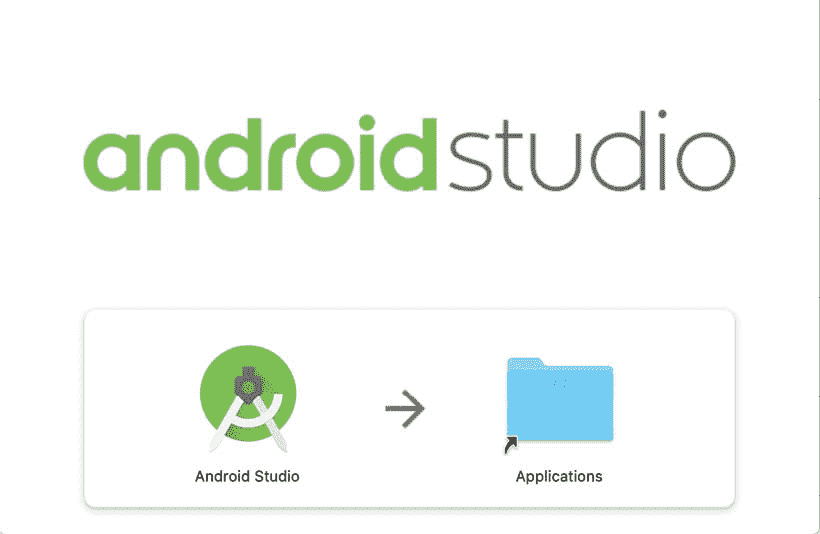

图 2-1

要安装该包，只需将 Android Studio 图标拖到“应用程序”（Applications）文件夹中。Android Studio 包将随后安装到系统的应用程序文件夹中，此过程通常需要几分钟完成。

要启动 Android Studio，在 Finder 窗口的“应用程序”文件夹中找到可执行文件并双击它。

为了以后方便访问该工具，可以将 Android Studio 图标从 Finder 窗口拖到 Dock （程序坞）上。

### 2.3.3 在 Linux 上安装

下载 Linux 版 Android Studio 安装包后，打开终端窗口，切换到要安装 Android Studio 的目录并执行以下命令：

```bash
unzip /<path to package>/android-studio-ide-<version>-linux.zip
```

注意，Android Studio 包将安装到名为 `android-studio` 的目录。因此，假设上述命令在 `/demo` 下执行，软件包将解压到 `/demo/android-studio`。

要启动 Android Studio，打开终端，切换到 `android-studio/bin` 子目录并执行以下命令：

```bash
./studio
```

在 64 位 Linux 系统上运行时，需要安装 32 位支持库。在 Ubuntu 上可以使用以下命令安装这些库：

```bash
sudo apt-get install libc6:i386 libncurses5:i386 libstdc++6:i386 lib32z1 libbz2-1.0:i386
```

在 Red Hat 和 Fedora 的 64 位系统上，使用以下命令：

```bash
sudo yum install zlib.i686 ncurses-libs.i686 bzip2-libs.i686
```

## 2.4 Android Studio 设置向导

安装后首次启动 Android Studio 时，会出现一个提供导入设置的对话框。如果您有之前的设置并希望将其导入最新版本中，请选择相应的选项和位置。或者，指示不需要导入任何之前的设置并点击 `OK` 按钮继续。

接下来，可能会出现如图图 2-2 所示的向导，并非所有平台都会出现：

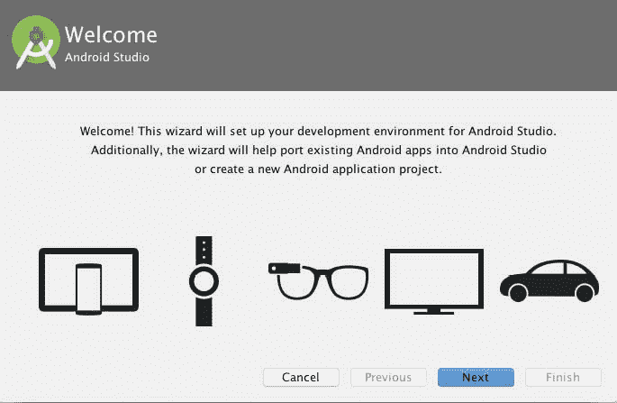

图 2-2

如果出现了向导，点击 `Next` 按钮，选择 `Standard` 安装选项并再次点击 `Next`。

Android Studio 将开始下载并配置最新的 Android SDK 以及其他组件和包。一旦此过程完成，点击下载组件对话框中的 `Finish` 按钮，随后应该出现“欢迎 Android Studio”界面：

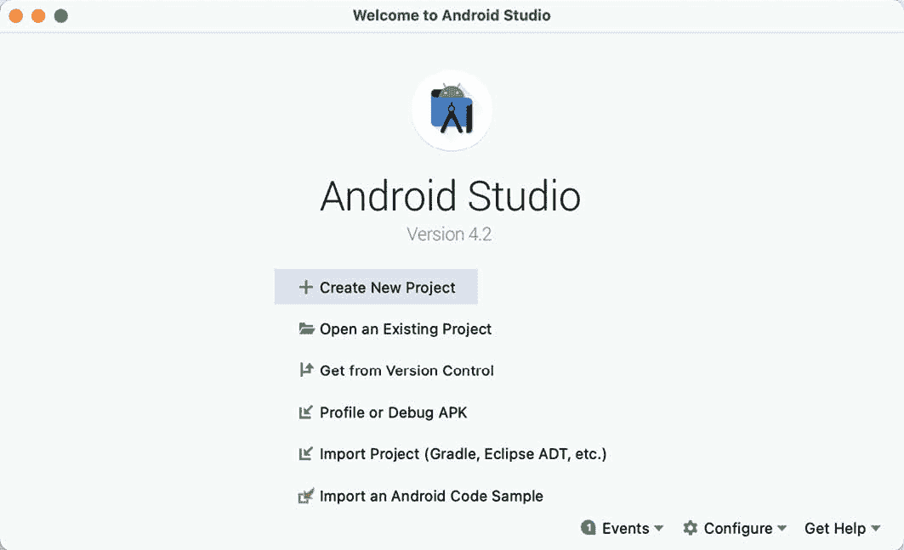

图 2-3

## 2.5 安装额外的 Android SDK 包

到目前为止的操作已经安装了 Java、Android Studio IDE 以及一组默认的 Android SDK 包。在继续之前，值得花时间检查已安装了哪些包，并安装任何缺失或更新的包。

此任务可以通过 Android SDK 设置屏幕完成，可以通过从 Android Studio 欢迎对话框中选择 `Configure` -> `SDK Manager` 选项从 Android Studio 工具内部启动它。一旦调用，将出现默认设置对话框的 Android SDK 屏幕，如 图 2-4 所示：

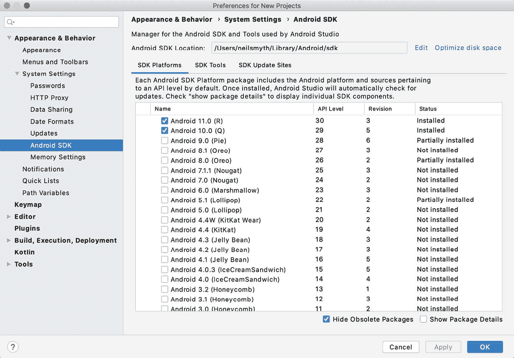

图 2-4

在首次安装 Android Studio 之后，可能只安装了最新发布的 Android SDK 版本。要安装较旧版本的 Android SDK，只需选择对应版本的复选框并点击 `Apply`（应用）按钮。

也可能列出最新 SDK 有可用更新。要访问有关可用更新包的详细信息，请启用屏幕右下角的 `Show Package Details`（显示包详情）选项。这将显示与 图 2-5 所示的信息：

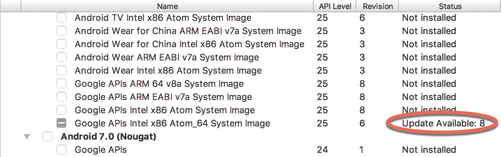

图 2-5

上面的图突出了更新的可用性。要安装更新，请勾选项目左侧的复选框并点击 `Apply`（应用）按钮。

除了 Android SDK 包外，还安装了许多用于构建 Android 程序的工具。要查看当前安装的包并检查更新，请留在 SDK 设置屏幕，并如 图 2-6 所示选择 `SDK Tools` 标签：

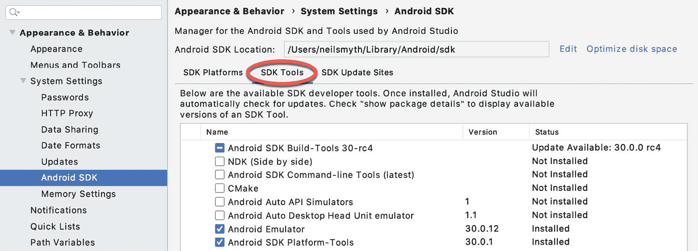

图 2-6

在 Android SDK Tools 屏幕中，确保以下包在 Status（状态）列中显示为 Installed（已安装）：

• Android SDK Build-tools

• Android Emulator

• Android SDK Platform-tools

• Google Play Services

• Intel x86 Emulator Accelerator (HAXM installer)

• Google USB Driver (仅限 Windows)

• Layout Inspector image server

如果上述任何一个包被列为 Not Installed（未安装）或需要更新，只需选择这些包旁边的复选框并点击 `Apply`（应用）按钮启动安装过程。

安装完成后，请检查包列表并确保所选包现在在 Status 列中显示为 Installed（已安装）。如果有任何包被列为 Not installed，请确保已已选中并再次点击 `Apply`（应用）按钮。

## 2.6 使 Android SDK 工具支持命令行访问

大多数情况下，Android SDK 的底层工具将在 Android Studio 环境内部进行访问。尽管如此，在某些情况下，从命令提示符或终端窗口调用这些工具将是很有用的。为了让你正在开发的操作系统能够找到这些工具，有必要将它们添加到系统的 `PATH` 环境变量中。

无论哪种操作系统，都需要配置 `PATH` 变量以包含以下路径（其中`<path_to_android_sdk_installation>` 代表安装 Android SDK 的文件系统位置）：

`<path_to_android_sdk_installation>/sdk/tools`

`<path_to_android_sdk_installation>/sdk/tools/bin`

`<path_to_android_sdk_installation>/sdk/platform-tools`

可以通过启动 `SDK Manager` 并参考设置面板顶部的 `Android SDK Location:` 字段来识别 SDK 在你系统上的位置，如 图 2-7 所示：

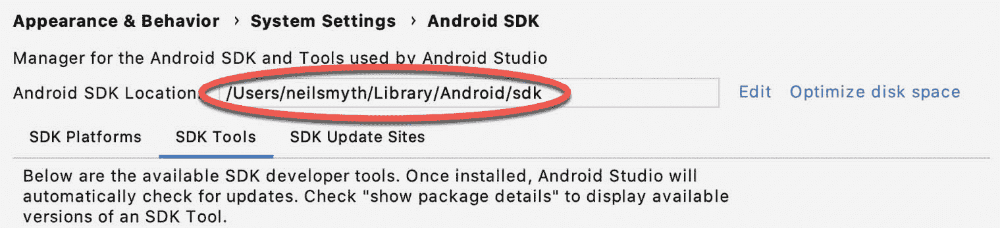

图 2-7

一旦确定了 SDK 的位置，将此添加到 `PATH` 变量的步骤取决于操作系统：

### 2.6.1 Windows 7


1. 在桌面开始菜单中右键点击`Computer`（计算机），从生成的列表中选择`Properties`（属性）。

2. 在属性面板中，选择`Advanced System Settings`（高级系统设置）链接，并在生成的对话框中点击`Environment Variables…`（环境变量）按钮。

3. 在`Environment Variables`对话框中，在系统列表中找到`Path`变量，选中它并点击`Edit…`（编辑...）。使用编辑对话框中的`New`（新建）按钮向路径添加三个新条目。例如，假设 Android SDK 安装在`C:\Users\demo\AppData\Local\Android\Sdk`，需要添加以下条目：

`C:\Users\demo\AppData\Local\Android\Sdk\platform-tools`

`C:\Users\demo\AppData\Local\Android\Sdk\tools`

`C:\Users\demo\AppData\Local\Android\Sdk\tools\bin`

4. 点击每个对话框中的`OK`并关闭系统属性控制面板。

完成上述步骤后，通过打开命令提示符窗口（开始 -> 所有程序 -> 辅助工具 -> 命令提示符）并输入，验证路径是否设置正确：

```
echo %Path%
```

返回的路径变量值应包含 Android SDK platform tools 文件夹的路径。通过尝试如下所示运行`adb`工具来验证`platform-tools`值是否正确：

```
adb
```

执行时，工具应输出命令行选项列表。

同样，通过尝试启动`AVD Manager`命令行工具来检查工具路径设置（如果`avdmanager`工具报告 Java 问题请不要担心——这将在稍后解决）：

```
avdmanager
```

如果出现类似下面的消息，则很可能是因为环境变量中添加了错误的路径：

`'adb'不是内部或外部命令，也不是批处理程序。`

### 2.6.2 Windows 8.1

1. 在启动屏幕上将鼠标移动到右角，从生成的列表中选择`Search`（搜索）。在搜索框中输入`Control Panel`。控制面板图标出现后点击它。

2. 在控制面板中，使用 Category（类别）菜单将显示方式更改为 Large Icons（大图标）。从图标列表中选择`System`（系统）。

3. 按照 Windows 7 概述的步骤执行第 2 步到第 4 步。打开命令提示符（将鼠标移动到屏幕右角，选择搜索选项并在搜索框中输入`cmd`）。从搜索结果中选择`Command Prompt`。

```
echo %Path%
```

返回的路径变量值应包含 Android SDK platform tools 文件夹的路径。通过尝试如下运行`adb`工具来验证`platform-tools`值是否正确：

```
adb
```

执行时，工具应输出命令行选项列表。

同样，通过尝试启动`AVD Manager`命令行工具来检查工具路径设置（如果`avdmanager`工具报告 Java 问题请不要担心——这将在稍后解决）：

```
avdmanager
```

如果出现类似下面的消息，则很可能是环境变量中添加了错误的路径：

`'adb'不是内部或外部命令，也不是批处理程序。`

### 2.6.3 Windows 10

右键点击开始菜单，从生成的列表中选择`Settings`（设置），并在查找设置文本框中输入“编辑系统环境变量”。在系统属性对话框中，点击`Environment Variables...`（环境变量）按钮。按照 Windows 7 概述的步骤执行第 3 步。

### 2.6.4 Linux

在 Linux 上，此配置通常可以通过在主目录下的`.bashrc`文件中添加命令来实现（具体取决于取决于使用的特定 Linux 发行版）。假设 Android SDK 包安装在`/home/demo/Android/sdk`，则`.bashrc`文件中的 export 行如下所示：

```
export PATH=/home/demo/Android/sdk/platform-tools:/home/demo/Android/sdk/tools:/home/demo/Android/sdk/tools/bin:/home/demo/android-studio/bin:$PATH
```

请注意，上述命令将`android-studio/bin`目录添加到`PATH`变量中。这将使得在终端窗口中无论当前处于哪个目录，都可以执行`studio.sh`脚本。

### 2.6.5 macOS

在 macOS 上，可以使用多种技术来修改`$PATH`环境变量。认为最干净的方法是在`/etc/paths.d`目录下创建一个新文件，其中包含要添加到`$PATH`的路径。假设 Android SDK 的安装位置为`/Users/demo/Library/Android/sdk`，可以通过在`/etc/paths.d`目录下创建一个名为`android-sdk`的新文件，并包含以下行来配置路径：

```
/Users/demo/Library/Android/sdk/tools
/Users/demo/Library/Android/sdk/tools/bin
/Users/demo/Library/Android/sdk/platform-tools
```

注意，由于这是一个系统目录，在创建文件时必须使用`sudo`命令。例如：

```
sudo vi /etc/paths.d/android-sdk
```

## 2.7 Android Studio 内存管理

Android Studio 是一个大型且复杂的软件应用程序，由许多后台进程组成。尽管 Android Studio 曾因性能欠佳而受到批评，但 Google 在最近的发布中对其进行了重大的性能改进，并在每个新版本中持续优化。这些改进之一包括允许用户配置 Android Studio IDE 以及用于构建和运行应用的后台进程所使用的内存量。这使得软件能够利用内存容量更大的系统。

如果你在运行 Android Studio 的系统上有足够的未空闲内存来增加这些值（此功能仅适用于具有 5GB 或更多内存的 64 位系统），并且发现 Android Studio 的性能似乎有所下降，那么尝试这些内存设置可能是值得的。Android Studio 还可能通过类似于下方所示的对话框通知你可以可以通过方式提高性能：


图 2-8

要查看并修改当前内存配置，请选择`File -> Settings...`（macOS 上为`Android Studio -> Preferences...`）菜单选项，并在弹出的对话框中，选择左侧导航面板`System Settings`下的`Memory Settings`选项，如下图 2-9 所示。

在更改内存分配时，请务必不要分配超过必要的内存，或超过系统在不减慢其他进程的情况下能承受的内存。

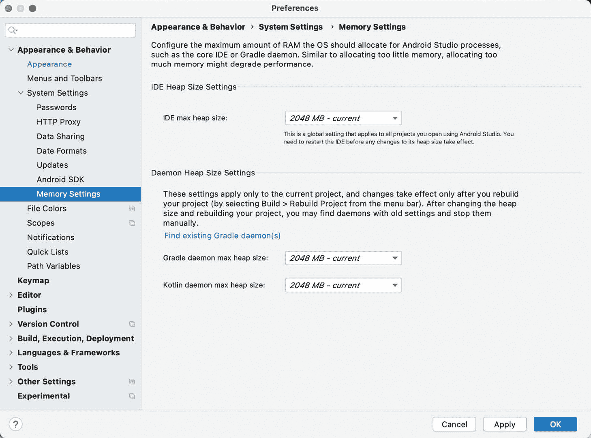

图 2-9

IDE 堆内存大小（heap size）设置会调整分配给 Android Studio 的内存，并适用于任何当前加载的项目。另一方面，当从 Android Studio 内部构建和运行项目时，会有许多后台进程（称为守护进程 daemons）执行编译和运行应用的任务。在编译和运行大型且复杂的项目时，通过调整守护进程堆内存设置，可能会可能缩短构建时间。与 IDE 堆内存设置不同，这些守护进程设置仅适用于当前项目，并且只有在 Android Studio 中打开项目时才能访问。

## 2.8 更新 Android Studio 和 SDK

Android Studio 和 Android SDK 会不定期发布新版本。新版本的 SDK 使用`Android SDK Manager`安装。当有更新可供安装时，Android Studio 通常会通知你。

要手动检查 Android Studio 的更新，请点击 Android Studio 欢迎界面中的`Configure -> Check for Updates`菜单选项，或从 Android Studio 主窗口访问`Help -> Check for Updates...`（macOS 上为`Android Studio -> Check for Updates...`）菜单选项。

## 2.9 总结

在开始开发 Android 应用程序之前，第一步是搭建合适的开发环境。这包括 Android SDK 和 Android Studio IDE（还包含 OpenJDK 开发环境）。在本章中，我们涵盖了在 Windows、macOS 和 Linux 上安装这些包的步骤。

# 3. 在 Android Studio 中创建示例 Android 应用

本书的前几章节已经涵盖了使用 Android Studio IDE 配置适用于 Android 应用开发环境的必要步骤。在转向稍高级的主题之前，现在是验证所有所需的开发包都已安装并正常运行的好时。实现这一目标的最佳方法是创建一个 Android 应用并编译运行它。本章将介绍如何使用 Android Studio 创建 Android 项目。项目创建后，随后的章节将探索如何使用 Android 模拟器环境对应用程序进行测试运行。

### 3.1 关于项目

在本章中创建是一个原始的货币汇率转换器（事实上，它非常简单，只支持从美元转换为欧元，并使用估算汇率进行转换）。该项目还将使用 Android Studio 最基础的项目模板之一。这种简单性允许我们在不让初学者因一次性引入过多概念（如推荐的应用架构和 Android 架构组件）而崩溃的情况下，介绍 Android 应用开发的一些关键方面。在遵循本章的教程时，请放心，初始示例项目中使用的所有技术和代码将在后面的章节中进行详细详细介绍。

### 3.2 创建新的 Android 项目

应用程序开发过程的第一步是在 Android Studio 环境中创建一个新项目。因此，首先启动 Android Studio，出现如图 3-1 所示的“Welcome to Android Studio”屏幕：

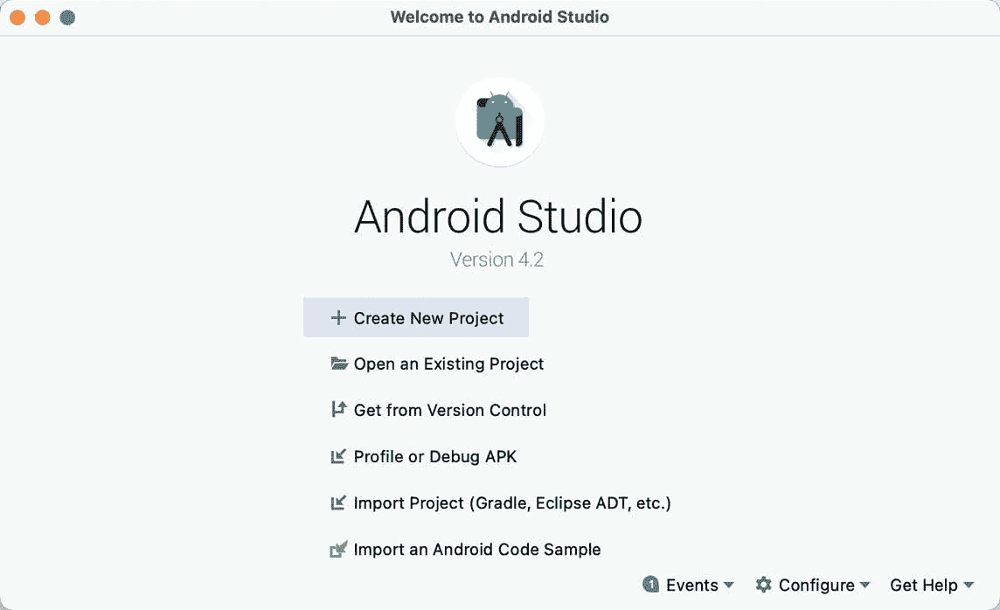

图 3-1

一旦出现此窗口，Android Studio 已准备好创建新项目。要创建新项目，只需点击`New Project`选项显示向导的第一界面。

### 3.3 创建 Activity

第一步是为应用程序定义要创建的初始 Activity。可以选择创建手机和平、Wear OS、TV、Android Audio 或 Android Things 项目。开发 Android 应用时有多种 Activity 类型，其中许多将在后续章节中详细介绍。然而，对于本示例，只需在 Templates 面板中选择 Phone and Tablet 选项，然后选择创建 Empty Activity。Empty Activity 选项创建一个包含单个`TextView`对象的模板用户界面。

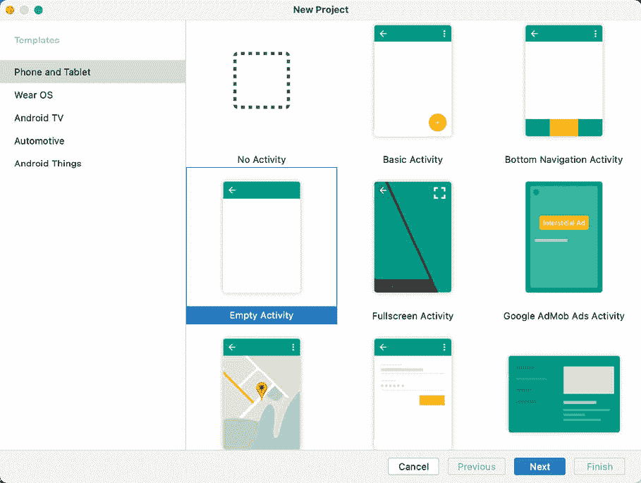

图 3-2

选择 Empty Activity 后，点击 Next 继续进行项目配置。

### 3.4 定义项目和 SDK 设置

在项目配置窗口（图 3-3）中，将`Name`字段设置为`AndroidSample`。应用程序名称是在 Android Studio 内部引用和标识应用的名称，也是完成后的应用程序在 Google Play Store 销售时使用的名称。

`Package name`（包名）用于在 Android 应用生态系统中唯一标识应用程序。虽然它可以设置为任何唯一标识你应用的字符串，但传统上它是基于域名反转 URL 加上应用程序名称。例如，如果你的域名是`www.mycompany.com`，且应用程序命名为`AndroidSample`，那么包名可以指定如下：

```
com.mycompany.androidsample
```

如果你没有域名，可以在`Company Domain`（公司域名）字段输入任何其他字符串，或者为了测试目的可以使用`example.com`，但在发布应用之前需要将其更改：

`com.example.androidsample`

`Save location`（保存位置）设置将默认位于用户主目录下名为`AndroidStudioProjects`的文件夹，可以通过点击包含当前路径设置的文本字段右侧的文件夹图标进行更改。

将`minimum SDK`（最低 SDK）设置设置为`API 26`：`Android 8.0 (Oreo)`。除非某个必要功能仅在更高版本中可用，否则本书中创建的大多数项目将使用此最低 SDK。这里的目标是使用最新的`Android SDK`构建应用，同时保持对运行旧版本 Android 设备的兼容性（在这种情况下，最可追溯到`Android 8.0`）。`Minimum SDK`设置下方的文字将概述当前运行该应用程序的 Android 设备百分比。点击`Help me choose`（帮助我选择）按钮（在图 3-3 中突出显示）查看仍在使用的各种 Android 版本的详细列表：

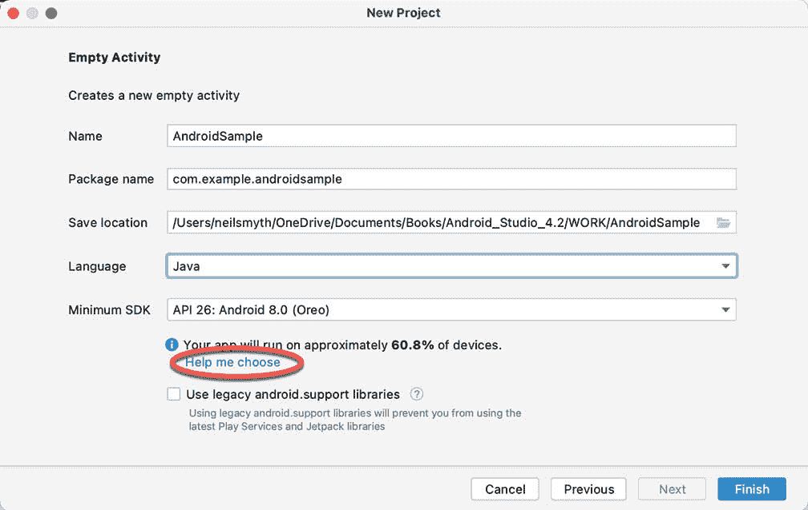

图 3-3

最后，将`Language`（语言）菜单更改为`Java`并点击`Finish`（完成）启动项目创建过程。

## 3.5 修改示例应用程序

此时，`Android Studio`已创建了一个最小示例应用项目并打开了主窗口。

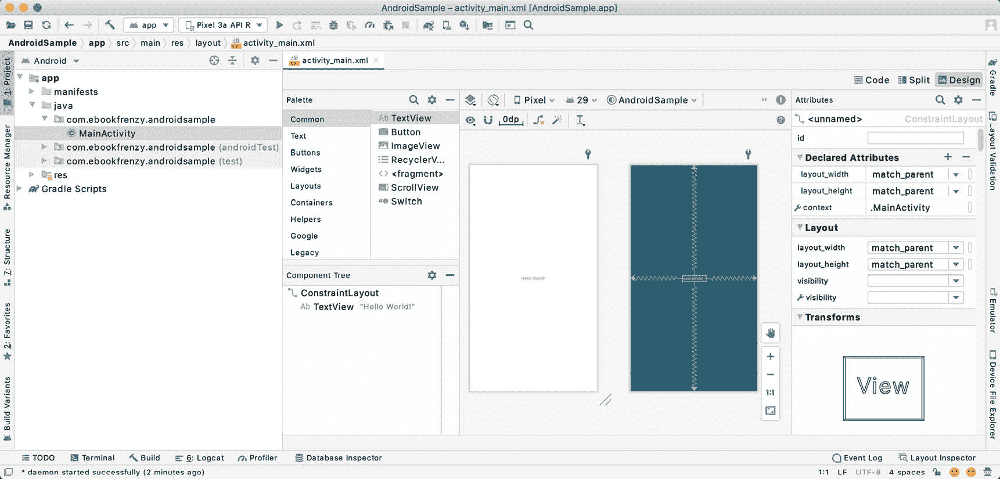

图 3-4

新创建的项目以及相关文件的引用列位于主项目窗口左侧的`Project`（项目）工具窗口。`Project`工具窗口有多种显示信息的模式。默认情况下，此面板应处于`Android`模式。此设置由面板顶部的菜单控制，如图 3-5 中突出所示。如果面板当前未处于`Android`模式，请使用菜单切换模式：

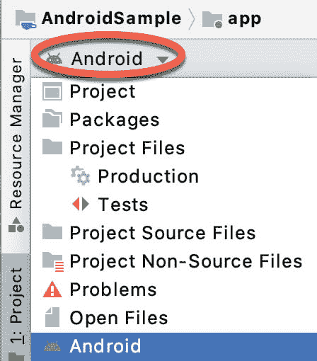

图 3-5

### 3.6 修改用户界面

我们 Activity 的界面设计存储在名为`activity_main.xml`的文件中，该文件位于项目文件层次结构的`app -> res -> layout`下。在`Project`工具窗口中找到该文件后，双击文件将其加载到出现在`Android Studio`主窗口中间面板的界面界面`Layout Editor`（布局编辑器）工具中：

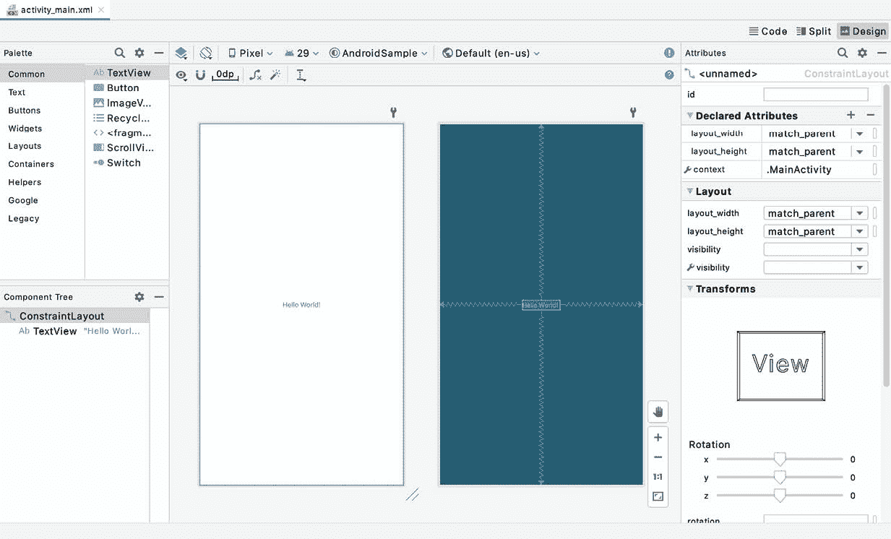

图 3-6

`Layout Editor`窗口顶部工具栏上有一个菜单（在图中设置为`Pixel`），它会反映在`Layout Editor`面板中设备的视觉表示上。点击此菜单可以选择广泛的其他设备选项。

若要在设备表示的`landscape`（横屏）和`portrait`（竖屏）之间切换方向，只需使用设备选择菜单立即左侧的下拉菜单，该菜单显示着  图标。

如设备屏幕所示，内容布局已经包含一个显示“Hello World!”消息的标签。面板左侧运行着`palette`（调色板），包含不同类别的用户界面组件，这些组件可用于构建用户界面，例如按钮、标签和文本字段。然而，需要注意的是，并不是所有的用户界面组件对用户都是显而易见的。其中一类就是布局。Android 支持多种布局，这些布局为视觉用户界面组件在屏幕上的定位和管理提供了不同级别的控制。虽然从用户界面的视觉表示上很难判断，但当前设计是使用`ConstraintLayout`创建的。这可以通过查阅`Component Tree`（组件树）面板中的信息来确认，该面板默认位于`Layout Editor`面板的左下角，如图 3-7 所示：


图 3-7

从组件树层级结构可以看出，用户界面布局由一个`ConstraintLayout`父对象和一个`TextView`子对象组成。

在继续之前，还要检查`Layout Editor`的`Autoconnect`（自动连接）模式是否已启用。这意味着当组件添加到布局中时，`Layout Editor`将自动添加约束，以确保组件在不同的屏幕尺寸和设备方向上正确定位（该主题将在后续章节中进行更详细的介绍）。`Autoconnect`按钮出现在`Layout Editor`工具栏中，用磁铁图标表示。禁用时，磁铁上会出现一条斜线（图 3-8）。如有必要，通过点击此按钮重新启用`Autoconnect`模式。

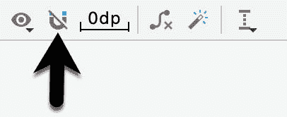

图 3-8

修改应用程序的下一步是向布局添加一些额外的组件，其中第一个是用户点击以启动货币转换的`Button`。

`Palette`（调色板）面板由两列组成，左列包含视图组件类别列表。右列列出了所选类别中包含的组件。在图 3-9 中，例如，当前选择了`Buttons`类别：


图 3-9

从`Buttons`列表中点击并拖拽`Button`对象到用户界面设计的水平中心，使其位于现有`TextView`组件下方：


图 3-10

下一步是更改`Button`组件当前显示的文本。位于设计区域右侧的面板是`Attributes`（属性）面板。此面板显示布局中所选组件的属性。在此面板中，找到`Common Attributes`（常用属性）部分的`text`属性，将其值从“Button”更改为“Convert”，如图 3-11 所示：


图 3-11

带有扳手图标第二个`text`属性允许设置仅在`Layout Editor`工具中显示的属性，运行时不显示。这对于测试视觉组件和布局在不同设置下的行为有用。

万一`Autoconnect`系统未能设置所有布局连接，点击`Infer constraints`（推约束）按钮（图 3-12）为布局添加任何缺失的约束：

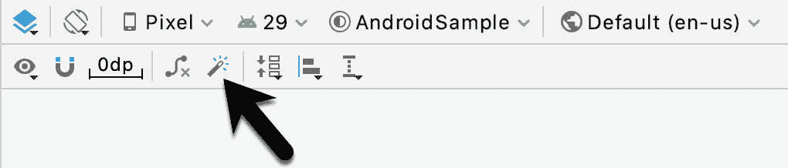

图 3-12

此时，解释`Layout Editor`工具右上角的警告按钮很重要，如图 3-13 所示。显然，这表明布局存在潜在问题。要查看问题的详情，请点击该按钮：


图 3-13

点击后，将出现一个面板（图 3-14），描述问题的性质并提供一些可能的纠正措施：

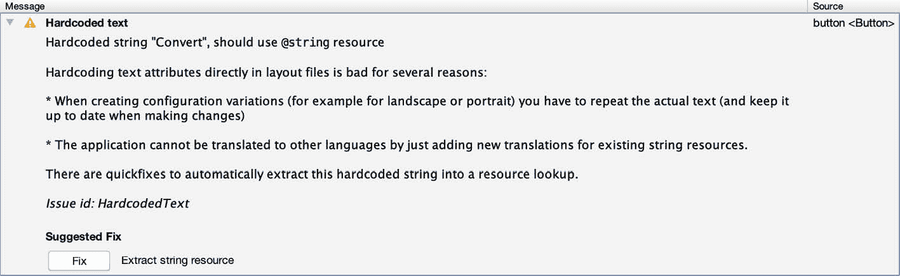

图 3-14

当前，列出的唯一警告如下：

硬编码字符串 "Convert"，应使用`@string`资源

这条 I18N 消息提示我们，项目未来的国际化可能存在潜在问题（“I18N”源于“internationalization”一词以“I”开头，以“N”结尾，中间有 18 个字母）。该警告提醒我们，在开发 Android 应用程序时，应尽可能将文本字符串等属性和值以资源的形式存储。这样做可以允许通过修改资源文件而不是更改应用程序源代码来调整应用程序的外观。这在将用户界面翻译成不同的口语语言时特别有价值。如果用户界面中的所有文本都包含在单一资源文件中，例如，可以将该文件交给翻译人员，由他们执行翻译工作并返回翻译后的文件，以便包含在应用程序中。这使得可以在无需进行任何源代码更改的情况下支持多种语言。在此例中，我们将创建一个名为`convert_string`的新资源，并为其分配字符串“Convert”。

点击“问题说明（Issue Explanation）”面板中的`Fix`按钮显示“提取资源（Extract Resource）”面板（图 3-15）。在此面板中，将资源名称字段更改为`convert_string`，并在点击`OK`按钮之前，将资源值保留为`Convert`。

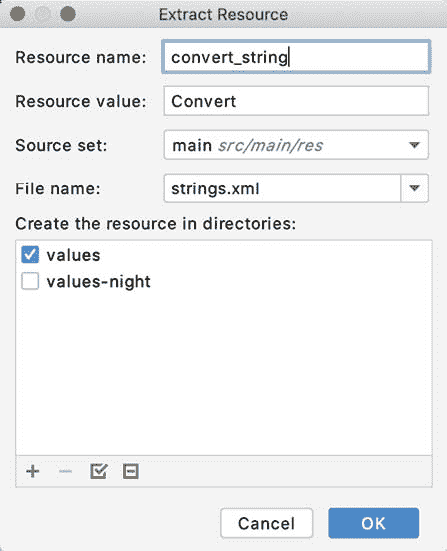

图 3-15

下一个要添加的控件是一个`EditText`控件，用户将在其中输入要转换的美元金额。从“调色板（Palette）”面板中，选择`Text`类别，点击并拖动`Number (Decimal)`组件到布局中，使其水平居中并置于现有`TextView`控件上方。选中该控件后，使用“属性（Attributes）”工具窗口将`hint`属性设置为“dollars”。点击警告图标并将字符串提取到名为`dollars_hint`的资源中。

本章稍后编写的代码将需要访问用户在`EditText`字段中输入的美元值。它通过引用分配给用户界面布局中控件的`id`来实现。当在布局中选中控件时，可以在`Attributes`工具窗口内查看并更改 Android Studio 分配给控件的默认`id`，如图图 3-16 所示：

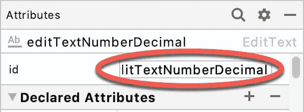

图 3-16

将`id`改为`dollarText`，并在“重命名（Rename）”对话框中点击“重构（Refactor）”按钮。这将确保项目其他地方对旧`id`的任何引用自动更新为新的`id`：

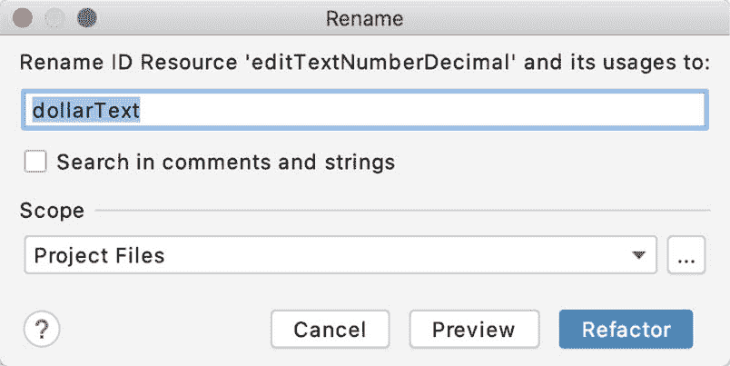

图 3-17

点击“推断约束（Infer constraints）”按钮添加任何缺失的布局约束。此时，布局应该类似于图 3-18 所示所示：


图 3-18

## 3.7 审查布局和资源文件

在继续后续步骤之前，我们将查看用户界面设计和资源处理的一些内部方面。在上一节中，我们通过使用“布局编辑器（Layout Editor）”工具修改`activity_main.xml`文件对用户界面进行了一些更改。事实上，`Layout Editor`所做的只是提供了一种易于用户的方式来编辑文件的底层 XML 内容。在实践中，没有理由不能直接修改 XML 以进行用户界面更改，在某些情况下，这实际上比使用`Layout Editor`工具更快。在`Layout Editor`面板的右上角有三个按钮，如下方的图 3-19 所示所示：


图 3-19

默认情况下，编辑器将处于`Design`模式，仅显示布局的视觉表示。最左侧的按钮将切换到`Code`模式以显示布局的 XML，而中间的按钮进入`Split`模式，其中同时显示布局和 XML，如图图 3-20 所示：

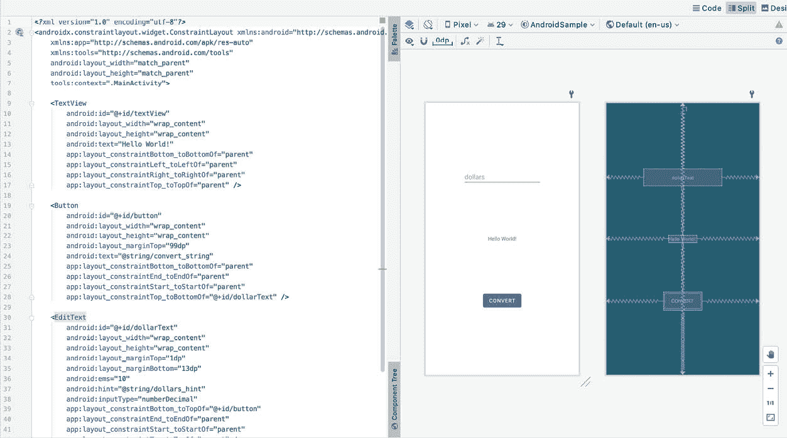

图 3-20

从 XML 文件的结构可以看出，用户界面由`ConstraintLayout`组件组成，而该组件又是`TextView`、`Button`和`EditText`对象的父级。我们还可以看到，例如，`Button`的`text`属性被设置为我们的`convert_string`资源。尽管复杂性和内容不同，但所有用户界面布局都是这种分层的、基于 XML 的结构。

当对 XML 布局进行更改时，这些更改将反映在布局画布上。也可以在布局画布面板内对布局进行视觉化修改，更改将出现在 XML 列表中。要查看此操作，请切换到`Split`模式并修改 XML 布局将`ConstraintLayout`的背景颜色更改为红色，如下：

```xml
<?xml version="1.0" encoding="utf-8"?>
<androidx.constraintlayout.widget.ConstraintLayout xmlns:android="http://schemas.android.com/apk/res/android"
    xmlns:app="http://schemas.android.com/apk/res-auto"
    xmlns:tools="http://schemas.android.com/tools"
    android:layout_width="match_parent"
    android:layout_height="match_parent"
    android:background="#ff2438"
    tools:context=".MainActivity">

</androidx.constraintlayout.widget.ConstraintLayout>
```

注意布局的颜色会实时匹配 XML 中的设置。此外，XML 编辑器中颜色的左侧边缘（也称为槽/gutter）会出现一个小正方形，这是已设置颜色的视觉提示。点击该正方形将显示颜色选择器以选择不同的颜色：


图 21

在继续之前，删除布局文件中的`background`属性，使其返回默认设置。最后，使用“项目（Project）”面板找到`app` -> `res` -> `values` -> `strings.xml`文件并双击它将其加载到编辑器。目前 XML 如下：

```xml
<resources>
    <string name="app_name">AndroidSample</string>
    <string name="convert_string">Convert</string>
    <string name="dollars_hint">dollars</string>
</resources>
```

作为资源的演示，将分配给`convert_string`资源的字符串值更改为“Convert to Euros”，然后通过选择布局文件返回`Layout Editor`工具。注意布局已获取字符串的新资源值。

访问 XML 文件中引用的资源也有快速方法。在`Layout Editor`工具的`Split`或`Code`模式下，点击`@string/convert_string`属性设置使其高亮，然后按下键盘上的`Ctrl-B`（macOS 上为`Cmd-B`）。Android Studio 随后将打开`strings.xml`文件并带您到达该资源的行。利用此机会将字符串资源恢复为原始“Convert”文本，并为稍后在代码中引用的字符串资源添加以下额外条目：

```xml
<resources>
    <string name="app_name">AndroidSample</string>
    <string name="convert_string">Convert</string>
    <string name="dollars_hint">dollars</string>
    <string name="no_value_string">No Value</string>
</resources>
```

资源字符串还可以使用 Android Studio 的“翻译编辑器（Translations Editor）”。要打开此编辑器，右键点击`app` -> `res` -> `values` -> `strings.xml`文件并选择“打开编辑器（Open editor）”菜单选项。将在 Android Studio 窗口的主面板中显示翻译编辑器：

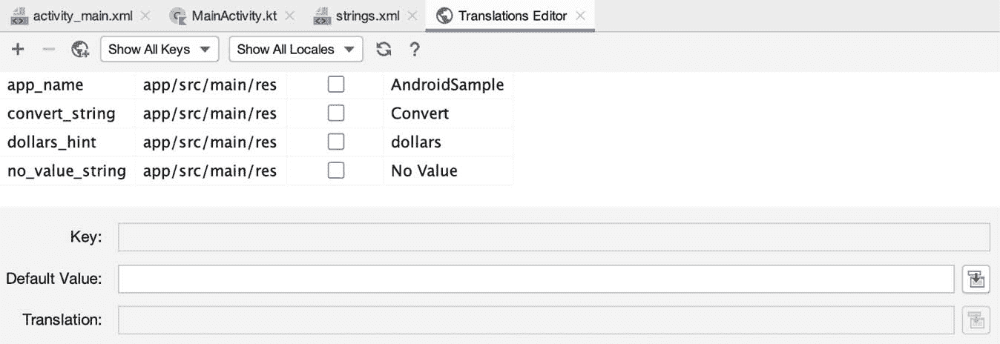

图 3-22

此编辑器允许对分配给资源键的字符串进行编辑，并管理多种语言的翻译。

### 3.8 添加交互

此示例项目的最后一步是使应用程序具有交互性，这样当用户在`EditText`字段中输入美元值并点击转换按钮时，转换后的欧元值将显示在`TextView`上。这涉及到在`Button`控件上实现一些事件处理。具体来说，需要配置`Button`，以便在触发`onClick`事件时调用应用程序代码中的一个方法。事件处理可以通过多种不同的方式实现，并将在稍后一个标题为“Android 事件处理概述与示例”的章节中进行详细介绍。返回布局编辑器到设计（Design）模式，在布局编辑器中选择`Button`控件，参考属性（Attributes）工具窗口，并按所示指定名为`convertCurrency`的方法：


图 3-23

注意，`onClick`属性的文本字段现在用红框突出，以警告我们该按钮已配置为调用一个不存在的方法。为了解决这个问题，双击项目（Project）工具窗口中的`MainActivity.java`文件（`app -> java -> <package name> -> MainActivity`）将其加载到代码编辑器中，并在类文件中添加`convertCurrency`方法的代码，使其读取如下，请注意还需要导入一些额外的 Android 程序包：

```java
package com.ebookfrenzy.androidsample;

import androidx.appcompat.app.AppCompatActivity;

import android.os.Bundle;

import android.view.View;

import android.widget.EditText;

import android.widget.TextView;

.

.

import java.util.Locale;

public class MainActivity extends AppCompatActivity {

    @Override
    protected void onCreate(Bundle savedInstanceState) {
        super.onCreate(savedInstanceState);
        setContentView(R.layout.activity_main);
    }

    public void convertCurrency(View view) {
        EditText dollarText = findViewById(R.id.dollarText);
        TextView textView = findViewById(R.id.textView);
        if (!dollarText.getText().toString().equals("")) {
            float dollarValue = Float.parseFloat(dollarText.getText().toString());
            float euroValue = dollarValue * 0.85F;
            textView.setText(String.format(Locale.ENGLISH,"%f", euroValue));
        } else {
            textView.setText(R.string.no_value_string);
        }
    }
}
```

该方法首先通过调用名为`findViewById`的方法并传递在布局文件中分配的 id 来获取`EditText`和`TextView`对象的引用。然后进行检查以确保用户输入了美元值，如果是，则提取该值，将其从`String`转换为浮点值并转换为欧元。最后，结果显示在`TextView`控件上。如果其中任何内容不清楚，请放心，这些概念将在后面的章节中进行更详细的介绍。

### 3.9 总结

虽然并不复杂，但设置 Android 开发环境涉及许多步骤。在完成这些步骤后，值得运行一个示例以确保环境已正确安装和配置。在本章中，我们创建了一个示例应用程序，然后使用 Android Studio 布局编辑器工具修改了用户界面布局。在此过程中，我们探索了尽可能使用资源的重要性，特别是在字符串值的情况下，并简要触及了布局的主题。接下来，我们查看了用于存储 Android 应用程序用户界面设计的底层 XML。

最后，在`Button`上添加了`onClick`事件，连接到一个实现的方法，以从`EditText`组件中提取用户输入，将美元转换为欧元，然后在`TextView`上显示结果。

由于应用程序已准备好进行测试，为测试目的设置模拟器所需的步骤将在下一章中进行详细介绍。

# 4. 在 Android Studio 中创建 Android 虚拟设备 (AVD)

在 Android Studio 中开发 Android 应用的过程中，需要多次编译和运行应用程序。可以通过在物理设备上安装和运行，或者在 Android 虚拟设备（AVD）模拟器环境中测试 Android 应用程序。在使用 AVD 之前，必须首先创建并配置它以匹配特定设备型号规格。因此，本章的目标是以 Pixel 4 手机作为参考示例创建这样一个虚拟设备。

## 4.1 关于 Android 虚拟设备

AVD 本质上是模拟器，允许在无需将应用程序安装到物理设备的情况下测试 Android 应用程序。在使用 AVD 之前，必须首先创建并配置它以匹配特定设备型号规格。因此，本章的目标是以 Pixel 4 手机作为参考示例创建这样一个虚拟设备。

### 4.2 创建新的 AVD

为了在没有物理设备的情况下测试应用程序的行为，有必要为特定设备创建 AVD。


要创建新的 AVD，第一步是启动 AVD Manager。这可以通过从主窗口选择 `Tools -> AVD Manager` 菜单选项来实现。

一旦启动，工具将如下所示：

1. 在 Category（类别）面板中，选择 Phone 以显示可用 Android AVD 模板列表。
2. 选择 Pixel 4 设备选项并点击 Next。
3. 在 System Image（系统映像）屏幕上，为 x86 ABI 选择最新版本的 Android。注意，如果尚未安装系统映像，Release Name 旁边将提供下载链接。点击此链接下载并安装系统映像后再选择。如果所需的镜像未在列表中，点击 x86 images 和 Other images 标签页查看替代列表。
4. 点击 Next 继续，并在 name 字段中输入描述性名称（例如 Pixel 4 API 30），或直接接受默认名称。
5. 点击 Finish 创建 AVD。
6. AVD 创建后，现在可以关闭 AVD Manager。如果将来需要对 AVD 进行修改，只需重新打开 AVD Manager，从列表中选择 AVD，并点击 AVD Manager 中设备行 Actions 列中的铅笔图标。

要对新创建的 AVD 模拟器进行测试运行，只需从 `AVD Manager` 中选择该模拟器并点击启动按钮（`Actions` 列中的三角形）。模拟器将在新窗口中出现并开始启动过程。模拟器启动所需的时间取决于 `AVD` 本身以及运行它的系统的配置。

虽然模拟器可能默认以竖向方向显示，但此及其他默认选项是可以更改的。在 `AVD Manager` 中，选择新创建的 `Pixel 4` 条目，并点击设备行 `Actions` 列中的铅笔图标。在配置界面中找到 `Startup orientation`（启动方向）部分并更改方向设置。退出并重启模拟器会话以使此更改生效。关于模拟器的更多详细信息，请参阅下一章（“使用和配置 Android Studio AVD 模拟器”](#）。

为了在本章的下一节节省时间，请在继续之前保持模拟器运行。

## 4.4 在 AVD 中运行应用程序

配置好 `AVD` 模拟器后，现在可以编译并运行之前章节中创建的示例 `AndroidSample` 应用程序。将 `AndroidSample` 项目加载到 `Android Studio` 后，确保新创建的 `Pixel 4` `AVD` 显示在设备菜单中（如下方 图 4-4 所示，标记为 `A`），然后点击由绿色三角形 (B) 表示的运行按钮、选择 `Run -> Run ‘app’` 菜单选项，或使用键盘快捷键 `Ctrl-R`：

```
image/as_4.1_run_app_button.jpg
```

图 4-4

设备菜单 (`A`) 可用于选择不同的 `AVD` 实例或物理设备作为运行目标，并还可以在多个设备上运行应用。该菜单还提供了访问 `AVD Manager` 和设备连接故障排除的选项：

```
image/as_4.1_target_device_menu.jpg
```

图 4-5

一旦应用程序安装并运行，第一个 fragment（片段）的用户界面将出现在模拟器中（fragment 是 Android 项目中一个可重用的部分，通常由用户界面布局和一些代码组成，该主题将在本章标题为 “Android Fragments 简介”](#) 的章节中后介绍）：

```
image/as_4.1_avd_running.jpg
```

图 4-6

如果活动没有自动启动，请检查模拟器上的应用列表中是否出现了启动图标。如果是，只需点击它即可启动应用程序。一旦运行过程开始，`Run` 工具窗口将变为可用。当应用程序包安装并启动时，`Run` 工具窗口将显示诊断信息。图 4-7 显示了成功启动应用程序的 `Run` 工具窗口输出：

```
image/as_4.1_run_tool_window.jpg
```

图 4-7

如果在启动过程中遇到问题，`Run` 工具窗口将提供信息，这些信息希望能够帮助定位问题原因。

假设应用程序已加载到模拟器并按预期运行，这说明我们已经安全地验证了 Android 开发环境已正确安装和配置。

## 4.5 在多个设备上运行

上述 图 4-5 所示的运行菜单包含一个在多个模拟器和设备上并行运行应用的选项。选中此项后，将显示 图 4-8 所示的对话框，列出系统上配置的所有 `AVD` 以及任何已连接的物理设备。在点击 `Run` 按钮之前，启用目标目标模拟器或设备旁边的复选框：

```
image/as_4.1_multiple_devices.jpg
```

图 4-8

点击 `Run` 按钮后，`Android Studio` 将所选模拟器和设备上启动应用。

## 4.6 停止运行的应用程序

要停止运行的应用程序，只需点击主工具栏上的停止按钮，如 图 4-9 所示：

```
image/as_4.1_stop_button.jpg
```

图 4-9

可以使用 `Run` 工具窗口终止应用。首先，通过应用运行时变为可窗口栏按钮显示 `Run` 工具窗口。一旦 `Run` 工具窗口出现，点击下方 图 4-10 所示的高亮停止按钮：

```
image/as_4.1_stop_button_run_window.jpg
```

图 4-10

### 4.7 支持深色主题

Android 10 引入了备期待的深色主题，`Android Studio` 项目默认未启用该功能。要在 `AVD` 模拟器中测试深色主题，请打开模拟器中运行的 Android 实例打开 `Settings` 应用。有多种访问设置的方法。最快的方法显示主屏幕，然后从屏幕底部向上拖动（就在搜索栏下方）。这将显示设备上安装的所有应用，其中之一就是 `Settings` 应用。

在 `Settings` 应用中，选择 `Display` 类别并按下方 图 4-11 所示启用 `Dark Theme`（深色主题）选项，使屏幕背景变为黑色：

```
image/as_4.1_dark_theme.jpg
```

启用深色主题后，运行 `AndroidSample` 应用，注意它使用了深色主题，包括黑色背景和 图 4-12 所示的紫色按钮：

```
image/as_4.1_dark_mode.jpg
```

图 12

浅深色模式的主题定义在 `Project` 工具窗口 `app` -> `values` 下的 `themes.xml` 文件，如 图 4-13 所示：

```
image/as_4.1_themes.jpg
```

图 13

`themes.xml` 文件包含白天模式的主题，而 `themes.xml (night)` 文件包含设备进入深色模式时采用的主题：

```xml
<resources xmlns:tools="http://schemas.android.com/tools">
  <!-- 应用程序主题 -->
  <style name="Theme.AndroidSample" parent="Theme.MaterialComponents.DayNight.DarkActionBar">
    <!-- 主品牌颜色 -->
    <item name="colorPrimary">@color/purple_200</item>
    <item name="colorPrimaryDark">@color/purple_700</item>
    <item name="colorOnPrimary">@color/black</item>
    <!-- 次要品牌颜色 -->
    <item name="colorSecondary">@color/teal_200</item>
    <item name="colorSecondaryVariant">@color/teal_200</item>
    <item name="colorOnSecondary">@color/black</item>
    <!-- 状态栏颜色 -->
    <item name="android:statusBarColor" tools:targetApi="l">?attr/colorPrimaryVariant</item>
    <!--在此处自定义您的主题 -->
  </style>
</resources>
```

使用编辑器边缘的颜色块实验颜色更改（例如为 `colorPrimary` 资源尝试不同的颜色），利用颜色选择器。更改后，再次运行应用以查看效果。

实验主题后，打开模拟器中的 `Settings` 应用，关闭深色模式并返回 `AndroidSample` 应用。应用程序应该自动切换回亮色模式。

## 4.8 在工具窗口中运行模拟器

到本章为止，我们一直将模拟器作为独立窗口使用。模拟器也可以作为嵌入在 `Android Studio` 主窗口中的工具窗口运行。要嵌入模拟器，选择 `File -> Settings...` 菜单选项（macOS 为 `Android Studio -> Preferences...`），在偏好设置对话框的左侧导航面板中导航到 `Tools -> Emulator`，并启用 `Launch in a tool window` 选项：

```
image/as_4.1_avd_in_tool_window_enable.jpg
```

图 4-14

启用该选项后，点击 `Apply` 按钮并点击 `OK` 以提交更改，然后退出独立的模拟器会话。

再次运行示例应用，此时模拟器将出现在 Android Studio 窗口内，如图 4-15 所示：

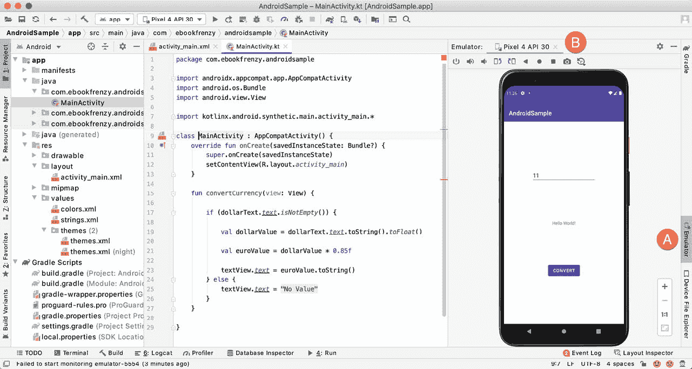

图 4-15

要隐藏和显示模拟器工具窗口，请点击 `Emulator` 工具窗口按钮（如上方标记 A 所示）。点击标签页旁边的“x”关闭按钮 (B) 可退出模拟器。模拟器工具窗口可以容纳多个模拟器会话，每个会话由一个标签页表示。例如，图 4-16 显示了一个包含两个模拟器会话的工具窗口：

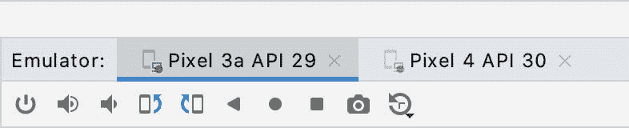

图 4-16

要在会话之间切换，只需点击相应的标签页即可。

## 4.9 AVD 命令行创建

如前所述，除了图形化用户界面外，还可以直接从命令行创建新的 AVD。这是通过使用 `avdmanager` 工具结合某些命令行选项实现的。一旦启动，该工具会在创建新 AVD 之前提示输入额外信息。

`avdmanager` 工具运行需要访问 Java 运行时环境 (JRE)。如果在尝试运行 `avdmanager` 时出现错误消息，显示找不到 `java` 命令，则可以配置运行命令的命令提示符或终端窗口，以便其使用与 Android Studio 捆绑的 OpenJDK 环境。首先按照以下方式识别 OpenJDK JRE 的位置：

1. 启动 Android Studio 并打开书中早些创建的 AndroidSample 项目。
2. 选择 `File` -> `Project Structure...` 菜单选项。
3. 复制 `Project Structure` 对话框中 `JDK location` 字段中的路径。这代表了 Android Studio 捆绑的 JRE 位置。

在 Windows 上，在运行 `avdmanager` 的命令提示符窗口中执行以下命令（将 `<path to jre>` 替换为从 Project Structure 对话框复制的路径）：

```bash
set JAVA_HOME=<path to jre>
```

在 macOS 或 Linux 上，执行以下命令：

```bash
export JAVA_HOME="<path to jre>"
```

如果你预计频繁使用 `avdmanager` 工具，请按照名为设置 Android Studio 开发环境的章节中列出的适用于你操作系统的环境变量步骤进行操作，以便在系统范围内配置 `JAVA_HOME`。

假设系统已配置将 Android SDK 工具目录包含在 `PATH` 环境变量中，则可以在终端或命令窗口中通过发布以下命令获取新 AVD 的可用目标列表：

```bash
avdmanager list targets
```

上述命令的输出将包含系统上可用的 Android SDK 版本列表。例如：

Available Android targets:

----------

id: 1 or "android-29"

     Name: Android API 29

     Type: Platform

     API level: 29

     Revision: 1

----------

id: 2 or "android-26"

     Name: Android API 26

     Type: Platform

     API level: 26

     Revision: 1

----------

`avdmanager` 工具还允许从命令行创建新的 AVD 实例。例如，要使用 Android API 级别 29 设备的目标 ID 和 `x86` ABI 创建名为 `myAVD` 的新 AVD，可以使用以下命令：

```bash
avdmanager create avd -n myAVD -k "system-images;android-29;google_apis_playstore;x86"
```

android 工具将根据基础 Android 8 设备所需的规格创建新 AVD，并在需要时提供创建匹配特定设备规格的自定义配置选项。一旦从命令行创建了新 AVD，在点击 `Refresh` 按钮之前，它可能不会出现在 Android Device Manager 工具中。

除了创建新的 AVD 外，还可以从命令行执行许多其他任务。例如，可以使用 `list avd` 命令行参数获取当前可用的 AVD 列表：

```bash
avdmanager list avd
```

Available Android Virtual Devices:

     Name: Pixel_XL_API_28_No_Play

     Device: pixel_xl (Google)

     Path: /Users/neilsmyth/.android/avd/Pixel_XL_API_28_No_Play.avd

     Target: Google APIs (Google Inc.)

             Based on: Android API 28 Tag/ABI: google_apis/x86

     Skin: pixel_xl_silver

     Sdcard: 512M

同样，要删除现有的 AVD，只需如下使用 `delete` 选项：

```bash
avdmanager delete avd –n <avd name>
```

## 4.10 Android 设备配置文件

默认情况下，与 AVD 关联的文件存储在用户目录下的 `.android/avd` 目录，其结构如下（将 `<avd name>` 替换为分配给 AVD 的名称）：

`<avd name>.avd/config.ini`

`<avd name>.avd/userdata.img`

`<avd name>.ini`

`config.ini` 文件包含在 AVD 创建期间指定的设备配置（如显示尺寸）。这些设置将在下次调用时被采用。

## 4.11 移动和重命名 Android 设备

可以使用 `avdmanager` 工具的 `move avd` 参数从命令行更改 AVD 的当前名称或位置。例如，要将名为 `Nexus9` 的 AVD 重命名为 `Nexus9B`，可以使用以下命令：

```bash
avdmanager move avd -n Nexus9 -r Nexus9
```

要物理定位与 AVD 关联的文件，应使用以下语法：

```bash
avdmanager move avd -n <avd name> -p <path to new location>
```

例如，将 AVD 移动到 `/tmp/Nexus9`：

```bash
avdmanager move avd -n Nexus9 -p /tmp/Nexus9
```

注意在执行移动 AVD 的命令之前，目标目录不存在。

## 4.12 总结

典型的应用程序开发遵循编码、编译和在测试环境中运行的循环。Android 可以在物理设备或使用 虚拟设备（AVD）模拟器进行测试。AVD 使用 Android Device Manager 工具创建和管理，该工具可以通过命令行或图形用户界面使用。在创建模拟特定设备模型的 AVD 时，重要的是确保虚拟设备的配置与物理设备的规格相匹配。

## 5 使用和配置 Android Studio AVD 模拟器

在下一章探索物理 Android 设备之前，本章将花一些时间概述 Android Studio AVD 模拟器，并突出可以在独立和工具窗口模式下自定义环境的许多配置功能。

### 5.1 模拟器环境

当以独立模式启动时，模拟器会在加载过程中显示初始启动屏幕。加载完成后，将主模拟器窗口，其中所选设备类型的表示（如图 5-1 所示，这是一个 Pixel 4 设备）：


图 5-1

位于窗口右侧的是工具栏，提供了对模拟器控件和配置选项的快速访问。

### 5.2 模拟器工具栏选项

模拟器工具栏 (图 5-2) 提供了与模拟器环境外观和行为相关的系列选项。

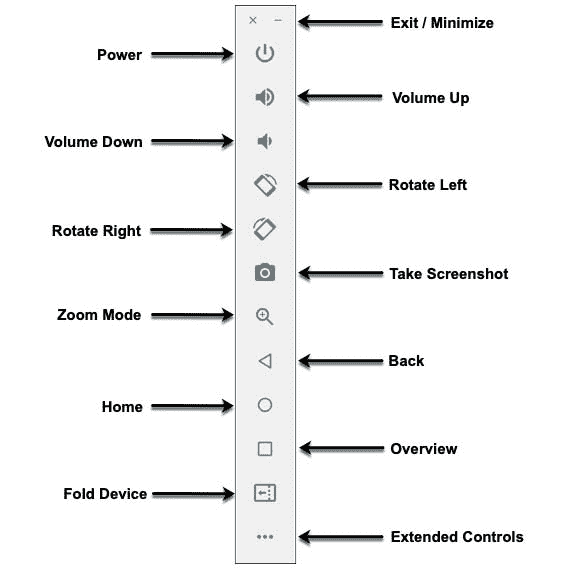

图 5-2

工具栏中的每个按钮都关联着一个键盘快捷键，可以通过将鼠标指针悬停在按钮上并等待工具提示出现，或者通过扩展控制面板的帮助选项来识别。

尽管工具栏中包含许多选项是自言自话的，但为了完整起见，将对每个选项进行介绍：

• `Exit / Minimize`（退出/最小化） – 工具栏最顶部的“x”按钮在选中时退出模拟器会话，而“-””选项则最小化整个窗口。


- `Power`（电源）– `Power` 按钮模拟物理 Android 设备上的硬件电源按钮。点击并释放此按钮将锁定设备并关闭屏幕。按住此按钮将启动设备的“关机”请求序列。
- `Volume Up / Down`（音量增大/减小）– 两个控制模拟器环境中播放音量的按钮。
- `Rotate Left/Right`（左旋/右旋）– 模拟设备在竖屏和横屏方向之间旋转。
- `Take Screenshot`（截图）– 对设备屏幕上当前显示内容进行截图。捕获的图像存储在扩展控制面板 `Settings` 屏幕指定的路径，本章稍后将对其进行概述。
- `Zoom Mode`（缩放模式）– 此按钮切换进入和退出缩放模式，细节将在本章稍后介绍。
- `Back`（返回）– 模拟选择标准的 Android“返回”按钮。与下文概述的 `Home` 和 `Overview` 按钮一样，通过选择模拟器屏幕上的实际按钮也可以达到相同的结果。
- `Home`（主页）– 模拟选择标准的 Android“首页”按钮。
- `Overview`（概览）– 模拟选择标准的 Android“概述”按钮，显示设备上当前运行的应用程序。
- `Fold Device`（折叠设备）– 模拟折叠设备的折叠和展开。只有当模拟器运行折叠设备系统镜像时，此选项才可用。
- `Extended Controls`（扩展控制）– 显示扩展控制面板，允许配置诸如模拟位置和电话活动、电池强度、移动网络类型和指纹识别等选项。

## 5.3 在缩放模式下工作

模拟器工具栏中的缩放按钮用于进入和退出缩放模式。当缩放模式激活时，工具栏按钮处于按下状态，且当鼠标指针悬停在设备屏幕上时会显示为放大镜。点击左键将导致显示内容相对于屏幕上的选定点放大，重复点击将增加缩放级别。相反，点击右键将减小缩放级别。关闭缩放按钮将使显示恢复到默认大小。

在缩放模式下，点击并拖动将定义一个矩形区域，当释放鼠标按钮时视图将缩放到该区域。

在缩放模式下，可以使用模拟器窗口内的水平和垂直滚动条来移动屏幕的可视区域。

## 5.4 调整模拟器窗口大小

模拟器窗口的大小（以及相应的设备表示）可以通过点击并拖动窗口的任何角或侧边随时进行更改。

## 5.5 扩展控制选项

扩展控制工具栏按钮显示如图 5-3 所示的面板。默认情况下，将显示位置设置。从左侧面板选择不同的类别将显示相应的控制组：

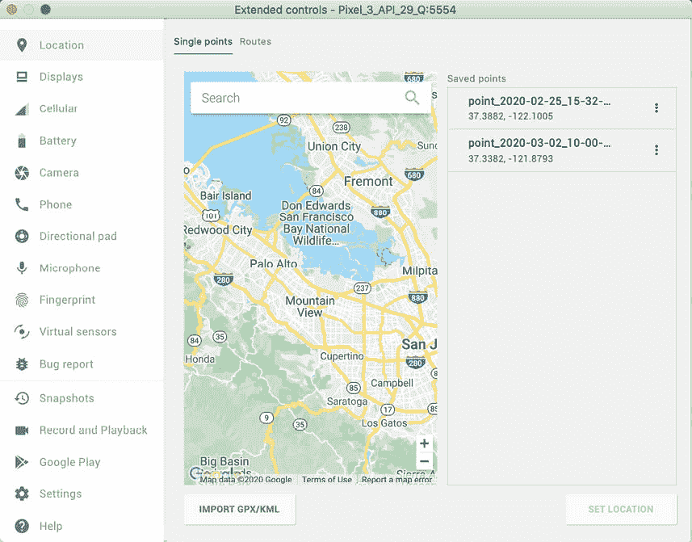

图 5-3

### 5.5.1 位置

位置控制允许以十进制或六十进制坐标的形式将模拟位置信息发送到模拟器。位置信息可以是单个位置，也可以是代表设备移动的点序列，后者通过 GPS 交换（GPX）或 Keyhole 标记语言（KML）格式的文件提供。或者，可以使用集成的 Google Maps 面板视觉化地选择点或旅行路线。

### 5.5.2 显示

除了模拟器屏幕内显示的主显示外，`Displays` 选项允许在同一个 Android 实例中运行额外的显示器。这对于测试如 Microsoft Surface Duo 等双屏设备的应用程序非常有用。这些额外的屏幕可以配置为所需的任何尺寸并与主屏幕在同一个模拟器窗口中显示。

### 5.5.3 蜂窝

可以在蜂窝设置屏幕中更改模拟的蜂窝连接类型，提供了不同网络类型（CSM、EDGE、HSDPA 等）的选项，以及一系列漫游和拒绝访问等语音和数据场景。

### 5.5.4 电池

扩展控制屏幕的此面板上可以模拟各种电池状态和充电条件，包括电池电量、电池健康状况以及 AC 充电器是否连接。

### 5.5.5 相机

当摄像头激活时，模拟器会模拟 3D 场景。它呈现虚拟建筑内部的形式，在模拟器内录制视频或拍照之前，可以通过按住 `Option` 键（Windows 上为 `Alt`）同时使用鼠标指针和键盘键在其中导航。此扩展配置选项允许上传不同的图像以在虚拟环境中显示。

### 5.5.6 电话

电话扩展控制在模拟器中提供了两个非常简单但实用的模拟。第一个选项允许模拟来自指定电话号码的入电电话。这在测试应用程序如何处理此类高级中断时特别有用。

第二个选项允许在模拟器会话中模拟接收短信。与现实世界一样，这些消息将出现在 `Message` 应用中并触发模拟器内的标准通知。

### 5.5.7 方向键

方向键（D-Pad）是内置在 Android 设备中或外部连接（如游戏控制器）的一组额外控件，提供方向控制（左、右、上、下）。方向键设置允许在模拟器中模拟 D-Pad 交互。

### 5.5.8 麦克风

麦克风设置允许启用麦克风并模拟耳机和麦克风连接。还提供启动模拟器上语音助手的按钮。

### 5.5.9 指纹

许多 Android 设备现在内置指纹检测硬件。AVD 模拟器使得无需在带有指纹传感器的物理设备上测试指纹身份。有关如何在模拟器中配置指纹测试的细节将在本章稍后详细介绍。

### 5.5.10 虚拟传感器

虚拟传感器选项允许模拟加速度计和磁力计，通过偏航、俯角和滚动设置模拟设备的物理运动（如旋转、移动和倾斜）。

### 5.5.11 快照

快照包含当前运行 AVD 会话的状态，以便保存和快速恢复，从而使模拟器返回精确状态。快照将在本章稍后详细介绍。

### 5.5.12 录制和播放

允许将模拟器屏幕和音频录制并保存为 WebM 或动态 GIF 格式。

### 5.5.13 Google Play

如果模拟器运行安装了 Google Play 服务的 Android 版本，此选项将显示当前的 Google Play 版本并提供更新模拟器的选项。

### 5.5.14 设置

设置面板提供了一组配置选项。使用此面板可以为工具栏和扩展控制面板选择更深色的主题，指定保存屏幕截图的文件系统位置，配置 OpenGL 支持级别，并配置模拟器窗口始终位于桌面上其他窗口之上方。

### 5.5.15 帮助

帮助屏幕包含三个子面板，分别列出了键盘快捷键列表、访问模拟器在线文档的链接、报告文件 Bug 和发送反馈的链接，以及模拟器版本信息。

## 5.6 使用快照（Snapshots）

当模拟器首次启动时，它会执行一次“冷启动”，这就像物理 Android 设备开电一样。由于操作系统的加载和所有后台进程的启动，此冷启动过程可能需要一些时间才能完成。为了避免每次启动模拟器时都要经历这一过程，系统被配置为每次退出时都会自动保存模拟器当前状态的快照（称为“快速启动快照”）。下次启动模拟器时，快速启动快照将加载到内存中，并从上次停止的地方继续执行，允许模拟器在远短于冷启动所需的时间内重启。

可以使用扩展控制面板的快照（Snapshots）屏幕在模拟器执行期间的任何点存储额外的快照。这保存了整个模拟器的精确状态，允许模拟器恢复到拍摄快照时的精确时间点。在该屏幕中，可以使用 `Take Snapshot` 按钮（在图 5-4 中标记为 A）拍摄快照。要恢复现有快照，请从列表中选择它（B）并点击屏幕底部的 `run` 按钮（C）。还提供了编辑（D）快照名称和描述，以及删除（E）当前所选快照的选项：

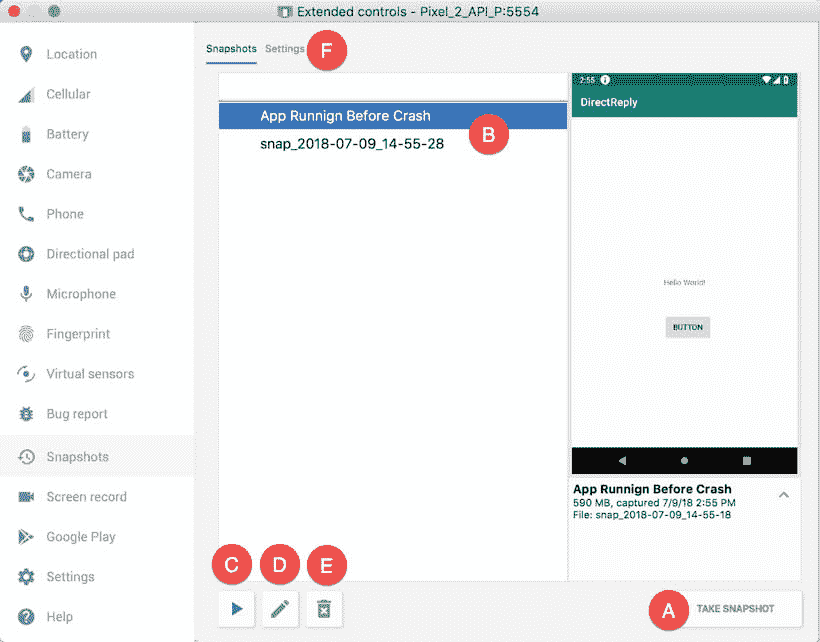

图 5-4

设置选项（F）提供配置自动保存快速启动快照的选项（默认情况下，模拟器在每次退出时都会询问是否保存快速启动快照）以及重新加载最新快照的选项。若要强制模拟器会话执行冷启动而不是使用之前的快速启动快照，请打开 `AVD Manager`（`Tools -> AVD Manager`），点击模拟器操作列中的向下箭头，并选择 `Cold Boot Now` 菜单选项。

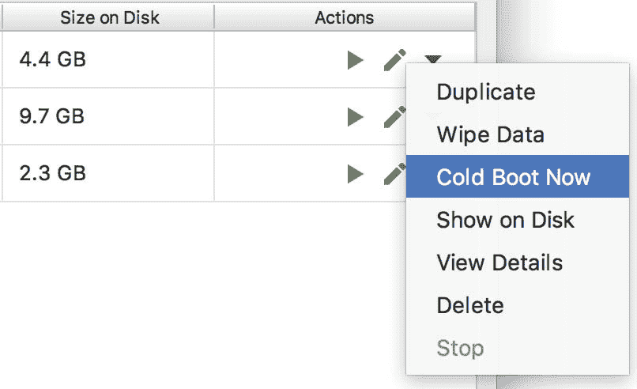

图 5-5

## 5.7 配置指纹模拟

模拟器允许配置多达 10 个模拟指纹，用于测试 Android 应用内的指纹身份验证。配置模拟指纹，首先启动模拟器，打开 `Settings` 应用并选择 `Security & Location` 选项。

在安全设置屏幕内，选择 `Use fingerprint` 选项。在出现的信息屏幕上点击 `Next` 按钮进入指纹设置屏幕。在启用指纹安全之前，必须配置备用屏幕解锁方法（如 PIN 码）。点击 `Fingerprint + PIN` 按钮，并在提示时选择在设备启动时不需要 PIN。输入并确认一个合适的 PIN 码，通过接受默认通知选项来完成 PIN 输入过程。

继续通过其余屏幕，直到 `Settings` 应用请求传感器上的指纹。此时，显示扩展控制对话框，在左侧面板中选择 `Fingerprint` 类别，并确保主设置面板中选中了 `Finger 1`：

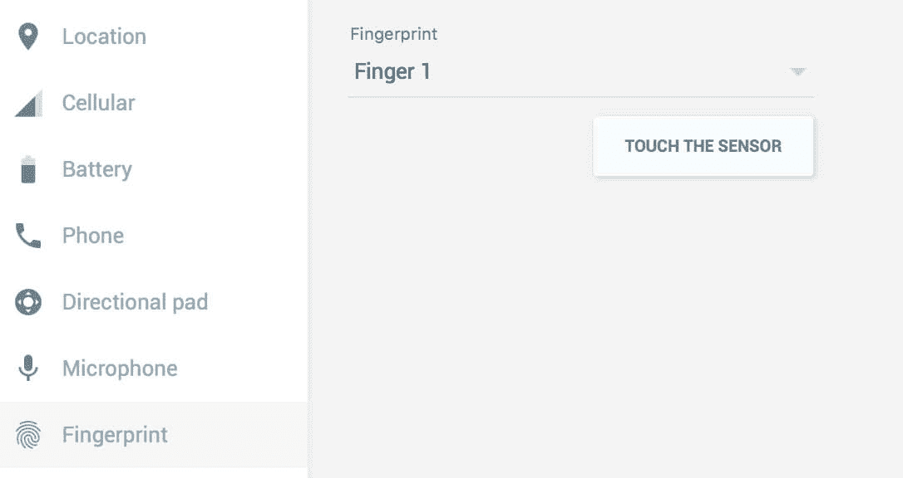

图 5-6

点击 `Touch the Sensor` 按钮以模拟 `Finger 1` 触摸指纹传感器。模拟器将报告成功添加指纹：

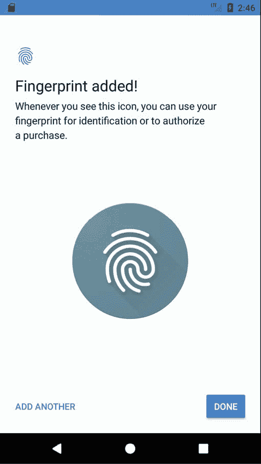

图 5-7

要添加更多指纹，点击 `Add Another` 按钮并在扩展控制面板中选择另一个手指。在扩展控制面板中点击 `Touch the Sensor` 按钮之前，可以添加更多指纹。该主题将在 Android 应用中的生物识别身份章节中进行详细介绍。

## 5.8 在窗口中配置模拟器

正如创建 Android 设备（AVD）所述，Android Studio 可以配置为嵌入窗口模式运行模拟器，这样它就不会出现在独立窗口中。在这种模式下，工具栏提供的可用功能如图 5-8（`#AVD_Configuration.xhtml__idTextAnchor33`）所示：


图 5-8

从左到右，这些按钮执行以下任务：

- `Power`（电源）
- `Volume Up`（音量上）
- `Volume Down`（音量下）
- `Rotate Left`（左旋转）
- `Rotate Right`（右旋转）
- `Back`（返回）
- `Home`（首页）
- `Overview`（概览）
- `Snapshot`（快照）

## 5.9 总结

Android Studio 4.2 包含了可以在无需物理设备上运行应用程序的各种环境。本章概述了模拟器，并突出了可以根据测试条件进行配置的功能。

## A – 菜单栏

包含一组用于在 Android Studio 环境执行任务的菜单。

## B – 工具栏

一组用于频繁执行的操作的快捷键。工具栏按钮可以更快速地访问一组特定的菜单栏操作。可以通过右键点击工具栏并选择 `Customize Menus and Toolbars…`（自定义菜单和工具栏）选项来自定义工具栏。如果工具栏可见，可以使用 `View -> Appearance -> Toolbar` 选项将其显示。

## C – 导航栏

导航栏提供了在组成项目的文件和文件夹之间移动的便捷方式。点击导航栏中的元素将弹出一个菜单，列出该位置的子文件夹和文件以供选择。同样，点击类名将显示出该类中包含的方法列表。从列表中选择一个方法将跳转到代码编辑器中相应的位置。使用 `View -> Appearance -> Navigation Bar` 选项隐藏或显示此栏。

## D – 编辑器窗口

编辑器窗口显示开发者当前正在工作的文件内容。然而，在此处显示的内容取决于上下文。例如，在编辑代码时，将显示代码编辑器。另一方面，在处理用户界面布局文件时，将显示用户界面布局编辑器工具。当打开多个文件时，每个文件都由编辑器顶部的标签页表示，如图 6-3 所示。

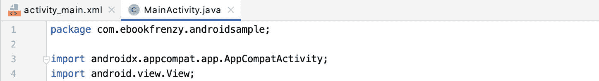

图 6-3

## E – 状态栏

状态栏显示关于项目和 Android Studio 活动的提示信息，以及位于最左角的工具菜单按钮。悬停在状态栏的项目上将提供对字段的描述。许多字段是交互式的，允许用户通过点击来执行任务或获取更详细的状态信息。

## F – 项目工具窗口

项目工具窗口提供了项目文件结构的层级概述，允许对特定文件和文件夹进行导航。可以使用工具栏以多种不同的方式显示项目。默认设置是 Android 视图，这是本书的其余部分主要使用的模式。

项目工具窗口只是 Android Studio 环境中提供的许多工具窗口之一。

## 6.3 工具窗口

除了项目视图工具窗口外，Android Studio 还包含许多其他窗口，启用后它们将显示在主窗口的底部和侧边。只需将鼠标指针悬停在状态栏最左角的按钮上（图 6-4），即可访问工具窗口快速访问菜单，无需点击鼠标。

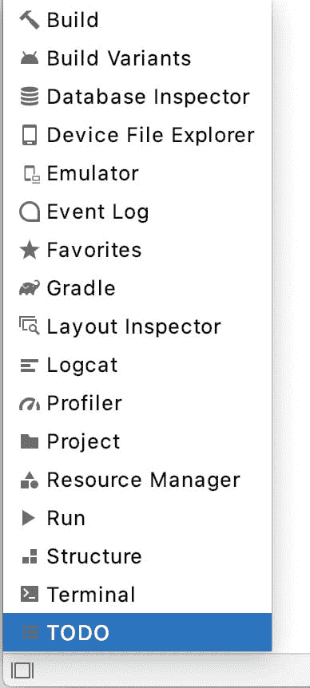

图 6-4

从快速访问菜单中选择项目将导致相应的工具窗口在主窗口中出现。

或者，可以通过点击状态栏中的快速访问菜单图标显示一组工具窗口栏。这些栏出现在主窗口的左侧、右侧和底部边缘（如图 6-5 中的箭头所示），并包含显示和隐藏每个工具窗口的按钮。当工具窗口栏显示时，再次点击状态栏中的按钮将把它们隐藏。

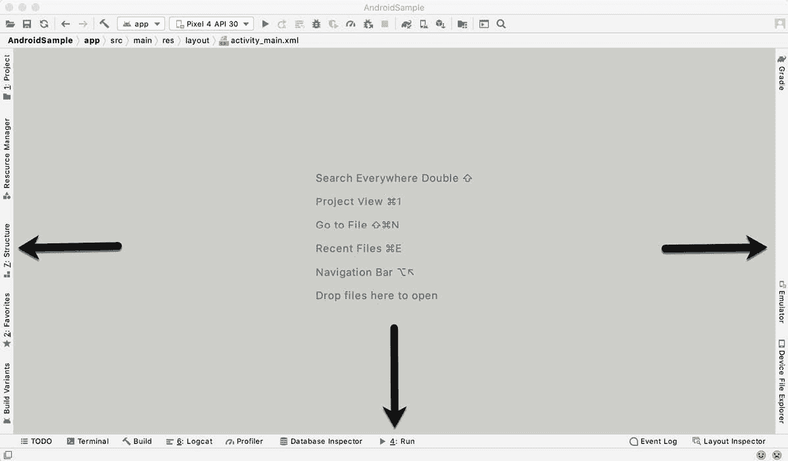

图 6-5

点击按钮将显示相应的工具窗口，而再次点击将隐藏该窗口。带有数字开头的按钮（例如 `1: Project`）表示可以通过按下键盘上的 `Alt` 键（macOS 为 `Command` 键）配合相应的数字来显示该工具窗口。

按钮在工具窗口栏中的位置表示窗口显示时将位于窗口的哪侧。可以通过点击并拖动按钮到其他窗口工具栏的不同位置来更改这些位置。

每个工具窗口在顶部边缘都有自己的工具栏。这些工具栏中的按钮随工具而异，但所有工具窗口都包含一个由齿轮图标表示的设置选项，允许更改窗口的各个方面。图 6-6 显示了项目视图工具窗口的设置菜单。提供可用选项，例如取消固定窗口并允许其浮动在 Android Studio 主窗口边界之外，以及移动和调整工具面板的大小。

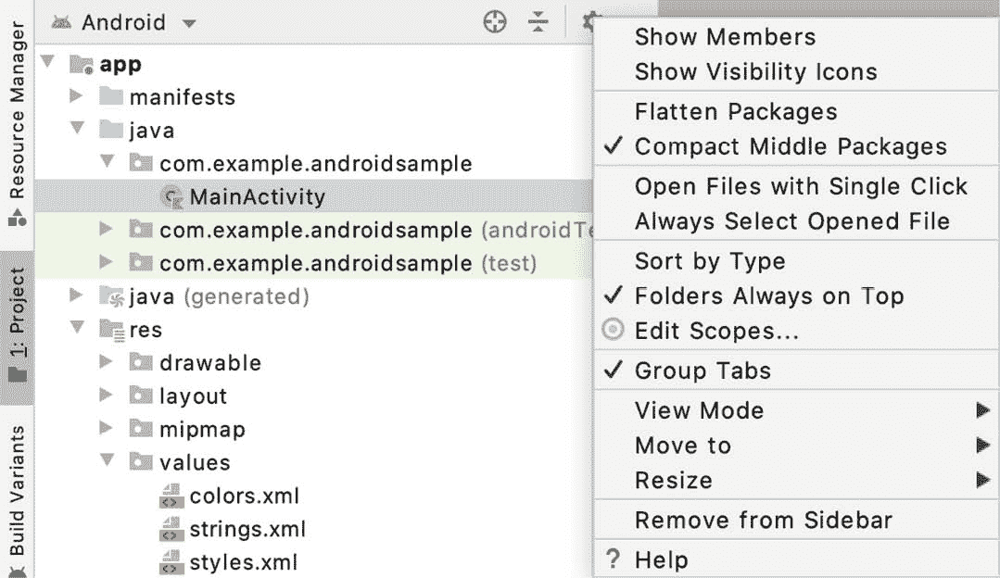

图 6-6

所有窗口在工具栏的最右侧还包含一个按钮，提供了隐藏工具窗口视图的额外方法。只需通过点击该窗口使其获取焦点，然后输入搜索术语（例如项目工具窗口中的文件名），即可对工具窗口内的项目进行搜索。窗口的工具栏中将出现一个搜索框，并高亮显示匹配搜索的项。

Android Studio 提供了广泛的工具窗口，最常用的如下：

- `Project`（项目）：项目视图提供了项目文件结构的概述，允许在文件之间快速导航。通常，在项目视图中双击文件将导致该文件加载到适当的编辑工具中。
- `Structure`（结构）：结构工具提供了当前编辑器中显示的源文件结构的高级视图。这些信息包含了文件中的类、方法和变量等项的列表。从结构列表中选择一个项将带您进入源文件中的相应位置。
- `Favorites`（收藏）：可以将各种项目项添加到收藏列表。例如，在项目视图中右键点击文件可以访问“添加到收藏”菜单选项。同样，可以在结构工具窗口中对源文件中的方法点击右键将其添加为收藏。添加到收藏列表的任何内容都可以通过此收藏工具窗口访问。
- `Build Variants`（构建变体）：构建变体工具窗口为当前应用程序项目配置不同的构建目标提供了快速方法（例如调试版本和发布版本的不同构建，或针对不同设备类的多个构建）。
- `Database Inspector`（数据库检查器）：该工具特别适用于数据库调试，它允许在应用程序运行时检查、查询和修改应用的数据库。
- `TODO`：如其名所示，此工具提供了一个查看项目中待完成事项的地方。Android Studio 通过扫描组成项目的源文件并匹配指定 TODO 模式的注释来编译此列表。可以通过选择 `File -> Settings…` 选项（macOS 为 `Android Studio -> Preferences…`）并导航到 Editor 下的 TODO 页面查看并更改这些模式。
- `Logcat`：Logcat 工具窗口提供了对运行应用程序日志输出的访问，此外还有拍摄截图、视频以及停止和重启进程的选项。
- `Terminal`（终端）：提供了对运行 Android Studio 系统终端窗口的访问。在 Windows 系统上这是命令提示符界面，而在 Linux 和 macOS 系统上以终端提示符的形式存在。
- `Build`（构建）：构建工具窗口在项目编译和打包时显示构建过程的信息，并显示遇到的任何错误的详细信息。
- `Run`（运行）：当应用程序正在运行时，运行窗口将可用，它提供了运行结果视图，并带有停止或重启运行进程的选项。如果应用程序在设备或模拟器上安装和运行失败，此窗口通常会提供与问题相关的诊断信息。
- `Event Log`（事件日志）：事件日志窗口显示与 Android Studio 内执行的事件和活动相关的消息。例如，项目的成功构建或应用程序正在运行等信息将在此工具窗口中报告。
- `Gradle`：Gradle 工具窗口提供了构成项目构建配置的 Gradle 任务的视图。该窗口列出了将项目各种元素编译为可执行应用程序所涉及的任务。右键点击顶层 Gradle 任务并选择 `Open Gradle Config` 菜单选项，即可将当前项目的 Gradle 构建文件加载到编辑器中。`Gradle` 将在本书后续部分进行详细介绍。
- `Profiler`（性能分析器）：Android Profiler 工具窗口提供了实时监控和分析工具，用于识别运行应用中的性能问题，包括 CPU、内存和网络使用情况。当应用运行时，此选项可用。
- `Device File Explorer`（设备文件管理器）：设备文件管理器工具窗口提供了直接访问当前连接的 Android 设备或模拟器文件系统的权限，允许浏览文件系统并将文件复制到本地文件系统。
- `Resource Manager`（资源管理器）：一个用于添加和管理项目包含的资源和资产的工具，如图像、颜色和布局文件。
- `Layout Inspector`（布局检查）：提供构成用户界面布局的组件层次结构的视觉化 3D 渲染。
- `Emulator`（模拟器）：如果已启用在工具窗口中运行模拟器的选项（详见在 Android Studio 中创建 Android 虚拟设备（AVD）章节），则其中包含 AVD 模拟器。

## 6. Android Studio


## 6.4 Android Studio 快捷键

Android Studio 包含了大量的快捷键，旨在用于执行常用任务时节省时间。可以在 Android Studio 项目窗口中选择 `Help -> Keymap Reference` 菜单选项来查看并打印完整的快捷键映射列表。您也可以通过选择 `File -> Settings...` 菜单选项（macOS 上为 `Android Studio -> Preferences...`）并点击 `Keymap` 项（如下方图 6-7 所示）来列出和修改快捷键：

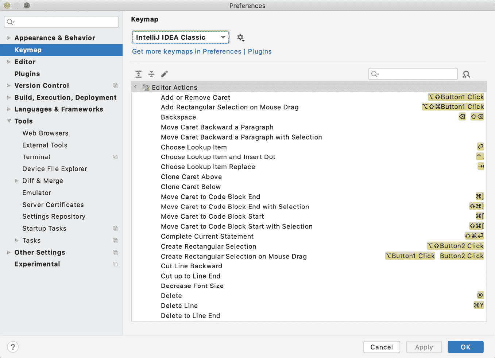

图 6-7

## 6.5 切换器与最近文件导航

在 Android Studio 主窗口内导航的另一种有用机制是使用 `Switcher（切换器）`。通过 `Ctrl-Tab` 快捷键访问，切换器显示为一个列出所有工具窗口和当前打开文件的面板（图 6-8）。

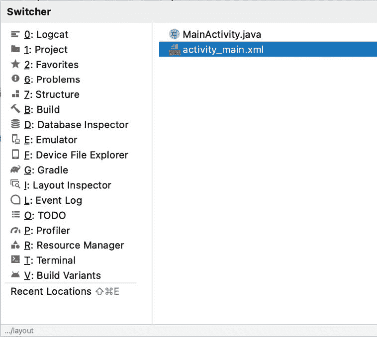

图 6-8

一旦显示，只要 `Ctrl` 键一直保持按下状态，切换器就会保持可见。在按住 `Ctrl` 键的同时反复点击 `Tab` 键可以在各种选项之间循环，而释放 `Ctrl` 键则会选中当前高亮的项并在主窗口中显示。

除了切换器之外，对最近打开文件的导航由 `Recent Files（最近文件）`面板提供（图 6-9）。可以使用 `Ctrl-E` 快捷键（macOS 上为 `Cmd-E`）访问。一旦显示，既可以使用鼠标指针选择选项，或者使用键盘箭头键滚动查看文件名和工具窗口选项。按下 `Enter` 键将选中当前高亮的项。

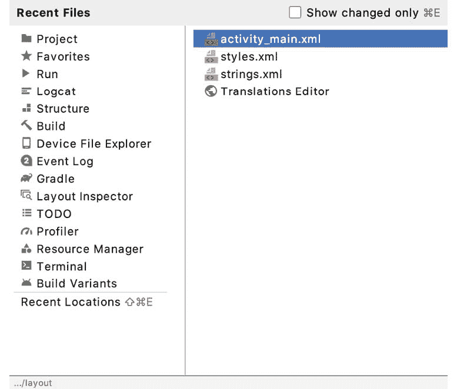

图 6-9

## 6.6 更改 Android Studio 主题

Android Studio 环境的整体主题可以通过欢迎界面的 `Configure -> Settings` 选项，或者通过主窗口的 `File -> Settings…` 菜单选项（macOS 上为 `Android Studio -> Preferences…`）进行更改。

一旦显示设置对话，在左侧面板中选择 `Appearance & Behavior（外观与行为）`，然后选择 `Appearance（外观）`，在点击 `Apply（应用）` 之前更改 `Theme（主题）`菜单设置。可用主题取决于平台，但通常包括 `Light（浅色）`、`IntelliJ`、`Windows`、`High Contrast（高对比度）` 和 `Darcula` 等选项。图 6-10 显示了选择了 Darcula 主题的主窗口示例：

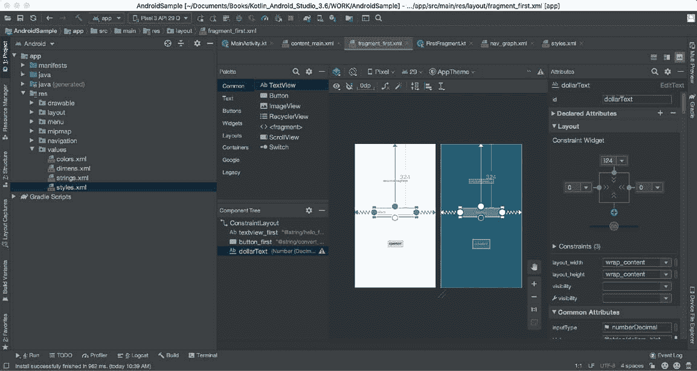

图 6-10

## 6.7 总结

Android Studio 环境的主要元素包括欢迎界面和主窗口。每个打开的项目都有它自己的主窗口，主窗口反过来由菜单栏、工具栏、编辑和设计区域、状态栏和一组工具窗口组成。工具窗口出现在主窗口的侧边和底部，可以通过状态栏中的快速访问菜单访问，也可以通过可选的工具窗口栏访问。

Android Studio 中极少有操作是无法通过快捷键触发的。可以随时从 Android Studio 主窗口内访问默认快捷键的映射。

## 7. 在实体 Android 设备上测试 Android Studio 应用

虽然使用 Android 虚拟设备（AVD）测试应用程序可以实现很多功能，但在实体 Android 设备上进行真实世界的应用测试是不可替代的，而且有许多 Android 特性仅在实体 Android 设备上可用。

与 AVD 实例和连接设备之间的通信由 Android 桥接器（ADB）处理。在本章中，我们将学习在 macOS、Windows 和 Linux 系统上配置 `adb` 环境，以便在实体 Android 设备上进行应用测试。

### 7.1 Android 桥接器（ADB）概述

ADB 的主要目的是方便开发系统（在本例中为 Android Studio）与 AVD 以及实体设备之间的交互，用于运行和调试应用程序。

ADB 由客户端、在开发系统上后台运行的服务器进程以及在 AVD 或实体设备上运行的守护进程组成。

ADB 客户端有多种形式。例如，Android SDK `platform-tools` 目录下提供了名为 `adb` 的命令行工具。同样，Android Studio 也有内置客户端。

可以使用 `adb` 命令行工具执行各种任务。例如，可以使用 `devices` 命令行参数获取当前虚拟或实体设备列表。以下命令输出表示系统中存在 AVD 但没有实体设备：

```text
$ adb devices
List of devices attached
emulator-5554 device
```

### 7.2 在 Android 设备上启用 ADB

在 ADB 连接到 Android 设备之前，必须先配置设备以允许连接。对于运行 Android 6.0 或更高版本的手机和平板设备，实现此目的的步骤如下：

1. 在设备上打开 `Settings（设置）` 应用并选择 `About tablet（关于平板电脑）` 或 `About phone（关于手机）` 选项（在较新的 Android 版本中，这可以在设置的 `System` 页面找到）。

2. 在 About 屏幕上，滚动到 `Build number（版本号）` 字段（图 7-1）并点击七次，直到出现显示开发者模式已启用的消息。如果 About 屏幕上未列出版本号，可以通过 `Software information（软件信息）` 选项访问。或者，如果可用，展开列表中的 `Advanced（高级）` 部分。

图 7-1

3. 返回主设置界面并注意出现了一个名为“开发者选项”（Developer options）的新选项。选择此选项并在开发者屏幕上找到名为“USB 调试”（USB debugging）的设置。如图 7-2 所示，启用项目旁边的开关：

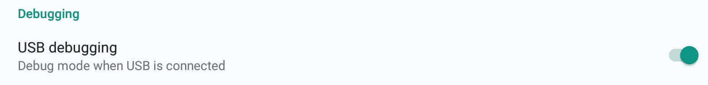

图 7-2

4. 从屏幕顶部向下滑动显示通知面板（图 7-3），并注意设备当前已连接用于调试。


图 7-3

此时，设备已配置好，可以接受来自开发系统 `adb` 的调试连接。剩下的工作就是配置开发系统，以便在设备连接时检测到它。虽然这是一个相对简单的过程，但涉及的步骤取决于开发系统运行的是 Windows、macOS 还是 Linux。请注意，以下步骤假设 Android SDK 的 `platform-tools` 目录已包含在操作系统的 `PATH` 环境变量中，正如“设置 Android Studio 开发环境”章节描述的那样。

#### 7.2.1 macOS ADB 配置

为了在 macOS 系统上配置 `ADB` 环境，请使用 USB 线将设备连接到计算机系统，打开终端窗口并执行以下命令重启 `adb` 服务：

```shell
adb kill-server
adb start-server
```

```text
* daemon not running. starting it now on port 5037 *
* daemon started successfully *
```

一旦服务器成功运行，执行以下命令以验证设备是否已检测到：

```shell
adb devices
```

```text
List of devices attached

74CE000600000001 offline
```

如果设备显示为 `offline`，请前往 Android 设备并检查是否出现了图 7-4 所示的对话框，请求允许“USB 调试”。在点击确定（OK）之前，启用“始终允许来自此计算机”（Always allow from this computer）选项旁边的复选框。再次执行 `adb devices` 命令应该会将设备列为可用：

```text
List of devices attached

015d41d4454bf80c device
```

如果设备未列出，请尝试注销并重新登录 macOS 桌面。如果问题仍然存在，请重启系统。

#### 7.2.2 Windows ADB 配置

配置 Windows 开发系统通过 `ADB` 连接到 Android 设备的第一步是在系统上安装相应的 USB 驱动程序。要安装的 USB 驱动程序取决于 Android 型号。如果您有 Google Nexus 设备，则需要在您的 Windows 系统上安装并配置 Google USB Driver 程序包。实现此操作的详细步骤列在以下网页上：

[`developer.android.com/sdk/win-usb.html`](http://developer.android.com/sdk/win-usb.html)

对于 Google USB 驱动程序不支持的 Android 设备，需要下载设备制造商提供的驱动程序。可以在线上获取驱动程序列表以及下载和安装信息：

[`developer.android.com/tools/extras/oem-usb.html`](http://developer.android.com/tools/extras/oem-usb.html)

安装驱动程序且设备已被识别为正确的设备类型后，打开命令提示符窗口并执行以下命令：

```shell
adb devices
```

此命令应输出关于已连接设备的信息，类似于：

```text
List of devices attached

HT4CTJT01906 offline
```

如果设备显示为 `offline` 或 `unauthorized`，请查看设备屏幕并检查是否出现了图 7-4 所示的请求允许“USB 调试”的对话框。


图 7-4

在点击确定（OK）之前，启用“始终允许来自此计算机”选项旁边的复选框。再次执行 `adb devices` 命令会将设备列为就绪：

```text
List of devices attached

HT4CTJT01906 device
```

如果设备未列出，执行以下命令重启 `ADB` 服务：

```shell
adb kill-server
adb start-server
```

如果设备仍然未列出，尝试执行以下命令：

```shell
android update adb
```

请注意，可能还需要重启系统。

#### 7.2.3 Linux adb 配置

为了本章的目的，我们将再次使用 Ubuntu Linux 作为参考示例，介绍如何在 Linux 上配置 `adb` 以连接到物理 Android 设备进行应用测试。

在 Ubuntu Linux 上物理设备测试需要安装名为 `android-tools-adb` 的包，这反过来要求 Android Studio 用户是 `plugdev` 组的成员。这是大多数 Ubuntu 版本用户账户的默认设置，可以通过运行 `id` 命令进行验证。如果未列出 `plugdev` 组，运行以下命令将您的账户添加到该组：

```shell
sudo usermod -aG plugdev $LOGNAME
```

在满足组成员要求后，可以通过执行以下命令安装 `android-tools-adb` 包：

```shell
sudo apt-get install android-tools-adb
```

完成上述更改后，重启 Ubuntu 系统。系统重启后，打开终端窗口，启动 `adb` 服务并检查设备列表：

```shell
adb start-server
```

```text
* daemon not running. starting it now on port 5037 *
* daemon started successfully *
```

```shell
adb devices
```

```text
List of devices attached
015d41d4454bf80c offline
```

如果设备显示为 `offline`，请前往 Android 设备并检查对话框。

### 7.3 测试 adb 连接

假设 `adb` 在您的开发平台上已配置成功，下一步是在设备上运行“在 Android Studio 中创建示例应用”章节中创建的应用程序。启动 Android Studio，打开 AndroidSample 项目，并验证设备是否出现在图 7-5 所示的设备选择列表中：

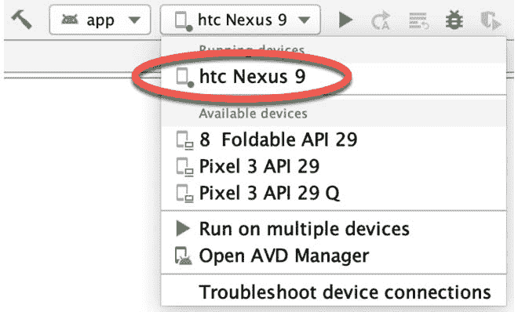

图 7-5

### 7.4 总结

虽然 Android 虚拟机模拟器提供了良好的测试环境，但请记住，确保应用程序在物理 Android 设备上正常运行没有真正的替代品。毕竟，这是应用程序在现实世界中使用的地方。

但是，Android Studio 环境默认未配置检测 Android 设备作为测试设备。因此需要执行某些步骤，以便从 Android Studio 开发环境将应用程序加载到 Android 设备。

## 8. Android Studio 代码编辑器基础

为 Android 开发应用涉及大量的编程工作，根据定义，这涉及输入、审查和修改代码行。这并不意外，开发者在使用 Android Studio 时的大部分时间通常都花在编辑器窗口内编辑代码。

现代代码编辑器需要远远超越最初的输入、删除、剪切和粘贴。今天，代码编辑器的实用性通常由多种因素衡量，例如它在多大程度上减少了程序员所需的输入量、在大源文件中导航的易用性，以及编辑器在编写代码时实时检测并高亮编程错误的能力。正如本章将展示的，这些只是 Android Studio 编辑器出色的几个领域之一。

虽然本章并不是对 Android Studio 编辑器功能的详尽概述，但其目的是提供该工具关键功能的指南。丰富的程序员会发现，其中某些功能在如今大多数代码编辑器中都是通用的，而许多功能则是这一特定编辑环境所独特的。

### 8.1 Android Studio 编辑器

当选择 `Java`、`Kotlin`、`XML` 或其他文本文件进行编辑时，Android Studio 编辑器出现在主窗口中心。例如，图 8-1 显示了一个加载了 `Java` 源文件的典型编辑器会话：

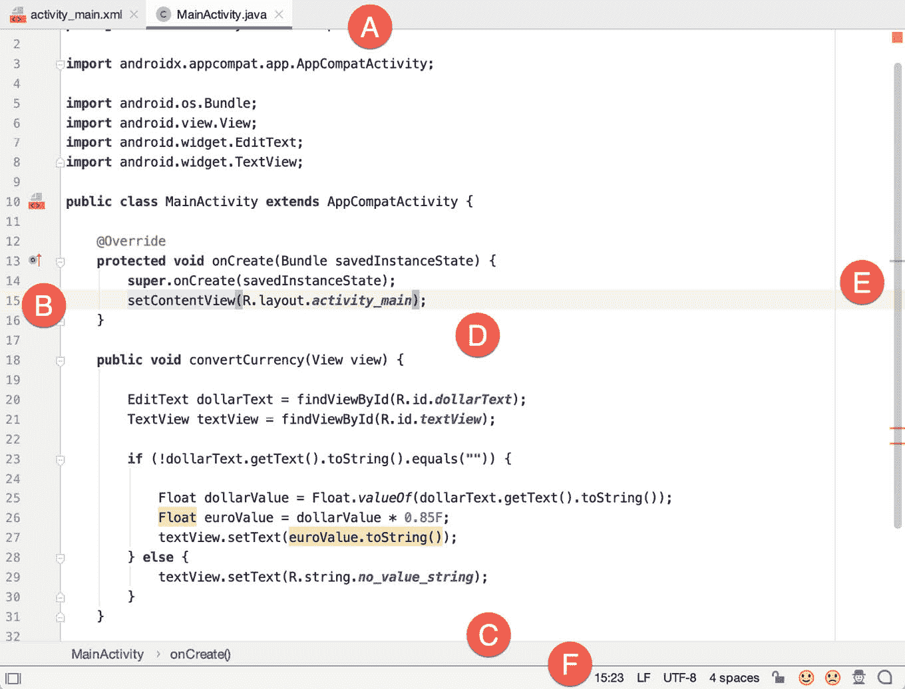

图 8-1

构成编辑器窗口的元素可以总结如下：

**A – 文档标签页（Document Tabs）** – Android Studio 能够同时打开多个文件进行编辑。每打开一个文件时，它都会被分配一个文档标签页，在位于编辑器窗口顶部边缘的标签栏中显示文件名。当空间不足以显示所有标签页时，标签栏的最右侧会出现一个小的下拉菜单。点击此菜单将弹出一个其他已打开的文件列表。标签页中文件名下方的红色波浪线表示该文件中的代码包含一个或多个错误，在项目可以编译和运行之前需要处理这些错误。

在文件之间切换只需点击相应的标签页或使用 `Alt-Left` 和 `Alt-Right` 键盘快捷键。也可以使用切换机制（通过 `Ctrl-Tab` 键盘快捷键访问）进行文件间的导航。

要将编辑器面板从 Android Studio 主窗口分离以便在单独的窗口中显示，请点击标签页并将其拖到主窗口之外的桌面区域。要将编辑器返回主窗口，请点击分离的编辑器窗口中的文件标签，将其拖放并释放到主窗口中的原始编辑器标签栏上。

**B – 编辑器槽位区域（The Editor Gutter Area）** – 槽位区域被编辑器用于显示信息图标和控件。该槽位区域中的一些典型项目包括调试断点标记、折叠和展开代码块的控件、书签、更改标记和行号。行号默认开启，但可以通过在槽位上右键点击并选择 `Show Line Numbers` 菜单选项来禁用它。

**C – 代码结构位置（Code Structure Location）** – 编辑器底部的此栏显示了光标相对于代码整体结构的当前位置。例如，在接下来的图中，该栏指示当前正在编辑 `convertCurrency` 方法，该方法包含在 `MainActivity` 类中。


图 8-2

双击栏内的任意元素将把光标移动到代码文件中的相应位置。例如，双击 `convertCurrency` 条目将把光标移动到源代码中 `convertCurrency` 方法的顶部。同样，点击 `MainActivity` 条目将弹出一个可供选择的可用代码导航点列表：

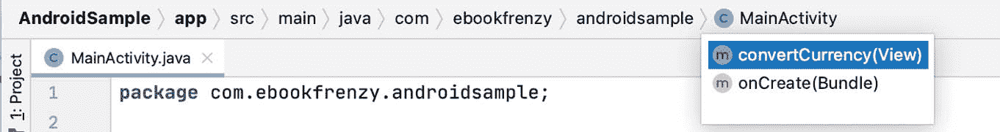

图 8-3

**D – 编辑器区域（The Editor Area）** – 这是用户显示、输入和编辑代码的主区域。本章的稍后部分将详细介绍编辑区域的关键功能。

**E – 验证和标记侧边栏（The Validation and Marker Sidebar）** – Android Studio 整合了一项名为“实时代码分析”的功能。这本质上意味着当你编写代码时，编辑器正在分析代码以检查警告和语法错误。验证侧边栏顶部指示器会随着代码的添加实时更新，指示发现的错误和警告数量。点击此指示器将显示一个弹出窗口，其中包含编辑器代码中发现的问题摘要，如图 8-4 所示：

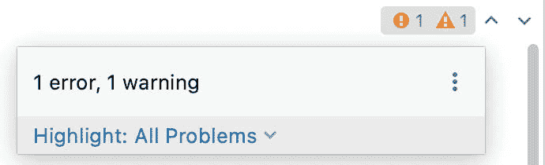

图 8-4

可以使用上下箭头在代码中的错误位置之间移动。绿色勾号表示未检测到警告或错误。

侧边栏在检测到问题的位置也显示标记，使用相同的颜色编码。当代码行在编辑器区域中可见时，将鼠标指针悬停在标记上，将显示一个包含问题描述的弹出窗口（图 8-5）：

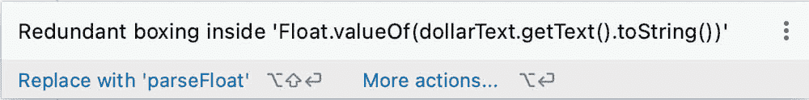

图 8-5

当代码行当前滚动出编辑器视图区域时，将鼠标指针悬停在该代码行的标记上，将显示一个“透镜”覆盖层，包含问题所在的代码块（图 8-6），从而无需滚动到编辑器中的该位置即可查看它：

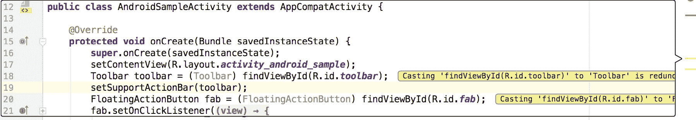

图 8-6

值得注意的是，“透镜”覆盖层不仅限于侧边栏中的警告和错误。将鼠标悬停在侧边栏的任何部分都会显示一个包含文件该位置代码的透镜。


### F – 状态栏（The Status Bar）

虽然状态栏实际上是主窗口的一部分，而不是编辑器，但它确实包含当前编辑会话的一些信息。这些信息包括光标相对于行和字符的位置，以及文件的编码格式（`UTF-8`、`ASCII` 等）。点击状态栏中的这些值可以更改相应的设置。例如，点击行号将显示 `Go to Line` 对话框。

在提供了构成编辑器的元素的概述后，本章的剩余部分将详细介绍编辑环境的关键功能。

## 8.2 分割编辑器窗口

默认情况下，编辑器将显示当前选择文件内容的单个面板。在同时处理多个源文件时，一个特别实用的功能是将编辑器拆分为多个面板。要拆分编辑器，请右键点击编辑器窗口内的文件标签，并选择 `Split Vertically`（垂直拆）或 `Split Horizontally`（水平拆）菜单选项。例如，图 8-7 显示了分割器的工作状态，编辑器被分为三个面板：

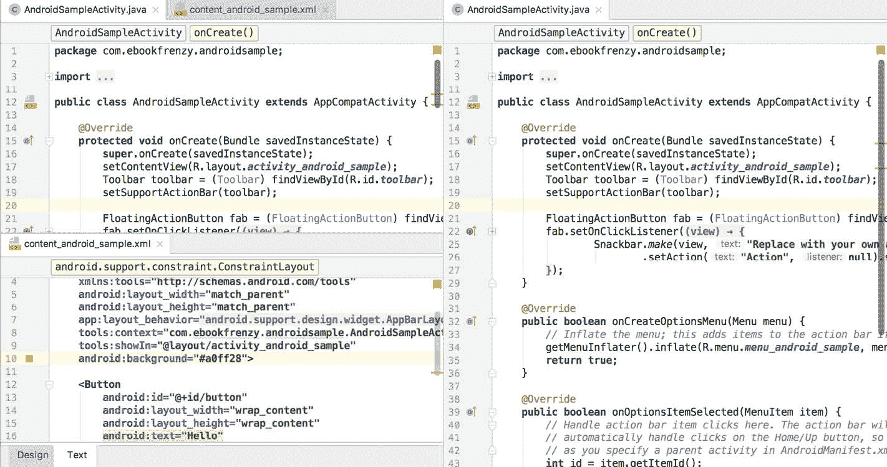

图 8-7

可以通过右键点击相应的标签并选择 `Change Splitter Orientation`（更改分割方向）菜单选项随时更改拆分面板的方向。重复这些步骤可以取消拆分面板，此时从菜单中选择 `Unsplit` 选项。右键点击任何标签并选择 `Unsplit All` 可以移除所有拆分面板。

窗口拆分可用于不同的文件，或为同一个文件提供多个窗口，允许同时查看和编辑同一文件的不同区域。

## 8.3 代码补全

Android Studio 编辑器内置了大量的 Java 编程语法以及构成 Android SDK 的类和方法的知识，同时也包含了对你自己的代码库的了解。在输入代码时，编辑器会扫描正在输入的内容，并在适当的情况下，针对完成语句或引用可能需要的内容提供建议。当编辑器检测到补全建议时，会弹出一个包含建议列表的面板。例如，在图 8-8 中，编辑器正在为 `String` 声明的开头提供可能的选项：

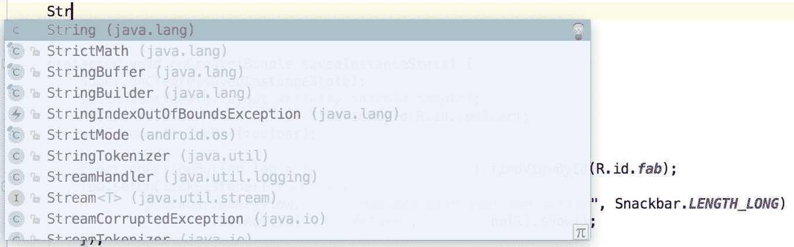

图 8-8

如果没有任何自动补全建议是正确的，只需继续输入，编辑器将在适当的情况下继续精炼建议。要采纳最顶部的建议，只需按下键盘上的 `Enter` 或 `Tab` 键。要选择不同的建议，请使用方向键在列表中上下移动，再次使用 `Enter` 或 `Tab` 键选中高亮项。

可以使用 `Ctrl-Space` 组合键序列手动调用补全建议。这在更改编辑器中的单词或声明时非常有用。当光标置于编辑器中的某个单词上时，该单词将自动高亮。按下 `Ctrl-Space` 将显示一组备选建议。要将当前单词替换为建议列表中当前高亮的项，只需按下 `Tab` 键即可。

除了实时自动补全功能外，Android Studio 编辑器还提供名为“智能补全”（Smart Completion）的系统。智能补全通过 `Shift-Ctrl-Space` 组合键调用，选中后，它将根据代码当前的上下文提供更详细的建议。再次按下 `Shift-Ctrl-Space` 快捷键将从更广泛的范围内提供更多建议。

代码补全对许多程序员来说可能是个人喜好的问题。考虑到这一事实，Android Studio 对自动补全设置提供了高水平控制。可以通过选择 `File -> Settings…` 菜单选项（macOS 上为 `Android Studio -> Preferences…`）并在设置面板中选择 `Editor -> General -> Code Completion` 来查看和修改这些设置，如图 8-9 所示：

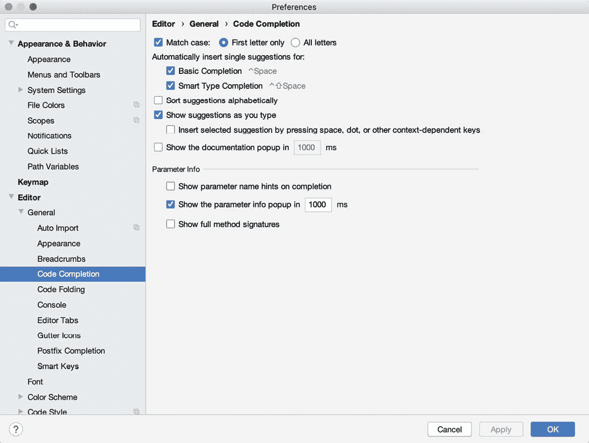

图 8-9

### 8.4 语句补全

Android Studio 编辑器提供的另一种自动补全形式是语句补全。它可以用于自动填充方法和循环语句等项的括号和大括号。语句补全通过 `Shift-Ctrl-Enter`（macOS 上为 `Shift-Cmd-Enter`）组合键序列调用。考虑以下代码示例：

```
myMethod()
```

在编辑器中输入此代码后，触发语句补全将导致编辑器自动为方法添加大括号：

```java
myMethod() {

}
```

### 8.5 参数信息

还可以请求编辑器提供关于方法接受的参数参数的信息。当光标置于方法调用的括号之间时，使用 `Ctrl-P`（macOS 上为 `Cmd-P`）组合键序列将显示该方法接受的参数，其中最可能的建议将粗体显示：


图 8-10

### 8.6 参数名提示

代码编辑器可以配置为在方法调用显示参数名提示。例如，图 8-11 高亮了 `Snackbar` 类中 `make()` 和 `setAction()` 方法调用中的参数名提示：


图 8-11

此模式的设置可以通过选择 `File -> Settings`（macOS 上为 `Android Studio -> Preferences`）选项，然后在左侧面板选择 `Editor -> Inlay Hints -> Java` 来配置。在生成的屏幕上，从列表中选择 `Parameter Hints` 并启用或禁用 `Show parameter hints` 选项。要调整提示设置，点击 `Exclude list...` 链接进行任何必要的调整。

### 8.7 代码生成

除了在输入时补全代码外，编辑器在某些条件下还可以为你生成代码。当光标位于文件中需要生成代码的位置时，可以使用 `Alt-Insert`（macOS 上为 `Ctrl-N`）快捷键访问图 8-12 所示的可用代码生成选项列表。


图 8-12

为了示例说明，考虑一种情况：我们希望在项目中的某个 `Activity` 准备被操作系统销毁时收到通知。正如本书稍后章节将概述的那样，这可以通过重写 `Activity` 超类的 `onStop()` 生命周期方法来实现。要让 Android Studio 为此生成存根方法，只需从代码生成列表选择 `Override Methods…` 选项，并在生成的可用方法列表中选择 `onStop()` 方法：

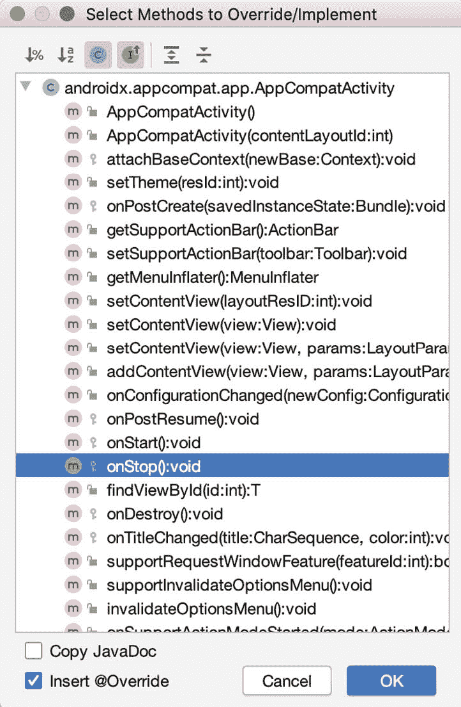

图 8-13

选中要重写的方法后，点击 `OK` 将 Java 源文件中当前光标位置生成存根方法，如下：

```java
@Override
protected void onStop() {
    super.onStop();
}
```

### 8.8 代码折叠

一旦源代码文件达到一定大小，即使是格式良好、组织良好的代码也可能变得难以应对和难以导航。Android Studio 认为并不总是需要显示每个代码块的内容。通过使用 Android Studio 编辑器的代码折叠功能可以使代码变得更容易。代码折叠由编辑器行格中每个代码块开始和结束处的标记控制。例如，图 8-14 高亮了当前未折叠方法定义的起始和结束标记：


图 8-14

点击这些标记中的任一个将折叠语句，只显示签名行，如图 8-15 所示：


图 8-15

要展开折叠的代码段，只需点击行格中的 `+` 标记。要在不折叠的情况下查看隐藏的代码，将鼠标指针悬停在 `{…}` 指示器上，如图 8-16 所示。编辑器随后将包含折叠代码块的覆盖层：

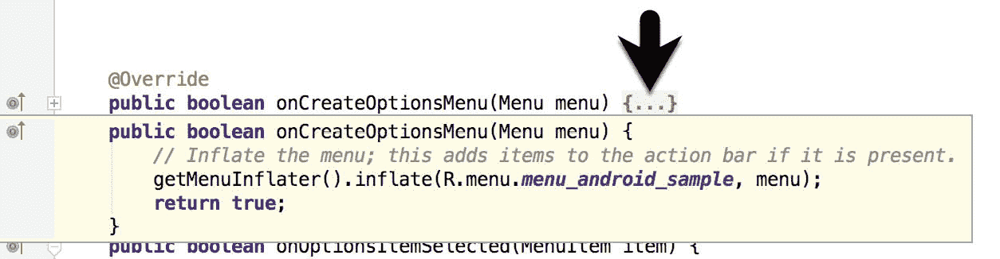

图 8-16

文件中所有的代码块可以使用 `Ctrl-Shift-Plus` 和 `Ctrl-Shift-Minus` 组合键折叠或展开。

默认情况下，Android Studio 编辑器在打开源文件时折叠某些代码。要配置发生这种情况条件，选择 `File -> Settings…`（macOS 上为 `Android Studio -> Preferences…`）并在生成的设置面板中选择 `Editor -> General -> Code Folding` 项（图 8-17）：


图 8-17

### 8.9 快速文档查询

可以通过将光标置于需要文档的声明上并按下 `Ctrl-Q` 快捷键（macOS 上为 `Ctrl-J`）访问上下文相关的 Java 和 Android 文档。这将显示包含该项相关参考文档的弹出窗口。例如，图 8-18 显示了 Android `Snackbar` 类的文档。


图 8-18

显示后，可以根据需要移动弹出窗口。

### 8.10 代码格式化

通常情况下，Android Studio 编辑器会在添加语句和代码块时，自动根据缩进、间隔和嵌套情况对代码进行格式化。在需要重新格式化代码行的情况下（这很常见，例如当从网站复制粘贴示例代码时），编辑器提供了源代码重格式化功能，选中该功能后将自动重新格式化代码以匹配主流的代码风格。

要重新格式化源代码，请按下快捷键组合 `Ctrl-Alt-L`（macOS 上为 `Cmd-Opt-L`）。要显示“重格式代码”对话框（图 8-19），请使用 `Ctrl-Alt-Shift-L`（macOS 上为 `Cmd-Opt-Shift-L`）。该对话框提供了仅重格式当前选中代码、当前编辑器中活动的整个源文件或仅重格式源码控制更新的代码的代码。


图 8-19

完整的代码样式偏好可以在项目设置对话框中更改。选择 `File -> Settings` 菜单选项（macOS 上为 `Android Studio -> Preferences…`），并在左侧面板中选择 `Code Style` 以访问支持的编程语言和标记语言列表。选择一种语言将提供大量的格式样式选项，所有选项都可以从 Android Studio 默认值修改以匹配您偏好的代码风格。例如，要配置上述对话框中 `Rearrange` 代码选项的设置，请展开 `Code Style` 部分，选择 `Java`，并从 `Java` 设置中选择 `Arrangement` 标签。

### 8.11 查找示例代码

Android Studio 编辑器提供了一种方法来访问与代码列表中当前高亮条目相关的示例代码。此功能对于学习如何使用特定的 Android 类或方法非常有用。要查找示例代码，请在编辑器中高亮方法或类名，右键点击它并选择 `Find Sample Code` 菜单选项。`Find Sample Code` 面（图 8-20）将出现在编辑器下方，并列出匹配的示例。从列表中选择一个示例会将相应的代码加载到右侧面板：


图 8-20

### 8.12 实时模板（Live Templates）

在编写 Android 代码时，你会发现经常使用某些结构。例如，一个常见的需求是使用 `Toast` 类向用户显示弹出消息。实时模板（Live templates）是常用代码结构的集合，可以通过在编辑器中输入初始字符后按特殊键（默认设置为 `Tab` 键）来插入模板代码。要体验这一效果，在代码编辑器中输入 `toast` 然后按 `Tab` 键，Android Studio 将在光标位置插入以下代码并准备好编辑：

```
Toast.makeText(, "", Toast.LENGTH_SHORT).show()
```

要列出并编辑现有模板、更改特殊键或添加自己的模板，请打开 `Preferences` 对话框，并在左侧导航面板的 `Editor` 部分选择 `Live Templates`：


图 8-21

使用上方图 8-21 中标记为 A 的按钮添加、删除、复制或重置模板。要修改模板，请从列表中选择它（B）并更改标记为 C 的面板中的设置。

### 8.13 总结

Android Studio 编辑器付出了巨大努力减少编写代码所需的输入量，并使代码更容易阅读和导航。在本章中，我们涵盖了许多关键编辑器功能，包括代码补全、代码生成、编辑器分屏、代码折叠、重格式化、文档查询和实时模板。

# 9. Android 架构概述

到目前为止，本书已经采取了步骤来建立适用于使用 Android Studio 开发 Android 应用的环境。通过创建 Android Studio 应用项目，也迈出了应用开发流程的第一步。

然而，在进一步研究 Android 应用开发的实际问题之前，了解 Android SDK 以及通用的 Android 开发中一些更抽象的概念至关重要。现在清晰地理解这些概念将为进一步构建知识提供坚实的基础。

本章将从 Android 架构的概述开始，并在本书的接几章中继续，目标是提供 Android 开发基础知识的详细概述。

## 9.1 Android 软件栈

Android 结构为软件栈的形式，由应用程序、操作系统、运行时环境、中间件、服务和库组成。这种架构或许通过视觉方式表示得最清楚，如图 9-1。

图 9-1

### 9.2 Linux 内核

`Linux Kernel` 位于 Android 软件栈的底部，在设备硬件和 Android 软件栈上层之间提供了一层抽象。基于 Linux 版本 `2.6`，内核提供了抢占式多任务处理、内存、进程和电源管理等底层核心系统服务，还提供了网络栈以及显示器、WiFi 和音频等硬件的设备程序。

原始 Linux 内核由 Linus Torvalds 于 1991 年开发，与 Richard Stallman 在自由软件基金开发的一系列工具、实用程序和编译器相结合，创建了名为 `GNU/Linux` 的完整操作系统。各种 Linux 发行版从这些基础衍生出来，例如 `Ubuntu` 和红帽企业 Linux。

然而，重要的是，Android 仅使用 `Linux kernel`。尽管如此，值得注意的是，Linux 内核最初是为台式机和服务器等传统计算机设计的。事实上，Linux 现在最广泛地部署在任务关键服务器环境中。考虑到如今移动设备的强大以及 Linux 内核的效率和性能，我们发现这种软件位于 Android 软件栈的核心。

### 9.3 Android 运行时 – ART

当 Android 应用在 Android Studio 中构建时，它会被编译成中间字节码格式（称为 `DEX` 格式）。当应用程序随后加载到设备上时，Android 运行时（`ART`）使用称为预编译（`AOT`）编译的过程将字节码翻译为设备处理器所需的原生指令。这种格式被称为可执行和可链接格式（`ELF`）。

随后每次启动应用程序时，都会运行 `ELF` 可执行版本，从而提高应用程序性能并延长电池续时间。

这与旧版 Android 实现中使用的即时编译（`JIT`）编译方法形成对比，后者在每次启动应用程序时都会在虚拟机（`VM`）中翻译字节码。

### 9.4 Android 库

除了一套标准的 Java 开发库（为如字符串处理、网络连接和文件操作等通用任务提供支持）之外，Android 开发环境还包含了 Android 库（Android Libraries）。这些是一组专门用于 Android 开发的、基于 Java 的库。此类类别的库示例包括应用框架库，以及便于构建用户界面、图形绘制和数据库访问的库。

Android 开发者可使用的某些关键核心 Android 库的总结如下：

- `android.app` – 提供对应用模型的访问，是所有 Android 应用程序的基石。
- `android.content` – 方便应用程序与应用组件之间的内容访问、发布和消息传递。
- `android.database` – 用于访问内容提供者（content providers）发布的数据，包含 `SQLite` 数据库管理类。
- `android.graphics` – 一种底层 2D 图形绘制 API，包括颜色、点、过滤器、矩形和画布。
- `android.hardware` – 提供了一种访问加速度计和光传感器等硬件的 API。
- `android.opengl` – 通向 `OpenGL ES` 3D 图形渲染 API 的 Java 接口。
- `android.os` – 为应用程序提供标准操作系统的服务的访问，包括消息、系统服务和进程间通信。
- `android.media` – 提供启用音频和视频播放的类。
- `android.net` – 一组提供网络栈访问的 API。包括提供设备无线栈的 `android.net.wifi`。
- `android.print` – 包含一组类，允许从 Android 应用程序内部将内容发送到已配置的打印机。
- `android.provider` – 一组便利类，提供对标准 Android 内容提供者数据库的访问，例如由日历和联系人应用维护的数据库。
- `android.text` – 用于在设备显示上渲染和操纵文本。
- `android.util` – 一组工具类，用于执行字符串和数字转换、XML 处理以及日期时间处理等任务。
- `android.view` – 应用用户界面的基础构建模块。
- `android.widget` – 一组丰富的预构建用户界面组件集合，如按钮、标签、列表视图、布局管理器、单选按钮等。
- `android.webkit` – 一组旨在允许网页内容的类。

在涵盖了 Android 库之后，现在是时候关注用于构建应用程序的组件。

### 9.5 C/++ 库

Android 运行时中包含的库是基于 Java 的，但值得注意的是，通过 `android.opengl` 库可以实现 2D 图形绘制，通过 `OpenGL ES` 库可以在显示器上进行 3D 图形绘制。

C/++ 库的目的是为了让应用程序能够实现广泛的功能。这些 C/++ 库通过 `SSL` 通信、`SQLite` 数据库管理、音频和视频播放、位图和字体渲染以及底层 Linux 内核（`libc`）。

在实践中，如果需要访问这些 Java 代码，可以通过 Android 应用开发包（`NDK`）使用 Java 原生接口（`JNI`）来实现。


## 9.5 应用框架

应用框架是一组构成了 Android 应用程序运行和管理的服务。该框架进一步实现了应用程序由可重用和可替换组件构建的概念。

应用框架包含了以下关键服务：

- `Activity Manager` – 控制应用程序的生命周期。
- `Content Providers` – 允许应用程序共享数据。
- `Resource Manager` – 提供对字符串、颜色设置等非代码资源的访问。
- `Notifications Manager` – 允许应用程序向用户显示警报和通知。
- `View System` – 用于创建用户界面的可扩展视图。
- `Package Manager` – 应用程序查找已安装的其他应用程序信息的系统。
- `Telephony Manager` – 为应用程序提供有关电话服务的信息，如状态和订阅者信息。
- `Location Manager` – 提供有关位置更改的服务。

## 9.6 应用程序

位于软件栈顶部的是应用程序。这些包含了 Android 提供的原生应用程序（例如网络浏览器和电子邮件应用）以及用户购买设备后安装的第三方应用程序。

## 9.7 总结

良好的 Android 开发基础需要理解 Android 的整体架构。Android 以 Linux 内核、运行时环境及相应的库、应用框架以及应用程序的形式实现的。应用程序主要使用 `Java` 或 `Kotlin` 编写，并编译为字节码。随后安装在设备上时，字节码将由 Android 运行时（`ART`）编译为 CPU 使用的原生格式。

# 10. Android 应用程序的构造

无论你之前的编程经验是 Windows、macOS、Linux 还是 iOS，Android 开发可能与你遇到过的任何内容都非常不同。

因此，本章的目标是提供对 Android 应用程序架构的高层概念理解。在此，我们将详细探讨用于构建应用程序的各种组件，以及这些组件协同工作的机制。

## 10.1 Android 应用程序（Activity）

熟悉 `Java`、`Kotlin`、`C++` 或 `C#` 等面向对象语言的人熟悉将应用程序功能元素封装在类中，然后这些类被实例化为对象并进行操纵以创建应用程序。

Android 应用是通过整合一个或多个被称为 Activity（活动）的组件创建的。Activity 是应用程序功能的一个单一、独立模块，通常直接对应于单个用户界面屏幕及其相应的功能。例如，一个预约应用程序可能包含一个显示当天已预约项目的 Activity 屏幕。该应用程序还可能使用第二个 Activity，其包含一个允许用户输入新预约的屏幕。

Activity 的设计初衷是将其作为完全可重用且可交换的构建块，可以在不同的应用程序之间共享。例如，一个现有的电子邮件应用程序可能包含一个专门用于编写和发送电子邮件消息的 Activity。一个开发者可能正在编写一个应用程序，该程序同样有发送电子邮件消息的需求。开发者无需专门为新应用程序开发一个邮件编写 Activity，只需直接使用现有电子邮件应用程序中的该 Activity 即可。

Activity 是作为 `Android Activity` 类的子类创建的，并且必须实现为使其与应用程序中的其他 Activity 完全独立。换句话说，共享的 Activity 不能依赖于在程序流的已知点被调用（因为其他应用程序可能会以意想不到的方式使用该 Activity），而且一个 Activity 不能直接调用另一个 Activity 的方法或访问其实例数据。相反，这是通过 `Intents`（意图）和 `Content Providers`（内容提供者）实现的。

默认情况下，Activity 无法向调用它的 Activity 返回结果。如果需要此功能，则该 Activity 必须专门启动为源 Activity 的子 Activity。

## 10.2 Android Fragments（片段）

如上所述，Activity 通常代表应用中的单个用户界面屏幕。一种方案是使用单一的用户界面布局文件和一个对应的 Activity 类文件来构建 Activity。然而，更好的替代方案是将 Activity 拆分为不同的部分。这些部分每一个被称为 `fragment`，每个 fragment 都由用户界面布局的一部分和一个匹配的类文件（声明为 `Android Fragment` 类的子类）组成。在这种情况下，Activity 变成一个嵌入一个或多个 fragment 的容器。

事实上，fragment 为每个用户界面屏幕由单独 Activity 表示提供了一个高效的替代方案。相反，一个应用可以包含单个 Activity，在不同的 fragment 之间切换，每个 fragment 代表不同的应用屏幕。

## 10.3 Android Intents（意图）

`Intents` 是 Activity 能够启动另一个 Activity 并实现组成应用程序的 Activity 流的机制。`Intents` 由对要执行的操作描述以及可选的在该操作上执行的数据组成。

`Intents` 可以是显式的（explicit），即通过类名引用 Activity 来请求启动特定的 Activity；也可以是隐式的（implicit），即通过说明要执行的操作类型或提供用于执行该操作的特定类型的数据。在隐式意图的情况下，Android 运行时将使用称为 `Intent Resolution`（意图解析）的过程，选择与 `Intent` 指定标准最匹配的 Activity 进行启动。

## 10.4 Broadcast Intents（广播意图）

另一种类型的 `Intent` 是 `Broadcast Intent`（广播意图），它是系统范围的意图，发送给所有注册了"感兴趣"的 `Broadcast Receiver`（广播接收器）的应用程序。例如，Android 系统通常发送 `Broadcast Intents` 来指示设备状态的变化，例如系统启动完成、外部电源连接到设备或屏幕开启或关闭。

`Broadcast Intent` 可以是正常的（异步的），即它在大致相同的时间发送给所有感兴趣的 `Broadcast Receivers`；也可以是有序的，即它一次发送给一个接收器，在其中对其进行处理，然后被中止或允许传递给下一个 `Broadcast Receiver`。

## 10.5 Broadcast Receivers（广播接收器）

`Broadcast Receivers` 是应用程序能够响应 `Broadcast Intents` 的机制。`Broadcast Receiver` 必须由应用程序注册并配置 `Intent Filter`（意图过滤器），以指示其感兴趣的广播类型。当广播匹配的意图时，无论注册该接收器的应用程序当前是否运行，Android 运行时都会调用该接收器。接收器随后有 5 秒钟来完成对其要求的任何任务（例如启动 `Service`、更新数据或向用户发出通知），然后返回。`Broadcast Receivers` 在后台运行，没有用户界面。

## 10.6 Android Services（Android 服务）

`Android Services` 是在后台运行且没有用户界面的进程。它们可以从 Activity、`Broadcast Receivers` 或其他 `Services` 启动并随后的管理。`Android Services` 适用于应用程序需要继续执行任务，但不一定需要向用户可见用户界面的情况。虽然 `Services` 缺乏用户界面，但它们仍然可以使用通知和 toast（显示在屏幕上且不中断当前可见 Activity 的小幅通知消息）来通知用户事件，并且能够发布 `Intents`。

Android 运行时赋予 `Services` 的优先级比许多其他进程高，系统只会在为了释放资源的最不利的情况下作为最后手段将其终止。然而，如果运行时确实需要杀死 `Service`，一旦资源再次可用，它将自动重启。`Service` 可以通过声明自己需要在以前台运行来降低被终止的风险。这是通过调用 `startForeground()` 实现的。这仅建议终止会对用户体验产生不利的情况（例如，如果用户正在收听由 `Service` 流传输的音频）。

`Service` 可能作为实际解决方案的示例情况包括：如之前提到的，当应用程序不再活动时也应继续流传输的音频，或者一个当股票达到指定价格时需要通知用户的股票市场跟踪应用程序。

## 10.7 Content Providers（内容提供者）

`Content Providers` 实现了应用程序之间数据共享的机制。任何应用程序都可以通过实现 `Content Provider` 向其他应用程序提供对其底层数据的访问权限，包括添加、删除和查询数据的能力（受权限限制）。对数据的访问通过 `Content Provider` 定义的通用资源标识符（`URI`）提供。数据可以以文件或整个 SQLite 数据库的形式共享。

原生 Android 包含了一些标准的 `Content Providers`，允许应用程序访问联系人和媒体文件等数据。Android 系统上当前可用的 `Content Providers` 可以使用 `Content Resolver`（内容解析器）进行查找。

## 10.8 Application Manifest（应用程序清单）

`Application Manifest` 文件是汇总构成应用程序各种元素的胶水。在这个基于 XML 的文件中，应用程序概述了组成完整应用程序的活动、服务、广播接收器、数据提供者和权限。

## 10.9 Application Resources（应用程序资源）

除了清单文件和包含字节码的 Dex 文件外，一个 Android 应用程序包通常还包含一组资源文件。这些文件包含了用户界面中显示的字符串、图像、字体和颜色等资源，以及用户界面布局的 XML 表示。默认情况下，这些文件存储在应用程序项目层级结构的`/res`子目录中。

## 10.10 应用上下文（Application Context）

当应用程序被编译时，会创建一个名为 `R` 的类，该类包含了对应用程序资源的引用。应用程序清单文件和这些资源结合创建了所谓的应用程序上下文（Application Context）。该上下文由 `Android Context` 类表示，可以在应用程序代码中使用，以便在运行时访问应用程序资源。此外，可以在应用程序上下文中调用许多广泛的方法，以收集信息并在运行时更改应用程序的环境。

## 10.11 总结

可以通过组合许多不同的元素创建一个 Android 应用程序。在本章中，我们提供了对活动（Activities）、碎片（Fragments）、服务（Services）、意（Intents）和广播接收器（Broadcast Receivers）的高级概述，以及对清单文件和应用程序资源的概述。

通过以活动和意的形式创建单个、独立的功能模块，促进了最大程度的复用和互操作性；而应用程序之间的数据共享通过实现内容提供者（content providers）来实现。

虽然活动专注于用户与应用程序交互的区域（活动本质等同于单个用户界面屏幕，通常由一个或多个碎片组成），但后台处理通常由服务和服务广播接收器处理。

构成应用程序的组件在清单文件中为 Android 运行时系统进行了概述，该文件与应用程序资源结合，代表了应用程序的上下文。

本章涵盖了许多对普通开发者来说可能是全新的内容。不过，请放心，在随后的章节中将对这些概念进行深入的探索和实际应用，以确保在坚固的知识基础之上构建您自己的应用程序。

# 11. Android 视图绑定（View Binding）概述

开发 Android 应用的一个重要部分涉及代码与构成用户界面布局的视图之间的交互。本章将查看在代码中访问布局视图的可用选项，特别强调一种被称为视图绑定（view binding）的选项。在涵盖视图绑定的基础之后，本章将概述将 AndroidSample 项目转换为使用此方法所需的更改。

## 11.1 通过 ID 查找视图（Find View by Id）

正如在标题为"Android 应用程序剖析"的章节中所述，构成应用程序的所有资源都被编译成一个名为 `R` 的类。这些资源包含了定义布局的资源。在 `R` 类中有一个名为 `layout` 的子类，它包含了布局资源，包括构成用户界面的视图。大多数应用都需要实现代码与这些视图之间的交互，例如在读取输入到 `EditText` 视图的值或更改在 `TextView` 上显示的内容时。

在 Android Studio 3.6 引入之前，从应用代码内部访问视图的唯一选项是编写代码通过名为 `findViewById()` 的方法根据其 id 手动查找视图。例如：

```
TextView exampleView = findViewById(R.id.exampleView);
```

获取引用后，就可以访问视图的属性了。例如：

```
exampleView.setText("Hello");
```

虽然通过 id 查找视图仍然是一个可行的选项，但它具有一些局限性，`findViewById()` 最大的缺点可能是获取到一个尚未在布局中创建的视图引用，导致在尝试访问视图属性时出现空指针异常。

自 Android Studio 3.6 以来，已经有了以视图绑定的形式从应用代码访问视图的替代方法。

## 11.2 视图绑定（View Binding）

当应用模块中启用视图绑定时，Android Studio 会自动为该模块内的每个布局文件生成一个绑定类。使用此绑定类，可以从代码内部访问布局视图，而无需使用 `findViewById()`。

Android Studio 生成的绑定类的名称基于布局文件名，将其转换为所谓的"驼峰命名法"（camel case），并在末尾附加"Binding"单词。例如，在 `activity_main.xml` 文件的情况下，绑定类将命名为 `ActivityMainBinding`。

Android Studio 4.2 在项目模板中使用视图绑定的做法是不一致的。例如，我们在创建 AndroidSample 项目时使用的 Empty Activity 模板没有使用视图绑定。另一方面，Basic Activity 模板是使用视图绑定实现的。如果您使用不使用视图绑定的模板，那么知道如何将该项目从"通过视图 ID 查找"迁移过来是非常重要的。

## 11.3 转换 AndroidSample 项目

在本章的剩余部分，我们将通过将 AndroidSample 项目转换为使用视图绑定而不是使用 `findViewById()`，来练习迁移到视图绑定。

从启动 Android Studio 并打开在"在 Android Studio 中创建示例 Android 应用"章节中创建的 AndroidSample 项目开始。

## 11.4 启用视图绑定

要视图绑定，必须首先对需要视图绑定的每个模块的 `build.gradle` 文件进行更改。在 AndroidSample 项目中，这将需要对 Gradle Scripts -> `build.gradle` (Module: AndroidSample.app) 文件进行细微更改。将此文件加载到编辑器中，找到 `android` 部分并添加条目以启用 `viewBinding` 属性，如下（注意 `kotlin-android-extensions` 插件将不再需要，并且可以从配置中删除）：

```gradle
plugins {
    id 'com.application'
}

android {
    buildFeatures {
        viewBinding true
    }
}
```

完成此更改后，点击编辑器面板部的 Sync Now 链接，然后使用 Build 菜单清理并重建项目以确保生成绑定类。下一步是在代码中使用该绑定类。

## 11.5 使用视图绑定（Using View Binding）

此过程的第一步是"实例化"（inflate）视图绑定类，以便我们可以访问布局中的根视图。然后，将该根视图作为布局的内容视图。

执行这些任务的逻辑位置是在与布局关联的活动的 `onCreate()` 方法中。典型的 `onCreate()` 方法如下：

```java
@Override
protected void onCreate(Bundle savedInstanceState) {
    super.onCreate(savedInstanceState);
    setContentView(R.layout.activity_main);
}
```

要切换到使用视图绑定，需要导入视图绑定类并按照如下所示修改类。注意，由于布局文件名为 `activity_main.xml`，我们可以推断 Android Studio 生成的绑定类命名为 `ActivityMainBinding`。注意，如果您在创建项目时使用了 `com.example` 以外的域名，下面的导入语句需要更改以反映这一点：

```java
import android.widget.EditText;
import android.widget.TextView;

import com.example.androidsample.databinding.ActivityMainBinding;

public class MainActivity extends AppCompatActivity {
    private ActivityMainBinding binding;
}
```

```java
binding = ActivityMainBinding.inflate(getLayoutInflater());

View view = binding.getRoot();

setContentView(view);
}
```

现在我们已经获取了绑定的引用，可以如下所示通过名称访问视图：


```java
public void convertCurrency(View view) {
    EditText dollarText = findViewById(R.id.dollarText);
    TextView textView = findViewById(R.id.textView);
    if (!binding.dollarText.getText().toString().equals("")) {
        Float dollarValue = Float.valueOf(binding.dollarText.getText().toString());
        Float euroValue = dollarValue * 0.85F;
        binding.textView.setText(euroValue.toString());
    } else {
        binding.textView.setText(R.string.no_value_string);
    }
}
```

编译并运行应用，验证货币转换过程是否如以前一样工作。

## 11.6 选择选项

尽管在空活动（`Empty Activity`）模板中没有采用视图绑定（view bindings），但 Google 强烈建议尽可能使用视图绑定。事实上，对合成属性（synthetic properties）的支持现在已弃用，并可能在 Android Studio 的未来版本中移除。因此，在开发自己的项目时，应该使用视图绑定。

## 11.7 书中示例中的视图绑定

本书中任何依赖未实现视图绑定的项目模板的章节将首先进行迁移。然而，为了避免每次需要迁移时都重复相同的步骤，这些章节将引导你回到这里复习记忆（不用担心，过了几章之后，必要的更改将变成你的本能）。为了帮助这一过程，接下来的部分更简要地总结了迁移步骤。

## 11.8 将项目迁移到视图绑定

将项目模块转换为使用视图绑定的过程涉及以下步骤：

1. 编辑项目（Project）工具窗口列出的模块级 Gradle 构建脚本文件，路径为 `Gradle Scripts` -> `build.gradle (Module: <project name>.app)`，其中 `<project name>` 是项目名称（例如 `AndroidSample`）。

2. 找到文件的 `android` 部分，并添加如下的条目以启用 `viewBinding` 属性：

```gradle
android {
    buildFeatures {
        viewBinding true
    }
}
```

3. 点击编辑器顶部的 `Sync Now` 链接，使用这些新的构建设置重新同步项目。

4. 编辑 `MainActivity.kt` 文件并将其修改为如下内容（其中 `<reverse domain>` 代表创建项目时使用的域名，`<project name>` 替换为项目的小写名称，例如 `androidsample`），且 `<binding name>` 是对应布局资源文件的绑定名称（例如，`activity_main.xml` 的绑定为 `ActivityMainBinding`）。

```kotlin
import android.view.View;
import com.<reverse domain>.<project name>.databinding.<binding name>;

public class MainActivity extends AppCompatActivity {
    private <binding name> binding;

    @Override
    protected void onCreate(Bundle savedInstanceState) {
        super.onCreate(savedInstanceState);
        binding = <binding name>.inflate(getLayoutInflater());
        View view = binding.getRoot();
        setContentView(view);
    }
}
```

5. 通过绑定对象的属性（即名称）访问视图。

## 11.9 总结

在 Android Studio 3.6 引入之前，在应用代码内部访问布局视图需要使用 `findViewById()` 方法。现在提供了视图绑定形式的替代方案。视图绑定由 Android Studio 为每个 XML 布局文件自动生成的类组成。这些类包含了对对应布局中每个视图的绑定，提供了比 `findViewById()` 方法更选项。然而，从 Android Studio 4.2 开始，某些项目模板默认未启用视图绑定，需要额外的步骤来在每个项目模块中手动启用并配置支持。

## 12. 理解 Android 应用和活动生命周期

在较早的章节中，我们已经了解到 Android 应用运行在进程中，并且它们由活动（activities）、服务（services）和广播接收器（broadcast receivers）等多个组件组成。本章的目标是通过查看 Android 运行时系统中应用程序和活动的生命周期来扩展这些知识。

无论如今移动设备的内存和计算能力与昨天的桌面系统相比有多么惊人，但请记住，根据现代桌面和笔记本系统的标准，这些设备仍然被认为是“资源受限”的，特别是在内存方面。因此，Android 系统的一个关键职责是确保这些有限资源得到有效管理，并确保操作系统和运行其上的应用程序始终对用户保持响应。为了实现这一点，Android 对运行应用程序的进程以及构成应用程序的单个组件的生命周期和状态拥有完全控制权。

因此，开发 Android 应用的一个重要因素是理解 Android 的应用和活动生命周期管理模型，以及应用程序在执行生命周期内对可能施加的状态变化的反应方式。

### 12.1 Android 应用与资源管理

每个运行的 Android 应用都被操作系统视为一个独立的进程。如果系统识别到设备上的资源达到容量，它将采取措施终止进程以释放内存。

在决定终止哪个进程以释放内存时，系统会同时考虑所有当前运行进程的优先级和状态，结合这些因素创建 Google 所说的“重要性层级”（importance hierarchy）。然后将从最低优先级开始，按层级向上终止进程，直到释放出足够的系统资源。

### 12.2 Android 进程状态

进程托管应用程序，应用程序由组件组成。在 Android 系统中，进程的当前状态由其托管的应用中排名最高的活动组件定义。如图 12-1 所示，进程在任何时候都可以处于以下五种状态之一：


图 12-1

#### 12.2.1 前台进程

这些进程被分配了最高优先级。在任何时候，活跃的前台进程可能只有一或两个，它们通常是系统最后被终止的。进程必须满足以下一个或多个标准才能获得前台状态：

- 托管用户正在交互的活动。
- 托管与用户交互的活动连接的服务。
- 托管一个通过调用 `startForeground()` 表明终止会破坏用户体验的服务。
- 托管正在执行 `onCreate()`、`onResume()` 或 `onStart()` 回调的服务。
- 托管正在执行其 `onReceive()` 方法的广播接收器。

#### 12.2.2 可见进程

包含对用户可见但不是用户正在交互的活动的进程被归类为“可见进程”。这通常发生在进程中的某个活动对用户可见，但另一个活动（如部分屏幕或对话框）处于前台时。如果一个进程托管一个已绑定到可见或前台活动的服务，该进程也有资格获得可见状态。

#### 12.2.3 服务进程

包含已启动并正在执行的 `Service` 的进程。

#### 12.2.4 后台进程

包含一个或多个当前对用户不可见的 Activity 的进程，且不包含符合 `Service Process`（服务进程）状态的 `Service`。属于此类类别的进程在需要为高优先级进程释放额外内存时，面临被终止的高风险。Android 维护着后台进程的动态列表，按照时间顺序终止进程，即最长时间未处于前台的进程会被首先杀死。

#### 12.2.5 空进程

空进程不再包含任何活跃的应用程序，并被保留在内存中，准备好作为新启动应用程序的宿主。这在某种程度上类似于为了等乘客到达而保持公交车门开启且引擎运转。显然，此类进程被认为是最低优先级，并且是第一个被杀死以释放资源的。

### 12.3 进程间依赖

关于确定最高优先级进程的情况比前节概述的要稍微复杂一些，简单的原因是进程之间往往是相互依赖的。因此，在确定进程的优先级时，Android 系统还会考虑该进程是否以某种方式为另一个更高优先的进程提供服务（例如，作为前台进程的内容提供者的服务进程）。作为一个基本规则，Android 文档指出，一个进程的排名永远不会低于它正在服务的另一个进程。

### 12.4 Activity 生命周期

正如我们之前确定的那样，Android 进程的状态在很大程度上取决于其所宿应用程序中组成 Activity 和组件的状态。因此，理解这些 Activity 在应用程序的执行生命周期内也会经历不同的状态至关重要。Activity 的当前状态部分取决于它在所谓的 `Activity Stack`（Activity 栈）中的位置。

### 12.5 Activity 栈

对于在 Android 设备上运行的每个应用程序，运行时系统都维护着 `Activity Stack`。当应用程序启动时，第一个启动的应用程序 Activity 会被放入栈中。当启动第二个 Activity 时，它被放置在栈顶，而上一个 Activity 被向下推。栈顶的 Activity 被称为活跃（或运行中）Activity。当活跃 Activity 退出时，它会被运行时从栈中弹出，栈中紧邻其下方的 Activity 就会成为当前活跃 Activity。例如，栈顶的 Activity 可能会因为其负责的任务已完成而直接退出。或者，用户可能选择了屏幕上的“返回”按钮以回到上一个 Activity，导致当前 Activity 被运行时系统弹出栈并被销毁。Android `Activity Stack` 的视觉表示如图 12-2 所示。

如图所示，新的 Activity 在启动时会被推入栈顶。当前活跃 Activity 位于栈顶，直到它被新的 Activity 推入栈底，或者在它退出或用户导航到上一个 Activity 时从栈中弹出。在资源受限的情况下，运行时将杀死 Activity，从栈底部的 Activity 开始。

`Activity Stack` 就是编程术语中所说的后进先出（LIFO）栈，因为最后一个推入栈的项是第一个被弹出的项。


图 12-2

### 12.6 Activity 状态

Activity 在应用程序中的执行过程中可以处于若干不同状态之一：

- **活跃 / 运行 (Active / Running)** – Activity 位于 `Activity Stack` 栈顶，是设备屏幕上可见的前台任务，拥有焦点并正在与用户交互。在资源短缺的情况下，这种 Activity 最不可能被终止。
- **暂停 (Paused)** – Activity 对用户可见，但当前没有焦点（通常是因为该 Activity 被当前活跃的 Activity 部分遮挡）。已暂停的 Activity 保留在内存中，保持与窗口管理器关联，保留所有状态信息，并在移动到 `Activity Stack` 栈顶时可以快速恢复到活跃状态。
- **停止 (Stopped)** – Activity 当前对用户不可见（换句话说，它在设备显示上被其他 Activity 完全遮挡）。与暂停的 Activity 一样，它保留所有状态和成员信息，但在低内存情况下被终止的风险更高。
- **被杀死 (Killed)** – Activity 被运行时系统终止以释放内存，不再存在于 `Activity Stack` 中。如果应用程序需要，必须重新启动此类 Activity。

### 12.7 配置更改

到本章为止，我们查看了导致 Android Activity 状态改变的两个原因，即 Activity 在前台和后台之间的移动，以及运行时系统为了释放内存而终止 Activity。事实上，还有第三种场景，即 Activity 的状态会发生剧烈变化，这涉及到设备配置的更改。

默认情况下，任何影响 Activity 外观的配置更改（例如在设备横屏和竖屏之间旋转方向，或更改系统字体设置）都会导致 Activity 被销毁并重建。这背后的逻辑是此类更改会影响用户界面布局等资源，而简单地销毁并重建受影响的 Activity 是 Activity 响应配置更改最快的方法。然而，也可以配置 Activity，使其不会因响应特定的配置更改而重启。

### 12.8 处理状态更改

本章至少应该让人明确，一个应用程序以及根据定义包含在其中的组件在整个生命周期内将经历许多状态转换。特别重要的一点是，这些状态更改（包括完全终止）是由 Android 运行时施加给应用程序的，取决于用户的操作和设备可用资源。

但在实践中，这些状态更改并非完全在没有通知的情况下进行的，在大多数情况下，应用程序都会收到运行时系统的更改通知并有机会做出相应反应。这通常涉及保存或恢复内部数据结构和用户界面状态，从而允许用户在应用程序之间无缝切换，并提供多个并发运行应用程序的外。

Android 提供了两种方法来处理应用对象生命状态的变化。一种方法是响应操作系统的状态更改方法调用，并在下一章处理 Android Activity 状态更改中详细介绍。

一种新的方法，也是 Google 推荐的方法，涉及到 Jetpack Android 架构组件中包含的生命周期类。这些类在“Modern Android App Architecture with Jetpack”中介绍，并在标题为“Working with Android Lifecycle-Aware Components”的章节中进行了更详细解释。

### 12.9 总结

移动设备通常被认为资源受限，特别是在内置内存容量方面。因此，Android 操作系统的主要职责之一是确保应用程序以及整个操作系统对用户保持响应能力。

应用程序托管在 Android 的进程中。每个应用程序反过来由活动（activities）和 `Services` 形式的组件组成。

Android 运行时系统有权终止终止进程和单个活动以释放内存。运行时系统在决定一个进程是否为适合终止的候选者时，会考虑进程状态。进程的状态在很大程度上取决于该进程托管的活动状态。

本章的核心信息是，应用程序在它的执行生命周期内会经历各种状态，并且对其在 Android 运行时环境中的命运控制力非常小。那些不与用户直接交互的进程和活动被运行时系统终止的风险更高。因此，Android 应用开发的一个基本要素是应用程序具备响应操作系统发送的状态变更通知的能力。

## 13 处理 Android 活动状态的变化

根据“Understanding Android Application and Activity Lifecycles”章节中概述的信息，现在显而易见，构成应用程序的活动和片段（fragments）在应用程序生命周期期间会经历各种不同的状态。从一个状态到另一个状态的变化是由 Android 运行时系统强制的，因此在很大程度上超出了活动本身的控制范围。然而，这并不意味着应用无法响应这些变化并采取适当行动。

本章的主要目的是提供活动通知状态变更方式的高级概述，并概述建议保存或恢复状态信息的区域。在涵盖这些信息后，本章将简要触及活动寿命的主题。

### 13.1 新旧生命周期技术

直到最近，一直有一种标准方法在应用中构建生命周期感知。这是本章涵盖的方法，涉及在活动或片段实例中实现一组方法（每个生命周期状态一个方法），这些方法会在对象的生命周期状态改变时由操作系统调用。自 Android 操作系统早期以来，这种方法一直保持不变，虽然在今天仍然是一个可行选项，但它确实有一些局限性，这些限制将在本章稍后部分解释。

随着 Jetpack Android 架构组件引入了生命周期类，现在有了更好的生命周期处理方法。这种现代的生命周期管理（结合 Jetpack 组件和架构指南）将在随后的章节中详细介绍。然而，出于几个原因，理解传统的生命周期方法仍然很重要。首先，作为一名 Android 开发人员，你无法完全隔绝于传统的生命周期方法，并且仍然会使用其中一些。更重要的是，理解处理生命周期的旧方法将为在书中后部分开始学习新方法提供良好的知识基础。

### 13.2 Activity 和 Fragment 类

在极少数例外，应用程序中的活动和片段分别作为 Android `AppCompatActivity` 类和 `Fragment` 类的子类创建。

例如，考虑在“Creating an Example Android App in Android Studio”中创建并随后转换为视图绑定（view binding）的 AndroidSample 项目。将此项目加载到 Android Studio 环境中并找到 `MainActivity.java` 文件（位于 `app -> java -> com.<your domain>.androidsample`）。找到文件后，双击它将其加载到编辑器中，其内容如下：


在创建项目时，我们指示 Android Studio 也创建一个名为 `MainActivity` 的初始活动。如上述代码所示，`MainActivity` 类是 `AppCompatActivity` 类的子类。

查看 `AppCompatActivity` 类的参考文档会发现它本身是 `Activity` 类的子类。可以在 Android Studio 编辑器中使用层次工具窗口（Hierarchy tool window）进行验证。将 `MainActivity.java` 文件加载到编辑器后，点击类声明行中的 `AppCompatActivity` 并按下快捷键 `Ctrl-H`。层次工具窗口随后会出现，显示所选类的层次结构。如图 13-1 所示，`AppCompatActivity` 显然派自 `FragmentActivity` 类，而 `FragmentActivity` 最终本身也是 `Activity` 类的子类：


图 13-1

`Activity` 和 `Fragment` 类包含一系列方法，旨在由 Android 运行时调用以便在对象状态改变时通知该对象。在本章中，我们将这些方法称为生命周期方法。活动或片段类只需要重写这些方法并在它们内部实现必要的功能，以便对状态变化做出相应响应。

其中一个方法名为 `onCreate()`，再次回到上述代码段，我们可以看到该方法已经在 `MainActivity` 类中为我们重写并实现了。在稍后的章节中，我们将详细探索 `onCreate()` 以及 `Activity` 和 `Fragment` 类中其他相关的生命周期方法。

### 13.3 动态状态 vs. 持久化状态

生命周期管理的一个核心目标是确保活动（activity）的状态在适当的时间保存并恢复。在此语境下，我们所说的状态是指当前活动持有的数据以及用户界面的外观。例如，活动可能在内存中维护一个数据模型，该模型需要保存到数据库、内容提供程序或文件中。这种状态信息因为会从应用程序的一次调用持续到另一次调用，因此被称为**持久化状态**（persistent state）。

用户界面的外观（例如输入到文本框但尚未提交到应用程序内部数据模型中的文本）被称为**动态状态**（dynamic state），因为它通常只在应用程序的单次调用期间保留（也称为用户界面状态或实例状态）。

理解这两种状态之间的区别非常重要，因为它们的保存方式以及保存的原因都是不同的。

保存持久化状态的目的是避免活动在后台运行时被运行时系统杀死而可能导致的数据丢失。另一方面，动态状态的保存和恢复的原因则稍为复杂。

例如，假设一个应用程序包含一个活动（我们将其称为 `Activity A`），该活动包含一个文本框和单选按钮。在使用应用程序过程中，用户在文本框中输入了一些文本，并在单选按钮中进行了选择。在执行保存这些更改的操作之前，用户切换到另一个活动，导致 `Activity A` 被推入活动栈（Activity Stack）并置于后台。一段时间后，运行时系统确定内存不足，因此杀掉了 `Activity A` 以释放资源。然而，对于用户来说，`Activity A` 只是被放在了后台，随时准备移动到前台。当返回 `Activity A` 到前台时，用户理所当然预期输入的文本和单选按钮的选择已被保留。但在这种情况下，将创建一个 `Activity A` 的新实例，如果动态状态没有被保存和恢复，之前的用户输入就会丢失。

因此，保存动态状态的主要目的是提供一种在前台和后台活动之间无缝切换的感知，无论活动实际上可能在用户不知情的情况下被杀死并重启。

保存持久化和动态状态的机制在本章的后续章节中将变得清晰。

### 13.4 Android 生命周期周期方法

如前所述，`Activity` 和 `Fragment` 类包含许多生命周期方法，这些方法在实例状态发生时充当事件处理器。Android `Activity` 和 `Fragment` 类支持的主要方法如下：

*   `onCreate(Bundle savedInstanceState)` – 当首次创建活动时调用的方法，是执行大多数初始化任务的理想位置。该方法接收一个 `Bundle` 对象形式的参数，该包中可能包含来自活动之前调用的动态状态信息（通常与用户界面状态有关）。

*   `onRestart()` – 当活动在之前被运行时系统停止后准备重启时调用。

*   `onStart()` – 始终在调用 `onCreate()` 或 `onRestart()` 方法后立即调用，此方法通知活动它即将对用户可见。此调用之后，如果活动移动到活动栈的顶端，则将调用 `onResume()`；如果活动被另一个活动推入栈中，则将调用 `onStop()`。

*   `onResume()` – 表示活动现在处于活动栈的顶端，并且是用户正在交互的活动。

*   `onPause()` – 表示上一个活动即将成为前台活动。此调用之后，将根据活动是返回前台还是对用户不可见，来调用 `onResume()` 或 `onStop()` 方法。在此方法中可以采取措施存储尚未由应用保存的持久化状态信息。为了避免切换活动之间的延迟，应避免在此方法中执行耗时操作，如将数据存储到数据库或执行网络操作。此方法还应确保停止任何动画等 CPU 密集型任务。

*   `onStop()` – 活动现在对用户不再可见。此调用之后可能有两种后续场景：如果活动再次移动到前台，则调用 `onRestart()`；如果活动正在被终止，则调用 `onDestroy()`。

*   `onDestroy()` – 活动即将被销毁，可能是因为活动已完成任务并调用了 `finish()` 方法，也可能是运行时为了释放内存或由于配置更改（如设备方向改变）而正在终止它。需要注意的是，当活动终止时并不总是会调用 `onDestroy()`。

*   `onConfigurationChanged()` – 当发生配置更改且该活动已指示不需要重启时调用。该方法接收一个概述新设备配置的 `Configuration` 对象，随后对该更改做出响应是该活动（activity）的责任。

以下生命周期方法仅适用于 `Fragment` 类：

*   `onAttach()` – 当 fragment 分配给一个活动时调用。

*   `onCreateView()` – 用于创建并返回 fragment 的用户界面布局层级结构。

*   `onActivityCreated()` – 与 fragment 关联的活动的 `onCreate()` 方法已执行完毕。

*   `onViewStatusRestored()` – fragment 保存的视图层级结构已恢复。

除了上述生命周期方法外，还有两个方法专门用于保存和恢复活动的动态状态：

*   `onRestoreInstanceState(Bundle savedInstanceState)` – 当活动从之前保存状态的调用重启时，此方法在调用 `onStart()` 方法后立即调用。与 `onCreate()` 一样，该方法接收包含之前状态数据的 `Bundle` 对象。此方法通常用于在 `onCreate()` 和 `onStart()` 中完成活动初始化后恢复之前的状态更为合理的情况。

*   `onSaveInstanceState(Bundle outState)` – 在活动销毁之前调用，以便保存当前的动态状态（通常与用户界面有关）。该方法接收一个应保存状态的 `Bundle` 对象，该对象在活动重启时将随后通过 `onCreate()` 和 `onRestoreInstanceState()` 方法传递。注意，只有在运行时确定需要保存动态状态时才会调用此方法。

在重写上述方法时，重要的是记住除了 `onRestoreInstanceState()` 和 `onSaveInstanceState()` 之外，方法实现必须包含对父类中相应方法的调用。例如，以下方法重写了 `onRestart()` 方法，但也包含了对父类实例方法的调用：

```
protected void onRestart() {
       super.onRestart();
       Log.i(TAG, "onRestart");
}
```

在重写的方法中未能调用此父类方法将导致运行时执行期间抛出异常。虽然在 `onRestoreInstanceState()` 和 `onSaveInstanceState()` 方法中对父类的调用是可选的（例如，在实现自定义的保存和恢复行为时可以省略这些调用），但使用它们具有显著的优势，这一主题将在“保存和恢复 Android Activity 状态”章节中进行介绍。

### 13.5 生命周期

最后一个要涵盖的话题涉及活动（Activity）或片段（Fragment）执行过程中将的整个、可见和前台生命周期的概述：

-   **整个生命周期 (Entire Lifetime)** – “整个生命周期”一词用于描述从初始调用 `onCreate()` 方法到对象终止前调用 `onDestroy()` 方法之间发生的一切。

-   **可见生命周期 (Visible Lifetime)** – 涵盖从调用 `onStart()` 到 `onStop()` 之间的执行期间。在此期间，活动或片段对用户是可见的，尽管可能不是用户当前交互的对象。

-

**前台生命周期 (Foreground Lifetime)** – 指的是调用 `onResume()` 和 `onPause()` 方法之间的执行期间。

需要注意的是，活动或片段在整个生命周期期间可能会多次经过前台和可见生命周期。

生命周期和生命周期方法的概念在图 13-2 中所示：


图 13-2

### 13.6 折叠屏设备与多重恢复

如前所述，当活动移动到前台并是用户当前交互的活动时，该活动被认为处于恢复（resumed）状态。在标准设备上，应用在任何时候只能有一个活动处于恢复状态，而所有其他活动都可能处于暂停或停止状态。

长期一段时间以来，Android 一直包含了多窗口支持，允许多个活动同时出现在分屏或自由窗体配置中。虽然该功能最初主要用于大屏幕平板电脑设备，但随着折叠屏设备的引入，它可能会变得更加流行。

在运行 Android 10 且启用了多窗口支持的设备（大多数折叠屏设备也是如此）上，多个应用活动可能同时处于恢复状态（这一概念被称为多重恢复），允许这些可见活动即使在另一个活动当前拥有焦点时也能继续运行（例如流媒体内容播放或更新视觉数据）。尽管多个活动可以处于恢复状态，但这些活动中只有一个会被认为是顶顶的恢复活动（换句话说，就是用户最近交互的活动）。

活动可以通过实现 `onTopResumedActivityChanged()` 回调方法来接收其获得或丢失顶层恢复状态的通知。

### 13.7 禁用配置更改重启

如之前概述的，活动可以指示在某些配置更改发生时不重新启动。这是通过在项目清单文件（manifest file）的活动元素中添加 `android:configChanges` 指令来实现的。例如下面的清单文件片段表明，当发生与方向或设备全范围字体大小相关的配置更改时，不应重启该活动：

```xml
<activity android:name=".MainActivity"
          android:configChanges="orientation|fontScale"
          android:label="@string/app_name">
```

### 13.8 生命周期方法的局限性

正如在本章开头提到的，生命周期方法已经使用了多年，直到最近，它们仍然处理活动和片段生命周期状态更改的唯一机制。然而，这种方法存在缺点。

生命周期方法的一个问题是，它们没有提供一种简单的方法让活动或片段在应用执行过程中的任何一点发现其当前的生命周期状态。相反，对象需要在内部跟踪状态，或者等待下一次生命周期方法的调用。

此外，这些方法没有提供一种简单的方法让一个对象观察应用内其他对象的生命周期状态变化。这是一个严肃的问题，因为应用中的许多其他对象都可能受到特定活动或片段中生命周期状态更改的影响。

生命周期方法仅在 `Fragment` 和 `Activity` 类的子类中可用。因此，无法构建真正感知生命周期（lifecycle aware）的自定义类。

最后，生命周期方法导致大多数生命周期处理代码编写在活动或片段内部，这可能会导致复杂且易出错的代码。理想情况下，这些代码大部分应该位于受状态更改影响的其他类中。例如，一个流视频的应用可能会包含一个专门用于管理输入流的类。如果应用在主活动停止时需要暂停流，那么执行此操作的代码应该位于流类中，而不是主活动中。

所有这些以及更多问题都可以通过使用生命周期感知组件（lifecycle-aware components）来解决，这一主题将从“使用 Jetpack 构建现代 Android 应用”章节开始介绍。

### 13.9 总结

所有活动都派自 `Activity` 类，该类反包含许多生命周期方法，这些方法设计用于在活动状态更改时由运行时调用。同样，`Fragment` 类包含许多类似的方法。通过重写这些方法，活动和片段可以响应状态变化，并在需要时采取步骤保存并恢复活动以及应用程序的当前状态。生命周期状态可以认为有两种：持久状态（persistent state）指的是需要在应用调用之间存储的数据（例如存储到文件或数据库）。而动态状态（dynamic state）则与用户界面的当前外观有关。

本次练习的第一步是创建一个新项目。首先启动 Android Studio，如有必要，使用 `File -> Close Project` 菜单选项关闭任何当前打开的项目，以便显示欢迎界面。

从欢迎界面选择 `Create New Project` 快速启动选项，在弹出的新项目对话框中，点击 `Next` 按钮之前选择 `Empty Activity` 模板。

在 `Name` 字段中输入 `StateChange`，并指定包名为为 `com.ebookfrenzy.statechange`。在点击 `Finish` 按钮之前，将 `Minimum API level` 设置为 `API 26: Android 8.0 (Oreo)`，并将 `Language` 菜单更改为 `Java`。项目创建过程完成后，`StateChange` 项目应列在位于 Android Studio 主窗口左侧的 `Project` 工具窗口中。按照第 11.8 迁移项目到 View Binding 节概述的步骤将项目转换为使用 view binding。

下一步操作是设计 Activity 的用户界面。该界面存储在一个名为 `activity_main.xml` 的文件中，该文件应该已经加载到 `Layout Editor` 工具中。如果没有加载，请在 `Project` 工具窗口中导航到它，它可以在 `app -> res -> layout` 文件夹中找到。找到后，双击该文件将其加载到 Android Studio 的 `Layout Editor` 工具中。


图 14-1

## 14.2 设计用户界面

将用户界面布局加载到 `Layout Editor` 工具后，现在是为示例应用程序设计用户界面了。用户界面设计中当前存在“Hello World!” `TextView`，实际上 Activity 需要一个 `EditText` 视图。在 `Layout Editor` 画布上选择 `TextView` 对象并按键盘上的 `Delete` 键将其从设计中删除。
```java
package com.example.androidsample;

import androidx.appcompat.app.AppCompatActivity;

import android.view.View;

import android.os.Bundle;

import java.util.Locale;

import com.example.androidsample.databinding.ActivityMainBinding;

public class MainActivity extends AppCompatActivity {

    private ActivityMainBinding binding;

    @Override
    protected void onCreate(Bundle savedInstanceState) {
        super.onCreate(savedInstanceState);

        binding = ActivityMainBinding.inflate(getLayoutInflater());
        View view = binding.getRoot();
        setContentView(view);
    }

    public void convertCurrency(View view) {
        if (!binding.dollarText.getText().toString().equals("")) {
            float dollarValue = Float.parseFloat(
                    binding.dollarText.getText().toString());
            float euroValue = dollarValue * 0.85F;
            binding.textView.setText(
                    String.format(Locale.ENGLISH,"%f", euroValue));
        } else {
            binding.textView.setText(R.string.no_value);
        }
    }
}
```


从位于`Layout Editor`左侧的`Palette`中选择`Text`类别，从文本组件列表中点击并拖动`Plain Text`组件到设备屏幕的可视化表示上。将组件移动到显示中心，直到出现中心引导线，然后将其放置在相应位置，使布局类似于图 14-2。


图 14-2

使用`EditText`小部件时，必须为视图指定输入类型。这简单定义了用户输入的文本或数据类型。例如，如果输入类型设置为`Phone`，用户将受到限制在视图中输入数字。或者，如果输入类型设置为`TextCapCharacters`，输入将默认为大写字母。输入类型设置还可以组合。

出于本示例的考虑，我们将输入类型设置为支持普通文本输入。为此，在布局中选择`EditText`小部件，并在`Attributes`工具窗口中找到`inputType`条目。点击当前设置左侧的标志图标以打开选项列表，并在列表中关闭`textPersonName`并启用`text`，然后点击`Apply`按钮。继续留在`Attributes`工具窗口中，将视图的`id`更改为`editText`并点击弹出的对话框中的`Refactor`按钮。

默认情况下，`EditText`显示的文本为“Name”。继续留在`Attributes`面板中，从`text`属性字段中删除此内容，使视图在布局中为空。

在继续之前，点击布局编辑器工具栏上的`Infer Constraints`按钮以添加任何缺失的约束。

## 14.3 重写 Activity 生命周期方法

此时，该项目包含一个名为`MainActivity`的单一 Activity，它派自`Android AppCompatActivity`类。该 Activity 的源代码包含在`MainActivity.java`文件中，该文件已经在编辑器会话中打开并由编辑器标签栏中的标签页表示。如果文件不再打开，请在`Project`工具窗口面板中导航到它（`app -> java -> com.ebookfrenzy.statechange -> MainActivity`）并双击将其加载到编辑器中。

到目前为止，Activity 重写的唯一生命周期方法是`onCreate()`方法，该方法已实现为在设置 Activity 的用户界面之前调用`super`类实例方法。现在我们将修改此方法，使其在每次执行时都在 Android Studio 的`Logcat`面板中输出诊断消息。为了实现这一点，我们将使用`Log`类，这需要导入`android.util.Log`并声明一个标签，以便我们能够在日志输出中过滤这些消息：

```java
package com.ebookfrenzy.statechange;

.

.

import android.util.Log;

import androidx.annotation.NonNull;

public class MainActivity extends AppCompatActivity {

    private ActivityMainBinding binding;

    private static final String TAG = "StateChange";

    @Override
    protected void onCreate(Bundle savedInstanceState) {
        super.onCreate(savedInstanceState);
        binding = ActivityMainBinding.inflate(getLayoutInflater());
        View view = binding.getRoot();
        setContentView(view);
        Log.i(TAG, "onCreate");
    }
}
```

下一个任务是重写更多方法，每个方法都包含一个日志调用。这些重写方法可以手动添加，也可以使用 Android 编辑基础概述的 Alt-Insert 快捷键生成：

```java
@Override
protected void onStart() {
    super.onStart();
    Log.i(TAG, "onStart");
}

@Override
protected void onResume() {
    super.onResume();
    Log.i(TAG, "onResume");
}

@Override
protected void onPause() {
    super.onPause();
    Log.i(TAG, "onPause");
}

@Override
protected void onStop() {
    super.onStop();
    Log.i(TAG, "onStop");
}

@Override
protected void onRestart() {
    super.onRestart();
    Log.i(TAG, "onRestart");
}

@Override
protected void onDestroy() {
    super.onDestroy();
    Log.i(TAG, "onDestroy");
}

@Override
protected void onSaveInstanceState(Bundle outState) {
    super.onSaveInstanceState(outState);
    Log.i(TAG, "onSaveInstanceState");
}

@Override
protected void onRestoreInstanceState(Bundle savedInstanceState) {
    super.onRestoreInstanceState(savedInstanceState);
    Log.i(TAG, "onRestoreInstanceState");
}
```

## 14.4 过滤 Logcat 面板

在`MainActivity.java`重写方法中添加的代码将日志信息输出到`Logcat`工具窗口。输出可以配置为显示与设备或模拟器会话的所有事件，也可以限制为与当前应用程序相关的事件。输出还可以进一步限制为匹配指定过滤器的事件。

显示`Logcat`工具窗口并点击过滤器菜单（在图 14-3 中标记为 B）以查看可用选项。当此菜单设置为`Show only selected application`时，只有与标记为 A 的菜单中选择的应用相关的消息才会显示在`Logcat`面板中。而选择`No Filters`将显示设备生成的所有消息。

在运行应用程序之前，值得演示创建一个过滤器，选择该过滤器将进一步限制日志输出，以确保只显示包含我们在 Activity 中声明的标签的日志消息。

从过滤器菜单 (B)，选择“Edit Filter Configuration”（编辑过滤器配置）菜单选项。在创建新建 Logcat 过滤器对话框（图 14-4）中，将过滤器命名为`Lifecycle`，并在 Log Tag 字段中输入`MainActivity.java`中声明的 Tag 值（在上面的代码示例中该值为`StateChange`）。


图 14-4

在`Package Name`字段中输入包标识符，更改完成后点击`OK`按钮创建过滤器并关闭对话框。现在，`Logcat`工具窗口中不再显示“No Filters”（无过滤器），而是选择了新创建的过滤器。

## 14.5 运行

为了获得最佳效果，应在物理 Android 设备或模拟器上运行应用程序。在设备配置并连接到开发计算机后，点击 Android Studio 工具栏上由绿色三角形表示的运行按钮，如下图 14-5 所示，选择`Run -> Run…`菜单选项或使用快捷键`Shift+F10`：


图 14-5

如果出现“Choose Device”（选择设备）对话框，请从中选择物理 Android 设备或模拟器（假设你尚未将其配置为默认目标）。Android Studio 构建应用程序并将其安装到设备上后，它将启动并在前台运行。

检查`Logcat`面板可以指示此为止哪些方法已被触发（注意确保选择了上一节创建的`Lifecycle`过滤器，以过滤掉我们目前感兴趣的日志事件）：


图 14-6

## 14.6 实验 Activity

在诊断功能工作正常后，现在是时候通过运行应用程序来加强对 Activity 生命周期状态更改的理解。首先，考虑`Logcat`面板中的初始日志事件序列：

```
onCreate
onStart
onResume
```

显然，初始状态更改与“理解 Android 应用程序和 Activity 生命周期”中概述的完全一致。但注意，由于 Android 运行时检测到在这种情况下没有需要恢复的状态，因此调用`onRestoreInstanceState()`。

点击设备屏幕底部状态栏上的`Home`图标，并日志中报告的方法调用序列如下：

```
onPause
onStop
onSaveInstanceState
```

在这种情况下，运行时注意到 Activity 已不再处于前台，对用户不可见并已停止该 Activity，但并没有提供 Activity 保存动态状态的机会。取决于运行时最终销毁了 Activity 还是简单地重启了它，Activity 将通过调用`onRestart()`被通知其已重启，或者当用户返回 Activity 时将再次经历创建序列。

如“理解 Android 应用程序和 Activity 生命周期”中概述，通过对设备进行配置更改（例如从竖屏旋转到横屏）可以触发 Activity 的销毁和重建。要看到这一操作过程，只需在`StateChange`应用程序处于前台时旋转设备即可。使用模拟器时，可以使用模拟器工具栏上的旋转按钮来模拟设备旋转。为了完成旋转，还需要点击设备或模拟器屏幕工具栏中出现的旋转按钮，如图 14-7 所示：


图 14-7

日志中产生的方法调用序列应如下：

```
onPause
onStop
onSaveInstanceState
onDestroy
onCreate
onStart
onRestoreInstanceState
onResume
```

显然，运行时系统在 Activity 被销毁和重启之前已经给予了它一个保存状态的机会。

## 14.7 总结

“一画胜千言”这句老谚语在学习新编程范式的示例时同样适用。在本章中，我们创建了一个 Android 应用程序示例，旨在演示 Activity 可能会经过的各种生命周期状态。在本章的项目开发过程中，我们还查看了从 Activity 内部生成诊断日志信息的机制。

在下一章中，我们将扩展`StateChange`示例项目，用以演示如何保存和恢复 Activity 的动态状态。

## 15. 保存和恢复 Android Activity 状态

如果前面的几章节已经实现了目标，那么现在对于在 Activity 的特定点保存和恢复用户界面状态的重要性应该变得更清晰了。

在本章中，我们将扩展在通过示例理解 Android Activity 状态更改中创建的示例应用程序，演示当 Activity 被运行时系统销毁和重建时保存和恢复状态的步骤。

保存和恢复动态状态的关键组件涉及使用 Android SDK 的`Bundle`类，这个主题在本章中也会涵盖。

## 15.1 保存动态状态

正如我们所学的，Activity 通过运行时系统调用其实现的`onSaveInstanceState()`方法，获得了保存动态状态信息的机会。作为参数传递的是一个`Bundle`对象的引用，该方法需要将需要保存的动态数据存储其中。随后，`Bundle`对象由运行时系统存储，并在调用时作为参数传递给 Activity 的`onCreate()`和`onRestoreInstanceState()`方法。然后，可以在这些方法中从`Bundle`对象中检索数据并用于恢复 Activity 的状态。

## 15.2 用户界面状态的默认保存

在上节中，`StateChange`示例应用程序的诊断输出显示，当运行它的设备发生旋转以触发方向变化时，Activity 会经过状态更改。

再次启动`StateChange`应用程序，这次在执行设备旋转之前在`EditText`字段中输入一些文本（在运行 Android 9 或更高版本的设备或模拟器上，可能需要点击状态栏中的旋转按钮来完成旋转）。旋转设备后，`Logcat`窗口应出现以下状态更改序列：

```
onPause
onStop
onSaveInstanceState
onDestroy
onCreate
onStart
onRestoreInstanceState
onResume
```

显然这导致了 Activity 的销毁和重建。然而，检查运行应用程序的用户界面应该显示输入到`EditText`字段中的文本已被保留。鉴于 Activity 被销毁并重建，且我们没有添加任何特定代码来确保保存和恢复文本，这种行为需要解释。

事实上，Android SDK 包含的大多数视图控件已经实现了在 Activity 重启时自动保存和恢复状态所需的行为。启用此行为的唯一要求是 Activity 中的`onSaveInstanceState()`和`onRestoreInstanceState()`重写方法包含对父类相应方法的调用：

```java
@Override
protected void onSaveInstanceState(@NonNull Bundle outState) {
    super.onSaveInstanceState(outState);
}

@Override
protected void onRestoreInstanceState(@NonNull Bundle savedInstanceState) {
    super.onRestoreInstanceState(savedInstanceState);
}
```

可以通过在 XML 布局文件中将`android:saveEnabled`属性设置为`false`来禁用用户界面视图的自动状态保存。为了演示示例，我们将禁用用户界面布局中`EditText`视图的自动状态保存机制，然后向应用程序添加代码来手动保存和恢复视图的状态。

要配置`EditText`视图以便在 activity 重启时不保存和恢复状态，请编辑`activity_main.xml`文件，使视图的条目如下所示（注意可以通过点击 Layout Editor 面板底部 Text 标签页直接编辑 XML）：

```xml
<EditText
    android:id="@+id/editText"
    android:layout_width="wrap_content"
    android:layout_height="wrap_content"
    android:ems="10"
    android:inputType="text"
    android:saveEnabled="false"
    app:layout_constraintBottom_toBottomOf="parent"
    app:layout_constraintEnd_toEndOf="parent"
    app:layout_constraintStart_toStartOf="parent"
    app:layout_constraintTop_toTopOf="parent" />
```

进行更改后，运行应用程序，输入文本并旋转设备，以验证在继续操作之前文本不再被保存和恢复。

### 15.3 Bundle 类

对于需要在用户界面视图组件提供的默认功能之外保存状态的情况，`Bundle`类提供了一个容器，使用键值对机制存储数据。键的形式为字符串值，而与这些键关联的值可以是原始值的形式，也可以是任何实现了 Android `Parcelable`接口的对象的形式。已经有广泛的类实现了`Parcelable`接口。可以通过实现`Parcelable`接口中定义的方法集来使自定义类变为“可序列化的”，详细信息可以在 Android 文档中找到：

`https://developer.android.com/reference/android/os/Parcelable.html`

`Bundle`类还包含一组方法，可用于获取和设置各种数据类型的键值对，包括原始类型（包括`Boolean`、`char`、`double`和`float`值）和对象（如`Strings`和`CharSequence`）。

对于本示例而言，并且在禁用了`EditText`视图文本的自动保存后，我们需要确保用户输入`EditText`字段的文本被保存到`Bundle`对象中并随后恢复。这将作为如何在 Android 应用程序中手动保存和恢复状态的演示，并将分别使用`Bundle`类的`putCharSequence()`和`getCharSequence()`方法来实现。

### 15.4 保存状态

扩展 StateChange 应用程序的第一步是确保在`MainActivity` activity 的`onSaveInstanceState()`方法中，从`EditText`组件中提取用户输入的文本，然后将其作为键值对保存到`Bundle`对象中。


为了从`EditText`对象中提取文本，我们首先需要通过在用户界面中识别该对象。显然，这涉及桥接 activity 的 Java 代码（包含在`MainActivity.java`源代码文件中）与用户界面的 XML 表示法（包含在`activity_main.xml`资源文件中）之间的差距。为了提取输入到`EditText`组件的文本，我们需要获得对该用户界面对象的访问权限。

用户界面中的每个组件都与其关联着一个唯一标识符。默认情况下，Layout Editor 工具根据对象类型为新添加的组件构建`id`。如果布局中包含多个相同类型的视图，则类型名称后面会跟一个顺序数字（尽管开发者可以、也应该将其更改为更有意义的内容）。正如在 Android Studio 主窗口中选择`activity_main.xml`文件并显示 Layout Editor 工具时检查 Component Tree 面板所示，`EditText`组件被分配了`id` `editText`：


图 15-1

我们现在可以通过对象的`getText()`方法获取`editText`视图包含的文本，该方法反过来返回当前文本：

```java
CharSequence userText = binding.editText.getText();
```

最后，我们可以使用`Bundle`对象的`putCharSequence()`方法保存文本，传递键（可以是任何字符串值，但在本例中我们将将其声明为“savedText”）和`userText`对象作为参数：

```java
outState.putCharSequence("savedText", userText);
```

将这一切整合在一起，我们在`MainActivity.java`文件中得到了修改后的`onSaveInstanceState()`方法，如下：

```java
package com.ebookfrenzy.statechange;

.
.

public class MainActivity extends AppCompatActivity {
.
.
.
    protected void onSaveInstanceState(@NonNull Bundle outState) {
        super.onSaveInstanceState(outState);
        Log.i(TAG, "onSaveInstanceState");
        CharSequence userText = binding.editText.getText();
        outState.putCharSequence("savedText", userText);
    }
.
.
}
```

现在已经了保存状态的步骤，下一阶段是确保在需要时恢复它。

### 15.5 恢复状态

保存的动态状态可以在那些接收`Bundle`对象作为参数的生命周期方法中恢复。这让开发者可以选择`onCreate()`或`onRestoreInstanceState()`。使用哪种方法取决于 activity 的性质。在状态初始化任务执行后最适合恢复的情况下，`onRestoreInstanceState()`方法通常更好。对于本示例，我们将在`onRestoreInstanceState()`方法中添加代码，使用“savedText”键从`Bundle`中提取保存的状态。然后我们可以使用对象的`setText()`方法在`editText`组件上显示文本：

```java
@Override
protected void onRestoreInstanceState(@NonNull Bundle savedInstanceState) {
    super.onRestoreInstanceState(savedInstanceState);
    Log.i(TAG, "onRestoreInstanceState");
    CharSequence userText = savedInstanceState.getCharSequence("savedText");
    binding.editText.setText(userText);
}
```

### 15.6 测试应用程序

剩下的工作就是再次构建并运行 StateChange 应用程序。运行并处于前台状态时，触摸`EditText`组件并输入一些文本，然后旋转设备到另一个方向。以前文本更改会丢失，但得益于我们在本章向 activity 中添加的代码，新文本在`editText`组件中被保留了。

验证代码按预期运行后，注释掉两个方法中的`super.onSaveInstanceState()`和`super.onRestoreInstanceState()`调用，重新启动应用并注意在设备旋转后文本仍然保留。默认的保存和恢复系统本质上被自定义实现所取代，从而提供了在 activity 中动态且有选择地保存和恢复状态的方法。

## 15.7 总结

Android 应用程序中动态状态的保存和恢复只需在相应的生命周期方法中实现适当的代码。对于大多数用户界面视图，这由 Activity 超类自动处理。在其他情况下，这通常包括在`onSaveInstanceState()`方法中提取值和设置并将数据作为键值对保存在运行时系统传递给 activity 的`Bundle`对象中。

可以通过在 activity 的`onCreate()`或`onRestoreInstanceState()`方法中从`Bundle`对象提取值并根据存储的值更新 activity 来恢复状态。

在本章中，我们使用了这些技术更新了`StateChange`项目，使得`Activity`能够在 activity 的销毁及随后的重建中保留更改。

# 16. 理解 Android 视图、视图组和布局

除了收听流媒体音频外，用户与 Android 设备的交互在本质上主要是视觉化和触觉的。所有这些交互都是通过设备上安装的应用程序的用户界面进行的，包括内置应用程序和用户安装的任何第三方应用程序。因此，开发 Android 应用程序的关键要素涉及用户界面的设计和创建，这并不令人意外。

在本章中，将涵盖 Android 用户界面结构的主题，并概述组成用户界面的不同元素；即`Views`（视图）、`View Groups`（视图组）和`Layouts`（布局）。

## 16.1 不同的 Android 设备设计

“Android 设备”一词涵盖了具有不同屏幕尺寸和分辨率的海量平板和智能手机产品。因此，应用程序用户界面现在必须经过仔细设计，以确保在尽可能广泛的显示尺寸上正确呈现。其中一个关键部分是确保用户界面布局在不同的设备上运行运行时能够正确缩放。这在很大程度上可以通过仔细的规划和使用本章概述的布局管理器来实现。

同样重要的是，大多数基于 Android 的智能手机和平板电脑都可以由用户以竖屏和横屏模式持有。设计良好的用户界面应该适应此类变化，并进行合理的布局调整，以利用每种方向下的可用屏幕空间。

## 16.2 视图和视图组

用户界面中的每一项都是 Android`View`类的子类（准确来说是`android.view.View`）。Android SDK 提供了一组预构建视图，可用于构建用户界面。典型示例包括标准项，如`Button`、`CheckBox`、`ProgressBar`和`TextView`类。这些视图也被称为控件（widgets）或组件。对于 SDK 提供的控件无法满足的需求，可以通过子类化并扩展现有类来创建新视图，或者通过直接在`View`类之上构建创建一个全新的组件。

一个视图也可以由多个其他视图组成（否则将被视为复合视图）。此类视图继承自 Android`ViewGroup`类（`android.view.ViewGroup`），该类本身也是`View`的子类。此类视图的示例是`RadioGroup`，它旨在包含多个`RadioButton`对象，以便在任何时间仅有一个对象处于“开启”位置。从结构上来说，复合视图由单个父视图（派自`ViewGroup`类，也被称为容器视图或根元素）组成，该父视图能够包含其他视图（称为子视图）。

另一类基于`ViewGroup`的容器视图是布局管理器。

## 16.3 Android 布局管理器

除了上一节讨论的控件式视图外，SDK 还包含了一组被称为布局（layouts）的视图。布局是容器视图（因此继承自`ViewGroup`），其设计目的仅用于控制子视图在屏幕上的对齐方式。

Android SDK 包含了以下可能在 Android 用户界面设计中使用的布局视图：

- `ConstraintLayout` – 引入自 Android 7，建议对于大多数布局需求使用此布局管理器。`ConstraintLayout`允许通过分配给每个子视图的简单约束设置，来定义布局中视图的位置和行为。该布局的灵活性允许快速、方便地创建复杂布局，而无需在内部嵌套其他布局类型，从而提高了布局性能。`ConstraintLayout`也紧密集成到 Android Studio 布局编辑器工具中。除非另有说明，它是书中大多数示例的首选布局。

- `LinearLayout` – 根据所选的方向在单行或单列中对齐子视图。可以在每个子视图上设置权重（weight）值，以指定该子视图相对于其他子视图占据布局空间的多少比例。

- `TableLayout` – 将子视图按行和列的网格格式排列。表格中的每一行由一个`TableRow`对象子项表示，该子项又包含每个单元格的视图对象。

- `FrameLayout` – `FrameLayout`的目的是分配屏幕区域，通常用于显示单个视图。如果添加了多个子视图，它们默认将堆叠在一起，并位于布局区域的左上角。通过在每个子视图上设置重力（gravity）值可以实现单个子视图的交替定位。例如，在子视图上设置`center_vertical`重力值将使其置在包含的`FrameLayout`视图的垂直中心。

- `RelativeLayout` – `RelativeLayout`允许通过在子视图上指定对齐方式和间距，使子视图相对于彼此以及相对于所在的布局视图进行定位。例如，子视图`View A`可以配置为位于包含的`RelativeLayout`视图的垂直水平中心。另一方面，`View B`也可以配置为在布局视图内水平居中，但位于`View A`顶部上方 30 像素处，从而相对于`View A`的垂直位置。`RelativeLayout`管理器在设计必须适用于各种屏幕尺寸和方向的用户用户界面时特别有用。

- `AbsoluteLayout` – 允许子视图在所在的布局视图中特定的 X 和 Y 坐标处定位。不建议使用此布局，因为它缺乏响应屏幕尺寸和方向变化的灵活性。

- `GridLayout` – `GridLayout`实例被虚拟线划分成一个包含行和列单元格的网格。子视图随后放置在单元格中，并可以配置为水平跨越多个单元格。`GridLayout`组件之间的间隙可以通过在相邻单元格中放置名为`Space`的特殊类型视图或通过设置边距参数来实现。

- `CoordinatorLayout` – 随着 Android 5.0 作为 Android 设计支持库引入，`CoordinatorLayout`专门用于协调应用程序屏幕顶部应用栏与其他视图元素的外观和行为。当使用基本活动模板创建新活动时，主布局中的父视图将使用`CoordinatorLayout`实例来实现。该布局管理器从标题为 "使用浮动按钮和 Snackbar”的章节开始进行更详细的介绍。

在 Android 应用程序的用户界面中使用布局时，值得记住，正如下一节概述的，它们可以相互嵌套以创建几乎任何所需复杂程度的用户界面设计。

## 16.4 视图层级结构

用户界面中的每个视图（view）都代表显示器上的矩形区域。视图负责在该矩形区域内绘制的内容，并响应发生在屏幕该区域的事件（例如触摸事件）。

用户界面屏幕由一个视图层次结构（view hierarchy）组成，其中根视图位于树的顶端，子视图位于下方的分支上。容器视图的子显示在其父视图之上，并限制在父视图显示区域的边界内。例如，考虑图 16-1 所示的用户界面：


图 16-1

除了可见的按钮和复选框视图外，用户界面实际上还包含许多布局视图（layout views），用于控制可见视图的定位方式。图 16-2 显示了用户界面的另一种视图，这次强调了布局视图与子视图之间的关系：


图 16-2

正如之前讨论过的，用户界面是以视图层次结构的形式构建的，顶部有一个根视图。既然如此，我们也可以通过图 16-3 所示的视图树形式将上述用户界面示例可视化：


图 16-3

视图层次结构图可能最清晰地概述了构成图 16-1 所示用户界面的各种视图之间的关系。当用户界面显示给用户看时，Android 运行时会遍历视图层次结构，从根视图开始沿树向下移动，并在过程中渲染每个视图。

## 16.5 创建用户界面

在对视图、布局和视图层次结构的概念有了更清楚的理解后接下来的几章将重点关注为 Android Activity 创建用户面的步骤。事实上，用户界面设计有三种不同的方法：使用 Android Studio Layout Editor 工具、手动编写 XML 布局资源文件或编写 Java 代码，每种方法都将被涵盖。

## 16.6 总结

Android 应用程序用户界面屏幕中的每个元素都是视图，它们最终继承自`android.view.View`类。每个视图代表设备显示器上的矩形区域，既负责该矩形内显示的内容也负责处理发生在视图边界内的事件。多个视图可以组合创建一个单个复合视图。复合视图内的视图是容器视图的子视图，容器视图通常是`android.view.ViewGroup`的子类（本身又是`android.view.View`的子类）。用户界面是由视图层次结构形式构建的视图组成的。

Android SDK 包含了一系列预构建视图，用于创建用户界面。这些包括文本字段和按钮等基本组件，还包括一系列用于控制子视图定位的布局管理器。如果提供的视图不能满足特定需求，可以通过扩展或组合现有视图来创建自定义视图，或者通过子类`android.view.View`并创建一个完全新的视图类。

可以使用 Android Studio Layout Editor 工具、手动编写 XML 布局资源文件或编写 Java 代码来创建用户界面。这些方法中的每一种将在后续章节中介绍。

## 17. Android Studio Layout Editor 工具指南

很难想象出一个不需要某种形式用户界面的 Android 应用程序概念。大多数 Android 设备都配备了触摸屏和键盘（虚拟或物理），点击和滑动是用户与应用程序之间交互的主要形式。这些交互不可避免地通过应用程序的用户界面发生。

设计良好且实现的用户界面是创建成功且流行的 Android 应用程序的重要因素，根据单个应用程序的设计需求，其可以从简单到极其复杂不等。无论复杂程度如何，Android Studio Layout Editor 工具都显著简化了设计和实现 Android 用户界面的任务。

## 17.1 基础 Activity vs 空 Activity 模板

正如“Android 应用程序剖析”章节概述，Android 应用程序由一个或多个 Activity 组成。Activity 是应用程序功能的一个独立模块，通常直接对应于单个用户界面屏幕。因此，当使用 Android Studio Layout Editor 时，我们始终在处理 Activity 的布局。

在创建新的 Android Studio 项目时，有许多不同的模板可以作为主 Activity 用户界面的起点。这些模板中最基础的是 Basic Activity（基础 Activity）模板和 Empty Activity（空 Activity）模板。尽管它们初看之下相似，但这两个选项之间实际上存在相当的差异。要在布局编辑器中查看这些差异，请使用 View Options 菜单启用“显示系统 UI”（Show System UI），如下所示的图 17-1：


图 17-1

Empty Activity 模板创建一个单个布局文件，由一个包含`TextView`对象的`ConstraintLayout`布局管理器实例组成，如图 17-2 所示：


图 17-2

另一方面，Basic Activity 由多个布局文件组成。顶层布局文件具有`CoordinatorLayout`作为根视图、一个跨设备屏幕顶部的可配置应用栏（也称为 action bar，如图 17-3 所示，标记为 A）和一个浮动操作按钮（标记为 B）。除了这些项目外，`activity_main.xml`布局文件还引用了名为`content_main.xml`的第二个文件，该文件包含内容（标记为 C）：


图 17-3

Basic Activity 包含两个屏幕的布局，每个布局都包含一个按钮和一个视图。此模板的目的是演示如何在应用程序的多个屏幕之间导航。如果运行使用 Basic Activity 模板的未修改程序，将显示这两个屏幕中的第一个（如图 17-4 所示，标记为 A）。点击 Next 按钮将导航到第二个屏幕（B），它反包含一个返回第一个屏幕的按钮：


图 17-4


这种应用程序行为使用了称为 Fragment（片段）和导航的两个 Android 特性，这两者将分别从[Android Fragment 简介](##Fragments.xhtml__idTextAnchor666）和[导航架构组件概述](##Navigation_Overview.xhtml__idTextAnchor795）章节开始介绍。

显然，如果你在 Activity 中既不需要悬浮按钮（floating action button），也不需要菜单，并且不需要 `CoordinatorLayout` 提供的特殊应用栏行为（例如在某些滚动操作期间让 app bar 和工具栏折叠隐藏的选项，该主题在“使用 AppBar 和折叠工具栏布局”章节中介绍过），那么 `Empty Activity` 模板是有用的。然而，`Basic Activity` 的用处在于它默认提供了这些元素。事实上，使用 `Basic Activity` 模板创建一个新 Activity 并删除你不需要的元素，通常比使用 `Empty Activity` 模板并手动实现折叠工具栏、菜单或悬浮按钮等行为要快得多。

然而，由于本书中的并非所有示例都需要 `Basic Activity` 模板的功能，除非示例需要 `Basic Activity` 模板提供的某项功能，否则本章的大多数示例将使用 `Empty Activity` 模板。

为了方便以后参考，如果你需要菜单但不需要悬浮按钮，请使用 `Basic Activity` 并按照以下步骤删除悬浮按钮：

1. 在 Project 工具窗口中，双击位于 `app -> res -> layout` 下的主 `activity_main.xml` 布局文件将其加载到 `Layout Editor` 中。布局加载到 `Layout Editor` 工具后，选择悬浮按钮并按下键盘上的 `Delete` 键从布局中移除该对象。

2. 找到并编辑 Activity 的 Java 代码（位于 `app -> java -> <package name> -> <activity class name>`），并如下所示从 `onCreate` 方法中删除悬浮按钮的代码：

```java
@Override
protected void onCreate(Bundle savedInstanceState) {
    super.onCreate(savedInstanceState);
    binding = ActivityMainBinding.inflate(getLayoutInflater());
    setContentView(binding.getRoot());
    setSupportActionBar(binding.toolbar);
    NavController navController = Navigation.findNavController(this, R.id.nav_host_fragment_content_main);
    appBarConfiguration = new AppBarConfiguration.Builder(navController.getGraph()).build();
    NavigationUI.setupActionBarWithNavController(this, navController, appBarConfiguration);
    binding.fab.setOnClickListener(new View.OnClickListener() {
        @Override
        public void onClick(View view) {
            Snackbar.make(view, "Replace with your own action", Snackbar.LENGTH_LONG)
                    .setAction("Action", null).show();
        }
    });
}
```

如果你需要悬浮按钮但不需要菜单，请使用 `Basic Activity` 模板并按照以下步骤操作：

1. 编辑 Activity 类文件并删除 `onCreateOptionsMenu` 和 `onOptionsItemSelected` 方法。

2. 在 Project 工具窗口中选择 `res -> menu` 项，按下键盘上的 `Delete` 键从项目中删除文件夹和相应的菜单资源文件。

如果你需要使用 `Basic Activity` 模板，但不需要导航功能也不需要第二个内容片段，请按照以下步骤操作：

1. 在 Project 工具窗口中，导航并双击 `app -> res -> navigation -> nav_graph.xml` 文件将其加载到导航编辑器中。

2. 在编辑器中，选择图面板中的 `SecondFragment` 项，并按下键盘 `Delete` 键将其从图中移除。

3. 找到并删除 `SecondFragment.java`（`app -> java -> <package name> -> SecondFragment`）和 `fragment_second.xml`（`app -> res -> layout -> fragment_second.xml`）文件。

4. 最后一项任务是从 `FirstFragment` 类中移除一些代码，以便 `Button` 视图在点击时不再导航到已不存在的第二个片段。找到 `FirstFragment.java` 文件，双击它将其加载到编辑器，并从 `onViewCreated()` 方法中移除代码，使其如下：

```java
public void onViewCreated(@NonNull View view, Bundle savedInstanceState) {
    super.onViewCreated(view, savedInstanceState);
    binding.buttonFirst.setOnClickListener(new View.OnClickListener() {
        @Override
        public void onClick(View view) {
            NavHostFragment.findNavController(FirstFragment.this)
                    .navigate(R.id.action_FirstFragment_to_SecondFragment);
        }
    });
}
```

## 17.2 Android Studio 布局编辑器

正如前面的章节所演示，`Layout Editor` 工具提供了一个“所见即所得”（WYSIWYG）的环境，在其中可以选取视图。

## 17.3 设计模式

在设计模式下，用户可以通过操作调色板和图形表示来视觉化地操作用户界面。图 17-5 展示了 Android Studio 布局的关键区域：

- `A – 调色板 (Palette)`：调色板提供了 Android SDK 提供的系列视图组件。这些组件被分组以便于导航。可以通过从调色板中拖动视图组件并将其放到所需位置向布局中添加项。

- `B – 设备屏幕 (Device Screen)`：设备屏幕提供了设计中的用户界面的视觉“所见即所得”表示。此布局允许对设计进行直接操作，允许选取、删除、移动和调整视图的尺寸。可以使用工具栏上的菜单随时更改布局所表示的设备模型。

- `C – 组件树 (Component Tree)`：组件树显示了布局中视图的层次结构。

- `D – 属性面板 (Attributes Panel)`：正如上一章（“理解视图、视图组和布局”）所述，调色板列出的所有组件视图都有一组关联属性，用于调整该视图的行为和外观。`Layout Editor` 的属性面板提供了访问布局中当前选中视图属性的权限。

- `E – 工具栏 (Toolbar)`：`Layout Editor` 工具栏提供了广泛选项的快速访问，包括缩放设备屏幕布局、更改设备模型、在竖屏和横屏之间旋转布局以及切换到不同的 Android SDK API。工具栏还有一组上下文相关的按钮，当在设备屏幕布局中选取相关的视图类型时将会显示。

- `F – 模式切换控件 (Mode Switching Controls)`：这三个按钮提供了在 `Layout Editor` 工具的设计、代码和拆分模式之间来回切换的方法。

- `G – 缩放和平移控件 (Zoom and Pan Controls)`：此控制面板允许你对设计画布进行缩放，并抓取画布移动，以找到放大时被遮挡的区域。

## 17.4 调色板

`Layout Editor` 调板由两个面板组成，旨在方便用户定位并预览要添加到布局设计中的视图组件。类别面板（在图 17-6 中标记为 A）列出了 Android SDK 支持的视图组件的各种类别。当从列表中选择一个类别时，第二个面板（B）将进行更新，以显示属于该类别的组件列表：


图 17-6

要从调板中将组件添加到布局画布上，只需从组件列表或预览面板中选择该项，将其拖到画布上的所需位置并放开即可。

可以通过点击调板工具栏中的搜索按钮（在上方图 17-6 中标记为 C）并输入组件名称，在当前所选类别中启动对特定组件的搜索。随着字符的逐个键入，匹配的结果将在组件列表面板中实时显示。如果您不确定组件所在的类别，只需在搜索操作之前或期间选择 `All`（全部）类别即可。

## 17.5 设计模式和布局视图

默认情况下，布局编辑器将以 `Design`（设计）模式出现，如上方的图 17-5 所示。此模式提供了用户界面的视觉表示。可以通过点击如图 17-7 所示的最右侧模式切换控件，随时切换选择设计模式：


图 17-7

当 `Layout Editor` 工具处于 `Design` 模式时，可以通过两种不同的方式查看布局。上方的图 17-5 所示的视图是 `Design`（设计）视图，它显示了布局和小控件在运行的应用程序中的外观。第二种模式被称为 `Blueprint`（蓝图）视图，可以替代 `Design` 视图显示，也可以与 `Design` 视图同时显示。图 17-8 所示的工具栏菜单提供了显示 `Design`、`Blueprint` 或两种视图的选项。第四个选项 `Force Refresh Layout`（强制刷新布局）会导致布局重建并重绘。当布局进入意外状态或未能准确反映当前设计设置时，此功能非常有用：


图 17-8

显示布局视图、设计视图还是两者都取决于个人偏好。一种好的方法是像图 17-9 所示，从同时显示两者开始：


图 17-9

## 17.6 夜间模式

在设计期间以夜间模式查看布局，请选择下方图 17-10 所示的菜单，并将设置更改为 `Night`（夜间）：


图 17-10

## 17.7 代码模式

在使用 Android Studio `Layout Editor` 工具时，必须记住，它实际上只是提供了一种创建 XML 布局资源文件的易用方法。在设计过程的任何时候，只需点击位于 `Layout Editor` 工具面板右上角的 `Code`（代码）按钮（如图 17-11 所示），即可查看并直接编辑底层 XML：


图 17-11

图 17-12 显示了处于 `Code` 模式下的 Android Studio `Layout Editor` 工具，允许通过修改 XML 来更改用户界面的声明：


图 17-12

## 17.8 分屏模式

在 `Split`（分屏）模式下，编辑器并排显示 `Design`（设计）和 `Code`（代码）视图，允许用户既可以通过设计画布视觉上修改用户界面，也可以通过直接更改 XML 声明进行修改。要进入 `Split` 模式，点击下方图 17-13 所示的中间按钮：


图 17-13

对 XML 的任何更改都会自动反映在设计画布上，反之亦然。图 17-14 显示了 `Split` 模式下的编辑器：


图 17-14

## 17.9 设置属性

`Attributes`（属性）面板提供了对当前选择组件的所有可用设置的访问。例如图 17-15 显示了 `TextView` 小控件的属性：


图 17-15

`Attributes` 工具窗口分为以下不同的部分：

- `id`：包含在应用程序源码中引用当前选择对象的 `id` 属性。
- `Declared Attributes`（声明属性）：包含已赋值值的属性。
- `Layout`（布局）：定义当前选择对象相对于位置和大小的设置。
- `Transforms`（变换）：包含允许当前选择对象进行旋转、缩放和偏移的控件。
- `Common Attributes`（常用属性）：经常需要更改的属性。
- `All Attributes`（所有属性）：所有属性的完整列表。

可以通过选择窗口工具栏中的搜索按钮并输入属性名称对特定属性进行搜索。某些属性的值字段右侧有一个窄按钮，表示可以使用 `Resources`（资源）对话框来选择合适的属性值。点击此按钮即可显示对话框。此按钮的外观取决于相应的属性值是存储在资源文件中还是硬编码。如果值存储在资源文件中，右侧的按钮将填充，以表示不是硬编码，如下方的图 17-16 所示：


图 17-16

对于具有有限有效选项的属性将呈现一个下拉菜单（如图 17-17 所示），从中进行选择。


图 17-17

在该位置出现的滴管图标（如上方图 17-16 中的 `backgroundTint` 字段所示）可以点击显示颜色选择调板。同样，当此处出现标志图标时，点击它可以显示适用于属性的选项列表，而图像图标会打开资源管理器面板，允许为属性选择图像或其他资源类型。

## 17.11 工具可见性切换

当你在 `Code` 模式下查看 `Android Studio` 的 XML 布局文件内容时，你会注意到许多定义视图外观和行为的属性都以 `android:` 前缀开头。这表明这些属性是在 `android` 命名空间内设置的，并且会在应用运行时生效。例如，以下摘自布局文件的代码片段在一个 `Button` 视图上设置了多种属性：

```xml
<Button
    android:id="@+id/button"
    android:layout_width="wrap_content"
    android:layout_height="wrap_content"
    android:text="Button"
```

除了 `android` 命名空间外，`Android Studio` 还提供了一个 `tools` 命名空间。当在该命名空间内设置属性时，它们仅在布局编辑器的预览中生效。在设计布局时，例如，你可能发现 `EditText` 视图显示某些文本很有帮助，但在应用运行时需要该视图为空。为了实现这一点，你可以使用 `tools` 命名空间按如下所示设置视图的 `text` 属性：

```xml
<EditText
    android:id="@+id/editTextTextPersonName"
    android:layout_width="wrap_content"
    android:layout_height="wrap_content"
    android:ems="10"
    android:inputType="textPersonName"
    tools:text="Sample Text"
```

此类类型的工具属性是在 `Attributes` 工具窗口中，通过在带有扳手图标标记的属性字段中输入值来设置的，如图 17-19 所示：


图 17-19

Tools 属性在设计过程中更改视图的可见性时特别有用。布局可能包含一个视图，根据用户操作，在应用运行时程序化地显示或隐藏。为了模拟视图的隐藏，可以在视图 XML 声明中添加以下 `tools` 属性：

`tools:visibility="invisible"`

使用 `invisible` 设置时，尽管视图将不再可见，但它仍然存在于布局中，并占据它可见时所相同的空间。要让布局的行为就像视图不再存在一样，应将 `visibility` 属性设置为 `gone`，如下所示：

`tools:visibility="gone"`

在上面的两个示例中，可见性设置仅适用于布局编辑器，而对运行中的应用没有影响。要同时控制布局编辑器和运行中应用中的可见性，应使用 `android` 命名空间设置相同的属性：

`android:visibility="gone"`

虽然这些可见性工具属性很有用，但手动编辑 XML 布局文件是一个繁琐的过程。为了方便更改这些设置，`Android Studio` 在布局编辑器的 `Component Tree` 面板中提供了一组开关。要访问这些控件，请点击面板中对应视图右侧的边距。例如，图 17-20 显示了名为 `myButton` 的 `Button` 视图的 `tools` 可见性切换控件：


图 17-20

这些开关控制`android`和`tools`命名空间对应视图的可见性，并提供`not set`、`visible`、`invisible`和`gone`选项。当设置了冲突的属性时（例如，`android`命名空间的开关设置为`visible`，而`tools`值设置为`invisible`），在布局预览中`tools`命名空间具有优先级。当选择切换项时，`Android Studio`会自动向布局文件中的 XML 视图元素添加相应的属性。

除了`Component Tree`面板中的可见性开关外，布局编辑器还包含`tools`可见性和位置切换按钮，如在下方 图 17-21 中高亮显示所示：


图 17-21

此按钮切换当前的`tools`可见性设置。例如，如果上述的`Button`视图当前将`tools`可见性属性设置为`gone`，则切换此按钮将使其可见。这使得在视图添加到布局和从布局中移除时，可以快速检查布局行为。此开关对于检查布局中的视图是否正确约束也非常有用，该主题将在名为 “Android Studio 中使用 ConstraintLayout 指南” 的章节中介绍。

## 17.12 转换视图

在布局中将视图从一种类型转换为另一种（例如将`TextView`转换为`EditText`），可以在`Android Studio`布局编辑器轻松完成，只需右键点击屏幕布局或`Component tree`窗口中的视图，并选择`Convert view...`菜单选项（图 17-22）：


图 17-22

选中后将出现一个对话框，其中包含所选对象可以进行转换的兼容视图类型列表。例如，图 17-23 显示了现有`TextView`视图可以转换的类型：


图 17-23

此技术也适用于将布局转换为另一种类型（例如将`ConstraintLayout`转换为`LinearLayout`）。

## 17.13 显示示例数据

在`Android Studio`中设计布局时，会出现某些情况，即用户界面中显示的内容在应用完成之前不可用。这有时会导致从布局编辑器评估布局外观变得困难。为了解决这个问题，布局编辑器允许指定示例数据以填充视图。这些示例数据仅在布局编辑器中显示，而在应用运行时不显示。示例数据可以通过直接编辑布局的 XML 配置，也可以通过右键点击设计区域的小部件并选择`Set Sample Data`菜单选项使用设计辅助来实现。设计辅助面板将显示一系列预定义的示例数据选项，包括各种配置的文本和图像。例如 图 17-24 显示了在`RecyclerView`列表中显示示例数据的选项：


图 17-24

或者，可以在设计过程中提供自定义文本和图像。关于在布局编辑器中使用示例数据的示例包含在后续名为布局编辑器示例数据教程的章节中。由于示例数据是作为`tools`属性实现的，可以使用上述 图 17-21 中高亮显示的切换按钮控制数据在预览中的可见性。

## 17.14 创建自定义设备定义

作为设备选择菜单的替代方案，可以通过从设备菜单中选择`Custom`选项来更改当前的设备格式，点击位于设备屏幕右下角的调整大小手柄（见图 17-26）并拖动以选择另一种设备显示格式。随着屏幕尺寸调整，将出现标记，指示可选的各种尺寸选项和方向：


图 17-26

## 17.16 布局验证（多重预览）

布局验证（也称为多重预览）选项允许用户在一系列 Pixel 尺寸的屏幕上同时预览用户界面布局。要访问多重预览，请点击 Android Studio 主窗口右上角的标签，如图 17-27 所示：


图 17-27

加载后，面板将如图 17-28 所示出现，布局在多个 Pixel 设备屏幕配置上进行渲染：


图 17-28

## 17.17 总结

开发 Android 应用的关键部分涉及创建用户界面。在 Android Studio 环境中，这是通过`Layout Editor`工具完成的，该工具以三种模式运行。在`Design`（设计）模式下，从调板中选择视图组件并将其放置在代表 Android 设备屏幕的布局上，并使用属性列表进行配置。在`Code`（代码）模式下，可以直接编辑表示用户界面布局的底层`XML`。`Split`（分割）模式允许同时通过视觉方式和直接编辑`XML`来创建和修改布局。这些模式结合在一起提供了一个详尽且直观的用户界面设计环境。

布局验证面板允许在系列不同的设备屏幕尺寸上快速预览用户界面布局。

# 18. Android ConstraintLayout 指南

正如在“理解 Android 、视图组和布局”章节中讨论过的，Android 提供了许多布局管理器用于设计用户界面。在 Android 7 中，Google 引入了一种新的布局，旨在解决旧布局管理器的许多缺点。这种名为`ConstraintLayout`的新布局将简单、表达性且灵活的布局系统与 Android Studio`Layout Editor`工具内置的强大功能相结合，以便于创建响应式用户界面布局，这种布局可以自动适应不同的屏幕尺寸和设备方向的变化。

本章将概述`ConstraintLayout`的基本概念，而下一章将详细介绍如何在 Android Studio`Layout Editor`工具中使用`ConstraintLayout`创建基于约束的布局。

### 18.1 ConstraintLayout 的工作原理

与其他所有布局一样，`ConstraintLayout`负责管理其包含的视觉组件（也称为控件）的定位和尺寸行为。它是根据设置在每个子控件上的约束连接来实现此点的。

为了充分理解和使用`ConstraintLayout`，掌握以下关键概念非常重要：

- `Constraints`（约束）

- `Margins`（外边距）

- `Opposing Constraints`（对等约束）

- `Constraint Bias`（约束偏移）

- `Chains`（链）

- `Chain Styles`（链样式）

- `Guidelines`（引导线）

- `Groups`（组）

- `Barriers`（屏障）

- `Flow`（流）

### 18.1.1 Constraints

约束本质上是一组规则，规定了控件相对于其他控件、容器`ConstraintLayout`侧边以及称为`guidelines`的特殊元素的对齐方式和间距。约束还决定了 Activity 的用户界面布局如何响应设备方向的变化，或者在显示于不同屏幕尺寸的设备上如何显示。为了进行充分配置，控件必须具有足够的约束连接，以便`ConstraintLayout`布局引擎能够在水平和垂直平面上都能解析其位置。

### 18.1.2 Margins

外边距是约束的一种形式，指定了固定距离。考虑一个需要放置在设备屏幕右上角的`Button`对象。这可以通过实现从`Button`顶部和右侧边缘的外边距约束来实现，并将这些边缘连接到父级`ConstraintLayout`的相应侧边，如图 18-1 所示：


图 18-1

如上图所示，这些约束连接中的每一个都有关联的外边距值，规定了控件距离父布局两侧的固定距离。在这种配置下，无论屏幕尺寸或设备方向如何，`Button`对象将始终位于距离父级`ConstraintLayout`顶部和右侧边缘 20 和 15 个设备无关像素（`dp`）处，正如这两个约束连接指定的那样。

虽然上述配置在某些情况下是可以接受的，但它在允许`ConstraintLayout`布局引擎调整控件位置以响应设备旋转并支持不同尺寸的屏幕方面没有提供任何灵活性。若要向布局中添加这种响应性，必须实现对等约束。

### 18.1.3 Opposing Constraints

在单个控件上沿同一轴运行的两个约束被称为对等约束。换句话说，在左右两侧都具有约束的控件被认为具有水平对等约束。图 18-2 示例说明了在之前的布局中添加水平和垂直对等约束：


图 18-2

这里需要理解的关键点是，一旦在特定轴上实现了对等约束，控件的定位将变为基于百分比而非坐标。例如，不再固定在布局顶部的 20dp，而是控件现在位于距离布局顶部 30% 的位置。在不同的方向上以及在较大或较小的屏幕上运行时，该`Button`将始终位于相对于父布局尺寸的相同位置。

现在重要的是理解，图 18-2 中概述的布局不仅是通过对等约束实现的，还应用了约束偏移。

### 18.1.4 Constraint Bias

现在已经确定，`ConstraintLayout`中的控件可能会受到对等约束的影响。默认情况下，对等约束是相等的，导致相应的控件在对立轴上居中。图 18-3 示例显示了一个使用对等水平和垂直等约束在容器`ConstraintLayout`中居中的控件：


图 18-3

为了在存在对等约束的情况下调整控件位置，`ConstraintLayout`实现了一种名为约束偏移的功能。约束偏移允许在对立轴上控件的定位根据指定的百分比向其中一个约束倾斜。图 18-4 示例显示了之前的约束布局应用了 75% 的水平偏移和 10% 的垂直偏移：


图 18-4

下一章标题为在 Android Studio 中使用 ConstraintLayout 的指南，它将更详细地介绍这些概念，并解释这些功能是如何集成到 Android Studio 布局编辑器工具中的。然而，在此期间，还需要涵盖`ConstraintLayout`类的另外几个区域。

### 18.1.5 链 (Chains)

`ConstraintLayout`链（Chains）提供了一种方法，可以将两个或多个控件的布局行为定义为一个组。链可以在垂直或水平轴上声明，并进行配置以定义链中控件的间距和尺寸。

当控件通过双向约束连接在一起时，它们就形成了链。例如，图 18-5 展示了三个以这种方式链联的控件：


图 18-5

链中的第一个元素是“链头”（chain head），它在垂直链中对应于顶部的控件，在水平链中则对应于最左侧的控件。整个链的布局行为主要通过设置链头控件上的属性来配置。

### 18.1.6 链样式 (Chain Styles)

`ConstraintLayout`链的布局行为由应用于链头控件的链样式设置决定。`ConstraintLayout`类支持支持链布局样式：

*   散布链 (Spread Chain) – 链包含的控件在可用空间内均匀分布。这是链的默认行为。


图 18-6

*   内部散布链 (Spread Inside Chain) – 链包含的控件在链头和链中的最后一个控件之间均匀分布。链头和最后一个控件不包含在间距分布中。


图 18-7

*   加权链 (Weighted Chain) – 允许通过权重属性定义链中每个控件占据的空间。


图 18-8

*   紧凑链 (Packed Chain) – 构成链的控件紧凑排列，没有任何间距。可以应用偏置（bias）来控制链相对于父容器的水平或垂直位置。


图 18-9

### 18.2 基线对齐 (Baseline Alignment)

到目前为止，本章仅提到了相对于控件边缘对齐的约束（通常称为侧边约束）。然而，一个常见的需求是让控件相对于其显示的内容对齐，而不是控件自身的边界。为了满足这一需求，`ConstraintLayout`提供了基线对齐支持。

例如，假设之前图 18-1 中的理论布局要求`TextView`控件放置在`Button`左侧 40dp 处。在这种情况下，`TextView`需要与`Button`视图进行基线对齐。这意味着`Button`内部的文本需要与`TextView`内部的文本垂直对齐。此布局的额外约束需要如图 18-10 所示进行连接：


图 18-10

现在`TextView`沿`Button`的基线垂直对齐，并水平距离`Button`对象的左边缘 40dp。

### 18.3 配置控件尺寸

控制控件的尺寸是用户界面设计过程的关键元素。`ConstraintLayout`提供了三个设置在单个控件上的选项来管理尺寸行为。这些设置针对高度和宽度维度分别单独配置：

*   固定 (Fixed) – 控件固定为指定的尺寸。

*   匹配约束 (Match Constraint) – 允许布局引擎调整控件的大小以满足现有约束。也称为`AnySize`或`MATCH_CONSTRAINT`选项。

*   包裹内容 (Wrap Content) – 控件的尺寸由其包含的内容（即文本或图形）决定。

### 18.4 辅助线 (Guideline Helper)

辅助线（Guidelines）是`ConstraintLayout`中提供的特殊元素，它们为约束连接提供了一个额外的目标。可以在`ConstraintLayout`实例中添加多个辅助线，这些辅助线可以被配置为水平或垂直方向。一旦添加，就可以建立从布局中的控件到辅助线的约束连接。当多个控件需要沿某个轴线对齐时，这特别有用。例如，在图 18-11 中，包含在`ConstraintLayout`中的三个`Button`对象沿一条垂直辅助线进行约束：


图 18-11

### 18.5 组辅助 (Group Helper)

`ConstraintLayout`的此功能允许将控件放入逻辑组中，并作为一个整体控制这些控件的可见性。`Group`本质上是布局中其他控件的引用列表。一旦定义，更改组实例的可见性属性（`visible`、`invisible`或`gone`）将应用到所有组成员上。这使得通过更改单个属性即可轻松隐藏和显示多个控件。单个布局可以包含多个组，一个控件可以属于多个组。如果组之间发生冲突，XML 文件中最后声明的组具有优先级。

### 18.6 屏障辅助 (Barrier Helper)

与辅助线类似，屏障（barriers）是用于约束布局内视图的虚拟视图。与辅助线一样，屏障可以是垂直或水平的，一个或多个视图可以约束到它上。然而，与辅助线的固定位置不同，屏障的位置是由一组引用视图定义的。屏障的引入是为了解决经常发生的视图重叠问题。例如，考虑下方图 18-12 所示的布局：


图 18-12

上述布局的关键点是，`View 3`的宽度设置为匹配约束模式，并且视图的左边缘连接到`View 1`的右边缘（等等，文本此处有一个笔误 `\.`，应为`right hand edge of View 1`）。按照目前的实现，增加`View 1`的宽度将产生缩小`View 3`宽度的预期效果：


图 18-13

然而，如果不是`View 1`而是`View 2`增加宽度，就会出现问题：


图 18-14

显然由于`View 3`仅约束`View 1`，它不会调整大小来适应`View 2`的增加，导致视图重叠。

解决此问题的方法是添加一个垂直屏障，并将`View 1`和`View 2`分配为屏障的引用视图，以便它们控制屏障的位置。这样`View 3`的左边缘就会相对于屏障进行约束，使其成为受约束视图。

现在，当`View 1`或`View 2`任何一个增加宽度时，屏障都会移动以适应两者较宽的一个，从而导致`View 3`的宽度相对于新的屏障位置发生变化：


图 18-15

在使用屏障时，单个屏障关联的引用视图和约束视图的数量没有限制。

### 18.7 流辅助 (Flow Helper)

`ConstraintLayout`的`Flow`辅助允许组视图以流式网格布局样式显示。与`Group`辅助类似，`Flow`包含了其负责定位的视图的引用，并提供了多种配置选项，包括垂直和水平方向、换行行为（包括换行之前的最大控件数）、间距和对齐属性。链行为也可以应用于`Flow`布局，包括散布、内部散布和紧凑选项。

图 18-16 展示了使用`Flow`辅助实例在水平模式且不设置换行（wrap）时，五个大小相同的按钮的布局：


图 18-16

图 18-17 显示了相同的按钮在水平流配置中的情况，并设置为在每第三个组件后进行换行：


图 18-17

相比之下，图 18-18 显示了将换行设置为链模式（chain mode）并使用内部扩散（spread inside）的按钮（其效果仅在第二行可见，因为第一行是满的）。该配置还设置了`gap`属性以在按钮之间添加间距：


图 18-18


作为 `Flow` 辅助工具灵活性的最终演示，图 18-19 显示了五个大小不一的按钮，配置为水平紧凑链模式（`packed chain mode`），并在每第三个组件后换行。此外，通过设置水平偏置（`horizontal-bias`）值为 `1.0` 将网格内容右对齐（值为 `0.0` 会导致左对齐，而 `0.5` 则将网格内容居中对）：

```

```

图 18-19

## 18.8 比例

组件的尺寸可以使用比例设置定义。例如，可以使用比例设置对组件进行约束，使得无论任何缩放行为如何，宽度始终是高度的两倍。

## 18.9 ConstraintLayout 的优势

`ConstraintLayout` 提供了高度的灵活性，允许通过单个布局实例实现许多旧布局的特性，而以前可能需要嵌套多个布局。这种方法的好处是避免了布局嵌套固有的问题，允许设计所谓的“扁平”或“浅层”布局层次结构，从而使布局更加简单，并提高了运行时用户界面的渲染性能。

`ConstraintLayout` 的实现也考虑了当今市场上各种 Android 设备屏幕尺寸。`ConstraintLayout` 的灵活性使得设计能够响应并适应运行 App 的设备的用户界面变得更容易。

最后，正如“在 Android Studio 中使用 ConstraintLayout 指南”章节将演示的那样，Android Studio 布局编辑器已针对基于 `ConstraintLayout` 的用户界面设计进行了增强。

## 18.10 ConstraintLayout 的可用性

尽管 `ConstraintLayout` 是从 Android 7 开始引入的，但它是作为独立的支持库从主 Android SDK 提供的，并兼容直到 API 级别 `9` (`Gingerbread`) 的旧 Android 版本。这使得使用这种新布局的程序可以在运行较旧版本 Android 的设备上运行。

## 18.11 总结

`ConstraintLayout` 是随 Android 7 引入的布局管理器。它旨在简化创建灵活布局，以适应目前市场上许多 Android 设备的尺寸和方向。`ConstraintLayout` 使用约束来控制组件相对于父 `ConstraintLayout` 实例、指南（`guidelines`）、屏障（`barriers`）以及布局中其他组件的对齐和定位。`ConstraintLayout` 是新建的 Android Studio 项目的默认布局，也是设计用户界面布局时的推荐选择。通过这种简单而灵活的布局管理方法，可以以惊简单的方式实现复杂且响应的用户界面.

# 19. 在 Android Studio 中使用 ConstraintLayout 指南

正如前面的章节中多次提到的，Google 对 Android Studio 布局编辑器工具进行了重大更改，其中许多更改仅是为了支持使用 `ConstraintLayout` 进行用户界面布局设计。既然上一章已经概述了 `ConstraintLayout` 的基本概念，本章将更详细探讨这些概念，同时概述布局编辑器工具允许设计和实现基于 `ConstraintLayout` 的用户界面的方法。

### 19.1 设计与布局视图

“Android Studio 布局编辑器工具指南”章节解释了 Android Studio 布局编辑器工具提供了两种方式以设计（`Design`）和布局（`Layout`，也称为蓝图）视图的形式查看 Activity 的用户界面布局。这些布局视图可以单独显示，也可以像图 19-1 那样并排显示：

```

```

图 19-1

设计视图（位于上图左侧）呈现了布局的“所见即所得”表示，其中布局以其在运行的应用中的形式出现。另一方面，布局视图显示蓝图风格的视图，其中组件由阴影轮廓表示。如上方的图 19-1 所示，布局视图还显示了约束连接（在本例中，用于将按钮在布局中居中的对向约束）。当选择布局中的特定组件或当鼠标指针悬停在设计区域上时，这些约束也会叠加到设计视图上，如图 19-2 所示：

```

```

图 19-2

两种视图中的约束连接外观可以使用图 19-3 所示的视图选项进行更改：

```

```

图 19-3

除了显示用户界面布局两种模式外，布局编辑器工具还提供了三种建立约束的方法。

### 19.2 自动连接（Autoconnect）模式

自动连接如其名所示，在向布局中添加项时自动建立约束连接。可以使用图 19-4 所示的工具栏按钮启用或禁用自动连接模式：

```

```

图 19-4

自动连接模式使用算法根据组件的位置及其与父布局边界以及布局中其他元素的接近程度来决定建立的最佳约束。如果任何自动约束连接未能提供预期行为，可以按照本文稍后概述的方法进行手动修改。

### 19.3 推断模式（Inference Mode）

推断模式使用涉及算法和概率的启发式方法，在组件已添加到布局后自动实现约束连接。这种模式通常用于关闭了自动连接功能且在没有任何约束连接的情况下将对象添加到布局的情况。这允许通过从调色板将对象拖到布局画布上并更改尺寸和位置，直到布局符合要求为止。本质上，这涉及到在不考虑约束的情况下“绘制”布局。推断模式也可以在设计过程中的任何时候用于填充布局中缺失的约束。

点击推断约束按钮（图 19-5）：

```

```

图 19-5

与自动连接模式一样，布局编辑器存在推断错误约束的可能性，尽管这些可以手动修改和纠正。

# 19.4 手动操作约束

实现约束连接的第三种方法是手动进行。在这样做时，了解 `Layout Editor`（布局编辑器）工具中组件周围出现的各种句柄（handles）会有帮助。例如，考虑图 19-6 所示的组件：

```

```

图 19-6

显然，弹簧状的线条（`(A)`）代表从组件侧边到目标的已建立约束连接。对象每个角的小正方形标记（`(B)`）是缩放句柄，点击并拖动它们时可以调整组件的大小。位于组件每个侧上的小圆圈句柄（`(C)`）是约束锚点。要创建约束连接，点击句柄并将生成的线条拖到要连接的元素上（例如辅助线或父布局的侧边或其他组件的侧边），如图 19-7 所示。连接到另一个组件的侧边时，只需将线条拖到该组件的侧边约束句柄，并在组件和句柄高亮时释放线条。

```

```

图 19-7

如果将约束线拖到组件并释放，但没有附加到约束句柄，布局编辑器将显示一个包含可以附加约束的侧边列表的菜单。例如，在图 19-8 中，约束可以附加到目标按钮组件的顶部或底部：

```

```

图 19-8

额外的标记指示基线约束（`baseline constraints`）的锚点，组件内部的内容（而非外部边缘）被用作对齐点。要显示此标记，只需右键点击组件并选择 `Show Baseline`（显示基线）菜单选项。要从基线约束句柄建立约束连接，只需将鼠标指针悬停在句柄上，直到它开始闪烁，然后点击并拖动到目标（例如图 19-9 所示另一个组件的基线锚点）。当目标锚点开始闪绿时，释放鼠标按钮建立约束连接：

```

```

图 19-9

要隐藏基线锚点，再次右键点击组件并选择 `Hide Baseline`（隐藏基线）菜单选项。

# 19.5 在 Inspector 中添加约束

也可以使用 Android Studio `Layout Editor` 工具中位于 `Attributes`（属性）窗口的 `Inspector`（检查器）面板向视图中添加约束，如图 19-10 所示。中心正方形代表当前选中的视图，正方形周围的区域代表应用于视图对应侧边的约束（如果有的话）：

```

```

图 19-10

视图侧边缺少约束时用虚线表示。要添加约束，只需点击此蓝色圆圈，布局编辑器将添加约束。

# 19.6 在 Attributes 窗口中查看约束

通过显示 `Attributes` 窗口中的 `Constraints` 部分，可以查看组件上配置的约束列表，如图 19-11 所示：

```

```

图 19-11

# 19.7 删除约束

要删除单个约束，只需在布局中选择该约束并按 `Delete` 键。或者，按住 `Ctrl` 的同时将鼠标指针悬停在锚点上并点击约束：

```

```

图 19-12

要移除组件上的所有约束，右键点击它并选择 `Clear Constraints`（清除约束）菜单选项。或者，使用图 19-14 所示工具栏中高亮显示的选项移除所有约束：

```

```

图 19-14

# 19.8 调整约束偏置

在上一章中，概述了使用偏置（`bias`）偏于某一个约束而非另一个约束的概念。`Layout Editor` 中的偏置通过图 19-15 所示的滑块进行调整。箭头指示的两个滑块用于控制垂直和水平约束的偏置。

```

```

图 19-15

# 19.9 理解 ConstraintLayout 边距

约束可以结合边距（`margins`）使用，以实现组件与其他元素（例如另一个组件、辅助线或父布局的侧边）之间的固定间隙。例如，考虑图 19-16 中应用于 `Button` 对象的水平约束：

```

```

图 19-16

按照目前的配置，水平约束运行到父 `ConstraintLayout` 的左右边缘。因此，组件具有相反的约束，这意味着布局引擎在实际定位方面有一定的裁量权。这使得布局能够适应不同的屏幕尺寸和设备方向。水平偏置设置也能控制组件到右侧的位置。例如，图 19-17 显示了应用水平偏置的按钮：

```

```

图 19-17

约束边距可以出现在约束连接的末端，代表一个固定间隙，即使在调整偏置或响应布局变化时，组件也无法移动。在图 19-18 中，右侧约束现在包含一个 `50dp` 的边距，即使偏置仍设置为 100%，组件也无法进入此处。

```

```

图 19-18

组件上的现有边距值可以在 `Inspector` 中进行修改。如图 19-19 所示，正在使用下拉菜单将当前选定组件的右边距更改为 `16dp`。或者，点击当前值也允许在字段中输入数字。

```

```

图 19-19

可以随时使用工具栏中的选项更改新约束的默认边距，如图 19-20 所示：

```

```

图 19-20

正如上一章所讨论的，在 Android 中使用 `ConstraintLayout` 时，相对的约束、边距和偏移（`bias`）构成了响应式布局设计的基石。当一个小组件在没有相对约束连接的情况下被约束时，这些约束本质上是边距约束。在布局编辑器工具中，这通过实线并配合边距测量的视觉方式表示，如图 19-21 所示。

```

```

图 19-21

上述约束本质上将组件固定在相应位置。结果是，如果设备旋转到水平方向，该组件将不再可见，因为垂直约束将其推到了设备屏幕顶部之外（如图 19-22 所示）。如果应用程序在比设计过程中使用的屏幕更小的设备上运行也会出现类似的问题。

```

```

图 19-22

当实现相对的约束时，约束连接由类似弹簧的锯齿线表示（使用弹簧比喻是为了表示组件的位置并非固定在绝对 X 和 Y 坐标上）：

```

```

图 19-23

在上述布局中，配置了垂直和水平偏移设置，使得组件始终位于距离父布局底部 90% 距离处，以及距离左侧边缘 35% 处。因此，当旋转时，组件仍然可见，并且相对于屏幕尺寸位于在相同的位置：

```

```

图 19-24

在设计响应式且自适应的用户界面布局时，在手动设计用户界面布局以及对自动创建的约束进行纠正时，同时考虑偏移和相对约束是非常重要的。

### 19.11 配置组件尺寸

`ConstraintLayout` 内部组件的内部尺寸也可以通过检查器（`Inspector`）进行配置。正如上一章概述的，组件尺寸可以设置为环绕内容（`wrap content`）、固定（`fixed`）或匹配约束（`match constraint`）模式。当前所选组件上每个维度的常用设置显示在检查器中代表组件的方框内，如图 19-25 所示：

```

```

图 19-25

在上方图中，水平和垂直维度都设置为环绕内容模式（由指向内部的 V 形符号表示）。检查器使用以下视觉指示器来表示三种维度模式：

| 固定尺寸 (Fixed Size) |  |
|------------------------|-------------------------|
| 匹配约束 (Match Constraint) |  |
| 环绕内容 (Wrap Content) |  |

表 19-1

要更改当前设置，只需点击指示器并在不同的设置之间循环。当布局编辑器中的视图尺寸设置为匹配约束模式时，视图相应的边将用弹簧线而不是普通的直线绘制。例如，在图 19-26 中，仅视图的宽度被设置为匹配约束：

```

```

图 19-26

此外，可以使用 `Expand horizontally`（水平扩展）和 `Expand vertically`（垂直扩展）选项将组件的大小在水平或垂直方向上扩展到约束以及布局中其他组件允许的最大量。这些可以通过右键点击布局中的组件并从生成的菜单中选择 `Organize`（组织）选项来访问（图 19-27）。使用时，当前选中的组件将在水平或垂直方向上增加尺寸以填充其周围的可用空间。

```

```

图 19-27

### 19.12 设计时工具定位

标题为“Android Studio 布局编辑器工具指南”的章节引入了 `tools` 命名空间的概念，并解释了如何使用它来设置仅在布局编辑器内生效的可见属性。在后台，Android Studio 还使用 `tools` 属性在将组件放置于没有约束的布局上时将其保持在位置。例如，想象在禁用自动连接模式的情况下将 `Button` 放置在布局上。虽然组件在预览画布中看起来处于正确位置，但运行应用程序时，它将出现在屏幕的左上角。这是因为组件没有约束来告诉 `ConstraintLayout` 父容器应该在何处放置。

组件在布局编辑器中看起来位于正确位置的原因是 Android Studio 设置了绝对 X 和 Y 定位工具属性，以便在添加约束之前将其保持在正确位置。在 XML 布局文件中，其内容可能如下：

```xml
<Button
    android:id="@+id/button4"
    android:layout_width="wrap_content"
    android:layout_height="wrap_content"
    android:text="Button"
    tools:layout_editor_absoluteX="11dp"
    tools:layout_editor_absoluteY="88dp" />
```

一旦可以添加约束，这些工具属性将被布局编辑器移除。一种在运行应用程序之前快速识别哪些组件缺少约束的有用技巧，是点击图 19-28 中高亮的按钮切换工具位置。任何跳转到左上角的组件都没有完全约束，并通过临时的工具属性保持位置。

```

```

图 19-28

### 19.13 添加指南线

指南线提供了可以锚定的额外元素。可以通过右键点击布局并选择 `Vertical Guideline`（垂直指南线）或 `Horizontal Guideline`（水平指南线）选项或使用工具栏选项，如图 19-29 所示：

```

```

图 19-29

或者，也可以从调色板（`Palette`）的 `Helpers` 部分拖动水平和垂直 `Guidelines` 并将其放置在布局画布或组件树面板上：

```

```

图 19-30

添加后，指南线将以虚线的形式出现在布局中，并可以通过点击和拖动线条来移动。要建立到指南线的约束连接，点击组件的约束句柄并拖动到指南线然后释放。在图 19-31 中，两个 `Buttons` 的左侧通过约束连接到垂直指南线。

```

```

图 19-31

垂直指南线的位置可以指定为距离父布局左侧或右侧的绝对距离（水平指南线为顶部或底部）。例如，上图中的垂直指南线距离左边缘 `96dp`。

或者，可以相对于父布局总宽度或高度的百分比。要在这三种模式之间切换，选择指南线并点击指南线顶部或起始处的圆（取决于指南线是垂直还是水平）。例如，图 19-32 显示了基于百分比定位的指南线：

```

```

图 19-32


图 19-32

## 19.14 添加屏障（Barriers）

可以通过右键点击布局并从`Add helpers...`菜单中选择`Vertical Barrier`（垂直屏障）或`Horizontal Barrier`（水平屏障）选项，或者像之前在图 19-29 所示使用工具栏菜单选项来添加。或者，可以在`Palette`（调色板）的`Helpers`部分找到`Barrier`类型，并将其拖放到布局画布或`Component Tree`（组件树）面板中。

一旦布局中添加了屏障，它将作为`Component Tree`面板中的一项出现：


图 19-33

要将视图作为参考视图（换句话说，控制屏障位置的视图），只需将组件从`Component Tree`拖到屏障项上。例如，在图 19-34 中，名为`textView1`和`textView2`的组件已被分配为`barrier1`的参考组件：


图 19-34

添加参考视图后，需要配置屏障以指定其相对于这些视图的屏障方向。这是屏障方向设置，当在`Component Tree`面板中选中屏障时，会在`Attributes`（属性）工具窗口中定义：


图 19-35

接下来的图显示了一个包含屏障的布局，其中`textView1`和`textView2`作为参考视图，`textview3`作为受约束视图。由于屏障是从参考视图的末端推向受约束视图，因此屏障方向已设置为`end`：


图 19-36

## 19.15 添加分组（Group）

要向布局添加`Group`（分组），可以右键点击布局并从`Add helpers..`菜单中选择`Group`选项，或者像之前在图 19-29 所示使用工具栏菜单选项。或者，可以在`Palette`的`Helpers`部分找到`Group`项，并将其拖放到布局画布或`Component Tree`面板中。

要向组添加组件，请在`Component Tree`中选中它们并将它们拖放到`Group`项上。例如，图 19-37 显示了三个选中的组件被添加到组中：


图 19-37

任何被组引用的组件将以斜体显示在`Component Tree`中组项下方，如图 19-38 所示。要从组中移除组件，只需选中它并按下键盘上的`delete`键（删除格键）：


图 19-38

一旦组件分配给组，请使用`Attributes`工具窗口的`Constraints`部分修改可见性设置：


图 19-39

## 19.16 使用流辅助工具（Flow Helper）

可以像之前概述其他辅助工具那样，使用菜单或`Palette`添加流辅助工具。与`Group`辅助类似（图 19-37），通过在`Component Tree`中将组件拖动到`Flow`项来添加到`Flow`实例中。添加`Flow`辅助并为其分配组件后，在`Component Tree`中选中它，并使用属性工具窗口的`Common Attributes`部分配置流布局行为：


图 19-40

## 19.17 组件组的对齐与分布

Android Studio 布局编辑器工具提供了在布局选择两个或多个组件时可以执行的一系列对齐和分布操作。只需按住`Shift`键并点击要包含在操作中的每个组件，右键点击布局并从`Align`菜单显示的许多选项中进行选择：


图 19-41

如下方的图 19-42 所示，这些选项也可以通过布局编辑器工具栏上的`Align`按钮访问：


图 19-42

同样，`Pack`（打包）菜单（图 19-43）可以用于重新定位所选组件，使它们在垂直或水平方向上紧密排列在一起。它通过更改组件的绝对`x`和`y`坐标来实现，但不会应用任何约束。另一方面，`Pack`菜单中的两个分布选项移动所选组件，使它们在垂直或水平轴上等间距，并在它们之间应用约束。


图 19-43

## 19.18 将其他布局转换为 ConstraintLayout

对于使用一个或多个其他 Android 布局类（如`RelativeLayout`或`LinearLayout`）的现有用户界面布局，布局编辑器提供了将其转换为`ConstraintLayout`的选项。

当布局编辑器打开并处于设计模式时，`Component Tree`面板显示在`Palette`下方。要将布局转换为`ConstraintLayout`，请在`Component Tree`中找到它，右键点击并选择`Convert layout`选项：


选择此选项后，Android Studio 将转换布局布局。

## 19.19 总结

重新设计的布局编辑器结合`ConstraintLayout`使得在 Android Studio 中设计复杂的布局变得相对快速且直观。本章详细介绍了约束、边距和偏移的概念，同时探索了基于`ConstraintLayout`设计的方法。

# 20. 在 Android Studio 中使用 ConstraintLayout 链（Chains）和比例（Ratios）

之前的章节介绍了`ConstraintLayout`类的关键功能，并概述了在 Android Studio 布局编辑器中基于`ConstraintLayout`的用户界面设计的最佳实践。虽然`ConstraintLayout`链和比例的概念在 Android ConstraintLayout 章节中有所概述，但我们尚未讨论如何在布局编辑器中使用这些功能。因此，本章的重点是提供使用`ConstraintLayout`类创建和管理链与比例的实用步骤。

### 20.1 创建链（Chain）

可以通过向活动的 XML 布局文件添加几行代码，也可以使用布局编辑器的特定链功能。

考虑一个由三个`Button`组件组成的布局，它们被约束在`ConstraintLayout`父容器的左上角、顶部中央和右上角，如图 20-1](#Chains_and_Ratios.xhtml__idTextAnchor495)所示：


图 20-1

为了表示这样的布局，XML 资源布局文件可能包含以下按钮组件项：

```
<Button
    android:id="@+id/button1"
    android:layout_width="wrap_content"
    android:layout_height="wrap_content"
    android:layout_marginStart="8dp"
    android:layout_marginTop="16dp"
    android:text="Button"
    app:layout_constraintHorizontal_bias="0.5"
    app:layout_constraintStart_toStartOf="parent"
    app:layout_constraintTop_toTopOf="parent" />

<Button
    android:id="@+id/button2"
    android:layout_width="wrap_content"
    android:layout_height="wrap_content"
    android:layout_marginEnd="8dp" />
```

```
<Button
    android:layout_marginStart="8dp"
    android:layout_marginTop="16dp"
    android:text="Button"
    app:layout_constraintHorizontal_bias="0.5"
    app:layout_constraintEnd_toStartOf="@+id/button3"
    app:layout_constraintStart_toEndOf="@+id/button1"
    app:layout_constraintTop_toTopOf="parent" />

<Button
    android:id="@+id/button3"
    android:layout_width="wrap_content"
    android:layout_height="wrap_content"
    android:layout_marginEnd="8dp"
    android:layout_marginTop="16dp"
    android:text="Button"
    app:layout_constraintHorizontal_bias="0.5"
    app:layout_constraintEnd_toEndOf="parent"
    app:layout_constraintTop_toTopOf="parent" />
```

按照目前的配置，还没有双向约束来将这些组件组合成一个链（chain）。为了解决这个问题，需要从`button1`的右侧到`button2`的左侧，以及从`button3`的左侧到`button2`的右侧添加额外的约束，如下：

```
<Button
    android:id="@+id/button1"
    android:layout_width="wrap_content"
    android:layout_height="wrap_content"
    android:layout_marginStart="8dp"
    android:layout_marginTop="16dp"
    android:text="Button"
    app:layout_constraintHorizontal_bias="0.5"
    app:layout_constraintStart_toStartOf="parent"
    android:layout_constraintTop_toTopOf="parent"
    app:layout_constraintEnd_toStartOf="@+id/button2" />

<Button
    android:id="@+id/button2"
    android:layout_width="wrap_content"
    android:layout_height="wrap_content"
    android:layout_marginEnd="8dp"
    android:layout_marginStart="8dp"
    android:layout_marginTop="16dp"
    android:text="Button"
    app:layout_constraintHorizontal_bias="0.5"
    app:layout_constraintEnd_toStartOf="@+id/button3"
    app:layout_constraintStart_toEndOf="@+id/button1"
    android:layout_constraintTop_toTopOf="parent" />

<Button
    android:id="@+id/button3"
    android:layout_width="wrap_content"
    android:layout_height="wrap_content"
    android:layout_marginEnd="8dp"
    android:layout_marginTop="16dp"
    android:text="Button"
    app:layout_constraintHorizontal_bias="0.5"
    app:layout_constraintEnd_toEndOf="parent"
    android:layout_constraintTop_toTopOf="parent"
    app:layout_constraintStart_toEndOf="@+id/button2" />
```

通过这些更改，组件现在都配置了双向水平约束。这在本质上构成了一个`ConstraintLayout`链，在布局编辑器（Layout Editor）中通过链连接表示，如下方的图 20-2 所示。注意，在此配置中，链默认使用了散布链（spread chain）样式。


图 20-2

也可以通过右键点击其中一个视图并选择`Chains -> Create Horizontal Chain`或`Chains -> Create Vertical Chain`菜单选项来创建链。

### 20.2 更改链样式

如果没有配置链样式，`ConstraintLayout`将默认使用散布链样式。可以通过右键点击链中的任何组件并选择`Cycle Chain Mode`菜单选项来更改链样式。每点击一次该菜单选项，样式就会按照散布（spread）、内收散布（spread inside）和紧凑（packed）的顺序切换到另一种设置。

或者，也可以在属性（Attributes）工具窗口中展开`layout_constraints`属性，并更改`horizontal_chainStyle`或`vertical_chainStyle`来指定样式。


图 20-3

### 20.3 散布链样式

图 20-4 展示了使用上述技术将链样式更改为内收散布（spread inside）的效果：


图 20-4

### 20.4 紧凑样式

使用相同的技术，将链样式更改为紧凑（packed）会导致布局发生变化，如图 20-5 所示：


图 20-5

### 20.5 带有偏移的紧凑样式

紧凑链的位置可能会受到偏移（bias）的影响。偏移可以是`0.0`到`1.0`之间的任何值，其中`0.5`代表中心。偏移通过选择链并为`layout_constraint_bias`赋值来控制。图 20-6 显示了一个带偏移的紧凑链：


图 20-6

### 20.6 加权链

每个组件相对于其他组件所占据的空间可以通过权重来控制。图 20-7 显示了将`button1`的`layout_constraintHorizontal_weight`设置为`4`，将`button2`和`button3`设置为`2`的效果：


图 20-7

由于这些权重值，`button1`占据了一半的空间 (`4/8`)，而`button2`和`button3`每个占据四分之一 (`2/8`)。

### 20.7 使用比例

`ConstraintLayout`比例允许组件的一个维度相对于组件的另一个维度进行调整（也称为宽高比）。例如，可以将比例设置应用到`ImageView`，以确保其宽度是高度的两倍。

维度比例约束通过将受限维度设置为匹配约束，并在该组件的`layout_constraintDimensionRatio`属性上配置所需的比例来完成。该比例值可以指定为浮点值或宽:高比例设置。以下 XML 代码段例如，为`ImageView`配置了`2:1`的比例：

```
<ImageView
    android:layout_width="0dp"
    android:layout_height="100dp"
    android:id="@+id/imageView"
    app:layout_constraintDimensionRatio="2:1" />
```

上面的示例演示了当仅有一个维度设置为匹配约束时如何配置比例。当两个维度都设置为匹配约束模式时，也可以应用比例。这涉及在比例前加上`H`或`W`，以指示哪个维度是相对于另一个维度受限的。

```
<ImageView
    android:layout_width="0dp"
    android:layout_height="0dp"
    android:id="@+id/imageView" />
```


```xml
app:layout_constraintBottom_toBottomOf="parent"
    app:layout_constraintRight_toRightOf="parent"
    app:layout_constraintLeft_toLeftOf="parent"
    app:layout_constraintTop_toTopOf="parent"
    app:layout_constraintDimensionRatio="W,1:3" />
```

在上面的示例中，高度将根据应用于其上的约束来定义。在这种情况下，约束被配置为使它附加到父视图的顶部和底部，实质上是将控件拉伸以填充父视图的高度。另一方面，宽度维度被限制为 `ImageView` 高度的三分之一。因此，无论布局显示在什么尺寸的屏幕或方向上，`ImageView` 的高度始终与父视图相同，宽度为该高度的三分之一。

在不需要手动编辑 XML 资源文件的情况下也可以获得相同的结果。每当控件尺寸被设置为匹配约束（match constraint）模式时，属性面板的检查器（Inspector）区域就会出现一个比例控制开关。例如，图 20-10 显示了按钮控件的布局宽度和高度属性，分别设置为匹配约束模式和 `100dp`，并高亮了控件尺寸预览中的比例控制开关：


图 20-10

默认情况下，比例尺寸控制是关闭的。点击该控制可以启用比例约束，并显示一个可以更改比例的额外字段：


图 20-11

## 20.8 总结

链（chains）和比例（ratios）都是 `ConstraintLayout` 类的强大功能，旨在为 Android 应用程序设计灵活且响应的用户界面布局提供额外的选项。正如本章所述，Android Studio 布局编辑器已经过增强，以便在用户界面设计过程中更容易使用这些功能。

# 21. Android Studio 布局编辑器 ConstraintLayout 教程

到目前，为 Android 应用程序设计用户界面最简单且高效的方法是利用 Android Studio 布局编辑器工具。本章的目标是概述如何使用这种方法创建基于 `ConstraintLayout` 的用户界面。本章包含的练习也将作为概述从“空空”Android Studio 项目开始创建 activity 的机会。

在介绍了 Android Studio 布局编辑器的用法后，本章还将介绍 Layout Inspector（布局检查器）工具。

## 21.1 Android Studio 布局编辑器工具示例

此示例阶段的第一步是创建一个新的 Android Studio 项目。因此，请从启动 Android Studio 并选择 `File -> Close Project` 菜单选项关闭任何之前打开的项目。

从欢迎界面选择 `Create New Project`（新建项目）快速启动选项。在之前的示例中，我们要求 Android Studio 为项目创建一个模板 activity。然而，我们将使用此教程来学习如何手动创建一个全新的 activity 和相应的布局资源文件，因此在点击 `Next`（下一步）按钮之前，确保选中了 `No Activity`（无活动）选项。

在 `Name` 字段中输入 `LayoutSample` 并指定 `com.ebookfrenzy.layoutsample` 为包名。在点击 `Finish`（完成）按钮之前，将 Minimum API 级别设置为 `API 26`：Android 8.0 (Oreo)，并将语言菜单设置为 `Java`。

## 21.2 创建新 Activity

一旦项目创建过程完成，将出现 Android Studio 主窗口。项目的第一步是创建一个新的 activity。这将是一个非常有价值的学习练习，因为在开发 Android 应用程序的过程中，有很多实例需要从零开始创建新的 activity。

使用快捷键 `Alt-1/Cmd-1` 显示 Project（项目）工具窗口（如果它尚未显示）。一旦显示了 Android 层次结构，点击 Project 窗口中项目旁边的右箭头将其展开。这里的目标是访问项目层次结构中的 `app -> java -> com.ebookfrenzy.layoutsample` 文件夹。一旦包名可见，右键点击它并选择如图 21-1 所示的 `New -> Activity -> Empty Activity` 菜单选项。或者，选择 `New -> Activity -> Gallery...` 选项浏览可用模板并使用 `New Android Activity` 对话进行选择。


图 21-1

在生成的 New Android Activity 对话中，将新 activity 命名为 `MainActivity`，布局命名为 `activity_main`。该 activity 自然需要一个布局资源文件，因此确保启用了 `Generate a Layout File`（生成布局文件）选项。

为了让应用程序能够在设备上运行，它需要指定一个 activity 作为启动活动（launcher activity）。如果没有启动活动，操作系统将不知道在应用程序首次启动时启动哪个 activity，并且应用程序将无法启动。由于此示例只有一个 activity，它需要被指定为应用程序的启动活动，因此在点击 `Finish` 按钮之前，确保启用了 `Launcher Activity` 选项。

此时，Android Studio 应该向项目中添加了两个文件。activity 的 Java 源代码文件应位于 `app -> java -> com.ebookfrenzy.layoutsample` 文件夹。

此外，用户界面的 XML 布局文件应已在 `app -> res -> layout` 文件夹中创建。注意，此 activity 选择了 `Empty Activity` 模板，因此布局完全包含 `activity_main.xml` 文件中。由于我们不会编写任何访问视图的代码，因此没有将项目转换为 view binding。

最后，新的 activity 应该添加到 `AndroidManifest.xml` 文件并指定为启动活动。清单文件可以在项目窗口的 `app -> manifests` 文件夹下找到，并应包含以下 XML：

```xml
<?xml version="1.0" encoding="utf-8"?>
<manifest xmlns:android="http://schemas.android.com/apk/res/android"
    package="com.ebookfrenzy.layoutsample">
    <application
        android:allowBackup="true"
        android:icon="@mipmap/ic_launcher"
        android:label="@string/app_name"
        android:roundIcon="@mipmap/ic_launcher_round"
        android:supportsRtl="true"
        android:theme="@style/AppTheme">
        <activity android:name=".MainActivity">
            <intent-filter>
                <action android:name="android.intent.action.MAIN" />
                <category android:name="android.intent.category.LAUNCHER" />
            </intent-filter>
        </activity>
    </application>
</manifest>
```

## 21.3 准备布局编辑器环境

找到并双击 `app -> res -> layout` 文件夹中的 `activity_main.xml` 布局文件，将其加载到 Layout Editor 工具中。由于本教程的目的是获得使用约束的经验，请使用布局编辑器栏上的按钮关闭 Autoconnect 功能。禁用后按钮将显示一条划线，如图 21-2 所示：


图 21-2

如果 Autoconnect 按钮右侧的默认值未设置为 `8dp`，请点击它并在生成的面板中选择 `8dp`。

用户界面设计还将使用 `ImageView` 对象来显示图像。在继续之前，应将此图像添加到项目中，以便在章节的后续部分中使用。该文件名为 `galaxysys6.png`，可以从以下 URL 下载的示例代码的 `project_icons` 文件夹中找到：

[`www.ebookfrenzy.com/retail/androidstudio42/index.php`](https://www.ebookfrenzy.com/retail/androidstudio42/index.php)

在 Android Studio 中，显示 `Resource Manager` 工具窗口（`View -> Tool Windows -> Resource Manager`）。在操作系统的文件导航器中找到 `galaxy6s.png` 图像，并将其拖动到 `Resource Manager` 工具窗口。在弹出的对话框中，点击 `Next`，然后点击 `Import` 按钮将图像添加到项目。现在，该图像应该出现在 `Resource Manager` 中，如下方的图 21-3 所示：


图 21-3

该图像也会出现在 `Project` 工具窗口的 `res -> drawables` 部分中：


图 21-4

## 21.4 将控件添加到用户界面

从 `Common` 调色板类别中，将 `ImageView` 对象拖入显示视图的中心。请注意，会出现水平和垂直虚线，表示显示的中心轴。当对齐中心时，松开鼠标按钮将视图放置在目标位置。一旦放置在布局中，`Resources` 对话框将会出现，请求在视图中显示的图像。在位于对话框顶部的搜索栏中，输入“galaxy”以找到 `galaxysys6.png` 资源，如图 21-5 所示。


图 21-5

选择该图像并点击 `OK` 将其分配给 `ImageView` 对象。如有必要，使用大小调整柄调整 `ImageView` 的尺寸，并将其重新置于布局的中心。此时，布局应与图 21-6 一致：


图 21-6

从调色板的 `Common` 部分点击并拖动 `TextView` 对象，并将其置于位于 `ImageView` 上方，如图 21-7 所示。

使用 `Attributes` 面板，展开 `Common Attributes` 部分中的 `textAppearance` 属性条目，将 `textSize` 属性更改为 `24sp`，将 `textAlignment` 设置为居中，并将文本更改为“Samsung Galaxy S6”。


图 21-7

接下来，在布局底部添加三个 `Button` 控件，并将这些视图的文本属性设置为“Buy Now”、“Pricing”和“Details”。完成后的布局现在应与图 21-8 一致：


图 21-8

此时，控件尚未足够的约束，以使布局引擎能够在运行时对控件进行定位和调整大小。如果现在运行应用程序，所有控件将位于显示器的左上角。

将控件添加到布局后，使用 `Layout Editor` 工具栏上的设备旋转按钮（如图 21-9 中的箭头所示）以横向模式查看用户界面：


图 21-9

由于缺少约束，布局无法适应设备方向的变化，导致内容偏离中心，并且图像部分以及所有三个按钮都位于屏幕的可视区域之外。显然，仍然需要进行一些工作才能使其成为一个响应式用户界面。

## 21.5 添加约束

约束是创建能够适应设备方向变化和不同屏幕尺寸布局的关键。首先，将布局旋转回竖向模式，并选择位于 `ImageView` 上方的 `TextView` 控件。选中控件后，从 `TextView` 的左侧、右侧和顶部建立到父级 `ConstraintLayout` 对应侧的约束，如图 21-10 所示：


图 21-10

约束 `TextView` 控件后，选择 `ImageView` 实例，并在左侧和右侧建立相反的约束，每个连接到父布局的对应侧。接下来，建立从 `ImageView` 顶部到 `TextView` 底部的约束连接，以及从 `ImageView` 底部到中间 `Button` 控件顶部的约束。如有必要，点击并拖动 `ImageView`，使其保持在布局的垂直中心。

在 `ImageView` 仍被选中时，使用 `Attributes` 面板中的 `Inspector` 将 `ImageView` 的顶部和底部边距更改为 `24` 和 `8`，并将控件的高度和宽度属性更改为 `match_constraint`，以便控件能够根据约束调整大小：


图 21-11

图 21-12 显示了 `ImageView` 相对于布局中其他元素实现的约束：


图 21-12

最后的任务是为三个 `Button` 控件添加约束。在本例中，按钮将放置在链中。首先通过点击图 21-2 中高亮的按钮在 `Layout Editor` 中开启 `Autoconnect`。

接下来，点击 `Buy Now` 按钮，然后 Shift 点击另外两个按钮选中三个。右键点击 `Buy Now` 按钮，从结果菜单中选择 `Chains -> Create Horizontal Chain`。默认情况下，链将使用 `spread` 样式显示，这是本例的正确行为。

最后，在 `Buy Now` 按钮与布局底部之间建立约束。对剩余按钮重复此步骤。

完成这些步骤后，按钮应如图 21-13 所示受到约束：


图 21-13

## 21.6 测试布局

在布局中添加约束后，将屏幕旋转到横向，验证布局是否适应新的屏幕尺寸。

虽然 `Layout Editor` 工具提供了一个设计用户界面布局的有用视觉环境，但在测试方面，运行应用程序测试是不可替代的。在物理 Android 设备或模拟器会话上启动应用程序，验证用户界面是否反映了在 `Layout Editor` 中创建的布局。例如，图 21-14 显示了横向模式下的运行程序：


图 21-14

用户界面设计现在完成。设计更复杂的用户界面布局是上述步骤的延续。只需将视图拖入显示器，并根据需要进行定位、约束和设置属性即可。

## 21.7 使用 Layout Inspector

你可以随时使用 `Layout Inspector` 工具查看构成用户界面布局的组件层级结构。为了访问此信息，应用程序必须在运行 Android API `29` 或更高版本的设备或模拟器上运行。一旦应用运行，选择 `Tools -> Layout Inspector` 菜单选项，然后使用下方图 21-15 中标记为 `A` 的菜单选择要检查的进程。

一旦布局检查器加载完成，最左侧的面板 (B) 将显示构成用户界面布局的组件层级结构。中间面板 (C) 显示布局设计的视觉化表示。点击视觉布局中的某个组件小部件（widget），会导致该项在层级列表中突出显示，从而轻松找到视觉组件相对于整个布局层级结构的位置。

最后，最右侧的面板（在图 21-15 中标记为 `D`）包含当前选中组件的所有属性设置，允许对组件的内部配置进行深度分析。在适当的情况下，值单元格将包含一个指向项目源代码中属性设置位置的链接。


图 21-15

要以 3D 视图布局，点击并在布局预览区域的任何地方拖动。这将显示层级的“展开式”表示，以便对其进行旋转和检查。这对于识别遮挡的视图等任务非常有用：


图 21-16

点击并拖动渲染内容进行三维旋转，使用上图中箭头指示的滑块增加层之间的间距。点击图 21-15 中标记为 `E` 的按钮可以将渲染重置为原始位置。

## 21.8 总结

Android Studio 中的 `Layout Editor` 工具已与 `ConstraintLayout` 类紧密集成。本章通过创建一个示例用户界面，概述了如何使用 `Layout Editor` 工具在添加小部件和设置约束方面实现基于 `ConstraintLayout` 的用户界面的方法。本章还介绍了 `Live Layout Inspector` 工具，该工具对于分析用户界面布局的结构组成非常有用。


## 22. 在 Android Studio 中手动设计 XML 布局

虽然使用 Android Studio `Layout Editor` 工具设计布局极大地提高了效率，但仍然可以通过手动编辑底层 XML 创建 XML 布局。本章将介绍 Android XML 布局文件格式的基础。

### 22.1 手动创建 XML 布局

XML 布局文件的结构实际上非常简单，并遵循视图树的层级方法。XML 资源文件的第一行应当包含以下标准声明：

```xml
<?xml version="1.0" encoding="utf-8"?>
```

该声明之后应紧跟布局的根元素，通常是一个容器视图（例如布局管理器）。这由起始标签、结束标签以及任何需要在视图上设置的属性共同表示。例如，以下 XML 将 `ConstraintLayout` 视图声明为根元素，分配了 ID `activity_main` 并设置了 `match_parent` 属性，使其填充设备显示的所有空间：

```xml
<?xml version="1.0" encoding="utf-8"?>
<androidx.constraintlayout.widget.ConstraintLayout
    xmlns:android="http://schemas.android.com/apk/res/android"
    xmlns:app="http://schemas.android.com/apk/res-auto"
    xmlns:tools="http://schemas.android.com/tools"
    android:id="@+id/activity_main"
    android:layout_width="match_parent"
    android:layout_height="match_parent"
    android:paddingLeft="16dp"
    android:paddingRight="16dp"
    android:paddingTop="16dp"
    android:paddingBottom="16dp"
    tools:context=".MainActivity">

</androidx.constraintlayout.widget.ConstraintLayout>
```

注意，在上面的示例中，布局元素每个侧都配置了 16dp（密度无关像素）的内边距。Android 布局中的任何间距规范都必须使用以下测量单位之一：

- `in` – 英寸。
- `mm` – 毫米。
- `pt` – 磅（1/72 英寸）。
- `dp` – 密度无关像素。这基于设备显示相对于 160dpi 显示基准的物理密度的抽象测量单位。
- `sp` – 缩放无关像素。与 `dp` 类似，但根据用户的字体偏好进行缩放。
- `px` – 实际屏幕像素。不建议使用，因为不同的显示每英寸像素不同。请使用 `dp` 而非此单位。

任何需要添加到 `ConstraintLayout` 父元素的子元素必须嵌套在起始标签和结束标签之间。在下面的示例中，添加了一个 `Button` 小部件作为 `ConstraintLayout` 的子元素：

```xml
<?xml version="1.0" encoding="utf-8"?>
<androidx.constraintlayout.widget.ConstraintLayout
    xmlns:android="http://schemas.android.com/apk/res/android"
    xmlns:app="http://schemas.android.com/apk/res-auto"
    xmlns:tools="http://schemas.android.com/tools"
    android:id="@+id/activity_main"
    android:layout_width="match_parent"
    android:layout_height="match_parent"
    android:paddingLeft="16dp"
    android:paddingRight="16dp"
    android:paddingTop="16dp"
    android:paddingBottom="16dp"
    tools:context=".MainActivity">

    <Button
        android:text="@string/button_string"
        android:layout_width="wrap_content"
        android:layout_height="wrap_content"
        android:id="@+id/button" />
</androidx.constraintlayout.widget.ConstraintLayout>
```

目前，按钮没有约束。因此，在运行时，按钮将出现在左上角（根据父元素的分配缩进 16dp）。如果为按钮添加了对立的约束，它将位于布局居中：

```xml
<Button
    android:text="@string/button_string"
    android:layout_width="wrap_content"
    android:layout_height="wrap_content"
    android:id="@+id/button"
    app:layout_constraintBottom_toBottomOf="parent"
    app:layout_constraintEnd_toEndOf="parent"
    app:layout_constraintStart_toStartOf="parent"
    app:layout_constraintTop_toTopOf="parent" />
```

注意，每个约束都连接到了 `activity_main`，在这种情况下它是父元素。要在布局中添加第二个小部件，只需将其嵌入 `ConstraintLayout` 的主体中。例如，以下修改在布局中添加了一个 `TextView`：

```xml
<?xml version="1.0" encoding="utf-8"?>
<androidx.constraintlayout.widget.ConstraintLayout
    xmlns:android="http://schemas.android.com/apk/res/android"
    xmlns:app="http://schemas.android.com/apk/res-auto"
    xmlns:tools="http://schemas.android.com/tools"
    android:id="@+id/activity_main"
    android:layout_width="match_parent"
    android:layout_height="match_parent"
    android:paddingLeft="16dp"
    android:paddingTop="16dp"
    android:paddingRight="16dp"
    android:paddingBottom="16dp"
    tools:context=".MainActivity">

    <Button
        android:text="@string/button_string"
        android:layout_width="wrap_content"
        android:layout_height="wrap_content"
        android:id="@+id/button" />

    <TextView
        android:text="@string/text_string"
        android:layout_width="wrap_content"
        android:layout_height="wrap_content"
        android:id="@+id/textView" />
</androidx.constraintlayout.widget.ConstraintLayout>
```

</androidx.constraintlayout.widget.ConstraintLayout>

再次，新添加的 `TextView` 缺少约束将导致它在运行时出现在布局的左上角。以下修改添加了与父布局连接的相对约束以使小部件水平居中，同时添加了一个将 `TextView` 底部连接按钮顶部的约束：

```xml
<TextView
    android:id="@+id/textView"
    android:layout_width="wrap_content"
    android:layout_height="wrap_content"
    android:layout_marginTop="8dp"
    android:layout_marginBottom="8dp"
    android:text="@string/text_string"
    app:layout_constraintBottom_toTopOf="@+id/button"
    app:layout_constraintEnd_toEndOf="parent"
    app:layout_constraintStart_toStartOf="parent"
    app:layout_constraintTop_toTopOf="parent" />
```

此外，请注意 `Button` 和 `TextView` 声明了若干属性。这两个视图都分配了 ID，并配置为显示由名为 `button_string` 和 `text_string` 的字符串资源表示的文本字符串。此外，两个对象都声明了 `wrap_content` 高和宽属性，以便它们的大小能够适应内容（在此情况下，为字符串资源值引用的文本）。

在设计模式下从 `Layout Editor` 的 `Preview` 面板中查看，上述布局的渲染如图 22-1 所示：


图 22-1

### 22.2 手动 XML 与可视化布局设计

是手动编写 XML 还是使用设计模式下的 `Layout Editor` 工具取决于个人偏好。然而，使用设计模式具有其优势。

首先，设计模式通常会更快，因为它避免了输入多行 XML 的必要性。此外，设计模式避免了学习 Android SDK 视图类各种属性值的复杂细节的需要。不需要不断参考 Android 文档来查找正确的关键字和值，大多数属性可以通过参考 `Attributes` 面板来找到。

抛开设计模式的所有优势不谈，重要的是，用户界面设计的这两种方法绝不是互斥的。作为应用程序开发者，你很有可能会在设计模式下创建用户界面，同时通过直接编辑生成的 XML 资源对设计进行微调和布局调整。毕竟，界面设计的这两种视图在 `Android Studio` 环境中并排显示，使得在 XML 和可视化布局之间进行无缝工作变得容易。

### 22.3 总结

`Android Studio Layout Editor` 工具提供了一种视觉直观的用户界面设计方法。通过使用拖放范式结合一组属性编辑器，该工具为应用程序开发者提供了显著的生产力优势。

用户界面设计也可以通过手动编写 XML 布局资源文件来实现，其格式结构良好易于理解。`Layout Editor` 工具生成 XML 资源文件的事实意味着，这两种界面设计方法可以结合，为用户界面开发提供一种“兼者之长”的方法。

## 23 使用 ConstraintSet 管理约束

到本书为止，所有的用户界面设计任务都是使用 `Android Studio Layout Editor` 工具完成的，无论是文本模式还是设计模式。编写 XML 资源文件或使用 `Android Studio Layout Editor` 的替代方案是编写 Java 代码来直接创建、配置和操作组成 Android activity 用户界视图对象。在本章的上下文中，我们在描述编写 Java 代码创建用户界面的一些优缺点之前，将探索一些关键概念，例如视图属性以及布局约束的创建和管理。

在下一章中，将创建一个并使用示例项目来演示这种创建 Android 用户界面方法中涉及的一些典型步骤。

### 23.1 Java 代码与 XML 布局文件

与编写 Java 代码相比，使用 XML 资源文件设计用户界面具有许多关键优势。事实上，Google 在 Android 文档中花费了大量精力来赞扬 XML 资源优于 Java 代码的优点。正如前一节所讨论，XML 方法的一个关键优势包括可以使用 `Android Studio Layout Editor` 工具，该工具本身会生成 XML 资源。第二个优势是，一旦创建了应用程序，就可以通过修改 XML 文件来更改用户界面屏幕，从而避免了重新编译应用程序的必要性。此外，即使是手动编写 XML 布局，也可以通过 `Android Studio Layout Editor` 工具的预览功能获得用户界面外观的即时反馈。为了测试 Java 创建的用户界面的外观，开发者不可避免地反复循环编写代码、编译和测试的循环，以完成设计工作。

在 Java 代码创建布局的优势方面，Java 相比 XML 资源文件最显著的优势可能在处理动态用户界面时发挥作用。XML 资源文件在定义静态布局时本质上最有用，换句话说，就是从一次 activity 调用到下一次不太可能发生显著变化的布局。另一方面，Java 代码非常适合在运行时动态创建用户界面。这在用户界面可能受外部因素影响而在每次执行 activity 时显示得不同的情况下特别有用。

当需要在 activity 运行时实时对基于静态 XML 的布局进行动态更改时，在 Java 代码中操作用户界面组件的知识也可能很有用。最后，一些开发者只是简单地倾向于编写 Java 代码，而不是使用布局工具和 XML，无论后者提供了哪些优势。

### 23.2 创建视图

正如提到的，Android SDK 包含了一个视图类箱，用于大多数基本的用户界面设计需求。在 Java 中创建视图只需创建这些类的实例，并作为参数传递与该视图关联的 activity 引用。

第一个视图（通常是可以添加额外视图的容器视图）通过调用 activity 的 `setContentView()` 方法显示给用户。额外的视图可以通过调用对象的 `addView()` 方法添加到根视图中。

### 23.3 视图属性

每个视图类都关联有一系列属性。这些属性设置直接作用在视图实例上，通常定义了视图对象的外观或行为。属性的示例包括在 `Button` 对象上显示的文本，或 `ConstraintLayout` 视图的背景颜色。Android SDK 中的每个视图类都有一组预定义的方法，允许用户设置和获取这些属性值。例如，`Button` 类有一个 `setText()` 方法，可以在 Java 代码中调用该方法以将按钮上显示的文本设置为特定的字符串值。另一方面，`ConstraintLayout` 对象的背景颜色则可以通过调用该对象的 `setBackgroundColor()` 方法来设置。

### 23.4 约束集（Constraint Sets）

虽然属性设置是视图对象的内部属性，并决定了视图的显示和行为，但约束集（constraint sets）被用于控制视图相对于其父视图和其他兄弟视图的显示方式。每个 `ConstraintLayout` 实例都关联有一组约束，定义了其子视图的定位和约束方式。

在 Java 代码中处理约束集的关键是 `ConstraintSet` 类。该类包含一系列方法，允许执行创建、配置和将约束应用到 `ConstraintLayout` 实例等任务。此外，可以将 `ConstraintLayout` 实例的当前约束复制到 `ConstraintSet` 对象中，并用于将相同的约束应用于其他布局（可以或可以进行修改）。

`ConstraintSet` 实例的创建就像任何其他 Java 对象一样：

```
ConstraintSet set = new ConstraintSet();
```

一旦创建了约束集，就可以在该实例上调用方法来执行各种广泛的任务。

#### 23.4.1 建立连接

`ConstraintSet` 类的 `connect()` 方法用于建立视图之间的约束连接。以下代码配置了一个约束集，其中 `Button` 视图的左侧连接到 `EditText` 视图的右侧，间距为 70dp：

```java
set.connect(button1.getId(), ConstraintSet.LEFT,
             editText1.getId(), ConstraintSet.RIGHT, 70);
```

#### 23.4.2 将约束应用到布局

一旦配置了约束集，必须将其应用到 `ConstraintLayout` 实例才能生效。约束集是通过调用 `applyTo()` 方法应用的，并传递要应用设置的布局对象的引用：

```java
set.applyTo(myLayout);
```

#### 23.4.3 父视图约束连接

也可以通过引用 `ConstraintSet.PARENT_ID` 常量在子视图与其父 `ConstraintLayout` 之间建立连接。在下面的示例中，配置约束集将 `Button` 视图的顶部连接到父布局的顶部，间距为 100dp：

```java
set.connect(button1.getId(), ConstraintSet.TOP,
             ConstraintSet.PARENT_ID, ConstraintSet.TOP, 100);
```

#### 23.4.4 尺寸约束


有许多方法可以控制视图的尺寸行为。例如，以下代码将`Button`视图的水平尺寸设置为`wrap_content`，并将`ImageView`实例的垂直尺寸设置为最大`250dp`：

```java
set.constrainWidth(button1.getId(), ConstraintSet.WRAP_CONTENT);
set.constrainMaxHeight(imageView1.getId(), 250);
```

## 23.4.5 约束偏移 (Constraint Bias)

正如[在 Android Studio 中使用 ConstraintLayout 的指南]章节概述的，当视图具有相反的约束时，它将沿约束轴（即水平或垂直方向）居中。这种居中可以通过沿约束的特定轴应用偏移（bias）来调整。在使用 Android Studio 布局编辑器时，这是通过`Attributes`工具窗口中的控件实现的。然而，在处理约束集时，可以使用`setHorizontalBias()`和`setVerticalBias()`方法添加偏移，引用视图 ID 和作为 0 到 1 之间浮点数值的偏移值。

例如，以下代码在应用 25% 的水平偏移之前，先将`Button`的左侧和右侧约束到父布局相应的侧边：

```java
set.connect(button1.getId(), ConstraintSet.LEFT,
             ConstraintSet.PARENT_ID, ConstraintSet.LEFT, 0);
set.connect(button1.getId(), ConstraintSet.RIGHT,
             ConstraintSet.PARENT_ID, ConstraintSet.RIGHT, 0);
set.setHorizontalBias(button1.getId(), 0.25f);
```

## 23.4.6 对齐约束

也可以使用约束集应用对齐。Android Studio 布局编辑器提供的完整套对齐选项也可以通过约束集使用`centerVertically()`和`centerHorizontally()`方法进行配置，这两个方法都会根据正在配置的对齐方式接受多种参数。此外，可以使用`center()`方法将视图在两个视图之间居中。

在下面的代码中，`button2`的位置使其与`button1`水平对齐：

```java
set.centerHorizontally(button2.getId(), button1.getId());
```

## 23.4.7 复制和应用约束集

可以使用`clone()`方法将`ConstraintLayout`实例的当前约束复制到`ConstraintSet`对象中。例如，下一行代码将名为`myLayout`的`ConstraintLayout`的设置复制到约束集中：

```java
set.clone(myLayout);
```

一旦复制，可以直接应用约束集，或者在下面的示例中应用到布局之前对其进行修改：

```java
ConstraintSet set = new ConstraintSet();
set.clone(myLayout);
set.constrainWidth(button1.getId(), ConstraintSet.WRAP_CONTENT);
set.applyTo(myLayout);
```

## 23.4.8 约束链 (Constraint Chains)

可以使用`createHorizontalChain()`和`createVerticalChain()`方法在约束集中创建垂直和水平链。使用这些方法的语法如下：`createHorizontalChain(int leftId, int leftSide, int rightId, int rightSide, int[] chainIds, float[] weights, int style)`。根据上述语法，下面的示例创建了一个从`button1`到`button4`的水平分布链。这些视图之间是`button2`和`button3`，权重设置为零：

```java
int[] chainViews = {button2.getId(), button3.getId()};
float[] chainWeights = {0, 0};
set.createHorizontalChain(button1.getId(), ConstraintSet.LEFT,
                          button4.getId(), ConstraintSet.RIGHT,
                          chainViews, chainWeights, ConstraintSet.CHAIN_SPREAD);
```

可以通过将要删除的视图 ID 传递给`removeFromHorizontalChain()`或`removeFromVerticalChain()`方法从链中移除视图。可以使用任一一种方法将视图添加到现有链中。在这两种情况下，方法都接受要插入新视图的视图 ID 作为参数：

```java
set.addToHorizontalChain(newViewId, leftViewId, rightViewId);
```

### 23.4.9 引导线 (Guidelines)

使用`create()`方法将引导线约束集中，然后使用`setGuidelineBegin()`、`setGuidelineEnd()`或`setGuidelinePercent()`方法进行定位。在下面的代码中，创建一个垂直引导线并将其位于父布局宽度的 50% 处。然后将`button`视图的左侧连接到引导线，无间距：

```java
set.create(R.id.myGuideline, ConstraintSet.VERTICAL_GUIDELINE);
set.setGuidelinePercent(R.id.myGuideline, 0.5f);
set.connect(button.getId(), ConstraintSet.LEFT, R.id.myGuideline, ConstraintSet.RIGHT, 0);
set.applyTo(layout);
```

### 23.4.10 移除约束

可以使用`clear()`方法从约束集中的视图移除约束，并传递视图 ID 和要移除约束的锚点作为参数：

```java
set.clear(button.getId(), ConstraintSet.LEFT);
```

同样，通过在`clear()`方法调用中仅引用视图，就可以一次性移除该视图上的所有约束：

```java
set.clear(button.getId());
```

### 23.4.11 缩放

布局中视图的比例可以使用`ConstraintSet`的`setScaleX()`和`setScaleY()`方法进行调整，这些方法 get 参数是执行操作的视图以及指示缩放比例的`float`值。在以下代码中，按钮对象被缩放到原始宽度的两倍和高度的一半：

```java
set.setScaleX(myButton.getId(), 2f);
set.setScaleY(myButton.getId(), 0.5f);
```

### 23.4.12 旋转

可以使用`setRotationX()`和`setRotationY()`方法分别在`X`轴或`Y`轴上旋转视图，这两个方法都必须传递旋转视图的 ID 和表示旋转角度的`float`值。旋转发生的枢心点可以通过调用`setTransformPivot()`、`setTransformPivotX()`和`setTransformPivotY()`方法来定义。以下代码使用位于点 500, 500 的枢心点在`Y`轴上旋转按钮视图 30 度：

```java
set.setTransformPivot(button.getId(), 500, 500);
set.setRotationY(button.getId(), 30);
set.applyTo(layout);
```

在涵盖约束集的理论和从 Java 代码创建用户界面的方法后，下一章将创建一个示例应用程序，目标是将这些理论付诸实践。关于`ConstraintSet`类的更多细节，请参阅以下 URL 中的参考指南：

[`developer.android.com/reference/androidx/constraintlayout/widget/ConstraintSet`](https://developer.android.com/reference/androidx/constraintlayout/widget/ConstraintSet)

## 23.5 总结

作为编写 XML 布局资源文件或使用 Android Studio 布局编辑器工具替代方案，Android 用户界面也可以在 Java 代码中动态创建。

在 Java 代码中创建布局包括创建视图类的实例，并在这些对象上设置属性以定义所需的显示和行为。

视图相对于其`ConstraintLayout`父视图以及任何兄弟视图的定位和尺寸是通过使用约束集定义的。约束集由`ConstraintSet`类的实例表示，一旦创建，就可以使用广泛的方法调用进行配置，以执行诸如建立约束连接、控制视图尺寸行为和创建链等任务。

在本章涵盖了`ConstraintSet`类的基础知识后，下一章将通过一个教程将这些功能投入实际使用中。

# 24. Android ConstraintSet 教程

上一章介绍了使用`ConstraintLayout`和`ConstraintSet`类在 Java 代码中创建和修改用户界面布局的基本概念。本章将采用这些概念并将其付诸实践，通过创建一个完全使用 Java 代码创建且不使用 Android Studio 布局编辑器工具的示例布局。

## 24.1 在 Android Studio 中创建示例项目

启动 Android Studio，并在欢迎面的快速启动菜单中选择`Create New Project`（新建项目）选项，在生成的新项目对话框中，点击`Next`之前选择`Empty Activity`（空活动）模板。

在`Name`字段中输入`JavaLayout`并指定`com.ebookfrenzy.javalayout`为包名。在点击`Finish`按钮之前，将`Minimum API`级别设置改为`API 26: Android 8.0 (Oreo)`，并将语言菜单改为`Java`。

项目创建完成后，`MainActivity.java`文件应自动加载到编辑面板中。正如我们预期的那样，Android Studio 创建了一个模板活动并重写了`onCreate()`方法，为添加 Java 代码以创建用户界面提供了一个理想位置。

### 24.2 向 Activity 添加视图

目前`onCreate()`方法被设计为使用资源布局文件进行用户界面。因此，首先从该方法中删除此行：

```java
@Override
protected void onCreate(Bundle savedInstanceState) {
    super.onCreate(savedInstanceState);
    setContentView(R.layout.activity_main);
}
```

下一次修改是向活动添加一个带有单个`Button`视图子的`ConstraintLayout`对象。这涉及创建`ConstraintLayout`和`Button`类的新实例。然后需要将`Button`视图作为子视图添加到`ConstraintLayout`视图中，而该视图又通过调用活动实例的`setContentView()`方法来显示：

```java
package com.ebookfrenzy.javalayout;

import androidx.appcompat.app.AppCompatActivity;
import android.os.Bundle;
import androidx.constraintlayout.widget.ConstraintLayout;
import android.widget.Button;
import android.widget.EditText;

public class MainActivity extends AppCompatActivity {
    @Override
    protected void onCreate(Bundle savedInstanceState) {
        super.onCreate(savedInstanceState);
        configureLayout();
    }

    private void configureLayout() {
        Button myButton = new Button(this);
        ConstraintLayout myLayout = new ConstraintLayout(this);
        myLayout.addView(myButton);
        setContentView(myLayout);
    }
}
```

当以此方式创建用户界面对象的新实例时，构造方法必须传递创建该对象的上下文（context），在本例中是当前活动：

```java
Button myButton = new Button(this);
```

完成上述添加后，编译并运行应用程序（在物理设备或模拟器上）。启动后，可见结果是在`ConstraintLayout`视图的左上角出现按钮，见 24-1 节。

### 24.3 设置视图属性

为了本次练习，我们需要将`ConstraintLayout`视图的背景设置为蓝色，并将`Button`视图显示“Press Me”文字且背景为黄色。这两项任务都可以通过在 Java 代码中对视图设置属性来实现。为了让按钮上的文本能够轻松翻译到其他语言，将其作为字符串资源添加。在项目（Project）窗口中，找到`app` -> `res` -> `values` -> `strings.xml`文件并修改它为“Press Me”字符串添加资源值：

```xml
<resources>
    <string name="app_name">JavaLayout</string>
    <string name="press_me">Press Me</string>
</resources>
```

虽然这是处理代码中直接引用字符串推荐方法，但为了避免在剩余章节重复此步骤，许多后续代码示例将直接在代码中输入字符串。

一旦字符串存储为资源，就可以如下所示从代码内部访问：

```java
getString(R.string.press_me);
```

创建字符串资源后，向`configureLayout()`方法添加代码以设置按钮文本和颜色属性：

```java
import android.graphics.Color;

public class MainActivity extends AppCompatActivity {
    private void configureLayout() {
        Button myButton = new Button(this);
        myButton.setText(getString(R.string.press_me));
        myButton.setBackgroundColor(Color.YELLOW);
        ConstraintLayout myLayout = new ConstraintLayout(this);
        myLayout.setBackgroundColor(Color.BLUE);
        myLayout.addView(myButton);
        setContentView(myLayout);
    }
}
```

# 24.4 创建视图 ID

当布局完成后，它将包含一个`Button`视图和一个`EditText`视图。在能够`ConstraintSet`类的方法中引用这些视图之前，必须为它们分配唯一的视图 ID。此过程的第一步是创建一个包含这些 ID 值的新资源文件。

右键点击`app` -> `res` -> `values`文件夹，选择`New` -> `Values resource file`菜单选项，并将新资源文件命名为`id.xml`。创建好资源文件后，对其进行编辑如下：

```xml
<?xml version="1.0" encoding="utf-8"?>
<resources>
    <item name="myButton" type="id" />
    <item name="myEditText" type="id" />
</resources>
```

在教程的这一阶段，仅创建了`Button`，因此编辑`configureLayout()`方法将相应的 ID 分配给对象：

```java
private void configureLayout() {
    Button myButton = new Button(this);
    myButton.setText(getString(R.string.press_me));
    myButton.setBackgroundColor(Color.YELLOW);
    myButton.setId(R.id.myButton);
}
```

# 24.5 配置约束集


在没有任何约束的情况下，`ConstraintLayout` 视图将`Button`视图放置在屏幕的左上角。为了指示布局视图将按钮放在不同的位置（在本例中为水平和垂直居中），有必要创建一个`ConstraintSet`实例，使用适当的设置对其初始化，并将其应用于父布局。

对于此示例，需要配置按钮，使其宽度和高度限制为其所显示的文本的大小，并将视图在父布局中居中。再次编辑`configureLayout()`方法以进行这些更改：

```java
import androidx.constraintlayout.widget.ConstraintSet;

private void configureLayout() {
    Button myButton = new Button(this);
    myButton.setText(getString(R.string.press_me));
    myButton.setBackgroundColor(Color.YELLOW);
    myButton.setId(R.id.myButton);
    ConstraintLayout myLayout = new ConstraintLayout(this);
    myLayout.setBackgroundColor(Color.BLUE);
    myLayout.addView(myButton);
    setContentView(myLayout);
    ConstraintSet set = new ConstraintSet();
    set.constrainHeight(myButton.getId(),
            ConstraintSet.WRAP_CONTENT);
    set.constrainWidth(myButton.getId(),
            ConstraintSet.WRAP_CONTENT);
    set.connect(myButton.getId(), ConstraintSet.START,
            ConstraintSet.PARENT_ID, ConstraintSet.START, 0);
    set.connect(myButton.getId(), ConstraintSet.END,
            ConstraintSet.PARENT_ID, ConstraintSet.END, 0);
    set.connect(myButton.getId(), ConstraintSet.TOP,
            ConstraintSet.PARENT_ID, ConstraintSet.TOP, 0);
    set.connect(myButton.getId(), ConstraintSet.BOTTOM,
            ConstraintSet.PARENT_ID, ConstraintSet.BOTTOM, 0);
    set.applyTo(myLayout);
}
```

配置好初始约束后，编译并运行应用程序，验证`Button`视图现在是否出现在布局的中心：


图 24-2

## 24.6 添加`EditText`视图

布局中要添加的下一个项目是`EditText`视图。第一步是创建`EditText`对象，按照`id.xml`资源文件中声明的方式分配 ID，并将其添加到布局中。现在需要实现这些步骤的代码更改需要对`configureLayout()`方法进行如下修改：

```java
private void configureLayout() {
    Button myButton = new Button(this);
    myButton.setText(getString(R.string.press_me));
    myButton.setBackgroundColor(Color.YELLOW);
    myButton.setId(R.id.myButton);
    EditText myEditText = new EditText(this);
    myEditText.setId(R.id.myEditText);
    ConstraintLayout myLayout = new ConstraintLayout(this);
    myLayout.setBackgroundColor(Color.BLUE);
    myLayout.addView(myButton);
    myLayout.addView(myEditText);
    setContentView(myLayout);
}
```

`EditText`组件的大小旨在根据其显示的内容确定，在布局中水平居中，并位于现有`Button`视图上方 70dp 处。向`configureLayout()`方法添加代码，使其内容如下：

```java
set.connect(myButton.getId(), ConstraintSet.START,
        ConstraintSet.PARENT_ID, ConstraintSet.START, 0);
set.connect(myButton.getId(), ConstraintSet.END,
        ConstraintSet.PARENT_ID, ConstraintSet.END, 0);
set.connect(myButton.getId(), ConstraintSet.TOP,
        ConstraintSet.PARENT_ID, ConstraintSet.TOP, 0);
set.connect(myButton.getId(), ConstraintSet.BOTTOM,
        ConstraintSet.PARENT_ID, ConstraintSet.BOTTOM, 0);
set.constrainHeight(myEditText.getId(),
        ConstraintSet.WRAP_CONTENT);
set.constrainWidth(myEditText.getId(),
        ConstraintSet.WRAP_CONTENT);
set.connect(myEditText.getId(), ConstraintSet.START,
        ConstraintSet.PARENT_ID, ConstraintSet.START, 0);
set.connect(myEditText.getId(), ConstraintSet.END,
        ConstraintSet.PARENT_ID, ConstraintSet.END, 0);
set.connect(myEditText.getId(), ConstraintSet.TOP,
        ConstraintSet.PARENT_ID, ConstraintSet.TOP, 70);
set.applyTo(myLayout);
```

运行上述代码后，`EditText`组件将水平居中并位于按钮上方 70dp 处。

## 24.7 将密度无关像素 (dp) 转换为像素 (px)

练习的下一个任务是将`EditText`视图的宽度设置为 200dp。正如在“Android Studio 布局编辑器 ConstraintLayout 教程”（`ConstraintLayout_Tutorial.17`）章节所述，在设置用户界面的大小和位置时，使用密度无关像素（dp）比像素（px）更好。因此，为了将`EditText`视图的宽度设置为 200dp，需要在运行时将 dp 值转换为 px：

```java
package com.ebookzy.javalayout;

import android.content.res.Resources;
import android.util.TypedValue;

public class MainActivity extends AppCompatActivity {
    private int convertToPx(int value) {
        Resources r = getResources();
        int px = (int) TypedValue.applyDimension(
                TypedValue.COMPLEX_UNIT_DIP, value,
                r.getDisplayMetrics());
        return px;
    }

    private void configureLayout() {
        Button myButton = new Button(this);
        myButton.setText(getString(R.string.press_me));
        myButton.setBackgroundColor(Color.YELLOW);
        myButton.setId(R.id.myButton);
        EditText myEditText = new EditText(this);
        myEditText.setId(R.id.myEditText);
        int px = convertToPx(200);
        myEditText.setWidth(px);
    }
}
```

再次编译并运行应用程序，注意`EditText`视图的宽度已发生更改，如图 24-3（`ConstraintSet_Tutorial.79`）所示：


图 24-3

## 24.8 总结

在本章创建的示例 Activity（不考虑背景颜色和视图类型的更改）与早在“在 Android Studio 中手动设计 XML 布局”（`Manual_XML.53`）章节中创建的用户界面相似。至少，本章应该让开发者意识到，Android Studio 布局编辑器工具和 XML 资源在很大程度上保护开发者免受创建 Android 用户界面布局的复杂性。

然而，在某些情况下，使用 Java 创建用户界面是合理的。这种方法在创建动态用户界面布局时特别有用。

# 25. 在 Android Studio 中使用 Apply Changes 的指南

既然已经涵盖了使用 Android Studio 进行 Android 开发的一些基本概念，现在是介绍 Android Studio 的“更改”（Apply Changes）功能的好时机。正如所有经验丰富的开发者所知，等待应用编译和运行的每一秒钟都应该是编写和完善代码的时间。

## 25.1 简介 Apply Changes

在 Android Studio 的早期版本中，每当需要测试项目的更改时，Android Studio 都会重新编译代码，将其转换为 Dex 格式，生成 APK 包文件并将其安装到设备或模拟器上。完成这些步骤后，应用才会启动并准备好测试。即使在快速的开发系统上，这个过程也需要相当的时间才能完成。对于大型应用程序，此过程花费分钟甚至更长时间并不罕见。

相比之下，“更改”允许项目中的许多代码和资源更改在应用运行设备或模拟器会话期间，几乎瞬间地反映在应用中。

为了说明，请考虑一个正在 Android Studio 中开发并已在设备或模拟器上启动的应用程序。如果对资源设置或方法内的代码进行了更改，“更改”会将更新后的代码和资源推送到运行中的应用并动态地“交换”更改。随后，更改将反映在运行中的应用中，而无需构建、部署和重新启动整个应用。在许多情况下，这允许在没有“更改”所需的时间的一小部分测试更改。

## 25.2 理解更改 选项

Android Studio 提供了对运行应用应用更改的三种选项，分别为运行应用（Run App）、更改（Apply Changes）以及重启活动（Restart Activity）和应用代码更改（Apply Code Changes）。这些选项可以总结如下：

- `Run App` - 停止当前运行的应用并重启它。如果自上次启动以来项目未发生任何更改，此选项将只需重启应用。相反，如果项目发生了更改，Android Studio 将在启动应用之前重新构建并将应用安装到设备或模拟器上。

- `Apply Code Changes` - 当项目中的更改仅涉及现有方法体的修改，或者添加了新类或方法时，可以使用此选项。选中后，更改将应用于运行中的应用，而无需重启应用或当前运行的活动。然而，当对项目任何资源（如布局文件）进行更改时无法使用此模式。其他限制还包括删除方法、更改方法签名、重命名类以及其他结构代码更改。当对项目清单（Manifest）进行更改时也无法使用此选项。

- `Apply Changes and Restart Activity` - 选中后，此模式将动态应用项目内的任何代码或资源更改，并在不重新安装或重启应用的情况下重启活动。与“应用代码更改”选项不同，当对项目代码和资源进行更改时可以使用此选项，尽管存在某些结构代码更改和清单修改的相同限制。

## 25.3 使用 更改

当项目加载到 Android Studio 但尚未在设备或模拟器上运行时，可以像往常一样使用工具栏上的运行（在 图 25-1 中标记为 A)或或调试（B）按钮来启动它：


图 25-1

在应用启动并运行后，运行按钮上的图标将更改，指示应用正在运行，并且“更改并重启活动”和“应用代码更改”按钮将如下方 图 25-2 所示被启用：


图 25-2

如果在选择其中一个“更改”按钮时无法应用更改，Android Studio 将显示一条指示失败的消息以及解释。例如 图 25-3 显示了在对资源文件进行更改后选择“应用代码更改”选项时由 Android Studio 显示的消息：


图 25-3

在这种情况下，解决方案是使用“更改并重启活动”选项（此处提供了相应的链接）。同样地，当尝试应用涉及添加或删除方法的更改时，将出现以下消息：


图 25-4

在这种情况下，唯一的选项是点击“运行应用”按钮以重新安装并重启应用。作为在这些情况下手动选择正确选项的备选方案，可以配置 Android Studio 自动回退到执行“运行应用”操作。

## 25.4 配置 更改 回退设置

“更改”的回退设置位于 Android Studio 偏好设置窗口中，该窗口通过选择`File -> Settings`菜单显示（macOS 上为`Android Studio -> Preferences`）。在偏好设置对话框中，选择左侧面板中的`Build, Execution, Deployment`，然后选择`Deployment`，如 图 25-5 所示：


图 25-5

一旦启所需的选项，点击`Apply`然后点击`OK`按钮以提交更改并关闭对话框。启用这些默认设置后，Android Studio 将必要时自动重新安装并重启应用。

## 25.5 更改 教程

启动 Android Studio，从欢迎界面选择`Create New Project`快速启动选项，并在生成的项目对话框中，点击`Next`按钮之前选择`Basic Activity`模板。

在`Name`字段中输入`ApplyChanges`并指定`com.ebookrenzy.applychanges`为包名。在点击`Finish`按钮之前，将`Minimum API`设置为`API 26: Android 8.0 (Oreo)`，并将`Language`菜单改为`Java`。

## 25.6 使用 应用代码更改

首先点击运行按钮并选择合适的模拟器或物理设备作为运行目标。点击运行按钮后，跟踪直到示例应用出现在设备或模拟器上所需的时间。

运行后，点击操作按钮（位于屏幕右下角的显示信封图标的按钮）。注意了一个`Snackbar`实例显示文本为“Replace with own action”（替换为自己的操作，*注：原文为英文，此处仅作说明*），如 图 25-6 所示：


图 25-6

一旦应用运行时，“更改”按钮应已启用，表示某些项目更改无需重新安装和重启应用即可应用。为了查看效果，编辑`MainActivity.java`文件，找到`onCreate`方法并修改操作代码，以便在选择操作按钮时显示不同的消息：

```java
binding.fab.setOnClickListener(new View.OnClickListener() {
    @Override
    public void onClick(View view) {
        Snackbar.make(view, "Apply Changes is Amazing!", Snackbar.LENGTH_LONG)
            .setAction("Action", null).show();
    }
});
```

实现代码更改后，点击“应用代码更改”按钮，注意几秒钟内会出现一条指示应用已更新的消息。点击操作按钮，注意新消息现在显示在 Snackbar 中。

## 25.7 使用 更改并重启活动


任何资源的更改都需要使用“应用更改并重启活动”（Apply Changes and Restart Activity）选项。在 Android Studio 中，选择 `app -> res -> layout -> fragment_first.xml` 布局文件。在设计模式下的布局编辑器中，选择默认的 `TextView` 组件，并在属性工具窗口中将文本属性更改为“Hello Android”。

在点击“应用代码更改”（Apply Code Changes）按钮之前，请确保上文“配置应用更改回退设置”中列出的回退选项已关闭。注意，请求会失败，因为此更改涉及项目资源。点击“应用更改并重启活动”按钮，验证活动已重启并在 `TextView` 小部件上显示了新文本。

### 25.8 使用运行应用（Run App）

如前所述，删除方法需要重新安装并重启运行中的应用程序。为了体验这一过程，请编辑 `MainActivity.java` 文件，并在 `onCreate` 方法之后添加如下所示的新新方法：

```java
public void demoMethod() {

}
```

使用“应用代码更改”按钮，确认更改已应用且无需重新安装应用。

接下来，删除该新方法，并验证点击两个“应用更改”按钮中的任意一个都会导致请求失败。在此更改后运行应用的唯一方法是点击“运行应用”（Run App）按钮。

## 25.9 总结

应用更改（Apply Changes）是 Android Studio 的一项功能，旨在显著加速开发应用时的代码、构建和运行周期。应用更改功能能够将更新推送到运行中的应用程序，在许多情况下无需重新安装甚至无需重启应用。根据应用于项目中的修改的性质，应用更改提供了多个层级的支持。

# 26. Android 事件处理概述与示例

之前的章节已经涵盖了大量关于 Android 应用程序用户界面设计的内容。然而，一个尚未涵盖的领域是用户与用户界面的交互如何触发底层活动执行任务。换句话说，我们从之前的章节中已经了如何创建一个包含按钮视图的用户界面，但不知道当用户触摸它时如何让应用程序内部发生变化。

因此，本章的主要目标是提供 Android 应用程序事件处理的概述，并带有一个基于 Android Studio 的示例项目。

## 26.1 理解 Android 事件

Android 中的事件有多种不同的形式，但通常是响应外部操作而生成的。最常见的事件形式（特别是对于平板电脑和智能手机等设备）涉及与触摸屏的某种形式交互。此类事件属于输入事件。

Android 框架维护了一个事件队列，事件在发生时会被放入队列中。然后，事件按照先进先出（FIFO）的从队列中移除。在输入事件（如触摸屏幕）的情况下，事件将传递给位于触摸发生处屏幕位置的视图。除了事件通知外，视图还会接收到关于事件性质的一系列信息（取决于事件类型），例如触点坐标（即用户指尖与屏幕之间接触点的坐标）。

为了能够处理传递给它的事件，视图必须配备一个事件监听器。所有用户界面组件都派自 `View` 类，该类包含一系列事件监听器接口，每个接口都包含一个回调方法的抽象声明。为了响应特定类型的事件，视图必须注册适当的事件监听器并实现相应的回调。例如，如果按钮要响应点击事件（等同于用户触摸并释放按钮视图，就像点击物理按钮一样），它必须同时注册 `View.onClickListener` 事件监听器（通过调用目标视图的 `setOnClickListener()` 方法）并实现相应的 `onClick()` 回调方法。当在按钮视图位置检测到“点击”事件时，Android 框架会在事件从事件队列中移除时调用该视图的 `onClick()` 方法。当然，任何响应按钮点击而执行的任务或调用的方法都应该在 `onClick()` 回调方法的实现内部。

## 26.2 使用 `android:onClick` 资源

在详细探索事件监听器之前，值得注意的是，当只需要在用户“点击”用户界面中的按钮视图时调用回调方法时，可以使用一个快捷方法。考虑一个包含名为 `button1` 的按钮视图的用户界面布局，其要求是当用户触摸按钮时，调用活动类中声明的 `buttonClick()` 方法。实现此行为只需要编写 `buttonClick()` 方法（该方法接收触发点击事件的视图引用作为参数），并在 XML 文件中的按钮视图声明中添加一行代码即可。例如：

```xml
<Button
    android:id="@+id/button1"
    android:layout_width="wrap_content"
    android:layout_height="wrap_content"
    android:onClick="buttonClick"
    android:text="Click me" />
```

这提供了一种捕获点击事件的简单方法。然而，它并没有事件处理器所提供的范围选项，而后者是本章的主题。正如后续章节概述的，`onClick` 属性在涉及 fragment 的布局中也有局限性。在 Android Studio 布局编辑器中工作时，当选择合适的视图类型时可以找到并配置 `onClick` 属性。

## 26.3 事件监听器与回调方法

在本章稍后介绍的示例活动中将详细介绍注册事件监听器和实现回调方法的步骤。但在在此之前，值得花时间概述 Android 框架中提供的事件监听器以及各自的回调方法。

- `onClickListener`：用于检测用户触摸并释放视图占据的设备显示区域的点击事件。对应 `onClick()` 回调方法，该方法将接收事件的视图作为参数。
- `onLongClickListener`：用于检测用户在视图上保持触摸一段时间的情况。对应 `onLongClick()` 回调方法，该方法将接收事件的视图作为参数。
- `onTouchListener`：用于检测与触摸屏的任何形式的接触，包括单点或多点以及手势动作。对应 `onTouch()` 回调，该主题将在 Android 触摸和多点事件处理章节中进行更详细介绍。回调方法将接收事件的视图和 `MotionEvent` 对象作为参数。
- `onCreateContextMenuListener`：监听由于长按而创建的上下文菜单。对应 `onCreateContextMenu()` 回调方法。该回调接收菜单、接收事件的视图和菜单上下文对象。
- `onFocusChangeListener`：检测由于与滚轮或导航键交互导致焦点离开当前视图的情况。对应 `onFocusChange()` 回调方法，该方法传递接收事件的视图和一个表示是否获得或丢失焦点的布尔值。
- `onKeyListener`：用于检测当视图拥有焦点时设备上的按键被按下。对应于 `onKey()` 回调方法。传递的参数包括接收事件的视图、被按下物理按键的 `KeyCode` 以及一个 `KeyEvent` 对象。

## 26.4 事件处理示例

在本章的剩余部分中，我们将完成一个 Android Studio 项目的创建，旨在演示事件监听器（event listener）和相应回调方法的实现，用于检测用户何时点击按钮。回调方法中的代码将更新文本视图（text view），以指示事件已处理。

从欢迎界面选择 `Create New Project`（新建项目）快速启动选项，在出现的新项目对话框中，选择 `Empty Activity` 模板，然后点击 `Next` 按钮。

在 `Name` 字段输入 `EventExample` 并指定 `com.ebookfrenzy.eventexample` 为包名。在点击 `Finish` 按钮之前，将 `Minimum API level`（最低 API 级别）设置改为 `API 26: Android 8.0 (Oreo)`，并将 `Language`（语言）菜单设置为 `Java`。按照第 11.8 将项目迁移到 View Binding 节概述的步骤，将项目转换为使用 `view binding`。

## 26.5 设计用户界面

示例中 `MainActivity` 类的用户界面布局由一个 `ConstraintLayout`、一个 `Button` 和一个 `TextView` 组成，如图 26-1 所示。


图 26-1

找到并选择由 Android Studio 创建的 `activity_main.xml` 文件（位于 `Project` 工具窗口的 `app -> res -> layouts` 下），并双击它将其加载到 `Layout Editor`（布局编辑器）工具中。

确保 `Autoconnect`（自动连接）已启用，然后从调色板拖入一个 `Button` 组件并移动它，使其位于布局的水平中心且位于现有 `TextView` 组件的下方。当位置正确后，将组件释放到目标位置，让 `autoconnect` 系统添加相应的约束。

选择“Hello World!” `TextView` 组件，并使用 `Attributes`（属性）面板将 `ID` 设置为 `statusText`。重复此步骤将 `Button` 组件的 `ID` 改为 `myButton`。

点击布局编辑器工具栏上的 `Infer Constraints`（推断约束）按钮添加任何缺失的约束。

选中 `Button` 组件，使用 `Attributes` 面板将 `text` 属性设置为 `Press Me`。使用 `Layout Editor` 右上角的黄色警告按钮（图 26-2）显示警告列表，并点击 `Fix` 按钮将按钮上的文本字符串提取到名为 `press_me` 的资源中：


图 26-2

用户界面布局完成后，下一步是注册事件监听器和回调方法。

## 26.6 事件监听器和回调方法

为了本示例而言，需要为 `myButton` 视图注册一个 `onClickListener`。这是通过调用按钮视图的 `setOnClickListener()` 方法实现的，传递一个新的 `onClickListener` 对象作为参数并实现 `onClick()` 回调方法。由于此任务只需要在活动创建时执行，一个良好的位置是 `MainActivity` 类的 `onCreate()` 方法。

如果 `MainActivity.java` 文件已经在编辑器会话中打开，请点击编辑器面板中的标签页选择它。或者，在 `Project` 工具窗口中导航到 `(app -> java -> com.ebookfrenzy.eventexample -> MainActivity)` 找到它，并双击将其加载到代码编辑器中。加载后，找到模板 `onCreate()` 方法并修改它以获取按钮视图的引用、注册事件监听器并实现 `onClick()` 回调方法：

```java
package com.ebookfrenzy.eventexample;

import android.widget.Button;

public class MainActivity extends AppCompatActivity {

    @Override
    protected void onCreate(Bundle savedInstanceState) {
        super.onCreate(savedInstanceState);
        binding = ActivityMainBinding.inflate(getLayoutInflater());
        View view = binding.getRoot();
        setContentView(view);
        binding.myButton.setOnClickListener(
            new Button.OnClickListener() {
                public void onClick(View v) {
                }
            }
        );
    }
}
```

上述代码现在已按钮上注册了事件监听器并实现了 `onClick()` 方法。然而，如果此时运行应用程序，将没有任何指示显示事件监听器正在工作，因为目前还没有实现任何代码。目标是在点击按钮时显示一条消息，因此需要进行一些更改：

```java
@Override
protected void onCreate(Bundle savedInstanceState) {
    super.onCreate(savedInstanceState);
    binding = ActivityMainBinding.inflate(getLayoutInflater());
    View view = binding.getRoot();
    setContentView(view);
    binding.myButton.setOnClickListener(
        new Button.OnClickListener() {
            public void onClick(View v) {
                binding.statusText.setText("Button clicked");
            }
        }
    );
}
```

通过在 AVD 或物理设备上编译并运行应用程序来完成教程的这一阶段。点击按钮后，文本视图应变为“Button clicked”。

## 26.7 消费事件

对视图的标准点击（而非长按）检测是事件处理的一个简单案例。现在示例将扩展以包含对长按的检测，长按发生在用户点击并按住屏幕视图时。

考虑上节中的 `onClick()` 方法。该回调被声明为 `void`，因此不向框架返回值。相反，`onClickListener` 要求向 Android 框架返回 `Boolean` 值。此返回值的目的是向 Android 运行时指示回调是否消费了事件。如果回调返回 `true`，框架将丢弃该事件。

```java
binding.myButton.setOnLongClickListener(
    new Button.On() {
    

) {
    binding.statusText.setText("Long click");
        return true;
    }
);
```

显然，当检测到长按时，`onLongClick()` 回调方法将在文本视图上显示“Long button click”。请注意，回调方法还返回了 `true` 值表示它已消费了该事件。运行应用程序并按住按钮视图，直到文本视图中出现“Long button click”。释放按钮后，文本视图继续显示“Long button click”，表明 `onClick` 监听器代码没有被调用。

接下来，修改代码使得 `onLongClick` 监听器返回一个 `false` 值：

```java
button.setOnLongClickListener(
    new Button.OnLongClickListener() {
        public boolean onLongClick(View v) {
            TextView myTextView = findViewById(R.id.myTextView);
            myTextView.setText("Long button click");
            return false;
        }
    }
);
```

再次编译并运行应用程序，在按钮上进行长按，直到出现长按消息。然而，这次在松开按钮时，请注意 `onClick` 监听器也被触发了，并且文本变为了“Button clicked”。这是因为 `onLongClick` 监听器代码返回的 `false` 值告诉 Android 框架，该事件未被该方法消费，有资格传递给在该视图上后续注册的下一个监听器。在这种情况下，运行时确定按钮上的 `onClickListener` 也对该类型的事件感兴，并随后调用了 `onClick` 监听器代码。

## 26.8 总结

如果用户界面中包含的视图在响应用户交互时不做出任何反应，那么这个用户界面几乎没有任何实际用途。Android 通过事件监听器和回调方法的概念，弥补了用户界面与应用程序后端代码之间的差距。`Android View` 类定义了一 set 事件监听器，这些监听器可以注册在视图对象上。每个事件监听器都关联有一个回调方法。

当用户界面中的视图上发生事件时，该事件会被放入事件队列，并由 Android 运行时按照先先出的原则进行处理。如果发生事件的视图注册了与事件类型匹配的监听器，则会调用相应的回调方法。该代码随后会在返回之前执行活动（activity）所需的任何任务。某些回调方法要求返回一个 `Boolean` 值，以指示该事件是需要传递给视图上注册的其他任何事件监听器，还是被系统丢弃。

在涵盖事件处理的基础知识后，下一章将深入探讨触摸事件主题，特别强调对多点触摸的处理。

# 27. Android 触摸和多点触摸事件处理

大多数基于 Android 的设备使用触摸屏作为用户与设备之间的主要接口。上一章介绍了将屏幕触摸转换为运行中的 Android 应用程序动作的机制。然而，触摸事件的处理远比响应视图对象上的单指点击复杂。例如，大多数 Android 设备可以同时检测到多个触摸点。触摸也不限于设备显示器上的单点。当然，当用户在屏幕表面滑动一个或多个接触点时，触摸也可以是动态的。

应用程序还可以将触摸解释为手势。例如，考虑水平滑动通常用于翻阅电子书的页码，或者捏合动作如何用于缩放屏幕上显示的图像。

本章将解释涉及运动的触摸处理，并探索拦截多个并发触摸的概念。识别不同手势的主将在下一章中介绍。

## 27.1 拦截触摸事件


视图对象可以通过注册`onTouchListener`事件监听器并实现相应的`onTouch()`回调方法来拦截触摸事件。例如，以下代码确保了名为`myLayout`的`ConstraintLayout`视图实例上的任何触摸都会导致`onTouch()`方法的调用：

```java
binding.myLayout.setOnTouchListener(
    new ConstraintLayout.OnTouchListener() {
        public boolean onTouch(View v, MotionEvent m) {
            // 在此处执行任务
            return true;
        }
    }
);
```

如代码示例所示，`onTouch()`回调需要返回一个`Boolean`值，告知 Android 运行时系统是否应将事件传递到在该视图上注册的其他事件监听器，或将其丢弃。该方法传递了触发事件的视图引用和一个`MotionEvent`类型的对象。

## 27.2 MotionEvent 对象

传递给`onTouch()`回调方法的`MotionEvent`对象是获取事件信息的关键。对象中包含的信息包括触摸在视图中的位置以及所执行的操作类型。`MotionEvent`对象也是处理多点触摸的关键。

## 27.3 理解触摸动作

触摸事件处理的一个重要方面是可以识别操作的类型。与事件相关的操作类型可以通过调用传递`onTouch()`回调方法的`MotionEvent`对象的`getAction()`方法获取。当视图上发生第一次触摸时，`MotionEvent`对象将包含`ACTION_DOWN`动作类型以及触摸坐标。当该触摸从屏幕上抬起时，会产生一个`ACTION_UP`事件。在`ACTION_DOWN`和`ACTION_UP`事件之间的任何触摸运动将由`ACTION_MOVE`事件表示。

当在视图上同时进行多个触摸时，这些触摸被称为指针（pointers）。在多点触摸场景中，指针分别以`ACTION_POINTER_DOWN`和`ACTION_POINTER_UP`事件动作开始和结束。为了识别触发事件的指针索引，必须调用`MotionEvent`对象的`getActionIndex()`回调方法。

## 27.4 处理多点触摸

题为“Android 事件处理概述与示例”的章节开始在单次触摸事件的狭窄背景下探索事件处理。在实践中，大多数 Android 设备都具有响应多个连续触摸的能力（但需要注意的是，可以检测到的同时触摸数量取决于设备）。

正如之前讨论的，在多点触摸情况下，每次触摸被 Android 框架认为是一个指针。每个指针随后又通过一个索引值引用并分配一个 ID。当前指针的数量可以通过调用当前`MotionEvent`对象的`getPointerCount()`方法获取。当前指针列表中特定索引处的指针 ID 可以通过调用`MotionEvent getPointerId()`方法获取。例如，以下代码片段获取了指针计数以及索引 0 处指针的 ID：

```java
public boolean onTouch(View v, MotionEvent m) {
    int pointerCount = m.getPointerCount();
    int pointerId = m.getPointerId(0);
    return true;
}
```

注意，当`onTouch`监听器被触发时，指针计数始终大于或等于 1（因为回调的触发意味着至少发生过一次触摸）。

对视图进行触摸（特别是涉及跨屏幕移动的触摸）会在接触点离开屏幕之前产生一系列事件流。因此，应用程序可能需要在多个触摸事件中跟踪单个触摸操作。虽然特定触摸手势的`ID`在连续事件之间不会改变，但必须记住，随着其他触摸事件的发生和消失，索引（index）值会发生变化。因此，在跨多个事件处理触摸手势时，必须使用`ID`值作为触摸引用，以确保跟踪的是同一次触摸操作。在调用需要索引值的方法时，应该通过调用`MotionEvent`对象的`findPointerIndex()`方法将触摸的`ID`转换为对应的索引值。

## 27.5 多触控应用示例

在本章剩余部分将创建的示例应用程序将跟踪在布局视图上移动的最多两个触摸手势。当每个触摸的事件触发时，屏幕上将显示每个触摸的坐标、索引和`ID`。

从欢迎界面选择`Create New Project`（新建项目）快速启动选项，在出现的项目对话框中，点击`Next`（下一步）按钮选择`Empty Activity`模板。

在`Name`字段输入`MotionEvent`并指定`com.ebookfrenzy.motionevent`为包名。在点击`Finish`（完成）按钮之前，将`Minimum API level`（最低 API 级别）设置为`API 26`：Android 8.0 (Oreo)，并将`Language`（语言）菜单设置为`Java`。

按照第 11.8 节将项目迁移到 View Binding 中概述的方法，调整项目以使用视图绑定。

## 27.6 设计 Activity 用户界面

应用程序唯一 Activity 的界面由一个包含两个`TextView`对象的`ConstraintLayout`视图组成。在 Project 工具窗口中，导航到`app` -> `res` -> `layout`并双击`activity_main.xml`布局资源文件，将其加载到 Android Studio 布局编辑器工具中。

选择并删除默认的“Hello World!”`TextView`组件，然后在开启自动连接（autoconnect）的情况下，拖放一个新的`TextView`组件，使其水平居中，并放置在布局顶部边缘的 16dp 边距线上：


图 27-1

拖入第二个`TextView`组件，并对其进行定位和约束，使其与第一个组件底部保持 32dp 的间距：


图 27-2

使用 Attributes（属性）工具窗口，将`TextView`组件的`IDs`分别更改为`textView1`和`textView2`。将组件上显示的文本改为“Touch One Status”和“Touch Two Status”，并使用布局右上角的警告按钮将字符串提取到资源中。

在 Component Tree（组件树）中选择`ConstraintLayout`项，并使用 Attributes 面板将`ID`更改为`activity_main`。

## 27.7 实现触摸事件监听

为了接收触摸事件通知，需要在`MainActivity`Activity 类的`onCreate()`方法中为布局视图注册触摸监听器。从 Android Studio 编辑器面板选择`MainActivity.java`标签页显示源码。在`onCreate()`方法中，添加代码注册触摸监听器并实现代码，在此情况下，将调用一个名为`handleTouch()`的第二个方法，并传递`MotionEvent`对象：

```java
package com.ebookfrenzy.motionevent;

.

.

import androidx.constraintlayout.widget.ConstraintLayout;

import android.view.MotionEvent;

.

.

public class MainActivity extends AppCompatActivity {
    private ActivityMainBinding binding;

    @Override
    protected void onCreate(Bundle savedInstanceState) {
        super.onCreate(savedInstanceState);
        binding = ActivityMainBinding.inflate(getLayoutInflater());
        View view = binding.getRoot();
        setContentView(view);
        binding.activityMain.setOnTouchListener(
            new ConstraintLayout.OnTouchListener() {
                public boolean onTouch(View v, MotionEvent m) {
                    handleTouch(m);
                    return true;
                }
            }
        );
    }
```

测试应用程序之前的最后一个任务是实现由监听器调用的`handleTouch()`方法。该方法的代码如下：

```java
void handleTouch(MotionEvent m) {
    int pointerCount = m.getPointerCount();
    for (int i = 0; i < pointerCount; i++) {
        int x = (int) m.getX(i);
        int y = (int) m.getY(i);
        int id = m.getPointerId(i);
        int action = m.getActionMask();
        int actionIndex = m.getActionIndex();
        String actionString;
        switch (action) {
            case MotionEvent.ACTION_DOWN:
                actionString = "DOWN";
                break;
            case MotionEvent.ACTION_UP:
                actionString = "UP";
                break;
            case MotionEvent.ACTION_POINTER_DOWN:
                actionString = "PNTR DOWN";
                break;
            case MotionEvent.ACTION_POINTER_UP:
                actionString = "PNTR UP";
                break;
            case MotionEvent.ACTION_MOVE:
                actionString = "MOVE";
                break;
            default:
                actionString = "";
        }
        String touchStatus = "Action: " + actionString + " Index: " + actionIndex + " ID: " + id + " X: " + x + " Y: " + y;
        if (id == 0)
            binding.textView1.setText(touchStatus);
        else
            binding.textView2.setText(touchStatus);
    }
}
```

```java
binding.textView2.setText(touchStatus);
```

## 27.8 运行示例应用程序

编译并运行该应用程序。启动后，在屏幕上尝试单次和多次触摸实验，并注意文本视图会更新以反映这些事件，如图 27-3 所示。在模拟器上运行时，可以通过按住 Ctrl 键（macOS 上为 Cmd）的同时点击鼠标按钮来模拟多点（注意：如果模拟器在工具窗口中运行，模拟多点可能不起）：


图 27-3

## 27.9 总结

Activity 通过注册一个`onTouchListener`事件监听器并实现`onTouch()`回调方法来接收触摸事件通知。当该方法被 Android 运行时调用时，会被传递一个`MotionEvent`对象。该对象包含了有关触摸的信息，例如触摸事件类型、触摸坐标以及当前与视图接触的触摸计数。

当涉及多点触摸时，每个接触点被称为一个`pointer`（指针），每个指针都被分配了一个`index`（索引）和一个`ID`。虽然触摸的`index`可能会在事件之间发生变化，但`ID`在触摸结束之前保持不变。

本章完成了一个示例 Android 应用程序的创建，旨在显示设备屏幕上多达两个同时触摸的坐标和动作类型。

在涵盖了通用触摸操作后，下一章（标题为使用 Android Gesture Detector 类检测常见手势）将通过实现手势识别来进一步研究触摸屏事件处理。

## 28 使用 Android Gesture Detector 类检测常见手势

“手势”（gesture）一词用于定义触摸屏与用户之间的一系列连续交互序列。一个典型的手势开始于屏幕首次被触摸的点，结束于最后一个手指或指针设备离开显示表面。如果利用得当，手势可以实现为用户与应用程序之间通信的一种形式。用于翻阅电子书页面的滑动动作，或涉及两次触摸以放大或缩小图像的捏合动作（ching），都是使用手势与应用程序交互的典型示例。

Android SDK 提供了在应用程序内检测常见和自定义手势的机制。常见手势涉及此类交互，如点击、双击、长按或沿水平或垂直方向的滑动动作（在 Android 术语中称为 fling）。

本章的目标是探索使用`GestureDetector`类检测在 Android 设备屏幕上执行的常见手势。下一章标题为在 Android 上实现自定义手势和捏合识别，将涵盖对更复杂的自定义手势（如圆形运动和捏合）的检测。

### 28.1 实现常见手势检测

当用户与 Android 设备的屏幕进行交互时，系统会调用当前活动应用程序的`onTouchEvent()`方法，并传递包含用户与屏幕接触数据的`MotionEvent`对象。这些数据可以被解释，以识别屏幕上的动作是否匹配常见手势（如点击或滑动）。通过使用`GestureDetectorCompat`类，只需付出极少的编程工作即可实现这一点。该类专门设计用于接收应用程序的运动事件信息，并根据检测到的（如果有的话）常见手势类型触发方法调用。

检测常见手势的基本步骤如下：

1. 声明一个实现`GestureDetector.OnGestureListener`接口的类，包括所需的`onFling()`、`onDown()`、`onScroll()`、`onShowPress()`、`onSingleTapUp()`和`onLongPress()`回调方法。注意，这可以是一个全新的类，也可以是包含的 Activity 类。如果需要双击手势检测，该类还必须实现`GestureDetector.OnDoubleTapListener`接口并包含相应的`onDoubleTap()`方法。

2. 创建`GestureDetectorCompat`实例，并将步骤 1 中创建的类实例作为参数传递。

3. 可选调用`GestureDetectorCompat`实例的`setOnDoubleTapListener()`方法，根据需要启用双击检测。

4. 在包含的 Activity 中实现`onTouchEvent()`回调方法，该方法必须调用`GestureDetectorCompat`实例的`onTouchEvent()`方法，并将当前的运动事件对象作为参数传递。

一旦实现，结果就是应用程序代码中的一组方法，当检测到特定类型的手势时就会被调用。这些方法内部的代码可以被用来执行响应相应手势需要执行的任何任务。

在本章的剩余部分中，我们将完成一个示例项目的创建，将上述步骤付诸实践。

### 28.2 创建示例手势检测项目

该项目的目标是检测`GestureDetectorCompat`类当前支持的全范围常见手势，并向用户显示状态信息以指示检测到的手势类型。

从欢迎界面选择“Create New Project”（新建项目）快速启动选项，在生成的新项目对话框中，点击 Next（下一步）按钮之前选择 Empty Activity 模板。

在 Name 字段输入`CommonGestures`，并指定`com.ebookfrenzy.commongestures`为包名。在点击 Finish（完成）按钮之前，将 Minimum API level 设置为 API 26：Android 8.0 (Oreo)，并将 Language 菜单设置为 Java。

按照第 11.8 将项目迁移到 View Binding 节所述适配项目。

一旦创建了项目，在 Project 窗口中导航到`app -> res -> layout -> activity_main.xml`文件并双击将其加载 Layout Editor。在 Layout Editor 中，选择“Hello, World!”TextView 组件，并在 Attributes 窗口中输入`gestureStatusText`作为 ID。

### 28.3 实现监听器类


如前所述，有必要创建一个`GestureDetector.OnGestureListener`接口的类，如果需要双击检测，还需要实现`GestureDetector.OnDoubleTapListener`接口。虽然可以是一个全新的类，但在当前`Activity`类中实现也是完全有效的。因此，为了本示例，我们将修改`MainActivity`类以实现这些监听接口。编辑`MainActivity.java`文件使其内容如下：

```java
package com.ebookfrenzy.commongestures;

import android.view.GestureDetector;

public class MainActivity extends AppCompatActivity
    implements GestureDetector.OnGestureListener,
    GestureDetector.OnDoubleTapListener
{

}
```

声明该类实现了监听接口强制要求在类中实现对应的方法：

```java
package com.ebookfrenzy.commongestures;

import android.view.MotionEvent;

public class MainActivity extends AppCompatActivity
    implements GestureDetector.OnGestureListener,
    GestureDetector.OnDoubleTapListener {

    @Override
    public boolean onDown(MotionEvent event) {
        binding.gestureStatusText.setText ("onDown");
        return true;
    }

    @Override
    public boolean onFling(MotionEvent event1, MotionEvent event2,
                           float velocityX, float velocityY) {

        binding.gestureStatusText.setText("onFling");

        return true;
    }

    @Override
    public void onLongPress(MotionEvent event) {
        binding.gestureStatusText.setText("onLongPress");
    }

    @Override
    public boolean onScroll(MotionEvent e1, MotionEvent e2,
                             float distanceX, float distanceY) {
        binding.gestureStatusText.setText("onScroll");
        return true;
    }

    @Override
    public void onShowPress(MotionEvent event) {
        binding.gestureStatusText.setText("onShowPress");
    }

    @Override
    public boolean onSingleTapUp(MotionEvent event) {
        binding.gestureStatusText.setText("onSingleTapUp");
        return true;
    }

    @Override
    public boolean onDoubleTap(MotionEvent event) {
        binding.gestureStatusText.setText("onDoubleTap");
        return true;
    }

    @Override
    public boolean onDoubleTapEvent(MotionEvent event) {
        binding.gestureStatusText.setText("onDoubleTapEvent");
        return true;
    }

    @Override
    public boolean onSingleTapConfirmed(MotionEvent event) {
        binding.gestureStatusText.setText("onSingleTapConfirmed");
        return true;
    }
}
```

注意，这些方法中的许多一个都返回`true`。这向 Android 框架表明事件已被该方法消费，不需要传递给堆栈中的下一个事件处理器。

### 28.4 创建 GestureDetectorCompat 实例

现在`activity`类已经更新以实现监听器接口，下一步是创建`GestureDetectorCompat`类的句柄。由于这只需要在`activity`创建时执行一次，因此这段代码的最佳位置是`onCreate()`方法中。由于我们还想检测双击，代码还需要调用`GestureDetectorCompat`实例的`setOnDoubleTapListener()`方法：

```java
package com.ebookfrenzy.commongestures;

import androidx.core.view.GestureDetectorCompat;

public class MainActivity extends AppCompatActivity
        implements GestureDetector.OnGestureListener,
        GestureDetector.OnDoubleTapListener {
    private ActivityMainBinding binding;
    private GestureDetectorCompat gDetector;

    @Override
    protected void onCreate(Bundle savedInstanceState) {
        super.onCreate(savedInstanceState);
        binding = ActivityMainBinding.inflate(getLayoutInflater());
        View view = binding.getRoot();
        setContentView(view);
        this.gDetector = new GestureDetectorCompat(this,this);
        gDetector.setOnDoubleTapListener(this);
    }
}
```

### 28.5 实现 onTouchEvent() 方法

实现`onTouchEvent()`方法：如果此时编译应用程序，即使在屏幕上执行手势也不会发生任何事情。为了实现这一点，有必要通过重写`MainActivity`类中的`onTouchEvent()`方法来拦截事件将其传递给`GestureDetectorCompat`实例，如下：

```java
@Override
public boolean onTouchEvent(MotionEvent event) {
    // ... implementation ...
    return gDetector.onTouchEvent(event);
}
```

### 28.6 测试应用程序

在物理设备或模拟器上编译并运行应用程序。注意图 28-1 所示的手势操作：滑动、长按、滚动、双击和单击。


## 28.7 总结

用户与触摸屏之间的任何接触都可以被视为“手势”。虽然手势可以由任何动作序列组成，但本章已经概述了常见的手势。在本章涵盖了常见手势之后，下一章将探讨检测更广泛的手势类型。

在访问`Gesture`对象后，随后可以使用`GestureLibrary`将检测到的手势与之前加载到应用程序中的手势文件中包含的手势进行比较。`GestureLibrary`通过为每个手势计算预测分，报告用户执行的手势与手势文件中的条目匹配的概率。通常认为，预测分为 1.0 或更高即表示文件中存储的手势与用户在设备显示上执行的手势良好匹配。

# 29.5 安装并运行 Gesture Builder 应用程序

创建手势文件的简单方法是使用一个允许捕捉并保存手势动作的 App。虽然 Google 原本为此目的提供了一个 App，但它在较新版本的 Android 上没有得到充分维护。幸运的是，有一个替代方案即由 Manan Gandhi 开发的 Gesture Builder App，可以在 Google Play 商店通过以下 URL 获取：

`https://play.google.com/store/apps/details?id=pack.GestureApp`

注意，该 App 在运行 Android 9.0 (API 28) 或更旧版本的设备或模拟器上运行效果最佳。

# 29.6 创建手势文件

一旦 Gesture Builder 应用程序加载，点击设备屏幕底部的`Add`按钮，在随后的屏幕上，如图 29-1 所示，在屏幕上使用圆形轨迹“画出”手势。假设手势如要求显示（由设备屏幕上的黄色线条表示），点击`save`按钮将手势添加到手势文件中，在提示输入名称时输入“Circle Gesture”：


图 29-1

手势保存后，返回主界面，Gesture Builder App 将显示当前定义的手势列表，此时该列表将仅包含新的 Circle Gesture。在继续之前，使用`Test`按钮验证手势是否按预期工作。

# 29.7 创建示例项目

从欢迎界面选择`Create New Project`快速启动选项，在生成的新项目对话框中，点击`Next`按钮之前选择`Empty Activity`模板。

在`Name`字段中输入`CustomGestures`，并指定`com.ebookfrenzy.customgestures`为包名。在点击`Finish`按钮之前，将`Minimum API`级别设置更改为 API 26：Android 8.0 (Oreo)，并将`Language`菜单更改为`Java`。按照 11.8 迁移项目到 View Binding 部分列出的步骤，修改项目以使用 view binding。

# 29.8 从 SD 卡中提取手势文件

由于每个手势都在 Gesture Builder 应用程序内部创建，因此它们被添加到名为`gesture.txt`的文件中，位于运行 App 的模拟器或设备的存储中。然而，在将此文件添加到 Android Studio 项目之前，必须先将其从设备存储中复制并保存到本地文件系统中。最简单的方法是使用 Android Studio Device File Explorer 工具窗口。使用`View -> Tool Windows -> Device File Explorer`菜单选项显示此工具。显示后，从下拉菜单中选择创建手势文件的设备或模拟器，然后导航文件系统到以下文件夹：

`sdcard/Android/data/pack.GestureApp/files`

在该文件夹中找到`gesture.txt`文件，右键点击它，选择`Save as…`菜单选项，并将文件保存到临时位置，重命名为`gestures`。


图 29-2

一旦创建了手势文件并从设备存储中提取出来，就可以作为资源文件添加到 Android Studio 项目中了。

# 29.9 将手势文件添加到项目

在 Android Studio Project 工具窗口中，找到并右键点击`res`文件夹（位于`app`下），并从生成的菜单中选择`New -> Directory`。在 New Directory 对话框中，输入`raw`作为文件夹名并按下键盘回车键。使用适用于你操作系统类型的适当文件资源实用程序，找到之前从设备存储中提取的`gestures`文件，将其复制并粘贴到 Project 工具窗口中新的`raw`文件夹中。

# 29.0 设计用户界面

此示例应用需要由`ConstraintLayout`视图组成的用户界面，在其上方叠加`GestureOverlayView`以拦截用户执行的任何手势。找到`app -> res -> layout -> activity_main.xml`文件，双击它将其加载到 Layout Editor 工具中，选择并删除默认的`TextView`小部件。

切换布局编辑器的 Code 模式并修改 XML，使其内容如下：

```xml
<?xml version="1.0" encoding="utf-8"?>
<androidx.constraintlayout.widget.ConstraintLayout
    xmlns:android="http://schemas.android.com/apk/res/android"
    xmlns:app="http://schemas.android.com/apk/res-auto"
    xmlns:tools="http://schemas.android.com/tools"
    android:layout_width="match_parent"
    android:layout_height="match_parent"
    tools:context=".MainActivity">
    <android.gesture.GestureOverlayView
        android:id="@+id/gOverlay"
        android:layout_width="0dp"
        android:layout_height="0dp"
        app:layout_constraintBottom_toBottomOf="parent"
        app:layout_constraintEnd_toEndOf="parent"
        app:layout_constraintStart_toStartOf="parent"
        app:layout_constraintTop_toTopOf="parent" />
</androidx.constraintlayout.widget.ConstraintLayout>
```

### 加载手势

现在手势文件已添加到项目，下一步是编写代码以启动文件。为了这个目的，将按如下代码添加到`MainActivity`源文件中：

```java
package com.ebookfrenzy.customgestures;

import android.os.Bundle;
import android.view.View;
import android.gesture.GestureLibrary;
import android.gesture.GestureOverlayView;
import android.gesture.GestureOverlayView.OnPerformedListener;
import androidx.appcompat.app.AppCompatActivity;
import com.ebookfrenzy.customgestures.ActivityMainBinding;

public class MainActivity extends AppCompatActivity implements OnPerformedListener {
    private ActivityMainBinding binding;
    private GestureLibrary gLibrary;

    @Override
    protected void onCreate(Bundle savedInstanceState) {
        super.onCreate(savedInstanceState);
        binding = ActivityMainBinding.inflate(getLayoutInflater());
        View view = binding.getRoot();
        setContentView(view);
        gestureSetup();
    }

    private void gestureSetup() {
        gLibrary = GestureLibrary.fromRawResource(this, R.raw.gestures);
        if (!gLibrary.load()) {
            finish();
        }
    }
}
```

# 29.2 注册事件监听器

为了让活动能够接收到用户执行手势的通知，需要在`gLayout`视图上注册`OnPerformedListener`事件监听器，该视图的引用可以通过以下代码片段获取：

```java
private void gestureSetup() {
    gLibrary = GestureLibrary.fromRawResource(this, R.raw.gestures);
    if (!gLibrary.load()) {
        finish();
    }
}
```


```java
binding.gOverlay.addOnGesturePerformedListener(this);
}
```

## 29.13 实现 onGesturePerformed 方法

在对应用进行初始运行之前，最后剩下的工作就是实现`OnGesturePerformed`回调方法。当在`GestureOverlayView`实例上执行了手势时，就会调用此方法：

```java
package com.ebookfrenzy.customgestures;

import android.gesture.Prediction;
import android.widget.Toast;
import android.gesture.Gesture;
import java.util.ArrayList;

public class MainActivity extends AppCompatActivity implements OnGesturePerformedListener {
    private GestureLibrary gLibrary;

    public void onGesturePerformed(GestureOverlayView overlay, Gesture gesture) {
        ArrayList<Prediction> predictions = gLibrary.recognize(gesture);
        if (predictions.size() > 0 && predictions.get(0).score > 1.0) {
            String action = predictions.get(0).name;
            Toast.makeText(this, action, Toast.LENGTH_SHORT).show();
        }
    }
}
```

当 Android 运行时检测到手势覆盖层对象上的手势时，将调用`onGesturePerformed`方法。传递的参数是检测到手势的`GestureOverlayView`对象的引用以及一个`Gesture`类型的对象。`Gesture`类用于存储定义特定手势的信息（本质上是屏幕上的一系列时间点，描述了构成手势的笔画路径）。

`Gesture`对象被传递给`gLibrary`实例的`recognize()`方法，其目的是将当前手势与从手势文件中加载的每个手势进行比较。完成此任务后，`recognize()`方法返回一个`ArrayList`对象，其中包含每次比较对应的`Prediction`对象。列表按照从最佳匹配（位于数组位置 0）到最差匹配的顺序排序。每个预测对象中包含了来自手势文件中对应手势的名称，以及一个指示其与当前手势匹配密切程度的预测评分。

因此，上述方法中的代码获取位置 0 的预测（最接近的匹配），确保其评分大于 1.0，然后显示一个`Toast`消息（一种用于向用户显示通知弹出框的 Android 类），显示匹配的手势名称。

## 29.14 测试应用

在模拟器或物理 Android 设备上构建并运行应用，并在屏幕上执行圆形手势。执行后，应该出现包含检测到的手势名称的 Toast 通知。请注意，当手势被识别时，它会在屏幕上用亮黄色线勾勒轮廓，而覆盖层不确定的手势则显示为淡黄色线。虽然这在开发期间很有用，但对于现实应用来说可能并不理想。显然，仍然有一些配置工作需要完成。

## 29.15 配置 GestureOverlayView

默认情况下，`GestureOverlayView`被配置为在手势期间显示黄色线条。用于绘制识别和未识别手势的颜色可以通过`android:gestureColor`和`android:uncertainGestureColor`属性定义。例如，要隐藏手势线条，请如下所示修改示例项目中的`activity_main.xml`文件：

```xml
<android.gesture.GestureOverlayView
    android:id="@+id/gOverlay"
    android:layout_width="0dp"
    android:layout_height="0dp"
    app:layout_constraintBottom_toBottomOf="parent"
    app:layout_constraintEnd_toEndOf="parent"
    app:layout_constraintStart_toStartOf="parent"
    app:layout_constraintTop_toTopOf="parent"
    android:gestureColor="#00000000"
    android:uncertainGestureColor="#00000000" />
```

重新运行应用后，手势现在应该是不可见的（因为它们在`ConstraintLayout`视图的白色背景上以白色绘制的）。

## 29.16 拦截手势

如前所述，`GestureOverlayView`是一个透明覆盖层，可以放置在其他视图之上。这引出了问题：当手势被识别时，手势覆盖层拦截的事件是否应该传递给底层视图？这通过`GestureOverlayView`实例的`android:eventsInterceptionEnabled`属性控制。当设置为`true`时，识别出手势时，手势事件不会传递给底层视图。当在可能配置为响应特定手势滚动的视图上执行手势时，此设置特别有用。将此属性设置为`true`可以避免手势同时被解释为底层视图向特定方向滚动的指令。

## 29.17 检测手势

在转向通用触摸处理和手势识别之前，本章的最后一个主题是双指缩放手势（pinch gestures）。可以使用之前节中的步骤创建并检测各种手势，但实际上，使用目前为止的技术无法检测缩放手势（使用两个手指进行拉伸动作，通常用于图片的放大缩小）。缩放手势最简单的方法是使用`ScaleDetector`。泛而言，检测缩放手势涉及以下步骤：

1. 声明实现`SimpleScaleGestureListener`的新类，包括所需的`onScale()`和`onScaleEnd()`方法。

2. 创建`ScaleDetector`实例，并将步骤 1 中创建的类实例作为参数传递。

3. 在封装的 Activity 中实现`onTouchEvent()`方法，该方法调用`ScaleDetector`的`onTouchEvent()`。

在本章的剩余部分，我们将创建一个示例来演示缩放手势的实现。

## 29.18 缩放手势示例

从欢迎屏幕选择 New Project，在新项目对话框中选择 Empty Activity 模板后点击 Next 按钮。在 Name 字段中输入`PinchExample`，并指定`com.ebookfrenzy.pincheample`为包名。在点击 Finish 按钮之前，将 Minimum API 设置为 API 26: Android 8.0 (Oreo)，语言菜单选择 Java。将项目转换为 view binding。

在`activity_main.xml`文件中，选择默认的`TextView`并使用 Attributes 窗口将 ID 设置为`myTextView`。找到`MainActivity.java`文件并在 Android 编辑器中进行如下修改：

```java
package com.ebookfrenzy.pincheample;

import android.os.Bundle;
import android.view.LayoutInflater;
import android.view.MotionEvent;
import android.view.View;
import android.view.ScaleDetector;
import androidx.appcompat.app.AppCompatActivity;
import com.ebookfrenzy.pincheample.databinding.ActivityMainBinding;

public class MainActivity extends AppCompatActivity {
    private ActivityMainBinding binding;
    ScaleDetector scaleGestureDetector;

    @Override
    protected void onCreate(Bundle savedInstanceState) {
        super.onCreate(savedInstanceState);
        binding = ActivityMainBinding.inflate(getLayoutInflater());
        View view = binding.getRoot();
        setContentView(view);
        scaleGestureDetector = new ScaleDetector(this, new MyOnScaleGestureListener());
    }

    @Override
    public boolean onTouchEvent(MotionEvent event) {
        scaleGestureDetector.onTouchEvent(event);
        return true;
    }
}

public class MyOnScaleGestureListener extends ScaleDetector.SimpleOnGestureListener {
    // 待实现
}
```

```java
class SimpleOnScaleGestureListener {

    @Override
    public boolean onScale(ScaleGestureDetector detector) {
        float scaleFactor = detector.getScaleFactor();
        if (scaleFactor > 1) {
            binding.myTextView.setText("Zooming Out");
        } else {
            binding.myTextView.setText("Zooming In");
        }
        return true;
    }

    @Override
    public boolean onScaleBegin(ScaleGestureDetector detector) {
        return true;
    }

    @Override
    public void onScaleEnd(ScaleGestureDetector detector) {
    }
}
```

该代码声明了一个名为`MyOnScaleGestureListener`的新类，它继承了 Android 的`SimpleOnScaleGestureListener`类。该接口要求实现三个方法（`onScale()`、`onScaleBegin()`和`onScaleEnd()`）。在这一实例中，`onScale()`方法识别缩放因子，并在文本视图上显示指示检测到的双指缩放手势类型的的消息。

在`onCreate()`方法中创建了一个新的`ScaleGestureDetector`实例，并将包含它的 Activity 引用以及我们新类`MyOnScaleGestureListener`的实例作为参数传递。最后，为 Activity 实现了一个`onTouchEvent()`回调方法，该方法简单调用`ScaleGestureDetector`对象对应的`onTouchEvent()`方法，并将`MotionEvent`对象作为参数传递。

在模拟器或物理 Android 设备上编译并运行应用程序，并在屏幕上执行双指缩放手势，注意文本视图会根据缩放动作显示放大或缩出的消息。在模拟器的独立模式下，可以通过按住`Ctrl`（或`Cmd`）键并点击和拖动鼠标指针来模拟双指缩放手势，如图图 29-3 所示：


图 29-3

## 29.19 总结

手势本质上是触摸屏幕接触点的运动，涉及一个或多个笔画，可以作为用户与应用程序之间的通信方法。Android 允许使用 Gesture Builder 应用设计手势。一旦创建，手势可以保存到手势文件中，并在应用程序运行时使用`GestureLibrary`加载到 Activity 中。

通过在现有视图上叠加透明的`GestureOverlayView`类的实例并实现`OnGesturePerformedListener`事件监听器，可以在显示区域上检测手势。使用`GestureLibrary`可以生成用户执行的手势与存储在手势文件中的势之间的匹配排名列表，并使用预测分数来判断手势是否足够匹配。

可以通过实现`ScaleGestureDetector`类来检测双指缩放手势，本章也提供了该类的示例。

# 30. Android Fragment（片段）简介

随着你对本书章节的深入学习，你会越来越发现，Android 系统背后的许多设计概念其构想目标是促进构成应用程序的不同元素之间的复用和交互。本章将探索的一个领域就是涉及 Fragment 的使用。

本章将概述 Fragment 的基础知识，包括它们是什么，以及如何在应用程序中创建和使用它们。下一章将通过一个教程，展示在 Android Studio 中开发应用程序时 Fragment 的运行情况，包括 Fragment 之间的通信实现。

### 30.1 什么是 Fragment？

Fragment 是应用程序用户界面及其相应行为的一个自包含的、模块化的部分，可以嵌入到 Activity 中。Fragment 可以在应用程序设计阶段组合以创建一个 Activity，并在应用程序运行期间添加到 Activity 或从 Activity 中移除，以创建动态变化的用户界面。

Fragment 只能作为 Activity 的一部分使用，不能被实例化为独立的应用程序元素。尽管如此，Fragment 也可以被认为一个功能性的“子 Activity”，其生命周期与完整的 Activity 相似。

Fragment 以 XML 布局文件的形式存储，可以通过在 Activity 的布局文件中放置适当的`<fragment>`元素，或者直接通过 Activity 类实现中的代码将其添加到 Activity 中。

### 30.2 创建 Fragment

构成 Fragment 的两个组件是 XML 布局文件和相应的 Java 类。Fragment 的 XML 布局文件格式与任何其他 Activity 布局的格式相同，可以包含布局管理器和视图的任何组合和复杂度。例如，下面的 XML 布局是一个由`ConstraintLayout`组成的 Fragment，具有红色背景，其中包含一个白色前景的`TextView`：

```xml
<?xml version="1.0" encoding="utf-8"?>
<androidx.constraintlayout.widget.ConstraintLayout xmlns:android="http://schemas.android.com/apk/res/android"
    xmlns:app="http://schemas.android.com/apk/res-auto"
    xmlns:tools="http://schemas.android.com/tools"
    android:id="@+id/constraintLayout"
    android:layout_width="match_parent"
    android:layout_height="match_parent"
    android:background="@android:color/holo_red_dark"
    tools:context=".FragmentOne">

    <TextView
        android:id="@+id/textView1"
        android:layout_width="wrap_content"
        android:layout_height="wrap_content"
        android:text="My Fragment"
        android:textAppearance="@style/AppCompat.Large"
        android:textColor="@color/white"
        app:layout_bottom_toBottomOf="parent"
        app:layout_constraintEnd_toEndOf="parent"
        app:layout_constraintStart_toStartOf="parent"
        app:layout_constraintTop_toTopOf="parent" />

</androidx.constraintlayout.widget.ConstraintLayout>
```

与布局对应的类必须是`Fragment`类的子类。该类至少应该重写`onCreateView()`方法，该方法负责加载 Fragment 布局。例如：


```java
package com.example.myfragmentdemo;

import android.os.Bundle;
import android.view.LayoutInflater;
import android.view.View;
import android.view.ViewGroup;
import androidx.fragment.app.Fragment;

public class FragmentOne extends Fragment {

    private FragmentTextBinding binding;

    @Override
    public View onCreateView(LayoutInflater inflater, ViewGroup container, Bundle savedInstanceState) {
        // 加载此 fragment 的布局
        binding = FragmentTextBinding.inflate(inflater, container, false);
        return binding.getRoot();
    }
}
```

除了`onCreateView()`方法外，该类还可以重写标准的生命周期方法。

一旦创建了 Fragment 布局和类，就可以在应用程序 Activity 中使用。

## 30.3 使用布局 XML 文件向 Activity 添加 Fragment

可以通过编写 Java 代码或将其嵌入 Activity 的 XML 布局来引入 Fragment。无论使用哪种方法，需要注意的关键点是，当使用支持库来兼容旧版本的 Android 时，任何使用 Fragment 的 Activity 都必须实现为`FragmentActivity`的子类，而不是`AppCompatActivity`类：

```java
package com.example.myfragmentdemo;

import android.os.Bundle;
import androidx.fragment.app.FragmentActivity;
import android.view.Menu;

public class MainActivity extends FragmentActivity {
    @Override
    protected void onCreate(Bundle savedInstanceState) {
        super.onCreate(savedInstanceState);
    }
}
```

Fragment 使用`FragmentContainerView`类嵌入到 Activity 布局文件中。下面的示例布局将本章上一节创建的 Fragment 嵌入到 Activity 布局中：

```xml
<?xml version="1.0" encoding="utf-8"?>
<androidx.constraintlayout.widget.ConstraintLayout xmlns:android="http://schemas.android.com/apk/res/android"
    xmlns:app="http://schemas.android.com/apk/res-auto"
    xmlns:tools="http://schemas.android.com/tools"
    android:layout_width="match_parent"
    android:layout_height="match_parent"
    tools:context=".MainActivity">
    <androidx.fragment.app.FragmentContainerView
        android:id="@+id/fragment2"
        android:name="com.ebookfrenzy.myfragmentdemo.FragmentOne"
        android:layout_width="0dp"
        android:layout_height="wrap_content"
        android:layout_marginStart="32dp"
        android:layout_marginEnd="32dp"
        app:layout_constraintBottom_toBottomOf="parent"
        app:layout_constraintEnd_toEndOf="parent"
        app:layout_constraintStart_toStartOf="parent"
        app:layout_constraintTop_toTopOf="parent"
        tools:layout="@layout/fragment_one" />
</androidx.constraintlayout.widget.ConstraintLayout>
```

`<fragment>`元素中的关键属性是`android:name`（它必须引用与 fragment 关联的类）以及`tools:layout`（必须引用包含 fragment 布局的 XML 资源文件）。

一旦添加到 activity 的布局中，就可以在 Android Studio 布局编辑器工具中查看和操作 fragment。例如，图 30-1 显示了 Android Studio 布局编辑器中嵌入 fragment 的布局：


图 30-1

## 30.4 在代码中添加和管理 Fragment

通过 activity 的 XML 布局文件方便添加 fragment 的代价是 activity 无法在运行时移除该 fragment。为了在运行时对 fragment 实现完全动态控制，必须通过代码添加这些 activity。这种方式的优点是可以在应用程序运行期间动态地添加、删除甚至让 fragment 相互替换。

当使用代码管理 fragment 时，fragment 本身仍然由一个 XML 布局文件和一个相应的类组成。区别在于在宿主 activity 中操作 fragment 时。使用代码向 activity 添加 fragment 有有一套标准的步骤序列：

1. 创建 fragment 类的实例。
2. 将任何额外的 intent 参数传递给该类实例。
3. 获取 fragment manager 实例的引用。
4. 调用 fragment manager 实例上的`beginTransaction()`方法。这会返回一个 fragment 事务实例。
5. 调用 fragment 事务实例的`add()`方法，将要包含 fragment 的视图资源 ID 和 fragment 类实例作为参数传递。
6. 调用 fragment 事务的`commit()`方法。

以下代码示例添加了一个由`FragmentOne`类定义的 fragment，使其显示在 ID 为`LinearLayout1`的容器视图中：

```java
FragmentOne firstFragment = new FragmentOne();
firstFragment.setArguments(getIntent().getExtras());
FragmentManager fragManager = getSupportFragmentManager();
FragmentTransaction transaction = fragManager.beginTransaction();
transaction.add(R.id.LinearLayout1, firstFragment);
transaction.commit();
```

上述代码为了清晰起见，每一步都拆分成了独立的语句。然而，最后四行可以简写为单行代码如下：

```java
getSupportFragmentManager().beginTransaction()
    .add(R.id.LinearLayout1, firstFragment).commit();
```

一旦添加到容器中，后续可以通过调用 fragment 事务实例的`remove()`方法来移除 fragment，并传递要移除的 fragment 实例引用：

```java
transaction.remove(firstFragment);
```

同样，可以通过调用 fragment 事务实例的`replace()`方法用一个 fragment 替换另一个。该方法接受包含 fragment 的视图 ID 和新 fragment 的实例作为参数。被替换的 fragment 也可以放置在所谓的返回栈（back stack）中，以便在用户导航返回时能够快速恢复。这是通过在调用`commit()`方法之前调用 fragment 事务对象的`addToBackStack()`方法实现的：

```java
FragmentTwo secondFragment = new FragmentTwo();
transaction.replace(R.id.LinearLayout1, secondFragment);
transaction.addToBackStack(null);
transaction.commit();
```

## 30.5 处理 Fragment 事件

如前所述，fragment 很大程度上上是一个子 activity，拥有它自己的布局、类和生命周期。fragment 内部的视图组件（如按钮和文本视图）能够像在 activity 中一样产生事件。引发了一个问题：谁接收来自 fragment 的事件：是 fragment 本身，还是它嵌入的 activity？

在名为事件处理概述与示例的章节中，讨论了两种方法。第一种涉及涉及 activity 中配置监听器和回调。例如：

```java
binding.setOnClickListener(
    new Button.OnClickListener() {
        public void onClick(View v) {
            // 按钮被点击时执行的代码
        }
    });
```

在拦截点击事件的情况下，第二种方法涉及在 XML 布局中设置`android:onClick`属性：

```xml
<Button
    android:id="@+id/button1"
    android:layout_width="wrap_content"
    android:layout_height="wrap_content"
    android:onClick="onClick"
    android:text="Click me" />
```

fragment 生成事件的通用规则是：如果在 fragment 类中使用监听器和回调方法，则事件将首先由 fragment 处理。然而，如果使用了`android:onClick`资源，则事件将直接传递给 activity。

## 30.6 实现 Fragment 通信

一旦一个或多个 fragment 被嵌入 activity 中，很有可能需要在 fragment 与 activity 之间、以及 fragment 彼此之间进行某种形式的通信。事实上，良好的实践规定 fragment 之间不应直接通信。所有通信应通过封装它的 activity 进行。

activity 需要通过分配的 ID 识别 fragment。一旦获取了引用，activity 就可以调用 fragment 对象的公共方法。

另一个方向（从 fragment 到 activity）的通信要复杂一些。首先，fragment 必须定义一个监听器接口，然后在 activity 类中实现该接口。例如，以下代码在`ToolbarFragment`类中定义了一个名为`ToolbarListener`的接口。代码还声明了一个变量，用于以后存储 activity 的引用：

```java
public class ToolbarFragment extends Fragment {
    ToolbarListener activityCallback;

    public interface ToolbarListener {
        public void onButtonClick(int position, String text);
    }

.
}
```

接下来，需要重写并实现`fragment`类的`onAttach()`方法。当 Android 系统完成 fragment 初始化并与 activity 关联后，会自动调用此方法。该方法会传递包含该 fragment 的 activity 引用。该方法必须存储对该 activity 的本地引用，并验证它实现了`ToolbarListener`接口：

```java
@Override
public void onAttach(Context context) {
    super.onAttach(context);
    try {
        activityCallback = (ToolbarListener) activity;
    } catch (ClassCastException e) {
        throw new ClassCastException(activity.toString()
                + " must implement ToolbarListener");
    }
}
```

执行此示例后，activity 的引用将存储在本地变量`activityCallback`中，如果该 activity 没有实现`ToolbarListener`接口，则会抛出异常。

下一步是在 fragment 内部调用 activity 的回调方法。这发生在何时发生以及如何发生，完全取决于 fragment 需要联系 activity 的情况。例如，下面的代码在点击按钮时调用 activity 的回调方法：

```java
public void buttonClicked (View view) {
    activityCallback.onButtonClick(arg1, arg2);
}
```

剩下的工作是修改 activity 类，使其实现`ToolbarListener`接口。例如：

```java
public class MainActivity extends FragmentActivity
             implements ToolbarFragment.ToolbarListener {
    public void onButtonClick(String arg1, int arg2) {
        // 实现回调方法的代码
    }
}
```

从上述代码中可以看出，activity 声明了它实现了`ToolbarFragment`类的`ToolbarListener`接口，然后按照接口的要求实现了`onButtonClick()`方法。

## 30.7 总结

Fragments 为创建可重用的用户界面布局模块和应用行为提供了一种强大的机制，这些模块一旦创建，就可以嵌入到 activity 中。一个 fragment 由一个用户界面布局文件和一个类组成。可以通过将 fragment 添加到 activity 的布局文件中，或者通过编写代码在运行时管理 fragment 来在 activity 中使用 fragment。在代码中添加到 activity 的 fragment 可以在运行时动态地移除和替换。fragment 之间的所有通信都应该通过嵌入这些 fragment 的 activity 进行。

在本章涵盖了 fragment 的基础知识后，下一章将通过一个教程，旨在强化本章概述的技术。

# 31. 在 Android Studio 中使用 Fragments - 示例

正如上一章所述，fragments 为创建可重用的功能模块提供了一种方便的机制，这些模块由用户界面部分和相应的行为组成。一旦创建，fragment 就可以嵌入 activity 中。

在上一章探索了 fragment 的整体理论后，本章的目标是使用 Android Studio 创建一个示例 Android 应用程序，用于演示创建和使用 fragment 的实际步骤，并实现 activity 内部两个 fragment 之间的通信。

## 31.1 关于示例 Fragment 应用

在本章创建的应用程序将由一个 activity 和两个 fragment 组成。第一个 fragment 的界面将包含某种工具栏，由一个`EditText`视图、一个`SeekBar`和一个`Button`组成，它们都包含在一个`ConstraintLayout`视图中。第二个 fragment 将仅由一个`TextView`对象组成，同样包含在一个`ConstraintLayout`视图中。

这两个 fragment 将嵌入应用程序的主 activity 中，并实现如下通信机制：当第一个 fragment 中的按钮被按下时，输入到`EditText`视图中的文本将出现在第二个 fragment 的`TextView`上，其字体大小由第一个 fragment 中`SeekBar`的位置决定。

由于此应用程序旨在运行在较早版本的 Android 上，因此也有必要使用适当的 Android 支持库。

## 31.2 创建示例项目

从欢迎界面选择`Create New Project`快速启动选项，在生成的新项目对话框中，点击`Next`按钮之前选择`Empty Activity`模板。


在`Name`字段中输入`FragmentExample`，并指定`com.ebookfrenzy.fragmentexample`为包名。在点击`Finish`按钮之前，将`Minimum API level`设置为`API 26: Android 8.0 (Oreo)`，并将`Language`菜单设置为`Java`。按照节 11.8 迁移项目到 View Binding 中概述的步骤，修改项目使用 view binding。

返回`Gradle Scripts` -> `build.gradle (Module: FragmentExample)`文件，并在依赖部分添加以下指令（请记住，现在可能有更新版本的库）：

```gradle
implementation 'androidx.navigation:navigation-fragment:2.3.5'
```

### 31.3 创建第一个 Fragment 布局

下一步是为将在我们 activity 中使用的第一个 fragment 创建用户界面。此用户界面由一个 XML 布局文件和一个 fragment 类组成。虽然可以手动添加它们，但让 Android Studio 为我们创建会更快。在项目工具窗口中，找到`app` -> `java` -> `com.ebookfrenzy.fragmentexample`项并右键点击它。从生成的菜单中，选择`New` -> `Fragment` -> `Gallery...`选项以显示下方图 31-1 所示所示对话框：

在点击`Next`按钮之前选择`Fragment (Blank)`模板。在后续屏幕上，将 fragment 命名为`ToolbarFragment`，布局文件名为`fragment_toolbar`：

使用设计模式进入布局编辑器加载`fragment_toolbar.xml`文件，在组件树中右键点击`FrameLayout`项并选择`Convert FrameLayout to ConstraintLayout`get，接受默认设置。将`id`从`frameLayout`改为`constraintLayout`。选择并删除默认的`TextView`，向布局中添加`EditText`、`SeekBar`和`Button`，并分别将视图 ID 更改为`editText1`、`button1`和`seekBar1`。

将按钮上的文本更改为“Change Text”，将文本提取到名为`change_text`的字符串资源，并移除`EditText`视图中的“Name”文本。最后，将`SeekBar`的`layout_width`属性设置为`match_constraint`，并将左右边距设置为`16dp`。

使用`Infer constraints`工具栏按钮添加任何缺失的约束，此时布局应与下方图 31-3`方法并进行以下声明和更改（包括添加`onDestroyView()`方法以确保在 fragment 销毁时移除绑定引用）：

```java
private FragmentToolbarBinding binding;

@Override
public View onCreateView(LayoutInflater inflater, ViewGroup container,
```

```java
        Bundle savedInstanceState) {

    // 展开此 fragment 的布局
    return inflater.inflate(R.layout.fragment_toolbar, container, false);
    binding = FragmentToolbarBinding.inflate(inflater, container, false);
    return binding.getRoot();
}

@Override
public void onDestroyView() {
    super.onDestroyView();
    binding = null;
}
```

一旦完成这些更改，该 fragment 就可以准备使用视图绑定（view binding）。

### 31.5 添加第二个 Fragment

重复创建工具栏 fragment 的步骤，添加另一个名为`TextFragment`的空 fragment，并使用命名为`fragment_text`的布局文件。再次将`FrameLayout`容器转换为`ConstraintLayout`（将`id`更改为`constraintLayout2`）并移除默认的`TextView`。

从调色板中拖放一个`TextView`小部件并将其位于布局中心，使用`Infer constraints`（推断约束）按钮添加任何缺失的约束。将`TextView`的`id`更改为`textView2`，将文本改为“Fragment Two”，并修改`textAppearance`属性为`Large`。

完成后，布局应与图 31-4 所示所示匹配：


图 31-4

重复上一节中执行的步骤，将`TextFragment`类迁移到使用视图绑定，如下：

```java
import com.ebookfrenzy.fragmentexample.databinding.FragmentTextBinding;

private FragmentTextBinding binding;

@Override
public View onCreateView(LayoutInflater inflater, ViewGroup container,
                         Bundle savedInstanceState) {
    // 展开此 fragment 的布局
    return inflater.inflate(R.layout.fragment_text, container, false);
    binding = FragmentTextBinding.inflate(inflater, container, false);
    return binding.getRoot();
}

@Override
public void onDestroyView() {
    super.onDestroyView();
    binding = null;
}
```

### 31.6 将 Fragments 添加到 Activity

应用程序的主 activity 关联了一个名为`activity_main.xml`的 XML 布局文件。在本例中，fragment 将使用该文件中的`<fragment>`元素添加到 activity。使用 Project 工具窗口，导航到`FragmentExample`项目的`app -> res -> layout`部分，双击`activity_main.xml`文件将其加载到 Android Studio 布局编辑器工具中。

在 Design（设计）模式下的布局编辑器中，选择并删除布局中的默认`TextView`对象，并在调色板中选择`Common`类别。从视图列表中拖出`FragmentContainerView`组件并将其释放到布局上，使其水平居中，并放置在虚线出现的位置表示顶部的布局边距：


图 31-5

将 fragment 释放到布局上时，将出现一个对话框，显示当前项目中可用的 Fragments 列表，如图 31-6 所示：


图 31-6

从列表中选择`ToolbarFragment`项并点击`OK`按钮关闭 Fragments 对话框。添加完成后，点击布局编辑器右上角的红色警告按钮以显示警告面板。将列出一个未知 fragments 消息（图 31-7），表示布局编辑器工具在预览会期间需要知道显示哪个 fragment。点击消息中的`Use @layout/toolbar_fragment`链接来显示`ToolbarFragment` fragment：


图 31-7

选中 fragment 后，将`layout_width`属性更改为`match_constraint`，使其占据整个屏幕宽度。从调色板中点击并拖动另一个`FragmentContainerView`项，并将其放置，使其水平居中并位于第一个 fragment 的底部边缘下方。在提示时，在点击`OK`按钮之前，从 fragment 对话框中选择`TextFragment`项。再次显示错误面板并点击`Use @layout/fragment_text`选项。使用`Infer constraints`按钮建立任何缺失的布局约束。

注意，fragment 现在在布局中可见了，如图 31-8 所示：


图 31-8

在继续下一步之前，在布局中选择`TextFragment`实例，并在 Attributes（属性）工具窗口中将 fragment 的`ID`更改为`text_fragment`。

### 31.7 让 Toolbar Fragment 与 Activity 通

当用户触摸工具栏 fragment 中的按钮时，fragment 类需要从`EditText`视图获取文本以及`SeekBar`的当前值，并将它们发送到文本 fragment。如 Fragments 简介所述，fragment 之间不应直接相互通信，而应该使用它们被嵌入的 activity。此过程的第一步是确保工具栏 fragment 响应按钮点击。我们还需要实现一些代码来跟踪`SeekBar`的值。为了本例，我们将在`ToolbarFragment`中实现这些监听器。选择`ToolbarFragment`类并将其修改为如下：

```java
package com.ebookfrenzy.fragmentexample;

import android.content.Context;
import android.widget.SeekBar;

public class ToolbarFragment extends Fragment implements OnSeekBarChangeListener {
    private static int seekvalue = 10;

    @Override
    public void onViewCreated(@NonNull View view, Bundle savedInstanceState) {
        super.onViewCreated(view, savedInstanceState);
        binding.seekBar1.setOnSeekBarChangeListener(this);
        binding.button1.setOnClickListener(new View.OnClickListener() {
            public void onClick(View v) {
                buttonClicked(v);
            }
        });
    }

    public void buttonClicked(View view) {
    }

    @Override
    public void onProgressChanged(SeekBar seekBar, int progress, boolean fromUser) {
        seekvalue = progress;
    }

    @Override
    public void onStartTrackingTouch(SeekBar arg0) {
    }

    @Override
    public void onStopTrackingTouch(SeekBar arg0) {
    }
}
```

```java
private FragmentToolbarBinding binding;

ToolbarListener activityCallback;

public interface ToolbarListener {
    public void onButtonClick(int position, String text);
}

@Override
public void onAttach(Context context) {
    super.onAttach(context);
    try {
        activityCallback = (ToolbarListener) context;
    } catch (ClassCastException e) {
        throw new ClassCastException(context.toString()
            + " must implement ToolbarListener");
    }
}

public void buttonClicked (View view) {
    activityCallback.onButtonClick(seekvalue,
            binding.editText1.getText().toString());
}

}
```

上述实现将导致当用户点击按钮时，会调用属于 activity 类的名为`onButtonClick()`方法。因此，剩下的工作就是声明该 activity 类实现了新创建的`ToolbarListener`接口，并实现`onButtonClick()`方法。

由于在早期的 Android 版本中使用 Android Support Library 来支持 fragment，因此 activity 也需要被更改为继承自`FragmentActivity`而不是`AppCompatActivity`。将这些要求结合起来，得到了如下修改后的`MainActivity.java`文件：

```java
package com.ebookfrenzy.fragmentexample;

import androidx.appcompat.app.AppCompatActivity;
import androidx.fragment.app.FragmentActivity;
import android.os.Bundle;

public class MainActivity extends FragmentActivity implements ToolbarFragment.ToolbarListener {

    public void onButtonClick(int fontsize, String text) {
    }
}
```

按照目前的代码更改，toolbar fragment 将检测用户何时点击了按钮，并调用 activity 上的方法，传递`EditText`字段的内容和`SeekBar`视图的当前设置。现在 activity 的任务是与`Text Fragment`通信并传递这些值，以便 fragment 相应地更新`TextView`对象。

### 31.8 让 Activity 与 Text Fragment 通信

正如 "An Introduction to Android Fragments”(#Fragments.xhtml__idTextAnchor666) 中概述的，activity 可以通过获取 fragment 类实例的引用并调用对象上的公共方法来与 fragment 通信。因此，在`TextFragment`类中，我们现在将实现一个名为`changeTextProperties()`的公共方法，该方法接受一个作为字体大小的整数和一个作为新显示文本的字符串作为参数。该方法将使用这些值来修改`TextView`对象。在 Android Studio 编辑面板中，找到并修改`TextFragment.java`文件以添加此新方法：

```java
package com.ebookfrenzy.fragmentexample;

public class TextFragment extends Fragment {

    public void changeTextProperties(int fontsize, String text)
    {
        binding.textView2.setTextSize(fontsize);
        binding.textView2.setText(text);
    }
}
```

当`TextFragment` fragment 被放置在 activity 的布局中，它被赋予了一个 ID`text_fragment`。使用此 ID，activity 现在可以获取 fragment 实例的引用并调用对象上的`changeTextProperties()`方法。编辑`MainActivity.java`文件并如下修改`onButtonClick()`方法：


```java
public void onButtonClick(int fontsize, String text) {
    TextFragment textFragment = (TextFragment)getSupportFragmentManager().findFragmentById(R.id.text_fragment);
    textFragment.changeTextProperties(fontsize, text);
}
```

## 31.9 测试应用程序

现在编码工作完成后，最后一个任务是运行应用程序。当应用程序启动时，主`activity`将启动，并相应创建并显示`toolbar`。当用户触摸按钮时，`activity`将调用`fragment`和`EditText`的`onButtonClick()`方法：


## 31.10 总结

本章的目标是通过一个示例演示应用程序中的`fragment`。涵盖的主题包括使用 Android Support Library 以兼容不同的 Android 版本，以及`fragment`间通信的实现。

# 32 使用 Jetpack 的现代 Android 架构

直到最近，Google 并不推荐构建 Android 应用程序的特定方法，而是提供工具和开发工具包，让开发者自行决定什么种方法适用于特定情况。这种情况在 2017 年随着 Architecture Components 的引入发生了改变，这些组件随后在 2018 年发布时成为了 Jetpack 的一部分。

本章的目的是提供 Jetpack 概念、应用架构建议及的一些概述。一旦涵盖了基础知识，这些主题将被更详细地讨论，并通过实际示例进行演示。

## 32.1 什么是 Android Jetpack？

Android Jetpack 由 Android Studio、Architecture Components 和 Android Support Library，以及一组建议 Android 应用应该如何结构的指南组成。Architecture Components 设计用于在开发应用时更快、更方便地执行常见任务，同时符合关键的。

虽然本书将涵盖所有的 Architecture Components，但本章的目标是介绍架构指南以及`ViewModel`、`LiveData`、`Lifecycle`组件，同时介绍 Data Binding 和 Repos 的使用。

## 32.2 “旧”架构

在名为["Creating an Example Android App in Android Studio”](#Sample_App.xhtml__idTextAnchor033)的章节中，创建了一个 Android 项目，它由单个`activity`组成，该`activity`包含了呈现和管理用户界面的所有代码，以及应用程序的后端逻辑。在 Jetpack 引入之前，最常见的架构遵循这种范式，应用由多个`activity`（对应应用中的每个屏幕一个）组成，每个`activity`类在某种程度上都混合了用户界面和后端代码。

这种方法导致了许多与应用生命周期相关的问题（例如，当用户旋转设备时，`activity`都会被销毁并重建，导致未保存到某种持久化存储形式的应用程序数据丢失），以及导航等问题（例如为用户访问的每个应用屏幕启动新`activity`会导致效率低下）。

## 32.3 现代 Android 架构

在最基础的层，Google 现在提倡单`activity`应用，其中不同的屏幕加载到同一个`activity`中。

现代架构指南还建议将应用中不同职责的区域划分到完全独立的模块中（Google 将此概念称为“关注点分离”）。这种方法的关键之一是`ViewModel`组件。

## 32.4 ViewModel 组件

`ViewModel`的目的是将应用中与用户界面相关的数据模型和逻辑与负责实际显示、管理用户界面以及与操作系统交互的代码隔离开。当以这种方式设计时，一个应用将由一个或多个`UI Controllers`（例如`activity`）以及负责处理这些控制器所需数据的`ViewModel`实例组成。

实际上，`ViewModel`只知晓数据模型和相应的逻辑。它对用户界面一无所知，也不会尝试直接访问或响应与用户界面内视图相关的事件。当`UI controller`需要数据进行显示时，它只需请求`ViewModel`提供。同样，当用户在用户界面内的视图中输入数据时，`UI controller`会将其传递给`ViewModel`进行处理。

这种职责的分离解决了与`UI controllers`生命周期周期相关的问题。无论`UI controller`在应用的应用的生命周期内被重建了多少次，`ViewModel`实例都会保留在内存中，从而保持数据的一致性。例如，由`activity`使用的`ViewModel`将保留在内存中，直到`activity`完全完成（在单`Activity`应用中，这意味着直到应用退出为止）。


## 32.5 LiveData 组件

考虑一个显示实时数据（如金融股票当前价格）的应用。该应用可能会使用某种形式的股票价格 Web 服务，用最新信息持续更新`ViewModel`中的数据模型。显然，除非及时显示给用户看，否则这些实时数据将无用武处。`UI controller`只有两种方式可以确保在用户界面中显示最新数据。一种方案是控制器持续检查`ViewModel`以判断数据自上次显示以来是否发生了变化。然而，这种方法的缺点是效率低下。为了维持数据流的实时性，`UI controller`必须在循环中运行，持续检查数据发生变化。

更好的解决方案是让`UI controller`在`ViewModel`内特定数据项发生变化时接收通知。这通过使用`LiveData`组件实现。`LiveData`是一个数据持有者，允许值变为可观测。简单来说，可观测对象具有在数据发生变化时通知其他对象的能力，从而解决了确保用户界面始终与`ViewModel`中的数据匹配的问题。

这意味着，例如，对某个`ViewModel`值感兴趣的`UI controller`可以设置一个观察者，该观察者会在该值变化时接收通知。在我们假设的应用中，例如，股票价格将被封装在`ViewModel`中的`LiveData`对象中，而`UI controller`会为该值分配一个观察者，声明一个在值变化时调用的方法。当该方法由数据变化触发时，它将从`ViewModel`读取更新后的值并使用它来更新用户界面。


`LiveData`实例也可以被声明为可变的，允许观察实体更新`LiveData`对象中持有的底层值。例如，用户可能会在用户界面中输入一个需要覆盖存储在`ViewModel`中的值。

使用`LiveData`的另一个关键优势是它能够感知观察者的生命周期状态。例如，如果一个`activity`包含一个`LiveData`观察者，相应的`LiveData`对象将知道`activity`的生命周期状态何时改变并做出相应响应。如果`activity`被暂停（可能是应用被置于后台），`LiveData`对象将停止向观察者发送事件。如果`activity`刚刚启动或在暂停后恢复，`LiveData`对象将向观察者发送一个`LiveData`事件，以便`activity`拥有最新的值。同样，`LiveData`实例将知道`activity`何时销毁并移除观察者以释放资源。

到目前为止，我们只谈到了`UI controllers`使用观察者。但在实践中，观察者可以用于任何符合 Jetpack 生命周期管理方法的对象内部。

## 32.6 ViewModel 保存状态

Android 允许用户将活跃的应用置于后台，并在设备上执行其他任务（包括运行其他应用）后以后返回。当设备资源不足时，操作系统将通过终止后台应用进程来纠正这一点，从最久未使用的应用程序开始。然而，当用户返回被终止的后台应用时，它应该显示为进入后台时的相同状态，无论它是否被终止。对于与`ViewModel`关联的数据，可以通过利用`ViewModel Saved State`模块来实现。该模块允许将值存储在应用的保存状态中并在系统发起的进程终止时恢复，这一主题将在本章名为 An Android ViewModel Saved State Tutorial 的章节中介绍。

## 32.7 LiveData 和数据绑定

Android Jetpack 包含了`Data Binding Library`，它允许`ViewModel`中的数据直接映射到 XML 用户界面布局文件中的特定视图。在之前创建的`AndroidSample`项目中，必须编写代码来获取`EditText`和`TextView`视图的引用，并设置和获取文本属性以反映数据变化。数据绑定允许存储在`ViewModel`中的`LiveData`值在 XML 布局文件中直接引用，避免了编写代码来更新布局视图的需求。


数据绑定将从 An Overview of Android Jetpack Data Binding 章节进行更详细的介绍。

## 32.8 Android 生命周期

从 Android 组件创建到被销毁的持续被称为生命周期。在生命周期期间，组件会在不同的生命周期状态之间切换，通常受操作系统的控制并响应用户操作。例如，一个`activity`将从初始化状态开始，然后过渡到创建状态。一旦活动开始运行，它将切换到启动状态，并从那里循环经过创建、启动、恢复和销毁等多种状态。

许多 Android 框架类和组件允许其他对象访问其当前状态。也可以生命周期观察者，以便对象在另一个对象的生命周期状态发生变化时接收通知。这就是`ViewModel`组件在背后使用的技术，用于识别观察者何时已重启或销毁。

能够检测并响应其他对象生命周期状态变化的对象被称为“生命周期感知型”（lifecycle-aware），而提供其生命周期状态访问权限的对象被称为“生命周期所有者”（lifecycle-owners）。生命周期将在标题为“与 Android 生命周期感知组件一起工作”的章节中详细介绍。

## 32.9 仓库模块（Repository Modules）

如果`ViewModel`从一个或多个外部数据源（如数据库或网络服务）获取数据，那么将处理这些数据源的代码与`ViewModel`类分离开是非常重要的。毕竟，这样做将违背“关注点分离”的原则。为了避免将此功能与`ViewModel`混合在一起，Google 的架构指南建议将这些代码放在单独的仓库（Repository）模块中。

仓库并不是一种 Android 架构组件，而是由应用开发者创建的 Java 类，负责与各种数据源进行交互。该类随后为`ViewModel`提供一个接口，允许将数据存储在模型中。


## 32.10 总结

直到去年，Google 倾向于不推荐任何特定的 Android 应用结构方法。随着 Android Jetpack 的推出，情况现在发生了变化，Android Jetpack 包含了一套工具、组件、库和架构指南。Google 现在建议将应用项目划分为单独的模块，每个模块负责特定的功能区域，即所谓的“关注点分离”。

特别是，指南建议将应用的视图数据模型与负责处理用户界面的代码分离。此外，负责从网络服务或数据库等数据源收集数据的代码应该构建在单独的仓库模块中，而不是与视图模型捆绑在一起。

Android Jetpack 包含了 Android 架构组件（Android Architecture Components），这些组件专门设计设计，以便更容易开发符合推荐指南的应用程序。本章介绍了`ViewModel`、`LiveData`和`Lifecycle`组件。这些内容将从下一章开始进行更详细介绍。本章未提到的其他架构组件将在本书的后部分介绍。

# 33 Android Jetpack ViewModel 教程

上一章介绍了 Android Jetpack 的核心概念，并概述了现代 Android 应用架构的基础。Jetpack 本质上定义了一套建议，描述了 Android 应用项目应该如何构建，同时提供了一套库和组件，使用户更容易符合这些指南，其目标是用更少的代码和更少的错误开发出可靠的应用。

为了帮助强化和澄清上一章提供的信息，本章将逐步演示创建一个使用`ViewModel`组件的示例应用项目。该示例将在下一章中通过引入`LiveData`和数据绑定支持来得到进一步增强。

## 33.1 关于项目

在标题为“在 Android Studio 中创建示例 Android 应用”的章节中，创建了一个名为`AndroidSample`的项目，其中应用的所有代码都捆绑在主`Activity`类文件中。在随后的章节中，创建了一个 AVD 模拟器并使用它来运行该应用。在应用运行时，我们亲身体验了以这种方式开发应用时会发生的问题：当`TextView`小部件上显示的数据在设备旋转期间丢失时。

本章将实现同一个货币转换器应用，这次将使用`ViewModel`组件并遵循 Google 应用架构指南，以避免`Activity`生命周期的复杂性。

## 33.2 创建 ViewModel 示例项目

此练习的第一步是创建一个新项目。首先启动 Android Studio，如有必要，使用`File -> Close Project`菜单选项关闭当前打开的项目，以便显示欢迎界面。

在创建`AndroidSample`项目时，选择了`Empty Activity`模板作为项目的依据。然而，对于此项目，将使用`Fragment + ViewModel`模板。这将生成一个结构符合架构指南的 Android Studio 项目。

从欢迎界面选择`Create New Project`（新建项目）快速启动选项，在生成的新项目对话框中，点击`Next`（下一步）按钮之前选择`Fragment + ViewModel`模板。

在`Name`字段中输入`ViewModelDemo`并指定`com.ebookfrenzy.viewmodeldemo`为包名。在点击`Finish`（完成）按钮之前，将`Minimum API level`（最低 API 级别）设置为`API 26: Android 8.0 (Oreo)`并将`Language`菜单设置为`Java`。编辑`build.gradle (Module: ViewModelDemo)`文件，启用视图绑定并点击编辑器面板顶部`Sync Now`（立即同步）链接：

```gradle
android {
    buildFeatures {
        viewBinding true
    }
}
```

## 33.3 审查项目

使用`Fragment + ViewModel`模板创建项目时，项目的结构在许多方面与创建`AndroidSample`项目时使用的`Empty Activity`不同。该项目的关键组件如下：

### 33.3.1 主 Activity

首先需要注意的是，主 Activity 的用户界面结构已经过构建，允许单个 Activity 充当最终完成的应用所需的所有屏幕的容器。该 Activity 的主用户界面布局包含在`app -> res -> layout -> main_activity.xml`文件中，并以`FrameLayout`的形式提供了一个空容器空间（在图 33-1 中突出显示），屏幕内容将出现在：


### 33.3.2 内容 Fragment

`FrameLayout`容器只是一个占位符，将在运行时由应用启动时出现的第一个屏幕的内容替换。这些内容通常以`Fragment`的形式存在，由一个 XML 布局资源文件和相应的类文件组成。事实上，在创建项目时，Android Studio 为此目的创建了一个初始`fragment`。该`fragment`的布局资源文件可以在`app -> res -> layout -> main_fragment.xml`找到，并在加载到布局编辑器时将如图 33-2 所示：


默认情况下，该`fragment`仅包含一个显示“MainFragment”文本的`TextView`，但已准备好修改以包含应用第一个屏幕的布局。此时值得花些时间查看 Android Studio 已生成的在 Activity 容器区域显示此`fragment`的代码。

将`FrameLayout`占位符替换为`fragment`的过程始`MainActivity`类文件（`app -> java -> <package name> -> MainActivity`）。关键代码出现在该类的`onCreate()`方法中，并将`container` ID 的对象（已分配给`FrameLayout`占位符视图）替换为`MainFragment`类：


```java
@Override
protected void onCreate(Bundle savedInstanceState) {
    super.onCreate(savedInstanceState);
    setContentView(R.layout.main_activity);
    if (savedInstanceState == null) {
        getSupportFragmentManager().beginTransaction()
            .replace(R.id.container, MainFragment.newInstance())
            .commitNow();
    }
}
```

该片段对应的代码可以在`MainFragment.java`文件中找到（`app` -> `<package name>` -> `ui.main` -> `MainFragment`）。在该类文件中，有一个`onCreateView()`方法，它会在碎片创建时被调用。此方法会加载`main_fragment.xml`布局文件，使其显示在主活动布局的容器区域：

```java
@Override
public View onCreateView(@NonNull LayoutInflater inflater, @Nullable ViewGroup container, @Nullable Bundle savedInstanceState) {
    return inflater.inflate(R.layout.main_fragment, container, false);
}
```

### 33.3.3 ViewModel

该活动的`ViewModel`包含在`MainViewModel.java`类文件中，路径为`app` -> `java` -> `ui.main` -> `MainViewModel`。它声明为Android`ViewModel`架构组件类的子类，并准备好进行修改以存储应用的数据模型：

```java
package com.ebookfrenzy.viewmodeldemo.ui.main;

import androidx.lifecycle.ViewModel;

public class MainViewModel extends ViewModel {
    // TODO: Implement the ViewModel
}
```

### 33.4 设计碎片布局

下一步是设计碎片的布局。在Project工具窗口中找到`main_fragment.xml`文件，并双击它将其加载到布局编辑器中。加载完成后，选择现有的`TextView`组件，并使用Attributes（属性）工具窗口将`id`属性更改为`resultText`。

从调色板（palette）中拖入一个`Number (Decimal)`视图，并将其放置在现有`TextView`上方。在布局选中该视图后，参考Attributes工具窗口并将`id`更改为`dollarText`。

将一个`Button`组件拖动到布局中，使其位于`TextView`下方，并将`text`属性更改为“Convert”。在按钮仍被选中的状态下，将`id`属性更改为`convertButton`。此时，布局看起来应该类似于图33-3所示（注意这三个视图已使用垂直链进行了约束）：


图 33-3

最后，点击布局编辑器右上角的警告图标，并将硬编码的字符串转换为资源。

### 33.5 实现 ViewModel

完成用户界面布局后，需要在view model中创建应用的数据模型。在Project工具窗口中，找到`MainViewModel.java`文件，双击将其加载到代码编辑器中，并修改该类使其内容如下：

```java
package com.ebookfrenzy.viewmodeldemo.ui.main;

import androidx.lifecycle.ViewModel;

public class MainViewModel extends ViewModel {
    private static final Float rate = 0.74F;
    private String dollarText = "";
    private Float result = 0F;

    public void setAmount(String value) {
        this.dollarText = value;
        result = Float.parseFloat(dollarText)*rate;
    }

    public Float getResult() {
        return result;
    }
}
```

该类声明了变量来存储当前的美元字符串值以及转换后的金额，并带有getter和setter方法以提供对这些数据值的访问。调用时，`setAmount()`方法接收当前金额作为参数并将其存储在本地变量`dollarText`中。美元字符串值被转换为浮点数，乘以一个虚拟的汇率，并将生成的欧元值存储在`result`变量中。另一方面，`getResult()`方法只需返回赋值给`result`变量的当前值。

### 33.6 将碎片与 ViewModel 关联

显然，碎片需要某种方式来获取`ViewModel`的引用，以便访问模型并观察数据变化。`Fragment`或`Activity`使用`ViewModelProvider`实例来维护其赖以数据的`ViewModels`引用。

在`Fragment`内部使用`ViewModelProvider`类创建`ViewModelProvider`实例。调用时，类初始化器会传入当前`Fragment`或`Activity`的引用，并按如下返回`ViewModelProvider`实例：

```java
ViewModelProvider viewModelProvider = new ViewModelProvider(this);
```

一旦创建了`ViewModelProvider`实例，就可以调用其`get()`方法并传入所需的特定`ViewModel`类。提供程序将创建一个该`ViewModel`类的新实例，或者返回一个已存在的实例：

```java
ViewModel viewModel = viewModelProvider.get(MainViewModel.class);
```

编辑`MainFragment.java`文件并验证Android Studio是否已经在`onActivityCreated()`方法中包含了此步骤（尽管为了简洁，操作通过单行代码完成）：

```java
viewModel = new ViewModelProvider(this).get(MainViewModel.class);
```

有了模型视图的访问权限，现在可以向`Fragment`添加代码以开始处理数据模型。

### 33.7 修改碎片

碎片类现在需要更新以响应按钮点击并与`ViewModel`中存储的数据值进行交互。该类还需要用户界面布局中三个视图的引用，以便响应按钮点击、提取当前美元值并显示转换后的货币金额。

在题为在Android中创建一个示例Android应用的章节中，`Button`的`onClick`属性被用于指定按钮被点击时调用的方法。遗憾的是，此属性只能调用`Activity`上的方法，不能在`Fragment`中使用。为了解决这个问题，我们需要在`Fragment`中添加一些代码来设置监听器。执行此操作的代码可以如下文所示添加到`MainFragment.java`的`onActivityCreated()`方法中。在更改时，我们还将转换碎片以使用绑定（binding）：

```java
import com.ebookfrenzy.viewmodeldemo.databinding.MainFragmentBinding;

public class MainFragment extends Fragment {
    private MainViewModel mViewModel;
    private MainFragmentBinding binding;

    public static MainFragment newInstance() {
        return MainFragment();
    }

    @Nullable
    @Override
    public View onCreateView(@NonNull LayoutInflater inflater, @Nullable ViewGroup container, @Nullable Bundle savedInstanceState) {
        return inflater.inflate(R.layout.main_fragment, container, false);
        binding = MainFragmentBinding.inflate(inflater, container, false);
        return binding.getRoot();
    }

    @Override

    public void onDestroyView() {
        super.onDestroyView();
        binding = null;
    }

    @Override
    public void onActivityCreated(@Nullable Bundle savedInstanceState) {
        super.onActivityCreated(savedInstanceState);
        mViewModel = ViewModelProvider(this).get(MainViewModel.class);
        binding.convertButton.setOnClickListener(new View.OnClickListener() {
            @Override
            public void onClick(View v) {
            }
        });
    }
}
```

添加监听器后，每用户点击按钮时，放在`onClick()`方法中的任何代码都会被调用。

### 33.8 访问 ViewModel 数据

当按钮被点击时，`onClick()`方法需要从`EditText`视图读取当前值，确认字段不为空，然后调用`ViewModel`实例的`setAmount()`方法。随后，该方法需要调用`ViewModel`的`getResult()`方法并将转换值显示在`TextView`组件上。

由于项目尚未使用`LiveData`，因此每次创建`Fragment`时，都需要从`ViewModel`获取最新的结果值。

在`MainFragment.java`文件中，按照以下方式在`onActivityCreated()`方法中这些实现：

```java
import java.util.Locale;

@Override
public void onActivityCreated(@Nullable Bundle savedInstanceState) {
    super.onActivityCreated(savedInstanceState);
    mViewModel = new ViewModelProvider(this).get(MainViewModel.class);
    binding.resultText.setText(String.format(Locale.ENGLISH,"%.2f",
                                              mViewModel.getResult()));
    binding.convertButton.setOnClickListener(new View.OnClickListener()
    {
        @Override
        public void onClick(View v) {
            if (!binding.dollarText.getText().toString().equals("")) {
                mViewModel.setAmount(String.format(Locale.ENGLISH,"%s",
                                                   binding.dollarText.getText()));
                binding.resultText.setText(String.format(Locale.ENGLISH,"%.2f",
                                            mViewModel.getResult()));
            } else {
                binding.resultText.setText("No Value");
            }
        }
    });
}
```

### 33.9 测试项目

随着项目开发阶段的完成，在模拟器或物理设备上构建并运行应用，输入美元金额并点击Convert（转换）按钮。转换后的金额应显示在`TextView`上，这表明UI控制器和`ViewModel`重构似乎按预期工作。

运行原始的`AndroidSample`应用时，旋转设备会导致`resultText` `TextView`控件上显示的值丢失。现在再次使用`ViewModelDemo`应用进行此测试，你会发现旋转后当前的欧元值仍被保留。这是因为当`Fragment`被销毁并重建时，`ViewModel`保持在内存中，并且在`onActivityCreated()`方法中添加了代码，每次`Fragment`重启时使用`ViewModel`中的结果数据值更新`TextView`。

虽然这比原始的`AndroidSample`应用有所改进，但仍然可以通过`LiveData`和数据绑定（data binding）进一步简化项目，两者都是后续章节的主题。

### 33.10 总结

在本章中，我们回顾了书中之前创建的`AndroidSample`项目，并创建了一个符合Android Jetpack架构指南的新版本项目。本章概述了`Fragment` + `ViewModel`项目模板的结构，并解释了基于单个`Activity`构建应用、使用`Fragments`在单个`Activity`布局中展示不同屏幕的概念。示例项目还演示了使用`ViewModels`将数据处理与用户界面相关的代码分离。最后，本章展示了`ViewModel`方案如何避免处理`Fragment`和`Activity`生命周期时出现某些问题。

# 34. Android Jetpack LiveData 教程

上一章开始了设计符合推荐Jetpack架构指南的应用过程。这些初始步骤涉及选择`Fragment+ViewModel`项目模板，以及在`ViewModel`实例中为应用用户界面实现数据模型。

本章将通过使用`LiveData`架构组件进一步增强应用设计。一旦在本章中加入了`LiveData`支持，接下来的章节（从“Android Jetpack Data Binding 概述”开始）将利用Jetpack Data Binding库从项目中消除更多代码。

### 34.1 LiveData 回顾

`LiveData`之前在标题为“使用Jetpack构建现代Android应用架构”的章节中介绍。如所述，`LiveData`可以作为数据的包装器。一旦包含在`LiveData`实例中，变量就可以被其他对象（如`Activities`和`Fragments`）观察。要观察变化，你必须创建一个`Observer`并定义`onChange()`方法。当值变化时，`LiveData`会通知所有活跃的观察者。

### 34.2 在 ViewModel 中添加 LiveData

启动Android Studio，打开上一章创建的`ViewModel`并打开`MainViewModel.java`，其当前内容如下：

```java
package com.ebookfrenzy.viewmodel.ui.main;
import androidx.lifecycle.ViewModel;

public class MainViewModel extends ViewModel {
    private static float rate;
    private String dollarText = "";
    private float result;

    public void setAmount(String value) {
        dollarText = value;
    }

    public float getResult() {
        return result;
    }
}
```

本章此阶段的目标是将`result`变量封装在`LiveData`实例中。从修改类使其现在使用`LiveData`开始，注意必要的导入语句：


### 34.3 实现观察者

现在`result`变量已包含在`MutableLiveData`实例中，`setAmount()`和`getResult()`方法都需要修改。在`setAmount()`方法中，不能再使用`=`运算符为`result`变量赋值。相反，必须调用`setValue()`方法并将新值作为参数传递。目前的实现中，`getResult()`方法声明返回`Float`，现在需要更改为返回`MutableLiveData`对象。进行这些更改后得到如下类：

```java
package com.ebookfrenzy.viewmodel.ui.main;
import androidx.lifecycle.MutableLiveData;
import androidx.lifecycle.ViewModel;

public class MainViewModel extends ViewModel {
    private static float rate;
    private String dollarText = "";
    private MutableLiveData<Float> result = new MutableLiveData<>();

    public void setAmount(String value) {
        dollarText = value;
        result.setValue(Float.parseFloat(dollarText) * rate);
    }

    public MutableLiveData<Float> getResult() {
        return result;
    }
}
```

```java
import androidx.lifecycle.Observer;

@Override
public void onActivityCreated(@Nullable Bundle savedInstanceState) {
    binding.resultText.setText(String.format(Locale.ENGLISH,"%.2f",
                                    mViewModel.getResult()));
    final Observer<Float> resultObserver = new Observer<Float>() {
        @Override
        public void onChanged(@Nullable final Float result) {
            binding.resultText.setText(String.format(Locale.ENGLISH,
                                                                    "%.2f", result));
        }
    };
}
```

`resultObserver`实例声明了`onChanged()`方法，当该方法被调用时，会接收当前的结果值，并将其转换为字符串，显示在`resultText` `TextView`对象上。下一步是将该观察者添加到`result` `LiveData`对象中，该对象的引用可以通过调用`ViewModel`对象的`getResult()`方法来获取。由于更新结果`TextView`的任务现在交给了`onChanged()`回调方法，因此现在可以删除执行此任务的现有代码行：

```java
@Override
public void onActivityCreated(@Nullable Bundle savedInstanceState) {
    super.onActivityCreated(savedInstanceState);
    mViewModel = new ViewModelProvider(this).get(MainViewModel.class);
    binding.resultText.setText(String.format(Locale.ENGLISH,"%.2f", mViewModel.getResult()));
    final Observer<Float> resultObserver = new Observer<Float>() {
        @Override
        public void onChanged(@Nullable final Float result) {
            binding.resultText.setText(String.format(Locale.ENGLISH, "%.2f", result));
        }
    };
    mViewModel.getResult().observe(getViewLifecycleOwner(), resultObserver);
    binding.convertButton.setOnClickListener(new View.OnClickListener()
    {
        @Override
        public void onClick(View v) {
            if (!binding.dollarText.getText().toString().equals("")) {
                mViewModel.setAmount(String.format(Locale.ENGLISH,"%s",
                                                     binding.dollarText.getText()));
                binding.resultText.setText(String.format(Locale.ENGLISH,
                                                                    "%.2f", mViewModel.getResult()));
            } else {
                binding.resultText.setText("No Value");
            }
        }
    });
}
```

`binding.resultText.setText`方法更新了`resultText` `TextView`。`binding.convertButton.setOnClickListener`方法为`convertButton`设置了监听器。此逻辑更新了在`TextView`上显示的文本。

```java
dataBinding = true
}
```

### 35.2.2 数据绑定布局文件

正如我们在之前的章节中所看到的，应用程序的用户界面通常包含在XML布局文件中。在这些布局文件包含的视图利用数据绑定功能之前，必须先将布局文件转换为数据绑定布局文件。

正如书中早期概述的那样，XML布局文件定义了布局中组件的层级结构，从一个顶层或根视图开始。这种根视图一律采用布局容器的形式，例如`ConstraintLayout`、`FrameLayout`或`LinearLayout`实例，如`ViewModelDemo`项目中的`main_fragment.xml`文件所示：

```xml
<?xml version="1.0" encoding="utf-8"?>
<androidx.constraintlayout.widget.ConstraintLayout
    xmlns:android="http://schemas.android.com/apk/res/android"
    xmlns:app="http://schemas.android.com/apk/res-auto"
    xmlns:tools="http://schemas.android.com/tools"
    android:id="@+id/main"
    android:layout_width="match_parent"
    android:layout_height="match_parent"
    tools:context=".ui.main.MainFragment">
</androidx.constraintlayout.widget.ConstraintLayout>
```

为了支持数据绑定，布局层级结构必须有一个布局组件作为根视图，该组件反过来成为当前根视图的父级。

在上述示例中，需要对现有的布局文件进行以下更改：

```xml
<?xml version="1.0" encoding="utf-8"?>
<layout xmlns:app="http://schemas.android.com/apk/res-auto"
    xmlns:tools="http://schemas.android.com/tools"
    xmlns:android="http://schemas.android.com/apk/res/android">
    <androidx.constraintlayout.widget.ConstraintLayout
        xmlns:android="http://schemas.android.com/apk/res/android"
        xmlns:app="http://schemas.android.com/apk/res-auto"
        xmlns:tools="http://schemas.android.com/tools"
        android:id="@+id/main"
        android:layout_width="match_parent"
        android:layout_height="match_parent"
        tools:context=".ui.main.MainFragment">
    </androidx.constraintlayout.widget.ConstraintLayout>
</layout>
```

### 35.2.3 布局文件数据元素

数据绑定布局文件需要某种方式来声明项目中的类，布局中的视图将绑定到这些类（例如`ViewModel`或UI控制器）。声明这些类后，布局文件还需要一个变量名称，以便在绑定表达式引用引用实例。

这是通过使用`data`元素实现的，示例所示：

```xml
<?xml version="1.0" encoding="utf-8"?>
<layout xmlns:app="http://schemas.android.com/apk/res-auto"
    xmlns:tools="http://schemas.android.com/tools"
    xmlns:android="http://schemas.android.com/apk/res/android">
    <data>
        <variable
            name="myViewModel"
            type="com.ebookfrenzy.myapp.ui.main.MainViewModel" />
    </data>
    <androidx.constraintlayout.widget.ConstraintLayout
        android:id="@+id/main"
        android:layout_width="match_parent"
        android:layout_height="match_parent"
        tools:context=".ui.main.MainFragment">
    </androidx.constraintlayout.widget.ConstraintLayout>
</layout>
```

`data`元素声明了一个类型为`com.ebookfrenzy.myapp.ui.main.MainViewModel`的变量`myViewModel`。

`data`元素也可以导入在其他地方引用的类。例如，如果你有一个需要显示的类，代码将如下：

```xml
<data>
    <import type="com.ebookfrenzy.Tools" />
    <variable
        name="viewModel"
        type="com.ebookfrenzy.myapp.ui.main.MainViewModel" />
</data>
```

### 35.2.4 绑定类

对于数据元素中引用的每个类，Android Studio都会自动生成一个绑定类。它是`DataBinding`类的子类，并根据布局文件名命名。例如，`activity_main.xml`将生成`MainBinding`，而`main_fragment.xml`将生成`MainFragmentBinding`。

在Activity中创建绑定只需要修改`onCreate()`方法：

```java
MainBinding binding;
binding = DataBindingUtil.setContentView(this, R.layout.activity_main);
```

在Fragment的中，这发生在`onCreateView()`方法中：

```java
MainFragmentBinding binding;
binding = DataBindingUtil.inflate(inflater, R.layout.main_fragment, container, false);
binding.setLifecycleOwner(this);
```

### 35.2.5 数据变量配置

数据绑定布局文件包含`data`元素，该元素包含变量元素，这些由变量名和要建立绑定的类类型组成。例如：

```xml
<data>
    <variable
        name="viewModel"
        type="com.ebookfrenzy.myapp.ui.main.MainViewModel" />
    <variable
        name="uiController"
        type="com.ebookfrenzy.myapp.ui.main.MainFragment" />
</data>
```

在上述示例中，第一个变量知道它将绑定到类型为`MainViewModel`的`ViewModel`类实例，但尚未连接到实际的`MainViewModel`对象实例。这需要额外的步骤，将应用程序内部使用的`MainViewModel`实例分配给布局文件中声明的变量。这是通过数据绑定实例的`setVariable()`方法实现的：

```java
MainViewModel mViewModel = new ViewModelProvider(this).get(MainViewModel.class);
binding.setVariable(viewModel, mViewModel);
```

第二个变量引用UI控制器类。在这种情况下，UI控制器内部的代码只需要将自己赋值给该变量：

```java
binding.setVariable(uiController, this);
```

### 35.2.6 绑定表达式（单向）

绑定表达式定义了特定视图如何与绑定对象交互。例如，`Button`绑定表达式可以声明在响应点击时调用对象的哪个方法。或者，绑定表达式可以定义存储在`ViewModel`中的哪些数据值应显示在`TextView`中，以及如何进行展示和格式化。

# 绑定表达式

绑定表达式使用一种声明式语言，允许将逻辑以及对其他类和方法的访问，用于决定如何使用绑定的数据。例如，表达式可以包含数学表达式、方法调用、字符串拼接、对数组元素的访问以及比较操作。此外，所有标准的Java语言库都已默认导入，因此在Java中可以实现的许多功能也可以在绑定表达式中完成。正如前面讨论过的，数据元素还可用于导入自定义类，以为表达式添加更多功能。

绑定表达式以`@`符号开头，随后是包含在大花括号（`{}`）中的表达式。

例如，考虑一个包含名为`result`变量的`ViewModel`实例。假设该类在数据绑定布局文件中已赋值给名为`viewModel`的变量，并且需要绑定到`TextView`对象，以便该视图始终显示最新的结果值。如果该值存储为`String`对象，则在布局文件中的声明如下：


```xml
<TextView
    android:id="@+id/resultText"
    android:layout_width="wrap_content"
    android:layout_height="wrap_content"
    android:text="@{viewModel.result}"
    app:layout_constraintBottom_toBottomOf="parent"
    app:layout_constraintEnd_toEndOf="parent"
    app:layout_constraintStart_toStartOf="parent"
    app:layout_constraintTop_toTopOf="parent" />
```

在上面的 XML 中，`text` 属性被设置为存储在 `viewModel` 对象中 `result` `LiveData` 属性的值。

然而，考虑 `result` 在模型中存储为 `Float` 值而不是 `String`。如果是这种情况下，上面的表达式将导致编译错误。显然，在 `TextView` 显示之前，需要将 `Float` 值转换为字符串。为了解决此类问题，绑定表达式可以包含使用标准 Java 语言类完成转换的必要步骤：

```xml
android:text="@{String.valueOf(viewModel.result)}"
```

在进行此更改后运行应用时，务必注意 Android Studio 控制台中可能会出现以下警告：

`warning: myViewModel.result.getValue() is a boxed field but needs to be un-boxed to execute String.valueOf(viewModel.result.getValue()).`

Java 中的值可以表现为原始类型的值（如 `boolean` 类型，称为拆箱），或者封装在 Java 对象（如 `Boolean` 类型）中并通过对该对象的引用进行访问（即装箱）。拆箱过程涉及从对象中拆出原始值。

为了避免此消息，请按如下所示将错误的操作封装在 `safeUnbox()` 调用中：

```xml
android:text="@{String.valueOf(safeUnbox(myViewModel.result))}"
```

也可以使用字符串拼接。例如，为了在结果字符串值后包含“dollars”单词，将使用以下表达式：

```xml
android:text='@{String.valueOf(safeUnbox(myViewModel.result)) + " dollars"}'
```

注意，由于附加的结果字符串被封装在双引号中，因此该表达式现在用单引号封装以避免语法错误。

表达式语法还允许声明三元语句。在以下表达式中，视图将根据结果值是否大于 10 来显示不同的文本。

```xml
@{myViewModel.result > 10 ? "Out of range" : "In range"}
```

表达式还可以构造为以访问数据数组中的特定元素：

```xml
@{myViewModel.resultsArray[3]}
```

## 35.2.7 绑定表达式（双向）

到为止涵盖的表达式类型被称为单向绑定。换句话说，布局随着相应值的变化而不断更新，但从布局内部对值的更改不会更新存储的值。

另一方面，双向绑定允许数据模型根据响应布局的变化而进行更新。例如，`EditText` 视图可以配置为双向绑定，这样当用户输入不同的值时，该值将用于更新对应的数据模型值。在声明双向表达式时，语法与单向表达式类似，区别在于它以 `@=` 开头。例如：

```xml
android:text="@={myViewModel.result}"
```

## 35.2.8 事件和监听器绑定

绑定表达式还可以用于响应视图上的事件来触发方法调用。例如，`Button` 视图可以配置为点击时调用一个方法。在标题为“在 Android Studio 中创建一个 Android 应用”的章节中，例如，按钮的 `onClick` 属性被配置为调用应用主 Activity 中名为 `convertCurrency()` 的方法。在 XML 文件中，这表示如下：

```xml
android:onClick="convertCurrency"
```

`convertCurrency()` 方法在以下行中声明：

```java
public void convertCurrency(View view) {
// ...
}
```

注意，这种类型的方法调用始终会传递发生事件的视图的引用。在数据绑定中可以使用以下表达式实现相同的效果（假设布局已绑定到变量名为 `uiController` 的类）：

```xml
android:onClick="@{uiController::convertCurrency}"
```

另一个选项（也是提供向方法传递参数的选项）被称为监听器绑定。以下表达式使用这种方法调用无参数的 `viewModel` 实例方法：

```xml
android:onClick='@{ -> myViewModel.methodOne()}'
```

以下表达式调用期望三个参数的方法：

```xml
android:onClick='@{ -> myViewModel.methodTwo( "String")}'
```

表达式提供了一种丰富的语言来将用户界面绑定到数据和方法，本章仅涵盖了常见用例。要了解更多关于表达式的信息，请查看在线文档：

https://developer.android.com/topic/libraries/data-binding/expressions

## 35.3 总结

Android 数据绑定提供了一种创建用户界面视图与应用内其他对象的数据和方法连接的系统，无需编写代码。在执行初始配置步骤后，数据绑定只需涉及在视图中使用绑定表达式。这些绑定表达式可以是单向或双向的，还可以用于绑定响应用户界面内点击事件的方法。

# 36. Android Jetpack 数据绑定教程

到目前，我们已经涵盖了现代 Android 应用架构的基本概念，并详细查看了 `ViewModel` 和 `LiveData` 组件。数据绑定的概念在上一章中也讨论过，现在将在本章中进一步修改 `ViewModelDemo` 应用。

## 36.1 冗余代码

如果您尚未这样做，请复制 `ViewModelDemo` 项目文件夹并将其保存为 `ViewModelDemo_LiveData`，以便在后续章节中使用。复制完成后，打开原始 `ViewModelDemo` 项目准备实现数据绑定。

在 `ViewModelDemo` 应用中实现数据绑定之前，将通过删除项目结束时不再需要的代码来演示数据绑定的力量。

启动 Android Studio，打开 `ViewModelDemo` 项目，编辑 `MainFragment.java` 文件并修改代码如下：

```java
package com.ebookfrenzy.viewmodeldemo.ui.main;

// ...
import android.arch.lifecycle.Observer;
// ...

public class MainFragment extends Fragment {
    private MainViewModel mViewModel;

    // ...
    @Override
    public void onActivityCreated(@Nullable Bundle savedInstanceState) {
        super.onActivityCreated(savedInstanceState);
    }
}
```

```java
mViewModel = new ViewModelProvider(this).get(MainViewModel.class);

final Observer<Float> resultObserver = new Observer<Float>() {
    @Override
    public void onChanged(@Nullable final Float result) {
        binding.resultText.setText(String.format(Locale.ENGLISH, "%.2f", result));
    }
};
mViewModel.getResult().observe(getViewLifecycleOwner(), resultObserver);
binding.convertButton.setOnClickListener(new View.OnClickListener() {
    @Override
    public void onClick(View v) {
        if (!binding.dollarText.getText().toString().equals("")) {
            mViewModel.setAmount(String.format(Locale.ENGLISH,"%s", binding.dollarText.getText()));
        } else {
            binding.resultText.setText("No Value");
        }
    }
});
```

接下来，编辑 `MainViewModel.java` 文件并继续按所示删除代码（同时注意 `dollarText` 变量到 `LiveData` 的转换）：

```java
package com.ebookfrenzy.viewmodeldemo.ui.main;

import android.arch.lifecycle.MutableLiveData;
import android.arch.lifecycle.ViewModel;

public class MainViewModel extends ViewModel {
    private static final Float rate = 0.74F;
    public MutableLiveData<String> dollarValue = new MutableLiveData<>();
    private String dollarText = "";
    private public MutableLiveData<Float> result = new MutableLiveData<>();

    public void setAmount(String value) {
        this.dollarText = value;
        result.setValue(Float.valueOf(dollarText)*rate);
    }

    public MutableLiveData<Float> getResult() {
        return result;
    }
}
```

虽然我们在实现数据绑定的过程中会添加几行额外的代码，但显然数据绑定已显著减少了需要编写的代码量。

## 36.2 启用数据绑定

使用数据绑定的第一步是在 Android Studio 项目中启用它。这涉及在 `Gradle Scripts` -> `build.gradle (Module: ViewModelDemo.app)` 文件中添加新属性。

在 `build.gradle` 文件中，添加下方所示元素以启用项目中的数据绑定：

```gradle
plugins {
    id 'com.android.application'
}

android {
    buildFeatures {
        viewBinding true
        dataBinding true
    }
}
```

一旦添加了该项，编辑器屏幕顶部会出现一个黄色条，其中包含一个 `Sync Now`（立即同步）链接。点击它可以用新的构建配置设置重新同步项目。

## 36.3 添加布局元素

正如“Android Jetpack Data Binding 概述”所示，为了能够使用数据绑定，布局层次结构必须有一个布局组件作为根视图。这需要对 `main_fragment.xml` 布局文件（`app -> res -> layout -> main_fragment.xml`）进行以下更改。在布局编辑器中打开此文件，切换到 Code 模式并进行这些更改：

```xml
<?xml version="1.0" encoding="utf-8"?>
<layout xmlns:app="http://schemas.android.com/apk/res-auto"
    xmlns:tools="http://schemas.android.com/tools"
    xmlns:android="http://schemas.android.com/apk/res/android">
    <androidx.constraintlayout.widget.ConstraintLayout
        android:id="@+id/main"
        android:layout_width="match_parent"
        android:layout_height="match_parent"
        tools:context=".ui.main.MainFragment">
    </androidx.constraintlayout.widget.ConstraintLayout>
</layout>
```

完成这些更改后，切换回 Design 模式，并注意新视图虽然布局画布中不可见，但现在已列在组件树中，如图 36-1 所示：

`image/as_3.5_databinding_layout.jpg`

图 36-1

编译并运行应用，以验证布局元素的添加没有以任何方式改变用户界面。

## 36.4 在布局文件中添加数据元素

将布局文件转换为数据绑定文件的下一步是添加 `data` 元素。对于此示例，布局将绑定到 `MainViewModel`，因此请编辑 `main_fragment.xml` 文件并如下所示添加 `data` 元素：

```xml
<?xml version="1.0" encoding="utf-8"?>
<layout xmlns:app="http://schemas.android.com/apk/res-auto"
    xmlns:tools="http://schemas.android.com/tools"
    xmlns:android="http://schemas.android.com/apk/res/android">
    <data>
        <variable
            name="myViewModel"
            type="com.ebookfrenzy.viewmodeldemo.ui.main.MainViewModel" />
    </data>
    <androidx.constraintlayout.widget.ConstraintLayout
        android:id="@+id/main"
        android:layout_width="match_parent"
        android:layout_height="match_parent"
        tools:context=".ui.main.MainFragment">
</layout>
```

再次编译并运行应用，以确保这些更改生效。

## 36.5 绑定类工作

下一步是修改 `MainFragment.java` 文件中的代码以填充数据绑定。这最好通过重写 `onCreateView()` 方法来实现：

```java
...
import androidx.databinding.DataBindingUtil;
...
public class MainFragment extends Fragment {
...
    public View onCreateView(@NonNull LayoutInflater inflater, @Nullable ViewGroup container,
                             @Nullable Bundle savedInstanceState) {
        binding = MainFragmentBinding.inflate(inflater, container, false);
        binding = DataBindingUtil.inflate(
            inflater, R.layout.main_fragment, container, false);
        binding.setLifecycleOwner(this);
        return binding.getRoot();
    }

    @Override
    public void onDestroyView() {
        super.onDestroyView();
        binding = null;
    }
...
}
```

旧代码简单地填充了 `main_fragment.xml` 布局文件（也就是说创建了包含所有视图的布局），并返回了根视图的引用。数据绑定库包含一个提供特殊方法的工具类，该方法在构造 UI 的同时，还会初始化并返回布局绑定类的实例。新代码调用此方法并将绑定类实例存储在变量中：

```java
binding = DataBindingUtil.inflate(
    inflater, R.layout.main_fragment, container, false);
```


绑定对象只需要在`fragment`存在时保留在内存中。为了确保在`fragment`消失时销毁实例，将当前`fragment`声明为绑定对象的生命周期所有者。

```
binding.setLifecycleOwner(this);
```

## 36.6 将 ViewModel 实例分配给绑定变量

此时，数据绑定知道它将绑定到类型为`MainViewModel`的实例，但尚未连接到实际的`MainViewModel`对象。这需要额外步骤，将应用程序内部使用的`MainViewModel`实例分配给布局文件中定义的`viewModel`变量。由于引用是在`onActivityCreated()`方法中获取的，在该处进行分配是合理的：

```
...
import static com.ebookfrenzy.viewmodeldemo.BR.myViewModel;
...
@Override
public void onActivityCreated(@Nullable Bundle savedInstanceState) {
    super.onActivityCreated(savedInstanceState);
    mViewModel = new ViewModelProvider(this).get(MainViewModel.class);
    binding.setVariable(myViewModel, mViewModel);
}
```

如果`Android Studio`报告`myViewModel`为`undefined`，请使用`Build` -> `Make Project`菜单选项重新构建项目以强制生成类。完成这些更改后，下一步开始向数据绑定布局文件的视图元素中插入一些绑定表达式。

## 36.7 添加绑定表达式

第一个绑定表达式将`resultText` `TextView`绑定到模型视图中的`result`值。编辑`main_fragment.xml`文件，找到`resultText`元素并修改`text`属性，使元素显示如下：

```xml
<TextView
    android:id="@+id/resultText"
    android:layout_width="wrap_content"
    android:layout_height="wrap_content"
    android:text="MainFragment"
    android:text='@{safeUnbox(myViewModel.result) == 0.0 ? "Enter value" : String.valueOf(safeUnbox(myViewModel.result)) + " euros"}'
    app:layout_constraintBottom_toBottomOf="parent"
    app:layout_constraintEnd_toEndOf="parent"
    app:layout_constraintStart_toStartOf="parent"
    app:layout_constraintTop_toTopOf="parent" />
```

该表达式首先检查`result`值当前是否为零，如果是，则显示一条指示用户输入值的消息。然而，如果结果不为零，则将值转换为字符串并与“euros”一词拼接，然后显示给用户。

`result`值只需要单向绑定，因为布局不需要更新存储在`ViewModel`中的值。相反，`dollarValue` `EditText`视图需要双向绑定，以便根据用户输入的最新值更新数据，并允许在由旋转等生命周期事件触发时，将当前值在视图中重新播放。`dollarText`元素现在应声明如下：

```xml
<EditText
    android:id="@+id/dollarText"
    android:layout_width="wrap_content"
    android:layout_height="wrap_content"
    android:layout_marginTop="96dp"
    android:ems="10"
    android:importantForAutill="no"
    android:inputType="numberDecimal"
    android:text="@{viewModel.dollarValue}"
    app:layout_constraintEnd_toEndOf="parent"
    app:layout_constraint_bias="0.5"
    app:layout_constraintStart_toStartOf="parent"
    app:layout_constraintTop_toTopOf="parent" />
```

现在已经添加了这些初始绑定表达式，需要编写一个方法在用户点击`Button`时执行转换。

## 36.8 添加转换方法

当点击`Convert`按钮时，它将调用`ViewModel`上的方法来执行转换计算，并将欧元值放入`result` `LiveData`变量中。现在在`MainViewModel.java`文件中添加此方法：

```java
public class MainViewModel extends ViewModel {
    private static final Float usd_to_eu_rate = 0.74F;
    public MutableLiveData<String> dollarValue = new MutableLiveData<>();
    public MutableLiveData<Float> result = new MutableLiveData<>();
    public void convertValue() {
        if ((dollarValue.getValue() != null) && (!dollarValue.getValue().equals(""))) {
            result.setValue(Float.parseFloat(dollarValue.getValue()) * usd_to_eu_rate);
        } else {
            result.setValue(0F);
        }
    }
}
```

注意，在没有有效的`dollar`值的情况下，为`result` `LiveData`变量分配零值。这确保了分配给`resultText` `TextView`的绑定表达式在用户未输入任何值时会显示“Enter value”消息。

## 36.9 添加监听绑定

在测试项目之前的最后一步是对布局文件中的`Button`元素添加监听绑定表达式，以便在点击按钮时调用`convertValue()`方法。再次以`Code`模式编辑`main_fragment.xml`文件，找到`convertButton`元素并添加如下`onClick`条目：

```xml
<Button
    android:id="@+id/convertButton"
    android:layout_width="wrap_content"
    android:layout_height="wrap_content"
    android:layout_marginTop="77dp"
    android:onClick="@{() -> myViewModel.convertValue()}"
    android:text="Convert"
    app:layout_constraintEnd_toEndOf="parent"
    app:layout_constraintStart_toStartOf="parent"
    app:layout_constraintTop_toBottomOf="@+id/resultText" />
```

## 36.10 测试应用

编译并运行应用，测试在美元字段中输入一个值并点击`Convert`按钮是否会在`TextView`上显示正确的结果（连同“euros”后缀），以及当美元字段为空时尝试转换是否会出现“Enter value”提示。此外，验证在用户界面中显示的信息是否能通过设备旋转得以保留。

## 36.11 总结

本章的目标是完成设置项目以使用数据绑定的步骤，并演示单向、双向和监听表达式的使用。本章还提供了一个实用示例，说明了通过结合数据绑定和`LiveData`可以节省多少代码编写。

# 37. Android ViewModel Saved State 教程

应用程序状态的保存和恢复是关于在应用程序置于后台后为用户提供连续性的。用户已经习惯于在不同应用程序之间进行切换，并在返回原始应用程序时，发现它正处于切换前的精确状态。

正如在“Understanding Android Application and Activity Lifecycles”章节中所述，当用户将应用程序置到后台时，在资源紧张的情况下，该应用程序就有被终止的。当用户尝试返回已终止的应用程序到前台时，Android仅会在新进程中重新启动应用程序。由于这一切对用户是不可见的，因此应用程序有责任恢复到其最初被置于后台时的状态。对于基于`ViewModel`的应用程序，这种行为的大部分可以通过使用`ViewModel Saved State`模块来实现。

### 37.1 理解 ViewModel 状态保存

正如在前面的章节中所述，`ViewModel`为应用开发带来了许多益处，包括在发生配置更改（如设备旋转）时的UI状态恢复。为了演示这一效果，请运行`ViewModelDemo`应用（如果你尚未创建项目，请从书中提供的示例代码下载中加载`ViewModelDemo_LiveData`项目）。

运行后，输入一个美元值并将其转换为欧元。在显示美元和欧元值后，旋转设备或模拟器，并注意在应用程序响应方向变化后，两个值仍然可见。

遗憾的是，这种行为并没有扩展到后台应用程序进程的终止。在应用仍在运行时，点击设备主页按钮将`ViewModelDemo`应用放入后台，然后通过打开`Android Studio`中的`Logcat`工具窗口并点击如图 37-1 所示高亮的终止按钮来终止它（不要点击`Android Studio`工具栏上的停止按钮）：


Figure 37-1

一旦应用已终止，返回设备或模拟器并从启动器中选择该应用（不要简单地在`Android Studio`内部重新运行应用）。一旦应用出现，它的状态将就像刚刚启动一样，之前的美元和欧元数值将会丢失。然而，从用户的角度来看，该应用仅仅是从后台恢复的，理应仍然包含原始数据。在这种情况下，该应用未能提供用户对Android应用所预期的连续性。

## 37.2 实现 ViewModel 状态保存

通过引入`ViewModel Saved State`库，基础的`ViewModel`状态保存变得可能。该库从本质上扩展了`ViewModel`类，以支持在后台进程被终止及随后的重新启动期间维持状态。

保存保存状态的关键是`SavedStateHandle`类，它用于保存和恢复`view model`实例的状态。`SavedStateHandle`对象包含一个键值对映射（key-value map），允许通过引用相应的键来保存和恢复数据值。

为了支持保存状态，需要声明一种不同的`ViewModel`子类，在这种情况下，该子类应包含一个可以接收`SavedStateHandle`实例的构造函数。一旦声明，就可以在创建时包含一个`SavedStateViewModelFactory`对象来创建此类类型的`ViewModel`实例。考虑以下来自标准`ViewModel`声明的代码片段：

```java
package com.ebookfrenzy.viewmodeldemo.ui.main;

import androidx.lifecycle.ViewModel;

import androidx.lifecycle.MutableLiveData;

public class MainViewModel extends ViewModel {

.

.

}
```

创建此类类实例的代码可能类似于于：

```java
private MainViewModel mViewModel;

mViewModel = new ViewModelProvider(this).get(MainViewModel.class);
```

另一方面，设计用于支持保存状态的`ViewModel`子类需要如下声明：

```java
package com.ebookfrenzy.viewmodeldemo.ui.main;

import android.util.Log;

import androidx.lifecycle.ViewModel;

import androidx.lifecycle.MutableLiveData;

import androidx.lifecycle.SavedStateHandle;

public class MainViewModel extends ViewModel {

    private SavedStateHandle savedStateHandle;

    public MainViewModel(SavedStateHandle savedStateHandle) {

        this.savedStateHandle = savedStateHandle;

    }

.

.

}
```

当创建上述`ViewModel`实例时，必须如下所示向`ViewModelProvider`类初始化器传递`SavedStateViewModelFactory`实例：

```java
SavedStateViewModelFactory factory =
      new SavedStateViewModelFactory(requireActivity().getApplication(),this);

mViewModel = new ViewModelProvider(this).get(MainViewModel.class);
```

## 37.3 保存和恢复状态

可以通过将对象或值传递给`SavedStateHandle`实例的`set()`方法从`ViewModel`内部保存，并提供在执行检索时引用的键字符串：

```java
private static final String NAME_KEY = "Customer Name";

savedStateHandle.set(NAME_KEY, customerName);
```

当与`LiveData`对象配合使用，可以使用`SavedStateHandle`实例的`getLiveData()`方法恢复之前保存的值，再次如下所示引用相应的键：

```java
MutableLiveData<String> restoredName = savedStateHandle.getLiveData(NAME_KEY);
```

要恢复普通（非`LiveData`）对象，只需使用`SavedStateHandle`的`get()`方法：

```java
String restoredName = savedStateHandle.get(NAME_KEY);
```

其他有用的`SavedStateHandle`方法包括：

- `contains(String key)` - 返回一个布尔值，表示保存的状态是否包含指定键的值。

- `remove(String key)` - 从保存的状态中移除该值和键。返回被移除的值。

- `keys()` - 返回一个包含保存状态中所有键的`String`集合集。

## 37.4 为 ViewModelDemo 项目添加保存状态支持

在涵盖了`ViewModel Saved State`的基础知识后，可以扩展`ViewModelDemo`应用以包含此支持。首先，将从"一个 Android Jetpack LiveData 教程"中创建的`ViewModelDemo_LiveData`项目加载到`Android Studio`，打开`build.gradle`（Module: `ViewModelDemo.app`）文件并添加Saved State库依赖（一如既常，检查是否有更新的库版本）：

```gradle
dependencies {
.

.

    implementation "androidx.savedstate:savedstate:1.1.0"
    implementation "androidx.lifecycle:lifecycle-viewmodel-savedstate:2.3.1"
.

}
```

接下来，修改`MainViewModel.java`文件，使构造函数接收并存储`SavedStateHandle`实例。同时导入`androidx.lifecycle.SavedStateHandle`，声明一个键字符串常量并修改结果`LiveData`变量，以便该值现在从构造函数中的保存状态中获取：


```java
package com.ebookfrenzy.viewmodeldemo.ui.main;

import androidx.lifecycle.ViewModel;

import androidx.lifecycle.MutableLiveData;

import androidx.lifecycle.SavedStateHandle;

public class MainViewModel extends ViewModel {

    private static final String RESULT_KEY = "Euro Value";

    private static final Float rate = 0.74F;

    private String dollarText = "";

    private SavedStateHandle savedStateHandle;

    private MutableLiveData<Float> result = new MutableLiveData<>();

    public MainViewModel(SavedStateHandle savedStateHandle) {

        this.savedStateHandle = savedStateHandle;
        result = savedStateHandle.getLiveData(RESULT_KEY);

    }

.

.

}
```

留在`MainViewModel.java`中，修改`setAmount`方法，以便在每次计算新金额时保存结果：

```java
public void setAmount(String value) {
    this.dollarText = value;
    Float convertedValue = Float.parseFloat(dollarText)*rate;
    result.setValue(convertedValue);
    savedStateHandle.set(RESULT_KEY, convertedValue);
}
```

完成`ViewModel`的更改后，打开`MainFragment.java`文件进行如下更改，以便创建`ViewModel`时包含`Saved State factory`：

```java
.

.

import androidx.lifecycle.SavedStateViewModelFactory;

.

.

    @Override
    public void onCreated(@Nullable Bundle savedInstanceState) {
        super.onCreated(savedInstanceState);
        SavedStateViewModelFactory factory =
              new SavedStateViewModelFactory(requireActivity().getApplication(),this);

        mViewModel = new ViewModelProvider(this, factory).get(MainViewModel.class);
```

完成更改后，构建并运行应用并进行货币转换。在屏幕 UI 填充了美元和欧元值后，将应用放入后台，从`Logcat`工具窗口终止它，然后从设备或模拟器屏幕重新启动。重启后，之前的货币金额应仍显示在`TextView`和`EditText`组件中，确认状态已成功保存并恢复。

## 37.5 总结

设计良好的应用程序在从后台恢复时，应始终向用户呈现相同的状态，无论期间包含应用的进程是否被操作系统终止。在与`ViewModel`工作时，可以通过利用`ViewModel Saved State`模块来实现这一点。这涉及修改`ViewModel`构造函数以接收`SavedStateHandle`实例，该实例反过来可以通过一系列方法调用来保存和恢复数据值。在创建`ViewModel`实例时，必须传递一个`SavedStateViewModelFactory`实例。实施这些步骤后，应用程序将在后台终止时自动保存并恢复状态。

## 38. 与 Android 生命周期感知组件一起工作

之前的标题为“理解 Android 应用和 Activity 生命周期”的章节描述了如何使用生命周期方法来跟踪 UI 控制器（如`activity`或`fragment`）内部生命周期状态的变化。这些方法的主要问题之一是它们将处理生命周期变化的负担转放在了 UI 控制器上。从表面上看，这似乎是逻辑上的做法，因为 UI 控制器终究是经历状态变化的对象。然而，事实是，通常受状态变化影响的代码始终位于应用中的其他类中。这导致 UI 控制器中出现了复杂的代码，这些代码需要响应生命周期状态的变化来管理和操作其他对象。显然，在遵循 Android 架构指南时，应该尽量避免这种情况。

一种更整洁、更符合逻辑的方法是让应用中的对象能够观察其他对象的生命周期状态，并负责对变化采取任何必要的行动。例如，负责跟踪用户位置的类可以观察 UI 控制器的生命周期状态，并在控制器进入暂停（paused）状态时挂起位置更新。当控制器进入恢复（resumed）状态时，将重新开始跟踪。这通过 Android 架构组件包含的`Lifecycle`包所提供的类和接口实现。

本章将介绍使生命周期感知构建到 Android 应用中的术语和关键组件。

### 38.1 生命周期感知 (Lifecycle Awareness)

如果一个对象能够检测并响应应用内其他对象生命周期状态的变化，则认为它是生命感知的。某些 Android 组件（`LiveData`是一个很好的例子）已经具有生命感知能力。也可以通过在类中实现`LifecycleObserver`接口将任何类配置为生命感知。

### 38.2 生命周期所有者 (Lifecycle Owners)

生命感知组件只能观察生命周期所有者的对象状态。生命周期所有者实现`LifecycleOwner`接口，并分配一个配套的`Lifecycle`对象，该对象负责存储组件的当前状态并向生命周期观察者提供状态信息。大多数 Android Framework 组件（如`activity`和`fragment`类）都是生命周期所有者。也可以通过`LifecycleRegistry`类并实现`LifecycleObserver`接口将自定义类配置为生命周期所有者。例如：

```java
public class SampleOwner implements LifecycleOwner {

    private LifecycleRegistry lifecycleRegistry;

    @Override

    protected void onCreate(Bundle savedInstanceState) {

        super.onCreate(savedInstanceState);

        lifecycleRegistry = new LifecycleRegistry(this);

    }

    @NonNull

    @Override

    public Lifecycle getLifecycle() {

        return lifecycleRegistry;

    }

}
```

除非生命周期所有者是另一个生命感知组件的子类，否则该类需要通过调用`LifecycleRegistry`类的方法来自己触发生命周期状态的变化。可以使用`markState()`方法传递新状态值来触发生命周期状态变化：

```java
public void resuming() {

    lifecycleRegistry.markState(Lifecycle.State.RESUMED);

}
```

上述调用将导致调用相应的事件处理程序。或者，可以调用`LifecycleRegistry.handleLifecycleEvent()`方法并传递要触发的生命周期事件（这将导致生命周期状态改变）。例如：

```java
lifecycleRegistry.handleLifecycleEvent(Lifecycle.Event.ON_START);
```

### 38.3 生命周期周期观察者 (Lifecycle Observers)

为了让生命感知组件能够观察生命周期所有者的状态，它必须实现`LifecycleObserver`接口，并包含对于它需要观察的任何生命周期变化事件的事件监听处理器。

```java
public class SampleObserver implements LifecycleObserver {

    // 生命周期事件方法写在这里

}
```

然后创建此观察者类的实例并将其添加到`Lifecycle`对象维护的观察者列表中。

```java
getLifecycle().addObserver(new SampleObserver());
```

如果观察者不再需要跟踪生命周期状态，也可以在任何时候从`Lifecycle`对象中移除观察者。

图 38-1 展示了提供生命周期感知的关键元素之间的关系：


图 38-1

### 38.4 生命周期状态与事件 (Lifecycle States and Events)

当生命周期所有者的状态发生变化时，分配的`Lifecycle`对象将更新为新状态。在任何时刻，生命周期所有者将处于以下五个状态之一：

- `Lifecycle.State.INITIALIZED`
- `Lifecycle.State.CREATED`
- `Lifecycle.State.STARTED`
- `Lifecycle.State.RESUMED`
- `Lifecycle.State.DESTROYED`

随着组件在不同状态之间转换，`Lifecycle`对象将对已添加到列表的任何观察者触发事件。在生命周期观察者内部可以实现的事件有：

- `Lifecycle.Event.ON_CREATE`
- `Lifecycle.Event.ON_START`
- `Lifecycle.Event.ON_RESUME`
- `Lifecycle.Event.ON_PAUSE`
- `Lifecycle.Event.ON_STOP`
- `Lifecycle.Event.ON_DESTROY`
- `Lifecycle.Event.ON_ANY`

观察者类内部使用注解将方法与生命周期事件关联。例如，以下代码配置了观察者中的一个方法，在响应`ON_RESUME`生命周期事件时调用：

```java
@OnLifecycleEvent(Lifecycle.Event.ON_RESUME)

public void onResume() {

    // 在响应变为 RESUMED 时执行任务

}
```

分配给`ON_ANY`的方法将在所有生命周期事件时被调用。该方法传递了一个生命周期所有者的引用和一个事件对象，该对象可以查找当前状态和事件。例如，以下方法提取了当前状态和事件名称：

```java
@OnLifecycleEvent(Lifecycle.Event.ON_ANY)

public void onAny(LifecycleOwner owner, Lifecycle.Event event) {

    String currentState = getLifecycle().getCurrentState().name();

    String eventName = event.name();

}
```

当所有者状态需要达到某个水平时，也可以使用当前状态对象的`isAtLeast()`方法：

```java
if (getLifecycle().getCurrentState().isAtLeast(Lifecycle.State.STARTED)) {

}
```

图 38-2 流程图说明了生命周期所有者的状态变化序列以及每次状态转换之间触发在观察上的生命周期事件：


图 38-2

### 38.5 总结 (Summary)

本章介绍了生命感知的基础以及 Android Jetpack 包含的 Android Lifecycle 包类和接口。该包包含许多用于创建生命周期所有者、生命周期观察者和生命感知组件的类和接口。生命周期所有者分配有一个`Lifecycle`对象，该对象维护所有者的状态记录和观察者列表。当所有者的状态变化时，将通过生命周期方法通知观察者，以便其对变化做出响应。

下一章将创建一个 Android Studio 项目，演示如何使用和创建生命感知组件，包括创建生命周期观察者和所有者，以及处理生命周期状态变化和事件。

上一章节概述了生命周期感知（lifecycle awareness），并列了在 Android 应用项目中实现这一特点的关键类和接口。本章将在此知识库的基础上，通过构建一个 Android Studio 项目，旨在展示生命周期感知的实际应用。

## 39.1 创建示例周期项目

从欢迎界面选择`Create New Project`（新建项目）快速启动选项，在弹出的新项目对话框中，点击`Next`（下一步）按钮之前选择`Fragment + ViewModel`模板。

在`Name`字段中输入`LifecycleDemo`并指定包名为`com.ebookfrenzy.lifecycledemo`。在点击`Finish`（完成）按钮之前，将`Minimum API level`（最低 API 级别）设置为`API 26: Android 8.0 (Oreo)`，并将`Language`（语言）菜单改为`Java`。

## 39.2 创建生命周期观察者

如前所述，activity 和 fragment 已经实现了`LifecycleOwner`接口，并准备好被其他对象观察。为了在实践中看到这一点，教程的下一步是向项目添加一个新类，该类能够观察`MainFragment`实例。

要添加新类，在`Project`工具窗口中右键点击`app` -> `java` -> `com.ebookfrenzy.lifecycledemo`，然后从菜单中选择`New` -> `Java Class...`。在`New Class`对话框中，将类命名为`DemoObserver`并按下键盘`Return`键创建`DemoObserver.java`文件。新文件将自动在编辑器中打开，其内容如下：

```java
package com.ebookfrenzy.lifecycledemo;

public class DemoObserver {

}
```

留在编辑器中，修改类文件以声明它将实现`LifecycleObserver`接口：

```java
package com.ebookfrenzy.lifecycledemo;

import androidx.lifecycle.LifecycleObserver;

public class DemoObserver implements LifecycleObserver {

}
```

下一步是添加生命周期方法并将它们分配为生命周期事件处理器。为了本示例的目的，所有事件都将被处理，每个事件都会向`Logcat`面板输出一条显示事件类型的消息。按照以下代码列表更新观察者类：

```java
package com.ebookfrenzy.lifecycledemo;

import android.util.Log;

import androidx.lifecycle.Lifecycle;

import androidx.lifecycle.LifecycleObserver;

import androidx.lifecycle.LifecycleOwner;

import androidx.lifecycle.OnLifecycleEvent;

public class DemoObserver implements LifecycleObserver {

    private String LOG_TAG = "DemoObserver";

    @OnLifecycleEvent(Lifecycle.Event.ON_RESUME)

    public void onResume() {

        Log.i(LOG_TAG, "onResume");

    }

    @OnLifecycleEvent(Lifecycle.Event.ON_PAUSE)

    public void onPause() {

        Log.i(LOG_TAG, "onPause");

    }

    @OnLifecycleEvent(Lifecycle.Event.ON_CREATE)

    public void onCreate() {

        Log.i(LOG_TAG, "onCreate");

    }

    @OnLifecycleEvent(Lifecycle.Event.ON_START)

    public void onStart() {

        Log.i(LOG_TAG, "onStart");

    }

    @OnLifecycleEvent(Lifecycle.Event.ON_STOP)

    public void onStop() {

        Log.i(LOG_TAG, "onStop");

    }

    @OnLifecycleEvent(Lifecycle.Event.ON_DESTROY)
```


`public void onDestroy() {`

`Log.i(LOG_TAG, "onDestroy");`

`}`

为了能够跟踪与 fragment 当前状态相关的事件，还会添加一个 `ON_ANY` 事件处理器。由于此方法传递了生命周期所有者的引用，可以添加代码来获取当前状态。留在 `DemoObserver.java` 文件中，添加以下方法：

```java
@OnLifecycleEvent(Lifecycle.Event.ON_ANY)
public void onAny(LifecycleOwner owner, Lifecycle.Event event) {
    Log.i(LOG_TAG, owner.getLifecycle().getCurrentState().name());
}
```

完成 `DemoObserver` 类后，下一步是将其作为观察者添加到 `MainFragment` 类中。

### 39.3 添加观察者

观察者通过调用所有者 `Lifecycle` 对象的 `addObserver()` 方法添加到生命周期所有者中，该对象的引用是通过调用 `getLifecycle()` 方法获得的。编辑 `MainFragment.java` 类文件，并在 `onActivityCreated()` 方法中添加代码以添加观察者：

```java
import com.ebookfrenzy.lifecycledemo.DemoObserver;

@Override
public void onActivityCreated(@Nullable Bundle savedInstanceState) {
    super.onActivityCreated(savedInstanceState);
    mViewModel = new ViewModelProvider(this).get(MainViewModel.class);
    getLifecycle().addObserver(new DemoObserver());
}
```

添加观察者后，应用已准备就绪。

### 39.4 测试观察者

由于 `DemoObserver` 类将信息输出到 Logcat，如果配置了过滤器将更容易看到输出。使用之前的步骤，在设备或模拟器上运行应用之前，为 `DemoObserver` 标签配置过滤器。

应用成功启动后，Logcat 应该指示以下状态变化：

```
CREATED
STARTED
RESUMED
```

在应用运行时，执行设备旋转以触发 fragment 的销毁和重建，产生额外的输出：

```
PAUSED
STOPPED
DESTROYED
CREATED
STARTED
RESUMED
```

在进入本章的节之前，花时间比较输出结果。

## 39.5 创建生命周期所有者

本章的最后一个任务是创建一个自定义生命周期所有者，并演示如何在其中触发事件修改状态。在 `Project` 工具窗口中右键点击 `app` -> `java` -> `com.ebookfrenzy.lifecycledemo`，选择 `New` -> `Java Class...`。在 `Class` 对话框中将类命名为 `DemoOwner` 然后按下 `Return` 键。将 `DemoOwner.java` 文件加载到编辑器后，进行如下修改：

```java
package com.ebookfrenzy.lifecycledemo;

import androidx.lifecycle.Lifecycle;
import androidx.lifecycle.LifecycleOwner;
import androidx.lifecycle.LifecycleRegistry;
import org.jetbrains.annotations.NotNull;

public class DemoOwner implements LifecycleOwner {
}
```

该类需要一个用自身引用初始化的 `LifecycleRegistry` 实例，以及一个返回该实例的 `getLifecycle()` 方法。声明一个存储 `LifecycleRegistry` 引用的变量、一个初始化 `LifecycleRegistry` 实例的构造函数，并添加 `getLifecycle()` 方法：

```java
public class DemoOwner implements LifecycleOwner {

    private final LifecycleRegistry lifecycleRegistry;

    public DemoOwner() {
        lifecycleRegistry = new LifecycleRegistry(this);
    }

    @NotNull
    @Override
    public Lifecycle getLifecycle() {
        return lifecycleRegistry;
    }
}
```

接下来，该类需要通知注册表生命周期状态的变化。这可以通过使用 `LifecycleRegistry` 对象的 `markState()` 方法标记状态，或者通过 `handleLifecycleEvent()` 方法触发生命周期事件来实现。自定义类中什么是状态变化取决于类的目的。对于本示例，我们将添加一些在调用时简单触发生命周期事件的方法：

```java
private LifecycleRegistry lifecycleRegistry;

public void startOwner() {
    lifecycleRegistry.handleLifecycleEvent(Lifecycle.Event.ON_START);
}

public void stopOwner() {
    lifecycleRegistry.handleLifecycleEvent(Lifecycle.Event.ON_STOP);
}

@NotNull
@Override
public Lifecycle getLifecycle() {
    return lifecycleRegistry;
}
```

`DemoOwner` 类中的最后一个更改是添加 `DemoObserver` 类作为观察者。该调用将在构造函数中如下所示执行：

```java
public DemoOwner() {
    lifecycleRegistry = new LifecycleRegistry(this);
    getLifecycle().addObserver(new DemoObserver());
}
```

将 `MainFragment.java` 文件加载到代码编辑器中，找到 `onActivityCreated()` 方法并添加代码创建 `DemoOwner` 类的实例，并调用 `startOwner()` 和 `stopOwner()` 方法。请注意，已经删除了添加 `DemoObserver` 作为观察者的调用。虽然一个观察者可以与多个所有者使用，但在本情况下将其移除是为了避免在 `Logcat` 工具窗口中产生重复且混淆的输出：

```java
import com.ebookfrenzy.lifecycledemo.DemoOwner;

private DemoOwner demoOwner;

@Override
public void onActivityCreated(@Nullable Bundle savedInstanceState) {
    super.onActivityCreated(savedInstanceState);
    mViewModel = new ViewModelProvider(this).get(MainViewModel.class);
    demoOwner = new DemoOwner();
    demoOwner.startOwner();
    demoOwner.stopOwner();
    getLifecycle().addObserver(new DemoObserver());
}
```

### 39.6 测试自定义生命周期所有者

最后一次构建并运行应用，参考 `Logcat` 工具窗口并确认观察者按以下顺序检测创建、启动和停止生命周期事件：

```
onCreate
CREATED
onStart
STARTED
onStop
CREATED
```

注意，尽管没有在 `DemoOwner` 类中添加代码来手动执行此操作，但“created”状态的变化仍然触发了。事实上，这些变化在所有者实例首次创建时以及随后处理 `ON_STOP` 事件时都是自动触发的。

### 39.7 总结

本章提供了在 Android 应用中实现生命周期感知所需步骤的实际演示。这包括了创建生命周期观察者，以及基础生命周期所有者类的设计与实现。

# 40. 导航架构组件概述

如今，很少有 Android 应用仅由单个屏幕组成。事实上，大多数应用由多个屏幕组成，用户通过屏幕手势、按钮点击和菜单选择在这些屏幕之间进行导航。在引入 Android Jetpack 之前，应用内的导航实现很大程度上是一个手动编码过程，没有简单的方法来查看和组织可能复杂的导航路径。然而，随着 Android 导航架构组件的引入以及 Android Studio 对导航图的支持，这种情况得到了显著的改善。

### 40.1 理解导航

每个应用都有一个主屏幕，在应用启动以及任何启动屏显示后出现（启动屏是应用加载时临时显示的应用品牌屏幕）。从这个主屏幕开始，用户通常会执行会导致其他屏幕出现的任务。这些屏幕通常以应用内其他 Activity 和 Fragment 的形式存在。例如，一个消息应用可能有一个列出当前消息的主屏幕，用户从那里可以导航到另一个屏幕访问联系人列表，或者导航到设置屏幕。联系人列表屏幕可能允许用户导航到其他屏幕，可以在那里添加新用户或更新现有联系人。从图形上看，应用的导航图可以像图 40-1 所示：


图 40-1

构成应用的每个屏幕（包括主屏幕）被称为目的地（destination），通常是一个 Fragment 或 Activity。Android 导航架构使用导航栈来跟踪用户在应用内目的地之间的路径。当应用首次启动时，主屏幕是第一个被放入栈中的目的地，并成为当前目的地。当用户导航到另一个目的地时，该屏幕将成为当前目的地并推入栈中主目的地之上。随着用户导航到其他屏幕，它们也会被推入栈中。例如，图 40-2 显示了假设的消息应用在用户启动应用并导航到“添加联系人”屏幕后导航栈的当前状态：


图 40-2

当用户使用系统返回键在屏幕间进行返回导航时，每个目的地都会从栈中弹出，直到主屏幕再次成为栈上的唯一目的地。在图 40-3 中，用户从“添加联系人”屏幕返回，将其从栈中弹出并使“联系人列表”成为当前目的地：


图 40-3

在目的地之间进行导航和管理导航栈的所有工作都由导航控制器处理，它由 `NavController` 类表示。

使用导航架构组件为 Android 项目添加导航是一个简单的过程，涉及导航主机（`navigation host`）、导航图、导航动作以及少量的代码编写，以获取导航控制器实例的引用并与其进行交互。

### 40.2 声明导航主机

导航主机是一个特殊的 Fragment（`NavHostFragment`），它被嵌入到 Activity 的用户界面布局中，作为用户将导航的目的地的占位符。例如，图 40-4 显示了一个典型的 Activity 屏幕并突出显示了导航主机表示的区域：


图 40-4

`NavHostFragment` 可以通过 Android Studio 编辑器的容器部分拖放实例放入 Activity 布局中，或者通过如下手动编辑 XML：

```xml
<?xml version="1.0" encoding="utf-8"?>
<FrameLayout xmlns:android="http://schemas.android.com/apk/res/android"
    xmlns:app="http://schemas.android.com/apk/res-auto"
    xmlns:tools="http://schemas.android.com/tools"
    android:id="@+id/container"
    android:layout_width="match_parent"
    android:layout_height="match_parent"
    tools:context=".MainActivity" >

    <androidx.fragment.app.FragmentContainerView
        android:id="@+id/demo_nav_host_fragment"
        android:name="androidx.navigation.fragment.NavHostFragment"
        android:layout_width="match_parent"
        android:layout_height="match_parent"
        app:defaultNavHost="true"
        app:navGraph="@navigation/navigation_graph" />
</FrameLayout>
```

上述导航主机元素的关键点是 `name` 属性对 `NavHostFragment` 的引用、将 `defaultNavHost` 设置为 `true` 以及将包含导航图的文件分配给 `navGraph` 属性。

当 Activity 启动时，此导航主机将被图中指定的首页目的地替换。当用户在应用屏幕间导航时，主机 Fragment 将被相应的目的地 Fragment 替换。

### 40.3 导航图

导航图是一个 XML 文件，包含了将包含在应用导航中的目的地。除了这些目的地外，该文件还包含了定义目的地之间导航的导航动作，以及从一个目的地传递到另一个目的地的可选参数。Android Studio 包含一个导航图编辑器，可以使用可视化方式或手动编辑 XML 来设计图并实现动作。

图 40-5 显示了设计模式下的 Android Studio 导航图编辑器：


图 40-5

目的地列表 (A) 提供了当前包含在图中的所有目的地的列表。从列表中选择一个目的地将定位并选中图中对应的目的地（这对于在大型图中定位特定目的地特别有用）。导航图面板 (B) 包含每个目的地的对话框，其中显示了用户界面布局的表示形式。在此示例中，此图包含两个名为 `mainFragment` 和 `secondFragment` 的目的地。目的地之间的箭头 (C) 代表导航动作连接。可以通过将鼠标指针悬停在起始点的边缘直到出现一个圆圈，然后从圆圈点击并拖动到目的地来添加动作。属性面板 (D) 允许查看和修改当前所选目的地或动作连接的属性。在上面的图中，显示了动作的属性。通过点击标记为 E 的按钮并从菜单中选择选项可以添加新目的地。可以选择选项将现有的片段（fragment）或活动（activity）作为目的地，或创建新的空白片段目的地。组件树面板 (F) 提供了导航图的层级概览。

通过将编辑器切换到代码模式可以查看并修改导航图的底层 XML。以下 XML 列表表示了上方图 40-5 中所示目的地和动作连接的导航图：

```xml
<?xml version="1.0" encoding="utf-8"?>
<navigation xmlns:android="http://schemas.android.com/apk/res/android"
    xmlns:app="http://schemas.android.com/apk/res-auto"
    xmlns:tools="http://schemas.android.com/tools"
    android:id="@+id/navigation_graph"
    app:startDestination="@id/mainFragment">

    <fragment
        android:id="@+id/mainFragment"
        android:name="com.ebookfrenzy.navigationdemo.ui.main.MainFragment"
        android:label="main_fragment"
        tools:layout="@layout/main_fragment" >

        <action
            android:id="@+id/mainToSecond"
            app:destination="@id/secondFragment" />
    </fragment>

    <fragment
        android:id="@+id/secondFragment"
        android:name="com.ebookfrenzy.navigationdemo.SecondFragment"
        android:label="fragment_second"


```xml
    tools:layout="@layout/fragment_second" >

</fragment>

</navigation>
```

如有必要，导航图也可以拆分到多个文件中，以改进组织结构并促进重用。以这种方式组织时，嵌套图会被嵌入到根图中。要创建嵌套图，只需按 Shift 点击要嵌套的目的地，在第一个目的地上右键并选择“移动到嵌套图 -> 新图”（Move to Nested Graph -> New Graph）菜单选项。然后嵌套图将作为图中的新节点出现。要访问嵌套图，只需双击嵌套图节点将图文件加载到编辑器中。

## 40.4 访问导航控制器（Navigation Controller）

从一个目的地导航到另一个目的地通常是为了响应应用中的某种事件，例如按钮点击或菜单选择。在触发导航动作之前，代码必须先获取导航控制器实例的引用。这需要调用`Navigation`或`NavHostFragment`类的`findNavController()`方法。例如，下面的代码可以用于访问活动的导航控制器。注意，为了使代码生效，活动必须包含一个导航主机片段（navigation host fragment）：

```java
NavController controller =
    Navigation.findNavController(activity, R.id.demo_nav_host_fragment);
```

在这种情况下，方法调用传递了传入的引用以及嵌入在活动布局中的`NavHostFragment`的 ID。

或者，也可以通过将该视图传递给方法来识别与任何视图关联的导航控制器：

```java
NavController controller = Navigation.findNavController(binding.button);
```

最后一个选项是通过调用`NavHostFragment`类的`findNavController()`方法并传递片段引用来查找片段的导航控制器：

```java
NavController controller = NavHostFragment.findNavController(fragment);
```

## 40.5 触发导航动作

一旦找到导航控制器，就可以调用控制器的`navigate()`方法并传递要执行的动作的资源 ID 来触发导航动作。例如：

```java
controller.navigate(R.id.goToList);
```

动作的 ID 在导航图的属性面板中定义。

## 40.6 传递参数

在导航动作期间，可以利用在导航图中声明的参数将数据从一个目的地传递到另一个目的地。参数由名称、类型和可选的默认值组成，可以在 XML 中手动添加，也可以使用属性面板添加。例如，在图 40-6 中声明了一个名为`contactsCount`的整数参数：


图 40-6

一旦添加，参数将放置在接收目的地的 XML 元素中，例如：

```xml
<fragment
    android:id="@+id/secondFragment"
    android:name="com.ebookfrenzy.navigationdemo.SecondFragment"
    android:label="fragment_second"
    tools:layout="@layout/fragment_second" >

    <argument
        android:name="contactsCount"
        android:defaultValue="0"
        app:type="integer" />

</fragment>
```

导航架构组件提供了两种在目的地之间传递数据的技术。一种方法是将数据放入`Bundle`对象中，并在动作期间传递给目的地，然后在那里进行解包并提取参数。

这种特定方法的主要缺点是它不是“类型安全的”（type safe）。换句话说，如果接收目的地对参数的处理与其声明类型不同（例如将字符串视为整数），此错误将不会被编译器捕获，并可能在运行时引起问题。

更好的选择（也是本书的方法）是使用`safeargs`。`safeargs`是 Android Studio Gradle 构建系统的一个插件，它可以自动生成特殊类，允许以类型安全的方式传递参数。`safeargs`参数传递将在下一章中描述和演示（“Android Jetpack 导航组件教程”](#Navigation_Tutorial.xhtml__idTextAnchor811)）。

## 40.7 总结

在 Android 应用用户界面上下文中，“导航”是指用户在不同屏幕之间来回移动。曾经实现非常耗时且难以组织，现在 Android Studio 和导航架构组件使得在 Android 项目中实现和管理导航变得更加简单。

应用中的不同屏幕被称为目的地（destinations），它们通常由片段（fragments）或活动（activities）表示。所有应用都有一个主页（home destination），它包含了应用首次加载时显示的屏幕。该布局的内容区域被一个导航宿主片段（navigation host fragment）替换，当用户在应用中导航时，该片段会切换为其他目的地片段。导航路径由导航图文件（navigation graph file）定义，该文件包含目的地以及连接它们的动作（actions），以及在目的地之间传递的任何参数。导航由导航控制器（navigation controllers）处理，它们除了管理导航栈外，还提供了从应用代码内部启动导航动作的方法。

# 41. Android Jetpack 导航组件教程

前一章描述了 Android Jetpack 导航组件以及它如何与 Android Studio 的导航图表功能集成，从而为在 Android 应用屏幕之间实现导航提供简单的方法。在本章中，将创建一个新的 Android Studio 项目，该项目将利用这些导航功能来实现一个包含多个屏幕的示例应用。除了演示 Android Studio 导航图表编辑器的用法外，示例项目还将实现使用类型安全的参数在源屏幕和目的地屏幕之间传递数据。

## 41.1 创建 NavigationDemo 项目

从欢迎界面选择`Create New Project`创建新项目`快速启动选项，在出现的新项目对话框中，点击`Next`下一步`按钮之前选择`Fragment + ViewModel`模板。

在`Name`名称`字段中输入`NavigationDemo`并指定`com.ebookfrenzy.navigationdemo`为包名。在点击`Finish`完成`按钮之前，将`Minimum API level`最低 API 级别`设置改为`API 26: Android 8.0 (Oreo)`，并将`Language`语言`菜单更改为`Java`。

## 41.2 在构建配置中添加导航

新的 Android Studio 项目默认不在构建配置文件中包含导航组件库。因此，在执行任何其他任务之前，第一步是修改应用级的`build.gradle`文件。在项目工具窗口中（`Gradle Scripts -> build.gradle (Module: NavigationDemo.app)`）找到该文件，双击它将其加载到代码编辑器中，并修改`dependencies`部分添加导航库。同时，利用此机会为该模块启用视图绑定（view binding）：

```gradle
android {
    buildFeatures {
        viewBinding true
    }
}

dependencies {
    implementation 'androidx.navigation:navigation-fragment:2.3.5'
    implementation 'androidx.navigation:navigation-ui:2.3.5'
}
```

注意，自本书出版以来，这些库可能发布了更新版本。要识别并使用更新版本的库，请将上述行添加到构建文件中，然后打开`Project Structure`项目结构对话框（`File -> Project Structure...`）。在`Project Structure`对话框中，选择`Suggestions`建议选项以显示可用的更新。如果有新的库版本，点击`Update`更新按钮，确保在点击`Apply`应用按钮之前，`build.gradle`文件中使用这些最新版本：


<p align="center">图 41-1</p>

在文件中添加导航依赖项后，点击`Sync Now`立即同步链接以重新同步项目的构建配置。

## 41.3 创建导航图资源文件

在构建配置中添加了导航库后，现在可以向项目中添加导航图资源文件了。正如“导航架构组件概述”所述，这是一个 XML 文件，其中包含了用户可以导航的片段和活动，以及执行转换的动作和任何在目的地之间传递的任何数据。

在项目工具窗口中，找到`res`文件夹（`app -> res`），右键点击它并选择`New -> Android Resource File`新建 Android 资源文件菜单选项：


<p align="center">图 2</p>

在选择了菜单项后，将弹出`New Resource File`新建资源文件对话框。在此对话框中，将文件名命名为`navigation_graph`，并将`Resource type`资源类型更改为`Navigation`，如图 3 所示，在点击`OK`按钮之前。


<p align="center">图 3</p>

`navigation_graph`资源文件添加到项目后，它将准备好添加目的地。将编辑器切换到`Code`代码模式查看添加任何目的地之前的 XML：

```xml
<?xml version="1.0" encoding="utf-8"?>
<navigation xmlns:android="http://schemas.android.com/apk/res/android"
    xmlns:app="http://schemas.android.com/apk/res-auto"
    android:id="@+id/navigation_graph">
</navigation>
```

切换回`Design`设计模式，注意`Destinations`目的地面板显示未检测到导航主机：


<p align="center">图 4</p>

在向导航图添加任何目的地之前，下一步是在项目中添加导航宿主。

## 41.4 声明导航宿主

对于此项目，导航宿主将包含在主活动的布局中。这意味着目的地片段将出现在`main_activity.xml`布局中。在项目窗口中找到主活动布局文件（`app -> res -> layout -> main_activity.xml`）并将其加载到布局编辑器中。

当编辑器处于`Design`模式时，从`Containers`部分拖入`NavHostFragment`元素并将其放置在活动的容器区域，如图 5 箭头所示：


<p align="center">图 5</p>

在弹出的`Navigation Graphs`导航图对话框中，选择创建的`navigation_graph.xml`文件并点击`OK`按钮。

在布局中选择了新增的`NavHostFragment`，使用`Attributes`属性窗口将元素的`ID`更改为`demo_nav_host_fragment`。

将布局编辑器切换到`Code`模式并查看 XML 文件。注意编辑器已正确配置了`navigation`属性以引用`navigation_graph`文件，并且`defaultNavHost`属性已设置为`true`：

```xml
<?xml version="1.0" encoding="utf-8"?>
<FrameLayout xmlns:android="http://schemas.android.com/apk/res/android"
    xmlns:app="http://schemas.android.com/apk/res-auto"
    xmlns:tools="http://schemas.android.com/tools"
    android:id="@+id/container"
    android:layout_width="match_parent"
    android:layout_height="match_parent"
    tools:context=".MainActivity" >

    <androidx.fragment.app.FragmentContainerView
        android:id="@+id/demo_nav_host_fragment"
        android:name="androidx.navigation.fragment.NavHostFragment"
        android:layout_width="match_parent"
        android:layout_height="match_parent"
        app:defaultNavHost="true"
        app:navGraph="@navigation/navigation_graph" />
</FrameLayout>
```

在主活动布局文件中配置了宿主片段后，需要从`MainActivity.java`类文件中删除某些代码，以防止活动在运行时加载`main_fragment.xml`文件。将该文件加载到代码编辑器中，找到`onCreate()`方法并删除显示主片段的代码：

```java
@Override
protected void onCreate(Bundle savedInstanceState) {
    super.onCreate(savedInstanceState);
    setContentView(R.layout.main_activity);
    if (savedInstanceState == null) {
```

```java
getSupportFragmentManager().beginTransaction()
    .replace(R.id.container, MainFragment.newInstance())
    .commitNow();
}
```

返回`navigation_graph.xml`文件并确认已检测到`NavHostFragment`实例（如果更改后未出现，可能需要关闭并重新打开文件）：


图 41-6

## 41.5 添加导航目的地

现在留在导航图中，现在是添加第一个目的地的时间了。由于项目已经包含了一个用于第一个屏幕的 fragment（`main_fragment.xml`），这将是添加到图中的第一个目的地。点击图 41-7 所示所示的新目的地按钮，以选择或创建目的地：


图 41-7

选择`main_fragment`作为目的地，使其显示在导航图中：


图 41-8

位于目的地节点上方的首页图标表示这是起始目的地。这意味着当包含`NavHostFragment`的 activity 创建时，该目的地将是第一个显示的。要将起始目的地更改为另一个，请选择图中的该节点并点击位于工具栏上的首页按钮。

通过将编辑器切换到`Code`模式来检查导航图的 XML 内容：

```xml
<?xml version="1.0" encoding="utf-8"?>
<navigation xmlns:android="http://schemas.android.com/apk/res/android"
    xmlns:app="http://schemas.android.com/apk/res-auto"
    xmlns:tools="http://schemas.android.com/tools"
    android:id="@+id/navigation_graph"
    app:startDestination="@id/mainFragment">
    <fragment
        android:id="@+id/mainFragment"
        android:name="com.ebookfrenzy.navigationdemo.ui.main.MainFragment"
        android:label="main_fragment"
        tools:layout="@layout/main_fragment" />
</navigation>
```


在执行任何导航之前，图至少还需要另一个目的地。这一次，将使用导航图编辑器来创建一个新的空白目的地。切换回 Design 模式并再次点击 New Destination 按钮，这次从菜单中选择“Create new destination”选项。在弹出的对话框中，选择 Fragment (Blank) 模板，将新 fragment 命名为`SecondFragment`，布局命名为`fragment_second`，然后点击 Finish 按钮。在项目重新构建的短暂等待后，新 fragment 将作为图中的另一个目的地出现，如图 41-9 所示：


图 41-9

## 41.6 设计目的地 Fragment 布局

在添加用于在目的地之间跳转的动作之前，现在是为图中两个目的地 fragment 添加一些用户界面组件的好时机。首先双击`mainFragment`目的地，使`main_fragment.xml`文件加载到布局编辑器中。选择并删除当前的`TextView`小部件，然后将`Button`和`Plain Text EditText`小部件拖到布局中，使其看起来像下方图 41-10 所示：


图 41-10

一旦视图位置正确，点击工具栏上的 Infer constraints 按钮以向布局中添加任何缺失的约束。选择`EditText`视图并使用 Attributes 工具窗口删除默认的“Name”文本，并将部件的 ID 更改为`userText`。

返回`navigation_graph.xml`文件并双击`secondFragment`目的地，将`fragment_second.xml`文件加载到布局编辑器中，然后选择并删除默认的`TextView`实例。在 Component Tree（组件树）面板中，右键点击`FrameLayout`目并选择 Convert from FrameLayout to ConstraintLayout... 选项，在弹出的转换对话框中接受默认设置：


图 41-11

使用 Attributes 工具窗口将`ConstraintLayout`的 ID 更改为`constraintLayout`。由于 fragment 的父布局管理器已转换为更灵活的`ConstraintLayout`，拖入一个新的`TextView`小部件，使其位于布局中心，并点击 Infer constraints 按钮以添加任何缺失的约束。选中新的`TextView`，使用 Attributes 面板将 ID 更改为`argText`。

## 41.7 为导航图添加动作

现在两个目的地已添加到图中并设计了用户布局，项目现在需要一种让用户从 main fragment 导航的方法。要建立以 main fragment 为起点、second fragment 为目的地的动作，打开导航图并将鼠标指针悬停在`mainFragment`的垂直边缘上，会出现一个如图 41-12 所示的高亮圆：


点击圆圈内部并拖动线条到`secondFragment`：


释放线条以建立起点和目的地之间的动作，此时线条将变为箭头，如图 41-14 所示：


可以随时通过选择动作并按下 Delete 键来删除动作。选中箭头后，检查 Attributes 窗口中可用的属性并将 ID 更改为`mainToSecond`。这是代码中引用该动作的 ID。将编辑器切换到 Code 模式，注意动作现在已包含在 XML 中：

```xml
<?xml version="1.0" encoding="utf-8"?>
<navigation xmlns:android="http://schemas.android.com/apk/res/android"
    xmlns:app="http://schemas.android.com/apk/res-auto"
    xmlns:tools="http://schemas.android.com/tools"
    android:id="@+id/navigation_graph"
    app:startDestination="@id/mainFragment">
    <fragment
        android:id="@+id/mainFragment"
        android:name="com.ebookfrenzy.navigationdemo.ui.main.MainFragment"
        android:label="main_fragment"
        tools:layout="@layout/main_fragment" >
        <action
            android:id="@+id/mainToSecond"
            app:destination="@id/secondFragment" />
    </fragment>
    <fragment
        android:id="@+id/secondFragment"
        android:name="com.ebookfrenzy.navigationdemo.SecondFragment"
        android:label="fragment_second"
        tools:layout="@layout/fragment_second" />
</navigation>
```

## 41.8 实现 OnFragmentListener

在添加触发动作的代码之前，需要修改`MainActivity`类以实现`OnFragmentListener`接口。该接口是在导航图编辑器中创建空白 fragment 时在`SecondFragment`类中生成的。为了符合接口，activity 需要实现一个名为`onFragmentInteraction()`的方法，并用于实现 fragment 与 activity 之间的通信。

编辑`MainActivity.java`文件并将其修改如下：

```java
import android.net.Uri;

public class MainActivity extends AppCompatActivity implements SecondFragment.OnFragmentInteractionListener {
    @Override
    protected void onCreate(Bundle savedInstanceState) {
        super.onCreate(savedInstanceState);
        setContentView(R.layout.main_activity);
    }

    @Override
```

```java
public void onFragmentInteraction(Uri uri) {

}
```

```java
}
```

如果 Android Studio 报告`OnFragmentInteractionListener`未定义（某些版本的 Android Studio 会自动添加，而其他版本则不会），请编辑`SecondFragment.java`文件并按如下添加：

.

.

```java
import android.net.Uri;
```

.

.

```java
public interface OnFragmentInteractionListener {
    // TODO: Update argument type and name
    void onFragmentInteraction(Uri uri);
}
```

.

.

## 41.9 为目标 Fragment 添加 View Binding 支持

由于我们需要访问 fragment 布局中的某些视图，因此需要修改当前代码以启用 view binding 支持。首先从编辑`MainFragment.kt`文件并进行以下更改开始：

.

.

```java
import com.ebookfrenzy.navigationdemo.databinding.MainFragmentBinding;
```

.

```java
public class MainFragment extends Fragment {
    private MainViewModel mViewModel;
    private MainFragmentBinding binding;

    public static MainFragment newInstance() {
        return new MainFragment();
    }

    @Nullable
    @Override
    public View onCreateView(@NonNull LayoutInflater inflater, @Nullable ViewGroup container,
                             @Nullable Bundle savedInstanceState) {
        return inflater.inflate(R.layout.main_fragment, container, false);
        binding = MainFragmentBinding.inflate(inflater, container, false);
        return binding.getRoot();
    }

    @Override
    public void onDestroyView() {
        super.onDestroyView();
        binding = null;
    }
}
```

对`SecondFragment.kt`文件重复上述步骤，这次引用`FragmentSecondBinding`。

## 41.10 触发动作

现在动作已经添加到导航图中，下一步是在主 fragment 中添加一些代码，以便在`Button`小部件被点击时触发该动作。找到`MainFragment.java`文件，将其加载到代码编辑器中并修改`onActivityCreated()`方法以获取按钮实例的引用，并配置一个`onClickListener`实例以便在用户点击按钮时调用：

.

.

```java
import android.widget.Button;
import androidx.navigation.Navigation;

public class MainFragment extends Fragment {
    @Override
    public void onActivityCreated(@Nullable Bundle savedInstanceState) {
        super.onActivityCreated(savedInstanceState);
        mViewModel = new ViewModelProvider(this).get(MainViewModel.class);
        binding.button.setOnClickListener(new View.OnClickListener() {
            @Override
            public void onClick(View view) {
                Navigation.findNavController(view).navigate(
                    R.id.mainToSecond);
            }
        });
    }
}
```

上述代码获取了导航控制器的引用并在该实例上调用了`navigate()`方法，并将导航动作的资源 ID 作为参数传递。

编译并运行应用，验证点击主 fragment 中的按钮是否会跳转到第二个 fragment。

作为这种设置监听器方法的备选方案，`Navigation`类还包含一个名为`createNavigateOnClickListener()`的方法，它提供了一种更高效的方法来设置监听器并导航到目的地。因此，可以使用以下单行代码启动启动相同的结果：

```java
binding.button.setOnClickListener(Navigation.createNavigateOnClickListener(getContext(), R.id.mainToSecond));
```

## 41.11 使用 Safe Args 传递数据

下一个目标是将输入到`EditText`中的文本传递到第二个 fragment 并在那里进行显示。如前一章所述，Android 组件支持两种传递数据的方法。本将将 safe args。

使用 safe args 的第一步是向项目添加`safe-args`插件。使用 Gradle 窗口，找到并编辑项目级`build.gradle`文件，在`dependencies`中添加该插件：

```gradle
dependencies {
    classpath "androidx.navigation:navigation-safe-args-plugin:2.3.5"
}
```

接下来，编辑应用级`build.gradle`（Gradle Scripts ->`build.gradle`模块）以应用该插件并重新同步项目：

```gradle
plugins {
    id 'com.android.application'
    id 'androidx.navigation.safeargs'
}
```

下一步是定义目的地将接收的任何参数。在导航图中，选择`secondFragment`目的地并在属性（Attributes）窗口中找到`Arguments`部分。点击`+`按钮添加新参数。将参数命名为`message`，将类型设置为`String`并在默认值中输入`No Message`：

```xml
<fragment
    android:id="@+id/secondFragment"
    android:name="com.ebookfrenzy.navigationdemo.SecondFragment"
    android:label="fragment_second"
    tools:layout="@layout/fragment_second">
    <argument
        android:name="message"
        app:argType="string"
        android:defaultValue="No Message" />
</fragment>
```

最后一步是在`MainFragment.java`中添加代码，从`EditText`提取文本并在导航动作期间将其传递给第二个 fragment。这将涉及使用由 safe-args 插件自动生成的某些导航类。目前导航涉及`MainFragment`类、`SecondFragment`类、名为`mainToSecond`的导航动作以及名为`message`的参数。

当项目构建构建时，safe-args 插件将生成以下额外的类，用于在导航期间传递和接收参数：

- `MainFragmentDirections`：该类代表导航动作的起点（使用导航起点的类名并加上 "Directions"），并提供对动作对象的访问。
- `ActionMainToSecond`：代表执行转换的动作（基于导航图文件中分配给动作的 ID 并以前缀 "Action"）。该类包含目的地上配置的每个参数的 setter 方法。例如，由于第二个 fragment 包含一个名为`message`的参数，该类包含名为`setMessage()`的方法。
- `SecondFragmentArgs`：用于目的地 fragment 访问从起点传递的参数的类（使用导航目的类的名并加上 "Args"）。该类包含传递给目的地的每个参数的 getter 方法（即`getMessage()`）。

使用这些类，可以修改`MainFragment.java`文件中`onActivityCreated()`方法中的`onClick`代码，以提取`EditText`中的当前文本，将其应用于动作并启动到第二个 fragment 的转换：

```java
binding.button.setOnClickListener(new View.OnClickListener() {
    @Override
    public void onClick(View view) {
        String text = binding.editText.getText().toString();
        NavFragmentDirections action = MainFragmentDirections.actionMainToSecond(text);
        Navigation.findNavController(view).navigate(action);
    }
});
```


```java
binding.button.setOnClickListener(new View.OnClickListener() {
    @Override
    public void onClick(View view) {
        Navigation.findNavController(view).navigate(
                R.id.mainToSecond);
        MainFragmentDirections.MainToSecond action =
                MainFragmentDirections.mainToSecond();
        action.setMessage(binding.userText.getText().toString());
        Navigation.findNavController(view).navigate(action);
    }
});
```

上述代码获取`action`对象的引用，使用`setMessage()`方法设置消息参数字符串，然后调用导航控制器的`navigate()`方法并传递`action`对象。如果 Android Studio 报告`MainFragmentDirections`未定义，请使用`Build -> Make Project`菜单选项重新构建项目以生成该类。

剩下的工作是修改`SecondFragment.java`类文件，以便在导航执行后接收参数并在`TextView`小控件上显示它。对于此示例，将使用`onStart()`周期方法来添加实现这些任务的代码。编辑`SecondFragment.java`文件并添加此方法，使其内容如下所示：

```java
@Override
public void onStart() {
    super.onStart();
    SecondFragmentArgs args = SecondFragmentArgs.fromBundle(getArguments());
    String message = args.getMessage();
    binding.argText.setText(message);
}
```

上述方法中的代码首先获取`TextView`小控件的引用。接下来，调用`SecondFragmentArgs`类的`fromBundle()`方法从源头提取`SecondFragmentArgs`对象。由于示例中的参数在`navigation_graph.xml`文件中名为`message`，因此在`args`对象上调用相应的`getMessage()`方法来获取字符串值。然后将该字符串显示在`TextView`小控件上。

编译并运行应用，在点击`Button`小控件之前输入一些文本。当第二个片段目标出现时，`TextView`现在应该显示在主片段中输入的文本，这表明数据已在导航目的地之间成功传递。

## 41.12 总结

本章提供了一个如何使用 Navigation 架构组件结合 Android Studio 导航图编辑器实现 Android 应用程序导航的实用示例。涵盖的主题包括：创建包含现有和新目标片段的导航图、在 Activity 布局中嵌入导航宿片段、编写代码触发导航事件以及使用 Gradle `safeargs`插件在目的地之间传递参数。

# 42. MotionLayout 简介

`MotionLayout`类提供了一种简单的方法，为用户界面布局中的视图添加动画效果。本章将首先概述`MotionLayout`，并引入`MotionScenes`、`Transitions`和`Keyframes`的概念。在涵盖这些基础知识后，接下来的两章（分别为“Android MotionLayout 编辑器教程”和“MotionLayout KeyCycle 教程”）将通过创建示例项目提供 MotionLayout 动画的更多细节和示例。

## 42.1 MotionLayout 概述

MotionLayout 是一个布局容器，其主要目的是对布局内视图从一个状态到另一个状态的过渡进行动画处理。例如，MotionLayout 可以可以在时间内让`ImageView`实例从屏幕左上角移动到右下角。除了视图的位置，其他属性的变化也可以进行动画，例如颜色、大小或旋转角度。这些状态更改还可以进行插值（使得视图在整个动画过程中移动、旋转并改变大小）。

使用 MotionLayout 的视图移动可以在两点之间沿直线执行，也可以实现为遵循位于起点和终点之间不同位置的中间点的路径。MotionLayout 还支持使用触摸和滑动来启动和控制动画。

MotionLayout 动画完全在 XML 中声明，通常不需要编写任何代码。这些 XML 声明可以在 Android Studio 代码编辑器中手动实现、使用 MotionLayout 编辑器进行视觉化实现，或者结合这两种方法。

## 42.2 MotionLayout

在实现动画时，通常用于用户界面的`ConstraintLayout`容器必须首先转换为`MotionLayout`实例（此任务可以通过在布局编辑器中右单击`ConstraintLayout`并选择`Convert to MotionLayout`菜单选项来实现）。MotionLayout 还需要至少`2.0.0`的`ConstraintLayout`库。

并不意外，因为它是`ConstraintLayout`的子类，MotionLayout 支持`ConstraintLayout`的所有布局功能。因此，在使用 MotionLayout 设计任何不需要动画的视图时，其设计方式可以完全相同。

对于需要进行动画的视图，会声明两个`ConstraintSets`来定义视图在开始和结束时的外观和位置。过渡在 XML 文件中定义。

## 42.3 MotionScene

正如我们在前面的章节中看到的，XML 布局文件包含配置静态视图的外观和布局行为所需的信息，在使用 MotionLayout 时情况也是如此。对于非静态视图（即将进行动画的视图），这些视图仍然声明在布局文件中，但与这些视图相关的开始、结束和过渡声明存储在一个名为`MotionScene`的单独 XML 文件中（之所以命名是因为所有的声明都定义在一个`MotionScene`元素内）。该文件被导入到布局文件中并包含开始和结束的`ConstraintSets`。

下面的列表显示了`MotionScene`文件的模板：

```xml
<?xml version="1.0" encoding="utf-8"?>
<MotionScene
    xmlns:android="http://schemas.android.com/apk/res/android"
    xmlns:motion="http://schemas.android.com/apk/res-auto">
    <Transition
        motion:constraintSetEnd="@+id/end"
        motion:constraintSetStart="@id/start"
        motion:duration="1000">
        <KeyFrameSet>
        </KeyFrameSet>
    </Transition>
    <ConstraintSet android:id="@+id/start">
    </ConstraintSet>
    <ConstraintSet android:id="@+id/end">
    </ConstraintSet>
</MotionScene>
```

在上述 XML 中，声明了名为`start`和`end`（尽管可以使用任何名称）的`ConstraintSets`，此时它们尚未包含任何约束元素。`Transition`元素定义了这些`ConstraintSets`代表动画的起点和终点，并包含一个`KeyFrameSet`元素，准备填充额外的动画关键帧项。`Transition`元素还包含一个毫秒`duration`属性，用于控制动画的运行时间。

## 42.4 配置 ConstraintSets

`MotionScene`文件中的`ConstraintSets`允许将整套`ConstraintLayout`设置应用于视图，涉及定位、尺寸调整以及与父视图和其他视图的关系。此外，以下属性也可以包含在`ConstraintSet`声明中：

- `alpha`
- `visibility`
- `elevation`
- `rotation`
- `rotationX`
- `rotationY`
- `translationX`
- `translationY`
- `translation_Z`
- `scaleX`
- `scaleY`

例如，为了在动画期间将视图旋转 180°，可以在起始约束和结束约束中声明以下内容：

```xml
<ConstraintSet android:id="@+id/start">
    <Constraint
        ...
        motion:layout_constraintStart_toStartOf="parent"
        android:rotation="0">
    </Constraint>
</ConstraintSet>

<ConstraintSet android:id="@+id/end">
    <Constraint
        ...
        motion:layout_constraintBottom_toBottomOf="parent"
        android:rotation="180">
    </Constraint>
</ConstraintSet>
```

上述更改告诉`MotionLayout`视图将从 0° 开始，然后在动画过程中旋转整个 180°，最后以倒置的状态停下。

## 42.5 自定义属性

除了上述列出的标准属性外，还可以指定一系列自定义属性（使用`CustomAttribute`声明）。事实上，视图类型上可用的几乎任何属性都可以指定为自定义属性以包含在动画中。要识别属性的名称，请从目标视图类的文档中找到 getter/setter 名称，删除`get`/`set`前缀，并将剩余第一个字符的首字母转为小写。例如，为了在代码中更改`Button`视图的背景颜色，我们可能如下调用`setBackgroundColor()` setter 方法：

```java
myButton.setBackgroundColor(Color.RED)
```

在约束集或关键帧（key frame）中设置此属性时，属性名称将为`backgroundColor`。除了属性名称外，还必须使用以下选项列表中的相应类型声明值：

- `motion:customBoolean` - 布尔类型属性值。
- `motion:customColorValue` - 颜色属性值。
- `motion:customDimension` - 维度属性值。
- `motion:customFloatValue` - 浮点数属性值。
- `motion:customIntegerValue` - 整数属性值。
- `motion:customStringValue` - 字符串属性值。

例如，颜色设置需要使用`customColorValue`类型赋值：

```xml
<CustomAttribute
    motion:attributeName="backgroundColor"
    motion:customColorValue="#43CC76" />
```

例如，以下来自`MotionScene`文件的节选内容除了将背景颜色从绿色改为红色外，还为视图声明了起始约束和结束约束：

```xml
...
<ConstraintSet android:id="@+id/start">
    <Constraint
        android:layout_width="wrap_content"
        android:layout_height="wrap_content"
        motion:layout_editor_absoluteX="21dp"
        android:id="@+id/button"
        motion:layout_constraintTop_toTopOf="parent"
        motion:layout_constraintStart_toStartOf="parent" >
        <CustomAttribute
            motion:attributeName="backgroundColor"
            motion:customColorValue="#33CC33" />
    </Constraint>
</ConstraintSet>

<ConstraintSet android:id="@+id/end">
    <Constraint
        android:layout_width="wrap_content"
        android:layout_height="wrap_content"
        motion:layout_editor_absoluteY="21dp"
        android:id="@+id/button"
        motion:layout_constraintEnd_toEndOf="parent"
        motion:layout_constraintBottom_toBottomOf="parent" >
        <CustomAttribute
            motion:attributeName="backgroundColor"
            motion:customColorValue="#F80A1F" />
    </Constraint>
</ConstraintSet>

```

## 42.6 触发动画

如果没有某种事件形式告诉`MotionLayout`开始动画，`MotionScene`文件中的任何设置都将不起作用（视图将根据`start``ConstraintSet`进行定位除外）。

动画可以配置为响应屏幕点击（`OnClick`）或滑动动作（`OnSwipe`）启动。`OnClick`处理器会导致动画启动并运行直到完成，而`OnSwipe`则将同步动画，沿时间轴来回移动。`OnSwipe`处理器还会响应屏幕上的“甩”（flinging）动作。`OnSwipe`处理器还提供了选项，用于配置动画对不同方向拖拽的反应，以及滑动锚定的目标视图的哪侧。这允许例如让向左运动使视图沿相应方向移动，同时防止向上运动导致视图向侧移动（除非这确实是需要的行为）。

`OnSwipe`和`OnClick`声明包含在`MotionScene`文件的`Transition`元素中。在两种情况下，必须指定视图 ID。例如，要实现一个响应锚定在名为`button`的视图底部边缘的向下拖拽的`OnSwipe`处理器，可以将以下 XML 放置在`Transition`元素中：

```xml
...
<Transition
    motion:constraintSetEnd="@+id/end"
    motion:constraintSetStart="@+id/start"
    motion:duration="1000">
    <KeyFrameSet>
    </KeyFrameSet>
    <OnSwipe
        motion:touchAnchorId="@+id/button"
        motion:dragDirection="dragDown"
        motion:touchAnchorSide="bottom" />
</Transition>
```

或者，为同一按钮添加`OnClick`处理器：

```xml
<OnClick motion:targetId="@+id/button"
    motion:action="toggle" />
```

在上面的示例中，动作被设置为`toggle`模式。该模式以及其他可用总结如下：

- `toggle` - 切换到相反状态。例如，如果视图当前在起始点，它将过渡到结束点，反之亦然。
- `jumpToStart` - 立即跳转到起始状态。
- `jumpToEnd` - 立即跳转到结束状态。
- `transitionToStart` - 动画到起始状态。
- `transitionToEnd` - 动画到结束状态。

## 42.7 弧线运动

默认情况下，视图位置移动将在起始和结束点之间沿直线。要将运动更改为弧路径，只需在起始约束中如下使用`pathMotionArc`属性，并配置`startHorizontal`或`startVertical`设置以定义弧是凹形还是凸形：


```xml
<ConstraintSet android:id="@+id/start">
    <Constraint
        android:layout_width="wrap_content"
        android:layout_height="wrap_content"
        motion:layout_editor_absoluteX="21dp"
        android:id="@+id/button"
        motion:layout_constraintTop_toTopOf="parent"
        motion:layout_constraintStart_toStartOf="parent"
        motion:pathMotionArc="startVertical">
    </Constraint>
</ConstraintSet>
```

[图 42-1]展示了`startVertical`和`startHorizontal`弧线与默认直线运动的对比：


图 42-1

## 42.8 关键帧

到为止概述的所有`ConstraintSet`属性都仅适用于动画的起始和结束点。也就是说，如果`rotation`属性在结束点被设置为 180°，则旋转将在动画开始时开始并在到达结束点时完成。因此，无法配置旋转在动画进行到 50% 处达到完全 180°，然后在动画结束时旋转回原始方向。幸运的是，这种效果可以使用关键帧（Keyframes）实现。

关键帧（Keyframes）用于定义动画过程中发生状态更改的中间点。例如，可以声明关键帧，使得视图的背景颜色在动画进行 50% 处变为蓝色，在 75% 处变为绿色，并在动画结束时恢复原始颜色。关键帧实现在嵌入到`KeyFrameSet`元素中的`MotionScene`文件的`Transition`元素中。

`MotionLayout`支持多种类型的关键帧，可以总结如下：

### 42.8.1 属性关键帧（Attribute Keyframes）

属性关键帧（使用`KeyAttribute`声明）允许在动画时间轴的中间点更改视图属性。`KeyAttribute`支持上述为`ConstraintSets`列出的相同属性集，并能够指定更改在动画时间轴上何时生效。例如，以下关键帧声明将导致按钮在水平（`scaleX`）和垂直（`scaleY`）方向上逐渐增大一倍，在时间轴 50% 处达到完全尺寸。在时间轴的剩余时间内，视图尺寸将缩小到原始尺寸：

```xml
<Transition
    motion:constraintSetEnd="@+id/end"
    motion:constraintSetStart="@id/start"
    motion:duration="1000">
    <KeyFrameSet>
      <KeyAttribute
          motion:motionTarget="@+id/button"
          motion:framePosition="50"
          android:scaleX="2.0" />
      <KeyAttribute
          motion:motionTarget="@+id/button"
          motion:framePosition="50"
          android:scaleY="2.0" />
    </KeyFrameSet>
</Transition>
```

### 42.8.2 位置关键帧（Position Keyframes）

位置关键帧（`KeyPosition`）用于修改视图在起始和结束位置之间移动时遵循的路径。通过在时间轴上的不同点放置关键位置，可以为动画应用任何复杂程度的路径。位置使用`x`和`y`坐标结合过渡时间轴中的相应点来声明。这些坐标必须相对于以下坐标系之一进行声明：

- `parentRelative`：`x`和`y`坐标相对于指定坐标的父容器，以百分比形式表示（表示为 0.0 到 1.0 之间的值）。


图 42-2

- `deltaRelative`：`x`和`y`坐标不是相对于父，而是相对于起始和结束位置。例如，起始点为`(0, 0)`，结束点为`(1, 1)`。请记住，`x`和`y`坐标可以是负值。


图 42-3

- `pathRelative`：`x`和`y`坐标相对于路径，其中起始和结束点之间的直线作为图表的 X 轴。再次，坐标以百分比（`0.0`到`1.0`）表示。这类似于`deltaRelative`坐标空间，但考虑了路径的角度。同样，坐标可能为负值。


图 42-4

例如，以下`ConstraintSets`声明了设备屏幕两侧的起始和结束点。默认情况下，使用这些点的视图过渡将如图 42-5 所示，跨越屏幕直线移动：


图 42-5

然而，如果要求视图遵循下方图 42-6 所示的路径：


图 42-6

为了实现这一点，可以在过渡中按所示声明关键帧位置点：

```xml
<KeyPosition
    motion:motionTarget="@+id/button"
    motion:framePosition="25"
    motion:keyPositionType="pathRelative"
    motion:percentY="0.3"
    motion:percentX="0.25"/>
<KeyPosition
    motion:motionTarget="@+id/button"
    motion:framePosition="75"
    motion:keyPositionType="pathRelative"
    motion:percentY="-0.3"
    motion:percentX="0.75"/>
```

上述元素使用`pathRelative`坐标系在路径的 25% 和 75% 处创建了关键帧位置点。

## 42.9 线性（Linearity）

在没有任何设置的情况下，上述动画将以恒定速度执行。为了改变动画速度（例如使其加速和减速），可以使用`easing`属性。

如果你不熟悉贝塞尔曲线（Bézier curves），考虑使用[`cubic-bezier.com/`](https://cubic-bezier.com/)上的曲线生成器。但对于大多数需求，可以使用内置的`accelerate`和`decelerate`值指定缓动。

## 42.10 触发器（KeyTrigger）

触发关键帧（`KeyTrigger`）允许在动画到达指定的帧位置时调用视图上的方法。这还考虑了动画的方向。例如，可以根据动画是正向还是反向运行调用不同的方法。假设动画超过时间轴的 20% 时要显示按钮。该`KeyTrigger`在`KeyFrameSet`中通过`onPositiveCross`属性实现：

```xml
<KeyFrameSet>
  <KeyTrigger
      motion:framePosition="20"
      motion:onPositiveCross="show"
      motion:motionTarget="@+id/button"/>
</KeyFrameSet>
```

同样，如果动画反向并降至 10% 以下要隐藏同一个按钮，可以使用`onNegativeCross`属性添加第二个触发器：

```xml
<KeyTrigger
    motion:framePosition="20"
    motion:onNegativeCross="show"
    motion:motionTarget="@+id/button"/>
```

如果动画使用切换（toggle）动作，只需使用`onCross`属性：

```xml
<KeyTrigger
    motion:framePosition="20"
    motion:onCross="show"
    motion:motionTarget="@+id/button"/>
```

## 42.11 循环和时间循环关键帧

虽然位置关键帧可以用于添加中间状态更改，但如果需要实现大量的重复位置和更改，将很快变得繁琐。对于需要以可预测的变化重复执行状态更改的情况，`MotionLayout`包含了循环和时间循环关键帧，该主题将在 MotionLayout 循环教程章节中详细介绍。

## 42.12 从代码启动动画

到本章为止，我们只查看了如何使用`OnSwipe`和`OnClick`处理程序控制动画。也可以通过调用`MotionLayout`实例上的方法从代码内部启动动画。例如，以下代码为名为`motionLayout`的布局以 2000ms 的持续运行从到结束的过渡：

```java
motionLayout.setTransitionDuration(2000);
motionLayout.transitionToEnd();
```

在没有设置设置的情况下，用于动画的起始和结束状态将是`MotionScene`文件中`Transition`声明里定义的状态。要使用特定的起始和结束约束集，只需在调用`MotionLayout`实例的`setTransition()`方法时通过`id`引用它们：

```java
motionLayout.setTransitionDuration(2000);
motionLayout.transitionToEnd();
```

为了在动画运行时监控其状态，可以如下所示为`MotionLayout`实例添加一个过渡监听器：

```java
motionLayout.setTransitionListener(transitionListener);

MotionLayout.TransitionListener transitionListener =
    new MotionLayout.TransitionListener() {
        @Override
        public void onTransitionStarted(MotionLayout motionLayout, int startId, int endId) {
            // 当过渡开始时调用
        }

        @Override
        public void onTransitionChange(MotionLayout motionLayout, int startId, int endId, float progress) {
            // 每次属性变化时调用。跟踪进度值以找到
            // 当前位置
        }

        @Override
        public void onTransitionCompleted(MotionLayout motionLayout, int currentId) {
            // 当过渡完成时调用
        }

        @Override
        public void onTransitionTrigger(MotionLayout motionLayout, int triggerId, boolean positive, float progress) {
            // 当跨触发关键帧阈值时调用
        }
    };
```

# 总结

`MotionLayout`是`ConstraintLayout`的子类，专门设计为用户界面布局中的视图添加动画效果。`MotionLayout`的工作原理是对视图在起始和结束约束集定义的两个状态之间的过渡进行动画处理。可以通过关键帧在起始和结束点之间添加额外的动画效果。

动画可以通过`OnClick`或`OnSwipe`处理器触发，也可以通过`MotionLayout`实例的方法调用进行编程触发。

# 43. Android MotionLayout 编辑器教程

现在已经介绍了`MotionLayout`的基础知识，本章将提供在示例项目中尝试`MotionLayout`的机会。除了继续探索`MotionLayout`的主要功能外，本章还将介绍`MotionLayout`编辑器，并探索如何可视化地构建和修改`MotionLayout`动画。

在本章创建的项目将使用起始和结束`ConstraintSets`、手势处理器以及属性`Attribute`和`Position Keyframes`。

## 43.1 创建 MotionLayoutDemo 项目

从欢迎界面选择`Create New Project`快速启动选项，在生成的新项目对话框中，点击`Next`按钮之前选择`Empty Activity`模板。

在`Name`字段中输入`MotionLayoutDemo`，并指定`com.ebookfrenzy.motionlayoutdemo`为包名。在点击`Finish`按钮之前，将`Minimum API level`设置为`API 26: Android 8.0 (Oreo)`，并将`Language`菜单改为`Java`。

## 43.2 从 ConstraintLayout 到 MotionLayout 的转换

和往常一样，Android Studio 会在`activity_main.xml`布局文件中放置一个`ConstraintLayout`容器作为父视图。下一步是将此容器转换为`MotionLayout`实例。在`Component Tree`（组件树）中，右键点击`ConstraintLayout`项并选择`Convert to MotionLayout`选项：


图 43-1

选择后，点击确认对话框中的`Convert`按钮。一旦转换完成，`MotionLayout`编辑器将出现在 Android Studio 主窗口中，如图 43-2 所示：


图 43-2

作为转换过程的一部分，Android Studio 还会创建一个名为`res -> xml`的新文件夹，并在其中放置名为`activity_main_scene.xml`的`MotionLayout`场景文件：


图 43-3

该文件由顶层`MotionScene`元素组成，包含定义动画的`ConstraintSet`和`Transition`项。

```xml
<?xml version="1.0" encoding="utf-8"?>
<MotionScene xmlns:android="http://schemas.android.com/apk/res/android"
    xmlns:app="http://schemas.android.com/apk/res-auto">
    <Transition
        app:constraintSetEnd="@id/end"
        app:constraintSetStart="@id/start"
        app:duration="1000">
        <KeyFrame />
    </Transition>
    <ConstraintSet android:id="@+start">
    </ConstraintSet>
    <ConstraintSet android:id="@+end">
    </ConstraintSet>
</MotionScene>
```

## 43.3 配置起始和结束约束

当`activity_main.xml`文件加载到`MotionLayout`编辑器后，确保选中了`MotionLayout`框（图 43-5 中标记为 E 的部分），然后在删除默认的`TextView`之前，从调色板将`Button`视图拖放到布局画布的左上角，如图 43-4 所示：


图 43-4

选中按钮后，使用`Attributes`（属性）工具窗口将`id`更改为`myButton`。

正如上一章概述的，`MotionLayout`动画主要是指定视图如何在两个状态之间进行过渡。因此，实现动画的第一步是定义这些状态的约束。在本示例中，起始点将是布局视图的左上角。要配置这些约束，选择编辑器窗口中的`ConstraintSet`项（图 43-5 中标记为 A 的部分）：


图 43-5

当选中起始框时，所有的约束和布局更改将应用于起始点约束集。要返回整个布局的标准约束和属性，点击`MotionLayout`框（E）。


接下来，在`ConstraintSet`列表中选择`myButton`项（B）。注意`Source`列显示按钮是根据布局文件中的约束定位的。相反，我们希望按钮根据起始约束集进行定位。在仍选中`myButton`项时，点击`Edit`按钮（C），并从菜单中选择`Create Constraint`。此后，按钮项将指示该视图将基于起始约束集进行定位：


图 43-6

起始约束集需要将按钮放置在布局顶部，带有`8dp`的偏移并水平居中。在`myButton`仍被选中的情况下，使用`Attributes`工具窗口设置视图的顶部、左侧和右侧约束，如下：


图 43-7

选择结束约束集项（在上方图 43-5 中标记为 D），并重复这些步骤创建一个新约束，这次将按钮放置在布局的水平中心，但距离布局底部有`8p`的偏移量：


图 43-8

配置好起始和结束约束后，打开`activity_main_scene.xml`文件，并注意约束已添加到文件中：

```xml
<?xml version="1.0" encoding="utf-8"?>
<MotionScene
    xmlns:android="http://schemas.android.com/apk/res/android"
    xmlns:motion="http://schemas.android.com/apk/res-auto">
    <ConstraintSet android:id="@+id/start">
        <Constraint
            android:id="@+id/myButton"
            android:layout_width="wrap_content"
            android:layout_height="wrap_content"
            motion:layout_constraintTop_toTopOf="parent"
            android:layout_marginTop="8dp"
            motion:layout_constraintStart_toStartOf="parent"
            motion:layout_constraintEnd_toEndOf="parent" />
    </ConstraintSet>
    <ConstraintSet android:id="@+id/end">
        <Constraint
            android:id="@+id/myButton"
            android:layout_width="wrap_content"
            android:layout_height="wrap_content"
            motion:layout_editor_absoluteY="6dp"
            motion:layout_constraintStart_toStartOf="parent"
            motion:layout_constraintEnd_toEndOf="parent"
            motion:layout_constraintBottom_toBottomOf="parent"
            android:layout_marginBottom="8dp" />
    </ConstraintSet>
</MotionScene>
```

同样注意，`Transition`元素已经预配置，用于在`1000`毫秒内对起始点和结束点之间的过渡动画。尽管我们尚未添加操作来启动过渡，但仍然可以在`MotionLayout`编辑器内部预览动画。

### 43.4 预览`MotionLayout`动画

若要在不构建和运行应用的情况下预览动画，请选择`MotionLayout`编辑器中在下方图 43-9 中标记为 A 的过渡箭头。这将显示动画时间轴面板（标记为 B）：


图 43-9

要测试动画，请点击滑块（C）并沿着时间轴拖动。随着滑块的移动，布局画布中的按钮将沿着虚线（D）移动。使用工具栏按钮（E）执行完整动画，或以不同的速度连续重复动画（正向、反向，或往回切换）。

### 43.5 添加点击手势（`OnClick` Gesture）

虽然已经创建了一个简单的`MotionLayout`动画过渡，但我们仍然需要一种在运行的应用内启动动画的方法。这可以通过分配点击或滑动处理程序来实现。在本示例中，我们将配置为在用户点击按钮时启动动画。

在`MotionLayout`编辑器中，如果时间轴动画当前以循环设置运行，请先暂停它。接下来，选择过渡箭头（在上方图 43-9 中标记为 A），在属性工具窗口中找到`OnClick`属性部分，并点击下方图 43-10 中箭头指示的`+`按钮：


图 43-10

`OnClick`面板中会出现一个第一个属性的空行。对于属性名，输入`targetId`；对于值字段，输入按钮的`id`（`@id/myButton`）。再次点击`+`按钮，这次在属性名中输入`clickAction`。在值字段中，点击向下箭头显示有效选项菜单：


图 43-11

对于此示例，选择`toggle`操作。这将导致视图在被点击时动画到相反的位置。一旦输入了这些设置，它们应该与图 43-12 中的设置一致：


图 43-12

再次打开`activity_main_scene.xml`文件，并检查`Transition`项中定义的`OnClick`属性：

```xml
<Transition
    motion:constraintSetEnd="@+id/end"
    motion:constraintSetStart="@id/start"
    motion:duration="1000">
    <KeyFrameSet>
    </KeyFrameSet>
    <OnClick motion:targetId="@id/myButton" motion:clickAction="toggle" />
</Transition>
```

在设备或模拟器上编译并运行应用，确认点击按钮会导致它在`MotionScene`文件中定义的起始点和结束点之间来回切换。

### 43.6 为过渡添加属性关键帧（Attribute Keyframe）

到目前为止，示例项目仅制作了按钮的运动。属性关键帧（`KeyAttribute`）提供了一种在时间轴上指定属性变化点的方法。例如，`KeyAttribute`可以定义为在视图移动时间轴 30% 时其大小增加了 50%。在本示例中，我们将在时间轴的中点添加旋转效果。

首先，通过`MotionLayout`编辑器打开`activity_main.xml`文件，选择过渡箭头显示时间轴，然后点击图 43-13 中的高亮按钮：


图 43-13

从菜单中选择`KeyAttribute`选项：


一旦选中，将出现如图 43-15 所示的对话框。在对话框中，确保`ID`选项已选中并引用了`myButton`。在位置字段中输入`50`（这是以百分比指定的，0 是起始点，100 是结束点）。最后，在点击`Add`按钮之前，从下拉菜单中选择`rotation`项。

一旦添加了`KeyAttribute`，时间轴中会出现该属性的行。点击该行将其高亮，然后点击行左侧的展开箭头以展开属性过渡图。注意时间轴上出现了一个小菱形标记（如下方图 43-16 所示），指示关键帧的位置。

图表指示了效果的线性。在这种情况下，按钮将稳定地旋转到指定的角度，在关键帧位置达到最大旋转。当到达终点时，按钮将旋转回 0 度：


图 43-16

要更改`KeyAttribute`的属性，请在时间轴中选择，然后参考属性工具窗口。在`KeyAttribute`面板中，将`rotation`属性更改为 360 度：


图 43-17

通过来回移动滑块检查属性是否有效，观察按钮在布局画布上遍历动画路径时的旋转。参考`activity_main_scene.xml`文件，它现在应该如下：

```xml
<Transition
    motion:constraintSetEnd="@+id/end"
    motion:constraintSetStart="@id/start"
    motion:duration="1000">
    <KeyFrameSet>
        <KeyAttribute
            motion:motionTarget="@+id/myButton"
            motion:framePosition="50"
            android:rotation="360" />
    </KeyFrameSet>
</Transition>
```

```xml
<OnClick motion:targetId="@id/myButton"
    motion:clickAction="toggle" />

</Transition>
```

测试动画，可以使用过渡滑块，也可以通过编译并运行应用程序来验证按钮现在在动画过程中是否会发生旋转。

## 43.7 为过渡添加自定义属性（CustomAttribute）

`KeyAttribute`属性仅限于缩放和旋转等内置效果。通过声明`CustomAttributes`也可以实现额外的更改。与存储在`Transition`元素中的`KeyAttributes`不同，`CustomAttributes`位于起始和结束约束集中。因此，这些属性只能被声明在起始和结束点处生效（换句话说，你无法在过渡时间轴的中间位置指定属性关键帧）。

在本示例中，我们将配置按钮将颜色从红色变为绿色。首先，选择图 43-18 中标记为 A 的起始框，然后选择`myButton`视图约束集（B）：


图 43-18

参考`Attributes`工具窗口，点击下文所示`CustomAttributes`部分中的`+`按钮：


图 43-19

在弹出的对话框（图 43-20）中，将属性类型更改为`Color`，并在`Attribute Name`字段中输入`backgroundColor`。最后将值设置为`#F80A1F`：


图 43-20

点击`OK`提交更改，然后选择结束约束集（上述图 43-18 中标记为 C 的部分），并重复步骤以添加自定义属性，这次指定`#33CC33`为颜色的 RGB 值。

使用时间轴滑块或运行应用程序，确保按钮在动画期间更改了颜色。

这些`CustomAttributes`的添加将反映在`activity_main_scene.xml`文件中：

```xml
<ConstraintSet android:id="@+id/start">
    <Constraint>
        <CustomAttribute
            motion:attributeName="backgroundColor"
            motion:customColorValue="#F80A1F" />
    </Constraint>
</ConstraintSet>
<ConstraintSet android:id="@+id/end">
    <Constraint>
        <CustomAttribute
            motion:attributeName="backgroundColor"
            motion:customColorValue="#33CC33" />
    </Constraint>
</ConstraintSet>
```

## 43.8 添加位置关键帧（Position Keyframes）

本教程的最后一个任务是向动画路径添加两个位置关键帧（`KeyPosition`），以在动画中引入一些横向移动。在`MotionLayout`编辑器中显示过渡时间轴的情况下，点击按钮以如上方图 43-13 所示创建一个关键帧，并从下文图 43-21 所示的菜单中选择`KeyPosition`：


图 43-21

在弹出的对话框中，如图 43-22 所示设置属性：


图 43-22

点击`Add`按钮提交更改，然后重复上述步骤添加配置如下的第二个位置关键帧：

* Position：`75`
* Type：`relative`
* PercentX：`0.85`
* PercentY：`0.75`

完成这些更改后，`activity_main_scene.xml`中将添加以下内容：

```xml
<KeyFrameSet>
    <KeyPosition
        motion:targetId="@id/myButton"
        motion:framePosition="75"
        motion:keyType="relative"
        motion:percentX="0.85"
        motion:percentY="0.75" />
</KeyFrameSet>
```

### 43.9 总结

本章介绍了`MotionLayout`编辑器，并探索了如何使用它为 Android 应用添加动画。涵盖的示例包括将`ConstraintLayout`转换为`MotionLayout`、在`MotionScene`文件中创建起始结束约束集以及过渡、预览器的使用、自定义属性以及位置关键帧。

## 44. `MotionLayout`关键循环教程

之前的章节介绍并演示了使用`MotionLayout`容器将动画集成到应用用户界面的概念。标题为`MotionLayout 简介`的章节简要地提到了循环（`KeyCycle`）和时间循环（`KeyCycle`）关键帧，并解释了如何使用这些帧来实现涉及大量状态变化的动画。

本章将更详细地介绍关键帧，然后演示如何在示例中使用它们。

### 44.1 循环关键帧概述

显然，位置关键帧可用于向动画时间轴添加中间状态更改。虽然这对于少量状态更改效果良好，但在数量较多时实施会非常繁琐。例如，为了让按钮在点击时抖动 50 次以指示发生错误，将手动创建 100 个位置关键帧来执行顺时针和反时针旋转。同样，在视图跨屏幕时实现弹跳效果也是同样耗时的任务。

对于需要重复执行状态更改的情况，`MotionLayout`包含了循环（`Cycle`）和时间循环（`Time Cycle`）关键帧。两者执行相同的任务，区别在于`KeyCycle`帧基于动画路径中的帧位置，而`KeyTimeCycles`是基于时间的（单位为秒频率）。

使用这些`KeyCycle`帧，动画时间轴本质上被分为子部分（称为循环），每个部分包含一个或多个波，定义了在整个时间轴上如何修改视图的属性。创建一个`KeyCycle`需要以下信息：

* `target view`：要进行更改的视图`id`。
* `frame position`：循环开始的位置。
* `wave period`：循环中包含波的数量。
* `attribute`：波修改的视图属性。
* `wave offset`：从关键帧基准按指定量偏移循环。
* `wave shape`：波形的形状（`sin`、`cos`、`sawtooth`、`square`、`triangle`、`bounce`或`reverse sawtooth`）。

考虑以下循环关键帧集：


```xml
<KeyFrameSet>
    <KeyCycle
      motion:framePosition="0"
      motion:motionTarget="@+id/button"
      motion:wavePeriod="1"
      motion:waveOffset="0dp"
      motion:waveShape="sin"
      android:translationY="50dp"/>
    <KeyCycle
      motion:framePosition="25"
      motion:motionTarget="@+id/button"
      motion:wavePeriod="1"
      motion:waveOffset="0dp"
      motion:waveShape="sin"
      android:translationY="50dp"/>
    <KeyCycle
      motion:framePosition="50"
      motion:motionTarget="@+id/button"
      motion:wavePeriod="1"
      motion:waveOffset="0dp"
      motion:waveShape="sin"
      android:translationY="50dp"/>
    <KeyCycle
      motion:framePosition="75"
      motion:motionTarget="@+id/button"
      motion:wavePeriod="1"
      motion:waveOffset="0dp"
      motion:waveShape="sin"
      android:translationY="50dp"/>
    <KeyCycle
      motion:framePosition="100"
      motion:motionTarget="@+id/button"
      motion:wavePeriod="1"
      motion:waveOffset="0dp"
      motion:waveShape="sin"
      android:translationY="50dp"/>
</KeyFrameSet>
```

上述关键帧集将时间线划分为四个相等的循环。每个循环都配置为包含一个 `sin` 波形，它会将按钮的 `translationY` 属性调整为 `50dp`。执行时，此动画将导致按钮在指定的范围内多次进行垂直振荡。该关键帧集可以可视化地如图 44-1 所示，其中五个点代表关键帧位置：


图 44-1

按照目前的实现，每个循环包含单个波形。假设我们需要的不是均匀分布的波形，而是在最后一个循环中需要四个波形。可以通过增加最后一个 `KeyCycle` 元素的 `wavePeriod` 属性轻松实现，如下所示：

```xml
.
.
    <KeyCycle
      motion:framePosition="75"
      motion:motionTarget="@+id/button"
      motion:wavePeriod="4"
      motion:waveOffset="0dp"
      motion:waveShape="sin"
      android:translationY="50dp"/>
.
.
```

做出此更改后，帧集可以以后述波形形式渲染：


图 44-2

到为止，本章的示例一直使用 `sin` 波。事实上，在 `MotionLayout` 中使用循环关键帧工作时，有许多不同的波形可用。例如，图 44-3 展示了将所有循环关键帧的 `waveShape` 属性更改为 `sawtooth` 波形的效果：


图 44-3

除了 `sin` 和 `sawtooth`，`MotionLayout` 还支持 `triangle`、`square`、`bounce` 和 `reverseSawtooth` 形状。

在上面的示例中，每个循环都沿 Y 轴在相同范围内移动按钮。然而，假设我们需要第二个循环沿正 Y 轴移动按钮的距离更大。这涉及对第二个循环的 `waveOffset` 属性进行调整，如下：

```xml
<KeyCycle
  motion:framePosition="25"
  motion:motionTarget="@+id/button"
  motion:wavePeriod="1"
  motion:waveOffset="100dp"
  motion:waveShape="sin"
  android:translationY="50dp"/>
```

通过此更改，我们得到了一个类似于图 44-4 的时间线：


图 44-4

按钮在第二个循环期间的移动范围现在将处于 Y 轴上大约 0 到 `150dp` 之间。如果我们仍然需要范围的低端与其他波形匹配，我们当然可以为 `translationY` 值添加 `100dp`：

```xml
<KeyCycle
  motion:framePosition="25"
  motion:motionTarget="@+id/button"
  motion:wavePeriod="1"
  motion:waveOffset="100dp"
  motion:waveShape="sin"
  android:translationY="150dp"/>
```

此更改现在为我们提供了以下波形：


图 44-5

## 44.2 使用循环编辑器

虽然并不复杂，但通过直接编辑 XML `KeyCycle` 来获取所需的精确循环配置可能需要一些时间。为了在 `MotionScene` 文件中直接编辑循环关键帧集，Google 工程师开发了 `Cycle Editor`。

这是一个不是 Android Studio 一部分的独立 Java 工具，允许你可视化地设计和测试关键帧集。这需要安装 Java 运行时。安装步骤取决于你的操作系统。一旦安装了 Java，可以从以下 URL 下载 `CycleEditor.jar` 文件：

https://github.com/googlesamples/ConstraintLayout/releases/1.0/CycleEditor

下载后，打开命令提示符或终端，切换到 jar 文件目录并运行以下命令：

```bash
java -jar CycleEditor.jar
```

工具将加载如图 44-6 所示的界面：


图 44-6

图中标记为 A 的面板显示关键帧集的 XML，可以通过面板 B 中的控件进行编辑。面板 C 以波形形式显示。遗憾的是，更改后不会实时重绘，必须通过选择 `File -> Parse XML` 选项来刷新。

点击面板 B 中的播放按钮，标记为 D 的面板将显示循环动画。`Examples` 菜单提供了关键帧集，既可以学习，也可以作为你自己动画的基础。

为了演示循环关键帧和循环编辑器的使用，本章剩余部分将创建一个实现 `Cycle` 效果的项目。

## 44.3 创建 KeyCycleDemo 项目

在欢迎界面选择 `Create New Project` 快速选项，在新建的项目对话框中选择 `Empty Activity` 模板，然后点击 `Next` 按钮。

在 `Name` 字段输入 `KeyCycleDemo` 并指定包名为 `com.ebookfrenzy.keycycledemo`。在点击 `Finish` 按钮之前，将 Minimum API 设置为 `API 26: Android 8.0 (Oreo)`，并将 `Language` 菜单设置为 `Java`。

## 44.4 配置起始和结束约束

本教程的目标是制作按钮从屏幕一侧移动到另一侧的动画，包括导致视图沿 Y 轴上下移动的 `KeyCycle` 效果。第一步是配置起始和结束约束。

将 `activity_main.xml` 文件加载到 `MotionLayout` 编辑器后，选择并删除默认的 `TextView` 组件。在从调色板拖入 `Button` 视图之前，确保选择了图 44-9 下方标记为 E 的 `Motion Layout` 框，使其垂直居中并位于布局画布的左边缘：


图 44-8

要配置起始点的约束，请在编辑器窗口中选择起始约束集项（在图 44-9 中标记为 A）：


图 44-9

接下来，在 `ConstraintSet` 列表中选择按钮项（B）。在保持按钮项被选中的状态下，点击编辑按钮（C），并从菜单中选择 `Create Constraint`（创建约束）。

在按钮仍被选中的情况下，使用 `Attributes` 工具窗口为视图的顶部、左侧和底部设置约束，如下所示：


图 44-10

选择结束约束集项（在上方图 44-9 中标记为 D），并重复步骤以创建一个新约束，这次为按钮的顶部、底部和右边缘设置约束：


图 44-11

## 44.5 创建循环

下一步是使用 `Cycle Editor` 为动画生成循环关键帧。在 `Cycle Editor` 运行时，请参考下方图 44-12 所示的控制面板：


图 44-12

使用标记为 A 的菜单，将要修改的属性从 `rotation` 更改为 `translationY`。

接下来，使用 `KeyCycle` 控制（B）选择 `cycle 0`，以便在面板其他处做的更改将应用于第一个循环。将 `Period` 滑块移动到 1，并将 `translationY` 滑块移动到 60，如图 44-13 所示。在移动滑块时，请参考 XML 面板查看 `translationY` 值的精确设置。


图 44-13

要在图表中查看目前为止的更改，选择 `File -> Parse XML` 菜单选项。使用表 44-1 中列出的值，配置 `KeyFrames` 1 到 4 的设置。请记住，你已经配置了 `KeyCycle 0` 列中的设置。

|  |  | KeyCycle 0 | KeyCycle 1 | KeyCycle 2 | KeyCycle 3 | KeyCycle 4 |
| --- | --- | --- | --- | --- | --- | --- |
| Position | 0 | 25 | 50 | 75 | 100 |
| Period | 1 | 2 | 3 | 2 | 1 |
| translationY | 60 | 60 | 150 | 60 | 60 |

表 44-1

完成这些更改后，关键帧集 XML 的内容如下：

```xml
<KeyFrameSet>
    <KeyCycle
      motion:framePosition="0"
      motion:motionTarget="@+id/button"
      motion:wavePeriod="1"
      motion:waveOffset="0dp"
      motion:waveShape="sin"
      android:translationY="60dp"/>
    <KeyCycle
      motion:framePosition="25"
      motion:motionTarget="@+id/button"
      motion:wavePeriod="2"
      motion:waveOffset="0dp"
      motion:waveShape="sin"
      android:translationY="60dp"/>
    <KeyCycle
      motion:framePosition="50"
      motion:motionTarget="@+id/button"
      motion:wavePeriod="3"
      motion:waveOffset="0dp"
      motion:waveShape="sin"
      android:translationY="150dp"/>
    <KeyCycle
      motion:framePosition="75"
      motion:motionTarget="@+id/button"
      motion:wavePeriod="2"
      motion:waveOffset="0dp"
      motion:waveShape="sin"
      android:translationY="60dp"/>
    <KeyCycle
      motion:framePosition="100"
      motion:motionTarget="@+id/button"
      motion:wavePeriod="1"
      motion:waveOffset="0dp"
      motion:waveShape="sin"
      android:translationY="60dp"/>
</KeyFrameSet>
```

要查看带有新循环的图，选择 `File -> Parse XML` 菜单选项以刷新波形模式，波形现在应该像图 44-14 所示：


图 44-14

## 44.6 预览动画

现在可以从 `Cycle Editor` 内部预览基于循环的动画。点击播放按钮（在图 44-15 中标记为 A）开始运行动画。要组合循环，将（B）从 `Stationary` 更改为 `horizontal movement`。同时也花些时间尝试（C）的设置。


图 44-15

## 44.7 在 MotionScene 中添加 KeyFrameSet

在 `Cycle Editor` 中，选中并复制 `KeyCycle` 元素，将其粘贴到 `activity_main.xml` 文件的 `Transition` 部分，如下所示。在继续之前，检查每个 `target` 属性已正确声明。例如：


完成这些更改后，在设备或模拟器上运行应用并点击按钮开始并查看动画。注意可以在 Android Studio `MotionLayout` 编辑器中查看波形形成，如下方图 44-16 所示：


图 44-16

循环帧集不仅限于每个动画一个。例如，在 `activity_main.xml` 的 `Transition` 部分添加以下 `KeyFrameSet`，以便在按钮移动时添加旋转效果：


```xml
<KeyFrameSet>
    <KeyCycle
      motion:framePosition="0"
      motion:motionTarget="@+id/button"
      motion:wavePeriod="1"
      motion:waveOffset="0dp"
      motion:waveShape="sin"
      android:translationY="60dp"/>
    <KeyCycle
      motion:framePosition="25"
      motion:motionTarget="@+id/button"
      motion:wavePeriod="2"
      motion:waveOffset="0dp"
      motion:waveShape="sin"
      android:translationY="60dp"/>
    <KeyCycle
      motion:framePosition="50"
      motion:motionTarget="@+id/button"
      motion:wavePeriod="3"
      motion:waveOffset="0dp"
      motion:waveShape="sin"
      android:translationY="150dp"/>
    <KeyCycle
      motion:framePosition="75"
      motion:motionTarget="@+id/button"
      motion:wavePeriod="2"
      motion:waveOffset="0dp"
      motion:waveShape="sin"
      android:translationY="60dp"/>
    <KeyCycle
      motion:framePosition="100"
      motion:motionTarget="@+id/button"
      motion:wavePeriod="1"
      motion:waveOffset="0dp"
      motion:waveShape="sin"
      android:translationY="60dp"/>
</KeyFrameSet>
```

## 44.8 总结

循环关键帧（Cycle key frames）提供了一种构建帧动画的实用方法，这些动画涉及可能大量匹配波形模式的状态变化。如本章概述，通过使用`Cycle Editor`应用可以显著简化生成这些循环关键帧的过程。

# 45. 使用悬浮操作按钮和 Snackbar

本章的目标之一是概述材料设计（Material Design）的概念。材料设计最初作为 Android 5.0 的一部分引入，它是一套设计指南，规定了 Android 用户界面以及运行在 Android 上的应用程序界面的外观和行为。

作为实现材料设计概念的一部分，Google 还引入了 Android 设计支持库（Android Design Support Library）。该库包含许多不同的组件，允许将材料设计的许多关键功能构建到 Android 应用程序中。这些组件中的两个——悬浮操作按钮和`Snackbar`将在本章中进行介绍，随后的章节中将介绍许多其他组件。

## 45.1 材料设计

Android 环境的整体外观由材料设计原则定义。材料设计由 Google 的 Android 团队创建，它规定了构成 Android 用户界面和运行在其上的应用的元素在行为、阴影、动画和样式方面如何以特定的方式显示和运行。材料设计的原则之一是用户界面的元素看起来具有物理深度，并且感觉物品是分层物理材料构建而成的。例如，按钮通过使用阴影效果看起来像是悬浮在它所在的布局表面之上。按下按钮时，按钮会弯曲并抬起，就像是由薄材料制成的一样，在释放时会产生涟漪。

材料设计还规定了许多标准用户界面元素的布局和行为。一个关键示例是位于屏幕顶部的应用栏（app bar）应该以什么方式显示，以及它相对于活动主内容内滚动活动应该如何表现。

事实上，材料设计涵盖了从建议的颜色样式到对象动画方式的广泛领域。在以下链接中，可以从在网上找到材料设计概念和指南的完整描述，这是所有 Android 开发者的推荐读物：

[`material.io/design/introduction`](https://material.io/design/introduction)

## 45.2 设计库

实现采用材料设计原则的 Android 应用程序所需的许多构建块包含在 Android 设计支持库中。该库包含一组用户界面组件，可以包含在 Android 应用程序中以实现材料设计的大部分外观、感觉和行为。库中的两个组件——悬浮操作按钮和`Snackbar`将在本章中介绍，而其他将在后面的章节中介绍。

## 45.3 悬浮操作按钮（FAB）

悬浮操作按钮是一个浮在应用程序用户界面表面之上的按钮，通常用于促进用户界面屏幕内最常见的操作。例如，悬浮操作按钮可以放在屏幕上，允许用户向联系人列表添加条目或从应用内发送电子邮件。例如，图 45-1 展示了允许用户在标准 Android 联系人应用中添加新联系人的悬浮操作按钮：


图 45-1

为了符合材料设计指南，使用悬浮操作按钮时应遵循许多规则。悬浮操作按钮必须是圆形的，尺寸可以是 56 x 56dp（默认）或 40 x 40dp（迷你）。按钮在手机上距离屏幕边缘至少 16dp，在桌面和平板设备上至少 24dp。无论大小如何，按钮必须包含一个大小为 24x24dp 的内部图标，并且建议每个用户界面屏幕仅有一个悬浮操作按钮。

悬浮操作按钮可以制作动画，或设计为在触摸时变形为其他项目。例如，悬浮操作按钮可以在点击时旋转，或变形另一个元素，例如工具栏或列出相关操作的面板。

## 45.4 Snackbar

`Snackbar`组件提供了一种向用户展示信息的方式，形式为出现在屏幕底部的面板，如图 45-2 所示。`Snackbar`实例包含一条短的文本消息和一个可选的操作按钮，该按钮在用户点击时将执行任务。一旦显示，`Snackbar`将要么自动超时，要么可以由用户通过滑动操作手动移除。在`Snackbar`显示期间，应用程序将继续运行并以正常方式响应用户交互。


图 45-2

在本章的剩余部分，将创建一个示例应用程序，该程序将利用悬浮操作按钮和`Snackbar`的基本功能向项目列表添加条目。

## 45.5 创建示例项目

从欢迎界面选择“创建新项目”（Create New Project）快速启动选项，在生成的新项目对话框中，点击“下一步”（Next）按钮之前选择“Basic Activity”模板。

在“名称”（Name）字段中输入`FabExample`，并指定`com.ebookfrenzy.fabexample`为包名。在点击“完成”（Finish）按钮之前，将“最低 API 级别”（Minimum API level）设置为`API 26: Android 8.0 (Oreo)`，并将“语言”（Language）菜单更改为`Java`。

## 45.6 审查项目

由于选择了“Basic Activity”模板，活动包含四个布局文件。`activity_main.xml`文件由一个`CoordinatorLayout`组成，包含应用栏、工具栏和悬浮操作按钮。

`content_main.xml`文件代表内容的区域布局，包含一个`NavHostFragment`实例。该文件通过以下`include`嵌入`activity_main.xml`文件：

```xml
<include layout="@layout/content_main" />
```

`activity_main.xml`中的悬浮操作按钮元素如下：

```xml
<com.android.material.floatingactionbutton.FloatingActionButton
    android:id="@+id/fab"
    android:layout_width="wrap_content"
    android:layout_height="wrap_content"
    android:layout_gravity="bottom|end"
    android:layout_margin="@dimen/fab_margin"
    app:srcCompat="@android:drawable/ic_dialog_email" />
```

这声明了按钮位于屏幕的右下角，边距由`values/dimens.xml`文件中的`fab_margin`标识符表示（在此设置为 16dp）。XML 进一步声明按钮的内部图标将采用标准内置电子邮件图标的形式。

空白模板还为悬浮操作按钮进行了配置，使其在用户点击时显示`Snackbar`实例。实现此功能的代码可以在`MainActivity.java`文件的`onCreate()`方法中找到，如下：

```java
binding.fab.setOnClickListener(new View.OnClickListener() {
    @Override
    public void onClick(View view) {
        Snackbar.make(view, "替换为你自己的操作", Snackbar.LENGTH_LONG)
            .setAction("Action", null).show();
    }
});
```

该代码通过视图绑定访问悬浮操作按钮，并为其添加了一个`OnClickListener`处理器，该处理器在点击按钮时调用。此方法仅仅是显示了一个配置了消息但没有操作的`Snackbar`实例。

当项目编译并运行时，悬浮操作按钮将出现在屏幕底部，如图 45-3 所示：


图 45-3

点击悬浮操作按钮将触发`onClickListener`监听处理方法，导致`Snackbar`显示在屏幕底部：


图 45-4

当`Snackbar`出现在较窄的设备上时（如上方的图 45-4 所示），请注意悬浮操作按钮会向上移动，以便为`Snackbar`的出现留出空间。这是由`activity_main.xml`布局资源文件`CoordinatorLayout`容器自动为我们处理的。

## 45.7 移除导航功能

如 Android Studio 布局编辑器工具指南所示，`Basic Activity`模板包含多个片段（fragments）和按钮，用于从一个片段导航到另一个片段。对于本教程而言，这些功能是不必要的，而且如果不移除，稍后会导致问题。在继续教程之前，请按照以下方式修改项目：

1. 在`Project`工具窗口中，导航并双击`app -> res -> navigation -> nav_graph.xml`文件，将其加载到导航编辑器中。
2. 在编辑器中，在`Component Tree`面板中选择`SecondFragment`条目，并按下键盘上的删除键将其从图中移除。
3. 找到并删除`SecondFragment.java`（`app -> java -> <package name> -> SecondFragment`）和`fragment_second.xml`（`app -> res -> layout -> fragment_second.xml`）文件。
4. 找到`FirstFragment.java`文件，双击将其加载到编辑器，并移除`onViewCreated()`方法中的代码，使其内容如下：

```java
binding.buttonFirst.setOnClickListener(new View.OnClickListener() {
    @Override
    public void onClick(View view) {
        NavHostFragment.findNavController(FirstFragment.this)
                      .navigate(R.id.action_FirstFragment_to_SecondFragment);
    }
});
```

## 45.8 更改悬浮操作按钮

由于本示例的目标是配置悬浮操作按钮以向列表添加条目，因此当前按钮上显示的电子邮件图标需要更改为更能指示所执行操作的内容。用于按钮的图标名为`ic_add_entry.png`，可以在以下 URL 下载的示例代码的`project_icons`文件夹中找到：

[`www.ebookfrenzy.com/retail/androidstudio42/index.php`](https://www.ebookfrenzy.com/retail/androidstudio42/index.php)

在操作系统的文件系统导航器中找到此图像并复制图像文件。右键点击`Project`工具窗口中的`app -> res -> drawable`条目，从菜单中选择`Paste`（粘贴）将文件添加到文件夹：


图 45-5

接下来，编辑`activity_main.xml`文件，将图标的源从`@android:drawable/ic_dialog_email`更改为`@drawable/ic_add_entry`，如下所示：

```xml
<com.google.android.material.floatingactionbutton.FloatingActionButton
    android:id="@+id/fab"
    android:layout_width="wrap_content"
    android:layout_height="wrap_content"
    android:layout_gravity="bottom|end"
    android:layout_margin="@dimen/fab_margin"
    app:srcCompat="@drawable/ic_add_entry" />
```

在布局预览中，按钮的内部图标将变为加号。

我们也可以通过简单向`OnClickListener`添加代码，让悬浮操作按钮在点击时执行几乎任何操作。例如，对`MainActivity.java`文件进行以下更改，每次点击按钮时都会调用`displayMessage()`方法显示 toast 消息：

```java
import android.widget.Toast;

binding.fab.setOnClickListener(new View.OnClickListener() {
    @Override
    public void onClick(View view) {
        displayMessage("Fab clicked");
        Snackbar.make(view, "Replace with your own action", Snackbar.LENGTH_LONG)
                      .setAction("Action", null).show();
    }
});

public void displayMessage(String message) {
    Toast.makeText(this,message,Toast.LENGTH_SHORT).show();
}
```

## 45.9 为 Snackbar 添加操作

也可以为`Snackbar`添加一个操作。编辑`MainActivity.java`文件并添加监听器：

```java
binding.fab.setOnClickListener(new View.OnClickListener() {
    @Override
    public void onClick(View view) {
        displayMessage("Fab clicked");
        Snackbar.make(view, "Replace with your own action", Snackbar.LENGTH_LONG)
                      .setAction("Action", null).show();
    }
});
```

```java
View.OnClickListener actionOnClickListener = new View.OnClickListener() {

    @Override

    public void onClick(View view) {

        displayMessage("Fab clicked");

        Snackbar.make(view, "Replace with your own action", Snackbar.LENGTH_LONG)

                      .setAction("Action", null).show();

    }

};
```


运行应用并点击悬浮操作按钮，此时显示 toast 消息和 Snackbar。当 Snackbar 可用时，点击 Snackbar 中的操作按钮，验证 Snackbar 文本已变为“Action Complete”：


图 45-6

## 45.10 总结

本章提供了材料设计、悬浮操作按钮和 Snackbar 的概述，并演示了一个使用这些功能的示例。

悬浮操作按钮和 Snackbar 都是材料设计方法的一部分。悬浮操作按钮提供了一种执行屏幕内最常用操作的方式。Snackbar 则为应用程序提供了一种向用户展示信息并允许用户采取行动的方式。

## 46. 使用 `TabLayout` 创建标签卡式界面

上一章概述了 Android 中的材料设计概念，并引入了设计库提供的两个组件：悬浮操作按钮和 Snackbar。本章将介绍如何使用设计库的另一个组件——`TabLayout`，结合 `ViewPager2`、`FragmentStateAdapter` 和 `TabLayoutMediator` 类在 Android Activity 中创建标签卡式界面。

### 46.1 `ViewPager2` 类简介

虽然 `ViewPager2` 不是设计库的一部分，但在与 `TabLayout` 配合使用时，它是一个非常有用的伴类。`ViewPager2` 类的主要作用是允许用户翻页不同的页面，每个页面通常由一个布局片段表示。与 `ViewPager2` 关联的片段由 `FragmentStateAdapter` 实例管理。

至少，分配给 `ViewPager2` 声明的适配器必须实现两个方法。第一个方法名为 `getItemCount()`，返回可供用户显示的页面片段总数。第二个方法 `createFragment()` 接收一个页码并返回相应的准备好呈现给用户的片段对象。

### 46.2 `TabLayout` 组件概述

如之前讨论的，`TabLayout` 是 Material 设计引入的组件之一，包含在设计支持库中。`TabLayout` 的目的是向用户展示一组标签（tabs），可以通过选择这些标签向用户显示不同的页面。标签可以是固定的，也可以是滚动的，用户可以向左或右滑动以查看比当前屏幕能容纳的更多的标签。标签上显示的信息可以是文本、图像或文本与图像的组合。例如，图 46-1 显示了一个包含四个显示图像标签的 App 标签栏：


图 46-1

另一方面，图 46-2 显示了一个由四个显示文本标签组成的 `TabLayout` 配置，且采用可滚动配置：


图 46-2

本章的剩余部分将通过创建一个示例项目，演示如何将 `TabLayout` 组件与 `ViewPager2` 实例以及片段（fragments）结合使用。

## 46.3 创建 `TabLayoutDemo` 项目

从欢迎屏幕选择 `Create New Project` 快速启动选项，在弹出的新项目对话框中，点击 `Next` 按钮之前选择 `Basic Activity` 模板。

在 `Name` 字段中输入 `TabLayoutDemo`，并指定 `com.ebookfrenzy.tablayoutdemo` 为包名。在点击 `Finish` 按钮之前，将 `Minimum API level` 设置为 `API 26: Android 8.0 (Oreo)`，并将 `Language` 更改为 `Java`。

项目创建完成后，在布局编辑器（Layout Editor）工具中加载 `content_main.xml` 文件，选择 `NavHostFragment` 对象并将其删除。由于我们不会使用 `Basic Activity` 模板的导航功能，请编辑 `MainActivity.kt` 文件并修改 `onCreate()` 方法以移除导航代码：

```java
@Override
protected void onCreate(Bundle savedInstanceState) {
    super.onCreate(savedInstanceState);
    binding = ActivityMainBinding.inflate(getLayoutInflater());
    setContentView(binding.getRoot());
    setSupportActionBar(binding.toolbar);

    NavController navController = Navigation.findNavController(
        this,
        R.id.nav_host_fragment_content_main
    );

    appBarConfiguration = new AppBarConfiguration.Builder(
        navController.getGraph()
    ).build();

    NavigationUI.setupActionBarWithNavController(
        this,
        navController,
        appBarConfiguration
    );

    binding.fab.setOnClickListener(new View.OnClickListener() {
        @Override
        public void onClick(View view) {
            Snackbar.make(
                view,
                "Replace with your own action",
                Snackbar.LENGTH_LONG
            ).setAction("Action", null).show();
        }
    });
}
```

最后，删除 `onSupportNavigateUp()` 方法：

```java
@Override
public boolean onSupportNavigateUp() {
    NavController navController = Navigation.findNavController(
        this,
        R.id.nav_host_fragment_content_main
    );

    return NavigationUI.navigateUp(
        navController,
        appBarConfiguration
    ) || super.onSupportNavigateUp();
}
```

## 46.4 创建第一个片段

`TabLayout` 上的每个标签在被选中时都会显示不同的片段。通过在 Project 工具窗口右键点击 `app` -> `java` -> `com.ebookfrenzy.tablayoutdemo` 项，并选择 `New -> Fragment -> Fragment (Blank)` 选项来创建第一个片段。在弹出的对话框中，在 `Fragment Name:` 字段输入 `Tab1Fragment`，在 `Fragment Layout Name:` 字段输入 `fragment_tab1`。点击 `Finish` 按钮创建新片段：


图 46-3

将新创建的 `fragment_tab1.xml` 文件（位于 `app` -> `res` -> `layout`）加载到布局编辑器工具中，在 Component Tree 面板中右键点击 `FrameLayout` 项并选择 `Convert FrameLayout to ConstraintLayout` 菜单。在弹出的对话框中，点击 `OK` 之前确认已选择所有转换选项。将布局的 `ID` 改为 `constraintLayout`。

一旦布局转换为 `ConstraintLayout`，删除布局中的 `TextView`。从 `Palette`（调色板）中找到 `TextView` 组件并拖放到布局中心。编辑该对象的文本属性使其显示为“Tab 1 Fragment”，并将字符串提取为名为 `tab_1` 的资源，此时布局应与图 46-4 一致：


图 46-4

## 46.5 复制片段

到目前为止，项目包含了所需的片段中的一个。与其使用前面的步骤创建其余三个，不如复制第一个片段快。每个片段由一个布局 XML 文件和一个 Java 文件组成，每个都需要复制。

在 Project 窗口中右键点击 `fragment_tab1.xml` 文件，从弹出的菜单中选择 `Copy -> Copy`。再次右键点击布局项，选择 `Paste`。在弹出的对话框中，点击 `OK` 之前将新布局命名为 `fragment_tab2.xml`。编辑 `fragment_tab2.xml` 文件并将 `Text` 上的文本更改为“Tab 2”，按照通常步骤将字符串提取为名为 `tab_2` 的资源。

要复制 `Tab1Fragment` 类，右键点击 `app` -> `java` -> `com.ebookfrenzy.tablayoutdemo` 下的类。再次右键点击 `com.ebookfrenzy.tablayoutdemo` 并选择 `Paste`。在 `Copy Class` 对话框中，在 `New name:` 字段输入 `Tab2Fragment` 并点击 `OK`。编辑 `Tab2Fragment.java` 文件并修改类，然后修改 `onCreateView()` 方法以加载 `fragment_tab2` 布局：

```java
@Override
public View onCreateView(
        LayoutInflater inflater,
        ViewGroup container,
        Bundle savedInstanceState) {

    // Inflate the layout for this fragment
    return inflater.inflate(R.layout_
```

重复上述步骤两次以创建剩余片段的布局和类文件。完成这些步骤后，项目结构应符合图 46-5：


图 46-5

## 46.6 添加 `TabLayout` 和 `ViewPager2`

片段创建完成后，下一步是在主布局中添加 `TabLayout` 和 `ViewPager2`。编辑 `activity_main.xml` 文件并按照以下 XML 添加元素。注意 `TabLayout` 组件嵌入在 `AppBarLayout` 元素中，而 `ViewPager2` 放置在 `AppBarLayout` 之后：

```xml
<?xml version="1.0" encoding="utf-8"?>

<androidx.coordinator.widget.CoordinatorLayout
    xmlns:android="http://schemas.android.com/apk/res/android"
    xmlns:app="http://schemas.android.com/apk/res-auto"
    xmlns:tools="http://schemas.android.com/tools"
    android:layout_width="match_parent"
    android:layout_height="match_parent"
    tools:context=".MainActivity">

    <com.google.android.material.appbar.AppBarLayout
        android:layout_width="match_parent"
        android:layout_height="wrap_content"
        android:theme="@style/AppTheme.AppBarOverlay">

        <androidx.appcompat.widget.Toolbar
            android:id="@+id/toolbar"
            android:layout_width="match_parent"
            android:layout_height="?attr/actionBarSize"
            android:background="?attr/colorPrimary"
            app:popupTheme="@style/AppTheme.PopupOverlay" />

        <com.google.android.material.tabs.TabLayout
            android:id="@+id/tabLayout"
            android:layout_width="match_parent"
            android:layout_height="wrap_content"
            app:tabMode="fixed"
            app:tabGravity="fill" />

    </com.google.android.material.appbar.AppBarLayout>

    <androidx.viewpager2.widget.ViewPager2
        android:id="@+id/viewPager"
        android:layout_width="match_parent"
        android:layout_height="match_parent"
        app:layout_behavior="@string/appbar_scrolling_view_behavior" />

</androidx.coordinator.widget.CoordinatorLayout>
```

```xml
</com.google.android.material.appbar.AppBarLayout>

<androidx.viewpager2.widget.ViewPager2
    android:id="@+id/view_pager"
    android:layout_width="match_parent"
    android:layout_height="match_parent"
    app:layout_behavior="@string/app_scrolling_view_behavior" />

<include layout="@layout/content_main" />

<com.google.android.material.floatingbutton.FloatingActionButton
    android:id="@+id/fab"
    android:layout_width="wrap_content"
    android:layout_height="wrap_content"
    android:layout_gravity="bottom|end"
    android:layout_margin="@dim/fab_margin"
    app:src="@android:drawable/ic_dialog" />

</androidx.coordinator.widget.CoordinatorLayout>
```

## 46.7 创建 Fragment 适配器

本示例将使用 `ViewPager2` 方法来处理分配给 `TabLayout` 的 fragment。在布局文件中添加 `ViewPager2` 实例后，需要向项目中添加一个子类为 `FragmentStateAdapter` 的新类，用于管理用户选择标签项时将显示的 fragment。

在 Project 窗口中右键点击 `com.ebookfrenzy.tablayoutdemo` 项，选择 `New -> Java Class` 选项向项目添加一个新类。在新类对话框中，在 `Name` 字段中输入 `TabStateAdapter` 并点击 `OK`。编辑 `TabStateAdapter.java` 文件，内容如下：

```java
package com.ebookfrenzy.tablayoutdemo;

import androidx.fragment.app.Fragment;
import androidx.fragment.app.FragmentActivity;
import androidx.viewpager2.adapter.FragmentStateAdapter;

public class TabStateAdapter extends FragmentStateAdapter {

    int tabCount;

    public TabStateAdapter(
            FragmentActivity fa,
            int numberOfTabs) {

        super(fa);
        this.tabCount = numberOfTabs;
    }

    @Override
    public Fragment createFragment(int position) {
        switch (position) {
            case 0:
                return new Tab1Fragment();

            case 1:
```


```
return new Tab2Fragment();

case 2:

    return new Tab3Fragment();

case 3:

    return new Tab4Fragment();

default:

    return null;

}
```

该类被声明为扩展`FragmentStateAdapter`类，并实现了一个构造函数，允许在创建实例时将所需的页面数传递给该类。当需要特定页面时，将调用`createFragment()`方法。使用`switch`语句来识别请求的页码并返回对应的`fragment`实例。最后，`getItemCount()`方法简单返回创建对象实例时传递的计数值。

## 4.8 执行初始化任务

剩余的任务涉及初始化`TabLayout`、`ViewPager2`和`TabStateAdapter`实例。编辑`MainActivity.java`文件，内容如下：

```java
package com.ebookfrenzy.tablayoutdemo;

import android.net.Uri;

import androidx.viewpager2.adapter.FragmentStateAdapter;

import com.google.android.material.tabs.TabLayoutMediator;

import com.google.android.material.tabs.TabLayout;

public class MainActivity extends AppCompatActivity {

    @Override

    protected void onCreate(Bundle savedInstanceState) {

        // ...

        configureTabLayout();

    }

    protected void configureTabLayout() {

        for (int i = 0; i < 4; i++) {

            binding.tabLayout.addTab(binding.tabLayout.newTab());

        }

        final FragmentStateAdapter adapter = new TabStateAdapter(this, binding.tabLayout.getTabCount());

        binding.viewPager.setAdapter(adapter);

        new TabLayoutMediator(binding.tabLayout, binding.viewPager,

            (tab, position) -> tab.setText("Tab " + (position + 1) + " Item")

        ).attach();

    }

}
```

代码首先创建四个标签并将它们如下所示添加到`TabLayout`实例中：

```java
for (int i = 0; i < 4; i++) {

    binding.tabLayout.addTab(binding.tabLayout.newTab());

}
```

接下来，创建一个`TabStateAdapter`类的实例。注意，创建`TabStateAdapter`实例的代码传递了分配给`TabLayout`的标签数量。然后将`TabStateAdapter`实例赋值为`ViewPager2`实例的适配器：

```java
final FragmentStateAdapter adapter = new TabStateAdapter(this, binding.tabLayout.getTabCount());
```

最后，使用`TabLayoutMediator`类实例来连接`TabLayout`和`ViewPager2`对象：

```java
new TabLayoutMediator(binding.tabLayout, binding.viewPager,

    (tab, position) -> tab.setText("Tab " + (position + 1) + " Item")

).attach();
```

该类确保`TabLayout`标签与当前选中的`fragment`保持同步。此过程的一部分是确保每个标签上显示正确的文本。在这种情况下，文本被配置为`Tab <n> Item`，其中`<n>`被替换为当前选中标签的编号。

## 4.9 测试应用程序

在设备或模拟器上编译并运行应用，确保选择标签会导致相应的`fragment`出屏幕区域：


Figure 46-6

## 4.10 定制 TabLayout

示例项目中的`TabLayout`使用固定模式（fixed mode）。这种模式对于数量较少且标题短的标签效果良好。在使用固定模式，大量的标签或长标题很快会出现问题，如图 46-7 所示：


Figure 46-7

为了将标签适应显示宽度，`TabLayout`使用了多行文本。尽管如此，第二行被截断了，无法看到完整标题。解决此问题的最佳方案是将`TabLayout`切换到滚动模式（scrollable）。在这种模式下，标题以单行格式显示，允许用户水平滑动查看可用项，如图 46-8 所示：


Figure 46-8

要将`TabLayout`切换到滚动模式，只需将`activity_main.xml`布局资源文件中的`app:tabMode`属性从`fixed`更改为`scrollable`：

```xml
<android.support.design.widget.TabLayout

    android:id="@+id/tabLayout"

    android:layout_width="match_parent"

    android:layout_height="wrap_content"

    app:tabMode="scrollable"

    app:tabGravity="fill"/>

</android.support.design.widget.AppBarLayout>
```

在固定模式下，可以配置`TabLayout`以控制标签项如何占据屏幕上的可用空间。这是通过`app:tabGravity`属性控制的，其结果在更宽的显示（如横屏模式下的平板电脑）上更为明显。例如，设置为`fill`时，项目将均匀分布在`TabLayout`的宽度上，如图 46-9 所示：


Figure 46-9

将属性值更改为`center`会导致项目相对于标签栏的中心进行定位：


Figure 46-10

在进行本章最后一步之前，将`activity_main.xml`文件中的`tabMode`和`tabGravity`属性分别恢复为`fixed`和`fill`。

## 4.11 总结

`TabLayout`是作为 Android Material 设计实现的一部分引入的组件之一。`TabLayout`组件的目的是展示一组标签项（tab items），当选中这些项时，会向用户显示不同的内容。标签项可以显示文本、图像或两者的结合。与`ViewPager2`类和片段（fragments）结合时，可以轻松地创建标签布局，每个标签项的选择都会显示不同的片段。

# 47. 使用 RecyclerView 和 CardView 控件

`RecyclerView`和`CardView`控件共同工作，为用户提供可滚动的信息列表，其中信息以单个卡片的形式呈现。在本章深入介绍示例项目的设计和实现之前，将介绍这两个类的详细信息。

### 47.1 RecyclerView 概述

与在“使用悬浮操作按钮和 Snackbar"](#Floating_Action_Button.xhtml__idTextAnchor906) 章节中概述的`ListView`类类似，`RecyclerView`的目的是允许以滚动列表的形式向用户呈现信息。然而，`RecyclerView`相比`ListView`具有许多优势。特别是`RecyclerView`在管理构成列表的视图方面要高效得多，它本质上是在列表项滚动出屏幕时复用现有的视图，而不是创建新视图（因此名为“recycler”，即回收器）。这既提高了性能，又减少了列表使用的资源，这一特性在向用户展示大量数据时特别有益。

与`ListView`不同，`RecyclerView`还提供了三种内置布局管理器供选择，以控制列表项向用户呈现的方式：

* `LinearLayoutManager` – 列表项以水平或垂直滚动列表的形式呈现。


图 47-1

* `GridLayoutManager` – 列表项以网格格式呈现。当列表项大小均匀时，使用此管理器效果最好。


图 47-2

* `StaggeredGridLayoutManager` - 列表项以交错网格格式呈现。当列表项大小不均匀时，使用此管理器效果最好。


图 47-3

对于上述三种内置管理器都无法提供所需布局的情况，可以通过子类化`RecyclerView.LayoutManager`类来实现自定义布局管理器。

`RecyclerView`中显示的每个列表项都是作为`ViewHolder`类的实例创建的。`ViewHolder`实例包含了`RecyclerView`显示列表项所需的所有信息，包括要显示的信息和用于显示项的视图布局。

与`ListView`一样，`RecyclerView`依赖适配器（adapter）作为`RecyclerView`实例与要显示给用户的数据之间的中介。适配器被创建为`RecyclerView.Adapter`类的子类，并且至少必须实现以下方法，这些方法会被分配给适配器的`RecyclerView`对象在不同的时间点调用：

* `getItemCount()` – 此方法必须返回列表中要显示的项的计数。
* `onCreateViewHolder()` – 此方法创建并返回一个`ViewHolder`对象，该对象使用用于显示数据的视图进行初始化。此视图通常通过填充（inflating）XML 布局文件来创建。
* `onBindViewHolder()` – 此方法接收由`onCreateViewHolder()`方法创建的`ViewHolder`对象，以及一个指示即将显示的列表项的整数值。`ViewHolder`对象中包含了`onCreateViewHolder()`方法分配的布局。`onBindViewHolder()`方法的职责是将与指定项目对应的文本和图形填充到布局的视图中，并将对象返回给`RecyclerView`，由其向用户展示。

在布局中添加`RecyclerView`只需向其将出现的 Activity 的 XML 内容布局文件中添加适当的元素。例如：

```xml
<?xml version="1.0" encoding="utf-8"?>

<androidx.constraintlayout.widget.ConstraintLayout

    xmlns:android="http://schemas.android.com/apk/res/android"

    xmlns:app="http://schemas.android.com/apk/res-auto"

    xmlns:tools="http://schemas.android.com/tools"

    android:layout_width="match_parent"

    android:layout_height="match_parent"

    app:layout_behavior="@string/appbar_scrolling_view_behavior"

    tools:context=".MainActivity"

    tools:showIn="@layout/activity_card_demo">

    <androidx.recyclerview.widget.RecyclerView

        android:id="@+id/recycler_view"

        android:layout_width="0dp"

        android:layout_height="0dp"

        app:layout_constraintBottom_toBottomOf="parent"

        app:layout_constraintEnd_toEndOf="parent"

        app:layout_constraintStart_toStartOf="parent"

        app:layout_constraintTop_toTopOf="parent" />

</androidx.constraintlayout.widget.ConstraintLayout>
```

在上面的示例中，`RecyclerView`已与`Toolbar`一起嵌入到主 Activity 的`CoordinatorLayout`中。这提供了一些功能，例如当用户在`RecyclerView`内滚动时，`Toolbar`会随之滚出（该主题在“使用 AppBar”章节中详细介绍过）。

### 47.2 CardView 概述

`CardView`是一种用户界面，允许使用卡片隐喻分组呈现信息。`CardViews`通常通过`RecyclerView`实例以列表形式呈现，并可能带有阴影和圆角。


图 47-4

使用`CardView`显示的用户界面布局定义在 XML 布局文件中，并在运行时加载到`CardView`中。`CardView`布局可以包含任何布局，如`RelativeLayout`和`LinearLayout`。下面的 XML 文件代表了一个卡片布局：

```xml
<?xml version="1.0" encoding="utf-8"?>

<androidx.cardview.widget.CardView

    xmlns:card_view="http://schemas.android.com/apk/res-auto"

    xmlns:android="http://schemas.android.com/apk/res/android"

    android:id="@+id/card_view"

    android:layout_width="match_parent"

    android:layout_height="wrap_content"

    android:layout_margin="5dp"

    card_view:cardRadius="12dp"

    card_view:cardElevation="3dp"

    card_view:contentPadding="4dp">

    <RelativeLayout

        android:layout_width="match_parent"

        android:layout_height="wrap_content"

        android:padding="16dp" >

        <ImageView

            android:id="@+id/item_image"

            android:layout_width="100dp"

            android:layout_height="100dp"

            android:layout_alignParentLeft="true"

            android:layout_alignParentTop="true"

            android:layout_marginRight="16dp" />

    </RelativeLayout>

</androidx.cardview.widget.CardView>
```


当与 `RecyclerView` 结合创建一个可滚动卡片列表时，回收视图的 `onCreateViewHolder()` 方法会加载卡片的布局资源文件，将其分配给 `ViewHolder` 实例并返回给 `RecyclerView` 实例。

## 47.3 总结

本章介绍了 Android `RecyclerView` 和 `CardView` 组件。`RecyclerView` 提供了一种资源高效的方式，在 Android 应用中显示可滚动视图列表。`CardView` 在以卡片形式展示组数据（例如名称和地址列表）时非常有用。正如之前概述，并在下一章教程中所演示的那样，`RecyclerView` 和 `CardView` 结合使用时特别有用。

# 48. Android RecyclerView 和 CardView 教程

在本章中，将创建一个示例项目，该项目将同时使用 `CardView` 和 `RecyclerView` 组件来创建一个可滚动卡片列表。完成后的应用将显示一个包含图像和文本的卡片列表。除了显示卡片列表外，项目还将实现为：选择卡片将向用户显示消息，指示用户点击了哪张卡片。

## 48.1 创建 CardDemo 项目

从欢迎界面选择 `Create New Project` 快速启动选项，在出现的新项目对话框中，点击 `Next` 按钮之前选择 `Basic Activity` 模板。

在 `Name` 字段中输入 `CardDemo` 并指定 `com.ebookfrenzy.carddemo` 为包名。在点击 `Finish` 按钮之前，将 `Minimum API level` 设置更改为 `API 26: Android 8.0 (Oreo)`，并将 `Language` 菜单改为 `Java`。

## 48.2 修改 Basic Activity 项目

由于选择了 `Basic Activity`，布局中包含一个悬浮按钮（floating action button），该项目并不需要。将 `activity_main.xml` 布局文件加载到 Layout Editor 工具中，选择悬浮按钮并按键盘删除键从布局中移除该对象。编辑 `MainActivity.java` 文件，如下所示从 `onCreate` 方法中移除悬浮按钮和导航控制器代码：

```java
@Override
protected void onCreate(Bundle savedInstanceState) {
    super.onCreate(savedInstanceState);

    binding = ActivityMainBinding.inflate(getLayoutInflater());
    setContentView(binding.getRoot());
    setSupportActionBar(binding.toolbar);

    NavController navController =
        Navigation.findNavController(this, R.id.nav_host_fragment_content_main);

    appBarConfiguration =
        new AppBarConfiguration.Builder(navController.getGraph()).build();

    NavigationUI.setupActionBarWithNavController(
        this,
        navController,
        appBarConfiguration
    );

    binding.fab.setOnClickListener(new View.OnClickListener() {
        @Override
        public void onClick(View view) {
            Snackbar.make(
                view,
                "Replace with your own action",
                Snackbar.LENGTH_LONG
            ).setAction("Action", null).show();
        }
    });
}
```

同样，移除 `onSupportNavigateUp()` 方法，然后打开 `content_main.xml` 文件并删除布局中的 `nav_host_fragment_content_main` 对象，只保留 `ConstraintLayout` 父布局。

## 48.3 设计 CardView 布局

卡片内包含的视图布局将在单独 XML 布局文件中定义。在 Project 工具窗口中，右键点击 `app` -> `res` -> `layout` 项，选择 `New -> Layout Resource File` 菜单选项。在 New Resource 对话框中，在 `File name:` 字段输入 `card_layout`，并在点击 `OK` 按钮之前在根元素字段输入 `androidx.cardview.widget.CardView`。

将 `card_layout.xml` 文件加载到 Layout Editor 工具中，切换到 Code 模式并修改布局，使其如下：

```xml
<?xml version="1.0" encoding="utf-8"?>

<androidx.cardview.widget.CardView
    xmlns:android="http://schemas.android.com/apk/res/android"
    xmlns:app="http://schemas.android.com/apk/res-auto"
    android:layout_width="match_parent"
    android:layout_height="wrap_content"
    android:id="@+id/card_view"
    android:layout_margin="5dp"
    app:cardBackgroundColor="#81C784"
    app:cardCornerRadius="12dp"
    app:cardElevation="3dp"
    app:contentPadding="4dp">

    <androidx.constraintlayout.widget.ConstraintLayout
        android:id="@+id/relativeLayout"
        android:layout_width="match_parent"
        android:layout_height="wrap_content"
        android:padding="16dp">

        <ImageView
            android:id="@+id/itemImage"
            android:layout_width="100dp"
            android:layout_height="100dp"
            app:layout_constraintLeft_toLeftOf="parent"
            app:layout_constraintStart_toStartOf="parent"
            app:layout_constraintTop_toTopOf="parent" />

        <TextView
            android:id="@+id/itemTitle"
            android:layout_width="236dp"
            android:layout_height="39dp"
            android:layout_marginStart="16dp"
            android:textSize="30sp"
            app:layout_constraintLeft_toRightOf="@+id/itemImage"
            app:layout_constraintStart_toEndOf="@+id/itemImage"
            app:layout_constraintTop_toTopOf="parent" />

        <TextView
            android:id="@+id/itemDetail"
            android:layout_width="236dp"
            android:layout_height="16dp"
            android:layout_marginStart="16dp"
            android:layout_marginTop="8dp"
            app:layout_constraintLeft_toRightOf="@+id/itemImage"
            app:layout_constraintStart_toEndOf="@+id/itemImage"
            app:layout_constraintTop_toBottomOf="@+id/itemTitle" />

    </androidx.constraintlayout.widget.ConstraintLayout>

</androidx.cardview.widget.CardView>
```

### 48.4 添加 RecyclerView

选择 `content_main.xml` 布局文件，从调色板的 Containers 部分将 `RecyclerView` 对象拖放到布局中，使其位于屏幕中心，它将自动调整大小以填充整个屏幕。使用 `Infer constraints` 工具栏按钮为视图添加任何缺失的布局约束。使用 Attributes 工具窗口，将 `RecyclerView` 实例的 `ID` 更改为 `recyclerView`，并将 `layout_width` 和 `layout_height` 属性更改为 `match_constraint`。

## 48.5 添加图像文件

除了两个 `TextView` 外，卡片布局还包含一个 `ImageView`，`Recycler adapter` 已配置为显示图像。在可以测试项目之前，必须添加这些图像。项目将使用的图像命名为 `android_image_<n>.jpg`，可以在以下 URL 提供的示例代码的 `project_icons` 文件夹中找到：

https://www.ebookfrenzy.com/retail/androidstudio42/index.php

在操作系统的文件导航器中找到这些图像，选择并复制这八张图像。右键点击 Project 工具窗口中的 `app` -> `res` -> `drawable` 项并选择 `Paste` 将文件添加到文件夹中：


图 48-1

## 48.6 创建 RecyclerView Adapter

如上一章所述，`RecyclerView` 需要一个适配器来处理列表项目的创建。通过右键点击 Project 工具窗口中的 `app` -> `java` -> `com.ebookfrenzy.carddemo` 项并选择 `New -> Java Class` 菜单选项，将此新类添加到项目中。在新类对话框中，在 `Name` 字段中输入 `RecyclerAdapter` 并在列表中选择 `Class`，然后按 `Return` 键盘键创建新的 Java 类文件。

编辑新的 `RecyclerAdapter.java` 文件以添加一些导入指令并声明该类现在继承 `RecyclerView.Adapter`。与其创建一个单独的类来提供要显示的数据，我们在适配器中添加一些基础数组以作为应用的数据：

```java
package com.ebookfrenzy.carddemo;

import android.view.LayoutInflater;
```

```java
import android.view.View;
import android.view.ViewGroup;
import android.widget.ImageView;
import android.widget.TextView;

import androidx.recyclerview.widget.RecyclerView;
import androidx.annotation.NonNull;

public class RecyclerAdapter
        extends RecyclerView.Adapter<RecyclerAdapter.ViewHolder> {

    private final String[] titles = {
        "Chapter One",
        "Chapter Two",
        "Chapter Three",
        "Chapter Four",
        "Chapter Five",
        "Chapter Six",
        "Chapter Seven",
        "Chapter Eight"
    };

    private final String[] details = {
        "Item one details",
        "Item two details",
        "Item three details",
        "Item four details",
        "Item five details",
        "Item six details",
        "Item seven details",
        "Item eight details"
    };

    private final int[] images = {
        R.drawable.android_image_1,
        R.drawable.android_image_2,
        R.drawable.android_image_3,
        R.drawable.android_image_4,
        R.drawable.android_image_5,
        R.drawable.android_image_6,
        R.drawable.android_image_7,
        R.drawable.android_image_8
    };
}
```

在 `RecyclerAdapter` 类中，我们现在需要对 `ViewHolder` 类进行自定义实现，并配置以引用 `card_layout.xml` 文件中的视图元素。继续留在 `RecyclerAdapter.java` 文件中，如下方式实现该类：

```java
public class RecyclerAdapter
        extends RecyclerView.Adapter<RecyclerAdapter.ViewHolder> {

// .
// .

    static class ViewHolder extends RecyclerView.ViewHolder {

        ImageView itemImage;
        TextView itemTitle;
        TextView itemDetail;

        ViewHolder(View itemView) {
            super(itemView);

            itemImage = itemView.findViewById(R.id.itemImage);
            itemTitle = itemView.findViewById(R.id.itemTitle);
            itemDetail = itemView.findViewById(R.id.itemDetail);
        }
    }

// .
// .
}
```

`ViewHolder` 类包含一个 `ImageView` 和两个 `TextView` 变量，以及一个构造方法，该方法通过 `card_layout.xml` 中三个项目的引用来初始化这些变量。下一个要添加到 `RecyclerAdapter.java` 中的项是 `onCreateViewHolder()` 方法的实现：

```java
@NonNull
@Override
public ViewHolder onCreateViewHolder(ViewGroup viewGroup, int i) {
    View v = LayoutInflater.from(viewGroup.getContext())
        .inflate(R.layout.card_layout, viewGroup, false);

    return new ViewHolder(v);
}
```


此方法将由`RecyclerView`调用以获取一个`ViewHolder`对象。它会填充（inflate）`card_layout.xml`文件，并创建一个我们的`ViewHolder`类的实例，在用视图层级初始化之前将其返回给`RecyclerView`。

`onBindViewHolder()`方法的作用是用数据填充`ViewHolder`对象中的视图层级。它接收一个`ViewHolder`对象和一个表示要显示的列表项的整数值。现在应该添加此方法，使用项目编号`i`作为数据数组的索引。然后，这些数据将使用`ViewHolder`类构造方法中创建的引用显示在布局视图上：

```java
@Override
public void onBindViewHolder(ViewHolder viewHolder, int i) {
    viewHolder.itemTitle.setText(titles[i]);
    viewHolder.itemDetail.setText(details[i]);
    viewHolder.itemImage.setImageResource(images[i]);
}
```

适配器类的最后一个要求是实现`getItemCount()`方法，在这种情况下，它简单地返回`titles`数组中的项目数量：

```java
@Override
public int getItemCount() {
    return titles.length;
}
```

## 48.7 初始化 RecyclerView 组件

此时，项目包含一个`RecyclerView`实例、一个用于`CardView`实例的XML布局文件以及一个`RecyclerView`适配器。在测试目前进展之前的最后一步，是使用布局管理器初始化`RecyclerView`，创建适配器实例并将该实例分配给`RecyclerView`对象。对于本示例而言，`RecyclerView`将配置为使用`LinearLayoutManager`布局选项。

这里有一点复杂之处，因为我们需要能够使用视图绑定（view binding）来从`MainActivity`类内部访问`recyclerView`组件。问题是`recyclerView`包含在`content_main.xml`布局文件中，而该文件又被包含在`activity_main.xml`文件中。为了能够访问`content_main.xml`文件，我们需要在包含它时为其分配一个`id`。要做到这一点，编辑`activity_main.xml`文件并修改`include`元素，如下所示：

```xml
<include
    android:id="@+id/contentMain"
    layout="@layout/content_main" />
```

在为包含的文件分配了`id`后，可以使用以下绑定访问`recyclerView`组件。现在编辑`MainActivity.java`文件并修改`onCreate()`方法以实现初始化代码：

```java
package com.ebookfrenzy.carddemo;
// .
// .
import androidx.appcompat.app.AppCompatActivity;
import androidx.appcompat.widget.Toolbar;
import androidx.recyclerview.widget.LinearLayoutManager;
import androidx.recyclerview.widget.RecyclerView;
// .
// .
public class MainActivity extends AppCompatActivity {
// .
// .
    private RecyclerView recyclerView;
    private RecyclerView.LayoutManager layoutManager;
    private RecyclerView.Adapter adapter;

    @Override
    protected void onCreate(Bundle savedInstanceState) {
// .
// .
        setSupportActionBar(toolbar);
        layoutManager = new LinearLayoutManager(this);
        binding.contentMain.recyclerView.setLayoutManager(layoutManager);
        adapter = new RecyclerAdapter();
        binding.contentMain.recyclerView.setAdapter(adapter);
    }
// .
}
```

### 48.8 测试应用程序

在物理设备或模拟器演示上编译并运行应用程序，滚动列表中的不同卡片：


图 48-2

### 48.9 卡片选择

项目的最后一个阶段是使列表中的卡片可选，以便在点击时触发事件。对于此示例，点击卡片将在屏幕上显示消息。为了响应点击，需要修改`ViewHolder`类为每个项目视图分配`OnClickListener`。编辑`RecyclerAdapter.java`文件并修改`ViewHolder`类声明，如下所示：

```java
// .
// .
import com.google.android.material.snackbar.Snackbar;
// .
// .
class ViewHolder extends RecyclerView.ViewHolder{
    ImageView itemImage;
    TextView itemTitle;
    TextView itemDetail;

    ViewHolder(View itemView) {
        super(itemView);
        itemImage = itemView.findViewById(R.id.itemImage);
        itemTitle = itemView.findViewById(R.id.itemTitle);
        itemDetail = itemView.findViewById(R.id.itemDetail);
        itemView.setOnClickListener(new View.OnClickListener() {
            @Override public void onClick(View v) {
            }
        });
    }
}
```

在`onClick`处理程序的体内部，现在可以添加代码来显示指示卡片已被点击的消息。由于点击后执行的操作可能取决于点击了哪张卡片，因此识别选定的卡片也是重要的。这些信息可以通过调用`RecyclerView.ViewHolder`类的`getAdapterPosition()`方法获取。继续留在`RecyclerAdapter.java`文件中，向`onClick`处理程序添加代码如下所示：

```java
// .
// .
@override
public void onClick(View v) {
    int position = getAdapterPosition();
}
```

```java
Snackbar.make(v, "Click detected on item " + (position + 1),
        Snackbar.LENGTH_LONG)
        .setAction("Action", null).show();
}
});
```

最后一个任务是启用在Android应用中点击项目时出现的Material Design波纹效果（ripple effect）。这只需在`card_layout.xml`文件中的`CardView`实例声明中添加以下属性即可：

```xml
<?xml version="1.0" encoding="utf-8"?>
<androidx.cardview.widget.CardView
    xmlns:android="http://schemas.android.com/apk/res/android"
    xmlns:card_view="http://schemas.android.com/apk/res-auto"
    android:layout_width="match_parent"
    android:layout_height="match_parent"
    android:id="@+id/card_view"
    android:layout_margin="5dp"
    app:cardBackgroundColor="#81C784"
    app:cardCornerRadius="12dp"
    app:cardElevation="3dp"
    app:contentPadding="4dp"
    android:foreground="?selectableItemBackground"
    android:clickable="true" >
```

再次运行应用并验证点击列表中的卡片是否会同时触发接触点的标准波纹效果，以及显示报告所选项目编号的`Snackbar`。

## 48.10 总结

本章详细介绍了组合`CardView`和`RecyclerView`组件以显示基于卡片的可滚动列表的步骤。示例还涵盖了对列表项目进行点击检测的操作，包括识别所选项目以及在被点击的`CardView`实例上启用波纹效果视觉反馈。

## 49. 布局编辑器示例数据教程

在上一章中创建的`CardDemo`项目提供了一个很好的示例，说明了在测试完成的应用之前，很难从布局编辑器内部准确评估用户界面将呈现什么样。当用户界面中要显示的内容只有在用户安装并运行应用后才会生成或获取时，这个问题就会频繁发生。

从一段时间以来，Android Studio布局编辑器一直提供了指定简单属性的能力，这些属性仅在设计布局时有效。例如，可以为布局编辑器中的`TextView`分配一个仅在设计时使用的字符串资源，该资源在应用运行时不会出现。随着Android Studio布局编辑器中引入示例数据支持，这一功能得到了显著扩展，并在本章中将用于改进`CardDemo`项目中布局编辑器的体验。

### 49.1 为项目添加示例数据

在用户界面布局的设计阶段，`RecyclerView`实例（图 49-1）与上一章末尾测试的运行应用几乎没有相似之处：


图 49-1

在书中前面的“使用Jetpack构建现代Android应用”章节中引入了示例数据的概念。为了演示示例数据的用法，现在将修改项目，使得完全填充的卡片出现在布局编辑器内部的`RecyclerView`中。然而，在此之前，值得注意的是布局编辑器拥有一系列预配置的示例数据模板，可以在设计用户界面时使用。要查看这些模板的用法，请将`content_main.xml`布局文件加载到布局编辑器中并选择`RecyclerView`实例。右键点击`RecyclerView`并选择`Set Sample Data`（设置示例数据）菜单选项以显示设计视图属性（Design-time View Attributes）面板：


图 49-2

将模板更改为`Email Client`（邮件客户端）选项并将项目计数更改为12，注意`RecyclerView`更改为显示来自模板的数据：


图 49-3

这些模板对于无需任何额外工作即可显示示例数据非常有用，通常足以完成布局设计。但对于本示例，将使用示例数据显示`RecyclerView`中的卡片，就像它们在运行应用中预期的外观一样。在布局编辑器仍加载着`content_main.xml`文件的情况下，切换到代码模式并找到`RecyclerView`元素，其内容应如下：

```xml
<androidx.recyclerview.widget.RecyclerView
    android:id="@+id/recyclerView"
    android:layout_width="0dp"
    android:layout_height="0dp"
    app:layout_constraintBottom_toBottomOf="parent"
    app:layout_constraintEnd_toEndOf="parent"
    app:layout_constraintStart_toStartOf="parent"
    app:layout_constraintTop_toTopOf="parent"
    tools:itemCount="12"
    tools:listitem="@layout/card_item" />
```

（注：原文中的XML代码段是碎片化/中断的；我已根据提供的上下文将其清理为标准块）。

本章的最后一步是演示如何在布局编辑器中使用自定义样本数据和图像。这需要创建一个样本数据目录并添加一些文本和图像文件。在Project工具窗口中，右键点击应用入口并选择`New`（新建）-> `Sample Data Directory`（样本数据目录）菜单，此时Project工具窗口中会出现一个名为`sampledata`的新目录。如果新文件夹不可见，请将Project工具窗口从`Android`模式切换到`Project`模式，并在`CardDemo` -> `app`下找到该文件夹，如图49-9：

图 49-9

再次右键点击`sampledata`目录，创建一个名为`images`的子目录，并按照上一章概述的相同步骤将Android图像复制粘贴到新文件夹中。再次显示`ImageView`的设计时视图属性（Design-time View Attributes）面板，这次点击`Browse`（浏览）链接并在`Resources`（资源）对话框中选择新的Android图像（如果图像文件夹未出现，请尝试重新构建项目）：


图 49-10

再次右键点击`sampledata`目录，选择`New` -> `File`，将文件命名为`chapters`，在`Register New File Type Association`（注册新文件类型关联）对话框中选择`Text`，并输入内容：

```
Chapter One
Chapter Two
Chapter Three
Chapter Four
Chapter Five
Chapter Six
Chapter Seven
Chapter Eight
```

接下来，创建一个名为`items`的第二个文本文件，内容如下：

```
Item one details
Item two details
Item three details
Item four details
Item five details
Item six details
Item seven details
Item eight details
```

创建样本数据文本文件后，剩下的就是在`card_layout.xml`文件的视图元素中如下引用它们：

```xml
<TextView
    android:id="@+id/itemTitle"
    android:layout_width="236dp"
    android:layout_height="39dp"
    android:layout_marginStart="16dp"
    android:textSize="30sp"
    app:layout_constraintLeft_toRightOf="@+id/itemImage"
    app:layout_constraintStart_toEndOf="@+id/itemImage"
    app:layout_constraintTop_toTopOf="parent"
    tools:text="@sample/chapters" />

<TextView
    android:id="@+id/itemDetail"
    android:layout_width="236dp"
    android:layout_height="16dp"
    android:layout_marginStart="16dp"
    android:layout_marginTop="8dp"
    app:layout_constraintLeft_toRightOf="@+id/itemImage"
    app:layout_constraintStart_toEndOf="@+id/itemImage"
    app:layout_constraintTop_toBottomOf="@+id/itemTitle"
    tools:text="@sample/items" />
```


回到`content_main.xml`文件中的布局设计，此时自定义样本数据和图像应该已经显示在`RecyclerView`列表中：


图 49-11

除了使用两个独立的文本文件并引用图像集外，另一种选项是在 JSON 文件中声明样本数据。例如：

```json
{
  "mydata": [
    {
      "chapter" : "Chapter One",
      "details": "Item one details",
      "image": "@sample/images"
    },
    {
      "chapter" : "Chapter Two",
      "details": "Item two details",
      "image": "@sample/images"
    }
  ]
}
```

假设上述内容位于名为`chapterdata.json`的文件中，则在视图 XML 元素中引用样本数据如下：

```xml
<ImageView
    tools:src="@sample/chapterdata.json/mydata/image" />
<TextView
    tools:text="@sample/chapterdata.json/mydata/chapter" />
<TextView
    tools:text="@sample/chapterdata.json/mydata/details" />
```

## 49.3 总结

本章演示了如何在布局编辑器中使用样本数据，以提供用户界面在运行时外观更真实的表示。本教程涵盖的步骤包括使用现有的样本数据模板以及集成自定义样本数据。

# 50. 使用 AppBar 和折叠布局

在本章中，我们将探索自定义应用栏（app bar）并使其对滚动做出响应的方法。通过结合使用`CoordinatorLayout`和`AppBarLayoutLayout`，可以配置应用栏随滚动动作滑入或滑出视图。

### 50.1 AppBar 的结构

应用栏是显示在屏幕顶部的区域，可以配置为包含各种项目，包括状态栏、工具栏（toolbar）和弹性空间区域。例如，图 50-1

图 50-1

弹性空间区域可以使用背景颜色填充，或者如图 50-2

图 50-2

在本章后续部分将演示的，如果布局的主区域包含可滚动内容，可以配置应用栏进行展开和收缩。

### 50.2 示例项目

为了本示例的目的，我们将对在 RecyclerView 和 CardView 章节中创建的`CardDemo`项目进行修改。首先启动 Android Studio 并加载项目。

项目加载后运行应用，注意向上滚动列表时，如图 50-3

图 50-3

第一步是进行某些配置，以便工具栏在向上移动时收缩，向下滚动时展开。

### 50.3 协调 RecyclerView 和工具栏

在布局编辑器加载`activity_main.xml`文件，切换到代码模式并查看 XML 布局设计，其层次结构如图 50-4

图 50-4

顶层是`CoordinatorLayout`，正如名称所示，它协调其包含的各种子视图元素之间的交互。正如在使用悬操作按钮和 Snackbar 中强调的示例，`CoordinatorLayout`会自动向上滑动悬浮操作按钮以适应`Snackbar`的出现，然后在栏消失后将按钮移回。

```xml
<androidx.constraintlayout.widget.ConstraintLayout
    xmlns:android="http://schemas.android.com/apk/res/android"
    xmlns:app="http://schemas.android.com/apk/res-auto"
    xmlns:tools="http://schemas.android.com/tools"
    android:layout_width="match_parent"
    android:layout_height="match_parent"
    app:layout_behavior="@string/appbar_scrolling_view_behavior">
```

接下来，在布局编辑器中打开`activity_main.xml`文件，切换到 Code 模式并找到`AppBarLayout`元素。注意，在视图层次结构中，`AppBarLayout`的唯一子元素是`Toolbar`。为了让工具栏对`RecyclerView`中发生的滚动事件做出响应，必须在该元素上设置`app:layout_scrollFlags`属性。赋值给该属性的值取决于所需的交互性质，并且它由以下一个或多个值组成：

- `scroll` – 表示该视图将被滚出屏幕。如果不设置此项，视图在滚动事件期间将固定在屏幕顶部。
- `enterAlways` – 与滚动选项配合使用时，向上的滚动动作将导致视图收回。在此模式下，任何向下滚动动作都会导致视图重新出现。
- `enterAlwaysCollapsed` – 设置在视图上时，在向下滚动动作达到列表限制之前，该视图将不会从折叠状态展开。如果设置了`minHeight`属性，则视图将在初始滚动期间出现，但仅持续到达到最小高度为止。随后它将保持在该高度，并且在到达列表顶部之前不会完全展开。注意，此选项仅在同时与`enterAlways`和`scroll`选项配合使用时才有效。例如：

```xml
app:layout_scrollFlags="scroll|enterAlways|enterAlwaysCollapsed"
android:minHeight="20dp"
```

- `exitUntilCollapsed` – 设置后，视图在向上滚动动作期间将折叠，直到达到`minHeight`阈值，此时它将保持在该高度，直到滚动方向改变。

为了本例演示，将在`Toolbar`上如下设置`scroll`和`enterAlways`选项：

```xml
<androidx.appcompat.widget.Toolbar
    android:id="@+id/toolbar"
    android:layout_width="match_parent"
    android:layout_height="?attr/actionBarSize"
    android:background="?attr/colorPrimary"
    app:popupTheme="@style/Theme.CardDemo.PopupOverlay"
    app:layout_scrollFlags="scroll|enterAlways" />
```

设置好相应的属性后，再次运行应用并在`RecyclerView`列表中执行向上滚动动作。这应该导致工具栏折叠出视图（图 50-5）。向下滚动动作应导致工具栏重新出现。


图 50-5

## 50.4 引入折叠工具栏布局

`CollapsingToolbarLayout`容器通过提供更多选项以及对响应于协调滚动动作的应用栏及其子元素的折叠进行更深层次的控制，增强了标准工具栏的功能。`CollapsingToolbarLayout`类旨在作为`AppBarLayout`的子元素添加，并提供如在工具栏折叠和展开时自动调整工具栏标题字体等功能。视差模式（parallax mode）允许应用栏中的指定内容在折叠时淡出视图，而固定模式（pin mode）则允许应用栏的元素在收缩期间保持在固定位置。

还可以使用`scrim`选项来指定工具栏在折叠序列期间应过渡的颜色。

为了看到这些功能的实际效果，将修改`activity_main.xml`文件中包含的应用栏，以使用`CollapsingToolbarLayout`类，并添加`ImageView`以更好地演示视差模式的效果。使用`CollapsingToolbarLayout`的新视图层次结构由图 50-6 中的图表所示：


图 50-6

在 Code 模式的布局编辑器工具中加载`activity_main.xml`文件并修改布局使其内容如下：

```xml
<?xml version="1.0" encoding="utf-8"?>
<androidx.coordinatorlayout.widget.CoordinatorLayout
    xmlns:android="http://schemas.android.com/apk/res/android"
    xmlns:app="http://schemas.android.com/apk/res-auto"
    xmlns:tools="http://schemas.android.com/tools"
    android:layout_width="match_parent"
    android:layout_height="match_parent"
    tools:context=".MainActivity">

    <com.google.android.material.appbar.AppBarLayout
        android:layout_width="match_parent"
        android:layout_height="wrap_content"
        android:theme="@style/Theme.Demo.AppBar">

        <com.google.android.material.appbar.CollapsingToolbarLayout
            android:id="@+id/collapsing_toolbar"
            android:layout_width="match_parent"
            android:layout_height="match_parent"
            app:layout_scrollFlags="scroll|enterAlways"
            android:fitsSystemWindows="true"
            app:contentScrim="?attr/colorPrimary"
            app:expandedTitleStart="48dp"
            app:expandedTitleEnd="64dp">

            <ImageView
                android:id="@+id/backdrop"
                android:layout_width="match_parent"
                android:layout_height="200dp"
                android:scaleType="centerCrop"
                android:fitsSystemWindows="true"
                app:layout_collapseMode="parallax"
                android:src="@drawable/appbar_image" />

            <androidx.appcompat.widget.Toolbar
                android:id="@+id/toolbar"
                android:layout_width="match_parent"
                android:layout_height="?attr/actionBarSize"
                android:background="?attr/colorPrimary"
                app:popupTheme="@style/AppTheme.PopupOverlay"
                app:layout_scrollFlags="scroll|enterAlways"
                app:layout_collapseMode="pin" />

        </com.google.android.material.appbar.CollapsingToolbarLayout>

    </com.google.android.material.appbar.AppBarLayout>

    <include layout="@layout/content_main" />

</androidx.coordinatorlayout.widget.CoordinatorLayout>
```

除了向上方布局添加新元素外，还删除了颜色设置。这样做的好处是提供了一个透明的工具栏，允许看到更多图像。

使用操作系统的文件系统导航器，在书籍代码示例的`project_icons`文件夹中找到`appbar_image.jpg`文件。在 Project 窗口的`app` -> `res` -> `drawable`上右键点击，并在生成的菜单中选择粘贴。

运行时，应用栏应如图 50-7 所示：


图 50-7

向上滚动列表会导致应用栏逐渐折叠。在收缩期间，图像将淡变为`scrim`属性定义的颜色，同时标题文本字体的大小以相应的速率减小，直到只看到工具栏：


图 50-8

在滚动动作的初始阶段，工具栏保持可见（如果继续向上滚动，工具栏也将消失），这是因为`activity_main.xml`文件中的工具栏元素被配置为使用固定模式：

```xml
app:layout_collapseMode="pin"
```

如果将折叠模式设置为视差（parallax），则工具栏将与图像视图一起退回。

继续向上滚动会导致工具栏也折叠，只留下状态栏可见：


图 50-9

由于`CollapsingToolbarLayout`元素的滚动标志属性包含`enter-always`选项，向下滚动动作将导致应用栏再次展开。

要将工具栏固定在位置，使其在向上滚动过程中不再消失，请将`activity_main.xml`文件中`CollapsingToolbarLayout`元素的`layout_scrollFlags`属性中的`enterAlways`替换为`exitUntilCollapsed`，具体如下所示：

```xml
<com.google.android.material.appbar.CollapsingToolbarLayout
    android:id="@+id/collapsing_toolbar"
    android:layout_width="match_parent"
    android:layout_height="match_parent"
    app:layout_scrollFlags="scroll|exitUntilCollapsed"
    android:fitsSystemWindows="true"
    app:contentScrim="?attr/colorPrimary"
    app:expandedTitleMarginStart="48dp"
    app:expandedTitleMarginEnd="64dp">
```

## 50.5 修改标题和遮罩颜色

作为最后一个任务，编辑`MainActivity.java`文件并在`onCreate()`方法中添加一些代码，以更改折叠布局管理器实例上的标题文本，并设置不同的遮罩颜色（请注意，遮罩颜色也可以在布局资源文件中设置）：

```java
package com.ebookfrenzy.carddemo;

import com.google.android.material.appbar.CollapsingToolbarLayout;
import android.graphics.Color;

@Override
protected void onCreate(Bundle savedInstanceState) {
    super.onCreate(savedInstanceState);
    binding = ActivityMainBinding.inflate(getLayoutInflater());
    setContentView(binding.getRoot());
    setSupportActionBar(binding.toolbar);

    binding.collapsingToolbar.setTitle("My Toolbar Title");
    binding.collapsingToolbar.setContentScrimColor(Color.GREEN);

    layoutManager = new LinearLayoutManager(this);
    binding.contentMain.recyclerView.setLayoutManager(layoutManager);
    adapter = new RecyclerAdapter();
    binding.contentMain.recyclerView.setAdapter(adapter);
}
```


最后运行一次应用，注意新标题是否出现在应用栏中，并且滚动现在会导致工具栏在收回视图时过渡到绿色。

## 50.6 总结

出现在大多数 Android 应用顶部的应用栏由许多不同的元素组成，包括工具栏、标签布局甚至图像视图。当嵌入在`CoordinatorLayout`父布局中时，有多种选项可以控制应用栏响应活动主内容滚动事件的行为。为了对这种行为进行更大的控制，`CollapsingToolbarLayout`管理器提供了应用栏内容相对于滚动活动展开和收缩方式的一系列额外控制级别。

## 51. Android Studio 主/详情流教程

本章将在介绍主/详情（Primary/Detail）用户界面设计概念之前，详细解释构成 Android Studio 自带的主/详情流模板的元素。随后将创建一个示例应用程序，演示修改模板以满足应用程序开发者特定需求所需的步骤。

### 51.1 主/详情流

主/详情流是一种界面设计概念，其中向用户显示一个项目列表（称为主列表）。当从列表中选择一个项目时，与该项目相关的额外信息将显示在详情窗格（detail pane）中呈现给用户。例如，一个邮件应用可能包含一个接收消息的主列表，其中包含发送者地址和消息主题。从主列表中选择一条消息后，邮件正文将出现在详情窗格中。

在横屏模式的平板尺寸 Android 设备屏幕上，主列表显示在屏幕左边缘的狭窄垂直面板中。显示器的其余部分用于详情窗格，这种布局被称为双窗格模式。例如，图 51-1 显示了主/详情双窗格布局，其中列出了主项目并在详情窗格中显示项目一的内容：

``
图 51-1

在较小的手机尺寸 Android 设备上，主列表占据整个屏幕，详情窗格则出现在独立的屏幕上，该屏幕在从主列表中进行选择时出现。在这种模式下，详情屏幕包含一个返回主列表的操作栏条目。例如，图 51-2 展示了在 4 英寸手机屏幕上针对同一项目列表的主、详情屏幕：

``
图 51-2

### 51.2 创建主/详情流 Activity

在本章的下一节中，将详细介绍构成主/详情流模板的元素。实现这一目标最好是通过主/详情模板创建一个项目来实现。虽然项目创建向导包含了选择主/详情模板的选项，但在项目创建后添加 Activity 可以在配置模板方面获得更大的灵活性。

从欢迎界面选择“新建项目”快速启动选项，在生成的项目对话框中，点击“下一步”按钮之前选择“No Activity”。

在“名称”字段中输入`PrimaryDetailFlow`，并指定`com.ebookfrenzy.PrimaryDetailFlow`为包名。在点击“完成”按钮之前，将“最低 API 级别”设置更改为 API 26: Android 8.0 (Oreo)，并将“语言”菜单设置为 Java。

项目创建完成后，在“项目”工具窗口右键点击`com.ebookfrenzy.PrimaryDetailFlow`条目，并选择 New -> Activity -> Primary/Detail 选项。

“新建 Android Activity”屏幕（图 51-3）提供了配置要在主/详情 Activity 中显示的对象。在本章后面的教程中，主列表将包含多个网站名称，选择后将加载所选的网站。根据这些需求，将“Object Kind”字段设置为`Website`，并将“Object Kind Plural”设置为`Websites`。

``
图 51-3

在点击“完成”按钮之前，确保启用“启动 Activity”选项并将“源语言”菜单设置为 Java。

### 51.3 修改主/详情流模板

主/详情流模板的结构起初可能令人困惑，但正如后文所示，该模板所提供的许多功能可以保持不变。

在本章的剩余部分中，将修改`PrimaryDetailFlow`项目，使主列表显示网站列表，并将详情窗格更改为包含`WebView`以替换当前的`TextView`。当用户选择网站时，相应的网页将在详情窗格中加载并显示。

```
public String id;

public String website_name;

public String website_url;

public PlaceholderItem(String id, String website_name, String website_url)

{

    this.id = id;

    this.website_name = website_name;

    this.website_url = website_url;

}

@Override

public String toString() {

    return website_name;

}
```

注意，封装的`PlaceholderContent`类目前包含一个 for 循环，它通过多次调用名为`createPlaceholderItem()`和`makeDetails()`的方法来添加 25 个项。这些代码将不再需要，并应如下所示从类中删除：

```java
public static final Map<String, PlaceholderItem> ITEM_MAP = new HashMap<String, PlaceholderItem>();

private static final int COUNT = 25;

static {

    // 添加一些示例项。

    for (int i = 1; i <= COUNT; i++) {

        addItem(createPlaceholderItem(i));

    }

}

private static void addItem(PlaceholderItem item) {

    ITEMS.add(item);

    ITEM_MAP.put(item.id, item);

}

private static PlaceholderItem createPlaceholderItem(int position) {

    return new PlaceholderItem(String.valueOf(position), "Item " + position, makeDetails(position));

}

private static String makeDetails(int position) {

    StringBuilder builder = new StringBuilder();

    builder.append("Details about Item: ").append(position);

    for (int i = 0; i < position; i++) {

        builder.append("\nMore details information here.");

    }

    return builder.toString();

}
```

此代码需要被修改，以使用所需的网站数据初始化数据模型：

```java
public static final Map<String, PlaceholderItem> ITEM_MAP =

    new HashMap<String, PlaceholderItem>();

static {

    // 添加 3 个示例项。

    addItem(new PlaceholderItem("1", "eBookFrenzy", "https://www.ebookfrenzy.com"));

    addItem(new PlaceholderItem("2", "Amazon", "https://www.amazon.com"));

    addItem(new PlaceholderItem("3", "New York Times", "https://www.nytimes.com"));

}
```

现在代码利用了修改后的`PlaceholderItem`类来存储每个项的 ID、网站名称和 URL。

## 51.5 修改详情窗格

详情窗格（当用户从主列表中选择项时显示的屏幕）的布局包含在`activity_website_detail.xml`文件中，该文件包含一个`FrameContainerView`实例，它用于显示实际的详情窗格内容。如果应用以单窗格模式显示，框架容器将显示包含在`fragment_website_detail.xml`文件中的布局，而多窗格模式将显示`fragment_website_detail.xml (sw600dp)`布局。

Android Studio 为`fragment_website_detail.xml`提供的模板布局包含一个`Coordinator`布局，其中包含一个应用栏（app bar）、工具栏（toolbar）、浮动按钮和一个文本视图。对于本示例，我们只需要显示一个`WebView`，因此打开此文件并删除布局中的所有视图，保留`website_detail_container`视图。实现此操作最简单的方法是在点击`delete`键之前，如所示所示在组件树（Component Tree）中选择所有不需要的视图：

``
图 5-4

从`Palette`的`Widgets`部分拖出一个`WebView`对象并将其置于布局中心，并将`id`更改为`website_detail`。接下来，编辑`fragment_website_detail.xml (sw600dp)`文件，在拖入`WebView`到布局中之前删除默认的`TextView`实例，再次将`id`更改为`website_detail`。两个文件的布局现在都应该像图 5-5 所示：

``
图 5-5

### 51.6 修改 WebsiteDetail 类

此时，用户界面详情窗格已经修改，但相应的 Java 类仍然设计为用于`TextView`而不是`WebView`操作。通过双击 Project 窗口中的`WebsiteDetailFragment.java`文件来加载该类的源代码。为了加载与当前项对应的网页，只需要更改几行代码。完成此更改后，代码读取将如下：

```java
import android.webkit.WebResourceRequest;

import android.webkit.WebView;

import android.webkit.WebViewClient;

public class WebsiteDetailFragment extends Fragment {

    @Override

    public View onCreateView(LayoutInflater inflater, ViewGroup container, Bundle savedInstanceState) {

        binding = FragmentWebsiteDetailBinding.inflate(inflater, container, false);

        View rootView = binding.getRoot();

        CollapsingToolbarLayout toolbarLayout = rootView.findViewById(R.id.toolbar_layout);

        if (mItem != null) {

            binding.websiteDetail.setWebViewClient(new WebViewClient(){

                @Override

                public boolean shouldOverrideUrlLoading(WebView view, WebResourceRequest request) {

                    return super.shouldOverrideUrlLoading(view, request);

                }

            });

            binding.websiteDetail.loadUrl(mItem.website_url);

        }

        return rootView;

    }

}
```

在上述代码中，`onCreateView()`方法被修改为访问`website_detail`（之前是`TextView`，现在是`WebView`）并提取所选项的 URL。创建了`WebViewClient`类实例并分配`shouldOverrideUrlLoading()`回调方法。实现该方法以便系统使用`WebView`实例而不是 Chrome 浏览器加载页面。

## 51.7 修改 WebsiteListFragment 类

还需要`WebsiteListFragment.java`文件进行微调，以确保网站名称出现在主列表中。编辑此文件，找到`onBindViewHolder()`方法并修改`setText()`调用以引用网站名称：

```java
public void onBindViewHolder(final ViewHolder holder, int position) {

    holder.mItem = mValues.get(position);

    holder.mIdView.setText(mValues.get(position).id);

    holder.mContentView.setText(mValues.get(position).website_name);

}
```

### 51.8 添加 Manifest 权限

最后一步是通过 manifest 文件为应用程序添加互联网权限。这将允许`WebView`对象访问互联网并下载网页。导航到 Project 窗口中的`AndroidManifest.xml`文件（app -> manifests），加载并在文件中添加相应的权限行：

```xml
<?xml version="1.0" encoding="utf-8"?>

<manifest xmlns:android="http://schemas.android.com/apk/res/android"

    package="com.ebookfrenzy.Detailflow" >

    <uses-permission android:name="android.permission.INTERNET" />

    <application

        android:allowBackup="true"

        android:icon="@mipmap/ic_launcher"

        android:label="@string/app_name"

        android:theme="@style/AppTheme" >

    </application>

</manifest>
```


### 51.9 运行应用程序

在配置适当的模拟器或连接的 Android 设备上编译并运行应用程序。根据显示器的大小，应用程序将以小屏或双窗格模式显示。无论如何，主列表都应该预先显示内容模型中定义的三个网站名称。选择一个项将导致相应的网站在详情窗格中显示，如图 51-6 的双窗格模式所示。

### 51.10 总结

主/详情用户界面由主项目列表组成，选择某项后，会在详情面板中显示关于该选择的额外信息。主/详情流是 Android Studio 提供的一个模板，允许快速且相对方便地创建主/详情布局。在本章所示，通过对默认模板文件进行微调，即可用极少的代码和设计工作实现广泛基于主/详情的功能。

## 52. Android Intents 概述

读到这本书的这里，读者应该清楚 Android 应用除了其他要素外，由一个或多个活动组成。然而，一个尚未详细介绍的领域是一个活动触发另一个活动启动的机制。正如在“Android 应用结构剖析”章节中简要概述的那样，这主要通过使用 `Intent`（意图）来实现。

在接下来的章节中通过基于 Android Studio 的某些 `Intent` 示例实现之前，本章的目标是以显式 `Intent` 和隐式 `Intent` 的形式概述 `Intent`，并介绍意图过滤器。

### 52.1 Intents 概述

`Intent`（`android.content.Intent`）是活动能够启动另一个活动的消息系统。例如，一个活动可以发出一个 `Intent` 请求启动位于同一应用程序中的另一个活动。然而，`Intent` 的概念超出了这一范畴，它允许活动请求设备上任何其他已注册且配置了权限的活动提供的服务。例如，考虑应用程序中一个需要加载并向用户显示网页的活动。该应用程序无需包含一个执行此任务的第二个活动，代码只需向 Android 运行时发送一个 `Intent`，请求任何注册了显示网页能力的活动提供服务。运行时系统会将请求与设备上的可用活动进行匹配，并启动匹配的活动，或者在存在多个匹配项的情况下，允许用户决定使用哪一个活动。

`Intent` 还允许将数据从发送活动传输到接收活动。在之前描述的场景中，例如，发送活动需要将要显示的网页 URL 发送给第二个活动。同样，接收活动也可以配置为在完成所需任务后将数据返回给发送活动。

虽然在稍后的章节中才会介绍，但值得强调的是，除了启动活动，`Intent` 还用于启动并与服务以及广播接收器进行通信。

`Intent` 分为显式或隐式。

### 52.2 显式 Intent

显式 `Intent` 通过引用目标活动的组件名称（实际上是类名）来请求启动特定的活动。当启动与发送活动位于相同应用程序的活动时（因为开发者已知类名），这种方法最为常见。

显式 `Intent` 是通过创建 `Intent` 类的实例，传递活动上下文和要启动活动的组件名称来实现的。然后调用 `startActivity()` 方法并将 `Intent` 对象作为参数传递。例如，以下代码片段发出了一个启动类名为 `ActivityB` 活动的 `Intent`：

```
Intent i = new Intent(this, ActivityB.class);
startActivity(i);
```

可以在启动 `Intent` 之前，通过调用 `Intent` 对象的 `putExtra()` 方法将数据添加到 `Intent` 对象中，从而将其传输到接收活动。数据必须以键值对的形式添加。以下代码扩展了之前的示例，分别向 `Intent` 添加了带有键 `"myString"` 和 `"myInt"` 的字符串和整数值：

```
Intent i = new Intent(this, ActivityB.class);
i.putExtra("myString", "This is a message for ActivityB");
i.putExtra("myInt", 100);
startActivity(i);
```

目标活动作为 `Bundle` 对象的一部分接收数据，该对象可以通过调用 `getIntent().getExtras()` 获取。`Activity` 类的 `getIntent()` 方法返回启动该活动的 `Intent`，而 `Intent` 类的 `getExtras()` 方法返回一个包含数据的 `Bundle` 对象。例如，为了提取传递给 `ActivityB` 的数据值：

```
Bundle extras = getIntent().getExtras();
if (extras != null) {
    String myString = extras.getString("myString");
    int myInt = extras.getInt("myInt");
}
```

在同一应用程序内使用 `Intent` 启动其他活动时，务必将这些活动列在应用程序清单文件中是重要的。以下 `AndroidManifest.xml` 内容对于包含名为 `ActivityA` 和 `ActivityB` 活动的应用程序配置是正确的：

```xml
<?xml version="1.0" encoding="utf-8"?>
<manifest xmlns:android="http://schemas.android.com/apk/res/android"
    package="com.ebookfrenzy.intent1.intent1" >
    <application
        android:icon="@mipmap/ic_launcher"
        android:label="@string/app_name" >
        <activity
            android:label="@string/app_name"
            android:name="com.ebookfrenzy.intent1.intent1" >
            <intent-filter>
                <action android:name="intent.action.MAIN" />
                <category android:name="intent.category.LAUNCHER" />
            </intent-filter>
        </activity>
        <activity
            android:name="ActivityB"
            android:label="ActivityB" >
    </application>
</manifest>
```

### 52.3 从活动返回数据

如上一节示例所示，虽然数据传输到了 `ActivityB`，但没有方法将数据返回给第一个活动（我们称之为 `ActivityA`）。然而，可以通过将 `ActivityB` 作为子活动启动来实现这一点。通过调用 `startForResult()` 方法而不是 `startActivity()` 启动 `Intent` 来启动子活动。除了 `Intent` 对象外，该方法还传递了一个请求码，用于在子活动返回时识别返回的数据。例如：

```
startForResult(i, REQUEST_CODE);
```

为了向父活动返回数据，子活动必须实现 `finish()` 方法，该方法的目的是创建一个包含要返回数据的 `Intent` 对象，然后调用封装活动的 `setResult()` 方法，传递结果码和包含返回数据的 `Intent`。结果码通常是 `RESULT_OK` 或 `RESULT_CANCELED`，但也可以根据开发者的需求自定义值。如果子活动崩溃，活动将接收 `RESULT_CANCELED` 结果码。

以下代码说明了典型的子活动 `finish()` 方法代码：

```java
public void finish() {
    Intent data = new Intent();
    data.putExtra("returnString1", "Message to parent activity");
    setResult(RESULT_OK, data);
    super.finish();
}
```

请注意，上述方法检查返回的请求码值以确保其与传递给 `startActivityForResult()` 方法的值相匹配。在启动多个子 `Activity` 时，使用请求码来跟踪哪个 `Activity` 正在返回结果尤为重要，因为所有 `Activity` 在退出时都会调用同一个 `onActivityResult()` 方法。

### 52.4 隐式意图

显式意图引用要启动的 `Activity` 的类名，而隐式意图则通过指定要执行的操作和接收 `Activity` 需要处理的数据类型来识别要启动的 `Activity`。例如，操作类型为 `ACTION_VIEW` 配合以 `URI` 对象形式的网页 URL，将指示 Android 系统搜索并随后启动能够处理浏览器的 `Activity`。以下隐式意图在 Android 设备上执行时，将导致指定的网页在网页浏览器 `Activity` 中显示：

```java
Intent intent = new Intent(Intent.ACTION_VIEW,
        Uri.parse("https://www.ebookfrenzy.com"));
startActivity(intent);
```

当 `Activity` 发出上述隐式意图时，Android 系统将使用称为“意图解析”的过程，在设备上搜索注册了能够处理 `http` 方案数据的 `ACTION_VIEW` 请求的 `Activity`。如果找到一个匹配项，将启动该 `Activity`。如果找到多个匹配项，将提示用户从可用的 `Activity` 选项中选择。

### 52.5 使用意图过滤器

意图过滤器是 `Activity` 向 Android 意图解析过程“宣告”其支持的操作和数据处理能力的机制。继续上一节的示例，能够显示网页的 `Activity` 会在其清单文件中包含一个意图过滤器部分，表示支持对 `http` 方案数据的 `ACTION_VIEW` 类型意图请求。

需要注意的是，发送方和接收方 `Activity` 必须都为要执行的操作类型请求权限。这通过在两个 `Activity` 的清单文件中添加 `<uses-permission>` 标签来实现。例如，以下清单行请求了访问互联网和联系人数据库的权限：

```xml
<uses-permission android:name="android.permission.READ_CONTACTS" />
<uses-permission android:name="android.permission.INTERNET"/>
```

以下 `AndroidManifest.xml` 文件说明了一个名为 `WebViewActivity` 的 `Activity` 的配置，该 `Activity` 启用了用于访问的意图过滤器和权限：

```xml
<?xml version="1.0" encoding="utf-8"?>
<manifest xmlns:android="http://schemas.android.com/apk/res/android"
    package="com.ebookfreny.WebView"
    android:versionCode="1"
    android:versionName="1.0" >
    <uses-sdk android:minSdkVersion="10" />
    <uses-permission android:name="android.permission.INTERNET" />
    <application
        android:icon="@mipmap/ic_launcher"
        android:label="@string/app_name" >
        <activity
            android:label="@string/app_name"
            android:name=".MainActivity" >
            <intent-filter>
                <action android:name="android.intent.action.VIEW" />
                <category android:name="android.intent.category.DEFAULT" />
                <data android:scheme="http" />
            </intent-filter>
        </activity>
    </application>
</manifest>
```

### 52.6 检查意图可用性

通常认为某个 `Activity` 可用于特定的意图是不够明智的，特别是因为缺少匹配的操作通常会导致应用程序崩溃。幸运的是，可以在意图发送到运行时系统之前识别某个 `Activity` 对特定意图的可用性。可以使用以下方法识别 `Activity` 对指定意图操作类型的可用性：

```java
public static boolean isIntentAvailable(Context context, String action) {
    final PackageManager packageManager = context.get_Manager();
    final Intent intent = new Intent(action);
    List<ResolveInfo> list =
            packageManager.queryIntentActivities(intent, PackageManager.MATCH_DEFAULT);
    return list.size() > 0;
}
```


## 52.7 总结

意图（Intents）是 `Activity` 启动另一个 `Activity` 的消息机制。显式意图通过类名引用要启动的特定 `Activity`。显式意图通常（但不限于）用于在同一个应用程序内启动 `Activity`。隐式意图指定要执行的操作和要处理的数据类型，并让 Android 运行时通过意图对象找到匹配的 `Activity`。只有当 `Activity` 作为发送 `Activity` 的子 Activity 启动时，才能从其返回数据。`Activity` 通过在应用程序清单文件中指定意图过滤器向 Android 意图解析过程发布能力。发送方和接收方 `Activity` 也必须请求适当的权限以执行访问设备联系人数据库或互联网等任务。

## 53 Android 显式意图——实例教程（A Worked Example）

本章将通过创建示例将意图的使用理论付诸实践。在本章创建的 Android Studio 项目将演示如何使用显式意图启动 `Activity`，包括在发送方和接收方 `Activity` 之间传输数据。下一章（隐式意图——实例教程）将演示隐式意图的使用。

### 53.1 创建显式意图应用程序

从欢迎界面选择“Create New Project”（创建新项目）快速启动选项，在出现的新项目对话框中，点击“Next”（下一步）按钮之前选择“Empty Activity”模板。

在 Name（名称）字段中输入 `ExplicitIntent` 并指定 `com.ebookfrenzy.explicitintent` 为包名。在点击“Finish”（完成）按钮之前，将 Minimum API 级别设置为 `API 26: Android 8.0 (Oreo)`，并将 Language（语言）菜单更改为 `Java`。

### 53.2 设计 `MainActivity` 的用户界面布局

`MainActivity` 的用户界面将由一个 `ConstraintLayout` 视图组成，其中包含名为 `editText1`、`textView1` 和 `button1` 的 `EditText`、`TextView` 和 `Button` 视图。使用 Project 找到 `MainActivity` 的 `activity_main.xml` 资源文件（位于 `app -> res -> layout`），并双击它将其加载到 Android Studio 布局编辑器中。选择并删除默认的“Hello World!” `TextView`。

从调板中拖入 `TextView` 小部件并将其放置在布局的中心位置，使用 Attributes（属性）工具窗口分配 ID `textView1`。

从调板中拖入一个 `Button` 对象并对其定位，使其水平居中并位于 `TextView` 边缘下方。更改文本属性使其显示为“Send Text”，并配置 `onClick` 属性以调用名为 `sendText` 的方法。

接下来，添加一个 `Plain Text` 对象，使其水平居中并置于 `TextView` 顶边的上方。使用 `Attributes` 工具窗口，删除分配给 `text` 属性的“Name”字符串，并将 ID 设置为 `editText1`。完成布局后，点击工具栏上的 `Infer constraints` 按钮添加适当的约束：


图 53-1

最后，点击 `Layout Editor` 窗口右上角的红色警告按钮，并使用生成的面板将“Send Text”字符串提取到名为 `send_text` 的资源中。布局完成后，用户界面应该看起来与图 53-2 所示所示：


图 53-2

### 53.3 创建第二个 `Activity` 类

当用户触碰“Send Text”按钮时，将发出一个意图（intent），请求启动第二个 `Activity`，用户可以在其中输入响应。因此，下一步是创建第二个 `Activity`。在 `Project` 工具窗口中，右键点击位于 `app -> java` 的 `com.ebookfrenzy.explicitintent` 包名，选择 `New -> Activity -> Empty Activity` 菜单选项以显示 `New Android Activity` 对话框，如图 53-3 所示：


图 53-3

在 `Activity Name` 和 `Title` 字段中输入 `SecondActivity`，并将布局文件命名为 `activity_second`，将 `Language` 菜单更改为 `Java`。由于此 `Activity` 在应用程序启动时不启动（它将在点击按钮时通过 `MainActivity` 的意图启动），因此在点击 `Finish` 按钮之前，确保禁用了 `Launcher Activity` 选项是非常重要的。

### 53.4 为 `SecondActivity` 设计用户界面布局

第二个 `Activity` 用户界面所需的元素是 `Plain Text EditText`、`TextView` 和 `Button` 视图。考虑到这些要求，将 `activity_second.xml` 布局加载到 `Layout Editor` 工具中并添加视图。

在设计过程中，注意按钮视图上的 `onClick` 属性已配置为调用名为 `returnText` 的方法，且 `TextView` 和 `EditText` 视图分别分配了 ID `textView2` 和 `editText2`。完成后，布局应该看起来与图 53-4 所示。请注意，按钮上的文本（显示为“Return Text”）已提取到名为 `return_text` 的字符串资源中。

布局完成后，点击工具栏上的 `Infer constraints` 按钮为布局添加必要的约束：


图 53-4

### 53.5 检查应用程序清单文件

为了让 `MainActivity` 能够使用意图启动 `SecondActivity`，必须在 `AndroidManifest.xml` 文件中存在 `SecondActivity` 的条目。在 `Project` 工具窗口中（`app -> manifests`）找到该文件，双击它加载到编辑器中，并验证 Android Studio 已自动添加了该 `Activity` 条目：

```xml
<?xml version="1.0" encoding="utf-8"?>
<manifest xmlns:android="http://schemas.android.com/apk/res/android"
    package="com.ebookfrenzy.explicitintent">
    <application
        android:allowBackup="true"
        android:icon="@mipmap/ic_launcher"
        android:label="@string/app_name"
        android:roundIcon="@mipmap/ic_launcher_round"
        android:supportsRtl="true"
        android:theme="@style/AppTheme">
        <activity android:name=".SecondActivity"></activity>
        <activity android:name=".MainActivity">
            <intent-filter>
                <action android:name="android.intent.action.MAIN" />
                <category android:name="android.intent.category.LAUNCHER" />
            </intent-filter>
        </activity>
    </application>
</manifest>
```

创建第二个 `Activity` 并列在清单文件中后，现在是时候在 `MainActivity` 类中编写代码来发布意图了。

### 53.6 创建意图

`MainActivity` 的目标是在用户触“Send Text”按钮时创建并启动意图。作为意图创建的一部分，用户输入的字符串将以键值对的形式添加到意图中。在创建用户界面时，按钮已配置为调用一个方法。该方法需要被添加到 `MainActivity.java`：

```java
package com.ebookfrenzy.explicitintent;

.

public class MainActivity {

    public void sendText(View view) {

        Intent i = new Intent(this, SecondActivity.class);

        String myString = binding.editText1.getText().toString();

        i.putExtra("qString", myString);

        startActivity(i);

    }

}
```

`sendText()` 方法的代码遵循了 Android 意图概述中的技术。首先，创建一个新的 `Intent` 实例，传递当前 `Activity` 和 `SecondActivity` 的类名。接下来，将 `EditText` 中输入的文本作为键值对添加到意图，并通过调用 `startActivity()` 启动意图。

编译并运行应用程序，触碰“Send Text”按钮启动 `SecondActivity`，点击底部的返回按钮返回 `MainActivity`。

### 53.7 提取意图数据

现在 `SecondActivity` 正从 `MainActivity` 启动，下一步是提取意图中包含的字符串数据值并将其分配给 `SecondActivity` 用户界面中的 `TextView` 对象。这除了适配 `Activity` 使用视图绑定外，还需要在 `SecondActivity.java` 文件的 `onCreate()` 方法中添加一些代码：

```java
package com.ebookfrenzy.explicitintent;

import androidx.appcompat.app.AppCompatActivity;
import android.os.Bundle;
import android.content.Intent;
import android.view.View;
import com.ebookfrenzy.explicitintent.databinding.ActivitySecondBinding;

public class SecondActivity extends AppCompatActivity {

    private ActivitySecondBinding binding;

    public void onCreate(Bundle savedInstanceState) {

        super.onCreate(savedInstanceState);

        setContentView(R.layout.SecondActivity);

        binding = ActivitySecondBinding.inflate(getLayoutInflater());

        View view = binding.getRoot();

        setContentView(view);

        Bundle extras = getIntent().getExtras();

        if (extras == null) {

            return;

        }

        String qString = extras.getString("qString");

        binding.textView2.setText(qString);

    }

}
```

在模拟器或物理 Android 设备上编译并运行应用程序。在触碰“Send Text”按钮之前，在 `MainActivity` 的文本框中输入文本。消息现在应该出现在 `SecondActivity` 用户界面的 `TextView` 组件上。

### 53.8 将 `SecondActivity` 作为子 Activity 启动

为了让 `SecondActivity` 能够向 `MainActivity` 返回数据，`SecondActivity` 必须作为 `MainActivity` 的子活动启动。这意味着 `MainActivity.returnText()` 方法中的 `startActivity()` 调用需要替换为对 `startActivityForResult()` 的调用。与仅接受 `intent` 对象作为参数的 `startActivity()` 方法不同，`startActivityForResult()` 要求必须传递一个请求代码（request code）。请求代码可以是任意数值，用于标识哪一个子活动与哪组返回数据相关。为了本示例的演示，我们将使用代码为 `5` 的请求代码，我们得到了修改的 `MainActivity` 类，代码如下：

```java
public class MainActivity extends AppCompatActivity {

    private static final int request_code = 5;

    public void sendText(View view) {

        Intent i = new Intent(this, SecondActivity.class);

        String myString = binding.editText1.getText().toString();

        i.putExtra("qString", myString);

        startActivity(i);

        startActivityForResult(i, request_code);

    }

}
```

当子活动退出时，父活动的 `onActivityResult()` 方法会被调用，并传入与 `intent` 相关的请求代码、一个表示子活动成功或与否的结果码，以及一个包含子活动返回任何数据的 `intent` 对象。在 `MainActivity` 类源文件中，如下如下实现此方法：

```java
protected void onActivityResult(int requestCode, int resultCode, Intent data) {

    super.onActivityResult(requestCode, resultCode, data);

    if ((requestCode == request_code) && (resultCode == RESULT_OK)) {

        String returnString = data.getExtras().getString("returnData");

        binding.textView1.setText(returnString);

    }

}
```

上述方法中的代码首先检查请求代码是否与发布 `intent` 时使用的代码匹配，并确保活动执行成功。然后从 `intent` 中提取返回数据并显示在 `TextView` 对象上。

## 53.9 从子活动返回数据

`SecondActivity` 现在作为 `MainActivity` 的子活动启动，而 `MainActivity` 反过来也经过了修改以处理来自 `SecondActivity` 返回的数据。剩下的只需要修改 `SecondActivity.java` 以实现 `finish()` 方法，并为 `returnText()` 方法添加代码，该方法在点击“Return Text”按钮时调用。当活动退出时会触发 `finish()` 方法（例如当用户选择设备上的返回键时）：

```java
public void returnText(View view) {

    finish();

}

@Override

public void finish() {

    Intent data = new Intent();

    String returnString = binding.editText2.getText().toString();

    data.putExtra("returnData", returnString);

    setResult(RESULT_OK, data);

    super.finish();

}
```


`finish()` 方法只需要创建一个新的 `intent`，将返回数据作为键值对添加，然后调用 `setResult()` 方法并传递结果码和 `intent` 对象。`returnText()` 方法简单地调用了 `finish()` 方法。

## 53.10 测试应用程序

编译并运行应用程序，在 `MainActivity` 的文本字段中输入一个问题并点击“Send Text”按钮。当 `SecondActivity` 出现时，在 `EditText` 视图输入文本，并使用返回键或“Return Text”按钮返回到 `MainActivity`，此时响应应该出现在文本视图对象中。

## 53.11 总结

在上一章涵盖了`intents`的基础知识后，本章的目标是在 Android Studio 中创建一个应用程序项目，旨在演示显式意图（explicit intents）的使用，以及父活动与子活动之间数据传输的概念。

下一章将通过一个旨在演示隐式意图实际运行的示例。

## 54 Android 隐式意图 – 实例教程

在本章中，将在 Android Studio 中创建一个示例应用程序，旨在演示隐式意图的实际实现。目标将创建并发送一个`intent`，请求加载并向用户显示特定网页的内容。由于示例应用程序本身不包含能够执行此任务的活动，因此将发布一个隐式意图，以便 Android 解析系统能够识别并从另一个应用程序中启动合适的活动。

### 54.1 创建 Android 隐式意图项目

从欢迎界面选择`Create New Project`，在新项目对话框中，选择`Empty Activity`模板。在`Name`字段中输入`ImplicitIntent`并指定`com.frenzy.implicitintent`为包名。在点击`Finish`按钮之前，将`Minimum API`设置为`26: Android 8.0 (Oreo)`，并将`Language`菜单改为`Java`。

### 54.2 设计用户界面

`MainActivity`类的用户界面非常简单，仅由`ConstraintLayout`和一个`Button`组成。在 Project 窗口中，找到`app -> res -> layout -> activity_main.xml`文件并双击将其加载到 Layout 编辑器中。删除默认的`TextView`，并一个`Button`组件使其居中。请注意按钮上的文本（“Show Page”）已提取为名为`show_page`的字符串资源。

选中`Button`后，使用 Attributes 窗口配置`onClick`属性以调用名为`showWebPage`的方法。

### 54.3 创建隐式意图

如上，隐式意图将在名为`showWebPage()`的方法内部创建并发布，该方法反过来需要在`MainActivity`类中实现。在 Project 窗口中找到此文件并双击加载它。加载后，修改代码添加`showWebPage()`方法以及必要的导入语句：

```java
package com.frenzy.implicitintent;

import androidx.appcompat.app.AppCompatActivity;

import android.os.Bundle;

import android.net.Uri;

import android.content.Intent;

import android.view.View;

public class MainActivity extends AppCompatActivity {

    @Override

    protected void onCreate(Bundle savedInstanceState) {

        super.onCreate(savedInstanceState);

        setContentView(R.layout.activity_implicit_intent);

    }

    public void showWebPage(View view) {

        Intent intent = new Intent(Intent.ACTION_VIEW,

                Uri.parse("https://www.ebookrenzy.com"));

        startActivity(intent);

    }

}
```

在模拟器或物理 Android 设备上编译并运行应用程序，运行后，点击“Show Web Page”按钮。点击后，将会出现网页浏览器视图并加载由 URL 指定网页。此时，一个成功的隐式意图（implicit intent）已经执行。

### 54.4 添加第二个匹配的 Activity

本章的剩余部分将演示当设备上安装了多个符合隐式意图要求的 Activity 时会发生什么。为了实现这一点，将在设备或模拟器上创建并安装第二个应用程序。因此，首先在 Android Studio 中创建一个新项目，并将应用程序名称设置为`MyWebView`，使用与之前在本章早些时候创建`ImplicitIntent`项目时相同的 SDK 配置选项，并再次选择`Empty Activity`。按照第 11.8 节将项目迁移到 View Binding 节概述，将项目转换为使用视图绑定（view bindings）。

### 54.5 将 Web View 添加到 UI

新`MyWebView`项目包含的唯一 Activity 的用户界面将由一个 Android `WebView`组件的实例组成。在 Project 工具窗口中，找到`activity_main.xml`文件，它包含该 Activity 的用户界面描述，双击它将其加载到 Layout Editor 工具中。

在 Layout Editor 工具的 Design 模式下，选择默认的`TextView`组件并使用键盘删除键将其从布局中移除。

从色面板的 Widgets 部分将`WebView`对象拖放到现有的`ConstraintLayout`视图，如图图 54-2

图 54-2

在继续之前，将`WebView`实例的 ID 改为`webView1`，并使用`Infer`约束添加任何缺失的约束。

### 54.6 获取 Intent URL

当创建用于显示浏览器窗口的隐式意图对象时，要显示的网页 URL 将封装在意图对象中的`Uri`对象中。`MainActivity`类中`onCreate()`方法的任务是从意图对象中提取此`Uri`，将其转换为 URL 字符串并赋值给`WebView`对象。要实现此功能，请修改`MainActivity.java`文件使其读取如下：

```java
package com.ebookfrenzy.mywebview;

import androidx.appcompat.app.AppCompatActivity;

import android.os.Bundle;

import android.view.View;

import java.net.URL;

import android.net.Uri;

import android.content.Intent;

import android.webkit.WebView;

public class MainActivity extends AppCompatActivity {

    private ActivityMainBinding binding;

    @Override

    protected void onCreate(Bundle savedInstanceState) {

.

.

        handleIntent();

    }

    private void handleIntent() {

        Intent intent = getIntent();

        Uri data = intent.getData();

        URL url = null;

        try {

            url = new URL(data.getScheme(),

                          data.getHost(),

                          data.getPath());

        } catch (Exception e) {

            e.printStackTrace();

        }

        binding.webView1.loadUrl(url.toString());

    }

}
```

添加到`onCreate()`方法的新新代码执行了以下任务：

- 获取导致此 Activity 启动的 intent 引用
- 从意图对象中提取`Uri`数据
- 将`Uri`数据转换为`URL`对象
- 将`URL`加载到网页视图，在此过程中将`URL`转换为`String`

`MyWebView`项目的代码部分现在已完成。剩下的工作是修改清单（manifest）文件。

### 54.7 修改 MyWebView 项目 Manifest 文件

在测试之前，必须对`MyWebView` manifest 文件进行多项更改。首先，该 Activity 需要请求访问互联网的权限（因为需要加载网页）。这通过在清单文件中添加适当的权限行来实现：

```xml
<uses-permission android:name="android.permission.INTERNET" />
```

此外，检查`MyWebView`项目的`AndroidManifest.xml`文件中意图过滤器（intent filter）部分的内容，将发现以下设置：

```xml
<intent-filter>
    <action android:name="android.intent.action.MAIN" />
    <category android:name="android.intent.category.LAUNCHER" />
</intent-filter>
```

在上面的 XML 中，`android.intent.action.MAIN`表示此 Activity 是应用程序的入口点。相反，`android.intent.category.LAUNCHER`表示该 Activity 应该位于启动屏幕中。由于该 Activity 不需要作为应用程序的入口启动，也不需要出现在启动器中，因此在清单文件中不需要`MAIN`或`LAUNCHER`指令。然而，`MainActivity`的意图过滤器需要进行修改，以指示它能够处理`VIEW`意图。Android 还要求能够处理隐式意图且不包含`MAIN`和`LAUNCHER`的 Activity 也必须包含可调用的和默认类别。修改后的意图过滤器应如下：

```xml
<intent-filter>
    <action android:name="android.intent.action.VIEW" />
    <category android:name="android.intent.category.BROWSABLE" />
    <category android:name="android.intent.category.DEFAULT" />
    <data android:scheme="http" host="ebookrenzy.com" />
</intent-filter>
```

注意上面的`android:host`引用了一个特定的 URL。也可以使用通配符，例如支持所有 URL：

```xml
<data android:scheme="http" android:host="*" />
```

将这些结合起来将得到如下`AndroidManifest.xml`文件：

```xml
<?xml version="1.0" encoding="utf-8"?>
<manifest xmlns:android="http://schemas.android.com/apk/res/android"
    package="com.ebookfrenzy.mywebview">

    <uses-permission android:name="android.permission.INTERNET" />

    <application
        android:allowBackup="true"
        android:icon="@mipmap/ic_launcher"
        android:label="@string/app_name"
        android:theme="@style/Theme.WebView">

        <activity
            android:name=".MainActivity"
            android:label="@string/app_name" >
            <intent-filter>
                <action android:name="android.intent.action.VIEW" />
                <category android:name="android.intent.category.BROWSABLE" />
                <category android:name="android.intent.category.DEFAULT" />
                <data android:scheme="https" android:host="www.ebookfrenzy.com"/>
            </intent-filter>
        </activity>
    </application>
</manifest>
```


通过双击`Project`工具窗口中的文件名，将`AndroidManifest.xml`文件加载到清单编辑器中。加载后，修改`XML`以匹配上述更改。

对清单文件进行适当修改后，新的`Activity`已准备好安装到设备上。

## 54.8 在设备上安装`MyWebView`包

在使用`MyWebView`主活动作为隐式意图的接收者之前，必须先将其安装到设备上。这通过正常方式运行应用程序来实现。由于`manifest`文件中既不包含`android.intent.action.MAIN`也不包含`android.intent.category.LAUNCHER`设置，因此需要指示`Android Studio`安装但不启动应用。要配置此行为，请如图 54-3 所示，从工具栏中选择`app` -> `Edit configurations…`菜单：


图 54-3

在`Run/Debug Configurations`对话框中，将面板`Launch Options`区域的`Launch`选项改为`Nothing`，然后点击`Apply`后点击`OK`：


图 54-4

配置好此设置后，照常运行应用。请注意，应用已安装到设备上，但并未启动。

## 54.9 测试应用程序

为了测试`MyWebView`，只需重新启动在本章之前创建的`ImplicitIntent`应用程序并点击`Show Web Page`按钮。然而，这次意图解析过程将找到两个意图过滤器匹配隐式意图的活动。因此，系统将显示对话框（图 54-5），为用户提供启动哪个活动的选择。


图 54-5

选择`MyWebView`选项后点击`Just once`按钮，意图将由我们新的`MyWebView`主活动处理，该活动随后出现并显示指定的网页。

如果网页加载到`Chrome`浏览器而没有出现上述选择对话框，可能是`Chrome`已被设置为设备的默认浏览器。可以通过进入设备的`Settings` -> `Apps & notifications`然后点击`App info`来更改。向下滚动应用列表并选择`Chrome`。在`Chrome`应用信息屏幕上，点击高级设置部分的`Open by default`选项，然后点击`Clear Defaults`按钮。

## 54.10 总结

隐式意图提供了一种机制，活动仅通过指定操作类型以及可选的对该操作执行的数据，即可请求另一个活动的服务。然而，为了能够成为隐式意图的目标候选者，活动必须配置为从传入的意图对象中提取适当的数据，并包含在配置正确的的`manifest`文件中，其中包含适当的权限和意图过滤器。当在意图解析搜索期间发现多个匹配隐式意图的活动时，系统会提示用户选择使用哪一个。

在本章中，创建了一个示例来演示隐式意图的发送，以及能够处理此类意图的示例活动的创建。

## 55. Android 广播意图与广播接收器

意图除了提供了一种启动应用程序活动的机制外，还用于向系统中的其他组件广播系统级消息。这涉及`Broadcast Intents`（广播意图）和`Broadcast Receiver`（广播接收器）的实现，两者都是本章的主题。

### 55.1 广播意图概述

广播意图是`Intent`对象，通过调用`Activity`类的`sendBroadcast()`、`sendStickyBroadcast()`或`sendOrderedBroadcast()`方法进行广播（后者用于需要从广播获取结果的情况）。除了在应用程序组件之间提供消息和事件系统外，广播意图还被 Android 系统用于通知感兴趣的应用程序关键系统事件（例如外部电源或耳机的连接或断开）。

当创建广播意图时，除了可选的数据和类别字符串外，必须包含一个操作字符串。与标准意图一样，数据是使用`intent`对象的`putExtra()`方法结合键值对添加到广播意图中的。可选的类别字符串可以通过调用`addCategory()`方法分配给广播意图。

标识广播事件的操作字符串必须是唯一的，并且通常使用应用程序的包名语法。例如，以下代码段创建并发送了一个包含唯一操作字符串和数据的广播意图：

```java
Intent intent = new Intent();
intent.setAction("com.example.Broadcast");
intent.putExtra("MyData", 1000);
sendBroadcast(intent);
```

上述代码将在运行比 3.0 更早 Android 版本的设备上成功启动相应的广播接收器。然而，在较新版本的 Android 上，该意图将不会被广播接收器接收。这是因为 Android 3.0 引入了一种启动控制安全措施，防止已停止应用的组件通过意图启动。如果应用程序是刚刚安装且之前未启动过，或者被用户使用设备上的应用管理器手动停止，则该应用程序被认为处于停止状态。然而，为了绕过这个问题，可以在发送意图之前对其添加一个标记，以指示允许该意图启动已停止应用的组件。该标记是`FLAG_INCLUDE_STOPPED_PACKAGES`，并将按照下方对之前代码段的适配进行使用：

```java
Intent intent = new Intent();
intent.addFlags(Intent.FLAG_INCLUDE_STOPPED_PACKAGES);
intent.setAction("com.example.Broadcast");
// 注意：此处原文 putExtra 似乎有误，通常应在 intent 对象上
```

### 55.2 广播接收器概述

应用程序通过注册广播接收器来监听特定的广播意图。广播接收器通过扩展`BroadcastReceiver`类并重写`onReceive()`方法来实现。然后可以在代码中（例如在活动内部）或`manifest`文件中注册广播接收器。注册的一部分涉及创建意图过滤器以指示接收器所需的广播意图。这通过引用广播意图的操作字符串来实现。当检测到匹配的广播时，广播接收器的`onReceive()`方法被调用，此时该方法有 5 秒的时间来完成任何任务并返回。注意的是，广播接收器不需要一直运行。在检测到匹配意图的情况下，Android 运行时会自动启动广播接收器并调用`onReceive()`方法。

以下代码概述了一个模板接收器子类：

```java
package com.example.broadcastdetector;

import android.content.BroadcastReceiver;
import android.content.Context;
import android.content.Intent;

public class MyReceiver extends BroadcastReceiver {
    public MyReceiver() {
    }

    @Override
    public void onReceive(Context context, Intent intent) {
        // 在检测到广播时在此执行的代码
    }
}
```

在`manifest`文件中注册接收器时，必须为该接收器添加`<receiver>`条目。

以下示例`manifest`文件注册了上述示例广播接收器：

```xml
<?xml version="1.0" encoding="utf-8"?>
<manifest xmlns:android="http://schemas.android.com/apk/res/android"
    package="com.example.broadcastdetector.broadcastdetector"
    android:versionCode="1"
    android:versionName="1.0" >
    <uses-sdk android:minSdkVersion="17" />
    <application
        android:icon="@mipmap/ic_launcher"
        android:label="@string/app_name" >
</manifest>
```

```xml
<receiver android:name="MyReceiver" >
</receiver>
</application>
</manifest>
```

在 Android 8.0 更低版本上运行时，与接收器相关的意图过滤器（intent filters）可以放置清单文件中接收器元素内部，如下：

```xml
<receiver android:name="MyReceiver" >
    <intent-filter>
        <action android:name="com.example.Broadcast" >
    </action>
    </intent-filter>
</receiver>
```

在 Android 8.0 或更高版本上，必须在代码中使用`Activity`类的`registerReceiver()`方法结合配置适当的`IntentFilter`对象来注册接收器：

```java
IntentFilter filter = new IntentFilter("com.example.Broadcast");
MyReceiver receiver = new MyReceiver();
registerReceiver(receiver, filter);
```

当代码中注册的广播接收器不再需要时，可以通过调用 activity 类的`unregisterReceiver()`方法来取消注册，并将接收器对象的引用作为参数传递。例如，以下代码将取消注册上述广播接收器：

```java
unregisterReceiver(receiver);
```

需要注意的是，某些系统广播意图只有在代码中注册而非在清单文件中注册才能被广播接收器检测到。可以在线查看 Android `Intent`类文档，获取系统广播意图及相应要求的详细概述：

[`developer.android.com/reference/android/content/Intent`](https://developer.android.com/reference/android/content/Intent)

### 55.3 从广播获取结果

当使用`sendBroadcast()`方法发送广播意图时，启动活动无法从接收该广播的任何广播接收器接收结果。如果需要返回结果，则必须使用`sendOrderedBroadcast()`方法。当使用此方法发送广播意图时，它将按顺序传递给每个注册了感兴趣内容的广播接收器。

调用`sendOrderedBroadcast()`方法会传入多个参数，包括指向另一个广播接收器的引用（称为结果接收器），该接收器将在所有其他广播接收器处理完意图后收到通知，以及一组数据引用，这些接收器可以将结果数据放入引用中。当所有广播接收器都获得了处理广播的机会后，结果接收器的`onReceive()`方法将被调用并传递结果数据。

### 55.4 粘性广播意图（Sticky Broadcast Intents）

默认情况下，广播意图一旦发送并被任何感兴趣的广播接收器处理就会消失。然而，广播意图可以定义为“粘性”。粘性意图及其包含的数据在执行完成后仍存在于系统中。存储在粘性广播意图中的数据可以通过调用`registerReceiver()`方法的返回值获取，使用通常的参数（广播接收器引用和意图过滤器对象）。许多 Android 系统广播都是粘性的，一个典型的例子是与电池电量状态相关的广播。

可以通过调用`removeStickyBroadcast()`方法随时移除粘性广播，并将要移除的广播意图引用作为参数传递。

### 55.5 广播意图示例

本章的剩余部分将详细介绍一个基于 Android Studio 的广播意图运行示例。在第一个实例中，将创建一个简单的应用程序，用于发送自定义广播意图。随后，将创建一个相应的广播接收器，当检测到广播时，它将在 Android 设备的屏幕上显示消息。最后，将修改广播接收器以检测系统发出的外部电源已从设备断开的通知。

### 55.6 创建示例应用程序

从欢迎界面选择`Create New Project`（新建项目）快速启动选项，在生成的新项目对话框中，点击`Next`（下一步）按钮之前选择`Empty Activity`模板。

在`Name`字段输入`SendBroadcast`并指定`com.ebookfrenzy.sendbroadcast`为包名。在点击`Finish`（完成）按钮之前，将`Minimum API level`（最低 API 级别）设置为`API 26: Android 8.0 (Oreo)`，并将语言菜单设置为`Java`。

一旦创建新项目，在`Project`工具窗口的`app -> res -> layout`下找到并加载`activity_main.xml`布局文件，并在`Design`（设计）模式下使用`Layout Editor`工具，将`TextView`对象替换为`Button`视图，并设置文本属性使其显示为“Send Broadcast”。设置好文本值后，按照通常步骤将字符串提取到名为`send_broadcast`的资源。

在布局中仍选中按钮的状态下，在`Attributes`（属性）面板中找到`onClick`属性，并配置其调用名为`broadcastIntent`的方法。

### 55.7 创建并发送广播意图

在创建了`SendBroadcast`应用程序的框架后，现在是实现发送广播意图代码了。这涉及实现之前指定的作为用户界面`Button`视图的`onClick`目标的`broadcastIntent()`方法。找到并双击`MainActivity.java`文件并对其进行修改以添加创建和发送广播意图的代码。修改后，该类的源代码如下：

```java
package com.ebookfrenzy.sendbroadcast;

import androidx.appcompat.app.AppCompatActivity;
import android.os.Bundle;
import android.content.Intent;
import android.view.View;

public class MainActivity extends AppCompatActivity {
.
.
    public void broadcastIntent(View view)
    {
        Intent intent = new Intent();
        intent.setAction("com.ebookfrenzy.sendbroadcast");
        intent.addFlags(Intent.FLAG_INCLUDE_STOPPED_PACKAGES);
        sendBroadcast(intent);
    }
}
```

注意在此实例中意图的动作字符串为`com.ebookfrenzy.sendbroadcast`。在本章后续章节创建广播接收器时，意图过滤器必须匹配此动作字符串。

到此为止了发送广播意图应用程序的创建。只需构建一个匹配的广播接收器。

### 55.8 创建广播接收器

为了创建广播接收器，需要创建一个继承`BroadcastReceiver`基类的类。在`Project`工具窗口中，导航到`app -> java`并右键点击包。在生成的菜单中选择`New -> Other -> Broadcast Receiver`选项，将类命名为`MyReceiver`并确保选中`Exported`和`Enabled`选项。这些设置允许 Android 系统在需要时启动接收器并确保该类可以接收来自设备其他应用程序的消息。配置好类后，点击`Finish`。

一旦创建，Android Studio 将将新的`MyReceiver.java`类文件加载到编辑器中，内容如下：

```java
package com.ebookfrenzy.sendbroadcast;

import android.content.BroadcastReceiver;
import android.content.Context;
import android.content.Intent;

public class MyReceiver extends BroadcastReceiver {
    @Override
    public void onReceive(Context context, Intent intent) {
        // TODO: 当广播接收器接收 Intent 广播时，会调用此方法。
        throw new UnsupportedOperationException("Not yet implemented");
    }
}
```

如代码所示，Android Studio 为新类生成了模板并为`onReceive()`方法生成了存根方法。现在需要对该类进行若干更改以实现所需的行为。因此，留在`MyReceiver.java`文件中，修改代码使其如下：

```java
package com.ebookfrenzy.sendbroadcast;

import android.content.BroadcastReceiver;


```
import android.content.Context;
import android.content.Intent;
import android.widget.Toast;

public class MyReceiver extends BroadcastReceiver {

    @Override
    public void onReceive(Context context, Intent intent) {
        // TODO: This method is called when the BroadcastReceiver is receiving
        // an Intent broadcast.
        throw new UnsupportedOperationException("Not yet implemented");
        Toast.makeText(context, "Broadcast Intent Detected.",
                Toast.LENGTH_LONG).show();
    }
}
```

广播接收器的代码已经完成。

## 55.9 注册广播接收器

项目需要公开广播接收器的存在，并且必须包含一个意图过滤器（intent filter）来指定接收器感兴趣的广播意图。在上一节创建`BroadcastReceiver`类时，Android Studio 自动在清单文件中添加了`<receiver>`元素。因此，剩下的工作只是在`MainActivity.java`文件中添加代码来创建一个意图过滤器并注册接收器：

```java
package com.ebookfrenzy.sendbroadcast;

import android.content.BroadcastReceiver;
import android.content.IntentFilter;

public class MainActivity extends AppCompatActivity {

    BroadcastReceiver receiver;

    @Override
    protected void onCreate(Bundle savedInstanceState) {
        super.onCreate(savedInstanceState);
        setContentView(R.layout.activity_main);
        configureReceiver();
    }

    private void configureReceiver() {
        IntentFilter filter = new IntentFilter();
        filter.addAction("com.ebookfrenzy.sendbroadcast");
        receiver = new MyReceiver();
        registerReceiver(receiver, filter);
    }
}
```

在不再需要广播接收器时将其注销接收器也是重要的：

```java
@Override
protected void onDestroy() {
    super.onDestroy();
    unregisterReceiver(receiver);
}
```

## 55.10 测试广播示例

为了测试广播发送器和接收器，请在设备或 AVD 上运行`SendBroadcast`应用，并等待它显示在屏幕上。运行后，点击按钮，此时显示“Broadcast Intent Detected.”的 toast 消息应该弹出几秒钟然后消失。

## 55.11 监听系统广播

此示例的最后一个阶段是修改广播接收器的意图过滤器，以监听当外部电源从设备断开时广播的系统意图。该操作是`android.intent.action.ACTION_POWER_DISCONNECTED`。修改`MainActivity.java`文件中的`configureReceiver()`方法以添加此过滤器：

```java
private void configureReceiver() {
    IntentFilter filter = new IntentFilter();
    filter.addAction("com.ebookfrenzy.sendbroadcast");
    filter.addAction(
            "android.intent.action.ACTION_POWER_DISCONNECTED");
    receiver = new MyReceiver();
    registerReceiver(receiver, filter);
}
```

由于`MyReceiver.java`文件中的`onReceive()`方法现在将监听两种类型的广播意图，因此修改代码以将当前意图的动作字符串也显示在 toast 消息中是值得的。此字符串可以通过调用作为`onReceive()`方法参数传递的意图对象的`getAction()`方法获取：

```java
public void onReceive(Context context, Intent intent) {
    String message = "Broadcast intent detected "
            + intent.getAction();
    Toast.makeText(context, message,
            Toast.LENGTH_LONG).show();
}
```

通过重新安装修改后的`SendBroadcast`来测试接收器。在`SendBroadcast`中点击按钮将导致：`com.ebookfrenzy.sendbroadcast`。在断开电源后再次点击按钮将导致：`android.intent.action.ACTION_POWER_DISCONNECTED`。

## 55.12 总结

广播意图是用于向多个组件发布事件的机制。广播也用于系统通知电量低或电源断开。除了提供广播意图和接收器的概述外，本章还通过示例演示了广播意图的发送。

## 56. 线程、处理器和执行器的基础概述

接下来的章节将是使用 Service 在后台执行任务的系列章节中的第一部分。然而，在没有对线程概念进行基本了解的情况下，理解涉及 Service 的步骤是不可能的。因此，线程、处理器和执行器是本章的主题。

### 56.1 线程概述

线程是任何多任务操作系统的基石，它们可以被认为是运行在主进程中的微进程，其目的是为了实现应用程序内至少的并行执行。

### 56.2 主线程

当 Android 应用首次启动时，运行时系统会创建一个线程，所有应用程序组件都将在其中运行。该线程通常被称为主线程。主线程的主要作用是在用户界面方面处理事件处理和交互。应用程序中启动的任何额外组件默认也运行在主线程上。

应用程序中任何使用主线程执行耗时操作的组件都会导致整个应用程序看起来被锁定，直到任务完成。这通常会导致操作系统向用户显示“应用程序无响应”的警告。显然，这并不是任何应用程序所希望的行为。这可以通过将将要执行的任务启动在单独线程中来避免。

### 56.3 线程处理器

显然，Android 开发的关键规则之一是在不要在应用程序的主线程上执行耗时操作。第二个同样重要的规则是，单独线程中的代码在任何情况下都不能直接更新用户界面的任何部分。

用户界面的任何更改都必须在主线程中进行。这是因为 Android UI 工具不是线程安全的。在多个线程中与非线程代码工作通常会导致间歇性问题和不可预测的应用行为。

当线程中执行的代码需要与用户界面交互时，必须通过与主 UI 线程同步来实现。这是通过在主线程中创建一个处理器（handler）实现的，该处理器接收来自线程的消息并相应地更新用户界面。

## 56.4 线程示例

本章的剩余部分将通过一些简单的示例，旨在对线程进行基础介绍。第一步将强调在主线程之外的线程中执行耗时任务的重要性。

启动 Android Studio，从 Android Studio 欢迎界面选择`Create New Project`（新建项目）快速启动选项，在生成的新项目对话框中，点击`Next`（下一步）按钮之前选择`Empty Activity`（空活动）模板。

在`Name`字段输入`ThreadExample`，指定`com.ebookfrenzy.threadexample`为包名。在点击`Finish`（完成）按钮之前，将`Minimum API level`（最低 API 级别）设置为`API 26: Android 8.0 (Oreo)`，并将`Language`（语言）菜单更改为`Java`。按照节 11.8 将项目迁移到 View Binding 中的步骤将项目转换为使用 view binding。

## 56.5 构建应用

将项目的`activity_main.xml`文件加载到`Layout Editor`（布局编辑器）工具中。选择默认的`TextView`组件并在`Properties`（属性）工具窗口将视图的`ID`更改为`myTextView`。

在用户界面上添加一个`Button`视图，直接位于现有`TextView`对象下方，如图 56-1 所示。添加按钮后，点击工具栏上的`Infer Constraints`（推断约束）按钮以添加缺失的约束。

将文本更改为“Press Me”，并将字符串提取到名为`press_me`的资源。在布局中仍选中按钮视图的情况下，找到`onClick`属性并输入`buttonClick`作为方法名。


图 56-1

接下来，将`MainActivity.java`文件加载到编辑面板，并为`buttonClick()`方法添加代码，当用户点击`Button`视图时，该方法将被调用。由于这里的目标是演示在主线程上执行耗时任务的问题，代码将在`TextView`对象上显示不同文本之前简单地暂停 20 秒：

```java
public void buttonClick(View view) {
    long endTime = System.currentTimeMillis() + 20 * 1000;
    while (System.currentTimeMillis() < endTime) {
        synchronized (this) {
            try {
                wait(endTime - System.currentTimeMillis());
            } catch (Exception e) {
            }
        }
    }
    binding.myTextView.setText("Button Pressed");
}
```

代码更改完成后，在物理设备或模拟器上运行应用程序。一旦应用程序运行，点击按钮，此时应用程序将看起来冻结。例如，将无法第二次点击按钮，在某些情况下，操作系统将报告应用程序无响应，如图 56-2 所示。


图 56-2

显然，`buttonClick()`方法中任何需要时间完成的操作都需要在单独的线程中执行。

## 56.6 创建新线程

为了创建一个新线程，在该线程中执行的代码需要放置在`Runnable`实例的`run()`方法中。然后需要创建一个新的`Thread`对象，并将`Runnable`实例的引用传递给构造函数。最后，需要调用线程对象的`start()`方法来启动线程。因此，为了执行`buttonClick()`方法中的任务，需要进行以下更改：

```java
public void buttonClick(View view) {
    Runnable runnable = new Runnable() {
        public void run() {
            long endTime = System.currentTimeMillis() + 20 * 1000;
            while (System.currentTimeMillis() < endTime) {
                synchronized (this) {
                    try {
                        wait(endTime - System.currentTimeMillis());
                    } catch (Exception e) {
                    }
                }
            }
        }
    };
    binding.myTextView.setText("Button Pressed");
    Thread myThread = new Thread(runnable);
    myThread.start();
}
```

事实上，如果需要，可以通过利用 Java 表达式来简化`runnable`的声明。进行此更改将导致以下声明：

```java
Runnable runnable = () -> {
    long endTime = System.currentTimeMillis() + 20 * 1000;
    while (System.currentTimeMillis() < endTime) {
        synchronized (this) {
            try {
                wait(endTime - System.currentTimeMillis());
            } catch (Exception e) {
            }
        }
    }
};
Thread myThread = new Thread(runnable);
myThread.start();
```

现在运行应用程序时，触摸按钮会导致延迟在新线程中执行，从而让主线程能够继续处理用户界面，包括响应额外的按钮点击。事实上，每次触摸按钮都会创建一个新线程，允许任务并发执行。

通过仔细检查`buttonClick()`方法的更新代码可以发现更新`TextView`的代码已被移除。之前所述，在主线程以外的线程更新用户界面元素违反了 Android 开发的一个规则。因此，为了更新用户界面，必须为线程实现一个`Handler`。

## 56.7 实现线程 Handler

线程处理器位于应用程序的主线程，主要用于响应应用程序内其他线程发送的消息来更新用户界面。

处理器继承自`Handler`类，可以通过指定线程需要执行的`Runnable`来使用，也可以通过重写`Handler`子类中的`handleMessage()`回调方法来使用，当线程向处理器发送消息时会被调用。

在本示例中，实现一个 Handler 在之前创建的线程内部更新用户界面。将`MainActivity.java`文件加载到 Android Studio 编辑器并修改代码，为活动添加一个`Handler`实例：

```java
import android.os.Handler;
import android.os.Message;
import android.os.Looper;

public class MainActivity extends AppCompatActivity {

    Handler handler = new Handler(Looper.getMainLooper()) {
        @Override public void handleMessage(Message msg) {
            binding.myTextView.setText("Message Received");
        }
    };
}
```

上述代码声明了一个处理器并在处理器内部实现了`handleMessage()`回调，当线程向处理器发送消息时会被调用。在此实例中，代码简单地在用户界面的`TextView`对象上显示一个字符串。

现在剩下的只需修改`buttonClick()`方法中创建的线程，在延迟完成后向处理器发送消息：

```java
public void buttonClick(View view) {
    Runnable runnable = () -> {
        long endTime = System.currentTimeMillis() + 20 * 1000;
        while (System.currentTimeMillis() < endTime) {
            synchronized (this) {
                try {
                    wait(endTime - System.currentTimeMillis());
                } catch (Exception e) {
                }
            }
        }
    };
    handler.sendEmptyMessage(0);
}
```


`Thread myThread = new Thread(runnable);`

`myThread.start();`

请注意，唯一的更改是调用了 handler 的 `sendEmptyMessage()` 方法。由于 handler 目前没有对接收到的任何消息内容进行任何处理，因此向它发送了一个空消息对象。

编译并运行应用程序，执行后，点击按钮。等待 20 秒后，新文本将显示在用户界面的 `TextView` 对象中。

## 56.8 向 Handler 传递消息

虽然上一个示例触发了 `handleMessage()` handler 回调函数，但它并没有利用消息对象向 handler 发送数据。在教程的这一阶段，示例将进行进一步修改，以便在线程和 handler 之间传递数据。首先，`buttonClick()` 方法中更新的线程将从系统获取字符串格式的日期时间，并将该信息存储在 `Bundle` 对象中。然后将调用 handler 对象的 `obtainMessage()` 方法从消息池中获取一个消息对象。最后，在通过 handler 对象的 `sendMessage()` 方法发送之前，将 bundle 添加到消息对象中：

```java
public void buttonClick(View view) {

    Runnable runnable = () -> {

        long endTime = System.currentTimeMillis() + 20 * 1000;

        while (System.currentTimeMillis() < endTime) {

            synchronized (this) {

                try {

                    wait(endTime - System.currentTimeMillis());

                } catch (Exception e) {

                }

            }

            Message msg = handler.obtainMessage();

            Bundle bundle = new Bundle();

            bundle.putString("myKey", "Thread Completed");

            msg.setData(bundle);

            handler.sendMessage(msg);

        }

    };

    Thread myThread = new Thread(runnable);

    myThread.start();

}
```

接下来，更新 handler 的 `handleMessage()` 方法，从消息中的 `bundle` 对象中提取日期时间字符串并将其显示在 `TextView` 对象上：

```java
Handler handler = new Handler(Looper.getMainLooper()) {

    @Override

    public void handleMessage(Message msg) {

        Bundle bundle = msg.getData();

        String string = bundle.getString("myKey");

        binding.myTextView.setText(string);

    }

};
```

最后，编译并运行应用程序，并测试点击按钮现在是否会在线程结束后导致 `TextView` 对象上出现 “Thread Complete” 消息。

## 56.9 Java Executor 并发

在本章到为止，我们专门查看了直接创建和管理 Java 线程。虽然对于简单的多线程任务是可以接受的，但在处理涉及大量线程的复杂情况时，这可能证明是不够的。例如，启动和停止线程涉及系统开销。因此，一个创建并销毁大量线程的应用程序面临着性能下降的风险。基本的线程 API 也没有提供调度或重复任务执行、或从任务中返回结果的预构建选项。

通过使用 Java 并发框架中的 `Executor` 类（属于 `java.util.concurrent` 包的一部分），可以克服直接与线程操作的缺点。该框架允许创建活动线程池，并管理任务如何分配给这些线程。这使得现有线程可以重用用于其他任务，而无需不断创建新线程。

该框架还提供了额外功能，包括在任务完成后返回结果的能力（称为 `Callable` 任务）、检查线程状态以及调度任务在超时后或按重复的时间间隔运行。

## 56.10 使用 Runnable 任务

探索此框架的第一步是修改 `clicked()` 方法，使用并发 `Executor` 在单独线程中运行任务：

```java
import java.util.concurrent.ExecutorService;

import java.util.concurrent.Executors;

public void buttonClick(View view) {

    ExecutorService executor = Executors.newSingleThreadExecutor();

    executor.submit(new Runnable() {

        public void run() {

            long endTime = System.currentTimeMillis() + 10 * 1000;

            while (System.currentTimeMillis() < endTime) {

                synchronized (this) {

                    try {

                        wait(endTime - System.currentTimeMillis());

                    } catch (Exception e) {

                    }

                }

            }

            Message msg = handler.obtainMessage();

            Bundle bundle = new Bundle();

            bundle.putString("myKey", "Button Pressed");

            msg.setData(bundle);

            handler.sendMessage(msg);

        }

    });

    executor.shutdown();

}
```

当执行上述代码时，超时将像之前一样在单独线程中执行。然而，对方法进行的更改需要一些解释。首先，从系统 `Executors` 实例获取 `ExecutorService` 实例引用：

```java
ExecutorService executor = Executors.newSingleThreadExecutor();
```

在这种情况下，请求了一个只包含一个线程的池。可以如下所示请求具有指定数量线程的池：

```java
ExecutorService executor = Executors.newFixedThreadPool(10);
```

接下来，通过调用执行服务实例的 `submit()` 方法在线程上启动 `Runnable` 任务：

```java
executor.submit(new Runnable() {

    public void run() {

        long endTime = System.currentTimeMillis() + 20 * 1000;

    }

});
```

注意，上述声明可以通过转换为 lambda 表达式来简化：

```java
executor.submit(() -> {

    long endTime = System.currentTimeMillis() + 20 * 1000;

});
```

从现在开始，任务将运行直到完成。然而，完成后，执行服务将继续运行。如果你不再需要该服务，应该对其进行 `shutdown`。

## 56.11 关闭 Executor 服务

`ExecutorService` 提供了几种启动关闭的技术。要通知服务在当前运行的任务完成后自动关闭，应如下所示调用 `shutdown()` 方法：

```java
executor.shutdown();
```

另一方面，调用 `shutdownNow()` 方法会停止服务上运行的所有任务并取消正在处理的任务：

```java
executor.shutdownNow();
```

## 56.12 使用 Callable 任务和 Future

如之前所述，`ExecutorService` 支持所谓的 “Callable” 任务，能够在任务完成后返回结果。在单独线程上运行的任务通常预计需要一些时间完成（否则它们可能不需要在单独线程上运行）。这引发了结果如何返回给启动任务的代码的问题。这是通过使用 `Future` 值类型实现的，它代表未来某个时刻将提供的值。

当执行可调用任务时，它返回一个 `Future` 实例，应用程序可以使用该实例在任务完成后获取结果。为了演示此操作，首先通过编辑 `activity_main.xml` 文件添加一个标记为 “Status” 的按钮，并将 `onClick` 属性配置为调用名为 `statusClick` 方法：


图 56-3

接下来，修改 `buttonClick()` 方法以执行一个配置为通过 `Future` 变量返回 `String` 值的 `Callable` 任务：

```java
import java.util.concurrent.Callable;

import java.util.concurrent.Future;

public class MainActivity extends AppCompatActivity {

    Future<String> future;

}
```

```java
public void buttonClick(View view) {

    ExecutorService executor = Executors.newSingleThreadExecutor();

    future = executor.submit(new Callable<String>() {

        public String call() {

            long endTime = System.currentTimeMillis() + 10 * 1000;

            while (System.currentTimeMillis() < endTime) {

                synchronized (this) {

                    try {

                        wait(endTime - System.currentTimeMillis());

                    } catch (Exception e) {

                    }

                }

            }

            return("Task Completed");

        }

    });

    executor.shutdown();

}
```

注意，除了导入 `java.util.concurrent.Future` 包并声明一个存储字符串值的 `Future` 变量外，启动任务的方式也发生了一些更改：

```java
future = executor.submit(new Callable<String>() {

    public String call() {
```

这里的关键点在于，我们不再向 `ExecutorService` 提交 `Runnable` 任务，而是传递了一个 `Callable` 任务（声明返回一个 `String` 值）。同样注意，任务的结果被赋值给了 `Future` 变量。此外，之前提交 `Runnable` 任务时使用的 `run()` 方法被 `call()` 方法取代。最后，添加了一个返回语句来返回字符串值：

```java
return("Task Completed")
```

### 56.13 处理 Future 结果

`buttonClick()` 方法现在被配置为启动一个 `Callable` 任务，并将返回值赋值给 `Future` 变量。应用程序现在需要知道任务何时完成以及结果何时可用。一种方案是调用 `Future` 变量的 `get()` 方法。由于该方法在执行失败或被中断时可能会抛异常，必须在 `try/catch` 语句中执行：

```java
String result = null;

try {

    result = future.get();

} catch (ExecutionException | InterruptedException e) {

    e.printStackTrace();

}
```

遗憾的是，`get()` 方法会阻塞当前线程直到线程中运行的任务完成，从而违背了最初在独立线程中运行任务的初衷。另一个方案是为 `get()` 方法提供一个超时时间，之后它会将控制权交回当前线程。例如，以下代码将导致 `get` 调用在 3 秒后超时：

```java
result = future.get(3, TimeUnit.SECONDS);
```

然而，更好的替代方案是调用 `Future` 实例的 `isDone()` 方法来检查线程状态，仅在任务完成后调用 `get()` 方法。要实现此行为，请在 `MainActivity.java` 文件中添加所示的 `statusClick()` 方法：

```java
import java.util.concurrent.ExecutionException;

import java.util.concurrent.TimeUnit;

import java.util.concurrent.TimeoutException;

public void statusClick(View view) {

    if (future.isDone()) {

        String result = null;

        try {

            result = future.get();

        } catch (ExecutionException | InterruptedException e) {

            e.printStackTrace();

        } catch (TimeoutException e) {

            // handle timeout

        }

    }

}
```

*(注：此处根据上下文逻辑补全了可能的代码结构，以保持排版完整性)*

### 56.14 调度任务

最后一个领域涉及使用 `ScheduledExecutorService` 来调度任务。要指定初始延迟，请使用 `schedule()` 方法：

```java
ScheduledExecutorService executor = Executors.newScheduledThreadPool(1);
```

同样地，`ScheduledExecutorService` 可按固定间隔重复执行任务。例如，以下代码使用 `scheduleFixedRate()` 在初始 30 秒延迟后，每隔 10 秒调度一次任务：

```java
Runnable task = () -> {

    // task here

};

ScheduledFuture<?> future = executor.schedule(task, 30, TimeUnit.SECONDS);
```

`scheduleFixedRate()` 方法无论之前调度的任务是否完成，都会启动下一个实例。若要指定任务结束与下一次执行开始之间的固定时间，请使用 `scheduleWithDelay()` 方法。在以下示例中，第一个任务在 0 秒后调度，随后的每次执行将耗时 10 秒：

```java
executor.scheduleWithDelay(task, 0, 10, TimeUnit.SECONDS);
```


## 56.15 总结

本章的目标是提供 Android 应用程序中线程的概述。当应用程序首次启动时，运行时系统会创建一个主线程，所有启动的组件默认在该线程中运行。主线程的主要作用是处理用户界面，因此在该线程中执行任何耗时任务都会导致程序假死的假象。因此，将可能耗时的任务启动在单独线程中是至关重要的。

由于 Android 用户界面工具包不是线程安全的，不应在主线程以外的任何线程中更改用户界面。可以通过在主线程中创建一个`handler`来实现用户界面更改，从其他非主线程向其发送消息。

线程可以直接创建，也可以使用 Java 并发框架的执行器服务。对于更复杂的线程需求，该框架提供了线程池的自动管理、任务结果的返回以及执行调度。

# 57. Android Service 概述

Android `Service` 类专门设计用于允许应用程序启动并执行后台任务。与广播接收器（broadcast receivers，旨在快速执行任务并退出）不同，服务被设计用于执行需要较长时间才能完成的任务（例如通过互联网连接下载文件或向用户流媒体音乐），但不需要用户界面。

在本章中，将概述可选不同类型的服务，包括启动服务（started services）、绑定服务（bound services）和意图服务（intent services）。

### 57.1 启动服务

启动服务由其他应用程序组件（如 Activity 甚至广播接收器）启动，并可能在后台无限期运行，直到服务停止或被 Android 运行时系统销毁以释放资源。

默认情况下，服务将在与启动该服务的应用程序进程相同的主线程中运行（称为**本地服务**）。因此，任何 CPU 密集型任务都应该在服务内部的新线程中执行，这一点非常重要。要让服务在独立的进程中运行（因此被称为**远程服务**），则需要在清单文件中进行配置更改。

除非服务被专门配置为私有（同样通过清单文件中的设置来实现），否则该服务可以被同一 Android 设备上的其他组件启动。这是通过使用`Intent`机制实现的，其方式与前面的章节所述的一个 activity 启动另一个 activity 的相同。

启动的服务（Started services）通过调用`startService()`方法启动，并传递一个标识要启动服务的`Intent`对象作为参数。当启动的服务完成其任务时，它应该通过调用`stopSelf()`来停止自身。或者，运行中的服务也可以由另一个组件通过调用`stopService()`方法停止，并传递与要停止的服务匹配的`Intent`作为参数。

Android 系统赋予服务高优先级，它们在释放资源时通常是最后被终止的服务之一。

### 57.2 Intent Service

如前所述，服务默认运行在与启动它的组件相同的主线程中。因此，服务需要执行的任何 CPU 密集型任务应该在新线程中进行，以避免影响调用应用程序的性能。

`JobIntentService`类是一个便利类（继承自`Service`类），它设置了一个工作线程来处理后台任务，并以异步方式处理每个请求。一旦服务处理了所有队列中的请求，它就会直接退出。当使用`JobIntentService`类时，只需要实现`onHandleWork()`方法，并在其中包含为每个请求执行的代码即可。

对于不需要同步处理请求的服务，`JobIntentService`是推荐的选项。然而，需要同步处理请求的服务将需要继承自`Service`类并手动实现和管理线程，以高效地处理任何 CPU 密集型任务。

### 57.3 Bound Service

绑定服务（Bound service）与启动服务类似，区别在于启动服务通常不会返回结果，也不允许与启动它的组件进行交互。相反，绑定服务允许启动组件与服务交互并从服务接收结果。通过进程间通信（IPC）的实现，这种交互也可以跨进程边界进行。例如，一个 activity 启动一个服务来处理音频播放。该 activity 很有可能包含一个用户界面，为用户提供用于暂停播放或跳到下一曲的控制功能。同样，服务很可能需要向调用的 activity 通信信息，指示当前音频轨道已完成，并提供即将开始播放的下一曲详情。

组件（在此背景下也称为客户端）通过调用`bindService()`方法启动并绑定到绑定服务。此外，多个组件可以同时绑定到一个服务。当客户端不再需要服务绑定时，应该调用`unbindService()`方法。当最后一个绑定的客户端从服务上解绑时，Android 运行时系统将终止该服务。需要注意的是，绑定服务也可以通过调用`startService()`启动。一旦启动，组件就可以通过`bindService()`调用绑定到它。当绑定服务通过调用`startService()`启动时，即使在最后一个客户端从它身上解绑后，它仍将继续运行。

绑定服务必须包含`onBind()`方法的实现，该方法在服务首次创建以及其他客户端随后绑定到运行中的服务时都会被调用。该方法的目的是向绑定的客户端返回一个`IBinder`类型的对象，该对象包含了客户端与服务通信所需的信息。

在实现客户端与绑定服务之间的通信方面，推荐的技术取决于客户端和服务是否位于相同或不同的进程中，以及服务是否对客户端是私有的。本地通信可以通过扩展`Binder`类并从`onBind()`方法返回一个实例来实现。另一方面，进程间通信需要`Messenger`和`Handler`的实现。这两种方法的细节将在后面的章节中介绍。

### 57.4 服务的结构 (The Anatomy of a Service)

如前提到的，服务必须创建为 Android `Service`类（更具体地说是`android.app.Service`）或其子类（如`android.app.IntentService`）。在子类过程中，取决于所创建的服务的确切性质，必须重写以下一个或多个父类回调方法：

*   `onStartCommand()` – 当服务通过另一个组件调用`startService()`方法启动时调用的此方法。对于绑定服务，不需要实现此方法。
*   `onBind()` – 当组件通过调用`bindService()`方法绑定到服务时调用。在实现绑定服务时，此方法必须返回一个`IBinder`对象，以促进与客户端的通信。对于启动的服务，此方法必须实现并返回`NULL`值。
*   `onCreate()` – 旨在执行初始化任务，该方法在调用`onStartCommand()`或首次调用`onBind()`方法之前立即调用。
*   `onDestroy()` – 在服务被销毁时调用。
*   `onHandleWork()` – 仅适用于`JobIntentService`子类。调用此方法处理服务的逻辑。它在独立于主应用程序的线程中执行。

注意，`IntentService`类包含了`onStartCommand()`和`onBind()`回调方法的自身的实现，因此在子类中不需要实现它们。

### 57.5 控制销毁的服务重启选项

`onStartCommand()`回调方法要求返回一个整数值，以定义服务被 Android 运行时系统销毁时发生的情况。这些方法的可能返回值如下：

*   `START_NOT_STICKY` – 指示系统在服务被销毁时，不要重启它，除非有正等待交付的意图。
*   `START_STICKY` – 指示如果销毁发生在`onStartCommand()`方法返回后，应在销毁后尽快重启服务。如果没有等待交付的意图，则调用`onStartCommand()`回调方法并传递`NULL`意图。销毁时正在处理的意图将被丢弃。
*   `START_REDELIVER_INTENT` – 指示如果服务是在从`onStartCommand()`回调方法返回后被销毁的，应重启服务并将当前意图重新交付给`onStartCommand()`方法，随后交付任何等待中的意图。

### 57.6 在清单文件中声明服务

为了使服务可用，必须首先在清单文件中声明。这涉及在现有的`<application>`条中嵌入一个配置适当的`<service>`元素。至少，如以下 XML 片段所示，`<service>`元素必须包含一个声明服务类名的属性：

```xml
<manifest>

    <application

        android:icon="@mipmap/ic_launcher"

        android:label="@string/app_name" >

        <activity

            android:label="@string/app_name"

            android:name=".MainActivity" >

            <intent-filter>

                <action android:name="android.intent.action.MAIN" />

                <category android:name="android.intent.category.LAUNCHER" />

            </intent-filter>

        </activity>

        <service android:name=".MyService">

        </service>

    </application>

</manifest>
```

默认情况下，服务被声明为公开的，这意味着它们可以被其所在应用程序包外部组件访问。为了将服务设为私有，必须在清单文件的`<service>`元素中将`android:exported`属性声明为`false`。例如：

```xml
<service android:name="MyService"

         android:exported="false">

</service>
```

在使用`JobIntentService`时，清单中的`Service`声明还必须如下所示请求`BIND_JOB_SERVICE`权限：

```xml
<service

    android:name=".MyJobIntentService"

    android:permission="android.permission.BIND_JOB_SERVICE" />
```

如前所述，默认情况下服务在与调用组件相同的进程中运行。为了强制服务运行在自己的进程中，请向`<service>`元素添加`android:process`属性，并声明一个以冒号（`:`）开头的进程名称：

```xml
<service android:name=".MyService"

android:exported="false"

android:process=":myprocess">

</service>
```

冒号前缀表示新进程对于本地应用程序是私有的。然而，如果进程名以小写字母而不是冒号开头，该进程将是全局的，供其他组件使用。

最后，通过为 Activity 列出的相同意图过滤器机制，服务也可以向设备上运行的其他应用程序发布功能。有关意图过滤器的更多详细信息，请参考标题为“Android Intent 概述”的章节。

### 57.7 在系统启动时运行的服务

鉴于服务的后台性质，服务在 Android 系统首次启动时需要启动的情况并不罕见。这可以通过创建一个广播接收器来实现，并配置意图过滤器以监听系统`android.intent.action.BOOT_COMPLETED`意图。当检测到此类意图时，广播接收器将只需调用必要的服务然后返回。请注意，为了能够运行，此类广播接收器需要请求`android.permission.RECEIVE_BOOT_COMPLETED`权限。

### 57.8 总结

Android 服务是一种强大的机制，允许应用程序在后台执行任务。服务一旦启动，无论调用应用程序是否为前台任务，都将继续运行，即使在启动服务的组件被销毁的情况下也是。

服务继承自`Service`类，分为启动型服务（started services）或绑定服务（bound services）。启动型服务一直运行到被停止或销毁为止，它们本身不提供与其他组件进行交互或数据交换的机制。相比之下，绑定服务为其他客户端组件提供了通信接口，并且通常一直运行到最后一个客户端从服务解绑为止。

默认情况下，服务在调用应用程序相同的进程和主线程中本地运行。因此，应该在服务内部创建一个新线程来处理 CPU 密集型任务。通过对应用程序清单文件中对应的`<service>`条目进行细小的配置更改，可以在单独进程中启动远程服务。

`IntentService`类（其本身是`Service`类的子类）提供了一种在单独工作线程中处理异步服务请求的便利机制。

## 58. 实现一个 Android 启动型服务 —— 实例示例

上一章涵盖了大量与 Android 服务相关的信息，到此时，服务的概念可能显得有些无从下手。为了强化上一章的信息，本章将通过一个 Android Studio 教程，旨在逐步引入启动型服务的实现概念。

在本章中，将创建一个示例应用程序并作为实现 Android 服务的基础。首先，将使用`IntentService`类创建服务。随后，将扩展此示例，以演示`Service`类的用法。最后，将实现使用`Service`类的步骤。

### 58.1 创建示例项目

从欢迎界面选择`Create New Project`，在新项目对话框中，在点击`Next`按钮之前，选择`Empty Activity`模板。

在`Name`字段中输入`ServiceExample`，并指定`com.ebookfrenzy.serviceexample`为包名。在点击`Finish`按钮之前，将 Minimum API level 设置更改为`26: Android 8.0 (Oreo)`，并将语言菜单更改为 Java。

### 58.2 设计用户界面

找到并加载`activity_main.xml`文件（`app -> res -> layout/`）。右键点击“Hello World!” TextView 并选择`Convert view...`选项。在转换对话框中，在点击 Apply 之前选择`Button`视图。选择新按钮，将文本更改为“Start Service”，并将字符串提取为名为`start_service`的资源。选中新按钮后，在 Attributes 面板中找到`onClick`属性并为其分配一个名为`buttonClick`的方法。

### 58.3 创建服务类

在编写任何代码之前，第一步是向项目中添加一个新类以包含服务。本教程中演示的第一种服务将基于`IntentService`类。正如前面的章节（“Android 服务概述”）所述，`IntentService`类的目的是为开发者提供一种便利的机制，在独立于调用应用程序的线程中异步创建服务。

通过右键点击项目窗口`app -> java`下的`com.ebookfrenzy.serviceexample`包名并选择`New -> Java Class`选项向项目中添加新类。在生成的对话框中，将新类命名为`MyJobIntentService`。最后，点击`OK`按钮创建新类。

在 Android Studio 编辑器查看新的`MyJobIntentService.java`文件，其内容应如下：

```java
package com.ebookfrenzy.serviceexample;

public class MyJobIntentService {

}
```

该类需要修改为继承`JobIntentService`类。继承`JobIntentService`时，类必须重写`onHandleWork()`方法。因此，修改`MyJobIntentService.java`文件中的代码，使其内容如下：

```java
package com.ebookfrenzy.serviceexample;

import android.content.Intent;

import androidx.core.app.JobIntentService;

import androidx.annotation.NonNull;

public class MyJobIntentService extends JobIntentService {

    @Override

    protected void onHandleWork(@NonNull Intent intent) {

    }

}
```

现在剩下的工作是在`onHandleWork()`方法中实现一些代码，以便服务在被调用时实际执行操作。通常情况下，这将涉及执行某些需要时间完成的任务，例如下载大文件或播放音频。但是，为了本示例，处理器将仅仅睡眠 30 秒，并每 10 秒向 Android Studio 的 Logcat 面板输出一次消息：

```java
package com.ebookfrenzy.serviceexample;

.

.

import android.util.Log;

public class MyJobIntentService extends JobIntentService {

    private static final String TAG = "ServiceExample";

    @Override

    protected void onHandleWork(@NonNull Intent intent) {

        Log.i(TAG, "Job Service started");

        int i = 0;

        while (i <= 3) {

            try {
```


`Thread.sleep(10000);`

`i++;`

} catch (Exception e) {

}

`Log.i(TAG, "Service running");`

}

}

}

## 58.4 将服务添加到文件中

在服务被调用之前，必须先将其添加到它所属的应用程序清单文件中。至少，这涉及添加 `<service>` 元素，以及服务的类名和 `BIND_JOB_SERVICE` 权限请求。

双击当前项目的 `AndroidManifest.xml` 文件（`app -> manifests`）将其加载到编辑器中，并修改 XML 如下列表所示添加服务元素：

```xml
<?xml version="1.0" encoding="utf-8"?>
<manifest xmlns:android="http://schemas.android.com/apk/res/android"
    package="com.example.serviceexample" >
    <application
        android:allowBackup="true"
        android:icon="@mipmap/ic_launcher"
        android:label="@string/app_name"
        android:roundIcon="@mipmap/ic_launcher_round"
        android:supportsRtl="true"
        android:theme="@style/Theme.ServiceExample" >
        <activity android:name=".MainActivity" >
            <intent-filter>
                <action android:name="android.intent.action.MAIN" />
                <category android:name="android.intent.category.LAUNCHER" />
            </intent-filter>
        </activity>
        <service
            android:name=".MyJobIntentService"
            android:permission="android.permission.BIND_JOB_SERVICE" />
    </application>
</manifest>
```

## 58.5 启动服务

既然服务已经实现并在清单文件中声明，下一步是添加代码在点击按钮时启动该服务。找到并加载 `MainActivity.java` 文件到编辑器中，并实现 `buttonClick()` 方法以添加启动服务的代码：

```java
package com.ebookfrenzy.serviceexample;
.
.
import android.content.Intent;
import static androidx.core.app.JobIntentService.enqueueWork;

public class MainActivity extends AppCompatActivity {
    static final int SERVICE_ID = 1001;
.
.
    public void buttonClick(View view) {
        Intent intent = new Intent();
        enqueueWork(this, MyJobIntentService.class, SERVICE_ID, intent);
    }
}
```

该代码声明了一个服务 ID（可以是任何整数值），用于标识该服务。接下来，实现了 `buttonClick()` 方法来调用 `JobIntentService` 类的 `enqueueWork()` 方法，以提交服务执行。

## 58.6 测试 IntentService 示例

基于 IntentService 的服务示例现在完成并准备好进行测试。由于服务显示的消息将出现在 Logcat 面板中，因此在 Android Studio 环境中对其进行配置至关重要。

首先显示 Logcat 工具窗口，然后点击面板右上角的菜单（该菜单目前可能显示 Show only selected application）。从该菜单中，选择 Edit Filter Configuration（编辑过滤器配置）菜单选项。

在 Create New Logcat Filter 对话框中，将过滤器命名为 `ServiceExample`，并在 Log Tag 字段中，输入在 `MyIntentService.java` 中声明的 `TAG` 值（在上面的代码示例中为 `ServiceExample`）。

更改完成后，点击 OK 按钮创建过滤器并关闭对话框。新创建的过滤器现在应该在 Android 工具窗口被选中。

配置好过滤器后，在物理设备或 AVD 模拟器会上运行应用程序，点击 Start Service 按钮。注意，“Job Service Started”消息出现在 Logcat 面板中。请注意，在应用程序启动后，可能需要将过滤器设置改回 `ServiceExample`：

```text
2021-01-14 14:20:05.630 7193-7265/com.example.serviceexample I/ServiceExample: Job Service started
```

在接下来的 30 秒内，Service Running 消息每隔 10 秒出现一次。需要注意的是，此执行是在主线程的独立线程上进行的，让应用程序能够自由响应用户并执行其他任务。

## 58.7 使用服务类

虽然 `JobIntentService` 允许用极少的代码实现服务，但在某些情况下需要 `Service` 类的灵活性。这在本章中变得明显。

## 58.8 创建新服务

要创建一个新服务，右键点击 `java` 文件夹下的包名并选择 New -> Service。将类命名为 `MyService` 并选择 Enabled 选项。对于本示例，`MyService.java` 文件将包含：

```java
package com.ebookfrenzy.serviceexample;

import android.app.Service;
import android.content.Intent;
import android.os.IBinder;
import android.util.Log;

public class MyService extends Service {
    private final String TAG = "ServiceExample";

    public MyService() {
    }

    @Override
    public void onCreate() {
        Log.i(TAG, "Service onCreate");
    }

    @Override
    public int onStartCommand(Intent intent, int flags, int startId) {
        Log.i(TAG, "Service onStart " + startId);
        int i = 0;
        while (i <= 3) {
            try {
                Thread.sleep(10000);
                i++;
            } catch (Exception e) {
            }
            Log.i(TAG, "Service running");
        }
        return Service.START_STICKY;
    }

    @Override
    public IBinder onBind(Intent arg0) {
        Log.i(TAG, "Service onBind");
        return null;
    }

    @Override
    public void onDestroy() {
        Log.i(TAG, "Service onDestroy");
    }
}
```

服务实现后，加载 `AndroidManifest.xml` 文件到编辑器中，并验证 Android Studio 已已新服务添加了适当的条目，该条目如下：

```xml
<service
    android:name=".MyService"
    android:enabled="true" />
```

`android:exported="true" >`

`</service>`

## 58.9 启动服务

编辑 `MainActivity.java` 文件并修改 `buttonClick()` 方法以启动 `MyService` 服务：

```java
public void buttonClick(View view)
{
    Intent intent = new Intent(this, MyService.class);
    startService(intent);
}
```

`buttonClick()` 方法所做的只是为新服务创建一个 `intent` 对象然后启动其运行。

## 58.10 运行应用程序

运行应用程序，并在加载完成后，点击“Start Service”（启动服务）按钮。在 Logcat 工具窗口中（使用之前创建的 `ServiceExample` 过滤器），将出现日志消息，这些消息表明 `buttonClick()` 方法已被调用，且 `onStartCommand()` 方法中的循环正在执行。

在最后一条循环消息出现之前，尝试第二次点击“Start Service”（启动服务）按钮。注意，该按钮没有响应。大约 20 秒后，系统可能会显示一个包含消息“ServiceExample isn’t responding”（ServiceExample 未响应）的警告对话框。这是因为应用程序的主线程当前被服务执行循环任务时所阻塞。这不仅阻止了应用程序响应用户的请求，也阻止了系统的响应，系统最终会认为应用程序已以某种方式锁死。

显然，需要修改服务的代码以便在主线程之外的线程中执行任务。

## 58.11 在服务中添加多线程

正如“Java 线程、处理器和执行器基本概述”所述，当 Android 应用程序首次启动时，运行时系统会创建一个单线程，默认情况下所有应用程序组件都在该线程中运行。该线程通常被称为主线程。主线程的主要作用是在事件处理和与用户界面中的视图（views）交互方面处理用户界面。在应用程序内部内部启动的任何额外组件默认情况下也会运行在主线程上。

如上一节所示，任何在主线程上承担耗时操作的组件都会导致应用程序在任务完成之前处于无响应状态。因此，Android 提供了一个允许应用程序创建和使用额外线程的 API，这并不意外。在主线程之外的线程中执行的任何任务本质上都是在后台执行的。此类线程通常被称为后台线程或工作线程。

修改 `MyService.java` 文件中的 `onStartCommand()` 方法，如下所示在独立线程中执行任务：

```java
@Override
public int onStartCommand(Intent intent, int flags, int startId) {
    Log.i(TAG, "Service onStartCommand " + startId);
    Runnable runnable = () -> {
        int i = 0;
        while (i <= 3) {
            try {
                Thread.sleep(10000);
                i++;
            } catch (Exception e) {
            }
            Log.i(TAG, "Service running " + startId);
        }
    };
    Thread serviceThread = new Thread(runnable);
    serviceThread.start();
    return Service.START_STICKY;
}
```

现在运行应用程序时，应该可以多次点击“Start Service”（启动服务）按钮。这样做时，Logcat 输出应指示有多个任务同时运行：

```text
I/ServiceExample: Service onStartCommand 1
I/ServiceExample: Service onStartCommand 2
I/ServiceExample: Service onStartCommand 3
I/ServiceExample: Service running 1
I/ServiceExample: Service running 2
I/ServiceExample: Service running 3
```

由于服务现在在主线程之外处理请求，应用程序对用户和 Android 系统都保持响应状态。

## 58.12 总结

本章通过了一个使用 `IntentService` 和 `Service` 类实现 Android 启动式服务的示例。该示例还演示了在服务内部使用异步任务，以避免应用程序的主线程变得无响应。

## 59. Android 本地绑定服务 – 实例演示

正如在前章节中详细概述的那样，绑定服务（bound services）与启动式服务不同，它们提供了一种实现 Android 服务与一个或多个客户端组件之间通信的机制。本章的目的是基于“Android 服务概述”中提供的绑定服务概述，开始对一个运行中的本地绑定服务进行实例实现。

### 59.1 理解绑定服务

与启动式服务相同，提供绑定服务是为了允许应用程序在后台执行任务。然而，与启动式服务不同的是，多个客户端组件可以绑定到一个绑定服务，并且一旦绑定，就可以使用多种不同的机制与该服务进行交互。

绑定服务是作为 `Android Service` 类的子类创建的，并且至少实现 `onBind()` 方法。客户端组件通过调用 `bindService()` 方法绑定到服务。对绑定服务的首次绑定请求将导致调用该服务的 `onBind()` 方法（随后的绑定请求不会触发 `onBind()` 调用）。想要绑定到服务的客户端还必须实现一个 `ServiceConnection` 子类，该子类包含 `onServiceConnected()` 和 `onServiceDisconnected()` 方法，这两个方法分别在客户端-服务器连接建立或断开连接后被调用。在 `onServiceConnected()` 方法中，将传递一个 `IBinder` 对象，该对象包含了客户端与服务交互所需的所有信息。

### 59.2 绑定服务的交互选项

实现客户端组件与绑定服务之间交互有两种推荐的机制。如果绑定服务对于客户端组件来说是本地且私有的（即它在同一个进程中运行且对其他应用程序不可），推荐的方法是创建一个 `Binder` 类的子类并扩展它以提供服务的接口。然后通过 `onBind()` 方法返回该 `Binder` 对象的实例，供客户端组件直接访问服务中持的方法和数据。

在绑定服务不是本地应用程序的情况下（即它在与客户端组件不同的进程中运行），交互最好通过 `Messenger/Handler` 实现。

在本章的剩余部分，将创建一个示例，旨在演示创建、启动和与本地私有绑定服务的步骤。

### 59.3 本地绑定服务示例

在本章剩余部分创建的示例应用程序将由一个 Activity 和一个绑定服务组成。绑定服务的目的是从系统获取当前时间并将该信息返回给 Activity 进行显示。绑定服务将与 Activity 是本地且私有的。

从欢迎屏幕选择 Create New Project（新建项目）快速启动，在出现的新项目对话框中选择 Empty Activity 模板，然后点击 Next 按钮。

在 Name 字段输入 `LocalBound` 并指定包名为 `com.ebookfrenzy.localbound`。在点击 Finish 按钮之前，将 Minimum API level 设置为 API 26: Android 8.0 (Oreo)，并将 Language 设置为 Java。按照第 11.8 迁移项目到 View Binding 节的步骤将项目迁移到 view binding。

项目创建后，下一步是添加一个新类作为绑定服务。

## 59.4 向项目添加绑定服务

要向项目添加新类，请在 Project 工具窗口中右键点击包名（位于 `app -> java -> com.ebookfrenzy.localbound` 下），并选择 `New -> Service -> Service` 菜单选项。指定 `BoundService` 为类名，并且在点击 Finish 创建类之前，确保勾选了 `Exported` 和 `Enabled` 选项。Android Studio 将将 `BoundService.java` 文件加载到编辑器中，其内容如下：

```java
package com.ebookfrenzy.localbound;

import android.app.Service;
```


`import android.content.Intent;`

`import android.os.IBinder;`

`public class BoundService extends Service {`

```java
    public BoundService() {

    }

    @Override

    public IBinder onBind(Intent intent) {

        // TODO: Return the communication channel to the service.

        throw new UnsupportedOperationException("Not yet implemented");

    }
```

}

### 59.5 实现 Binder

如前文所述，本地绑定服务可以通过向客户端传递一个配置恰当的 `Binder` 对象来与绑定客户端进行通信。这是通过在绑定服务类中创建一个 `Binder` 子类，并通过扩展添加一个或多个可以被客户端调用的新方法来实现的。在大多数情况下，这简单地涉及实现一个返回绑定服务实例引用的方法。有了该实例的引用，客户端就可以直接访问绑定服务中的数据并调用方法。

因此，为了示例的目的，需要对在前节中创建的模板类 `BoundService` 进行一些更改。首先，需要声明一个 `Binder` 子类。该类将包含一个名为 `getService()` 的方法，该方法将简单返回当前服务对象实例的引用（由 `this` 关键字表示）。考虑到这些要求，编辑 `BoundService.java` 文件并对其进行如下修改：

```java
package com.ebookfrenzy.localbound;

import android.app.Service;

import android.content.Intent;

import android.os.IBinder;

import android.os.Binder;

public class BoundService extends Service {

    private final IBinder myBinder = new MyLocalBinder();

    public BoundService() {

    }

    @Override

    public IBinder onBind(Intent intent) {

        // TODO: Return the communication channel to the service.

        throw new UnsupportedOperationException("Not yet implemented");

    }

    public class MyLocalBinder extends Binder {

        BoundService getService() {

            return BoundService.this;

        }

    }

}
```

对类进行更改后，值得花一点时间回顾一下这里执行的步骤。首先，声明了一个 `Binder` 的新子类（命名为 `MyLocalBinder`）。该类包含一个方法，唯一目的是返回 `BoundService` 类当前实例的引用。创建了 `MyLocalBinder` 类的新实例并将其赋值给 `myBinder` `IBinder` 引用（由于 `Binder` 是 `IBinder` 的子类，因此此赋值不存在类型不匹配）。

接下来，需要修改 `onBind()` 方法以返回 `myBinder` 对象的引用，并实现一个新的公共方法，以便在任何绑定到服务的客户端调用时返回当前时间：

```java
package com.ebookfrenzy.localbound;

import java.text.SimpleDateFormat;

import java.util.Date;

import java.util.Locale;

import android.app.Service;

import android.content.Intent;

import android.os.IBinder;

import android.os.Binder;

public class BoundService extends Service {

    private final IBinder myBinder = new MyLocalBinder();

    public BoundService() {

    }

    @Override

    public IBinder onBind(Intent intent) {

        return myBinder;

    }

    public String getCurrentTime() {

        SimpleDateFormat dateformat =

                new SimpleDateFormat("HH:mm:ss MM/dd/yyyy",

                        Locale.US);

        return (dateformat.format(new Date()));

    }

    public class MyLocalBinder extends Binder {

        BoundService getService() {

            return BoundService.this;

        }

    }

}
```

此时，绑定服务已完成，并准备好添加到项目清单（manifest）中。在工具窗口中找到并双击 LocalBound 项目的 `AndroidManifest.xml` 文件，一旦加载到 Manifest 编辑器，请验证 Android Studio 是否已为该服务添加了如下 `<service>` 项：

```xml
<?xml version="1.0" encoding="utf-8"?>

<manifest xmlns:android="http://schemas.android.com/apk/res/android"

    package="com.ebookfrenzy.localbound">

    <application

        android:allowBackup="true"

        android:icon="@mipmap/ic_launcher"

        android:label="@string/app_name"

        android:theme="@style/AppTheme">

        <service

            android:name=".BoundService"

            android:enabled="true"

            android:exported="true">

        </service>

        <activity android:name=".MainActivity">

            <intent-filter>

                <action android:name="android.intent.action.MAIN" />

                <category android:name="android.intent.category.LAUNCHER" />

            </intent-filter>

        </activity>

    </application>

</manifest>
```

下一阶段是在 Activity 中实现必要的代码以绑定服务并调用 `getCurrentTime()` 方法。

## 59.6 将客户端绑定到服务

在本教程中，客户端是运行中的 `MainActivity` 实例。如之前所述，为了成功绑定服务并接收 `onBind()` 方法返回的 `IBinder` 对象，需要创建一个 `ServiceConnection` 子类并实现 `onServiceConnected()` 和 `onServiceDisconnected()` 回调方法。编辑 `MainActivity.java` 文件并对其进行如下修改：

```java
package com.ebookfrenzy.localbound;

import android.os.IBinder;

import android.content.Context;

import android.content.Intent;

import android.content.ServiceConnection;

import com.ebookfrenzy.localbound.BoundService.MyLocalBinder;

public class MainActivity extends AppCompatActivity {

    private ActivityMainBinding binding;

    BoundService myService;

    boolean isBound = false;

    private ServiceConnection myConnection = new ServiceConnection() {

        @Override

        public void onServiceConnected(ComponentName className,

                IBinder service) {

            MyLocalBinder binder = (MyLocalBinder) service;

            myService = binder.getService();

            isBound = true;

        }

        @Override

        public void onServiceDisconnected(ComponentName name) {

            isBound = false;

        }

    };

}
```

`onServiceConnected()` 方法将在客户端成功绑定到服务时调用。该方法作为参数接收服务的 `onBind()` 方法返回的 `IBinder` 对象。该参数被强制转换为 `MyLocalBinder` 类型，然后调用 binder 对象的 `getService()` 方法获取服务实例的引用，该引用随后赋值给 `myService`。使用布尔标志来表示连接已成功建立。

`onServiceDisconnected()` 方法在连接结束时调用，并简单将布尔标志置为 false。

建立连接后，下一步是修改 Activity 以绑定服务。这涉及创建一个 `intent` 并调用 `bindService()` 方法，这些操作可以在 Activity 的 `onCreate()` 方法中执行：

```java
@Override

public void onCreate(Bundle savedInstanceState) {

    ...

    Intent intent = new Intent(this, BoundService.class);

    bindService(intent, myConnection, Context.BIND_AUTO_CREATE);

}
```

### 59.7 完成示例

剩下的工作是实现一个调用 `getCurrentTime()` 方法的机制并将结果显示给用户。按照惯例，Android Studio 已经为该 Activity 创建了一个 `activity_main.xml` 模板文件，其中包含一个 `TextView`。将此文件加载到布局编辑器（Layout Editor）工具中，并在设计（Design）模式下选择 `TextView` 组件，并将 ID 更改为 `myTextView`。在 `TextView` 下方添加 `Button` 视图，并将按钮上的文本更改为“Show Time”（显示时间），将文本提取到名为 `show_time` 的字符串资源中。完成这些更改后，布局应该类似于图 59-1 所示。如果缺少任何约束，请点击布局编辑器工具栏中的 `Infer Constraints`（推断约束）按钮。


图 59-1

通过选择 `Button` 并配置 `onClick` 属性以调用名为 `showTime` 的方法，来完成用户界面的设计。

最后，编辑 `MainActivity.java` 文件中的代码以实现 `showTime()` 方法。该方法简单地调用服务的 `getCurrentTime()` 方法（由于 `onServiceConnected()` 方法，现在可以通过 `myService` 引用从 Activity 内部调用），并将生成的字符串分配给 `TextView`：

```java
package com.ebookfrenzy.localbound;

.

.

import android.widget.TextView;

import com.ebookfrenzy.localbound.BoundService.MyLocalBinder;

public class MainActivity extends AppCompatActivity {

    BoundService myService;

    boolean isBound = false;

    public void showTime(View view)

    {

        String currentTime = myService.getCurrentTime();

        TextView myTextView = findViewById(R.id.myTextView);

        myTextView.setText(currentTime);

    }

.

.

}
```


## 59.8 测试应用程序

代码更改完成后，对应用程序进行测试运行。一旦可见，点击按钮并注意文本框将更改为显示当前日期和时间。该示例已成功启动并绑定到一个服务，然后调用了该服务的方法来执行任务并将结果返回给 Activity。

## 59.9 总结

当绑定服务是本地且对应用程序私有的时，该应用程序内的组件就可以与服务进行交互，而无需诉助于进程间通信（IPC）。通常情况下，服务的`onBind()`方法返回一个`IBinder`对象，该对象包含指向运行服务实例的引用。客户端组件实现`ServiceConnection`子类，该子类包含回调方法，在服务连接和断开时会调用这些方法。前者方法接收由`onBind()`方法返回的`IBinder`对象，从而允许调用服务中的公共方法。

在涵盖了本地绑定服务的实现后，下一章将重点介绍使用 IPC 与远程绑定服务进行交互。

# 60. Android 远程绑定服务 – 实例示例

在这一关于 Android 服务的最后一章节中，将开发一个示例应用程序，以演示使用`messenger`和`handler`配置来促进客户端与远程绑定服务之间的交互。

## 60.1 客户端到远程服务的通信

正如上一章所述，客户端与本地服务之间的交互可以通过向客户端返回一个包含服务对象引用的`IBinder`对象来实现的。然而，对于远程服务，这种方法行不可通，因为远程服务运行在不同的进程中，因此无法从客户端直接访问。

在远程服务的情况下，必须创建一个`Messenger`和`Handler`配置，允许消息跨越客户端和服务之间的进程边界进行传递。

具体而言地，服务会创建一个`Handler`实例，当接收到来自客户端的消息时会调用它。在初始化方面，`Handler`的职责是创建一个`Messenger`对象，该对象反过来又创建一个`IBinder`对象，并在`onBind()`方法中返回给客户端。客户端使用此`IBinder`对象创建`Messenger`对象的实例，随后向服务处理程序发送消息。每每当客户端发送一条消息时，处理程序的`handleMessage()`方法就会被调用，并传递消息对象。

本章创建的示例将包含一个运行在单独进程中的 Activity 和一个绑定服务。将使用`Messenger/Handler`机制将字符串发送到服务，然后服务将在`Toast`消息中显示该字符串。

## 60.2 创建示例应用程序

从欢迎界面选择`Create New Project`（新建项目）快速启动选项，在生成的新项目对话框中，点击`Next`（下一步）按钮之前选择`Empty Activity`（空活动）模板。

在`Name`字段中输入`RemoteBound`，并指定`com.ebookfrenzy.remotebound`为包名。在点击`Finish`（完成）按钮之前，将 Minimum API level 设置为`API 26`：Android 8.0 (Oreo)，并将语言菜单设置为 Java。

## 60.3 设计用户界面

在 Project 工具窗口中找到`activity_main.xml`文件并双击它将其加载到布局编辑器工具中。在设计模式下的布局编辑器工具中，右键点击默认的`TextView`实例，选择`Convert view...`（转换视图）菜单选项，从生成的对话框中选择`Button`视图并点击`Apply`（应用）。将按钮的文本属性更改为“Send Message”（发送消息并将字符串提取到名为`send_message`的新资源中。

最后，配置`onClick`属性以调用名为`sendMessage`的方法。

## 60.4 实现远程服务

为了实现示例的远程服务，右键点击包名（位于`app -> java`下）向项目添加新类，选择`New -> Service`选项。指定`RemoteService`为类名，并确保在点击`Finish`之前勾选`Exported`和`Enabled`选项。

下一步是为新服务实现处理程序类。这通过扩展`Handler`类并实现`handleMessage()`方法来实现。该方法会在从来自客户端的消息时被调用。它接收一个`Message`对象作为参数，包含客户端传递给服务的任何数据。在此实例中，这将包含一个要显示给用户的`Bundle`对象。一旦完成实现，`RemoteService.java`文件中的修改后的类如下：

```java
package com.ebookfrenzy.remotebound;

import android.app.Service;
import android.content.Intent;
import android.os.IBinder;
import android.os.Bundle;
import android.os.Handler;
import android.os.Message;
import android.widget.Toast;
import android.os.Messenger;

public class RemoteService extends Service {

    public RemoteService() {
    }

    class IncomingHandler extends Handler {

        @Override
        public void handleMessage(Message msg) {
            Bundle data = msg.getData();
            String dataString = data.getString("MyString");
            Toast.makeText(getApplicationContext(),
                dataString, Toast.LENGTH_SHORT).show();
        }
    }

    @Override
    public IBinder onBind(Intent intent) {
        // TODO: 返回服务的通信通道。
        throw new UnsupportedOperationException("尚未实现");
    }
}
```

在实现处理程序后，服务代码方面唯一的剩余任务是修改`onBind()`方法，使其返回一个包含`Messenger`对象的`IBinder`对象，该对象反过来包含一个指向该处理程序的引用：

```java
final Messenger myMessenger = new Messenger(new IncomingHandler());

@Override
public IBinder onBind(Intent intent) {
    return myMessenger.getBinder();
}
```

上述代码段的第一行创建了我们的处理程序类的新实例，并将其传递给新`Messenger`对象的构造函数。在`onBind()`方法中，调用了`messenger`对象的`getBinder()`方法来返回 messenger 的`IBinder`对象。

## 60.5 在清单文件中配置远程服务

为了准确描述客户端与远程服务之间的通信，有必要配置服务运行在与应用程序其他部分的独立进程中。这通过在清单文件中服务的`<service>`标签内添加`android:process`属性来实现。为了启动远程服务，还需要为服务提供`intent filter`。要实现此更改，请修改`AndroidManifest.xml`文件以添加所需的条目：

```xml
<?xml version="1.0" encoding="utf-8"?>
<manifest xmlns:android="http://schemas.android.com/apk/res/android"
    package="com.ebookfrenzy.remotebound" >

    <application
        android:allowBackup="true"
        android:icon="@mipmap/ic_launcher"
        android:label="@string/app_name"
        android:supportsRtl="true"
        android:theme="@style/AppTheme" >

        <service
            android:name=".RemoteService"
            android:enabled="true"
            android:exported="true"
            android:process=":my_process" >
        </service>

        <activity
            android:name=".MainActivity" >
            <intent-filter>
                <action android:name="android.intent.action.MAIN" />
                <category android:name="android.intent.category.LAUNCHER" />
            </intent-filter>
        </activity>
    </application>
</manifest>
```

## 60.6 启动并绑定到远程服务

与本地绑定服务一样，客户端组件需要实现`ServiceConnection`类的实例，并包含`onServiceConnected()`和`onServiceDisconnected()`方法。同样，与本地服务相同，`onServiceConnected()`方法将接收远程服务`onBind()`方法返回的`IBinder`对象，该对象用于向服务器处理程序发送消息。在本例中，客户端是`MainActivity`，其代码位于`MainActivity.java`中。加载此文件并进行修改，以添加`ServiceConnection`类以及一个存储接收到的`Messenger`对象引用的变量，以及一个指示连接是否建立的`Boolean`标志位：

```java
package com.ebookfrenzy.remotebound;

import androidx.appcompat.app.AppCompatActivity;
import android.os.Bundle;
import android.os.IBinder;
import android.os.Message;
import android.os.Messenger;
import android.os.RemoteException;
import android.content.ComponentName;
import android.content.Context;
import android.content.Intent;
import android.content.ServiceConnection;
import android.view.View;

public class MainActivity extends AppCompatActivity {

    Messenger myService = null;
    boolean isBound;

    @Override
    protected void onCreate(Bundle savedInstanceState) {
        super.onCreate(savedInstanceState);
        setContentView(R.layout.activity_main);
    }

    final private ServiceConnection myConnection =
            new ServiceConnection() {

                public void onServiceConnected(ComponentName className, IBinder service) {
                    myService = new Messenger(service);
                    isBound = true;
                }

                public void onServiceDisconnected(ComponentName className) {
                    myService = null;
                    isBound = false;
                }
            };
}
```

接下来，需要添加一些代码来绑定到远程服务。这涉及创建一个与清单文件中声明的服务`intent filter`匹配的`intent`，然后调用`bindService()`方法，并将`intent`和`ServiceConnection`实例引用作为参数。为了本例，此代码将在 Activity 的`onCreate()`方法中实现：

```java
@Override
protected void onCreate(Bundle savedInstanceState) {
    super.onCreate(savedInstanceState);
    setContentView(R.layout.activity_remote_bound);

    Intent intent = new Intent(getApplicationContext(), RemoteService.class);
    bindService(intent, myConnection, Context.BIND_AUTO_CREATE);
}
```

## 60.7 向远程服务发送消息

在测试应用程序之前，剩下的工作是在`MainActivity`类中实现`sendMessage()`方法，该方法被配置为当用户触摸用户界面上的按钮时调用。此方法需要检查服务是否已连接，创建一个包含服务器要显示的字符串的`bundle`对象，将其添加到`Message`对象中并发送到服务器：

```java
public void sendMessage(View view)
{
    if (!isBound) return;

    Message msg = Message.obtain();
    Bundle bundle = new Bundle();
    bundle.putString("MyString", "Message Received");
    msg.setData(bundle);

    try {
        myService.send(msg);
    } catch (RemoteException e) {
        e.printStackTrace();
    }
}
```


代码更改完成后，编译并运行应用程序。加载后，触摸用户界面上的按钮，此时应该会出现显示“Message Received”的`Toast`消息。

## 60.8 总结

为了实现客户端与远程绑定服务之间的交互，必须实现一个处理器/消息通信框架。该技术的基本概念在本章中已经涵盖，并实现了一个示例应用程序，该程序旨在演示运行在不同独立进程中的客户端与绑定服务之间的通信。

# 61. Android 通知教程

通知提供了一种让应用在未运行或当前处于后台时向用户传达消息的方法。例如，消息应用可能会发布通知让用户知道新消息到达。通知可以分为本地通知或远程通知。本地通知是由应用本身在其运行的设备上触发的。相反，远程通知由远程服务器启动并传递到设备进行展示。

本章的目标是概述并演示 Android 应用中本地通知的实现。下一章（“Android 直接回复教程”）将涵盖直接回复通知的实现。

## 61.1 通知概述

当在 Android 设备上启动通知时，它将作为状态栏中的一个图标出现。例如，图 61-1 显示了带有多个通知图标的状态栏：

![image/Image24254.jpg]

图 61-1

要查看通知，用户从状态栏开始向下滑动，以拉下通知栏，如图 61-2 所示：

![image/as_4.1_android_11_notifications.jpg]

图 61-2

在运行 Android 8 或更高版本的设备上，长按应用启动器图标将显示与该应用相关的任何待处理通知，如图 61-3 所示：


图 61-3

Android 8 及更高版本还支持通知点，当有通知等待用户查看时，该圆点会出现在应用启动器图标上。

典型的通知将简单地显示一条消息，点击后将启动发布该通知的应用程序。通知还可能包含操作按钮，点击这些按钮时会执行与对应应用程序特定的任务。例如，图 61-4 显示了一个包含两个操作按钮的通知，允许用户删除或保存入站的消息。


图 61-4

用户还可以在通知中输入内联文本回复并将其发送给应用，如下方的图 61-5 所示。这允许用户在无需将相应的应用程序切换到前台的情况下响应通知。


图 61-5

本章的剩余部分将介绍创建和发布包含操作的简单通知的步骤。直接回复支持的主题将在下一章介绍，标题为“Android 直接回复通知教程”。

## 61.2 创建 NotifyDemo 项目

从欢迎界面选择“Start a new Android Studio project”（启动新的 Android Studio 项目）快速启动选项，在生成的新项目对话框中，在点击 Next（下一步）按钮之前选择“Empty Activity”（空活动）模板。

在 Name（名称）字段中输入`NotifyDemo`，并指定`com.ebookfrenzy.notifydemo`为包名。在点击 Finish（完成）按钮之前，将 Minimum API level（最低 API 级别）设置更改为`API 26`：Android 8.0 (Oreo)，并将 Language（语言）菜单更改为`Java`。

## 61.3 设计用户界面

主活动将包含一个按钮，其目的是创建并发布一个意图。在布局编辑器工具中找到并加载`activity_main.xml`文件，并删除默认的`TextView`小组件。

在启用 Autoconnect（自动连接）的情况下，从面板中拖放`Button`（按钮）对象到布局画布的中心，如图 61-6 所示。

在布局中选中`Button`小组件后，使用 Attributes（属性）面板配置`onClick`属性以调用名为`sendNotification()`的方法。


图 61-6

选择`Button`小组件，在 Attributes 工具窗口中将`text`属性更改为“Notify”，并将属性值提取到字符串资源。

## 61.4 创建第二个活动

出于本示例的考虑，应用将包含第二个活动，该活动将由用户从通知内部启动。通过右键点击`app -> java`下的`com.ebookfrenzy.notifydemo`包名向项目添加此新活动，选择`New -> Activity -> Empty Activity`菜单选项以显示新 Android 活动对话框。

在 Activity Name（活动名称）字段中输入`ResultActivity`，并将布局文件命名为`activity_result`。由于此活动在应用程序启动时不会启动（它将通过通知内部的意图进行启动），因此在点击 Finish（完成）按钮之前，确保禁用了 Launcher Activity（启动器活动）选项是重要的。使用章节 11.8 迁移项目到 View Binding 中的步骤，为`build.gradle`和`ResultActivity.kt`文件添加视图绑定支持（请记住绑定名称将是`ResultActivityBinding`而不是`ActivityMainBinding`）。

打开第二个活动的布局（`app -> res -> layout -> activity_result.xml`），并拖放`TextView`小组件，使其位于布局中心。编辑`TextView`的文本，使其显示为“Result Activity”，并将属性值提取到字符串资源。

## 61.5 创建通知通道

在应用发送通知之前，它必须先创建一个通知通道。通知通道由一个唯一标识应用内通道的`ID`、一个通道名称和一个通道描述组成（只有后两个会被用户看到）。通道是通过配置`NotificationChannel`（通知通道）实例创建的，然后将该对象传递给`NotificationManager`类的`createNotificationChannel()`方法。在本示例中，应用将包含一个名为“NotifyDemo News”的单一通知通道。编辑`MainActivity.java`文件并实现在应用启动时创建通道的代码：

```java
import android.app.NotificationManager;
import android.app.NotificationChannel;
import android.content.Context;
import android.graphics.Color;

public class MainActivity extends AppCompatActivity {

    NotificationManager notificationManager;

    @Override
    protected void onCreate(Bundle savedInstanceState) {
        super.onCreate(savedInstanceState);
        setContentView(R.layout.activity_main);

        notificationManager =
            (NotificationManager)
                getSystemService(Context.NOTIFICATION_SERVICE);

        createNotificationChannel(
            "com.ebookfrenzy.notifydemo.news",
            "NotifyDemo News",
            "Example Channel");
    }

    protected void createNotificationChannel(String id, String name,
            String description) {
        int importance = NotificationManager.IMPORTANCE_LOW;
        NotificationChannel channel =
            new NotificationChannel(id, name, importance);
        channel.setDescription(description);
        channel.enableLights(true);
        channel.setLightColor(Color.RED);
        channel.enableVibration(true);
        channel.setVibrationPattern(new long[]{100, 200, 300, 400, 500, 400, 300, 200, 400});
        notificationManager.createNotificationChannel(channel);
    }
}
```

该代码声明并初始化了一个`NotificationManager`实例，然后以低重要级别创建新通道（其他选项有高、最大、最小和无），并为通道添加了一系列可选设置，以自定义用户感知通知到达的方式。这些设置适用于发送到此通道的所有通知。最后通过将通知通道对象传递给通知管理器实例的`createNotificationChannel()`方法创建通道。

代码更改完成后，在运行 Android 10 或更高版本的设备或模拟器上编译并运行应用。在应用启动后，将其放入后台并打开设置应用。在设置应用中，选择应用和通知选项，然后是应用信息。在应用信息屏幕上，找到并选择 NotifyDemo 项目，在随后的屏幕上，点击通知。通知屏幕应列出 NotifyDemo News 类别对用户处于激活：


图 61-7

在继续之前，检查高级设置以确保应用已启用通知点和气泡。

虽然这不是本示例的要求，但值得注意的是，可以通过调用通知管理器`deleteNotificationChannel()`方法从应用内部删除通道，传递要删除通道的`ID`：

```java
String channelID = "com.ebookfrenzy.notifydemo.news";
notificationManager.deleteNotificationChannel(channelID);
```

## 61.6 创建并发布通知

通知是通过`Notification.Builder`类创建的，并且必须包含图标、标题和内容。打开`MainActivity.java`文件并如下所示实现`sendNotification()`方法以构建一个基础通知：

```java
import android.app.Notification;
import android.view.View;

public void sendNotification(View view) {
    String channelID = "com.ebookfrenzy.notifydemo.news";
    Notification notification =
            new Notification.Builder(MainActivity.this,
                                            channelID)
            .setContentTitle("Example Notification")
            .setContentText("This is an example notification.")
            .setSmallIcon(android.R.drawable.ic_dialog_info)
            .setChannelId(channelID)
            .build();
}
```

一旦构建了通知，就需要使用`NotificationManager`实例的`notify()`方法将其发布。访问`NotificationManager`并发布通知的代码需要如下所示添加到`sendNotification()`方法中：

```java
protected void sendNotification(View view) {
    int notificationID = 101;
    String channelID = "com.ebookfrenzy.notifydemo.news";
    Notification notification =
            new Notification.Builder(MainActivity.this,
                                            channelID)
            .setContentTitle("New Message")
            .setContentText("You've received new messages.")
            .setSmallIcon(android.R.drawable.ic_dialog_info)
            .setChannelId(channelID)
            .build();

    notificationManager.notify(notificationID, notification);
}
```

注意，当发布通知时，它会被分配一个通知 ID。此 ID 可以是任意整数，并在稍后更新通知时使用。

编译并运行应用，点击主活动界面上的按钮。当通知图标出现在状态栏中时，从状态栏向下拖动以查看完整通知：


图 61-8

点击并向右滑动通知，然后选择设置齿轮图标以查看有关通知的更多信息：


图 61-9

接下来，将应用放在后台，导航到显示所有应用启动器图标的主屏幕，并注意 NotifyDemo 启动器图标上出现了一个通知点，如图 61-10 中的箭头所示：


图 61-10

如果未出现点，请检查“设置”应用中 NotifyDemo 的通知选项，以确认已如本章早些时候启用了通知点。如果点仍未出现，长按设备主屏幕的空白区域，从弹出菜单中选择`主屏幕设置`选项，并启用`通知点`选项。

在启动器图标上长按将显示一个包含该通知的弹出窗口：


图 61-11

如果一个应用有多个待处理通知，长按菜单弹出框将包含通知数量（如上图高所示）。此数字可以在构建通知时通过调用`setNumber()`方法在应用内部进行配置：

```java
Notification notification = new Notification.Builder(MainActivity.this, CHANNEL_ID)
        .setContentTitle("Example Notification")
        .setContentText("This is an example notification.")
        .setSmallIcon(android.R.drawable.ic_dialog_info)
        .setChannelId(CHANNEL_ID)
        .setNumber(10)
        .build();
```

按照目前的实现，无论从何处访问，点击通知都没有效果。下一步是配置通知，以便在点击时启动一个活动（activity）。

## 61.7 从通知启动活动

理想情况下，通知应该允许用户执行某种形式的操作，例如启动相应的应用，或响应通知采取某种形式的操作。一个常见的需求是当用户点击通知时，简单启动属于该应用的活动。这种方法需要启动一个活动以及一个用于启动该活动的`Intent`。假设应用包含一个名为`ResultActivity`的活动，则`intent`的创建如下：

```java
Intent resultIntent = new Intent(this, ResultActivity.class);
```

然后需要将此`intent`封装在`PendingIntent`实例中。`PendingIntent`对象的设计旨在允许将`intent`传递给其他应用程序，实质上是授予这些应用程序在未来的某个时间执行该意图权限。在这种情况下，`PendingIntent`对象被用于为通知系统提供一种方法，在用户点击通知面板时启动`ResultActivity`活动：

```java
PendingIntent pendingIntent =
        PendingIntent.getActivity(
            this,
            0,
            resultIntent,
            PendingIntent.FLAG_UPDATE_CURRENT);
```

剩下的工作是在构建通知期间使用`setContentIntent()`方法分配`PendingIntent`对象。将这些更改整合起来，得到修改后的`sendNotification()`方法，如下：

```java
import android.app.PendingIntent;
import android.content.Intent;
import android.graphics.drawable.Icon;

protected void sendNotification(View view) {


`int notificationId = 101;`

`Intent resultIntent = new Intent(this, ResultActivity.class);`

`PendingIntent pendingIntent = PendingIntent.getActivity(this, 0, resultIntent, PendingIntent.FLAG_UPDATE_CURRENT);`

`String CHANNEL_ID = "com.ebookfrenzy.notify.news";`

```java
Notification notification = new Notification.Builder(MainActivity.this,
                                        CHANNEL_ID)
        .setContentTitle("Example Notification")
        .setContentText("This is an example notification.")
        .setSmallIcon(android.R.drawable.ic_dialog_info)
        .setChannelId(channelID)
        .setContentIntent(pendingIntent)
        .build();

notificationManager.notify(notificationId, notification);
```

再次编译并运行应用，点击按钮并显示通知栏。这一次，点击通知将导致`ResultActivity`启动。

## 61.8 为通知添加动作

另一种为通知添加交互性的方法是创建动作（actions）。它们以按钮的形式出现在消息下方，并被设定为点击时触发特定的意图。以下代码如果添加到`sendNotification()`方法中，将添加一个标记为“打开”的动作按钮，该按钮将启动引用的等待意图：

```java
final Icon icon = Icon.createWithResource(MainActivity.this,
        android.R.drawable.ic_dialog_info);

Notification.Action action = new Notification.Action.Builder(icon, "Open", pendingIntent)
        .build();

Notification notification = new Notification.Builder(MainActivity.this, CHANNEL_ID)
        .setContentTitle("Example Notification")
        .setContentText("This is an example notification.")
        .setSmallIcon(R.drawable.ic_info_24dp)
        .setChannelId(channelID)
        .setContentIntent(pendingIntent)
        .setActions(action)
        .build();

notificationManager.notify(notificationId, notification);
```

将上述代码添加到方法并运行应用。发布通知并注意通知中出现的“打开”动作（根据 Android 版本的不同，可能需要下拉通知面板以显示“打开”动作）：


图 61-12

点击操作将触发挂起的意图并启动`ResultActivity`。

## 61.9 组装通知

如果一个应用程序倾向于定期发布通知，可能会导致这些通知迅速占满状态栏和通知栏，从而给用户带来欠佳的体验。这对于新闻或消息类应用尤为如此，这类应用每当有突发新闻或联系人新消息到达时都会发送通知。请考虑图 61-13 中的通知：


图 61-13

现在想象一下如果收到了十条甚至二十条新消息。为了避免这类问题，Android 允许将通知合并在一起。

要组装通知，必须通过`setGroup()`方法将每条通知指定为同一个组，并且必须发布另一条通知并配置为摘要通知。例如，以下代码创建并发布了上方图 61-13 所示的三个通知，但将它们合并到了同一个组中。该代码还发布了一个通知作为摘要：

```java
final String GROUP_KEY_NOTIFY = "group_key_notify";

Notification.Builder builderSummary =
    new Notification.Builder(this, channelID)
        .setSmallIcon(android.R.drawable.ic_dialog_info)
        .setContentTitle("A Bundle Example")
        .setContentText("You have 3 new messages")
        .setGroup(GROUP_KEY_NOTIFY)
        .setGroupSummary(true);

Notification.Builder builder1 =
    new Notification.Builder(this, channelID)
        .setSmallIcon(android.R.drawable.ic_dialog_info)
        .setContentTitle("New Message")
        .setContentText("You have a new message from Kassidy")
        .setGroup(GROUP_KEY_NOTIFY);

Notification.Builder builder2 =
    new Notification.Builder(this, channelID)
        .setSmallIcon(android.R.drawable.ic_dialog_info)
        .setContentTitle("New Message")
        .setContentText("You have a new message from Caitlyn")
        .setGroup(GROUP_KEY_NOTIFY);

Notification.Builder builder3 =
    new Notification.Builder(this, channelID)
        .setSmallIcon(android.R.drawable.ic_dialog_info)
        .setContentTitle("New Message")
        .setContentText("You have a new message from Jason")
        .setGroup(GROUP_KEY_NOTIFY);

int notificationId0 = 100;
int notificationId1 = 101;
int notificationId2 = 102;
int notificationId3 = 103;

notificationManager.notify(notificationId1, builder1.build());
notificationManager.notify(notificationId2, builder2.build());
notificationManager.notify(notificationId3, builder3.build());
notificationManager.notify(notificationId0, builderSummary.build());
```

当代码执行时，尽管应用程序实际上发布了四个通知，但状态栏中只会出现一个通知图标。在通知栏中，会显示一条通知，列出每个组装通知的信息：


图 61-14

进一步向下拉动通知条目可以展开面板，显示每个组装通知的详情：


图 61-15

## 61.1 总结

通知提供了一种在应用程序未运行或当前处于后台时向用户传递消息的方法。通知出现在状态栏和通知栏中。本地通知由运行的应用程序在设备上触发，而远程通知由服务器发起并传递到设备。本地通知使用`NotificationCompat.Builder`创建并使用`NotificationManager`发布。如本章所示，利用意图和`PendingIntent`类可以配置通知以为用户提供选项（例如启动活动或保存消息）。通知组装提供了一种将通知分组的机制，为发布大量通知的应用程序提供了改进的体验。

# 2 一个 Android 回复教程

直接回复（Direct reply）是 Android 7 中引入的一项功能，允许用户在通知中输入文本并将其发送到与该通知的应用程序。这允许用户无需启动应用内的活动即可直接在通知中回复消息。本章基于上一节学到的知识，创建一个使用此功能的示例应用程序。

## 2.1 创建 DirectReply 项目

从欢迎屏幕选择`Create New Project`，在弹出的项目对话框中，点击`Next`按钮之前选择`Empty Activity`模板。在`Name`字段中输入`DirectReply`并指定`com.ebookfrenzy.directreply`为包名。在点击`Finish`按钮之前，将 Minimum API 级设置为`API 26: Android 8.0 (Oreo)`，并将语言设置为`Java`。按照 1.8 Migrating a Project to View Binding 概述的步骤修改项目以支持 view binding。

## 2.2 设计用户界面

将`activity_main.xml`文件加载布局工具。在启用 Autoconnect 的情况下，在现有的“Hello!”标签下方添加一个`Button`对象，如图 62-1 所示。在布局中选中`Button`，使用`Attributes`窗口将`onClick`属性设置为调用`sendNotification`方法。如有必要，使用`Constraints`按钮添加缺失的约束。在继续之前，选择“Hello World!”`TextView`并将`id`属性更改为`textView`，并将文本修改为“Notify”。


图 62-1

## 2.3 创建通知通道

与上一节的示例一样，在发送通知之前必须创建一个通道。编辑`MainActivity.java`文件并按照以下代码创建一个新通道：

```java
import android.app.NotificationChannel;
import android.app.NotificationManager;
import android.content.Context;
import android.graphics.Color;

public class MainActivity extends AppCompatActivity {
    private ActivityMainBinding binding;
    private NotificationManager notificationManager;
    private final String channelID = "com.ebookfrenzy.directreply.news";

    @Override
    protected void onCreate(Bundle savedInstanceState) {
        notificationManager = (NotificationManager) getSystemService(Context.NOTIFICATION_SERVICE);
        createNotificationChannel(channelID, "DirectReply News", "Example News Channel");
    }

    protected void createNotificationChannel(String id, String name, String description) {
        int importance = NotificationManager.IMPORTANCE_HIGH;
        NotificationChannel channel = new NotificationChannel(id, name, importance);
        channel.setDescription(description);
        channel.enableLights(true);
        channel.setLightColor(Color.RED);
        channel.enableVibration(true);
        channel.setVibrationPattern(new long[]{100, 200, 300, 400, 500, 400, 300, 200, 400});
        notificationManager.createNotificationChannel(channel);
    }
}
```

## 2.4 构建 RemoteInput 对象

使得在通知中实现内联直接回复的关键元素是`RemoteInput`类。之前的章节引入了`PendingIntent`类，并解释了它如何允许应用程序创建一个意图（intent），然后授予其他应用程序或服务从原始应用之外启动该意图的能力。在标题为“[Android 通知教程"(#Notifications.xhtml__idTextAnchor1151)”的章节中，创建了一个等待意图，允许从通知内部启动原始应用中的活动（activity）。`RemoteInput`类允许将用户输入请求与意图一起包含在`PendingIntent`对象中。当`PendingIntent`对象中的意图被触发（例如启动一个活动）时，该活动也会接收到由用户提供的任何输入。

在通知中实现直接回复的第一步是创建`RemoteInput`对象。这通过使用`RemoteInput.Builder()`方法实现。构建`RemoteInput`对象需要一个键字符串（key string），用于从生成的意图中提取输入。该对象还需要一个标签字符串（label string），将显示在通知的文本输入字段中。编辑`MainActivity.java`文件并开始实现`sendNotification()`方法。注意还添加了一些导入指令和变量，这些变量将在章节后续进展中中使用：

```java
package com.ebookfrenzy.directreply;

import android.view.View;
import android.app.PendingIntent;
import android.app.RemoteInput;
import android.content.Intent;

public class MainActivity extends AppCompatActivity {
    private ActivityMainBinding binding;
    private static final int notificationId = 101;
    private static final String KEY_TEXT_REPLY = "key_text_reply";
    private NotificationManager notificationManager;
    private static final String channelID =
            "com.ebookfrenzy.directreply.news";

    public void sendNotification(View view) {
        String replyLabel = "Enter your reply here";
        RemoteInput remoteInput =
            new RemoteInput.Builder(KEY_TEXT_REPLY)
                .setLabel(replyLabel)
                .build();
    }
}
```


现在 `RemoteInput` 对象已经创建并用键和标签字符串初始化，它需要被放置在通知操作对象中。然而在执行该步骤之前，需要创建 `PendingIntent` 实例。

## 62.5 创建 PendingIntent

创建 `PendingIntent` 的步骤与“[Android 通知教程](#Notifications.xhtml__idTextAnchor1151)”章节中概述的相同，不同之处在于意图将配置为启动 `MainActivity`。留在 `MainActivity.java` 文件中，添加以下代码来创建 `PendingIntent`：

```java
public void sendNotification(View view) {

    String replyLabel = "Enter your reply here";

    RemoteInput remoteInput =

        new RemoteInput.Builder(KEY_TEXT_REPLY)

            .setLabel(replyLabel)

            .build();

    Intent resultIntent = new Intent(this, MainActivity.class);

    PendingIntent resultPendingIntent =

        PendingIntent.getActivity(

            this,

            0,

            resultIntent,

            PendingIntent.FLAG_UPDATE_CURRENT

        );

}
```

## 62.6 创建回复操作

内联回复将通过操作按钮在通知中进行访问。此操作需要被创建，并配置图标、显示在按钮上的标签、`PendingIntent` 对象以及 `RemoteInput` 对象。修改 `sendNotification()` 方法以添加创建此操作的代码：

```java
import android.graphics.drawable.Icon;

import android.app.Notification;

import android.graphics.Color;

import androidx.core.content.ContextCompat;

public void sendNotification(View view) {

    String replyLabel = "Enter your reply here";

    RemoteInput remoteInput =

        new RemoteInput.Builder(KEY_TEXT_REPLY)

            .setLabel(replyLabel)

            .build();

    Intent resultIntent = new Intent(this, MainActivity.class);

    PendingIntent resultPendingIntent =

        PendingIntent.getActivity(

            this,

            0,

            resultIntent,

            PendingIntent.FLAG_UPDATE_CURRENT

        );

    final Icon icon =

        Icon.createResource(MainActivity.this,

        android.R.drawable.ic_dialog_info);

    Notification.Action replyAction =

        new Notification.Action.Builder(

            icon,

            "Reply", resultPendingIntent)

            .addRemoteInput(remoteInput)

            .build();

}
```

在教程的这个阶段，我们已经构建并准备好使用 `RemoteInput`、`PendingIntent` 和 `Notification.Action` 对象。下一阶段是构建通知并发布它：

```java
public void sendNotification(View view) {

    String replyLabel = "Enter your reply here";

    RemoteInput remoteInput =

        new RemoteInput.Builder(KEY_TEXT_REPLY)

            .setLabel(replyLabel)

            .build();

    Intent resultIntent = new Intent(this, MainActivity.class);

    PendingIntent resultPendingIntent =

        PendingIntent.getActivity(

            this,

            0,

            resultIntent,

            PendingIntent.FLAG_UPDATE_CURRENT

        );

    final Icon icon =

        Icon.createResource(MainActivity.this,

        android.R.drawable.ic_dialog_info);

    Notification.Action replyAction =

        new Notification.Action.Builder(

            icon,

            "Reply", resultPendingIntent)

            .addRemoteInput(remoteInput)

            .build();

    Notification newMessageNotification =

        new Notification.Builder(this, channelID)

            .setColor(ContextCompat.getColor(this,

            R.color.design_default_color_primary))

            .setSmallIcon(android.R.drawable.ic_dialog_info)

            .setContentTitle("My Notification")

            .setContentText("This is a test message")

            .addAction(replyAction).build();

    NotificationManager notificationManager =

        (NotificationManager) getSystemService(Context.NOTIFICATION_SERVICE);

    notificationManager.notify(notificationId, newMessageNotification);

}
```

完成更改后，编译并运行应用程序，测试点击按钮是否成功发布了通知。当查看通知栏时，通知应如图 62-2 所示：

点击回复操作按钮，使文本输入字段出现，并显示创建 `RemoteInput` 对象时嵌入的回复标签。输入文本并点击位于输入字段末尾的发送箭头按钮。

## 62.7 接收直接回复输入

现在通知成功向用户获取输入，应用程序需要对该输入进行处理。本特定教程的目标是让用户在通知中输入的文本显示在活动用户界面的 `TextView` 小部件上。

当用户输入文本并点击发送按钮时，`MainActivity` 将通过 `PendingIntent` 对象中包含的 intent 启动。该 intent 中包含了用户通过通知输入的文本。在 Activity 的 `onCreate()` 方法中，调用 `getIntent()` 方法将返回启动该 activity 的 intent 副本。将此副本传递给 `RemoteInput.getResultsFromIntent()` 方法，反过来将返回一个包含回复文本的 `Bundle` 对象，该文本可以被提取并赋值给 `TextView` 小部件。这导致 `MainActivity.java` 文件中的 `onCreate()` 方法被修改，其读取内容如下：

```java
@Override

protected void onCreate(Bundle savedInstanceState) {

    // ...

    createNotificationChannel(channelID, "DirectReply News",

                              Example News Channel");

    handleIntent();

}

private void handleIntent() {

    Intent intent = this.getIntent();

    Bundle remoteInput = RemoteInput.getResultsFromIntent(intent);

    if (remoteInput != null) {

        String inputString = remoteInput.getCharSequence(

                KEY_TEXT_REPLY).toString();

        binding.textView.setText(inputString);

    }

}
```

完成这些代码更改后，再次构建并运行应用。点击按钮发布通知，并在通知面板中输入并发送一些文本。注意，`MainActivity` 中的 `TextView` 小部件已更新，显示了输入的内联文本。

## 62.8 更新通知

在通知中发送回复后，你可能已经注意到进度器在通知面板中继续旋转，如图 62-4 所示：


图 62-4

通知之所以显示此指示器是因为它正在等待 activity 的响应，以确认接收了发送的文本。执行此任务的推荐方法是更新通知并显示一条新消息，表示回复已接收并处理。由于原始通知在发布时已分配了一个 ID，可以再次使用该 ID 来执行更新。将以下代码添加到 `handleIntent()` 方法中执行此任务：

```java
private void handleIntent() {

    Intent intent = this.getIntent();

    Bundle remoteInput = RemoteInput.getResultsFromIntent(intent);

    if (remoteInput != null) {

        String inputString = remoteInput.getCharSequence(

                KEY_TEXT_REPLY).toString();

        binding.textView.setText(inputString);

        Notification repliedNotification =

            new Notification.Builder(this, channelID)

                .setSmallIcon(android.R.drawable.ic_dialog_info)

                .setContentText("Reply")

                .build();

        notificationManager.notify(channelID, repliedNotification);

    }

}
```

# 63. 折叠屏与多窗口

尽管在编写时，市场上还没有可以用于应用测试的折叠屏设备，但 Android SDK 包含了折叠屏模拟器。要创建一个折叠屏模拟器，请选择 Android Studio Tools -> AVD Manager 菜单选项，点击 Create Virtual Device 按钮，并在硬件选择屏幕上，选择下方图 63-3 所示的 Foldable 选项之一：


图 63-3

选择折叠屏选项后，继续创建过程，选择 Android 10 API 29 或更高版本作为系统镜像。一旦模拟器运行，工具栏上将出现一个额外的按钮，允许模拟器在折叠和展开的配置之间切换：


图 63-4

## 63.1 折叠屏与多窗口

当应用在折叠屏设备上运行时，处理方向变化至关重要。多窗口支持最初在 Android 7 中引入，允许显示多个 activity。大多数设备都支持的分屏模式提供了一个分屏环境，其中两个 activity 并排或上下一个地显示。它提供了一个可移动的分割线，当用户拖动时，它可以调整分配给每个 activity 的屏幕百分比，如图 63-1 所示：


图 63-1

自由模式（Freeform mode）在较大的屏幕上提供了一个窗口环境，与分屏模式的区别在于，它允许每个 activity 显示在可调整大小的窗口中，并且不限于同时显示两个 activity。例如，图 63-2 显示了一个处于自由模式下的设备：


图 63-2

画中画（Picture-in-picture）支持正如其名，允许视频在用户执行其他任务时在较小的窗口中继续播放，该主题将从 Android Picture-in-Picture 章节开始介绍。

## 63.2 进入多窗口模式

可以通过显示概览（Overview）屏幕、长按工具栏中列出的应用图标并选择如图 63-5 所示的分屏菜单选项来进入分屏模式：


图 63-5

进入分屏模式后，概览按钮将变为显示两个矩形（如图 63-6 中的 A 所示），当前 activity 占据屏幕的一部分（B），概览屏幕将出现在屏幕的相邻部分，允许选择第二个 activity 进行显示（C）。


图 63-6

一旦选择了第二个应用，屏幕将如上文图 63-1 所示被均匀平分。

要退出分屏模式，只需将分隔两个活动的分割线拖动到远端边缘，使一个活动占据整个屏幕，或者按住 `Overview` 按钮，直到它恢复为单个正方形。

## 63.4 启用和使用自由窗口（Freeform）支持

虽然并不是所有设备都官方支持该功能，但在大屏幕设备和模拟器上可以启用自由窗口多窗口模式。要启用此模式，请在模拟器运行或设备连接期间，运行以下 `adb` 命令：

```bash
adb shell settings put global enable_freeform_support 1
```

在进行此更改后，可能需要重启设备使设置生效。

启用后，在 `Overview` 屏幕上长按应用图标时，会出现额外的选项，如图 63-7 所示：


图 63-7

## 63.5 检查自由窗口支持

如本章节早期所述，Google 将是否启用自由窗口多窗口模式的选择权交给了各个 Android 设备制造商。由于自由窗口仅在较大的设备上才有意义，因此无法保证每个可能运行该应用的设备上都提供自由窗口功能。幸运的是，如果设备不支持自由窗口模式，系统会忽略所有针对自由窗口的方法和属性，因此使用这些功能不会导致应用在非自由窗口设备上崩溃。然而，可能会出现某些情况，需要检测设备是否支持自由窗口多窗口模式。幸运的是，可以通过检查包管理器中的自由窗口管理功能来实现。以下代码示例检查了自由窗口多窗口支持，并根据测试结果返回 `Boolean` 值：

```java
public Boolean checkFreeform() {

    return getPackageManager().hasSystemFeature(

            PackageManager.FEATURE_FREEFORM_WINDOW_MANAGEMENT);

}
```

## 63.6 在应用中启用多窗口支持

`android:resizableActivity` 清单文件设置控制应用是否支持多窗口行为。此设置可以在应用级或单个活动级进行。例如，以下代码片段配置了名为 `MainActivity` 的活动以支持分屏和自由窗口多窗口模式：

```xml
<activity

    android:name=".MainActivity"

    android:resizeableActivity="true"

    android:label="@string/app_name"

    android:theme="@style/AppTheme.NoActionBar">

    <intent-filter>
```


`<action android:name="android.intent.action.MAIN" />`

`<category android:name="android.intent.category.LAUNCHER" />`

`</intent-filter>`

`</activity>`

将该属性设置为`false`将防止活动出现在分屏或自由窗口模式下，且相应的按钮将不会出现在应用的`Overview`菜单中。在分屏配置中选择一个已禁用多窗口支持的活动作为第二个活动，将显示一条消息，指示该应用可能不支持多窗口模式。

## 63.7 指定多窗口属性

`<layout>`元素提供了许多属性，用于指定活动在进入多窗口模式下启动时的尺寸和位置。当活动在自由窗口模式下启动时，可以使用以下属性指定其初始高度、宽度和位置：

* `android:defaultWidth` – 指定活动的默认宽度。
* `android:defaultHeight` – 指定活动的默认高度。
* `android:gravity` – 指定活动的初始位置（`start`、`end`、`left`、`right`、`top`等）。

请注意，上述属性仅当活动在自由窗口模式下显示时生效。以下示例配置了活动在屏幕起始边缘的顶部以特定的高度和宽度出现：

```xml
<activity android:name=".MainActivity ">

    <layout android:defaultHeight="350dp"
             android:defaultWidth="450dp"
             android:gravity="start|end" />

</activity>
```

可以使用以下`<layout>`属性来指定活动在分屏视图或自由窗口模式下可以缩小的最小宽度和高度：

* `android:minimalHeight` – 指定活动在分屏或自由窗口模式下可以缩小的最小最小高度。
* `android:minimalWidth` – 指定活动在分屏或自由窗口模式下可以缩小的最小最小宽度。

当用户将分屏分割线滑动到最小高度或宽度边界之外时，系统将停止调整收缩活动的布局，并简单裁剪用户界面以为相邻活动留出空间。以下清单片段实现了最小宽度和高度：

```xml
<activity android:name=".MainActivity ">

    <layout android:minimalHeight="400dp"
             android:minimalWidth="290dp" />

</activity>
```

## 63.8 在活动中检测多窗口模式

可能会出现此类情况，即活动需要检测其当前是否以多窗口模式显示给用户。当前状态可以通过调用`Activity`类的`isInWindowMode()`方法获取。该方法根据是否全屏返回`true`或`false`值：

```java
if (isInWindowMode()) {

    // 在多窗口模式下

} else {

    // 不在多窗口模式下

}
```

## 63.9 接收多窗口通知

如果活动重写了`onMultiWindowChanged()`回调方法，则将接收通知。传递给方法的第一个参数在进入多窗口模式时为`true`，在退出模式时为`false`。新的配置包含在作为第二个参数的`Configuration`对象中：

```java
@Override
public void onMultiWindowChanged(boolean isInWindowMode, Configuration newConfig) {

    super.onMultiWindowChanged(isInWindowMode, newConfig);

    if (isInWindowMode) {

        // 进入多窗口模式

    } else {

        // 退出多窗口模式

    }

}
```

正如处理 Android 状态章节所述，Android10 及更高版本允许多个活动同时处于恢复状态（称为多恢复）。与用户最近交互的活动被称为顶部恢复活动。为了跟踪活动获取和丢失顶部恢复状态，可以在活动中实现`onTopResumedActivityChanged()`回调方法，例如：

```java
@Override
public void onTopResumedActivityChanged(boolean isTopResumedActivity) {

    super.onTopResumedActivityChanged(isTopResumedActivity);

    if (isTopResumedActivity) {

        // 现在是顶部恢复活动

    } else {

        // 不再是顶部恢复活动

    }

}
```

在运行 Android 9 的某些设备上，通过在应用清单文件中启用以下属性，可能也可以在应用中使用多恢复功能：

```xml
<meta-data
android:name="android.allow_multiple_resumed_activities" android:value="true" />
```

## 63.10 在多窗口模式下启动活动

在本书的 Android 显式意图——实例演示章节中，创建了一个示例应用，其中一个 activity 使用`intent`来启动第二个 activity。默认情况下，通过`intent`启动的 activity 被认为与源 activity 位于同一个任务栈中。然而，通过向`intent`传递适当标志（flags），可以将 activity 启动到新的任务栈中。

当在多窗口模式下，一个 activity 启动位于同一任务栈内的另一个 activity 时，新 activity 将替换分屏或自由窗口窗口中的源 activity（用户可以通过返回键返回到原始 activity）。

然而，如果在分屏模式下启动到新的任务栈中，第二个 activity 将出现在位于原始 activity 邻的窗口中，从而允许两个 activity 能够同时被查看。在自由窗口模式下，启动的 activity 将出现在与原始 activity 独立的窗口中。

为了将 activity 启动到新的任务栈中，在启动`intent`之前，必须在其上设置以下标志：

- `Intent.FLAG_ACTIVITY_LAUNCH_ADJACENT`
- `Intent.FLAG_ACTIVITY_MULTIPLE_TASK`
- `Intent.FLAG_ACTIVITY_NEW_TASK`

下面的代码配置并启动了一个设计为在独立窗口中显示的第二个 activity：

```java
Intent i = new Intent(this, SecondActivity.class);

i.addFlags(Intent.FLAG_ACTIVITY_LAUNCH_ADJACENT|
           Intent.FLAG_ACTIVITY_MULTIPLE_TASK|
           Intent.FLAG_ACTIVITY_NEW_TASK);

startActivity(i);
```

### 63.11 配置自由窗口的大小和位置

默认情况下，在自由窗口模式下启动到不同任务栈的 activity 将位于屏幕中心，大小由系统决定。可以通过通过`ActivityOptions`类向`intent`传递启动边界设置（launch bounds settings）来控制此窗口的位置和尺寸。此过程的第一步是创建一个`Rect`对象，并配置代表 activity 窗口的矩形的左侧(X)、顶部(Y)、右侧(X)和底部(Y)坐标。例如，下面的代码创建了一个`Rect`对象，其左上角位于坐标 (0, 0)，右下角位于 (100, 100)：

```java
Rect rect = new Rect(100, 800, 900, 700);
```

下一步是创建一个`ActivityOptions`类的基本实例，并通过`setLaunchBounds()`方法使用`Rect`设置对其初始化：

```java
ActivityOptions options = ActivityOptions.makeBasic();

ActivityOptions bounds = options.setLaunchBounds(rect);
```

最后，将`ActivityOptions`实例转换为`Bundle`对象，并与`Intent`对象一起传递给`startActivity()`方法：

```java
startActivity(i, bounds.toBundle());
```

将这些步骤结合起来，得到的代码序列如下：

```java
Intent i = new Intent(this, SecondActivity.class);

i.addFlags(Intent.FLAG_ACTIVITY_LAUNCH_ADJACENT|
           Intent.FLAG_ACTIVITY_MULTIPLE_TASK|
           Intent.FLAG_ACTIVITY_NEW_TASK);

Rect rect = new Rect(100, 800, 900, 700);

ActivityOptions options = ActivityOptions.makeBasic();

ActivityOptions bounds = options.setLaunchBounds(rect);

startActivity(i, bounds.toBundle());
```

当源 activity 在自由窗口模式下通过`intent`启动第二个 activity 时，新 activity 窗口将根据`Rect`对象中定义的位置和尺寸出现。

### 63.12 总结

Android 7 引入了多窗口支持。

每个数据库表都应该包含一或多列，这些列可用于唯一标识表中的每一行。这在数据库术语中被称为`Primary Key`（主键）。例如，一个表可以使用银行账户号码列作为主键。或者，客户表可以使用客户的社会安全码作为主键。

主键允许数据库管理系统唯一地识别表中的特定行。如果没有主键，将无法检索或删除表中的特定行，因为无法确定选中的是正确的行。例如，假设有一个表将客户的姓氏（last name）定义为主键。想象一下，如果数据库中记录了多个姓为“Smith”的客户，可能会出现什么问题。如果没有某种保证的方法来唯一地标识某特定行，就无法确保在任何时候访问的正确的数据。

主键可以由表中的单列组成，也可以由多列组成。要符合单列主键的条件，不能有两行包含相同的主键值。当使用多个列构建主键时，单个列的值不需要是唯一的，但所有列的值组合在一起后必须是唯一的。

## 64.6 什么是 SQLite？

SQLite 是一种嵌入式关系型数据库管理系统（RDBMS）。大多数关系型数据库（Oracle、SQL Server 和 MySQL 为主要示例）都是独立的服务器进程，它们独立运行，并与需要数据库访问的应用程序协作。SQLite 被称为嵌入式，是因为它以库的形式提供并链接到应用程序中。因此，没有在后台运行的独立数据库服务器。所有的数据库操作都是在应用程序内部通过调用 SQLite 库中包含的函数来处理的。

SQLite 的开发者已将该技术投入了公共领域，因此它现在是一项广泛部署的数据库解决方案。

SQLite 使用 C 语言编写，因此 Android SDK 为底层数据库接口提供了一个基于 Java 的“封装器”（wrapper）。这本质上由一组类组成，可以在应用程序的 Java 或 Kotlin 代码中使用，以创建和管理基于 SQLite 的数据库。

有关 SQLite 的更多信息，请参阅 [`www.sqlite.org`](http://www.sqlite.org)。

## 64.7 结构化查询语言 (SQL)

SQLite 数据库使用一种名为结构化查询语言（Structured Query Language）的高级语言访问数据。它通常简写为`SQL`，读作 "sequence"。SQL 是大多数关系型数据库管理系统使用的标准语言。SQLite 大多数符合 SQL-92 标准。

SQL 本质上是一种非常简单且易用的语言，专门设计用于读取和写入数据库数据。由于 SQL 包含一小部分关键字，因此可以快速学习。此外，在大多数 DBMS 实现之间，SQL 语法在多大程度上是相同的，因此在学习了某个系统的 SQL 后，你的技能很可能会转移到其他数据库管理系统。

虽然本章将使用一些基础的 SQL 语句，但对 SQL 的详细概述超出了本书的范围。然而，还有许多其他资源可以提供比我们在此章节中能够提供的远比详尽得多的 SQL 概述。

## 64.8 在 Android 虚拟设备 (AVD) 上尝试 SQLite

对于对通用数据库（尤其是 SQLite）不熟悉的读者来说，直接开始创建一个使用 SQLite 的 Android 应用程序可能看起来有些令人生畏。幸运的是，Android 预装了 SQLite，包括一个交互式环境，允许从连接到运行中的 Android AVD 模拟器实例的`adb shell`会话中发布 SQL 命令。这既是学习 SQLite 和 SQL 的有效方法，也是识别运行在模拟器中的应用程序所创建的数据库问题的价值工具。

要启动交互式 SQLite 会话，首先运行 AVD 会话。这可以通过 Android Studio 内部启动 Android 虚拟设备管理器（Tools -> AVD Manager），选择一个之前配置过的 AVD 并点击启动按钮。

一旦 AVD 启动并运行，打开终端或命令提示符窗口，并如下所示使用`adb`命令行工具连接到模拟器（注意`-e`标志指示工具查找一个可以连接的模拟器，而不是物理设备）：

```
adb –e shell
```

连接后，shell 环境将提供一个可以在其中输入命令的命令提示符。首先使用`su`命令获取超级用户权限：

```
Generic_x86:/ su
root@android:/ #
```

如果出现指示不允许超级用户权限的消息，可能是该 AVD 实例包含了 Google Play 支持。要解决这个问题，请创建一个新的 AVD，并在“Choose a device definition”（选择设备定义）屏幕上，选择一个“Play Store”列没有标记的设备。

存储在 SQLite 数据库中的数据实际上存储在运行应用程序的 Android 设备文件系统的数据库文件中。默认情况下，这些数据库文件的文件系统路径如下：

`/data/data/<package name>/databases/<database filename>.db`

例如，如果包名为`com.example.MyDBApp`的应用程序创建一个名为`mydatabase.db`的数据库，则设备上的文件路径将如下：

`/data/data/com.example.MyDBApp/databases/mydatabase.db`

因此，为了进行练习，请在`adb shell`中切换目录到`/data/data`并创建一个适用于 SQLite 实验的子目录结构：

```
cd /data/data
mkdir com.example.dbexample
cd com.example.dbexample
mkdir databases
cd databases
```

为数据库文件创建了合适的位置后，如下启动交互式 SQLite 工具：

```
root@android:/data/data/databases # sqlite3 ./mydatabase.db
sqlite3 ./mydatabase.db
```

SQLite version 3.8.10 2015-05-20 18:17:19
Enter ".help" for usage hints.
sqlite>

在`sqlite>`提示符下可以输入命令来执行任务，如创建表、插入和检索数据。例如，要在数据库中创建一个包含 ID、name 字段的新表，需要以下语句：

```
create table contacts (_id integer primary key autoincrement, name text, address text);
```

注意表中的每一行都应该有一个唯一的主键。在上面的示例中，我们将`ID`字段指定为主键，将其声明为整数类型，并要求 SQLite 在每次添加行时增加数字。这是确保每行都有唯一主键的常用方法。在大多数其他平台上，主键的名称是任意的。但在 Android 的情况下，必须将其命名为`_id`，以便使用所有的 Android 数据库相关类访问数据库。其余字段均声明为文本类型。

要列出当前选择数据库中的表，使用`.tables`语句：

```
sqlite> .tables
contacts
```

向表中插入记录：

```
sqlite> insert into contacts (name, address, phone) values ("Bill Smith", "123 Main Street, California", "123-555-2323");
sqlite> insert into contacts (name, address, phone) values ("Mike Parks", "10 Upping Street, Idaho", "444-444-1212");
```

从表中检索所有行：

```
sqlite> select * from contacts;
1|Bill Smith|123 Main Street, California|123-555-2323
```


进入`/path/to/xxx`目录，找到`xxx.json`。

在表达式`cvar = avar + bvar`中，加法运算符（`+`）将`avar`与`bvar`相加，得到它们的和`cvar`。

在`List.of(arg0, arg1, arg2)`中，`List`接口的工厂方法`of()`接受一系列的元素，返回包含它们的只读列表。

之后我们这样调用`cmd`命令：`cmd arg0 arg1 arg2`。

```
if (condVar > someVal) {console.log("xxx")}
```

---

提取符合特定标准的行：

```
sqlite> select * from contacts where name="Mike Parks";
2|Mike Parks|10 Upping Street, Idaho|444-444-1212
```

要退出`sqlite3`交互式环境：

```
sqlite> .exit
```

在模拟器环境中运行 Android 应用程序时，任何数据库文件都将根据之前讨论的路径约定在模拟器的文件系统上创建。这种做法的好处是，你可以通过`adb`进行连接，导航到数据库文件所在，将其加载到`sqlite3`交互工具中，并对数据进行操作，以识别应用程序代码中可能出现的问题。

同样重要的是，虽然可以通过`adb shell`连接到物理 Android 设备，但默认情况下，shell 并没有获得足够的权限来创建和管理`SQLite`数据库。因此，数据库问题的调试最好使用 AVD（Android 模拟器）会话进行。

## 64.9 Android Room 持久化库

如前所述，`SQLite`是用C语言编写的，而Android应用程序主要使用`Java`或`Kotlin`开发。过去为了弥补这种“语言鸿沟”，`Android SDK`包含了一组类，它们在`SQLite`数据库管理系统之上提供了一个层。尽管这些类在`SDK`中仍然可用，但使用这些类仍需编写大量的代码，并且没有利用新的架构指南和特性（如`LiveData`和生命周期管理）。为了解决这些缺点，`Android Jetpack Architecture Components`包含了`Room`持久化库。该库在`SQLite`数据库系统之上提供了一个高级接口，使其能够用极少的代码在Android设备上本地存储数据，同时符合现代应用程序架构的建议。

接下来的几章将提供使用`Room`持久化库进行`SQLite`数据库管理的概述和教程。

# 64.10 总结

`SQLite`是一种轻量级的嵌入式关系型数据库管理系统，作为`Android framework`的一部分，它为Android应用程序实现组织良好的持久化数据存储提供了机制。与`Room`持久化库结合时，Android提供了一种从Android应用内部实现数据存储的现代方法。

本章的目标是提供Android应用程序开发背景下对通用数据库（特别是`SQLite`）的概述。接下来的章节将提供`Room`持久化库的概述，之后我们将着手创建一个示例应用程序。

# 65. Android Room 持久化库

`Room`持久化库包含在`Android Architecture Components`中，其专门设计用于更方便地为Android应用添加数据库存储支持，且方式符合Android架构指南。在上一章涵盖了`SQLite`数据库的基础知识后，本章将探索基于`Room`的数据库管理的基本概念、在Android应用中实现`Room`支持的关键协作元素，以及这些元素在架构和编码方面是如何实现的。在涵盖这些主题后，接下来两个章节将以示例`Room`数据库项目的形式将理论付诸实践。

## 65.1 重新审视现代应用架构

标题为“使用Jetpack构建现代Android应用架构”的章节引入了现代应用架构的概念，并强调了分离应用内不同责任区域的重要性。图65-1所示的插图描绘了典型Android应用的推荐架构：


图65-1

在本书早期的章节中已经详细介绍了该架构的前三个层，现在是时候在`Room`持久化库的背景下开始探索仓库和数据库架构层了。

## 65.2 Room 数据库持久化的关键元素

在章节稍后详细介绍之前，首先值得总结使用`Room`持久化库操作`SQLite`数据库涉及的关键元素：

### 65.2.1 仓库 (Repository)

如之前所述，仓库模块包含了直接处理应用所用所有数据源所需代码。这避免了UI控制器和`ViewModel`需要包含直接访问数据库或网络服务的代码。

### 65.2.2 Room 数据库 (Room Database)

`room database`对象提供了指向底层`SQLite`数据库的接口。它还为仓库提供了访问数据访问对象（`DAO`）的权限。应用程序应该只有一个`room database`实例，该实例可以访问多个数据库表。

### 65.2.3 数据访问对象 (DAO)

`DAO`包含了仓库在`SQLite`数据库中插入、检索和删除数据所需的`SQL`语句。这些`SQL`语句映射到方法，然后从仓库内部调用这些方法来执行相应的查询。

### 65.2.4 实体 (Entities)

`entity`是一个类，定义了数据库中表的模式，定义了表名、列名和数据类型，并标识哪一列为主键。除了声明表模式外，实体类还包含getter和setter方法，用于访问这些数据字段。`DAO`响应`SQL`查询方法调用并返回给仓库的数据将以这些实体类实例的形式存在。然后将调用getter方法从实体对象中提取数据。同样，当仓库需要向数据库写入新记录时，它会创建一个`entity`实例，通过setter调用在对象上配置值，然后调用在`DAO`中声明的`insert`方法，传递要保存的`entity`实例。

### 65.2.5 SQLite 数据库

负责存储和提供数据访问的实际`SQLite`数据库。应用程序代码（包括仓库）绝不应直接访问底层数据库。所有数据库操作都通过`room database`、`DAOs`和`entities`的组合完成。

图65-2中的架构图说明了这些元素如何交互并在Android应用中提供基于`Room`的存储：


图65-2

上述架构图中的编号连接可以总结如下：

1. 仓库与`Room Database`交互以获取数据库实例，该实例反过来用于获取`DAO`实例。
2. 仓库创建`entity`实例并为其配置数据，然后传递给`DAO`用于搜索和插入操作。
3. 仓库调用`DAO`方法并传递要插入数据库的`entities`，并在响应查询时接收`entity`实例。
4. 当`DAO`有结果返回给仓库时，它将结果封装成`entity`对象。
5. `DAO`与`Room Database`交互以启动数据库操作并处理结果。
6. `Room Database`处理所有与底层`SQLite`数据库的底层交互，提交查询并接收结果。

在涵盖了使用`Room`持久化库访问数据库的基本概述后，现在是时候详细探索`entities`、`DAOs`、`room databases`和`repositories`了。

## 65.3 理解实体

每个数据库表都会关联一个`entity`类。该类定义了表的模式，并呈现为标准Java类的形式，间穿插了一些特殊的`Room`注解。一个声明在数据库表内存储数据的Java类可能如下：

```java
public class Customer {

    private int id;

    private String name;

}
```

```java
    private String address;

    public Customer(String name, String address) {

        this.id = id;

        this.name = name;

        this.address = address;

    }

    public int getId() {

        return this.id;

    }

    public String getName() {

        return this.name;

    }

    public int getAddress() {

        return this.address;

    }

    public void setId(int id) {

        this.id = id;

    }

    public void setName(String name) {

        this.name = name;

    }

    public void setAddress(int quantity) {

        this.address = address;

    }

}
```

按照目前的实现，上述代码声明了一个基础Java类，其中包含表示数据库表字段的变量以及一组getter和setter方法。然而，该类尚未成为实体（entity）。要将此类转换为实体并使其在SQL语句中使用，需要按照所示添加一些`Room`注解：

```java
@Entity(tableName = "customers")

public class Customer {

    @PrimaryKey(autoGenerate = true)

    @NonNull

    @ColumnInfo(name = "customerId")

    private int id;

    @ColumnInfo(name = "customerName")

    private String name;

    private String address;

    public Customer(String name, String address) {

        this.id = id;

        this.name = name;

        this.address = address;

    }

    public int getId() {

        return this.id;

    }

    public String getName() {

        return this.name;

    }

    public String getAddress() {

        return this.address;

    }

    public void setId(@NonNull int id) {

        this.id = id;

    }

    public void setName(String name) {

        this.name = name;

    }

    public void setAddress(int quantity) {

        this.address = address;

    }

}
```

上述注解首先声明该类代表一个实体，并分配了表名为“customers”。这是在DAO SQL语句中引用该表时将使用的名称：

`@Entity(tableName = "customers")`

每个数据库表都需要一列作为主键。在此例中，客户id被声明为主键。还添加了注解来分配一个在SQL查询中引用的列名，并指示该字段不能存储空值。最后，`id`值被配置为自动生成。这意味着分配给新记录的`id`将由系统自动生成，以避免键冲突。

`@PrimaryKey(autoGenerate = true)`

`@NonNull`

`@ColumnInfo(name = "customerId")`

`private int id;`

客户名称字段也分配了一个列名。但注意，`address`字段没有分配列名。这意味着`address`数据仍将存储在数据库中，但不需要在SQL语句中引用。如果实体中的某个字段不需要存储在数据库中，只需使用`@Ignore`注解：

`@Ignore`

`private String myString;`

最后，对`id`变量的setter方法进行了修改，以防止尝试赋值。`id`变量的setter方法进行了修改，以防止尝试赋值。`id`变量的setter方法进行了修改，以防止尝试赋值。`id`变量的setter方法进行了修改，以防止尝试赋值。`id`变量的setter方法进行了修改，以防止尝试赋值。`id`变量的setter方法进行了修改，以防止尝试赋值。`id`变量的setter方法进行了修改，以防止尝试赋值。`id`变量的setter方法进行了修改，以防止尝试赋值。`id`变量的setter方法进行了修改，以防止尝试赋值。`id`变量的setter方法进行了修改，以防止尝试赋值。`id`变量的setter方法进行了修改，以防止尝试赋值。`id`变量的setter方法进行了修改，以防止尝试赋值。`id`变量的setter方法进行了修改，以防止尝试赋值。

```java
public void setAddress(int quantity) {

    this.address = address;

}
```

### 65.4 数据访问对象

数据访问对象（DAO）提供了一种访问存储在数据库中的数据的方法。第一步是创建接口并使用`@Dao`注解对其声明：

```java
@Dao

public interface CustomerDao {
```

接下来，向接口中添加条目。以下示例允许通过`getAllCustomers()`获取所有行：

```java
LiveData<List<Customer>> getAllCustomers();
```

注意，`getAllCustomers()`方法返回一个包含`Customer`实体的`List`对象。DAO还使用了`LiveData`，以便仓库可以观察数据库的变化。参数也可以传递给方法，并通过在变量名前前加冒号（`:`）在SQL语句中引用。考虑以下声明：

```java
@Query("SELECT * FROM customers WHERE name = :customerName")

List<Customer> findCustomer(String customerName);
```

在此示例中，可以使用`@Insert`注解按如下方式声明基本的插入操作：

```java
@Insert

void addCustomer(Customer customer);
```

这被称为便利注解，因为Room持久化库可以推断传递给`addCustomer()`方法的`Customer`实体将被插入，无需SQL语句。也可以在一个事务中插入多个数据库记录：

```java
@Insert

public void insertCustomers(Customer... customers);
```

以下DAO根据提供的客户名称删除记录：

```java
@Query("DELETE FROM customers WHERE name = :name")

void deleteCustomer(String name);
```

作为使用`@Query`注解执行删除的替代方案，也可以使用`@Delete`便利注解。在以下示例中，传递给`deleteCustomers()`方法的所有`Customer`记录都将从数据库中删除：

```java
@Delete

public void deleteCustomers(Customer... customers);
```

`@Update`便利注解在更新记录时提供了类似的行为：

```java
@Update

public void updateCustomers(Customer... customers);
```

这些数据库操作的DAO方法也可以声明返回一个`int`值，表示受事务影响的行数，例如：

```java
@Delete

public int deleteCustomers(Customer... customers);
```

### 65.5 Room 数据库类

Room数据库类通过扩展`RoomDatabase`类创建，它是嵌入Android操作系统的实际SQLite数据库之上的层。该类负责创建并返回新的Room数据库实例，并提供对关联DAO实例的访问。

Room持久化库提供了用于创建数据库的构建器。每个Android应用应只有一个Room数据库实例，因此最好在类中实现防御性代码以防止创建多个实例。

用于示例客户表的Room数据库实现如下代码列表所示：

```java
import android.content.Context;
```

```java
import android.arch.persistence.room.Database;

import android.arch.persistence.room.Room;

import android.arch.persistence.room.RoomDatabase;

@Database(entities = {Customer.class}, version = 1)

public class CustomerRoomDatabase extends RoomDatabase {

    public abstract CustomerDao customerDao();

    private static CustomerRoomDatabase INSTANCE;

    static CustomerRoomDatabase getDatabase(final Context context) {

        if (INSTANCE == null) {
```


```java
synchronized (CustomerRoomDatabase.class) {

    if (INSTANCE == null) {

        INSTANCE = Room.databaseBuilder(

                context.getApplicationContext(),

                CustomerRoomDatabase.class, "customer_database")

                .build();

    }

}

}

return INSTANCE;

}

}
```

上述示例中需要注意的重要区域包括：类声明上方的注解（用于声明数据库运行所需的实体）、用于检查类实例是否已经创建的代码，以及为实例分配名称`customer_database`的操作。

## 65.6 仓库（Repository）

仓库负责获取`Room`数据库实例，使用该实例访问相关的`DAO`，然后调用`DAO`方法来执行数据库操作。一个旨在与`Room`数据库协作的典型仓库构造函数如下：

```java
public class CustomerRepository {

    private CustomerDao customerDao;

    private CustomerRoomDatabase db;

    public CustomerRepository(Application application) {

        db = CustomerRoomDatabase.getDatabase(application);

        customerDao = db.customerDao();

    }

}
```

一旦仓库获得了`DAO`的访问权限，它就可以调用数据访问方法。例如，以下代码调用了`getAllCustomers()`方法：

```java
private LiveData<List<Customer>> allCustomers;

allCustomers = customerDao.getAllCustomers();
```

在调用`DAO`方法时，需要注意的是，除非方法返回的是`LiveData`实例（该实例会自动在单独线程上运行），否则无法在应用的主线程上执行操作。事实上，尝试这样做会导致应用崩溃并输出以下信息：`Cannot access database on the main thread since it may potentially lock the UI for a long period of time`。

由于某些数据库事务可能需要较长时间才能完成，因此在单独线程上运行操作可以避免应用出现假死。正如在“Android 数据库和仓库教程”章节中将演示的那样，通过利用`AsyncTask`类可以轻松解决这个问题（有关更多信息或提醒如何使用`AsyncTask`，请参阅“线程和 AsyncTask 概述”章节）。

## 65.7 内存数据库（In-Memory Databases）

本章概述的示例使用了存在于 Android 设备持久性存储上的数据库文件的 SQLite 数据库。这确保了数据在应用进程终止后仍然存在。

`Room`数据库持久库还支持内存数据库。这些数据库完全驻留在内存中，并在应用终止时丢失。操作内存数据库只需要调用`Room`类的`Room.inMemoryDatabaseBuilder()`方法而不是`Room.databaseBuilder()`。以下代码展示了方法调用区别（注意内存数据库不需要数据库名称）：

```java
// 创建基于文件的数据库

INSTANCE = Room.databaseBuilder(context.getApplicationContext(),

        CustomerRoomDatabase.class, "customer_database")

        .build();

// 创建内存数据库

INSTANCE = Room.inMemoryDatabaseBuilder(context.getApplicationContext(),

        CustomerRoomDatabase.class)

        .build();
```


## 65.8 数据库检查器 (Database Inspector)

Android Studio 包含一个数据库检查器工具窗口，允许如图 65-3 所示对与运行应用相关的 Room 数据库进行查看、搜索和修改：


图 65-3

数据库检查器的用法将在“Android 数据库和仓库教程”章节介绍。

## 65.9 总结

Android Room 持久库包含在 Android 架构组件中，并作为底层 SQLite 数据库之上的抽象层。该库的设计旨在使其符合 Android 架构指南的同时，使数据库操作变得更加简单。本章介绍了在 Android 应用项目中构建基于 Room 的数据库存储所需的相互作用的不同元素，包括实体、仓库、数据访问对象（DAO）、注解和 Room 数据库实例。

在涵盖 SQLite 和 Room 架构组件的基础知识后，下一步是创建一个将这些理论付诸实践示例应用程序。由于示例应用的界面需要基于表单的布局，名为“Android TableLayout 和 TableRow 教程”的章节将稍微偏离核心主题，介绍`TableLayout`和`TableRow`视图的基础知识。

## 66. Android TableLayout 和 TableRow 教程

在开始编写本书下一章（“Android 数据库和仓库教程”）时，最初计划是包含为 Room 数据库示例应用设计用户界面布局的步骤。然而，很快明显，实现用户界面的最佳方法是使用 Android 的`TableLayout`和`TableRow`视图，而且这个主题值得作为一个独立的章节。因此，本章将专注于下一章要完成的数据库应用程序的用户界面设计，并在此过程中花一些时间介绍 Android Studio 中表格布局的基本概念。

### 66.1 TableLayout 和 TableRow 布局视图

`TableLayout`容器视图的目的是允许用户界面元素以行和列组成的表格格式组织在屏幕上。`TableLayout`中的每一行由一个`TableRow`实例占据，而`TableRow`又被分为单元格，每个单元格包含一个子视图（该视图本身可以是包含多个子视图的容器）。

表格的列数由列数行决定，默认情况下每列的宽度由该列中最宽的单元格定义。列可以配置为可收缩或可延伸（或兼者），以便相对于父`TableLayout`调整大小。此外，单个单元格可以配置为跨多列。

考虑图 66-1 所示的用户界面布局：


图 66-1

从布局的视觉外观来看，很难识别设计界面使用的`TableLayout`结构。然而，图 66-2 所示的层级树使得结构更容易理解：


图 66-2

显然，该布局由一个父`LinearLayout`视图及其`TableLayout`、`LinearLayout`和`RecyclerView`子视图组成。`TableLayout`包含三个`TableRow`子，代表表格中的三行。`TableRow`包含两个子视图，每个子视图代表表格列的内容。`LinearLayout`子视图包含三个`Button`子视图。

图 66-2 所示的布局是下一章将完成的数据库示例所要求的确切布局。因此，本章的剩余部分将使用 Android Studio 布局编辑器工具逐步完成该用户界面的设计。

## 66.2 创建 Room 数据库项目

从欢迎界面选择`Create New Project`（新建项目）快速启动选项，在出现的新项目对话框中，点击`Next`按钮之前选择`Fragment + ViewModel`模板。

在`Name`字段中输入`RoomDemo`并指定`com.ebookfrenzy.roomdemo`为包名。在点击`Finish`按钮之前，将`Minimum API level`设置更改为`API 26: Android 8.0 (Oreo)`，并将`Language`菜单改为`Java`。

## 66.3 转换为 LinearLayout

在 Project 工具窗口（`app -> res -> layout`）中找到`main_fragment.xml`文件并双击它将其加载到布局编辑器工具中。默认情况下，Android Studio 使用`ConstraintLayout`作为用户界面中的根布局元素。这需要将其转换为垂直方向的`LinearLayout`。在设计模式下的布局编辑器工具中，在 Component 树中找到主`ConstraintLayout`组件，右键点击它显示图 66-3 所示的菜单，并选择`Convert View...`（转换视图...）选项：


图 66-3

在弹出的对话框（图 66-4）中，点击`Apply`按钮之前，选择转换为`LinearLayout`的选项：


图 66-4

默认情况下，布局编辑器会将`ConstraintLayout`转换为水平的`LinearLayout`，因此请在 Component Tree 窗口中选择布局组件，参考`Attributes`工具窗口并将`orientation`属性更改为`vertical`（垂直）：


图 66-5

转换完成后，选择并删除布局中的默认`TextView`控件。

## 66.4 向用户界面添加 TableLayout

继续留在`main_fragment.xml`文件中并参考调色板中的`Layouts`类别，拖放一个`TableLayout`视图，使其位于`LinearLayout`画布区域的顶部。

一旦完成这些初始步骤，布局的 Component Tree 应该类似于图 66-6 所示。


图 66-6

显然，Android Studio 已自动为`TableLayout`添加了四个`TableRow`实例。由于此示例只需要三行，请选择并删除第四个`TableRow`实例。可以随时从调色板中拖动`TableRow`对象并将其到 Component Tree 工具窗口中的`TableLayout`条上来向`TableLayout`添加额外的行。

选中`TableLayout`后，使用`Attributes`工具窗口将`layout_height`属性更改为`wrap_content`，并将`layout_width`更改为`match_parent`。

## 66.5 配置 TableRows

从调色板的`Text`部分，将两个`TextView`对象拖放到 Component Tree 中最顶部的`TableRow`条目上（图 66-7）：


图 66-7

选择屏幕布局中最左侧的`TextView`，并在`Attributes`工具窗口中将`text`属性更改为“Product ID”。对右侧的`TextView`重复此步骤，这次将`text`更改为“Not assigned”并指定`ID`值为`productID`。

另一个`TextView`控件拖放到 Component Tree 中的第二个`TableRow`条目上，并将视图上的`text`更改为“Product Name”。在调色板中找到`Plain Text`对象并拖放，使其位于 Component Tree 中 Product Name`TextView`的下方，如图 66-8 所示。选中`EditText`对象，将`inputType`属性从`textPersonName`更改为`none`，删除`text`属性中的“Name”字符串并将`ID`设置为`productName`。


图 66-8

另一个`TextView`和一个`Number (Decimal)`文本字段拖放到第三个`TableRow`，使`TextView`位于`EditText`之上。将`TextView`上的`text`更改为 Product Quantity 并将`EditText`对象的`ID`更改为`productQuantity`。

按住 Shift 点击布局中的所有控件，如下方的图 66-9 所示，并使用`Attributes`工具窗口将所有对象的`textSize`属性设置为`18sp`：


图 66-9

在继续之前，确保将上述步骤添加的所有文本提取到字符串资源。

## 66.6 为布局添加按钮栏

下一步是在父`LinearLayout`视图下方添加`LinearLayout (horizontal)`视图。首先通过点击 Component Tree 中`TableLayout`条目左侧的小展开箭头来折叠所有子项。从调色板的`Layouts`部分拖一个`LinearLayout (horizontal)`实例，将其放在`TableLayout`条目下方，并将`layout_height`属性更改为`wrap_content`：


图 66-10

向新的`LinearLayout`拖放三个`Button`对象，并分别为每个按钮分配字符串资源。这种类型的按钮栏按钮通常应以无边样式显示。对于每个按钮，使用`Attributes`工具窗口将`style`设置为`Widget.AppCompat.Button.Borderless`并将`textColor`属性更改为`@color/black`。将按钮的`IDs`分别更改为`addButton`、`findButton`和`deleteButton`。


图 66-11

在 Component Tree 中选中新的`LinearLayout`视图，将`gravity`属性更改为`center_horizontal`，以便按钮在水平方向居中。

## 66.7 添加 RecyclerView

在 Component Tree 中，点击新添加的`LinearLayout`条目右侧的展开箭头以折叠所有项。

从调色板的`Containers`部分拖一个`RecyclerView`实例并将其拖放到 Component Tree，使其位于按钮栏`LinearLayout`下方，如图 66-12 所示。


图 66-12

当`RecyclerView`添加到布局时，Android Studio 可能会提供将库添加到项目构建配置的选项，如下。在继续之前，点击`OK`按钮添加此库：


图 66-13

选中布局中的`RecyclerView`，将视图的`ID`更改为`product_recycler`并将`layout_height`设置为`match_parent`。在继续之前，检查 Component Tree 面板中的布局层次结构是否与下图匹配：


图 66-14

## 66.8 调整布局边距

剩下的只需调整一些布局设置。首先，点击组件树（Component Tree）面板中的第一个`TableRow`条目以选中它。按住键盘上的`Cmd/Ctrl`键，然后点击第二个和第三个`TableRows`、水平`LinearLayout`以及`RecyclerView`，以便选中所有五个项目。在属性（Attributes）面板中，找到`layout_margin`属性类别，找到后，将值更改为`10dp`，如图 66-15 所示：


图 66-15

设置好边距后，用户界面应该如图 6 所示。

## 66.9 总结

Android`TableLayout`容器视图提供了一种以行和列配置排列视图组件的方法。虽然`TableLayout`视图提供了整体容器，但每一行及其包含的单元格是通过`TableRow`视图的实例实现的。在本章中，在 Android Studio 中使用`TableLayout`和`TableRow`容器设计了一个用户界面。下一章将为此用户界面添加后台功能，使用仓库（repository）和`Room`持久库实现 SQLite 数据库功能。

## 67. Android Room 数据库和仓库教程

本章将结合“Android Room 持久化库”章节中学到的知识与上一章创建的初始项目，以提供一个详细的教程，演示如何使用`Room`持久库实现基于 SQLite 的数据库存储。遵循 Android 架构指南，该项目将使用视图模型（view model）和仓库。该教程将使用“Android Room 持久化库”中涵盖的所有元素，包括实体（entities）、数据访问对象（Data Access Object）、`Room Database`（数据库）以及异步数据库查询。

### 67.1 关于 RoomDemo 项目

上一章中创建的用户界面布局是创建一个简易库存应用的第一步，该应用旨在存储产品的名称和数量。完成后，该应用将提供添加、删除和搜索数据库条目的功能，同时显示当前存储在数据库中的所有产品的可滚动列表。当数据库条目被添加或删除时，此产品列表会自动更新。

### 67.2 修改构建配置

首先启动 Android Studio 并打开上一章开始的`RoomDemo`项目。在向项目添加任何新类之前，第一步是向构建配置添加一些额外的库，包括`Room`持久库。现在也是在`build.gradle`文件中启用视图绑定（view binding）的好机会。找到并编辑模块级别的`build.gradle`文件（`app` -> Gradle Scripts -> `build.gradle` (Module: `RoomDemo.app`)）并进行如下修改：

```gradle
android {

    buildFeatures {

        viewBinding true

    }

}

dependencies {

    implementation "androidx.recyclerview:recyclerview:1.2.1"

    implementation "androidx.room:room-runtime:2.3.0"

    implementation "androidx.fragment:fragment-ktx:1.3.4"

    annotationProcessor "androidx.room:room-compiler:2.3.0"

}
```

### 67.3 构建实体

该项目将从创建实体开始，实体定义了数据库表的架构。实体将包含一个产品 ID 的整数、一个存储产品名称的字符串列以及另一个存储数量的整数值。product id 列将作为主键并自动生成。表 67-1 总结了实体的结构：

| 列名 | 数据类型 |
| :--- | :--- |
| productid | Integer / Primary Key / Auto Increment |
| productname | String |
| productquantity | Integer |

表 67-1

在项目（Project）工具窗口中右键点击`app` -> java -> `com.ebookfrenzy.roomdemo`条目，选择`New` -> `Java Class`菜单选项，为实体添加一个类文件。在新类对话框中，将类命名为`Product`，选择列表中的`Class`条目并按键盘回车键生成文件。

当`Product.java`文件在编辑器中打开时，对其进行修改如下：

```java
package com.ebookfrenzy.roomdemo;

public class Product {

    private int id;

    private String name;

    private int quantity;

    public Product(String name, int quantity) {

        this.name = name;

        this.quantity = quantity;

    }

    public int getId() {

        return this.id;

    }

    public String getName() {

        return this.name;

    }

    public int getQuantity() {

        return this.quantity;

    }

    public void setId(int id) {

        this.id = id;

    }

    public void setName(String name) {

        this.name = name;

    }
```


`public void setQuantity(int quantity) { this.quantity = quantity; }`

该类现在有了对应数据库列的变量以及相应的 getter 和 setter 方法。当然，在该类被注解之前，它不会成为实体。在类文件打开状态下，添加注解和导入：

```java
package com.ebookfrenzy.roomdemo;

import androidx.annotation.NonNull;
import androidx.room.ColumnInfo;
import androidx.room.Entity;
import androidx.room.PrimaryKey;

@Entity(tableName = "products")
public class Product {

    @PrimaryKey(autoGenerate = true)
    @ColumnInfo(name = "productId")
    private int id;

    @ColumnInfo(name = "productName")
    private String name;

    @ColumnInfo(name = "quantity")
    private int quantity;
}
```

### 67.4 创建数据访问对象

定义了产品实体后，下一步是创建 DAO 接口。再次参考项目工具窗口，右键点击`app` -> `java` -> `com.ebookfrenzy.roomdemo`条目并选择`New` -> `Java Class`。在新类对话框中，在`Name`字段输入`ProductDao`并从列表中选择`Interface`，如图图 67-1 所示：


图 67-1

点击生成新接口，并在`ProductDao.java`文件加载到编辑器后，进行以下更改：

```java
package com.ebookfrenzy.roomdemo;

import androidx.lifecycle.LiveData;
import androidx.room.Dao;
import androidx.room.Insert;
import androidx.room.Query;
import java.util.List;

@Dao
public interface ProductDao {

    @Insert
    void insertProduct(Product product);

    @Query("SELECT * FROM products WHERE productName = :name")
    List<Product> findProduct(String name);

    @Query("DELETE FROM products WHERE productName = :name")
    void deleteProduct(String name);

    @Query("SELECT * FROM products")
    LiveData<List<Product>> getAllProducts();
}
```

DAO 实现了从数据库中插入、查找和删除记录的方法。插入方法接收包含要存储数据的`Product`实体对象，而查找和删除记录的方法接收包含要操作产品名称的字符串。`getAllProducts()`方法返回包含数据库中所有记录的`LiveData`对象。此方法将用于将界面布局中的`RecyclerView`产品列表与数据库同步。

### 67.5 添加 Room 数据库

在将仓库添加到项目之前，最后一个任务是实现 Room 数据库实例。为项目中添加名为`ProductRoomDatabase`的新类，这次选择`Class`选项。

文件生成后，请按照“The Android Room Persistence Library”章节概述的步骤对其进行修改：

```java
package com.ebookfrenzy.roomdemo;

import android.content.Context;
import androidx.room.Database;
import androidx.room.Room;
import androidx.room.RoomDatabase;

@Database(entities = {Product.class}, version = 1)
public abstract class ProductRoomDatabase extends RoomDatabase {

    public abstract ProductDao productDao();

    private static ProductRoomDatabase INSTANCE;

    static ProductRoomDatabase getDatabase(final Context context) {
        if (INSTANCE == null) {
            synchronized (ProductRoomDatabase.class) {
                if (INSTANCE == null) {
                    INSTANCE = Room.databaseBuilder(context.getApplicationContext(),
                            ProductRoomDatabase.class, "product_database").build();
                }
            }
        }
        return INSTANCE;
    }
}
```

## 67.6 添加仓库 (Repository)

向项目中添加名为`ProductRepository`的新类，并选择`Class`选项。

仓库类负责代表`ViewModel`与 Room 数据库进行交互，并需要提供使用`DAO`插入、删除和查询产品记录的方法。除了`getAllProducts()` DAO 方法（它返回一个`LiveData`对象）外，这些数据库操作都需要在主线程之外的线程上执行。

在`ProductRepository.java`文件中，添加处理程序的代码以便将搜索结果返回给仓库线程：

```java
package com.ebookfrenzy.roomdemo;

import android.os.Handler;
import android.os.Looper;
import android.os.Message;
import java.util.concurrent.ExecutorService;
import java.util.concurrent.Executors;
import androidx.lifecycle.MutableLiveData;
import java.util.List;

public class ProductRepository {

    private final MutableLiveData<List<Product>> searchResults = new MutableLiveData<>();
    private List<Product> results;

    Handler handler = new Handler(Looper.getMainLooper()) {
        @Override
        public void handleMessage(Message msg) {
            searchResults.setValue(results);
        }
    };
}
```

上述代码声明了一个名为`searchResults`的`MutableLiveData`变量，每当异步搜索任务完成时，搜索结果就会存储其中（在教程稍后的部分中，`ViewModel`内部的观察者将监控此实时数据对象）。

仓库类现在需要提供一些可以由`ViewModel`调用以启动这些操作的方法。然而，为了实现这一点，仓库需要通过`ProductRoomDatabase`实例获取`DAO`引用。为`ProductRepository`类添加一个构造方法来执行这些任务：

```java
import android.app.Application;

public class ProductRepository {

    private final MutableLiveData<List<Product>> searchResults = new MutableLiveData<>();
    private List<Product> results;
    private final ProductDao productDao;

    public ProductRepository(Application application) {
        ProductRoomDatabase db;
        db = ProductRoomDatabase.getDatabase(application);
        productDao = db.productDao();
    }
}
```

在存储了`DAO`引用后，可以按照以下方式将方法添加到`ProductRepository`类中：

```java
public void insertProduct(Product product) {
    ExecutorService executor = Executors.newSingleThreadExecutor();
    executor.submit(() -> {
        productDao.insertProduct(product);
    });
    executor.shutdown();
}

public void deleteProduct(String name) {
    ExecutorService executor = Executors.newSingleThreadExecutor();
    executor.submit(() -> {
        productDao.deleteProduct(name);
    });
    executor.shutdown();
}

public void findProduct(String name) {
    ExecutorService executor = Executors.newSingleThreadExecutor();
    executor.submit(() -> {
        results = productDao.findProduct(name);
        handler.sendMessage(0);
    });
    executor.shutdown();
}
```

在插入和删除的情况下，会创建并使用新的线程来执行相应的数据库操作。在`findProduct()`方法的情况下，会向`handler`发送消息，指示新结果可用。

完成仓库类还剩最后一个任务。用户界面布局中的`RecyclerView`需要能够更新存储在数据库中的当前产品列表。`ProductDao`类已经包含一个名为`getAllProducts()`的方法，它使用 SQL 查询选择所有数据库记录并将它们封装在`LiveData`对象中返回。仓库需要在初始化时调用一次此方法，并将结果存储在`LiveData`对象中，该对象可以被`ViewModel`观察，进而被 UI 控制器观察。一旦设置好，每当数据库表发生变化时，UI 控制器观察者将收到通知，`RecyclerView`就可以更新为最新的产品列表。在`ProductRepository.java`文件中，在构造函数中添加`LiveData`变量并对`DAO.getAllProducts()`方法调用：

```java
import androidx.lifecycle.LiveData;

public class ProductRepository {

    private final MutableLiveData<List<Product>> searchResults = new MutableLiveData<>();
    private List<Product> results;
    private final LiveData<List<Product>> allProducts;
    private final ProductDao productDao;

    public ProductRepository(Application application) {
        ProductRoomDatabase db;
        db = ProductRoomDatabase.getDatabase(application);
        productDao = db.productDao();
        allProducts = productDao.getAllProducts();
    }
}
```

为了完成仓库，添加`ViewModel`可以调用以获取`allProducts`和`searchResults`引用引用的方法：

```java
public LiveData<List<Product>> getAllProducts() {
    return allProducts;
}

public MutableLiveData<List<Product>> getSearchResults() {
    return searchResults;
}
```

## 67.7 修改 ViewModel

`ViewModel`负责创建仓库实例，并提供 UI 控制器可以使用的方法和`LiveData`对象，以保持用户界面与底层数据库同步。如`ProductRepository.java`所示，仓库构造函数需要访问上下文以便获取数据库实例。为了在`ViewModel`内部访问上下文以便将其传递给仓库，`ViewModel`需要继承`AndroidViewModel`而不是`ViewModel`。因此，首先编辑`MainViewModel.java`文件（位于项目工具窗口的`app -> java` -> `com.ebookfrenzy.roomdemo` -> `ui.main`下），将类改为`AndroidViewModel`并实现默认构造函数：

```java
package com.ebookfrenzy.roomdemo.ui.main;

import android.app.Application;
import androidx.lifecycle.AndroidViewModel;
import androidx.lifecycle.LiveData;
import androidx.lifecycle.MutableLiveData;
import com.ebookfrenzy.roomdemo.Product;
import com.ebookfrenzy.roomdemo.ProductRepository;
import java.util.List;
import androidx.lifecycle.ViewModel;

public class MainViewModel extends AndroidViewModel {

    private ProductRepository repository;
    private LiveData<List<Product>> allProducts;
    private MutableLiveData<List<Product>> searchResults;

    public MainViewModel(Application application) {
        super(application);
    }
}
```

```java
repository = new ProductRepository(application);
allProducts = repository.getAllProducts();
searchResults = repository.getSearchResults();
```

构造函数本质上创建了一个仓库实例，然后使用它获取结果和实时数据对象的引用，以便 UI 控制器对它们进行观察。现在`ViewModel`中剩余的工作是实现从 UI 控制器内部调用的、响应按钮点击以及在`LiveData`对象上设置观察者时调的方法：

```java
MutableLiveData<List<Product>> getSearchResults() {
    return searchResults;
}

LiveData<List<Product>> getAllProducts() {
    return allProducts;
}
```


`public void insertProduct(Product product) {`

```
    repository.insertProduct(product);
}
```

`public void findProduct(String name) {`

```
    repository.findProduct(name);
}
```

`public void deleteProduct(String name) {`

```
    repository.deleteProduct(name);
}
```

## 67.8 创建产品项布局

数据库中每个产品的名称将显示在主用户界面的`RecyclerView`列表中。这需要一个布局资源文件，其中包含一个`TextView`用于列表中的每一行。现在在 Project 工具窗口中右键点击`app` -> `res` -> `layout`项，并选择`New` -> `Layout resource file`菜单选项添加此文件。将文件命名为`product_list_item`，并在点击`OK`创建文件并加载到布局编辑器之前，将根元素更改为`LinearLayout`。在布局编辑器的 Design 模式下，从调板中拖一个`TextView`对象到布局中，它默认将显示在布局的顶部：


图 67-2

在布局中选中`TextView`后，使用 Attributes 工具窗口将视图的`ID`设置为`product_row`，并将`layout_height`设置为`30dp`。在 Component Tree 窗口中选择`LinearLayout`项，并将`layout_height`属性设置为`wrap_content`。

## 67.9 添加 RecyclerView 适配器

正如标题为使用 RecyclerView 和 CardView 组件的章节详细概述的那样，`RecyclerView`实例需要一个适配器类来提供要显示的数据。在 Project 工具窗口中右键点击`app` -> `java` -> `com.ebookfrenzy.roomdemo` -> `ui.main`项，并选择`New` -> `Java Class...`菜单。在对话框中将类命名为`ProductListAdapter`并在列表中选择`Class`，然后按回车键。将生成的`ProductListAdapter.java`类加载到编辑器中，按所示实现该类：

```java
package com.ebookfrenzy.roomdemo.ui.main;

import android.view.LayoutInflater;
import android.view.View;
import android.view.ViewGroup;
import android.widget.TextView;
import androidx.annotation.NonNull;
import androidx.recyclerview.widget.RecyclerView;
import com.ebookfrenzy.roomdemo.R;
import com.ebookfrenzy.roomdemo.Product;
import java.util.List;

public class ProductListAdapter
      extends RecyclerView.Adapter<ProductListAdapter.ViewHolder> {

    private final int productItemLayout;
    private List<Product> productList;

    public ProductListAdapter(int layoutId) {
        productItemLayout = layoutId;
    }

    public void setProductList(List<Product> products) {
        productList = products;
        notifyDataSetChanged();
    }

    @Override
    public int getItemCount() {
        return productList == null ? 0 : productList.size();
    }

    @NonNull
    @Override
    public ViewHolder onCreateViewHolder(ViewGroup parent, int viewType) {
        View view = LayoutInflater.from(
              parent.getContext()).inflate(productItemLayout, parent, false);
        return new ViewHolder(view);
    }

    @Override
    public void onBindViewHolder(final ViewHolder holder, final int listPosition) {
        TextView item = holder.item;
        item.setText(productList.get(listPosition).getName());
    }

    static class ViewHolder extends RecyclerView.ViewHolder {
        TextView item;

        ViewHolder(View itemView) {
            super(itemView);
            item = itemView.findViewById(R.id.product_row);
        }
    }
}
```

## 67.10 准备主 Fragment

最后一个需要修改的组件是`MainFragment`类，它需要在`Button`视图上配置监听器，并在`ViewModel`类中的实时数据对象上设置观察者。在添加这些代码之前，需要进行一些准备工作以添加一些导入、变量并获取视图 ID 的引用。我们还需要修改 fragment 以使用视图绑定（view binding）。编辑`MainFragment.java`文件并修改如下：

```
.
.
import com.ebookfrenzy.roomdemo.databinding.MainFragmentBinding;
.

public class MainFragment extends Fragment {

    private MainViewModel mViewModel;
    private MainFragmentBinding binding;
    private ProductListAdapter adapter;
.

    @Nullable
    @Override
    public View onCreateView(@NonNull LayoutInflater inflater,
          @Nullable ViewGroup container,
          @Nullable Bundle savedInstanceState) {
        return inflater.inflate(R.layout.main_fragment, container, false);
        binding = MainFragmentBinding.inflate(inflater, container, false);
        return binding.getRoot();
    }

    @Override
    public void onDestroyView() {
        super.onDestroyView();
        binding = null;
    }

    @Override
    public void onActivityCreated(@Nullable Bundle savedInstanceState) {
        super.onActivityCreated(savedInstanceState);
        mViewModel = new ViewModelProvider(this).get(MainViewModel.class);
        listenerSetup();
        observerSetup();
        recyclerSetup();
    }
.
```

在代码的各个阶段，应用程序需要清除界面上的产品信息。为了避免重复，添加以下`clearFields()`函数：

```java
private void clearFields() {
    binding.productID.setText("");
    binding.productName.setText("");
    binding.productQuantity.setText("");
}
```

在构建和测试应用程序之前，需要将从`onActivityCreated()`方法调用的三个方法添加到类中。

## 67.11 添加按钮监听器

主 fragment 的用户界面布局包含三个按钮，每个按钮在被用户点击时需要执行特定的任务。编辑`MainFragment.java`文件并添加`listenerSetup()`方法：

```
.
import com.ebookfrenzy.roomdemo.Product;
.

private void listenerSetup() {

    binding.addButton.setOnClickListener(new View.OnClickListener() {
        @Override
        public void onClick(View view) {
            String name = binding.productName.getText().toString();
            String quantity = binding.productQuantity.getText().toString();
            if (!name.equals("") && !quantity.equals("")) {
                Product product = new Product(name, Integer.parseInt(quantity));
                mViewModel.insertProduct(product);
                clearFields();
            } else {
                binding.productID.setText("Incomplete information");
            }
        }
    });

    binding.findButton.setOnClickListener(new View.OnClickListener() {
        @Override
        public void onClick(View view) {
            mViewModel.findProduct(binding.productName.getText().toString());
        }
    });

    binding.deleteButton.setOnClickListener(new View.OnClickListener() {
        @Override
        public void onClick(View view) {
            mViewModel.deleteProduct(binding.productName.getText().toString());
        }
    });
}
```

`addButton`监听器会执行一些基础验证，以确保用户已输入产品名称和数量，并使用这些数据创建一个新的`Product`实体对象（注意：数量字符串被转换为整数以匹配实体的数据的数据类型）。随后在清空字段之前，会调用`ViewModel.insertProduct()`方法并传入`Product`对象。

`findButton`和`deleteButton`监听器会将产品名称传递给`ViewModel findProduct()`或`deleteProduct()`方法。

## 67.12 添加 LiveData 观察者

用户界面现在需要添加观察者，以保持与`ViewModel`内部的`searchResults`和`allProducts` LiveData 对象的同步。留在`Mainfragment.java`文件中，按照如下方式实现观察者设置方法：

```java
import androidx.lifecycle.Observer;
import java.util.List;
import java.util.Locale;

private void observerSetup() {

    mViewModel.getAllProducts().observe(getViewLifecycleOwner(),
            new Observer<List<Product>>() {
        @Override
        public void onChanged(@Nullable final List<Product> products) {
            adapter.setProductList(products);
        }
    });

    mViewModel.getSearchResults().observe(getViewLifecycleOwner(),
            new Observer<List<Product>>() {
        @Override
        public void onChanged(@Nullable final List<Product> products) {
            if (products.size() > 0) {
                binding.productID.setText(String.format(Locale.US, "%d",
                        products.get(0).getId()));
                binding.productName.setText(products.get(0).getName());
                binding.productQuantity.setText(String.format(
                        Locale.US, "%d",
                        products.get(0).getQuantity()));
            } else {
                binding.productID.setText("No Match");
            }
        }
    });
}
```

“所有产品”观察者只需将当前的产品列表传递给`RecyclerAdapter`的`setProductList()`方法，在该处将更新显示的的列表。“搜索结果”观察者会检查数据库是否至少找到一个匹配的结果，从列表中提取第一个匹配的`Product`实体，从对象中获取数据，在必要时进行转换，并将其分配给布局中的`TextView`和`EditText`视图。如果产品搜索失败，将通过显示在产品 ID`TextView`上的消息用户。

## 67.13 初始化 RecyclerView

添加`setup`方法来如下初始化并配置`RecyclerView`和适配器：

```java
import androidx.recyclerview.widget.LinearLayoutManager;
import androidx.recyclerview.widget.RecyclerView;

private void recyclerSetup() {
    adapter = new ProductListAdapter(R.layout.product_list_item);
    binding.productRecycler.setLayoutManager(new LinearLayoutManager(getContext()));
    binding.productRecycler.setAdapter(adapter);
}
```


## 67.14 测试 Room App

在设备或模拟器上编译并运行应用，添加一些产品并确保它们自动显示在 `RecyclerView` 中。对现有产品进行搜索，并验证产品 ID 和数量字段是否随之更新。最后，输入现有产品的名称，将其从数据库中删除，并确认它已从 `RecyclerView` 产品列表中移除。

## 67.15 使用数据库检查器

如之前在“Android Room 持久化库”中概述的那样，可以使用 Database Inspector（数据库检查器）工具窗口检查与运行的应用相关的 Room 数据库的内容，并进行细微的数据更改。在使用 RoomDemo 应用添加一些数据库记录后，使用图 67-3 所示的按钮显示 Database Inspector 工具窗口：


图 67-3

在检查器窗口内部，从标记为 A 的菜单中选择运行的应用。从 Databases 面板 (B) 中双击 `products` 表，以查看当前存储在数据库中的表行。启用 Live updates（实时更新）选项 (C)，然后使用运行的应用向数据库添加更多记录。注意，Database Inspector 会实时更新表数据 (D) 以反映更改。

关闭 Live updates 以使表格不再是实时的，双击表行某行的数量单元格，并在按下回车键之前更改值。返回运行的应用并搜索该产品，以确认在检查器中对数量所做的更改已保存到数据库表中。

最后，点击下方的表查询按钮（如图 67-5 中的箭头所示）以显示一个新的查询标签页 (A)，确保选中了 `product_database` (B)，并在查询文本字段 (C) 中输入 SQL 语句，然后点击 Run 按钮 (D)：


图 67-5

行列表应当更新以反映 SQL 查询的结果 (E)。

## 67.16 总结

本章演示了如何使用 Room 持久化库在 SQLite 数据库中存储数据。完成的项目使用了存储库（repository）将 `ViewModel` 与所有数据库操作分离来，并演示了实体、DAO 和 Room 数据库实例的创建，包括在执行某些数据库操作时使用异步任务。

## 68 使用 Android 存储框架访问云存储

这些年来，远程存储服务（也称为“云存储”）被广泛采用以存储用户文件和数据。驱动这种增长的是两个关键因素。第一是大多数移动设备现在都提供持续的、高速的互联网连接，从而使数据传输既快又廉。第二个因素是，相对于传统的计算机系统（如台式机和笔记本电脑），这些移动设备在内部存储资源方面受到限制。例如，今天高规格的 Android 平板通常配备 128GB 的存储容量。与具有 750GB 硬盘的中端笔记本电脑相比，对文件进行无缝远程存储是许多移动应用的关键需求。

由于这一事实，Google 在 Android 4.4 SDK 中引入了存储访问框架（Storage Access Framework）。本章将提供存储访问框架的高级概述，为下一章名为“Android 存储框架示例”的详细教程做准备。

### 68.1 存储访问框架

从用户的角度来看，存储访问框架提供了一个直观的用户界面，允许用户从 Android 内部浏览、选择、删除和创建存储服务（也称为文档提供者）托管的文件。使用此浏览界面（也称为选择器），用户可以浏览其所选文档提供者托管的文件（如文档、音频、图像和视频）。例如，图 68-1 显示了选择器界面显示文档提供者服务托管的文件集合：


图 68-1

文档提供者可以从云端服务到运行与客户端应用程序在同一设备上的本地文档提供者不等。在编写时，兼容存储访问框架（Storage Access Framework）最著名的文档提供者是 Box 以及意料之中的 Google Drive。其他云存储提供者和应用程序开发者很快也会提供符合 Android 存储访问框架的服务。

除了基于云的文档提供者外，选择器还提供了对设备内部存储的访问，为应用程序用户提供了一系列文件存储选项。

通过一组 `Intents`，Android 开发者只需几行代码即可将这些存储功能整合到应用程序中。从开发者角度来看，存储访问框架一个特别吸引人的方面是：用户选择的底层文档提供者对应用程序是完全透明的。一旦在应用程序中使用框架实现了存储功能，它就可以与所有文档提供者配合，而无需修改任何代码。

## 68.2 使用存储访问框架

Android 包含一组 `Intents`，旨在将存储访问框架的功能集成到 Android 应用程序中。这些意向用户显示存储访问框架选择器的用户界面，并通过调用启动意的 activity 的 `onActivityResult()` 方法将交互结果返回给应用程序。当调用 `onActivityResult()` 方法时，将所选文件的 `Uri` 以及一个指示操作成功与否的值传递进来。

存储访问框架意向可以总结如下：

* `ACTION_OPEN_DOCUMENT` – 提供用户访问选择器用户界面的权限，以便从设备上配置的文档提供者中选择文件。选的文件以 `Uri` 对象的格式返回给应用程序。
* `ACTION_CREATE_DOCUMENT` – 允许用户选择文档提供者、该提供者存储上的某个位置以及新文件的文件名。一旦选择完成，存储访问框架将创建该文件，并将该文件的 `Uri` 返回给应用程序进行后续处理。

## 68.3 过滤选择器文件列表

当启动 intent 时，选择器用户界面中列出的文件可以使用多种选项进行过滤。例如，考虑以下启动 `ACTION_OPEN_DOCUMENT` 意的代码：

```java
private static final int OPEN_REQUEST_CODE = 41;

Intent intent = new Intent(Intent.ACTION_OPEN_DOCUMENT);

startActivityForResult(intent, OPEN_REQUEST_CODE);
```

执行时，上述代码将显示选择器用户界面，允许用户浏览并选择由可用文档提供者托管的任何文件。一旦用户选择了一个文件，将以 `Uri` 对象的格式向应用程序提供该文件的引用。应用程序可以使用 `openFileDescriptor(Uri, String)` 方法打开文件。然而，存在某种风险，并非所有文档提供者列出的文件都能通过这种方式打开。可以通过 `CATEGORY_OPENABLE` 选项修改 intent 来在选择器中排除此类文件。例如：

```java
private static final int OPEN_REQUEST_CODE = 41;

Intent intent = new Intent(Intent.ACTION_OPEN_DOCUMENT);

intent.addCategory(Intent.CATEGORY_OPENABLE);

startActivityForResult(intent, OPEN_REQUEST_CODE);
```

现在显示选择器时，无法使用 `openFileDescriptor()` 方法打开的文件将列出，但用户无法选择。

另一种实用的过滤方法允许按文件类型限制可供选择的文件。这涉及指定应用程序能够处理的文件类型。例如，图像编辑应用程序可能只想为用户提供从文档提供者中选择图像文件的选项。这是通过配置 intent 对象并指定用户可选的文件的 `MIME` 类型来实现的。例如，以下代码指定了只有图像文件适合在选择器中选择：

```java
intent.addCategory(Intent.CATEGORY_OPENABLE);

intent.setType("image/*");

startActivityForResult(intent, OPEN_REQUEST_CODE);
```

这可以进一步精炼以限制选择为 JPEG 图像：

```java
intent.setType("image/jpeg");
```

或者，音频播放器应用只能处理音频文件：

```java
intent.setType("audio/*");
```

音频应用可能被进一步限制为仅支持播放基于 MP4 的音频文件：

```java
intent.setType("audio/mp4");
```

在使用存储访问框架时，有广泛的 `MIME` 类型设置可以使用，其中更常见的可以在网上找到：
https://en.wikipedia.org/wiki/Internet_media_type#List_of_common_media_types

## 68.4 处理 Intent 结果

当 intent 将控制权交回应用程序时，它是通过调用启动 intent 的 activity 的 `onActivityResult()` 方法来实现的。该方法接收了启动时传递给 intent 的请求码、一个指示 intent 是否成功的结果码，以及一个包含所选文件 `Uri` 的结果数据对象。例如，以下代码可以作为处理上一节中概述的 `ACTION_OPEN_DOCUMENT` 意向结果的基础：

```java
public void onActivityResult(int requestCode, int resultCode,
        Intent resultData) {

    Uri currentUri = null;

    if (resultCode == Activity.RESULT_OK) {

        if (requestCode == OPEN_REQUEST_CODE) {

            if (resultData != null) {

                currentUri = resultData.getData();

                readFileContent(currentUri);

            }

        }

    }

}
```

上述方法验证了 intent 是否成功，检查请求码是否匹配打开请求，然后从意数据中提取 `Uri`。该 `Uri` 随后用于读取文件内容。

## 68.5 读取文件内容

读取文档提供者托管的文件内容的确切步骤很大程度上取决于文件的类型。例如，从文本文件中读取行的步骤与图像或音频文件的步骤不同。

通过从 `Uri` 对象中提取文件描述符并将其解码为 `BitmapFactory` 实例，可以将图像文件分配给 `Bitmap` 对象。例如：

```java
ParcelFileDescriptor pFileDescriptor = getContentResolver().openFileDescriptor(uri, "r");

FileDescriptor fileDescriptor = pFileDescriptor.getFileDescriptor();

Bitmap image = BitmapFactory.decodeFileDescriptor(fileDescriptor);

pFileDescriptor.close();

myImageView.setImageBitmap(image);
```

注意文件描述符是以“r”模式打开的。这表示文件是为了读取而打开的。其他选项包括用于写入的“w”以及用于读写的“rwt”，其中文件中的现有内容将被新内容截断。

读取文本文件的内容需要稍多的工作并使用 `InputStream` 对象。例如，以下代码从文本文件中读取行：

```java
InputStream inputStream = getContentResolver().openInputStream(uri);

BufferedReader reader = new BufferedReader(new InputStreamReader(inputStream));

String readline;

while ((readline = reader.readLine()) != null) {

    // 对文件中的每行执行某些操作

}

inputStream.close();
```

## 68.6 向文件写入内容

向由文档提供程序托管的打开文件写入内容与读取类似，区别在于使用的是输出流而不是输入流。例如，以下代码将文本写入由指定的 `Uri` 引用的基于存储的文件输出流：

```java
try{

    ParcelFileDescriptor pFileDescriptor = this.getContentResolver().

            openFileDescriptor(uri, "w");

    FileOutputStream fileOutputStream =

            new FileOutputStream(pFileDescriptor.getFileDescriptor());

    String textContent = "Some sample text";

    fileOutputStream.write(textContent.getBytes());

    fileOutputStream.close();

    pFileDescriptor.close();

} catch (FileNotFoundException e) {

    e.printStackTrace();

} catch (IOException e) {

    e.printStackTrace();

}
```

首先，从 `Uri` 中提取文件描述符，这次请求对目标文件的写入权限。随后使用该文件描述符获取文件输出流的引用。然后，将内容（在本例中为某些文本）写入输出流，最后关闭文件描述符和输出流。

## 68.7 删除文件

是否可以从存储器中删除文件取决于该文件的文档提供程序是否支持删除该文件。假设允许删除，可以如下所示对指定的 `Uri` 执行删除操作：

```java
if (DocumentsContract.deleteDocument(getContentResolver(), uri))

    // 删除成功

else

    // 删除失败
```

## 68.8 获取对文件的持久访问权限

当应用程序通过存储访问框架（Storage Access Framework）获取文件访问时，该访问将一直有效，直到运行应用程序的 Android 设备重启。通过“获取” `Uri` 的必要权限，可以获得对特定文件的持久访问权限。例如，以下代码为 `fileUri` `Uri` 实例引用的文件持久化读取和写入权限：

```java
final int takeFlags = intent.getFlags()

          & (Intent.FLAG_GRANT_READ_URI_PERMISSION

          | Intent.FLAG_GRANT_WRITE_URI_PERMISSION);

getContentResolver().takePersistableUriPermission(fileUri, takeFlags);
```

一旦应用程序获取了文件的权限，并且假设 `Uri` 已由应用程序保存，则用户应该能够在设备重启后继续访问该文件，而无需重新从选择器界面重新选择文件。

如果在任何时候不再需要这些持久化权限，可以通过调用内容解析器的 `releasePersistableUriPermission()` 方法来释放它们：

```java
final int releaseFlags = intent.getFlags()

          & (Intent.FLAG_GRANT_READ_URI_PERMISSION

          | Intent.FLAG_GRANT_WRITE_URI_PERMISSION);

getContentResolver().releasePersistableUriPermission(fileUri,

                                     releaseFlags);
```


## 68.9 总结

思考近年来对“存储”的认知是如何变化的是非常有趣的。“存储”一词曾是大容量内置硬盘的同义词，而现在它同样可能指的是远程托管在云端并通过互联网连接访问的存储空间。随着资源受限、内部存储容量最小的“始终在线”移动设备的广泛采用，这种情况变得越来越普遍。

Android 存储访问框架为用户和应用程序开发者提供了一种简单的机制，可以无缝访问存储在云端的文件。通过使用一组 intent 和用于选择文档提供程序和文件的内置用户界面，现在可以用极少的代码将全面的云存储集成到 Android 应用程序中。

## 69. Android 存储访问框架示例

如前所述，存储访问框架极大地简化了将云存储访问集成到 Android 应用程序的过程中。通过包含一个选择器用户界面和一组新的 intent，现在可以相对容易地在 Google Drive 和 Box 等文档提供程序存储的文件构建到 Android 应用程序。在上一章介绍了 Android 存储访问框架的基础知识后，本章将创建一个示例应用程序，该程序使用存储访问框架来存储和管理文件。

### 69.1 关于存储访问框架

在本章创建的 Android 应用程序将以原始文本编辑器的形式存在，用于远程创建和存储文件。在本例中，假设使用 Google Drive。应用程序将向用户展示一个多行文本视图，可以在其中输入文本，并带一组按钮，允许创建、打开和保存基于存储的文件。

### 69.2 创建存储访问框架

从欢迎界面选择“New Project（新建项目）”快速启动选项，在新项目对话框中选择“Empty Activity（空活动）”模板。在 Name（名称）字段中输入`StorageDemo`，并指定`com.ebookrenzy.storagedemo`为包名。在点击 Finish（完成）按钮之前，将 API 级别设置更改为`26: Android 8.0 (Oreo)`，并将语言菜单更改为`Java`。

### 69.3 设计用户界面

用户界面需要由三个 Button（按钮）视图和一个 EditText 视图组成。在 Project 窗口中，导航到位于`app/res/layout`的`activity_main.xml`布局文件，并双击它将其加载到布局编辑器中。使用 Design（设计）模式下的工具栏，选择并删除 Hello World! TextView 对象。

在布局的左上角拖动并放置一个 Button 组件，在放置组件之前显示左侧和顶部边缘对齐线。放置第二个 Button，使中心和顶部边缘对齐线出现。第三个 Button 组件应放置在顶部和右侧边缘对齐线出现。

将三个按钮的文本属性分别更改为“New（新建）”、“Open（打开）”和 Save（保存）”。接下来，放置 Plain Text 组件，使其水平居中并位于中间按钮下方，使用户界面布局与图 69-1 所示。使用布局编辑器工具栏中的 Infer Constraints（推约束）按钮添加任何缺失的约束。

在布局中选择 Plain Text 组件，删除当前的文本属性设置以便字段初始为空，并将 ID 设置为`fileText`，记得将所有字符串属性提取到资源值中。

使用 Attributes（属性）工具窗口配置 Button 组件的`onClick`属性，分别调用`newFile`、`openFile`和`saveFile`方法。

### 69.4 声明请求代码

使用存储访问框架处理文件涉及根据要执行的具体操作触发不同的 intent。这通常会导致框架显示存储选择器用户界面，以便用户可以指定存储位置（例如 Google Drive 上的目录和文件名）。当 intent 的工作完成后，将通过调用`onActivityResult()`方法通知应用程序。

由于来自同一个活动的所有意图都会调用同一个`onActivityResult()`方法，因此需要一种机制来识别是哪一个意图触发了调用。这可以通过启动意图时通过传递一个请求代码（request code）来实现。该代码随后由意图传递给`onActivityResult()`方法，使该方法能够识别用户请求了哪种操作。在实现创建、保存和打开文件的`onClick`处理器之前，第一步是为这三个操作声明一些请求代码。

在编辑器中找到并加载`MainActivity.java`文件，并为应用程序要执行的三个操作声明常量值：

```java
package com.ebookfrenzy.storagedemo;

.

.

public class MainActivity extends AppCompatActivity {

    private ActivityMainBinding binding;

    private static final int CREATE_REQUEST_CODE = 40;

    private static final int OPEN_REQUEST_CODE = 41;

    private static final int SAVE_REQUEST_CODE = 42;

.

.

}
```

## 69.5 创建新的存储文件

当选择“新建”（New）按钮时，应用程序需要触发一个配置为`ACTION_CREATE_DOCUMENT`的意图，用于创建一个纯文本 MIME 类型的文件。在设计用户界面时，“新建”按钮被配置为调用一个名为`newFile()`的方法。在该方法内部需要启动相应的意图。

留在`MainActivity.java`文件中，按照如下方式实现该方法：

```java
package com.ebookfrenzy.storagedemo;

.

.

import android.app.Activity;

import android.content.Intent;

import android.net.Uri;

public class MainActivity extends AppCompatActivity {

    private ActivityMainBinding binding;

    private static final int CREATE_REQUEST_CODE = 40;

    private static final int OPEN_REQUEST_CODE = 41;

    private static final int SAVE_REQUEST_CODE = 42;

.

.

.

    public void newFile(View view) {

        Intent intent = new Intent(Intent.ACTION_CREATE_DOCUMENT);

        intent.addCategory(Intent.CATEGORY_OPENABLE);

        intent.setType("text/plain");

        intent.putExtra(Intent.EXTRA_TITLE, "newfile.txt");

        startActivityForResult(intent, CREATE_REQUEST_CODE);

    }

.

.

}
```

此代码创建了一个新的`ACTION_CREATE_INTENT` `Intent`对象。该意图随后经过配置，使得只有可以使用文件描述符打开的文件会被返回（通过`Intent.CATEGORY_OPENABLE`类别设置）。

接下来，代码指定了要打开的文件具有纯文本 MIME 类型，并提供了一个占位符文件名（用户可以在选择器界面中更改该名称）。最后，启动意图，并传递了之前声明的`CREATE_REQUEST_CODE`。

当执行此方法且意图完成分配的任务时，将调用应用程序的`onActivityResult()`方法，并传递（除其他参数外）新创建文档的`Uri`以及启动意图时使用的请求代码。现在是开始实现此方法的理想时机。

### 69.6 `onActivityResult()`方法

`onActivityResult()`方法将由应用程序生命周期内调用的所有意图共享。在每种情况下，方法都将接收一个请求代码、一个结果代码以及一组包含存储文件`Uri`的结果数据。该方法的实现需要满足：能够检查意图操作是否成功、识别所执行的操作类型，并从结果数据中提取文件`Uri`。在本教程的此时，该方法只需要处理在选定的文档提供程序上创建新文件，因此修改`MainActivity.java`文件添加此方法如下：

```java
public void onActivityResult(int requestCode, int resultCode, Intent resultData) {

    super.onActivityResult(requestCode, resultCode, resultData);

    if (resultCode == Activity.RESULT_OK) {

        if (requestCode == CREATE_REQUEST_CODE) {

            if (resultData != null) {

                binding.textView.setText("");

            }

        }

    }

}
```

该方法中的代码非常直观。它检查活动的结果，如果成功，则将请求代码与`CREATE_REQUEST_CODE`值进行比较，以验证用户正在创建一个新文件。如果是如此，编辑文本视图将清除任何之前的文本，以表示创建了新文件。

编译并运行应用程序，选择“新建”按钮。存储访问框架（Storage Access Framework）随后应如图 69-3 所示显示下载用户界面：

选择上方高亮的菜单并选择 Drive，导航到你 Drive 上的合适位置。在选择器界面的文本字段中，在选择保存之前，将名称从“newfile.txt”更改为合适的名称（但保留 .txt 扩展）。

文件创建后，程序应返回主活动，并可能会出现通知。此时，应该可以登录你的 Drive 账户并找到新创建的文件。如果文件丢失，请确保运行应用程序的 Android 设备具有活动连接。也可以验证设备上访问 Drive 的权限。

### 69.7 保存到存储

现在应用程序能够创建文件，下一步是添加将用户输入的任何文本保存到文件的功能。用户界面配置为在选择“保存”按钮时调用`saveFile()`。该方法将负责启动一个`Intent`，允许用户选择存储文件的位置。

```java
public void saveFile(View view) {

    Intent intent = new Intent(Intent.ACTION_CREATE_DOCUMENT);

    intent.addCategory(Intent.CATEGORY_OPENABLE);

    intent.setType("text/plain");

    startActivityForResult(intent, SAVE_REQUEST_CODE);

}
```

由于`SAVE_REQUEST_CODE`已通过意图传递，现在必须扩展`onActivityResult()`方法以处理操作：

```java
public void onActivityResult(int requestCode, int resultCode, Intent resultData) {

    super.onActivityResult(requestCode, resultCode, resultData);

    if (resultCode == Activity.RESULT_OK) {

        if (requestCode == CREATE_REQUEST_CODE) {

            if (resultData != null) {

                binding.fileText.setText("");

            }

        } else if (requestCode == SAVE_REQUEST_CODE) {

            if (resultData != null) {

                Uri currentUri = resultData.getData();

            }

        }

    }

}
```

```java
writeFileContent(currentUri);

}

}

}

}

}
```

该方法现在检查保存请求代码，从存储选择器中提取用户选定文件的`Uri`，并调用名为`writeFileContent()`的方法，将要写入文本的文件`Uri`传递过去。继续留在`MainActivity.java`文件中，现在实现该方法，使其读取如下：

```java
package com.ebookfrenzy.storagedemo;

import java.io.FileOutputStream;

import java.io.IOException;

.

.

import android.os.ParcelFileDescriptor;

public class MainActivity extends AppCompatActivity {

.

.

    private void writeFileContent(Uri uri)

    {

        try{

            ParcelFileDescriptor pfd =

                this.getContentResolver().

                    openFileDescriptor(uri, "w");

            FileOutputStream fileOutputStream =

                new FileOutputStream(

                    pfd.getFileDescriptor());

            String textContent =

                    binding.fileText.getText().toString();

            fileOutputStream.write(textContent.getBytes());

            fileOutputStream.close();

            pfd.close();

        } catch (IOException e) {

            e.printStackTrace();

        }

    }

.

.

}
```

该方法首先从用户选定文件的`Uri`获取并打开文件描述符。由于代码需要向文件写入内容，因此描述符以写模式（`"w"`）打开。然后使用该文件描述符作为创建输出流的基础，从而允许应用程序向文件写入。

用户输入的文本从编辑框对象中提取，并在关闭文件描述符和流之前写入输出流。同时还添加了代码以处理文件处理过程中可能遇到的任何`IO`异常。

添加新方法后，编译并运行应用程序，在文本视图中输入一些文本并点击保存按钮。在选择器界面中，从 Google 存储中找到之前创建的文件，将文本保存到该文件中。返回浏览器窗口中的 Google Drive 账号，并选择文本以显示内容。现在，该文件应该包含在 Android 设备上的 StorageDemo 中输入的文本。

### 69.8 打开和读取存储器文件

在编写了创建和保存文件的代码后，最后一个任务是添加一些从存储中打开和读取文件的功能。这将涉及编写`onClick()`事件处理程序并实现它，以便启动`ACTION_OPEN_DOCUMENT`意图：

```java
public void openFile(View view)

{

    Intent intent = new Intent(Intent.ACTION_OPEN_DOCUMENT);

    intent.addCategory(Intent.CATEGORY_ENABLE);

    intent.setType("text/plain");

    startForResult(intent, OPEN_REQUEST_CODE);

}
```

在此段代码中，`intent`被配置为过滤应用程序可以打开的选择。当活动启动时，会传递一个打开请求常量，该常量现在需要在`onActivityResult()`方法中处理：

```java
public void onActivityResult(int requestCode, int resultCode,

Intent resultData) {

    super.onActivityResult(requestCode, resultCode, resultData);

    Uri currentUri;

    if (resultCode == Activity.RESULT_OK)

    {

        if (requestCode == CREATE_REQUEST_CODE)

        {

            if (resultData != null) {

                binding.fileText.setText("");

            }

        } else if (requestCode == SAVE_REQUEST_CODE) {

            if (resultData != null) {

                currentUri = resultData.getData();
```


`writeFileContent(currentUri);`

} else if (`requestCode == OPEN_REQUEST_CODE`) {

    if (`resultData != null`) {

        `currentUri = resultData.getData();`

        try {

            `String content = readFileContent(currentUri);`

            `binding.fileText.setText(content);`

        } catch (`IOException e`) {

            // Handle 错误
        }
    }
}

上述添加的处理打开请求的新代码从选择器界面获取用户选定文件的`Uri`，并将其传递给名为`readFileContent()`的方法，该方法预期以`String`对象的形式返回所选文件的内容。然后，将生成的字符串赋值给编辑视图的文本属性。显然，下一个任务是实现`readFileContent()`方法：

```java
package com.ebookfrenzy.storagedemo;

import java.io.FileOutputStream;
import java.io.IOException;
import java.io.BufferedReader;
import java.io.InputStream;
import java.io.InputStreamReader;
.
.
public class MainActivity extends AppCompatActivity {
.
.
    private String readFileContent(Uri uri) throws IOException {

        InputStream inputStream =
            getContentResolver().openInputStream(uri);

        BufferedReader reader =
            new BufferedReader(new InputStreamReader(inputStream));

        StringBuilder stringBuilder = new StringBuilder();

        String currentline;

        while ((currentline = reader.readLine()) != null) {
            stringBuilder.append(currentline).append("\n");
        }

        inputStream.close();
        return stringBuilder.toString();
    }
.
.
}
```

该方法首先提取所选文本文件的文件描述符并将其读取。然后打开与`Uri`关联的输入流，并将其作为`BufferedReader`实例的输入源。随后读取文件中的每一行并存储在`StringBuilder`对象中。一旦读取完所有行，输入流和文件描述符都将被关闭，文件内容将作为`String`对象返回。

## 69.9 测试存储访问应用程序

编码阶段完成后，应用程序现在可以进行充分测试了。首先在配置了您的 Google 账号身份的 Android 设备或 AVD 上启动应用程序，并点击“New”按钮。在生成的存储选择器界面中，选择一个 Google Drive 位置，并将文本文件命名为`storagedemo.txt`，然后选择文件名字段右侧的保存选项。

当返回到您的应用程序时，查看文件上传通知，然后在文本区域中输入一些文本，然后点击保存按钮。从选择器中选择之前创建的`storagedemo.txt`文件，将内容保存到文件中。返回应用程序后，删除文本并点击“Open”按钮，再次选择`storagedemo.txt`文件。当返回到应用程序时，文本视图应该已经填充了文本文件的内容。

本章将通过创建一个 Android Studio 应用程序示例来完成学习。该示例是一个非常基础的文本编辑器，旨在使用 Android 存储访问框架（Storage Access Framework）利用云存储创建、保存和打开文件。

# 70. 使用 VideoView 和 MediaController 类在 Android 上进行视频播放

智能手机和平板的主要用途之一是访问在线内容。一种被广泛使用的内容形式（尤其是在平板设备上）是视频。

Android SDK 包含了两个类，它们使得在开发应用程序时在 Android 设备上实现视频播放极其简单。本章将在创建视频播放应用程序之前，先对这两个类——`VideoView`和`MediaController`进行概述。

## 70.1 介绍 Android VideoView 类

到目前为止，在 Android 应用中显示视频最简单的方法是使用`VideoView`类。这是一个视觉组件，当它被添加到 activity 的布局时，它提供了一个可以播放视频的表面。Android 目前支持以下视频格式：

- H.263
- H.264 AVC
- H.265 HEVC
- MPEG-4 SP
- VP8
- VP9

`VideoView`类拥有广泛的方法，可以调用它们来管理视频播放。一些最常用的方法如下：

- `setVideoPath(String path)` – 指定要播放的视频媒体的路径（字符串格式）。这可以是远程视频文件的 URL，也可以是设备本地的视频文件。
- `setVideoUri(Uri uri)` – 执行与`setVideoPath()`方法相同的任务，但它接受`Uri`对象作为参数而不是字符串。
- `start()` – 开始视频播放。
- `stopPlayback()` – 停止视频播放。
- `pause()` – 暂停视频播放。
- `isPlaying()` – 返回一个布尔值，指示视频当前正在播放。
- `setOnPreparedListener(MediaPlayer.OnPreparedListener)` – 允许在视频准备好播放时调用回调方法。
- `setOnErrorListener(MediaPlayer.OnErrorListener)` - 允许在视频播放期间发生错误时调用回调方法。
- `setOnCompletionListener(MediaPlayer.OnCompletionListener)` - 允许在视频结束时调用回调方法。
- `getDuration()` – 返回视频的时长。除非从`OnPreparedListener()`回调方法内部调用，否则通常会返回 -1。
- `getCurrentPosition()` – 返回一个指示当前播放位置的整数值。
- `setMediaController(MediaController)` – 指定`MediaController`实例，允许向用户显示播放控件。

## 70.2 介绍 Android MediaController 类

如果仅使用`VideoView`类播放视频，用户将无法对播放进行任何控制，视频将一直运行到结束。这个问题可以通过将`MediaController`类的实例挂载到`VideoView`实例上来解决。`MediaController`将提供一组控件，允许用户管理播放（例如暂停以及在视频时间轴上向后/向前快进）。

控件的位置通过将控制器实例锚定到用户界面布局中的特定视图来指定。一旦挂载并锚定，控件在播放开始时会短暂出现，随后用户可以通过点击实例所锚定的视图在任何时间点恢复它们。

该类的一些关键方法如下：

- `setAnchorView(View view)` – 指定控制器要锚定的视图。这确定了控件在屏幕上的显示位置。
- `show()` – 显示控件。
- `show(int timeout)` – 控件在指定的持续（毫秒）内显示。
- `hide()` – 向用户隐藏控制器。
- `isShowing()` – 返回一个布尔值，指示控件当前对用户是否可见。

## 70.3 创建视频播放示例

本章的剩余部分将创建一个示例应用程序，旨在使用`VideoView`和`MediaController`类播放 MPEG-4 视频文件。

从欢迎界面选择“创建新项目”（Create New Project）快速启动选项，在生成的项目对话框中，点击“下一步”（Next）按钮之前选择“空活动”（Empty Activity）模板。

在 Name 字段中输入`VideoPlayer`并指定`com.ebookfrenzy.videoplayer`为包名。在点击完成（Finish）按钮之前，将 Minimum API level 设置为 26: Android 8.0 (Oreo)，并将语言设置为 Java。使用第 11.8 节“迁移项目到 View Binding”中的步骤为项目启用视图绑定。

### 70.4 设计 VideoPlayer 布局

主 activity 的用户界面将仅由一个`VideoView`类实例组成。使用 Project 工具窗口找到`app -> res -> layout -> activity_main.xml`文件，双击它，将布局编辑器工具切换到 Design（设计）模式并删除默认的`TextView`小部件。

从 Palette 面板的 Widgets 类别中将`VideoView`实例拖放到布局中，使其如图 70-1 所示填充可用的画布区域。使用 Attributes（属性）面板，将`layout_width`和`layout_height`属性分别更改为`match_constraint`和`wrap_content`。同时移除连接`VideoView`底部到父`ConstraintLayout`底部的约束。最后，将组件的 ID 更改为`videoView1`。


图 70-1

### 70.5 下载视频文件

`VideoPlayer`应用播放的视频是一个 MPEG-4 格式编码的短动画。使用网络浏览器访问以下 URL 播放视频：https://www.ebookfrenzy.com/android/movie.mp4。

留在浏览器窗口中，右键点击视频并选择保存或下载视频到本地文件，选择合适的文件系统位置，命名为`movie.mp4`。在 Android Studio 中，在 Project 窗口找到`res`文件夹，右键点击它并选择 New -> Directory 选项，在名称字段中输入`raw`然后点击 OK 按钮。返回 Android Studio，右键点击新创建的`raw`目录并选择 Paste 将视频复制到项目中。完成后，`raw`文件夹应如图 70-2 所示：


图 70-2

### 70.6 配置 VideoView

下一步是配置视频播放的路径并开始播放。这将在主 activity 初始化时执行，因此将`MainActivity.java`文件加载到编辑器并按照下面的列表进行修改：

```java
package com.ebookfrenzy.videoplayer;

import android.widget.VideoView;
import android.net.Uri;

public class MainActivity extends AppCompatActivity {

    private ActivityMainBinding binding;
    private VideoView videoView;

    @Override
    protected void onCreate(Bundle savedInstanceState) {
        super.onCreate(savedInstanceState);
        binding = ActivityMainBinding.inflate(getLayoutInflater());
        View view = binding.getRoot();
        setContentView(view);
        configureVideoView();
    }

    private void configureVideoView() {
        binding.videoView1.setVideoURI(Uri.parse("android.resource://" + getPackageName() + "/" + R.raw.movie));
        binding.videoView1.start();
    }
}
```

这段代码的作用只是获取布局中`VideoView`实例的引用，为其分配一个指向位于原始资源目录中的电影文件的`URI`对象，然后开始播放视频。

通过在实体 Android 设备上运行来测试该应用程序。应用程序启动后，在视频开始播放之前，缓冲视频内容可能会有短暂的延迟（参见图 70-3）。


图 70-3

这表明将视频播放集成到 Android 应用程序是多么简单。在本示例中，目前的所有内容都是通过一个`VideoView`实例和三行代码实现的。

## 70.7 在 Video View 中添加 MediaController

目前`VideoPlayer`应用程序的状态是用户无法控制播放。如之前所述，这可以通过`MediaController`类来实现。要为`VideoView`添加控制器，请再次修改`configureVideoView()`方法：

```java
package com.ebookfrenzy.videoplayer;
.
.
import android.widget.MediaController;

public class MainActivity extends AppCompatActivity {

    private ActivityMainBinding binding;
    private VideoView videoView;
    private MediaController mediaController;
.
.
    private void configureVideoView() {
        binding.videoView1.setVideoURI(Uri.parse("android.resource://"
                    + getPackageName() + "/" + R.raw.movie));
        mediaController = new MediaController(this);
        mediaController.setAnchorView(videoView);
        binding.videoView1.setMediaController(mediaController);
        binding.videoView.start();
    }
}
```

当应用这些更改后应用程序时，点击`VideoView`画布将导致媒体控件显示在视频播放上方。这些控件应该包含一个进度条以及快进、倒退和播放/暂停按钮。当控件从视图中消失后，可以通过再次点击`VideoView`画布随时恢复。只需再加三行代码，我们的视频播放器应用程序现在就有了如图 70-4 所示的媒体控件：


图 70-4

### 70.8 设置 onPreparedListener

作为处理视频媒体的最后一个示例，该程序现在将进一步扩展，以演示配置监听器的机制。在这种情况下，将实现一个监听器，用于将视频时长作为消息在 Android Studio Logcat 面板中输出。监听器还将配置视频播放为持续循环：

```java
package com.ebookfrenzy.videoplayer;
.
.
import android.util.Log;
import android.media.MediaPlayer;

public class MainActivity extends AppCompatActivity {

    private ActivityMainBinding binding;
    private VideoView videoView;
    private MediaController mediaController;
    String TAG = "VideoPlayer";

    private void configureVideoView() {
        binding.videoView1.setVideoURI(Uri.parse("android.resource://"
                    + getPackageName() + "/" + R.raw.movie));
        MediaController mediaController = new


`MediaController(this);`

`mediaController.setAnchorView(videoView);`

`binding.videoView1.setMediaController(mediaController);`

`binding.videoView1.setOnPreparedListener(new MediaPlayer.OnPreparedListener() {`

```
@Override
public void onPrepared(MediaPlayer mp) {
    mp.setLooping(true);
    Log.i(TAG, "Duration = " + binding.videoView1.getDuration());
}
```

`});`

`videoView.start();`

`}`

`}`

现在，在视频开始播放之前，Android Studio Logcat 中将出现如下所示的消息，且视频在播放结束后将重启：
`10:27:52.com.ebookfrenzy.videoplayer/VideoPlayer: Duration = 3504`

## 70.9 总结

Android 设备是向用户传递内容的极佳平台，特别是视频媒体形式。如本章所述，Android SDK 提供了两个类，即 `VideoView` 和 `MediaController`，它们结合使得将视频播放集成到 Android 应用程序中变得快速简单，通常只需要几行代码。

## 71. Android 画中画模式 (Android Picture-in-Picture Mode)

在前面的章节中介绍 Android 多任务处理时，简要提到了画中画（`PiP`）模式，但没有进行详细介绍。`PiP` 模式专为视频播放设计，允许活动屏幕缩小尺寸并放置在屏幕上的任何位置。在此状态下，活动继续运行，无论设备上是否在运行其他活动，窗口都保持可见。这允许用户例如在执行如检查电子邮件或处理电子表格等任务的同时，继续观看视频播放。

本章将提供画中画模式的概述，然后在下一章中为 `VideoPlayer` 项目添加画中画支持。

### 71.1 画中画功能

正如本章稍后部分将解释的以及在下一章中将演示的那样，活动通过运行应用内部的 API 调用进入 `PiP` 模式。进入 `PiP` 模式后，可以指定配置选项来控制 `PiP` 窗口的宽高比，并定义包含在窗口中的活动屏幕区域。图 71-1 示例，显示了处于 `PiP` 模式下的视频播放活动：


图 71-1

图 71-2 显示了用户点击后的 `PiP` 窗口。在此模式下，窗口变大并包含一个位于中心的全屏操作（点击可恢复全屏）以及右上角的退出按钮（关闭窗口并将应用置后台）。添加到 `PiP` 窗口的任何自定义操作在窗口在此显示时也会出现。在图 71-2 中，`PiP` 窗口包含了自定义的播放和暂停按钮：


图 71-2

本章其余部分概述如何在 Android 应用内部启用并管理 `PiP` 模式。

### 71.2 启用画中画模式

`PiP` 模式目前仅支持运行 `API 26`：Android 8.0 Oreo 或更高版本的设备。实现 `PiP` 模式的第一步是在项目文件中启用它。通过在每个需要 `PiP` 支持的活动元素中添加以下行，按活动配置 `PiP` 模式：

```xml
<activity android:name=".MyActivity"
    android:supportsPictureInPicture="true"
    android:configChanges="screenSize|smallestScreenSize|screenLayout|orientation">
    <intent-filter>
        <action android:name="android.intent.action.MAIN" />
        <category android:name="android.intent.category.LAUNCHER" />
    </intent-filter>
</activity>
```

`android:supportsPictureInPicture` 条目为活动启用了 `PiP`，而 `android:configChanges` 属性通知 Android 该活动能够处理布局更改。如果没有此设置，每当活动进出 `PiP` 模式时，活动都将重启，导致视频在切换期间从头开始播放。

### 71.3 配置画中画参数

`PiP` 行为通过使用 `PictureInPictureParams` 类来定义，该实例可以通过 `Builder` 类如下所示创建：

```java
PictureInPictureParams params =
```

### 71.4 进入画中模式

当 Activity 进入画中模式（PiP）时，通过调用 `enterPictureInMode()` 方法传递 `PictureInParams` 对象可以设置：

```java
enterPictureInMode(params);
```

进入画中模式时，需要使用 `PictureInParams` 实例。可以使用以下可选方法来自定义参数：

- `setAction()` - 接收一个 `List<RemoteAction>` 列表，用于定义 PiP 窗口中显示的操作。
- `setAspectRatio()` - 接收一个 `Rational` 对象作为参数，用于设置 Activity 的宽高比例。
- `setSourceHint()` - 接收一个 `Rect` 对象作为参数，用于指定 PiP 模式下显示的源区域。

在 PiP 窗口中，通过设置 `PictureInParams.Builder` 对象的宽高比例来创建一个 `PictureInParams` 实例：

```java
PictureInParams params =
    new PictureInParams.Builder()
        .setAspectRatio(rational)
        .setActions(actions)
        .build();
```

### 71.5 检测画中模式的切换

当 Activity 在画中模式和全屏模式之间切换时，需要隐藏某些 UI 组件，而在进入全屏模式时需要恢复显示。这些操作是通过重写 `onPictureInModeChanged()` 方法来实现的。该方法接收一个 `boolean` 值，表示 Activity 当前是否处于画中模式：

```java
@Override
public void onPictureInModeChanged(boolean isInPictureMode) {
    super.onPictureInModeChanged(isInPictureMode);
    if (isInPictureMode) {
        // Activity 进入了画中模式
    } else {
        // Activity 进入了全屏模式
    }
}
```

### 71.6 添加画中操作

当画中窗口被用户点击时，画中操作将以图标的形式出现。实现操作是一个多步骤的过程，首先要让画中窗口能够通知 Activity 已选择了操作。这是通过在 Activity 中设置广播接收器来实现，然后为画中操作创建一个 `PendingIntent`，该 Intent 配置为广播接收器所监听的广播。当广播接收器由 Intent 触发时，Intent 中存储的数据用于识别所执行的操作并在 Activity 中采取相应行动。

画中操作使用 `RemoteAction` 实例进行声明，这些实例使用图标、标题、描述和 `PendingIntent` 对象初始化。一旦创建了一个或多个操作，就会将其添加到 `ArrayList` 中，并在构建 `PictureInParams` 对象时传递给 `setActions()` 方法。

以下代码片段演示了 `Intent`、`PendingIntent` 和 `RemoteAction` 对象的创建，以及 `PictureInParams` 实例，随后将其应用于 Activity 的画中模式设置中：

```java
final ArrayList<RemoteAction> actions = new ArrayList<>();
Intent actionIntent = new Intent("MY_PIP_ACTION");
final PendingIntent pendingIntent =
    PendingIntent.getBroadcast(MyActivity.this, actionIntent, 0);
final icon = Icon.createResource(MyActivity.this, R.drawable.action_icon);
RemoteAction remoteAction = new RemoteAction(icon, "My Title", "My Description", pendingIntent);
actions.add(remoteAction);
PictureInParams params =
    new PictureInParams.Builder()
        .setActions(actions)
        .build();
setPictureInModeParams(params);
```

现在 `enterPipMode` onClick 回调方法需要被添加到 `MainActivity.java` 类文件中。找到该文件，在代码编辑器中打开并按照如下所示添加此方法：

```java
import android.app.PictureInPictureParams;
import android.util.Rational;

public void enterPipMode(View view) {
    Rational rational = new Rational(binding.videoView1.getWidth(),
            binding.videoView1.getHeight());
    PictureInPictureParams params =
            new PictureInPictureParams.Builder()
                    .setAspectRatio(rational)
                    .build();
    binding.pipButton.setVisibility(View.INVISIBLE);
    binding.videoView1.setMediaController(null);
    enterPictureInPictureMode(params);
}
```

该方法首先获取 `Button` 视图的引用，然后创建一个包含 `VideoView` 宽度和高度的 `Rational` 对象。接着使用 `PictureInPictureParams` Builder 创建一组画中画参数，并将 `Rational` 对象作为视频播放的宽高比传递。由于按钮在视频处于 PiP（画中画）模式时不需要显示，因此将其设置为不可见。

视频播放控制控件也会被隐藏，以确保视频视图在 PiP 模式下不会被遮挡。

在运行 Android 版本 8 或更高版本的设备或模拟器上编译并运行应用，在点击 PiP 模式按钮之前等待视频开始播放。视频应该最小化并显示在 PiP 窗口中，如图 72-2 所示：


图 72-2

虽然视频现在 PiP 窗口中播放，但大部分视图被标准的 Android Action Bar 挡了。要移除它，需要更改 Activity 的主题样式。在 Android Studio 中，找到并编辑 `app -> res -> values -> themes.xml` 文件，并修改 `AppTheme` 元素使用 `NoActionBar` 主题：

```xml
<resources xmlns:tools="http://schemas.android.com/tools">
    <!-- Base application theme. -->
    <style name="Theme.VideoPlayer" parent="Theme.MaterialComponents.DayNight.NoActionBar">
        <!-- Primary brand color. -->
        <item name="colorPrimary">@color/purple_500</item>
        <item name="colorPrimaryVariant">@color/purple_700</item>
    </style>
```

对 `themes.xml` (night) 资源文件重复此步骤。编译并运行应用，将视频播放进入 PiP 模式，注意 action bar 不再出现在窗口中：


图 72-3

点击 PiP 窗口使其增大尺寸，然后点击窗口中心出现的全屏模式标记内。尽管 Activity 回到了全屏模式，但请注意按钮和媒体播放控件仍然保持隐藏状态。

显然，需要向项目中添加一些代码，以检测 Activity 内部发生 PiP 模式的变化。

## 72.4 检测画中画模式变化

如上一章所述，PiP 模式的变化是通过重写受影响 Activity 内部的 `onPictureInPictureModeChanged()` 方法来检测的。在这种情况下，需要编写该方法，以便能够检测 Activity 是正在进入还是退出 PiP 模式，并采取适当的操作重新激活 PiP 按钮和播放控件。留在 `MainActivity.java` 文件中，现在添加此方法：

```java
@Override
public void onPictureInPictureModeChanged(boolean isInPictureInPictureMode) {
    super.onPictureInPictureModeChanged(isInPictureInPictureMode);
    if (isInPictureInPictureMode) {
    } else {
        binding.pipButton.setVisibility(View.VISIBLE);
        binding.videoView1.setMediaController(mediaController);
    }
}
```

当调用该方法时，会传入一个 `Boolean` 值，表示 Activity 现在是否处于 PiP 模式。上述方法中的代码通过检查此值来决定是否显示 PiP 按钮并重新激活播放控件。

## 72.5 添加广播接收器

项目的最后一步是为 PiP 窗口添加一个操作。该操作的目的是显示包含正在播放视频名称的 `Toast` 消息。这需要在 PiP 窗口和 Activity 之间进行通信。实现此点的简单方法之一是在 Activity 内部实现广播接收器，并使用 `pending intent` 从 PiP 窗口向 Activity 广播消息。这些步骤在每次 Activity 进入 PiP 模式时都需要执行，因此需要向 `onPictureInPictureModeChanged()` 方法添加代码。找到该方法，并开始添加代码以创建意图过滤器并初始化广播接收器：

```java
import android.content.BroadcastReceiver;
import android.content.Context;
import android.content.Intent;
import android.content.IntentFilter;
import android.widget.Toast;

public class MainActivity extends AppCompatActivity {
    private BroadcastReceiver receiver;

    @Override
    public void onPictureInPictureModeChanged(boolean isInPictureInPictureMode) {
        super.onPictureInPictureModeChanged(isInPictureInPictureMode);
        if (isInPictureInPictureMode) {
            IntentFilter filter = new IntentFilter();
            filter.addAction("com.ebookfrenzy.videoplayer.VIDEO_INFO");
            receiver = new BroadcastReceiver() {
                @Override
```


`public void onReceive(Context context, Intent intent) {`

```
Toast.makeText(context, "Favorite Clips", Toast.LENGTH_LONG).show();
```

`};`

`registerReceiver(receiver, filter);`

否则：

```
binding.pipButton.setVisibility(View.VISIBLE);
binding.videoView1.setMediaController(mediaController);

if (receiver != null) {
    unregisterReceiver(receiver);
}
```

## 72.6 添加 PiP 操作

实现广播接收器后，下一步是创建一个配置了图像的`RemoteAction`对象，以表示 PiP 窗口中的操作。对于本例，将使用名为`ic_info_24dp.xml`的图像文件。该文件可以在以下 URL 源码下载包的`project_icons`文件夹找到：https://www.ebookfrenzy.com/retail/androidstudio42/index.php

找到此图标文件并将其复制到项目窗口中的`app -> res -> drawables`文件夹：


图 72-4

下一步是创建一个发送广播接收器的`Intent`。该意图需要封装在`PendingIntent`对象中，以便在用户点击 PiP 窗口中的操作按钮时触发意图。

编辑`MainActivity.java`文件，按照如下所示添加创建`Intent`和`PendingIntent`对象的方法：

```java
import android.app.PendingIntent;

public class MainActivity extends AppCompatActivity {

    private static final int REQUEST_CODE = 101;

    private void createPipAction() {

        Intent actionIntent = new Intent("com.ebookfrenzy.videoplayer.VIDEO_INFO");

        final PendingIntent pendingIntent = PendingIntent.getBroadcast(MainActivity.this, REQUEST_CODE, actionIntent, 0);

    }

}
```

现在已经创建了`Intent`对象以及包含它的`PendingIntent`实例，需要创建一个`RemoteAction`对象，其中包含在 PiP 窗口中显示的图标以及`PendingIntent`对象。留在`createPipAction()`方法中，按照如下所示添加此代码：

```java
import android.app.RemoteAction;
import android.graphics.drawable.Icon;
import java.util.ArrayList;

private void createPipAction() {

    final ArrayList<RemoteAction> actions = new ArrayList<>();

    Intent actionIntent =
            new Intent("com.ebookfrenzy.videoplayer.VIDEO_INFO");

    final PendingIntent pendingIntent = PendingIntent.getBroadcast(
            MainActivity.this,
            REQUEST_CODE, actionIntent, 0);

    final Icon icon =
            Icon.createWithResource(MainActivity.this,
                    R.drawable.ic_info_24dp);

    RemoteAction remoteAction = new RemoteAction(icon, "Info",
            "Video Info", pendingIntent);

    actions.add(remoteAction);
}
```

现在需要创建一个包含该操作的`PictureInPictureParams`对象并应用这些参数，以便该操作显示在 PiP 窗口中：

```java
private void createPipAction() {

    final ArrayList<RemoteAction> actions = new ArrayList<>();

    Intent actionIntent =
            new Intent("com.ebookfrenzy.videoplayer.VIDEO_INFO");

    final PendingIntent pendingIntent =
        PendingIntent.getBroadcast(MainActivity.this,
            REQUEST_CODE, actionIntent, 0);

    final Icon icon =
            Icon.createWithResource(MainActivity.this,
                    R.drawable.ic_info_24dp);

    RemoteAction remoteAction = new RemoteAction(icon, "Info",
            "Video Info", pendingIntent);

    actions.add(remoteAction);

    PictureInPictureParams params =
            new PictureInPictureParams.Builder()
                    .setActions(actions)
                    .build();

    setPictureInPictureParams(params);
}
```

在测试该操作之前的最后项任务是在 activity 进入 PiP 模式时调用`createPipAction()`方法：

```java
@Override
public void onPictureInPictureModeChanged(boolean isInPictureInPictureMode) {
    super.onPictureInPictureModeChanged(isInPictureInPictureMode);
    registerReceiver(receiver, filter);
    createPipAction();
} else {
    binding.pipButton.setVisibility(View.VISIBLE);
    binding.videoView1.setMediaController(mediaController);
}
```

## 72.7 测试画中画操作

再次构建并运行应用，将 activity 置于 PiP 模式。点击 PiP 窗口，新的操作按钮将如图 72-5 所示所示：


图 72-5

点击操作按钮，等待 Toast 消息出现并显示以下名称：


图 72

## 72.8 总结

本章演示了如何添加画中画支持，包括启用 PiP 模式以及使用广播接收器和等待意图（pending intents）。

## 73 在 Android 中进行运行时权限

在许多情况下，需要修改`AndroidManifest.xml`以允许应用执行特定任务。在每种情况下，应用都需要在清单文件中进行相应的添加。

你会遇到不同版本的 Android。在达到该阶段之前，应用需要添加相应的权限。

### 73.1 理解普通权限和危险权限

Android 通过要求用户授予权限来强制执行安全。在 Android 6 引入之前，这适用于许多类型的权限。例如，普通权限显示在图 73-1 中。


图 73-1

对于 Android 6 或更高版本，这些被称为“普通权限”。第二类权限被称为“危险权限”，也必须以相同的方式在清单文件中声明，但如图 73-2 所示。


图 73-2

属于危险类别的权限完整列表包含在表 73-1 中：

| 权限组 | 权限 |
| :--- | :--- |
| 日历 | `READ_CALENDAR`, `WRITE_CALENDAR` |
| 相机 | `CAMERA` |
| 联系人 | `READ_CONTACTS`, `WRITE_CONTACTS` |
| 位置 | `ACCESS_FINE_LOCATION`, `ACCESS_COARSE_LOCATION` |
| 麦克风 | `RECORD_AUDIO` |
| 电话 | `READ_PHONE_STATE`, `WRITE_CALL_LOG` |
| 传感器 | `BODY_SENSORS` |
| 短信 | `SEND_SMS`, `RECEIVE_SMS` |
| WAP 推送 | `RECEIVE_MMS` |
| 存储 | `READ_EXTERNAL_STORAGE`, `WRITE_EXTERNAL_STORAGE` |

表 73-1

### 73.2 创建权限示例项目

从欢迎界面选择“Create Project”快速启动选项，在生成的新项目对话框中，点击 Next 按钮之前选择“Empty Activity”模板。

在 Name 字段中输入`PermissionDemo`，并指定`com.ebookfrenzy.permissiondemo`为包名。在点击 Finish 按钮之前，将 API 级别更改为 API 26：Android 8.0 (Oreo)，并将语言菜单设置为 Java。

### 73.3 检查权限

Android Support Library 包含许多方法，可以在 Android 应用的代码中查找和管理危险权限。无论应用运行在哪个 Android 版本，都可以安全地调用这些 API，但只有在 6.0 或更高版本上执行时执行有意义的任务。

在应用尝试使用需要危险权限批准的功能之前，无论之前是否授予了权限，代码都必须检查权限是否已授予。这可以通过调用`ContextCompat`类的`checkSelfPermission()`方法来实现，并将当前 activity 的引用和请求的权限作为参数传递。该方法将检查权限是否已授予，并返回与`PackageManager.PERMISSION_GRANTED`或`PackageManager.PERMISSION_DENIED`匹配的整数值。

在示例项目的`MainActivity.java`文件中，修改代码以检查是否授予应用录音的权限：

```java
package com.ebookfrenzy.permissiondemoactivity;

import androidx.appcompat.app.AppCompatActivity;
import androidx.core.content.ContextCompat;
import android.os.Bundle;
import android.Manifest;
import android.content.pm.PackageManager;
import android.util.Log;

public class MainActivity extends AppCompatActivity {

    private static final String TAG = "PermissionDemo";

    @Override
    protected void onCreate(Bundle savedInstanceState) {
        super.onCreate(savedInstanceState);
        setContentView(R.layout.activity_permission_demo);
    }
}
```

```java
setupPermissions();
}

private void setupPermissions() {
    int permission = ContextCompat.checkSelfPermission(this,
            Manifest.permission.RECORD_AUDIO);

    if (permission != PackageManager.PERMISSION_GRANTED) {
        Log.i(TAG, "Permission to record denied");
    }
}
```

在运行 Android 6.0 之前的版本的设备或模拟器上运行该应用，并检查 Android Studio 中的 Logcat 输出。应用启动后，Logcat 输出应包含“Permission to record denied”消息。

编辑`AndroidManifest.xml`文件（位于 Project 工具窗口的`app -> manifests`下），并如下添加一行代码来请求录音权限：

```xml
<?xml version="1.0" encoding="utf-8"?>
<manifest xmlns:android="http://schemas.android.com/apk/res/android"
    package="com.ebookfrenzy.permissiondemoactivity" >

    <uses-permission android:name="android.permission.RECORD_AUDIO" />

    <application
        android:allowBackup="true"
        android:icon="@mipmap/ic_launcher"
        android:label="@string/app_name"
        android:supportsRtl="true"
        android:theme="@style/AppTheme" >

        <activity android:name=".MainActivity" >
            <intent-filter>
                <action android:name="android.intent.action.MAIN" />
                <category
                    android:name="android.intent.category.LAUNCHER" />
            </intent-filter>
        </activity>
    </application>
</manifest>
```

再次编译并运行该应用，注意这次将不再出现权限被拒绝的消息。显然，在旧版 Android 版本上请求此权限所需要的所有工作都已完成。然而，在运行 Android 6.0 或更高版本的设备或模拟器上运行该应用，你会发现尽管已在 manifest 文件中添加了权限，检查结果仍然报告权限被拒绝。这是因为 Android 6 及更高版本要求应用在运行时也必须请求危险权限（dangerous permissions）。

## 73.4 在运行时请求权限

权限请求是通过调用`ActivityCompat`类的`requestPermissions()`方法来完成的。当调用此方法时，权限请求将进行异步处理，并在任务完成后调用一个名为`onRequestPermissionsResult()`的方法。

`requestPermissions()`方法的参数包括当前 Activity 的引用、正在请求的权限的标识符以及一个请求代码（request code）。请求代码可以是任意整数值，用于标识是哪一个请求触发了`onRequestPermissionsResult()`方法的调用。修改`MainActivity.java`文件以声明一个请求代码，并在权限检查失败时请求录音权限：

```java
import androidx.core.app.ActivityCompat;

public class MainActivity extends AppCompatActivity {
```


`private static final String TAG = "PermissionDemo";`

`private static final int RECORD_REQUEST_CODE = 101;`

`@Override`

`private void setupPermissions() {`

`    int permission = ContextCompat.checkSelfPermission(this,`

`            Manifest.permission.RECORD_AUDIO);`

`    if (permission != PackageManager.PERMISSION_GRANTED) {`

`        Log.i(TAG, "Permission to record denied");`

`        makeRequest();`

`    }`

`}`

`protected void makeRequest() {`

`    ActivityCompat.requestPermissions(this,`

`            new String[]{Manifest.permission.RECORD_AUDIO},`

`            RECORD_REQUEST_CODE);`

`}`

接下来，实现 `onRequestPermissionsResult()` 方法，其内容如下：

```java
@Override
public void onRequestPermissionsResult(int requestCode, String permissions[], int[] grantResults) {
    switch (requestCode) {
        case RECORD_REQUEST_CODE:
            if (grantResults.length == 0 || grantResults[0] != PackageManager.PERMISSION_GRANTED) {
                Log.i(TAG, "Permission has been denied by user");
            } else {
                Log.i(TAG, "Permission has been granted by user");
            }
    }
}
```

在运行 Android 6 或更高版本的模拟器或设备上编译并运行该应用，你会看到如图 73-3 所示显示了一个请求录音权限的对话框：


图 73-3

在使用应用时进行点击，并检查 Logcat 面板中是否出现了“Permission has been granted by user”的消息。一旦用户授予了请求的权限，后续调用 `checkSelfPermission()` 方法将返回 `PERMISSION_GRANTED` 结果，直到用户卸载并重新安装应用，或者在设置中更改了应用的权限。

## 73.5 为权限请求提供理由

从图 73-3 可以看出，用户可以选择拒绝请求的权限。在这种情况下，除非用户在点击“拒绝”（Deny）按钮之前选择了“不再询问”（Never ask again）选项，否则应用每次在用户启动时都会继续请求该权限。用户的反复拒绝可能表明用户不理解为什么应用需要该权限。因此，如果在发出请求时解释了需求的原因，用户更有可能授予权限。遗憾的是，无法更改请求对话框的内容以包含此类解释。

最好的做法是将解释包含在一个单独的对话框中，可以在请求对话框展示给用户之前显示。这引出了关于何时显示此解释对话框的问题。Android 文档建议仅在用户之前拒绝过权限的情况下才显示解释对话框，并提供了一个识别此类情况的方法。

调用 `ActivityCompat` 类的 `shouldShowPermissionRationale()` 方法，如果用户之前拒绝过对指定权限的请求，则将返回 `true`；如果之前未请求过，则返回 `false`。在结果为 `true` 的情况下，应用应该显示一个包含权限理由的对话框，并在用户阅读并关闭该对话框后，重复权限请求。

要在示例应用中添加此功能，请修改 `onCreate()` 方法，内容如下：

```java
import android.app.AlertDialog;
import android.content.DialogInterface;

private void setupPermissions() {
    int permission = ContextCompat.checkSelfPermission(this,
            Manifest.permission.RECORD_AUDIO);
    if (permission != PackageManager.PERMISSION_GRANTED) {
        Log.i(TAG, "Permission to record denied");
        if (ActivityCompat.shouldShowRequestPermissionRationale(this,
                Manifest.permission.RECORD_AUDIO)) {
            AlertDialog.Builder builder = new AlertDialog.Builder(this);
            builder.setMessage("此应用需要访问麦克风权限才能录音")
                .setTitle("需要权限");
            builder.setPositiveButton("确定", new DialogInterface.OnClickListener() {
                public void onClick(DialogInterface dialog, int id) {
                    makeRequest();
                }
            });
            AlertDialog dialog = builder.create();
            dialog.show();
        } else {
            makeRequest();
        }
    }
}
```

该方法仍然会检查是否已授予权限，但现在还会识别是否需要显示说明（rationale）。如果用户之前拒绝了请求，则会显示一个包含说明和 OK 按钮的对话框，并在该按钮上配置了一个监听器，在点击按钮时调用 `makeRequest()` 方法。如果之前没有进行过权限请求，代码将直接跳转到寻求权限。

## 73.6 测试权限应用

在进行测试的 Android 6 或更高版本的设备或模拟器会话上，启动 `Settings` 应用，选择 `Apps & notifications` 选项，并滚动到选择 `PermissionDemo` 应用。在应用设置屏幕上，点击卸载按钮从设备中移除该应用。

再次运行该应用，当权限请求对话框出现时，点击 `Deny` 按钮。停止并重启应用，验证说明对话框是否出现。点击 `OK` 按钮，当权限请求对话框出现时，点击 `Allow` 按钮。

返回 `Settings` 应用，选择 `Apps` 选项并再次从列表中选择 `PermissionDemo` 应用。一旦列出应用设置，请验证权限（Permissions）部分是否列出了 `Microphone` 权限：


图 73-4

## 73.7 总结

在 Android 6.0 引入之前，应用请求访问某些功能的唯一必要步骤是在应用程序的清单文件（manifest）中添加适当的行。用户将在安装应用时被提示批准权限。对于大多数权限来说情况仍然如此，但一组被认为是“危险”的权限除外。被认为危险的权限通常具有允许应用违反用户隐私的潜力，例如访问麦克风、联系人列表或外部存储。

正如本章概述，基于 Android 6 或更高版本的应用现在在启动时，除了在清单文件中包含权限请求外，必须向用户请求危险权限的批准。

# 74. 使用 MediaPlayer 和 MediaRecorder 进行 Android 音录制和播放

本章将提供 `MediaRecorder` 类的概述，并解释如何使用该类录制音频或视频的基础知识。还将涵盖使用 `MediaPlayer` 类播放音频的内容。在介绍基础知识后，将创建一个示例应用来演示这些技术的实际应用。除了处理音频和视频，本章还将触及将文件保存到 SD 卡的主题。

### 74.1 播放音频

在音频播放方面，大多数 Android 实现支持 `AAC LC/LTP`、`HE-AACv1 (AAC+)`、`HE-AACv2 (enhanced AAC+)`、`AMR-NB`、`AMR-WB`、`MP3`、`MIDI`、`Ogg Vorbis` 和 `PCM/WAVE` 格式。

可以使用 `MediaPlayer` 或 `AudioTrack` 类执行音频播放。`AudioTrack` 是一个更高级的选项，它使用流媒体缓冲区并对音频提供更大的控制。而 `MediaPlayer` 类为实现音频播放提供了更容易编程接口，能够满足大多数音频需求。

`MediaPlayer` 类关联了一系列可以由应用程序调用以执行特定的方法。该类一些关键方法的子集如下：

- `create()` – 用于创建类的新实例，传递要播放音频的 `Uri`。
- `setDataSource()` – 设置音频播放的源。
- `prepare()` – 指示播放器准备开始播放。
- `start()` – 开始播放。
- `pause()` – 暂停播放。可以通过调用 `resume()` 方法恢复播放。
- `stop()` – 停止播放。
- `setVolume()` – 接收两个浮点参数，指定左右声道的播放音量。
- `resume()` – 恢复之前暂停的播放会话。
- `reset()` – 重置媒体播放器实例的状态。本质上是将实例重置为未初始化状态。至少，重置后的播放器需要重新设置数据源并调用 `prepare()` 方法。
- `release()` – 在播放器实例不再需要时调用。此方法确保播放器持有的任何资源都会被释放。

在典型的实现中，应用程序将实例化 `MediaPlayer` 类的实例，设置要播放的音频源，然后调用 `prepare()` 随后调用 `start()`。例如：

```java
MediaPlayer mediaPlayer = new MediaPlayer();
mediaPlayer.setDataSource("https://www.yourcompany.com/myaudio.mp3");
mediaPlayer.prepare();
mediaPlayer.start();
```

### 74.2 使用 MediaRecorder 类录制音频和视频

与音频播放一样，录制可以使用许多不同的技术完成。一种方案是使用 `MediaRecorder` 类，与 `MediaPlayer` 类一样，它提供了许多用于录制音频的方法：

- `setAudioSource()` – 指定要录制的音频源（通常对于设备麦克风，这将是 `MediaRecorder.AudioSource.MIC`）。
- `setVideoSource()` – 指定要录制的视频源（例如 `MediaRecorder.VideoSource.CAMERA`）。
- `setOutputFormat()` – 指定录制的音频或视频存储的格式（例如 `MediaRecorder.OutputFormat.AAC_ADTS`）。
- `setAudioEncoder()` – 指定用于录制音频的音频编码器（例如 `MediaRecorder.AudioEncoder.AAC`）。
- `setOutputFile()` – 配置存储录制音频或视频的文件路径。
- `prepare()` – 准备 `MediaRecorder` 实例以开始录制。
- `start()` – 开始录制过程。
- `stop()` – 停止录制过程。一旦录制机停止，在重启之前需要完全重新配置和准备。
- `reset()` – 重置录制机。实例在重启之前需要完全重新配置和准备。
- `release()` – 应在录制机实例不再需要时调用。此方法确保实例持有的所有资源都得到释放。

使用该类的典型实现将设置源、输出和编码格式以及输出文件。然后将调用 `prepare()` 和 `start()` 方法。当录制结束时将调用 `stop()` 方法，随后调用 `reset()` 方法。当应用程序不再需要录制机实例时，建议调用 `release()` 方法：

```java
MediaRecorder mediaRecorder = new MediaRecorder();
mediaRecorder.setAudioSource(MediaRecorder.AudioSource.MIC);
mediaRecorder.setOutputFormat(MediaRecorder.OutputFormat.AAC_ADTS);
mediaRecorder.setAudioEncoder(MediaRecorder.AudioEncoder.AAC);
mediaRecorder.setOutputFile(audioFilePath);
mediaRecorder.prepare();
mediaRecorder.start();
.
mediaRecorder.stop();
mediaRecorder.reset();
mediaRecorder.release();
```

为了录制音频，应用程序的清单文件必须包含 `android.permission.RECORD_AUDIO` 权限：

```xml
<uses-permission android:name="android.permission.RECORD_AUDIO" />
```

### 74.3 关于示例项目

本章剩余部分将通过创建一个示例应用，旨在演示如何使用 `MediaPlayer` 和 `MediaRecorder` 类在 Android 设备上实现音频的录制和播放。

在开发利用特定硬件功能的应用程序时（以麦克风为例），在应用程序代码中尝试访问该功能之前，检查该功能的可用性至关重要。因此，在本章创建的应用还将包含检测设备上是否存在麦克风的代码。

完成后，该应用程序将提供一个非常简单的界面，旨在允许用户录制和播放音频。录制的音频需要存储在设备上的一个音频文件中。既然如此，本教程还将简要探索使用 SD 卡存储的机制。

### 74.4 创建 AudioApp 项目

从欢迎屏幕选择 `Create New Project`（新建项目）快速启动选项，在出现的新项目对话框中，选择 `Empty Activity` 模板然后点击 `Next` 按钮。

在 `Name` 字段中输入 `AudioApp`，并指定包名为 `com.ebookfrenzy.audioapp`。在点击 `Finish` 按钮之前，将 `Minimum API level` 设置更改为 `API 26: Android 8.0 (Oreo)`，并将 `Language` 菜单设置为 `Java`。按照节 11.8 将项目迁移到 View Binding 中的步骤为项目添加 view binding 支持。

### 74.5 设计用户界面

一旦创建了新项目，从 `Project` 工具窗口选择 `activity_main.xml` 文件，并使用 `Design` 模式下的 `Layout Editor` 工具选择“Hello World!” `TextView` 并将其从布局中删除。

将三个 `Button` 视图拖放到布局中。按钮的位置对于本示例来说并不是至关重要的，尽管 图 74-1 显示了使用垂直链的建议布局。

配置按钮以显示为 `Play`、`Record` 和 `Stop` 的字符串资源，并分别为它们赋予视图 ID `playButton`、`recordButton` 和 `stopButton`。

选择 Play 按钮，并在 `Attributes`（属性）面板中，配置 `onClick` 属性以便在用户选择时调用名为 `playAudio` 的方法。重复这些步骤，配置剩余按钮分别调用名为 `recordAudio` 和 `stopAudio` 的方法。


图 74-1

### 74.6 检查麦克风可用性

在没有麦克风的设备上尝试录音会导致 Android 系统抛出异常。因此，代码在进行此类尝试之前检查麦克风的存在至关重要。实现此点有多种方法，包括检查设备的物理存在。一种更容易且更有可能在不同的 Android 设备上运行的方法是询问 Android 系统是否安装了针对特定功能的包。这涉及创建一个 `PackageManager` 类的实例，然后调用对象的 `hasSystemFeature()` 方法。在这种情况下，`PackageManager.FEATURE_MICROPHONE` 是我们关注的功能。

为了本示例，我们将创建一个名为 `hasMicrophone()` 的方法，可以调用它来检查麦克风的存在。在 `Project` 工具窗口中，找到并双击 `MainActivity.java` 文件并修改它以添加此方法：

```java
package com.ebookfrenzy.audioapp;
.
.
import android.content.pm.PackageManager;
.
.
```


```java
public class MainActivity extends AppCompatActivity {

.

.

    protected boolean hasMicrophone() {

        PackageManager pmanager = this.getPackageManager();

        return pmanager.hasSystemFeature(

                PackageManager.FEATURE_MICROPHONE);

    }

}
```

### 74.7 初始化 Activity

下一步是修改 Activity 以执行若干初始化任务。留在`MainActivity.java`文件中，按如下修改代码：

```java
package com.ebookfrenzy.audioapp;

import java.io.IOException;

import android.media.MediaRecorder;

import android.os.Environment;

import android.media.MediaPlayer; 

.

.

public class MainActivity extends AppCompatActivity {

    private ActivityMainBinding binding;

    private static MediaRecorder mediaRecorder;

    private static MediaPlayer mediaPlayer;

    private static String audioFilePath;

    private boolean isRecording = false;

    @Override

    protected void onCreate(Bundle savedInstanceState) {

        super.onCreate(savedInstanceState);

        binding = ActivityMainBinding.inflate(getLayoutInflater());

        View view = binding.getRoot();

        setContentView(view);

        audioSetup();

    }

    private void audioSetup() {

        if (!hasMicrophone()) {

            binding.stopButton.setEnabled(false);

            binding.playButton.setEnabled(false);

            binding.recordButton.setEnabled(false);

        } else {

            binding.playButton.setEnabled(false);

            binding.stopButton.setEnabled(false);

            audioFilePath = this.getExternalFilesDir(Environment.DIRECTORY_MUSIC).getAbsolutePath() + "/myaudio.3gp";

        }

    }

.

.
```

添加的代码开始于获取用户界面中三个视图的引用。接下来，调用之前实现的`hasMicrophone()`方法来确定设备是否包含麦克风。如果不包含，则所有按钮都被禁用，否则只禁用 Stop 和 Play 按钮。下一行代码需要稍微的解释：

`audioFilePath = this.getExternalFilesDir(Environment.DIRECTORY_MUSIC).getAbsolutePath() + "/myaudio.3gp"`

此行代码的目的是识别外部存储的位置（在许多 Android 设备上被称为内部存储），并用它在设备上创建一个名为`myaudio.3gp`的文件路径。当与外部存储工作时，需要注意的是，此类活动需要在应用程序清单中请求权限。例如：

```xml
<uses-permission android:name="android.permission.WRITE_EXTERNAL_STORAGE" />
```

### 74.8 实现`recordAudio()`方法

用户触摸 Record 按钮时，将调用`recordAudio()`方法。该方法需要启用和禁用按钮，并配置`MediaRecorder`实例以关于音频源、输出格式和编码以及存储音频的位置的信息。最后，需要调用`MediaRecorder`对象的`prepare()`和`start()`方法。这些要求共同在`MainActivity.java`文件中形成了以下实现：

```java
public void recordAudio (View view) {

    isRecording = true;

    binding.stopButton.setEnabled(true);

    binding.playButton.setEnabled(false);

    binding.recordButton.setEnabled(false);

    try {

        mediaRecorder = new MediaRecorder();

        mediaRecorder.setAudioSource(MediaRecorder.AudioSource.MIC);

        mediaRecorder.setOutputFormat(MediaRecorder.OutputFormat.THREE_GPP);

        mediaRecorder.setOutputFile(audioFilePath);

        mediaRecorder.setAudioEncoder(MediaRecorder.AudioEncoder.AMR_NB);

        mediaRecorder.prepare();

    } catch (Exception e) {

        e.printStackTrace();

    }

    mediaRecorder.start();

}
```

### 74.9 实现`stopAudio()`方法

`stopAudio()`方法负责启用 Play 按钮、禁用 Stop 按钮，然后停止并重置`MediaRecorder`实例。实现此点的代码如下列表所示，并应被添加到`MainActivity.java`文件中：

```java
public void stopAudio (View view) {

}
```

```java
binding.stopButton.setEnabled(false);

binding.playButton.setEnabled(true);

if (isRecording)

{

    binding.recordButton.setEnabled(false);

    mediaRecorder.stop();

    mediaRecorder.release();

    mediaRecorder = null;

    isRecording = false;

} else {

    mediaPlayer.release();

    mediaPlayer = null;

    binding.recordButton.setEnabled(true);

}

}
```

### 74.10 实现`playAudio()`方法

`playAudio()`方法将创建一个新的`MediaPlayer`实例，将位于 SD 卡上的音频文件指定为数据源，然后准备并播放：

```java
public void playAudio (View view) throws IOException

{

    binding.playButton.setEnabled(false);

    binding.recordButton.setEnabled(false);

    binding.stopButton.setEnabled(true);

    mediaPlayer = new MediaPlayer();

    mediaPlayer.setDataSource(audioFilePath);

    mediaPlayer.prepare();

    mediaPlayer.start();

}
```

### 74.11 配置和请求权限

在测试应用程序之前，必须在清单文件中为应用程序请求适当的权限。具体而言，应用程序需要录制音频和访问外部存储（SD 卡）的权限。在项目（Project）工具窗口中，找到并双击`AndroidManifest.xml`文件，将其加载到编辑器中并修改 XML 以添加两个权限标签：

```xml
<?xml version="1.0" encoding="utf-8"?>

<manifest xmlns:android="http://schemas.android.com/apk/res/android"

    package="com.ebookfrenzy.audioapp" >

    <uses-permission android:name=

                "android.permission.WRITE_EXTERNAL_STORAGE" />

    <uses-permission android:name="android.permission.RECORD_AUDIO" />

    <application

.
```

上述步骤将确保用户在运行 Android 6.0 之前的版本的设备上安装应用时，能够启用这些权限。在 Android 中，麦克风访问和外部存储访问都被归类为“危险权限”，因为它们赋予了应用程序损害用户隐私的可能。因此，为了让示例应用程序能够在 Android 6 或更高版本的设备上运行，需要添加代码在应用运行时专门请求这两个权限。

编辑`MainActivity.java`文件，首先添加一些额外的导入指令和常量，作为所请求权限的请求标识代码：

```java
.

.

import androidx.core.app.ActivityCompat;

import androidx.core.content.ContextCompat;

import android.widget.Toast;

import android.Manifest;

.

.

public class MainActivity extends AppCompatActivity {

    private static final int RECORD_REQUEST_CODE = 101;

    private static final int STORAGE_REQUEST_CODE = 102;

.

.
```

接下来，需要在类中添加一个方法，其目的是将要请求的权限和相应的请求标识代码作为参数。在`MainActivity.java`类文件中，如下实现该方法：

```java
protected void requestPermission(String permissionType, int requestCode) {

    int permission = ContextCompat.checkSelfPermission(this,

                permissionType);

    if (permission != PackageManager.PERMISSION_GRANTED) {

        ActivityCompat.requestPermissions(this,

                new String[]{permissionType}, requestCode

        );

    }

}
```

使用本书书中“在 Android 中请求运行时权限”章节概述的步骤，上述方法在发出请求之前验证指定的权限是否已经授予，并将标识代码作为参数传递。当请求处理完毕后，活动（activity）将调用`onRequestPermissions()`，传递标识代码和请求结果。因此，下一步是在`MainActivity.java`文件中如下实现此方法：

```java
@Override

public void onRequestPermissions(int requestCode,

            String permissions[], int[] grantResults) {

    switch (requestCode) {

    case RECORD_REQUEST_CODE: {

        if (grantResults.length == 0

            || grantResults[0] !=

            PackageManager.PERMISSION_GRANTED) {

            binding.recordButton.setEnabled(false);

            Toast.makeText(this,

                "Record permission required",

                Toast.LENGTH_LONG).show();

        } else {

            requestPermission(

                Manifest.permission.WRITE_EXTERNAL_STORAGE,

                STORAGE_REQUEST_CODE);

        }

        return;

    }

    case STORAGE_REQUEST_CODE: {

        if (grantResults.length == 0

            || grantResults[0] !=

            PackageManager.PERMISSION_GRANTED) {

            binding.recordButton.setEnabled(false);

            Toast.makeText(this,

                "External Storage permission required",

                Toast.LENGTH_LONG).show();

        }

    }

    }

}
```

上述代码检查请求标识代码，以在检查相应的权限是否授予之前识别是哪个权限请求返回。如果用户授予了访问麦克风的权限，代码将继续请求访问外部存储。如果任何一个权限被拒绝，将向用户显示消息，指示应用程序将无法运行。在这两种情况下，录制按钮也会禁用。

在测试应用之前，剩下的工作是在应用启动时调用用于麦克风访问的新添加的`requestPermission()`方法。在`MainActivity.java`文件中，修改`audioSetup()`方法如下：

```java
private void audioSetup(){

    binding.recordButton = findViewById(R.id.recordButton);

    binding.playButton = findViewById(R.id.playButton);

    binding.stopButton = findViewById(R.id.stopButton);

    if (!hasMicrophone())

    {

        stopButton.setEnabled(false);

        playButton.setEnabled(false);

        recordButton.setEnabled(false);

    } else {

        playButton.setEnabled(false);

        stopButton.setEnabled(false);

    }

    audioFilePath = Environment.getExternalStorageDirectory()

                .getAbsolutePath()

            + "/myaudio.3gp";

    requestPermission(Manifest.permission.RECORD_AUDIO,

            RECORD_REQUEST_CODE);

}
```


### 74.12 测试应用程序

在带有麦克风的 Android 设备上编译并运行应用程序，允许请求权限并点击录制按钮。录制后，点击停止，然后播放，此时录制的音频应通过设备扬声器播放。如果在 Android 6.0 或更高版本上运行，请注意应用在首次启动时会请求使用外部存储和录制音频的权限。

### 74.13 总结

Android SDK 提供了机制来实现音频录制和播放。本章介绍了其中两种，即以 `MediaPlayer` 和 `MediaRecorder` 类的形式。在涵盖了这些技术的理论知识后，本章通过实现一个用于录制和播放音频的示例应用程序进行了演示。

当 Google 在多年前决定推出地图服务时，很难说他们是否曾预见到过有一个可以集成到移动应用程序中的版本。当 2005 年，最终被称为 Google Maps 的第一个 Web 版本问世时，iPhone 尚未引发智能手机革命，而那家开发 Android 操作系统的公司在六个月后才被 Google 收购。无论 Google 对 Google Maps 的未来有何愿景，考虑到现在可以通过 Google Maps Android API 直接通过 Android 应用程序访问 Google Maps 的所有功能，这是非常令人惊叹的。

本章旨在概述 Google Maps 系统和 Google Maps Android API。本章将概述组成 API 的不同元素，详细说明配置开发环境以用于 Google Maps 的步骤，然后通过一些代码示例演示 Google Maps Android 集成的基础知识。

# 75. Google Maps Android API

## 75.1 Google Maps Android API 的元素

Google Maps Android API 由一组核心类组成，这些类组合并在 Android 应用程序中提供地图功能。地图的关键元素如下：

- `GoogleMap` – Google Maps Android API 的主类。该类负责下载和显示地图瓦片，并显示和响应地图控件。`GoogleMap` 对象不是由应用程序直接创建的，而是在创建 `MapView` 或 `MapFragment` 实例时创建。可以在应用程序代码中通过调用 `MapView`、`MapFragment` 或 `SupportMapFragment` 实例的 `getMap()` 方法获取 `GoogleMap` 对象的引用。
- `MapView` - `View` 类的子类，该类提供了视图画布，`GoogleMap` 对象在其上绘制地图，允许将地图放置在活动的用户界面布局中。
- `SupportMapFragment` – `Fragment` 类的子类，该类允许将地图放在 Android 布局中的 `Fragment` 中。
- `Marker` – `Marker` 类的目的是允许在地图上标记位置。通过获取与地图关联的 `GoogleMap` 对象引用并调用该对象实例的 `addMarker()` 方法即可向地图添加标记。标记的位置通过 `Longitude`（经度）和 `Latitude`（纬度）定义。标记可以通过多种方式进行配置，包括指定标题、文本和图标。标记还可以被设置为“可拖拽的”（draggable），允许用户将标记移动到地图上的不同位置。
- `Shapes` – 在地图上绘制线条和形状是通过使用 `Polyline`、`Polygon` 和 `Circle` 类实现的。
- `UiSettings` – `UiSettings` 类提供了从应用程序内部对地图上显示的用户界面控件的控制。例如，使用此类类，应用程序可以控制缩放、当前位置和罗盘控件是否显示在地图上。该类还可以用于配置地图识别的哪些触摸屏手势。
- `My Location Layer`（我的位置层） – 启用后，我的位置层会在地图上显示一个按钮，用户选择后会将地图中心位于用户当前的地理位置。如果用户静止，该位置在地图上由蓝色标记表示。如果用户正在移动，位置由一个指示用户行驶方向的箭头（chevron）表示。

熟悉 Google Maps Android API 的最佳方法是运行示例。本章的剩余部分将创建一个基于 Google Maps 的应用程序，同时突出 API 的关键区域。

## 75.2 创建 Google Maps 项目

从欢迎界面选择 `Create New Project`（创建新项目）快速启动选项，在生成的新项目对话框中，点击 `Next`（下一步）按钮之前选择 `Google Maps Activity` 模板。

在 `Name`（名称）字段中输入 `MapDemo`，并指定 `com.ebookfrenzy.mapdemo` 为包名。在点击 `Finish`（完成）按钮之前，将 `Minimum API level`（最低 API 级别）设置为 `API 26: Android 8.0 (Oreo)`，并将 `Language`（语言）菜单设置为 `Java`。

## 75.3 获取您的开发者签名

应用程序在使用 Google Maps Android API 之前，必须先在 Google APIs Console 中注册。然而，在注册应用程序之前，必须识别与您的开发环境关联的开发者签名（也称为 `SHA-1` 指纹）。这包含在位于家目录下 `.android` 子目录下的密钥库文件中，并可以使用 Java SDK 提供的 `keytool` 工具获取。然而，为了方便该过程，在项目创建过程中选择 `Google Maps Activity` 选项时，Android Studio 会向项目添加一些额外文件。这些文件之一名为 `google_maps_api.xml`，位于项目的 `app -> res -> values` 文件夹中。

`google_maps_api.xml` 文件包含一个指向 Google 开发者控制台的链接。将此链接复制并粘贴到浏览器窗口中。加载后，将出现类似下面的页面：


图 75-1

在点击 `Continue`（继续）按钮之前，确认菜单设置为 `Create a new project`（创建一个项目）。一旦启用 API，点击 `Create API Key`（创建 API 密钥）按钮。短暂等待后，将创建新项目并出现面板（图 75-2），提供应用程序的 API 密钥。


图 75-2

复制此密钥，返回 Android Studio 并将 API 密钥粘贴到文件的 `YOUR_KEY_HERE` 部分：

```xml
<string name="google_maps_key" templateMergeStrategy="preserve" translatable="false">YOUR_KEY_HERE</string>
```

## 75.4 添加 Apache HTTP Legacy 库需求

由于此示例项目将为 Android 9.0 或更高版本构建，因此需要在 `AndroidManifest.xml` 文件的 `<application>` 部分内添加如下声明：

```xml
<application
    android:allowBackup="true"
    android:icon="@mipmap/ic_launcher"
    android:label="@string/app_name"
    android:roundIcon="@mipmap/ic_launcher_round"
    android:supportsRtl="true"
    android:theme="@style/Theme.MapDemo">

    <uses-library
        android:name="org.apache.http.legacy"
        android:required="false" />
</application>
```

## 75.5 测试应用程序

对应用程序进行测试运行以验证 API 密钥是否配置正确。假设配置正确，应用程序将运行并在屏幕上显示地图。

如果没有显示地图，请检查以下区域：

- 如果应用程序在模拟器上运行，请确保模拟器运行的是包含 Google APIs 的 Android 版本。可以通过选择 `Tools -> Android -> AVD Manager` 菜单选项来更改 AVD 配置的当前操作系统，点击 Actions 列中的铅笔图标，然后点击当前 Android 版本旁边的 `Change…` 按钮。在系统镜像对话框中，选择包含 Google APIs 的目标。
- 检查 `Logcat` 输出中任何与 Google Maps API 身份验证问题。这通常意味着 API 密钥输入错误或应用程序包名与生成 API 密钥时指定的包名不匹配。
- 在 Google API Console 中验证 Services 面板中是否已启用 Google Maps Android API。

## 75.6 理解地理编码和反向地理编码

如果不先介绍地理编码（Geocoding）这一主题，就无法谈论地图和地理位置。地理编码最好被描述为：将基于文本的地理位置（例如街道地址）转换为以经度和度表示的地理坐标的过程。

可以使用 Android 的 `Geocoder` 类来实现地理编码。例如，可以向 `Geocoder` 类的实例传递一个表示位置的字符串，如城市名称、街道地址或机场代码。`Geocoder` 将尝试查找该位置的匹配项，并返回一个可能匹配位置字符串的 `Address` 对象列表，这些对象按匹配程度排序，最匹配的项位于列表的第 0 位。随后，可以从 `Address` 对象中提取各种信息，包括潜在匹配项的经度和度。

例如，以下代码请求位于华盛顿特区的国家航空航天博物馆的位置：

```java
import java.io.IOException;
import java.util.List;

import android.location.Address;
import android.location.Geocoder;

double latitude;
double longitude;

List<Address> geocodeMatches = null;

try {
    geocodeMatches = new Geocoder(this).getFromLocationName(
        "600 Independence Ave SW, Washington, DC 20560", 1);
} catch (IOException e) {
    // TODO Auto-generated catch block
    e.printStackTrace();
}

if (!geocodeMatches.isEmpty()) {
    latitude = geocodeMatches.get(0).getLatitude();
    longitude = geocodeMatches.get(0).getLongitude();
}
```

注意，值 `1` 是作为第二个参数传递给 `getFromLocationName()` 方法的。这只是告诉 `Geocoder` 只返回一个结果。考虑到该地址的特殊性，应该有一个潜在的匹配项。然而，对于更模糊的位置名称，可能需要请求更多的潜在匹配项并允许用户选择正确的一个。

上述代码是正向编码（forward-geocoding）的示例，坐标是基于文本位置计算的。反向编码（reverse-geocoding）顾其实名，涉及将地理坐标转换为人类可读的字符串。例如考虑以下代码：

```java
import java.io.IOException;
import java.util.List;

import android.location.Address;
import android.location.Geocoder;

List<Address> geocodeMatches = null;

String Address1;
String Address2;
String State;
String Country;

try {
    geocodeMatches = new Geocoder(this).getFromLocation(38.887425, -77.020029, 1);
} catch (IOException e) {
    // TODO Auto-generated catch block
    e.printStackTrace();
}

if (!geocodeMatches.isEmpty()) {
    Address1 = geocodeMatches.get(0).getAddressLine(0);
    Address2 = geocodeMatches.get(0).getAddressLine(1);
    State = geocodeMatches.get(0).getAdminArea();
    Zipcode = geocodeMatches.get(0).getPostalCode();
    Country = geocodeMatches.get(0).getCountryName();
}
```

在这种情况下，`Geocoder` 对象通过 `getFromLocation()` 方法使用经度和度值进行初始化。同样，只请求了单个匹配结果。然后从生成的 `Address` 对象中提取基于文本的地址信息。

需要注意的是，地理编码实际上并不是在 Android 设备上执行的，而是在服务器上执行，设备在需要翻译时连接到该服务器，并在翻译完成后返回结果。因此，地理编码只有在设备具有活跃的互联网连接时才能进行。

## 75.7 为应用程序添加地图

向应用程序添加地图的最简单方法是在 activity 的用户界面布局 XML 文件中指定它。以下示例布局文件显示了由 Android Studio 创建的 `activity_maps.xml` 文件添加的 `SupportMapFragment` 实例：

```xml
<fragment xmlns:android="http://schemas.android.com/apk/res/android"
    xmlns:tools="http://schemas.android.com/tools"
    android:layout_width="match_parent"
    android:layout_height="match_parent"
    android:id="@+id/map"
    tools:context=".MapsActivity"
    android:name="com.google.android.gms.maps.SupportMapFragment"/>
```

## 75.8 请求当前位置权限

正如“在 Android 中进行运行时权限请求”章节概述的，某些权限被归类为危险权限，并且对于 Android 6.0 或更高版本需要特殊处理。其中一种权限赋予应用程序识别用户的当前位置的能力。默认情况下，Android Studio 已在 `AndroidManifest.xml` 文件中放置了位置权限请求。在项目工具窗口的 `app -> manifests` 下找到该文件，并找到以下权限行：

```xml
<uses-permission android:name="android.permission.ACCESS_FINE_LOCATION" />
```

这将确保在旧版本的 Android 上安装应用时，应用有机会获得授予权限以获取位置信息的机会，但为了完全支持 Android 6.0 或更高版本，应用必须在运行时专门地请求此权限。为了实现这一点，需要在 `MapsActivity.java` 文件中添加一些代码。

首先添加一些导入指令和一个作为权限请求代码的常量：

```java
package com.ebookfrenzy.mapdemo;

import androidx.core.content.ContextCompat;
import androidx.core.app.ActivityCompat;

import android.Manifest;
import android.widget.Toast;
import android.content.pm.PackageManager;

public class MapsActivity extends FragmentActivity implements OnMapReadyCallback {

    static final int REQUEST_CODE = 1;

    private GoogleMap mMap;
}
```

接下来，需要向类中添加一个方法来向用户请求权限。在 `MapsActivity.java` 文件中实现此方法：

```java
protected void requestPermission(String permissionType) {
    ActivityCompat.requestPermissions(
        this,
        new String[]{permissionType},
        REQUEST_CODE
    );
}
```

当用户响应权限请求时，将在 Activity 中调用 `onRequestPermissionsResult()` 方法。在 `MapsActivity.java` 中实现该方法，内容如下：

```java
@Override
public void onRequestPermissionsResult(
        int requestCode,
        String permissions[],
        int[] grantResults) {

    switch (requestCode) {
        case REQUEST_CODE:
            if (grantResults.length == 0
                    || grantResults[0] != PackageManager.PERMISSION_GRANTED) {
```


`Toast.makeText(this, "Unable to show location - permission required", Toast.LENGTH_LONG).show();`

```java
} else {
    SupportMapFragment mapFragment = (SupportMapFragment) getSupportFragmentManager().findFragmentById(R.id.map);
    mapFragment.getMapAsync(this);
}
```

## 75.9 显示用户的当前位置

一旦授予了适当权限，可以通过获取与显示的地图相关的`GoogleMap`对象引用，并调用该实例的`setMyLocationEnabled()`方法并传入`true`值，即可在地图上显示用户的当前位置。

当地图准备好显示时，`Activity`的`onMapReady()`方法会被调用。当地图在上述`onRequestPermissionsResult()`方法中刷新时，该方法也会被调用。默认情况下，Android Studio已经实现了此方法，并添加了一些代码，将地图定位到澳大利亚，并在悉尼（Sidney）市上方放置了一个标记点。在`MapsActivity.java`文件中找到并编辑`onMapReady()`方法，以移除此模板代码，并添加代码在启用显示用户当前位置之前检查是否已授予位置权限。如果尚未授予权限，将通过调用之前添加的`requestPermission()`方法向用户请求：

```java
@Override
public void onMapReady(GoogleMap googleMap) {
    mMap = googleMap;
    // 在悉尼添加一个标记点并移动相机
    LatLng sydney = new LatLng(-34, 151);
    mMap.addMarker(new MarkerOptions().position(sydney).title("Marker in Sydney"));
    mMap.moveCamera(CameraUpdateFactory.newLatLng(sydney));

    if (mMap != null) {
        int permission = ContextCompat.checkSelfPermission(this,
                Manifest.permission.ACCESS_FINE_LOCATION);
        if (permission == PackageManager.PERMISSION_GRANTED) {
            mMap.setMyLocationEnabled(true);
        } else {
            requestPermission(
                    Manifest.permission.ACCESS_FINE_LOCATION,
                    LOCATION_REQUEST_CODE);
        }
    }
}
```

现在运行应用时，将显示[图 75-3]所示的对话框请求位置权限。如果授予权限，地图上将出现一个蓝点，指示设备的当前位置。

## 75.10 更改地图类型

可以通过调用相应`GoogleMap`对象的`setMapType()`方法来动态修改显示的地图类型，传递以下值之一：

* `GoogleMap.MAP_TYPE_NONE` – 空网格，不显示地图瓦片。
* `GoogleMap.MAP_TYPE_NORMAL` – 包含经典道路地图的标准视图。
* `GoogleMap.MAP_TYPE_SATELLITE` – 显示地图区域的卫星图像。
* `GoogleMap.MAP_TYPE_HYBRID` – 显示叠加了道路地图的卫星图像。
* `GoogleMap.MAP_TYPE_TERRAIN` – 显示等高线和颜色等地形信息。

例如，对`onMapReady()`方法进行以下代码更改可以将地图切换到卫星模式：

```java
if (mMap != null) {
    int permission = ContextCompat.checkSelfPermission(
            this, Manifest.permission.ACCESS_FINE_LOCATION);
    if (permission == PackageManager.PERMISSION_GRANTED) {
        mMap.setMyLocationEnabled(true);
    } else {
        requestPermission(Manifest.permission.ACCESS_FINE_LOCATION,
                LOCATION_REQUEST_CODE);
    }
    mMap.setMapType(GoogleMap.MAP_TYPE_SATELLITE);
}
```

或者，可以在嵌入地图的XML布局文件中通过`map:mapType`属性结合`none`、`normal`、`hybrid`、`satellite`或`terrain`值来指定地图类型。例如：

```xml
<?xml version="1.0" encoding="utf-8"?>
<fragment xmlns:android="http://schemas.android.com/apk/res/android"
          xmlns:map="http://schemas.android.com/apk/res-auto"
          android:id="@+id/map"
          android:layout_width="match_parent"
          android:layout_height="match_parent"
          android:name="com.google.android.gms.maps.SupportMapFragment"
          map:mapType="normal"/>
```

## 75.11 向用户显示地图控件

Google Maps API提供了许多可以启用或禁用的控件。要配置这些控件，你必须从`GoogleMap`对象获取`UiSettings`的引用：

```java
UiSettings uiSettings = mMap.getUiSettings();
uiSettings.setZoomEnabled(false);
uiSettings.setCompassEnabled(false);
uiSettings.setMyLocationEnabled(false);
```

或者，可以在XML布局文件中设置地图控件：

```xml
<fragment xmlns:android="http://schemas.android.com/apk/res/android"
          xmlns:map="http://schemas.android.com/apk/res-auto"
          android:id="@+id/map"
          android:layout_width="match_parent"
          android:layout_height="match_parent"
          android:name="com.google.android.gms.maps.SupportMapFragment"
          map:zoomEnabled="false"
          map:compassEnabled="false"
          map:myLocationEnabled="false"/>
```

## 75.12 处理地图手势

Google Maps API能够响应许多不同的用户交互。

### 75.12.1 缩放手势

可以使用`UiSettings`的`setZoomEnabled()`方法来启用或禁用与缩放放大和缩小相关的手势：

```java
UiSettings uiSettings = mMap.getUiSettings();
uiSettings.setZoomEnabled(false);
```

在XML资源文件中，也可以通过将`map:zoomEnabled`属性设置为`true`或`false`来实现相同的效果。当启用时，当用户在屏幕上进行捏合手势时将发生缩放。同样地，双击会放大，而双指轻击会缩小。

### 75.12.2 滚动/平移手势

滚动或平移手势允许用户通过单指动作在屏幕上移动地图。滚动手势可以通过`UiSettings`的`setScrollingEnabled()`方法在代码中启用：

```java
UiSettings uiSettings = mMap.getUiSettings();
uiSettings.setScrollingEnabled(true);
```

或者，可以在XML布局文件中使用`map:scrollEnabled`属性启用地图的滚动。

### 75.12.3 倾斜手势

倾斜手势允许用户通过在屏幕上放置两个手指并上下移动来调整地图的投影角度。倾斜手势可以通过调用`UiSettings`的`setTiltEnabled()`方法启用或禁用：

```java
UiSettings uiSettings = mMap.getUiSettings();
uiSettings.setTiltEnabled(true);
```

### 75.12.4 旋转手势

通过在屏幕上放置两个手指并进行圆周运动，当启用地图旋转手势时，用户可以旋转地图的朝向。这种手势支持通过调用`UiSettings`的`setRotationEnabled()`方法在代码中启用或禁用：

```java
UiSettings uiSettings = mMap.getUiSettings();
uiSettings.setRotationEnabled(true);
```

## 75.13 标记（Markers）

标记（Markers）用于通知用户地图上的某个位置，其形式可以是标准图标或自定义图标。标记还可以包含一个标题和可选的文本（称为片段，即snippet），并可以配置为允许用户将其拖动到地图上的不同位置。当用户点击标记时，会弹出一个信息窗口（info window），显示关于标记位置的额外信息。

标记由`Marker`类的实例表示，并通过调用相应`GoogleMap`对象的`addMarker()`方法添加到地图上。传递给该方法的参数是一个`MarkerOptions`类的实例，该实例包含了标记所需的所需的各种选项，例如标题和片段文本。标记的位置通过指定纬度和经度值来定义，这些值也包含在`MarkerOptions`实例中。例如，以下代码在地图上的特定位置添加了一个包含标题、片段和位置的标记：

```java
import com.google.android.gms.maps.model.Marker;
import com.google.android.gms.maps.model.LatLng;
import com.google.android.gms.maps.model.MarkerOptions;

LatLng position = new LatLng(38.8874245, -77.0200729);
Marker museum = mMap.addMarker(new MarkerOptions()
                    .position(position)
                    .title("Museum")
                    .snippet("National Air and Space Museum"));
```

执行上述代码后，将标记指定的位置，点击该位置时将显示一个包含标题和片段的信息窗口，如图图 75-4 所示：


图 75-4

## 75.14 控制地图相机

由于Android设备屏幕是平坦的，而地球是一个球体，Google Maps Android API使用墨卡托投影在平面上表示地球。地图的默认视图呈现给用户，就像通过一个悬挂在地图上方并直接指向地图的相机。Google Maps Android API允许在应用程序内部实时更改相机的目标（target）、缩放比例（zoom）、方位角（bearing）和倾角（tilt）：

* **Target（目标）** – 设备显示器内地图中心的位置，以经纬度指定。
* **Zoom（缩放）** – 以级别指定的相机缩放级别。将缩放级别增加`1.0`会使显示的地图宽度增加一倍。
* **Tilt（倾角）** – 相机的视角角度，指定为跨越可视地图区域正上方的弧上的位置，以从弧顶开始的角度测量（弧顶是弧的底点，相机在此直接指向地图）。
* **Bearing（方位角）** – 地图的朝向，以从北方向顺时针方向的角度测量。

相机的更改通过创建一个具有适当设置的`CameraUpdate`类实例来实现。`CameraUpdate`实例是通过调用`CameraUpdateFactory`类的方法来创建的。一旦创建了`CameraUpdate`实例，就可以通过调用`GoogleMap`实例的`moveCamera()`方法将其应用到地图。为了在相机变化时获得平滑的动画效果，可以调用`animateCamera()`而不是`moveCamera()`。

`CameraUpdateFactory`方法摘要：

* `CameraUpdateFactory.zoomIn()` – 提供一个放大一级的`CameraUpdate`实例。
* `CameraUpdateFactory.zoomOut()` – 提供一个缩小一级的`CameraUpdate`实例。
* `CameraUpdateFactory.zoomTo(float)` – 生成一个将缩放级别更改为指定值的`CameraUpdate`实例。
* `CameraUpdateFactory.zoomBy(float)` – 提供一个缩放级别按指定量增加或减少的`CameraUpdate`实例。
* `CameraUpdateFactory.zoomBy(float, Point)` – 创建一个按指定值增加或减少缩放级别的`CameraUpdate`实例。
* `CameraUpdateFactory.newLatLng(LatLng)` – 创建一个更改相机目标经纬度的`CameraUpdate`实例。
* `CameraUpdateFactory.newLatLngZoom(LatLng, float)` – 生成一个更改相机纬度、经度和缩放的`CameraUpdate`实例。
* `CameraUpdateFactory.newCameraPosition(CameraPosition)` – 返回一个将相机移动到指定位置的`CameraUpdate`实例。可以使用`CameraPosition.Builder()`获取`CameraPosition`实例。

例如，以下代码使用动画将相机放大一级：

```java
mMap.animateCamera(CameraUpdateFactory.zoomIn());
```

另一方面，以下代码在不使用动画的情况下将相机移动到新位置并将缩放级别调整为`10`：

```java
private static final LatLng position = new LatLng(38.8874245, -77.0200729);
mMap.moveCamera(CameraUpdateFactory.newLatLngZoom(position, 10));
```

最后，下一个代码示例使用`CameraPosition.Builder()`创建一个具有目标、缩放、方位角和倾角更改的`CameraPosition`对象。然后使用动画将此更改应用于相机：

```java
import com.google.android.gms.maps.model.CameraPosition;
import com.google.android.gms.maps.CameraUpdateFactory;

CameraPosition cameraPosition = new CameraPosition.Builder()
                    .target(position)
                    .zoom(50)
                    .bearing(70)
                    .tilt(25)
                    .build();
mMap.animateCamera(CameraUpdateFactory.newCameraPosition(cameraPosition));
```


## 75.15 总结

本章概述了构成 Google Maps Android API 的关键类和方法，并概述了准备开发环境和应用程序项目以使用它的步骤。

## 76. 使用 Android 框架打印

由于 Android 4.4 KitKat 的发布，从应用程序内部打印内容已变得可行。

### 76.1 Android 打印架构

Android 打印由打印框架提供。简单来说，该框架由一个打印管理器（Print Manager）和多个打印服务插件（print service plugins）组成。打印管理器负责处理来自应用程序的打印请求并与设备上安装的打印服务插件交互。

### 76.2 打印服务插件

打印服务插件的目的是允许应用程序向通过本地局域无线网络或蓝牙对 Android 设备可见的兼容打印机进行打印。

可以通过加载 Google Play 应用并搜索“Print Service Plugin”（打印服务插件）来验证 Android 设备上是否存在打印服务插件的插件。一旦该插件在 Play 商店中列出，如果插件尚未安装，可以通过选择“安装”按钮进行安装。例如，图 76-1 显示了 Google Play 中的 HP 打印服务插件。

打印服务插件会自动检测 Android 设备当前连接的网络上的兼容打印机，并在从应用程序打印时将它们列为可选选项。


图 76-1

### 76.3 Google Cloud Print

Google Cloud Print 是 Google 提供的一项服务，使您能够在任何连接互联网的地方通过网络将内容打印到自己的打印机上。Google Cloud Print 支持以云就绪（Cloud Ready）和经典型（Classic）打印机形式存在的设备和打印机型号。云就绪打印机内置了通过网络打印的技术。提供云就绪打印机的制造商包括兄弟（Brother）、佳能（Canon）、戴尔（Dell）、爱普（Epson）、HP、柯达（Kodak）和三星（Samsung）。要识别您的打印机是否既云就绪又受 Google Cloud Print 支持，请查看以下 URL 中的打印机列表：

[`www.google.com/cloudprint/learn/printers.html`](https://www.google.com/cloudprint/learn/printers.html)

对于经典型非云就绪打印机，Google Cloud Print 通过在连接到经典打印机的计算机系统（直接连接或通过家庭或办公室网络连接）上安装软件来提供云打印支持。

要设置 Google Cloud Print，请访问以下网页并使用您登录 Android 设备时相同的 Google 账户 ID 登录：

[`www.google.com/cloudprint/learn/index.html`](https://www.google.com/cloudprint/learn/index.html)

一旦打印机添加到您的 Google Cloud Print 账户，当您从设备上的 Android 应用程序中打印时，它们将作为打印目标选项列出。

### 76.4 打印到 Google Drive

除了支持物理打印机外，还可以将打印输出保存到您的 Google Drive 账户。从设备上打印时，选择打印面板中的“保存到 Google Drive”选项。要打印的内容将被转换为 PDF 文件，并保存到设备上当前活动 Google 账户 ID 关联的 Google Drive 云存储中。

### 76.5 保存为 PDF

Android 提供的最后一个打印选项允许将打印内容作为 PDF 文件本地保存到 Android 设备上。一旦选择此选项，该选项将请求指定 PDF 文件名以及要保存文档的设备位置。

在测试自己的 Android 应用程序的打印功能时，“保存为 PDF”和 Google Drive 选项在节约纸方面可能极具价值。

### 76.6 从 Android 设备打印

Google 建议提供打印内容能力的应用程序应将打印选项放置在溢出菜单（Overflow menu）中（该主题在题为“在 Android 上创建和管理溢出菜单”的章节详细介绍）。现在与 Android 捆带的许多应用程序都包含了“打印……”菜单选项。例如，图 76-2 显示了通过选择 Chrome 浏览器应用程序溢出菜单中的“共享……”选项来访问打印选项：


图 76-2

一旦在应用程序内选择了打印选项，将出现标准的 Android 打印屏幕，显示要打印内容的预览，如图 76-3 所示：


图 76-3

点击屏幕顶部的面板将显示全范围的打印选项：


图 76-4

Android 打印面板提供通常的打印选项，如纸张大小、颜色、方向和份数。可以通过点击当前打印机或 PDF 输出选择来访问其他打印目标选项。

### 76.7 在 Android 应用中构建打印支持的选项

打印框架（Printing framework）为在 Android 应用程序中整合打印支持提供了多种选项。这些选项可以分类如下：

#### 76.7.1 图像打印

顾其实，此选项允许将图像打印集成到 Android 应用程序中。在应用程序中添加此功能时，第一步是创建 `PrintHelper` 类的新实例：

```java
PrintHelper imagePrinter = new PrintHelper(context);
```

接下来，可以通过调用 `PrintHelper` 实例的 `setScaleMode()` 方法来指定打印图像的缩放模式。选项如下：

- `SCALE_MODE_FIT` – 图像将缩放以适应纸张大小，而不进行任何裁剪或更改比例。这通常会导致在一个维度上出现空白。
- `SCALE_MODE_FILL` – 图像将缩放以填充纸张大小，并在必要时进行裁剪以避免打印输出中出现空白。

在没有设置缩放模式的情况下，系统将默认使用 `SCALE_MODE_FILL`。例如，以下代码在之前声明的 `PrintHelper` 实例上设置缩放为自适应模式：

```java
imagePrinter.setScaleMode(PrintHelper.SCALE_MODE_FIT);
```

同样，也可以配置颜色模式，以指示打印输出是彩色还是黑白。这通过向 `PrintHelper` 实例传递以下选项来实现：

- `COLOR_MODE_COLOR` – 表示打印输出为彩色。
- `COLOR_MODE_MONOCHROME` – 表示打印输出为黑白。

除非指定了单白选项，否则打印框架将默认为彩色打印：

```java
imagePrinter.setColorMode(PrintHelper.COLOR_MONOCHROME);
```

完成打印操作所需的是一个要打印的图像以及对 `PrintHelper` 实例 `printBitmap()` 方法的调用，传入代表打印任务名称的字符串以及指向图像的引用：

```java
Bitmap bitmap = BitmapFactory.decodeResource(getResources(), R.drawable.oceanscene);

imagePrinter.printBitmap("My Test Job", bitmap);
```

一旦启动了打印任务，打印框架将显示打印对话框，并处理后续的用户交互以及在用户选择的打印目标上的打印。

#### 76.7.2 创建并打印 HTML 内容

Android 打印框架还提供了从应用程序内部打印 HTML 内容的内容方法。这种内容可以是网站托管页面 URL 形的形式，也可以是应用程序内部动态创建的 HTML 内容。

为了启用 HTML 打印，`WebView` 类已经扩展，以以最少的代码需求支持打印。

动态创建 HTML 内容时（与加载和打印现有网页相比），该过程涉及创建一个 `WebView` 对象并与其关联一个 `WebViewClient` 实例。然后配置该视图客户端以在 HTML 加载到 `WebView` 后启动打印任务。在配置了视图客户端后，将 HTML 加载到 `WebView` 中，此时触发打印过程。

考虑以下代码示例：

```java
public void printContent()
{
    WebView webView = new WebView(this);

    webView.setWebViewClient(new WebViewClient() {
        public boolean shouldOverrideUrlLoading(WebView view,
```

```java
String url)
{
    return false;
}

@Override
public void onPageFinished(WebView view, String url) {
    createWebPrintJob(view);
    myWebView = null;
}

});

String htmlDocument =
    "<html><body><h1>Android Print Test</h1><p>"
    + "This is some sample content.</p></body></html>";

webView.loadDataWithBaseURL(null, htmlDocument,
        "text/HTML", "UTF-8", null);

myWebView = webView;
}
```

该方法中的代码首先声明了一个名为 `myWebView` 的变量，该变量将存储在方法中创建的 `WebView` 实例引用。在 `printContent()` 方法内部，创建了一个 `WebView` 类的实例，并为其分配了一个 `WebViewClient` 实例。

分配给 web view 对象的 `WebViewClient` 经过配置，用于指示 HTML 内容的加载将由 `WebView` 实例处理（通过从 `shouldOverrideUrlLoading()` 方法返回 `false`）。更重要的是，声明并实现了一个名为 `onPageFinished()` 的处理方法，用于调用名为 `createWebPrintJob()` 的方法。当所有 HTML 内容加载到 web view 时，`onPageFinished()` 回调方法将被自动调用。这确保了在内容就绪之前不会启动打印任务，从而确保所有内容都能被打印。

接下来，创建了一个包含某些 HTML 的字符串作为内容。然后将其加载到 web view 中。一旦 HTML 加载完成，`onPageFinished()` 方法就会被触发。最后，该方法存储了 web view 对象的引用。如果没有这一至关重要的步骤，Java 运行时系统极可能会认为应用程序不再需要该 web view 对象并将其丢弃以释放内存（Java 术语中称为 `garbage collection`，即垃圾回收），从而导致打印任务在完成之前就终止。

此示例中剩下的的工作就是按照如下方式实现 `createWebPrintJob()` 方法：

```java
private void createWebPrintJob(WebView webView) {

    PrintManager printManager = (PrintManager) this
        .getSystemService(Context.PRINT_SERVICE);

    PrintDocumentAdapter printAdapter =
        webView.createPrintDocumentAdapter("MyDocument");

    String jobName = getString(R.string.app_name) + " Document";

    PrintJob printJob = printManager.print(jobName, printAdapter,
        new PrintAttributes.Builder().build());

}
```

该方法简单地获取 `PrintManager` 服务的引用，并指示 web view 实例创建一个打印适配器。创建了一个新字符串来存储打印任务的名称（在这种情况下，基于应用程序名称和“Document”一词）。最后，通过调用 `print()` 方法并传递 `jobName`、`printAdapter` 以及一组 `PrintAttributes` 来启动打印任务。

```java
package com.ebookfrenzy.htmlprint;

import androidx.appcompat.app.AppCompatActivity;

import android.os.Bundle;

import android.webkit.WebView;
import android.webkit.WebViewClient;
import android.webkit.WebResourceRequest;

import android.print.PrintAttributes;
import android.print.PrintDocumentAdapter;
import android.print.PrintManager;

import android.content.Context;

public class MainActivity extends AppCompatActivity {

    private WebView myWebView;

    @Override
    protected void onCreate(Bundle savedInstanceState) {

        super.onCreate(savedInstanceState);

        setContentView(R.layout.activity_htmlprint);

        printWebView();
    }

    private void printWebView() {

        WebView webView = new WebView(this);

        webView.setWebViewClient(new WebViewClient() {

            public boolean shouldOverrideUrlLoading(WebView view,
                                                     WebResourceRequest request)
            {
                return false;
            }

            @Override
            public void onPageFinished(WebView view, String url)
            {
                createWebPrintJob(view);
                myWebView = null;
            }

        });

        String htmlDocument =
            "<html><body><h1>Android Print Test</h1><p>"
            + "This is some sample content.</p></body></html>";

        webView.loadDataWithBaseURL(null, htmlDocument,
            "text/HTML", "UTF-8", null);

        myWebView = webView;
    }

}
```

代码更改首先开始声明一个名为 `myWebView` 的变量，其中将存储用于打印操作的 `WebView` 实例引用。在 `onCreate()` 方法中，创建了一个 `WebView` 类的实例，并为其分配了一个 `WebViewClient` 实例。

分配给 web 对象的 `WebViewClient` 被配置为指示 HTML 内容的加载将由 `WebView` 实例处理（通过从 `shouldOverrideUrlLoading()` 方法返回 `false`）。更重要的是，声明并实现了一个名为 `onPageFinished()` 的处理器方法，用于调用名为 `createWebPrintJob()` 的方法。当所有 HTML 内容加载到 web 视图时，`onPageFinished()` 方法将被自动调用。正如上一章所述，在打印动态创建的 HTML 内容时，此步骤是必要的，以确保在内容完全加载到 `WebView` 之前不会启动打印任务。

接下来，创建了一个包含某些 HTML 的 `String` 对象作为内容，并将其加载到 web 视图中。一旦 HTML 加载，`onPageFinished()` 回调方法将触发。最后，该方法将 web 视图对象的引用存储在之前声明的 `myWebView` 变量中。如果没有这一关键步骤，存在很大风险，即 Java 运行时可能会假设应用程序不再需要 web 视图对象并将其丢弃以释放内存，导致打印任务在完成之前就终止。

此示例中剩下的就是实现 `createWebPrintJob()` 方法，该方法目前配置为由 `onPageFinished()` 回调方法调用。因此，在 `MainActivity.java` 文件中实现此方法，使其读取内容如下：

```java


```java
private void createWebPrintJob(WebView webView) {

    PrintManager printManager = (PrintManager) this
        .getSystemService(Context.PRINT_SERVICE);

    PrintDocumentAdapter printAdapter =
        webView.createPrintDocumentAdapter("MyDocument");

    String jobName = getString(R.string.app_name) + " Print Test";

    printManager.print(jobName, printAdapter,
        new PrintAttributes.Builder().build());
}
```

此方法获取`PrintManager`服务的引用并指示`WebView`实例创建打印适配器。创建了一个新字符串来存储打印任务名称（在本例中，基于应用程序名称和“Print Test”单词）。最后，通过调用打印管理器的`print()`方法启动打印任务，传递任务名称、打印适配器和一组默认属性。在运行 Android 5.0 或更高版本的设备或模拟器上编译并运行该应用程序。一旦启动，将出现标准的 Android 打印页面，如图 77-1 所示。


图 77-1

如果你有物理打印机，可以打印到打印机、保存到 Google Drive，或者选择保存为 PDF 文件。一旦启动了打印任务，请在你的目标位置检查生成的输出。注意，使用“保存为 PDF”选项时，系统将请求 PDF 文件的文件和位置。`Downloads`文件夹是一个很好的选择，可以通过选择设备上其他图标中的`Downloads`图标（在 Android 8 中重命名为`Files`）查看其内容。

### 77.3 创建网页打印

在本章创建的第二个示例应用程序将为用户提供一个溢出菜单，用于打印当前在`WebView`实例中显示的网页。从欢迎屏幕选择`Create New Project`快速启动选项，并在生成的项目对话框中，选择`Basic Activity`模板然后点击`Next`按钮。在`Name`字段中输入`WebPrint`并指定`com.ebookfrenzy.webprint`为包名。在点击`Finish`按钮之前，将最低 API 级别更改为`API 26: Android 8.0 (Oreo)`，并将语言菜单更改为`Java`。

### 77.4 移除浮动操作按钮

选择`Basic Activity`模板提供了一个菜单和一个浮动操作按钮。由于应用程序不需要浮动操作按钮，可以在继续之前将其移除。将`activity_main.xml`布局文件加载到布局编辑器，选择浮动按钮并按删除键将其从布局中移除。编辑`MainActivity.java`文件，从`onCreate`方法中移除浮动按钮代码如下：

```java
@Override
protected void onCreate(Bundle savedInstanceState) {

    super.onCreate(savedInstanceState);

    binding = ActivityMainBinding.inflate(getLayoutInflater());

    setContentView(binding.getRoot());

    setSupportActionBar(binding.toolbar);

    binding.fab.setOnClickListener(new View.OnClickListener() {

        @Override
        public void onClick(View view) {

            Snackbar.make(view, "Replace with own action",
                Snackbar.LENGTH_LONG)
                .setAction("Action", null).show();
        }
    });
}
```

### 77.5 移除导航功能

正如“Android Studio 布局编辑器指南”所述，`Basic Activity`模板包含了多个导航按钮。对于本教程而言，这些功能是不必要的，如果不移除将会导致问题。在继续教程之前，按照以下方式修改项目：

1. 在`Project`工具窗口中，导航并双击`app -> res -> navigation -> nav_graph.xml`文件将其加载到导航编辑器。
2. 在编辑器中，选择图面板中的`SecondFragment`项并按键盘删除键将其从图中移除。
3. 找到并删除`SecondFragment.java`（`app -> java -> <package name> -> SecondFragment`）和`fragment_second.xml`（`app -> res -> layout -> fragment_second.xml`）文件。
4. 找到`FirstFragment.java`文件，双击将其加载到编辑器中并移除`onViewCreated()`方法中的代码，使其读取如下：

```java
public void onViewCreated(@NonNull View view, Bundle savedInstanceState) {

    super.onViewCreated(view, savedInstanceState);

    binding.buttonFirst.setOnClickListener(new View.OnClickListener() {

        @Override
        public void onClick(View view) {
```

```java
NavHostFragment.findNavController(FirstFragment.this)
    .navigate(R.id.action_FirstFragment_to_SecondFragment);

        }
    });
}
```

5. 编辑`MainActivity.java`文件并移除以下导航代码：

```java
@Override
protected void onCreate(Bundle savedInstanceState) {

    super.onCreate(savedInstanceState);

    binding = ActivityMainBinding.inflate(getLayoutInflater());

    setContentView(binding.getRoot());

    setSupportActionBar(binding.toolbar);

    NavController navController =
        Navigation.findNavController(this,
            R.id.nav_host_fragment_content_main);

    appBarConfiguration = new AppBarConfiguration.Builder(
        navController.getGraph()).build();

    NavigationUI.setupActionBarWithNavController(this, navController,
        appBarConfiguration);
}

@Override
public boolean onSupportNavigateUp() {

    NavController navController = Navigation.findNavController(this,
        R.id.nav_host_fragment_content_main);

    return NavigationUI.navigateUp(navController, appBarConfiguration)
        || super.onSupportNavigateUp();
}
```

### 77.6 设计用户界面布局

如果`content_main.xml`布局资源文件尚未加载，请将其加载到布局编辑器（Layout Editor）工具中，并在设计（Design）模式下选择并删除`nav_host_fragment_content_main`对象。从调色板的小部件（Widgets）部分，将`WebView`对象拖动到设备屏幕布局的中心。点击推理约束（Infer constraints）工具栏按钮，并使用属性（Attributes）工具窗口，将`WebView`的`layout_width`和`layout_height`属性更改为匹配约束，使其像图 77-2 所示那样填充整个布局画布：


图 77-2

选择新添加的`WebView`实例，并将视图的 ID 更改为`myWebView`。

在继续此教程的下一步之前，需要向项目添加额外的权限，以使`WebView`对象能够访问互联网并下载网页进行打印。在项目（Project）工具窗口中找到`AndroidManifest.xml`文件并双击它将其加载到编辑面板，以此添加此权限。加载后，编辑 XML 内容并如下列表所示添加相应的权限行：

```xml
<?xml version="1.0" encoding="utf-8"?>

<manifest xmlns:android="http://schemas.android.com/apk/res/android"
    package="com.ebookfrenzy.webprint">

    <uses-permission android:name="android.permission.INTERNET" />

    <application
        android:allowBackup="true">

</manifest>
```

### 77.7 从 MainActivity 访问 WebView

正如“Android RecyclerView 和 CardView 教程”章节中的项目一样，我们需要能够使用视图绑定（view binding）来从`MainActivity`类内部访问`content_main.xml`文件中的组件（在本例中为`myWebView`）。为了访问`content_main.xml`文件中的视图，我们再次需要在包含它时为其分配一个 id。编辑`activity_main.xml`文件并修改`include`元素，使其内容如下：

```xml
<include
    android:id="@+id/contentMain"
    layout="@layout/content_main" />
```

### 77.8 将网页加载到 WebView

在打印网页之前，需要先将其加载到`WebView`实例中。为了本教程的目的，这将通过调用`WebView`实例的`loadUrl()`方法来实现，该方法将放在名为`configureWebView()`的方法中，并在`MainActivity`类的`onStart()`方法内部调用。因此编辑`MainActivity.java`文件并修改如下：

```java
package com.ebookfrenzy.webprint;

import android.view.Menu;
import android.view.MenuItem;
import android.webkit.WebView;
import android.webkit.WebViewClient;
import android.webkit.WebResourceRequest;

public class MainActivity extends AppCompatActivity {

    @Override
    protected void onStart() {

        super.onStart();

        configureWebView();
    }

    private void configureWebView() {

        binding.contentMain.myWebView.setWebViewClient(
            new WebViewClient() {

                @Override
                public boolean shouldOverrideLoading(
                    WebView view, WebResourceRequest request) {

                    return super.shouldOverrideLoading(view, request);
                }
            });

        binding.contentMain.myWebView.loadUrl(
            "https://developer.android.com/index.html");
    }
}
```

### 77.9 添加打印菜单

现在将使用“在 Android 上创建和管理菜单”章节中概述的技术将打印网页的选项添加到溢出菜单（Overflow menu）中。第一个要求是有一个用于标记菜单的字符串资源。在项目（Project）工具窗口中，找到`app -> res -> strings.xml`文件，双击它将其加载到编辑器并修改它以添加一个新的字符串资源：

```xml
<resources>
    <string name="app_name">WebPrint</string>
    <string name="action_settings">Settings</string>
    <string name="print_string">Print</string>
</resources>
```

接下来，将`app -> res -> menu -> menu_main.xml`文件加载到菜单编辑器，切换到代码模式并将`Settings`选项替换为打印选项：

```xml
<menu xmlns:android="http://schemas.android.com/apk/res/android"
    xmlns:tools="http://schemas.android.com/tools"
    tools:context="com.ebookfrenzy.webprint.MainActivity">

    <item
        android:id="@+id/action_settings"
        android:title="@string/action_settings"
        android:priority="100"
        app:showAsAction="never" />

    <item
        android:id="@+id/action_print"
        android:priority="100"
        app:showAsAction="never"
        android:title="@string/print_string" />
</menu>
```

配置菜单方面剩余的工作是修改`MainActivity.java`文件中的`onOptionsItemSelected()`处理方法：

```java
@Override
public boolean onOptionsItemSelected(MenuItem item) {

    int id = item.getItemId();

    if (id == R.id.action_print) {

        createWebPrintJob(binding.contentMain.myWebView);

        return true;
    }

    return super.onOptionsItemSelected(item);
}
```

实现`onOptionsItemSelected()`方法后，当从溢出菜单中选择打印选项时，活动将调用名为`createWebPrintJob()`的方法。该方法的实现与之前的 HTMLPrint 项目使用的相同，现在可以添加到`MainActivity.java`文件中，内容如下：

```java
package com.ebookfrenzy.webprint;

import android.print.PrintAttributes;
import android.print.PrintDocumentAdapter;
import android.print.PrintManager;
import android.content.Context;

public class MainActivity extends AppCompatActivity {

    private void createWebPrintJob(WebView webView) {

        PrintManager printManager = (PrintManager) this
            .getSystemService(Context.PRINT_SERVICE);
```


`PrintDocumentAdapter` `printAdapter` =  
    `webView.createPrintDocumentAdapter("MyDocument")`;  

`String` `jobName` = `getString(R.string.app_name)` +  
    `" Print Test"`;  

`printManager.print(jobName, printAdapter,`  
    `new PrintAttributes.Builder().build())`;  

```
}
```

# 图 77-3

## 77.10 总结

Android 打印框架对 `WebView` 类进行了扩展，使得在 Android 应用程序内部打印基于 HTML 的内容成为可能。这些内容可以是应用程序在运行时动态创建的 HTML 内容，也可以是加载到 `WebView` 实例中的现有网页。在动态创建 HTML 的情况下，使用 `WebViewClient` 实例至关重要，以确保在 HTML 完全加载到 `WebView` 之前不会开始打印。

# 78. Android 自定义文档打印指南

正如我们在前面的章节中所看到的，只要内容是图像或 HTML 标记的形式，Android 打印框架就可以在应用程序中相对容易地构建打印支持。通过使用打印框架的自定义文档打印功能，可以满足更高级的打印需求。

## 78.1 Android 自定义文档打印概述

简单来说，自定义文档打印使用画布（canvases）来表示要打印的文档页面。应用程序以形状、颜色、文本和图像的形式将待打印的内容绘制在这些画布上。事实上，画布是由 `Android Canvas` 类的实例表示的，从而提供了丰富的绘制选项。一旦绘制了所有页面，就会打印文档。

虽然这听起来很简单，但实际上需要执行许多步骤才能实现这一目标，可以总结如下：

- 实现一个继承自 `PrintDocumentAdapter` 类的自定义打印适配器
- 获取打印管理器服务（Print Manager Service）的引用
- 创建 `PdfDocument` 类实例，用于存储文档页面
- 以 `PdfDocument.Page` 实例的形式将页面添加到 `PdfDocument` 中
- 获取与文档页面相关的 `Canvas` 对象的引用
- 在画布上绘制内容
- 将 PDF 文档写入由打印框架提供的目标输出流
- 通知打印框架文档已准备好打印

在本章中，将提供这些步骤的概述，随后将是一个详细的教程，旨在演示如何在 Android 应用程序中实现自定义文档打印。

### 78.1.1 自定义打印适配器

打印适配器的作用是为打印框架提供待打印的内容，并确保其根据用户选择的偏好进行格式化（考虑纸张大小和页面方向等因素）。

在打印 HTML 和图像时，大部分工作由 Android 打印框架提供的打印适配器完成，这些适配器是为这些特定的打印任务设计的。例如，在打印网页时，当我们调用 `WebView` 类实例的 `createPrintDocumentAdapter()` 方法时，系统会为我们创建一个打印适配器。

然而，在自定义文档打印的情况下，设计打印适配器并实现绘制和格式化内容以准备打印的代码是应用程序开发者的责任。

自定义打印适配器通过子类 `PrintDocumentAdapter` 类并重写该类中的一组回调方法来创建，这些方法会在打印过程的各个阶段由打印框架调用。这些回调方法可以总结如下：

- `onStart()` – 该方法在打印过程开始时被调用，其目的是让应用程序代码有机会在准备创建打印作业之前执行任何必要的任务。在 `PrintDocumentAdapter` 子类中实现此方法是可选的。
- `onLayout()` – 此回调方法在调用 `onStart()` 方法后调用，并且每次用户更改打印设置（如更改方向、纸张大小或颜色设置）时都会再次调用。此方法应根据需要调整内容和布局以适应这些更改。一旦完成更改，该方法必须返回要打印的页面数。在 `PrintDocumentAdapter` 子类中实现 `onLayout()` 方法是强制的。
- `onWrite()` – 该方法在每次调用 `onLayout()` 后被调用，负责在待打印页面的画布上渲染内容。在其他参数中，此方法会传递一个文件描述符，渲染完成后必须将生成的 PDF 文档写入其中。随后调用 `onWriteFinished()` 回调方法，并传递一个包含要打印页面范围信息的参数。在 `PrintDocumentAdapter` 子类中实现 `onWrite()` 方法是强制的。
- `onFinish()` – 一个可选方法，如果实现，它将在打印过程完成时由打印框架调用一次，从而为应用程序提供执行任何必要的清理操作的机会。

## 78.2 准备自定义文档打印项目

从欢迎界面选择“创建新项目”（Create New Project）快速启动选项，在生成的新项目对话框中，点击“下一步”（Next）之前选择“空活动”（Empty Activity）模板。

在 `Name` 字段输入 `CustomPrint` 并指定 `com.ebookfrenzy.customprint` 为包名。在点击“完成”（Finish）按钮之前，将最低 API 级别设置设置为 API 26: Android 8.0 (Oreo)，并将语言菜单改为 Java。

将 `activity_main.xml` 布局文件加载到布局编辑器工具中，在设计模式下，选择并删除“Hello World!” `TextView` 对象。从调色板表单控件部分拖放一个 `Button` 视图，并将其放置在布局视图的中心。在选中 `Button` 视图的情况下，将文本属性更改为“Print Document”，并将字符串提取到新资源中。

当在应用程序中选中按钮时，需要调用一个方法来启动文档打印过程。在属性（Attributes）工具窗口中，将 `onClick` 属性设置为调用名为 `printDocument` 的方法。

完成后，用户界面布局应与图 78-1 所示：


图 78-1

## 78.3 创建打印适配器

在应用程序中打印自定义文档的大部分工作涉及适配器的实现。此示例需要一个具有 `onLayout()` 和 `onWrite()` 方法的打印适配器。在 `MainActivity.java` 文件中，按如下方式添加模板：

```java
package com.ebookfrenzy.customprint;

import android.os.CancellationSignal;
import android.os.ParcelDescriptor;
import android.print.PageRange;
import android.print.Attributes;
import android.print.PrintDocumentAdapter;
import android.content.Context;

public class MainActivity extends AppCompatActivity {

    public static class MyDocumentAdapter extends PrintDocumentAdapter {

        Context context;

        MyDocumentAdapter(Context context) {
            context = context;
        }

        @Override
        public void onLayout(Attributes oldAttributes,
                             Attributes newAttributes,
                             CancellationSignal cancellationSignal,
                             LayoutResultCallback callback,
                             Bundle metadata) {
        }

        @Override
        public void onWrite(PageRange[] pageRanges,
                             ParcelFileDescriptor destination,
                             CancellationSignal cancellationSignal,
                             WriteResultCallback callback) {
        }
    }
}
```

从该类目前的现状来看，它包含一个构造函数方法，该方法会在创建类的新实例时被调用。构造函数将调用活动的上下文作为参数，并将其存储，以便稍后在两个回调方法中引用。

在确定了类的大纲后，下一步是开始实现两个回调方法，从 `onLayout()` 开始。

## 78.4 实现 `onLayout()` 回调方法

继续留在 `MainActivity.java` 文件中，开始添加 `onLayout()` 方法代码所需的某些导入指令：

```java
package com.ebookfrenzy.customprint;

import android.print.PrintDocumentInfo;
import android.print.pdf.PrintedPdfDocument;
import android.graphics.pdf.PdfDocument;

public class MainActivity extends AppCompatActivity {
    ...
}
```

接下来，修改 `MyPrintDocumentAdapter` 类，声明在 `onLayout()` 方法中使用的变量：

```java
public static class MyPrintDocumentAdapter extends PrintDocumentAdapter
{
    Context context;
    int pageHeight;
    int pageWidth;
    PdfDocument myPdfDocument;
    int totalpages = 4;
    ...
}
```

注意，为了本示例而言，将打印一个四页的文档。在更复杂的情况下，应用程序很可能需要根据内容数量、布局相对于用户纸张尺寸和页面方向选择的关系，动态计算要打印的页数。

声明变量后，按照以下代码列表实现 `onLayout()` 方法：

```java
@Override
public void onLayout(PrintAttributes oldAttributes,
                     PrintAttributes newAttributes,
                     CancellationSignal cancellationSignal,
                     LayoutResultCallback callback,
                     Bundle metadata) {

    myPdfDocument = new PrintedPdfDocument(context, newAttributes);

    pageHeight = newAttributes.getMediaSize().getHeightMils()/1000 * 72;
    pageWidth = newAttributes.getMediaSize().getWidthMils()/1000 * 72;

    if (cancellationSignal.isCanceled() ) {
        callback.onLayoutCancelled();
        return;
    }

    if (totalpages > 0) {
        PrintDocumentInfo.Builder builder = new PrintDocumentInfo
            .Builder("print_output.pdf").setContentType(
                    PrintDocumentInfo.CONTENT_TYPE_DOCUMENT)
            .setPageCount(totalpages);
        PrintDocumentInfo info = builder.build();
        callback.onLayoutFinished(info, true);
    } else {
        callback.onLayoutFailed("Page count is zero.");
    }
}
```

显然，此方法执行了相当多的任务，每个任务都需要详细的解释。

首先，以 `PdfDocument` 类实例的形式创建了一个新的 PDF 文档。当打印框架调用 `onLayout()` 方法时，传入的参数之一是 `PrintAttributes` 类型的对象，其中包含了用户对纸张尺寸、分辨率和颜色设置的详细信息。这些设置在创建 PDF 文档时会被使用，结合我们之前由构造函数存储的上下文：`myPdfDocument = new PrintedPdfDocument(context, newAttributes);`。

然后，该方法使用 `PrintAttributes` 对象提取文档的高度和宽度值。这些维度以英寸千分之一的形式存储在对象中。由于这些方法在示例的稍后部分将以 1/72 英寸为单位使用这些值，因此在存储之前对这些数字进行了转换：`pageHeight = newAttributes.getMediaSize().getHeightMils()/1000 * 72;` 和 `pageWidth = newAttributes.getMediaSize().getWidthMils()/1000 * 72;`。

尽管此示例没有使用用户的颜色选择，但可以通过调用 `PrintAttributes` 对象的 `getColorMode()` 方法获取此属性，该方法将返回 `COLOR_MODE_COLOR` 或 `COLOR_MODE_MONROME` 之一的值。

当 `onLayout()` 方法被调用时，会传入一个 `LayoutCallback` 类型的对象。该对象为方法通过方法向打印框架反馈状态的方法。例如，在用户取消打印进程时，会调用 `onLayout()` 方法。进程已取消的事实通过 `CancellationSignal` 参数指示。如果检测到取消，`onLayout()` 方法必须调用 `LayoutCallback` 对象的 `onLayoutCancelled()` 方法，以通知打印框架已收到取消请求且布局任务已取消：

```java
if (cancellationSignal.isCanceled() ) {
    callback.onLayoutCancelled();
    return;
}
```

当布局工作完成后，该方法要求调用 `LayoutCallback` 对象的 `onLayoutFinished()` 方法，并传递两个参数。第一个参数的形式为 `PrintDocumentInfo` 对象，包含有关要打印文档的信息。这些信息由用于 PDF 文档的名称、内容类型（在此例中是文档而非图像）和页数组成。第二个参数是一个 `Boolean` 值，表示自上一次调用 `onLayout()` 方法以来布局是否发生了变化：

```java
if (pages > 0) {
    PrintDocumentInfo.Builder builder = new PrintDocumentInfo
        .Builder("print_output.pdf")
        .setContentType(PrintDocumentInfo.CONTENT_TYPE_DOCUMENT)
        .setPageCount(pages);
    PrintDocumentInfo info = builder.build();
    callback.onLayoutFinished(info, true);
} else {
    callback.onLayoutFailed("Page count is zero.");
}
```

如果页数为零，代码通过调用 `LayoutCallback` 对象的 `onLayoutFailed()` 方法向打印框架报告失败。调用 `onLayoutFinished()` 方法通知打印框架布局工作完成，从而触发对 `onWrite()` 方法的调用。

## 78.5 实现 `onWrite()` 方法

`onWrite()` 回调方法负责渲染文档页面，然后通知打印框架文档已准备好打印。完成后，`onWrite()` 方法读取如下：

```java
package com.ebookfrenzy.customprint;

import java.io.FileOutputStream;
import java.io.IOException;
import android.graphics.pdf.PdfDocument.PageInfo;

@Override
public void onWrite(final PageRange[] pageRanges,
                   final FileDescriptor destination,
                   ...
}
```  


`final CancellationSignal cancellationSignal`,

`final WriteResultCallback callback`) {

    for (int i = 0; i < totalpages; i++) {

        if (pageInRange(pageRanges, i)) {

            `PageInfo newPage = new PageInfo.Builder(pageWidth, lineHeight, i).create();`

            `PdfDocument.Page page = myPdfDocument.startPage(newPage);`

            if (`cancellationSignal.isCanceled()`) {

                `callback.onWriteCancelled();`

                `myPdfDocument.close();`

                `myPdfDocument = null;`

                return;

            }

            `drawPage(page, i);`

            `myPdfDocument.finishPage(page);`

        }

    }

    try {

        `myPdfDocument.writeTo(new FileOutputStream(destination.getFileDescriptor()));`

    } catch (`IOException e`) {

        `callback.onWriteFailed(e.toString());`

        return;

    } finally {

        `myPdfDocument.close();`

    }

}

```

```java
myPdfDocument = null;

}

callback.onWriteFinished(pageRanges);

}
```

`onWrite()` 方法首先通过循环文档中的每一页开始执行。然而，重要的是，用户可能并没有请求打印组成文档的所有页面。事实上，打印框架（Printing framework）的图形界面面板提供了指定特定页面或页码范围的选项。例如，图 78-2 显示了打印面板配置为打印文档的第 1-4 页、第 8 页、第 9 页以及第 11-13 页。


图 78-2

在将页（writing the pages）写入 PDF 文档时，`onWrite()` 方法必须采取措施以确保只打印用户指定的页面。为了实现这一点，打印框架会通过参数传递一个 `PageRange` 对象的数组，指示要打印的页码范围。在上面的 `onWrite()` 实现中，会为每个页调用一个名为 `pagesInRange()` 的方法，以验证该页是否在指定的范围内。`pagesInRange()` 方法的代码将在本章稍后实现。

```java
for (int i = 0; i < totalpages; i++) {

    if (pageInRange(pageRanges, i))

    {

}
```

对于位于任何指定范围内的每一页，都会创建一个新的 `PdfDocument.Page` 对象。在创建新页时，之前由 `onLayout()` 方法存储的高度和宽度值将作为参数传递，以便页面的大小与用户选择的打印选项相匹配：

```java
PageInfo newPage = new PageInfo.Builder(pageWidth, pageHeight, i).create();

PdfDocument.Page page = myPdfDocument.startPage(newPage);
```

与 `onLayout()` 方法一样，`onWrite()` 方法需要响应取消请求。在这种情况下，代码在关闭并取消引用 `myPdfDocument` 变量之前，会通知打印框架取消已执行：

```java
if (cancellationSignal.isCanceled()) {

    callback.onWriteCancelled();

    myPdfDocument.close();

    myPdfDocument = null;

    return;

}
```

只要打印过程没有被取消，该方法就会调用一个方法在当前页上绘制内容，然后调用 `myPdfDocument` 对象上的 `finishedPage()` 方法。

```java
drawPage(page, i);

myPdfDocument.finishPage(page);
```

`drawPage()` 方法负责将内容绘制到页面上，并在 `onWrite()` 方法完成后实现。

当所需的页数已添加到 PDF 文档后，文档将使用作为 `onWrite()` 方法参数传递的文件描述符写入目标目标流（destination stream）。如果由于任何原因写入操作失败，该方法将通过调用 `WriteResultCallback` 对象的 `onWriteFailed()` 方法来通知框架（该对象也作为参数传递给 `onWrite()` 方法）。

```java
try {

    myPdfDocument.writeTo(new FileOutputStream(

            destination.getFileDescriptor()));

} catch (IOException e) {

    callback.onWriteFailed(e.toString());

    return;

} finally {

    myPdfDocument.close();

    myPdfDocument = null;

}
```

最后，调用 `WriteResultsCallback` 对象的 `onWriteFinish()` 方法，通知打印框架文档已准备好打印。

## 78.6 检查页面是否在范围内

如前所述，当调用 `onWrite()` 方法时，它会接收一个 `PageRange` 对象的数组，指示文档中要打印的页码范围。`PageRange` 类设计用于存储页码范围的起始页和结束页，反可以通过该类的 `getStart()` 和 `getEnd()` 方法进行访问。

在上一节实现 `onWrite()` 方法时，调用了一个名为 `pageInRange()` 的方法，该方法接受一个 `PageRange` 对象的数组和一个页码作为参数。`pageInRange()` 方法的作用是识别指定的页码是否在指定的范围内，可以如下所示实现在 `MainActivity.java` 类的 `MyPrintDocumentAdapter` 类中：

```java
public class MyPrintDocumentAdapter extends PrintDocumentAdapter {

.

.

    private boolean pageInRange(PageRange[] pageRanges, int page)

    {

        for (PageRange pageRange : pageRanges) {

            if ((page >= pageRange.getStart()) && (page <= pageRange.getEnd()))

                return true;

        }

        return false;

    }

.

}
```

## 78.7 在页面上绘制内容

现在我们到了需要编写代码在页面上绘制内容的阶段，以便它们准备好打印。绘制的内容完全是特定的，并限于使用 `Canvas` 类可以实现的内容。然而，为了本示例，将在画布上绘制一些文本和图形。`onWrite()` 方法被设计为调用一个名为 `drawPage()` 的方法，该方法接受代表当前页的 `PdfDocument.Page` 对象和一个代表页码的整数作为参数。在 `MainActivity.java` 中，此方法现在应该实现如下：

```java
package com.ebookrenzy.custom.print;

.

import android.graphics.Canvas;

import android.graphics.Color;

import android.graphics.Paint;

public class MainActivity extends AppCompatActivity {

.

    public static class MyPrintDocumentAdapter extends PrintDocumentAdapter

    {

.

        private void drawPage(PdfDocument.Page page, int pagenumber) {

            Canvas canvas = page.getCanvas();

            pagenumber++; // 让页码从 1 开始

            int titleBaseLine = 72;

            int leftMargin = 54;

            Paint paint = new Paint();

            paint.setColor(Color.BLACK);

            paint.setTextSize(40);

            canvas.drawText(

                "Test Print Document Page " + pagenumber,

                leftMargin,

                titleBaseLine,

            );

            paint.setTextSize(14);

            canvas.drawText("This is some text to verify document works", leftMargin, titleBaseLine + 35, paint);

            if (pagenumber % 2 == 0) {

                paint.setColor(Color.RED);

            }

            else {

                paint.setColor(Color.GREEN);

            }

            PageInfo pageInfo = page.getInfo();

            canvas.drawCircle(pageInfo.getWidth()/2, pageInfo.getHeight()/2, 150, paint);

        }

.

.

}
```

```java
canvas.drawText("This is some test content to verify that custom document printing works", leftMargin, titleBaseLine + 35, paint);
```

该方法执行的最后一个任务是绘制一个圆（偶数页显示为红色，奇数页显示为绿色）。在确定页码奇偶后，该方法获取页面的高度和宽度，然后利用这些信息将圆放置在页面中心：

```java
if (pagenumber % 2 == 0)

    paint.setColor(Color.RED);

else

    paint.setColor(Color.GREEN);

PageInfo pageInfo = page.getInfo();

canvas.drawCircle(

    pageInfo.getPageWidth()/2,

    pageInfo.getPageHeight()/2,

    150, paint

);
```

在画布上绘制完成后，该方法将控制权交回 `onWrite()` 方法。

随着 `drawPage()` 方法完成，`MyPrintDocumentAdapter` 类现在编写完成了。

## 78.8 启动打印任务

当用户点击“打印文档”按钮时，将调用 `printDocument()` onClick 事件处理方法。此时，在开始测试之前，剩下的唯一工作是将此方法添加到 `MainActivity.java` 文件中，特别注意确保将其放置在 `MyPrintDocumentAdapter` 类之外：

```java
package com.ebookfrenzy.customprint;

import android.print.PrintManager;

import android.view.View;

public class MainActivity extends AppCompatActivity {

    public void printDocument(View view) {

        PrintManager printManager = (PrintManager) this

            .getSystemService(Context.PRINT_SERVICE);

        String jobName = this.getString(R.string.app_name) + " Document";

        printManager.print(

            jobName, 

            new MyPrintDocumentAdapter(this),

            null

        );

    }

}
```

该方法在获取设备上运行的 Print Manager 服务引用之前，创建一个新的 `String` 对象作为打印任务的名称。最后，调用 Print Manager 的 `print()` 方法来启动打印任务，传递任务名称和我们自定义打印文档适配器类的实例。

## 78.9 测试应用程序

在运行 Android 4.4 或更高版本的 Android 设备或模拟器上编译并运行该应用程序。当应用程序加载后，点击“打印文档”按钮以启动打印任务，并为输出选择合适的目标（保存为 PDF 选项是一个很有用的选项，可以避免浪费纸张打印墨水）。

检查打印输出，它应该包含文本和图形的 4 页。例如，图 78-3 显示了作为 PDF 文件查看并准备保存到设备的文档四页。

尝试其他打印配置选项，例如更改打印面板中的纸张大小、方向和页面设置。每个设置的更改都应该反映在打印输出中，这表明自定义打印文档适配器运行正常。


图 78-3

## 78.10 总结

虽然自定义文档打印的实现比 Android 打印框架的 HTML 和图像打印选项复杂，但它在从 Android 应用程序内部打印复杂内容方面提供了巨大的灵活性。实现自定义文档打印的大部分工作涉及创建一个自定义的 Print Adapter 类，以便它不仅可以在文档页面上绘制内容，还能在用户更改打印设置（如页面大小和打印页面范围）时做出正确响应。

## 79. Android App Links 简介

随着技术的演进，网页内容和移动内容之间的传统区别开始模糊。这一点在日益流行的渐进式 Web 应用（PWA）中为明显，Web 应用的外观和行为与传统的移动应用非常相似。

另一个趋势是让移动应用中的内容可以在网页搜索和通过 URL 链接被发现。在 Android 应用开发背景下，App Links 功能专门设计用于让用户更容易地发现和访问内容。

### 79.1 App Links 概述

App link 是一种标准的 URL，旨在作为直接链接到应用程序中特定位置的便捷方式。

App links（也称为深度链接 deep links）主要用于引导用户与应用程序交互。App link 的实现是一个多步骤过程，涉及向项目中添加意图过滤器（intent filters）、在关联活动（activities）中实现链接代码，这些步骤可以通过修改项目来手动完成，也可以使用 Android Studio 助手自动完成。

本章的剩余部分将概述 app links。下一章 (Android Studio 链接教程) 将演示其用法。

### 79.2 App Link 意图过滤器

App link URL 需要映射到应用内的特定活动。这是通过向 `AndroidManifest.xml` 文件添加意图过滤器来实现的。例如，下面的清单片段声明了一个启动名为 `MyActivity` 活动的意图过滤器：

```xml
<application>

    <activity android:name="com.ebookrenzy.myapp.MyActivity">

        <intent-filter>

            <action android:name="android.intent.action.VIEW" />

            <category android:name="android.intent.category.DEFAULT" />

            <category android:name="android.intent.category.BROWSABLE" />

            <data

                android:scheme="http"
```


`android:host="www.example.com"`

`android:pathPrefix="/welcome" />`

`</intent-filter>`

`</activity>`

`</application>`

处理歧义意图过滤器的顺序可以使用 `intent-filter` 标签的 `order` 属性来指定，如下：

```xml
<intent-filter android:order="1">
```

意图过滤器会使 app link 启动正确的活动，但目标活动内部仍实现代码以适当处理意图。

### 79.3 处理 App Link 意图

在大多数情况下，启动的活动需要访问 app link URL，并根据 URL 的结构方式采取特定行动。继续上面的示例，当通过包含 `/welcome/newuser` 路径的 URL 启动时，活动显示的内容可能与路径设置为 `/welcome/existinguser` 的 URL 不同。

当活动通过链接启动时，它会接收到的一个 `Intent` 对象，其中包含启动该活动的数据，以及包含 app link URL 的 `Uri` 对象。在活动的初始化阶段，可以添加代码来提取这些数据，如下：

```java
Intent appLinkIntent = getIntent();
String appLinkAction = appLinkIntent.getAction();
Uri appLinkData = appLinkIntent.getData();
```

在获取应用链接的 `Uri` 后，可以使用构成 URL 路径的各种组件来对在 Activity 中要执行的操作做出决策。在下面的代码示例中，URL 的最后一个组件被用于识别是否应该为新用户或现有用户显示内容：

```java
String userType = appLinkData.getLastPathSegment();
if (userType.equals("newuser")) {
    // display new user content
} else {
    // display existing user content
}
```

## 79.4 将应用与网站关联

默认情况下，Android 会通过如图 79-1 所示的面板为用户提供处理应用链接的选项。这通常包含 Chrome 浏览器和目标应用。


注：此处图片标题未翻译（原文为 Figure，此处保持格式）

图 79-1

为了防止这种情况的发生，应用链接 URL 需要与该应用链接所属的网站进行关联。这是通过创建一个名为 `assetlinks.json` 的数字资产链接文件并将其安装网站的 `.well-known` 文件夹中实现的。注意，数字资产链接仅适用于基于 https 的网站。

数字资产链接文件包含一个关系声明（relation statement），用于授予目标应用使用网站链接 URL 启动的权限，以及一个目标声明（target statement），用于声明伴侣应用的包名和该项目的 SHA-256 证书指纹。一个典型的资产链接文件可能如下：

```json
[{
    "relation": ["delegate_permission/common.handle_all_urls"],
    "target" : { "namespace": "android_app",
      "package_name": "<app package name here>",
      "sha256_cert_fingerprints": ["<app certificate here>"] }
}]
```

`assetlinks.json` 文件可以包含多个数字资产链接，可能允许单个网站与多个伴侣应用关联。

## 79.5 总结

Android 应用链接（App Links）允许通过来自外部网站和其他应用的 URL 链接启动应用 Activity。应用链接的实现使用了项目清单文件中的意图过滤器（intent filters）与启动的 Activity 中的意图处理（intent handling）代码的组合。此外，通过使用数字资产链接文件，可以将应用链接使用的域名与相应的网站关联。一旦建立关联，在使用应用链接时，Android 就不再需要用户选择目标应用。

## 80. Android Studio 应用链接教程

本章的目标是为 Android 应用链接和 Android Studio 应用链接助手（App Link Assistant）提供实操演示。

本章将为一个现有的 Android 应用添加应用链接支持，允许通过应用链接 URL 启动 Activity。除了启动 Activity 之外，显示的内容将在 URL 的路径中指定。

### 80.1 关于示例应用

本章使用的项目命名为 `AppLinking`，是一个基础应用，旨在允许用户查找有关伦敦地标的信息。该应用使用通过标准 Android 内容提供者（content provider）类访问的 `SQLite` 数据库。应用提供了一个现有的数据库，其中包含了伦敦热门旅游景点的记录。除了现有的数据库条目外，应用还允许用户添加和删除地标描述。

在当前形式下，该应用允许对现有记录进行搜索，并添加和删除新记录。

该项目包含两个名为 `AppLinkingActivity` 和 `LandmarkActivity` 的 Activity。`AppLinkingActivity` 是应用启动时启动的主 Activity。该 Activity 允许用户输入搜索标准并向数据库添加额外记录。当搜索找到匹配记录时，`LandmarkActivity` 将启动并显示相关地标的信息。

本章的目标是增强应用以添加对应用链接的支持，以便可以使用 URL 在应用内显示特定的地标记录。

### 80.2 数据库结构

示例应用的数据包含在名为 `landmarks.db` 的文件中，位于项目层级结构的 `app -> assets ->> databases` 文件夹中。数据库包含一个名为 `locations` 的表，其结构在表 80-1 中概述：

| 列 | 类型 | 描述 |
| :--- | :--- | :--- |
| `_id` | String | 主索引，此列包含唯一标识数据库中地标的字符串值。 |
| `Title` | String | 地标的名称（例如：伦敦桥）。 |
| `description` | String | 地标的描述。 |
| `personal` | Boolean | 表示记录是私人的还是公开的。对于用户添加的所有记录，此值均设置为 true。数据库提供的现有记录设置为 false。 |

表 80-1

### 80.3 加载并运行项目

项目包含位于以下 URL 处的示例源码下载归包的 `AppLinking` 文件夹中：

[`www.ebookfrenzy.com/retail/androidstudio42/index.php`](https://www.ebookfrenzy.com/retail/androidstudio42/index.php)

找到文件夹后，在 Android Studio 中打开它，并在设备或模拟器上运行应用。一旦应用启动，将出现下方的图 80-1 所示的屏幕：


图 80-1

按照目前的实现，使用 ID 定位地标。默认数据库配置包含由 ID “londonbridge”和“toweroflondon”记录。通过在 ID 字段中输入 `londonbridge` 并点击按钮来测试搜索功能。当找到匹配记录时，会启动第二个 Activity（`LandmarkActivity`）并传递有关记录的信息。这些信息以 `Intent` 对象的额外数据形式存在。`LandmarkActivity` 使用这些信息从数据库中提取记录，并在图 80-2 所示的屏幕上显示。


图 80-2

### 80.4 添加 URL 映射

现在应用已加载到 Android Studio 并通过测试，准备好添加应用链接支持。目标是在点击应用链接时启动 `LandmarkActivity` 屏幕。这是通过将 URL 映射到 Activity 实现的。对于示例，URL 的格式如下：

`http://<website domain>/landmarks/<landmarkId>`

要在项目中添加 URL 映射，首先通过 `Tools -> App Links Assistant` 菜单打开应用链接助手。打开后，助手将如图 80-3 所示：


图 80-3

点击 Open URL Mapping 按钮开始映射 URL 到 Activity。在映射屏幕中，点击 `+` 按钮（如图 80-4 所示）来添加新 URL：


图 80-4

在 Add URL Mapping 对话框的 `Host` 字段中，输入您的网站域名，如果没有则输入 `http://www.example.com`。

`Path` 字段（见下方图 80-5 中的 A ）用于声明 URL 的路径部分。路径必须以 `/` 开头，因此在此字段中输入 `/landmarks`。

`Path` 菜单（B）提供了以下三种路径匹配选项：

- `path`：URL 必须与 URL 的路径组件完全匹配才能启动该活动。例如，如果将路径被设置为 `/landmarks`，则 `http://www.example.com/landmarks`将被视为匹配。然而，`http://www.example.com/landmarks/londonbridge` 的 URL 将不被视为匹配。
- `pathPrefix`：指定的路径仅被视为前缀。在 `/landmarks` 组件之后可能还会包含额外的路径组件（例如 `http://www.example.com/landmarks/londonbridge` 仍会被视为匹配）。
- `pathPattern`：允许使用基本正则表达式和通配符形式的模式匹配来指定路径，例如 `landmarks/*/[l-L]ondon/*`。

由于此示例中的路径是地标 ID 组件的前缀，请选择 `pathPrefix` 菜单选项。

最后，使用 `Activity` 菜单 (C) 选择 `LandmarkActivity` 作为响应应用级链接（app link）时要启动的活动：


图 80-5

在完成对话框中的设置后，点击 OK 按钮提交更改。通过在映射屏幕的 `Check URL Mapping` 字段中输入以下 URL，检查 URL 格式是否正确并分配给相应的活动（其中 `<your domain>` 设置为上方 `Host` 字段中指定的域名）：

`http://<your domain>/landmarks/toweroflondon`

如果映射配置正确，`LandmarkActivity` 将作为映射活动列出：


图 80-6

最新版本的 Android 要求必须同时为 HTTP 和 HTTPS 协议声明应用级链接（App Links），即使只使用了其中一个。因此，在继续下一步之前，请重复上述步骤将 HTTPS 版本的 URL 添加到列表中。

下一步也将在 `App Links Assistant` 的 URL 映射屏幕中执行，因此请保持该屏幕选中状态。

### 80.5 添加意图过滤器（Intent Filter）

如上一章所述，需要意图过滤器（intent filter）来允许在点击应用级链接时启动目标活动。事实上，当添加 URL 映射时，意图过滤器会自动添加到项目清单文件中。在 `App Links Assistant` 的 URL 映射列表中选择了 URL 映射，向下滚动屏幕直到意图过滤器的预览（Preview）部分进入视野。预览应包含修改后的 `AndroidManifest.xml` 文件，其中包含了新添加的意图过滤器：


图 80-7

### 80.6 添加意图处理代码

到目前为止的步骤确保了在响应格式正确的应用级链接 URL 时启动正确的活动。下一步是在 `LandmarkActivity` 类中处理意图（intent），以便从数据库中提取正确的记录并显示给用户。在修改 `LandmarkActivity.java` 文件中的代码之前，最好审查现有代码的某些区域。在代码编辑器中打开 `LandmarkActivity.java` 文件，并找到 `onCreate()` 和 `handleIntent()` 方法，它们目前的内容如下：

```java
@Override
protected void onCreate(Bundle savedInstanceState) {
    super.onCreate(savedInstanceState);
    binding = ActivityLandmarkBinding.inflate(getLayoutInflater());
    View view = binding.getRoot();
    setContentView(view);
    handleIntent(getIntent());
}

private void handleIntent(Intent intent) {
    String landmarkId =
        intent.getStringExtra(AppLinkingActivity.LANDMARK_ID);
    displayLandmark(landmarkId);
}
```

在当前形式下，代码期望在 `Intent` 包的额外数据中找到地标 ID。由于活动现在也可以通过应用级链接启动，因此此代码需要更改以处理这两种情况。首先删除 `onCreate()` 方法中的 `handleIntent()` 的调用：

```java
@Override
protected void onCreate(Bundle savedInstanceState) {
    super.onCreate(savedInstanceState);
    binding = ActivityLandmarkBinding.inflate(getLayoutInflater());
    View view = binding.getRoot();
    setContentView(view);
    handleIntent(getIntent());
}
```

要添加初始的应用级链接意图处理代码，返回 `App Links Assistant` 面板并点击步骤 2 下列出的 `Select Activity` 按钮。在活动选择对话框中，点击 `Insert Code` 按钮之前选择 `LandmarkActivity` 条目：


图 80-8

返回 `LandmarkActivity.java` 文件，注意以下代码已插入到 `onCreate()` 方法中（注意，如果 Android Studio 无法完成请求，您可以手动添加此代码）：

```java
// ATTENTION: This was auto-generated to handle app links.
Intent appLinkIntent = getIntent();
String appLinkAction = appLinkIntent.getAction();
Uri appLinkData = appLinkIntent.getData();
```

此代码访问 `Intent` 对象并提取 `Action` 字符串和 `Uri`。如果活动启动是应用级链接的结果，则 action 字符串将设置为 `android.intent.action.VIEW`，这与添加到清单文件的意图过滤器中声明的 action 相匹配。反，如果活动是由主活动 `findLandmark()` 方法中的标准意图启动代码启动的，action 字符串将为 `null`。通过检查分配给 action 字符串的值，可以编写代码来识别活动的方式：

```java
import android.net.Uri;

@Override
protected void onCreate(Bundle savedInstanceState) {
    super.onCreate(savedInstanceState);
    // ATTENTION: This was auto-generated to handle app links.
    Intent appLinkIntent = getIntent();
    String appLinkAction = appLinkIntent.getAction();
    Uri appLinkData = appLinkIntent.getData();

    if (appLinkAction != null) {
        if (appLinkAction.equals("android.intent.action.VIEW")) {
            String landmarkId = appLinkData.getPathSegment();
            if (landmarkId != null) {
                displayLandmark(landmarkId);
            }
        }
    } else {
        handleIntent(appLinkIntent);
    }
}
```


或者，您可以修改`AppLinkingActivity.java`中的`findLandmark()`方法：

```java
public void findLandmark(View view) {
    if (!idText.getText().equals("")) {
        Landmark landmark = dbHandler.findLandmark(idText.getText().toString());
        if (landmark != null) {
            Uri uri = Uri.parse("http://<your_domain>/landmarks/" + landmark.getID());
            Intent intent = new Intent(Intent.ACTION_VIEW, uri);
            startActivity(intent);
        } else {
            binding.titleText.setText("No Match");
        }
    }
}
```


这种技术的优点是无需编写代码即可识别活动是如何启动的，但缺点是除非 `app` 链接关联了网站，否则可能会触发下方图 80-10 所示的活动选择面板。

## 80.7 测试 App 链接

通过在工具栏中选择合适的设备或模拟器作为部署目标，返回 `App Links` 助手面板并点击`Test App Links`按钮，测试意图处理是否正常工作。在提示输入测试 URL 时，在点击`Run Test`按钮之前，输入 `londonbridge` 地标 ID 的 URL（使用 `app` 链接映射中引用的域名）：


图 80-9

在活动出现之前，Android 可能会显示一个面板（图 80-10），在其中需要对如何处理 `app` 链接进行选择：


图 80-10

在 `app` 链接与网站关联之前，除非用户选择了`Always`选项，否则每次使用`View`意图操作启动活动时，Android 都会显示此选择面板。

## 80.8 将 App Link 与网站关联

如上一章所述，可以通过创建 `Digital Asset Links`（数字资产链接）文件并将其安装在网站上将 `app` 链接与网站关联。虽然本章将介绍生成此文件的步骤，但只有使用你自己的应用（具有唯一的应用 ID）并且你有权访问可以安装资源文件的基于`https`的 Web 服务器时，才能测试这些指令。

要生成 `Digital Asset Links` 文件，请显示 `App Links` 助手并点击`Open Digital Asset Links File Generator`按钮。这将显示图 80-11 所示的面板：


图 80-11

输入要上传资源文件的网站 URL，并验证应用 ID 与包名匹配。选择包含项目 SHA 签名密钥的密钥库文件（`keystore file`），或使用菜单选择 Android Studio 使用的`release`或`debug`签名配置，请记住在将应用发布到 Google Play 商店之前，需要将`debug`密钥替换为`release`密钥。

如果你的应用使用`Google Sign-In`或其他支持登录提供程序结合 Google 的 Smart Lock 功能来验证用户，选择`Support sharing credentials between app and website`选项将允许用户存储登录凭据，以便在两个平台登录时使用。

配置好资源文件后，点击`Generate Digital Asset Link File`按钮预览并保存文件：


图 80-12

文件保存后，将其上传到上图预览面板下方指定的路径，并点击`Link and Verify`按钮完成流程。

在 `Digital Assets Link` 文件被关联并验证后，Android 在启动地标活动之前不应再显示选择面板了。

## 80.9 总结

本章演示了在 Android 应用项目中实现 `App Link` 支持的步骤。本章涵盖的内容包括在 Android Studio 中使用 `App Link` 助手、`App Link` URL 映射、意图过滤器（`intent filters`）、使用 `Digital Asset File` 条目处理网站关联以及 `App Link` 测试。

# 81. Android Studio Profiler 指南

Android Studio Profiler 提供了一种在应用于设备或模拟器上运行时实时监控其 CPU、网络和内存指标的方法。对于执行诸如识别应用性能瓶颈、检查应用是否恰当使用内存资源以及确保应用不使用过度网络数据带宽等任务，它是一个非常有价值的工具。本章将提供 Android Profiler 的引导导览，以便你开始使用它来监控自己应用的行为和性能。

## 81.1 访问 Android Profiler

Android Profiler 显示在工具窗口中，可以通过`View -> Tool Windows -> Android Profiler`菜单选项或通过任何显示 Android Studio 工具窗口的常用工具栏选项来启动。显示后，Profiler 工具窗口将如图 81-1 所示出现：


图 81-1

在上面的图中，在任何连接的设备或当前运行的模拟器上都未检测到进程。要查看分析信息，需要启动一个应用。但在在此之前，可能需要配置项目以启用收集高级分析信息。

## 81.2 启用高级分析

如果应用使用早于`API 26`的 SDK 构建，则必须在编译期间插入一些监控代码来构建应用，以便监控 Android Profiler 支持的所有指标。要启用高级分析，首先使用 Android Studio 工具栏中如图 81-2 所示的菜单编辑构建目标的构建配置设置：


图 81-2

在`Run/Debug`配置对话框中，选择`Profiling`标签并启用`Enable profiling`选项，然后点击`Apply`和`OK`按钮。

## 81.3 Android Profiler 工具窗口

监控运行应用的活动 Profiler 窗口如图 81-3 所示：


图 81-3

`Sessions`面板（标记为`A`）列出了当前的分析会话以及 Android Studio 启动以来的所有存储会话。`Sessions`面板右侧是实时分析窗口。除非使用`Live`按钮（`B`），否则窗口将持续滚动。再次点击该按钮将跳转到当前时间并恢复滚动。可以通过水平滚动在记录的时间轴内前后移动。

窗口的第一行（`C`）是事件时间轴，显示了应用状态的变化，以及用户触摸屏幕、输入文本或更改设备方向等其他事件。底部时间轴（`D`）绘制了从应用启动以来的已时间。

其余部分显示 CPU、内存、网络和能量使用的实时数据。将鼠标指针悬停在时间轴上的任意一点（不点击），将显示类似于图 81-4 所示的附加信息：


图 81-4

点击 CPU、内存、网络或能量时间轴将显示相应的 profiler 窗口，本章剩余部分将探讨每个窗口。

时间旁边的绿色圆圈表示当前活跃的分析会话。点击红色停止按钮将结束当前会话，但数据和图表将保持可用供浏览，直到 Android Studio 退出。点击`+`按钮并选择设备和应用可以启动额外的分析会话：


图 81-6

`Load from file...`（从文件加载...）菜单选项允许将之前从 CPU 分析器内部保存的 CPU 跟踪加载到`Profiler`中进行检查。

若要在应用启动时自动对其进行性能分析（而不是在应用启动后手动启动分析会话），请先如上文图 81-2 所示打开`Run`/`Debug Configurations`对话框。

在对话框中，选择`Profiling`并启用`Start this recording on startup`（启动时启动记录）和`CPU activity`（CPU 活动）选项：


图 81-7

要使此设置生效，必须使用 Android Studio 的`Run`->`Profile 'app'`菜单启动应用。

## 81.5 CPU 分析器

显示时，`CPU Profiler`窗口将如图 81-8 所示出现。与主窗口一样，数据是实时显示的，包括事件时间线 (A) 和显示当前应用以及设备上所有其他进程总计 CPU 使用情况的实时滚动图 (B)：


图 81-8

图表下方列出了与当前应用关联的所有线程列表 (C)。这被称为线程活动时间线，它也以滚动时间线的形式呈现，通过彩色块表示每个线程的状态（绿色表示活跃，黄色表示活跃但正在等待磁盘或网络 I/O 操作完成，灰色表示线程当前处于休眠状态）。

`CPU Profiler`支持两种方法跟踪（换句话说，对运行中应用中的单个方法进行分析）。当前的跟踪类型（采样的 `sampled` 或 插桩的 `instrumented`）使用标记为 D 的菜单选择。跟踪类型总结如下：

* **Sampled (Java) (采样)** – 以频繁间隔捕捉方法调用栈，以收集 Java 代码执行的跟踪数据。虽然比插桩跟踪的侵入性较小，但如果方法调用发生在捕捉间隔期间，采样跟踪可能会漏掉。可以通过选择类型菜单中的`Edit configurations…`按钮并创建新的自定义跟踪类型来更改快频率。
* **Instrumented (Java) (插桩)** – 跟踪运行中应用内执行的所有 Java 方法调用的开始和结束。这种方法的优点是分析过程中不会错过任何方法调用，但由于跟踪所有方法调用的开销，可能会影响应用性能，导致性能数据误导。
* **Sampled (Native) (采样)** - 以频繁间隔捕捉方法调用栈，以收集应用内原生（例如 C 或 C++）代码执行的跟踪数据。
* **System Trace (系统跟踪)** - 在应用运行时分析设备上的系统级 CPU 和线程活动（换句话说，发生在应用进程之外的 CPU 活动）。点击记录按钮 (E) 后方法跟踪才会开始，并持续到停止记录。一旦记录完成，`Profiler`工具窗口将以调用图格式显示方法跟踪，如图 81-12 所示，包括方法执行时间的信息。记录的跟踪还将出现在`Sessions`面板中。点击磁盘图标（如下文图 81-9 所示）可以将跟踪保存到文件，以便日后在本章前面所述的部分在分析器中进行检查：


图 81-9

跟踪结果可以在`Top Down`（自顶向下）、`Bottom Up`（自底向上）、`Call Chart`（调用图）和`Flame Chart`（火焰图）模式下查看，每种模式总结如下：

* **Top Down (自顶向下)** – 以分级格式显示跟踪期间调用的方法。选择一个方法将展开层次结构的下一层并显示该方法调用的任何方法：


图 81-10

* **Bottom Up (自底向上)** – 显示跟踪期间调用的方法的倒置分级列表。选择一个方法将显示调用该方法的列表：


图 81-11

* **Call Chart (调用图)** – 提供方法跟踪列表的图形表示，其中横轴代表方法调用的开始、结束和持续时间。在纵轴上，每行代表上方方法调用的方法。应用包含的方法显示为绿色，API 方法为橙色，第三方方法显示为蓝色：


图 81-12

* **Flame Chart (火焰图)** – 提供方法跟踪列表的倒置图形表示，其中每个方法在横轴上的尺寸取决于其相对于其他方法执行方法的时间量。图表中较宽的条目代表相对于其他方法使用最多执行时间的方法，这易于识别哪些方法耗费最长时间完成。请注意，具有匹配调用栈的方法调用（换句话说，由于相同系列先决方法调用的结果而重复调用方法的情况）会被合并在一起，以提供跟踪期间方法性能的整体表示：


图 81-13

在上述任何视图中右键点击方法项均提供打开方法源代码的选项。

## 81.6 内存分析器

在主`Profiler`窗口内点击内存时间线将显示内存分析器，如图 81-14 所示：


图 81-14

内存时间线显示了相对于时间线右侧比例的不同类别内存分配。虚线 (A) 代表相对于时间线左侧比例的应用分配的对象数量。

垃圾桶图标 (B) 表示垃圾回收事件。当 Android 运行时决定内存中的对象不再需要时，会自动将其移除以释放内存。

除了通常的时间线外，窗口还包含强制垃圾回收事件和捕捉堆转储的按钮 (C)。

堆转储（图 81-15）列出了执行转储时应用内使用内存的所有对象，显示了堆中对象的实例数量（分配计数）、所有对象实例的大小（浅大小）以及 Android 运行时系统为这些对象保留的总内存（保留大小）。


图 81-15

双击堆列表中的某个对象将显示`Instance View`面板（如图 81-16 所示标记为 A），显示应用内对象的实例列表。从列表中选择一个实例将显示`References`面板 (B)，列出该对象被引用的位置。例如显示了一个`String`实例，并列出它被应用`MainActivity`类中名为`myString`的变量引用：


图 81-16

右键点击引用将提供进入堆栈列表中的`MainActivity`类的选项，或者跳转到该类的源代码。

## 81.7 网络分析器 (Network Profiler)

网络分析器是 Android Profiler 提供的工具中最简单的一个。选中后，会出现网络工具窗口，如图 81-17 所示：


图 81-17

与其他性能分析器窗口相同，网络分析器窗口包含一个事件时间轴。无线电时间轴（在图 81-17 中标记为 A）显示了无线电相对于 WiFi 连接（如果可用）的电源状态。

时间轴图表（B）包含了发送和接收的数据以及当前连接数的计数。在编写时，网络分析器仅能够监控由`HttpURLConnection`和基于`OkHttp`连接产生的网络活动。

要查看发送或接收的文件信息，请在时间轴上点击并拖动以选择一段时间。完成选择后，图 81-18 中标记为 A 的面板将出现并列出文件。从列表中选择文件将显示详细面板（B），可以从中获取更多信息，包括响应、头部和调用栈信息：


图 81-18

## 81.8 能量分析器 (Energy Profiler)

能量分析器（图 81-19）对当前运行应用使用的能量进行实时分析，按 CPU、网络和位置跟踪活动进行分类。


图 81-19

能量分析器包含一个事件时间轴（A）和一个指示当前能量使用情况的图表（B）。图表根据图例（C）着色，图例还指示了三个类别当前的能量使用水平。选择图表的某部分将列出任何导致能量消耗的系统进程，例如闹钟和作业、位置请求或唤醒锁（`wake locks`）。

## 81.9 总结

Android Profiler 实时监控应用的 CPU、内存、网络和能量资源使用，提供了一个可视化环境，用于定位内存泄漏、性能问题以及过度或低效的电池使用，或通过网络连接传输数据的问题。Android Profiler 由不同的分析器视图组成，允许对详细指标进行监控、记录和分析。

## 82. Android 生物识别认证教程

触控传感器现在已内置在许多 Android 设备中，用于识别用户并提供对设备和应用功能的访问权限，例如使用指纹识别的应用内支付选项。指纹识别当然是多种不同认证方法之一，还包括密码、PIN 码以及最近的面部识别。

尽管目前市场上只有少数 Android 设备提供面部识别，但在不久的将来，这可能会变得更加常见。针对此，Google 已开始从以指纹为中心的应用添加身份验证的方法，转向一种不具特定针对性的方法，被称为“生物识别认证”。在 Android 8 的初始版本中，这些生物识别功能仅涵盖指纹认证，但这将在 Android 操作系统的后续版本和 SDK 更新中发生变化。

本章提供了生物识别认证的概述，还提供了一个详细的分步教程，演示了在 Android 应用项目中实现生物识别认证的实用方法。

### 82.1 生物识别认证概述

关键生物识别认证组件是`BiometricPrompt`类。该类执行了许多以前在早期 Android 版本中通过编写代码完成的工作，包括显示标准对话框以引导用户完成认证过程、执行认证并将结果报告给应用。该类还处理了过度失败的认证尝试，并在用户再次尝试之前强制执行超时。

`BiometricPrompt`类包含一个伴侣类`Builder`，可以使用它来配置和创建`BiometricPrompt`实例，包括定义显示在生物识别认证对话框中的文本，以及对对话框中出现的取消按钮（也称为负按钮）进行自定义。

`BiometricPrompt`实例还被分配了一组认证回调（`callbacks`），这些回调将被调用以为应用提供认证操作的结果。还使用`CancellationSignal`实例允许应用在认证进行过程中取消认证。

在涵盖这些基础知识后，本章的其余部分将在一个示例项目中实现基于指纹的生物识别认证。

### 82.2 创建生物识别项目

从欢迎界面选择“Create New Project”（创建新项目）快速启动选项，在生成的新项目对话框中，点击“Next”（下一步）按钮之前选择“Empty Activity”（空活动）模板。

在`Name`字段输入`BiometricDemo`并指定`com.ebookfrenzy.biometricdemo`为包名。在点击“Finish”（完成）按钮之前，将 Minimum API level（最低 API 级别）设置为`API 29: Android 9.0 (Pie)`并将语言菜单设置为`Java`。

## 82.3 配置设备指纹认证

指纹认证仅适用于包含触控传感器的设备，并且这些设备已采取适当的配置步骤来保护设备并录入至少一个指纹。有关配置模拟器会话测试指纹认证的步骤，请参考标题为“Using and Configuring the Android Studio AVD Emulator”的章节。

要在物理设备上配置指纹认证，首先打开`Settings`（设置）应用并选择`Security`（安全）选项。在`Security`设置屏幕内，选择`Fingerprint`（指纹）选项。在出现的信息屏幕上点击`Next`按钮继续。在启用指纹安全之前，必须配置备用解锁方法（如 PIN 码）。如果锁定屏尚未加密，按照步骤配置 PIN、模式或密码安全。

锁定屏加密后，进入指纹检测屏幕，并在提示时触摸传感器（图 82-1），重复此过程以添加额外的指纹。


图 82-1

### 82.4 在清单文件中添加生物识别权限

生物识别认证要求应用在项目清单文件中请求`USE_BIOMETRIC`权限。在 Android Studio 项目窗口中定位并编辑`app -> manifests -> AndroidManifest.xml`文件，如下所示权限请求：

```xml
<uses-permission android:name="android.permission.USE_BIOMETRIC" />
```


```xml
<?xml version="1.0" encoding="utf-8"?>

<manifest xmlns:android="http://schemas.android.com/apk/res/android"

   package="com.ebookfrenzy.biometricdemo">

   <uses-permission

      android:name="android.permission.USE_BIOMETRIC" />

.

</manifest>
```

## 82.5 设计用户界面

为了保持示例尽可能简单，用户界面中的唯一视觉元素将是一个 `Button` 视图。定位并选择 `activity_main.xml` 布局资源文件，将其加载到布局编辑器工具中。

删除示例的 `TextView` 对象，从调色板的 Common（常用）类别中拖入一个 `Button` 对象并将其放置在布局画布的中心。使用 `Attributes`（属性）工具窗口，将按钮的文本属性更改为“Authenticate”（验证），并将字符串提取到资源。最后，配置 `onClick` 属性以调用名为 `authenticateUser` 的方法。

完成上述步骤后，布局应与图 82-2 所示所示：


图 82-2

## 82.6 添加 Toast 方便方法

在示例代码的各个点上，应用程序将被设计为通过 `Toast` 消息向用户显示信息。为了避免多次重复相同的 `Toast` 代码，将在主 Activity 中添加一个名为 `notifyUser()` 的方便方法。该方法将接受一个 `String` 值并以 `Toast` 消息的形式显示给用户。现在编辑 `MainActivity.java` 文件并按如下方式添加此方法：

```java
import android.widget.Toast;

private void notifyUser(String message) {

    Toast.makeText(this,

            message,

            Toast.LENGTH_LONG).show();

}
```

## 82.7 检查安全设置

在本章前面的部分，已经采取了步骤来配置锁屏并在测试应用程序的设备或模拟器上注册指纹。然而，在程序程序中包含防御性代码是重要的，以确保在尝试进行指纹验证之前已满足了这些要求。这些步骤将在 `MainActivity.java` 文件中的 `onCreate` 方法中执行，利用 `Keyguard` 和 `PackageManager` 管理服务。请注意，还添加了代码来验证应用程序已配置了 `USE_BIOMETRIC` 权限：

```java
package com.ebookfrenzy.biometricdemo;

import androidx.appcompat.app.AppCompatActivity;

import androidx.core.app.ActivityCompat;

import android.widget.Toast;

import android.Manifest;

import android.content.pm.PackageManager;

import android.app.KeyguardManager;

public class MainActivity extends AppCompatActivity {

    @Override

    protected void onCreate(Bundle savedInstanceState) {

        super.onCreate(savedInstanceState);

        setContentView(R.layout.activity_biometric_demo);

        checkBiometricSupport();

    }

    private Boolean checkBiometricSupport() {

        KeyguardManager keyguardManager =

                (KeyguardManager) getSystemService(KEYGUARD_SERVICE);

        PackageManager packageManager = this.getPackageManager();

        if (!keyguardManager.isKeyguardSecure()) {

            notifyUser("Lock screen security not enabled in Settings");

            return false;

        }

        if (ActivityCompat.checkSelfPermission(this,

                Manifest.permission.USE_BIOMETRIC) !=

                PackageManager.PERMISSION_GRANTED) {

            notifyUser("Fingerprint authentication permission not enabled");

            return false;

        }

        if (packageManager.hasSystemFeature(PackageManager.FEATURE_FINGERPRINT)) {

            return true;

        }

        return true;

    }

}
```

上述代码更改首先使用 `Keyguard` 管理器验证是否已配置备用解锁方法（也就是说，可以使用 PIN 或其他验证方法作为指纹验证的替代方案来解锁屏幕）。如果锁屏未加密，代码将向用户报告问题并从方法返回。该方法随后使用包管理器检查用户是否为应用程序启用了生物识别，以验证设备上是否有指纹识别。

## 82.8 配置回调函数

当配置生物识别对话框时，它需要分配一组验证回调，这些回调可以被调用以通知应用程序验证过程的成功或失败。这些方法需要封装在 `BiometricPrompt.AuthenticationCallback` 实例中。回到 `MainActivity.java` 文件，添加一个方法来创建并返回一个具有适当实现的该类实例：

```java
import android.hardware.biometrics.BiometricPrompt;

private BiometricPrompt.AuthenticationCallback getAuthenticationCallback() {

    return new BiometricPrompt.AuthenticationCallback() {

        @Override

        public void onError(int errorCode, CharSequence errString) {

            notifyUser("Authentication error: " + errString);

            super.onAuthenticationError(errorCode, errString);

        }

        @Override

        public void onAuthenticationHelp(int helpCode, CharSequence helpString) {

            super.onAuthenticationHelp(helpCode, helpString);

        }

        @Override

        public void onAuthenticationFailed() {

            super.onAuthenticationFailed();

        }

        @Override

        public void onAuthenticationSucceeded(BiometricPrompt.AuthenticationResult result) {

            notifyUser("Authentication Succeeded");

            super.onAuthenticationSucceeded(result);

        }

    };

}
```

## 82.9 添加取消信号

一旦启动，生物识别验证过程将独立于应用程序运行。为应用程序提供取消操作的方法，将创建一个 `CancellationSignal` 类实例并将其传递给生物识别验证过程。该 `CancellationSignal` 实例可以在需要时取消过程。取消信号实例可以配置一个监听器，该监听将在取消完成时被调用。在 Activity 类中添加一个新方法来配置并返回 `CancellationSignal` 对象，如下：

```java
import android.os.CancellationSignal;

private CancellationSignal cancellationSignal;

private CancellationSignal getCancellationSignal() {

    cancellationSignal = new CancellationSignal();

    cancellationSignal.setOnCancelListener(new CancellationSignal.OnCancelListener() {

        @Override

        public void onCancel() {

            notifyUser("Cancelled via signal");

        }

    });

    return cancellationSignal;

}
```

## 82.10 启动生物识别提示

最后只需在 `authenticateUser()` 方法中添加代码以创建并配置 `BiometricPrompt` 实例并启动验证。按如下方式添加 `authenticateUser()` 方法：

```java
import android.view.View;

import android.content.DialogInterface;

public void authenticateUser(View view) {

    BiometricPrompt biometricPrompt = new BiometricPrompt.Builder(this)

            .setTitle("Biometric Demo")

            .setSubtitle("Authentication is required to continue")

            .setDescription("This app uses biometric authentication to protect your data.")

            .setNegativeButton("Cancel", this.getMainExecutor(), new DialogInterface.OnClickListener() {

                @Override

                public void onClick(DialogInterface dialogInterface, int i) {

                    notifyUser("Authentication cancelled");

                }

            })

            .build();

    biometricPrompt.authenticate(getCancellationSignal(), getMainExecutor(), getAuthenticationCallback());

}
```


`BiometricPrompt.Builder`类用于创建一个新的`BiometricPrompt`实例，并对其配置标题、副标题和描述文本，这些文本将出现在提示对话框中。负按钮被配置为显示“取消”（Cancel）文本，并配置了一个监听器，在点击此按钮时显示消息。最后，调用`BiometricPrompt`实例的`authenticate()`方法，并传入`AuthenticationCallback`和`CancellationSignal`实例。生物识别提示还需要知道在哪个线程上执行身份验证。这通过传递一个配置了所需线程的`Executor`对象来定义。在这种情况下，使用`getMainExecutor()`方法将主`Executor`对象传递给`BiometricPrompt`实例，以便身份验证过程在应用的主主线程上进行。

## 82.11 测试项目

现在项目已完成，在物理 Android 设备或模拟器会话上运行应用，并点击身份验证（Authenticate）按钮显示如图 82-3。


运行后，触摸指纹传感器或使用模拟器内的扩展控制面板来模拟指纹触摸，如标题为“使用和配置 Android Studio AVD 模拟器”章节所示。假设检测到已注册的指纹，提示对话框将返回主活动，此时将出现来自成功身份验证回调方法的 toast 消息。

再次点击身份验证按钮，这次使用未注册的指纹尝试进行身份验证。这次，生物识别提示对话框将指示该指纹未被识别：


点击生物识别提示对话框之外的区域，验证错误处理回调是否正常工作。提示对话框将消失，并带有以下消息的 toast 消息：

```
身份验证错误：用户已取消指纹操作。
```

检查使用取消（Cancel）按钮取消提示对话框是否会触发“身份验证已取消”（Authentication Cancelled）toast 消息。最后，尝试使用未注册的指纹多次进行身份验证，并注意在尝试多次后，提示对话框会指示发生了过多次失败，之后无法再次尝试。

## 82.12 总结

本章概述了如何将生物识别认证集成到 Android 应用项目中。这涉及`BiometricPrompt`类的使用，该类一旦配置了适当的消息文本和回调，就能自动处理大部分身份验证过程。

# 83. 创建、测试和上传 Android App Bundle

一旦 Android 应用程序的开发工作完成并在广泛的 Android 设备上通过了测试，下一步是准备将应用提交到 Google Play。然而，在提交之前，必须对应用进行发布打包并使用私钥进行签名。本章将介绍获取私钥、为项目准备 Android App Bundle 以及将其上传到 Google Play 的相关步骤。

## 83.1 发布准备流程

在本书到目前为止，我们一直在以适用于测试和调试的模式构建应用项目。另一方面，构建通过 Google Play 向客户发布的应用包则需要采取一些额外的步骤。第一个要求是应用必须以发布（release）模式而非调试（debug）模式进行编译。其次，应用必须使用私钥签名，该私钥唯一标识你作为应用程序的开发者。最后，应用必须打包成 Android App Bundle。

虽然这些任务中的每一项都可以在 Android Studio 环境之外执行，但使用本章其余部分概述的 Android Studio 构建机制可以更方便地完成这些程序。不过，重要的是进一步了解 Android App Bundles。

## 83.2 Android App Bundles

当用户从 Google Play 安装应用时，应用以`APK`文件的形式被下载。该文件包含了在用户设备上安装和运行应用所需的所有内容。在 Android Studio 3.2 引入之前，开发者使用 Android Studio 生成一个或多个`APK`文件并将其上传到 Google Play。为了支持多种设备类型、屏幕尺寸和语言区域，这需要为每个目标设备和区域创建并上传多个自定义的`APK`文件，或者生成一个包含所有不同配置资源和平台二进制文件的大型通用`APK`包。

创建多个`APK`文件涉及大量工作，且每次应用需要更新时都必须重复，这为应用发布过程带来了相当大的时间开销。

通用`APK`选项虽然减轻了开发者的负担，但导致了一个完全意想不到的问题。通过分析应用安装指标，Google 发现安装`APK`文件变得越大（导致下载时间变长和设备存储占用增加），应用获得的转化率就越低。转化率计算方式为在 Google Play 上查看该应用后完成应用安装的用户百分比。事实上，Google 估计，`APK`文件大小每增加 6MB，应用的转化率就会下降 1%。

Android App Bundles 通过提供一种方式解决了这两个问题：开发者可以从 Android Studio 内部创建一个单一包，并让 Google Play 为每个单独支持的配置自动生成自定义的`APK`文件（这种概念称为动态交付，Dynamic Delivery）。

Android App Bundle 本质上是一个 ZIP 文件，包含了为应用项目内支持的设备和语言区域构建`APK`文件所需要的所有文件。例如，项目可能包含针对不同屏幕尺寸的资源和图像。当用户安装应用时，Google Play 会接收有关用户设备的信息，包括显示、处理器架构和语言。利用这些信息，预生成的相应`APK`文件将传输到用户设备上。

动态交付的额外益处是可以将应用拆分为多个模块（称为动态功能模块），每个模块包含应用内特定区域的代码和资源。每个动态功能模块包含在一个独立的基础模块的`APK`文件中，仅在用户需要该功能时才会被下载到设备上。动态交付和应用 bundle 还允许创建即时动态功能模块，这些模块无需安装整个应用即可在设备上立即运行。这些主题将在标题为“Android 动态功能模块概述”](#Dynamic_Feature_Modules.xhtml__idTextAnchor1589)的章节开始详细介绍。

尽管仍然可以从 Android Studio 生成`APK`文件，但应用 bundle 现在是向 Google Play 上传应用的推荐方式。

## 83.3 注册 Google Play Console 账户

应用提交过程的第一步是创建 Google Play Console 账户。要创建该账户，请访问`https://play.google.com/apps/publish/signup/`并按照说明完成注册过程。请注意注册需要支付一次性 25 美元的费用。一旦应用上市，Google 将保留与应用所有收入的 30%。

一旦创建了账户，下一步是收集有关应用程序的信息。为了将您的应用程序推向市场，需要以下信息：

* `Title`（标题）——应用程序的标题。
* `Short Description`（简短描述）—— 最多 80 个字的应用程序描述。
* `Full Description`（完整描述）—— 最多 4000 个字的应用程序描述。
* `Screenshots`（截图）—— 最多 8 张应用程序运行的截图（至少需要 2 张）。Google 建议提交在 7 英寸或 10 英寸平板电脑上运行的应用程序截图。
* `Language`（语言）——应用程序的语言（默认为美式英语）。
* `Promotional Text`（宣传文本）——当应用程序出现在 Google Play 环境内的特殊促销活动中时使用的文本。
* `Application Type`（应用类型）——您的应用程序被视为游戏还是应用程序。
* `Category`（类别）——最能描述您的应用程序的类别（例如金融、健康与健身、教育、体育等）。
* `Locations`（地区）——您希望提供应用程序购买的地理位置。
* `Contact Details`（联系方式）——用户可以通过哪些方法就应用程序支持与您联系。选项包括网页、电子邮件和电话。
* `Pricing & Distribution`（定价与发布）——有关应用程序价格以及进行营销和销售的地理位置的信息。

收集上述信息后，点击 Google Play Console 中的`Create app`（创建应用）按钮开始创建过程。

### 83.4 在控制台中配置应用

当首次点击`Create app`按钮时，将显示应用程序详情和声明屏幕，如下 图 83-1 所示：


一旦完全配置了应用项目，点击`Create app`按钮（如上图所示）来添加应用并显示仪表板屏幕。在仪表板中，找到`Initial setup`（初始设置）部分并展开步骤列表以配置应用商店条目：


按照链接列表操作并为您的应用提供所需的信息，并确保在每一步都保存更改。

## 83.5 启用 Google Play 应用签名

直到最近，Google Play 的上传是在 Android Studio 内部使用发布应用签名密钥签名，然后上传到 Google Play 控制台。虽然此选项仍然可用，但现在推荐的上传方法是使用称为`Google Play App Signing`（Google Play 应用签名）的过程。对于新创建的应用，这涉及加入`Google Play App Signing`，然后生成一个在 Android Studio 内部签名应用包文件的上传密钥。当上传 Android Studio 生成的应用包文件时，Google Play 控制台会移除上传密钥，然后使用安全地存储在 Google Play 服务器中的应用签名密钥对文件进行签名。对于现有应用，需要额外的步骤来启用 Google Play 签名，将在本章末尾介绍。

在 Google Play 控制台中，从`All Apps`（所有应用）屏幕选择新添加的应用项目（通过左侧导航面板顶部的选项访问），展开`Setup`部分（在 图 83-3 中标记为 A）并选择`App Signing`（应用签名）选项（B）。


点击`Create release`（创建发布）按钮（C）加入 Google Play 应用签名。控制台现在已准备好为您的应用创建用于测试的第一个版本。然而在此之前，下一步是从 Android Studio 内部生成上传密钥。这是生成签名应用包过程中的一部分。请保持当前 Google Play 控制台屏幕加载在浏览器中，因为我们将在本章稍后返回此处。

## 83.6 创建 Keystore 文件

要创建 keystore 文件，选择 Android Studio 的`Build -> Generate Signed Bundle / APK…`菜单选项以显示`Generate Signed Bundle or APK Wizard`（生成签名应用包或 APK 向导）对话框，如 图 83-4 所示：


在点击`Next`（下一步）按钮之前，确认选择了`Android App Bundle`。

如果您已有发布 keystore 文件，请点击下一个屏幕上的`Choose existing…`（选择现有…）按钮并导航到选择该文件。如果您尚未创建 keystore 文件，请点击`Create new…`（创建新…）按钮以显示`New Key Store`（新建密钥库）对话框（图 83-5）。点击`Key store path`字段右侧的按钮并导航文件系统上的合适位置，为 keystore 文件输入名称（例如`release.keystore.jks`）并点击`OK`按钮。

`New Key Store`对话框分为两个部分。顶部与 keystore 文件有关。在此部分，在`Password`（密码）和`Confirm`（确认）字段中输入强密码以保护 keystore 文件。对话框的下部与存储在 keystore 文件中的上传密钥有关。


在`New Key Store`对话框的`Certificate`（证书）部分，输入以下详细信息：

* 密钥的别名。可以是任何字符，但系统使用前 8 位。
* 保护密钥的强密码。
* 密钥有效期年数（Google 建议超过 25 年）。
* 此外，必须提供剩余字段的至少一个信息（例如，您的姓名或组织名称）。


输入信息后，点击`OK`按钮继续创建。

## 83.7 创建 Android Bundle

下一步是指示 Android Studio 以发布模式构建应用包，然后使用新创建的私钥对其进行签名。此时`Generate Signed Bundle or APK`对话框应已填充了`keystore path`、`passwords`和`key alias`字段：


确保启用了`Export Encrypted Key`选项，并在假设其他设置正确的情况下，点击`Next`按钮进入应用包生成屏幕。在此屏幕上，检查生成应用包文件的位置设置是否接受。如果需要其他位置，点击文本字段右侧的按钮并导航到目标文件系统位置。


点击`Finish`（完成）按钮并等待`Gradle`系统构建应用包。构建完成后，将出现对话框，提供在资源管理器中打开包含应用包文件的选项，或将文件加载到`APK Analyzer`：


此时应用程序已准备好提交到 Google Play。点击`locate`链接打开文件系统浏览器窗口。文件应命名为`bundle.aab`并位于项目文件夹的`app/release`子目录中，除非指定了其他位置。

在此过程中生成的私钥应保留用于签名和发布未来的应用程序，因此应存放在安全的地方并进行安全备份。

## 83.8 生成测试 APK 文件

此阶段的一个可选步骤是从应用包（app bundle）生成 APK 文件，并在设备或模拟器会话上安装并运行。Google 提供了一个名为`bundletool`的命令行工具，专门为此目的设计，可以从以下 URL 下载：

[`github.com/google/bundletool/releases`](https://github.com/google/bundletool/releases)

在编写时，`bundletool`以`.jar`文件的形式提供，可以如下所示从命令行执行（请注意版本号自本书出版以来可能已经发生变化）：

```
java -jar bundletool-all-0.9.0.jar
```

运行上述命令将列出该工具中所有可用选项。要从应用包生成 APK 文件，需使用`build-apks`选项。为了生成可以安装到设备或模拟器上的 APK 文件，还需要对文件进行签名。为了这一点，请包含`--ks`选项指定在本节之前创建的密钥库（keystore）文件路径，并配合`--ks-key-alias`选项指定生成密钥时提供的别名。

最后，必须使用`--output`标志来指定生成 APK 文件的路径（称为 APK 集）。该文件不能已存在，并且必须具有`.apks`文件扩展名。将这些要求结合起来得到如下命令行（考虑到您的操作系统路径结构可能存在差异）：

```
java -jar bundletool-all-0.9.0.jar build-apks --bundle=/tmp/MyApps/release/bundle.aab --output=/tmp/MyApks.apks --ks=/MyKeys/release.keystore.jks --ks-key-alias=MyRelease
```

执行此命令时，会在生成 APK 文件之前提示输入密钥库密码。APK 集文件包含从应用包生成的所有 APK 文件的 ZIP 文件。要将相应的 APK 文件安装到连接的设备或模拟器上，请使用类似的命令：

```
java -jar bundletool-all-0.9.0.jar install-apks --apks=/tmp/MyApks.apks
```

此命令将指示工具识别连接设备的相应 APK 文件并安装它们，以便启动应用。

也可以从 APK 集中提取 APK 文件而不安装它们。此过程的第一步是获取连接设备的规范：

```
java -jar bundletool-all-0.9.0.jar get-device-spec --output=/tmp/device.json
```

上述命令将生成如下 JSON 文件：

```json
{
  "supportedAbis": ["x86"],
  "supportedLocales": ["en-US"],
  "screenDensity": 420,
  "sdkVersion": 27
}
```

接下来，使用此规范文件从 APK 集提取匹配的 APK 文件：

```
java -jar bundletool-all-0.9.0.jar extract-apks --apks=/tmp/MyApks.apks --output-dir=/tmp/nexus5_apks --device-spec=/tmp/device.json
```


执行时，通过`--output-dir`指定目录将包含指定设备的正确 APK 文件。

将 Android 应用推向市场的下一步是提交到 Google Play 管理控制以便测试。

## 83.9 将应用包上传到 Google Play 管理控制

返回 Google Play 管理控制，在导航面板的图 83-10 部分中选择“内部测试”（标记为 A），然后点击“创建新版本”按钮（B）：


图 83-10

在生成的屏幕上，点击“继续”（标记为 A）确认使用 Google Play 应用签名，然后将 Android Studio 生成的包文件拖放到上传点（B）：


图 83-11

上传完成后，滚动屏幕并输入版本名称和可选的发行说明。版本名称可以是任何帮助您识别版本的信息，且对用户不可见。

应用包文件上传后，Google Play 将生成所有所需的 APK 文件。APK 文件生成后，滚动到屏幕底部并点击“保存”按钮。保存完成后，点击“审核版本”按钮。

## 83.10 探索应用包

在审核屏幕上，点击上传包右侧如图 83-12 所示的箭头：


图 83-12

在生成的面板中，点击“探索包”链接加载应用包浏览器。这提供了有关应用包所支持的 API 级别、屏幕布局和平台的摘要信息：


图 83-13

点击“前往设备目录”链接将显示 APK 文件支持的设备：


图 83-14

此时，应用已准备好测试，但无法发布。

## 83.11 管理测试人员

如果应用仍处于内部、Alpha 或 Beta 阶段，可以通过在控制台中选择应用、点击“内部测试”并选择“测试人员”标签（如图 83-15 所示）来指定授权测试人员列表：


图 83-15

要添加测试人员，点击“创建电子邮件列表”按钮，命名列表并手动或通过上传 CSV 为测试用户指定电子邮件地址。现在可以从屏幕上复制“在网上加入”URL 并提供给测试用户，让他们接受邀请。

## 83.12 发布应用进行测试

现在已经创建了内部版本并添加了测试人员列表，应用已准备好发布。留在“内部测试”屏幕中，在点击最近创建版本的“编辑”按钮之前，先选择“版本”标签：


图 83-16

在审核屏幕上，滚动到最后并点击“开始发布测试”按钮。在处理处理的简短延迟后，应用将供指定用户下载。

## 83.13 上传新包版本

为应用程序上传的上一个包版本代码始终为 1。如果尝试上传具有相同版本代码的另一个包文件，控制台将拒绝并显示错误：

你需要使用不同的版本代码，因为你已经有一个版本代码为 1。

要解决这个问题，需要增加嵌入包文件的版本代码。这在项目的模块级`build.gradle`文件中进行，如图 83-17 中高亮所示：


图 83-17

默认情况下，此文件通常如下：

```gradle
plugins {
  id 'com.android.application'
}
android {
  compileSdkVersion 29
  buildToolsVersion "30.0.0"
  defaultConfig {
    applicationId "com.example.myapplication"
    minSdkVersion 26
    targetSdkVersion 29
    versionCode 1
    versionName "1.0"
  }
}
```

要更改版本代码，只需更改`versionCode`声明的数字。如果要同时更改显示给用户的版本号，请更改`versionName`字符串。例如：

```gradle
versionCode 2
versionName "2.0"
```

进行这些更改后，重新构建 APK 文件并再次上传。

Android Studio 提供分析应用包（app bundle）内容的能力。要分析包文件，请选择 Android Studio `Build -> Analyze APK...`菜单选项，并导航到选择要审查的包文件。一旦加载到工具中，将显示有关包的原始大小和下载大小的信息，并列出包的文件结构，如图 83-18 所示：


图 83-18

选择`classes.dex`文件将在下面板中显示该文件的类结构。在该面板中，可以探索单个类的详细信息，甚至深入到类中的方法级别：


图 83-19

同样，在文件列表中选择资源或图像文件将在下面板中显示文件内容。通过点击`Compare with previous APK...`按钮并选择第二个包文件，可以查看两个包文件之间的大小差异。

## 83.15 总结

一旦应用项目完成或准备好进行用户测试，就可以将其上传到 Google Play 控制台并发布用于制作、内部、alpha 或 beta 测试。在上传应用之前，必须在控制台中创建一个应用条目，包括有关应用的信息以及用于 Play 商店的截图。随后，将在 Android Studio 内部生成发布版 Android App Bundle 文件并使用上传密钥进行签名。包文件上传后，Google Play 会移除上传密钥并将其替换为安全存储的应用签名密钥，此时应用即可准备发布。

可以随时通过将包文件加载到 Android Studio APK 分析器中来查看包文件的内容。

# 84. Android 动态功能模块概述

如前章所述，应用包（app bundles）和动态交付（dynamic delivery）的引入显著减少了用户在 Android 设备上安装应用时需要下载的应用包文件的大小。虽然最初的目的是为每种可能的设备配置自动生成单独的包，但动态交付的另一个关键优势是可以将应用拆分为多个可以按需安装的动态功能模块。

在本章中，我们将开始探索动态功能模块的基本概念，为在下一章中通过一个详细的实用示例进行做准备。

## 84.1 动态功能模块概述

动态交付的主要目标是减少从应用商店安装应用所需的时间带宽，同时确保应用在安装后仅占用最小的存储空间。

动态功能模块（也称为按需模块）允许组成 Android 应用的不同功能被封装在单独的模块中，这些只有在用户需要时才会下载并安装到设备上。例如，一个应用可能包含新闻和讨论功能。在这种情况下，应用默认可能只安装新闻功能，并将讨论功能拆分为一个动态功能模块。当用户尝试访问讨论功能时，应用将从 Google Play 商店下载该功能模块并启动它。如果用户从未访问过该功能，该模块将永远不会安装，从而确保应用仅使用绝对最少的存储空间。

使用动态功能模块的应用对模块的安装方式和安装时间具有完全控制权。事实上，应用还可以监控用户访问特定功能的频率，并临时移除任何不经常使用的模块。

动态功能还可能被指定为“即时（instant）”模块。这取代了早期 Android 版本中的即时应用（Instant App）概念，并允许在不安装应用的情况下直接在设备上运行动态功能模块。这使得应用可以在 Google Play 商店中带有“立即试用”按钮出现，或者通过点击网络 URL 在设备上立即启动。

## 84.2 动态功能模块架构

从一开始开始，Android 的设计就考虑了模块化，特别是在`Intents`和`Activities`概念方面。动态功能通过允许应用仅在用户需要时安装用户所需要的内容，将这种哲学推向了逻辑终。鉴于这种能力的灵活和强大，动态功能模块的实现相对简单。

简单来说，动态功能模块是使用拆分 APK 文件（split APK files）构建的，这些文件允许多个 APK 文件组合成一个单一应用。

正如我们在“创建、测试和上传 Android 应用包”中学习到的样，动态交付和应用包的工作原理是生成一个自定义的 APK 文件，该文件仅包含在特定设备配置上运行应用所必需的字节码和资源。在这种情况下，应用仍然通过单个 APK 文件进行安装，尽管该文件是为用户的设备定制的。

与此形成对比的是，动态功能模块通过将应用拆分为多个称为拆分 APK 文件的文件来工作。

当应用使用拆分 APK 文件时，在首次下载应用时只会安装基础模块（base module）。基础模块通过可启动的 activity 充当应用的入口，并包含了应用基础功能所需的字节码和资源，以及应用其余部分所需的配置和构建资源。例如，基础模块的清单文件（manifest file）包含了与应用一起的任何动态功能模块的清单文件的合并。此外，所有动态功能模块的版本号由基础模块构建配置文件中的版本代码（version code）设置决定。

基础模块还包含应用包中包含的动态功能模块列表，且所有动态功能模块必须在它们的构建配置中将基础模块列为依赖项。

每个动态功能以模块的形式存在，包含字节码、清单、资源和构建配置，该特定功能的任何其他资产（如图像或数据文件）。

当用户从商店请求安装应用时，商店将生成一个包含所有设备配置通用字节码和资源的基础模块 APK 文件，以及一组专门针对用户的配置 APK 文件。同样，安装动态功能模块的请求将生成一个动态功能 APK 文件，以及配置 APK 文件，如下图 84-1 所示：


图 84-1

## 84.3 创建动态功能模块

动态功能可以通过添加全新的模块或迁移现有模块来添加到项目中。要添加新模块，只需选择 Android Studio 的`File -> New -> New Module...`菜单选项。在弹出的对话框中，在左侧面板中选择动态功能模块或即时动态功能模块选项，取决于您正在创建的动态功能类型：


图 84-2

选择相应的动态功能选项后，命名模块并更改最小 API 设置，使其与基础模块选择的 API 级别匹配（如果版本不匹配，项目将无法构建）。

再次点击 Next 按钮配置按需选项：


图 84-3

当启用`Fusing`选项时，在运行旧版本 Android（Android 4.4 API 20 或更低版本）的设备上，模块将与基础 APK 一起下载。`Module Title`字符串长度最多可达 50 个字符，Google Play 在消息和通知中向用户描述该功能时将使用它。

`Install-time inclusion`（安装时包含）菜单提供了选项，用于控制模块按需安装的条件，而不是包含在用户设备上应用首次初始安装中。该菜单提供以下选项：

- **在安装时不包含模块（仅按需）** - 无论设备配置如何以及用户所属国家如何，在应用请求之前，模块不会被安装。
- **在安装时包含模块** - 禁用所有设备和用户国家的按需动态安装。该模块将在应用安装到设备时同时进行安装。
- **仅对具有特定功能的设备在安装时包含模块** - 对于符合指定标准的设备配置和用户国家，将在安装时包含该模块。所有其他国家和设备配置将使用动态按需安装。当选择此选项时，将出现额外选项允许输入设备功能。例如，在图 84-4 中，模块将在具有麦克风和指纹识别器的设备上于安装安装。在所有其他设备上，模块将根据需要动态安装：


图 84-4

其他标准（如国家和 API 级别）必须在项目清单文件（`AndroidManifest.xml`）中声明。例如，以下条将禁用法国用户以及运行比 API 21 旧的 Android 版本的动态按需功能安装：

```xml
<dist:conditions>
  <dist:user-countries dist:exclude="true">
    <dist:country dist:code="FR"/>
  </dist:user-countries>
  <dist:min-sdk dist:value="21"/>
</dist:conditions>
```

## 84.4 将现有模块转换为动态交付

如果应用包含一个适合动态交付的现有功能，则可以通过几个基本步骤将其转换为动态功能模块。例如，考虑以下项目结构：


图 84-5

在此项目中，app 模块将作为基础模块，而 `secondfeature` 模块是转换为动态功能模块的理想人选。

要将应用中的现有模块转换为动态功能模块，首先编辑模块级`build.gradle`文件（在示例中使用`Gradle Scripts -> build.gradle (Module: secondfeature)`），并将其修改为使用`com.android.dynamic-feature`而不是`com.android.application`插件，并更改依赖关系使模块仅依赖于基础（`app`）模块。例如：

```gradle
apply plugin: 'com.android.application'
apply plugin: 'com.android.dynamic-feature'
.
.
dependencies {
    implementation fileTree(dir: 'libs', include: ['*.jar'])
    api 'androidx.appcompat:appcompat:1.0.2'
    api 'androidx.constraintlayout:constraintlayout:1.1.3'
    testImplementation 'junit:junit:4.12'
    androidTestImplementation 'androidx.test.ext:junit:1.1.1'
    androidTestImplementation 'androidx.test.espresso:espresso-core:3.2.0'
    implementation project(':app')
}
```

接下来，编辑模块的`AndroidManifest.xml`文件并进行如下修改（注意在此示例中，这是一个按需模块，而不是即时模块）：

```xml
<?xml version="1.0" encoding="utf-8"?>
<manifest xmlns:android="http://schemas.android.com/apk/res/android"
    xmlns:dist="http://schemas.android.com/apk/distribution"
    package="com.ebookfrenzy.mymodule">
    <dist:module
        dist:instant="false"
        dist:onDemand="true"
        dist:title="@string/title_my_dynamic_feature">
        <dist:fusing dist:include="true" />
    </dist:module>
    <application
        android:allowBackup="true"
.
.
```

注意`title`属性引用了一个字符串资源，该资源也需要在`strings.xml`文件中声明。此属性强制使用字符串资源而不是硬编码字符串。

接下来，需要修改基础模块的`build.gradle`文件（`build.gradle (Module: app)`）以引用动态功能模块，并将 Play Core Library 作为依赖项：

```gradle
apply plugin: 'com.android.application'
android {
    compileSdkVersion 29
.
.
    dynamicFeatures = [":secondfeature"]
}
dependencies {
.
.
    api 'com.google.android.play:core:1.5.0'
}
```

最后，编辑基础模块的`AndroidManifest.xml`文件，将模块声明为子类`SplitApplication`：

```xml
<?xml version="1.0" encoding="utf-8"?>
<manifest xmlns:android="http://schemas.android.com/apk/res/android"
  package="com.ebookfrenzy.mymodule">
    <application
        android:name="com.google.android.play.split.SplitApplication"
        android:allowBackup="true"
.
.
```

## 84.5 使用动态功能模块

一旦应用拥有动态功能，就需要编写代码来安装模块。这将涉及检查模块是否已安装、安装模块、跟踪进度以及删除已安装的模块。所有这些任务都使用 Play Core Library 提供的 API 执行，可以使用如下方式创建`SplitInstallManager`实例：

```java
private SplitInstallManager manager;
```


`manager = SplitInstallFactory.create(this);`

通常允许用户启动动态功能的第一步是检查相应的模块是否已经安装。以下代码获取已安装模块列表并检查特定模块是否已安装：

```java
if (manager.getInstalledModules().contains("my_dynamic_feature")) {
    // 已安装
}
```

通过构建`SplitInstallRequest`对象并将其传递给`SplitInstallManager`实例的`startInstall()`方法可以安装一个或多个模块：

```java
private int mySessionID = 0;
.
.
SplitInstallRequest request =
    SplitInstallRequest.newBuilder()
        .addModule("my_dynamic_feature")
        .addModule("my_dynamic_feature2")
        .build();

manager.startInstall(request)
    .addOnSuccessListener(new OnSuccessListener<Integer>() {
        @Override
        public void onSuccess(Integer sessionId) {
            mySessionID = sessionId;
        }
    })
    .addOnFailureListener(new OnFailureListener() {
        @Override
        public void onFailure(Exception exception) {
        }
    });
```

执行上述代码时，模块安装将立即开始。或者，可以通过将功能模块名称数组传递给`deferredInstall()`方法来执行延迟安装：

```java
manager.deferredInstall(Arrays.asList("my_dynamic_feature", "my_dynamic_feature2"));
```

延迟下载由操作系统决定在后台执行。

虽然无法跟踪延迟安装的状态，但可以通过向管理器添加监听器来跟踪非延迟安装：

```java
SplitInstallStateUpdatedListener listener =
    new SplitInstallStateUpdatedListener() {
        @Override
        public void onStateUpdate(SplitInstallSessionState state) {
            if (state.sessionId() == mySessionID) {
                switch (state.status()) {
                    case SplitInstallSessionStatus.REQUIRES_USER_CONFIRMATION:
                        // 大型模块需要用户权限
                        break;
                    case SplitInstallSessionStatus.DOWNLOADING:
                        // 模块正在下载中
                        break;
                    case SplitInstallSessionStatus.INSTALLING:
                        // 正在安装下载的模块
                        break;
                    case SplitInstallSessionStatus.DOWNLOADED:
                        // 模块下载完成
                        break;
                    case SplitInstallSessionStatus.INSTALLED:
                        // 模块已成功安装
                        break;
                    case SplitInstallSessionStatus.CANCELED:
                        // 用户取消了下载
                        break;
                    case SplitInstallSessionStatus.PENDING:
                        // 安装已推迟
                        break;
                    case SplitInstallSessionStatus.FAILED:
                        // 安装失败
                        break;
                }
            }
        }
    };
```

一旦实现了监听器，就需要它在`SplitInstallManager`实例上进行注册，并在不再需要时取消注册。

```java
manager.registerListener(listener);
```

```java
manager.unregisterListener(listener);
```

## 84.6 处理大型动态特性模块

Android 动态交付系统在未先请求用户许可的情况下，不允许下载大于 10MB 的动态特性模块。当发出下载大型特性模块的请求时，监听器会被调用并传递一个`REQUIRES_USER_CONFIRMATION`状态。此时，App 的责任是显示确认对话框，并可选地实现一个`onActivityResult()`处理方法以识别用户是批准还是拒绝了下载。

```java
private static final int REQUEST_CODE = 101;
```

```java
SplitInstallStateUpdatedListener listener = new SplitInstallStateUpdatedListener() {
    @Override
    public void onStateUpdate(SplitInstallSessionState state) {
        if (state.sessionId() == mySessionID) {
            switch (state.status()) {
                case SplitInstallSessionStatus.REQUIRES_USER_CONFIRMATION:
                    try {
                        manager.startConfirmationDialog(state, MainActivity.this, REQUEST_CODE);
                    } catch (IntentSender.SendIntentException ex) {
                        // 请求失败
                    }
                    break;
            }
        }
    }
};
```

上述代码启动了一个意图，转而显示内置的确认对话框。该意图将返回结果代码给`onActivityResult()`方法，该方法可以如下实现：

```java
@Override
public void onActivityResult(int requestCode, int resultCode, Intent data) {
    if (requestCode == REQUEST_CODE) {
        if (resultCode == RESULT_OK) {
            // 用户批准安装
        } else {
            // 用户拒绝安装
        }
    }
}
```

如果用户批准了请求，动态特性模块将自动被下载并安装。

## 84.7 总结

动态特性模块允许 Android App 被拆分为不同的特性，这些特性在用户需要时按需下载。动态特性模块还可以被配置为即时特性（instant features）。即时特性可以在无需安装 App 的情况下运行，用户可以通过应用商店上的“立即试用”按钮或通过 Web URL 访问。

动态特性的实现涉及将 App 拆分为基础模块和一个或多个动态特性模块。可以在 Android Studio 中创建新的动态特性模块，并通过对项目的少量更改将现有模块转换为动态特性模块。一旦向 App 添加了动态特性模块，这些模块的下载和管理将由 App 通过 Play Core Library 中的`SplitInstall`类来处理。

# 85. Android 动态特性教程

在上一章涵盖了 Android 动态交付和动态特性的基本概念后，本章将以示例项目的形式将这些理论付诸实践。在本章创建的 App 将包含两个 Activity，第一个将作为 App 的基础模块，而第二个将指定为动态特性，以便从运行中的 App 内部按需下载。本教程将包含在 Android Studio 内部创建动态模块的步骤、将 App Bundle 上传到 Google Play Store 进行测试的方法，以及使用 Play Core Library 下载和管理动态特性的方法。本章还将探索推迟特性安装的使用。

## 85.1 创建 DynamicFeature 项目

从欢迎界面选择“创建新项目”（Create New Project）快速启动选项，在生成的新项目对话框中，点击“下一步”（Next）按钮之前选择“Empty Activity”模板。

在 Name 字段中输入`DynamicFeature`，并指定一个能够在 Google Play 生态系统中唯一标识您的 App 的包名（例如`com.<您的公司>.dynamicfeature`）。在点击“完成”（Finish）按钮之前，将 Minimum API level 设置为 API 26: Android 8.0 (Oreo)，并将语言菜单更改为 Java。

## 85.2 为项目添加动态特性支持

在开始实现 App 之前，需要对项目进行两个更改以添加对动态特性的支持。由于项目将大量使用 Play Core Library，需要在构建配置中添加一条指令以包含此库。在 Android Studio 中，打开 App 级别的`build.gradle`文件（`Gradle Scripts -> build.gradle (Module: DynamicFeature.app)`），找到 dependencies 部分并按如下所示添加 Play Core Library（请记住，现在可能有该库的更新版本）：

```gradle
dependencies {
    implementation 'com.google.android.play:core:1.10.0'
}
```

一旦动态特性模块被下载，用户很可能需要立即访问该特性的代码和资源。但默认情况下，在重启 App 之前，新安装的特性模块对 App 的其他部分可用。幸运的是，通过在项目中启用`SplitCompat`库可以避免这种缺陷。简单的方法是在主`AndroidManifest.xml`文件（称为基础模块清单）中将应用声明为继承自`SplitCompatApplication`，如下所示：

```xml
<?xml version="1.0" encoding="utf-8"?>
<manifest xmlns:android="http://schemas.android.com/apk/res/android"
    package="com.ebookfzy.dynamicfeature">
    <application
        android:name="com.google.android.play.core.splitcompat.SplitCompatApplication"
        android:allowBackup="true"
        android:icon="@mipmap/ic_launcher"
        android:label="@string/app_name"
        android:roundIcon="@mipmap/ic_launcher_round">
    </application>
</manifest>
```

## 85.3 设计基础 Activity 用户界面

此时，项目包含一个 Activity，它将作为 App 基础模块的入口。基础模块将负责请求、安装和管理动态特性模块。

为了演示动态功能的使用，基础 Activity 将由一组按钮组成，这些按钮允许动态特性模块的安装、启动和移除。用户界面还将包含一个`TextView`对象，用于显示与动态特性模块相关的状态信息。考虑到这些要求，将`activity_main.xml`布局文件加载到布局编辑器，删除默认的`TextView`对象，并实现设计使其类似于下方的图 85-1。


图 85-1

一旦定位了对象，选择`TextView`控件并使用`Attributes`工具窗口将`id`属性设置为`status_text`。开始应用布局约束：选择布局中的所有对象，右键点击`TextView`对象并从菜单中选择`Center -> Horizontally`（水平居中），从而将四个对象约束在屏幕的水平中心。

在所有对象仍被选中的情况下，再次右键点击`TextView`，这次选择`Chains -> Vertical Chain`（垂直链）菜单选项。在继续之前，将所有按钮文本字符串提取到资源中，并配置三个按钮分别调用名为`launchFeature`、`installFeature`和`deleteFeature`的方法。

## 85.4 添加动态特性模块

要向项目添加动态特性模块，选择`File -> New -> New Module...`菜单选项，在出现的对话框中，从左侧面板选择`Dynamic Feature`。在主面板中，将模块命名为`my_dynamic_feature`，并将最小 API 设置为`API 26: Android 8.0 (Oreo)`，以便其与基础模块选择的 API 级别匹配，如图 85-2 所示：


图 85-2

再次点击`Next`按钮以配置`On-Demand`（按需）选项，确保启用了`Fusing`（融合）选项。在`Module Title`（模块标题）字段中，输入文本“My Example Dynamic Feature”：


图 85-3

为了本示例的目的，在点击`Finish`按钮提交更改并将动态特性模块添加到项目之前，将`Install-time inclusion`（安装时包含）菜单设置为`Do not include module at install time (on-demand only)`（安装时不包含模块（仅按需））。

## 85.5 审查动态特性模块

在继续下一步之前，值得花时间查看 Android Studio 对项目进行的更改。理解这些更改对于解决问题以及将现有 App 功能转换为动态特性都是很有帮助的。

从参考`Project`工具窗口开始，那里将出现一个新项，代表包含新动态特性模块的文件夹：


图 85-4

注意，该特性有自己的子结构，包括一个清单文件、一个可以添加代码和资源的包以及一个`res`文件夹。打开并查看`AndroidManifest.xml`文件，它应该包含在特性创建过程中选择的属性设置，包括`on-demand`、`fusing`和`feature title`的值：

```xml
<manifest xmlns:android="http://schemas.android.com/apk/res/android"
    xmlns:dist="http://schemas.android.com/apk/distribution"
    package="com.ebookfrenzy.my_dynamic_feature">
    <dist:module
        dist:instant="false"
        dist:title="@string/title_my_dynamic_feature">
        <dist:delivery>
            <dist:on-demand />
        </dist:delivery>
        <dist:fusing dist:include="true" />
    </dist:module>
</manifest>
```

特别感兴趣的一点是，模块标题字符串已存储为字符串资源，而不是直接输入在清单文件中。这是标题字符串的前提条件，可以在基础模块的`strings.xml`（`app -> res -> values -> strings.xml`）文件中找到并在必要时修改该资源。

动态特性模块的构建配置可以在`Gradle Scripts -> build.gradle (Module: DynamicFeature.my_dynamic_feature)`文件找到，其内容如下：

```gradle
plugins {
    id 'com.android.dynamic-feature'
}

android {
    compileSdkVersion 30
    buildToolsVersion "30.0.3"
}

dependencies {


`implementation project(":app")`

该文件中的关键条目是应用`com.android.dynamic-feature`插件，这确保该模块被视为动态特性，以及指示该特性依赖于基础（`app`）模块的实现行。

基础模块的`build.gradle`文件（`Gradle Scripts -> build.gradle (Module: DynamicFeature.my_dynamic_feature)`）也包含一个列出动态模块的新项。在查看文件时，添加启用绑定的指令：

```gradle
plugins {
    id 'com.android.application'
}

android {
    compileSdkVersion 30
    buildToolsVersion "30.0.3"
    buildFeatures {
        viewBinding true
    }
}

dependencies {
    implementation project(':my_dynamic_feature')
}
```

## 85.6 添加动态特性 Activity

从图 85-4 所示的工具窗口可以清楚看出，动态模块包含的不仅仅清单文件。下一步是向模块添加一个 Activity，以便该特性在启动时实际执行操作。在工具窗口中，右键点击`my_dynamic_feature`下的包并选择`New -> Empty Activity`。将 Activity 命名为`FeatureActivity`并在点击`Finish`之前启用 Layout File。

一旦 Activity 添加到模块，编辑`AndroidManifest.xml`以添加意图过滤器，允许该 Activity 被基础模块启动（其中`.`替换为您选择的包名）：

```xml
<?xml version="1.0" encoding="utf-8"?>
<manifest xmlns:android="http://schemas.android.com/apk/res/android"
    xmlns:dist="http://schemas.android.com/apk/distribution"
    package="com.ebookfrenzy.my_dynamic_feature">

    <dist:module
        dist:instant="false"
        dist:title="@string/title_my_dynamic_feature">
        <dist:delivery>
            <dist:on-demand />
        </dist:delivery>
        <dist:fusing dist:include="true" />
    </dist:module>

    <application>
        <activity android:name=".FeatureActivity">
            <intent-filter>
                <action android:name="android.intent.action.VIEW" />
                <action android:name="com.ebookfrenzy.my_dynamic_feature.FeatureActivity" />
                <category android:name="android.intent.category.DEFAULT" />
            </intent-filter>
        </activity>
    </application>
</manifest>
```

接下来，编辑`build.gradle (Module: DynamicFeature.my_dynamic_feature)`文件的依赖部分以包含 Google Play 库：

```gradle
dependencies {
    implementation 'com.google.android.play:core:1.10.0'
}
```

为了能够在动态模块内部访问资源，需要在`FeatureActivity`内部调用`SplitCompat.install()`方法。编辑`MainActivity.java`文件并按如下修改`onCreate()`方法，包括添加视图绑定的更改：

```java
import android.view.View;
import com.google.android.play.core.splitcompat.SplitCompat;
```

```java
import <com.yourcompany>.dynamicfeature.databinding.ActivityMainBinding;

public class MainActivity extends AppCompatActivity {
    private ActivityMainBinding binding;

    @Override
    protected void onCreate(Bundle savedInstanceState) {
        super.onCreate(savedInstanceState);
        setContentView(R.layout.activity_my_feature);
        SplitCompat.install(this);
        binding = ActivityMainBinding.inflate(getLayoutInflater());
        View view = binding.getRoot();
        setContentView(view);
    }
}
```

如果未执行此步骤，通常会导致应用在启动动态功能模块时崩溃，并出现类似下面的错误：

`AndroidRuntime: java.lang.RuntimeException: Unable to start activity ComponentInfo{com.ebookfrenzy.dynamicfeature/com.ebookfrenzy.my_dynamic_feature.MyFeatureActivity}: android.content.res.Resources$NotFoundException: Resource ID #0x80020000`

通过将`activity_my_feature.xml`文件加载到布局编辑器工具中，并添加一个显示文本“My Dynamic Feature Module”的`TextView`对象来完成该功能的开发：


图 85-6

### 85.7 实现`launchIntent()`方法

完成项目结构和用户界面设计后，现在是时候使用 Play Core 库开始处理动态功能模块了。第一步是实现`launchFeature()`方法，其目的是使用`intent`启动动态功能活动。然而，尝试在一个尚未安装的动态功能模块中启动活动会导致应用崩溃。因此，`launchFeature()`方法需要包含一些防御性代码以确保动态功能已安装。为了实现这一点，我们需要创建一个`SplitInstallManager`类的实例，并调用该对象的`getInstalledModules()`方法来检查`my_dynamic_feature`模块是否已经安装。如果已安装，就可以安全地启动模块包含的活动；否则，需要在状态`TextView`上向用户显示消息。在`MainActivity.java`文件中，对该类进行以下更改：

```java
import android.content.Intent;
import com.google.android.play.core.splitinstall.SplitInstallManager;
import com.google.android.play.core.splitinstall.SplitInstallManagerFactory;

public class MainActivity extends AppCompatActivity {
    private ActivityMainBinding binding;
    private SplitInstallManager manager;

    @Override
    protected void onCreate(Bundle savedInstanceState) {
        super.onCreate(savedInstanceState);
        SplitCompat.install(this);
        binding = ActivityMainBinding.inflate(getLayoutInflater());
        View view = binding.getRoot();
        setContentView(view);
        manager = SplitInstallManagerFactory.create(this);
    }

    public void launchFeature(View view) {
        if (manager.getInstalledModules().contains("my_dynamic_feature")) {
            Intent i = new Intent(
                "<com.yourcompany>.my_dynamic_feature.MyFeatureActivity");
            startActivity(i);
        } else {
            binding.statusText.setText("Feature not yet installed");
        }
    }
}
```

## 85.8 上传 App Bundle 进行测试

项目现已准备好进入第一阶段测试。这涉及生成一个发布版本（app bundle）并将其上传到 Google Play Console。实现这些步骤的说明在创建、测试和上传 Android App Bundle 章节中列出，但总结如下：

1. 登录 Google Play Console 并创建一个新应用。
2. 按照步骤在标题、描述、分类和图像资产配置应用（示例资产可以在本书附示例代码的`image_assets`文件夹中找到），并保存草稿。同时，确保为 bundle 启用 Google Play 签名。
3. 使用 Android Studio 中的`Build` -> `Generate Signed Bundle / APK...`菜单生成签名的 app bundle。
4. 在 Google Play Console 中，从左侧导航栏选择`Testing` -> `Internal testing`（内部测试）。
5. 在内部测试界面上，点击`Create Release`按钮并点击`Continue`让 Google 管理签名。将上方生成的 app bundle 文件拖入上传框并点击`Save`。
6. 切换到内部测试界面中的`Testers`标签页，添加将用于在一个或多个设备上测试该应用的账户邮箱地址。
7. 返回`Releases`标签页并点击`Edit`按钮。滚动到页面底部并点击`Review release`。
8. 在确认屏幕上，点击`Start rollout`发布到`Internal testing`。该应用将显示为`Pending publication`（待发布）。

一旦发布以进行测试，将向所有内部测试用户发送通知，要求他们加入该应用的测试轨道。或者，复制`Testers`屏幕上列出的 URL 并发送给测试用户。一旦用户加入，将提供一个链接，该链接在设备上打开时将启动 Play Store 应用并打开 DynamicFeature 的下载页面，如图 85-7 所示：


图 85-7

点击按钮安装应用，然后打开它并点击`Launch Feature`按钮。动态功能尚未安装的事实反映在状态文本中。

### 85.9 实现`installFeature()`方法

`installFeature()`方法将为`my_dynamic_feature`模块创建一个`SplitInstallRequest`对象，然后使用`SplitInstallManager`实例启动安装过程。还将实现监听器以显示指示安装状态的消息。留在`MainActivity.java`文件中，添加如下`installFeature()`方法：

```java
import android.widget.Toast;
import com.google.android.play.core.splitinstall.SplitInstallRequest;
import com.google.android.play.core.tasks.OnFailureListener;
import com.google.android.play.core.tasks.OnSuccessListener;

public void installFeature(View view) {
    SplitInstallRequest request =
        SplitInstallRequest
            .newBuilder()
            .addModule("my_dynamic_feature")
            .build();

    manager.startInstall(request)
        .addOnSuccessListener(new OnSuccessListener<Integer>() {
            @Override
            public void onSuccess(Integer sessionId) {
                Toast.makeText(MainActivity.this,
                    "Module installation started",
                    Toast.LENGTH_SHORT).show();
            }
        })
        .addOnFailureListener(new OnFailureListener() {
            @Override
            public void onFailure(Exception exception) {
                Toast.makeText(MainActivity.this,
                    "Module installation failed" + exception.toString(),
                    Toast.LENGTH_SHORT).show();
            }
        });
}
```

编辑 Gradle Scripts -> `build.gradle` (Module: DynamicFeature.app) 文件并增加`versionCode`和`versionName`值，以便可以为测试上传新版本的 app bundle：

```gradle
android {
    ...
    versionCode 2
    versionName "2.0"
}
```

重复此步骤，在 Gradle Scripts -> `build.gradle` (Module: DynamicFeature.my_dynamic_feature) 文件中声明匹配的版本号。

生成包含更改的新应用包，然后返回到 Google Play Console 中对应应用的“测试 -> 内部测试”页面，并点击下方图 85-8 中突出所示的`创建发布版本`按钮：


图 85-8

按照步骤上传新的应用包并将其发布到内部测试。在测试设备上，打开 Google Play 商店应用，并确保`安装`按钮已变为`更新`按钮（如果尚未变为，请关闭应用商店应用并在等待几分钟后重试），并更新到新版本。更新完成后，运行应用，点击`安装功能`按钮并检查`Toast`消息以确保安装已开始。在下载功能时，屏幕顶部的状态栏中会短暂出现下载图标。下载完成后，点击`启动功能`按钮显示第二个活动。

如果安装失败或应用崩溃，通常可以从`LogCat`输出识别原因。要查看此输出，请将设备连接到开发计算机，打开终端或命令提示符窗口并执行以下命令：

```
adb logcat
```


此`adb`命令将实时显示`LogCat`输出，包括应用遇到问题或崩溃时生成的任何异常或诊断错误。

## 85.10 添加更新监听器

为了更详细地跟踪动态功能模块的安装进度，可以向应用添加`SplitInstallStateUpdatedListener`实例。由于可能同时安装多个功能模块，需要添加一些代码来跟踪分配给安装过程的会话 ID。首先添加一些导入，在`MainActivity.java`文件中声明一个变量来存储当前的会话 ID，并修改`installFeature()`方法，以便在每次成功启动安装时存储会话 ID并注册监听器：

```java
import com.google.android.play.core.splitinstall.SplitInstallSessionState;
import com.google.android.play.core.splitinstall.SplitInstallStateUpdatedListener;
import com.google.android.play.core.splitinstall.model.SplitInstallSessionStatus;
import java.util.Locale;

public class MainActivity extends AppCompatActivity {

    private ActivityMainBinding binding;

    private SplitInstallManager manager;

    private int mySessionId = 0;

    public void installFeature(View view) {

        manager.registerListener(listener);

        manager.startInstall(request)
            .addOnSuccessListener(new OnSuccessListener<Integer>() {

                @Override
                public void onSuccess(Integer sessionId) {

                    mySessionId = sessionId;

                    Toast.makeText(MainActivity.this,
                            "Module installation started",
                            Toast.LENGTH_SHORT).show();
                }
            });
    }
}
```

接下来，实现监听器代码，其读取如下：

```java
SplitInstallStateUpdatedListener listener =
    new SplitInstallStateUpdatedListener() {

    @Override
    public void onStateUpdate(SplitInstallSessionState state) {

        if (state.sessionId() == mySessionId) {

            switch (state.status()) {

                case SplitInstallSessionStatus.DOWNLOADING:

                    long size = state.totalBytesToDownload();

                    long downloaded = state.bytesDownloaded();

                    binding.statusText.setText(String.format(Locale.getDefault(),
                        "%d of %d bytes downloaded.", downloaded, size));

                    break;

                case SplitInstallSessionStatus.INSTALLING:

                    binding.statusText.setText("Installing feature");

                    break;

                case SplitInstallSessionStatus.DOWNLOADED:

                    binding.statusText.setText("Download Complete");

                    break;

                case SplitInstallSessionStatus.INSTALLED:

                    binding.statusText.setText("Installed - Feature is ready");

                    break;

                case SplitInstallSessionStatus.CANCELED:

                    binding.statusText.setText("Installation cancelled");

                    break;

                case SplitInstallSessionStatus.PENDING:

                    binding.statusText.setText("Installation pending");

                    break;

                case SplitInstallSessionStatus.FAILED:

                    binding.statusText.setText(
                        "Installation Failed. Error code: " + state.errorCode());

                    break;
            }
        }
    }
};
```

该监听器捕获了许多常见的安装状态并相应更新状态文本，包括下载大小信息和到目前为止已下载字节数的总和。在继续操作之前，添加`onPause()`和`onResume()`生命周期方法，以确保在应用不活跃时注销监听器：

```java
@Override
public void onResume() {

    manager.registerListener(listener);

    super.onResume();
}

@Override
public void onPause() {

    manager.unregisterListener(listener);

    super.onPause();
}
```

通过增加两个模块级`build.gradle`文件中的版本号信息、生成并上传新的发布应用包并发布进行测试，来测试监听器代码是否正常。如果设备上已安装动态功能模块，Play Core Library类将忽略再次下载该模块的尝试。因此，为了完全测试监听器，必须在安装更新后的版本之前从 Google Play 商店应用中卸载应用。当然，移除应用后，将没有`更新`按钮来告知我们新版本已就绪。若要确定 Google Play 商店应用将安装哪个版本，向下滚动应用页面到`更多`按钮，选择它，并检查下方图 85-9 中突出所示的活动信息中的`版本`字段：


图 85-9

如果列出的是旧版本，请退出应用并等待几分钟。一旦列出新版本，完成安装，打开应用并检查状态更新。

## 85.11 处理大下载

项目的下一个任务是通过在监听器实现的`switch`语句中添加额外的`case`来集成对大模块的支持：

```java
import android.content.IntentSender;

public class MainActivity extends AppCompatActivity {

    private final int REQUEST_CODE = 101;

    SplitInstallStateUpdatedListener listener =
        new SplitInstallStateUpdatedListener() {

        @Override
        public void onStateUpdate(SplitInstallSessionState state) {

            if (state.sessionId() == mySessionId) {

                switch (state.status()) {

                    case SplitInstallSessionStatus.REQUIRES_USER_CONFIRMATION:

                        binding.statusText.setText("Large Module. Requesting Confirmation");

                        try {

                            manager.startConfirmationDialogForResult(
                                state, MainActivity.this, REQUEST_CODE);

                        } catch (IntentSender.SendIntentException ex) {

                            binding.statusText.setText("Confirmation Request Failed.");
                        }

                        break;
                }
            }
        }
    };
}
```

此外，添加`onActivityResult()`方法，以便应用接收用户的决策通知：

```java
@Override
```

```java
public void onActivityResult(int requestCode, int resultCode, Intent data) {

    super.onActivityResult(requestCode, resultCode, data);

    if (requestCode == REQUEST_CODE) {

        if (resultCode == RESULT_OK) {

            binding.statusText.setText("Beginning Installation.");

        } else {

            binding.statusText.setText("User declined installation.");
        }
    }
}
```

在对这些代码更改进行测试之前，需要将动态功能模块的大小增加到 10MB 限制以上。为了实现这一点，我们将向项目添加一个大文件作为资源。首先，在 Project 工具窗口中右键点击`my_dynamic_feature`入口点，并选择`New -> Folder -> Assets Folder`菜单选项。在配置对话框中，点击`Finish`按钮之前，将`Target Source Set`菜单更改为`main`。

接下来，将以下资源文件下载到开发系统上的临时位置：

[`www.ebookfrenzy.com/code/LargeAsset.zip`](https://www.ebookfrenzy.com/code/LargeAsset.zip)

下载完成后，在文件系统浏览器中找到该文件，复制它，然后粘贴到 Android Studio 项目工具窗口中的 assets 文件夹中，并在确认对话框中点击`OK`：


图 85-10

按照通常步骤增加版本号，构建新的应用包，将其上传到 Google Play 并发布进行测试。从设备上删除之前的版本，安装新版本，并尝试执行功能下载，以测试确认对话框是否如图 85-11 所示：


图 85-11

## 85.12 使用延迟安装

延迟安装会导致动态功能模块在后台下载，并由操作系统的决定来完成。当启动延迟安装时，监听器将被调用并返回等待处理（pending）状态，但除了检查模块是否已安装外，没有其他方法可以跟踪安装进度。

要尝试延迟安装，请修改`installFeature()`方法，使其读取如下：

```java
public void installFeature(View view) {

    manager.deferredInstall(Arrays.asList("my_dynamic_feature"));
}
```

注意，`deferredInstall()`方法传递了一个数组，允许对多个模块进行延迟安装。

## 85.13 移除动态模块

该项目的最后一个任务是在`MainActivity.java`文件中如下所示实现`deleteFeature()`方法：

```java
import java.util.Collections;

public void deleteFeature(View view) {

    manager.deferredUninstall(
        Collections.singletonList("my_dynamic_feature"));
}
```


该功能的移除将在需要额外存储空间时，由操作系统在后台执行。与 `deferredInstall()` 方法一样，可以在单次调用中调度多个功能的移除。

## 85.14 总结

本章介绍了一个示例应用的创建，该应用旨在演示在 Android 应用中使用动态功能模块。涵盖的主题包括创建动态功能模块，以及使用 Play Core 库中的类和方法来安装和管理动态功能模块。

# 86 Android Studio 中的 Gradle 概述

到目前为止，人们很大程度上认为 Android Studio 会采取必要的步骤来编译和运行已创建的应用项目。Android Studio 一直通过一个名为 `Gradle` 的系统在后台实现此功能。

现在是时候查看 `Gradle` 如何用于编译和打包应用程序项目中的各种元素，并开始探索当在 Android Studio 中构建项目有更高级需求时，如何配置此系统。

## 86.1 Gradle 概述

`Gradle` 是一个自动化构建工具包，它允许通过一组构建配置文件来配置和管理项目构建的方式。这包括定义如何构建项目、项目为了成功构建而需要满足哪些依赖项，以及构建过程的最终结果（或结果）应该是什么。

`Gradle` 的优势在于它为开发者提供的灵活性。`Gradle` 系统是一个自包含的、基于命令行的环境，可以通过使用插件集成到其他环境中。在 Android Studio 的情况下，`Gradle` 集成通过适当的 Android Studio 插件提供。

尽管 Android Studio 插件允许在 Android Studio 内部启动和管理 `Gradle` 任务，但仍然可以使用 `Gradle` 命令行封装器来构建基于 Android Studio 的项目，包括在未安装 Android Studio 的系统中。

构建项目的配置规则声明在基于 `Groovy` 编程语言的 `Gradle` 构建文件和脚本中。

## 86.2 Gradle 与 Android Studio

`Gradle` 为构建 Android 应用项目带来了许多强大功能。其中一些关键功能如下：

### 86.2.1 合理默认值

`Gradle` 实现了一个被称为“约定优于配置”（convention over configuration）的概念。这简单意味着 `Gradle` 拥有一组预定义的合理默认配置设置，除非它们被构建文件中的设置覆盖，否则将使用它们。这意味着可以使用开发者所需的最小配置执行构建。只有当默认配置不满足您的构建需求时，才需要对构建文件进行更改。

### 86.2.2 依赖项

`Gradle` 功能的另一个关键领域是依赖项。例如考虑 Android Studio 项目中的一个触发加载另一个模块的模块。第一个模块实际上对第二个模块有依赖，因为如果无法找到并启动第二个模块，应用程序将失败。这种依赖可以在第一个模块的 `Gradle` 构建文件中声明，以便第二个模块包含在应用构建中，或者在无法找到或构建第二个模块时标记错误。其他依赖示例是项目编译和运行所需的库和 `JAR` 文件。

`Gradle` 依赖项可以分为本地或远程。本地依赖引用执行构建的计算机系统文件系统中的项。远程依赖引用位于远程服务器（通常称为仓库）上的项。

Android Studio 项目使用另一个名为 `Maven` 的项目管理工具处理远程依赖。如果在 `Gradle` 构建文件中使用 `Maven` 语法声明远程依赖，则该依赖项将从指定的仓库自动下载并包含在构建过程中。例如，下面的依赖声明会将 `AppCompat` 库从 Google 仓库添加到项目中：

```gradle
implementation 'androidx.appcompat:appcompat:1.2.0'
```

### 86.2.3 构建变体

除了依赖之外，`Gradle` 还为 Android 项目提供了构建变体支持。这允许从单个项目构建多个变体。Android 运行在许多设备上，涵盖各种处理器类型和屏幕尺寸。为了针对尽可能广泛设备类型和尺寸，通常需要构建应用程序的多个变体（例如，一个针对手机，另一个针对平板电脑屏幕）。通过使用 `Gradle`，这在 Android Studio 中是可行的。

### 86.2.4 Manifest 条目

每个 Android Studio 项目都关联着一个 `AndroidManifest.xml` 文件，其中包含了应用程序的配置细节。在 Gradle 构建文件中可以指定多个清单条目，这些条目会在项目构建时自动生成到清单文件中。这一功能与“构建变体（build variants）”功能互补，允许为每个构建变体配置不同的应用版本号、应用 ID 和 SDK 版本信息等元素。

### 86.2.5 APK 签名

标题为创建、测试和上传 Android App Bundle 的章节涵盖了如何使用 Android Studio 环境创建签名的发布版 APK 文件。同样，也可以将通过 Android Studio 用户界面输入的签名信息包含在 Gradle 构建文件中，以便从命令行生成带签名的 APK 文件。

### 86.2.6 ProGuard 支持

`ProGuard` 是 Android Studio 自带的一个工具，它能够对 Java 字节码进行优化、收缩和混淆，使其更高效且更难被反向工程（反向工程是指他人通过分析编译后的 Java 字节码来识别应用程序逻辑的方法）。Gradle 构建文件提供了控制在构建应用程序时是否运行 `ProGuard` 的功能。

## 86.3 根级 Gradle 构建文件

一个完整的 Android Studio 项目包含了构建 Android 应用程序所需的所有内容，由模块、库、清单文件和 Gradle 构建文件组成。

每个项目包含一个根级 Gradle 构建文件。该文件名为 `build.gradle`（Project: `<project name>`），可以在项目工具窗口中找到，如图 86-1 所示：


图 86-1

默认情况下，根级 Gradle 构建文件的内容如下：

```gradle
// 根级构建文件，你可以在此处添加适用于所有子项目/模块的配置选项。

buildscript {
    repositories {
        google()
        jcenter()
    }

    dependencies {
        classpath "com.android.tools.build:gradle:4.2.0-rc01"

        // 注意：不要将应用程序依赖放在这里；它们属于
        // 各个模块的 build.gradle 文件
    }
}

allprojects {
    repositories {
        google()
        jcenter()
    }
}

task clean(type: Delete) {
    delete rootProject.buildDir
}
```

目前，该文件仅声明了将使用 `jcenter` 仓库获取远程库，并且构建依赖于 Gradle Android 插件。在大多数情况下，没有必要对此构建文件进行任何更改。

## 86.4 模块级 Gradle 构建文件

一个 Android Studio 应用项目由一个或多个模块组成。例如，假设有一个名为 `GradleDemo` 的应用程序项目，它包含两个分别名为 `Module1` 和 `Module2` 的模块。在这种情况下，每个模块都需要它们自己的 Gradle 构建文件。从项目结构角度来看，它们的位置如下：

- `Module1/build.gradle`
- `Module2/build.gradle`

默认情况下，`Module1/build.gradle` 文件将类似于下面的列表所示：

```gradle
plugins {
    id 'com.android.application'
}

android {
    compileSdkVersion 30
    buildToolsVersion "30.0.3"

    defaultConfig {
        applicationId "com.ebookfrenzy.demoapp"
        minSdkVersion 26
        targetSdkVersion 30
        versionCode 1
        versionName "1.0"
        testInstrumentationRunner "androidx.test.runner.AndroidJUnitRunner"
    }

    buildTypes {
        release {
            minifyEnabled false
            proguardFiles getDefaultProguardFile('proguard-android-optimize.txt'), 'proguard-rules.pro'
        }
    }

    compileOptions {
        sourceCompatibility JavaVersion.VERSION_8
        targetCompatibility JavaVersion.VERSION_8
    }
}

dependencies {
    implementation 'androidx.appcompat:appcompat:1.2.0'
    implementation 'com.google.android.material:material:1.3.0'
    implementation 'androidx.constraintlayout:constraintlayout:2.0.4'
    testImplementation 'junit:4.+'
    androidTestImplementation 'androidx.test.ext:junit:1.1.2'
    androidTestImplementation 'androidx.test:espresso-core:3.3.0'
}
```

从文件内容可以看出，构建文件首先声明使用 Gradle Android 插件：

```gradle
plugins {
    id 'com.android.application'
}
```

文件的 `android` 部分规定了在构建 `Module1` 时使用的 SDK 版本和构建工具版本：

```gradle
android {
    compileSdkVersion 30
    buildToolsVersion "30.0.3"
}
```

`defaultConfig` 部分中声明的项定义了在构建期间生成到模块 `AndroidManifest.xml` 中的元素。这些设置可以在构建文件中修改，它们是在创建模块时从 Android Studio 继承的：

```gradle
defaultConfig {
    applicationId "com.ebookfrenzy.demoapp"
    minSdkVersion 26
    targetSdkVersion 30
    versionCode 1
    versionName "1.0"
    testInstrumentationRunner "androidx.test.runner.AndroidJUnitRunner"
}
```

`buildTypes` 部分包含了在构建发布版 APK 时是否以及如何运行 `ProGuard` 的指令：

```gradle
buildTypes {
    release {
        minifyEnabled false
        proguardFiles getDefaultProguardFile('proguard-android-optimize.txt'), 'proguard-rules.pro'
    }
}
```

按照目前的配置，构建应用程序时不会运行 `ProGuard`。要启用 `ProGuard`，需要将 `minifyEnabled` 从 `false` 改为 `true`。`proguard-rules.pro` 文件可以在模块目录中找到。

最后，`dependencies` 部分列出了模块所依赖的任何本地和远程依赖。

```gradle
dependencies {
    implementation 'androidx.appcompat:appcompat:1.2.0'
    implementation 'com.google.android.material:material:1.3.0'
    implementation 'androidx.constraintlayout:constraintlayout:2.0.4'
    testImplementation 'junit:4.+'
    androidTestImplementation 'androidx.test.ext:junit:1.1.2'
    androidTestImplementation 'androidx.test:espresso-core:3.3.0'
}
```

```gradle
storeFile file("keystore.release")
storePassword System.getenv("KEYSTOREPASSWD")
keyAlias "your key alias here"
keyPassword System.getenv("KEYPASSWD")
}
}
```

另一种方法是配置构建文件，让 Gradle 在构建过程中提示输入密码：

```gradle
signingConfigs {
    release {
        storeFile file("keystore.release")
        storePassword System.console().readLine("\nEnter Keystore password: ")
        keyAlias "your key alias here"
        keyPassword System.console().readLIne("\nEnter Key password: ")
    }
}
```


# 86.6 从命令行运行 Gradle

每个 Android Studio 项目都包含一个 Gradle wrapper（封装）工具，目的是允许从命令行调用 Gradle 任务。该工具位于每个项目文件夹的根目录下。虽然该封装在 Windows 系统上是可以执行的，但在 Linux 和 macOS 上使用之前，需要启用执行权限。要启用执行权限，请打开终端窗口，切换到需要该封装的项目目录，并执行以下命令：

```bash
chmod +x gradlew
```

一旦文件具有执行权限，则需要将该文件的路径添加到`$PATH`环境变量中，或者在名称前加上`./`才能运行。例如：

```bash
./gradlew tasks
```

Gradle 将项目构建视为一系列不同的任务。可以通过在项目目录内运行以下命令获取当前项目可用任务的完整列表（如果在 macOS 或 Linux 上运行，请记住在命令前加上`./`）：

```bash
gradlew tasks
```

要构建适用于设备或模拟器测试的调试发布版项目，请使用`assembleDebug`选项：

```bash
gradlew assembleDebug
```

或者，要构建应用程序的发布版本：

```bash
gradlew assembleRelease
```

## 86.7 总结

在大多数情况下，Android Studio 在后台执行应用构建，无需开发人员干预。此构建过程是通过 Gradle 系统处理的，Gradle 是一种自动化构建工具包，旨在允许通过一组构建配置文件来配置和管理项目的构建方式。虽然 Gradle 的默认行为足以满足许多基础项目构建需求，但对于更复杂的项目，配置构建过程的需求是不可避免的。本章概述了 Android Studio 项目背景下的 Gradle 构建系统和配置文件。

# 索引

## 符号

- `<application>` [461]
- `<fragment>` [235]
- `<fragment>` [235]
- `<receiver>` [440]
- `<service>` [461], [474], [481]
- `<uses-permission>` [420]

## 代码格式化 [67]

- `@layout/toolbar_fragment` [245]
- `.well-known` 文件夹 [661]

## A

- `AbsoluteLayout` [112]
- `ACCESS_COARSE_LOCATION` 权限 [596]
- `ACCESS_FINE_LOCATION` 权限 [596]
- `ACTION_CREATE_DOCUMENT` [564]
- `ACTION_CREATE_INTENT` [565]
- `ACTION_DOWN` [210]
- `ACTION_MOVE` [210]
- `ACTION_OPEN_DOCUMENT` [559]
- `ACTION_OPEN_DOCUMENT` intent [558]
- `ACTION_POINTER_DOWN` [210]
- `ACTION_POINTER_UP` [210]
- `ACTION_UP` [210]
- `ACTION_VIEW` [210]
- `Active` [86.6]
- `Activity` [73], [86], [72]
  - adding to project [169]
  - adding views in code [189]
  - class [89]
  - creation [14]
  - Entire Lifetime [93]
  - lifecycles [83]
  - returning data [18]
  - state change [97]
  - state changes [89]
  - Visible Lifetime [93]
- `ActivityCompat` [601]
- Activity Lifecycle [85]
- Activity Manager [72]
- Activity Stack [85]
- `adb` [34]
  - commandline tool [53]
  - enabling on Android [53]
  - Linux configuration [56]
  - macOS configuration [54]
  - overview [53]
  - Windows configuration [55]
- `addCategory()` [439]
- `addMarker()` [623]
- `addView()` [184]
- `ADD_VOICEMAIL` permission [596]
- Advanced Profiling [675]
- `android`
  - exported [461]
  - `gestureColor` [229]
  - layout_behavior property [403]
  - `onClick` [237]
  - process [462], [481]
  - `uncertainGestureColor` [229]

# 为不同的视图设计

## Android 库

- `android.graphics` [70]
- `android.hardware` [70]
- `android.intent.action` [445]
- `android.intent.action.BOOT_COMPLETED` [462]
- `android.intent.action.MAIN` [435]
- `android.intent.category.LAUNCHER` [435]
- `AndroidManifest.xml` 文件 [170]
- `android.media` [71]
- Android Monitor 工具窗口 [31], [100]
- Android 原生开发包 (NDK) [71]
- `android.net` [71]
- `android.opengl` [71]
- `android.os` [71]
- `android.permission.RECORD_AUDIO` [605]
- `android.print` [71]
- Android Profiler (分析器) [675]

## Android 项目

- 创建新的 [13]
- `android.provider` [71]

## Android SDK 路径

- 识别 [8]
- Android SDK Manager [6], [7], [9]

## Android SDK 软件包

- 版本要求 [7]

## Android SDK 工具

- 命令行访问 [8]
- Linux [9]
- macOS [10]
- Windows 7 [8]
- Windows 8 [9]

## Android 软件栈 [69]

## Android 存储访问框架 [558]

## Android Studio

- 更改主题 [51]
- 下载 [3]
- 编辑窗口 [46]
- 安装 [4]
- Linux 安装 [5]
- macOS 安装 [4]
- 主窗口 [45]
- 菜单栏 [46]
- 导航栏 [46]
- 项目工具窗口 [47]
- 设置向导 [5]
- 状态栏 [46]
- 工具栏 [46]
- 更新 [11]
- 欢迎界面 [45]
- Windows 安装 [4]
- `android.text` [71]
- Android 工具窗口 [49]
- `android.util` [71]
- `android.view` [71]
- `android.view.View` [114]
- `android.view.ViewGroup` [111], [114]

## Android 虚拟设备。参见 AVD

- 概述 [27]
- Android 虚拟设备管理器 [27]
- `android.webkit` [71]
- `android.widget` [71]

## APK 分析器 [704]

- APK 文件 [698]
- 拆分 [708]
- 分析 [704]
- APK 签名 [736]
- APK 对话框 [696]

## 应用架构

- 现代 [251]
- 解剖结构 [401]
- `appbar_scrolling_view` [403]
- App Bundles (应用包) [693]
- 创建 [698]
- 概述 [693]
- 修订 [703]
- 上传 [700]
- `AppCompat` 类 [90]
- 停止 [31]
- 应用上下文 [75]
- 应用框架 [71]
- 应用清单 [75]
- 应用资源 [75]

## 应用链接 (App Link)

- 添加意图过滤器 [668]
- 助手 [663]
- 数字资产链接 [661]
- 意图过滤器处理 [668]
- 意图过滤器 [659]
- 意图处理 [660]
- 测试 [671]
- 教程 [663]
- URL 映射 [665]
- 网站关联 [672]
- App Link 助手 [663]
- App Links [659]
- 概述 [659]
- 应用更改 [197]
- 应用更改并重启 Activity [197]
- 应用代码更改 [197]
- 备用设置 [199]
- 选项 [197]
- 运行应用 [197]
- 教程 [199]

## 架构组件 [251]

- `ART` [70]
- `assetlinks.json` [661]
- 属性帧 [330]

## 音频

- 支持的格式 [603]
- 音频播放 [603]
- 音频录制 [603]
- 自动连接模式 [144]

## AVD

- 命令行创建 [28], [34]
- 配置文件 [36]
- 创建 [28]
- 概述 [27]
- 重命名 [36]
- 运行应用程序 [29]
- 启动 [29]
- 尺寸和方向 [29]

## B

- 后台进程 [84]
- 屏障 (Barriers) [138]
  - 添加 [156]
- 约束视图 [138]
- 基础 APK 文件 [708]
- 基线对齐 (Baseline Alignment) [137]
- `beginTransaction()` 方法 [236]

# 绑定表达式 [275]

- 单向 [275]
- 双向 [276]

## `BIND_JOB_SERVICE` 权限 [462]

- `bindService()` 方法 [460], [471], [476]

## 生物识别认证 [685]

- 回调 [689]
- 概览 [685]
- 教程 [685]

## 生物识别提示 [691]

## `BitmapFactory` [560]

## 黑色活动 [14]

## 空模板 [115]

## 蓝图视图 [143]

## `BODY_SENSORS` 权限 [596]

## 自底向上 [679]

## 绑定服务 [459], [460], [471]

- 添加到项目中 [472]
- 实现 `Binder` [472]
- 交互选项 [471]

## `BoundService` 类 [473]

## 广播意图 [439]

- 示例 [442]
- 概览 [74], [439]
- 发送 [442]
- 粘性 [441]

## 广播接收器 [439]

- 添加到文件中 [444]
- 创建 [443]
- 概览 [74], [440]

## `BroadcastReceiver` 类 [440]

- `BroadcastReceiver` 超类 [443]

## `BufferedReader` 对象 [571]

## 构建变体 [736]

- 构建变体工具窗口 [49]

## `Bundle` 类 [106]

## 组合通知 [494]

## C

- 日历权限 [596]
- 通话图表 [680]
- `CALL_PHONE` 权限 [596]
- `CAMERA` 权限 [596]
- 相机权限 [596]

## `CameraUpdateFactory` 类

- 方法 [624]

## `CancellationSignal` [690]

## `Canvas` 类 [654]

## CardView

- 示例 [383]
- 布局文件 [381]
- 响应选择的 [389]
- `CardView` 类 [381]

## `CATEGORY_OPENABLE` [558]

## C/C++ 库 [71]

- 链偏移 [169]
- 链头 [136]
- 链 [136]
- 链的创建 [161]
- 链更改 [139]
- 链样式 [137]
- `CharSequence` [107]
- `CheckBox` [111]
- `checkSelfPermission()` 方法 [600]
- `Circle` 类 [624]
- 代码基础 [118]
- 代码生成 [125]
- 代码格式 [110]
- 代码重格式化 [67]
- 代码制表符 [60]
- 代码编辑 [65]
- 代码实时 [54]
- 代码分割 [51]
- 代码状态 [62]
- 代码文档 [78]
- 代码概览 [74]
- 代码示例 [439]
- 代码介绍 [440]
- 代码去 [441]
- 代码设置 [442]
- 代码标题 [471]
- 代码图像 [691]
- 代码颜色 [685]
- 代码模式 [690]
- `Canvas` 类 [654]
- `COLOR_MODE` [558], [560]
- `COLOR_MODE` [558], [560]
- `com.android` [473]
- `com.android.dynamic` [471]
- 普通手势 [689]
- 普通检测 [689]
- 配置 [462]
- 约束偏移 [169]
- ConstraintLayout 优势 [143]
- 约束可用性 [144]
- 屏障 [138]
- 约束对齐 [137]
- 约束转换 [170]
- 转换为 MotionLayout [337]
- 删除约束 [472]
- 指南线 [691]
- 指南线 [138]
- 手动约束操作 [471]
- 外边距 [14], [14]
- 对抗约束 [14], [14]
- [685] 的概览
- 压缩链 [137], [164]

# 比例 141, 165

# 扩散链 136

# 内部扩散 163

# 内部扩散链 136

# 教程 169

# 在 Android Studio 中使用 143

# 加权重链 136, 164

# 控件尺寸 137, 152

# 控件组对齐 159

# ConstraintLayout 链

## 创建 161

## 在布局编辑器中创建 161

# ConstraintLayout 链样式

## 修改 163

# 约束

## 删除 148

# ConstraintSet

## `addToHorizontalChain()` 方法 186

## `addToVerticalChain()` 方法 186

## 齐齐约束 185

## 应用于布局 184

## `applyTo()` 方法 184

## `centerHorizontally()` 方法 185

## `centerVertically()` 方法 185

## 链 185

## `clear()` 方法 186

## `clone()` 方法 185

## `connect()` 方法 184

## 连接到父布局 184

## 约束偏移 185

## 复制约束 185

## 创建 184

## 创建连接 184

## `createHorizontalChain()` 方法 185

## `createVerticalChain()` 方法 185

## 辅助线 186

## `removeFromHorizontalChain()` 方法 186

## `removeFromVerticalChain()` 方法 186

## 约束 186

## 旋转 187

## 缩放 186

## `setGuidelineBegin()` 方法 186

## `setGuidelineEnd()` 方法 186

## `setGuidelinePercent()` 方法 186

## `setHorizonalBias()` 方法 185

## `setRotationX()` 方法 187

## `setRotationY()` 方法 187

## `setScaleX()` 方法 186

## `setScaleY()` 方法 186

## `setTransformPivot()` 方法 187

## `setTransformPivotX()` 方法 187

## `setTransformPivotY()` 方法 187

## `setVerticalBias()` 方法 185

## 尺寸约束 185

## 教程 189

## 191

# `ConstraintSet` 类 183, 184

## `ConstraintSet.PARENT_ID` 184

# 约束集 184

# ConstraintSets

- 配置 326
- 联系 596
- 容器视图 111

# 内容提供 72

## 概述 75

## 上下文类 75

# 112

# `ConstraintSet` 类 183, 184

## `ConstraintSet.PARENT_ID` 184

# 约束集 184

# ConstraintSets

- 配置 326
- 联系 596
- 容器视图 111

# 内容提供 72

## 概述 75

## 上下文类 75

# CoordinatorLayout 112

# 动态特性 APK

## 动态特性模块

### 架构

### 概述

### 移除

### 教程

## 动态特性模块

### 延迟安装

### 大文件处理

## 动态特性支持

### 添加到项目

### 动态状态

### 保存

## E

### 空进程

### 空模板

## 模拟器

### 电池电模拟

### 蜂窝网络配置

### 配置指纹

### 创建

### 方向键

### 扩展控制选项

### 扩展控制

### 指纹

### 位置配置

### 手机设置

### 调整大小

### 旋转

### 屏幕录制

### 快照

### 启动

### 截图

### 工具栏

### 工具栏选项

### 虚拟传感器

### 缩放

### 启用 ADB 支持

## 能量分析器

## 事件处理

### 示例

### 事件监听器

### 事件监听器

### 事件日志工具窗口

### 事件

### 消费

### 显式

### 意图

### 显式意图

### 显式意图 (Explicit Intent)

## 扩展控制

### 选项

## F

### 收藏夹工具窗口

### 文件

### 之间切换

- `findPointerIndex()` 方法
- `findViewById()`

### 指纹

### 模拟

### 指纹认证

### 设备配置

### 权限

### 实现步骤

### 指纹认证

### 概述

### 教程

- `FLAG_INCLUDE_STOPPED_PACKAGES`

### 火焰图

### 灵活空间区域

### 浮动操作按钮

### 更改外观

### 边距

### ...的概述

### 移除

### 尺寸

### 折叠屏设备

### 多次恢复

### 折叠屏模拟器

### 折叠屏设备

### 前台进程

### 正向地理编码

### Fragment

### 创建

### 事件处理

### XML 文件

### `FragmentActivity` 类

### Fragment 通信

### Fragments

### 在代码中添加

### 复制

### 示例

### 概述

### `FragmentStateAdapter` 类

- `createFragment()`
- `getItemCount()`

### FrameLayout

## G

### `Geocoder` 类

### `Geocoder` 对象

### 地理编码

### 手势生成器应用程序

### 构建与运行

### 手势检测器类

- `GestureDetectorCompat`

### 实例创建

- `GestureDetectorCompat` 类
- `GestureDetector.OnDoubleTapListener`
- `GestureDetector.OnGestureListener`

### GestureLibrary

### GestureLibrary 类

### GestureOverlayView

### 配置颜色

### 配置多笔画

- `GestureOverlayView` 类
- `GesturePerformedListener`

### 手势

### 拦截

### 手势文件

### 创建

### 从 SD 卡提取

### 加载到应用程序

- `GET_ACCOUNTS` 权限
- `getAction()` 方法
- `getFromLocation()` 方法
- `getId()` 方法
- `getIntent()` 方法
- `getPointerCount()`
- `getPointerId()`
- `getService()`

- GNU/Linux

# Google Cloud Print

# Google Drive

# 打印到

# GoogleMap

## 地图类型

- `GoogleMap.MAP_TYPE_HYBRID`
- `GoogleMap.MAP_TYPE_NONE`
- `GoogleMap.MAP_TYPE_NORMAL`
- `GoogleMap.MAP_TYPE_SATELLITE`
- `GoogleMap.MAP_TYPE_TERRAIN`

# Google Maps

## Google Maps Android API

## 控制地图摄像机

## 开发者签名

## 显示控制控件

## 手势处理

## 地图标记

## 概述

# Google Play 开发者中心

# Gradle

## APK 签名设置

## 构建变体

## 命令行任务

## 依赖关系

## Manifest 条目

- 概述
- 默认值

### Gradle 构建文件

- 顶层

### Gradle 构建文件

- 模块级

# Gradle 工具窗口

- `GridLayout`
- `GridLayoutManager`

## H

- `Handler` 类
- HP 打印服务
- HTML 打印
- HTML 打印示例

## I

- `IBinder`
  - `IBinder` 对象
- 图像打印
  - intent
  - 隐式 intent
  - 隐式 Intent
  - 隐式 Intent 示例
  - in
  - 内存数据库
  - 快速动态模块
  - `Intent`
  - 显式
  - 隐式
  - Intent 可用性检查
  - `Intent.CATEGORY_OPENABLE`
  - 意图过滤器
  - Intent Filters
  - App Link
  - 意图解析
  - Intents
  - 概述
  - `Intent` 服务
  - `IntentService` 类
  - `Intent` URL

## J

- Java Native 接口 (Java Native Interface)
- Jetpack
  - 概述
  - `JobIntentService`
  - `BIND_JOB_SERVICE` 权限
  - `onHandleWork()` 方法

## K

- `KeyAttribute`
- 键盘快捷键
- `KeyCycle`
  - 循环编辑器
  - 教程
- 关键帧
  - 关键帧
  - `KeyFrameSet`
  - `KeyPosition`
  - `deltaRelative`
  - `parentRelative`
  - `pathRelative`
- 密钥库文件
  - 创建
- `KeyTimeCycle`
- `KeyTrigger`
- 杀死状态

## L

- 启动 Activity
- `layout_collapse`
  - 视差
  - 钉钉
  - `layout_constraintDimensionRatio`
  - `layout_constraintHorizontal_bias`
  - `layout_constraintVertical_bias`
- 布局编辑器
  - `ConstraintLayout` 链
  - 自动连接模式
  - 代码模式
  - 组件树
  - 设计模式
  - 设备屏幕
  - 调色板
  - 属性面板
  - 示例数据
  - 设置属性
  - 工具栏
  - 用户界面设计
  - 视图转换

# 布局编辑器

## 更改方向

## 概述

## 布局管理器

## `LayoutResultCallback` 对象

## 布局

## `layout_scrollFlags`

- enterAlwaysCollapsed 模式
- enterAlways 模式
- exitUntilCollapsed 模式
- 滚动模式

# 布局验证

- `libc`

# 生命周期

## 意识/感知

- 组件
- 所有者
- 状态与事件
- 教程

## 生命周期感知型组件

## 生命周期方法

## 生命周期观察者

- 创建一个

## 生命周期

- 现代

## LinearLayout

- `LinearLayoutManager`
- 布局

## Linux 内核

- 列出设备

## LiveData

- 添加到 ViewModel
- 观察者
- 教程

## 实时模板 (Live Templates)

## 本地绑定服务 (Local Bound Service)

- 示例

## 位置管理器 (Location Manager)

- 位置权限

## 日志 (Log)

- 启用
- 过滤器配置

## Manifest 文件

- 权限

## 地图 (Maps)

- `MapView`
- 添加到布局中
- `Marker` 类

## 主界面/详情界面流 (Master/Detail Flow)

- 创建
- 对象类型 (Object Kind)
- 双窗格模式
- `match_parent` 属性

## Material 设计 (Material design)

## MediaController

- 添加到 VideoView 实例
- MediaController 类
- 方法

## `MediaPlayer` 类

- 方法

## `MediaRecorder` 类

- 方法
- 录制音频

## 内存分析器 (Memory Profiler)

## `Messenger` 对象

## 克风

- 检查可用性
- 克风权限

## mm

- MotionEvent, `getActionMasked()`

## MotionLayout

- 弧线运动
- 属性关键帧 (Attribute Keyframes)
- 约束集 (ConstraintSets)
- 自定义属性
- 自定义属性
- 循环编辑器 (Cycle Editor)
- 循环关键帧 (Cycle Keyframes)
- 属性 (Attribute)
- 属性循环 (Attribute Cycle)
- 关键帧集 (KeyFrameSet)
- 关键位置 (KeyPosition)
- 关键时间 (KeyTime)
- 关键触发 (KeyTrigger)
- OnClick, OnSwipe
- 概述
- 位置关键帧
- 预览动画
- 启动动画
- 关键帧 (Keyframe)

## MotionScene

- 约束集 (ConstraintSets)
- 自定义属性
- 文件
- 概述
- 转换 (transition)
- `moveCamera()` 方法

## 多触摸 (Multiple Touches)

- 处理
- 多重恢复

## 多点触摸 (Multi-Touch)

- 示例
- 多点触摸事件处理

## 多窗口 (Multi-Window)

- 属性

## 多窗口模式

- 检测
- 进入
- 启动活动到
- 多窗口通知
- 多窗口支持

## 多窗口支持

- 我的​​位置层 (My Location Layer)

## N

### 导航 (Navigation)

- 添加目的地
- 概述
- 使用 `safeargs` 传递数据
- 传递参数
- `safeargs`
- 栈
- 教程

### 导航动作 (Navigation Action)

- 触发

### 导航架构组件

### 导航组件 (Navigation Component)

- 教程

### 导航控制器 (Navigation Controller)

- 访问

### 导航图 (Navigation Graph)

- 添加动作
- 创建一个

### 导航宿主 (Navigation Host)

- 声明

# 网络性能分析器 682

# 普通权限 595

# 通知

- 添加操作 494
- 直接回复 499
- 直接回复输入 505
- 发布基础 490
- 从...启动活动 492
- `PendingIntent` 501
- 回复操作 502
- 更新直接回复 506

# 通知 485

- 捆绑 494
- 概述 485

# 通知管理器 72

## O

# 观察者

- 实现 LiveData 267
- `onActivityResult()` 方法 419, 428, 564, 565
- `onAttach()` 方法 238
- `onBind()` 方法 460, 467, 471, 479
- `onBindViewHolder()` 方法 387

# 点击 329

- `onClickListener` 204, 206, 208
- `onClick()` 方法 203
- `onCreateContextMenuListener` 204
- `onCreate()` 方法 84, 92, 460

# 需需模块 707

- `onDestroy()` 方法 92, 460
- `onDoubleTap()` 方法 217
- `onDown()` 方法 217
- `onFling()` 方法 217
- `onFocusChangeListener` 204

# Fragment 交互监听器

- 实现 317
- `onGesturePerformed()` 方法 223
- `onHandleIntent()` 方法 464
- `onHandleWork()` 方法 459, 460, 464
- `onKeyListener` 204
- `onLayoutFailed()` 方法 651
- `onLayoutFinished()` 方法 651
- `onLongClickListener` 204, 207
- `onLongClick()` 方法 208
- `onLongPress()` 方法 217
- `onMapReady()` 方法 619
- `onPageFinished()` 回调 636
- `onPause()` 方法 92
- `onReceive()` 方法 84, 440, 441, 443
- `onRequestPermissions()` 方法 599, 611
- `onRestart()` 方法 92
- `onRestoreInstanceState()` 方法 93
- `onResume()` 方法 84, 92
- `onSaveInstanceState()` 方法 93
- `onScaleBegin()` 方法 229
- `onScaleEnd()` 方法 229
- `onScale()` 方法 229
- `onScroll()` 方法 217

# SeekBar 监听 ChangeListener 247

- `onServiceConnected()` 方法 471, 475, 482
- `onServiceDisconnected()` 方法 471, 475, 482
- `onShowPress()` 方法 217
- `onSingleTapUp()` 方法 217
- `onStartCommand()` 方法 460, 467, 460
- `onStart()` 方法 92
- `onStop()` 方法 92
- `onTouch()` 方法 217, 229
- `onTouchListener` 204, 209
- `onTouch()` 方法 209
- `openFileDescriptor()` 方法 557, 559

# 包资源管理器 15

# 包管理器 72

- `PackageManager` 类 606
- `PackageManager.FEATURE_MICROPHONE` 606
- `PackageManager.PERMISSION_DENIED` 597
- `PackageManager.PERMISSION_GRANTED` 597

# 包名 14

# 紧凑链 137, 164

# 页面范围 652, 653

- `Paint` 类 655

# 相对父 331

# 父级视图 113

# 相对路径 332

# 暂停状态 86

- `PdfDocument` 633
- `PendingIntent` 类 501
- `PdfDocument.Page` 645, 652

# 权限

- 检查 597

# 权限

- 危险 595
- 普通 595

# 持久状态 91

# 电话权限 596

# 选择器 557

# Play Core 库 [713], [717]

# 多边形类 [613]

# 折线类 [613]

# 位置关键帧 [331]

# 打印属性 [650]

# 打印文档适配器 [633], [645]

# 打印文档信息 [650]

# 打印

## 颜色 [630]

## 黑白 [630]

## 打印框架

- 架构 [627]
- 打印框架 [627]

## 打印任务

- 开始 [656]

## 打印管理器 [627]

- PrintManager 服务 [637]
- `PROCESS_OUTGOING_CALLS` 权限 [596]

# 进程状态 [83]

# 性能分析器 [675]

- 自底而上 [679]
- 调用图 [680]
- CPU 性能分析器 [678]
- 启用高级性能分析 [675]
- 能量性能分析器 [684]
- 火焰图 [680]
- 已插桩 [678]
- 内存 [681]
- 网络 [682]
- 采样 [678]
- 会话面板 [677]
- 自顶向下 [679]

# ProgressBar 进度条 [111]

# `proguard-rules.pro` 文件 [739]

# ProGuard 支持 [736]

# 项目名称 [14]

# 项目工具窗口 [15], [49]

# pt [179]

- `putExtra()` 方法 [417], [439]

# px [180]

# Q 快速文档 [66]

# R 单选框 [111]

- 比例 [165]
- `READ_CALENDAR` 权限 [596]
- `READ_CALL_LOG` 权限 [596]
- `READ_CONTACTS` 权限 [596]
- `READ_EXTERNAL_STORAGE` 权限 [597]
- `READ_PHONE_STATE` 权限 [596]
- `READ_SMS` 权限 [596]
- `RECEIVE_MMS` 权限 [596]
- `RECEIVE_SMS` 权限 [596]
- `RECEIVE_WAP_PUSH` 权限 [596]
- 最近文件导航 [50]
- `RECORD_AUDIO` 权限 [596]

# 录音频

- 权限 [605]

# RecyclerView [379]

- 添加到布局文件 [380]
- 示例 [383]
- `GridLayoutManager` [379]
- 初始化 [388]
- `LinearLayoutManager` [379]
- `StaggeredGridLayoutManager` [379]

# RecyclerView 适配器

- 创建 [386]
- `RecyclerView.Adapter` [380], [386]
- `getItemCount()` 方法 [380]
- `onBindViewHolder()` 方法 [380]
- `onCreateViewHolder()` 方法 [380]
- `getAdapterPosition()` 方法 [390]
- `registerReceiver()` 方法 [441]

# RelativeLayout 相对布局 [112]

- 发布模式 [693]
- `releasePersistableUri()` 方法 [561]

# 发布准备 [693]

# 远程绑定服务 [479]

- 客户端通信 [479]
- 实现 [480]
- manifest 声明 [481]
- `RemoteInput.Builder()` 方法 [501]
- `RemoteInput` 对象 [501]

# 远程服务

- 启动与绑定 [482]
- 发送消息 [483]

# 仓库 [541]

- 仓库模块 [254]
- `requestPermissions()` 方法 [599]

# 资源

- 字符串创建 [19]
- 资源文件 [21]
- 资源管理 [83]
- 资源管理器 [72]
- 结果接收器 [441]

# 反向地理编码 [617]

# 反向地理编码 [616]

# Room

## 数据访问对象 (DAO) [524]

- 实体 [524], [525]
- 内存数据库 [531]
- 仓库 [524]
- Room 数据库 [524]
- 教程 [541]

## Room 数据库持久化 [523]

## Room 持久化库 [521], [523]

- 根元素 [111]
- 根视图 [113]

# 运行时权限请求 [595]

# Run 窗口 [49]

## S

- `safeargs` [308], [319]
- 示例数据 [128], [393]
- 教程 [393]
- 保存状态 [253], [287]
- 库依赖 [289]
- `SavedStateHandle` [288], [289]
- `contains()` 方法 [289]
- `keys()` 方法 [289]
- `remove()` 方法 [289]
- 保存状态模块 [287]
- `SavedStateViewModelFactory` [288], [289]
- `ScaleGestureDetector` 类 [229]
- 尺寸无关 [180]
- SD 卡存储 [605]
- `SDK Manager` [45]
- `SDK Packages` [6]
- `SDK Settings` [6]
- 安全套接层 (SSL) [71]
- `SeekBar` [241]
- `sendBroadcast()` 方法 [439], [441]
- `sendOrderedBroadcast()` 方法 [439], [441]
- `SEND_SMS` 权限 [596]
- `sendStickyBroadcast()` 方法 [439]
- 传感器权限 [596]

## Service

### 结构

- 结构 [460]
- 在系统启动时启动 [462]
- 清单文件项 [461]
- 概述 [74]
- 在独立的进程中运行 [462]
- 启动中 [465]

- `ServiceConnection` 类 [482]

### 服务进程 [84]

### 服务重启选项 [461]

### 服务任务

- 在新线程中 [469]

### 方法

- `setAudioEncoder()` 方法 [604]
- `setAudioSource()` 方法 [604]
- `setBackgroundColor()` [184]
- `setCompassEnabled()` 方法 [622]
- `setContentView()` 方法 [183], [189]
- `setId()` 方法 [184]
- `setMyLocationButtonEnabled()` 方法 [622]
- `setOnClickListener()` 方法 [203], [206]
- `setOnDoubleTapListener()` 方法 [217], [220]
- `setOutputFile()` 方法 [604]
- `setOutputFormat()` 方法 [604]
- `setResult()` 方法 [419]
- `setRotateGesturesEnabled()` 方法 [623]
- `setScrollGesturesEnabled()` 方法 [622]
- `setText()` 方法 [108]
- `setTiltGesturesEnabled()` 方法 [622]
- `setTransition()` [335]
- `setVideoSource()` 方法 [604]
- `setZoomControlsEnabled()` 方法 [622]
- `shouldOverrideUrlLoading()` 方法 [636]
- `shouldShowRequestPermissionRationale()` 方法 [601]

- `SimpleOnScaleGestureListener` [229]
- `SimpleOnScaleGestureListener` 类 [231]
- SMS 权限 [596]
- `Snackbar` [363], [363]
- 概述关于 [363]
- `emulator` [315]
- `sp` [180]
- `split` [708]
- `splitCompat` [712]
- `split` [713]
- `Spread` [136]
- `Spread` [136]
- `SQLite` [516]
- `SQLite` [517]
- `SQLite` [518]
- `SQLite` [518]
- `SQLite` [518]
- `SQLite` [518]
- `startActivity` [419]
- `startActivity()` 方法 [428]
- `startService` [461]
- `startService()` 方法 459
- `State` [288]
- handling [87]
- `Statement` [63]
- status [401]
- Sticky Broadcast [441]
- `Stopped` [86]
- `stopSelf()` 方法 [459]
- `stopService()` 方法 [459]
- `Storage` [557]
- `ACTION_CREATE_DOCUMENT` [558]
- `ACTION_OPEN_DOCUMENT` [558]
- deleting a file [561]
- example [563]
- file creation [564]
- file filtering [558]
- file reading [560]
- file writing [560]
- intents [558]
- MIME Types [559]
- Persistent Access [561]
- picker [557]
- Storage permissions [597]
- `StringBuilder` [571]
- `strings.xml` 文件 [23]
- Structured Query Language [518]
- `Structure tool window` [49]
- `SupportMapFragment` 类 [613]
- `Switcher` [50]
- System Broadcasts [445]
- system requirements [3]

- tab bar [401]
- `TabLayout` [369]
  - adding to layout [372]
  - `tabGravity` 属性 [377]
  - `tabMode` 属性 [377]

# example [370]

# 固定模式 [376]

## `getItem()` 方法 [369]

### 概述 [369]

## 可滚动模式 [377]

## `TabLayoutMediator` 类 [376]

## `TableLayout` [112], [533]

## `TableRow` [533]

## 电话管理器 [72]

# 模板

## blank 与 empty 的区别 [115]

## 终端工具窗口 [49]

## 时间周期关键帧 [335]

## TODO 工具窗口 [49]

## 工具栏 [401]

## ToolbarListener [238]

# 道具

## 布局 [235]

### 工具窗口栏 [47]

### 工具窗口 [47]

### 自上而下 [679]

### 触摸动作 [210]

## 触摸事件监听

### 实现 [211]

## 触摸事件

### 拦截 [209]

### 触摸处理 [209]

## U

- `UiSettings` 类 [613]
- `unbindService()` 方法 [460]
- `unregisterReceiver()` 方法 [441]
- URL [665]
- USB 调试
  - 启用 [54]
- `USE_BIOMETRIC` [686]
- 用户界面状态 [91]
- `USE_SIP` 权限 [596]

## V

- 视频播放 [573]
- `VideoView` 类 [573]
  - 方法 [573]
  - 支持的格式 [573]
- 绑定 [77]
  - 启用 [78]
  - 使用 [78]
- `View` 类
  - 设置属性 [190]
  - 转换 [127]
- `ViewGroup` [111]
- View Groups [111]
- 视图层级 [113]
- `ViewHolder` 类 [380]
  - 示例实现 [387]
- ViewModel
  - 添加 LiveData [265]
  - 数据访问 [263]
  - Fragment 关联 [261]
  - 概述 [252]
  - 保存状态 [287]
- Saved State [253], [287]
  - 教程 [257]
- `ViewModelProvider` [261]
- ViewModel 保存状态 [287]
- `ViewPager2` 类 [369]
- 视图 [111]
- Java 创建 [183]
- 视图系统 [72]
  - 虚拟设备配置 [28]
  - 虚拟传感器 [40]
- 可见进程 [84]

## W

- `WebViewClient` [631], [636]
- WebView 视图 [433]
- 权重链 [136], [164]
- 组件尺寸 [137]
- 组件组对齐 [159]
- 组件调板 [172]
- `wrap_content` 属性 [182]
- `WRITE_CALENDAR` 权限 [596]
- `WRITE_CALL_LOG` 权限 [596]
- `WRITE_CONTACTS` 权限 [596]
- `WRITE_EXTERNAL_STORAGE` 权限 [597]

## X

### XML 布局文件

- 手动创建 [179]
- 与 Java 代码的区别 [183]
