# Android Studio 4.2 开发核心要素 - Java 版：使用 Android Studio 4.2、Java 和 Android Jetpack 开发 Android 应用


ISBN-13: 978-1-951442-32-3

# 76. 使用 Android 打印框架打印

## 76.1 Android 打印架构

## 76.2 打印服务插件

## 76.3 Google Cloud Print

## 76.4 打印到 Google Drive

## 76.5 存为 PDF

## 76.6 从 Android 设备打印

## 76.7 在 Android 应用中构建打印支持的选项

### 76.7.1 打印打印

### 76.7.2 创建并打印 HTML 内容

### 76.7.3 打印网页

### 76.7.4 打印自定义文档

## 76.8 总结

# 77. 一个 Android HTML 和 Web 内容打印示例

## 77.1 创建 HTML 打印示例应用

## 77.2 打印动态 HTML 内容

## 77.3 创建网页打印示例

## 77.4 移除悬浮操作按钮

## 77.5 移除导航功能

## 77.6 设计用户界面布局

## 77.7 从主 Activity 访问`WebView`

## 77.8 将网页加载到`WebView`

## 77.9 添加打印菜单

## 77.10 总结

# 78. Android 自定义打印指南

## 78.1 Android 文档打印概述

### 78.1.1 自定义适配器

## 78.2 准备自定义文档项目

### 78.3 创建自定义适配器

### 78.4 实现`onLayout()`回调

### 78.5 实现`onWrite()`方法

### 78.6 检查范围内的页面

### 78.7 在页面画布上绘制内容

### 78.8 启动打印任务

### 78.9 测试应用

## 78.10 总结

# 79. Android App Links 简介

## 79.1 Android App Links 概述

## 79.2 App Intent Filters

## 79.3 处理 App Intents

## 79.4 将应用与网站关联

## 79.5 总结

# 80. Android App Links 教程

## 80.1 关于示例应用

## 80.2 数据库结构

## 80.3 加载并运行项目

## 80.4 添加 URL 映射

## 80.5 添加 Intent Filter

## 80.6 Intent 处理代码

## 80.7 测试 App Link

## 80.8 将 App Link 与网站关联

## 80.9 总结

# 81. Android Studio Profiler 指南

## 81.1 访问 Android Profiler

## 81.2 开启高级分析

## 81.3 Android Profiler 工具窗口

## 81.4 会话面板 (Sessions Panel)

## 81.5 CPU Profiler

## 81.6 内存 Profiler

## 81.7 网络 Profiler

## 81.8 能量 Profiler

## 81.9 总结

# 82. Android 生物识别认证教程

## 82.1 生物识别概述

## 82.2 创建生物识别认证项目

## 82.3 配置设备指纹认证

## 82.4 在 Manifest 文件中添加生物识别权限

## 82.5 设计用户界面

## 82.6 添加 Toast 便利方法

## 82.7 检查安全设置

## 82.8 配置身份验证回调

## 82.9 添加`CancellationSignal`

## 82.10 启动生物识别提示

## 82.11 测试项目

## 82.12 总结

# 83. 创建、测试和上传 Android App Bundle

## 83.1 发布准备流程

## 83.2 Android App Bundles

## 83.3 注册 Google Play 开发者控制台账号

## 83.4 在控制台中配置应用

## 83.5 启用 Google Play 应用签名

## 83.6 创建密钥库文件（Keystore）

## 83.7 创建 Android App Bundle

## 83.8 生成测试 APK 文件

## 83.9 将 App Bundle 上传到 Google Play 开发者控制台

## 83.10 探索 App Bundle

## 83.11 管理测试人员

## 83.12 推出测试

## 83.13 上传新的 App Bundle 版本

## 83.14 分析 App Bundle 文件

## 83.15 总结

# 84. Android 动态特性模块（Dynamic Feature Modules）概览

## 84.1 动态特性模块概述

## 84.2 动态特性模块架构

## 84.3 创建动态特性模块

## 84.4 将现有模块转换为支持动态交付的模块

## 84.5 使用动态特性模块

## 84.6 处理大型动态特性模块

## 84.7 总结

# 85. Android Studio 动态特性模块教程

## 85.1 创建 DynamicFeature 项目

## 85.2 为项目添加动态特性支持

## 85.3 设计基础 Activity 的用户界面

## 85.4 添加动态特性模块

## 85.5 检查动态特性模块

## 85.6 添加动态特性 Activity

## 85.7 实现`launchIntent()`方法

## 85.8 上传 App Bundle 进行测试

## 85.9 实现`installFeature()`方法

## 85.10 添加更新监听器

## 85.11 处理大下载

## 85.12 使用延迟安装（Deferred Installation）

## 85.13 移除动态模块

## 85.14 总结

# 86. Android Studio 中的 Gradle 概览

## 86.1 Gradle 概览

## 86.2 Gradle 与 Android Studio

### 86.2.1 合理的默认值

### 86.2.2 依赖

### 86.2.3 构建变体（Build Variants）

### 86.2.4 Manifest

### 86.2.5 APK

### 86.2.6 ProGuard 支持

## 86.3 顶层 Gradle

## 86.4 模块级 Gradle

## 86.5 配置设置中的

## 86.6 从命令行运行 Gradle 任务

## 86.7 总结

# 索引

## 1 引言

本书已针对 Android Studio 4.2 进行完全更新，目标是教授使用 Java 语言开发 Android 应用所需的技能。从基础知识开始，本书提供了设置 Android 开发环境的步骤概述。书中包含了对 Android Studio 的概览，涵盖了工具窗口、代码编辑器和布局编辑器（Layout Editor）等领域。在介绍 Android 之后，深入探讨了 Android 应用和用户界面的设计。

章节还涵盖了架构组件，包括`view models`、`lifecycle`、`Room`数据库访问、`Database Inspector`、应用导航、`live data`和`data binding`。同时也涵盖了更高级的主题，如`intents`、触摸屏处理、手势识别以及音频的录制和播放。本书的版本还涵盖了打印、过渡、云存储以及对折叠设备的支持。

书中详细介绍了材料设计（Material Design）的概念，包括悬浮操作按钮、Snbars、标签页界面、卡片视图、导航抽屉和折叠工具栏的使用。还详细涵盖了 Android Studio 的其他关键功能，包括 ConstraintLayout 编辑器、视图绑定（`view binding`）、约束链、屏障和直接回复通知。

假设你已经具有某些 Java 编程经验，准备好下载 Android Studio 和 Android SDK，拥有 Windows、Mac 或 Linux 系统权限，并且对要开发的应用有一些想法，那么你就可以开始了。

### 1.1 下载代码示例

书中示例的源代码和 Android Studio 项目文件可以在以下地址下载：

`https://www.ebookfrenzy.com/retail/androidstudio42/index.php`

从代码示例将项目加载到 Android Studio 的步骤如下：

1. 在“欢迎使用 Android Studio”对话框中，选择`Open an Existing Project`（打开现有项目）选项。

2. 在项目选择对话框中，导航到包含要导入项目的文件夹并点击`OK`。

### 1.2 反馈

我们希望你对购买本书感到满意。如果你在书中发现任何错误，或有任何意见、问题或担忧，请通过`feedback@ebookfrenzy.com`与我们联系。

### 1.3 勘误

虽然我们努力确保本书内容的准确性，但对于涵盖如此规模和复杂领域的书籍，不可避免可能会包含一些错误和遗漏。书中任何已知问题将与解决方案一起列在以下 URL 中：

`https://www.ebookfrenzy.com/errata/androidstudio42.html`

如果您发现勘误列表中未列出的错误，请通过电子邮件联系我们的技术支持团队：`feedback@ebookfrenzy.com`。他们将竭诚为您提供帮助，并解决您可能遇到的任何问题。

# 2. 设置 Android Studio 开发环境

在开始开发 Android 应用程序之前，第一步是配置计算机系统作为开发平台。这涉及多个步骤，包括安装 Android Studio 集成开发环境 (IDE)，其中包含 Android 软件开发包 (`SDK`) 和`OpenJDK` Java 开发环境。

本章将介绍在 Windows、macOS 和 Linux 基础系统上安装 Android 应用开发所需组件的步骤。

### 2.1 系统要求

Android 应用开发可以在任何类型的系统上进行：

- Windows 7/8/10（32 位或 64 位，但 Android 模拟器将仅在 64 位系统上运行）

- macOS 10.10 或更高版本（仅限 Intel 处理器）

- 配备 Intel i5 或更高处理器且至少 8GB 内存的 ChromeOS 设备

- 版本为 2.19 或更高版本的 GNU C 库 (`glibc`) 的 Linux 系统

- 至少 4GB 内存（建议 8GB）

- 约 4GB 的可用磁盘空间

- 最低屏幕分辨率 1280 x 800

## 2.2 下载 Android Studio 包

开发 Android 应用的大部分工作将在 Android Studio 环境中完成。书中的内容和示例是基于 Android Studio 4.2 版本并使用 Android 11.0 (R) API 30 `SDK` 创建的，这些版本在本书编写时是最新版本。

然而，Android Studio 更新频繁，因此自本书出版以来，可能已经发布了更新版本。

可以从主下载页面下载最新版本的 Android Studio，URL 如下：

[`developer.android.com/studio/index.html`](https://developer.android.com/studio/index.html)

如果该页面提供了下载新版本 Android Studio 的说明，请注意本书与软件之间可能存在某些细微差异。如果这些差异导致问题，可以在网络上搜索 Android Studio 4.2，应该会提供下载旧版本的选项。或者，访问以下网页在存档中查找 Android Studio 4.2：

[`developer.android.com/studio/archive`](https://developer.android.com/studio/archive)

### 2.3 安装 Android Studio

下载完成后，安装 Android Studio 的具体步骤取决于执行安装的操作系统。

### 2.3.1 在 Windows 上安装

在 Windows 资源管理器中找到下载的 Android Studio 安装执行文件（文件名为`android-studio-ide-<version>-windows.exe`），双击它开始安装过程。如果弹出用户账户控制对话框，请点击“是”。

一旦出现 Android Studio 安装向导，请按照各个屏幕操作，配置安装以满足您的需求，包括 Android Studio 的安装文件系统位置，以及是否提供给系统的其他用户使用。在提示选择安装的组件时，确保勾选了 Android Studio 和 Android Virtual Device（Android 虚拟设备）选项。

虽然对 Android Studio 的安装位置没有严格规定，但本书的其余部分将假设安装在`C:\Program Files\Android\Android Studio`中，并且 Android`SDK`包已安装在用户的`AppData\Local\Android\sdk`子文件夹中。配置好选项后，点击“安装”按钮开始安装过程。

在带有开始菜单的 Windows 版本上，可以从安装期间添加到菜单的项启动新安装的 Android Studio。可以通过导航到`Android Studio\bin`目录，右键点击执行文件并选择“固定到任务栏”菜单选项，将其固定到任务栏以便于访问。请注意，执行文件提供了 32 位 (`studio`) 和 64 位 (`studio64`) 版本。如果您运行的是 32 位系统，请务必使用`studio`执行文件。

### 2.3.2 在 macOS 上安装

macOS 版 Android Studio 以磁盘镜像 (`.dmg`) 文件的形式下载。下载`android-studio-ide-<version>-mac.dmg`文件后，在 Finder 窗口中找到它并双击打开，如图 2-1 所示：

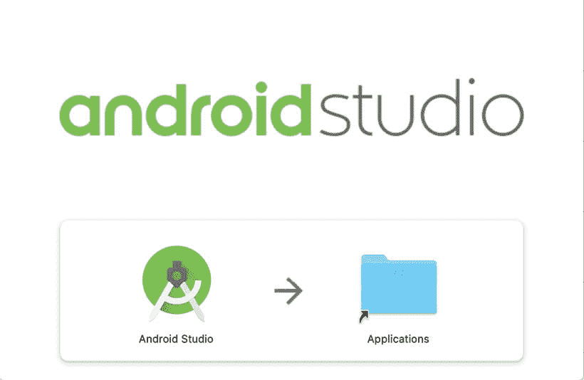

图 2-1

要安装该包，只需将 Android Studio 图标拖到“应用程序”文件夹中。Android Studio 包将安装到系统的“应用程序”文件夹，此过程通常需要几分钟完成。

要启动 Android Studio，在 Finder 窗口的“应用程序”文件夹中找到执行文件并双击。

为了方便以后访问该工具，可以将 Android Studio 图标从 Finder 窗口拖到 Dock（程序坞）上。

### 2.3.3 在 Linux 上安装

下载 Linux 版 Android Studio 包后，打开终端窗口，切换到安装 Android Studio 的目录并执行以下命令：

```bash
unzip /<path to package>/android-studio-ide-<version>-linux.zip
```

注意，Android Studio 安装包将安装在名为`android-studio`的子目录中。因此，假设上述命令在`/home/demo`中执行，软件包将解压到`/home/demo/android-studio`。

要启动 Android Studio，打开终端窗口，切换到`android-studio/bin`子目录并执行以下命令：

```bash
./studio.sh
```

在 64 位 Linux 系统上运行时，在 Android Studio 运行之前，需要安装一些 32 位支持库。在 Ubuntu 上，可以使用以下命令安装这些库：

```bash
sudo apt-get install libc6:i386 libncurses5:i386 libstdc++6:i386 lib32z1 libbz2-1.0:i386
```

在基于 Red Hat 和 Fedora 的 64 位系统上，使用以下命令：

```bash
sudo yum install zlib.i686 ncurses-libs.i686 bzip2-libs.i686
```

## 2.4 Android Studio 设置向导

安装后首次启动 Android Studio 时会弹出一个对话框，提供从之前的 Android Studio 版本导入设置的选项。如果您有以前版本的设置并希望将其导入最新安装中，请选择相应的选项和位置。或者，指示您不需要导入任何之前的设置并点击“确定”按钮继续。

接下来，可能会出现向导，如图 2-2 所示，但此对话框并非所有平台上都会出现：

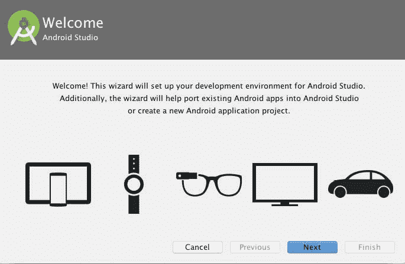

图 2-2

如果出现了向导，点击“下一步”按钮，选择“标准”安装选项并再次点击“下一步”。

Android Studio 将继续下载并配置最新的 Android`SDK`以及一些额外的组件和包。一旦此过程完成，点击“下载组件”对话框中的“完成”按钮，此时应该出现“欢迎使用 Android Studio”界面：

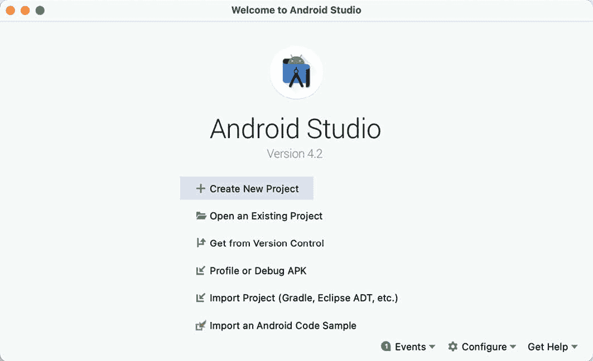

图 2-3

## 2.5 安装额外的 Android SDK 包

到目前为止的步骤已安装 Java、Android Studio IDE 以及当前默认的 Android`SDK`包。在继续之前，值得花些时间验证已安装的包，并安装任何缺失或更新的包。

此任务可以使用`Android SDK Settings`界面完成，可以通过在 Android Studio 欢迎对话框中选择`Configure` -> `SDK Manager`从 Android Studio 工具内部启动。一旦调用，将出现默认设置对话框的`Android SDK`界面，如图 2-4 所示：


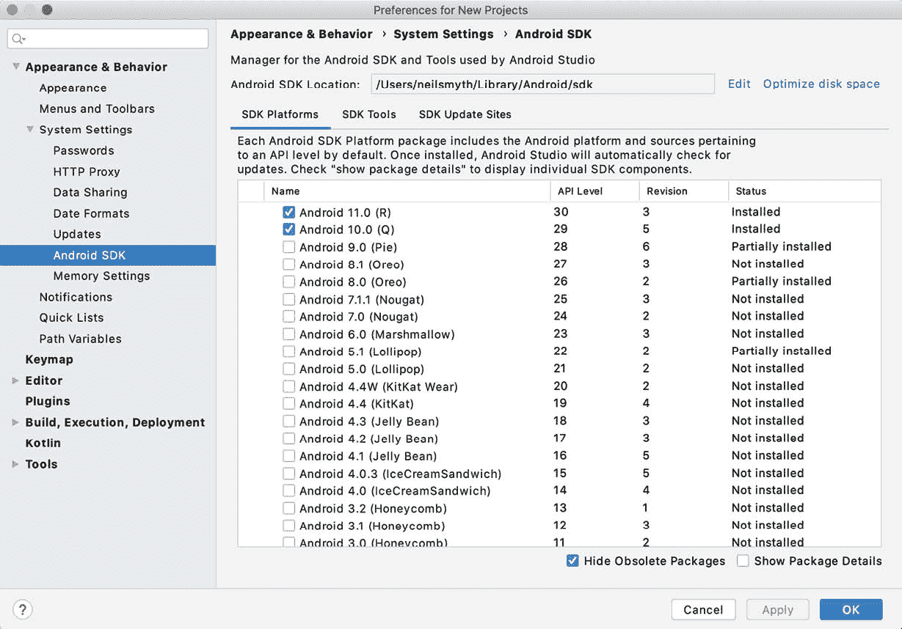

图 2-4

首次安装 Android Studio 之后，可能仅安装了最新发布的 `Android SDK` 版本。要安装旧版本的 `Android SDK`，只需勾选对应版本的复选框并点击 `Apply` 按钮。

也可能列出最新 `SDK` 有可用更新。要访问有关可用更新包的详细信息，请启用位于屏幕右下角的 `Show Package Details` 选项。这将显示与图 2-5 所示的信息：

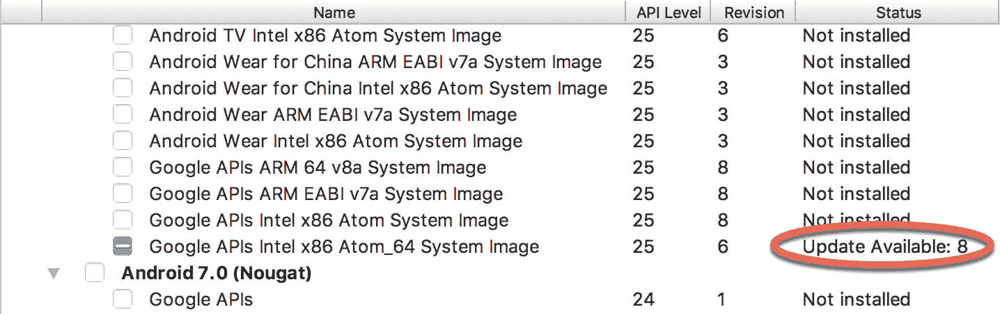

图 2-5

上图强调了更新的可用性。要安装更新，启用项目名称左侧的复选框并点击 `Apply` 按钮。

除了 `Android SDK` 包外，还安装了许多构建 Android 所需的工具。要查看当前安装的包并检查更新，请留在 `SDK` 设置界面，并选择 `SDK Tools` 标签页，如图 2-6 所示：

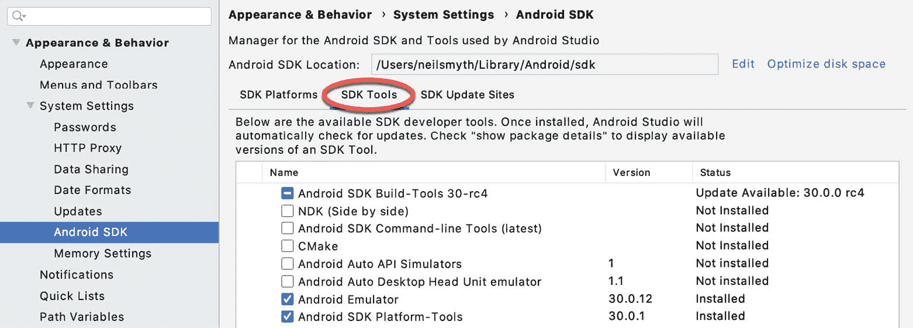

图 2-6

在 `Android SDK Tools` 界面中，确保以下包在 `Status` 列中显示为 `Installed`：

- `Android SDK Build-tools`
- `Android Emulator`
- `Android SDK Platform-tools`
- `Google Play Services`
- `Intel x86 Emulator Accelerator (HAXM installer)`
- `Google USB Driver (Windows only)`
- `Layout Inspector image server`

如果上述任何包列为 `Not Installed` 或需要更新，只需选择这些包旁边的复选框并点击 `Apply` 按钮以启动安装过程。

安装完成后，请检查包列表并确保所选的包现在在 `Status` 列中已列为 `Installed`。如果有任何包列为 `Not installed`，请确保它们已勾选并再次点击 `Apply` 按钮。

## 2.6 使 Android SDK 工具支持命令行访问

在大多数情况下，`Android SDK` 的底层工具将在 Android Studio 环境内部访问。尽管如此，在某些情况下，从命令提示符或终端窗口调用这些工具将是非常有用的。为了让你正在开发的操作系统能够找到这些工具，有必要将它们添加到系统的 `PATH` 环境变量中。

无论使用何种操作系统，都需要配置 `PATH` 变量以包含以下路径（其中 `<path_to_android_sdk_installation>` 代表 `Android SDK` 安装的文件系统位置）：

- `<path_to_android_sdk_installation>/sdk/tools`
- `<path_to_android_sdk_installation>/sdk/tools/bin`
- `<path_to_android_sdk_installation>/sdk/platform-tools`

你可以通过启动 `SDK Manager` 并参考设置面板顶部的 `Android SDK Location:` 字段来识别 SDK 在你系统上的位置，如图 2-7 所示：

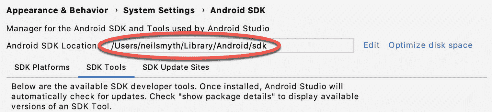

图 2-7

一旦确定了 SDK 的位置，将此添加到 `PATH` 变量的步骤取决于操作系统：

### 2.6.1 Windows 7

1. 在桌面开始菜单中右键点击 `Computer`，并从结果菜单选择 `Properties`。

2. 在属性面板中，选择 `Advanced System Settings` 链接，并在出现的对话框中，点击 `Environment Variables…` 按钮。

3. 在 `Environment Variables` 对话框中，在 `System variables` 列表中找到 `Path` 变量，选中并点击 `Edit…` 按钮。使用编辑对话框中的 `New` 按钮向路径添加三个新条目。例如，假设 Android SDK 安装在 `C:\Users\demo\AppData\Local\Android\Sdk`，则需要添加以下条目：

   - `C:\Users\demo\AppData\Local\Android\Sdk\platform-tools`
   - `C:\Users\demo\AppData\Local\Android\Sdk\tools`
   - `C:\Users\demo\AppData\Local\Android\Sdk\tools\bin`

4. 点击每个对话框中的 `OK` 并关闭系统属性控制面板。

完成上述步骤后，通过打开 `Command Prompt` 窗口（开始 -> 所有程序 -> 附件工具 -> 命令提示符）验证路径设置正确，并在提示符处输入：

```cmd
echo %Path%
```

返回的路径变量值应包含 Android SDK platform tools 文件夹的路径。通过尝试如下所示运行 `adb` 工具来验证 `platform-tools` 值是否正确：

```cmd
adb
```

该工具在执行时应输出命令行选项列表。

同样，通过尝试启动 `AVD Manager` 工具来检查工具路径设置（如果 `avdmanager` 工具报告 Java 问题，稍后将解决）：

```cmd
avdmanager
```

如果上述任何包出现以下消息，很可能是路径错误地添加到了 `PATH` 环境变量中：

```text
'adb' is not recognized as an internal or external command,
operable program or batch file.
```

### 2.6.2 Windows 8.1

1. 在开始屏幕上，将鼠标移动到屏幕右下角并选择 `Search`。在搜索框中，输入 `Control Panel`。

2. 当 `Control Panel` 图标出现在结果区域时，点击它进入桌面。

3. 在 `Control Panel` 中，使用 `Category` 菜单将显示更改为 `Large Icons`。从列表中选择 `System`。

4. 按照 Windows 7 的说明执行步骤 3 到 4。打开命令提示符（将鼠标移动到屏幕右下角，选择 `Search` 并在搜索框中输入 `cmd`）。从搜索结果中选择 `Command Prompt`。

在命令提示符中输入：

```cmd
echo %Path%
```

返回的路径变量值应包含 Android SDK platform tools 文件夹的路径。通过尝试如下运行 `adb` 工具来验证 `platform-tools` 值是否正确：

```cmd
adb
```

该工具在执行时应输出命令行选项列表。

同样，通过尝试从命令行启动工具工具工具来检查工具路径设置（如果 `avdmanager` 工具报告 Java 问题，稍后将解决）：

```cmd
avdmanager
```

如果上述任何包出现以下消息，很可能是路径错误地添加到了 `PATH` 环境变量中：

```text
'adb' is not recognized as an internal or external command,
operable program or batch file.
```

### 2.6.3 Windows 10

右键点击 `Start` 菜单，从结果菜单选择 `Settings`，并在 `Find a setting` 文本字段中输入“Edit the system environment variables”。在 `System Properties` 对话框中，点击 `Environment Variables...` 按钮。按照 Windows 7 的说明执行步骤 3。

### 2.6.4 Linux

在 Linux 上，可以通过向主目录下的 `.bashrc` 文件添加命令来实现（具体取决于所使用的 Linux 发行版）。假设 Android SDK 压缩包安装在 `/home/demo/Android/sdk`，`.bashrc` 文件中的 `export` 行将如下：

```bash
export PATH=/home/demo/Android/sdk/platform-tools:/home/demo/Android/sdk/tools:/home/demo/Android/sdk/tools/bin:/home/demo/android-studio/bin:$PATH
```

请注意，上述命令将 `android-studio/bin` 目录添加到 `PATH` 变量中。这将使得无论在终端窗口的哪个当前目录下，都可以执行 `studio.sh` 脚本。

### 2.6.5 macOS

在 macOS 上，可以使用多种技术来修改 `$PATH` 环境变量。认为最干净的方法是在 `/etc/paths.d` 目录下创建一个新文件，该文件包含要添加到 `$PATH` 的路径。假设 Android SDK 安装位置为 `/Users/demo/Library/Android/sdk`，可以通过在 `/etc/paths.d` 目录中创建一个名为 `android-sdk` 的新文件并包含以下行来配置路径：

```text
/Users/demo/Library/Android/sdk/tools
/Users/demo/Library/Android/sdk/tools/bin
/Users/demo/Library/Android/sdk/platform-tools
```

请注意，由于这是一个系统目录，在创建文件时需要使用 `sudo` 命令。例如：

```bash
sudo vi /etc/paths.d/android-sdk
```

## 2.7 Android Studio 内存管理

Android Studio 是一个大型且复杂的软件应用程序，由许多后台进程组成。尽管 Android Studio 过去因性能未达到优化而受到批评，但 Google 在最近的发布中进行了重大的性能改进，并在每个新版本中持续改进。这些改进部分包括允许用户配置 Android Studio IDE 以及用于构建和运行应用程序的后台进程的使用的内存。这使得软件能够利用具有更大 RAM 的系统。

如果你在具有足够空闲 RAM 来增加这些值的系统上运行 Android Studio（此功能仅适用于具有 5GB 或更多内存的 64 位系统），并发现 Android Studio 的性能似乎有所下降，那么尝试这些内存设置可能是值得的。Android Studio 可能会通过类似下图所示的对话框通知你可以通过此提高性能：


图 2-8

要查看并修改当前内存配置，请选择 `File -> Settings...`（macOS 上为 `Android Studio -> Preferences...`）菜单选项，并在弹出的对话框中，选择左侧导航面板中 `System Settings` 下列的 `Memory Settings` 选项，如下方的图 2-9 所示。

在更改内存分配时，请确保不要分配超过必要的内存，或在不减慢其他进程的情况下超过系统承受能力的内存。

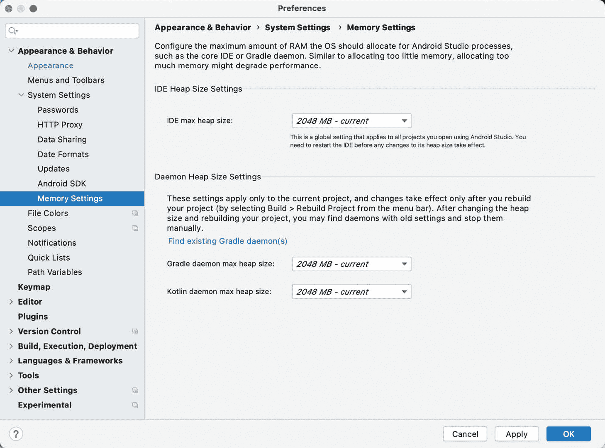

图 2-9

IDE 堆大小设置调整分配给 Android Studio 的内存，且不区分当前加载的项目。另一方面，当从 Android Studio 内部构建和运行项目时，许多后台进程（称为守护进程）会执行编译和运行应用程序的任务。在编译和运行大型复杂项目时，通过调整守护进程堆设置，可能会改进构建时间。与 IDE 堆设置不同，这些守护进程设置仅适用于当前项目，并且只有在 Android Studio 中打开项目时才能访问它们。

## 2.8 更新 Android Studio 和 SDK

Android Studio 和 Android SDK 不时会发布新版本。新版本的 SDK 使用 `Android SDK Manager` 进行安装。Android Studio 通常会在有更新待安装时通知你。

要手动检查 Android Studio 的更新，请点击 Android Studio 欢迎界面上的 `Configure -> Check for Updates` 菜单选项，或者从 Android Studio 主窗口访问 `Help -> Check for Updates...`（macOS 上为 `Android Studio -> Check for Updates...`）菜单选项。

## 2.9 总结

在开始开发 Android 应用程序之前，第一步是搭建合适的开发环境。这由 Android SDK 和 Android Studio IDE（也包括 `OpenJDK` 开发环境）组成。在本章，我们涵盖了在 Windows、macOS 和 Linux 上安装这些包的步骤。

# 3. 在 Android Studio 中创建示例 Android 应用程序

本书的前几个章节已经涵盖了使用 Android Studio IDE 配置适用于 Android 应用程序开发的环境的必要步骤。在进入稍高级的主题之前，现在是验证所有所需的开发包已安装并正常运行的良好时机。实现此目标的最佳方法是创建一个 Android 应用程序并编译、运行它。本章将介绍如何使用 Android Studio 创建 Android 应用程序项目。项目创建后，稍后的章节将探索如何使用 Android 模拟器环境对应用程序进行测试运行。

## 3.1 关于项目

在本章中创建的项目是一个原始的货币转换计算器（事实上，它非常简单，只负责从美元转换为欧元，并使用估算的汇率进行转换）。该项目还将使用 Android Studio 项目模板中最基础的模板之一。这种简单性允许我们引入 Android 应用开发的一些关键方面，而不会因尝试一次性引入过多概念（例如推荐的应用程序架构和 Android 架构组件）让初学者感到不知所措。遵循本章的教程时，请放心在本初始示例项目中使用的所有技术和代码将在后面的章节中进行更详细的介绍。

## 3.2 创建新的 Android 项目

应用程序开发过程的第一步是在 Android Studio 环境中创建一个新项目。因此，首先启动 Android Studio，使出现“Welcome to Android Studio”屏幕，如图 3-1 所示：

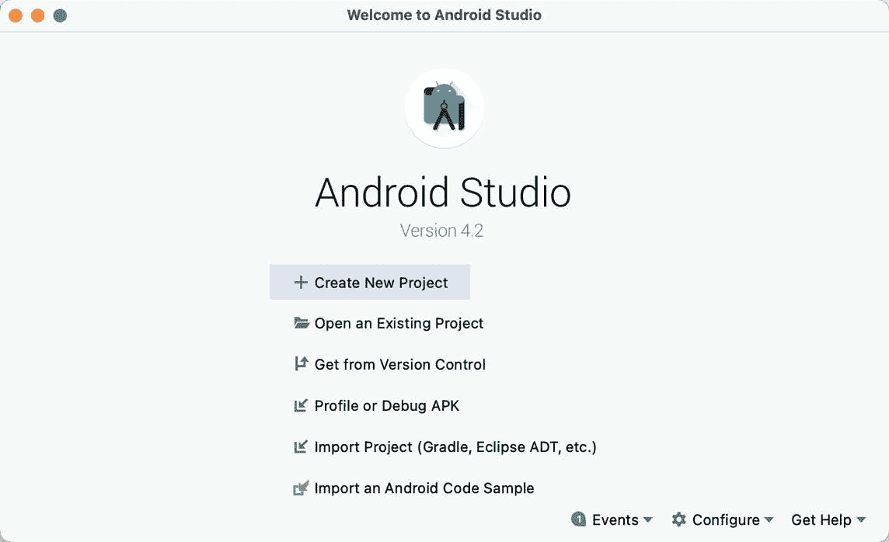

图 3-1

一旦出现此窗口，Android Studio 已准备好创建新项目。要创建新项目，只需点击 `Create Project` 选项显示新项目向导的屏幕。

## 3.3 创建 Activity

第一步是为应用程序定义初始 Activity 类型。可以选择为手机和平板电脑、Wear OS、TV、Android Audio 或 Android Things 创建项目。在开发 Android 应用程序时，可以使用不同的 Activity 类型，其中许多将在后面的章节中详细介绍。然而，出于本示例的目的，只需在 `Templates` 面板中选择 `Phone and Tablet` 选项，然后选择创建 `Empty Activity`。`Empty Activity` 选项创建一个由单个 `TextView` 对象组成的模板用户界面。

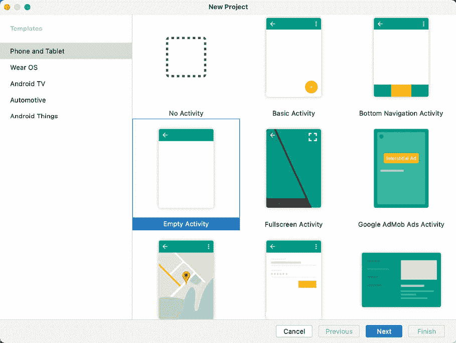

图 3-2

选中 `Empty Activity` 后，点击 `Next` 继续项目配置。

## 3.4 定义项目和 SDK 设置

在项目配置窗口（图 3-3）中，将 `Name` 字段设置为 `AndroidSample`。应用程序名称是在 Android Studio 内部引用和标识的名称，也是如果完成的应用程序在 Google Play 商店出售时将使用的名称。

`Package name` 用于在 Android 应用程序生态系统中唯一标识应用程序。虽然它可以设置为任何唯一标识你的应用程序的字符串，但传统上它是基于域名的反转 URL 以及应用程序名称。例如，如果你的域名是 `www.mycompany.com`，且应用程序命名为 `AndroidSample`，那么包名可以指定如下：

```text
com.mycompany.androidsample
```

如果你没有域名，可以在 `Company Domain`（公司域名）字段输入任何其他字符串，或者为了测试之目的可以使用 `example.com`，但在发布应用之前需要对其进行更改：

`com.example.androidsample`

`Save location`（保存位置）设置将默认位于你主目录下名为 `AndroidStudioProjects` 文件夹中的位置，可以通过点击包含当前路径设置文本字段右侧的文件夹图标进行更改。

将 `minimum SDK`（最低 SDK）设置设置为 `API 26`：Android 8.0 (Oreo)。除非某个必要功能仅在较新版本中可用，否则书中创建的大多数项目将使用此最低 SDK。这里的目标是使用最新的 Android SDK 构建应用，同时保留对运行旧版本 Android 的设备的兼容性（在此情况下，最远可追溯到 Android 8.0）。`Minimum SDK` 设置下方的文字将概述当前运行该应用的 Android 设备百分比。点击 `Help me choose`（帮助我选择）按钮（在图 3-3 中突出）查看仍在使用的各种 Android 版本的完整细分：

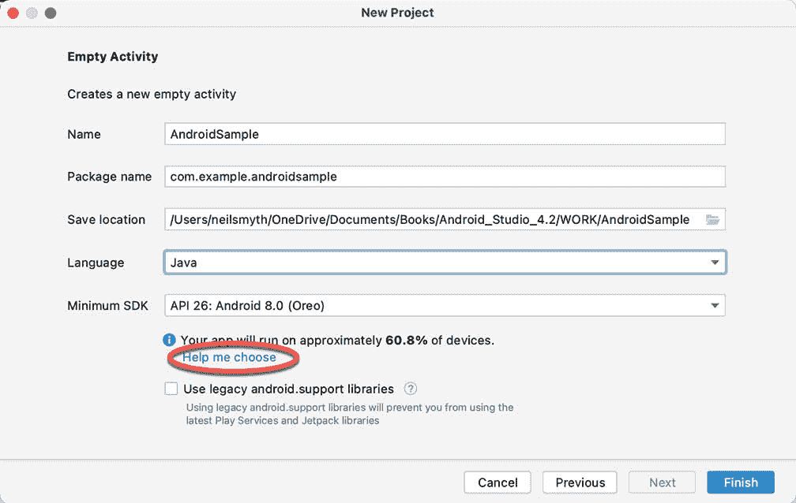

图 3-3

最后，将 `Language`（语言）菜单更改为 `Java` 并点击 `Finish`（完成）启动项目创建过程。

## 3.5 修改示例应用

此时，`Android Studio` 已创建一个最小示例应用项目并打开了主窗口。

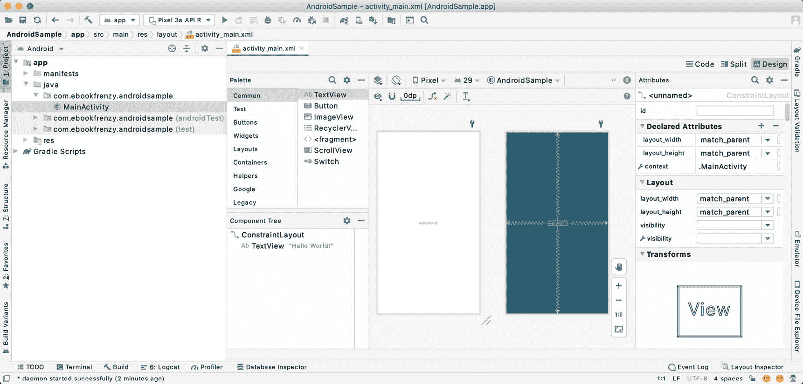

图 3-4


新创建的项目和相关文件的引用列在主项目窗口左侧的 `Project`（项目）工具窗口中。`Project` 工具窗口有多种可以显示信息的模式。默认情况下，此面板应处于 `Android` 模式。此设置由面板顶部的菜单控制，如图 3-5 所示。如果面板目前不处于 `Android` 模式，请使用菜单切换模式：

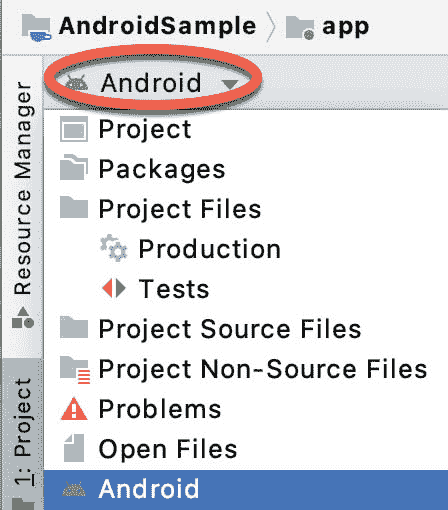

图 3-5

### 3.6 修改用户界面

我们的活动（activity）的用户界面设计存储在列名为 `activity_main.xml` 的文件中，该文件位于项目文件层次结构中的 `app -> res -> layout` 下。在 `Project` 工具窗口中找到该文件后，双击将其加载到用户界面 `Layout Editor`（布局编辑器）工具中，该工具将出现在 `Android Studio` 主窗口的中间面板：

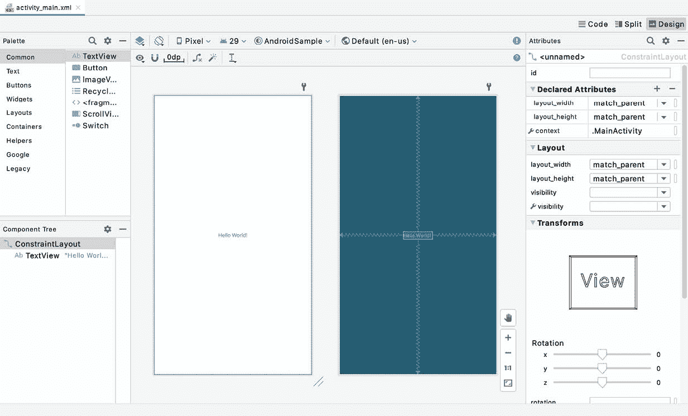

图 3-6

`Layout Editor` 窗口顶部工具栏上有一个菜单（在上面的图中设置为 `Pixel`），它反映在 `Layout Editor` 面板中设备的视觉表示上。点击此菜单可以从广泛的其他设备选项中选择。

要在设备表示的横屏和竖屏之间切换方向，只需使用设备选择菜单立即左侧的下拉菜单，该菜单显示有  图标。

从设备屏幕可以看出，内容布局已经包含一个显示“Hello World!”消息的标签。面板左侧运行着调色板，包含不同类别的用户界面组件，这些组件可用于构建用户界面，例如按钮、标签和文本字段。但注意的是，并不是所有的用户界面组件对用户来说都是显而易见的。其中一个类别就是布局。Android 支持多种布局，为视觉用户界面组件在屏幕上的定位和管理提供不同级别的控制。虽然从用户界面的视觉表示上很难判断，但当前的设计是使用 `ConstraintLayout` 创建的。这可以通过查看 `Component Tree`（组件树）面板中的信息来确认，该面板默认位于 `Layout Editor` 面板的左下角，如图 3-7 所示：

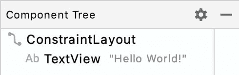

图 3-7

从组件树层级结构可以看出，用户界面布局由一个 `ConstraintLayout` 父对象和一个 `TextView` 子对象组成。

在继续之前，还要检查 `Layout Editor` 的 `Autoconnect`（自动连接）模式已启用。这意味着当组件添加到布局中时，`Layout Editor` 将自动添加约束，以确保组件在不同的屏幕尺寸和设备方向上正确定位（该主题将在后续章节中更详细地介绍）。`Autoconnect` 按钮出现在 `Layout Editor` 工具栏中，用磁铁图标表示。当禁用用时，磁铁上会出现一条斜线（图 3-8）。如有必要，点击此按钮重新启用 `Autoconnect` 模式。

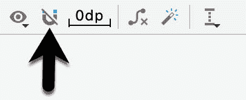

图 3-8

修改应用的下一步是向布局添加一些额外的组件，其中第一个将是 `Button`（按钮），供用户点击启动货币转换。

`Palette`（调色板）面板由两列组成，左列包含视图组件类别列表。右列列出当前所选类别包含的组件。在图 3-9 中，例如，当前选中了 `Buttons` 类别：


图 3-9

从 `Buttons` 列表中点击并拖拽 `Button` 对象到用户界面设计的水平中心，使其位于现有 `TextView` 小部件下方：


图 3-10

下一步是更改 `Button` 组件显示的文本。位于设计区域右侧的面板是 `Attributes`（属性）面板。该面板显示分配给当前选中组件的属性。在此面板中，找到 `Common Attributes` 中的 `text` 属性，并将当前值从“Button”更改为“Convert”，如图 3-11 所示：

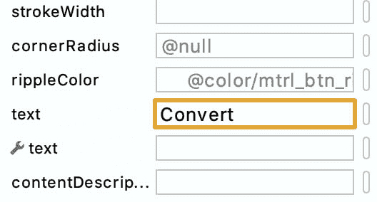

图 3-11

带有扳手图标的第二个文本属性允许设置仅在 `Layout Editor` 中但在运行时不显示的属性。这对于在不反复运行应用的情况下测试视觉组件和布局的行为非常有用。

为了防止 `Autoconnect` 系统未能设置所有布局连接，点击 `Infer constraints`（推断约束）按钮（图 3-12）。

图 3-12

重要的是解释 `Layout Editor` 工具右上角的警告按钮，如图 3-13 所示。显然，这表明布局存在潜在问题。要查看任何问题的详细信息，请点击该按钮：


图 3-13

点击后将出现一个面板（图 3-14）。

图 3-14

目前，列出的唯一警告如下：

`Hardcoded string "Convert", should use @string resource`

这条 I18N 消息是在我们，项目未来的国际化可能存在潜在问题（“I18N”源于单词“internationalization”（国际化）以“I”开头，以“N”结尾，中间有 18 个字母）。该警告提醒我们，在开发 Android 应用程序时，应尽可能将文本字符串等属性和值以资源的形式存储。这样做可以使得通过修改资源文件而不是更改应用程序源代码来对应用程序的外观进行更改。这在将用户界面翻译成不同的口语语言时，这可能特别有价值。如果用户界面中的所有文本都包含在单个资源文件中，例如，可以将该文件交给翻译人员，由他们执行翻译工作并返回翻译后的文件，以便包含在应用程序中。这使得在无需修改任何源代码的情况下就能支持多种语言。在此例中，我们将创建一个名为 `convert_string` 的新资源，并为其分配字符串“Convert”。

点击“问题说明（Issue Explanation）”面板中的 `Fix` 按钮以显示“提取资源（Extract Resource）”面板（见图 3-15）。在此面板中，将资源名称字段更改为 `convert_string`，并将资源值保留为 `Convert`，然后点击 `OK` 按钮。

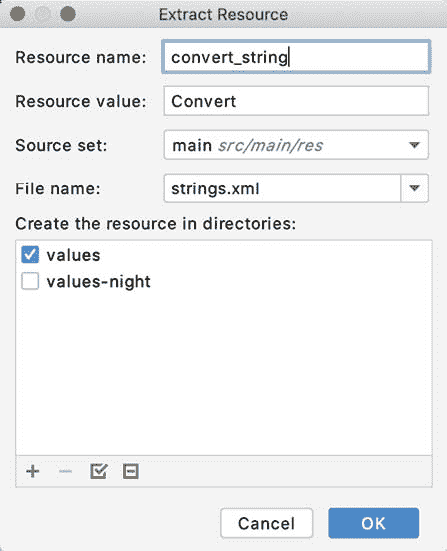

图 3-15

下一个要添加的部件是一个 `EditText` 部件，用户将在其中输入要转换的美元金额。从“调色板（Palette）”面板中，选择 `Text` 类别，并点击拖动一个 `Number (Decimal)` 组件到布局中，使其水平居中并置于现有的 `TextView` 部件上方。选中该部件后，使用“属性（Attributes）”工具窗口将 `hint` 属性设置为“dollars”。点击警告图标并将字符串提取到名为 `dollars_hint` 的资源中。

本章稍后编写的代码需要访问用户在 `EditText` 字段中输入的美元值。它将通过引用分配给用户界面布局中部件的 `id` 来实现。当在布局中选中部件时，可以在 `Attributes` 工具窗口内查看并更改 Android Studio 为部件分配的默认 `id`，如图 3-16 所示：

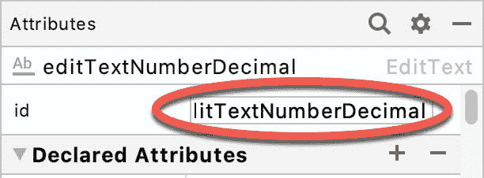

图 3-16

将 `id` 改为 `dollarText`，并在“重命名（Rename）”对话框中点击“重构（Refactor）”按钮。这确保了项目其他地方对旧 `id` 的任何引用都会自动更新为新的 `id`：

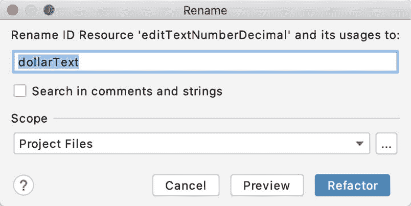

图 3-17

点击“推断约束（Infer constraints）”按钮添加任何缺失的布局约束。此时，布局应该类似于图 3-18 所示：

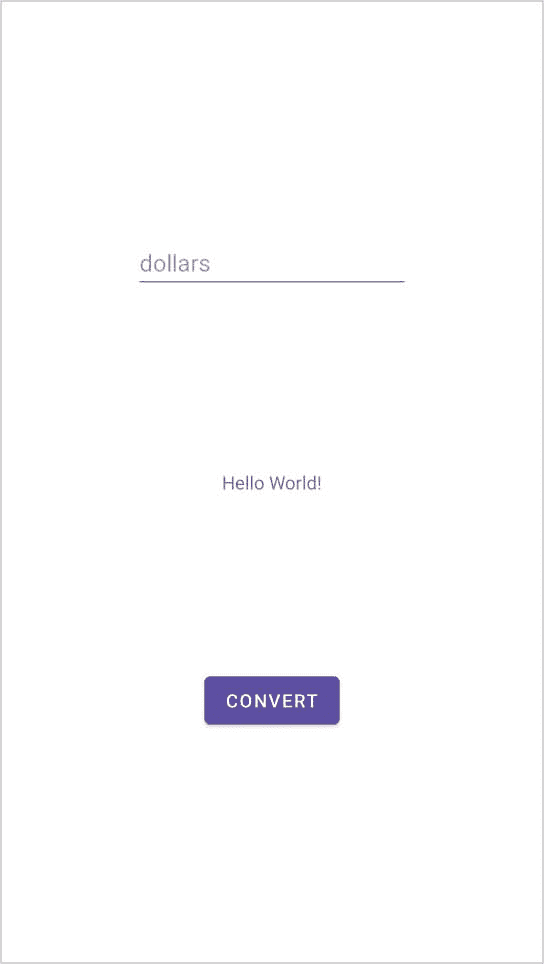

图 3-18

## 3.7 审查布局和资源文件

在继续下一步之前，我们将查看用户界面设计和资源处理的一些内部方面。在上一节中，我们通过使用“布局编辑器（Layout Editor）”工具并修改 `activity_main.xml` 文件对用户界面进行了一些更改。事实上，`Layout Editor` 所做的只是提供了一种易于用户的方式来编辑该文件的底层 XML 内容。在实践中，没有理由你不能直接修改 XML 以进行用户界面更改，在某些情况下，这实际上可能比使用 `Layout Editor` 工具更快。在 `Layout Editor` 面板的右上角有三个按钮，如下方的图 3-19 所示：


图 3-19

默认情况下，编辑器将处于 `Design`（设计）模式，仅显示布局的视觉表示。最左侧的按钮将切换到 `Code`（代码）模式显示布局的 XML，而中间的按钮进入 `Split`（分割）模式，模式下同时显示布局和 XML，如图 3-20 所示：

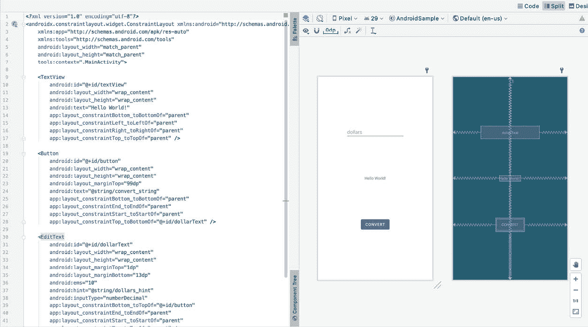

图 3-20

从 XML 文件的结构可以看出，用户界面由 `ConstraintLayout` 组件组成，该组件反而是 `TextView`、`Button` 和 `EditText` 对象的父级。我们还可以看到，例如，`Button` 的 `text` 属性被设置为我们的 `convert_string` 资源。尽管复杂性和内容不同，所有用户界面布局都是以这种层次化的、基于 XML 的结构组织的。

对 XML 布局进行更改时，这些更改将反映在布局画布上。也可以在布局画布面板内对布局进行视觉修改，更改将出现在 XML 列表中。要查看此操作，切换到 `Split` 模式并修改 XML 布局，将 `ConstraintLayout` 的背景颜色更改为红色，如下：

```xml
<?xml version="1.0" encoding="utf-8"?>
<androidx.constraintlayout.widget.ConstraintLayout xmlns:android="http://schemas.android.com/apk/res/android"
    xmlns:app="http://schemas.android.com/apk/res-auto"
    xmlns:tools="http://schemas.android.com/tools"
    android:layout_width="match_parent"
    android:layout_height="match_parent"
    android:background="#ff2438">
</androidx.constraintlayout.widget.ConstraintLayout>
```

注意布局的颜色会随着 XML 文件中的设置而实时变化。此外，在 XML 编辑器的左侧边缘（也称为“槽（gutter）”）会出现红色正方形，这表示设置了颜色。点击红色正方形将显示颜色选择器：


图 21

在继续之前，从布局文件中删除 `background` 属性，使背景返回默认设置。最后，使用“项目（Project）”面板找到 `app -> res -> values -> strings.xml` 文件并双击将其加载到编辑器。目前 XML 显示：

```xml
<resources>
    <string name="app_name">AndroidSample</string>
    <string name="convert_string">Convert</string>
    <string name="dollars_hint">dollars</string>
</resources>
```

作为资源的演示，将分配给 `convert_string` 资源的字符串值更改为“Convert to Euros”，然后通过布局文件的标签返回布局编辑器。注意布局已获取了字符串的新值。

访问 XML 文件中引用的资源还有快速方法。在 `Layout Editor` 工具处于 `Split` 或 `Code` 模式时，点击 `@string/convert_string` 属性设置使其高亮，然后按下键盘上的 `Ctrl-B`（macOS 上为 `Cmd-B`）。Android Studio 随后将打开 `strings.xml` 文件并带您到定义该资源的行。利用此机会将字符串资源还原为原始的“Convert”文本，并稍后为代码中的字符串资源添加以下附加条目：

```xml
<resources>
    <string name="app_name">AndroidSample</string>
    <string name="convert_string">Convert</string>
    <string name="dollars_hint">dollars</string>
    <string name="no_value_string">No Value</string>
</resources>
```

此编辑器允许对分配给资源键的字符串进行编辑并管理多种语言的翻译。

### 3.8 添加交互

此示例项目的最后一步是让应用程序具有交互性，当用户在 `EditText` 字段中输入美元值并点击转换按钮时，转换后的欧元值将显示在 `TextView` 上。这涉及在 `Button` 控件上实现某些事件处理。具体来说，需要配置 `Button` 以便在触发 `onClick` 事件时调用应用程序代码中的方法。事件处理可以通过多种不同的方式实现，并在稍后标题为“Android 事件处理概述与示例”的章节中详细介绍。返回布局编辑器到 `Design` 模式，在布局编辑器中选择 `Button` 控件，引用 `Attributes`（属性）工具窗口并如下所示指定名为 `convertCurrency` 的方法：


图 3-23

注意，`onClick` 属性的文本字段现在用红色边框突出，警告我们按钮已配置为调用一个尚不存在的方法。为了解决这个问题，在 `Project` 工具窗口中双击 `MainActivity.java` 文件（`app -> java -> <package name> -> MainActivity`）将其加载到代码编辑器，并向类文件中添加 `convertCurrency` 方法的代码，使其读取内容如下，注意还需要导入一些额外的 Android 程序包：

```java
package com.ebookfrenzy.androidsample;

import androidx.appcompat.app.AppCompatActivity;

import android.os.Bundle;

import android.view.View;

import android.widget.EditText;

import android.widget.TextView;

.

.

import java.util.Locale;

public class MainActivity extends AppCompatActivity {

    @Override
    protected void onCreate(Bundle savedInstanceState) {
        super.onCreate(savedInstanceState);
        setContentView(R.layout.activity_main);
    }

    public void convertCurrency(View view) {
        EditText dollarText = findViewById(R.id.dollarText);
        TextView textView = findViewById(R.id.textView);
        if (!dollarText.getText().toString().equals("")) {
            float dollarValue = Float.parseFloat(dollarText.getText().toString());
            float euroValue = dollarValue * 0.85F;
            textView.setText(String.format(Locale.ENGLISH,"%f", euroValue));
        } else {
            textView.setText(R.string.no_value_string);
        }
    }
}
```

该方法首先通过调用名为 `findViewById` 的方法获取 `EditText` 和 `TextView` 对象的引用，并传递布局文件中分配的 `id`。然后检查用户是否输入了美元值，如果是，则提取该值，将其从 `String` 转换为浮点值并转换为欧元。最后，结果显示在 `TextView` 控件上。如果对其中任何内容不清楚，请放心，这些概念将在后面的章节中进行更详细介绍。

### 3.9 总结

虽然并不复杂，但设置 Android 开发环境涉及许多步骤。在完成这些步骤后，值得运行一个示例以确保环境已正确安装和配置。在本章中，我们创建了一个示例应用程序，然后使用 Android Studio 布局编辑器（Layout Editor）工具修改了用户界面布局。在此过程中，我们探索了尽可能使用资源的重要性，特别是在字符串值的情况下，并简要介绍了布局主题。接下来，我们查看了用于存储 Android 应用程序用户界面设计的底层 XML。

最后，为 `Button` 添加了 `onClick` 事件，连接到一个已实现的方法，该方法从 `EditText` 组件中提取用户输入，将美元转换为欧元，然后在 `TextView` 上显示结果。

应用程序已准备好进行测试，为测试目的设置模拟器所需的步骤将在下一章中详细介绍。


## 4. 在 Android Studio 中创建 Android 虚拟设备 (AVD)

在 Android Studio 中开发 Android 应用的过程中，需要多次编译和运行应用程序。可以通过在物理设备上安装和运行，或者在 Android 虚拟设备 (AVD) 模拟器环境中测试 Android 应用。在使用 AVD 之前，必须首先创建并配置它以匹配特定设备模型的规格。因此，本章的目标是以 Pixel 4 手机作为参考示例完成创建此类虚拟设备。

### 4.1 关于 Android 虚拟设备

AVD 本质上是模拟器，允许在无需将应用程序安装到物理设备的情况下对 Android 应用程序进行测试。在使用 AVD 之前，必须首先创建并配置它以匹配特定设备模型的规格。因此，本章的目标是以 Pixel 4 手机作为参考示例完成创建此类虚拟设备。

（注：原文中该段存在大量重复内容，翻译时已按逻辑保留结构）

### 4.2 创建新的 AVD

为了在没有物理设备的情况下测试应用程序的行为，必须创建一个 AVD。

创建新 AVD 的第一步是启动 AVD Manager。可以在 Android Studio 内部通过选择主窗口中的 `Tools -> AVD Manager` 菜单选项来实现。

一旦启动，如果没有创建 AVD 实例，该工具将如图 4-2 所示所示：

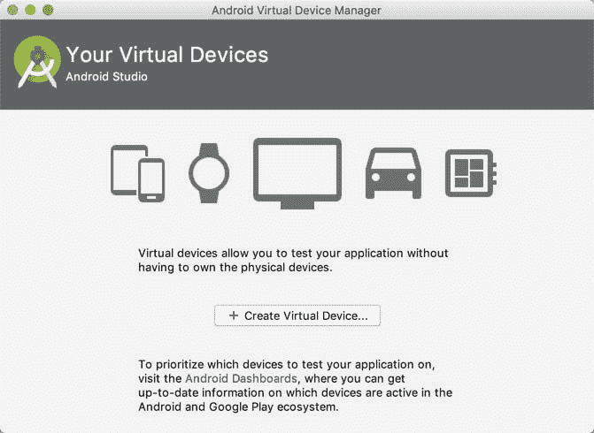

图 4-2

要添加 AVD，首先点击 `Create Virtual Device` 按钮以调用虚拟设备对话框：

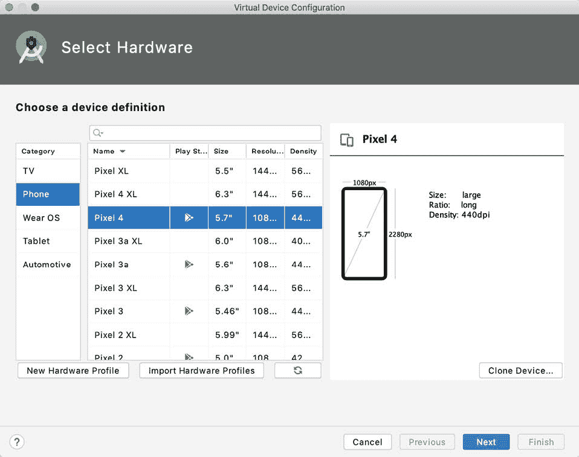

图 4-3

在对话框中，执行以下步骤创建一个 Pixel 4 模拟器：

1. 从 `Category`（类别）面板选择 `Phone`（手机）选项，显示可用的 Android AVD 模板列表。
2. 选择 `Pixel 4` 设备选项并点击 `Next`（下一步）。
3. 在 `System Image`（系统映像）屏幕上，为 `x86 ABI` 选择最新版本的 Android。注意，如果系统映像尚未安装，将在 `Release Name`（发布名称）旁边提供 `Download`（下载）链接。点击此链接在选择之前下载并安装系统映像。如果所需的映像不在列表中，点击 `x86 images` 和 `Other images` 标签以查看备列表。
4. 点击 `Next` 继续并在 `name`（名称）字段中输入描述性名称（例如 `Pixel 4 API 30`），或直接接受默认名称。
5. 点击 `Finish`（完成）创建 AVD。
6. AVD 创建后，可以关闭 AVD Manager。如果以后需要对 AVD 进行修改，只需重新打开 AVD Manager，从列表中选择 AVD，并点击 AVD Manager 中设备行 Actions（操作）列中的铅笔图标。

### 4.3 启动模拟器

要对新创建的 AVD 模拟器进行测试运行，只需从 `AVD Manager` 中选择该模拟器并点击启动按钮（Actions 列中的三角形）。模拟器将在新窗口中出现并开始启动过程。模拟器启动的时间取决于 `AVD` 及其运行的系统的配置。

虽然模拟器可能默认以竖屏方向显示，但此选项和其他默认选项都可以更改。在 `AVD Manager` 中，选择新创建的 `Pixel 4` 条目，并点击设备行 Actions 列中的铅笔图标。在配置界面中找到“Startup orientation”（启动方向）部分并更改方向设置。退出并重启模拟器会话以使此更改生效。关于模拟器的更多细节，请参阅下一章（Using and Configuring the Android Studio AVD Emulator）。

为了在本章的下一节节省时间，请在继续之前保持模拟器运行。

### 4.4 在 AVD 中运行应用程序

配置好 `AVD` 模拟器后，之前章节中创建的示例应用程序 `AndroidSample` 现在可以编译并运行了。在 Android Studio 中加载 `AndroidSample` 项目后，确保新创建的 `Pixel 4` `AVD` 显示在设备菜单中（如下方 Figure 4-4 中的 A 所示），然后点击由绿色三角形 (B) 表示的运行按钮、选择 `Run` -> `Run 'app'` 菜单选项或使用键盘快捷键 `Ctrl-R`：

```
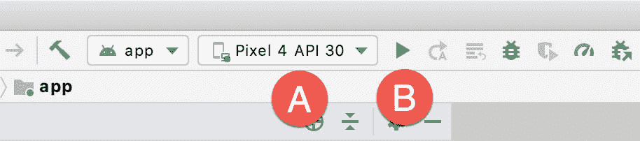
```

图 4-4

设备菜单 (A) 可用于选择不同的 `AVD` 实例或物理设备作为运行目标，也可以在多个设备上运行应用。该菜单还提供了访问 `AVD Manager` 和设备连接故障排除的选项：

```

```

启用深色主题后，运行 `AndroidSample` 应用，注意它使用了如 Figure 4-12 所示的黑色背景和紫色按钮：

```

```

图 4-13

`themes.xml` 文件包含白天模式主题，而 `themes.xml (night)` 文件包含设备进入深色模式时采用的主题：

```xml
<resources xmlns:tools="http://schemas.android.com/tools">

  <!-- 基础应用主题 -->
  <style name="Theme.AndroidSample" parent="Theme.MaterialComponents.DayNight.DarkActionBar">

    <!-- 主品牌颜色 -->
    <item name="colorPrimary">@color/purple_200</item>
    <item name="colorPrimaryDark">@color/purple_700</item>
    <item name="colorOnPrimary">@color/black</item>

    <!-- 次要颜色 -->
    <item name="colorSecondary">@color/teal_200</item>
    <item name="colorSecondaryVariant">@color/teal_200</item>
    <item name="colorOnSecondary">@color/black</item>

    <!-- 状态栏颜色 -->
    <item name="android:statusBarColor" tools:targetApi="l">?attr/colorPrimaryVariant</item>

    <!--在此处自定义您的主题 -->
  </style>
</resources>
```

使用编辑器槽中的颜色块尝试颜色更改（例如为 `colorPrimary` 资源尝试不同的颜色），可以使用颜色选择器。更改后，再次运行应用以查看效果。

实验主题后，打开模拟器中的 `Settings` 应用，关闭深色模式并返回 `AndroidSample` 应用。应用程序应该自动切换回浅色模式。

## 4.8 在工具窗口中运行模拟器

到目前为止，我们一直将模拟器作为独立窗口使用。模拟器也可以作为嵌入在 Android Studio 主窗口中的工具窗口运行。要嵌入模拟器，选择 `File` -> `Settings...` 菜单选项（macOS 为 `Android Studio` -> `Preferences...`），在偏好对话框的左侧导航面板中导航到 `Tools` -> `Emulator`，并启用 `Launch in a tool window`（在工具窗口中启动）选项：

```

```

图 4-14

启用该选项后，点击 `Apply` 按钮并点击 `OK` 以提交更改，然后退出独立模拟器会话。

再次运行示例应用程序，此时模拟器将出现在 Android Studio 窗口内，如图 4-15 所示：

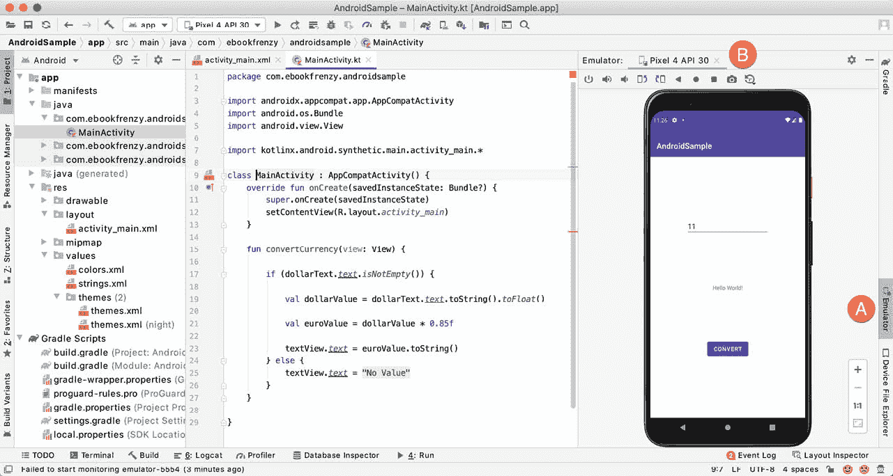

图 4-15

要隐藏和显示模拟器工具窗口，请点击 `Emulator` 工具窗口按钮（如上方标记 A 所示）。点击标签页旁边的"x"关闭按钮 (B)即可退出模拟器。模拟器工具窗口可以容纳多个模拟器会话，每个会话由一个标签页表示。例如，图 4-16 显示了一个包含两个模拟器会话的工具窗口：


图 4-16

要在会话之间切换，只需点击相应的标签页即可。

### 4.9 AVD 命令行创建

如前所述，除了图形化用户界面外，还可以直接从命令行创建新的 AVD。这通过使用 `avdmanager` 工具结合某些命令行选项来实现。一旦启动，该工具将在创建新 AVD 之前提示输入额外信息。

`avdmanager` 工具运行需要 Java 运行时环境 (JRE)。如果在尝试运行 `avdmanager` 时出现错误消息显示找不到 `java` 命令，则可以配置运行命令的命令提示符或终端窗口，以使用与 Android Studio 捆绑的 OpenJDK 环境。首先按照以下方式识别 OpenJDK JRE 的位置：

1. 启动 Android Studio 并打开书中早些时候创建的 `AndroidSample` 项目。
2. 选择 `File` -> `Project Structure...` 菜单选项。
3. 复制 `Project Structure` 对话框中 `JDK location` 字段包含路径。这代表了 Android Studio 捆绑的 JRE 位置。

在 Windows 上，在运行 `avdmanager` 的命令提示符窗口中执行以下命令（将 `<path to jre>` 替换为从上述 `Project Structure` 对话框复制的路径）：

```bash
set JAVA_HOME=<path to jre>
```

在 macOS 或 Linux 上，执行以下命令：

```bash
export JAVA_HOME="<path to jre>"
```

如果您预计将频繁使用 `avdmanager` 工具，请按照标题为"设置 Android Studio 开发环境"](#Installation.xhtml__idTextAnchor005)的章节中针对您操作系统的环境变量步骤进行操作，以便系统范围内配置 `JAVA_HOME`。

假设系统已配置好将 Android SDK 工具目录包含在 `PATH` 环境变量中，可以通过在终端或命令窗口中发布以下命令获取新 AVD 的可用目标列表：

```bash
avdmanager list targets
```

上述命令的输出将包含系统上可用的 Android SDK 版本列表。例如：

```
Available Android targets:
----------
id: 1 or "android-29"
     Name: Android API 29
     Type: Platform
     API level: 29
     Revision: 1
----------
id: 2 or "android-26"
     Name: Android API 26
     Type: Platform
     API level: 26
     Revision: 1
----------
```

`avdmanager` 工具还允许从命令行创建新的 AVD 实例。例如，要使用 `x86` ABI 的 Android API 级别 29 设备的目标 ID 创建名为 `myAVD` 的新 AVD，可以使用以下命令：

```bash
avdmanager create avd -n myAVD -k "system-images;android-29;google_apis_playstore;x86"
```

`android` 工具将根据基础 Android 8 设备的规格创建新 AVD，同时根据需要也提供创建以匹配特定设备规格的自定义配置的选项。一旦从命令行创建了新 AVD，在点击 `Refresh` 按钮之前，它可能不会显示在 Android Device Manager 工具中。

除了创建新 AVD 外，还可以从命令行执行许多其他任务。例如，可以使用 `list avd` 命令行参数获取当前可用的 AVD 列表：

```bash
avdmanager list avd
```

```
Available Android Virtual Devices:
     Name: Pixel_XL_API_28_No_Play
     Device: pixel_xl (Google)
     Path: /Users/neilsmyth/.android/avd/Pixel_XL_API_28_No_Play.avd
     Target: Google APIs (Google Inc.)
             Based on: Android API 28 Tag/ABI: google_apis/x86
     Skin: pixel_xl_silver
     Sdcard: 512M
```

同样，要删除现有的 AVD，只需如下使用 `delete` 选项：

```bash
avdmanager delete avd –n <avd name>
```

### 4.10 Android 设备配置文件

默认情况下，与 AVD 关联的文件存储在用户目录下的 `.android/avd` 目录，其结构如下（其中 `<avd name>` 被替换为名称）：

`<avd name>.avd/config.ini`

`<avd name>.avd/userdata.img`

`<avd name>.ini`

`config.ini` 文件包含了创建 AVD 时指定的设备配置，这些设置在下次调用 AVD 时将被采用。

### 4.11 移动和重命名 Android 设备

可以使用 `avdmanager` 工具的 `move` 参数从命令行更改 AVD 的当前名称或位置。例如，要将名为 `Nexus9` 的 AVD 重命名为 `NexusB`，可以使用以下命令：

```bash
avdmanager move avd -n Nexus9 -r NexusB
```

要物理移动与 AVD 关联的文件，应使用以下命令：

```bash
avdmanager move avd -n <avd name> -p <path to new location>
```

例如，将 AVD 移动到 `/tmp/Nexus9`：

```bash
avdmanager move avd -n Nexus9 -p /tmp/Nexus9
```


注意在执行移动 AVD 命令之前，目标目录不存在。

### 4.12 总结

典型的应用程序开发遵循编码、编译和在测试环境中运行的周期。Android 应用程序可以在物理设备或使用 Android 虚拟设备（AVD）模拟器进行测试。AVD 使用 Android Manager 工具进行创建，该工具可以通过命令行或图形用户界面使用。创建模拟特定设备模型的 AVD 时，确保虚拟设备的硬件规格与物理设备匹配非常重要。

AVD 模拟器会话可以作为独立窗口显示，也可以嵌入到 Android Studio 用户界面中。

## 5 使用和配置 Android Studio AVD 模拟器

在下一章探索物理 Android 设备之前，本章将花一些时间提供 Android Studio AVD 模拟器的概述，并突出介绍独立和工具窗口模式下用于自定义环境配置功能。

### 5.1 模拟器环境

当以独立模式启动时，模拟器会在加载过程中显示初始启动屏幕。加载完成后，会出现主模拟器窗口，其中包含选择设备类型的表示（对于图 5-1 而言这是一个 Pixel 4 设备）：


图 5-1

位于窗口右侧的是工具栏，提供了快速访问模拟器控件和配置选项的功能。

### 5.2 模拟器工具栏选项

模拟器工具栏（图 5-2）提供了对与模拟器环境外观和行为相关的一系列选项的访问。

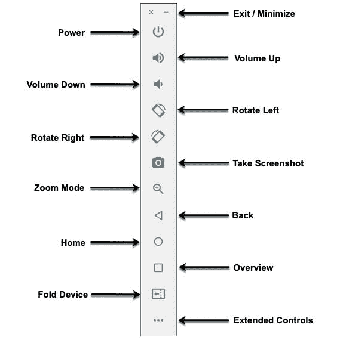

图 5-2

工具栏中的每个按钮都关联有一个键盘快捷键，可以通过将鼠标指针悬停在按钮上并等待提示框出现，或者通过扩展控制面板的帮助选项来识别标识。

尽管工具栏中包含的许多选项都是不言自明的，但为了完整起见，我们将对每个选项进行介绍：

- `Exit / Minimize`（退出 / 最小化）—— 工具栏最顶部的“x”按钮在选中时会退出模拟器会话，而“-”选项则会最小化整个窗口。
- `Power`（电源）—— `Power` 按钮模拟物理 Android 设备上的硬件电源按钮。点击并释放此按钮将锁定设备并关闭屏幕。长按此按钮将启动设备的“关机”请求序列。
- `Volume Up / Down`（音量增大 / 减小）—— 两个控制模拟器环境中播放音频音量的按钮。
- `Rotate Left/Right`（向左/向右旋转）—— 模拟设备在竖屏和横屏方向之间旋转。
- `Take Screenshot`（截图）—— 截取设备屏幕当前显示内容的屏幕。捕取的图像存储在本章稍后介绍的扩展控制面板 `Settings` 屏幕指定的路径。
- `Zoom Mode`（缩放模式）—— 此按钮切换进入和退出缩放模式，其细节将在本章稍后介绍。
- `Back`（返回）—— 模拟选择标准的 Android“返回”按钮。与下述的 `Home` 和 `Overview` 按钮一样，通过选择模拟器屏幕上的实际按钮也可以达到效果。
- `Home`（主页）—— 模拟选择标准的 Android“主页”按钮。
- `Overview`（概述）—— 模拟选择标准的 Android“概述”按钮，该按钮显示设备上当前运行的应用程序。
- `Fold Device`（折叠设备）—— 模拟折叠设备的折叠和展开。此选项仅在模拟器运行折叠设备系统镜像时可用。
- `Extended Controls`（扩展控制）—— 显示扩展控制面板，允许配置如模拟位置和电话活动、电池强度、蜂窝网络类型和指纹识别等选项。

### 5.3 在缩放模式下工作

位于模拟器工具栏的缩放按钮用于进入和退出缩放模式。当缩放模式激活时，工具栏按钮处于按下状态，且当鼠标指针悬停在设备屏幕上时显示为放大镜。点击左鼠标键将导致显示相对于屏幕上的选定点放大，反复点击会增加缩放级别。相反，点击右鼠标键将降低缩放级别。关闭缩放按钮将显示恢复到默认大小。

在缩放模式下点击并拖动将定义一个矩形区域，当释放鼠标按钮时视图将缩放到该区域。

在缩放模式下，可以使用模拟器窗口内的水平和垂直滚动条对屏幕可见区域进行移动。

## 5.4 调整模拟器窗口大小

模拟器窗口的大小（以及相应的设备表示）可以通过点击并拖动窗口的任何角或边来随时更改。

## 5.5 扩展控制选项

扩展控制工具栏按钮显示如图 5-3 所示的面板。默认情况下将显示位置设置。从左侧面板选择不同的类别将显示相应的控制组：

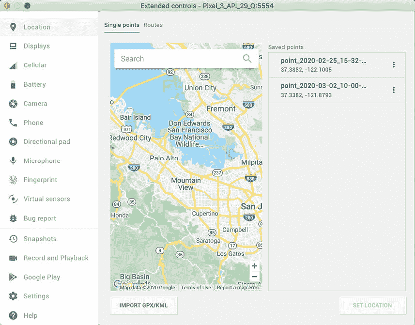

图 5-3

### 5.5.1 位置

位置控制允许以十进制或六十进制制坐标的形式将模拟位置信息发送到模拟器。位置信息可以是单个位置的形式，也可以是代表设备移动的点序列，后者通过 GPS 交换格式（`GPX`）或 Keyhole 标记语言（`KML`）格式的文件提供。或者，可以使用集成的 Google Maps 面板来视觉化选择单点或旅行路线。

### 5.5.2 显示

除了模拟器屏幕内显示的主显示外，`Displays` 选项允许在同一个 Android 实例中运行额外的显示器。这对于为如 Microsoft Surface Duo 之类的双屏设备测试应用程序可能非常有用。这些额外的屏幕可以配置为任何所需的尺寸，并与主屏幕一并在同一个模拟器窗口中显示。

### 5.5.3 蜂窝

可以在蜂窝设置屏幕内更改正在模拟的蜂窝连接类型。提供了模拟不同网络类型（`CSM`、`EDGE`、`HSDPA` 等）的选项，以及漫游和拒绝访问等一系列语音和数据场景。

### 5.5.4 电池

可以在扩展控制屏幕的此面板上模拟各种电池状态和充电条件，包括电池容量、电池健康状况以及当前是否连接 AC 充电器。

### 5.5.5 摄像头

当摄像头激活时，模拟器会模拟 3D 场景。这表现为虚拟建筑内部，在模拟器内录制视频或拍照之前，可以通过按住 `Option` 键（Windows 上为 `Alt`）同时使用鼠标指针和键盘键进行导航。此扩展配置选项允许上传不同的图像并在虚拟环境中显示。

### 5.5.6 电话

电话扩展控制为模拟器提供了两个非常简单但实用的模拟。第一个选项允许模拟来自指定号码的呼入电话。这在测试应用程序如何处理此类高级中断时特别有用。

第二个选项允许在模拟器会话中模拟接收短信。与现实世界一样，这些消息出现在 `Message` 应用中并触发模拟器内的标准通知。

### 5.5.7 方向键

方向键（`D-Pad`）是一种内置于 Android 设备或外部连接（如游戏控制器）的额外控件，提供方向控制（`left`、`right`、`up`、`down`）。方向键设置允许在模拟器中模拟 `D-Pad` 交互。

### 5.5.8 麦克风

麦克风设置允许启用麦克风并模拟虚拟耳机和麦克风连接。还提供了一个在模拟器上启动语音助手的按钮。

### 5.5.9 指纹

AVD 模拟器使得测试指纹成为无需在带有指纹传感器的物理设备上测试应用程序。有关如何在模拟器中配置指纹测试的细节将在本章稍后详细介绍。

### 5.5.10 虚拟传感器

虚拟传感器选项允许模拟加速度计和磁力计，通过 `yaw`、`pitch` 和 `roll` 设置模拟设备的物理运动，如旋转、移动和倾斜。

### 5.5.11 快照

快照包含当前运行的 AVD 会话的状态，可以保存并快速恢复，从而让模拟器回到精确状态。快照在本章稍后详细介绍。

### 5.5.12 录制与播放

允许将模拟器屏幕和音频录制并保存为 `WebM` 或动态 `GIF` 格式。

### 5.5.13 Google Play

如果模拟器运行安装了 Google Play 服务的 Android 版本，则此选项将显示当前的 Google Play 版本并提供更新模拟器到最新版本的选项。

### 5.5.14 设置

设置面板提供了一小组配置选项。使用此面板可以为工具栏和扩展控制面板选择更深色的主题，指定保存屏幕截图的文件系统位置，配置 OpenGL 支持级别，并配置模拟器窗口显示在桌面上其他窗口之顶。

### 5.5.15 帮助

帮助屏幕包含三个子面板，分别列出了键盘快捷键列表、访问模拟器在线文档、报告 Bug 和提交反馈的链接，以及模拟器版本信息。

### 5.6 使用快照

当模拟器首次启动时，它会执行冷启动，这与物理 Android 设备通电时的操作非常相似。由于操作系统的加载和所有后台进程的启动，此冷启动过程可能需要一些时间才能完成。为了避免每次启动模拟器时都要经历这一过程，系统被配置为每次退出时自动保存模拟器当前状态的快照（称为“快速启动快照”）。下次启动模拟器时，快速启动快照将加载到内存中，并从上次停止的地方继续执行，允许模拟器在远短于冷启动所需的时间内完成重启。

扩展控制面板的快照屏幕用于在模拟器运行期间的任何点存储额外的快照。这保存了整个模拟器的精确状态，允许模拟器恢复到拍摄快照时的精确时间点。在该屏幕中，可以使用 `Take Snapshot` 按钮（在图 5-4 中标记为 A）拍摄快照。要恢复现有的快照，从列表中选择它（B）并点击屏幕底部的 `run` 按钮（C）。还提供了编辑（D）快照名称和描述以及删除（E）当前所选快照的选项：

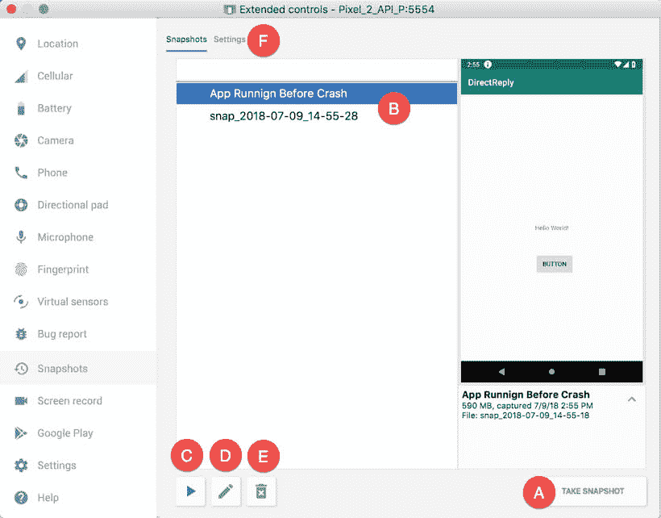

图 5-4

设置选项（F）提供了配置自动保存快速启动快照的选项（默认情况下，模拟器每次退出时都会询问是否保存快速启动快照）以及重新加载最近快照的选项。要强制模拟器执行冷启动而不是使用之前的快速启动快照，请打开 `AVD Manager`（`Tools -> AVD Manager`），点击模拟器操作列中的向下箭头，并选择 `Cold Boot Now` 菜单。

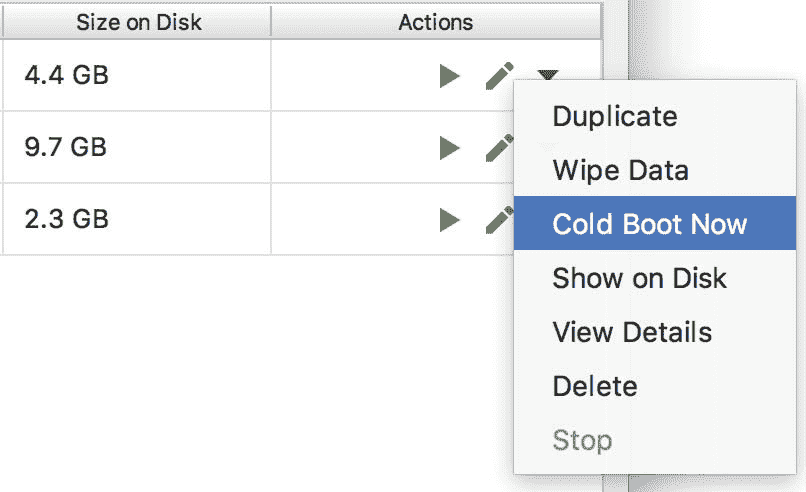

图 5-5

### 5.7 配置指纹模拟

模拟器允许配置多达 10 个模拟指纹，用于测试 Android 应用中的指纹身份验证。要配置模拟指纹，首先启动模拟器，打开 `Settings` 应用并选择 `Security & Location` 选项。

在安全设置屏幕内，选择 `Use fingerprint` 选项。在出现的信息屏幕上点击 `Next` 按钮进入指纹设置屏幕。在启用指纹安全之前，必须配置备用屏幕解锁方法（例如 PIN 码）。点击 `Fingerprint + PIN` 按钮，并在提示时选择在设备启动时不需要 PIN。输入并确认一个适当的 PIN 码，并通过接受默认通知选项完成 PIN 输入过程。

继续通过剩余屏幕，直到设置应用请求在传感器进行指纹。此时，显示扩展控制对话框，在左侧面板中选择 `Fingerprint` 类别，并确保主设置面板中选中了 `Finger 1`：

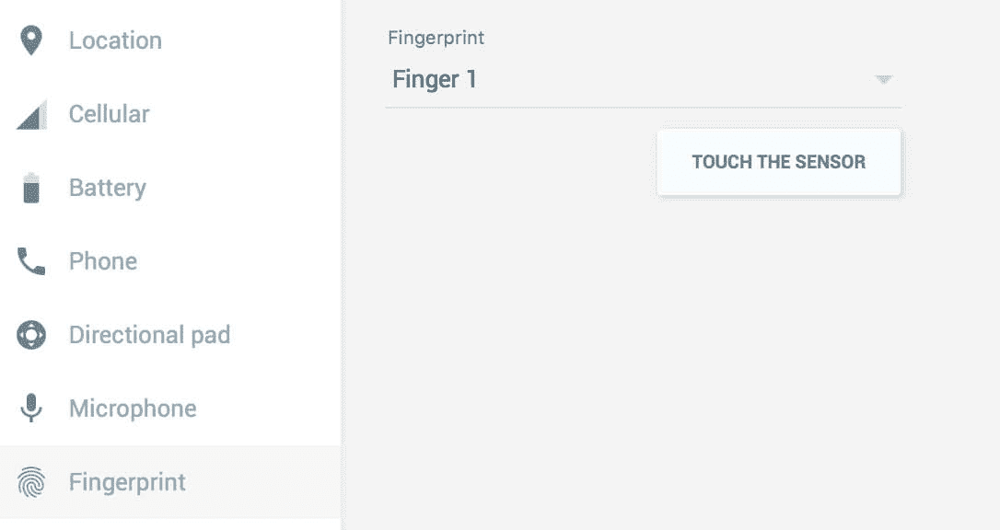

图 5-6

点击 `Touch the Sensor` 按钮模拟 `Finger 1` 触摸指纹传感器。模拟器将报告成功添加指纹：

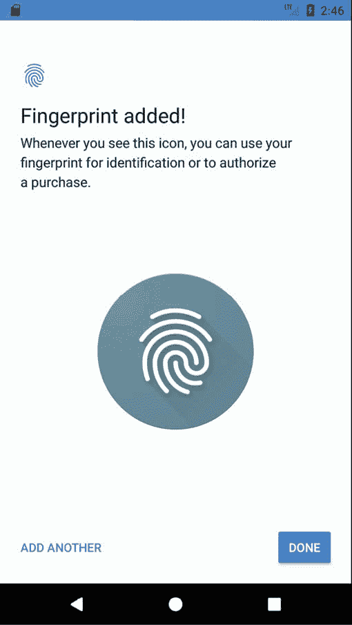

图 5-7

要添加更多指纹，点击 `Add Another` 按钮，并在再次点击 `Touch the Sensor` 按钮之前，从扩展控制面板菜单中选择另一个手指。关于在 Android 应用中构建指纹身份验证的主题在标题为“Android 生物识别认证教程”的章节中进行了详细介绍。

### 5.8 工具窗口模式下的模拟器

正如上一章（在 Android Studio 中创建 Android 虚拟设备（AVD））所述，Android Studio 可以配置为将模拟器作为嵌入式工具窗口启动，这样它就不会出现在独立的窗口中。当在此模式下运行时，工具栏中提供了独立模式下可用控件的一个子集，如图 5-8 所示：

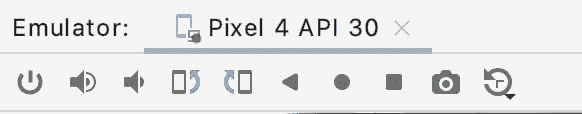

图 5-8

从左到右，这些按钮执行以下任务（细节与独立模式一致）：

- `Power`（电源）
- `Volume Up`（音量上）
- `Volume Down`（音量下）
- `Rotate Left`（左旋转）
- `Rotate Right`（右旋转）
- `Back`（返回）
- `Home`（首页）
- `Overview`（预览）
- `Snapshot`（快照）

### 5.9 总结

Android Studio 4.2 包含一个 Android 虚拟设备模拟器环境，旨在使其无需在物理 Android 设备上运行即可测试应用程序。本章简要介绍了模拟器，并强调了可用于配置和自定义环境以模拟不同测试条件的关键功能。

## 6. Android Studio 用户界面概览

虽然急于运行上一章创建的示例应用程序很有诱惑力，但这样做涉及到使用 Android Studio 用户界面某些方面，而这些方面将先进行描述。

Android Studio 是一个强大且功能丰富的开发环境，在很大程度上是直观的。尽管如此，现在花时间熟悉 Android Studio 界面的布局和组织将大大缩短学习曲线。基于此，本章将对构成 Android Studio 环境的各个区域提供初步概述。

### 6.1 欢迎屏幕

当 Android Studio 运行时当前没有打开的项目时，会显示欢迎屏幕（图 6-1）。可以通过选择 `File -> Close Project` 菜单选项随时关闭项目。如果 Android Studio 在仍有项目打开的情况下退出，下次启动时将跳过欢迎屏幕，自动打开之前的项目。

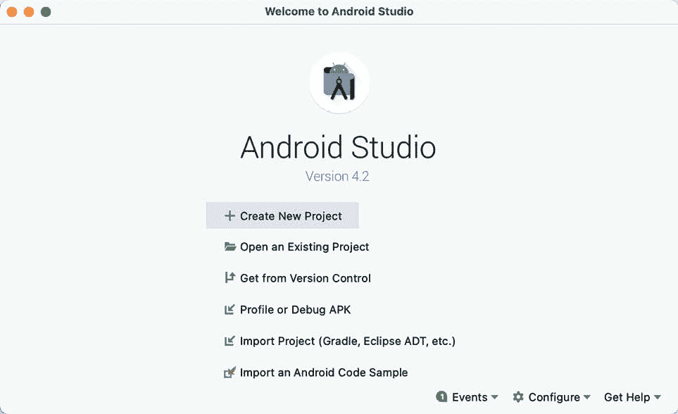

图 6-1

除了项目列表，`Quick Start` 菜单提供了执行打开、创建和导入项目等任务的范围，以及访问受版本控制的项目。此外，窗口底部的 `Configure` 菜单提供了 `SDK Manager` 以及大量的设置和配置选项。通过这些选项可以很快发现，Android Studio 几乎没有任何方面是无法配置和定制你的特定需求的。

`Configure` 菜单还包含检查是否有可下载的 Android Studio 更新的选项。

### 接口

#### A – 菜单栏

包含一系列用于在 Android Studio 环境中执行任务的菜单。

#### B – 工具栏

一组用于频繁执行的操作的快捷键。工具栏按钮可以更快速地访问一组特定的菜单栏操作。可以通过右键点击工具栏并选择 `Customize Menus and Toolbars…`（自定义菜单和工具栏…）选项来自定义工具栏。如果工具栏可见，可以使用 `View -> Appearance -> Toolbar`（视图 -> 外观 -> 工具栏）选项将其显示。

#### C – 导航栏

导航栏提供了一种在项目文件和文件夹之间移动的便捷方法。点击导航栏中的元素将弹出菜单，列出该位置的子文件夹和文件供选择。同样，点击类名将显示包含在该类中的列表。从列表中选择一个方法将跳转到代码编辑器中的相应位置。使用 `View -> Appearance -> Navigation Bar`（视图 -> 外观 -> 导航栏）选项可以隐藏或显示此栏。

#### D – 编辑器窗口

编辑器窗口显示开发者正在编辑的文件内容。然而，显示的内容取决于上下文。例如，编辑代码时，会出现代码编辑器。另一方面，当处理用户界面布局文件时，会出现用户界面布局编辑器工具。当打开多个文件时，每个文件都由位于编辑器顶部边缘的标签页表示，如图 6-3 所示。

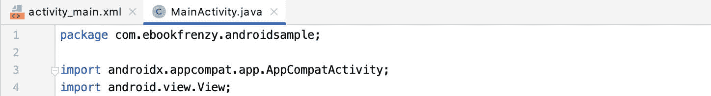

图 6-3

#### E – 状态栏

状态栏显示有关项目和 Android Studio 活动的提示信息，以及位于最左角的工具菜单按钮。将鼠标指针悬停在状态栏的项上将提供该字段的描述。许多字段是可交互的，允许用户通过点击来执行任务或获取更详细的状态信息。

#### F – 项目工具窗口

项目工具窗口提供了项目文件结构的层级概述，允许对特定的文件和文件夹进行导航。可以使用工具栏以若干种不同的方式显示项目。默认设置是 Android 视图（Android view），这是本书其余部分主要使用的模式。

项目工具窗口只是 Android Studio 环境中可用工具窗口之一。

### 6.3 工具窗口

除了项目视图工具窗口外，Android Studio 还包含许多其他窗口，启用后，这些窗口将显示在主窗口的底部和侧边。可以通过将鼠标指针悬停在状态栏最左角的按钮上（如图 6-4）而无需点击鼠标按钮来访问工具窗口快速访问菜单。

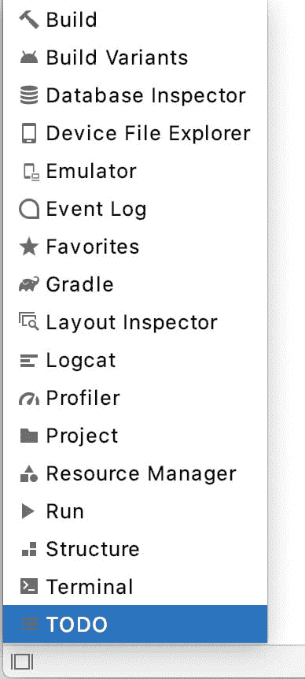

图 6-4

从快速访问菜单中选择项目将导致相应的工具窗口在主窗口中出现。

或者，可以通过点击状态栏中的快速访问菜单图标来显示一组工具窗口栏。这些栏显示在主窗口的左侧、右侧和底部边缘（如图 6-5 中的箭头所示），并包含用于显示和隐藏每个工具窗口的按钮。当工具窗口栏显示时，再次点击状态栏中的按钮将其隐藏。

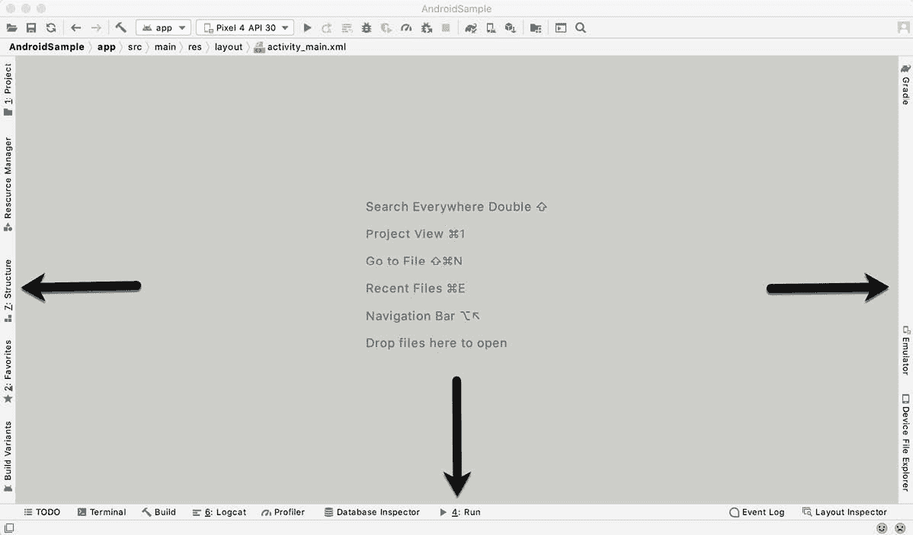

图 6-5

点击按钮将显示相应的工具窗口，而再次点击将隐藏该窗口。带有数字前缀的按钮（例如 `1: Project`）表示该工具窗口也可以按下键盘上的 `Alt` 键（macOS 为 `Command` 键）配合相应的数字来显示。

工具窗口栏中按钮的位置表示窗口在显示时相对于窗口的侧边。这些位置决定了窗口显示时位于窗口的哪侧。

每个工具窗口的顶部边缘都有自己的工具栏。工具栏内的按钮随工具窗口而异，点击齿轮图标可以更改窗口设置。图 6-6 显示了项目视图的设置。可以通过在窗口中输入搜索词进行搜索。


图 6-6

通过在工具窗口中显示搜索框可以访问项目的设置选项。

- `Run`（运行）—— 当应用程序正在运行时，运行工具窗口将变为可用，它提供了运行结果的视图，以及停止或重启正在运行进程的选项。如果应用程序无法在设备或模拟器上安装和运行，此窗口通常会提供与问题相关的诊断信息。
- `Event Log`（事件日志）—— 事件日志窗口显示与在 Android Studio 中执行的事件和活动相关的消息。例如，项目的成功构建或应用程序正在运行等信息都将在此工具窗口中报告。
- `Gradle` —— Gradle 工具窗口提供了项目构建配置中各种 Gradle 任务的视图。该窗口列出了参与将项目各种元素编译为可执行应用程序的任务。右键点击顶层 Gradle 任务，并选择 `Open Gradle Config`（打开 Gradle 配置）菜单选项，即可将当前项目的 Gradle 构建文件加载到编辑器中。本书稍后部分将详细介绍 Gradle。
- `Profiler`（性能分析器）—— Android Profiler 工具窗口提供了实时监控和分析工具，用于识别运行应用中的性能问题，包括 CPU、内存和网络使用情况。当应用正在运行时，此选项将可用。
- `Device File Explorer`（设备文件管理器）—— 设备文件管理器工具窗口提供了直接访问当前连接的 Android 设备或模拟器文件系统的权限，允许浏览系统并将文件复制到本地文件系统。
- `Resource Manager`（资源管理器）—— 一个用于添加和管理项目包含的资源和资产（如图像、颜色和布局文件）的工具。
- `Layout Inspector`（布局检查器）—— 提供用户界面布局组成组件层次结构的可视化 3D 渲染。
- `Emulator`（模拟器）—— 如果已启用在工具窗口中运行模拟器的选项，则该项包含 AVD 模拟器，具体详见“在 Android Studio 中创建 Android 虚拟设备（AVD）”章节。

## 6.4 Android Studio 快捷键

Android Studio 包含了大量的键盘快捷键，旨在在执行常用任务时节省时间。您可以在 Android Studio 项目窗口内选择 `Help -> Keymap Reference`（帮助 -> 键映射引用）菜单选项来查看并打印完整的键盘快捷键列表。您也可以通过选择 `File -> Settings...`（文件 -> 设置...）菜单选项（macOS 上为 `Android Studio -> Preferences...`）并点击下图中图 6-7 所示的 `Keymap` 项来列出和修改键盘快捷键：

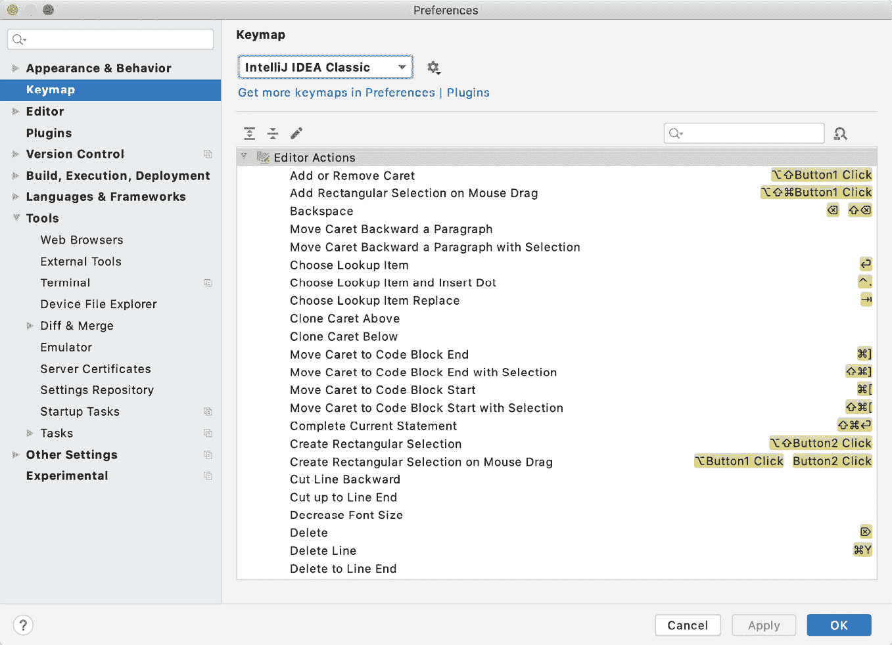

图 6-7

## 6.5 切换器与最近文件导航

在 Android Studio 主窗口内导航的另一种实用机制是使用 `Switcher`（切换器）。通过 `Ctrl-Tab` 键盘快捷键访问，切换器以面板的形式出现，列出所有工具窗口和当前打开的文件（图 6-8）。

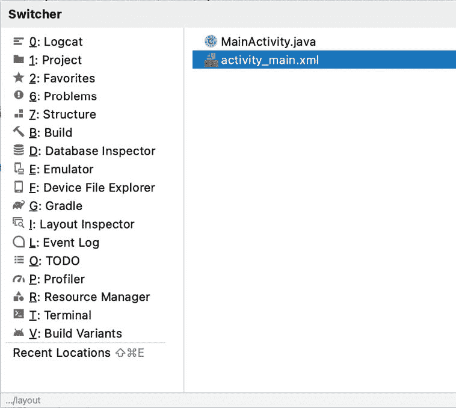

图 6-8

显示后，只要 `Ctrl` 键保持按下状态，切换器就会保持可见。在按住 `Ctrl` 键的同时反复点击 `Tab` 键可以在各种选项之间循环，而释放 `Ctrl` 键则会选中当前高亮的项并在主窗口中显示。

除了切换器外，`Recent Files`（最近文件）面板（图 6-9）提供了到最近打开文件的导航。可以使用 `Ctrl-E` 键盘快捷键（macOS 上为 `Cmd-E`）访问该面板。显示后，可以使用鼠标指针选择选项，也可以使用键盘方向键滚动查看文件名和工具窗口选项。按下 `Enter` 键将选中当前高亮的项。

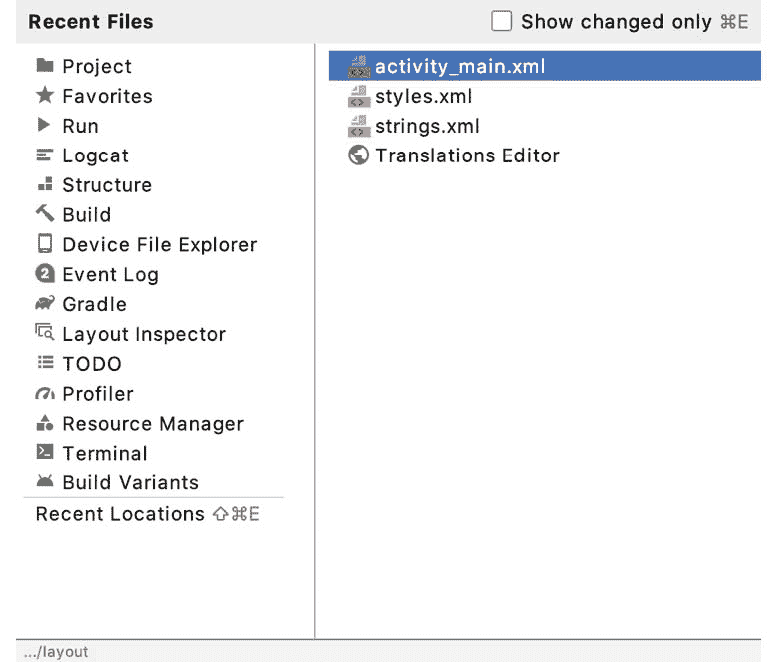

图 6-9

## 6.6 更改 Android Studio 主题

Android Studio 环境的整体主题可以通过从欢迎界面使用 `Configure -> Settings`（配置 -> 设置）选项，或者通过主窗口的 `File -> Settings…`（文件 -> 设置…）（macOS 上为 `Android Studio -> Preferences…`）菜单选项进行更改。

显示设置对话框后，在左侧面板选择 `Appearance & Behavior`（外观与行为），然后选择 `Appearance`（外观），在点击 `Apply`（应用）按钮之前更改 `Theme`（主题）菜单设置。可用主题取决于平台，但通常包括 Light（浅色）、IntelliJ、Windows、High Contrast（高对比度）和 Darcula 等选项。图 6-10 显示了选择了 Darcula 主题的主窗口示例：

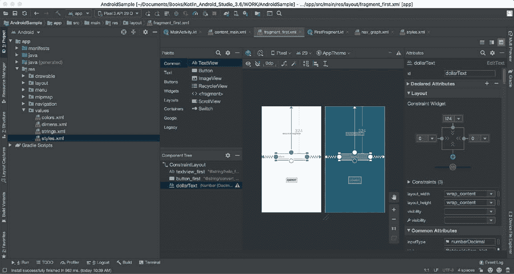

图 6-10

## 6.7 总结

Android Studio 环境的主要元素包括欢迎界面和主窗口。每个打开的项目都分配有自己的主窗口，主窗口反过来由菜单栏、工具栏、编辑和设计区域、状态栏以及一组工具窗口组成。工具窗口出现在主窗口的侧边和底部，可以通过状态栏中的快速访问菜单访问，也可以通过可选的工具窗口栏访问。

在 Android Studio 中，极少的操作是无法通过快捷键触发的。可以随时从 Android Studio 主窗口内访问默认键盘快捷键的键映射。

## 7. 在物理 Android 设备上测试 Android Studio 应用

虽然使用 Android 虚拟设备（AVD）测试应用程序可以实现很多功能，但要在物理 Android 设备上进行真实世界的应用测试是不可替代的，而且许多 Android 功能仅在物理 Android 设备上可用。

与 AVD 实例和连接的 Android 设备之间的通信均由 Android 调试桥（ADB）处理。在本章中，我们将介绍在 macOS、Windows 和 Linux 系统上配置 `adb` 环境以实现物理 Android 设备测试的步骤。

### 7.1 Android 调试桥（ADB）概述

ADB 的主要目的是方便开发系统（在本例中为 Android Studio）与 AVD 模拟器、物理设备之间的交互，用于运行和调试应用程序。

ADB 由客户端、在开发系统后台运行的服务器以及在 AVD 或真实 Android 设备上运行的守护进程组成。

ADB 客户端有多种形式。例如，在 Android SDK `platform-tools` 子目录下以名为 `adb` 的命令行工具形式提供。同样，Android Studio 也内置了一个客户端。

可以使用 `adb` 命令行工具执行各种任务。例如，可以使用 `devices` 命令参数获取当前活动虚拟或物理设备的列表。以下命令输出表示系统上有模拟器但没有物理设备：

```bash
```


`adb devices`

`List of devices attached`

`emulator-5554 device`

在 ADB 能够连接到 Android 设备之前，必须先配置设备以允许连接。对于运行 Android 6.0 或更高版本的手机和平板，实现此目的的步骤如下：

1. 在设备上打开 `Settings`（设置）应用并选择 `About tablet` 或 `About phone`（在较新的 Android 版本中，可以在设置的 `System` 页面找到）。

2. 在 `About` 屏幕上找到 `Build number`（版本号）字段（图 7-1）并点击七次，直到出现显示开发者模式已启用的消息。如果 `Build number` 未列在 `About` 屏幕上，可以通过 `Software information`（软件信息）选项查看。或者，如果可用，展开列表中的 `Advanced`（高级）部分。

### 图 7-1

3. 返回主 `Settings`（设置）屏幕，并注意名为 `Developer options`（开发者选项）的新选项。选择此选项并在开发者屏幕上找到 `USB debugging`（USB 调试）设置。如图 7-2 所示，启用该项目旁的开关：

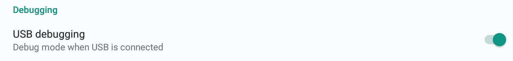

### 图 7-2

4. 从屏幕顶部向下滑动显示通知面板（图 7-3），并注意设备当前已连接用于调试。


### 图 7-3

此时，设备已配置为接受来自开发系统上 `adb` 的调试连接。剩下的工作是配置开发系统以便在设备连接时能够检测到它。虽然这是一个相对过程，但涉及的步骤取决于开发系统运行的是 Windows、macOS 还是 Linux。请注意，以下步骤假设 Android SDK 的 `platform-tools` 目录已包含在操作系统的 `PATH` 环境变量中，正如标题为“设置 Android Studio 开发环境”的章节所述。

#### 7.2.1 macOS ADB 配置

为了在 macOS 系统上配置 `ADB` 环境，请使用 USB 线将设备连接到计算机系统，打开终端窗口并执行以下命令以重启 `adb` 服务：

```bash
adb kill-server

adb start-server
```

```
* daemon not running. starting it now on port 5037 *

* daemon started successfully *
```

一旦服务器成功运行，执行以下命令以验证是否检测到设备：

```bash
adb devices
```

```
List of devices attached

74CE000600000001 offline
```

如果设备被列为 `offline`（离线），请前往 Android 设备并检查是否存在图 7-4 所示的请求“允许 USB 调试”权限的对话框。在点击 `OK` 之前，启用 `Always allow from this computer`（始终允许此计算机）选项旁的复选框。再次执行 `adb devices` 命令现在应该会将设备列为可用：

```
List of devices attached

015d41d4454bf80c device
```

如果设备未被列出，请尝试注销并重新登录 macOS 桌面，如果问题仍然存在，请重启系统。

#### 7.2.2 Windows ADB 配置

配置基于 Windows 的开发系统使用 `ADB` 连接到 Android 设备的第一步是在系统上安装适当的 USB 驱动程序。要安装的 USB 驱动程序取决于 Android 设备的型号。如果您有一个 Google Nexus 设备，则有必要在您的 Windows 系统上安装并配置 `Google USB Driver` 程序包。实现此目的的详细步骤在以下网页上概述：

[`developer.android.com/sdk/win-usb.html`](http://developer.android.com/sdk/win-usb.html)

对于 `Google USB` 驱动程序不支持的 Android 设备，则需要下载设备制造商提供的驱动程序。可以在网上获取驱动程序列表以及下载和安装信息：

[`developer.android.com/tools/extras/oem-usb.html`](https://developer.android.com/tools/extras/oem-usb.html)

安装驱动程序且设备已被识别为正确的设备类型后，打开命令提示符窗口并执行以下命令：

```cmd
adb devices
```

此命令应输出关于连接设备的信息，类似于：

```
List of devices attached

HT4CTJT019066 offline
```

如果设备被列为 `offline`（离线）或 `unauthorized`（未授权），请查看设备显示并检查是否存在图 7-4 所示的请求“允许 USB 调试”权限的对话框。

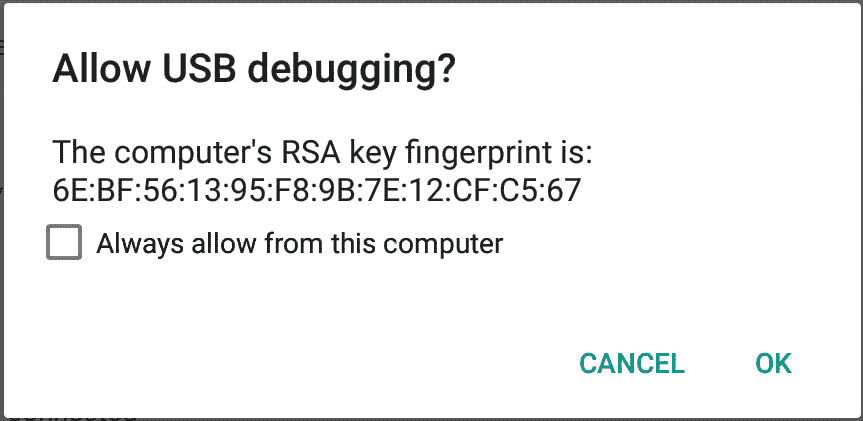

### 图 7-4

在点击 `OK` 之前，启用 `Always allow from this computer`（始终允许此计算机）选项旁的复选框。再次执行 `adb devices` 命令现在会将设备列为就绪：

```
List of devices attached

HT4CTJT019066 device
```

如果设备未被列出，执行以下命令重启 `ADB` 服务：

```cmd
adb kill-server

adb start-server
```

如果设备仍然未被列出，尝试执行以下命令：

```cmd
android update adb
```

请注意，可能还需要重启系统。

#### 7.2.3 Linux adb 配置

为了本章的目的，我们将再次使用 Ubuntu Linux 作为参考示例，用于在 Linux 上配置 `adb` 以连接到物理 Android 设备进行应用测试。

在 Ubuntu Linux 上进行物理设备测试需要安装名为 `android-tools-adb` 的包，这反过来又要求 Android Studio 用户必须是 `plugdev` 组的成员。这是大多数 Ubuntu 版本用户账户的默认设置，可以通过运行 `id` 命令进行验证。如果没有列出 `plugdev` 组，请运行以下命令将您的账户添加到该组：

```bash
sudo usermod -aG plugdev $LOGNAME
```

在满足组成员要求后，可以通过执行以下命令安装 `android-tools-adb` 包：

```bash
sudo apt-get install android-tools-adb
```

完成上述更改后，重启 Ubuntu 系统。系统重启后，打开终端窗口，启动 `adb` 服务并检查设备列表：

```bash
adb start-server
```

```
* daemon not running. starting it now on port 5037 *

* daemon started successfully *
```

```bash
adb devices
```

```
List of devices attached

015d41d445bf80c offline
```

如果设备被列为 `offline`（离线）或 `unauthorized`（未授权），请前往设备并检查图 7-4 所示的请求“允许 USB 调试”权限的对话框。

### 7.3 测试 adb 连接

假设您的开发平台 `adb` 配置已成功，下一步是在设备上运行在“在 Android Studio 中创建示例应用”](#Sample_App.xhtml__idTextAnchor033)章节中创建的应用程序。启动 Android Studio，打开 `AndroidSample` 项目并验证设备是否出现在图 7-5 所示的设备选择菜单中：

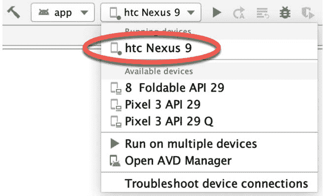

### 图 7-5

#### 7.4 总结

虽然虚拟设备模拟器提供了一个良好的测试环境，但请记住，确保应用程序在物理 Android 设备上正常运行是没有任何东西可以替代的。毕竟，这是应用程序在现实世界中使用的地方。

但是，Android Studio 环境默认未配置 Android 设备作为目标测试设备。因此，必须执行某些步骤，以便从 Android Studio 开发环境直接加载应用程序到 Android 设备。实现这一目标的具体步骤取决于所使用的开发平台。在本章中，我们涵盖了适用于 Linux、macOS 和 Windows 平台的步骤。

#### 8 Android Studio 代码编辑器基础

为 Android 开发涉及大量的编程工作，根据定义，这涉及输入、查看和修改代码。因此，开发者使用 Android Studio 的大部分时间通常是在编辑器窗口内编辑代码，这并不意外。

现代代码编辑器需要远远超出最初的输入、删除、剪切和粘贴等基础。如今，代码编辑器的实用性通常通过以下因素来衡量：在多大程度上减少了程序员所需的输入量、在大型源文件中导航的便利性，以及编辑器在代码编写时实时检测并高亮编程错误的能力。正如本章将显示的，这些只是 Android Studio 编辑器出色的几个领域之一。

本章并非对 Android Studio 编辑器功能的详尽概述，而是旨在提供该工具关键功能的指南。经验丰富的程序员会发现，其中某些功能是当今大多数代码编辑器的共同特征，而许多功能则是这一特定编辑环境所独有的。

# 8.1 Android Studio 编辑器

当选择 `Java`、`Kotlin`、`XML` 或其他文本文件进行编辑时，Android Studio 编辑器会出现在主窗口中心。例如，图 8-1 显示了一个加载了 `Java` 源代码文件的典型编辑器会话：

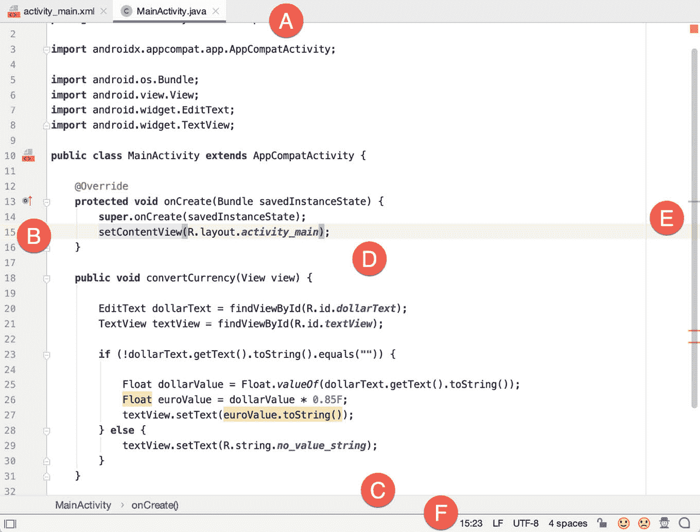

图 8-1

构成编辑器窗口的元素可以总结如下：

**A – 文档标签** – Android Studio 能够同时打开多个文件进行编辑。每打开一个文件时，它都会被分配一个文档标签，在编辑器窗口顶部边缘标签栏中显示文件名。当空间不足以显示所有标签时，标签栏的最右侧会出现一个小的下拉菜单。点击此菜单将弹出一个其他已打开的文件列表。标签中文件名下方的红色波浪线表示该文件中的代码包含一个或多个错误，在项目编译和运行之前需要解决这些错误。

在文件之间切换只需点击相应的标签，或使用 `Alt-Left` 和 `Alt-Right` 键盘快捷键。文件之间的导航也可以使用 `Switcher` 机制（通过 `Ctrl-Tab` 键盘快捷键访问）。

要将编辑器面板从 Android Studio 主窗口中分离以便在单独的窗口中显示，请点击标签并将其拖到主窗口之外的桌面区域。要将编辑器返回主窗口，请点击分离编辑器窗口中的文件标签，并将其拖放到主窗口中的原始编辑器标签栏上。

**B – 编辑器行槽区域 (Editor Gutter Area)** - 行槽区域被编辑器用于显示信息图标和控件。此行槽区域中出现的典型项目（包括但不限于）有调试断点标记、折叠和展开代码块的控件、书签、更改标记和行号。行号默认开启的，但可以通过在行槽中点击鼠标右键并选择 `Show Line Numbers` 菜单选项将其禁用。

**C – 代码结构位置** – 编辑器底部的此栏显示了光标位置相对于代码整体结构的关系。例如，在接下来的图中，该栏指示当前正在编辑 `convertCurrency` 方法，且该方法包含在 `MainActivity` 类中。


图 8-2

双击栏内的元素将将光标移动到代码文件中的相应位置。例如，双击 `convertCurrency` 条目将把光标移动到源代码中 `convertCurrency` 方法的顶部。同样，点击 `MainActivity` 条目将弹出一个可供的代码导航点列表以供选择：

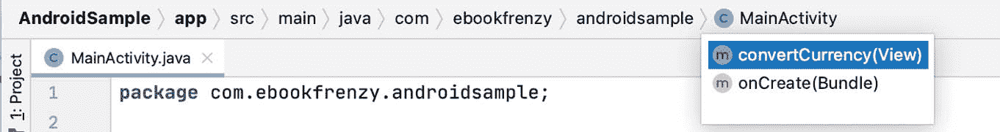

图 8-3

**D – 编辑器区域** – 这是用户显示、输入和编辑代码的主区域。本章的后续章节将详细介绍编辑区域的关键功能。

**E – 验证与标记侧边栏** – Android Studio 整合了一项名为“即时代码分析”的功能。这本质上意味着当你编写代码时，编辑器正在分析代码以检查警告和语法错误。验证侧边栏顶部的指示器将实时更新，显示随着代码添加发现的错误和警告数量。点击此指示器将显示一个弹出窗口，其中包含编辑器代码中发现的问题摘要，如图 8-4 所示：

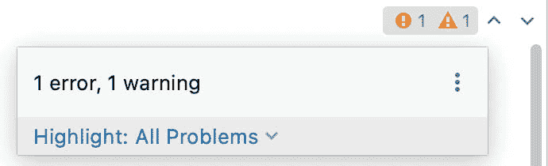

图 8-4

可以使用向上和向下箭头在代码中的错误位置之间移动。绿色勾号表示未检测到警告或错误。

侧边栏还使用相同的颜色编码在检测到问题的位置显示标记。当编辑器区域显示该代码行时，将鼠标指针悬停在标记上，将显示一个包含问题描述的弹出窗口（图 8-5）：

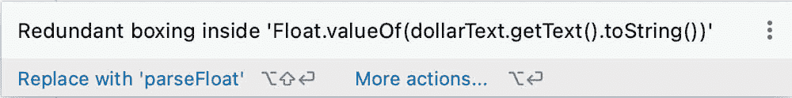

图 8-5

当代码行当前滚动出编辑器视图区域时，将鼠标指针悬停在该标记上，将显示一个“透镜”（lens）覆盖层，其中包含问题所在的代码块（图 8-6），从而无需滚动到编辑器的该位置即可查看：

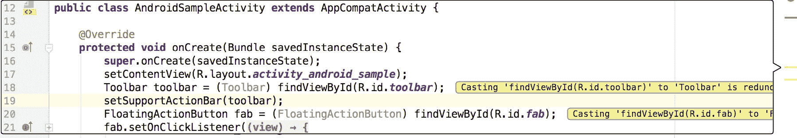

图 8-6

还需要注意的是，透镜覆盖层并不局限于侧边栏中的警告和错误。将鼠标指针悬停在侧边栏的任何部分，都会显示一个包含文件该位置代码的透镜层。

**F – 状态栏** – 虽然状态栏实际上是主窗口的一部分而非编辑器，但它确实包含有关当前编辑会话的信息。这些信息包括光标在行和字符上的当前位置以及文件的编码格式（`UTF-8`、`ASCII` 等）。点击状态栏中的这些值可以相应设置。例如，点击行号将显示 `Go to Line` 对话。

在对构成 Android Studio 编辑器的元素进行概述后，本章剩余部分将详细介绍编辑环境的关键功能。

# 8.2 分割编辑器窗口

默认情况下，编辑器将显示当前选择文件的单个面板。在同时处理多个源文件时，一个特别实用的功能是将编辑器拆分为多个窗格。要分割编辑器，请右键点击编辑器窗口内的文件标签并选择 `Split Vertically`（垂直分割）或 `Split Horizontally`（水平分割）菜单选项。例如，图 8-7 显示了分割器的操作，编辑器被拆分为三个面板：

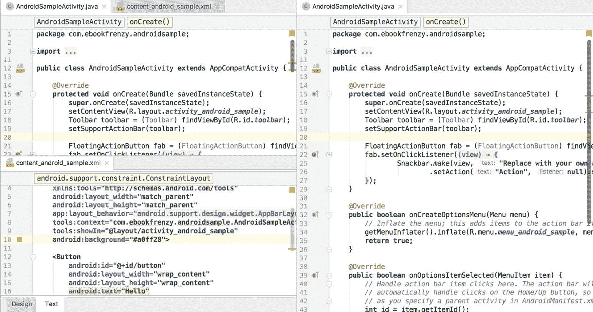

图 8-7

可以通过右键点击相应的标签并选择 `Change Splitter Orientation` 菜单选项随时更改分割面板的方向。重复这些步骤可以取消拆单个面板，此时从菜单中选择 `Unsplit` 选项。可以通过右键点击任何标签并选择 `Unsplit All` 选项移除所有分割面板。

窗口分割可用于显示不同的文件，或为同一个文件提供多个窗口，以便并发查看和编辑同一文件的不同区域。

### 8.3 代码补全

Android Studio 编辑器内置了大量的 Java 编程语法以及构成 Android SDK 的类和方法的知识，同时也包含了对你项目自己的代码库的了解。在输入代码时，编辑器会扫描正在输入的内容，并在适当的情况下针对完成语句或引用可能所需的内容提供建议。当编辑器检测到补全建议时，将出现一个包含建议列表的面板。例如，在图 8-8 中，编辑器正在为 `String` 声明的开头提供可能的选项：


图 8-8

如果没有任何自动补全建议是正确的，只需继续输入，编辑器将在适宜的情况下继续精炼建议。要采纳最顶部的建议，只需按下键盘上的 `Enter` 或 `Tab` 键。要选择不同的建议，请使用方向键在列表中上下移动，并再次使用 `Enter` 或 `Tab` 键选中高亮项。

可以使用 `Ctrl-Space` 组合键序列手动调用补全建议。这在更改编辑器中的单词或声明时非常有用。当光标置于编辑器中的某个单词上时，该单词将自动高亮。按下 `Ctrl-Space` 将显示一个备选建议列表。要将当前单词替换为建议列表中当前高亮的项，只需按下 `Tab` 键。

除了实时自动补全功能外，Android Studio 编辑器还提供了一种称为“智能补全”（Smart Completion）的系统。智能补全通过 `Shift-Ctrl-Space` 组合键调用，选中后将根据代码的当前上下文提供更详细的建议。再次按下 `Shift-Ctrl-Space` 快捷键将从更广泛的范围内提供更多建议。

对于许多程序员来说，代码完成可能取决于个人喜好。为了承认这一事实，Android Studio 对自动补全设置提供了高程度的控制。可以通过选择 `File -> Settings…` 菜单选项（macOS 上为 `Android Studio -> Preferences…`）并在设置面板中选择 `Editor -> General -> Code Completion` 来查看和修改这些设置，如图 8-9 所示：


图 8-9

### 8.4 语句补全

Android Studio 编辑器提供的另一种自动补全形式是语句补全。它可以用于自动填充方法和循环语句等项的括号和大括号。语句补全通过 `Shift-Ctrl-Enter`（macOS 上为 `Shift-Cmd-Enter`）组合键序列调用。考虑以下代码：

```
myMethod()
```

在编辑器中输入此代码后，触发语句补全将导致编辑器自动为方法添加大括号：

```java
myMethod() {

}
```


## 8.5 参数信息

还可以请求编辑器提供关于方法接收的参数信息。当光标置于方法调用的括号之间时，按下 `Ctrl-P`（macOS 上为 `Cmd-P`）组合键序列将显示该方法已知接收的参数，其中最可能的建议将以粗体显示：


图 8-10

## 8.6 参数名提示

代码编辑器可以配置为在方法调用中显示参数名提示。例如，图 8-11 高亮了 `Snackbar` 类中 `make()` 和 `setAction()` 方法调用中的参数名提示：


图 8-11

此模式的设置可以通过选择 `File -> Settings` 菜单（macOS 上为 `Android Studio -> Preferences`），然后在左侧面板中选择 `Editor -> Inlay Hints -> Java` 来配置。在生成的屏幕上，从列表中选择 `Parameter Hints`，并启用或禁用 `Show parameter hints` 选项。要调整提示设置，点击 `Exclude list...` 链接进行必要的调整。

## 8.7 代码生成

除了在输入时完成代码外，编辑器在某些条件下还可以为你生成代码。当光标位于文件中需要生成代码的位置时，可以使用 `Alt-Insert`（macOS 上为 `Ctrl-N`）快捷键访问图 8-12 所示的可用代码生成选项列表。


图 8-12

为了说明，考虑一种情况：我们希望在项目中的 `Activity` 将被操作系统销毁时收到通知。正如本书后续章节将概述的那样，这可以通过重写 `Activity` 超类的 `onStop()` 生命周期方法来实现。要让 Android Studio 为此生成存根方法，只需从代码生成列表中选择 `Override Methods…`，并从生成的可用方法列表中选择 `onStop()` 方法：


图 8-13

选中要重写的方法后，点击 `OK` 将在 Java 源文件的当前光标位置生成存根方法，如下：

```java
@Override
protected void onStop() {
    super.onStop();
}
```

## 8.8 代码折叠

一旦源代码文件达到一定大小，即使是格式严谨、组织良好的代码也会变得难以处理且难以导航。Android Studio 认为并不总是需要显示所有代码块。通过使用 Android Studio 编辑器的代码折叠功能，代码导航可以变得更容易。

代码折叠通过位于每个代码块开头和结尾的标记进行控制。例如，图 8-14 高亮了未折叠方法声明的起始和结束标记：


图 8-14

点击这些标记之一将折叠语句，使其只显示签名行，如图 8-15 所示：


图 8-15

要展开折叠的代码，只需点击编辑器中的 `+` 标记。要在不展开代码的情况下查看隐藏代码，将鼠标指针悬停在 `{...}` 指示上，如图 8-16 所示。编辑器将显示包含折叠代码的覆盖层：


图 8-16

可以使用 `Ctrl-Shift-Plus` 和 `Ctrl-Shift-Minus` 组合键折叠或展开文件中的所有代码块。

默认情况下，Android Studio 编辑器在打开源文件时会自动折叠某些代码。要配置发生这种情况的情况，选择 `File -> Settings…`（macOS 上为 `Android Studio -> Preferences…`），并在生成的设置面板中选择 `Editor -> General -> Code Folding` 项，如图 8-17 所示：


图 8-17

## 8.9 快速文档查看

可以通过将光标置于需要文档的声明上并按下 `Ctrl-Q` 快捷键（macOS 上为 `Ctrl-J`）来访问上下文相关的 Java 和 Android 文档。这将显示一个包含该项相关参考文档的弹出窗口。例如，图 8-18 显示了 Android `Snackbar` 类的文档。


图 8-18

显示后，可以根据需要在屏幕上移动文档弹出窗口。

## 8.10 代码格式化

通常情况下，Android Studio 编辑器会在添加语句和代码块时，自动对缩进、间距和嵌套进行代码格式化。在需要重新格式化代码行的情况下（这很常见，例如从网站复制并粘贴示例代码时），编辑器提供了源代码重格式化功能。选择该功能后，代码会自动重新格式化以匹配主流的代码风格。

要重新格式化源代码，请按快捷键组合 `Ctrl-Alt-L`（macOS 上为 `Cmd-Opt-L`）。要显示“重格式代码”对话框（图 8-19），请使用 `Ctrl-Alt-Shift-L`（macOS 上为 `Cmd-Opt-Shift-L`）。该对话框提供了仅格式化当前选定代码、编辑器中活跃的整个源文件，或仅格式化由于源码控制更新而更改的代码等选项。


图 8-19

可以在项目设置对话框中更改完整的代码风格偏好。选择 `File -> Settings` 菜单选项（macOS 上为 `Android Studio -> Preferences…`），并在左侧面板中选择 `Code Style` 以访问支持的编程和标记语言列表。

选择一种语言将提供大量的格式化样式选项，所有选项都可以从 Android Studio 默认值修改以匹配您偏好的代码风格。例如，要配置上述对话框中 `Rearrange` 代码选项的设置，请展开 `Code Style` 部分，选择 `Java`，并在 `Java` 设置中选择 `Arrangement` 标签。

## 8.11 查找示例代码

Android Studio 编辑器提供了一种访问与代码列表中当前高亮条目相关的示例代码的方法。这对于学习如何使用特定的 Android 类或方法非常有用。

要查找示例代码，可以在编辑器中高亮方法名或类名，右键点击它并选择 `Find Sample Code` 菜单选项。“Find Sample Code”面板（图 8-20）将出现在编辑器下方，列出匹配的示例列表。从列表中选择一个示例会将相应的代码加载到右侧面板：


图 8-20

## 8.12 Live Templates（实时模板）

在编写 Android 代码时，你会发现有一些经常使用的常用结构。例如，一个常见需求是使用 `Toast` 类向用户显示弹出消息。

Live 模板是常用代码结构的集合，可以通过在编辑器中输入初始字符，然后按一个特殊键（默认设置为 `Tab` 键）来插入模板代码。要体验这一操作，请在代码编辑器中输入 `toast`，然后按 `Tab` 键，Android Studio 将在光标位置插入以下代码，准备好进行编辑：

```
Toast.makeText(, "", Toast.LENGTH_SHORT).show()
```


要列出并编辑现有模板、更改特殊键或添加您自己的模板，请打开 `Preferences` 对话框，并在左侧导航面板的 `Editor` 部分选择 `Live Templates`：


图 8-21

使用上方图 8-21 中标记为 A 的按钮添加、删除、复制或重置模板。要修改模板，请从列表 B 中选择它并更改标记为 C 的面板中的设置。

### 8.13 总结

Android Studio 编辑器尽力减少编写代码所需的字数，并使代码更易阅读和导航。在本章中，我们涵盖了许多关键编辑器功能，包括代码补全、代码生成、编辑器分分、代码折叠、重格式化、文档查询和实时模板。

## 9 Android 架构概述

到本书为止，已经采取了步骤来搭建适用于使用 Android Studio 开发 Android 应用的环境。通过创建 Android Studio 应用程序项目，也迈出了应用开发流程的第一步。

然而，在进一步研究 Android 应用开发的实际问题之前，了解 Android SDK 以及通用 Android 开发的一些较为抽象的概念是非常关重要的。现在清晰地理解这些概念将为构建进一步知识提供坚实的基础。

本章从 Android 架构的概述开始，并在本书的接几章节中继续，目标是提供 Android 开发基础的详细概述。

### 9.1 Android 软件栈

Android 结构为软件栈的形式，由应用程序、操作系统、运行时环境、中间件、服务和库组成。这种架构可以通过图 9-1 所示的方式进行视觉化表示，效果最好。软件栈的每一层以及每层中的相应元素都是紧密集成并经过仔细调整的，为移动设备提供最佳的应用开发和执行环境。本章的其余部分将介绍 Android 栈的不同层，从底部的 `Linux Kernel` 开始。


图 9-1

### 9.2 Linux 内核

`Linux Kernel` 位于 Android 软件栈的底部，在设备硬件与 Android 软件栈上层之间提供了抽象层。内核基于 Linux 版本 `2.6`，提供了抢占式多任务处理、底层核心系统服务（如内存、进程和电源管理），此外提供了网络栈以及显示器、WiFi 和音频等硬件的设备驱动。

原始 Linux 内核由 Linus Torvalds 在 1991 年开发，并与 Richard Stallman 在自由软件基金开发的一系列工具、实用程序和编译器相结合创建了名为 GNU/Linux 的完整操作系统。从这些基础中派生出了各种 Linux 发行版，如 `Ubuntu` 和 Red Hat Enterprise Linux。

然而，重要的是 Android 仅使用了 Linux 内核。尽管如此，值得注意的是，Linux 内核最初是为桌面电脑和服务器形式的传统计算机设计的。事实上，Linux 现在在任务关键服务器环境中的部署最为广泛。由于移动设备的强大以及 Linux 内核的效率和性能，我们发现这种软件位于 Android 软件栈的核心。

### 9.3 Android 运行时 – ART

在 Android Studio 中构建 Android 应用时，它会被编译成中间字节码格式（称为 `DEX` 格式）。当应用程序随后加载到设备时，Android 运行时（`ART`）使用称为预先编译（`AOT`）编译的过程将字节码翻译为设备处理器所需的原生指令。这种格式被称为可执行和可链接格式（`ELF`）。

此后每次启动应用程序时，都会运行 ELF 可执行版本，从而获得更快的性能和更好的电池寿命。

这与旧版 Android 实现中使用的即时编译（`JIT`）编译方法形成对比，后者在每次启动应用程序时在虚拟机（`VM`）中翻译字节码。

### 9.4 Android 库

除了一组标准的 Java 开发库（提供字符串处理、网络连接和文件操作等通用任务的支持）外，Android 开发环境还包含了 Android 库（Android Libraries）。这些是一组专门用于 Android 开发的 Java 库。该类别的库包括应用框架库，以及用于辅助用户界面构建、图形绘制和数据库访问的库。

Android 开发者可用的一些关键核心 Android 库摘要如下：

- `android.app` – 提供对应用模型的访问，是所有 Android 程序的基石。
- `android.content` – 促进应用程序与应用组件之间的内容访问、发布和消息。
- `android.database` – 用于访问内容提供程序（content providers）发布的数据，包含 `SQLite` 数据库管理类。
- `android.graphics` – 一种底层 2D 图形绘制 API，包括颜色、点、过滤器、矩形和画布。
- `android.hardware` – 提供了访问硬件（如加速度计和光线传感器）的 API。
- `android.opengl` – 指向 `OpenGL ES` 3D 图形渲染 API 的 Java 接口。
- `android.os` – 为应用程序提供对标准操作系统服务的访问，包括消息、系统服务和进程间通信。
- `android.media` – 提供启用音频和视频播放的类。
- `android.net` – 一组提供网络栈访问的 API。包括提供访问设备无线栈的 `android.net.wifi`。
- `android.print` – 包含一组类，允许从 Android 应用程序内部将内容发送到已配置的打印机。
- `android.provider` – 一组便利类，提供对标准 Android 内容提供程序数据库的访问，例如日历和联系人应用维护的数据库。
- `android.text` – 用于在设备显示上渲染和操作文本。
- `android.util` – 一组工具类，用于执行任务，如字符串和数字转换、XML 处理以及日期和时间操作。
- `android.view` – 应用用户界面的基础构建块。
- `android.widget` – 丰富的预构建用户界面组件集合，如按钮、标签、列表视图、布局管理器、单选按钮等。
- `android.webkit` – 一组类，旨在允许在应用程序中构建网页浏览功能。

在涵盖了 Android 运行时基于 Java 的库之后，现在是时候关注 Android 软件栈这一层包含的基于 C/C++ 的库了。

#### 9.4.1 C/C++ 库

在前节概述的 Android 运行时核心库是基于 Java 的，为编写 Android 应用程序的开发者提供了主要的 API。但需要注意的是，核心库并没有执行许多实际工作，事实上它们本质上是对一组基于 C/C++ 的库的 Java“包装器（wrappers）”。例如，在调用 `android.opengl` 库在设备显示器上绘制 3D 图形时，该库最终实际上会调用 `OpenGL ES` C++ 库，而该库又与底层 Linux 内核协作执行绘制任务。

引入 C/C++ 库是为了实现广泛且多样的功能，包括 2D 和 3D 图形绘制、安全套接层（`SSL`）通信、`SQLite` 数据库管理、音频视频播放、位图和矢量字体渲染、显示子系统和图形层管理，以及标准 C 系统库（`libc`）的实现。

在实践中，典型的 Android 开发者将仅通过基于 Java 的 Android 核心库 API 访问这些库。如果需要直接访问这些库，可以使用 Android 原生开发包（`NDK`）实现，其目的是通过 Java 原生接口（`JNI`）在 Java 代码中调用非 Java 或 Kotlin 编程语言（如 `C` 和 `C++`）的原生方法。

### 9.5 应用框架

应用框架是一组服务，共同构成了 Android 应用程序运行和管理的环境。该框架实现了这样一个概念：Android 应用程序是由可重用、可交换和可替换的组件构建的。这一概念更进了一，应用程序还可以发布其功能以及任何相关数据，以便其他应用程序发现并重用它们。

Android 框架包含以下关键服务：

- Activity 管理器（Activity Manager）– 控制应用程序生命周期的所有方面和活动栈。
- 内容提供程序（Content Providers）– 允许应用程序与其他应用程序发布和共享数据。
- 管理器（Resource Manager）– 提供对非代码嵌入资源的访问，如字符串、颜色设置和用户界面布局。
- 通知管理器（Notifications Manager）– 允许应用程序向用户显示警和通知。
- 视图系统（View System）– 用于创建应用程序用户界面的扩展视图集。
- 包管理器（Package Manager）– 应用程序借此查找设备上当前安装的其它应用程序信息的系统。
- 电话管理器（Telephony Manager）– 向应用程序提供设备上可用电话服务的信息，如状态和订阅者信息。
- 位置管理器（Location Manager）– 提供对位置服务的访问，允许应用程序接收位置变化的更新。

### 9.6 应用程序

位于 Android 软件栈顶端的是应用程序。它们由特定 Android 实现提供的原生应用程序（例如网络浏览器和电子邮件应用）以及用户在购买设备后安装的第三方应用程序组成。

### 9.7 总结

良好的 Android 开发知识基础需要对 Android 的整体架构有理解。Android 以软件栈架构的形式实现，由 Linux 内核、运行时环境及相应的库、一个应用框架和一组应用程序组成。应用程序主要用 `Java` 或 `Kotlin` 编写，并在 Android Studio 构建环境中编译为字节码格式。当应用程序随后被安装到设备上时，这些字节码将由 Android 运行时（`ART`）编译为 CPU 使用的原生格式。Android 架构的关键目标是性能和效率，无论是在应用程序执行中，还是在应用程序设计的重用性实现中。

## 10. Android 应用程序的剖析

无论你之前的编程经验是基于 `Windows`、`macOS`、`Linux` 甚至是 `iOS`，Android 开发很有可能与你以前过的任何事物都不同。

因此，本章的目标是提供对 Android 应用程序架构背后高层概念的理解。通过这种方式，我们将探讨用于构建应用程序的各种组件，以及允许这些组件协同工作以创建一个统一应用程序的机制。

### 10.1 Android Activity

熟悉 `Java`、`Kotlin`、`C++` 或 `C#` 等面向对象编程语言的人会熟悉将应用程序功能元素封装在类中的概念，然后将其实例化为对象并进行操作以创建应用程序。由于 Android 应用程序是用 `Java` 和 `Kotlin` 编写的，情况仍然如此。然而，Android 还将可重用组件的概念推到了更高的水平。

Android 通过整合一个或多个被称为 Activity（活动）的组件来创建。Activity 是应用程序中单一、独立的功能模块，通常直接对应于单个用户界面及其相应的功能。例如，一个预约应用程序可能包含一个 Activity 屏幕，用于显示当天设置的预约。该应用程序还可能使用第二个 Activity，该 Activity 由一个允许用户输入新预约的屏幕组成。

Activity 旨在设计为完全可重用且可交换的构建块，可以在不同应用程序之间共享。例如，一个现有的电子邮件应用程序可能包含一个专门用于编写和发送电子邮件消息的 Activity。开发者可能正在编写一个应用程序，该程序也有发送电子邮件消息的需求。开发者无需为新应用程序专门开发一个编写邮件的 Activity，只需直接使用现有电子邮件应用程序中的 Activity 即可。

Activity 是作为 `Activity` 类的子类创建的，并且必须被实现为以便与应用程序中的其他 Activity 完全独立。换句话说，共享的 Activity 不能依赖于在程序流的已知点被调用（因为其他应用程序可能会以意想不到的方式使用该 Activity），而且一个 Activity 不能直接调用另一个 Activity 的方法或访问其实例数据。相反，这是通过使用 `Intents`（意图）和 `Content Providers`（内容提供者）来实现的。默认情况下，Activity 无法向调用它的 Activity 返回结果。如果需要此功能，则必须专门作为源 Activity 的子 Activity 启动它。

### 10.2 Android Fragments（片段）

如上所述，Activity 通常代表应用内部的单一用户界面屏幕。一种方案是使用单一的用户界面布局和一个相应的 Activity 类文件来构建 Activity。然而，更好的选择是将 Activity 拆分为不同的部分。这些部分中的每一个部分都被称为 `fragment`（片段），每个片段都由用户界面布局的一部分和一个匹配的类文件（声明为 `Fragment` 类的子类）组成。在这种情况下，Activity 变成一个容器，其中嵌入一个或多个片段。

事实上，片段为每个用户界面屏幕由单独的 Activity 表示提供了一种高效的替代方案。相反，应用可以由单个 Activity 组成，在不同的片段之间切换，每个片段代表一个不同的应用屏幕。

### 10.3 Android Intents（意图）

`Intents` 是一个 Activity 启动另一个 Activity 并实现构成应用程序的 Activity 流的机制。`Intents` 由要执行的操作描述以及可选的、要执行该操作的数据组成。

`Intents` 可以是显式的，即通过类名引用 Activity 来请求启动特定的 Activity；也可以是隐式的，即通过说明要执行的操作类型或提供要执行操作的特定类型的数据。在隐式意图的情况下，Android 运行时将使用一种被称为 `Intent Resolution`（意图解析）的过程，选择与 `Intent` 所指定的标准最匹配的 Activity 进行启动。

### 10.4 Broadcast Intents（广播意图）

另一种类型的 `Intent` 称为 `Broadcast Intent`（广播意图），是一种系统范围的意图，发送给所有注册了“感兴趣”`Broadcast Receiver`（广播接收器）的应用程序。例如，Android 系统通常会发送 `Broadcast Intents` 来指示设备状态的变化，例如系统启动完成、外部电源连接到设备或屏幕开启或关闭。

`Broadcast Intent` 可以是普通的（异步的），因为它是在几乎相同的时间内发送给所有感兴趣的 `Broadcast Receivers`；它也可以是有序的，因为它一次发送给一个接收器，接收器对其进行处理，然后将其中止或允许传递给下一个 `Broadcast Receiver`。

### 10.5 Broadcast Receivers（广播接收器）

`Broadcast Receivers` 是应用程序能够响应 `Broadcast Intents` 的机制。`Broadcast Receiver` 必须由应用程序注册，并配置 `Intent Filter`（意图过滤器）以指示其感兴趣的广播类型。当广播一个匹配的意图时，无论注册该接收器的应用程序是否正在运行，Android 运行时都会调用该接收器。接收器随后有 5 秒钟的时间来完成其要求的任何任务（例如启动 `Service`、更新数据或向用户发出通知），然后返回。`Broadcast Receivers` 在后台运行，且没有用户界面。

### 10.6 Android Services（Android 服务）

`Android Services` 是在后台运行的且没有用户界面的进程。它们可以从 Activity、`Broadcast Receivers` 或其他 `Services` 启动并随后进行管理。`Android Services` 适用于应用程序需要继续执行任务但不一定需要向用户可见的用户界面的情况。虽然 `Services` 缺少用户界面，但它们仍然可以使用通知（notifications）和吐司（在屏幕上显示且不中断当前可见 Activity 的小型通知消息）来通知用户事件，并且能够发出 `Intents`。

Android 运行时赋予 `Services` 的优先级高于许多其他进程，系统只有在为了释放资源作为最后手段时将其终止。然而，如果运行时确实需要杀死一个 `Service`，一旦足够的资源再次可用，它将自动重启。`Service` 可以通过声明自己需要在前台运行来降低被终止的风险。这是通过调用 `startForeground()` 实现的。这仅建议用于终止会对用户体验产生不利的情况（例如，如果用户正在收听由 `Service` 流的音频）。

`Service` 可能作为实际解决方案的示例情况包括（如之前提到的）：当应用程序不再活动时仍应继续的音频流媒体传输，或者一个在股票触及指定价格时需要通知用户的的股票市场跟踪应用程序。

### 10.7 Content Providers（内容提供者）

`Content Providers` 实现了应用程序之间数据共享的机制。任何应用程序都可以通过实现 `Content Provider` 为其他应用程序提供访问其底层数据的权限，包括添加、删除和查询数据的能力（取决于权限）。对数据的访问是通过由 `Content Provider` 定义的通用资源标识符（`URI`）。数据可以以文件或整个 SQLite 数据库的形式共享。

原生 Android 应用包含许多标准的 `Content Providers`，允许应用程序访问诸如联系人和多媒体文件的数据。可以使用 `Content Resolver` 查找 Android 系统上当前可用的 `Content Providers`。

### 10.8 Application Manifest（应用程序清单）

将组成应用程序的各种元素整合的是 `Application Manifest` 文件。在这个 XML 文件中，应用程序概述了构成完整应用的活动、服务、广播接收器、数据提供者和权限。

### 10.9 Application Resources（应用程序资源）

除了清单文件和包含字节码的 `Dex` 文件外，Android 包通常还包含一组资源文件。这些文件包含了用户界面中显示的资源，如字符串、图像、字体和颜色，以及用户界面布局的 XML 表示。默认情况下，这些文件存储在应用程序项目层级下的 `/res` 子目录下。

### 10.10 上下文（Application Context）

当应用程序被编译时，会创建一个名为 `R` 的类，其中包含对应用资源的引用。应用程序清单文件和这些资源结合创建了所谓的“应用上下文”（Application Context）。该上下文由 `Context` 类表示，可以在应用程序代码中使用它在运行时访问应用资源。此外，可以在应用上下文中调用广泛的方法，用以收集信息并在运行时更改应用程序的环境。

### 10.11 总结

许多不同的元素可以组合在一起创建一个 Android 应用程序。在本章中，我们提供了 `Activities`、`Fragments`、`Services`、`Intents` 和 `Broadcast Receivers` 的高级概述，并对清单文件和应用资源进行了概述。

通过以活动和意图的形式创建、独立的功能模块，可以促进最大程度的重用和互操作性；而应用程序之间的数据共享通过实现内容提供者（content providers）来实现。

虽然活动专注于用户与应用程序交互的区域（一个活动本质上等同于单个用户界面屏幕，通常由一个或多个片段组成），但后台处理通常由 `Services` 和 `Broadcast Receivers` 处理。

构成应用程序的组件在清单文件中为 Android 运行时进行了概述，该文件结合应用程序资源，代表了应用程序的上下文。

本章涵盖了许多对普通开发者来说可能是新的内容。不过，请放心，在后续章节中将对这些概念进行深入的探索和实际应用，以确保为构建自己的应用程序打坚实的知识基础。

## 11. Android 视图绑定（View Binding）概述

开发 Android 应用的一个重要部分是代码与构成用户界面布局的视图之间的交互。本章将介绍在代码中访问布局视图的可用选项，特别强调名为“视图绑定”（view binding）的选项。在涵盖视图绑定的基础之后，本章将概述将 `AndroidSample` 项目转换为使用此方法所需的更改。

### 11.1 通过 Id 查找视图

正如“Android 应用程序剖析”章节中所概述的，构成应用程序的所有资源都被编译到名为 `R` 的类中。这些资源中包含了定义布局的资源。在 `R` 类内部有一个名为 `layout` 的子类，它包含了布局资源，包括构成用户界面的视图。大多数应用都需要实现代码与这些视图之间的交互，例如当读取输入 `EditText` 视图的值或更改 `TextView` 上显示的内容时。

在 Android Studio 3.6 之前，从应用代码内部访问视图的唯一选项是编写代码通过名为 `findViewById()` 的方法根据 id 手动查找视图。例如：


```java
TextView exampleView = findViewById(R.id.exampleView);
```

获取引用后，就可以访问视图的属性了。例如：

```java
exampleView.setText("Hello");
```

虽然通过 id 查找视图仍然是一个可行的选项，但它具有一些局限性，`findViewById()` 最大的缺点是可能会获取到一个尚未在布局中创建的视图引用，导致在尝试访问视图属性时发生空指针异常。

自 Android Studio 3.6 以来，已经有了视图绑定形式的从应用代码访问视图的替代方法。

## 11.2 视图绑定

当在应用模块中启用视图绑定时，Android Studio 会自动为该模块内的每个布局文件生成一个绑定类。使用此绑定类，可以在代码内部访问布局视图，而无需使用 `findViewById()`。

Android Studio 生成的绑定类的名称基于布局文件名，将其转换为所谓的“驼峰命名法”（camel case），并在末尾附加“Binding”。例如，对于 `activity_main.xml` 文件，绑定类将被命名为 `ActivityMainBinding`。

Android Studio 4.2 在项目模板中使用视图绑定方面是不一致的。例如，我们在创建 `AndroidSample` 项目时使用的空活动（Empty Activity）模板没有使用视图绑定。另一方面，基础活动（Basic Activity）模板是使用视图绑定实现的。如果你使用不使用视图绑定的模板，那么了解如何将该项目从通过视图 id 查找迁移出来是非常重要的。

## 11.3 转换 AndroidSample 项目

在本章的剩余部分，我们将通过将 `AndroidSample` 项目转换为使用视图绑定代替使用 `findViewById()` 来练习迁移到视图绑定。

从启动 Android Studio 并打开“在 Android Studio 中创建示例 Android 应用”章节创建的 `AndroidSample` 项目开始。

## 11.4 启用视图绑定

要使用视图绑定，必须先对需要视图绑定的每个模块的 `build.gradle` 文件进行更改。对于 `AndroidSample` 项目，这将需要对 `Gradle Scripts -> build.gradle (Module: AndroidSample.app)` 文件进行微小的更改。将此文件加载到编辑器，找到 `android` 部分并添加以下项以启用 `viewBinding` 属性（注意，`kotlin-android-extensions` 插件将不再需要，并且可以从配置中删除）：

```gradle
plugins {
    id 'com.android.application'
}

android {
    buildFeatures {
        viewBinding true
    }
}
```

完成此更改后，点击编辑器面板顶部的 `Sync Now` 链接，然后使用 `Build` 菜单清理并重新构建项目，以确保生成绑定类。下一步是在代码中使用该绑定类。

## 11.5 使用视图绑定

此过程的第一步是“膨胀”（inflate）视图绑定类，以便我们访问布局内的根视图。该根视图将用作布局的内容视图。

执行这些任务的逻辑位置是在与布局相关的活动 `onCreate()` 方法中。一个典型的 `onCreate()` 方法如下：

```java
@Override
protected void onCreate(Bundle savedInstanceState) {
    super.onCreate(savedInstanceState);
    setContentView(R.layout.activity_main);
}
```

要切换到使用视图绑定，需要导入绑定类并按如下所示修改类。注意，由于布局文件名为 `activity_main.xml`，我们可以推断 Android Studio 生成的绑定类将命名为 `ActivityMainBinding`。注意，如果你在创建项目时使用了 `com.example` 以外的域名，下面的导入语句需要更改以反映这一点：

```java
import android.widget.EditText;
import android.widget.TextView;

import com.example.androidsample.databinding.ActivityMainBinding;

public class MainActivity extends AppCompatActivity {
    private ActivityMainBinding binding;

    @Override
    protected void onCreate(Bundle savedInstanceState) {
        super.onCreate(savedInstanceState);
        setContentView(R.layout.activity_main);
    }
}
```

```java
binding = ActivityMainBinding.inflate(getLayoutInflater());

View view = binding.getRoot();

setContentView(view);
```

现在我们已经获取了绑定的引用，可以如下所示通过名称访问视图：

```java
public void convertCurrency(View view) {
    EditText dollarText = findViewById(R.id.dollarText);

    TextView textView = findViewById(R.id.textView);

    if (!binding.dollarText.getText().toString().equals("")) {
        Float dollarValue = Float.valueOf(binding.dollarText.getText().toString());

        Float euroValue = dollarValue * 0.85F;

        binding.textView.setText(euroValue.toString());
    } else {
        binding.textView.setText(R.string.no_value_string);
    }
}
```

编译并运行应用，验证货币转换过程是否如以前一样正常工作。

## 11.6 选择选项

尽管在 Empty Activity 项目模板中没有采用视图绑定（view bindings），但 Google 强烈建议尽可能使用视图绑定。事实上，合成属性（synthetic properties）的支持现在被弃用，并可能会在 Android Studio 的未来版本中移除。因此，在开发自己的项目时，可能应该使用视图绑定。

## 11.7 本书示例中的视图绑定

本书中任何依赖未实现视图绑定的项目模板的章节将首先进行迁移。然而，在每次需要迁移时都重复这些步骤，这些章节将引导你回到这里刷新记忆（别担心，在几个章节之后，必要的更改将变成一种本能）。为了帮助这一过程，下面的部分更简洁地总结了迁移步骤。

## 11.8 将项目迁移到视图绑定

将项目模块转换为使用视图绑定的过程涉及以下步骤：

1. 编辑 Project 工具窗口中列出的模块级 `Gradle` 构建脚本文件，路径为 `Gradle Scripts` -> `build.gradle` (Module: `<lt;project name>.app`)，其中 `<lt;project name>` 是项目名称（例如 `AndroidSample`）。

2. 找到文件的 `android` 部分，并添加以下项以启用 `viewBinding` 属性：

   ```gradle
   android {
       buildFeatures {
           viewBinding true
       }
   }
   ```

3. 点击编辑器顶部的 `Sync Now` 链接，用这些新的构建设置重新同步项目。

4. 编辑 `MainActivity.kt` 文件并将其修改为如下内容（其中 `<reverse domain>` 代表创建项目时使用的域名，`<lt;project name>` 替换为项目的小写名称，例如 `androidsample`），且 `<binding name>` 是对应布局资源文件的绑定名称（例如，`activity_main.xml` 的绑定为 `ActivityMainBinding`）。

   ```java
   import android.view.View;

   import com.<reverse domain>.<lt;project name>>.databinding.<binding name>;

   public class MainActivity extends AppCompatActivity {
       private <binding name> binding;

       @Override
       protected void onCreate(Bundle savedInstanceState) {
           super.onCreate(savedInstanceState);

           binding = <binding name>.inflate(getLayoutInflater());

           View view = binding.getRoot();

           setContentView(view);
       }
   }
   ```


## 5. 通过绑定对象的属性，按名称访问视图。

## 11.9 总结

在 Android Studio 3.6 引入之前，从应用代码内部访问布局视图需要使用`findViewById()`方法。现在有了以视图绑定形式提供的替代方案。视图绑定由 Android Studio 为每个 XML 布局文件自动生成的类组成。这些类包含对对应布局中每个视图的绑定，提供了比`findViewById()`方法更安全的选项。然而，从 Android Studio 4.2 开始，视图绑定在某些项目模板中默认未启用，需要额外的步骤在每个项目模块中手动启用并配置支持。

## 12. 理解 Android 应用和 Activity 生命周期

在较早的章节中，我们已经学习了 Android 应用运行在进程中，它们由活动、服务和广播接收器形式的多个组件组成。本章的目标是通过查看 Android 运行时系统中应用程序和活动的生命周期来扩展这些知识。

无论现在的移动设备与过去的桌面系统相比拥有多少内存和计算能力，请记住，根据现代桌面和笔记本系统的标准，这些设备仍然被认为是"资源受限"的，特别是在内存方面。因此，Android 系统的核心责任是确保有效管理这些有限资源，并确保操作系统和运行其上的应用程序始终对用户响应。为了实现这一点，Android 对其运行的进程的生命周期和状态具有完全控制权。因此，开发 Android 应用的一个重要因素是理解应用和生命周期管理模型，以及应用响应状态变化的方式。

### 12.1 Android 应用与资源管理

操作系统将每个运行的应用程序视为一个独立的进程。如果系统识别出设备上的资源即将达到容量，它将采取措施终止进程以释放内存。

在决定终止哪个进程以释放内存时，系统会同时考虑所有运行进程的优先级和状态，结合这些因素创建 Google 所谓的"重要性层次结构"。然后从最低优先级开始终止进程，逐向上移动，直到释放了足够的资源。

### 12.2 Android 进程状态

进程托管应用程序，应用程序由组件组成。在 Android 系统中，进程的当前状态由其托管的应用中排名最高的组件定义。如图 12-1 所示，进程在任何时候都处于以下五种状态之一：

### 12.2.1 前台进程

这些进程被分配了最高优先级。在任何时刻，活跃的前台进程可能只有一个或两个，它们通常是系统最后被终止的进程。进程必须符合以下一个或多个标准才能获得前台状态：

- 托管用户正在交互的活动。
- 托管与用户正在交互的活动相连的服务。
- 托管一个通过调用`startForeground()`指明其终止会破坏用户体验的服务。
- 托管正在执行其`onCreate()`、`onResume()`或`onStart()`回调的服务。
- 托管正在执行其`onReceive()`方法的广播接收器。

### 12.2.2 可见进程

包含已启动且正在执行的`Service`的进程。

### 12.2.4 后台进程

包含一个或多个当前对用户不可见的活动的进程，且不包含符合"服务进程"状态的`Service`的进程。属于此类别的进程在需要为更高优先级进程释放额外内存时，面临极高的被终止风险。Android 维护着一个后台进程列表，按时间顺序终止进程，即最久未在前台的进程首先被杀死。

### 12.2.5 空进程

空进程不再包含任何活跃的应用程序，它们被保留在内存中，准备作为新启动应用程序的宿主。这在某种程度上类似于在等待乘客到达时保持公交车门开启并引擎运转。显然，此类进程被认为优先级最低，并且是释放资源时第一个被杀掉的。

### 12.3 进程间依赖

关于确定最高优先级进程的情况比前节概述的稍微复杂，简单原因在于进程之间通常存在相互依赖关系。因此，在确定一个进程的优先级时，Android 系统还会考虑该进程是否以某种方式为另一个更高优先级的进程提供服务（例如作为前台进程的内容提供者的服务进程）。作为一个基本规则，Android 文档指出，进程的排名永远不会低于它当前正在服务的另一个进程。

### 12.4 活动生命周期

正如我们之前确定的，Android 进程的状态在很大程度上取决于其所宿的应用程序的活动和组件的状态。因此，重要的是，这些活动在应用程序的执行生命周期内也会经历不同的状态。活动的当前状态部分取决于它在所谓的`Activity Stack`（活动栈）中的位置。

### 12.5 活动栈

对于运行在 Android 设备上的每个应用程序，运行时系统都维护着一个`Activity Stack`。当应用程序启动时，首先启动的应用程序活动被放入栈中。当启动第二个活动时，它被放在栈顶，而先前的活动会被向下推。栈顶部的活动被称为活跃（或正在运行）活动。当活跃活动退出时，运行时系统会将其从栈中弹出，栈中紧邻其下方的活动将变为当前活跃活动。例如，栈顶部的活动可能因为其负责的任务已完成而直接退出。或者，用户可能选择了屏幕上的"返回"按钮以回到上一个活动，导致当前活动被运行时系统从栈中弹出并被销毁。Android 活动栈的视觉表示如图图 12-2 所示。

如图所示，新活动在启动时会被推到栈顶。当前活跃活动一直位于栈顶，直到它被新活动推下栈，，或者在它退出或用户导航到上一个活动时从栈中弹出。在资源受限的情况下，运行时将杀死活动，从栈底开始。

`Activity Stack`正是编程术语中所谓的"后进先出"（LIFO）栈，因为最后一个被推入栈的项是第一个被弹出栈的项。


图 12-2

### 12.6 活动状态

在应用程序内部的执行过程中，活动可以处于若干不同状态之一：

- **活跃 / 运行中 (Active / Running)** – 活动位于`Activity Stack`栈顶，是设备屏幕上可见的前台任务，拥有焦点且当前正在与用户交互。在资源短缺的情况下，这种活动最不可能被终止。
- **暂停 (Paused)** – 活动对用户可见，但当前没有焦点（通常是因为该活动被当前活跃活动部分遮挡）。暂停的活动被保留在内存中，保持连接到窗口管理器，保留所有状态信息，并且当移动到`Activity Stack`栈顶时可以快速恢复到活跃状态。
- **停止 (Stopped)** – 活动当前对用户不可见（换句话说，它在设备显示上被其他活动完全遮挡）。与暂停的活动一样，它保留所有状态和成员信息，但在低内存情况下面临更高的被终止风险。
- **已杀死 (Killed)** – 活动已被运行时系统终止以释放内存，不再存在于`Activity Stack`中。如果应用程序需要，此类活动必须重新启动。

### 12.7 配置更改

到本章为止，我们查看了导致 Android 活动状态变化的两个原因，即活动在前台和后台之间的移动，以及运行时系统为了释放内存而对活动进行的终止。事实上，还有第三种情况，在这种情况下活动状态会发生剧烈变化，这涉及设备配置的变化。

默认情况下，任何影响活动外观的配置更改（例如在竖屏和横屏之间旋转设备方向，或更改系统字体设置）都会导致活动被销毁并重建。这背后的原因是此类更改影响了如用户界面布局之类的资源，而简单地销毁并重建受影响的活动是活动响应配置更改的最快方法。然而，也可以对活动进行配置，使其不会因响应特定的配置更改而重启。

### 12.8 处理状态变化

本章至少应该让人明确，一个应用程序以及根据定义包含在其中的组件，在它的整个生命周期内将经历许多状态。特别重要的一点是，这些状态更改（包括完全终止）是由 Android 运行时施加给应用程序的，取决于用户的操作和设备的可用资源。但在实践中，这些状态更改并非完全在不通知的情况下实施，在大多数情况下，应用程序会收到运行时系统的更改通知，并获得做出相应反应的机会。这通常涉及保存或恢复内部数据结构和用户界面状态，从而允许用户在应用程序之间无缝切换，并至少提供多个应用程序并行运行的外观。

Android 提供了两种处理应用内对象周期状态变化的方法。一种方法是响应操作系统的状态更改方法调用，并在后续题为处理 Android 活动状态更改的章节中进行详细介绍。

一种新的方法，也是 Google 推荐的方法，涉及到 Jetpack Android 架构组件包含的生命周期类。这些类在"使用 Jetpack 构建现代 Android 应用"中介绍，并在标题为"处理 Android 生命周期感知组件"的章节中进行了更详细的解释。

## 12.9 总结

移动设备通常被认为是资源受限的，特别是在内置内存容量方面。因此，Android 操作系统的一个主要职责是确保应用程序以及整个操作系统对用户保持响应。

应用程序托管在 Android 的进程中。每个应用程序反过来由活动（activities）和`Services`形式的组件组成。

Android 运行时系统有权终止进程和单个活动以释放内存。运行时系统在决定一个进程是否为终止的合适候选者时，会考虑进程的状态。进程的状态在很大程度上取决于该进程托管的活动的状态。

本章的核心信息是，应用程序在它的执行生命周期内会经历各种状态，并且其在 Android 运行时环境中的命运控制微乎其微。那些不直接与用户交互的进程和活动被运行时系统终止的风险更高。因此，Android 应用开发的一个基本元素是应用程序具备响应操作系统发送的状态变更通知的能力。

## 13. 处理 Android 活动状态变化

根据"理解 Android 应用和活动生命周期"章节中概述的信息，现在显而易见，构成应用程序的活动和片段（fragments）在应用程序生命周期期间会经过各种不同的状态。从一个状态到另一个状态的变化是由 Android 运行时系统强制的，因此在很大程度上超出了活动本身的控制。然而，这并不意味着应用对对这些做出反应并采取适当措施。

本章的主要目标是提供活动如何接收状态变化通知的高级概述，并概述建议保存或恢复状态信息的区域。在涵盖这些信息后，本章将简要触及活动生命周期的话题。

### 13.1 新旧生命周期技术

直到最近，一直有一种标准方法来向应用中构建生命周期感知。这是本章涵盖的方法，它涉及在活动或片段实例中实现一组方法（每个生命周期状态对应一个方法），这些方法会在对象的生命周期状态改变时由操作系统调用。这种方法自 Android 操作系统早期以来一直保持不变，虽然在今天仍然是一个可行选项，但它确实存在一些局限性，将在本章稍后部分进行解释。

随着 Jetpack Android 架构组件中生命周期类的引入，现在有了更好的生命周期处理方法。这种现代的生命周期管理方法（结合 Jetpack 组件和架构指南）将在随后的章节中详细介绍。然而，出于几个原因，理解传统的生命周期方法仍然是重要的。首先，作为一名 Android 开发人员，你无法完全隔离开传统的生命周期方法，并且仍然会使用其中一些。更重要的是，理解处理生命期的旧方法将提供一个良好的知识基础，以便在书的后半部分开始学习新方法。

### 13.2 活动和片段类

在少数例外情况下，应用程序中的活动和片段分别作为 Android`AppCompatActivity`类和`Fragment`类的子类创建的。

例如，考虑在"在 Android Studio 中创建 Android 应用示例"中创建并随后转换为视图绑定（view binding）的 `AndroidSample` 项目。将此项目加载到 Android Studio 环境中并找到`MainActivity.java`文件（位于`app` -> `java` -> `com.<your domain>.androidsample`）。找到文件后，双击它将其加载到编辑器中，其内容如下：

```
package com.example.androidsample;

import androidx.appcompat.app.AppCompatActivity;

import android.view.View;

import android.os.Bundle;

import java.util.Locale;

import com.example.androidsample.databinding.ActivityMainBinding;

public class MainActivity extends AppCompatActivity {

    private ActivityMainBinding binding;

    @Override

    protected void onCreate(Bundle savedInstanceState) {

        super.onCreate(savedInstanceState);

        binding = ActivityMainBinding.inflate(getLayoutInflater());

        View view = binding.getRoot();

        setContentView(view);

    }

    public void convertCurrency(View view) {

        if (!binding.dollarText.getText().toString().equals("")) {

            float dollarValue = Float.parseFloat(

                    binding.dollarText.getText().toString());

            float euroValue = dollarValue * 0.85F;

            binding.textView.setText(

                    String.format(Locale.ENGLISH,"%f", euroValue));

        } else {

            binding.textView.setText(R.string.no_value);

        }

    }

}
```


在创建项目时，我们指示 `Android Studio` 同时也创建一个名为 `MainActivity` 的初始活动。如上述代码所示，`MainActivity` 类是 `AppCompatActivity` 类的子类。

查看 `AppCompatActivity` 类的参考文档会发现它本身也是 `Activity` 类的子类。可以在 `Android Studio` 编辑器中使用层级结构（Hierarchy）工具窗口来验证这一点。当 `MainActivity.java` 文件加载到编辑器中时，点击类声明行中的 `AppCompatActivity` 并按下 `Ctrl-H` 快捷键。层级结构工具窗口随后出现，显示所选类的层次结构。如图 13-1 所示，`AppCompatActivity` 显然继承自 `FragmentActivity` 类，而该类最终是 `Activity` 类的子类：


图 13-1

### 13.3 动态状态 vs. 持久化状态

生命周期管理的一个核心目标是确保在适当的时间保存并恢复活动的状态。当我们谈论此语境下的“状态”时，指的是当前活动中保存的数据以及用户界面的外观。例如，活动可能会在内存中维护一个数据模型，该模型需要保存到数据库、内容提供者或文件中。这种状态信息由于它从应用程序的某一次调用持续到另一次调用，因此被称为`持久化状态`（persistent state）。

用户界面的外观（例如输入到文本框但尚未提交到应用程序内部数据模型的文本）被称为`动态状态`（dynamic state），因为它通常只在应用程序的单次调用期间保留（也称为用户界面状态或实例状态）。

理解这两种状态之间的区别至关重要，因为它们的保存方式以及保存的原因都是不同的。

保存持久化状态的目的是为了避免活动在后台时被运行时系统杀死而可能导致的数据丢失。另一方面，动态状态的保存和恢复的原因要稍微复杂一些。

例如，假设应用程序包含一个活动（我们将其称为 `Activity A`），该活动包含一个文本框和一些单选按钮。在使用应用程序的过程中，用户在文本框中输入了一些文本并对单选按钮进行了选择。然而在执行保存这些更改的操作之前，用户切换到了另一个活动，导致 `Activity A` 被推入 Activity 栈并放入后台。一段时间后，运行时系统确定内存不足，因此杀死 `Activity A` 以释放资源。然而，对于用户来说，`Activity A` 只是被放在了后台，并随时准备移动到前台。当返回 `Activity A` 到前台时，用户理所当然地期望输入的文本和单选按钮的选择已被保留。但在这种情况下，将创建一个新的 `Activity A` 实例，如果动态状态没有被保存和恢复，之前的用户输入就会丢失。

因此，保存动态状态的主要目的是为了提供一种在前台和后台活动之间无缝切换的感知，无论活动实际上可能在用户不知情的情况下被杀死并重启。

在本章的后续章节将更清楚地说明保存持久化和动态状态的机制。

## 13.4 Android 生命周期方法

如前所述，`Activity` 和 `Fragment` 类包含许多生命周期方法，这些方法在实例状态发生时充当事件处理器。Android `Activity` 和 `Fragment` 类支持的主要方法如下：

- `onCreate(Bundle savedInstanceState)` – 当活动首次创建时调用的方法，是执行大多数初始化任务的理想位置。该方法接收一个 `Bundle` 对象的形式的参数，该对象可能包含来自活动之前调用的动态状态信息（通常与用户界面状态有关）。
- `onRestart()` – 当活动在之前被运行时系统停止后准备重新启动时调用。
- `onStart()` – 始终在调用 `onCreate()` 或 `onRestart()` 方法后立即调用，此方法指示活动它即将对用户可见。如果活动移动到活动栈的顶端，在此调用之后将调用 `onResume()`；或者如果它被另一个活动推入栈中，则调用 `onStop()`。
- `onResume()` – 表示活动现在处于活动栈的顶端，并且是用户正在交互的活动。
- `onPause()` – 表示上一个活动即将成为前台活动。根据活动是返回前台还是变得对用户不可见，此调用之后将调用 `onResume()` 或 `onStop()` 方法。可以在此方法中采取步骤来存储尚未被应用保存的持久化状态信息。为了避免切换活动之间的延迟，应避免在此方法中执行耗时操作，如将数据存储到数据库或执行网络操作。此方法还应确保停止任何 CPU 密集型任务（如动画）。
- `onStop()` – 活动现在对用户不再可见。在此之后可能发生的两种场景是：如果活动再次移动到前台，则调用 `onRestart()`；如果活动正在被终止，则调用 `onDestroy()`。
- `onDestroy()` – 活动即将被销毁，可能是因为活动已完成其任务并调用了 `finish()` 方法，也可能是因为运行时正在终止它以释放内存或由于配置更改（例如设备方向改变）。需要注意的是，当活动终止时并不总是调用 `onDestroy()`。
- `onConfigurationChanged()` – 当发生配置更改且活动已指示其不需要重启时调用。该方法接收一个概述了新设备配置的 `Configuration` 对象传递给该方法，然后由活动负责对该变化做出反应。

以下生命周期方法仅适用于 `Fragment` 类：

- `onAttach()` - 当片段（fragment）被分配给活动时调用。
- `onCreateView()` - 用于创建并返回片段的用户界面布局视图层级结构的方法。
- `onActivityCreated()` – 与片段关联的活动的 `onCreate()` 方法已完成执行。
- `onViewStatusRestored()` – 片段保存的视图层级结构已恢复。

除了上述的生命周期方法外，还有两个专门用于保存和恢复活动动态状态的方法：

- `onRestoreInstanceState(Bundle savedInstanceState)` – 当活动从保存过状态的之前调用重启时，在调用 `onStart()` 方法后立即调用此方法。与 `onCreate()`一样，该方法接收一个包含之前状态数据的 `Bundle` 对象。此方法通常用于在 `onCreate()` 和 `onStart()` 中完成活动初始化后恢复之前的状态更为合适。
- `onSaveInstanceState(Bundle outState)` – 在活动销毁之前调用，以便可以保存当前的动态状态（通常与用户界面有关）。该方法接收一个应将状态保存其中的 `Bundle` 对象，该对象在活动重启时通过 `onCreate()` 和 `onRestoreInstanceState()` 方法传递。请注意，只有在运行时确定需要保存动态状态时才会调用此方法。

在重写上述方法时，请记住除 `onRestoreInstanceState()` 和 `onSaveInstanceState()` 之外，方法实现必须包含对父类相应方法的调用。例如，以下方法重写了 `onRestart()` 方法，但也包含了对父类实例方法的调用：

```java
protected void onRestart() {
    super.onRestart();
    Log.i(TAG, "onRestart");
}
```

在方法重写中未调用此父类方法会导致运行时在执行期间抛出异常。虽然 `onRestoreInstanceState()` 和 `onSaveInstanceState()` 方法对父类的调用是可选的（例如，在实现自定义的保存和恢复行为时可以省略），但使用它们具有显著的好处，该主题将在保存和恢复 `Activity` 状态章节中介绍。

## 13.5 生命周期 (Lifetimes)

最后一个涵盖的主题是活动或片段在执行期间将经历的整个、可见和前台生命周期概述：

- `整个生命周期 (Entire Lifetime)` —— “整个生命周期”一词用于描述从初始调用 `onCreate()` 方法到对象终止之前的 `onDestroy()` 调用之间的一切。
- `可见生命周期 (Visible Lifetime)` —— 涵盖调用 `onStart()` 和 `onStop()` 之间的执行期间。在此期间，活动或片段对用户可见，但可能不是用户正在交互的对象。
- `前台生命周期 (Foreground Lifetime)` —— 指调用 `onResume()` 和 `onPause()` 之间的执行期间。

需要注意的是，活动或片段在整个生命周期过程中可能会多次通过前台和可见生命周期。

生命周期和生命周期方法的概念如图 13-2](#Activity_State_Changes.xhtml__idTextAnchor29)所示：


图 13-2

## 13.6 折叠屏设备与多恢复 (Foldable Devices and Multi-Resume)

如前所述，当活动移动到前台并成为用户正在交互的活动时，它被处于恢复状态。在标准设备上，应用程序同一只有一个活动处于恢复状态，其他活动处于暂停或停止状态。

一段时间以来，Android 一直包含了多窗口支持，允许多个活动在分屏或自由窗口配置中同时出现。尽管此功能最初用于大屏幕设备，但随着折叠屏设备的引入，它可能会变得流行。

在运行 Android 10 并启用多窗口支持的设备上，多个活动可能同时处于恢复状态（这种概念被称为多恢复），允许这些可见活动继续运行（例如流媒体内容或更新数据）。尽管多个活动可以处于恢复状态，但只有其中一个会被视为顶层恢复活动（也就是说，用户最近交互的活动）。

活动可以通过实现 `onTopResumedActivityChanged()` 回调方法来接收获得或丢失顶层恢复状态的通知。

## 13.7 禁用配置更改重启 (Disabling Configuration Change Restarts)

如之前概述，活动可以指示发生配置更改时不重启。这是通过在项目清单文件的 `activity` 元素中添加 `android:configChanges` 指令实现的。例如，下面的清单片段表明在方向或设备全局字体大小发生配置更改时不重启活动：

```xml
<activity
    android:name=".MainActivity"
    android:configChanges="orientation|fontScale"
    android:label="@string/app_name">
```

## 13.8 生命周期方法的局限性 (Lifecycle Method Limitations)

正如本开头所述，生命方法已经使用了多年，直到最近一直是处理活动和片段生命状态变化的唯一机制。然而，这种方法存在缺点。

生命方法的一个问题是它们没有为活动或片段提供在应用执行期间任何一点轻松获取当前生命状态的方法。相反，对象需要在内部跟踪状态，或者等待下次生命方法的调用。

此外，这些方法没有提供让一个对象简单观察应用内其他对象生命状态变化的方法。这是一个严肃的考虑因素，因为应用中的许多其他对象可能受到给定活动或片段的生命状态变化的影响。

生命方法也仅适用于 `Fragment` 和 `Activity` 类的子类。因此，无法构建真正感知生命周期的自定义类。

最后，生命方法导致大多数生命处理代码被写在活动或片段内部，这可能导致复杂且易出错的代码。理想情况下，这些代码大部分应该位于受状态变化影响的其他类中。例如，一个流媒体视频的应用程序可能会包含一个专门用于管理输入流的类。如果应用程序需要在主活动停止时暂停流，则该代码应该位于流类中，而不是主活动中。

所有这些问题以及更多问题通过使用生命感知组件得以解决，该主题将从“使用 Jetpack 构建现代 Android 应用架构”章节开始介绍。

## 13.9 总结 (Summary)

所有活动都派自 `Android Activity` 类，该类反包含许多生命方法，旨在在活动状态更改时由运行时系统调用。同样，`Fragment` 类也包含许多类似的方法。通过重写这些方法，活动和片段可以响应状态变化，并在必要时采取步骤保存并恢复活动以及应用程序的当前状态。生命状态可以被认为有两种形式。持久化状态指的是在应用程序调用之间需要存储的数据（例如存储到文件或数据库）。另一方面，动态状态关系到用户界面的当前显示。

虽然生命方法有很多局限性，通过使用生命感知组件可以避免这些局限性，但理解这些方法对于充分理解书中后面介绍的生命管理新方法至关重要。

## 14. Android 活动状态更改示例

### 14.1 创建状态更改示例项目

本次练习的第一步是创建一个新项目。首先启动 `Android Studio`，如有必要，使用 `File -> Close Project` 菜单选项关闭当前打开的项目，以便显示欢迎界面。

从欢迎界面选择 `Create New Project` 快速启动选项，在出现的新项目对话框中，点击 `Next` 按钮之前选择 `Empty Activity` 模板。

在 `Name` 字段中输入 `StateChange`，并指定 `com.ebookfrenzy.statechange` 为包名。在点击 `Finish` 按钮之前，将 `Minimum API level` 设置为 `API 26: Android 8.0 (Oreo)`，并将 `Language` 菜单设置为 `Java`。项目创建过程完成后，`StateChange` 项目应列位于 `Android Studio` 主窗口左侧的 `Project` 工具窗口中。按照第 11.8 Migrating a Project to View Binding 节中列出的步骤将项目转换为使用 view binding。

接下来的操作涉及设计 activity 的用户界面。它存储在一个名为 `activity_main.xml` 的文件中，该文件应该已经加载到 `Layout Editor` 工具中。如果没有，请在项目工具窗口中导航到它，可以在 `app -> res -> layout` 文件夹中找到它。一旦找到，双击该文件将其加载到 `Android Studio Layout Editor` 工具中。


图 14-1

## 14.2 设计用户界面

当用户界面布局加载到 `Layout Editor` 工具后，现在是为示例应用程序设计用户界面了。用户界面设计中目前有一个“Hello World!” `TextView`，activity 实际上需要一个 `EditText` 视图。在 `Layout Editor` 画布上选择 `TextView` 对象并按键盘上的 `Delete` 键将其从设计中删除。

从位于 `Layout Editor` 左侧的 `Palette` 中，选择 `Text` 类别，并从文本组件列表中点击并拖动 `Plain Text` 组件到设备屏幕的可视表示上。将组件移动到显示器中心，直到中心指南线出现并将其放置到位，使布局类似于图 14-2。


图 14-2

使用 `EditText` 小部件时，必须为视图指定输入类型。这只是定义了用户将输入的文本或数据类型。例如，如果输入类型设置为 `Phone`，则用户将被限制只能在视图中输入数字。或者，如果输入类型设置为 `TextCapCharacters`，则输入将默认为大写字母。输入类型设置也可以组合使用。

为了本示例的目的，我们将输入类型设置为支持普通文本输入。为此，在布局中选择 `EditText` 小部件，并在 `Attributes` 工具窗口中找到 `inputType` 条目。点击当前设置左侧的旗帜图标以打开选项列表，并在列表中关闭 `textPersonName` 并启用 `text`，然后点击 `Apply` 按钮。在保留 `Attributes` 工具窗口的情况下，将视图的 `id` 更改为 `editText`，并点击弹出对话框中的 `Refactor` 按钮。

默认情况下，`EditText` 显示的文本为“Name”。

## 14.3 重写 Activity 方法

此时，`activity` 包含一个名为 `MainActivity` 的单类，该类派自 `AppCompatActivity`。该 activity 的源代码位于 `MainActivity.java` 中，它应该在编辑器中打开。注意，`Log` 调用将在 `Logcat` 面板中输出诊断消息。

```java
package com.ebookfrenzy.statechange;

import android.os.Bundle;
import android.view.View;
import androidx.appcompat.app.AppCompatActivity;
import com.ebookfrenzy.statechange.databinding.ActivityMainBinding;
import android.util.Log;

public class MainActivity extends AppCompatActivity {

    private static final String TAG = "StateChange";

    private ActivityMainBinding binding;

    @Override
    protected void onCreate(Bundle savedInstanceState) {
        super.onCreate(savedInstanceState);
        binding = ActivityMainBinding.inflate(getLayoutInflater());
        setContentView(binding.getRoot());
        Log.i(TAG, "onCreate");
    }
}
```


```java
@Override
protected void onStart() {
    super.onStart();
    Log.i(TAG, "onStart");
}

@Override
protected void onResume() {
    super.onResume();
    Log.i(TAG, "onResume");
}

@Override
protected void onPause() {
    super.onPause();
    Log.i(TAG, "onPause");
}

@Override
protected void onStop() {
    super.onStop();
    Log.i(TAG, "onStop");
}

@Override
protected void onRestart() {
    super.onRestart();
    Log.i(TAG, "onRestart");
}

@Override
protected void onDestroy() {
    super.onDestroy();
    Log.i(TAG, "onDestroy");
}

@Override
protected void onSaveInstanceState(Bundle outInstanceState) {
    super.onSaveInstanceState(outInstanceState);
    Log.i(TAG, "onSaveInstanceState");
}

@Override
protected void onRestoreInstanceState(Bundle savedInstanceState) {
    super.onRestoreInstanceState(savedInstanceState);
    Log.i(TAG, "onRestoreInstanceState");
}
```

## 14.4 过滤 Logcat 面板

在`MainActivity.java`重写方法中添加的代码的向 Logcat 工具窗口输出日志信息。此输出可以配置为显示与设备或模拟器相关的所有事件，也可以限制为与当前应用程序相关的事件。输出也可以进一步限制为仅匹配特定过滤器的日志事件。

显示 Logcat 工具窗口并点击过滤器菜单（在图 14-3 中标记为 B）以查看可用选项。当此菜单设置为“Show only selected application”时，只有与标记为 A 的菜单中选定的应用程序相关的消息将显示在 Logcat 面板中。相反，“No Filters”将显示设备或模拟器生成的所有消息。

在运行应用程序之前，值得演示创建一个过滤器，选择该过滤器将进一步限制日志输出，以确保只显示包含我们在 activity 中定义的标签的日志消息。

从过滤器菜单 (B) 选择“编辑过滤器配置”菜单选项。在“新建 Logcat 过滤器”对话框 (见图 14-4) 中，将过滤器命名为`Lifecycle`，并在 Log Tag 字段中输入在`MainActivity.java`中定义的 Tag 值（在上面的代码示例中为`StateChange`）。


图 14-4

在`Package Name`字段中输入包标识符，更改完成后点击`OK`按钮创建过滤器并关闭对话框。此时，`Logcat`工具窗口应该选中新创建的过滤器，而不是显示`No Filters`。

## 14.5 运行应用程序

为了获得最佳效果，应在物理 Android 设备或模拟器上运行应用程序。在设备配置并连接到开发计算机后，点击 Android Studio 工具栏上绿色三角形所示的运行按钮（见下图 14-5），选择`Run -> Run…`菜单选项或使用键盘快捷键`Shift+F10`：


图 14-5

如果出现`Choose Device`对话框，请从中选择物理 Android 设备或模拟器（假设你尚未将其配置为默认目标）。Android Studio 构建应用程序并将其安装到设备后，程序将会启动并在前台运行。

检查`Logcat`面板可以查看目前哪些方法已被触发（注意确保选择了上一节中创建的`Lifecycle`过滤器，以过滤掉我们不感兴趣的日志事件）：


图 14-6

## 14.6 实验 Activity

诊断功能工作正常后，现在是时候运行应用程序以理解 Activity 生命周期周期状态的变化了。首先，考虑`Logcat`面板中的初始日志事件序列：

```
onCreate
onStart
onResume
```

显然，初始状态变化与“理解 Android 应用程序和 Activity 生命周期”中概述的完全一致。但注意，并没有调用`onRestoreInstanceState()`，因为 Android 运行时检测到在这种情况下没有需要恢复的状态。

点击设备显示屏底部状态栏上的`Home`图标，并日志中报告的方法调用序列如下：

```
onPause
onStop
onSaveInstanceState
```

在这种情况下，运行时注意到 Activity 不再处于前台、对用户不可见，并停止了该 Activity，但并不是没有给 Activity 保存动态状态的机会。取决于运行时最终销毁了 Activity 还是简单地重新启动了它，Activity 将通过调用`onRestart()`被通知其已重启，或者在用户返回 Activity 时再次经历创建序列。

正如“理解 Android 应用程序和 Activity 生命周期”所概述的，Activity 的销毁和重建可以通过对设备进行配置更改来触发，例如从竖屏旋转到横屏（注：此处原文为 rotating from portrait to landscape）。要亲眼看到这一过程，只需在`StateChange`应用程序处于前台时旋转设备即可。当使用模拟器时，可以使用模拟器工具栏上的旋转按钮来模拟设备旋转。为了完成旋转，还需要点击出现在设备或模拟器屏幕工具栏中出现的旋转按钮，所示 图 14-7：


图 14-7

日志中产生的方法调用序列应如下：

```
onPause
onStop
onSaveInstanceState
onDestroy
onCreate
onStart
onRestoreInstanceState
onResume
```

显然，运行时系统在 Activity 被销毁和重启之前给予了它一个保存状态的机会。

## 14.7 总结

“一画胜千言”这句老格言在学习新编程范式的示例中同样适用。在本章中，我们创建了一个 Android 应用程序示例，旨在演示 Activity 可能会经历的不同生命周期状态。在本章的项目开发过程中，我们还查看了从 Activity 内部生成诊断日志信息的机制。

在下一章中，我们将扩展`StateChange`示例项目，演示如何保存和恢复 Activity 的动态状态。

# 15 保存和恢复 Android Activity 的状态

如果前面的几章已经实现了目标，那么现在对于在 Activity 生命的特定点保存和恢复用户界面状态的重要性应该更加清晰了。

在本章中，我们将扩展“通过示例理解 Android Activity 状态变化”中创建的示例应用程序，演示 Activity 被运行时系统销毁和重建时保存和恢复状态的步骤。

保存和恢复动态状态的关键组件涉及使用 Android SDK 的`Bundle`类，本章也将涵盖这一主题。

## 15.1 保存动态状态

正如我们所学的，Activity 通过运行时系统调用其实现的`onSaveInstanceState()`方法，获得了保存动态状态信息的机会。作为方法的参数传递的是一个`Bundle`对象的引用，方法需要在其中存储需要保存的任何动态数据。随后，运行时系统代表 Activity 存储`Bundle`对象，并在调用 Activity 的`onCreate()`和`onRestoreInstanceState()`方法时将其作为参数传递。此时，可以在这些方法中从`Bundle`对象检索数据并用于恢复 Activity 的状态。

## 15.2 用户界面状态的默认保存

在上一节中，`StateChange`示例应用程序的诊断输出显示，当运行它的设备旋转以触发方向变化时，Activity 会经历一系列状态变化。

再次启动`StateChange`应用程序，这次在执行设备旋转之前向`EditText`字段输入一些文本（对于运行 Android 9 或更高版本的设备或模拟器，可能需要点击状态栏中的旋转按钮来完成旋转）。旋转设备后，`Logcat`窗口中应出现以下状态变化序列：

```
onPause
onStop
onSaveInstanceState
onDestroy
onCreate
onStart
onRestoreInstanceState
onResume
```

显然这导致了 Activity 的销毁和重建。然而，检查运行应用程序的用户界面，会发现输入`EditText`字段的文本已被保留。鉴于 Activity 被销毁和重建，且我们没有添加任何特定代码来确保保存和恢复文本，这种行为需要一些解释。

事实上，Android SDK SDK 的大多数视图控件已经实现了在 Activity 重启时自动保存和恢复状态所需的行为。启用此行为的唯一要求 Activity 中的`onSaveInstanceState()`和`onRestoreInstanceState()`覆盖方法包含对父类相应方法的调用：

```java
@Override
protected void onSaveInstanceState(@NonNull Bundle outState) {
    super.onSaveInstanceState(outState);
}

@Override
protected void onRestoreInstanceState(@NonNull Bundle savedInstanceState) {
    super.onRestoreInstanceState(savedInstanceState);
}
```

可以通过在 XML 布局文件中将`android:saveEnabled`属性设置为`false`，从而禁用用户界面视图状态的自动保存。为了示例之目的，我们先将禁用用户界面布局中`EditText`视图的自动状态保存机制，然后向应用程序中添加代码以手动保存和恢复视图的状态。

要配置`EditText`视图，使其在 activity 重启时不保存和恢复状态，请编辑`activity_main.xml`文件，使该视图的条目内容如下（注意，可以通过点击 Layout Editor 面板底部的 Text 标签页来直接编辑 XML）：

```xml
<EditText
    android:id="@+id/editText"
    android:layout_width="wrap_content"
    android:layout_height="wrap_content"
    android:ems="10"
    android:inputType="text"
    android:saveEnabled="false"
    app:layout_constraintBottom_toBottomOf="parent"
    app:layout_constraintEnd_toEndOf="parent"
    app:layout_constraintStart_toStartOf="parent"
    app:layout_constraintTop_toTopOf="parent" />
```


```

做出更改后，运行应用程序，输入文本并旋转设备，以验证在继续操作之前文本已不再被保存和恢复。

## 15.3 `Bundle` 类

对于需要保存用户界面视图组件提供的默认功能之外的状态的情况，`Bundle` 类提供了一个容器，使用键值对机制来存储数据。键（keys）的形式为字符串值，而与这些键关联的值（values）可以是原始值，也可以是实现了 Android `Parcelable` 接口的任何对象。许多类已经实现了 `Parcelable` 接口。通过实现 `Parcelable` 接口中定义的方法集，可以将自定义类变为“可序列化的（parcelable）”，详情可以在 Android 文档中找到：

`https://developer.android.com/reference/android/os/Parcelable.html`

`Bundle` 类还包含一组方法，可用于各种数据类型的获取和设置键值对，包括原始类型（包括 `Boolean`、`char`、`double` 和 `float` 值）和对象（如 `Strings` 和 `CharSequences`）。

为了本示例的目的，并且在禁用了 `EditText` 视图的文本自动保存后，我们需要确保用户输入到 `EditText` 字段中的文本被保存到 `Bundle` 对象中并随后恢复。这将作为如何在 Android 应用程序中手动保存和恢复状态的演示，并将使用 `putCharSequence()` 和 `getCharSequence()` 实现。

可以通过从 `Bundle` 对象中提取值并根据存储的值更新活动，从而在 `onCreate()` 或 `onRestoreInstanceState()` 方法中恢复状态。

在本章中，我们使用了这些技术来更新了 `StateChange` 项目，使得 `Activity` 能够通过销毁和随后的重建来保留更改。

# 16. 理解 Android 视图、视图组和布局

除了收流音频播放外，用户与 Android 设备的交互本质上主要是视觉和触觉的。所有这些交互都通过设备上安装应用程序的用户界面进行，包括内置应用程序和用户安装的任何第三方应用程序。因此，开发 Android 应用的关键要素之一就是用户界的设计和创建，这并不意外。

在本章将涵盖 Android 用户界面结构主题，并概述构成用户界的不同元素；即视图（Views）、视图组（View Groups）和布局（Layouts）。

## 16.1 为不同的 Android 设备进行设计

“Android 设备”一词涵盖了具有不同屏幕尺寸和分辨率的各种平板和智能手机产品。因此，应用程序的用户界面现在必须仔细设计，以确保在尽可能广泛的显示尺寸上正确呈现。其关键部分之一是确保用户界面布局在不同设备上运行时能够正确缩放。这在很大程度上可以通过细致的规划以及使用本章概述的布局管理器来实现。

同样重要的是，大多数基于 Android 的智能手机和平电脑用户都可以以竖屏和横屏模式手持。良好的用户界面应该能够适应这些变化，并进行合理的布局调整，以利用每个方向上的可用屏幕空间。

## 16.2 视图和视图组

用户界面中的每一项都是 Android `View` 类的子类（准确地说是 `android.view.View`）。Android SDK 提供了一组预构建的视图可用于构建用户界面。典型示例包括标准项，如 `Button`、`CheckBox`、`ProgressBar` 和 `TextView` 类。这些视图也被称为控件（widgets）或组件。对于 SDK 提供的控件无法满足的需求，可以通过子类化并扩展现有类来创建新视图，或者通过直接在 `View` 类之上构建创建一个全新的组件。

视图还可以由多个其他视图组成（也称为复合视图）。此类视图派生自 Android `ViewGroup` 类（`android.view.ViewGroup`），而该类本身是 `View` 的子类。此类视图的一个示例是 `RadioGroup`，它旨在包含多个 `RadioButton` 对象，使得在任何时间只有一个对象可以处于“开启”位置。在结构上，复合视图由单个父视图（派生自 `ViewGroup` 类，其他称为容器视图或根元素）组成，该视图能够包含其他视图（称为子视图）。

另一类基于 `ViewGroup` 的容器视图是布局管理器。

## 16.3 Android 布局管理器

除了上一节讨论的控件式视图外，SDK 还包含了一组被称为布局（layouts）的视图。布局是容器视图（因此，派生自 `ViewGroup`），其唯一目的是控制子视图在屏幕上的位置对齐方式。

Android SDK 包含以下可能在 Android 用户界面设计中使用的布局视图：

- `ConstraintLayout` – 引入自 Android 7，对于大多数布局需求，建议使用此布局管理器。`ConstraintLayout` 允许通过为每个子视图分配简单的约束设置来定义布局中视图的位置和行为。该布局的灵活性允许快速、方便地创建复杂布局，而无需在内部嵌套其他布局类型，从而提升了布局性能。`ConstraintLayout` 也紧密集成到 Android Studio 布局编辑器工具中。除非另有说明，否则它是书中大多数示例的备选型布局。

- `LinearLayout` – 根据所选的方向在单行或单列中排列子视图。可以在每个子视图上设置权重值，以指定该子视图相对于其他子视图占据布局空间的比例。

- `TableLayout` – 将子视图按行和列的网格格式排列。表格中的每一行由一个 `TableRow` 对象子项表示，该子项又包含每个单元格的视图对象。

- `FrameLayout` – `FrameLayout` 的目的是分配屏幕区域，通常用于显示单个视图。如果添加了多个子视图，默认情况下，它们将堆叠在一起，并位于布局区域的左上角。通过为每个子视图设置重力（gravity）值可以实现单个子视图的交替定位。例如，在子视图上设置 `center_vertical` 重力将使其放置在包含的 `FrameLayout` 视图的垂直中心。

- `RelativeLayout` – `RelativeLayout` 允许通过在子视图上指定对齐方式和间距，使子视图相对于彼此以及相对于容器布局视图进行定位。例如，子视图 `View A` 可以配置为位于包含的 `RelativeLayout` 视图的垂直和水平中心。另一方面，`View B` 也可以被配置为在布局视图水平居中，但位于 `View A` 顶部上方 30 像素处，从而使其垂直位置相对于 `View A`。在设计必须在各种屏幕尺寸和方向上运行的用户界面时，`RelativeLayout` 布局管理器特别有用。

- `AbsoluteLayout` – 允许将子视图放置在容器布局视图内的特定 `X` 和 `Y` 坐标处。不建议使用此布局，因为它缺乏响应屏幕尺寸和方向变化的灵活性。

- `GridLayout` – `GridLayout` 实例由不可见线划分，形成包含行和列单元格的网格。子视图随后放置在单元格中，并可以配置为水平或垂直跨越多个单元格，从而快速方便地实现各种布局选项。`GridLayout` 中组件之间的间隔可以通过在相邻单元格中放置名为 `Space` 的特殊类型视图或通过设置边距参数来实现。

- `CoordinatorLayout` – 作为 Android 5.0 Android 设计支持库的一部分引入，`CoordinatorLayout` 专门用于协调应用程序屏幕顶部应用栏与其他元素之间的外观和行为。当使用 Basic Activity 模板创建新活动时，主布局中的父视图将使用 `CoordinatorLayout` 实例实现。此布局管理器将从“使用浮动按钮和 Snackbar”章节开始进行更详细的讨论。

在考虑 Android 应用程序的用户界面中使用布局时，值得记住，正如下一节概述的，这些布局可以相互嵌套，以创建任何所需复杂程度的用户界面设计。

## 16.4 视图层级

用户界面中的每个视图（view）都代表显示器上的一个矩形区域。视图负责在该矩形内绘制的内容，并响应发生在屏幕该部分的事件（例如触摸事件）。

用户界面屏幕由一个视图层级组成，其中根视图位于树的顶端，子视图位于下方的分支上。容器视图的子视图显示在其父视图之上，并限制在父视图显示区域边界内显示。例如，考虑图 16-1 所示的用户界面：


图 16-1

除了可见的按钮和复选框视图外，用户界面实际上还包含了许多布局视图（layout views），它们用于控制可见视图的位置。图 16-2 展示了用户界面的另一种视图，这次重点突出了布局视图与子视图之间的关系：


图 16-2

正如之前讨论过的，用户界面是以视图层级的形式构建的，顶端有一个根视图。既然如此，我们也可以通过图 16-3 所示的视图树形式将上述用户界面示例的可视化：


图 16-3

视图层级图可能最清晰地概述了构成图 16-1 所示用户界面的各种视图之间的关系。当用户界面显示给用户时，Android 运行时（runtime）会遍历视图层级，从根视图开始沿着树向下移动，并在过程中渲染每个视图。

## 16.5 创建用户界面

在对视图、布局和视图层级概念有了更清晰的理解后，接下来的章节将专注于为 Android `Activity` 创建用户界面涉及的步骤。事实上，用户界面设计有三种不同的方法：使用 Android Studio Layout 编辑器工具、手动编写 XML 布局资源文件或编写 Java 代码，这三种方法都将涵盖涵盖。

## 16.6 总结

Android 应用用户界面屏幕中的每个元素都是一个视图，它最终继承自 `android.view.View` 类。每个视图代表设备显示器的一个矩形区域，既负责显示在该矩形的内容，也负责处理发生在视图边界内的事件。多个视图可以组合成单个复合视图（composite view）。复合视图中的视图是容器视图的子，容器视图通常是 `android.view.ViewGroup` 的子类（它是 `android.view.View` 的子类）。用户界面是由视图层级形式构建的视图组成的。

Android SDK 包含了一系列预构建的视图，可用于创建用户界面。这些包括文本字段和按钮等基本组件，以及一系列用于控制子视图位置的布局管理器。如果提供的视图不能满足特定需求，可以通过扩展或组合现有视图，或者通过子类 `android.view.View` 并创建一个完全新类别的视图来创建自定义视图。

可以使用 Android Studio Layout 编辑器工具、手动编写 XML 布局资源文件或编写 Java 代码来创建用户界面。这些方法中的每一种将在后续章节介绍。

# 17. Android Studio Layout 编辑器工具指南

很难想象有一个不需要某种形式用户界面的 Android 应用概念。大多数 Android 设备都配备了触摸屏和键盘（虚拟或物理），点击和滑动是用户与应用程序之间主要的交互形式。这些交互不可避免地通过应用程序的用户界面进行。

设计良好且实现的用户界面是创建成功且流行的 Android 应用的重要因素，根据单个应用程序的设计需求，从简单到极其复杂不等。无论复杂程度如何，Android Studio Layout 编辑器工具都显著简化了设计和实现 Android 用户界面的的任务。

## 17.1 基础 Activity vs. 空 Activity 模板

正如“Android 应用剖析”章节概述的，Android 应用由一个或多个 `Activity` 组成。`Activity` 是应用程序功能的一个独立模块，通常直接对应于单个用户界面屏幕。因此，当使用 Android Studio Layout 编辑器时，我们始终在处理 `Activity` 的布局。

在创建新的 Android Studio 项目时，有许多不同的模板可以作为主 `Activity` 用户界面的起点。这些模板中最基础的是基础 Activity（Basic Activity）和空 Activity（Empty Activity）模板。尽管它们初看看起来相似，但这两个选项之间实际上存在显著差异。要在布局编辑器中查看这些差异，请使用视图选项（View Options）菜单启用“显示系统 UI（Show System UI）”，如下方的图 17-1 所示：


图 17-1

空 Activity 模板创建一个单布局文件，包含一个 `ConstraintLayout` 管理器实例，该实例包含一个 `TextView` 对象，如图 17-2 所示：


图 17-2

另一方面，基础 Activity 包含多个布局文件。顶层布局文件具有 `CoordinatorLayout` 作为根视图，一个可配置的标题栏（也称为操作栏）出现在设备屏幕顶部（如图 17-3 所示，标记为 A），和一个浮动操作按钮（标记为 B）。除了这些项目外，`activity_main.xml` 布局文件包含对名为 `content_main.xml` 的第二个文件的引用，该文件包含内容（标记为 C）：


图 17-3

基础 Activity 包含两个屏幕的布局，每个屏幕包含一个按钮和一个文本视图。此模板的目的是演示如何在多个屏幕之间实现导航。如果运行使用未修改的基础 Activity 模板的程序，将显示这两个屏幕中的第一个（如图 17-4 所示，标记为 A）。点击 Next 按钮将导航到第二个屏幕（B），该屏幕反过来包含一个返回第一个屏幕的按钮：


图 17-4

这种应用程序行为使用了两种 Android 特性，即 Fragment 和导航，两者都将分别从“Android Fragment 简介”和“导航组件概述”](#Navigation_Overview.xhtml__idTextAnchor795)章节开始介绍。

显然，如果你在 `activity` 中既不需要悬浮操作按钮（floating action button）也不需要菜单，并且 `CoordinatorLayout` 提供的特殊 app bar 行为（例如在某些滚动操作期间让 app bar 和 toolbar 从视图中折叠的选项，该主题在“使用 AppBar 和折叠工具栏布局”章节中有所介绍），那么 `Empty Activity` 模板是非常用的。然而，`Basic Activity` 的用处在于它默认提供了这些元素。事实上，使用 `Basic Activity` 模板创建一个新 `activity` 并删除不需要的元素，通常比使用 `Empty Activity` 模板手动实现折叠工具栏、菜单或悬浮操作按钮等行为要快得多。

由于本书中并非所有示例都需要 `Basic Activity` 模板的功能，因此除非示例需要 `Basic Activity` 模板提供的某项功能，否则本章的大多数示例将使用 `Empty Activity` 模板。

为了方便日后参考，如果你需要菜单但不需要悬浮操作按钮，请使用 `Basic Activity` 并按照以下步骤删除悬浮操作按钮：

1. 在 Project 工具窗口的 `app -> res -> layout` 路径下双击主 `activity_main.xml` 布局文件，将其加载到 `Layout Editor` 中。布局加载到 `Layout Editor` 工具后，选择悬浮操作按钮并按键盘 `Delete` 键从布局中移除该对象。
2. 找到并编辑 `activity` 的 Java 代码（位于 `app -> java -> <package name> -> <activity class name>`），并如下所示从 `onCreate` 方法中移除悬浮操作按钮代码：

```java
@Override
protected void onCreate(Bundle savedInstanceState) {
    super.onCreate(savedInstanceState);
    binding = ActivityMainBinding.inflate(getLayoutInflater());
    setContentView(binding.getRoot());
    setSupportActionBar(binding.toolbar);

    NavController navController =
        Navigation.findNavController(this, R.id.nav_host_fragment_content_main);

    appBarConfiguration =
        new AppBarConfiguration.Builder(navController.getGraph()).build();

    NavigationUI.setupActionBarWithNavController(
        this,
        navController,
        appBarConfiguration
    );

    binding.fab.setOnClickListener(new View.OnClickListener() {
        @Override
        public void onClick(View view) {
            Snackbar.make(
                view,
                "Replace with your own action",
                Snackbar.LENGTH_LONG
            ).setAction("Action", null).show();
        }
    });
}
```


如果你需要悬浮操作按钮但不需要菜单，请使用`Basic Activity`模板并遵循以下步骤：

1. 编辑 activity 类文件并删除`onCreateOptionsMenu`和`onOptionsItemSelected`方法。
2. 在 Project 工具窗口中选择`res -> menu`项，按键盘`Delete`键从项目中删除该文件夹和相应的菜单资源文件。

如果你需要使用`Basic Activity`模板但既不需要导航功能也不需要第二个内容片段，请遵循以下步骤：

1. 在 Project 工具窗口中，导航并双击`app -> res -> navigation -> nav_graph.xml`文件，将其加载到导航编辑器中。
2. 在编辑器中，选择图面板中的`SecondFragment`条目并按键盘`delete`键将其从图中移除。
3. 找到并删除`SecondFragment.java`（`app -> java -> <package name> -> SecondFragment`）和`fragment_second.xml`（`app -> res -> layout -> fragment_second.xml`）文件。
4. 最后一项任务是从`FirstFragment`类中移除一些代码，以便`Button`视图在点击时不再导航到已不存在的第二个片段。找到`FirstFragment.java`文件，双击它加载到编辑器中，并从`onViewCreated()`方法中移除代码，使其如下：

```java
public void onViewCreated(@NonNull View view, Bundle savedInstanceState) {
    super.onViewCreated(view, savedInstanceState);

    binding.buttonFirst.setOnClickListener(new View.OnClickListener() {
        @Override
        public void onClick(View view) {
            NavHostFragment.findNavController(this)
                    .navigate(R.id.action_FirstFragment_to_SecondFragment);
        }
    });
}
```

## 17.2 Editor

如前面的章节所示，`Layout Editor`提供了一个“所见即所得”（WYSIWYG）的环境，在其中可以选择视图。

## 17.3 设计模式

在设计模式下，可以通过直接操作面板和图形表示来处理用户界面。图 17-5 突出了 Layout Editor 的关键区域：

- **A – Palette（面板）**：面板提供了 Android SDK 提供的系列组件。这些组件被分类以便导航。可以通过从面板中拖拽组件并放置到所需位置将其添加到布局中。
- **B – Device Screen（设备屏幕）**：设备屏幕提供了设计界面的所见即所得表示。此布局允许对设计进行选择、删除和调整大小。布局显示的设备模型可以通过工具栏中的菜单随时更改。
- **C – Component Tree（组件树）**：正如上一章理解 Android 视图、组和布局所述，用户界面是使用层次结构构建的。组件树提供了界面层次结构的视觉概述。从组件树中选择元素会导致布局中相应的视图被选中。同样，从设备屏幕中选择视图会选中组件树中的该视图。
- **D – Attributes（属性）**：面板列出的所有组件都有一组属性，用于调整视图的行为和外观。Layout Editor 的属性面板提供了布局中当前选中视图的属性。
- **E – Toolbar（工具栏）**：Layout Editor 工具栏提供了对系列选项的快速访问，包括但不限于缩放设备屏幕布局、更改当前显示的设备模型、在竖屏和横屏之间旋转布局以及切换到不同的 Android SDK 级别。工具栏还有一组上下文相关的按钮，当在设备屏幕中选择相关的视图类型时会出现。
- **F – Mode Switching Controls（模式切换控件）**：这三个按钮提供了在 Layout Editor 工具的设计（Design）、代码（Code）和分割（Split）模式之间切换的方法。
- **G – Zoom and Pan Controls（缩放和平移动控件）**：此控制面板允许你对设计画布进行缩放、和平移动，并抓取画布移动以寻找放大时被遮挡的区域。

## 17.4 Palette

布局编辑器（Layout Editor）调面板由两个面板组成，旨在方便用户查找和预览要添加到布局设计中的视图组件。类别面板（在图 17-6 中标记为 A）列出了 Android SDK 支持的不同类别的视图组件。当从列表中选择一个类别时，第二个面板（B）将更新并显示属于该类别的组件列表：


图 17-6

要从调面板中将组件添加到布局画布上，只需从组件列表或预览面板中选择该项，将其拖动到画布上的所需位置并放开即可。

在当前选定的类别中搜索特定组件，可以通过点击调面板工具栏中的搜索按钮（在上方方的图 17-6 中标记为 C）并输入组件名称来启动。随着字符的输入，匹配的结果会实时显示在组件列表面板中。如果您不确定组件所属的类别，只需在搜索操作之前或期间选择“全部（All）”类别即可。

## 17.5 设计模式与布局视图

默认情况下，布局编辑器将以设计模式出现，如上方图 17-5 所示。此模式提供了用户界面的视觉化表示。随时可以通过点击图 17-7 中所示的最右侧模式切换控件来选择设计模式：


图 17-7

当布局编辑器工具处于设计模式时，可以通过两种不同的方式查看布局。上方图 17-5 中显示的视图是“设计视图（Design view）”，它显示了布局和控件在运行应用程序中的外观。第二种模式被称为“蓝图视图（Blueprint view）”，可以替代设计视图显示，也可以与设计视图同时显示。图 17-8 所示的工具栏菜单提供了显示设计视图、蓝图视图或两种视图的选项。第四个选项“强制刷新布局（Force Refresh Layout）”会导致布局重新构建并重绘。当布局进入意外状态或未能准确反映当前设计设置时，此功能非常有用：


图 17-8

是否显示布局视图、设计视图或两者取决于个人喜好。一种很好的方法是像图 17-9 所示，从同时显示两者：


图 17-9

## 17.6 夜间模式

在设计工作期间要以夜间模式查看布局，请选择下方图 17-10 所示的菜单，并将设置更改为“夜间（Night）”：


图 17-10

## 17.7 代码模式

在使用 Android Studio 布局编辑器工具时，记住它实际上所做的只是为创建 XML 布局资源文件提供了一种易于使用的方法。在设计过程的任何时候，只需点击布局编辑器工具面板右上角（如图 17-11 所示）的“代码（Code）”按钮即可查看并直接编辑底层 XML：


图 17-11

图 17-12 显示了代码模式下的 Android Studio 布局编辑器工具，允许通过修改 XML 来更改用户界面声明：


图 17-12

## 17.8 分屏模式

在分屏模式（Split mode）中，编辑器并排显示设计视图和代码视图，允许用户通过设计画布进行视觉上的修改用户界面，也可以通过直接更改 XML 声明进行修改。要进入分屏模式，请点击下方图 17-13 所示的中间按钮：


图 17-13

对 XML 的任何更改都会自动反映在设计画布上，反之亦然。图 17-14 显示了分屏模式下的编辑器：


图 17-14

## 17.9 设置属性

属性面板（Attributes panel）提供了对当前选择组件所有可用设置的访问。例如图 17-15 显示了`TextView`控件的属性：


图 17-15

属性工具窗口分为以下不同的部分：

- `id`：包含`id`属性，定义了在应用源代码中引用当前所选对象时的名称。
- `Declared Attributes（已声明属性）`：包含所有已赋值的属性。
- `Layout（布局）`：定义当前所选视图对象相对于屏幕和布局中其他对象的定位和尺寸的设置。
- `Transforms（变换）`：包含允许当前所选对象进行旋转、缩放和偏移的控件。
- `Common Attributes（常用属性）`：当前所选视图对象类通常需要更改的属性列表。
- `All Attributes（所有属性）`：当前所选对象所有可用属性的完整列表。

也可以通过选择属性工具窗口工具栏中的搜索按钮并输入属性名称来搜索特定属性。

某些属性在值字段右侧有一个窄按钮。这表示可以使用资源（Resources）对话框来帮助选择合适的属性值。要显示该对话框，只需点击该按钮。该按钮的外观会变化，以反映相应的属性值是存储在资源文件中还是硬编码的。如果值存储在资源文件中，属性字段右侧的按钮将填充，以指示该值不是硬编码的，如下方的图 17-16 所示：


图 17-16

对于具有有限可用选项的属性，将呈现一个下拉菜单（图 17-17），可从中进行选择。


图 17-17

吸管器图标（如上方图 17-16 中`backgroundTint`字段所示）可以点击以显示颜色选择面板。同样，当此位置出现标志图标时，可以点击显示属性可用选项列表，而图像图标将打开资源管理器面板，允许为属性选择图像和其他资源类型。

## 17.10 变换

属性工具窗口中的变换面板（图 17-18）提供了一组控件和属性，控制当前所选对象在旋转、`alpha`（用于淡入淡出）、`scale`（尺寸）和`translation`（相对于当前位置的偏移）方面的视觉方面：


图 17-18

该面板包含视图的视觉化表示，随着属性的更改而更新。这些更改也会反映在布局画布上的视图上。

## 17.11 工具可见性切换

当在代码（Code）模式下查看 Android Studio XML 布局文件的内容时，你会发现许多定义视图外观和行为的属性都以`android:`前缀开头。这表明这些属性设置在`android`命名空间内，并会在应用运行时生效。例如，以下摘自布局文件的代码片段在`Button`视图上设置了多种属性：

```xml
<Button
    android:id="@+id/button"
    android:layout_width="wrap_content"
    android:layout_height="wrap_content"
    android:text="Button"
```

除了`android`命名空间外，Android Studio 还提供了一个`tools`命名空间。当属性在此命名空间内设置时，它们仅在布局编辑器的预览中生效。在设计布局时，例如你可能发现`EditText`视图显示某些文本很有帮助，但在应用运行时需要该视图为空。为了实现这一点，你可以使用`tools`命名空间按如下所示设置视图的`text`属性：

```xml
<EditText
    android:id="@+id/editTextTextPersonName"
    android:layout_width="wrap_content"
    android:layout_height="wrap_content"
    android:ems="10"
    android:inputType="textPersonName"
    tools:text="Sample Text"
```

此类工具属性是在“属性”（Attributes）工具窗口中通过在带有扳手图标标记的属性字段输入值来设置的，如图 17-19 所示：


图 17-19

`tools`属性对于设计过程中更改视图的可见性特别有用。布局中可能包含一个视图，根据用户操作在应用运行时程序化地显示或隐藏。为了模拟视图的隐藏，可以在视图 XML 声明中添加以下`tools`属性：

```xml
tools:visibility="invisible"
```

使用`invisible`设置时，尽管视图不再可见，但它仍然存在于布局中，并占据其可见时相同的空间。要让布局表现得好像视图不再存在，应将可见性属性设置为`gone`，如下：

```xml
tools:visibility="gone"
```

在上述两个示例中，可见性设置仅适用于布局编辑器，对运行中的应用没有影响。若要在布局编辑器和运行中的应用中同时控制可见性，应使用`android`命名空间设置相同的属性：

```xml
android:visibility="gone"
```


虽然这些可见性 `tools` 属性很有用，但手动编辑 XML 布局文件是一个繁琐的过程。为了方便更改这些设置，Android Studio 在布局编辑器的“组件树”（Component Tree）面板中提供了一组开关。要访问这些控件，请点击面板中对应视图右侧的边距。例如，图 17-20 显示了名为 `myButton` 的 `Button` 视图的 `tools` 可见性开关控件：


图 17-20

这些开关控制 `android` 和 `tools` 命名空间对应视图的可见性，并提供 `not set` 未设置、`visible` 可见、`invisible` 隐藏和 `gone` 消失等选项。当设置了冲突的属性时（例如，`android` 命名空间开关设置为 `visible`，而 `tools` 值设置为 `invisible`），`tools` 命名空间在布局预览中具有优先级。当选择开关选项时，Android Studio 会自动向布局文件中的 XML 视图元素添加相应的属性。

组件树面板中的可见性开关外，布局编辑器还包含了指定的 `tools` 可见性和位置切换按钮，如下方图 17-21 中高亮所示：


图 17-21

此按钮切换当前的 `tools` 可见性设置。例如，如果上方显示的 `Button` 视图当前 `tools` 可见性属性设置为 `gone`，则切换此按钮将使其可见。这使得在视图添加到布局和从布局中移除时，可以快速检查布局行为。该开关对于检查布局中的视图是否正确约束也有用，该主题将在名为“在 Android Studio 中使用 ConstraintLayout 的指南”的章节中介绍。

### 17.12 转换视图

在布局中将视图从一种类型转换为另一种类型（例如将 `TextView` 转换为 `EditText`）可以在 Android Studio 布局编辑器轻松完成，只需在屏幕布局或组件树窗口中右键点击视图，并选择 `Convert view...`（转换视图...）菜单选项（图 17-22）：


图 17-22

选择后，将出现一个对话框，包含所选对象可以转换的兼容视图类型列表。例如，图 17-23 显示了现有 `TextView` 视图可以转换的类型：


图 17-23

此技术也适用于将布局从一种类型转换为另一种（例如将 `ConstraintLayout` 转换为 `LinearLayout`）。

### 17.13 显示示例

在 Android Studio 中设计布局时，会出现某些情况，即用户界面中的内容在应用运行之前不可用。这有时会难以从布局编辑器评估布局外观。为了解决这个问题，布局编辑器允许指定示例数据，用示例图像和数据填充布局中的视图。这些示例数据仅在布局编辑器中显示，应用运行时不会显示。可以直接编辑布局的 XML，也可以通过设计辅助工具右键点击控件并选择 `Set Sample Data`（设置示例数据）菜单选项来配置示例数据。设计辅助面板将显示一系列预定义的示例数据选项。例如，图 17-24 显示了在 `RecyclerView` 列表中选择示例数据的选项：


图 17-24

或者可以在设计过程中提供自定义文本和图像。在布局编辑器中使用示例数据的示例包含在后续名为“布局编辑器示例数据教程”的章节中。由于示例数据实现了 `tools` 属性，可以使用上方图 17-21 中高亮的按钮来控制预览中数据的可见性。

### 17.14 创建自定义设备定义

布局编辑器工具栏中的设备菜单（图 17-25）提供了系列预配置的设备类型，选择后它们将作为设备画布出现。除了预配置的设备类型外，在 Android Studio 环境中之前配置过的 `AVD` 实例也会列在菜单中。要添加设备配置，显示设备菜单，选择 `Add Device Definition…`（添加设备定义...）选项，并按照“在 Android Studio 中创建 Android 虚拟设备 (AVD)”章节概述的步骤进行操作。


图 17-25

### 17.15 更改当前设备

作为设备选择菜单的替代方案，可以通过从设备菜单中选择“自定义”（Custom）选项更改当前的设备格式，点击位于设备屏幕右下角的缩放句柄（图 17-26）并拖动以选择另一种设备显示格式。随着屏幕缩放，将出现标记，指示可选的各种尺寸和方向：


图 17-26

## 17.16 布局验证（多预览）

布局验证（也称为多预览）选项允许用户在系列 Pixel 尺寸的屏幕上同时预览用户界面布局。要访问多预览，请点击如图 17-27 所示，位于 Android Studio 主窗口右上角的标签页：


图 17-27

加载后，面板将如图 17-28 所示出现，布局在多个 Pixel 设备屏幕配置上进行渲染：


图 17-28

## 17.17 总结

开发 Android 应用的关键部分涉及创建用户界面。在 Android Studio 环境中，这是使用布局编辑器（Layout Editor）工具完成的，该工具以三种模式运行。在设计（Design）模式下，从调色板中选择组件并将其放置在代表 Android 设备屏幕的布局上，并使用属性列表进行配置。在代码（Code）模式下，可以直接编辑表示用户界面布局的底层 XML。而拆分（Split）模式则允许通过视觉方式和直接编辑 XML 来创建和修改布局。这些模式结合在一起提供了一个详尽且直观的用户界面设计环境。

布局验证面板允许在各种不同的设备屏幕尺寸上快速预览用户界面布局。

## 18. Android ConstraintLayout 指南

正如在“理解 Android 视图、视图组和布局”的章节中所讨论的，Android 提供了许多布局管理器用于设计用户界面。通过 Android 7，Google 引入了一种新的布局，旨在解决旧布局管理器的许多缺点。这种名为 `ConstraintLayout` 的新布局将简单、表现性且灵活的布局系统与 Android Studio 布局编辑器工具内置的强大功能相结合，以便创建响应式用户界面布局，这种布局能够自动适应不同的屏幕尺寸和设备方向的变化。

本章将概述 `ConstraintLayout` 的基本概念，而下一章将详细介绍如何在 Android Studio 布局编辑器工具中使用 `ConstraintLayout` 创建基于约束的布局。

### 18.1 ConstraintLayout 的工作原理

与其他所有布局一样，`ConstraintLayout` 负责管理其包含的视觉组件（也称为控件）的定位和尺寸调整行为。它是根据设置在每个子控件上的约束连接（constraint connections）来实现此点的。

为了充分理解和使用 `ConstraintLayout`，掌握以下关键概念至关重要：

- 约束（Constraints）
- 边距（Margins）
- 对抗约束（Opposing Constraints）
- 约束偏移（Constraint Bias）
- 链（Chains）
- 链样式（Chain Styles）
- 辅助引导线（Guidelines）
- 组（Groups）
- 屏障（Barriers）
- 流（Flow）

#### 18.1.1 约束

约束本质上是一组规则，规定了控件相对于其他控件、容器 `ConstraintLayout` 的边缘以及称为引导线（guidelines）的特殊元素的对齐和距离方式。约束还决定了 Activity 的用户界面布局如何响应设备方向的变化，或者在不同屏幕尺寸的设备上显示时的响应。为了进行充分配置，控件必须具有足够的约束连接，使其位置可以被 `ConstraintLayout` 布局引擎在水平和垂直平面上解析。

#### 18.1.2 边距

边距是约束的一种形式，指定固定距离。考虑一个需要放置在设备屏幕右下角的 `Button` 对象。这可以通过实现从 `Button` 顶部和右边缘的边距约束，并将其连接到父 `ConstraintLayout` 的对应侧来实现，如图 18-1 所示：


图 18-1

如上图所示，每个这些约束连接都关联有一个边距值，规定了控件距离父布局两个侧的固定距离。在这种配置下，无论屏幕尺寸或设备方向如何，`Button` 对象将始终根据两个约束连接的指定，距离父 `ConstraintLayout` 的顶部和右边缘分别为 20 和 15 个设备独立像素（dp）。

虽然上述配置在某些情况下是可以接受的，但它没有在允许 `ConstraintLayout` 布局引擎通过调整控件位置来响应设备旋转并支持不同尺寸的屏幕方面提供任何灵活性。若要在布局中添加这种响应性，有必要实现对抗约束。

##### 18.1.3 对抗约束

在单个控件上沿相同轴运行的两个约束被称为对抗约束。换句话说，在左侧和右侧都有约束的控件被认为具有水平对抗约束。例如，图 18-2 展示了在之前的布局中同时添加水平和垂直对抗约束：


图 18-2

这里需要理解的关键点是，一旦在特定轴上实现了对抗约束，控件的定位将基于百分比而非坐标。例如，它不再固定在布局顶部的 20dp，而是位于布局顶部 30% 处。在不同的方向以及在更大或更小的屏幕上运行时，`Button` 将始终位于父布局尺寸的相同位置。

现在需要理解，图 18-2 中概述的布局不仅是通过对抗约束实现的，还通过应用约束偏移（constraint bias）实现的。

##### 18.1.4 约束偏移

现在已经确定，`ConstraintLayout` 中的控件可能会受到对抗约束连接的影响。默认情况下，对抗约束是相等的，导致相应的控件在对抗轴上居中。例如，图 18-3 显示了一个使用水平和垂直对抗约束在容器 `ConstraintLayout` 中居中的控件：


图 18-3

为了在对抗约束的情况下调整控件位置，`ConstraintLayout` 实现了名为约束偏移的功能。约束偏移允许控件在对抗轴上的定位根据指定的百分比偏向其中一个约束倾斜。例如，图 18-4 展示了之前的约束布局具有 75% 的水平偏移和 10% 的垂直偏移：


图 18-4

下一章标题为“Android Studio 中 ConstraintLayout 使用指南”，将更详细地介绍这些概念，并解释这些功能是如何集成到 Android Studio 布局编辑器工具中的。然而，在此期间，还需要涵盖 `ConstraintLayout` 类的另外几个领域。

#### 18.1.5 链（Chains）

`ConstraintLayout` 链提供了一种方法，可以将两个或多个控件的布局行为定义为一个组。链可以在垂直或水平轴上声明，并可以进行配置，以定义链中控件的间距和尺寸。

当控件通过双向约束连接在一起时，它们就形成了链。例如，图 18-5 展示了三个以这种方式成链的控件：


图 18-5

链中的第一个元素是链头（chain head），在垂直链中它对应于顶部的控件，在水平链的情况下，它等同于最左侧的控件。整个链的布局行为主要通过在链头控件上设置属性来配置。

#### 18.1.6 链样式（Chain Styles）

`ConstraintLayout` 链的布局行为由应用到链头控件上的链样式决定。`ConstraintLayout` 类目前支持以下链布局样式：

- **散开链（Spread Chain）** – 链包含的控件均匀分布在可用空间内。这是链的默认行为。

  

  图 18-6

- **内部散开链（Spread Inside Chain）** – 链包含的控件均匀分布在链头和链中的最后一个控件之间。链头和最后一个控件不包含在间距分布中。

  

  图 18-7

- **加权链（Weighted Chain）** – 允许通过权重属性定义链中每个控件所占的空间。

  

  图 18-8

- **紧凑链（Packed Chain）** – 构成链的控件紧凑排列在一起，没有任何间距。可以应用偏置（bias）来控制链相对于父容器的水平或垂直位置。

  

  图 18-9

### 18.2 基线对齐（Baseline Alignment）

到目前为止，本章仅提到了相对于控件边缘进行对齐的约束（通常称为侧约束）。然而，一个常见的需求是控件相对于其显示的内容而非控件本身的边界进行对齐。为了满足这一需求，`ConstraintLayout` 提供了基线对齐支持。

例如，假设图 18-1 中的之前的理论布局需要 `TextView` 控件位于 `Button` 左侧 40dp 处。在这种情况下，`TextView` 需要与 `Button` 视图基线对齐。这意味着 `Button` 内的文本需要与 `TextView` 内的文本在垂直方向上齐。此布局的额外约束需要如图 18-10 所示进行连接：


图 18-10

`TextView` 现在沿 `Button` 的基线垂直对齐，并在水平上距离 `Button` 对象的左边缘 40dp。

### 18.3 配置控件尺寸

控制控件的尺寸是用户界面设计过程中的关键要素。`ConstraintLayout` 提供了可以在单个控件上设置的三个选项来管理尺寸行为。这些设置针对高度和宽度维度进行单独配置：

- **固定（Fixed）** – 控件固定为指定的尺寸。
- **匹配约束（Match Constraint）** – 允许布局引擎调整控件大小以满足现有的约束。也称为 `AnySize` 或 `MATCH_CONSTRAINT` 选项。
- **包裹内容（Wrap Content）** – 控件的大小由其包含的内容（即文本或图形）决定。

### 18.4 辅助线助手（Guideline Helper）

辅助线（Guidelines）是 `ConstraintLayout` 中可用的特殊元素，它们为约束的连接提供了额外的目标。可以在 `ConstraintLayout` 实例中添加多个辅助线，这些辅助线反过来可以配置为水平或垂直方向。一旦添加，就可以从布局中的控件到辅助线建立约束连接。这在多个控件需要沿某个轴线对齐时特别有用。例如，在图 18-11 中，`ConstraintLayout` 内部三个 `Button` 对象沿一条垂直辅助线约束：


图 18-11

### 18.5 组助手（Group Helper）

`ConstraintLayout` 的此功能允许将控件放入逻辑组中，并作为一个单一实体控制这些控件的可见性。`Group` 本质上是布局其他控件引用列表。一旦定义，更改组实例的可见性属性（可见、不可见或隐藏），会将此更改应用到所有组员。这使得通过更改单个属性即可轻松隐藏和显示多个控件。单个布局可以包含多个组，一个控件可以属于多个组。如果组之间发生冲突，XML 文件中最后声明的组具有优先级。

### 18.6 屏障助手（Barrier Helper）

与辅助线类似，屏障（barriers）是用于约束布局内视图的虚拟视图。与辅助线一样，屏障可以是垂直或水平的，并可以用来约束视图。然而，与辅助线在布局中保持固定位置不同，屏障的位置是由一组引用视图定义的。屏障是为了解决经常涉及视图重叠的问题而引入的。考虑如下图 18-12 所示的布局：


图 18-12

上述布局的要点是 `View 3` 的宽度设置为匹配约束，并且其左边缘连接到 `View 1` 的右边缘。按照目前实现的方式，`View 1` 宽度的增加将产生缩小 `View 3` 宽度的效果：


图 18-13

但如果不是 `View 1` 而是 `View 2` 增加了宽度，就会出现问题：


图 18-14

由于 `View 3` 仅受 `View 1` 约束，它不会调整以适应 `View 2` 宽度的增加，导致视图重叠。

解决此问题的方法是添加垂直屏障并将 `View 1` 和 `View 2` 分配为屏障的引用视图，以便它们控制屏障的位置。然后 `View 3` 的左边缘将相对于屏障进行约束，使其成为约束视图。

现在，当 `View 1` 或 `View 2` 的任一宽度增加时，屏障都会移动以适应两者中较宽的一个，从而导致 `View 3` 的宽度发生变化：


图 18-15

在使用屏障时，与单个屏障关联的引用视图和约束视图的数量没有限制。

### 18.7 流布局助手（Flow Helper）

`ConstraintLayout` Flow 助手允许以流式网格样式布局显示一组视图。与 `Group` 助手一样，`Flow` 包含了它负责定位的视图的引用，并提供了多种配置选项，包括垂直和水平方向、换行行为（包括换行前的最大控件数）、间距和对齐属性。链行为也可以应用于 `Flow` 布局，包括散开、内部散开和紧凑选项。

图 18-16 展示了五个大小相同的按钮的布局，这些按钮使用水平模式下的 `Flow` 辅助实例定位，且未设置换行：


图 18-16

图 18-17 显示了相同的按钮，采用水平流配置，并将换行设置为每三个组件后进行一次换行：


图 18-17

另一方面，图 18-18 显示了将换行设置为链式模式（chain mode）并使用内部扩展布（spread inside）的按钮（其效果仅在第二行可见，因为第一行是满的）。该配置还设置了 `gap` 属性以在按钮之间添加间距：


图 18-18

作为 `Flow` 辅助工具灵活性的最终演示，图 18-19 显示了五个大小不一的按钮，配置为水平压缩链式模式（packed chain mode），并在每三个组件后换行。此外，通过设置 `horizontal-bias` 值为 `1.0`，网格内容已右对齐（值为 `0.0` 会导致左对齐，而 `0.5` 则将网格内容居中对）：


图 18-19

## 18.8 比例

组件可以使用比例设置来定义。例如，可以使用比例设置对组件进行约束，使得无论发生什么缩放行为，宽度始终是高度尺寸的两倍。

## 18.9 ConstraintLayout 的优势

`ConstraintLayout` 提供了高度的灵活性，使得单个布局实例就能实现许多旧布局的功能，而以前这需要嵌套多个布局。这种方法的好处是避免了布局嵌套固有的问题，允许设计所谓的“扁平”或“浅层”布局层次结构，从而减少了布局的复杂性并提高了运行时用户界面的渲染性能。

`ConstraintLayout` 的实现也考虑了如今市场上存在的各种 Android 设备屏幕尺寸。`ConstraintLayout` 的灵活性使得设计出能够对运行应用程序的设备做出响应并适应的用户界面变得更容易。

最后，正如“在 Android Studio 中使用 ConstraintLayout 指南”章节将演示的那样，Android Studio 布局编辑器工具已针对基于 `ConstraintLayout` 的用户界面设计进行了增强。

## 18.10 ConstraintLayout 的可用性

尽管 `ConstraintLayout` 是随 Android 7 引入的，但它作为独立的支持库从主 Android SDK 提供，并兼容直到 API 9（Gingerbread）的旧 Android 版本。这使得使用这种新布局的应用程序可以在运行旧版本 Android 的设备上运行。

## 18.11 总结

`ConstraintLayout` 是随 Android 7 引入的布局管理器。它的设计旨在简化灵活布局的创建，适应市面上许多 Android 设备的尺寸和方向。`ConstraintLayout` 使用约束来控制组件相对于父 `ConstraintLayout` 实例、引导线、屏障以及布局中其他组件的对齐和定位。`ConstraintLayout` 是新创建的 Android Studio 项目的默认布局，也是设计用户界面布局时的推荐选择。通过这种简单而又灵活的布局管理方法，可以以惊人的简单性实现复杂且响应式的用户界面。

## 19. 在 Android Studio 中使用 ConstraintLayout 指南

正如前面的章节中多次提到的，Google 对 Android Studio 布局编辑器工具进行了重大更改，其中许多更改仅是为了支持使用 `ConstraintLayout` 进行用户界面布局设计。既然上一章中已经概述了 `ConstraintLayout` 的基本概念，本章将更详细地探讨这些概念，同时概述布局编辑器工具允许设计和实现基于 `ConstraintLayout` 的用户界面的方法。

### 19.1 设计与布局视图

名为“Android Studio 布局编辑器工具指南”的章节解释了 Android Studio 布局编辑器提供了两种方式查看 Activity 的用户界面布局，即设计（Design）和布局（Layout，也称为蓝）视图。这些布局视图可以单独显示，也可以像图 19-1 那样并排显示：


图 19-1

设计视图（位于上图左侧）提供了布局的“所见即所得”表示，其中布局以其在运行中应用程序中的形式出现。另一方面，布局视图显示了一种蓝图风格的视图，其中组件由阴影轮廓表示。如上方的图 19-1 所示，布局视图还显示了约束连接（在本例中，用于将按钮在布局中居中的对立约束）。当选择布局中的特定组件或鼠标指针悬停在设计区域上时，这些约束也会覆盖在设计视图上，如图 19-2 所示：


图 19-2

可以通过图 19-3 所示的视图选项更改两个视图中约束连接的显示：


图 19-3

除了显示用户界面布局的两种模式外，布局编辑器工具还提供了三种建立布局约束的方法。

### 19.2 自动连接模式（Autoconnect）

自动连接顾其实名，会在向布局添加项时自动建立约束连接。可以使用图 19-4 所示的工具栏按钮启用或禁用自动连接模式：


图 19-4

自动连接模式使用算法根据组件的位置以及组件与父布局边界和布局中其他元素的接近程度来决定最佳约束。如果任何自动约束连接未能提供预期的行为，可以按照本章后面的介绍进行手动修改。

### 19.3 推断模式（Inference Mode）

推断模式使用涉及算法和概率的启发式方法，在组件已添加到布局后自动实现约束连接。这种模式通常用于自动连接功能已关闭且对象在没有任何约束连接的情况下添加到布局的情况。这允许通过从调色板将对象拖动到布局画布上并更改尺寸和位置，直到布局符合要求为止。从本质上，这涉及到在不考虑约束的情况下“绘制”布局。推断模式也可以在设计过程中的任何时候使用，以填充布局中缺失的约束。

点击推断约束按钮（图 19-5）

图 19-5

与自动连接模式一样，始终存在布局编辑器工具推断错误约束的可能性，尽管这些可以手动修改和纠正。

## 19.4 手动操作约束

实现约束连接的第三种方法是手动进行。在此过程中，理解布局编辑器（Layout Editor）工具中出现在组件周围的各种句柄将非常有帮助。例如，考虑图 19-6 所示的组件：


图 19-6

显然，像弹簧一样的线条（A）代表了从组件侧边到目标建立的约束连接。对象每个角上的小正方形标记（B）是缩放句柄，点击并拖动它们可以调整组件的大小。位于组件每个侧边的小圆形句柄（C）是侧边约束锚点。要创建约束连接，点击句柄并将生成的线条拖到要连接的元素上（例如辅助线或父布局侧边或另一个组件的侧边），如图 19-7 所示。当连接到另一个组件的侧边时，只需将线条拖到该组件的侧边约束句柄，并在组件和句柄高亮时释放线条。


图 19-7

如果将约束线拖到组件上并释放，但没有附加到约束句柄，布局编辑器将显示一个菜单，列出可以附加约束的侧边列表。例如在图 19-8 中，约束可以附加到目标按钮组件的顶部或底部边缘：


图 19-8

额外的标记指示了基线约束（baseline constraints）的锚点，其中组件内部的内容（而非外部边缘）被用作对齐点。要显示此标记，只需右键点击组件并选择“显示基线”（Show Baseline）菜单选项。要从基线约束句柄建立约束连接，只需将鼠标指针悬停在句柄上，直到它开始闪烁，然后点击并拖动到目标（例如如图 19-9 所示的另一个组件的基线锚点）。当目标锚点开始闪绿时，释放鼠标按钮以建立约束连接：


图 19-9

要隐藏基线锚点，再次右键点击组件并选择“隐藏基线”（Hide Baseline）菜单选项。

## 19.5 在检查器中添加约束

可以使用 Android Studio 布局编辑器工具中属性（Attributes）窗口的检查器（Inspector）面板向视图中添加约束，如图 19-10 所示。中间的正方形表示当前选中的视图，正方形周围的区域表示应用到视图相应侧边的约束（如果有的话）：


图 19-10

视图侧边缺少约束将由一条通向带有加号的蓝色圆圈的虚线表示（如图中视图底部边缘的情况所示）。要添加约束，只需点击此蓝圈，布局编辑器将添加一个连接到它认为布局中最合适目标的约束。

## 19.6 在属性窗口中查看约束

可以通过显示属性窗口的“约束”（Constraints）部分来查看当前选中组件上配置的约束列表，如下方的图 19-11 所示：


图 19-11

点击列表中的约束将在设计布局中选中该约束。

### 19.7 删除约束

要删除单个约束，只需在设计布局或属性窗口中选择该约束使其高亮（例如，在图 19-12 中，最右侧的约束已被选中），然后按下键盘上的删除键。该约束将从布局中移除。


图 19-12

另一种方法是按住 `Ctrl` 键（macOS 上为 `Cmd`）并将鼠标指针悬停在约束锚点上，在其变为红色后点击该锚点：


图 19-13

或者，通过右键点击组件并选择“清除选择约束”（Clear Constraints of Selection）菜单选项移除该组件的所有约束。

要移除布局中每个组件的所有约束，请使用图 19-14 中高亮的工具栏按钮：


图 19-14

## 19.8 调整约束偏置

在前章节中，概述了使用偏置设置（bias settings）来倾向于一个对立约束而非另一个的概念。Android Studio 布局编辑器工具中的偏置通过位于属性窗口的检查器进行调整，如图 19-15 所示。图中指示的箭头用于控制当前选中组件的垂直和水平约束的偏置。


图 19-15

## 19.9 理解 ConstraintLayout 边距

约束可以配合边距（margins）使用，在组件与其他元素（例如另一个组件、辅助线或父布局侧边）之间实现固定间隙。例如考虑图 19-16 中应用的水平约束：


图 19-16

当前配置的约束运行到父 `ConstraintLayout` 的左右边缘。因此，布局引擎在运行时对定位有一定的裁量权。这使得布局能够灵活适应不同的屏幕尺寸和设备方向。水平偏置设置也能控制组件向右侧的位置。例如，图 19-17 显示了应用 100% 水平偏置的按钮：


图 19-17

`ConstraintLayout` 边距可以出现在约束连接的末端，代表固定间隙，即使在调整偏置或响应活动中其他位置的变化时，组件也不会进入该间隙。在图 19-18 中，右侧约束现在包含 50dp 的边距，即使偏置仍设置为 100%，组件也无法进入该间隙。


图 19-18

组件上的现有边距值可以在检查器内部修改。如图 19-19 所示，正在使用下拉菜单将当前选中组件的右边距更改为 16dp。或者点击当前值也允许在字段中输入数字。


图 19-19

可以随时使用图 19-20 中高亮的工具栏选项来更改新约束的默认边距。


图 19-20

## 19.10 对立约束与偏置的重要性

如上一章所述，在使用 `ConstraintLayout` 时，相对约束（opposing constraints）、边距（margins）和偏移（bias）是 Android 响应式布局设计的基石。当组件在没有相对约束连接的情况下被约束时，这些约束本质上是边距约束。在布局编辑器工具中，这会通过带有边距测量值的实直线在视觉上标示出来，如图 19-21 所示。


图 19-21

上述约束本质上将组件固定在相应位置。结果是，如果设备旋转到横屏模式，该组件将不再可见，因为垂直约束将其推到了设备屏幕边缘之外（如图 19-22 所示）。如果应用程序在比设计过程中使用的屏幕更小的设备上运行，也会出现类似的问题。


图 19-22

当实现相对约束时，约束连接由弹簧状锯齿线表示（弹簧比喻旨在表示组件的位置并非固定在绝对的 X 和 Y 坐标上）：


图 19-23

在上述布局中，配置了垂直和水平偏移设置，使组件始终位于距离父布局底部 90% 距离处，以及距离左侧边缘 35% 处。因此，当旋转时，组件仍然可见，并且相对于屏幕尺寸保持在相同的位置：


图 19-24

在设计响应式且自适应的用户界面布局时，手动设计用户界面布局以及对自动创建的约束进行修正时，同时考虑偏移和相对约束是非常重要的。

### 19.11 配置组件尺寸

`ConstraintLayout` 中组件的内部尺寸也可以通过检查器（Inspector）进行配置。如上一章概述，组件尺寸可以设置为 `wrap content`（包裹内容）、`fixed`（固定）或 `match constraint`（匹配约束）模式。当前所选组件的每个尺寸的常用设置显示在检查器中代表该组件的正方形内，如图 19-25 所示：


图 19-25

在上述图中，水平和垂直尺寸都被设置为 `wrap content` 模式（由向内指的 V 型符号表示）。检查器使用以下视觉指示来表示这三种尺寸模式：

| Fixed Size（固定大小） |  |
| --- | --- |
| Match Constraint（匹配约束） |  |
| Wrap Content（包裹内容） |  |

表 19-1

要更改当前设置，只需点击指示器即可在三个不同的设置之间循环切换。当布局编辑器中视图的尺寸设置为 `match constraint` 模式时，视图相应的侧边将用弹簧线而不是普通的直线绘制。例如，在图 19-26 中，仅视图的宽度被设置为 `match constraint`：


图 19-26

此外，可以使用 `Expand horizontally`（水平扩展）和 `Expand vertically`（垂直扩展）选项将组件的大小扩展到布局中约束和其他组件允许的最大值。可以通过右键点击布局中的组件并从生成的菜单中选择 `Organize`（组织）选项来访问这些选项（图 19-27）。使用时，当前选中的组件将在水平或垂直方向上增大，以填充周围的可用空间。


图 19-27

### 19.12 设计时工具定位

“Android Studio 布局编辑器工具指南”章节引入了 `tools` 命名空间的概念，并解释了如何使用它来设置仅在布局编辑器中生效的可见性属性。在后台，Android Studio 还使用 `tools` 属性在组件在没有约束的情况下放置在布局上时将其保持在位置。例如，想象在禁用自动连接模式的情况下将一个 `Button` 放置在布局上。虽然组件在预览画布上似乎位于正确位置，但运行应用程序时，它将出现在屏幕的左上角。这是因为组件没有约束来告诉 `ConstraintLayout` 父布局在何处放置它。

在布局编辑器中看起来位于正确位置的原因是 Android Studio 设置了绝对 X 和 Y 定位的 `tools` 属性，以便在添加约束之前将其保持在正确位置。在 XML 布局文件中，其内容可能如下：

```xml
```


```xml
<Button
    android:id="@+id/button4"
    android:layout_width="wrap_content"
    android:layout_height="wrap_content"
    android:text="Button"
    tools:layout_editor_absoluteX="111dp"
    tools:layout_editor_absoluteY="88dp" />
```

一旦为组件添加了足够的约束，布局编辑器将移除这些工具属性。一种快速识别哪些组件缺少约束而无需等待应用程序运行的实用技巧是，点击图 19-28 中高亮的按钮以切换工具位置。任何跳转到左上角的组件都未完全约束，并且由临时的 `tools` 绝对 X 定位属性保持位置。


图 19-28

### 19.13 添加指南线

指南线（Guidelines）提供了可以锚约束的附加元素。可以通过右键点击布局并选择 `Vertical Guideline`（垂直指南线）或 `Horizontal Guideline`（水平指南线）菜单选项，或使用工具栏选项添加指南线，如图 19-29 所示：


图 19-29

或者，可以从调色板（Palette）的 `Helpers` 部分拖动水平和垂直 `Guidelines` 并将其放置在布局画布或组件树（Component Tree）面板中：


图 19-30

添加后，指南线将以虚线的形式出现在布局中，可以通过点击并拖动线条进行移动。要建立到指南线的约束，点击组件的约束句柄并拖动到指南线然后释放。在图 19-31 中，两个 `Buttons` 的左侧通过约束连接到垂直指南线。

垂直指南线的位置可以指定距离父布局左侧或右侧的绝对距离（水平指南线则为顶部或底部）。例如，上图中的垂直指南线距离左侧边缘 `96dp`。


图 19-31

或者，指南线可以相对于父布局总宽度或高度的百分比进行定位。要在这三种模式之间切换，选择指南线并点击指南线顶部或起始处的圆（取决于指南线是垂直还是水平的）。例如，图 19-32 显示了一个基于百分比定位的指南线：


图 19-32

# 19.14 添加屏障（Barriers）

可以通过在布局上点击右键并在 `Add helpers...` 菜单中选择 `Vertical Barrier`（垂直屏障）或 `Horizontal Barrier`（水平屏障），或者使用之前在图 19-29 中所示的工具栏菜单选项来添加。或者，也可以在 `Palette`（面板）的 `Helpers` 部分找到 `Barrier` 类型，并将其拖放到布局画布或 `Component Tree`（组件树）面板中。

一旦在布局中添加了屏障，它将作为 `Component Tree` 面板中的一项出现：


图 19-33

要将视图作为参考视图（换句话说，控制屏障位置的视图），只需将组件从 `Component Tree` 内部拖到屏障项上。例如，在图 19-34 中，名为 `textView1` 和 `textView2` 的组件被分配为 `barrier1` 的参考组件：


图 19-34

添加参考视图后，需要配置屏障以指定屏障相对于这些视图的方向。这是屏障方向设置，当在 `Component Tree` 面板中选中屏障时，在 `Attributes`（属性）工具窗口中定义：


图 19-35

下面的图显示了一个包含屏障的布局，其中 `textView1` 和 `textView2` 作为参考视图，`textview3` 作为受约束视图。由于屏障是从参考视图的末端推向约束视图，因此屏障方向被设置为 `end`（结束）：


图 19-36

# 19.15 添加分组（Group）

要向布局中添加 `Group`，请在布局上点击右键并在 `Add helpers..` 菜单中选择 `Group` 选项，或者使用之前在图 19-29 中所示的工具栏菜单选项。或者，也可以在 `Palette` 的 `Helpers` 部分找到 `Group` 项，并将其拖放到布局画布或 `Component Tree` 面板中。

要向组添加组件，在 `Component Tree` 中选中它们并将其拖放到 `Group` 项上。例如，图 19-37 显示三个选中的组件被添加到组中：


图 19-37

任何被组引用的组件都将以斜体形式显示在 `Component Tree` 中组项下方，如图 19-38 所示。要从组中移除组件，只需选中它并按下键盘上的 `delete` 键：


图 19-38

一旦组件被分配到组，使用 `Attributes` 工具窗口的 `Constraints` 部分修改可见性设置：


图 19-39

# 19.16 使用流辅助工具（Flow Helper）

可以像之前概述其他辅助工具那样，使用菜单或 `Palette` 添加流辅助工具。与 `Group` 辅助工具一样（图 19-37），通过在 `Component Tree` 中将组件拖动到 `Flow` 项可以向 `Flow` 实例添加组件。添加流辅助工具并为其分配组件后，在 `Component Tree` 中选中它，并使用 `Attribute` 工具窗口的 `Common Attributes` 部分配置流布局行为：


图 19-40

# 19.17 组件组的对齐与分布

当布局中选中两个或多个组件时，Android Studio 布局编辑器提供了多种可以执行的对齐和分布操作。只需按住 `Shift` 点击每个要包含操作的组件，在布局上点击右键，并在 `Align`（对齐）菜单中显示的许多选项中进行选择：


图 19-41

如下方的图 19-42 所示，这些选项也可以通过布局编辑器工具栏上的 `Align` 按钮访问：


图 19-42

同样，`Pack`（打包）菜单（图 19-43）可以用于共同重新定位所选组件，使它们在垂直或水平方向上紧密排列在一起。它通过更改组件的绝对 `x` 和 `y` 坐标来实现这一点，但不会应用任何约束。另一方面，`Pack` 菜单中的两个分布选项会移动所选组件，使它们在垂直或水平轴上等距分布，并在视图之间应用约束。


图 19-43

# 19.18 将其他布局转换为 ConstraintLayout

对于使用一个或多个其他布局类（如 `RelativeLayout` 或 `LinearLayout`）的现有用户界面布局，布局编辑器提供了将用户界面转换为 `ConstraintLayout` 的选项。

当布局编辑器打开并处于设计模式时，`Component Tree` 面板显示在 `Palette` 下。要将布局转换为 `ConstraintLayout`，在 `Component Tree` 中找到它，对其点击右键并选择 `Convert to Constraint Layout` 选项：


图 19-44

选择此菜单选项后，Android Studio 将所选布局转换为 `ConstraintLayout` 并匹配原始布局。

# 19.19 总结

重新设计的布局编辑器工具使得在 Android Studio 中设计复杂的用户界面变得相对快速且直观。本章详细介绍了约束、间距和偏移的概念，同时也探索了基于 `ConstraintLayout` 设计的方式。

# 20 在 Android Studio 中使用链（Chains）和比例（Ratios）

之前的章节介绍了 `ConstraintLayout` 类的关键特性，并概述了 Android Studio 中基于 `ConstraintLayout` 的用户界面设计实践。尽管 `ConstraintLayout` 链和比例的概念在 ConstraintLayout 指南中已经概述，但我们尚未解决如何在布局编辑器中使用这些特性。因此，本章的重点是提供使用 `ConstraintLayout` 类创建和管理链与比例的实际步骤。

## 20.1 创建链

链可以通过向 Activity 的布局文件添加几行代码或使用某些特定的链功能来实现。

考虑一个由三个 `Button` 组件组成的布局，它们被约束为位于 `ConstraintLayout` 父容器的左上、顶部中央和右上，如图 20-1 所示：


图 20-1

为了表示这样的布局，XML 资源布局文件可能包含以下按钮组件条目：

```xml
<Button
    android:id="@+id/button1"
    android:layout_width="wrap_content"
    android:layout_height="wrap_content"
    android:layout_marginStart="8dp"
    android:layout_marginTop="16dp"
    android:text="Button"
    app:layout_constraintHorizontal_bias="0.5"
    app:layout_constraintStart_toStartOf="parent"
    app:layout_constraintTop_toTopOf="parent" />

<Button
    android:id="@+id/button2"
    android:layout_width="wrap_content"
    android:layout_height="wrap_content"
    android:layout_marginEnd="8dp" />
```


# 19.14 添加屏障 (Barriers)

可以通过在布局上点击右键并在 `Add helpers...` 菜单中选择 `Vertical Barrier`（垂直屏障）或 `Horizontal Barrier`（水平屏障）选项，或者使用之前在图 19-29 中所示的工具栏菜单选项来添加屏障。或者，也可以在 `Palette`（面板）的 `Helpers` 部分找到 `Barrier` 类型，并将其拖放到布局画布或 `Component Tree`（组件树）面板中。

一旦在布局中添加了屏障，它将作为 `Component Tree` 面板中的一项出现：


图 19-33

要将视图作为参考视图（换句话说，控制屏障位置的视图），只需将组件从 `Component Tree` 内部拖到屏障项上。例如，在图 19-34 中，名为 `textView1` 和 `textView2` 的组件被分配为 `barrier1` 的参考组件：


图 19-34

添加参考视图后，需要配置屏障以指定屏障相对于这些视图的方向。这是屏障方向设置，当在 `Component Tree` 面板中选中屏障时，在 `Attributes`（属性）工具窗口中定义：


图 19-35

下面的图显示了一个包含屏障的布局，其中 `textView1` 和 `textView2` 作为参考视图，`textview3` 作为受约束视图。由于屏障是从参考视图的末端推向约束视图，因此屏障方向被设置为 `end`（结束）：


图 19-36

# 19.15 添加分组 (Group)

要向布局中添加 `Group`，请在布局上点击右键并在 `Add helpers..` 菜单中选择 `Group` 选项，或者使用之前在图 19-29 中所示的工具栏菜单选项。或者，也可以在 `Palette` 的 `Helpers` 部分找到 `Group` 项，并将其拖放到布局画布或 `Component Tree` 面板中。

要向组添加组件，在 `Component Tree` 中选中它们并将其拖放到 `Group` 项上。例如，图 19-37 显示三个选中的组件被添加到组中：


图 19-37

任何被组引用的组件都将以斜体形式显示在 `Component Tree` 中组项下方，如图 19-38 所示。要从组中移除组件，只需选中它并按下键盘上的 `delete` 键：


图 19-38

一旦组件被分配到组，使用 `Attributes` 工具窗口的 `Constraints` 部分修改可见性设置：


图 19-39

# 19.16 使用流辅助工具 (Flow Helper)

可以像之前概述其他辅助工具那样，使用菜单或 `Palette` 添加流辅助工具。与 `Group` 辅助工具一样（图 19-37），通过在 `Component Tree` 中将组件拖动到 `Flow` 项可以向 `Flow` 实例添加组件。添加流辅助工具并为其分配组件后，在 `Component Tree` 中选中它，并使用 `Attribute` 工具窗口的 `Common Attributes` 部分配置流布局行为：


图 19-40

# 19.17 组件组的对齐与分布

当布局中选中两个或多个组件时，Android Studio 布局编辑器提供了多种可以执行的对齐和分布操作。只需按住 `Shift` 点击每个要包含操作的组件，在布局上点击右键，并在 `Align`（对齐）菜单中显示的许多选项中进行选择：


图 19-41

如下方的图 19-42 所示，这些选项也可以通过布局编辑器工具栏上的 `Align` 按钮访问：


图 19-42

同样，`Pack`（打包）菜单（图 19-43）可以用于共同重新定位所选组件，使它们在垂直或水平方向上紧密排列在一起。它通过更改组件的绝对 `x` 和 `y` 坐标来实现，但不会应用任何约束。另一方面，`Pack` 菜单中的两个分布选项会移动所选组件，使它们在垂直或水平轴上等距分布，并在视图之间应用约束。


图 19-43

# 19.18 将其他布局转换为 ConstraintLayout

对于使用一个或多个其他布局类（如 `RelativeLayout` 或 `LinearLayout`）的现有用户界面布局，布局编辑器提供了将用户界面转换为 `ConstraintLayout` 的选项。

当布局编辑器打开并处于设计模式时，`Component Tree` 面板显示在 `Palette` 下。要将布局转换为 `ConstraintLayout`，在 `Component Tree` 中找到它，对其点击右键并选择 `Convert to Constraint Layout` 选项：


图 19-44

# 19.19 总结

重新设计的布局编辑器工具使得在 Android Studio 中设计复杂的用户界面变得相对快速且直观。本章详细介绍了约束、间距和偏移的概念，同时也探索了基于 `ConstraintLayout` 设计的方式。

# 20 在 Android Studio 中使用链 (Chains) 和比例 (Ratios)

之前的章节介绍了 `ConstraintLayout` 类的关键特性，并概述了 Android Studio 中基于 `ConstraintLayout` 的用户界面设计实践。尽管 `ConstraintLayout` 链和比例的概念在 ConstraintLayout 指南中已经概述，但我们尚未解决如何在布局编辑器中使用这些特性。因此，本章的重点是提供使用 `ConstraintLayout` 类创建和管理链与比例的实际步骤。

## 20.1 创建链

链可以通过向 Activity 的布局文件添加几行代码或使用某些特定的链功能来实现。

考虑一个由三个 `Button` 组件组成的布局，它们被约束为位于 `ConstraintLayout` 父容器的左上、顶部中央和右上，如图 20-1 所示：


图 20-1

```xml

    android:layout_marginStart="8dp"

    android:layout_marginTop="16dp"

    android:text="Button"

    app:layout_constraintHorizontal_bias="0.5"

    app:layout_constraintEnd_toStartOf="@+id/button3"

    app:layout_constraintStart_toEndOf="@+id/button1"

    android:layout_constraintTop_toTopOf="parent" />

<Button

    android:id="@+id/button3"

    android:layout_width="wrap_content"

    android:layout_height="wrap_content"

    android:layout_marginEnd="8dp"

    android:layout_marginTop="16dp"

    android:text="Button"

    app:layout_constraintHorizontal_bias="0.5"

    app:layout_constraintEnd_toEndOf="parent"

    app:layout_constraintTop_toTopOf="parent" />

```

按照当前的配置，没有双向约束将这些组件组合成一个链（chain）。为了解决这个问题，需要从 `button1` 的右侧到 `button2` 的左侧，以及从 `button3` 的左侧到 `button2` 的右侧添加额外的约束，如下：

```xml

<Button

    android:id="@+id/button1"

    android:layout_width="wrap_content"

    android:layout_height="wrap_content"

    android:layout_marginStart="8dp"

    android:layout_marginTop="16dp"

    android:text="Button"

    app:layout_constraintHorizontal_bias="0.5"

    app:layout_constraintStart_toStartOf="parent"

    app:layout_constraintTop_toTopOf="parent"

    app:layout_constraintEnd_toStartOf="@+id/button2" />

<Button

    android:id="@+id/button2"

    android:layout_width="wrap_content"

    android:layout_height="wrap_content"

    android:layout_marginEnd="8dp"

    android:layout_marginStart="8dp"

    android:layout_marginTop="16dp"

    android:text="Button"

    app:layout_constraintHorizontal_bias="0.5"

    app:layout_constraintEnd_toStartOf="@+id/button3"

    app:layout_constraintStart_toEndOf="@+id/button1"

    app:layout_constraintTop_toTopOf="parent" />

<Button

    android:id="@+id/button3"

    android:layout_width="wrap_content"

    android:layout_height="wrap_content"

    android:layout_marginEnd="8dp"

    android:layout_marginTop="16dp"

    android:text="Button"

    app:layout_constraintHorizontal_bias="0.5"

    app:layout_constraintEnd_toEndOf="parent"

    app:layout_constraintTop_toTopOf="parent"

    app:layout_constraintStart_toEndOf="@+id/button2" />

```

通过这些更改，组件现在配置了双向水平约束。这在本质上构成了一个 `ConstraintLayout` 链，在布局编辑器中通过链连接视觉化表示，如下方的图 20-2 所示。请注意，在此配置中，链默认使用了散布链（spread chain）样式。


图 20-2

也可以通过右键点击一个视图并选择 `Chains -> Create Horizontal Chain`（创建水平链）或 `Chains -> Create Vertical Chain`（创建垂直链）菜单选项来创建链。

## 20.2 更改链样式

如果没有配置链样式，`ConstraintLayout` 将默认使用散布链样式。可以通过右键点击链中的任何组件并选择 `Cycle Chain Mode`（循环模式）菜单选项来更改链样式。每点击一次菜单选项，样式就会按照散布（spread）、内部散布（spread inside）和聚集（packed）的顺序切换到另一个设置。

或者，也可以在属性（Attributes）工具窗口中展开 `layout_constraints` 属性并指定样式，并根据链的方向更改 `horizontal_chainStyle` 或 `vertical_chainStyle` 属性：


图 20-3

## 20.3 内部散布链样式

图 20-4 展示了使用上述技术将链样式更改为内部散布链样式的效果：


图 20-4

## 20.4 聚集链样式

使用相同的技术，将链样式属性更改为聚集（packed）会导致布局发生变化，如图 20-5 所示：


图 20-5

## 20.5 带有偏置的聚集链样式

聚集链的位置可能会受到偏置（bias）值的影响。偏置可以是 `0.0` 到 `1.0` 之间的任何值，其中 `0.5` 代表父容器的中心。偏置通过选择链头组件并在属性面板的 `layout_constraintHorizontal_bias` 或 `layout_constraintVertical_bias` 属性中分配值来控制。图 20-6 显示了一个带有偏置的聚集链：


图 20-6

## 20.6 加权重链

链的最终区域是通过添加权重来控制每个组件占据的空间。加权链只有在选择散布样式，并且链中的所有组件都设置为 `match constraint`（匹配约束）时才能实现。匹配约束通过选择组件并在属性面板中将其维度设置为 `match constraint` 来配置。在图 20-7 中，例如，将宽度设置为 `match constraint`：


图 20-7

假设已选择了散布样式，并且所有三个按钮都配置为 `match constraint`，链中的组件将扩张填充可用空间：


图 20-8

每个组件相对于链占据的空间通过向链添加权重属性来控制。图 20-9 显示了将 `button1` 的 `layout_constraintHorizontal_weight` 设置为 `4`，将 `button2` 和 `button3` 设置为 `2` 的效果：


图 20-9

由于这些权重值，`button1` 占据一半（`4/8`），而 `button2` 和 `button3` 每个占据四分之一（`2/8`）。

## 20.7 使用比例

`ConstraintLayout` 比例允许组件的一个维度相对于另一个维度进行调整（也称为宽高比）。例如，可以将比例设置应用于 `ImageView`，以确保其宽度是高度的两倍。

维度比例约束通过将受约束的维度设置为匹配约束模式，并在该组件上配置 `layout_constraintDimensionRatio` 属性为所需的比例来配置。此比例值可以以浮点值或 `width:height` 比例设置指定。以下 XML 摘录为 `ImageView` 组件配置了 `2:1` 的比例：

```xml

<ImageView

    android:layout_width="0dp"

    android:layout_height="100dp"

    android:id="@+id/imageView"

    app:layout_constraintDimensionRatio="2:1" />

```

上面的示例演示了当仅一个维度设置为匹配约束时如何配置比例。当两个维度都设置为匹配约束模式时，也可以应用比例。这涉及在比例前加上 `H` 或 `W` 以指示哪一个维度相对于另一个维度受约束。

考虑例如，以下是 `ImageView` 对象的 XML 摘录：

```xml

<ImageView

    android:layout_width="0dp"

    android:layout_height="0dp"

    android:id="@+id/imageView" />

```

```xml

app:layout_constraintBottom_toBottomOf="parent"

app:layout_constraintRight_toRightOf="parent"

app:layout_constraintLeft_toLeftOf="parent"


`app:layout_constraintTop_toTopOf="parent"`

`app:layout_constraintDimensionRatio="W,1:3" />`

在上面的示例中，高度将根据应用于其上的约束来定义。在这种情况下，约束被配置为使其附加到父视图的顶部和底部，实质上是拉伸组件以填充父视图的高度。另一方面，宽度维度被限制为`ImageView`高度的三分之一。因此，无论布局显示在什么尺寸屏幕或方向上，`ImageView`的高度始终与父视图相同，而宽度为该高度的三分之一。

在不需要手动编辑 XML 资源文件的情况下也可以实现相同的结果。每当组件维度设置为“匹配约束”（match constraint）模式时，属性面板的检查器（Inspector）区域就会出现一个比例控制开关。例如图 20-10 显示了设置为匹配约束模式并分别为了 100dp 的按钮组件的布局宽度和高度属性，并在组件尺寸预览中高亮了比例控制开关：


图 20-10

默认情况下，比例缩放控制是关闭的。点击该控制可以启用比例约束，并显示一个可以更改比例的额外字段：


图 20-11

## 20.8 总结

链（chains）和比例（ratios）都是`ConstraintLayout`类的强大功能，旨在为 Android 应用中设计灵活且响应的用户界面布局提供额外选项。正如本章概述，Android Studio 编辑器已经过增强，以便在用户界面设计过程中更容易地使用这些功能。

## 21. Android Studio 编辑器 ConstraintLayout 教程

到目前为止，为 Android 应用设计用户界面最简单且最高效的方法是利用 Android Studio 编辑器工具。本章的目标是概述如何使用这种方法创建基于`ConstraintLayout`的用户界面。本章包含的练习也将作为概述如何从一个“空壳”的 Android Studio 项目开始创建一个 Activity 的机会。

在涵盖了 Android Studio 编辑器的用法后，本章还将介绍布局检查器（Layout Inspector）工具。

### 21.1 Android Studio 编辑器工具示例

本示例此阶段的第一步是创建一个新的 Android Studio 项目。因此，请从启动 Android Studio 并选择`File -> Close Project`菜单选项关闭任何之前打开的项目。

从欢迎界面选择`Create New Project`（新建项目）快速启动选项。在之前的示例中，我们要求 Android Studio 为项目创建一个模板 Activity。然而，我们将使用此教程学习如何手动创建一个全新的 Activity 和相应的布局资源文件，因此确保在点击`Next`（下一步）按钮之前选择了`No Activity`（无 Activity）选项。

在`Name`字段中输入`LayoutSample`并指定`com.ebookfrenzy.layoutsample`为包名。在点击`Finish`（完成）按钮之前，将最低 API 级别设置为`API 26: Android 8.0 (Oreo)`，并将语言菜单设置为`Java`。

### 21.2 创建新 Activity

一旦项目创建过程完成，将出现 Android Studio 主窗口。项目的第一步是创建一个新的 Activity。这将是一个非常有价值的学习练习，因为在开发 Android 应用的过程中，有很多情况需要从头创建新的 Activity。

使用`Alt-1/Cmd-1`快捷键显示`Project`（项目）工具窗口（如果尚未可见）。一旦显示 Android 层次结构，点击项目窗口中条目右侧的箭头将其展开。这里的目标是访问项目层次结构中的`app -> java -> com.ebookfrenzy.layoutsample`文件夹。一旦包名可见，右键点击它，并选择`New -> Activity -> Empty Activity`菜单选项，如图 21-1 所示。或者，选择`New -> Activity -> Gallery...`选项来浏览可用模板，并在`New Android Activity`对话框中进行选择。


图 21-1

在生成的 New Android Activity 对话框中，将新 Activity 命名为`MainActivity`，布局命名为`activity_main`。Activity 当然需要一个布局资源文件，因此请确保`Generate a Layout File`（生成布局文件）选项已启用。

为了让应用程序能够在设备上运行，它需要指定一个 Activity 作为启动 Activity（launcher activity）。如果没有启动 Activity，操作系统将不知道在应用程序首次启动时启动哪个 Activity，且应用程序将无法启动。由于此示例只有一个 Activity，它需要被指定为应用程序的启动 Activity，因此在点击`Finish`按钮之前，确保`Launcher Activity`选项已启用。

此时，Android Studio 应该已项目中添加了两个文件。Activity 的 Java 源代码文件应位于`app -> java -> com.ebookfrenzy.layoutsample`文件夹。

此外，用户界面的 XML 布局文件应该已在`app -> res -> layout`文件夹中创建。注意此 Activity 选择`Empty Activity`模板，因此布局完全包含在`activity_main.xml`文件中，没有单独的内容布局文件。此外，由于我们不会编写任何代码来访问用户界面中的视图，因此没有必要将项目转换为`view binding`。

最后，新的 Activity 应该已添加到`AndroidManifest.xml`文件中并指定为启动 Activity。清单文件可以在项目窗口的`app -> manifests`下找到，并包含以下 XML：

```xml
<?xml version="1.0" encoding="utf-8"?>
<manifest xmlns:android="http://schemas.android.com/apk/res/android"
    package="com.ebookfrenzy.layoutsample">
    <application
        android:allowBackup="true"
        android:icon="@mipmap/ic_launcher"
        android:label="@string/app_name"
        android:roundIcon="@mipmap/ic_launcher_round"
        android:supportsRtl="true"
        android:theme="@style/AppTheme">
        <activity android:name=".MainActivity">
            <intent-filter>
                <action android:name="android.intent.action.MAIN" />
                <category android:name="android.intent.category.LAUNCHER" />
            </intent-filter>
        </activity>
    </application>
</manifest>
```


## 21.3 准备编辑器环境

在`app -> res -> layout`文件夹找到并双击`activity_main.xml`布局文件，将其加载到布局编辑器中。由于本教程的目的是获得使用约束的，请使用工具栏上的按钮关闭`Autoconnect`（自动连接）功能。禁用后，按钮将显示一条划线，如图 21-2 所示：


图 21-2

如果`Autoconnect`按钮右侧的默认边距值未设置为`8dp`，请点击它并在生成的面板中选择`8dp`。

用户界面设计还将使用`ImageView`对象来显示图像。在继续之前，应先将此图像添加到项目中，以便在章节后续部分使用。该文件名为`galaxysys6.png`，可以在以下 URL 下载的示例代码的`project_icons`文件夹中找到：

[`www.ebookfrenzy.com/retail/androidstudio42/index.php`](https://www.ebookfrenzy.com/retail/androidstudio42/index.php)

在 Android Studio 中，显示`Resource Manager`工具窗口（`View -> Tool Windows -> Resource Manager`）。在您操作系统的文件系统导航器中找到`galaxy6s.png`图像，将其拖放到`Resource Manager`工具窗口。在弹出的对话框中，点击`Next`然后点击`Import`按钮将图像添加到项目。现在，该图像应该出现在`Resource Manager`中，如下方的图 21-3 所示：


图 21-3

该图像也会出现在`Project`工具窗口的`res -> drawables`部分：


图 21-4

## 21.4 向用户界面添加控件

从`Common`调色板类别中，将一个`ImageView`对象拖入显示视图的中心。注意，此时会出现水平和垂直虚线，表示显示器的中心轴。当对齐中心时，松开鼠标按钮将视图放置在位置。一旦放置在布局中，将出现`Resources`对话框，请求在视图中显示的图像。在对话框顶部的搜索栏中，输入“galaxy”以找到`galaxysys6.png`资源，如图 21-5 所示。


图 21-5

选择该图像并点击`OK`将其分配给`ImageView`对象。如有必要，使用调整大小柄调整`ImageView`的尺寸，并将其重新置在布局的中心。此时，布局应与图 21-6 一致：


图 21-6

从调色板的`Common`部分点击并拖动`TextView`对象，并将其放置，使其位于`ImageView`上方，如图 21-7 所示。

使用`Attributes`面板，展开`Common Attributes`部分中的`textAppearance`属性条目，将`textSize`属性更改为`24sp`，将`textAlignment`设置为居中，并将文本设置为“Samsung Galaxy S6”。


图 21-7

接下来，在布局底部添加三个`Button`控件，并将这些视图的文本属性设置为“Buy Now”、“Pricing”和“Details”。完成后的布局现在应与图 21-8 一致：


图 21-8

此时，控件的约束尚不足以使布局引擎能够在运行时对控件进行定位和调整大小。如果现在运行应用，所有控件都将位于显示器的左上角。

将控件添加到布局后，使用`Layout Editor`工具栏中的设备旋转按钮（如图 21-9 中的箭头所示）以横向模式查看用户界面：


图 21-9

由于缺少约束，布局无法适应设备方向的变化，导致内容偏离中心，并且图像部分内容以及所有三个按钮都位于屏幕的可视区域之外。显然，为了将其变成一个响应式用户界面，还需要做一些工作。

## 21.5 添加约束

约束是创建能够适应设备方向变化和不同屏幕尺寸布局的关键。首先将布局旋转回竖向模式，并选择`ImageView`上方的`TextView`控件。在选中控件的状态下，从`TextView`的左侧、右侧和顶部建立到父`ConstraintLayout`对应侧边的约束，如图 21-10 所示：


图 21-10

约束`TextView`控件后，选择`ImageView`实例，并在左右两侧建立对等约束，每个约束连接到父布局的对应侧。接下来，建立从`ImageView`顶部到`TextView`底部的约束连接，以及从`ImageView`底部到中间`Button`控件顶部的约束连接。如有必要，点击并拖动`ImageView`，使其仍然位于布局的垂直中心。

在仍选中`ImageView`的情况下，使用`attributes`面板中的`Inspector`将`ImageView`的顶部和底部边距分别更改为`24`和`8`，并将控件的高度和宽度属性更改为`match_constraint`，以便控件能够根据约束调整大小：


图 21-11

图 21-12 显示了`ImageView`相对于其他元素的当前约束：


图 21-12

最后的任务是为三个`Button`控件添加约束。对于此示例，按钮将放置在链中。首先通过点击图 21-2 中亮的按钮在`Layout Editor`中开启`Autoconnect`。

接下来，点击`Buy Now`按钮，然后按 Shift 点击另外两个按钮以选中三个。右键点击`Buy Now`按钮，从弹出菜单中选择`Chains -> Create Horizontal Chain`。默认情况下，链将使用分布样式显示，这是本示例正确的行为。

最后，在`Buy Now`按钮与布局底部之间建立约束。对剩余按钮重复此步骤。

完成这些步骤后，按钮应如图 21-13 所示被约束：


图 21-13

## 21.6 测试布局

在布局中添加约束后，将屏幕旋转到横向，并验证布局是否适应新的屏幕尺寸。

虽然`Layout Editor`工具提供了一个设计用户界面布局的有用视觉环境，但在测试方面，没有什么是可以替代运行应用程序的测试。在物理 Android 设备或模拟器会话上启动应用，并验证用户界面是否反映了在`Layout Editor`中创建的布局。例如，图 21-14 显示了横向模式下运行的应用：


图 21-14

用户界面设计现在完成。设计更复杂的用户界面布局是上述步骤的延续。只需将视图拖入显示器，根据需要进行定位、约束并设置属性即可。

## 21.7 使用 Layout Inspector

你可以随时使用`Layout Inspector`工具查看构成用户界面布局的组件层级结构。为了访问此信息，App 必须在运行`Android API 29`或更高版本的设备或模拟器上。一旦 App 运行，选择`Tools -> Layout Inspector`菜单选项，然后通过下方图 21-15 中标记为`A`的菜单选择要检查的进程。

一旦检查器加载，最左侧的面板（B）显示构成用户界面布局的组件层级结构。中间面板（C）显示布局设计的视觉化表示。点击视觉布局中的某个部件将导致该项在层级列表中高亮显示，从而轻松找到视觉组件相对于整体布局层级的位置。

最后，最右侧的面板（在图 21-15 中标记为`D`）包含当前所选组件的所有属性设置，允许对组件的内部配置进行深度分析。在适当的情况下，值单元格将包含指向项目源代码中属性设置位置的链接。


图 21-15

要以 3D 视图查看布局，请在布局预览区域任何地方点击并拖动。这将显示层级的“展开”表示，以便旋转和检查。这对于识别被遮挡的视图等任务非常有用。


图 21-16

点击并拖动渲染内容进行三维旋转，使用上方图中箭头指示的滑块来增加层之间的间距。点击图 21-15 中标记为`E`的按钮可以将渲染重置为原始位置。

## 21.8 总结

Android Studio 中的`Layout Editor`工具已与`ConstraintLayout`类紧密集成。本章通过创建一个示例用户界面的方法，概述了如何使用`Layout Editor`工具实现基于`ConstraintLayout`的用户界面，涉及添加部件和设置约束等方面。本章还引入了`Live Layout Inspector`工具，它对于分析用户界面布局的结构组成非常有用。

# 22. 在 Android Studio 中手动设计 XML 布局

虽然使用 Android Studio`Layout Editor`工具设计布局极大地提高了效率，但仍然可以通过手动编辑底层 XML 来创建 XML 布局。本章将介绍 Android XML 布局文件格式的基础。

## 22.1 手动创建 XML 布局

XML 布局文件的结构实际上非常简单，遵循视图树的层级方法。XML 资源文件的第一行理想情况下包含以下标准声明：

```xml
<?xml version="1.0" encoding="utf-8"?>
```

该声明之后应紧跟布局的根元素，通常是一个容器视图（例如布局管理器）。它由起始标签和结束标签表示，并包含任何需要在视图上设置的属性。例如，下面的 XML 声明了一个`ConstraintLayout`视图作为根元素，分配 ID`activity_main`并设置`match_parent`属性，使其填充设备显示的所有可用空间：

```xml
<?xml version="1.0" encoding="utf-8"?>

<androidx.constraintlayout.widget.ConstraintLayout

    xmlns:android="http://schemas.android.com/apk/res/android"

    xmlns:app="http://schemas.android.com/apk/res-auto"

    xmlns:tools="http://schemas.android.com/tools"

    android:id="@+id/activity_main"

    android:layout_width="match_parent"

    android:layout_height="match_parent"

    android:paddingLeft="16dp"

    android:paddingRight="16dp"

    android:paddingTop="16dp"

    android:paddingBottom="16dp"

    tools:context=".MainActivity">

</androidx.constraintlayout.widget.ConstraintLayout>
```

注意，在上面的示例中，布局元素每侧都配置了`16dp`（密度无关像素）的内边距。Android 布局中的任何间距规范必须使用以下测量单位之一：

- `in` – 英寸。
- `mm` – 毫米。
- `pt` – 磅（1/72 英寸）。
- `dp` – 密度无关像素。一种基于设备显示器相对于`160dpi`显示基准物理密度的抽象测量单位。
- `sp` – 缩放无关像素。与`dp`类似，但根据用户的字体偏好进行缩放。
- `px` – 实际屏幕像素。不建议使用，因为不同的显示器的像素密度不同。建议使用`dp`而非此单位。

任何需要添加到`ConstraintLayout`父类的子元素都必须嵌套在起始和结束标签之间。在接下来的示例中，一个`Button`部件被添加为`ConstraintLayout`的子元素：

```xml
<?xml version="1.0" encoding="utf-8"?>

<androidx.constraintlayout.widget.ConstraintLayout

    xmlns:android="http://schemas.android.com/apk/res/android"

    xmlns:app="http://schemas.android.com/apk/res-auto"

    xmlns:tools="http://schemas.android.com/tools"

    android:id="@+id/activity_main"

    android:layout_width="match_parent"

    android:layout_height="match_parent"

    android:paddingLeft="16dp"

    android:paddingRight="16dp"

    android:paddingTop="16dp"

    android:paddingBottom="16dp"

    tools:context=".MainActivity">

    <Button

        android:layout_width="wrap_content"

        android:layout_height="wrap_content"

        android:id="@+id/button" />

</androidx.constraintlayout.widget.ConstraintLayout>
```

（按照目前的实现，该按钮没有约束。在运行时，按钮将相对于父元素缩进`16dp`。如果为按钮添加了对向的约束，它将居中显示在布局中：

```xml
<Button

    android:layout_width="wrap_content"

    android:layout_height="wrap_content"

    android:id="@+id/button"

    app:layout_constraintBottom_toBottomOf="parent"

    app:layout_constraintEnd_toEndOf="parent"

    app:layout_constraintStart_toStartOf="parent"

    app:layout_constraintTop_toTopOf="parent" />
```

注意每个约束都附加到名为`activity_main`的元素，在这种情况下它是父元素。要向布局中添加第二个部件，只需将其嵌入`ConstraintLayout`的主体中。例如，下面的修改在布局中添加了一个`TextView`：


```xml
<?xml version="1.0" encoding="utf-8"?>
<androidx.constraintlayout.widget.ConstraintLayout
    xmlns:android="http://schemas.android.com/apk/res/android"
    xmlns:app="http://schemas.android.com/apk/res-auto"
    xmlns:tools="http://schemas.android.com/tools"
    android:id="@+id/activity_main"
    android:layout_width="match_parent"
    android:layout_height="match_parent"
    android:paddingLeft="16dp"
    android:paddingTop="16dp"
    android:paddingRight="16dp"
    android:paddingBottom="16dp"
    tools:context=".MainActivity">

    <Button
        android:layout_width="wrap_content"
        android:layout_height="wrap_content"
        android:id="@+id/button"
        app:layout_constraintBottom_toBottomOf="parent"
        app:layout_constraintEnd_toEndOf="parent"
        app:layout_constraintStart_toStartOf="parent"
        app:layout_constraintTop_toTopOf="parent" />

    <TextView
        android:layout_width="wrap_content"
        android:layout_height="wrap_content"
        android:id="@+id/textView" />
</androidx.constraintlayout.widget.ConstraintLayout>
```

再次，由于新添加的`TextView`缺少约束，它在运行时将出现在布局的左上角。以下修改添加了与父布局连接的相反约束，以使组件水平居中，同时添加了一个将`TextView`底部连接到按钮顶约束：

```xml
<TextView
    android:id="@+id/textView"
    android:layout_width="wrap_content"
    android:layout_height="wrap_content"
    android:layout_marginTop="8dp"
    android:layout_marginBottom="8dp"
    android:text="@string/text_string"
    app:layout_constraintBottom_toTopOf="@+id/button"
    app:layout_constraintEnd_toEndOf="parent"
    app:layout_constraintStart_toStartOf="parent"
    app:layout_constraintTop_toTopOf="parent" />
```

此外，请注意`Button`和`TextView`视图声明了许多属性。这两个视图都被分配了 ID，并配置为显示由名为`button_string`和`text_string`的字符串资源表示的文本字符串。此外，两个对象都声明了`wrap_content`高和宽属性，以便它们的大小能够适应内容（在这种情况下，为字符串资源值引用的文本）。

在设计模式下的`Layout Editor`预览面板中查看，上述布局将呈现如图 22-1 所示：


图 22-1

## 22.2 手写 XML 与 可视化布局设计

是手动编写 XML 还是使用设计模式下的`Layout Editor`工具，取决于个人喜好。然而，使用设计模式具有其优势。

首先，设计模式通常会更快，因为它避免了输入多行`XML`的必要。此外，设计模式避免了学习`Android SDK`-view 类中各种属性值复杂性的需要。你不需要不断查阅`Android`文档来查找正确的关键字和值，大多数属性可以通过参考`Attributes`面板来找到。

抛开设计模式的所有优势不谈，重要的是记住，用户界面设计的这两种方法完全不是互斥的。作为应用程序开发者，你很可能在设计模式下创建用户界面，同时通过直接编辑生成的`XML`资源对设计进行微调和布局调整。毕竟，界面设计的这两种视图在`Android Studio`环境中并排显示，这使得在`XML`和可视化布局之间进行无缝工作变得简单。

## 22.3 总结

`Android Studio Layout Editor`工具为设计用户界面提供了一种视觉上直观的方法。通过使用拖放范式结合一组属性编辑器，该工具为应用程序开发者提供了巨大的生产力优势。

用户界面设计也可以通过手动编写`XML`布局资源文件来实现，其格式结构良好且易于理解。

`Layout Editor`工具生成`XML`资源文件的这一事实意味着，这两种界面设计方法可以结合，为用户界面开发提供一种“兼顾两者优点”。

# 23. 使用 Constraint Sets 管理约束

到本书为止，所有的用户界面设计任务都是使用`Android Studio Layout Editor`工具完成的，无论是文本模式还是设计模式。编写`XML`资源文件或使用`Android Studio Layout Editor`的替代方案是编写`Java`代码来直接创建、配置和操作构成`Android`activity 用户界面的视图对象。在本章的上下文中，我们将探索编写`Java`代码创建用户界的一些优缺点，然后描述一些关键概念，例如视图属性以及布局约束的创建和管理。

在下一章中，将创建并使用一个示例项目，来演示这种 Android 用户界面创建方法涉及的一些典型步骤。

## 23.1 Java 代码与 XML 布局文件

使用`XML`资源文件设计用户界面与编写`Java`代码相比具有许多关键优势。事实上，Google 在`Android`文档中花费了大量篇幅来赞扬`XML`资源优于`Java`代码的优点。正如上一章所讨论的，`XML`方法的一个关键优势包括可以使用`Android Studio Layout Editor`工具，该工具本身会生成`XML`资源。第二个优势是，一旦创建了应用程序，可以通过修改`XML`文件对用户界面屏幕进行更改，从而避免了重新编译应用程序的必要。此外，即使是手动编写`XML`布局，也可以通过`Android Studio Layout Editor`工具的预览功能获取用户界面外观的即时反馈。为了测试由`Java`创建的用户界面的外观，开发者不可避免地反复循环编写代码、编译和测试，以完成设计工作。

在`Java`代码创建布局的优势方面，`Java`相比`XML`资源文件的最显著优势可能体现在处理动态用户界面时。`XML`资源文件在定义静态布局时本质最有用，换句话说，即在活动的每次调用之间不太发生显著改变的布局。相反，`Java`代码非常适合运行时动态创建用户界面。这在用户界面可能受外部因素影响而在每次执行 activity 时显示不同的情况下特别有用。

在`Java`代码中处理用户界面组件的知识，在运行时需要对静态`XML`资源布局进行动态更改时也有用。

最后，某些开发者只是倾向于编写`Java`代码而不是使用布局工具和 XML，无论后者提供的优势如何。

## 23.2 创建视图

如前，`Android SDK`包含了一个类工具箱，旨在满足大多数的用户界面设计需求。在`Java`中创建视图只需创建这些类的实例，并传递与该视图关联的 activity 引用。

第一个视图（通常是能够添加额外子视图的容器视图）通过调用 activity 的`setContentView()`方法显示给用户。额外的视图可以通过调用对象的`addView()`方法添加到根视图中。

当使用`Java`代码操作包含`XML`布局资源文件的视图时，必须获取视图的 ID。对于在`Java`中创建的视图也是如此。因此，对于任何后续`Java`代码需要某些类型访问的视图，必须分配一个 ID。这是通过调用视图对象的`setId()`方法实现的。在随后的代码中，可以通过对象的`getId()`方法获取视图的 ID。

## 23.3 视图属性

每个视图类都关联有一系列属性。这些属性设置直接作用在视图实例上，通常定义了视图对象的外观或行为。属性的示例包括在`Button`对象上显示的文本，或`ConstraintLayout`视图的背景颜色。Android SDK 中的每个视图类都有一组预定义的方法，允许用户设置和获取这些属性值。例如，`Button`类有一个`setText()`方法，可以在 Java 代码中调用该方法，将按钮上显示的的文本设置为特定的字符串值。另一方面，`ConstraintLayout`对象的背景颜色可以通过调用对象的`setBackground()`方法来设置。

## 23.4 约束集 (Constraint Sets)

虽然属性设置是视图内部的，并决定了视图的外观和行为，但约束集用于控制视图相对于其父视图和其他兄弟视图的显示方式。每个`ConstraintLayout`实例都关联有一组约束，定义了其子视图的定位和约束方式。

在 Java 代码中处理约束集的关键是`ConstraintSet`类。该类包含一系列方法，允许执行诸如创建、配置以及将约束应用于`ConstraintLayout`实例等任务。此外，可以将`ConstraintLayout`实例的当前约束复制到`ConstraintSet`对象中，并用于将相同的约束应用于其他布局（带有或不带修改）。

`ConstraintSet`实例的创建就像任何其他 Java 对象：

```
ConstraintSet set = new ConstraintSet();
```

一旦创建了约束集，就可以调用实例的方法来执行各种任务。

### 23.4.1 建立连接

`ConstraintSet`类的`connect()`方法用于建立视图之间的约束连接。以下代码配置了一个约束集，其中`Button`视图的左侧连接到`EditText`视图的右侧，边距为 70dp：

```
set.connect(button1.getId(), ConstraintSet.LEFT,
              editText1.getId(), ConstraintSet.RIGHT, 70);
```

### 将应用于布局

一旦配置了约束集，必须将其应用于`ConstraintLayout`实例才能生效。约束集通过调用`applyTo()`方法应用，并传递一个要应用设置的布局对象的引用：

```
set.applyTo(myLayout);
```

### 23.4.3 父约束连接

通过引用`ConstraintSet.PARENT_ID`常量，也可以在子视图与其父级`ConstraintLayout`之间建立连接。在下面的示例中，约束集被配置为将`Button`视图的顶部连接到父布局的顶部，边距为 100dp：

```
set.connect(button1.getId(), ConstraintSet.TOP,
              ConstraintSet.PARENT_ID, ConstraintSet.TOP, 100);
```

### 23.4.4 尺寸约束

可以使用许多方法来控制视图的尺寸行为。例如，以下代码将`Button`视图的水平尺寸设置为`wrap_content`，并将一个`ImageView`实例的垂直尺寸设置为最大 250dp：

```
set.constrainWidth(button1.getId(), ConstraintSet.WRAP_CONTENT);
set.constrainMaxHeight(imageView1.getId(), 250);
```

### 23.4.5 约束偏置 (Constraint Bias)

正如[在 Android Studio 中使用 ConstraintLayout 指南]章节概述的，当视图具有相反的约束时，它将沿着约束轴（即水平或垂直方向）居中。这种居中可以通过沿特定的约束轴应用偏置来调整。在使用 Android Studio 布局编辑器时，这可以通过使用属性工具窗口中的控件来实现。然而，在处理约束集时，可以使用`setHorizontalBias()`和`setVerticalBias()`方法添加偏置，引用视图 ID 和作为 0 到 1 之间的浮点值的偏置值。

例如，以下代码在应用 25% 的水平偏置之前，先将`Button`的左侧和右侧约束到父布局的相应侧边：

```
set.connect(button1.getId(), ConstraintSet.LEFT,
              ConstraintSet.PARENT_ID, ConstraintSet.LEFT, 0);
set.connect(button1.getId(), ConstraintSet.RIGHT,
              ConstraintSet.PARENT_ID, ConstraintSet.RIGHT, 0);
set.setHorizontalBias(button1.getId(), 0.25f);
```

### 23.4.6 对齐约束

也可以使用约束集应用对齐。Android Studio 布局编辑器中提供的全套对齐选项也可以通过`centerVertically()`和`centerHorizontally()`方法使用约束集进行配置，这两个方法都会根据正在配置的对齐方式接收各种参数。此外，可以使用`center()`方法将视图在两个其他视图之间居中。

在下面的代码中，`button2`的位置设置使其与`button1`水平对齐：

```
set.centerHorizontally(button2.getId(), button1.getId());
```

### 23.4.7 复制和应用约束集

可以使用`clone()`方法将`ConstraintLayout`实例的当前约束复制到`ConstraintSet`对象中。例如，下行代码复制了名为`myLayout`的`ConstraintLayout`的设置：

```
set.clone(myLayout);
```

一旦复制，可以将约束集应用于另一个布局，或者像示例所示在应用之前进行修改：

```
ConstraintSet set = new ConstraintSet();
set.clone(myLayout);
set.constrainWidth(button1.getId(), ConstraintSet.WRAP_CONTENT);
set.applyTo(myLayout);
```

### 23.4.8 约束链 (Constraint Chains)

可以使用`createHorizontalChain()`和`createVerticalChain()`方法在约束集中创建垂直和水平链。使用这些方法的语法为：

`createHorizontalChain(int leftId, int leftSide, int rightId, int rightSide, int[] chainIds, float[] weights, int style)`

根据上述语法，以下示例创建一个从`button1`到`button4`的水平链。在这些视图之间是`button2`和`button3`，权重设置为零：

```
int[] chainViews = {button2.getId(), button3.getId()};
float[] chainWeights = {0, 0};
set.createHorizontalChain(button1.getId(), ConstraintSet.LEFT,
              button4.getId(), ConstraintSet.RIGHT,
              chainViews, chainWeights, ConstraintSet.CHAIN_SPREAD);
```

可以通过`removeFromHorizontalChain()`或`removeFromVerticalChain()`方法从链中移除视图。可以使用`addToHorizontalChain()`或`addToVerticalChain()`方法将视图添加到现有链中。在这两种情况下，方法都接收要插入新视图的视图 ID 作为参数：

```
set.addToHorizontalChain(newViewId, leftViewId, rightViewId);
```

### 23.4.9 指南 (Guidelines)


使用 `create()` 方法将指南添加到约束集，然后使用 `setGuidelineBegin()`、`setGuidelineEnd()` 或 `setGuidelinePercent()` 方法进行定位。在下面的代码中，创建了一个垂直指南并将其定位在父布局宽度的 50% 处。然后将 `button` 视图的左侧连接到指南，无边距：

```
set.create(R.id.myGuideline, ConstraintSet.VERTICAL_GUIDELINE);
set.setGuidelinePercent(R.id.myGuideline, 0.5f);
set.connect(button.getId(), ConstraintSet.LEFT,
              R.id.myGuideline, ConstraintSet.RIGHT, 0);
set.applyTo(layout);
```

### 23.4.10 移除约束

可以使用 `clear()` 方法从约束集中的视图移除约束，并将视图 ID 和要移除约束的锚点作为参数传递。

```java
set.clear(button.getId(), ConstraintSet.LEFT);
```

同样，通过仅在 `clear()` 方法调用中引用视图，就可以一次性移除该视图上的所有约束：

```java
set.clear(button.getId());
```

### 23.4.11 缩放

可以使用 `ConstraintSet` 的 `setScaleX()` 和 `setScaleY()` 方法调整布局内视图的比例，这些方法的参数是执行操作的视图以及一个表示比例的 `float` 值。在以下代码中，一个按钮对象被缩放大原始宽度的两倍和高度的一半：

```java
set.setScaleX(myButton.getId(), 2f);
set.setScaleY(myButton.getId(), 0.5f);
```

### 23.4.12 旋转

可以使用 `setRotationX()` 和 `setRotationY()` 方法分别在 `X` 或 `Y` 轴上旋转视图，这两个方法都必须传递要旋转视图的 ID 以及一个表示旋转角度的 `float` 值。旋转发生的轴点可以通过调用 `setTransformPivot()`、`setTransformPivotX()` 和 `setTransformPivotY()` 方法来定义。以下代码使用位于点 500, 500 的轴点在 `Y` 轴上旋转按钮视图 30 度：

```java
set.setTransformPivot(button.getId(), 500, 500);
set.setRotationY(button.getId(), 30);
set.applyTo(layout);
```

在涵盖了约束集和从 Java 代码内部创建用户界面的理论后，下一章将通过创建一个示例应用程序，以将这些理论付诸实践。关于 `ConstraintSet` 类的更多细节，请参阅以下 URL 中的参考指南：

[`developer.android.com/reference/androidx/constraintlayout/widget/ConstraintSet`](https://developer.android.com/reference/androidx/constraintlayout/widget/ConstraintSet)

## 23.5 总结

作为编写 XML 布局资源文件或使用 Android Studio Layout 编辑器工具的替代方案，Android 用户界面也可以在 Java 代码中动态创建。

在 Java 代码中创建布局包括创建视图类的实例并在这些对象上设置属性以定义所需的显示和行为。

视图相对于其 `ConstraintLayout` 父视图以及任何兄弟视图的定位和尺寸是通过使用约束集来定义的。约束集由 `ConstraintSet` 类的实例表示，一旦创建，就可以使用广泛的方法调用进行配置，以执行诸如建立约束连接、控制视图尺寸行为和创建链等任务。

在本章涵盖了 `ConstraintSet` 类的基础之后，下一章将通过一个教程将这些功能应用于实际用途。

# 24. Android ConstraintSet 教程

上一章介绍了使用 `ConstraintLayout` 和 `ConstraintSet` 类在 Java 代码中创建和修改用户界面布局的基本概念。本章将采用这些概念，并通过创建一个完全使用 Java 代码创建、且不使用 Android Studio Layout 编辑器工具的示例布局来将其付诸实践。

### 24.1 在 Android Studio 中创建示例项目

启动 Android Studio，从欢迎界面的快速启动菜单中选择 `Create New Project`（新建项目）选项，在生成的新项目对话框中选择 `Empty Activity` 模板，然后点击 `Next`（下一步）按钮。

在 `Name` 字段中输入 `JavaLayout` 并指定 `com.ebookfrenzy.javalayout` 为包名。在点击 `Finish`（完成）按钮之前，将 `Minimum API` 级别设置为 `API 26`：Android 8.0 (Oreo)，并将 `Language`（语言）菜单设置为 `Java`。

项目创建完成后，`MainActivity.java` 文件应自动加载到编辑面板。正如我们预期的那样，Android Studio 已创建了一个模板 Activity 并重写了 `onCreate()` 方法，为添加 Java 代码以创建用户界面提供了理想的位置。

### 24.2 向 Activity 添加视图

`onCreate()` 方法目前设计为使用资源布局文件来构建用户界面。因此，首先从该方法中删除此行：

```java
@Override
protected void onCreate(Bundle savedInstanceState) {
    super.onCreate(savedInstanceState);
    setContentView(R.layout.activity_main);
}
```

下一次修改是向 activity 添加一个带有单个 `Button` 视图子视图的 `ConstraintLayout` 对象。这涉及创建 `ConstraintLayout` 和 `Button` 类的新实例。然后需要将 `Button` 视图作为子视图添加到 `ConstraintLayout` 视图中，而该视图又通过调用 activity 实例的 `setContentView()` 方法进行显示：

```java
package com.ebookfrenzy.javalayout;

import androidx.appcompat.app.AppCompatActivity;
import android.os.Bundle;
import androidx.constraintlayout.widget.ConstraintLayout;
import android.widget.Button;
import android.widget.EditText;

public class MainActivity extends AppCompatActivity {
    @Override
    protected void onCreate(Bundle savedInstanceState) {
        super.onCreate(savedInstanceState);
        configureLayout();
    }

    private void configureLayout() {
        Button myButton = new Button(this);
        ConstraintLayout myLayout = new ConstraintLayout(this);
        myLayout.addView(myButton);
        setContentView(myLayout);
    }
}
```

当以此方式创建用户界面对象的新实例时，构造方法必须传递创建它的上下文，在此例中为 activity。

```java
Button myButton = new Button(this);
```

一旦完成了上述添加，编译并运行应用程序（在物理设备或模拟器上）。启动后，可见结果是在 `ConstraintLayout` 视图左上角有一个包含文本的按钮。

### 24.3 设置视图属性

为了本次练习，我们需要 `ConstraintLayout` 视图的背景为蓝色，并且 `Button` 视图显示“Press Me”文本且背景为黄色。这两项任务都可以通过在 Java 代码中所示对视图设置属性来实现。为了让按钮上的文本能够轻松翻译成其他语言，将其作为 `String` 资源添加。在 `Project` 工具窗口中，找到 `app` -> `res` -> `strings.xml` 文件并修改它以为“Press Me”字符串添加资源值：

```xml
<resources>
    <string name="app_name">JavaLayout</string>
    <string name="press_me">Press Me</string>
</resources>
```

虽然这是处理直接引用字符串的推荐方法，但为了避免在书中重复此步骤，后续代码示例将直接在代码中输入字符串。

一旦字符串存储为资源，可以通过以下方式从代码内部访问：

```java
getString(R.string.press_me);
```

创建字符串资源后，在 `configureLayout()` 方法中添加代码设置按钮文本和颜色属性：

```java
import android.graphics.Color;

public class MainActivity extends AppCompatActivity {
    private void configureLayout() {
        Button myButton = new Button(this);
        myButton.setText(getString(R.string.press_me));
        myButton.setBackgroundColor(Color.YELLOW);
        ConstraintLayout myLayout = new ConstraintLayout(this);
        myLayout.setBackgroundColor(Color.BLUE);
        myLayout.addView(myButton);
        setContentView(myLayout);
    }
}
```

当现在编译并运行应用程序时，布局将反映属性设置，使得布局将呈现蓝色背景，而按钮将在黄色背景上显示指定的文本。

### 24.4 创建视图 ID

布局完成后，它将包含一个 `Button` 和一个 `EditText` 视图。在 `ConstraintSet` 类的方法中引用这些视图之前，必须为它们分配唯一的视图 ID。此过程的第一步是创建一个包含这些 ID 值的新资源文件。

右键点击 `app` -> `res` -> `values` 文件夹，选择 `New` -> `Values resource file` 菜单选项，并将新资源文件命名为 `id.xml`。创建资源文件后，对其进行编辑使其内容如下：

```xml
<?xml version="1.0" encoding="utf-8"?>
<resources>
    <item name="myButton" type="id" />
    <item name="myEditText" type="id" />
</resources>
```

在教程的这一阶段，只创建了 `Button`，因此编辑 `configureLayout()` 方法将相应的 ID 分配给对象：

```java
private void configureLayout() {
    Button myButton = new Button(this);
    myButton.setText(getString(R.string.press_me));
    myButton.setBackgroundColor(Color.YELLOW);
    myButton.setId(R.id.myButton);
}
```

### 24.5 配置约束集

在没有任何任何约束的情况下，`ConstraintLayout` 视图将 `Button` 视图放置在屏幕的左上角。为了指示布局视图将按钮放置在不同的位置（在本例中为水平和垂直居中），有必要创建一个 `ConstraintSet` 实例，使用适当的设置对其初始化并将其应用于父布局。

对于此示例，需要配置按钮，使其宽度和高度被限制为正在显示的文本的大小，并且视图在父布局中居中。再次编辑 `configureLayout()` 方法进行这些更改：

```java
import androidx.constraintlayout.widget.ConstraintSet;

private void configureLayout() {
    Button myButton = new Button(this);
    myButton.setText(getString(R.string.press_me));
    myButton.setBackgroundColor(Color.YELLOW);
    myButton.setId(R.id.myButton);
    ConstraintLayout myLayout = new ConstraintLayout(this);
    myLayout.setBackgroundColor(Color.BLUE);
    myLayout.addView(myButton);
    setContentView(myLayout);
    ConstraintSet set = new ConstraintSet();
    set.constrainHeight(myButton.getId(), ConstraintSet.WRAP_CONTENT);
    set.constrainWidth(myButton.getId(), ConstraintSet.WRAP_CONTENT);
    set.connect(myButton.getId(), ConstraintSet.START, ConstraintSet.PARENT_ID, ConstraintSet.START, 0);
    set.connect(myButton.getId(), ConstraintSet.END, ConstraintSet.PARENT_ID, ConstraintSet.END, 0);
    set.connect(myButton.getId(), ConstraintSet.TOP, ConstraintSet.PARENT_ID, ConstraintSet.TOP, 0);
    set.connect(myButton.getId(), ConstraintSet.BOTTOM, ConstraintSet.PARENT_ID, ConstraintSet.BOTTOM, 0);
    set.applyTo(myLayout);
}
```

配置好初始约束后，编译并运行应用程序，验证 `Button` 视图现在是否出现在布局的中心：


图 24-2

### 24.6 添加 EditText 视图

下一个添加到布局中的项是 `EditText` 视图。第一步是创建 `EditText` 对象，按照在 `id.xml` 资源文件中声明的分配 ID，并将其添加到布局中。实现这些步骤的代码更改现在需要对 `configureLayout()` 方法进行如下修改：

```java
private void configureLayout() {
    Button myButton = new Button(this);
    myButton.setText(getString(R.string.press_me));
    myButton.setBackgroundColor(Color.YELLOW);
    myButton.setId(R.id.myButton);
    EditText myEditText = new EditText(this);
    myEditText.setId(R.id.myEditText);
    ConstraintLayout myLayout = new ConstraintLayout(this);
    myLayout.setBackgroundColor(Color.BLUE);
    myLayout.addView(myButton);
    myLayout.addView(myEditText);
    setContentView(myLayout);
}
```

`EditText` 小组件的大小应根据显示的内容调整，在布局中水平居中，并位于现有 `Button` 上方 70dp 处。向 `configureLayout()` 方法添加代码使其内容如下：


```java
set.connect(myButton.getId(), ConstraintSet.START, ConstraintSet.PARENT_ID, ConstraintSet.START, 0);
set.connect(myButton.getId(), ConstraintSet.END, ConstraintSet.PARENT_ID, ConstraintSet.END, 0);
set.connect(myButton.getId(), ConstraintSet.TOP, ConstraintSet.PARENT_ID, ConstraintSet.TOP, 0);
set.connect(myButton.getId(), ConstraintSet.BOTTOM, ConstraintSet.PARENT_ID, ConstraintSet.BOTTOM, 0);
set.constrainHeight(myEditText.getId(), ConstraintSet.WRAP_CONTENT);
set.constrainWidth(myEditText.getId(), ConstraintSet.WRAP_CONTENT);
set.connect(myEditText.getId(), ConstraintSet.START, ConstraintSet.PARENT_ID, ConstraintSet.START, 0);
set.connect(myEditText.getId(), ConstraintSet.END, ConstraintSet.PARENT_ID, ConstraintSet.END, 0);
set.connect(myEditText.getId(), ConstraintSet.TOP, ConstraintSet.PARENT_ID, ConstraintSet.TOP, 0);
set.connect(myEditText.getId(), ConstraintSet.BOTTOM, myButton.getId(), ConstraintSet.TOP, 70);
set.applyTo(myLayout);
```

运行应用程序应显示 `EditText` 位于 `Button` 上方并有 70dp 的间距。

### 24.7 将密度无关像素（dp）转换为像素（px）

练习的下一个任务是将 `EditText` 的宽度设置为 200dp。正如在“Android 布局编辑器教程”章节中所述，在设置用户界面的大小和位置时，在运行时将 `dp` 值转换为 `px`，并考虑屏幕密度。因此，为了将 `EditText` 视图的宽度设置为 200dp，需要在类中添加以下代码：

```java
package com.ebookzy.javalayout;

import android.content.res.Resources;
import android.util.TypedValue;

public class MainActivity extends AppCompatActivity {
    private int convertToPx(int value) {
        Resources r = getResources();
        int px = (int) TypedValue.applyDimension(
            TypedValue.COMPLEX_UNIT_DIP, value,
            r.getDisplayMetrics());
        return px;
    }

    private void configureLayout() {
        Button myButton = new Button(this);
        myButton.setText(getString(R.string.press_me));
        myButton.setBackgroundColor(Color.YELLOW);
        myButton.setId(R.id.myButton);
        EditText myEditText = new EditText(this);
        myEditText.setId(R.id.myEditText);
        int px = convertToPx(200);
        myEditText.setWidth(px);
    }
}
```

### 24.8 总结

在本章中创建的示例 Activity 尽管背景颜色和视图类型不同，但与早在“Android Studio 中的手动 XML 布局设计”章节中创建的界面相似。即使如此，本章也应该让人意识到 Android Studio 布局编辑器工具和 XML 资源在很大程度上减轻了开发者创建 Android 用户界面布局的复杂性。

然而，在某些情况下，使用 Java 创建用户界面是合理的。这种方法在创建动态用户界面布局时尤为有用。

# 25. Android Studio 中使用应用更改（Apply Changes）指南

既然已经涵盖了使用 Android Studio 进行 Android 开发的一些概念，现在是介绍 Android Studio 的“应用更改”（Apply Changes）功能的好时了。正如所有经验开发者所知，等待应用编译和运行的每一秒，都是用来编写和优化代码更好的时间。

## 25.1 引入应用更改

在 Android Studio 的早期版本中，每当需要测试项目的更改时，Android Studio 都会重新编译代码，将其转换为 Dex 格式，生成 APK 包文件并将其安装到设备或模拟器上。完成这些步骤后，应用最终才会启动并准备好测试。即使在快速的开发系统上，这个过程也需要大量时间完成。对于大型应用程序，此过程花费一分钟或更长时间并不罕见。

相比之下，“应用更改”允许项目中的许多代码和资源更改在应用已经在设备或模拟器会话中运行时，几乎瞬间反映到应用中。

举例来说，考虑一个在 Android Studio 中开发并已经在设备或模拟器上启动的应用。如果对资源设置或方法内的代码进行了更改，“应用更改”将更新后的代码和资源推送到运行中的应用，并动态地“交换”这些更改。随后，更改将反映在运行的应用中，无需构建、部署和重新启动整个应用。在许多情况下，这允许在无需使用“应用更改”所需的一部分时间内测试更改。

## 25.2 理解应用更改选项

Android Studio 提供了三种对运行应用应用更改的选项，分别是运行应用（Run App）、应用更改（Apply Changes）、重启活动（Restart Activity）以及应用代码更改（Apply Code Changes）。这些选项可以总结如下：

- `Run App`：停止当前运行的应用并重启它。如果自上次启动以来项目未发生更改，此选项将简单地重启应用。相反，如果项目发生了更改，Android Studio 将在启动之前重新构建并将应用安装到设备或模拟器上。
- `Apply Code Changes`：当对项目进行的更改仅涉及修改现有方法体，或者添加了新类或新方法时，可以使用此选项。选中后，更改将应用到运行中的应用，而无需重启应用或当前运行的活动。然而，当对任何项目资源（如布局文件）进行更改时，无法使用此模式。其他限制还包括删除方法、更改方法签名、重命名类以及其他结构性代码更改。当项目清单文件（manifest）发生更改时，无法使用此选项。
- `Apply Changes and Restart Activity`：选中后，此模式将动态应用项目内的任何代码或资源更改，并重启活动，而无需重新安装或重启应用。与“应用代码更改”选项不同，当对项目代码和资源进行更改时可以使用此，尽管仍然存在涉及某些结构性代码更改和清单修改的限制。

## 25.3 使用应用更改

当项目已加载到 Android Studio 但尚未在设备或模拟器上运行时，可以使用工具栏上的运行（在图 25-1 中标记为 A）或调试（B）按钮像往常一样启动：


图 25-1

应用启动并运行后，运行按钮上的图标将改变，以指示应用正在运行，并且“应用更改并重启活动”以及“应用代码更改”按钮将启用，如下方的图 25-2 所示：


图 25-2

如果在选择其中一个“应用更改”按钮时无法应用更改，Android Studio 将显示指示失败的消息以及解释。例如，图 25-3 显示了在对资源文件进行更改后选择“应用代码更改”选项时，Android Studio 显示的消息：


图 25-3

在这种情况下，解决方案是使用“应用更改并重启活动”选项（提供了相应的链接）。同样，当尝试应用涉及添加或删除方法的更改时，将出现以下消息：


图 25-4

在这种情况下，唯一的选项是点击“运行应用”按钮以重新安装并重启应用。作为在这些情况下手动选择正确选项的替代方案，Android Studio 可以配置为自动回退到执行“运行应用”操作。

## 25.4 配置应用更改回退设置

应用更改的回退设置位于 Android Studio 偏好窗口中，通过选择 `File -> Settings` 菜单项显示（macOS 上为 Android Studio -> Preferences）。在偏好对话框中，选择左面板中的 `Build, Execution, Deployment`，然后选择 `Deployment`，如图 25-5 所示：


图 25-5

一旦启用了所需的选项，点击 `Apply`，然后点击 `OK` 按钮以提交更改并关闭对话框。启用这些默认设置后，Android Studio 将在需要时自动重新安装并重启应用。

## 25.5 应用更改教程

启动 Android Studio，从欢迎界面选择 `Create New Project` 快速选项，并在生成的项目对话框中选择 `Basic Activity` 模板，然后点击 `Next` 按钮。

在 `Name` 字段输入 `ApplyChanges`，并指定 `com.ebookzy.applychanges` 为包名。在点击 `Finish` 按钮之前，将 `Minimum API` 级别更改为 `API 26: Android 8.0 (Oreo)`，并将 `Language` 菜单更改为 `Java`。

## 25.6 使用应用更改

点击 `run` 按钮并选择合适的模拟器或物理设备作为运行目标。点击 `run` 按钮后，跟踪应用出现在设备或模拟器之前的时间。

运行后，点击操作按钮（位于屏幕右下角的显示信封图标的按钮）。注意 `Snackbar` 实例显示的文本为“Replace with your own action”，如图 25-6 所示：


图 25-6

应用运行时，应用更改按钮应该是启用状态，表明某些项目更改无需重新安装和重启应用。为了查看效果，编辑 `MainActivity.java` 文件，找到 `onCreate` 方法并修改操作代码，以便在选择操作按钮时显示不同的消息：

```java
binding.fab.setOnClickListener(new View.OnClickListener() {
    @Override
    public void onClick(View view) {
        Snackbar.make(view, "Apply Changes is Amazing!", Snackbar.LENGTH_LONG)
            .setAction("Action", null)
            .show();
    }
});
```

实现代码更改后，点击“应用代码更改”按钮，注意几秒钟内会出现一条指示应用已更新的消息。点击操作按钮，注意新消息现在显示在 `Snackbar` 中。

## 25.7 使用应用更改并重启活动

任何资源的更改都需要使用“应用更改并重启活动”（Apply Changes and Restart Activity）选项。在 Android Studio 中，选择 `app -> res -> layout -> fragment_first.xml` 布局文件。在设计模式下的布局编辑器工具中，选择默认的 `TextView` 组件，并在属性工具窗口中将 `text` 属性改为“Hello Android”。

在点击“应用代码更改”（Apply Code Changes）按钮之前，请确保上文“配置应用更改回退设置”中列出的回退选项已关闭。请注意，请求会失败，因为此更改涉及项目资源。点击“应用更改并重启活动”按钮，并验证活动已重启并在 `TextView` 小部件上显示了新文本。

## 25.8 使用运行应用

如前所述，删除一个方法需要重新安装并重启正在运行的应用程序。要体验这一点，请编辑 `MainActivity.java` 文件，并在 `onCreate` 方法之后添加一个新方法，如下所示：

```java
public void demoMethod() {
}
```

使用“应用代码更改”按钮，并确认更改已应用，而无需重新安装应用。

接下来，删除该新方法，并验证点击两个“应用更改”按钮中的任何一个都会导致请求失败。此类更改后运行应用程序的唯一方法是点击“运行应用”按钮。

## 25.9 总结

“应用更改”（Apply Changes）是 Android Studio 的一项功能，旨在显著加速开发应用时的代码、构建和运行周期。应用更改功能能够将更新推送到运行中的应用程序，在许多情况下，无需重新安装甚至无需重启应用。根据应用于项目的修改性质，“应用更改”提供了多个不同级别的支持。

# 26. Android 事件处理概述与示例

之前的章节中已经涵盖了许多关于 Android 应用程序用户界面设计的内容。然而，一个尚未涵盖的领域涉及用户与用户界面的交互如何触发底层活动执行任务。换句话说，我们从之前的章节中已经知道如何创建一个包含按钮视图的用户界面，但不知道当用户触碰它时如何应用程序内部发生某些事情。

因此，本章的主要目标是提供 Android 应用程序事件处理的概述，并结合一个基于 Android Studio 的示例项目。

## 26.1 理解 Android 事件

Android 中的事件可以采取多种形式，但通常是响应外部操作而产生的。最常见的事件形式（特别是对于平板电脑和智能手机等设备）涉及与触摸屏的某种形式的交互。此类事件属于输入事件。

Android 框架维护了一个事件队列，事件在发生时会被放入队列中。然后，事件按照先进先出（FIFO）的从队列中移除。在发生输入事件（如触摸屏幕）的情况下，事件将传递给位于屏幕上触摸发生位置的视图。除了事件通知外，视图还会接收到关于事件的一范围信息（取决于事件类型），关于事件的性质，例如用户指尖与屏幕之间接触点的坐标。

为了能够处理传递给它的事件，视图必须配备一个事件监听器。所有用户界面组件均派生的 `View` 类包含一系列事件监听器接口，每个接口都包含一个回调方法的抽象声明。为了能够响应特定类型的事件，视图必须注册适当的事件监听器并实现相应的回调。例如，如果要响应点击事件（等同于用户触碰并释放按钮视图，就像点击物理按钮一样），它必须同时注册 `View.onClickListener` 事件监听器（通过调用目标视图的 `setOnClickListener()` 方法）并实现相应的 `onClick()` 回调方法。如果在按钮视图的位置检测到“点击”事件，Android 框架会在该事件从事件队列中移除时调用该视图的 `onClick()` 方法。当然，任何任务的执行或响应按钮点击的其他方法的调用应该在 `onClick()` 回调方法的实现中完成。

## 26.2 使用 `android:onClick` 资源

在详细探索事件监听器之前，值得注意的是，当只需要在用户“点击”用户界面中的按钮视图时调用回调方法时，有一个快捷方法可用。考虑一个包含名为 `button1` 的按钮视图的用户界面布局，要求是当用户触碰按钮时，调用在活动类中声明的名为 `buttonClick()` 方法。实现此行为只需要编写 `buttonClick()` 方法（该方法接收触发点击事件的视图引用作为参数），并在 XML 文件中按钮视图的声明中添加一行即可。例如：

```xml
<Button
      android:id="@+id/button1"
      android:layout_width="wrap_content"
      android:layout_height="wrap_content"
      android:onClick="buttonClick"
      android:text="Click me" />
```

这提供了一种捕获点击事件的简单方法。然而，它并没有提供事件处理器所提供的系列选项，而这些是本章其余部分的重点。正如后续章节概述的，`onClick` 属性在涉及 fragment 的布局中也有局限性。在 Android Studio 布局编辑器中工作时，当选择合适的视图类型时，可以在属性面板中找到并配置 `onClick` 属性。

## 26.3 事件监听器和回调方法

在本章后文的示例活动中，将详细介绍注册事件监听器和实现回调方法的步骤。在此之前，值得花些时间概述 Android 框架提供的事件监听器以及每个监听器关联的回调方法。

- `onClickListener`：用于检测用户触碰并释放视图占据设备显示区域的点击事件。对应 `onClick()` 回调方法，该方法将接收事件的视图作为参数传递。


`onLongClickListener`：用于检测用户在视图上保持触摸长时间。对应`onLongClick()`回调方法，该方法将接收事件的视图作为参数传递。

`onTouchListener`：用于检测与触摸屏的任何形式的接触，包括单次或多次触摸以及手势动作。与`onTouch()`回调对应，该主题将在Android触摸和多点控事件处理章节中进行详细介绍。回调方法将接收事件的视图和`MotionEvent`对象作为参数传递。

`onCreateContextMenuListener`：监听由于长按产生的上下文菜单创建。对应`onCreateContextMenu()`回调方法。该回调接收菜单、接收事件的视图和菜单上下文对象。

`onFocusChangeListener`：检测由于与轨迹球或导航键交互导致焦点离开当前视图。对应`onFocusChange()`回调方法，该方法将接收事件的视图和一个指示是否获得或丢失焦点的`Boolean`值传递。

`onKeyListener`：用于检测当视图拥有焦点时，设备上的按键被按下。它对应于`onKey()`回调方法。传递的参数包括接收事件的视图、被按下物理键的`KeyCode`以及一个`KeyEvent`对象。

## 26.4 事件处理示例

在本章的剩余部分中，我们将完成一个Android Studio项目的创建，旨在演示实现事件监听器和相应的回调方法，以检测用户何时点击了按钮。回调方法中的代码将更新`text view`（文本视图）以指示事件已处理。

从欢迎界面选择“Create New Project”（新建项目）快速启动选项，在出现的新项目对话框中选择“Empty Activity”（空活动）模板，然后点击“Next”（下一步）按钮。

在“Name”（名称）字段中输入`EventExample`，并指定`com.ebookfrenzy.eventexample`为包名。在点击“Finish”（完成）按钮之前，将“Minimum API level”（最低API级别）设置改为`API 26: Android 8.0 (Oreo)`，并将“Language”（语言）菜单改为`Java`。按照第11.8迁移项目到View Binding节概述的步骤，将项目转换为使用`view binding`（视图绑定）。

## 26.5 设计用户界面

此示例中`MainActivity`类的用户界面布局由一个`ConstraintLayout`（约束布局）、一个`Button`（按钮）和一个`TextView`（文本视图）组成，如图26-1所示。


图 26-1

找到并选择Android Studio创建的`activity_main.xml`文件（位于`Project`工具窗口的`app -> res -> layouts`下），并双击将其加载到`Layout Editor`（布局编辑器）工具中。

确保“Autoconnect”（自动连接）已启用，然后从调色板拖入一个`Button`组件，并移动使其位于布局的水平中心且现有`TextView`组件的下方。当位置正确时，将组件释放到该位置，以便`autoconnect`系统添加适当的约束。

选择“Hello World!”`TextView`组件，并使用`Attributes`（属性）面板将`ID`设置为`statusText`。重复此步骤将`Button`组件的`ID`改为`myButton`。

点击布局编辑器工具栏上的“Infer Constraints”（推断约束）按钮来添加任何缺失的约束。

选中`Button`组件，使用`Attributes`面板将`text`属性设置为`Press Me`。使用位于`Layout Editor`右上角的黄色警告按钮（图26-2）显示警告列表，并点击“Fix”（修复）按钮将按钮上的文本字符串提取到名为`press_me`的资源中：


图 26-2

现在用户界面布局完成后，下一步是注册事件监听器和回调方法。

## 26.6 事件监听器和回调方法

为了本示例，需要为`myButton`视图注册一个`OnClickListener`。这是通过调用按钮视图的`setOnClickListener()`方法实现的，传递一个新的`OnClickListener`对象作为参数并实现`onClick()`回调方法。由于这是一个只需要在活动创建时执行的任务，因此良好的位置是`MainActivity`类的`onCreate()`方法。

如果`MainActivity.java`文件已在编辑器会话打开，点击编辑器面板中的标签页选择它。或者，通过导航到`(app -> java -> com.ebookfrenzy.eventexample -> MainActivity)`在`Project`工具窗口中找到它，并双击将其加载到代码编辑器。加载后，找到模板`onCreate()`方法并修改它以获取按钮视图的引用、注册事件监听器并实现`onClick()`回调方法：

```java
package com.ebookfrenzy.eventexample;

import android.widget.Button;

public class MainActivity extends AppCompatActivity {
    @Override
    protected void onCreate(Bundle savedInstanceState) {
        super.onCreate(savedInstanceState);
        binding = ActivityMainBinding.inflate(getLayoutInflater());
        View view = binding.getRoot();
        setContentView(view);
        binding.myButton.setOnClickListener(
            new Button.OnClickListener() {
                public void onClick(View v) {
            }
            }
        );
    }
}
```

上述代码现在已经在按钮上注册了事件监听器并实现了`onClick()`方法。然而，如果此时运行应用程序，将没有指示显示事件正在工作。该示例的目标是让消息出现在`TextView`上，因此需要对其进行一些更改：

```java
@Override
protected void onCreate(Bundle savedInstanceState) {
    super.onCreate(savedInstanceState);
    binding = ActivityMainBinding.inflate(getLayoutInflater());
    View view = binding.getRoot();
    setContentView(view);
    binding.myButton.setOnClickListener(
        new Button.OnClickListener() {
            public void onClick(View v) {
                binding.statusText.setText("Button clicked");
            }
        }
    );
}
```

通过在AVD或物理设备上编译并运行应用程序来完成此阶段。在触摸并释放按钮（也称为“点击”）时，文本视图应更改为显示“Button clicked”。

## 26.7 消费事件

在视图上检测标准点击（而非长按）是事件处理的一个非常简单的情况。现在示例将扩展，以包含对长按的检测，长按发生在用户点击并按住屏幕上的视图时。

考虑上一节中的`onClick()`方法。该回调被声明为`void`，因此不向Android框架返回值。相反，`onClickListener`需要向Android框架返回一个`Boolean`值。此返回值的目的是指示Android运行时回调是否“消费”了该事件。如果回调返回`true`值，该事件将被框架丢弃。相反，如果回调返回`false`值，Android框架将认为该事件仍处于激活状态，并将其传递给下一个监听器。

与许多编程概念一样，这可能通过示例来演示得最好。第一步是为示例活动中的按钮视图添加用于长按的事件监听器和回调方法：

```java
@Override
protected void onCreate(Bundle savedInstanceState) {
    ...
    binding.myButton.setOnLongClickListener(
        new Button.OnClickListener() {
            public boolean onLongClick(View v) {
                binding.statusText.setText("Long button click");
                return true;
            }
        }
    );
}
```

显然，当检测到长按时，`onLongClick()`回调方法将在文本视图上显示“Long button click”。然而，请注意，回调方法还返回了`true`值以指示它已消费了事件。运行应用程序并按住按钮视图，直到“Long button click”文本出现在文本视图中。在释放按钮时，文本视图继续显示“Long button click”文本，这表明`onClick`监听器代码未被调用。

接下来，修改代码使`onLongClick`监听器现在返回一个`false`值：

```java
button.setOnLongClickListener(
    new Button.OnLongClickListener() {
        public boolean onLongClick(View v) {
            TextView myTextView = findViewById(R.id.myTextView);
            myTextView.setText("Long button click");
            return false;
        }
    }
);
```

再次编译并运行应用程序，对按钮进行长按，直到出现长按消息。然而，这次在释放按钮时，请注意`onClick`监听器也被触发了，且文本变为“Button clicked”。这是因为`onLongClick`监听器代码返回的`false`值指示Android框架该事件未被该方法消费，并且有权传递给在该视图上注册的下一个事件监听器。在这种情况下，运行时确定按钮上的`onClickListener`也对该类型的事件感兴趣，随后调用了`onClick`监听器代码。

## 26.8 总结

如果一个用户界面所包含的视图不对用户交互做出任何响应，那么该用户界面几乎没有实际用途。Android通过事件监听器和回调方法的概念桥起了用户界面与应用程序后端代码之间的差距。`View`类定义了一组事件监听器，这些监听器可以注册在视图对象上。每个事件监听器都关联有一个回调方法。

当用户界面中的视图上发生事件时，该事件会被放入事件队列，并由Android运行时按照先进先出的原则进行处理。如果发生事件的视图注册了与事件类型匹配的监听器，则会调用相应的回调方法。该代码会在返回之前执行activity所需的任何任务。某些回调方法需要返回一个`Boolean`值，以指示该事件是需要传递给在该视图上注册的其他事件监听器，还是被系统丢弃。

在掌握了事件处理的基础知识后，下一章将深入探讨触摸事件主题，特别强调多点触摸的处理。

## 27. Android触摸与多点事件处理

大多数基于Android的设备使用触摸屏作为用户与设备之间的主要接口。上一章介绍了将屏幕触摸转换为运行Android应用程序中动作的机制。然而，触摸事件的处理远比响应视图对象上的单指点击要复杂得多。例如，大多数Android设备可以同时检测到多个触摸点。触摸也不局限于设备显示器上的一点。当然，当用户在屏幕表面上滑动一个或多个接触点时，触摸也可以是动态的。

应用程序还可以将触摸解释为一种手势。例如，考虑水平滑动通常用于翻阅电子书的页码，或者如何使用捏合动作来放大或缩小屏幕上显示的图像。

本章将解释涉及运动的触摸处理，并探索拦截多个并发触摸的概念。识别不同手势的主题将在下一章介绍。

### 27.1 拦截触摸事件

视图对象可以通过注册`onTouchListener`事件监听器并实现相应的`onTouch()`回调方法来拦截触摸事件。例如，以下代码确保了在名为`myLayout`的`ConstraintLayout`视图实例上的任何触摸都会导致`onTouch()`方法被调用：

```java
binding.myLayout.setOnTouchListener(
    new ConstraintLayout.OnTouchListener() {
        public boolean onTouch(View v, MotionEvent m) {
            // 在处执行任务
            return true;
        }
    }
);
```

如代码示例所示，`onTouch()`回调需要返回一个`Boolean`值，向Android运行时系统指示该事件应该是传递给在该视图上注册的其他事件监听器，还是被丢弃。该方法传递了触发事件的视图引用以及一个类型为`MotionEvent`的对象。

## 27.2 MotionEvent对象

传递给`onTouch()`回调方法的`MotionEvent`对象是获取事件信息的关键。对象中包含的信息包括触摸在视图中的位置以及所执行的操作类型。`MotionEvent`对象也是处理多点触摸的关键。

### 27.3 理解触摸动作

触摸事件处理的一个重要方面是能够识别动作类型。通过调用传递给`onTouch()`回调方法的`MotionEvent`对象的`getActionMasked()`方法，可以获取与事件相关的动作类型。当视图上发生第一次触摸时，`MotionEvent`对象将包含动作类型`ACTION_DOWN`以及触摸的坐标。当该触摸从屏幕上抬起时，会产生一个`ACTION_UP`事件。在`ACTION_DOWN`和`ACTION_UP`事件之间的任何触摸移动都将由`ACTION_MOVE`事件表示。

当在视图上同时进行多个触摸时，这些触摸点被称为指针（pointers）。在多点触摸场景下，指针分别以`ACTION_POINTER_DOWN`和`ACTION_POINTER_UP`事件动作开始和结束。为了识别触发事件的指针索引，必须调用`MotionEvent`对象的`getActionIndex()`回调方法。

### 27.4 处理多点触摸

上一章在单点触摸事件的狭窄范围内开始探索了事件处理。在实践中，大多数Android设备都具有响应多点触摸的能力（尽管需要注意的是，可以检测到的同时触摸数量取决于设备）。

如前所述，多点触摸情况下的每个触摸都被Android框架视为一个指针。每个指针反过来通过一个索引值被引用并分配一个ID。当前的指针数量可以通过调用当前`MotionEvent`对象的`getPointerCount()`方法获取。当前指针列表中特定索引处的指针ID可以通过调用`MotionEvent getPointerId()`方法获取。例如，以下代码片段获取了指针计数以及索引0指针的ID：

```java
public boolean onTouch(View v, MotionEvent m) {
    int pointerCount = m.getPointerCount();
    int pointerId = m.getPointerId(0);
    return true;
}
```

注意，当触发`onTouch`监听器时，指针数量将始终大于或等于1（因为至少发生过一次触摸，回调才会被触发）。

对屏幕进行触摸，特别是涉及跨越屏幕移动的触摸，会在手指抬离屏幕之前产生一系列的事件流。因此，应用程序可能需要在多个触摸事件中跟踪单个触摸操作。虽然特定触摸手势的`ID`在相邻事件之间不会改变，但务必记住，索引值（index value）会随着其他触摸事件的出现和消失而变化。因此，在跨越多个事件处理触摸手势时，必须使用`ID`值作为触摸引用标识，以确保跟踪的是同一个触摸操作。当调用需要索引值的方法时，应通过调用`MotionEvent`对象的`findPointerIndex()`方法，将触摸的`ID`转换为对应的索引值来获取。

# 27.5 一个多触摸应用程序示例

在本章剩余部分创建的示例应用程序将跟踪在布局视图上移动的最多两个触摸手势。当每个触摸操作的事件触发时，每个触摸操作的坐标、索引和`ID`将显示在屏幕上。

从欢迎界面，选择`Create New Project`快速启动选项，在弹出的新项目对话框中，点击`Next`按钮之前选择`Empty Activity`模板。


在`Name`字段中输入`MotionEvent`，并指定包名为`com.ebookfrenzy.motionevent`。在点击`Finish`按钮之前，将`Minimum API level`设置为`API 26: Android 8.0 (Oreo)`，并将`Language`菜单更改为`Java`。

按照第 11.8 迁移项目到 View Binding 节所述，调整项目以使用 view binding。

## 27.6 设计 Activity 用户界面

应用程序唯一的 Activity 用户界面由一个包含两个`TextView`对象的`ConstraintLayout`视图组成。在`Project`工具窗口中，导航到`app` -> `res` -> `layout`，并双击`activity_main.xml`布局资源文件，将其加载到 Android Studio 布局编辑器中。

选择并删除默认的"Hello World!"`TextView`组件，然后在启用自动连接（autoconnect）的情况下，拖放一个新的`TextView`组件，使其在水平居中，并位于布局顶部边缘的`16dp`边距线处：


图 27-1

拖入第二个`TextView`组件，并对其进行定位和约束，使其与第一个组件的底部保持`32dp`的间距：


图 27-2

使用`Attributes`工具窗口，将`TextView`组件的`IDs`分别更改为`textView1`和`textView2`。将组件上显示的文本改为"Touch One Status"和"Touch Two Status"，并使用布局编辑器右上角的警告按钮将字符串提取到资源中。

在`Component Tree`中选择`ConstraintLayout`项，并使用`Attributes`面板将`ID`更改为`activity_main`。

## 27.7 实现触摸事件监听器

为了接收触摸事件通知，需要在`MainActivity` Activity 类的`onCreate()`方法中在布局视图上注册触摸监听器。从 Android Studio 编辑器面板选择`MainActivity.java`标签页以显示源码。在`onCreate()`方法中，添加代码来注册触摸监听器，并实现代码，在这种情况下，代码将调用一个名为`handleTouch()`的第二个方法，并其传递`MotionEvent`对象：

```java
package com.ebookfrenzy.motionevent;

import androidx.constraintlayout.widget.ConstraintLayout;
import android.view.*;

public class MainActivity extends AppCompatActivity {
    private ActivityMainBinding binding;

    @Override
    protected void onCreate(Bundle savedInstanceState) {
        super.onCreate(savedInstanceState);
        binding = ActivityMainBinding.inflate(getLayoutInflater());
        setContentView(binding.getRoot());

        binding.getRoot().setOnTouchListener(new View.OnTouchListener() {
            @Override
            public boolean onTouch(View v, MotionEvent m) {
                handleTouch(m);
                return true;
            }
        });
    }

    private void handleTouch(MotionEvent m) {
        int pointerCount = m.getPointerCount();
        for (int i = 0; i < pointerCount; i++) {
            int index = m.findPointerIndex(i);
            int x = m.getX(index);
            int y = m.getY(index);
            int id = m.getPointerId(i);
            int action = m.getAction();
            int actionIndex = m.getActionIndex();
            String actionString;
            switch (action) {
                case MotionEvent.ACTION_DOWN:
                    actionString = "DOWN";
                    break;
                case MotionEvent.ACTION_UP:
                    actionString = "UP";
                    break;
                case MotionEvent.ACTION_POINTER_DOWN:
                    actionString = "PNTR DOWN";
                    break;
                case MotionEvent.ACTION_POINTER_UP:
                    actionString = "PNTR UP";
                    break;
                case MotionEvent.ACTION_MOVE:
                    actionString = "MOVE";
                    break;
                default:
                    actionString = "";
            }
            String touchStatus = "Action: " + actionString + " Index: " + actionIndex + " ID: " + id + " X: " + x + " Y: " + y;
            if (id == 0)
                binding.textView1.setText(touchStatus);
            else
                binding.textView2.setText(touchStatus);
        }
    }
}
```

在编译和运行应用程序之前，值得系统地梳理这段代码，以突出正在执行的任务。代码首先获取用户界面中的两个`TextView`对象，并识别当前有多少个活跃指针：

```java
TextView textView1 = findViewById(R.id.textView1);
TextView textView2 = findViewById(R.id.textView2);
int pointerCount = m.getPointerCount();
```

接下来，使用`pointerCount`变量启动`for`循环，对每个活跃指针执行一系列操作。循环的前几行获取触摸的`X`和`Y`坐标以及事件`ID`、动作类型和索引。最后，声明了一个字符串变量：

```java
for (int i = 0; i < pointerCount; i++) {
    int x = (int) m.getX(index);
    int y = (int) m.getY(index);
    int id = m.getPointerId(i);
    int action = m.getAction();
    int actionIndex = m.getActionIndex();
    String actionString;
```

由于动作类型对应整数值，使用`switch`语句将动作类型转换为更有意义的字符串，并存储在之前的`actionString`变量中：

```java
switch (action) {
    case MotionEvent.ACTION_DOWN:
        actionString = "DOWN";
        break;
    case MotionEvent.ACTION_UP:
        actionString = "UP";
        break;
    case MotionEvent.ACTION_POINTER_DOWN:
        actionString = "PNTR DOWN";
        break;
    case MotionEvent.ACTION_POINTER_UP:
        actionString = "PNTR UP";
        break;
    case MotionEvent.ACTION_MOVE:
        actionString = "MOVE";
        break;
    default:
        actionString = "";
}
```

最后，使用`actionString`值、动作索引、触摸`ID`以及`X`和`Y`坐标构建字符串消息。然后使用`ID`值来决定将字符串显示在第一个还是第二个`TextView`对象上：

```java
String touchStatus = "Action: " + actionString + " Index: " + actionIndex + " ID: " + id + " X: " + x + " Y: " + y;
if (id == 0)
    binding.textView1.setText(touchStatus);
else
    binding.textView2.setText(touchStatus);
```

```java
binding.textView2.setText(touchStatus);
```

## 27.8 运行示例应用程序

编译并运行应用程序，启动后，在屏幕上尝试单次和多次触摸实验，并注意文本视图会更新以反映事件，如图 27-3

图 27-3

## 27.9 总结

Activity 通过注册`onTouchListener`事件监听器并实现`onTouch()`回调方法来接收触摸事件通知，该方法在 Android 运行时调用时会传递一个`MotionEvent`对象。该对象包含了有关触摸的信息，例如触摸事件类型、触摸坐标以及当前与视图接触的触摸计数。

当涉及多次触摸时，每个接触点被称为一个`pointer`（指针），每个指针被分配一个`index`（索引）和一个`ID`。虽然触摸的`index`可能会在事件之间发生变化，但`ID`在触摸结束之前保持不变。

本章介绍了一个示例 Android 应用程序的创建，该程序旨在显示设备屏幕上最多两个同时触摸的坐标和动作类型。

在涵盖了通用触摸之后，下一章（标题为"使用 Android GestureDetector 类检测常见手势"）将通过实现手势识别来进一步研究触摸屏幕事件处理。

## 28 使用 Android GestureDetector 类检测常见手势

"手势（gesture）"一词用于定义触摸屏幕与用户之间连续的交互序列。一个典型的手势开始于屏幕被首次触摸的点，结束于最后一个手指或指向设备离开显示表面。当被正确利用时，手势可以实现用户与应用程序之间的一种通信形式。用于翻阅电子书页面的滑动动作，或涉及两次触摸以缩放或缩小图像的捏合移动，这些都是使用手势与应用程序进行交互的典型示例。

Android SDK 提供了在应用程序内检测常见和自定义手势的机制。常见手势涉及诸如点击（tap）、双击（double tap）、长按或水平/垂直方向的滑动动作（在 Android 术语中称为`fling`）等交互。

本章的目标是探索使用`GestureDetector`类检测在 Android 设备屏幕上执行常见手势。下一章标题为"在 Android 上实现自定义手势和捏合识别"，将涵盖更复杂的自定义手势（如圆形运动和捏合）的检测。

### 28.1 实现常见手势检测

当用户与 Android 设备的屏幕交互时，系统会调用当前活动应用程序的`onTouchEvent()`方法，并传递包含用户与屏幕接触数据的`MotionEvent`对象。这些数据可以被解释，以识别屏幕上的动作是否匹配常见手势（如点击或滑动）。通过利用`GestureDetectorCompat`类，可以用非常少的编程工作实现这一目标。该类设计用于接收来自应用程序的事件信息，并根据检测到的手势类型触发调用。

检测常见手势的基本步骤为：

1. 声明一个实现`OnGestureListener`的类，包括`onFling()`、`onDown()`、`onScroll()`和`onPress()`。注意，这可以是一个全新的类，也可以是包含类。如果需要双击检测，该类还必须实现`OnDoubleTapListener`。

2. 创建`GestureDetectorCompat`实例，并传递步骤 1 中创建的类。

3. 可选调用`GestureDetectorCompat`的`setOnDoubleListener()`方法。

4. 在包含的 Activity 中实现`onTouchEvent()`方法，该方法反过来传递事件对象。

结果是一组方法，当检测到特定手势时会被调用。随后可以执行这些方法内部的代码。在本章的剩余部分，我们将完成示例的创建。

### 28.2 创建示例手势检测

该项目的目标是检测`GestureDetectorCompat`目前支持的所有常见手势，并向用户显示状态。

从欢迎屏幕选择 Create New Project（新建项目），在弹出的新项目对话框中，点击 Next（下一步）按钮之前选择 Empty Activity 模板。在 Name 字段输入`CommonGestures`，并指定`com.ebookfrenzy.commongestures`为包名。在点击 Finish（完成）按钮之前，将 API 级别设置更改为 API 26: Android 8.0 (Oreo)，并将语言菜单设置为 Java。

一旦创建了新项目，在 Project 窗口中导航到`app -> res -> layout -> activity_main.xml`文件并双击将其加载到 Layout Editor 工具中。在 Layout Editor 工具中，选择"Hello, World!"TextView组件，并在 Attributes（属性）工具窗口中输入`gestureStatus`作为 ID。

### 28.3 实现监听器类

如前，需要创建一个实现`OnGestureListener`接口的类，如果需要双击检测，还需要实现`OnDoubleTapListener`接口。虽然这可以是一个全新的类，但为了示例，我们将修改`MainActivity`类来实现这些监听器接口。编辑`MainActivity.java`文件使其内容如下：

```java
package com.ebookfrenzy.commongestures;

import android.view.GestureDetector;

public class MainActivity extends AppCompatActivity
    implements GestureDetector.OnGestureListener,
    GestureDetector.OnDoubleTapListener {

}
```

声明类实现了监听器接口意味着必须在类中实现相应的方法：

```java
package com.ebookfrenzy.commongestures;

import android.view.MotionEvent;

public class MainActivity extends AppCompatActivity
    implements GestureDetector.OnGestureListener,
    GestureDetector.OnDoubleTapListener {

    @Override
    public boolean onDown(MotionEvent event) {
        binding.gestureStatusText.setText ("onDown");
        return true;
    }

    @Override
    public boolean onFling(MotionEvent event1, MotionEvent event2,
```


```java
float velocityX, float velocityY) {
    binding.gestureStatusText.setText("onFling");
    return true;
}

    @Override
    public void onLongPress(MotionEvent event) {
        binding.gestureStatusText.setText("onLongPress");
    }

    @Override
    public boolean onScroll(MotionEvent e1, MotionEvent e2, float distanceX, float distanceY) {
        binding.gestureStatusText.setText("onScroll");
        return true;
    }

    @Override
    public void onShowPress(MotionEvent event) {
        binding.gestureStatusText.setText("onShowPress");
    }

    @Override
    public boolean onSingleTapUp(MotionEvent event) {
        binding.gestureStatusText.setText("onSingleTapUp");
        return true;
    }

    @Override
    public boolean onDoubleTap(MotionEvent event) {
        binding.gestureStatusText.setText("onDoubleTap");
        return true;
    }

    @Override
    public boolean onDoubleTapEvent(MotionEvent event) {
        binding.gestureStatusText.setText("onDoubleTapEvent");
        return true;
    }

    @Override
    public boolean onSingleTapConfirmed(MotionEvent event) {
        binding.gestureStatusText.setText("onSingleTapConfirmed");
        return true;
    }
...
}
```

注意，这些方法中的许多一个都返回 `true`。这向 Android 框架表示事件已被该方法消费，不需要传递给堆栈中的下一个事件处理器。

## 28.4 创建 GestureDetectorCompat 实例

现在 activity 类已更新以实现监听器接口，下一步是创建 `GestureDetectorCompat` 类的实例。由于这只需要在 activity 创建时执行一次，因此这段代码的最佳放置位置是 `onCreate()` 方法中。由于我们还想检测双击，代码还需要调用 `GestureDetectorCompat` 实例的 `setOnDoubleTapListener()` 方法：

```java
package com.ebookfrenzy.commongestures;

...

import androidx.core.view.GestureDetectorCompat;

public class MainActivity extends AppCompatActivity
        implements GestureDetector.OnGestureListener,
        GestureDetector.OnDoubleTapListener {

    private ActivityMainBinding binding;
    private GestureDetectorCompat gDetector;

    @Override
    protected void onCreate(Bundle savedInstanceState) {
        super.onCreate(savedInstanceState);
        binding = ActivityMainBinding.inflate(getLayoutInflater());
        View view = binding.getRoot();
        setContentView(view);
        this.gDetector = new GestureDetectorCompat(this,this);
        gDetector.setOnDoubleTapListener(this);
    }
...
}
```

## 28.5 实现 onTouchEvent() 方法

如果此时编译并运行应用程序，即使在设备显示屏上执行手势也不会发生任何事情。这是因为还没有添加代码来拦截触摸事件并将其传递给 `GestureDetectorCompat` 实例。为了实现这一点，必须重写 `onTouchEvent()` 方法并将它们传递给 `GestureDetectorCompat` 实例：

```java
@Override
public boolean onTouchEvent(MotionEvent event) {
    return gDetector.onTouchEvent(event);
}
```

### 28.6 测试应用程序

在物理设备或模拟器上编译并运行应用程序。注意，这些方法中的许多一个都返回 `true`。这向 Android 框架表示事件已被该方法消费，不需要传递给堆栈中的下一个事件处理器。

## 28.7 总结

用户与触摸屏之间的任何交互都可以被视为“手势”。虽然手势可以由任何动作序列组成，但有一组广泛使用的、触摸屏用户已经熟悉的手势。通过使用 `GestureDetector` 类，可以在应用程序中轻松地检测到这些“常见手势”中的许多。在本章中，从理论和实现上概述了这种技术的使用。在本章涵盖了常见手势后，下一章将介绍如何检测你自己的手势。

## 29. 在 Android 上实现自定义手势和缩放识别

上一章涵盖了所谓的“常见手势”的检测。然而在实践中，一个手势理论可能涉及显示屏上的任何触摸序列。由于这一事实，Android SDK 允许应用程序定义任何性质的自定义手势。

### 29.1 Android Gesture Builder 应用程序

Android SDK 允许开发者设计自定义手势，然后将其存储在手势文件中。这些自定义手势文件最简单的创建方法是使用 Android SDK 示例包自带的 Gesture Builder 应用程序。创建手势文件涉及在物理设备或模拟器上启动 Gesture Builder 应用程序，并绘制应用程序需要检测的手势。一旦设计好手势，就可以将包含手势的文件从设备或模拟器的 SD 卡中提取并添加到应用程序项目中。

### 29.2 GestureOverlayView 类

为了方便在应用程序中检测手势，Android SDK 提供了 `GestureOverlayView` 类。这是一个透明视图，可以放置在用户界面的其他视图之上，用于检测手势。

### 29.3 检测手势

通过加载使用 Gesture Builder 应用创建的手势文件，然后在 `GestureOverlayView` 实例上注册 `GestureListener` 事件监听器来检测手势。然后声明外层类同时实现 `OnGesturePerformed` 接口以及该接口所需的相应 `onGesturePerformed` 回调方法。当监听器检测到手势时，Android 运行时系统将触发对 `onGesturePerformed` 回调方法的调用。

### 29.4 识别特定手势

当检测到手势时，会调用 `onGesturePerformed` 回调方法，并传递检测到手势的 `GestureOverlayView` 对象引用以及一个包含手势信息的 `Gesture` 对象作为参数。

通过访问 `Gesture` 对象，随后可以使用 `GestureLibrary` 将检测到的手势与之前加载到应用程序中的手势文件中包含的手势进行比较。`GestureLibrary` 通过为每个手势计算预测评分，来报告用户执行的手势与手势文件中条目的匹配概率。通常认为 1.0 或更高的预测评分表示文件中存储的手势与用户在设备显示器上执行的手势良好匹配。

## 29.5 安装和运行 Gesture Builder 应用程序

创建手势文件最简单的方法是使用允许捕捉并保存手势动作的应用程序。虽然 Google 曾提供过一个此类目的程序，但它在较新版本的 Android 上没有得到充分维护。幸运的是，可以使用 Manan Gandhi 开发的 Gesture Builder 应用程序作为替代方案，可以通过以下 URL 从 Google Play Store 获取：

`https://play.google.com/store/apps/details?id=pack.GestureApp`

注意，该程序在运行 Android 9.0 (API 28) 或更旧版本的设备或模拟器上运行效果。

## 29.6 创建手势文件

一旦加载 Gesture Builder 应用程序，点击设备屏幕底部的 Add 按钮，在后续屏幕上，如[图 29-1]所示，使用屏幕上的圆形运动“画出”一个手势。假设手势显示符合要求（由设备屏幕上的黄色线条表示），点击 save 按钮将手势添加到手势文件中，在提示输入名称时输入“Circle Gesture”：


图 29-1

手势保存后，返回主屏幕，Gesture Builder 应用程序将显示当前定义的手势列表，此时该列表将仅包含新创建的 Circle Gesture。在继续之前，使用 Test 按钮验证手势是否按预期工作。

## 29.7 创建示例项目

从欢迎界面选择 Create New Project 快速启动选项，在生成的新项目对话框中，点击 Next 按钮之前选择 Empty Activity 模板。

在 Name 字段中输入 `CustomGestures`，并指定 `com.ebookfrenzy.customgestures` 为包名。在点击 Finish 按钮之前，将 Minimum API level 设置为 API 26：Android 8.0 (Oreo)，并将 Language 菜单更改为 Java。使用第 [11.8 节 将项目迁移到 View Binding]概述的步骤，修改项目以使用 view binding。

## 29.8 从 SD 卡中提取手势文件

由于每个手势都是在 Gesture Builder 应用程序中创建的，它们被添加到位于运行应用程序的模拟器或设备存储中的 `gesture.txt` 文件。然而，在将此文件添加到 Android Studio 项目之前，必须先将其从设备存储中复制并保存到本地文件系统。这最简单的方法是使用 Android Studio 的 Device File Explorer 工具窗口。通过 View -> Tool Windows -> Device File Explorer 菜单选项显示此工具。显示后，从下拉菜单中选择创建手势文件的设备或模拟器，然后导航文件系统的以下文件夹：

`sdcard/Android/data/pack.GestureApp/files`

在此文件夹中找到 `gesture.txt` 文件，右键点击它，选择 Save as… 选项并将文件保存到临时位置，命名为 `gestures`。


图 29-2

一旦创建并从设备存储中拉取手势文件，就可以作为资源文件添加到 Android Studio 项目中了。

## 29.9 将手势文件添加到项目

在 Android Studio Project 工具窗口中，找到并右键点击 `res` 文件夹（位于 app 下），并从生成的菜单中选择 New -> Directory。在 New Directory 对话框中，输入 `raw` 作为文件夹名并按键盘回车键。使用适用于你操作系统类型的适当文件资源管理器工具，找到之前从设备存储中拉取的 `gestures` 文件，并将其复制粘贴到 Project 工具窗口中新的 `raw` 文件夹中。

## 29.10 设计用户界面

此示例应用程序需要一个用户界面，由一个 `ConstraintLayout` 视图组成，在其上方叠加一个 `GestureOverlayView` 以拦截用户执行的任何手势。找到 `app -> res -> layout -> activity_main.xml` 文件，双击它将其加载到 Layout Editor 工具中，选择并删除默认的 TextView Widget。

切换布局编辑器的 Code 模式并修改 XML，使其内容如下：

```xml
<?xml version="1.0" encoding="utf-8"?>
<androidx.constraintlayout.widget.ConstraintLayout
    xmlns:android="http://schemas.android.com/apk/res/android"
    xmlns:app="http://schemas.android.com/apk/res-auto"
    xmlns:tools="http://schemas.android.com/tools"
    android:layout_width="match_parent"
    android:layout_height="match_parent"
    tools:context=".MainActivity">
    <android.gesture.GestureOverlayView
        android:id="@+id/gOverlay"
        android:layout_width="0dp"
        android:layout_height="0dp"
        app:layout_constraintBottom_toBottomOf="parent"
        app:layout_constraintEnd_toEndOf="parent"
        app:layout_constraintStart_toStartOf="parent"
        app:layout_constraintTop_toTopOf="parent" />
</androidx.constraintlayout.widget.ConstraintLayout>
```

## 29.11 加载手势

现在手势文件已添加到项目中，下一步是编写代码以便在启动活动时加载文件。对于本项目，将按照以下代码添加到 `MainActivity.java` 源文件中：

```java
package com.ebookfrenzy.customgestures;

import android.os.Bundle;
import android.view.View;
import android.gesture.GestureLibrary;
import android.gesture.GestureOverlayView;
import androidx.appcompat.app.AppCompatActivity;
import com.ebookfrenzy.customgestures.ActivityMainBinding;

public class MainActivity extends AppCompatActivity implements GestureOverlayView.OnPerformedListener {
    private ActivityMainBinding binding;
    private GestureLibrary gLibrary;

    @Override
    protected void onCreate(Bundle savedInstanceState) {
        super.onCreate(savedInstanceState);
        binding = ActivityMainBinding.inflate(getLayoutInflater());
        View view = binding.getRoot();
        setContentView(view);
        gestureSetup();
    }

    private void gestureSetup() {
        gLibrary = GestureLibrary.fromRawResource(this, R.raw.gestures);
        if (!gLibrary.load()) {
            finish();
        }
    }
}
```

除了必要的导入指令外，上述代码还创建一个名为 `gLibrary` 的 `GestureLibrary` 实例，并将原始资源文件内容加载其中。该活动类也修改为实现 `OnPerformedListener` 接口，这需要实现 `onGesturePerformed` 回调方法（将在本章后续章节中创建）。

## 29.12 注册事件监听器

为了让活动接收用户在屏幕上执行手势的通知，需要在 `gLayout` 视图上注册 `OnPerformedListener` 事件监听器，其引用可以通过如下代码片段所示的 `findViewById` 方法获取：


```java
private void gestureSetup() {
    gLibrary = GestureLibrary.fromRawResource(this, R.raw.gestures);
    if (!gLibrary.load()) {
        finish();
    }
}
```

```java
binding.gOverlay.addOnGesturePerformedListener(this);
```

## 29.13 实现 `onGesturePerformed` 方法

在对应用进行首次测试之前，剩下的工作就是实现 `OnGesturePerformed` 回调方法。当在 `GestureOverlayView` 实例上执行手势时，就会调用此方法：

```java
package com.ebookfrenzy.customgestures;

import android.gesture.Prediction;
import android.widget.Toast;
import android.gesture.Gesture;
import java.util.ArrayList;

public class MainActivity extends AppCompatActivity implements OnGesturePerformedListener {

    private GestureLibrary gLibrary;

    public void onGesturePerformed(GestureOverlayView overlay, Gesture gesture) {
        ArrayList<Prediction> predictions =
            gLibrary.recognize(gesture);
        if (predictions.size() > 0 && predictions.get(0).score > 1.0) {
            String action = predictions.get(0).name;
            Toast.makeText(this, action, Toast.LENGTH_SHORT).show();
        }
    }
}
```

当 Android 运行时检测到手势叠加视图对象上的手势时，将调用`onGesturePerformed`方法。传递的参数是检测出手势的`GestureOverlayView`对象的引用，以及一个`Gesture`类型的对象。`Gesture`类用于存储定义特定手势的信息（本质上屏幕上一系列带时间戳的点，描述了组成手势的笔画路径）。

`Gesture`对象被传递给`gLibrary`实例的`recognize()`方法，其目的是将当前手势与从手势文件中加载的每个手势进行比较。一旦完成此任务，`recognize()`方法将返回一个`ArrayList`对象，其中包含每次比较产生的`Prediction`对象。列表按从最佳（数组位置 0）到最差进行排序。每个`prediction`对象中包含了手势文件中对应手势的名称以及一个指示与当前手势匹配程度的预测评分。

因此，上述方法中的代码获取位置 0 的预测（最匹配项），确保其评分大于 1.0，然后显示`Toast`消息（一种用于向用户显示通知弹窗的 Android 类），显示匹配手势的名称。

## 29.14 测试应用程序

在模拟器或物理 Android 设备上构建并运行应用程序，并在屏幕上执行圆形手势。执行后，应该出现一个包含检测到的手势名称的 Toast 通知。请注意，当手势被识别时，它会在屏幕上用亮黄色线条勾勒出来，而叠加层不确定的手势则显示为淡黄色线条。虽然这在开发期间很有用，但对于实际应用来说可能并不理想。因此，显然还有一些配置工作需要完成。

## 29.15 配置 `GestureOverlayView`

默认情况下，`GestureOverlayView`配置为在执行手势期间显示黄色线条。用于绘制已识别和未识别手势的颜色可以通过`android:gestureColor`和`android:uncertainGestureColor`属性定义。例如，要隐藏手势线条，请如下所示修改示例项目中的`activity_main.xml`文件：

```xml
<android.gesture.GestureOverlayView
    android:id="@+id/gOverlay"
    android:layout_width="0dp"
    android:layout_height="0dp"
    app:layout_constraintBottom_toBottomOf="parent"
    app:layout_constraintEnd_toEndOf="parent"
    app:layout_constraintStart_toStartOf="parent"
    app:layout_constraintTop_toTopOf="parent"
    android:gestureColor="#00000000"
    android:uncertainGestureColor="#00000000" />
```

重新运行应用程序后，手势现在应该是不可见的（因为它们在`ConstraintLayout`视图的白色背景上以白色绘制）。

## 29.16 拦截手势

如前所述，`GestureOverlayView`是透明叠加层，可以放置在其他视图之上。这产生了一个问题：当识别出手势时，手势叠加层拦截的事件是否应该传递给底层视图？这通过`GestureOverlayView`实例的`android:eventsInterceptionEnabled`属性控制。当设置为`true`时，识别出手势时手势事件不会传递给底层视图。当在可能配置为响应某些操作滚动的视图上执行手势时，此设置特别有用。

## 29.17 检测手势

在继续通通用触摸处理之前，本章的最后一个主题是缩放手势（pinch gestures）。虽然可以使用目前讨论的技术创建并检测各种范围的手势，但实际上，如果不使用`GestureDetector`类，无法检测缩放手势（使用两个手指进行拉伸动作，通常用于放大或缩小图像）。

通义地说，检测缩放手势涉及以下三个步骤：

1. 声明一个实现`SimpleOnGestureListener`的新类，包括所需的`onScale()`和`onScaleEnd()`方法。
2. 创建`GestureDetector`实例，并将步骤 1 中创建的类实例作为参数传递。
3. 在封装的 Activity 中实现`onTouchEvent()`方法，该方法反过来调用`GestureDetector`的`onTouchEvent()`方法。

在本章的剩余部分，我们将创建一个示例来演示缩放手势的实现。

## 29.18 缩放手势项目

在欢迎屏幕上选择`Create New Project`选项，在新对话框中选择`Empty Activity`模板。在 Name 字段中输入`PinchExample`，并将`com.ebookfrenzy.pincheample`为包名。在点击`Finish`按钮之前，将 API 级别更改为`API 26: Android 8.0 (Oreo)`并将语言菜单设置为`Java`。将项目转换为 view binding。在`activity_main.xml`文件中，选择默认的`TextView`对象并使用属性窗口将 ID 设置为`myTextView`。

找到并加载`MainActivity.java`文件到 Android 编辑器并修改如下：

```java
package com.ebookfrenzy.pincheample;

import android.os.Bundle;
import android.view.LayoutInflater;
import android.view.MotionEvent;
import android.view.View;
import android.view.ScaleGestureDetector;
import androidx.appcompat.app.AppCompatActivity;
import com.ebookfrenzy.pincheample.databinding.ActivityMainBinding;

public class MainActivity extends AppCompatActivity {

    private ActivityMainBinding binding;
    ScaleGestureDetector scaleGestureDetector;

    @Override
    protected void onCreate(Bundle savedInstanceState) {
        super.onCreate(savedInstanceState);
        binding = ActivityMainBinding.inflate(getLayoutInflater());
        View view = binding.getRoot();
        setContentView(view);
        scaleGestureDetector = new ScaleGestureDetector(this,
            new MyOnScaleGestureListener());
    }

    @Override
    public boolean onTouch(MotionEvent event) {
        scaleGestureDetector.onTouchEvent(event);
        return true;
    }
}

public class MyOnScaleGestureListener extends ScaleGestureDetector.SimpleOnGestureListener {
    // 将将实现
}
```

```java
class SimpleOnScaleGestureListener {

    @Override
    public boolean onScale(ScaleGestureDetector detector) {
        float scaleFactor = detector.getScaleFactor();
        if (scaleFactor > 1) {
            binding.myTextView.setText("Zooming Out");
        } else {
            binding.myTextView.setText("Zooming In");
        }
        return true;
    }

    @Override
    public boolean onScaleBegin(ScaleGestureDetector detector) {
        return true;
    }

    @Override
    public void onScaleEnd(ScaleGestureDetector detector) {
    }
}
```

该代码声明了一个名为`MyOnScaleGestureListener`的新类，它继承了 Android 的`SimpleOnScaleGestureListener`类。接口要求实现三个方法（`onScale()`、`onScaleBegin()`和`onScaleEnd()`）。在此实例中，`onScale()`方法用于识别缩放因子并在文本视图上显示消息，以指示检测到的捏合手势类型。

在`onCreate()`方法中，创建了一个新的`ScaleGestureDetector`实例，并将包含它的 activity 引用以及我们新类`MyOnScaleGestureListener`的实例作为参数传递。最后，为 activity 实现了一个`onTouchEvent()`回调方法，该方法简单地调用`ScaleGestureDetector`对象的相应`onTouchEvent()`方法，并将`MotionEvent`对象作为参数传递。

在模拟器或物理 Android 设备上编译并运行应用程序，并在屏幕上执行捏合手势，注意文本视图会根据捏合动作显示“放大”或“缩小”消息。在模拟器的独立模式下，可以模拟捏合手势，方法是按住`Ctrl`（或`Cmd`）键并点击且拖动鼠标指针，如图 29-3 所示：


图 29-3

## 29.19 总结

手势本质上是触摸屏接触点的运动，涉及一个或多个笔画，可以作为用户与应用程序之间的通信方法。Android 允许使用 Gesture Builder 应用程序设计手势。一旦创建，可以将将其保存到手势文件并在应用程序运行时使用`GestureLibrary`加载到 activity 中。

通过在透明`GestureOverlayView`类的实例上叠加现有的视图，并实现`OnGesturePerformedListener`事件监听器，可以在显示区域检测手势。使用`GestureLibrary`，可以生成用户执行的手势与存储在手势文件中的手之间的之间的排序列表，并使用预测分数来判断手势是否足够匹配。

捏合手势可以通过实现`ScaleGestureDetector`类来检测，本章也提供了该类的示例。

# 30. Android Fragment（片段）简介

随着你继续阅读本书的章节，你会越发发现，Android 系统背后的许多设计概念在构思时的目标是促进构成应用程序的不同元素之间的复用和交互。本章将探索其中一个领域：片段（Fragments）的使用。

本章将概述片段的基础知识，包括它们是什么以及如何在应用程序中创建和使用它们。下一章将通过一个教程，展示在 Android Studio 中开发应用程序时片段的操作，包括片段之间通信的实现。

## 30.1 什么是片段？

片段是应用程序用户界面及其相应行为的一个自包含的、模块化的部分，可以嵌入到 activity 中。在应用程序设计阶段，可以组合片段来创建一个 activity，并在应用程序运行时向 activity 中添加或从其移除片段，以创建动态变化的用户界面。

片段只能作为 activity 的一部分使用，不能实例化为独立的应用程序元素。尽管如此，一个片段可以被认为是一个功能性的“子 activity”，它具有与完整 activity 相似的生命周期。

片段以 XML 布局文件的形式存储，可以通过在 activity 的布局文件中放置适当的`<fragment>`元素，或者直接通过 activity 类实现中的代码来将其添加到 activity 中。

## 30.2 创建片段

构成片段的两个组件是一个 XML 布局文件和一个相应的类。片段的 XML 布局采用与普通布局相同的格式，并可以包含任何复杂程度的布局管理器和视图。以下 XML 布局示例展示了一个由带有背景的`ConstraintLayout`组成的片段：

```xml
<?xml version="1.0" encoding="utf-8"?>
<androidx.constraintlayout.widget.ConstraintLayout xmlns:android="http://schemas.android.com/apk/res/android"
    xmlns:app="http://schemas.android.com/apk/res-auto"
    xmlns:tools="http://schemas.android.com/tools"
    android:id="@+id/constraintLayout"
    android:layout_width="match_parent"
    android:layout_height="match_parent"
    android:background="@android:color/holo_red_dark"
    tools:context=".FragmentOne">

    <TextView
        android:id="@+id/textView1"
        android:layout_width="wrap_content"
        android:layout_height="wrap_content"
        android:text="My Fragment"
        android:textAppearance="@style/AppCompat.Large"
        android:textColor="@color/white"
        app:layout_constraintBottom="parent"
        app:layout_constraintEnd_toEndOf="parent"
        app:layout_constraintStart_toStartOf="parent"
        app:layout_constraintTop_toTopOf="parent" />

</androidx.constraintlayout.widget.ConstraintLayout>
```

与布局对应的类必须是`Fragment`类的子类。该类至少应该重写`onCreateView()`方法，该方法负责加载片段布局。例如：


```java
package com.example.myfragmentdemo;

import android.os.Bundle;
import android.view.LayoutInflater;
import android.view.View;
import android.view.ViewGroup;
import androidx.fragment.app.Fragment;

public class FragmentOne extends Fragment {
    private FragmentTextBinding binding;

    @Override
    public View onCreateView(LayoutInflater inflater, ViewGroup container,
                             Bundle savedInstanceState) {
        // 加载此片段的布局
        binding = FragmentTextBinding.inflate(inflater, container, false);
        return binding.getRoot();
    }
}
```

除了`onCreateView()`方法外，该类还可以重写标准的生命周期方法。

一旦创建了片段布局和类，就可以在应用程序 activity 中使用片段。

### 30.3 使用布局 XML 文件向 activity 添加片段

可以通过编写 Java 代码或将片段嵌入 activity 的 XML 布局文件将其纳入 activity 中。无论使用哪种方法，需要注意的关键点是，当使用支持库兼容旧版本 Android 时，任何使用片段的 activity 必须实现为`FragmentActivity`的子类，而不是`AppCompatActivity`类：

```java
package com.example.myfragmentdemo;

import android.os.Bundle;
import androidx.fragment.app.FragmentActivity;
import android.view.Menu;

public class MainActivity extends FragmentActivity {
```

片段使用`FragmentContainerView`类嵌入到 activity 布局文件中。以下示例布局将本章上一节创建的片段嵌入到 activity 布局中：

```xml
<?xml version="1.0" encoding="utf-8"?>
<androidx.constraintlayout.widget.ConstraintLayout xmlns:android="http://schemas.android.com/apk/res/android"
    xmlns:app="http://schemas.android.com/apk/res-auto"
    xmlns:tools="http://schemas.android.com/tools"
    android:layout_width="match_parent"
    android:layout_height="match_parent"
    tools:context=".MainActivity">
    <androidx.fragment.app.FragmentContainerView
        android:id="@+id/fragment2"
        android:name="com.ebookfrenzy.myfragmentdemo.FragmentOne"
        android:layout_width="0dp"
        android:layout_height="wrap_content"
        android:layout_marginStart="32dp"
        android:layout_marginEnd="32dp"
        app:layout_constraintBottom_toBottomOf="parent"
        app:layout_constraintEnd_toEndOf="parent"
        app:layout_constraintStart_toStartOf="parent"
        app:layout_constraintTop_toTopOf="parent"
        tools:layout="@layout/fragment_one" />
</androidx.constraintlayout.widget.ConstraintLayout>
```

`<fragment>`元素中的关键属性是`android:name`（它必须引用与 fragment 关联的类）以及`tools:layout`（引用包含 fragment 布局的 XML 资源文件）。

一旦添加到 activity 的布局中，就可以在 Android Studio 布局编辑器中查看并操作 fragment。例如，图 30-1 显示了在 Android Studio 布局编辑器中嵌入 fragment 的上述布局：


图 30-1

### 30.4 在代码中添加和管理 Fragment

通过 activity 的 XML 布局文件向其添加 fragment 虽然非常方便，但代价是 activity 无法在运行时移除该 fragment。为了在运行时对 fragment 实现完全动态控制，必须通过代码添加这些 activity。这种做法的优点是可以在应用程序运行时动态地添加、移除甚至让 fragment 相互替换。

当使用代码管理 fragment 时，fragment 本身仍然由一个 XML 布局文件和一个相应的类组成。区别在于在宿主 activity 中操作 fragment 时。使用代码向 activity 添加 fragment 时有一套标准的步骤序列：

1. 创建 fragment 类的实例。
2. 通过该类传递任何额外的参数。
3. 获取 fragment manager 的引用。
4. 调用 fragment manager 的`beginTransaction()`方法。这会返回一个`FragmentTransaction`实例。
5. 调用 fragment 事务实例的`add()`方法，将要包含 fragment 的视图资源 ID 和 fragment 实例作为参数传递。
6. 调用 fragment 事务的`commit()`方法。

例如，以下代码添加了一个由`FragmentOne`类定义的 fragment，使其显示在 ID 为`LinearLayout1`的容器视图中：

```
FragmentOne firstFragment = new FragmentOne();
firstFragment.setArguments(getIntent().getExtras());
FragmentManager fragManager = getSupportFragmentManager();
FragmentTransaction transaction = fragManager.beginTransaction();
transaction.add(R.id.LinearLayout1, firstFragment);
transaction.commit();
```

上述代码为了清晰起见，将每个步骤拆分成了独立的语句。然而，最后四行可以缩写为单行代码，如下：

```
getSupportFragmentManager().beginTransaction().add(R.id.LinearLayout1, firstFragment).commit();
```

一旦添加到容器中，后续可以通过调用 fragment 事务实例的`remove()`方法来移除 fragment，并传递要移除的 fragment 实例：

```
transaction.remove(firstFragment);
```

同样，可以通过调用 fragment 事务实例的`replace()`方法用一个 fragment 替换另一个。该接受的参数是包含 fragment 的视图 ID 和一个新 fragment 的实例。被替换的 fragment 也可以被放入所谓的“返回栈”（back stack）中，以便在用户导航回它时可以恢复。这是通过在调用`commit()`方法之前调用 fragment 事务对象的`addToBackStack()`方法实现的：

```
FragmentTwo secondFragment = new FragmentTwo();
transaction.replace(R.id.LinearLayout1, secondFragment);
transaction.addToBackStack(null);
transaction.commit();
```

## 30.5 处理 Fragment 事件

如前所述，fragment 很大程度上类似于子 activity，拥有自己的布局、类和生命周期。fragment 内部的视图组件（如按钮和文本视图）能够像普通 activity 一样产生事件。这产生了一个问题：是哪个类接收来自 fragment 视图的事件？是 fragment 本身，还是嵌入 fragment 的 activity？这个问题的答案取决于事件处理程序的声明方式。

在标题为“事件处理概述与示例”(#Event_Handling.xhtml__idAnchor600)的章节中，讨论了两种处理事件的方法。第一种方法涉及在 activity 的代码中配置事件监听器和回调方法。例如：

```
binding.button.setOnClickListener(
    new Button.OnClickListener() {
        public void onClick(View v) {
            // 当按钮被点击时要执行的代码
        }
    }
);
```

在拦截点击事件的情况下，第二种方法涉及在在 XML 布局文件中设置`android:onClick`属性：

```xml
<Button
    android:id="@+id/button1"
    android:layout_width="wrap_content"
    android:layout_height="wrap_content"
    android:onClick="onClick"
    android:text="点击我" />
```

fragment 视图生成的事件通用规则是：如果使用事件监听器和回调方法声明了监听器，则事件将首先由 fragment 处理。然而，如果使用了`android:onClick`资源，事件将直接传递给包含 fragment 的 activity。

## 30.6 实现 Fragment 通信

一旦一个或多个 fragment 被嵌入 activity 中，很有可能需要在 fragment 与 activity 之间、以及 fragment 之间进行某种形式的通信。事实上，良好的实践规定 fragment 之间不直接通信。所有通信都应该通过封装它们的 activity 进行。

为了让 activity 与 fragment 通信，activity 必须通过分配的 ID 识别 fragment。一旦获取了引用，activity 就可以直接调用 fragment 的公共方法。

反向（从 fragment 到 activity）的通信要复杂一些。首先，fragment 必须定义一个监听器接口，然后在 activity 类中实现该接口。例如，以下代码在`ToolbarFragment`类中定义了一个名为`ToolbarListener`的接口。代码还声明了一个变量，用于存储 activity 的引用：

```java
public class ToolbarFragment extends Fragment {
    ToolbarListener activityCallback;

    public interface ToolbarListener {
        public void onButtonClick(int position, String text);
    }
}
```

上述代码规定任何实现`ToolbarListener`接口的类都必须实现一个名为`onButtonClick`的回调方法，该方法相应地接受一个整数和一个字符串`String`作为参数。

接下来，需要重写并实现`fragment`类的`onAttach()`方法。当`fragment`初始化并与一个 activity 关联时，Android 系统会自动调用此方法。该方法会接收到一个包含该 fragment 的 activity 引用。该方法必须存储该 activity 的本地引用，并验证它是否实现了`ToolbarListener`接口：

```java
@Override
public void onAttach(Context context) {
    super.onAttach(context);
    try {
        activityCallback = (ToolbarListener) activity;
    } catch (ClassCastException e) {
        throw new ClassCastException(activity.toString()
                + " must implement ToolbarListener");
    }
}
```

执行此示例后，activity 的引用将存储在本地变量`activityCallback`中，如果该 activity 没有实现`ToolbarListener`接口，则会抛出异常。

下一步是从 fragment 内部调用 activity 的回调方法。在何时以及如何发生这种情况，完全取决于 fragment 需要联系 activity 的情况。例如，下面的代码在按钮被点击时调用 activity 的回调方法：

```java
public void buttonClicked (View view) {
    activityCallback.onButtonClick(arg1, arg2);
}
```

剩下的工作是修改 activity 类，使其实现`ToolbarListener`接口。例如：

```java
public class MainActivity extends FragmentActivity
        implements ToolbarFragment.ToolbarListener {
    public void onButtonClick(String arg1, int arg2) {
        // 实现回调方法的代码
    }
}
```

从上面的代码中可以看出，activity 声明了它实现了`ToolbarFragment`类的`ToolbarListener`接口，然后按照接口的要求实现了`onButtonClick()`方法。

## 30.7 总结

Fragments 为创建可复用的用户界面布局和应用行为模块提供了一种强大的机制，这些模块一旦创建就可以嵌入到 activity 中。一个 fragment 由一个用户界面布局文件和一个类组成。可以通过将 fragment 添加到 activity 的布局文件中，或者通过编写代码在运行时管理 fragment 来在 activity 中利用 fragment。通过代码添加到 activity 的 fragment 可以在运行时动态地删除和替换。fragment 之间的所有通信都应该通过嵌入它们的 activity 来完成。

在本章中涵盖了 fragment 的基础知识后，下一章将通过一个教程来强化本章概述的技术。

# 31. 在 Android Studio 中使用 Fragments - 示例

如上一章所述，fragments 提供了一种创建可复用功能模块的便利机制，这些模块由用户界面部分和相应的行为组成。一旦创建，fragment 就可以嵌入到 activity 中。

在上一章探索了 fragment 的整体理论后，本章的目标是使用 Android Studio 创建一个 Android 应用程序，用于演示创建和使用 fragment 的实际步骤，并实现 activity 内部两个 fragment 之间的通信。

## 31.1 关于示例 Fragment 应用

在本章创建的应用程序将由一个 activity 和两个 fragment 组成。第一个 fragment 的用户界面将包含某种工具栏，由`EditText`视图、`SeekBar`和`Button`组成，都包含在一个`ConstraintLayout`视图中。第二个 fragment 将仅由一个`TextView`对象组成，也包含在`ConstraintLayout`视图中。

这两个 fragment 将嵌入应用程序的主 activity 中，并实现如下通信：当第一个 fragment 中的按钮被按下时，由于输入到`EditText`视图中的文本将显示在第二个 fragment 的`TextView`上，其字体大小由第一个 fragment 中`SeekBar`的位置决定。

由于此应用程序旨在运行在较旧版本的 Android 上，因此还有必要使用适当的 Android 支持库。

## 31.2 创建示例项目

从欢迎界面选择`Create New Project`快速启动选项，在生成的新项目对话框中，点击`Next`按钮之前选择`Empty Activity`模板。


在`Name`字段中输入`FragmentExample`并指定包名为`com.ebookfrenzy.fragmentexample`。在点击`Finish`按钮之前，将`Minimum API level`设置为`API 26: Android 8.0 (Oreo)`，并将`Language`菜单更改为`Java`。按照章节[11.8 迁移项目到 View Binding]中概述的步骤，修改项目以使用 view binding。

返回`Gradle Scripts -> build.gradle (Module: FragmentExample)`文件，并在`dependencies`部分添加以下指令（请注意，现在可能有更新版本的库可用）：

```gradle
implementation 'androidx.navigation:navigation-fragment:2.3.5'
```

## 31.3 创建第一个 Fragment 布局

下一步是为将在我们的 activity 中使用的第一个 fragment 创建用户界面。

该用户界面将由一个 XML 布局文件和一个 fragment 类组成。虽然可以手动添加它们，但让 Android Studio 为我们创建会更快。在项目工具窗口中，找到`app -> java -> com.ebookfrenzy.fragmentexample`条目并右键点击它。从生成的菜单中选择`New -> Fragment -> Gallery...`选项显示图 31-1 所示的对话框。

点击`Next`按钮之前选择`Fragment (Blank)`模板。在后续屏幕上，将 fragment 命名为`ToolbarFragment`，布局文件命名为`fragment_toolbar`。

使用`Design`模式将布局编辑器加载`fragment_toolbar.xml`文件，在`Component Tree`面板中右键点击`FrameLayout`项并选择`Convert FrameLayout to ConstraintLayout`选项，接受确认对话框中的默认设置。将`id`从`frameLayout`改为`constraintLayout`。选择并删除默认的`TextView`，向布局添加`EditText`、`SeekBar`和`Button`，并将 id 分别更改`editText1`、`button1`和`seekBar1`。

将按钮文本改为“Change Text”，将文本提取到名为`change_text`的字符串资源中，并移除`EditText`视图中的`Name`文本。最后，将`SeekBar`的`layout_width`属性设置为`match_constraint`，并将左右边距设置为`16dp`。

使用工具栏上的`Infer constraints`按钮添加任何缺失的约束，此时布局应与图 31-3 所示。

## 31.4 将 Fragment 迁移到 View Binding

与 Empty Activity 模板一样，Android Studio 4.2 在向项目添加新 fragment 时不会启用 view binding 支持。因此，在继续教程的下一步之前，我们需要执行此迁移。首先通过编辑`ToolbarFragment.java`文件并按如下方式导入 fragment 的绑定：

```java
import com.ebookfrenzy.fragmentexample.databinding.FragmentToolbarBinding;
```

接下来，找到`onCreateView()`方法并进行以下声明和更改（还包括添加`onDestroyView()`方法以确保在 fragment 销时移除绑定引用）：

```java
private FragmentToolbarBinding binding;

@Override
public View onCreateView(LayoutInflater inflater, ViewGroup container,
```

```java
    Bundle savedInstanceState) {

    // 加载此 fragment 的布局

    return inflater.inflate(R.layout.fragment_toolbar, container, false);

    binding = FragmentToolbarBinding.inflate(inflater, container, false);

    return binding.getRoot();
}

@Override
public void onDestroyView() {
    super.onDestroyView();
    binding = null;
}
```

完成这些更改后，fragment 即可准备好使用视图绑定（view binding）。

## 31.5 添加第二个 Fragment

重复创建工具栏 fragment 的步骤，添加另一个名为`TextFragment`的空 fragment，并使用名为`fragment_text`的布局文件。再次将`FrameLayout`容器转换为`ConstraintLayout`（将`id`更改为`constraintLayout2`）并移除默认的`TextView`。

从调色板中拖放一个`TextView`组件并将其放置在布局中心，使用`Infer`（推断）约束按钮添加任何缺失的约束。将`TextView`的`id`更改为`textView2`，将文本改为“Fragment Two”，并将`textAppearance`属性修改为`Large`。

完成后，布局应与图 31-4 所示所示匹配：


图 31-4

重复上一节执行的步骤，将`TextFragment`类迁移到使用视图绑定，如下：

```java
.
.
import com.ebookfrenzy.fragmentexample.databinding.FragmentTextBinding;
.
.
private FragmentTextBinding binding;

@Override
public View onCreateView(LayoutInflater inflater, ViewGroup container,
                          Bundle savedInstanceState) {
    // 加载此 fragment 的布局

    return inflater.inflate(R.layout.fragment_text, container, false);

    binding = FragmentTextBinding.inflate(inflater, container, false);

    return binding.getRoot();
}

@Override
public void onDestroyView() {
    super.onDestroyView();
    binding = null;
}
```

### 31.6 将 Fragments 添加到 Activity

应用程序的主 activity 关联了一个名为`activity_main.xml`的 XML 布局文件。在本例中，fragment 将通过此文件中的`<fragment>`元素添加到 activity 中。使用 Project 工具窗口，导航到`FragmentExample`项目的`app -> res -> layout`部分，并双击`activity_main.xml`文件将其加载到 Android Studio 布局编辑器（Layout Editor）工具中。

在 Design 模式的布局编辑器工具中，选择并删除布局中默认的`TextView`对象，并在调色板中选择`Common`类别。从视图列表中拖出`FragmentContainerView`组件并将其拖到布局上，使其水平居中，并放置使得虚线出现表示顶部布局边距：


图 31-5

将 fragment 拖到布局上时，会弹出一个对话框，显示当前项目中可用的`Fragments`列表，如图 31-6 所示：


图 31-6

从列表中选择`ToolbarFragment`项并点击 OK 按钮关闭 Fragments 对话框。添加完成后，点击布局编辑器右上角的红色警告按钮以显示警告面板。将列出一条未知 fragments 消息（图 31-7），表示布局编辑器工具需要知道在预览期间显示哪个 fragment。通过点击消息中的`Use @layout/toolbar_fragment`链接来显示`ToolbarFragment` fragment：


图 31-7

选中 fragment 后，将`layout_width`属性更改为`match_constraint`，使其占据全宽。从调色板中点击并拖动另一个`FragmentContainerView`项，并将其放置在水平居中并位于第一个 fragment 底部下方。在提示时，在点击 OK 按钮之前从 fragment 对话框中选择`TextFragment`项。再次显示错误面板并点击`Use @layout/fragment_text`选项。使用`Infer`约束按钮建立任何缺失的布局约束。

注意，fragment 现在显示在布局中了，如图 31-8 所示：


图 31-8

在继续下一步之前，在布局中选择`TextFragment`实例，并在 Attributes（属性）工具窗口将 fragment 的`ID`更改为`text_fragment`。

### 31.7 让 Toolbar Fragment 与 Activity 通信

当用户触摸工具栏 fragment 中的按钮时，fragment 类将需要从`EditText`视图获取文本以及`SeekBar`的当前值，并将它们发送给文本 fragment。正如 Fragment 简介概述概述，fragment 之间不应直接通信，而是应该使用它们嵌入的 activity。此过程的第一步是确保工具栏 fragment 响应按钮点击。我们还需要实现一些代码来跟踪`SeekBar`的值。为了本例，我们将实现这些监听器。选择`ToolbarFragment.java`文件并将其修改为如下所示：

```java
package com.ebookfrenzy.fragmentexample;

import android.content.Context;
import android.os.Bundle;
import android.view.View;
import android.view.LayoutInflater;
import android.view.ViewGroup;
import android.widget.SeekBar;
import androidx.annotation.NonNull;
import androidx.fragment.app.Fragment;
import com.ebookfrenzy.fragmentexample.databinding.FragmentTextBinding;

public class ToolbarFragment extends Fragment implements OnSeekBarChangeListener {
    private static int seekvalue = 10;

    @Override
    public void onViewCreated(@NonNull View view, Bundle savedInstanceState) {
        super.onViewCreated(view, savedInstanceState);
        binding.seekBar1.setOnSeekBarChangeListener(this);
        binding.button1.setOnClickListener(new View.OnClickListener() {
            @Override
            public void onClick(View v) {
                buttonClicked(v);
            }
        });
    }

    public void buttonClicked(View view) {
    }

    @Override
    public void onProgressChanged(SeekBar seekBar, int progress, boolean fromUser) {
        seekvalue = progress;
    }

    @Override
    public void onStartTrackingTouch(SeekBar arg0) {
    }

    @Override
    public void onStopTrackingTouch(SeekBar arg0) {
    }
}
```

在继续之前，我们需要花点时间解释上述代码。首先，类声明为实现`OnSeekBarChangeListener`接口。这是因为用户界面包含一个`SeekBar`实例，fragment 需要在用户滑动线条更改字体大小时接收通知。实现`OnSeekBarChangeListener`接口需要实现`onProgressChanged()`、`onStartTrackingTouch()`和`onStopTrackingTouch()`方法。这些方法已经实现，但实际上只需要`onProgressChanged()`方法来执行任务，在这种情况下是将新值存储在类开头定义的`seekvalue`变量中。还声明了一个变量，用于存储`EditText`对象的引用。

```java
private FragmentToolbarBinding binding;

ToolbarListener activityCallback;

public interface ToolbarListener {
    public void onButtonClick(int position, String text);
}

@Override
public void onAttach(Context context) {
    super.onAttach(context);
    try {
        activityCallback = (ToolbarListener) context;
    } catch (ClassCastException e) {
        throw new ClassCastException(context.toString()
            + " must implement ToolbarListener");
    }
}

public void buttonClicked (View view) {
    activityCallback.onButtonClick(seekvalue,
            binding.editText1.getText().toString());
}
```

上述实现将导致当用户点击按钮时，属于 activity 类的`onButtonClick()`方法被调用。因此，剩下的工作工作是声明 activity 类实现了新创建的`ToolbarListener`接口，并实现`onButtonClick()`方法。

由于在较早的 Android 版本中使用 Android Support Library 来支持 fragment，因此 activity 也需要更改为继承自`FragmentActivity`而不是`AppCompatActivity`。结合这些要求，得到了如下修改的`MainActivity.java`文件：

```java
package com.ebookfrenzy.fragmentexample;

import androidx.appcompat.app.AppCompatActivity;
import androidx.fragment.app.FragmentActivity;
import android.os.Bundle;

public class MainActivity extends FragmentActivity implements ToolbarFragment.ToolbarListener {

    public void onButtonClick(int fontsize, String text) {
    }
}
```

按照目前的代码更改，toolbar fragment 将检测用户何时点击按钮，并调用 activity 上的一个方法，传递来自`EditText`字段的内容和`SeekBar`视图的当前设置。现在 activity 的任务是与`Text Fragment`通信，并传递这些值，以便 fragment 相应地更新`TextView`对象。

### 31.8 让 Activity 与 Text Fragment 通信


正如“Android Fragments 简介”中概述的，`activity` 可以通过获取 fragment 类实例的引用，然后在对象上调用公共方法来与 fragment 通信。因此，在 `TextFragment` 类中，我们现在将实现一个名为 `changeTextProperties()` 的公共方法，该方法接受一个整数作为字体大小，以及一个字符串作为要显示的新文本。该方法将使用这些值来修改 `TextView` 对象。在 Android Studio 编辑面板中，找到并修改 `TextFragment.java` 文件以添加此新方法：

```java
package com.ebookfrenzy.fragmentexample;

public class TextFragment extends Fragment {

    public void changeTextProperties(int fontsize, String text)
    {
        binding.textView2.setTextSize(fontsize);
        binding.textView2.setText(text);
    }
}
```

当 `TextFragment` fragment 放入 `activity` 的布局中时，它被赋予了一个 ID `text_fragment`。使用这个 ID，`activity` 现在可以获取 fragment 实例的引用并调用对象上的 `changeTextProperties()` 方法。编辑 `MainActivity.java` 文件并按如下方式修改 `onButtonClick()` 方法：

```java
public void onButtonClick(int fontsize, String text) {
    TextFragment textFragment =
    (TextFragment)
        getSupportFragmentManager().findFragmentById(R.id.text_fragment);
    textFragment.changeTextProperties(fontsize, text);
}
```

## 31.9 测试应用程序

该项目的编码工作已完成，最后的任务是运行应用程序。当应用程序启动时，`main activity` 将启动，并相应创建并显示两个 fragment。当用户触摸 `toolbar fragment` 中的按钮时，`toolbar fragment` 将调用 `activity` 的 `onButtonClick()` 方法，并传递来自 `EditText` 视图的文本和 `SeekBar` 的当前值。`activity` 将调用第二个 fragment 的 `changeTextProperties()` 方法，该方法将修改 `TextView` 以反映新的文本和字体大小：


图 31-9

## 31.10 总结

本章的目标是创建一个专门演示在应用程序中使用 fragment 的示例。涵盖的主题包括引入 fragment 之前的版本 Android Support Library，以及在布局中包含 fragment。

# 32. 使用 Jetpack 构建现代 Android 架构

直到最近，Google 并没有推荐一种构建 Android 应用的特定方法，除了提供工具和开发工具包并让开发者决定什么对特定项目最有效之外的方法。这种情况在 2017 年随着 Android Architecture Components 的引入而发生了变化，这些组件随后在 2018 年发布时成为了 Jetpack 的一部分。

本章的目的是提供 Jetpack 概念、Android 架构建议以及一些关键组件的概述。在后面的章节中将涵盖基础知识。

## 32.1 什么是 Android Jetpack？

Android Jetpack 包含 Android Studio、Android Architecture Components 和 Support Library，以及一组建议 Android App 应该如何结构的指南。虽然本书将涵盖所有的 Android Architecture Components，但本章的目标是介绍关键架构指南以及 `ViewModel`、`LiveData`、Lifecycle 组件，同时介绍 Data Binding 和 Repositories（仓库）的使用。

## 32.2 “旧”架构

在名为“在 Android Studio 中创建示例 Android 应用”的章节中，创建了一个 Android 项目，它由单个 `activity` 组成，其中包含了显示和管理用户界面的所有代码以及应用程序的后端逻辑。在 Jetpack 引入之前，最常见的架构遵循这种范式，应用由多个 `activity`（对应应用中的每个屏幕一个）组成，每个 `activity` 类在某种程度上都混合了用户界面和后端代码。

## 32.3 现代 Android 架构

在最基础的层，Google 现在提倡单 `activity` 应用，不同的屏幕作为内容加载到同一个 `activity` 中。

现代架构指南还建议将应用中不同的职责区域划分到完全独立的模块中（Google 将此概念称为“关注点分离”）。这种方法的关键在于 `ViewModel` 组件。

## 32.4 ViewModel 组件

`ViewModel` 的目的是将应用中用户界面相关的数据模型和逻辑，与负责实际显示、管理用户界面以及与操作系统交互的代码隔离开。当以此方式进行设计时，应用将由一个或多个 `UI Controllers`（例如 `activity`）以及负责处理这些控制器所需数据的 `ViewModel` 实例组成。

实际上，`ViewModel` 只知晓数据模型和相应的逻辑。它对用户界面一无所知，也不会尝试直接访问或响应与用户界面内视图相关的事件。当 `UI controller` 需要数据进行显示时，它只需请求 `ViewModel` 提供数据即可。同样，当用户在用户界面内的某个视图中输入数据时，`UI controller` 会将其传递给 `ViewModel` 进行处理。

这种职责的分离解决了与 `UI controllers` 生命周期相关的问题。无论 `UI controller` 在应用程序的生命周期内被重建了多少次，`ViewModel` 实例都会保留在内存中，从而保持数据的一致性。例如，`activity` 使用的 `ViewModel` 将一直保留在内存中，直到该 `activity` 完全完成（在单 `activity` 应用中，这意味着直到应用退出为止）。


图 32-1

## 32.5 LiveData 组件

考虑一个显示实时数据（如金融股票当前价格）的应用。该应用可能会使用某种形式的股票价格 Web 服务，用最新信息持续更新 `ViewModel` 中的数据模型。显然，除非能够及时显示给用户，否则这些实时数据将无用武处。`UI controller` 只有两种方式可以确保在用户界面中显示最新数据。一种方案是控制器持续检查 `ViewModel` 以判断数据自上次显示以来是否发生了变化。然而，这种方法的问题在于它的效率低下。为了保持数据馈的实时性，`UI controller` 必须在循环中运行，持续检查数据变化。

更好的解决方案是让 `UI controller` 在 `ViewModel` 中的特定数据项发生变化时接收通知。这是通过使用 `LiveData` 组件实现的。`LiveData` 是一个数据持有者，允许一个值变得可观测。简单来说，可观察对象具有在其数据发生变化时通知其他对象的能力，从而解决了确保用户界面始终与 `ViewModel` 中的数据匹配的问题。

这意味着，例如，对某个 `ViewModel` 值感兴趣的 `UI controller` 可以设置一个观察者，该观察者会在该值变化时收到相应的通知。在我们假设的应用中，例如，股票价格将被封装在 `ViewModel` 内部的 `LiveData` 对象中，`UI controller` 会为该值分配一个观察者，声明一个在值变化时调用的方法。当该方法由数据变化触发时，它将从 `ViewModel` 读取更新后的值并用它来更新用户界面。


图 32-2

`LiveData` 实例也可以被声明为可变的（mutable），允许观察实体更新 `LiveData` 对象中持有的底层值。例如，用户可能会在用户界面中输入一个需要覆盖存储在 `ViewModel` 中值的值。

使用 `LiveData` 的另一个关键优势是它可以感知观察者的生命周期状态。例如，如果一个 `activity` 包含一个 `LiveData` 观察者，则相应的 `LiveData` 对象将知道 `activity` 生命周期状态何时变化并做出相应响应。如果 `activity` 暂停（可能是应用被置于后台），`LiveData` 对象将停止向观察者发送事件。如果 `activity` 刚刚启动或在暂停后恢复，`LiveData` 对象将向观察者发送一个 `LiveData` 事件，以便 `activity` 拥有最新的值。同样，`LiveData` 实例将知道 `activity` 何时销毁并移除观察者以释放资源。

到目前为止，我们只讨论了 `UI controllers` 使用观察者。但在实践中，观察者可以在任何符合 Jetpack 生命周期管理方法的对象内部使用。

## 32.6 ViewModel Saved State

Android 允许用户将活动应用置于后台，并在设备上执行其他任务（包括运行其他应用）后以后返回。当设备资源不足时，操作系统将通过终止后台应用进程来解决此问题，从最未使用的应用开始。然而，当用户返回被终止的后台应用时，它应该显示为与进入后台时相同的状态，无论它是否被终止过。对于与 `ViewModel` 关联的数据，这可以通过利用 `ViewModel Saved State` 模块来实现。该模块允许将值存储在应用的保存状态中，并在系统发起的进程终止事件发生时恢复，该主题将在本章名为 An Android ViewModel Saved State Tutorial 的章节中介绍。

## 32.7 LiveData 和 Data Binding

Android Jetpack 包含了 `Data Binding Library`，它允许 `ViewModel` 中的数据直接映射到 XML 用户界面布局文件中的特定视图中。在之前创建的 `AndroidSample` 项目中，必须编写代码来获取 `EditText` 和 `TextView` 视图的引用，并设置和获取文本属性以反映数据变化。数据绑定允许存储在 `ViewModel` 中的 `LiveData` 值直接在 XML 布局文件中被引用，避免了编写代码来更新布局视图。


图 32-3

数据绑定将在从 An Overview of Android Jetpack Data Binding 开始更详细地讨论。

## 32.8 Android 生命周期

从 Android 组件创建到其销毁的持续被称为生命周期。在生命周期期间，组件会在不同的生命周期状态之间切换，通常受操作系统的控制并响应用户操作。例如，`activity` 将从初始化状态开始，然后过渡到创建状态。一旦 `activity` 开始运行，它将切换到启动状态，并在此之后循环创建、启动、恢复和销毁等各种状态。

许多 Android 框架类和组件允许其他对象访问其当前状态。也可以使用生命周期观察者，以便在另一个对象的生命周期状态发生变化时接收通知。这是 `ViewModel` 组件在背后使用的技术，用于识别观察者何时已重启或被销毁。此功能不仅限于 Android 框架和架构组件，还可以使用架构组件包含的一组生命周期组件构建到任何其他类中。

能够检测并响应其他对象生命周期状态变化的对象被称为生命周期感知（lifecycle-aware），而提供其生命周期状态访问的对象被称为生命周期所有者（lifecycle-owners）。生命周期将在“使用 Android 生命周期周期感知组件”章节中进行更详细介绍。

## 32.9 仓库模块 (Repository Modules)

如果 `ViewModel` 从一个或多个外部源（如数据库或网络服务）获取数据，那么将处理这些数据源的代码与 `ViewModel` 类分离来是非常关重要的。毕竟，这样做将违反关注点分离的原则。为了避免将此功能与 `ViewModel` 混合，Google 的架构指南建议将这些代码放在一个独立的仓库（Repository）模块中。

仓库并不是一种 Android 架构组件，而是由应用开发者创建的 `Java` 类，它负责与各种数据源进行接口衔接。该类随后为 `ViewModel` 提供一个接口，允许该数据存储在模型中。


图 32-4

## 32.10 总结

直到去年，Google 倾向于不推荐任何构建 Android 应用的特定方法。随着 Android Jetpack 的推出，情况现在发生了变化。Android Jetpack 包含了一套工具、组件、库和架构指南。Google 现在建议将应用项目划分为单独的模块，每个模块负责特定的功能区域，即所谓的“关注点分离”。

特别是，指南建议将应用的视图数据模型与处理用户界面的代码分离。此外，负责从网络服务或数据库等数据源收集数据的代码应该构建在独立的仓库模块中，而不是与视图模型捆绑在一起。

Android Jetpack 包含了 Android 架构组件，这些组件经过专门设计，以便更容易开发出符合推荐指南的应用程序。本章引入了 `ViewModel`、`LiveData` 和 `Lifecycle` 组件。这些将从下一章开始进行更详细的介绍。本章未提到的其他架构组件将在书的后部分介绍。

# 33. Android Jetpack ViewModel 教程

上一章介绍了 Android Jetpack 的核心概念，并概述了现代 Android 应用架构的基础。Jetpack 本质上定义了一套建议，描述了 Android 应用项目应该如何构建，同时提供了一系列库和组件，使其更容易符合这些指南，其目标是用更少的代码和更少的错误开发出可靠的应用。

为了帮助强化和澄清上一章提供的信息，本章将逐步演示如何创建一个使用 `ViewModel` 组件的示例应用项目。该示例将在下一章中进一步增强，加入 `LiveData` 和数据绑定（data binding）支持。

## 33.1 关于项目

在“在 Android Studio 中创建示例 Android 应用”章节中，创建了一个名为 `AndroidSample` 的项目，其中应用的所有代码都捆绑在主 `Activity` 类文件中。在随后的章节中，创建了一个 AVD 模拟器并用它运行了该应用。在应用运行时，我们亲身体验了以这种方式开发应用时发生的问题：当 `TextView` 组件上显示的数据在设备旋转期间丢失时。

本章将实现同一个货币转换器应用，这次将使用 `ViewModel` 组件并遵循 Google 应用架构指南，以避免 `Activity` 生命周期带来的复杂性问题。

## 33.2 创建 ViewModel 示例项目

此练习的第一步是创建一个新项目。启动 Android Studio，并在必要时使用 `File -> Close Project` 菜单选项关闭当前打开的所有项目，以便显示欢迎界面。

在创建 `AndroidSample` 项目时，选择了 `Empty Activity` 模板作为项目的基础。然而，对于此项目，将使用 `Fragment + ViewModel` 模板。这将生成一个符合架构指南结构的 Android Studio 项目。

从欢迎界面选择 `Create New Project` 快速启动选项，在弹出的新项目对话框中，点击 `Next` 按钮之前选择 `Fragment + ViewModel` 模板。

在 `Name` 字段中输入 `ViewModelDemo`，并指定 `com.ebookfrenzy.viewmodeldemo` 为包名。在点击 `Finish` 按钮之前，将 Minimum API 级别设置设置为 `API 26: Android 8.0 (Oreo)`，并将语言菜单改为 `Java`。编辑 `build.gradle (Module: ViewModelDemo)` 文件，启用视图绑定（view binding），并点击编辑器面板顶部的 `Sync Now` 链接：

```
android {
    buildFeatures {
        viewBinding true
    }
}
```

## 33.3 检查项目

当使用 `Fragment + ViewModel` 模板创建项目时，其结构在许多方面与创建 `AndroidSample` 项目时使用的 `Empty Activity` 有不同。项目的关键组件如下：

### 33.3.1 主 Activity

首先需要注意的是，主 `Activity` 的用户界面结构经过设计，允许单个 `Activity` 充当容器，容纳最终完成应用所需的所有屏幕。该 `Activity` 主用户界面布局包含在 `app -> res -> layout -> main_activity.xml` 文件中，并以 `FrameLayout` 的形式提供空容器空间（在图 33-1 中突出），屏幕内容将出现在其中：


图 33-1

### 33.3.2 内容 Fragment


`FrameLayout` 容器只是一个占位符，将在运行时由应用启动时显示的第一个屏幕的内容替换。该内容通常以 `Fragment` 的形式存在，由 XML 布局资源文件相应的类文件组成。事实上，在创建项目时，Android Studio 为此目的创建了一个初始 fragment。该 fragment 的布局资源文件可以在`app -> res -> layout -> main_fragment.xml`找到，并在加载到布局编辑器时，如图 33-2 所示：


图 33-2

默认情况下，该 fragment 包含一个显示“MainFragment”文本的`TextView`，除此之外已准备好修改以包含第一个应用屏幕的布局。现在值得花时间查看 Android Studio 生成的在 Activity 容器区域内显示此 fragment 代码。

替换`FrameLayout`占位符的片段开始于`MainActivity`类文件（`app -> java -> <package name> -> MainActivity`）。关键代码出现在该类的`onCreate()`方法中，并将 ID 为`container`的对象（已分配给`FrameLayout`占位符视图）替换为`MainFragment`类：

```java
@Override
protected void onCreate(Bundle savedInstanceState) {
    super.onCreate(savedInstanceState);
    setContentView(R.layout.main_activity);
    if (savedInstanceState == null) {
        getSupportFragmentManager().beginTransaction()
            .replace(R.id.container, MainFragment.newInstance())
            .commitNow();
    }
}
```

伴随片段的代码可以在`MainFragment.java`文件中找到（`app` -> `<package name>` -> `ui.main` -> `MainFragment`）。在该类文件中包含`onCreateView()`方法，它会在片段创建时被调用。此方法会加载`main_fragment.xml`布局文件，使其显示在主活动布局的容器区域：

```java
@Override
public View onCreateView(@NonNull LayoutInflater inflater, @Nullable ViewGroup container, @Nullable Bundle savedInstanceState) {
    return inflater.inflate(R.layout.main_fragment, container, false);
}
```

### 33.3.3 ViewModel

该对应的 ViewModel 包含在`MainViewModel.java`类文件中，路径位于`app` -> `java` -> `ui.main` -> `MainViewModel`。它被声明为 Android 架构组件`ViewModel`的子类，并准备好修改以存储应用的数据模型：

```java
package com.ebookfrenzy.viewmodeldemo.ui.main;

import androidx.lifecycle.ViewModel;

public class MainViewModel extends ViewModel {
    // TODO: Implement the ViewModel
}
```

### 33.4 设计片段布局

下一步是设计片段的布局。在 Project 工具窗口中找到`main_fragment.xml`文件，双击它将其加载到布局编辑器中。布局加载完成后，选择现有的`TextView`控件，并使用 Attributes 工具窗口将`id`属性更改为`resultText`。

从调色板拖入一个`Number (Decimal)`视图并将其放置在现有`TextView`之上。在布局中选中该视图后，参到 Attributes 工具窗口并将`id`更改为`dollarText`。

将一个`Button`控件拖到布局中，使其位于`TextView`下方，并将文本属性更改为“Convert”。在按钮仍处于选中状态时，将`id`属性更改为`convertButton`。此时，布局看起来应该类似于图 33-3 所示所示（注意这三个视图已使用垂直链进行了约束）：


图 33-3

最后，点击布局编辑器右上角的警告图标，并将硬编码的字符串转换为资源。

### 33.5 实现 View Model

用户界面布局完成后，需要在 view model 中创建应用的数据模型。在 Project 工具窗口中，找到`MainViewModel.java`文件，双击将其加载到代码编辑器中，并修改类内容如下：

```java
package com.ebookfrenzy.viewmodeldemo.ui.main;

import androidx.lifecycle.ViewModel;

public class MainViewModel extends ViewModel {
    private static final Float rate = 0.74F;
    private String dollarText = "";
    private Float result = 0F;

    public void setAmount(String value) {
        this.dollarText = value;
        result = Float.parseFloat(dollarText)*rate;
    }

    public Float getResult() {
        return result;
    }
}
```

该类声明了变量来存储当前的美元字符串值以及转换后的金额，并配有 getter 和 setter 方法以提供对这些数据值的访问。当调用时，`setAmount()`方法接收当前美元金额作为参数并存储在局部变量`dollarText`中。美元字符串值被转换为浮点数，乘以一个虚构的汇率，并将生成的欧元值存储在`result`变量中。另一方面，`getResult()`方法简单返回赋值给`result`变量的当前值。

### 33.6 将片段与 View Model 关联

显然，需要某种方式让片段获取`ViewModel`的引用，以便能够访问模型并观察数据变化。Fragment 或 Activity 使用`ViewModelProvider`类的实例来维护其所赖以数据的`ViewModels`引用。

在片段内部使用`ViewModelProvider`类创建`ViewModelProvider`实例。当调用时，类初始化器会接收指向当前片段或 Activity 的引用，并返回如下所示的`ViewModelProvider`实例：

```java
ViewModelProvider viewModelProvider = new ViewModelProvider(this);
```

一旦创建了`ViewModelProvider`实例，就可以在该实例上调用`get()`方法，传入所需的特定`ViewModel`类。提供程序随后将创建该`ViewModel`类的新实例，或者返回一个已存在的实例：

```java
ViewModel viewModel = viewModelProvider.get(MainViewModel.class);
```

编辑`MainFragment.java`文件并验证 Android Studio 是否已经在`onActivityCreated()`方法中包含了此步骤（尽管为了简洁，该操作是在一行代码中执行的）：

```java
viewModel = new ViewModelProvider(this).get(MainViewModel.class);
```

由于可以访问模型视图，现在可以向片段中添加代码以开始处理数据模型。

### 33.7 修改片段

片段类现在需要更新以响应按钮点击并与存储在`ViewModel`中的数据值交互。该类还需要用户界面布局中三个视图的引用，以便响应按钮点击、提取当前美元值并显示转换后的货币金额。

在标题为在 Android 中创建一个示例 Android 应用的章节中，`Button`的`onClick`属性被用于指定用户点击按钮时调用的方法。遗憾的是，该属性只能在 Activity 中，不能在 Fragment 中使用。为了解决这个问题，我们需要在片段中添加代码设置按钮的`onClick`。代码可以概述添加到`MainFragment.java`的`onActivityCreated()`方法中。进行这些更改时，我们还将转换片段使其 binding：

```java
import com.ebookfrenzy.viewmodeldemo.databinding.MainFragmentBinding;

public class MainFragment extends Fragment {
    private MainViewModel mViewModel;
    private MainFragmentBinding binding;

    public static MainFragment newInstance() {
        return MainFragment();
    }

    @Nullable
    @Override
    public View onCreateView(@NonNull LayoutInflater inflater, @Nullable ViewGroup container, @Nullable Bundle savedInstanceState) {
        binding = MainFragmentBinding.inflate(inflater, container, false);
        return binding.getRoot();
    }

    @Override
    public void onDestroyView() {
        super.onDestroyView();
        binding = null;
    }

    @Override
    public void onActivityCreated(@Nullable savedInstanceState) {
        super.onActivityCreated(savedInstanceState);
        mViewModel = new ViewModelProvider(this).get(MainViewModel.class);
        binding.convertButton.setOnClickListener(new View.OnClickListener() {
            @Override
            public void onClick(View v) {
            }
        });
    }
}
```

添加监听器后，放在`onClick()`方法中的任何代码将在用户点击按钮时被调用。

### 33.8 访问 ViewModel 数据

当点击按钮时，`onClick()`方法需要从`EditText`视图读取当前值，确认字段不为空，然后调用`ViewModel`实例的`setAmount()`方法。随后，该方法需要调用`ViewModel`的`getResult()`方法并将转换值显示在`TextView`控件上。

由于项目中尚未使用`LiveData`，因此在每次创建片段时，都必须从`ViewModel`获取最新的结果值。

在`MainFragment.java`文件中，按照以下要求在`onActivityCreated()`方法中实现：

```java
import java.util.Locale;

@Override
public void onActivityCreated(@Nullable Bundle savedInstanceState) {
    super.onActivityCreated(savedInstanceState);
    mViewModel = new ViewModelProvider(this).get(MainViewModel.class);
    binding.resultText.setText(String.format(Locale.ENGLISH,"%.2f",
                               mViewModel.getResult()));
    binding.convertButton.setOnClickListener(new View.OnClickListener()
    {
        @Override
        public void onClick(View v) {
            if (!binding.dollarText.getText().toString().equals("")) {
                mViewModel.setAmount(String.format(Locale.ENGLISH,"%s",
                                     binding.dollarText.getText()));
                binding.resultText.setText(String.format(Locale.ENGLISH,"%.2f",
                                           mViewModel.getResult()));
            } else {
                binding.resultText.setText("No Value");
            }
        }
    });
}
```

### 33.9 测试项目

随着项目开发阶段的完成，在模拟器或物理设备上构建并运行应用，输入一个美元值并点击 Convert（转换）按钮。转换后的金额应该显示在`TextView`上，这表明 UI 控制和`ViewModel`重构似乎运行正常。

当运行原始的`AndroidSample`应用时，旋转设备会导致`resultText` `TextView`控件中显示的值丢失。现在对`ViewModelDemo`应用重复此测试，你会发现在旋转后当前的欧元值仍被保留。这是因为当`Fragment`被销毁并重建时，`ViewModel`留在了内存中，并且我们在`onActivityCreated()`方法中添加了代码，每次`Fragment`重启时都会使用`ViewModel`中的结果数据值更新`TextView`。

虽然这是对原始`AndroidSample`应用的改进，但还可以通过利用`LiveData`和数据绑定来进一步简化项目，这两者都是后续章节的主题。

### 33.10 总结

在本章中，我们重新回顾了书中之前创建的`AndroidSample`项目，并创建了一个符合 Android Jetpack 架构指南的新版本项目。本章概述了`Fragment` + `ViewModel`项目模板的结构，并解释了基于单个`Activity`构建应用、使用`Fragments`在单个`Activity`布局中显示不同屏幕的概念。示例项目还演示了使用`ViewModels`将数据处理与用户界面相关的代码分离。最后，本章展示了`ViewModel`方法如何避免处理`Fragment`和`Activity`生命周期时的某些问题。

# 34. Android Jetpack LiveData 教程

上一章开始了设计符合推荐 Jetpack 架构指南的应用的过程。这些初始步骤涉及选择`Fragment+ViewModel`项目模板，并在`ViewModel`实例中为应用用户界面实现数据模型。

本章将通过使用`LiveData`架构组件进一步增强应用设计。一旦在本章中为项目添加了`LiveData`支持，接下来的章节（从“Android Jetpack Data Binding 概述”开始）将利用 Jetpack Data Binding 库从项目中消除更多的代码。

### 34.1 LiveData - 回顾

`LiveData`在之前名为“使用 Jetpack 构建现代 Android 应用架构”的章节中介绍过。如所述，`LiveData`可以数据的包装器。一旦包含在`LiveData`实例中，变量就可以被其他对象（如如`Activities`和`Fragments`）观察。这允许 UI 控制器在数据更改时接收通知。

### 34.2 向 ViewModel 中添加 LiveData

启动 Android Studio，打开`ViewModel`项目并打开`MainViewModel.java`，其当前的内容如下：


```java
package com.ebookfrenzy.viewmodel.ui.main;

import androidx.lifecycle.ViewModel;

public class MainViewModel extends ViewModel {
    private static final float rate = 33.9;
    private String dollarText = "";
    private float result = 0;

    public void setAmount(String value) {
        dollarText = value;
        result = Float.valueOf(dollarText) * rate;
    }

    public float getResult() {
        return result;
    }
}
```

此阶段的目标是将`result`变量封装在`LiveData`实例中。首先修改该类使其现在使用`LiveData`，注意额外的导入：

```java
package com.ebookfrenzy.viewmodel.ui.main;

import androidx.lifecycle.MutableLiveData;
import androidx.lifecycle.ViewModel;

public class MainViewModel extends ViewModel {
    private static final float rate = 33.9;
    private String dollarText = "";
    private float result = 0;
    private MutableLiveData<Float> result = new MutableLiveData<>();

    public void setAmount(String value) {
        dollarText = value;
        result = Float.valueOf(dollarText) * rate;
    }

    public float getResult() {
        return result;
    }
}
```

现在`result`变量已包含在可变的`LiveData`实例中，`setAmount()`和`getResult()`方法都需要进行修改。在`setAmount()`方法中，不能再使用`=`运算符为`result`变量赋值。相反，必须调用`LiveData.setValue()`方法并将新值作为参数传递。按照目前的实现，`getResult()`方法声明为返回`Float`，现在需要更改为返回`MutableLiveData`对象。进行这些更改后得到如下类：

```java
package com.ebookfrenzy.viewmodel.ui.main;

import androidx.lifecycle.MutableLiveData;
import androidx.lifecycle.ViewModel;

public class MainViewModel extends ViewModel {
    private static final float rate = 33.9;
    private String dollarText = "";
    private float result = 0;
    private MutableLiveData<Float> result = new MutableLiveData<>();

    public void setAmount(String value) {
        dollarText = value;
        result = Float.valueOf(dollarText) * rate;
        result.setValue(Float.parseFloat(dollarText) * rate);
    }

    public MutableLiveData<Float> getResult() {
        return result;
    }
}
```

### 34.3 实现观察者

现在转换结果已包含在`LiveData`实例中，下一步是在 UI 控制器中配置观察者，在本例中该器是`MainFragment`类。找到`MainFragment.java`类（`app -> java -> <package name> -> MainFragment`），双击将其加载到编辑器并修改`onActivityCreated()`方法以创建一个名为`resultObserver`的新`Observer`实例：

```java
import androidx.lifecycle.Observer;

@Override
public void onActivityCreated(@Nullable Bundle savedInstanceState) {
    binding.resultText.setText(String.format(Locale.ENGLISH, "%.2f",
            mViewModel.getResult()));
    final Observer<Float> resultObserver = new Observer<Float>() {
        @Override
        public void onChanged(@Nullable final Float result) {
            binding.resultText.setText(String.format(Locale.ENGLISH,
                    "%.2f", result));
        }
    };
}
```

`resultObserver`实例声明了`onChanged()`方法，当该方法被调用时，会接收到当前的结果值，然后将其转换为字符串并显示在`resultText` `TextView`对象上。下一步是将该观察者添加到`result` `LiveData`对象中，该对象的引用可以通过调用`ViewModel`对象的`getResult()`方法获取。由于更新结果`TextView`现在是`onChanged()`回调方法的职责，因此现在可以删除执行此项任务的现有代码行：

```java
@Override
public void onActivityCreated(@Nullable Bundle savedInstanceState) {
    super.onActivityCreated(savedInstanceState);
    mViewModel = new ViewModelProvider(this).get(MainViewModel.class);
    binding.resultText.setText(String.format(Locale.ENGLISH, "%.2f", mViewModel.getResult()));
    final Observer<Float> resultObserver = new Observer<Float>() {
        @Override
        public void onChanged(@Nullable final Float result) {
            binding.resultText.setText(String.format(Locale.ENGLISH, "%.2f", result));
        }
    };
    mViewModel.getResult().observe(getViewLifecycleOwner(), resultObserver);
    binding.convertButton.setOnClickListener(new View.OnClickListener() {
        @Override
        public void onClick(View v) {
            if (!binding.dollarText.getText().equals("")) {
                mViewModel.setAmount(String.format(Locale.ENGLISH, "%s",
                        binding.dollarText.getText()));
                binding.resultText.setText(String.format(Locale.ENGLISH,
                        "%.2f", mViewModel.getResult()));
            } else {
                binding.resultText.setText("No Value");
            }
        }
    });
}
```

编译并运行应用，在美元字段输入一个值，点击转换（Convert）按钮并验证转换后的金额是否显示在`TextView`上。这确认了观察者收到了结果值变化的通知，并调用了`onChanged()`方法来显示最新数据。

注意上述`onActivityCreated()`方法的实现，每次调用该方法时显示当前结果值的代码行已被移除。最初这样做是为了确保在`Fragment`因任何原因重建时，显示的值不会丢失。由于`LiveData`会监控其观察者的生命周期状态，这一步不再需要。当`LiveData`检测到 UI 控制器被重建时，它会自动触发任何相关的观察者并提供最新数据。通过在`TextView`对象显示欧元数值时旋转设备并确认值未丢失进行验证。在进入下一章之前，关闭项目，复制`ViewModelDemo`文件夹并将其保存为`ViewModelDemo_LiveData`，以便以后查看保存`ViewModel`状态可以使用。

### 34.4 总结

本章演示了如何使用 Android `LiveData`组件来确保显示给用户的数据始终与存储在`ViewModel`中的数据匹配。这个相对简单的过程包括将`ViewModel`数据值封装在`LiveData`对象中，并在 UI 控制器中设置订阅到`LiveData`值的观察者。每当`LiveData`值发生变化时，观察者就会收到通知，调用`onChanged()`方法并传递更新的值。

为项目添加`LiveData`支持在某种程度上简化了项目设计。通过使用数据绑定库（Data Binding Library），还可以实现额外且重大的改进，其细节将在稍后的章节中介绍。然而，在此之前，我们将查看保存`ViewModel`状态。

### 35. Android Jetpack Data Binding 概述

在名为“使用 Jetpack 构建现代应用架构”的章节中，我们引入了 Android 数据绑定（Data Binding）的概念，并简要解释了如何使用它直接将用户界面布局中的视图（views）连接到应用其他对象中的方法和数据，而无需编写代码。本章将提供更多关于数据绑定的细节，重点解释如何在 Android Studio 项目中实现数据绑定。下一章的教程（“Android Jetpack Data Binding 教程”）将提供一个数据绑定实际运行的实践示例。

### 35.1 数据绑定概述

数据绑定支持由 Android Jetpack Data Binding 库提供，其主要目的是提供一种简单的方法，将用户界面布局中的视图连接到存储在应用代码中的数据（通常位于`ViewModel`实例中）。数据绑定还提供了一种方便的方法，将用户界面控件（如`Button`控件）映射到其他对象（如 UI 控制器和`ViewModel`实例）中的事件和监听方法。

数据绑定在与`LiveData`组件结合使用时变得特别强大。例如，考虑使用数据绑定到`ViewModel`中`LiveData`变量的`EditText`视图。通过这种方式连接后，`ViewModel`中数据值的任何变化将自动显示在`EditText`视图中；当使用双向绑定（two-way binding）时，输入`EditText`的任何数据都将自动用于更新`LiveData`值。最令人印象深刻可能是，这可以在初始化绑定所需的代码之外无需额外代码即可实现。

传统的将交互视图（如`Button`控件）连接到 UI 控制器中的方法需要开发者编写代码来实现点击按钮时调用的监听器方法。数据绑定使得这一切变得简单，只需在布局 XML 文件的`Button`元素中引用要调用的方法。

### 35.2 数据绑定的关键组件

默认情况下，Android Studio 项目未配置数据绑定支持。事实上，在应用开始使用数据绑定之前，需要组合多个不同的元素。这些涉及项目构建配置、布局 XML 文件、数据绑定类以及数据绑定表达式语言的使用。虽然初看起来这些看起来可能有些繁杂，但分开来看，它们实际上是非常简单的步骤，完成后在节省代码工作量方面是非常值得的。在本章的剩余部分中，将详细介绍每个元素。在涵盖这些基础之后，下一章将通过详细的教程演示这些步骤。

### 35.2.1 项目构建配置

在项目可以使用数据绑定之前，必须先将其配置为使用 Android Data Binding 库，并启用对数据绑定类和绑定表达式语法的支持。幸运的是，这只需在模块级`build.gradle`文件（位于项目窗口 Gradle Scripts 下的`build.gradle (Module: app)`）中添加几行即可。以下列出了启用了数据绑定的部分文件：

```gradle
apply plugin: 'com.android.application'

android {
    buildFeatures {
        viewBinding true
    }
}
dataBinding = true
}
```

### 35.2.2 数据绑定布局文件

正如我们在之前的章节中所看到的，应用程序的用户界面通常包含在 XML 布局文件中。在这些布局文件包含的视图能够利用数据绑定功能之前，必须先将布局文件转换为数据绑定布局文件。

正如书中早期概述的，XML 布局文件定义了布局中组件的层级结构，从一个顶层或根视图开始。根视图总是以布局容器的形式存在，例如`ConstraintLayout`、`FrameLayout`或`LinearLayout`实例，正如`ViewModelDemo`项目中的`main_fragment.xml`文件中的所示：

```xml
<?xml version="1.0" encoding="utf-8"?>
<androidx.constraintlayout.widget.ConstraintLayout
    xmlns:android="http://schemas.android.com/apk/res/android"
    xmlns:app="http://schemas.android.com/apk/res-auto"
    xmlns:tools="http://schemas.android.com/tools"
    android:id="@+id/main"
    android:layout_width="match_parent"
    android:layout_height="match_parent"
    tools:context=".ui.main.MainFragment">
</androidx.constraintlayout.widget.ConstraintLayout>
```

为了支持数据绑定，布局层级结构必须有一个布局组件作为根视图，该组件反过来成为当前根视图的父视图。

在上面的示例中，这将需要对现有布局文件进行以下更改：

```xml
<?xml version="1.0" encoding="utf-8"?>
<layout xmlns:app="http://schemas.android.com/apk/res-auto"
    xmlns:tools="http://schemas.android.com/tools"
    xmlns:android="http://schemas.android.com/apk/res/android">
    <androidx.constraintlayout.widget.ConstraintLayout
        xmlns:android="http://schemas.android.com/apk/res/android"
        xmlns:app="http://schemas.android.com/apk/res-auto"
        xmlns:tools="http://schemas.android.com/tools"
        android:id="@+id/main"
        android:layout_width="match_parent"
        android:layout_height="match_parent"
        tools:context=".ui.main.MainFragment">
    </androidx.constraintlayout.widget.ConstraintLayout>
</layout>
```

### 35.2.3 布局文件数据元素


数据绑定布局文件需要某种方式来声明布局中的视图要绑定的项目中的类（例如 `ViewModel` 或 UI 控制器）。在声明这些类后，布局文件还需要一个变量名称，以便在绑定表达式中引用这些实例。

这是通过使用 `data` 元素实现的，示例如所示：

```xml
<?xml version="1.0" encoding="utf-8"?>
<layout xmlns:app="http://schemas.android.com/apk/res-auto"
    xmlns:tools="http://schemas.android.com/tools"
    xmlns:android="http://schemas.android.com/apk/res/android">
    <data>
        <variable
            name="myViewModel"
            type="com.ebookfrenzy.myapp.ui.main.MainViewModel" />
    </data>
    <androidx.constraintlayout.widget.ConstraintLayout
        android:id="@+id/main"
        android:layout_width="match_parent"
        android:layout_height="match_parent"
        tools:context=".ui.main.MainFragment">
    </androidx.constraintlayout.widget.ConstraintLayout>
</layout>
```

上面的 `data` 元素声明了一个类型为`com.ebookfrenzy.myapp.ui.main.MainViewModel`的变量`myViewModel`。

`data` 元素还可以导入布局中可能引用的其他类。例如，如果你有一个需要显示的类，代码可以写为：

```xml
<data>
    <import type="com.ebookfrenzy" />
    <variable
        name="viewModel"
        type="com.ebookfrenzy.myapp.ui.main.MainViewModel" />
</data>
```

## 35.2.4 绑定类

对于在`data`元素中引用的每个布局，Android Studio 会自动生成一个绑定类。它是`DataBinding`的子类，并根据布局文件名加上`Binding`后缀进行命名。例如，`activity_main.xml`将生成`MainBinding`，`main_fragment.xml`将生成`MainFragmentBinding`。

在 Activity 中创建绑定的代码位于`onCreate()`方法中：

```java
MainBinding binding;
binding = DataBindingUtil.setContentView(this, R.layout.activity_main);
```

在 Fragment 中，这发生在`onCreateView()`方法中：

```java
MainFragmentBinding binding;
binding = DataBindingUtil.inflate(inflater, R.layout.main_fragment, container, false);
binding.setLifecycleOwner(this);
View view = binding.getRoot();
return view;
```

## 35.2.5 数据绑定变量配置

布局文件包含`data`元素，该元素包含`variable`元素，这些元素由变量名和要建立绑定的类类型组成。

```xml
<data>
    <variable
        name="viewModel"
        type="com.ebookfrenzy.myapp.ui.main.MainViewModel" />
    <variable
        name="uiController"
        type="com.ebookfrenzy.myapp.ui.main.MainFragment" />
</data>
```

在上面的示例中，第一个变量`viewModel`知道它将绑定到一个`ViewModel`类的实例，但尚未连接到实际的`MainViewModel`对象实例。这需要将应用程序中使用的`MainViewModel`实例分配给布局文件中声明的变量：

```java
MainViewModel mViewModel = new ViewModelProvider(this).get(MainViewModel.class);
binding.setVariable(viewModel, mViewModel);
```

第二个变量`uiController`引用了名为`MainFragment`的 Fragment UI 控制器类。在这种情况下，UI 控制器（无论是 Activity 还是 Fragment）中的代码只需要将自身赋值给该变量：

```java
binding.setVariable(uiController, this);
```

## 35.2.6 绑定表达式（单向）

绑定表达式定义了特定视图如何与绑定对象交互。例如，`Button`上的绑定表达式可以声明在响应点击时调用对象上的哪个方法。或者，绑定表达式可以定义存储在`ViewModel`中的哪个数据值显示在`TextView`中，以及如何进行展示和格式化。

绑定表达式使用了一种声明式语言，该语言允许使用逻辑判断以及对其他类和方法的访问来决定如何使用被绑定的数据。例如，表达式可以包含数学表达式、方法调用、字符串拼接、对数组元素的访问以及比较操作。此外，所有标准的 Java 语言库都会被默认导入，因此在 Java 中可以实现的许多功能也可以在绑定表达式中执行。正如前面讨论过的，数据元素还可以用于导入自定义类，以为表达式添加更多功能。

绑定表达式以`@`符号开头，随后是花括号（`{}`）括起来表达式。

例如，考虑一个包含名为`result`变量的`ViewModel`实例。假设该类已经在数据绑定布局文件中赋值给名为`viewModel`的变量，并且需要绑定到`TextView`对象，以便视图始终显示最新的结果值。如果此值是以`String`对象的形式存储的，则在布局文件中的声明如下：

```xml
<TextView
    android:id="@+id/resultText"
    android:layout_width="wrap_content"
    android:layout_height="wrap_content"
    android:text="@{viewModel.result}"
    app:layout_constraintBottom_toBottomOf="parent"
    app:layout_constraintEnd_toEndOf="parent"
    app:layout_constraintStart_toStartOf="parent"
    app:layout_constraintTop_toTopOf="parent" />
```

在上面的 XML 中，`text`属性被设置为`viewModel`对象中`result` `LiveData`属性所存储的值。

然而，考虑结果在模型中存储为`Float`值而不是`String`。在这种情况下，上面的表达式将导致编译错误。显然，在`TextView`显示它之前，需要将`Float`值转换为字符串。为了解决此类问题，绑定表达式可以包含必要的步骤，使用标准 Java 语言类来完成转换：

```xml
android:text="@{String.valueOf(viewModel.result)}"
```

在进行此更改后运行应用时，需要注意的是，Android Studio 控制台中可能会出现以下警告：

`warning: myViewModel.result.getValue() is a boxed field but needs to be un-boxed to execute String.valueOf(viewModel.result.getValue()).`

Java 中的值可以采取原始值的形式（如`boolean`类型，称为未拆箱），或者包装在 Java 对象中（如`Boolean`类型），并通过对该对象的引用进行访问（即已箱）。拆箱过程涉及从对象中拆出原始值。

为了避免此消息，请如下所示将错误的操作封装在`safeUnbox()`调用中：

```xml
android:text="@{String.valueOf(safeUnbox(myViewModel.result))}"
```

也可以使用字符串拼接。例如，为了在结果字符串值后包含“dollars”一词，将使用以下表达式：

```xml
android:text='@{String.valueOf(safeUnbox(myViewModel.result)) + " dollars"}'
```

注意，由于追加的结果字符串被包裹在双引号中，该表达式现在用单引号封装，以避免语法错误。

表达式语法还允许声明三元语句。在下面的表达式中，视图将根据结果值是否大于 10 显示不同的文本。

```xml
@{myViewModel.result > 10 ? "Out of range" : "In range"}
```

表达式还可以构造构造以访问数据数组中的特定元素：

```xml
@{myViewModel.resultsArray[3]}
```

## 35.2.7 绑定表达式（双向）

到目前为止的表达式类型被称为单向绑定。换句话说，随着相应值的变化，布局会不断更新，但从布局内部对值的更改不会更新存储的值。

另一方面，双向绑定允许数据模型响应布局的变化而进行更新。例如，`EditText`视图可以配置为双向绑定，这样当用户输入不同的值时，该值将用于更新对应的数据模型值。在声明双向表达式时，语法与单向表达式类似，区别在于它以`@=`开头。例如：

```xml
android:text="@={myViewModel.result}"
```

## 35.2.8 事件和监听器绑定

绑定表达式还可以用于响应视图上的事件来触发方法调用。例如，`Button`视图可以配置为点击时调用一个方法。回到名为在 Android Studio 中创建示例 Android 应用的章节，例如，按钮的`onClick`属性被配置为调用应用主 Activity 中名为`convertCurrency()`的方法。在 XML 文件中，其表示如下：

```xml
android:onClick="convertCurrency"
```

`convertCurrency()`方法在以下几行中声明：

```java
public void convertCurrency(View view) {
.
.
}
```

注意，这种类型的方法调用始终会传递发生事件视图的引用。在数据绑定中，可以使用以下表达式实现相同的效果（假设布局已绑定到一个变量名为`uiController`的类）：

```xml
android:onClick="@{uiController::convertCurrency}"
```

另一个选项（并提供了向方法传递参数的能力）被称为监听器绑定。以下表达式使用这种方法调用`viewModel`实例上的无参数方法：

```xml
android:onClick='@{() -> myViewModel.methodOne()}'
```

以下表达式调用接受三个参数的方法：

```xml
android:onClick='@{() -> myViewModel.methodTwo( "A String")}'
```

表达式提供了一种丰富且灵活的语言来绑定视图、数据和方法，本章仅涵盖了这些用例。要了解更多关于表达式的信息，请查看在线文档：

https://developer.android.com/topic/libraries/data-binding/expressions

## 35.3 总结

Android 数据绑定为用户界面布局中的视图与应用内其他对象的数据和方法之间的连接提供了一种系统，而无需编写代码。在完成一些配置步骤后，数据绑定仅涉及在布局元素中使用绑定表达式。这些表达式可以是单向或双向的，并且还可以用于响应点击等事件来绑定方法。

# 36. Jetpack 数据绑定教程

到目前为止，我们已经涵盖了 Android 架构的基本概念，并详细查看了 ViewModel 和 LiveData 组件。数据绑定的概念在上一中也讨论过，现在将在本章中使用进一步修改 ViewModelDemo 应用。

## 36.1 删除冗代码

如果你还没有这样做，请复制 ViewModelDemo 项目文件夹并将其保存为`ViewModelDemo_LiveData`，以便在下一章可以使用。复制完成后，打开原始的 ViewModelDemo 项目准备实现数据绑定。

在 ViewModelDemo 应用中实现数据绑定之前，将通过删除项目中所有不再需要的代码来演示数据绑定的力量。

启动 Android Studio，打开 ViewModelDemo 项目，编辑`MainFragment.java`文件并将代码修改如下：

```java
package com.ebookfrenzy.viewmodeldemo.ui.main;

.
.

import android.arch.lifecycle.Observer;

.
.

public class MainFragment extends Fragment {
    private MainViewModel mViewModel;

.
.
    @Override
    public void onActivityCreated(@Nullable Bundle savedInstanceState) {
        super.onActivityCreated(savedInstanceState);
    }
}
```

```java
mViewModel = new ViewModelProvider(this).get(MainViewModel.class);

final Observer<Float> resultObserver = new Observer<Float>() {
    @Override
    public void onChanged(@Nullable final Float result) {
        binding.resultText.setText(String.format(Locale.ENGLISH, "%.2f", result));
    }
};
mViewModel.getResult().observe(getViewLifecycleOwner(), resultObserver);
binding.convertButton.setOnClickListener(new View.OnClickListener() {
    @Override
    public void onClick(View v) {
        if (!binding.dollarText.getText().toString().equals("")) {
            mViewModel.setAmount(String.format(Locale.ENGLISH,"%s", binding.dollarText.getText()));
        } else {
            binding.resultText.setText("No Value");
        }
    }
});
}
```

接下来，编辑`MainViewModel.java`文件并继续删除代码如下（同时注意`dollarText`变量转换为`LiveData`）：

```java
package com.ebookfrenzy.viewmodeldemo.ui.main;

import android.arch.lifecycle.MutableLiveData;
import android.arch.lifecycle.ViewModel;

public class MainViewModel extends ViewModel {
    private static final Float rate = 0.74F;
    public MutableLiveData<String> dollarValue = new MutableLiveData<>();
    private String dollarText = "";
    private public MutableLiveData<Float> result = new MutableLiveData<>();
    public void setAmount(String value) {
        this.dollarText = value;
        result.setValue(Float.valueOf(dollarText)*rate);
    }

    public MutableLiveData<Float> getResult() {
        return result;
    }
}
```

虽然在实现数据绑定的过程中我们会添加几行代码，但显而易见，数据绑定显著减少需要编写的代码量。

## 36.2 启用数据绑定


使用数据绑定的第一步是在 Android Studio 项目中启用它。这涉及向`Gradle Scripts` -> `build.gradle (Module: ViewModelDemo.app)`文件中添加新属性。

在`build.gradle`文件中，添加下面的元素以启用项目中的数据绑定：

```
plugins {
    id 'com.android.application'
}

android {
    buildFeatures {
        viewBinding true
        dataBinding true
    }
}
```

一旦添加了该项，编辑器顶部将出现一个黄色条，其中包含一个`Sync Now`链接。点击此链接以新的构建配置设置重新同步项目。

## 添加布局元素

正如[Android Jetpack Data Binding 概述]中所述，为了能够使用数据绑定，布局层次结构必须有一个布局组件作为根视图。这需要对`main_fragment.xml`布局文件（`app -> res -> layout -> main_fragment.xml`）进行以下更改。在布局编辑器中打开此文件，切换到 Code 模式并进行这些更改：

```
<?xml version="1.0" encoding="utf-8"?>
<layout xmlns:app="http://schemas.android.com/apk/res-auto"
    xmlns:tools="http://schemas.android.com/tools"
    xmlns:android="http://schemas.android.com/apk/res-android">
    <androidx.constraintlayout.widget.ConstraintLayout
        android:id="@+id/main"
        android:layout_width="match_parent"
        android:layout_height="match_parent"
        tools:context=".ui.main.MainFragment">
    </androidx.constraintlayout.widget.ConstraintLayout>
</layout>
```

完成这些更改后，切换回 Design 模式，注意新的根节点虽然在布局画布上可见，但现在列在组件树中，如图 36-1 所示。

构建并运行应用，以验证添加布局元素没有以改变用户界面。

## 在布局文件中添加数据元素

将布局文件转换为数据绑定文件的下一步是添加`data`元素。对于此示例，布局将绑定到`MainViewModel`，因此编辑`main_fragment.xml`文件并如下所示添加`data`元素：

```
<?xml version="1.0" encoding="utf-8"?>
<layout xmlns:app="http://schemas.android.com/apk/res-auto"
    xmlns:tools="http://schemas.android.com/tools"
    xmlns:android="http://schemas.android.com/apk/res-android">
    <data>
        <variable
            name="myViewModel"
            type="com.ebookfrenzy.viewmodeldemo.ui.main.MainViewModel" />
    </data>
    <androidx.constraintlayout.widget.ConstraintLayout
        android:id="@+id/main"
        android:layout_width="match_parent"
        android:layout_height="match_parent"
        tools:context=".ui.main.MainFragment">
</layout>
```

再次构建并运行应用，以确保这些更改生效。

## 使用绑定类

下一步是修改`MainFragment.java`文件中的代码以膨胀数据绑定。实现这一点的方法是重写`onCreateView()`方法：

```
import androidx.databinding.DataBindingUtil;

public class MainFragment extends Fragment {
    public View onCreateView(@NonNull LayoutInflater inflater, @Nullable ViewGroup container,
                             @Nullable Bundle savedInstanceState) {
        binding = MainFragmentBinding.inflate(inflater, container, false);
        binding = DataBindingUtil.inflate(
            inflater, R.layout.main_fragment, container, false);
        binding.setLifecycleOwner(this);
        return binding.getRoot();
    }

    @Override
    public void onDestroyView() {
        super.onDestroyView();
        binding = null;
    }
}
```

旧代码简单地膨胀`main_fragment.xml`布局文件（也就是说创建包含所有视图对象的布局）并返回根视图引用。数据绑定库包含一个工具类，它提供了一个特殊的膨胀方法，该方法在构造 UI 的同时初始化并返回布局绑定类的实例。新代码调用此方法并将绑定类实例存储在变量中：

（注：此处原文代码片段有乱，翻译已根据逻辑对齐）

绑定对象仅在 Fragment 存在期间需要保留存在内存中。为了确保在 Fragment 消失时销毁实例，将当前 Fragment 声明为绑定的生命周期所有者。

```
binding.setLifecycleOwner(this);
return binding.getRoot();
```

## 将 ViewModel 实例分配给数据绑定变量

此时，数据绑定知道它将绑定到`MainViewModel`类型的实例，但尚未连接到实际的`MainViewModel`对象。这需要额外的步骤，将应用内部使用的`MainViewModel`实例分配给布局文件中声明的`viewModel`变量。由于 ViewModel 的引用是在`onActivityCreated()`方法获取的，在此处进行分配更为合理：

```
import static com.ebookfrenzy.viewmodeldemo.BR.myViewModel;

@Override
public void onActivityCreated(@Nullable Bundle savedInstanceState) {
    super.onActivityCreated(savedInstanceState);
    mViewModel = new ViewModelProvider(this).get(MainViewModel.class);
    binding.setVariable(myViewModel, mViewModel);
}
```

如果 Android Studio 报告`myViewModel`未定义，请使用`Build -> Make Project`菜单选项重新构建项目以强制生成该类。完成这些更改后，下一步是向数据绑定布局文件的视图元素中插入一些绑定表达式。

## 添加绑定表达式

第一个绑定表达式将`resultText`的`TextView`绑定到模型视图中的`result`值。编辑`main_fragment.xml`文件，找到`resultText`元素并修改`text`属性，使元素如下：

```
<TextView
    android:id="@+id/resultText"
    android:layout_width="wrap_content"
    android:layout_height="wrap_content"
    android:text="MainFragment"
    android:text='@{safeUnbox(myViewModel.result) == 0.0 ? "Enter value" : String.valueOf(safeUnbox(myViewModel.result)) + " euros"}'
    app:layout_constraintBottom_toBottomOf="parent"
    app:layout_constraintEnd_toEndOf="parent"
    app:layout_constraintStart_toStartOf="parent"
    app:layout_constraintTop_toTopOf="parent" />
```

该表达式首先检查`result`值当前是否为零，如果是，则显示一条指示用户输入值的消息。然而，如果结果不为零，则将该值转换为字符串并与“euros”一词拼接，然后显示给用户。

`result`值只需要单向绑定，因为布局永远不需要更新存储在`ViewModel`中的值。相比之下，`dollarValue`的`EditText`视图需要使用双向绑定，以便可以使用用户输入的最新值更新数据模型，并允许在设备旋转触发触发事件等生命周期事件发生时，将当前值重新显示在视图中。`dollarText`元素现在应声明如下：

```
<EditText
    android:id="@+id/dollarText"
    android:layout_width="wrap_content"
    android:layout_height="wrap_content"
    android:layout_marginTop="96dp"
    android:ems="10"
    android:importantForAutofill="no"
    android:inputType="numberDecimal"
    android:text="@={myViewModel.dollarValue}"
    app:layout_constraintEnd_toEndOf="parent"
    app:layout_constraintHorizontal_bias="0.502"
    app:layout_constraintStart_toStartOf="parent"
    app:layout_constraintTop_toTopOf="parent" />
```

现在已经添加了这些初始绑定表达式，现在需要编写一个方法，在用户点击`Button`组件时执行转换。

## 添加转换方法

当点击`Convert`按钮时，它将调用`ViewModel`上的方法来执行转换计算，并将欧元值放入`result`的`LiveData`变量中。现在在`MainViewModel.java`文件中添加此方法：

```
public class MainViewModel extends ViewModel {
    private static final Float usd_to_eu_rate = 0.74F;
    public MutableLiveData<String> dollarValue = new MutableLiveData<>();
    public MutableLiveData<Float> result = new MutableLiveData<>();

    public void convertValue() {
        if ((dollarValue.getValue() != null) &&
            (!dollarValue.getValue().equals(""))) {
            result.setValue(Float.parseFloat(dollarValue.getValue()) * rate);
        } else {
            result.setValue(0F);
        }
    }
}
```

注意，在没有有效的美元值的情况下，为`result`的`LiveData`变量分配零值。这确保了分配给`resultText`的`TextView`的绑定表达式可以工作。

## 添加监听器

测试前的最后一步是为`Button`元素添加监听器。再次编辑`main_fragment.xml`文件，找到`convertButton`并按所示添加`onClick`：

```
<Button
    android:id="@+id/convertButton"
    android:layout_width="wrap_content"
    android:layout_height="wrap_content"
    android:layout_marginTop="77dp"
    android:text="Convert"
    android:onClick="@() -> myViewModel.convertValue()}"
    app:layout_constraintEnd_toEndOf="parent"
    app:layout_constraintStart_toStartOf="parent"
    app:layout_constraintTop_toBottomOf="@+id/resultText" />
```

## 测试应用

编译并运行应用，测试在美元字段中输入值并点击按钮是否显示正确的结果（带有“euros”后缀）。还需验证当在美元字段为空时尝试转换，是否会出现“Enter value”提示符。

## 总结

本章的主要目标是完成配置项目以使用数据绑定的步骤，并演示单向、双向和监听器表达式的使用。本章还提供了一个实用示例，说明了通过结合数据绑定和`LiveData`将用户界面视图与后端逻辑连接可以节省多少代码编写。

# Android ViewModel 状态保存教程

应用状态的保存和恢复关键在于在应用置于后台后为用户提供连续性。用户已经习惯了可以在不同应用之间切换，并在返回原始应用时，发现它处于切换前的完全状态。

正如“理解应用程序和 Activity 生命周期周期”章节中所述，当用户将应用置于后台时，在资源受限的情况下该应用可能会被终止。当用户尝试将已终止的应用返回前台时，Android 简单地在新进程中重新启动它。由于这对用户是不可见的，因此应用有责任恢复到它最初进入后台时的状态。对于基于 ViewModel 的应用，这种行为很大程度上可以通过 ViewModel State 模块来实现。

### 理解 ViewModel 状态保存

正如前面的章节，ViewModel 为应用开发带来了许多好处，包括在配置更改（如设备旋转）发生时的 UI 状态恢复。为了演示效果，请运行`ViewModelDemo`应用（如果你尚未创建项目，请从示例代码加载`ViewModelDemo_LiveData`项目到 Android Studio）。

运行后，输入一个美元值并转换为欧元。在显示美元和欧元值的情况下，旋转设备或模拟器，并注意在应用响应方向变化后，两个值仍然可见。

遗憾的是，这种行为并不适用于后台应用进程的终止。在应用仍在运行时，点击设备主页键将`ViewModelDemo`应用置于后台，然后通过打开 Android Studio 中的 Logcat 工具窗口并点击如图 37-1 所示的终止按钮来终止它（不要点击 Android Studio 工具栏上的停止按钮）：

一旦应用已终止，请返回设备或模拟器并从启动器中选择该应用（不要简单地在 Android Studio 内部重新运行应用）。一旦应用出现，它将像刚启动一样运行，但之前的美元和欧元数值将会丢失。然而，从用户的角度来看，应用仅仅是从后台恢复的，并且本应该仍然包含原始数据。在这种情况下，应用未能提供用户对 Android 应用所预期的连续性。

## 实现 ViewModel 状态保存

通过引入 ViewModel Saved State 库，基础的 ViewModel 状态保存变得成为可能。该库从本质上扩展了`ViewModel`类，以支持在后台进程终止及随后的重新启动期间维持状态。

保存状态的关键是`SavedStateHandle`类，它用于保存和恢复 view model 实例的状态。`SavedStateHandle`对象包含一个键值映射，允许通过引用相应的键来保存和恢复数据值。

为了支持保存后的状态，需要声明一种不同的`ViewModel`子类，在这种情况下，该子类应包含一个可以接收`SavedStateHandle`实例的构造函数。一旦声明，就可以在创建时包含一个`SavedStateViewModelFactory`对象来创建此类类型的`ViewModel`实例。考虑以下来自标准`ViewModel`声明的代码片段：


```java
package com.ebookfrenzy.viewmodeldemo.ui.main;

import androidx.lifecycle.ViewModel;

import androidx.lifecycle.MutableLiveData;

public class MainViewModel extends ViewModel {

.

.

}
```

创建此类类实例的代码可能类似于：

```java
private MainViewModel mViewModel;

mViewModel = new ViewModelProvider(this).get(MainViewModel.class);
```

另一方面，设计用于支持保存状态的`ViewModel`子类需要按照如下方式声明：

```java
package com.ebookfrenzy.viewmodeldemo.ui.main;

import android.util.Log;

import androidx.lifecycle.ViewModel;

import androidx.lifecycle.MutableLiveData;

import androidx.lifecycle.SavedStateHandle;

public class MainViewModel extends ViewModel {

    private SavedStateHandle savedStateHandle;

    public MainViewModel(SavedStateHandle savedStateHandle) {
        this.savedStateHandle = savedStateHandle;
    }

.

.

}
```

当创建上述`ViewModel`的实例时，必须按照如下方式为`ViewModelProvider`类初始化器传递`SavedStateViewModelFactory`实例：

```java
SavedStateViewModelFactory factory =
      new SavedStateViewModelFactory(requireActivity().getApplication(),this);

mViewModel = new ViewModelProvider(this).get(MainViewModel.class);
```

## 37.3 保存和恢复状态

可以通过将对象或值传递给`SavedStateHandle`实例的`set()`方法从`ViewModel`内部保存它，并提供执行检索时要引用的键字符串：

```java
private static final String NAME_KEY = "Customer Name";

savedStateHandle.set(NAME_KEY, customerName);
```

当与`LiveData`对象一起使用，可以使用`SavedStateHandle`实例的`getLiveData()`方法恢复之前保存的值，再次按照如下方式引用相应的键：

```java
MutableLiveData<String> restoredName = savedStateHandle.getLiveData(NAME_KEY);
```

要恢复普通的（非`LiveData`）对象，只需使用`SavedStateHandle`的`get()`方法：

```java
String restoredName = savedStateHandle.get(NAME_KEY);
```

其他实用的`SavedStateHandle`方法包括：

- `contains(String key)` - 返回一个布尔值，表示保存的状态是否包含指定键的值。

- `remove(String key)` - 从保存状态中移除该值和键。返回被移除的值。

- `keys()` - 返回保存状态中包含的所有键的`String`集合。

## 37.4 为 ViewModelDemo 项目添加保存状态支持

在涵盖了`ViewModel`保存状态的基础知识后，可以扩展`ViewModelDemo`应用以包含此支持。首先在 Android Studio 中加载在 Android Jetpack LiveData 教程中创建的`ViewModelDemo_LiveData`项目，打开`build.gradle`（Module: `ViewModelDemo.app`）文件并添加 Saved State 库依赖（一如既往，检查是否有更更新的库版本）：

```gradle
dependencies {
.

.
    implementation "androidx.savedstate:savedstate:1.1.0"
    implementation "androidx.lifecycle:lifecycle-viewmodel-savedstate:2.3.1"
.

}
```

接下来，修改`MainViewModel.java`文件，使构造函数能够接收并存储`SavedStateHandle`实例。还要导入`androidx.lifecycle.SavedStateHandle`，声明键字符串常量，并修改结果`LiveData`变量，以便现在现在从构造函数中的保存状态获取值：

```java
package com.ebookfrenzy.viewmodeldemo.ui.main;

import androidx.lifecycle.ViewModel;
import androidx.lifecycle.MutableLiveData;
import androidx.lifecycle.SavedStateHandle;

public class MainViewModel extends ViewModel {

    private static final String RESULT_KEY = "Euro Value";

    private static final Float rate = 0.74F;

    private String dollarText = "";

    private SavedStateHandle savedStateHandle;

private MutableLiveData<Float> result = new MutableLiveData<>();

    public MainViewModel(SavedStateHandle savedStateHandle) {
        this.savedStateHandle = savedStateHandle;
        result = savedStateHandle.getLiveData(RESULT_KEY);
    }

.

.

}
```

在留在`MainViewModel.java`文件中，修改`setAmount()`方法，以便每次计算新金额时都包含保存结果的代码：

```java
public void setAmount(String value) {
    this.dollarText = value;
    Float convertedValue = Float.parseFloat(dollarText)*rate;
    result.setValue(convertedValue);
    savedStateHandle.set(RESULT_KEY, convertedValue);
}
```

完成`ViewModel`的更改后，打开`MainFragment.java`文件并进行以下更改，在创建`ViewModel`时包含 Saved State 工厂：

```java
.

.
import androidx.lifecycle.SavedStateViewModelFactory;

.

.

    @Override
    public void onActivityCreated(@Nullable Bundle savedInstanceState) {
        super.onActivityCreated(savedInstanceState);
        SavedStateViewModelFactory factory =
              new SavedStateViewModelFactory(requireActivity().getApplication(),this);

        mViewModel = new ViewModelProvider(this).get(MainViewModel.class);

    }

.

.
```

## 37.5 总结

良好的应用程序在从后台恢复时，应该始终向用户呈现相同的状态，无论期间包含应用的进程是否被操作系统终止。在使用`ViewModel`时，可以通过利用 ViewModel Saved State 模块来实现。这涉及修改`ViewModel`构造函数以接收`SavedStateHandle`实例，反之，该实例可以通过一系列方法调用来保存和恢复数据值。创建`ViewModel`实例时，必须传递一个`SavedStateViewModelFactory`实例。一旦实现了这些步骤，应用程序将在后台终止期间自动保存和恢复状态。

## 38. 使用 Android 生命周期感知组件

之前的标题为 "理解 Android 应用和 Activity 生命周期" 的章节描述了如何使用生命周期方法来跟踪 UI 控制器（如 activity 或 fragment）内部生命周期状态的变化。这些方法的主要问题之一是它们将处理生命周期变化的负担转嫁给了 UI 控制器。从表面上看，这似乎是逻辑上的做法，因为 UI 控制器毕竟是经历状态变化的对象。然而，事实是，受状态变化影响的代码通常位于应用中的其他类中。这导致 UI 控制器中出现了复杂的代码，这些代码需要响应生命周期状态的变化来管理和操作其他对象。显然，在遵循 Android 架构指南时，这是应该尽量避免的场景。

一种更清晰、更符合逻辑的方法是让应用中的对象能够观察其他对象的生命周期状态，并负责根据变化采取任何必要的行动。例如，负责跟踪用户位置的类可以观察 UI 控制器的生命周期状态，并在控制器进入暂停（paused）状态时挂起位置更新。当控制器进入恢复（resumed）状态时，重新开始跟踪。这通过 Android 架构组件中绑定的`Lifecycle`包所提供的类和接口得以实现。

本章将介绍使 Android 应用能够构建生命周期感知能力的术语和关键组件。

### 38.1 生命周期感知 (Lifecycle Awareness)

如果一个对象能够检测并响应应用内其他对象之生命周期状态的变化，则称它是生命周期感知的。某些 Android 组件（以`LiveData`为主例）已经具有生命周期感知能力。也可以通过在类中实现`LifecycleObserver`接口来配置任何类为生命周期感知。

### 38.2 生命周期所有者 (Lifecycle Owners)

生命周期感知组件只能观察生命周期所有者的对象的状态。生命周期所有者实现`LifecycleOwner`接口，并被分配一个关联的`Lifecycle`对象，该对象负责存储组件当前的状态并向生命周期观察者提供状态信息。大多数标准的 Android Framework 组件（如 activity 和 fragment 类）都是生命周期所有者。也可以通过`LifecycleRegistry`类并实现`LifecycleObserver`接口将自定义类配置为生命周期所有者。例如：

```java
public class SampleOwner implements LifecycleOwner {

    private LifecycleRegistry lifecycleRegistry;

    @Override
    protected void onCreate(Bundle savedInstanceState) {
        super.onCreate(savedInstanceState);
        lifecycleRegistry = new LifecycleRegistry(this);
    }

    @NonNull
    @Override
    public Lifecycle getLifecycle() {
        return lifecycleRegistry;
    }
}
```

除非生命周期所有者是另一个生命周期感知组件的子类，否则该类需要通过调用`LifecycleRegistry`类的方法来自己触发生命周期状态的变化。可以使用`markState()`方法通过传递新的状态值来触发生命周期状态的变化：

```java
public void resuming() {
    lifecycleRegistry.markState(Lifecycle.State.RESUMED);
}
```

上述调用也将导致调用相应的事件处理程序。或者，可以调用`LifecycleRegistry.handleLifecycleEvent()`方法并传递要触发的生命周期事件（这将导致生命周期状态的变化）。例如：

```java
lifecycleRegistry.handleLifecycleEvent(Lifecycle.Event.ON_START);
```

### 38.3 生命周期观察者 (Lifecycle Observers)

为了让生命周期感知组件能够观察生命周期所有者的状态，它必须实现`LifecycleObserver`接口，并包含它需要观察的任何生命周期变化事件的事件监听处理器。

```java
public class SampleObserver implements LifecycleObserver {

    // 生命周期事件方法写在此处
}
```

然后创建此观察者类的实例并将其添加到由`Lifecycle`对象维护的观察者列表中。

```java
getLifecycle().addObserver(new SampleObserver());
```

如果观察者不再需要跟踪生命周期状态，也可以随时从`Lifecycle`对象中移除该观察者。

图 38-1 展示了提供生命周期感知能力的关键元素之间的关系：


图 38-1

### 38.4 生命周期状态和事件 (Lifecycle States and Events)

当生命周期所有者的状态变化时，分配的`Lifecycle`对象将用新状态进行更新。在任何时刻，生命周期所有者将处于以下五个状态之一：

- `Lifecycle.State.INITIALIZED`

- `Lifecycle.State.CREATED`

- `Lifecycle.State.STARTED`

- `Lifecycle.State.RESUMED`

- `Lifecycle.State.DESTROYED`

随着组件在不同状态之间转换，`Lifecycle`对象将对已添加到列表的任何观察者触发事件。以下事件可以在生命周期观察者内部实现：

- `Lifecycle.Event.ON_CREATE`

- `Lifecycle.Event.ON_START`

- `Lifecycle.Event.ON_RESUME`

- `Lifecycle.Event.ON_PAUSE`

- `Lifecycle.Event.ON_STOP`

- `Lifecycle.Event.ON_DESTROY`

- `Lifecycle.Event.ON_ANY`

观察者类中使用注解将方法与生命周期事件关联。例如，以下代码配置了观察者中的一个方法，以便在响应`ON_RESUME`生命周期事件时被调用：

```java
@OnLifecycleEvent(Lifecycle.Event.ON_RESUME)
public void onResume() {
    // 在响应变为 RESUMED 时执行任务
}
```

分配给`ON_ANY`的方法将在所有生命周期事件时被调用。该事件的方法传递了一个生命周期所有者的引用和一个事件对象，可用于查找当前状态和事件。例如，以下方法提取了当前状态和事件名称：

```java
@OnLifecycleEvent(Lifecycle.Event.ON_ANY)
public void onAny(LifecycleOwner owner, Lifecycle.Event event) {
    String currentState = getLifecycle().getCurrentState().name();
    String eventName = event.name();
}
```

当所有者状态需要达到特定水平，也可以使用当前状态对象的`isAtLeast()`方法：

```java
if (getLifecycle().getCurrentState().isAtLeast(Lifecycle.State.STARTED)) {

}
```

图 38-2 中的流程图说明了生命周期所有者的状态变化序列，以及在每次状态转换之间观察观察上触发的生命周期事件：


图 38-2

## 38.5 总结

本章介绍了生命周期感知的基础知识以及 Android Jetpack 包含的 Android Lifecycle 包类和接口。该包包含许多用于创建生命周期所有者、生命周期观察令和生命周期感知组件的类和接口。生命周期所有者被分配了一个`Lifecycle`对象，该对象维护所有者的状态和观察者列表。当所有者状态变化时，通过生命周期事件方法通知观察者，以便对变化做出响应。


下一章将创建一个 Android Studio 项目，演示如何使用和创建生命周期感知组件，包括创建生命周期观察者和所有者，以及处理生命周期状态变化和事件。

上一章概述了生命周期感知，并概述了在 Android 应用项目中实现这一特点的关键类和接口。本章将在此知识基础的基础上，通过构建一个 Android Studio 项目，来展示生命周期感知的实际应用。

## 39.1 创建示例生命周期项目

从欢迎界面选择 `Create New Project`（新建项目）快速启动选项，在出现的新项目对话框中，点击 `Next`（下一步）按钮之前选择 `Fragment + ViewModel` 模板。

在 `Name` 字段中输入 `LifecycleDemo` 并指定包名为 `com.ebookfrenzy.lifecycledemo`。在点击 `Finish`（完成）按钮之前，将 `Minimum API level`（最低 API 级别）设置为 `API 26: Android 8.0 (Oreo)`，并将 `Language`（语言）菜单设置为 `Java`。

## 39.2 创建生命周期观察者

如前所述，activity 和 fragment 已经实现了 `LifecycleOwner` 接口，并准备好供其他对象观察。为了在实践观察这一点，本教程的下一步是在项目中添加一个新类，该类能够观察 `MainFragment` 实例。

要添加新类，在 Project 工具窗口中右键点击 `app` -> `java` -> `com.ebookfrenzy.lifecycledemo`，然后从菜单中选择 `New` -> `Java Class...`。在 `New Class` 对话框中，将类命名为 `DemoObserver` 并按下键盘 `Return` 键创建 `DemoObserver.java` 文件。新文件应自动在编辑器中打开，内容如下：

```java
package com.ebookfrenzy.lifecycledemo;

public class DemoObserver {

}
```

在编辑器保持状态下，修改类文件以声明它将实现 `LifecycleObserver` 接口：

```java
package com.ebookfrenzy.lifecycledemo;

import androidx.lifecycle.LifecycleObserver;

public class DemoObserver implements LifecycleObserver {

}
```

下一步是添加生命周期方法并将它们分配为生命周期事件处理器。对于本示例而言，所有的事件都将被处理，每个事件都会向 `Logcat` 面板输出一条显示事件类型的消息。按照以下列表所示更新观察者类：

```java
package com.ebookfrenzy.lifecycledemo;

import android.util.Log;
import androidx.lifecycle.Lifecycle;
import androidx.lifecycle.LifecycleObserver;
import androidx.lifecycle.LifecycleOwner;
import androidx.lifecycle.OnLifecycleEvent;

public class DemoObserver implements LifecycleObserver {

    private String LOG_TAG = "DemoObserver";

    @OnLifecycleEvent(Lifecycle.Event.ON_RESUME)
    public void onResume() {
        Log.i(LOG_TAG, "onResume");
    }

    @OnLifecycleEvent(Lifecycle.Event.ON_PAUSE)
    public void onPause() {
        Log.i(LOG_TAG, "onPause");
    }

    @OnLifecycleEvent(Lifecycle.Event.ON_CREATE)
    public void onCreate() {
        Log.i(LOG_TAG, "onCreate");
    }

    @OnLifecycleEvent(Lifecycle.Event.ON_START)
    public void onStart() {
        Log.i(LOG_TAG, "onStart");
    }

    @OnLifecycleEvent(Lifecycle.Event.ON_STOP)
    public void onStop() {
        Log.i(LOG_TAG, "onStop");
    }

    @OnLifecycleEvent(Lifecycle.Event.ON_DESTROY)
    public void onDestroy() {
        Log.i(LOG_TAG, "onDestroy");
    }
}
```

为了能够跟踪与 fragment 当前状态相关的事件，还将添加一个 `ON_ANY` 事件处理器。由于此方法传递了生命周期所有者的引用，可以添加代码来获取当前状态。在 `DemoObserver.java` 文件中，添加以下方法：

```java
@OnLifecycleEvent(Lifecycle.Event.ON_ANY)
public void onAny(LifecycleOwner owner, Lifecycle.Event event) {
    Log.i(LOG_TAG, owner.getLifecycle().getCurrentState().name());
}
```

完成 `DemoObserver` 类后，下一步将其作为观察者添加到 `MainFragment` 类中。

## 39.3 添加观察者

观察者通过调用所有者 `Lifecycle` 对象的 `addObserver()` 方法添加到生命周期所有者，该引用是通过调用 `getLifecycle()` 方法获取的。编辑 `MainFragment.java` 类文件，并在 `onActivityCreated()` 方法中添加代码以添加观察者：

```java
import com.ebookfrenzy.lifecycledemo.DemoObserver;

@Override
public void onActivityCreated(@Nullable Bundle savedInstanceState) {
    super.onActivityCreated(savedInstanceState);
    mViewModel = new ViewModelProvider(this).get(MainViewModel.class);
    getLifecycle().addObserver(new DemoObserver());
}
```

添加观察者后，应用已准备好测试。

## 39.4 测试观察者

由于 `DemoObserver` 类向 `Logcat` 输出诊断信息，将更容易查看是否配置了过滤器。使用之前的步骤，在运行应用之前，为 `DemoObserver` 标签配置一个过滤器。

当应用成功启动后，Logcat 应该指示以下状态变化：

```
CREATED
STARTED
RESUMED
```

在应用运行时，执行旋转以触发 fragment 的销毁和重建，生成以下输出：

```
onPause
STARTED
DESTROYED
CREATED
STARTED
RESUMED
```

花些时间将输出与上一章的内容进行对比。

## 39.5 创建生命周期所有者

本章的最后一个任务是创建一个自定义的生命周期所有者，并演示如何在类中触发事件。

在 Project 工具窗口中右键点击 `app` -> `java` -> `com.ebookfrenzy.lifecycledemo`，选择 `New` -> `Java Class...` 添加一个新类。在 Create Class 对话框中将类命名为 `DemoOwner` 然后按下 `Return` 键。将 `DemoOwner.java` 文件加载到编辑器后，对其如下修改：

```java
package com.ebookfrenzy.lifecycledemo;

import androidx.lifecycle.Lifecycle;
import androidx.lifecycle.LifecycleOwner;
import androidx.lifecycle.LifecycleRegistry;
import org.jetbrains.annotations.NotNull;

public class DemoOwner implements LifecycleOwner {

}
```

该类需要一个使用引用初始化的 `LifecycleRegistry` 实例，以及一个返回该 `LifecycleRegistry` 实例的 `getLifecycle()` 方法。声明存储 `LifecycleRegistry` 的变量、初始化 `LifecycleRegistry` 实例的构造函数并添加 `getLifecycle()` 方法：

```java
public class DemoOwner implements LifecycleOwner {
    private final LifecycleRegistry lifecycleRegistry;

    public DemoOwner() {
        lifecycleRegistry = new LifecycleRegistry(this);
    }

    @NotNull
    @Override
    public Lifecycle getLifecycle() {
        return lifecycleRegistry;
    }
}
```

接下来，类需要通知注册表生命周期状态的变化。这可以通过使用 `LifecycleRegistry` 对象的 `markState()` 方法标记状态，或者通过使用 `handleLifecycleEvent()` 方法触发生命周期事件来实现。自定义类中什么是状态变化取决于类的用途。对于本示例，我们将添加一些在调用时会触发生命周期事件的方法：

```java
private LifecycleRegistry lifecycleRegistry;

public void startOwner() {
    lifecycleRegistry.handleLifecycleEvent(Lifecycle.Event.ON_START);
}

public void stopOwner() {
    lifecycleRegistry.handleLifecycleEvent(Lifecycle.Event.ON_STOP);
}
```

`DemoOwner` 类中的最后一次更改是添加 `DemoObserver` 类作为观察者。此调用将在构造函数中如下执行：

```java
public DemoOwner() {
    lifecycleRegistry = new LifecycleRegistry(this);
    getLifecycle().addObserver(new DemoObserver());
}
```

将 `MainFragment.java` 文件加载到代码编辑器中，找到 `onActivityCreated()` 方法并添加代码创建 `DemoOwner` 类的实例，并调用 `startOwner()` 和 `stopOwner()` 方法。请注意，已经删除了作为观察者的 `addDemoObserver` 的调用。虽然一个观察者可以用于多个所有者，但在本例中将其移除是为了避免在 `Logcat` 工具窗口中出现重复且混淆的输出：

```java
import com.ebookfrenzy.lifecycledemo.DemoOwner;

private DemoOwner demoOwner;

@Override
public void onActivityCreated(@Nullable Bundle savedInstanceState) {
    super.onActivityCreated(savedInstanceState);
    mViewModel = new ViewModelProvider(this).get(MainViewModel.class);
    demoOwner = new DemoOwner();
    demoOwner.startOwner();
    demoOwner.stopOwner();
    getLifecycle().addObserver(new DemoObserver());
}
```

### 39.6 测试自定义生命周期所有者

最后一次构建并运行应用，参考 `Logcat` 工具窗口并确认观察者按照以下顺序检测到创建、启动和停止生命周期事件：

- `onCreate`

- `CREATED`

- `onStart`

- `STARTED`

- `onStop`

- `CREATED`

请注意，尽管没有在 `DemoOwner` 类中添加代码来手动执行此操作，“已创建”状态的变化仍被触发了。事实上，这些变化在所有者实例首次创建时以及随后处理 `ON_STOP` 事件时都会自动触发。

## 39.7 总结

本章提供了在 Android 应用中实现生命周期感知能力所需涉及步骤的实际演示。这包括了生命周期观察者的创建，以及基础生命周期所有者类的设计与实现。

# 40. 导航架构组件概述

如今，很少有 Android 应用仅由单个屏幕组成。事实上，大多数应用包含多个屏幕，用户通过屏幕手势、按钮点击和菜单选择在这些屏幕之间进行导航。在 Android Jetpack 引入之前，应用内导航的实现很大程度上是一个手动编码过程，没有简单的方法来查看和组织可能复杂的导航路径。然而，随着 Android 导航架构组件的引入并结合 Android Studio 中对导航图的支持，这种情况得到了相当的改善。

## 40.1 理解导航

每个应用都有一个主屏幕，该屏幕在应用启动且任何启动屏出现后显示（启动屏是应用加载时临时显示的应用品牌屏幕）。从这个主屏幕开始，用户通常会执行任务并导致其他屏幕的出现。这些屏幕通常以应用内其他活动（activity）和碎片（fragment）的形式存在。例如，一个消息应用可能有一个列出当前消息的主屏幕，用户可以从那里导航到另一个屏幕以访问联系人列表，或者导航到设置屏幕。联系人列表屏幕同样允许用户导航到其他屏幕，在那些屏幕中添加新用户或更新现有联系人。从图示上看，应用的导航图可以如[图 40-1]所示表示：


图 40-1

构成应用的每个屏幕（包括主屏幕）被称为“目的地”（destination），它们通常是碎片或活动。Android 导航架构使用导航栈（navigation stack）来跟踪用户在应用内目的地之间的移动路径。当应用首次启动时，主屏幕是第一个被放入栈中的目的地，并成为当前目的地。当用户导航到另一个目的地时，该屏幕将成为当前目的地并推入栈中主目的地之上。当用户导航到其他屏幕时，它们也会被推入栈中。例如，[图 40-2]显示了假设的消息应用在用户启动应用并导航到“添加联系人”屏幕后导航栈的当前状态：


图 40-2

当用户使用系统返回键在屏幕间返回导航时，每个目的地都会从栈中弹出，直到主屏幕再次成为栈中唯一的目的地。在[图 40-3]中，用户已从“添加联系人”屏幕返回导航，将其将其从栈中弹出，并使“联系人列表”屏幕成为当前目的地：


图 40-3

在目的地之间导航和管理导航栈涉及的所有工作都由导航控制器处理，该控制器由 `NavController` 类表示。

使用导航架构组件向 Android 项目添加导航是一个简单的过程，涉及导航主机（navigation host）、导航图（navigation graph）、导航动作（navigation actions）以及少量代码编写，以获取导航控制器的引用并与其交互。

## 40.2 声明导航主机

导航主机（navigation host）简单来说是一个特殊的碎片（`NavHostFragment`），它嵌入到活动的用户界面布局中，作为用户将要导航的目的地的占位符。例如，[图 40-4]显示了一个典型的活动屏幕，并突出了由导航主机表示的区域：


图 40-4

`NavHostFragment` 可以通过从调色板拖放实例放入 Android Studio 编辑器中的活动布局，或者通过手动编辑 XML：


```xml
<?xml version="1.0" encoding="utf-8"?>
<FrameLayout xmlns:android="http://schemas.android.com/apk/res/android"
    xmlns:app="http://schemas.android.com/apk/res-auto"
    xmlns:tools="http://schemas.android.com/tools"
    android:id="@+id/container"
    android:layout_width="match_parent"
    android:layout_height="match_parent"
    tools:context=".MainActivity" >

    <androidx.fragment.app.FragmentContainerView
        android:id="@+id/demo_nav_host_fragment"
        android:name="androidx.navigation.fragment.NavHostFragment"
        android:layout_width="match_parent"
        android:layout_height="match_parent"
        app:defaultNavHost="true"
        app:navGraph="@navigation/navigation_graph" />

</FrameLayout>
```

上述导航主机元素的重点是`name`属性对`NavHostFragment`的引用、将`defaultNavHost`设置为`true`以及将包含导航图的文件分配给`navGraph`属性。

当活动启动时，此导航主机将被图中指定的首页目的地替换。当用户在应用屏幕间导航时，主机碎片将被对应目的地的碎片所替换。

## 40.3 导航图

导航图（navigation graph）是一个 XML 文件，其中包含了包含在应用导航中的目的地。除了这些目的地外，该文件还包含了定义目的地之间导航的导航动作，以及从一个目的地传递数据到另一个目的地的可选参数。Android Studio 包含一个导航图编辑器，可以使用可视化方式或通过手动编辑 XML 来设计图并实现动作。

图 40-5 显示了设计模式下的 Android Studio 导航图编辑器：


图 40-5

目的地列表 (A) 提供了图中当前包含的所有目的地的列表。从列表中选择一个目的地将定位并选中图中对应的目的地（这对于在大型导航图中定位特定目的地时特别有用）。导航图面板 (B) 包含每个目的地的对话框，显示了用户界面布局的表示。在例例中，此图表包含两个名为`mainFragment`和`secondFragment`的目的地。目的地之间的箭头 (C) 代表导航动作连接。通过将鼠标指针悬停在起点边缘直到出现圆圈，然后从圆圈点击并拖动到目的地来添加动作。属性面板 (D) 允许查看和修改当前所选目的地或动作连接的属性。在上面的图中，显示了动作的属性。通过点击标记为 E 的按钮并从菜单中选择选项可以添加新目的地。可以选择选项将现有的 fragment 或 activity 作为目的地，或者创建新的空白 fragment 目的地。组件树面板 (F) 提供了导航图的分级概述。

可以通过将编辑器切换到代码模式来查看和修改导航图的底层 XML。以下 XML 列表表示了上述图 40-5 所示目的地和动作连接的导航图：

```xml
<?xml version="1.0" encoding="utf-8"?>
<navigation xmlns:android="http://schemas.android.com/apk/res/android"
    xmlns:app="http://schemas.android.com/apk/res-auto"
    xmlns:tools="http://schemas.android.com/tools"
    android:id="@+id/navigation_graph"
    app:startDestination="@id/mainFragment">
    <fragment
        android:id="@+id/mainFragment"
        android:name="com.ebookfrenzy.navigationdemo.ui.main.MainFragment"
        android:label="main_fragment"
        tools:layout="@layout/main_fragment" >
        <action
            android:id="@+id/mainToSecond"
            app:destination="@id/secondFragment" />
    </fragment>
    <fragment
        android:id="@+id/secondFragment"
        android:name="com.ebookfrenzy.navigationdemo.SecondFragment"
        android:label="fragment_second"
        tools:layout="@layout/fragment_second" >
    </fragment>
</navigation>
```

如有必要，导航图也可以拆分到多个文件中，以提高组织性并促进重用。当以这种方式结构时，嵌套图会被嵌入到根图中。要创建嵌套图，只需按住 Shift 点击要嵌套的目的，在第一个目的地上点击右键并选择“移动到嵌套图 -> 新图”（Move to Nested Graph -> New Graph）菜单选项。嵌套图将作为图中的新节点出现。要访问嵌套图，只需双击嵌套图节点将图文件加载到编辑器中。

## 40.4 访问导航控制器 (Navigation Controller)

从一个目的地导航到另一个通常是为了响应应用内部的某种事件，例如按钮点击或菜单选择。在触发导航动作之前，代码必须先获取导航控制器实例的引用。这需要调用`Navigation`或`NavHostFragment`类的`findNavController()`方法。例如，以下代码可用于访问 activity 的导航控制器。注意，为了使代码生效，activity 必须包含一个导航主机 fragment：

```java
NavController controller =
    Navigation.findNavController(activity, R.id.demo_nav_host_fragment);
```

在这种情况下，方法调用传递了 activity 的引用以及嵌入 activity 布局中的`NavHostFragment`的 ID。

或者，也可以通过将该视图传递给该方法来识别与任何视图关联的导航控制器：

```java
NavController controller = Navigation.findNavController(binding.button);
```

最后一种选项通过调用`NavHostFragment`类的`findNavController()`方法并传递 fragment 的引用来查找 fragment 的导航控制器：

```java
NavController controller = NavHostFragment.findNavController(fragment);
```

## 40.5 触发导航动作

找到导航控制器后，通过调用控制器的`navigate()`方法并传递要执行的动作的资源 ID 来触发导航动作。例如：

```java
controller.navigate(R.id.goToList);
```

动作的 ID 在导航图的属性面板中定义。

## 40.6 传递参数

在导航动作期间，可以使用在导航图中声明的参数将数据从一个目的地传递到另一个目的地。参数由名称、类型和可选的默认值组成，可以在 XML 中手动添加，也可以在选择动作时使用属性面板添加。例如，在图 40-6 中，声明了一个名为`contactsCount`的整数参数，其默认值为 0：


图 40-6

一旦添加，参数将放置在接收目的地的 XML 元素中，例如：

```xml
<fragment
    android:id="@+id/secondFragment"
    android:name="com.ebookfrenzy.navigationdemo.SecondFragment"
    android:label="fragment_second"
    tools:layout="@layout/fragment_second" >
    <argument
        android:name="contactsCount"
        android:defaultValue=0
        app:type="integer" />
</fragment>
```

导航架构组件提供了两种在目的地之间传递数据的技术。一种方法是将数据放入`Bundle`对象中，并在动作期间传递给目的地，然后在那里进行解包并提取参数。

这种方法的主要缺点是它不是“类型安全的”。也就是说，如果接收目的地处理参数的类型与其声明的类型不同（例如将字符串视为整数），这种错误不会被编译器捕获，并可能在运行时引发问题。

更好的选择，也是本书中使用的方法是使用`safeargs`。`safeargs`是 Android Studio Gradle 构建系统的一个插件，它会自动生成特殊类，允许以类型安全的方式传递参数。`safeargs`参数传递将在下一章中描述和演示（Jetpack Navigation 组件教程）。

## 40.7 总结

在 Android 应用用户界面的背景下，“导航”（Navigation）是指用户在不同屏幕之间移动的能力。曾经实现非常耗时且难以组织，现在 Android Studio 和导航架构组件使得在 Android 应用项目中的实现和管理导航变得更加容易。

应用中的不同屏幕被称为目的地（destinations），它们通常由片段（fragments）或活动（activities）表示。所有应用都有一个主目的地（home destination），它包含了应用首次加载时显示的屏幕。该布局的内容区域被一个导航宿主片段（navigation host fragment）替换，当用户导航应用时，该片段会切换为其他目的地片段。导航路径由导航图文件（navigation graph file）定义，该文件由目的地以及连接它们的动作（actions）组成，并包含目的地之间传递的任何参数。导航由导航控制器（navigation controllers）处理，它们除了管理导航栈外，还提供了从应用代码内部 起导航动作的方法。

# 41. Android Jetpack Navigation 组件教程

上一章节描述了 Android Jetpack Navigation 组件以及它如何与 Android Studio 的导航图表功能集成，从而为在 Android 应用的屏幕之间实现导航提供了一种简单的方法。在本章中，将创建一个新的 Android Studio 项目，利用这些导航功能来实现一个包含多个屏幕的示例应用。除了演示 Android Studio 导航图表编辑器的用法外，示例项目还将实现使用类型安全的参数在源屏幕和目标屏幕之间传递数据。

## 41.1 创建 NavigationDemo 项目

从欢迎屏幕选择`Create New Project`（新建项目）快速启动选项，在出现的新项目对话框中，点击`Next`（下一步）按钮之前选择`Fragment + ViewModel`模板。

在`Name`字段中输入`NavigationDemo`并指定`com.ebookfrenzy.navigationdemo`为包名。在点击`Finish`（完成）按钮之前，将 Minimum API level 设置更改为`API 26: Android 8.0 (Oreo)`，并将语言菜单更改为`Java`。

## 41.2 向构建配置中添加导航

新的 Android Studio 项目默认不会在构建配置文件中包含导航组件库。因此，在执行任何其他任务之前，第一步是修改应用层级的`build.gradle`文件。在项目工具窗口中找到该文件（`Gradle Scripts` -> `build.gradle (Module: NavigationDemo.app)`），双击它将其加载到代码编辑器中，并修改`dependencies`部分以添加导航库。同时利用此机会为该模块启用视图绑定（view binding）：

```gradle
android {
    buildFeatures {
        viewBinding true
    }
}

dependencies {
    implementation 'androidx.navigation:navigation-fragment:2.3.5'
    implementation 'androidx.navigation:navigation-ui:2.3.5'
}
```

注意，自本书出版以来，这些库可能已经发布了更新版本。要识别并使用更高版本的库，请将上述行添加到构建文件中，然后打开项目结构对话框（`File` -> `Project Structure...`）。在 Project Structure 对话框中，选择`Suggestions`（建议）选项以显示可用更新。如果有新的库版本，点击`Update`按钮以确保在点击`Apply`（应用）按钮之前`build.gradle`文件中使用这些最新版本：


图 41-1

在文件中添加导航依赖后，点击`Sync Now`（立即同步）链接以重新同步项目的构建配置。

## 41.3 创建导航图资源文件

在构建配置中添加导航库后，现在可以向项目中添加导航图资源文件了。如“导航架构组件概述”所述，这是一个 XML 文件，其中包含了用户能够导航的片段和活动，以及执行转换的动作和在目的地之间传递的任何数据。

在 Project 工具窗口中，找到`res`文件夹（`app` -> `res`），右键点击它并选择`New -> Android Resource File`（Android 资源文件）菜单选项：


图 41-2

选择菜单项后，将出现`New Resource File`对话框。在此对话框中，将文件命名为`navigation_graph`，并将 Resource type 菜单更改为`Navigation`，如图 41-3 所示，在点击`OK`按钮之前创建文件。


图 41-3

将导航图资源文件添加到项目后，它将出现在主面板中，准备好添加新的目的地。在添加任何目的地之前，将编辑器切换到`Code`模式并检查图表的 XML：

```xml
<?xml version="1.0" encoding="utf-8"?>
<navigation xmlns:android="http://schemas.android.com/apk/res/android"
    xmlns:app="http://schemas.android.com/apk/res-auto"
    android:id="@+id/navigation_graph">
</navigation>
```

在编辑器中切换回`Design`模式，注意`Destinations`面板的`Host`部分指示在项目内没有检测到任何导航宿主片段：


图 41-4

在向导航图添加任何目的地之前，下一步是向项目添加导航宿主片段。

## 41.4 声明导航宿主

对于此项目，导航宿主片段将包含在主活动的用户界面布局中。这意味着导航图中的目的地片段将出现在主活动的内容区域，目前该区域被`main_fragment.xml`布局占据。在项目工具窗口中找到主活动布局文件（`app` -> `res` -> `layout` -> `main_activity.xml`）并将其加载到布局编辑器中。

当布局编辑器处于`Design`模式时，从`Palette`的`Containers`部分拖入`NavHostFragment`元素，并将其到到容器区域，如图 41-5 所示：


图 41-5

在出现的`Navigation Graphs`对话框中，选择创建的`navigation_graph.xml`文件并点击`OK`按钮。在布局中选择新添加的`NavHostFragment`实例，使用`Attributes`工具窗口将元素的 ID 更改为`demo_nav_host_fragment`。

切换检查 XML。注意编辑器已正确配置了导航属性以引用`navigation_graph`文件，并且`defaultNavHost`属性已设置为`true`：


在主活动布局文件中配置了`NavHostFragment`后，需要从`MainActivity.java`类文件中删除某些代码，以防止活动在运行时加载`main_fragment.xml`文件。将此文件加载到代码编辑器中，找到`onCreate()`方法并删除负责显示主片段的代码：

```java
@Override
protected void onCreate(Bundle savedInstanceState) {
    super.onCreate(savedInstanceState);
    setContentView(R.layout.main_activity);
    if (savedInstanceState == null) {

getSupportFragmentManager().beginTransaction()
    .replace(R.id.container, MainFragment.newInstance())
    .commitNow();
}
}
```

返回`navigation_graph.xml`文件并确认已检测到`NavHostFragment`实例（如果更改后未出现，可能需要关闭并重新打开文件）：


图 41-6

## 41.5 添加导航目的地

现在留在导航图中，现在是时候添加第一个目的地了。由于项目已经有一个用于第一个屏幕的fragment（`main_fragment.xml`），它将是第一个被添加到图中的目的地。点击如图 41-7 所示的新新目的地按钮，以选择或创建一个目的地：


图 41-7

选择`main_fragment`作为目的地，使其显示在导航图中：


图 41-8

目的地节点上方的首页图标表示这是起始目的地。这意味着当包含`NavHostFragment`的activity创建时，该目的地将是第一个显示的内容。要将起始目的地更改为另一个，请在图中选择该节点并点击工具栏上的主页按钮。

通过将编辑器切换到Code模式来查看导航图的XML内容：

```xml
<?xml version="1.0" encoding="utf-8"?>
<navigation xmlns:android="http://schemas.android.com/apk/res/android"
    xmlns:app="http://schemas.android.com/apk/res-auto"
    xmlns:tools="http://schemas.android.com/tools"
    android:id="@+id/navigation_graph"
    app:startDestination="@id/mainFragment">
    <fragment
        android:id="@+id/mainFragment"
        android:name="com.ebookfrenzy.navigationdemo.ui.main.MainFragment"
        android:label="main_fragment"
        tools:layout="@layout/main_fragment" />
</navigation>
```

在执行任何导航之前，图至少还需要一个目的地。这一次将使用导航图编辑器创建一个新的空白目的地。切换回Design模式并再次点击“New Destination”按钮，这次从菜单中选择“Create new destination”选项。在弹出的对话框中，选择Fragment (Blank)模板，将新fragment命名为`SecondFragment`，布局命名为`fragment_second`，然后点击Finish按钮。在项目重建的简短延迟后，新fragment将作为另一个目的地出现在图中，如图 41-9 所示：


图 41-9

## 41.6 设计目的地Fragment布局

在添加用于在目的地之间跳转的action之前，现在是为图中两个目的地fragment添加一些用户界面组件的好时机。首先双击`mainFragment`目的地，使`main_fragment.xml`文件加载到布局编辑器中。选择并删除当前的`TextView`小部件，然后将`Button`和`Plain Text EditText`小部件拖放到布局中，使其看起来像下方图 41-10 所示：


图 41-10

一旦视图位置正确，点击工具栏上的“Infer constraints”按钮以向布局添加任何缺失的约束条件。选择`EditText`视图并使用Attributes工具窗口删除默认的“Name”文本，并将小部件的ID更改为`userText`。

返回`navigation_graph.xml`文件并双击`secondFragment`目的地将`fragment_second.xml`文件加载到布局编辑器中，然后选择并删除默认的`TextView`实例。在Component Tree面板中，右键点击`FrameLayout`项并选择Convert from FrameLayout to ConstraintLayout...get，在转换对话框中接受默认设置：


图 41-11

使用Attributes工具窗口将`ConstraintLayout`的ID更改为`constraintLayout`。由于fragment的父布局管理器已转换为更灵活的`ConstraintLayout`，拖放一个新的`TextView`小部件使其位于布局中心，并点击“Infer constraints”按钮以添加任何缺失的约束。选中新的`TextView`后，使用Attributes面板将ID更改为`argText`。

## 41.7 为导航图添加Action

现在两个目的地已添加到图中，并设计了相应的用户界面布局，项目现在需要一种方法让用户从主fragment导航到第二个fragment。这将通过向图添加action来实现，然后可以在代码中引用它。

要建立一个以主fragment为起点、第二个fragment为目的地的action，打开导航图并将鼠标指针悬停在`mainFragment`的垂直中心上，此时会出现一个如图 41-12 所示的圆形：


图 41-12

点击圆形并将线条拖到`secondFragment`：


图 41-13

释放线条以建立action，此时线条将变为如图 41-14 所示的箭头：


图 41-14

可以随时通过选中删除action。选中箭头后，在Attributes窗口检查属性并将ID更改为`mainToSecond`。这是代码中引用action的ID。将编辑器切换到Code模式，注意action现在包含在XML中：

```xml
<?xml version="1.0" encoding="utf-8"?>
<navigation xmlns:android="http://schemas.android.com/apk/res/android"
    xmlns:app="http://schemas.android.com/apk/res-auto"
    xmlns:tools="http://schemas.android.com/tools"
    android:id="@+id/navigation_graph"
    app:startDestination="@id/mainFragment">
    <fragment
        android:id="@+id/mainFragment"
        android:name="com.ebookfrenzy.navigationdemo.ui.main.MainFragment"
        android:label="main_fragment"
        tools:layout="@layout/main_fragment" >
        <action
            android:id="@+id/mainToSecond"
            app:destination="@id/secondFragment" />
    </fragment>
    <fragment
        android:id="@+id/secondFragment"
        android:name="com.ebookfrenzy.navigationdemo.SecondFragment"
        android:label="fragment_second"
        tools:layout="@layout/fragment_second" />
</navigation>
```

## 41.8 实现OnFragmentListener

在添加触发action的代码之前，需要修改`MainActivity`类以实现`OnFragmentInteractionListener`接口。该接口是在导航图编辑器创建空白fragment时在`SecondFragment`类中生成的。为了符合接口，activity需要实现一个名为`onFragmentInteraction()`的方法，用于实现fragment与activity之间的通信。

编辑`MainActivity.java`文件并修改如下：

```java
.
import android.net.Uri;
.
public class MainActivity extends AppCompatActivity implements SecondFragment.OnFragmentInteractionListener {
    @Override
    protected void onCreate(Bundle savedInstanceState) {
        super.onCreate(savedInstanceState);
        setContentView(R.layout.main_activity);
    }

    @Override

public void onFragmentInteraction(Uri uri) {

}

}
```

如果Android Studio报告`OnFragmentInteractionListener`未定义（某些版本的Android Studio会自动添加它，而其他版本则不会），请编辑`SecondFragment.java`文件并进行如下添加：

```java
import android.net.Uri;

public interface OnFragmentInteractionListener {
    // TODO: 更新参数类型和名称
    void onFragmentInteraction(Uri uri);
}

```

## 41.9 为目标Fragment添加View Binding支持

由于我们需要访问fragment布局中的某些视图，因此需要修改当前代码以启用view binding支持。首先开始，编辑`MainFragment.kt`文件并进行以下更改：

```java
import com.ebookfrenzy.navigationdemo.databinding.MainFragmentBinding;

public class MainFragment extends Fragment {
    private MainViewModel mViewModel;
    private MainFragmentBinding binding;

    public static MainFragment newInstance() {
        return new MainFragment();
    }

    @Nullable
    @Override
    public View onCreateView(@NonNull LayoutInflater inflater, @Nullable ViewGroup container,
                             @Nullable Bundle savedInstanceState) {
        return inflater.inflate(R.layout.main_fragment, container, false);
        binding = MainFragmentBinding.inflate(inflater, container, false);
        return binding.getRoot();
    }

    @Override
    public void onDestroyView() {
        super.onDestroyView();
        binding = null;
    }
}
```

对`SecondFragment.kt`文件重复上述步骤，这次引用`FragmentSecondBinding`。

## 41.10 触发动作

现在动作已添加到导航图中，下一步是在主fragment内部添加一些代码，以便在点击`Button`组件时触发该动作。找到`MainFragment.java`文件，将其加载到代码编辑器中并修改`onActivityCreated()`方法，以获取按钮实例的引用，并配置一个`OnClickListener`实例，在用户点击按钮时进行调用：

```java
import android.widget.Button;
import androidx.navigation.Navigation;

public class MainFragment extends Fragment {

    @Override
    public void onActivityCreated(@Nullable Bundle savedInstanceState) {
        super.onActivityCreated(savedInstanceState);
        mViewModel = new ViewModelProvider(this).get(MainViewModel.class);
        binding.button.setOnClickListener(new View.OnClickListener() {
            @Override
            public void onClick(View view) {
                Navigation.findNavController(view).navigate(
                                            R.id.mainToSecond);
            }
        });
    }
}
```

上述代码获取了导航控制器的引用并在实例上调用了`navigate()`方法，将导航动作的资源ID作为参数传递。


编译并运行应用，验证点击主 fragment 中的按钮是否会跳转到第二个 fragment。

作为这种设置监听器方法的替代方案，`Navigation` 类还包含一个名为 `createNavigateOnClickListener()` 的方法，它提供了一种更高效的方法来设置监听器并导航到目标。因此，可以使用以下单行代码来实现启动跳转：

```java
binding.button.setOnClickListener(Navigation.createNavigateOnClickListener(
                                     R.id.mainToSecond, null));
```

## 4.11 使用 Safeargs 传递数据

下一个目标是将主 fragment 中输入到 `EditText` 视图的文本传递到第二个 fragment，并在那里在 `TextView` 组件上显示。如上一节所述，Android Navigation 组件支持两种传递数据的方法。本章将使用类型安全的参数传递。

使用 `safeargs` 的第一步向 Gradle 构建配置添加 `safeargs` 插件。使用 Project 工具窗口，找到并编辑项目级 `build.gradle` 文件（`Gradle Scripts -> build.gradle (Project: NavigationDemo)`），如下如下所示将插件添加到依赖项中（再次提醒，现在可能有更更新的版本可用）：

```gradle
dependencies {
    classpath 'com.android.tools.build:gradle:4.2.0'
    classpath "androidx.navigation:navigation-safe-args-gradle-plugin:2.3.5"
}
```

接下来，编辑 app 级 `build.gradle` 文件（`Gradle Scripts -> build.gradle (Module: App)`）以应用该插件并同步项目：

```gradle
plugins {
    id 'com.android.application'
    id 'androidx.navigation.safeargs'
}
```

下一步是定义目标将接收的任何参数。编辑导航图，选择 `secondFragment` 目标并在 Attributes 窗口中找到 `Arguments` 部分。点击 `+` 按钮添加新参数。将参数命名为 `message`，将类型设置为 `String` 并默认值中输入 `No Message`。新配置的参数将如下所示出现在 `nav_graph.xml` 文件中：

```xml
<fragment
    android:id="@+id/secondFragment"
    android:name="com.ebookfrenzy.navigationdemo.SecondFragment"
    android:label="fragment_second"
    tools:layout="@layout/fragment_second" >

    <argument
        android:name="message"
        app:argType="string"
        android:defaultValue="No Message" />
</fragment>
```

下一个步骤是在 `MainFragment.java` 文件中添加代码，以从 `EditText` 提取文本并在导航动作期间将其传递给第二个 fragment。这将涉及使用一些由 `safeargs` 插件自动生成的导航类。目前导航涉及 `MainFragment` 类、`SecondFragment` 类、名为 `mainToSecond` 的导航动作以及名为 `message` 的参数。

当项目构建时，`safeargs` 插件将生成以下额外类，用于在导航期间传递和接收参数：

- `MainFragmentDirections`：该类代表导航动作的起点（使用导航起点的类名并附加 `Directions`），并提供对动作对象的访问访问。

- `ActionMainToSecond`：执行跳转的动作类（根据导航图中分配给动作的 ID 命名，前缀为 `Action`）。该类包含每个配置参数的 setter 方法。例如，由于第二个 fragment 包含名为 `message` 的参数，该类包含名为 `setMessage()` 的方法。配置完成后，将该类的实例传递给导航控制器的 `navigate()` 方法。

- `SecondFragmentArgs`：用于目标 fragment 访问从起点传递的参数的类（使用导航目的地的类名并附加 `Args`）。该类包含传递到目的每个参数的 getter 方法（即 `getMessage()`）。

使用这些类，可以修改 `MainFragment.java` 中 `onActivityCreated()` 方法内的 `OnClickListener` 代码，以从 `EditText` 提取当前文本，将其应用于动作并启动到第二个 fragment 的跳转：

```java
binding.button.setOnClickListener(new View.OnClickListener() {
    @Override
    public void onClick(View view) {
        Navigation.findNavController(view).navigate(
                        R.id.mainToSecond);
        MainFragmentDirections.MainToSecond action =
                               MainFragmentDirections.mainToSecond();
        action.setMessage(binding.userText.getText().toString());
        Navigation.findNavController(view).navigate(action);
    }
});
```

上述代码获取 action 对象的引用，使用 `setMessage()` 方法设置消息参数字符串，然后调用导航控制器的 `navigate()` 方法并传递 action 对象。如果 Android Studio 报告 `MainFragmentDirections` 未定义，请使用 `Build -> Make Project` 菜单选项重新构建以生成该类。

剩下的工作是修改 `SecondFragment.java` 类文件，在导航执行后接收参数并将其显示在 `TextView` 控件上。在本例中，将使用 `onStart()` 周期方法添加实现这些任务的代码。请编辑 `SecondFragment.java` 文件并添加该方法，使其内容如下：

```java
@Override
public void onStart() {
    super.onStart();
    SecondFragmentArgs args = SecondFragmentArgs.fromBundle(getArguments());
    String message = args.getMessage();
    binding.argText.setText(message);
}
```

上述方法代码首先获取 `TextView` 控件的引用。接下来，调用 `SecondFragmentArgs` 类的 `fromBundle()` 方法提取从源接收到的 `SecondFragmentArgs` 对象。由于此示例中的参数在 `navigation_graph.xml` 文件中命名为 `message`，因此在 `args` 对象上调用相应的 `getMessage()` 方法来获取字符串值。然后将该字符串显示在 `TextView` 控件上。

编译并运行应用，在点击 `Button` 控件之前输入一些文本。当第二个片段目标出现时，`TextView` 现在应该显示在主片段中输入的文本，这表明数据已在导航目标之间成功成功传递。

## 41.12 总结

本章提供了一个如何结合使用导航架构组件（Navigation Architecture Component）和 Android Studio 导航图编辑器来实现 Android 应用导航的实用示例。涵盖的主题包括创建包含现有和新目标片段的导航图、在 Activity 布局中嵌入导航宿片段（navigation host fragment）、编写触发导航事件的代码以及使用 Gradle `safeargs` 插件在目标之间传递参数。

# 42. MotionLayout 简介

`MotionLayout` 类提供了一种为用户界面布局中的视图添加动画效果的简单方法。本章将首先提供 `MotionLayout` 的概述并介绍 `MotionScenes`、`Transitions`（过渡）和 `Keyframes`（关键帧）的概念。在涵盖这些基础之后，接下来的章节（标题为“Android MotionLayout 编辑教程”和“MotionLayout Key 教程”）将通过创建示例项目提供 MotionLayout 动画的更多细节和示例。

## 42.1 MotionLayout 概述

`MotionLayout` 是一种布局容器，其主要目的是对布局内视图从一个状态到另一个状态的过渡进行动画处理。例如，`MotionLayout` 可以在指定时间内对 `ImageView` 实例从屏幕左上角到右下角的运动进行动画处理。除了视图的位置外，其他属性的变化也可以进行动画处理，例如颜色、大小或旋转角度。这些状态变化也可以进行插值处理（使得视图在整个动画过程中能够移动、旋转并改变大小）。

使用 `MotionLayout` 视图的运动可以在两点之间沿直线执行，也可以实现为遵循由位于起点和终点之间不同位置的中间点的路径。`MotionLayout` 还支持使用触摸和滑动来启动和控制动画。

`MotionLayout` 动画完全在 XML 中声明，通常不需要编写任何代码。这些 XML 声明可以在 Android Studio 代码编辑器中手动实现、使用 `MotionLayout` 编辑器进行视觉化实现，或者结合使用这两种方法。

## 42.2 MotionLayout

在实现动画时，通常用于用户界面的 `ConstraintLayout` 容器必须首先转换为 `MotionLayout` 实例（任务可以通过在布局编辑器中右键点击 `ConstraintLayout` 并选择 `Convert to MotionLayout` 菜单选项完成）。`MotionLayout` 还需要 2.0.0 版本的 `ConstraintLayout` 库。

不足的是，由于它是 `ConstraintLayout` 的子类，`MotionLayout` 支持 `ConstraintLayout` 的所有布局功能。因此，在使用 `MotionLayout` 设计任何不需要动画的视图时，用户界面布局的设计方式完全相同。

对于需要进行动画的视图，会声明两个 `ConstraintSets` 来定义视图在开始和结束时的外观和位置。两者都声明在一个 XML 文件中。

## 42.3 MotionScene

正如我们在前面的章节中所看到的，XML 布局文件包含配置静态视图外观和布局所需的信息，在使用 `MotionLayout` 时也是如此。对于非静态视图（换句话说，将进行动画的视图），这些视图仍然声明在布局文件中，但与这些视图相关的开始、结束和过渡声明存储在一个名为 `MotionScene` 的单独文件中（之所以如此是因为所有声明都定义在 `MotionScene` 元素内）。该文件被导入到布局文件中并包含开始和结束 `ConstraintSets`。

以下列表显示了 `MotionScene` 文件的模板：

```xml
<?xml version="1.0" encoding="utf-8"?>
<MotionScene
    xmlns:android="http://schemas.android.com/apk/res/android"
    xmlns:motion="http://schemas.android.com/apk/res-auto">
    <Transition
        motion:constraintSetEnd="@+id/end"
        motion:constraintSetStart="@id/start"
        motion:duration="1000">
        <KeyFrameSet>
        </KeyFrameSet>
    </Transition>
    <ConstraintSet android:id="@+id/start">
    </ConstraintSet>
    <ConstraintSet android:id="@+id/end">
    </ConstraintSet>
</MotionScene>
```

在上面的 XML 中，声明了命名为 `start` 和 `end`（尽管可以使用任何名称）的 `ConstraintSets`，它们此时尚未包含任何约束元素。`Transition` 元素定义了这些 `ConstraintSets` 代表动画的开始和结束点，并包含一个空的 `KeyFrameSet` 元素，准备好填充额外的动画关键帧条目。`Transition` 元素还包含一个毫秒级的 `duration` 属性，用于控制动画的运行时间。

`ConstraintSets` 并不意味着视图的运动。例如，可以使开始和结束集声明屏幕上的相同位置，然后使用 `transition` 对缩放和旋转角度等其他属性的变化进行动画处理。

## 42.4 配置 ConstraintSets

`MotionScene` 文件中的 `ConstraintSets` 允许将整套 `ConstraintLayout` 设置应用于视图的定位、尺寸调整以及与父视图和其他视图之间的关系。此外，在 `ConstraintSet` 声明中还可以包含以下属性：

- `alpha`

- `visibility`

- `elevation`

- `rotation`

- `rotationX`

- `rotationY`

- `translationX`

- `translationY`

- `translationZ`

- `scaleX`

- `scaleY`

例如，要在动画过程中将视图旋转 180°，可以在起始和结束约束中声明如下内容：

```xml
<ConstraintSet android:id="@+id/start">
    <Constraint
        .
        .
        motion:layout_constraintStart_toStartOf="parent"
        android:rotation="0">
    </Constraint>
</ConstraintSet>

<ConstraintSet android:id="@+id/end">
    <Constraint
        .
        .
        motion:layout_constraintBottom_toBottomOf="parent"
        android:rotation="180">
    </Constraint>
</ConstraintSet>
```

上述更改告诉 `MotionLayout` 视图将从 0° 开始，并在动画过程中旋转整个 180°，最后以倒置姿态停下。

## 42.5 自定义属性

除了上述列出的标准属性外，还可以指定一系列的自定义属性（使用 `CustomAttribute` 声明）。事实上，视图类型上提供的几乎任何属性都可以指定为自定义属性以包含在动画中。要识别属性的名称，请从目标视图类的文档中找到 getter/setter 名称，删除 `get`/`set` 前缀，并将剩余字符的首字母转为小写。例如，为了在代码中更改 `Button` 视图的背景颜色，我们可能如下所示调用 `setBackgroundColor()` setter 方法：

```java
myButton.setBackgroundColor(Color.RED)
```

当在约束集（constraint set）或关键帧（key frame）中设置此属性时，属性名称将为 `backgroundColor`。除了属性名称外，还必须使用从以下选项列表中选择的类型来声明值：

- `motion:customBoolean` - 布尔型属性值。

- `motion:customColorValue` - 颜色属性值。

- `motion:customDimension` - 维度属性值。

- `motion:customFloatValue` - 浮点型属性值。

- `motion:customIntegerValue` - 整数属性值。

- `motion:customStringValue` - 字符串属性值。

例如，颜色设置需要使用 `customColorValue` 类型进行赋值：

```xml
<CustomAttribute
    motion:attributeName="backgroundColor"
    motion:customColorValue="#43CC76" />
```

例如，以下 `MotionScene` 文件的节选除了将背景颜色从绿色更改为红色外，还为视图声明了起始和结束约束：


```xml
<ConstraintSet android:id="@+id/start">
    <Constraint
        android:layout_width="wrap_content"
        android:layout_height="wrap_content"
        motion:layout_editor_absoluteX="21dp"
        android:id="@+id/button"
        motion:layout_constraintTop_toTopOf="parent"
        motion:layout_constraintStart_toStartOf="parent" >
        <CustomAttribute
            motion:attributeName="backgroundColor"
            motion:customColorValue="#33CC33" />
    </Constraint>
</ConstraintSet>

<ConstraintSet android:id="@+id/end">
    <Constraint
        android:layout_width="wrap_content"
        android:layout_height="wrap_content"
        motion:layout_editor_absoluteY="21dp"
        android:id="@+id/button"
        motion:layout_constraintEnd_toEndOf="parent"
        motion:layout_constraintBottom_toBottomOf="parent" >
        <CustomAttribute
            motion:attributeName="backgroundColor"
            motion:customColorValue="#F0A1F" />
    </Constraint>
</ConstraintSet>
```

## 42.6 触发动画

如果没有某种事件形式告诉 `MotionLayout` 开始动画，`MotionScene` 文件中的任何设置都将不会产生影响（视图将根据起始 `ConstraintSet` 进行定位除外）。

动画可以配置为响应屏幕点击（`OnClick`）或滑动动作（`OnSwipe`）启动。`OnClick` 处理器会导致动画启动并运行直到完成，而 `OnSwipe` 则将同步动画使其沿时间轴来回移动以匹配触摸动作。`OnSwipe` 处理器还会响应“飞掷”（flinging）动作。`OnSwipe` 处理器还提供了配置动画如何响应不同方向拖拽的选项，以及滑动锚定的目标视图的哪侧。这允许例如，向左运动让视图向相应方向移动，同时防止向上运动导致视图向侧移动（除非这确实是所需的行为）。

`OnSwipe` 和 `OnClick` 声明包含在 `MotionScene` 文件的 `Transition` 元素中。在两种情况下，都必须指定视图 ID。例如，为了实现一个响应锚定在名为 `button` 的视图底部的向下拖拽的 `OnSwipe` 处理器，可以将以下 XML 放在 `Transition` 元素中：

```xml
<Transition
    motion:constraintSetEnd="@+id/end"
    motion:constraintSetStart="@id/start"
    motion:duration="1000">
    <KeyFrameSet>
    </KeyFrameSet>
    <OnSwipe
        motion:touchAnchorId="@+id/button"
        motion:dragDirection="dragDown"
        motion:touchAnchorSide="bottom" />
</Transition>
```

或者，为同一个按钮添加 `OnClick` 处理器：

```xml
<OnClick motion:targetId="@id/button"
    motion:clickAction="toggle" />
```

在上述示例中，模式被设置为`toggle`。这种模式以及其他可用选项如下：

- `toggle` - 动画到相反状态。例如，如果当前处于过渡起始点，它将过渡到结束点，反之亦然。
- `jumpToStart` - 直接跳转到起始状态，无动画。
- `jumpToEnd` - 直接跳转到结束状态，无动画。
- `transitionToStart` - 过渡到起始状态。
- `transitionToEnd` - 过渡到结束状态。

## 42.7 圆弧运动

默认情况下，视图位置的移动将在起始和结束点之间直线。将运动改为弧形路径，只需在起始约束中使用如下`pathMotionArc`属性，并配置`startHorizontal`或`startVertical`来定义弧是凹还是凸：

```xml
<ConstraintSet android:id="@+id/start">
    <Constraint
        android:layout_width="wrap_content"
        android:layout_height="wrap_content"
        motion:layout_editor_absoluteX="21dp"
        android:id="@+id/button"
        motion:layout_constraintTop_toTopOf="parent"
        motion:layout_constraintStart_toStartOf="parent"
        motion:pathMotionArc="startVertical" >
    </Constraint>
</ConstraintSet>
```

图 42-1 展示了`startVertical`和`startHorizontal`弧与默认直线运动的对比：


图 42-1

## 42.8 关键帧

为止概述的所有`ConstraintSet`属性仅适用于动画的起始和结束点。也就是说，如果结束点的旋转属性设置为 180°，旋转将在动画开始时开始并在到达结束点时完成。因此，无法配置旋转在动画进行 50% 处达到完全 180°，然后在动画结束时旋转回原始方向。幸运的是，这种效果可以使用关键帧（Keyframes）实现。

关键帧（Keyframes）用于定义动画过程中发生状态更改的中间点。例如，可以声明关键帧，使得视图的背景颜色在动画进行到 50% 处过渡为蓝色，在 75% 处变为绿色，并在动画结束时恢复原始颜色。关键帧实现在嵌入`KeyFrameSet`元素中的`MotionScene`文件的`Transition`元素中。

`MotionLayout`支持多种类型的关键帧，可总结如下：

### 42.8.1 属性关键帧 (Attribute Keyframes)

属性关键帧（使用`KeyAttribute`声明）允许在动画时间轴的中间点更改视图属性。`KeyAttribute`支持上述列出的`ConstraintSets`相同的属性集，并结合了指定更改在动画时间轴中何处生效的能力。例如，以下关键帧声明将导致按钮视图在水平（`scaleX`）和垂直（`scaleY`）方向上逐渐增大一倍，在时间轴 50% 处达到完全尺寸。在时间轴的剩余时间内，视图尺寸将缩小到原始尺寸：

```xml
<Transition
    motion:constraintSetEnd="@+id/end"
    motion:constraintSetStart="@id/start"
    motion:duration="1000">
    <KeyFrameSet>
        <KeyAttribute
            motion:motionTarget="@+id/button"
            motion:framePosition="50"
            android:scaleX="2.0" />
        <KeyAttribute
            motion:motionTarget="@+id/button"
            motion:framePosition="50"
            android:scaleY="2.0" />
    </KeyFrameSet>
</Transition>
```

### 42.8.2 位置关键帧 (Position Keyframes)

位置关键帧（`KeyPosition`）用于修改视图在起始和结束位置之间移动时遵循的路径。通过在时间轴上的不同点放置关键位置，可以为动画应用任意复杂度的路径。位置使用`x`和`y`坐标结合过渡时间轴中的对应点进行。这些坐标必须相对于以下坐标系之一声明：

* `parentRelative` - `x`和`y`坐标相对于父容器，以百分比表示（表现为 0.0 到 1.0 之间的值）：


图 42-2

* `deltaRelative` - `x`和`y`坐标不是相对于父容器，而是相对于起始和结束位置。例如，起点为 (0, 0)，结束点为 (1, 1)。请记住`x`和`y`坐标可以是负值：


图 42-3

* `pathRelative` - `x`和`y`坐标相对于路径，其中起始和结束点之间的直线作为图表的`X`轴。同样，坐标以百分比（0.0 到 1.0）表示。这与`deltaRelative`坐标空间相似，但考虑了路径的角度。同样，坐标可能为负值：


图 42-4

例如，以下`ConstraintSets`声明了设备屏幕两侧的起始和结束点。默认情况下，使用这些点的视图过渡将跨越屏幕沿直线移动，如 图 42-5 所示：


图 42-5

然而，假设视图需要遵循下方 图 42-6 所示的路径：


图 42-6

为了实现这一点，可以在过渡中如下声明声明关键帧位置点：

```xml
<KeyPosition
    motion:motionTarget="@+id/button"
    motion:framePosition="25"
    motion:keyPositionType="pathRelative"
    motion:percentY="0.3"
    motion:percentX="0.25"/>
<KeyPosition
    motion:motionTarget="@+id/button"
    motion:framePosition="75"
    motion:keyPositionType="pathRelative"
    motion:percentY="-0.3"
    motion:percentX="0.75"/>
```

上述元素使用`pathRelative`坐标系在路径的 25% 和 75% 处创建了关键帧位置点。

### 42.8.9 线性度 (Linearity)

在没有任何设置的情况下，上述动画将以恒速执行。为了改变动画速度（例如使其加速和减速），可以使用`easing`（`transitionEasing`）：

如果你不熟悉贝塞尔曲线，可以考虑使用在线曲线生成器 [`cubic-bezier.com/`](https://cubic-bezier.com/)。然而，对于大多数需求，可以使用内置的`accelerate`和`decelerate`值来指定缓动：

### 42.8.10 触发器 (KeyTrigger)

触发关键帧（`KeyTrigger`）允许在动画到达指定的帧位置时调用视图上的方法。这还考虑了动画的方向。例如，可以根据动画正向还是反向运行调用不同的方法。假设有一个按钮在动画移动超过 20% 时变得可见。`KeyTrigger`将在`KeyFrameSet`中如下实现，使用`onPositiveCross`属性：

```xml
<KeyFrameSet>
    <KeyTrigger
        motion:framePosition="20"
        motion:onPositiveCross="show"
        motion:motionTarget="@+id/button"/>
</KeyFrameSet>
```

同样，如果当动画反向并降至 10% 以下时隐藏同一个按钮，可以使用`onNegativeCross`属性添加第二个触发器：

```xml
<KeyTrigger
    motion:framePosition="20"
    motion:onNegativeCross="show"
    motion:motionTarget="@+id/button2"/>
```

如果动画使用切换（`toggle`）动作，只需使用`onCross`属性：

```xml
<KeyTrigger
    motion:framePosition="20"
    motion:onCross="show"
    motion:motionTarget="@+id/button2"/>
```

### 42.8.11 循环和时间循环关键帧 (Cycle and Time Cycle Keyframes)

虽然可以使用位置关键帧向动画添加中间状态更改，但如果需要大量的重复位置，这将变得非常复杂。对于需要以预测的变化重复执行状态更改的情况，`MotionLayout`包含了循环和时间循环关键帧，该主题将在“`MotionLayout`循环教程”](#MotionLayout_KeyCycle_Tutorial.xhtml__idTextAnchor905）章节中详细介绍。

### 42.8.12 从代码启动动画

在本章中，我们只查看了如何使用`OnSwipe`和`OnClick`处理程序来控制动画。也可以通过调用`MotionLayout`实例的方法从代码内部启动动画。例如，以下代码为名为`motionLayout`的布局运行持续时间为 2000ms 的从开始到结束的过渡：

```java
motionLayout.setTransitionDuration(2000);
motionLayout.transitionToEnd();
```

在没有设置添加的情况下，动画将使用的起始和结束状态将是`MotionScene`文件中`Transition`声明里定义的状态。要使用特定的起始和结束约束集，只需在调用`MotionLayout`实例的`setTransition()`方法时通过`id`引用它们：

```java
motionLayout.setTransitionDuration(2000);
motionLayout.transitionToEnd();
```

要在动画运行期间监控其状态，请如下所示为`MotionLayout`实例添加一个过渡监听器：

```java
motionLayout.setTransitionListener(transitionListener);

MotionLayout.TransitionListener transitionListener =
    new MotionLayout.TransitionListener() {
        @Override
        public void onTransitionStarted(MotionLayout motionLayout, int startId, int endId) {
            // 当过渡开始时调用
        }
        @Override
        public void onTransitionChange(MotionLayout motionLayout, int startId, int endId, float progress) {
            // 每次属性发生变化时调用。跟踪进度值以查找
            // 当前位置
        }
        @Override
        public void onTransitionCompleted(MotionLayout motionLayout, int currentId) {
            // 当过渡完成时调用
        }
        @Override
        public void onTransitionTrigger(MotionLayout motionLayout, int triggerId, boolean positive, float progress) {
            // 当跨越触发关键帧阈值时调用
        }
    };
```

## 总结

`MotionLayout`是`ConstraintLayout`的子类，专门为用户界面布局中的视图添加动画效果而设计。`MotionLayout`的工作原理是对视图在起始和结束约束集定义的两个状态之间的过渡进行动画处理。通过使用关键帧，可以在这些起始和终点之间添加额外的动画效果。


动画可以通过`OnClick`或`OnSwipe`处理程序触发，也可以通过对`MotionLayout`实例的方法调用进行编程触发。

## 43. Android MotionLayout 编辑器教程

现在已经涵盖了`MotionLayout`的基础知识，本章将提供在示例项目中尝试`MotionLayout`的机会。除了继续探索`MotionLayout`的主要功能，本章还将介绍`MotionLayout`编辑器，并探索如何使用它视觉化地构建和修改`MotionLayout`动画。

在本章创建的项目将使用起始和结束`ConstraintSets`、手势处理器以及`Attribute`和`Position Keyframes`。

### 43.1 创建 MotionLayoutDemo 项目

从欢迎界面选择`Create New Project`（创建新项目）快速启动选项，在生成的新项目对话框中，点击`Next`按钮之前选择`Empty Activity`（空活动）模板。

在`Name`字段中输入`MotionLayoutDemo`，并指定`com.ebookfrenzy.motionlayoutdemo`为包名。在点击`Finish`按钮之前，将`Minimum API level`设置为`API 26: Android 8.0 (Oreo)`，并将`Language`菜单更改为`Java`。

### 43.2 ConstraintLayout 到 MotionLayout 的转换

像通常一样，Android Studio 会在`activity_main.xml`布局文件中放置一个`ConstraintLayout`容器作为父视图。下一步是将此容器转换为`MotionLayout`实例。在`Component Tree`（组件树）中，右键点击`ConstraintLayout`项，并选择`Convert to MotionLayout`（转换为 MotionLayout）菜单选项：


图 43-1

选择后，点击确认对话框中的`Convert`（转换）按钮。转换完成后，`MotionLayout`编辑器将出现在主 Android Studio 窗口中，如图 43-2 所示：


图 43-2

作为转换过程的一部分，Android Studio 还会创建一个名为`res -> xml`的新文件夹，并在其中放置名为`activity_main_scene.xml`的`MotionLayout`场景文件：


图 43-3

该文件包含一个顶层`MotionScene`元素，其中包含定义动画的`ConstraintSet`和`Transition`项。

```xml
<?xml version="1.0" encoding="utf-8"?>
<MotionScene xmlns:android="http://schemas.android.com/apk/res/android"
    xmlns:app="http://schemas.android.com/apk/res-auto">

    <Transition
        app:duration="1000"
        app:constraintEndSet="@id/end"
        app:constraintStartSet="@id/start">
        <KeyFrameSet />
    </Transition>

    <ConstraintSet android:id="@+start">
    </ConstraintSet>

    <ConstraintSet android:id="@+end">
    </ConstraintSet>
</MotionScene>
```

该文件包含一个顶层`MotionScene`元素，其中包含定义动画的`ConstraintSet`和`Transition`项。在`MotionLayout`编辑器中进行的任何更改将存储在此文件中。

### 43.3 配置起始和结束约束

当`activity_main.xml`文件加载到`MotionLayout`编辑器后，确保已选择`Motion Layout`框（在下方图 43-5 中标记为 E），然后在从调色板拖并放置一个`Button`视图之前，先删除默认的`TextView`。如图 43-4 所示，将`Button`视图从调色板拖到布局的左上角：


图 43-4

选中按钮后，使用属性窗口将`id`更改为`myButton`。

如章所述，`MotionLayout`动画主要是指定视图如何在两个状态之间过渡。因此，实现动画的第一步是定义这些状态的约束。对于本示例，起始点将是布局的左上角。为了配置这些约束，选择编辑器窗口中的起始约束集（在图 43-5 中标记为 A）：


图 43-5

当选中起始框时，所有的约束和布局更改将应用于起始约束集。要返回整个布局的标准约束和属性，点击`Motion Layout`框（E）。

接下来，选择`ConstraintSet`列表中的`myButton`项（B）。注意 Source 列显示按钮是基于布局文件内的约束定位的。相反，我们希望按钮基于起始约束集定位。在`myButton`项仍被选中的情况下，点击`Edit`按钮（C）并从菜单中选择`Create Constraint`（创建约束），之后按钮项将指示视图基于起始约束集定位：


图 43-6

起始约束集需要将按钮位于布局顶部，带有 8dp 的偏移并水平居中。在`myButton`仍被选中的情况下，使用属性窗口对视图的顶部、左侧和右侧设置约束如下：


图 43-7

选择结束约束集项（在上方图 43-5 中标记为 D），并重复这些步骤以创建一个新约束，这次将按钮放置在布局的水平中心，但距离布局底部有`8dp`的偏移：


图 43-8

在配置好起始和结束约束后，打开`activity_main_scene.xml`文件，并注意约束已经添加到文件中：

```xml
<?xml version="1.0" encoding="utf-8"?>
<MotionScene
    xmlns:android="http://schemas.android.com/apk/res/android"
    xmlns:motion="http://schemas.android.com/apk/res-auto">

    <ConstraintSet android:id="@+id/start">
        <Constraint
            android:id="@+id/myButton"
            android:layout_width="wrap_content"
            android:layout_height="wrap_content"
            motion:layout_constraintTop_toTopOf="parent"
            android:layout_marginTop="8dp"
            motion:layout_constraintStart_toStartOf="parent"
            motion:layout_constraintEnd_toEndOf="parent" />
    </ConstraintSet>
    <ConstraintSet android:id="@+id/end">
        <Constraint
            android:id="@+id/myButton"
            android:layout_width="wrap_content"
            android:layout_height="wrap_content"
            motion:layout_editor_absoluteY="6dp"
            motion:layout_constraintStart_toStartOf="parent"
            motion:layout_constraintEnd_toEndOf="parent"
            motion:layout_constraintBottom_toBottomOf="parent"
            android:layout_marginBottom="8dp" />
    </ConstraintSet>
</MotionScene>
```

同时注意，`Transition`元素已经预配置，用于在`1000`毫秒内动画起始和结束点之间的过渡。尽管我们还没有添加操作来启动过渡，但仍然可以从`MotionLayout`编辑器内部预览动画。

### 43.4 预览 MotionLayout 动画

若要在不构建和运行应用的情况下预览动画，请在`MotionLayout`编辑器中选择下方图 43-9 中标记为 A 的过渡箭头。这将显示动画时间轴面板（标记为 B）：


图 43-9

要测试动画，请点击滑块 (C) 并沿时间轴拖动。随着滑块的移动，布局画布上的按钮将沿着虚线路径 (D) 移动。使用工具栏按钮 (E) 执行全段动画，或以不同的速度连续重复动画（向前、向后播放、或来回切换）。

### 43.5 添加 OnClick 点击手势

虽然已经创建了一个简单的`MotionLayout`动画过渡，但我们仍然需要一种方法在运行的应用程序内部启动动画。这可以通过分配点击或滑动处理程序来实现。在本例中，我们将配置为当用户点击按钮时启动动画。在`MotionLayout`编辑器中，如果时间轴动画当前正以循环设置运行，请先暂停它。接下来，选择过渡箭头（如上方图 43-9 所示），在属性工具窗口中找到`OnClick`属性部分，并点击下方图 43-10 中箭头指示的`+`按钮：


图 43-10

`OnClick`面板中为第一个属性出现一个空行。对于属性名称，输入`targetId`，对于值字段，输入按钮的 id (`@id/myButton`)。再次点击`+`按钮，这次在属性名称字段中输入`clickAction`。在值字段中点击向下箭头显示有效选项菜单：


图 43-11

对于此示例，选择切换（toggle）动作操作。这将导致视图在被点击时动画到相反的位置。一旦输入这些设置，它们应该与图 43-12 中所示的内容匹配：


图 43-12

再次打开`activity_main_scene.xml`文件，并检查`Transition`项中定义的`OnClick`属性：

```xml
<Transition
    motion:constraintEnd="@+id/end"
    motion:constraintStart="@id/start"
    motion:duration="1000">
    <FrameSet />
    <OnClick targetId="@id/myButton" clickAction="toggle" />
</Transition>
```

在设备上编译并运行应用。

### 43.6 向过渡中添加属性关键帧

到目前，该示例仅演示了按钮从一个位置到另一个位置的运动。属性关键帧（`KeyAttribute`）提供了一种在时间轴内特定点执行其他更改的方法。例如，可以使用`KeyAttribute`定义在当视图移动`30%`时，其大小增加了`50%`。

首先在`MotionLayout`中打开`activity_main.xml`，选择过渡箭头显示时间轴，然后点击图 43-13 中高亮的按钮：


图 43-13

从菜单中选择`KeyAttribute`选项：


图 43-14

一旦选中，将弹出图 43-15 所示的对话框。在对话框中，确保选择了 ID 并引用了`myButton`。在位置字段中输入`50`（以百分比指定，`0`是起点，`100`是终点）。最后在点击`Add`按钮之前从下拉菜单中选择`rotation`：


图 43-15

添加后，时间轴内会出现一行。点击该行将其高亮，然后点击行左侧的展开箭头展开属性过渡。注意时间轴上出现了一个小的菱形标记（如下方图 43-16 所示），指示关键帧的位置。图形显示了效果的线性。在这种情况下，按钮将稳步旋转到指定的角度，并在关键帧处达到最大旋转。当到达终点时，按钮将旋转回`0`度：


图 43-16

要更改`KeyAttribute`的属性，请时间轴中选中它，然后参考属性工具窗口。在`KeyAttribute`面板中，将`rotation`属性更改为`360`度：


图 43-17

通过来回移动滑块来检查属性是否有效，观察按钮在布局画布遍历动画路径时的旋转。参考`activity_main_scene.xml`文件，它现在应该如下：

```xml
<Transition
    motion:constraintEnd="@+id/end"
    motion:constraintStart="@id/start"
    motion:duration="1000">
    <FrameSet>
        <KeyAttribute
            motion:motionTarget="@+id/myButton"
            motion:framePosition="50"
            motion:rotation="360" />
    </FrameSet>
</Transition>
```

```xml
android:rotation="360" />

</KeyFrameSet>

<OnClick motion:targetId="@id/myButton"
    motion:clickAction="toggle" />

</Transition>
```

测试动画，可以使用过渡滑块，也可以通过编译并运行应用，以验证按钮现在在动画期间是否会旋转。

## 43.7 为过渡过渡添加自定义属性 (CustomAttribute)

`KeyAttribute`属性仅限于缩放和旋转等内置效果。通过声明`CustomAttributes`也可以实现更改。与存储在`Transition`元素中的`KeyAttributes`不同，`CustomAttributes`位于起始和结束约束集（constraint sets）中。因此，这些属性只能被声明在起始和结束点处生效（也就是说，你无法在过渡时间轴的中间位置指定属性关键帧）。

在本示例中，我们将配置按钮使其颜色从红色逐渐变为绿色。首先，选择图 43-18 中标记为`A`的起始框，然后选择`myButton`视图约束集 (B)：


图 43-18

参考`Attributes`工具窗口，点击下文所示`CustomAttributes`部分的`+`按钮：


图 43-19

在弹出的对话框（图 43-20）中，将属性类型更改为`Color`，并在`Attribute Name`字段中输入`backgroundColor`。最后，将值设置为`#F80A1F`：


图 43-20

点击`OK`提交更改，然后选择结束约束集（上方图 43-18 中标记为`C`的部分），并重复步骤添加自定义属性，这次将`#33CC33`指定为颜色的 RGB 值。

使用时间轴滑块或运行应用，确保按钮在动画期间更改了颜色。

这些`CustomAttributes`的添加将反映在`activity_main_scene.xml`文件中，如下：


```xml
<ConstraintSet android:id="@+id/start">
    <Constraint>
        <CustomAttribute
            motion:attributeName="backgroundColor"
            motion:customColorValue="#F80A1F" />
    </Constraint>
</ConstraintSet>
<ConstraintSet android:id="@+id/end">
    <Constraint>
        <CustomAttribute
            motion:attributeName="backgroundColor"
            motion:customColorValue="#33CC33" />
    </Constraint>
</ConstraintSet>
```

### 43.8 添加位置关键帧（Position Keyframes）

本教程的最后一个任务是向动画路径添加两个位置关键帧（`KeyPosition`），为动画引入一些横向移动。在`MotionLayout`编辑器中显示过渡时间轴的情况下，点击按钮如上方图43-13所示创建一个关键帧，并从下方的图43-21所示菜单中选择`KeyPosition`选项：


图43-21

在弹出的对话框中，如图43-22所示设置属性：


图43-22

点击`Add`按钮提交更改，然后重复上述步骤添加配置如下的第二个位置关键帧：

* Position: 75

* Type: `parentRelative`

* PercentX: 0.85

* PercentY: 0.75

完成这些更改后，`activity_main_scene.xml`中将添加以下条目：

```xml
<KeyFrameSet>
<Transition>
    <OnClick 
        motion:targetId="@id/myButton" 
        motion:clickAction="toggle" />
<KeyPosition 
    motion:targetId="@id/myButton" 
    motion:framePosition="75" 
    motion:keyPositionType="parentRelative"
    motion:percentX="0.85" 
    motion:percentY="0.75" />
</Transition>
</KeyFrameSet>
```

测试动画，可以使用过渡滑块，也可以通过编译并运行应用，以验证按钮现在在动画期间是否会旋转。

## 43.9 总结

本章介绍了`MotionLayout`编辑器，并探索了如何使用它为Android添加动画。本章涵盖的示例包括将`ConstraintLayout`转换为`MotionLayout`、在`Scene`文件中创建起始和结束约束集以及过渡，以及添加`OnClick`处理器。还涵盖了动画预览、自定义属性和位置关键帧的使用。

# 44. MotionLayout 关键循环（KeyCycle）教程

之前的章节介绍并演示了使用`MotionLayout`容器将动画集成到应用用户界面的概念。`MotionLayout简介`章节简要提到了循环（`KeyCycle`）和时间循环（`KeyTimeCycle`）关键帧，并解释了它们如何用于涉及大量状态变化的动画。

本章将详细介绍循环关键帧，然后演示如何在示例项目中使用它们。

### 44.1 循环关键帧概述

显然，位置关键帧可用于在时间轴中添加中间状态更改。虽然这对于少量状态更改效果良好，但在实现大量更改时会非常麻烦。例如，为了让按钮在点击时抖动50次以指示发生错误，将手动创建100个执行顺时针和逆时针旋转的位置关键帧。同样，在视图跨屏幕时实现跳动效果也是耗时的任务。

对于需要重复执行状态更改的情况，`MotionLayout`包含了循环和时间关键帧。两者都执行相同的任务，区别在于`KeyCycle`帧基于动画路径中的帧位置，而`KeyTimeCycles`是基于时间的每秒频率（`Hz`）。

使用这些`KeyCycle`帧，动画时间轴本质上被分为子集（循环），每个子集包含一个或多个波，定义了在整个时间轴上如何修改视图的属性。创建一个`KeyCycle`循环需要以下信息：

* target view: 要进行更改的视图的`id`。

* frame position: 循环开始的位置。

* wave period: 循环中包含的波的数量。

* attribute: 被波修改的视图属性。

* wave offset: 从关键帧基线偏移指定量来循环。

- `wave shape` - 波形的形状（`sin`、`cos`、`sawtooth`、`square`、`triangle`、`bounce`或`reverse sawtooth`）

考虑以下循环关键帧集：

```xml
<KeyFrameSet>
    <KeyCycle
        motion:framePosition="0"
        motion:motionTarget="@+id/button"
        motion:wavePeriod="1"
        motion:waveOffset="0dp"
        motion:waveShape="sin"
        android:translationY="50dp"/>
    <KeyCycle
        motion:framePosition="25"
        motion:motionTarget="@+id/button"
        motion:wavePeriod="1"
        motion:waveOffset="0dp"
        motion:waveShape="sin"
        android:translationY="50dp"/>
    <KeyCycle
        motion:framePosition="50"
        motion:motionTarget="@+id/button"
        motion:wavePeriod="1"
        motion:waveOffset="0dp"
        motion:waveShape="sin"
        android:translationY="50dp"/>
    <KeyCycle
        motion:framePosition="75"
        motion:motionTarget="@+id/button"
        motion:wavePeriod="1"
        motion:waveOffset="0dp"
        motion:waveShape="sin"
        android:translationY="50dp"/>
    <KeyCycle
        motion:framePosition="100"
        motion:motionTarget="@+id/button"
        motion:wavePeriod="1"
        motion:waveOffset="0dp"
        motion:waveShape="sin"
        android:translationY="50dp"/>
</KeyFrameSet>
```

上述关键帧集将时间线划分为四个等的循环。每个循环都配置为包含一个`sin`波形，该形状会将按钮的`translationY`属性调整`50dp`。执行时，此动画将导致按钮在指定的范围内垂直方向振荡多次。此关键帧集可以像图44-1所示，其中五个点代表关键帧位置：


图44-1

按照目前的实现，每个循环包含单个波形。假设我们不需要这些均匀分布的波形，而是在最后一个循环内需要四个波。这可以通过增加最后一个`KeyCycle`元素的`wavePeriod`属性轻松实现，如下：

```xml
.
.
    <KeyCycle
        motion:framePosition="75"
        motion:motionTarget="@+id/button"
        motion:wavePeriod="4"
        motion:waveOffset="0dp"
        motion:waveShape="sin"
        android:translationY="50dp"/>
.
.
```

进行此更改后，帧集可以以如下波形形式渲染：


图44-2

到为止，本章中的示例一直使用`sin`波形。事实上，在`MotionLayout`中使用循环关键帧时，有许多不同的波形可用。例如，图44-3展示了将所有循环关键帧的`waveShape`属性更改为`sawtooth`（锯齿）波的效果：


图44-3

除了`sin`和`sawtooth`之外，`MotionLayout`还支持`triangle`、`square`、`bounce`和`reverse sawtooth`波形。在上面的示例中，每个循环都在相同的范围内移动按钮。然而，假设我们需要第二个循环沿Y轴移动按钮的距离更大。这涉及对第二个循环的`waveOffset`属性进行调整，如下：

```xml
<KeyCycle
    motion:framePosition="25"
    motion:motionTarget="@+id/button"
    motion:wavePeriod="1"
    motion:waveOffset="0dp"
    motion:waveShape="sin"
    android:translationY="50dp"/>
```

### 44.2 使用循环编辑器

虽然并不复杂，但通过直接编辑XML文件来获取所需的精确循环可能需要一些时间。考虑到这一事实，Google的Android工程师开发了循环编辑器（Cycle Editor）。这是一个独立的Java工具，尚未成为Android Studio的一部分。循环编辑器允许你可视化地设计和测试关键帧集。

循环编辑器工具以Java归档（jar）文件的形式提供，需要在你的系统中安装Java运行时。安装Java的步骤取决于你的操作系统。一旦安装了Java，打开命令提示符或终端窗口，切换目录到jar文件所在位置并运行以下命令：

```
java -jar CycleEditor.jar
```

一旦工具加载，将出现如图44-6所示的屏幕：


图44-6

上述图中标记为A的面板显示循环集的XML，可以直接编辑，也可以使用B面板的控件进行编辑。C面板以波形形式显示渲染。遗憾的是，在进行更改时它不会自动重绘。相反，必须通过选择File -> Parse XML选项来刷新。标记为D的面板将在点击B面板中的播放按钮时显示动画的实时渲染。Examples提供了示例关键帧集，用于学习并作为你自己的基础。

### 44.3 创建KeyCycleDemo项目

从欢迎屏幕选择New Project快速启动选项，并在生成的新项目对话框中选择Empty Activity模板，然后点击Next按钮。

在Name字段输入`KeyCycleDemo`并指定`com.ebookrenzy.keycycledemo`为包名。在点击Finish按钮之前，将Minimum API level设置为API 26: Android 8.0 (Oreo)，并将Language菜单设置为Java。

### 44.4 配置开始和结束约束

本教程的目标是制作按钮从设备屏幕一侧移动到另一侧，包括导致视图沿Y轴上下移动的循环效果。第一步是配置开始和结束约束。

当`activity_main.xml`文件加载到`MotionLayout`编辑器中时，选择并删除默认的TextView控件。在从调色板拖放Button视图之前，确保选择了图44-9下方的MotionLayout框（标记为E），使其在垂直方向上居中并位于布局画布的左边缘。


图44-8

要配置起始点的约束，请在编辑器窗口中选择起始约束集项（在图44-9中标记为A）：


图44-9

接下来，在`ConstraintSet`列表中选择按钮项（B）。在保持选中按钮项的情况下，点击编辑按钮（C）并从菜单中选择`Create Constraint`（创建约束）。

在按钮仍被选中的情况下，使用`Attributes`工具窗口为视图的顶部、左侧和底部设置约束，如下所示：


图44-10

选择结束约束集项（在上方图44-9中标记为D），并重复这些步骤创建一个新约束，这次在按钮的顶部、底部和右侧边缘设置约束：


图44-11

## 44.5 创建循环

下一步是使用`Cycle Editor`为动画生成循环关键帧。在运行`Cycle Editor`时，请参考下方图44-12所示的控制面板：


图44-12

使用标记为A的菜单，将要修改的属性从`rotation`改为`translationY`。

接下来，使用`KeyCycle`控制（B）选择`cycle 0`，以便面板中其他处的更改将应用于第一个循环。将`Period`滑块移动到1，并将`translationY`滑块移动到60，如图44-13所示（在移动滑块时，参考XML面板以查看`translationY`值的精确设置）：


图44-13

要在图表中查看目前为止的更改，选择File -> Parse XML菜单选项。使用表44-1中列出的值，配置`KeyFrames`1到4的设置（记住你已经配置了`KeyCycle 0`列中的设置）：

|   | KeyCycle 0 | KeyCycle 1 | KeyCycle 2 | KeyCycle 3 | KeyCycle 4 |
|---|---|---|---|---|---|
| Position | 0 | 25 | 50 | 75 | 100 |
| Period | 1 | 2 | 3 | 2 | 1 |
| translationY | 60 | 60 | 150 | 60 | 60 |

表44-1

完成这些更改后，关键帧集XML的内容如下：


```xml
<KeyFrameSet>
    <KeyCycle
      motion:framePosition="0"
      motion:motionTarget="@+id/button"
      motion:wavePeriod="1"
      motion:waveOffset="0dp"
      motion:waveShape="sin"
      android:translationY="60dp"/>
    <KeyCycle
      motion:framePosition="25"
      motion:motionTarget="@+id/button"
      motion:wavePeriod="2"
      motion:waveOffset="0dp"
      motion:waveShape="sin"
      android:translationY="60dp"/>
    <KeyCycle
      motion:framePosition="50"
      motion:motionTarget="@+id/button"
      motion:wavePeriod="3"
      motion:waveOffset="0dp"
      motion:waveShape="sin"
      android:translationY="150dp"/>
    <KeyCycle
      motion:framePosition="75"
      motion:motionTarget="@+id/button"
      motion:wavePeriod="2"
      motion:waveOffset="0dp"
      motion:waveShape="sin"
      android:translationY="60dp"/>
    <KeyCycle
      motion:framePosition="100"
      motion:motionTarget="@+id/button"
      motion:wavePeriod="1"
      motion:waveOffset="0dp"
      motion:waveShape="sin"
      android:translationY="60dp"/>
</KeyFrameSet>
```

要查看带有新循环的图表，选择 `File -> Parse XML` 选项刷新波形模式，该模式现在应该像图 44-14 所示：


图 44-14

## 44.6 预览动画

现在可以从`Cycle Editor`内部预览基于循环的动画。点击播放按钮（在图 44-15 中标记为 A）开始运行动画。要组合循环，将`Stationary`（B）改为`horizontal`。


图 44-15

## 44.7 向 MotionScene 添加 KeyFrameSet

在`Cycle Editor`中，选中并复制`KeyCycle`元素，将其粘贴到`motion_scene.xml`文件的`Transition`部分中，以便它们位于`start`和`end`之间：

```xml
<Transition
  android:id="@+id/transition"
  app:constraintStart="@+id/start"
  app:constraintEnd="@+id/end"
  app:duration="7000">
  <KeySet>
      <KeyCycle
        motion:framePosition="0"
        motion:motionTarget="@+id/button"
        motion:wavePeriod="1"
        motion:waveOffset="0dp"
        motion:waveShape="sin"
        android:translationY="60dp"/>
      <KeyCycle
        motion:framePosition="25"/>
  </KeySet>
```

在继续之前，检查每个 target 是否已声明。在编写时，`Cycle Editor`使用了过时的`target`标签。例如：

`motion:target="@+id/button"`

完成这些更改后，在设备或模拟器上编译并运行应用，点击按钮启动并查看动画。

注意`KeyCycle`波形也可以在 Android Studio 的`MotionLayout`编辑器中查看，如图 44-16 所示：


图 44-16

循环帧集不仅限于每个动画一个。例如，在`main_scene.xml`的`Transition`部分添加以下`KeyFrameSet`，为按钮移动添加旋转效果：

```xml
<KeyFrameSet>
    <KeyCycle
      motion:framePosition="0"
      motion:motionTarget="@+id/button"
      motion:wavePeriod="1"
      motion:waveOffset="0dp"
      motion:waveShape="sin"
      android:translationY="60dp"/>
    <KeyCycle
      motion:framePosition="25"
      motion:motionTarget="@+id/button"
      motion:wavePeriod="2"
      motion:waveOffset="0dp"
      motion:waveShape="sin"
      android:translationY="60dp"/>
    <KeyCycle
      motion:framePosition="50"
      motion:motionTarget="@+id/button"
      motion:wavePeriod="3"
      motion:waveOffset="0dp"
      motion:waveShape="sin"
      android:translationY="150dp"/>
    <KeyCycle
      motion:framePosition="75"
      motion:motionTarget="@+id/button"
      motion:wavePeriod="2"
      motion:waveOffset="0dp"
      motion:waveShape="sin"
      android:translationY="60dp"/>
    <KeyCycle
      motion:framePosition="100"
      motion:motionTarget="@+id/button"
      motion:wavePeriod="1"
      motion:waveOffset="0dp"
      motion:waveShape="sin"
      android:translationY="60dp"/>
</KeyFrameSet>
```

## 44.8 总结

循环关键帧（`Cycle key frames`）提供了一种构建帧动画的实用方法，涉及匹配波形模式的大数量状态变化。如本章所述，通过使用循环编辑器（`Cycle Editor`）应用程序，可以显著简化生成这些循环关键帧的流程。

# 45. 使用悬浮动作按钮和 Snackbar

本章的目标之一是提供材料设计（`Material Design`）概念的概述。材料设计最初作为 Android 5.0 的一部分引入，是一套设计指南，规定了 Android 用户界面以及运行在 Android 上的应用的外观和行为。

作为材料设计概念实现的一部分，Google 还引入了 Android 设计支持库（`Android Design Support Library`）。该库包含许多不同的组件，允许将材料设计的许多关键功能构建到 Android 应用程序中。这些组件中的两个——悬浮动作按钮和`Snackbar`将在本章中介绍，并在随后的章节中介绍许多其他组件。

## 45.1 材料设计

Android 环境的整体视觉外观由材料设计的原则定义。材料设计由 Google 的 Android 团队创建，规定了构成 Android 用户界面及其运行其上的应用的元素在行为、阴影、动画和样式方面以特定方式显示和运行。材料设计的原则之一是用户界面的元素似乎具有物理深度，并且感觉物品是分层由物理材料构建的。例如，一个按钮通过使用阴影效果，似乎悬浮在其所在的布局表面之上。按下按钮时，按钮会弯曲并抬起，就像由薄材料制成一样，在释放时会产生涟漪。

材料设计还规定了许多标准用户界面元素的布局和行为。一个关键示例是位于屏幕顶部的应用栏（`app bar`）应该显示的方式，以及它相对于活动主内容内发生的滚动活动时的行为方式。

事实上，材料设计涵盖了广泛的领域，从推荐的颜色样式到对象的动画处理方式。可以通过以下链接在在线上找到材料设计概念和指南的完整描述，这是所有 Android 开发者的推荐读物：

[`material.io/design/introduction`](https://material.io/design/introduction)

## 45.2 设计库

实现采用材料设计原则的 Android 应用程序所需的许多构建模块都包含在 Android 设计支持库中。该库包含一组用户界面组件，可以包含在 Android 应用程序中以实现材料设计的大部分外观、感觉和行为。该库中的两个组件——悬浮动作按钮和`Snackbar`将在本章中介绍，而其他将在后面的章节介绍。

## 45.3 悬浮动作按钮 (FAB)

悬浮动作按钮（`Floating Action Button`）是一个悬浮在应用用户界面表面方的按钮，通常用于促进用户界面屏幕中最常见的操作。例如，悬浮动作按钮可以放置在屏幕上，允许用户向联系列表添加条目或从应用内发送电子邮件。例如图 45-1

图 45-1

为了符合材料设计指南，使用悬浮动作按钮时应遵循许多规则。悬浮动作按钮必须是圆形的，尺寸可以是 56 x 56dp（默认）或 40 x 40dp（小型）。按钮在手机上距离屏幕边缘至少 16dp，在桌面和平板设备上为 24dp。无论大小如何，按钮必须包含一个大小为 24x24dp 的内部图标，并且建议每个用户界面屏幕仅有一个悬浮动作按钮。

悬浮动作按钮可以制作动画，或者在触摸时设计为变形为其他物品。例如，悬浮动作按钮可以在被点击时旋转，或变形为另一个元素，如工具栏或列出相关操作的面板。

## 45.4 Snackbar

`Snackbar`组件提供了一种面板形式向用户呈现信息的方法，如图 45-2

图 45-2

在本章的剩余部分将创建一个示例应用程序，该程序将利用悬浮动作按钮和`Snackbar`的基本功能向列表添加条目。

## 45.5 创建示例项目

从欢迎屏幕选择“创建新项目”（`Create New Project`）快速启动选项，在生成的新项目对话框中，点击`Next`按钮之前选择基础活动（`Basic Activity`）模板。

在`Name`字段中输入`FabExample`，并指定`com.ebookfrenzy.fabexample`为包名。在点击“完成”（`Finish`）按钮之前，将`Minimum API level`设置更改为`API 26: Android 8.0 (Oreo)`，并将`Language`菜单改为`Java`。

## 45.6 审查项目

由于选择了基础活动模板，该活动包含四个布局文件。`activity_main.xml`文件由一个`CoordinatorLayout`管理器组成，包含应用栏、工具栏和悬浮动作按钮的条目。

`content_main.xml`文件代表活动的内容区域布局，并包含一个`NavHostFragment`实例。该文件通过以下指令嵌入`activity_main.xml`文件中：

```xml
<include layout="@layout/content_main" />
```

`activity_main.xml`中的悬浮动作按钮元素如下：

```xml
<com.google.material.floatingactionbutton.FloatingActionButton
    android:id="@+id/fab"
    android:layout_width="wrap_content"
    android:layout_height="wrap_content"
    android:layout_gravity="bottom|end"
    android:layout_margin="@dimen/fab_margin"
    app:srcCompat="@android:drawable/ic_dialog_email" />
```

这声明按钮将出现在屏幕的右下角，边距由`values/dimens.xml`文件中的`fab_margin`标识表示（在此情况下设置为 16dp）。XML 进一步声明按钮的内部图标将采用标准的内置电子邮件图标的形式。

空白模板还配置了悬浮动作按钮，在用户点击时显示`Snackbar`实例。实现此功能的代码可以在`MainActivity.java`文件的`onCreate()`方法中找到，如下：

```java
binding.fab.setOnClickListener(new View.OnClickListener() {
    @Override
    public void onClick(View view) {
        Snackbar.make(view, "Replace with your own action", Snackbar.LENGTH_LONG)
            .setAction("Action", null).show();
    }
});
```

该代码通过视图绑定访问悬浮动作按钮，并为其添加了一个在点击按钮时调用的`OnClickListener`处理程序。该方法仅显示了一个配置了消息但没有操作的`Snackbar`实例。

当项目编译并运行时，浮动操作按钮（FAB）将出现在屏幕底部，如 图 45-3 所示：


图 45-3

点击浮动操作按钮将触发`onClickListener`处理方法，导致`Snackbar`显示在屏幕底部：


图 45-4

当`Snackbar`出现在较窄的设备上时（如上方的 图 45-4 所示），请注意浮动操作按钮将向上移动，为`Snackbar`的出现留出空间。这由`activity_main.xml`布局资源文件中的`CoordinatorLayout`容器自动为我们处理。

## 45.7 移除导航功能

如 “Android Studio 布局编辑器工具指南” 所述，Basic Activity 模板包含多个片段（`fragments`）和按钮，用于从一个片段导航到另一个片段。对于本教程而言，这些功能是不必要的，而且如果不移除，稍后会导致问题。在继续教程之前，请按照以下方式修改项目：

1. 在`Project`工具窗口中，导航并双击`app` -> `res` -> `navigation` -> `nav_graph.xml`文件，将其加载到导航编辑器中。

2. 在编辑器中，在`Component Tree`（组件树）面板中选择`SecondFragment`项，并按下键盘上的删除键将其从图中移除。

3. 找到并删除`SecondFragment.java`（`app` -> `java` -> `<package name>` -> `SecondFragment`）和`fragment_second.xml`（`app` -> `res` -> `layout` -> `fragment_second.xml`）文件。

4. 找到`FirstFragment.java`文件，双击将其加载到编辑器，并移除`onViewCreated()`方法中的代码，使其内容如下：

```
binding.buttonFirst.setOnClickListener(new View.OnClickListener() {
    @Override
    public void onClick(View view) {
        NavHostFragment.findNavController(FirstFragment.this)
                      .navigate(R.id.action_FirstFragment_to_SecondFragment);
    }
});
```

## 45.8 更改浮动操作按钮

由于此示例的目标是配置浮动操作按钮以向列表添加条目，因此按钮上显示的邮件图标需要更改为更能体现所执行操作的内容。将用于按钮的图标命名为`ic_add_entry.png`，可以在从以下 URL 下载的示例代码`project_icons`文件夹中找到：

[https://www.ebookfrenzy.com/retail/androidstudio42/index.php]


在你操作系统的文件系统导航器中找到此图像并复制图像文件。在`Project`工具窗口中右键点击`app`->`res`->`drawable`项，并从菜单中选择“粘贴（Paste）”将文件添加到文件夹：


图 45-5

接下来，编辑`activity_main.xml`文件，将图标的图像源从`@android:drawable/ic_dialog_email`更改为`@drawable/ic_add_entry`，如下：

```xml
<com.google.android.material.floatingactionbutton.FloatingActionButton
    android:id="@+id/fab"
    android:layout_width="wrap_content"
    android:layout_height="wrap_content"
    android:layout_gravity="bottom|end"
    android:layout_margin="@dimen/margin"
    android:src="@drawable/ic_add_entry" />
```

*（注：原文 XML 截断不完整，此处根据上下文推断补全了常见的属性闭合）*

正如之前所述，`TabLayout` 是 Material 设计（material design）引入的组件之一，并包含在设计支持库中。`TabLayout` 的目的是向用户展示一组标签，用户可以通过选择标签来向用户显示不同的页面。标签可以是固定的，也可以是滚动的，用户可以向左或右滑动以查看当前屏幕上无法显示的更多标签。标签上显示可以是文本、图像或文本与图像的组合。例如，图 46-1 显示了一个包含四个显示图像标签的 App 标签栏：


图 46-1

另一方面，图 46-2 显示了一个由四个显示文本标签的可滚动配置组成的`TabLayout`配置：


图 46-2

本章的剩余部分将通过创建一个示例项目，演示如何将`TabLayout`组件与`ViewPager2`实例以及四个 fragment 结合使用。

## 46.3 创建 TabLayoutDemo 项目

从欢迎屏幕选择`Create New Project`快速启动选项，在生成的新项目对话框中，点击`Next`按钮之前选择`Basic Activity`模板。

在`Name`字段中输入`TabLayoutDemo`，并指定`com.ebookfrenzy.tablayoutdemo`为包名。在点击`Finish`按钮之前，将`Minimum API level`设置为`API 26: Android 8.0 (Oreo)`，并将`Language`菜单更改为`Java`。

项目完成后，将`content_main.xml`文件加载到布局编辑器（Layout Editor）工具中，选择`NavHostFragment`对象并删除。由于我们不会使用`Basic Activity`模板的导航功能，请编辑`MainActivity.kt`文件并修改`onCreate()`方法以移除导航代码：

```java
@Override
protected void onCreate(Bundle savedInstanceState) {
    super.onCreate(savedInstanceState);
    binding = ActivityMainBinding.inflate(getLayoutInflater());
    setContentView(binding.getRoot());
    setSupportActionBar(binding.toolbar);
    NavController navController = Navigation.findNavController(this, R.id.nav_host_fragment_content_main);
    appBarConfiguration = new AppBarConfiguration.Builder(
                            navController.getGraph()).build();
    NavigationUI.setupActionBarWithNavController(this, navController,
                            appBarConfiguration);
    binding.fab.setOnClickListener(new View.OnClickListener() {
        @Override
        public void onClick(View view) {
            Snackbar.make(view, "Replace with your own action", Snackbar.LENGTH_LONG)
                     .setAction("Action", null).show();
        }
    });
}
```

最后，删除`onSupportNavigateUp()`方法：

```java
@Override
public boolean onSupportNavigateUp() {
    NavController navController = Navigation.findNavController(this, R.id.nav_host_fragment_content_main);
    return NavigationUI.navigateUp(navController, appBarConfiguration)
           || super.onSupportNavigateUp();
}
```

## 46.4 创建第一个 Fragment

`TabLayout`上的每个标签在被选中时将显示不同的 fragment。通过右键点击 Project 工具窗口中的`app -> java -> com.ebookfrenzy.tablayoutdemo`条目，并选择`New -> Fragment -> Fragment (Blank)`选项来创建第一个 fragment。在生成的对话框中，在`Fragment Name:`字段中输入`Tab1Fragment`，在`Fragment Layout Name:`字段中输入`fragment_tab1`。点击`Finish`按钮创建新 fragment：


图 46-3

将新的`fragment_tab1.xml`文件（位于`app -> res -> layout`）加载到布局编辑器工具中，在组件树面板中右键点击`FrameLayout`条目，选择`Convert FrameLayout to ConstraintLayout`菜单。在生成的对话框中，点击`OK`之前确认已选择所有转换选项。将布局的 ID 更改为`constraintLayout`。

一旦布局转换为`ConstraintLayout`，从布局中删除`TextView`。从调色板（Palette）中找到`TextView`组件并将其拖到布局的中心。编辑对象的文本属性，使其显示为“Tab 1”，并将字符串提取到名为`tab_fragment`的资源中，此时布局应与图 46-4 一致：


图 46-4

## 46.5 复制 Fragments

到目前为止，项目包含了所需的 fragment 中的一个。与其使用前面的步骤创建其余三个，不如复制第一个 fragment。每个 fragment 都由一个布局 XML 和一个 Java 文件组成，每个都需要复制。

在 Project 工具窗口中右键点击`fragment_tab1.xml`文件，并从生成的菜单中选择`Copy -> Copy`。右键点击布局条目，这次选择`Paste`。在生成的对话框中，在点击`OK`之前将新布局命名为`fragment_tab2.xml`。编辑`fragment_tab2.xml`文件并将`TextView`上的文本更改为“Tab 2”，按照通常步骤将字符串提取到名为`tab`的资源中。

要复制`Tab1Fragment`类，右键点击`app -> java -> com.ebookfrenzy.tablayoutdemo`下的类并选择`Copy`。右键点击`com.ebookfrenzy.tablayoutdemo`并选择`Paste`。在复制对话框中，在`New name:`字段输入`Tab2Fragment`并点击`OK`。编辑`Tab2Fragment.java`文件并更改类，然后修改`onCreate()`方法加载`fragment_tab2`布局：

```java
@Override
public View onCreateView(LayoutInflater inflater, ViewGroup container,
                         Bundle savedInstanceState) {
    // Inflate the layout for this fragment
    return inflater.inflate(R.layout.fragment_tab2, container, false);
}
```

重复执行上述操作两次以创建其余两个 fragment 的布局和类文件。完成这些步骤后，项目结构应与图 46-5 一致：


图 46-5

## 46.6 添加 TabLayout 和 ViewPager2

完成 fragment 创建后，下一步是在主活动布局中添加`TabLayout`和`ViewPager2`。编辑`activity_main.xml`文件并如下所示添加这些元素。注意`TabLayout`组件嵌入`AppBarLayout`元素中，而`ViewPager2`放置在`AppBarLayout`之后：

```xml
<?xml version="1.0" encoding="utf-8"?>
<androidx.coordinatorlayout.widget.CoordinatorLayout xmlns:android="http://schemas.android.com/apk/res/android"
    xmlns:app="http://schemas.android.com/apk/res-auto"
    xmlns:tools="http://schemas.android.com/tools"
    android:layout_width="match_parent"
    android:layout_height="match_parent"
    tools:context=".MainActivity">
    <com.google.android.material.appbar.AppBarLayout
        android:layout_width="match_parent"
        android:layout_height="wrap_content"
        android:theme="@style/AppTheme.AppBarOverlay">
        <androidx.appcompat.widget.Toolbar
            android:id="@+id/toolbar"
            android:layout_width="match_parent"
            android:layout_height="?attr/actionBarSize"
            android:background="?attr/colorPrimary"
            app:popupTheme="@style/AppTheme.PopupOverlay" />
        <com.google.android.material.tabs.TabLayout
            android:id="@+id/tabLayout"
            android:layout_width="match_parent"
            android:layout_height="wrap_content"
            app:tabMode="fixed"
            app:tabGravity="fill"/>
    </com.google.android.material.appbar.AppBarLayout>
    <androidx.viewpager2.widget.ViewPager2
        android:id="@+id/viewPager"
        android:layout_width="match_parent"
        android:layout_height="match_parent"
        app:layout_behavior="@string/appbar_scrolling_view_behavior" />
</androidx.coordinatorlayout.widget.CoordinatorLayout>
```

```xml
    </com.google.android.material.appbar.AppBarLayout>

    <androidx.viewpager2.widget.ViewPager2
        android:id="@+id/view_pager"
        android:layout_width="match_parent"
        android:layout_height="match_parent"
        app:layout_behavior="@string/appbar_scrolling_view_behavior" />
    <include layout="@layout/content_main" />
    <com.google.android.material.floatingactionbutton.FloatingActionButton
        android:id="@+id/fab"
        android:layout_width="wrap_content"
        android:layout_height="wrap_content"
        android:layout_gravity="bottom|end"
        android:layout_margin="@dimen/fab_margin"
        app:srcCompat="@android:drawable/ic_dialog_email" />
</androidx.coordinatorlayout.widget.CoordinatorLayout>
```

## 46.7 创建 FragmentStateAdapter

本示例将使用`ViewPager2`方法来处理分配给`TabLayout`标签的 fragment。在将`ViewPager2`实例添加到布局资源文件后，需要在项目中添加一个继承自`FragmentStateAdapter`的新类，用于管理当用户选择标签项时显示的 fragment。

在项目工具窗口中右键点击`com.ebookfrenzy.tablayoutdemo`项，并选择`New -> Java Class`菜单选项向项目添加一个新类。在新类对话框中，在`Name:`字段中输入`TabStateAdapter`并点击 OK。

编辑`TabStateAdapter.java`文件，使其内容如下所示：


```java
package com.ebookfrenzy.tablayoutdemo;

import androidx.fragment.app.Fragment;
import androidx.fragment.app.FragmentActivity;
import androidx.viewpager2.adapter.FragmentStateAdapter;

public class TabStateAdapter extends FragmentStateAdapter {

    int tabCount;

    public TabStateAdapter(FragmentActivity fa, int numberOfTabs) {
        super(fa);
        this.tabCount = numberOfTabs;
    }

    @Override
    public Fragment createFragment(int position) {
        switch (position) {
            case 0:
                return new Tab1Fragment();
            case 1:
                return new Tab2Fragment();
            case 2:
                return new Tab3Fragment();
            case 3:
                return new Tab4Fragment();
            default:
                return null;
        }
    }

    @Override
    public int getItemCount() {
        return tabCount;
    }
}
```

该类声明为扩展 `FragmentStateAdapter` 类，并实现了一个构造函数，允许在创建实例时将所需的页面数传递给该类。当需要特定页面时将调用 `createFragment()` 方法。使用 `switch` 语句来识别请求的页码并返回相应的 `fragment` 实例。最后，`getItemCount()` 方法简单返回创建对象实例时传递的计数值。

## 46.8 执行初始化任务

剩余的任务涉及初始化 `TabLayout`、`ViewPager2` 和 `TabStateAdapter` 实例。编辑 `MainActivity.java` 文件，使其内容如下所示：

```java
package com.ebookfrenzy.tablayoutdemo;

import android.net.Uri;
import androidx.viewpager2.adapter.FragmentStateAdapter;
import com.google.android.material.tabs.TabLayoutMediator;
import com.google.android.material.tabs.TabLayout;

public class MainActivity extends AppCompatActivity {
    @Override
    protected void onCreate(Bundle savedInstanceState) {
        configureTabLayout();
    }

    protected void configureTabLayout() {
        for (int i = 0; i < 4; i++) {
            binding.tabLayout.addTab(binding.tabLayout.newTab());
        }
        final FragmentStateAdapter adapter = new TabStateAdapter(this, binding.tabLayout.getTabCount());
        binding.viewPager.setAdapter(adapter);
        new TabLayoutMediator(binding.tabLayout, binding.viewPager,
            (tab, position) -> tab.setText("Tab " + (position + 1) + " Item")
        ).attach();
    }
}
```

代码首先创建四个标签并如下将其添加到 `TabLayout` 实例中：

```java
for (int i = 0; i < 4; i++) {
    binding.tabLayout.addTab(binding.tabLayout.newTab());
}
```

接下来，创建一个 `TabStateAdapter` 类的实例。注意，创建 `TabStateAdapter` 实例的代码传递了分配给 `TabLayout` 组件的标签数量。然后将 `TabStateAdapter` 实例赋值为 `ViewPager2` 实例的适配器：

```java
final FragmentStateAdapter adapter = new TabStateAdapter(this, binding.tabLayout.getTabCount());
```

最后，使用 `TabLayoutMediator` 类实例来连接 `TabLayout` 和 `ViewPager2` 对象：

```java
new TabLayoutMediator(binding.tabLayout, binding.viewPager,
    (tab, position) -> tab.setText("Tab " + (position + 1) + " Item")
).attach();
```

该类确保 `TabLayout` 标签与当前选中的 `fragment` 保持同步。此过程的一部分是确保每个标签上显示正确的文本。在这种情况下，文本被配置为“Tab `<n>` Item”，其中 `<n>` 是当前标签的编号。

## 46.9 测试应用程序

在设备或模拟器上编译并运行应用，确保选择标签会导致相应的 `fragment` 出现在屏幕区域：


图 46-6

## 46.10 定制 TabLayout

此示例项目的 `TabLayout` 使用固定模式配置。这种模式对于标签数量少且标题短的情况非常好。当标签较多或标题较长时，使用固定模式会出现问题，如图 46-7 所示：


图 46-7

为了让标签适应显示宽度，`TabLayout` 使用了多行文本。尽管如此，第二行仍然被截断，无法看到完整标题。解决此问题的最佳方法是将 `TabLayout` 切换到滚动模式。在这种模式下，标题以完整的单行格式显示，允许用户水平滑动查看项目，如图 46-8 所示：


图 46-8

要将 `TabLayout` 切换到滚动模式，只需将 `activity_main.xml` 布局资源文件中的 `app:tabMode` 属性从“fixed”改为“scrollable”：

```xml
<android.support.design.widget.TabLayout
    android:id="@+id/tabLayout"
    android:layout_width="match_parent"
    android:layout_height="wrap_content"
    app:tabMode="scrollable"
    app:tabGravity="fill"/>
</android.support.design.widget.AppBarLayout>
```

在固定模式下，可以配置 `TabLayout` 以控制标签项如何占据屏幕上的可用空间。这是通过 `app:tabGravity` 属性控制的，其结果在较宽显示器（如横屏模式下的平板电脑）上更为明显。例如设置为“fill”，项目将均匀分布在 `TabLayout` 的宽度上，如图 46-9 所示：


图 46-9

将属性值更改为“center”会导致项目相对于标签栏的中心进行定位：


图 46-10

在进行本章的最后一步之前，将 `activity_main.xml` 文件中的 `tabMode` 和 `tabGravity` 属性分别还原为“fixed”和“fill”。

## 46.11 总结

`TabLayout` 是作为 Android Material 设计实现引入的组件之一。`TabLayout` 组件的目的是展示一系列标签项（tab items），当这些项被选中时，会向用户显示不同的内容。标签项可以显示文本、图像或两者的结合。与 `ViewPager2` 类和 `fragments` 结合，可以非常方便地创建标签布局，每个标签项的选取都会显示不同的 `fragment`。

# 47. 使用 RecyclerView 和 CardView 组件

`RecyclerView` 和 `CardView` 组件协同工作，为用户提供可滚动的信息列表，其中信息以单个卡片的形式呈现。在开始介绍示例项目的设计和实现之前，本章将介绍这两个类的详细信息。

## 47.1 RecyclerView 概述

与标题为[使用悬浮操作按钮和 Snackbar]”的章节中概述的 `ListView` 类类似，`RecyclerView` 的目的是允许以滚动列表的形式向用户呈现信息。然而，`RecyclerView` 相比于 `ListView` 具有许多优势。特别是 `RecyclerView` 在管理构成列表的视图方面要高效得多，它本质上是复用那些滚动出屏幕的现有列表项视图，而不是创建新的视图（因此命名为“recycler”，回收器）。这既提高了性能，又减少了列表消耗资源，该特性在向用户展示大量数据时特别有益。

与 `ListView` 不同，`RecyclerView` 还提供了三种内置布局管理器（layout managers）的选择，用以控制列表项向用户呈现的方式：

* `LinearLayoutManager` – 列表项以水平或垂直滚动列表的形式呈现。


图 47-1

* `GridLayoutManager` – 列表项以网格格式呈现。当列表项大小相同时，使用此管理器效果最好。


图 47-2

* `StaggeredGridLayoutManager` - 列表项以交错网格格式呈现。当列表项大小不相同时，使用此管理器效果最好。


图 47-3

对于三种内置管理器都无法提供所需布局的情况，可以通过子类化 `RecyclerView.LayoutManager` 类来实现自定义布局管理器。

`RecyclerView` 中显示的每个列表项都是作为 `ViewHolder` 类的实例创建的。`ViewHolder` 实例包含了 `RecyclerView` 显示列表项所需的所有内容，包括要显示的信息和用于显示该项的视图布局。

与 `ListView` 一样，`RecyclerView` 依赖适配器（adapter）作为 `RecyclerView` 实例与要向用户显示的数据之间的中介。适配器被创建为 `RecyclerView.Adapter` 类的子类，并且至少必须实现以下方法，这些方法将由分配给适配器的 `RecyclerView` 对象在不同时间点调用：

* `getItemCount()` – 此方法必须返回列表中要显示的项数计数。

* `onCreateViewHolder()` – 此方法创建并返回一个 `ViewHolder` 对象，该对象使用用于显示数据的视图进行初始化。此视图通常是通过膨载（inflate）XML 布局文件创建的。

* `onBindViewHolder()` – 此方法接收由 `onCreateViewHolder()` 方法创建的 `ViewHolder` 对象，以及一个指示即将显示的列表项的整数值。`ViewHolder` 对象中包含了 `onCreateViewHolder()` 方法分配的布局。`onBindViewHolder()` 方法的职责是将布局中的视图填充与指定项对应的文本和图形，并将该对象返回给 `RecyclerView`，以便向用户展示。

在布局中添加 `RecyclerView` 简单地是将适当的元素添加到将要出现的 Activity 的 XML 内容布局文件中。例如：

```xml
<?xml version="1.0" encoding="utf-8"?>
<androidx.constraintlayout.widget.ConstraintLayout
    xmlns:android="http://schemas.android.com/apk/res/android"
    xmlns:app="http://schemas.android.com/apk/res-auto"
    xmlns:tools="http://schemas.android.com/tools"
    android:layout_width="match_parent"
    android:layout_height="match_parent"
    app:layout_behavior="@string/appbar_scrolling_view_behavior"
    tools:context=".MainActivity"
    tools:showIn="@layout/activity_card_demo">

    <androidx.recyclerview.widget.RecyclerView
        android:id="@+id/recycler_view"
        android:layout_width="0dp"
        android:layout_height="0dp"
        app:layout_constraintBottom_toBottomOf="parent"
        app:layout_constraintEnd_toEndOf="parent"
        app:layout_constraintStart_toStartOf="parent"
        app:layout_constraintTop_toTopOf="parent"
        tools:layout="@card_layout" />
</androidx.constraintlayout.widget.ConstraintLayout>
```

在上面的示例中，`RecyclerView` 与 `Toolbar` 一起被嵌入到主布局的 `CoordinatorLayout` 中。

## 47.2 CardView 概述

`CardView` 是允许分组呈现信息的用户界面。卡片通常使用 `RecyclerView` 实例以列表形式呈现，并配置阴影效果和圆角。


图 47-4

使用 `CardView` 展示的用户界面定义在 XML 布局中，并在运行时加载到 `CardView` 中。

```xml
<?xml version="1.0" encoding="utf-8"?>
<androidx.cardview.widget.CardView
    xmlns:card_view="http://schemas.android.com/apk/res-auto"
    xmlns:android="http://schemas.android.com/apk/res/android"
    android:id="@+id/card_view"
    android:layout_width="match_parent"
    android:layout_height="wrap_content"
    android:layout_margin="5dp"
    card_view:cardRadius="12dp"
    card_view:cardElevation="3dp"
    card_view:contentPadding="4dp">

    <RelativeLayout
        android:layout_width="match_parent"
        android:layout_height="wrap_content"
        android:padding="16dp" >

        <ImageView
            android:id="@+id/item_image"
            android:layout_width="100dp"
            android:layout_height="100dp"
            android:layout_alignParentLeft="true"
            android:layout_alignParentTop="true"
            android:layout_marginRight="16dp" />

    </RelativeLayout>

</androidx.cardview.widget.CardView>
```


当与`RecyclerView`结合创建一个可滚卡片列表时，适配视图的`onCreateViewHolder()`方法会膨胀卡片的布局资源文件，将其分配给`ViewHolder`实例并返回给`RecyclerView`实例。

## 47.3 总结

本章介绍了 Android `RecyclerView`和`CardView`组件。`RecyclerView`提供了一种资源高效的方式，用于在 Android 应用中显示可滚的视图列表。当以卡片形式展示成组数据（例如名称和地址列表）时，`CardView`非常有用。正如之前概述，并且在下一章包含的教程中所演示的那样，`RecyclerView`和`CardView`结合使用时特别有用。

# 48. Android RecyclerView 和 CardView 教程

在本章中将创建一个示例项目，该项目将同时使用`CardView`和`RecyclerView`组件来创建一个可滚卡片列表。完成后的应用将显示一个包含图像和文本的卡片列表。除了显示卡片列表外，项目还将实现为：选择卡片时会向用户显示消息，指示点击了哪张卡片。

## 48.1 创建 CardDemo 项目

从欢迎屏幕选择`Create New Project`快速启动选项，在生成的新项目对话框中，点击`Next`按钮之前选择`Basic Activity`模板。

在`Name`字段中输入`CardDemo`，并指定`com.ebookfrenzy.carddemo`为包名。在点击`Finish`按钮之前，将`Minimum API level`设置为`API 26`：Android 8.0 (Oreo)，并将`Language`菜单更改为`Java`。

## 48.2 修改 Basic Activity 项目

由于选择了`Basic Activity`，布局包含一个浮动操作按钮，该项目并不需要它。将`activity_main.xml`布局文件加载到 Layout Editor 工具中，选择浮动操作按钮并按键盘删除键将该对象从布局中移除。编辑`MainActivity.java`文件，并如下所示从`onCreate`方法中移除浮动操作按钮和导航控制器代码：

```java
@Override
protected void onCreate(Bundle savedInstanceState) {
    super.onCreate(savedInstanceState);
    binding = ActivityMainBinding.inflate(getLayoutInflater());
    setContentView(binding.getRoot());
    setSupportActionBar(binding.toolbar);
    NavController navController =
        Navigation.findNavController(this, R.id.nav_host_fragment_content_main);
    appBarConfiguration =
        new AppBarConfiguration.Builder(navController.getGraph()).build();
    NavigationUI.setupActionBarWithNavController(this, navController,
        appBarConfiguration);
    binding.fab.setOnClickListener(new View.OnClickListener() {
        @Override
        public void onClick(View view) {
            Snackbar.make(view, "Replace with your own action", Snackbar.LENGTH_LONG)
                    .setAction("Action", null).show();
        }
    });
}
```

同时移除`onSupportNavigateUp()`方法，然后打开`content_main.xml`文件并从布局中删除`nav_host_fragment_content_main`对象，只保留`ConstraintLayout`父布局。

## 48.3 设计 CardView 布局

卡片内包含的布局将在单独 XML 布局文件中定义。在 Project 工具窗口中，右键点击`app` -> `res` -> `layout`条目，并选择`New` -> `Layout Resource File`菜单选项。在 New Resource 对话框中，在`File name:`字段输入`card_layout`，并在点击`OK`按钮之前在根元素字段输入`androidx.cardview.widget.CardView`。将`card_layout.xml`文件加载到 Layout Editor 工具中，切换到 Code 模式并修改布局如下：

```xml
<?xml version="1.0" encoding="utf-8"?>
<androidx.cardview.widget.CardView
    xmlns:android="http://schemas.android.com/apk/res/android"
    xmlns:app="http://schemas.android.com/apk/res-auto"
    android:layout_width="match_parent"
    android:layout_height="wrap_content"
    android:id="@+id/card_view"
    android:layout_margin="5dp"
    app:cardBackgroundColor="#81C784"
    app:cardCornerRadius="12dp"
    app:cardElevation="3dp"
    app:contentPadding="4dp" >

    <androidx.constraintlayout.widget.ConstraintLayout
        android:id="@+id/layout"
        android:layout_width="match_parent"
        android:layout_height="wrap_content"
        android:padding="16dp">

        <ImageView
            android:id="@+id/image"
            android:layout_width="100dp"
            android:layout_height="100dp"
            app:layout_constraintLeft_toLeftOf="parent"
            app:layout_constraintStart_toStartOf="parent"
            app:layout_constraintTop_toTopOf="parent" />

        <TextView
            android:id="@+id/Title"
            android:layout_width="236dp"
            android:layout_height="39dp"
            android:layout_marginStart="16dp"
            android:marginTop="8dp"
            android:textSize="30sp"
            app:layout_constraintLeft_toRightOf="@+id/image"
            app:layout_constraintStart_toStartOf="parent"
            app:layout_constraintTop_toTopOf="parent" />

        <TextView
            android:id="@+id/Detail"
            android:layout_width="236dp"
            android:layout_height="wrap9content"
            android:layout_marginStart="16dp"
            android:marginTop="8dp"
            android:textSize="30sp"
            app:layout_constraintLeft_toRightOf="@+id/image"
            app:layout_constraintStart_toStartOf="parent"
            app:layout_constraintTop_toBottomOf="@+id/Title" />

    </androidx.constraintlayout.widget.ConstraintLayout>
</androidx.cardview.widget.CardView>
```

## 48.4 添加 RecyclerView

选择`content_main.xml`布局文件，从调板的`Containers`部分拖放`RecyclerView`对象到布局中，使其位于屏幕中心。使用`Infer constraints`工具按钮为视图添加缺失的布局约束。使用 Attributes 窗口将`RecyclerView`实例的 ID 更改为`recyclerView`，并将`layout_width`和`layout_height`属性设置为`match_constraint`。

## 48.5 添加图像

除了两个`TextView`，卡片布局还包含一个`ImageView`，适配器已配置为显示图像。在项目可以测试之前，必须添加这些图像。项目使用的图像为`android_image_<n>.jpg`，可以在从以下 URL 下载的示例代码`project_icons`文件夹中找到：

[`www.ebookfrenzy.com/retail/android42/index.php`](https://www.ebookfrenzy.com/retail/android42/index.php)

在操作系统的文件中定位这些图像并选择复制。右键点击 Project 工具窗口中的`app` -> `res` -> `drawable`条目并选择`Paste`将文件添加到文件夹：


图 48-1

## 48.6 创建 RecyclerView 适配器

正如上一章所述，`RecyclerView`需要一个适配器来处理列表项的创建。通过右键点击 Project 工具窗口中的`app` -> `java` -> `com.ebookfrenzy.carddemo`条目并选择`New` -> `Java Class`选项向项目添加此新类。在新类对话框中，在`Name`字段输入`RecyclerAdapter`并在列表中选择`Class`，然后按`Return`键创建新的 Java 类文件。

编辑新的`RecyclerAdapter.java`文件以添加一些导入指令并声明该类现在继承`RecyclerView.Adapter`。为了不创建一个单独的类来提供显示的数据，还将向适配器添加一些基础数组作为应用的数据：

```java
package com.ebookfrenzy.carddemo;

import android.view.LayoutInflater;
```

```java
import android.view.View;
import android.view.ViewGroup;
import android.widget.ImageView;
import android.widget.TextView;
import androidx.recyclerview.widget.RecyclerView;
import androidx.annotation.NonNull;

public class RecyclerAdapter extends RecyclerView.Adapter<RecyclerAdapter.ViewHolder> {
    private final String[] titles = {"Chapter One", "Chapter Two", "Chapter Three", "Chapter Four", "Chapter Five", "Chapter Six", "Chapter Seven", "Chapter Eight"};
    private final String[] details = {"Item one details", "Item two details", "Item three details", "Item four details", "Item five details", "Item six details", "Item seven details", "Item eight details"};
    private final int[] images = { R.drawable.android_image_1, R.drawable.android_image_2, R.drawable.android_image_3, R.drawable.android_image_4, R.drawable.android_image_5, R.drawable.android_image_6, R.drawable.android_image_7, R.drawable.android_image_8 };
}
```

在`RecyclerAdapter`类中，我们现在需要一个自己的`ViewHolder`类实现，并配置引用`card_layout.xml`文件中的视图元素。在`RecyclerAdapter.java`文件中，按照如下方式实现该类：

```java
public class RecyclerAdapter extends RecyclerView.Adapter<RecyclerAdapter.ViewHolder> {
    static class ViewHolder extends RecyclerView.ViewHolder {
        ImageView itemImage;
        TextView itemTitle;
        TextView itemDetail;

        ViewHolder(View itemView) {
            super(itemView);
            itemImage = itemView.findViewById(R.id.itemImage);
            itemTitle = itemView.findViewById(R.id.itemTitle);
            itemDetail = itemView.findViewById(R.id.itemDetail);
        }
    }
}
```

`ViewHolder`类包含一个`ImageView`和两个`TextView`变量，以及一个用于`card_layout.xml`文件中的三个项目初始化这些变量的构造函数。要添加到`RecyclerAdapter.java`文件中的下一个项是`onCreateViewHolder()`方法的实现：

```java
@NonNull
@Override
public ViewHolder onCreateViewHolder(ViewGroup viewGroup, int i) {
    View v = LayoutInflater.from(viewGroup.getContext())
        .inflate(R.layout.card_layout, viewGroup, false);
    return new ViewHolder(v);
}
```

此方法将由`RecyclerView`调用以获取一个`ViewHolder`对象。它膨胀`card_layout.xml`文件并创建一个带有视图层级的我们`ViewHolder`类的实例，然后将其返回给`RecyclerView`。

`onBindViewHolder()`方法的目的是向`ViewHolder`对象中的视图层级填充要显示的数据。它接收一个`ViewHolder`对象和一个表示要显示的列表项的整数值。现在现在应该添加此方法，并使用项目编号作为数组的索引。这些数据随后将使用在`ViewHolder`类构造方法中创建的引用显示在布局视图上：

```java
@Override
public void onBindViewHolder(ViewHolder viewHolder, int i) {
    viewHolder.itemTitle.setText(titles[i]);
    viewHolder.itemDetail.setText(details[i]);
    viewHolder.itemImage.setImageResource(images[i]);
}
```


适配器类的最后一个要求是`getItem()`方法的实现，在这种情况下，它简单地返回`titles`数组中的项目数量：

```java
@Override
public int getItemCount() {
    return titles.length;
}
```

## 48.7 初始化 RecyclerView 组件

到此时，项目包含一个`RecyclerView`实例、一个用于`CardView`实例的XML布局文件以及一个`RecyclerView`适配器。在测试目前进展之前的最后一步是使用布局管理器初始化`RecyclerView`，创建适配器实例，并将该实例分配给`RecyclerView`对象。为了示例目的，`RecyclerView`将配置为使用`LinearLayoutManager`布局选项。

这里有一点小复杂之处，因为我们需要能够使用视图绑定从`MainActivity`类访问`recyclerView`组件。问题是`recyclerView`包含在`content_main.xml`布局文件中，而该文件又包含在`activity_main.xml`文件中。为了能够访问`content_main.xml`文件，我们需要在包含它时为其分配一个`id`。执行此操作，请编辑`activity_main.xml`文件并修改`include`元素，使其内容如下：

```xml
<include android:id="@+id/contentMain" layout="@layout/content_main" />
```

为包含的文件分配了id后，可以使用以下绑定访问`recyclerView`组件。现在编辑`MainActivity.java`文件并修改`onCreate()`方法以实现初始化代码：

```java
package com.ebookfrenzy.carddemo;

import androidx.appcompat.app.AppCompatActivity;
import androidx.appcompat.widget.Toolbar;
import androidx.recyclerview.widget.LinearLayoutManager;
import androidx.recyclerview.widget.RecyclerView;

public class MainActivity extends AppCompatActivity {
    private RecyclerView recyclerView;
    private RecyclerView.LayoutManager layoutManager;
    private RecyclerView.Adapter adapter;

    @Override
    protected void onCreate(Bundle savedInstanceState) {
        setSupportActionBar(toolbar);
        layoutManager = new LinearLayoutManager(this);
        binding.contentMain.recyclerView.setLayoutManager(layoutManager);
        adapter = new RecyclerAdapter();
        binding.contentMain.recyclerView.setAdapter(adapter);
    }
}
```

## 48.8 测试应用程序

在物理设备或模拟器会话上编译并运行应用程序，滚动列表中的不同的卡片：


图 48-2

## 48.9 响应卡片选择

项目的最后一个阶段是使列表中的卡片变为可选，以便点击卡片时可以触发应用程序内的事件。在这个示例中，卡片将在用户点击时显示一条消息。为了响应点击，需要修改`ViewHolder`类以为每个项目视图分配`OnClickListener`。编辑`RecyclerAdapter.java`文件并修改`ViewHolder`类声明，使其内容如下所示：

```java
import com.google.android.material.snackbar.Snackbar;

class ViewHolder extends RecyclerView.ViewHolder {
    ImageView itemImage;
    TextView itemTitle;
    TextView itemDetail;

    ViewHolder(View itemView) {
        super(itemView);
        itemImage = itemView.findViewById(R.id.item_image);
        itemTitle = itemView.findViewById(R.id.item_title);
        itemDetail = itemView.findViewById(R.id.item_detail);
        itemView.setOnClickListener(new View.OnClickListener() {
            @Override
            public void onClick(View v) {
            }
        });
    }
}
```

在`onClick`处理程序的体内部，现在可以添加代码来显示消息，指示卡片已被点击。由于由于点击产生的操作可能会取决于点击了哪张卡片，因此识别选定的卡片也是重要的。这些信息可以通过调用`RecyclerView.ViewHolder`类的`getAdapterPosition()`方法获得。在留在`RecyclerAdapter.java`文件中，向`onClick`处理程序添加代码，使其内容如下：

```java
@override
public void onClick(View v) {
    int position = getAdapterPosition();
}
```

```java
Snackbar.make(v, "Click detected on item " + (position + 1),
               Snackbar.LENGTH_LONG)
        .setAction("Action", null).show();
}
});
```

最后一个任务是启用Android应用中点击项时出现的Material Design波纹效果（ripple effect）。这只需要在`card_layout.xml`文件的`CardView`实例声明中添加一些属性即可：

```xml
<?xml version="1.0" encoding="utf-8"?>
<androidx.cardview.widget.CardView
    xmlns:android="http://schemas.android.com/apk/res/android"
    xmlns:card_view="http://schemas.android.com/apk/res-auto"
    android:layout_width="match_parent"
    android:layout_height="match_parent"
    android:id="@+id/card_view"
    android:layout_margin="5dp"
    app:cardBackgroundColor="#81C784"
    app:cardCornerRadius="12dp"
    app:cardElevation="3dp"
    app:contentPadding="4dp"
    android:foreground="?selectableItemBackground"
    android:clickable="true" >
```

再次运行应用并验证点击列表中的卡片是否会同时触发接触点的标准波纹效果，并显示一个报告所选项编号的`Snackbar`。

## 48.10 总结

本章详细介绍了结合`CardView`和`RecyclerView`组件以显示可滚的基于卡片的项列表的步骤。示例还涵盖了对列表项点击事件的检测，包括识别被选中的项，以及在被点击的`CardView`实例上启用波纹效果视觉反馈。

# 49. 布局编辑器示例数据教程

在上一章中创建的`CardDemo`项目提供了一个很好的示例，说明了在对完成的应用进行测试之前，很难从布局编辑器内部准确评估用户界面将呈现什么样。当用户界面中要显示的内容只有在用户安装并运行应用后才能生成或获取时，这个问题就会经常发生。

长期以来，Android Studio布局编辑器一直提供了指定简单属性的能力，这些属性仅在设计布局时有效。例如，可以将一个仅用于设计时的字符串资源分配给布局编辑器中的`TextView`，该资源在应用运行时不会出现。随着Android Studio布局编辑器中引入示例数据支持，这种功能得到了显著扩展，并在本章中将用于改进`CardDemo`项目的布局编辑器体验。

## 49.1 向项目添加添加示例数据

在用户界面布局的设计阶段，`RecyclerView`实例（图 49-1）与上一章末尾测试的运行应用几乎没有相似之处：


图 49-1

在书的前面的“Modern Android App Architecture with Jetpack”章节中，引入了示例数据的概念。为了演示示例数据的使用，现在将对项目进行修改，使得填充完整的卡片出现在布局编辑器内部的`RecyclerView`中。然而，在此之前，值得注意的是，布局编辑器有一组预配置的示例数据模板，在设计用户界面时可以使用。要查看这些模板的运行效果，请将`content_main.xml`布局文件加载到布局编辑器并选择`RecyclerView`实例。右键点击`RecyclerView`并选择`Set Sample Data`菜单选项以显示设计视图属性（Design-time View Attributes）面板：


图 49-2

将模板更改为`Email Client`选项并将项计数改为12，注意`RecyclerView`变为显示来自模板的数据：


图 49-3

这些模板对于在无需任何额外工作的情况下显示示例数据非常有用，并且通常提供足够完成布局设计的内容。但是对于本示例，将使用示例数据来显示`RecyclerView`中的卡片，就像它们在运行应用中预期的外观一样。在布局编辑器中仍加载着`content_main.xml`文件的情况下，切换到Code模式并找到`RecyclerView`元素，其内容应如下：

```xml
<androidx.recyclerview.widget.RecyclerView
    android:id="@+id/recyclerView"
    android:layout_width="0dp"
    android:layout_height="0dp"
    app:layout_constraintBottom_toBottomOf="parent"
    app:layout_constraintEnd_toEndOf="parent"
    app:layout_constraintStart_toStartOf="parent"
    app:layout_constraintTop_toTopOf="parent"
    tools:itemCount="12"
    tools:listitem="@layout/recycler_view_item" />
```

注意当前配置的两个特殊的`tools`属性，它们用于在列表中显示12项，每项都使用包含`recycler_view_item.xml`文件中的布局。布局编辑器提供了一系列可以在布局文件中配置的`tools`选项。虽然涵盖所有这些设置超出了本书的范围，但在以下URL可以找到每个设置的完整描述：

https://developer.android.com/studio/write/toolattributes#sample_data

在选择示例数据模板时，布局编辑器会自动生成上述的`recycler_view_item.xml`文件。切换回Design模式，并选择`RecyclerView`，使用设计属性面板将模板切换回默认设置。`content_main.xml`文件中的两个`tools`属性行将从项目中删除（如果Android Studio未能删除这些行，可以从Code视图手动删除）。

要使用卡片布局切换示例数据，在布局中选择`RecyclerView`，在Attributes窗口查找`listitem`属性并输入`@layout/card_layout`，如图 49-4 所示：


图 49-4

切换回Design模式，注意每个项现在都显示卡片布局，但没有图像且使用的是示例文本：


下一步是在卡片布局中的视图中显示一些图像和不同的文本。这可以是布局编辑器提供的模板示例数据，也可以是为此项目添加的自定义示例数据。将`card_layout.xml`文件加载到布局编辑器，选择`ImageView`并显示之前提到的设计视图属性面板。从`srcCompat`菜单选择内置的`backgrounds/scenic`图像集，如下图 49-6 所示：


图 49-6

接下来，右键点击`itemTitle` `TextView`对象，选择`Set Sample Data`菜单选项并在设计属性面板中选择`cities`文本选项。对`itemDetail`重复此步骤，这次选择`full_names`选项，如图 49-7 所示：


图 49-7

在Design模式下打开`content_main.xml`文件，注意`RecyclerView`现在使用了内置图像和示例文本数据：


图 49-8

本章的最后一步是演示如何在布局编辑器中使用自定义样本数据和图像。这需要创建一个样本数据目录并添加一些文本和图像文件。在Project（项目）工具窗口中，右键点击应用入口并选择`New` -> `Sample Data Directory`菜单选项，此时Project工具窗口中将出现一个名为`sampledata`的新目录。如果新文件夹不可见，请将Project工具窗口从`Android`模式切换到`Project`模式，并在`CardDemo` -> `app`下找到该文件夹，如图图 49-9 所示：


图 49-9

右键点击`sampledata`目录，创建一个名为`images`的子目录，并按照上一章概述的相同步骤将Android图像复制粘贴到新文件夹中。再次显示`ImageView`的设计时属性（Design-time View Attributes）面板，这次点击`Browse`（浏览）链接并在`Resources`（资源）对话框选择新添加的Android图像（如果images文件夹未出现，请尝试重新构建项目）：


图 49-10

再次右键点击`sampledata`目录，选择`New` -> `File`get，将文件命名为`chapters`，在`Register New File Type Association`（注册新文件类型关联）对话框中选择`Text`，输入以下内容：

```text
Chapter One

Chapter Two

Chapter Three

Chapter Four

Chapter Five

Chapter Six

Chapter Seven

Chapter Eight
```

接下来，创建一个名为`items`的第二个文本文件，内容如下：

```text
Item one details

Item two details
Item three details
Item four details
Item five details
Item six details
Item seven details
Item eight details
```

创建样本数据文本文件后，剩下的是在`card_layout.xml`文件的视图元素中按如下方式引用它们：


回到`content_main.xml`文件中的布局设计，此时自定义样本数据和图像应该已经显示在`RecyclerView`列表中：


图 49-11

除了使用两个独立的文本文件并引用图像集外，另一种选项是在 JSON 文件中声明样本数据。例如：

```json
{
  "mydata": 
    {
      "chapter" : "Chapter One",
      "details": "Item one details",
      "image": "@sample/images"
    },
    {
      "chapter" : "Chapter Two",
      "details": "Item two details",
      "image": "@sample/images"
    }
.
.
}
```

假设上述内容位于名为`chapterdata.json`的文件中，则在视图 XML 元素中按如下方式引用样本数据：

```xml
<ImageView
...
    tools:src="@sample/chapterdata.json/mydata/image" />

<TextView
...
    tools:text="@sample/chapterdata.json/mydata/chapter" />

<TextView
...
    tools:text="@sample/chapterdata.json/mydata/details" />
```

## 49.3 总结

本章演示如何在布局编辑器中使用样本数据，以更真实地呈现用户界面在运行时外观。本教程涵盖的步骤包括使用现有的样本数据模板以及集成自定义样本数据。

## 50. 使用 AppBar 和折叠布局

在本章中，我们将探索如何自定义应用栏（app bar）并使其能够对滚动做出响应。通过结合使用`CoordinatorLayout`和`AppBarLayout`，可以配置应用栏使其在向上滚动运动期间滑入和滑出视图，并在向下滚动时重新出现。

### 50.1 AppBar 的结构

应用栏是出现在屏幕顶部的区域，可以配置为包含各种项目，包括状态栏、工具栏（toolbar）和弹性空间区域。例如，图 50-1 显示了一个应用栏：


*图 50-1*

弹性空间区域可以使用空白的背景颜色填充，或者如图 50-2 所示的图像：


*图 50-2*

正如在本章剩余部分将演示的，如果活动的主区域包含可滚动内容，就可以对应用栏元素进行配置。

### 50.2 示例项目

为了本示例，我们将对早期章节 Android RecyclerView 和 CardView 中创建的`CardDemo`项目进行修改。首先启动 Android Studio 并加载项目。

一旦项目加载，运行应用并注意向上滚动列表时，工具栏如图 50-3 所示：


图 50-3

第一步是进行某些配置，以便工具栏在向上时收起，并在向下滚动时展开。

### 50.3 协调 RecyclerView 和工具栏

将`activity_main.xml`文件加载到布局编辑器，切换到代码模式并查看 XML 布局设计，其层次结构由图 50-4 所示：


图 50-4

层级结构的顶层是`CoordinatorLayout`，正如其名称所示，它协调其包含的各种视图元素之间的交互。正如使用悬浮按钮和 Snackbar 中所强调的，例如，`CoordinatorLayout`会自动将悬浮按钮向上移动以适应`Snackbar`的出现，然后在该栏消失后将按钮移回。

`CoordinatorLayout`同样可以根据视图层次结构中某些视图的滚动动作，导致应用栏元素滑入或滑出视图。在图 50-4 所示的布局层次结构中，这样一个元素就是`ConstraintLayout`。为了实现这种协调行为，必须在发生滚动的元素以及与其进行协调的元素上都设置属性。

在滚动元素（在本例中为`RecyclerView`）上，必须将`android:layout_behavior`属性`appbar_scrolling_view_behavior`。在`content_main.xml`文件中，找到顶层`ConstraintLayout`元素，并注意该属性已默认设置：

```xml
<androidx.constraintlayout.widget.ConstraintLayout
    xmlns:android="http://schemas.android.com/apk/res/android"
    xmlns:app="http://schemas.android.com/apk/res-auto"
    xmlns:tools="http://schemas.android.com/tools"
    android:layout_width="match_parent"
    android:layout_height="match_parent"
    app:layout_behavior="@string/appbar_scrolling_view_behavior">
```

接下来，在布局编辑器中打开`activity_main.xml`文件，切换到 Code 模式并找到`AppBarLayout`元素。注意，在视图层次结构中`AppBarLayout`的唯一子元素是`Toolbar`。为了让工具栏对`RecyclerView`中发生的滚动事件做出反应，必须在该元素上设置`app:layout_scrollFlags`属性。赋值给此属性的值取决于所需的交互性质，并且由以下一个或多个选项组成：

- `scroll` – 表示该视图将被滚动出屏幕。如果不设置此项，在滚动事件期间该视图将固定在屏幕顶部。

- `enterAlways` – 当与滚动选项结合使用时，向上的滚动动作会导致视图收回。在此模式下，任何向下的滚动动作都会导致视图重新出现。

- `enterAlwaysCollapsed` – 设置在视图上，在向下滚动动作达到列表限制之前，该视图将不会从折叠状态展开。如果设置了`minHeight`属性，视图将在初始滚动运动期间出现，但仅持续到达到最小高度为止。随后它将保持在该高度，并且在到达列表顶部之前不会完全展开。注意，此选项仅在同时与`enterAlways`和`scroll`选项结合使用时才有效。例如：

```xml
app:layout_scrollFlags="scroll|enterAlways|enterAlwaysCollapsed"
android:minHeight="20dp"
```

- `exitUntilCollapsed` – 设置后，视图在向上滚动过程中将折叠，直到达到`minHeight`阈值，在该点，它将保持在该高度，直到滚动方向改变。

为了本示例的考虑，将对`Toolbar`如下设置`scroll`和`enterAlways`选项：

```xml
<androidx.appcompat.widget.Toolbar
    android:id="@+id/toolbar"
    android:layout_width="match_parent"
    android:layout_height="?attr/actionBarSize"
    android:background="?attr/colorPrimary"
    app:popup="@style/Theme.CardDemo.PopupOverlay"
    app:layout_scrollFlags="scroll|enterAlways" />
```

设置好相应的属性后，再次运行应用并在`RecyclerView`列表中执行向上的滚动动作。这应该导致工具栏折叠出视图（图 50-5）。向下的滚动动作应该导致工具栏重新出现。


图 50-5

## 50.4 引入折叠工具栏布局

`CollapsingToolbarLayout`容器通过提供更多选项以及在响应协调滚动动作时对应用栏及其子元素的折叠行为提供更深层次的控制，增强了标准工具栏的功能。`CollapsingToolbarLayout`类旨在作为`AppBarLayout`的子元素添加，并提供诸如在工具栏折叠和展开时自动调整工具栏标题字体大小的功能。`parallax`模式允许应用栏中的指定内容在折叠时淡出视图，而`pin`模式则允许应用栏的元素在收缩期间保持固定位置。

还可以使用`scrim`选项，用于指定工具栏在折叠序列期间过渡的颜色。

为了看到这些功能的效果，将修改`activity_main.xml`文件中包含的应用栏，使其使用`CollapsingToolbarLayout`类，并添加一个`ImageView`以更好地演示视差模式的效果。使用`CollapsingToolbarLayout`的新视图层次结构由图 50-6 中的图表表示：


图 50-6

在 Code 模式下，将`activity_main.xml`文件加载到布局编辑器（Layout Editor）工具中，并修改布局，使其内容如下所示：

```xml
<?xml version="1.0" encoding="utf-8"?>
<androidx.coordinatorlayout.widget.CoordinatorLayout
    xmlns:android="http://schemas.android.com/apk/res/android"
    xmlns:app="http://schemas.android.com/apk/res-auto"
    xmlns:tools="http://schemas.android.com/tools"
    android:layout_width="match_parent"
    android:layout_height="match_parent"
    tools:context=".MainActivity">
    <com.google.android.material.appbar.AppBarLayout
        android:layout_width="match_parent"
        android:layout_height="wrap_content"
        android:theme="@style/Theme.Demo.AppBar.Overlay">
        <com.google.android.material.appbar.CollapsingToolbarLayout
            android:id="@+id/collapsing_toolbar"
            android:layout_width="match_parent"
            android:layout_height="match_parent"
            app:layout_scrollFlags="scroll|enterAlways"
            android:fitsSystemWindows="true"
            app:contentScrim="?attr/colorPrimary"
            app:expandedTitleStart="48dp"
            app:expandedTitleEnd="64dp">
            <ImageView
                android:id="@+id/backdrop"
                android:layout_width="match_parent"
                android:layout_height="200dp"
                android:fitsSystemWindows="true"
                android:scaleType="centerCrop"
                android:src="@drawable/appbar_image"
                app:layout_collapseMode="parallax" />
            <androidx.appcompat.widget.Toolbar
                android:id="@+id/toolbar"
                android:layout_width="match_parent"
                android:layout_height="?attr/actionBarSize"
                android:background="?attr/colorPrimary"
                app:popup="@style/Theme.CardDemo.PopupOverlay"
                app:layout_scrollFlags="scroll|enterAlways"
                app:layout_collapseMode="pin" />
        </com.google.android.material.appbar.CollapsingToolbarLayout>
    </com.google.android.material.appbar.AppBarLayout>
    <include layout="@layout/content_main" />
</androidx.coordinatorlayout.widget.CoordinatorLayout>
```

除了向上述布局添加新元素外还删除了背景颜色设置。这种优点提供了透明工具栏，允许看到更多的图像。

使用操作系统的文件系统导航器，在书籍的代码示例下载的`project_icons`文件夹中找到`appbar_image.jpg`文件。在项目窗口的`app` -> `res` -> `drawable`上点击右键，从生成的菜单中选择粘贴。

运行时，应用栏应如图 50-7 所示：


图 50-7

向上滚动列表会导致应用栏逐渐折叠。在收缩期间，图像将淡入由`scrim`属性定义的颜色，同时标题文本字体大小以相应的速率减小，直到只有工具栏可见：


图 50-8

在滚动运动的初始阶段，工具栏保持可见（如果继续向上滚动，工具栏也将从视图中消失），因为`activity_main.xml`文件中的工具栏元素被配置为使用`pin`模式：

```xml
app:layout_collapseMode="pin"
```

如果折叠模式设置为`parallax`，则工具栏将与图像视图一起收回。

继续向上滚动会导致工具栏也折叠，只留状态栏可见：


图 50-9

由于`CollapsingToolbarLayout`元素的滚动标志属性包含了`enterAlways`选项，向下的滚动动作将导致应用栏再次展开。

为了固定工具栏位置使其在向上滚动过程中不再消失在视图中，请将`activity_main.xml`文件中`CollapsingToolbarLayout`元素的`layout_scrollFlags`属性中的`enterAlways`替换为`exitUntilCollapsed`，所示：


```xml
<com.google.android.material.appbar.CollapsingToolbarLayout
    android:id="@+id/collapsing_toolbar"
    android:layout_width="match_parent"
    android:layout_height="match_parent"
    app:layout_scrollFlags="scroll|exitUntilCollapsed"
    android:fitsSystemWindows="true"
    app:contentScrim="?attr/colorPrimary"
    app:expandedTitleMarginStart="48dp"
    app:expandedTitleMarginEnd="64dp">
```

### 50.5 修改标题和遮罩颜色

作为最后一项任务，编辑`MainActivity.java`文件并在`onCreate()`方法中添加一些代码，以更改折叠布局管理器实例上的标题文本，并设置不同的遮罩颜色（注意，遮罩颜色也可以在布局资源文件中设置）：

```java
package com.ebookfrenzy.carddemo;

import com.google.android.material.appbar.CollapsingToolbarLayout;
import android.graphics.Color;

    @Override
    protected void onCreate(Bundle savedInstanceState) {
        super.onCreate(savedInstanceState);
        binding = ActivityMainBinding.inflate(getLayoutInflater());
        setContentView(binding.getRoot());
        setSupportActionBar(binding.toolbar);
        binding.collapsingToolbar.setTitle("My Toolbar Title");
        binding.collapsingToolbar.setContentScrimColor(Color.GREEN);
        layoutManager = new LinearLayoutManager(this);
        binding.contentMain.recyclerView.setLayoutManager(layoutManager);
        adapter = new RecyclerAdapter();
        binding.contentMain.recyclerView.setAdapter(adapter);
    }
```

最后运行一次应用程序，注意新标题是否出现在应用栏中，并且滚动现在会导致工具栏在收回视图时过渡到绿色。

## 50.6 总结

出现在大多数 Android 应用顶部的应用栏可以由许多不同的元素组成，包括工具栏、标签布局甚至图像视图。当嵌入在`CoordinatorLayout`父布局中时，可以使用许多选项来控制应用栏响应活动主要内容滚动事件的行为方式。为了对这种行为进行更大的控制，`CollapsingToolbarLayout`管理器对应用栏内容相对于滚动活动展开和收缩的方式提供了一系列额外的控制级别。

### 51. Android Studio 主列表/详情流教程

本章将在介绍主列表/详情（Primary/Detail）界面设计概念之前详细介绍组成 Android Studio 自带的主列表/详情流模板的元素。随后，将创建一个示例应用程序，演示修改模板以满足应用程序开发者特定所需的各个步骤。

#### 51.1 主列表/详情流

主列表/详情流是一种界面设计概念，其中向用户显示一个项目列表（称为主列表）。当从列表中选择一个项目时，与该项目相关的额外信息将在详情窗格中呈现给用户。例如，一个电子邮件应用程序可能包含一个收到的邮件主列表，该列表由发件人地址和邮件主题组成。当从主列表中选择一条消息时，邮件的正文将显示在详情窗格中。

在横屏模式的平板尺寸 Android 设备屏幕上，主列表显示在屏幕左侧的狭窄垂直面板中。显示器的其余部分用于详情窗格，这种布局被称为“双窗格模式”。例如图 51-1 显示了主列表/详情的双窗格布局，其中列出了主项目并将项目一的内容显示在详情窗格中：


图 51-1

在较小的手机尺寸 Android 设备上，主列表占据整个屏幕，而详情窗格出现在独立的屏幕上，当从主列表中进行选择时该屏幕出现。在这种模式下，详情屏幕包含一个返回到主列表的操作栏条目。例如图 51-2 说明了在 4 英寸手机屏幕上针对同一项目列表的主列表和详情屏幕：


图 51-2

#### 51.2 创建主列表/详情流 Activity

在本章的下一节中，将详细介绍组成主列表/详情模板的元素。实现这一点的最佳方法是使用主列表/详情模板创建一个项目。虽然项目创建向导包含了选择主列表/详情模板的选项，但在项目创建后添加 Activity，在配置模板方面具有更大的灵活性。

从欢迎界面选择`New Project`快速启动，在弹出的项目对话框中，点击`Next`按钮之前选择`No Activity`模板。在`Name`字段中输入`PrimaryDetailFlow`，并指定包名为`com.ebookfrenzy.PrimaryDetailFlow`。在点击`Finish`按钮之前，将`Minimum API level`设置更改为`API 26: Android 8.0 (Oreo)`，并将`Language`菜单设置为`Java`。

项目创建完成后，右键点击 Project 工具窗口中的`app -> java -> com.ebookfrenzy.PrimaryDetailFlow`条目，并选择`New -> Activity -> Primary Detail Flow`选项。

New Activity 屏幕（图 51-3）提供了配置显示在主/详情 Activity 中的对象的机会。在本章后面的教程中，主列表将包含许多网站名称，选择后将加载相应的网站。根据这些需求，将`Object Kind`字段设置为`Website`，并将`Object Kind Plural`设置为`Websites`。


图 51-3

在点击`Finish`按钮之前，确保启用`Launcher Activity`并将`Source Language`菜单设置为`Java`。

#### 51.3 修改主列表/详情流模板

虽然主列表/详情流的结构初看起来可能很复杂，如所示，模板提供的许多功能对于许多主/详情实现需求可以保持不变。

在本章的剩余部分中，将修改`PrimaryDetailFlow`项目，使主列表显示网站列表，并将详情窗格更改为包含`WebView`对象而不是当前的`TextView`。当用户选择一个网站时，相应的网页将随后加载并显示在详情窗格中。

#### 51.4 更改内容模型

目前的内容由`PlaceholderContent`类定义。首先选择`PlaceholderContent.java`文件（位于 Project 工具窗口中的`app -> java -> com.ebookfrenzy.PrimaryDetailflow -> placeholder`文件夹）并查看代码。文件底部声明了一个`PlaceholderItem`类，该类目前能够存储代表内容字符串、详情字符串和 ID 的三个`String`对象。相反，更新后的项目需要每个对象包含一个 ID 字符串、一个网站名称字符串以及相应的网站 URL 字符串。为了添加这些功能，请修改`PlaceholderItem`类如下：

```java
public static class PlaceholderItem {
```

```java
        public String id;

        public String website_name;

        public String website_url;

        public PlaceholderItem(String id, String website_name, String website_url)
        {
            this.id = id;
            this.website_name = website_name;
            this.website_url = website_url;
        }

        @Override
        public String toString() {
            return website_name;
        }
}
```注意，封装的`PlaceholderContent`类目前包含一个 for 循环，通过多次调用命名为`createPlaceholderItem()`和`makeDetails()`的方法添加 25 个项。这部分代码将不再需要，并应该如下所示从类中删除：

```java
public static final Map<String, PlaceholderItem> ITEM_MAP = new HashMap<String, PlaceholderItem>();

private static final int COUNT = 25;

static {
    // 添加一些示例项。
    for (int i = 1; i <= COUNT; i++) {
        addItem(createPlaceholderItem(i));
    }
}

private static void addItem(PlaceholderItem item) {
    ITEMS.add(item);
    ITEM_MAP.put(item.id, item);
}

private static PlaceholderItem createPlaceholderItem(int position) {
    return new PlaceholderItem(String.valueOf(position), "Item " + position, makeDetails(position));
}

private static String makeDetails(int position) {
    StringBuilder builder = new StringBuilder();
    builder.append("Details about Item: ").append(position);
    for (int i = 0; i < position; i++) {
        builder.append("\nMore details information here.");
    }
    return builder.toString();
}
```

此代码需要修改，以使用所需的网站数据初始化数据模型：

```java
public static final Map<String, PlaceholderItem> ITEM_MAP =
           new HashMap<String, PlaceholderItem>();

static {
    // 添加 3 个示例项。
    addItem(new PlaceholderItem("1", "eBookFrenzy", "https://www.ebookfrenzy.com"));
    addItem(new PlaceholderItem("2", "Amazon", "https://www.amazon.com"));
    addItem(new PlaceholderItem("3", "New York Times", "https://www.nytimes.com"));
}
```

该代码现在利用修改后的`PlaceholderItem`类来存储每个项的 ID、网站名称和 URL。

### 5.5 修改详情面板（Detail Pane）

详情面板的布局（当用户从主列表中选择一个项目时显示的屏幕）被包含在`activity_website_detail.xml`文件中，该文件又包含一个`FrameContainerView`实例，用于显示实际的详情面板内容。如果应用以单窗格模式显示，框架容器将显示`fragment_website_detail.xml`文件中的布局，而多窗格模式将显示`fragment_website_detail.xml (sw600dp)`布局。

Android Studio 为`fragment_website_detail.xml`提供的模板布局包含一个`Coordinator`布局，其中包含一个应用栏、工具栏、悬浮操作按钮和一个文本视图。对于本示例，我们只需要显示一个`WebView`，因此打开此文件并删除布局中的所有视图，只保留`website_detail_container`视图。这样做最简单的方法是在如文所示的组件树（Component Tree）中选择所有不需要的视图，然后按下`delete`键：


图 5-4

从调板（Palette）的 Widgets 部分拖出一个`WebView`对象并将其拖到布局中心，并将`id`更改为`website_detail`。接下来，编辑`fragment_website_detail.xml (sw600dp)`文件，在拖入`WebView`之前删除默认的`TextView`实例，再次将`id`更改为`website_detail`。这两个文件的布局现在应该类似于图 5-5：


图 5-5

### 5.6 修改 WebsiteFragment 类

此时，用户界面的详情面板已经修改，但相应的 Java 类仍然设计为用于`TextView`而不是`WebView`。通过双击 Project 窗口中的`WebsiteDetailFragment.java`文件来加载该类的源码。

为了将网页 URL 加载到当前选中的项，需要更改几行代码。一旦完成此更改，代码读取内容如下：

```java
.
import android.webkit.WebResourceRequest;
import android.webkit.WebView;
import android.webkit.WebViewClient;
.
public class WebsiteDetailFragment extends Fragment {
.
    @Override
    public View onCreateView(LayoutInflater inflater, ViewGroup container, Bundle savedInstanceState) {
        binding = FragmentWebsiteDetailBinding.inflate(inflater, container, false);
        View rootView = binding.getRoot();
        CollapsingToolbarLayout toolbarLayout = rootView.findViewById(R.id.toolbar_layout);
        if (mItem != null) {
            binding.websiteDetail.setWebViewClient(new WebViewClient(){
                @Override
                public boolean shouldOverrideUrlLoading(WebView view, WebResourceRequest request) {
                    return super.shouldOverrideUrlLoading(view, request);
                }
            });
            binding.websiteDetail.loadUrl(mItem.website_url);
        }
        return rootView;
    }
.
```

在上述代码中，`onCreateView()`方法被修改以访问`website_detail`视图（之前是`TextView`，现在是`WebView`）并从选中的项中提取 URL。创建了`WebViewClient`类实例并分配了`shouldOverrideUrlLoading()`回调方法。该方法的实现强制系统使用`WebView`实例加载页面而不是 Chrome 浏览器。

### 5.7 修改 WebsiteFragment 类

还需要对`WebsiteListFragment.java`文件进行细微更改，以确保网站名称出现在主列表中。编辑此文件，找到`onBindViewHolder()`方法并修改`setText()`调用以引用网站名称：


```java
public void onBindViewHolder(final ViewHolder holder, int position) {
    holder.mItem = mValues.get(position);
    holder.mIdView.setText(mValues.get(position).id);
    holder.mContentView.setText(mValues.get(position).website_name);
}
```

## 5.8 添加清单权限

最后一步是通过清单文件向应用程序添加权限。这将允许`WebView`对象访问互联网并下载网页。导航到 Project 窗口中的`AndroidManifest.xml`文件（app -> manifests），双击加载到编辑器。加载后，在文件中添加适当的权限行：

```xml
<?xml version="1.0" encoding="utf-8"?>
<manifest xmlns:android="http://schemas.android.com/apk/res/android"
    package="com.ebookfrenzy.Detailflow" >

    <uses-permission android:name="android.permission.INTERNET" />

    <application
        android:allowBackup="true"
        android:icon="@mipmap/ic_launcher"
        android:label="@string/app_name"
        android:theme="@style/AppTheme" >
</manifest>
```

## 5.9 运行应用程序

在配置适当的模拟器或连接的 Android 设备上编译并运行应用程序。根据显示器的大小，应用程序将以小屏或双窗格模式显示。无论如何，主列表都应该预先加载内容模型中定义的三个网站的名称。选择一个项将导致相应的网站出现在详情面板中，如图 5-6 所示的双窗格模式所示。

## 5.10 总结

主/详情界面（primary/detail user interface）由一个主列表组成，选择某项后会在详情面板中显示关于该选择的额外信息。主/详情流（Primary/Detail Flow）是 Android Studio 提供的一个模板，允许快速且轻松地创建主/详情布局。在本章所示，通过对默认模板文件进行细微修改，就可以用极少的代码和设计实现广泛基于主/详情的功能。

# 52. Android Intent 概述

读到书的这里，你应该已经清楚 Android 应用至少由一个或多个活动（activity）组成。然而，尚未详细介绍的一个区域是 Activity 触发启动另一个 Activity 的机制。正如“Android 应用剖析”章节中简述过的，这主要通过使用 Intent 实现。

在接下来的章节中通过基于 Android Studio 的 Intent 示例实现之前，本章的目标是以显式意图（explicit intents）和隐式意图（implicit intents）的形式提供 Intent 的概述，并介绍意图过滤器（intent filters）。

## 52.1 Intent 概述

`Intent`（`android.content.Intent`）是消息传递系统，一个 Activity 通过它可以启动另一个 Activity。例如，Activity 可以发出一个 Intent 来请求启动同一应用程序内的另一个 Activity。然而，Intent 的概念超出了此范围，它还允许 Activity 请求设备上任何已适当注册并配置了权限的另一个 Activity 的服务。例如，考虑应用程序中一个需要加载并向用户显示网页的 Activity。应用程序无需包含第二个 Activity 来执行此任务，代码只需向 Android 运行时发送一个 Intent，请求任何注册了显示网页能力的 Activity 的服务。运行时系统会将请求与设备上可用的 Activity 进行匹配，启动匹配的 Activity，或者在存在多个匹配时，允许用户决定使用哪一个 Activity。

Intent 还允许将数据从发送 Activity 传输到接收 Activity。例如在之前描述的场景中，发送 Activity 需要将要显示的网页 URL 发送给第二个 Activity。同样，接收 Activity 也可以配置为完成任务后将数据返回给发送 Activity。

虽然在后面的章节中才会介绍，但值得强调的是，Intent 除了启动 Activity 外，还用于启动并与服务（services）以及广播接收器（broadcast receivers）通信。

Intent 分为显式或隐式。

## 52.2 显式 Intent

显式 Intent 通过引用目标 Activity 的组件名称（实际上是类名）来请求启动特定的 Activity。这种方法在启动与发送 Activity 位于同一应用程序的 Activity 时最为常见（因为开发者已知该类名）。

显式 Intent 是通过创建`Intent`类的实例发出的，传递 Activity 上下文（context）和要启动的 Activity 的组件名称。然后调用`startActivity()`方法，并将 Intent 对象作为参数传递。例如，以下代码段发出了启动类名为`ActivityB`的 Activity 的 Intent：

```
Intent i = new Intent(this, ActivityB.class);
startActivity(i);
```

可以通过调用 Intent 对象的`putExtra()`方法，在启动之前将数据添加到 Intent 对象中，从而将数据传输到接收 Activity。数据必须以键值对的形式添加。以下代码扩展了之前的示例，分别向 Intent 中添加了键为`"myString"`和`"myInt"`的`String`值和整数值：

```
Intent i = new Intent(this, ActivityB.class);
i.putExtra("myString", "This is a message for ActivityB");
i.putExtra("myInt", 100);
startActivity(i);
```

数据由目标 Activity 作为`Bundle`对象的一部分接收，该对象可以通过调用`getIntent().getExtras()`获取。`Activity`类的`getIntent()`方法返回启动该 Activity 的 Intent，而`Intent`类的`getExtras()`方法返回一个包含数据的`Bundle`对象。例如，提取传递给`ActivityB`的数据值：

```
Bundle extras = getIntent().getExtras();
if (extras != null) {
    String myString = extras.getString("myString");
    int myInt = extras.getInt("myInt");
}
```

当使用 Intent 启动同一应用程序内的其他 Activity 时，必须将这些 Activity 列在应用程序清单文件（manifest file）中。以下`AndroidManifest.xml`内容正确适用于一个包含名为`ActivityA`和`ActivityB` Activity 的应用程序：

```xml
<?xml version="1.0" encoding="utf-8"?>
<manifest xmlns:android="http://schemas.android.com/apk/res/android"
    package="com.ebookfrenzy.intent1.intent1" >
    <application
        android:icon="@mipmap/ic_launcher"
        android:label="@string/app_name" >
        <activity
            android:label="@string/app_name"
            android:name="com.ebookfrenzy.intent1.intent1" >
          <intent-filter>
            <action android:name="android.intent.action.MAIN" />
            <category android:name="android.intent.category.LAUNCHER" />
          </intent-filter>
        </activity>
        <activity
            android:name="ActivityB"
            android:label="ActivityB" >
    </application>
</manifest>
```

## 52.3 从 Activity 返回数据

如上一节示例所示，虽然数据传输到了`ActivityB`，但没有方法将数据返回给第一个 Activity（我们称之为`ActivityA`）。然而，可以通过将`ActivityB`作为`ActivityA`的子 Activity 启动来实现。通过调用`startForResult()`方法而不是`startActivity()`来启动子 Activity。除了 Intent 对象外，该方法还传递了一个请求码，用于在子 Activity 返回时识别返回的数据。例如：

```
startForResult(i, REQUEST_CODE);
```

为了向父 Activity 返回数据，子 Activity 必须实现`finish()`方法，该方法的目的是创建一个包含返回数据的 Intent 对象，然后调用封装 Activity 的`setResult()`方法，传递结果码和包含数据的 Intent。结果码通常为`RESULT_OK`或`RESULT_CANCELED`，也可以根据开发者的需求自定义值。如果子 Activity 崩溃，父 Activity 将接收`RESULT_CANCELED`结果码。

以下代码说明了典型的子 Activity `finish()`方法：

```
public void finish() {
    Intent data = new Intent();
    data.putExtra("returnString1", "Message to parent activity");
    setResult(RESULT_OK, data);
    super.finish();
}
```

请注意，上述方法检查返回的请求代码值，以确保它与通过`startActivityForResult()`方法传递的值相匹配。在启动多个子活动时，使用请求代码来跟踪哪个活动当前正在返回结果尤为重要，因为所有活动在退出时都会调用同一个`onActivityResult()`方法。

## 52.4 隐式意图 (Implicit Intents)

显式意图通过引用要启动的 Activity 类名来指定，隐式意图通过指定要执行的操作和接收 Activity 要处理的数据类型来标识要启动的 Activity。例如，类型为`ACTION_VIEW`的操作配以`URI`对象形式的网页 URL，将指示 Android 系统搜索并随后启动能够处理该内容的浏览器 Activity。以下隐式意图在 Android 设备上执行时，将导致指定的网页出现在浏览器 Activity 中：

```java
Intent intent = new Intent(Intent.ACTION_VIEW,
        Uri.parse("https://www.ebookfrenzy.com"));

startActivity(intent);
```

当一个 Activity 发出上述隐式意图时，Android 系统将通过称为“意图解析”（intent resolution）的过程，在设备上搜索已注册能够处理`http`方案数据的`ACTION_VIEW`请求的 Activity。如果找到单个匹配项，将启动该 Activity。如果找到多个匹配项，将提示用户从可用的 Activity 中选择。

## 52.5 使用意图过滤器 (Intent Filters)

意图过滤器是 Activity 向 Android 意图解析过程“宣告”其支持的操作和数据处理能力的机制。继续上一节的示例，能够显示网页的 Activity 会在其清单文件（manifest）中包含一个意图过滤器部分，表示支持对`http`方案数据的`ACTION_VIEW`类型意图请求。

需要注意的是，发送方和接收方的 Activity 均必须为要执行的操作类型请求权限。这通过在两个 Activity 的清单文件中添加`<uses-permission>`标签来实现。例如，以下清单行请求了访问互联网和联系人数据库的权限：

```xml
<uses-permission android:name="android.permission.READ_CONTACTS" />
<uses-permission android:name="android.permission.INTERNET"/>
```

下面的`AndroidManifest.xml`文件展示了一个名为`WebViewActivity`的 Activity 的配置，该 Activity 用了意图过滤器并允许互联网访问：

```xml
<?xml version="1.0" encoding="utf-8"?>
<manifest xmlns:android="http://schemas.android.com/apk/res/android"
    package="com.ebookfreny.WebView"
    android:versionCode="1"
    android:versionName="1.0" >
    <uses-sdk android:minSdkVersion="10" />
    <uses-permission android:name="android.permission.INTERNET" />
    <application
        android:icon="@mipmap/ic_launcher"
        android:label="@string/app_name" >
        <activity
            android:label="@string/app_name"
            android:name=".MainActivity" >
            <intent-filter>
                <action android:name="android.intent.action.VIEW" />
                <category android:name="android.intent.category.DEFAULT" />
                <data android:scheme="http" />
            </intent-filter>
        </activity>
    </application>
</manifest>
```

## 52.6 检查意图的可用性

通常假设某个 Activity 可用于特定的意图是不明智的，特别是因为缺少匹配的操作通常会导致应用程序崩溃。幸运的是，在意图发送到运行时系统之前，可以识别 Activity 对于特定意图的可用性。可以使用以下方法识别 Activity 对于指定的意图操作类型的可用性：

```java
public static boolean isIntentAvailable(Context context, String action) {
    final PackageManager packageManager = context.getPackageManager();
    final Intent intent = new Intent(action);
    List<ResolveInfo> list =
            packageManager.queryIntentActivities(intent, PackageManager.MATCH_DEFAULT);
    return list.size() > 0;
}
```

## 52.7 总结

意图（Intents）是一个 Activity 启动另一个 Activity 的消息机制。显式意图通过类名引用特定的 Activity。显式意图通常（但不限于）用于在同一个应用程序内启动 Activity。隐式意图指定了要执行的操作和处理的数据类型，并让 Android 运行时找到匹配的 Activity。隐式意图通常用于启动位于不同应用程序中的 Activity。

Activity 可以以键值对的形式将数据封装在意图中，从而向接收 Activity 发送数据。只有当 Activity 是作为发送 Activity 的子活动启动时，才能从其返回数据。Activity 通过在应用程序清单文件中指定意图过滤器向意图解析过程宣告能力。发送和接收 Activity 也必须请求适当的权限以执行访问设备联系人数据库或互联网等任务。

## 53. Android 显式意图 – 实例教程

上一章涵盖了使用意图启动 Activity 的理论。本章将通过创建一些示例应用程序将该理论付诸实践。


在本章创建的 Android Studio 示例项目将演示如何使用显式意图启动 Activity，包括在发送和接收 Activity 之间传输数据。下一章将演示隐式意图的使用。

## 53.1 创建显式示例应用程序

从欢迎界面选择“创建新项目”（Create New Project）快速启动选项，在出现的新项目对话框中，点击“下一步”（Next）之前选择“空 Activity”（Empty Activity）模板。

在 Name 字段中输入 `ExplicitIntent` 并指定 `com.ebookfreny.explicitintent` 为包名。在点击“完成”（Finish）按钮之前，将最低 API 级别设置为 `API 26: Android 8.0 (Oreo)` 并将语言菜单设置为 Java。

## 53.2 设计 MainActivity 的用户界面布局

`MainActivity` 的用户界面将由一个 `ConstraintLayout` 视图组成，其中包含名为 `editText1`、`textView1` 和 `button1` 的 `EditText`、`TextView` 和 `Button` 视图。使用项目窗口找到 `MainActivity` 的 `activity_main.xml` 资源文件（位于 `app -> res -> layout`），双击将其加载到 Android Studio 布局编辑器中。选择并删除默认的“Hello World!” TextView。

从调板中拖入一个 `TextView` 组件并将其放置在布局的中心位置，然后使用属性工具窗口为其分配 ID `textView1`。

从调板中拖入一个 `Button` 对象并将其放置在水平居中且位于 TextView 边缘下方。更改文本属性使其显示为“Send Text”，并配置 `onClick` 属性以调用名为 `sendText` 的方法。

接下来，添加一个 Plain Text（纯文本）对象，使其水平居中并位于 `TextView` 边缘上方。使用 `Attributes`（属性）工具窗口移除分配给 `text` 属性的“Name”字符串，并将 `ID` 设置为 `editText1`。布局完成后，点击工具栏上的 `Infer constraints`（推断约束）按钮以添加相应的约束：


图 53-1

最后，点击 `Layout Editor`（布局编辑器）窗口右上角的红色警告按钮，并使用出的面板将“Send Text”字符串提取到名为 `send_text` 的资源中。布局完成后，用户界面应该看起来像图 53-2 所示：


图 53-2

## 53.3 创建第二个 Activity 类

当用户触摸“Send Text”按钮时，将发出一个意图（intent），请求启动第二个 Activity，用户可以在其中输入响应。因此，下一步是创建第二个 Activity。在 `Project` 工具窗口中，右键点击 `app` -> `java` 下的 `com.ebookfrenzy.explicitintent` 包名，并选择 `New` -> `Activity` -> `Empty Activity` 菜单选项，显示如图 53-3 所示的新 Android Activity 对话：


图 53-3

在 `Activity Name` 和 `Title` 字段中输入 `SecondActivity`，并将布局文件命名为 `activity_second`，将 `Language` 菜单更改为 `Java`。由于此 Activity 不会在应用程序启动时启动（而是在点击按钮时通过 `MainActivity` 通过意启动），在点击 `Finish` 按钮之前确保 `Launcher Activity`（启动 Activity）选项已禁用。

## 53.4 为 SecondActivity 设计用户界面布局

第二个 Activity 用户界面所需的元素是 Plain Text `EditText`、`TextView` 和 `Button` 视图。根据这些要求，在 `Layout Editor` 工具中加载 `activity_second.xml` 布局并添加视图。

在设计过程中，注意按钮视图上的 `onClick` 属性已配置为调用名为 `returnText` 的方法，且 `TextView` 和 `EditText` 视图分别被分配了 ID `textView2` 和 `editText2`。完成后，布局应该像图 53-4 所示。请注意按钮上的文本（显示为“Return Text”）已提取到名为 `return_text` 的字符串资源中。

布局完成后，点击 `Infer constraints` 工具栏按钮以为布局添加必要的约束：


图 53-4

## 53.5 检查应用程序清单文件（Application Manifest File）

为了让 `MainActivity` 能够使用意图启动 `SecondActivity`，必须在 `AndroidManifest.xml` 文件中存在 `SecondActivity` 的条目。在 `Project` 工具窗口中找到该文件（`app` -> `manifests`），双击它将其加载到编辑器中并验证 Android Studio 是否已自动添加了该 Activity 条目：

```xml
<?xml version="1.0" encoding="utf-8"?>
<manifest xmlns:android="http://schemas.android.com/apk/res/android"
    package="com.ebookfrenzy.explicitintent">
    <application
        android:allowBackup="true"
        android:icon="@mipmap/ic_launcher"
        android:label="@string/app_name"
        android:roundIcon="@mipmap/ic_launcher_round"
        android:supportsRtl="true"
        android:theme="@style/AppTheme">
        <activity android:name=".SecondActivity"></activity>
        <activity android:name=".MainActivity">
            <intent-filter>
                <action android:name="android.intent.action.MAIN" />
                <category android:name="android.intent.category.LAUNCHER" />
            </intent-filter>
        </activity>
    </application>
</manifest>
```

创建第二个 Activity 并列在清单文件中后，现在是时候在 `MainActivity` 类中编写一些代码来发出意图了。

## 53.6 创建意图

`MainActivity` 的目标是在用户触摸“Send Text”按钮时创建并启动意图。作为意图创建的一部分，用户输入的字符串将以键值对的形式添加到意图中。在创建用户界面时，按钮已配置为调用名为 `sendText` 的方法。需要按照如下所示将该方法添加到 `MainActivity.java` 源文件中：

```java
package com.ebookfrenzy.explicitintent;

public class MainActivity extends AppCompatActivity {
    public void sendText(View view) {
        Intent i = new Intent(this, SecondActivity.class);
        String myString = binding.editText1.getText().toString();
        i.putExtra("qString", myString);
        startActivity(i);
    }
}
```

`sendText()` 方法的代码遵循了 Android 意图概述 中的技术。首先，创建一个 `Intent` 实例，传递当前 Activity 和 `SecondActivity` 的类名。接下来，将 `EditText` 对象的文本以键值对的形式添加到意图中，并通过调用 `startActivity()` 启动意图，将意图对象作为参数。

编译并运行应用程序，触摸“Send Text”按钮以启动 `SecondActivity`，然后点击底部的返回键返回 `MainActivity`。

## 53.7 提取意图数据

现在 `SecondActivity` 已从 `MainActivity` 启动，下一步是提取意图中包含的字符串值并将其分配给 `SecondActivity` 用户界面中的 `TextView` 对象。这需要在 `SecondActivity.java` 源文件的 `onCreate()` 方法中添加代码，并适配 Activity 使用视图绑定（view binding）：

```java
package com.ebookfrenzy.explicitintent;

import androidx.appcompat.app.AppCompatActivity;
import android.os.Bundle;
import android.content.Intent;
import android.view.View;
import com.ebookfrenzy.explicitintent.databinding.ActivitySecondBinding;

public class SecondActivity extends AppCompatActivity {
    private ActivitySecondBinding binding;

    public void onCreate(Bundle savedInstanceState) {
        super.onCreate(savedInstanceState);
        setContentView(R.layout.SecondActivity);
        binding = ActivitySecondBinding.inflate(getLayoutInflater());
        View view = binding.getRoot();
        setContentView(view);

        Bundle extras = getIntent().getExtras();
        if (extras == null) {
            return;
        }
        String qString = extras.getString("qString");
        binding.textView2.setText(qString);
    }
}
```

在模拟器中或在物理 Android 设备上编译并运行应用程序。在触摸“Send Text”按钮之前，在 `MainActivity` 的文本框中输入一些文本。现在该消息应该出现在 `SecondActivity` 用户界面的 `TextView` 组件上。

## 53.8 将 SecondActivity 作为子 Activity 启动

为了让 `SecondActivity` 能够向 `MainActivity` 返回数据，`SecondActivity` 必须作为 `MainActivity` 的子活动（sub-activity）启动。这意味着 `MainActivity` 的 `returnText()` 方法中对 `startActivity()` 的调用需要替换为对 `startActivityForResult()` 的调用与仅接受 `intent` 对象作为参数的 `startActivity()` 方法不同，`startActivityForResult()` 要求必须传递一个请求码（request code）。请求码可以是任意整数，用于标识哪个子活动与哪组返回数据相关联。为了本示例的需要，将使用数值为 `5` 的请求码，得到的修改后的 `MainActivity` 类如下：

```java
public class MainActivity extends AppCompatActivity {

    private static final int request_code = 5;

    public void sendText(View view) {
        Intent i = new Intent(this, SecondActivity.class);
        String myString = binding.editText1.getText().toString();
        i.putExtra("qString", myString);
        startActivity(i);
        startActivityForResult(i, request_code);
    }
}
```

当子活动退出时，父活动的 `onActivityResult()` 方法会被调用，并作为参数传递与 `intent` 关联的请求码、指示子活动成功与否的结果码，以及一个包含子活动返回的任何数据的 `intent` 对象。在 `MainActivity` 类源文件中，按照如下方式实现此方法：

```java
protected void onActivityResult(int requestCode, int resultCode, Intent data) {
    super.onActivityResult(requestCode, resultCode, data);
    if ((requestCode == request_code) && (resultCode == RESULT_OK)) {
        String returnString = data.getExtras().getString("returnData");
        binding.textView1.setText(returnString);
    }
}
```

上述方法中的代码首先检查请求码是否与发布 `intent` 时使用的请求码匹配，并确保活动执行成功。然后从 `intent` 中提取返回数据并显示在 `TextView` 对象上。

## 53.9 从子活动返回数据

`SecondActivity` 现在作为 `MainActivity` 的子活动启动，而 `MainActivity` 反过来也已经被修改以处理来自 `SecondActivity` 的返回数据。剩下的工作是修改 `SecondActivity.java` 以实现 `finish()` 方法，并为 `returnText()` 方法添加代码，该方法会在点击“Return Text”（返回文本）按钮时调用。当活动退出时会触发 `finish()` 方法（例如用户选择设备上的返回键时）：

```java
public void returnText(View view) {
    finish();
}

@Override
public void finish() {
    Intent data = new Intent();
    String returnString = binding.editText2.getText().toString();
    data.putExtra("returnData", returnString);
    setResult(RESULT_OK, data);
    super.finish();
}
```

`finish()` 方法只需要创建一个新的 `intent`，将返回数据作为键值对添加，然后调用 `setResult()` 方法传递结果码和 `intent` 对象。`returnText()` 方法简单地调用 `finish()` 方法。

## 53.10 测试应用程序

编译并运行应用程序，在 `MainActivity` 的文本字段中输入一个问题并点击“Send Text”（发送文本）按钮。当 `SecondActivity` 出现时，在 `EditText` 视图输入文本，并使用返回键或“Return Text”按钮返回到 `MainActivity`，此时响应应该出现在文本视图对象中。

## 53.11 总结

在上一章涵盖了 `intents` 的基础知识后，本章的目标是在 Android Studio 中创建一个应用程序项目，用于演示显式意图（explicit intents）的使用，以及父活动与子活动之间数据传输的概念。

下一章将通过一个示例演示隐式意图的操作。

## 54 Android 隐式意图—— 示例

在本章中将在 Android Studio 中创建一个示例应用程序，用于演示隐式意图的实际实现。目标是创建并发送一个 `intent`，请求加载并向用户显示特定网页的内容。由于示例应用程序本身不包含能够执行此任务的活动，将发布一个隐式意图，以便意图解析系统能够识别并从另一个应用程序启动合适的活动。

### 54.1 创建 Android Studio Intent 项目


从欢迎界面选择 `New Project`（新建项目），在新项目对话框中选择 `Empty Activity` 模板。在 `Name` 字段中输入 `ImplicitIntent` 并指定 `com.ebookrenzy.implicitintent` 为包名。在点击 `Finish` 按钮之前，将 `Minimum API` 设置为 `26: Android 8.0 (Oreo)`，并将 `Language` 菜单改为 `Java`。

## 54.2 设计用户界面

`MainActivity` 类的用户界面非常简单，仅由 `ConstraintLayout` 和一个 `Button` 组成。在 Project 窗口中，找到 `app -> res -> layout -> activity_main.xml` 文件并双击将其加载到布局编辑器中。删除默认的 `TextView`，并放置 `Button` 小组件使其在布局中居中。注意，按钮上的文本（“Show Page”）已提取为名为 `show_page` 的字符串资源。

选中 `Button` 后，使用 Attributes（属性）工具窗口配置 `onClick` 属性，以调用名为 `showWebPage` 的方法。

## 54.3 创建隐式意图

如上，隐式意图将在名为 `showWebPage()` 的方法内部创建并发布，该方法需要在 `MainActivity` 类中实现，其代码位于 `MainActivity.java` 源文件中。在 Project 窗口中找到该文件并双击将其加载到编辑面板。加载后，修改代码添加 `showWebPage()` 方法以及一些导入语句：

```java
package com.ebookrenzy.implicitintent;

import androidx.appcompat.app.AppCompatActivity;
import android.os.Bundle;
import android.net.Uri;
import android.content.Intent;
import android.view.View;

public class MainActivity extends AppCompatActivity {
    @Override
    protected void onCreate(Bundle savedInstanceState) {
        super.onCreate(savedInstanceState);
        setContentView(R.layout.activity_implicit_intent);
    }

    public void showWebPage(View view) {
        Intent intent = new Intent(Intent.ACTION_VIEW,
                Uri.parse("https://www.ebookrenzy.com"));
        startActivity(intent);
    }
}
```

该方法执行的任务实际上简单。首先，创建一个新的 `Intent` 对象。然而，代码并没有指定意图的类，而是使用 `ACTION_VIEW` 选项指示意图的性质（向用户显示内容）。`Intent` 对象还包含一个要显示的 URL 的 `Uri`。然后通过调用 `startActivity()` 方法发布该意图。

在模拟器或物理 Android 设备上编译并运行应用程序，运行后，点击 `Show Web Page` 按钮。点击后，将出现一个浏览器视图并加载由指定的网页。此时，一个成功的隐式意图已经执行。

## 54.4 添加第二个匹配的 Activity

本章的剩余部分将用于演示：当设备上安装了多个符合隐式意图要求的 Activity 时会产生什么。为了实现这一目标，将在设备或模拟器上创建并安装第二个应用程序。因此，首先在 Android Studio 中创建一个新项目，将应用程序名称设置为 `MyWebView`，使用与在本章稍些时候创建 `ImplicitIntent` 项目时相同的 SDK 配置选项，并再次选择 `Empty Activity`。按照第 11.8 迁移项目到视图绑定 一节的概述，将项目转换为使用视图绑定（view bindings）。

## 54.5 将 Web View 添加到 UI

新 `MyWebView` 项目包含的唯一 Activity 用户界面将由一个 Android `WebView` 组件的实例组成。在 Project 工具窗口中，找到 `activity_main.xml` 文件（它包含该 Activity 的用户界面描述），双击它将其加载到布局编辑器（Layout Editor）工具中。

在布局编辑器工具的 Design 下，选择默认的 `TextView` 组件，并使用键盘删除键将其从布局中移除。

从调色板的 Widgets 部分将 `WebView` 对象拖放到现有的 `ConstraintLayout` 视图上，如图 54-2 所示：


图 54-2

在继续之前，将 `WebView` 实例的 ID 更改为 `webView1`，并使用推理约束（Infer Constraints）按钮添加任何缺失的约束。

## 54.6 获取 Intent URL

当创建用于显示浏览器窗口的隐式意图对象时，要显示的网页 URL 将被封装在意图对象中的一个 `Uri` 对象内。`MainActivity` 类中 `onCreate()` 方法的任务是从意图对象中提取此 `Uri`，将其转换为 URL 字符串并赋值给 `WebView` 对象。为了实现此功能，修改 `MainActivity.java` 文件，使其读取如下：

```java
package com.ebookfrenzy.mywebview;

import androidx.appcompat.app.AppCompatActivity;

import android.os.Bundle;

import android.view.View;

import java.net.URL;

import android.net.Uri;

import android.content.Intent;

import android.webkit.WebView;

public class MainActivity extends AppCompatActivity {

    private ActivityMainBinding binding;

    @Override
    protected void onCreate(Bundle savedInstanceState) {

        handleIntent();

    }

    private void handleIntent() {

        Intent intent = getIntent();

        Uri data = intent.getData();

        URL url = null;

        try {
            url = new URL(data.getScheme(),
                          data.getHost(),
                          data.getPath());
        } catch (Exception e) {
            e.printStackTrace();
        }
        binding.webView1.loadUrl(url.toString());
    }
}
```

添加到 `onCreate()` 方法中的新代码执行了以下任务：

- 获取导致启动此 Activity 的 intent 引用

- 从意图对象中提取 `Uri` 数据

- 将 `Uri` 数据转换为 `URL` 对象

- 将 `URL` 加载到网页视图中，在此过程中将 `URL` 转换为 `String`

`MyWebView` 项目的代码部分已完成。剩下的工作是修改清单文件（manifest）。

## 54.7 修改 MyWebView 项目 Manifest 文件

在测试之前，必须对 `MyWebView` 的 manifest 文件进行多项更改。首先，该 Activity 需要请求访问互联网的权限（因为需要加载网页）。这通过向 manifest 文件添加相应的权限行来实现：

```xml
<uses-permission android:name="android.permission.INTERNET" />
```

此外，检查 `MyWebView` 项目的 `AndroidManifest.xml` 文件中意图过滤器（intent filter）部分的内容将发现以下设置：

```xml
<intent-filter>
    <action android:name="android.intent.action.MAIN" />
    <category android:name="android.intent.category.LAUNCHER" />
</intent-filter>
```

在上述 XML 中，`android.intent.action.MAIN` 条目表示该 Activity 是应用程序的入口点。另一方面，`android.intent.category.LAUNCHER` 表示该 Activity 应该列在应用程序屏幕中。由于该 Activity 不需要作为入口点（在此情况下为 URL）启动，因此 manifest 中不需要 `MAIN` 或 `LAUNCHER` 指令。然而，`MainActivity` 的意图过滤器需要指示它有能力处理意图。Android 要求 `MAIN` 和 `LAUNCHER` 条目包含这些。因此，修改后的意图过滤器应如下：

```xml
<intent-filter>
    <action android:name="android.intent.action.VIEW" />
    <category android:name="android.intent.category.BROWSABLE" />
    <category android:name="android.intent.category.DEFAULT" />
    <data android:scheme="http" host="www.ebookrenzy.com" />
</intent-filter>
```

注意上述 `android:host` 条目引用了特定的 URL。也可以使用通配符，例如为了支持所有 URL：

```xml
<data android:scheme="http" android:host="*" />
```

将这些组合得到如下 `AndroidManifest.xml`：

```xml
<?xml version="1.0" encoding="utf-8"?>
<manifest xmlns:android="http://schemas.android.com/apk/res/android"
    package="com.ebookfrenzy.mywebview" >

    <uses-permission android:name="android.permission.INTERNET" />

    <application
        android:allowBackup="true"
        android:icon="@mipmap/ic_launcher"
        android:label="@string/app_name"
        android:theme="@style/Theme.MyWebView" >

        <activity
            android:name=".MainActivity"
            android:label="@string/app_name" >

            <intent-filter>
                <action android:name="android.intent.action.VIEW" />
                <category android:name="android.intent.category.BROWSABLE" />
                <category android:name="android.intent.category.DEFAULT" />
                <data android:scheme="https" android:host="www.ebookfrenzy.com"/>
            </intent-filter>

        </activity>

    </application>

</manifest>
```

通过在 Project 工具窗口中双击文件名将 `AndroidManifest.xml` 文件加载到清单编辑器中。加载后，修改 XML 以匹配上述更改。

对清单文件进行适当修改后，新的 Activity 已准备好安装到设备上。

## 54.8 在设备上安装 MyWebView 包

在使用 `MyWebView` 主活动作为隐式意图接收者之前，必须先将其安装到设备上。这通过正常方式运行应用程序来实现。由于清单文件（manifest file）既不包含 `android.intent.action.MAIN` 也不包含 `android.intent.category.LAUNCHER` 设置，因此需要指示 Android Studio 只安装但不启动应用。要配置此行为，请从工具栏中选择 `app` -> `Edit configurations...` 菜单，如图 54-3 所示：


图 54-3

在 `Run/Debug Configurations` 对话框中，将面板 `Launch Options` 区域的 `Launch` 选项更改为 `Nothing`，然后点击 `Apply` 最后点击 `OK`：


图 54-4

配置好此设置后，按照常运行应用。请注意，该应用已安装到设备上，但并未被启动。

## 54.9 测试应用程序

为了测试 `MyWebView`，只需重新启动本章之前创建的 `ImplicitIntent` 应用程序并点击 `Show Web Page` 按钮。然而，这次意图解析过程将找到两个意图过滤器匹配隐式意图的活动。因此，系统将显示一个对话框（图 54-5），为用户提供启动哪个活动的选择。


图 54-5

选择 `MyWebView` 选项后点击 `Just once` 按钮，意图将由我们新的 `MyWebView` 主活动处理，该活动随后出现并显示指定的网页。

如果网页加载到 `Chrome` 浏览器而没有出现上述选择对话框，可能是 `Chrome` 已被配置为设备的默认浏览器。可以通过进入设备上的 `Settings` -> `Apps & notifications` 然后点击 `App info` 来更改。滚动应用列表并选择 `Chrome`。在 `Chrome` 应用信息屏幕上，点击高级设置部分中的 `Open by default` 选项，然后点击 `Clear Defaults` 按钮。

## 54.10 总结

隐式意图提供了一种机制，一个活动可以通过指定操作类型以及可选的在该操作上执行的数据，来请求另一个活动的服务。然而，为了成为隐式意图的目标候选者，活动必须配置为从传入的意图对象中提取适当的数据，并包含在正确配置的清单文件中，包括适当的权限和意图过滤器。当意图解析搜索过程中发现多个匹配隐式意图的活动时，系统会提示用户选择使用哪一个。

在本章中，创建了一个示例来演示隐式意图的发送，以及一个能够处理此类意图的示例活动的创建。

## 55. Android 广播意图和广播接收器

意图不仅提供了启动应用活动的机制，还被用于向系统中的其他组件广播系统级消息。这涉及 `Broadcast Intents`（广播意图）和 `Broadcast Receivers`（广播接收器）的实现，两者都是本章的主题。

### 55.1 广播意图概述

广播意图是 `Intent` 对象，通过调用 `Activity` 类的 `sendBroadcast()`、`sendStickyBroadcast()` 或 `sendOrderedBroadcast()` 方法进行广播（后者用于需要广播结果的情况）。除了在应用程序组件之间提供消息传递和事件系统外，广播意图还被 Android 系统用于通知感兴趣的应用程序关键系统事件（例如外部电源或耳机的连接或断开）。

当创建广播意图时，除了可选的数据和类别字符串外，它必须包含一个操作字符串。与标准意图一样，数据是使用意图对象的 `putExtra()` 方法结合键值对被添加到广播意图中的。可选的类别字符串可以通过调用 `addCategory()` 方法分配给广播意图。

标识广播事件的操作字符串必须是唯一的，并且通常使用应用程序的包名语法。例如，以下代码段创建并发送了一个包含唯一操作字符串和数据的广播意图：

```java
Intent intent = new Intent();
intent.setAction("com.example.Broadcast");
intent.putExtra("MyData", 1000);
sendBroadcast(intent);
```


上述代码在运行 Android 3.0 以前版本 Android 的设备上将成功启动相应的广播接收器。然而，在较新版本的 Android 中，该意图将不会被广播接收器接收。这是因为 `Android 3.0` 引入了一种启动控制安全措施，防止已停止应用的组件通过意图被启动。如果应用程序刚刚安装且之前没有启动过，或者被用户使用设备上的应用管理器手动停止，则该应用程序被认为处于停止状态。然而，为了解决这个问题，可以在发送意图之前向意图添加一个标记，以指示允许启动已停止应用的组件。该标记是 `FLAG_INCLUDE_STOPPED_PACKAGES`，并将按照如下对述代码段的适配方式进行使用：

```java
Intent intent = new Intent();
intent.addFlags(Intent.FLAG_INCLUDE_STOPPED_PACKAGES);
intent.setAction("com.example.Broadcast");
intent.putExtra("MyData", 1000);
```

### 55.2 广播接收器概述

应用程序通过注册广播接收器来监听特定的广播意图。广播接收器通过扩展 `BroadcastReceiver` 类并重写 `onReceive()` 方法来实现。然后广播接收器可以在代码中（例如在活动内部）或在清单文件中注册。注册的一部分包括创建意图过滤器以指示接收器需要监听的特定广播意图。这通过引用广播意图的操作字符串来实现。当检测到匹配广播时，广播接收器的 `onReceive()` 方法会被调用，此时该方法有 5 秒时间来完成任何任务。注意，广播接收器不需要一直运行。在检测到匹配意图的情况下，Android 运行时系统会在调用 `onReceive()` 方法之前自动启动广播接收器。

以下代码概述了一个模板子类：

```java
package com.example.broadcastdetector;

import android.content.BroadcastReceiver;
import android.content.Context;
import android.content.Intent;

public class MyReceiver extends BroadcastReceiver {
    public MyReceiver() {
    }

    @Override
    public void onReceive(Context context, Intent intent) {
        // 在检测到广播时在此处执行的代码
    }
}
```

在清单文件中注册广播接收器时，必须为接收器添加 `<receiver>` 条目。

下面的示例文件注册了上述示例广播接收器：

```xml
<?xml version="1.0" encoding="utf-8"?>
<manifest xmlns:android="http://schemas.android.com/apk/res/android"
    package="com.example.broadcastdetector.broadcastdetector"
    android:versionCode="1"
    android:versionName="1.0" >
    <uses-sdk android:minSdkVersion="17" />
    <application
        android:icon="@mipmap/ic_launcher"
        android:label="@string/app_name" >
</manifest>
```

```xml
<receiver android:name="MyReceiver" >

</receiver>
</application>
</manifest>
```

在 Android 8.0 之前的 Android 版本上运行时，与接收器相关的意图过滤器（intent filters）可以放在清单文件中接收器元素中，如下：

```xml
<receiver android:name="MyReceiver" >
    <intent-filter>
        <action android:name="com.example.Broadcast" >
    </action>
    </intent-filter>
</receiver>
```

在 Android 8.0 或更高版本上，必须在代码中使用 `Activity` 类的 `registerReceiver()` 方法，结合配置恰当的 `IntentFilter` 对象来注册接收器：

```java
IntentFilter filter = new IntentFilter("com.example.Broadcast");
MyReceiver receiver = new MyReceiver();
registerReceiver(receiver, filter);
```

当代码中注册的广播接收器不再需要时，可以通过调用 activity 类的 `unregisterReceiver()` 方法来注销，并将接收器对象的引用作为参数传递。例如，以下代码将注销上述广播接收器：

```java
unregisterReceiver(receiver);
```

需要注意的是，某些系统广播意图只有在代码中注册而不是在清单文件中注册时才能被广播接收器检测到。可以在线查看 `Intent` 类文档，获取有关系统广播意图及相应要求的详细概述：[`developer.android.com/reference/android/content/Intent`](https://developer.android.com/reference/android/content/Intent)

## 55.3 从广播获取结果

当使用 `sendBroadcast()` 方法发送广播意图时，发起 activity 无法从任何接收该广播的广播接收器接收结果。如果需要返回结果，则必须使用 `sendOrderedBroadcast()` 方法。当使用此方法发送广播意图时，它将按顺序依次传递给每个注册了感兴趣内容的广播接收器。

调用 `sendOrderedBroadcast()` 方法时带有多个参数，包括另一个广播接收器的引用（称为结果接收器），它将在所有其他广播接收器处理完意图后被通知，以及一组供这些接收器放置结果数据的引用的（data references）。当所有广播接收器都获得了机会处理广播时，结果接收器的 `onReceive()` 方法将被调用并传递结果数据。

## 55.4 粘性广播意图（Sticky Broadcast Intents）

默认，广播意图一旦发送并被任何感兴趣的广播接收器处理就会消失。然而，广播意图可以定义为“粘性”。粘性意图及其包含的数据在执行完成后仍存在于系统中。存储在粘性广播意图中的数据可以通过调用 `registerReceiver()` 方法的返回值获取，并使用通常的参数（广播接收器的引用和意图过滤器对象）。许多 Android 系统广播都是粘性的，一个典型的例子是与电池电量状态相关的那些广播。

可以通过调用 `removeStickyBroadcast()` 方法随时移除粘性广播，并将要移除的广播意图的引用作为参数传递。

## 55.5 广播意图示例

本章的剩余部分将详细介绍一个基于 Android Studio 的广播意图运行示例。在第一个实例中，将创建一个简单的应用程序，用于发布自定义广播意图。随后将创建一个相应的广播接收器，它在检测到广播时会在 Android 设备的屏幕上显示消息。最后，将修改广播接收器以检测来自系统的通知，即外部电源已从设备断开。

## 55.6 创建示例应用程序

从欢迎界面选择 `Create New Project` 快速启动选项，在生成的项目项目对话框中选择 `Empty Activity` 模板，点击 `Next` 按钮。

在 `Name` 字段中输入 `SendBroadcast` 并指定 `com.ebookfrenzy.sendbroadcast` 为包名。在点击 `Finish` 按钮之前，将 `Minimum API level` 设置为 `API 26: Android 8.0 (Oreo)`，并将语言菜单设置为 `Java`。

一旦创建新项目，在 Project 工具窗口的 `app -> res -> layout` 下找到并加载 `activity_main.xml` 布局文件，并在 Design 模式下使用 `Layout Editor` 工具，将 `TextView` 对象替换为 `Button` 视图，并设置文本属性使其读取“Send Broadcast”。一旦设置了文本值，按照通常步骤将字符串提取到命名为 `send_broadcast` 的资源。

在布局中仍选中按钮的情况下，在 Attributes 面板中找到 `onClick` 属性并将其配置为调用名为 `broadcastIntent` 的方法。

## 55.7 创建并发送广播意图

创建了 `SendBroadcast` 应用程序的框架后，现在是实现发送广播意图代码了。这涉及实现之前指定的 `broadcastIntent()` 方法，该方法作为用户界面 `Button` 视图的 `onClick` 目标。找到并双击 `MainActivity.java` 文件并修改它以添加创建和发送广播意图的代码。修改后，该类的源代码应如下：

```java
package com.ebookfrenzy.sendbroadcast;

import androidx.appcompat.app.AppCompatActivity;
import android.os.Bundle;
import android.content.Intent;
import android.view.View;

public class MainActivity extends AppCompatActivity {

.
.

    public void broadcastIntent(View view)
    {
        Intent intent = new Intent();
        intent.setAction("com.ebookfrenzy.sendbroadcast");
        intent.addFlags(Intent.FLAG_INCLUDE_STOPPED_PACKAGES);
        sendBroadcast(intent);
    }
}
```

注意在此例中意图字符串为 `com.ebookfrenzy.sendbroadcast`。当后续章节创建广播接收器类时，意图过滤器必须匹配此字符串。

到此发送广播意图的应用程序创建完成。剩下的只需构建一个匹配的广播接收器。

## 5.8 创建广播接收器

为了创建广播接收器，需要创建一个继承自 `BroadcastReceiver` 父类的类。在 Project 工具窗口中，导航到 `app -> java` 并右键点击包名。从生成的菜单中选择 `New -> Other -> Broadcast Receiver` 选项，将类命名为 `MyReceiver` 并确保选择了 `Exported` 和 `Enabled` 选项。这些设置允许 Android 系统在需要时启动接收器并确保类可以接收来自设备其他应用程序的消息。配置好类后，点击 `Finish`。

一旦创建，`Android Studio` 将将新的 `MyReceiver.java` 类文件加载到编辑器中，内容如下：

```java
package com.ebookfrenzy.sendbroadcast;

import android.content.BroadcastReceiver;
import android.content.Context;
import android.content.Intent;

public class MyReceiver extends BroadcastReceiver {

    @Override
    public void onReceive(Context context, Intent intent) {
        // TODO: 当广播接收器接收 Intent 广播时，会调用此方法。
        throw new UnsupportedOperationException("Not yet implemented");
    }
}
```

如代码所示，`Android Studio` 为新类生成了模板，并为 `onReceive()` 方法生成了存根。现在需要对该类进行若干更改以实现所需的行为。因此，留在 `MyReceiver.java` 文件中，修改代码使其如下：

```java
package com.ebookfrenzy.sendbroadcast;

import android.content.BroadcastReceiver;
import android.content.Context;
import android.content.Intent;
import android.widget.Toast;

public class MyReceiver extends BroadcastReceiver {
    @Override
    public void onReceive(Context context, Intent intent) {
        // TODO: This method is called when the BroadcastReceiver is receiving
        // an Intent broadcast.
        throw new UnsupportedOperationException("Not yet implemented");
        Toast.makeText(context, "Broadcast Intent Detected.",
                    Toast.LENGTH_LONG).show();
    }
}
```

广播接收器的代码现在编写完成了。

## 55.9 注册广播接收器

项目需要公布广播接收器的存在，并且必须包含一个 `intent filter`（意过滤器）来指定接收器感兴趣的广播意图。在上一节中创建 `BroadcastReceiver` 类时，`Android Studio` 自动在清单文件中添加了 `<receiver>` 元素。因此，剩下的工作是在 `MainActivity.java` 文件中添加代码来创建意过滤器并注册接收器：

```java
package com.ebookfrenzy.sendbroadcast;

...

import android.content.BroadcastReceiver;
import android.content.IntentFilter;

...

public class MainActivity extends AppCompatActivity {
    BroadcastReceiver receiver;
    @Override
    protected void onCreate(Bundle savedInstanceState) {
        super.onCreate(savedInstanceState);
        setContentView(R.layout.activity_main);
        configureReceiver();
    }

    private void configureReceiver() {
        IntentFilter filter = new IntentFilter();
        filter.addAction("com.ebookfrenzy.sendbroadcast");
        receiver = new MyReceiver();
        registerReceiver(receiver, filter);
    }
...
}
```

当广播接收器不再需要时，将其注销也是非常重要的：

```java
@Override
protected void onDestroy() {
    super.onDestroy();
    unregisterReceiver(receiver);
}
```

## 55.10 测试广播示例

为了测试广播发送器和接收器，请在设备或 `AVD` 上运行 `SendBroadcast` 应用并等待它显示在屏幕上。运行后，点击按钮，此时应该弹出一个“Broadcast Intent Detected.”的 toast 消息，持续几秒后消失。

## 55.11 监听系统广播

此示例的最后一个阶段是修改广播接收器的意过滤器，使其也监听当外部电源断开设备时广播的系统意图。该操作是 `android.intent.action.ACTION_POWER_DISCONNECTED`。修改 `MainActivity.java` 文件中的 `configureReceiver()` 方法以添加此额外的过滤器：

```java
private void configureReceiver() {
    IntentFilter filter = new IntentFilter();
    filter.addAction("com.ebookfrenzy.sendbroadcast");
    filter.addAction(
            "android.intent.action.ACTION_POWER_DISCONNECTED");
    receiver = new MyReceiver();
    registerReceiver(receiver, filter);
}
```


由于`MyReceiver.java`文件中的`onReceive()`方法现在将监听两种广播意图，因此值得修改代码，将当前意图的操作字符串也显示在 toast 消息中。此字符串可以通过调用作为参数传递给`onReceive()`方法的`intent`对象的`getAction()`方法获取：

```java
public void onReceive(Context context, Intent intent) {
    String message = "Broadcast intent detected "
                    + intent.getAction();
    Toast.makeText(context, message,
            Toast.LENGTH_LONG).show();
}
```

通过重新安装修改后的`SendBroadcast`包来测试接收器。点击`SendBroadcast`应用程序中的将会导致：`Broadcast intent detected com.ebookfrenzy.sendbroadcast`。

## 55.12 总结

广播意图是一种向 Android 系统中的多个组件发布事件的机制。广播接收器保持休眠状态，直到被低电量或断开电源等匹配意图唤醒。除了提供广播意图和接收器的概述外，本章还通过示例介绍了发送广播意图和广播接收器的实现。

## 56. Java Threads、Handlers 和 Executors 概述

下一章将是系列章节的第一章，旨在介绍使用`Services`在后台执行应用任务。然而，如果不先对应用程序中线程的概念有基本的理解，就不可能理解实现服务的步骤。因此，线程、线程处理器和执行器是本章的主题。

### 56.1 线程概述

线程是任何多任务操作系统的基石，可以被认为是运行在主进程中的微进程，其目的是允许应用程序内部至少出现并行执行路径。

### 56.2 主线程

当 Android 首次启动时，运行时系统会创建一个单线程，所有应用程序组件默认都在该线程中运行。该线程通常被称为主线程。主线程的主要作用是在事件处理和与视图（views）交互方面处理用户界面。在应用程序中启动的任何额外组件默认也会运行在主线程上。

应用程序中任何使用主线程执行耗时任务的组件都会导致整个应用程序看起来像卡死了一样，直到任务完成。这通常会导致操作系统向用户显示“应用程序未响应（Application is not responding）”的警告。显然，这远不是任何应用程序期望的行为。这可以通过将要执行的任务启动在单独线程中来避免，从而让主线程不受干扰地继续处理其他任务。

### 56.3 线程处理器 (Thread Hand)

显然，Android 开发的关键规则之一是不要在应用程序的主线程上执行耗时操作。另一个同样重要的规则是，单独线程中的代码在任何情况下都绝禁直接更新用户界面的任何部分。对用户界面的更改必须始终在主线程中进行。

当线程中执行的代码需要与用户界面交互时，必须通过与主 UI 线程同步来实现。这是通过在主线程中创建一个处理器（handler）来实现，由该处理器接收来自另一个线程的消息并相应地更新用户界面。

## 56.4 线程示例

本章的剩余部分将通过一些简单的示例，旨在对线程提供基础介绍。第一步将强调在主线程之外的线程中执行耗时任务的重要性。

启动 Android Studio，从 Android Studio 欢迎界面选择`Create New Project`快速启动选项，在生成的新项目对话框中，点击`Next`按钮之前选择`Empty Activity`模板。

在`Name`字段中输入`ThreadExample`并指定`com.ebookfrenzy.threadexample`为包名。在点击`Finish`按钮之前，将`Minimum API level`设置更改为`API 26: Android 8.0 (Oreo)`并将`Language`菜单更改为`Java`。按照 11.8 Migrating a Project to View Binding 部分中的步骤将项目转换为使用 view binding。

## 56.5 构建应用

将项目的`activity_main.xml`文件加载到 Layout Editor 工具中。选择默认的`TextView`组件，并在`Properties`工具窗口中将视图的`ID`更改为`myTextView`。

在用户界面上添加一个`Button`视图，其直接位于现有`TextView`对象的下方，如图图 56-1 所示。一旦添加了按钮，点击工具栏上的`Infer Constraints`按钮以添加缺失的约束。

将文本更改为“Press Me”并将字符串提取为名为`press_me`的资源。在布局中仍选中按钮视图的情况下，找到`onClick`属性并输入`buttonClick`作为方法名。


图 56-1

接下来，将`MainActivity.java`文件加载到编辑面板，并为`buttonClick()`方法添加代码，该方法将在用户点击`Button`视图时被。由于这里的目标是演示在主线程上执行耗时任务的问题，代码将简单地暂停 20 秒，然后在`TextView`对象上显示不同的文本：

```java
public void buttonClick(View view) {
    long endTime = System.currentTimeMillis() + 20 * 1000;
    while (System.currentTimeMillis() < endTime) {
        synchronized (this) {
            try {
                wait(endTime - System.currentTimeMillis());
            } catch (Exception e) {
            }
        }
    }
    binding.myTextView.setText("Button Pressed");
}
```

完成代码更改后，在物理设备或模拟器上运行应用程序。一旦应用程序运行，点击按钮，此时应用程序将显示为冻结。例如，将无法第二次点击按钮，在某些情况下，操作系统将报告应用程序无响应，如图图 56-2 所示。


图 56-2

显然，`buttonClick()`方法中任何需要时间完成的操作都需要在独立的线程中执行。

## 56.6 创建新线程

为了创建一个新线程，需要将在该线程中执行的代码放置在`Runnable`实例的`run()`方法中。然后需要创建一个新的`Thread`对象，并将`Runnable`实例的引用传递给构造函数。最后，需要调用线程对象的`start()`方法来启动线程。因此，为了执行`buttonClick()`方法中的任务，需要进行以下更改：

```java
public void buttonClick(View view) {
    Runnable runnable = new Runnable() {
        public void run() {
            long endTime = System.currentTimeMillis() + 20 * 1000;
            while (System.currentTimeMillis() < endTime) {
                synchronized (this) {
                    try {
                        wait(endTime - System.currentTimeMillis());
                } catch (Exception e) {
                    }
                }
            }
        }
    };
    binding.myTextView.setText("Button Pressed");
    Thread myThread = new Thread(runnable);
    myThread.start();
}
```

事实上，如果需要，可以使用 lambda 表达式来简化`runnable`的声明。此此更改将导致以下声明：

```java
Runnable runnable = () -> {
    long endTime = System.currentTimeMillis() + 20 * 1000;
    while (System.currentTimeMillis() < endTime) {
        synchronized (this) {
            try {
                wait(endTime - System.currentTimeMillis());
            } catch (Exception e) {
            }
        }
    }
};
Thread myThread = new Thread(runnable);
myThread.start();
```

现在运行应用程序时，触摸按钮会导致延迟在新线程中执行，从而为主线程留出空间继续处理用户界面，包括响应额外的按钮点击。事实上，每次触摸按钮，都会创建一个新线程，允许任务并发执行。

仔细检查`buttonClick()`方法的更新代码会发现更新`TextView`的代码已被移除。如提到的，在主线程之外的线程更新用户界面元素违反了 Android 开发的一个规则。因此，为了更新用户界面，需要为线程实现一个`Handler`。

## 56.7 实现线程 Handler

线程 Handler 在应用程序的主线程实现，主要用于响应进程内其他线程发送的消息来更新用户界面。

Handler 继承自`Handler`类，可以通过指定线程需要执行的`Runnable`来使用，也可以通过重写`Handler`子类中的`handleMessage()`回调方法来使用，该方法会在向 handler 发送消息时调用。

在本示例中，将在之前创建的线程内部实现 handler 以更新用户界面。将`MainActivity.java`文件加载到 Android Studio 编辑器并修改代码，为活动添加`Handler`实例：

```java
import android.os.Handler;
import android.os.Message;
import android.os.Looper;

public class MainActivity extends AppCompatActivity {
    Handler handler = new Handler(Looper.getMainLooper()) {
        @Override public void handleMessage(Message msg) {
            binding.myTextView.setText("Message Received");
        }
    };
}
```

上述代码声明了一个 handler，并在 handler 中实现了在线程发送消息时调用的`handleMessage()`回调。在此实例中，代码简单地在用户界面的`TextView`对象上显示字符串。

现在剩下的只需修改`buttonClick()`方法创建的线程，在延迟完成后向 handler 发送消息：

```java
public void buttonClick(View view) {
    Runnable runnable = () -> {
        long endTime = System.currentTimeMillis() + 20 * 1000;
        while (System.currentTimeMillis() < endTime) {
            synchronized (this) {
                try {
                    wait(endTime - System.currentTimeMillis());
                } catch (Exception e) {
                }
            }
        }
        handler.sendEmptyMessage(0);
    };
};
```

```java
Thread myThread = new Thread(runnable);
myThread.start();
```

注意，唯一的变化是调用了 handler 的`sendEmptyMessage()`方法。由于 handler 目前没有对它收到的任何消息内容进行任何处理，因此向它发送了一个空消息对象。

编译并运行应用程序，在执行后，点击按钮。20 秒后，新文本将出现在用户界面的`TextView`对象中。

## 56.8 向 Handler 传递消息

虽然上一个示例触发了`handleMessage()` handler 回调的调用，但它并没有利用消息对象向 handler 发送数据。在教程的这一阶段，示例将进一步修改，以便在线程和 handler 之间传递数据。首先，`buttonClick()`方法中更新后的线程将从系统获取字符串格式的日期和时间，并将该信息存储在`Bundle`对象中。然后，将调用 handler 对象的`obtainMessage()`方法从消息池中获取一个`message`对象。最后，在通过调用 handler 对象的`sendMessage()`方法发送之前，将`bundle`添加到消息对象中：

```java
public void buttonClick(View view) {
    Runnable runnable = () -> {
        long endTime = System.currentTimeMillis() + 20 * 1000;
        while (System.currentTimeMillis() < endTime) {
            synchronized (this) {
                try {
                    wait(endTime - System.currentTimeMillis());
                } catch (Exception e) {
                }
            }
            Message msg = handler.obtainMessage();
            Bundle bundle = new Bundle();
            bundle.putString("myKey", "Thread Completed");
            msg.setData(bundle);
            handler.sendMessage(msg);
        }
    };
    Thread myThread = new Thread(runnable);
    myThread.start();
}
```

接下来，更新 handler 的`handleMessage()`方法，从消息中的`bundle`对象中提取日期和时间字符串并将其显示在`TextView`对象上：

```java
Handler handler = new Handler(Looper.getMainLooper()) {
    @Override
    public void handleMessage(Message msg) {
        Bundle bundle = msg.getData();
        String string = bundle.getString("myKey");
        binding.myTextView.setText(string);
    }
};
```

最后，编译并运行应用程序，并测试点击按钮现在会在线程完成后在`TextView`对象上显示“Thread Complete”消息。

## 56.9 Java Executor 并发

到本章为止，我们专门查看了直接创建和管理 Java 线程。虽然这对于简单的多线程任务是可以接受的，但在处理涉及大量线程的复杂情况时，这可能被证明是不够的。例如，启动和停止线程涉及系统开销。因此，一个创建并销毁大量线程的应用程序面临性能下降的风险。基本的线程 API 也没有提供用于调度或重复任务执行、或用于从任务中返回结果的预构建选项。

通过使用 Java 并发框架（`java.util.concurrent`包的一部分）的`Executor`类，可以克服直接处理线程的缺点。该框架允许创建活动线程池，并管理如何将任务分配给这些线程。这使得现有线程可以重用于其他任务，而不需要不断创建新线程。

该框架还提供了额外功能，包括在任务完成后返回结果的能力（称为`Callable`任务）、检查线程状态以及调度任务在超时后或按重复的时间间隔运行。

## 56.10 使用 Runnable 任务

探索此框架的第一步是修改`buttonClicked()`方法，使用并发框架`Executor`在单独线程中运行任务。


```java
import java.util.concurrent.ExecutorService;
import java.util.concurrent.Executors;

public void buttonClick(View view) {
    ExecutorService executor = Executors.newSingleThreadExecutor();
    executor.submit(new Runnable(){
        public void run() {
            long endTime = System.currentTimeMillis() + 10 * 1000;
            while (System.currentTimeMillis() < endTime) {
                synchronized (this) {
                    try {
                        wait(endTime - System.currentTimeMillis());
                    } catch (Exception e) {
                    }
                }
            }
            Message msg = handler.obtainMessage();
            Bundle bundle = new Bundle();
            bundle.putString("myKey", "Button Pressed");
            msg.setData(bundle);
            handler.sendMessage(msg);
        }
    });
    executor.shutdown();
}
```

当执行上述代码时，超时将像之前一样在单独线程中执行。然而，对方法所做的更改需要一些解释。首先，从系统`Executors`实例获取一个`ExecutorService`实例的引用：

```java
ExecutorService executor = Executors.newSingleThreadExecutor();
```

在这种情况下，请求了一个仅包含一个线程的池。可以通过以下方式请求具有指定数量线程的池：

```java
ExecutorService executor = Executors.newFixedThreadPool(10);
```

接下来，通过调用执行服务实例的`submit()`方法在线程上启动一个`Runnable`任务：

```java
executor.submit(new Runnable(){
    public void run() {
        long endTime = System.currentTimeMillis() + 20 * 1000;
    }
});
```

注意，上述声明可以通过转换为 lambda 表达式来简化：

```java
executor.submit(() -> {
    long endTime = System.currentTimeMillis() + 20 * 1000;
});
```

从现在开始，任务将运行直到完成。然而，一旦完成，执行服务将继续运行。如果你不再需要该服务，应该将其关闭。

## 56.11 关闭 Executor 服务

`ExecutorService`提供了几种启动关闭的技术。要通知服务在当前运行的任务完成后自动关闭，应如下所示调用`shutdown()`方法：

```java
executor.shutdown();
```

另一方面，调用`shutdownNow()`方法会停止服务上运行的所有任务，并取消待处理的任务：

```java
executor.shutdownNow();
```

## 56.12 使用 Callable 任务和 Future

如前所述，`ExecutorService`支持所谓的“Callable”任务，这些任务能够在任务完成后返回结果。运行在单独线程上的任务通常需要一些时间完成（否则它们根本不需要在单独线程上运行）。这引发了如何将结果返回给启动任务线程的问题。这是通过使用`Future`类型实现的，它代表未来某个时刻将提供的值。

当执行可调用任务时，它会返回一个`Future`实例，应用程序可以使用它在任务完成后获取结果。为了看到此效果，首先通过编辑`activity_main.xml`文件添加一个标签为“Status”的额外按钮，并将`onClick`属性配置为调用名为`statusClick`方法：


图 56-3

接下来，修改`buttonClick()`方法以执行一个`Callable`任务，通过`Future`变量返回`String`值：

```java
import java.util.concurrent.Callable;
import java.util.concurrent.Future;

public class MainActivity extends AppCompatActivity {
    Future<String> future;
}
```

```java
public void buttonClick(View view) {
    ExecutorService executor = Executors.newSingleThreadExecutor();
    future = executor.submit(new Callable<String>() {
        public String call() {
            long endTime = System.currentTimeMillis() + 10 * 1000;
            while (System.currentTimeMillis() < endTime) {
                synchronized (this) {
                    try {
                        wait(endTime - System.currentTimeMillis());
                    } catch (Exception e) {
                    }
                }
            }
            return("Task Completed");
        }
    });
    executor.shutdown();
}
```

注意，除了导入`java.util.concurrent.Future`包并声明一个存储字符串值的`Future`变量之外，启动任务的方式也发生了一些变化：

```java
future = executor.submit(new Callable<String>() {
    public String call() {
```

这里的关键点是，我们不再向`ExecutorService`提交一个`Runnable`任务，而是传递一个`Callable`任务（声明返回`String`值）。同时请注意，任务的结果被赋值给`Future`变量。此外，在提交`Runnable`任务时，现在使用的是`call()`方法而不是之前使用的`run()`方法。最后，添加了返回语句来返回字符串值：

```java
return("Task Completed")
```

## 56.13 处理 Future 结果

`buttonClick()`方法现在被配置为启动一个`Callable`任务并将返回值赋值给`Future`变量。应用程序现在需要知道任务何时完成以及结果何时可用。一种方案是调用`Future`变量的`get()`方法。由于该方法在执行失败或被中断时可能会抛出异常，因此必须在如下`try/catch`语句中执行：

```java
String result = null;
try {
    result = future.get();
} catch (ExecutionException | InterruptedException e) {
    e.printStackTrace();
}
```

遗憾的是，`get()`方法会阻塞当前线程，直到线程中运行的任务完成，这违背了最初在单独线程中运行任务的初衷。另一个选项是为`get()`方法调用提供一个超时时间，到期后它会将控制权交还给当前线程。例如，以下代码将导致`get()`调用在 3 秒后超时：

```java
result = future.get(3, TimeUnit.SECONDS);
```

然而，更好的替代方案是调用`Future`实例的`isDone()`方法来检查线程状态，并且在任务完成后再调用`get()`方法。要实现此行为，请在`MainActivity.java`文件中添加如下`statusClick()`方法：

```java
import java.util.concurrent.ExecutionException;
import java.util.concurrent.TimeUnit;
import java.util.concurrent.TimeoutException;

public void statusClick(View view) {
    if (future.isDone()) {
        String result = null;
        try {
            result = future.get();
        } catch (ExecutionException | InterruptedException e) {
            e.printStackTrace();
        } catch (TimeoutException e) {
            e.printStackTrace();
        }
    }
}
```

（注：原文在源码中已截断，上述逻辑根据所提供的上下文进行了重构）。

## 56.14 调度调度

最后一个涵盖的领域涉及使用`ScheduledExecutorService`来调度任务。例如，以下代码：

```java
ScheduledExecutorService executor = Executors.newScheduledThreadPool(1);
Runnable task = () -> {
    // task code
};
ScheduledFuture<?> future = executor.schedule(task, 30, TimeUnit.SECONDS);
long delay = future.get();
```

同样，`ScheduledExecutorService`可用于在初始延迟后按固定间隔执行任务：

```java
executor.scheduleFixedRate(task, 30, 10, TimeUnit.SECONDS);
```

若要指定一个任务结束到下一次任务开始之间的固定时间，请使用`scheduleWithDelay()`：

```java
executor.scheduleWithDelay(task, 0, 10, TimeUnit.SECONDS);
```

## 56.15 总结

本章的目标是提供 Android 应用程序线程的概述。当应用程序首次启动时，运行时系统会创建一个主线程，所有启动的组件默认在该线程中运行。主线程的主要作用是处理用户界面，因此在在该线程中执行的任何耗时任务都会导致应用程序卡死的假象。因此，将可能耗时间的任务在单独线程中启动是至关重要的。

由于 Android 用户界面工具包不是线程安全的，不应在主线程之外的任何线程对用户界面进行更改。可以通过在主线程中创建一个 handler，从其他非主线程向其发送消息来实现用户界面的更改。

线程可以直接创建，也可以使用 Java 并发框架的执行器服务。

## 57. Android 服务概述

`Service`类专门设计用于允许应用程序启动并执行后台任务。

### 57.1 已启动的服务 (Started Services)

启动的服务由其他应用程序组件（如 Activity 甚至广播接收器）启动，并可能在后台无限运行，直到服务被停止或被 Android 运行时系统销以释放资源。

默认情况下，服务将在启动该服务的应用程序进程的同一个主线程中运行（称为本地服务）。因此，务必确保，任何 CPU 密集型任务都应该在服务内部的新线程中执行。若要让服务在独立的进程中运行（因此被称为远程服务），需要在清单文件（manifest）中进行配置更改。

除非服务被专门配置为私有（同样是通过清单文件中的设置来实现），否则该服务可以被同一 Android 设备上的其他组件启动。这是通过使用`Intent`机制实现的，其方式与前面的章节所述的一个 activity 启动另一个 activity 相同。

启动型服务（Started services）通过调用`startService()`方法启动，并传递一个标识要启动服务的`Intent`对象作为参数。当启动型服务完成任务后，它应该通过调用`stopSelf()`自己停止。或者，运行中的服务也可以由另一个组件通过`stopService()`方法来停止，并传递与要停止的服务匹配的`Intent`作为参数。

Android 系统赋予服务高优先级，在释放资源时，它们通常是最后被终止的服务之一。

## 57.2 Intent Service

如前所述，服务默认在与其启动的组件相同的主线程中运行。因此，服务需要执行的任何 CPU 密集型任务都应该在新线程中进行，以避免影响调用应用程序的性能。

`JobIntentService`类是一个便利类（继承自`Service`类），它设置了一个工作线程来处理后台任务，并以异步方式处理每个请求。一旦服务处理了所有队列中的请求，它就会直接退出。使用`JobIntentService`类时，只需要实现`onHandleWork()`方法，并在其中包含为每个请求执行的代码即可。

对于不需要对请求进行同步处理的服务，`IntentService`是推荐的选项。然而，需要同步处理请求的服务将继承自`Service`类，并手动实现和管理线程，以高效地处理任何 CPU 密集型任务。

## 57.3 Bound Service

绑定服务（Bound service）与启动型服务类似，不同之处在于启动型服务通常不返回结果，也不允许与启动它的组件进行交互。相比之下，绑定服务允许启动组件与服务进行交互并从其接收结果。通过实现进程间通信（IPC），这种交互也可以跨进程边界进行。例如，一个 activity 可能会启动一个服务来处理音频播放。该 activity 极可能会包含一个用户界面，为用户提供暂停播放或跳到下一曲的控制控件。同样，该服务很可能需要向调用的 activity 通信信息，指示当前音频轨道已完成，并提供即将开始播放的下一轨目的详细信息。

组件（在此文中也称为客户端）通过调用`bindService()`方法启动并绑定到绑定服务。此外，多个组件可以同时绑定到一个服务。当客户端不再需要服务绑定时，应调用`unbindService()`方法。当最后一个绑定客户端从服务解绑时，Android 运行时系统将终止该服务。记住，绑定服务也可以通过调用`startService()`启动。一旦启动，组件可以通过`bindService()`调用将其绑定。当通过`startService()`绑定服务时，即使在最后一个客户端从其处解绑后，它仍将继续运行。

绑定服务必须包含`onBind()`方法的实现，该方法在服务首次创建以及其他客户端随后绑定到运行中的服务时都会被调用。此方法的目的是向绑定客户端返回一个类型为`IBinder`的对象，该对象包含了客户端与服务通信所需的信息。

在实现客户端与绑定服务之间的通信方面，推荐的技术取决于客户端和服务是否处于同一个或不同的进程中，以及服务是否对客户端是私有的。本地通信可以通过扩展`Binder`类并在`onBind()`方法中返回一个实例来实现。另一方面，进程间通信需要`Messenger`和`Handler`的实现。这两种方法的详细细节将在后面的章节中介绍。

## 57.4 服务的结构

如前所述，服务必须创建为 Android `Service`类（更具体为`android.app.Service`）或其子类（如`android.app.IntentService`）的子类。在类化过程中，取决于所创建服务的性质，必须重写以下一个或多个父类回调方法：

- `onStartCommand()` – 当服务通过其他组件调用`startService()`方法启动服务时，会调用此方法。绑定服务不需要实现此方法。

- `onBind()` – 当组件通过调用`bindService()`方法绑定到服务时调用。在实现绑定服务时，此方法必须返回一个`IBinder`对象以促进与客户端通信。对于启动型服务，此方法必须实现并返回一个`NULL`值。

- `onCreate()` – 旨在执行初始化任务的位置，该方法在调用`onStartCommand()`或首次调用`onBind()`方法之前立即调用。

- `onDestroy()` – 在服务被销毁时调用。

- `onHandleWork()` – 仅适用于`JobIntentService`子类。调用此方法来处理服务的逻辑。它在独立于主程序的线程中执行。


注意，`IntentService` 类包含了 `onStartCommand()` 和 `onBind()` 回调方法的自定义实现，因此在子类中不需要重新实现。

## 57.5 控制被销毁服务的重启选项

`onStartCommand()` 回调方法需要返回一个整数值，以定义服务被 Android 运行时系统销毁时发生的情况。这些方法的可能返回值如下：

- `START_NOT_STICKY` – 指示系统在服务被销毁时不要重启服务，除非有等待交付的意图（`Intent`）。
- `START_STICKY` – 指示如果服务在 `onStartCommand()` 方法返回后被销毁，则应尽快重启服务。如果没有等待交付的意图，则调用 `onStartCommand()` 回调方法时传入的意图值为 `NULL`。在服务销毁时正在处理的意图将被丢弃。
- `START_REDELIVER_INTENT` – 指示如果服务在从 `onStartCommand()` 回调方法返回后被销毁，则应重启服务并将当前意图重新交付给 `onStartCommand()` 方法，随后交付任何待处理的意图。

## 57.6 在清单文件中声明服务

为了使服务可用，必须首先在清单文件中声明。这涉及到在现有的 `<application>` 条目中嵌入配置适当的 `<service>` 元素。至少，`<service>` 元素必须包含一个声明服务类名的属性，如下所示 XML 片段所示：

```xml
<manifest>
    <application
        android:icon="@mipmap/ic_launcher"
        android:label="@string/app_name" >
        <activity
            android:label="@string/app_name"
            android:name=".MainActivity" >
            <intent-filter>
                <action android:name="android.intent.action.MAIN" />
                <category android:name="android.intent.category.LAUNCHER" />
            </intent-filter>
        </activity>
        <service android:name=".MyService">
        </service>
    </application>
</manifest>
```

默认情况下，服务被声明为公开的，这意味着它们可以被其所在应用程序包之外的组件访问。为了将服务设置为私有，必须在清单文件的 `<service>` 元素中将 `android:exported` 属性声明为 `false`。例如：

```xml
<service android:name="MyService"
          android:exported="false">
</service>
```

在使用 `JobIntentService` 时，清单中的 `Service` 声明还必须按照如下所示请求 `BIND_JOB_SERVICE` 权限：

```xml
<service
    android:name=".MyJobIntentService"
    android:permission="android.permission.BIND_JOB_SERVICE" />
```

如前所述，服务默认在与调用组件相同的进程中运行。为了强制服务运行在自己的进程中，请向 `<service>` 元素添加 `android:process` 属性，并声明一个以冒号（`:`）开头的进程名称：

```xml
<service android:name=".MyService"
android:exported="false"
android:process=":myprocess">
</service>
```

冒号前缀表示新进程对于本地应用程序是私有的。但如果进程名称以小写字母而不是冒号开头，则该进程将是全局的，供其他组件使用。

最后，通过与 Activity 相同的意图过滤器机制，服务也可以向运行在设备上的其他应用程序发布能力。有关意图过滤器的更多细节，请参考标题为 [“Android Intent 概述”#Intents.xhtml__idTextAnchor1028) 的章节。

## 57.7 在系统启动时运行的服务

鉴于服务的后台性质，服务在 Android 系统首次启动时需要启动的情况并不罕见。这可以通过创建一个广播接收器来实现，并配置意图过滤器以监听系统的 `android.intent.action.BOOT_COMPLETED` 意图。当检测到此类意图时，广播接收器只需调用必要的服务然后返回。请注意，为了能够运行，此类广播接收器需要请求 `android.permission.RECEIVE_BOOT_COMPLETED` 权限。

## 57.8 总结

Android 服务是一种强大的机制，允许应用程序在后台执行任务。服务一旦启动，无论调用应用程序是否为前台任务，它都将继续运行，即使在启动服务的组件被销毁的情况下也是如此。

服务自自 `Android Service` 类，分为启动服务或绑定服务两类。启动服务一直运行，直到它们被停止或销毁，并且它们本身不提供与其他组件进行交互或数据交换的机制。另一方面，绑定服务为其他客户端组件提供了通信接口，并且通常一直运行到最后一个客户端从服务中解除为止。

默认情况下，服务在与调用应用程序相同的进程和主线程中本地运行。因此，应该在服务内部创建一个新线程，用于处理 CPU 密集型任务。通过对应用程序清单文件中对应的 `<service>` 条目进行细小的配置更改，可以在单独的进程中启动远程服务。

`IntentService` 类（其本身是 `Android Service` 类的子类）提供了一种方便的机制，用于在单独的工作线程中处理异步服务请求。

## 58. 实现一个 Android 启动服务 – 实例演示

上一章涵盖了大量关于 Android 服务的信息，到此时，服务的概念可能显得有些无从。。为了加强上一章中的信息，本章将通过一个 Android Studio 教程，旨在逐步介绍启动服务实现的概念。

在本章中，将创建一个示例应用程序并将其作为实现 Android 服务的基础。在第一种情况下，将使用 `IntentService` 类创建服务。此后将将扩展此示例，以演示 `Service` 类的用法。最后，将实现在 `Service` 类中执行任务的步骤。在本章涵盖了启动服务后，下一章标题为 [“Android 绑定服务”#Local_Bound.xhtml] 的章节将重点关注绑定服务和客户端-服务的实现。

### 58.1 创建示例项目

从欢迎界面选择 `Create New Project`（创建新项目）快速启动选项，并在生成的项目对话框中选择 `Empty Activity`（空活动）模板。

在 `Name`（名称）字段中输入 `ServiceExample`，并指定 `com.ebookfrenzy.serviceexample` 为包名。在点击 `Finish`（完成）按钮之前，将 `Minimum API level`（最低 API 级别）设置为 `26: Android 8.0 (Oreo)`，并将 `Language`（语言）菜单改为 `Java`。按照章节 [1.8 将项目迁移到视图绑定] 中的说明修改项目支持视图绑定。

### 58.2 设计用户界面

在 Project 窗口定位并加载 `activity_main.xml` 文件（`app -> res -> layout -> activity_main.xml`）。右键点击“Hello World!” `TextView` 并选择 `Convert view...`（转换视图...）选项。在转换对话框中，选择 `Button` 视图后点击 `Apply`（应用）。选择新按钮，将文本更改为“Start Service”，并将其提取为资源 `start_service`。选中新按钮，在属性面板中找到 `onClick` 属性并为其分配名为 `buttonClick` 的方法。

### 58.3 创建服务类

在编写任何代码之前，第一步是在项目中添加一个包含服务的类。本教程中要演示的第一种服务将基于 `IntentService` 类。如前一章（“Android 服务概述”#Started_Service.xhtml__idTextAnchor104)）所述，`IntentService` 类的目的是为开发者提供一种方便的机制，用于在独立于调用程序的线程中创建服务。

通过右键点击 Project 窗口中 `app -> java` 下的 `com.ebookfrenzy.serviceexample` 包并选择 `New -> Java Class` 向项目添加新类。在生成的对话框中，将新类命名为 `MyJobIntentService`。最后，点击 `OK` 按钮创建新类。

在 Android Studio 编辑器中查看新的 `MyJobIntentService.java` 文件，其内容应该是：

```java
package com.ebookfrenzy.serviceexample;

public class MyJobIntentService {

}
```

该类需要修改为继承 `JobIntentService` 类。当继承 `JobIntentService` 时，该类必须重写 `onHandleWork()` 方法。因此，修改 `MyJobIntentService.java` 文件中的代码，使其内容如下：

此时剩下的工作是在 `onHandleWork()` 方法中实现一些代码，以便服务在被调用时实际执行某些操作。通常，这会涉及执行一些需要时间完成的任务，例如下载大文件或播放音频。然而，为了本示例，处理程序将简单地睡眠 30 秒，并每隔 10 秒向 Android Studio Logcat 面板输出一条消息：

```java
package com.ebookfrenzy.serviceexample;

.
.

import android.util.Log;

public class MyJobIntentService extends JobIntentService {

    private static final String TAG = "ServiceExample";

    @Override
    protected void onHandleWork(@NonNull Intent intent) {
        Log.i(TAG, "Job Service started");
        int i = 0;
        while (i <= 3) {
            try {
                Thread.sleep(10000);
                i++;
            } catch (Exception e) {
            }
            Log.i(TAG, "Service running");
        }
    }
}
```

### 58.4 将服务添加到 Manifest 文件中

在调用服务之前，必须首先将其添加到所属应用程序的清单文件中。至少，这涉及添加一个 `<service>` 元素，以及服务的类名和 `BIND_JOB_SERVICE` 权限请求。

双击当前项目的 `AndroidManifest.xml` 文件（`app -> manifests`）将其加载到编辑器中，并修改 XML 如下列表所示添加服务元素：

```xml
<?xml version="1.0" encoding="utf-8"?>
<manifest xmlns:android="http://schemas.android.com/apk/res/android"
    package="com.example.serviceexample" >
    <application
        android:allowBackup="true"
        android:icon="@mipmap/ic_launcher"
        android:label="@string/app_name"
        android:roundIcon="@mipmap/ic_launcher_round"
        android:supportsRtl="true"
        android:theme="@style/Theme.ServiceExample" >
        <activity android:name=".MainActivity" >
            <intent-filter>
                <action android:name="android.intent.action.MAIN" />
                <category android:name="android.intent.category.LAUNCHER" />
            </intent-filter>
        </activity>
        <service
            android:name=".MyJobIntentService"
            android:permission="android.permission.BIND_JOB_SERVICE" />
    </application>
</manifest>
```

### 58.5 启动服务

现在服务已经实现并在清单文件中声明，下一步是添加代码以便在点击按钮时启动服务。找到并加载 `MainActivity.java` 文件到编辑器中，并实现 `buttonClick()` 方法以添加启动服务的代码：

```java
package com.ebookfrenzy.serviceexample;

.
.

import android.content.Intent;
import static androidx.core.app.JobIntentService.enqueueWork;

public class MainActivity extends AppCompatActivity {
    static final int SERVICE_ID = 1001;
.
    public void buttonClick(View view) {
        Intent intent = new Intent();
        enqueueWork(this, MyJobIntentService.class, SERVICE_ID, intent);
    }
}
```

该代码声明了一个服务 ID（可以是任何整数值），用于标识该服务。接下来，实现了 `buttonClick()` 方法来调用 `JobIntentService` 的 `enqueueWork()` 方法以提交该服务。

### 58.6 测试 IntentService

基于 `IntentService` 的示例服务现在已经完成并准备好进行测试。由于服务显示的消息将出现在 Logcat 面板中，因此在 Android Studio 环境中配置此项非常重要。

首先，点击右上角的菜单（可能只显示为 application）显示 Logcat 工具窗口。从该菜单中，选择 `Edit Configuration`（编辑配置）。在 `Create New Logcat Filter`（新建 Logcat 过滤器）中命名过滤器为 `ServiceExample`，并在 `Tag` 字段中输入 `MyService.java` 中定义的 `TAG` 值（`ServiceExample`）。

更改完成后，点击 `OK` 按钮创建过滤器并关闭对话框。新创建的过滤器现在应该在 Android 工具窗口中被选中。配置好过滤器后，在物理设备或 AVD 模拟器上运行应用程序，点击 `Start` 按钮。注意 Logcat 面板中出现了“Job Service Started”消息。注意，在应用程序启动后，可能需要将过滤器设置改回 `ServiceExample`：

```
2021-01-14 14:20:05.630 com.example.serviceexample/ServiceExample: Job Service started
```

在接下来的 30 秒内，`Service Running` 消息将每隔 10 秒出现一次。需要注意的是，此执行是在单独线程中进行的，这使得应用程序能够空闲响应用户并执行其他任务。

### 58.7 使用服务类

虽然 `JobIntentService` 类允许用极少的代码实现服务，但在某些情况下，需要 `Service` 类的灵性和同步性质。正如本章将变得明显的，这涉及到一些需要通过编程工作来实现。

为了避免一次性引入过多的概念，并作为对在调用程序的同一线程中执行耗时服务任务的固有风险的演示，这里创建示例服务将在新线程中运行服务任务，而不是依赖应用程序的主线程。在服务内部创建和管理新线程将在后续章节介绍。

### 58.8 创建服务

为了本示例，将在项目中添加一个继承 `Service` 类的类。因此，在项目窗口的 `app -> java` 包名下右键点击并选择 `New -> Service`。创建一个名为 `MyService` 的类。

要创建一个运行服务的最小要求是实现 `onStartCommand()` 回调方法，该方法会在服务启动时调用。此外，`onBind()` 方法必须返回 `null` 值，以向 Android 系统指示这不是绑定服务。为了本示例，`onStartCommand()` 方法将循环 3 次，每次睡眠 10 秒。为了完整起见，`onCreate()` 和 `onDestroy()` 方法的存根版本也将在 `MyService.java` 文件实现。


```java
package com.ebookfrenzy.serviceexample;

import android.app.Service;
import android.content.Intent;
import android.os.IBinder;
import android.util.Log;

public class MyService extends Service {
    public MyService() {
    }
    private static final String TAG = "ServiceExample";

    @Override
    public void onCreate() {
        Log.i(TAG, "Service onCreate");
    }

    @Override
    public int onStartCommand(Intent intent, int flags, int startId) {
        Log.i(TAG, "Service onStartCommand " + startId);
        int i = 0;
        while (i <= 3) {
            try {
                Thread.sleep(10000);
                i++;
            } catch (Exception e) {
            }
            Log.i(TAG, "Service running");
        }
        return Service.START_STICKY;
    }

    @Override
    public IBinder onBind(Intent arg0) {
        Log.i(TAG, "Service onBind");
        return null;
    }

    @Override
    public void onDestroy() {
        Log.i(TAG, "Service onDestroy");
    }
}
```

服务实现后，加载`AndroidManifest.xml`文件到编辑器，并验证 Android Studio 是否已为新服务添加了相应的条目，内容应如下：

```xml
<service
    android:name=".MyService"
    android:enabled="true" />
```

`android:exported="true"` >

</service>

## 58.9 启动服务

编辑`MainActivity.java`文件并修改`buttonClick()`方法以启动`MyService`服务：

```java
public void buttonClick(View view)
{
    Intent intent = new Intent(this, MyService.class);
    startService(intent);
}
```

`buttonClick()`方法所做的只是为新服务创建一个`intent`对象，然后启动它。

## 58.10 运行应用程序

运行应用程序，加载完成后，点击 Start Service（启动服务）按钮。在 Logcat 工具窗口中（使用之前创建的`ServiceExample`过滤器），将日志消息，表示`buttonClick()`方法已被调用，且`onStartCommand()`方法中的循环正在执行。

在最后一条循环消息出现之前，尝试第二次点击 Start Service 按钮。注意，此时按钮是无响应的。大约`20`秒后，系统可能会显示一个包含“ServiceExample isn’t responding”消息的警告对话框。这是因为应用程序的主线程当前被正在执行循环任务的服务所阻塞。这不仅阻止了应用程序响应用户，还阻止了系统响应，系统最终会认为应用程序已以某种方式锁死。

显然，需要修改服务的代码，以便主线程之外的线程中执行任务。

## 58.11 在服务中添加多线程

正如“Java 线程、处理器和执行器基本概述中概述，当 Android 应用程序首次启动时，运行时系统会创建一个线程，所有应用程序组件默认将在该线程中运行。该线程通常被称为主线程。主线程的主要作用是处理用户界面的事件处理以及与用户界面中视图的交互。在应用程序内部启动的任何额外组件默认也会运行在主线程上。

正如上一节所示，任何在主线程上承担耗时操作的组件都会导致应用程序变得无响应，直到该任务完成。因此，Android 提供了一个允许应用程序创建和使用额外线程的 API，这并不意外。在独立于主线程的线程中执行的任务本质上是在后台执行的。此类线程通常被称为后台线程或工作线程。

修改`MyService.java`文件中的`onStartCommand()`方法，如下所示在独立线程中执行任务：

```java
@Override
public int onStartCommand(Intent intent, int flags, int startId) {
    Log.i(TAG, "Service running " + startId);
    Runnable runnable = () -> {
        int i = 0;
        while (i <= 3) {
            try {
                Thread.sleep(10000);
            } catch (Exception e) {
                Log.i(TAG, "Service running " + i);
            }
            i++;
        }
    };
    Thread serviceThread = new Thread(runnable);
    serviceThread.start();
    return START_STICKY;
}
```

## 58.12 总结

本章通过了一个使用`Intent`和`Service`类创建服务的示例。该示例还演示了如何通过多线程保持应用程序的响应能力。

## 59. Android 绑定服务 – 示例

正如前面的章节中详细概述的，绑定服务（bound services）与启动服务不同，它们为客户端之间提供了通信机制。在开始示例之前，Android 服务概述提供了背景知识。

### 59.1 理解绑定服务

与启动服务相同，提供服务是为了允许应用程序在后台执行任务。然而，与启动服务不同，它们是作为`Service`类的子类创建的，并且至少实现`onBind()`方法。想要绑定服务的客户端还必须实现`ServiceConnection`子类，该子类包含`onServiceConnected()`和`onDisconnected()`方法，这些方法分别会在客户端-服务器连接建立或断开后被调用。在`onServiceConnected()`方法中，将传递一个包含客户端所需信息的`IBinder`对象。

### 59.2 绑定服务的交互选项

对于实现客户端组件与绑定服务之间的交互，有两种推荐的机制。如果绑定服务是本地的，并且与客户端组件属于同一个应用程序（换言之，它运行在同一个进程中，且对对其他应用程序不可用），推荐的方法是创建一个`Binder`类的子类并扩展它以为服务提供接口。然后通过`onBind()`方法返回该`Binder`对象的实例，随后供客户端组件用于直接访问服务中持有的方法和数据。

在绑定服务不是应用程序本地的情况下（换言之，它运行在与客户端组件不同的进程中），最佳交互方式是使用`Messenger`/Handler` 实现。

### 59.3 本地绑定服务示例

在本章剩余部分创建的示例应用程序将由一个 Activity 和一个绑定服务组成。绑定服务的目的是从系统获取当前时间，并将该信息返回给 Activity，由其向用户显示。该绑定服务是本地的，并且与 Activity 属于同一个应用程序。

### 59.4 向项目中添加绑定服务

要向项目中添加新类，请在 Project（项目）窗口中右键点击包名（位于`app -> java -> com.ebookfrenzy.localbound`下），并选择`New -> Service -> Service`菜单选项。指定`BoundService`为类名，并在点击`Finish`创建类之前，确保同时勾选了`Exported`和`Enabled`选项。Android Studio 将将`BoundService.java`文件加载到编辑器中，其中读取到的内容如下：

```java
package com.ebookfrenzy.localbound;

import android.app.Service;

import android.content.Intent;

import android.os.IBinder;

public class BoundService extends Service {
    public BoundService() {
    }

    @Override
    public IBinder onBind(Intent intent) {
        // TODO: Return the communication channel to the service.
        throw new UnsupportedOperationException("Not yet implemented");
    }
}
```

### 59.5 实现 Binder

如前所述，本地绑定服务可以通过向客户端传递配置适当的`Binder`对象来与绑定客户端进行通信。这是通过在绑定服务类内部创建一个`Binder`子类，并通过扩展添加一个或多个客户端可以调用的新方法来实现的。在大多数情况下，这只需涉及实现一个返回绑定服务实例引用的方法。有了该实例的引用，客户端就可以直接访问数据并调用绑定服务中的方法。

因此，为了本示例演示，需要对在前一节中创建的模板类`BoundService`进行一些更改。首先，需要声明一个`Binder`子类。该类将包含一个名为`getService()`的方法，该方法将简单返回当前服务对象实例的引用（由`this`关键字表示）。考虑到这些要求，编辑`BoundService.java`文件并对其修改如下：

```java
package com.ebookfrenzy.localbound;

import android.app.Service;

import android.content.Intent;

import android.os.IBinder;

import android.os.Binder;

public class BoundService extends Service {
    private final IBinder myBinder = new MyLocalBinder();

    public BoundService() {
    }

    @Override
    public IBinder onBind(Intent intent) {
        // TODO: Return the communication channel to the service.
        throw new UnsupportedOperationException("Not yet implemented");
    }

    public class MyLocalBinder extends Binder {
        BoundService getService() {
            return BoundService.this;
        }
    }
}
```

对类进行更改后，值得花一点时间回顾一下这里执行的步骤。首先，声明了一个新的`Binder`子类（命名为`MyLocalBinder`）。该类包含一个单一方法，唯一目的是返回`BoundService`类当前实例的引用。创建了`MyLocalBinder`类的新实例并将其赋值给`myBinder` `IBinder`引用（由于`Binder`是`IBinder`的子类，因此在此赋值中不存在类型不匹配）。

接下来，需要修改`onBind()`方法以返回`myBinder`对象的引用，并实现一个新的公共方法，以便在任何绑定到服务的客户端调用时时返回当前时间：

```java
package com.ebookfrenzy.localbound;

import java.text.SimpleDateFormat;

import java.util.Date;
import java.util.Locale;

import android.app.Service;

import android.content.Intent;

import android.os.IBinder;

import android.os.Binder;

public class BoundService extends Service {
    private final IBinder myBinder = new MyLocalBinder();

    public BoundService() {
    }

    @Override
    public IBinder onBind(Intent intent) {
        return myBinder;
    }

    public String getCurrentTime() {
        SimpleDateFormat dateformat =
                new SimpleDateFormat("HH:mm:ss MM/dd/yyyy",
                        Locale.US);
        return (dateformat.format(new Date()));
    }
    public class MyLocalBinder extends Binder {
        BoundService getService() {
            return BoundService.this;
        }
    }
}
```

此时，绑定服务已完成，并准备好添加到项目清单文件中。在 Project 窗口中找到并双击`LocalBound`项目的`AndroidManifest.xml`文件，一旦加载到 Manifest 编辑器，请验证 Android Studio 是否已为该服务添加了如下`<service>`条目：

```xml
<?xml version="1.0" encoding="utf-8"?>
<manifest xmlns:android="http://schemas.android.com/apk/res/android"
    package="com.ebookfrenzy.localbound.local">
    <application
        android:allowBackup="true"
        android:icon="@mipmap/ic_launcher"
        android:label="@string/app_name"
        android:theme="@style/AppTheme" >
        <service
            android:name=".BoundService"
            android:enabled="true"
            android:exported="true" >
        </service>
        <activity
            android:name=".MainActivity" >
            <intent-filter>
                <action android:name="android.intent.action.MAIN" />
                <category android:name="android.intent.category.LAUNCHER" />
            </intent-filter>
        </activity>
    </application>
</manifest>
```

下一阶段是在 Activity 中实现必要的代码，以绑定服务并调用`getCurrentTime()`方法。

### 59.6 将客户端绑定到服务

对于本教程而言，客户端是运行应用程序的`MainActivity`实例。如前所述，为了成功绑定服务并接收由`onBind()`方法返回的`IBinder`对象，有必要创建一个`ServiceConnection`子类并实现`onServiceConnected()`和`onServiceDisconnected()`回调方法。编辑`MainActivity.java`文件并对其修改如下：


```java
package com.ebookfrenzy.localbound;

import android.os.IBinder;
import android.content.Context;
import android.content.Intent;
import android.content.ServiceConnection;
import com.ebookfrenzy.localbound.BoundService.MyLocalBinder;

public class MainActivity extends AppCompatActivity {
    private ActivityMainBinding binding;
    BoundService myService;
    boolean isBound = false;

    private ServiceConnection myConnection = new ServiceConnection() {
        @Override
        public void onServiceConnected(ComponentName className, IBinder service) {
            MyLocalBinder binder = (MyLocalBinder) service;
            myService = binder.getService();
            isBound = true;
        }

        @Override
        public void onServiceDisconnected(ComponentName name) {
            isBound = false;
        }
    };
}
```

建立连接后，下一步是修改 `Activity` 以绑定服务。这涉及到创建 `intent` 并调用 `bindService()` 方法，这些可以在 `Activity` 的 `onCreate()` 方法中执行：

```java
@Override
public void onCreate(Bundle savedInstanceState) {
    Intent intent = new Intent(this, BoundService.class);
    bindService(intent, myConnection, Context.BIND_AUTO_CREATE);
}
```

### 59.7 完成示例

剩下的工作就是实现一个调用 `getCurrentTime()` 方法的机制并将结果显示给用户。按照惯例，Android Studio 已经为活动创建了一个模板 `activity_main.xml` 文件，其中仅包含一个 `TextView`。将此文件加载到布局编辑器（Layout Editor）中，并在设计（Design）模式下选择 `TextView` 组件并将 ID 更改为 `myTextView`。在 `TextView` 下方添加一个 `Button` 视图，并将按钮文本更改为“Show Time”，将文本提取到名为 `show_time` 的字符串资源。完成这些更改后，布局应该类似于图 59-1 所示。如果缺少任何约束，请点击布局编辑器工具栏上的 `Infer Constraints`（推断约束）按钮。

图 59-1

通过选择 `Button` 并配置 `onClick` 属性调用名为 `showTime` 的方法，以完成用户界面设计。

最后，编辑 `MainActivity.java` 文件中的代码以实现 `showTime()` 方法。该方法简单地调用了服务的 `getCurrentTime()` 方法（得益于 `onServiceConnected()` 方法，现在可以通过 `myService` 引用从活动内部调用），并将生成的字符串分配给 `TextView`：

```java
package com.ebookfrenzy.localbound;

import android.widget.TextView;
import com.ebookfrenzy.localbound.BoundService.MyLocalBinder;

public class MainActivity extends AppCompatActivity {

    BoundService myService;
    boolean isBound = false;

    public void showTime(View view) {
        String currentTime = myService.getCurrentTime();
        TextView myTextView = findViewById(R.id.myTextView);
        myTextView.setText(currentTime);
    }
}
```

## 59.8 测试应用程序

完成代码更改后，对应用程序进行测试运行。一旦可见，触摸按钮并注意文本框将更改为显示当前日期和时间。示例已成功启动并绑定到一个服务，然后调用了该服务的方法来执行任务并将结果返回给活动。

## 59.9 总结

当绑定服务是本地的且对应用程序私有时，该应用程序内的组件可以与服务进行交互，而无需诉进程间通信（IPC）。通而言之，服务的 `onBind()` 方法返回一个 `IBinder` 对象，该对象包含指向正在运行的服务实例的引用。客户端组件实现 `ServiceConnection` 子类，其中包含在服务连接和断开连接时调用的回调方法。前一个方法接收由 `onBind()` 方法返回的 `IBinder` 对象，允许调用服务中的公共方法。

在涵盖了本地绑定服务的实现后，下一章将重点介绍使用 `IPC` 与远程绑定服务进行交互。

## 60. Android 远程绑定服务 – 实例详解

在这一关于 Android 服务的最后一个章节中，将开发一个示例应用程序，以演示使用 `messenger` 和 `handler` 配置来促进客户端与远程绑定服务之间的交互。

### 60.1 客户端到远程服务的通信

正如上一章所述，客户端与本地服务之间的交互可以通过向客户端返回一个包含服务对象引用的 `IBinder` 对象来实现。然而，对于远程服务，这种方法行不通，因为远程服务运行在不同的进程中，因此无法从客户端直接访问。

对于远程服务，必须创建一个 `Messenger` 和 `Handler` 配置，允许消息跨越客户端和服务之间的进程边界进行传递。

具体而言，服务会创建一个 `Handler` 实例，当从客户端接收消息时会调用该实例。在初始化方面，`Handler` 的职责是创建一个 `Messenger` 对象，该对象反过来又创建一个 `IBinder` 对象，并在 `onBind()` 方法中返回给客户端。客户端使用此 `IBinder` 对象创建 `Messenger` 对象的实例，随后向服务处理程序发送消息。每当客户端发送一条消息时，处理器的 `handleMessage()` 方法就会被调用，并传递消息对象。

本章创建的示例将由一个运行在单独进程中的活动和一个绑定服务组成。将使用 `Messenger/Handler` 机制将字符串发送到服务，服务将在 `Toast` 消息中显示该字符串。

### 60.2 创建示例应用程序

从欢迎界面选择 `Create New Project`（新建项目）快速启动选项，在出现的新项目对话框中，点击 `Next` 按钮之前选择 `Empty Activity`（空活动）模板。

在 `Name` 字段中输入 `RemoteBound` 并指定 `com.ebookfrenzy.remotebound` 为包名。在点击 `Finish` 按钮之前，将 `Minimum API level` 设置更改为 `API 26: Android 8.0 (Oreo)`，并将语言菜单设置为 `Java`。

### 60.3 设计用户界面

在 `Project` 工具窗口中找到 `activity_main.xml` 文件并双击它将其加载到布局编辑器工具中。在设计模式的布局编辑器中，右键点击默认的 `TextView` 实例，选择 `Convert view...`（转换视图）菜单选项，从生成的对话框中选择 `Button` 视图并点击 `Apply`（应用）。将按钮的文本属性更改为“Send Message”，并将字符串提取到名为 `send_message` 的新资源中。

最后，配置 `onClick` 属性调用名为 `sendMessage` 的方法。

### 60.4 实现服务

为了实现示例的绑定服务，右键点击包名（位于 `app -> java` 下）并选择 `New -> Service` 添加类。指定 `RemoteService` 为类名，并在点击 `Finish` 之前确保勾选了 `Exported` 和 `Enabled` 选项。

下一步是为新服务实现处理程序类。这是通过扩展 `Handler` 类并实现 `handleMessage()` 方法实现的。该方法将在从客户端接收消息时被调用。它将接收一个 `Message` 对象作为参数，其中包含传递给服务的任何数据。在此例中，这是一个包含要给用户的字符串的 `Bundle` 对象。一旦完成，`RemoteService.java` 文件中的类如下：

```java
package com.ebookfrenzy.remotebound;

import android.app.Service;
import android.content.Intent;
import android.os.IBinder;
import android.os.Bundle;
import android.os.Handler;
import android.os.Message;
import android.widget.Toast;
import android.os.Messenger;

public class RemoteService extends Service {

    public RemoteService() {
    }

    class IncomingHandler extends Handler {
        @Override
        public void handleMessage(Message msg) {
            Bundle data = msg.getData();
            String dataString = data.getString("MyString");
            Toast.makeText(getApplicationContext(), dataString, Toast.LENGTH_SHORT).show();
        }
    }

    @Override
    public IBinder onBind(Intent intent) {
        // TODO: 返回服务的通信通道。
        throw new UnsupportedOperationException("Not yet implemented");
    }
}
```

在实现处理程序后，服务代码方面剩下的任务是修改 `onBind()` 方法，使其返回一个包含 `Messenger` 对象的 `IBinder` 对象，该对象反过来包含对处理器的引用：

```java
final Messenger myMessenger = new Messenger(new IncomingHandler());

@Override
public IBinder onBind(Intent intent) {
    return myMessenger.getBinder();
}
```

上述代码片段的第一行创建了我们的处理器类的新实例，并将其传递给新 `Messenger` 对象的构造函数。在 `onBind()` 方法中，调用了 messenger 对象的 `getBinder()` 方法以返回 messenger 的 `IBinder` 对象。

## 60.5 在清单文件中配置远程服务

为了准确地描绘客户端与远程服务之间的通信，有必要配置服务使其在与应用程序其他部分分离的进程中运行。这通过在清单文件中服务的 `<service>` 标签内添加 `android:process` 属性来实现。为了启动远程服务，还需要为该服务提供一个意图过滤器（intent filter）。要实现此更改，请修改 `AndroidManifest.xml` 文件以添加所需的条目：

```xml
<?xml version="1.0" encoding="utf-8"?>
<manifest xmlns:android="http://schemas.android.com/apk/res/android"
    package="com.ebookfrenzy.remotebound" >
    <application
        android:allowBackup="true"
        android:icon="@mipmap/ic_launcher"
        android:label="@string/app_name"
        android:supportsRtl="true"
        android:theme="@style/AppTheme" >
        <service
            android:name=".RemoteService"
            android:enabled="true"
            android:exported="true"
            android:process=":my_process" >
        </service>
        <activity
            android:name=".MainActivity" >
            <intent-filter>
                <action android:name="android.intent.action.MAIN" />
                <category android:name="android.intent.category.LAUNCHER" />
            </intent-filter>
        </activity>
    </application>
</manifest>
```

## 60.6 启动并绑定到远程服务

与本地绑定服务一样，客户端组件需要实现 `ServiceConnection` 类实例，并包含 `onServiceConnected()` 和 `onServiceDisconnected()` 方法。同样，与本地服务相同，`onServiceConnected()` 方法将接收由远程服务 `onBind()` 方法的 `IBinder` 对象，用于向服务器处理器发送消息。在本例中，客户端是 `MainActivity`，其代码位于 `MainActivity.java` 中。加载此文件并进行修改，以添加 `ServiceConnection` 类以及一个存储接收到的 `Messenger` 对象引用的变量，以及用于指示连接是否建立的布尔标志位：


```java
package com.ebookfrenzy.remotebound;

import androidx.appcompat.app.AppCompatActivity;
import android.os.Bundle;
import android.os.IBinder;
import android.os.Message;
import android.os.Messenger;
import android.os.RemoteException;
import android.content.ComponentName;
import android.content.Context;
import android.content.Intent;
import android.content.ServiceConnection;
import android.view.View;

public class MainActivity extends AppCompatActivity {
    Messenger myService = null;
    boolean isBound;

    @Override
    protected void onCreate(Bundle savedInstanceState) {
        super.onCreate(savedInstanceState);
        setContentView(R.layout.activity_main);
    }

    final private ServiceConnection myConnection =
            new ServiceConnection() {
                public void onServiceConnected(
                                            ComponentName className,
                                            IBinder service) {
                    myService = new Messenger(service);
                    isBound = true;
                }
                public void onServiceDisconnected(ComponentName className) {
                    myService = null;
                    isBound = false;
                }
            };
```

接下来，需要添加一些代码来绑定到服务。这涉及创建一个与清单文件中声明的意图过滤器匹配的`intent`，然后调用`bindService()`并提供意图和`ServiceConnection`实例的引用。就本例而言，这段代码将在`onCreate()`方法中实现：

```java
@Override
void onCreate(Bundle savedInstanceState) {
    super.onCreate(savedInstanceState);
    setContentView(R.layout.activity_main);
    Intent intent = new Intent(getApplicationContext(), RemoteService.class);
    bindService(intent, myConnection, Context.BIND_AUTO_CREATE);
}
```

# 60.7 向远程服务发送消息

在测试应用程序之前，所有的工作是在所涉及的`MainActivity`类中实现`sendMessage()`方法。该方法需要检查服务是否已连接，创建一个包含要显示字符串的`bundle`对象，将其添加到`Message`对象中并发送到服务器：

```java
public void sendMessage(View view) {
    if (!isBound) return;
    Message msg = Message.obtain();
    Bundle bundle = new Bundle();
    bundle.putString("String", "Message Received");
    msg.setData(bundle);
    try {
        myService.send(msg);
    } catch (RemoteException e) {
        e.printStackTrace();
    }
}
```

代码完成后，编译并运行应用程序。一旦加载，点击用户界面上的按钮，应该会出现一条显示“Message Received”的Toast消息。

最后需要实现一个处理器/消息通信框架。该技术背后的基本概念在本章中已经介绍过，并实现了一个示例应用程序，该程序旨在演示客户端与服务（每个运行在独立的进程中）之间的通信。

# 61. Android通知教程

通知提供了一种在应用程序未运行或处于后台时向用户传达消息的方式。例如，消息应用程序可能会发布通知以告知用户新消息已到达。通知可以分为本地通知和远程通知。本地通知由运行的应用程序本身触发。另一方面，远程通知由远程服务器启动并递送到设备上进行显示。Android还支持直接回复（Direct Reply）通知，该功能允许用户在通知面板内输入并提交对通知的回复。

本章旨在概述并演示Android应用程序中本地通知实现。下一章（直接回复通知教程）将涵盖直接回复通知的实现。

## 61.1通知概述

当在Android设备上启动通知时，它会作为图标出现在状态栏中。图61-1示例了带有多个通知图标的状态栏：

```
![Image24254.jpg]
```

图61-1

要查看通知，用户需要从状态栏开始向下滑动，以拉下通知抽屉，如图61-2所示：

```
![as_4.1_android_11_notifications.jpg]
```

图61-2

在运行Android 8或更高版本的设备上，长按应用启动器图标将显示与该应用相关的任何待处理通知，如图61-3所示：

```

```

图61-3

Android 8及更高版本还支持通知点，当有通知等待用户查看时，该圆点会出现在应用启动器图标上。

典型的通知将简单地显示一条消息，点击后将启动负责发布该通知的应用程序。通知还可能包含操作按钮，点击这些按钮可以执行与对应应用程序特定的任务。例如，图61-4显示了一个包含两个操作按钮的通知，允许用户删除或保存收到的消息。

```

```

图61-4

用户还可以在通知中输入内联文本回复并将其发送给应用，如下方的图61-5所示。这允许用户无需将相应的应用程序启动到前台即可响应通知。

```

```

图61-5

本章的剩余部分将介绍创建和发布包含操作的简单通知的步骤。直接回复支持的主将在下一章中介绍，标题为“Android直接回复通知教程”。

## 61.2创建NotifyDemo项目

从欢迎界面选择`Start a new Android Studio project`（启动新的Android Studio项目）快速启动选项，在生成的新项目对话框中，点击`Next`（下一步）按钮之前选择`Empty Activity`模板。

在`Name`（名称）字段中输入`NotifyDemo`并指定`com.ebookfrenzy.notifydemo`为包名。在点击`Finish`（完成）按钮之前，将`Minimum API level`（最低API级别）设置改为`API 26: Android 8.0 (Oreo)`，并将`Language`（语言）菜单设置为Java。

## 61.3设计用户界面

主活动将包含一个按钮，其目的是创建并发布一个`intent`。在布局编辑器工具中找到并加载`activity_main.xml`文件，并删除默认的`TextView`小组件。

在启用`Autoconnect`（自动连接）的情况下，从面板将`Button`对象拖放到布局画布的中心位置，如图61-6所示。

在布局中选中`Button`小组件后，使用`Attributes`（属性）面板配置`onClick`属性，以调用名为`sendNotification`的方法。

```

```

图61-6

选择`Button`小组件，将`Attributes`工具窗口中的`text`属性更改为“Notify”，并将属性值提取到字符串资源。

## 61.4创建第二个Activity

出于本例的目的，应用将包含第二个活动，该活动将由用户从通知内部启动。通过右键点击`app -> java`下的`com.ebookfrenzy.notifydemo`包名来添加此新活动，选择`New -> Activity -> Empty Activity`菜单选项显示新Android Activity对话框。

在`Activity Name`（活动名称）字段中输入`ResultActivity`，并将布局文件命名为`activity_result`。由于此活动在应用程序启动时不会启动（它将通过通知内部的`intent`启动），因此在点击`Finish`按钮之前，确保禁用了`Launcher Activity`（启动活动）选项是非常重要的。参考章节11.8将项目迁移到View Binding中的步骤，在`build.gradle`和`ResultActivity.kt`文件中添加视图绑定支持（注意绑定名称将是`ResultActivityBinding`而不是`ActivityMainBinding`）。

打开第二个活动的布局（`app -> res -> layout -> activity_result.xml`），并拖放一个`TextView`小组件使其位于布局中心。编辑`TextView`的文本，使其显示为“Result Activity”，并将属性值提取到字符串资源。

## 61.5创建通知通道

在应用发送通知之前，它必须先创建一个通知通道。通知通道由一个`ID`（用于在应用内唯一标识通道）、一个`channel name`（通道名称）和一个`channel description`（通道描述）组成（只有后两者会被用户可见）。通道是通过配置`NotificationChannel`实例然后将该对象传递给`NotificationManager`类的`createNotificationChannel()`方法创建的。对于此示例，应用将包含一个名为“NotifyDemo News”的单一通知通道。编辑`MainActivity.java`文件并实现在应用启动时创建通道的代码：

```java
import android.app.NotificationManager;
import android.app.NotificationChannel;
import android.content.Context;
import android.graphics.Color;

public class MainActivity extends AppCompatActivity {
    NotificationManager notificationManager;

    @Override
    protected void onCreate(Bundle savedInstanceState) {
        super.onCreate(savedInstanceState);
        ContentView(R.layout.activity_main);
        notificationManager =
            (NotificationManager)
                getSystemService(Context.NOTIFICATION_SERVICE);
        createNotificationChannel(
            "com.ebookfrenzy.notifydemo",
            "NotifyDemo News",
            "Example Channel");

    }

    protected void createNotificationChannel(String id, String name, String description) {
        int importance = NotificationManager.IMPORTANCE_LOW;
        NotificationChannel channel =
            new NotificationChannel(id, name, importance);
        channel.setDescription(description);
        channel.enableLights(true);
        channel.setLightColor(Color.RED);
        channel.enableVibration(true);
        channel.setVibrationPattern(
            new long[]{100, 200, 300, 400, 500, 400, 300, 200, 400});
        notificationManager.createNotificationChannel(channel);
    }
}
```

该代码声明并初始化了`NotificationManager`实例，然后带有名称和描述属性创建了新通道（其他选项还有高、最大、最小和无）。通道还添加了一些可选设置，以自定义用户感知通知到达的方式。这些设置适用于发送到该通道的所有通知。最后，通过将通道对象传递给`notification manager`实例的`createNotificationChannel()`方法来创建通道。

代码更改完成后，在运行Android 10或更高版本的设备或模拟器上编译并运行应用。应用启动后，将其放入后台并打开设置应用。在设置应用中，选择应用和通知（Apps & notifications）选项，进入应用信息。在应用信息屏幕找到并选择NotifyDemo项目，在后续屏幕上点击通知。通知屏幕应显示NotifyDemo News类别对用户处于状态：

```

```

图61-7

在继续之前，检查高级设置确保应用已启用通知点和气泡。

虽然这不是本例的要求，但值得注意的是，可以通过应用内部调用通知管理器的`deleteNotificationChannel()`方法来删除通道，并传递要删除通道的`ID`：

```java
String channelID = "com.ebookfrenzy.notifydemo.news";
notificationManager.deleteNotificationChannel(channelID);
```

## 61.6创建并发布通知

通知是通过`Notification.Builder`类创建的，并且必须包含图标、标题和内容。打开`MainActivity.java`文件并如下所示实现`sendNotification()`方法以构建基础通知：

```java
import android.app.Notification;
import android.view.View;

public void sendNotification(View view) {
    String channelID = "com.ebookfrenzy.notifydemo.news";
    Notification notification =
            new Notification.Builder(MainActivity.this,
                                             channelID)
            .setContentTitle("Example Notification")
            .setContentText("This is an example notification.")
            .setSmallIcon(android.R.drawable.ic_dialog_info)
            .setChannelId(channelID)
            .build();
}
```

一旦构建了通知，就需要使用`NotificationManager`实例的`notify()`方法将其发布。访问`NotificationManager`并发布通知的代码需要如下所示添加到`sendNotification()`方法中：


```java
protected void sendNotification(View view) {
    int notificationID = 101;
    String channelID = "com.ebookfrenzy.notifydemo.news";
    Notification notification =
            new Notification.Builder(MainActivity.this,
                                             channelID)
            .setContentTitle("New Message")
            .setContentText("You've received new messages.")
            .setSmallIcon(android.R.drawable.ic_dialog_info)
            .setChannelId(channelID)
            .build();
    notificationManager.notify(notificationID, notification);
}
```

注意，当发布通知时，它会被分配一个通知 ID。该 ID 可以任何整数，并可以在以后更新通知时使用。

编译并运行应用，然后点击主活动上的按钮。当通知图标出现在状态栏中时，从状态栏向下触摸并拖动查看完整通知：


图 61-8

点击并向右滑动通知，然后选择设置齿轮图标查看有关该通知的额外信息：


图 61-9

接下来，将应用放在后台，导航到显示所有应用启动器图标的主屏幕，并注意到如图 61-10 所示，箭头指示的 `NotifyDemo` 启动器图标上出现了一个通知点：


图 61-10

如果未出现点，请检查设置应用中 `NotifyDemo` 的通知选项，以确认是否如本章前面所述已启用通知点。如果点仍未出现，请长按设备主屏幕的空白区域，从弹出的菜单中选择“主屏幕设置”选项，并启用`通知点` 选项。

在启动器图标上长按将显示一个包含通知的弹出窗口：


图 61-11

如果一个应用有多个待处理通知，长按菜单弹出窗口将包含通知数量（如上图高亮所示）。此数字可以在构建通知时通过调用 `setNumber()` 方法在应用内部进行配置：

```java
Notification notification = new Notification.Builder(MainActivity.this, CHANNEL_ID)
        .setContentTitle("Example Notification")
        .setContentText("This is an example notification.")
        .setSmallIcon(android.R.drawable.ic_dialog_info)
        .setChannelId(CHANNEL_ID)
        .setNumber(10)
        .build();
```

按照目前的实现，无论在何处访问，点击通知都不会产生效果。下一步是配置通知以便在被点击时启动一个 activity。

## 61.7 从通知启动 Activity

理想情况下，通知应该允许用户执行某种形式的操作，例如启动相应的应用，或响应通知采取其他形式的操作。一个常见的需求是当用户点击通知时，简单地启动属于该应用的 activity。

这种方法需要启动一个 activity 并配置一个启动该 activity 的 `Intent`。假设应用包含一个名为 `ResultActivity` 的 activity，该 intent 的创建如下：

```java
resultIntent = new Intent(this, ResultActivity.class);
```

此 intent 需要被封装在 `PendingIntent` 实例中。`PendingIntent` 对象的设计用于将 intent 传递给其他应用程序，授予这些应用程序在某个时间执行该 intent。在这种情况下，`PendingIntent` 用于为系统提供一种方法，在用户点击通知时启动 `ResultActivity` 活动：

```java
pendingIntent = PendingIntent.getActivity(this, 0, resultIntent);
```

剩下的只需在通知构建过程中分配 `PendingIntent` 对象。将这些更改整合起来将得到修改后的 `sendNotification()` 方法，内容如下：

```java
import android.app.PendingIntent;
import android.content.Intent;
import android.graphics.drawable;

protected void sendNotification(View view) {
    int notificationID = 101;
    resultIntent = new Intent(this, ResultActivity.class);
    pendingIntent = PendingIntent.getActivity(this, 0, resultIntent, PendingIntent.FLAG_CURRENT);
    channel_ID = "com.ebookfrenzy.notifydemo.news";
    Notification notification = new Notification.Builder(MainActivity.this, CHANNEL_ID)
            .setContentTitle("Example Notification")
            .setContentText("This is an example notification.")
            .setSmallIcon(android.R.drawable.ic_dialog_info)
            .setChannelId(channelID)
            .setContentIntent(pendingIntent)
            .build();
    notificationManager.notify(notificationID, notification);
}
```

再次编译并运行应用，点击按钮并显示通知。然而，这次点击通知将导致 `ResultActivity` 启动。

## 61.8 为通知添加操作

为通知添加交互性的另一种方法是创建操作。它们以按钮的形式出现在通知消息下方，并设计为点击时触发特定的 intent。以下代码如果添加到 `sendNotification()` 方法，将添加一个标记为“打开”的操作按钮，用于启动引用的 pending intent：

```java
final Icon icon = Icon.createWithResource(MainActivity.this, android.R.drawable.ic_dialog_info);

Notification.Action action = new Notification.Action.Builder(icon, "Open", pendingIntent).build();

Notification notification = new Notification.Builder(MainActivity.this, CHANNEL_ID)
        .setContentTitle("Example Notification")
        .setContentText("This is an example notification.")
        .setSmallIcon(R.drawable.ic_info_24dp)
        .setChannelId(channelID)
        .setContentIntent(pendingIntent)
        .setActions(action)
        .build();

notificationManager.notify(notificationID, notification);
```

将上述代码添加到方法并运行应用。发布通知并注意通知中出现的 `Open` 操作（取决于 Android 版本，可能需要向下滑动通知面板以显示 `Open` 操作）：


图 61-12

点击操作将触发挂起的意图并启动 `ResultActivity`。

# 61.9 组包通知

如果一个应用倾向于定期发布通知，可能会导致这些通知迅速占用状态栏和通知抽屉，从而给用户带来不佳的体验。对于新闻或消息应用来说情况尤其如此，它们每当有突发新闻或联系人新消息到达时都会发送通知。请考虑图 61-13 中的通知。


图 61-13

现在想象一下收到了十条甚至二十条新消息。为了避免此类问题，Android 允许将通知打包成组。

要打包通知，必须通过 `setGroup()` 方法将每个通知指定为属于同一个组，并且必须发布一个额外的配置作为摘要通知（summary notification）。例如，以下代码创建并发布了图 61-13 所示的三个通知，但将它们打包在同一个组中。代码还发布了一个通知作为摘要：

```java
final String GROUP_KEY_NOTIFY = "group_key_notify";

Notification.Builder builderSummary =
    new Notification.Builder(this, channelID)
                .setSmallIcon(android.R.drawable.ic_dialog_info)
                .setContentTitle("A Bundle Example")
                .setContentText("You have 3 new messages")
                .setGroup(GROUP_KEY_NOTIFY)
                .setGroupSummary(true);

Notification.Builder builder1 =
    new Notification.Builder(this, channelID)
                .setSmallIcon(android.R.drawable.ic_dialog_info)
                .setContentTitle("New Message")
                .setContentText("You have a new message from Kassidy")
                .setGroup(GROUP_KEY_NOTIFY);

Notification.Builder builder2 =
    new Notification.Builder(this, channelID)
                .setSmallIcon(android.R.drawable.ic_dialog_info)
                .setContentTitle("New Message")
                .setContentText("You have a new message from Caitlyn")
                .setGroup(GROUP_KEY_NOTIFY);

Notification.Builder builder3 =
    new Notification.Builder(this, channelID)
                .setSmallIcon(android.R.drawable.ic_dialog_info)
                .setContentTitle("New Message")
                .setContentText("You have a new message from Jason")
                .setGroup(GROUP_KEY_NOTIFY);

int notificationId0 = 100;
int notificationId1 = 101;
int notificationId2 = 102;
int notificationId3 = 103;

notificationManager.notify(notificationId1, builder1.build());
notificationManager.notify(notificationId2, builder2.build());
notificationManager.notify(notificationId3, builder3.build());
notificationManager.notify(notificationId0, builderSummary.build());
```

当代码执行时，尽管应用实际上发布了四个通知，状态栏中只会出现一个通知图标。在通知抽屉中，会显示一个摘要通知，列出每个组包通知的信息：


图 61-14

进一步向下滑动通知项可以展开面板，显示每个组包通知的详情：


图 61-15

# 61.10 总结

通知了一种应用在未运行或当前处于后台时向用户传递消息的方法。通知出现在状态栏和通知抽屉中。本地通知由运行的应用在设备上触发，而远程通知由远程服务器启动并传递到设备。本地通知使用 `NotificationCompat.Builder` 类创建，并使用 `NotificationManager` 服务发布。

如本章所示，可以通过利用操作、意图和 `PendingIntent` 类来配置通知，以为用户提供选项（例如启动活动或保存消息）。

## Android 直接回复

直接回复是 Android 7 中引入的一项功能，允许用户直接在通知中输入文本而无需启动应用。

### 2.1 创建项目

从欢迎界面选择 `New Project`，在弹出的对话框中选择 `Empty Activity` 模板。指定包名 `com.frenzy.directreply`。在点击 `Finish` 按钮之前，将 `Minimum API` 级别更改为 `API 26: Android 8.0 (Oreo)`，并将语言更改为 `Java`。

### 2.2 设计用户界面

将 `activity_main.xml` 文件加载到布局。在启用约束的情况下，在现有的“Hello World!”标签下方添加一个 `Button`。


### 2.3 创建通道

与上一章的示例一样，在发送通知之前必须创建一个通道。编辑 `MainActivity.java` 并添加代码来创建一个新通道：


以下是将原始内容按照要求进行格式排版后的标准 Markdown 文档：

---

```java
import android.app.NotificationChannel;
import android.app.NotificationManager;
import android.content.Context;
import android.graphics.Color;

public class MainActivity extends AppCompatActivity {
    private ActivityMainBinding binding;
    private NotificationManager notificationManager;
    private final String channelID = "com.frenzy.directreply";

    @Override
    protected void onCreate(Bundle savedInstanceState) {
        super.onCreate(savedInstanceState);
        notificationManager = (NotificationManager) getSystemService(Context.NOTIFICATION_SERVICE);
        createNotificationChannel(channelID, "Direct Reply", "Example News Channel");
    }

    protected void createNotificationChannel(String id, String name, String description) {
        int importance = NotificationManager.IMPORTANCE_HIGH;
        NotificationChannel channel = new NotificationChannel(id, name, importance);
        channel.setDescription(description);
        channel.enableLights(true);
        channel.setLightColor(Color.RED);
        channel.enableVibration(true);
        channel.setVibrationPattern(new long[]{100, 200, 300, 400, 500, 400, 300, 200, 400});
        notificationManager.createNotificationChannel(channel);
    }
}
```

## 62.4 构建 RemoteInput 对象

使得通知中实现直接内联回复的关键元素是`RemoteInput`类。之前的章节介绍了`PendingIntent`类，并解释了它如何允许应用程序创建一个意图（intent），其他授予应用程序或其他服务从原始应用外部启动该意图的能力。在名为 Android 通知教程的章节中，创建了一个等待意图（pending intent），允许从通知内部启动原始应用中的活动（activity）。`RemoteInput`类允许将用户输入请求随意图一起包含在`PendingIntent`对象中。当`PendingIntent`对象中的意图被触发（例如启动一个活动）时，该活动也会接收到用户提供的任何输入。

在通知中实现直接回复的第一步是创建`RemoteInput`对象。这通过使用`RemoteInput.Builder()`方法实现。构建`RemoteInput`对象需要一个键字符串（key string），将用于从生成的意图中提取输入。该对象还需要一个标签字符串（label string），它将显示在通知的文本输入字段。编辑`MainActivity.java`文件并开始实现`sendNotification()`方法。注意还添加了一些导入指令和变量，它们将在章节后续内容中使用：

```java
package com.ebookfrenzy.directreply;

import android.view.View;
import android.app.PendingIntent;
import android.app.RemoteInput;
import android.content.Intent;

public class MainActivity extends AppCompatActivity {
    private ActivityMainBinding binding;
    private static final int notificationId = 101;
    private static final String KEY_TEXT_REPLY = "key_text_reply";
    private NotificationManager notificationManager;
    private static final String channelID = "com.ebookfrenzy.directreply.news";

    public void sendNotification(View view) {
        String replyLabel = "Enter your reply here";
        RemoteInput remoteInput =
            new RemoteInput.Builder(KEY_TEXT_REPLY)
                .setLabel(replyLabel)
                .build();
    }
}
```

现在`RemoteInput`对象已经创建并键和标签字符串初始化，它需要被放在通知操作（notification action）对象中。在执行该步骤之前，需要创建`PendingIntent`实例。

### 62.5 创建 PendingIntent

创建`PendingIntent`的步骤与 Android 通知教程章节中概述的相同，不同之处意图将配置为启动`MainActivity`。在`MainActivity.java`文件中，添加以下代码来创建`PendingIntent`：

```java
public void sendNotification(View view) {
    String replyLabel = "Enter your reply here";
    RemoteInput remoteInput =
        new RemoteInput.Builder(KEY_TEXT_REPLY)
                .setLabel(replyLabel)
                .build();
    Intent resultIntent = new Intent(this, MainActivity.class);
    PendingIntent resultPendingIntent =
        PendingIntent.getActivity(
            this,
            0,
            resultIntent,
            PendingIntent.FLAG_UPDATE_CURRENT
        );
}
```

### 62.6 创建回复操作

内联回复可以通过操作按钮在通知中访问。该操作需要被创建并配置以图标、显示在按钮上的标签、`PendingIntent`对象以及`RemoteInput`对象。修改`sendNotification()`方法以添加创建此操作的代码：

```java
import android.graphics.drawable.Icon;
import android.app.Notification;
import android.graphics.Color;
import androidx.core.content.ContextCompat;

public void sendNotification(View view) {
    String replyLabel = "Enter your reply here";
    RemoteInput remoteInput =
        new RemoteInput.Builder(KEY_TEXT_REPLY)
                .setLabel(replyLabel)
                .build();
    Intent resultIntent = new Intent(this, MainActivity.class);
    PendingIntent resultPendingIntent =
        PendingIntent.getActivity(
            this,
            0,
            resultIntent,
            PendingIntent.FLAG_UPDATE_CURRENT
        );
    final Icon icon =
        Icon.createResource(MainActivity.this,
        android.R.drawable.ic_info);
    Notification.Action replyAction =
        new Notification.Action.Builder(
            icon,
            "Reply", resultPendingIntent)
            .addRemoteInput(remoteInput)
            .build();
}
```

在教程的这一阶段，我们已经构建了并准备好使用的`RemoteInput`、`PendingIntent`和`Notification Action`（通知操作）对象。下一阶段是构建并发布通知：

```java
public void sendNotification(View view) {
    String replyLabel = "Enter your reply here";
    RemoteInput remoteInput =
        new RemoteInput.Builder(KEY_TEXT_REPLY)
                .setLabel(replyLabel)
                .build();
    Intent resultIntent = new Intent(this, MainActivity.class);
    PendingIntent resultPendingIntent =
        PendingIntent.getActivity(
            this,
            0,
            resultIntent,
            PendingIntent.FLAG_UPDATE_CURRENT
        );
    final Icon icon =
        Icon.createResource(MainActivity.this,
        android.R.drawable.ic_info);
    Notification.Action replyAction =
        new Notification.Action.Builder(
            icon,
            "Reply", resultPendingIntent)
            .addRemoteInput(remoteInput)
            .build();
    Notification newMessageNotification =
        new Notification.Builder(this, channelID)
            .setColor(ContextCompat.getColor(this,
            R.color.design_default_primary))
            .setSmallIcon(android.R.drawable.ic_info)
            .setContentTitle("My Notification")
            .setContentText("This is a test message")
            .addAction(replyAction).build();
    NotificationManager notificationManager =
        (NotificationManager) getSystemService(Context.NOTIFICATION_SERVICE);
    notificationManager.notify(notificationId, newMessageNotification);
}
```

当用户输入文本并点击发送按钮时，`MainActivity`将通过`PendingIntent`对象中包含的`intent`启动。该`intent`中包含了用户通过通知输入的文本。在该 activity 的`onCreate()`方法中，调用`getIntent()`方法将返回启动该 activity 的`intent`副本。将此传递给`RemoteInput.getResultsFromIntent()`方法，反过来又会返回一个包含回复文本的`Bundle`对象，该文本可以被提取并赋值给`TextView`小部件。这导致`MainActivity.java`文件中的`onCreate()`方法被修改，其内容如下：

```java
@Override
protected void onCreate(Bundle savedInstanceState) {
    // ...
    createNotificationChannel(channelID, "DirectReply News",
                              Example News Channel);
    handleIntent();
}

private void handleIntent() {
    Intent intent = this.getIntent();
    Bundle remoteInput = RemoteInput.getResultsFromIntent(intent);
    if (remoteInput != null) {
        String inputString = remoteInput.getCharSequence(
                KEY_TEXT_REPLY).toString();
        binding.textView.setText(inputString);
    }
}
```

完成这些代码更改后，再次构建并运行应用。点击按钮发布通知，并在通知面板内输入并发送一些文本。注意，`MainActivity`中的`TextView`小部件已更新以显示输入的内联文本。

## 62.8 更新通知

在通知中发送回复后，你可能注意到，如图 62-4 所示，进度指示器仍在通知面板内旋转：


图 62-4

通知显示此指示器是因为它正在等待 activity 的响应，以确认已接收的文本。执行此任务的推荐方法是用新消息更新通知，指示回复已收到并处理。由于原始通知在发布时已分配了一个`ID`，可以再次使用它执行更新。在`handleIntent()`方法中添加以下代码来执行此任务：

```java
private void handleIntent() {
    Intent intent = this.getIntent();
    Bundle remoteInput = RemoteInput.getResultsFromIntent(intent);
    if (remoteInput != null) {
        String inputString = remoteInput.getCharSequence(
                KEY_TEXT_REPLY).toString();
        binding.textView.setText(inputString);
        Notification repliedNotification =
                new Notification.Builder(this, channelID)
                        .setSmallIcon(android.R.drawable.ic_dialog_info)
                        .setContentText("Reply received")
                        .build();
        notificationManager.notify(notificationId,
                repliedNotification);
    }
}
```

最后一次测试应用，验证在发送内联回复文本后进度指示器是否消失，并且出现了一个新面板指示回复已收到：


图 62-5

## 62.9 总结


直接回复通知功能允许用户在通知内输入文本，并通过`intent`进行传递。

## 63 折叠屏设备与多窗口支持

折叠屏设备即将到来，为了为此准备，了解针对折叠屏应该采取的某些步骤是重要的。

### 63.1 折叠屏与多窗口支持

当应用在 Android 上运行时，多窗口支持最初是从 Android 7 开始引入的。多窗口支持提供了三种形式的窗口：

分屏模式在大多数手机设备上可用，提供了一个分屏环境，其中两个 activity 并排显示或一个在上另一个下方。它提供了一个移动的分隔符，用户通过拖动它，可以调整分配给每个 activity 的屏幕百分比：


图 63-1

自由形式模式与分屏模式的区别在于，它允许每个 activity 在可调整大小的窗口中显示，并且不限于同时显示两个 activity，例如图 63-2 显示了一个处于自由形式模式下的设备：


图 63-2

画中画（Picture-in-picture）支持顾如其名，允许视频播放在用户执行其他任务时在较小的窗口中继续进行，该主题将从名为 Android 画中画的章节开始开始介绍。

### 63.2 使用折叠屏模拟器

尽管在编写时市场上还没有用于进行应用测试的折叠屏设备，但 Android SDK 包含了折叠屏模拟器。要创建一个折叠屏模拟器，选择 Android Studio 中的`Tools -> AVD Manager`选项，点击`Create Virtual Device`按钮，并在硬件选择屏幕上，从下方图 63-3 所示的折叠屏选项之一：


图 63-3

一旦模拟器运行，工具栏上将出现一个额外的按钮，允许模拟器在折叠和展开的配置之间切换：


图 63-4

### 63.3 进入多窗口模式

可以通过显示任务概述界面（Overview screen）、长按工具栏中列出的应用的图标，并选择如图 63-5 所示的`Split screen`选项来进入分屏模式：


图 63-5

一旦进入分屏模式，概述按钮将更改为显示两个矩形（如图 63-6 中标记为 A），当前 activity 将占据屏幕的一部分 (B)，而概述界面将出现在屏幕的相邻部分，允许选择第二个 activity 进行显示 (C)。


图 63-6

一旦选择了第二个应用，屏幕将如之前在上方图 63-1 中所示那样均匀平分。

要退出分屏模式，只需将分隔两个活动的分界线拖动到边缘，使其中一个活动占据整个屏幕，或者按住“任务概览”（Overview）按钮直到它恢复为单个正方形。

### 63.4 启用并使用自由窗口（Freeform）支持

虽然并不是所有设备都正式支持，但在大屏设备和模拟器可以启用自由窗口多窗口模式。要启用此模式，请在模拟器运行或设备已连接时，运行以下`adb`命令：

```bash
adb shell settings put global enable_freeform_support 1
```

进行此更改后，可能需要重启设备设置才会生效。

启用后，在任务概览界面中长按应用图标时，会出现一个额外的选项，如图 63-7 所示：


图 63-7

### 63.5 检查自由窗口支持

如本章早期概述，Google 将是否启用自由窗口多窗口模式的选择权交给了各个 Android 设备制造商。由于只有在较大的设备上使用自由窗口才有意义，因此无法保证每个可能运行应用的设备都支持自由窗口。幸运的是，如果设备不支持自由窗口模式，系统会忽略所有自由窗口特定的方法和属性，因此使用这些方法不会导致应用在不支持自由窗口的设备上崩溃。然而，可能会出现检测设备是否支持自由窗口多窗口模式很有用的情况。幸运的是，可以通过检查包管理器中的自由窗口管理功能来实现。以下代码示例检查了对自由窗口多窗口的支持，并根据测试结果返回布尔值：

```java
public Boolean checkFreeform() {
    return getPackageManager().hasSystemFeature(
            PackageManager.FEATURE_FREEFORM_WINDOW_MANAGEMENT);
}
```

### 63.6 在应用中启用多窗口支持

`android:resizableActivity`清单文件设置控制应用是否支持多窗口行为。此设置可以在应用级或单个活动级进行。例如，下面的片段配置了名为`MainActivity`的活动同时支持分屏和自由窗口多窗口模式：

```xml
<activity
    android:name=".MainActivity"
    android:resizeableActivity="true"
    android:label="@string/app_name"
    android:theme="@style/AppTheme.NoActionBar">
    <intent-filter>
        <action android:name="android.intent.action.MAIN" />
        <category android:name="android.intent.category.LAUNCHER" />
    </intent-filter>
</activity>
```

将该属性设置为`false`将防止该活动出现在分屏或自由窗口模式下，且对应的按钮不会出现在应用的任务概览菜单中。在分屏配置中选择一个禁用多窗口支持的活动作为第二个活动，将显示一条消息，指示该应用可能不支持多窗口模式。

### 63.7 指定多窗口属性

`<layout>`元素提供了若干属性，用于指定活动在多窗口模式下启动时的尺寸和位置。当在自由窗口模式下启动时，活动的初始高度、宽度和位置可以使用以下属性指定：

* `android:defaultWidth` – 指定活动的默认宽度。

* `android:defaultHeight` – 指定活动的默认高度。

* `android:gravity` – 指定活动的初始位置（start、end、left、right、top 等）。

注意，上述属性仅当活动在自由窗口模式下显示时才生效。以下示例配置了活动在屏幕起始边缘的顶部以特定的高度和宽度显示：

```xml
<activity android:name=".MainActivity ">
    <layout android:defaultHeight="350dp"
             android:defaultWidth="450dp"
             android:gravity="start|end" />
</activity>
```

可以使用以下`<layout>`属性来指定活动在分屏或自由窗口模式下可以缩减的最小宽度和高度：

* `android:minimalHeight` – 指定活动在分屏或自由窗口模式下可以缩减的最小高度。

* `android:minimalWidth` - 指定活动在分屏或自由窗口模式下可以缩减的最小宽度。

当用户将分屏分界线滑出最小高度或宽度边界时，系统将停止调整收缩活动的布局尺寸，并简单地裁剪用户界面以为用户留出空间。以下清单片段实现了最小宽度和高度：

```xml
<activity android:name=".MainActivity ">
    <layout android:minimalHeight="400dp"
             android:minimalWidth="290dp" />
</activity>
```

### 63.8 在活动中检测多窗口模式

可能会出现活动需要检测其当前是否以多窗口模式显示给用户的情况。可以通过调用`Activity`类的`isInWindowMode()`方法获取当前状态。调用该方法根据活动是否全屏返回 true 或 false 值：

```java
if (isInWindowMode()) {
    // 正在多窗口模式运行
} else {
    // 不在多窗口模式
}
```

### 63.9 接收多窗口通知

如果活动重写了`onWindowChanged()`回调方法，将接收进入或退出多窗口模式的通知。传递给方法的第一个参数在进入多窗口模式时为 true，退出时为 false。新的配置包含在作为第二个参数的`Configuration`对象中：

```java
@Override
public void onWindowChanged(boolean isInWindowMode, Configuration newConfig) {
    super.onWindowChanged(isInWindowMode, newConfig);
    if (isInWindowMode) {
        // 进入了多窗口模式
    } else {
        // 退出多窗口模式
    }
}
```

如处理活动状态变化章节所述，Android 10 及更高版本允许多个活动同时处于恢复状态（也称为多重恢复）。用户最近交互的活动被称为顶层恢复活动。为了跟踪活动获取和丢失顶层恢复状态，可以在活动中实现`onTopResumedActivityChanged()`回调方法，例如：

```java
@Override
public void onTopResumedActivityChanged(boolean isTopResumedActivity) {
    super.onTopResumedActivityChanged(isTopResumedActivity);
    if (isTopResumedActivity) {
        // 现在是顶层恢复活动
    } else {
        // 不再顶层恢复活动
    }
}
```

在某些运行 Android 9 的设备上，通过在应用清单文件中启用以下属性，可能也可以在应用中利用多重恢复：

```xml
<meta-data
android:name="android.allow_multiple_resumed_activities" android:value="true" />
```

### 63.10 在多窗口模式下启动活动

在本书的 Android 显式意 – 工作示例章节中，我们创建了一个示例应用，该应用使用一个`intent`来启动第二个 activity。默认情况下，通过`intent`启动的 activity 被认为与源 activity 位于同一个任务栈（task stack）中。然而，通过向`intent`传递适当标志，可以将 activity 启动到一个新的任务栈。

在多窗口模式下，当一个 activity 在同一任务栈内启动另一个 activity 时，新 activity 将替换分屏或自由窗口窗口中的源 activity（用户可以通过返回键退回到原始 activity）。

然而，如果在分屏模式下将其启动到新的任务栈中，第二个 activity 将出现在原始 activity 相邻的窗口中，从而允许两个 activity 同时显示。在自由窗口模式下，被启动的 activity 将出现在与原始 activity 不同的独立窗口中。

为了将 activity 启动到新的任务栈中，在启动它之前，必须在`intent`上设置以下标志：

- `Intent.FLAG_ACTIVITY_LAUNCH_ADJACENT`

- `Intent.FLAG_ACTIVITY_MULTIPLE_TASK`

- `Intent.FLAG_ACTIVITY_NEW_TASK`

以下代码示例配置并启动了一个设计在独立窗口中显示的第二个 activity：

```java
Intent i = new Intent(this, SecondActivity.class);

i.addFlags(Intent.FLAG_ACTIVITY_LAUNCH_ADJACENT|
           Intent.FLAG_ACTIVITY_MULTIPLE_TASK|
           Intent.FLAG_ACTIVITY_NEW_TASK);

startActivity(i);
```

### 63.11 配置自由窗口 activity 的大小和位置

默认情况下，在自由窗口模式下启动到不同任务栈的 activity 将位于屏幕中心，大小由系统决定。可以通过通过`ActivityOptions`类向`intent`传递启动边界（launch bounds）设置来控制此窗口的位置和尺寸。此过程的第一步是创建一个`Rect`对象，并配置代表 activity 窗口的矩形的左侧(X)、顶部(Y)、右侧(X)和底部(Y)坐标。例如，以下代码创建了一个`Rect`对象，其左上角位于坐标 (0, 0)，右下角位于 (100, 100)：

```java
Rect rect = new Rect(100, 800, 900, 700);
```

下一步是创建`ActivityOptions`类的基本实例，并通过`setLaunchBounds()`方法使用`Rect`设置对其进行初始化：

```java
ActivityOptions options = ActivityOptions.makeBasic();

ActivityOptions bounds = options.setLaunchBounds(rect);
```

最后，将`ActivityOptions`实例转换为`Bundle`对象，并同`Intent`对象一起传递给`startActivity()`方法：

```java
startActivity(i, bounds.toBundle());
```

结合这些步骤，得到的代码序列如下：

```java
Intent i = new Intent(this, SecondActivity.class);

i.addFlags(Intent.FLAG_ACTIVITY_LAUNCH_ADJACENT|
           Intent.FLAG_ACTIVITY_MULTIPLE_TASK|
           Intent.FLAG_ACTIVITY_NEW_TASK);

Rect rect = new Rect(100, 800, 900, 700);

ActivityOptions options = ActivityOptions.makeBasic();

ActivityOptions bounds = options.setLaunchBounds(rect);

startActivity(i, bounds.toBundle());
```

当源 activity 处于自由窗口模式时通过`intent`启动第二个 activity，新 activity 窗口将按照`Rect`对象中定义的位置和尺寸出现。

### 63.12 总结

Android 7 引入了多窗口支持，这使得屏幕在任何时候都可以同时显示多个 activity。这一功能现在是支持可折叠设备的基础。多窗口支持提供的三种模式是分屏、自由窗口和画中画。在分屏模式下，屏幕被水平或垂直划分为两个窗格，每个窗格中显示一个 activity。自由窗口模式仅在某些 Android 设备上支持，允许每个 activity 出现在独立的、可移动且可调整大小的窗口中。如本章所述，Android SDK 提供了许多方法和属性设置，用于检测、响应和控制应用内的多窗口行为。

## 64. Android SQLite 数据库概览

不需要存储至少某些持久化数据的移动应用寥寥无几。数据库的使用是大多数应用程序的一个基本方面，范围从几乎完全由数据驱动的应用，到只需要存储少量数据（例如游戏的当前得分）的应用。

当考虑到典型的 Android 应用具有某种短暂的生命周期时，持久化数据存储的重要性变得更加显而易见。由于 Android 运行时存在终止应用组件以释放资源的风险，制定一个全面的数据存储策略以避免数据丢失，是任何应用开发策略中设计和实现的关键因素。

本章将概述与 Android 操作系统捆绑的 SQLite 数据库管理系统，并概述提供的 Android SDK 类，以便于从 Android 内部实现基于 SQLite 的持久化数据库存储。然而，在深入探讨 Android 开发背景下的 SQLite 细节之前，将先对数据库和 SQL 进行简要概述。

### 64.1 理解数据库表

数据库表（Database Tables）提供了数据库中最基础的数据结构层次。每个数据库可以包含多个表，每个表被设计用于存储特定类型的数据。例如，一个数据库可以包含一个客户表，存储每个客户的信息。每个数据库中的每个表都被分配一个名称，该名称在数据库内是唯一的。表名一旦分配，在另一个数据库中不能重复使用。

### 64.2 引入数据库模式

数据库模式（Database Schema）定义了存储在数据库中的特征。例如，客户表的模式可能会定义客户名称是长度不超过 20 个字符的字符串，且客户电话是特定格式的数值数据字段。

模式还用于定义整个数据库的结构以及其中包含的表之间的关系。

### 64.3 列和数据类型

在此阶段，将数据库表看作类似于表格会有帮助。每一列（Column）代表对应表中的一个数据字段。每一列反过来都根据定义为包含特定类型的数据。因此，设计用于存储数字的列将被定义为包含数值数据。

### 64.4 数据库行

每个保存到表的新记录都存储在某行（Row）中。每一行反过来由与该保存记录相关的列组成。

行通常也被称为记录（records）或条目（entries），这些术语通常可以互换。

### 64.5 引入主键


每个数据库表都应该包含一列或多列，这些列可唯一地标识表中的每一行。这在数据库术语中被称为“主键”（Primary Key）。例如，一个表可以使用银行账户号码列作为主键。或者，客户表可以使用客户的社会安全号码作为主键。

主键允许数据库管理系统唯一地识别表中的特定行。没有主键，将无法检索或删除表中的特定行，因为无法确定选中的是正确的行。例如，假设存在一个表，将客户的姓定义为主键。想象一下，如果数据库中记录了多个姓为“Smith（史密）”的客户，可能会出现什么问题。如果没有某种保证的方法来唯一地标识特定行，就无法确保在任何时候访问的都是正确的数据。

主键可以由表中的单列或多列组成。要符合单列主键的条件，任何两行都不能包含匹配的主键值。当使用多个列来构建主键时，单个列的值不需要是唯一的，但所有列的值组合在一起必须是唯一的。

## 64.6 什么是 SQLite？

SQLite 是一种嵌入式关系型数据库管理系统（RDBMS）。大多数关系型数据库（Oracle、SQL Server 和 MySQL 是主要示例）都是独立的服务器进程，它们独立运行，并与需要数据库访问的应用程序协作。SQLite 被称为嵌入式，是因为它是以库的形式提供的，并链接到应用程序中。因此，后台没有运行独立的数据库服务器。所有的数据库操作都是通过通用的 SQLite 库中包含的函数在应用程序内部处理的。

SQLite 的开发者已将该技术投入公有领域，结果它现在成为了一种广泛部署的数据库解决方案。

SQLite 使用 C 语言编写，因此 Android SDK 为底层数据库接口提供了一个基于 Java 的“封装器”（wrapper）。这本质上由一组类组成，可以在应用程序的 Java 或 Kotlin 代码中使用，以创建和管理基于 SQLite 的数据库。

关于 SQLite 的更多信息，请参阅 [`www.sqlite.org`](http://www.sqlite.org)。

## 64.7 结构化查询语言 (SQL)

SQLite 数据库使用一种名为结构化查询语言（Structured Query Language）的高级语言访问数据。这通常缩写为 SQL，读作 sequel。SQL 是大多数关系型数据库管理系统使用的标准语言。SQLite 基本符合 SQL-92 标准。

SQL 本质上是一种非常简单且易用的语言，专门设计用于实现数据库数据的读写。由于 SQL 包含一小组较小的关键字，因此可以快速学习。此外，大多数 DBMS 实现之间的 SQL 语法大同小异，因此在学习了某个系统的 SQL 后，你的技能很可能会转移到其他数据库管理系统。

虽然在本章中将使用一些基础的 SQL 语句，但对 SQL 的详细概述超出了本书的范围。然而，许多其他资源可以提供比我们在这里单一个章节中能提供的好得多的 SQL 概述。

## 64.8 在 Android 虚拟设备 (AVD) 上尝试 SQLite

对于对通用数据库（特别是 SQLite）不熟悉的读者来说，直接开始创建一个使用 SQLite 的 Android 应用程序可能看起来有些令畏。幸运的是，Android 预装了 SQLite，包括一个交互式环境，可以从连接到运行中的 Android AVD 模拟器实例的 `adb shell` 会话发出 SQL 命令。这既是学习 SQLite 和 SQL 的有用方法，也是识别运行在模拟器中的应用程序所创建的数据库问题的宝贵工具。

要启动交互式 SQLite 会话，首先从运行 AVD 会话开始。这可以在 Android Studio 中通过启动 Android 虚拟设备管理器（Tools -> AVD Manager），选择以前配置过的 AVD 并点击启动按钮来实现。

一旦 AVD 启动并运行，打开终端（Terminal）或命令提示符窗口，并使用 `adb` 命令行工具如下所示连接到模拟器（注意 `-e` 标志指示工具查找要连接的模拟器，而不是物理设备）：

```bash
adb –e shell
```

连接成功后，shell 环境将提供一个命令提示符，可以在其中输入命令。首先使用 `su` 命令获取超级用户权限：

```bash
Generic_x86:/ su
root@android:/ #
```

如果出现指示不允许超级用户权限的消息，很可能是该 AVD 实例包含了 Google Play 支持。要解决这个问题，请创建一个新的 AVD，并在“Choose a device definition”（选择设备定义）屏幕上选择一个在“Play Store”列中没有标记的设备。

存储在 SQLite 数据库中的数据实际上存储在运行应用程序的 Android 设备的文件系统的数据库文件中。默认情况下，这些数据库文件的文件系统路径如下：

`/data/data/<package name>/databases/<database filename>.db`

例如，如果一个包名为 `com.example.MyDBApp` 的应用程序创建了一个名为 `mydatabase.db` 的数据库，设备上的文件路径将如下：

`/data/data/com.example.MyDBApp/databases/mydatabase.db`

因此，为了进行练习，请在 `adb shell` 中切换目录到 `/data/data` 并创建一个适用于某些 SQLite 实验的子目录结构：

```bash
cd /data/data
mkdir com.example.dbexample
cd com.example.dbexample
mkdir databases
cd databases
```

为数据库文件创建好的位置后，按照如下方式启动交互式 SQLite 工具：

```bash
root@android:/data/data/databases # sqlite3 ./mydatabase.db
sqlite3 ./mydatabase.db
SQLite version 3.8.10.2 2015-05-20 18:17:19
Enter ".help" for usage hints.
sqlite>
```

要退出 `sqlite3` 交互式环境：

```sqlite
sqlite> .exit
```

在模拟器环境中运行 Android 应用程序时，任何数据库文件都将根据之前讨论的路径约定在模拟器的文件系统上创建。这样做的优势是，你可以通过 `adb` 连接，导航到数据库文件所在，将其加载到 `sqlite3` 交互工具中，并对数据进行操作，以识别应用程序代码中可能出现的问题。

同样重要的是，虽然可以通过 `adb shell` 连接到物理 Android 设备，但默认情况下该 shell 并没有足够的权限来创建和管理 SQLite 数据库。因此，调试数据库问题最好使用 AVD（Android 虚拟机设备）会话进行。

# 64.9 Android Room 持久化库

如前所述，SQLite 是用 C 语言编写的，而 Android 应用程序主要使用 Java 或 Kotlin 开发。在过去，为了弥补这种“语言鸿沟”，Android SDK 包含了一组类，它们在 SQLite 数据库管理系统之上提供了一个层。尽管这些类在 SDK 中仍然可用，但使用它们仍然需要编写大量的代码，并且无法利用新的架构指南以及如 `LiveData` 和生命周期管理等特性。为了解决这些缺点，Android Jetpack 架构组件包含了 Room 持久化库。该库在 SQLite 数据库系统之上提供了一个高层接口，使其能够用极少的代码轻松地在 Android 设备上本地存储数据，同时符合现代应用程序架构的建议。

接下来的几章将提供使用 Room 持久化库进行 SQLite 数据库管理的概述和教程。

# 64.10 总结

SQLite 是一种轻量级的嵌入式关系型数据库管理系统，作为 Android 框架的一部分包含，并为 Android 应用程序实现组织的持久化数据存储提供了机制。与 Room 持久化库结合时，Android 提供了一种从 Android 应用程序内部实现数据存储的现代方法。

本章的目标是提供在 Android 应用程序开发背景下对泛泛数据库（特别是 SQLite）的概述。接下来的章节将提供 Room 持久化库的概述，随后我们将完成一个示例应用程序的创建。

# 65. Android Room 持久化库

Room 持久化库包含在 Android 架构组件中，专门设计用于更容易地为 Android 应用程序添加数据库存储支持，且这种方式符合 Android 架构指南。在上一节涵盖了 SQLite 数据库的基础知识后，本章将探索基于 Room 的数据库管理的基本概念、协作在 Android 应用程序中实现 Room 支持的关键元素，以及这些元素在架构和编码方面是如何实现的。在涵盖这些主题后，接下来的两章将以示例 Room 数据库的形式将这些理论付诸实践。

## 65.1 回顾现代应用架构

标题为“使用 Jetpack 构建现代 Android 应用程序架构”的章节介绍了现代应用架构的概念，并强调了分离应用内不同责任领域的重要性。图 65-1 所示的图表概述了典型 Android 应用程序的推荐架构：


图 65-1

由于该架构的前三个层次已在本书之前的章节中进行了详细介绍，现在是时候开始在 Room 持久化库的背景下探索仓库和数据库架构层。

## 65.2 Room 数据库持久化的关键元素

在章节稍后进行更详细讨论之前，首先值得总结一下使用 Room 持久化库处理 SQLite 数据库涉及的关键元素：

### 65.2.1 仓库 (Repository)

如之前所述，仓库模块包含了直接处理应用程序使用的所有数据源所需代码。这避免了 UI 控制器和 `ViewModel` 需要包含直接访问数据库或网络服务等源代码。

### 65.2.2 Room 数据库

`room database` 对象提供了底层 SQLite 数据库的接口。它还为仓库提供了访问数据访问对象 (`DAO`) 的权限。应用程序应该只有一个 `room database` 实例，然后可以使用该实例访问多个数据库表。

### 65.2.3 数据访问对象 (DAO)

`DAO` 包含了仓库在 SQLite 数据库中插入、检索和删除数据所需的 SQL 语句。这些 SQL 语句被映射到方法，然后从仓库内部调用这些方法来执行相应的查询。

### 65.2.4 实体 (Entities)

实体是定义数据库中表模式的类，它定义了表名、列名和数据类型，并指定哪一列是主键。除了声明表模式外，实体类还包含 getter 和 setter 方法，用以访问这些数据字段。`DAO` 响应 SQL 查询方法调用返回给仓库的数据将以这些实体类实例的形式存在。然后将调用 getter 方法从实体对象中提取数据。同样，当仓库需要向数据库写入新记录时，它会创建一个实体实例，通过 setter 调用配置对象上的值，然后调用 `DAO` 中声明的 insert 方法，传递要保存的实体实例。

### 65.2.5 SQLite 数据库

负责存储和提供数据访问的实际 SQLite 数据库。应用程序代码（包括仓库）绝不直接访问此底层数据库。所有的数据库操作都是通过组合 `room database`、`DAOs` 和 `entities` 来完成的。

图 65-2 中的架构图说明了这些不同元素如何交互以为 Android 应用程序提供基于 Room 的数据库存储：


图 65-2

上述图中编号连接可以总结如下：

1. 仓库与 `Room Database` 交互以获取数据库实例，该实例用于获取 `DAO` 实例的引用。

2. 仓库创建实体实例并配置数据，然后将其传递给 `DAO` 用于搜索和插入操作。

3. 仓库调用 `DAO` 的方法，传递要插入数据库的实体，并在响应查询时接收实体实例。

4. 当 `DAO` 有结果返回给仓库时，它将这些结果封装成实体对象。

5. `DAO` 与 `Room Database` 交互以启动数据库操作并处理结果。

6. `Room Database` 处理所有与底层 SQLite 数据库的底层交互，提交查询并接收结果。

在涵盖使用 Room 持久化库进行数据库访问的关键元素概述后，现在是时候详细探索实体、`DAO`、`room databases` 和仓库了。

## 65.3 理解实体

每个数据库表都将关联一个实体类。该类定义了表的模式，并以标准 Java 类的形式存在，穿插有一些特殊的 Room 注解。声明要存储在数据库表中的示例 Java 类如下：

```java
public class Customer {
    private int id;
    private String name;
}
```

```java
    private String address;

    public Customer(String name, String address) {
        this.id = id;
        this.name = name;
        this.address = address;
    }

    public int getId() {
        return this.id;
    }

    public String getName() {
        return this.name;
    }

    public int getAddress() {
        return this.address;
    }

    public void setId(int id) {
        this.id = id;
    }

    public void setName(String name) {
        this.name = name;
    }

    public void setAddress(int quantity) {
        this.address = address;
    }
}
```

按照目前的实现，上述代码声明了一个基础 Java `Customer` 类，其中包含若干表示数据库表字段的变量以及一组 getter 和 setter 方法。然而，该类尚未成为实体（entity）。为了将此类转换为实体并使其在 SQL 语句中可以使用，需要按照所示添加 `Room` 注解：

```java
@Entity(tableName = "customers")
public class Customer {
    @PrimaryKey(autoGenerate = true)
    @NonNull
    @ColumnInfo(name = "customerId")
    private int id;

    @ColumnInfo(name = "customerName")
    private String name;

    private String address;

    public Customer(String name, String address) {
        this.id = id;
        this.name = name;
        this.address = address;
    }

    public int getId() {
        return this.id;
    }

    public String getName() {
        return this.name;
    }

    public int getAddress() {
        return this.address;
    }

    public void setId(@NonNull int id) {
        this.id = id;
    }

    public void setName(String name) {
        this.name = name;
    }

    public void setAddress(int quantity) {
        this.address = address;
    }
}
```

上述注解首先声明该类代表一个实体，并分配了 `"customers"` 作为表名。该名称是在 `DAO` SQL 语句中用于引用该表的名称：

```java
@Entity(tableName = "customers")
```

每个数据库表都需要一列作为主键。在这种情况下，客户 ID 被声明为主键。还添加了注解来分配一个在 SQL 查询中引用的列名，并指示该字段不能用于存储空值（null）。最后，`id` 值被配置为自动生成。这意味着分配给新记录的 `id` 将由系统自动生成，以避免键冲突。

```java
@PrimaryKey(autoGenerate = true)
@NonNull
@ColumnInfo(name = "customerId")
private int id;
```

客户名称字段也被分配了一个列名。但请注意，`address` 字段没有分配列名。这意味着 `address` 数据将仍存储在数据库中，但不需要在 SQL 语句中强制引用它。如果实体中的某个字段不需要存储在数据库中，只需使用 `@Ignore` 注解即可：

```java
@Ignore
private String myString;
```

最后，对 `id` 变量的 setter 方法进行了修改，以防止尝试分配空值：

```java
public void setId(@NonNull int id) {
    this.id = id;
}
```

实体类还可以包含关系，以使用关系型数据库中称为外键（foreign keys）的概念与其他实体建立关系。外键允许一个表引用另一个表中的主键。例如，可以在名为 `Purchase` 的实体与我们现有的 `Customer` 实体之间建立如下关系：


```java
@Entity(foreignKeys = {@ForeignKey(entity = Customer.class,
        parentColumns = "customerId",
        childColumns = "buyerId",
        onDelete = ForeignKey.CASCADE,
        onUpdate = ForeignKey.RESTRICT})
public class Purchase {
    @PrimaryKey(autoGenerate = true)
    @ColumnInfo(name = "purchaseId")
    private int purchaseId;

    @ColumnInfo(name = "buyerId")
    private int buyerId;
}
```

## 65.4 数据访问对象 (Data Access Objects)

数据访问对象（DAO）提供了访问存储在 SQLite 中的数据的方法。第一步是创建接口并使用 `@Dao` 注解将其声明为 `DAO`：

```java
@Dao
public interface CustomerDAO {
}
```

接下来添加由 SQL 语句和对应方法名的条目。以下示例允许通过 `getAllCustomers()` 获取表中的所有行：

```java
@Query("SELECT * FROM customers")
LiveData<List<Customer>> getAllCustomers();
```

注意，DAO 还使用了 `LiveData`，以便仓库（repository）能够观察数据库的变化。参数也可以传递给方法并在 SQL 语句中引用。考虑以下 DAO 声明，它搜索匹配客户名称的数据库记录（注意变量名带有冒号前缀）：

```java
@Query("SELECT * FROM customers WHERE name = :customerName")
List<Customer> findCustomer(String customerName);
```

基础插入操作可以使用 `@Insert` 注解按如下声明。这被称为便利注解，因为 Room 持久化库可以推断传递给 `addCustomer()` 方法的 `Customer` 实体是要插入数据库，而无需提供 SQL 语句。

```java
@Insert
void addCustomer(Customer customer);
```

也可以按所示在单个事务中插入多个数据库记录：

```java
@Insert
void insertCustomers(Customer... customers);
```

以下 DAO 声明删除匹配提供客户名称的记录：

```java
@Query("DELETE FROM customers WHERE name = :name")
void deleteCustomer(String name);
```

作为使用 `@Query` 注解执行删除的另一种方式，可以使用 `@Delete` 便利注解。在以下示例中，传递给 `deleteCustomers()` 方法的一组 `Customer` 实体将从数据库中删除：

```java
@Delete
void deleteCustomers(Customer... customers);
```

`@Update` 便利注解在更新记录时提供了的功能：

```java
@Update
void updateCustomers(Customer... customers);
```

此类数据库操作的 DAO 方法也可以声明为返回 `int` 值，表示受事务影响的行数，例如：

```java
@Delete
int deleteCustomers(Customer... customers);
```

## 65.5 Room 数据库

Room 类通过扩展 `RoomDatabase` 类创建，它是 Android 系统内置 SQLite 数据库之上的层。该类负责创建并返回新的 Room 数据库实例，并提供与数据库关联的 DAO 实例访问。

Room 持久化库提供了用于创建数据库的构建器。每个 Android 应用只有一个 Room 数据库实例，因此最好在类中实现防御性代码以防止创建多个实例。

用于示例客户表的 Room 数据库实现示例如下代码列表所示：

```java
import android.content.Context;
```

```java
import android.arch.persistence.room.Database;
import android.arch.persistence.room.Room;
import android.arch.persistence.room.RoomDatabase;

@Database(entities = {Customer.class}, version = 1)
public class CustomerRoomDatabase extends RoomDatabase {
    public abstract CustomerDao customerDao();

    private static CustomerRoomDatabase INSTANCE;

    static CustomerRoomDatabase getDatabase(final Context context) {
        if (INSTANCE == null) {
            synchronized (CustomerRoomDatabase.class) {
                if (INSTANCE == null) {
                    INSTANCE = Room.databaseBuilder(
                            context.getApplicationContext(),
                            CustomerRoomDatabase.class, "customer_database")
                            .build();
                }
            }
        }
        return INSTANCE;
    }
}
```

上述示例中需要注意的重要区域是：类声明上方声明数据库要操作的实体的注解、检查类实例是否已创建的代码，以及为实例分配名为 `customer_database` 的名称。

## 65.6 仓库 (Repository)

仓库负责获取 Room 数据库实例，使用该实例访问关联的 DAO，然后调用 DAO 方法来执行数据库操作。一个为配合 Room 数据库设计的典型仓库构造函数可能如下：

```java
public class CustomerRepository {
    private CustomerDao customerDao;
    private CustomerRoomDatabase db;

    public CustomerRepository(Application application) {
        db = CustomerRoomDatabase.getDatabase(application);
        customerDao = db.customerDao();
    }
}
```

一旦仓库访问了 `DAO`，它就可以调用数据访问方法。例如，下面的代码调用了 `getAllCustomers()` DAO 方法：

```java
private LiveData<List<Customer>> allCustomers;
allCustomers = customerDao.getAllCustomers();
```

在调用 DAO 方法时，需要注意的是，除非该方法返回一个 `LiveData` 实例（该实例会在单独线程上自动运行查询），否则不能在应用的主线程上执行操作。事实上，尝试这样做会导致应用崩溃，并产生如下诊断输出：

`Cannot access database on the main thread since it may potentially lock the UI for a long period of time`

由于某些数据库事务可能需要更长时间才能完成，因此在单独线程上运行操作可以避免应用出现假死状态。正如题为 “Android Room Database and Repository Tutorial” 的章节将演示的，通过使用 `AsyncTask` 类可以轻松解决这个问题（更多信息或关于如何使用 `AsyncTask` 的提醒，请参阅题为“线程和 AsyncTask 概述”的章节）。

## 65.7 内存数据库

本章概述的示例使用了存在于 Android 设备持久化存储中的 SQLite 数据库文件。这确保了数据在应用进程终止后仍然存在。

Room 数据库持久化库还支持内存数据库。这些数据库完全位于内存中，并在应用终止时丢失。与内存数据库工作的唯一更改是调用 `Room Database` 类的 `Room.inMemoryDatabaseBuilder()` 方法，而不是 `Room.databaseBuilder()`。下面的代码显示了方法调用之间的区别（注意内存数据库不需要数据库名称）：

```java
// 创建基于文件存储的数据库
INSTANCE = Room.databaseBuilder(context.getApplicationContext(),
                                CustomerRoomDatabase.class, "customer_database")
                                .build();

// 创建内存数据库
INSTANCE = Room.inMemoryDatabaseBuilder(context.getApplicationContext(),
                                        CustomerRoomDatabase.class)
                                        .build();
```

## 65.8 数据库检查器 (Database Inspector)

Android Studio 包含一个数据库检查器工具，允许对与应用关联的数据库进行查看、搜索和修改，如图 65-3 所示（注：未提供图片引用）。

## 65.9 总结

Room 持久化库包含在 Android 组件中，并作为底层 SQLite 之上的抽象层。本章介绍了交互以构建 Room 实体、仓库、数据访问对象的不同元素。在涵盖了 SQLite 基础之后，下一步是创建一个将这些理论付诸实践的示例。

## 66. Android TableLayout 和 Row 教程

当开始编写本书的下一章（“Android Room Database and Repository Tutorial”）时，最初计划是包含为数据库应用程序设计用户界面的步骤。然而，显而易见，实现用户界面的最佳方法是使用 `TableLayout` 和 `Row` 视图，而且这个主题值得作为一个独立的章节。因此，本章将完全关注应用程序的用户界面设计，并在此花一些时间介绍表格布局的基础知识。

### 66.1 TableLayout 和 Row 布局视图

`TableLayout` 容器视图的目的是允许用户界面元素以表格格式组织在屏幕上。`TableLayout` 中的每一行都由一个 `TableRow` 实例占据，该实例又被分为多个单元格，每个单元格包含一个子视图。

表格中的列数由列数最多的行决定，默认情况下，每列的宽度由该列中最宽的单元格定义。列可以配置为可收缩或可伸（或两者兼有），使其相对于父 `TableLayout` 改变大小。此外，单个单元格可以配置为跨越多个列。

考虑图 66-1 所示的用户界面布局：

从布局的外观，很难识别出用于设计界面的 `TableLayout` 结构。然而，图 66-2 所示的分层树结构使得结构更容易理解一些。

图 66-2 所示的布局是下一章将完成的数据库示例所要求的精确布局。因此，本章的其余部分将使用 Android Studio 布局编辑器工具逐步完成此用户界面的设计。

### 66.2 创建 Room 数据库项目

从欢迎界面选择 `Create New Project` 快速启动选项，在弹出的新项目对话框中，点击 `Next` 按钮之前，选择 `Fragment + ViewModel` 模板。

在 `Name` 字段中输入 `RoomDemo`，并指定 `com.ebookfrenzy.roomdemo` 为包名。在点击 `Finish` 按钮之前，将 `Minimum API level` 设置更改为 `API 26: Android 8.0 (Oreo)`，并将 `Language` 菜单更改为 `Java`

### 66.3 转换为 LinearLayout

在 Project 工具窗口（`app -> res -> layout`）中找到 `main_fragment.xml` 文件，并双击将其加载到布局编辑器工具中。默认情况下，Android Studio 使用 `ConstraintLayout` 作为用户界面的根布局元素。这需要将其转换为垂直方向的 `LinearLayout`。在 Design 模式下的布局编辑器工具中，在 Component tree 中找到主 `ConstraintLayout` 组件，右键点击它以显示 图 66-3 所示的菜单，并选择 `Convert View...` 选项：


图 66-3

在生成的对话框（图 66-4）中，在点击 `Apply` 按钮之前，选择转换为 `LinearLayout` 的选项：


图 66-4

默认情况下，布局编辑器会将 `ConstraintLayout` 转换为水平 `LinearLayout`，因此请在 Component Tree 窗口中选择布局组件，参考 `Attributes` 工具窗口并将 `orientation` 属性更改为 `vertical`：


图 66-5

转换完成后，从布局中选择并删除默认的 `TextView` 组件。

### 66.4 向用户界面添加 TableLayout

继续留在 `main_fragment.xml` 文件中，参考 `Palette` 的 `Layouts` 类别，拖放一个 `TableLayout` 视图，使其位于 `LinearLayout` 画布区域的顶部。

完成这些初始步骤后，布局的 Component Tree 应该类似于 图 66-6 所示。


图 66-6

显然，Android Studio 已自动向 `TableLayout` 添加了四个 `TableRow` 实例。由于此示例只需要三行，请选择并删除第四个 `TableRow` 实例。可以随时从调板中拖放 `TableRow` 对象并将其释放到 Component Tree 工具窗口中的 `TableLayout` 条目上，从而向 `TableLayout` 添加额外的行。

选中 `TableLayout` 后，使用 `Attributes` 工具窗口将 `layout_height` 属性更改为 `wrap_content`，并将 `layout_width` 更改为 `match_parent`。

### 66.5 配置 TableRows

从调板的 `Text` 部分中，将两个 `TextView` 对象拖放到 Component Tree 中最顶部的 `TableRow` 条目上（图 66-7）：


图 66-7

选择屏幕布局中最左侧的 `TextView`，并在 `Attributes` 工具窗口中将 `text` 属性更改“Product ID”。对最右侧的 `TextView` 重复此步骤，这次将 `text` 更改为“Not assigned”，并指定 `ID` 值为 `productID`。

将另一个 `TextView` 组件拖放到 Component Tree 中的第二个 `TableRow` 条目上，并将视图上的 `text` 改为“Product Name”。在调板中找到 `Plain Text` 对象并将其拖放，使其位于 Component Tree 中 `Product Name` `TextView` 的下方，如 图 66-8 所示。在选中 `EditText` 对象后，将 `inputType` 属性从 `textPersonName` 更改为 `none`，删除 `text` 属性中的“Name”字符串，并将 `ID` 设置为 `productName`。


图 66-8

将另一个 `TextView` 和一个 `Number (Decimal)` 字段拖放到第三个 `TableRow` 上，使 `TextView` 在层级上位于 `EditText` 之上。将 `TextView` 上的 `text` 改为“Product Quantity”，并将 `EditText` 对象的 `ID` 改为 `productQuantity`。

按住 Shift 点击选择布局中的所有组件（如下方 图 66-9 所示），并使用 `Attributes` 工具窗口将所有对象的 `textSize` 属性设置为 `18sp`：


图 66-9

在继续之前，确保将上述步骤添加的所有`text`属性提取到字符串资源。

## 66.6 为布局添加按钮栏

下一步是在父级`LinearLayout`的下方添加`LinearLayout (Horizontal)`视图。首先点击`Component Tree`中`TableLayout`条目左侧的小展开箭头，折叠所有子项。从布局编辑器的`Layouts`部分拖出一个`LinearLayout()`实例，将其释放到`Component Tree`中的`TableLayout`条目下方，并将`layout_height`属性更改为`wrap_content`：


图 66-10

向新的`LinearLayout`拖放三个`Button`对象，分别为它们分配“Add”、“Find”、“Delete”。这种类型的按钮栏通常应无边框显示。对于每个按钮，使用`Attributes`工具窗口将`style`设置为`Widget.AppCompat.Button.Borderless`，并将`textColor`属性更改为`@color/black`。将按钮的`IDs`分别更改为`addButton`、`findButton`和`deleteButton`。


图 66-11

在`Component Tree`中选中新的水平`LinearLayout`视图，将`gravity`属性更改为`center_horizontal`，以便按钮在水平方向居中。

## 66.7 添加 RecyclerView

在`Component Tree`中，点击新添加的水平`LinearLayout`条目右侧的展开箭头，折叠所有子项。

从调板的`Containers`部分拖出一个`RecyclerView`实例并将其释放到`Component Tree`上，使其位于图 66-12 所示。请确保`RecyclerView`是父级垂直`LinearLayout`视图的直接子视图，而不是水平按钮栏`LinearLayout`的子视图。


图 66-12

当`RecyclerView`添加到布局时，Android Studio 可能会将相应库添加到项目构建配置的选项，如下所示。在继续之前，点击`OK`按钮添加此库：


图 66-13

选中布局中的`RecyclerView`后，将视图的`ID`更改为`product_recycler`并将`layout_height`属性设置为`match_parent`。在继续之前，检查`Component Tree`面板中的布局层级是否与下图所示：


图 66-14

剩下的就是调整一些布局设置了。首先点击组件树（`Component Tree`）面板中的第一个`TableRow`条目以选中它。按住键盘上的`Cmd/Ctrl`键，然后点击第二个和第三个`TableRows`、水平方向的`LinearLayout`以及`RecyclerView`，以便将这五个项目都被选中。在属性（`Attributes`）面板中，找到`layout_margin`属性类别，找到后，将值更改为`10dp`，如图 66-15 所示：


图 66-15

设置好边距后，用户界面应该如图 66-1 所示。

## 66.9 总结

Android `TableLayout`容器视图提供了一种以行和列配置排列视图组件的方法。虽然`TableLayout`视图提供了整体容器，但每一行及其包含的单元格都是通过`TableRow`视图的实例实现的。在本章中，在 Android Studio 中使用`TableLayout`和`TableRow`容器设计了一个用户界面。下一章将为此用户界面添加后台功能，使用仓库（repository）和 Room 持久库来实现 SQLite 数据库功能。

## 67. Android Room 数据库和仓库教程

本章将结合“Android Room 持久库”章节中获得的知识与上一章创建的初始项目，提供一个详细的教程，演示如何使用 Room 持久库实现基于 SQLite 的数据库存储。遵循 Android 架构指南，该项目将使用视图模型（view model）和仓库。该教程将使用“Android Room 持久库”章节中涵盖的所有元素，包括实体（entities）、数据访问对象（Data Access Object）、Room 数据库以及异步数据库查询。

### 67.1 关于 RoomDemo 项目

上一章创建的用户界面布局是创建一个简单的库存应用的第一步，该应用旨在存储物品的名称和数量。完成后，该应用将提供添加、删除和搜索数据库条目的能力，同时显示当前存储在数据库中的所有产品的可滚动列表。随着数据库条目的添加或删除，此产品列表将自动更新。

### 67.2 修改构建配置

首先启动 Android Studio 并打开上一章开始的`RoomDemo`项目。在向项目添加任何新类之前，第一步是向构建配置添加一些额外的库，包括 Room 持久库。现在也是在`build.gradle`文件中启用视图绑定（view binding）的好机会。找到并编辑模块级`build.gradle`文件（`app -> Gradle Scripts -> build.gradle (Module: RoomDemo.app)`）并对其进行如下修改：

```gradle
android {
    buildFeatures {
        viewBinding true
    }
}

dependencies {
    implementation "androidx.recyclerview:recyclerview:1.2.1"
    implementation "androidx.room:room-runtime:2.3.0"
    implementation "androidx.fragment:fragment-ktx:1.3.4"
    annotationProcessor "androidx.room:room-compiler:2.3.0"
}
```

### 67.3 构建实体

该项目将从创建实体开始，实体了数据库表的结构。实体将包含一个用于产品 ID 的整数、一个用于存储产品名称的字符串列以及另一个用于存储数量的整数值。product id 列将作为主键并自动生成。表 67-1 总结了该实体的结构：

| Column | Data Type |
| :--- | :--- |
| productid | Integer / Primary Key / Auto Increment |
| productname | String |
| productquantity | Integer |

表 67-1

在项目（Project）工具窗口中右键点击`app -> java -> com.ebookfrenzy.roomdemo`条目，并选择`New -> Java Class`菜单选项，以添加实体添加类文件。在新类对话框中，将类命名为`Product`，选择列表中的`Class`条目并按键盘回车键生成文件。

当`Product.java`文件在编辑器中打开时，对其进行修改使其内容如下：

```java
package com.ebookfrenzy.roomdemo;

public class Product {
    private int id;
    private String name;
    private int quantity;

    public Product(String name, int quantity) {
        this.name = name;
        this.quantity = quantity;
    }

    public int getId() {
        return this.id;
    }

    public String getName() {
        return this.name;
    }

    public int getQuantity() {
        return this.quantity;
    }

    public void setId(int id) {
        this.id = id;
    }

    public void setName(String name) {
        this.name = name;
    }

    public void setQuantity(int quantity) {
        this.quantity = quantity;
    }
}
```

该类现在有了数据库表列的变量以及匹配的 getter 和 setter 方法。当然，在类被添加注解之前，它还不是一个实体。在编辑器中仍保持类文件打开状态的情况下，添加注解和相应的导入语句：

```java
package com.ebookfrenzy.roomdemo;

import androidx.annotation.NonNull;
import androidx.room.ColumnInfo;
import androidx.room.Entity;
import androidx.room.PrimaryKey;

@Entity(tableName = "products")
public class Product {
    @PrimaryKey(autoGenerate = true)
    @NonNull
    @ColumnInfo(name = "productId")
    private int id;

    @ColumnInfo(name = "productName")
    private String name;

    private int quantity;
}
```

这些注解声明它是名为 products 的实体，并为 id 和 name 变量分配了列名。id 列配置为主键并自动生成。由于主键不能为空，因此应用了`@NonNull`注解。由于不需要引用 quantity 列，未分配列名。

### 67.4 创建数据访问对象

定义产品实体后，下一步是创建 DAO 接口。再次引用项目（Project）工具窗口，右键点击`app -> java -> com.ebookfrenzy.roomdemo`条目并选择`New -> Java Class`选项。在新类对话框中，在 Name 字段中输入`ProductDao`并列表中选择`Interface`，如图 67-1 所示：


图 67-1

点击 OK 生成新接口，并在`ProductDao.java`文件加载到代码编辑器后，进行以下更改：

```java
package com.ebookfrenzy.roomdemo;

import androidx.lifecycle.LiveData;
import androidx.room.Dao;
import androidx.room.Insert;
import androidx.room.Query;
import java.util.List;

@Dao
public interface ProductDao {
    @Insert
    void insertProduct(Product product);

    @Query("SELECT * FROM products WHERE productName = :name")
    List<Product> findProduct(String name);

    @Query("DELETE FROM products WHERE productName = :name")
    void deleteProduct(String name);

    @Query("SELECT * FROM products")
    LiveData<List<Product>> getAllProducts();
}
```

DAO 实现了从产品数据库中插入、查找和删除记录的方法插入方法传递包含要存储数据的 Product 实体对象，而查找和删除记录传递包含操作产品名称的字符串。`getAllProducts()`方法返回包含数据库中所有记录的`LiveData`对象。此方法将用于保持用户界面布局中的`RecyclerView`产品列表与数据库同步。

### 67.5 添加 Room 数据库

在将存储库添加到项目之前，最后一个任务是实现 Room 数据库实例。向项目中添加一个名为`ProductRoomDatabase`的新类，这次勾选`Class`选项。

文件生成后，按照“The Android Room Persistence Library”章节概述的步骤对其进行修改：

```java
package com.ebookfrenzy.roomdemo;

import android.content.Context;

import androidx.room.Database;
import androidx.room.Room;
import androidx.room.RoomDatabase;

@Database(entities = {Product.class}, version = 1)
public abstract class ProductRoomDatabase extends RoomDatabase {

    public abstract ProductDao productDao();

    private static ProductRoomDatabase INSTANCE;

    static ProductRoomDatabase getDatabase(final Context context) {
        if (INSTANCE == null) {
            synchronized (ProductRoomDatabase.class) {
                if (INSTANCE == null) {
                    INSTANCE =
                            Room.databaseBuilder(context.getApplicationContext(),
                                            ProductRoomDatabase.class,
                                            "product_database").build();
                }
            }
        }
        return INSTANCE;
    }
}
```

## 67.6 添加 Repository

向项目中添加一个名为`ProductRepository`的新类，并勾选`Class`选项。

存储库类负责代表`ViewModel`与 Room 数据库交互，并需要提供使用`DAO`插入、删除和查询产品记录的方法。除了`getAllProducts()` DAO 方法（返回一个`LiveData`对象）外，这些数据库操作都需要主线程之外的线程上执行。

在`ProductRepository.java`文件中，添加处理程序的代码以便将搜索结果返回存储库线程：

```java
package com.ebookfrenzy.roomdemo;

import android.os.Handler;
import android.os.Looper;
import android.os.Message;
import java.util.concurrent.ExecutorService;
import java.util.concurrent.Executors;
import androidx.lifecycle.MutableLiveData;
import java.util.List;

public class ProductRepository {
    private final MutableLiveData<List<Product>> searchResults = new MutableLiveData<>();
    private List<Product> results;

    Handler handler = new Handler(Looper.getMainLooper()) {
        @Override public void handleMessage(Message msg) {
            searchResults.setValue(results);
        }
    };
}
```

上述代码声明了一个名为`searchResults`的`MutableLiveData`变量，每当异步搜索任务完成时，搜索结果就会存储在其中（在随后的教程中，`ViewModel`内部的观察者将监控此实时数据对象）。


存储库类现在需要提供一些可以由`ViewModel`调用以启动这些操作的方法。然而，为了实现这一点，存储库需要通过`ProductRoomDatabase`实例获取`DAO`引用。为`ProductRepository`类添加一个构造方法来执行这些任务：

```java
import android.app.Application;

public class ProductRepository {
    private final MutableLiveData<List<Product>> searchResults = new MutableLiveData<>();
    private List<Product> results;
    private final ProductDao productDao;

    public ProductRepository(Application application) {
        ProductRoomDatabase db;
        db = ProductRoomDatabase.getDatabase(application);
        productDao = db.productDao();
    }
}
```

有了`DAO`引用后，就可以按照以下方式将方法添加到`ProductRepository`类中：

```java
public void insertProduct(Product product) {
    ExecutorService executor = Executors.newSingleThreadExecutor();
    executor.submit(() -> {
        productDao.insertProduct(product);
    });
    executor.shutdown();
}

public void deleteProduct(String name) {
    ExecutorService executor = Executors.newSingleThreadExecutor();
    executor.submit(() -> {
        productDao.deleteProduct(name);
    });
    executor.shutdown();
}

public void findProduct(String name) {
    ExecutorService executor = Executors.newSingleThreadExecutor();
    executor.submit(() -> {
        results = productDao.findProduct(name);
        handler.sendMessage(0);
    });
    executor.shutdown();
}
```

在插入和删除的情况下，会创建并使用适当的新线程来执行相应的数据库操作。在`findProduct()`方法的情况下，会向`handler`发送消息指示有新结果可用。

完成存储库类还剩最后一个任务。用户界面布局中的`RecyclerView`需要能够更新数据库中存储的当前产品列表。`ProductDao`类已经包含一个名为`getAllProducts()`的方法，它使用 SQL 查询选择所有数据库记录并将它们封装在`LiveData`对象中返回。存储库需要在初始化时调用一次此方法，并将结果存储在`LiveData`对象中，该对象可以被`ViewModel`进而被 UI 控制器观察。一旦设置完成，每当数据库表发生变化时，UI 控制器观察者就会收到通知，`RecyclerView`就可以最新的产品列表进行更新。在`ProductRepository.java`文件中，在构造函数中添加`LiveData`变量并调用 DAO 的`getAllProducts()`方法：

```java
import androidx.lifecycle.LiveData;

public class ProductRepository {
    private final MutableLiveData<List<Product>> searchResults = new MutableLiveData<>();
    private List<Product> results;
    private final LiveData<List<Product>> allProducts;
    private final ProductDao productDao;

    public ProductRepository(Application application) {
        ProductRoomDatabase db;
        db = ProductRoomDatabase.getDatabase(application);
        productDao = db.productDao();
        allProducts = productDao.getAllProducts();
    }
}
```

为了完成存储库，添加`ViewModel`调用以获取`allProducts`和`searchResults`实时对象的方法：

```java
public LiveData<List<Product>> getAllProducts() {
    return allProducts;
}

public MutableLiveData<List<Product>> getSearchResults() {
    return searchResults;
}
```

## 67.7 修改 ViewModel

`ViewModel`负责创建存储库实例并提供供 UI 控制器用于保持用户界面与底层数据库同步的方法。正如`ProductRepository.java`中实现的，存储库构造函数需要访问上下文以便获取 Room 数据库实例。为了让`ViewModel`内部可以访问上下文并将其传递给存储库，`ViewModel`需要继承`AndroidViewModel`而不是`ViewModel`。因此，首先编辑`MainViewModel.java`文件（位于项目工具窗口的`app` -> `java` -> `com.ebookfrenzy.roomdemo` -> `ui.main`下），更改类继承`AndroidViewModel`并实现默认构造函数：

```java
package com.ebookfrenzy.roomdemo.ui.main;

import android.app.Application;
import androidx.lifecycle.AndroidViewModel;
import androidx.lifecycle.LiveData;
import androidx.lifecycle.MutableLiveData;
import com.ebookfrenzy.roomdemo.Product;
import com.ebookfrenzy.roomdemo.ProductRepository;
import java.util.List;
import androidx.lifecycle.ViewModel;

public class MainViewModel extends AndroidViewModel {
    private ProductRepository repository;
    private LiveData<List<Product>> allProducts;
    private MutableLiveData<List<Product>> searchResults;

    public MainViewModel (Application application) {
        super(application);
    }
}
```

```java
repository = new ProductRepository(application);

allProducts = repository.getAllProducts();

searchResults = repository.getSearchResults();

}
}
```

构造函数本质上创建了一个仓库实例，然后使用它来获取结果和活数据（live data）对象的引用，以便 UI 控制器对其进行观察。现在`ViewModel`中剩下的工作是实现这些方法，这些方法将在 UI 控制器响应按钮点击以及在`LiveData`对象设置观察者时被调用：

```java
MutableLiveData<List<Product>> getSearchResults() {
    return searchResults;
}

LiveData<List<Product>> getAllProducts() {
    return allProducts;
}

public void insertProduct(Product product) {
    repository.insertProduct(product);
}

public void findProduct(String name) {
    repository.findProduct(name);
}

public void deleteProduct(String name) {
    repository.deleteProduct(name);
}
```

# 67.8 创建产品项布局

数据库中每个产品的名称将显示在主用户界面的`RecyclerView`列表中。这需要一个包含`TextView`的布局资源文件，用于列表中的每一行。现在可以通过 Project 工具窗口中右键点击`app` -> `res` -> `layout`目录，并选择`New` -> `Layout resource file`菜单。将文件命名为`product_list_item`，并在点击 OK 创建文件之前将根元素更改为`LinearLayout`，然后将其加载到布局编辑器中。在布局编辑器的设计（Design）模式下，从调色板拖入一个`TextView`对象到布局中，它将默认显示在布局的顶部：


图 67-2

在布局中选中`TextView`后，使用`Attributes`工具窗口将视图的`ID`设置为`product_row`，并将`layout_height`设置为`30dp`。在`Component Tree`窗口中选择`LinearLayout`项，并将`layout_height`属性设置为`wrap_content`。

# 67.9 添加 RecyclerView 适配器

正如标题为 “与 RecyclerView 和 CardView 组件一起工作” 的章节中所详细概述的那样，`RecyclerView`实例需要一个适配器类来提供要显示的数据。现在通过 Project 工具窗口中右键点击`app` -> `java` -> `com.ebookfrenzy.roomdemo` -> `ui.main` ，并选择`New` -> `Java Class...`菜单。在对话框中，将类命名为`ProductListAdapter`并从列表中选择`Class`，然后按键盘 Return 键。将生成的`ProductListAdapter.java`类加载到编辑器后，按照如下方式实现该类：

```java
package com.ebookfrenzy.roomdemo.ui.main;

import android.view.LayoutInflater;
import android.view.View;
import android.view.ViewGroup;
import android.widget.TextView;
import androidx.annotation.NonNull;
import androidx.recyclerview.widget.RecyclerView;
import com.ebookfrenzy.roomdemo.R;
import com.ebookfrenzy.roomdemo.Product;
import java.util.List;

public class ProductListAdapter
      extends RecyclerView.Adapter<ProductListAdapter.ViewHolder> {

    private final int productItemLayout;
    private List<Product> productList;

    public ProductListAdapter(int layoutId) {
        productItemLayout = layoutId;
    }

    public void setProductList(List<Product> products) {
        productList = products;
        notifyDataSetChanged();
    }

    @Override
    public int getItemCount() {
        return productList == null ? 0 : productList.size();
    }

    @NonNull
    @Override
    public ViewHolder onCreateViewHolder(ViewGroup parent, int viewType) {
        View view = LayoutInflater.from(
                    parent.getContext()).inflate(productItemLayout, parent, false);
        return new ViewHolder(view);
    }

    @Override
    public void onBindViewHolder(final ViewHolder holder, final int listPosition) {
        TextView item = holder.item;
        item.setText(productList.get(listPosition).getName());
    }

    static class ViewHolder extends RecyclerView.ViewHolder {
        TextView item;
        ViewHolder(View itemView) {
            super(itemView);
            item = itemView.findViewById(R.id.product_row);
        }
    }
}
```

# 67.10 准备主 Fragment

最后一个需要修改的组件是`MainFragment`类，它需要在`Button`视图上配置监听器，并在`ViewModel`类中的活数据对象设置观察者。在添加这些代码之前，需要进行一些准备工作，添加某些导入、变量并获取视图 ID 的引用。我们还需要修改 fragment 以使用视图绑定（view binding）。编辑`MainFragment.java`文件并进行如下修改：


```java
import com.ebookfrenzy.roomdemo.databinding.MainFragmentBinding;

public class MainFragment extends Fragment {
    private MainViewModel mViewModel;
    private MainFragmentBinding binding;
    private ProductListAdapter adapter;

    @Nullable
    @Override
    public View onCreateView(@NonNull LayoutInflater inflater,
                             @Nullable ViewGroup container,
                             @Nullable Bundle savedInstanceState) {
        binding = MainFragmentBinding.inflate(inflater, container, false);
        return binding.getRoot();
    }

    @Override
    public void onDestroyView() {
        super.onDestroyView();
        binding = null;
    }

    @Override
    public void onViewCreated(@Nullable Bundle savedInstanceState) {
        super.onViewCreated(savedInstanceState);
        mViewModel = new ViewModelProvider(this).get(MainViewModel.class);
        setupListeners();
        setupObservers();
    }

    private void clearFields() {
        binding.productID.setText("");
        binding.productName.setText("");
        binding.productQuantity.setText("");
    }
```

在代码的不同阶段，应用程序需要清除产品信息。为了避免代码重复，添加`clearFields()`函数。在构建应用程序之前，需要在类中添加设置方法。

## 7.1 添加监听器

主界面包含三个按钮，每个按钮在点击时都需要执行特定的任务。编辑`MainFragment.java`文件并添加`setup()`方法：

```java
private void setupListeners() {
    binding.addButton.setOnClickListener(new View.OnClickListener() {
        @Override
        public void onClick(View view) {
            String name = binding.productName.getText().toString();
            String quantity = binding.productQuantity.getText().toString();
            if (!name.equals("") && !quantity.equals("")) {
                Product product = new Product(name, Integer.parseInt(quantity));
                mViewModel.insertProduct(product);
                clearFields();
            } else {
                binding.productID.setText("Incomplete information");
            }
        }
    });

    binding.findButton.setOnClickListener(new View.OnClickListener() {
        @Override
        public void onClick(View view) {
            mViewModel.findProduct(binding.productName.getText().toString());
        }
    });

    binding.deleteButton.setOnClickListener(new View.OnClickListener() {
        @Override
        public void onClick(View view) {
            mViewModel.deleteProduct(binding.productName.getText().toString());
            clearFields();
        }
    });
}
```

`addButton`监听器会执行一些基础验证，以确保用户输入了产品名称和数量，并使用这些数据创建一个新的`Product`实体对象（注意：数量字符串被转换为整数以匹配实体的数据类型）。随后，在清空字段之前，会调用`ViewModel.insertProduct()`方法并传入`Product`对象。

`findButton`和`deleteButton`监听器会将产品名称传递给`ViewModel.findProduct()`或`deleteProduct()`方法。

## 67.12 添加 LiveData 观察者

用户界面现在需要添加观察者，以便与`ViewModel`内部的`searchResults`和`allProducts` LiveData数据对象保持同步。继续在`Mainfragment.java`文件中，按照如下方式实现观察者设置方法：

```java
import androidx.lifecycle.Observer;
import java.util.List;
import java.util.Locale;

private void observerSetup() {
    mViewModel.getAllProducts().observe(getViewLifecycleOwner(),
            new Observer<List<Product>>() {
        @Override
        public void onChanged(@Nullable final List<Product> products) {
            adapter.setProductList(products);
        }
    });
    mViewModel.getSearchResults().observe(getViewLifecycleOwner(),
            new Observer<List<Product>>() {
        @Override
        public void onChanged(@Nullable final List<Product> products) {
            if (products.size() > 0) {
                binding.productID.setText(String.format(Locale.US, "%d",
                        products.get(0).getId()));
                binding.productName.setText(products.get(0).getName());
                binding.productQuantity.setText(String.format(
                        Locale.US, "%d",
                        products.get(0).getQuantity()));
            } else {
                binding.productID.setText("No Match");
            }
        }
    });
}
```

“所有产品”观察者只是将当前的产品列表传递给`RecyclerAdapter`的`setProductList()`方法，随后将更新展示的列表。“搜索结果”观察者检查数据库中是否至少找到一个匹配的结果，从列表中提取第一个匹配的`Product`实体，从对象中获取数据，在必要时进行转换并将其分配给布局中的`TextView`。如果产品搜索失败，将通过显示在产品 ID`TextView`上的通知用户。

## 67.13 初始化 RecyclerView

添加`setup`方法来初始化并配置`RecyclerView`和`adapter`：

```java
import androidx.recyclerview.widget.LinearLayoutManager;
import androidx.recyclerview.widget.RecyclerView;

private void recyclerSetup() {
    adapter = new ProductListAdapter(R.layout.product_item);
    binding.productRecycler.setLayoutManager(new LinearLayoutManager(getContext()));
    binding.productRecycler.setAdapter(adapter);
}
```

## 67.14 测试 Room 应用

在设备或模拟器上编译并运行应用，添加一些产品并确保它们自动显示在`RecyclerView`中。对现有的产品进行搜索，并验证产品 ID 和数量字段是否已相应更新。最后，输入一个现有产品的名称，从数据库中删除它，并确认它已从`RecyclerView`列表中移除。

## 67.15 使用数据库检查器

如之前在“Android 持久化库”中所述，可以使用`Database Inspector`窗口来检查与运行应用相关的 Room 数据库内容，并执行数据更改。在使用`RoomDemo`应用添加一些数据库记录后，使用图 67-3 所示选项页显示`Database Inspector`窗口：


图 67-3

在检查器窗口内部，从图 67-4 中标记为 A 的菜单选择正在运行的应用：


图 67-4

在`Databases`面板 (B) 中，双击`products`表以查看当前存储在数据库中的表行。启用`Live updates`（实时更新）选项 (C)，然后使用运行的应用向数据库中添加更多记录。注意，`Database Inspector`会实时更新表数据 (D) 以反映更改。

关闭`Live updates`以便表不再是只读状态，双击某表行的数量单元格，并在按下键盘键之前更改该值。返回运行的应用并搜索该产品，以确认在检查器中对数量所做的更改已保存到数据库表中。

最后，点击表查询按钮（如图 67-5 中的箭头所示）以显示新的查询标签页 (A)，确保选择了`product_database` (B)，在查询文本字段 (C) 中输入 SQL 语句并点击`Run`（运行）按钮 (D)：


图 67-5

行列表应该会更新以反映 SQL 查询的结果 (E)。

## 67.16 总结

本章演示了如何使用 Room 持久化库在`SQLite`数据库中存储数据。完成的项目使用了`repository`（仓库）将`ViewModel`与所有数据库操作分离，并演示了实体、`DAO`以及 Room 数据库实例的创建，包括在执行某些数据库操作时使用异步任务。

## 68. 使用 Android 存储框架访问云存储

近年来，远程存储服务（也称为“云存储”）被广泛用于存储用户文件和数据。推动这一增长的是两个关键因素：之一是大多数移动设备现在都提供持续的高速互联网连接，从而使数据传输变得快速且廉价；第二个因素是，相对于传统的计算机系统（如台式机和笔记本电脑），这些移动设备在内部存储资源方面受到限制。例如，今天高规格的 Android 平板通常配备 128GB 的存储容量。与拥有 750GB 硬盘的中端笔记本系统相比，无缝存储文件是许多移动应用的关键需求。

由于这一事实，Google 在 Android 4.4 SDK 中引入了`Storage Access Framework`。本章将提供存储访问框架的概述，为名为“Android 存储框架示例”的更详细教程做准备。

## 68.1 存储访问框架

从用户的角度来看，`Storage Access Framework`提供了一个直观的用户界面，允许用户在 Android 内部浏览、选择、删除和创建由存储服务（也称为文档提供者）托管的文件。通过此浏览界面（也称为选择器），用户可以浏览所选文档提供者托管的文件（如文档、音频、图像和视频）。图 68-1 展示了选择器用户界面显示由文档提供服务托管的文件集合：


图 68-1

文档提供者可以从云端服务到运行在客户端应用程序同一设备上的本地文档提供者不等。在编写时，兼容存储访问框架（Storage Access Framework）最著名的文档提供者是 Box 以及意不而喻的 Google Drive。其他云存储提供者和应用程序开发者可能很快也会提供符合 Android 存储访问框架的服务。

除了云端文档提供者外，选择器还提供了设备内部存储的访问，为应用程序用户提供了一系列文件存储选项。

通过一组`Intents`，Android 开发者只需几行代码即可将这些存储能力整合到应用程序中。从者的角度来看，存储访问框架一个特别吸引人的方面是用户选择的底层文档提供者对应用程序是完全透明的。一旦在应用程序中使用框架实现了存储功能，它将与所有文档提供者一起工作，无需任何代码修改。

## 68.2 使用存储访问框架

Android 包含一组`Intents`，旨在将存储访问框架的功能集成到 Android 应用程序中。这些 intent 向用户显示存储访问框架选择器的用户界面，并通过调用启动 intent 的 activity 的`onActivityResult()`方法将交互结果返回给应用程序。当调用`onActivityResult()`方法时，会将所选文件的`Uri`以及一个指示操作成功与否的值传递进去。

存储访问框架的 intent 可以总结如下：

- `ACTION_OPEN_DOCUMENT` – 为用户提供选择器用户界访问，以便从设备上配置的文档提供者选择文件。所选的文件以`Uri`对象的形式传回应用程序。

- `ACTION_CREATE_DOCUMENT` – 允许用户选择文档提供者、该提供者存储器上的位置以及新文件的文件名。一旦选择完成，存储访问框架将创建文件，并将该文件的`Uri`返回给应用程序进行进一步处理。

## 68.3 过滤选择器文件列表

当启动 intent 时，选择器用户界面中列出的文件可以使用各种选项进行过滤。例如，考虑以下用于启动`ACTION_OPEN_DOCUMENT` intent 的代码：

```java
private static final int OPEN_REQUEST_CODE = 41;

Intent intent = new Intent(Intent.ACTION_OPEN_DOCUMENT);

startActivityForResult(intent, OPEN_REQUEST_CODE);
```

执行时，上述代码将显示选择器用户界面，允许用户浏览并选择由可用文档提供者托管的任何文件。一旦用户选择了文件，该文件的引用将以`Uri`对象的形式提供给应用程序。应用程序随后可以使用`openFileDescriptor(Uri, String)`方法打开文件。然而，存在某种风险，并不是所有文档提供者列出的文件都能通过这种方式打开。可以通过`CATEGORY_OPENABLE`选项修改 intent 在选择器中排除此类文件。例如：

```java
private static final int OPEN_REQUEST_CODE = 41;

Intent intent = new Intent(Intent.ACTION_OPEN_DOCUMENT);

intent.addCategory(Intent.CATEGORY_OPENABLE);

startActivityForResult(intent, OPEN_REQUEST_CODE);
```

现在显示选择器，无法使用`openFileDescriptor()`方法打开的文件将被列出但用户无法选择。

另一种实用的过滤方法允许按文件类型限制可选择的文件。这涉及指定应用程序能够处理的文件类型。例如，图像编辑应用程序可能只想为用户提供从文档提供者选择图像文件的选项。这是通过配置 intent 对象以供用户可选文件的 MIME 类型来实现的。例如，以下代码指定了只有图像文件适用于选择器中的选择：


`intent.addCategory(Intent.CATEGORY_OPENABLE);`

`intent.setType("image/*");`        

`startActivityForResult(intent, OPEN_REQUEST_CODE);`

这可以进一步精炼以限制选择为 JPEG 图像：

`intent.setType("image/jpeg");`

或者，音频播放器应用可能只能处理音频文件：

`intent.setType("audio/*");`

音频应用可能被进一步限制为仅支持播放基于 MP4 的音频文件：

`intent.setType("audio/mp4");`

在使用存储访问框架时，有广泛的 MIME 类型设置可以使用，其中更常见的可以在网上找到：

`https://en.wikipedia.org/wiki/Internet_media_type#List_of_common_media_types`

# 68.4 处理 intent 结果

当 intent 返回控制权给应用程序时，它是通过调用启动 intent 的 activity 的 `onActivityResult()` 方法来实现的。该方法接收启动时传递给 intent 的请求代码、一个指示 intent 是否成功的结果代码以及一个包含所选文件 `Uri` 的结果数据对象。例如，以下代码可以作为处理上节节概述的 `ACTION_OPEN_DOCUMENT` intent 结果的基础：

```
public void onActivityResult(int requestCode, int resultCode,
        Intent resultData) {

    Uri currentUri = null;

    if (resultCode == Activity.RESULT_OK)
    {             
        if (requestCode == OPEN_REQUEST_CODE)
        {
            if (resultData != null) {
                currentUri = resultData.getData();
                readFileContent(currentUri);
            }
        }
    }
}
```

上述方法验证 intent 是否成功，检查请求代码是否匹配打开请求，然后从 intent 数据中提取 `Uri`。该 `Uri` 然后可用于读取文件内容。

# 68.5 读取文件内容

读取文档提供者托管的文件内容所需的准确步骤在很大程度上取决于文件类型。例如，从文本文件中读取行的步骤与图像或音频文件不同。

通过从 `Uri` 对象中提取文件描述符并将图像解码到 `BitmapFactory` 实例，可以将图像文件分配给 `Bitmap` 对象。例如：

```
ParcelFileDescriptor pFileDescriptor =
        getContentResolver().openFileDescriptor(uri, "r");

FileDescriptor fileDescriptor = pFileDescriptor.getFileDescriptor();

Bitmap image = BitmapFactory.decodeFileDescriptor(fileDescriptor);

pFileDescriptor.close();

myImageView.setImageBitmap(image);
```

注意文件描述符以`"r"`模式打开。这表示文件将用于读取。其他选项包括用于写入访问的`"w"`和用于读写访问的`"rwt"`，其中文件的现有内容将被新内容截断。

读取文本文件的内容需要更多工作并使用 `InputStream` 对象。例如，以下代码从文本文件中读取行：

```
InputStream inputStream = getContentResolver().openInputStream(uri);

BufferedReader reader = new BufferedReader(new InputStreamReader(inputStream));

String readline;

while ((readline = reader.readLine()) != null) {
    // 对文件的每一行进行某些操作
}

inputStream.close();
```

# 68.6 向文件写入内容

向由文档提供者托管的开放文件写入内容与读取相似，区别在于使用的是输出流而不是输入流。例如，下面的代码将文本写入指定的 `Uri` 所引用的基于存储文件的输出流中：

```
try{
    ParcelFileDescriptor pFileDescriptor = this.getContentResolver().
            openFileDescriptor(uri, "w");
    FileOutputStream fileOutputStream =
            new FileOutputStream(pFileDescriptor.getFileDescriptor());
    String textContent = "Some sample text";
    fileOutputStream.write(textContent.getBytes());
    fileOutputStream.close();
    pFileDescriptor.close();
} catch (FileNotFoundException e) {
    e.printStackTrace();
} catch (IOException e) {
    e.printStackTrace();
}
```

首先，从 `Uri` 中提取文件描述符，这次请求对目标文件的写入权限。随后，使用该文件描述符获取文件输出流的引用。然后，将内容（在本例中为某些文本）写入输出流，最后在文件描述符和输出流之前关闭它们。

# 68.7 删除文件

是否可以从存储中删除文件，取决于该文件的文档提供者是否支持删除操作。假设允许删除，可以按照如下方式对指定的 `Uri` 执行删除：

```
if (DocumentsContract.deleteDocument(getContentResolver(), uri))
    // 删除成功
else
    // 删除失败
```

# 68.8 获取文件的持久化访问

当应用程序通过存储访问框架（Storage Access Framework）获取文件访问时，该访问将一直有效，直到运行应用程序的 Android 设备重启。通过“获取” `Uri` 所需的权限，可以获得对特定文件的持久化访问。例如，下面的代码为 `fileUri` `Uri` 实例引用的文件持久化读写权限：

```
final int takeFlags = intent.getFlags()
          & (Intent.FLAG_GRANT_READ_URI_PERMISSION
          | Intent.FLAG_GRANT_WRITE_URI_PERMISSION);
getContentResolver().takePersistableUriPermission(fileUri, takeFlags);
```

一旦应用程序获取了文件的权限，并且假设该 `Uri` 已被应用程序保存，那么用户应该能够在设备重启后继续访问该文件，而无需重新从选择器界面重新选择文件。

如果在任何时候不再需要这些持久化权限，可以通过调用内容解析器的 `releasePersistableUriPermission()` 方法来释放它们：

```
final int releaseFlags = intent.getFlags()
          & (Intent.FLAG_GRANT_READ_URI_PERMISSION
          | Intent.FLAG_GRANT_WRITE_URI_PERMISSION);
getContentResolver().releasePersistableUriPermission(fileUri,
                              releaseFlags);
```

# 68.9 总结

思考近年来人们对存储的感知是如何发生变化的是一件趣事。“存储”一词曾与大容量内置硬盘同义，而现在它同样可能指代远程托管在云端并通过互联网连接访问的存储空间。随着资源受限的“始终连接”且内部存储容量的移动设备的广泛采用，这种情况变得日益普遍。

Android 存储访问框架为用户和应用程序开发者提供了一种简单的机制，可以无缝地访问存储在云端的文件。通过使用一组 Intent 以及一个用于选择文档提供者和文件的内置用户界面，现在可以用极少的代码将全面的云端存储集成到 Android 应用程序中。

# 69. Android 存储访问框架示例

如前所述，存储访问框架极大地简化了将云端存储访问集成到 Android 应用程序中的过程。它由一个选择器用户界面和一组新的 Intent 组成，现在可以轻松地将 Google Drive 和 Box 等文档提供者存储的文件构建到 Android 应用程序中。在上一章介绍了 Android 存储访问框架的基础知识后，本章将通过创建一个示例程序，该程序使用存储访问框架来存储和管理文件。

## 69.1 关于存储访问框架

在本章创建的 Android 应用程序将采取原始编辑器的形式，用于远程创建文本。在实践中，该示例可以与任何兼容的云存储提供者配合，但为了本示例演示，假设使用了 Google Drive。在功能方面，应用程序将向用户提供一个多行视图，可以在其中输入文本，并带有一组允许创建、打开和保存存储文件的按钮。

## 69.2 创建存储访问框架

从欢迎界面选择 New Project（新建项目）选项，在新项目对话框中选择 Empty Activity（空活动）模板。在 Name 字段中输入 `StorageDemo`，并指定 `com.frenzy.storagedemo` 为包名。在点击 Finish（完成）按钮之前，将 API 级别设置改为 `26: Android 8.0 (Oreo)`，并将语言菜单更改为 `Java`。

## 69.3 设计用户界面

用户界面需要由三个 Button 视图和一个 EditText 视图。在 Project 窗口中，导航到位于 `app -> res -> layout` 的 `activity_main.xml` 布局文件并双击将其加载到 Layout Editor 中。在 Design（设计）模式工具下，选择并删除 Hello World! TextView 对象。

在布局的左上角拖动并放置一个 Button 组件，以便在放置组件之前出现左侧和顶部的边距指南线。放置第二个 Button，使中心和顶部的边距指南线出现。然后放置第三个 Button 组件，使顶部和右侧的边距指南线出现。

将三个按钮的文本属性分别更改为“New”、“Open”和“Save”。接下来，放置一个 Plain Text 组件，使其水平居中并位于中心按钮正下方，使用户界面布局与图 69-1 所示。

在布局中选择 Plain Text 组件，删除当前的文本属性设置以便字段初始为空，并将 ID 设置为 `fileText`。使用 Layout Editor 工具栏上的 Infer Constraints（推断约束）按钮添加任何缺失的约束。

使用 Attributes（属性）工具窗口配置 Button 组件的 `onClick` 属性，分别调用名为 `newFile`、`openFile` 和 `saveFile` 方法。

## 69.4 声明请求代码

使用存储访问框架处理文件涉及根据要执行的操作触发不同的 Intent。这通常会导致框架显示存储选择器用户界面，以便用户指定存储位置（例如 Google Drive 上的目录和文件名）。当 Intent 的工作完成后，应用程序将通过调用 `onActivityResult()` 方法收到通知。

由于来自单个活动的所有 intent 都会导致调用同一个 `onActivityResult()` 方法，因此需要一种机制来识别是哪个 intent 触发了调用。这可以通过启动 intent 时向其传递一个请求码（request code）来实现。随后，该代码将由 intent 传递给 `onActivityResult()` 方法，使该方法能够识别用户请求了哪种操作。在实现创建、保存和打开文件的 `onClick` 处理器之前，第一步是为这三个操作声明一些请求码。

在编辑器中找到并加载 `MainActivity.java` 文件，并为应用程序执行的三个操作声明常量值：

```
package com.ebookfrenzy.storagedemo;

.
.

public class MainActivity extends AppCompatActivity {
    private ActivityMainBinding binding;
    private static final int CREATE_REQUEST_CODE = 40;
    private static final int OPEN_REQUEST_CODE = 41;
    private static final int SAVE_REQUEST_CODE = 42;
.
.

}
```

## 69.5 创建新的存储文件

当选中“新建（New）”按钮时，应用程序将需要触发一个配置为创建纯文本 MIME 类型的文件的 `ACTION_CREATE_DOCUMENT` intent。在设计用户界面时，新建按钮被配置为调用名为 `newFile()` 的方法。在该方法内部需要启动相应的 intent。

留在 `MainActivity.java` 文件中，按照实现该方法：

```
package com.ebookfrenzy.storagedemo;

.
.

import android.app.Activity;
import android.content.Intent;
import android.net.Uri;

public class MainActivity extends AppCompatActivity {
    private ActivityMainBinding binding;
    private static final int CREATE_REQUEST_CODE = 40;
    private static final int OPEN_REQUEST_CODE = 41;
    private static final int SAVE_REQUEST_CODE = 42;
.
.
.

    public void newFile(View view)
    {
        Intent intent = new Intent(Intent.ACTION_CREATE_DOCUMENT);
        intent.addCategory(Intent.CATEGORY_OPENABLE);
        intent.setType("text/plain");
        intent.putExtra(Intent.EXTRA_TITLE, "newfile.txt");
        startActivityForResult(intent, CREATE_REQUEST_CODE);
    }
.
.

}
```

此代码创建了一个新的 `ACTION_CREATE_INTENT` `Intent` 对象。随后对该 intent 进行配置，使得只有可以通过文件描述符打开的文件返回（通过 `Intent.CATEGORY_OPENABLE` 类别设置）。

接下来，代码指定了要打开的文件具有纯文本 MIME 类型，并提供了一个占位文件名（用户可以在选择器界面中更改它）。最后，启动 intent 并传递之前声明的 `CREATE_REQUEST_CODE`。当执行此方法且 intent 完成任务时，将调用应用程序的 `onActivityResult()` 方法，并传递（除其他参数外）新创建的文档的 `Uri` 以及启动 intent 时使用的请求码。现在是开始实现此方法的理想时机。

## 69.6 onActivityResult() 方法

`onActivityResult()` 方法将由应用程序生命周期内调用的所有 intent 共享。在每种情况下，方法都将接收到一个请求码、一个结果码和一组包含存储文件 `Uri` 的结果数据。该方法需要被实现，以检查 intent 是否执行成功、识别操作类型并从结果数据中提取文件。在教程的此阶段，该方法只需要处理在所选提供者上创建新文件，因此修改 `MainActivity.java` 文件并添加该方法：

```
public void onActivityResult(int requestCode, int resultCode, Intent resultData) {
    super.onActivityResult(requestCode, resultCode, resultData);
    if (resultCode == Activity.RESULT_OK) {
        if (requestCode == CREATE_REQUEST_CODE) {
            if (resultData != null) {
                binding.textView.setText("");
            }
        }
    }
}
```


此方法中的代码非常直观。它会检查 `activity` 的结果，如果成功，则将请求码与`CREATE_REQUEST_CODE`值进行比较，以验证用户正在创建一个新文件。如果是这样，则清除编辑文本视图中的任何之前的文本，以表示创建了新文件。

编译并运行应用程序，选择“新建”按钮。存储访问框架（Storage Access Framework）随后应显示如图 69-2 所示的下载界面：


图 69-2

选择上方高亮的菜单按钮，选择“Drive”选项，然后选择“我的云端硬盘（My Drive）”，并导航到您的 Google 云端硬盘存储上的合适位置以保存文件。在选择器界面底部的文本字段中，在选择“保存”选项之前，将名称从 `newfile.txt` 更改为合适的名称（但保留 `.txt` 扩展名）。


图 69-3

一旦创建了新文件，程序应返回主活动，通知面板中可能会出现一条显示“1 文件已上传”的通知。


图 69-4

此时，应该可以在浏览器窗口中登录您的 Google 云端硬盘账号并在请求的位置找到新创建的文件。如果文件不存在，请确保运行应用程序的 Android 设备具有网络连接。也可以通过运行 Google Drive 应用（许多 Android 设备默认安装，也可从 Google 商店下载）来验证对 Google Drive 的访问。

## 69.7 保存到存储文件

现在应用程序能够创建新的存储文件，下一步是添加将用户输入的任何文本保存到文件的功能。用户界面被配置在用户选择“保存”按钮时调用`saveFile()`方法。该方法将负责启动类型为`ACTION_OPEN_DOCUMENT`的新 intent，这将导致选择器界面出现，用户可以选择要存储文本的文件。由于我们只处理纯文本文件，需要对 intent 进行配置，将用户的选择限制为匹配`text/plain` MIME 类型的现有文件。在确定了`saveFile()`方法执行的操作后，现在可以将此内容添加到`MainActivity.java`类文件中：

```java
public void saveFile(View view) {
    Intent intent = new Intent(Intent.ACTION_OPEN_DOCUMENT);
    intent.addCategory(Intent.CATEGORY_OPENABLE);
    intent.setType("text/plain");
    startActivityForResult(intent, CREATE_REQUEST_CODE);
}
```

由于`CREATE_REQUEST_CODE`已通过 intent 传递，现在必须扩展`onActivityResult()`方法以处理保存：

```java
public void onActivityResult(int requestCode, int resultCode, Intent resultData) {
    super.onActivityResult(requestCode, resultCode, resultData);
    Uri currentUri = null;
    if (resultCode == Activity.RESULT_OK) {
        if (requestCode == CREATE_REQUEST_CODE) {
            if (resultData != null) {
                binding.fileText.setText("");
            }
        } else if (requestCode == SAVE_REQUEST_CODE) {
            if (resultData != null) {
                currentUri = resultData.getData();
            }
        }
    }
}
```

```java
                writeFileContent(currentUri);
            }
        }
    }
}}
```

该方法现在会检查保存请求代码，提取用户在存储选择器中选择的文件`Uri`，并调用名为`writeFileContent()`的方法，将要写入文本的文件`Uri`传递过去。留在`MainActivity.java`文件中，现在实现该方法，使其读取如下：

```java
package com.ebookfrenzy.storagedemo;

import java.io.FileOutputStream;

import java.io.IOException;

.

.

import android.os.ParcelFileDescriptor;

public class MainActivity extends AppCompatActivity {
.

.

    private void writeFileContent(Uri uri)
    {
                try{
                    ParcelFileDescriptor pfd =
                            this.getContentResolver().
                            openFileDescriptor(uri, "w");
                    FileOutputStream fileOutputStream =
                            new FileOutputStream(
                               pfd.getFileDescriptor());
                    String textContent =
                            binding.fileText.getText().toString();
                    fileOutputStream.write(textContent.getBytes());
                    fileOutputStream.close();
                    pfd.close();
                } catch (IOException e) {
                    e.printStackTrace();
                }
        }
.

.
}
```

该方法首先从用户选择的文件`Uri`获取并打开文件描述符。由于代码需要写入文件，因此以写模式（`"w"`）打开描述符。然后，使用该文件描述符作为创建输出流的基础，从而使应用程序能够写入文件。

用户输入的文本从编辑框对象中提取出来，并在关闭文件描述符和流之前写入输出流中。代码还添加了以处理在文件写入过程中可能遇到的任何`IO`异常。

添加新方法后，编译并运行应用程序，在文本视图中输入一些文本并选择保存（Save）按钮。从选择器界面中，找到 Google 存储中之前创建的文件，将文本保存到该文件中。在浏览器窗口返回你的 Google Drive 账号，并选择该文本文件以显示内容。该文件现在应该包含在 Android 设备上的 StorageDemo 中输入的文本。

### 69.8 打开和读取存储器文件

在编写了创建和保存文件的代码后，最后的任务是添加一些从存储器打开和读取文件的功能。这将涉及编写`open()`点击事件处理程序并实现它，以便启动`ACTION_OPEN_DOCUMENT`意图：

```java
public void openFile(View view)
{
    Intent intent = new Intent(Intent.ACTION_OPEN_DOCUMENT);
    intent.addCategory(Intent.CATEGORY_ENABLE);
    intent.setType("text/plain");
    startForResult(intent, OPEN_REQUEST_CODE);
}
```

在此代码中，意图被配置为过滤应用程序可以打开的文件。当 Activity 启动时，会传递打开请求常量，该常量现在需要在`onActivityResult()`方法中处理：

```java
public void onActivityResult(int requestCode, int resultCode,
    Intent resultData) {
    super.onActivityResult(requestCode, resultCode, resultData);
    Uri currentUri;
    if (resultCode == Activity.RESULT_OK)
    {
        if (requestCode == CREATE_REQUEST_CODE)
        {
            if (resultData != null) {
                binding.fileText.setText("");
            }
        } else if (requestCode == SAVE_REQUEST_CODE) {
            if (resultData != null) {
                currentUri = resultData.getData();
                writeFileContent(currentUri);
            }
        } else if (requestCode == OPEN_REQUEST_CODE) {
            if (resultData != null) {
                currentUri = resultData.getData();
                try {
                    String content = readFileContent(currentUri);
                    binding.fileText.setText(content);
                } catch (IOException e) {
                    // 处理错误
                }
            }
        }
    }
}
```

上述添加的处理打开请求的新代码从选择器界面获取用户选择的文件`Uri`，并将其传递给名为`readFileContent()`的方法，该方法预期以`String`对象的形式返回所选文件的内容。生成的字符串随后被赋值给编辑视图的文本属性。显然，下一个任务是实现`readFileContent()`方法：

```java
package com.ebookfrenzy.storagedemo;

import java.io.FileOutputStream;

import java.io.IOException;
import java.io.BufferedReader;
import java.io.InputStream;
import java.io.InputStreamReader;
.

.

public class MainActivity extends AppCompatActivity {
.

.

    private String readFileContent(Uri uri) throws IOException {
        InputStream inputStream =
            getContentResolver().openInputStream(uri);
        BufferedReader reader =
            new BufferedReader(new InputStreamReader(
            inputStream));
        StringBuilder stringBuilder = new StringBuilder();
        String currentline;
        while ((currentline = reader.readLine()) != null) {
            stringBuilder.append(currentline).append("\n");
        }
        inputStream.close();
        return stringBuilder.toString();
    }
.

.
}
```

该方法首先提取所选文本文件的文件描述符并将其打开读取。然后打开与`Uri`关联的输入流，并将其作为`BufferedReader`实例的输入源。文件中的每行都被读取并存储在`StringBuilder`对象中。一旦读取了所有行，输入流和文件描述符都会被关闭，文件内容作为`String`对象返回。

### 69.9 测试存储访问应用程序

编码阶段完成后，应用程序现在可以进行完全测试了。通过在配置了 Google 账号身份的 Android 设备或 AVD 上启动应用程序，并点击“新建”（New）按钮。在生成的存储选择器界面中，选择一个 Google Drive 位置，并将文本文件命名为`storagedemo.txt`，然后点击文件名右侧的保存（Save）选项。

返回应用程序后，查看文件上传通知，然后在文本区域中输入一些文本，然后点击保存（Save）按钮。选择之前创建的`storagedemo.txt`文件，将内容保存到文件中。返回应用程序后，删除文本并点击打开（Open）按钮，再次选择`storagedemo.txt`文件。当返回应用程序时，文本视图应该已经填充了文本文件的内容。

本章将完成一个 Android Studio 示例程序的创建，该程序是一个非常基础的文本编辑器，旨在使用 Android 存储访问框架（Storage Access Framework）利用云端存储创建、保存和打开文件。

# 使用 VideoView 和 MediaController 类在 Android 上进行视频播放

智能手机和平板的主要用途之一是提供在线内容。一种被广泛使用的内容形式（尤其是在平板设备上）是视频。

Android SDK 包含了两个类，它们使得在开发应用程序时在 Android 设备上实现视频播放变得极其简单。本章将在创建视频播放应用之前，对这两个类——`VideoView`和`MediaController`进行概述。

## 介绍 Android VideoView 类

到目前为止，在 Android 应用中显示视频最简单的方法是使用`VideoView`类。这是一个视觉内部组件，当它被添加到 activity 的布局中时，它提供一个可以播放视频的表面。Android 目前支持以下视频格式：

* H.263
* H.264 AVC
* H.265 HEVC
* MPEG-4 SP
* VP8
* VP9

`VideoView`类具有广泛的方法，可以调用这些方法来管理视频的播放。一些较常用的方法如下：

* `setVideoPath(String path)` – 指定要播放的视频媒体的路径（字符串格式）。这可以是远程视频文件的 URL，也可以是设备本地视频文件。
* `setVideoUri(Uri uri)` – 执行与`setVideoPath()`方法相同的任务，但它接受`Uri`对象作为参数而不是字符串。
* `start()` – 开始视频播放。
* `stopPlayback()` – 停止视频播放。
* `pause()` – 暂停视频播放。
* `isPlaying()` – 返回一个布尔值，指示视频是否正在播放。
* `setOnPreparedListener(MediaPlayer.OnPreparedListener)` – 允许在视频准备好播放时调用回调方法。
* `setOnErrorListener(MediaPlayer.OnErrorListener)` - 允许在视频播放期间发生错误时调用回调方法。
* `setOnCompletionListener(MediaPlayer.OnCompletionListener)` - 允许在视频结束时调用回调方法。
* `getDuration()` – 返回视频时长。除非从`OnPreparedListener()`回调方法内部调用，否则通常返回 -1。
* `getCurrentPosition()` – 返回一个指示当前播放位置的整数值。
* `setMediaController(MediaController)` – 指定一个`MediaController`实例，允许向用户显示播放控制按钮。

## 介绍 Android MediaController 类

如果仅使用`VideoView`类播放视频，用户将无法对播放进行任何控制，视频将一直运行到结束。这个问题可以通过将`MediaController`类的实例附加（attach）到`VideoView`实例来解决。此时，`MediaController`将提供一组控件，允许用户管理播放（例如暂停以及在视频时间轴上后退/向前跳跃）。


控件的位置通过将控制器实例锚定到用户界面布局中的特定视图（`view`）来指定。一旦附加并锚定，控件在播放开始时将短暂显示，随后用户可以通过点击该实例锚定的视图，在任何时间点恢复控件显示。

该类的一些关键方法如下：

- `setAnchorView(View view)` – 指定控制器要锚定的视图。这确定了控件在屏幕上的显示位置。
- `show()` – 显示控件。
- `show(int timeout)` – 控件在指定的时长（毫秒）内显示。
- `hide()` – 向用户隐藏控制器。
- `isShowing()` – 返回一个布尔值，指示控件当前对用户是否可见。

## 创建视频播放示例

本章的剩余部分将创建一个示例应用，旨在使用 `VideoView` 和 `MediaController` 类播放 MPEG-4 视频文件。

从欢迎界面选择 `Create New Project` 快速启动选项，在生成的新项目对话框中，点击 `Next` 按钮之前选择 `Empty Activity` 模板。

在 `Name` 字段中输入 `VideoPlayer` 并指定 `com.ebookfrenzy.videoplayer` 为包名（package name）。在点击 `Finish` 按钮之前，将 `Minimum API level` 设置为 `API 26: Android 8.0 (Oreo)`，并将 `Language` 菜单设置为 `Java`。参考节 11.8 Migrating a Project to View Binding 中的步骤操作。

### 设计 VideoPlayer 布局

主 activity 的用户界面将仅由 `VideoView` 实例组成。使用 `Project` 窗口找到 `res -> layout -> activity_main.xml`，双击它，将编辑器切换到 `Design`（设计）模式并删除默认的 `TextView`。从 `Palette`（调色板）的 `Widgets` 类别中将 `VideoView` 拖放到布局上，使其填充可用画布。使用 `Attributes` 面板，将 `layout_width` 和 `layout_height` 属性分别更改 `match_constraint` 和 `wrap_content`。

### 下载视频文件

`VideoPlayer` 应用将播放的视频是一个 MPEG-4 格式编码的短动画片段。使用网络浏览器导航到以下 URL 来播放视频：

`https://www.ebookfrenzy.com/movie.mp4`

留在浏览器中，右键点击视频并选择下载视频到本地文件的选项，命名为 `movie.mp4`。在 Android Studio 中，在 `Project` 窗口找到 `res` 文件夹，右键点击它并选择 `New -> Directory` 选项，在名称字段中输入 `raw` 然后点击 `OK` 按钮。使用操作系统的文件导航器找到上述 `movie.mp4` 文件并复制。返回 Android Studio，右键点击新创建的 `raw` 目录并选择 `Paste` 将视频复制到项目中。

### 配置 VideoView

下一步是为 `VideoView` 配置要播放的视频路径，然后开始播放。这将在主 activity 初始化时执行，因此加载 `MainActivity.java` 文件到编辑器并按照下述列表进行修改：

```java
package com.ebookfrenzy.videoplayer;

import android.widget.VideoView;
import android.net.Uri;

public class MainActivity extends AppCompatActivity {
    private ActivityMainBinding binding;
    private VideoView videoView;

    @Override
    protected void onCreate(Bundle savedInstanceState) {
        super.onCreate(savedInstanceState);
        binding = ActivityMainBinding.inflate(getLayoutInflater());
        View view = binding.getRoot();
        setContentView(view);
        configureVideoView();
    }

    private void configureVideoView() {
        binding.videoView1.setVideoURI(Uri.parse("android.resource://" + getPackageName() + "/" + R.raw.movie));
        binding.videoView1.start();
    }
}
```

这段代码所做的只是获取布局中 `VideoView` 实例的引用，为其分配一个指向 `raw` 资源目录中电影文件的 `URI` 对象，然后开始播放视频。

在实体 Android 设备上运行该应用程序以进行测试。应用程序启动后，在视频开始之前，视频内容的缓冲可能会有短暂的延迟（见图 70-3）。


图 70-3

这展示了将视频播放集成到 Android 应用程序是多么简单。在本示例中，到目前为止内容都是通过一个 `VideoView` 实例和三行代码实现的。

## 70.7 在 Video View 中添加 MediaController

目前 `VideoPlayer` 应用程序用户还无法控制播放。如前文所述，这可以通过 `MediaController` 类来实现。要为 `VideoView` 添加控制器，请再次修改 `configureVideoView()` 方法：

```java
package com.ebookfrenzy.videoplayer;

.

.

import android.widget.MediaController;

public class MainActivity extends AppCompatActivity {
    private ActivityMainBinding binding;
    private VideoView videoView;
    private MediaController mediaController;
.

.

    private void configureVideoView() {
        binding.videoView1.setVideoURI(Uri.parse("android.resource://"
                    + getPackageName() + "/" + R.raw.movie));
        mediaController = new MediaController(this);
        mediaController.setAnchorView(videoView);
        binding.videoView1.setMediaController(mediaController);
        binding.videoView.start();
    }
}
```

当应用这些更改后应用程序时，点击 `VideoView` 画布将导致媒体控件显示在视频播放上方。这些控件应包含一个进度条以及快进、后退和播放/暂停按钮。当控件离开视野后，可以通过再次点击 `VideoView` 画布随时恢复它们。只需额外三行代码，我们的视频播放器应用程序现在就有了媒体控件，如图 70-4 所示：


图 70-4

## 70.8 设置 onPreparedListener

作为处理视频媒体的最后一个示例，该应用现在将进一步扩展，以演示配置监听器的机制。在这种情况下，将实现一个监听器，用于将视频时长作为消息在 Android Studio Logcat 面板中输出。该监听器还将配置视频持续循环播放：

```java
package com.ebookfrenzy.videoplayer;

.

.

import android.util.Log;
import android.media.MediaPlayer;

public class MainActivity extends AppCompatActivity {
    private ActivityMainBinding binding;
    private VideoView videoView;
    private MediaController mediaController;
    String TAG = "VideoPlayer";

    private void configureVideoView() {
        binding.videoView1.setVideoURI(Uri.parse("android.resource://"
                    + getPackageName() + "/" + R.raw.movie));
        MediaController mediaController = new
                    MediaController(this);
        mediaController.setAnchorView(videoView);
        binding.videoView1.setMediaController(mediaController);
        binding.videoView1.setOnPreparedListener(new
                        MediaPlayer.OnPreparedListener() {
                            @Override
                            public void onPrepared(MediaPlayer mp) {
                                mp.setLooping(true);
                                Log.i(TAG, "Duration = " +
                                        binding.videoView1.getDuration());
                            }
                    });
        videoView.start();
    }
}
```

现在在视频播放开始之前，Android Studio Logcat 中会出现一条类似以下的消息，并且视频在播放后将重启：

`10:27:52 VideoPlayer: Duration = 350`

## 70.9 总结

Android 设备是向用户传递内容的极佳平台，特别是以视频媒体的形式。如本章所述，Android SDK 提供了两个类，即 `VideoView` 和 `MediaController`，它们结合使得将视频播放集成到 Android 应用程序中变得快速简单，通常只需要几行 Java 代码。

## 71 Android 画中画模式

在之前的章节中介绍 Android 的多任务处理时，简要提到了画中画（Picture-in-picture, PiP）模式，但没有进行详细介绍。画中画模式主要为视频播放设计，允许活动屏幕缩小尺寸并放置在屏幕上的任何位置。在此状态下，活动继续运行，无论设备上运行着任何其他活动，窗口都保持可见。这允许用户例如在执行如检查电子邮件或处理电子表格等任务的同时，继续观看视频播放。

本章将提供画中画模式的概述，在下一章中为 `VideoPlayer` 项目添加画中画支持之前。

### 71.1 画中画功能

正如本章稍后将解释的以及在下一章将演示的那样，活动是通过运行应用内部的 API 调用进入 PiP 模式的。进入 PiP 模式后，可以指定配置选项来控制 PiP 窗口的宽高比，并定义包含在窗口中的活动屏幕区域。图 71-1 例如展示了处于 PiP 模式的视频播放活动：


图 71-1

图 71-2 显示了用户点击后的 PiP 模式窗口。在此模式下，窗口变大，并包含一个位于的全屏操作（点击可恢复全屏）以及右上角的退出按钮（用于关闭窗口并将应用置于后台）。添加到 PiP 窗口的任何自定义操作在显示时也会出现。


图 71-2

本章剩余部分将概述如何在 Android 应用内部启用和管理 PiP 模式。

### 71.2 启用画中画模式

PiP 模式目前仅支持运行 API 26：Android 8.0 (Oreo) 或更高设备。实现 PiP 模式的第一步是在项目清单文件中启用它。通过为需要 PiP 支持的每个活动元素添加以下行来按活动配置 PiP 模式：

```xml
<activity android:name=".MyActivity"
    android:supportsPictureInPicture="true"
    android:configChanges="screenSize|smallestScreenSize|screenLayout|orientation"
    <intent-filter>
        <action android:name="android.intent.action.MAIN" />
        <category android:name="android.intent.category.LAUNCHER" />
    </intent-filter>
</activity>
```

`android:supportsPictureInPicture` 条目为活动启用 PiP，而 `android:configChanges` 属性通知 Android 该活动能够处理布局配置更改。如果没有此设置，每当活动进入或退出 PiP 模式时，活动都将重新启动，导致视频在切换期间从开始重新播放。

### 71.3 配置画中画参数

PiP 行为通过使用 `PictureInPictureParams` 类来定义，该类的实例可以使用 `Builder` 类如下创建：

```java
PictureInPictureParams params =
```

```java
new PictureInPictureParams.Builder().build();
```

上述代码创建了一个具有定义特殊参数的默认 `PictureInPictureParams` 实例。可以使用以下可选的方法调用来自定义参数：

- `setActions()` – 用于定义当 activity 处于 PiP 模式时，可以在 PiP 窗口内执行的操作。这些操作将在本章的稍后部分进行详细介绍。
- `setAspectRatio()` – 声明 PiP 窗口显示的首选宽高比例。该方法接收一个 `Rational` 对象作为参数，该对象包含高度/宽度的比例。
- `setSourceRectHint()` – 接收一个 `Rect` 对象作为参数，定义要在 PiP 窗口中显示的屏幕区域。

例如，以下代码在 `PictureInPictureParams` 对象中配置了宽高比例和操作参数。在宽高比例方面，它是使用 `VideoView` 实例的宽度和高度维度定义的：

```java
Rational rational = new Rational(videoView.getWidth(), videoView.getHeight());
PictureInPictureParams params =
    new PictureInPictureParams.Builder()
        .setAspectRatio(rational)
        .setActions(actions)
        .build();
```

一旦定义好，可以随时使用 `setPictureInPictureParams()` 方法设置 PiP 参数，如下所示：

```java
setPictureInPictureParams(params);
```

### 71.4 进入画中画模式

通过调用 `enterPictureInPictureMode()` 方法并传递 `PictureInPictureParams` 对象，可以将 activity 置于画中画模式：

```java
enterPictureInPictureMode(params);
```

如果不需要参数，只需按照上一节所述创建一个默认的 `PictureInPictureParams` 对象即可。如果之前已使用 `setPictureInPictureParams()` 方法设置了参数，则这些参数将与调用 `enterPictureInPictureMode()` 方法时指定的参数相结合。

### 71.5 检测画中画模式的变化

当 activity 进入 PiP 模式时，隐藏任何不必要的视图非常，这样 PiP 窗口内只显示视频播放。当 activity 重新进入全屏模式时，需要恢复任何隐藏的用户界面组件。这些以及其他特定的任务可以通过重写 `onPictureInPictureModeChanged()` 方法来实现。当此方法添加到 activity 中后，每当 activity 在 PiP 和全屏模式之间切换时都会被调用一次，并传递一个 `Boolean` 值，指示 activity 当前是否处于 PiP 模式：


```java
@Override
public void onPictureInPictureModeChanged(boolean isInPictureInPictureMode) {
    super.onPictureInPictureModeChanged(isInPictureInPictureMode);
    if (isInPictureInPictureMode) {
        // Activity 进入画中画模式
    } else {
        // Activity 进入全屏模式
    }
}
```

### 71.6 添加画中画操作

当用户点击 PiP 窗口时，画中画操作将以图标的形式出现在窗口内。实现 PiP 操作是一个多步骤过程，首先要实现一种让 PiP 窗口通知 activity 已选择操作的方法。这通过在 activity 内部设置广播接收器（broadcast receiver）来实现，然后在 PiP 操作中创建一个`pending intent`，该意图反过来被配置为广播广播接收器正在监听的意图。当广播接收器被意图触发时，可以使用意图中存储的数据来识别所执行的操作并在 activity 内部采取必要的行动。

PiP 操作使用`RemoteAction`实例进行声明，这些实例使用图标、标题、描述和`PendingIntent`对象进行初始化。一旦创建了一个或多个操作，它们会被添加到`ArrayList`中，并在构建`PictureInPictureParams`对象时传递给`setActions()`方法。

以下代码段演示了`Intent`、`PendingIntent`和`RemoteAction`对象的创建，以及一个`PictureInPictureParams`实例的，随后将其应用于 activity 的 PiP 设置：

```java
final ArrayList<RemoteAction> actions = new ArrayList<>();
Intent actionIntent = new Intent("MY_PIP_ACTION");
final PendingIntent pendingIntent =
    PendingIntent.getBroadcast(MyActivity.this, 0, actionIntent);
final Icon icon = Icon.createResource(MyActivity.this, R.drawable.action_icon);
RemoteAction remoteAction = new RemoteAction(icon, "My Title", "My Description", pendingIntent);
actions.add(remoteAction);
PictureInPictureParams params =
    new PictureInPictureParams.Builder()
        .setActions(actions)
        .build();
```

### 71.7 总结

画中画模式是 Android 8.0 引入的一种多任务功能，旨在允许用户在执行其他应用任务的同时在小窗口中继续播放视频。在使用 PiP 模式之前，必须先在清单（manifest）文件中启用需要它的 activity。PiP 模式行为通过`PictureInPictureParams`实例进行配置，并通过调用`enterPictureInPictureMode()`方法启动。当 PiP 窗口被点击时，PiP 操作将以图标的形式叠加在 PiP 窗口上。通过使用广播接收器和等待意图来通知 activity 操作。

# 72. Android 画中画教程

接续前面的章节，本章将对现有的 VideoPlayer 项目进行增强，以添加画中画支持，包括检测 PiP 模式变化以及添加一个用于显示当前运行视频信息的 PiP 操作。

## 72.1 在清单文件中添加画中画支持

为 Android 应用添加 PiP 支持的第一步是在项目清单（Manifest）中启用它。打开`AndroidManifest.xml`文件并修改`activity`元素启用画中画支持：

```xml
<activity android:name=".MainActivity"
    android:supportsPictureInPicture="true"
    android:configChanges="screenSize|smallestScreenSize|screenLayout|orientation">
    <intent-filter>
        <action android:name="android.intent.action.MAIN" />
        <category android:name="android.intent.category.LAUNCHER" />
    </intent-filter>
</activity>
```

## 72.2 添加画中画按钮

按照目前的设计，VideoPlayer activity 的布局仅包含一个`VideoView`。现在将向布局添加一个按钮用于切换到 PiP 模式。将`activity_main.xml`文件加载到布局编辑器，从调色板拖入一个`Button`对象到布局中，位置如图 72-1 所示。

![image/as_4.1_video_plater_pip_ui.jpg]

图 72-1

更改按钮上的文本使其显示为“Enter PiP Mode”，并将字符串提取为名为`enter_pip_mode`的资源。在继续下一步之前，将按钮的 ID 更改为`pipButton`，并配置按钮调用`enterPipMode`方法。

`enterPipMode` onClick 回调方法现在需要添加到`MainActivity.java`类文件中。找到该文件，在代码编辑器中打开它并按照如下方式添加此方法：

```java
import android.app.PictureInPictureParams;
import android.util.Rational;

public void enterPipMode(View view) {
    Rational rational = new Rational(binding.videoView1.getWidth(),
            binding.videoView1.getHeight());
    PictureInPictureParams params =
            new PictureInPictureParams.Builder()
                    .setAspectRatio(rational)
                    .build();
    binding.pipButton.setVisibility(View.INVISIBLE);
    binding.videoView1.setMediaController(null);
    enterPictureInPictureMode(params);
}
```

该方法首先获取`Button`视图的引用，然后创建一个包含`VideoView`宽度和高度的`Rational`对象。接着使用`PictureInPictureParams` Builder 创建一组画中画参数，并将`Rational`对象作为视频播放的宽高比例传递。由于视频在 PiP 模式下不需要显示按钮，因此将其设置为不可见。视频播放控件也会从视图中隐藏，以便视频视图在 PiP 模式下不会被遮挡。

在运行 Android 8 或更高版本的设备或模拟器上编译并运行应用，在点击 PiP 模式按钮之前等待视频开始播放。视频播放将最小化并出现在 PiP 窗口中，如图 72-2 所示：


图 72-2

虽然视频现在在 PiP 窗口中播放，但大部分视图被标准的 Android Action 遮挡了。要移除此内容，需要更改活动的主题样式。在 Android Studio 中，找到并编辑`app` -> `res` -> `values` -> `themes.xml`文件，并修改`AppTheme`元素以使用`NoActionBar`主题：

```xml
<resources xmlns:tools="http://schemas.android.com/tools">
    <!-- Base application theme. -->
    <style name="Theme.VideoPlayer" parent="Theme.MaterialComponents.DayNight.NoActionBar">
        <!-- Primary brand color. -->
        <item name="colorPrimary">@color/purple_500</item>
        <item name="colorPrimaryVariant">@color/purple_700</item>
    </style>
```

对`themes.xml` (night) 资源文件重复此步骤。编译并运行应用，将视频播放进入 PiP 模式，并注意操作栏不再出现在窗口中：


图 72-3

点击 PiP 窗口使其增大尺寸，然后点击窗口中心出现的全屏模式标记。尽管活动返回了全屏模式，但请注意按钮和媒体播放控件仍然保持隐藏状态。

显然，需要向项目中添加一些代码，以检测活动内何时发生 PiP 模式的变化。

## 72.4 检测画中画模式变化

如上一章所述，PiP 模式的变化是通过重写受影响活动中的`onPictureInPictureModeChanged()`方法来检测的。在这种情况下，需要编写该方法，使其能够检测活动是正在进入还是退出 PiP 模式，并采取适当行动重新激活 PiP 按钮和播放控件。留在`MainActivity.java`文件中，现在添加此方法：

```java
@Override
public void onPictureInPictureModeChanged(boolean isInPictureInPictureMode) {
    super.onPictureInPictureModeChanged(isInPictureInPictureMode);
    if (isInPictureInPictureMode) {
    } else {
        binding.pipButton.setVisibility(View.VISIBLE);
        binding.videoView1.setMediaController(mediaController);
    }
}
```

当调用该方法时，会传递一个`Boolean`值，指示该活动现在是否处于 PiP 模式。上述方法中的代码简单地检查此值，以决定是否显示 PiP 按钮并重新激活播放控件。

## 72.5 添加广播接收器

项目的最后一步是为 PiP 窗口添加一个操作（action）。该操作目的是显示一个包含当前正在播放视频名称的`Toast`消息。需要在 PiP 窗口和活动之间进行某些通信。实现这一目标的最简单方法之一是在活动内实现一个广播接收器，并使用`intent`从 PiP 窗口向活动广播消息。这些步骤需要在每次活动进入 PiP 模式时执行，因此需要向`onPictureInPictureModeChanged()`方法添加代码。找到该方法，并开始添加代码以创建 intent 过滤器并初始化广播接收器：

```java
import android.content.BroadcastReceiver;
import android.content.Context;
import android.content.IntentFilter;
import android.widget.Toast;

public class MainActivity extends AppCompatActivity {
    private BroadcastReceiver receiver;

    @Override
    public void onPictureInPictureModeChanged(boolean isInPictureInPictureMode) {
        super.onPictureInPictureModeChanged(isInPictureInPictureMode);
        if (isInPictureInPictureMode) {
            IntentFilter filter = new IntentFilter();
            filter.addAction("com.ebookfrenzy.videoplayer.VIDEO_INFO");
            receiver = new BroadcastReceiver() {
                @Override
                public void onReceive(Context context, Intent intent) {
                    Toast.makeText(context, "Favorite Clips", Toast.LENGTH_LONG).show();
                }
            };
            registerReceiver(receiver, filter);
        } else {
            binding.pipButton.setVisibility(View.VISIBLE);
            binding.videoView1.setMediaController(mediaController);
            if (receiver != null) {
                unregisterReceiver(receiver);
            }
        }
    }
}
```

## 72.6 添加 PiP 操作

实现广播接收器后，下一步是创建一个配置了图像的`RemoteAction`对象，以表示 PiP 窗口中的操作。对于本例，我们将使用名为`ic_info_24dp.xml`的图像图标文件。该文件可以在以下 URL 源码下载包的`project_icons`文件夹中找到：

https://www.ebookfrenzy.com/retail/androidstudio42/index.php

找到此图标文件并将其复制粘贴到项目窗口中的`app` -> `res` -> `drawable`文件夹中：

（注：此处对应原文图片占位符）

下一步是创建一个发送给广播接收器的`Intent`。然后，该意图需要封装在`PendingIntent`对象中，以便在用户点击 PiP 窗口中的操作按钮时触发该意图。

编辑`MainActivity.java`文件，添加一个创建`Intent`和`PendingIntent`对象的方法，如下所示：

```java
import android.app.PendingIntent;

public class MainActivity extends AppCompatActivity {
    private static final int REQUEST_CODE = 101;

    private void createPipAction() {
        Intent actionIntent = new Intent("com.ebookfrenzy.videoplayer.VIDEO_INFO");
        final PendingIntent pendingIntent = PendingIntent.getBroadcast(MainActivity.this, REQUEST_CODE, actionIntent, 0);
    }
}
```

现在已经创建了`Intent`对象以及包含它的`PendingIntent`实例，需要再创建一个`RemoteAction`对象，其中包含出现在 PiP 窗口中的图标以及`PendingIntent`对象。留在`createPipAction()`方法中，按照如下方式添加此代码：

```java
final Icon icon = Icon.createWithResource(MainActivity.this, R.drawable.ic_info_24dp);
RemoteAction remoteAction = new RemoteAction(icon, "Video Info", "Show video information", pendingIntent);
```


```java
import android.app.RemoteAction;
import android.graphics.drawable.Icon;
import java.util.ArrayList;

private void createPipAction() {
    final ArrayList<RemoteAction> actions = new ArrayList<>();
    Intent actionIntent = new Intent("com.ebookfrenzy.videoplayer.VIDEO_INFO");
    final PendingIntent pendingIntent = PendingIntent.getBroadcast(
            MainActivity.this, REQUEST_CODE, actionIntent, 0);
    final Icon icon = Icon.createWithResource(MainActivity.this,
            R.drawable.ic_info_24dp);
    RemoteAction remoteAction = new RemoteAction(icon, "Info",
            "Video Info", pendingIntent);
    actions.add(remoteAction);
}
```

现在需要创建一个包含该操作的`PictureInPictureParams`对象并应用这些参数，以便操作显示在 PiP 窗口中：

```java
private void createPipAction() {
    final ArrayList<RemoteAction> actions = new ArrayList<>();
    Intent actionIntent = new Intent("com.ebookfrenzy.videoplayer.VIDEO_INFO");
    final PendingIntent pendingIntent = PendingIntent.getBroadcast(
            MainActivity.this, REQUEST_CODE, actionIntent, 0);
    final Icon icon = Icon.createWithResource(MainActivity.this,
            R.drawable.ic_info_24dp);
    RemoteAction remoteAction = new RemoteAction(icon, "Info",
            "Video Info", pendingIntent);
    actions.add(remoteAction);
    PictureInPictureParams params = new PictureInPictureParams.Builder()
            .setActions(actions)
            .build();
    setPictureInPictureParams(params);
}
```

在测试操作前的最后一项任务是在 Activity 进入 PiP 模式时调用`createPipAction()`方法：

```java
@Override
public void onPictureInPictureModeChanged(boolean isInPictureInPictureMode) {
    super.onPictureInPictureModeChanged(isInPictureInPictureMode);
    registerReceiver(receiver, filter);
    createPipAction();
} else {
    binding.pipButton.setVisibility(View.VISIBLE);
    binding.videoView1.setMediaController(mediaController);
}
```

## 72.7 测试画中画操作

再次构建并运行应用，将 Activity 置于 PiP 模式。点击 PiP 窗口，新的操作按钮将如图 72-5 所示出现：


图 72-5

点击操作按钮，等待 Toast 消息出现并显示以下名称：


图 72

## 72.8 总结

本章演示了如何添加画中画支持，包括启用 PiP 模式以及使用广播接收器（broadcast receiver）和待处理意图（pending intents）。

## 73 在 Android 中进行运行时权限

在许多情况下，通过对`AndroidManifest.xml`文件进行修改来请求权限。在每种情况下，应用都必须请求权限。在 Android 6.0 或更高版本上，有许多权限是应用必须请求的。在介绍这一点之前，本章将概述实现方法。

### 73.1 理解普通权限和危险权限

Android 通过要求用户授予权限来强制安全性。在 Android 6 引入之前，这些权限总是在安装时获取的。对于许多类型的权限，它们被称为普通权限（normal permissions），并且在 Android 上仍然适用。第二类权限被称为危险权限（dangerous permissions），必须以与普通权限相同的方式在清单文件中声明，但必须在应用程序启动时向用户请求。


危险权限的完整列表见表 73-1：

| 分组 | 权限 |
| :--- | :--- |
| 日历 | `READ_CALENDAR`, `WRITE_CALENDAR` |
| 摄像头 | `CAMERA` |
| 联系人 | `READ_CONTACTS`, `WRITE_CONTACTS` |
| 位置 | `ACCESS_FINE_LOCATION`, `ACCESS_COARSE_LOCATION` |
| 话风 | `RECORD_AUDIO` |
| 电话 | `READ_PHONE_STATE`, `READ_CALL_LOG`, `WRITE_CALL_LOG` |
| 传感器 | `BODY_SENSORS` |
| 短信 | `SEND_SMS`, `RECEIVE_SMS`, `RECEIVE_MMS` |
| 存储 | `READ_EXTERNAL_STORAGE`, `WRITE_EXTERNAL_STORAGE` |

### 73.2 创建权限示例项目

在欢迎屏幕选择 Create New Project，并在项目对话框中选择 Empty Activity 模板。在 Name 字段输入`PermissionDemo`，并指定包名为`com.ebookfrenzy.permissiondemo`。在点击 Finish 按钮之前，将 Minimum API 层设置为 26: Android 8.0 (Oreo)，语言设置为 Java。

### 73.3 检查权限

Android 支持库包含许多可以在 Android 应用代码中查找和管理危险权限的方法。这些 API 调用无论在何种 Android 版本上运行都是安全的，但在 Android 6.0 或更高版本上执行时才有意义。在应用尝试使用需要危险权限的功能之前，无论之前是否已授予权限，代码都必须检查该权限是否已授予。可以通过调用`ContextCompat`类的`checkSelfPermission()`方法来实现，并将当前应用的引用和请求的权限作为参数传递。该方法将检查权限是否已授予，并返回匹配`PackageManager.PERMISSION_GRANTED`或`PackageManager.PERMISSION_DENIED`的整数值。

在示例项目的`MainActivity.java`文件中，修改代码以检查是否已授予录音权限：

```java
package com.ebookfrenzy.permissiondemoactivity;

import androidx.appcompat.app.AppCompatActivity;
import androidx.core.content.ContextCompat;
import android.os.Bundle;
import android.Manifest;
import android.content.pm.PackageManager;
import android.util.Log;

public class MainActivity extends AppCompatActivity {
    private static final String TAG = "PermissionDemo";

    @Override
    protected void onCreate(Bundle savedInstanceState) {
        super.onCreate(savedInstanceState);
        setContentView(R.layout.activity_permission_demo);
    }
}
```

```java
        setupPermissions();
    }

    private void setupPermissions() {
        int permission = ContextCompat.checkSelfPermission(this,
                Manifest.permission.RECORD_AUDIO);
        if (permission != PackageManager.PERMISSION_GRANTED) {
            Log.i(TAG, "Permission to record denied");
        }
    }
}
```

在运行 Android 6.0 之前的版本的 Android 设备或模拟器上运行应用，并检查 Android Studio 中的 Logcat 输出。应用启动后，Logcat 输出中应该包含“Permission to record denied”消息。

编辑`AndroidManifest.xml`文件（位于 Project 工具窗口的 app -> manifests 目录下），并添加以下行代码来请求录音权限：

```xml
<?xml version="1.0" encoding="utf-8"?>
<manifest xmlns:android="http://schemas.android.com/apk/res/android"
    package="com.ebookfrenzy.permissiondemoactivity" >
    <uses-permission android:name="android.permission.RECORD_AUDIO" />
    <application
        android:allowBackup="true"
        android:icon="@mipmap/ic_launcher"
        android:label="@sxtring/app_name"
        android:supportsRtl="true"
        android:theme="@style/AppTheme" >
        <activity android:name=".MainActivity" >
            <intent-filter>
                <action android:name="android.intent.action.MAIN" />
                <category android:name="android.intent.category.LAUNCHER" />
            </intent-filter>
        </activity>
    </application>
</manifest>
```

再次编译并运行应用，注意这次没有出现拒绝权限的提示。显然，在旧版本的 Android 上请求此权限所需的所有工作都已完成。然而，如果在运行 Android 6.0 或更高版本的设备或模拟器上运行应用，你会发现尽管权限已添加到 manifest 文件中，检查结果仍然会报告权限被拒绝。这是因为 Android 6 及更高版本要求应用还需要在运行时请求危险权限。

### 73.4 在运行时请求权限

权限请求是通过调用`ActivityCompat`类的`requestPermissions()`方法发出的。当调用此方法时，权限请求将进行异步处理，并在任务完成后调用一个名为`onRequestPermissionsResult()`的方法。

`requestPermissions()`方法的参数是当前 Activity 的引用、正在请求的权限标识符以及一个请求码（request code）。请求码可以是任何整数值，用于标识是哪个请求触发了`onRequestPermissionsResult()`方法的调用。修改`MainActivity.java`文件以声明请求码，并在权限检查失败时请求录音权限：

```java
import androidx.core.app.ActivityCompat;

public class MainActivity extends AppCompatActivity {
    private static final String TAG = "PermissionDemo";
    private static final int RECORD_REQUEST_CODE = 101;

    @Override
    private void setupPermissions() {
        int permission = ContextCompat.checkSelfPermission(this,
                Manifest.permission.RECORD_AUDIO);
        if (permission != PackageManager.PERMISSION_GRANTED) {
            Log.i(TAG, "Permission to record denied");
            makeRequest();
        }
    }

    protected void makeRequest() {
        ActivityCompat.requestPermissions(this,
                new String[]{Manifest.permission.RECORD_AUDIO},
                RECORD_REQUEST_CODE);
    }
```

接下来，实现`onRequestPermissionsResult()`方法，其内容如下：

```java
@Override
public void onRequestPermissionsResult(int requestCode, String permissions[], int[] grantResults) {
    switch (requestCode) {
        case RECORD_REQUEST_CODE:
            if (grantResults.length == 0 || grantResults[0] != PackageManager.PERMISSION_GRANTED) {
                Log.i(TAG, "Permission denied by user");
            } else {
                Log.i(TAG, "Permission granted by user");
            }
    }
}
```

在 Android 6 或更高版本的模拟器或设备上编译并运行应用，注意会出现如图 73-3 所示的请求权限对话框：


图 73-3

点击应用，检查是否出现了“Permission granted by user”消息。

一旦用户授予了请求权限，在用户卸载并重新安装应用或在设置中更改权限之前，`checkSelfPermission()`方法的调用将返回`PERMISSION_GRANTED`。

### 73.5 为权限请求提供理由

如图 73-3 所示，用户拥有拒绝请求权限的选项。在这种情况下，除非用户在点击拒绝按钮之前选择了“不再询问”选项，否则应用每次启动时都会继续请求权限。用户多次拒绝可能表明他们不理解为什么需要该权限。因此，如果能在请求时解释原因，用户可能更有可能授予权限。遗憾的是，无法更改请求对话框的内容来包含此类解释。

最好的做法是将解释放在一个独立的对话框中，并在请求对话框之前显示。这引出了何时显示此解释对话框的问题。Android 文档建议仅在用户之前拒绝权限时显示解释对话框，并提供了一个方法来识别这种情况。


调用`ActivityCompat`类的`shouldShowRequestPermissionRationale()`方法，如果用户之前拒绝过该请求，将返回`true`；如果之前未请求，则返回`false`。在结果为`true`的情况下，应用应该显示包含权限理由的对话框，并在用户阅读并关闭对话框后，重复权限请求。

要向示例应用中添加此功能，请修改`onCreate()`方法，内容如下：

```java
import android.app.AlertDialog;
import android.content.DialogInterface;

private void setupPermissions() {
    int permission = ContextCompat.checkSelfPermission(this,
            Manifest.permission.RECORD_AUDIO);
    if (permission != PackageManager.PERMISSION_GRANTED) {
        Log.i(TAG, "Permission to record denied");
        if (ActivityCompat.shouldShowRequestPermissionRationale(this,
                Manifest.permission.RECORD_AUDIO)) {
            AlertDialog.Builder builder = new AlertDialog.Builder(this);
            builder.message("此应用录音需要访问麦克风权限。")
                .setTitle("需要权限");
            builder.setPositiveButton("确定", new DialogInterface.OnClickListener() {
                public void onClick(DialogInterface dialog, int id) {
                    makeRequest();
                }
            });
            AlertDialog dialog = builder.create();
            dialog.show();
        } else {
            makeRequest();
        }
    }
}
```

该方法仍然会检查是否已授予权限，但现在还会识别是否需要显示说明（rationale）。如果用户之前拒绝了请求，则会显示一个对话框，其中包含一个说明和一个 OK 按钮，该按钮上配置了一个监听器，以便在点击按钮时调用`makeRequest()`方法。如果之前没有进行权限请求，代码将直接跳转到请求权限。

## 73.6 测试权限应用

在进行测试的 Android 6 或更高版本的设备或模拟器会话上，启动`Settings`（设置）应用，选择`Apps & notifications`（应用与通知）选项，滚动并选择`PermissionDemo`应用。在应用设置屏幕上，点击卸载按钮从设备中移除应用。

再次运行该应用，当权限请求对话框出现时，点击`Deny`（拒绝）按钮。停止并重启应用，验证说明对话框是否出现。点击`OK`按钮，当权限请求对话框出现时，点击`Allow`（允许）按钮。

返回`Settings`应用，选择`Apps`（应用）选项并再次从列表中选择`PermissionDemo`应用。一旦列出应用设置，验证 Permissions（权限）部分是否列出了`Microphone`（麦克风）权限：


图 73-4

## 73.7 总结

在 Android 6.0 引入之前，应用请求访问某些功能的权限的唯一步骤是在应用程序的清单文件（manifest）中添加适当的行。用户在安装应用时会被提示批准权限。对于大多数权限来说情况仍然如此，但一组被认为是“危险”的权限除外。被认为危险的权限通常具有允许应用违反用户隐私的，例如访问麦克风、联系人列表或外部存储。

正如本章概述，基于 Android 6 或更高版本的应用现在在应用启动时，除了在清单文件中包含权限请求外，还必须向用户请求危险权限许可。

## 74. 使用 MediaPlayer 和 MediaRecorder 进行 Android 音频录制和播放

本章将提供`MediaRecorder`类的概述，并解释如何使用该类录制音频或视频的基本知识。还将涵盖使用`MediaPlayer`类播放音频的内容。在介绍基础知识后，将创建一个示例应用演示这些技术的实际应用。除了处理音频和视频外，本章还将涉及将文件保存到 SD 卡的主题。

### 74.1 播放音频

在音频播放方面，大多数 Android 实现支持 AAC LC/LTP、HE-AACv1 (AAC+)、HE-AACv2 (enhanced AAC+)、AMR-NB、AMR-WB、MP3、MIDI、Ogg Vorbis 和 PCM/WAVE 格式。

可以使用`MediaPlayer`或`AudioTrack`类执行音频播放。`AudioTrack`是一个更高级的选项，它使用流媒体音频缓冲区并对音频提供更大的控制。相反，`MediaPlayer`类为实现音频播放提供了更简单的编程接口，能够满足大多数音频的需求。

`MediaPlayer`类关联有一系列方法，应用程序可以调用这些方法来执行特定任务。该类某些关键方法的子集如下：

- `create()` – 调用以创建类的新实例，传递要播放音频的`Uri`。
- `setDataSource()` – 设置要播放音频的源。
- `prepare()` – 指令播放器准备开始播放。
- `start()` – 开始播放。
- `pause()` – 暂停播放。可以通过调用`resume()`方法恢复播放。
- `stop()` – 停止播放。
- `setVolume()` – 接收两个浮点参数，指定左右声道的播放音量。
- `resume()` – 恢复之前暂停的播放会话。
- `reset()` – 重置媒体播放器实例的状态。本质上是将实例重置为未初始化状态。至少，重置的播放器需要重新设置数据源并调用`prepare()`方法。
- `release()` – 在播放器实例不再需要时调用。此方法确保播放器持有的任何资源都被释放。

在典型的实现中，应用程序将实例化一个`MediaPlayer`类的实例，设置要播放的音频源，然后调用`prepare()`，接着调用`start()`。例如：

```
MediaPlayer mediaPlayer = new MediaPlayer();
mediaPlayer.setDataSource("https://www.yourcompany.com/myaudio.mp3");
mediaPlayer.prepare();
mediaPlayer.start();
```

### 74.2 使用 MediaRecorder 类录制音频和视频

与音频播放一样，录制可以使用多种不同的技术完成。一种方案是使用`MediaRecorder`类，与`MediaPlayer`类一样，它提供了许多用于录制音频的方法：

- `setAudioSource()` – 指定要录制的音频的源（通常对于设备麦克风，这将是`MediaRecorder.AudioSource.MIC`）。
- `setVideoSource()` – 指定要录制的视频源（例如`MediaRecorder.VideoSource.CAMERA`）。
- `setOutputFormat()` – 指定录制的音频或视频要存储的格式（例如`MediaRecorder.OutputFormat.AAC_ADTS`）。
- `setAudioEncoder()` – 指定录制音频使用的音频编码器（例如`MediaRecorder.AudioEncoder.AAC`）。
- `setOutputFile()` – 配置存储录制音频或视频的文件路径。
- `prepare()` – 准备`MediaRecorder`实例以开始录制。
- `start()` – 开始录制过程。
- `stop()` – 停止录制过程。录制器停止后在重新启动之前需要重新配置并准备。
- `reset()` – 重置录制器。实例在重新启动之前需要重新配置并准备。
- `release()` – 在录制器实例不再需要时调用。此方法确保实例持有的资源被释放。

使用该类的典型实现将设置源、输出格式和输出文件。然后将调用`prepare()`和`start()`方法。当录制结束时将调用`stop()`方法，然后调用`reset()`方法。当应用程序不再需要录制器实例时，建议调用`release()`方法：

```
MediaRecorder mediaRecorder = new MediaRecorder();
mediaRecorder.setAudioSource(MediaRecorder.AudioSource.MIC);
mediaRecorder.setOutputFormat(MediaRecorder.OutputFormat.AAC_ADTS);
mediaRecorder.setAudioEncoder(MediaRecorder.AudioEncoder.AAC);
mediaRecorder.setOutputFile(audioFilePath);
mediaRecorder.prepare();
mediaRecorder.start();
.
.
mediaRecorder.stop();
mediaRecorder.reset();
mediaRecorder.release();
```

为了录制音频，应用程序的清单文件必须包含`android.permission.RECORD_AUDIO`权限：

```xml
<uses-permission android:name="android.permission.RECORD_AUDIO" />
```

### 74.3 关于示例项目

本章剩余部分将创建一个示例应用，演示如何使用`MediaPlayer`和`MediaRecorder`类在 Android 设备上实现音频的录制和播放。

在开发利用特定硬件特性的应用程序时（麦克风就是一个例子），在尝试代码中访问该特性之前，检查该特性的可用性非常重要。因此，本章创建的应用程序还将包含检测设备上是否存在麦克风的代码。

完成后，该应用程序将提供一个非常简单的界面，允许用户录制和播放音频。录制的音频需要存储在设备上的一个音频文件中。既然如此，本教程还将简要探索使用 SD 卡存储的机制。

## 74.4 创建 AudioApp 项目

从欢迎界面选择 Create New Project（创建新项目）快速启动选项，在出现的新项目对话框中，选择 Empty Activity（空活动）模板，然后点击 Next（下一步）按钮。

在 Name（名称）字段中输入`AudioApp`，并指定`com.ebookfrenzy.audioapp`为包名。在点击 Finish（完成）按钮之前，将 Minimum API level（最低 API 级别）的设置更改为`API 26: Android 8.0 (Oreo)`，并将 Language（语言）菜单更改为`Java`。按照第 11.8 将项目迁移到 View Binding 节出的步骤为项目添加 view binding 支持。

## 74.5 设计用户界面

创建新项目后，从 Project（项目）工具窗口选择`activity_main.xml`文件，并在 Design（设计）模式下的 Layout Editor（布局编辑器）工具中选择“Hello World!”`TextView`并将其从布局中删除。

将三个`Button`视图拖放到布局中。按钮的位置对于本示例并不重要，但[图 74-1]显示了使用垂直链的建议布局。

配置按钮以显示读取 Play（播放）、Record（录制）和 Stop（停止）的字符串资源，并分别为它们赋予`playButton`、`recordButton`和`stopButton`的视图 ID。

选择`Play`按钮，并在 Attributes（属性）面板中，配置`onClick`属性，以便在用户选择时调用名为`playAudio`的方法。重复这些步骤，配置其余按钮分别调用名为`recordAudio`和`stopAudio`的方法。


图 74-1

## 74.6 检查麦克风可用性

在没有麦克风的设备上尝试录制音频会导致 Android 系统抛出异常。因此，代码在进行此类尝试之前检查麦克风的存在至关重要。有许多方法可以实现这一点，包括检查设备的物理是否存在。一种更简单且可能在不同的 Android 设备上运行的方法是询问 Android 系统是否安装了针对特定特性的包。这涉及创建一个`PackageManager`类的实例，然后调用该对象的`hasSystemFeature()`方法。`PackageManager.FEATURE_MICROPHONE`是本例中感兴趣的特性。

为了本示例，我们将创建一个名为`hasMicrophone()`的方法，并可以调用它来检查麦克风的存在。在 Project 工具窗口中，找到并双击`MainActivity.java`文件并对其进行修改以添加此方法：

```java
package com.ebookfrenzy.audioapp;

import android.content.pm.PackageManager;

public class MainActivity extends AppCompatActivity {

    protected boolean hasMicrophone() {
        PackageManager pmanager = this.getPackageManager();
        return pmanager.hasSystemFeature(
                PackageManager.FEATURE_MICROPHONE);
    }
}
```

## 74.7 初始化 Activity

下一步是修改活动以执行若干初始化任务。留在`MainActivity.java`文件中，按如下修改代码：

```java
package com.ebookfrenzy.audioapp;

import java.io.IOException;
import android.media.MediaRecorder;
import android.os.Environment;
import android.media.MediaPlayer;

public class MainActivity extends AppCompatActivity {

    private ActivityMainBinding binding;
    private static MediaRecorder mediaRecorder;
    private static MediaPlayer mediaPlayer;
    private static String audioFilePath;
    private boolean isRecording = false;

    @Override
    protected void onCreate(Bundle savedInstanceState) {
        super.onCreate(savedInstanceState);
        binding = ActivityMainBinding.inflate(getLayoutInflater());
        View view = binding.getRoot();
        setContentView(view);
        audioSetup();
    }

    private void audioSetup()
    {
        if (!hasMicrophone())
        {
            binding.stopButton.setEnabled(false);
            binding.playButton.setEnabled(false);
            binding.recordButton.setEnabled(false);
        } else {
            binding.playButton.setEnabled(false);
            binding.stopButton.setEnabled(false);
            audioFilePath = this.getExternalFilesDir(Environment.DIRECTORY_MUSIC) + "/yaudio.3gp";
        }
    }
}
```

## 74.8 实现 record 方法

当用户触摸 Record 按钮时，将调用`recordAudio()`方法。此方法需要启用和禁用相应的按钮，并配置`MediaRecorder`实例，提供有关音频源、输出格式和编码以及要存储音频的所在位置的信息。最后，需要调用`MediaRecorder`对象的`prepare()`和`start()`方法。这些要求共同导致了`MainActivity.java`文件中的以下方法：


```java
public void recordAudio (View view)
{
    isRecording = true;
    binding.stopButton.setEnabled(true);
    binding.playButton.setEnabled(false);
    binding.recordButton.setEnabled(false);
    try {
        mediaRecorder = new MediaRecorder();
        mediaRecorder.setAudioSource(MediaRecorder.AudioSource.MIC);
        mediaRecorder.setOutputFormat(MediaRecorder.OutputFormat.THREE_GPP);
        mediaRecorder.setOutputFile(audioFilePath);
        mediaRecorder.setAudioEncoder(MediaRecorder.AudioEncoder.AMR_NB);
        mediaRecorder.prepare();
    } catch (Exception e) {
        e.printStackTrace();
    }
    mediaRecorder.start();
}
```

## 74.9 实现 stopAudio 方法

`stopAudio()`方法负责启用 Play 按钮，禁用 Stop 按钮，然后停止并重置`MediaRecorder`实例。实现此点的代码如下文列表所示，并应添加到`MainActivity.java`文件中：

```java
public void stopAudio (View view)
{
}
```

```java
binding.stopButton.setEnabled(false);

binding.playButton.setEnabled(true);

if (isRecording)
{
    binding.recordButton.setEnabled(false);
    mediaRecorder.stop();
    mediaRecorder.release();
    mediaRecorder = null;
    isRecording = false;
} else {
    mediaPlayer.release();
    mediaPlayer = null;
    binding.recordButton.setEnabled(true);
}
}
```

### 74.10 实现 `playAudio()` 方法

`playAudio()` 方法将简单创建一个新的 `MediaPlayer` 实例，将位于 SD 卡上的音频文件指定为数据源，然后准备并开始播放：

```java
public void playAudio (View view) throws IOException
{
   binding.playButton.setEnabled(false);
   binding.recordButton.setEnabled(false);
   binding.stopButton.setEnabled(true);
   mediaPlayer = new MediaPlayer();
   mediaPlayer.setDataSource(audioFilePath);
   mediaPlayer.prepare();
   mediaPlayer.start();
}
```

### 74.11 配置和请求权限

在测试应用程序之前，必须在应用程序的清单文件中请求适当权限。具体而言，应用程序将需要录制音频和访问外部存储（SD 卡）的权限。在 Project 工具窗口中，找到并双击 `AndroidManifest.xml` 文件，将其加载到编辑器中，并修改 XML 以添加两个权限标签：

```xml
<?xml version="1.0" encoding="utf-8"?>
<manifest xmlns:android="http://schemas.android.com/apk/res/android"
    package="com.ebookfrenzy.audioapp" >
    <uses-permission android:name=
                "android.permission.WRITE_EXTERNAL_STORAGE" />
    <uses-permission android:name="android.permission.RECORD_AUDIO" />
    <application
.
.
```

上述步骤将足以确保当应用安装在运行 Android 6.0 之前的版本的设备上时，用户会启用这些权限。在 Android 中，麦克风和外部存储访问都被归类为危险权限，因为它们赋予了应用程序可能损害用户隐私的权限。因此，为了让示例应用程序能够在 Android 6 或更高版本的设备上运行，需要添加代码在应用运行时特别地请求这两个权限。

编辑 `MainActivity.java` 文件，首先添加一些额外的导入指令和常量，作为所请求权限的请求识别代码：

```java
.
.
import androidx.core.app.ActivityCompat;
import androidx.core.content.ContextCompat;
import android.widget.Toast;
import android.Manifest;
.
.
public class MainActivity extends AppCompatActivity {
    private static final int RECORD_REQUEST_CODE = 101;
    private static final int STORAGE_REQUEST_CODE = 102;
.
.
```

接下来，需要向类中添加一个方法，其目的是将要请求的权限和相应的请求识别代码作为参数。在 `MainActivity.java` 类文件中，如下所示实现此方法：

```java
protected void requestPermission(String permissionType, int requestCode) {
    int permission = ContextCompat.checkSelfPermission(this,
                permissionType);
    if (permission != PackageManager.PERMISSION_GRANTED) {
        ActivityCompat.requestPermissions(this,
                new String[]{permissionType}, requestCode
        );
    }
}
```

使用本书书中“在 Android 中进行运行时权限请求”章节中概述的步骤，上述方法在发出请求之前验证指定的权限是否已经授予，并将识别代码作为参数传递。当请求被处理后，将在活动上调用 `onRequestPermissions()` 方法，传递识别代码和请求结果。因此，下一步是在 `MainActivity.java` 文件中如下实现此方法：

```java
@Override 
public void onRequestPermissions(int requestCode,
              permissions[], int[] grantResults) {
    switch (requestCode) {
    case RECORD_REQUEST_CODE: {
        if (grantResults.length == 0
            || grantResults[0] !=
            PackageManager.PERMISSION_GRANTED) {
            binding.recordButton.setEnabled(false);
            Toast.makeText(this,
                "Record permission required",
                Toast.LENGTH_LONG).show();
        } else {
            requestPermission(
                Manifest.permission.WRITE_EXTERNAL_STORAGE,
                STORAGE_REQUEST_CODE);
        }
        return;
    }
    case STORAGE_REQUEST_CODE: {
        if (grantResults.length == 0
            || grantResults[0] !=
            PackageManager.PERMISSION_GRANTED) {
            binding.recordButton.setEnabled(false);
            Toast.makeText(this,
                "External Storage permission required",
                Toast.LENGTH_LONG).show();
        }
    }
    }
  }
```

上述代码通过检查请求识别代码来识别哪个权限请求已返回，然后再检查相应的权限是否已授予。如果用户授予了访问麦克风的权限，代码将继续请求访问外部存储。如果任何权限被拒绝，将向用户显示一条消息，指示应用程序将无法运行。在这两种情况下，录制按钮都会被禁用。

在测试应用之前，最后要做的工作是在应用启动时调用新添加的用于麦克风访问的 `requestPermission()` 方法。在 `MainActivity.java` 文件中，修改 `audioSetup()` 方法如下：

```java
private void audioSetup(){
   binding.recordButton = findViewById(R.id.recordButton);
   binding.playButton = findViewById(R.id.playButton);
   binding.stopButton = findViewById(R.id.stopButton);
   if (!hasMicrophone())
   {
       stopButton.setEnabled(false);
       playButton.setEnabled(false);
       recordButton.setEnabled(false);
   } else {
       playButton.setEnabled(false);
       stopButton.setEnabled(false);
   }

   audioFilePath = Environment.getExternalStorageDirectory()
               .getAbsolutePath()
               + "/myaudio.3gp";

   requestPermission(Manifest.permission.RECORD_AUDIO,
               RECORD_REQUEST_CODE);
}
```

### 74.12 测试应用程序

编译并在带有麦克风的 Android 设备上运行应用程序，允许请求的权限并点击录制按钮。录制后，点击停止然后播放，录制的音频应通过设备扬声器播放。如果运行在 Android 6.0 或更高版本，请注意应用在首次启动时会请求使用外部存储和录制音频的权限。

### 74.13 总结

Android SDK 提供了许多实现音频录制和播放的机制。本章介绍了其中两种，即 `MediaPlayer` 和 `MediaRecorder` 类。在涵盖了使用这些技术的理论后，本章通过实现一个用于录制并随后播放音频的示例应用程序。在 Android 中处理音频的过程中，本章还研究了在尝试录制音频之前确保运行应用程序的设备具有麦克风的步骤。还涵盖了以 SD 卡形式存在的外部存储的使用。

## 75. 在 Android Studio 中使用 Google Maps Android API

多年前，当 Google 决定引入地图服务时，很难说他们是否预料到会有一个可以集成到移动应用程序中的版本。当 2005 年推出被称为 Google Maps 的第一个 Web 版本的地图时，iPhone 尚未引发智能手机革命，而当时正在开发 Android 操作系统的公司在六个月个月后才被 Google 收购。无论 Google 对 Google Maps 的未来有何愿景，令人的是，现在可以通过 Google Maps Android API 直接通过 Android 应用程序访问 Google Maps 的所有功能。

本章旨在提供 Google Maps 系统和 Google Maps Android API 的概述。本章将概述构成 API 的不同元素，详细说明配置用于与 Google Maps 协作的开发环境所需的步骤，然后通过一些代码示例来演示 Google Maps 与 Android 集成的一些基础知识。

### 75.1 Google Maps Android API 的元素

Google Maps Android API 由一组核心类组成，这些类组合在一起为 Android 应用程序提供地图制图功能。地图的关键元素如下：

- `GoogleMap` – Google Maps Android API 的主类。该类负责下载和显示地图瓦片，并显示和响应地图控件。`GoogleMap` 对象不是由应用程序直接创建的，而是在创建 `MapView` 或 `MapFragment` 实例时创建的。在应用程序代码中，可以通过调用 `MapView`、`MapFragment` 或 `SupportMapFragment` 实例的 `getMap()` 方法获取 `GoogleMap` 对象的引用。

- `MapView` - `View` 类的子类，该类提供视图画布，`GoogleMap` 对象在其上绘制地图，允许将地图放置在 Activity 的用户界面布局中。

- `SupportMapFragment` – `Fragment` 类的子类，该类允许将地图放在 Android 布局的 `Fragment` 中。

- `Marker` – `Marker` 类的目的是允许在地图上标记位置。通过获取与地图关联的 `GoogleMap` 对象引用，然后调用该对象实例的 `addMarker()` 方法即可将标记添加到地图中。标记的位置通过 `Longitude`（经度）和 `Latitude`（纬度）定义。标记可以通过多种方式进行配置，包括指定标题、文本和图标。标记还可以被设置为“可拖拽的”（draggable），允许用户将标记移动到地图上的不同位置。

- `Shapes` – 通过使用 `Polyline`、`Polygon` 和 `Circle` 类在地图上绘制线条和形状。

- `UiSettings`  – `UiSettings` 类提供了从应用程序内部对地图上显示的用户界面控件的控制级别。例如，使用此类类，应用程序可以控制缩放、当前位置和罗盘控件是否显示在地图上。此类类还可以用于配置地图识别哪些触摸屏手势。

- `My Location Layer` – 启用时，“我的位置层”会在地图上显示一个按钮，用户选择该按钮时，地图将中心位于用户的当前地理位置。如果用户是静止的，该位置在地图上用蓝色标记表示。如果用户正在移动，该位置用一个指示用户行驶方向的箭头（chevron）表示。

熟悉 Google Maps Android API 的最佳方法是运行示例。本章的剩余部分将创建一个基于 Google Maps 的应用程序，同时突出 API 的关键区域。

### 75.2 创建 Google Maps 项目

从欢迎界面选择 `Create New Project`（创建新项目）快速启动选项，在生成的新项目对话框中，点击 `Next`（下一步）按钮之前，选择 `Google Maps Activity` 模板。

在 `Name`（名称）字段中输入 `MapDemo`，并指定 `com.ebookfrenzy.mapdemo` 为包名。在点击 `Finish`（完成）按钮之前，将最低 API 级别更改为 `API 26`：`Android 8.0 (Oreo)`，并将语言菜单设置为 `Java`。

### 75.3 获取您的开发者签名

在应用程序可以使用 Google Maps Android API 之前，它必须先在 Google APIs 控制台中注册。然而，在注册应用程序之前，必须识别与开发环境关联的开发者签名（也称为 `SHA-1` 指纹）。这包含位于您的家目录下 `.android` 子目录下的密钥库文件（keystore）中，可以使用 Java SDK 提供的 `keytool` 工具进行获取。为了使过程更简单，在项目创建过程中选择 `Google Maps Activity` 选项时，Android Studio 会向项目添加一些额外文件。其中一个文件名为 `google_maps_api.xml`，位于项目的 `app -> res -> values` 文件夹中。

`google_maps_api.xml` 文件包含指向 Google 开发者控制台的链接。将此链接复制并粘贴到浏览器窗口中。加载后，将出现类似下面的页面：


图 75-1


点击`Continue`（继续）按钮之前，确认菜单设置为`Create a new project`（创建一个新项目）。启用 API 后，点击`Create API Key`（创建 API 密钥）按钮。稍等后，将创建新项目并出现一个面板（图 75-2），为应用程序提供 API 密钥。


图 75-2

复制此密钥，返回 Android Studio 并将 API 密钥粘贴到文件的`YOUR_KEY_HERE`部分：

```xml
<string name="google_maps_key"
templateMergeStrategy="preserve" translatable="false">YOUR_KEY_HERE</string>
```

# 75.4 添加 Apache HTTP Requirement

由于此示例项目是为 Android 9.0 或更高版本构建的，需要在`AndroidManifest.xml`文件的`<application>`部分中添加以下声明：

```xml
<application
    android:allowBackup="true"
    android:icon="@mipmap/ic_launcher"
    android:label="@string/app_name"
    android:roundIcon="@mipmap/ic_launcher_round"
    android:supportsRtl="true"
    android:theme="@style/Theme.MapDemo">

    <uses-library
        android:name="org.apache.http.legacy"
        android:required="false" />

</application>
```

# 75.5 测试应用程序

运行应用程序以验证 API 密钥配置正确。假设配置正确，应用程序将运行并在屏幕上显示地图。

如果未显示地图，请检查以下区域：

- 如果应用程序在模拟器上运行，确保模拟器运行的是包含 Google APIs 的 Android 版本。可以通过选择`Tools -> Android -> AVD Manager`选项，点击 AVD Actions 列中的铅笔图标，然后在当前 Android 版本旁点击`Change…`按钮来更改当前的操作系统。在系统映像对话框中，选择包含 Google APIs 的目标。

- 检查`Logcat`输出，查找任何与 Google Maps API 身份验证有关的问题。这通常意味着 API 密钥输入错误或应用程序包名与生成 API 密钥时指定的包名不符。

- 在 Google API 控制台中确认已在服务面板中启用 Google Maps Android API。

# 75.6 理解地理编码和反向地理编码

在谈论地图和地理位置之前，必须先介绍地理编码（Geocoding）这一主题。地理编码最好的描述是：将基于文本的地理位置（例如街道地址）转换为以经纬度表示的地理坐标的过程。

可以使用 Android 的`Geocoder`类来实现地理编码。例如，可以向`Geocoder`类的一个实例传递一个表示位置的字符串，如城市名称、街道地址或机场代码。`Geocoder`将尝试查找该位置的匹配项，并返回一个可能与位置字符串匹配的`Address`对象列表，这些对象按顺序排序，最匹配的项位于列表的第 0 位。随后，可以从`Address`对象中提取各种信息，包括潜在匹配项的经纬度。

例如，以下代码请求了位于华盛顿特区的国家航空航天博物馆的位置：

```java
import java.io.IOException;
import java.util.List;
import android.location.Address;
import android.location.Geocoder;

double latitude;
double longitude;
List<Address> geocodeMatches = null;

try {
    geocodeMatches = new Geocoder(this).getFromLocationName(
            "600 Independence Ave SW, Washington, DC 20560", 1);
} catch (IOException e) {
    // TODO Auto-generated catch block
    e.printStackTrace();
}

if (!geocodeMatches.isEmpty()) {
    latitude = geocodeMatches.get(0).getLatitude();
    longitude = geocodeMatches.get(0).getLongitude();
}
```

请注意，值`1`作为第二个参数传递给`getFromLocationName()`方法。这只是告诉`Geocoder`在数组中只返回一个结果。鉴于提供的地址具有特定性，应该只有一个潜在的匹配项。然而，对于更模糊的位置名称，可能需要请求更多的潜在匹配项并允许用户选择正确的那个。

上述代码是正向编码的示例，坐标是基于文本位置描述计算的。反向编码（Reverse-geocoding）顾名思义，是将地理坐标转换为人类可读的地址字符串。考虑以下代码：

```java
import java.io.IOException;
import java.util.List;
import android.location.Address;
import android.location.Geocoder;

List<Address> geocodeMatches = null;
String Address1;
String Address2;
String State;
String Zipcode;
String Country;

try {
    geocodeMatches = new Geocoder(this).getFromLocation(38.8874245, -77.0200729, 1);
} catch (IOException e) {
    // TODO Auto-generated catch block
    e.printStackTrace();
}

if (!geocodeMatches.isEmpty()) {
    Address1 = geocodeMatches.get(0).getAddressLine(0);
    Address2 = geocodeMatches.get(0).getAddressLine(1);
    State = geocodeMatches.get(0).getAdminArea();
    Zipcode = geocodeMatches.get(0).getPostalCode();
    Country = geocodeMatches.get(0).getCountryName();
}
```

在这种情况下，`Geocoder`对象通过`getFromLocation()`方法使用经纬度值进行初始化。再次，只请求了单个匹配结果。然后从生成的`Address`对象中提取基于文本的地址信息。

需要注意的是，地理编码实际上并不是在 Android 设备上执行的，而是在服务器上执行。当需要翻译时，设备会连接到服务器，翻译完成后返回结果。因此，地理编码只有在设备具有活跃的互联网连接时才能进行。

## 75.7 为应用程序添加地图

向应用程序添加地图最简单的方法是在 activity 的用户界面布局 XML 文件中指定它。下面的布局文件显示了添加到 Android Studio 创建的`activity_maps.xml`文件中的`SupportMapFragment`实例：

```xml
<fragment xmlns:android="http://schemas.android.com/apk/res/android"
    xmlns:tools="http://schemas.android.com/tools"
    android:layout_width="match_parent"
    android:layout_height="match_parent"
    android:id="@+id/map"
    tools:context=".MapsActivity"
    android:name="com.google.android.gms.maps.SupportMapFragment"/>
```

## 75.8 请求当前位置权限

正如名为“在 Android 中发起运行时权限请求”的章节所概述的，某些权限被归类为危险权限，对于 Android 6.0 或更高版本需要特殊处理。其中一种权限赋予了应用程序识别用户当前位置的能力。默认情况下，Android Studio 已经在`AndroidManifest.xml`文件中放置了位置权限请求。在项目工具窗口中找到`app -> manifests`下的该文件，并找到以下权限行：

```xml
<uses-permission android:name="android.permission.ACCESS_FINE_LOCATION" />
```

这将确保在旧版本的 Android 上安装应用时，应用有机会获得提供权限以获取位置信息；但为了完全支持 Android 6.0 或更高版本，应用还必须在运行时专门请求此权限。为了实现这一点，需要在`MapsActivity.java`文件中添加一些代码。首先添加一些导入语句和一个作为请求的常量：

```java
package com.renzy.demo;

import androidx.core.content.ContextCompat;
import androidx.core.app.ActivityCompat;
import android.Manifest;
import android.widget.Toast;
import android.content.PackageManager;

public class MapsActivity extends Fragment {
    private static int LOCATION_REQUEST_CODE = 1;
    private GoogleMap mMap;
}
```

接下来，需要向类添加一个方法来向用户请求权限。在`MapsActivity.java`文件中实现它：

```java
protected void requestPermission(String permissionType) {
    ActivityCompat.requestPermissions(this, new String[]{permissionType}, requestCode);
}
```

当用户响应请求后，`onRequestResult()`方法将在 activity 中调用。在`MapsActivity.java`文件中实现该方法，现在内容如下：

```java
@Override
public void onRequestResult(int requestCode, String permissions[], int[] grantResults) {
    switch (requestCode) {
        case LOCATION_REQUEST_CODE:
            if (grantResults.length == 0 || grantResults[0] != PackageManager.PERMISSION_GRANTED) {
                Toast.makeText(this, "Unable to show location - permission required", Toast.LENGTH_LONG).show();
            } else {
                SupportMapFragment mapFragment = (SupportMapFragment) getSupportFragmentManager().findFragmentById(R.id.map);
                mapFragment.getMapAsync(this);
            }
    }
}
```

## 75.9 显示用户的当前位置

一旦获得了适当权限，就可以通过获取与显示的地图关联的`GoogleMap`对象引用，并调用该实例的`setMyLocationEnabled()`方法（传递`true`值），在地图上显示用户的当前位置。

当地图准备好显示时， activity 的`onMapReady()`方法会被调用。当地图在上述`onRequestPermissionsResult()`方法中刷新时，该方法也会被调用。默认情况下，Android Studio 已经实现了此方法，并添加了一些代码将地图对准到澳大利亚，并在悉尼（Sydney）市上方放置了一个标记。请在`MapsActivity.java`文件中找到并编辑`onMapReady()`方法，移除此模板代码，并添加代码在启用显示用户当前位置之前检查是否授予了权限。如果尚未授予权限，将通过调用之前添加的`requestPermission()`方法向用户请求：

```java
@Override
public void onMapReady(GoogleMap googleMap) {
    mMap = googleMap;
    // 在悉尼添加一个标记并移动相机
    LatLng sydney = new LatLng(-34, 151);
    mMap.addMarker(new MarkerOptions().position(sydney).title("Marker in Sydney"));
    mMap.moveCamera(CameraUpdateFactory.newLatLng(sydney));
    if (mMap != null) {
        int permission = ContextCompat.checkSelfPermission(this,
                Manifest.permission.ACCESS_FINE_LOCATION);
        if (permission == PackageManager.PERMISSION_GRANTED) {
            mMap.setMyLocationEnabled(true);
        } else {
            requestPermission(
                Manifest.permission.ACCESS_FINE_LOCATION,
                LOCATION_REQUEST_CODE);
        }
    }
}
```

现在运行应用时，将显示图 75-3 所示的对话框请求位置权限。如果授予了权限，地图上将出现一个蓝点表示设备的当前位置。


图 75-3

## 75.10 修改地图类型

可以通过调用相应`GoogleMap`对象的`setMapType()`方法并传递以下值之一来动态修改地图类型：

- `GoogleMap.MAP_TYPE_NONE` – 空网格，不显示任何地图瓦片。

- `GoogleMap.MAP_TYPE_NORMAL` – 由经典道路地图组成的标准视图。

- `GoogleMap.MAP_TYPE_SATELLITE` – 显示地图区域的卫星图像。

- `GoogleMap.MAP_TYPE_HYBRID` – 显示叠加了道路地图的卫星图像。

- `GoogleMap.MAP_TYPE_TERRAIN` – 显示地形信息，如等高线和颜色。

例如，对`onMapReady()`方法进行以下代码更改可以将地图切换到卫星模式：

```java
if (mMap != null) {
    int permission = ContextCompat.checkSelfPermission(
            this, Manifest.permission.ACCESS_FINE_LOCATION);
    if (permission == PackageManager.PERMISSION_GRANTED) {
        mMap.setMyLocationEnabled(true);
    } else {
        requestPermission(Manifest.permission.ACCESS_FINE_LOCATION,
                LOCATION_REQUEST_CODE);
    }
    mMap.setMapType(GoogleMap.MAP_TYPE_SATELLITE);
}
```

或者，可以在嵌入地图的 XML 布局文件中通过`map:mapType`属性结合`none`、`normal`、`hybrid`、`satellite`或`terrain`值来指定地图类型。例如：


```xml
<?xml version="1.0" encoding="utf-8"?>
<fragment xmlns:android="http://schemas.android.com/apk/res/android"
          xmlns:map="http://schemas.android.com/apk/res-auto"
          android:id="@+id/map"
          android:layout_width="match_parent"
          android:layout_height="match_parent"
          android:name="com.google.gms.maps.SupportMapFragment"
          app:mapType="terrain" />
```

## 75.11 显示地图控件

Google Maps API 提供了许多可以启用或禁用控件。要配置这些控件，你必须从`GoogleMap`获取`UiSettings`对象：

```java
UiSettings uiSettings = mMap.getUiSettings();
uiSettings.setZoomControls(true);
uiSettings.setCompassEnabled(false);
uiSettings.setMyLocationEnabled(true);
```

或者，也可以在 XML 布局文件中使用以下属性来启用控件：

```xml
<fragment xmlns:android="http://schemas.android.com/apk/res/android"
          xmlns:app="http://schemas.android.com/apk/res-auto"
          android:id="@+id/map"
          android:layout_width="match_parent"
          android:layout_height="match_parent"
          android:name="com.google.gms.maps.SupportMapFragment"
          app:zoomControls="true"
          app:compassEnabled="false"
          app:myLocationEnabled="true" />
```

## 75.12 处理地图交互

Google Maps API 能够响应多种用户交互。

### 75.12.1 缩放手势

可以使用`UiSettings`实例的`setZoomControls()`方法启用或禁用与缩放相关的手势：

```java
UiSettings uiSettings = mMap.getUiSettings();
uiSettings.setZoomControls(false);
```

在 XML 资源文件中也可以通过设置`app:zoomControls`属性为`true`或`false`实现相同的结果。

启用后，当用户在屏幕上进行捏合手势时会发生缩放。同样，双击会放大，而双指轻击会缩小。另一方面，单指缩放手势是通过双击但不释放第二次点击，然后在屏幕上上下滑动完成的。

### 75.12.2 滚动/平移手势

滚动或平移手势允许用户通过单指运动在屏幕上拖动地图。滚动手势可以在代码中通过`UiSettings`的`setZoomControls()`方法（注：此处处指的是交互设置）来启用：

```java
uiSettings.setZoomControls(true);
```

或者，可以在 XML 布局文件中通过`app:zoomControls`属性启用地图实例的滚动。

### 75.12.3 倾斜手势

倾斜手势允许用户通过将两个手指放在屏幕上并上下移动来调整地图的投影角度。倾斜手势可以通过调用`UiSettings`实例的`setTiltEnabled()`方法启用或禁用：

```java
UiSettings uiSettings = mMap.getUiSettings();
uiSettings.setTiltEnabled(true);
```

### 75.12.4 地图旋转手势

当启用地图旋转手势时，用户可以通过将两个手指放在屏幕上并进行圆运动来旋转地图的朝向。这种手势支持在代码中通过调用`UiSettings`实例的`setRotateEnabled()`方法启用或禁用：

```java
UiSettings uiSettings = mMap.getUiSettings();
uiSettings.setRotateEnabled(true);
```

标记（`Markers`）用于向用户通知地图上的位置，其形式可以是标准图标或自定义图标。标记还可以包含标题（`title`）和可选的文本（称为片段 `snippet`），并且可以配置为允许用户将其拖动到地图上的不同位置。当用户点击标记时，会弹出一个窗口（`info window`），显示有关该标记位置的额外信息。

标记由`Marker`类的实例表示，并通过调用相应`GoogleMap`对象的`addMarker()`方法添加到地图上。传递给该方法的参数是一个`MarkerOptions`类的实例，该实例包含了标记所需的各种选项，例如标题和片段文本。标记的位置通过指定纬度和经度值来定义，这些值也包含在`MarkerOptions`实例中。例如，以下代码在地图的特定位置添加了一个包含标题、片段和位置的标记：

```java
import com.google.android.gms.maps.model.Marker;
import com.google.android.gms.maps.model.LatLng;
import com.google.android.gms.maps.model.MarkerOptions;

LatLng position = new LatLng(38.8874245, -77.0200729);
Marker museum = mMap.addMarker(new MarkerOptions()
                    .position(position)
                    .title("Museum")
                    .snippet("National Air and Space Museum"));
```

执行上述代码后，将标记指定的地点，点击该位置时，将显示一个包含标题和片段的信息窗口，如图 75-4 所示：


图 75-4

## 75.14 控制地图相机

由于 Android 设备的屏幕是平面的，而地球是球体，Google Maps Android API 使用墨卡托投影在平面上表示地球。地图的默认视图呈现给用户，就像通过悬挂在地图上方并直接指向地图的相机一样。Google Maps Android API 允许在应用程序内部实时更改相机的目标（`target`）、缩放（`zoom`）、方位（`bearing`）和倾斜（`tilt`）：

- **Target（目标）** – 地图在设备显示中的中心位置，以经纬度指定。

- **Zoom（缩放）** – 以级别指定的相机缩放级别。缩放级别增加 1.0 会将显示的地图区域宽度增加一倍。

- **Tilt（倾斜）** – 相机的视角角度，指定为跨越可视地图区域正上方的弧线上的位置，从弧顶开始测量角度（弧顶是弧的底点，相机直接指向地图的位置）。

- **Bearing（方位）** – 地图的方向，以从北方向开始顺时针方向的角度测量。

相机的更改通过创建一个具有适当设置的`CameraUpdate`类实例来实现。`CameraUpdate`实例是通过通过对`CameraUpdateFactory`类的方法调用来创建的。一旦创建了`CameraUpdate`实例，就可以通过调用`GoogleMap`实例的`moveCamera()`方法将其应用到地图。为了在相机变化时获得平滑的动画效果，可以调用`animateCamera()`方法代替`moveCamera()`。

`CameraUpdateFactory`方法摘要如下：

- `CameraUpdateFactory.zoomIn()` – 提供一个放大一级的`CameraUpdate`实例。

- `CameraUpdateFactory.zoomOut()` - 提供一个缩小一级的`CameraUpdate`实例。

- `CameraUpdateFactory.zoomTo(float)` - 生成一个将缩放级别更改为指定值的`CameraUpdate`实例。

- `CameraUpdateFactory.zoomBy(float)` – 提供一个缩放级别按指定量增加或减少的`CameraUpdate`实例。

- `CameraUpdateFactory.zoomBy(float, Point)` - 创建一个缩放级别按指定值增加或减少的`CameraUpdate`实例。

- `CameraUpdateFactory.newLatLng(LatLng)` - 创建一个更改相机目标经纬度的`CameraUpdate`实例。

- `CameraUpdateFactory.newLatLngZoom(LatLng, float)` - 生成一个更改相机纬度、经度和缩放的`CameraUpdate`实例。

- `CameraUpdateFactory.newCameraPosition(CameraPosition)` - 返回一个将相机移动到指定位置的`CameraUpdate`实例。可以使用`CameraPosition.Builder()`获取`CameraPosition`实例。

例如，以下代码使用动画将相机放大一级：

```java
mMap.animateCamera(CameraUpdateFactory.zoomIn());
```

相反，以下代码在不使用动画的情况下将相机移动到新位置并将缩放级别调整为 10：

```java
private static final LatLng position =
    new LatLng(38.8874245, -77.0200729);
mMap.moveCamera(CameraUpdateFactory.newLatLngZoom(position, 10));
```

最后，下一个代码示例使用`CameraPosition.Builder()`创建了一个具有目标、缩放、方位和倾斜更改的`CameraPosition`对象。然后使用动画将此更改应用于相机：

```java
import com.google.android.gms.maps.model.CameraPosition;
import com.google.android.gms.maps.CameraUpdateFactory;

CameraPosition cameraPosition = new CameraPosition.Builder()
                    .target(position)
                    .zoom(50)
                    .bearing(70)
                    .tilt(25)
                    .build();

mMap.animateCamera(CameraUpdateFactory.newCameraPosition(cameraPosition));
```

## 75.15 总结

本章概述了构成 Google Maps Android API 的关键类和方法，并概述了准备开发环境和应用程序项目以使用这些功能的步骤。

## 76. 使用 Android 框架打印

## 76.1 Android 打印架构

打印功能由 Android 框架提供。简单来说，该框架由一个打印管理器（`Print Manager`）和多个打印服务插件（`print service plugins`）组成。打印管理器负责处理来自应用程序的打印请求，并与设备上的打印服务插件交互，从而确保打印请求得到执行。

## 76.2 打印服务插件

打印服务插件的作用是允许应用程序打印到通过局域无线网络或蓝牙对 Android 设备可见的打印机。

可以通过加载 Google Play 应用并搜索“Print Service Plugin”（打印服务插件）来验证 Android 设备上是否存在打印服务插件。一旦该插件在 Play 商店中列出，如果该插件尚未安装，可以通过选择“安装”按钮进行安装。例如，图 76-1 显示了 Google Play 中的 HP 打印服务插件。

打印服务插件将自动检测 Android 设备当前连接的网络上兼容的打印机，并在从应用程序进行打印时将它们列为可用选项。


图 76-1

## 76.3 Google Cloud Print

Google Cloud Print 是 Google 提供的一项服务，允许您从任何连接到互联网的地方通过网络将内容打印到自己的打印机上。Google Cloud Print 支持多种设备和打印机型号，形式包括云就绪（`Cloud Ready`）和经典型（`Classic`）打印机。云就绪打印机内置了通过网页打印的技术。提供云就绪打印机的制造商包括兄弟（`Brother`）、佳能（`Canon`）、戴尔（`Dell`）、爱普（`Epson`）、惠普（`HP`）、柯达（`Kodak`）和三星（`Samsung`）。要识别您的打印机是否既支持云就绪又受 Google Cloud Print 支持，请查看以下 URL 中的打印机列表：

[`www.google.com/cloudprint/learn/printers.html`](https://www.google.com/cloudprint/learn/printers.html)

对于经典型非云就绪打印机，Google Cloud Print 通过在连接到经典打印机的计算机系统（直接连接或通过家庭或办公室网络连接）上安装软件来提供云打印支持。

要设置 Google Cloud Print，请访问以下网页并使用您登录 Android 设备时相同的 Google 账户 ID 登录：

[`www.google.com/cloudprint/learn/index.html`](https://www.google.com/cloudprint/learn/index.html)

一旦将打印机添加到您的 Google Cloud Print 账户，当您在设备上的 Android 应用程序中打印时，它们将作为打印目标选项列出。

## 76.4 打印到 Google Drive

除了支持物理打印机外，还可以将打印输出保存到您的 Google Drive 账户。当从设备进行打印时，在打印面板中选择“保存到 Google Drive”选项。要打印的内容将被转换为 PDF 文件，并保存到与设备上当前活动 Google 账户 ID 关联的 Google Drive 云存储。

### 76.5 保存为 PDF

Android 提供的最后一个打印选项允许将打印内容以 PDF 文件的格式本地保存到 Android 设备上。一旦选择此选项，系统将要求为 PDF 文件命名并指定要保存到设备上的位置。

在测试自己的 Android 应用程序的打印功能时，“保存为 PDF”和“Google Drive”选项在节纸方面可能具有极高的价值。

## 76.6 从 Android 设备打印

Google 建议提供打印内容能力的应用程序通过将打印选项放在溢出菜单（`Overflow menu`）中来实现（该主题在“在 Android 上创建和管理溢出菜单”的章节中进行了详细介绍）。Android 捆带的许多应用程序现在已包含“打印……”菜单选项。例如，图 76-2 显示了通过选择 Chrome 浏览器应用程序溢出菜单中的“共享……”选项来访问打印选项：


图 76-2

一旦在应用程序内选择了打印选项，将出现标准的 Android 打印屏幕，显示要打印内容的预览，如图 76-3 所示：


图 76-3

点击屏幕顶部的面板将显示完整的打印选项：


图 76-4

Android 打印面板提供了常用的打印选项，如纸张大小、颜色、方向和打印份数。通过点击当前打印机或 PDF 输出选择，可以访问其他打印目标选项。

## 76.7 在 Android 应用中构建打印支持的选项

打印框架（`Printing framework`）为在 Android 应用程序中整合打印支持提供了多种选项。这些选项可以分类如下：

#### 76.7.1 图像打印

顾名，此选项允许将图像打印集成到 Android 应用程序中。在向应用程序添加此功能时，第一步是创建`PrintHelper`类的一个新实例：

```
PrintHelper imagePrinter = new PrintHelper(context);
```

接下来，可以通过调用`PrintHelper`实例的`setScaleMode()`方法来指定打印图像的缩放模式。选项如下：

- `SCALE_MODE_FIT` – 图像将缩放以适应纸张大小，而不进行任何裁剪或更改纵横比。这通常会导致其中一个维度上出现空白。

- `SCALE_MODE_FILL` – 图像将缩放以填充纸张大小，并在必要时进行裁剪，以避免在打印输出中出现空白。

在没有设置缩放模式的情况下，系统将默认使用`SCALE_MODE_FILL`。例如，以下代码在之前声明的`PrintHelper`实例上将缩放设置为适应模式：


`imagePrinter.setScaleMode(PrintHelper.SCALE_MODE_FIT);`

同样，也可以配置颜色模式，以指示打印输出是彩色还是黑白。这通过向`PrintHelper`实例的`setColorMode()`方法传递以下选项来实现：

- `COLOR_MODE_COLOR` – 表示打印输出为彩色。
- `COLOR_MODE_MONOCHROME` – 表示打印输出为黑白。

打印框架将默认彩色打印，除非指定了单色模式：

```java
imagePrinter.setColorMode(PrintHelper.COLOR_MONOCHROME);
```

完成打印操作仅需要要打印的图像并调用`PrintHelper`实例的`printBitmap()`方法，传入的是`Bitmap`对象或`Uri`引用：

```java
Bitmap bitmap = BitmapFactory.decodeResource(getResources(), R.drawable.oceanscene);
imagePrinter.printBitmap("My Print Job", bitmap);
```

一旦启动打印任务，打印框架将显示打印对话框并处理后续的用户交互以及在用户选择的打印上的打印。

## 76.7.2 创建并打印 HTML 内容

Android 打印框架还提供了从应用程序内部打印 HTML 内容的简单方法。这些内容可以是托管在网站上的 HTML 页面 URL，也可以是应用程序内部动态创建的 HTML 内容。

为了启用 HTML 打印，`WebView`类已经过扩展，以支持用极少的代码进行打印。

在动态创建 HTML 内容（与加载和打印现有网页相比）时，过程涉及创建一个`WebView`对象并与其关联一个`WebViewClient`实例。然后配置该视图客户端在 HTML 加载到`WebView`完成后启动打印任务。在配置视图客户端后，将 HTML 加载到`WebView`中，此时触发打印过程。

考虑以下代码示例：

```java
public void printContent() {
    WebView webView = new WebView(this);
    webView.setWebViewClient(new WebViewClient() {
        public boolean shouldOverrideUrlLoading(WebView view,
        String url) {
            return false;
        }

        @Override
        public void onPageFinished(WebView view, String url) {
            createWebPrintJob(view);
            myWebView = null;
        }
    });
    String htmlDocument =
        "<html><body><h1>Android Print Test</h1><p>"
        + "This is some sample content.</p></body></html>";
    webView.loadDataWithBaseURL(null, htmlDocument,
        "text/HTML", "UTF-8", null);
    myWebView = webView;
}
```

此方法中的代码首先声明了一个名为`myWebView`的变量，用于存储方法中创建的`WebView`实例引用。在`printContent()`方法内部，创建了`WebView`类的实例，并为其分配了一个`WebViewClient`实例。

分配给 web view 对象的`WebViewClient`被配置为指示 HTML 内容的加载将由`WebView`实例处理（通过从`shouldOverrideUrlLoading()`方法返回`false`）。更重要的是，声明并实现了一个`onPageFinished()`处理器方法，用于调用名为`createWebPrintJob()`的方法。当所有 HTML 内容加载到 web view 时，`onPageFinished()`回调方法将被自动调用。这确保了在内容就绪之前不会启动打印任务，从而确保所有内容都能被打印。

接下来，创建了一个包含某些 HTML 的字符串作为内容。然后将其加载到 web view 中。一旦 HTML 加载完成，`onPageFinished()`方法就会触发。最后，该方法存储了对 web view 对象的引用。如果没有这个至关重要的步骤，Java 运行时系统可能会认为应用程序不再需要该 web view 对象并将其丢以释放内存（Java 术语中称为垃圾回收），从而导致打印任务在完成之前终止。

在此示例中，剩下的工作是按照如下方式实现`createWebPrintJob()`方法：

```java
private void createWebPrintJob(WebView webView) {
    PrintManager printManager = (PrintManager) this
        .getSystemService(Context.PRINT_SERVICE);
    PrintDocumentAdapter printAdapter =
        webView.createPrintDocumentAdapter("MyDocument");
    String jobName = getString(R.string.app_name) + " Document";
    PrintJob printJob = printManager.print(jobName, printAdapter,
        new PrintAttributes.Builder().build());
}
```

该方法简单地获取`PrintManager`服务的引用，并指示 web view 实例创建一个打印适配器。创建一个新字符串来存储打印任务名称（在此情况下，它是基于应用程序名称和单词 document ）。最后，通过调用`print()`方法启动打印任务，并传递`jobName`、`printAdapter`和一组`printAttributes`。

```java
package com.ebookfrenzy.htmlprint;

import androidx.appcompat.app.AppCompatActivity;
import android.os.Bundle;
import android.webkit.WebView;
import android.webkit.WebViewClient;
import android.webkit.WebResourceRequest;
import android.print.PrintAttributes;
import android.print.PrintDocumentAdapter;
import android.print.PrintManager;
import android.content.Context;

public class MainActivity extends AppCompatActivity {
    private WebView myWebView;

    @Override
    protected void onCreate(Bundle savedInstanceState) {
        super.onCreate(savedInstanceState);
        setContentView(R.layout.activity_htmlprint);
        printWebView();
    }

    private void printWebView() {
        WebView webView = new WebView(this);
        webView.setWebViewClient(new WebViewClient() {
            public boolean shouldOverrideUrlLoading(WebView view,
                                                     WebResourceRequest request)
            {
                return false;
            }
            @Override
            public void onPageFinished(WebView view, String url)
            {
                createWebPrintJob(view);
                myWebView = null;
            }
        });
        String htmlDocument =
            "<html><body><h1>Android Print Test</h1><p>"
            + "This is some sample content.</p></body></html>";
        webView.loadDataWithBaseURL(null, htmlDocument,
            "text/HTML", "UTF-8", null);
        myWebView = webView;
    }
}
```

代码更改从声明一个名为`myWebView`的变量开始，用于存储用于打印操作的`WebView`实例引用。在`onCreate()`方法中，创建了一个`WebView`类的实例，并为其分配了一个`WebViewClient`实例。

分配给 web 对象的`WebViewClient`被配置为：指示 HTML 内容的加载将由`WebView`实例处理（通过从`shouldOverrideUrlLoading()`方法返回`false`）。更重要的是，声明并实现了一个名为`onPageFinished()`的处理方法，用于调用名为`createWebPrintJob()`的方法。当所有 HTML 内容加载到 web view 时，`onPageFinished()`方法将被自动调用。正如上一章所述，在打印动态创建的 HTML 内容时，此步骤是必要的，以确保在内容完全加载到`WebView`之前不会启动打印任务。

接下来，创建一个包含某些 HTML 的`String`对象作为内容，并将其加载到 web view 中。一旦 HTML 加载，`onPageFinished()`回调方法将触发。最后，该方法将 web view 引用存储在之前声明的`myWebView`变量中。如果没有这一关键步骤，Java 运行时系统极可能会认为应用程序不再需要该 web view 对象，并将其丢弃以释放内存，从而导致打印任务在完成之前就终止。

此示例中剩下的工作是实现`createWebPrintJob()`方法，该方法目前配置为由`onPageFinished()`回调方法调用。因此，在`MainActivity.java`文件中实现此方法，使其读取内容如下：

```java
private void createWebPrintJob(WebView webView) {
    PrintManager printManager = (PrintManager) this
        .getSystemService(Context.PRINT_SERVICE);
    PrintDocumentAdapter printAdapter = webView.createPrintDocumentAdapter("MyDocument");
    String jobName = getString(R.string.app_name) + " Print Test";
    printManager.print(jobName, printAdapter,
        new PrintAttributes.Builder().build());
}
```

此方法获取`PrintManager`服务的引用并指示 web 实例创建打印适配器。创建一个新字符串来存储打印任务名称（在本例中，基于应用程序名称和“Print Test”字样）。最后，通过调用打印管理器的`print()`方法启动打印任务，传递任务名称、打印适配器和一组默认属性。在运行 Android 5.0 或更高版本的设备或模拟器上编译并运行应用程序。启动后，将出现标准的 Android 打印页面，如图 77-1 所示。

如果你有物理打印机，可以打印到打印机，保存到 Google Drive，或者选择保存为 PDF 文件选项。一旦启动打印任务，请在所选目标上检查生成的输出。请注意，使用“保存为 PDF”选项时，系统将请求 PDF 文件的名称和位置。`Downloads`文件夹是一个很好的选择，可以通过选择设备上其他应用图标中的`Downloads`图标（Android 8 上重命名为 Files）来查看其内容。

## 77.3 创建网页打印示例

本章将创建的第二个示例应用程序将为用户提供一个溢出菜单，用于打印当前在`WebView`实例中显示的网页。

从欢迎界面选择`Create New Project`快速启动，在生成的项目对话框中，点击`Next`按钮之前选择`Basic Activity`模板。在`Name`字段中输入`WebPrint`并指定`com.ebookfrenzy.webprint`为包名。在点击`Finish`按钮之前，将`Minimum API level`设置为`API 26: Android 8.0 (Oreo)`，并将语言菜单设置为`Java`。

### 77.4 移除浮动操作按钮

选择`Basic Activity`模板提供了一个上下文菜单和一个浮动操作按钮。由于应用程序不需要该浮动按钮，可以在继续之前将其移除。将`activity_main.xml`布局文件加载到布局编辑器中，选择浮动按钮并按删除键从布局。编辑`MainActivity.java`文件，从`onCreate`方法中移除浮动按钮代码如下：

```java
@Override
protected void onCreate(Bundle savedInstanceState) {
    super.onCreate(savedInstanceState);
    binding = ActivityMainBinding.inflate(getLayoutInflater());
    setContentView(binding.getRoot());
    setSupportActionBar(binding.toolbar);

    binding.fab.setOnClickListener(new View.OnClickListener() {
        @Override
        public void onClick(View view) {
            Snackbar.make(view, "Replace with your own action", Snackbar.LENGTH_LONG)
                .setAction("Action", null).show();
        }
    });
}
```

## 77.5 移除导航功能

正如“Android Studio 布局编辑器指南”所述，`Basic Activity`模板包含了多个 fragment 和按钮。对于本教程而言，这些功能是不必要的，如果不移除将导致问题。在继续教程之前，按照以下方式修改项目：

1. 在 Project 工具窗口中导航并双击`app -> res -> navigation -> nav_graph.xml`文件将其加载到导航编辑器。
2. 在编辑器中，选择图面板中的`SecondFragment`项并按键盘删除键将其从图中移除。
3. 定位并删除`SecondFragment.java`（`app -> java -> <package name> -> SecondFragment`）和`fragment_second.xml`（`app -> res -> layout -> fragment_second.xml`）文件。
4. 定位`FirstFragment.java`文件，双击将其加载到编辑器，并移除`onViewCreated()`方法中的代码，使其读取如下：

```java
public void onViewCreated(@NonNull View view, Bundle savedInstanceState) {
    super.onViewCreated(view, savedInstanceState);
    binding.buttonFirst.setOnClickListener(new View.OnClickListener() {
        @Override
        public void onClick(View view) {
            NavHostFragment.findNavController(FirstFragment.this)
                .navigate(R.id.action_FirstFragment_to_SecondFragment);
        }
    });
}
```

5. 编辑`MainActivity.java`文件并移除以下导航代码：


```java
@Override
protected void onCreate(Bundle savedInstanceState) {
    super.onCreate(savedInstanceState);
    binding = ActivityMainBinding.inflate(getLayoutInflater());
    setContentView(binding.getRoot());
    setSupportActionBar(binding.toolbar);
    NavController navController =
        Navigation.findNavController(this, R.id.nav_host_fragment_content_main);
    appBarConfiguration = new AppBarConfiguration.Builder(
        navController.getGraph()).build();
    NavigationUI.setupActionBarWithNavController(this, navController,
        appBarConfiguration);
}

@Override
public boolean onSupportNavigateUp() {
    NavController navController = Navigation.findNavController(this,
            R.id.nav_host_fragment_content_main);
    return NavigationUI.navigateUp(navController, appBarConfiguration)
            || super.onSupportNavigateUp();
}
```

## 77.6 设计用户界面布局

如果尚未加载`content_main.xml`布局资源文件，请将其加载到布局编辑器工具中，并且在设计（Design）模式下，选择并删除`nav_host_fragment_content_main`对象。从调色板（palette）的 Widgets 部分，将`WebView`对象拖放到设备屏幕布局的中心。点击“推断约束”（Infer constraints）工具栏按钮，并使用属性（Attributes）工具窗口，将`WebView`的`layout_width`和`layout_height`属性更改为匹配约束，使其像图 77-2 所示那样填充整个布局画布：


图 77-2

选择新添加的`WebView`实例，并将视图的 ID 更改为`myWebView`。

在继续本教程的后续步骤之前，需要向项目添加额外的权限，以允许`WebView`对象访问互联网并下载网页进行打印。在项目（Project）工具窗口中找到`AndroidManifest.xml`文件并双击它将其加载到编辑面板。加载后，编辑 XML 内容以添加如下列表所示的相应权限行：

```xml
<?xml version="1.0" encoding="utf-8"?>
<manifest xmlns:android="http://schemas.android.com/apk/res/android"
    package="com.ebookfrenzy.webprint" >
    <uses-permission android:name="android.permission.INTERNET" />
    <application
        android:allowBackup="true">
</manifest>
```

## 77.7 从主 Activity 访问 WebView

正如在“Android RecyclerView 和 CardView 教程”章节中的项目一样，我们需要能够使用视图绑定（view binding）来从`MainActivity`类内部访问包含在`content_main.xml`文件中的组件（在此例中`myWebView`）。为了能够访问`content_main.xml`文件中的视图，我们再次需要在包含它时为其分配一个 ID。编辑`activity_main.xml`文件并修改`include`元素，使其内容如下：

```xml
<include
    android:id="@+id/contentMain"
    layout="@layout/content_main" />
```

## 77.8 将网页加载到 WebView 中

在打印网页之前，需要将其加载到`WebView`实例中。为了本教程的目的，这将通过调用`WebView`实例的`loadUrl()`方法完成，该方法将放在命名为`configureWebView()`方法中，并在`MainActivity`类的`onStart()`方法内部调用。因此，编辑`MainActivity.java`文件并将其修改如下：

```java
package com.ebookfrenzy.webprint;

import android.view.Menu;
import android.view.MenuItem;
import android.webkit.WebView;
import android.webkit.WebViewClient;
import android.webkit.WebResourceRequest;

public class MainActivity extends AppCompatActivity {

    @Override
    protected void onStart() {
        super.onStart();
        configureWebView();
    }
    private void configureWebView() {
        binding.contentMain.myWebView.setWebViewClient(new WebViewClient() {
            @Override
            public boolean shouldOverrideLoading(WebView view, WebResourceRequest request) {
                return super.shouldOverrideLoading(view, request);
            }
        });
        binding.contentMain.myWebView.loadUrl("https://developer.android.com/index.html");
    }
}
```

## 77.9 添加打印菜单

现在将使用“在 Android 上创建和管理菜单”章节中概述的技术将打印网页选项添加到溢出菜单（Overflow menu）中。第一个要求是一个用于标记菜单的字符串资源。在项目（Project）窗口中，找到`app` -> `res` -> `strings.xml`文件，双击将其加载到编辑器并修改它以添加一个新的字符串：

```xml
<resources>
    <string name="app_name">WebPrint</string>
    <string name="action_settings">Settings</string>
    <string name="print_string">Print</string>
</resources>
```

接下来，加载`app` -> `res` -> `menu` -> `main.xml`文件到菜单编辑器，切换到代码模式并将 Settings 菜单替换为打印选项：

```xml
<menu xmlns:android="http://schemas.android.com/apk/res/android"
    xmlns:tools="http://schemas.android.com/tools"
    tools:context="com.ebookfrenzy.webprint.MainActivity" >
    <item android:id="@+id/action_settings"
        android:title="@string/action_settings"
        groupType="100"
        app:showAsAction="never" />
    <item android:id="@+id/action_print"
        android:title="@string/print_string"
        groupType="100"
        app:showAsAction="never"/>
</menu>
```

配置菜单方面剩余的工作是修改`MainActivity.java`中的`onOptionsItemSelected()`处理程序：

```java
@Override
public boolean onOptionsItemSelected(MenuItem item) {
    int id = item.getItemId();
    if (id == R.id.action_print) {
        createWebPrintJob(binding.contentMain.myWebView);
        return true;
    }
    return super.onOptionsItemSelected(item);
}
```

一旦实现了`onOptionsItemSelected()`方法，当从溢出菜单选择时，活动将调用命名为`createWebPrintJob()`方法。该方法的实现与之前 HTMLPrint 项目使用的相同，现在可以添加到`MainActivity.java`文件中，内容如下：

```java
package com.ebookfrenzy.webprint;

import android.print.PrintAttributes;
import android.print.PrintDocumentAdapter;
import android.print.PrintManager;
import android.content.Context;

public class MainActivity extends AppCompatActivity {

    private void createWebPrintJob(WebView webView) {
        PrintManager printManager = (PrintManager) this
            .getSystemService(Context.PRINT_SERVICE);
        PrintDocumentAdapter printAdapter =
            webView.createPrintDocumentAdapter("MyDocument");
        String jobName = getString(R.string.app_name) +
            " Print Test";
        printManager.print(jobName, printAdapter,
            new PrintAttributes.Builder().build());
    }
}
```

代码更改完成后，在运行 Android 版本 5.0 或更高版本的物理 Android 设备或模拟器上运行应用程序。成功启动后，`WebView`可见并加载指定的网页。网页加载后，从溢出菜单（图 77-3）中选择打印选项并并生成的打印面板将网页打印到适当的目标位置。

# 图 77-3

## 77.10 总结

Android 打印框架包含了对`WebView`类的扩展，使得在 Android 应用程序内部打印基于`HTML`的内容成为可能。这些内容可以是应用程序在运行时动态创建的 HTML，也可以是加载到`WebView`实例中的预现有网页。对于动态创建的 HTML，使用`WebViewClient`实例至关重要，这可以确保在 HTML 完全加载到`WebView`之前，不会开始打印。

## 78. Android 自定义文档打印指南

正如我们在前面的章节中所看到的，只要内容是图像或 HTML 标记的形式，Android 打印框架就可以在应用程序中相对较容易地构建打印支持。通过使用打印框架的自定义文档打印功能，可以满足更高级的打印需求。

### 78.1 Android 自定义文档打印概述

简单来说，自定义文档打印使用画布（canvases）来表示要打印的文档页面。应用程序以形状、颜色、文本和图像的形式将待打印的内容绘制到这些画布上。事实上，画布是由 Android`Canvas`类的实例表示的，从而提供了丰富的绘制选项访问。一旦完成了所有页面的绘制，就会打印文档。

虽然这听起来足够简单，但实际上需要执行许多步骤来实现，这些步骤可以总结如下：

- 实现一个继承自`PrintDocumentAdapter`类的自定义打印适配器

- 获取`Print Manager Service`的引用

- 创建`PdfDocument`类实例，以存储文档页面

- 以`PdfDocument.Page`实例的形式将页面添加到`PdfDocument`中

- 获取与文档页面相关的`Canvas`对象的引用

- 在画布上绘制内容

- 将 PDF 文档写入打印框架提供的目标输出流

- 通知打印框架文档已准备好打印

在本章中，将提供对这些步骤的概述，随后将提供一个详细的教程，旨在演示如何在 Android 应用程序中实现自定义文档打印的实现。

#### 78.1.1 自定义打印适配器

打印适配器的作用是为打印框架提供待打印的内容，并确保根据用户选择的偏好进行正确格式化（考虑纸张大小和页面方向等因素）。

在打印 HTML 和图像时，大部分工作由 Android 打印框架提供的提供的打印适配器完成，这些适配器是为这些特定的打印任务设计的。例如，在打印网页时，当我们调用`WebView`类实例的`createPrintDocumentAdapter()`方法时，系统会为我们创建一个打印适配器。

然而，在自定义文档打印的情况下，应用程序开发者负责设计打印适配器并实现绘制和格式化内容的代码以进行打印做准备。

自定义打印适配器通过子类`PrintDocumentAdapter`类并覆盖该类中的一组回调方法来创建，这些方法将在打印框架在打印过程的不同阶段调用。这些回调方法可以总结如下：

- `onStart()` – 该方法在打印过程开始时被调用，目的是让应用程序代码有机会在创建打印作业之前执行任何必要的任务。在`PrintDocumentAdapter`子类中实现此方法是可选的。

- `onLayout()` – 此回调方法在调用`onStart()`方法之后调用，并在用户每次更改打印设置（如更改方向、纸张大小或颜色设置）时再次调用。该方法应需要调整内容和布局以适应这些更改。一旦完成更改，该方法必须返回要打印的页面数。在`PrintDocumentAdapter`子类中实现`onLayout()`方法是强制的。

- `onWrite()` – 该方法在每次调用`onLayout()`后被调用，负责在待打印页面的画布上渲染内容。除了其他参数外，此方法还会接收一个文件描述符，渲染完成后必须将生成的 PDF 文档写入该位置。随后调用`onWriteFinished()`回调方法，并传递一个包含待打印页面范围信息的参数。在`PrintDocumentAdapter`子类中实现`onWrite()`方法是强制的。

- `onFinish()` – 一个可选方法，如果实现，它将在打印过程完成时由打印框架调用一次，从而为应用程序提供执行可能必要的清理操作的机会。

### 78.2 准备自定义文档打印项目

从欢迎界面选择`Create New Project`快速启动选项，在生成的新项目对话框中，在点击`Next`按钮之前选择`Empty Activity`模板。

在`Name`字段中输入`CustomPrint`，并指定`com.ebookfrenzy.customprint`为包名。在点击`Finish`按钮之前，将最小 API 级别（Minimum API level）设置为`API 26: Android 8.0 (Oreo)`，并将语言菜单设置为 Java。

将`activity_main.xml`布局文件加载到 Layout Editor 工具中，并在 Design 模式下，选择并删除“Hello World!”`TextView`对象。从调色板的 Form Widgets 部分拖入一个`Button`视图并将其放置在布局视图的中心。在选中`Button`视图的情况下，将`text`（文本）属性更改为“Print Document”，并将字符串提取到新资源中。

当在应用程序中选中按钮时，需要调用一个方法来启动文档打印过程。在 Attributes（属性）工具窗口中，设置`onClick`属性以调用名为`printDocument`的方法。

完成后，用户界面布局应与图 78-1 所示：

![图 78-1 界面]

### 78.3 创建打印适配器

在应用程序中打印自定义文档的大部分工作涉及打印适配器的实现。此示例需要一个实现了`onLayout()`和`onWrite()`方法的打印适配器。在`MainActivity.java`文件中，按照以下方式添加模板：


```java
package com.ebookfrenzy.customprint;

import android.os.CancellationSignal;
import android.os.FileDescriptor;
import android.print.PageRange;
import android.print.Attributes;
import android.print.PrintDocumentAdapter;
import android.content.Context;

public class MainActivity extends AppCompatActivity {
    public static class MyPrintAdapter extends PrintDocumentAdapter {
        Context context;
        MyPrintAdapter(Context context) {
            context = context;
        }

        @Override
        public void onLayout(Attributes oldAttributes,
                             Attributes newAttributes,
                             CancellationSignal cancellationSignal,
                             LayoutResultCallback callback,
                             Bundle metadata) {
        }

        @Override
        public void onWrite(final PageRange[] pageRanges,
                            final FileDescriptor destination,
                            final CancellationSignal cancellationSignal,
                            final WriteResultCallback callback) {
        }
    }
}
```

目前该类的定义状态包含一个构造方法，该方法会在创建类的新实例时被调用。构造方法接收调用活动的上下文（`context`）作为参数，并对其进行存储，以便在随后的两个回调方法中引用它。

在确定了类的框架后，下一步是开始实现两个回调方法，从`onLayout()`开始。

# 78.4 实现`onLayout()`回调方法

在`MainActivity.java`文件中，首先开始添加`onLayout()`方法中代码所需的某些导入指令：

```java
package com.ebookfrenzy.customprint;

.

.

import android.print.PrintDocumentInfo;
import android.print.pdf.PrintedPdfDocument;
import android.graphics.pdf.PdfDocument;

public class MainActivity extends AppCompatActivity {

.

.

}
```

接下来，修改`MyPrintDocumentAdapter`类，声明在`onLayout()`方法中使用的变量：

```java
public static class MyPrintDocumentAdapter extends PrintDocumentAdapter
{
    Context context;
    int pageHeight;
    int pageWidth;
    PdfDocument myPdfDocument;
    int totalpages = 4;
.

}
```

注意，为了本示例的目的，将打印一份四页的文档。在更复杂的情况下，应用程序可能需要根据内容的数量和布局，相对于用户对纸张尺寸和页面方向的选择，动态计算需要打印的页数。

声明变量后，按照以下代码列表实现`onLayout()`方法：

```java
@Override
public void onLayout(PrintAttributes oldAttributes,
                     PrintAttributes newAttributes,
                     CancellationSignal cancellationSignal,
                     LayoutResultCallback callback,
                     Bundle metadata) {
    myPdfDocument = new PrintedPdfDocument(context, newAttributes);
    pageHeight = newAttributes.getMediaSize().getHeightMils()/1000 * 72;
    pageWidth = newAttributes.getMediaSize().getWidthMils()/1000 * 72;
    if (cancellationSignal.isCanceled() ) {
        callback.onLayoutCancelled();
        return;
    }
    if (totalpages > 0) {
        PrintDocumentInfo.Builder builder = new PrintDocumentInfo
            .Builder("print_output.pdf").setContentType(
                    PrintDocumentInfo.CONTENT_TYPE_DOCUMENT)
            .setPageCount(totalpages);
        PrintDocumentInfo info = builder.build();
        callback.onLayoutFinished(info, true);
    }
}
```

```java
myPdfDocument = null;

}

callback.onWriteFinished(pageRanges);
}
```

`onWrite()`方法通过遍历文档中的每一页开始执行。然而，重要的是，用户可能并没有请求打印组成文档的所有页面。事实上，打印框架（Printing framework）的用户界面面板提供了指定特定页面或页码范围的选项。例如，图 78-2 显示了打印面板被配置为打印文档的第 1-4 页、第 8 页、第 9 页以及第 11-13 页。


在将页面写入 PDF 文档时，`onWrite()`方法必须采取措施确保只打印用户指定的页面。为了实现这一点，打印框架会将一个`PageRange`对象的数组作为参数传递，指示要打印的页码范围。在上述`onWrite()`的实现中，会对每个页调用一个名为`pagesInRange()`的方法，以验证该页面是否在指定的范围内。`pagesInRange()`方法的代码将在本章稍后部分实现。

```java
for (int i = 0; i < totalpages; i++) {
    if (pageInRange(pageRanges, i))
    {
```

对于任何指定范围内的每个页面，都会创建一个新的`PdfDocument.Page`对象。在创建新页面时，之前由`onLayout()`方法存储的高度和宽度值将作为参数传递，以便页面大小与用户选择的打印选项相匹配：

```java
PageInfo newPage = new PageInfo.Builder(pageWidth, pageHeight, i).create();

PdfDocument.Page page = myPdfDocument.startPage(newPage);
```

与`onLayout()`方法一样，`onWrite()`方法需要响应取消请求。在这种情况下，代码在关闭并取消引用`myPdfDocument`变量之前，会通知打印框架已执行取消：

```java
if (cancellationSignal.isCanceled()) {
    callback.onWriteCancelled();
    myPdfDocument.close();
    myPdfDocument = null;
    return;
}
```

只要打印过程没有被取消，该方法会在调用`myPdfDocument`对象的`finishedPage()`方法之前，先调用一个方法在当前页上绘制内容：

```java
drawPage(page, i);

myPdfDocument.finishPage(page);
```

`drawPage()`方法负责在页面上绘制内容，并在`onWrite()`方法完成后实现。

当所需的页面数量已添加到 PDF 文档后，文档将使用作为参数传递给`onWrite()`方法的文件描述符写入目标流中。如果由于任何原因写入操作失败，该方法将通过调用`WriteResultCallback`对象的`onWriteFailed()`方法通知框架（该对象也作为参数传递给`onWrite()`方法）。

```java
try {
    myPdfDocument.writeTo(new FileOutputStream(
            destination.getFileDescriptor()));
} catch (IOException e) {
    callback.onWriteFailed(e.toString());
    return;
} finally {
    myPdfDocument.close();
    myPdfDocument = null;
}
```

最后，调用`WriteResultsCallback`对象的`onWriteFinish()`方法通知打印框架文档已准备好打印。

# 78.6 检查页面在范围内

如前所述，当调用`onWrite()`方法时，会传递它一个`PageRange`对象的数组，指示文档中要打印的页码范围。`PageRange`类设计用于存储页码范围的起始页和结束页，反之，可以通过类的`getStart()`和`getEnd()`方法进行访问。

在上一节实现`onWrite()`方法时，调用了一个名为`pageInRange()`的方法，该方法接收一个`PageRange`对象的数组和一个页码作为参数。`pageInRange()`方法的作用是识别指定的页码是否在指定的范围内，并可以在`MainActivity.java`类的`MyPrintDocumentAdapter`类中如下所示实现：

```java
public class MyPrintDocumentAdapter extends PrintDocumentAdapter {

// . . .

    private boolean pageInRange(PageRange[] pageRanges, int page)
    {
        for (PageRange pageRange : pageRanges) {
            if ((page >= pageRange.getStart()) && (page <= pageRange.getEnd()))
                return true;
        }
        return false;
    }
// .
}
```

# 78.7 在页面上绘制内容

现在我们已经到了编写代码在页面上绘制内容以便其准备好打印的地步。绘制的内容完全取决于特定应用程序，并限于使用`Canvas`类所能实现的内容。然而，对于本示例而言，将在画布上绘制一些文本和图形。`onWrite()`方法被设计为调用名为`drawPage()`的方法，该方法接收代表当前页的`PdfDocument.Page`对象和一个表示页码的整数作为参数。在`MainActivity.java`文件中，该方法现在如下实现：

```java
package com.ebookrenzy.custom.print;

import android.graphics.Canvas;
import android.graphics.Color;
import android.graphics.Paint;

public class MainActivity extends AppCompatActivity {

    static class MyPrintDocumentAdapter extends PrintDocumentAdapter {

        void drawPage(PdfDocument.Page page, int pagenumber) {
            Canvas canvas = page.getCanvas();
            pagenumber++; // 让页码从 1 开始
            int titleBaseLine = 72;
            int leftMargin = 54;
            Paint paint = new Paint();
            paint.setColor(Color.BLACK);
            paint.setTextSize(40);
            canvas.drawText(
                "Test Print Document Page " + pagenumber,
                leftMargin,
                titleBaseLine,
            );
            paint.setTextSize(14);
            canvas.drawText("This is test to verify document works", leftMargin, titleBaseLine + 35, paint);
            if (pagenumber % 2 == 0) {
                paint.setColor(Color.RED);
            } else {
                paint.setColor(Color.GREEN);
            }
            PageInfo pageInfo = page.getInfo();
            canvas.drawCircle(pageInfo.getWidth()/2f, pageInfo.getHeight()/2f, 150, paint);
        }
    }
}
```

```java
canvas.drawText("This is some test content to verify that custom document printing works", leftMargin, titleBaseLine + 35, paint);
```

该方法执行的最后一个任务是绘制一个圆（偶数页为红色，奇数页为绿色）。在确定页面奇偶后，该方法获取页面的高度和宽度，利用这些信息将圆放置在页面中心：

```java
if (pagenumber % 2 == 0)
    paint.setColor(Color.RED);
else
    paint.setColor(Color.GREEN);

PageInfo pageInfo = page.getInfo();

canvas.drawCircle(pageInfo.getPageWidth()/2,
                  pageInfo.getPageHeight()/2,
                  150, paint);
```

在画布上绘制完成后，该方法将控制权交回给`onWrite()`方法。

随着`drawPage()`方法的完成，`MyPrintDocumentAdapter`类编写完毕。

## 78.8 启动打印任务

当用户点击“打印文档”按钮时，将调用`printDocument()`点击处理方法。现在在开始测试之前，剩下的工作是将此方法添加到`MainActivity.java`文件中，并特别确保将其放置在`MyPrintDocumentAdapter`类之外：


下面是对上述内容的排版优化结果。

```java
package com.ebookfrenzy.customprint;

import android.print.PrintManager;
import android.view.View;

public class MainActivity extends AppCompatActivity {
```
```java
    public void printDocument(View view)
    {
        PrintManager printManager = (PrintManager) this
            .getSystemService(Context.PRINT_SERVICE);
        String jobName = this.getString(R.string.app_name) +
                          " Document";
        printManager.print(jobName, new
                          MyPrintDocumentAdapter(this),
                          null);
    }
```
```java
}
```

该方法在获取设备上运行的打印管理器服务引用之前，会创建一个新的 `String` 对象作为打印任务的名称。最后调用打印管理器的 `print()` 方法来启动打印任务，传递任务名称和我们自定义打印文档适配器类的实例。

## 78.9 测试应用程序

在运行 Android 4.4 或更高版本的 Android 设备或模拟器上编译并运行应用程序。当应用程序加载后，点击"打印文档"按钮启动打印任务，并为输出选择合适的目标（保存为 PDF 选项是避免浪费纸张和打印水的实用选项）。

检查打印输出，输出应包含文本和图形的 4 页。例如，图 78-3 显示了准备在设备上保存 PDF 文件文档四页。

尝试其他打印配置选项，例如更改打印面板中的纸张大小、方向和页面设置。每个设置更改都应该反映在打印输出中，这表明自定义打印文档适配器运行正常。


图 78-3

## 78.10 总结

虽然自定义文档打印比 Android 打印框架的 HTML 和图像打印选项实现起来更复杂，但在 Android 内部打印复杂内容方面提供了巨大的灵活性。实现自定义文档打印的大部分工作涉及创建一个自定义打印适配器类，使其不仅可以在文档页面上绘制内容，还能在用户更改打印设置（如页面大小和范围）时做出正确响应。

# 79. Android App Links 简介

随着技术的演进，网页内容与移动内容之间的传统区别开始模糊。这一点尤为明显的领域是渐进式 Web 应用（PWA）的日益流行，这些 Web 应用的外观和行为类似于传统的移动应用。

另一个趋势是让移动应用中的内容可以通过网页搜索和 URL 链接被发现。在 Android 应用开发背景下，`App Links` 功能专门设计用于让用户即使在没有安装应用的情况下，也能更容易地发现和访问存储在 Android 应用中的内容。

## 79.1 Android App Links 概述

App link 是一个标准的 HTTP `URL`，旨在作为从网站或应用等外部源直接链接到应用中特定位置的便捷方式。App links（也称为深度链接 deep links）主要用于鼓励用户参与。App link 的实现是一个多步骤过程，涉及向项目添加意图过滤器（intent filters）、在关联的 Activity 中实现代码以及使用数字资产。这些步骤可以手动执行，也可以使用 Android Studio 助手自动完成。本章剩余部分（Android Studio 教程）将演示这一点。

### 79.2 App Intent 过滤器

App link URL 需要映射到特定的 Activity。这通过向 `AndroidManifest.xml` 文件中添加意图过滤器来实现。例如，下面的清单片段声明了一个在检测到 app link 时启动 Activity 的意图过滤器：

```xml
<application>
    <activity android:name="com.ebookfrenzy.myapp.MyActivity">
        <intent-filter>
            <action android:name="android.intent.action.VIEW" />
            <category android:name="android.intent.category.DEFAULT" />
            <category android:name="android.intent.category.BROWSABLE" />
            <data android:scheme="http"
                  android:host="www.example.com"
                  android:pathPrefix="/welcome" />
        </intent-filter>
    </activity>
</application>
```

处理歧义意图过滤器的顺序可以通过意图过滤器标签的 `order` 属性进行指定：

```xml
<application>
    <activity android:name="com.ebookfrenzy.myapp.MyActivity">
        <intent-filter android:order="1">
            ...
        </intent-filter>
    </activity>
</application>
```

意图过滤器会使 app link 启动正确的 Activity，但目标 Activity 内部仍需要实现代码来适当处理意图。

### 79.3 处理 App Link 意图

在大多数情况下，启动的 Activity 需要访问 app link URL，并根据 URL 的结构采取特定行动。继续上面的示例，当 Activity 通过包含路径 `/welcome/newuser` 的 URL 启动时，其显示的内容可能与通过路径设置为 `/welcome/existinguser` 的 URL 不同。

当 Activity 由链接启动时，它会接收一个意图对象，其中包含启动 Activity 的操作数据，以及一个包含 app link URL 的 `Uri` 对象。在 Activity 的初始化阶段，可以添加代码来提取这些数据：

```java
Intent appLinkIntent = getIntent();
String appLinkAction = appLinkIntent.getAction();
Uri appLinkData = appLinkIntent.getData();
```

获取了应用链接的 `Uri` 后，可以利用组成 URL 路径的各种组件来对在 activity 中要执行的操作做出决策。在接下来的代码示例中，URL 的最后一个组件被用于识别是否应该为新用户或现有用户显示内容：

```java
String userType = appLinkData.getLastPathSegment();

if (userType.equals("newuser")) {
    // 显示新用户内容
} else {
    // 显示现有用户内容
}
```

## 79.4 将应用与网站关联

默认情况下，Android 会通过如 图 79-1 所示的面板为用户提供处理应用链接的系列选项。这通常包括 `Chrome` 浏览器和目标应用。


图 79-1

为了防止这种情况发生，应用链接 URL 需要与该应用链接所属的网站进行关联。这通过创建一个名为 `assetlinks.json` 的数字资产链接文件并将其安装在网站的 `.well-known` 文件夹来实现。请注意，数字资产链接仅适用于基于 `https` 的网站。

一个数字资产链接文件包含一个关系语句（relation statement），允许目标应用使用网站的链接 URL 启动，以及一个目标语句（target statement），声明了伴侣应用的包名以及该项目的 `SHA-256` 证书指纹。一个典型的资产链接文件内容可能如下所示：

```json
[{
    "relation": ["delegate_permission/common.handle_all_urls"],
    "target" : { "namespace": "android_app",
      "package_name": "<app package name here>",
      "sha256_cert_fingerprints": ["<app certificate here>"] }
}]
```

`assetlinks.json` 文件可以包含多个数字资产链接，可能允许单个网站与多个伴侣应用关联。

## 79.5 总结

Android 应用链接（App Links）允许通过来自外部网站和其他应用的 URL 链接启动应用 activity。应用链接的实现是结合了项目清单文件中的意图过滤器（intent filters）与启动的 activity 中的意图处理代码完成的。此外，通过使用数字资产链接文件，可以将应用链接中使用的域名与相应的网站相关联。一旦建立关联，Android 在使用应用链接时就不再需要要求用户选择目标应用。

## 80. Android Studio 应用链接教程

本章的目标是为 Android 应用链接和 Android Studio 应用链接助手（App Link Assistant）提供实际演示。

本章将为一个现有的 Android 应用添加应用链接支持，允许通过应用链接 URL 启动 activity。除了启动 activity 之外，显示的内容将在 URL 的路径中进行指定。

## 80.1 关于示例应用

本章使用的项目命名为 `AppLinking`，是一个基础应用，旨在让用户查找有关伦敦地标的信息。该应用使用 `SQLite` 数据库，并通过标准的 Android 内容提供者（content provider）类进行访问。应用提供了一个现有的数据库，其中包含了伦敦热门旅游景点的记录。除了现有数据库条目外，应用还允许用户添加和删除地标描述。

在目前的形式下，该应用允许搜索现有记录，并添加和删除新记录。

项目由两个名为 `AppLinkingActivity` 和 `LandmarkActivity` 的 activity 组成。`AppLinkingActivity` 是应用启动时启动的主 activity。该 activity 允许用户输入搜索标准并向数据库添加额外记录。当搜索找到匹配的记录时，`LandmarkActivity` 会启动并显示相关地标的信息。

本章的目标是增强该应用以添加应用链接支持，以便可以使用 URL 在应用内显示特定的地标记录。

## 80.2 数据库结构

示例应用的数据包含在名为 `landmarks.db` 的文件中，位于项目层次结构中的 `app -> assets -> databases` 文件夹中。数据库包含一个名为 `locations` 的表，其结构如 表 80-1 所示：

| 列名 | 类型 | 描述 |
| :--- | :--- | :--- |
| `_id` | `String` | 主索引，此列包含唯一标识数据库中地标的字符串值。 |
| `Title` | `String` | 地标的名称（例如：伦敦桥）。 |
| `description` | `String` | 地标的描述。 |
| `personal` | `Boolean` | 表示记录是私人的还是公开的。用户添加的所有记录此值均设为 `true`。数据库提供的现有记录设置为 `false`。 |

表 80-1

## 80.3 加载并运行项目

项目位于以下 URL 示例源码下载包的 `AppLinking` 文件夹中：

[`www.ebookfrenzy.com/retail/androidstudio42/index.php`](https://www.ebookfrenzy.com/retail/androidstudio42/index.php)

找到文件夹后，在 Android Studio 中打开它，并在设备或模拟器上运行应用。一旦应用启动，将出现下方 图 80-1 所示的屏幕：


图 80-1

按照目前的实现方式，使用 `ID` 定位地标。默认数据库包含由"londonbridge"和"toweroflondon"引用的两个记录。在 ID 字段中输入 `londonbridge` 并点击查找来测试搜索功能。当找到匹配记录时，会启动第二个 activity（`LandmarkActivity`）并传递要显示的信息。这些信息以添加到 `Intent` 对象的数据形式存在。`LandmarkActivity` 使用这些信息从数据库中提取记录，并如 图 80-2 所示显示给用户。


图 80-2

## 80.4 添加 URL 映射

现在应用已加载到 Android Studio 并通过测试，项目已准备好添加应用链接支持。目标是在点击应用链接时启动 `LandmarkActivity` 屏幕。这是通过将 URL 映射到 `LandmarkActivity` 实现的。对于本示例，URL 的格式如下：

`http://<website domain>/landmarks/<landmarkId>`

完成所有步骤后，例如以下 URL 应导致伦敦塔的信息：

`http://www.yourdomain.com/landmarks/toweroflondon`

要向项目添加 URL 映射，首先通过 `Tools -> App Links Assistant` 菜单打开助手。打开后，助手如 图 80-3 所示：


图 80-3

点击 `Open URL Mapping` 按钮开始将 URL 映射到 activity。在映射界面中，点击 `+` 按钮（如 图 80-4 高亮所示）添加新 URL：


图 80-4

在 `Add URL Mapping` 对话的 `Host` 字段中，输入您的网站域名，如果没有则输入 `http://www.example.com`。

`Path` 字段（下方 图 80-5 中的标记 A）是声明 URL 路径组件的地方。路径必须以 `/` 开头，因此在此字段中输入 `/landmarks`。

`Path` 菜单提供了以下三种路径匹配选项：

- `path` – URL 必须与 URL 的路径组件完全匹配才能启动该活动。例如，如果路径设置为 `/landmarks`，则 `http://www.example.com/landmarks` 将被视为匹配。然而，`http://www.example.com/landmarks/londonbridge` 的 URL 则不会被视为匹配。
- `pathPrefix` – 指定的路径仅被视为前缀。在 `/landmarks` 组件之后可能还可以包含额外的路径组件（例如 `http://www.example.com/landmarks/londonbridge` 仍将被视为匹配）。
- `pathPattern` – 允许使用基本正则表达式和通配符形式的模式匹配来指定路径，例如 `landmarks/*/[l-L]ondon/*`

由于此示例中的路径是地标 ID 组件的前缀，请选择 `pathPrefix` 菜单选项。

最后，使用 `Activity` 菜单 (C) 选择 `LandmarkActivity` 作为响应应用链接时要启动的活动：


图 80-5

在完成对话框中的设置后，点击 OK 按钮提交更改。在映射屏幕的 `Check URL Mapping` 字段中输入以下 URL，检查 URL 格式是否正确并已分配给相应的活动（其中 `<your domain>` 设置为上方 `Host` 字段中指定的域名）：

`http://<your domain>/landmarks/toweroflondon`

如果映射配置正确，`LandmarkActivity` 将列为已映射的活动：


图 80-6

最新版本的 Android 要求对 HTTP 和 HTTPS 协议都声明 `App Links`，即使只使用了其中一个。因此，在继续下一步之前，请重复上述步骤，将 URL 的 HTTPS 版本添加到列表中。

下一步也将在 `App Links Assistant` 的 URL 映射屏幕中执行，因此请保持该屏幕处于选中状态。

## 80.5 添加 Intent 过滤器

如上一章所述，需要一个意图过滤器（intent filter）来允许目标活动在响应应用链接点击时启动。事实上，当添加 URL 映射时，意图过滤器已自动添加到项目清单文件中。在 `App Links Assistant` URL 映射列表中选择了 URL 映射，向下滚动屏幕，直到意图过滤器的 `Preview` 部分进入视野。预览内容应包含包含新添加意图过滤器的修改后的 `AndroidManifest.xml` 文件：


图 80-7

## 80.6 添加 Intent 处理代码

接下来，需要添加代码来处理传入的意图。这通常在目标 Activity 的 `onCreate()` 方法中完成，如下所示：

```java
@Override
protected void onCreate(Bundle savedInstanceState) {
    super.onCreate(savedInstanceState);

    // 处理应用链接
    Intent appLinkIntent = getIntent();
    String appLinkAction = appLinkIntent.getAction();
    Uri appLinkData = appLinkIntent.getData();

    if (Intent.ACTION_VIEW.equals(appLinkAction) && appLinkData != null) {
        // 从 URL 中提取地标 ID
        String landmarkId = appLinkData.getLastPathSegment();

        // 使用 ID 从数据库加载地标信息并显示
        displayLandmark(landmarkId);
    }
}
```

上述代码首先获取意图及其数据。如果意图属于视图操作且数据非空，则提取 URL 的最后路径段作为地标 ID，并调用 `displayLandmark()` 方法（此方法需要实现）从数据库加载并显示相应的地标信息。


到目前为止的步骤确保了在响应格式正确的应用链接 URL 时会启动正确的活动。下一步是在`LandmarkActivity`类中处理意图（intent），以便从数据库中提取正确的记录并将其显示给用户。在修改`LandmarkActivity.java`文件中的代码之前，审查现有代码的某些区域是有价值。在代码编辑器中打开`LandmarkActivity.java`文件并找到`onCreate()`和`handleIntent()`方法，它们目前读取的内容如下：

```java
@Override
protected void onCreate(Bundle savedInstanceState) {
    super.onCreate(savedInstanceState);
    binding = ActivityLandmarkBinding.inflate(getLayoutInflater());
    View view = binding.getRoot();
    setContentView(view);
    handleIntent(getIntent());
}

private void handleIntent(Intent intent) {
    String landmarkId =
        intent.getStringExtra(AppLinkingActivity.LANDMARK_ID);
    displayLandmark(landmarkId);
}
```

在当前形式下，代码期望在`Intent` bundle 的额外数据中找到地标 ID。由于活动现在也可以通过应用链接启动，因此此代码需要更改以处理这两种情况。首先删除`onCreate()`方法中对`handleIntent()`的调用：

```java
@Override
protected void onCreate(Bundle savedInstanceState) {
    super.onCreate(savedInstanceState);
    binding = ActivityLandmarkBinding.inflate(getLayoutInflater());
    View view = binding.getRoot();
    setContentView(view);
    handleIntent(getIntent());
}
```

要添加初始的应用链接意图处理代码，返回`App Links Assistant`面板并点击步骤 2 下列的`Select Activity`按钮。在活动选择对话框中，点击`Insert Code`按钮之前选择`LandmarkActivity`条：


图 80-8

返回`LandmarkActivity.java`文件并注意以下代码已插入到`onCreate()`方法中（注意如果 Android Studio 无法完成请求，您可以手动添加此代码）：

```java
// ATTENTION: 这是为了处理应用链接而自动生成的。
Intent appLinkIntent = getIntent();
String appLinkAction = appLinkIntent.getAction();
Uri appLinkData = appLinkIntent.getData();
```

此代码访问`Intent`对象并提取`Action`字符串和`Uri`。如果活动启动是应用链接的结果，则 action 字符串将设置为`android.intent.action.VIEW`，这与添加到清单文件中意图过滤器中声明的 action 匹配。相反，如果活动是通过主活动`findLandmark()`方法中的标准意图启动代码启动的，则 action 字符串将为空。通过检查分配给 action 字符串的值，可以编写代码来识别活动的方式并采取适当的操作：

```java
import android.net.Uri;

@Override
protected void onCreate(Bundle savedInstanceState) {
    super.onCreate(savedInstanceState);
    // ATTENTION: 这是为了处理应用链接而自动生成的。
    Intent appLinkIntent = getIntent();
    String appLinkAction = appLinkIntent.getAction();
    Uri appLinkData = appLinkIntent.getData();
    if (appLinkAction != null) {
        if (appLinkAction.equals("android.intent.action.VIEW")) {
            String landmarkId = appLinkData.getPathSegment();
            if (landmarkId != null) {
                Log.i(TAG, "landmarkId = " + landmarkId);
                displayLandmark(landmarkId);
            }
        }
    } else {
        handleIntent(appLinkIntent);
    }
}
```

剩下的工作是在方法中添加代码以便在查询数据库时使用 ID。识别活动启动方式的另一种方案是修改`AppLinkingActivity.java`文件中的`findLandmark()`方法，使其通过`View`意图触发启动：

```java
public void findLandmark(View view) {
    if (!idText.getText().equals("")) {
        Landmark landmark = dbHandler.findLandmark(idText.getText().toString());
        if (landmark != null) {
            Uri uri = Uri.parse("http://<your_domain>/landmarks/" + landmark.getID());
            Intent intent = new Intent(Intent.ACTION_VIEW, uri);
            startActivity(intent);
        } else {
            binding.titleText.setText("No Match");
        }
    }
}
```

这种技术的优点是无需编写代码即可识别活动是如何启动的，但缺点是，除非应用链接与某个网站关联，否则可能会触发下方图 80-10 所示的活动选择面板。

## 80.7 测试 App Link

通过在工具栏中选择合适的设备或模拟器作为部署目标，返回`App Links Assistant`面板并点击`Test App Links`按钮，来测试意图处理是否正常工作。在提示输入测试 URL 时，在点击`Run Test`按钮之前，输入`londonbridge`地标 ID 对应的 URL（使用 app link 映射中引用的域名）：


图 80-9

在活动出现之前，Android 可能会显示一个面板（图 80-10），在该面板中需要对如何处理应用链接进行做出选择：


图 80-10

在应用链接与网站关联之前，除非用户选择了`Always`（始终）选项，否则每次使用`View`意图操作启动活动时，Android 都会显示此选择面板。

## 80.8 将 App Link 与网站关联

如上一章所述，可以通过创建一个`Digital Asset Links`文件并将其安装到网站上，将应用链接与网站相关联。尽管本章将介绍生成此文件的步骤，但只有使用你自己的应用（具有唯一的应用程序 ID）并且你有权访问可以安装资源文件的基于`https`的 Web 服务器时，才可能测试这些指令。

要生成`Digital Asset Links`文件，请显示`App Links Assistant`并点击`Open Digital Asset Links File Generator`按钮。这将显示图 80-11 所示的面板：


图 80-11

输入要上传资源文件的网站 URL，并验证应用程序 ID 是否与包名匹配。选择包含项目`SHA`签名密钥的密钥库文件（keystore file），或使用菜单选择 Android Studio 使用的`release`或`debug`签名配置，记住在将应用发布到 Google Play 商店之前，需要将`debug`密钥替换为`release`密钥。

如果你的应用使用`Google Sign-In`或其他支持的登录提供程序验证用户，结合 Google 的`Smart Lock`功能存储密码，选择`Support sharing credentials between app and website`选项允许用户存储登录凭，以便在两个平台登录时使用。

一旦配置好文件，点击`Generate Digital Asset Link File`按钮预览并保存文件：


图 80-12

文件保存后，将其上传到上图中预览面板下方指定的路径，并点击`Link and Verify`按钮完成该过程。

`Digital Assets Link`文件被关联并验证后，Android 在启动地标活动之前不应再显示选择面板。

## 80.9 总结

本章演示了在 Android 应用项目中实现 App Link 支持的步骤。本章涵盖的内容包括在 Android Studio 中使用`App Link Assistant`、App Link URL 映射、意图过滤器、使用`Digital Asset File`条目处理网站关联以及 App Link 测试。

# 81. Android Studio Profiler 指南

Android Studio Profiler 提供了一种在应用于设备或模拟器上运行时实时监控其 CPU、网络和内存指标的方法。它是执行此类任务（如识别应用的性能瓶颈、检查应用是否恰当使用内存资源以及确保应用不使用过多的网络带宽）的宝贵工具。本章将提供`Android Profiler`的引导教程，以便你开始使用它来监控自己的应用的行为和性能。

## 81.1 访问 Android Profiler

`Android Profiler`出现在一个工具窗口中，可以通过`View -> Tool Windows -> Android Profiler`菜单选项或任何用于显示 Android Studio 工具窗口的常规工具栏选项启动。显示后，Profiler 工具窗口将将如图 81-1 所示：


图 81-1

在上面的图中，在任何连接的设备或当前运行的模拟器上都没有检测到进程。要查看剖分析信息，需要启动一个应用。但在在此之前，可能需要配置项目以启用收集高级剖析信息。

### 81.2 启用高级剖析

如果应用使用早于`API 26`的 SDK 构建，则必须在编译期间插入一些监控代码来构建应用，以便监控`Android Profiler`支持的所有指标。要启用高级剖析，首先使用 Android Studio 工具栏中的菜单（如图 81-2 所示）编辑构建目标的构建配置设置：


图 81-2

在`Run/Debug`配置对话框中，选择`Profiling`选项卡并启用`Enable profiling`选项，然后点击`Apply`和`OK`按钮。

## 81.3 Android Profiler 工具窗口

监控运行应用的活动 Profiler 窗口如图 81-3 所示：


图 81-3

会话面板（标记为 A）列出了所有的剖析会话以及自 Android Studio 启动以来的其他会话。会话面板右侧是实时剖析窗口。除非使用`Live`按钮（B）暂停，否则窗口将随指标滚动。再次点击按钮将跳转到当前时间并恢复滚动。可以通过水平滚动在时间轴内来回移动。

窗口的第一行（标记为 C）是事件时间轴，显示应用状态的变化以及用户触摸屏幕、输入文本或更改设备方向等其他事件。底部时间轴（标记为 D）绘制了自应用启动以来的时间。

剩余轴显示 CPU、内存、网络和能量使用的实时数据。将鼠标指针悬停在时间轴上的任意一点（不点击），将显示与图 81-4 所示相似的信息：


图 81-4

点击 CPU、内存、网络或能量时间轴将显示相应的 profiler 窗口，本章剩余部分将对每个窗口进行探讨。

时间旁边的绿色圆圈表示当前活跃的分析会话。点击红色停止按钮将结束当前会话，但数据和图表将保留供浏览，直到 Android Studio 退出。可以通过点击`+`按钮并选择设备和应用启动额外的分析会话：


图 81-6

`Load from file...`菜单选项允许将之前从 CPU 分析分析器内部保存的 CPU 跟踪文件加载到分析器中进行检查。

若要在应用启动时自动对其进行性能分析（而不是在应用启动后手动启动分析会话），请先如上方图 81-2 所示打开`Run / Debug Configurations`（运行/调试配置）对话框。

在对话框中，选择`Profiling`（分析）界面并启用`Start this recording on startup`（启动时开始记录）和`CPU activity`（CPU 活动）选项：


图 81-7

要使此设置生效，必须使用 Android Studio 的`Run -> Profile ‘app’`菜单选项启动应用。

## 81.5 CPU 分析器

显示时，CPU 分析器窗口将如图 81-8 所示出现。与主窗口一样，数据是实时显示的，包括事件时间线 (A) 和实时显示 CPU 使用率的滚动图表 (B)，涵盖了当前应用以及设备上所有其他进程的合并总计：


图 81-8

图表下方列出了与当前应用关联的所有线程列表 (C)。这被称为线程活动时间线，它也表现为滚动时间线的形式，用彩色块表示每个线程的状态（绿色表示活动状态，黄色表示活动状态但正在等待磁盘或网络 I/O 操作完成，灰色表示该线程当前处于睡眠状态）。

CPU 分析器支持两种类型的方法跟踪（换句话说，即对运行中应用中的单个方法进行性能分析）。当前的跟踪类型（采样 Sampled 或插桩 Instrumented）通过标记为 D 的菜单进行选择。跟踪类型总结如下：

- **Sampled (Java)** – 以频繁间隔捕捉方法调用堆栈，以收集 Java 代码执行的跟踪数据。虽然比插桩跟踪侵入性较小，但如果方法调用发生在捕获间隔期间，采样跟踪可能会漏掉方法调用。可以通过选择类型选择菜单中的`Edit configurations…`按钮并创建新的自定义跟踪类型来更改快照频率。

- **Instrumented (Java)** – 跟踪运行中应用内执行的所有 Java 方法调用的开始和结束。这种方法的优点是分析过程中不会遗漏任何方法调用，但由于跟踪所有方法调用的开销，可能会影响应用性能，导致错误的性能数据。

- **Sampled (Native)** - 以频繁间隔捕捉方法调用堆栈，以收集应用内原生（例如 C 或 C++）代码执行的跟踪数据。

- **System Trace** - 在应用运行时分析设备上的系统级 CPU 和线程活动（换句话说，发生在应用进程之外的 CPU 活动）。

在点击记录按钮 (E) 之前，方法跟踪不会开始，直到停止记录。记录完成后，分析器工具窗口将以调用图的格式显示方法跟踪，如图 81-12 所示，包括方法执行时间的信息。记录的跟踪也将出现在 Sessions 会话面板中。点击磁盘图标（如下方图 81-9 所示）可以将跟踪保存到文件，以便日后在分析器中进行检查，如本章早些介绍：


图 81-9

跟踪结果可以在 Top Down（自顶向下）、Bottom Up（自底向上）、Call Chart（调用图）和 Flame Chart（火焰图）模式下查看，每种模式可以总结如下：

- **Top Down** – 以分级格式显示跟踪期间调用的方法。选择一个方法将展开层次结构的下一层，并显示由该方法调用的任何方法：


图 81-10

- **Bottom Up** – 显示跟踪期间调用的方法的反向分级列表。选择一个方法将显示调用所选方法的列表：


图 81-11

- **Call Chart** – 提供方法跟踪列表的图形表示，其中横轴表示方法调用的开始、结束和持续时间。在纵轴上，每行代表由上方方法调用的方法。应用包含的方法显示为绿色，API 方法为橙色，第三方方法显示为蓝色：


图 81-12


- **Flame Chart** – 提供方法跟踪列表的反向图形表示，其中每个方法在横轴上的大小根据其相对于其他方法的执行时间长度来确定。图表中较宽的条目代表相对于其他方法使用最多执行时间的方法，使其易于识别哪些方法耗时最长。注意，具有匹配调用堆栈的方法调用（换句话说，由于同一序列的前置方法调用结果导致被重复调用的情况）在此视图中合并，以提供该方法在跟踪期间性能的整体表示：


图 81-13

在上述任何视图中右键点击方法，都可以在代码窗口中打开该方法的源码。

## 81.6 内存分析器

点击主分析器窗口内的内存时间线时将显示内存分析器，如图 81-14 所示：


图 81-14

内存时间线显示了相对于时间线右侧的不同类别的内存分配情况。虚线 (A) 代表相对于时间线左侧刻度的应用分配的对象数量。

垃圾桶图标 (B) 表示垃圾回收事件。当 Android 运行时决定内存中的对象不再需要时，会自动将其移除以释放内存。

除了通常的时间线外，窗口还包含用于强制垃圾回收事件和捕捉堆转储的按钮 (C)。

堆转储（图 81-15）列出了执行转储时应用内使用内存的所有对象，显示堆中对象的实例数量（allocation count）、所有对象实例的大小（shallow size）以及 Android 运行时为这些对象保留的内存总量（retained size）。


图 81-15

双击堆列表中的某个对象将显示 Instance View 面板（如图 81-16 所示标记为 A），显示应用内该对象的实例列表。从列表中选择一个实例将显示 References 面板 (B)，列出对象被引用的位置。例如，图 81-16 显示选择了一个 `String` 实例，并列出被应用 `MainActivity` 类中名为 `myString` 的变量引用：


图 81-16

右键点击引用将提供跳转到堆列表中 `MainActivity` 类的选项，或者跳转到该类的源代码。

### 81.7 网络分析器 (Network Profiler)

网络分析器是 Android Profiler 提供的工具中最不复杂的一个。当选择网络工具时，会出现如图 81-17 所示所示的网络工具窗口：


图 81-17

与其他性能分析器窗口一样，网络分析器窗口包含一个事件时间轴。无线电时间轴（在图 81-17 中标记为 A）显示了无线电相对于 WiFi 连接（如果可用）的电源状态。

时间轴图 (B) 包含了发送和接收的数据以及当前连接数量的计数。在编写时，网络分析器只能监控由 `HttpURLConnection` 和基于 `OkHttp` 的连接产生的网络活动。

要查看发送或接收的文件信息，请在时间轴上点击并拖动以选择一段时间。完成选择后，将在图 81-18 中标记为 A 的面板出现，列出了文件。从列表中选择一个文件将显示详细面板 (B)，从中可以获取更多信息，包括响应、头部和调用堆栈信息：


图 81-18

### 81.8 能量分析器 (Energy Profiler)

能量分析器（图 81-19）对当前运行应用使用的能量进行实时分析，并按 CPU、网络和位置跟踪活动分类。


图 81-19

能量分析器包含一个事件时间轴 (A) 和一个指示当前能量使用的图表 (B)。图表根据图例 (C) 着色，图例还指示了三个类别当前的能量使用水平。选择图表的部分将列出导致能量过度消耗的系统进程，例如闹钟 (alarms)、作业 (jobs)、位置请求或唤醒锁 (wake locks)。

## 81.9 总结

Android Profiler 实时监控应用的 CPU、内存、网络和能量资源使用情况，提供了一个视觉化环境，用于定位内存泄漏、性能问题以及过度或低效的电池使用，或通过网络连接传输的数据过多。Android Profiler 由不同的性能分析器视图组成，允许对详细指标进行监控、记录和分析。

# 82. 章节：Android 生物识别认证教程

触摸传感器现在已内置在许多 Android 设备中，用于识别用户并提供对设备以及应用功能的访问，例如使用指纹识别的应用内支付选项。指纹识别当然是多种不同认证方法之一，还包括密码、PIN 码以及最近的面部识别。

尽管目前市场上只有少数 Android 设备提供面部识别，但很可能在不久的将来这会变得更加常见。针对这一点，Google 开始从以指纹为核心的应用程序添加认证的方法，转向一种不那么特定的方法，这种方法被称为**生物识别认证**。在 Android 8 的初始版本中，这些生物识别功能仅涵盖指纹认证，但这将在未来 Android 操作系统和 SDK 的发布和更新中发生变化。

本章提供了生物识别认证的概述，以及一个详细的、分步骤的教程，演示在 Android 应用项目内实现生物识别认证的实用方法。

### 82.1 生物识别认证概述

关键的生物识别认证组件是 `BiometricPrompt` 类。该类执行了许多在早期 Android 版本中通过编写代码完成的工作，包括显示标准对话框以引导用户完成认证过程、执行认证并将结果报告给应用。该类还处理了频繁的失败认证尝试，并在用户再次尝试之前强制超时。

`BiometricPrompt` 类包含一个伴侣类 `Builder`，可用于配置和创建 `BiometricPrompt` 实例，包括定义显示在生物识别认证对话框中的文本，以及对对话框中出现的取消按钮（也称为负按钮）进行自定义。

`BiometricPrompt` 实例还分配了一组认证回调，这些回调将被调用以向应用提供认证操作的结果。还使用 `CancellationSignal` 实例允许应用在认证进行过程中取消认证。

在涵盖这些基础知识后，本章的剩余部分将在示例项目中实现基于指纹的生物识别认证。

## 82.2 创建生物识别认证项目

从欢迎屏幕选择 `Create New Project` 快速启动选项，并在生成的新项目对话框中点击 `Next` 按钮之前选择 `Empty Activity` 模板。

在 `Name` 字段中输入 `BiometricDemo` 并指定 `com.ebookfrenzy.biometricdemo` 为包名。在点击 `Finish` 按钮之前，将 `Minimum API level` 设置为 `API 29: Android 9.0 (Pie)`并将 `Language` 菜单改为 `Java`。

## 82.3 配置设备指纹认证

指纹认证仅在包含触摸传感器且已采取适当配置步骤以保护设备并录入至少一个指纹的设备上可用。有关配置模拟器会话以测试指纹认证的步骤，请参考标题为 "Using and Configuring the Android Studio AVD Emulator" 的章节。

要在物理设备上配置指纹认证，首先打开 `Settings` 应用并选择 `Security` 选项。在 `Security` 设置屏幕中，选择 `Fingerprint` 选项。在生成的信息屏幕上点击 `Next` 按钮进入指纹设置屏幕。在启用指纹安全之前，必须配置备用屏幕解锁方法（如 PIN 码）。如果锁屏尚未加密，请按照步骤配置 PIN、模式或密码安全。

锁屏加密后，进入指纹检测屏幕并在提示时触摸传感器（图 82-1），如有需要重复此过程添加更多指纹。


图 82-1

### 82.4 在文件中添加生物识别权限

生物识别认证要求应用在项目文件中请求 `USE_BIOMETRIC` 权限。在 Android Studio 项目窗口中定位并编辑 app -> manifests -> `AndroidManifest.xml` 文件，如下所示添加权限请求：

```xml
<?xml version="1.0" encoding="utf-8"?>
<manifest xmlns:android="http://schemas.android.com/apk/res/android"
    package="com.ebookfrenzy.biometricdemo">
    <uses-permission
        android:name="android.permission.USE_BIOMETRIC" />
</manifest>
```

## 82.5 设计用户界面

为了保持示例尽可能简单，用户界面中的唯一视觉元素将是一个 `Button` 视图。定位并选择 `activity_main.xml` 布局资源文件，将其加载到布局编辑器工具中。

删除示例 `TextView` 对象，从调色板的 Common 类别中拖并放一个 `Button` 对象，并将其放置在布局画布的中心。使用 `Attributes` 工具窗口，将按钮的 `text` 属性更改为“Authenticate”，并将该字符串提取到资源。最后，配置 `onClick` 属性以调用名为 `authenticateUser` 的方法。

完成上述步骤后，布局应与图 82-2 中所示：


图 82-2

## 82.6 添加 Toast 方便方法

在本示例代码的各个节点中，App 将被设计为通过 `Toast` 消息向用户显示信息。为了避免多次重复相同的 `Toast` 代码，将在主活动（main activity）中添加一个名为 `notifyUser()` 的方便方法。该方法将接受单个 `String` 值并以 `Toast` 消息的形式显示给用户。现在编辑 `MainActivity.java` 文件并按如下所示添加此方法：

```java
import android.widget.Toast;

private void notifyUser(String message) {
    Toast.makeText(this,
            message,
            Toast.LENGTH_LONG).show();
}
```

## 82.7 检查安全设置

在本章的前面的部分，已经采取了措施来配置锁屏，并在测试 App 的设备或模拟器上注册了指纹。然而，在 App 中包含防御性代码是非常重要的，以确保在尝试寻求指纹认证之前已满足这些要求。这些步骤将在 `MainActivity.java` 文件中的 `onCreate` 方法中执行，并利用 `Keyguard` 和 `PackageManager` 管理服务。注意，还添加了代码来验证是否为 App 配置了 `USE_BIOMETRIC` 权限：

```java
package com.ebookfrenzy.biometricdemo;

import androidx.appcompat.app.AppCompatActivity;
import androidx.core.app.ActivityCompat;
import android.widget.Toast;
import android.Manifest;
import android.content.pm.PackageManager;
import android.app.Keyguard;

public class MainActivity extends AppCompatActivity {
    @Override
    protected void onCreate(Bundle savedInstanceState) {
        super.onCreate(savedInstanceState);
        setContentView(R.layout.biometric_demo);
        checkBiometricSupport();
    }

    private Boolean checkBiometricSupport() {
        Keyguard keyguardManager = (Keyguard) getSystemService(KEYGUARD_SERVICE);
        PackageManager packageManager = this.getPackageManager();
        if (!keyguardManager.isKeyguardSecure()) {
            notifyUser("Lock security not enabled");
            return false;
        }
        if (ActivityCompat.checkSelfPermission(this,
                Manifest.permission.USE_BIOMETRIC) !=
                PackageManager.PERMISSION_GRANTED) {
            notifyUser("Fingerprint permission not enabled");
            return false;
        }
        if (packageManager.hasSystemFeature(PackageManager.FEATURE_FINGERPRINT)) {
            return true;
        }
        return true;
    }
}
```

上述代码更改通过使用 `Keyguard` 来验证是否配置了备用解锁方法（换句话说，可以使用 PIN 或其他认证方法作为屏幕指纹认证的替代方案）。如果锁屏未加密，代码将向用户报告该问题并从方法返回。然后，该方法将在使用 `package manager` 验证设备是否可用指纹认证之前，检查用户是否已为 App 启用了生物识别。

## 82.8 配置回调函数

当配置生物识别对话框时，需要为其分配一组认证回调方法，这些方法可以用来通知 App 认证过程的成功或失败。这些方法需要封装在 `BiometricPrompt.AuthenticationCallback` 实例中。继续在 `MainActivity.java` 文件中，添加一个方法来创建并返回一个实现了相应方法的该类实例：

```java
import android.hardware.biometrics.BiometricPrompt;

private BiometricPrompt.AuthenticationCallback getAuthenticationCallback() {
    return new BiometricPrompt.AuthenticationCallback() {
        @Override
        public void onAuthenticationError(int errorCode,
                CharSequence errString) {
            notifyUser("Authentication error: " + errString);
            super.onAuthenticationError(errorCode, errString);
        }
        @Override
        public void onAuthenticationHelp(int helpCode,
                CharSequence helpString) {
            super.onAuthenticationHelp(helpCode, helpString);
        }
        @Override
        public void onAuthenticationFailed() {
            super.onAuthenticationFailed();
        }
        @Override
        public void onAuthenticationSucceeded(
                BiometricPrompt.AuthenticationResult result) {
            notifyUser("Authentication Succeeded");
            super.onAuthenticationSucceeded(result);
        }
    };
}
```

## 82.9 添加取消信号

一旦启动，生物识别认证过程将独立于 App 运行。为了给 App 提供取消操作的方法，创建 `CancellationSignal` 类的实例并将其传递给生物识别过程。该 `CancellationSignal` 实例可以在需要时取消进程。取消信号实例可以配置一个监听器，该监听器将在取消完成后被调用。在活动类中添加一个新方法来配置并返回一个 `CancellationSignal` 对象，如下所示：


```java
import android.os.CancellationSignal;

private CancellationSignal cancellationSignal;

private CancellationSignal getCancellationSignal() {
    cancellationSignal = new CancellationSignal();
    cancellationSignal.setOnCancelListener(new CancellationSignal.OnCancelListener() {
        @Override
        public void onCancel() {
            notifyUser("Cancelled via signal");
        }
    });
    return cancellationSignal;
}
```

## 82.10 启动生物识别对话框

剩下的是在`authenticateUser()`方法中添加代码以创建并配置`BiometricPrompt`实例并启动认证。按如下所示添加`authenticateUser()`方法：

```java
import android.view.View;
import android.content.DialogInterface;

public void authenticateUser(View view) {
    BiometricPrompt biometricPrompt = new BiometricPrompt.Builder(this)
            .setTitle("Biometric Demo")
            .setSubtitle("Authentication is required to continue")
            .setDescription("This app uses biometric authentication to protect your data.")
            .setNegativeButton("Cancel", this.getMainExecutor(),
            new DialogInterface.OnClickListener() {
                @Override
                public void onClick(DialogInterface dialogInterface, int i) {
                    notifyUser("Authentication cancelled");
                }
            })
            .build();
    biometricPrompt.authenticate(getCancellationSignal(), getMainExecutor(), getAuthenticationCallback());
}
```

`BiometricPrompt.Builder`类用于创建一个新的`BiometricPrompt`实例，该实例配置了标题、副标题和描述文本，将出现在提示对话框中。负按钮被配置为显示“取消（Cancel）”文本，并配置了一个在点击此按钮时显示消息的器。最后，调用`BiometricPrompt`实例的`authenticate()`方法并传递`AuthenticationCallback`和`CancellationSignal`实例。`Biometric`提示还需要知道在哪个线程上执行身份验证。这是通过传递配置为所需线程的`Executor`对象来定义的。在这种情况下，使用`getMainExecutor()`方法将主`Executor`对象传递给`BiometricPrompt`实例，以便身份验证过程在应用程序的主线程上进行。

## 82.11 测试项目

项目现在已完成，在物理 Android 设备或模拟器会话上运行应用，并点击验证（Authenticate）按钮，如图 82-3 所示显示`BiometricPrompt`对话框：


图 82-3

运行后，触摸指纹传感器或使用模拟器内的扩展控制面板来模拟指纹触摸，如“使用和配置 Android Studio AVD 模拟器”章节概述的。假设检测到已注册的指纹，提示对话框将返回主活动，此时将出现来自成功身份验证回调方法的 toast 消息。

再次点击验证（Authenticate）按钮，这次使用未注册的指纹尝试身份验证。这次，生物识别提示对话框将指示指纹未被识别：


图 82-4

通过点击生物识别提示对话框之外的活动，验证错误处理回调是否正常工作。提示对话框将消失，并带有以下消息的 toast 消息：

验证错误：用户取消了指纹操作。

检查使用取消（Cancel）按钮取消提示对话框是否触发“验证已取消（Authentication Cancelled）”toast 消息。最后，尝试使用未注册的指纹多次进行身份验证，并注意在尝试多次后，提示对话框会指示发生了过多失败，在稍后之前无法再次尝试。

## 82.12 总结

本章概述了如何将生物识别身份验证集成到 Android 项目。这涉及对`BiometricPrompt`类的使用，该类一旦配置了适当的消息文本和回调，就能自动处理大部分身份验证过程。

# 83. 创建、测试和上传 Android App Bundle

一旦 Android 应用程序的开发工作完成，并在广泛的 Android 设备上通过测试，下一步是为提交到 Google Play 准备应用程序。然而，在提交之前，必须对应用程序进行发布打包并使用私钥进行签名。本章将详细介绍获取私钥、为项目准备 Android App Bundle 以及将其上传到 Google Play 的相关步骤。

## 83.1 发布准备流程

在本书的目前为止，我们一直在以适用于测试和调试的模式构建应用程序项目。另一方面，通过 Google Play 向客户发布应用程序包则需要采取一些额外的步骤。第一个要求是应用程序必须以发布模式而非调试模式进行编译。其次，应用程序必须使用私钥进行签名，该私钥可唯一地标识您作为应用程序的开发者。最后，应用程序必须打包成 Android App Bundle。

虽然这些任务中的每项都可以在 Android Studio 环境之外执行，但使用本章其余部分概述的 Android Studio 构建机制可以更轻松地完成这些程序。不过，重要的是进一步了解 Android App Bundles。

## 83.2 Android App Bundles

当用户从 Google Play 安装应用时，应用将以`APK`文件的形式下载。该文件包含了在用户设备上安装和运行应用所需的所有内容。在 Android Studio 3.2 引入之前，开发者会使用 Android Studio 生成一个或多个`APK`文件并将其上传到 Google Play。为了支持多种设备类型、屏幕尺寸和本地语言，这需要为每个目标设备和本地语言创建并上传多个自定义的`APK`文件，或者生成一个包含所有不同配置资源和平台二进制的大型通用`APK`。

创建多个`APK`文件涉及大量工作，且每次应用需要更新时都必须重复，这为应用发布过程造成了相当的时间开销。

通用`APK`选项虽然减轻了开发者的负担，但导致了一个完全意想不到的问题。通过分析应用安装指标，Google 发现安装`APK`文件越大（导致下载时间变长和设备上存储占用增加），应用获得的转化率就越低。转化率计算为在 Google Play 上查看该应用后完成应用安装的用户百分比。事实上，Google 估计`APK`文件大小每增加 6MB，应用程序的转化率就会下降 1%。

Android App Bundles 解决了这两个问题，为开发者提供了一种在 Android Studio 内部创建单个包的方法，并 Google Play 为每个单独支持的配置自动生成自定义的`APK`文件（这种概念称为动态交付 Dynamic Delivery）。

Android App Bundle 本质上是一个`ZIP`文件，包含了为应用项目内支持的设备和本地语言构建`APK`文件所需的所有文件。例如，项目可能包含不同屏幕尺寸的资源和图像。当用户安装应用时，Google Play 会接收有关用户设备的信息，包括显示、处理器架构和本地语言。利用这些信息，预生成的`APK`文件将传输到用户设备。

动态交付的另一个优势是将应用拆分为多个模块（称为动态功能模块），每个模块包含应用程序特定功能区域的代码和资源。每个动态功能模块包含在一个与基础模块独立的`APK`文件中，并且在用户需要该功能时才会下载到设备上。动态交付和应用包还允许创建即时动态功能模块，可以在无需安装整个应用的情况下立即在设备上运行。这些主题将从“Android 动态功能模块概述”](#Dynamic_Feature_Modules.xhtml__idTextAnchor1589)章节开始详细介绍。

尽管仍然可以使用 Android Studio 生成`APK`文件，但应用包现在是向 Google Play 上传应用的推荐方法。

### 83.3 注册 Google Play Console 账户

应用程序提交过程的第一步是创建 Google Play Console 账户。要这样做，请访问`https://play.google.com/apps/publish/signup/`并按照说明完成注册过程。请注意注册需要支付一次 25 美元的费用。一旦应用程序上市，Google 将保留与应用程序相关的所有收入的 30%。

一旦创建了账户，下一步是收集有关应用程序的信息。为了将您的应用程序推向市场，需要以下信息：

- 标题（Title）——应用程序的标题。

- 简短描述（Short Description）——最多 80 个字的应用程序描述。

- 完整描述（Full Description）——最多 4000 个字的应用程序描述。

- 截图（Screenshots）——最多 8 张应用程序运行情况的截图（至少需要 2 张）。Google 建议提交在 7 英寸或 10 英寸平板电脑上运行的应用程序截图。

- 语言（Language）——应用程序的语言（默认为美式英语）。

- 推广文本（Promotional Text）——当您的应用程序出现在 Google Play 环境内的特殊推广活动中使用的文本。

- 应用程序类型（Application Type）——您的应用程序被视为游戏还是应用程序。

- 类别（Category）——最能描述应用程序的类别（例如金融、健康健身、教育、体育等）。

- 地区（Locations）——您希望提供应用程序购买的地理位置。

- 联系方式（Contact Details）——用户可以通过哪些方式与您联系以获取有关应用程序的支持。选项包括网页、电子邮件和电话。

- 价格与发行（Pricing & Distribution）——关于应用程序价格以及进行市场营销和销售的地理位置的信息。

收集上述信息后，点击 Google Play Console 中的`Create app`创建应用）按钮开始创建过程。

### 83.4 在控制台中配置应用程序

当首次点击`Create app`按钮时，将出现应用程序详情和声明的屏幕，如下方的图 83-1 所示：


图 83-1

一旦完全配置了应用程序条目，点击`Create app`按钮（上图突出显示）以添加应用程序并显示仪表板屏幕。在仪表板中，找到`Initial setup`初始设置）部分，并展开步骤列表以配置应用商店列目：


图 83-2

按照链接列表操作，为您的应用程序提供所需信息，并确保在每一步都保存更改。

## 83.5 启用 Google Play 应用签名

直到最近，Google Play 的上传仍然是从 Android Studio 内部使用发布应用签名密钥签名，然后上传到 Google Play 控制台。虽然此选项仍然可用，但现在推荐的上传方式是使用称为`Google Play App Signing`Google Play 应用签名）的过程。对于新创建的应用程序，这涉及加入`Google Play App Signing`，然后生成一个在 Android Studio 中用于签名应用包文件的上传密钥。当上传 Android Studio 生成的应用包文件时，Google Play 控制台会移除上传密钥，然后使用安全存储在 Google Play 服务器中的应用签名密钥对文件进行签名。对于现有的应用程序，需要一些额外的步骤来启用 Google Play 签名，将在本末尾介绍。

在 Google Play 控制台中，从`All Apps`屏幕（通过左侧导航面板顶部的选项访问）选择新添加的应用程序条目，展开`Setup`设置部分（在图 83-3 中标记为 A），并选择`App Signing`应用签名选项（B）。


图 83-3

点击`Create release`创建发布按钮（C）加入`Google Play app signing`。控制台现在已准备好创建应用程序的第一个发布版本进行测试。但在在此之前，下一步是从 Android Studio 内部生成上传密钥。这是生成已签名应用包过程的一部分。请保持当前的 Google Play Console 屏幕加载在浏览器中，因为我们稍后会在本章节的其他部分返回这里。

## 83.6 创建密钥库文件（Keystore）

要创建密钥库文件，选择 Android Studio 的`Build -> Generate Signed Bundle / APK…`菜单选项，显示`Generate Signed Bundle or APK Wizard`生成签名包或 APK 向导对话框，如下图 83-4 所示：


图 83-4

在点击`Next`按钮之前，确认已选择`Android App Bundle`选项。

如果您已有的发布密钥库文件，点击下一屏幕上的`Choose existing…`选择现有...按钮并导航到选择该文件。如果您尚未创建密钥库文件，点击`Create new…`创建新建...按钮以显示`New Key Store`新密钥库对话框（图 83-5）。点击`Key store path`密钥库路径字段右侧的按钮，并导航到文件系统上的合适位置，为密钥库文件输入一个名称（例如，`release.keystore.jks`），并点击`OK`按钮。

`New Key Store`对话框分为两个部分。顶部部分与密钥库文件有关。在此部分中，输入一个强密码来保护密钥库文件，并到`Password`密码和`Confirm`确认字段中。对话框的下部部分与存储在密钥库文件中的密钥密钥。


图 83-5

在`New Key Store`对话框的`Certificate`证书部分中，输入以下详细信息：

- 密钥将使用的别名（alias）。可以是任何字符序列，但系统使用前 8 个字符。

- 密钥的强密码。

- 密钥有效期年数（建议超过 25 年）。

- 此外，必须为剩余字段中的至少一个提供信息（例如，您的姓名或组织名称）。


图 83-6

输入信息后，点击`OK`按钮继续创建。

### 83.7 创建 Android 应用包（App Bundle）

下一步是指令 Android Studio 以发布模式构建应用包，然后使用新创建的私钥对其进行签名。此时`Generate Signed Bundle or APK`对话框应显示并填充`keystore path`路径、`passwords`密码和`key alias`别别字段：


图 83-7

确保启用`Export Encrypted Key`导出加密密钥选项，假设其他设置正确，点击`Next`按钮进入生成屏幕（图 83-8）。在此屏幕中，检查`Destination Folder:`目标文件夹设置，验证生成应用包文件的位置是可以接受的。如果希望其他位置，点击文本字段右侧的按钮并导航到所需的文件系统位置。


图 83-8

点击`Finish`完成按钮并等待 Gradle 系统构建应用包。构建完成后，将出现一个对话框，提供在资源管理器中打开包含应用包文件的文件夹选项，或将文件加载到`APK Analyzer`：


图 83-9

此时应用程序已准备好提交到 Google Play。点击`locate`定位链接打开文件浏览器窗口。该文件应命名为`bundle.aab`并位于项目文件夹的`app/release`子目录中，除非指定了其他位置。

在此过程中生成的私钥应用于签名和发布未来的应用程序，因此，应将其保存在安全的地方并进行安全备份。

## 83.8 生成测试 APK 文件

在此阶段的一个可选步骤是从应用包（app bundle）生成 APK 文件，并将其安装和运行在设备或模拟器会话上。Google 提供了一个名为`bundletool`的命令行工具，专门为此目的设计，可以从以下 URL 下载：


[`github.com/google/bundletool/releases`](https://github.com/google/bundletool/releases)

在编写时，`bundletool` 以 `.jar` 文件的形式提供，按照如下方式从命令行执行（注意，自本书出版以来版本号可能已经发生变化）：

```
java -jar bundletool-all-0.9.0.jar
```

运行上述命令将列出该工具中所有可用选项。要从应用包生成 APK 文件，使用 `build-apks` 选项。为了生成可以安装到设备或模拟器上的 APK 文件，还需要对这些文件进行签名。为了实现这一点，请包含 `--ks` 选项以指定在本节之前创建的密钥库（keystore）文件路径，并配合 `--ks-key-alias` 选项指定生成密钥时提供的别名。

最后，必须使用 `--output` 标志来指定生成 APK 文件的文件路径（称为 APK Set）。该文件不能已经存在，并且必须具有 `.apks` 扩展名。将这些要求结合起来，得到如下命令行（考虑到你的操作系统的路径结构可能存在差异）：

```
java -jar bundletool-all-0.9.0.jar build-apks --bundle=/tmp/MyApps/app/release/bundle.aab --output=/tmp/MyApks.apks --ks=/MyKeys/release.keystore.jks --ks-key-alias=MyReleaseKey
```

执行此命令时，在将 APK 文件生成到指定的 APK Set 文件之前，将出现提示要求输入密钥库密码。APK Set 文件本质是一个包含从应用包生成的所有 APK 文件的 ZIP 文件。

要向连接的设备或模拟器安装适当的 APK 文件，请使用类似于下所示的命令：

```
java -jar bundletool-all-0.9.0.jar install-apks --apks=/tmp/MyApks.apks
```

此命令将指示工具识别适用于连接设备的适当 APK 文件，并安装它们，以便可以启动和测试应用程序。

还可以在不安装的情况下，从连接设备的 APK Set 中提取 APK 文件。此过程的第一步是按照如下方式获取连接设备的规格：

```
java -jar bundletool-all-0.9.0.jar get-device-spec --output=/tmp/device.json
```

上述命令将生成一个类似于下方的 JSON 文件：

```json
{
  "supportedAbis": ["x86"],
  "supportedLocales": ["en-US"],
  "screenDensity": 420,
  "sdkVersion": 27
}
```

接下来，使用此规格文件从 APK Set 中提取匹配的 APK 文件：

```
java -jar bundletool-all-0.9.0.jar extract-apks --apks=/tmp/MyApks.apks --output-dir=/tmp/nexus5_apks --device-spec=/tmp/device.json
```

执行时，通过 `--output-dir` 标志指定的目录将包含指定设备配置的正确 APK 文件。

将 Android 应用推向市场的下一步是将其提交到 Google Play 开发人员控制台，以便进行测试。

## 83.9 将应用包上传到 Google Play 开发者控制台

返回 Google Play 控制台，在点击“创建新发布”按钮（B）之前，在导航面板的“测试”部分选择“内部测试”选项（在图 83-10 中标记为 A）：


图 83-10

在随后的屏幕上，点击“继续”按钮（在在下方标记为 A）以确认使用 Google Play 应用签名，然后将由 Android Studio 生成的包文件拖到到上传落位点（B）：


图 83-11

上传完成后，向下滚动屏幕并输入发布名称和可选的发布说明。发布名称可以是任何帮助你识别该发布版本的信息，且对用户不可见。

在应用包文件上传后，Google Play 将生成所有用于测试所需的 APK 文件。一旦生成了 APK 文件，滚动到屏幕底部并点击“保存”按钮。保存设置后，点击“查看发布”按钮。

## 83.10 探索应用包

在审核屏幕上，点击上传包右侧的箭头，如图 83-12 所示：


图 83-12

在随后的面板中，点击“探索包”链接以加载应用包浏览器。这提供了与应用包支持的 API 级别、屏幕布局和平台相关的摘要信息：


图 83-13

点击“转到设备目录”链接将显示支持 APK 文件的设备：


图 83-14

此时，应用已准备好测试，但在设置某些测试人员之前无法发布。

## 83.11 管理测试人员

如果应用仍处于内部、Alpha 或 Beta 测试阶段，可以通过在 Google 控制台中选择应用、点击“内部测试”并选择“测试人员”选项卡来指定授权测试人员，如图 83-15](#App_Bundles.xhtml__idTextAnchor1580)所示：


图 83-15

要添加测试人员，点击“创建列表”、命名列表并手动或通过 CSV 文件指定电子邮件。现在可以从屏幕复制“网页加入”URL 并提供给测试人员以便邀请。

## 83.12 发布应用进行测试

现在已创建内部发布并添加了测试人员，应用可以发布了。在“内部测试”屏幕内，点击最近的发布之前选择“编辑”：


图 83-16

在审核屏幕上，滚动到最后并点击“开始内部测试”。在发布经过短暂延迟后，应用程序即可供用户下载。

## 83.13 上传新的应用包版本

为应用程序上传的上应用包版本代码始终为 1。如果尝试上传另一个具有相同版本代码的文件，控制台将拒绝该文件并显示以下错误：你需要使用不同的版本代码，因为你已经有一个版本代码为 1 的了。

要解决此问题，需要增加嵌入包文件中的版本代码。这是在项目的模块级 `build.gradle` 文件中完成的，如图 83-17](#App_Bundles.xhtml__idTextAnchor1584)所示：


图 83-17

默认情况下，此文件通常如下：

```gradle
plugins {
  id 'com.android.application'
}

android {
  compileSdkVersion 29
  buildToolsVersion "30.0.0"
  defaultConfig {
    applicationId "com.example.myapplication"
    minSdkVersion 26
    targetSdkVersion 29
    versionCode 1
    versionName "1.0"
  }
}
```

要更改版本代码，只需更改 `versionCode` 声明的数字。要更改显示给用户的版本号，请更改 `versionName` 字符串。例如：

```
versionCode 2
versionName "2.0"
```

做出这些更改后，重新构建 APK 文件并再次执行上传。

Android Studio 提供了分析应用包（app bundle）内容的能力。要分析包文件，请选择 Android Studio Build -> Analyze APK… 菜单选项，并导航到选择要审查的包文件。一旦加载到工具中，将显示有关包的原始大小和下载大小的信息，并列出包的文件结构，如图 83-18 所示：


图 83-18

选择 `classes.dex` 文件将在下面板中显示该文件的类结构。在此面板中，可以深入探索单个类的细节，甚至到达类中方法的级别：


图 83-19

同样，在文件列表中选择资源或图像文件将在下面板中显示文件内容。可以通过点击 `Compare with previous APK…` 按钮并选择第二个包文件来查看两个包文件之间的大小差异。

## 83.15 总结

一旦应用项目完成或准备好用户测试，就可以将其上传到 Google Play 控制台并发布用于生产、内部、alpha 或 beta 测试。在上传应用之前，必须在控制台中创建一个应用条目，包括有关应用的信息以及用于 Play 商店的截图。随后，在 Android Studio 内部生成发布版 Android App Bundle 文件，并使用上传密钥进行签名。包文件上传后，Google Play 会移除上传密钥并将其替换为安全存储的应用签名密钥，此时应用即可准备发布。

可以通过将包文件加载到 Android Studio APK Analyzer 工具中随时查看包文件的内容。

### 84. Android 动态功能模块概述

如前一节所述，应用包（app bundles）和动态交付（dynamic delivery）的引入大大减少了用户在 Android 设备上安装应用时需要下载的应用包文件的大小。尽管最初初意是为每种可能的设备配置自动生成单独的包，但动态交付的另一个关键优势是能够将应用拆分成多个可以按需安装的动态功能模块。

在本章中，我们将开始探索动态功能模块的基本概念，为在下一章中进行详细的实践示例做准备。

#### 84.1 动态功能模块概述

动态交付的主要目标是减少从应用商店安装应用所需的时间带宽，同时确保应用在安装后仅占用最小的存储空间。

动态功能模块（也称为按需模块）允许组成 Android 应用的不同功能被封装在单独的模块中，仅在用户需要时才被下载并安装到设备上。例如，应用可能包含新闻和讨论功能。在这种情况下，应用默认可能只安装新闻功能，并将讨论功能拆分为一个动态功能模块。当用户尝试访问讨论功能时，应用将从 Google Play 商店下载该功能模块并启动它。如果用户从未访问该功能，则模块将永远不会被安装，从而确保应用仅使用绝对最少的存储空间。

使用动态功能模块的应用对模块的安装方式和时间具有完全控制权。事实上，应用还可以监控用户访问特定功能的频率，并临时移除任何不经常使用的模块。

动态功能还可能被指定为“即时”（instant）模块。这取代了早期 Android 版本中的“即时应用”（Instant App）概念，并允许在不安装应用的情况下在设备上运行动态功能模块。这使得应用可以在 Google Play 商店中带有“立即试用”按钮，或者通过点击网络 URL 在设备上立即启动。

#### 84.2 动态功能模块架构

从一开始，Android 的设计就考虑了模块化，特别是在 `Intents` 和 `Activities` 概念方面。动态功能通过允许应用在用户需要的时候只安装用户需要的内容，将这种哲学推向了逻辑结论。鉴于这种能力的灵活性和强大，动态功能模块的实现相对简单。

简单来说，动态功能模块使用拆分 APK 文件（split APK files）构建，这些文件允许将多个 APK 文件组合形成单个应用。

正如我们在“创建、测试和上传 Android 应用包” 中学习到的，动态交付和应用包的工作原理是生成自定义 APK 文件，该文件仅包含在特定设备配置上运行应用所需的字节码和资源。在这种情况下，应用仍然通过单个 APK 文件进行安装，尽管该文件是为用户的设备定制的。

相比之下，动态功能模块通过将应用拆分为多个称为拆分 APK 文件的文件来工作。

当应用使用拆分 APK 文件时，在首次下载应用时仅安装基础模块。基础模块通过可启动的 activity 充当应用的入口，包含了应用基础功能的字节码和资源，以及应用其他部分所需的配置和构建资源。例如，基础模块的清单文件包含了与应用一起的任何动态功能模块的清单文件的合并版本。此外，所有动态功能模块的版本号由基础模块构建配置文件中的版本代码设置决定。

基础模块还包含应用包中包含的动态功能模块列表，且所有动态功能模块必须在它们的构建配置中将基础模块列为依赖项。

每个动态功能以模块的形式存在，包含该特定功能的字节码、清单、资源和构建配置，以及该功能的任何其他资产（如图像或数据文件）。

当用户从商店请求安装应用时，商店将为该模块生成包含所有设备配置共用字节码和资源的 Base APK 文件，以及一组为用户设备配置的配置 APK 文件。同样，安装动态功能模块的请求除了生成相应的配置 APK 文件外，还会生成动态功能 APK 文件，如下方的图 84-1 所示：


图 84-1

#### 84.3 创建动态功能模块

可以通过添加全新的模块或迁移现有模块来向项目添加动态功能。要添加新模块，只需选择 Android Studio File -> New -> New Module... 菜单选项。在弹出的对话框中，根据你正在创建的动态功能类型，从左侧面板选择“Dynamic Feature Module”或“Instant Dynamic Feature Module”选项：


图 84-2

选择适当的动态功能选项后，命名模块并更改最小 API 设置，使其与基础模块选择的 API 级别匹配（如果这些版本不匹配，项目将构建失败）。

再次点击 Next 按钮配置按需选项：


图 84-3

当启用 `Fusing` 选项时，在运行早于动态交付版本的 Android 设备（Android 4.4 API 20 或更低版本）上，模块将与基础 APK 一起下载。`Module Title` 字符串长度可达 50 个字符，Google Play 将在消息和通知中向用户描述该功能时使用它。

安装时包含菜单提供了选项，用于控制模块按需安装的条件，而不是在用户设备上初始安装应用时将其包含。该菜单提供以下选项：

- **在安装时不包含模块（仅按需）** - 无论设备配置和用户所在国家如何，除非由应用请求，否则模块将不会被安装。

- **在安装时包含模块** - 禁用所有设备和用户国家的按需动态安装。模块将在应用安装到设备时同时安装。

- **仅对具有指定功能的设备在安装时包含模块** - 对于符合指定标准的设备配置和用户国家，将在安装时包含该模块。所有其他国家和设备配置将使用动态按需安装。当选择此选项时，会出现额外选项允许输入设备功能。例如，在图 84-4 中，模块将在具有麦克风和指纹识别器的设备上安装时包含。在所有其他设备上，模块将根据需要动态需安装：


图 84-4

国家和 API 级或其他标准必须在项目清单文件 (`AndroidManifest.xml`) 中声明。例如，以下条目将禁用法国用户和运行早于 API 21 版本的动态按需功能安装：

```xml
<dist:conditions>
  <dist:user-countries dist:exclude="true">
    <dist:country dist:code="FR"/>
  </dist:user-countries>
  <dist:min-sdk dist:value="21"/>
</dist:conditions>
```

## 84.4 将现有模块转换为动态交付

如果应用包含一个适合动态交付的现有功能，可以通过几个基本步骤将其转换为动态功能模块。例如，考虑以下项目结构：


图 84-5

在此项目中，app 模块将作为基础模块，而 `secondfeature` 模块是转换为动态功能模块的理想人选。

要将应用中的现有模块转换为动态功能模块，首先开始编辑模块级 `build.gradle` 文件（上述示例中的 `Gradle Scripts -> build.gradle (Module: secondfeature)`），并将其修改为使用 `com.android.dynamic-feature` 替 `com.android.application` 插件，并更改依赖关系使模块仅依赖于基础（app）模块。例如：

```gradle
apply plugin: 'com.android.application'
apply plugin: 'com.android.dynamic-feature'

dependencies {
    implementation fileTree(dir: 'libs', include: ['*.jar'])
    api 'androidx.appcompat:appcompat:1.0.2'
    api 'androidx.constraintlayout:constraintlayout:1.1.3'
    testImplementation 'junit:junit:4.12'
    androidTestImplementation 'androidx.test.ext:junit:1.1.1'
    androidTestImplementation 'androidx.test.espresso:espresso-core:3.2.0'
    implementation project(':app')
}
```

接下来，编辑模块的 `AndroidManifest.xml` 文件并按如下方式进行修改（注意在此示例中，这是一个按需模块，而不是即时模块）：


进入`/path/to/xxx`目录，找到`xxx.json`。

在表达式`cvar = avar + bvar`中，加法运算符（`+`）将`avar`与`bvar`相加，得到它们的和`cvar`

在`List.of(arg0, arg1, arg2)`中，`List`接口的工厂方法`of()`接受一系列的元素，返回包含它们的只读列表。

之后我们这样调用`cmd`命令：`cmd arg0 arg1 arg2`。

```
if (condVar > someVal) {console.log("xxx")}
```


再次点击`Next`按钮配置`On-Demand`（按需）选项，确保启用了`Fusing`（融合）选项。在`Module Title`（模块标题）字段中输入文本“My Example Dynamic Feature”：


图 85-3

为了本示例演示，在点击`Finish`按钮提交更改并将动态特性模块添加到项目之前，将`Install-time`（安装时）包含菜单设置为`Do not include module at install time (on-demand only)`（安装时不包含模块，仅按需）。

## 85.5 查看动态特性模块

在继续下一步之前，值得花时间查看 Android Studio 对项目所做的更改。理解这些更改在解决问题以及将现有应用特性转换为动态特性时都很有用。

首先参考`Project`工具窗口，那里将出现一个新项，代表包含新动态特性模块的文件夹：


图 85-4

注意，该特性拥有自己的子结构，包括一个清单文件、一个可以添加代码和资源的包，以及一个`res`文件夹。打开并查看`AndroidManifest.xml`文件，它应该包含在特性创建过程中选择的属性设置，包括`on-demand`、`fusing`和`feature title`值：

```xml
<manifest xmlns:android="http://schemas.android.com/apk/res/android"
    xmlns:dist="http://schemas.android.com/apk/distribution"
    package="com.ebookfrenzy.my_dynamic_feature">
    <dist:module
        dist:instant="false"
        dist:title="@string/title_my_dynamic_feature">
        <dist:delivery>
            <dist:on-demand />
        </dist:delivery>
        <dist:fusing dist:include="true" />
    </dist:module>
</manifest>
```

特别感兴趣的一点是，模块标题字符串被存储为字符串资源，而不是直接输入在清单文件中。这是标题字符串的前提条件，可以在基础模块的`strings.xml`文件（`app -> res -> values -> strings.xml`）中找到并在必要时进行修改。

动态特性模块的构建配置可以在`Gradle Scripts -> build.gradle (Module: DynamicFeature.my_dynamic_feature)`文件找到，其内容如下：

```gradle
plugins {
    id 'com.android.dynamic-feature'
}

android {
    compileSdkVersion 30
    buildToolsVersion "30.0.3"
}

dependencies {
    implementation project(":app")
}
```

该文件中的关键项是应用了`com.android.dynamic-feature`插件，这确保该模块被视为动态特性，以及实现行，表明该特性依赖于基础（app）模块。

基础模块的`build.gradle`文件（`Gradle Scripts -> build.gradle (Module: DynamicFeature.my_dynamic_feature)`）也包含一个新项。在查看文件时，添加指令以启用视图绑定（view binding）：

```gradle
plugins {
    id 'com.android.application'
}

android {
    compileSdkVersion 30
    buildToolsVersion "30.0.3"
    buildFeatures {
        viewBinding true
    }
}

dynamicFeatures = [':my_dynamic_feature']
```

## 85.6 添加动态特性

从图 85-1 可以看出，动态特性包含的不仅仅是一个清单文件。下一步是在模块中添加一个 Activity，以便在从基础模块启动时该特性执行操作。在`Project`工具窗口中，右键点击`my_dynamic_feature`下的包并选择`New -> Activity`。将 Activity 命名为`FeatureActivity`，在点击`Finish`之前启用`Generate Layout`选项但禁用`Launcher`选项。


一旦 Activity 添加模块，编辑`AndroidManifest.xml`以添加允许基础模块启动的过滤器（将`<company>`替换为包名）：

```xml
<manifest xmlns:android="http://schemas.android.com/apk/res/android"
    xmlns:dist="http://schemas.android.com/apk/distribution"
    package="com.ebookfrenzy.my_dynamic_feature">
    <dist:module
        dist:instant="false"
        dist:title="@string/title_my_dynamic_feature">
        <dist:delivery>
            <dist:on-demand />
        </dist:delivery>
        <dist:fusing dist:include="true" />
    </dist:module>
    <application>
        <activity android:name=".FeatureActivity">
            <intent-filter>
                <action android:name="android.intent.action.VIEW" />
                <action android:name="com.ebookfrenzy.my_dynamic_feature.FeatureActivity" />
                <category android:name="android.intent.category.DEFAULT" />
            </intent-filter>
        </activity>
    </application>
</manifest>
```

接下来，编辑`build.gradle (Module: DynamicFeature.my_dynamic_feature)`文件的`dependencies`部分以包含 Google Play 库：

```gradle
dependencies {
    implementation 'com.google.android.play:core:1.10.0'
}
```

为了能够在动态模块内部访问资源，需要在`FeatureActivity`中调用`SplitCompat.install()`方法。编辑`MainActivity.java`文件并按如下方式修改`onCreate()`方法，包括添加视图绑定支持的更改：

```java
import android.view.View;
import com.google.android.play.core.splitcompat.SplitCompat;
```

```java
import <com.yourcompany>.dynamicfeature.databinding.ActivityMainBinding;

public class MainActivity extends AppCompatActivity {
    private ActivityMainBinding binding;

    @Override
    protected void onCreate(Bundle savedInstanceState) {
        super.onCreate(savedInstanceState);
        setContentView(R.layout.activity_my_feature);
        SplitCompat.install(this);
        binding = ActivityMainBinding.inflate(getLayoutInflater());
        View view = binding.getRoot();
        setContentView(view);
    }
}
```

如果未执行此步骤，通常会导致在启动动态功能模块时应用崩溃，并出现类似下面的错误：

`AndroidRuntime: java.lang.RuntimeException: Unable to start activity ComponentInfo{com.ebookfrenzy.dynamicfeature/com.ebookfrenzy.my_dynamic_feature.MyFeatureActivity}: android.content.res.Resources$NotFoundException: Resource ID #0x80020000`

通过在布局编辑器工具中加载`activity_my_feature.xml`文件，并添加一个显示“My Dynamic Feature Module”文本的`TextView`对象来完成该功能的开发：


图 85-6

## 85.7 实现`launchIntent()`方法

在项目结构和用户界面设计完成后，现在是使用 Play Core 库开始处理动态功能模块了。第一步是实现`launchFeature()`方法，其目的是使用 intent 启动动态功能活动。然而，尝试启动一个尚未安装的动态功能模块中的活动会导致应用崩溃。因此，`launchFeature()`方法需要包含一些逻辑以确保动态功能已安装。为了实现这一点，我们需要创建一个`SplitInstallManager`类的实例，并调用该对象的`getInstalledModules()`方法来检查`my_dynamic_feature`是否已安装。如果已安装，就可以安全地启动模块包含的活动，否则需要在状态`TextView`上向用户显示消息。在`MainActivity.java`文件中，对类进行以下更改：

```java
import android.content.Intent;
import com.google.android.play.core.splitinstall.SplitInstallManager;
import com.google.android.play.core.splitinstall.SplitInstallManagerFactory;

public class MainActivity extends AppCompatActivity {
    private ActivityMainBinding binding;
    private SplitInstallManager manager;

    @Override
    protected void onCreate(Bundle savedInstanceState) {
        super.onCreate(savedInstanceState);
        SplitCompat.install(this);
        binding = ActivityMainBinding.inflate(getLayoutInflater());
        View view = binding.getRoot();
        setContentView(view);
        manager = SplitInstallManagerFactory.create(this);
    }

    public void launchFeature(View view) {
        if (manager.getInstalledModules().contains("my_dynamic_feature")) {
            Intent i = new Intent(
                "<com.yourcompany>.my_dynamic_feature.MyFeatureActivity");
            startActivity(i);
        } else {
            binding.statusText.setText("Feature not yet installed");
        }
    }
}
```

## 85.8 上传 App Bundle 进行测试

现在项目已准备好第一阶段的测试。这涉及生成一个发布 app bundle 并将其上传到 Google Play Console。实现这些步骤的步骤在标题为“创建、测试和上传 Android App Bundle”的章节中已概述，但可以总结如下：

1. 登录 Google Play Console 并创建一个新应用。

2. 按照步骤配置应用的标题、描述、分类和图像资源（示例图像可以在随书的示例代码的`image_assets`文件夹中找到），并保存草稿设置。同时确保为 bundle 启用 Google 应用签名。

3. 使用 Android Studio 中的`Build -> Generate Signed Bundle / APK...`菜单生成带签名的 app bundle。

4. 在 Google Play Console 中，从左侧面板选择`Testing -> Internal testing`。

5. 在内部测试屏幕上，点击`Create Release`并点击`Continue`让 Google 管理签名任务。将上述生成的 app bundle 拖放到上传框中并点击`Save`。

6. 切换到内部测试屏幕内的`Testers`标签页，并添加将用于在一个或多个设备上测试应用的账户邮箱地址。

7. 返回`Releases`标签页并点击`Edit`。滚动到结果页底部并点击`Review release`。

8. 在确认屏幕上，点击`Start rollout`发布到`Internal testing`。该应用将列为`Pending publication`（等待发布）。

一旦发布以进行测试，将向所有内部测试用户发送通知，让他们加入该应用的测试轨道。或者，复制`Testers`屏幕上列出的 URL 并发送给测试用户。一旦用户加入，将提供一个链接，在设备上打开时将启动 Play Store 应用并打开 DynamicFeature 的下载页面，如图 85-7 所示：


图 85-7

点击按钮安装应用，然后打开它并点击 Launch Feature。动态功能尚未安装的事实将反映在状态文本中。

## 85.9 实现`installFeature()`方法

`installFeature()`方法将为`my_dynamic_feature`模块创建一个`SplitRequest`，然后使用`SplitInstallManager`实例启动安装。还将实现监听器以显示安装状态。在`MainActivity.java`文件中，添加如下`installFeature()`方法：


### 85.10 添加更新监听器

为了更详细地跟踪动态功能模块的安装进度，可以为应用添加`SplitInstallStateUpdatedListener`实例。由于可能同时安装多个功能模块，需要添加代码来跟踪分配给安装过程的会话 ID。首先添加一些导入，在`MainActivity.java`文件中声明一个变量来存储当前的会话 ID，并修改`installFeature()`方法以便每次成功启动安装时存储会话 ID 并注册监听器：

```java
import com.google.android.play.core.splitinstall.SplitInstallSessionState;
import com.google.android.play.core.splitinstall.SplitInstallStateUpdatedListener;
import com.google.android.play.core.splitinstall.model.SplitInstallSessionStatus;
import java.util.Locale;

public class MainActivity extends AppCompatActivity {
    private ActivityMainBinding binding;
    private SplitInstallManager manager;
    private int mySessionId = 0;

    public void installFeature(View view) {
        manager.registerListener(listener);
        manager.startInstall(request)
            .addOnSuccessListener(new OnSuccessListener<Integer>() {
                @Override
                public void onSuccess(Integer sessionId) {
                    mySessionId = sessionId;
                    Toast.makeText(MainActivity.this,
                            "Module installation started",
                            Toast.LENGTH_SHORT).show();
                }
            });
    }
}
```

接下来，实现监听器代码，其内容如下：

```java
SplitInstallStateUpdatedListener listener = new SplitInstallStateUpdatedListener() {
    @Override
    public void onStateUpdate(SplitInstallSessionState state) {
        if (state.sessionId() == mySessionId) {
            switch (state.status()) {
                case SplitInstallSessionStatus.LOADING:
                    long size = state.totalBytesToDownload();
                    long downloaded = state.bytesDownloaded();
                    binding.statusText.setText(Locale.getDefault(), "%d of %d downloaded.", downloaded, size);
                    break;
                case SplitInstallSessionStatus.INSTALLING:
                    binding.statusText.setText("Installing feature");
                    break;
                case SplitInstallSessionStatus.DOWNLOADED:
                    binding.statusText.setText("Download Complete");
                    break;
                case SplitInstallSessionStatus.INSTALLED:
                    binding.statusText.setText("Installed - Feature is ready");
                    break;
                case SplitInstallSessionStatus.CANCELED:
                    binding.statusText.setText("Installation cancelled");
                    break;
                case SplitInstallSessionStatus.PENDING:
                    binding.statusText.setText("Installation pending");
                    break;
                case SplitInstallSessionStatus.FAILED:
                    binding.statusText.setText("Installation Failed. Error code: " + state.errorCode());
                    break;
            }
        }
    }
};
```

监听器捕获了许多常见的安装状态并相应更新状态文本，包括提供下载大小信息以及目前为止下载的字节总数。在继续之前，添加`onPause()`和`onResume()`周期方法，以确保在应用未激活时注销监听器：

```java
@Override
public void onResume() {
    manager.registerListener(listener);
    super.onResume();
}

@Override
public void onPause() {
    manager.unregisterListener(listener);
    super.onPause();
}
```

### 85.11 大文件下载

项目的下一个任务是通过在监听器的`switch`语句中添加额外的用例，来集成对大模块的支持：

```java
import android.content.IntentSender;

public class MainActivity extends AppCompatActivity {
    static final int REQUEST_CODE = 101;

    SplitInstallStateUpdatedListener listener = new SplitInstallStateUpdatedListener() {
        @Override
        public void onStateUpdate(SplitInstallSessionState state) {
            if (state.sessionId() == mySessionId) {
                switch (state.status()) {
                    case SplitInstallSessionStatus.REQUIRES_USER_CONFIRMATION:
                        binding.statusText.setText("Large Feature. Requesting Confirmation");
                        try {
                            manager.startConfirmationDialog(state, MainActivity.this, REQUEST_CODE);
                        } catch (IntentSender.SendIntentException ex) {
                            binding.statusText.setText("Confirmation Request Failed.");
                        }
                        break;
                }
            }
        }
    };
}
```

此外，添加`onActivityResult()`方法，以便应用能够接收用户的决策通知：

```java
@Override
```

```java
public void onActivityResult(int requestCode, int resultCode, Intent data) {
    super.onActivityResult(requestCode, resultCode, data);
    if (requestCode == REQUEST_CODE) {
        if (resultCode == RESULT_OK) {
            binding.statusText.setText("Beginning Installation.");
        } else {
            binding.statusText.setText("User declined installation.");
        }
    }
}
```

在测试这些代码更改之前，需要将动态功能模块的大小增加到 10MB 限制以上。为了实现这一点，我们将向项目添加一个大型文件作为资源。首先，在 Project 工具窗口中右键点击`my_dynamic_feature`入口点，并选择`New` -> `Folder` -> `Assets Folder`菜单选项。在配置对话框中，点击`Finish`按钮之前，将`Target Source Set`更改为`main`。

接下来，将以下资源文件下载到你开发系统的临时位置：

[`www.ebookfrenzy.com/code/LargeAsset.zip`](https://www.ebookfrenzy.com/code/LargeAsset.zip)

下载完成后，在文件系统浏览器中找到该文件，复制它，然后粘贴到 Android Studio Project 工具窗口中的 assets 文件夹中，并在确认对话框中点击`OK`：


图 85-10

重复通常步骤增加版本号，构建新的应用包，将其上传到 Google Play 并发布测试。从设备上删除之前的版本，安装新版本并尝试执行功能下载，以测试确认对话框是否如下方图 85-11 所示：


图 85-11

### 85.12 使用延迟安装

延迟安装会导致动态功能模块在后台下载，并将根据操作系统的决定完成。当启动延迟安装时，监听器将以待处理（pending）状态被调用，但除了检查模块是否已安装外，没有其他方法可以跟踪安装进度。

要尝试延迟安装，请修改`installFeature()`方法如下：

```java
public void installFeature(View view) {
    manager.deferredInstall(Arrays.asList("my_dynamic_feature"));
}
```

注意，`deferredInstall()`方法传递了一个数组，允许延迟多个模块的安装。

### 85.13 移除动态模块

该项目的最后一个任务是在`MainActivity.java`文件中如下实现`deleteFeature()`方法：

```java
import java.util.Collections;

public void deleteFeature(View view) {
    manager.deferredUninstall(Collections.singletonList("my_dynamic_feature"));
}
```

功能的移除将由操作系统在需要额外存储空间时在后台执行。与`deferredInstall()`方法一样，可以在单次调用中调度多个功能的移除。

### 85.14 总结


本章完成了一个示例应用的创建，该应用旨在演示如何在 Android 应用中使用动态功能模块。涵盖的主题包括创建动态功能模块，以及使用 Play Core 库的类和方法来安装和管理动态功能模块。

# 86. Android Studio 中的 Gradle 概述

到目前为止，人们在很大程度上认为 Android Studio 会采取必要的步骤来编译和运行创建的应用项目。Android Studio 一直通过名为 `Gradle` 的系统在后台实现这一工作。

现在是时候查看 `Gradle` 如何用于编译和打包应用项目的各种元素，并开始探索当在 Android Studio 中构建项目有更高级需求时如何配置此系统。

## 86.1 Gradle 概述

`Gradle` 是一个自动化构建工具包，它允许通过一组构建配置文件来配置和管理项目的构建方式。这包括定义如何构建项目、项目成功构建需要满足哪些依赖项，以及构建过程的最终结果（或多个结果）应该是什么。

`Gradle` 的优势在于它为开发者提供的灵活性。`Gradle` 系统是一个自包含的、基于命令行的环境，可以通过插件集成到其他环境中。在 Android Studio 的情况下，`Gradle` 集成是通过适当命名的 Android Studio 插件提供的。

尽管 Android Studio 插件允许在 Android Studio 启动和管理 `Gradle` 任务，但 `Gradle` 命令行包装器仍然可以用于构建基于 Android Studio 的项目，包括在未安装 Android Studio 的系统上。

构建项目的配置规则声明在基于 `Groovy` 编程语言的 `Gradle` 构建文件和脚本中。

## 86.2 Gradle 与 Android Studio

`Gradle` 为构建 Android 应用项目带来了许多强大功能。其中一些关键功能如下：

### 86.2.1 合理默认值

`Gradle` 实现了一个被称为“约定优于配置”（convention over configuration）的概念。这简单意味着 `Gradle` 拥有一组预定义的合理默认配置设置，除非它们被构建文件中的设置覆盖，否则将使用它们。这意味着可以使用开发者的最少配置执行构建。只有当默认配置无法满足你的构建需求时，才需要更改构建文件。

### 86.2.2 依赖项

`Gradle` 的另一个关键功能领域是依赖项（dependencies）。考虑例如，Android Studio 项目中的一个模块，它触发了加载另一个模块的意图。第一个模块实际上依赖第二个模块，因为如果无法找到并启动第二个模块应用将失败。这种依赖可以在第一个模块的 `Gradle` 构建文件中声明，以便在构建时包含第二个模块，或者在无法找到或构建时报错。其他依赖示例是项目编译和运行所需的库和 `JAR` 文件。

`Gradle` 依赖项可以分为本地和远程。本地依赖项引用执行构建的计算机本地文件系统上的项。远程依赖项引用远程服务器（通常称为存储库）上的项。

Android Studio 项目使用名为 `Maven` 的另一个项目管理工具处理远程依赖。如果在 `Gradle` 构建文件中使用 `Maven` 语法声明远程依赖，则该依赖项将从指定的存储库自动下载并包含在构建过程中。例如，以下依赖声明会将 `AppCompat` 库从 Google 库添加到项目中：

```gradle
implementation 'androidx.appcompat:appcompat:1.2.0'
```

### 86.2.3 构建变体

除了依赖项，`Gradle` 还为 Android Studio 项目提供了构建变体支持。这允许从单个项目构建应用程序的多个变体。Android 运行在许多设备上，涵盖各种处理器类型和屏幕尺寸。为了针对尽可能广泛的设备类型和尺寸，通常需要构建应用程序的多个变体（例如，一个用于手机的用户界面，另一个用于平板电脑屏幕）。通过使用 `Gradle`，这在 Android Studio 中是可行的。

### 86.2.4 Manifest 条目

每个 Android Studio 项目都关联着一个 `AndroidManifest.xml` 文件，该文件包含了应用程序的配置细节。在 `Gradle` 构建文件中可以指定若干清单条目，这些条目在项目构建时会自动生成到清单文件中。此项功能与构建变体（build variants）功能互补，允许为每个构建变体对应用版本、应用 ID 和 SDK 版本信息等元素进行不同的配置。

### 86.2.5 APK 签名

标题为创建、测试和上传 Android App Bundle 的章节涵盖了如何使用 Android Studio 环境创建带签名的发布版 APK 文件。此外，也可以通过 Android Studio 用户界面输入的签名信息包含在 `Gradle` 构建文件中，这样就可以从命令行生成带签名的 APK 文件。

### 86.2.6 ProGuard 支持

`ProGuard` 是 Android Studio 包含的一个工具，它可以优化、压缩和混淆 Java 字节码，使其运行更高效，且更难被反向工程（反向工程是指他人通过分析编译后的 Java 字节码来识别应用程序逻辑的方法）。`Gradle` 构建文件提供了控制在构建应用程序时是否运行 `ProGuard` 的能力。

## 86.3 顶层 Gradle 构建文件

一个完整的 Android Studio 项目包含了构建 Android 应用程序所需的所有元素，由模块、库、清单文件和 `Gradle` 构建文件组成。

每个项目包含一个顶层 `Gradle` 构建文件。该文件列为 `build.gradle` (Project: `<project name>`)，可以在项目工具窗口中找到，如图 86-1 所示：


图 86-1

默认情况下，顶层 `Gradle` 构建文件的内容如下：

```gradle
// 顶层构建文件，你可以在此处添加适用于所有子项目/模块的通用配置选项。

buildscript {
    repositories {
        google()
        jcenter()
    }
    dependencies {
        classpath "com.android.tools.build:gradle:4.2.0-rc01"
        // 注意：不要将应用程序依赖放在这里；它们属于
        // 各个模块的 build.gradle 文件
    }
}

allprojects {
    repositories {
        google()
        jcenter()
    }
}

task clean(type: Delete) {
    delete rootProject.buildDir
}
```

目前，该文件仅作用是声明使用 `jcenter` 仓库获取远程库，并且构建依赖于 Gradle 的 Android 插件。在大多数情况下，没有对此构建文件进行任何更改。

## 86.4 模块级 Gradle 构建文件

一个 Android Studio 应用程序项目由一个或多个模块组成。例如，有一个名为 `GradleDemo` 的假设应用程序项目，它包含两个名为 `Module1` 和 `Module2` 的模块。在这种情况下，每个模块都需要自己的 `Gradle` 构建文件。在项目结构中，这些文件的位置如下：

- `Module1/build.gradle`
- `Module2/build.gradle`

默认情况下，`Module1/build.gradle` 文件类似于下面的列表：

```gradle
plugins {
    id 'com.android.application'
}

android {
    compileSdkVersion 30
    buildToolsVersion "30.0.3"
    defaultConfig {
        applicationId "com.ebookfrenzy.demoapp"
        minSdkVersion 26
        targetSdkVersion 30
        versionCode 1
        versionName "1.0"
        testInstrumentationRunner "androidx.test.runner.AndroidJUnitRunner"
    }
    buildTypes {
        release {
            minifyEnabled false
            proguardFiles getDefaultProguardFile('proguard-android-optimize.txt'), 'proguard-rules.pro'
        }
    }
    compileOptions {
        sourceCompatibility JavaVersion.VERSION_8
        targetCompatibility JavaVersion.VERSION_8
    }
}

dependencies {
    implementation 'androidx.appcompat:1.2.0'
    implementation 'com.google.android.material:material:1.3.0'
    implementation 'androidx.constraintlayout:2.0.4'
    testImplementation 'junit:4+'
    androidTestImplementation 'androidx.test.ext:junit:1.1.2'
    androidTestImplementation 'androidx.test.espresso:espresso-core:3.3.0'
}
```

从文件中可以看出，构建文件首先声明使用 Gradle 应用程序插件：

```gradle
plugins {
    id 'com.android.application'
}
```

文件的 `android` 部分随后说明了构建 `Module1` 时使用的 SDK 版本和构建工具版本：

```gradle
android {
    compileSdkVersion 30
    buildToolsVersion "30.0.0"
}
```

`defaultConfig` 部分中声明的项定义了在构建期间生成到模块 `AndroidManifest.xml` 中的元素。这些设置可以在构建文件中修改，它们是在创建模块时从 Android Studio 获取的：

```gradle
defaultConfig {
    applicationId "com.ebookfrenzy.demoapp"
    minSdkVersion 26
    targetSdkVersion 30
    versionCode 1
    versionName "1.0"
    testInstrumentationRunner "androidx.test.runner.AndroidJUnitRunner"
}
```

`buildTypes` 部分包含了关于在构建应用程序发布版本时何时以及如何对 APK 文件上运行 `ProGuard` 的指令：

```gradle
buildTypes {
    release {
        minifyEnabled false
        proguardFiles getDefaultProguardFile('proguard-android-optimize.txt'), 'proguard-rules.pro'
    }
}
```

按照当前的配置，在构建 `Module1` 时不会运行 `ProGuard`。要启用 `ProGuard`，需要将 `minifyEnabled` 项从 `false` 改为 `true`。`proguard-rules.pro` 文件可以在项目的模块目录中找到。对此文件的更改将覆盖位于 Android SDK 安装目录 `sdk/tools/proguard` 下的 `proguard-android.txt` 文件中的默认设置。由于此文件中没有声明 `buildType`，因此将使用默认值（不带 `ProGuard` 构建，使用调试密钥签名，并启用了调试符号）。

模块构建文件中还可能包含一个名为 `productFlavors` 的额外部分，以允许创建多个构建变体。

接下来，包含了指令以指定构建项目时使用的 Java 编译器版本：

```gradle
compileOptions {
    sourceCompatibility JavaVersion.VERSION_8
    targetCompatibility JavaVersion.VERSION_8
}
```

最后，`dependencies` 部分列出了模块依赖的本地和远程依赖。上述示例文件的依赖行指定了需要从 Android 仓库包含的 Android 库：

```gradle
implementation 'androidx.core:core-ktx:1.3.2'
implementation 'androidx.appcompat:1.2.0'
```

注意，依赖声明包含了版本号，以指示应该包含哪个版本的库。

## 86.5 在构建文件中配置签名设置

本书的创建、测试和上传 Android App Bundle 章节涵盖了使用 Android Studio 用户界面设置密钥和生成签名发布版 APK 的步骤。这些设置也可以在 `build.gradle` 文件的 `signingConfigs` 部分声明。例如：

```gradle
defaultConfig {
    ...
}
signingConfigs {
    release {
        storeFile file("keystore.release")
        storePassword "your keystore password here"
        keyAlias "your key alias here"
        keyPassword "your key password here"
    }
}
buildTypes {
    ...
}
```

上述示例将密钥密码信息直接嵌入到构建文件中。这种方法的替代方案是从系统环境变量中提取这些值：

```gradle
signingConfigs {
    release {
        storeFile file("keystore.release")
        storePassword System.getenv("KEYSTOREPASSWD")
        keyAlias "your key alias here"
        keyPassword System.getenv("KEYPASSWD")
    }
}
```

另一种方法是配置构建文件，让 `Gradle` 在构建过程中提示输入密码：

```gradle
signingConfigs {
    release {
        storeFile file("keystore.release")
        storePassword System.console().readLine("\nEnter Keystore password: ")
        keyAlias "your key alias here"
        keyPassword System.console().readLine("\nEnter Key password: ")
    }
}
```

## 86.6 从命令行运行 Gradle 任务

每个 Android Studio 项目都包含一个 Gradle 封装器（wrapper）工具，用于从命令行调用 `Gradle` 任务。该工具位于每个项目文件夹的根目录下。虽然该封装在 Windows 系统上可以直接执行，但在 Linux 和 macOS 上使用之前需要启用执行权限。要启用执行权限，请打开终端窗口，进入到需要该封装的项目目录，并执行以下命令：

```bash
chmod +x gradlew
```

一旦文件具有执行权限，则需要将文件路径添加到你的 `$PATH` 环境变量中，或者在名称前加上 `./` 来运行。例如：

```bash
./gradlew tasks
```

`Gradle` 将项目构建视为一系列不同的任务。可以通过在项目目录下运行以下命令来获取当前项目可用任务的完整列表（如果在 macOS 或 Linux 上运行，请记住在命令前加缀 `./`）：

```bash
gradlew tasks
```

要构建适用于设备或模拟器测试的项目调试发布版本，请使用 `assembleDebug` 选项：

```bash
gradlew assembleDebug
```

或者，构建应用程序的发布版本：

```bash
gradlew assembleRelease
```

## 86.7 总结

在大多数情况下，Android Studio 在后台执行应用构建，无需开发人员干预。此构建过程由 `Gradle` 系统处理，`Gradle` 是一个自动化构建工具包，允许通过一组构建配置文件来配置和管理项目构建的方式。虽然 `Gradle` 的默认行为足以满足许多基础项目构建需求，但对于更复杂的项目，配置构建过程是不可避免的。本章概述了 Android Studio 项目背景下的 `Gradle` 构建系统和配置文件。

# 索引

### 符号

- `<application>` 461
- `<fragment>` 235
- `<receiver>` 440
- `<service>` 461, 474, 481
- `<uses-permission>` 420
- 代码格式化 67


- `@layout/toolbar_fragment` 245
- `.well-known` 文件夹 661

### A
- `AbsoluteLayout` 112
- `ACCESS_COARSE_LOCATION` 权限 596
- `ACCESS_FINE_LOCATION` 权限 596
- `ACTION_CREATE_DOCUMENT` 564
- `ACTION_CREATE_INTENT` 565
- `ACTION_DOWN` 210
- `ACTION_MOVE` 210
- `ACTION_OPEN_DOCUMENT` 559
- `ACTION_OPEN_DOCUMENT` 意图 558
- `ACTION_POINTER_DOWN` 210
- `ACTION_POINTER_UP` 210
- `ACTION_UP` 210
- `ACTION_VIEW` 210
- `Active` 状态 461
- `Activity` 461, 474, 481
- `Absolute_permission` 596
- `AbsoluteLayout` 112
- `ADD_VOICEMAIL` 权限 596
- `Advanced Profiling` 675
- `adb` 34
- 在 Android 上启用 53
- 添加到项目 169
- 在代码中添加视图 189
- `addCategory()` 439
- `addMarker()` 623
- `addView()` 184
- `AbsoluteLayout` 112
- Android
  - Android Debug Bridge。参见 `ADB`
  - `AndroidActivity` 73
  - 架构 69
  - 事件 203
  - 意图 74
  - `onClick` 203
  - 运行时 70
  - SDK 包 6
- `android.app` 70
- `Android Architecture Components` 251
- `android.content` 70
- `android.content.Intent` 417
- `android.database` 70

## 为不同的布局进行设计
### Android 库
- `android.graphics` 70
- `android.hardware` 70
- `android.intent.action` 445
- `android.intent.action.BOOT_COMPLETED` 462
- `android.intent.action.MAIN` 435
- `android.intent.category.LAUNCHER` 435
- `AndroidManifest.xml` 文件 170
- `android.media` 71

### Android 工具与环境
- `Android Monitor` 工具窗口 31, 100
- `Android Native Development Kit` 71
- `android.net` 71
- `android.opengl` 71
- `android.os` 71
- `android.permission.RECORD_AUDIO` 605
- `android.print` 71
- `Android Profiler` 675
- `android.provider` 71
- `android.text` 71
- `android.util` 71
- `android.view` 71
- `android.view.View` 114
- `android.view.ViewGroup` 111
- `android.webkit` 71
- `android.widget` 71

### Android 项目
- 创建新项目 13

### Android SDK 路径
- 识别 8
- `Android SDK Manager` 6, 7, 9
- `Android SDK Packages`: 版本要求 7
- `Android SDK Tools`: 命令行访问 8
  - Linux 9
  - macOS 10
  - Windows 7 8
  - Windows 8 9

### Android 架构与栈
- `Android Software Stack` 69
- `Android Storage Access Framework` 558

### Android Studio
- 更改主题 51
- 下载 3
- 编辑器窗口 46
- 安装 4
  - Linux 安装 5
  - macOS 安装 4
- 主窗口 45
- 菜单栏 46
- 导航栏 46
- 项目工具窗口 47
- 设置向导 5
- 状态栏 46
- 工具栏 46
- 更新 11
- 欢迎界面 45
- Windows 安装 4
- `Android` 工具窗口 49

### Android 虚拟设备 (AVD)
- 查看 AVD
- 概述 27
- `Android Virtual Device Manager` 27
- `AVD`:
  - 命令行创建 28, 34
  - 配置文件 36
  - 创建 28
  - 概述 27
  - 重命名 36
  - 运行应用程序 29
  - 启动 29
  - 启动尺寸和方向 29

### APK 分析与包
- `APK analyzer` 704
- `APK file` 698
- APK 分析 704
- `APK Signing` 736
- `APK dialog` 696
- `App Bundles` 693
  - 架构 251
  - 结构分析 401
  - `appbar_scrolling_view` 403
  - 创建 698
  - 概述 693
  - 修订 703
  - 上传 700
- `split` 708

### 应用组件与生命周期
- 现代 `App Architecture` 251
- `App Links` 659
  - 助手 663
  - 网站关联 672
- `AppCompatActivity` 类 90
- `Application Context` 75
- `Application Framework` 71
- `Application Manifest` 75
- `Application Resources` 75
- `ART` 70
- `assetlinks.json` 661
- 属性关键帧 330
- `Audio`:
  - 支持的格式 603
  - 播放 603
  - 录制 603
- `Autoconnect Mode` 144

### Intent 处理
- `Adding Intent Filter` 668
- `Digital Assets Link` 661
- `Intent Filter Handling` 668
- `Intent Filters` 659
- `Intent Handling` 660
- `URL Mapping` 665

### 运行应用
- `Apply Changes` 197
- `Apply Changes and Restart Activity` 197
- `Apply Code Changes` 197
- 回回设置 199
- `Options` 197
- `Run App` 197
- 教程 199

### 背景与布局
- `Background Process` 84
- `Barriers` 138
  - 添加 156
  - `Constrained views` 138
- `Base APK file` 708
- `Baseline Alignment` 137
- `beginTransaction()` 方法 236

## 绑定表达式
- 单向 275
- 双向 276

## 绑定服务
- `BIND_JOB_SERVICE` 权限 462
- `bindService()` 方法 460, 471, 476

## 生物识别认证
- 回调 689
- 概述 685
- 教程 685

## 生物识别提示
- 691

## `BitmapFactory`
- 560

## 黑色 Activity
- 14

## 空模板
- 115

## 蓝图视图
- 143

## `BODY_SENSORS` 权限
- 596

## 自底向上
- 679

## 绑定服务
- 添加到项目中 472
- 实现 `Binder` 472
- 交互选项 471

## `BoundService` 类
- 473

## 广播 Intent
- 示例 442
- 概述 74, 439
- 发送 442
- 粘性 441

## 广播接收器
- 添加到文件中 444
- 创建 443
- 概述 74, 440

## `BroadcastReceiver` 类
- 440

## `BroadcastReceiver` 超类
- 443

## `BufferedReader` 对象
- 571

## 构建变体
- 构建变体工具窗口 49

## `Bundle` 类
- 106

## 打包通知
- 494

### C
## 日历权限
- 596

## 通话图表
- 680

## `CALL_PHONE` 权限
- 596

## `CAMERA` 权限
- 596

## 摄像头权限
- 596

## `CameraUpdateFactory` 类
- 方法 624

## `CancellationSignal`
- 690

## `Canvas` 类
- 654

## CardView
- 示例 383
- 布局文件 381
- 响应选择的 389

## `CardView` 类
- 381

## `CATEGORY_OPENABLE`
- 558

## C/C++ 库
- 71

## 链偏移
- 164

## 链头
- 136

## 链
- 创建 161
- 更改 163
- 样式 136

## `CharSequence`
- 107

## `CheckBox`
- 111

## `checkSelfPermission()` 方法
- 600

## `Circle` 类
- 613

## 代码补全
- 62

## 代码编辑器基础
- 59

## 代码生成
- 64

## 代码重格式化
- 67

## 文档标签
- 60

## 编辑区域
- 60

## 标槽区域
- 60

## Live Templates
- 68

## 分割
- 61

## 语句完成
- 63

## 状态栏
- 61

## 代码生成
- 下载 1

## CollapsingToolbar
- 示例 404
- 介绍 404
- 视差模式 404
- 钉钉模式 404
- 设置颜色 407
- 设置标题 407
- 带有图像 404

## `Color` 类
- 655

## `COLOR_MODE_COLOR`
- 630, 650

## `COLOR_MODE_MONOCHROME`
- 630, 650

## `com.android.application`
- 711

## `com.android.dynamic-feature`
- 711

## 普通手势
- 检测 217

## 组件树
- 17

## 配置 APK 文件
- 708

## 约束偏移
- 调整 148

## ConstraintLayout
- 优点 141
- 可用性 142
- 屏障 138
- 基线对齐 137
- 链偏移 164
- 链头 136
- 链 136
- 链样式 136
- 约束偏移 135
- 约束 133
- 转换为 160
- 转换为 `MotionLayout` 337
- 删除约束 148
- 辅助线 154
- 辅助线 138
- 手动约束操作 145
- 外边距 134, 149
- 对抗约束 134, 150
- 概述 133
- 紧凑链 137, 164
- 比例 141, 165
- 扩散链 136
- 内部扩散 163
- 内部扩散链 136
- 教程 169
- 在 `Android Studio` 中使用 143
- 加权链 136, 164
- 控件尺寸 137, 152
- 控件组组对齐 159

### ConstraintLayout 链
- 创建 161
- 在布局编辑器中 161

### ConstraintLayout 链样式
- 更改 163

### 约束
- 删除 148

## ConstraintSet
- `addToHorizontalChain()` 方法 186
- `addToVerticalChain()` 方法 186
- 对齐约束 185
- 应用于布局 184
- `applyTo()` 方法 184
- `centerHorizontally()` 方法 185
- `centerVertically()` 方法 185
- 链 185
- `clear()` 方法 186
- `clone()` 方法 185
- `connect()` 方法 184
- 连接到父视图 184
- 约束偏置 185
- 复制约束 185
- 创建 184
- 创建连接 184
- `createHorizontalChain()` 方法 185
- `createVerticalChain()` 方法 185
- 辅助线 186
- `removeFromHorizontalChain()` 方法 186
- `removeFromVerticalChain()` 方法 186
- 约束 186
- 旋转 187
- 缩放 186
- `setGuidelineBegin()` 方法 186
- `setGuidelineEnd()` 方法 186
- `setGuidelinePercent()` 方法 186
- `setHorizonalBias()` 方法 185
- `setRotationX()` 方法 187
- `setRotationY()` 方法 187
- `setScaleX()` 方法 186
- `setScaleY()` 方法 186
- `setTransformPivot()` 方法 187
- `setTransformPivotX()` 方法 187
- `setTransformPivotY()` 方法 187
- `setVerticalBias()` 方法 185
- 尺寸约束 185
- 教程 189
- 视图 ID 191

## `ConstraintSet` 类
- 183, 184

## `ConstraintSet.PARENT_ID`
- 184

## 约束集
- 184

## 配置
- 326

## 联系人权限
- 596

## 容器视图
- 111

## 内容提供者
- 概述 75

## `Context` 类
- 75

## `CoordinatorLayout`
- 112, 401, 403

## CPU 分析器
- 678

## `createPrintDocumentAdapter()` 方法
- 645

## 自定义属性
- 327

## 自定义文档打印
- 633, 645

## 自定义手势识别
- 223

## 自定义打印适配器
- 647, 645

## 循环编辑器
- 355

## 循环关键帧
- 335

## 循环关键帧概述
- 351

## 危险权限
- 列表 596

## 深色主题
- 在设备上启用 31

## 数据访问对象 (DAO)
- 524, 528

## 数据库检查器
- 531, 555
  - 实时更新 556
  - SQL 查询 556

## 数据库行
- 518

## 数据库架构
- 517

## 数据库表
- 517

## 数据绑定
- 绑定表达式 275
- 数据绑定 254
- 绑定类 274
- 启用 281
- 事件和监听器绑定 276
- 关键组件 271
- 概述 271
- 教程 279
- 配合 `LiveData` 使用 254

## DDMS
- 31

## 调试
- 在设备上启用 53

## `deltaRelative`
- 331

## 密度无关像素
- 179
- 转换为像素 194

## 开发者签名
- 614

## 设备定义


- 自定义 [128]
- 数字资产链接文件 [672]
- 数字资产链接文件 [661]
- 直接回复输入 [505]
- 直接回复通知 [499]

## 文档提供者 [557]

## dp [179]

## 动态交付 [710]

# 动态特性 APK

## 动态特性模块

### 架构

### 概述

### 移除

### 教程

## 动态特性模块

### 延迟安装

### 大型文件处理

## 动态特性支持

### 添加到项目

### 动态状态

### 保存

## E

### 空进程

### 空模板

## 模拟器

### 电池模拟

### 蜂窝网络配置

### 配置指纹

### 创建

### 方向键

### 扩展控制选项

### 扩展控制

### 指纹

### 位置配置

### 手机设置

### 调整大小

### 旋转

### 录屏

### 快照

### 启动

### 截图

### 工具栏

### 工具栏选项

### 虚拟传感器

### 缩放

### ADB 支持

## 能量分析

## 事件处理

### 示例

### 事件监听器

### 事件监听器

### 事件日志工具窗口

### 事件

### 消费

### 显式

### 意图

### 显式意图

### 显式意图

## 扩展控制

### 选项

## F

### 收藏工具窗口

## 文件

### 之间切换

### `findPointerIndex()` 方法

### `findViewById()`

## 指纹

### 仿真

### 指纹认证

### 设备配置

### 权限

### 实现步骤

### 指纹认证

### 概述

### 教程

### `FLAG_INCLUDE_STOPPED_PACKAGES`

### 火焰图

### 灵活空间区域

### 浮动按钮

### 更改外观

### 边距

### 概述

### 移除

### 尺寸

### 折叠屏设备

### 多重恢复

### 折叠屏模拟器

### 折叠屏

### 前台进程

### 正向地理编码

### Fragment

### 创建

### 事件处理

### XML 文件

### FragmentActivity 类

### Fragment 通信

### Fragments

### 在代码中添加

### 复制

### 示例

### 概述

### FragmentStateAdapter 类

### `createFragment()`

### `getItemCount()`

### FrameLayout

## G

### Geocoder 类

### Geocoder 对象

### 地理编码

### 手势构建器应用程序

### 构建与运行

### GestureDetector 类

### `GestureDetectorCompat`

### 实例创建

### `GestureDetectorCompat` 类

### `GestureDetector.OnDoubleTapListener`

### `GestureDetector.OnGestureListener`

### `GestureLibrary`

### `GestureLibrary` 类

### `GestureOverlayView`

### 配置颜色

### 配置多笔画

### `GestureOverlayView` 类

### `GesturePerformedListener`

### 手势

### 拦截

### 手势文件

### 创建

### 从 SD 卡提取

### 加载到应用程序

### `GET_ACCOUNTS` 权限

### `getAction()` 方法

### `getFromLocation()` 方法

### `getId()` 方法

### `getIntent()` 方法

### `getPointerCount()` 方法

### `getPointerId()` 方法

### `getService()` 方法

# Google Cloud Print [628]

# Google Drive [558]

# 打印到 [628]

# GoogleMap [613]

## 地图类型 [620]

- `GoogleMap.MAP_TYPE_HYBRID` [621]
- `GoogleMap.MAP_TYPE_NONE` [620]
- `GoogleMap.MAP_TYPE_NORMAL` [621]
- `GoogleMap.MAP_TYPE_SATELLITE` [621]
- `GoogleMap.MAP_TYPE_TERRAIN` [621]

# Google Maps [613]

## Google Maps Android API [613]

### 控制地图相机 [624]

- 开发者签名 [614]
- 显示控件 [621]
- 手势处理 [622]

## 地图标记 [623]

- 概述 [613]

# Google Play 开发者中心 [694]

# Gradle

## APK 签名设置 [740]

## 构建变体 [736]

## 命令行任务 [741]

## 依赖 [735]

## Manifest 条目 [736]

- 概述 [735]
- 默认值 [735]

## Gradle 构建文件

### 根级 [736]

## Gradle 构建文件

### 模块级 [738]

# Gradle 工具窗口 [49]

## GridLayout [112]

## GridLayoutManager [379]

# H

## Handler 类 [480]

## HP 打印服务插件 [627]

## HTML 打印 [631]

## HTML 打印

- 示例 [635]

# I

## `IBinder` [460], [473]

## `IBinder` 对象 [471], [479], [481]

## 图像打印 [630]

# implicit

- `intent` [74]
- 隐式 intent [417]

# 隐式 Intent [419]

## 隐式 Intent

- 示例 [431]
- 在...中 [179]

## 内存数据库 [531]

## 动态功能模块 [708]

# Intent [74]

- 显式 [74]
- 隐式 [74]

## Intent 可用性

- 检查 [421]
- `Intent.CATEGORY_OPENABLE` [565]
- intent 过滤器 [417]

## Intent 过滤器 [420]

- App Link [659]
- intent 解析 [420]

## Intents [417]

- 概述 [417]

## Intent Service [459]

- `IntentService` 类 [459], [462]
- Intent URL [433]

# J

## Java Native 接口 [71]

## Jetpack [251]

- 概述 [251]
- `JobIntent` [459], [463], [464], [466]
- `BIND_JOB_SERVICE` 权限 [462]
- `onHandleWork()` [459]

# K

## KeyAttribute [330]

## 键盘快捷键 [50]

## KeyCycle [335], [351]

## 周期编辑器 [355]

- 教程 [351]

## 关键帧 [343]

## 关键帧 [330]

## KeyFrameSet [360]

## KeyPosition [331]

- 相对偏移 [331]
- 相对父 [331]
- 相对路径 [332]

## Keystore 文件

- 创建 [696]

## KeyTimeCycle [335], [351]

## KeyTrigger [335]

## 杀死状态 [86]

# L

## 启动 Activity [170]

## layout_collapseMode

- 视差 [406]
- 固定 [406]
- layout_constraintDimentionRatio [166]
- layout_constraintHorizontal_bias [164]
- layout_constraintVertical_bias [164]

## 布局编辑器

- ConstraintLayout 链 [161]
- 布局编辑器 [16], [169]
- 自动连接模式 [144]
- 代码模式 [122]
- 组件树 [120]
- 设计模式 [119]
- 设备屏幕 [119]
- 示例项目 [169]
- 推断模式 [145]
- 调色板 [119]
- 属性面板 [120]
- 示例数据 [128]
- 设置属性 [123]
- 工具栏 [120]
- 用户界面设计 [171]
- 视图转换 [127]

## 布局编辑器工具

- 更改方向 [16]
- 概述 [119]

## 布局管理器 [111]

- `LayoutResultCallback` 对象 [651]
- 布局 [111]

## layout_scrollFlags

- 始终折叠模式 [403]
- 始终进入模式 [403]
- 退出直到折叠模式 [403]
- 滚动模式 [403]

# 布局验证

# libc

## 生命周期

- 感知性
- 组件
- 所有者
- 状态与事件
- 教程

### 生命周期感知组件

- 生命周期方法
- 生命周期观察者
- 创建生命周期所有者
- 创建生命周期

## 现代

- 现代
- `LinearLayout`
- `LinearLayoutManager`
- `LinearLayoutManager` 布局

## Linux 内核

- 列出设备

## `LiveData`

- 添加到 `ViewModel`
- 观察者
- 教程

## 实时模板

## 本地绑定服务

- 示例

## 位置管理器

- 位置权限

## LogCat

- 启用
- 过滤器配置

## M

## Manifest 文件

- 权限

## Maps

- `MapView`
- 添加到布局中
- Marker 类

## 主界面/详情页流

- 创建
- 对象类型
- 双窗格模式
- `match_parent` 属性

## Material 设计

## MediaController

- 添加到 `VideoView` 实例
- `MediaController` 类
- 方法

## `MediaPlayer` 类

- 方法

## `MediaRecorder` 类

- 方法
- 录制音频

## 内存分析器

- `Messenger` 对象

## 麦克风

- 检查可用性
- 麦克风权限

## mm

- `MotionEvent`
- `getActionMasked()`

## `MotionLayout`

- 弧线运动
- 属性关键帧
- `ConstraintSets`
- 自定义属性
- 自定义属性列表
- 循环编辑器
- 循环关键帧
- 编辑器
- KeyAttribute
- 循环
- 关键帧
- KeyFrameSet
- KeyPosition
- KeyTime
- KeyTrigger
- `OnClick`
- `OnSwipe`
- 概述
- 位置关键帧
- 正在预览动画
- 启动动画
- 触发关键帧
- 教程

## MotionScene

- ConstraintSets
- 自定义属性
- 文件
- 概述
- 转换
- `moveCamera()` 方法

## 多点触摸

- 处理
- 多重恢复

## 多触控

- 示例
- 多触控处理

## 多窗口

- 属性
- 检测
- 进入
- 启动活动到
- 多窗口通知
- 多窗口支持

## 多窗口支持

- 启用
- 我的位置层

## N

## 导航

- 添加目的地
- 概述
- 使用 `safeargs` 传递数据
- 传递参数
- `safeargs`
- 栈
- 教程

### 导航动作

- 触发

### 导航架构组件

### 导航组件

- 教程

### 导航控制器

- 访问
- `Navigation Graph`
- 添加动作
- 创建 `Navigation Host`
- 声明

# 网络性能分析器 [682]

# 正常权限 [595]

# 通知

- 添加操作 [494]
- 直接回复 [499]

# 直接回复输入 [505]

- 发起基础 [490]
- 从 [492] 启动活动
- PendingIntent [501]
- 回复操作 [502]
- 更新直接回复 [506]

# 通知 [485]

- 组装 [494]
- 概览 [485]

# 通知管理器 [72]

# O

# Observer 观察者

- 实现 LiveData [267]
- `onActivityResult()` 方法 [419], [428], [564], [565]
- `onAttach()` 方法 [238]
- `onBind()` 方法 [460], [467], [471], [479]
- `onBindViewHolder()` 方法 [387]
- 点击事件 [329]
- `onClickListener` [204], [206], [208]
- `onClick()` 方法 [203]
- `onCreateContextMenuListener` [204]
- `onCreate()` 方法 [84], [92], [460]
- 按需模块 [707]
- `onDestroy()` 方法 [92], [460]
- `onDoubleTap()` 方法 [217]
- `onDown()` 方法 [217]
- `onFling()` 方法 [217]
- `onFocusChangeListener` [204]

# OnFragmentInteractionListener 交互监听器

- 实现 [317]
- `onGesturePerformed()` 方法 [223]
- `onHandleIntent()` 方法 [464]
- `onHandleWork()` 方法 [459], [460], [464]
- `onKeyListener` [204]
- `onLayoutFailed()` 方法 [651]
- `onLayoutFinished()` 方法 [651]
- `onLongClickListener` [204], [207]
- `onLongClick()` 方法 [208]
- `onLongPress()` 方法 [217]
- `onMapReady()` 方法 [619]
- `onPageFinished()` 回调 [636]
- `onPause()` 方法 [92]
- `onReceive()` 方法 [84], [440], [441], [443]
- `onRequestPermissionsResult()` 方法 [599], [611]
- `onRestart()` 方法 [92]
- `onRestoreInstanceState()` 方法 [93]
- `onResume()` 方法 [84], [92]
- `onSaveInstanceState()` 方法 [93]
- `onScaleBegin()` 方法 [229]
- `onScaleEnd()` 方法 [229]
- `onScale()` 方法 [229]
- `onScroll()` 方法 [217]
- OnSeekBarChangeListener [247]
- `onServiceConnected()` 方法 [471], [475], [482]
- `onServiceDisconnected()` 方法 [471], [475], [482]
- `onShowPress()` 方法 [217]
- `onSingleTapUp()` 方法 [217]
- `onStartCommand()` 方法 [460], [467], [468]
- `onStart()` 方法 [92]
- `onStop()` 方法 [92]
- `onTouchEvent()` 方法 [217], [229]
- `onTouchListener` [204], [209]
- `onTouch()` 方法 [209]
- `openFileDescriptor()` 方法 [558], [559]

# P

# 包资源管理器 [15]

# 包管理器 [72]

- `PackageManager` 类 [606]
- `PackageManager.FEATURE_MICROPHONE` [606]
- `PackageManager.PERMISSION_DENIED` [597]
- `PackageManager.PERMISSION_GRANTED` [597]

# 包名 [14]

- 压缩链 [137], [164]
- 页面范围 [652], [653]
- `Paint` 类 [655]
- 相对父 [331]
- 父视图 [113]
- 相对路径 [332]
- 暂停状态 [86]
- `PdfDocument` [633]
- `PdfDocument.Page` [645], [652]
- `PendingIntent` 类 [501]

# 权限

- 正在检查 [597]

# 权限

- 危险 [595]
- 正常 [595]

# 持久状态 [91]


# 手机权限 [596]

# 选择器 [557]

## 缩放手势

- 检测 [229]
- 示例 [230]

# 缩放手势识别 [223]

# Play Core Library [713], [717]

# `Polygon` 类 [613]

# `Polyline` 类 [613]

# 位置关键帧 [331]

# PrintAttributes [650]

# `PrintDocumentAdapter` [633], [645]

# `PrintDocumentInfo` [650]

## 打印

- 颜色 [630]
- 黑白模式 [630]

## 打印框架

- 架构 [627]
- 打印框架 [627]

## 打印任务

- 开始 [656]

## 打印管理器 [627]

- `PrintManager` 服务 [637]
- `PROCESS_OUTGOING_CALLS` 权限 [596]

# 进程状态 [83]

# 性能分析器 (Profiler) [675]

- 自底向上 [679]
- 调用图 [680]
- CPU 性能分析器 [678]
- 启用高级分析 [675]
- 能量分析器 [684]
- 火焰图 [680]
- 插桩的 [678]
- 内存 [681]
- 网络 [682]
- 采样 [678]
- 会话面板 [677]
- 自顶向下 [679]

# ProgressBar [111]

# `proguard-rules.pro` 文件 [739]

# ProGuard 支持 [736]

# 项目名称 [14]

# 项目工具窗口 [15], [49]

# pt [179]

# `putExtra()` 方法 [417], [439]

# px [180]

# Q

## 快速文档 [66]

# R

# RadioButton (单选框) [111]

- 比例 [165]
- `READ_CALENDAR` 权限 [596]
- `READ_CALL_LOG` 权限 [596]
- `READ_CONTACTS` 权限 [596]
- `READ_EXTERNAL_STORAGE` 权限 [597]
- `READ_PHONE_STATE` 权限 [596]
- `READ_SMS` 权限 [596]
- `RECEIVE_MMS` 权限 [596]
- `RECEIVE_SMS` 权限 [596]
- `RECEIVE_WAP_PUSH` 权限 [596]
- 最近文件导航 [50]
- `RECORD_AUDIO` 权限 [596]

## 录制音频

- 权限 [605]

# RecyclerView [379]

- 添加到布局文件 [380]
- 示例 [383]
- `GridLayoutManager` [379]
- 初始化 [388]
- `LinearLayoutManager` [379]
- `StaggeredGridLayoutManager` [379]

## RecyclerView Adapter

- 创建 [386]
- `RecyclerView.Adapter` [380], [386]
- `getItemCount()` 方法 [380]
- `onBindViewHolder()` 方法 [380]
- `onCreateViewHolder()` 方法 [380]
- `RecyclerView.ViewHolder.getAdapterPosition()` 方法 [390]
- `registerReceiver()` 方法 [441]

# RelativeLayout [112]

- 发布模式 [693]
- `releasePersistableUri()` 方法 [561]

## 发布准备 [693]

## 远程绑定服务

- 客户端通信 [479]
- 实现 [480]
- Manifest 声明 [481]
- `RemoteInput.Builder()` 方法 [501]
- `RemoteInput` 对象 [501]

## 远程服务

- 启动与绑定 [482]
- 发送消息 [483]

## 仓库 (Repository)

- 教程 [541]
- 仓库模块 [254]
- `requestPermissions()` 方法 [599]

## 资源 (Resource)

- 字符串创建 [19]
- 资源文件 [21]
- 资源管理 [83]
- 资源管理器 [72]
- 结果接收器 [441]

## 逆地理编码 [617]

## 逆地理编码 [616]

# Room

## 数据访问对象 (DAO) [524]

- 实体 [524], [525]
- 内存数据库 [531]
- 仓库 [524]

## Room Database [524]

- 教程 [541]
- Room 数据库持久化 [523]
- Room 持久化库 [521], [523]
- 根元素 [111]
- 根视图 [113]
- 运行时权限请求 [595]

# Run 工具窗口 [49]

# S

- safargs [308], [319]
- 示例数据 [128], [393]
- 教程 [393]
- 保存状态 [253], [287]
- 库依赖 [289]
- `SavedStateHandle` [288], [289]
- `contains()` 方法 [289]
- `keys()` 方法 [289]
- `remove()` 方法 [289]
- 保存状态模块 [287]

`SavedStateViewModelFactory` [288], [289]

`ScaleGestureDetector` 类 [229]

尺寸无关的 [180]

`SD Card storage` [605]

`SDK Manager` [45]

`SDK Packages` [6]

`SDK Settings` [6]

`Secure Sockets Layer (SSL)` [71]

`SeekBar` [241]

`sendBroadcast()` 方法 [439], [441]

`sendOrderedBroadcast()` 方法 [439], [441]

`SEND_SMS` 权限 [596]

`sendStickyBroadcast()` 方法 [439]

`Sensor permissions` [596]

### Service

- 结构 [460]
- 在系统启动时启动 [462]
- manifest 文件项 [461]
- 概览 [74]
- 在独立进程中运行 [462]
- 启动中 [465]

`ServiceConnection` 类 [482]

### Service Process [84]

### Service Restart Options [461]

### Service Tasks

- 在新线程中 [469]
- `setAudioEncoder()` 方法 [604]
- `setAudioSource()` 方法 [604]
- `setBackgroundColor()` [184]
- `setCompassEnabled()` 方法 [622]
- `setContentView()` 方法 [183], [189]
- `setId()` 方法 [184]
- `setMyLocationButtonEnabled()` 方法 [622]
- `setOnClickListener()` 方法 [203], [206]
- `setOnDoubleTapListener()` 方法 [217], [220]
- `setOutputFile()` 方法 [604]
- `setOutputFormat()` 方法 [604]
- `setResult()` 方法 [419]
- `setRotateGesturesEnabled()` 方法 [623]
- `setScrollGesturesEnabled()` 方法 [622]
- `setText()` 方法 [108]
- `setTiltGesturesEnabled()` 方法 [622]
- `setTransition()` [335]
- `setVideoSource()` 方法 [604]
- `setZoomControlsEnabled()` 方法 [622]
- `shouldOverrideUrlLoading()` 方法 [636]
- `shouldShowRequestPermissionRationale()` 方法 [601]

`SimpleOnScaleGestureListener` [229]

`SimpleOnScaleGestureListener` 类 [231]

`SMS permissions` [596]

`Snackbar` [363], [364], [365] 概览 [364]

### Snapshots

- `emulator` [41]
- `sp` [180]
- `Space` 类 [112]
- 分割的 APK 文件 [708]
- `SplitCompat` [712]
- `SplitManager` [713]
- Spread chain [136]
- Spread inside [163]
- Spread inside chain [136]

### SQLite [518]

- `SQLite` [517]
- AVD 命令行使用 [519]
- Columns and Data Types [517]
- 概览 [518]
- Primary keys [518]
- `StaggeredGridLayoutManager` [379]
- `startActivityForResult()` 方法 [419], [428]
- `startActivity()` 方法 [417]
- 已启动的服务 [459]
- example [463]
- `startForeground()` 方法 [84]
- `START_NOT_STICKY` [461]
- `START_REDELIVER_INTENT` [461]
- `startService()` 方法 [459]
- `START_STICKY` [461]

### State

- 恢复 [108]

### State Change

- 处理 [87]

### Statement Completion [63]

- `status bar` [401]
- Sticky Broadcast Intents [441]
- Stopped state [86]
- `stopSelf()` 方法 [459]
- `stopService()` 方法 [459]

### Storage Access Framework [557]

- `ACTION_CREATE_DOCUMENT` [558]
- `ACTION_OPEN_DOCUMENT` [558]
- deleting a file [561]
- example [563]
- file creation [564]
- file filtering [558]
- file reading [560]
- file writing [560]
- intents [558]
- MIME Types [559]
- Persistent Access [561]
- picker [557]
- Storage permissions [597]

`StringBuilder` 对象 [571]

`strings.xml` 文件 [23]

`Structured Query Language` [518]

`Structure tool window` [49]

`SupportMapFragment` 类 [613]

`Switcher` [50]

`System Broadcasts` [445]

`system requirements` [3]

### T

- `tab bar` [401]
- `TabLayout` [369]
- 添加到布局 [372]

### app

- `tabGravity` 属性 [377]
- `tabMode` 属性 [377]

# 示例 [370]

# 固定模式 [376]

# `getItem()` 方法 [369]

## 概述 [369]

## 可滚动模式 [377]

## `TabLayoutMediator` 类 [376]

## `TableLayout` [112], [533]

## `TableRow` [533]

## 电话管理器 [72]

# 模板

## 空白 vs. 空 [115]

## 终端工具窗口 [49]

## 时间周期关键帧 [335]

## TODO 工具窗口 [49]

## 工具栏 [401]

## `ToolbarListener` [238]

# 工具

## 布局 [235]

## 工具窗口栏 [47]

## 工具窗口 [47]

## 自上而下 [679]

## 触摸操作 [210]

## 触摸事件监听

## 实现 [211]

## 触摸事件

## 拦截 [209]

## 触摸处理 [209]

# U

## `UiSettings` 类 [613]

## `unbindService()` 方法 [460]

## `unregisterReceiver()` 方法 [441]

## URL 映射 [665]

# USB 调试

## 启用 [54]

## `USE_BIOMETRIC` [686]

## 用户界面状态 [91]

## `USE_SIP` 权限 [596]

# V

## 视频播放 [573]

## `VideoView` 类 [573]

## 方法 [573]

## 支持的格式 [573]

## 视图绑定 [77]

## 启用 [78]

## 使用 [78]

## `View` 类

## 设置属性 [190]

## 视图转换 [127]

## `ViewGroup` [111]

## 视图组 [111]

## 视图层级 [113]

## `ViewHolder` 类 [380]

## 示例实现 [387]

## ViewModel

## 添加 LiveData [265]

## 数据访问 [263]

## Fragment 关联 [261]

## 概述 [252]

## 保存的状态 [287]

## 保存的状态 [253], [287]

## 教程 [257]

## `ViewModelProvider` [261]

## ViewModel 保存的状态 [287]

## `ViewPager2` 类 [369]

## 视图 [111]

## Java 创建 [183]

## 视图系统 [72]

## 虚拟设备对话框 [28]

## 虚拟传感器 [40]

## 可见进程 [84]

# W

## `WebViewClient` [631], [636]

## WebView 视图 [433]

## 权重链 [136], [164]

## 组件尺寸 [137]

## 组件组对齐 [159]

## 组件调色板 [172]

## `wrap_content` 属性 [182]

## `WRITE_CALENDAR` 权限 [596]

## `WRITE_CALL_LOG` 权限 [596]

## `WRITE_CONTACTS` 权限 [596]

## `WRITE_EXTERNAL_STORAGE` 权限 [597]

# X

## XML 布局文件

## 手动创建 [179]

## vs. Java 代码 [183]

