# Android Studio Chipmunk 必备 - Java 版：使用 Android Studio 2021.2.1 和 Java 开发 Android 应用


## 简介

本书已针对 Android Studio Chipmunk 完成完全更新，其目标是教你如何使用`Java`编程语言开发 Android 应用程序。

从基础知识开始，本书提供了设置 Android 开发和测试环境所需的步骤大纲。书中包含了对`Android Studio`的概述，涵盖了工具窗口、代码编辑器和`Layout Editor`（布局编辑器）工具等领域。在介绍 Android 架构之后，将深入探讨如何使用`Android Studio`环境设计 Android 应用程序和用户界面。

书中还涵盖了 Android 架构组件，包括视图模型（view models）、生命周期管理、`Room`数据库访问、`Database Inspector`（数据库检查器）、应用导航、活动数据（live data）和数据绑定。

此外还涵盖了如`intents`等高级主题，以及触摸屏处理、手势识别以及音频的录制和播放。本版书籍还涵盖了打印、过渡以及对折叠屏设备的支持。

书中还详细介绍了材料设计（material design）的概念，包括悬浮操作按钮、`Snackbars`、标签页界面、卡片视图（card views）、导航抽屉和折叠工具栏的使用。

`Android Studio Chipmunk`和 Android 的其他关键特性也得到了详细介绍，包括`Layout Editor`、`ConstraintLayout`和`ConstraintSet`类、`MotionLayout Editor`、视图绑定（view binding）、约束链（constraint chains）、屏障（barriers）和直接回复通知。

章节还涵盖了`Android Studio`的高级功能，如`App Links`（应用链接）、`Dynamic Delivery`（动态交付）、`Gradle`构建配置以及将应用提交到`Google Play Developer Console`。

假设你已经具备一些`Java`编程经验，准备好下载`Android Studio`和`Android SDK`，拥有 Windows、Mac 或 Linux 系统，并且对要开发的某些应用有了想法，那么你就可以开始了。

### 1.1 下载代码示例

书中所包含示例的源代码和`Android Studio`项目文件可以从以下地址下载：

[`www.ebookfrenzy.com/retail/chipmunkjava/index.php`](https://www.ebookfrenzy.com/retail/chipmunkjava/index.php)

从代码示例中将项目加载到`Android Studio`的步骤如下：

1. 在“欢迎使用 Android Studio”对话框中，点击`Open`（打开）按钮选项。

2. 在项目选择对话框中，导航并选择包含要导入项目的文件夹，然后点击`OK`（确定）。

### 1.2 反馈

我们希望你对购买本书感到满意。如果你在书中发现任何错误，或有任何意见、问题或疑虑，请通过 feedback@ebookfrenzy.com 联系我们。

### 1.3 勘误

虽然我们尽力确保书中内容的准确性，但对于涵盖如此规模和复杂程度领域的书籍，包含一些错误和遗漏是不可避免的。书中任何已知问题将在以下 URL 列出并附带解决方案：

[`www.ebookfrenzy.com/errata/chipmunkjava.html`](https://www.ebookfrenzy.com/errata/chipmunkjava.html)

如果你发现了勘误列表中未列出的错误，请发送电子邮件给我们的技术支持团队 feedback@ebookfrenzy.com 告诉我们。他们将为你提供帮助，并努力解决你可能遇到的任何问题。

# 2 设置 Android Studio 开发环境

在开始开发 Android 应用程序之前，第一步是配置计算机系统作为开发平台。这涉及几个步骤，包括安装`Android Studio`集成开发环境（`IDE`），其中也包括`Android 软件开发包`（`SDK`）和`OpenJDK` Java 开发环境。

本章将涵盖在 Windows、macOS 和 Linux 系统上安装 Android 应用程序开发所需组件的步骤。

## 2.1 系统要求

Android 应用程序开发可以在以下类型的系统上进行：

* Windows 8/10/11 64 位

* 运行在 Intel 或 Apple 芯片上的 macOS 10.14 或更高版本

* 配置 Intel i5 或更高处理器的 Chrome OS 设备

* 版本为 2.31 或更高版本的 GNU C Library（`glibc`）的 Linux 系统

* 至少 8GB RAM（见下文）

* 约 8GB 可用磁盘空间

* 最低分辨率 1280 x 800

尽管`Android Studio`可以在具有 8GB 内存的电脑上运行，但在包含更多内存的系统上性能将大大提高。如果你计划使用 Android 虚拟机模拟器（`AVD`）测试你的应用，这一点尤为重要。

## 2.2 下载 Android Studio 包

开发 Android 应用的大部分工作将使用`Android Studio`环境完成。书中的内容和示例是基于`Android Studio Chipmunk 2021.2.1`和`Android API 32 SDK`创建的，在编写时这些是当前的最新版本。

然而，`Android Studio`频繁更新，因此在本书出版后可能发布了新版本。

可以从以下 URL 找到主下载页面下载最新版本的`Android Studio`：

[`developer.android.com/studio/index.html`](https://developer.android.com/studio/index.html)

如果该页面提供了下载较新版本`Android Studio`的说明，请注意本书与软件之间可能存在某些细微差异。如果这些差异成为问题，搜索“Android Studio Chipmunk”应提供下载旧版本的选项。或者，访问以下网页查找`Android Studio Chipmunk 2021.2.1`：

[`developer.android.com/studio/archive`](https://developer.android.com/studio/archive)

## 2.3 安装 Android Studio

下载完成后，安装`Android Studio`的具体步骤取决于执行的操作系统。

### 2.3.1 在 Windows 上安装

在 Windows 资源管理器中找到下载的 Android Studio 安装执行文件（命名为`android-studio-<version>-windows.exe`），并双击它开始安装过程，如果弹出用户账户控制对话框，点击“是”。

一旦出现 Android Studio 安装向导，请按照各个屏幕根据你的需求配置安装，包括`Android Studio`应安装的文件系统位置以及是否对系统的其他用户可用。在提示选择要安装的组件时，确保选中`Android Studio`和`Android Virtual Device`选项。

虽然对`Android Studio`在系统上的位置没有严格规定，本书的其余部分将假设安装在`C:\Program Files\Android\Android Studio`，且 Android SDK 包已安装在用户的`AppData\Local\Android\sdk`子文件夹中。配置好选项后，点击`Install`按钮开始安装。

在带有开始菜单的 Windows 版本中，可以从安装期间添加的条目启动新安装的`Android Studio`。可以通过导航到`Android Studio\bin`目录，右键点击`studio64`可执行文件并选择“固定到任务栏”菜单选项将其固定到任务栏以便快速访问（在 Windows 11 上，此选项可以通过选择“显示更多选项”找到）。

### 2.3.2 在 macOS 上安装

macOS 版`Android Studio`以磁盘镜像（`.dmg`）文件的格式下载。下载`android-studio-<version>-mac.dmg`文件后，在 Finder 窗口中找到并双击打开，如 图 2-1 所示：

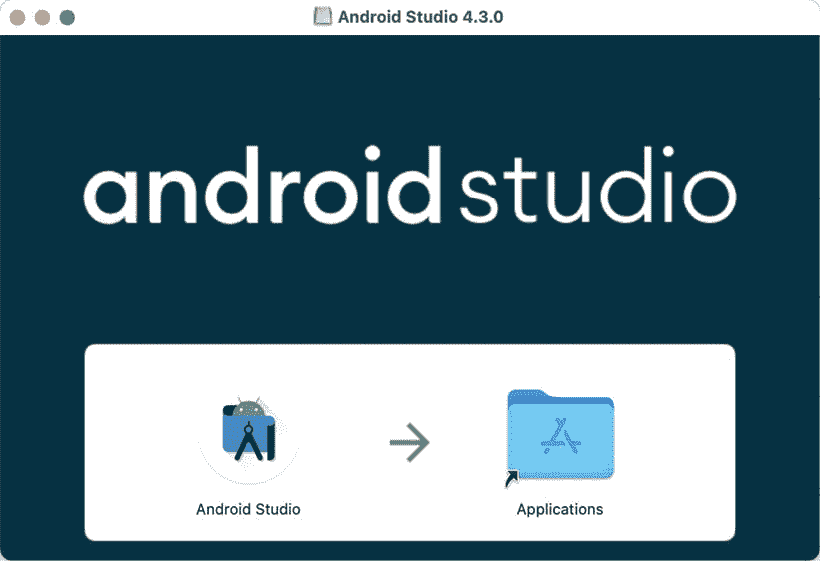

图 2-1

要安装此包，只需将 Android Studio 图标拖动到 Applications（应用程序）文件夹中。Android Studio 包将随后安装到系统的 Applications 文件夹中，此过程通常需要几秒钟完成。

要启动 Android Studio，使用 Finder 窗口在 Applications 文件夹中找到可执行文件并双击它。

为了方便以后访问该工具，可以从 Finder 窗口中拖动 Android Studio 图标并释放到 Dock（程序坞）上。

### 2.3.3 在 Linux 上安装

下载 Linux 版 Android Studio 软件包后，打开终端窗口，切换目录到要安装 Android Studio 的位置并执行以下命令：

```bash
unzip /<path to package>/android-studio-ide-<version>-linux.zip
```

注意，Android Studio 软件包将安装到名为`android-studio`的子目录中。因此，假设上述命令是在`/home/demo`中执行的，软件包将解压到`/home/demo/android-studio`。

要启动 Android Studio，打开终端窗口，切换目录到`android-studio/bin`子目录并执行以下命令：

```bash
./studio.sh
```

在 64 位 Linux 系统上运行时，可能需要在 Android Studio 运行之前安装一些 32 位支持库。在 Ubuntu 上，可以使用以下命令安装这些库：

```bash
sudo apt-get install libc6:i386 libncurses5:i386 libstdc++6:i386 lib32z1 libbz2-1.0:i386
```

在基于 Red Hat 和 Fedora 的 64 位系统上，使用以下命令：

```bash
sudo yum install zlib.i686 ncurses-libs.i686 bzip2-libs.i686
```

## 2.4 Android Studio 设置向导

如果您是第一次安装 Android Studio，在设置过程开始后出现的初始对话框可能类似于下方的图 2-2 所示：

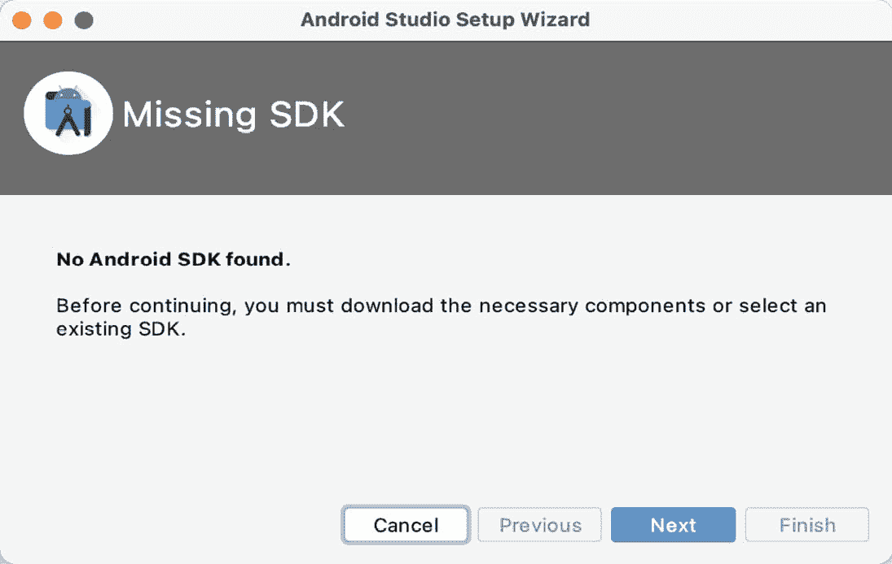

图 2-2

如果出现此对话框，点击 Next（下一步）按钮显示 SDK 组件设置对话框（图 2-3）。在此对话框中，点击 Next 按钮之前，请确保选择了 Android SDK 选项以及最新的 API 程序包：

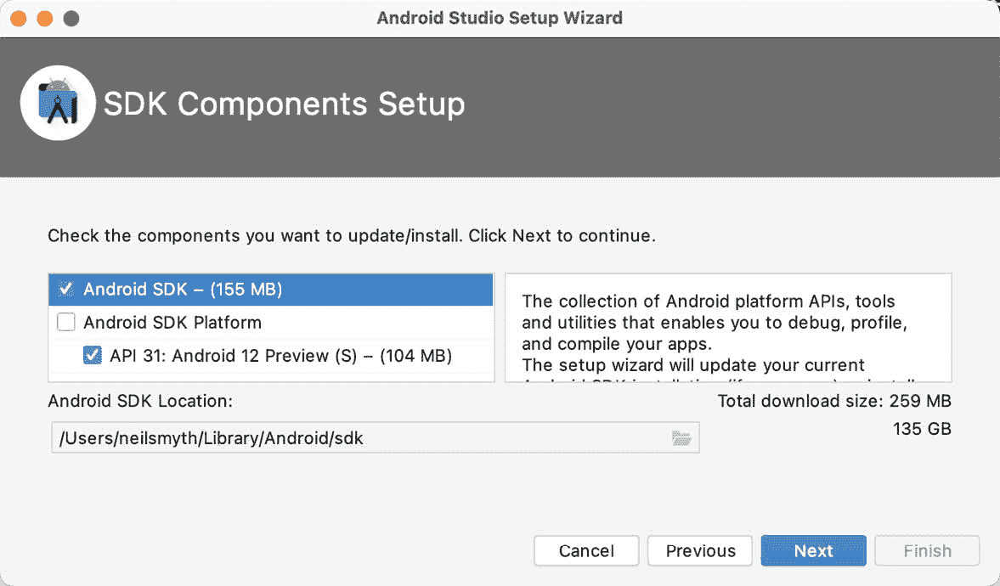

图 2-3

点击 Next 后，Android Studio 将下载并安装 Android SDK 和工具。

如果您之前安装过旧版本的 Android Studio，在首次启动此新版本时，可能会出现一个对话框，提供从以前的 Android Studio 版本导入设置的选项。如果您有以前版本的设置并想将其导入到最新安装中，请选择相应的选项和位置。或者，表示您不需要导入任何之前的设置并点击 OK（确定）按钮继续。

完成这些初始设置步骤后，点击 Finish（完成）按钮显示 Welcome to Android Studio 界面：

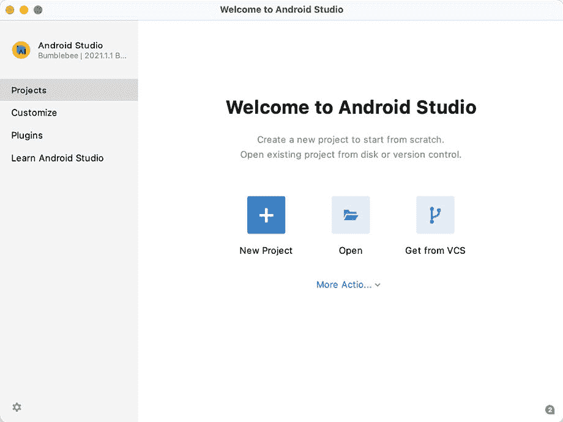

图 2-4

## 2.5 安装额外的 Android SDK 软件包

到目前为止执行的操作安装了 Android Studio IDE 和当前默认的 Android SDK 软件包。在继续之前，值得花一些时间验证安装了哪些包，并安装任何缺失或更新的包。

此任务可以通过点击欢迎对话框中的 More Actions（更多操作）链接并在下拉菜单中选择 SDK Manager 选项来完成。一旦调用，将显示 Preferences（首选项）对话框中的 Android SDK 界面，如图 2-5 所示：

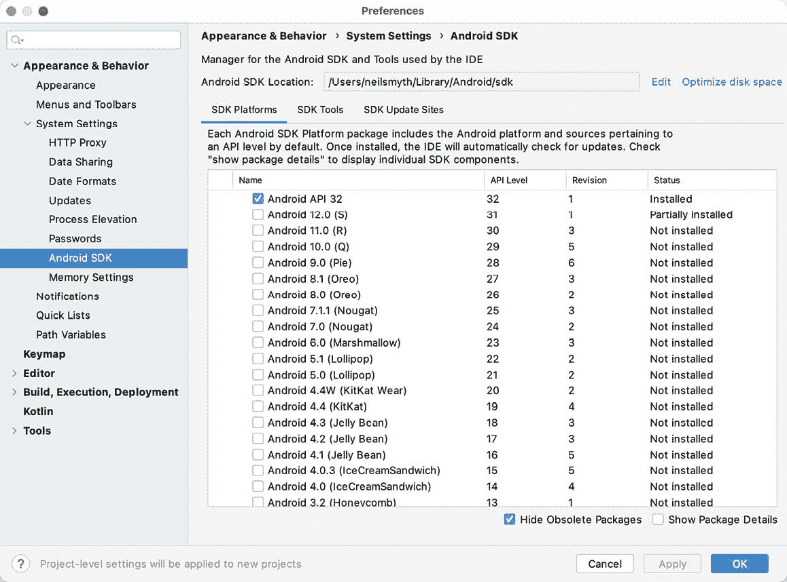

图 2-5

首次安装 Android Studio 后，可能只安装了最新发布的 Android SDK 版本。要安装旧版本的 Android SDK，只需勾选对应版本的复选框并点击 Apply（应用）按钮。

本书中的大多数示例将支持低至 Android 8.0 (Oreo) 的旧版本 Android。这是为了确保应用运行在广泛的 Android 设备上。在 SDK 版本列表中，启用 Android 8.0 (Oreo) 旁的复选框并点击 Apply 按钮。在生成的确认对话框中，点击 OK 按钮安装 SDK。随后的对话框将在执行安装前要求接受许可和条款。安装完成后点击 Finish。

可能还会列出最新 SDK 的可用更新。要访问有关准备更新的包的详细信息，请启用屏幕右下角的 Show Package Details（显示包详细信息）选项。这将显示类似于图 2-6 所示的信息：

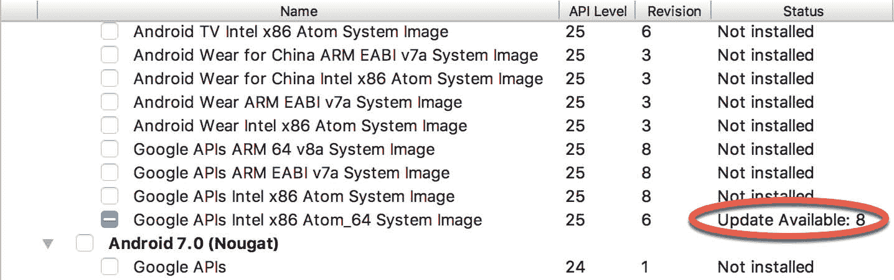

图 2-6

上面的图片强调了可用更新。要安装更新，勾选项目名称左侧的复选框并点击 Apply 按钮。

除了 Android SDK 软件包外，还安装了几个用于构建 Android 应用的工具。要查看当前安装的包并检查更新，请留在 SDK 设置界面并选择 SDK Tools 选项卡，如图 2-7 所示：

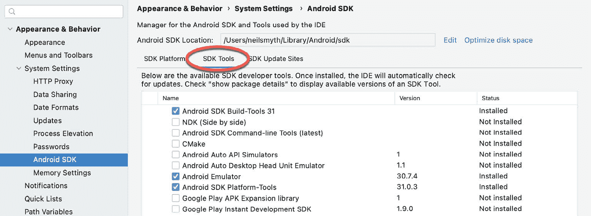

图 2-7

在 Android SDK Tools 界面中，确保以下软件包列在 Installed（已安装）列：

- Android SDK Build-tools

- Android Emulator

- Android SDK Platform-tools

- Google Play Services

- Intel Emulator Accelerator (HAXM installer)

- Google USB Driver (仅限 Windows)

- Layout Inspector image for API S

注意 Intel Emulator Accelerator (HAXM installer) 无法在基于 Apple Silicon 的 Mac 上安装。

如果上述任何软件包列为 Not Installed（未安装）或需要更新，只需勾选这些软件包旁的复选框并点击 Apply 按钮启动安装过程。如果出现 HAXM 安装程序设置对话框，选择推荐的内存分配：

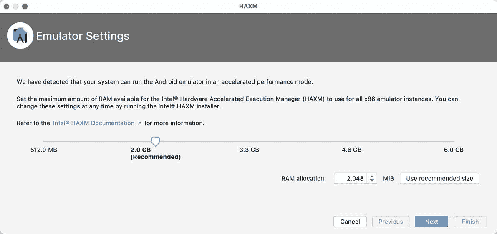

图 2-8

安装完成后，检查软件包列表并确保所选软件包现在列为 Installed。如果有未安装的，确保选中它们并再次点击 Apply 按钮。

## 2.6 使 Android SDK 工具命令行可用

大多数情况下，Android SDK 的底层工具将在 Android Studio 环境内访问。尽管如此，在某些情况下从命令提示符或终端窗口调用这些工具将非常有用。为了让开发的操作系统能够找到这些工具，有必要将其添加到系统的 PATH 环境变量。

无论什么操作系统，PATH 变量都需要配置包含以下路径（`<path_to_android_sdk_installation>` 代表安装 Android SDK 的文件系统位置）：

- `<path_to_android_sdk_installation>/sdk/tools`

- `<path_to_android_sdk_installation>/sdk/tools/bin`

- `<path_to_android_sdk_installation>/sdk/platform-tools`

可以通过启动 SDK Manager 并参考设置面板顶部的 Android SDK Location: 字段来识别 SDK 在系统上的位置，如图 2-9 所示：

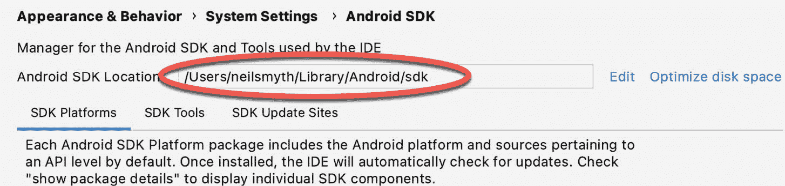

图 2-9

一旦确定了 SDK 的位置，将其添加到 PATH 变量的步骤取决于操作系统：

### 2.6.1 Windows 8.1

1. 在启动屏幕上，将鼠标移动到屏幕右下角，并在结果菜单中选择`搜索`（Search）。在搜索框中输入`控制面板`（Control Panel）。当`控制面板`图标出现在结果区域时，点击它在桌面上启动该工具。

2. 在`控制面板`中，使用`类别`（Category）菜单将显示更改为`大图标`（Large Icons）。从图标列表中选择名为`系统`（System）的项目。

3. 在`环境变量`对话框中，在系统变量列表中找到`Path`变量，选中它并点击`编辑…`（Edit…）按钮。在编辑对话框中使用`新建`（New）按钮为`path`添加三个新项。例如，假设 Android SDK 安装在`C:\Users\demo\AppData\Local\Android\Sdk`，则需要添加以下项目：

```
C:\Users\demo\AppData\Local\Android\Sdk\platform-tools
C:\Users\demo\AppData\Local\Android\Sdk\tools
C:\Users\demo\AppData\Local\Android\Sdk\tools\bin
```

4. 点击每个对话框中的`确定`（OK）并关闭系统属性控制面板。


通过按下键盘上的 `Windows + R` 并在运行对话框中输入 `cmd` 来打开命令提示符窗口。在“命令提示符”窗口中输入：

```bash
echo %Path%
```

返回的路径变量值应包含 Android SDK 平台工具文件夹的路径。通过尝试如下运行 `adb` 工具来验证 `platform-tools` 值是否正确：

```bash
adb
```

执行该工具时，应输出命令行选项列表。

同样，通过尝试运行 `AVD Manager` 命令行工具来检查工具路径设置（如果 `avdmanager` 工具报告 Java 问题，请忽略——这稍后会解决）：

```bash
avdmanager
```

如果其中一个或两个命令出现了类似下面的消息，那么很可能是向 `Path` 环境变量中添加了错误的路径：

`'adb' is not recognized as an internal or external command, operable program or batch file.`

## 2.6.2 Windows 10

右键点击“开始”（Start）菜单，从结果菜单中选择“设置”（Settings），并在“查找设置”文本框中输入“编辑系统环境变量”。在“系统属性”对话框中，点击“环境变量...”（Environment Variables...）按钮。按照 Windows 8.1 列出的步骤从第 3 步开始操作。

## 2.6.3 Windows 11

右键点击位于任务栏上的“开始”（Start）图标，并从结果菜单中选择“设置”（Settings）。当“设置”对话框出现时，向下滚动类别列表并选择“关于”（About）选项。在“关于”屏幕上，从“相关链接”（Related links）部分选择“高级系统设置”（Advanced system settings）。当“系统属性”窗口出现时，点击“环境变量...”（Environment Variables...）按钮。按照 Windows 8.1 列出的步骤从第 3 步开始操作。

## 2.6.4 Linux

在 Linux 上，此配置通常可以通过向家目录下的 `.bashrc` 文件中添加命令来实现（具体取决于使用的特定 Linux 发行版）。假设 Android SDK 捆包安装在 `/home/demo/Android/sdk`，`.bashrc` 文件中的 `export` 行内容如下：

```bash
export PATH=/home/demo/Android/sdk/platform-tools:/home/demo/Android/sdk/tools:/home/demo/Android/sdk/tools/bin:/home/demo/android-studio/bin:$PATH
```

同时注意，上述命令将 `android-studio/bin` 目录添加到 `PATH` 变量中。这将允许无论终端窗口中的当前目录如何，都可以执行 `studio.sh` 脚本。

## 2.6.5 macOS

可以使用若干种技术来修改 macOS 上的 `$PATH` 环境变量。认为最干净的方法是在 `/etc/paths.d` 目录下创建一个新文件，其中包含要添加到 `$PATH` 的路径。假设 Android SDK 安装位置为 `/Users/demo/Library/Android/sdk`，可以通过在 `/etc/paths.d` 目录下创建一个名为 `android-sdk` 的新文件并包含以下行来配置路径：

```
/Users/demo/Library/Android/sdk/tools
/Users/demo/Library/Android/sdk/tools/bin
/Users/demo/Library/Android/sdk/platform-tools
```

注意由于这是一个系统目录，在创建文件时将需要使用 `sudo` 命令。例如：

```bash
sudo vi /etc/paths.d/android-sdk
```

## 2.7 Android Studio 内存管理

Android Studio 是一个大型且复杂的应用程序，由许多后台进程组成。尽管 Android Studio 过去曾被批评性能不佳，但 Google 在最近的发布中进行了重大的性能改进，并在每个新版本中持续改进。这些改进包括允许用户配置 Android Studio IDE 以及用于构建和运行应用程序的后台进程所使用的内存量。这允许软件利用具有更大内存的系统。

如果你在具有足够空闲内存来增加这些值的系统上运行 Android Studio（此功能仅适用于具有 5GB 或更多内存的 64 位系统），并发现 Android Studio 性能出现下降，那么尝试这些内存设置可能是值得的。Android Studio 还可能通过类似下方所示的对话框通知你可以提高性能：

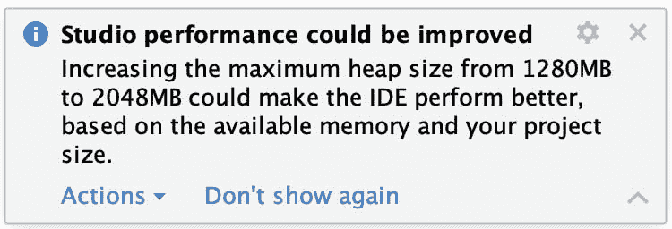

图 2-10

## 2.8 更新 Android Studio 和 SDK

Android Studio 和 SDK 会经常发布新版本。使用 `Android SDK Manager` 安装新版本的 SDK。Android Studio 通常会通知你有可用更新。

要手动检查 Android Studio 更新，请从 Android Studio 主窗口使用“帮助 -> 检查更新...”（Help -> Check for Updates...）菜单选项（macOS 为 `Android Studio -> Check for Updates...`）。

## 2.9 总结

在开发 Android 应用程序之前，第一步是设置环境。这包括 Android SDK 和 Android Studio IDE。在本章中，我们涵盖了在 Windows、macOS 和 Linux 上安装这些包的步骤。

# 3. 在 Android Studio 中创建示例应用

本书之前的章节涵盖了配置适用于 Android Studio IDE 开发 Android 应用程序的环境所需的步骤。在继续更高级的主题之前，现在是验证所有所需的开发包均已安装并正常运行的好时机。实现此目标的最佳方法是创建一个 Android 应用程序并编译运行。本章将介绍创建 Android 项目的过程。创建项目后，后续章节将探讨使用 Android 模拟器环境进行应用程序的测试运行。

## 3.1 关于项目

在本章创建的项目是一个初级的货币汇率转换器（事实上，它非常简单，仅支持从美元转换为欧元，并使用估算的折算汇率进行转换）。该项目还将使用 Android Studio 项目模板中最基础的之一。这种简单性使我们能够介绍 Android 应用开发的一些关键方面，而不会因为一次性引入过多的概念（例如推荐的应用程序架构和 Android 架构组件）让初学者感到无从下手。在遵循本章的教程时，请放心，在这个初始示例项目中使用的所有技术和代码将在后面的章节中进行更详细的介绍。

## 3.2 创建新的 Android 项目

应用开发过程的第一步是在 Android Studio 环境中创建一个新项目。因此，请从启动 Android Studio 开始，如图 3-1 所示的“Welcome to Android Studio”界面：

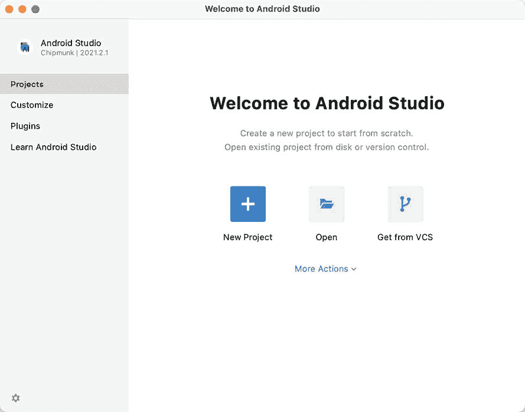

图 3-1

一旦出现此窗口，Android Studio 就已准备好创建新项目。要创建新项目，只需点击 `New Project`（新建项目）选项即可显示新项目向导的第一个屏幕。

## 3.3 创建 Activity

第一步是为应用定义要创建的初始 Activity 类型。提供多种选项，可以为手机和平板电脑、Wear OS、电视、Android 音频或 Android Things 创建项目。在开发 Android 应用时，可以使用多种 Activity 类型，其中许多将在后面的章节中进行详细介绍。然而，为了本示例的目的，只需从 Templates（模板）面板中选择 `Phone and Tablet`（手机和平板电脑）选项，然后选择创建 `Empty Activity`（空 Activity）选项。`Empty Activity` 会创建一个包含单个 `TextView` 对象的模板用户界面。

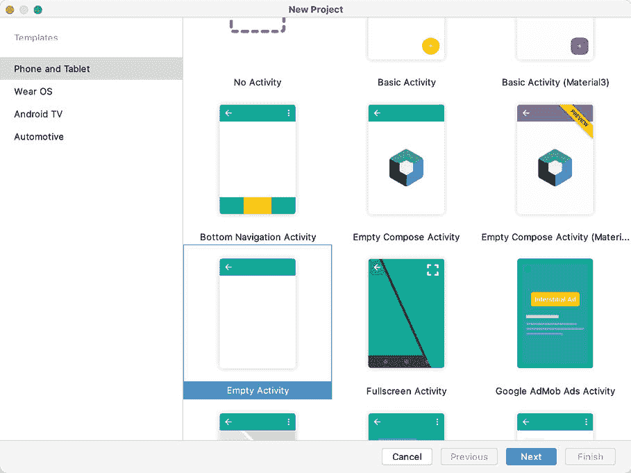

图 3-2

选中 `Empty Activity` 选项后，点击 `Next`（下一步）继续配置项目。

## 3.4 定义项目和 SDK 设置

在项目配置窗口（图 3-3）中，将 `Name`（名称）字段设置为 `AndroidSample`。应用程序名称是在 Android Studio 内部引用和识别该应用程序的名称，也是如果完成的应用程序要在 Google Play 商店销售时将使用的名称。

`Package name`（包名）用于在 Android 应用生态系统中唯一标识该应用程序。虽然它可以被设置为任何唯一标识你的应用的字符串，但传统上，它是基于域名的反转 URL，后跟应用程序名称。例如，如果你的域名是 `www.mycompany.com`，且应用程序已命名为 `AndroidSample`，则包名指定如下：

`com.mycompany.androidsample`

如果你没有域名，可以在 `Company Domain`（公司域名）字段中输入任何其他字符串，或者出于测试之目的使用 `example.com`，但在发布应用程序之前需要更改它：

`com.example.androidsample`

`Save location`（保存位置）设置将默认到位于你主目录下名为 `AndroidStudioProjects` 文件夹中的位置，可以通过点击包含当前路径设置文本字段右侧的文件夹图标进行更改。

将 `minimum SDK`（最低 SDK）设置设置为 `API 26`：Android 8.0 (Oreo)。除非某个必要功能仅在较新版本中可用，否则本书中创建的大多数项目将使用此最低 SDK。这里的目标是使用最新的 Android SDK 构建应用，同时保持与运行旧版本 Android 的设备的兼容性（在这种情况下，最远可追溯到 Android 8.0）。Minimum SDK 设置下方的文本将概述目前正在运行该应用的 Android 设备百分比。点击 `Help me choose`（帮助我选择）按钮（在图 3-3 中突出显示）查看仍在使用的各种 Android 版本的详情：

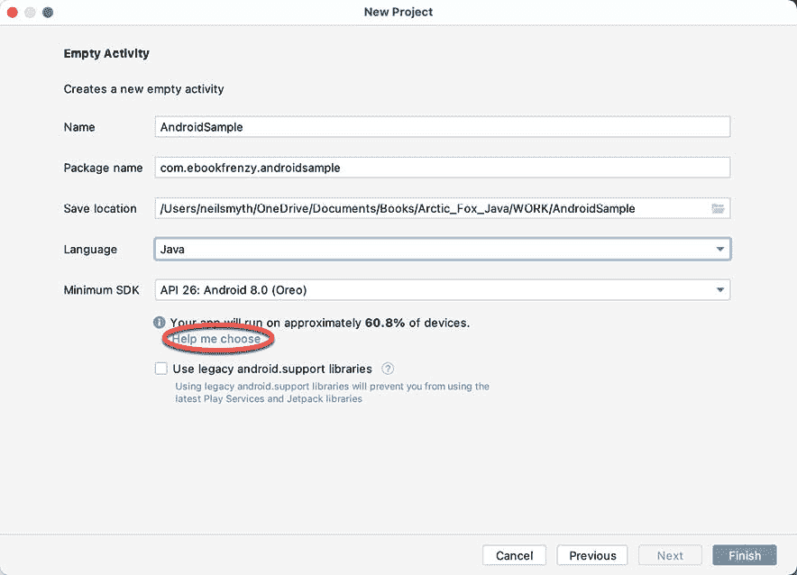

图 3-3

最后，将 `Language`（语言）菜单更改为 `Java` 并点击 `Finish`（完成）启动项目创建过程。

## 3.5 修改示例应用程序

此时，Android Studio 已创建一个最小的示例应用程序项目并打开了主窗口。

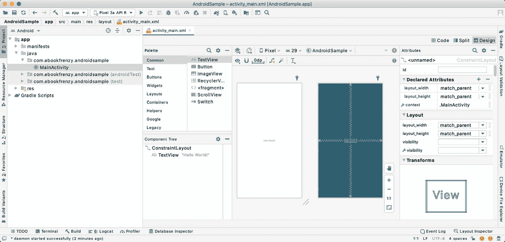

图 3-4

新创建的项目和关联文件的引用列位于主项目窗口左侧的 `Project`（项目）工具窗口。`Project` 工具窗口有多种显示信息的模式。默认情况下，此面板应处于 `Android` 模式。此设置由面板顶部的菜单控制，如图 3-5 所示。如果面板当前不在 `Android` 模式，请使用菜单切换模式：

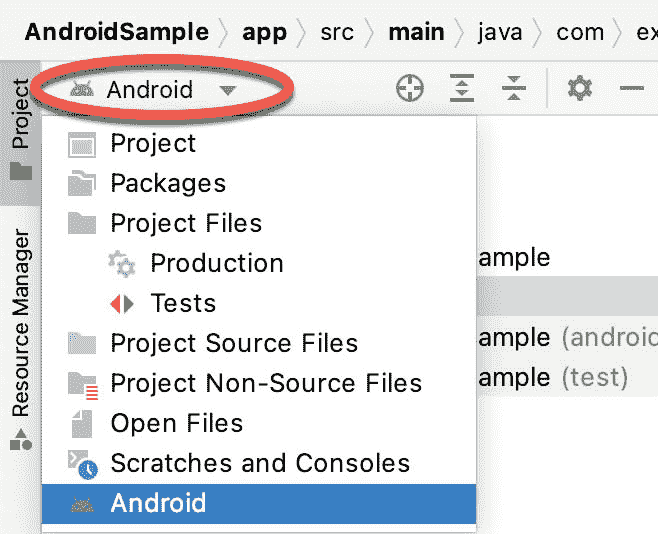

图 3-5

## 3.6 修改用户界面

我们 Activity 的用户界面设计存储在名为 `activity_main.xml` 的文件中，该文件位于项目文件层次结构的 `app -> res -> layout` 下。一旦在 `Project` 工具窗口中找到它，双击该文件将其加载到用户界面 `Layout Editor`（布局编辑器）工具中，该工具出现在 Android Studio 主窗口的中间面板：

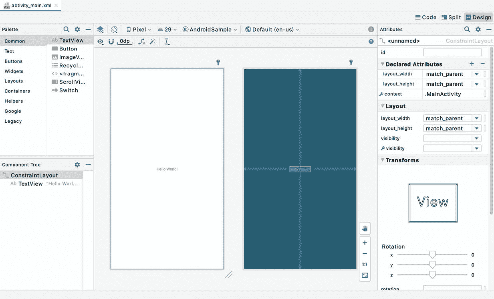

图 3-6

`Layout Editor` 窗口顶部工具栏上有一个菜单（在图中设置为 `Pixel`），它反映在 `Layout Editor` 面板中的设备视觉表示中。点击此菜单可以选择广泛的其他设备选项。

要在设备表示的横屏和竖屏之间切换方向，请直接使用设备选择菜单左侧显示  图标的下拉菜单。使用夜间按钮() 开启或关闭夜间模式。

正如设备屏幕所示，内容布局已经包含一个显示“Hello World!”消息的标签。面板左侧有一个调色板，包含了不同类别的用户界面组件，这些组件用于构建用户界面，例如按钮、标签和文本字段。然而，需要注意的是，并不是所有的用户界面组件对用户可见。其中一个类别是布局。Android 支持多种布局，为视觉用户界面组件在屏幕上的定位和管理提供不同程度的控制。虽然从用户界面的视觉表示很难判断，但当前设计是使用 `ConstraintLayout` 创建的。可以通过查看 `Component Tree`（组件树）面板中的信息来确认，该面板默认位于 `Layout Editor` 面板的左下角，如图 3-7 所示：


图 3-7

从组件树层次结构可以看出，用户界面布局由一个 `ConstraintLayout` 父对象和一个 `TextView` 子对象组成。

在继续之前，请同样检查布局编辑器（Layout Editor）的自动连接（Autoconnect）模式已启用。这意味着当组件被添加到布局时，布局编辑器将自动添加约束，以确保组件在不同的屏幕尺寸和设备方向上正确定位（该主题将在后续章节中进行更详细的介绍）。“自动连接”按钮位于布局编辑器工具栏中，用一个磁铁图标表示。当其被禁用时，磁铁图标上会出现一条对角线（见图 3-8）。如有必要，请点击此按钮重新启用自动连接模式。

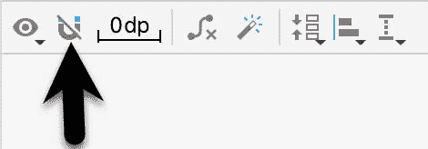

图 3-8

修改应用程序的下一步是向布局添加一些额外的组件，其中第一个是 `Button`（按钮），供用户点击以启动货币转换。

调色板（Palette）面板由两列组成，左列包含视图组件类别列表。右列列出当前选择类别包含的组件。例如，在图 3-9 中，当前在 `Buttons` 类别中选择了 `Button` 视图：


图 3-9

从 `Buttons` 列表中点击并拖动 `Button` 对象，将其到用户界面设计的水平中心，使其位于现有的 `TextView` 小部件下方：

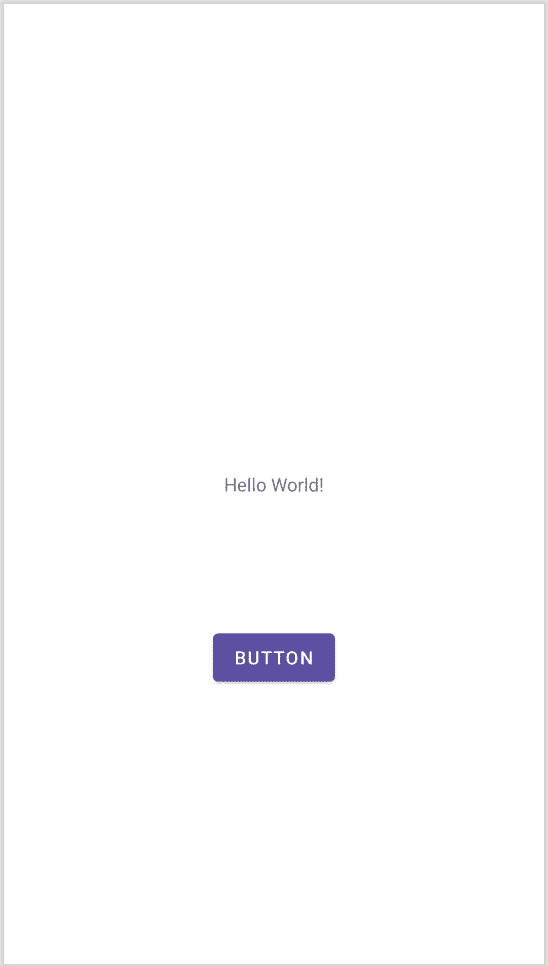

图 3-10

下一步是更改当前由 `Button` 组件显示的文本。位于设计区域右侧的面板是属性（Attributes）面板。该面板显示分配给布局中当前选择组件的属性。在此面板中，在“常用属性（Common Attributes）”部分找到 `text`（文本）属性，并将当前值从“Button”更改为“Convert”（转换），如图 3-11 所示：


图 3-11

第二个带有扳手图标的文本属性允许设置文本属性，该属性仅在布局编辑器工具中显示，而在运行时不会显示。这对于测试视觉组件和布局在不同设置下的行为非常有用，而无需反复运行应用。

以防自动连接系统未能设置所有布局连接，点击“推断约束（Infer constraints）”按钮（图 3-12），为布局添加任何缺失的约束：

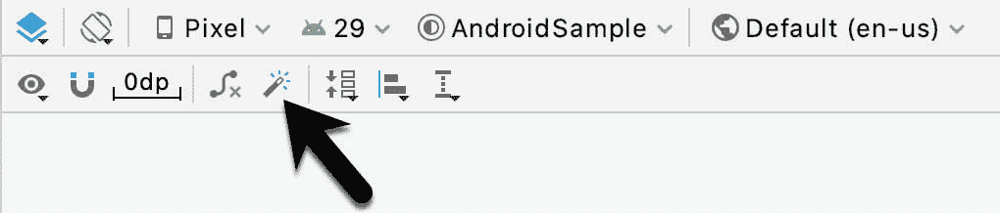

图 3-12

此时，重要的是解释位于布局编辑器工具右上角的警告按钮，如图 3-13 所示。显而易见，这表明布局可能存在潜在问题。要查看任何问题的详细信息，请点击该按钮：


图 3-13

点击该按钮时，将出现一个面板（图 3-14），用于描述问题的性质并提供一些可能的纠正措施：

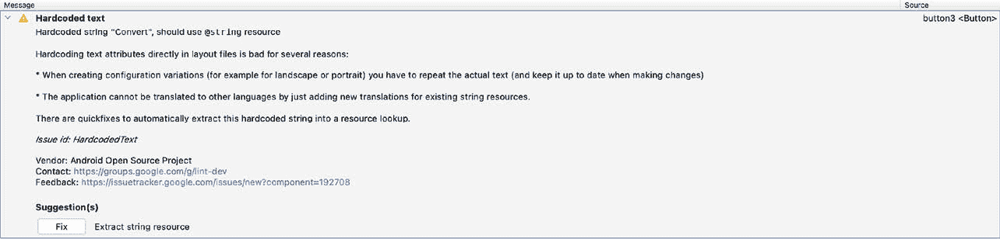

图 3-14

目前，列出的唯一警告如下：

硬编码字符串 "Convert"，应使用 @string 资源

此 I18N（国际化）消息告诉我们，项目未来的国际化方面存在潜在问题（“I18N”源于“internationalization”一词以“I”开头，以“N”结尾，中间有 18 个字母）。该警告提醒我们，在开发 Android 时，应尽可能将文本字符串等属性和值存储为资源的形式。这样做可以通过修改资源文件来更改应用程序的外观，而无需更改应用程序源代码。这在将用户界面翻译成不同的语言时特别有价值。如果用户界面中的所有文本都包含在一个资源文件中，例如，可以将该文件交给翻译人员，由他们执行翻译工作并返回翻译后的文件包含在应用程序中。这使得可以针对多种语言而无需进行任何源代码更改。在此情况下，我们将创建一个名为 `convert_string` 的新资源，并为其分配字符串“Convert”。

点击问题说明（Issue Explanation）面板中的“修复（Fix）”按钮以显示提取资源（Extract Resource）面板（图 3-15）。在此面板中，将资源名称字段更改为 `convert_string`，并在点击 OK 按钮之前将资源值保留为 Convert。

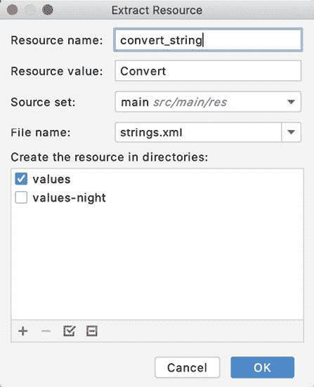

图 3-15

要添加的下一个部件是 `EditText` 小部件，用户将在其中输入要转换的美元金额。从调色板面板中，选择 Text 类别，点击并拖动 Number (Decimal) 组件到布局上，使其水平居中并位于现有的 `TextView` 小部件上方。选中该小部件后，使用属性工具窗口将 `hint`（提示）属性设置为“dollars”。点击警告图标并将字符串提取为名为 `dollars_hint` 的资源。

本章稍后编写的代码将需要访问用户输入 `EditText` 字段的美元值。它将通过引用分配给用户界面布局中小部件的 `id` 来实现。Android 分配给小部件的默认 `id` 可以在选择小部件时从属性工具窗口查看和更改，如图 3-16 所示：


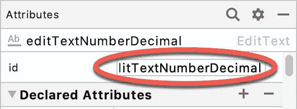

图 3-16

将 `id` 更改为 `dollarText`，并在命名对话框中点击“重构（Refactor）”按钮。这确保了项目其他地方对旧 `id` 的引用会自动更新：

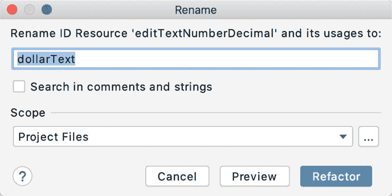

图 3-17

点击“推断（Infer）”按钮添加任何缺失的布局约束。此时，布局应类似于图 3-18 所示：


图 3-18

## 3.7 审查布局和资源文件

在进入下一步之前，我们将查看一些用户界面设计和资源处理的内部方面。在上一节中，我们通过使用布局编辑器工具修改 `activity_main.xml` 文件对用户界面进行了一些更改。实际上，布局编辑器所做的只是提供了一种易于编辑文件底层 XML 内容的方法。在实践中，没有理由不直接修改 XML 来进行用户界面更改，而且在某些情况下，这实际上比使用布局编辑器工具更快。在布局编辑器面板的右上角有三个按钮，如下图 3-19 所示：


图 3-19

默认情况下，编辑器将处于设计模式，仅显示布局的可视化表示。最左侧的按钮将切换到代码模式以显示布局的 XML，而中间按钮将进入分屏模式，同时显示布局和 XML，如图 3-20 所示：

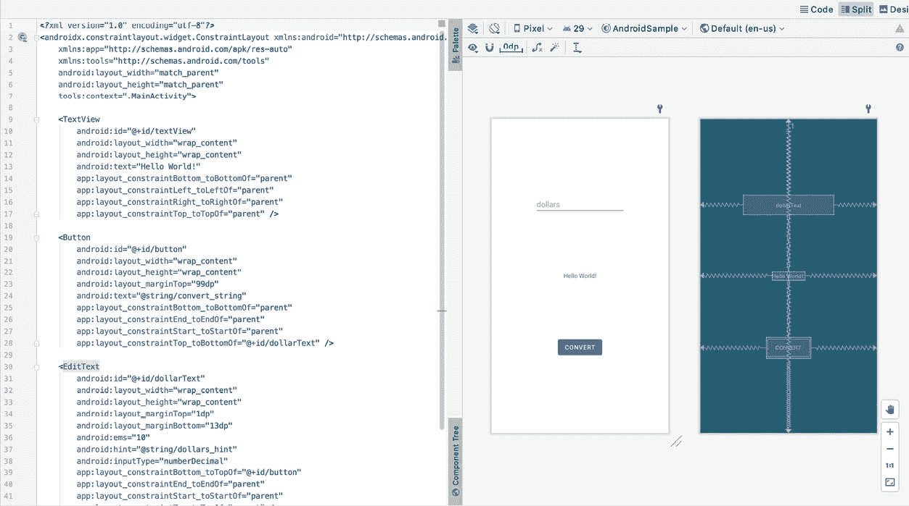

图 3-20

从 XML 文件的结构可以看出，用户界面由 `ConstraintLayout` 组件组成，而它又是 `TextView`、`Button` 和 `EditText` 对象的父级。我们还可以看到，例如 `Button` 的文本属性被设置为我们的 `convert_string` 资源。尽管复杂性和内容不同，所有用户界面布局都是以这种层次化的、基于 XML 的方式组织的。

当 XML 布局发生更改时，这些更改将反映在布局画布上。也可以在布局画布面板内对布局进行视觉化修改，更改将出现在 XML 列表中。要查看此效果，请切换到分屏模式（Split mode）并修改 XML 布局，将 `ConstraintLayout` 的背景颜色更改为如下红色调：

```xml
<?xml version="1.0" encoding="utf-8"?>
<androidx.constraintlayout.widget.ConstraintLayout xmlns:android="http://schemas.android.com/apk/res/android"
    xmlns:app="http://schemas.android.com/apk/res-auto"
    xmlns:tools="http://schemas.android.com/tools"
    android:layout_width="match_parent"
    android:layout_height="match_parent"
    tools:context=".MainActivity"
    android:background="#ff2438" >

.
</androidx.constraintlayout.widget.ConstraintLayout>
```

注意，布局的颜色会实时变化以匹配 XML 文件中的新设置。同时注意，在 XML 编辑器左侧边距（也称为槽 gutter）包含颜色设置的行旁边，会出现一个小红色正方形。这是在某个属性上设置了红色的视觉提示。点击红色正方形将显示一个颜色选择器，允许选择不同的颜色：

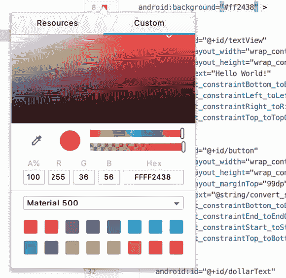

图 3-21

在继续之前，请从布局文件中删除背景属性，以便背景恢复到默认设置。

最后，使用项目（Project）面板找到 `app -> res -> values -> strings.xml` 文件，并双击它将其加载到编辑器中。目前 XML 的内容如下：

```xml
<resources>
    <string name="app_name">AndroidSample</string>
    <string name="convert_string">Convert</string>
    <string name="dollars_hint">dollars</string>
</resources>
```

作为资源运行的演示，将当前分配给 `convert_string` 资源的字符串值更改为“Convert to Euros”，然后通过选择编辑器面板中布局文件的标签页返回布局编辑器工具。注意，布局已经获取了该字符串的新资源值。

访问 XML 文件中引用的资源值还有一种快捷方法。在分屏（Split）或代码（Code）模式下使用布局编辑器工具，点击 `"@string/convert_string"` 属性设置使其变为高亮，然后在键盘上按 `Ctrl-B`（macOS 上为 `Cmd-B`）。Android Studio 随后打开 `strings.xml` 文件并带您到该文件中声明此资源的行。利用此机会将字符串资源还原为原始的“Convert”文本，并添加以下额外的字符串资源项，该资源将在应用代码中引用：

```xml
<resources>
.
    <string name="convert_string">Convert</string>
    <string name="dollars_hint">dollars</string>
    <string name="no_value_string">No Value</string>
</resources>
```

资源字符串也可以使用 Android Studio Translation 编辑器（Translations Editor）进行编辑。要打开此编辑器，右键点击 `app -> res -> values -> strings.xml` 文件并选择 `Open editor` 菜单选项。这将在 Android Studio 窗口的主面板中显示翻译编辑器：

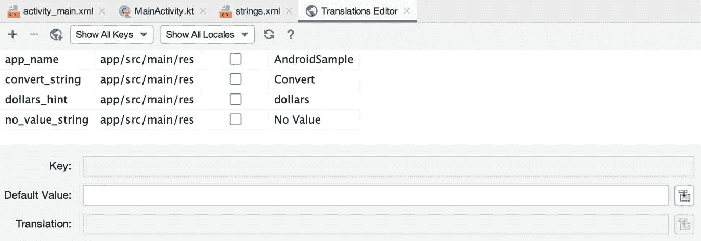

图 3-22

此编辑器允许对分配给资源键的字符串进行编辑，并管理多种语言的翻译。

### 3.8 添加交互

此示例项目的最后一步是使应用程序具有交互性，这样当用户在 `EditText` 字段中输入美元值并点击转换按钮时，转换后的欧元值将显示在 `TextView` 上。这涉及在 `Button` 控件上实现一些事件处理。具体来说，需要配置 `Button`，以便在触发 `onClick` 事件时调用应用代码中的方法。事件处理可以通过多种不同的方式实现，并将在稍后一个标题为“Android 事件处理概览与示例”的章节中进行详细介绍。将布局编辑器切换到设计（Design）模式，在布局编辑器中选择 `Button` 控件，参考属性（Attributes）工具窗口，并如下所示指定名为 `convertCurrency` 的方法：


图 3-23

注意，`onClick` 属性的文本字段现在用红色边框高亮，以警告我们该按钮已配置为调用一个尚不存在的方法。为了解决这个问题，在项目工具窗口中双击 `MainActivity.java` 文件（`app -> java -> <package name> -> MainActivity`）将其加载到代码编辑器中，并在类文件中添加 `convertCurrency` 方法的代码，使其内容如下，请注意还需要导入一些额外的 Android 程序包：

```java
package com.ebookfrenzy.androidsample;

import androidx.appcompat.app.AppCompatActivity;
import android.os.Bundle;
import android.view.View;
import android.widget.EditText;
import android.widget.TextView;
.
import java.util.Locale;

public class MainActivity extends AppCompatActivity {
    @Override
    protected void onCreate(Bundle savedInstanceState) {
        super.onCreate(savedInstanceState);
        setContentView(R.layout.activity_main);
    }

    public void convertCurrency(View view) {
        EditText dollarText = findViewById(R.id.dollarText);
        TextView textView = findViewById(R.id.textView);
        if (!dollarText.getText().toString().equals("")) {
            float dollarValue = Float.parseFloat(dollarText.getText().toString());
            float euroValue = dollarValue * 0.85F;
            textView.setText(String.format(Locale.ENGLISH,"%f", euroValue));
        } else {
            textView.setText(R.string.no_value_string);
        }
    }
}
```

### 3.9 总结

虽然并不复杂，但设置 Android 开发环境涉及许多步骤。在完成这些步骤后，值得运行一个示例以确保环境正确安装和配置。在本章中，我们创建了一个示例应用程序并使用 Android Studio 布局编辑器工具修改了用户界面布局。在此过程中，我们探讨了尽可能使用资源的重要性，特别是在字符串值的情况下，并简要涉及了布局的主题。

最后，在 `Button` 上添加了 `onClick` 事件，连接到一个方法，该方法用于从 `EditText` 组件中提取用户输入，将美元转换为欧元，并将结果显示在 `TextView` 上。

由于应用程序已准备好进行测试，下一章将详细介绍用于测试的模拟器所需的步骤。

尽管 Android Studio 预览面板允许我们看到正在设计的布局并使用交互模式测试基本功能，但若要完全测试其运行情况，仍需要编译并运行整个应用程序。Android 应用程序可以通过在物理设备或 Android 虚拟设备（`AVD`）模拟器环境中安装并运行来完成测试。在使用 `AVD` 之前，必须先创建并配置它以匹配特定设备型号的规格。在本章中，我们将以 `Pixel 4` 手机作为示例，完成此类虚拟设备的创建。

## 4.1 关于 Android 虚拟设备

`AVDs` 本质上是模拟器，允许在测试 Android 应用程序时，无需将应用安装在物理 Android 设备上。一个 `AVD` 可以被配置为模拟各种硬件功能，包括屏幕大小、内存容量，以及是否存在摄像头、`GPS` 导航支持或加速度计等选项。作为 Android Studio 标准安装的一部分，系统安装了多个模拟器模板，允许为一系列不同的设备配置 `AVDs`。此外，通过指定处理器类型、内存容量以及屏幕尺寸和像素密度等属性，还可以创建匹配任何物理 Android 设备的自定义配置。

`AVD` 会话可以以独立窗口的形式出现，也可以嵌入在 Android Studio 窗口中。

新的 `AVDs` 使用 Android 虚拟设备管理器创建和管理，该管理器可以在命令行模式下使用，也可以使用更友好的图形界面。创建新 `AVD` 的第一步是启动 `AVD Manager`。这可以在 Android Studio 环境内通过从主窗口选择 `Tools -> Device Manager` 菜单来实现。

启动后，管理器将以工具窗口的形式显示，如图 4-1 所示：

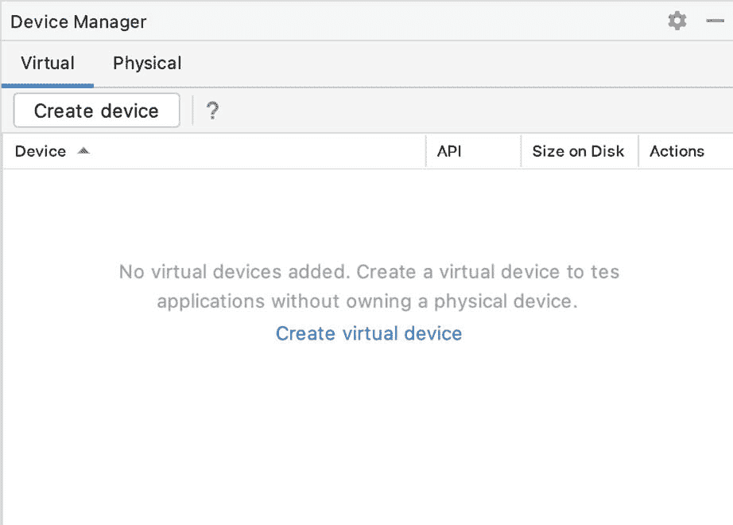

图 4-1

要添加新的 `AVD`，请确保在点击 `Create device` 按钮之前选择了 `Virtual` 选项卡，以打开虚拟设备配置对话框：

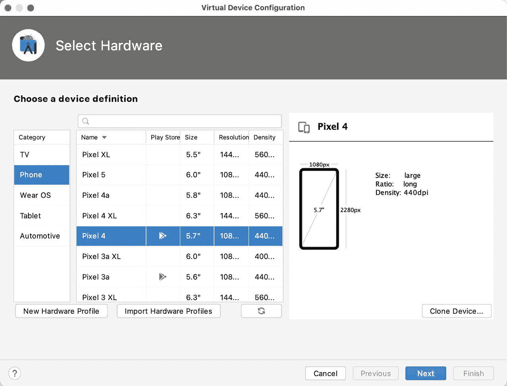

图 4-2

在对话框中，执行以下步骤以创建一个兼容 `Pixel 4` 的模拟器：

1. 从 `Category` 面板中选择 `Phone` 选项，以显示可用的 Android 手机 `AVD` 模板列表。

2. 选择 `Pixel 4` 设备选项并点击 `Next`。

3. 在 `System Image` 屏幕上，选择最新版本的 Android。注意，如果系统镜像尚未安装，`Release Name` 旁边将提供 `Download` 链接。点击此链接下载并安装系统镜像，然后再选择它。如果所需的镜像未在列表中，点击 `x86 Images`（如果你运行带有 Apple 芯片的 Mac，请点击 `ARM images`）或 `Other images` 选项卡以查看备列表。

4. 点击 `Next` 继续，并在 `name` 字段中输入描述性名称（例如 `Pixel 4 API 32`），或直接接受默认名称。

5. 点击 `Finish` 创建 `AVD`。

6. `AVD` 创建完成后，现在可以关闭 `Device Manager`。如果以后需要对 `AVD` 进行修改，只需重新打开 `Device Manager`，从列表中选择该 `AVD`，并点击 `Actions` 列中的 `pencil icon` 来编辑设置。

## 4.2 启动模拟器

要对新创建的 `AVD` 模拟器进行测试运行，只需从 `Device Manager` 中选择该模拟器并点击 `launch button`（`Actions` 列中的三角形）。模拟器将嵌入到 Android Studio 主窗口中并开始启动过程。模拟器启动所需的时间取决于 `AVD` 的配置及其运行系统的配置：

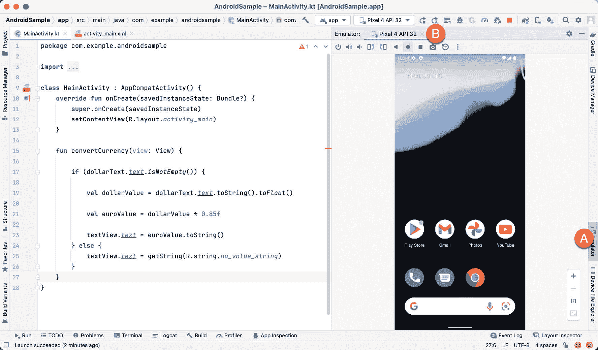

图 4-3

要隐藏和显示模拟器工具窗口，请点击 `Emulator` 工具窗口按钮（如上方标记的 A）。点击标签页旁边的“x”关闭按钮（B）退出模拟器。模拟器工具窗口可以容纳多个模拟器会话，每个会话由一个标签页表示。例如图 4-4 显示了一个具有两个模拟器会话的工具窗口：


图 4-4

要在会话之间切换，只需点击相应的标签页即可。

虽然模拟器可能默认以竖屏方向显示，但和其他默认选项可以更改。在 `Device Manager` 中，选择新的 `Pixel 4` 条目，并点击设备行 `Actions` 列中的 `pencil icon`。在配置屏幕中，找到 `Startup orientation` 部分并更改方向设置。退出并重启模拟器会话以查看更改效果。关于模拟器的更多细节将在下一章“使用和配置 Android Studio AVD 模拟器”中介绍。

为了节省本章下一节的时间，请在继续之前保持模拟器运行。

## 4.3 在 AVD 中运行应用程序

配置好 `AVD` 模拟器后，在前章节创建的示例应用程序 `AndroidSample` 现在可以编译并运行。将 `AndroidSample` 项目加载到 Android Studio 后，确保新创建的 `Pixel 4` `AVD` 显示在设备菜单中（见下图 4-5 中的标记 A），然后点击绿色三角形（B）的运行按钮，或选择 `Run -> Run 'app'` 菜单选项：

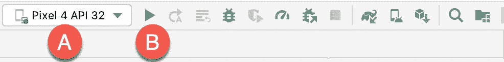

图 4-5

设备菜单（A）可选择不同的 `AVD` 实例或物理设备作为运行目标，并在多个设备上运行。该菜单还提供了访问 `Device Manager` 以及设备连接和故障排除选项：


图 4-6

一旦应用程序安装并运行，第一个 fragment 的界面将出现在模拟器中（fragment 是 Android 项目中可重用的部分，通常由用户界面布局和代码组成，该主题将在“Android Fragment 简介”章节中介绍）：


图 4-7

如果活动没有自动启动，请检查模拟器上出现了启动图标。如果是，只需点击它即可启动应用程序。一旦运行开始，`Run` 工具窗口将变为可用。`Run` 工具窗口会在包安装和启动时显示诊断信息。图 4-8 显示了典型应用程序启动时的 `Run` 工具窗口输出：

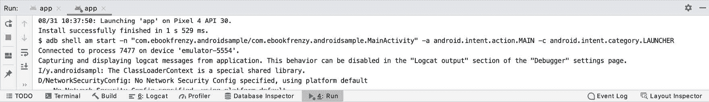

图 4-8

如果在启动过程中遇到问题，`Run` 工具窗口将提供信息，这可能有助于隔离问题原因。

假设应用程序加载到模拟器并按预期运行，那么我们已经安全地验证了 Android 开发环境已正确安装和配置。现在程序正在运行，尝试进行温度转换以验证应用是否按预期工作。

## 4.4 在多个设备上运行

上述图 4-6 所示的运行菜单包含一个并行在多个模拟器和设备上运行应用程序的选项。选择此选项后，将显示图 4-9 所示的对话框，列出了系统中配置的所有 `AVDs` 以及任何连接的物理设备列表。在点击 `Run` 按钮之前，勾选要运行的模拟器或设备旁的复选框：

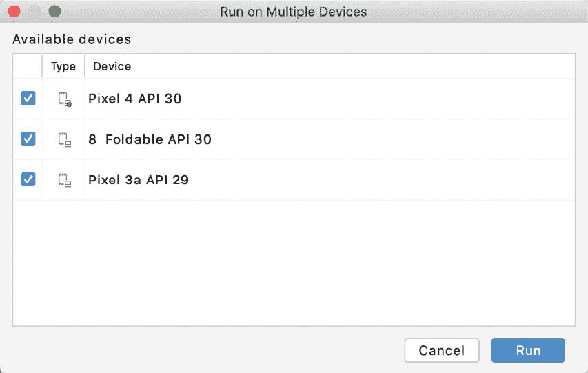

图 4-9

点击 `Run` 按钮后，Android Studio 将在选定的模拟器和设备上启动该应用。

## 4.5 停止正在运行的应用程序

要停止正在运行的应用程序，只需点击主工具栏上的停止按钮，如 图 4-10 所示：


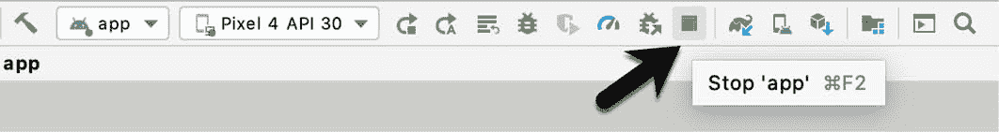

图 4-10

也可以使用`Run`工具窗口终止应用。首先，通过在应用运行时变为可用的标题栏按钮显示`Run`工具窗口。一旦`Run`工具窗口出现，点击下方图 4-11 所示中高亮显示的停止按钮：

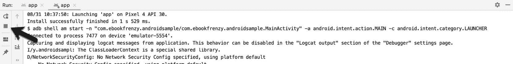

图 4-11

## 4.6 支持深色主题

Android 10 引入了备受期待的深色主题，Android Studio 应用项目默认已启用了该功能。若要在 AVD 模拟器中测试深色主题，请在模拟器中运行的 Android 实例内打开`Settings`应用。在`Settings`应用中，选择`Display`分类并如图 4-12 所示启用`Dark`主题选项，使屏幕背景变为黑色：

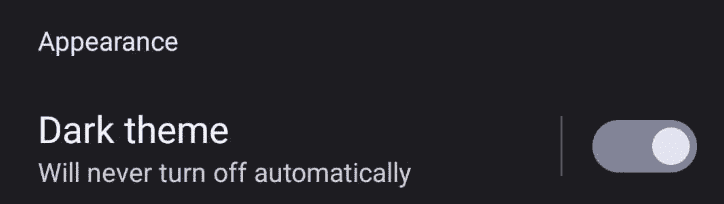

图 4-12

启用深色主题后，运行`AndroidSample`应用，你会注意到它以深色主题的形式显示，包括黑色背景和按钮上的紫色背景色，如图 4-13 所示：

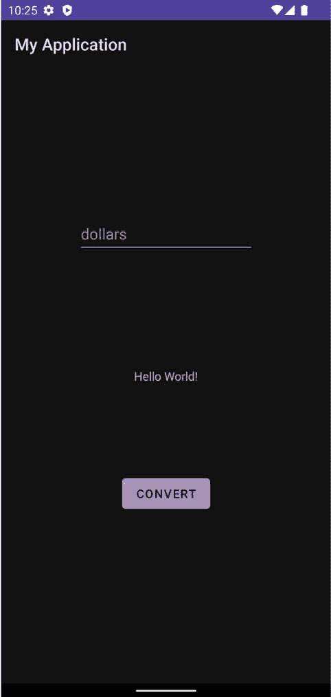

图 4-13

在继续操作之前，返回`Settings`应用并关闭深色主题模式。

## 4.7 在独立窗口中运行模拟器

到本章为止，我们仅将模拟器作为嵌入在 Android Studio 主窗口内的工具窗口进行使用。若要在独立窗口中运行模拟器，请选择`File -> Settings...`菜单选项（macOS 为`Android Studio -> Preferences...`），在设置对话框的左侧导航面板中导航到`Tools -> Emulator`，并禁用`Launch in a tool window`选项：

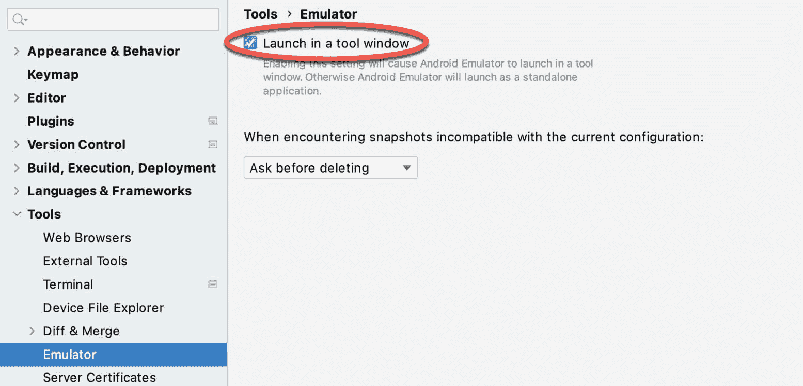

图 4-14

禁用选项后，点击`Apply`按钮随后点击`OK`提交更改，然后点击上方图 4-3 中标记为 B 的标签上的关闭按钮退出当前的模拟器会话。

再次运行示例应用，模拟器将如下作为一个独立窗口出现：

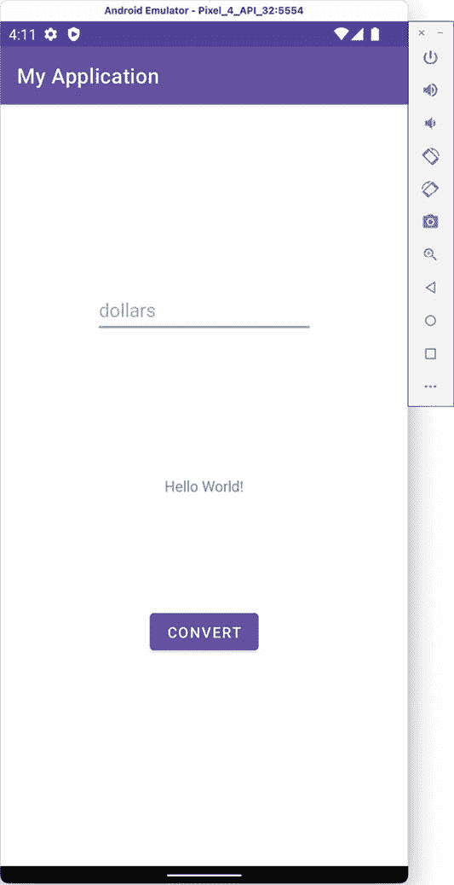

图 4-15

选择独立模式还是工具窗口模式取决于个人喜好。如果你喜欢模拟器在工具窗口中运行，请返回设置屏幕并重新启用`Launch in a tool window`选项。但在决定使用独立模式之前，请记住也可以通过点击模拟器工具栏中的设置按钮（齿轮图标表示）并选择`View Mode -> Float`菜单选项，将模拟器工具窗口从 Android Studio 主窗口中分离：

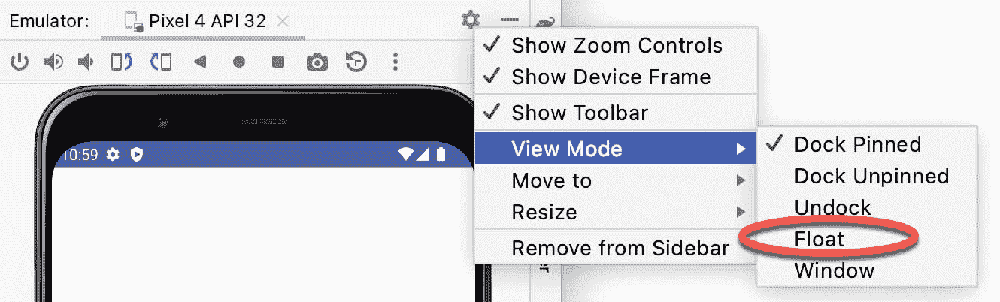

图 4-16

## 4.8 设备框架

模拟器可以配置为带有（图 4-17）或不带（图 4-15）设备框架显示。

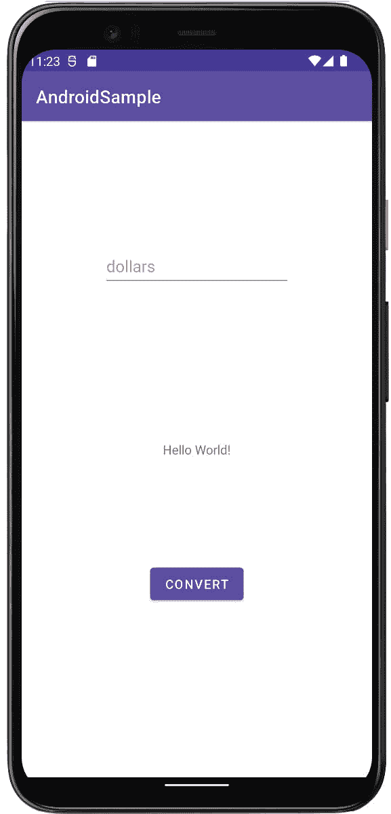

图 4-17

要更改设置，打开`Device Manager`，从列表中选择 AVD，并点击`Actions`列中的铅笔图标以编辑设置。在设置屏幕上，找到并更改`Enable Device Frame`选项：

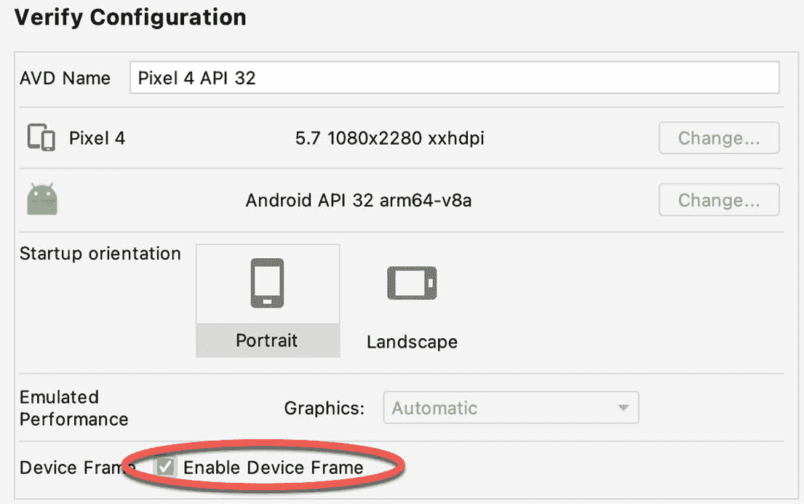

图 4-18

## 4.9 AVD 命令行创建

如前所述，除了图形用户界面外，还可以直接从命令行创建新的 AVD。这是通过使用`avdmanager`工具结合某些命令行选项实现的。一旦启动，该工具将在创建新 AVD 之前提示额外信息。

`avdmanager`工具运行需要访问运行时环境 (JRE)。如果在尝试运行`avdmanager`时出现错误消息指示找不到`java`命令，则可以配置运行命令的命令提示符或终端窗口以使用 Android Studio 捆绑的 OpenJDK 环境。首先按照以下方式识别 OpenJDK JRE 的位置：

1. 启动 Android Studio 并打开书中之前创建的`ComposeDemo`项目。

2. 选择`File -> Settings...`菜单选项（macOS 为`Android Studio -> Preferences...`）。

3. 导航到`Build, Execution, Deployment`部分，并选择`Build Tools`下的`Gradle`选项。

4. 点击`Gradle JDK`设置并记录 Android Studio 默认 JDK 的路径：

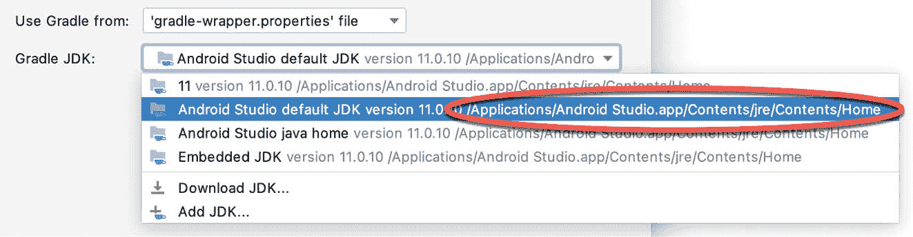

图 4-19

在 Windows 上，在命令提示符中执行以下命令（其中`<path to JDK>`替换为 Android Studio 默认 JDK 的路径）：

```
set JAVA_HOME=<path to JDK>
```

在 macOS 或 Linux 上，执行以下命令：

```bash
export JAVA_HOME="<path to JDK>"
```

如果你打算频繁使用`avdmanager`，请按照书中“设置 Android 环境”(#Installation.xhtml__idAnchor009) 中的步骤来配置`JAVA_HOME`。假设系统已配置好 SDK，可以通过运行以下命令获取可用的 AVD 列表：

```bash
avdmanager list
```

该输出将包含可用的 AVD，例如：

```
Available Android Virtual Devices:
  Name: Pixel_XL_API_28_No_Play
  Device: pixel_xl (Google)
  Path: /Users/neilsmyth/.android/avd/Pixel_XL_API_28_No_Play.avd
  Target: Google APIs (Google Inc.)
    Based on: Android API 28 Tag/ABI: google_apis/x86
  Skin: pixel_xl_silver
  Sdcard: 512M
```

同样，要删除现有的 AVD，只需使用`delete`选项：

```bash
avdmanager delete avd -n <avd name>
```

`avdmanager`工具还允许从命令行创建新的 AVD。例如，要使用 Android API 29 的 x86 目标创建一个名为`myAVD`的新 AVD，可以使用以下命令：

```bash
avdmanager create avd -n myAVD -k system-images;android-29;google_apis;x86
```

`avdmanager`工具将根据基础 Android 设备的规范创建 AVD，同时也提供了匹配特定设备的自定义配置。一旦从命令行创建了新的 AVD，在点击`Refresh`按钮之前，它可能不会出现在 Device Manager 工具中。

`config.ini`文件包含了设备配置设置，例如在 AVD 创建过程中指定的显示尺寸和内存。这些设置可以直接在配置文件中进行更改，并在下一次调用 AVD 时，其将采用这些更改。

`<avd name>.ini`文件包含了对目标 Android SDK 的引用以及 AVD 文件的路径。请注意，`config.ini`文件中`image.sysdir`值的更改也需要反映在该文件的目标值中。

## 4.11 移动和重命名 Android 虚拟设备

可以使用`avdmanager`工具的`move avd`参数从命令行更改 AVD 的名称或 AVD 文件的位置。例如，要将名为`Pixel4`的 AVD 重命名为`Pixel4a`，可以执行以下命令：

```
avdmanager move avd -n Pixel4 -r Pixel4a
```

若要物理移动与 AVD 相关的文件，应使用以下命令语法：

```
avdmanager move avd -n <avd name> -p <path to new location>
```

例如，将 AVD 从其当前的文件系统位置移动到`/tmp/Pixel4Test`：

```
avdmanager move avd -n Pixel4 -p /tmp/Pixel4Test
```

请注意，在执行移动 AVD 的命令之前，目标目录不能存在。

## 4.12 总结

典型的应用开发过程遵循编码、编译和在测试环境中运行的循环。Android 应用可以在实体 Android 设备上进行测试，也可以使用 Android 虚拟设备（AVD）模拟器进行测试。AVD 使用 Android Studio Device Manager 工具创建和管理，该工具可以作为命令行工具，也可以通过图形用户界面使用。在创建 AVD 以模拟特定的 Android 设备型号时，虚拟设备的硬件规格应与物理设备的规格相匹配。

AVD 模拟器可能会显示为独立窗口，也可以嵌入到 Android Studio 主界面中。

## 5. 使用和配置 Android Studio AVD 模拟器

在下一章探索在实体 Android 设备上进行测试之前，本章将花费一些时间提供 Android Studio AVD 模拟器的概述，并介绍许多可在独立模式和工具窗口模式下用于自定义环境的配置功能。

## 5.1 模拟器环境

当以独立模式启动时，模拟器在加载过程中会显示一个初始启动屏幕。加载完成后，会出现主模拟器窗口，其中包含所选设备类型的表示（在图 5-1 所示这是一个 Pixel 4 设备）：

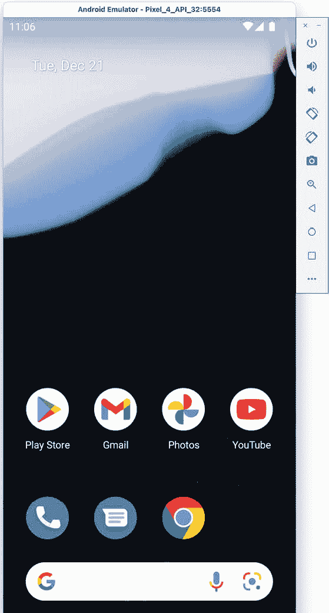

图 5-1

窗口右侧边缘设有工具栏，提供了快速访问模拟器控制和配置选项的通道。

## 5.2 模拟器工具栏选项

模拟器工具栏（图 5-2）提供了与模拟器环境外观和行为相关的系列选项访问。

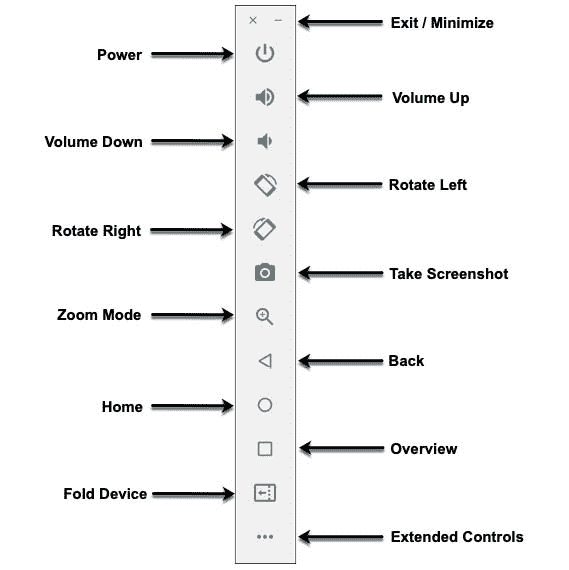

图 5-2

工具栏中的每个按钮都关联有一个键盘快捷键，可以通过将鼠标指针悬停在按钮上并等待提示框出现，或者通过扩展控制面板的帮助选项来识别。

尽管工具栏中的许多选项是自而易懂的，但为了完整起见，将介绍每个选项：

- **退出 / 最小化**：工具栏最顶部的“x”按钮在选中时退出模拟器会话，而“-”选项则最小化整个窗口。

- **电源**：电源按钮模拟实体 Android 设备上的硬件电源按钮。点击并释放此按钮将锁定设备并关闭屏幕。按住此按钮将启动设备的“关机”请求序列。

- **音量增大 / 减小**：两个控制模拟器环境内播放音量的按钮。

- **向左/向右旋转**：在纵屏和横屏方向之间旋转模拟的设备。

- **截图**：对设备屏幕当前显示的内容进行截图。捕获的图像存储在本章稍后概述的扩展控制面板的设置屏幕中指定的位置。

- **缩放模式**：此按钮在缩放模式之间切换，其细节将在本章稍后介绍。

- **返回**：执行标准的 Android“返回”导航以返回上一个屏幕。

- **主页**：显示设备主屏幕。

- **概览**：模拟选择标准的 Android“概览”导航，用于显示设备上正在运行的应用。

- **折叠设备**：模拟可折叠设备的折叠和展开。此选项仅在模拟器运行折叠屏系统镜像时可用。

- **扩展控制**：显示扩展控制面板，允许配置此类选项，如模拟位置和电话活动、电池强度、蜂窝网络类型和指纹识别。

## 5.3 在缩放模式下工作

位于模拟器工具栏的缩放按钮在缩放模式之间切换。当缩放模式激活时，工具栏按钮处于按下状态，且鼠标指针悬停在设备屏幕上时将显示为放大镜。点击左鼠标键将导致显示相对于屏幕上的所选点进行缩放，重复点击将增加缩放级别。相反，点击右鼠标键将减小缩放级别。关闭缩放按钮将显示恢复到默认大小。

在缩放模式下点击并拖动将定义一个矩形区域，释放鼠标按键时视图将缩放至该区域。

在缩放模式下，可以使用模拟器窗口内的水平和垂直滚动条来移动屏幕可视区域。

## 5.4 调整模拟器窗口大小

模拟器窗口的大小（以及相应的设备表示）可以通过点击并拖动窗口的任何角或侧边随时更改。

## 5.5 扩展控制选项

扩展控制工具栏按钮显示如图 5-3 所示的面板。默认情况下将显示位置设置。从左侧面板选择不同的类别将显示相应的控制组：

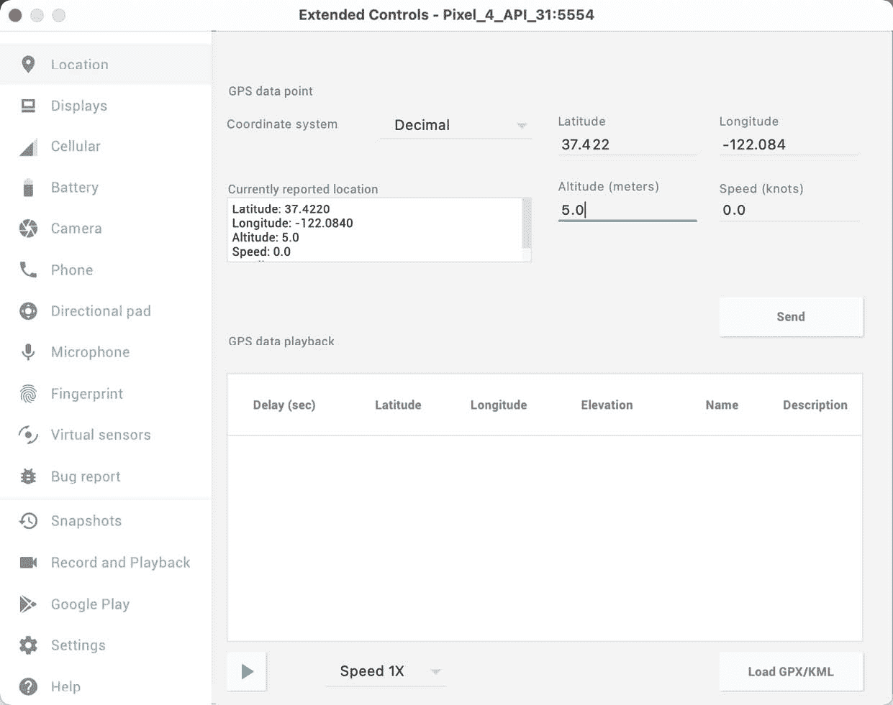

图 5-3

### 5.5.1 位置

位置控制允许以十进制或六进制坐标的形式将模拟位置信息发送到模拟器。位置信息可以是单个位置的形式，也可以代表设备移动的点序列，后者通过 GPS 交换 (GPX) 或 Keyhole 标记语言 (KML) 格式的文件提供。或者，可以使用集成的 Google Maps 面板来视觉化选择单点或旅行路线。

### 5.5.2 显示

除了模拟器屏幕内显示的主显示外，显示选项允许在同一个 Android 实例中添加额外的显示。这对于测试如 Microsoft Surface Duo 等双屏应用非常有用。这些额外的屏幕可以配置为所需的尺寸，并显示在同一个模拟器窗口中。

### 5.5.3 蜂窝

可以在蜂窝设置屏幕中更改模拟的蜂窝连接类型。可以使用选项来模拟不同的网络类型（CSM、EDGE、HSDPA 等），以及一系列语音和数据场景，如漫游和拒绝访问。

### 5.5.4 电池

在扩展控制屏幕的此面板上可以模拟各种电池状态和充电条件，包括电池电量、电池健康状况以及当前连接了 AC 充电器。

### 5.5.5 摄像头

当摄像头激活时，模拟器会模拟一个 3D 场景。这表现为虚拟建筑的内部，你可以通过按住`Option`键（Windows 上为`Alt`）并使用鼠标指针和键盘键，在模拟器内录制视频或拍摄照片之前进行导航。此扩展配置选项允许上传不同的图像以在虚拟环境中进行显示。

### 5.5.6 手机

手机的扩展控制功能在模拟器中提供了两个非常简单但实用的模拟。第一个选项允许模拟来自指定电话号码的入电电话。这在测试应用如何处理此类高层中断时特别有用。

第二个选项允许在模拟器会话中模拟接收短信。与现实世界一样，这些消息会显示在`Message`（消息）应用中，并触发模拟器内的标准通知。

### 5.5.7 方向键

方向键（`D-Pad`）是内置在 Android 设备中或外部连接（如游戏控制器）的一组额外控制控件，用于提供方向控制（左、右、上、下）。方向键设置允许在模拟器中模拟`D-Pad`交互。

### 5.5.8 麦克风

麦克风设置允许启用麦克风并模拟虚拟耳机和麦克风连接。还提供了一个按钮用于启动模拟器上的`Voice Assistant`（语音助手）。

### 5.5.9 指纹

许多 Android 设备现在都配备了内置指纹检测硬件。`AVD`模拟器使得无需在包含指纹传感器的物理设备上测试应用即可测试指纹认证。如何在模拟器中配置指纹测试的细节将在本章后面详细介绍。

### 5.5.10 虚拟传感器

虚拟传感器选项允许模拟加速度计和磁力计，通过偏航角、俯仰角和横滚角设置来模拟设备物理运动的效果，如旋转、移动和倾斜。

### 5.5.11 快照

快照包含当前运行的`AVD`会话的状态，可以保存并快速恢复，从而使模拟器轻松返回到精确状态。快照将在本章后部分介绍。

### 5.5.12 录制与回放

允许将模拟器屏幕和音频录制并保存为`WebM`或`animated GIF`（动画 GIF）格式。

### 5.5.13 Google Play

如果模拟器运行的是安装了`Google Play Services`的 Android 版本，此选项将显示当前的`Google Play`版本并提供将模拟器更新到最新版本的选项。

### 5.5.14 设置

设置面板提供了一组配置选项。使用此面板为工具栏和扩展控制面板选择较深的主题，指定保存截图的文件系统位置，配置`OpenGL`支持级别，并配置模拟器窗口显示在桌面上其他窗口之上。

### 5.5.15 帮助

`Help`（帮助）屏幕包含三个子面板，包含快捷键列表、访问模拟器在线文档的链接、报告 Bug 和发送反馈的链接，以及模拟器版本信息。

## 5.6 使用快照

当模拟器首次启动时，它会执行冷启动，就像物理 Android 设备通电一样。由于操作系统加载并启动所有后台进程，冷启动过程可能需要一些时间才能完成。为了避免每次启动模拟器都经历这个过程，系统被配置为每次退出时自动保存模拟器当前状态的快照（称为`quick-boot snapshot`，快速启动快照）。下次启动模拟器时，`quick-boot snapshot`将加载到内存中并从上次离开的地方继续执行，允许模拟器在冷启动完成所需的一部分时间内重启。

扩展控制面板的`Snapshots`（快照）屏幕可以在模拟器执行期间的任何点存储额外的快照。这保存了整个模拟器的精确状态，允许模拟器恢复到拍摄快照时的精确时间点。在屏幕中，可以使用`Take Snapshot`（拍摄快照）按钮（在图 5-4 中标记为`A`）拍摄快照。要恢复现有快照，从列表中选择它 (`B`) 并点击屏幕底部的`run`按钮 (`C`)。还提供了编辑 (`D`) 快照名称和描述，以及删除 (`E`) 当前所选快照的选项：

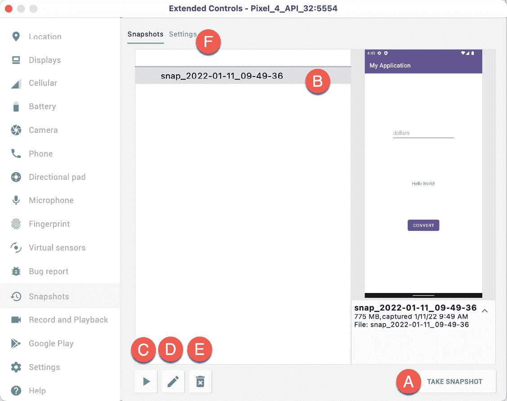

图 5-4

`Settings`（设置）选项 (`F`) 提供了配置自动保存快速启动快照的选项（默认情况下，模拟器会在每次退出时询问是否保存快速启动快照）以及重新加载最近的快照。要强制模拟器会话执行冷启动而不是使用之前的`quick-boot snapshot`，打开`AVD Manager` (`Tools -> AVD Manager`)，点击模拟器`Actions`列中的向下箭头并选择`Cold Boot Now`（立即冷启动）菜单选项。

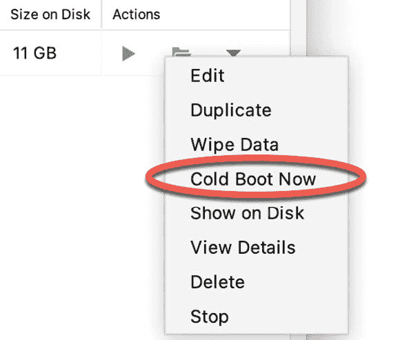

图 5-5

## 5.7 配置指纹模拟


模拟器允许配置最多 10 个模拟指纹，用于测试 Android 应用中的指纹认证。要配置模拟指纹，首先启动模拟器，打开 `Settings` 应用并选择 `Security & Location`（安全与位置）选项。

在 `Security`（安全）设置屏幕中，选择 `Use fingerprint`（使用指纹）选项。在生成的信息屏幕上点击 `Next`（下一步）按钮进入 `Fingerprint`（指纹）设置屏幕。在启用指纹安全之前，必须配置备份解锁方法（例如 `PIN`）。点击 `Fingerprint + PIN` 按钮并在提示时选择在设备启动时不需要 `PIN`。输入并确认一个合适的 `PIN`，并通过默认选项完成 `PIN` 输入过程。

继续后续屏幕，直到 `Settings` 应用请求传感器指纹。此时显示扩展控制对话框，在左面板选择 `Fingerprint` 类别，并确保主设置面板选择了 `Finger 1`：

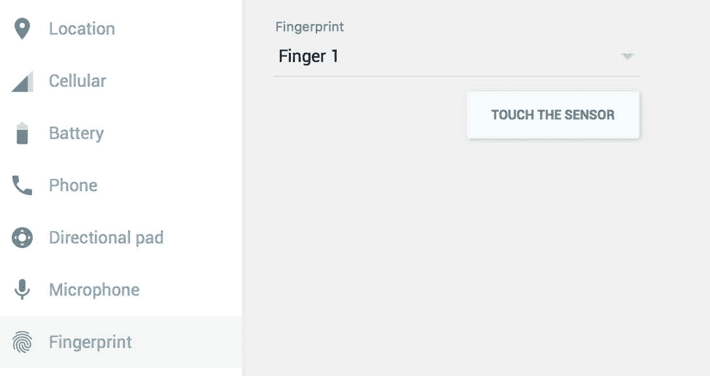

图 5-6

点击 `Touch the Sensor` 按钮模拟 `Finger 1` 触摸指纹传感器。模拟器将报告指指纹：

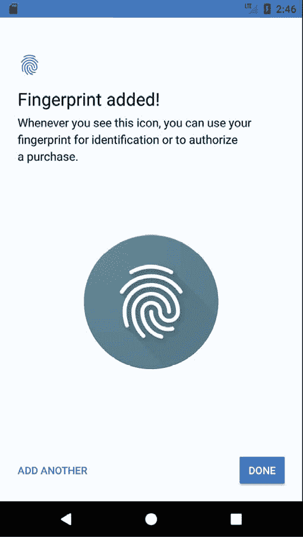

图 5-7

要添加更多指纹，点击 `Add Another` 按钮并在再次点击 `Touch the Sensor` 之前选择另一个手指。

## 5.8 工具窗口模式下的模拟器

如上一节所述（在 Android Studio 中创建 Android 设备 (AVD)），Android Studio 可以配置为嵌入工具窗口启动模拟器，使其不会在独立窗口中显示。在此模式下运行时，与独立模式相同的控件将在工具栏中提供，如图 5-8 所示：

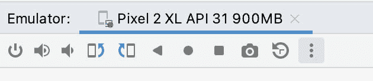

图 5-8

从左到右，这些按钮执行以下任务（详情与独立模式相同）：

- 电源
- 音量增大
- 音量减小
- 向左旋转
- 向右旋转
- 返回
- 主页
- 概述
- 截图
- 快照
- 扩展控制

## 5.9 总结

Android Studio 包含一个 Android 设备模拟器环境，旨在使无需在物理 Android 设备上运行即可轻松测试应用程序。本章简要介绍了模拟器，并强调了可用于配置和自定义环境以模拟不同测试条件的关键功能。

# 6. Android Studio 用户界面概览

虽然人们可能急于开始运行上一章中创建的示例应用程序，但这样做涉及到 Android Studio 用户界面的某些方面，而这些方面最好预先进行描述。

Android Studio 是一个功能强大且功能丰富的开发环境，在很大程度上，它的操作是非常直观的。尽管如此，现在花时间熟悉 Android Studio 用户界面的布局和组织，将大大缩短书中后续章节的学习曲线。本着此考虑，本章将对组成 Android Studio 环境的各个区域和组件提供初步概述。

## 6.1 欢迎界面

欢迎界面（图 6-1）在 Android Studio 运行但当前没有打开任何项目时显示（可以通过选择 `File -> Close Project` 菜单选项随时关闭打开的项目）。如果在项目仍打开时退出了 Android Studio，该工具在下次启动时将跳过欢迎界面，自动打开之前激活的项目。


图 6-1

除了最近项目列表外，欢迎界面还了一系列执行任务的选项，例如打开和创建项目，以及访问当前受版本控制的项目。此外，`Customize` 屏幕提供了更改 IDE 和编辑器使用的主题和字体设置的选项。可以通过 `Plugins` 选项查看、安装和管理 Android Studio 插件。

点击如图 6-2 所示的菜单按钮可以获得更多选项：


图 6-2

## 6.2 主窗口

当创建新项目或打开现有项目时，Android Studio 主窗口将会出现。当同时打开多个项目时，每个项目都将分配自己的主窗口。窗口的精确配置取决于上次打开项目时显示了哪些工具和面板，但通常类似于图 6-3。


图 6-3

主窗口的各种元素可以概括如下：

- **A – 菜单栏 (Menu Bar)** – 包含一系列用于在 Android Studio 环境中执行任务的菜单。

- **B – 工具栏 (Toolbar)** – 一系列频繁执行操作的快捷键。工具栏按钮提供了快速访问一组菜单栏操作的通道。可以通过右键点击该栏条并选择 `Customize Menus and Toolbars…` 菜单选项来自自定义工具栏。如果工具栏可见，可以使用 `View -> Appearance -> Toolbar` 菜单选项显示它。

- **C – 导航栏 (Navigation Bar)** – 导航栏提供了在组成项目的和文件夹之间移动的便捷方法。点击导航栏中的元素将弹出一个菜单，列出该位置的子文件夹和文件供选择。同样，点击类名将显示列出该类包含的方法列表。从列表中选择一个方法即可进入代码编辑器中的相应位置。使用 `View -> Appearance -> Navigation Bar` 菜单选项隐藏和显示此栏。

- **D – 编辑器窗口 (Editor Window)** – 编辑器窗口显示开发者当前正在工作的文件。然而，在此处显示的内容取决于上下文。例如，在编辑代码时，将出现代码编辑器。另一方面，在处理用户界面布局文件时，将出现用户界面布局编辑器工具。当打开多个文件时，每个文件都由编辑器顶部的标签页表示，如图 6-4 所示。


图 6-4

- **E – 状态栏 (Status Bar)** – 状态栏显示关于项目和 Android Studio 活动的信息消息，以及位于左下角的工具菜单按钮。悬停在状态栏条目上将提供该字段的描述。许多字段是可交互的，允许用户点击以执行任务或获取更详细的状态信息。

- **F – 项目工具窗口 (Project Tool Window)** – 项目工具窗口提供了项目文件结构的层级概述，允许执行到特定文件和文件夹的导航。可以使用工具栏以多种不同的方式显示项目。默认设置是 Android 视图，这是本书剩余部分主要使用的模式。

项目工具窗口只是 Android Studio 环境中提供的许多工具窗口之一。

## 6.3 工具窗口

除了项目视图工具窗口外，Android Studio 还包含许多其他窗口，启用后将显示在主窗口的底部和侧边。可以通过将鼠标指针悬停在状态栏最左角的按钮上（图 6-5）而不点击鼠标按钮来访问工具窗口快速访问菜单。


图 6-5

从快速访问菜单中选择项目将导致相应的工具窗口在主窗口内出现。

或者，可以通过点击状态栏中的快速访问菜单图标来显示一组工具窗口栏。这些栏出现在主窗口的左侧、右侧和底部边缘（如图 6-6 中箭头所示），并包含用于显示和隐藏每个工具窗口的按钮。当工具窗口栏显示时，再次点击状态栏上的按钮将隐藏它们。


图 6-6

点击按钮将显示相应的工具窗口，而再次点击将隐藏窗口。带有数字前缀的按钮（例如 1: Project）表示可以通过按下键盘上的 `Alt` 键（macOS 为 `Command` 键）配合相应的数字来显示工具窗口。

按钮在工具窗口栏中的位置指示了窗口显示时相对于窗口的侧边。可以通过点击并拖动按钮到工具工具栏的位置来更改这些位置。

每个工具窗口在顶部都有自己的自己的工具栏。这些工具栏中的按钮因工具而异，但所有工具窗口都包含一个由齿轮图标表示的设置选项，可以更改窗口的各个方面。图 6-7 显示了项目视图工具窗口的设置菜单。


图 6-7

所有窗口在工具栏的最右侧都包含一个按钮，提供了另一种隐藏工具窗口视图的方法。对工具窗口内的项目进行搜索，只需通过点击该窗口使其获得焦点，然后输入搜索术语（例如项目工具窗口中的文件名）即可完成。搜索框将出现在窗口的工具栏中，并高亮显示匹配搜索的项。

Android Studio 提供了一系列广泛的工具窗口，其中最常用的如下：

# Android Studio 工具窗口

- **应用检查器 (App Inspector)** - 提供对 `Database`（数据库）和 `Background Task`（后台任务）检查器的访问。`Database Inspector` 允许你在应用运行时检查、查询和修改应用的数据库。`Background Task Inspector` 允许监控和管理使用 `WorkManager` 创建的后台工作线程任务。

- **构建 (Build)** - 构建工具窗口在项目编译和打包期间显示构建过程的信息，并显示遇到的任何任何错误详细信息。

- **构建变体 (Build Variants)** – 构建变体工具窗口为当前应用程序项目配置不同的构建目标提供了快速方法（例如，针对应用程序的调试和发布版本提供不同的构建，或针对不同设备类别的多个构建）。

- **设备文件管理器 (Device File Explorer)** - 通过 `View -> Tool Windows -> Device File Explorer` 菜单访问，此工具窗口提供了对当前连接的 Android 设备或模拟器文件系统的直接访问，允许浏览系统并将文件复制到本地文件系统。

- **设备管理器 (Device Manager)** - 提供对 `Device Manager` 工具窗口的访问，可以在其中添加、删除和管理物理 Android 设备连接和模拟器。

- **模拟器 (Emulator)** - 如果启用了在工具窗口中运行模拟器的选项，则包含 `AVD` 模拟器，具体参见标题为在 Android Studio 中创建 Android 虚拟设备 (AVD)章节。

- **事件日志 (Event Log)** - 事件日志窗口显示与在 Android Studio 中执行的事件和活动相关的消息。例如，项目的成功构建或应用程序正在运行等将在此工具窗口内报告。

- **收藏 (Favorites)** - 可以将各种项目项添加到收藏列表。例如，在项目视图中右键点击文件，可以访问 `Add to Favorites`（添加到收藏）菜单选项。同样，可以在 `Structure`（结构）工具窗口中右键点击源文件中的方法将其添加为收藏。添加到收藏列表的任何内容都可以通过此收藏工具窗口访问。

- **Gradle** - `Gradle` 工具窗口提供了项目构建配置所需的 `Gradle` 任务视图。该窗口列出了将项目各种元素编译为可执行应用程序所涉及的任务。右键点击顶层 `Gradle` 任务并选择 `Open Gradle Config`（打开 Gradle 配置）菜单选项，可以将当前项目的 Gradle 构建文件加载到编辑器中。Gradle 将在书后部分详细介绍。

- **布局检查器 (Layout Inspector)** - 提供构成用户界面布局的组件层次结构的可视 3D 渲染。

- **Logcat** - `Logcat` 工具窗口提供了对运行应用程序监控日志输出的访问，以及拍摄应用程序截图、视频以及停止和重启进程的选项。

- **问题 (Problems)** - 查看项目内所有当前错误或警告的中心位置。双击问题列表中的项将带您跳转到问题所在的文件和位置。

- **性能分析器 (Profiler)** - `Android Profiler` 工具窗口提供了用于识别运行应用中性能问题的实时监控和分析工具，包括 CPU、内存和网络使用情况。当应用当前运行时，此选项将变为可用。

- **项目 (Project)** - 项目视图提供了构成项目的文件结构概览，允许在文件之间快速导航。通常情况下，在项目视图中双击文件将导致文件加载到适当的编辑工具中。

- **资源管理器 (Resource Manager)** - 用于添加和管理项目包含的资源和资产（如图像、颜色和布局文件）的工具。

- **运行 (Run)** - 当应用程序当前运行时，运行工具窗口将可用，并提供运行结果视图以及停止或重启运行进程的选项。如果应用程序无法在设备或模拟器上安装和运行，此窗口通常会提供与问题相关的诊断信息。

- **结构 (Structure)** - 结构工具提供了编辑器中当前显示的源文件结构的高级视图。此信息包括文件中的类、方法和变量等项列表。从结构列表中选择项将带您跳转到编辑器窗口中源文件中的对应位置。

- **终端 (Terminal)** - 提供对运行 Android Studio 的系统终端窗口的访问。在 Windows 系统上，这是 `Command Prompt`（命令提示符）界面，而在 Linux 和 macOS 系统上，它是 `Terminal` 提示。

- **TODO** - 顾其实名，此工具提供了一个查看项目中尚未完成项的地方。Android Studio 通过扫描构成项目的源文件并匹配指定 TODO 模式的注释来编译此列表。可以通过选择 `File -> Settings…`（macOS 上为 Android Studio -> Preferences...）菜单并导航到 `Editor` 下的 TODO 页面来查看和更改这些模式。

## 6.4 Android Studio 快捷键

Android Studio 包含了丰富的键盘快捷键，旨在执行常用任务时节省时间。可以在 Android Studio 项目窗口内通过选择 `Help -> Keymap Reference` 菜单选项查看并打印完整的键盘快捷键映射列表。您还可以通过选择 `File -> Settings...`（macOS 上为 Android Studio -> Preferences...）菜单选项并点击 `Keymap` 项（如下方的图 6-8 所示）来列出和修改快捷键：


图 6-8

## 6.5 切换器和最近文件导航

在 Android Studio 主窗口内导航的另一种有用机制是使用 `Switcher`（切换器）。通过键盘快捷键 `Ctrl-Tab` 访问，切换器显示为一个列出所有工具窗口和当前打开文件的面板（见下图 6-9）。


图 6-9

只要按住 `Ctrl` 键，切换器就会保持可见。在按住 `Ctrl` 键的同时反复点击 `Tab` 键将在各种选项之间循环，而释放 `Ctrl` 键则会在主窗口中选中当前高亮的项。

除了切换器外，`Recent Files`（最近文件）面板提供了最近打开文件的导航（见下图 6-10）。可以使用快捷键 `Ctrl-E`（macOS 上为 Cmd-E）访问。显示后，可以使用鼠标指针选择选项，或者使用键盘箭头键滚动文件名和工具窗口选项。按下 `Enter` 键将选中当前高亮的项。


图 6-10

## 6.6 更改 Android Studio 主题

Android Studio 环境的主题可以通过欢迎界面的 `Configure -> Settings` 选项，也可以通过主窗口的 `File -> Settings…`（macOS 上为 Android Studio -> Preferences...）更改。

显示设置对话框后，在左侧面板中选择 `Appearance & Behavior` 选项及其下的 `Appearance`，然后更改 `Theme` 菜单的设置，最后点击 `Apply` 按钮。可用的主题取决于平台，但通常包括 `Light`、`IntelliJ`、`Windows`、`High Contrast` 和 `Darcula` 等选项。图 6-11 展示了选择 `Darcula` 主题的主窗口示例：


图 6-11

要使 Android Studio 主题与操作系统的亮/深色模式设置同步，请启用 `Sync with OS`（与操作系统同步）选项，并使用下拉菜单控制每个模式使用的主题：


图 6-12

## 6.7 总结

Android Studio 环境的主要元素包括欢迎界面和主窗口。每个打开的项目都分配有自己的主窗口，主窗口反过来由菜单栏、工具栏、编辑和设计区域、状态栏以及一组工具窗口组成。工具窗口出现在主窗口的侧边和底部，可以通过状态栏中的快速访问菜单访问，也可以通过可选的工具窗口栏访问。

Android Studio 中极少数的操作是无法通过键盘快捷键触发的。可以随时在 Android Studio 主窗口中访问默认快捷键的映射（keymap）。

## 7. 在物理 Android 设备上测试 Android Studio 应用

虽然使用 Android 虚拟设备 (AVD) 测试应用程序可以实现很多功能，但在物理 Android 设备上进行真实世界的应用测试是不可替代的，而且某些 Android 功能仅在物理设备上可用。

与 AVD 实例和连接的 Android 设备之间的通信均由 Android 调试桥 (ADB) 处理。在本章中，我们将解释如何配置 `adb` 环境，以便在基于 macOS、Windows 和 Linux 的系统的 Android 设备上进行应用测试。

## 7.1 Android 调试桥 (ADB) 概述

`ADB` 的主要目的是方便开发系统（在此例中 Android Studio）与 AVD 模拟器以及 Android 设备之间的交互，以运行和调试应用程序。`ADB` 允许你通过 WiFi 网络或直接使用 USB 线连接到设备。

`ADB` 由一个客户端、一个在开发系统后台运行的服务器进程以及一个在 AVD 或真实 Android 设备（如手机和平板）上运行的守护进程组成。


`ADB` 客户端有多种形式。例如，在 Android SDK 的`platform-tools`子目录下以名为`adb`的命令行工具形式提供客户端。同样，Android Studio 也有一个内置的客户端。

可以使用`adb`命令行工具执行多种任务。例如，可以使用`devices`命令行参数获取当前活跃的虚拟或物理设备列表。以下命令输出表示系统上存在 AVD，但没有物理设备：

```
$adb devices
List of devices attached
emulator-5554 device
```

## 7.2 在 Android 设备上启用 USB 调试 ADB

在`ADB`连接到 Android 设备之前，必须先配置该设备以允许连接。在运行 Android 6.0 或更高版本的手机和平板设备上，实现此目的的步骤如下：

1. 打开设备上的`Settings`（设置）应用并选择`About tablet`（关于平板电脑）或`About phone`（关于手机）选项（在某些 Android 版本中，可以在`Settings`应用的`System`页面找到）。

2. 在`About`（关于）屏幕上，向下滚动到`Build number`（编译号）字段并点击七次，直到出现指示已启用开发者模式的消息。如果`About`屏幕上没有列出`Build number`，则可以通过`Software information`（软件信息）选项找到。或者，如果可用，展开列表中的`Advanced`（高级）部分。


图 7-1

3. 返回主`Settings`屏幕，注意出现名为`Developer options`（开发者选项）的新选项（在较新的 Android 版本中，此选项列在`System`设置屏幕上）。选择此选项，并在生成的屏幕上找到如图 7-2 所示的`USB debugging`（USB 调试）选项：


图 7-2

4. 启用`USB debugging`选项并在请求确认时点击`Allow`（允许）按钮。

此时，设备已配置为接受来自 USB 连接的开发系统上`adb`的调试连接。剩下的工作是配置开发系统以便在连接设备时检测到它。虽然这是一个相对简单的过程，但涉及的步骤取决于开发系统运行的是 Windows、macOS 还是 Linux。注意，以下步骤假设已按照“设置 Android Studio 开发环境”章节所述，Android SDK`platform-tools`目录已包含在系统的`PATH`环境中。

### 7.2.1 macOS ADB 配置

要在 macOS 系统上配置`ADB`环境，请使用 USB 线将设备连接到计算机系统，打开终端窗口并执行以下命令以重启`adb`服务器：

```
$adb kill-server
$adb start-server
* daemon not running. starting it now on port 5037 *
* daemon started successfully *
```

一旦服务器成功运行，执行以下命令验证设备是否已检测到：

```
$adb devices
List of devices attached
74CE000600000001 offline
```

如果设备被列为`offline`（离线），请查看 Android 设备并检查是否存在图 7-3 所示请求`Allow USB debugging`（允许 USB 调试）权限的对话框。在点击`OK`之前，勾选`Always allow from this computer`（始终允许来自此计算机）复选框。


图 7-3

再次执行`adb devices`命令现在会将设备列为可用：

```
List of devices attached
015d41d4454bf80c device
```

### 7.2.2 Windows ADB 配置

配置基于 Windows 的开发系统使用 ADB 连接到 Android 设备的第一步是在系统上安装相应的 USB 驱动程序。要安装的 USB 驱动程序取决于 Android 设备的型号。如果你拥有 Google 设备（如 Pixel 手机），需要在 Windows 系统上安装并配置`Google USB Driver`。实现此目的的详细步骤可在以下网页找到：https://developer.android.com/sdk/win-usb.html

对于 Google 驱动程序不支持的 Android 设备，需要下载设备制造商提供的驱动程序。可以在此处获取驱动程序列表以及安装信息：https://developer.android.com/tools/extras/oem-usb.html

在安装驱动程序且设备已被识别为正确的设备类型后，打开命令提示符窗口并执行以下命令：

```
adb devices
```

该命令应输出有关连接设备的信息如下：

```
List of devices attached
HT4CTJT0196 offline
```

如果设备列为`offline`或`unauthorized`（未授权），请查看设备屏幕并检查是否存在图 7-3 所示请求`Allow USB debugging`权限的对话框。在点击`OK`之前，勾选`Always allow from this computer`（始终允许来自此计算机）复选框。再次执行`adb devices`命令现在会将设备列为已就绪：

```
List of devices attached
HT4CTJT0196 device
```

如果设备未列出，尝试执行以下命令重启 ADB 服务器：

```
adb kill-server
adb start-server
```

如果设备仍未列出，尝试执行以下命令：

```
android update adb
```

注意，可能还需要重启系统。

### 7.2.3 Linux adb 配置

在本章中，我们将再次使用 Ubuntu Linux 作为示例，介绍如何在 Linux 上配置`adb`以连接到物理 Android 设备进行应用测试。

在 Ubuntu Linux 上进行物理设备测试需要安装一个名为`android-tools-adb`的包，这反过来要求 Android Studio 用户必须是`plugdev`组的成员。这是大多数 Ubuntu 版本用户账户的默认设置，您可以通过运行`id`命令进行验证。如果列表中没有列出`plugdev`组，请运行以下命令将您的账户添加到该组：

```bash
sudo usermod -aG plugdev $LOGNAME
```

在满足组成员要求后，可以通过执行以下命令来安装`android-tools-adb`包：

```bash
sudo apt-get install android-tools-adb
```

完成上述更改后，重启 Ubuntu 系统。系统重启后，打开终端窗口（Terminal），启动`adb`服务并检查连接的设备列表：

```bash
$ adb start-server
* daemon not running. starting it now on port 5037 *
* daemon started successfully *
$ adb devices
List of devices attached
015d41d4454bf80c offline
```

如果设备显示为`offline`（离线）或未授权，请查看 Android 设备并检查如图 7-3 所示的对话框，请求允许 USB 调试。

## 7.3 解决 USB 连接问题

如果您无法通过上述步骤成功连接到设备，请显示运行目标菜单（图 7-4）并选择“排除设备连接”（Troubleshoot Device Connections）选项：


图 7-4

连接助手将扫描设备并报告问题可能的解决方案。

## 7.4 在 Android 设备上启用无线调试

按照上述第 7.2 节的第 1 至 3 步操作，这次启用图 7-5 所示的无线调试选项：


图 7-5

接下来，点击上面的无线调试项，显示如图 7-6 所示的屏幕：


图 7-6

如果您使用的设备带有摄像头，请选择“通过二维码 配对设备”（Pair device with QR code），否则选择“通过配对码配对设备”（Pair device with pairing code）选项。根据您的选择，“设置”应用将启动摄像头会话或如图 7-7 所示显示配对码：


图 7-7

选择选项后，返回 Android Studio，并在运行目标菜单中选择如图 7-8 所示的“使用 WiFi 配对设备”（Pair Devices Using WiFi）选项：


图 7-8

在配对对话框中，根据您之前在设备“设置”应用中的选择，选择“使用二维码配对”（Pair using QR code）或“使用配对码配对”（Pair using pairing code）：


图 7-9

使用 Android 设备扫描二维码，或将设备屏幕上显示的配对码输入到 Android Studio 对话框（图 7-10）中完成配对过程：


图 7-10

如果配对过程失败，请尝试重启开发系统和 Android 设备并重试。

## 7.5 测试 adb 连接

假设在您选择的开发平台上已成功配置`adb`，下一步是在设备上尝试运行在在 Android Studio 中创建示例 Android 应用章节中创建的测试应用程序。启动 Android Studio，打开`AndroidSample`项目，并验证设备是否出现在如图 7-11 所示的高亮设备选择菜单中：


图 7-11

从列表中选择设备并点击运行按钮（位于设备菜单右侧的绿色箭头按钮）来安装并运行应用。

## 7.6 总结

虽然 Android 虚拟设备（AVD）模拟器提供了良好的测试环境，但请记住，确保应用在物理 Android 设备上运行正常是没有任何真正的替代品的。毕竟，这才是应用在现实世界中使用的地方。

然而，默认情况下，Android Studio 环境未配置为将 Android 设备作为目标测试设备。因此，必须执行某些步骤，以便通过 USB 线缆或 WiFi 网络从 Android Studio 开发环境直接加载应用到 Android 设备上。实现此目标的具体步骤取决于所使用的开发平台。在本章中，我们涵盖了适用于 Linux、macOS 和基于 Windows 平台的步骤。

## 8. Android Studio 编辑器基础

为 Android 开发应用涉及大量的编程工作，在运行 Android Studio 时通常会在编辑器窗口内进行代码。现代代码编辑器需要的功能远超基础的输入、删除和粘贴。

如今代码编辑器的实用性通常取决于它减少输入量量、对大源码文件的导航便利性，以及在编写代码时检测并突出显示错误的能力。正如本章将要说明的，这些只是 Android Studio 编辑器出色的少数领域之一。

虽然这并不是 Android Studio 编辑器功能的详尽概述，但本章旨在提供该工具的主要功能指南。经验程序员会发现其中某些功能是许多代码编辑器通用的，而许多功能是其特有的。

## 8.1 Android Studio 编辑器

当选择 Java、Kotlin、XML 或其他文本文件进行编辑时，Android Studio 编辑器出现在主窗口中心。例如图 8-1 显示了一个典型的编辑会话：


图 8-1

构成编辑器窗口的元素总结如下：

A – 标签页 – Android Studio 能够同时打开多个文件进行编辑。每打开一个文件，它都会被分配一个位于编辑器窗口顶部标签栏的标签页，显示文件名。当空间不足显示所有标签页时，标签栏远右角会出现一个小小的下拉菜单。点击此菜单将列出其他打开的文件列表。标签页文件名下方的波浪红线表示文件中的代码包含一个或多个错误，在编译运行项目之前需要解决这些错误。

在文件之间切换只需点击相应的标签页或使用`Alt-Left`和`Alt-Right`快捷键。也可以使用切换器（通过`Ctrl-Tab`快捷键访问）进行文件导航。

要将编辑器面板从 Android Studio 主窗口中分离出来使其在单独窗口中显示，请点击标签页并拖动到主窗口之外的桌面区域。要将编辑器返回主窗口，请点击分离编辑器窗口中的文件标签，并将其拖动到主窗口的原始编辑器标签栏中。

## B – 编辑器侧边区域 (Gutter Area)

侧边区域被编辑器用于显示信息图标和控件。此侧边区域中典型项目包括调试断点标记、折叠和展开代码块的控件、书签、更改标记和行号。行号默认开启，但可以通过在侧边区域上点击右键并选择`Show Line Numbers`（显示行号）菜单选项来禁用。

## C – 代码结构位置

编辑器底部的此栏显示光标相对于代码整体结构的当前位置。例如，下图所示，该栏表示当前正在编辑`convertCurrency`方法，且该方法包含`MainActivity`类中。


图 8-2

双击该栏内的任意元素将把光标移动到代码文件中相应的位置。例如，双击`convertCurrency`条目将把光标移动到源代码中`convertCurrency`方法的顶部。同样，点击`MainActivity`条目将弹出一个可用的代码导航点列表供选择：


图 8-3

## D – 编辑器区域

这是用户显示、输入和编辑代码的主区域。本章随后的章节将详细介绍编辑区域的关键功能。

## E – 验证与标记侧边栏

Android Studio 整合了一项名为“实时代码分析（on-the-fly code analysis）”的功能。这基本上意味着当你输入代码时，编辑器正在分析代码以检查警告和语法错误。验证侧边栏顶部的指示器会随着代码的添加实时更新发现的错误和警告数量。点击此指示器将显示一个弹出窗口，其中包含编辑器代码中发现的问题摘要，如图 8-4 所示：


图 8-4

可以使用向上和向下箭头在代码中的错误位置之间移动。绿色勾号表示未检测到警告或错误。

侧边栏还会在使用相同的颜色编码在检测到问题的位置显示标记。当编辑器区域中某行代码可见时，将鼠标指针悬停在标记上，将显示一个包含问题描述的弹出窗口：


图 8-5

当某行代码滚动出编辑器区域可视范围时，将鼠标指针悬停在该行的标记上，将显示一个“透镜（lens）”覆盖层，包含问题所在的代码块（图 8-6），从而无需滚动到编辑器中的该位置即可查看：


图 8-6

值得注意的是，透镜覆盖层不仅限于侧边栏中的警告和错误。悬停在侧边栏的任何部分上都会出现一个透镜，其中包含源文件中该处的代码。

## F – 状态栏 (Status Bar)

虽然状态栏实际上是主窗口的一部分而非编辑器，但它确实包含关于当前活动编辑会话的信息。这些信息包括光标在行和字符方面的当前位置，以及文件的编码格式（UTF-8、ASCII 等）。点击状态栏中的这些值可以更改相应的设置。例如，点击行号会显示“转到行（Go to Line）”对话框。

在提供了构成 Android Studio 编辑器的元素概述后，本章的剩余部分将更详细地探讨编辑环境的关键功能。

## 8.2 分屏编辑器窗口

默认情况下，编辑器将显示显示当前选中文件内容的单个面板。在同时处理多个源文件时，一个特别实用的功能是将编辑器拆分为多个窗格。要拆分编辑器，可以在编辑器窗口内的文件标签上点击右键，并选择`Split Vertically`（垂直拆分）或`Split Horizontally`（水平拆分）菜单选项。例如，图 8-7 显示了拆分器的操作，编辑器被拆分为三个面板：


图 8-7

可以通过右键点击相应的标签并选择`Change Splitter Orientation`（更改拆分方向）菜单选项来随时更改拆分面板的方向。重复这些步骤可以取消单个面板的拆分，此时从菜单选择`Unsplit`（取消拆分）选项。可以通过右键点击任何标签并选择`Unsplit All`（取消所有拆分）选项移除所有拆分面板。

窗口拆分可显示不同的文件，或为同一个文件提供多个窗口，允许同时查看和编辑同一文件的不同区域。

## 8.3 代码补全

Android Studio 编辑器内置了大量 Java 编程语法以及构成 Android SDK 的类和方法的知识，还拥有关于你自己的代码库的知识。随着代码的输入，编辑器会扫描输入内容，并在适当情况下就完成某个语句或引用可能需要的内容提供建议。当编辑器检测到补全建议时，将出现一个包含建议列表的面板。例如在图 8-8 中，编辑器正在为`String`声明的开头提供可能项：


图 8-8


如果自动补全建议都不正确，只需继续输入，编辑器将不断完善建议。要接受顶部建议，只需按下`Enter`或`Tab`键。

可以使用`Ctrl-Space`快捷键手动调用完成建议。这在编辑器中更改单词时非常有用。

代码补全对许多程序员来说是一个个人喜好问题。考虑到这一事实，`Android Studio`对自动补全设置提供了高级别的控制。可以通过选择`File -> Settings…`菜单（macOS 上为`Android Studio -> Preferences…`）并从设置面板选择`Editor -> General -> Code Completion`来查看和修改这些设置，如图 8-9 所示：

```

```

图 8-9

## 8.4 语句补全

`Android Studio`编辑器提供的另一种自动补全形式是语句补全。它可以自动填充方法和循环语句等项的括号和大括号。语句补全通过`Shift-Ctrl-Enter`（macOS 上为`Shift-Cmd-Enter`）快捷键调用。考虑以下代码：

```
myMethod()
```

在编辑器中输入此代码后，触发语句补全将导致编辑器自动为方法添加大括号：

```java
myMethod() {

}
```

### 8.5 参数信息

你也可以要求编辑器提供关于方法接受的参数参数的信息。将光标置于方法调用的括号之间时，使用`Ctrl-P`（macOS 上为`Cmd-P`）组合键将显示该方法已知接受的参数，并将最可能的建议加粗显示：

```

```

图 8-10

### 8.6 参数名提示

代码编辑器可以配置为在方法调用中显示参数名提示。例如图 8-11 显示了`Snackbar`类调用`make()`和`setAction()`方法时的参数名提示：

```

```

图 8-11

此模式的设置可以通过选择`File` -> `Settings`菜单（macOS 上为`Android Studio` -> `Preferences`），然后在左侧面板中选择`Editor` -> `Inlay Hints` -> `Java`来配置。在生成的屏幕上，从列表中选择`Parameter Hints`，并启用或禁用`Show parameter hints`选项。要调整提示设置，点击`Exclude list...`链接并进行任何调整。

### 8.7 代码生成

除了在输入时补全代码外，编辑器在某些条件下还可以自动为你生成代码。当光标位于文件中需要生成代码的位置时，可以使用`Alt-Insert`（macOS 上为`Cmd-N`）快捷键访问图 8-12 所示的可用代码生成选项列表。

```

```

图 8-12

为了示例说明，考虑一种情况：我们希望在项目中的`Activity`准备被操作系统销毁时收到通知。正如本书后续章节将概述的，这可以通过重写`Activity`超类的`onStop()`周期方法来实现。要让`Android Studio`为此生成存根方法，只需从代码生成列表中选择`Override Methods…`选项，并在生成的可用方法列表中选择`onStop()`方法：

```

```

图 8-13

选择好要重写的方法后，点击`OK`将在`Java`源文件的当前光标位置生成存根方法，如下：

```java
@Override
protected void onStop() {
    super.onStop();
}
```

### 8.8 代码折叠

一旦源文件达到特定大小，即使是格式最整齐、组织最好的代码也可能变得难以处理和导航。`Android Studio`认为并不总是需要让每个代码块的内容始终保持可见。通过使用`Android Studio`编辑器的代码折叠功能，可以使导航变得更容易。代码折叠通过源文件中每个代码块开头和结尾处编辑器行槽中的标记来控制。例如图 8-14 显示了当前未折叠的方法声明的起始和结束标记：

```

```

图 8-14

点击这些标记中的任意一个都会折叠语句，使仅签名行可见，如图 8-15 所示：

```

```

图 8-15

要展开已折叠的代码段，只需点击编辑器行槽中的`+`标记。要在不展开的情况下查看隐藏代码，请将鼠标指针悬停在`{……}`指示器上，如图 8-16 所示。随后编辑器将显示包含折叠代码块的透镜遮罩覆盖层：

```

```

图 8-16

可以使用`Ctrl-Shift-Plus`和`Ctrl-Shift-Minus`组合键对文件中的所有代码块进行折叠或展开。

默认情况下，`Android Studio`编辑器在打开源文件时会自动折叠某些代码。要配置发生这种情况的条件，选择`File` -> `Settings…`（macOS 上为`Android Studio` -> `Preferences…`），并在生成的设置面板中选择`Editor` -> `General` -> `Code Folding`项（图 8-17）：

```

```

图 8-17

### 8.9 快速文档查询

将光标置于所需文档的声明上并按下`Ctrl-Q`快捷键（macOS 上为`Ctrl-J`），即可访问上下文相关的`Java`和`Android`文档。这将显示一个包含该项目相关引用文档的弹出窗口。例如图 8-18 显示了`Android FloatingActionButton`类的文档：

```

```

图 8-18

显示后，可以根据需要可以在屏幕上移动文档弹出窗口。

### 8.10 代码格式化

通常情况下，`Android Studio`编辑器会在添加时自动对语句和代码块进行缩进、间距和嵌套格式化。在代码行需要格式化的情况下（例如从网站复制代码时），编辑器提供了代码格式化功能，选择后将匹配主流代码样式。要格式化源代码，按下`Ctrl-Alt-L`（macOS 上为`Cmd-Opt-L`）快捷键。要显示格式化对话框（图 8-19），使用`Ctrl-Alt-Shift-L`（macOS 上为`Cmd-Opt-Shift-L`）。提供了格式化当前选中代码、整个源文件或仅更改代码的选择。

```

```

图 19

完整的代码样式偏好可以在项目设置内更改。选择`File` -> `Settings`菜单（macOS 上为`Android Studio` -> `Preferences`），并在左侧面板中选择`Code Style`以访问支持的编程和标记语言。选择一种语言将提供大量的格式选项，所有选项都可以从`Android Studio`默认进行修改。要配置上述对话框中`Rearrange code`选项的设置，例如，展开`Code Style`部分，选择`Java`，然后从`Java`设置中选择`Arrangement`选项卡。

### 8.11 查找示例代码

`Android Studio`编辑器提供了访问与当前高亮项相关的示例代码的方法。此功能对于学习如何使用特定的`Android`类或方法非常有用。要查找示例代码，在编辑器中高亮方法或类名，右键点击并选择`Find Sample Code`菜单选项。查找代码面板（图 8-20）出现在编辑器下方，显示示例列表。从列表中选择示例会将相应的代码加载到右侧面板：

```

```

图 8-20

### 8.12 Live Templates

在编写`Android`代码时，你会发现经常使用某些结构。例如，常见的需求是使用`Toast`类向用户显示弹出消息。Live 模板是常用代码结构的集合，可以通过输入初始字符后跟一个特殊键（默认设置为`Tab`键）在编辑器输入模板代码。要体验这一操作，在代码编辑器中输入`toast`然后按`Tab`键，`Android Studio`将在光标位置插入以下代码，并准备好编辑：

```java
Toast.makeText(, "", Toast.LENGTH_SHORT).show();
```

要列出并编辑现有模板、更改特殊键或添加自己的模板，请打开 Preferences（选项）对话框，并在左侧导航面板的 Editor（编辑器）部分选择 Live Templates（实时模板）：

```

```

图 8-21

使用上方图 8-21 中标记为 A 的按钮来添加、删除、复制或重置模板。要修改模板，请从列表 (B) 中选择它，并更改标记为 C 的面板中的设置。

## 8.13 总结

`Android Studio`编辑器尽了精力减少编写代码所需的打字量，并使代码更易阅读和导航。在本章中，我们涵盖了许多关键编辑器功能，包括代码补全、代码生成、编辑器窗口分割、代码折叠、重格式、文档查询和实时模板。

# 9. Android 架构概述

到目前为止，本书已经采取了步骤来建立适用于使用`Android Studio`开发`Android`应用的环境。通过创建`Android Studio`应用项目，也已经迈出了应用开发流程的第一步。

然而，在进一步探讨`Android`应用开发的实际问题之前，理解`Android SDK`以及通用的`Android`开发的一些较为抽象的概念是非常重要的。现在清晰地理解这些概念将为进一步构建知识提供坚实的基础。

本章从`Android`架构概述开始，并在本书的接几章节中继续，目标是提供`Android`开发基础的详细概述。

## 9.1 Android 软件栈

`Android`以软件栈的形式结构，由应用程序、操作系统、运行时环境、中间件、服务和库组成。这种架构或许可以通过图 9-1 所示的视觉化表示最为清晰。栈的每一层以及每层中的相应元素都紧密集成并经过仔细调整，为移动设备提供最佳的应用开发和执行环境。本章的其余部分将介绍`Android`栈的不同层，从底部的`Linux Kernel`开始。

```

```

图 9-1

## 9.2 Linux 内核

`Linux Kernel`位于`Android`软件栈的底部，在设备硬件与`Android`软件栈上层之间提供了一种抽象。内核基于`Linux`版本`2.6`，提供了抢占式多任务处理、内存、进程和电源管理等低级核心系统服务，还为显示器、WiFi 和音频等硬件提供了网络栈和设备驱动程序。

原始的`Linux kernel`由 Linus Torvalds 在 1991 年开发，并与 Richard Stallman 在自由软件基金会开发的一系列工具、实用程序和编译器相结合，创建了名为`GNU/Linux`的完整操作系统。各种 Linux 发行版都是从这些基础性基石演生而来，例如`Ubuntu`和`Red Hat Enterprise Linux`（红帽企业 Linux）。

然而，需要注意的是，`Android`仅使用`Linux kernel`。尽管如此，值得注意的是，`Linux kernel`最初是为传统的台式机和服务器形式的计算机设计的。事实上，Linux 现在最广泛地部署在任务关键的企业服务器环境中。我们发现这种软件位于`Android`软件栈的核心，既证明了当今移动设备的强大，也证明了`Linux kernel`的效率和性能。

## 9.3 Android 运行时 – ART

当在`Android Studio`中构建`Android`应用时，它会被编译成中间字节码格式（称为`DEX`格式）。当随后将应用加载到设备时，`Android`运行时 (`ART`) 使用一种称为提前编译（`Ahead-of-Time`）的过程将字节码翻译为设备处理器所需的原生指令。这种格式被称为可执行和链接格式（`ELF`）。

每当随后启动应用时，都会运行`ELF`可执行版本，从而获得更快的应用性能和更好的电池续航。

这与旧版`Android`实现中使用的即时编译（`JIT`）方法形成对比，在那种方法中，字节码在每次启动应用时都在虚拟机 (`VM`) 中翻译。

## 9.4 Android 库

除了一组标准的`Java`开发库（提供对字符串处理、网络和文件操作等通用任务的支持）外，`Android`开发环境还包括`Android Libraries`。这些是一组专门用于`Android`开发的`Java`库。此类库的示例包括应用框架库，以及便于用户界面构建、图形绘制和数据库访问的库。

`Android`开发者可用的一些关键核心`Android`库摘要如下：

- `android.app` – 提供对应用模型的访问，是所有`Android`应用的基石。

- `android.content` – 促进应用程序与应用组件之间的内容访问、发布和消息传递。

- `android.database` – 用于访问内容提供者发布的数据，包括`SQLite`数据库管理类。

- `android.graphics` – 低级 2D 图形绘制 API，包括颜色、点、滤镜、矩形和画布。

- `android.hardware` – 提供提供访问加速度计和光传感器等硬件的 API。

- `android.opengl` – 指向`OpenGL ES` 3D 图形渲染 API 的`Java`接口。

- `android.os` – 为应用提供标准操作系统服务的访问，包括消息、系统服务和进程间通信。

- `android.media` – 提供启用音频和视频播放的类。

- `android.net` – 提供访问网络栈的一组 API。包括`android.net.wifi`，用于访问设备的无线栈。

- `android.print` – 包括一组类，允许从`Android`应用内部将内容发送到配置的打印机。

- `android.provider` – 一组便利类，提供对标准`Android`内容提供者的访问，例如日历和联系人应用维护的内容。

- `android.text` – 用于在设备显示器上渲染和处理文本。

- `android.util` – 一组工具类用于执行字符串和数字转换、XML 处理以及日期时间处理等任务。

- `android.view` – 应用用户界的基础构建块。

- `android.widget` - 丰富的内置用户界面组件集合，如按钮、标签、列表视图、布局管理器、单选按钮等。

- `android.webkit` – 一组旨在允许应用构建网络浏览功能的类。

在涵盖了`Android`运行时中的`Java`库之后，现在是时候关注软件栈这一层包含的 C/C++ 库。

### 9.4.1 C/C++ 库

在前节概述的`Android`运行时核心库基于`Java`，并为编写`Android`应用的开发者提供了主要的 API。然而，需要注意的是，核心库并没有执行许多实际工作，事实上它们只是一组 C/C++ 库的`Java`“封装器”。例如，当调用`android.opengl`库以便在设备显示器上绘制 3D 图形时，该库最终会调用`OpenGL ES` C++ 库，而该库又与底层的`Linux kernel`协作完成绘制任务。

包含了 C/C++ 库来实现广泛且多样的功能，包括 2D 和 3D 图形绘制、安全套接层 (SSL) 通信、SQLite 数据库管理、音频视频播放、位图和矢量字体渲染、显示子系统和图形层管理，以及标准 C 系统库 (`libc`) 的实现。

在实践中，典型的`Android`开发者将通过基于`Java`的`Android`核心库 API 访问这些库。如果需要直接访问这些库，可以使用`Android` (NDK) 实现，其目的是通过`Java`原生接口 (`JNI`) 从`Java`代码中调用非`Java`或`Kotlin`编程语言（如`C`和`C++`）的原生方法。

## 9.5 应用框架 (Application Framework)

应用框架是一系列共同构成了`Android`应用程序运行和管理环境的服务。该框架实现了`Android`应用程序是由可重用、可交换和可替换的组件构建的理念。这一概念更进一步，即应用程序还可以发布其功能以及任何相关数据，以便其他应用程序发现并重用它们。

`Android`框架包含以下关键服务：

- **Activity Manager (Activity 管理)** – 控制应用程序生命周期和活动栈的所有方面。

- **Content Providers (内容提供者)** – 允许应用程序发布并与其他应用程序共享数据。

- **Resource Manager (资源管理器)** – 提供对非代码嵌入资源的访问，如字符串、颜色设置和用户界面布局。

- **Notifications Manager (通知管理器)** – 允许应用程序向用户显示警报和通知。

- **View System (视图系统)** – 用于创建应用程序用户界面的可扩展视图集。

- **Package Manager (包管理器)** – 应用程序借此查找设备上当前安装的其他应用程序信息的系统。

- **Telephony Manager (电话管理器)** – 向应用程序提供设备上可用电话服务的信息，例如状态和订阅者信息。

- **Location Manager (位置管理器)** – 提供位置服务的访问，允许应用程序接收位置更改的更新。

## 9.6 应用程序 (Applications)

位于`Android`软件栈最顶端的是应用程序。它们包含了特定`Android`实现所提供的原生应用程序（例如网络浏览器和电子邮件应用程序）以及用户在购买设备后安装的第三方应用程序。

## 9.7 总结 (Summary)


良好的 Android 开发知识基础需要对 Android 的整体架构有理解。Android 以软件栈架构的形式实现，由 Linux 内核、运行时环境及相应的库、应用框架和一组应用程序组成。应用程序主要用 `Java` 或 `Kotlin` 编写，并在 Android Studio 构建环境中编译为字节码格式。当应用程序随后安装在设备上时，这些字节码将由 Android 运行时 (`ART`) 编译为 CPU 使用的原生格式。Android 架构的关键目标是性能和效率，涵盖了应用程序执行以及应用程序设计中重用的实现。

## 10. Android 应用程序剖析 (The Anatomy of an Android Application)

无论你之前的编程经验如何，无论是基于 `Windows`、`macOS`、`Linux` 甚至是 `iOS`，Android 开发可能与你以前遇到过的任何事物都很不同。

因此，本章的目的是理解 Android 应用程序架构背后的高级概念。在此，我们将详细探索用于构建应用程序的各种组件，以及允许这些组件协同工作以创建一个一致应用程序的机制。

### 10.1 Android Activities

熟悉 `Java`、`Kotlin`、`C++` 或 `C#` 等面向对象编程语言的人熟悉将应用程序功能元素封装在类中的概念，然后将其实例化为对象并进行操作以创建应用程序。由于 Android 应用程序是用 `Java` 和 `Kotlin` 编写的，情况仍然如此。然而，Android 将可重用组件的概念提高到了更高的水平。

Android 应用程序通过汇集一个或多个被称为 `Activities` 的组件创建。Activity 是应用程序功能的单一独立模块，通常直接对应单个用户界面屏幕及其相应的功能。例如，一个预约应用程序可能会有一个 Activity 屏幕，显示当天设置的预约。该应用程序还可能使用第二个 Activity，它由一个允许用户在其中输入新预约的屏幕组成。

Activity 被设计为完全可重用和可交换的构建块，可以在不同的应用程序之间共享。例如，现有的电子邮件应用程序可能包含一个专门用于编写和发送电子邮件消息的 Activity。开发者可能正在编写一个也具有发送电子邮件消息要求的应用程序。开发者无需为这个新应用程序专门开发一个邮件编写 Activity，而可以直接使用来自现有电子邮件应用程序的 Activity。

Activity 是作为 Android `Activity` 类的子类创建的，并且必须实现为完全独立于应用程序中的其他 Activity。换句话说，共享的 Activity 不能依赖于在程序流的已知点处被调用（因为其他应用程序可能会以意想不到的方式使用该 Activity），而且一个 Activity 不能直接调用另一个 Activity 的方法或访问其实例数据。相反，这是通过 `Intents` 和 `Content Providers` 实现的。

默认情况下，Activity 无法向调用它的 Activity 返回结果。如果需要此功能，则必须将该 Activity 特别启动为源 Activity 的子 Activity。

### 10.2 Android Fragments

如上所述，Activity 通常代表应用内部的单个用户界面屏幕。一种方案是使用单个用户界面布局和一个对应的 Activity 类文件来构建 Activity。然而，更好的替代方案是将 Activity 拆分为不同的部分。这些部分中的每一个被称为一个 fragment（片段），每个片段由用户界面布局的一部分和一个匹配的类文件（声明为 Android `Fragment` 类的子类）组成。在这种情况下，Activity 仅仅变成一个容器，一个或多个 fragment 被嵌入其中。

事实上，fragment 为每个用户界面屏幕由一个独立的 Activity 表示提供了高效的替代方案。相反，应用可以由单个 Activity 组成，在不同的 fragment 之间切换，每个 fragment 代表不同的应用屏幕。

### 10.3 Android Intents

Intent 是一个 Activity 启动另一个 Activity 并实现构成应用程序的 Activity 之间的的机制。Intent 由对要执行的操作的描述以及可选的要执行操作的数据组成。

Intent 可以是显式的，即通过引用类名来请求启动特定的 Activity；也可以是隐式的，即通过说明要执行的操作类型或提供要执行该操作的特定类型的数据。在隐式 Intent 的情况下，Android 运行时将使用称为 Intent 解析的过程选择与 `Intent` 指定准则最匹配的 Activity 进行启动。

### 10.4 Broadcast Intents

另一种类型的 `Intent` 是广播许可（Broadcast Intent），它是一种系统级的许可，发送给所有注册了“感兴趣”广播接收器（Broadcast Receiver）的应用程序。例如，Android 系统通常会发送广播许可来指示设备状态的变化，例如系统启动完成、外部电源连接到设备或屏幕开启或关闭。

广播许可可以是“普通的”（异步的），即它在几乎相同的时间内被发送给所有感兴趣的广播接收器；也可以是“有序的”，即它一次发送给一个接收器，由接收器对其进行处理，然后终止或允许传递给下一个广播接收器。

### 10.5 广播接收器

广播接收器是应用程序响应广播许可的机制。接收器必须由应用程序注册，并配置 `Intent Filter`（意图过滤器）以指明其感兴趣的广播类型。当匹配的意图被广播时，无论注册该接收器的应用程序当前是否运行，Android 运行时都会调用该接收器。接收器随后有 5 秒的时间来完成其所需的任何任务（例如启动 `Service`、更新数据或向用户发布通知），然后返回。广播接收器在后台运行，不具有用户界面。

### 10.6 Android 服务

Android 服务是在后台运行的且不具有用户界面的进程。它们可以从活动（activities）、广播接收器或其他 `Services` 启动并进行管理。Android 服务适用于应用程序需要继续执行任务但不一定需要向用户显示界面的情况。虽然服务缺少用户界面，但它们仍然可以使用通知（notifications）和吐司（toasts，出现在屏幕上但不中断当前可见活动的小型通知消息）通知用户事件，并能够发布 `Intents`。

Android 运行时赋予服务的优先级高于许多其他进程，系统只有在作为最后手段的，时才会将其终止以释放资源。然而，如果运行时确实需要杀死一个 `Service`，一旦资源再次可用，它将自动重启。`Service` 可以通过声明自己需要在在前台运行来降低被终止的风险。这是通过调用 `startForeground()` 实现的。这仅建议终止会对用户体验产生不利的影响（例如，如果用户正在收听由 `Service` 流出的音频）。

`Service` 可能作为实际解决方案的示例场景包括（如之前提到的）：当应用程序不再活跃时仍应继续的音频流，或者在股票达到指定价格时需要通知用户的股票跟踪应用程序。

### 10.7 内容提供者

内容提供者（Content Providers）实现了应用程序之间共享数据的机制。任何应用程序都可以通过实现 `Content Provider` 为其他应用程序提供对其底层数据的访问，包括添加、删除和查询数据的能力（取决于权限）。对数据的访问通过 `Content Provider` 定义的通用资源标识符 (`URI`) 提供。数据可以以文件或整个 `SQLite` 数据库的形式共享。

原生 Android 应用程序包含许多标准的内容提供者，允许应用程序访问联系人和媒体文件等数据。Android 系统上当前可用的内容提供器可以使用 `Content Resolver` 进行定位。

### 10.8 应用程序清单

将组成应用程序的各种元素结合在一起的胶水是应用程序清单文件（Application Manifest file）。在这个基于 XML 的文件中，应用程序概述了构成完整应用程序的活动、服务、广播接收器、数据提供和权限。

### 10.9 应用程序资源

除了清单文件和包含字节码的 `Dex` 文件，Android 应用程序包通常还包含一组资源文件。这些文件包含了用户界面中显示的资源，如字符串、图像、字体和颜色，以及用户界面布局的 XML 表示。默认情况下，这些文件存储在应用程序项目层次结构的 `/res` 子目录中。

### 10.10 应用程序上下文

当应用程序编译时，会创建一个名为 `R` 的类，其中包含应用程序资源的引用。应用程序清单文件和这些资源共同创建了应用程序上下文（Application Context）。该上下文由 `Android Context` 类表示，可以在应用程序代码中使用它在运行时访问应用程序资源。此外，可以在应用程序上下文中调用多种方法来收集信息并在运行时更改应用程序的环境。

### 10.11 总结

多个不同的元素可以组合成一个 Android 应用程序。在本章中，我们提供了对活动（Activities）、片段（Fragments）、服务（Services）、意图（Intents）和广播接收器的概述，以及对清单文件和应用程序资源的概述。

通过以活动和意图的形式创建单个独立功能模块，促进了最大的重用和互操作性，而应用程序之间的数据共享通过实现内容提供者来实现。

活动专注于用户与应用程序交互的区域（活动基本上等同于单个用户界面屏幕，通常由一个或多个片段组成），而后台处理通常由 `Services` 和广播接收器处理。

构成应用程序的组件在清单文件中为 Android 运行时系统进行了概述，该文件与应用程序资源结合，代表了应用程序的上下文。

本章涵盖了许多对普通开发者来说可能全新的新内容。然而，请放心，后续章节将对对这些概念进行大量的探索和实际应用，以确保在构建您自己的应用程序时拥有坚固的知识基础。

## 11 Android 视图绑定概述

开发 Android 应用程序的重要组成部分涉及代码与构成用户界面布局的视图之间的交互。本章将查看在代码中访问布局视图的选项，特别强调一种被称为视图绑定（view binding）的选项。在涵盖视图绑定的基础之后，本章将概述将 AndroidSample 项目转换为使用此方法所需的更改。

### 11.1 通过 ID 查找视图

正如“Android 应用程序剖析”章节概述的，构成应用程序的所有资源都被编译到名为 `R` 的类中。这些资源中包含了定义布局的资源。`R` 类中有一个名为 `layout` 的子类，它包含了布局资源，包括构成用户界面的视图。大多数应用程序都需要实现代码与这些视图之间的交互，例如在读取输入到 `EditText` 视图的值或更改 `TextView` 上显示的内容时。

在 Android Studio 3.6 之前，从应用程序代码内部访问视图的唯一选项是编写代码通过 `findViewById()` 方法根据其 ID 手动查找视图。例如：

```java
TextView exampleView = findViewById(R.id.exampleView);
```

```java
exampleView.setText("Hello");
```

虽然通过 ID 查找视图仍然是一种可行的方案，但它存在一些局限性，`findViewById()` 最大的缺点是可能会获取到布局中尚未创建的视图引用，从而导致在尝试访问视图属性时抛出空指针异常。

从 Android Studio 3.6 开始，已经提供了一种以视图绑定（view binding）的形式从应用代码访问视图的替代方法。

### 11.2 视图绑定 (View Binding)

当在应用模块中启用视图绑定时，Android Studio 会为该模块内的每个布局文件自动生成绑定类。使用此绑定类，可以从代码内部访问布局视图，而无需使用 `findViewById()`。

Android Studio 生成的绑定类名称是基于布局文件名转换为所谓的“驼峰命名法”（camel case），并在末尾附加“Binding”单词。例如，对于 `activity_main.xml` 文件，绑定类将被命名为 `ActivityMainBinding`。

Android Studio Chipmunk 在项目模板中使用视图绑定的情况尚并不一致。例如，我们在创建 `AndroidSample` 项目时使用的 Empty Activity 模板并没有使用视图绑定。另一方面，Basic Activity 模板是使用视图绑定实现的。如果你使用的是没有使用视图绑定的模板，那么了解如何将该项目从合成属性（synthetic properties）迁移出来是非常重要的。

### 11.3 转换 AndroidSample 项目

在本章的剩余部分，我们将通过将 `AndroidSample` 项目转换为使用视图绑定而不是使用 `findViewById()` 来练习迁移操作。

首先，启动 Android Studio 并打开在 Android Studio 中创建示例 Android 应用章节中创建的 `AndroidSample` 项目。

### 11.4 启用视图绑定

要使用视图绑定，必须对需要视图绑定的模块的 `build.gradle` 文件进行更改。对于 `AndroidSample` 项目，这需要对 `Gradle Scripts -> build.gradle (Module: AndroidSample.app)` 文件进行微调。将此文件加载到编辑器，找到 `android` 部分并添加以下项以启用 `viewBinding` 属性：

```gradle
plugins {
    id 'com.android.application'
}

android {
    buildFeatures {
        viewBinding true
    }
}
```

完成此更改后，点击编辑器面板顶部的 Sync Now 链接，然后使用 Build 菜单清理（clean）并重新构建（rebuild）项目，以确保生成绑定类。下一步是在代码中使用该绑定类。

### 11.5 使用视图绑定

此过程的第一步是“膨胀”（inflate）视图绑定类，以便我们可以访问布局中的根视图。该根视图将作为布局的内容视图。

执行这些任务的逻辑位置位于与布局关联的 `onCreate()` 方法中。一个典型的 `onCreate()` 方法如下：

```java
@Override
protected void onCreate(Bundle savedInstanceState) {
    super.onCreate(savedInstanceState);
    setContentView(R.layout.activity_main);
}
```

要切换到使用视图绑定，需要导入视图绑定类并按如下方式修改类。注意，由于布局文件名为 `activity_main.xml`，我们可以推断 Android Studio 生成的绑定类名称为 `ActivityMainBinding`。请注意，如果你在创建项目时使用了 `com.example` 以外的域名，则下面的导入语句需要修改以反映这一点：

```java
import android.widget.EditText;
import android.widget.TextView;
import com.example.androidsample.databinding.ActivityMainBinding;

public class MainActivity extends AppCompatActivity {
    private ActivityMainBinding binding;

    @Override
    protected void onCreate(Bundle savedInstanceState) {
        super.onCreate(savedInstanceState);
        setContentView(R.layout.activity_main);
        binding = ActivityMainBinding.inflate(getLayoutInflater());
        View view = binding.getRoot();
        setContentView(view);
    }
```

现在我们已经有了绑定的引用，可以按照如下方式通过名称访问视图：

```java
public void convertCurrency(View view) {
    EditText dollarText = findViewById(R.id.dollarText);
    TextView textView = findViewById(R.id.textView);
    if (!binding.dollarText.getText().toString().equals("")) {
        Float dollarValue = Float.valueOf(binding.dollarText.getText().toString());
        Float euroValue = dollarValue * 0.85F;
        binding.textView.setText(euroValue.toString());
    } else {
        binding.textView.setText(R.string.no_value_string);
    }
}
```

编译并运行应用，验证货币转换过程是否像以前一样正常工作。

### 11.6 选择建议

尽管 Empty Activity 模板未采用视图绑定，但 Google 强烈建议尽可能地使用视图绑定。事实上，对合成属性的支持现在已经废弃，并可能会在 Android Studio 的未来版本中移除。因此，在开发项目时，可能应该使用视图绑定。

### 11.7 书中的视图绑定

本书中任何依赖未实现视图绑定的项目模板的章节将首先进行迁移。然而，为了避免每次需要迁移时都重复这些步骤，这些章节将引导你回到这里复习记忆（别担心，过几个章节后，必要的更改将变得自然成章）。为了帮助这一过程，下面的部分更简洁地总结了迁移步骤。

### 11.8 将项目迁移到视图绑定


将项目模块转换为使用视图绑定的过程涉及以下步骤：

1. 编辑项目窗口中列出的`Gradle Scripts -> build.gradle (Module: <project name>.app)`模块级 Gradle 脚本，其中`<project name>`是项目名称（例如`AndroidSample`）。

2. 找到文件的`android`部分并添加以下项以启用`viewBinding`属性：

```gradle
android {
    buildFeatures {
        viewBinding true
    }
}
```

3. 点击编辑器顶部的`Sync Now`链接以这些新的构建设置重新同步项目。

4. 编辑`MainActivity.java`文件并将其修改如下（其中`<reverse domain>`代表创建项目时使用的域名，`<project name>`替换为项目的小写名称，例如`androidsample`），`<binding name>`是对应布局资源文件的绑定类名称（例如`activity_main.xml`的绑定为`ActivityMainBinding`）：

```java
import android.view.View;
import com.<reverse domain>.<project name>.databinding.<binding name>;

public class MainActivity extends AppCompatActivity {
    private <binding name> binding;

    @Override
    protected void onCreate(Bundle savedInstanceState) {
        super.onCreate(savedInstanceState);
        setContentView(R.layout.activity_main);
        binding = <binding name>.inflate(getLayoutInflater());
        View view = binding.getRoot();
        setContentView(view);
    }
}
```

5. 通过绑定对象的属性按名称访问视图。

## 11.9 总结

在 Android Studio 3.6 引入之前，从应用代码内部访问布局视图需要使用`findViewById()`方法。现在提供了一种名为视图绑定（view bindings）的替代方案。视图绑定由 Android Studio 为每个 XML 布局文件自动生成的类组成。这些类包含了对应布局中每个视图的绑定，相比`findViewById()`方法提供的选项提供了更安全的选择。然而，从 Android Studio Chipmunk 版本开始，某些项目模板默认未启用视图绑定，需要额外的步骤来在每个项目模块中手动启用并配置相关支持。

# 12. 理解 Android 应用程序和 Activity 生命周期

在较早的章节中，我们已经学习了 Android 应用程序运行在进程中，并且它们由活动（activities）、服务（services）和广播接收器（broadcast receivers）形式的多个组件组成。本章的目标是通过查看 Android 运行时系统中应用程序和 Activity 的生命周期来扩展这些知识。

无论如今移动设备与过去的桌面系统相比所拥有的内存和计算能力有多么轰动人心，但请记住，根据现代桌面和笔记本电脑系统的标准，这些设备仍被认为是“资源受限”的，特别是在内存方面。因此，Android 系统的一项核心责任是确保这些有限资源得到有效管理，并确保操作系统和运行其上的应用程序始终对用户保持响应。为了实现这一目标，Android 对运行应用程序的进程以及构成这些应用程序的各个组件的生命周期和状态拥有完全控制。

因此，开发 Android 应用程序的一个重要因素是理解 Android 的应用程序和 Activity 生命周期管理模型，以及应用程序在执行生命周期内应对可能施加于它的状态变化。

## 12.1 Android 应用程序与资源管理

每个运行的 Android 应用程序被操作系统视为一个独立的进程。如果系统识别到设备上的资源达到容量，它将采取措施终止进程以释放内存。

在决定终止哪个进程以释放内存时，系统会同时考虑所有当前运行进程的优先级和状态，结合这些因素创建 Google 所谓的“重要性层次结构”（importance hierarchy）。进程将从最低优先级开始终止，并按层次向上移动，直到系统释放了足够的资源以供其运行。

## 12.2 Android 进程状态

进程托管应用程序，而应用程序由组件组成。在 Android 系统中，进程的当前状态由其所托管的应用程序中排名最高的活动组件定义。正如图 12-1 所示，进程在任何给定时间都可以处于以下五种状态之一：


图 12-1

### 12.2.1 前台进程 (Foreground Process)

这些进程被赋予最高优先级。在任何时刻，活跃的前台进程不太可能超过两个，它们通常是系统最后终止的。进程必须满足以下一个或多个标准才能获得前台状态：

* 托管用户正在交互的 Activity。

* 托管与用户正在交互的 Activity 连接的 Service。

* 托管一个通过调用`startForeground()`指明终止会破坏用户体验的 Service。

* 正在执行其`onCreate()`、`onResume()`或`onStart()`回调的 Service。

* 托管一个正在执行其`onReceive()`方法的广播接收器。

### 12.2.2 可见进程 (Visible Process)

包含一个对用户可见但不是用户正在交互的 Activity 的进程被归类为“可见进程”。这通常发生在进程中的 Activity 对用户可见，但另一个 Activity（例如部分屏幕或对话框）处于前台时。如果一个进程托管的 Service 本身绑定到一个可见或前台 Activity，该进程也有资格获得可见状态。

### 12.2.3 服务进程 (Service Process)

包含已启动并正在执行的 Service 的进程。

### 12.2.4 后台进程 (Background Process)

包含一个或多个当前对用户不可见的 Activity，且没有托管符合服务进程状态的 Service 的进程。属于此类别的进程如果需要为高优先级进程释放额外内存，则面临很高的终止风险。Android 维护着后台进程的动态列表，按时间顺序终止进程，使得最久未在前台的进程首先被杀死。

### 12.2.5 空进程 (Empty Process)

空进程不再包含任何活动应用程序，并被保留在内存中，准备作为新启动应用程序的托管者。这类似于为了等乘客到达而保持公交车门打开、引擎运行。此类进程显然被认为优先级最低，是第一个被杀死以释放资源的。

## 12.3 进程间依赖

确定最高优先级进程的情况比前节描述的稍微复杂一点，简单原因是进程之间往往是相互依赖的。因此，在确定进程优先级时，Android 系统还会考虑该进程是否以某种方式为另一个更高优先级的进程提供服务（例如，作为前台进程的内容提供者的服务进程）。根据一条基本规则，Android 文档说明一个进程的排名永远不会低于它当前正在服务的另一个进程。

## 12.4 Activity 生命周期

正如我们之前确定的，Android 进程的状态在很大程度上取决于其托管应用程序的 Activity 和组件的状态。因此，重要的理解是，这些 Activity 在应用程序的执行生命周期内也会转换不同的状态。Activity 的当前状态在部分取决于它在所谓的“Activity 栈”（Activity Stack）中的位置。

## 12.5 Activity 栈

对于 Android 设备上运行的每个应用程序，运行时系统都维护一个 Activity 栈。当应用程序启动时，应用程序中启动的第一个 Activity 被放入栈中。当启动第二个 Activity 时，它被放置在栈的顶部，而先前的 Activity 则被向下推。位于栈顶部的 Activity 被称为活跃（或运行中）Activity。当活跃 Activity 退出时，它会被运行时从栈中弹出，栈中紧邻下方的 Activity 变成当前的活跃 Activity。例如，栈顶部的 Activity 可能会因为其负责的任务已完成而简单退出。或者，用户可能选择了屏幕上的“返回”按钮以回到之前的 Activity，导致当前 Activity 被运行时系统从栈中弹出并因此销毁。Android Activity 栈的视觉表示如图图 12-2 所示。

如图所示，当新活动启动时，它们会被推入栈的顶端。当前活跃活动位于栈的顶端，直到它被新活动推入栈的下方，或者在它退出或用户导航到上一个活动时从栈中弹出。如果资源变得受限，运行时将杀死活动，并从栈底的活动开始。

活动栈（Activity Stack）在编程术语中是指通常所说的“后进先出”（LIFO）栈，因为最后一个推入栈的项是第一个被弹出栈的项。


图 12-2

## 12.6 活动状态

在应用程序执行的整个过程中，活动可能处于多种不同状态之一：

- **活跃 / 运行（Active / Running）** – 该活动位于活动栈的顶端，是设备屏幕上可见的前台任务，拥有焦点并且正在与用户进行交互。在资源短缺的情况下，这种活动最不容易被终止。

- **暂停（Paused）** – 该活动对用户可见，但目前没有焦点（通常是因为该活动部分被当前活跃的活动遮挡）。暂停的活动保留在内存中，保持连接到窗口管理器，保留所有状态信息，并在移动到活动栈顶端时可以快速恢复到活跃状态。

- **停止（Stopped）** – 该活动目前对用户是不可见的（换句话说，它在设备显示器上被其他活动完全遮挡）。与暂停的活动一样，它保留了所有状态和成员信息，但在低内存情况下被终止的风险更高。

- **已杀死（Killed）** – 该活动已被运行时系统终止以释放内存，不再存在于活动栈中。如果应用程序需要，则必须重启此类活动。

## 12.7 配置更改

到本章目前为止，我们已经了导致 Android 活动状态改变的两种原因，即活动在前台和后台之间的移动，以及运行时系统终止活动以释放内存。事实上，还有第三种情况，即活动的状态可能会发生剧烈变化，这涉及设备配置的更改。

默认情况下，任何影响活动外观的配置更改（例如在竖屏和横屏模式之间旋转设备方向，或更改系统字体设置）都会导致活动被销毁并重建。这背后的逻辑是此类更改会影响资源（如用户界面布局），而简单地销毁和重建受影响的活动是活动响应配置更改的最快方法。然而，也可以配置活动使其在响应特定配置更改时不被系统重启。

## 12.8 处理状态更改

至少从本章中应当明确的是，应用程序（根据定义，其中包含的组件）在整个生命周期内将经历许多状态。特别重要的一点是，这些状态更改（包括完全终止）是 Android 运行时根据用户操作和设备上资源的可用性而强加给应用程序的。

在实践中，这些状态更改并非完全在没有通知的情况下强加的，在大多数情况下，应用程序会收到运行时系统的更改通知并获得机会做出相应反应。这通常涉及保存或恢复内部数据结构和用户界面状态，从而允许用户在应用程序之间无缝切换，并至少提供多个并发运行应用程序的象。

Android 提供了两种处理应用内对象生命周期状态变化的方法。一种方法涉及响应操作系统的状态更改方法调用，将在下一章处理 Android 活动状态更改中进行详细介绍。

另一种新方法，也是 Google 推荐的方法，涉及与 Jetpack Android 一起一起的生命周期类，这些类在使用 Jetpack 构建现代 Android 应用架构中引入，并在标题为使用 Android 生命周期感知组件的章节中进行了更详细的解释。

## 12.9 总结

移动设备通常被认为是资源受限的，特别是在内存容量方面。因此，Android 操作系统的主要责任之一是确保应用程序以及整个操作系统对用户保持响应。

应用程序托管在 Android 的进程中。每个应用程序又由活动和服务等形式的组件组成。

Android 运行时系统有权终止进程和单个活动以释放内存。运行时系统在决定一个进程是否是终止的候选者时，会考虑进程状态。进程的状态在很大程度上取决于该进程托管的活动状态。

本章的核心信息是，应用程序在执行生命周期内会经历各种状态，并且对其在 Android 运行时环境中的命运几乎没有控制权。那些不直接与用户交互的进程和活动面临更高的被运行时系统终止的风险。因此，Android 应用开发的一个基本要素是应用程序响应操作系统状态更改通知的能力。

## 13 处理 Android 活动状态更改

根据理解 Android 应用和活动生命周期章节中概述的信息，现在显而易见，构成应用程序的活动和片段在应用程序整个生命周期内会经历各种不同的状态。从一个状态到另一个状态的更改是由 Android 运行时系统强加的，因此在很大程度上不受活动本身的控制。然而，这并不意味着应用程序无法响应这些更改并采取适当行动。

### 13.1 新旧生命周期技术

直到最近，在应用中构建生命周期感知的标准方法。这是本章介绍的方法，涉及在活动或片段实例中实现一组方法（每个生命周期状态一个），当该对象的生命周期状态变化时，操作系统会调用这些方法。这种方法自 Android 操作系统的早期以来一直没有变化，虽然在今天仍然是一个可行的选择，但它确实有一些局限性，这些将在本章后半部分进行解释。

随着 Jetpack Android 架构组件生命周期类的引入，现在有了更好的方法来处理生命周期。这种现代的生命周期管理方法（结合 Jetpack 组件和架构指南）将在随后的章节中进行详细介绍。然而，出于几个原因，理解传统的生命周期方法仍然很重要。首先，作为一名 Android 开发者，你无法完全隔离开传统的生命周期方法，并且仍然会使用其中的一些方法。更重要的是，理解旧的生命周期处理方式将提供一个良好的知识基础，以便在书的后后部分学习新方法。

## 13.2 Activity 和 Fragment 类

在极少数情况下，应用程序中的活动（activities）和片段（fragments）分别创建为 Android `AppCompatActivity` 类和 `Fragment` 类的子类。

例如，考虑在“在 Android Studio 中创建示例 Android 应用”中创建的 `AndroidSample` 项目，并随后将其转换为视图绑定（view binding）。将此项目加载到 Android Studio 环境中并找到 `MainActivity.java` 文件（位于`app` -> `java` -> `com` -> `<your domain>` -> `androidsample`）。找到文件后，双击它将其加载到编辑器中，其内容如下：

```java
package com.example.androidsample;

import androidx.appcompat.app.AppCompatActivity;

import android.view.View;

import android.os.Bundle;

import java.util.Locale;

import com.example.androidsample.databinding.ActivityMainBinding;

public class MainActivity extends AppCompatActivity {

    private ActivityMainBinding binding;

    @Override
    protected void onCreate(Bundle savedInstanceState) {
        super.onCreate(savedInstanceState);
        binding = ActivityMainBinding.inflate(getLayoutInflater());
        View view = binding.getRoot();
        setContentView(view);
    }

    public void convertCurrency(View view) {
        if (!binding.dollarText.getText().toString().equals("")) {
            float dollarValue = Float.parseFloat(
                    binding.dollarText.getText().toString());
            float euroValue = dollarValue * 0.85F;
            binding.textView.setText(
                    String.format(Locale.ENGLISH,"%f", euroValue));
        } else {
            binding.textView.setText(R.string.no_value_string);
        }
    }
}
```

在创建项目时，我们指示 Android Studio 同时也创建一个名为 `MainActivity.java` 的初始活动。如上面的代码所示，`MainActivity` 类是 `AppCompatActivity` 类的子类。


查看`AppCompatActivity`类的参考文档可以发现它本身也是`Activity`类的子类。这可以在 Android Studio 编辑器中使用“层次结构（Hierarchy）”工具窗口进行验证。当`MainActivity.java`文件加载到编辑器中时，点击类声明行中的`AppCompatActivity`并按下快捷键`Ctrl-H`。随后会显示层次结构工具窗口，展示所选类的类层级关系。正如图 13-1 所示，`AppCompatActivity`显然是继承自`FragmentActivity`类的子类，而`FragmentActivity`最终也是`Activity`类的子类：


图 13-1

`Activity`和`Fragment`类包含一系列方法，这些方法旨在由 Android 运行时调用，以便在对象状态发生变化时通知它。在本章中，我们将这些方法称为“生命周期方法”。活动或片段类只需要重写这些方法并在它们内部实现必要的功能，以对状态变化做出相应响应。

其中一个方法名为`onCreate()`，再次回到上面的代码段，我们可以看到该方法在`MainActivity`类中已经为我们重写并实现。在随后的章节中，我们将详细探索`onCreate()`以及`Activity`和`Fragment`类的其他相关生命周期方法。

## 13.3 动态状态与持久化状态

生命周期管理的一个目标是确保活动的状态在适当的时间保存并恢复。当我们在此语境下讨论“状态”时，指的是当前存储在活动内部的数据以及用户界面的显示。例如，活动可能会在内存中维护一个需要保存到数据库或文件的数据模型。这种状态信息因为会从应用程序的多次调用中持续存在，因此被称为持久化状态（persistent state）。

用户界面的显示内容（例如输入到字段中但尚未提交给应用程序的文本）被称为动态状态（dynamic state），因为它通常只在应用程序的次调用期间保留。理解这两种状态之间的差异非常重要，因为它们的保存方式以及保存的原因都不同。

保存持久化状态的目的是避免活动被运行时系统杀死可能导致的数据丢失。另一方面，保存动态状态的原因稍微复杂一些。

例如，考虑一个应用程序包含一个活动（我们将其称为 Activity A），该活动包含一个文本字段和一些单选按钮。在使用应用程序的过程中，用户在文本字段中输入了一些文本并从单选按钮中进行了选择。然而，在执行保存这些更改的操作之前，用户切换到了另一个活动，导致 Activity A 被推入活动栈（Activity Stack）并置于后台。一段时间后，运行时系统确定内存不足，因此杀掉了 Activity A 以释放资源。但对于用户来说，Activity A 只是被置于后台，并准备好随时移动到前台。当返回 Activity A 到前台时，用户理所当然预期输入的文本和单选按钮的选择会被保留。然而在这种情况下，Activity A 的新实例已经被创建，如果动态状态没有被保存和恢复，之前的用户输入就会丢失。

因此，保存动态状态的主要目的是为了提供在前台和后台活动之间无缝切换的感知，无论活动实际上是否已经过杀死并重启。

保存持久化状态和动态状态的机制将在章的后续章节中变得更加清晰。

## 13.4 Android 生命周期方法

如之前所述，`Activity`和`Fragment`类包含许多生命周期方法，这些方法在实例状态变化时作为事件处理器。Android `Activity`和`Fragment`类支持的主要方法如下：

- `onCreate(Bundle savedInstanceState)`：在活动首次创建时调用的方法，是执行大多数初始化任务的理想位置。该方法接收一个`Bundle`对象作为参数，该对象可能包含来自活动之前调动态状态信息（通常与用户界面状态有关）。

- `onRestart()`：当活动之前被运行时系统停止后准备重启时被调用。

## Activity 生命周期周期方法

- `onStart()` – 始终在调用`onCreate()`或`onRestart()`方法后立即调用，此方法通知 activity 它即将变得对用户可见。如果 activity 移动到 activity 栈的顶部，则此后将调用`onResume()`；如果它被另一个 activity 推入栈底，则将调用`onStop()`。

- `onResume()` – 表示 activity 现在处于 activity 栈的顶端，并且是用户当前正在交互的 activity。

- `onPause()` – 表示之前的 activity 即将成为前台 activity。根据 activity 是返回前台还是对用户不可见，此调用将随后调用`onResume()`或`onStop()`方法。在此方法中可以采取步骤来存储尚未被应用保存的持久化状态信息。为了避免切换 activity 之间的延迟，应避免在此方法中执行耗时操作，如将数据存储到数据库或执行网络操作。此方法还应该停止任何 CPU 密集型任务（如动画）。

- `onStop()` – activity 现在不再对用户可见。此调用之后可能出现的两种场景是：如果 activity 再次移动到前台，则调用`onRestart()`；如果 activity 正在终止，则调用`onDestroy()`。

- `onDestroy()` – activity 即将被销毁，可能是因为 activity 已完成任务并调用了`finish()`方法而主动，也可能是因为运行时正在终止它以释放内存，或由于配置更改（如设备方向改变）。需要注意的是，当 activity 终止时，并不总是会调用`onDestroy()`。

- `onConfigurationChanged()` – 当发生配置更改且该 activity 已指示不要重启时调用。该方法会接收一个概述了新设备配置的`Configuration`对象，然后由 activity 负责对更改做出响应。

### Fragment 生命周期周期方法

以下生命周期方法仅适用于`Fragment`类：

- `onAttach()` - 当 fragment 分配给 activity 时调用。

- `onCreateView()` - 用于创建并返回 fragment 的用户界面布局视图层次结构。

- `onActivityCreated()` - 与 fragment 关联的 activity 的`onCreate()`方法已完成执行。

- `onViewStatusRestored()` - fragment 保存的视图层次结构已恢复。

### 状态保存与恢复

除了上述生命周期方法外，还有两个方法专门用于保存和恢复 activity 的动态状态：

- `onRestoreInstanceState(Bundle savedInstanceState)` – 在 activity 从之前保存过状态的调用中重启时，此方法在调用`onStart()`方法后立即被调用。与`onCreate()`类似，此方法会传递一个包含之前状态数据的`Bundle`对象。此方法通常用于在在`onCreate()`和`onStart()`中完成 activity 初始化后，恢复之前的状态更具意义的情况。

- `onSaveInstanceState(Bundle outState)` – 在 activity 销毁之前调用，以便保存当前的动态状态（通常与用户界面有关）。该方法接收一个应将状态保存其中的`Bundle`对象，该状态随后会在 activity 重启时传递给`onCreate()`和`onRestoreInstanceState()`方法。请注意，只有在运行时确定需要保存动态状态时，此方法才会被调用。

在重写（override）上述方法时，请记住，除了`onRestoreInstanceState()`和`onSaveInstanceState()`之外，方法实现必须包含对父类中对应方法的调用。例如，下面的方法重写了`onRestart()`方法，但也包含了对该方法的父类实例的调用：

```java
protected void onRestart() {
    super.onRestart();
    Log.i(TAG, "onRestart");
}
```

在方法重写中未进行此父类调用将导致运行时在执行期间抛出异常。虽然在`onRestoreInstanceState()`和`onSaveInstanceState()`方法中对父类的调用是可选的（例如，在实现自定义保存和恢复行为时可以省略它们），但使用它们有显著益处，这一主题将在[保存和恢复 Android Activity 状态]章节中进行介绍。

## 13.5 生命周期 (Lifetimes)

最后一个要涵盖的的话题涉及 activity 或 fragment 在执行期间将经历的整个、可见和前台生命期的概述：

- **整个生命 (Entire Lifetime)** – “整个生命”一术语用于描述从首次调用`onCreate()`方法到对象终止前调用`onDestroy()`方法之间发生发生的一切。

- **可见生命 (Visible Lifetime)** – 涵盖了调用`onStart()`到`onStop()`之间的执行期间。在此期间，activity 或 fragment 对用户可见，尽管它可能不是用户当前正在交互的对象。

- **前台生命 (Foreground Lifetime)** – 指调用`onResume()`和`onPause()`方法之间的执行期间。

需要注意的是，一个 activity 或 fragment 在整个生命周期过程中可能会多次通过前台和可见生命。

生命周期和生命周期方法的概念在[图 13-2]中所示：


图 13-2

## 13.6 折叠屏设备与多恢复 (Foldable Devices and Multi-Resume)

如前所述，当 activity 移动到前台并是用户当前正在交互的 activity 时，它被认为处于恢复状态。在标准设备上，应用在任何时候只有一个 activity 处于恢复状态，所有其他 activity 可能处于暂停或停止状态。

一段时间以来，Android 一直包含了多窗口支持，允许多个 activity 同时在分屏或自由形式配置中显示。虽然最初主要用于大屏幕平板设备，但随着折叠屏设备的推出，这一功能可能会变得流行。

在运行 Android 10 并启用多窗口支持的设备上（大多数折叠屏设备如此），多个应用 activity 同时处于恢复状态（这种概念被称为多恢复），允许这些可见 activity 在另一个 activity 焦点时继续运行（例如流媒体内容或更新视觉数据）。虽然多个 activity 可以处于恢复状态，但这些 activity 中的只有一个会被视为恢复 activity（换句话说，用户最近交互的 activity）。

activity 可以通过实现`onTopResumedActivityChanged()`回调方法接收其获得或丢失顶部恢复状态的通知。

## 13.7 禁用配置更改重启

正如本章开头所过的，生命周期方法已经使用了多年，直到最近，它们仍然处理活动（activity）和片段（fragment）生命周期状态变化的唯一机制。然而，这种方法存在缺点。

生命周期方法的一个问题是，它们无法让活动或片段在应用程序执行过程中的任何一点轻松发现其当前的生命周期状态。相反，对象需要在内部跟踪状态，或者等待下一次生命周期方法的调用。

此外，这些方法没有提供一种简单的方法让一个对象观察应用内其他对象的生命周期状态变化。这是一个严重的考虑因素，因为应用中的许多其他对象都可能受到特定活动或片段生命周期状态变化的影响。

生命周期方法仅适用于`Fragment`和`Activity`类的子类。因此，无法构建出真正感知生命周期的自定义类。

最后，生命周期方法导致大多数生命周期处理代码被编写在活动或片段内部，这可能导致代码复杂且易出错。理想情况下，这些代码的大部分应该位于受状态变化影响的其他类中。例如，一个流媒体视频的应用可能包含一个专门用于管理输入数据流的类。如果应用在主活动停止时需要暂停流，那么执行该操作的代码应该位于流媒体类中，而不是主活动。

所有这些问题以及更多问题都可以通过使用生命周期感知组件来解决，这一主题将从“使用 Jetpack 构建现代 Android 应用架构”]中，我们将实现一个示例应用程序，将这些理论付诸实践。

## 14. 通过示例理解 Android 活动状态变化

之前的章节详细讨论了构成 Android 应用的活动的不同状态和生命周期。在本章中，我们将通过创建一个示例应用程序，将处理活动状态变化的理论付诸实践。该示例应用程序的目的是为活动在 Android 运行时通过各种不同状态的过程提供一个真实世界的演示。在下一章“保存和恢复 Android 活动的状态”]中，在本章中构建的示例项目将得到扩展，以演示动态活动状态的保存和恢复。

### 14.1 创建状态变更示例项目

此练习的第一步是创建一个新项目。首先启动 Android Studio，如有必要，使用`File -> Close Project`菜单选项关闭任何当前打开的项目，以便显示欢迎界面。

在欢迎界面选择 New Project（新建项目）选项，在弹出的新项目对话框中，点击 Next（下一步）按钮之前选择 Empty Activity（空活动）模板。

在`Name`字段中输入`StateChange`，并指定`com.ebookfrenzy.statechange`为包名。在点击 Finish（完成）按钮之前，将 Minimum API level（最低 API ）设置为`API 26: Android 8.0 (Oreo)`，并将语言菜单设置为`Java`。项目创建完成后，`StateChange`项目应列在 Android Studio 主窗口左侧的 Project 工具窗口中。使用章节 11.8 将项目迁移到 View Binding 中概述的步骤将项目转换为使用 view binding。

接下来的操作涉及活动的用户界面设计。它存储在一个名为`activity_main.xml`的文件中，该文件应该已经加载到 Layout Editor 工具中。如果没有，请在项目工具窗口中导航到它，可以在`app -> res -> layout`文件夹找到它。找到后，双击文件将将其加载到 Android Studio Layout Editor 工具中。


图 14-1

## 14.2 设计用户界面

当用户界面布局加载到 Layout Editor 工具中后，现在是为示例应用程序设计用户界面了。与用户界面设计中目前的“Hello World!”`TextView`不同，活动实际上需要一个`EditText`。在 Layout Editor 画布上选择`TextView`对象并按下键盘上的 Delete 键将其从设计中删除。

从 Layout Editor 左侧的 Palette（调板）中，选择 Text（文本）类别，从文本组件列表中点击并拖 Plain Text（纯文本）组件到设备屏幕的可视表示上。将组件移动到显示器中心，出现中心引导线，然后将其放置，使布局类似于图 14-2。


图 14-2

在使用`EditText`组件时，有必要为视图指定输入类型（inputType）。这简单地定义了用户输入的文本或数据类型。例如，如果将输入类型设置为`Phone`，用户将被限制在视图中输入数字。或者，如果将输入类型设置为`TextCapCharacters`，输入将默认为大写字母。输入类型设置也可以组合。

出于本示例的考虑，我们将设置输入类型以支持通用文本输入。要这样做，在布局中选择`EditText`组件，并在 Attributes 工具窗口中找到`inputType`条目。点击当前设置左侧的旗帜图标打开选项列表，在列表中，关闭`textPersonName`并启用`text`，然后点击 Apply（应用）按钮。留在 Attributes 工具窗口中，将视图的`id`更改为`editText`，并在弹出的对话框中点击 Refactor（重构）按钮。

默认情况下，`EditText`显示的文本为“Name”。留在 Attributes 面板中，从`text`属性字段中删除此内容，使视图在布局中为空。

在继续之前，点击布局编辑器工具栏上的 Infer Constraints（推断约束）按钮以添加任何缺失的约束。

此时，项目包含一个名为`MainActivity`的单一活动，它派生自`AppCompatActivity`类。该活动的源代码包含在`MainActivity.java`文件中，该文件应该已经在编辑器会话中打开，并在编辑器标签栏中以标签页的形式显示。如果文件未打开，请在项目（Project）工具窗口面板中导航到它（`app -> java -> com -> ebookfrenzy -> statechange -> MainActivity`）并双击将其加载到编辑器中。

到为止，活动重写的唯一生命周期方法是`onCreate()`方法，该方法已实现为在为活动设置用户界面之前调用该方法的父类实例。现在，我们将修改此方法，使其在每次执行时都能在 Android Studio 的 Logcat 面板中输出诊断消息。为了实现这一点，我们将使用`Log`类，这要求我们导入`android.util.Log`并声明一个标签（tag），以便我们能够在日志输出中过滤这些消息：


```java
package com.ebookfrenzy.statechange;

import android.util.Log;
import androidx.annotation.NonNull;
import android.view.View;

public class MainActivity extends AppCompatActivity {
    private ActivityMainBinding binding;
    private static final String TAG = "StateChange";

    @Override
    protected void onCreate(Bundle savedInstanceState) {
        super.onCreate(savedInstanceState);
        binding = ActivityMainBinding.inflate(getLayoutInflater());
        View view = binding.getRoot();
        setContentView(view);
        Log.i(TAG, "onCreate");
    }
}
```

下一个任务是重写更多方法，每个方法都包含一个相应的日志调用。这些重写方法可以手动添加，也可以使用`Alt-Insert`快捷键生成，正如标题为“Android Studio 代码编辑器基础”的章节概述所述。注意，如果方法是自动生成的，仍然需要手动添加`Log`调用：

```java
@Override
protected void onStart() {
    super.onStart();
    Log.i(TAG, "onStart");
}

@Override
protected void onResume() {
    super.onResume();
    Log.i(TAG, "onResume");
}

@Override
protected void onPause() {
    super.onPause();
    Log.i(TAG, "onPause");
}

@Override
protected void onStop() {
    super.onStop();
    Log.i(TAG, "onStop");
}

@Override
protected void onRestart() {
    super.onRestart();
    Log.i(TAG, "onRestart");
}

@Override
protected void onDestroy() {
    super.onDestroy();
    Log.i(TAG, "onDestroy");
}

@Override
protected void onSaveInstanceState(@NonNull Bundle outState) {
    super.onSaveInstanceState(outState);
    Log.i(TAG, "onSaveInstanceState");
}

@Override
protected void onRestoreInstanceState(@NonNull Bundle savedInstanceState) {
    super.onRestoreInstanceState(savedInstanceState);
    Log.i(TAG, "onRestoreInstanceState");
}
```

### 14.4 过滤 Logcat 面板

在`MainActivity.java`的重写方法中添加代码目的是将日志信息输出到 Logcat 工具窗口。此输出可以配置为显示与设备或模拟器会话相关的所有事件，也可以限制为与当前选中应用相关的事件。输出还可以进一步限制为仅匹配特定过滤器的日志事件。

显示 Logcat 工具窗口并点击过滤器菜单（在图 14-3 中标记为 B）以查看可用选项。当此菜单设置为`Show only selected application`（仅显示所选应用）时，Logcat 面板中将仅显示标记为 A 的菜单中选中应用相关的消息。相反，选择`No Filters`（无过滤器）将显示由设备或模拟器生成的所有消息。


图 14-3

在运行应用程序之前，演示创建一个过滤器是值得的，当选择它时，它将进一步限制日志输出，确保只显示包含我们在活动中声明的标签的日志消息。

从过滤器菜单（B）选择`Edit Filter Configuration`（编辑过滤器配置）选项。在`Create New Logcat Filter`（创建新 Logcat 过滤器）对话框（图 14-4）中，将过滤器命名为`Lifecycle`，并在`Log Tag`字段中输入在`MainActivity.java`中声明的`Tag`值（在上面的代码示例中为`StateChange`）。


图 14-4

在`Package Name`字段中输入包标识，更改完成后，点击`OK`按钮创建过滤器并关闭对话框。Logcat 工具窗口中现在应该选中新创建的过滤器，而不是列出`No Filters`。

### 14.5 运行应用程序

为了获得最佳结果，应用程序应该在物理 Android 设备或模拟器上运行。在设备配置好并连接到开发电脑后，点击 Android Studio 工具栏中由绿色三角形表示的运行按钮，如下方的图 14-5 所示，选择`Run -> Run…`菜单选项或使用键盘快捷键`Shift+F10`：


图 14-5

如果出现`Choose Device`对话框，选择物理 Android 设备或模拟器（假设你尚未将其配置为默认目标）。在 Android Studio 构建应用程序并安装到设备后，它应该启动并运行在前台。

查看 Logcat 面板应指示哪些方法已被触发（确保选择了上一节创建的`Lifecycle`过滤器，以过滤掉不相关的日志事件）：


图 14-6

### 14.6 测试活动

诊断功能正常后，现在是时候通过视图测试应用程序以理解活动生命周期的变化。首先，考虑 Logcat 面板中的初始日志序列：

`onCreate`

`onStart`

`onResume`

显然，初始状态的变化与“理解 Android 应用程序”中的概述完全一致。然而，注意没有调用`onRestoreInstanceState()`，因为 Android 运行时检测到没有需要恢复的状态。

点击设备底部状态栏上的 Home 图标，并日志中报告的方法调用序列：

`onPause`

`onStop`

`onSaveInstanceState`

在这种情况下，运行时注意到活动不再在前台、对用户不可见并已停止该活动，但并未提供活动保存动态状态的机会。取决于运行时最终销毁了活动还是仅仅重启了它，当用户返回活动时，活动将通过调用`onRestart()`被通知其已重启，或者将再次通过创建序列。

正如“理解 Android 应用程序”概述的，活动的销毁和重建可以通过对设备进行配置更改来触发，例如从竖屏旋转到横屏。要看到此效果，只需在`StateChange`应用程序在前台时旋转设备。当使用模拟器时，可以使用模拟器工具栏上的旋转按钮来模拟设备旋转。为了完成旋转，可能还需要点击旋转按钮。它出现在设备或模拟器屏幕的底部，如图 14-7 所示：


图 14-7

日志中产生的方法调用序列应当如下：

`onPause`

`onStop`

`onSaveInstanceState`

`onDestroy`

`onCreate`

`onStart`

`onRestoreInstanceState`

`onResume`

显然，运行时系统在 activity 被销毁和重启之前，已经提供了保存状态的机会。

### 14.7 总结

“一画胜千言”这句古老的格言在学习新的编程范式示例时同样适用。在本章中，我们创建了一个 Android 应用程序示例，用于演示 activity 可能会经历的各种生命周期状态。在本章的项目开发过程中，我们还研究了从 activity 内部生成诊断性日志信息的机制。

在下一章中，我们将扩展`StateChange`示例项目，用以演示如何保存和恢复 activity 的动态状态。

# 15. 存储和恢复 Android Activity 状态

如果之前的几个章节已经实现了目标，那么现在对于在 activity 生命周期的特定点保存和恢复用户界面状态的重要性，应该变得更清晰了。

在本章中，我们将扩展在通过示例学习 Android Activity 状态变化中创建的示例应用程序，演示当 activity 被运行时系统销毁并重建时，保存和恢复状态所需的步骤。

存储和恢复动态状态的关键组件涉及对 Android SDK`Bundle`类的使用，该主题也将在本文中涵盖。

## 15.1 存储动态状态

正如我们已经学到的，activity 有机会通过运行时系统调用其内部的`onSaveInstanceState()`方法来保存动态状态信息。作为参数传递给该方法的是一个`Bundle`对象的引用，该方法需要向该对象中存储任何需要保存的动态数据。随后，运行时系统会代表 activity 存储该`Bundle`对象，并在如果以及调用 activity 的`onCreate()`和`onRestoreInstanceState()`方法时，将其作为参数传递过去。然后，可以在这些方法内部从`Bundle`对象中检索数据，并将其用于恢复 activity 的状态。

## 15.2 用户界面状态的默认存储

在上一章中，`StateChange`示例应用程序的诊断输出显示，当运行它的设备旋转到足以触发方向变化时，activity 会经历多次状态变化。

再次启动`StateChange`应用程序，这次在执行设备旋转之前，在`EditText`字段中输入一些文本（在运行 Android 9 或更高版本的设备或模拟器上，可能需要点击位于状态栏中的旋转按钮来完成旋转）。旋转设备后，Logcat 窗口中会出现以下状态变化序列：

```
onPause
onStop
onSaveInstanceState
onDestroy
onCreate
onStart
onRestoreInstanceState
onResume
```

显然，这导致了 activity 的销毁和重建。然而，通过查看运行中应用程序的用户界面，应该发现输入到`EditText`字段中的文本已被保留。鉴于 activity 经历过销毁和重建，而且我们没有添加任何特定的代码来确保文本被保存和恢复，这种行为需要一些解释。

事实上，Android SDK 包含的大多数视图控件（view widgets）已经实现了在 activity 重启时自动保存和恢复状态所需的行为。启用此行为的唯一要求是 activity 中的`onSaveInstanceState()`和`onRestoreInstanceState()`重写方法必须包含对父类对应方法的调用：

```java
@Override
protected void onSaveInstanceState(@NonNull Bundle outState) {
    super.onSaveInstanceState(outState);
}

@Override
protected void onRestoreInstanceState(@NonNull Bundle savedInstanceState) {
    super.onRestoreInstanceState(savedInstanceState);
}
```

在 XML 布局文件中，可以通过将`android:saveEnabled`属性设置为`false`来禁用用户界面视图的状态自动保存。为了演示，我们将禁用用户界面布局中`EditText`视图的自动状态保存机制，然后在应用程序中添加代码来手动保存和恢复视图的状态。

要配置`EditText`视图以便在 activity 重启时状态不会被保存和恢复，请编辑`activity_main.xml`文件，使视图的条目如下（注意可以通过点击 Layout Editor 面板底部的 Text 标签页直接编辑 XML）：

```xml
<EditText
    android:id="@+id/editText"
    android:layout_width="wrap_content"
    android:layout_height="wrap_content"
    android:ems="10"
    android:inputType="text"
    android:saveEnabled="false"
    app:layout_constraintBottom_toBottomOf="parent"
    app:layout_constraintEnd_toEndOf="parent"
    app:layout_constraintStart_toStartOf="parent"
    app:layout_constraintTop_toTopOf="parent" />
```

做出更改后，运行应用程序，输入文本并旋转设备，以在继续操作之前验证文本不再被保存和恢复。

## 15.3 Bundle 类

对于需要在超出用户界面视图组件提供的默认功能之外保存状态的情况，`Bundle`类提供了一个容器，使用键值对机制存储数据。键的形式为字符串值，而与这些键关联的值可以是原始值的形式，也可以是任何实现了`Parcelable`接口的对象的格式。许多类已经实现了`Parcelable`接口。可以通过实现`Parcelable`接口中定义的方法来使自定义类变为“可序列化的”，这些细节可以在 Android 文档中找到：

[`developer.android.com/reference/android/os/Parcelable.html`](https://developer.android.com/reference/android/os/Parcelable.html)

`Bundle`类还包含一组方法，用于获取和设置各种类型的键值对，包括原始类型（boolean、char、double 和 float）以及对象（如 String 和 CharSequence）。

在本示例中，由于已经禁用了`EditText`视图的自动保存，我们需要确保用户在`EditText`字段中输入的文本被保存到`Bundle`对象中并在随后恢复。这将作为在 Android 应用程序中手动保存和恢复状态的演示，并将分别通过`Bundle`类的`putCharSequence()`和`getCharSequence()`方法来实现。

## 15.4 保存状态

扩展`StateChange`应用程序的第一步是确保用户输入的文本从`MainActivity`activity 的`onSaveInstanceState()`方法中的`EditText`组件中提取，然后作为键值对保存到`Bundle`对象中。

为了从`EditText`对象中提取文本，我们首先需要在用户界面中识别该对象。显然，这涉及到 activity 的 Java 代码（包含在`MainActivity.java`源码文件中）与用户界面 XML 表示（包含在`activity_main.xml`资源文件中）之间的桥接。为了提取输入到`EditText`组件的文本，我们需要访问该用户界面对象。

用户界面中的每个组件都关联着一个唯一的标识符。默认情况下，`Layout Editor`工具会根据对象类型为新添加的组件构建`id`。如果布局中包含多个相同类型的视图，则在类型名称后会跟上一个顺序数字（不过开发者可以也应该将其更改为更具意义的内容）。当选中`activity_main.xml`文件并显示`Layout Editor`工具时，通过 Android Studio 主窗口中的`Component Tree`（组件树）面板可以看到`EditText`组件被分配了`id` `editText`：


图 15-1

现在我们可以通过对象的`getText()`方法获取`editText`视图包含的文本，该方法反过来会返回当前文本：

```
CharSequence userText = binding.editText.getText();
```

最后，我们可以使用`Bundle`对象的`putCharSequence()`方法保存文本，通过传递键（这可以是任何字符串值，在本例中，我们将其声明为“savedText”）和`userText`对象作为参数：

```
outState.putCharSequence("savedText", userText);
```

将所有这些整合在一起，我们在`MainActivity.java`文件中得到了修改后的`onSaveInstanceState()`方法，内容如下：


```java
package com.ebookfrenzy.statechange;

public class MainActivity extends AppCompatActivity {

    protected void onSaveInstanceState(@NonNull Bundle outState) {
        super.onSaveInstanceState(outState);
        Log.i(TAG, "onSaveInstanceState");
        CharSequence userText = binding.editText.getText();
        outState.putCharSequence("savedText", userText);
    }
```

既然已经采取了保存状态的步骤，下一阶段就是确保在需要时恢复该状态。

## 15.5 恢复状态

保存的动态状态可以在传递 `Bundle` 对象作为参数的生命周期方法中恢复。这让开发者可以选择使用 `onCreate()` 或 `onRestoreInstanceState()`。使用哪种方法取决于 Activity 的性质。在状态最好在 Activity 初始化任务执行后恢复的情况下，`onRestoreInstanceState()` 方法通常更合适。为了本例的目的，我们将在 `onRestoreInstanceState()` 方法中添加代码，使用 `"savedText"` 键从 `Bundle` 中提取保存的状态。然后我们可以使用对象的 `setText()` 方法在 `editText` 组件上显示文本：

```java
@Override
protected void onRestoreInstanceState(@NonNull Bundle savedInstanceState) {
    super.onRestoreInstanceState(savedInstanceState);
    Log.i(TAG, "onRestoreInstanceState");
    CharSequence userText = savedInstanceState.getCharSequence("savedText");
    binding.editText.setText(userText);
}
```

## 15.6 测试应用程序

剩下的工作只是再次构建并运行 `StateChange` 应用程序。运行并处于前台时，触摸 `EditText` 组件并在旋转设备到另一种方向之前输入一些文本。以前文本的更改将会丢失，但现在得益于我们在本章中为 Activity 添加的代码，新文本将保留在 `editText` 组件中。

在验证代码按预期运行后，注释掉这两个方法中的 `super.onSaveInstanceState()` 和 `super.onRestoreInstanceState()` 调用，重新启动应用，并注意在设备旋转后文本仍然被保留。默认的保存和恢复系统本质上被自定义实现取代了，从而提供了在 Activity 内部动态且选择性地保存和恢复状态的方法。

## 15.7 总结

在 Android 应用中保存和恢复动态状态只需在相应的生命周期方法中实现适当的代码。对于大多数用户界面视图，这由 `Activity` 超类自动处理。在其他情况下，这通常包括在 `onSaveInstanceState()` 方法中提取值和设置，并将数据作为键值对保存到运行时系统传递给 Activity 的 `Bundle` 对象中。

可以在 Activity 的 `onCreate()` 或 `onRestoreInstanceState()` 方法中通过从 `Bundle` 对象中提取值并根据存储的值更新 Activity。

在本章中，我们使用了这些技术更新了 `StateChange` 项目，使 `Activity` 能够在销毁及随后的重建过程中保留更改。

# 16. 理解 Android 视图、视图组和布局

除了听流媒体音频外，用户与 Android 设备的交互本质上主要是视觉和触觉的。所有这些交互都通过设备上安装的应用程序的用户界面进行，包括内置应用程序和用户安装的任何第三方应用程序。因此，开发 Android 应用的一个关键要素涉及用户界面的设计和创建，这并不意外。

在本章中，将涵盖 Android 用户界面结构主题，并概述用于组成用户界面的不同元素；即 `Views`（视图）、`View Groups`（视图组）和 `Layouts`（布局）。

## 16.1 为不同的 Android 设备设计

"Android 设备"一词涵盖了大量具有屏幕尺寸和分辨率的平板和平手机产品。因此，应用程序用户界面现在必须仔细设计，以确保在尽可能广泛的设备上正确显示。这在很大程度上可以通过仔细的规划和使用本章概述的布局管理器来实现。

同样重要的是，大多数基于 Android 的智能手机和平板电脑都可以竖屏或横屏模式持有。设计良好的用户界面应该能够适应这种变化，并进行合理的布局调整以利用可用空间。

## 16.2 视图与视图组

用户界面中的每一项都是 Android `View` 类的子类（准确说是 `android.view.View`）。Android SDK 提供了一组预构建视图，用于构建用户界面。典型的示例包括 `Button`、`CheckBox`、`ProgressBar` 和 `TextView` 类。此类视图也被称为控件或组件。对于 SDK 无法满足的需求，可以通过子类化扩展现有类来创建新视图，或者直接在 `View` 类之上构建全新的组件。

一个视图也可以由多个其他视图组成（其他称为复合视图）。此类视图是 Android `ViewGroup` 类（`android.view.ViewGroup`）的子类，而该类本身是 `View` 的子类。此类视图的一个示例是 `RadioGroup`，旨在包含多个 `RadioButton` 对象，使得在任何时间只有一个处于"开启"状态。从结构上来说，复合视图由单个父视图（派自 `ViewGroup` 类）及其包含其他视图组成。

除了上一节讨论的控件风格视图外，SDK 还包含了一组被称为布局的视图。布局是容器视图（因此也是 `ViewGroup` 的子类），其唯一目的是控制子视图在屏幕上的位置。

Android SDK 包含了以下布局视图，它们可以用于 Android 用户界面设计中：

- `ConstraintLayout` – 引入自 Android 7，建议在大多数布局需求下使用此布局管理器。`ConstraintLayout` 允许通过为每个子视图分配的简单约束设置，来定义布局中视图的位置和行为。该布局的灵活性使得能够快速、方便地创建复杂的布局，而无需在其他布局类型内部进行层嵌套，从而提高了布局性能。`ConstraintLayout` 还紧密集成到 Android Studio 布局编辑器工具中。除非另有说明，它是书中大多数示例的优选布局。

- `LinearLayout` – 根据所选的方向（`orientation`），将子视图置在单行或单列中。可以在每个子视图上设置权重（`weight`）值，以指定该子视图相对于其他子视图占据布局空间的比例。

- `TableLayout` – 将子视图排列为行和列的网格格式。表格每行由一个 `TableRow` 对象子项表示，该子项又包含一个每个单元格的视图对象。

- `FrameLayout` – `FrameLayout` 的目的是分配一个屏幕区域，通常用于显示单个视图。如果添加了多个子视图，它们默认会堆叠显示并位于布局区域的左上角。通过为每个子视图设置重力（`gravity`）值可以实现单个子视图的交替定位。例如，在子视图上设置 `center_vertical` 重力将使其置于容器 `FrameLayout` 视图的垂直中心。

- `RelativeLayout` – `RelativeLayout` 通过通过在子视图上指定对齐方式和边距（`margins`），允许子视图相对于彼此以及容器布局视图进行定位。例如，可以将子视图 A 配置为位于容器 `RelativeLayout` 视图的垂直和水平中心。另一方面，视图 B 也可以配置为在布局视图内水平居中，但位于视图 A 顶部上方 30 像素处，从而使其相对于视图 A 的垂直位置。在设计必须适应各种屏幕尺寸和方向的用户界面时，`RelativeLayout` 管理器可能特别有用。

- `AbsoluteLayout` – 允许将子视图置在容器布局视图内特定的 X 和 Y 坐标上。不建议使用这种布局，因为它缺乏响应屏幕尺寸和方向变化的灵活性。

- `GridLayout` – `GridLayout` 实例由不可见线划分，形成一个包含行和列单元格的网格。子视图被放置在单元格中，并可以配置为水平和垂直方向覆盖多个单元格，从而允许快速方便地实现广泛的布局选项。`GridLayout` 中组件之间的间隙可以通过在相邻单元格中放入一种名为 `Space` 的特殊类型视图，或通过设置边距（`margin`）参数来实现。

- `CoordinatorLayout` – 作为 Android 5.0 的 Android 设计支持库的一部分引入，`CoordinatorLayout` 专门设计用于协调应用程序屏幕顶部应用栏（`app bar`）与其他视图元素的外观和行为。当使用 `Basic Activity` 模板创建新活动时，主布局中的父视图将使用 `CoordinatorLayout` 实例实现。该布局管理器将从标题为 "使用浮动操作按钮和 `Snackbar`" 的章节开始进行详细介绍。

在考虑在 Android 应用的用户界面中使用布局时，值得记住，正如下一节将概述的，这些布局可以相互嵌套，以创建几乎任何所需复杂程度的用户界面设计。

## 16.4 视图层次结构（View Hierarchy）

用户界面中的每个视图都代表显示器上的矩形区域。视图负责在该矩形区域内绘制的内容，并响应发生在屏幕该部分的事件（例如触摸事件）。

用户界面屏幕由一个视图层次结构组成，其中根视图位于树的顶端，子视图位于下方的分支上。容器视图的子视图显示在其父视图之上，并被限制在父视图显示区域的边界内显示。例如，考虑图 16-1 所示的用户界面：


图 16-1

除了可见的按钮和复选框视图外，用户界面实际上还包含了许多布局视图，它们控制可见视图的定位方式。图 16-2 显示了用户界面的另一种视图，这次突出了布局视图与子视图的对应关系：


图 16-2

正如之前讨论的，用户界面是以视图层次结构的形式构建的，顶部有一个根视图。既然如此，我们也可以以图 16-3 所示的视图树的形式来视觉化上述用户界面示例：


图 16-3

视图层次结构图可能最清晰地概述了图 16-1 所示的用户界面中各种视图之间的关系。当用户界面显示给用户时，Android 运行时会遍历视图层次结构，从根视图开始沿树向下移动，并渲染每个视图。

## 16.5 创建用户界面

在对视图、布局和视图层次结构概念有了更清晰的理解后，接几章将重点介绍创建 Android 界面的步骤。

## 16.6 总结

Android 应用用户界面屏幕中的每个元素都是视图，它们最终继承自 `android.view.View` 类。每个视图代表显示器的矩形区域，既负责该矩形内的内容，又处理发生在视图边界内的事件。多个视图可以组合以创建一个单一复合视图。复合视图中的视图是容器视图的子视图，容器视图通常是 `android.view.ViewGroup` 的子类（而 `ViewGroup` 本身又是 `android.view.View` 的子类）。

Android SDK 提供了一系列预构建视图，用于创建用户界面。这些不仅基础组件（如文本字段和按钮），还包括一系列用于控制子视图定位的布局管理器。如果提供的视图无法满足特定需求，可以创建自定义视图，方法可以是扩展或组合现有视图，或者通过子类 `android.view.View` 创建一个全新的视图类。

# 17. Android Studio 布局编辑器工具指南

很难想象出一个不需要某种形式用户界面的 Android 应用程序概念。大多数 Android 设备都配备了触摸屏和键盘（虚拟或物理），点击和滑动是用户与应用程序之间交互的主要形式。这些交互无不通过应用程序的用户界面进行。

一个设计良好且实现的用户界面是创建一个成功且流行的 Android 应用程序的重要因素，根据单个应用程序的设计需求，其复杂程度可以从简单到极其复杂。无论复杂度如何，Android Studio 布局编辑器工具都显著简化了设计和实现 Android 用户界面的任务。

## 17.1 基础 Activity vs. 空 Activity 模板

正如"Android 应用程序结构"（#App_Anatomy.xhtml__idTextAnchor249)章节概述的，Android 应用程序由一个或多个活动（activity）组成。Activity 是应用程序功能的一个独立模块，通常直接对应于单个用户界面屏幕。因此，当使用 Android Studio 布局编辑器时，我们始终是在处理某个 Activity 的布局。

在创建新的 Android Studio 项目时，有许多不同的模板可以作为主 Activity 用户界面的起点。这些模板中最基础的是 `Basic Activity`（基础 Activity）模板和 `Empty Activity`（空 Activity）模板。尽管它们乍看之下似乎相似，但这两个选项之间实际上存在显著差异。要在布局编辑器中查看这些差异，可以使用 `View Options`（视图选项）菜单启用 `Show System UI`（显示系统 UI），如下方的图 17-1

图 17-1

`Empty Activity` 模板创建一个单一布局文件，由一个 `ConstraintLayout` 实例实例组成，其中包含一个 `TextView` 对象，如下方的图 17-2

图 17-2

另一方面，`Basic Activity` 由多个布局文件组成。顶层布局文件具有一个 `CoordinatorLayout` 作为根视图、一个可配置的标题栏（也称为操作栏），它出现在设备屏幕顶部（在图 17-3

图 17-3

`Basic Activity` 包含两个屏幕的布局，都包含一个按钮和一个文本。此模板的目的是演示如何在应用内部实现多个屏幕之间的导航。如果运行使用 `Basic Activity` 模板的未修改的应用程序，将显示这两个屏幕中的第一个（在图 17-4 中标记为 A）。按下 `Next`（下一步）按钮将导航到第二个屏幕 (B)，该屏幕反过来又包含一个返回到第一个屏幕的按钮：


图 17-4

此应用程序行为使用了两个称为片段（fragments）和导航（navigation）的 Android 特性，这两个都将分别从"Android 片片简介"（#Fragments.xhtml__idTextAnchor675)章节和"导航架构组件概述"（#Navigation_Overview.xhtml__idTextAnchor806)章节开始介绍。

`content_main.xml` 文件包含一个名为导航主机片段（`Navigation Host Fragment`）的特殊片段，它允许根据 `res -> layout -> nav_graph.xml` 文件中配置的设置在视图中切换内容。在 `Basic Activity` 模板的情况下，`nav_graph.xml` 文件被配置为 `fragment_first.xml` 和 `fragment_second.xml` 文件中定义的用户界面布局之间切换。

显然，如果你既不需要浮动按钮也不需要菜单，`Empty Activity` 模板是有用的。然而，`Basic Activity` 用在于它默认提供了这些元素。由于本书中的并非所有示例都需要 `Basic Activity` 的功能，本章的大多数示例将使用 `Empty Activity` 模板。

为了以后以后参考，如果你需要菜单但不需要操作按钮，请使用 `Basic Activity` 并按照以下步骤删除操作按钮：

1. 双击位于 `Project` 工具窗口中 `app -> res -> layout` 下的 `activity_main.xml` 布局文件，将其加载到布局编辑器中。

2. 布局加载到布局编辑器后，选择操作按钮并按下键盘上的 `delete` 键将其从布局中删除。

3. 找到并编辑 Activity 的 Java 代码（位于 `app -> java -> <package name> -> <activity name>`），并如下从 `onCreate` 方法中删除操作按钮代码：


```java
@Override
protected void onCreate(Bundle savedInstanceState) {
    super.onCreate(savedInstanceState);
    binding = ActivityMainBinding.inflate(getLayoutInflater());
    setContentView(binding.getRoot());
    NavController navController = Navigation.findNavController(this, R.id.nav_host_fragment_content);
    appBarConfiguration = new AppBarConfiguration.Builder(navController.getGraph()).build();
    NavigationUI.setupActionBarWithNavController(this, navController, appBarConfiguration);
    binding.fab.setOnClickListener(new View.OnClickListener() {
        @Override
        public void onClick(View view) {
            Snackbar.make(view, "Replace with own action", Snackbar.LENGTH_LONG)
                .setAction("Action", null).show();
        }
    });
}
```

如果你需要操作按钮但不需要菜单，请使用 `Basic Activity` 并按照以下步骤操作：

1. 编辑 `Activity` 类文件并删除 `onCreateOptionsMenu` 和 `onOptionsItemSelected` 方法。

2. 选择 `Project` 工具窗口中的 `res -> menu` 项并按下键盘 `Delete` 键从项目中删除文件夹和相应的菜单资源文件。

如果你需要 `Basic Activity` 模板但既不需要导航功能也不需要第二个内容片段，请按照以下步骤操作：

1. 在 `Project` 工具窗口中导航并双击 `app -> res -> navigation -> nav_graph.xml` 文件，将其加载到导航编辑器。

2. 在编辑器中，选择图面板中的 `SecondFragment` 并按下键盘 `delete` 键将其从图中删除。

3. 找到并删除 `SecondFragment.java` (`app -> java -> <package name> -> SecondFragment`) 和 `fragment_second.xml` (`app -> res -> layout -> fragment_second.xml`) 文件。

4. 最后一个任务是从 `FirstFragment` 类中移除一些代码，以便 `Button` 视图在点击时不再导航到已不存在的第二个片段。找到 `FirstFragment.java` 文件，双击它将其加载到编辑器，并移除 `onViewCreated()` 方法中的代码，使其内容如下：

```java
public void onViewCreated(@NonNull View view, Bundle savedInstanceState) {
    super.onViewCreated(view, savedInstanceState);
    binding.buttonFirst.setOnClickListener(new View.OnClickListener() {
        @Override
        public void onClick(View view) {
            NavHostFragment.findNavController(FirstFragment.this)
                    .navigate(R.id.action_FirstFragment_to_SecondFragment);
        }
    });
}
```

## 17.2 Android Studio 布局编辑器

正如前面的章节所演示的，布局编辑器工具提供了一个“所见即所得”（WYSIWYG）环境，在该环境中可以从调色板中选择视图，然后将其放置在代表 Android 设备显示的画布上。一旦视图被放置在画布上，就可以对其进行移动、删除和调整大小（受父视图约束的限制）。此外，可以使用属性（`Attributes`）工具窗口修改与所选视图相关的属性。

在底层，布局编辑器工具实际上构建了一个包含正在设计的用户界面定义的 XML 资源文件。因此，布局编辑器工具以三种不同的模式运行，称为设计（`Design`）、代码（`Code`）和拆（`Split`）模式。

## 17.3 设计模式

在设计模式下，用户可以通过操作视图调色板和布局的图形化表示来可视化地操作用户界面。图 17-5 显示了 Android Studio 布局编辑器工具在设计模式下的关键区域：


图 17-5

* **A – 调色板 (Palette)** – 调色板提供了 Android SDK 提供的系列视图组件的访问。这些组件被分类分组以便于导航。可以通过从调色板中拖拽视图组件并将其掉到布局上所需的位置来向布局中添加项。

* **B – 设备屏幕 (Device Screen)** – 设备屏幕提供了设计中用户界面布局的视觉化“所见即所得”表示。该布局允许对设计进行直接操作，允许选择、删除、移动和调整视图的大小。可以使用工具栏上的菜单随时更改布局所表示的设备模型。

* **C – 组件树 (Component Tree)** – 正如上一节（“理解 Android 视图、视图组和布局”）所述，用户界面是用层级结构构建的。组件树提供了用户界面设计结构的视觉概览。从组件树中选择元素将导致布局中相应的视图被选中。同样，从设备屏幕布局中选择视图将选中组件树层次中的该视图。

* **D – 属性 (Attributes)** – 调色板中列出的所有组件视图都有一组关联属性，可以使用这些属性调整视图的行为和外观。布局编辑器的属性面板提供了布局中当前选中视图属性的访问，允许进行更改。

* **E – 工具栏 (Toolbar)** – 布局编辑器工具栏提供了多种选项的快速访问，包括但不限于：放大和缩小设备屏幕布局、更改当前显示的设备模型、在手机竖屏和横屏之间旋转布局，以及切换到不同的 Android SDK API 级别。工具栏还有一组上下文敏感按钮，当在设备屏幕布局选中相关的视图类型时，这些按钮将会。

* **F – 模式切换控制 (Mode Switching Controls)** – 这三个按钮提供了在布局编辑器工具的设计、代码和拆模式之间来切换的方法。

* **G - 缩放和平移控制 (Zoom and Pan Controls)** - 此控制面板允许你对设计画布进行放大和缩小，并抓取画布进行移动以寻找放大时被遮挡的区域。

## 17.4 调色板

布局编辑器调色板组织为两个面板，旨在方便查找和预览要添加到布局设计中的视图组件。类别面板（在图 17-6 中标记为 A）列出了 Android SDK 支持的不同视图组件类别。当从列表中选择一个类别时，第二个面板 (B) 将更新并显示该类下的组件列表：


图 17-6

要从调色板将组件添加到布局画布上，只需从组件列表或预览面板中选择该项，将其拖动到画布上的所需位置并放到位即可。

可以通过点击调色板工具栏中的搜索按钮（在图 17-6 上方标记为 C）并输入组件名称，在当前选择的类别内启动特定组件的搜索。随着字符的输入，匹配的结果将实时出现在组件列表面板中。如果你不确定组件所在的哪个类别，只需在搜索操作之前或期间选择“全部”（`All`）类别即可。

## 17.5 设计模式和布局视图

默认情况下，布局编辑器将以设计模式出现，如上方的图 17-5 所示。此模式提供了用户界面的视觉表示。通过点击图 17-7 所示的模式切换控件，可以随时选择设计模式：


图 17-7

当布局编辑器处于设计模式时，可以通过两种方式查看布局。上方图 17-5 所示的视图是设计视图，显示了在运行应用程序中的布局和控件。另一种被称为蓝图（`Blueprint`）的模式可以替代设计视图显示，也可以与之同时显示。图 17-8 所示的工具栏菜单提供了显示设计、蓝图或两种视图的选项。还有针对色盲的设置。


图 17-8

显示布局视图、设计视图或两者取决于个人喜好。一种很好的方法是从开始同时显示两者，如图 17-9 所示：


图 17-9

## 17.6 夜间模式

要在设计中使用夜间模式查看布局，请选择下方图 17-10 所示的菜单并将设置更改“夜间”（`Night`）：


图 17-10

## 17.7 代码模式

在使用 Android Studio 布局编辑器工具时，重要的是记住它实际上只是为创建 XML 布局资源文件提供了一种更易用户的方法。在设计过程的任何时候，只需点击布局编辑器工具面板右上角的“代码”（`Code`）按钮，如图 17-11 所示，即可查看并直接编辑底层 XML。


图 17-11

## 布局编辑器

图 17-12 显示了代码模式下的 Android Studio 布局编辑器工具，允许通过修改 XML 来更改用户界面声明：

```
```

图 17-12

## 17.8 分屏模式

在分屏模式下，编辑器并排显示 `Design`（设计）视图和 `Code`（代码）视图，允许用户通过设计画布进行视觉化修改，也可以通过直接修改 XML 声明来用户界面。要进入分屏模式，请点击下方图 17-13 所示的中间按钮：

```
```

图 17-13

对 XML 的任何更改都会自动反映在设计画布上，反之亦然。图 17-14 显示了分屏模式下的编辑器：

```
```

图 17-14

## 17.9 设置属性

属性面板提供了当前所选组件的所有可用设置。例如，图 17-15 显示了 `TextView` 控件的属性：

```
```

图 17-15

属性工具窗口分为以下不同部分：

* `id`：包含 `id` 属性，定义了在 App 源代码中引用当前所选对象的名称。

* `Declared Attributes`（已声明属性）：包含所有已赋值的属性。

* `Layout`（布局）：定义当前所选视图对象相对于屏幕和其他布局中其他对象的定位和大小的设置。

* `Transforms`（变换）：包含允许当前所选对象进行旋转、缩放和偏移的控件。

* `Common Attributes`（常用属性）：当前所选视图对象类通常需要更改的属性列表。

* `All Attributes`（所有属性）：当前所选对象所有可用属性的完整列表。

可以通过选择属性工具窗口工具栏中的搜索按钮并输入属性名称来对特定属性进行搜索。

某些属性的值字段右侧有一个窄按钮。这表示可以使用资源对话框（`Resources` dialog）来协助选择合适的属性值。要显示对话框，只需点击该按钮。该按钮的外观发生变化，反映相应的属性值是存储在资源文件中还是硬编码的。如果值存储在资源文件中，`text` 属性字段右侧的按钮将填充，表示该值不是硬编码，如下方的图 17-16 所示：

```
```

图 17-16

对于具有有限有效选项的属性，将显示一个下拉菜单（图 17-17），可以从中进行选择。

```
```

图 17-17

可以点击滴管图标（如上方图 17-16 中 `backgroundTint` 字段所示）来显示颜色选择面板。同样，当此位置出现标志图标时，点击它可以显示属性的选项列表，而图像图标会打开资源管理器面板，允许为属性选择图像和其他资源类型。

## 17.10 变换

属性工具窗口中的变换面板（图 17-18）提供了一组控件和属性，用于旋转、透明度（用于视图的淡入淡出）、缩放（大小）和平移（与当前位置的偏移）方面控制当前所选对象的视觉方面：

```
```

图 17-18

面板包含视图的视觉表示，会随属性的更改而更新。这些更改也会反映在布局画布内的视图上。

## 17.11 工具可见性切换

在代码模式下查看 Android Studio XML 布局文件的内容时，你会发现许多定义视图外观和行为的属性以 `android:` 前缀开头。这表示属性设置在 `android` 命名空间内，并会在 App 运行时生效。例如，以下布局文件的摘录在 `Button` 视图上设置了多种属性：

```xml
<Button
    android:id="@+id/button"
    android:layout_width="wrap_content"
    android:layout_height="wrap_content"
    android:text="Button"
```

除了 `android` 命名空间外，Android Studio 还提供了一个 `tools` 命名空间。当在此命名空间内设置属性时，它们仅在布局编辑器预览中生效。在设计布局时，例如，你可能会发现让 `EditText` 视图显示某些文本很有帮助，但在 App 运行时需要该视图为空。为了实现这一点，你可以使用 `tools` 命名空间如下设置视图属性：

```xml
<EditText
    android:id="@+id/editTextName"
    android:layout_width="wrap_content"
    android:layout_height="wrap_content"
    android:ems="10"
    android:inputType="text"
    tools:text="Sample Text"
```

这种类型的属性通过属性窗口中带有扳手图标的字段设置，如下方的图 17-19 所示：

```
```

图 17-19

工具属性对于设计过程中更改视图的可见性非常有用。布局可能包含一个在 App 运行时根据用户操作显示或隐藏的视图。为了隐藏视图，可以使用工具属性：

```xml
tools:visibility="invisible"
```

使用 `invisible` 设置时，虽然视图不再可见，但它仍然存在于布局中并占据可见时的空间。要让布局表现得视图不存在，应将可见性属性设置为 `gone`：

```xml
tools:visibility="gone"
```

在上述示例中，可见性设置仅适用于布局编辑器，在运行 App 时没有效果。要在布局编辑器和运行 App 中控制可见性，将使用 `android` 命名空间设置相同的属性：

```xml
android:visibility="gone"
```

虽然这些可见性工具属性很有用，但手动编辑 XML 布局文件是一个麻烦的过程。为了方便更改这些设置，Android Studio 在布局编辑器的组件树面板中提供了一组切换。要访问这些控件，点击面板中对应视图右侧的边距。例如，图 17-20 显示了名为 `myButton` 的 `Button` 视图的工具可见性切换：

```
```

图 17-20

这些切换控制 `android` 和 `tools` 命名空间对应视图的可见性，并提供 `not set`（未设置）、`visible`（可见）、`invisible`（隐藏）和 `gone`选项。当设置冲突属性时（例如 `android` 命名空间切换设置为 `visible` 而 `tools` 值设置为 `invisible`），`tools` 命名空间在预览中具有优先级。当做出切换选择时，Android Studio 会向布局文件中的 XML 视图元素添加相应的属性。

除了组件树面板中的可见性切换，布局编辑器还包含了工具可见性和位置切换按钮，如下图 17-21](#Layout_Editor.xhtml__idTextAnchor385)中高亮所示：

```
```

图 17-21

此按钮用于切换当前工具的可见性设置。例如，如果上方显示的 `Button` 视图当前的工具可见性属性被设置为 `gone`，则切换此按钮将使其可见。这使得在视图添加到布局或从布局中移除时，能够快速检查布局行为。此切换功能也有助于检查布局中的视图是否正确设置了约束，该主题将在名为在 Android Studio 中使用 ConstraintLayout 指南的章节中介绍。

## 17.12 转换视图


在布局中将视图从一种类型转换为另一种类型（例如将`TextView`转换为`EditText`），可以在 Android Studio 布局编辑器中轻松完成。只需在屏幕布局内或`Component tree`（组件树）窗口中对视图点击鼠标右键，并选择`Convert view...`（转换视图...）菜单选项即可（图 17-22）：

```

```

图 17-22

选中后，将弹出一个对话框，其中包含所选对象可以转换的兼容视图类型列表。例如，图 17-23 显示了现有`TextView`视图可以转换的类型：

```

```

图 17-23

这种技术也适用于将布局从一种类型转换为另一种类型（例如将`ConstraintLayout`转换为`LinearLayout`）。

## 17.13 显示示例数据

在 Android Studio 中设计布局时，会出现这样一种情况：用户界面中显示的内容在应用完成并运行之前是不可用的。这有时会导致很难从布局编辑器内部评估布局在应用运行时的外观。为了解决这个问题，布局编辑器允许指定示例数据，用示例图像和数据填充布局编辑器中的视图。这些示例数据仅显示在布局编辑器中，在应用运行时不会显示。可以通过直接编辑布局的`XML`或通过使用设计时助手进行可视化操作（通过在设计区域的小部件上点击右键并选择`Set Sample Data`（设置示例数据）菜单选项）来配置示例数据。设计时助手面板将为所选视图项显示一组预配置的示例数据选项，包括各种配置下的文本和图像组合。例如，图 17-24 显示了选择在`RecyclerView`列表中显示示例数据时显示的示例选项：

```

```

图 17-24

或者，也可以在布局设计过程中提供自定义文本和图像进行显示。在布局编辑器中使用示例数据的示例包含在后续名为“布局编辑器示例数据教程”的章节中。由于示例数据是实现为`tools`属性的，可以使用上方图 17-21 中突出显示的切换按钮来控制预览中数据的可见性。

## 17.14 创建自定义设备定义

布局编辑器工具栏中的设备菜单（图 17-25）提供了预配置的设备类型列表，选中后，这些类型将作为设备屏幕画布出现。除了预配置的设备类型外，任何在 Android Studio 环境中以前配置过的`AVD`实例也会列在菜单中。要添加设备配置，显示设备菜单，选择`Add Device Definition`（添加设备定义）选项，并按照“在 Android Studio 中创建 Android 虚拟设备 (AVD)”章节中概述的步骤进行。

```

```

图 17-25

## 17.15 更改当前设备

作为设备选择的替代，可以通过从设备菜单选择`Custom`（自定义）选项，点击位于右下角的调整柄来更改当前设备格式。随着屏幕调整大小，将出现标记指示各种可用尺寸和方向：

```

```

图 17-26

## 17.16 布局验证

布局验证（也称为多重预览）选项允许在系列屏幕上同时预览用户界面布局。要访问多重预览，点击如图 17-27 所示位于 Android Studio 主窗口右上角的标签页：

```

```

图 17-27

加载后，面板将如图 17-28 所示，其中在多个设备配置上渲染了布局：

```

```

图 17-28

## 17.17 总结

开发 Android 应用的关键部分之一是创建用户界面。在 Android Studio 环境中，这是使用布局编辑器工具完成的，该工具以三种模式运行。在`Design`（设计）模式下，从调色板中选择视图组件并放置在代表 Android 设备的布局上，并使用属性列表进行配置。在`Code`（代码）模式下，可以直接编辑代表用户界面的底层`XML`。另一方面，`Split`（拆分）模式允许通过可视化和直接编辑 XML 来创建和修改布局。布局验证面板允许在多个屏幕上快速预览用户界面布局。

# 18 ConstraintLayout 使用指南

正如在“理解视图、视图组和布局”章节中所述的，Android 提供了多种布局管理器用于设计用户界面。从 Android 7 开始，Google 引入了一种布局，旨在解决旧布局器的许多缺点。这种名为`ConstraintLayout`的新布局将简单、灵活且灵活的布局系统与 Android Studio 布局编辑器中强大的功能相结合，以便创建能够适应不同屏幕尺寸和方向变化的响应式用户界面布局。

本章将概述`ConstraintLayout`的基本概念，下一章将详细概述如何在 Android Studio 布局编辑器中使用`ConstraintLayout`创建基于约束的布局。

## 18.1 ConstraintLayout 如何工作

与其他布局一样，`ConstraintLayout`负责管理它包含的视觉组件（也称为小部件）的定位和尺寸行为。它是根据每个子小部件设置的约束连接来实现的。

为了充分理解并使用`ConstraintLayout`，理解以下关键概念是非常重要的：

- 约束 (Constraints)
- 边距 (Margins)
- 对抗约束 (Opposing Constraints)
- 约束偏置 (Constraint Bias)
- 链 (Chains)
- 链样式 (Chain Styles)
- 导线 (Guidelines)
- 组 (Groups)
- 屏障 (Barriers)
- 流 (Flow)

约束（Constraints）本质上是一组规则，规定了组件（widget）与其他组件、容器`ConstraintLayout`的边界以及称为辅助线（guidelines）的特殊元素的对齐和距离方式。约束还决定了 activity 的界面布局如何响应设备方向的变化，或者在不同屏幕尺寸的设备上显示时的响应。为了充分配置，组件必须具有足够的约束连接，以便`ConstraintLayout`布局引擎能够在水平和垂直平面上都解析其位置。

## 18.1.2 边距 (Margins)

边距（margin）是约束的一种形式，指定了固定距离。考虑一个需要放置在设备屏幕右上角的`Button`对象。这可以通过实现`Button`顶部和右侧边缘的边距约束，并将其连接到父级`ConstraintLayout`相应的边来实现，如图 18-1 所示：

```

```

图 18-1

如上图所示，每个约束连接都关联着一个边距值，该值规定了组件距离父级布局两边的固定距离。在这种配置下，无论屏幕尺寸或设备方向如何，`Button`对象将始终根据两个约束连接的指定，分别距离父级`ConstraintLayout`的顶部和右侧边缘 20 和 15 设备无关像素 (dp)。

虽然上述配置在某些情况下是可以接受的，但它在允许`ConstraintLayout`布局引擎调整组件位置以响应设备旋转以及支持不同尺寸屏幕方面没有提供灵活性。要在布局中添加这种响应性，必须实现对向约束（opposing constraints）。

## 18.1.3 对向约束 (Opposing Constraints)

在单个组件上沿同一轴运行的两个约束被称为对向约束。换句话说，在左侧和右侧都有约束的组件被认为具有水平对向约束。例如，图 18-2 展示了在之前的布局中同时添加水平和垂直对向约束：

```

```

图 18-2

这里需要理解的关键点是，一旦在特定轴上实现了对向约束，组件的定位将变为基于百分比而不是基于坐标。例如，组件不再固定在布局顶部的 20dp 处，而是位于布局顶部 30% 的位置。在不同的方向以及在更大或更小的屏幕上运行时，`Button`始终相对于父级布局的处于相同的位置。

现在需要理解的是，图 18-2 中概述的布局不仅使用了对向约束，还通过应用了约束偏置（constraint bias）。

## 18.1.4 约束偏置 (Constraint Bias)

现在已经确定，`ConstraintLayout`中的组件可能会受到对向约束连接的影响。默认情况下，对向约束是相等的，导致相应的组件在对向轴上居中。例如，图 18-3 展示了一个使用对向水平和垂直约束在包含它的`ConstraintLayout`中居中的组件：

```

```

图 18-3

为了在存在对向约束的情况下允许调整组件的调整，`ConstraintLayout`实现了一种名为约束偏置的功能。约束偏置允许组件沿对向轴的定位根据指定的百分比向某一个约束偏移。例如，图 18-4 显示了之前的约束布局，其具有 75% 的水平偏置和 10% 的垂直偏置：

```

```

图 18-4

下一章标题为“Android Studio 中使用 ConstraintLayout 指南”，将更详细地涵盖这些概念，并解释这些功能是如何集成到 Android Studio 布局编辑器工具中的。然而，在此还需要涵盖`ConstraintLayout`类的其他几个领域。

## 18.1.5 链 (Chains)

`ConstraintLayout`链（chains）提供了一种方法，可以将两个或多个组件的布局行为定义为一个组。链可以在垂直或水平轴上声明，并配置为定义链中组件的间距和大小。

当组件通过双向约束连接在一起时，它们就成了链。例如，图 18-5 展示了三个以此方式链接的组件：

```

```

图 18-5

链中的第一个元素是链头（chain head），它在垂直链中对应顶部组件，或者在水平链中对应最左侧的组件。整个链的布局行为主要通过在链头组件设置属性来配置。

## 18.1.6 链样式 (Chain Styles)

`ConstraintLayout`链的布局行为由应用于链头组件的链样式决定。`ConstraintLayout`类目前支持以下链布局样式：

- **散开链 (Spread Chain)** – 链中包含的组件均匀分布在可用空间内。这是链的默认行为。

```

```

图 18-6

- **内部分开链 (Spread Inside Chain)** – 链中包含的组件在链头和链的最后一个组件之间均匀分布。头部和最后一个组件不包含在间距内。

```

```

图 18-7

- **权重链 (Weighted Chain)** – 允许通过权重属性定义链中每个组件占据的空间。

```

```

图 18-8

- **紧凑链 (Packed Chain)** – 构成链的组件无间隙聚集。可以应用偏置来控制链相对于容器的水平或垂直位置。

```

```

图 18-9

## 18.2 基线对齐 (Baseline Alignment)

到目前为止，本章仅提到了相对于组件侧边的对齐约束（通常称为侧约束）。然而，一种常见的需求是组件相对于其显示的内容进行对齐，而不是相对于组件本身。为了满足这一需求，`ConstraintLayout`基线对齐的支持。

例如，假设之前的布局图 18-1 需要一个`TextView`组件位于`Button`左侧 40dp 处。在这种情况下，`TextView`需要与`Button`基线对齐。这意味着`Button`中的文本需要与`TextView`中的文本垂直对齐。该布局的额外约束需要如图 18-10 所示进行连接：

```

```

图 18-10

现在`TextView`垂直上相对于`Button`的基线，并在水平上距离`Button`对象的左边缘 40dp。

## 18.3 配置组件维度

控制组件的尺寸是用户界面设计过程中的关键元素。`ConstraintLayout`提供了三个选项，可以设置在单个组件上以管理尺寸行为。这些设置是单独为高度和宽度维度进行配置的：

- **固定 (Fixed)** – 组件固定为指定的尺寸。
- `Match Constraint` – 允许布局引擎调整组件的大小，以满足当前的约束条件。也称为`AnySize`或`MATCH_CONSTRAINT`选项。
- `Wrap Content` – 组件的大小由其包含的内容（即文本或图形）决定。

## 18.4 Guideline Helper（指南线助手）

指南线（Guidelines）是`ConstraintLayout`中可用的特殊元素，它们为约束连接提供了一个额外的目标。在一个`ConstraintLayout`实例中可以添加多个指南线，这些指南线可以被配置为水平或垂直方向。一旦添加，就可以建立从布局中的组件到指南线的约束连接。这在多个组件需要沿某一轴对齐时特别有用。例如，在图 18-11

```

```

图 18-11

## 18.5 Group Helper（分组助手）

`ConstraintLayout`的此功能允许将组件放置在逻辑组中，并作为一个单一实体来控制这些组件的可见性。`Group`本质上是布局中其他组件的引用列表。一旦定义，更改组实例的可见性属性（`visible`、`invisible`或`gone`）将该更改应用到所有组成员。这使得通过更改单个属性即可轻松隐藏和显示多个组件。单个布局可以包含多个组，一个组件也可以属于多个组。如果组之间发生冲突，则 XML 文件中最后声明的组具有优先级。

## 18.6 Barrier Helper（屏障助手）

与指南线类似，屏障（barriers）是用于约束布局内视图的虚拟视图。与指南线一样，屏障可以是垂直或水平的，并且一个或多个视图可以被约束在它上（为了避免混淆，这些视图被称为受约束视图）。然而，与指南线在布局中保持固定位置不同，屏障的位置是由一组所谓的“参考视图”（reference views）定义的。引入屏障是为了解决经常发生的视图重叠问题。例如，考虑下方图 18-12 所示的布局：

```

```

图 18-12

上述布局需要注意的关键点是`View 3`的宽度设置为匹配约束模式，且该视图的左边缘连接到`View 1`的右边缘。按照目前的实现方式，增加`View 1`的宽度将产生预期效果，即缩小`View 3`的宽度：

```

```

图 18-13

但是，如果增加的是`View 2`的宽度而不是`View 1`就会出现问题：

```

```

图 18-14

显然，因为`View 3`仅受`View 1`制，它不会为了适应`View 2`宽度的增加而调整大小，导致视图重叠。

解决此问题的办法是添加垂直屏障，并将`Views 1`和`View 2`分为屏障的参考视图，以便它们控制屏障的位置。`View 3`的左边缘将相对于屏障进行约束，使其成为受约束视图。

现在，当`View 1`或`View 2`的任一宽度增加时，屏障将移动以适应两个视图中最宽的那一个，导致`View 3`的宽度相对于新的屏障位置发生变化：

```

```

图 18-15

在使用屏障工作时，与单个屏障关联的参考视图和受约束视图的数量没有限制。

## 18.7 Flow Helper（流布局助手）

`ConstraintLayout Flow`助手允许视图组以流式网格布局样式显示。与`Group`助手一样，`Flow`包含了对其负责定位的视图的引用，并提供了多种配置选项，包括垂直和水平方向、换行行为（包括换行前的最大组件数量）、间距和对齐属性。`Flow`布局还可以应用链（Chain）行为，包括分布（spread）、内部分布（spread inside）和紧凑（packed）选项。

图 18-16 表示使用`Flow`助手实例在水平模式且无换行设置下的五个等大小按钮的布局：

```

```

图 18-16

图 18-17 显示了相同的按钮在水平流配置中的情况，设置为每第三个组件后换行：

```

```

图 18-17

另一方面，图 18-18 显示了将换行设置为使用内部分布链模式的按钮（其效果仅在第二行可见，因为第一行是满的）。该配置还设置了`gap`属性以在按钮之间添加间距：

```

```

图 18-18

作为`Flow`助手灵活性的最终演示，图 18-19 显示了五个不同大小的按钮，配置为水平紧凑链模式，并在每三个组件后换行。此外，通过设置`horizontal-bias`值为`1.0`使网格内容右对齐（值为`0.5`则将网格内容居中）：

```

```

图 18-19

## 18.8 Ratios（比例）

可以使用比例设置定义组件的尺寸。例如，可以使用比例设置约束组件，使得无论如何缩放，其宽度都是高度的两倍。

## 18.9 ConstraintLayout Advantages（约束布局的优势）

`ConstraintLayout`提供的灵活性使得单个布局实例即可实现许多旧布局的功能。通过允许设计所谓的“扁平”或“浅层”布局层次，避免了嵌套布局的问题，从而减少了复杂性并提升了运行时的用户界面性能。

`ConstraintLayout`的实现也是为了解决目前各种 Android 设备尺寸的问题。`ConstraintLayout`的灵活性使得设计响应并适应应用程序运行设备的用户界面变得更容易。

最后，正如“在 Android Studio 中使用 ConstraintLayout”章节所示，Android Studio 布局编辑器工具已针对基于`ConstraintLayout`的用户界面设计进行了增强。


## 18.10 ConstraintLayout 可用性

虽然`ConstraintLayout`是随 Android 7 引入的，但它是作为支持库从主 Android SDK 中提供的，并兼容到 API 9（Gingerbread）的旧 Android 版本。这使得使用这种新布局的应用程序可以在运行旧版本 Android 系统的设备上运行。

## 18.11 总结

`ConstraintLayout`是随 Android 7 引入的布局管理器。它旨在便于创建适应市场上许多 Android 设备尺寸和方向的灵活布局。`ConstraintLayout`使用约束来控制组件相对于父`ConstraintLayout`实例、指南线、屏障以及布局中其他组件的对齐和定位。`ConstraintLayout`是新建 Android Studio 项目的默认布局，也是设计用户界面布局时的推荐选择。通过这种简单而灵活的布局管理方法，可以以意想不到的轻松方式实现复杂的响应式用户界面。

正如前面的章节中多次提到的，Google 对 Android Studio 布局编辑器（Layout Editor）工具进行了重大更改，其中许多更改仅是为了支持使用`ConstraintLayout`进行用户界面布局设计。在上一章概述了`ConstraintLayout`的基本概念之后，本章将详细探讨这些概念，并概述布局编辑器工具如何允许设计和实现基于`ConstraintLayout`的用户界面的方法。

## 19.1 设计与布局视图

标题为 Android Studio 布局编辑器工具指南的章节解释了，Android Studio 布局编辑器工具提供了两种方式，以设计（Design）和布局（Layout）视图（也称为蓝图视图）的形式查看 Activity 的界面布局。这些布局视图可以单独显示，也可以像图 19-1 所示那样并排显示：


图 19-1

`Design`视图（位于上图左侧）呈现布局的“所见即所得”表示，其中布局的外观与在运行中的应用程序中的显示一致。相反，`Layout`视图显示蓝图风格的视图，其中控件由阴影轮廓表示。如上方的图 19-1 所示，`Layout`视图还显示了约束连接（在本情况下，用于将按钮居中于布局的对等约束）。当选中布局中的特定控件或鼠标指针悬停在设计区域上时，这些约束也会叠加在`Design`视图上，如图 19-2 所示：


图 19-2

两种视图中约束连接的外观都可以通过图 19-3 所示的`View Options`（视图选项）菜单进行更改：


图 19-3

除了显示用户界面布局的两种模式外，布局编辑器工具还提供了三种不同的方式来为特定的布局设计建立所需的约束。

## 19.2 自动连接模式

`Autoconnect`（自动连接）顾如其名，会在项添加到布局中时自动建立约束连接。可以使用图 19-4 所示的工具栏按钮启用或禁用`Autoconnect`模式：


图 19-4

`Autoconnect`模式使用算法，根据控件的位置以及控件与父布局侧边和布局中其他元素的距离远近，来决定确定要建立的最优约束。如果任何自动约束连接未能提供预期的行为，可以按照本章稍后概述的方法进行手动更改。

## 19.3 推断模式

`Inference`（推断）模式使用涉及算法和概率的启发式方法，在控件已添加到布局后自动实现约束连接。这种模式通常用于关闭了`Autoconnect`特性且在没有任何约束连接的情况下向布局添加对象的情况。这允许通过从调色板将对象拖到布局画布上并更改尺寸和位置，直到布局符合要求来简单地设计布局。本质上，这涉及到“绘制”布局而不必担心约束。`Inference`模式也可以在设计过程中的任何时间填充布局中缺失的约束。

点击`Infer constraints`（推断约束）按钮（图 19-5）时，会自动会自动添加约束：


图 19-5

与`Autoconnect`模式一样，布局编辑器工具始终存在推断错误约束的可能性，尽管这些可以手动进行修改和修正。

## 19.4 手动操作约束

实现约束连接的第三种选择是手动进行。在这样做时，理解布局编辑器工具中控件周围出现的各种句柄将会有很大帮助。例如，考虑图 19-6 所示的控件：


图 19-6

显然，像弹簧一样的线条 (A) 代表了从控件侧边到目标已建立的约束连接。对象每个角上的小正方形标记 (B) 是缩放句柄，点击并拖动它们可以缩放控件。位于控件每个侧边的小圆句柄 (C) 是侧边约束锚点。要创建约束连接，点击句柄并将生成的线条拖到要连接约束的元素上（如辅助线或父布局侧边或另一个控件的侧边），如图 19-7 所示。当连接到另一个控件的侧边时，只需将线条拖到该控件的侧边约束句柄，并在控件和句柄高亮时释放线条。


图 19-7

如果将约束线拖到控件并释放，但未连接到句柄，布局编辑器将显示一个包含可以附加约束的侧边的列表。在图 19-8 中，例如，约束可以附加到目标控件的顶部或底部边缘：


图 19-8

额外的标记指示基线约束的锚点，其中控件内部的内容而非边缘被用作对齐点。要显示此标记，只需右键点击控件并选择`Show Baseline`（显示基线）。要要从基线建立约束连接，只需将鼠标指针悬停在句柄上使其高亮，然后点击并拖动到目标（如图 19-9 所示的另一个控件的基线锚点）。


图 19-9

再次右键点击控件并选择`Hide Baseline`（隐藏基线）。

## 19.5 在检查器中添加约束

可以使用图 19-10 所示的位于属性窗口的`Inspector`（检查器）面板为 Android Studio 布局编辑器中的视图添加约束。中间的正方形表示当前选中的视图，正方形周围的区域表示应用于视图对应侧边的约束（如果有）：


图 19-10

视图侧缺少约束由指向带有加号的蓝色圆的虚线表示（如图中视图底部边缘所示）。要添加约束，只需点击此蓝色圆，布局编辑器将添加连接到它认为的布局中最合适目标的约束。

## 19.6 在属性窗口中查看约束

通过显示下方图 19-11 所示的属性窗口中的`Constraints`（约束）部分，可以查看当前选中控件上配置的约束列表：


图 19-11

点击列表中的约束将选中设计布局中的该约束。

### 19.7 删除约束

要删除单个约束，只需在设计布局内或`Attributes`工具窗口中选择该约束，使其高亮显示（例如，在图 19-12 中所示，最右侧的约束已被选中），然后按下键盘上的删除键。该约束将从从布局中移除。


图 19-12

另一种选项是按住`Ctrl`键（macOS 上为`Cmd`）的同时将鼠标指针悬停在约束锚点上，并在锚点变为红色后点击它：


图 19-13

或者，通过右键点击组件并选择`Clear Constraints of Selection`（清除选择约束）菜单选项，移除该组件的所有约束。

要移除布局中每个组件的所有约束，请使用图 19-14 中突出显示的工具栏按钮：


图 19-14

### 19.8 调整约束偏移

在上一章中，概述了使用偏移（bias）设置来倾向于一个相对约束而非另一个约束的概念。`Android Studio Layout Editor`工具中的偏移可以通过位于`Attributes`工具窗口中的`Inspector`进行调整，并如图图 19-15 所示。图中用箭头指示的两个滑块用于控制当前选中组件的垂直和水平相对约束的偏移量。


图 19-15

### 19.9 理解 ConstraintLayout 边距

约束可以结合边距使用，以实现组件与另一个元素（如另一个组件、辅助线或父布局侧边）之间的固定间隙。例如，考虑图 19-16 中应用于`Button`对象的水平约束：


图 19-16

按照目前的配置，水平约束延伸到父`ConstraintLayout`的左右边缘。因此，该组件具有相对的水平约束，这表明`ConstraintLayout`布局引擎在运行时组件的实际定位方面具有裁量权。这使得布局具有灵活性，以适应不同的屏幕尺寸和设备方向。水平偏移设置也能控制组件的位置直到布局的右侧。例如，图 19-17 显示了应用了 100% 水平偏移的相同按钮：


图 19-17

`ConstraintLayout`边距可能会出现在约束连接的末端，代表一个固定间隙，即使在调整偏移或响应活动其他部分的布局的变化时，组件也无法移动到该间隙内。在图 19-18 中，右侧约束现在包含 50dp 的边距，即使偏移仍设为 100%，组件也无法移动到其中。


图 19-18

组件上现有的边距值可以在`Inspector`内部修改。如图 19-19 所示，正在使用下拉菜单将当前选中组件的右边距更改为 16dp。或者，点击当前值也可以在字段中输入数字。


图 19-19

可以使用图 19-20 中突出显示的工具栏中的选项，随时更改新约束的默认边距：


图 19-20

### 19.10 相对约束和偏移的重要性

正如上一章所讨论的，在 Android 中使用`ConstraintLayout`时，相对约束、边距和偏移是响应式布局设计的基石。当组件受到约束但没有相对约束连接时，这些约束本质上是边距约束。这在`Layout Editor`工具中通过实线连并带有边距测量值的视觉形式指示出来，如图图 19-21 所示。


图 19-21

上述约束本质上将组件固定在那个位置。结果是，如果设备旋转到横屏模式，组件将不再可见，因为垂直约束将其推出了设备屏幕的顶边缘（如图 19-22 所示）。如果在屏幕比之前更小的设备上运行应用，也会类似的问题。


图 19-22

当实现相对约束时，约束连接由弹簧状线表示（弹簧比喻旨在指示组件的位置没有固定到绝对的`X`和`Y`坐标）：


图 19-23

在上述布局中，垂直和水平偏移设置为为使组件始终位于距离底部 90% 和距离左边缘 35% 的位置。因此，在旋转后，组件仍然可见，并相对于屏幕尺寸处于相同位置：


图 19-24

在手动设计界面布局和对自动创建的约束进行修正时，考虑到偏移和相对约束是非常重要的。

### 19.11 配置组件尺寸

`ConstraintLayout`内部组件的内部尺寸也可以通过`Inspector`配置。正如上一章概述的，组件尺寸可以设置为包裹内容（wrap content）、固定（fixed）或匹配约束（match constraint）。当前选中组件每个尺寸的现有设置显示在`Inspector`中代表组件的正方形内，如图图 19-25 所示：


图 19-25

在上述图中，水平和垂直维度都设置为包裹内容模式（由向内的箭头指示）。检查器使用以下视觉指示器来表示三种尺寸模式：

| 固定大小 (Fixed Size) |  |

| 匹配约束 (Match Constraint) |  |

| 包裹内容 (Wrap Content) |  |

表 19-1

要更改当前设置，只需点击指示器并在三种不同的设置之间循环。当布局编辑器中视图的尺寸设置为匹配约束模式时，视图相应的边将用弹簧状线绘制，而不是普通的直线。例如，在图 19-26 中，仅视图的宽度被设置为匹配约束：


图 19-26

此外，可以通过`Expand horizontally`（水平扩展）和`Expand vertically`（垂直扩展）选项，将组件的大小扩展到约束以及布局中其他组件允许的最大水平或垂直方向尺寸。这些选项可以通过右键点击布局中的组件，并从弹出的菜单中选择`Organize`（组织）选项来访问（如图 19-27）。使用时，当前选中的组件将在水平或垂直方向上增大，以填充周围的可用空间。


图 19-27

## 19.12 设计时工具定位

名为“Android Studio 布局编辑器工具指南”的章节介绍了`tools`命名空间的概念，并解释了如何使用它来设置仅在布局编辑器内有效的可见性属性。在后台，Android Studio 也会使用`tools`属性在当组件在没有约束的情况下放置在布局上时保持其位置。例如，在禁用自动连接模式时将一个`Button`放置在布局上。虽然组件在预览画布中似乎处于正确位置，但在运行应用时，它将出现在屏幕左上角。这是因为组件没有约束来告诉父布局`ConstraintLayout`将其放置在何处。

组件在布局编辑器中显示正确位置的原因是，Android Studio 设置了绝对 X 和 Y 轴定位`tools`属性，以便在添加约束之前将其保持在正确位置。在 XML 布局文件中，其内容可能如下：

```xml
<Button
    android:id="@+id/button4"
    android:layout_width="wrap_content"
    android:layout_height="wrap_content"
    android:text="Button"
    tools:layout_editor_absoluteX="111dp"
    tools:layout_editor_absoluteY="88dp" />
```

一旦为组件添加了足够的约束，布局编辑器将移除这些`tools`属性。一种快速识别哪些组件缺少约束而无需等待应用运行的实用技巧是：点击图 19-28 中高亮的按钮以切换工具位置可见性。任何跳转到左上角的组件都是未完全约束的，它们通过临时的`tools`绝对 X 和 Y 定位属性保持固定。


图 19-28

## 19.13 添加辅助线

辅助线（Guidelines）提供了可以锚定约束的其他元素。可以通过右键点击布局并选择`Vertical Guideline`（垂直辅助线）或`Horizontal Guideline`（水平辅助线）菜单选项，或使用工具栏菜单选项来添加，如图 19-29 所示：


图 19-29

或者，也可以从`Palette`（调色板）的`Helpers`部分拖动水平和垂直`Guidelines`并放置到布局上：


图 19-30

添加后，辅助线将以虚线形式出现，并可以通过简单的拖动进行移动。要建立约束，如图 19-31 所示，点击辅助线。辅助线的位置可以指定为距离父布局左侧或右侧的绝对距离：


图 19-31

或者，辅助线可以相对于整体宽度或高度的百分比。要在这些模式之间切换，选择辅助线并点击顶部或起始位置。例如，图 19-32 显示了一个基于百分比的辅助线：


图 19-32

## 19.14 添加屏障

屏障（Barriers）可以通过右键点击布局并选择`Vertical Barrier`（垂直屏障）或`Horizontal Barrier`（水平屏障）菜单选项，或使用`Helpers`部分的工具栏菜单选项来添加，如图 19-29 所示。或者，也可以从`Palette`的`Helpers`部分拖动水平和垂直`Barriers`并放置到布局上：


图 19-33

添加后，屏障将出现在布局中。要添加视图作为引用视图，只需将组件拖动到屏障项上。例如，在图 19-34 中，分配了`textView1`和`textView2`：


图 19-34


在添加引用视图后，需要配置屏障以指定方向。这在选择屏障时在`Attributes`（属性）工具窗口中定义：


图 19-35

下图显示了一个包含`textView1`和`textView2`（作为引用视图）以及`textView3`（受约束视图）的布局。由于屏障是从视图的末端推向受约束视图，因此屏障方向已设置为`end`：


图 19-36

## 19.15 添加组

要在布局中添加`Group`（组），右键点击布局并从`Helpers`菜单中选择`Group`选项，或如之前图 19-29 所示使用工具栏选项。或者，在`Palette`的`Helpers`部分找到`Group`项目并将其拖放到布局画布或组件树上。

要向组添加组件，请在组件树中选择它们并将它们拖到`Group`项上。例如，图 19-37 显示将三个选定的组件添加到组中：


图 19-37

组引用的任何组件在组件树中都会以斜体形式显示在组项下方，如图 19-38 所示。要从组中移除组件，只需选择它并按下键盘删除键：


图 19-38

一旦将组件分配给组，使用`Attributes`工具窗口中的`Constraints`部分修改可见性设置：


图 19-39

## 19.16 使用 Flow 辅助工具

`Flow`辅助工具可以像之前其他辅助工具一样，使用菜单或`Palette`添加。与`Group`辅助工具一样（图 19-37），通过在组件树中将组件拖动到`Flow`项向`Flow`实例添加组件。添加`Flow`辅助工具并为其分配组件后，在组件树中选择它并使用`Attribute`工具窗口的`Common Attributes`（通用属性）部分配置流布局行为。


图 19-40

# 19.17 组件组对齐与分布

Android Studio 布局编辑器提供了一系列对齐和分布操作，当布局中选中两个或多个组件时可以执行这些操作。只需按住`Shift`点击要包含的每个组件，在布局上点击右键，并从`Align`（对齐）菜单显示的许多选项中进行选择：


图 19-41

如下方的图 19-42 所示，这些选项也可以通过布局编辑器工具栏上的`Align`（对齐）按钮访问：


图 19-42

同样，`Pack`（打包）菜单（图 19-43）可以重新放置所选组件，使它们在垂直或水平方向上紧凑排列。它通过更改组件的绝对`x`和`y`坐标来实现此，但不会应用任何约束。另一方面，`Pack`菜单中的两个分布选项会移动所选组件，使其在垂直或水平轴上均匀间距，并在视图之间应用约束以维持这种间距。


图 19-43

# 19.18 将其他布局转换为 ConstraintLayout

对于使用一个或多个其他 Android 布局类（如`RelativeLayout`或`LinearLayout`）的现有用户界面布局，布局编辑器提供了一个将用户界面转换为使用`ConstraintLayout`的选项。

当布局编辑器打开并处于 Design（设计）模式时，`Component Tree`（组件树）面板显示在`Palette`（调面板）下方。要将布局转换为`ConstraintLayout`，在`Component Tree`中找到它，右键点击它，并选择`Convert <current layout> to Constraint Layout`（将 <当前布局> 转换为 Constraint Layout）菜单选项：


图 19-44

当选择此菜单选项时，Android Studio 将将选的布局转换为`ConstraintLayout`并使用推理建立约束，以匹配原始布局类型的行为。

# 19.19 总结

重新设计的布局编辑器工具结合`ConstraintLayout`，使得使用 Android Studio 设计复杂的用户界面布局变成了一个相对快速且直观的过程。本章详细介绍了约束、外边距（margins）和偏移（bias）的概念，同时探索了基于`ConstraintLayout`的设计如何集成到布局编辑器工具中。

# 20. 在 Android Studio 中使用 ConstraintLayout 链和比例

之前的章节介绍了`ConstraintLayout`类的关键功能，并概述了 Android Studio 布局编辑器中基于`ConstraintLayout`的用户界面设计的最佳实践。尽管`ConstraintLayout`链（chains）和比例的概念在 Android ConstraintLayout 指南章节中已经过概述，但我们尚未讨论如何在布局编辑器中使用这些功能。因此，本章的重点是提供在使用`ConstraintLayout`类时如何创建和管理链与比例的实际步骤。

## 20.1 创建链

链可以通过向 activity 的 XML 布局资源文件添加几行代码，或使用布局编辑器的某些链特定功能来实现。

考虑一个由三个`Button`组件组成的布局，它们被约束在`ConstraintLayout`父布局的左上角、顶部中央和右上角，如图图 20-1](#Chains_and_Ratios.xhtml__idTextAnchor503)所示：


图 20-1

为了表示此类布局，XML 资源布局文件可能包含以下按钮组件的条目：

```xml
<Button
    android:id="@+id/button1"
    android:layout_width="wrap_content"
    android:layout_height="wrap_content"
    android:layout_marginStart="8dp"
    android:layout_marginTop="16dp"
    android:text="Button"
    app:layout_constraintHorizontal_bias="0.5"
    app:layout_constraintStart_toStartOf="parent"
    app:layout_constraintTop_toTopOf="parent" />
<Button
    android:id="@+id/button2"
    android:layout_width="wrap_content"
    android:layout_height="wrap_content"
    android:layout_marginEnd="8dp"
    android:layout_marginStart="8dp"
    android:layout_marginTop="16dp"
    android:text="Button"
    app:layout_constraintHorizontal_bias="0.5"
    app:layout_constraintEnd_toStartOf="@+id/button3"
    app:layout_constraintStart_toEndOf="@+id/button1"
    app:layout_constraintTop_toTopOf="parent" />
<Button
    android:id="@+id/button3"
    android:layout_width="wrap_content"
    android:layout_height="wrap_content"
    android:layout_marginEnd="8dp"
    android:layout_marginTop="16dp"
    android:text="Button"
    app:layout_constraintHorizontal_bias="0.5"
    app:layout_constraintEnd_toEndOf="parent"
    app:layout_constraintTop_toTopOf="parent" />
```

按照目前的配置，没有双向约束将这些组件分组成链。为了解决这个问题，需要从`button1`的右侧到`button2`的左侧，以及从`button3`的左侧到`button2`的右侧添加额外的约束，如下：

```xml
<Button
    android:id="@+id/button1"
    android:layout_width="wrap_content"
    android:layout_height="wrap_content"
    android:layout_marginStart="8dp"
    android:layout_marginTop="16dp"
    android:text="Button"
    app:layout_constraintHorizontal_bias="0.5"
    app:layout_constraintStart_toStartOf="parent"
    app:layout_constraintTop_toTopOf="parent"
    app:layout_constraintEnd_toStartOf="@+id/button2" />
<Button
    android:id="@+id/button2"
    android:layout_width="wrap_content"
    android:layout_height="wrap_content"
    android:layout_marginEnd="8dp"
    android:layout_marginStart="8dp"
    android:layout_marginTop="16dp"
    android:text="Button"
    app:layout_constraintHorizontal_bias="0.5"
    app:layout_constraintEnd_toStartOf="@+id/button3"
    app:layout_constraintStart_toEndOf="@+id/button1"
    app:layout_constraintTop_toTopOf="parent" />
<Button
    android:id="@+id/button3"
    android:layout_width="wrap_content"
    android:layout_height="wrap_content"
    android:layout_marginEnd="8dp"
    android:layout_marginTop="16dp"
    android:text="Button"
    app:layout_constraintHorizontal_bias="0.5"
    app:layout_constraintEnd_toEndOf="parent"
    app:layout_constraintTop_toTopOf="parent"
    app:layout_constraintStart_toEndOf="@+id/button2" />
```

通过这些更改，组件现在配置了双向水平约束。这在本质上构成了一个`ConstraintLayout`链，在布局编辑器中通过链连接视觉化表示，如下方的图 20-2 所示。注意，在此配置下，链默认使用了分布链样式。


图 20-2

也可以通过右键点击一个视图并选择`Chains -> Create Horizontal Chain`（链 -> 创建水平链）或`Chains -> Create Vertical Chain`（链 -> 创建垂直链）菜单选项来创建链。

## 20.2 更改链样式

如果没有配置链样式，`ConstraintLayout`将默认使用分布链样式可以通过右键点击链中的任何组件并选择`Cycle Chain Mode`（循环链模式）菜单选项来更改链样式。每次点击菜单选项，样式都会切换到另一个设置，顺序为分布（spread）、内部分布（spread inside）和打包（packed）。

或者，可以在`Attributes`工具窗口中指定样式，展开`layout_constraints`属性，并根据链的方向更改`horizontal_chainStyle`或`vertical_chainStyle`属性：


图 20-3

## 20.3 链内部散开样式 (Spread Inside Chain Style)

图 20-4 展示了使用上述技术将链样式更改为"链内部散开"样式的效果：


图 20-4

## 20.4 紧凑链样式 (Packed Chain Style)

使用相同的技术，将链样式属性更改为`packed`会导致布局发生变化，如图 20-5 所示：


图 20-5

## 20.5 带偏移的紧凑链样式 (Packed Chain Style with Bias)

紧凑链的定位可能会受到应用偏移值（bias）的影响。偏移值可以是`0.0`到`1.0`之间的任意值，其中`0.5`代表父容器的中心。可以通过选择链头控件并在属性（Attributes）面板中为`layout_constraintHorizontal_bias`或`layout_constraintVertical_bias`属性赋值来控制偏移。图 20-6 显示了一个水平偏移设为`0.2`的紧凑链：


图 20-6

## 20.6 权重链 (Weighted Chain)

最后一个探索的链区域涉及对单个控件进行加权，以控制链中每个控件在可用空间中所占比例。权重链只能通过`spread`链样式实现，并且链中任何要响应权重属性的控件必须将其相应的尺寸属性（垂直链为`height`，水平链为`width`）配置为`match constraint`（匹配约束）模式。控件尺寸的`match constraint`模式可以通过选择控件、显示属性面板并将尺寸更改为`match_constraint`（等同于`0dp`）来配置。在图 20-7 中，按钮的`layout_width`约束已设置为`match_constraint` (`0dp`)，表示控件的宽度将根据现有的约束设置来确定：


图 20-7

假设已选择了`spread`链样式，且所有三个按钮都配置为宽度维度设置为匹配约束，则链中的控件将等宽扩展以填充可用空间：


图 20-8

每个控件相对于链中其他控件所占的空间大小可以通过向控件添加权重属性来控制。图 20-9 展示了将`button1`的`layout_constraintHorizontal_weight`属性设置为`4`，并将`button2`和`button3`的该属性均设置为`2`的效果：


图 20-9

由于这些权重值，`button1`占据了一半的空间 (`4/8`)，而`button2`和`button3`各占据了空间的四分之一 (`2/8`)。

## 20.7 使用比例 (Working with Ratios)

ConstraintLayout 比例允许控件的一个维度相对于控件的另一个维度（也称为纵横比）进行缩放。例如，可以将比例设置应用到`ImageView`，以确保其宽度始终是高度的倍倍。

尺寸比例约束通过将受限维度设置为`match_constraint`模式，并在该控件上将`layout_constraintDimensionRatio`属性配置为所需的比例来实现。该比例值可以指定浮点值，也可以以`width:height`比例的形式指定。例如，下面的 XML 代码段为`ImageView`控件配置了`2:1`的比例：

```xml
<ImageView
    android:layout_width="0dp"
    android:layout_height="100dp"
    android:id="@+id/imageView"
    app:layout_constraintDimensionRatio="2:1" />
```


上面的示例演示了当仅设置一个维度匹配约束时如何配置比例。当两个维度都设置为`match_constraint`模式时，也可以应用比例。这涉及到在比例前加上`H`或`W`，以指示哪一个维度是相对于另一个维度的约束。

例如，考虑以下`ImageView`对象的 XML 代码段：

```xml
<ImageView
    android:layout_width="0dp"
    android:layout_height="0dp"
    android:id="@+id/imageView"
    app:layout_constraintBottom_toBottomOf="parent"
    app:layout_constraintRight_toRightOf="parent"
    app:layout_constraintLeft_toLeftOf="parent"
    app:layout_constraintTop_toTopOf="parent"
    app:layout_constraintDimensionRatio="W,1:3" />
```

在上面的示例中，高度将受应用于其上的约束。在这种情况下，约束被配置为连接到父容器的顶部和底部，从而拉伸填充整个高度。无论布局显示如何，宽度将是高度的三分之一。

同样的结果也可以无需手动编辑 XML 文件来实现。当控件尺寸设置为`match constraint`时，属性面板的检查区域会出现比例开关。图 20-10 示例显示了按钮的布局宽度和高度设置为匹配约束，并突出了比例开关：


图 20-10

默认情况下，比例开关是关闭的。点击该开关启用比例约束并显示可以更改比例的额外字段：


图 20-11

## 20.8 总结

链和比例都是`ConstraintLayout`的强大功能，旨在为设计灵活的响应式用户界面提供更多选项。如本章所述，`Android Studio Layout Editor`已经增强，便于在设计过程中使用这些功能。

## 21. Android Studio 教程

最简单且有效的方法是使用`Android Studio Layout Editor`。本章将介绍如何使用这种方法创建基于`ConstraintLayout`的界面。在介绍了`Android Studio Layout Editor`后，本章还将介绍布局检查工具。

## 21.1 Android Studio Layout Editor 示例

此阶段的第一步是创建一个 Android Studio 项目。首先启动 Android Studio，并通过`File -> Close Project`菜单关闭任何已打开的项目。

在欢迎界面上选择`New Project`。在之前的示例中，我们请求 Android Studio 为项目创建一个模板活动。然而，我们将通过此节教程学习如何手动创建一个全新的活动以及相应的布局资源文件，因此在点击`Next`按钮之前，请确保选择了`No Activity`选项。

在`Name`字段中输入`LayoutSample`，并指定包名为`com.ebookfrenzy.layoutsample`。在点击`Finish`按钮之前，将`Minimum API`级设置为`API 26: Android 8.0 (Oreo)`，并将`Language`菜单更改为`Java`。

一旦项目创建过程完成，Android Studio 主窗口将会出现，我们就可以准备好创建一个新的 Activity。这将是一次非常有价值的练习，因为在开发 Android 应用程序的过程中，有很多情况需要从零开始创建新的 Activity。

首先，使用`Alt-1/Cmd-1`快捷键显示`Project`工具窗口（如果它尚未显示）。一旦显示出 Android 层次结构，点击`Project`窗口中条目旁向右的箭头展开它。这里的目标是访问项目层次结构中的`app -> java -> com -> ebookfrenzy -> layoutsample`文件夹。一旦包名可见，右键点击它，并如图 21-1 所示选择`New -> Activity -> Empty Activity`菜单选项。或者，选择`New -> Activity -> Gallery...`选项来浏览可用模板，并在`New Android Activity`对话框中选择。


图 21-1

在弹出的`New Android Activity`对话框中，将新 Activity 命名为`MainActivity`，将布局命名为`activity_main`。该 Activity 自然需要一个布局资源文件，因此请确保`Generate a Layout File`选项已启用。

为了让应用程序能够在设备上运行，它需要指定一个 Activity 作为启动 Activity（launcher activity）。如果没有启动 Activity，操作系统将不知道在应用程序首次启动时启动哪个 Activity，应用程序将无法启动。由于此示例只有一个 Activity，它需要被指定为应用程序的启动 Activity，因此在点击`Finish`按钮之前，请确保`Launcher Activity`选项已启用。

此时，Android Studio 应该向项目中添加了两个文件。Activity 的 Java 源文件位于`app -> java -> com -> ebookfrenzy -> layoutsample`文件夹中。

此外，用户界面的 XML 布局文件应该已在`app -> res -> layout`文件夹中创建。注意此 Activity 选择了`Empty Activity`模板，因此布局完全包含在`activity_main.xml`文件，没有单独的内容布局文件。此外，由于我们不会编写代码来访问用户界面布局中的视图，因此没有必要将项目转换为支持视图绑定（view binding）。

最后，新 Activity 应该已添加到`AndroidManifest.xml`文件中并指定为启动 Activity。清单文件可以在项目窗口的`app -> manifests`文件夹下找到，并应包含以下 XML：

```xml
<?xml version="1.0" encoding="utf-8"?>
<manifest xmlns:android="http://schemas.android.com/apk/res/android"
    xmlns:tools="http://schemas.android.com/tools"
    package="com.ebookfrenzy.layoutsample">
    <application
        android:allowBackup="true"
        android:dataExtractionRules="@xml/data_extraction_rules"
        android:fullBackupContent="@xml/backup_rules"
        android:icon="@mipmap/ic_launcher"
        android:label="@string/app_name"
        android:roundIcon="@mipmap/ic_launcher_round"
        android:supportsRtl="true"
        android:theme="@style/Theme.LayoutSample"
        tools:targetApi="31">
        <activity
            android:name=".MainActivity"
            android:exported="true" >
            <intent-filter>
                <action android:name="android.intent.action.MAIN" />
                <category android:name="android.intent.category.LAUNCHER" />
            </intent-filter>
        </activity>
    </application>
</manifest>
```

## 21.3 准备布局编辑器环境

找到`app -> res -> layout`文件夹中的`activity_main.xml`布局文件并双击它，将其加载到`Layout Editor`工具中。由于本教程的目的是消除布局编辑器的神秘感，我们将使用`Design`视图而不是`Code`或`Split`视图。`Design`视图允许您拖放组件来构建 UI，这对于初学者来说通常更直观。

此时，组件的约束还不足以让布局引擎能够在运行时对其进行定位和调整大小。如果现在运行程序，所有组件都将位于屏幕的左上角。

将组件添加到布局后，使用`Layout Editor`工具栏上的设备旋转按钮（如图 21-9 中的箭头所示）来横屏模式查看用户界面。

由于缺少约束，导致布局无法适应设备方向的变化，使得内容未居中，并且部分图像以及三个按钮都位于屏幕的可视区域之外。显然，仍然需要进行一些工作才能将其转化为一个响应式用户界面。

## 21.5 添加约束

约束是创建能够适应设备方向变化和不同屏幕尺寸布局的关键。首先，将布局旋转回竖屏方向，并选择位于`ImageView`上方的`TextView`组件。在选中该部件后，将`TextView`的左侧、右侧和顶部连接到父`ConstraintLayout`的相应侧边，如图 21-10 所示：


图 21-10

在`TextView`小部件设置约束后，选择`ImageView`实例，并在左右两侧建立相反的约束，每个约束都连接到父布局的相应侧边。接下来，从`ImageView`的顶部到`TextView`的底部建立约束连接，并从`ImageView`的底部到中间`Button`组件的顶部建立约束。如有必要，点击并拖动`ImageView`，使其保持在布局的垂直中心位置。

在`ImageView`仍被选中的情况下，使用属性面板中的`Inspector`（检查器）将`ImageView`的顶部底部边距分别更改为 24 和 8，并将部件的高度和宽度维度属性均改为`match_constraint`，以便部件能够调整大小以匹配约束。这些设置将允许布局引擎在必要时放大或缩小`ImageView`的尺寸，以适应布局的变化：


图 21-11

图 21-12 显示了`ImageView`相对于布局中其他元素的当前实现约束：


图 21-12

最后一个任务是为三个`Button`组件添加约束。在本例中，按钮将以链（chain）的形式放置。首先，通过点击图 21-2 中高亮的工具栏按钮，在`Layout Editor`中开启`Autoconnect`（自动连接）。

接下来，点击`Buy Now`按钮，然后按 Shift 点击其他两个按钮，以便选中所有三个。右键点击`Buy Now`按钮，从弹出菜单中选择`Chains -> Create Horizontal Chain`（链 -> 创建水平链）。默认情况下，链将使用散开（spread）样式显示，这是本例的正确行为。

最后，在`Buy Now`按钮底部和布局底部建立约束。对剩余按钮重复此步骤。

完成这些步骤后，按钮应如图 21-13 所示被约束：


图 21-13

## 21.6 测试布局

在布局中添加约束后，将屏幕旋转到横屏，验证布局是否适应了新的屏幕尺寸。

虽然`Layout Editor`工具提供了一个用于设计用户界面布局的实用视觉环境，但在测试方面，运行应用测试是不可替代的。在物理 Android 设备或模拟器会话上启动应用，并验证用户界面是否反映了在`Layout Editor`中创建的布局。图 21-14 显示了横屏模式下的运行应用：


图 21-14

用户界面设计现在已完成。设计更复杂的用户界面布局是上述步骤的延续。只需将视图拖放到显示器上，根据需要进行定位、约束并设置属性即可。

## 21.7 使用 Layout Inspector

可以使用`Layout Inspector`工具随时查看构成用户界面布局的组件层级结构。要访问此信息，应用必须在运行 Android API 29 或更高版本的设备或模拟器上。应用运行后，选择`Tools -> Layout Inspector`菜单选项，然后通过下方图 21-15 中标记为 A 的菜单选择要检查的进程。

一旦检查器加载，最左侧的面板 (B) 显示了构成用户界面布局的组件层级结构。中间面板 (C) 显示了布局设计的视觉表示。点击视觉布局中的部件将导致该项在层级列表中高亮显示，从而轻松找到视觉组件相对于整个布局层级结构所在的位置。

最后，最右侧的面板（在图 21-15 中标记为 D）包含当前选中组件的所有属性设置，允许对组件的内部配置进行深入分析。在适当的情况下，值单元格将包含一个指向项目源代码中属性设置位置的链接。


图 21-15

要以 3D 视图查看布局，点击标记为 E 的按钮。这将显示层级结构的“爆炸式”表示，以便进行旋转和检查。这对于识别被遮挡的视图等任务非常有用：


图 21-16

使用图中指示箭头拖动渲染进行三维旋转。点击标记为 E 的按钮返回 2D 视图。

## 21.8 总结

Android Studio 中的`Layout Editor`工具与`ConstraintLayout`紧密集成。本章通过创建一个示例用户界面，概述了如何在`Layout Editor`中通过添加部件设置约束来实现基于`ConstraintLayout`的用户界面。本章还介绍了`Layout Inspector`工具，它用于分析用户界面的结构组成。

## 22 Android Studio 中的手动 XML 布局设计

虽然使用 Android Studio`Layout Editor`工具设计布局可以大大提高效率，但仍然可以通过编辑底层 XML 创建布局。本章将介绍 Android XML 布局的基础。

## 22.1 手动创建 XML 布局

XML 布局文件的结构实际上简单。资源文件的第一行应包含标准声明：

```xml
<?xml version="1.0" encoding="utf-8"?>
```

该声明之后应该是布局的根元素，通常是一个容器视图。它由起始标签和结束标签以及需要设置在视图上的任何属性表示。例如，以下 XML 定义了一个`ConstraintLayout`作为根元素，分配了 ID`activity_main`并设置了`match_parent`属性，使其填充设备显示的所有空间：

```xml
<?xml version="1.0" encoding="utf-8"?>
<androidx.constraintlayout.widget.ConstraintLayout
    xmlns:android="http://schemas.android.com/apk/res/android"
    xmlns:app="http://schemas.android.com/apk/res-auto"
    xmlns:tools="http://schemas.android.com/tools"
    android:id="@+id/activity_main"
    android:layout_width="match_parent"
    android:layout_height="match_parent"
    android:paddingLeft="16dp"
    android:paddingRight="16dp"
    android:paddingTop="16dp"
    android:paddingBottom="16dp">

</androidx.constraintlayout.widget.ConstraintLayout>
```

```xml
    tools:context=".MainActivity">

</androidx.constraintlayout.widget.ConstraintLayout>
```

注意，在上面的示例中，布局元素的每个侧都配置了`16dp`（密度无关像素）的内边距。Android 布局中的任何间距规范必须使用以下单位之一：

*   `in` – 英寸。

*   `mm` – 毫米。

*   `pt` – 点（1/72 英寸）。

*   `dp` – 密度无关像素。一种基于设备显示器相对于`160dpi`显示基准的物理密度的抽象测量单位。

*   `sp` – 比例无关像素。与`dp`类似，但会根据用户的字体偏好进行缩放。

*   `px` – 实际屏幕像素。不建议使用，因为不同的显示器每英寸像素数不同。请使用`dp`而非此单位。

任何需要添加到`ConstraintLayout`父元素的子元素都必须嵌套在起始标签和结束标签之间。在以下示例中，添加了一个`Button`控件作为`ConstraintLayout`的子元素：


```xml
<?xml version="1.0" encoding="utf-8"?>
<androidx.constraintlayout.widget.ConstraintLayout
    xmlns:android="http://schemas.android.com/apk/res/android"
    xmlns:app="http://schemas.android.com/apk/res-auto"
    xmlns:tools="http://schemas.android.com/tools"
    android:id="@+id/activity_main"
    android:layout_width="match_parent"
    android:layout_height="match_parent"
    android:paddingLeft="16dp"
    android:paddingRight="16dp"
    android:paddingTop="16dp"
    android:paddingBottom="16dp"
    tools:context=".MainActivity">
    <Button
        android:text="@string/button_string"
        android:layout_width="wrap_content"
        android:layout_height="wrap_content"
        android:id="@+id/button" />
</androidx.constraintlayout.widget.ConstraintLayout>
```

按照目前的实现，按钮没有任何约束连接。因此，在运行时，按钮将出现在屏幕的左上角（尽管由于父布局分配的内边距而缩进了`16dp`）。然而，如果为按钮两侧添加了相对的约束，它将显示在布局的中央：

```xml
<Button
    android:text="@string/button_string"
    android:layout_width="wrap_content"
    android:layout_height="wrap_content"
    android:id="@+id/button"
    app:layout_constraintBottom_toBottomOf="parent"
    app:layout_constraintEnd_toEndOf="parent"
    app:layout_constraintStart_toStartOf="parent"
    app:layout_constraintTop_toTopOf="parent" />
```

注意，每个约束都绑定到名为`activity_main`的元素，在这种情况下它是父`ConstraintLayout`实例。

要向布局中添加第二个控件，只需将其嵌入`ConstraintLayout`元素的体内部。例如，下面的修改向布局中添加了一个`TextView`控件：

```xml
<?xml version="1.0" encoding="utf-8"?>
<androidx.constraintlayout.widget.ConstraintLayout
    xmlns:android="http://schemas.android.com/apk/res/android"
    xmlns:app="http://schemas.android.com/apk/res-auto"
    xmlns:tools="http://schemas.android.com/tools"
    android:id="@+id/activity_main"
    android:layout_width="match_parent"
    android:layout_height="match_parent"
    android:paddingLeft="16dp"
    android:paddingTop="16dp"
    android:paddingRight="16dp"
    android:paddingBottom="16dp"
    tools:context=".MainActivity">
    <Button
        android:text="@string/button_string"
        android:layout_width="wrap_content"
        android:layout_height="wrap_content"
        android:id="@+id/button"
        app:layout_constraintBottom_toBottomOf="parent"
        app:layout_constraintEnd_toEndOf="parent"
        app:layout_constraintStart_toStartOf="parent"
        app:layout_constraintTop_toTopOf="parent" />
    <TextView
        android:layout_width="wrap_content"
        android:layout_height="wrap_content"
        android:id="@+id/textView" />
</androidx.constraintlayout.widget.ConstraintLayout>
```

到本书为止，所有的用户界面设计任务都是使用 Android Studio Layout Editor 工具完成的，涵盖了文本模式或设计模式。编写 XML 资源文件或使用 Android Studio Layout Editor 的替代方案，是编写 Java 代码来直接创建、配置和操作构成 Android Activity 用户界面的视图（`view`）对象。在本章中，我们将在描述一些如视图属性以及布局约束的创建与管理等关键概念之前，先探索使用 Java 代码创建用户界面的的一些优点和缺点。

在下一章节中，将创建并使用一个示例项目，以演示这种创建 Android 用户界面的方法所涉及的一些典型步骤。

## 23.1 Java 代码与 XML 布局文件的对比

与编写 Java 代码相比，使用 XML 资源文件设计用户界面具有许多关键优势。事实上，Google 在 Android 文档中花费了大量篇幅来极力推崇 XML 资源优于 Java 代码的优点。正如上一节所讨论的，XML 方法的一个关键优势包括可以使用 Android Studio Layout Editor 工具，该工具本身就会生成 XML 资源。另一个优势是，一旦创建了应用程序，只需通过修改 XML 文件即可对用户界面屏幕进行更改，从而避免了重新编译应用程序的必要性。此外，即使是手动编写 XML 布局，也可以通过 Android Studio Layout Editor 工具的预览功能获取用户界面外观的实时反馈。而要测试由 Java 创建的用户界外观，开发者不可避免地将反复通过编写代码、编译和测试的循环，以完成设计工作。

在 Java 代码创建布局的优势方面，Java 相比 XML 资源文件最显著的优势体现在处理动态用户界面时。XML 资源文件在定义静态布局时本质上最有用，换句话说，就是那些在每次调用 Activity 之间不太可能发生显著更改的布局。相反，Java 代码非常适合在运行时动态创建用户界面。这在用户界面可能受外部因素影响而在每次执行 Activity 时显示不同的情况下特别有用。

当需要在 Activity 运行时实时对基于静态 XML 资源的布局进行动态更改时，在 Java 代码中处理用户界面组件的知识也会有用。

最后，某些开发者无论后续方法提供的优点如何，只是倾向于编写 Java 代码而不是使用布局工具和 XML。

## 23.2 创建视图 (Views)

如前，Android SDK 包含了一个视图类工具箱，旨在满足大多数基础用户界面设计需求。在 Java 中创建视图只需创建这些类的实例，并传递与该视图关联的 Activity 引用作为参数即可。

第一个视图（通常是容器视图，可以向其添加额外的子视图）通过调用 Activity 的`ContentView()`方法显示给用户。可以通过调用对象的`addView()`方法向根视图添加额外的视图。

当使用 Java 代码操作 XML 布局资源文件中包含的视图时，必须获取视图的 ID。这一规则对于在 Java 中创建的视图同样适用。因此，对于在后续 Java 代码中需要进行某些类型访问的任何视图，必须为其分配一个 ID。这通过调用相关视图对象的`setId()`方法来实现。在随后的代码中，可以通过对象的`getId()`方法获取视图的 ID。

## 23.3 视图属性 (View Attributes)

每个视图类都关联有一系列属性。这些属性设置直接作用在视图实例上，通常定义了视图对象将如何外观或行为。属性的示例包括在`Button`对象上显示的文本，或者`ConstraintLayout`视图的背景颜色。Android SDK 中的每个视图类都有一组预定义的方法，允许用户设置和获取这些属性值。例如，`Button`类有一个`setText()`方法，可以在 Java 代码内部调用，将按钮上显示的文本设置为特定的字符串值。另一方面，`ConstraintLayout`对象的背景颜色可以通过调用对象的`setBackground()`方法来设置。

## 23.4 约束集 (Constraint Sets)

虽然属性设置是视图内部的并决定了视图的外观和行为，但约束集用于控制视图相对于其父视图和其他兄弟视图的外观。每个`ConstraintLayout`实例都关联有一组约束，定义了其子视图的位置和约束方式。

在 Java 代码中处理约束集的关键是`ConstraintSet`类。该类包含系列方法，允许执行诸如创建、配置和将约束应用于`ConstraintLayout`实例等任务。此外，`ConstraintLayout`实例的当前约束可以复制到`ConstraintSet`对象中，并用于将相同的应用于应用于布局（可以或不包含修改）。

`ConstraintSet`实例的就像创建任何其他 Java 对象一样：

```
ConstraintSet set = new ConstraintSet();
```

一旦创建了约束集，就可以在该实例上调用方法来执行广泛的任务。

### 23.4.1 建立连接

`ConstraintSet`类的`connect()`方法用于建立视图之间的约束连接。以下代码配置了一个约束集，其中`Button`视图的左侧连接到`EditText`视图的右侧，间距为 70dp：

```
set.connect(button1.getId(), ConstraintSet.LEFT,
             editText1.getId(), ConstraintSet.RIGHT, 70);
```

### 23.4.2 将约束应用于布局

一旦配置了约束集，必须将其应用于`ConstraintLayout`实例才能生效。约束集通过调用`applyTo()`方法应用，并传递要应用设置的布局引用：

```
set.applyTo(myLayout);
```

### 23.4.3 父约束连接

也可以通过引用`ConstraintSet.PARENT_ID`常量在子视图与其父`ConstraintLayout`之间建立连接。在以下示例中，配置约束集将`Button`视图的顶部连接到父布局的顶部，间距为 100dp：

```
set.connect(button1.getId(), ConstraintSet.TOP,
             ConstraintSet.PARENT_ID, ConstraintSet.TOP, 100);
```

### 23.4.4 尺寸约束

有许多方法可控制视图的尺寸行为。例如，以下代码将`Button`视图的水平尺寸设置为`wrap_content`，并将`ImageView`实例的垂直尺寸最大为 250dp：

```
set.constrainWidth(button1.getId(), ConstraintSet.WRAP_CONTENT);
set.constrainMaxHeight(imageView1.getId(), 250);
```

### 23.4.5 约束偏移 (Constraint Bias)

正如《Android Studio 中使用 ConstraintLayout 指南》章节中所述，当一个视图具有对立的约束时，它将沿着约束轴（即水平或垂直方向）居中。这种居中位置可以通过在特定的约束轴上应用偏移（bias）来调整。当使用 Android Studio 布局编辑器时，这可以通过属性（Attributes）工具窗口中的控件来实现。然而，在处理约束集（constraint set）时，可以使用`setHorizontalBias()`和`setVerticalBias()`方法添加偏移，这些方法引用视图 ID 和作为 0 到 1 之间浮点值的偏移值。

例如，以下代码将`Button`的左侧和右侧约束到父布局的相应侧边，然后应用 25% 的水平偏移：

```java
set.connect(button1.getId(), ConstraintSet.LEFT, ConstraintSet.PARENT_ID, ConstraintSet.LEFT, 0);
set.connect(button1.getId(), ConstraintSet.RIGHT, ConstraintSet.PARENT_ID, ConstraintSet.RIGHT, 0);
set.setHorizontalBias(button1.getId(), 0.25f);
```

### 23.4.6 对齐约束

也可以使用约束集来应用对齐设置。Android Studio 布局编辑器提供的全套对齐选项也可以通过`centerVertically()`和`centerHorizontally()`方法使用约束集进行配置，这两个方法都根据正在配置的对齐方式接收各种参数。此外，可以使用`center()`方法将一个视图在两个其他视图之间居中。

在在下面的代码中，`button2`的位置设置使其与`button1`在水平方向对齐：

```java
set.centerHorizontally(button2.getId(), button1.getId());
```

### 23.4.7 复制和应用约束集

`ConstraintLayout`实例的当前约束集可以使用`clone()`方法复制到约束集对象中。例如，下行代码将名为`myLayout`的`ConstraintLayout`实例的约束设置复制到一个约束集对象中：

```java
set.clone(myLayout);
```

一旦复制，可以将约束集直接应用到另一个布局，或者像下面的示例所示，在应用到第二个布局之前进行修改：

```java
ConstraintSet set = new ConstraintSet();
set.clone(myLayout);
set.constrainWidth(button1.getId(), ConstraintSet.WRAP_CONTENT);
set.applyTo(mySecondLayout);
```

### 23.4.8 ConstraintLayout 链（Chains）

也可以使用`createHorizontalChain()`和`createVerticalChain()`方法在约束集中创建垂直和水平链。使用这些方法的语法如下：

```java
createHorizontalChain(int leftId, int leftSide, int rightId, int rightSide, int[] chainIds, float[] weights, int style);
```

根据上述语法，以下示例创建了一个从`button1`开始并以`button4`结束的水平分布链（spread chain）。在这些视图之间是`button2`和`button3`，它们的权重都被设置为零：

```java
int[] chainViews = {button2.getId(), button3.getId()};
float[] chainWeights = {0, 0};
set.createHorizontalChain(button1.getId(), ConstraintSet.LEFT, button4.getId(), ConstraintSet.RIGHT, chainViews, chainWeights, ConstraintSet.CHAIN_SPREAD);
```

可以通过将要移除的视图的 ID 传递给`removeFromHorizontalChain()`或`removeFromVerticalChain()`方法从链中移除视图。可以使用`addToHorizontalChain()`或`addToVerticalChain()`方法将视图添加到现有的链中。在这两种情况下，方法接收的参数是用于插入新视图的两个视图之间的 ID，如下：

```java
set.addToHorizontalChain(newViewId, leftViewId, rightViewId);
```

### 23.4.9 引导线（Guidelines）


使用`create()`方法向约束集中添加引导线，然后使用`setGuidelineBegin()`、`setGuidelineEnd()`或`setGuidelinePercent()`方法进行定位。在下面的代码中，创建了一个垂直引导线并将其定位在父布局宽度的 50% 处。然后将按钮视图的左侧无边距地连接到该引导线：

```java
set.create(R.id.myGuideline, ConstraintSet.VERTICAL_GUIDELINE);
set.setGuidelinePercent(R.id.myGuideline, 0.5f);
set.connect(button.getId(), ConstraintSet.LEFT, R.id.myGuideline, ConstraintSet.LEFT, 0);
set.applyTo(layout);
```

### 23.4.10 移除约束

可以使用`clear()`方法从视图中移除约束，通过参数传递视图以及要移除约束的锚点点：`set.clear(view, ConstraintSet.LEFT)`。同样，通过在`clear()`方法中引用视图，可以一步移除视图上的所有约束：`set.clear(view)`。

### 23.4.11 缩放

可以使用`setScaleX()`和`setScaleY()`方法调整布局内视图的缩放，这些方法接收要执行操作的视图以及一个表示缩放比例的浮点值。在下面的代码中，一个按钮对象被缩放为宽度的两倍和高度的一半：

```java
set.setScaleX(myButton.getId(), 2f);
set.setScaleY(myButton.getId(), 0.5f);
```

### 23.4.12 旋转

可以使用`setRotationX()`和`setRotationY()`方法分别在 X 轴或 Y 轴上旋转视图，这两个方法都必须接收视图的 ID 和表示旋转角度的浮点值。执行旋转的中心点可以通过`setTransformPivot()`、`setTransformPivotX()`和`setTransformPivotY()`方法定义。下面的代码在 500、500 处的中心点沿 Y 轴旋转按钮 30 度：

```java
set.setTransformPivot(button.getId(), 500, 500);
set.setRotationY(button.getId(), 30);
```

### 23.5 总结

正如章节所述，可以使用 Java 代码动态创建约束。使用 Java 代码创建布局包括创建类的实例并为这些对象设置属性以定义所需的外观和行为。

视图相对于`ConstraintLayout`父视图以及任何兄弟视图的位置和大小是通过使用约束集来定义的。约束集由`ConstraintSet`类的实例表示，一旦创建，就可以通过各种方法调用来执行建立约束连接、控制视图大小行为和创建链等任务。

在本章涵盖了`ConstraintSet`类的基础知识后，下一章将通过教程把这些功能付诸实践。

# 24 Android ConstraintSet 教程

上一章介绍了使用 Java 代码创建和修改用户界面布局的基本概念，使用了`ConstraintLayout`和`ConstraintSet`类。本章将通过创建一个完全使用 Java 代码创建且不使用 Android Studio 布局工具的示例布局，将这些概念付诸实践。

## 24.1 在 Android Studio 中创建示例项目

在`Name`字段中输入`JavaLayout`，并指定`com.ebookfrenzy.javalayout`为包名。在点击`Finish`按钮之前，将`Minimum API level`设置为`API 26: Android 8.0 (Oreo)`，并将`Language`菜单更改为`Java`。

项目创建完成后，`MainActivity.java`文件将自动加载到编辑面板。正如我们预期的那样，Android Studio 创建了一个模板 Activity 并重写了`onCreate()`方法，这为添加 Java 代码以创建用户界面提供了一个理想的位置。

## 24.2 向 Activity 添加视图

目前`onCreate()`方法被设计为使用资源布局文件作为用户界面。因此，首先从该方法中删除此行代码：

```java
@Override
protected void onCreate(Bundle savedInstanceState) {
    super.onCreate(savedInstanceState);
    setContentView(R.layout.activity_main);
}
```

下一次修改是向 Activity 添加一个包含单个`Button`视图子控件的`ConstraintLayout`对象。这涉及创建`ConstraintLayout`和`Button`类的新实例。然后需要将`Button`视图作为子视图添加到`ConstraintLayout`视图中，通过调用 Activity 实例的`setContentView()`方法显示：

```java
package com.ebookfrenzy.javalayout;

import androidx.appcompat.app.AppCompatActivity;
import android.os.Bundle;
import androidx.constraintlayout.widget.ConstraintLayout;
import android.widget.Button;
import android.widget.EditText;

public class MainActivity extends AppCompatActivity {
    @Override
    protected void onCreate(Bundle savedInstanceState) {
        super.onCreate(savedInstanceState);
        configureLayout();
    }

    private void configureLayout() {
        Button myButton = new Button(this);
        ConstraintLayout myLayout = new ConstraintLayout(this);
        myLayout.addView(myButton);
        setContentView(myLayout);
    }
}
```

当以这种方式创建用户界面对象的新实例时，必须向构造方法传递创建对象时的上下文，在本例中，它是当前 Activity。由于上述代码位于 Activity 类内部，因此通过标准的`this`关键字即可引用上下文：

```java
Button myButton = new Button(this);
```

完成上述添加后，编译并运行应用程序（在物理设备或模拟器上）。启动后，可见的运行是在`ConstraintLayout`视图的左上角出现一个没有任何文本的按钮，如图 24-1 所示：


图 24-1

## 24.3 设置视图属性

出于本次练习的目的，我们需要将`ConstraintLayout`视图的背景设置为蓝色，并让`Button`视图在黄色背景上显示“Press Me”文本。这两项任务都可以通过如下代码片段所示，在 Java 代码中设置视图的属性来实现。为了让按钮上的文字能够翻译成其他语言，将将其作为`String`资源添加。在 Project 工具窗口中，找到`app -> res -> values -> strings.xml`文件并修改它以为“Press Me”字符串添加资源值：

```xml
<resources>
    <string name="app_name">JavaLayout</string>
    <string name="press_me">Press Me</string>
</resources>
```

虽然这是处理代码中直接引用字符串的推荐方法，但为了避免在书后续部分重复此步骤，许多后续代码示例将直接在代码中输入字符串。

一旦字符串存储为资源，就可以如下方式从代码内部访问：

```java
getString(R.string.press_me);
```

创建字符串资源后，在`configureLayout()`方法中添加代码以设置按钮文本和颜色属性：

```java
import android.graphics.Color;

public class MainActivity extends AppCompatActivity {
    private void configureLayout() {
        Button myButton = new Button(this);
        myButton.setText(getString(R.string.press_me));
        myButton.setBackgroundColor(Color.YELLOW);
        ConstraintLayout myLayout = new ConstraintLayout(this);
        myLayout.setBackgroundColor(Color.BLUE);
        myLayout.addView(myButton);
        setContentView(myLayout);
    }
}
```

现在编译并运行应用程序时，布局将反映这些设置，布局将呈现蓝色背景，且按钮将在黄色背景上显示文本。

## 24.4 创建视图 ID

在`ConstraintSet`类中引用视图之前，必须为它们分配唯一的 ID。此过程的第一步是创建一个资源文件。右键点击`app -> res`，选择 New -> Resource File 并将其命名为`id`。创建资源文件后，编辑其内容如下：

```xml
<?xml version="1.0" encoding="utf-8"?>
<resources>
    <id name="myButton"/>
    <id name="editText"/>
</resources>
```

在教程的此阶段，只创建了`Button`，因此编辑`configureLayout()`方法将 ID 分配给对象：

```java
private void configureLayout() {
    Button myButton = new Button(this);
    myButton.setText(getString(R.string.press_me));
    myButton.setBackgroundColor(Color.YELLOW);
    myButton.setId(R.id.myButton);
}
```

## 24.5 配置约束集

在没有任何约束的情况下，`ConstraintLayout`视图将`Button`视图放置在左上角。为了指示布局视图将按钮放在不同的位置（在本例中为水平和垂直居中），有必要创建一个`ConstraintSet`实例，用适当的设置对其初始化，并将其应用到布局。对于此示例，按钮需要被约束，使其宽度和高度限制在文本的大小。再次编辑`configureLayout()`方法以进行这些更改：

```java
import androidx.constraintlayout.widget.ConstraintSet;

// ...
    Button myButton = new Button(this);
    myButton.setText(getString(R.string.press_me));
    myButton.setBackgroundColor(Color.YELLOW);
    myButton.setId(R.id.myButton);
    ConstraintLayout myLayout = new ConstraintLayout(this);
    myLayout.setBackgroundColor(Color.BLUE);
    myLayout.addView(myButton);
    setContentView(myLayout);

    ConstraintSet set = new ConstraintSet();
    set.constrainHeight(myButton.getId(), ConstraintSet.WRAP_CONTENT);
    set.constrainWidth(myButton.getId(), ConstraintSet.WRAP_CONTENT);
    set.connect(myButton.getId(), ConstraintSet.START, myLayout.PARENT_ID, ConstraintSet.START, 0);
    set.connect(myButton.getId(), ConstraintSet.END, myLayout.PARENT_ID, ConstraintSet.END, 0);
    set.connect(myButton.getId(), ConstraintSet.TOP, myLayout.PARENT_ID, ConstraintSet.TOP, 0);
    set.connect(myButton.getId(), ConstraintSet.BOTTOM, myLayout.PARENT_ID, ConstraintSet.BOTTOM, 0);
    set.applyTo(myLayout);
```

配置好初始约束后，编译并运行应用程序，验证按钮视图现在是否出现在布局中心：


图 24-2

## 24.6 添加 EditText 视图

要添加到布局的下一个项是`EditText`视图。第一步是创建`EditText`对象，为其分配在`id.xml`资源文件中声明的 ID，并将其添加到布局中。实现这些步骤的更改更改现在需要对`configureLayout()`方法如下进行：

```java
private void configureLayout() {
    Button myButton = new Button(this);
    myButton.setText(getString(R.string.press_me));
    myButton.setBackgroundColor(Color.YELLOW);
    myButton.setId(R.id.myButton);
    EditText myEditText = new EditText(this);
    myEditText.setId(R.id.myEditText);
    ConstraintLayout myLayout = new ConstraintLayout(this);
    myLayout.setBackgroundColor(Color.BLUE);
    myLayout.addView(myButton);
    myLayout.addView(myEditText);
    setContentView(myLayout);
}
```

`EditText`小组件的大小旨在根据其显示的内容调整，在布局中水平居中，并位于现有`Button`视图上方 70dp 处.为`configureLayout()`方法添加代码，使其内容如下：

```java
set.connect(myButton.getId(), ConstraintSet.START, ConstraintSet.PARENT_ID, ConstraintSet.START, 0);
set.connect(myButton.getId(), ConstraintSet.END, ConstraintSet.PARENT_ID, ConstraintSet.END, 0);
set.connect(myButton.getId(), ConstraintSet.TOP, ConstraintSet.PARENT_ID, ConstraintSet.TOP, 0);
set.connect(myButton.getId(), ConstraintSet.BOTTOM, ConstraintSet.PARENT_ID, ConstraintSet.BOTTOM, 0);
set.constrainHeight(myEditText.getId(), ConstraintSet.WRAP_CONTENT);
set.constrainWidth(myEditText.getId(), ConstraintSet.WRAP_CONTENT);
set.connect(myEditText.getId(), ConstraintSet.START, ConstraintSet.PARENT_ID, ConstraintSet.START, 0);
set.connect(myEditText.getId(), ConstraintSet.END, ConstraintSet.PARENT_ID, ConstraintSet.END, 0);
set.connect(myEditText.getId(), ConstraintSet.BOTTOM, myButton.getId(), ConstraintSet.TOP, 70);
set.applyTo(myLayout);
```

运行应用程序测试应显示`EditText`字段在按钮上方居中，并有 70dp 的间距。

### 24.7 将密度无关像素 (dp) 转换为像素 (px)


此练习中的下一个任务是将`EditText`视图的宽度设置为`200dp`。正如名为“Android Studio 布局编辑器 ConstraintLayout 教程”的章节所述，在用户界面布局中设置大小和位置时，使用密度无关像素 (`dp`) 比像素 (`px`) 更好。使用`dp`设置位置，需要在运行时将`dp`值转换为`px`值，并考虑设备屏幕的密度。因此，为了将`EditText`视图的宽度设置为`200dp`，需要在类中添加以下代码：

```java
package com.ebookfrenzy.javalayout;

import android.content.res.Resources;
import android.util.TypedValue;

public class MainActivity extends AppCompatActivity {
    private int convertToPx(int value) {
        Resources r = getResources();
        int px = (int) TypedValue.applyDimension(
            TypedValue.COMPLEX_UNIT_DIP, value,
            r.getDisplayMetrics());
        return px;
    }

    private void configureLayout() {
        Button myButton = new Button(this);
        myButton.setText(getString(R.string.press_me));
        myButton.setBackgroundColor(Color.YELLOW);
        myButton.setId(R.id.myButton);
        EditText myEditText = new EditText(this);
        myEditText.setId(R.id.myEditText);
        int px = convertToPx(200);
        myEditText.setWidth(px);
    }
}
```

再次编译并运行应用程序，并注意`EditText`字段在按钮上方居中，并有`70dp`的间距。

## 24.8 总结

运行应用程序测试应显示`EditText`字段在按钮上方居中，并有`70dp`的间距。

在本章中，我们学习了如何在`ConstraintLayout`中使用`Button`和`EditText`小组件。我们还学习了如何使用`ConstraintSet`定义视图之间的约束。最后，我们学习了如何将`dp`转换为`px`。

### 25.1 引入 Apply Changes

在 Android Studio 的早期版本中，每次需要更改时，Android Studio 都会编译代码、将其转换为 Dex 格式、生成 APK 包并安装到设备上。

### 25.2 理解 Apply Changes 选项

Android Studio 提供了三种形式的对运行中的应用应用更改选项：

- **运行应用 (Run App)**：停止当前运行的应用程序并重启它。如果自启动以来项目未发生任何更改，此选项将简单地重启应用程序。另一方面，如果项目已发生更改，Android Studio 将重新构建并安装应用程序。

- **应用更改 (Apply Changes)**：当对项目的唯一更改涉及修改现有方法的体或添加了新类或方法时，可以使用此选项。选中后，更改将应用于运行中的应用程序，而无需重启应用程序或当前运行的活动。然而，当对布局文件等任何项目资源进行更改时，无法使用此模式。其他限制还包括删除方法、更改方法签名、重命名类以及其他结构性代码更改。如果对项目清单进行了更改，无法使用此选项。

- **应用更改并重启活动 (Apply Changes and Restart Activity)**：选中后，此模式将动态应用项目内做的任何代码或资源更改，并重启活动，而无需重新安装或重启应用程序。

### 25.3 使用 Apply Changes

在涵盖了 Android 开发的一些概念后，现在是引入 Apply Changes 的好时机。

当项目已加载到 Android Studio 但尚未在设备或模拟器上运行时，可以像往常一样使用位于工具栏上的运行（在图 25-1 中标记为 A）或调试（B）按钮来启动：


图 25-1

应用启动并运行后，运行按钮上的图标将发生更改，表示应用正在运行，并且`Apply Changes`（应用更改）、`Restart Activity`（重启活动）和`Apply Code Changes`（应用代码更改）按钮将启用，如下方的图 25-2 所示：


图 25-2

如果在选择其中一个`Apply Changes`按钮时无法应用更改，Android Studio 将显示一条指示失败的消息并附带说明。例如，图 25-3 显示了在对资源文件进行更改后选择`Apply Code Changes`选项时 Android Studio 显示的消息：


图 25-3

在这种情况下，解决方案是使用`Apply Changes`和`Restart Activity`选项（提供了相应的链接）。同样，当尝试应用涉及方法的添加或删除的更改时，将出现以下消息：


图 25-4

在这种情况下，唯一的选项是点击`Run App`按钮以重新安装并启动应用。作为在这些情况下手动选择正确选项的替代方案，Android Studio 可以配置为自动回退到执行`Run App`操作。

### 25.4 配置 Apply Changes 回退设置

`Apply Changes`回退设置位于 Android Studio 的`Preferences`（偏好设置）窗口中，通过选择`File`（文件）-> `Settings`（设置）菜单显示（macOS 为 Android Studio -> `Preferences`）。在`Preferences`对话框中，选择左侧面板中的`Build, Execution, Deployment`（构建、执行、部署）项，然后选择图 25-5 所示的`Deployment`：


图 25-5

一旦启用了所需的选项，点击`Apply`（应用）然后点击`OK`按钮提交更改并关闭对话框。启用这些默认设置后，Android Studio 将需要需要自动重新安装并重启应用。

### 25.5 Apply Changes 教程

启动 Android Studio，从欢迎界面选择`New Project`（新建项目）选项，并在弹出的新项目对话框中，点击`Next`（下一步）按钮之前选择`Basic Activity (Material3)`模板。

在`Name`（名称）字段中输入`ApplyChanges`并指定`com.ebookfrenzy.applychanges`为包名。在点击`Finish`（完成）按钮之前，将`Minimum API level`（最低 API 级别）设置改为`API 26`：Android 8.0 (Oreo)，并将`Language`（语言）菜单更改为`Java`。

### 25.6 使用 Apply Code Changes

首先点击`run`按钮并选择合适的模拟器或物理设备作为`run target`（运行目标）。点击`run`按钮后，跟踪示例应用出现在设备或模拟器上之前的时间。

运行后，点击操作按钮（位于屏幕右下角的显示信封图标的按钮）。注意会出现一个`Snackbar`实例显示内容为“Replace with your own action”的文本，如图 25-6 所示：


图 25-6

一旦应用运行，`Apply Changes`按钮应该是启用，表示某些项目更改可以在无需重新安装和重启应用的情况下应用。要查看此效果，编辑`MainActivity.java`文件，找到`onCreate`方法并修改操作代码，以便在选择操作按钮时显示不同的消息：

```
binding.fab.setOnClickListener(new View.OnClickListener() {
    @Override
    public void onClick(View view) {
        Snackbar.make(view, "Apply Changes is Amazing!", Snackbar.LENGTH_LONG)
                 .setAction("Action", null).show();
    }
});
```

实现代码更改后，点击`Apply Code Changes`按钮，注意几秒钟内会出现一条消息指示应用已更新。点击操作按钮并注意现在`Snackbar`中显示了新消息。

### 25.7 使用 Apply Changes 和 Restart Activity

任何资源更改都要求使用`Apply Changes`和`Restart Activity`选项。在 Android Studio 中，选择`app` -> `res` -> `layout` -> `fragment_first.xml`布局文件。在`Design`模式下使用`Layout Editor`工具，选择默认的`TextView`组件，并在属性工具窗口中将`text`属性更改为“Hello Android”。

点击`Apply Code Changes`按钮之前，确保上述“Configuring Apply Changes Fallback Settings”中概述的回退选项已关闭。注意由于此更改涉及项目资源，请求是失败的。点击`Apply Changes`和`Restart Activity`按钮，并验证活动已重启并在`TextView`中显示。

### 25.8 使用 Run App

如前所述，方法的更改都需要重新安装并启动应用。为了体验这一点，编辑`MainActivity.java`文件并在`onCreate`方法之后添加新方法：

```java
public void demoMethod() {
}
```

使用`Apply Code Changes`按钮，并注意请求失败。在更改后运行应用程序的唯一方法是点击`Run App`按钮。

### 25.9 总结

`Apply Changes`是 Android Studio 的一项功能，旨在加速开发应用时的代码、构建和运行周期。`Apply Changes`功能可以在许多情况下无需重新安装甚至重启应用即可将更改推送到运行应用。

# 26. 事件处理概述与示例

在之前的章节中已经涵盖了大量的 Android 用户界面设计。然而，尚未涵盖的一个领域涉及用户与界面的交互如何触发底层活动执行任务。换句话说，通过之前的章节知道如何创建一个用户界面，但不知道当用户触摸时会发生什么。因此，本章的主要目标是提供 Android 事件处理的概述，并提供一个基于 Android Studio 的示例项目。

## 26.1 理解事件

Android 事件有多种形式，但通常是响应外部动作产生的。Android 框架维护一个事件队列，事件在发生时被放入队列中。然后按照先入先出（FIFO）的原则从队列中移除。对于输入事件（如触摸屏幕），事件将传递给位于屏幕上触摸位置的视图。除了事件通知外，视图还会接收有关事件性质的范围（取决于事件类型）的信息。

为了能够处理传递过的事件，视图（view）必须配备事件监听器。所有用户界面组件都派自`View`类，该类包含一系列事件监听器接口，每个接口都包含一个回调方法的抽象声明。为了能够响应特定类型的事件，视图必须注册相应的事件监听器并实现相应的回调。例如，如果按钮要响应点击事件（等同于用户触摸并释放按钮视图，就像点击物理按钮一样），它必须同时注册`View.onClickListener`事件监听器（通过调用目标视图的`setOnClickListener()`方法）并实现相应的`onClick()`回调方法。如果在屏幕上按钮视图的位置检测到“点击”事件，Android 框架将在该事件从事件队列中被移除时，调用该视图的`onClick()`方法。当然，任何应该在响应按钮点击时执行的任务或应调用的其他方法，都应该在`onClick()`回调方法的实现中完成。

## 26.2 使用 android:onClick 资源

在详细探索事件监听器之前，值得注意的是，当仅需在用户在用户界面“点击”按钮视图时调用回调方法时，可以使用一种快捷方式。考虑一个包含名为`button1`的按钮视图的用户界面布局，其要求是当用户触摸按钮时，调用在 activity 类中声明的名为`buttonClick()`方法。实现此行为只需要编写`buttonClick()`方法（该方法接收触发点击事件的视图引用作为参数），并在 XML 文件中按钮视图的声明中添加一行即可。例如：

```xml
<Button
    android:id="@+id/button1"
    android:layout_width="wrap_content"
    android:layout_height="wrap_content"
    android:onClick="buttonClick"
    android:text="Click me" />
```

这提供了一种捕获点击事件的简单方法。然而，它没有提供事件处理器所提供的范围选项，而事件处理器是本章其余部分的主题。正如后续章节概述的，`onClick`属性在涉及片段（fragments）的布局中也有局限性。在 Android Studio 布局编辑器中工作时，当设备屏幕布局中选择合适的视图类型时，可以在属性（Attributes）面板中找到并配置`onClick`属性。

## 26.3 事件监听器和回调方法

在本章稍后概述的示例 activity 中，将详细介绍注册事件监听器和实现回调方法的涉及步骤。但在在此之前，值得花一些时间概述 Android 框架中提供的事件监听器以及每个监听器相关的回调方法。

- `onClickListener` – 用于检测点击样式事件，即用户触摸然后释放由视图占据的设备显示区域。对应于`onClick()`回调方法，该方法将接收事件的视图引用作为参数传递。

- `onLongClickListener` – 用于检测用户是否在视图上长时间触摸。对应于`onLongClick()`回调方法，该方法将接收事件的视图作为参数传递。

- `onTouchListener` – 用于检测与触摸屏的任何形式的接触，包括单个或多次触摸以及手势动作。对应`onTouch()`回调，此主题将在题为 [Android Touch and Multi-touch Event Handling] 的章节中进行详细介绍。回调方法将接收事件的视图和一个`MotionEvent`对象作为参数传递。

- `onCreateContextMenuListener` – 监听由于长按产生的上下文菜单创建。对应于`onCreateContextMenu()`回调方法。回调将接收菜单、接收事件的视图和一个菜单上下文对象。

- `onFocusChangeListener` – 检测由于与轨迹球或导航键交互导致焦点移离当前视图。对应于`onFocusChange()`回调方法，该方法将接收事件的视图和一个用于指示焦点获得或丢失的`Boolean`值。

- `onKeyListener` – 用于检测当视图拥有焦点时按了设备上的按键。对应于`onKey()`回调方法。传递接收事件的视图、所按物理键的`KeyCode`和一个`KeyEvent`对象作为参数。

## 26.4 事件处理示例

在本章的剩余部分中，我们将完成一个 Android Studio 项目的创建，该项目旨在演示监听器和相应回调方法的实现，以检测用户何时点击按钮。回调方法中的代码将更新文本视图，以指示事件已处理。

从欢迎屏幕上选择“New Project”选项，在出现的新项目对话框中，在点击“Next”按钮之前选择“Empty Activity”模板。

在`Name`字段中输入`EventExample`，并指定`com.ebookfrenzy.eventexample`为包名。在点击“Finish”按钮之前，将最低 API 级别设置设置为`API 26: Android 8.0 (Oreo)`，并将语言菜单更改为`Java`。按照章节 [11.8 Migrating a Project to View Binding] 中概述的步骤将项目转换为使用视图绑定（view binding）。

## 26.5 设计用户界面

示例中`MainActivity`类的用户界面布局由一个`ConstraintLayout`、一个`Button`和一个`TextView`组成，如图 [26-1] 所示。


图 26-1

找到并选择 Android Studio 创建的`activity_main.xml`文件（位于 Project 窗口的`app -> res -> layouts`），并双击它将其加载到布局编辑器中。


确保已启用`Autoconnect`，然后从调板中拖入一个`Button`组件并移动它，使其位于布局的水平中心，并在现有`TextView`组件的下方。当位置正确时，将组件释放到位，以便autoconnect系统添加相应的约束。

选择“Hello World!”`TextView`组件，并使用属性面板将ID设置为`statusText`。重复此步骤将`Button`组件的ID更改为`myButton`。

通过点击布局编辑器工具栏中的`Infer Constraints`按钮添加任何缺失的约束。

选中`Button`组件，使用属性面板将文本属性设置为`Press Me`。使用位于布局编辑器右上角的黄色警告按钮（图[26-2]）显示警告列表，并点击“Fix”按钮将按钮上的文本字符串提取到名为`press_me`的资源中：


图 26-2

为了能够处理传递过的事件，视图（view）必须配备事件监听器。所有用户界面组件都派自`View`类，该类包含一系列事件监听器接口，每个接口都包含一个回调方法的抽象声明。为了能够响应特定类型的事件，视图必须注册相应的事件监听器并实现相应的回调。例如，如果按钮要响应点击事件（等同于用户触摸并释放按钮视图，就像点击物理按钮一样），它必须同时注册`View.onClickListener`事件监听器（通过调用目标视图的`setOnClickListener()`方法）并实现相应的`onClick()`回调方法。如果在屏幕上按钮视图的位置检测到“点击”事件，Android框架将在该事件从事件队列中被移除时，调用该视图的`onClick()`方法。当然，任何应该在响应按钮点击时执行的任务或应调用的其他方法，都应该在`onClick()`回调方法的实现中完成。

## 26.2 使用 android:onClick 资源

在详细探索事件监听器之前，值得注意的是，当仅需在用户在用户界面“点击”按钮视图时调用回调方法时，可以使用一种快捷方式。考虑一个包含名为`button1`的按钮视图的用户界面布局，其要求是当用户触摸按钮时，调用在activity类中声明的名为`buttonClick()`方法。实现此行为只需要编写`buttonClick()`方法（该方法接收触发点击事件的视图引用作为参数），并在XML文件中按钮视图的声明中添加一行即可。例如：

```xml
<Button
    android:id="@+id/button1"
    android:layout_width="wrap_content"
    android:layout_height="wrap_content"
    android:onClick="buttonClick"
    android:text="Click me" />
```

这提供了一种捕获点击事件的简单方法。然而，它没有提供事件处理器所提供的范围选项，而事件处理器是本章其余部分的主题。正如后续章节概述的，`onClick`属性在涉及片段（fragments）的布局中也有局限性。在Android Studio布局编辑器中工作时，当设备屏幕布局中选择合适的视图类型时，可以在属性（Attributes）面板中找到并配置`onClick`属性。

## 26.3 事件监听器和回调方法

在本章稍后概述的示例activity中，将详细介绍注册事件监听器和实现回调方法的涉及步骤。但在在此之前，值得花一些时间概述Android框架中提供的事件监听器以及每个监听器相关的回调方法。

- `onClickListener` – 用于检测点击样式事件，即用户触摸然后释放由视图占据的设备显示区域。对应于`onClick()`回调方法，该方法将接收事件的视图引用作为参数传递。

- `onLongClickListener` – 用于检测用户是否在视图上长时间触摸。对应于`onLongClick()`回调方法，该方法将接收事件的视图作为参数传递。

- `onTouchListener` – 用于检测与触摸屏的任何形式的接触，包括单个或多次触摸以及手势动作。对应`onTouch()`回调，此主题将在题为[Android Touch and Multi-touch Event Handling]的章节中进行详细介绍。回调方法将接收事件的视图和一个`MotionEvent`对象作为参数传递。

- `onCreateContextMenuListener` – 监听由于长按产生的上下文菜单创建。对应于`onCreateContextMenu()`回调方法。回调将接收菜单、接收事件的视图和一个菜单上下文对象。

- `onFocusChangeListener` – 检测由于与轨迹球或导航键交互导致焦点移离当前视图。对应于`onFocusChange()`回调方法，该方法将接收事件的视图和一个用于指示焦点获得或丢失的`Boolean`值。

- `onKeyListener` – 用于检测当视图拥有焦点时按了设备上的按键。对应于`onKey()`回调方法。传递接收事件的视图、所按物理键的`KeyCode`和一个`KeyEvent`对象作为参数。

## 26.4 事件处理示例

在本章的剩余部分中，我们将完成一个Android Studio项目的创建，该项目旨在演示监听器和相应回调方法的实现，以检测用户何时点击按钮。回调方法中的代码将更新文本视图，以指示事件已处理。

从欢迎屏幕上选择“New Project”选项，在出现的新项目对话框中，在点击“Next”按钮之前选择“Empty Activity”模板。

在`Name`字段中输入`EventExample`，并指定`com.ebookfrenzy.eventexample`为包名。在点击“Finish”按钮之前，将最低API级别设置设置为`API 26: Android 8.0 (Oreo)`，并将语言菜单更改为`Java`。按照章节[11.8 Migrating a Project to View Binding]中概述的步骤将项目转换为使用视图绑定。

## 26.5 设计用户界面

示例中`MainActivity`类的用户界面布局由一个`ConstraintLayout`、一个`Button`和一个`TextView`组成，如图[26-1]所示。


图 26-1

找到并选择Android Studio创建的`activity_main.xml`文件（位于Project窗口的`app -> res -> layouts`），并双击它将其加载到布局编辑器中。

确保已启用`Autoconnect`，然后从调板中拖入一个`Button`组件并移动它，使其位于布局的水平中心，并在现有`TextView`组件的下方。当位置正确时，将组件释放到位，以便autoconnect系统添加相应的约束。

选择“Hello World!”`TextView`组件，并使用属性面板将ID设置为`statusText`。重复此步骤将`Button`组件的ID更改为`myButton`。

通过点击布局编辑器工具栏中的`Infer Constraints`按钮添加任何缺失的约束。

选中`Button`组件，使用属性面板将文本属性设置为`Press Me`。使用位于布局编辑器右上角的黄色警告按钮（图[26-2]）显示警告列表，并点击“Fix”按钮将按钮上的文本字符串提取到名为`press_me`的资源中：


图 26-2

如果`MainActivity.java`文件已经在编辑器会话中打开，请通过点击编辑器面板中的标签页选择它。或者，在`Project`工具窗口中导航到`(app -> java -> com -> ebookfrenzy -> eventexample -> MainActivity)`找到它，并双击将其加载到代码编辑器中。加载后，找到模板方法`onCreate()`并修改它以获取按钮视图的引用，注册事件监听器并实现`onClick()`回调方法：

```java
package com.ebookfrenzy.eventexample;

import androidx.appcompat.app.AppCompatActivity;

import android.os.Bundle;

import android.view.View;

import android.widget.Button;

public class MainActivity extends AppCompatActivity {
    @Override
    protected void onCreate(Bundle savedInstanceState) {
        super.onCreate(savedInstanceState);
        binding = ActivityMainBinding.inflate(getLayoutInflater());
        View view = binding.getRoot();
        setContentView(view);
        binding.myButton.setOnClickListener(
            new Button.OnClickListener() {
                public void onClick(View v) {
                }
            }
        );
    }
}
```

上述代码现在已经在按钮上注册了事件监听器并实现了`onClick()`方法。然而，如果此时运行应用程序，将没有任何迹象表明按钮上安装的事件监听器正在工作，因为目前`onClick()`回调方法的体内部尚未实现任何代码。本示例的目标是在点击按钮时在`TextView`上显示一条消息，因此需要进行一些进一步的代码更改：

```java
@Override
protected void onCreate(Bundle savedInstanceState) {
    super.onCreate(savedInstanceState);
    binding = ActivityMainBinding.inflate(getLayoutInflater());
    View view = binding.getRoot();
    setContentView(view);
    binding.myButton.setOnClickListener(
        new Button.OnClickListener() {
            public void onClick(View v) {
                binding.statusText.setText("Button clicked");
            }
        }
    );
}
```

通过在AVD模拟器或物理Android设备上编译并运行应用程序来完成本教程的这一阶段。在触摸并松开按钮视图（即“点击”）时，文本视图应该发生变化并显示“Button clicked”文本。

## 26.7 消费事件

对视图上的标准点击（而非长点击）的检测是事件处理的一个非常简单的情况。现在将扩展示例以包含对长点击事件的检测，长点击事件发生在用户点击并按住屏幕上的视图时，由此涵盖了事件消费的主题。

考虑本章上部分`onClick()`方法的代码。该回调被声明为`void`，因此在执行完成后它不会向Android框架返回值。

另一方面，赋值给`onLongClickListener`的代码需要向Android框架返回一个`Boolean`值。此返回值的目的是指示Android运行时该回调是否消费了该事件。如果回调返回`true`值，则该事件将由框架丢弃。另一方面，如果回调返回`false`值，Android框架将认为该事件仍处于激活状态，并因此将其传递给在同一视图上注册的下一个匹配的事件监听器。

与许多编程概念一样，这通过示例演示效果最好。第一步是为活动添加长点击的事件监听器和回调：

```java
@Override
protected void onCreate(Bundle savedInstanceState) {
    super.onCreate(savedInstanceState);
    binding = ActivityMainBinding.inflate(getLayoutInflater());
    View view = binding.getRoot();
    setContentView(view);
    binding.myButton.setOnClickListener(
        new Button.OnClickListener() {
            public void onClick(View v) {
                binding.statusText.setText("Button clicked");
            }
        }
    );
}
```

本章将解释涉及运动的触摸处理，并探索拦截多个并发触摸的概念。识别不同手势的主题将在下一章介绍。

## 27.1 拦截触摸事件

视图对象可以通过注册`onTouchListener`事件监听器并实现相应的`onTouch()`回调方法来拦截触摸事件。例如，下面的代码确保了在名为`myLayout`的`ConstraintLayout`视图实例上的任何触摸操作都会调用`onTouch()`方法：

```java
binding.myLayout.setOnTouchListener(
    new ConstraintLayout.OnTouchListener() {
        public boolean onTouch(View v, MotionEvent m) {
            // 在此处执行任务
            return true;
        }
    }
);
```


如代码示例所示，`onTouch()` 回调需要返回一个 `Boolean` 值，用于指示 Android 运行时系统是否应该将事件传递给在同一视图上注册的其他事件监听器，还是将其丢弃。该方法传递了触发事件的视图引用以及一个类型为 `MotionEvent` 的对象。

## 27.2 MotionEvent 对象

传递给 `onTouch()` 回调方法的 `MotionEvent` 对象是获取事件信息的关键。对象中包含的信息包括触摸在视图中的位置以及所执行的操作类型。`MotionEvent` 对象也是处理多点触摸的关键。

## 27.3 理解触摸动作

触摸事件处理的一个重要方面是能够识别用户执行的操作类型。与事件关联的操作类型可以通过调用传递给 `onTouch()` 回调方法的 `MotionEvent` 对象的 `getActionMasked()` 方法来获取。当视图上发生第一次触摸时，`MotionEvent` 对象将包含一个类型为 `ACTION_DOWN` 的动作类型以及触摸的坐标。当该触摸从屏幕上抬起时，会生成一个 `ACTION_UP` 事件。在 `ACTION_DOWN` 和 `ACTION_UP` 事件之间的任何触摸运动将由 `ACTION_MOVE` 事件表示。

当在视图上同时进行多一次触摸时，这些触摸被称为指针（pointers）。在多点触摸场景下，指针的开始和结束分别对应于类型为 `ACTION_POINTER_DOWN` 和 `ACTION_POINTER_UP` 的事件动作。要识别触发事件的指针索引，必须调用 `MotionEvent` 对象的 `getActionIndex()` 回调方法。

## 27.4 处理多点触摸

标题为“Android 事件处理概述与示例”的章节从单次触摸事件的狭窄范围开始探索事件处理。在实践中，大多数 Android 设备都具有响应多个连续触摸的能力（尽管需要注意的是，可以检测到的同时触摸数量取决于设备）。

正如之前讨论的，在多点触摸情况下，每次触摸都被 Android 框架认为是一个指针。每个指针反过来通过一个索引值被引用，并分配一个 ID。当前指针的数量可以通过调用当前 `MotionEvent` 对象的 `getPointerCount()` 方法获取。当前指针列表中特定索引处的指针的 ID 可以通过调用 `MotionEvent` 的 `getPointerId()` 方法获取。例如，下面的代码段获取了指针计数以及索引为 0 的指针的 ID：

```java
public boolean onTouch(View v, MotionEvent m) {
    int pointerCount = m.getPointerCount();
    int pointerId = m.getPointerId(0);
    return true;
}
```

请注意，当 `onTouch` 监听器被触发时，指针计数始终大于或等于 1（因为必须至少发生过一次触摸，回调才会触发）。

视图上的触摸，特别是涉及跨屏幕运动的触摸，会在接触屏幕点抬起之前产生一系列事件。因此，应用程序可能需要在多个触摸事件期间跟踪单个触摸。虽然特定触摸手势的 ID 不会从一个事件变为另一个事件而改变，但重要的是记住，索引值会随着其他触摸事件的到来和离开而改变。因此，在跨多个事件处理触摸手势时，务必使用 ID 值作为触摸引用，以确保跟踪的是同一次触摸。在调用需要索引值的方法时，应通过调用 `MotionEvent` 对象的 `findPointerIndex()` 方法将触摸的 ID 转换为对应的索引值来获取。

## 27.5 多点触摸应用程序示例

在本章剩余部分创建的示例应用程序将跟踪在布局视图上移动的最多两个触摸手势。随着每个触摸的事件被触发，每个触摸的坐标、索引和 ID 将显示在屏幕上。

从欢迎界面选择 New Project（新建项目），并在新项目对话框中选择 Empty Activity 模板。在 Name 字段中输入 `MotionEvent`，并指定 `com.ebookrenzy.motionevent` 为包名。在点击 Finish 按钮之前，将 Minimum API level 设置为 26：Android 8.0 (Oreo)，并将 Language 菜单更改为 Java。按照概述调整项目使用视图绑定（view binding）。

## 27.6 设计 Activity 用户界面

应用程序唯一 Activity 的界面将由一个包含两个 `TextView` 对象的 `ConstraintLayout` 组成。在 Project 窗口中，导航 `app` -> `layout` 并双击 `activity_main.xml` 资源文件将其加载到 Android 编辑器。

选择并删除默认的“Hello World!” `TextView` 组件，然后在开启自动连接（autoconnect）的情况下，拖放一个新的 `TextView` 组件，使其水平居中并位于布局顶部边缘的 16dp 边距线处。

拖入第二个 `TextView` 组件，并对其进行约束，使其与第一个组件底部保持 32dp 的间距。

使用 Attributes 工具窗口，将 `TextView` 组件的 ID 分别更改为 `textView1` 和 `textView2`。将组件上显示的文本改为“Touch One Status”和“Touch Two Status”，并使用布局编辑器右上角的警告按钮提取字符串到资源文件中。

在 Component Tree 中选择 `ConstraintLayout`，并使用 Attributes 面将 ID 更改为 `activity_main`。

## 27.7 实现触摸事件监听器

为了接收触摸事件通知，有必要在 `MainActivity` Activity 类的 `onCreate()` 方法中为布局注册触摸监听器。注册触摸监听器并实现代码，在这种情况下代码将调用一个名为 `handleTouch()` 的第二个方法，并向其传递 `MotionEvent` 对象：

```java
package com.ebookrenzy.motionevent;

import androidx.appcompat.app.AppCompatActivity;

import androidx.constraintlayout.widget.ConstraintLayout;

import android.os.Bundle;

import android.view.MotionEvent;

import android.view.View;

import com.ebookrenzy.motionevent.databinding.ActivityMainBinding;

public class MainActivity extends AppCompatActivity {

    private ActivityMainBinding binding;

    @Override
```

```java
protected void onCreate(Bundle savedInstanceState) {
    super.onCreate(savedInstanceState);
    binding = ActivityMainBinding.inflate(getLayoutInflater());
    View view = binding.getRoot();
    setContentView(view);
    binding.activityMain.setOnTouchListener(
        new ConstraintLayout.OnTouchListener() {
            public boolean onTouch(View v, MotionEvent m) {
                handleTouch(m);
                return true;
            }
        }
    );
}
```

测试应用程序之前的最后一个任务是实现由监听器调用的 `handleTouch()` 方法。该方法的代码如下：

```java
void handleTouch(MotionEvent m) {
    int pointerCount = m.getPointerCount();
    for (int i = 0; i < pointerCount; i++)
    {
        int x = (int) m.getX(i);
        int y = (int) m.getY(i);
        int id = m.getPointerId(i);
        int action = m.getActionMasked();
        int actionIndex = m.getActionIndex();
        String actionString;
        switch (action)
        {
            case MotionEvent.ACTION_DOWN:
                actionString = "DOWN";
                break;
            case MotionEvent.ACTION_UP:
                actionString = "UP";
                break;
            case MotionEvent.ACTION_POINTER_DOWN:
                actionString = "PNTR DOWN";
                break;
            case MotionEvent.ACTION_POINTER_UP:
                actionString = "PNTR UP";
                break;
            case MotionEvent.ACTION_MOVE:
                actionString = "MOVE";
                break;
            default:
                actionString = "";
        }
        String touchStatus = "Action: " + actionString + " Index: " + actionIndex + " ID: " + id + " X: " + x + " Y: " + y;
        if (id == 0)
            binding.textView1.setText(touchStatus);
        else
            binding.textView2.setText(touchStatus);
    }
}
```

在编译和运行应用程序之前，值得花时间系统地梳理这段代码，以突出所执行的任务。代码首先获取用户界面中 `TextView` 对象的引用，并识别当前视图上有多少个活跃的指针：

`textView1 = findViewById(R.id.textView1);`

`textView2 = findViewById(R.id.textView2);`

`pointerCount = m.getPointerCount();`

接下来，使用 `pointerCount` 变量启动一个 `for` 循环，为每个活跃的指针执行一组任务。循环的前几行获取了触摸的 `X` 和 `Y` 坐标，以及相应的 `ID`、动作类型和动作索引。最后，声明了一个 `string` 变量：

```java
for (int i = 0; i < pointerCount; i++)
{
    int x = (int) m.getX(i);
    int y = (int) m.getY(i);
    int id = m.getPointerId(i);
    int action = m.getActionMasked();
    int actionIndex = m.getActionIndex();
    String actionString;
```

由于动作类型对应整数值，因此使用 `switch` 语句将动作类型转换为更有意义的字符串值，并将其存储在 `actionString` 变量中：

```java
switch (action)
{
    case MotionEvent.ACTION_DOWN:
        actionString = "DOWN";
        break;
    case MotionEvent.ACTION_UP:
        actionString = "UP";
        break;
    case MotionEvent.ACTION_POINTER_DOWN:
        actionString = "PNTR DOWN";
        break;
    case MotionEvent.ACTION_POINTER_UP:
        actionString = "PNTR UP";
        break;
    case MotionEvent.ACTION_MOVE:
        actionString = "MOVE";
        break;
    default:
        actionString = "";
}
```

最后，使用 `actionString` 值、动作索引、触摸 `ID` 以及 `X` 和 `Y` 坐标构建字符串消息。然后使用 `ID` 值来决定字符串应该显示在第一个还是第二个 `TextView` 对象上：

`String touchStatus = "Action: " + actionString + " Index: " + actionIndex + " ID: " + id + " X: " + x + " Y: + y;`

`if (id == 0)`

`    binding.textView1.setText(touchStatus);`

`else`

`    binding.textView2.setText(touchStatus);`

### 27.8 运行示例应用程序

编译并运行应用程序，一旦启动，在屏幕上尝试单次和多次触摸，并注意文本视图的更新以反映事件，如图图 27-3](#Multitouch_Events.xhtml__idTextAnchor635）所示。在模拟器上运行时，可以通过按住 `Ctrl` 键（macOS 上为 `Cmd`）同时点击鼠标按钮来模拟多点（注意，如果模拟器在工具窗口中运行，模拟多点可能不起）：


图 27-3

## 27.9 总结

Activity 通过注册 `onTouchListener` 来接收触摸事件通知。本章通过了一个示例，该示例旨在显示多达同时触摸的坐标和动作类型。

检测常见手势的基本步骤如下：

1. 定义一个实现 `GestureDetector.OnGestureListener` 接口的类，包括所需的 `onFling()`、`onDown()`、`onScroll()`、`onShowPress()`、`onSingleTapUp()` 和 `onLongPress()` 回调方法。注意，这可以是一个全新的类，也可以是所属的 Activity 类。如果需要检测双击手势，该类还必须实现 `GestureDetector.OnDoubleTapListener` 接口并包含相应的 `onDoubleTap()` 方法。

2. 创建 `GestureDetectorCompat` 类的实例，并将步骤 1 中创建的类实例作为参数传递。

3. 可选调用 `GestureDetectorCompat` 实例的 `setOnDoubleTapListener()` 方法，以便根据需要启用双击检测。

4. 在所属的 Activity 中实现 `onTouchEvent()` 回调方法，该方法必须调用 `GestureDetectorCompat` 实例的 `onTouchEvent()` 方法，并将当前的运动事件对象作为参数传递给该方法。

一旦实现，应用程序代码中的一组方法，当检测到特定类型的手势时，这些方法将被调用。随后可以实现这些方法中的代码，以执行响应相应手势需要执行的任何任务。

在本章的剩余部分，我们将创建一个示例项目，并将上述步骤付诸实践。

## 28.2 创建示例手势检测项目

该项目的目标是检测 `GestureDetectorCompat` 类目前支持的所有常见手势，并向用户显示状态信息以指示检测到的手势类型。

从欢迎界面选择 `New Project`选项，在出现的新项目对话框中点击 `Next` 按钮之前选择 `Empty Activity` 模板。

在 `Name` 字段中输入 `CommonGestures`，并指定 `com.ebookfrenzy.commongestures` 为包名。在点击 `Finish` 按钮之前，将 `Minimum API level` 设置为 `API 26: Android 8.0 (Oreo)`并将`Language` 菜单设置为 `Java`。

按照第 11.8 Migrating a Project to View Binding 节所述调整项目以使用 view binding。

一旦创建了新项目，在 Project 工具窗口中导航到 `app -> res -> layout -> activity_main.xml` 文件并双击它以将其加载到 Layout Editor 工具中。

在 Layout Editor 工具中，选择“Hello, World!” `TextView` 组件，并在 `Attributes` 工具窗口中输入 `gestureStatusText` 作为 `ID`。

## 28.3 实现监听器类


如前所述，有创建一个实现`GestureDetector.OnGestureListener`接口的类，如果需要双击检测，还需要实现`GestureDetector.OnDoubleTapListener`接口。虽然这可以是一个全新的类，但在当前`Activity`类中实现也是完全有效的。因此，为了本示例，我们将修改`MainActivity`类来实现这些监听器接口。编辑`MainActivity.java`文件使其内容如下：

```java
package com.ebookfrenzy.commongestures;

import android.view.GestureDetector;

.
.

public class MainActivity extends AppCompatActivity
        implements GestureDetector.OnGestureListener,
        GestureDetector.OnDoubleTapListener
{

.
.
}
```

声明类实现了监听器接口意味着要求在类中也实现相应的方法：

```java
package com.ebookfrenzy.commongestures;

.
.

import android.view.MotionEvent;

public class MainActivity extends AppCompatActivity
        implements GestureDetector.OnGestureListener,
        GestureDetector.OnDoubleTapListener {
.
.

    @Override
    public boolean onDown(MotionEvent event) {
        binding.gestureStatusText.setText ("onDown");
        return true;
    }

    @Override
    public boolean onFling(MotionEvent event1, MotionEvent event2,
                                   float velocityX, float velocityY) {
        binding.gestureStatusText.setText("onFling");
        return true;
    }

    @Override
    public void onLongPress(MotionEvent event) {
        binding.gestureStatusText.setText("onLongPress");
    }

    @Override
    public boolean onScroll(MotionEvent e1, MotionEvent e2,
                                   float distanceX, float distanceY) {
        binding.gestureStatusText.setText("onScroll");
        return true;
    }

    @Override
    public void onShowPress(MotionEvent event) {
        binding.gestureStatusText.setText("onShowPress");
    }

    @Override
    public boolean onSingleTapUp(MotionEvent event) {
        binding.gestureStatusText.setText("onSingleTapUp");
        return true;
    }

    @Override
    public boolean onDoubleTap(MotionEvent event) {
        binding.gestureStatusText.setText("onDoubleTap");
        return true;
    }

    @Override
    public boolean onDoubleEvent(MotionEvent event) {
        binding.gestureStatusText.setText("onDoubleEvent");
        return true;
    }

    @Override
    public boolean onTapConfirmed(MotionEvent event) {
        binding.gestureStatusText.setText("onTapConfirmed");
        return true;
    }

.
.
}
```

注意这些方法中的许多都返回`true`。这向`Android`框架表示事件已被方法消费，不需要传递给下一个处理器。

## 28.4 创建 GestureDetectorCompat 实例

更新`Activity`类以实现监听器后，下一步是创建`GestureDetectorCompat`实例。由于只需要在`Activity`创建时执行一次，最佳位置是`onCreate()`方法。由于我们还想检测双击，代码还需要调用`GestureDetectorCompat`实例的`setOnDoubleTapListener()`方法：

```java
package com.ebookfrenzy.commongestures;

.
.

import androidx.core.view.GestureDetectorCompat;

public class MainActivity extends AppCompatActivity {
    private ActivityMainBinding binding;
    private GestureDetectorCompat gDetector;

    @Override
    protected void onCreate(Bundle savedInstanceState) {
        super.onCreate(savedInstanceState);
        binding = ActivityMainBinding.inflate(getLayoutInflater());
        View view = binding.getRoot();
        setContentView(view);
        this.gDetector = new GestureDetectorCompat(this,this);
        gDetector.setOnDoubleTapListener(this);
    }

.
.
}
```

## 28.5 实现 onTouchEvent 方法

此时编译并运行应用程序，即使在设备屏幕上执行手势也不会发生任何事情。这是因为还没有添加代码来拦截触摸事件并传递给`GestureDetectorCompat`实例。为了实现这一点，需要在`Activity`类中重写`onTouchEvent()`方法并实现它，使其调用`GestureDetectorCompat`实例的`onTouchEvent()`方法。因此，留在`MainActivity.java`文件中，实现该方法使其内容如下：

```java
@Override
public boolean onTouchEvent(MotionEvent event) {
    this.gDetector.onTouchEvent(event);
    // 确保调用了父类实现
    return super.onTouchEvent(event);
}
```

## 28.6 测试应用程序

在物理`Android`设备或`AVD`模拟器上编译并运行该应用程序。启动后，尝试滑动、按下、滚动动作以及双击和单击。请注意，文本视图会更新以反映这些事件，如图 28-1 所示：


图 28-1

## 28.7 总结

用户与设备触摸屏显示之间的任何物理接触都可以被视为“手势”。由于缺乏传统计算机系统的物理键盘和鼠标指针，手势被广泛用作用户与应用程序之间交互的方法。虽然一个手势可以由任何序列的动作组成，但有一套触摸屏设备用户已经熟悉的常用手势集。通过使用`Android Gesture Detector`类，可以在应用程序中轻松检测到许多所谓的“常用手势”。在本章中，我们从理论和示例项目实现两个方面概述了该技术的使用。

在本章介绍了常用手势之后，下一章将介绍如何检测更广泛的手势类型，包括设计和检测您自定义手势的能力。

## 29. 在 Android 上实现自定义手势和缩放识别

上一章涵盖了如何在`Android`应用程序内部检测所谓的“常用手势”。然而，在实践中，一个手势设想上可以涉及`Android`设备显示屏上几乎任何序列的触摸动作。由于这一事实，`Android SDK`允许应用程序开发者定义几乎任何性质的自定义手势，并在用户执行时触发事件。这是一个多阶段的过程，其细节是本章的主题。

## 29.1 Android Gesture Builder 应用程序

`Android SDK`允许开发者设计自定义手势，然后将这些手势存储在与`Android`应用程序包捆绑的手势文件中。这些自定义手势文件最简单的创建方法是使用`Gesture Builder`应用程序，它是作为`Android SDK`提供的示例包的一部分提供的。创建手势文件涉及在物理设备或模拟器上启动`Gesture Builder`应用程序，并“绘制”应用程序需要检测的手势。一旦设计好手势，就可以将包含手势数据的文件从设备或模拟器的`SD`卡中提取出来并添加到应用程序项目中。在应用程序代码中，该文件会被加载到`GestureLibrary`类的实例中，并在那里可以用于搜索与用户在设备显示屏上执行的任何手势相匹配的结果。

### 29.2 GestureOverlayView 类

为了方便在应用程序中检测手势，`Android SDK`提供了`GestureOverlayView`类。这是一个透明视图，可以放置在用户界面的其他视图之上，唯一目的是检测手势。

## 29.3 检测手势

通过加载使用`Gesture Builder`应用创建的手势文件，然后在`GestureOverlayView`类的实例上注册一个`GesturePerformedListener`事件监听器来检测手势。然后声明外围类实现`OnGesturePerformedListener`接口以及该接口所需的相应`onGesturePerformed`回调方法。如果监听器检测到手势，`Android`运行时系统将触发对`onGesturePerformed`回调方法的调用。

## 29.4 识别特定手势

当检测到手势时，会调用`onGesturePerformed`回调方法，并将参数传递检测到手势的`GestureOverlayView`对象的引用以及一个包含手势信息的`Gesture`对象。

通过访问`Gesture`对象，可以使用`GestureLibrary`将检测到的手势与之前加载到应用程序的手势文件中的包含的手势进行比较。`GestureLibrary`通过为每个手势计算预测分，报告用户执行的手势与手势文件中的条目匹配的概率。通常认为预测分达到`1.0`或更高即为文件文件中存储的手势与用户在设备显示屏上执行的手势之间的良好匹配。

### 29.5 安装并运行 Gesture Builder 应用程序

创建手势文件最简单的方法是使用一个允许捕获并保存手势动作的应用程序。虽然`Google`最初提供了一个用于此目的的应用程序，但它在较新的`Android`版本上没有得到充分维护。幸运的是，可以通过`Gesture Builder Tool`应用程序作为替代方案，该程序可以通过以下`URL`从`Google Play`商店获取：

[`play.google.com/store/apps/details?id=migueldp.runeforge`](https://play.google.com/store/apps/details?id=migueldp.runeforge)

## 29.6 创建手势文件

`Gesture Builder Tool`加载后，点击设备屏幕底部的`Create New Gesture`按钮，并在灰色画布上使用圆形动作“绘制”手势，如图 29-1 所示。假设手势显示正确（由设备屏幕上的黄色线条表示），点击保存按钮将手势添加到手势文件中，在提示输入名称时输入“Circle Gesture”：


图 29-1

手势保存后，`Gesture Builder Tool`将显示当前定义的手势列表，此时列表将仅包含新的`Circle Gesture`。

## 29.7 创建示例项目

从欢迎界面选择`New Project`选项，并在生成的新项目对话框中，在点击`Next`按钮之前选择`Empty Activity`模板。

在`Name`字段中输入`CustomGestures`，并指定包名为`com.ebookrenzy.customgestures`。在点击`Finish`按钮之前，将`Minimum API level`设置`API 26`: Android 8.0 (Oreo)，并将`Language`菜单改为`Java`。按照 11.8 将项目迁移到视图绑定节中的步骤，修改项目以使用视图绑定。

## 29.8 从 SD 卡提取手势文件

由于每个手势都在`Gesture Builder`应用程序内部创建的，它们被添加到名为`gesture.txt`的文件中，位于运行应用程序的模拟器或设备的存储中。然而，在此文件添加到`Android Studio`项目之前，必须先将其从设备存储中复制并保存到本地文件系统中。最简单的方法是使用`Android Studio` `Device File Explorer`工具窗口。使用`View -> Tool Windows -> Device File Explorer`选项显示此工具。显示后，从下拉菜单中选择创建手势文件的设备或模拟器，然后导航到以下文件夹：

`/storage/emulated/0/Android/data/migueldp.runeforge/files/gestures.txt`

在此文件夹中找到`gesture.txt`文件，右键点击它，选择`Save As…`菜单选项并将文件命名为`gestures`保存到临时位置。


图 29-2

一旦手势文件已创建并从设备存储中提取出来，就可以作为资源文件添加到`Android Studio`项目中了。

## 29.9 将手势文件添加到项目

在`Android Studio`的`Project`（项目）窗口中，找到并右键点击`res`文件夹（位于`app`下），从弹出的菜单中选择`New` -> `Directory`（新建目录）。在`New Directory`对话框中，输入`raw`作为文件夹名称并按下键盘回车键。使用适用于你操作系统的适当文件管理器工具，找到之前从设备存储中提取的`gestures`文件，将其复制并粘贴到`Project`窗口中新的`raw`文件夹中。

## 29.10 设计用户界面

此示例应用需要一个用户界面，其由一个`ConstraintLayout`视图组成，在其上方层叠一个`GestureOverlayView`，用于拦截用户执行的任何手势。找到`app -> res -> layout -> activity_main.xml`文件，双击将其加载到`Layout Editor`（布局编辑器）工具中，选择并删除默认的`TextView`组件。

切换到布局编辑器的`Code`模式并修改`XML`，使其内容如下：


```xml
<?xml version="1.0" encoding="utf-8"?>
<androidx.constraintlayout.widget.ConstraintLayout
    xmlns:android="http://schemas.android.com/apk/res/android"
    xmlns:app="http://schemas.android.com/apk/res-auto"
    xmlns:tools="http://schemas.android.com/tools"
    android:layout_width="match_parent"
    android:layout_height="match_parent"
    tools:context=".MainActivity" >
    <android.gesture.GestureOverlayView
        android:id="@+id/gOverlay"
        android:layout_width="0dp"
        android:layout_height="0dp"
        app:layout_constraintBottom_toBottomOf="parent"
        app:layout_constraintEnd_toEndOf="parent"
        app:layout_constraintStart_toStartOf="parent"
        app:layout_constraintTop_toTopOf="parent" />
</androidx.constraintlayout.widget.ConstraintLayout>
```

## 29.11 加载手势文件

现在手势文件已添加到项目中，下一步是编写一些代码以便在启动时加载该文件。为了项目的目的，实现此功能的代码将如下所示添加到`MainActivity.java`源文件中的`MainActivity`类中：

```java
package com.ebookfrenzy.customgestures;

...

import android.gesture.GestureLibraries;
import android.gesture.GestureLibrary;
import android.gesture.GestureOverlayView;
import android.gesture.GestureOverlayView.OnGesturePerformedListener;

public class MainActivity extends AppCompatActivity
        implements OnGesturePerformedListener {

    private ActivityMainBinding binding;
    private GestureLibrary gLibrary;

    @Override
    protected void onCreate(Bundle savedInstanceState) {
        super.onCreate(savedInstanceState);
        binding = ActivityMainBinding.inflate(getLayoutInflater());
        View view = binding.getRoot();
        setContentView(view);
        gestureSetup();
    }

    private void gestureSetup() {
        gLibrary =
                GestureLibraries.fromRawResource(this,
                               R.raw.gestures);
        if (!gLibrary.load()) {
            finish();
        }
    }
...
}
```

除了必要的导入指令外，上述代码还创建了一个名为`gLibrary`的`GestureLibrary`实例，然后将 raw 资源文件夹中的手势文件内容加载到其中。Activity 类也经过了修改实现了`OnGesturePerformedListener`接口，这需要实现`onGesturePerformed`回调方法（该方法将在本章稍后的部分创建）。

## 29.12 注册事件监听器

为了让 Activity 接收到用户在屏幕上执行手势的通知，必须在`gLayout`视图上注册`OnGesturePerformedListener`事件监听器，如后续代码所示，可以使用`findViewById`方法获取其引用：

```java
private void gestureSetup() {
    gLibrary =
            GestureLibraries.fromRawResource(this,
                           R.raw.gestures);
    if (!gLibrary.load()) {
        finish();
    }
    GestureOverlayView gOverlay = findViewById(R.id.gOverlay);
    gOverlay.addOnGesturePerformedListener(this);
}
```

## 29.13 实现 onGesturePerformed 方法

在首次运行应用程序之前，剩下的就是实现`onGesturePerformed`回调。当在`GestureOverlayView`实例上执行手势时，就会调用此方法：

```java
package com.ebookfrenzy.customgestures;

...

import android.gesture.Prediction;
import android.widget.Toast;
import android.gesture.Gesture;
import java.util.ArrayList;

public class MainActivity extends AppCompatActivity implements OnGesturePerformedListener {
    private GestureLibrary gLibrary;

...

    public void onGesturePerformed(GestureOverlayView overlay, Gesture gesture) {
        ArrayList<Prediction> predictions = gLibrary.recognize(gesture);
        if (predictions.size() > 0 && predictions.get(0).score > 1.0) {
            String action = predictions.get(0).name;
            Toast.makeText(this, action, Toast.LENGTH_SHORT).show();
        }
    }
...
}
```

当 Android 运行时检测到手势叠加对象上的手势时，就会调用`onGesturePerformed`方法。传递的参数是检测到手势的`GestureOverlayView`对象引用，以及类型为`Gesture`的对象。`Gesture`类设计用于定义特定的手势（本质上是屏幕上的点序列）。

`Gesture`对象传递给`gLibrary`实例的`recognize()`方法，其目的是将当前手势与从手势文件中加载的每个手势进行比较。完成此任务后，`recognize()`方法返回一个包含`Prediction`对象的`ArrayList`。该列表从最佳匹配（数组位置 0）到最差进行排序。每个预测对象中包含了手势文件中对应的手势名称以及指示与当前手势匹配程度的预测分数。

因此，上述方法获取位置 0 的预测，确保其分数大于 1.0，然后显示`Toast`消息（一种用于向用户显示弹出窗口 Android 类），显示匹配的手势名称。

## 29.14 测试应用程序

在模拟器或物理 Android 设备上构建并运行应用程序，并在屏幕上执行圆形手势。执行后，应该出现包含到的手势名称的 toast 通知。注意，当手势被识别时，它会在屏幕上用亮黄色勾勒，而不确定的手势显示为淡黄色线条。这在开发期间很有用，但对于现实应用可能并不理想。因此，显然还有一些配置工作要做。

## 29.15 配置 GestureOverlayView

默认情况下，`GestureOverlayView`配置为在手势期间显示黄色线条。用于绘制识别和未识别手势的颜色可以通过`android:gestureColor`和`android:uncertainGestureColor`属性定义。例如，要隐藏手势线条，如下所示示例项目中的`activity_main.xml`文件：

```xml
<android.gesture.GestureOverlayView
    android:id="@+id/gOverlay"
    android:layout_width="0dp"
    android:layout_height="0dp"
    app:layout_constraintBottom_toBottomOf="parent"
    app:layout_constraintEnd_toEndOf="parent"
    app:layout_constraintStart_toStartOf="parent"
    app:layout_constraintTop_toTopOf="parent"
    android:gestureColor="#00000000"
    android:uncertainGestureColor="#00000000" />
```

重新运行应用程序后，手势现在应该是不可见的（因为它们被绘制在`ConstraintLayout`视图的白色背景上）。

## 29.16 拦截手势

正如前所述，`GestureOverlayView`是一个透明的覆盖层，可以放置在其他视图的上方。这引出了一个问题：当识别出手势时，被手势覆盖层拦截的事件是否应该传递给底层视图？这通过`GestureOverlayView`实例的`android:eventsInterceptionEnabled`属性进行控制。当其设置为`true`时，当识别出手势，手势事件将不会传递给底层视图。在可能配置为响应特定手势滚动的视图上执行手势时，此设置特别有用。将此属性设置为`true`可以避免手势同时被解释为底层视图向特定方向滚动的指令。

## 29.17 检测缩放手势

在离开通用触摸处理和特定的手势识别之前，本章的最后一个主题是处理缩放手势（pinch gestures）。虽然可以使用本章之前节中概述的步骤创建并检测各种手势，但实际上，使用目前讨论的技术无法检测缩放手势（即使用两个手指进行拉伸和捏合动作，通常用于放大或缩小视图或图像）。

检测缩放手势的最简单方法是使用 Android `ScaleGestureDetector`类。简单来说，检测缩放手势涉及以下三个步骤：

1. 声明实现`SimpleOnScaleGestureListener`接口的新类，包括所需的`onScale()`、`onScaleBegin()`和`onScaleEnd()`回调方法。

2. 创建`ScaleGestureDetector`类实例，并将步骤 1 中创建的类实例作为参数传递。

3. 在外层 activity 中实现`onTouchEvent()`回调方法，该方法反过来调用`ScaleGestureDetector`类的`onTouchEvent()`方法。

在本章的剩余部分，我们将创建一个示例，用于演示缩放手势识别的实现。

## 29.18 缩放手势示例项目

从欢迎屏幕选择 New Project（新建项目）选项，在出现的新项目对话框中，点击 Next（下一步）按钮之前选择 Empty Activity 模板。

在 Name 字段中输入`PinchExample`，并指定`com.ebookfrenzy.pinchexample`为包名。在点击 Finish（完成）按钮之前，将 Minimum API level 设置为`API 26`：Android 8.0 (Oreo)，并将 Language 菜单设置为`Java`。按照 11.8 Migrating a Project to View Binding 中的步骤将项目转换为使用 view binding。

在`activity_main.xml`文件中，选择默认的`TextView`对象，并使用 Attributes 工具窗口将 ID 设置为`myTextView`。

找到并加载`MainActivity.java`文件到 Android Studio 编辑器中并如下所示修改文件：

```java
package com.ebookfrenzy.pinchexample;

.
.

import android.view.MotionEvent;

import android.view.ScaleGestureDetector;

import android.view.ScaleGestureDetector.SimpleOnScaleGestureListener;

public class MainActivity extends AppCompatActivity {
    private ActivityMainBinding binding;

    ScaleGestureDetector scaleGestureDetector;

    @Override
    protected void onCreate(Bundle savedInstanceState) {
        super.onCreate(savedInstanceState);
        binding = ActivityMainBinding.inflate(getLayoutInflater());
        View view = binding.getRoot();
        setContentView(view);
        scaleGestureDetector =
            new ScaleGestureDetector(this,
                new MyOnScaleGestureListener());
    }

    @Override
    public boolean onTouchEvent(MotionEvent event) {
        scaleGestureDetector.onTouchEvent(event);
        return true;
    }

    public class MyOnScaleGestureListener extends
            SimpleOnScaleGestureListener {
        @Override
        public boolean onScale(ScaleGestureDetector detector) {
            float scaleFactor = detector.getScaleFactor();
            if (scaleFactor > 1) {
                binding.myTextView.setText("Zooming Out");
            } else {
                binding.myTextView.setText("Zooming In");
            }
            return true;
        }

        @Override
        public boolean onScaleBegin(ScaleGestureDetector detector) {
            return true;
        }

        @Override
        public void onScaleEnd(ScaleGestureDetector detector) {
        }
    }
}
```

## 29.19 总结

手势本质上是触摸上接触点的运动，涉及一个或多个笔画，可以作为用户与应用程序之间的通信方法。Android 允许使用 Gesture Builder 应用设计手势。一旦创建，手势可以保存到手势文件中，并在运行时使用`GestureLibrary`加载到活动中。

通过在现有视图上叠加透明的`GestureOverlayView`实例并实现`OnGesturePerformed`事件监听器，可以在显示区域上检测手势。使用`GestureLibrary`可以生成用户执行的手势与存储在手势文件中的手势之间的排序列表，并使用预测分来判断手势是否足够匹配。

可以通过实现`ScaleGestureDetector`类来检测缩放手势，本章也提供了一个示例。

## 30. Android Fragments 简介

随着你对本书章节的深入，你将越来越发现，Android 系统背后的许多设计概念其构思目标是促进构成应用程序的不同元素之间的复用和交互。本章将探索的此类领域涉及 Fragment 的使用。


本章将提供`Fragment`基础概述，介绍它们是什么以及如何在应用程序中创建和使用。下一章将通过教程演示在`Android Studio`中开发应用程序时`Fragment`的实际效果，包括`Fragment`之间的通信实现。

## 30.1 什么是Fragment？

`Fragment`（片段）是应用程序用户界面及其相应行为的一个自包含、模块化部分，可以嵌入到`activity`（活动）中。在应用程序设计阶段，可以将`Fragment`组合成`activity`，并在应用程序运行时将其添加到或从`activity`中移除，以创建动态变化的用户界面。

`Fragment`只能作为`activity`的一部分使用，而不能作为独立的应用程序元素进行实例化。尽管如此，`Fragment`可以被认为是一个功能性的“子活动”，其生命周期与完整`activity`的生命周期相似。

`Fragment`以XML布局文件的形式存储，可以通过在`activity`的布局文件中放置适当`<fragment>`元素，或者直接通过`activity`类实现中的代码将其添加到`activity`中。

## 30.2 创建Fragment

构成`Fragment`的两个组件都是一个XML布局文件和一个对应的`Java`类。`Fragment`的XML布局文件格式与任何其他`activity`布局的格式相同，可以包含布局管理器和视图的任何组合和复杂度。例如，下面的XML布局用于一个`Fragment`，该片段由一个具有红色背景的`ConstraintLayout`组成，其中包含一个白色前景的单个`TextView`：

```xml
<?xml version="1.0" encoding="utf-8"?>
<androidx.constraintlayout.widget.ConstraintLayout xmlns:android="http://schemas.android.com/apk/res/android"
    xmlns:app="http://schemas.android.com/apk/res-auto"
    xmlns:tools="http://schemas.android.com/tools"
    android:id="@+id/constraintLayout"
    android:layout_width="match_parent"
    android:layout_height="match_parent"
    android:background="@android:color/holo_red_dark"
    tools:context=".FragmentOne">
    <TextView
        android:id="@+id/textView1"
        android:layout_width="wrap_content"
        android:layout_height="wrap_content"
        android:text="My First Fragment"
        android:textAppearance="@style/TextAppearance.AppCompat.Large"
        android:textColor="@color/white"
        app:layout_constraintBottom_toBottomOf="parent"
        app:layout_constraintEnd_toEndOf="parent"
        app:layout_constraintStart_toStartOf="parent"
        app:layout_constraintTop_toTopOf="parent" />
</androidx.constraintlayout.widget.ConstraintLayout>
```

与布局对应的类必须是Android `Fragment`类的子类。该类至少应该重写`onCreateView()`方法，该方法负责加载fragment布局。例如：

```java
package com.example.myfragmentdemo;

import android.os.Bundle;
import android.view.LayoutInflater;
import android.view.View;
import android.view.ViewGroup;
import androidx.fragment.app.Fragment;

public class FragmentOne extends Fragment {
    @Override
    public View onCreateView(LayoutInflater inflater,
                             ViewGroup container,
                             Bundle savedInstanceState) {
        // Inflate the layout for this fragment
        binding = FragmentTextBinding.inflate(inflater, container, false);
        return binding.getRoot();
    }
}
```

除了`onCreateView()`方法外，该类还可以重写标准的生命周期方法。一旦fragment布局和类创建完成，fragment就可以就可以应用程序活动中使用。

## 30.3 使用布局XML文件将Fragment添加到Activity

可以通过编写Java代码或将fragment嵌入到activity的XML布局文件中将其纳入activity中。无论使用哪种方法，需要注意的一个关键点是，当使用支持库兼容旧版Android版本时，任何使用fragment的activity必须实现为`FragmentActivity`的子类，而不是`AppCompatActivity`类：

```java
package com.example.myfragmentdemo;

import android.os.Bundle;
import androidx.fragment.app.FragmentActivity;
import android.view.Menu;

public class MainActivity extends FragmentActivity {
// ...
}
```

`Fragment`使用`FragmentContainerView`类嵌入到activity布局文件中。接面的示例布局嵌入了上一节中创建的fragment：

```xml
<?xml version="1.0" encoding="utf-8"?>
<androidx.constraintlayout.widget.ConstraintLayout xmlns:android="http://schemas.android.com/apk/res/android"
    xmlns:app="http://schemas.android.com/apk/res-auto"
    xmlns:tools="http://schemas.android.com/tools"
    android:layout_width="match_parent"
    android:layout_height="match_parent"
    tools:context=".MainActivity">
    <androidx.fragment.app.FragmentContainerView
        android:id="@+id/fragment2"
        android:layout_width="0dp"
        android:layout_height="0dp"
        android:name="com.example.myfragmentdemo.FragmentOne" />
</androidx.constraintlayout.widget.ConstraintLayout>
```

`<fragment>`元素中的关键属性是`android:name`（必须引用与fragment关联的类）和`tools:layout`（它必须引用包含布局的XML文件）。一旦添加到activity布局中，可以在Android Studio编辑器中查看并操作fragment：图30-1

## 30.4 在代码中添加和管理Fragment

通过activity布局文件向activity添加fragment虽然方便，但代价是activity无法在运行时移除fragment。为了实现在运行时对fragment进行完全动态控制，必须通过代码添加这些activity。这样做的好处是可以在运行时添加、移除甚至替换fragment。

当使用代码管理fragment时，fragment本身仍然由XML布局文件和一个对应的类组成。区别在于宿主activity中操作fragment。使用代码向activity添加fragment有一套标准的步骤序列：

1. 创建fragment类的实例。

2. 将任何额外的意参数传递给类实例。

3. 获取`FragmentManager`实例引用。

4. 在fragment manager实例上调用`beginTransaction()`方法。这将返回一个`FragmentTransaction`实例。

5. 调用fragment transaction实例的`add()`方法，将要包含fragment的视图资源ID和fragment类实例作为参数传递。

6. 调用fragment transaction实例的`commit()`方法。

例如，下面的代码添加了`FragmentOne`类定义的fragment，使其显示在ID为`LinearLayout1`的容器中：

```java
FragmentOne firstFragment = new FragmentOne();
firstFragment.setArguments(getIntent().getExtras());
FragmentManager fragManager = getSupportFragmentManager();
FragmentTransaction transaction = fragManager.beginTransaction();
transaction.add(R.id.LinearLayout1, firstFragment);
transaction.commit();
```

上述代码将每个步骤拆分为独立的语句，以便于清晰。然而，最后四行可以缩减为一行代码：

```java
getSupportFragmentManager().beginTransaction().add(R.id.LinearLayout1, firstFragment).commit();
```

一旦fragment添加到容器中，后续可以通过调用片段事务实例的`remove()`方法将其移除，该方法需要传递要移除的fragment实例的引用：

```
transaction.remove(firstFragment);
```

同样，可以通过调用片段事务实例的`replace()`方法将一个fragment替换为另一个。该方法接收的参数是包含该fragment的视图的ID以及一个新fragment的实例。被替换的fragment也可以被放置于所谓的“回退栈”（back stack）中，这样当用户导航回该fragment时，可以快速恢复。这通过在调用`commit()`方法之前，调用片段事务对象的`addToBackStack()`方法来实现：

```
FragmentTwo secondFragment = new FragmentTwo();

transaction.replace(R.id.LinearLayout1, secondFragment);

transaction.addToBackStack(null);

transaction.commit();
```

## 30.5 处理fragment事件

如前所述，fragment非常地像一个子activity，它有自己的布局、类和生命生命周期。fragment内部的视图组件（如按钮和文本视图）能够像普通activity一样产生事件。这产生了一个问题：哪个类来接收来自fragment视图的事件？是fragment本身，还是嵌入该fragment的activity？这个问题的答案取决于事件处理器是如何声明的。

在标题为"Android事件处理概述与示例"的章节中，讨论了两种处理事件的方法。第一种方法涉及在activity的代码中配置事件监听器和回调方法。例如：

```
binding.button.setOnClickListener(
    new Button.OnClickListener() {
        public void onClick(View v) {
            // 当按钮被点击时
            // 要执行的代码
        }
    }
);
```

在截获点击事件的情况下，第二种方法涉及在XML布局文件中设置`android:onClick`属性：

```xml
<Button
    android:id="@+id/button1"
    android:layout_width="wrap_content"
    android:layout_height="wrap_content"
    android:onClick="onClick"
    android:text="Click me" />
```

fragment视图生成的事件的通用规则是：如果事件监听器是在fragment类中使用事件监听器和回调方法的方法声明的，那么事件将首先由fragment处理。然而，如果使用了`android:onClick`资源，事件将直接传递给包含fragment的activity。

## 30.6 实现fragment间的通信

一旦一个或多个fragment被嵌入到activity中，很可能需要在fragment与activity之间、以及两个fragment之间进行某种形式的通信。事实上，良好的实践要求fragment之间不要进行直接通信。所有通信都应该通过封装它们的activity进行。

为了让activity与fragment通信，activity必须通过分配给它的ID来标识fragment对象。一旦获得了该引用，activity就可以调用fragment对象的公共方法。

反向通信（从fragment到activity）要稍微复杂一些。首先，fragment必须定义一个监听器接口，然后在activity类中实现该接口。例如，以下代码在名为`ToolbarFragment`的fragment类上声明了一个名为`ToolbarListener`的接口。代码还声明了一个变量，稍后将存储activity的引用：

```java
public class ToolbarFragment extends Fragment {
    ToolbarListener activityCallback;

    public interface ToolbarListener {
        public void onButtonClick(int position, String text);
    }
.
.
}
```

上述代码规定，任何实现`ToolbarListener`接口的类都必须实现一个名为`onButtonClick`的回调方法，该方法反接受一个整数和一个`String`作为参数。

接下来，需要重写并实现fragment类的`onAttach()`方法。当fragment初始化并与activity关联时，Android系统会自动调用此方法。该方法被传递了包含fragment的activity的引用。该方法必须存储对该activity的本地引用，并验证它实现了`ToolbarListener`接口：

```java
@Override
public void onAttach(Context context) {
    super.onAttach(context);
    try {
        activityCallback = (ToolbarListener) activity;
    } catch (ClassCastException e) {
        throw new ClassCastException(activity.toString() + " must implement ToolbarListener");
    }
}
```

*（注：提供的`onAttach`原文是片段化/不完整的；我根据提供的上下文重构了标准逻辑以保持语义的完整性）。*

下一步是从fragment调用回调方法。例如，以下代码调用了activity上的回调方法：

```java
public void buttonClicked(View view) {
    activityCallback.onButtonClick(arg1, arg2);
}
```

剩下的只是修改activity以使其实现`ToolbarListener`接口。例如：


```java
public class MainActivity extends FragmentActivity implements ToolbarFragment.ToolbarListener {
    public void onButtonClick(String arg1, int arg2) {
        // 实现回调方法的代码
    }
}
```

## 30.7 总结

`fragment` 提供了一种强大的机制，用于创建可重用的用户界面布局和应用程序行为模块，这些模块一旦创建，就可以嵌入到 `activity` 中。一个 `fragment` 由一个用户界面布局文件和一个类组成。可以通过向 `activity` 的布局文件添加 `fragment`，或者通过编写代码在运行时管理 `fragment` 来在 `activity` 中利用 `fragment`。在代码中添加到 `activity` 的 `fragment` 可以在运行时被移除和替换。

在本章创建的应用将包含一个活动（`activity`）和两个片段（`fragment`）。第一个片段的用户界面将包含一个类似于工具栏，由一个 `EditText` 视图、一个 `SeekBar` 和一个 `Button` 组成，它们都包含在一个 `ConstraintLayout` 视图中。第二个片段仅包含一个 `TextView` 对象，同样包含在一个 `ConstraintLayout` 视图中。

这两个片段将嵌入应用程序的主活动中，并实现通信功能：使得当点击第一个片段中的按钮时，输入到 `EditText` 视图中的文本将显示在第二个片段的 `TextView` 上，且其字体大小由第一个片段中 `SeekBar` 的位置决定。

由于此应用程序旨在在较早版本的 Android 上运行，因此有必要使用适当的 Android 支持库（`support library`）。

## 31.2 创建示例项目

从欢迎界面选择 `New Project`（新建项目）选项，在弹出的新项目对话框中，点击 `Next`（下一步）按钮之前选择 `Empty Activity` 模板。

在 `Name`（名称）字段中输入 `FragmentExample`，并指定 `com.ebookfrenzy.fragmentexample` 为包名。在点击 `Finish`（完成）按钮之前，将 `Minimum API level`（最低 API 级别）设置为 `API 26: Android 8.0 (Oreo)`，并将 `Language`（语言）菜单改为 `Java`。按照 11.8 迁移项目到 View Binding 节列出的步骤，修改项目以使用视图绑定（`view binding`）。

返回 `Gradle Scripts -> build.gradle (Module: FragmentExample.app)` 文件，并在 `dependencies` 部分添加以下指令（请注意现在可能会有更高版本的库可用）：

```
implementation 'androidx.navigation:navigation-fragment:2.4.0'
```

## 31.3 创建第一个片段布局

下一步是为将在活动中使用的第一个片段创建用户界面。

该用户界面将由一个 XML 布局文件和一个片段类组成。虽然可以手动添加，但让 Android Studio 为我们创建会更快。在项目工具窗口中，找到 `app -> java -> com -> ebookfrenzy -> fragmentexample` 条目并右键点击它。从弹出的菜单中，选择 `New -> Fragment -> Gallery...` 选项，显示下方图 31-1 所示的对话框：


图 31-1

在点击 `Next` 按钮之前选择 `Fragment (Blank)`。在随后的屏幕上，将片段命名为 `ToolbarFragment`，布局文件命名为 `fragment_toolbar`：


图 31-2

使用 `Design` 模式将 `fragment_toolbar.xml` 文件加载到布局编辑器中，在组件树（Component Tree）面板中右键点击 `FrameLayout` 条目，选择 `Convert FrameLayout to ConstraintLayout` 选项，并在确认对话框中接受默认设置。将 `id` 从 `frameLayout` 改为 `constraintLayout`。选择并删除默认的 `TextView`，并向布局添加一个 `Plain EditText`、`Seekbar` 和 `Button`，并将视图 ID 分别更改为 `editText1`、`button1` 和 `seekBar1`。

按钮上的文本改为“Change Text”，将文本提取到名为 `change_text` 的字符串资源中，并移除 `EditText` 视图中的“Name”文本。最后，将 `Seekbar` 的 `layout_width` 属性设置为 `match_constraint`，并将左右边缘的边距设置为 `16dp`。

使用 `Infer constraints toolbar` 按钮添加任何缺失的约束，此时布局应与下方图 31-3 所示：


图 31-3

## 31.4 将片段迁移到 View Binding

与 `Empty Activity` 模板一样，当向项目中添加新片段时，Android Studio 不会启用视图绑定支持。因此，在继续本教程的下一步之前，我们需要执行此迁移。首先编辑 `ToolbarFragment.java` 文件，并按如下所示导入片段的绑定类：

```
import com.ebookfrenzy.fragmentexample.databinding.FragmentToolbarBinding;
```

接下来，找到 `onCreateView()` 方法并进行以下声明和更改（包括添加 `onDestroyView()` 方法以确保在片段被销毁时移除绑定引用）：

```java
private FragmentToolbarBinding binding;

@Override
public View onCreateView(LayoutInflater inflater, ViewGroup container,
                         Bundle savedInstanceState) {
    // 载此片段的布局
    return inflater.inflate(R.layout.fragment_toolbar, container, false);
    binding = FragmentToolbarBinding.inflate(inflater, container, false);
    return binding.getRoot();
}

@Override
public void onDestroyView() {
    super.onDestroyView();
    binding = null;
}
```

完成这些更改后，片段即可使用视图绑定了。

## 31.5 添加第二个片段

重复创建工具栏片段的步骤，添加另一个名为 `TextFragment` 的空片段，布局文件命名为 `fragment_text`。再次将 `FrameLayout` 容器转换为 `ConstraintLayout`（将 `id` 改为 `constraintLayout2`）并移除默认的 `TextView`。

从调色板拖放 `TextView` 小部件并将其位于布局中心，使用 `Infer` 按钮添加任何缺失的约束。将 `TextView` 的 `id` 改为 `textView2`，文本改为“Fragment Two”，并将 `textAppearance` 属性修改为 `Large`。

完成后，布局应与图 31-4 所示：


图 31-4

重复上一节的步骤，将 `TextFragment` 类迁移到使用视图绑定如下：

```java
import com.ebookfrenzy.fragmentexample.databinding.FragmentTextBinding;

private FragmentTextBinding binding;

@Override
public View onCreateView(LayoutInflater inflater, ViewGroup container,
                         Bundle savedInstanceState) {
    // 载此片段的布局
    return inflater.inflate(R.layout.fragment_text, container, false);
    binding = FragmentTextBinding.inflate(inflater, container, false);
    return binding.getRoot();
}

@Override
public void onDestroyView() {
    super.onDestroyView();
    binding = null;
}
```

## 31.6 将片段添加到活动

应用程序的主活动关联有一个名为 `activity_main.xml` 的 XML 布局文件。在本例中，片段将使用该文件中的 `<fragment>` 元素添加到活动中。使用项目工具窗口，导航到 FragmentExample 项目的 `app -> res -> layout` 部分，双击 `activity_main.xml` 文件将其加载到 Android Studio 布局编辑器中。

在 `Design` 模式下的布局编辑器中，选择并删除布局中的默认 `TextView` 对象，选择调色板中的 `Common` 类别。从视图列表中拖动 `FragmentContainerView` 组件并将其到布局中，使其水平居中并放置在显示顶部布局边界的虚线处：


图 31-5

将片段拖放到布局上后，将弹出对话框，显示当前项目中可用片段列表，如图 31-6 所示：


图 31-6

从列表中选择 `ToolbarFragment` 条目并点击 OK 按钮关闭 `Fragments` 对话框。添加后，点击布局编辑器右上角的红色警告按钮以显示警告面板。将列出一条“未知 fragments”的消息，表示布局编辑器工具需要知道在预览会话期间显示哪一个 fragment。如图 31-7 所示，点击错误消息中的 `Pick Layout...` 链接：


图 31-7

在弹出的对话框（图 31-8）中，选择 `fragment_toolbar` 条目，并在点击 OK 按钮之前：


图 31-8

选中 fragment 后，将 `layout_width` 属性更改为 `match_constraint`，使其占据全宽。从调色板中点击并拖动另一个 `FragmentContainerView` 条目，将其放置在水平居中且位于第一个 fragment 底部边缘下方。在提示时，从 fragment 对话框中选择 `TextFragment` 条目，然后点击 OK 按钮。再次显示错误面板并点击 `Use @layout/fragment_text`。使用 `Infer constraints` 按钮建立任何缺失的布局约束。

注意，如图 31-9 所示，fragment 现在在布局中可见了：


图 31-9

在继续下一步之前，选择布局中的 `TextFragment` 实例，并在 `Attributes` 工具窗口中，将 fragment 的 ID 更改为 `text_fragment`。

## 31.7 让 Toolbar Fragment 与 Activity 通信

当用户触摸 `ToolbarFragment` 中的按钮时，片段类需要从 `EditText` 视图获取文本以及 `SeekBar` 的当前值，并将它们发送到 `TextFragment`。如“Android Fragments 简介”所述，fragment 之间不应直接通信，而是应该使用嵌入它们的 activity 作为中介。

此过程的第一步是确保 `ToolbarFragment` 对按钮点击事件有响应。我们还需要实现一些代码来跟踪 `SeekBar` 视图的值。为了本示例，我们将在 `ToolbarFragment` 类中实现这些监听器。选择 `ToolbarFragment.java` 文件并对其修改，使其内容如下列表所示：

```java
package com.ebookfrenzy.fragmentexample;

.

.

import android.content.Context;

import android.widget.SeekBar;

public class ToolbarFragment extends Fragment implements SeekBar.OnSeekBarChangeListener {

    private static int seekvalue = 10;

.

.

    @Override
    public void onViewCreated(@NonNull View view, @Nullable Bundle savedInstanceState) {
        super.onViewCreated(view, savedInstanceState);
        binding.seekBar1.setOnSeekBarChangeListener(this);
        binding.button1.setOnClickListener(new View.OnClickListener() {
            public void onClick(View v) {
                buttonClicked(v);
            }
        });
    }

    public void buttonClicked(View view) {
    }

    @Override
    public void onProgressChanged(SeekBar seekBar, int progress, boolean fromUser) {
        seekvalue = progress;
    }

    @Override
    public void onStartTracking(SeekBar arg0) {
    }

    @Override
    public void onStopTracking(SeekBar arg0) {
    }
}
```

在继续之前，我们需要花时间解释上述代码。首先，该类被声明实现了 `OnSeekBarChangeListener` 接口。这是因为用户界面包含一个 `SeekBar` 实例，且 fragment 需要在用户滑动滑条以更改字体大小时接收通知。实现 `OnSeekBarChangeListener` 接口要求实现 `onProgressChanged()`、`onStartTracking()` 和 `onStopTracking()` 方法。这些方法已经实现，但实际上只需要 `onProgressChanged()` 方法来执行任务，在此情况下，即将新值存储在类开头声明的名为 `seekvalue` 的变量中。此外（代码中未完全显示）还声明了一个变量用于存储对 `EditText` 对象的引用。添加 `onViewCreated()` 方法是为了在按钮上设置 `OnClickListener`，它被配置为在检测到点击事件时调用名为 `buttonClicked()` 的方法。该方法也已实现，尽管此时它没有做任何事情。

此过程的下一阶段是设置监听器，允许 fragment 在按钮被点击时调用 activity。这遵循上一章概述的机制：


```java
public class ToolbarFragment extends Fragment implements SeekBar.OnSeekBarChangeListener {
    private static int seekvalue = 10;
    ToolbarListener activityCallback;

    public interface ToolbarListener {
        public void onButtonClick(int position, String text);
    }

    @Override
    public void onAttach(Context context) {
        super.onAttach(context);
        try {
            activityCallback = (ToolbarListener) context;
        } catch (ClassCastException e) {
            throw new ClassCastException(context.toString() + " must implement ToolbarListener");
        }
    }
.

.

    public void buttonClicked (View view) {
        activityCallback.onButtonClick(seekvalue, binding.editText1.getText().toString());
    }
}
```

上述实现将导致在用户点击按钮时，属于 activity 的`onButtonClick()`方法被调用。因此，剩下的工作是声明 activity 类实现了`ToolbarListener`并实现`onButtonClick()`方法。

由于早期版本使用 Android 支持库来支持 fragment，activity 还需要更改为继承`FragmentActivity`而不是`AppCompatActivity`。将这些要求结合起来得到了如下`MainActivity.java`文件：

```java
package com.ebookfrenzy.fragmentexample;

import androidx.appcompat.app.AppCompatActivity;
import androidx.fragment.app.FragmentActivity;
import android.os.Bundle;

public class MainActivity extends FragmentActivity implements ToolbarFragment.ToolbarListener {

.

.

    public void onButtonClick(int fontsize, String text) {
    }
}
```

## 31.8 让 Activity 与 Text Fragment 通信

如“Android Fragments 简介”所述，activity 可以获取 fragment 类实例的引用并调用对象上的公共方法来与 fragment 通信。因此，现在现在`TextFragment`类中实现一个名为`changeTextProperties()`的公共方法，该方法将字体大小整数和要显示的新文本字符串作为参数。该方法将使用这些值来修改`TextView`对象。在 Android Studio 编辑面板中，找到并修改`TextFragment.java`文件以添加此新方法：

```java
package com.ebookfrenzy.fragmentexample;

.

.
```

```java
public class TextFragment extends Fragment {

.

.

    public void changeTextProperties(int fontsize, String text)
    {
        binding.textView2.setTextSize(fontsize);
        binding.textView2.setText(text);
    }
}
```

当`TextFragment`片被放置在 activity 的布局中时，它被赋予了 ID`text_fragment`。通过使用此 ID，activity 现在可以获取片段实例的引用，并在该对象上调用`changeTextProperties()`方法。编辑`MainActivity.java`文件并按如下修改`onButtonClick()`方法：

```java
public void onButtonClick(int fontsize, String text) {
   TextFragment textFragment =
   (TextFragment)
     getSupportFragmentManager().findFragmentById(R.id.text_fragment);
   textFragment.changeTextProperties(fontsize, text);
}
```

## 31.9 测试应用程序

该项目的编码工作已经完成，最后一个剩下的任务是运行应用程序。当应用程序启动时，主活动将启动，并创建创建显示两个片段。当用户触摸工具栏片段中的按钮时，activity 的`onButtonClick()`方法将被工具栏片段调用，并传递来自`EditText`视图的文本和`SeekBar`的当前值。然后 activity 将调用第二个片段的`changeTextProperties()`方法，该方法将修改`TextView`以反映新的文本和字体大小：


图 31-10

## 31.10 总结

本章的目标是创建一个示例项目，专门演示在 Android 应用中使用片段的步骤。涵盖的主题包括：使用 Android Support Library 以兼容在引入片段之前的 Android 版本、在 activity 布局中包含片段，以及片段间通信的实现。

### 32. 结使用 Jetpack 的现代 Android 应用架构

直到最近，Google 并没有推荐构建 Android 应用的特定方法，而是提供工具和开发工具包，让开发者自行决定什么方法最适合特定的项目或个人编程风格。这种情况在 2017 年随着 Android 架构组件的引入发生了改变，这些组件在 2018 年发布后成为了 Android Jetpack 的一部分。

本章的目的是提供 Jetpack 概念、Android 应用架构建议以及一些关键架构组件的概述。一旦涵盖了基础知识，这些主题将在后续章节中进行更详细的介绍，并通过实际示例进行演示。

## 32.1 什么是 Android Jetpack？

Android Jetpack 由 Android Studio、Android 架构组件和 Android Support Library，以及一组建议如何构建 Android 应用的指南组成。Android 架构组件的设计是为了在开发 Android 应用时更快、更方便地执行常用任务，同时符合架构指南的核心原则。

虽然本书将涵盖所有的 Android 架构组件，但本章的目标是介绍关键架构指南，以及`ViewModel`、`LiveData`、`Data Binding`和`Repositories`。在继续之前，理解`ViewModel`、`LiveData`、`Data Binding`和`Repositories`是重要的。

## 32.2 “旧”架构

在标题为`在 Android Studio 中创建示例 Android 应用`的章节中，章节的目标是介绍关键架构指南以及`ViewModel`、`LiveData`、`Data Binding`和`Repositories`。这种方法导致了许多与 UI 控制器生命周期相关的问题。例如，用户每次旋转设备时，activity 都会销毁，导致任何未保存到持久化存储形式的数据丢失，并且导航效率低下。

## 32.3 现代 Android 架构

在最基础层面，Google 现在提倡将不同的责任领域划分到完全独立的模块中（Google 称为关注点分离）。这种方法的关键之一是`ViewModel`。

## 32.4 ViewModel 组件

`ViewModel`的目的是将与用户界面相关的数据模型和逻辑与实际显示用户界面的代码分离。实际上，`ViewModel`只感知数据模型，而不尝试直接访问或响应用户界面。当 UI 控制器需要数据进行显示时，它只需请求`ViewModel`提供。同样，当用户在视图中输入数据时，UI 控制器将其传递给`ViewModel`进行处理。

这种职责分离解决了与 UI 控制器生命周期相关的问题。无论 UI 控制器在应用生命周期内被重建多少次，`ViewModel`实例都会保留在内存中。例如，activity 使用的`ViewModel`将一直留在内存中，直到 activity 完全结束。


图 32-1

## 32.5 LiveData 组件

考虑一个显示实时数据（如股票当前价格）的应用程序。应用程序可能会使用某种形式的股票价格 Web 服务，用最新信息持续更新`ViewModel`内部的数据模型。显然，除非及时显示给用户，否则这些实时数据几乎没有用处。UI 控制器只有两种方式可以确保在用户界面上显示最新数据。一种方案是控制器持续检查`ViewModel`以确定数据自上次显示以来是否发生了变化。

更好的解决方案是让 UI 控制器在`ViewModel`中的特定数据项更改时接收通知。这是通过使用`LiveData`组件实现的。`LiveData`是一个数据持有者，允许一个值变得可观察。

这意味着，例如，感兴趣某个`ViewModel`值的 UI 控制器可以设置一个观察者，该观察者会在值发生变化时接收通知。在我们假设的应用程序中，例如股票价格将被封装在`ViewModel`中的`LiveData`对象中，而 UI 控制器将为该值分配一个观察者，声明在值发生变化时调用的方法。当该方法由数据更改触发时，它将从`ViewModel`读取更新后的值并使用它来更新用户界面。


图 32-2

`LiveData`实例也可以被声明为可变的（mutable），允许观察实体更新`LiveData`对象中持有的底层值。例如，用户可能会在用户界面中输入一个需要覆盖存储在`ViewModel`中的值的值。

使用`LiveData`的另一个关键优势是它可以感知观察者的生命周期状态。例如，如果一个 activity 包含`LiveData`观察者，相应的`LiveData`对象将知道 activity 生命周期周期状态的变化并做出相应响应。如果 activity 处于挂起（可能是应用进入了后台），`LiveData`对象将停止向观察者发送事件。如果 activity 刚刚启动或在挂起后恢复，`LiveData`对象将向观察者发送一个`LiveData`事件，以便 activity 拥有最新的值。同样，`LiveData`实例将知道 activity 被销毁，并移除观察者以释放资源。

到为止，我们只讨论了 UI 控制器使用观察者的情况。但在实践中，观察者可以在任何符合 Jetpack 生命周期管理方法的对象内部使用。

## 32.6 ViewModel 状态保存

Android 允许用户将运行中的应用置于后台，并在在设备上执行其他任务（包括运行其他应用）后返回该应用。当设备资源不足时，操作系统将通过终止后台应用进程来纠正此问题，从最久未使用的应用程序开始。然而，当用户返回到被终止的后台应用时，它应该显示为与进入后台时相同的状态，无论它是否曾被终止。在与`ViewModel`关联的数据方面，可以通过利用`ViewModel Saved State`模块来实现。该模块允许值存储在应用的保存状态（saved state）中，并在系统启动的进程终止时恢复，该主题将在本章后续标题为 “Android ViewModel 保存状态教程” 中介绍。

## 32.7 LiveData 与数据绑定

Android Jetpack 包含了数据绑定库（Data Binding Library），允许`ViewModel`中的数据直接映射到 XML 用户界面布局文件中的特定视图。在之前创建的`AndroidSample`项目中，必须编写代码来获取`EditText`和`TextView`视图的引用，并设置和获取文本属性以反映数据更改。数据绑定允许存储在`ViewModel`中的`LiveData`值在 XML 布局文件中直接被引用，避免了编写代码来保持布局视图更新。


图 32-3

数据绑定将在标题为 “Android Jetpack 数据绑定概览” 的章节开始进行更详细介绍。

## 32.8 Android 生命周期

从 Android 组件创建到其被销毁的时间被称为生命周期。在这个生命周期期间，组件将在不同的生命周期状态之间切换，这通常受操作系统的控制并响应用户操作。例如，一个 activity 将从初始化状态开始，然后过渡到创建状态。一旦 activity 开始运行，它将切换到启动状态，并从该状态循环经过创建、启动、恢复和销毁在内的各种状态。

许多 Android Framework 类和组件允许其他对象访问它们的当前状态。生命周期观察者（Lifecycle observers）也可以使用，以便对象在另一个对象的生命周期状态变化时接收通知。这是`ViewModel`组件在后台使用的技术，用于识别观察者何时重启或被销毁。此功能不仅限于 Android 框架和架构组件，也可以构建在任何使用架构组件包含的生命周期组件的其他类中。

能够检测并响应其他对象生命周期状态变化的对象被称为生命感知（lifecycle-aware），而提供其生命周期状态访问的对象被称为生命所有者（lifecycle-owners）。生命将在标题为 “使用 Android 生命周期感知组件” 的章节中进行更详细介绍。

## 32.9 Repository 模块

如果`ViewModel`从一个或多个外部源（如数据库或网络服务）获取数据，那么将处理这些数据源的代码与`ViewModel`类分离是非常重要的。否则，这会违反关注点分离（separation of concerns）的指南。为了避免将此功能与`ViewModel`混合在一起，Google 的架构指南建议将此代码放在单独的`Repository`（仓库）模块中。

仓库并不是一个 Android 架构组件，而是由应用开发者创建的`Java`类，负责与各种数据源衔接。该类为`ViewModel`提供一个接口，允许将数据存储在模型中。


图 32-4

## 32.10 总结

最近，Google 倾向于不推荐任何特定的构建 Android 应用的方法。随着 Android Jetpack 的推出，情况现在发生了变化，Android Jetpack 由一套工具、组件、库和架构指南组成。Google 现在建议将应用项目划分为不同的模块，每个模块负责特定的功能区域，即所谓的“关注点分离”。

特别是，指南建议将应用的视图数据模型与处理用户界面的代码分离。此外，负责从网络服务或数据库等数据源收集的代码应该构建在单独的模块模块，而不是与视图模型捆绑。

Android Jetpack 包含了 Android 架构组件，这些组件专门设计用于更易地开发符合推荐指南的应用程序。本章引入了`ViewModel`、`LiveData`和生命周期组件。这些内容将从下一章开始进行更详细的介绍。本章未提到的其他架构组件将在书中后部分介绍。

### 33. Android Jetpack ViewModel 教程

上一章引入了 Android Jetpack 的核心概念并概述了现代 Android 应用架构的基础。Jetpack 本质上定义了一套建议，描述了如何构建 Android 应用项目，同时提供了一套库和组件，使其更容易符合这些指南，目标是用更少的代码和更少的错误开发可靠的应用。

为了帮助强化和澄清上一章提供的信息，本章将逐步引导创建一个使用`ViewModel`组件的示例应用项目。该示例将在下一章通过引入`LiveData`和数据绑定支持进行进一步增强。

## 33.1 关于项目

在标题为在 Android Studio 中创建一个 Android 应用程序的章节中，创建了一个名为`AndroidSample`的项目，该应用的所有代码都封装在主`Activity`类文件中。在随后的章节中，我们创建了一个`AVD`模拟器并使用它来运行该应用。在应用运行时，我们亲身经历了以这种方式开发应用时会发生的问题：当设备旋转时，显示在`TextView`控件上的数据会丢失。

本章将实现相同的货币转换器应用，但这次将使用`ViewModel`组件并遵循 Google 应用架构指南，以避免`Activity`周期管理带来的复杂性。

## 33.2 创建 ViewModel 示例项目

此练习的第一步是创建一个新项目。首先启动 Android Studio，如有必要，使用`File -> Close Project`菜单选项关闭当前打开的项目，以便显示欢迎界面。

在创建`AndroidSample`项目时，选择了`Empty Activity`模板作为项目的的基础。然而，对于此项目，将使用`Fragment + ViewModel`模板。这将生成一个符合架构指南结构的 Android Studio 项目。


从欢迎界面选择`New Project`选项，在出现的新项目对话框中，点击`Next`按钮之前选择`Fragment + ViewModel`模板。

在`Name`字段中输入`ViewModelDemo`，并指定`com.ebookfrenzy.viewmodeldemo`为包名。在点击`Finish`按钮之前，将`Minimum API level`设置为`API 26: Android 8.0 (Oreo)`，并将`Language`菜单更改为`Java`。编辑`build.gradle (Module: ViewModelDemo.app)`文件，启用 view binding 并点击编辑器面板顶部的`Sync Now`链接：

```android
android {
    buildFeatures {
        viewBinding true
    }
}
```

## 33.3 查看项目

当使用`Fragment + ViewModel`模板创建项目时，其结构在许多方面都与创建`AndroidSample`项目时使用的`Empty Activity`有不同。项目的关键组件如下：

### 33.3.1 主 Activity

需要注意的第一点是，主 activity 的用户界面结构经过了处理，允许单个 activity 作为最终完成的应用中所需的所有屏幕的容器。activity 的主用户界面布局位于`app -> res -> layout -> main_activity.xml`文件中，并以`FrameLayout`的形式提供空容器空间（在图 33-1 中突出），屏幕内容将显示其中：


图 33-1

### 33.3.2 内容 Fragment

`FrameLayout`容器只是一个占位符，将在运行时替换应用启动时第一个屏幕的内容。这些内容通常以`Fragment`的形式存在，由 XML 布局资源文件和相应的类文件组成。事实上，在创建项目时，Android Studio 为此目的创建了一个初始 fragment。该 fragment 的布局资源文件可以在`app -> res -> layout -> fragment_main.xml`找到，加载到布局编辑器时，它将如图 33-2 所示：


图 33-2

默认情况下，该 fragment 仅包含一个显示文本“MainFragment”的`TextView`，但其他已准备好进行修改以包含应用第一个屏幕的布局。此时值得花些时间查看 Android Studio 已经生成的用于在 activity 容器区域显示此 fragment 的代码。

将`FrameLayout`占位符替换为 fragment 的过程始`MainActivity`类文件（`app -> java -> <package name> -> MainActivity`）中。关键代码出现在该类的`onCreate()`方法中，并将容器 ID（已分配给`FrameLayout`占位符视图）的对象替换为`MainFragment`类：

```java
@Override
protected void onCreate(Bundle savedInstanceState) {
    super.onCreate(savedInstanceState);
    setContentView(R.layout.main_activity);
    if (savedInstanceState == null) {
        getSupportFragmentManager().beginTransaction()
            .replace(R.id.container, MainFragment.newInstance())
            .commitNow();
    }
}
```

伴随 fragment 代码可以在`MainFragment.java`文件（`app -> <package name> -> ui.main -> MainFragment`）中找到。该文件中包含`onCreateView()`方法，该方法在 fragment 创建时被调用。此方法膨胀`fragment_main.xml`布局文件，使其显示在主 activity 布局的容器区域：

```java
@Override
public View onCreateView(@NonNull LayoutInflater inflater, @Nullable ViewGroup container, @Nullable Bundle savedInstanceState) {
    return inflater.inflate(R.layout.main_fragment, container, false);
}
```

### 33.3.3 ViewModel

activity 的`ViewModel`位于`app -> java -> ui.main -> MainViewModel`的`MainViewModel.java`文件中。它被声明为`ViewModel`架构类的子类，并准备好修改以存储应用的数据模型：

```java
package com.ebookfrenzy.viewmodeldemo.ui.main;
import androidx.lifecycle.ViewModel;

public class MainViewModel extends ViewModel {
    // TODO
}
```

## 33.4 设计 Fragment

下一步是设计 fragment 的布局。在项目窗口中找到`fragment_main.xml`文件并双击它将其加载到布局编辑器。布局加载后，选择现有`TextView`并使用属性窗口将其 id 更改为`resultText`。

从调色板中拖入`Number (Decimal)`视图并将其置于`TextView`之上。选中该视图后引用属性窗口并将 id 更改为`dollarText`。

将一个`Button`控件拖到布局中使其位于`TextView`下方，并将文本属性更改为“Convert”。在仍选中按钮时，将 id 属性更改为`convertButton`。此时，布局应如图 33-3 所示（注意三个视图已使用垂直链进行约束）：


图 33-3

最后，点击布局编辑器右上角的警告图标并将硬编码字符串转换为资源。

## 33.5 实现 View Model

用户界面布局完成后，需要在视图模型创建应用的数据模型。在项目窗口中找到`MainViewModel.java`文件，双击它将其加载到代码编辑器并修改类如下所示：

```java
package com.ebookfrenzy.viewmodeldemo.ui.main;
import androidx.lifecycle.ViewModel;

public class MainViewModel extends ViewModel {
    private static final Float rate = 0.74F;
    private String dollarText = "";
    private Float result = 0F;

    public void setAmount(String value) {
        this.dollarText = value;
        result = Float.parseFloat(dollarText)*rate;
    }

    public Float getResult()
    {
        return result;
    }
}
```

该类声明了变量用于存储当前的美元字符串值以及转换后的金额，并提供了 getter 和 setter 方法以提供对这些数据值的访问。当调用`setAmount()`方法时，它会将当前的美元金额作为参数并将其存储在本地变量`dollarText`中。美元字符串值被转换为浮点数，乘以一个虚构的汇率，并将得到的欧元值存储在`result`变量中。另一方面，`getResult()`方法直接返回赋值给`result`变量的当前值。

## 33.6 将片段（Fragment）与视图模型（View Model）关联

显然，片段片段通过某种方式来获取`ViewModel`的引用，以便能够访问模型并观察数据变化。`Fragment`或`Activity`使用`ViewModelProvider`类的实例来维护其赖以获取数据的`ViewModels`引用。

在`Fragment`内部使用`ViewModelProvider`类创建`ViewModelProvider`实例。调用时，类初始化器会接收一个当前`Fragment`或`Activity`的引用，并如下所示返回一个`ViewModelProvider`实例：

```java
ViewModelProvider viewModelProvider = new ViewModelProvider(this);
```

一旦创建了`ViewModelProvider`实例，就可以在该实例上调用`get()`方法，并传递所需的特定`ViewModel`类。提供程序将创建该`ViewModel`类的新实例，或者返回一个已存在的实例：

```java
ViewModel viewModel = viewModelProvider.get(MainViewModel.class);
```

编辑`MainFragment.java`文件并验证 Android Studio 是否已经在`onActivityCreated()`方法中包含了此步骤（尽管为了简洁，该操作是在单行代码中完成的）：

```java
viewModel = new ViewModelProvider(this).get(MainViewModel.class);
```

由于由于已经可以访问模型视图，现在可以向`Fragment`中添加代码以开始处理数据模型。

## 33.7 修改片段

片段类现在需要更新以响应按钮点击，并与存储在`ViewModel`中的数据值进行交互。该类还需要对用户界面布局中三个视图的引用，以便响应按钮点击、提取当前的美元值并显示转换后的货币金额。

在题为“在 Android Studio 中创建一个 Android 示例”的章节中，使用了`Button`控件的`onClick`属性来指定用户点击按钮时要调用的方法。遗憾的是，此属性只能调用`Activity`的方法，而不能用于调用`Fragment`中的方法。为了绕过这一限制，我们需要向`Fragment`类中添加一些代码，以在按钮上设置`onClick`监听器。执行此操作的代码可以按文所示添加到`MainFragment.java`文件的`onActivityCreated()`方法中。在进行这些更改的同时，我们还将转换片段使用视图绑定（view binding）：

```java
import com.ebookfrenzy.viewmodeldemo.databinding.MainFragmentBinding;

public class MainFragment extends Fragment {

    private MainViewModel mViewModel;

    private MainFragmentBinding binding;

    public static MainFragment newInstance() {
        return new MainFragment();
    }

    @Nullable
    @Override
    public View onCreateView(@NonNull LayoutInflater inflater,
                             @Nullable ViewGroup container,
                             @Nullable Bundle savedInstanceState) {
        return inflater.inflate(R.layout.main_fragment, container, false);
        binding = MainFragmentBinding.inflate(inflater, container, false);
        return binding.getRoot();
    }

    @Override
    public void onDestroyView() {
        super.onDestroyView();
        binding = null;
    }

    @Override
    public void onActivityCreated(@Nullable Bundle savedInstanceState) {
        super.onActivityCreated(savedInstanceState);
        mViewModel = new ViewModelProvider(this).get(MainViewModel.class);
        binding.convertButton.setOnClickListener(new View.OnClickListener() {
            @Override
            public void onClick(View v) {
                // 稍后实现逻辑
            }
        });
    }
}
```

添加监听器后，每当点击按钮时，放置`onClick()`方法中的任何代码都会被调用。

## 33.8 访问 ViewModel 数据

当点击按钮时，`onClick()`方法需要从`EditText`读取值，确认该字段为空，然后调用`ViewModel`的`setAmount()`方法。提供程序将创建该`ViewModel`类的新实例，或者返回一个已存在的实例。

由于项目尚未使用`LiveData`，因此在每次创建`Fragment`时，都有必要从`ViewModel`获取结果值。在`MainFragment.java`文件中实现这些需求：

```java
import java.util.Locale;

@Override
public void onActivityCreated(@Nullable Bundle savedInstanceState) {
    super.onActivityCreated(savedInstanceState);
    mViewModel = new ViewModelProvider(this).get(MainViewModel.class);
    binding.convertButton.setOnClickListener(new View.OnClickListener() {
        @Override
        public void onClick(View v) {
            if (!binding.dollarText.getText().toString().equals("")) {
                mViewModel.setAmount(String.format(Locale.ENGLISH, "%s", binding.dollarText.getText().toString()));
                binding.resultText.setText(String.format(Locale.ENGLISH, "%.2f", mViewModel.getResult()));
            } else {
                binding.resultText.setText("No Value");
            }
        }
    });
}
```

## 33.9 测试项目

完成项目的此开发阶段后，在模拟器或物理设备上构建并运行应用程序，输入美元值并点击转换按钮。转换后的金额应显示在`TextView`上，表明 UI 控制器和 ViewModel 的重构是有效的。

当运行原始的 AndroidSample 应用时，旋转设备会导致`resultText` TextView 控件上显示的值丢失。现在用 ViewModelDemo 应用重复此测试，并注意旋转后当前的欧元值被保留了。这是因为当 Fragment 被销毁并重建时，ViewModel 仍然留在内存中，并且我们在`onActivityCreated()`方法中添加了代码，每次 Fragment 重新启动都会使用 ViewModel 的结果值更新 TextView。

## 33.10 总结

在本章中，我们回顾了书中之前创建 AndroidSample 项目，并创建了一个符合 Android Jetpack 架构指南的项目版本。章节概述了 Fragment + ViewModel 项目模板的结构，并解释了基于单一 Activity 使用 Fragment 在单个 Activity 布局中显示不同屏幕的概念。示例项目还演示了使用 ViewModel 将数据处理与用户界面相关代码分离。

34. Android Jetpack LiveData 教程


上一章开始了设计符合推荐 Jetpack 架构指南的 App 过程。这些初始步骤涉及选择 `Fragment+ViewModel` 项目模板，并在 `ViewModel` 实例中实现应用用户界面的数据模型。

本章将通过使用 `LiveData` 架构组件来进一步增强应用设计。一旦在本章中为项目添加了 `LiveData` 支持，接下来的章节（从 "Android Jetpack 数据绑定概述" 开始）将利用 Jetpack Data Binding 库从项目中消除更多代码。

## 34.1 LiveData - 回顾

`LiveData` 在此前的章节标题为 "使用 Jetpack 构建现代 Android 应用架构" 的章节中介绍过。如之前所述，`LiveData` 组件可以用作 `ViewModel` 中数据值的包装器。一旦包含在 `LiveData` 实例中，这些变量对于应用中的其他对象（通常是 UI 控制器，如 `Activities` 和 `Fragments`）是可观测的。这允许 UI 控制器在底层 `LiveData` 值发生变化时接收通知。通过创建一个 `Observer` 类的实例并定义一个在 `LiveData` 值变化时调用的 `onChange()` 方法来设置观察者。一旦创建了 `Observer` 实例，通过调用 `LiveData` 对象的 `observe()` 方法将其附加到 `LiveData` 对象上。

`LiveData` 实例可以使用 `MutableLiveData` 类声明为可变的，从而允许 `ViewModel` 和 UI 控制器对底层数据值进行更改。

## 34.2 为 ViewModel 添加 LiveData

启动 Android Studio，打开上一章创建的 `ViewModelDemo` 项目，并打开 `MainViewModel.java` 文件，该文件目前的内容应如下：

```java
package com.ebookfrenzy.viewmodeldemo.ui.main;

import androidx.lifecycle.ViewModel;

public class MainViewModel extends ViewModel {
    private static final Float rate = 0.74F;
    private String dollarText = "";
    private Float result = 0F;

    public void setAmount(String value) {
        this.dollarText = value;
        result = Float.parseFloat(dollarText)*rate;
    }

    public Float getResult() {
        return result;
    }
}
```

本章此阶段的目标是将 `result` 变量封装在 `MutableLiveData` 实例中（该对象需要是可变的，以便在每次用户请求货币转换时都能更改值）。从修改类开始，使其内容如下所示，请注意在使用 `LiveData` 时需要额外导入包：

```java
package com.ebookfrenzy.viewmodeldemo.ui.main;

import androidx.lifecycle.MutableLiveData;
import androidx.lifecycle.ViewModel;

public class MainViewModel extends ViewModel {
    private static final Float rate = 0.74F;
    private String dollarText = "";
    private Float result = 0F;
    private MutableLiveData<Float> result = new MutableLiveData<>();

    public void setAmount(String value) {
        this.dollarText = value;
        result = Float.valueOf(dollarText)*rate;
    }

    public Float getResult() {
        return result;
    }
}
```

现在 `result` 变量已包含在可变的 `LiveData` 实例中，需要修改 `setAmount()` 和 `getResult()` 方法。在 `setAmount()` 方法中，不能再使用赋值运算符（`=`）为 `result` 变量赋值。相反，必须调用 `LiveData.setValue()` 方法，并将新值作为参数传递。按照目前的实现，`getResult()` 方法被声明为返回 `Float` 值，现在需要更改为返回 `MutableLiveData` 对象。完成这些剩余更改后将得到如下类文件：

```java
package com.ebookfrenzy.viewmodeldemo.ui.main;

import androidx.lifecycle.MutableLiveData;
import androidx.lifecycle.ViewModel;

public class MainViewModel extends ViewModel {
    private static final Float rate = 0.74F;
    private String dollarText = "";
    private MutableLiveData<Float> result = new MutableLiveData<>();

    public void setAmount(String value) {
        this.dollarText = value;
        result = Float.valueOf(dollarText)*rate;
        result.setValue(Float.parseFloat(dollarText)*rate);
    }

    public MutableLiveData<Float> getResult() {
        return result;
    }
}
```

## 34.3 实现观察者

现在转换结果已包含在 `LiveData` 实例中，下一步是在 UI 控制器（在本例中为 `MainFragment` 类）中配置观察者。找到 `MainFragment.java` 类（`app` -> `<package>` -> `MainFragment`），双击将其加载到编辑器中并修改 `onActivityCreated()` 方法以创建一个名为 `resultObserver` 的新 `Observer` 实例：

```java
package com.ebookfrenzy.viewmodeldemo.ui.main;

import androidx.lifecycle.Observer;

@Override
public void onActivityCreated(@Nullable savedInstanceState) {
    binding.resultText.setText(String.format(Locale.ENGLISH,"%.2f", mViewModel.getResult()));
    final Observer<Float> resultObserver = new Observer<Float>() {
        @Override
        public void onChanged(@Nullable Float result) {
            binding.resultText.setText(String.format(Locale.ENGLISH, "%.2f", result));
        }
    };
```

`resultObserver` 实例定义了 `onChanged()` 方法，该方法被调用时会接收当前结果，然后将其转换为字符串并显示在 `resultText` 对象上。下一步是将观察者添加到 `result` `LiveData` 对象中，可以通过调用 `ViewModel` 对象的 `getResult()` 方法获取该引用。由于更新 `resultText` 现在是 `onChanged()` 回调的职责，现在可以删除执行此任务的现有代码：

```java
@Override
public void onActivityCreated(@Nullable savedInstanceState) {
    super.onActivityCreated(savedInstanceState);
    mViewModel = new ViewModelProvider(this).get(MainViewModel.class);
    binding.resultText.setText(String.format(Locale.ENGLISH,"%.2f", mViewModel.getResult()));
    final Observer<Float> resultObserver = new Observer<Float>() {
        @Override
        public void onChanged(@Nullable Float result) {
            binding.resultText.setText(String.format(Locale.ENGLISH, "%.2f", result));
        }
    };
    mViewModel.getResult().observe(getViewLifecycleOwner(), resultObserver);
    binding.convertButton.setOnClickListener(new View.OnClickListener() {
        @Override
        public void onClick(View v) {
            if (!binding.dollarText.getText().toString().equals("")) {
                mViewModel.setAmount(String.format(Locale.ENGLISH,"%s", binding.dollarText.getText()));
                binding.resultText.setText(String.format(Locale.ENGLISH, "%.2f", mViewModel.getResult()));
            } else {
                binding.resultText.setText("No Value");
            }
        }
    });
}
```

注意在上述 `onActivityCreated()` 方法的实现中，负责在每次调用该方法时显示当前结果值的代码行已被删除。最初这样做是为了确保当 `Fragment` 因任何原因被重建时，所显示的值不会丢失。由于 `LiveData` 会监控其观察者的生命周期状态，这一步已不再是必要的。当 `LiveData` 检测到 UI 控制器被重建时，它会自动触发任何相关的观察者并提供最新数据。请在 `TextView` 对象上显示欧元数值时旋转设备，并确认该值没有丢失以验证这一点。

在继续后续章节之前，请关闭项目，复制 `ViewModelDemo` 项目文件夹并将其保存为 `ViewModelDemo_LiveData`，以便稍后查看保存 `ViewModel` 状态时使用。

## 34.4 总结

本章演示了如何使用 Android `LiveData` 组件来确保显示给用户的数据始终与存储在 `ViewModel` 中的数据一致。这一简单的过程包括将 `ViewModel` 数据值封装在 `LiveData` 对象中，并在 UI 控制器中设置一个订阅该 `LiveData` 值的观察者。每当 `LiveData` 值发生变化时，观察者就会收到通知，并调用 `onChanged()` 方法传递更新后的值。

为项目添加 `LiveData` 支持在很大程度上简化了项目设计。通过使用数据绑定库（Data Binding Library），还可以实现额外且重大的改进，细节将在下一章中介绍。

## 35. Android Jetpack Data Binding 概述

在题为“Modern Android App Architecture with Jetpack”的章节中，我们引入了 Android 数据绑定（Data Binding）的概念，并简要解释了如何使用它直接将用户界面布局中的视图连接到应用中其他对象中的方法和数据，而无需编写代码。本章将提供更多关于数据绑定的细节，重点解释数据绑定是如何在 Android Studio 项目中实现的。下一章的教程（“An Android Jetpack Data Binding Tutorial”）将提供一个数据绑定运行的实际示例。

## 35.1 数据绑定概览

数据绑定支持由 Android Jetpack Data Binding 库提供，其主要目的是提供一种简单的方法，将用户界面布局中的视图连接到存储在应用代码中（通常在 `ViewModel` 实例中）的数据。数据绑定还提供了一种方便的方法，将用户界面控件（如 `Button` 控件）映射到其他对象（如 UI 控制器和 `ViewModel` 实例）中的事件和监听器方法。

当与 `LiveData` 组件结合使用时，数据绑定变得特别强大。例如，考虑一个使用数据绑定绑定到 `ViewModel` 中 `LiveData` 变量的 `EditText` 视图。通过这种方式连接，`ViewModel` 中数据值的任何变化将自动出现在 `EditText` 视图中，当使用双向绑定时，输入到 `EditText` 中的任何数据都将自动用于更新 `LiveData` 值。最令人印象深刻的是，这可以在初始设置绑定所需的代码之外无需任何额外代码来实现。

传统上，将交互式视图（如 `Button` 控件）连接到 UI 控制器中的方法需要开发人员编写代码来实现监听器方法，以便在点击按钮时调用。数据绑定使得这变得非常简单，只需在布局 XML 文件的 `Button` 元素中引用要调用的方法即可。

### 35.2 数据绑定的关键组件

默认情况下，Android Studio 项目未配置数据绑定支持。事实上，在应用开始使用数据绑定之前，需要组合许多不同的元素。这些涉及项目构建配置、布局 XML 文件、数据绑定类以及数据绑定表达式语言的使用。虽然初初看起来可能有些复杂，但如果分开来看，这些实际上是非常简单的步骤，一旦完成，在节省编码工作方面是非常值得的。在本章的剩余部分中，将详细介绍这些每一个元素。在涵盖这些基础知识后，下一章将通过详细的教程通过实际操作演示这些步骤。

#### 35.2.1 项目构建配置

在项目可以使用数据绑定之前，必须首先配置使用 Android Data Binding 库，并启用对数据绑定类和绑定表达式语法的支持。幸运的是，这只需在模块级 `build.gradle` 文件（项目工具窗口中 Gradle Scripts 下列出的 `build.gradle (Module: app)`）中添加几行即可实现。以下列出了启用了数据绑定的部分构建文件：

```gradle
android {
    buildFeatures {
        dataBinding = true
    }
}
```

#### 35.2.2 数据绑定布局文件

正如我们在之前的章节中所提到的，应用的用户界面通常包含在 XML 布局文件中。在这些布局文件之一中的视图可以利用数据绑定之前，布局文件必须先转换为数据绑定布局文件。

正如书前面所述，XML 布局文件定义了布局中组件的层次结构，从顶层或根视图开始。该根视图总是布局容器的形式，例如 `ConstraintLayout`、`FrameLayout` 或 `LinearLayout` 实例，如 `ViewModelDemo` 项目中的 `main_fragment.xml` 文件所示：

```xml
<?xml version="1.0" encoding="utf-8"?>
<androidx.constraintlayout.widget.ConstraintLayout
    xmlns:android="http://schemas.android.com/apk/res/android"
    xmlns:app="http://schemas.android.com/apk/res-auto"
    xmlns:tools="http://schemas.android.com/tools"
    android:id="@+id/main"
    android:layout_width="match_parent"
    android:layout_height="match_parent"
    tools:context=".ui.main.MainFragment">

</androidx.constraintlayout.widget.ConstraintLayout>
```

为了可以使用数据绑定，布局结构必须有一个布局组件作为根节点，它反过来成为当前视图的父级。在上述示例的情况下，这将需要对布局文件进行以下更改：


`/path/to/xxx`目录下的`xxx.json`文件是数据绑定布局的重要参考。数据绑定布局文件需要声明要与视图绑定的项目中类（如`ViewModel`或UI控制器），并为其定义变量名称以便在绑定表达式中引用。

## 35.2.3 布局文件数据元素

数据绑定布局文件需要某种方式来声明要与布局中的视图绑定的项目中的类（例如`ViewModel`或UI控制器）。在声明这些类之后，布局文件还需要一个变量名称，以便在绑定表达式引用这些实例。这是通过使用`data`元素实现的，示例所示：

```xml
<?xml version="1.0" encoding="utf-8"?>
<layout xmlns:app="http://schemas.android.com/apk/res-auto"
    xmlns:tools="http://schemas.android.com/tools">
```

```xml
<layout xmlns:android="http://schemas.android.com/apk/res/android">
    <data>
        <variable
            name="myViewModel"
            type="com.ebookfrenzy.myapp.ui.main.MainViewModel" />
    </data>
    <androidx.constraintlayout.widget.ConstraintLayout
        android:id="@+id/main"
        android:layout_width="match_parent"
        android:layout_height="match_parent"
        tools:context=".ui.main.MainFragment">
    </androidx.constraintlayout.widget.ConstraintLayout>
</layout>
```

`data`元素声明了一个名为`myViewModel`的新变量，类型为`MainViewModel`（注意，在声明变量时，必须声明`MyViewModel`类的完整包名）。`data`元素还可以导入其他类，这些类可以在布局文件的其他地方绑定表达式中引用。例如，如果你有一个类，其中包含一个在显示给用户之前需要对某个值调的方法，可以如下所示导入该类：

```xml
<data>
    <import type="com.ebookfrenzy.MyFormattingTools" />
    <variable
        name="viewModel"
        type="com.ebookfrenzy.myapp.ui.main.MainViewModel" />
</data>
```

## 35.2.4 绑定类

对于绑定布局文件中`data`元素中引用的每个类，Android Studio自动生成对应的绑定类。该类是`AndroidDataBinding`类的子类，并将根据布局文件名使用单词首字母大写并添加`Binding`后缀进行命名。因此，对于名为`main_fragment.xml`的布局文件，绑定类将命名为`MainFragmentBinding`。绑定类包含布局文件中指定的绑定，并将它们映射到绑定对象中的变量和方法。

尽管绑定类是自动生成的，但仍需要编写代码来根据相应的数据绑定布局文件创建该类的实例。这可以通过利用`DataBindingUtil`类来实现。`Activity`或`Fragment`的初始化代码通常会设置内容视图或“膨胀”（inflate）用户界面布局文件。这简单意味着代码打开布局文件、解析XML并在内存中创建并配置所有的视图对象。对于现有的`Activity`类，实现此点的代码可以在`onCreate()`方法中找到，其内容如下：

```java
setContentView(R.layout.activity_main);
```

在`Fragment`的情况下，这发生在`onCreateView()`方法中：

```java
return inflater.inflate(R.layout.main_fragment, container, false);
```

在`Activity`类中创建绑定类实例只需将此初始化代码修改如下：

```java
ActivityMainBinding binding;
binding = DataBindingUtil.setContentView(this, R.layout.activity_main, false);
```

在`Fragment`的情况下，代码如下：

```java
MainFragmentBinding binding;
binding = DataBindingUtil.inflate(
    inflater, R.layout.main_fragment, container, false);
binding.setLifecycleOwner(this);
View view = binding.getRoot();
return view;
```

## 35.2.5 数据绑定变量配置

如上所述，数据绑定布局文件包含`data`元素，该元素包含变量元素，这些元素由变量名和要建立绑定的类类型。例如：

```xml
<data>
    <variable
        name="viewModel"
        type="com.ebookfrenzy.viewmodeldemo.ui.main.MainViewModel" />
    <variable
        name="uiController"
        type="com.ebookfrenzy.viewmodeldemo_databinding.ui.main.MainFragment" />
</data>
```

在上面的示例中，第一个变量知道它将绑定到类型为`MainViewModel`的`ViewModel`类实例，但尚未连接到实际的`MainViewModel`对象实例。这需要额外的步骤，将应用内部使用的`MainViewModel`实例分配给布局文件中声明的变量。这是通过调用数据绑定实例的`setVariable()`方法实现的，我们在上一章中已获取该实例的引用：

```java
MainViewModel mViewModel = new ViewModelProvider(this).get();
binding.setVariable(mViewModel);
```

在这种情况下，第二个变量`uiController`引用了`Fragment`：

```java
binding.setVariable(uiController);
```

## 35.2.6 绑定表达式（单向）

绑定表达式定义了视图如何与绑定对象交互。绑定表达式以`@`符号开头，随后是花括号`{}`包裹的表达式。例如，考虑一个包含名为`result`变量的`ViewModel`实例。假设此值被存储为`String`，则它在`TextView`中的声明如下：

```xml
<TextView
    android:id="@+id/resultText"
    android:layout_width="wrap_content"
    android:layout_height="wrap_content"
    android:text="@{viewModel.result}"
    app:layout_constraintBottom_toBottomOf="parent"
    app:layout_constraintEnd_toEndOf="parent"
    app:layout_constraintStart_toStartOf="parent"
    app:layout_constraintTop_toTopOf="parent" />
```

在上面的XML中，`text`属性被设置为存储在`viewModel`的`LiveData`属性中的值。然而，考虑`result`在模型中存储为`Float`值而不是`String`。如果是这样，上面的表达式将导致编译错误。显然，在`TextView`显示它之前，`Float`值需要转换为字符串。为了解决此类问题，绑定表达式可以使用标准的Java类包含完成转换所需的步骤：

```xml
android:text="@{String.valueOf(viewModel.result)}"
```

在此更改后运行应用时，需要注意Android Studio控制台可能会出现以下警告：

```
warning: myViewModel.result.getValue() is a boxed field but needs to be unboxed to execute String.valueOf(viewModel.result()).
```

Java值可以以原始值的形式存在，例如`boolean`类型（称为拆箱），也可以封装在Java对象中，例如`Boolean`类型，并通过对该对象的引用进行访问（即装箱）。拆箱的过程是从对象中拆出原始值。为了避免此消息，如下所示将错误的操作封装在`safeUnbox()`调用中：

```xml
android:text="@{String.valueOf(safeUnbox(myViewModel.result))}"
```

也可以使用字符串拼接。例如，为了在结果字符串值后包含“dollars”单词，将使用以下表达式：

```xml
android:text='@{String.valueOf(safeUnbox(myViewModel.result)) + " dollars"}'
```

注意，由于附加的结果字符串被包裹在双引号中，因此表达式现在使用单引号封装以避免语法错误。表达式语法还允许声明三元语句。在下面的表达式中，视图将根据结果值是否大于10显示不同的文本：

```
@{myViewModel.result > 10 ? "Out of range" : "In range"}
```

表达式还可以被构造用于访问数据数组中的特定元素：

```
@{myViewModel.resultsArray[3]}
```

## 35.2.7 绑定表达式（双向）

到目前为止涵盖的表达式类型被称为单向绑定。换句话说，布局会随着对应值的变化而不断更新，但从布局内部对值的更改不会更新存储的值。另一方面，双向绑定允许数据模型响应布局的变化而进行更新。例如，一个`EditText`视图可以配置为双向绑定，这样当用户输入不同的值时，该值将用于更新对应的数据模型值。在声明双向表达式时，语法与单向表达式相似，不同在于它以`@=`开头。例如：

```
android:text="@={myViewModel.result}"
```

## 35.2.8 事件和监听器绑定

绑定表达式还可以用于响应视图上的事件来触发方法调用。例如，`Button`视图可以配置为在点击时调用一个方法。在标题为“在Android Studio中创建一个Android应用”的章节中，例如，按钮的`onClick`属性被配置为调用应用主Activity中名为`convertCurrency()`的方法。在XML文件中，该表示表示如下：

```
android:onClick="convertCurrency"
```

`convertCurrency()`方法在以下行进行了声明：

```java
public void convertCurrency(View view) {
.
.
}
```

注意，这种类型的方法调用始终会传递一个发生事件的视图的引用。在数据绑定中，可以使用以下表达式实现相同的效果（假设布局已绑定到一个变量名为`uiController`的类）：

```
android:onClick="@{uiController::convertCurrency}"
```

另一个选项，也是一个提供向方法传递参数能力的选项，被称为监听器绑定。下面的表达式使用这种方法在同一个`viewModel`实例上调用一个无参数的方法：

```
android:onClick='@{() -> myViewModel.methodOne()}'
```

下面的表达式调用了一个需要三个参数的方法：

```
android:onClick='@{() -> myViewModel.methodTwo(viewModel.result, 10, "A String")}'
```

绑定表达式提供了一种丰富且灵活的语言，可以将用户界面视图绑定到其他对象的数据和方法，本章仅涵盖了最常见的用例。要了解更多关于绑定表达式的信息，请查看Android在线文档：

https://developer.android.com/topic/libraries/data-binding/expressions

## 35.3 总结

Android数据绑定提供了一个系统，可以在用户界面布局中的视图与应用架构中其他对象的数据和方法之间建立连接，而无需编写代码。一旦完成了初始配置步骤，数据绑定只需涉及在布局文件的视图元素中使用绑定表达式。这些绑定表达式可以是单向的，也可以是双向的，还可以用于绑定响应用户界面内按钮点击等事件而调的方法。

## 36. Android Jetpack 数据绑定教程

到目前为止，我们在书中涵盖了现代Android应用架构的基本概念，并更详细地查看了`ViewModel`和`LiveData`组件。数据绑定的概念在上一章也涵盖了，现在它将在本章用于进一步修改`ViewModelDemo`应用。

### 36.1 移除冗余代码

如果你还没有这样做，请复制`ViewModelDemo`项目文件夹并将其保存为`ViewModelDemo_LiveData`，以便在下一章中可以使用。复制完成后，打开原始的`ViewModelDemo`项目，准备实现数据绑定。在`ViewModelDemo`应用中实现数据绑定之前，将通过删除项目内到本章结束时不再需要的代码来演示数据绑定的威力。启动Android Studio，打开`ViewModelDemo`项目，编辑`MainFragment.java`文件并按如下所示修改代码：


进入`/path/to/xxx`目录，找到`xxx.json`。

在表达式`cvar = avar + bvar`中，加法运算符（`+`）将`avar`与`bvar`相加，得到它们的和`cvar`

在`List.of(arg0, arg1, arg2)`中，`List`接口的工厂方法`of()`接受一系列的元素，返回包含它们的只读列表。

之后我们这样调用`cmd`命令：`cmd arg0 arg1 arg2`。

```
if (condVar > someVal) {console.log("xxx")}
```

## 36.1 修改 MainActivity 文件

首先，编辑`MainActivity.java`文件，将其内容替换为以下代码：

```java
package com.ebookfrenzy.viewmodeldemo.ui.main;

import android.os.Bundle;
import androidx.appcompat.app.AppCompatActivity;
import androidx.databinding.DataBindingUtil;
import com.ebookfrenzy.viewmodeldemo.R;
import com.ebookfrenzy.viewmodeldemo.databinding.ActivityMainBinding;

public class MainActivity extends AppCompatActivity {
    private ActivityMainBinding binding;

    @Override
    protected void onCreate(Bundle savedInstanceState) {
        super.onCreate(savedInstanceState);
        binding = DataBindingUtil.setContentView(this, R.layout.activity_main);
    }
}
```

然后，编辑`main_fragment.xml`布局文件，将其内容替换为以下代码：

```xml
<?xml version="1.0" encoding="utf-8"?>
<layout xmlns:android="http://schemas.android.com/apk/res/android"
    xmlns:app="http://schemas.android.com/apk/res-auto">
    <data>
        <variable
            name="viewModel"
            type="com.ebookfrenzy.viewmodeldemo.ui.main.MainViewModel" />
    </data>
    <androidx.constraintlayout.widget.ConstraintLayout
        android:id="@+id/main"
        android:layout_width="match_parent"
        android:layout_height="match_parent">

        <EditText
            android:id="@+id/dollarText"
            android:layout_width="wrap_content"
            android:layout_height="wrap_content"
            android:hint="Enter dollar amount"
            android:inputType="numberDecimal"
            android:text="@={viewModel.dollarValue}"
            app:layout_constraintEnd_toEndOf="parent"
            app:layout_constraintStart_toStartOf="parent"
            app:layout_constraintTop_toTopOf="parent" />

        <Button
            android:id="@+id/convertButton"
            android:layout_width="wrap_content"
            android:layout_height="wrap_content"
            android:layout_marginTop="16dp"
            android:text="Convert"
            android:onClick="@{() -> viewModel.convertValue()}"
            app:layout_constraintEnd_toEndOf="parent"
            app:layout_constraintStart_toStartOf="parent"
            app:layout_constraintTop_toBottomOf="@id/dollarText" />

        <TextView
            android:id="@+id/resultText"
            android:layout_width="wrap_content"
            android:layout_height="wrap_content"
            android:layout_marginTop="16dp"
            android:text='@{safeUnbox(viewModel.result) == 0.0 ? "Enter value" : String.valueOf(safeUnbox(viewModel.result)) + " euros"}'
            app:layout_constraintEnd_toEndOf="parent"
            app:layout_constraintStart_toStartOf="parent"
            app:layout_constraintTop_toBottomOf="@id/convertButton" />
    </androidx.constraintlayout.widget.ConstraintLayout>
</layout>
```

最后，修改`MainViewModel.java`文件，添加`convertValue()`方法：

```java
package com.ebookfrenzy.viewmodeldemo.ui.main;

import androidx.lifecycle.MutableLiveData;
import androidx.lifecycle.ViewModel;

public class MainViewModel extends ViewModel {
    private static final float usd_to_eu_rate = 0.74F;
    public MutableLiveData<String> dollarValue = new MutableLiveData<>();
    public MutableLiveData<Float> result = new MutableLiveData<>();

    public void convertValue() {
        if ((dollarValue.getValue() != null) &&
            (!dollarValue.getValue().equals(""))) {
            result.setValue(Float.parseFloat(dollarValue.getValue()) * usd_to_eu_rate);
        }
    }

    public MutableLiveData<Float> getResult() {
        return result;
    }
}
```

## 36.2 启用数据绑定

使用数据绑定的第一步是在 Android Studio 中启用它。这需要在 Gradle Scripts -> `build.gradle (Module: ViewModelDemo.app)` 文件中添加新属性。

在`build.gradle`文件中添加下面的元素以启用项目中的数据绑定：

```gradle
plugins {
    id 'com.android.application'
}

android {
    buildFeatures {
        viewBinding true
        dataBinding true
    }
}
```

一旦添加了该项，编辑器顶部将出现一个带有 “Sync Now”（立即同步）链接的黄色条。点击此处以新的构建配置设置同步项目。

## 36.3 添加布局元素

正如“Android Jetpack 数据绑定概览”所述，为了能够使用数据绑定，布局层次结构必须有一个布局组件作为根视图。这需要对`main_fragment.xml`布局文件（`app` -> `res` -> `layout` -> `main_fragment.xml`）进行以下更改。在布局编辑器工具中打开此文件，切换到 Code 模式并进行这些更改：

```xml
<?xml version="1.0" encoding="utf-8"?>
<layout xmlns:app="http://schemas.android.com/apk/res-auto"
    xmlns:tools="http://schemas.android.com/tools"
    xmlns:android="http://schemas.android.com/apk/res/android">
    <androidx.constraintlayout.widget.ConstraintLayout
        xmlns:android="http://schemas.android.com/apk/res/android"
        xmlns:app="http://schemas.android.com/apk/res-auto"
        xmlns:tools="http://schemas.android.com/tools"
        android:id="@+id/main"
        android:layout_width="match_parent"
        android:layout_height="match_parent"
        tools:context=".ui.main.MainFragment">
    </androidx.constraintlayout.widget.ConstraintLayout>
</layout>
```

完成这些更改后，切换回设计（Design）模式。注意新的根视图虽然在布局画布上不可见，但现在已列在组件树中，如图 36-1 所示：


图 36-1

构建并运行应用，以验证布局元素的添加没有以任何方式改变用户界面的外观。

## 36.4 在布局文件中添加数据元素

将布局文件转换为数据绑定布局文件的下一步是添加数据（data）元素。在本例中，布局将绑定到`MainViewModel`，因此请编辑`main_fragment.xml`文件并按照如下所示添加数据元素：

```xml
<?xml version="1.0" encoding="utf-8"?>
<layout xmlns:app="http://schemas.android.com/apk/res-auto"
    xmlns:tools="http://schemas.android.com/tools"
    xmlns:android="http://schemas.android.com/apk/res/android">
    <data>
        <variable
            name="myViewModel"
            type="com.ebookfrenzy.viewmodeldemo.ui.main.MainViewModel" />
    </data>
    <androidx.constraintlayout.widget.ConstraintLayout
        android:id="@+id/main"
        android:layout_width="match_parent"
        android:layout_height="match_parent"
        tools:context=".ui.main.MainFragment">
    </androidx.constraintlayout.widget.ConstraintLayout>
</layout>
```

再次构建并运行应用，以确保这些更改生效。

## 36.5 使用绑定类

下一步是修改`MainFragment.java`文件中的代码以膨胀数据绑定。最有效的方法是重写`onCreateView()`方法：

```java
import androidx.databinding.DataBindingUtil;

public class MainFragment extends Fragment {
    public View onCreateView(@NonNull LayoutInflater inflater, @Nullable ViewGroup container,
                             @Nullable Bundle savedInstanceState) {
        binding = MainFragmentBinding.inflate(inflater, container, false);
        binding = DataBindingUtil.inflate(inflater, R.layout.main_fragment, container, false);
        binding.setLifecycleOwner(this);
        return binding.getRoot();
    }
}
```

旧代码只是膨胀了`main_fragment.xml`文件（换句话说，创建了包含所有视图对象的布局）并返回了根（顶层容器）的引用。数据绑定库包含一个工具类，它提供了一个特殊的膨胀方法，该方法在构建 UI 的同时，还会返回布局数据类的实例。新代码调用此方法并将绑定类的引用存储在变量中：

```java
binding = DataBindingUtil.inflate(inflater, R.layout.main_fragment, container, false);
```

`binding`对象只需要在 fragment 存在期间保留在内存中。为了确保在 fragment 消失时销毁实例，将当前 fragment 声明绑定的生命周期所有者：

```java
binding.setLifecycleOwner(this);
return binding.getRoot();
```

## 36.6 将 ViewModel 实例分配数据绑定变量

此时，数据绑定知道它将绑定到类型为`MainViewModel`的类实例，但尚未连接到实际的`MainViewModel`对象。这需要额外的步骤，将应用内部使用的`MainViewModel`实例赋值给布局文件中声明的`viewModel`。由于`ViewModel`的引用是在`onActivityCreated()`方法中获取的，在此处进行赋值是合理的：

```java
import static com.ebookfrenzy.viewmodeldemo.BR.myViewModel;

@Override
public void onActivityCreated(@Nullable savedInstanceState) {
    super.onActivityCreated(savedInstanceState);
    mViewModel = new ViewModelProvider(this).get(MainViewModel.class);
    binding.setVariable(myViewModel, mViewModel);
}
```

如果 Android Studio 报告`myViewModel`未定义，请使用 `Build` -> `Make Project` 选项重新构建项目以强制生成类。完成这些更改后，下一步是开始在数据绑定文件的视图元素中插入绑定表达式。

## 36.7 添加绑定表达式

第一个绑定表达式将`resultText` `TextView`绑定到模型中的结果值。编辑`main_fragment.xml`文件，找到`resultText`元素并修改`text`属性，使元素内容如下所示：

```xml
<TextView
    android:id="@+id/resultText"
    android:layout_width="wrap_content"
    android:layout_height="wrap_content"
    android:text="MainFragment"
    android:text='@{safeUnbox(myViewModel.result) == 0.0 ? "Enter value" : String.valueOf(safeUnbox(myViewModel.result)) + " euros"}'
    android:layout_constraintBottom_toBottomOf="parent"
    android:layout_constraintEnd_toEndOf="parent"
    android:layout_constraintStart_toStartOf="parent"
    android:layout_constraintTop_toTopOf="parent" />
```

表达式首先检查结果是否为零，如果是，则显示提示。如果结果不是零，则将其转换为字符串并拼接“euros”单词后显示给用户。

结果值只需要单向绑定，因为布局不需要更新存储在`ViewModel`中的值。相反，`dollarValue` `EditText`视图需要双向绑定，以便可以使用最新值更新数据模型，并在生命周期事件（例如设备旋转）时在视图中重新显示当前值。`dollarText`元素现在应声明如下：

```xml
<EditText
    android:id="@+id/dollarText"
    android:layout_width="wrap_content"
    android:layout_height="wrap_content"
    android:layout_marginTop="96dp"
    android:ems="10"
    android:importantForAutofill="no"
    android:inputType="numberDecimal"
    android:text="@={myViewModel.dollarValue}"
    android:layout_constraintEnd_toEndOf="parent"
    android:layout_constraintHorizontal_bias="0.502"
    android:layout_constraintStart_toStartOf="parent"
    android:layout_constraintTop_toTopOf="parent" />
```

现在添加了初始绑定表达式后，需要编写一个方法在用户点击`Button`组件时执行转换。

## 36.8 添加转换方法

当点击 `Convert` 按钮时，它将调用`ViewModel`上的方法执行转换计算，并将欧元值放入`result` `LiveData`变量。在`MainViewModel.java`文件中添加此方法：

```java
public class MainViewModel extends ViewModel {
    private static final Float usd_to_eu_rate = 0.74F;
    public MutableLiveData<String> dollarValue = new MutableLiveData<>();
    public MutableLiveData<Float> result = new MutableLiveData<>();
    public void convertValue() {
        if ((dollarValue.getValue() != null) &&
            (!dollarValue.getValue().equals(""))) {
            result.setValue(Float.parseFloat(dollarValue.getValue()) * usd_to_eu_rate);
        }
    }
}
```


进入`/path/to/xxx`目录，找到`xxx.json`。

在表达式`cvar = avar + bvar`中，加法运算符（`+`）将`avar`与`bvar`相加，得到它们的和`cvar`

在`List.of(arg0, arg1, arg2)`中，`List`接口的工厂方法`of()`接受一系列的元素，返回包含它们的只读列表。

之后我们这样调用`cmd`命令：`cmd arg0 arg1 arg2`。

```
if (condVar > someVal) {console.log("xxx")}
```

请注意，在没有有效的美元数值的情况下，`result` `LiveData` 变量将被赋值为零值。这确保了赋值给 `resultText` `TextView` 的绑定表达式在用户未输入任何值时会显示“Enter value”（输入值）消息。

## 36.9 添加监听器绑定

在测试项目之前的最后一步是在布局文件中的 `Button` 元素添加监听器绑定表达式，以便在点击按钮时调用 `convertValue()` 方法。再次在 Code 模式下编辑 `main_fragment.xml` 文件，找到 `convertButton` 元素并如下所示添加 `onClick` 条目：

```xml
<Button
    android:id="@+id/convertButton"
    android:layout_width="wrap_content"
    android:layout_height="wrap_content"
    android:layout_marginTop="77dp"
    android:onClick="@{() -> myViewModel.convertValue()}"
    android:text="Convert"
    app:layout_constraintEnd_toEndOf="parent"
    app:layout_constraintStart_toStartOf="parent"
    app:layout_constraintTop_toBottomOf="@+id/resultText" />
```

## 36.10 测试应用

编译并运行应用，测试在美元字段中输入数值并点击 `Convert` 按钮是否会在 `TextView` 上显示正确的结果（连同“euros”后缀），以及在美元字段为空时尝试转换时是否会出现“Enter value”提示。此外，还要验证用户界面中显示的信息在设备旋转后是否仍能保留。

## 36.11 总结

本章的主要目标是完成设置项目使用数据绑定的步骤，并演示单向绑定、双向绑定和监听器绑定表达式的使用。本章还提供了一个实际示例，说明了通过使用数据绑定结合 `LiveData` 将用户界面视图与应用的后端数据和逻辑连接起来可以节省多少代码编写。

# 37. Android ViewModel 状态保存教程

应用状态的保留与恢复关键在于：在应用置于后台后，能够从外观和行为上为用户提供连续性。用户已经习惯了可以在不同应用之间切换，并在返回原始应用时，发现它处于切换发生前的精确状态。

正如“理解 Android 应用和 Activity 生命周期”章节中所概述的，当用户将应用置于后台时，如果资源受限，该应用将符合操作系统终止的条件。当用户尝试将已终止的应用返回前台时，Android 仅仅会在新进程中重新启动应用。由于这一切对用户来说是不可见的，因此应用有责任将其恢复到最初置于后台时的相同状态，而不是以“初始启动”状态呈现。对于基于 `ViewModel` 的应用，这种行为很大程度上可以通过 `ViewModel Saved State` 模块来实现。

### 37.1 理解 ViewModel 状态保存

如前面的章节所述，`ViewModel` 为应用开发带来了许多好处，包括在设备旋转等配置更改时恢复 UI 状态。要看到这一实际效果，请运行 `ViewModelDemo` 应用（如果你尚未创建项目，请从随书的示例代码下载中加载 Android Studio 的 `ViewModelDemo_LiveData` 项目）。

运行后，输入一个美元数值并将其转换为欧元。在美元和欧元数值都显示的情况下，旋转设备或模拟器，并注意一旦应用响应了方向变化，两个值仍然可见。

但遗憾的是，这种行为并不适用于后台应用进程的终止。在应用仍在运行时，点击设备主页按钮将 `ViewModelDemo` 应用置于后台，然后通过打开 Android Studio 中的 `Logcat` 工具窗口并点击高亮的 `terminate` 按钮来终止它（不要点击 Android Studio 工具栏上的停止按钮）：

```

```

一旦应用被终止，返回设备或模拟器并从启动器选择该应用（不要直接从 Android Studio 内部重新运行应用）。一旦应用出现，它看起来就像刚刚启动的一样，之前的美元和欧元数值都丢失了。然而，从用户的角度来看，应用仅仅是从后台恢复的，理应仍然包含原始数据。在这种情况下，应用未能提供用户预期的连续性。

### 37.2 实现 ViewModel 状态保存

基础的 `ViewModel` 状态保存通过 `ViewModel Saved State` 库实现。该库扩展了 `ViewModel` 类，使其包含进程终止及后续重新启动时的状态。

保存状态的关键是 `SavedStateHandle` 类，它用于保存和恢复视图的状态。为了支持保存状态，需要声明一种不同的 `ViewModel` 子类，在这种情况下，它需要包含一个 `SavedStateHandle` 实例。考虑以下来自标准 `ViewModel` 声明的代码片段：

```java
package com.ebookfrenzy.viewmodeldemo.main;

import androidx.lifecycle.ViewModel;
import androidx.lifecycle.MutableLiveData;

public class MainViewModel extends ViewModel {

}
```

创建此类类实例的代码可能如下所示：

```java
private MainViewModel mViewModel;
mViewModel = new ViewModelProvider(this).get(MainViewModel.class);
```

另一方面，设计用于支持保存的 `ViewModel` 子类需要如下声明：

```java
package com.ebookfrenzy.viewmodeldemo.main;

import android.util.Log;
import androidx.lifecycle.ViewModel;
import androidx.lifecycle.MutableLiveData;
import androidx.lifecycle.SavedStateHandle;

public class MainViewModel extends ViewModel {
    private SavedStateHandle savedStateHandle;

    public MainViewModel(SavedStateHandle savedStateHandle) {
        this.savedStateHandle = savedStateHandle;
    }
}
```

在创建上述 `ViewModel` 实例时，必须向 `ViewModelProvider` 类初始化器传递一个 `SavedStateViewModelFactory` 实例，如下：

```java
SavedStateViewModelFactory factory = new SavedStateViewModelFactory(getActivity().getApplication(),this);
mViewModel = new ViewModelProvider(this).get(MainViewModel.class);
```

### 37.3 保存和恢复状态

可以在 `ViewModel` 内部通过传递 `SavedStateHandle` 实例的 `set()` 方法来保存对象或数值，并提供检索时引用的键字符串：

```java
private static final String NAME_KEY = "Customer Name";
savedStateHandle.set(NAME_KEY, customerName);
```

当配合 `LiveData` 对象时，可以使用 `SavedStateHandle` 实例的 `getLiveData()` 方法恢复之前的值，再次引用相应的键：

```java
MutableLiveData<String> restoredName = savedStateHandle.getLiveData(NAME_KEY);
```

要恢复普通（非 `LiveData`）对象，只需使用 `SavedStateHandle` 的 `get()` 方法：

```java
String restoredName = savedStateHandle.get(NAME_KEY);
```

其他有用的 `SavedStateHandle` 方法包括：

- `contains(String key)` - 返回一个布尔值，表示保存的状态是否包含指定键的值。
- `remove(String key)` - 从保存的状态中移除该值和键。返回被移除的值。
- `keys()` - 返回一个包含保存状态中所有键的 `String` 集合。

## 37.4 为 ViewModelDemo 项目添加已保存状态支持

在涵盖了 `ViewModel` 已保存状态的基础知识后，可以扩展 `ViewModelDemo` 应用以包含此支持。首先，将“An Android Jetpack LiveData Tutorial”中创建的 `ViewModelDemo_LiveData` 项目加载到 Android Studio（示例代码下载中也有该项目的副本），打开 `build.gradle`（Module: `ViewModelDemo.app`）文件并添加 Saved State 库依赖（像既往一样，检查是否有更新的库版本）：

```gradle
dependencies {
    implementation "androidx.savedstate:savedstate:1.1.0"
    implementation "androidx.lifecycle:lifecycle-viewmodel-savedstate:2.4.0"
}
```

接下来，修改 `MainViewModel.java` 文件，使构造函数接受并存储 `SavedStateHandle` 实例。同时导入 `androidx.lifecycle.SavedStateHandle`，声明一个键字符串常量并修改结果 `LiveData` 变量，以便值现在从构造函数中的保存状态获取：

```java
package com.ebookfrenzy.viewmodeldemo.ui.main;

import androidx.lifecycle.ViewModel;
import androidx.lifecycle.MutableLiveData;
import androidx.lifecycle.SavedStateHandle;

public class MainViewModel extends ViewModel {
    private static final String RESULT_KEY = "Euro Value";
    private static final Float rate = 0.74F;
    private String dollarText = "";
    private SavedStateHandle savedStateHandle;
    private MutableLiveData<Float> result = new MutableLiveData<>();

    public MainViewModel(SavedStateHandle savedStateHandle) {
        this.savedStateHandle = savedStateHandle;
        result = savedStateHandle.getLiveData(RESULT_KEY);
    }
}
```

在 `MainViewModel.java` 文件中继续，修改 `setAmount()` 方法，在每次计算新的欧元金额时都包含保存结果值的代码：

```java
public void setAmount(String value) {
    this.dollarText = value;
    result.setValue(Float.valueOf(dollarText)* rate);
    Float convertedValue = Float.parseFloat(dollarText)* rate;
    result.setValue(convertedValue);
    savedStateHandle.set(RESULT_KEY, convertedValue);
}
```

完成对 `ViewModel` 的更改后，打开 `MainFragment.java` 文件进行以下更改，以便在创建 `ViewModel` 过程中包含 Saved State 工厂实例：

```java
import androidx.lifecycle.SavedStateViewModelFactory;

@Override
public void onActivityCreated(@Nullable Bundle savedInstanceState) {
    super.onActivityCreated(savedInstanceState);
    SavedStateViewModelFactory factory =
        new SavedStateViewModelFactory(
            getActivity().getApplication(),this);
    mViewModel = new ViewModelProvider(this, factory).get(MainViewModel.class);
}
```

完成更改后，构建并运行应用进行货币转换。当屏幕 UI 填充了美元和欧元值时，将应用置于后台，从 Logcat 工具窗口中终止它，然后从设备或模拟器屏幕重新启动它。重启后，之前的货币金额应该仍然显示在 `TextView` 和 `EditText` 组件中，证实状态已成功保存并恢复。

## 37.5 总结

一个设计良好的应用程序在从后台回到前台时，应该始终向用户呈现相同的状态，无论期间包含应用程序的进程是否被操作系统终止。在处理 `ViewModels` 时，可以通过利用 `ViewModel` Saved State 模块来实现这一点。这涉及修改 `ViewModel` 构造函数以接受 `SavedStateHandle` 实例，反之，该实例可以通过一系列方法调用来保存和恢复数据值。当创建 `ViewModel` 实例时，必须传递一个 `SavedStateViewModelFactory` 实例。一旦实现了这些步骤，应用将在后台终止期间自动保存并恢复状态。

# 38. 使用 Android 生命周期感知组件

之前标题为“Understanding Android Application and Activity Lifecycles”的章节描述了使用生命周期方法来跟踪 UI 控制器（如 `activity` 或 `fragment`）内部生命周期状态的变化。这些方法的主要问题之一是它们将负担放在 UI 控制器上。本章将引入能够将生命周期感知构建到 Android 应用中的术语和关键组件。

## 38.1 生命周期感知

如果一个对象能够检测并响应应用内其他对象生命周期状态的变化，则称它是生命周期感知的。某些 Android 组件（`LiveData` 是一个很好的例子）已经是生命周期感知的。通过实现 `LifecycleObserver` 接口，也可以配置任何类为生命周期感知。

## 38.2 生命周期所有者 (Lifecycle Owners)

生命周期感知组件只能观察生命所有者对象的状态。生命所有者实现 `LifecycleOwner` 接口，并分配一个伴的 `Lifecycle` 对象，该对象负责存储组件当前的状态并向生命周期观察者提供状态信息。大多数 Android Framework 组件（如 `activity` 和 `fragment` 类）都是生命所有者。自定义类也可以使用 `LifecycleRegistry` 类并实现 `LifecycleObserver` 接口配置为生命所有者。例如：

```java
public class SampleOwner implements LifecycleOwner {
    private LifecycleRegistry lifecycleRegistry;

    @Override
    protected void onCreate(Bundle savedInstanceState) {
        super.onCreate(savedInstanceState);
        lifecycleRegistry = new LifecycleRegistry(this);
    }

    @NonNull
    @Override
    public Lifecycle getLifecycle() {
        return lifecycleRegistry;
    }
}
```

除非生命所有者是另一个生命周期感知组件的子类，否则该类需要通过调用 `LifecycleRegistry` 类的方法来自己触发生命周期状态的变化。`markState()` 方法可以通过传递新的状态值来触发生命周期状态更改：

```java
public void resuming() {
    lifecycleRegistry.markState(Lifecycle.State.RESUMED);
}
```


上述调用将导致对相应事件处理程序的调用。或者，也可以调用`LifecycleRegistry.handleLifecycleEvent()`方法并传递要触发的生命周期事件（这将导致生命周期状态改变）。例如：

```
lifecycleRegistry.handleLifecycleEvent(Lifecycle.Event.ON_START);
```

## 38.3 生命周期周期观察者 (Lifecycle Observers)

为了让生命周期感知组件能够观察生命周期所有者（lifecycle owner）的状态，它必须实现`DefaultLifecycleObserver`接口，并对它需要观察的任何生命周期变化事件重写方法。

```java
public class SampleObserver implements DefaultLifecycleObserver {
    // 在此处重写生命周期事件方法
}
```

随后创建该观察者类的实例并添加到`Lifecycle`对象维护的观察者列表中。

```
getLifecycle().addObserver(new SampleObserver());
```

如果观察者不再需要跟踪生命周期状态，也可以随时从`Lifecycle`对象中移除。

图 38-1 展示了提供生命周期感知能力的关键元素之间的关系：


图 38-1

## 38.4 生命周期状态与事件 (Lifecycle States and Events)

当生命周期所有者的状态发生变化时，分配的`Lifecycle`对象将更新为状态。在任何时刻，生命周期所有者都处于以下五个状态之一：

- `Lifecycle.State.INITIALIZED`
- `Lifecycle.State.CREATED`
- `Lifecycle.State.STARTED`
- `Lifecycle.State.RESUMED`
- `Lifecycle.State.DESTROYED`

随着组件在不同状态之间转换，`Lifecycle`对象将在已添加到列表的任何观察者上触发事件。在生命周期观察者中可以重写以下事件方法：

- `onCreate()`
- `onResume()`
- `onPause()`
- `onStop()`
- `onStart()`
- `onDestroy()`

例如，以下代码重写了`DefaultLifecycleObserver.onResume()`方法：

```java
@Override
public void onResume(@NonNull LifecycleOwner owner) {
    // 响应 Resume 状态事件执行任务
}
```

图 38-2 中的流程图说明了生命周期所有者的状态变化序列，以及在每个状态转换之间触发在观察者上的生命周期事件：


图 38-2

## 38.5 总结

本章介绍了生命周期感知的基础，以及包含在 Android Jetpack 中的 Android`Lifecycle`包的类和接口。该包包含了许多创建生命周期所有者、生命周期观察者和生命周期感知组件的类和接口。生命周期所有者分配了一个`Lifecycle`对象，维护所有者的状态记录和订阅观察者列表。当所有者的状态发生变化时，会通过生命周期事件方法通知观察者，以便响应变化。

下一章将创建一个 Android Studio 项目，演示如何使用和创建生命周期感知组件，包括创建生命周期观察者和所有者，以及处理生命周期状态变化和事件。

## 39. Android Jetpack 生命周期感知教程

上一章概述了生命周期感知的概念，并概述了在 Android 应用项目中实现此点的关键类和接口。本章将在此知识的基础上，构建一个 Android Studio 项目，旨在突出生命周期感知的实际应用。

### 39.1 创建示例生命周期项目

从欢迎屏幕选择`New Project`快速启动选项，在生成的新项目对话框中，点击`Next`按钮之前选择`Fragment + ViewModel`模板。

在`Name`字段中输入`LifecycleDemo`，并指定包名为`com.ebookfrenzy.lifecycledemo`。在点击`Finish`按钮之前，将`Minimum API level`设置为`API 26: Android 8.0 (Oreo)`，并将`Language`菜单改为`Java`。

### 39.2 创建生命周期观察者

如前所述，activity 和碎片已经实现了`LifecycleOwner`接口，并准备好被其他对象观察。为了在实践中这一点，教程的下一步是在项目中添加一个新类，该类能够观察`MainFragment`实例。

要添加新类，在 Project 工具窗口中右键点击`app` -> `java` -> `com` -> `ebookfrenzy` -> `lifecycledemo`，并从菜单中选择`New` -> `Java Class...`。在`New Class`对话框中，将类命名为`DemoObserver`并按键盘`Return`键创建`DemoObserver.java`文件。新文件应自动在编辑器中打开，其内容如下：

```java
package com.ebookfrenzy.lifecycledemo;

public class DemoObserver {

}
```

保持在编辑器中，修改类文件以声明它将实现`DefaultLifecycleObserver`接口：

```java
package com.ebookfrenzy.lifecycledemo;

import androidx.lifecycle.DefaultLifecycleObserver;

public class DemoObserver implements DefaultLifecycleObserver {
}
```

下一步是重写`DefaultLifecycleObserver`类的生命周期方法。在本示例中，所有的事件都将被处理，每个事件向`Logcat`面板输出一条显示事件类型的消息。按照以下列表更新观察者类：

```java
package com.ebookfrenzy.lifecycledemo;

import android.util.Log;
import androidx.lifecycle.Lifecycle;
import androidx.lifecycle.LifecycleOwner;

import androidx.annotation.NonNull;

public class DemoObserver implements LifecycleObserver {
    private String LOG_TAG = "DemoObserver";

    @Override
    public void onCreate(@NonNull LifecycleOwner owner) {
        Log.i(LOG_TAG, "onCreate");
    }

    @Override
    public void onResume(@NonNull LifecycleOwner owner) {
        Log.i(LOG_TAG, "onResume");
    }

    @Override
    public void onPause(@NonNull LifecycleOwner owner) {
        Log.i(LOG_TAG, "onPause");
    }

    @Override
    public void onStart(@NonNull LifecycleOwner owner) {
        Log.i(LOG_TAG, "onStart");
    }

    @Override
    public void onStop(@NonNull LifecycleOwner owner) {
        Log.i(LOG_TAG, "onStop");
    }

    @Override
    public void onDestroy(@NonNull LifecycleOwner owner) {
        Log.i(LOG_TAG, "onDestroy");
    }
}
```

完成`DemoObserver`类后，下一步是将其作为观察者添加到`MainFragment`中。

### 39.3 添加观察者

观察者通过调用所有者`Lifecycle`对象的`addObserver()`方法被添加到生命周期所有者中，该引用是通过调用`getLifecycle()`方法获取的。编辑`MainFragment.java`类文件，并在`onActivityCreated()`方法中添加代码以添加观察者：

```java
...
import com.ebookfrenzy.lifecycledemo.DemoObserver;
...

@Override
public void onActivityCreated(@Nullable Bundle savedInstanceState) {
    super.onActivityCreated(savedInstanceState);
    mViewModel = new ViewModelProvider(this).get(MainViewModel.class);
    getLifecycle().addObserver(new DemoObserver());
}
```

创建观察者类并将其添加到生命周期所有者的`Lifecycle`对象后，应用已准备好进行测试。

### 39.4 测试观察者

由于`DemoObserver`类向`Logcat`控制台输出诊断信息，如果配置了过滤器仅显示`DemoObserver`消息，将将更容易看到输出。使用之前在 "Android Activity 状态变化示例" 中概述的步骤，在运行应用之前为与`DemoObserver`标签的消息配置过滤器。

成功启动应用后，Logcat 输出应显示以下生命周期状态变化和事件：

onCreate

onStart

onResume

在应用运行期间，执行设备旋转以触发碎片的销毁和重建，从而产生以下额外输出：

`onPause`

`onStop`

`onDestroy`

`onCreate`

`onStart`

`onResume`

在进入本章的下一节之前，请花些时间将应用的输出结果与上一章图 38-2 中的流程图进行对比。

## 39.5 创建一个 Lifecycle Owner

本章的最后一个任务是创建一个自定义的生命 owner 类，并演示如何从该类内部触发事件并修改生命周期状态。

在 Project 工具窗口中，右键点击 app -> `java` -> `com` -> `ebookfrenzy` -> `lifecycledemo` 条目，选择`New` -> `Java Class...`菜单选项。在`Create Class`对话框中将类命名为`DemoOwner`，按回车键。当新的`DemoOwner.java`文件加载到编辑器后，对其进行如下修改：

```java
package com.ebookfrenzy.lifecycledemo;

import androidx.lifecycle.Lifecycle;
import androidx.lifecycle.LifecycleOwner;
import androidx.lifecycle.LifecycleRegistry;
import org.jetbrains.annotations.NotNull;

public class DemoOwner implements LifecycleOwner {

}
```

该类需要一个用自身引用初始化的`LifecycleRegistry`实例，以及一个配置为返回该`LifecycleRegistry`实例的`getLifecycle()`方法。声明一个变量来存储`LifecycleRegistry`引用，编写一个构造函数来初始化该实例并添加`getLifecycle()`方法：

```java
public class DemoOwner implements LifecycleOwner {

    private final LifecycleRegistry lifecycleRegistry;

    public DemoOwner() {
        lifecycleRegistry = new LifecycleRegistry(this);
    }

    @NotNull
    @Override
    public Lifecycle getLifecycle() {
        return lifecycleRegistry;
    }
}
```

接下来，该类需要通知注册表生命周期状态的变化。可以通过`LifecycleRegistry`对象的`markState()`方法标记状态，也可以通过使用`handleLifecycleEvent()`方法触发生命周期事件。自定义类中什么构成状态更改取决于该类的用途。在本示例中，我们将添加一些在调用时简单触发生命周期事件的方法：

```java
private LifecycleRegistry lifecycleRegistry;

    public void startOwner() {
        lifecycleRegistry.handleLifecycleEvent(Lifecycle.Event.ON_START);
    }

    public void stopOwner() {
        lifecycleRegistry.handleLifecycleEvent(Lifecycle.Event.ON_STOP);
    }

    @NotNull
    @Override
    public Lifecycle getLifecycle() {
        return lifecycleRegistry;
    }
```

`DemoOwner`类中的最后一个更改是添加`DemoObserver`类作为观察者。此调用将在构造函数中如下执行：

```java
public DemoOwner() {
    lifecycleRegistry = new LifecycleRegistry(this);
    getLifecycle().addObserver(new DemoObserver());
}
```

将`MainFragment.java`文件加载到编辑器，找到`onActivityCreated()`方法并添加代码创建`DemoOwner`类的实例，并调用`startOwner()`和`stopOwner()`方法。同时注意，添加`DemoObserver`作为观察者的调用已被移除。虽然一个观察者可以用于多个 owner，但在情况下将其移除是为了避免在 Logcat 工具窗口中产生重复且混淆的输出：

```java
import com.ebookfrenzy.lifecycledemo.DemoOwner;

private DemoOwner demoOwner;

@Override
public void onActivityCreated(@Nullable Bundle savedInstanceState) {
    super.onActivityCreated(savedInstanceState);
    mViewModel = new ViewModelProvider(this).get(MainViewModel.class);
    demoOwner = new DemoOwner();
    demoOwner.startOwner();
    demoOwner.stopOwner();
    getLifecycle().addObserver(new DemoObserver());
}
```

## 39.6 测试自定义 Lifecycle Owner

最后一次构建并运行应用，参考 Logcat 工具窗口并确认观察者按照以下顺序检测到创建、启动和停止生命周期事件：

`onCreate`

`onStart`

`onStop`

注意，尽管没有在`DemoOwner`类中添加代码来手动执行此操作，"已创建"状态更改仍被触发了。事实上，这些是在 owner 实例首次创建时以及随后的处理`ON_STOP`事件时自动触发的。

## 39.7 总结

本章 Practical 演示了在 Android 应用中实现生命周期感知所涉及的步骤。这包括创建生命周期观察者以及基础生命周期 owner 类的设计与实现。

## 40. 导航架构组件概览

如今很少有 Android 应用仅由单个屏幕组成。实际上，大多数应用包含多个屏幕，用户通过这些屏幕进行导航。然而，随着支持导航图的 Android 导航组件的引入，这种情况得到了显著改善。

### 40.1 了解导航

每个应用都有一个在应用启动后显示的主屏幕（启动页页是应用加载时显示的品牌屏幕）。从这个主屏幕开始，用户通常会执行会导致其他屏幕出现的任务。这些屏幕通常以 activity 和 fragment 的形式存在。例如，消息应用可能有一个列出当前消息的主屏幕，用户可以从那里导航到另一个屏幕以访问联系人列表或设置屏幕。联系人列表屏幕反过来允许用户导航到其他屏幕，在其中可以添加新用户或更新现有联系人。在图形上，应用的导航图可以如图 40-1 所示：

(image/jetpack_navigation_graph.jpg)

图 40-1


构成应用的每个屏幕（包括主屏幕）被称为目的地（destination），通常是一个 `fragment` 或 `activity`。Android 导航架构使用导航栈来跟踪用户通过目的地的路径。应用首次启动时，主屏幕是第一个放入栈中的目的地，并成为当前目的地。当用户导航到另一个目的地时，该屏幕成为当前目的地并推入栈中。随着用户导航到其他屏幕，它们也会被推入栈中。图 40-2 例如，显示了假设消息应用在用户启动应用并导航到"添加联系人"屏幕后的导航栈状态：

`(image/jetpack_navigation_stack_diagram.jpg)`

图 40-2

当用户使用系统返回键返回屏幕时，每个目的地都会从栈中弹出，直到主屏幕再次成为栈上的唯一目的地。在图 40-3 中，用户已从添加联系人屏幕返回，将其从栈中弹出并使联系人列表屏幕成为当前目的地：

`(image/jetpack_navigation_stack_pop_diagram.jpg)`

图 40-3

在目的地之间导航和管理导航栈的所有工作都由导航控制器处理，该控制器由 `NavController` 类表示。

使用 Navigation Architecture 组件为 Android 项目添加导航是一个简单的过程，涉及导航宿主（navigation host）、导航图（navigation graph）、导航动作（navigation actions）以及少量代码编写，以便获取与导航控制器（navigation controller）实例的交互。

## 40.2 声明导航宿主

导航宿主就是一个特殊的 `fragment`（`NavHostFragment`），它嵌入到 `activity` 的用户界面布局中，作为用户将导航的目的地的占位符。例如，图 40-4 显示了一个典型的 `activity` 屏幕，并突出了由导航宿主 fragment 代表的区域：

`!(img/jetpack_navigation_navhost.jpg)`

图 40-4

可以在 Android Studio 布局编辑器中通过从调色板的 Containers 部分拖入实例，或者通过以下手动编辑 XML，将 `NavHostFragment` 放入 `activity` 布局中：

```xml
<?xml version="1.0" encoding="utf-8"?>
<FrameLayout xmlns:android="http://schemas.android.com/apk/res/android"
    xmlns:app="http://schemas.android.com/apk/res-auto"
    xmlns:tools="http://schemas.android.com/tools"
    android:id="@+id/container"
    android:layout_width="match_parent"
    android:layout_height="match_parent"
    tools:context=".MainActivity" >
    <androidx.fragment.app.FragmentContainerView
        android:id="@+id/demo_nav_host_fragment"
        android:name="androidx.navigation.fragment.NavHostFragment"
        android:layout_width="match_parent"
        android:layout_height="match_parent"
        app:defaultNavHost="true"
        app:navGraph="@navigation/navigation_graph" />
</FrameLayout>
```

上述导航宿主 `fragment` 元素的注意点是 `name` 属性中对 `NavHostFragment` 的引用、将 `defaultNavHost` 设置为 `true` 以及将包含导航图的文件分配给 `navGraph` 属性。

当 `activity` 启动时，此导航宿主 `fragment` 被导航图中指定的首页目的地替换。当用户在应用屏幕之间导航时，宿主 `fragment` 将被对应目的地的 `fragment` 替换。

## 40.3 导航图

导航图是一个 XML 文件，包含了将包含在应用导航中的目的地。除了这些目的地，该文件还包含了定义目的地之间导航的导航动作，以及用于从一个目的地传递数据到另一个目的可选参数。Android Studio 包含一个导航图编辑器，可以使用可视化方式或手动编辑 XML 来设计图表并实现动作。

图 40-5 显示了 Design 模式下的 Android Studio 导航图编辑器：

`!(img/as_4.1_navigation_graph_editor.jpg)`

图 40-5

目的地列表 (A) 提供了图中当前包含的所有目的地的列表。从列表中选择一个将定位并选中图中的相应目的地（这对于在大型图中定位特定目的地特别有用）。导航图面板 (B) 包含每个目的地的对话框，显示了用户界面布局的表示。在此例中，此图表包含两个名为 `mainFragment` 和 `secondFragment` 的目的地。目的地之间的箭头 (C) 代表导航动作连接。可以通过将鼠标指针悬停在起点边缘直到出现圆圈，然后从圆圈拖动到目的地来添加动作。属性面板 (D) 允许查看和修改当前选中目的地或动作连接的属性。在上面的图中，显示了动作的属性。通过点击标记为 E 的按钮并从菜单中选择选项来添加新目的地。可以选择现有的 `fragment` 或 `activity` 作为目的地，也可以创建新的空白 `fragment` 目的地。组件树面板 (F) 提供了导航图的层级概述。

可以通过将编辑器切换到 Code 模式来查看和修改导航图的底层 XML。以下 XML 列表代表了 图 40-5 所示目的地和动作连接的导航图：

```xml
<?xml version="1.0" encoding="utf-8"?>
<navigation xmlns:android="http://schemas.android.com/apk/res/android"
    xmlns:app="http://schemas.android.com/apk/res-auto"
    xmlns:tools="http://schemas.android.com/tools"
    android:id="@+id/navigation_graph"
    app:startDestination="@id/mainFragment">
    <fragment
        android:id="@+id/mainFragment"
        android:name="com.ebookf.navigation.demo.MainFragment"
        android:label="main_fragment"
        tools:layout="@layout/fragment_main">
        <action
            android:id="@+id/mainToSecond"
            app:destination="@id/secondFragment" />
    </fragment>
    <fragment
        android:id="@+id/secondFragment"
        android:name="com.ebookf.navigation.demo.SecondFragment"
        android:label="fragment_second"
        tools:layout="@layout/fragment_second" />
</navigation>
```

如有必要，导航图也可以拆分到多个文件中以改进组织并促进重用。当以这种结构组织时，嵌套图（nested graphs）会被嵌入到根图中。要创建嵌套图，只需对要嵌套的目的地按 Shift+点击，右键点击第一个目的地并选择"Move to Nested"（移动到嵌套图）。嵌套图将作为图中的新节点出现。要访问嵌套图，只需双击嵌套图节点加载图。

## 40.4 获取导航控制器

从一个目的地导航到另一个目的地通常响应应用内的某种事件，例如按钮点击或菜单选择。在触发导航动作之前，代码必须首先获取控制器的引用。这需要调用 `Navigation` 或 `NavHostFragment` 类的 `findNavController()` 方法。例如，以下代码可用于访问 `activity` 的导航控制器。注意，为了让代码工作，`activity` 必须包含导航宿主 `fragment`：

```java
NavController controller = Navigation.findNavController(activity, R.id.demo_nav_host_fragment);
```

在这种情况下，方法调用传递了 `activity` 的引用和嵌入 `activity` 布局的 `NavHostFragment` 的 ID。

另一种方法是通过将任何视图传递给方法来识别与其关联的导航控制器：

```java
NavController controller = Navigation.findNavController(binding.button);
```

最后的选项是通过传递 `fragment` 的引用来查找该 `fragment` 的导航控制器：

```java
NavController controller = NavHostFragment.findNavController(fragment);
```

## 40.5 触发导航动作

一旦找到导航控制器，就可以通过控制器的 `navigate()` 方法并传递要执行动作的资源 ID 来触发导航动作。例如：

```java
controller.navigate(R.id.goToContactsList);
```

当选择动作连接时，在导航图编辑器的属性面板中定义动作的 ID。

## 40.6 传递参数

在导航操作期间，可以使用导航图文件中声明的参数将数据从一个目的地传递到另一个目的地。一个参数由名称、类型以及一个可选的默认值组成，可以在 XML 中手动添加，也可以在图中选择动作箭头或目的地时使用属性（Attributes）面板添加。例如，在图 40-6 中，声明了一个名为 `contactsCount` 的整数型参数，其默认值为 0：

`!(img/jetpack_navigation_action.jpg)`

图 40-6

一旦添加，参数将放置在接收目的地的 XML 元素中，例如：

```xml
<fragment
    android:id="@+id/secondFragment"
    android:name="com.ebookfrenzy.navigationdemo.SecondFragment"
    android:label="fragment_second"
    tools:layout="@layout/fragment_second" >
    <argument
        android:name="contactsCount"
        android:defaultValue=0
        app:type="integer" />
</fragment>
```

导航架构组件提供了两种在目的地之间传递数据的技术。一种方法是将数据放入 `Bundle` 对象中，在动作期间将其传递给目的地，然后在该处进行解包并提取参数。

这种特定方法的主要缺点是它不是"类型安全"的。换句话说，如果接收目的地将参数视为与其声明的类型不同的类型（例如将字符串处理为整数），此错误不会被编译器捕获，并可能在运行时引发问题。

更好的选择（也是本书中所采用的方法）是使用 `safeargs`。`safeargs` 是 Android Studio Gradle 构建系统的一个插件，它能够自动生成特殊类，允许以类型安全的方式传递参数。`safeargs` 参数传递方法将在下一章中进行描述和演示（"Android Jetpack 导航组件教程"）。

## 40.7 总结

在 Android 应用用户界面的背景下，"导航"（Navigation）一词指的是用户在不同屏幕之间来回移动。曾经实现这种功能非常耗时且难以组织，而现在 Android Studio 和导航架构组件使得在 Android 应用项目中实现和管理导航变得更加简单。

应用中的不同屏幕被称为目的地（destinations），通常由碎片（`fragments`）或活动（`activities`）表示。所有应用都有一个主目的地，包含应用首次加载时显示的屏幕。该布局的内容区域被一个导航主机碎片（navigation host fragment）取代，当用户导航应用时，该碎片会切换为其他目的地碎片。导航路径由导航图文件定义，该文件由目的地以及连接它们的动作（以及要在目的地之间传递的参数）组成。导航由导航控制器（navigation controllers）处理，它们除了管理导航栈外，还提供了从应用代码启动导航动作的方法。

## 41. Android Jetpack 导航组件教程

上一章描述了 Android Jetpack 导航组件以及它如何与 Android Studio 的导航图表功能集成，从而为在 Android 应用屏幕之间实现导航提供简单的方法。在本章中，将创建一个新的 Android Studio 项目，该将利用这些导航功能来实现一个包含多个屏幕的示例应用。除了演示 Android Studio 导航图编辑器的用法外，示例项目还将实现使用类型安全的参数在源屏幕和目的地屏幕之间传递数据。

### 41.1 创建 NavigationDemo 项目

从欢迎界面上选择"New Project"（新建项目）选项，在弹出的新项目对话框中，点击"Next"（下一步）按钮之前选择"Fragment + ViewModel"模板。

在 `Name` 字段中输入 `NavigationDemo`，并指定 `com.ebookfrenzy.navigationdemo` 为包名。在点击"Finish"（完成）按钮之前，将 Minimum API level（最低 API 级别）设置为 `API 26`：Android 8.0 (Oreo)，并将 Language（语言）菜单设置为 `Java`。

### 41.2 向构建配置添加导航

默认情况下，新的 Android Studio 项目在构建文件中不包含导航组件库。因此，在执行任何其他任务之前，第一步是修改应用级的 `build.gradle` 文件。在项目工具窗口找到该文件（`Gradle Scripts` -> `build.gradle (Module: NavigationDemo.app)`），双击它将其加载到代码编辑器中，并修改 `dependencies` 部分以添加导航库。同时，利用此机会为此模块启用视图绑定（view binding）：

```gradle
android {
    buildFeatures {
        viewBinding true
    }
}

.

dependencies {
    implementation 'androidx.navigation:navigation-fragment:2.4.2'
    implementation 'androidx.navigation:navigation-ui:2.4.2'
}
.
```

注意，自本书出版以来，这些库可能已发布更新版本。要识别并使用更新版本的库，请将上述行添加到构建文件中，然后打开 Project Structure（项目结构）对话框（`File` -> `Project Structure...`）。在 Project Structure 对话框中，选择 `Suggestions`（建议）选项显示可用更新。如果有新的库版本，点击 `Update`（更新）按钮，确保在点击 `Apply`（应用）按钮之前在 `build.gradle` 文件中使用这些最新版本：

`!(img/as_3.4_project_structure_suggestions.jpg)`

图 41-1

在文件中添加导航依赖后，点击 `Sync Now`（立即同步）链接以重新同步构建配置。

### 41.3 创建导航图文件

在构建配置中添加导航库后，现在可以向项目添加导航图资源文件了。正如"导航组件概述"概述，这是一个 XML 文件，包含了用户可以导航的碎片和活动，以及执行转换的动作和目的地之间传递的任何数据。

在项目工具窗口中，定位到 `res` 文件夹（`app` -> `res`），右键点击它并选择 `New` -> `Android Resource File` 选项：

`!(img/as_3.2_navigation_menu.jpg)`

图 41-2

选择菜单项后，将出现 New Resource File 对话框。在此对话框中，将文件命名为 `navigation_graph`，并将 Resource type 菜单更改为 `Navigation`（图 41-3）：

图 41-3

导航图资源文件添加到项目后，它将出现在主面板中，准备添加目的地。将编辑器切换到 Code 模式并在添加任何目的地之前检查图的 XML：

```xml
<?xml version="1.0" encoding="utf-8"?>
<navigation xmlns:android="http://schemas.android.com/apk/res/android"
    xmlns:app="http://schemas.android.com/apk/res-auto"
    android:id="@+id/navigation_graph">

</navigation>
```

切换回编辑器的 Design 模式，注意 Destinations 面板的 Host 部分显示项目中未检测到任何导航主机碎片：

`!(img/as_4.1_navigation_no_hosts.jpg)`


图 41-4

在向导航图添加任何目的地之前，下一步是向项目添加一个导航主机碎片。

### 41.4 声明导航主机

对于此项目，导航宿片段（navigation host fragment）将包含在主 Activity 的用户界面布局中。这意味着导航图中的目标片段将出现在主活动的内容区域，该区域目前由`main_fragment.xml`布局占据。在 Project 工具窗口（`app -> res -> layout -> main_activity.xml`）中找到主活动布局文件，并将其加载到布局编辑器中。

在布局编辑器的设计（Design）模式下，从调面板（Palette）的容器（Containers）部分拖入`NavHostFragment`元素，将其将其到活动布局的容器区域，如图 41-5 箭头所示：


图 41-5

在弹出的导航图（Navigation Graphs）对话框中，选择在上节中创建的`navigation_graph.xml`文件并点击 OK 按钮。

在布局中选中新添加的`NavHostFragment`实例，使用属性（Attributes）工具窗口将元素的 ID 更改为`demo_nav_host_fragment`。

将布局编辑器切换到代码（Code）模式并检查 XML 文件。注意编辑器已正确配置了导航图属性以引用`navigation_graph.xml`文件，并且`defaultNavHost`属性已设置为`true`：

```xml
<?xml version="1.0" encoding="utf-8"?>
<FrameLayout xmlns:android="http://schemas.android.com/apk/res/android"
    xmlns:app="http://schemas.android.com/apk/res-auto"
    xmlns:tools="http://schemas.android.com/tools"
    android:id="@+id/container"
    android:layout_width="match_parent"
    android:layout_height="match_parent"
    tools:context=".MainActivity" >
    <androidx.fragment.app.FragmentContainerView
        android:id="@+id/demo_nav_host_fragment"
        android:name="androidx.navigation.fragment.NavHostFragment"
        android:layout_width="match_parent"
        android:layout_height="match_parent"
        app:defaultNavHost="true"
        app:navGraph="@navigation/navigation_graph" />
</FrameLayout>
```

在主活动布局文件中配置好`NavHostFragment`后，需要从`MainActivity.java`类文件中删除一些代码，以防止活动在运行时加载`main_fragment.xml`文件。将此文件加载到代码编辑器，找到`onCreate()`方法并删除负责显示主片段的代码：

```java
@Override
protected void onCreate(Bundle savedInstanceState) {
    super.onCreate(savedInstanceState);
    setContentView(R.layout.main_activity);
    if (savedInstanceState == null) {
        getSupportFragmentManager().beginTransaction()
            .replace(R.id.container, MainFragment.newInstance())
            .commitNow();
    }
}
```

返回`navigation_graph.xml`文件并确认已检测到`NavHostFragment`实例（可能需要在更改出现之前需要关闭并重新打开文件）：


图 41-6

## 41.5 添加导航目标

继续留在导航图中，现在是添加第一个目标的时间了。由于项目已经有一个用于第一个屏幕的片段（`main_fragment.xml`），它将成为添加到图中的第一个目标。点击如图 41-7 所示的新目标按钮，以选择或创建目标：


图 41-7

选择`main_fragment`作为目标，使其显示在导航图中：


图 41-8

位于目标节点上方的首页图标表示这是起始目标（start destination）。这意味着当包含`NavHostFragment`的活动创建时，该目标将是第一个显示的界面。要将起始目标更改为另一个目标，请选择图中的该节点并点击工具栏上的主页按钮。

通过将编辑器切换到代码模式来检查导航图的 XML 内容：

```xml
<?xml version="1.0" encoding="utf-8"?>
<navigation xmlns:android="http://schemas.android.com/apk/res/android"
    xmlns:app="http://schemas.android.com/apk/res-auto"
    xmlns:tools="http://schemas.android.com/tools"
    app:startDestination="@id/main_fragment">
    <fragment
        android:id="@+id/main_fragment"
        android:name="com.example.app.MainFragment"
        android:label="main"
        tools:layout="@layout/main_fragment" />
</navigation>
```

在执行任何导航之前，图至少还需要另外一个目标。切换回设计（Design）模式并点击新目标（New Destination），将新片段命名为`SecondFragment`并点击完成（Finish）。在项目重新构建的简短延迟后，新片段将作为另一个目标显示，如图 41-9 所示：


图 41-9

## 41.6 设计目标布局

在添加用于在目标之间跳转的动作之前，现在是为两个目标片段添加一些用户界面组件的好时机。首先双击`mainFragment`目标，使`main_fragment.xml`加载到布局编辑器中。选择并删除当前的`TextView`，然后将`Button`和`EditText`控件拖放到布局中，使其看起来像图 41-10 所示：


图 41-10

一旦视图位置正确，点击工具栏上的“推断约束”（Infer constraints）按钮为布局添加任何缺失的约束。选择`EditText`视图并使用属性（Attributes）工具窗口删除默认的“Name”文本并将控件的 ID 更改为`userText`。

返回`navigation_graph.xml`文件并双击`secondFragment`目标将`fragment_second.xml`文件加载到布局编辑器中，然后选择并删除默认的`TextView`实例。在组件树（Component Tree）面板中，右键点击`FrameLayout`项并选择“从 FrameLayout 转换为 ConstraintLayout...”（Convert from FrameLayout to ConstraintLayout...）菜单选项，在生成的转换对话框中接受默认设置：


图 41-11

使用属性工具窗口将`ConstraintLayout`的 ID 更改为`constraintLayout`。由于片段的父布局管理器现在已转换为更灵活的`ConstraintLayout`，拖放一个新的`TextView`控件使其位于布局中心，并点击“推断约束”按钮添加任何缺失的约束。选中新的`TextView`后，使用属性面板将 ID 更改为`argText`。

## 41.7 为导航图添加动作

现在两个目标已经添加到图中，并设计了相应的用户界面布局，项目现在需要一种让用户从主片段导航到第二个片段的方法。这将通过向图添加动作（action）来实现，然后可以在应用程序代码中引用它。

要建立以主片段为起点、第二个片段为目标的动作连接，打开导航图并将鼠标指针悬停在`mainFragment`目标右边缘的垂直中心上，会出现如图 41-12 中高亮显示的圆：


图 41-12

在圆内点击并拖动生成的线条到`secondFragment`目标：


图 41-13

释放线条以建立起点和终点之间的操作连接，此时线条将变为一个箭头，如如图 41-14 所示：


图 41-14

随时可以通过选中操作连接并按下键盘上的`Delete`键来删除操作连接。选中箭头后，检查`Attributes`工具窗口中可用的属性，并将`ID`改为`mainToSecond`。该 ID 是代码中引用该操作的标识。将编辑器切换到`Code`模式，注意该操作现在已包含在 XML 中：

```xml
<?xml version="1.0" encoding="utf-8"?>
<navigation xmlns:android="http://schemas.android.com/apk/res/android"
    xmlns:app="http://schemas.android.com/apk/res-auto"
    xmlns:tools="http://schemas.android.com/tools"
    android:id="@+id/navigation_graph"
    app:startDestination="@id/mainFragment">
    <fragment
        android:id="@+id/mainFragment"
        android:name="com.ebookfrenzy.navigationdemo.ui.main.MainFragment"
        android:label="main_fragment"
        tools:layout="@layout/main_fragment" >
        <action
            android:id="@+id/mainToSecond"
            app:destination="@id/secondFragment" />
    </fragment>
    <fragment
        android:id="@+id/secondFragment"
        android:name="com.ebookfrenzy.navigationdemo.SecondFragment"
        android:label="fragment_second"
        tools:layout="@layout/fragment_second" />
</navigation>
```

### 41.8 实现`OnFragmentInteractionListener`

在添加代码以触发操作之前，需要修改`MainActivity`类以实现`OnFragmentInteractionListener`接口。该接口是在导航图编辑器中创建空白片段时，在`SecondFragment`类中生成的。为了符合该接口，活动需要实现一个名为`onFragmentInteraction()`的方法，该方法用于实现片段与活动之间的通信。

编辑`MainActivity.java`文件并进行修改，如下：

```java
import android.net.Uri;

public class MainActivity extends AppCompatActivity implements SecondFragment.OnFragmentInteractionListener {
    @Override
    protected void onCreate(Bundle savedInstanceState) {
        super.onCreate(savedInstanceState);
        setContentView(R.layout.main_activity);
    }
    @Override
    public void onFragmentInteraction(Uri uri) {
    }
}
```

如果 Android Studio 报告`OnFragmentInteractionListener`未定义（某些版本的 Android Studio 会自动添加，而另一些则不会），请编辑`SecondFragment.java`文件并按如下添加：

```java
import android.net.Uri;

public interface OnFragmentInteractionListener {
    // TODO: Update argument type and name
    void onFragmentInteraction(Uri uri);
}
```

### 41.9 为目标片段添加 View Binding 支持

由于我们需要访问片段布局中的某些视图，我们需要修改当前代码以启用视图绑定支持。首先编辑`MainFragment.java`文件并进行以下更改：

```java
import com.ebookfrenzy.navigationdemo.databinding.MainFragmentBinding;

public class MainFragment extends Fragment {
    private MainViewModel mViewModel;
    private MainFragmentBinding binding;
    public static MainFragment newInstance() {
        return new MainFragment();
    }
    @Nullable
    @Override
    public View onCreateView(@NonNull LayoutInflater inflater, @Nullable ViewGroup container,
                             @Nullable Bundle savedInstanceState) {
        return inflater.inflate(R.layout.main_fragment, container, false);
        binding = MainFragmentBinding.inflate(inflater, container, false);
        return binding.getRoot();
    }
    @Override
    public void onDestroyView() {
        super.onDestroyView();
        binding = null;
    }
}
```

对`SecondFragment.java`重复上述步骤，这次引用`SecondBinding`。

### 41.10 触发操作

现在操作已添加到导航图中，下一步是在主片段中添加代码，以便在点击`Button`时触发该操作。找到`MainFragment.java`文件，将其加载到编辑器中并修改`onCreated()`方法以获取按钮的引用并配置`OnClickListener`实例：


```java
import android.widget.Button;
import androidx.navigation.Navigation;

public class MainFragment extends Fragment {
    @Override
    public void onCreated(@Nullable Bundle savedInstanceState) {
        super.onCreated(savedInstanceState);
        mViewModel = new ViewModelProvider(this).get(MainViewModel.class);
        button.setOnClickListener(new View.OnClickListener() {
            @Override
            public void onClick(View view) {
                Navigation.findNavController(view).navigate(R.id.mainToSecond);
            }
        });
    }
}
```

编译并运行应用，验证点击主片段中的按钮是否跳转到第二个片段。作为设置监听器方法的替代方案，`Navigation` 类还包含一个名为 `createNavigateOnClickListener()` 的方法，提供了更高效的方法来设置监听器并导航。因此，可以使用以下单行代码实现相同的结果：

```java
button.setOnClickListener(Navigation.createNavigateOnClickListener(R.id.mainToSecond, null));
```

## 41.11 使用 Safeargs 传递数据

下一个目标是将主片段中 `EditText` 视图输入的文本传递到第二个片段，并在那里显示在 `TextView` 上上。如上一章所述，Android Navigation 组件支持两种传递数据的方法。本章将使用类型安全的传递。

使用 `safeargs` 的第一步是在 Gradle 构建配置中添加插件。使用 `Project` 工具窗口，定位并编辑项目级 `build.gradle` 文件（`Gradle Scripts -> build.gradle (Project: NavigationDemo)`），如下所示添加插件依赖（再次提醒可能有更更新的版本）：

```gradle
// 顶层构建文件，可为所有子项目/模块添加配置选项
buildscript {
    dependencies {
        classpath("androidx.navigation:navigation-safe-gradle-plugin:2.5.0-rc01")
    }
}

plugins {
    id 'com.android.application' version '7.2.0' apply false
    id 'com.android.library' version '7.2.0' apply false
    id 'org.jetbrains.kotlin.android' version '1.6.10' apply false
}
```

接下来，编辑模块级 `build.gradle` 文件（`Gradle Scripts -> build.gradle (Module: App)`）按如下所示应用插件，并在提示时同步项目：

```gradle
plugins {
    id 'com.android.application'
    id 'androidx.navigation.safeargs'
}
```

下一步是定义目标将接收的任何参数，在本例中，目标是第二个片段（fragment）。编辑导航图，选择 `secondFragment` 目标，并在属性（Attributes）工具窗口中找到 `Arguments` 部分。点击 `+` 按钮（在图 41-15 中突出显示）为目标添加新参数：


图 41-15

点击 `+` 按钮后，会弹出一个对话框，需要在其中输入参数名称、类型和默认值。将参数命名为 `message`，将类型设置为 `String`，并在默认值字段输入 `No Message`：


图 41-16

新配置的参数将显示在 `navigation_graph.xml` 文件的 `secondFragment`元素中，所示：

```xml
<fragment
    android:id="@+id/secondFragment"
    android:name="com.ebookfrenzy.navigationdemo.SecondFragment"
    android:label="fragment_second"
    tools:layout="@layout/fragment_second" >
    <argument
        android:name="message"
        app:argType="string" />
        android:defaultValue="No Message"
</fragment>
```

下一步是向 `MainFragment.java` 文件添加代码，以从 `EditText` 视图提取文本并在导航动作期间将其传递给第二个片段。这将涉及使用一些由 `safeargs` 插件自动生成的特殊导航类。目前，导航涉及 `MainFragment` 类、`SecondFragment` 类、一个名为 `mainToSecond` 的导航动作以及名为 `message` 的参数。

当构建项目时，`safeargs` 插件将生成以下额外的类，用于在导航期间传递和接收参数：

- `MainFragmentDirections`：此类表示导航动作的起点（使用导航源类名命名，并在末尾附加“Directions”），并提供对动作对象的访问。

- `ActionMainToSecond`：表示执行转换的动作类（根据导航图文件中分配给动作的 ID 命名，前缀为“Action”）。该类包含目标上配置的每个参数的 setter 方法。例如，由于第二个片段目标包含一个名为 `message` 的参数，该类包含一个名为 `setMessage()` 的方法。一旦配置，该类的实例将传递给导航控制器的 `navigate()` 方法以导航到目标。

- `SecondFragmentArgs`：在目标片段中用于访问从起点传递的参数的类（使用导航目标类名命名，并在末尾附加“Args”）。此类包含传递给目标的每个参数的 getter 方法（即 `getMessage()`）。

使用这些类，可以如下所示修改 `MainFragment.java` 文件 `onActivityCreated()` 方法中的 `OnClickListener` 代码，以从 `EditText` 小部件提取当前文本，将其应用于动作并启动到第二个片段的转换：

```java
binding.button.setOnClickListener(new View.OnClickListener() {
    @Override
    public void onClick(View view) {
        Navigation.findNavController(view).navigate(
                            R.id.mainToSecond);
        MainFragmentDirections.MainToSecond action =
                               MainFragmentDirections.mainToSecond();
        action.setMessage(binding.userText.getText().toString());
        Navigation.findNavController(view).navigate(action);
    }
});
```

上述代码获取动作对象的引用，使用 `setMessage()` 方法设置消息参数字符串，然后调用导航控制器的 `navigate()` 方法并传递动作对象。如果 Android Studio 报告 `MainFragmentDirections` 未定义，请使用 `Build -> Make Project` 选项重新构建项目以生成该类。

只需修改 `SecondFragment.java` 类文件，在执行导航后接收参数并将其显示在 `TextView` 小部件上。对于此示例，实现这些任务的代码将使用 `onStart()` 生命周期方法进行添加。编辑 `SecondFragment.java` 文件并添加此方法，使其读取如下：

```java
@Override
public void onStart() {
    super.onStart();
    SecondFragmentArgs args = SecondFragmentArgs.fromBundle(getArguments());
    String message = args.getMessage();
    binding.text.setText(message);
}
```

上述方法中的代码首先获取 args 的引用。接下来，调用 `SecondFragmentArgs` 的 `fromBundle()` 方法提取消息。然后将此字符串显示在 `TextView` 上。编译并运行应用，并在点击按钮之前输入文本。当第二个片段出现时，`TextView` 现在应该显示输入的文本。

## 总结

本章提供了一个如何使用 Navigation Component 结合 Android Studio 图表编辑器实现 Android 导航的实用示例。涵盖主题包括创建包含现有和新目标片段的导航图、在 Activity 中嵌入导航宿主片段、编写触发导航事件的代码以及使用 Gradle 插件在目标之间传递参数。

## MotionLayout 导论

`MotionLayout` 类为布局中的视图添加动画效果提供了一种简单的方法。本章将首先提供 `MotionLayout` 的概览，并介绍 `MotionScenes`（运动场景）、`Transitions`（过渡）和 `Keyframes`（关键帧）的概念。在涵盖这些基础之后，接下来的两个章节（标题为 Android MotionLayout 教程 和 MotionLayout 关键帧教程）将提供 `MotionLayout` 动画的更多细节和示例。

### MotionLayout 概览

`MotionLayout` 是一种布局容器，其主要目的是对布局内视图从一个状态到另一个状态的转换进行动画处理。`MotionLayout` 可以例如对一个 `ImageView` 实例在指定时间内从屏幕左上角到右下角的运动进行动画。除了视图的位置，其他属性的变化也可以进行动画处理，例如颜色、大小或旋转角度。这些状态变化也可以进行插值。

使用 `MotionLayout` 的视图运动可以在两点之间的直线执行，也可以通过位于起点和终点之间不同位置点的路径来实现。`MotionLayout` 还支持使用触摸和滑动来启动和控制动画。

`MotionLayout` 动画完全在 XML 中声明，通常不需要编写任何代码。这些 XML 声明可以在 Android Studio 代码编辑器中手动实现、使用 MotionLayout 编辑器进行视觉化实现，或者结合这两种方法。

在实现动画时，用户界面中常用的 `ConstraintLayout` 容器必须首先转换为 `MotionLayout` 实例（此任务可以通过在布局编辑器中右键点击 `ConstraintLayout` 并选择 `Convert to MotionLayout` 菜单选项来实现）。`MotionLayout` 还需要至少 2.0.0 版本的 `ConstraintLayout` 库。

意乎意料的是，作为 `ConstraintLayout` 的子类，`MotionLayout` 支持 `ConstraintLayout` 的所有布局功能。因此，对于任何不需要动画的视图，在使用 `MotionLayout` 时可以使用完全相同的方式设计用户界面布局。

对于需要动画的视图，需要声明两个 `ConstraintSets` 来定义视图在动画开始和结束时的外观和位置。`transition` 定义了关键帧，用于在这些开始和结束状态之间对目标视图应用额外效果，以及用于启动和控制动画的点击和滑动处理程序。

开始和结束的 `ConstraintSets` 以及过渡（transitions）都声明在一个 `MotionScene` XML 文件中。

## 42.3 MotionScene

正如我们在前面的章节中看到的，XML 布局文件包含了配置呈现给用户的静态视图的外观和布局行为所需的信息，在 ways `MotionLayout` 时也是如此。对于非静态视图（即要进行动画的视图），这些视图仍然声明在布局文件中，但与这些视图相关的开始、结束和过渡声明存储在一个单独的 XML 文件中，称为 `MotionScene`（之所以如此是因为所有声明都定义在一个 `MotionScene` 元素内）。该文件被导入到布局 XML 文件中，包含开始和结束的 `ConstraintSets` 以及 `Transition` 声明（文件可以包含多个 `ConstraintSet` 对和 `Transition` 声明，允许针对用户界面布局中的特定视图实现不同的动画）。

下面的列表显示了 `MotionScene` 文件的模板：

```xml
<?xml version="1.0" encoding="utf-8"?>
<MotionScene
    xmlns:android="http://schemas.android.com/apk/res/android"
    xmlns:motion="http://schemas.android.com/apk/res-auto">
    <Transition
        motion:constraintSetEnd="@+id/end"
        motion:constraintSetStart="@id/start"
        motion:duration="1000">
        <KeyFrameSet>
        </KeyFrameSet>
    </Transition>
    <ConstraintSet android:id="@+id/start">
    </ConstraintSet>
    <ConstraintSet android:id="@+id/end">
    </ConstraintSet>
</MotionScene>
```

在上面的 XML 中，声明了名为 `start` 和 `end` 的 `ConstraintSets`（尽管可以使用任何名称），它们此时尚未包含任何约束元素（constraint elements）。`Transition` 元素定义了这些 `ConstraintSets` 代表动画的开始和结束点，并包含一个空的 `KeyFrameSet` 元素，准备填充额外的动画关键帧条目。`Transition` 元素还包含一个毫秒持续时间属性，用于控制动画的运行时间。

`ConstraintSets` 并不意味着视图的移动。例如，可以使开始和结束集声明屏幕上的相同位置，然后使用过渡来动画其他属性的变化，如缩放和旋转角度。

## 42.4 配置 ConstraintSets

`MotionScene` 文件中的 `ConstraintSets` 允许在定位、尺寸以及与父视图和其他视图的关系方面，将全套 `ConstraintLayout` 设置应用于视图。此外，在 `ConstraintSet` 声明中还可能包含以下属性：

* `alpha`

* `visibility`

* `elevation`

* `rotation`

* `rotationX`

* `rotationY`

* `translationX`

* `translationY`

* `translationZ`

* `scaleX`

* `scaleY`

例如，为了在动画期间将视图旋转 180°，可以在开始和结束约束中声明以下内容：

```xml
<ConstraintSet android:id="@+id/start">
    <Constraint
        .
        .
        motion:layout_constraintStart_toStartOf="parent"
        android:rotation="0">
    </Constraint>
</ConstraintSet>

<ConstraintSet android:id="@+id/end">
    <Constraint
        .
        .
        motion:layout_constraintBottom_toBottomOf="parent"
        android:rotation="180">
    </Constraint>
</ConstraintSet>
```

上述更改告诉 `MotionLayout` 视图将从 0° 开始，然后在动画过程中旋转完整的 180°，最后在倒置状态停止。

## 42.5 自定义属性


除了上面列出的标准属性外，还可以指定范围内的自定义属性（使用`CustomAttribute`）。事实上，视图类型上提供的几乎任何属性都可以指定为自定义属性以包含在动画中。要识别属性的名称，请从目标视图找到`getter/setter`名称，删除前缀并将首字母转为小写。例如，为了在代码中更改`Button`的背景颜色，我们可能会调用`setBackgroundColor()`。在约束集中设置此属性时，其名称将为`backgroundColor`。除了名称外，必须使用适当类型声明值：

- `motion:Boolean`
- `motion:Color`
- `motion:Dimension`
- `motion:Float`
- `motion:Integer`
- `motion:String`

例如，下面来自`MotionScene`文件的片段声明了一个视图的开始和结束约束，同时将背景颜色从绿色改为红色：

```xml
<ConstraintSet android:id="@+id/start">
    <Constraint
        android:layout_width="wrap_content"
        android:layout_height="wrap_content"
        motion:layout_absoluteX="21dp"
        android:id="@+id/button"
        motion:layout_constraintTop_toTopOf="parent"
        motion:layout_constraintStart_toStartOf="parent">
        <CustomAttribute
            motion:attributeName="backgroundColor"
            motion:customValue="#33CC33" />
    </Constraint>
</ConstraintSet>

<ConstraintSet android:id="@+id/end">
    <Constraint
        android:layout_width="wrap_content"
        android:layout_height="wrap_content"
        motion:layout_absoluteY="21dp"
        android:id="@+id/button"
        motion:layout_constraintEnd_toEndOf="parent"
        motion:layout_constraintBottom_toBottomOf="parent">
        <CustomAttribute
            motion:attributeName="backgroundColor"
            motion:customValue="#F80A1F" />
    </Constraint>
</ConstraintSet>
```

## 42.6 触发动画

如果没有某种形式的事件告诉`MotionLayout`启动动画，`MotionScene`文件中的任何设置都不会对布局产生任何影响（视图根据开始`ConstraintSet`中的设置进行定位除外）。

动画可以配置为响应屏幕点击（`OnClick`）或滑动（`OnSwipe`）手势来启动。`OnClick`处理器会导致动画开始并运行直到完成，而`OnSwipe`则将同步动画，使其沿着时间轴来回移动，以匹配触摸动作。`OnSwipe`处理器还会响应屏幕上的“飞掷（flinging）”动作。`OnSwipe`处理器还提供了选项，用于配置动画对不同方向拖拽的反应，以及滑动锚定的目标视图的侧边。这允许例如通过向左的拖拽动作使视图向相应方向移动，同时防止向上运动导致视图向侧移动（除非这确实是所需的行为）。

`OnSwipe`和`OnClick`声明包含在`MotionScene`文件的`Transition`元素中。在这两种情况下，必须指定视图 ID。例如，为了实现一个响应锚定在名为`button`的视图底部的向下拖拽动作的`OnSwipe`处理器，应将以下 XML 放在`Transition`元素中：

```xml
<Transition
    motion:constraintSetEnd="@+id/end"
    motion:constraintSetStart="@id/start"
    motion:duration="1000">
    <KeyFrameSet>
    </KeyFrameSet>
    <OnSwipe
        motion:touchAnchorId="@+id/button"
        motion:dragDirection="dragDown"
        motion:touchAnchorSide="bottom" />
</Transition>
```

或者，在同一个按钮上添加一个`OnClick`处理器：

```xml
<OnClick motion:targetId="@id/button"
    motion:clickAction="toggle" />
```

在上面的示例中，动作被设置为`toggle`模式。这种模式和其他可用选项可以总结如下：

- `toggle`: 动画到相反状态。例如，如果视图当前处于过渡起始点，它将过渡到结束点，反之亦然。
- `jumpToStart`: 立即切换到起始状态，没有动画。
- `jumpToEnd`: 立即切换到结束状态，没有动画。
- `transitionToStart`: 通过动画过渡到起始状态。
- `transitionToEnd`: 通过动画过渡到结束状态。

### 42.7 弧形运动

默认情况下，视图位置的移动将在起始点和结束点之间直线运行。要将运动更改为弧形路径，只需在起始约束中使用所示的`pathMotionArc`属性，并配置`startHorizontal`或`startVertical`设置来定义弧形是凹还是凸的：

```xml
<ConstraintSet android:id="@+id/start">
    <Constraint
        android:layout_width="wrap_content"
        android:layout_height="wrap_content"
        motion:layout_editor_absoluteX="21dp"
        android:id="@+id/button"
        motion:layout_constraintTop_toTopOf="parent"
        motion:layout_constraintStart_toStartOf="parent"
        motion:pathMotionArc="startVertical" >
```

图 42-1 展示了`startVertical`和`startHorizontal`弧形与默认直线运动的对比：


图 42-1

### 42.8 关键帧

到为止概述的所有`ConstraintSet`属性仅适用于动画的起始点和结束点。换句话说，如果旋转属性在结束点被设置为 180°，则旋转将在动画开始时开始并在到达结束点时完成。因此，无法配置旋转在动画进行到 50% 处达到完全 180°，然后在动画结束时旋转回原始方向。幸运的是，这种效果可以使用关键帧（Keyframes）来实现。

关键帧用于定义动画过程中的中间点，在这些点上会发生状态变化。例如，可以声明关键帧，使得视图的背景颜色在动画进行到 50% 处过渡为蓝色，在 75% 处变为绿色，并在动画结束时恢复原始颜色。关键帧实现在`MotionScene`文件的`Transition`元素中，嵌入在`KeyFrameSet`元素内。

`MotionLayout`支持以下几种类型的关键帧：

#### 42.8.1 属性关键帧

属性关键帧（使用`KeyAttribute`声明）允许在动画时间轴的中间点更改视图属性。`KeyAttribute`支持上方`ConstraintSets`中列出的相同属性集，并结合了指定更改在动画时间轴中何处生效的能力。例如，以下关键帧声明将导致按钮视图在水平（`scaleX`）和垂直（`scaleY`）方向上逐渐增大倍：

```xml
<Transition
    motion:constraintSetEnd="@+id/end"
    motion:constraintSetStart="@id/start"
    motion:duration="1000">
    <KeyFrameSet>
        <KeyAttribute
            motion:targetId="@+id/button"
            motion:framePosition="50"
            android:scaleX="2.0" />
        <KeyAttribute
            motion:targetId="@+id/button"
            motion:framePosition="50"
            android:scaleY="2.0" />
    </KeyFrameSet>
</Transition>
```

#### 42.8.2 位置关键帧

位置关键帧（`KeyPosition`）用于修改视图在起始位置和结束位置之间移动时遵循的路径。通过在时间轴上的不同点放置位置，可以对动画应用任何复杂程度的路径。位置使用`x`和`y`坐标声明，并相对于以下系统之一：

- `parentRelative`: `x`和`y`坐标相对于父容器，坐标以百分比表示：


图 42-2

- `deltaRelative`: 不再相对于父容器，`x`和`y`坐标相对于起始和结束位置。例如，起始点为 (0,0)，结束点为 (1,1)。


图 42-3

- `pathRelative`: `x`和`y`坐标相对于路径，起始点和结束点之间的直线作为图表的 X 轴。再次，坐标以百分比表示（0.0 到 1.0）。这与`deltaRelative`坐标空间相似，但考虑了路径的角度。再次，坐标可以是负数：


图 42-4

上述元素使用`pathRelative`坐标系在路径的 25% 和 75% 处创建了关键帧位置点。第一个位置放置在坐标 (0.25, 0.3)，第二个位置在 (0.75, -0.3)。这些位置关键帧可以视觉化，如下方的 图 42-7 所示：


图 42-7

## 42.9 时间线线性度

在没有任何额外设置的情况下，上述的动画将以恒定速度执行。要更改动画的速度（例如，使其加速后减速），可以在`ConstraintSet`或`Keyframe`中使用过渡缓动属性`transitionEasing`。

对于复杂的缓动需求，可以通过在三次贝塞尔曲线（cubic Bézier curve）上绘制点来定义线性度，例如：

```xml
motion:layout_constraintBottom_toBottomOf="parent"
motion:transitionEasing="cubic(0.2, 0.7, 0.3, 1)"
android:rotation="360"
```

如果你不熟悉贝塞尔曲线，可以考虑使用以下 URL 中的在线曲线生成器：[`cubic-bezier.com/`](https://cubic-bezier.com/)

然而，对于大多数需求，可以使用内置的标准、加速（accelerate）和减速（decelerate）值来指定缓动：

```xml
motion:layout_constraintBottom_toBottomOf="parent"
motion:transitionEasing="decelerate"
android:rotation="360"
```

## 42.10 KeyTrigger

触发关键帧`KeyTrigger`允许在动画到达时间线内指定帧位置时调用视图上的方法。这还考虑了动画的方向。例如，根据动画是正向运行还是反向运行可以调用不同的方法。考虑一个按钮，当动画移动超过时间线的 20% 时显示为可见。`KeyTrigger`将在`Transition`元素的`KeyFrameSet`中如下所示实现，并使用`onPositiveCross`属性：

```xml
<KeyFrameSet>
    <KeyTrigger
        motion:framePosition="20"
        motion:onPositiveCross="show"
        motion:motionTarget="@id/button"/>
</KeyFrameSet>
```

同样，如果同一个按钮在动画反向运行并降至 10% 以下时隐藏，可以使用`onNegativeCross`属性添加第二个触发器：

```xml
<KeyTrigger
    motion:framePosition="20"
    motion:onNegativeCross="show"
    motion:motionTarget="@id/button2"/>
```

如果动画使用切换动作（toggle action），仅需使用`onCross`属性即可：

```xml
<KeyTrigger
    motion:framePosition="20"
    motion:onCross="show"
    motion:motionTarget="@id/button2"/>
```

## 42.11 Cycle 和 Time Cycle 关键帧

虽然位置关键帧可以用于向动画添加中间状态变化，但如果需要实现大量的重复位置和变化，这将很快变得繁琐。对于需要重复执行具有可预测变化的状态变化，`MotionLayout`包含了`Cycle`和`Time Cycle`关键帧，该主题将在“MotionLayout KeyCycle 教程”章节中详细介绍。

## 42.12 从代码启动动画

在本章到目前为止，我们只查看了如何使用`OnSwipe`和`OnClick`处理程序来控制动画。也可以通过调用`MotionLayout`实例上的方法从代码内部启动动画。例如，以下代码为名为`motionLayout`的布局运行耗时为 2000ms 的从开始到结束的过渡：

```java
motionLayout.setTransitionDuration(2000);
motionLayout.transitionToEnd();
```

在没有额外设置的情况下，用于动画的起始状态和结束状态将是`MotionScene`文件中`Transition`声明中声明的那些。要使用特定的起始和结束约束集，只需在调用`MotionLayout`实例的`setTransition()`方法时通过 id 引用它们即可：

```java
motionLayout.setTransitionDuration(2000);
motionLayout.transitionToEnd();
```

要在动画运行时监控其状态，请如下所示为`MotionLayout`实例添加一个过渡监听器：

```java
motionLayout.setTransitionListener(transitionListener);

MotionLayout.TransitionListener transitionListener =
    new MotionLayout.TransitionListener() {
        @Override
        public void onTransitionStarted(MotionLayout motionLayout, int startId, int endId) {
            // 当过渡开始时调用
        }
        @Override
        public void onTransitionChange(MotionLayout motionLayout, int startId, int endId) {
            // 每次属性更改时调用。跟踪进度
        }
        @Override
        public void onTransitionCompleted(MotionLayout motionLayout, int currentId) {
            // 当过渡完成时调用
        }
        @Override
        public void onTransitionTrigger(MotionLayout motionLayout, int triggerId, boolean positive, float progress) {
            // 当跨越触发关键帧时调用
        }
    };
```

## 42.13 总结


`MotionLayout` 是`ConstraintLayout`的子类，专门设计用于用户界面布局添加动画效果。`MotionLayout` 通过在由起始和结束约束集定义的状态之间进行动画来工作。可以使用关键帧在起始和结束点之间添加额外的动画效果。可以通过`OnClick`或`OnSwipe`处理程序触发动画，也可以通过对`MotionLayout`实例的方法调用进行触发。

## 43 Android 编辑器教程

现在涵盖了`MotionLayout`的基础，本章将提供在示例项目中尝试`MotionLayout`的机会。除了继续探索`MotionLayout`的主要功能外，本章还将引入 MotionLayout 编辑器并探索如何使用它来可视化构建和修改动画。在本章创建的项目将使用起始和结束`ConstraintSets`、手势处理程序以及属性关键帧。

### 43.1 创建 MotionLayout 项目

在欢迎屏幕上点击`New Project`按钮，在新项目对话框中选择`Empty Activity`模板，然后点击`Next`按钮。

在`Name`字段输入`MotionLayoutDemo`并指定`com.ebookrenzy.motionlayoutdemo`为包名。点击`Finish`按钮之前，将`Minimum API`设置为`API 26: Android 8.0 (Oreo)`并将`Language`菜单设置为`Java`。

### 43.2 ConstraintLayout 转换为 MotionLayout

按照习惯，Android Studio 在`activity_main.xml`布局文件中将`ConstraintLayout`容器作为父视图。下一步是将此容器转换为`MotionLayout`实例。在组件树（Component Tree）中，右键点击`ConstraintLayout`项并选择`Convert to MotionLayout`选项：


图 43-1

做出选择后，点击确认对话框中的`Convert`按钮。转换完成后，MotionLayout 编辑器将出现在 Android Studio 主窗口中，如 图 43-2 所示：


图 43-2

作为转换过程的一部分，Android Studio 还会创建一个名为`res -> xml`的新文件夹，并在其中放置名为`activity_main_scene.xml`的`MotionLayout`场景文件：


图 43-3

此文件包含一个顶层`MotionScene`元素，其中包含`ConstraintSet`和`Transition`条目，这些项将定义在主布局中执行的动画。默认情况下，该文件将包含起始和结束约束集的空元素以及一个初始过渡：

```xml
<?xml version="1.0" encoding="utf-8"?>

<MotionScene
    xmlns:android="http://schemas.android.com/apk/res/android"
    xmlns:motion="http://schemas.android.com/apk/res-auto">
    <Transition
        motion:constraintSetEnd="@+id/end"
        motion:constraintSetStart="@id/start"
        motion:duration="1000">
        <KeyFrameSet>
        </KeyFrameSet>
    </Transition>
    <ConstraintSet android:id="@+id/start">
    </ConstraintSet>
    <ConstraintSet android:id="@+id/end">
    </ConstraintSet>
</MotionScene>
```

在`MotionLayout`编辑器中进行的任何更改都将存储在此文件中。同样，也可以直接编辑此文件，以便在`MotionLayout`编辑器之外实现和修改动画设置。在本教程中，将主要使用`MotionLayout`编辑器界面来实现动画。然而，在每个阶段，我们将花时间回顾这些更改是如何反映在底层`MotionScene`文件中的。随着章节的进行，你会发现`MotionScene`的 XML 语法实际上非常简单且易学习。

本教程的第一阶段将演示如何使用`MotionLayout`对`Button`对象进行动画处理，包括运动（包括跟随路径）、旋转和缩放。

### 43.3 配置起始和结束约束

当`activity_main.xml`文件加载到`MotionLayout`编辑器后，确保选中了 Motion Layout 框（在下方的 图 43-5 中被标记为 E），然后在从调色板将`Button`视图拖动并放置到布局画布的左上角之前，删除默认的`TextView`，如 图 43-4 所示：


图 43-4

选中按钮后，使用 Attributes 工具窗口将 id 更改为`myButton`。

如上一节所述，`MotionLayout`动画主要是上指定视图如何在两个状态之间转换用例。因此，实现动画的第一步是定义这些状态的约束。对于此示例，起始点将是布局视图的顶部中心。要配置这些约束，请在编辑器窗口中选择起始约束集条目（在 图 43-5 中被标记为 A）：


图 43-5

当选中起始框时，所有的约束和布局更改都将应用于起始点约束集。要返回整个布局的标准约束和属性，请点击 Motion Layout 框 (E)。

接下来，在`ConstraintSet`列表中选择`myButton`条目 (B)。注意，Source 列显示按钮是根据布局文件中的约束进行定位的。相反，我们希望按钮根据起始约束集进行定位。在`myButton`条目仍被选中的情况下，点击 Edit 按钮 (C) 并从菜单中选择`Create Constraint`，之后按钮条目将指示视图将根据起始约束集进行定位：


图 43-6

起始约束集需要将按钮置在布局的顶部，带有 8dp 的偏移并水平居中。在`myButton`仍被选中的情况下，使用 Attributes 工具窗口为视图的顶部、左侧和右侧设置约束，如下：


图 43-7

选择结束约束集条目（在下方的 图 43-5 中被标记为 D），并重复步骤创建一个新约束，这次将按钮放置在布局的水平中心，但距离布局底部有 8p 的偏移：


图 43-8

配置好起始和结束约束后，打开`activity_main_scene.xml`文件并注意约束已添加到文件中：

```xml
<?xml version="1.0" encoding="utf-8"?>
<MotionScene
    xmlns:android="http://schemas.android.com/apk/res/android"
    xmlns:motion="http://schemas.android.com/apk/res-auto">
    
    <ConstraintSet android:id="@+id/start">
        <Constraint
            android:id="@+id/myButton"
            android:layout_width="wrap_content"
            android:layout_height="wrap_content"
            motion:layout_constraintTopTopOf="parent"
            motion:layout_constraintStart_toStartOf="parent"
            motion:layout_constraintEnd_toRightOf="parent"
            motion:layout_marginTop="8dp"
            motion:layout_toBottomOf="parent" />
    </ConstraintSet>

    <ConstraintSet android:id="@+id/end">
        <Constraint
            android:id="@+id/myButton"
            android:layout_width="wrap_content"
            android:layout_height="wrap_content"
            motion:layout_constraintTopTopOf="parent"
            motion:layout_constraintStart_toStartOf="parent"
            motion:layout_constraintEnd_toRightOf="parent"
            motion:layout_marginTop="6dp"
            motion:layout_marginBottom="8dp" />
    </ConstraintSet>
</MotionScene>
```

（注：上面的 XML 结构是根据源文本重建的）

同样注意`Transition`元素已预配置为在 1000 毫秒内动画起始和结束点。尽管我们尚未为过渡添加操作，但仍然可以在`MotionLayout`编辑器中预览动画。

### 43.4 预览 MotionLayout 动画

要在不构建和运行应用程序的情况下预览动画，请选择 MotionLayout 编辑器中下方 图 43-9 标记为 A 的过渡箭头。这将显示动画面板（标记为 B）：


图 43-9

要测试动画，点击并拖动滑动块 (C)。随着滑动块移动，布局画布中的按钮将沿虚线 (D) 移动。使用工具栏按钮 (E) 执行完整动画，以不同的速度重复动画（正向、反向或来回）。

### 43.5 添加 OnClick 手势

尽管已经创建了简单的`MotionLayout`动画过渡，但我们仍然需要一种在运行的应用内部启动动画的方法。这可以通过分配点击或滑动处理程序来实现。对于此示例，我们将配置在点击按钮时启动动画。在`MotionLayout`编辑器中，如果时间轴动画正在循环设置运行，请先暂停。接下来，选择过渡箭头（在上方 图 43-9 中标记为 A），在 Attributes 工具窗口中找到`OnClick`属性部分，并点击 图 43-10 中箭头所示的`+`按钮：


图 43-10

`OnClick`面板将为第一个属性出现空行。对于属性名称，输入`targetId`，对于值字段输入按钮的 id (`@id/myButton`)。再次点击`+`按钮，这次在属性名称字段中输入`app:clickAction`。在值字段中，点击向下箭头显示有效选项菜单：

在此示例中，选择切换操作（toggle action）。这将导致视图在被点击时动画到相反的位置。一旦输入了这些设置，它们应该与 图 43-12 所示的内容匹配：


图 43-12

再次打开`activity_main_scene.xml`文件并检查`Transition`节点中定义的`OnClick`属性：

```xml
<Transition
    motion:constraintSetEnd="@+id/end"
    motion:constraintSetStart="@id/start"
    motion:duration="1000">
    <KeyFrameSet>
    </KeyFrameSet>
    <OnClick motion:targetId="@id/myButton"
        motion:clickAction="toggle" />
</Transition>
```

在设备或模拟器上编译并运行应用，确认点击按钮会导致它在`MotionScene`文件中定义的起始点和结束点之间来回切换。

### 43.6 为 Transition 添加属性关键帧

到目前，示例项目仅演示了按钮视图从屏幕上一个位置到另一个位置的动画。属性关键帧（`KeyAttribute`）提供了一种方法，用于在过渡时间轴内指定其他属性更改生效的点。例如，可以定义一个`KeyAttribute`，使得当视图移动到时间轴 30% 处时，其尺寸必须增加了 50%。对于此示例，我们将在动画的中间点添加一个旋转效果。

首先，在 MotionLayout 编辑器中打开`activity_main.xml`文件，选择过渡连接器箭头以显示时间轴，然后点击 图 43-13 中突出显示的按钮：


图 43-13

从菜单中，选择`KeyAttribute`选项：


图 43-14

选中后，将出现 图 43-15 所示的对话框。在对话框中，确保选中了`ID`选项并引用了`myButton`。在位置字段中，输入 50（这以百分比指定，0 是起始点，100 是结束点）。最后在点击`Add`按钮之前，从属性（Attribute）下拉菜单中选择旋转（rotation）项：


图 43-15

添加`KeyAttribute`后，时间轴内会出现一个该属性的行。点击该行将其高亮显示，然后点击该行最左侧的展开箭头以展开属性过渡图。注意，时间轴上出现了一个微小的菱形标记（如下方的 图 43-16 所示所示），表示关键帧的位置。图表表示效果的线性度。在这种情况下，按钮将平稳地旋转到指定的度数，并在关键帧位置处达到最大旋转。当它到达结束点时，按钮将旋转回 0 度：


图 43-16

要更改`KeyAttribute`的属性，在时间轴上选中它，然后参考`Attributes`工具窗口。在`KeyAttribute`面板中，将`rotation`属性更改为 360 度：


图 43-17

通过来移动滑动块并观察按钮在遍历布局画布中的动画路径时的旋转情况，来检查该属性是否生效。参考`activity_main_scene.xml`文件，它现在应该如下所示：

```xml
<Transition
    motion:constraintSetEnd="@+id/end"
    motion:constraintSetStart="@id/start"
    motion:duration="1000">
    <KeyFrameSet>
        <KeyAttribute
            motion:motionTarget="@+id/myButton"
            motion:framePosition="50"
            android:rotation="360" />
    </KeyFrameSet>
    <OnClick motion:targetId="@+id/myButton"
        motion:clickAction="toggle" />
</Transition>
```

使用过渡滑动块或通过编译并运行应用来测试动画，验证按钮现在会旋转。

### 43.7 为 Transition 添加自定义属性（CustomAttribute）

`KeyAttribute`属性仅限于内置效果，如调整大小和旋转。通过声明`CustomAttributes`也可以实现额外的更改。与存储在`Transition`元素中的`KeyAttributes`不同，`CustomAttributes`位于起始和结束集（sets）中。因此，这些属性只能声明在起始点和结束点生效（也就是说，你无法在时间轴的中途部分指定属性关键帧）。

对于此示例，我们将配置按钮使其颜色从红色逐渐变为绿色。首先选择 图 43-18 中标记为 A 的起始框，然后是`myButton`约束集（B）：


图 43-18

参考`Attributes`工具窗口，点击`CustomAttributes`部分的`+`按钮：


图 43-19

在显示的对话框中（图 43-20 所示），将属性类型更改为 `Color` 并在 `Attribute` 字段中输入 `backgroundColor`。最后将值设置为 `#F0A1F`：


图 43-20

点击 `OK` 提交更改，然后选择结束约束集（如图 43-18 所示），重复上述步骤添加自定义属性，这次指定颜色值为 `#3CC33`。

使用时间轴滑动块或运行应用，确保按钮在动画期间更改颜色。`CustomAttributes` 的添加将反映在 `activity_main_scene.xml` 文件中如下：

```xml
<ConstraintSet id="@+id/start">
    <Constraint>
        <CustomAttribute
            motion:attributeName="backgroundColor"
            motion:customColorValue="#F0A1F" />
    </Constraint>
</ConstraintSet>
<ConstraintSet id="@+id/end">
    <Constraint>
        <CustomAttribute
            motion:attributeName="backgroundColor"
            motion:customColorValue="#3CC33" />
    </Constraint>
</ConstraintSet>
```

### 43.8 添加位置关键帧（Position Keyframes）

本教程的最后一个任务是向动画路径添加两个位置关键帧（`KeyPosition`），以引入一些水平移动。在 `MotionLayout` 编辑器中显示过渡时间轴，点击按钮创建一个如上方图 43-13 中突出显示的关键帧，并从下方图 43-21 所示的菜单中选择 `KeyPosition` 选项：


图 43-21

在生成的对话框中，按照图 43-22 所示设置属性：


图 43-22

点击 `Add` 按钮提交更改，然后重复上述步骤添加第二个配置如下的位置关键帧：

- Position: 75
- Type: parentRelative
- PercentX: 0.85
- PercentY: 0.75

完成这些更改后，`activity_main_scene.xml` 文件中的 `transition` 元素将添加以下关键帧项：

```xml
<KeyFrameSet>
    <KeyPosition
        motion:motionTarget="@+id/myButton"
        motion:framePosition="25"
        motion:keyPositionType="parentRelative" />
</KeyFrameSet>
```

```xml
motion:percentX="0.15"
motion:percentY="0.25" />
<KeyPosition
    motion:motionTarget="@+id/myButton"
    motion:framePosition="75"
    motion:keyPositionType="parentRelative"
    motion:percentX="0.85"
    motion:percentY="0.75" />
</KeyFrameSet>
```

最后一次测试应用，验证按钮现在是否遵循下方所示的路径，同时保持旋转并改变颜色：


图 43-23

位置关键帧由预览画布中代表运动路径的虚线上的菱形标记表示，如图 43-24 所示（如果标记不可见，请确保在预览中选中了 `Button` 视图）：


图 43-24

要视觉化地调整关键帧的位置，只需点击标记并将其拖到新位置。随着标记移动，`MotionLayout` 编辑器将显示网格以及当前的 `x` 和 `y` 坐标：


图 43-25

### 43.9 总结

本章介绍了 Android Studio 内置的 `MotionLayout` 编辑器，并探索了如何使用它在无需手动编写 XML 的情况下为 Android 应用的用户界面添加动画。本章涵盖的示例包括将 `ConstraintLayout` 容器转换为 `MotionLayout`、在 `MotionScene` 文件中创建开始和结束约束集以及过渡，以及添加 `OnClick` 处理器。还涵盖了动画预览器、自定义属性和位置关键帧的使用。

### 44. MotionLayout 关键帧循环教程

之前的章节介绍并演示了如何结合 `MotionLayout` 容器和 Android Studio `MotionLayout` 编辑器的功能，将动画集成到 Android 应用的用户界面中的概念。标题为“MotionLayout 简介”的章节简要提到了循环（`KeyCycle`）和时间循环（`KeyTimeCycle`）关键帧，并解释了如何使用它们来实现涉及大量重复状态更改的动画。

本章将更详细地介绍循环关键帧，然后演示如何在使用 Android Studio 和循环编辑器的示例项目中使用它们。

#### 44.1 循环关键帧概述

显然，位置关键帧可以用于在动画时间轴中添加中间状态更改。虽然这对于较少数量的状态更改效果良好，但在数量较多时实现起来会非常繁琐。例如，要让按钮在点击时抖动 50 次以表示发生错误，将涉及手动创建 100 个位置关键帧来执行微小的顺时针和反时针旋转。同样，在视图跨屏幕移动时实现弹跳效果也是一项同样耗时的任务。

对于需要重复执行状态更改的情况，`MotionLayout` 包含了 `Cycle` 和 `Time Cycle` 关键帧。两者都执行相同的任务，区别在于 `KeyCycle` 帧基于动画路径中的帧位置，而 `KeyTimeCycles` 则是基于每秒循环次数（Hz）的时间为基准的。

使用这些 `KeyCycle` 帧，动画时间轴本质上被划分为子部分（称为循环），每个部分包含一个或多个波形，定义了如何在整个时间轴上修改视图的属性。创建一个 `KeyCycle` 循环，需要以下信息：

- `target view` - 要进行更改的视图的 id。
- `frame position` - 循环开始在时间轴上的位置。
- `wave period` - 循环中包含的波形数量。
- `attribute` - 被波形修改的视图属性。
- `wave offset` - 从关键帧基准按指定量偏移循环。
- `wave shape` - 波形的形状（正弦、余弦、锯齿波、方波、三角形波、弹跳或反锯齿波）。

考虑以下循环关键帧集：

```xml
<KeyFrameSet>
    <KeyCycle
        motion:framePosition="0"
        motion:motionTarget="@+id/button"
        motion:wavePeriod="1"
        motion:waveOffset="0dp"
        motion:waveShape="sin"
        android:translationY="50dp"/>
    <KeyCycle
        motion:framePosition="25"
        motion:motionTarget="@+id/button"
        motion:wavePeriod="1"
        motion:waveOffset="0dp"
        motion:waveShape="sin"
        android:translationY="50dp"/>
    <KeyCycle
        motion:framePosition="50"
        motion:motionTarget="@+id/button"
        motion:wavePeriod="1"
        motion:waveOffset="0dp"
        motion:waveShape="sin"
        android:translationY="50dp"/>
    <KeyCycle
        motion:framePosition="75"
        motion:motionTarget="@+id/button"
        motion:wavePeriod="1"
        motion:waveOffset="0dp"
        motion:waveShape="sin"
        android:translationY="50dp"/>
    <KeyCycle
        motion:framePosition="100"
        motion:motionTarget="@+id/button"
        motion:wavePeriod="1"
        motion:waveOffset="0dp"
        motion:waveShape="sin"
        android:translationY="50dp"/>
</KeyFrameSet>
```

上述关键帧集将时间轴划分为四个相等的循环。每个循环配置为包含一个正弦波，调整按钮的 `translationY` 属性。执行时，此动画将导致按钮在指定范围内振荡。如图 44-1 所示，其中五个点代表关键帧位置：


图 44-1

目前实现的情况下，每个循环包含一个波形。假设我们需要在最后一个循环中四个波形。可以通过增加最后一个 `KeyCycle` 元素的 `wavePeriod` 属性轻松实现：

```xml
<KeyCycle
    motion:framePosition="75"
    motion:motionTarget="@+id/button"
    motion:wavePeriod="4"
    motion:waveOffset="0dp"
    motion:waveShape="sin"
    android:translationY="50dp"/>
```

进行此更改后，帧集可以如下波形的形式渲染：


图 44-2

到目前为止，本章的示例一直使用正弦波。事实上，在 `MotionLayout` 中使用循环关键帧时有许多不同的波形。例如，图 44-3 说明了将所有循环关键帧的 `waveShape` 属性更改为锯齿波的效果：


图 44-3

除了正弦和锯齿波，`MotionLayout` 还支持三角形波、方波、弹跳波和反锯齿波波形。

在上述示例中，每个循环都沿 Y 轴在相同范围内移动按钮。然而，假设我们需要第二个循环沿正 Y 轴移动更大的距离。这涉及对第二个循环的 `waveOffset` 属性进行调整：

```xml
<KeyCycle
    motion:framePosition="25"
    motion:target="@+id/button"
    motion:wavePeriod="1"
    motion:waveOffset="100dp"
    motion:waveShape="sin"
    android:translationY="50dp"/>
```

通过此更改，我们得到一个类似于图 44-4 的时间轴：


图 44-4

在第二个循环期间，按钮的运动现在在 Y 轴上的范围大约在 0 到 150dp 之间。如果我们仍然需要范围的下端与其他波形匹配，我们当然可以为 `translationY` 值增加 100dp：

```xml
motion:framePosition="25"
motion:target="@+id/button"
motion:wavePeriod="1"
motion:waveOffset="100dp"
motion:waveShape="sin"
android:translationY="150dp"/>
```

此更改现在为我们提供了以下波形：


图 44-5

### 44.2 使用周期编辑器（Cycle Editor）

尽管并不复杂，但通过直接在 `MotionScene` 文件中编辑 XML `KeyCycle` 条目来获取你所需的精确周期配置可能花费一些时间。考虑到这一点，Google 的 Android 工程师开发了 `Cycle Editor`（周期编辑器）。这是一个独立的 Java 实用工具，尚未成为 Android Studio 的一部分。`Cycle Editor` 允许你视觉化地设计和测试周期关键帧集。

`Cycle Editor` 工具以 Java 归档（`.jar`）文件的形式提供，这要求你的开发系统中安装 Java 运行时环境。安装 Java 的步骤取决于你的操作系统。

一旦安装了 Java，即可从以下 URL 下载 `CycleEditor.jar` 文件：

[https://github.com/googlesamples/android-ConstraintLayoutExamples/releases/download/1.0/CycleEditor.jar]

下载完成后，打开命令提示符或终端窗口，切换目录到 jar 文件所在位置并运行以下命令：

```bash
java -jar CycleEditor.jar
```

一旦工具加载，将出现如图 44-6 所示的屏幕：


图 44-6

上图中标记为 A 的面板显示了关键帧集的 XML，可以直接进行编辑，也可以使用 B 面板中的控件进行编辑。C 面板显示了波形形式的周期渲染。遗憾的是，在进行更改时，它并不会实时重绘。相反，必须通过选择 `File -> Parse XML` 菜单选项来刷新。当点击 B 面板中的播放按钮时，标记为 D 的面板将显示周期动画的实时渲染。`Examples` 菜单提供了一个示例关键帧集集合，既可以用于学习，也可以作为你自己动画的基础。

为了演示周期关键帧和 `Cycle Editor` 的用法，本章的剩余部分将创建一个实现基于 `KeyCycle` 动画效果的项目。

### 44.3 创建 KeyCycleDemo 项目

从欢迎界面选择 `New Project` 选项，在弹出的新项目对话框中，点击 `Next` 按钮之前选择 `Empty Activity` 模板。

在 `Name` 字段中输入 `KeyCycleDemo`，并指定 `com.ebookfrenzy.keycycledemo` 为包名。在点击 `Finish` 按钮之前，将 `Minimum API level` 设置为 `API 26: Android 8.0 (Oreo)`，并将 `Language` 菜单更改为 Java。

在布局编辑器处于 Design 模式并打开了 `activity_main.xml` 文件的情况下，右键点击 `ConstraintLayout` 条目并选择 `Convert to MotionLayout` 菜单选项：


图 44-7

做出选择后，点击确认对话框中的 `Convert` 按钮。

### 44.4 配置起始和结束约束

本教程的目标是制作按钮从设备屏幕一侧移动到另一侧的动画，包括导致视图沿 Y 轴上下移动的 `KeyCycle` 效果。第一步是配置起始和结束约束。

将 `activity_main.xml` 文件加载到 `MotionLayout` 编辑器后，选择并删除默认的 `TextView` 组件。在从调色板拖放 `Button` 视图之前，确保 `Motion Layout` 框（如下方图 44-9 所示，标记为 E）被选中，使其在垂直方向上居中，并放置在布局画布的左边缘：


图 44-8

要配置起始点的约束，在编辑器窗口中选择起始约束集条目（如图 44-9 所示，标记为 A）：


图 44-9

接下来，在 `ConstraintSet` 列表中选择按钮条目 (B)。在按钮条目仍被选中的情况下，点击编辑按钮 (C) 并从菜单中选择 `Create Constraint`。

在按钮仍被选中的情况下，使用 `Attributes` 工具窗口为视图的顶部、左侧和底部设置约束如下：


图 44-10

选择结束约束集条目（如上方图 44-9 所示，标记为 D），并重复这些步骤创建一个新约束，这次在按钮的顶部、底部和右侧边缘设置约束：


图 44-11

## 44.5 创建周期 (Cycles)

下一步是使用`Cycle Editor`为动画生成周期关键帧。参考下方图 44-12 所示的面板，在`MotionLayout`模式下：


图 44-12

在`Cycle Editor`运行期间，为了看到如图 44-13 所示的更改，将属性从`rotation`更改为`translationY`。


图 44-13

为了在图中看到如 44-1 所示的更改，使用`Cycle Editor`(B) 面板以选择周期 0：

| KeyCycle 0 | KeyCycle 1 | KeyCycle 2 | KeyCycle 3 | KeyCycle 4 |
| :--- | :--- | :--- | :--- | :--- |
| Position | 0 | 25 | 50 | 75 | 100 |
| Period | 1 | 2 | 3 | 1 |
| translationY | 60 | 60 | 150 | 60 | 60 |

为了在图中看到如 44-10 所示的更改，选择`File -> Parse XML`选项。使用 44-11 所示的数值配置关键帧 1 到 4 的设置，请记住你已经配置了周期 0：

完成这些更改后，关键帧 XML 如下：

```xml
<KeyFrame>
  <KeyCycle
    motion:framePosition="0"
    motion:target="@+id/button"
    motion:wavePeriod="1"
    motion:waveOffset="0dp"
    motion:waveShape="sin"
    android:translationY="60dp"/>
  <KeyCycle
    motion:framePosition="25"
    motion:target="@+id/button"
    motion:wavePeriod="2"
    motion:waveOffset="0dp"
    motion:waveShape="sin"
    android:translationY="60dp"/>
  <KeyCycle
    motion:framePosition="50"
    motion:target="@+id/button"
    motion:wavePeriod="3"
    motion:waveOffset="0dp"
    motion:waveShape="sin"
    android:translationY="150dp"/>
  <KeyCycle
    motion:framePosition="75"
    motion:target="@+id/button"
    motion:wavePeriod="2"
    motion:waveOffset="0dp"
    motion:waveShape="sin"
    android:translationY="60dp"/>
  <KeyCycle
    motion:framePosition="100"
    motion:target="@+id/button"
    motion:wavePeriod="1"
    motion:waveOffset="0dp"
    motion:waveShape="sin"
    android:translationY="60dp"/>
</KeyFrame>
```

为了查看带有周期的图表，选择`File -> Parse XML`菜单选项以刷新波形，波形现在应该如图 44-14 所示：


图 44-14

## 44.6 预览动画

现在可以在`Cycle Editor`（循环编辑器）工具内部预览循环动画。点击播放按钮（在图 44-15 中标记为 A）开始运行动画。要将循环与水平移动相结合，将第二个菜单（B）从“静态”（Stationary）改为“从西到东”（West to East）。此外，花些时间实验时间和线性度设置（C 和 D）。


图 44-15

### 44.7 向 MotionScene 中添加 KeyFrameSet

在`Cycle Editor`中，从 XML 面板选中并复制`KeyCycle`元素，然后将其粘贴到 Android Studio 中`res -> xml -> activity_main_scene.xml`文件的`Transition`部分，使其被放置于现有的`KeyFrameSet`标记之间。请注意增加的持续时间设置以及为了启动动画而添加的`OnClick`处理程序：

```xml
<Transition
    motion:constraintSetEnd="@+id/end"
    motion:constraintSetStart="@id/start"
    motion:duration="7000">
    <KeyFrameSet>
        <KeyCycle
            motion:framePosition="0"
            motion:motionTarget="@+id/button"
            motion:wavePeriod="1"
            motion:waveOffset="0dp"
            motion:waveShape="sin"
            android:translationY="60dp"/>
        <KeyCycle
            motion:framePosition="25"
.
.
    </KeyFrameSet>
    <OnClick motion:targetId="@id/button"
              motion:clickAction="toggle" />
.
.
```

在继续之前，请检查每个目标属性是否正确声明。在编写时，`Cycle Editor`仍使用过时的`motion:target`标签。例如：

`motion:target="@+id/button"`

需要将五个`KeyCycle`条目中的每一个都更改如下内容：

`motion:motionTarget="@+id/button"`

完成这些更改后，编译并在设备或模拟器上运行应用，点击按钮开始并查看动画。

请注意，`KeyCycle`的波形也可以在 Android Studio MotionLayout 编辑器中查看，如下方的图 44-16 所示：


图 44-16

`KeyFrameSet`组并不限制为每个动画只有一个。例如，将以下`KeyFrameSet`添加到`activity_main_scene.xml`文件的`Transition`部分，以便为按钮在移动时添加一些旋转效果：

```xml
<KeyFrameSet>
    <KeyCycle
        motion:framePosition="0"
        motion:motionTarget="@+id/button"
        motion:wavePeriod="1"
        motion:waveOffset="0dp"
        motion:waveShape="sin"
        android:translationY="60dp"
        android:rotation="45"/>
    <KeyCycle
        motion:framePosition="25"
        motion:motionTarget="@+id/button"
        motion:wavePeriod="2"
        motion:waveOffset="0dp"
        motion:waveShape="sin"
        android:translationY="60dp"
        android:rotation="80"/>
    <KeyCycle
        motion:framePosition="50"
        motion:motionTarget="@+id/button"
        motion:wavePeriod="3"
        motion:waveOffset="0dp"
        motion:waveShape="sin"
        android:translationY="150dp"
        android:rotation="45"/>
    <KeyCycle
        motion:framePosition="75"
        motion:motionTarget="@+id/button"
        motion:wavePeriod="2"
        motion:waveOffset="0dp"
        motion:waveShape="sin"
        android:translationY="60dp"
        android:rotation="80"/>
    <KeyCycle
        motion:framePosition="100"
        motion:motionTarget="@+id/button"
        motion:wavePeriod="1"
        motion:waveOffset="0dp"
        motion:waveShape="sin"
        android:translationY="60dp"
        android:rotation="45"/>
</KeyFrameSet>
```

### 44.8 总结

循环关键帧提供了一种实用的方法，用于构建涉及大量匹配波形模式的状态变化的动画。正如本章概述的，通过使用`Cycle Editor`可以显著简化生成这些循环帧的过程。

### 45 使用悬浮操作按钮和 Snackbar

本章的目标之一是提供 Material Design（材料设计）概念的概述。Material 设计最初作为 Android 5.0 的一部分引入，是一套设计指南，规定了 Android 用户界面以及运行在 Android 上的应用的外观和行为。作为 Material 设计概念实施的一部分，Google 还引入了 Android Design Support Library（Android 设计支持库）。该库包含许多不同的组件，允许将 Material 设计的许多功能构建到 Android 应用中。这些组件中的两个——悬浮操作按钮和 Snackbar 也将在本章中介绍，并在随后的章节中介绍许多其他组件。

## 45.1 Material 设计

Android 环境的整体外观由 Material 设计原则定义。Material 设计由 Google 的 Android 团队创建，它规定了构成 Android 用户界面以及运行在上面的应用上的元素在行为、动画和样式方面的显示和行为方式。Material 设计的一个原则是用户界面元素具有物理深度，并且感觉像是由物理层构建的。例如，通过通过阴影效果，按钮似乎位于其所在的布局表面之上。按下按钮时，按钮会变形并抬起，仿佛由薄材料制。

Material 设计还规定了许多标准用户界面元素的布局和行为。一个关键示例是屏幕顶部的应用栏应该如何显示，以及它相对于活动内容内滚动活动的行为。

事实上，Material 设计涵盖了从推荐颜色样式到对象动画方式的广泛领域。Material 设计概念和指南的完整描述可以通过以下链接在线找到，是所有 Android 开发者的推荐阅读：[`material.io/design/introduction`](https://material.io/design/introduction)

## 45.2 设计库

实现采用 Material 设计原则的 Android 应用所需的许多构建块包含在 Design Support Library 中。该库包含一组用户界面组件，可以包含在 Android 应用中以实现 Material 设计的大观、感觉和行为。该库中的两个组件——悬浮操作按钮和 Snackbar 将在本章中介绍，其他组件将在后续章节中介绍。

#### 45.3 悬浮操作按钮 (FAB)

悬浮操作按钮是一个浮于应用界面之上的按钮，通常用于促进中最常见的操作。例如，悬浮操作按钮可能会放置在屏幕上，允许用户向联系人列表添加条目或从应用内发送电子邮件。图 45-1，例如，突出了允许用户在标准 Android 电话应用中显示键盘的悬浮操作按钮：

为了符合材料设计（Material Design）指南，在使用悬浮操作按钮时应遵循多条规则。悬浮操作按钮必须是圆形的，尺寸可以是 56 x 56dp（默认）或 40 x 40dp（小型）。在手机上，按钮距离屏幕边缘至少 16dp，在桌面电脑和平板设备上至少 24dp。无论尺寸如何，按钮必须包含一个大小为 24x24dp 的内部图标，并且建议每个用户界面只手机悬浮操作按钮。

悬浮操作按钮可以带有动画，或者设计为触摸时变形为其他项目。例如，悬浮操作按钮可以在点击时旋转，或者变形为其他元素，如工具栏或相关操作列表面板。

## 45.4 Snackbar

`Snackbar`组件提供了一种以面板形式向用户展示信息的方法，如图 45-2 所示。`Snackbar`实例包含一条简短的文本消息和一个可选的操作按钮，用户点击该按钮后将执行相应任务。一旦显示，`Snackbar`将自动超时，也可以由用户通过滑动操作手动移除。在`Snackbar`显示期间，应用将继续运行并以正常方式响应用户交互。


图 45-2

在本章的剩余部分中，将创建一个示例应用程序，利用悬浮操作按钮和`Snackbar`的基本功能向项目列表添加条目。

## 45.5 创建示例项目

从欢迎界面选择`New Project`选项，在弹出的新项目对话框中，点击`Next`按钮之前选择`Basic Activity (Material3)`模板。

在`Name`字段中输入`FabExample`，并指定`com.ebookfrenzy.fabexample`为包名。在点击`Finish`按钮之前，将`Minimum API level`设置为`API 26: Android 8.0 (Oreo)`，并将`Language`菜单设置为`Java`。

## 45.6 检查项目

由于选择了`Basic Activity`模板，该 Activity 包含了四个布局文件。`activity_main.xml`文件由一个`CoordinatorLayout`布局管理器组成，包含应用栏（app bar）、`Material toolbar`和悬浮操作按钮的项。

`content_main.xml`文件代表 Activity 内容区域的布局，包含一个`NavHostFragment`实例。该文件通过以下 include 指令嵌入到`activity_main.xml`文件中：

```xml
<include layout="@layout/content_main" />
```

`activity_main.xml`文件中的悬浮操作按钮元素如下：

```xml
<com.google.android.material.floatingactionbutton.FloatingActionButton
    android:id="@+id/fab"
    android:layout_width="wrap_content"
    android:layout_height="wrap_content"
    android:layout_gravity="bottom|end"
    android:layout_marginEnd="@dimen/fab_margin"
    android:layout_marginBottom="16dp"
    app:srcCompat="@android:drawable/ic_dialog_email" />
```

这声明按钮将出现在屏幕右下角，边距由`values/dimens.xml`文件中的`fab_margin`标识符表示（在此情况下设置为 16dp）。XML 进一步声明按钮的内部图标将采用标准的内置邮件图标 drawable 。

空白模板还配置了悬浮操作按钮，当用户点击时会显示`Snackbar`实例。实现此功能的代码可以在`MainActivity.java`文件的`onCreate()`方法中找到，如下：

```java
binding.fab.setOnClickListener(new View.OnClickListener() {
    @Override
    public void onClick(View view) {
        Snackbar.make(view, "Replace with your own action", Snackbar.LENGTH_LONG)
              .setAction("Action", null).show();
    }
});
```


该代码通过视图绑定访问悬浮操作按钮，并为其添加了一个`OnClickListener`处理器，在点击按钮时调用。该方法简单地显示了一个配置了消息但没有操作的`Snackbar`实例。

当项目编译并运行时，悬浮操作按钮将出现在屏幕底部，如图 45-3 所示：


图 45-3

点击悬浮操作按钮将触发`OnClickListener`处理器方法，导致`Snackbar`显示在屏幕底部：


图 45-4

## 45.7 移除导航功能

如“Android Studio 布局编辑器工具指南”所述概述，`Basic Activity`模板包含多个 fragment 和按钮，用于在不同 fragment 之间导航。对于本教程而言，这些功能是不必要的，如果不移除，稍后会导致问题。在继续教程之前，按照以下方式修改项目：

1. 在`Project`窗口中，导航并双击`app -> res -> nav_graph.xml`将其加载到编辑器。
2. 在编辑器中，在`Component`面板中选择`SecondFragment`并按下删除键将其移除。
3. 定位并删除`SecondFragment.java`（`app -> java -> SecondFragment`）和`fragment_second.xml`（`app -> res -> layout -> fragment_second`）。
4. 定位`FirstFragment.java`文件，双击加载它，从`onViewCreated()`方法中删除代码如下：

```java
binding.fab.setOnClickListener(new View.OnClickListener() {
    @Override
    public void onClick(View view) {
        NavHostFragment.findNavController(FirstFragment.this)
              .navigate(R.id.action_FirstFragment_to_SecondFragment);
    }
});
```

## 45.8 更改悬浮按钮

由于此示例的目标是配置悬浮按钮向列表添加条目，因此需要更改按钮显示的图标以指示执行的操作。按钮使用的图标为`ic_add_entry.png`，可以从以下 URL 下载的示例代码`project_icons`文件夹中找到：

[www.ebookfrenzy.com/retail/chipjava/index.php](https://www.ebookfrenzy.com/retail/chipjava/index.php)

在文件系统中定位此图像并复制。右键点击`Project`窗口中的`app -> res -> drawable`项，从菜单中选择`Paste`将文件添加到文件夹中：


接下来，编辑`activity_main.xml`文件，将图标源从`@android:drawable/ic_dialog_email`更改为`@drawable/ic_add_entry`，如下：

```xml
<com.google.android.material.floatingactionbutton.FloatingActionButton
    android:id="@+id/fab"
    android:layout_width="wrap_content"
    android:layout_height="wrap_content"
    android:layout_gravity="bottom|end"
    android:layout_marginEnd="@dimen/fab_margin"
    android:layout_marginBottom="16dp"
    app:srcCompat="@drawable/ic_add_entry" />
```

在布局预览中，按钮的内部图标已更改为加号。

我们也可以通过向`OnClickListener`添加代码，让悬浮操作按钮在点击时执行任何操作。例如，`MainActivity.java`文件的以下更改将在每次点击按钮时调用名为`displayMessage()`的方法来显示 toast 消息：

```java
.
.
import android.widget.Toast;
.
.
binding.fab.setOnClickListener(new View.OnClickListener() {
    @Override
    public void onClick(View view) {
        displayMessage("Fab clicked");
        Snackbar.make(view, "Replace with your own action", Snackbar.LENGTH_LONG)
              .setAction("Action", null).show();
    }
});
```

```java
public void displayMessage(String message) {
    Toast.makeText(this,message,Toast.LENGTH_SHORT).show();
}
```

## 45.9 为 Snackbar 添加操作

也可以为`Snackbar`添加操作（Action），该操作会在用户点击时执行特定任务。编辑`MainActivity.java`文件并修改`Snackbar`的创建代码，添加一个标题为“My Action”的操作，并配置命名为`actionOnClickListener`的`onClickListener`，后者将显示 toast 消息：

```java
binding.fab.setOnClickListener(new View.OnClickListener() {
    @Override
    public void onClick(View view) {
        Snackbar.make(view, "Replace with your own action", Snackbar.LENGTH_LONG)
                .setAction("My Action", actionOnClickListener).show();
    }
});
```

在`MainActivity.java`文件中添加监听器处理器：

```java
View.OnClickListener actionOnClickListener = new View.OnClickListener() {
    @Override
    displayMessage("Action clicked");
    public void onClick(View view) {
        Snackbar.make(view, "Action Complete", Snackbar.LENGTH_LONG)
                .setAction("Action", null).show();
    }
};
```

运行应用并点击悬浮动作按钮（FAB），此时 toast 消息和`Snackbar`都应该出现。当`Snackbar`可见时，点击`Snackbar`中的“My Action”按钮，并验证`Snackbar`上的文字已变为“Action Complete”：


图 45-6

## 45.10 总结

本章在通过一个使用这些功能的示例项目之前，对 Material Design、悬浮动作按钮和 Snackbar 进行了总体概述。

悬浮动作按钮和`Snackbar`都是 Android 中实现用户界面的 Material Design 方法的一部分。悬浮动作按钮提供了一种在 Android 应用特定屏幕内推广最常用操作的方法。`Snackbar`则为应用程序提供了一种既向用户展示信息并允许用户对该信息采取行动的方法。

## 46. 使用 TabLayout 组件创建标签页界面

上一章概述了 Android 中 Material Design 的概念，并引入了设计支持库提供的两个组件：悬浮动作按钮和`Snackbar`。本章将演示如何使用设计库的另一个组件`TabLayout`，它可以与`ViewPager`类结合，在 Android Activity 中创建一个基于标签页的界面。

## 46.1 ViewPager2 简介

虽然`ViewPager2`并不是设计支持库的一部分，但在与`TabLayout`组件配合使用实现标签页用户界面时，它是一个非常有用的辅助类。`ViewPager2`的主要作用是允许用户翻阅不同的信息页面，每个页面通常由一个布局片段（layout fragment）表示。与`ViewPager2`关联片段由`FragmentPagerAdapter`类的实例管理。

至少分配给`ViewPager2`的分页器适配器必须实现两个方法。第一个方法名为`getItemCount()`，必须返回可向用户显示的所有页面片段总数。第二个方法`createFragment()`接收一个页码，并必须返回一个准备呈现给用户的相应片段对象。

## 46.2 TabLayout 组件概述

如前所述，`TabLayout`是作为 Material Design 的一部分引入的组件之一，并包含在设计支持库中。`TabLayout`的目的是向用户提供一行标签，可以通过选择这些标签来向用户显示不同的页面。标签可以是固定的也可以是可滚的，用户可以向左或向右滑动以查看比当前屏幕显示更多的标签。标签上显示的信息可以是文本、图像或文本与图像的组合。例如，图 46-1 显示了一个包含四个显示图像标签的 App 标签栏：


图 46-1

另一方面，图 46-2 显示了一个`TabLayout`配置，包含四个以滚动配置显示文本的标签：


图 46-2

本章的剩余部分将通过创建一个示例项目，该项目将演示如何将`TabLayout`组件配合`ViewPager2`和四个片段使用。

### 46.3 创建 TabLayoutDemo 项目

从欢迎界面选择“New Project”（新建项目）选项，在生成的新项目对话框中，在点击“Next”（下一步）按钮之前，选择“Basic Activity (Material3)”模板。

在`Name`字段中输入`TabLayoutDemo`，并指定包名为`com.ebookfrenzy.tablayoutdemo`。在点击“Finish”（完成）按钮之前，将 Minimum API level 设置为 API 26: Android 8.0 (Oreo)，并将语言菜单更改为 Java。

项目创建完成后，将`content_main.xml`文件加载到 Layout Editor（布局编辑器）工具中，选择`NavHostFragment`对象并删除。由于我们不会使用 Basic Activity 模板的导航功能，请编辑`MainActivity.java`文件并修改`onCreate()`方法以移除导航代码：

```java
@Override
protected void onCreate(Bundle savedInstanceState) {
    super.onCreate(savedInstanceState);
    binding = ActivityMainBinding.inflate(getLayoutInflater());
    setContentView(binding.getRoot());
    setSupportActionBar(binding.toolbar);
    NavController navController = Navigation.findNavController(this, R.id.nav_host_main);
    appBarConfiguration = new AppBarConfiguration.Builder(navController.getGraph()).build();
    NavigationUI.setupActionBarWithNavController(this, navController);
    binding.fab.setOnClickListener(new View.OnClickListener() {
        @Override
        public void onClick(View view) {
            Snackbar.make(view, "Replace with your own action", Snackbar.LENGTH_LONG)
                    .setAction("Action", null).show();
        }
    });
}
```

最后，删除`onSupportNavigateUp()`方法：

```java
@Override
public boolean onSupportNavigateUp() {
    NavController navController = Navigation.findNavController(this, R.id.nav_host_main);
    return NavigationUI.navigateUp(navController, appBarConfiguration) || super.onSupportNavigateUp();
}
```

## 46.4 创建第一个片段

`TabLayout`上的每个标签选中时都会显示不同的片段。通过右键点击项目窗口中的`app -> java -> com -> ebookfrenzy -> tablayoutdemo`并选择 New -> Fragment -> Fragment (Blank) 来创建这些片段中的第一个。在生成的对话框中，在 Fragment Name 字段中输入`Tab1Fragment`，在 Fragment Layout Name 字段中输入`fragment_tab1`。点击 Finish 按钮创建新片段：


图 46-3

编辑`Tab1Fragment.java`文件，如果 Android Studio 没有自动添加，请添加如下声明的`OnFragmentInteractionListener`接口：

```java
...
import android.net.Uri;
...
public interface OnFragmentInteractionListener {
    // TODO: Update argument type and name
    void onFragmentInteraction(Uri uri);
}
...
```

将新创建的`fragment_tab1.xml`（位于`app -> res -> layout`）加载到 Layout Editor 工具中，右键点击 Component Tree 面板中的`FrameLayout`项并选择 Convert FrameLayout to ConstraintLayout 菜单选项。在生成的对话框中，点击 OK 之前确认所有转换选项均已选中。将布局的 ID 更改为`constraintLayout`。

一旦布局已转换为`ConstraintLayout`，从布局中删除`TextView`。从调色板（Palette）中找到`TextView`控件并将其拖放，使其位于布局的中心。编辑该对象的文本（text）属性，使其显示为“Tab 1 Fragment”，并将该字符串提取到名为`tab_1_fragment`的资源中，此时布局应与图 46-4 一致：


图 46-4

## 46.5 复制片段

到目前为止，项目包含了四个所需的片段中的一个。与其使用之前的步骤创建剩余三个片段，不如复制第一个片段得更快。每个片段都由一个布局 XML 文件和一个 Java 类文件组成，这二者都需要复制。

在项目（Project）工具窗口中右键点击`fragment_tab1.xml`文件，并在弹出的菜单中选择`Copy`（复制）选项。再次右键点击布局项，这次选择`Paste`（粘贴）选项。在弹出的对话框中，点击`OK`按钮之前将新布局文件命名为`fragment_tab2.xml`。编辑新的`fragment_tab2.xml`文件，并将 Text View 文本更改为“Tab 2 Fragment”，按照通常步骤将字符串提取到名为`tab_2_fragment`的资源中。

要复制`Tab1Fragment`类文件，右键点击`app -> java -> com -> ebookfrenzy -> tablayoutdemo`下出的类并选择`Copy`。右键点击`com.ebookfrenzy.tablayoutdemo`项并选择`Paste`。在`Copy Class`对话框中，在`New name:`字段中输入`Tab2Fragment`并点击`OK`。编辑新的`Tab2Fragment.java`文件更改类名，然后修改`onCreateView()`方法以加载`fragment_tab2`布局文件：


```java
@Override
public View onCreateView(LayoutInflater inflater, ViewGroup container,
                         Bundle savedInstanceState) {
    // 加载此片段的布局
    return inflater.inflate(R.layout.fragment_tab2, container, false);
}
```

再次执行上述复制步骤两次，为剩余的两个片段创建片段布局和类文件。完成这些步骤后，项目结构应与图 46-5 一致：


图 46-5

## 46.6 添加 TabLayout 和 ViewPager2

片段创建过程现在已完成，下一步是向主活动布局文件添加`TabLayout`和`ViewPager2`。编辑`activity_main.xml`文件并按照下面的 XML 列表所示添加这些元素。注意，`TabLayout`组件嵌入到`AppBarLayout`元素中，而`ViewPager2`放置在`AppBarLayout`之后：

```xml
<?xml version="1.0" encoding="utf-8"?>
<androidx.coordinatorlayout.widget.CoordinatorLayout xmlns:android="http://schemas.android.com/apk/res/android"
    xmlns:app="http://schemas.android.com/apk/res-auto"
    xmlns:tools="http://schemas.android.com/tools"
    android:layout_width="match_parent"
    android:layout_height="match_parent"
    android:fitsSystemWindows="true"
    tools:context=".MainActivity">
    <com.google.android.material.appbar.AppBarLayout
        android:layout_width="match_parent"
        android:layout_height="wrap_content"
        android:fitsSystemWindows="true">
        <com.google.android.material.appbar.MaterialToolbar
            android:id="@+id/toolbar"
            android:layout_width="match_parent"
            android:layout_height="?attr/actionBarSize"/>
    <com.google.android.material.tabs.TabLayout
        android:id="@+id/tab"
        android:layout_width="match_parent"
        android:layout_height="wrap_content"/>
    <androidx.viewpager2.widget.ViewPager2
        android:id="@+id/view"
        android:layout_width="match_parent"
        android:layout_height="match_parent"
        app:layout_behavior="@string/appbar_scrolling_view_behavior"/>
</androidx.coordinatorlayout.widget.CoordinatorLayout>
```

## 46.7 创建 Pager 器

此示例将使用`ViewPager2`方法来处理分配给`TabLayout`的片段。为了管理用户选择的片段，在项目窗口中右键点击`com.ebookfrenzy.tablayoutdemo`并选择`New -> Java Class`。在类对话框中，在`Name:`字段中输入`TabPagerAdapter`并点击`OK`。编辑`TabPagerAdapter.java`文件如下：

```java
package com.ebookfrenzy.tablayoutdemo;

import androidx.annotation.NonNull;
import androidx.fragment.app.Fragment;
import androidx.fragment.app.FragmentActivity;
import androidx.viewpager2.adapter.FragmentStateAdapter;

public class TabPagerAdapter extends FragmentStateAdapter {
    int tabCount;

    public TabPagerAdapter(@NonNull FragmentActivity fragmentActivity, int numberOfTabs) {
        super(fragmentActivity);
        this.tabCount = numberOfTabs;
    }

    @NonNull
    @Override
    public Fragment createFragment(int position) {
        switch (position) {
            case 0:
                return new Tab1Fragment();
            case 1:
                return new Tab2Fragment();
            case 2:
                return new Tab3Fragment();
            case 3:
                return new Tab4Fragment();
            default:
                return null;
        }
    }

    @Override
    public int getItemCount() {
        return tabCount;
    }
}
```

## 46.8 执行初始化任务

剩余的任务涉及初始化`TabLayout`、`ViewPager2`和`TabPagerAdapter`实例，并让主活动类实现每个片段的交互监听器。编辑`MainActivity`文件如下：

```java
package com.ebookfrenzy.tablayoutdemo;

import android.os.Bundle;
import androidx.appcompat.app.AppCompatActivity;
import com.ebookfrenzy.tablayoutdemo.databinding.ActivityMainBinding;
import com.google.android.material.tabs.TabLayoutMediator;

public class MainActivity extends AppCompatActivity implements
    Tab1Fragment.OnFragmentInteractionListener,
    Tab2Fragment.OnFragmentInteractionListener,
    Tab3Fragment.OnFragmentInteractionListener,
    Tab4Fragment.OnFragmentInteractionListener {

    private ActivityMainBinding binding;

    @Override
    protected void onCreate(Bundle savedInstanceState) {
        super.onCreate(savedInstanceState);
        binding = ActivityMainBinding.inflate(getLayoutInflater());
        setContentView(binding.getRoot());

        setupTabLayout();
    }

    private void setupTabLayout() {
        new TabLayoutMediator(binding.tab, binding.viewPager, (tab, position) -> {
            tab.setText("Tab " + (position + 1));
        }).attach();
    }
}
```

```java
new TabLayoutMediator(binding.tabLayout, binding.viewPager,
    (tab, position) -> tab.setText("Tab " + (position + 1) + " Item")).attach();
}

@Override
public void onFragmentInteraction(Uri uri) {

}

}
```

代码首先创建了四个标签，并将它们添加到`TabLayout`实例中，如下：

```java
for (int i = 0; i < 4; i++) {
    binding.tabLayout.addTab(binding.tabLayout.newTab());
}
```

接下来，创建一个`TabPagerAdapter`类的实例。注意，创建`TabPagerAdapter`实例的代码传递了分配给`TabLayout`组件的标签数量。然后将`TabPagerAdapter`实例赋值为`ViewPager2`实例的适配器：

```java
final TabPagerAdapter adapter = new TabPagerAdapter
    (this, binding.tabLayout.getTabCount());
binding.viewPager.setAdapter(adapter);
```

最后，使用`TabLayoutMediator`类的实例来连接`TabLayout`和`ViewPager2`对象：

```java
new TabLayoutMediator(binding.tabLayout, binding.viewPager,
    (tab, position) -> tab.setText("Tab " + (position + 1) + " Item")).attach();
```

该类确保`TabLayout`标签与当前选中的碎片（fragment）保持同步。此过程的一部分是确保每个标签上显示正确的文本。在这种情况下，文本被配置为读取“Tab `<n>` Item”，其中`<n>`被替换为当前选中标签的编号。

## 46.9 测试应用程序

在设备或模拟器上编译并运行应用，确保选择一个标签会导致相应的碎片显示在屏幕的内容区域：


图 46-6

## 46.10 自定义 TabLayout

此示例项目中的`TabLayout`是使用固定模式（fixed mode）配置的。这种模式适用于标签数量少且标题较短的情况。当使用固定模式时，较多数量的标签或较长的标题可能会迅速变成问题，正如图 46-7 所示：


图 46-7

为了让标签适应可用的显示宽度，`TabLayout`使用了多行文本。尽管如此，第二行明显被截断了，导致无法看到完整标题。解决此问题的方案是将`TabLayout`切换到可滚动模式（scrollable mode）。在这种模式下，标题以全长度单行格式显示，允许用户通过滑动来水平滚动可用项目，如图 46-8 所示：


图 46-8

要将`TabLayout`切换到可滚动模式，只需将`activity_main.xml`布局资源文件中的`app:tabMode`属性从“fixed”更改为“scrollable”即可：

```xml
<android.support.design.widget.TabLayout
    android:id="@+id/tabLayout"
    android:layout_width="match_parent"
    android:layout_height="wrap_content"
    app:tabMode="scrollable"
    app:tabGravity="fill"/>
</android.support.design.widget.AppBarLayout>
```

在固定模式下，可以配置`TabLayout`以控制标签项的显示方式，以占据屏幕上的可用空间。这通过`app:tabGravity`属性控制，其结果在较宽显示器（如横屏下的平板电脑）上更为明显。例如，设置为“fill”时，项目将均匀分布在`TabLayout`的宽度上，如图 46-9 所示：


图 46-9

将属性值更改为“center”会导致项目相对于标签栏的中心进行定位：


图 46-10

## 46.11 总结

`TabLayout`是 Android Material 设计实现的一部分引入的组件之一。`TabLayout`组件的目的是展示一系列标签项，这些项在被选中时会向用户显示不同的内容。标签项可以显示文本、图像或两者的结合。与`ViewPager2`类和碎片结合时，可以轻松地创建标签布局，每个标签项的选择都会显示不同的碎片。

## 47. 使用 RecyclerView 和 CardView 组件

`RecyclerView`和`CardView`组件共同工作，为用户提供可滚动的信息列表，其中信息以单个卡片的形式呈现。在进行示例项目的设计和实现之前，本章将介绍这两个类的详细信息。

## 47.1 RecyclerView 概述

与“使用操作按钮和 Snackbar”中概述的`ListView`类类似，`RecyclerView`的目的是允许向用户展示信息。然而，`RecyclerView`相比`ListView`具有许多优势。特别是`RecyclerView`在管理视图方面要高效得多，它会在列表滚动出屏幕时复用构成列表的现有视图，而不是创建新视图（这就是“recycler”回收器命名的由来），这既提升了性能又减少了列表使用的资源。

与`ListView`不同，`RecyclerView`还提供了三种内置布局管理器来控制列表向用户展示的方式：

- `LinearLayoutManager`：列表以水平或垂直滚动的形式呈现。


图 47-1

- `GridLayoutManager`：列表以网格形式呈现。当列表项具有统一大小时，最适合使用此管理器。


图 47-2

- `StaggeredGridLayoutManager`：列表以交错网格形式呈现。当列表项大小不统一时，最适合使用此管理器。


图 47-3

对于三种内置管理器都无法提供所需布局的情况，可以通过扩展`RecyclerView.LayoutManager`类来实现自定义布局管理器。

`RecyclerView`中显示的每个列表项都创建为`ViewHolder`类的实例。`ViewHolder`实例包含了`RecyclerView`显示项目所需的所有内容，要显示的信息和显示它的视图布局。

与`ListView`一样，`RecyclerView`依赖适配器（adapter）作为`RecyclerView`实例与要显示的数据之间的中间媒介。适配器被创建为`RecyclerView.Adapter`的子类，并至少实现以下方法，这些方法会被分配适配器的`RecyclerView`对象在不同点调用：

- `getItemCount()`：此方法必须返回要显示的项目数量。

- `onCreateViewHolder()`：此方法创建并返回一个带有用于显示数据的视图的`ViewHolder`对象。该视图通常通过填充 XML 布局文件创建。

- `onBindViewHolder()`：此方法接收由`onCreateViewHolder()`创建的`ViewHolder`对象以及一个指示即将显示的列表项的整数值。`ViewHolder`对象包含了`onCreateViewHolder()`方法分配的布局。`onBindViewHolder()`方法负责向布局中的视图填充对应项目对应的文本和图形，并将对象返回给`RecyclerView`展示给用户。

在布局中添加`RecyclerView`只需要在在其要显示的 Activity 的 XML 布局布局文件中添加相应的元素即可。例如：


进入`/path/to/xxx`目录，找到`xxx.json`。

在表达式`cvar = avar + bvar`中，加法运算符（`+`）将`avar`与`bvar`相加，得到它们的和`cvar`

在`List.of(arg0, arg1, arg2)`中，`List`接口的工厂方法`of()`接受一系列的元素，返回包含它们的只读列表。

之后我们这样调用`cmd`命令：`cmd arg0 arg1 arg2`。

```
if (condVar > someVal) {console.log("xxx")}
```

---

```xml
<?xml version="1.0" encoding="utf-8"?>
<androidx.constraintlayout.widget.ConstraintLayout
    xmlns:android="http://schemas.android.com/apk/res/android"
    xmlns:app="http://schemas.android.com/apk/res-auto"
    xmlns:tools="http://schemas.android.com/tools"
    android:layout_width="match_parent"
    android:layout_height="match_parent"
    app:layout_behavior="@string/appbar_scrolling_view_behavior"
    tools:context=".MainActivity"
    tools:showIn="@layout/activity_card_demo">
    <androidx.recyclerview.widget.RecyclerView
        android:id="@+id/recycler_view"
        android:layout_width="0dp"
        android:layout_height="0dp"
        app:layout_constraintBottom_toBottomOf="parent"
        app:layout_constraintEnd_toEndOf="parent"
        app:layout_constraintStart_toStartOf="parent"
        app:layout_constraintTop_toTopOf="parent"
        tools:listItem="@layout/card_layout" />
</androidx.constraintlayout.widget.ConstraintLayout>
```

在上面的示例中，`RecyclerView`被嵌入到主`Activity`布局文件的`CoordinatorLayout`中，并与`AppBar`和`Toolbar`在一起。这提供了一些额外功能，例如配置`Toolbar`和`AppBar`，当用户在`RecyclerView`中向上滚动时它们会滚出屏幕（该主题在“使用AppBar和折叠Toolbar布局”章节中有更详细的介绍）。

## CardView概述

`CardView`类是一种用户界面视图，允许使用卡片比喻来分组显示信息。卡片通常使用`RecyclerView`实例以列表形式呈现，并可以配置为带有阴影效果和圆角。例如图47-4显示了三个配置好的`CardView`实例，它们显示一个由一个`ImageView`和两个`TextView`组成的布局：


图 47-4

使用`CardView`实例呈现的用户界面布局定义在`XML`布局资源文件中，并在运行时加载到`CardView`中。`CardView`布局可以使用标准布局管理器（如`RelativeLayout`和`LinearLayout`）包含任何复杂性的布局。下面的`XML`布局文件表示了一个由`RelativeLayout`和单个`ImageView`组成的卡片视图布局。卡片被配置为提升以创建阴影效果，并带有圆角显示：

```xml
<?xml version="1.0" encoding="utf-8"?>
<androidx.cardview.widget.CardView
    xmlns:card_view="http://schemas.android.com/apk/res-auto"
    xmlns:android="http://schemas.android.com/apk/res/android"
    android:id="@+id/card_view"
    android:layout_width="match_parent"
    android:layout_height="wrap_content"
    android:layout_margin="5dp"
    card_view:cardCornerRadius="12dp"
    card_view:cardElevation="3dp"
    card_view:contentPadding="4dp">
    <RelativeLayout
        android:layout_width="match_parent"
        android:layout_height="wrap_content"
        android:padding="16dp" >
        <ImageView
            android:layout_width="100dp"
            android:layout_height="100dp"
            android:id="@+id/item_image"
            android:layout_alignParentLeft="true"
            android:layout_alignParentTop="true"
            android:layout_marginRight="16dp" />
    </RelativeLayout>
</androidx.cardview.widget.CardView>
```

当与`RecyclerView`结合创建一个滚动的卡片列表时，适配器的`onCreateViewHolder()`方法会膨胀卡片的布局文件，将其分配给`ViewHolder`实例并返回给`RecyclerView`实例。

## 总结

本章介绍了Android `RecyclerView`和`CardView`组件。`RecyclerView`提供了一种资源高效的方式，在Android应用中显示可滚动视图列表。当以卡片形式呈现分组数据（例如姓名和地址列表）时，`CardView`非常有用。正如之前概述，并在下一章的教程中演示的那样，`RecyclerView`和`CardView`结合使用时特别有用。

## RecyclerView和CardView教程

在本章中将创建一个示例项目，该项目将利用`CardView`和`RecyclerView`组件来创建一个滚动的卡片列表。完成后的应用将显示包含图像和文本的卡片列表。除了显示卡片列表外，项目还将实现为：选择卡片将向用户显示消息。

### 创建CardDemo项目

从欢迎界面选择`New Project`选项，在结果的项目对话框中，点击`Next`按钮之前选择`Basic Activity (Material3)`模板。在`Name`字段中输入`CardDemo`并指定`com.ebookrenzy.carddemo`为包名。在点击`Finish`按钮之前，将`Minimum API level`设置为`API 26: Android 8.0 (Oreo)`，并将语言菜单设置为`Java`。

### 修改Basic Activity

由于选择了`Basic Activity`，布局包含了一个此项目并不需要的悬浮按钮。将`activity_main.xml`布局文件加载到布局编辑器中，选择悬浮按钮并按删除键从布局中移除。编辑`MainActivity.java`文件，在`onCreate`方法中移除悬浮按钮代码，如下：

```java
@Override
protected void onCreate(Bundle savedInstanceState) {
    super.onCreate(savedInstanceState);
    binding = ActivityMainBinding.inflate(getLayoutInflater());
    setContentView(binding.getRoot());
    setSupportActionBar(binding.toolbar);
    NavController navController = Navigation.findNavController(this, R.id.nav_host_fragment_main);
    appBarConfiguration = new AppBarConfiguration.Builder(navController.getGraph()).build();
    NavigationUI.setupActionBarWithNavController(this, navController, appBarConfiguration);
    binding.fab.setOnClickListener(new View.OnClickListener() {
        @Override
        public void onClick(View view) {
            Snackbar.make(view, "替换为你自己的操作", Snackbar.LENGTH_LONG)
                .setAction("Action", null).show();
        }
    });
}
```

此外，移除`onSupportNavigateUp()`方法，然后打开`content_main.xml`文件并从布局中删除`nav_host_fragment_main`对象，只保留`ConstraintLayout`父容器。

### 设计CardView布局

卡片内部包含视图布局将定义在一个独立的`XML`布局文件中。在项目窗口中右键点击`app -> res -> layout`项，选择`New -> Layout Resource File`菜单选项。在新资源对话框中，在`File name:`字段中输入`card_layout`并在`root element`字段中输入`androidx.cardview.widget.CardView`，然后点击`OK`按钮。

将`card_layout.xml`文件加载到布局编辑器中，切换到代码模式并修改布局如下：

```xml
<?xml version="1.0" encoding="utf-8"?>
<androidx.cardview.widget.CardView
    xmlns:android="http://schemas.android.com/apk/res/android"
    xmlns:app="http://schemas.android.com/apk/res-auto"
    android:layout_width="match_parent"
    android:layout_height="wrap_content"
    android:id="@+id/card_view"
    android:layout_margin="5dp"
    app:cardBackgroundColor="#81C784"
    app:cardCornerRadius="12dp"
    app:cardElevation="3dp"
    app:contentPadding="4dp" >
```

```xml
<androidx.cardview.widget.CardView 
    android:id="@+id/relativeLayout"
    android:layout_width="match_parent"
    android:layout_height="wrap_content"
    android:padding="16dp">

    <androidx.constraintlayout.widget.ConstraintLayout>
        <ImageView
            android:id="@+id/itemImage"
            android:layout_width="100dp"
            android:layout_height="100dp"
            app:layout_constraintLeft_toLeftOf="parent"
            app:layout_constraintStart_toStartOf="parent"
            app:layout_constraintTop_toTopOf="parent" />
        <TextView
            android:id="@+id/itemTitle"
            android:layout_width="236dp"
            android:layout_height="39dp"
            android:layout_marginStart="16dp"
            android:textSize="30sp"
            app:layout_constraintLeft_toRightOf="@+id/itemImage"
            app:layout_constraintStart_toEndOf="@+id/itemImage"
            app:layout_constraintTop_toTopOf="parent" />
        <TextView
            android:id="@+id/itemDetail"
            android:layout_width="236dp"
            android:layout_height="16dp"
            android:layout_marginStart="16dp"
            android:layout_marginTop="8dp"
            app:layout_constraintLeft_toRightOf="@+id/itemImage"
            app:layout_constraintStart_toEndOf="@+id/itemImage"
            app:layout_constraintTop_toBottomOf="@+id/itemTitle" />
    </androidx.constraintlayout.widget.ConstraintLayout>
</androidx.cardview.widget.CardView>
```

## 48.4 添加RecyclerView

选择`content_main.xml`布局文件，并将调色板中“容器”（Containers）部分中的`RecyclerView`对象拖放并放置到布局中，使其位于屏幕中心，此时它将自动调整大小以填充整个屏幕。使用“推断约束”（Infer constraints）工具栏按钮为该视图添加任何缺失的布局约束。使用属性（Attributes）工具窗口，将`RecyclerView`实例的ID更改为`recyclerView`，并将`layout_width`和`layout_height`属性更改为`match_constraint`。

## 48.5 添加图片

除了两个`TextView`之外，卡片布局还包含一个`ImageView`，该视图已配置了适配器以显示图片。在测试项目之前，必须添加这些图片。项目将使用的图片命名为`android_image_<n>.jpg`，可以在以下URL下载的示例代码的`project_icons`文件夹中找到：

https://www.ebookfrenzy.com/retail/chipmunkjava/index.php

在你的操作系统的文件系统导航器中找到这些图片，选择并复制这8张图片。在项目工具窗口中，右键点击`app` -> `res` -> `drawable`项，并选择“粘贴”（Paste）将文件添加到文件夹中：


图 48-1

## 48.6 创建RecyclerView适配器

如上一节所述，`RecyclerView`需要一个适配器来处理列表项的创建。在项目窗口中，右键点击`app` -> `com` -> `ebookfrenzy` -> `demo`项，选择`New` -> `Java Class`向项目添加此新类。在新类对话框中，在`Name`字段中输入`RecyclerAdapter`，并在列表中选择`Class`，然后按回车创建新的`Java`文件。

编辑新的`RecyclerAdapter.java`文件以添加一些导入语句并声明该类继承自`RecyclerView.Adapter`。与其创建一个单独类来提供要显示的数据，不如向适配器中添加一些基础数组作为应用的数据：


```java
package com.frenzy.demo;

import android.view.LayoutInflater;
import android.view.View;
import android.view.ViewGroup;
import android.widget.ImageView;
import android.widget.TextView;
import androidx.recyclerview.widget.RecyclerView;

public class RecyclerAdapter extends RecyclerView.Adapter<RecyclerAdapter.ViewHolder> {
    private String[] titles = {"Chapter One", "Chapter Two", "Chapter Three", "Chapter Four", "Chapter Five", "Chapter Six", "Chapter Seven", "Chapter Eight"};
    private String[] details = {"Item one details", "Item two details", "Item three details", "Item four details", "Item five details", "Item six details", "Item seven details", "Item eight details"};
    private int[] images = {R.drawable.android_image_1, R.drawable.android_image_2, R.drawable.android_image_3, R.drawable.android_image_4, R.drawable.android_image_5, R.drawable.android_image_6, R.drawable.android_image_7, R.drawable.android_image_8 };
}
```

现在我们在`RecyclerAdapter`类中需要对`ViewHolder`类进行我们自己的实现，并配置以引用`card_layout.xml`文件中的视图元素。保持在`RecyclerAdapter.java`文件中，按如下实现此类：

```java
public class RecyclerAdapter extends RecyclerView.Adapter<RecyclerAdapter.ViewHolder> {

    static class ViewHolder extends RecyclerView.ViewHolder {
        ImageView itemImage;
        TextView itemTitle;
        TextView itemDetail;

        ViewHolder(View itemView) {
            super(itemView);
            itemImage = itemView.findViewById(R.id.itemImage);
            itemTitle = itemView.findViewById(R.id.itemTitle);
            itemDetail = itemView.findViewById(R.id.itemDetail);
        }
    }
}
```

`ViewHolder`类包含一个`ImageView`和两个`TextView`变量，并有一个构造方法来初始化这些变量以引用`card_layout.xml`中的项。

`RecyclerAdapter.java`的下一项是`onCreateViewHolder()`方法的实现：

```java
@NonNull
@Override
public ViewHolder onCreateViewHolder(ViewGroup viewGroup, int i) {
    View v = LayoutInflater.from(viewGroup.getContext())
            .inflate(R.layout.card_layout, viewGroup, false);
    return new ViewHolder(v);
}
```

此方法由`RecyclerView`调用以获取`ViewHolder`对象。它加载`card_layout.xml`视图层级并创建一个`ViewHolder`实例，然后将其返回。

`onBindViewHolder()`方法的作用是用显示的数据填充`ViewHolder`对象中的视图层级。它接收`ViewHolder`对象和一个表示要显示列表项的整数值。现在应该添加该方法，使用项目索引访问数据数组：

```java
@Override
public void onBindViewHolder(ViewHolder viewHolder, int i) {
    viewHolder.itemTitle.setText(titles[i]);
    viewHolder.itemDetail.setText(details[i]);
    viewHolder.itemImage.setImageResource(images[i]);
}
```

适配器类的最后一个要求是实现`getItemCount()`方法，在这种情况下，它简单返回`titles`数组的长度：

```java
@Override
public int getItemCount() {
    return titles.length;
}
```

## 48.7 初始化 RecyclerView 组件

到此时，项目包含一个`RecyclerView`实例、`CardView`实例的XML布局文件以及一个`RecyclerView`适配器。在测试目前进展之前的最后一步是使用布局管理器初始化`RecyclerView`，创建适配器实例并将将其分配给`RecyclerView`对象。对于此示例，`RecyclerView`将配置为使用`LinearLayoutManager`布局选项。

这里稍微有点复杂，因为我们需要能够使用视图绑定（view binding）从`MainActivity`类内部访问`recyclerView`组件。问题是`recyclerView`包含在`content_main.xml`布局文件中，而该文件又包含在`activity_main.xml`文件中。为了能够访问`content_main.xml`文件，我们需要在它被包含时为其分配一个id。要对此操作，请编辑`activity_main.xml`文件并修改`include`元素，使其如下所示：

```xml
<include
    android:id="@+id/contentMain"
    layout="@layout/content_main" />
```

为被包含的文件分配id之后，可以使用以下绑定访问`recyclerView`组件：

现在编辑`MainActivity.java`文件并修改`onCreate()`方法以实现初始化代码：

```java
package com.ebookfrenzy.carddemo;

import androidx.appcompat.app.AppCompatActivity;
import androidx.appcompat.widget.Toolbar;
import androidx.recyclerview.widget.LinearLayoutManager;
import androidx.recyclerview.widget.RecyclerView;
import android.view.View;
import android.view.Menu;
import android.view.MenuItem;

public class MainActivity extends AppCompatActivity {
    private RecyclerView recyclerView;
    private RecyclerView.LayoutManager layoutManager;
    private RecyclerView.Adapter adapter;

    @Override
    protected void onCreate(Bundle savedInstanceState) {
        setSupportActionBar(toolbar);
        layoutManager = new LinearLayoutManager(this);
        binding.contentMain.recyclerView.setLayoutManager(layoutManager);
        adapter = new RecyclerAdapter();
        binding.contentMain.recyclerView.setAdapter(adapter);
    }
}
```

## 48.8 测试应用程序

在物理设备或模拟器会话上编译并运行应用，滚动列表中的不同卡片项：


图 48-2

## 48.9 响应卡片选择

此项目的最后一个阶段是使列表中的卡片变为可选，这样点击卡片时就会触发应用内的事件。对于此示例，卡片将被配置为在用户点击时在屏幕上显示消息。为了响应点击，需要修改`ViewHolder`类，为每个项目视图分配一个`onClickListener`。编辑`RecyclerAdapter.java`文件并修改`ViewHolder`类声明，使其如下所示：

```java
import com.google.android.material.snackbar.Snackbar;

class ViewHolder extends RecyclerView.ViewHolder {
    ImageView itemImage;
    TextView itemTitle;
    TextView itemDetail;

    ViewHolder(View itemView) {
        super(itemView);
        itemImage = itemView.findViewById(R.id.item_image);
        itemTitle = itemView.findViewById(R.id.item_title);
        itemDetail = itemView.findViewById(R.id.item_detail);
        itemView.setOnClickListener(new View.OnClickListener() {
            @Override public void onClick(View v) {
            }
        });
    }
}
```

在`onClick`处理程序的体内部，现在可以添加代码来显示指示卡片已被点击的消息。鉴于点击后执行的操作可能取决于点击了哪张卡片，因此识别所选的卡片也很重要。此信息可以通过调用`RecyclerView.ViewHolder`类的`getAdapterPosition()`方法获取。留在`RecyclerAdapter.java`文件中，向`onClick`处理程序中添加代码，使其如下所示：

```java
@override
public void onClick(View v) {
    int position = getAdapterPosition();
    Snackbar.make(v, "Click detected on item " + (position + 1),
            Snackbar.LENGTH_LONG)
            .setAction("Action", null).show();
}
```

最后一个任务是启用点击时的Material Design涟波效果（ripple effect）。这仅涉及向`card_layout.xml`中的`CardView`实例中添加一些属性：

```xml
<?xml version="1.0" encoding="utf-8"?>
<androidx.cardview.widget.CardView
    xmlns:android="http://schemas.android.com/apk/res/android"
    xmlns:app="http://schemas.android.com/apk/res-auto"
    android:id="@+id/card_view"
    android:layout_width="match_parent"
    android:layout_height="match_parent"
    android:layout_margin="5dp"
    app:cardBackgroundColor="#81C784"
    app:cardRadius="12dp"
    app:cardElevation="3dp"
    android:contentPadding="4dp"
    android:clickable="true"
    android:foreground="?selectableItemBackground">
```

## 48.10 总结

本章介绍了了结合`CardView`和`RecyclerView`组件以显示可滚动列表的步骤。示例还涵盖了对列表项目的点击检测，包括识别所选项目以及启用涟波效果视觉反馈。

# 49 布局编辑器教程

在用户界面布局的设计阶段，`RecyclerView`实例（图 49-1）与在上一章末尾测试的运行应用几乎没有相似之处。当用户界面中要显示的内容只有在应用安装后才生成或获取时，这是一个经常发生的问题。

长期以来，Android Studio布局编辑器一直提供指定仅在设计布局时激活的简单属性的功能。例如，可以将仅设计时的字符串资源分配给布局编辑器中的`TextView`，而它在应用运行时不会显示。随着Android布局编辑器中引入示例数据支持，这一功能得到了显著扩展，并在本章中使用它。

## 49.1 为项目添加示例数据

为了演示示例数据的使用，现在将对项目进行修改，以便在布局编辑器中让完整填充的卡片出现在`RecyclerView`中。在此之前，值得注意的是，布局编辑器有一组预配置的示例数据模板，可以在设计用户界面时使用。要查看这些效果，请加载`content_main.xml`布局文件到布局编辑器并选择`RecyclerView`实例。右键点击`RecyclerView`并选择`Set Sample Data`菜单选项以显示设计时视图属性面板：


图 49-2

将模板更改为电子邮件客户端（Email Client）选项并将项目计数改为12，注意`RecyclerView`会变化以显示来自模板的数据：


图 49-3

这些模板可以用于在无需任何额外工作的情况下显示示例数据，并且通常足够完成布局设计。然而，在本示例中，将使用示例数据来显示`RecyclerView`中的卡片，就像它们在应用中预期显示一样。在布局编辑器中仍加载`content_main.xml`文件的情况下，切换到代码（Code）模式并找到`RecyclerView`元素，其内容如下：

```xml
<androidx.recyclerview.widget.RecyclerView
    android:id="@+id/recyclerView"
    android:layout_width="0dp"
    android:layout_height="0dp"
    app:layout_constraintBottom_toBottomOf="parent"
    app:layout_constraintEnd_toEndOf="parent"
    app:layout_constraintStart_toStartOf="parent"
    app:layout_constraintTop_toTopOf="parent"
    tools:itemCount="12"
    tools:listitem="@layout/recycler_view_item" />
```

注意当前配置的两个`tools`属性，它们用于在列表中显示12个项目，每个项目都使用名为`recycler_view_xml`文件中包含的布局。布局编辑器提供了一系列可以在布局文件中配置的`tools`选项。虽然对所有这些设置的介绍超出了本书的范围，但可以在以下URL找到每个设置的描述：https://developer.android.com/studio/tools#attributes


上述引用的`recycler_view_item.xml`文件是在选择示例数据模板时由布局编辑器自动生成的，可以在项目（Project）窗口中找到。切换回设计（Design）模式，在选中`RecyclerView`时，使用设计时视图属性（Design-time View Attributes）面板将模板切换回默认值。`recycler_view_item.xml`文件将从项目中删除，同时`content_main.xml`文件中的`tools`属性行也会被删除（如果 Android Studio 未能删除它们，可以从代码视图中手动删除）。

要切换到使用卡片布局显示示例数据，请添加`tools:listitem`属性以引用`card_layout.xml`文件。在布局中选中`RecyclerView`后，在属性（Attributes）窗口中搜索`tools:listitem`属性，并在字段中输入`@layout/card_layout`，如图 49-4 所示：


切换回设计模式，注意每个项目现在都显示了卡片布局，尽管没有任何图像且使用的是示例文本：


下一步是在卡片布局的视图中显示一些图像和不同的文本。这既可以是布局编辑器提供的示例数据形式，也可以是专门为此项目添加的自定义数据。将`card_layout.xml`文件加载到布局编辑器中，选中`ImageView`并按照本章早些时候显示设计时视图属性面板。从`srcCompat`菜单中选择内置背景图像集，如图 49-6 所示：


接下来，右键点击`itemTitle` `TextView`对象，选择“示例数据”（Sample Data）菜单选项，并在设计时属性面板中选择`cities`文本。对`itemDetail`视图重复此步骤，这次如图 49-7 所示选择`full_names`选项：


在设计模式下打开`content_main.xml`文件，注意`RecyclerView`现在正在使用内置图像和示例数据：


## 49.2 使用自定义示例数据

本章的最后一步是演示如何在布局编辑器中使用自定义示例数据和图像。这需要创建一个示例数据目录并添加一些文本和图像文件。在项目（Project）窗口中，右键点击`app`条目并选择`New -> Sample Data Directory`（新建示例数据目录）选项，此时项目窗口中将一个名为`sampledata`的新目录。如果看不到新文件夹，请将项目窗口从 Android 模式切换到 Project 模式，并在`CardDemo -> app`下找到该文件夹，如图 49-9 所示：


再次右键点击`sampledata`目录，创建一个名为`images`的子目录，并按照上一章概述的步骤将 Android 图像复制并粘贴到新文件夹中。再次显示`ImageView`的设计时视图属性面板，这次点击`Browse`（浏览）链接并在资源（Resources）对话框中选择新添加的 Android 图像（如果没有图像文件夹，请尝试重建项目）：


再次右键点击`sampledata`目录，选择`New -> File`（新建文件）选项，将文件命名为`chapters`，在注册新类型（Register New File Type）对话框中选择`Text`，并输入以下内容：

```
Chapter One
Chapter Two
Chapter Three
Chapter Four
Chapter Five
Chapter Six
Chapter Seven
Chapter Eight
```

接下来创建一个名为`items`的第二个文本文件，内容如下：

```
Item one details
Item two details
Item three details
Item four details
Item five details
Item six details
Item seven details
Item eight details
```

创建示例数据文本文件后，剩下的就是在`card_layout.xml`文件的视图元素中引用它们，如下：

```xml
<TextView
    android:id="@+id/itemTitle"
    android:layout_width="236dp"
    android:layout_height="39dp"
    android:layout_marginStart="16dp"
    android:textSize="30sp"
    app:layout_constraintLeft_toRightOf="@+id/itemImage"
    app:layout_constraintStart_toEndOf="@+id/itemImage"
    app:layout_constraintTop_toTopOf="parent"
    tools:text="@chapters" />

<TextView
    android:id="@+id/itemDetail"
    android:layout_width="236dp"
    android:layout_height="39dp"
    android:layout_marginStart="16dp"
    android:textSize="30sp"
    app:layout_constraintLeft_toRightOf="@+id/itemImage"
    app:layout_constraintStart_toEndOf="@+id/itemImage"
    app:layout_constraintTop_toBottomOf="@+id/itemTitle"
    tools:text="@items" />
```

返回`content_main.xml`文件的布局设计，自定义示例数据和图像现在应该显示在`RecyclerView`中：


与其使用两个文本文件和图像集的引用，另一种选项是在 JSON 文件中声明示例数据。例如：

```json
{
  "mydata": [
    {
      "chapter": "Chapter One",
      "details": "Item one details",
      "image": "@sample/images"
    },
    {
      "chapter": "Chapter Two",
      "details": "Item two details",
      "image": "@sample/images"
    }
  ]
}
```

## 49.3 总结

本章演示了在布局编辑器中使用示例数据，以提供用户界面运行时外观的更真实表示。本教程涵盖的步骤包括使用现有的示例数据模板以及集成自定义示例数据。

在本章中，我们将探索如何自定义 Activity 布局中的应用栏（app bar），使其对屏幕上其他视图发生的滚动事件做出响应。通过结合使用`CoordinatorLayout`与`AppBarLayout`以及`CollapsingToolbarLayout`容器，可以配置应用栏显示图像，并使其在视图中淡入淡出动画效果。例如，可以配置列表的向上滚动动作，使应用栏从视图中退回，并在执行向下滚动动作时重新出现。

本章将从概述组成应用栏的元素开始，然后介绍各种应用栏配置的示例。

## 50.1 AppBar 的结构分析

应用栏是应用运行时显示在屏幕顶部的区域，它可以配置为包含各种不同的项目，包括状态栏（status bar）、工具栏（toolbar）、标签栏（tab bar）和灵活空间区域。例如，图 50-1 显示了一个包含状态栏、工具栏和标签栏的应用栏：


图 50-1

灵活空间区域可以使用空白背景色填充，或者如图 50-2 所示，在`ImageView`对象上显示图像：


图 50-2

正如本章剩余部分将演示的，如果 Activity 用户界面布局的主内容区域包含可滚动的内容，当屏幕内容滚动时，应用栏的元素可以配置为展开和收缩。

## 50.2 示例项目

为了本示例，将对前面的章节中创建的`CardDemo`项目进行修改，该项目标题为“Android RecyclerView 和 CardView 教程”。首先启动 Android Studio 并加载此项目。

项目加载后，运行应用，并注意当向上滚动列表时，工具栏如图 50-3 所示保持可见的：


图 50-3

第一步是进行一些配置更改，使工具栏在向上滚动过程中收缩，并在向下滚动时展开。

## 50.3 协调 RecyclerView 和工具栏

将`activity_main.xml`文件加载到 Layout Editor 工具中，切换到 Code 模式并查看 XML 布局设计，其层级结构如图 50-4 中的图所示：


图 50-4

层级结构的顶层是`CoordinatorLayout`，正如其名称所示，它协调其包含的各种子视图元素之间的交互。例如在“使用浮动按钮和 Snackbar”中提到的，`CoordinatorLayout`会在`Snackbar`出现时自动将浮动按钮向上滑动以腾纳其出现，然后在状态栏消失后将按钮向下移动。

`CoordinatorLayout`同样可以用于根据视图层级中某些视图的滚动动作，使应用栏的元素滑入或滑出视图。在图 50-4 所示的布局层级中，其中一个元素是`ConstraintLayout`。为了实现这种协调行为，需要在发生滚动的元素以及与滚动协调的元素上都设置属性。

在滚动元素上（在本例中为`RecyclerView`），必须将`android:layout_behavior`属性设置为`appbar_scrolling_view_behavior`。在`content_main.xml`文件中，找到顶层`ConstraintLayout`元素，并注意该属性已设置默认值：

```xml
<androidx.constraintlayout.widget.ConstraintLayout
    xmlns:android="http://schemas.android.com/apk/res/android"
    xmlns:app="http://schemas.android.com/apk/res-auto"
    xmlns:tools="http://schemas.android.com/tools"
    android:layout_width="match_parent"
    android:layout_height="match_parent"
    app:layout_behavior="@string/appbar_scrolling_view_behavior" >
```

接下来，在布局编辑器中打开`activity_main.xml`文件，切换到 Code 模式并找到`AppBarLayout`元素。注意视图层级中`AppBarLayout`的唯一子元素是`Toolbar`。为了让工具栏对`RecyclerView`中发生的滚动事件做出响应，必须在该元素上设置`app:layout_scrollFlags`属性。分配给此属性的值取决于所需的交互性质，并且必须由以下一个或多个值组成：

- `scroll` – 表示视图将被滚出屏幕。如果不设置此项，视图在滚动事件期间将固定固定在屏幕顶部。

- `enterAlways` – 与`scroll`选项结合使用时，向上滚动动作会导致视图收回。在此模式下，任何向下滚动动作都会导致视图重新出现。

- `enterAlwaysCollapsed` – 设置在视图上时，在向下滚动动作达到列表限制之前，该视图将不会从折叠状态展开。如果设置了`minHeight`，该视图在向下滚动达到列表限制之前不会从折叠状态展开。

- `exitUntilCollapsed` – 设置后，视图在向上运动期间折叠直到达到最小高度，此时将保持在该高度，直到滚动方向发生变化。例如：`app:layout_scrollFlags="scroll|enterAlwaysCollapsed"` `android:minHeight="20dp"`

为了本示例，将在`Toolbar`上设置`scroll`和`enterAlways`选项如下：

```xml
<com.google.android.material.appbar.MaterialToolbar
    android:id="@+id/toolbar"
    android:layout_width="match_parent"
    android:layout_height="?attr/actionBarSize"
    app:layout_scrollFlags="scroll|enterAlways" />
```

设置好属性后，再次运行应用并在`RecyclerView`中进行向上滚动动作。这会导致工具栏折叠出视图（参见图 50-5）。向下滚动动作将使工具栏重新出现。


图 50-5

## 50.4 引入折叠工具栏布局 (CollapsingToolbarLayout)

`CollapsingToolbarLayout`容器通过提供更广泛的选项和对响应协调滚动动作的折叠控制水平，增强了标准工具栏。`CollapsingToolbarLayout`类旨在作为`AppBarLayout`的子添加，并提供了如在工具栏折叠和展开时自动调整工具栏标题字体的功能。视差模式（parallax mode）允许应用栏中的指定内容在折叠时从视图中消失，而固定模式（pin mode）允许应用栏元素在收缩期间保持固定位置。

还可用 scrim 选项来指定在折叠序列期间工具栏应过渡的颜色。

为了演示这些功能，将修改`activity_main.xml`文件中包含的应用栏，以使用`CollapsingToolbarLayout`类，并添加一个`ImageView`以更好地演示视差模式的效果。使用`CollapsingToolbarLayout`的新视图层级如图 50-6 中的图所示：


图 50-6

将`activity_main.xml`文件加载到布局编辑器（Layout Editor）的代码模式中，并修改布局使其内容如下：


进入`/path/to/xxx`目录，找到`xxx.json`。

在表达式`cvar = avar + bvar`中，加法运算符（`+`）将`avar`与`bvar`相加，得到它们的和`cvar`。

在`List.of(arg0, arg1, arg2)`中，`List`接口的工厂方法`of()`接受一系列的元素，返回包含它们的只读列表。

之后我们这样调用`cmd`命令：`cmd arg0 arg1 arg2`。

```java
if (condVar > someVal) {console.log("xxx")}
```

进入`/path/to/xxx`目录，找到`xxx.json`。

在表达式`cvar = avar + bvar`中，加法运算符（`+`）将`avar`与`bvar`相加，得到它们的和`cvar`。

在`List.of(arg0, arg1, arg2)`中，`List`接口的工厂方法`of()`接受一系列的元素，返回包含它们的只读列表。

之后我们这样调用`cmd`命令：`cmd arg0 arg1 arg2`。

```java
if (condVar > someVal) {console.log("xxx")}
```


详情面板布局（用户从主列表中选择项目时显示的屏幕）包含在`activity_website_detail.xml`文件中，该文件包含一个`FrameContainerView`实例，用于显示实际的面板内容。如果应用程序以单窗格模式显示，框架容器将显示`fragment_website_detail.xml`文件中的布局，而多窗格模式将显示`fragment_website_detail.xml (sw600dp)`。

`Android Studio`为`fragment_website_detail.xml`提供的模板布局包含一个带有应用栏、工具栏、浮动操作按钮和文本视图的布局。对于此示例，我们只需要一个`WebView`，因此打开此文件并删除布局中除`website_detail_container`视图以外的所有视图。最简单的方法是在按下键盘删除键之前，在`Component Tree`中选择所有不需要的视图：


图 51-4

从`Palette`的`Widgets`部分拖入一个`WebView`对象，并将其放置在布局画布的中心，然后将`id`更改为`website_detail`。

接下来，编辑`fragment_website_detail.xml (sw600dp)`文件，在将`WebView`拖放到布局之前，删除默认的`TextView`实例，再次将`id`更改为`website_detail`。这两个文件的布局现在应该类似于图 51-5：


图 51-5

## 51.6 修改 WebsiteDetailFragment 类

此时，用户界面的详情面板已经过修改，但相应的`Java`类仍然是为处理`TextView`对象而非`WebView`设计的。在`Project`工具窗口中，双击`WebsiteDetailFragment.java`文件来加载该类的源代码。

为了加载与当前选中项目对应的网页`URL`，只需要更改几行代码。完成此更改后，代码将应如下：

```java
.
.

import android.webkit.WebResourceRequest;

import android.webkit.WebView;
import android.webkit.WebViewClient;
.
.

public class WebsiteDetailFragment extends Fragment {
.
.
    @Override
    public View onCreateView(LayoutInflater inflater, ViewGroup container,
                                 Bundle savedInstanceState) {
        binding = FragmentWebsiteDetailBinding.inflate(inflater, container, false);
        View rootView = binding.getRoot();
        mToolbarLayout = rootView.findViewById(R.id.toolbar_layout);
        mTextView = binding.websiteDetail;
        updateContent();
        rootView.setOnDragListener(dragListener);
        return rootView;
    }
.
.

    private void updateContent() {
        if (mItem != null) {
            binding.websiteDetail.setWebViewClient(new WebViewClient(){
                @Override
                public boolean shouldOverrideUrlLoading(
                                    WebView view, WebResourceRequest request) {
                    return super.shouldOverrideUrlLoading(
                                            view, request);
                }
            });
            binding.websiteDetail.loadUrl(mItem.website_url);
        }
    }
.
.
}
```

在上面的代码中，进行了更改以删除对工具栏布局和项目详情文本元素的引用，这些元素之前已经从`fragment_website_detail.xml`文件中删除了。

接下来，修改`updateContent()`以访问`website_detail`视图（它以前是`TextView`，现在是`WebView`），并从选中的项目中提取网站`URL`。创建一个`WebViewClient`类的实例并为其分配`shouldOverrideUrlLoading()`回调方法。实现此方法的目的是强制系统使用`WebView`实例加载页面，而不是`Chrome`浏览器。

## 51.7 修改 WebsiteListFragment 类

还需要对`WebsiteListFragment.java`文件进行细微更改，以确保网站名称显示在主列表中。编辑该文件，找到`onBindViewHolder()`方法，并修改`setText()`方法调用以如下引用网站名称：

```java
@Override
public void onBindViewHolder(final ViewHolder holder, int position) {
    holder.mIdView.setText(mValues.get(position).id);
    holder.mContentView.setText(mValues.get(position).name);
    holder.mIdView.setOnClickListener(new View.OnClickListener() {
        @Override
        public void onClick(View v) {
            Item item = mValues.get(position);
            Intent intent = new Intent(MainActivity.this, WebsiteDetailFragment.class);
            intent.putExtra("extra_item", item);
            startActivity(intent);
        }
    });
}
```

*（注：本节提供的文本是碎片化的；我根据源中描述的主/详情模式的上下文重构了逻辑流。）*

## 51.8 添加 Manifest

最后一步是在`manifest`中添加互联网权限。这将允许应用程序访问网页。导航到`AndroidManifest.xml`文件，加载后添加相应的行：

```xml
<?xml version="1.0" encoding="utf-8"?>
<manifest xmlns:android="http://schemas.android.com/apk/res/android"
    package="com.example.websitedetail">

    <uses-permission android:name="android.permission.INTERNET" />

    <application
        android:allowBackup="true"
        ...
    </application>
</manifest>
```

## 51.9 运行应用程序

在模拟器或连接的设备上编译并运行应用程序。根据显示尺寸，主列表应以详情模式出现，如图 51-6 所示：


图 51-6

## 51.10 总结

主/详情用户界面由一个主列表组成，选中列表时会在详情面板中显示额外信息。主/详情模式是`Android`提供的一个模板，允许快速、方便地创建此类布局。本章所示，通过对模板文件进行细微修改，就可以实现广泛的主/详情功能。

显式意图（`Explicit intent`）通过引用目标`Activity`的组件名称（实际上是类名）来请求启动特定的`Activity`。当发送`Activity`的`Activity`位于同一个应用程序时，这种方法最为常见（因为开发者知道该类名）。

显式意图是通过创建`Intent`类的实例发出的，并传入`Activity`上下文（`context`）和要启动的`Activity`的组件名称。然后调用`startActivity()`方法并将`intent`对象作为参数传递。例如，以下代码段为启动类名为`ActivityB`的`Activity`发出了意图：

```java
Intent i = new Intent(this, ActivityB.class);
startActivity(i);
```

在启动`intent`对象之前，可以通过调用`intent`对象的`putExtra()`方法将数据添加到其中，从而将数据传输给接收的`Activity`。数据必须以键值对的形式添加。以下代码扩展了之前的示例，分别为`intent`添加了键名为`"myString"`和`"myInt"`的字符串值和整数值：

```java
Intent i = new Intent(this, ActivityB.class);
i.putExtra("myString", "This is a message for ActivityB");
i.putExtra("myInt", 100);
startActivity(i);
```

数据作为`Bundle`对象的一部分被目标`Activity`接收，可以通过调用`getIntent().getExtras()`获取。`Activity`类的`getIntent()`方法返回启动该`Activity`的意图，而`Intent`类的`getExtras()`方法返回一个包含数据的`Bundle`对象。例如，提取传递给`ActivityB`的数据值：

```java
Bundle extras = getIntent().getExtras();
if (extras != null) {
    String myString = extras.getString("myString");
    int myInt = extras.getInt("myInt");
}
```

当使用意图启动同一应用程序内的其他`Activity`时，必须将这些`Activity`列在应用程序清单文件（`application manifest file`）中。以下`AndroidManifest.xml`内容对于包含名为`ActivityA`和`ActivityB`的`Activity`的应用程序是正确的：

```xml
<?xml version="1.0" encoding="utf-8"?>
<manifest xmlns:android="http://schemas.android.com/apk/res/android"
    package="com.ebookfrenzy.intent1.intent1" >
    <application
        android:icon="@mipmap/ic_launcher"
        android:label="@string/app_name" >
        <activity
            android:label="@string/app_name"
            android:name="com.ebookfrenzy.intent1.intent1.ActivityA" >
            <intent-filter>
                <action android:name="android.intent.action.MAIN" />
                <category android:name="android.intent.category.LAUNCHER" />
            </intent-filter>
        </activity>
        <activity
            android:name="ActivityB"
            android:label="ActivityB" >
        </activity>
    </application>
</manifest>
```

## 52.3 从 Activity 返回数据

正如上一节示例所示，虽然数据传输到了`ActivityB`，但没有办法将数据返回给第一个`Activity`（我们将其称为`ActivityA`）。然而，可以通过启动`ActivityB`启动`ActivityA`的子`Activity`（`sub-activity`）来实现这一点。通过创建`ActivityResultLauncher`实例来启动`Activity`作为子`Activity`。通过调用`registerForActivityResult()`方法创建`ActivityResultLauncher`实例，并以`lambda`形式传递回调处理器。当子`Activity`返回时，该处理器将被调用并传递返回的数据。一旦创建了`ActivityResultLauncher`实例，就可以带有意图参数调用它来启动子`Activity`。创建`ActivityResultLauncher`实例的代码通常如下所示：

```java
ActivityResultLauncher<Intent> startForResult = registerForActivityResult(
    new ActivityResultContracts.StartActivityForResult(),
    new ActivityResultCallback<ActivityResult>() {
        @Override
        public void onActivityResult(ActivityResult result) {
            if (result.getResultCode() == Activity.RESULT_OK) {
                Intent data = result.getData();
                // 处理返回数据的代码
            }
        }
    });
```

一旦启动器准备就绪，就可以如下方式调用它并传递要启动的意图：

```java
Intent i = new Intent(this, ActivityB.class);
startForResult.launch(i);
```

要向父`Activity`返回数据，子`Activity`必须实现`finish()`方法，其目的是创建一个包含数据的新意图，然后调用封装`Activity`的`setResult()`方法，传递结果代码和包含数据的意图。结果代码通常是`RESULT_OK`或`RESULT_ANCELED`，但也可以根据开发者的需求自定义值。如果子`Activity`崩溃，父`Activity`将接收到`RESULT_ANCELED`代码。以下代码说明了典型的子`Activity`的`finish()`方法：

```java
public void finish() {
    Intent data = new Intent();
    data.putExtra("returnString", "Message to parent activity");
    setResult(RESULT_OK, data);
    super.finish();
}
```

## 52.4 隐式意图（Implicit Intents）

与引用启动`Activity`类名的显式意图不同，隐式意图通过指定要执行的操作（`action`）和接收`Activity`处理的数据类型来识别要启动的`Activity`。例如，`ACTION_VIEW`操作类型配合`URI`对象形式的网页`URL`将指示`Android`系统搜索并启动一个支持浏览器的`Activity`。以下隐式意图在`Android`设备上执行时，会导致指定的网页出现在浏览器`Activity`中：

```java
Intent intent = new Intent(Intent.ACTION_VIEW, Uri.parse("https://www.ebookfrenzy.com"));
startActivity(intent);
```


当上述隐式意图由 Activity 发出时，Android 系统将使用称为意图解析（intent resolution）的过程搜索设备上能够处理 `http` 请求数据的 Activity。在使用隐式意图启动 Activity 之前，该 Activity 必须经过验证或由用户启用。如果未满足这些条件之一，该 Activity 将无法启动。在探索这两个选项之前，我们先讨论意图过滤器（intent filters）。

## 52.5 使用意图过滤器

意图过滤器是 Activity 向意图解析过程宣告支持的操作和数据处理能力的机制。这些声明还包含了执行链接验证所需的设置。以下 `AndroidManifest.xml` 文件展示了名为 `MyWebView` 的应用中名为 `WebActivity` 的 Activity 的配置，其包含了相应的意图过滤器：

```xml
<?xml version="1.0" encoding="utf-8"?>
<application
    android:allowBackup="true"
    android:icon="@mipmap/ic_launcher"
    android:label="@string/app_name"
    android:roundIcon="@mipmap/ic_launcher_round"
    android:supportsRtl="true"
    android:theme="@style/Theme.MyWebView">
    <activity
        android:name="WebActivity"
        android:exported="true">
        <intent-filter android:autoVerify="true">
            <action android:name="android.intent.action.VIEW" />
            <category android:name="android.intent.category.BROWSABLE" />
            <category android:name="android.intent.category.DEFAULT" />
            <data android:scheme="https" />
            <data android:host="www.ebookfrenzy.com"/>
        </intent-filter>
    </activity>
</application>
```

此清单文件配置了 `WebActivity` 活动，使其能够响应来自另一个后续的隐式意图（implicit intent），前提是该意图包含 `https://www.ebookfrenzy.com` 这种。例如，以下代码将启动 `WebActivity` 活动（假设 `MyWebView` 应用已通过用户验证或启用为支持链接）：

```java
Intent intent = new Intent(Intent.ACTION_VIEW,
        Uri.parse("https://www.ebookfrenzy.com"));

startActivity(intent);
```

## 52.6 自动链接验证

在 Android 设备上使用 Web 链接启动活动被认为是一种潜在的安全风险。为了尽地降低这种风险，用于启动意图的链接必须要么经过自动验证，要么由用户在设备上手动添加为支持的链接。要启用自动验证，必须在目标活动中相应的意图声明中将 `autoVerify` 设置为 `true`，如下所示：

```xml
<intent-filter android:autoVerify="true">

.

.
</intent-filter>
```

接下来，链接 URL 需要与应用链接所基于的网站关联。这是通过创建一个名为 `assetlinks.json` 的数字资产链接文件并将其安装网站的 `.well-known` 文件夹中实现的。

数字资产链接文件包含一个关系声明（用于授予目标应用使用网站链接 URL 启动的权限）以及一个目标声明（用于声明同伴应用的包名和该项目的 SHA-256 证书指纹）。一个典型的资产链接文件例如，其内容如下：

```json
[{
  "relation": ["delegate_permission/common.handle_all_urls"],
  "target": {
    "namespace": "android_app",
    "package_name": "com.ebookfrenzy.mywebview",
    "sha256_cert_fingerprints":
    ["<在此处输入您的证书指纹>"]
  }
}]
```

注意，你可以手动创建此文件，也可以使用以下 URL 提供的在线工具生成：[`developers.google.com/digital-asset-links/tools/generator`](https://developers.google.com/digital-asset-links/tools/generator)

在开发 Android 时，`namespace` 值始终设置为 `android_app`，而 `package_name` 对应于由意图启动的应用包。最后，证书指纹是构建应用时使用的哈希值。当测试应用时，这将是包含在 `debug.keystore` 文件中的调试证书。在 Windows 系统上，Android Studio 将此文件存储在以下位置：

`\Users\<用户名>\.android\debug.keystore`

在 macOS 和 Linux 系统上，可以在此处找到该文件：

`$HOME/.android/debug.keystore`

一旦找到该文件，可以在终端或命令提示窗口中运行以下命令获取 SHA 256 指纹：

```bash
keytool -list -v -keystore <在此处输入 debug.keystore 路径>
```

当提示密码时，输入 `android`，随后将出现包含 SHA 256 指纹的输出：

```text
.

.
Certificate fingerprints:
SHA1: 11:E8:66:11:B6:94:3D:AA:7E:50:63:99:77:B8:6A:90:FF:B6:9C:6D
SHA256: 7F:EE:E3:C8:38:41:C3:EA:11:56:83:94:2A:4C:D2:EA:A0:69:F8:96:D1:17:77:02:46:EC:AD:6E:3C:64:A9:29
.

.
```

当你准备好构建应用的发布版版本时，你需要确保已将发布版的 SHA 256 指纹添加到资产文件中。生成发布版密钥库文件（release keystore files）的详情参见“创建、测试和上传 Android App Bundle” 章节。获取发布版密钥库文件后，对其运行上述 `keytool` 命令以获取指纹。

一旦你将数字资产文件放置在网站上的正确位置，在设备或模拟器上安装应用并等待 30 秒以进行链接验证。要检查验证状态，请在命令行或终端提示符中运行以下命令：

```bash
adb shell pm get-app-links --user cur com.example.mywebview
```

输出结果应包含链接已验证的确认信息：

```text
com.example.mywebview:
    ID: 0e399bca-bf58-4cfc-8c7b-d1a6c3b065ec
    Signatures: [7F:EE:E3:C8:38:41:C3:EA:11:56:83:94:2A:4C:D2:EA:A0:69:F8:96:D1:17:77:02:46:EC:AD:6E:3C:64:A9:29]
    Domain verification state:
      www.ebookfrenzy.com: verified
    User 0:
      Verification link handling allowed: true
      Selection state:
```

意（Intent）是一个 Android Activity 启动另一个 Activity 的消息机制。显式意（Explicit intent）通过类名引用接收的 Activity 来启动特定的 Activity。显式意通常（但不仅限于）用于启动同一应用程序内的 Activity。隐式意（Implicit intent）指定要执行的操作和处理的数据类型，并让 Android 运行时找到匹配的 Activity 进行启动。隐式意通常用于启动位于不同应用程序的 Activity。

在使用隐式意时，安全限制要求在启动意图之前，包含意图目标 Activity 的应用必须经过自动验证或由用户手动启用。自动验证涉及在与链接 URL 对应的网站上放置数字资产链接（Digital Assets Link）文件。

Activity 可以以键值对的形式将数据封装在意对象中，从而向接收 Activity 发数据。只有当 Activity 作为发送 Activity 的子 Activity 启动时，才能从其返回数据。

Activity 通过在应用清单文件中指定意过滤器（intent-filters），向 Android 意图解析过程声明功能。发送和接收 Activity 也必须请求适当的权限以执行如访问设备联系人数据库或互联网等任务。

在涵盖了意的理论后，接下来的几章节将在 Android Studio 中创建一些示例，将显式和隐式意投入运行。

# 53. Android 显式意 – 实例详解

标题为 "Android 意概述" 的章节涵盖了使用意启动 Activity 的理论。本章将通过创建一个示例应用程序将该理论付诸实践。

在本章中创建 Android Studio 项目将演示使用显式意启动 Activity，包括发送和接收 Activity 之间的数据传递。下一章 (Android 隐式意 – 实例详解) 将演示隐式意的使用。

## 53.1 创建显式意示例应用程序

从欢迎界面选择 New Project（新建项目）选项，在弹出的新项目对话框中，点击 Next（下一步）按钮之前，选择 Empty Activity 模板。

在 Name 字段中输入 `ExplicitIntent`，并指定 `com.ebookfrenzy.explicitintent` 为包名。在点击 Finish（完成）按钮之前，将 Minimum API level 设置更改为 API 26: Android 8.0 (Oreo)，并将 Language（语言）菜单更改为 Java。按照章节 11.8 将项目迁移到 View Binding 中列出的步骤，将项目转换为使用 view binding。

## 53.2 设计 MainActivity 的用户界面布局

`MainActivity` 的用户界面将由一个 `ConstraintLayout` 视图组成，其中包含 EditText（纯文本）、TextView 和分别命名为 `editText1`、`textView1` 和 `button1` 的 Button 视图。使用 Project 工具窗口，找到 `MainActivity` 的 `activity_main.xml` 资源文件（位于 `app -> res -> layout` 下），并双击它将其加载到 Android Studio 布局编辑器工具中。选择并删除默认的“Hello World!”TextView。

从调板中拖入一个 TextView 小部件并将其放置在布局的中心位置，使用 Attributes（属性）工具窗口为其分配 ID `textView1`。

从调板中拖入一个 Button 对象并将其位置置为水平居中并位于 TextView 底部边缘下方。更改 text 属性使其显示为“Send Text”，并配置 `onClick` 属性以调用名为 `sendText` 的方法。

接下来，添加一个 Plain Text 对象，使其水平居中并置于 TextView 顶部边缘上方。使用 Attributes 工具窗口移除分配给 text 属性的“Name”字符串，并将 ID 设置为 `editText1`。布局完成后，点击工具栏上的 Infer constraints（推断约束）按钮以添加适当的约束：


图 53-1

最后，点击布局编辑器窗口右上角的红色警告按钮，并使用生成的面板将“Send Text”字符串提取到名为 `send_text` 的资源中。一旦布局完成，用户界面应该类似于图 53-2 中所示所示：


图 53-2

## 53.3 创建第二个 Activity 类

当用户触摸“Send Text”按钮时，将发出一个意图，请求启动第二个 Activity，用户可以在该 Activity 中输入响应。因此，下一步是创建第二个 Activity。在 Project 工具窗口中，右键点击位于 `app -> java` 下的 `com.ebookfrenzy.explicitintent` 包名，选择 New -> Activity -> Empty Activity 菜单选项，显示如图 53-3 所示的 New Android Activity 对话：


图 53-3

在 Activity Name 和 Title 字段中输入 `SecondActivity`，并将布局文件命名为 `activity_second`，将 Language 菜单更改为 Java。由于此 Activity 不会在应用程序启动时启动（它将在点击按钮时通过 MainActivity 的意启动），在点击 Finish 按钮之前确保 Launcher Activity（启动器 Activity）选项已禁用。

## 53.4 设计 SecondActivity 的用户界面布局

第二个 Activity 用户界面所需的元素是 Plain Text EditText、TextView 和 Button 视图。根据这些要求，将 `activity_second.xml` 布局加载到布局编辑器中并添加视图。

在设计过程中，注意按钮视图上的 `onClick` 属性已配置为调用名为 `returnText` 的方法，TextView 和 EditText 视图分别分配了 ID `textView2` 和 `editText2`。完成后，布局应类似于图 53-4 所示。注意按钮上的文本（显示为“Return Text”）已提取到名为 `return_text` 的字符串资源。

布局完成后，点击 Infer constraints 工具栏按钮为布局添加必要的约束：


图 53-4

## 53.5 检查应用清单文件

为了让 `MainActivity` 能够通过意启动 `SecondActivity`，`AndroidManifest.xml` 文件中必须存在 `SecondActivity` 条目。在 Project 工具窗口中定位该文件（app -> manifests），双击打开并验证 Android Studio 已自动添加了该 Activity 条目：

```xml
<?xml version="1.0" encoding="utf-8"?>
<manifest xmlns:android="http://schemas.android.com/apk/res/android"
    package="com.ebookfrenzy.explicitintent">
    <application
        android:allowBackup="true"
        android:icon="@mipmap/launcher"
        android:label="@string/app_name"
        android:roundIcon="@mipmap/launcher_round"
        android:supportsRtl="true"
        android:theme="@style/AppTheme">
        <activity
            android:name=".SecondActivity"
            android:exported="true" />
        <activity
            android:name=".MainActivity"
            android:exported="true">
            <intent-filter>
                <action android:name="android.intent.action.MAIN" />
                <category android:name="android.intent.category.LAUNCHER" />
            </intent-filter>
        </activity>
    </application>
</manifest>
```

在清单文件（manifest file）创建并列出第二个活动后，现在是时候在 `MainActivity` 类中编写代码来发布意（intent）了。

### 53.6 创建意


`MainActivity`的目标是在用户点击“发送文本”（Send Text）按钮时创建并启动一个意。在创建意的过程中，用户在`EditText`视图中输入的字符串将作为键值对添加到意对象中。当为`MainActivity`创建用户界面布局时，按钮对象被配置为在用户“点击”时调用名为`sendText()`的方法。现在需要将该方法添加到`MainActivity`类的源文件`MainActivity.java`中，如下所示：

```java
package com.ebookfrenzy.explicitintent;

.
.

import android.content.Intent;

.
.

public class MainActivity extends AppCompatActivity {
.
.
    public void sendText(View view) {
        Intent i = new Intent(this, SecondActivity.class);
        String myString = binding.editText1.getText().toString();
        i.putExtra("qString", myString);
        startActivity(i);
    }
}
```

`sendText()`方法的代码遵循了“Android Intent 概述”中概述的技术。首先，创建一个新的`Intent`实例，并将当前活动和`SecondActivity`的类名作为参数传递。接下来，将输入到`EditText`对象中的文本作为键值对添加到意对象中，并通过调用`startActivity()`启动意，并将意对象作为参数传递。

编译并运行应用程序，点击“发送文本”按钮启动`SecondActivity`，然后点击返回按钮（位于显示器底部工具栏中）返回到`MainActivity`。

### 53.7 提取意数据

现在`SecondActivity`已经从`MainActivity`启动，下一步是提取意中包含的`String`数据值，并将其赋值给`SecondActivity`用户界面中的`TextView`对象。这涉及到`SecondActivity.java`源文件的`SecondActivity`的`onCreate()`方法中添加一些代码，并调整活动以使用视图绑定（view binding）：

```java
package com.ebookfrenzy.explicitintent;

import androidx.appcompat.app.AppCompatActivity;
import android.os.Bundle;
import android.content.Intent;
import android.view.View;
import com.ebookfrenzy.explicitintent.databinding.ActivitySecondBinding;

public class SecondActivity extends AppCompatActivity {
    private ActivitySecondBinding binding;

    public void onCreate(Bundle savedInstanceState) {
        super.onCreate(savedInstanceState);
        setContentView(R.layout.SecondActivity);
        binding = ActivitySecondBinding.inflate(getLayoutInflater());
        View view = binding.getRoot();
        setContentView(view);
        Bundle extras = getIntent().getExtras();
        if (extras == null) {
            return;
        }
        String qString = extras.getString("qString");
        binding.textView2.setText(qString);
    }
}
```

在模拟器或物理 Android 设备上编译并运行应用程序。在点击“发送文本”按钮之前，在`MainActivity`的文本框中输入一些文本。现在消息应该出现在`SecondActivity`用户界面的`TextView`组件上。

### 53.8 将 SecondActivity 作为子活动启动

为了让`SecondActivity`能够向`MainActivity`返回数据，`SecondActivity`必须作为`MainActivity`的子活动启动。这意味着我们需要调用`registerForActivityResult()`并声明一个回调处理器，在`SecondActivity`返回时调用。该回调将提取`SecondActivty`返回的数据并显示在`textView1`上。

对`registerForActivityResult()`的调用返回一个`ActivityResultLauncher`实例，可以在`sendText()`内部调用它来启动意。编辑`MainActivity.java`文件使其内容如下：

```java
.
.

import androidx.activity.result.ActivityResult;
import androidx.activity.result.ActivityResultCallback;
import androidx.activity.result.ActivityResultLauncher;
import androidx.activity.result.contract.ActivityResultContracts;
.
.

public class MainActivity extends AppCompatActivity {
.
.
    ActivityResultLauncher<Intent> startForResult = registerForActivityResult(
            new ActivityResultContracts.StartActivityForResult(),
            new ActivityResultCallback<ActivityResult>() {
                @Override
                public void onActivityResult(ActivityResult result) {
                    if (result.getResultCode() == Activity.RESULT_OK) {
                        Intent data = result.getData();
                        String returnString = data.getExtras().getString("returnData");
                        binding.textView1.setText(returnString);
                    }
                }
            });

    public void sendText(View view) {
        Intent i = new Intent(this, SecondActivity.class);
        String myString = binding.editText1.getText().toString();
        i.putExtra("qString", myString);
        startForResult.launch(i);
    }
}
.
```

### 53.9 从子活动返回数据

`SecondActivity`现在作为`MainActivity`的子活动启动，而`MainActivity`反之也已修改以处理从`SecondActivity`返回的数据。剩下的只需修改`SecondActivity.java`以实现`finish()`方法并为`returnText()`方法添加代码，该方法在点击“返回文本”（Return Text）按钮时被调用：

```java
public void returnText(View view) {
    finish();
}

@Override
public void finish() {
    Intent data = new Intent();
    String returnString = binding.editText2.getText().toString();
    data.putExtra("returnData", returnString);
    setResult(RESULT_OK, data);
    super.finish();
}
```

`finish()`方法需要做的是创建一个意，将返回的数据作为键值对添加，然后调用`setResult()`方法传递结果代码和意对象。`returnText()`方法只需调用`finish()`方法。

### 53.10 测试应用程序

编译并运行应用程序，在`MainActivity`中输入一个问题并点击“发送文本”按钮。当`SecondActivity`出现时，在`EditText`视图中输入文本并使用返回按钮或“返回文本”按钮返回到`MainActivity`，响应应该出现在文本视图对象中。

### 53.11 总结

在上一节中涵盖了意的基础知识后，本节的目标是在 Android Studio 中创建一个应用程序项目，该项目用于演示显式意的用法以及父级活动与子活动之间数据传输的概念。

下一节将通过一个示例演示隐式意的操作。

# 54.1 创建 Android Studio 隐式意示例项目

从欢迎界面选择`New Project`选项，在弹出的新项目对话框中，点击`Next`按钮之前选择`Empty Activity`模板。

在`Name`字段中输入`ImplicitIntent`，并指定包名为`com.ebookfrenzy.implicitintent`。由于此示例将使用仅适用于最新 Android 版本的功能，在点击`Finish`按钮之前，将`Minimum API level`设置更改为`API 31: Android 12.0 (S)`，并将`Language`菜单更改为`Java`。

## 54.2 设计界面

`MainActivity`类的用户界面非常简单，仅由`ConstraintLayout`和两个`Button`对象组成。在 Project 工具窗口中，找到`app -> res -> layout -> activity_main.xml`文件并双击它将其加载到 Layout Editor 工具中。

删除默认的`TextView`，并在启用`Autoconnect`模式的情况下，在布局中放置`Button`控件，使其显示如下：


图 54-1

将按钮上的文本分别设置为`Open Web Page`和`Enable Links`，并将文本提取到字符串资源中。

依次选择每个`Button`，使用`Attributes`工具窗口配置`onClick`属性，分别调用名为`showWebPage`和`enableLink`的方法。

# 54.3 创建隐式意图

如所示，隐式意图将在名为`showWebPage()`的方法内部创建并发布，该方法需要在`MainActivity`类中实现，其代码位于`MainActivity.java`源文件中。在 Project 工具窗口中找到该文件并双击它将其加载到编辑面板中。加载后，修改代码添加`showWebPage()`和`enableLink()`方法以及一些必要的导入：

```java
package com.ebookfrenzy.implicitintent;

import androidx.appcompat.app.AppCompatActivity;

import android.os.Bundle;
import android.net.Uri;
import android.content.Intent;
import android.view.View;

public class MainActivity extends AppCompatActivity {
    @Override
    protected void onCreate(Bundle savedInstanceState) {
        super.onCreate(savedInstanceState);
        setContentView(R.layout.activity_main);
    }

    public void showWebPage(View view) {
        Intent intent = new Intent(Intent.ACTION_VIEW,
                    Uri.parse("https://www.ebookfrenzy.com"));
        startActivity(intent);
    }

    public void enableLink(View view) {
    }
}
```

`showWebPage()`方法执行的任务非常简单。首先创建一个新的意图对象。然而，代码并没有指定意图的类，而是使用`ACTION_VIEW`指定意图的性质（向用户显示内容）。意图对象包含要显示的`URI`。这告诉 Android 意图解析系统请求显示网页。然后通过调用`startActivity()`方法发布该意图。

在模拟器或物理 Android 设备上编译并运行应用程序，一旦点击`Show Web Page`按钮，就会出现网络浏览器并加载由 URL 指定的网页。隐式意图已成功执行。

## 54.4 添加匹配的 Activity

本章的剩余部分将演示设备上安装了多个匹配隐式意图要求的 Activity 的效果。为了实现这一点，将在 Android Studio 中创建一个新项目，应用程序名称设置为`MyWebView`，使用在本章早期创建`ImplicitIntent`项目时相同的 SDK 配置，再次选择`Empty Activity`。

如果你有一个 Digital Asset Links 网站并尝试自动验证，请在指定包名时使用网站 URL。例如，如果你的网站托管在`www.mycompany.com`，包名需要设置为：

`com.mycompany.webview`

如果没有网站或不计划使用自动验证，请使用以下包名：

`com.ebookfrenzy.webview`

点击`Finish`创建项目，然后按照 1.8 Migrating a Project 部分将项目转换为 View Binding。

# 54.5 为 UI 添加 WebView

`MyWebView`项目中唯一的 Activity 用户界面将由 Android`WebView`控件实例组成。在 Project 工具窗口中，找到包含 Activity 用户界面描述的`activity_main.xml`文件，双击将其加载到 Layout Editor 工具中。

在 Layout Editor 的 Design 模式下，选择默认的`TextView`控件从布局中移除。

从面板的 Widgets 部分拖放`WebView`对象到现有的`ConstraintLayout`视图上，如图：


图 54-2

在继续之前，将`WebView`的 ID 更改为`webView1`并使用约束。

# 54.6 获取 Intent

当创建显示网络浏览器的隐式意图时，网页的 URL 将封装在意图对象中。`MainActivity`类的任务是从意图中提取此`Uri`，将其转换为字符串并赋值给`WebView`。为了实现这一点，修改`MainActivity.java`文件如下：


```java
package com.mycompany.webview;

import java.net.URL;
import android.net.Uri;
import android.content.Intent;
import android.webkit.WebView;

public class MainActivity extends AppCompatActivity {
    private ActivityMainBinding binding;

    @Override
    protected void onCreate(Bundle savedInstanceState) {
        handleIntent();
    }

    private void handleIntent() {
        Intent intent = getIntent();
        Uri data = intent.getData();
        URL url = null;
        try {
            url = new URL(data.getScheme(),
                    data.getHost(),
                    data.getPath());
        } catch (Exception e) {
            e.printStackTrace();
        }
        binding.webView1.loadUrl(url.toString());
    }
}
```

添加到`onCreate()`方法的新代码执行了以下操作：

- 获取导致此`Activity`启动的`intent`
- 从`intent`中提取`Uri`数据
- 将`Uri`数据转换为`URL`对象
- 将`URL`加载到视图，在此过程中将`URL`转换为`String`

`MyWebView`项目的代码部分现在已完成。剩下的只是修改清单文件。

## 54.7 修改 MyWebView 项目清单文件

在测试之前，必须对`MyWebView`的清单文件进行若干更改。首先，`Activity`需要寻求访问互联网的权限（因为它需要加载网页）。这通过在清单文件中添加相应的权限行来实现：

```xml
<uses-permission android:name="android.permission.INTERNET" />
```

此外，检查`MyWebView`项目的`AndroidManifest.xml`文件中`intent filter`部分的内容，将发现以下设置：

```xml
<intent-filter>
    <action android:name="android.intent.action.MAIN" />
    <category android:name="android.intent.category.LAUNCHER" />
</intent-filter>
```

在上面的`XML`中，`android.intent.action.MAIN`条目表示该`activity`在在没有任何数据输入的情况下启动时，是应用程序的入口。另一方面，`android.intent.category.LAUNCHER`指令表示该`activity`应该列在设备的应用程序启动器屏幕上。

由于该`activity`不需要作为应用程序的入口点启动，无法在没有数据输入（在此情况下为`URL`）的情况下运行，且不需要出现在启动器中，因此清单文件中不需要为该`activity`配置`MAIN`或`LAUNCHER`指令。

然而，`MainActivity` activity的意图过滤器需要进行修改，以指示它能够处理针对`http`数据方案的`ACTION_VIEW`意图动作。

`Android`还要求，任何能够处理隐式意图且不包含`MAIN`和`LAUNCHER`条目的`activity`，还必须在意图过滤器中包含所谓的`browsable`和`default`类别。因此，修改后的意图过滤器部分应如下，其中`<website url>`替换为你的网站地址或`www.ebookfrenzy.com`，具体取决于你在创建`MyWebView`项目时使用的包名：

```xml
<intent-filter android:autoVerify="true">
    <action android:name="android.intent.action.VIEW" />
    <category android:name="android.intent.category.BROWSABLE" />
    <category android:name="android.intent.category.DEFAULT" />
    <data android:scheme="https" />
    <data android:host="<website url>"/>
</intent-filter>
```

将这些要求整合在一起得到了完整的`AndroidManifest.xml`文件：

```xml
<?xml version="1.0" encoding="utf-8"?>
<manifest xmlns:android="http://schemas.android.com/apk/res/android"
    package="com.ebookfrenzy.mywebview">
    <uses-permission android:name="android.permission.INTERNET" />
    <application
        android:allowBackup="true"
        android:icon="@mipmap/ic_launcher"
        android:label="@string/app_name"
        android:roundIcon="@mipmap/ic_launcher_round"
        android:supportsRtl="true"
        android:theme="@style/Theme.MyWebView">
        <activity
            android:name=".MainActivity"
            android:exported="true">
            <intent-filter android:autoVerify="true">
                <action android:name="android.intent.action.VIEW" />
                <category android:name="android.intent.category.BROWSABLE" />
                <category android:name="android.intent.category.DEFAULT" />
                <data android:scheme="https" />
                <data android:host="<website url>"/>
            </intent-filter>
        </activity>
    </application>
</manifest>
```

在`Project`工具窗口中双击文件名，将`AndroidManifest.xml`文件加载到清单编辑器中。一旦加载完成，修改`XML`以匹配上述更改，记得输入正确的网站`URL`。

对清单文件进行适当修改后，新的`activity`已准备好安装到设备上。

## 54.8 在设备上安装 MyWebView 包

在`MyWebView`主`activity`可以作为隐式意图的接收者之前，它必须先安装到设备上。这通过正常方式运行应用程序来实现。由于清单文件既不包含`android.intent.action.MAIN`也不包含`android.intent.category.LAUNCHER`设置，因此需要指示`Android Studio`只安装但不启动应用。要配置此行为，如[图 54]所示，从工具栏中选择应用 -> `Edit configurations…`菜单。

## 54.9 测试应用程序

在`Project`工具窗口中双击文件名，将`AndroidManifest.xml`文件加载到清单编辑器中。一旦加载完成，修改`XML`以匹配上述更改，记得输入正确的网站`URL`。

对清单文件进行适当修改后，新的`activity`已准备好安装到设备上。

## 54.10 手动启用链接

在`MainActivity` activity中，需要修改意图过滤器，以指示它能够处理针对`http`数据方案的`ACTION_VIEW`意图动作。

`Android`还要求，任何能够处理隐式意图且不包含`MAIN`和`LAUNCHER`条目的`activity`，还必须在意图过滤器中包含所谓的`browsable`和`default`类别。因此，修改后的意图过滤器部分应如下，其中`<website url>`替换为你的网站地址或`www.ebookfrenzy.com`，具体取决于你在创建`MyWebView`项目时使用的包名：

```xml
<intent-filter android:autoVerify="true">
    <action android:name="android.intent.action.VIEW" />
    <category android:name="android.intent.category.BROWSABLE" />
    <category android:name="android.intent.category.DEFAULT" />
    <data android:scheme="https" />
    <data android:host="<website url>"/>
</intent-filter>
```

将这些要求整合在一起得到了完整的`AndroidManifest.xml`文件：

```xml
<?xml version="1.0" encoding="utf-8"?>
<manifest xmlns:android="http://schemas.android.com/apk/res/android"
    package="com.ebookfrenzy.mywebview">
    <uses-permission android:name="android.permission.INTERNET" />
    <application
        android:allowBackup="true"
        android:icon="@mipmap/ic_launcher"
        android:label="@string/app_name"
        android:roundIcon="@mipmap/ic_launcher_round"
        android:supportsRtl="true"
        android:theme="@style/Theme.MyWebView">
        <activity
            android:name=".MainActivity"
            android:exported="true">
            <intent-filter android:autoVerify="true">
                <action android:name="android.intent.action.VIEW" />
                <category android:name="android.intent.category.BROWSABLE" />
                <category android:name="android.intent.category.DEFAULT" />
                <data android:scheme="https" />
                <data android:host="<website url>"/>
            </intent-filter>
        </activity>
    </application>
</manifest>
```

## 54.11 自动链接验证

如果你选择为`MyWebView`包名使用自己的网站`URL`，现在可以采取自动链接验证的额外步骤。首先从你测试的设备或模拟器上卸载`MyWebView`应用。在数字资产链接文件放置于网站之后，我们将重新安装应用。

按照“Android Intent 概述”章节中列出的步骤，找到你的`debug.keystore`文件，并使用`keytool`工具如下获取你的`SHA-256`指纹：

```bash
keytool -list -v -keystore <path to debug.keystore file>
```

接下来，在网络浏览器中打开以下页面：

`https://developers.google.com/digital-asset-links/tools/generator`

页面加载后，将你的网站`URL`输入到`Hosting site domain`字段，将`com.<domain here>.mywebview`作为`App`包名，并将你的`SHA-256`指纹输入到`App package fingerprint (SHA256)`字段。

点击`Generate`按钮显示生成的语句，并放置在名为`assetlinks.json`的文件中，该文件位于你`Web`服务器上名为`.well-known`的文件夹中。返回生成页面并点击`Test statement`以验证该文件是否有效且位于正确位置。

假设测试成功，我们现在准备好尝试应用链接，在设备上重新安装`MyWebView`应用，并使用设置应用导航到`MyWebView`的“默认打开”页面。该页面应显示链接已通过验证。

## 54.12 总结

隐式意图（`Implicit intents`）提供了一种机制，允许一个活动请求另一个活动的服务，只需指定操作类型，以及可选的对该操作要执行的数据。然而，要成为隐式意图的目标候选者，活动必须配置为从传入的意图对象中提取适当的数据，并包含在配置正确的清单文件中，包括适当的权限和意图过滤器。包含目标活动的应用程序还必须通过数字资产链接（`Digital Asset Links`）文件进行验证，或者由用户手动启用。

在本章中，创建了一个示例来演示隐式意图的发送、能够处理此类意图的示例活动的创建，以及链接验证过程。

# 55. Android 广播意图与广播接收器

意图（`intents`）除了提供启动应用程序活动的机制外，还被用于向系统的其他组件广播系统级消息。这涉及广播意图（`Broadcast Intents`）和广播接收器（`Broadcast Receivers`）的实现，两者都是本文的主题。

## 55.1 广播意图概述

广播意图是`Intent`对象，通过调用`Activity`类的`sendBroadcast()`、`sendStickyBroadcast()`或`sendOrderedBroadcast()`方法进行广播（后者用于需要广播结果的情况）。广播意图不仅在应用程序组件之间提供了消息和事件系统，还被`Android`系统用来通知感兴趣的应用程序有关关键系统事件（例如外部电源或耳机的连接或断开）。

当创建广播意图时，除了可选的数据和类别字符串外，它还必须包含一个操作字符串（`action string`）。与标准意图一样，数据是使用意图对象的`putExtra()`方法结合键值对被添加到广播意图中的。可选的类别字符串可以通过调用`addCategory()`方法分配给广播意图。

用于标识广播事件的操作字符串必须是唯一的，通常使用应用程序的包名语法。例如，以下代码段创建并发送了一个包含唯一操作字符串和数据的广播意图：

```java
Intent intent = new Intent();

intent.setAction("com.example.Broadcast");

intent.putExtra("MyData", 1000);

sendBroadcast(intent);
```

上述代码将在运行早于`3.0`的`Android`版本的设备上成功启动相应的广播接收器。然而，在较新版本的`Android`内部，该意图将不会被广播接收器接收。这是因为`Android 3.0`引入了一种启动控制安全措施，防止通过意图启动停止状态应用程序的组件。如果应用程序刚刚安装且尚未启动过，或者被用户使用设备上的应用程序管理器手动停止，则该应用程序被认为处于停止状态。但为了解决这个问题，可以在发送意图之前添加一个标记，以指示允许该意图启动停止应用程序的组件。该标记是`FLAG_INCLUDE_STOPPED_PACKAGES`，并将按照此处对之前代码段的适配进行使用：

```java
Intent intent = new Intent();

intent.addFlags(Intent.FLAG_INCLUDE_STOPPED_PACKAGES);

intent.setAction("com.example.Broadcast");

intent.putExtra("MyData", 1000);

sendBroadcast(intent);
```

## 55.2 广播接收器概述


应用程序通过注册广播接收器来监听特定的广播意图。广播接收器通过扩展`Android BroadcastReceiver`类并重写`onReceive()`方法来实现。然后，广播接收器可以在代码中注册（例如在活动内部），也可以在清单文件中注册。注册实现的一部分涉及创建意图过滤器（intent filters），以指示接收器需要监听的特定广播意图。这是通过引用广播意图的操作字符串来实现的。当检测到匹配的广播时，会调用广播接收器的`onReceive()`方法，此时该方法有 5 秒钟的时间来执行任何必要的任务然后返回。需要注意的是，广播接收器不需要一直运行。如果检测到匹配的意图，Android 运行时系统会在调用`onReceive()`方法之前自动启动广播接收器。

以下代码概述了一个模板广播接收器子类：

```java
package com.example.broadcastdetector;

import android.content.BroadcastReceiver;

import android.content.Context;

import android.content.Intent;

public class MyReceiver extends BroadcastReceiver {

    public MyReceiver() {

    }

    @Override
    public void onReceive(Context context, Intent intent) {
        // 在此处实现检测到 
        // 广播时要执行的代码
    }
}
```

在清单文件中注册广播接收器时，必须为接收器添加一个`<receiver>`条目。

以下示例清单文件注册了上述示例广播接收器：

```xml
<?xml version="1.0" encoding="utf-8"?>
<manifest xmlns:android="http://schemas.android.com/apk/res/android"
    package="com.example.broadcastdetector.broadcastdetector"
    android:versionCode="1"
    android:versionName="1.0" >
    <uses-sdk android:minSdkVersion="17" />
    <application android:icon="@mipmap/ic_launcher"
        android:label="@string/app_name" >
        <receiver android:name="MyReceiver" >
    </application>
</manifest>
```

在早于 8.0 的 Android 版本上运行时，与接收器关联的意图过滤器可以放在清单文件的接收元素中，如下：

```xml
<receiver android:name="MyReceiver" >
    <intent-filter>
        <action android:name="com.example.Broadcast" >
    </intent-filter>
</receiver>
```

在 Android 8.0 或更高版本上，必须使用`Activity`类的`registerReceiver()`方法结合适当配置的`IntentFilter`对象在代码中注册接收器：

```java
IntentFilter filter = new IntentFilter("com.example.Broadcast");
MyReceiver receiver = new MyReceiver();
registerReceiver(receiver, filter);
```

当代码中注册的广播接收器不再需要时，可以通过调用活动类的`unregisterReceiver()`方法对其进行注销，并传递接收器对象的引用作为参数。例如，以下代码将注销上述广播接收器：

```java
unregisterReceiver(receiver);
```

需要注意的是，某些系统广播意图只有在代码中注册而非在清单文件中注册时才能被广播接收器检测到。请检查 Android `Intent`类文档以获取系统广播意图的详细概述以及相应的在线：

[`developer.android.com/reference/android/content/Intent`](https://developer.android.com/reference/android/content/Intent)

## 55.3 从广播获取结果

当使用`sendBroadcast()`方法发送广播意图时，发起的活动无法从接收该广播的任何广播接收器获取结果。如果需要返回结果，则必须使用`sendOrderedBroadcast()`方法。当使用此方法发送广播意图时，它将顺序传递给每个注册感兴趣的广播接收器。

`sendOrderedBroadcast()`方法在调用时传入了多个参数，其中包含另一个广播接收器的引用（称为结果接收器），当所有其他广播接收器处理完意图后，该接收器将被通知；同时还有一组数据引用，这些接收器可以将结果数据放入其中。当所有广播接收器都获得了机会处理广播后，结果接收器的`onReceive()`方法会被调用并传递结果数据。

## 55.4 粘性广播意图 (Sticky Broadcast Intents)

默认情况下，广播意图一旦发送并被任何感兴趣的广播接收器处理，就会消失。然而，广播意图可以定义为“粘性”。粘性意图及其包含的数据在执行完成后仍保留在系统系统中。存储在粘性广播意图中的数据可以通过调用`registerReceiver()`方法的返回值获取，并使用通常的参数（广播接收器引用和意图过滤器对象）。许多 Android 系统广播都是粘性的，一个典型的例子是与电量状态相关的广播。

可以通过调用`removeStickyBroadcast()`方法随时移除粘性广播，该方法通过参数传递要移除的广播意图引用。

## 55.5 广播意图示例

本章的剩余部分将详细介绍一个基于 Android Studio 的广播意图运行示例。在第一个实例中，将创建一个简单的应用程序用于发送自定义广播意图。随后将创建一个相应的广播接收器，当检测到广播时，它将在 Android 设备的屏幕上显示消息。最后，将修改广播接收器，以检测系统关于外部电源已从设备断出的通知。

## 55.6 创建示例应用程序

从欢迎界面选择`New Project`（新建项目）选项，在出现的新项目对话框中，点击`Next`按钮之前选择`Empty Activity`（空活动）模板。

在`Name`字段中输入`SendBroadcast`，并指定`com.ebookfrenzy.sendbroadcast`为包名。在点击`Finish`按钮之前，将`Minimum API level`设置为`API 26: Android 8.0 (Oreo)`，并将`Language`菜单设置为`Java`。

一旦创建了新项目，在 Project 工具窗口的`app -> res -> layout`下找到并加载`activity_main.xml`布局文件，并在 Design 模式下的 Layout Editor 工具中，将`TextView`对象替换为`Button`视图，并设置`text`属性显示为“Send Broadcast”。一旦设置了文本值，按照通常步骤将字符串提取到名为`send_broadcast`的资源中。

在布局仍选中按钮的情况下，在 Attributes 面板中找到`onClick`属性并将其配置为调用名为`broadcastIntent`的方法。

## 55.7 创建并发送广播意图

创建了`SendBroadcast`应用程序的框架后，现在是时候实现发送广播意图的代码了。这涉及实现之前指定的作为用户界面`Button`视图`onClick`目标的`broadcastIntent()`方法。找到并双击`MainActivity.java`文件，并修改它以添加创建和发送广播意图的代码。修改后，该类的源代码如下：

```java
package com.ebookfrenzy.sendbroadcast;

import androidx.appcompat.app.AppCompatActivity;

import android.os.Bundle;

import android.content.Intent;

import android.view.View;

public class MainActivity extends AppCompatActivity {

.

.

    public void broadcastIntent(View view)
    {

        Intent intent = new Intent();
        intent.setAction("com.ebookfrenzy.sendbroadcast");
        intent.addFlags(Intent.FLAG_INCLUDE_STOPPED_PACKAGES);
        sendBroadcast(intent);
    }
}
```

注意，在此实例中意图的 action 字符串为`com.ebookfrenzy.sendbroadcast`。在本章后续章节创建广播接收器类时，意图过滤器声明必须匹配此 action 字符串。

至此完成发送广播意图的应用程序创建。剩下的就是构建一个匹配的广播接收器。

## 55.8 创建广播接收器

要创建广播接收器，需要创建一个继承自`BroadcastReceiver`超类的新类。在 Project 工具窗口中，导航到`app -> java`并右键点击包名。在出现的菜单中，选择`New -> Other -> Broadcast Receiver`选项，将类命名为`MyReceiver`，并确保选择了`Exported`和`Enabled`选项。这些设置允许 Android 系统在需要时启动接收器，并确保该类能够接收设备上其他应用程序发送的消息。配置好类后，点击`Finish`。

一旦创建，Android Studio 将自动将新的`MyReceiver.java`类文件加载到编辑器中，其内容如下：

```java
package com.ebookfrenzy.sendbroadcast;

import android.content.BroadcastReceiver;

import android.content.Context;

import android.content.Intent;

public class MyReceiver extends BroadcastReceiver {

    @Override
    public void onReceive(Context context, Intent intent) {
        // TODO: This method is called when the BroadcastReceiver is receiving
        // an Intent broadcast.

        throw new UnsupportedOperationException("Not yet implemented");
    }
}
```

如代码所示，Android Studio 为新类生成了一个模板，并为`onReceive()`方法生成了一个存根。现在需要对类进行一些更改以实现所需的行为。因此，在`MyReceiver.java`文件中，修改代码如下：

```java
package com.ebookfrenzy.sendbroadcast;

import android.content.BroadcastReceiver;

import android.content.Context;

import android.content.Intent;

import android.widget.Toast;

public class MyReceiver extends BroadcastReceiver {

    @Override
    public void onReceive(Context context, Intent intent) {
        // TODO: This method is called when the BroadcastReceiver is receiving
        // an Intent broadcast.

        throw new UnsupportedOperationException("Not yet implemented");
        Toast.makeText(context, "Broadcast Detected.", Toast.LENGTH_LONG).show();
    }
}
```

广播接收器的代码现在完成了。

## 55.9 注册广播接收器

项目需要公示广播接收器的存在，并包含一个意图过滤器以指定接收器感兴趣的广播意图。当在上一节创建`BroadcastReceiver`类时，Android Studio 已自动在文件中添加了`<receiver>`元素。因此，剩下的就是在`MainActivity.java`文件中添加代码创建意图过滤器并注册接收器：

```java
package com.ebookfrenzy.sendbroadcast;

.

.

import android.content.BroadcastReceiver;

import android.content.IntentFilter;

.

.

public class MainActivity extends AppCompatActivity {

    BroadcastReceiver receiver;

    @Override
    protected void onCreate(Bundle savedInstanceState) {
        super.onCreate(savedInstanceState);
        setContentView(R.layout.activity_main);
        configureReceiver();
    }

    private void configureReceiver() {
        IntentFilter filter = new IntentFilter();
        filter.addAction("com.ebookfrenzy.sendbroadcast");
        receiver = new MyReceiver();
        registerReceiver(receiver, filter);
    }

.

.
}
```

在不再需要广播接收器时，注销它也是重要的：

```java
@Override
protected void onDestroy() {
    super.onDestroy();
    unregisterReceiver(receiver);
}
```

## 55.10 测试广播示例

要测试广播发送端和接收端，请在设备或 AVD 上运行`SendBroadcast`应用，并等待它显示在屏幕上。运行后点击按钮，此时应该弹出一个显示“Broadcast Intent Detected”（检测到广播意图）的吐司消息，持续几秒后消失。

## 55.11 监听系统广播

此示例的最后一个阶段是修改广播接收器的意图过滤器（intent filter），使其也监听外部电源从设备断开时广播的系统意图。该操作是`android.intent.action.ACTION_POWER_DISCONNECTED`。修改`MainActivity.java`文件中的`configureReceiver()`方法以添加此额外的过滤器：

```java
private void configureReceiver() {
    IntentFilter filter = new IntentFilter();
    filter.addAction("com.ebookfrenzy.sendbroadcast");
    filter.addAction(
            "android.intent.action.ACTION_POWER_DISCONNECTED");
    receiver = new MyReceiver();
    registerReceiver(receiver, filter);
}
```

由于`MyReceiver.java`文件中的`onReceive()`方法现在将监听两种广播意图，因此有必要修改代码，将当前意图的动作字符串也显示在吐司消息中。该字符串可以通过调用作为参数传递给`onReceive()`方法的意图对象的`getAction()`方法获取：

```java
public void onReceive(Context context, Intent intent) {
    String message = "Broadcast intent detected "
                    + intent.getAction();
    Toast.makeText(context, message,
            Toast.LENGTH_LONG).show();
}
```

重新安装修改后的`SendBroadcast`包来测试接收器。在`SendBroadcast`应用程序中点击按钮现在应该产生一个包含自定义动作字符串的新消息：


`Broadcast intent detected com.ebookfrenzy.sendbroadcast`

接下来，移除当前为 Android 设备供电的 USB 连接器，此时接收器将在吐司消息中报告以下内容。如果应用运行在模拟器上，请显示扩展控制，选择 Battery（电池）选项并将 Charger（充电器）连接设置为 None（无）。

`Broadcast intent detected android.intent.action.ACTION_POWER_DISCONNECTED`

为了避免设备每次断开电源时都出现此消息，请启动设备上的 Settings（设置）应用并选择 Apps（应用）选项。从结果列表中选择 `SendBroadcast` 应用并点击 Uninstall（卸载）按钮。

## 55.12 总结

广播意图（Broadcast intents）是一种机制，可以通过发布意图来供 Android 系统上的多个组件消费。广播通过注册 `Broadcast Receiver`（广播接收器）来检测，接收器反过来被配置为监听匹配特定动作字符串的意图。通常情况下，广播接收器保持休眠状态，直到检测到匹配的意图时被系统唤醒。Android 系统还使用广播意图来发布事件通知，例如低电量警告或外部电源与设备的连接或断开通知。

本章在提供广播意图和接收器概述外，还通过了一个发送广播意图的示例，以及用于监听自定义和系统广播意图的广播接收器的实现。

## 56. Java 线程、Handlers 和 Executors 的基本概述

下一章将是系列章节的第一章，旨在介绍使用 Android Service 在后台执行应用任务。然而，如果不首先理解 Android 应用程序中线程的概念，就不可能理解实现服务涉及的步骤。因此，线程、线程处理器（Handlers）和执行服务（Executors）是本章的主题。

### 56.1 线程概述

线程是任何多任务操作系统的基石，可以被认为是运行在主进程中的微进程，其目的是使应用程序内部至少出现并行执行路径的。

### 56.2 应用主线程

当 Android 应用程序首次启动时，运行时系统会创建一个单线程，所有应用组件默认将在该线程中运行。该线程通常被称为主线程（main thread）。主线程的主要作用是在事件处理方面处理用户界面，并与用户界面进行交互。在应用程序内部启动的任何额外组件默认也会运行在主线程上。

应用程序中任何使用主线程执行耗时任务的组件都会导致整个应用程序看起来像卡住了一，直到任务完成。这通常会导致操作系统向用户显示“应用未响应”（Application is not responding）的警告。显然，这远不是任何应用程序想要的行为。这可以通过简单将要执行的任务在单独线程中启动来避免，允许主线程不受干扰地继续处理其他任务。

### 56.3 线程处理器 (ThreadHandlers)

显然，Android 开发的关键规则之一是永远不要在应用的主线程上执行耗时操作。第二个同样重要的规则是，在单独线程中的代码在任何情况下都绝不能直接更新用户界面的任何部分。

对用户界面的任何更改必须在主线程内部执行。此的原因是 Android UI 工具包不是线程安全的。在多个线程内部尝试处理非线程安全的代码通常会导致间歇性问题和不可预测的应用程序行为。

如果在线程中执行的代码需要与用户界面交互，它必须通过与主线程同步来实现。这是通过在主线程中创建一个 handler 实现的，该 handler 反过来接收来自另一个线程的消息并更新用户界面。

### 56.4 线程示例

本章的剩余部分将通过简单的示例来对线程提供基础介绍。第一步将强调在主线程之外的单独线程中执行耗时任务的重要性。启动 Android Studio，从欢迎界面选择 New Project（新建项目）选项，并在结果的新项目对话框中选择 Empty Activity（空活动）模板，然后点击 Next（下一步）按钮。

在 Name 字段输入 `ThreadExample`，并将包名为 `com.ebookfrenzy.threadexample`。在点击 Finish（完成）按钮之前，将 Minimum API level 设置为 API 26: Android 8.0 (Oreo)，并将 Language（语言）菜单设置为 Java。将项目转换为使用 view binding。

### 56.5 构建应用

将项目的 `activity_main.xml` 文件加载到 Layout Editor（布局编辑器）工具中。选择默认的 TextView 组件并在 Properties 工具窗口将视图 ID 更改为 `myTextView`。

在用户界面添加一个 Button 视图，位于现有 TextView 对象下方，如图 56-1 所示。添加按钮后，点击工具栏上的 Infer Constraints（推断约束）按钮以添加缺失的约束。

将文本更改为“Press Me”，并将其提取为名为 `press_me` 的资源。当按钮视图在布局中仍选中时，找到 `onClick` 属性并输入 `buttonClick` 作为方法名。


图 56-1

接下来，将 `MainActivity.java` 文件加载到编辑面板中，并为 `buttonClick()` 方法添加代码，该方法会在用户点击 `Button` 视图时调用。由于这里的目标是演示在主线程上执行耗时任务的问题，代码将在在 `TextView` 对象上显示不同文本之前简单的暂停 20 秒：

```java
public void buttonClick(View view) {
    long endTime = System.currentTimeMillis() + 20 * 1000;
    while (System.currentTimeMillis() < endTime) {
        synchronized (this) {
            try {
                wait(endTime - System.currentTimeMillis());
            } catch (Exception e) {
            }
        }
    }
    binding.myTextView.setText("Button Pressed");
}
```

完成代码更改后，在物理设备或模拟器上运行应用程序。一旦应用程序运行，点击按钮，此时应用程序将表现为处于冻结状态。例如，你将无法第二次点击按钮，在某些情况下，操作系统将报告应用程序无响应，如图 56-2 所示。


图 56-2

显然，在 `buttonClick()` 方法中任何需要时间完成的任务都需要在单独的线程中执行。

## 56.6 创建新线程

要创建一个新线程，需要将在该线程中执行的代码放置在 `Runnable` 实例的 `run()` 方法中。然后需要创建一个新的 `Thread` 对象，并将 `Runnable` 实例引用传递给构造函数。最后，需要调用线程对象的 `start()` 方法来启动线程运行。因此，为了在 `buttonClick()` 方法中执行任务，需要进行以下更改：

```java
public void buttonClick(View view) {
    Runnable runnable = new Runnable() {
        public void run() {
            long endTime = System.currentTimeMillis() + 20 * 1000;
            while (System.currentTimeMillis() < endTime) {
                synchronized (this) {
                    try {
                        wait(endTime - System.currentTimeMillis());
                    } catch (Exception e) {
                    }
                }
            }
            binding.myTextView.setText("Button Pressed");
        }
    };
    Thread myThread = new Thread(runnable);
    myThread.start();
}
```

事实上，如果需要，可以使用 Lambda 表达式简化 `runnable` 的声明。进行此更改将导致如下声明：

```java
Runnable runnable = () -> {
    long endTime = System.currentTimeMillis() + 20 * 1000;
    while (System.currentTimeMillis() < endTime) {
        synchronized (this) {
            try {
                wait(endTime - System.currentTimeMillis());
            } catch (Exception e) {
            }
        }
    }
};
Thread myThread = new Thread(runnable);
myThread.start();
```

现在运行应用程序时，触摸按钮会导致延迟在新线程中执行，从而留出主线程继续处理用户界面，包括响应对额外按钮点击的响应。事实上，每次触摸按钮时，都会创建一个新线程，允许任务被多次执行。

仔细检查 `buttonClick()` 方法的更新代码会发现更新 `TextView` 的代码已被移除。正如之前提到的，从主线程以外的线程更新用户界面元素违反了 Android 开发的一项关键规则。因此，为了更新用户界面，有必要为线程实现一个 `Handler`。

## 56.7 实现线程 Handler

线程 Handler 在应用程序的主线程中实现，主要用于响应运行在应用程序进程内的其他线程发送的消息来更新用户界面。

Handlers 继承自 Android 的 `Handler` 类，可以通过两种方式使用：指定一个在线程需要执行的 `Runnable`，或者重写 `Handler` 子类中的 `handleMessage()` 回调方法，该方法会在线程向 handler 发送消息时被调用。

为了本示例，将实现一个 handler 以便从之前创建的线程内部更新用户界面。将 `MainActivity.java` 文件加载到 Android Studio 编辑器中并修改代码，为 activity 添加一个 `Handler` 实例：

```java
import android.os.Handler;
import android.os.Message;
import android.os.Looper;

public class MainActivity extends AppCompatActivity {
    Handler handler = new Handler(Looper.getMainLooper()) {
        @Override public void handleMessage(Message msg) {
            binding.myTextView.setText("Message Received");
        }
    };
}
```

上述代码更改声明了一个 handler 并在该 handler 中实现了 `handleMessage()` 回调，当线程向 handler 发送消息时将调用该方法。在此实例中，代码简单地在 `TextView` 上显示一个字符串。

剩下的就是修改 `buttonClick()` 方法向 handler 发送消息：

```java
public void buttonClick(View view) {
    Runnable runnable = () -> {
        long endTime = System.currentTimeMillis() + 20 * 1000;
        while (System.currentTimeMillis() < endTime) {
            synchronized (this) {
                try {
                    wait(endTime - System.currentTimeMillis());
                } catch (Exception e) {
                }
            }
        }
        handler.sendMessage(0);
    };
    Thread myThread = new Thread(runnable);
    myThread.start();
}
```

注意，唯一的更改是调用了 `sendMessage()` 方法。由于 handler 目前对接收到的消息不做任何操作，因此它发送了一个空消息。编译并运行应用程序，触摸一次按钮。20 秒后，新文本将出现在界面上。

## 56.8 向 Handler 传递消息

虽然之前的示例触发了 `handleMessage()` 回调，但它没有利用消息对象向 handler 发送数据。在教程的阶段，将进一步修改示例以便在线程和 handler 之间传递数据。首先，`buttonClick()` 方法中更新的线程将从系统获取字符串格式的日期和时间，将其存储在 `Bundle` 对象中。然后调用 handler 的 `obtainMessage()` 方法从池中获取一个消息。最后在通过调用 handler 的 `sendMessage()` 方法发送之前，将 bundle 添加到消息中：

```java
public void buttonClick(View view) {
    Runnable runnable = () -> {
        long endTime = System.currentTimeMillis() + 20 * 1000;
        while (System.currentTimeMillis() < endTime) {
            synchronized (this) {
                try {
                    wait(endTime - System.currentTimeMillis());
                } catch (Exception e) {
                }
            }
        }
        Message msg = handler.obtainMessage();
        Bundle bundle = new Bundle();
        bundle.putString("myKey", "Thread Completed");
        msg.setData(bundle);
        handler.sendMessage(msg);
    };
    Thread myThread = new Thread(runnable);
    myThread.start();
}
```

接下来，更新处理器的 `handleMessage()` 方法，从消息的 `bundle` 对象中提取日期和时间字符串，并将其显示在 `TextView` 对象上：

```java
Handler handler = new Handler(Looper.getMainLooper()) {
    @Override
    public void handleMessage(Message msg) {
        Bundle bundle = msg.getData();
        String string = bundle.getString("myKey");
        binding.myTextView.setText(string);
    }
};
```

最后，编译并运行应用程序，测试点击按钮现在是否会在线程完成后在 `TextView` 对象上显示“Thread Complete”消息。

# 56.9 Java 执行器并发 (Java Executor Concurrency)

在本章中目前为止，我们一直关注的是直接创建和管理 Java 线程。虽然对于简单的多线程任务来说是可以接受的，但在处理涉及大量线程的复杂情况时，这被证明是不够的。例如，启动和停止线程涉及到系统开销。因此，创建和销毁大量线程的应用程序面临性能下降的风险。基础线程 API 也没有为调度或重复执行任务、或从任务返回结果提供预定义的选项。

通过使用 Java 并发框架（`java.util.concurrent` 包的一部分）的 `Executor` 类，可以克服直接与线程操作的缺点。该框架允许创建活动线程池，并管理如何将任务分配给这些线程。这使得现有线程可以重用于其他任务，而无需不断创建新线程。

该框架还提供了额外功能，包括在任务完成后返回结果的能力（称为 `Callable` 任务）、检查线程状态，以及调度任务在超时后或按重复的时间间隔运行。

## 56.10 使用 Runnable 任务

探索该框架的第一步是修改 `buttonClicked()` 方法，使用并发框架 `Executor` 在单独线程中运行任务：


```java
import java.util.concurrent.ExecutorService;
import java.util.concurrent.Executors;

public void buttonClick(View view) {
    ExecutorService executor = Executors.newSingleThreadExecutor();
    executor.submit(new Runnable(){
        public void run(){
            long endTime = System.currentTimeMillis() + 10 * 1000;
            while (System.currentTimeMillis() < endTime) {
                synchronized (this) {
                    try {
                        wait(endTime - System.currentTimeMillis());
                    } catch (Exception e) {
                    }
                }
            }
            Message msg = handler.obtainMessage();
            Bundle bundle = new Bundle();
            bundle.putString("myKey", "Button Pressed");
            msg.setData(bundle);
            handler.sendMessage(msg);
        }
    });
    executor.shutdown();
}
```

当执行上述代码时，超时操作将像以前一样在单独的线程上执行。然而，对方法所做的更改需要一些解释。首先，从`Executors`实例获取一个`ExecutorService`实例的引用：

`ExecutorService executor = Executors.newSingleThreadExecutor();`

在这种情况下，请求了一个只包含一个线程的池。可以通过以下方式请求具有指定数量线程的池：

`ExecutorService executor = Executors.newThreadPool(10);`

接下来，通过调用执行器实例的`submit()`方法，在线程上启动一个`Runnable`任务：

`executor.submit(new Runnable(){ long endTime = System.currentTimeMillis() + 20 * 1000; });`

注意，上面的声明可以通过将其转换为lambda表达式来简化：

`executor.submit(() -> { long endTime = System.currentTimeMillis() + 20 * 1000; });`

从现在起，任务将一直运行直到完成。然而，一旦完成，执行器服务将继续运行。如果你不再需要该服务，应该将其关闭。

### 6.1 关闭一个`ExecutorService`服务

`ExecutorService`提供了几种启动关闭的技术。要通知服务在当前运行的任务完成后自动关闭，应像如下所示调用`shutdown()`方法：

`executor.shutdown();`

另一方面，调用`shutdownNow()`方法将停止所有在服务上运行的任务，并取消对待处理任务的处理：

`executor.shutdownNow();`

### 6.2 使用`Callable`任务和`Futures`

如前文所述，`ExecutorService`支持所谓的`Callable`任务，该任务能够在任务完成后返回结果。运行在单独线程上的任务预计需要一些时间才能完成（否则它们最初可能就不需要运行在单独的线程中了）。这引出了问题：如何将结果返回给启动任务的线程中的代码。这是通过使用`Future`类型实现的，它代表未来某个时刻将提供的值。

当执行可调用任务时，它会返回一个`Future`实例，随后应用程序可以使用该实例在任务完成后获取结果。要看到这一操作，首先开始编辑`activity_main.xml`文件，添加一个标记为"Status"的额外按钮，并将`onClick`属性配置为调用名为`statusClick`方法：

 图 56-3

接下来，修改`buttonClick()`方法以执行一个`Callable`任务，该任务配置为通过`Future`变量返回一个`String`值：

```java
import java.util.concurrent.Callable;
import java.util.concurrent.Future;

public class MainActivity extends AppCompatActivity {
    Future<String> future;

    public void buttonClick(View view) {
        ExecutorService executor = Executors.newSingleThreadExecutor();
        future = executor.submit(new Callable<String>() {
            public String call() {
                long endTime = System.currentTimeMillis() + 10 * 1000;
                while (System.currentTimeMillis() < endTime) {
                    synchronized (this) {
                        try {
                            wait(endTime - System.currentTimeMillis());
                        } catch (Exception e) {
                        }
                    }
                }
                return "Task Completed";
            }
        });
        executor.shutdown();
    }
}
```

注意，除了导入`java.util.concurrent.Future`包并声明一个存储字符串值的`Future`变量外，对启动任务的方式也进行了一些更改：

`future = executor.submit(new Callable<String>() { ... });`

这里的关键点是，我们不再向执行器服务提交`Runnable`任务，而是传递一个`Callable`任务（声明返回`String`值）。同样注意任务的结果被赋值给了`Future`变量。此外，使用`call()`代替之前提交`Runnable`任务时使用的`run()`方法。最后，添加了返回语句以返回字符串值：

`return "Task Completed"`

`buttonClick()`方法现在配置为启动`Callable`任务，并将返回值赋值给`Future`变量。应用程序现在需要知道任务何时完成以及结果何时可用。一种方案是调用`Future`变量的`get()`方法。由于该方法在执行失败或被中断时可能会抛出异常，必须在`try/catch`语句中执行，如下所示：

```java
String result = null;

try {
```

```java
result = future.get();

} catch (ExecutionException | InterruptedException e) {
    e.printStackTrace();
}
```

遗憾的是，`get()`方法会阻塞当前线程，直到该线程中运行的任务完成，从而违背了最初在在独立线程中运行任务的初衷。另一个选项是为`get()`方法调用提供一个超时时间，到那时它会将控制权交回当前线程。例如，以下代码将导致`get()`调用在3秒后超时：

```java
result = future.get(3, TimeUnit.SECONDS);
```

然而，更好的替代方案是调用`Future`实例的`isDone()`方法来检查线程状态，并且在任务完成后再调用`get()`方法。为了实现此行为，请如下所示向`MainActivity.java`文件添加`statusClick()`方法：

```java
import java.util.concurrent.ExecutionException;
import java.util.concurrent.TimeUnit;
import java.util.concurrent.TimeoutException;

public void statusClick(View view) {
    if (future.isDone()) {
        String result = null;
        try {
            result = future.get(3, TimeUnit.SECONDS);
        } catch (ExecutionException | InterruptedException | TimeoutException e) {
            e.printStackTrace();
        }
        binding.myTextView.setText(result);
    } else {
        binding.myTextView.setText("Waiting");
    }
}
```

完成更改后，运行应用并点击"Press Me"按钮。在任务运行期间，点击"Status"按钮。只要任务仍在运行，`TextView`中就会显示"Waiting"消息。然而，一旦任务完成，`isDone()`方法将返回`true`值，将调用`get()`方法，并将任务返回的字符串（"Task Complete"）显示在`TextView`上。

## 56.14 调度调度

最后一个涵盖的领域涉及使用`ExecutorService`来调度任务执行。这涉及到使用`ScheduledExecutorService`实例，在该实例上需要调用`schedule()`方法，传递要执行的`Runnable`任务以及一个时间延迟。`schedule()`调用将返回一个`ScheduledFuture`实例，该实例可用于识别任务启动前的剩余时间。

例如，以下代码调度了一个任务在30秒后运行，并访问剩余的延迟时间：

```java
ScheduledExecutorService executor = Executors.newScheduledThreadPool(1);
Runnable task = () -> {
    // 在此处执行任务的代码
};
ScheduledFuture<?> future = executor.schedule(task, 30, TimeUnit.SECONDS);
long delayRemaining = future.getDelay(TimeUnit.SECONDS);
```

同样，`ScheduledExecutorService`可用于在可选的初始延迟后，以固定的间隔重复执行任务。例如，以下代码会导致任务在初始30秒延迟后，每隔10秒执行一次：

```java
executor.scheduleAtFixedRate(task, 30, 10, TimeUnit.SECONDS);
```

`scheduleAtFixedRate()`方法无论之前之前调度的任务是否完成，都会启动任务的下一个实例。若要指定一个任务执行结束与下一次执行开始之间的固定时间间隔，请使用`scheduleWithFixedDelay()`方法。在接下来的示例中，第一个任务在延迟0秒后调度，随后的每次执行都在上一个任务完成10秒后发生：

```java
executor.scheduleWithFixedDelay(task, 0, 10, TimeUnit.SECONDS);
```

## 56.15 总结

本章的目标是提供Android应用中多线程的概述。当应用程序首次在进程启动时，运行时系统会创建一个主线程，所有随后启动的应用组件默认都会在该线程中运行。主线程的主要作用是处理用户界面，因此在该线程中执行的任何耗时任务都会导致应用出现卡死的现象。因此，将可能需要时间完成的任务在独立线程中启动是至关重要的。

由于Android用户界面工具包不是线程安全的，因此不应在主线程之外的任何线程对用户界面进行更改。可以通过在主线程中创建一个`handler`来用户界面更改，并从其他非主线程向其发送消息。

线程可以直接创建，也可以使用Java并发框架的执行器服务。对于更复杂的线程线程需求，该框架提供了线程池的自动管理、任务结果返回以及执行调度。

## 57. Android Service 概述

`Service`类专门设计用于允许应用程序启动并执行后台任务。与旨在快速执行任务并退出的广播接收器不同，服务的设计是为了执行需要长时间才能完成的任务（例如通过互联网连接下载文件或向用户流式传输音乐），但不需要用户界面。在本章中，将涵盖可用不同类型服务的概述，包括启动服务（started services）、绑定服务（bound services）和意图服务（intent services）。在涵盖这些基础之后，后续章节将通过多个服务的运行示例。

### 57.1 启动服务

启动服务由其他组件（如Activity或广播接收器）启动，并可能无限运行，直到服务停止或被Android系统销毁以释放资源。如果启动它的应用程序不再处于前台，即使启动它的组件被销毁，该服务也会继续运行。

默认情况下，服务将在启动它的应用程序相同的主线程中运行（称为本地服务）。因此，将任何CPU密集型任务在新线程中执行是非常重要的。要指示服务在单独进程中运行（因此被称为远程服务），需要在清单文件中进行配置。除非服务被专门配置为私有（再次通过清单文件中的设置），否则同一Android设备上的其他组件都可以启动它。这是通过使用`Intent`机制实现的，就像一个Activity可以启动另一个一样。

启动服务通过调用`startService()`方法启动，传递一个标识要启动服务的`Intent`对象。当启动服务完成任务后，它应该通过调用`stopSelf()`停止自己。或者，运行中的服务可以通过另一个组件通过调用`stopService()`方法停止，传递一个匹配的用于停止服务的`Intent`。Android系统赋予服务高优先级，它们通常是释放资源时最后被终止的项之一。

### 57.2 Intent Service

如前所述，服务默认在启动它的组件相同的主线程中运行。因此，需要由服务执行的任何CPU密集型任务都应该在新线程中进行，从而避免影响调用应用程序的性能。

`JobIntentService`类是一个便利类（子自`Service`类），它设置了一个工作线程来处理后台任务，并以异步方式处理每个请求。一旦服务处理了所有队列中的请求，它就会直接退出。使用`JobIntentService`类仅需要实现`onHandleWork()`方法，并在其中包含每个请求要执行的代码。

对于不需要同步处理请求的服务，`JobIntentService`是推荐的选项。然而，需要同步处理请求的服务则需要继承自`Service`类，并手动实现和管理线程，以高效地处理任何CPU密集型任务。

## 57.3 绑定型服务 (Bound Service)

绑定服务与启动服务（started service）类似，不同之处在于启动服务通常不会返回结果，也不允许与启动它的组件进行交互。相反，绑定服务允许启动组件与服务进行交互，并从服务处接收结果。通过进程间通信（IPC）的实现，这种交互也可以跨进程边界进行。例如，一个Activity可以启动一个服务来处理音频播放。该Activity可能会包含一个用户界面，为用户提供暂停播放或跳到下一曲目的控制控件。同样，服务很可能需要向调用它的Activity通信信息，指示当前音频轨道已完成，并提供即将开始播放的下一曲目的详细信息。

组件（在此文中也称为客户端）通过调用`bindService()`方法启动并绑定到绑定服务。此外，多个组件可以同时绑定到一个服务。当客户端不再需要服务绑定时，应调用`unbindService()`方法。当最后一个绑定的客户端从服务取消绑定时，Android运行时系统将终止该服务。需要注意的是，绑定服务也可以通过调用`startService()`来启动。一旦启动，组件随后可以通过`bindService()`调用绑定到它。当绑定服务通过调用`startService()`启动时，即使在最后一个客户端从它处取消绑定后，它也会继续运行。

绑定服务必须包含`onBind()`方法的实现，该方法在服务最初创建时以及其他客户端随后绑定到运行中的服务时都会被调用。该方法的目的是向绑定的客户端返回一个类型为`IBinder`的对象，该对象包含了客户端与服务通信所需的信息。


在实现客户端与绑定服务之间的通信方面，推荐的技术取决于客户端和服务是否处于同一个进程或不同的进程中，以及该服务对于客户端而言是否是私有的。本地通信可以通过扩展`Binder`类并从`onBind()`方法返回一个实例来实现。另一方面，进程间通信则需要`Messenger`和`Handler`的实现。这两种方法的详细细节将在随后的章节中介绍。

## 57.4 服务的结构剖析 (The Anatomy of a Service)

如前所述，服务必须创建为 Android `Service` 类（更具体说是`android.app.Service`）或其子类（如`android.app.IntentService`）。在子类化过程中，根据所创建服务的具体性质，必须重写以下一个或多个父类回调方法：

* `onStartCommand()`  – 当另一个组件通过调用`startService()`方法启动服务时会调用此方法。对于绑定服务，不需要实现此方法。
* `onBind()`  – 当组件通过调用`bindService()`方法绑定到服务时被调用。在实现绑定服务时，此方法必须返回一个`IBinder`对象以促进与客户端的通信。对于启动服务，此方法必须实现并返回一个`NULL`值。
* `onCreate()`  – 意用于执行初始化任务的地方，此方法在调用`onStartCommand()`或第一次调用`onBind()`方法之前立即被调用。
* `onDestroy()`  – 当服务被销毁时调用。
* `onHandleWork()`  – 仅适用于`JobIntentService`子类。此方法被用于处理服务的逻辑。它在独立于主线程的线程中执行。

注意，`IntentService`类包含了它自己的`onStartCommand()`和`onBind()`回调方法的实现，因此在子类中不需要实现它们。

## 57.5 控制已销毁服务的重启选项

`onStartCommand()`回调方法要求返回一个整数值，以定义服务被 Android 运行时系统销毁时应该发生什么。这些方法可能的返回值如下：

* `START_NOT_STICKY`  – 告知系统，在服务由于被销毁的情况下，除非有等待交付的意图（pending intents），否则不应重启服务。
* `START_STICKY`  – 表明如果销毁发生在`onStartCommand()`方法返回之后，则应在销毁后尽快重启服务。如果没有等待交付的意图，则调用`onStartCommand()`回调方法并传入一个`NULL`值。服务被销毁时正在处理的 intent 将丢弃。
* `START_REDELIVER_INTENT`  – 表明如果服务在从`onStartCommand()`回调方法返回后销毁，则应该重启服务，并将当前的 intent 重新传递给`onStartCommand()`方法，随后是任何待处理的 intent。

## 57.6 在 Manifest 文件中声明服务

为了使服务可用，必须首先在 manifest 文件中声明。这涉及在现有的`<application>`条目中嵌入一个配置适当的`<service>`元素。至少，`<service>`元素必须包含一个声明服务类名的属性，如下 XML 片段所示：

```xml
<application
    android:icon="@mipmap/ic_launcher"
    android:label="@string/app_name" >
    <activity
        android:label="@string/app_name"
        android:name=".MainActivity" >
        <intent-filter>
            <action android:name="android.intent.MAIN" />
            <category android:name="android.intent.category.LAUNCHER" />
        </intent-filter>
    </activity>
    <service android:name=".MyService" />
</application>
```

默认情况下，服务是公开的，这意味着可以通过包之外的组件访问。要将服务设为私有，必须在`<service>`元素中将`android:exported`属性声明为`false`。例如：

```xml
<service android:name="MyService"
    android:exported="false">
</service>
```

在使用`JobIntentService`时，manifest 服务声明还必须请求`BIND_JOB_SERVICE`权限，如下：

```xml
<service
    android:name=".MyJobIntentService"
    android:permission="android.permission.BIND_JOB_SERVICE" />
```

如前，服务默认在调用组件相同的进程中运行。要强制服务在自己的进程中运行，请向`<service>`元素添加`android:process`属性，并声明一个带有冒号(:) 前缀的进程名称：

```xml
<service android:name=".MyService"
    android:exported="false"
    android:process=":myprocess">
</service>
```

冒号前缀表示新进程对于本地应用程序是私有的。然而，如果进程名称是以小字母而不是冒号开头，该进程将是全局的供其他组件使用。

最后，通过对于 Activity 所述的意过滤器机制，服务还可以向设备上运行的其他应用程序发布其功能。有关意过滤器的更多信息，请参阅“Android Intent 概述”章节。

### 57.7 在系统启动时启动服务

由于服务具有后台性质，在 Android 系统首次启动时需要启动服务并不罕见。这可以通过创建一个广播接收器（broadcast receiver），并配置意图过滤器（intent filter）监听系统的`android.intent.action.BOOT_COMPLETED`意图来实现。当检测到此类意图时，广播接收器只需调用必要的服务然后返回。请注意，为了运行，此类广播接收器需要请求`android.permission.RECEIVE_BOOT_COMPLETED`权限。

## 57.8 总结

Android 服务是一项强大的机制，允许应用程序在后台执行任务。服务一旦启动，无论调用它的应用程序是否处于前台状态，即使启动服务的组件被销毁，它都将继续运行。

服务继承自`Service`类，分为启动服务（started services）和绑定服务（bound services）。启动服务会一直运行，直到被停止或销毁为止，并且它们本身不提供与其他组件进行交互或数据交换的机制。相比之下，绑定服务为其他客户端组件提供了通信接口，通常一直运行到最后一个客户端从服务中解绑为止。

默认情况下，服务在与调用应用程序相同的进程和主线程中运行。因此，应该在服务内部创建一个新线程，用于处理 CPU 密集型任务。远程服务可以通过对应用程序清单文件（manifest）中相应的`<service>`条目进行小的配置更改，在独立的进程中启动。

`IntentService`类（本身是`Service`类的子类）提供了一种方便的机制，用于在独立的辅助线程中处理异步服务请求。

# 58. 实现一个 Android 启动服务 – 实例演示

上一章涵盖了大量关于 Android 服务的相关信息，到此时，服务的概念可能看起来有些无从下手。为了加强上一章的内容，本章将通过一个 Android Studio 教程，旨在逐步介绍启动服务实现的概念。

在本章中，将创建一个示例应用程序并将其作为实现 Android 服务的基础。在第一个实例中，将使用`IntentService`类创建服务。随后，将扩展此示例以演示如何`Service`类的用法。最后，将实现使用`Service`类时在独立线程中执行任务的步骤。在本章学习了启动服务后，下一章题为“Android 本地绑定服务 – 实例演示”，将侧重于绑定服务的实现和客户端与服务之间的通信。

## 58.1 创建示例项目

从欢迎界面选择`New Project`选项，在出现的新项目对话框中，点击`Next`按钮之前选择`Empty Activity`模板。

在`Name`字段中输入`ServiceExample`，并指定`com.ebookfrenzy.serviceexample`为包名。在点击`Finish`按钮之前，将 Minimum API level 设置为`API 26`：Android 8.0 (Oreo)，并将语言菜单设置为`Java`。按照章节 11.8 Migrating a Project to View Binding 中概述的方法修改项目以支持 view binding。

## 58.2 设计用户界面

在 Project 工具窗口中找到并加载`activity_main.xml`文件（app -> res -> layout -> `activity_main.xml`）。右键点击“Hello World!” `TextView`，并在弹出的菜单中选择`Convert view...`选项。在转换对话框中，点击`Apply`之前选择`Button`视图。选择新按钮，将文本更改为“Start Service”，并将字符串提取到命名为`start_service`的资源中。在仍选中`Button`的情况下，在 Attributes 面板中找到`onClick`属性，为其分配一个名为`buttonClick`的方法。

## 58.3 创建服务类

在编写任何代码之前，第一步是在项目中添加一个新类来包含该服务。本教程中演示的第一种服务将基于`JobIntentService`类。正如前章（“Android 服务概述”）所述，`JobIntentService`类的目的是为开发者提供一种方便的机制，用于创建在调用应用程序独立线程中异步执行任务的服务。

在 Project 工具窗口中右键点击 app -> java 下的`com.ebookfrenzy.serviceexample`包名，选择`New -> Java Class`菜单选项以添加新类。在结果对话框中，将新类命名为`MyJobIntentService`。最后，创建新类。

在 Android Studio 编辑器中查看新的`MyJobIntentService.java`文件，其内容如下：

```java
package com.ebookfrenzy.serviceexample;

public class MyJobIntentService {

}
```

需要修改该类使其继承`JobIntentService`类。在继承`JobIntentService`时，类必须重写`onHandleWork()`方法。因此，修改`MyJobIntentService.java`文件中的代码，使其如下：

```java
package com.ebookfrenzy.serviceexample;

import android.content.Intent;

import androidx.core.app.JobIntentService;
import androidx.annotation.NonNull;

public class MyIntentService extends JobIntentService {

    @Override
    protected void onHandleWork(@NonNull Intent intent) {

    }
}
```

此时只需在`onHandleWork()`方法中实现一些代码，以便服务在被调用时实际执行某些操作。通常，这将涉及执行需要一些时间完成的任务，例如下载大文件或播放音频。出于本示例的需要，处理器将睡眠 3 秒，并向 Android Log 输出消息：

```java
package com.ebookfrenzy.serviceexample;

import android.util.Log;

public class MyIntentService extends JobIntentService {
    private final String TAG = "Service";
    @Override
    protected void onHandleWork(@NonNull intent) {
        Log.i(TAG, "Job started");
        int i = 0;
        while (i <= 3) {
            try {
                Thread.sleep(1000);
                i++;
            } catch (Exception e) {
            }
        }
        Log.i(TAG, "Service running");
    }
}
```

## 58.4 在清单文件中添加服务

在调用服务之前，必须将其添加到所属的应用程序清单文件中。至少涉及添加`<service>`元素以及服务的类名`BIND_JOB_SERVICE`权限请求。

双击当前项目的`AndroidManifest.xml`文件（app -> manifests）将其加载到编辑器中，并按所示修改 XML 添加服务元素：

```xml
<?xml version="1.0" encoding="utf-8"?>
<manifest xmlns:android="http://schemas.android.com/apk/res/android"
    package="com.example.serviceexample" >

    <application
        android:allowBackup="true"
        android:icon="@mipmap/ic_launcher"
        android:label="@string/app_name"
        android:roundIcon="@mipmap/ic_launcher_round"
        android:supportsRtl="true"
        android:theme="@style/Theme.ServiceExample" >

        <activity
            android:name=".MainActivity"
            android:exported="true">
            <intent-filter>
                <action android:name="android.intent.action.MAIN" />
            </intent-filter>
        </activity>
    </application>
</manifest>
```

```xml
            <category android:name="android.intent.category.LAUNCHER" />

        </intent-filter>
      </activity>
      <service
          android:name=".MyJobIntentService"
          android:permission="android.permission.BIND_JOB_SERVICE" />
    </application>
</manifest>
```

## 58.5 启动服务

现在服务已经实现并在清单文件中进行了声明，下一步是添加代码以便在点击按钮时启动服务。找到并将`MainActivity.java`文件加载到编辑器中，并实现`buttonClick()`方法以添加启动服务的代码：

```java
package com.ebookfrenzy.serviceexample;

.

.

import android.content.Intent;

import static androidx.core.app.JobIntentService.enqueueWork;

public class MainActivity extends AppCompatActivity {
    static final int SERVICE_ID = 1001;
.

    public void buttonClick(View view) {
        Intent intent = new Intent();
        enqueueWork(this, MyJobIntentService.class, SERVICE_ID, intent);
    }
}
```

该代码声明了一个服务 ID（此可以是任何整数值），用于标识该服务。接下来，实现了`buttonClick()`方法，调用`JobIntentService`类的`enqueueWork()`方法来提交服务进行执行。

## 58.6 测试 IntentService 示例

这个基于`IntentService`的服务示例现在已经完成并准备好进行测试。由于服务显示的消息将出现在 Logcat 面板中，因此在 Android Studio 环境中配置此项至关重要。


首先，在点击面板右上角的菜单之前，显示 `Logcat` 工具窗口（该菜单目前可能显示为 `Show only selected application`）。从此菜单中，选择 `Edit Filter Configuration`（编辑过滤器配置）选项。

在 `Create New Logcat Filter` 对话框中，将过滤器命名为 `ServiceExample`，并在 `Log Tag` 字段中输入在 `MyIntentService.java` 中声明的 `TAG` 值（在上面的代码示例中为 `ServiceExample`）。

更改完成后，点击 `OK` 按钮创建过滤器并关闭对话框。新创建的过滤器现在应该已经在 `Android` 工具窗口中被选中。

配置好过滤器后，在物理设备或 `AVD` 模拟器会话上运行应用程序，点击 `Start Service` 按钮。注意 `Logcat` 面板中出现了“Job Service Started”消息。注意，在应用程序启动后，可能需要将过滤器设置改回 `ServiceExample`：

```
2021-01-14 14:20:05.630 7193-7265/com.example.serviceexample I/ServiceExample: Job Service started
```

在接下来的 30 秒内，`Service Running` 将每隔 10 秒出现一次。需要注意的是，此执行是在与主线程不同的线程上进行的，这使得应用程序能够自由响应用户并执行其他任务。

## 58.7 使用 Service 类

虽然 `JobIntentService` 类允许用最少的代码实现服务，但在某些情况下，需要 `Service` 类的灵性和同步特性。正如本章将变得显而易见的，这涉及到一些额外的编程工作来实现。

为了避免一次性引入过多的概念，并作为对在调用程序的同一线程中执行耗时服务任务的固有风险的演示，此处的示例服务将不会在新线程中运行服务任务，而是依赖应用程序的主线程。在服务内部创建和管理新线程将在教程的下一阶段进行介绍。

## 58.8 创建新服务

为了本示例，将在项目中添加一个继承自 `Service` 类的新类。因此，在 `Project` 工具窗口中右键点击 `app -> java` 下列出的包名，选择 `New -> Service -> Service` 菜单选项。创建一个名为 `MyService` 的新类，并勾选 `Exported`（导出）和 `Enabled`（启用）选项。

创建一个运行服务的最低要求是实现 `onStartCommand()` 回调方法，该方法会在服务启动时被调用。此外，`onBind()` 方法必须返回 `null` 值，以向 `Android` 系统表明这不是绑定服务。为了本示例，`onStartCommand()` 方法将循环 3 次，每次循环迭代时睡眠 10 秒。为了完整性，新的 `MyService.java` 文件中还将实现 `onCreate()` 和 `onDestroy()` 方法的存根版本，如下：

```java
package com.ebookfrenzy.serviceexample;

import android.app.Service;
import android.content.Intent;
import android.os.IBinder;
import android.util.Log;

public class MyService extends Service {
    public MyService() {
    }
    private final String TAG = "ServiceExample";
    @Override
    public void onCreate() {
        Log.i(TAG, "onCreate");
    }
    @Override
    public int onStartCommand(Intent intent, int flags, int startId) {
        Log.i(TAG, "onStartCommand " + startId);
        int i = 0;
        while (i <= 3) {
            try {
                Thread.sleep(10000);
                i++;
            } catch (Exception e) {
                Log.i(TAG, "Service running");
            }
        }
        return Service.STICKY;
    }
    @Override
    public IBinder onBind(Intent intent) {
        Log.i(TAG, "onBind");
        return null;
    }
    @Override
    public void onDestroy() {
        Log.i(TAG, "onDestroy");
    }
}
```

服务实现后，将 `AndroidManifest.xml` 文件加载到编辑器中，验证 `Android Studio` 已为新服务添加了相应的项目，如下：

```xml
<service
    android:name=".MyService"
    android:enabled="true"
    android:exported="true" >
```

## 58.9 启动服务

编辑 `MainActivity.java` 文件并修改 `buttonClick()` 方法以启动 `MyService` 服务：

```java
public void buttonClick(View view) {
    Intent intent = new Intent(this, MyService.class);
    startService(intent);
}
```

`buttonClick()` 方法所做的只是为服务创建一个 `intent` 对象并启动它。

## 58.10 运行应用程序

运行应用程序并在加载后触摸 `Start Service` 按钮。在 `Logcat` 工具窗口（使用之前创建的 `ServiceExample` 过滤器）中，将显示 `buttonClick()` 方法已被调用以及 `onStartCommand()` 方法中的循环正在执行。

在最后一个循环消息之前，尝试再次触摸 `Start Service`。注意按钮没有响应。大约 20 秒后，系统可能会显示一个包含“ServiceExample isn’t responding”消息的警告对话框。这是因为应用程序的主线程当前正被执行循环任务的服务所阻塞。

## 58.11 为服务添加线程

正如“Java 线程、处理器和执行器的基本概述”#Java_Threads.xhtml__idTextAnchor1108) 中所述，当 `Android` 应用程序首次启动时，运行时系统会创建一个线程，所有应用程序组件都将在其中运行。该线程通常被称为主线程。主线程的主要作用是处理用户界面，包括事件处理和与用户界面视图的交互。应用程序中启动的任何额外组件默认都会运行在主线程上。

如上一节所示，任何在主线程上执行耗时操作的组件都会导致应用程序在任务完成之前处于无响应状态。因此，`Android` 提供了一个允许应用程序创建并使用额外线程的 `API`，这并不意外。在主线程之外的线程中执行的任何任务上都是在后台执行。此类线程通常被称为后台线程或工作线程。

修改 `MyService.java` 文件中的 `onStartCommand()` 方法，如下所示在独立线程中执行任务：

```java
@Override
public int onStartCommand(Intent intent, int flags, int startId) {
    Log.i(TAG, "Service onStartCommand " + startId);
    Runnable runnable = () -> {
        int i = 0;
        while (i <= 3) {
            try {
                Thread.sleep(10000);
                i++;
            } catch (Exception e) {
            }
            Log.i(TAG, "Service running " + startId);
        }
    };
    Thread serviceThread = new Thread(runnable);
    serviceThread.start();
    return Service.START_STICKY;
}
```

现在运行应用程序时，应该多次点击“启动服务”（`Start Service`）按钮。这样做时，`Logcat` 输出应显示有多个任务同时运行：

```
I/ServiceExample: Service onStartCommand 1
I/ServiceExample: Service onStartCommand 2
I/ServiceExample: Service onStartCommand 3
I/ServiceExample: Service running 1
I/ServiceExample: Service running 2
I/ServiceExample: Service running 3
```

由于服务现在在主线程之外处理请求，应用程序对用户和 `Android` 系统都保持响应状态。

### 58.12 总结

本章通过示例介绍了使用 `IntentService` 和 `Service` 类实现 `Android` 启动服务的实现。该示例还演示了在服务内部使用异步任务，以避免使应用程序的主线程处于无响应状态。

## 59. Android 本地绑定服务 – 实例示例

正如在前几章中详细概述的，绑定服务（bound services）与启动服务不同，它们提供了一种实现 `Android` 服务与一个或多个客户端组件之间通信的机制。本章的目标是在[“Android 服务概览”(#Started_Service.xhtml__idTextAnchor1127)]中提供的绑定服务概述的基础上，开始对本地绑定服务的实际实例实现。

### 59.1 理解绑定服务

与启动服务一样，提供绑定服务是为了允许应用程序在后台执行任务。然而，与启动服务不同，多个客户端组件可以绑定到一个绑定服务上，并且一旦绑定，就可以使用不同的机制与该服务进行交互。

绑定服务作为 `Service` 类的子类创建，并且至少必须实现 `onBind()` 方法。客户端组件通过调用 `bindService()` 方法绑定到服务。对绑定服务的第一个绑定请求将导致调用该服务的 `onBind()` 方法（后续的绑定请求不会触发 `onBind()` 调用）。想要绑定到服务的客户端还必须实现一个 `ServiceConnection` 子类，该子类包含 `onServiceConnected()` 和 `onServiceDisconnected()` 方法，这两个方法分别会在客户端-服务器连接建立或断开后被调用。在 `onServiceConnected()` 方法中，将传递一个 `IBinder` 对象，该对象包含了客户端与服务进行交互所需的信息。

### 59.2 绑定服务的交互选项

实现客户端组件与绑定服务之间交互有两种推荐的机制。如果绑定服务是本地的，且与客户端组件属于同一个应用程序（换句话说，它在同一个进程中运行，对其他应用程序中的组件不可用），推荐的方法是创建一个 `Binder` 类的子类并扩展它以为服务提供接口。`onBind()` 方法将返回此 `Binder` 对象的实例，随后供客户端组件用于直接访问服务中持有的方法和数据。

在绑定服务不是本地应用程序的情况下（换句话说，它在与客户端组件不同的进程中运行），最佳交互方式是使用 `Messenger/Handler` 实现。

在本章的剩余部分，将创建一个示例，旨在演示创建、启动和与本地私有绑定服务交互的步骤。

### 59.3 本地绑定服务示例

在本章剩余部分创建的示例应用程序将由一个 `Activity` 和一个绑定服务组成。绑定服务的目的是从系统获取当前时间，并将该信息返回到显示它的 `Activity`。

从欢迎屏幕选择“新项目”（`New Project`），在新项目对话框中选择“空 Activity”（`Empty Activity`）。在 `Name` 字段中输入 `LocalBound` 并指定 `com.ebookrenzy.localbound` 为包名。在点击“完成”（`Finish`）按钮之前，将最低 `API` 级别更改为 `26: Android 8.0 (Oreo)`并将语言更改为 `Java`。使用[11.8 将项目迁移到 View Binding(#View_Overview.xhtml__idText271)]中的步骤将项目迁移到 view binding。项目创建后，下一步是添加一个新类作为服务。

### 59.4 向项目添加绑定服务

要向项目添加新类，在 `Project` 窗口中右键点击包名（`app -> java -> com -> ebookrenzy -> localbound`）并选择 `New -> Service -> Service`。指定 `BoundService` 为类名，并在点击 `Finish` 创建类之前，确保选中了 `Exported`（导出）和 `Enabled`（启用）选项。`Android Studio` 将 `BoundService.java` 文件加载到编辑器，内容如下：

```java
package com.ebookrenzy.localbound;

import android.app.Service;
import android.content.Intent;
import android.os.IBinder;

public class BoundService extends Service {
    public BoundService() {
    }

    @Override
    public IBinder onBind(Intent intent) {
        // TODO: 返回指向服务的通信通道。
        throw new UnsupportedException("Not yet implemented");
    }
}
```

### 59.5 实现 Binder

如前所述，本地绑定服务通过向客户端传递配置适当的 `Binder` 对象来与绑定客户端通信。这通过在绑定服务类内部创建一个 `Binder` 子类并添加一个或多个供客户端调用的新方法来实现。在大多数情况下，这只需实现一个返回绑定服务实例的方法。有了此实例的引用，客户端就可以直接访问绑定服务内部的数据并调用方法。

因此，为了示例，需要对上一节创建的模板 `BoundService` 类进行修改。首先，需要声明一个 `Binder` 子类。该类将包含一个名为 `getService()` 的方法，该方法将简单返回当前服务的实例引用（使用 `this` 关键字）。根据这些要求，编辑 `BoundService.java` 文件并修改如下：

```java
package com.ebookrenzy.localbound;

import android.app.Service;
import android.content.Intent;
import android.os.IBinder;
import android.os.Binder;

public class BoundService extends Service {
```

```java
    private final IBinder myBinder = new MyLocalBinder();

    public BoundService() {
    }

    @Override
    public IBinder onBind(Intent intent) {
        // TODO: 向服务返回通信通道。
        throw new UnsupportedOperationException("Not yet implemented");
    }

    public class MyLocalBinder extends Binder {
        BoundService getService() {
            return BoundService.this;
        }
    }
}
```

在对类进行更改后，值得花一点时间回顾一下这里所执行的步骤。首先，声明了 `Binder` 的一个新子类（命名为 `MyLocalBinder`）。该类包含一个方法，唯一目的是返回 `BoundService` 类当前实例的引用。创建了 `MyLocalBinder` 类的新实例并将其赋值给 `myBinder` `IBinder` 引用（由于 `Binder` 是 `IBinder` 的子类，因此此类赋值不存在类型不匹配）。

接下来，需要修改 `onBind()` 方法以返回 `myBinder` 对象的引用，并实现了一个新的公共方法，以便在任何绑定到服务的客户端调用时返回当前时间：


```java
package com.ebookfrenzy.localbound;

import java.text.SimpleDateFormat;
import java.util.Date;
import java.util.Locale;
import android.app.Service;
import android.content.Intent;
import android.os.IBinder;
import android.os.Binder;

public class BoundService extends Service {
    private final IBinder myBinder = new MyLocalBinder();

    public BoundService() {
    }

    @Override
    public IBinder onBind(Intent intent) {
        return myBinder;
    }

    public String getCurrentTime() {
        SimpleDateFormat dateformat =
            new SimpleDateFormat("HH:mm:ss MM/dd/yyyy",
                               Locale.US);
        return (dateformat.format(new Date()));
    }

    public class MyLocalBinder extends Binder {
        BoundService getService() {
            return BoundService.this;
        }
    }
}
```

此时，绑定服务已完成，并准备好添加到项目清单文件中。在 `Project` 工具窗口中找到 `LocalBound` 项目的 `AndroidManifest.xml` 文件并双击它，一旦加载到 `Manifest` 编辑器，请验证 `Android Studio` 是否已按照如下所示为服务添加 `<service>` 条目：

```xml
<?xml version="1.0" encoding="utf-8"?>
<manifest xmlns:android="http://schemas.android.com/apk/res/android"
    package="com.ebookfrenzy.localbound.localbound" >
    <application
        android:allowBackup="true"
        android:icon="@mipmap/ic_launcher"
        android:label="@string/app_name"
        android:theme="@style/AppTheme" >
        <service
            android:name=".BoundService"
            android:enabled="true"
            android:exported="true" >
        </service>
        <activity
            android:name=".MainActivity" >
            <intent-filter>
                <action android:name="android.intent.action.MAIN" />
                <category android:name="android.intent.category.LAUNCHER" />
            </intent-filter>
        </activity>
    </application>
</manifest>
```

下一阶段是在 `activity` 中实现必要的代码，以绑定到服务并调用 `getCurrentTime()` 方法。

## 5.6 将客户端绑定到服务

对于本教程而言，客户端是运行应用程序的 `MainActivity` 实例。如前所述，要成功绑定到服务并接收服务 `onBind()` 方法返回的 `IBinder` 对象，有必要创建一个 `ServiceConnection` 子类并实现 `onServiceConnected()` 和 `onServiceDisconnected()` 回调方法。编辑 `MainActivity.java` 文件并进行如下修改：

```java
package com.ebookfrenzy.localbound;
import androidx.appcompat.app.AppCompatActivity;
import android.os.Bundle;
import android.os.IBinder;
import android.content.Context;
import android.content.Intent;
import android.content.ComponentName;
import android.content.ServiceConnection;
import com.ebookfrenzy.localbound.BoundService.MyLocalBinder;

public class MainActivity extends AppCompatActivity {
    BoundService myService;
    boolean isBound = false;

    @Override
    protected void onCreate(Bundle savedInstanceState) {
        super.onCreate(savedInstanceState);
        setContentView(R.layout.activity_main);
    }

    final ServiceConnection myConnection = new ServiceConnection() {
        @Override
        public void onServiceConnected(ComponentName className, IBinder service) {
            MyLocalBinder binder = (MyLocalBinder) service;
            myService = binder.getService();
            isBound = true;
        }

        @Override
        public void onServiceDisconnected(ComponentName name) {
            isBound = false;
        }
    };
}
```

当客户端成功绑定到服务时，将调用 `onServiceConnected()` 方法。该方法将服务的 `onBind()` 方法返回的 `IBinder` 对象作为参数传递。该参数被转换为 `MyLocalBinder` 类型的对象，然后调用 `binder` 对象的 `getService()` 方法以获取服务实例的引用，该引用随后赋值给 `myService`。使用一个布尔标志位来表示连接已建立。

当连接结束时，`onServiceDisconnected()` 方法会被调用，并将布尔标志设置为 `false`。

建立连接后，下一步是修改 `activity` 以绑定到服务。这涉及创建 `intent` 并调用 `bindService()` 方法，这些操作可以在 `activity` 的 `onCreate()` 方法中执行：

```java
@Override
public void onCreate(Bundle savedInstanceState) {
    super.onCreate(savedInstanceState);
    setContentView(R.layout.activity_main);
    Intent intent = new Intent(this, BoundService.class);
    bindService(intent, myConnection, Context.BIND_AUTO_CREATE);
}
```

## 5.7 完成示例

最后只需实现调用 `getCurrentTime()` 方法并向用户显示结果的机制。按照惯例，`Android Studio` 已为 `activity` 创建了一个包含 `TextView` 的 `activity_main.xml` 文件。将此文件加载到布局编辑器，使用设计模式选择 `TextView` 组件并将 ID 更改为 `myTextView`。在 `TextView` 下方添加 `Button` 视图并将文本更改为“Show Time”，将其提取为名为 `show_time` 的字符串资源。完成这些更改后，布局应类似于图 59-1 所示。如果缺少任何约束，点击布局编辑器中的推约束（`Infer Constraints`）按钮。

通过选择 `Button` 并配置 `onClick` 属性调用 `showTime` 方法来完成用户界面设计。

最后，编辑 `MainActivity.java` 文件中的代码来实现 `showTime()` 方法。该方法只需调用服务的 `getCurrentTime()` 方法（得益于 `onServiceConnected()` 方法，现在可以通过 `myService` 引用从 `activity` 内部调用），并将结果字符串赋值给 `TextView`：

```java
TextView myTextView = findViewById(R.id.myTextView);
myTextView.setText(currentTime);
```

## 59.8 测试应用程序

代码更改完成后，对应用程序进行测试运行。一旦界面可见，点击按钮并注意文本视图将更改为显示当前日期和时间。该示例已成功启动并绑定到一个服务，然后调用了该服务的方法来执行任务并将结果返回给活动（`activity`）。

## 59.9 总结

当绑定的服务是本地的且对应用程序私有时，该应用程序内的组件可以与服务进行交互，而无需诉诸进程间通信（`IPC`）。通而言之，服务的 `onBind()` 方法返回一个 `IBinder` 对象，该对象包含指向运行中服务实例的引用。客户端组件实现 `ServiceConnection` 子类，其中包含在服务连接和断开连接时调用的回调方法。前一个方法将接收由 `onBind()` 方法返回的 `IBinder` 对象，允许调用服务中的公共方法。

在涵盖了本地绑定服务的实现后，下一章将重点关注使用 `IPC` 与远程绑定服务进行交互。

## 60 Android 远程绑定服务 – 实例示例

在本章（关于 `Android` 服务的最后一章）中，将开发一个示例应用程序，演示使用 `messenger` 和 `handler` 配置来促进客户端与远程绑定服务之间的交互。

### 60.1 客户端到远程服务的通信

正如上一章所述，客户端与本地服务之间的交互可以通过向客户端返回一个包含指向服务对象引用的 `IBinder` 对象来实现。然而，对于远程服务，这种方法是不可通的，因为远程服务运行在不同的进程中，因此无法从客户端直接访问。

对于远程服务，必须创建一个 `Messenger` 和 `Handler` 配置，允许消息在客户端和服务之间的进程边界上进行传递。

具体而言，服务会创建一个 `Handler` 实例，该实例会在接收到来自客户端的消息时被调用。在初始化方面，由 `Handler` 任务是创建一个 `Messenger` 对象，该对象反过来创建一个 `IBinder` 对象，并在 `onBind()` 方法中返回给客户端。客户端使用此 `IBinder` 对象创建 `Messenger` 对象的实例，随后将消息发送给服务处理器（`handler`）。每当客户端发送一条消息时，处理器的 `handleMessage()` 方法就会被调用，并传递消息对象。

本章创建的示例将包含一个在单独进程中运行的活动和一个绑定服务。`Messenger/Handler` 机制将用于向服务发送一个字符串，服务随后将在 `Toast` 消息中显示该字符串。

### 60.2 创建示例应用程序

从欢迎界面选择 `New Project`，在生成新项目对话框中，点击 `Next` 按钮之前选择 `Empty Activity` 模板。

在 `Name` 字段输入 `RemoteBound` 并指定 `com.ebookfrenzy.remotebound` 为包名。在点击 `Finish` 按钮之前，将 `Minimum API` 级别设置为 `API 26`：`Android 8.0 (Oreo)`，并将语言菜单设置为 `Java`。

### 60.3 设计用户界面

在 `Project` 工具窗口中找到 `activity_main.xml` 文件，并双击它将其加载到 `Layout Editor` 工具中。在 `Layout Editor` 工具的 `Design` 模式下，右键点击默认的 `TextView` 实例，选择 `Convert view...` 菜单，从生成的对话框中选择 `Button` 并点击 `Apply`。将按钮的文本属性更改为“Send Message”，并将该字符串提取到名为 `send_message` 的新资源。

最后，配置 `onClick` 属性以调用名为 `sendMessage` 的方法。

### 60.4 实现远程绑定服务

为了实现此示例的远程绑定服务，在 `Project` 工具窗口中右键点击包名（位于 `app -> java` 下），向项目添加新类，并选择 `New -> Service -> Service` 菜单。指定 `RemoteService` 为类名，并在点击 `Finish` 创建类之前，确保 `Exported` 和 `Enabled` 选项均已选中。

下一步为新服务实现处理器类。这通过扩展 `Handler` 类并实现 `handleMessage()` 方法来实现。该方法会在收到来自客户端的消息时被调用。它将接收一个 `Message` 对象作为参数，包含客户端需要传递给服务的任何数据。在本例中，这将是一个包含要显示给用户的字符串的 `Bundle` 对象。实现此后，`RemoteService.java` 文件中修改后的类应如下：

```java
package com.ebookfrenzy.remotebound;

import android.app.Service;
import android.content.Intent;
import android.os.IBinder;
import android.os.Bundle;
import android.os.Handler;
import android.os.Message;
import android.widget.Toast;
import android.os.Messenger;

public class RemoteService extends Service {

    public RemoteService() {

    }

    class IncomingHandler extends Handler {

        @Override
        public void handleMessage(Message msg) {
            Bundle data = msg.getData();
            String dataString = data.getString("MyString");
            Toast.makeText(getApplicationContext(), dataString, Toast_SHORT).show();
        }
    }

    @Override
    public IBinder onBind(Intent intent) {
        // TODO: Return the communication
        throw new UnsupportedOperationException();
    }
}
```

实现处理器后，服务代码中的唯一任务是修改 `onBind()` 方法，使其返回一个包含 `Messenger` 的 `IBinder` 对象，而 `Messenger` 反又包含一个指向处理器的引用：

```java
final Messenger myMessenger = new Messenger(new Handler());

@Override
public IBinder onBind(Intent intent) {
    return myMessenger.getBinder();
}
```

上述代码的第一行创建了处理器的新实例，并将其传递给 `Messenger` 对象的构造函数。在 `onBind()` 方法中，调用 `messenger` 的 `getBinder()` 方法以返回 `IBinder` 对象。

### 60.5 在 Manifest 中配置远程服务

为了准确描述客户端与远程服务之间的通信，有必要将服务配置为在与应用程序部分的单独进程中运行。这通过在清单文件中服务的 `<service>` 标签内添加 `android:process` 属性来实现。为了启动远程服务，还需要为服务提供意图过滤器（`intent filter`）。要实现此更改，请修改 `AndroidManifest.xml` 文件以添加所需的条目：


```xml
<?xml version="1.0" encoding="utf-8"?>
<manifest xmlns:android="http://schemas.android.com/apk/res/android"
    package="com.ebookfrenzy.remotebound">

    <application
        android:allowBackup="true"
        android:icon="@mipmap/launcher"
        android:label="@string/app_name"
        android:supportsRtl="true"
        android:theme="@style/AppTheme">

        <service
            android:name=".RemoteService"
            android:enabled="true"
            android:exported="true"
            android:process=":my_process">
        </service>

        <activity
            android:name=".MainActivity">
            <intent-filter>
                <action android:name="android.intent.action.MAIN" />
                <category android:name="android.intent.category.LAUNCHER" />
            </intent-filter>
        </activity>
    </application>
</manifest>
```

# 60.6 启动并绑定到远程服务

与本地绑定服务一样，客户端组件需要实现`ServiceConnection`类的实例，并包含`onServiceConnected()`和`onServiceDisconnected()`方法。同样，与本地服务相同，`onServiceConnected()`方法将接收由远程服务的`onBind()`方法返回的`IBinder`对象，该对象将用于向服务器处理器发送消息。在本例中，客户端是`MainActivity`，其代码位于`MainActivity.java`中。加载此文件并进行修改，以添加`ServiceConnection`类以及一个用于存储接收到的`Messenger`对象引用的变量，以及一个用于指示连接是否建立的`Boolean`标志位：

```java
package com.ebookfrenzy.remotebound;

import androidx.appcompat.app.AppCompatActivity;
import android.os.Bundle;
import android.os.IBinder;
import android.os.Message;
import android.os.Messenger;
import android.os.RemoteException;
import android.content.ComponentName;
import android.content.Context;
import android.content.Intent;
import android.content.ServiceConnection;
import android.view.View;

public class MainActivity extends AppCompatActivity {
    Messenger myService = null;
    boolean isBound;

    @Override
    protected void onCreate(Bundle savedInstanceState) {
        super.onCreate(savedInstanceState);
        setContentView(R.layout.activity_main);
    }

    final private ServiceConnection myConnection =
            new ServiceConnection() {
                public void onServiceConnected(
                            ComponentName className,
                            IBinder service) {
                    myService = new Messenger(service);
                    isBound = true;
                }
                public void onServiceDisconnected(
                            ComponentName className) {
                    myService = null;
                    isBound = false;
                }
            };
}
```

接下来，需要添加一些代码来绑定到远程服务。这涉及到创建一个`intent`，以匹配清单文件中声明的服务的意图过滤器（intent filter），然后调用`bindService()`方法，并将`intent`和`ServiceConnection`实例引用作为参数传递。为了本例的目的，此代码将在 Activity 的`onCreate()`方法中实现：

```java
@Override
protected void onCreate(Bundle savedInstanceState) {
    super.onCreate(savedInstanceState);
    setContentView(R.layout.activity_remote_bound);
    Intent intent = new Intent(getApplicationContext(),
                               RemoteService.class);
    bindService(intent, myConnection, Context.BIND_AUTO_CREATE);
}
```

# 60.7 向远程服务发送消息

在测试应用程序之前，最后剩下的工作是在`MainActivity`类中实现`sendMessage()`方法，该方法被配置为在用户触摸用户界面上的按钮时调用。此方法需要检查服务是否已连接，创建一个包含服务器要显示的字符串的`bundle`对象，将其添加到`Message`对象中并发送到服务器：

```java
public void sendMessage(View view) {
    if (!isBound) return;
    Message msg = Message.obtain();
    Bundle bundle = new Bundle();
    bundle.putString("MyString", "Message Received");
    msg.setData(bundle);
    try {
        myService.send(msg);
    } catch (RemoteException e) {
        e.printStackTrace();
    }
}
```

代码更改完成后，编译并运行应用程序。一旦加载，触摸用户界面上的按钮，此时应该出现一个显示“Message Received”的 Toast 消息。

## 60.8 总结

为了实现客户端与远程绑定服务之间的交互，有必要实现处理器/消息框架。该技术背后的基本概念在本章中已经涵盖，并实现了一个示例应用程序，该程序旨在演示客户端与绑定服务之间的通信，它们分别运行在独立的进程中。

# 61. 通知教程

通知提供了一种让应用程序在运行或当前处于后台时向用户传达消息的方式。例如，消息应用可能会发布通知让用户知道新消息已到达。通知可以分为本地通知和远程通知。本地通知是由运行的设备上的应用程序本身触发的。相反，远程通知由远程服务器启动并递送到设备上展示给用户。

通知显示在从屏幕状态栏向下拉出的通知栏中，每条通知都可以包含某些操作，例如打开发送通知的应用程序的按钮。Android 还支持直接回复（Direct Reply）通知，此功能允许用户在通知面板中直接输入并提交对通知的回复。

本章的目标是概述并演示在 Android 应用程序中实现本地通知。下一章（“Android 直接回复教程”）将涵盖直接回复通知的实现。

## 61.1 通知概述

当在 Android 设备上启动通知时，它会以图标的形式出现在状态栏中。例如，图 61-1 了一个包含多个通知图标的状态栏：


图 61-1

要查看通知，用户从状态栏开始做一个向下滑动的动作，以拉下通知栏，如图 61-2 所示：


图 61-2

在运行 Android 8 或更高版本的设备上，长按应用程序图标将显示与应用关联的所有挂起通知，如图 61-3 所示：


图 61-3

Android 8 及更高版本还支持通知点，当有通知等待查看时，它出现在应用程序图标上。典型的通知只需简单显示消息，并在点击后启动发布该通知的应用程序。通知还可以包含操作按钮，点击后可以执行对应应用程序的特定任务。图 61-4 示例显示了一个包含两个操作按钮的通知，允许用户删除或保存收到的消息。


图 61-4

用户还可以在通知中输入内联文本回复并发送给应用程序，如下图 61-5 所示。这允许用户无需将相应的应用程序切换到前台即可回复通知。


图 61-5

本章的剩余部分将介绍创建和发布带有操作简单通知的步骤。直接回复支持的主题将在下一章介绍。

## 61.2 创建 NotifyDemo 项目

在欢迎界面上选择 New Project（新建项目）选项，并在弹出的新项目对话框中选择 Empty Activity 模板，然后点击 Next（下一步）按钮。

在 Name 字段中输入`NotifyDemo`，并将`com.ebookfrenzy.notifydemo`指定为包名。在点击 Finish 按钮之前，将 Minimum API level 设置更改为`API 26: Android 8.0 (Oreo)`，并将 Language 菜单更改为`Java`。

## 61.3 设计用户界面

主 Activity 将包含一个按钮，其目的是创建并发出意图（intent）。在 Layout Editor 工具中找到并加载`activity_main.xml`文件，并删除默认的`TextView`部件。

在启用 Autoconnect（自动连接）的情况下，从面板中将`Button`对象拖放到布局画布的中心，如图图 61-6 所示。

在布局中选中`Button`部件后，使用 Attributes 面板配置`onClick`属性以调用名为`sendNotification`的方法。


图 61-6

选择`Button`部件，在 Attributes 工具窗口中将 text 属性更改为“Notify”，并将该属性值提取为字符串资源。

## 61.4 创建第二个 Activity

为了本示例，应用将包含第二个 Activity，该 Activity 将由用户从通知内部启动。通过右键点击`app -> java`下的`com.ebookfrenzy.notifydemo`包名向项目添加此新 Activity，选择`New -> Activity -> Empty Activity`菜单选项显示 New Android Activity 对话框。

在 Activity Name 字段中输入`ResultActivity`，并将布局文件命名为`activity_result`。由于此 Activity 在应用程序启动时不会启动（而是通过通知内部的意图启动），因此在点击 Finish 按钮之前确保禁用 Launcher Activity 选项非常重要。使用 11.8 将项目迁移到 View Binding 节中的步骤为`build.gradle`和`ResultActivity.java`文件添加 view binding 支持（注意绑定名称将是`ActivityResultBinding`而不是`ActivityMainBinding`）。

打开第二个 Activity 的布局（`app -> res -> layout -> activity_result.xml`），并拖放一个`TextView`部件使其位于布局中心。编辑`TextView`的文本，使其显示为“Result Activity”，并将该属性值提取为字符串资源。

## 61.5 创建通知通道

在应用能够发送通知之前，它必须先创建一个通知通道。通知通道由三部分组成：一个在应用内唯一标识通道的 ID、一个通道名称和一个通道描述（只有后两个会被用户可见）。通道是通过配置`NotificationChannel`实例，然后将该对象传递给`NotificationManager`类的`createNotificationChannel()`方法来创建的。对于此示例，应用将包含一个名为“NotifyDemo News”的单一通知通道。编辑`MainActivity.java`文件并实现在应用启动时创建通道的代码：

```java
import android.app.NotificationManager;
import android.app.NotificationChannel;
import android.content.Context;
import android.graphics.Color;

public class MainActivity extends AppCompatActivity {
    NotificationManager notificationManager;

    @Override
    protected void onCreate(Bundle savedInstanceState) {
        super.onCreate(savedInstanceState);
        setContentView(R.layout.activity_main);
        notificationManager = (NotificationManager) getSystemService(Context.NOTIFICATION_SERVICE);
        createNotificationChannel(
            "com.ebookfrenzy.notifydemo.news",
            "NotifyDemo News",
            "Example News Channel"
        );
    }

    protected void createNotificationChannel(String id, String name, String description) {
        int importance = NotificationManager.IMPORTANCE_LOW;
        NotificationChannel channel = new NotificationChannel(id, name, importance);
        channel.setDescription(description);
        channel.enableLights(true);
        channel.setLightColor(Color.RED);
        channel.enableVibration(true);
        channel.setVibration(new long[]{100, 200, 300, 400, 500, 400, 300, 400});
        notificationManager.createNotificationChannel(channel);
    }
}
```

该代码声明并初始化了一个`NotificationManager`实例，然后使用名称和描述属性以低优先级级别（其他为高、最小和无）创建新通道。通道还添加了一些可选设置，以自定义用户接收通知到达的方式。最后，通过将通知通道传递给通知管理器的`createNotificationChannel()`方法来创建通道。

代码完成后，在运行 Android 10 或更高版本的设备或模拟器上编译并运行应用。应用启动后，将其置于后台并打开 设置 应用。在设置 应用中，选择 Apps & notifications 选项，然后 App info。在 App info 屏幕上找到并选择 Demo 项目，在后续屏幕上点击 Notifications。通知屏幕应显示 Demo News 类别对用户处于激活状态：


图 6-7


在继续之前，检查`Advanced settings`（高级设置）以确保为应用启用了通知点（`notification dots`）和气泡（`bubbles`）。虽然这不是本示例的节点，但值得注意的是，可以通过调用通知管理器的`deleteNotificationChannel()`方法从应用内部删除通道，传递要删除的通道 ID：

```java
String channelID = "com.ebookfrenzy.notifydemo.news";
notificationManager.deleteNotificationChannel(channelID);
```

## 6.6 创建并发布通知

通知使用`Notification.Builder`类创建，并且包含图标、标题和内容。打开`MainActivity.java`文件并按如下方式实现`sendNotification()`方法以构建基础通知：

```java
import android.app.Notification;
import android.view.View;

public void sendNotification(View view) {
    String channelID = "com.ebookfrenzy.notifydemo.news";
    Notification notification = new Notification.Builder(MainActivity.this, channelID)
        .setContentTitle("Example Notification")
        .setContentText("This is an example notification.")
        .setSmallIcon(android.R.drawable.ic_dialog_info)
        .setChannelId(channelID)
        .build();
}
```

一旦构建了通知，就需要使用`NotificationManager`实例的`notify()`方法将其发布。访问`NotificationManager`并发布通知的代码需要如下所示添加到`sendNotification()`方法中：

```java
protected void sendNotification(View view) {
    int notificationID = 101;
    String channelID = "com.ebookfrenzy.notifydemo.news";
    Notification notification = new Notification.Builder(MainActivity.this, channelID)
        .setContentTitle("New Message")
        .setContentText("You've received new messages.")
        .setSmallIcon(android.R.drawable.ic_dialog_info)
        .setChannelId(channelID)
        .build();
    notificationManager.notify(notificationID, notification);
}
```

注意，当发布通知时，它会被分配一个通知 ID。该 ID 可以任意整数，并稍后用于更新通知。

编译并运行应用，点击主活动上的按钮。当通知图标出现在状态栏中时，从状态栏向下拖动以查看完整通知：


图 61-8

点击并向右滑动通知，然后选择设置齿轮图标以查看有关通知的更多信息：


图 61-9

接下来，将应用置于后台，导航到显示所有应用启动器图标的主屏幕，并注意到`NotifyDemo`启动器图标上出现了一个通知点，如图 61-10 中的箭头所示：


图 61-10

如果没有出现圆点，请在`Settings`（设置）应用中检查`NotifyDemo`的通知选项，以确认已按照本章前面的所述启用了通知点。如果圆点仍然未出现，请长按设备主屏幕的空白区域，从弹出的菜单中选择`Home Settings`（主屏幕设置）选项，并启用`Notification dots`（通知点）选项。

长按启动器图标将显示包含通知的弹出窗口：


图 61-11

如果一个应用有多个待处理通知，长按菜单弹出窗将包含通知数量（如上图高亮显示）。此数字可以在构建通知时通过调用`setNumber()`方法在应用内部进行配置：

```java
Notification notification = new Notification.Builder(MainActivity.this, CHANNEL_ID)
        .setContentTitle("Example Notification")
        .setContentText("This is an example notification.")
        .setSmallIcon(android.R.drawable.ic_dialog_info)
        .setChannelId(CHANNEL_ID)
        .setNumber(10)
        .build();
```

按照目前的实现方式，无论从何处访问，点击通知都不会产生效果。下一步是配置通知以便在点击时启动一个活动。

## 61.7 从通知启动活动

理想情况下，通知应该允许用户执行某些形式的操作，例如启动相应的应用，或响应通知采取其他形式的操作。一个常见的需求是当用户点击通知时，简单启动属于该应用的活动。

这种方法需要启动一个活动并配置一个`Intent`来启动该活动。假设一个应用包含一个名为`ResultActivity`的活动，该意图创建如下：

```java
Intent resultIntent = new Intent(this, ResultActivity.class);
```

然后需要将此`intent`封装在`PendingIntent`实例中。`PendingIntent`对象的设计允许将`intent`传递其他应用程序，实质上授予这些应用程序在未来某个时刻执行该`intent`的权限。在这种情况下，`PendingIntent`对象被用于为通知系统提供在用户点击通知面板时启动`ResultActivity`活动的方法：

```java
PendingIntent pendingIntent =
    PendingIntent.getActivity(
        this,
        0,
        resultIntent,
        PendingIntent.FLAG_UPDATE_CURRENT
    );
```

剩下的工作是在构建通知过程中使用`setContentIntent()`方法分配`PendingIntent`对象。

将这些更改整合在一起得到了修改后的`sendNotification()`方法，其内容如下：

```java
.
import android.app.PendingIntent;
import android.content.Intent;
import android.graphics.drawable.Icon;
.
protected void sendNotification(View view) {
    int notificationId = 101;
    Intent resultIntent = new Intent(this, ResultActivity.class);
    PendingIntent pendingIntent =
            .Intent.getActivity(
                this,
                0,
                resultIntent,
                PendingIntent.FLAG_UPDATE_
            );
    String CHANNEL_ID = "com..ren..";
    Notification notification = = new.Builder(MainActivity.this,,_ID)
            .setContentTitle("Example Notification")
            .setContentText("This is an example notification.")
            .setSmallIcon(android.R.drawable.ic_dialog_info)
            .setChannelId(channelID)
            .setContentIntent(pendingIntent)
            .build();
    notificationManager.notify(notification);
}
```

编译再次再次应用，点击应用并显示通知栏。然而，这次点击通知将启动`ResultActivity`。

## 61.8 为通知添加操作

为通知添加交互性的另一种方法是创建操作。这些操作以通知下方的按钮形式出现，并在用户点击时触发意图。以下代码如果添加到`sendNotification()`方法中，将添加一个标记为“打开”的操作：

```java

final Icon icon = Icon.createWithResource(MainActivity.this, android.R.drawable.ic_dialog_info);

Notification.Action action =

    new Notification.Action.Builder(icon, "Open", pendingIntent)

    .build();

Notification notification = new Notification.Builder(MainActivity.this, CHANNEL_ID)

        .setContentTitle("Example Notification")

        .setContentText("This is an example notification.")

        .setSmallIcon(R.drawable.ic_24dp)

        .setChannelId(channelID)

        .setContentIntent(pendingIntent)

        .setActions(action)

        .build();

notificationManager.notify(notification);

```

将上述代码添加到方法并运行应用。发布通知并注意通知内的打开操作（取决于 Android 版本，可能需要下拉通知面板）：


图 61-12

点击操作将触发`pending intend`并启动`ResultActivity`。

## 61.9 汇总通知

如果一个应用于经常发布通知，可能会出现这些通知迅速占用状态栏和通知栏的情况，为用户提供欠佳的体验。这对于新闻或消息应用尤为如此，每当有突发新闻或来自联系人的新消息时就会发送通知。考虑一下图 61-13 中的通知：


图 61-13

现在想象如果有十甚至二十条新消息。为了避免这类问题，Android 允许将通知合并。

要合并通知，必须通过`setGroup()`方法指定每个通知属于同一个组，并发布且配置额外的通知作为摘要通知。例如，以下代码创建并发布了上方图 61-13](#Notifications.xhtml__idTextAnchor193)所示的三个通知，但将它们合并到同一个组。代码还发布了一个作为摘要的通知：

```java

final String GROUP_KEY_NOTIFY = "group_key_notify";

Notification.Builder builderSummary =

    new Notification.Builder(this, channelID)

        .setSmallIcon(android.R.drawable.ic_dialog_info)

        .setContentTitle("A Bundle Example")

        .setContentText("You have 3 new messages")

        .setGroup(GROUP_KEY_NOTIFY)

        .setGroupSummary(true);

Notification.Builder builder1 =

    new Notification.Builder(this, channelID)

        .setSmallIcon(android.R.drawable.ic_dialog_info);

```


```java

.setContentTitle("New Message")

    .setContentText("You have a new message from Kassidy")

    .setGroup(GROUP_KEY_NOTIFY);

Notification.Builder builder2 =

    new Notification.Builder(this, channelID)

        .setSmallIcon(android.R.drawable.ic_dialog_info)

        .setContentTitle("New Message")

        .setContentText("You have a new message from Caitlyn")

        .setGroup(GROUP_KEY_NOTIFY);

Notification.Builder builder3 =

    new Notification.Builder(this, channelID)

        .setSmallIcon(android.R.drawable.ic_dialog_info)

        .setContentTitle("New Message")

        .setContentText("You have a new message from Jason")

        .setGroup(GROUP_KEY_NOTIFY);

int notificationId0 = 100;

int notificationId1 = 101;

int notificationId2 = 102;

int notificationId3 = 103;

notificationManager.notify(notificationId1, builder1.build());

notificationManager.notify(notificationId2, builder2.build());

notificationManager.notify(notificationId3, builder3.build());

notificationManager.notify(notificationId0, builderSummary.build());
```


当代码执行时，尽管应用实际上发布了四条通知，状态栏中只会出现一个通知图标。在通知栏中，会显示一条摘要汇总通知，列出每个组包通知中的信息：


图 61-14

进一步向下拖动通知条目可以展开面板，显示每个组包通知的详细信息：


图 61-15

## 61.10 总结

通知为应用程序提供了一种在未运行或处于后台时向用户传递消息的方法。通知显示在状态栏和通知栏中。本地通知由运行的应用在设备上触发，而远程通知由远程服务器启动并递送到设备。本地通知使用`NotificationCompat.Builder`类创建，并使用`NotificationManager`服务发布。

正如本章所示，可以通过利用动作（actions）、意图（intents）和`PendingIntent`类来配置通知，为用户提供选项（如启动活动或保存消息）。通知组包（Notification bundling）提供了一种合并通知的机制，为发布大量的应用提供了更好的体验。

### 62. Android 直接回复通知教程

直接回复（Direct reply）是 Android 7 中引入的一个功能，允许用户在通知中输入文本并发送到与该通知关联的应用。这允许用户直接在通知中回复消息，而无需在应用内启动活动。本章将基于上一章学到的知识，创建一个使用此通知特性的示例应用。

#### 62.1 创建 DirectReply 项目

从欢迎界面选择“New Project”（新建项目）选项，在弹出的新项目对话框中，点击“Next”（下一步）之前选择`Empty Activity`模板。

在“Name”字段中输入`DirectReply`，并指定`com.ebookfrenzy.directreply`为包名。在点击“Finish”（完成）按钮之前，将“Minimum API level”（最低 API 级别）设置改为`API 31: Android 12`，并将“Language”（语言）菜单设置为`Java`。按照章节 11.8 迁移项目到 View Binding 中概述步骤修改项目以支持 view binding。

### 62.2 设计用户界面

将`activity_main.xml`布局文件加载到布局工具中。在启用`Autoconnect`（自动连接）的情况下，在现有“Hello World!”标签下方添加一个`Button`对象，如图 62-1

图 62-1

#### 62.3 创建通知通道

与上一章的示例一样，在发送通知之前必须创建一个通道。编辑`MainActivity.java`文件并添加代码来创建一个新通道，如下所示：

```java
import android.app.NotificationChannel;
import android.app.NotificationManager;
import android.content.Context;
import android.graphics.Color;

public class MainActivity extends AppCompatActivity {

    private ActivityMainBinding binding;
    private NotificationManager notificationManager;
    private final String channelID = "com.ebookfrenzy.directreply.news";

    @Override
    protected void onCreate(Bundle savedInstanceState) {
        notificationManager = (NotificationManager) getSystemService(Context.NOTIFICATION_SERVICE);
        createNotificationChannel(channelID, "DirectReply News", "Example Channel");
    }

    protected void createNotificationChannel(String id, String name, String description) {
        int importance = NotificationManager.IMPORTANCE_HIGH;
        NotificationChannel channel = new NotificationChannel(id, name, importance);
        channel.setDescription(description);
        channel.enableLights(true);
        channel.setLightColor(Color.RED);
        channel.enableVibration(true);
        channel.setVibrationPattern(new long[]{100, 200, 300, 400, 500, 400, 300, 200, 400});
        notificationManager.createChannel(channel);
    }
}
```

### 62.4 构建 RemoteInput 对象

使通知内直接回复成为的关键元素是`RemoteInput`类。之前的章节引入了`PendingIntent`类，并解释了它如何允许应用程序创建一个意图，然后授予其他应用程序或服务从外部启动该意图的能力。在名为“Android Notifications”的章节中，创建了一个允许从通知内部启动原始应用的活动。`RemoteInput`类允许将输入请求包含在`PendingIntent`对象中。当`PendingIntent`对象中的意图被触发时（例如启动活动），该活动也会接收到用户提供的输入。

在通知中实现直接回复的第一步是创建`RemoteInput`对象。这通过使用`RemoteInput.Builder()`方法实现。构建`RemoteInput`对象需要一个键字符串，用于从结果意图中提取输入。该对象还需要一个标签字符串，显示在通知的输入字段中。编辑`MainActivity.java`文件并开始实现`sendNotification()`方法。同时注意添加一些导入指令和变量，它们将在本章节后续内容中用到：

```java
package com.ebookfrenzy.directreply;

import android.view.View;
import android.app.PendingIntent;
import android.app.RemoteInput;
import android.content.Intent;

public class MainActivity extends AppCompatActivity {

    private ActivityMainBinding binding;
    private static final int notificationId = 101;
    private static final String KEY_TEXT_REPLY = "key_text_reply";
    private NotificationManager notificationManager;
    private static final String channelID = "com.ebookfrenzy.directreply.news";

    public void sendNotification(View view) {
        String replyLabel = "Enter your reply here";
        RemoteInput remoteInput =
            new RemoteInput.Builder(KEY_TEXT_REPLY)
                .setLabel(replyLabel)
                .build();
    }
}
```

现在`RemoteInput`对象已经创建并使用键和标签字符串进行了初始化，它需要被放置在通知操作对象中。然而，在执行该步骤之前，需要创建`PendingIntent`实例。

## 62.5 创建 PendingIntent

创建`PendingIntent`的步骤与“Android 通知教程”章节中概述的步骤相同，不同之处该意图将配置为启动`MainActivity`。在`MainActivity.java`文件中，添加以下代码来创建`PendingIntent`：

```java
public void sendNotification(View view) {
    String replyLabel = "Enter your reply here";
    RemoteInput remoteInput =
            new RemoteInput.Builder(KEY_TEXT_REPLY)
                .setLabel(replyLabel)
            .build();

    Intent resultIntent = new Intent(this, MainActivity.class);
    PendingIntent resultPendingIntent =
            PendingIntent.getActivity(
                this,
                0,
                resultIntent,
                PendingIntent.FLAG_MUTABLE
            );
}
```

## 62.6 创建回复操作

内联回复可以通过通知中的操作按钮在通知内访问。现在需要创建此操作，并使用图标、显示在按钮上的标签、`PendingIntent`对象和`RemoteInput`对象进行配置。修改`sendNotification()`方法以添加创建此操作的代码：

```java
import android.graphics.drawable.Icon;
import android.app.Notification;
import android.graphics.Color;
import androidx.core.content.ContextCompat;

public void sendNotification(View view) {
    String replyLabel = "Enter your reply here";
    RemoteInput remoteInput =
            new RemoteInput.Builder(KEY_TEXT_REPLY)
                .setLabel(replyLabel)
            .build();

    Intent resultIntent = new Intent(this, MainActivity.class);
    PendingIntent resultPendingIntent =
            PendingIntent.getActivity(
                this,
                0,
                resultIntent,
                PendingIntent.FLAG_UPDATE_CURRENT
            );

    final Icon icon =
        Icon.createWithResource(MainActivity.this,
        android.R.drawable.ic_dialog_info);

    Notification.Action replyAction =
            new Notification.Action.Builder(
                icon,
                "Reply", resultPendingIntent)
            .addRemoteInput(remoteInput)
            .build();
}
```

在教程的这一阶段，我们已经构建了并准备好使用的`RemoteInput`、`PendingIntent`和`Notification`对象。下一阶段是构建通知并发布它：

```java
public void sendNotification(View view) {
    String replyLabel = "Enter your reply here";
    RemoteInput remoteInput =
        new RemoteInput.Builder(KEY_TEXT_REPLY)
            .setLabel(replyLabel)
        .build();

    Intent resultIntent = new Intent(this, MainActivity.class);
    PendingIntent resultPendingIntent =
        PendingIntent.getActivity(
            this,
            0,
            resultIntent,
            PendingIntent.FLAG_UPDATE_CURRENT
        );

    final Icon icon =
        Icon.createWithResource(MainActivity.this,
        android.R.drawable.ic_dialog_info);

    Notification.Action replyAction =
        new Notification.Action.Builder(
            icon,
            "Reply", resultPendingIntent)
            .addRemoteInput(remoteInput)
            .build();

    Notification newMessageNotification =
        new Notification.Builder(this, channelID)
            .setColor(ContextCompat.getColor(this,
            R.color.design_default_color_primary))
            .setSmallIcon(
            android.R.drawable.ic_dialog_info)
            .setContentTitle("My Notification")
            .setContentText("This is a test message")
            .addAction(replyAction).build();

    NotificationManager notificationManager =
        (NotificationManager)
        getSystemService(Context.NOTIFICATION_SERVICE);

    notificationManager.notify(notificationId, newMessageNotification);
}
```

完成更改后，编译并运行应用，然后测试点击按钮是否成功发布了通知。当查看通知栏时，通知应该如图 62-2 所示：


图 62-2

点击“回复”（Reply）操作按钮，会出现文本输入字段，并显示创建`RemoteInput`对象时嵌入的回复标签。


图 62-3

输入一些文本并点击输入字段末尾的发送箭头。

## 62.7 接收直接回复输入

现在通知已成功向用户获取输入，应用需要对该输入进行处理。本教程的目标是让用户在通知中输入的文本出现在 Activity 界面上的`TextView`小部件上。

当用户输入文本并点击发送按钮时，`MainActivity`将通过`PendingIntent`对象中包含的`intent`启动。该意图中包含了用户通过通知输入的文本。在 Activity 的`onCreate()`方法中，调用`getIntent()`方法将返回启动 Activity 的意图。`MainActivity.java`文件修改后的`onCreate()`方法如下：

```java
@Override
protected void onCreate(Bundle savedInstanceState) {
    createNotificationChannel(channelID, "DirectReply News",
    "Example News Channel");
    handleIntent();
}

private void handleIntent() {
```


`Intent intent = this.getIntent();`

`Bundle remoteInput = RemoteInput.getResultsFromIntent(intent);`

`if (remoteInput != null) {`

`String inputString = remoteInput.getCharSequence(KEY_TEXT_REPLY).toString();`

`binding.textView.setText(inputString);`

`}`

进行这些更改后，再次构建并运行应用。点击按钮发布通知，并在通知面板输入并发送文本。注意`MainActivity`中的`TextView`小部件已更新，显示输入的内联文本。

## 62.8 更新通知

在通知中发送回复后，你可能注意到如图 62-4 所示，指示器在通知面板中继续旋转：


图 62-4

通知显示此指示是因为正在等待 Activity 的响应以确认收到发送的文本。执行此任务的建议方法更新通知，使用新消息指示回复已接收并处理。由于原始通知在发布时已分配了 ID，因此可以再次使用它进行更新。向`handleIntent()`方法添加以下代码以执行此任务：

```java
private void handleIntent() {

    Intent intent = this.getIntent();

    Bundle remoteInput = RemoteInput.getResultsFromIntent(intent);

    if (remoteInput != null) {

        String inputString = remoteInput.getCharSequence(KEY_TEXT_REPLY).toString();

        binding.myTextView.setText(inputString);

        Notification repliedNotification =

                new Notification.Builder(this, channelID)

                    .setSmallIcon(android.R.drawable.ic_dialog_info)

                    .setContentText("Reply received")

                    .build();

        notificationManager.notify(notificationId, repliedNotification);

    }

}
```

最后一次测试该应用程序，并验证在发送内联回复文本后，进度指示器是否消失，并且出现了一个新的面板表示回复已收到：


图 62-5

## 62.9 总结

直接回复通知功能允许用户在通知内输入文本，并通过`intent`将其传递给相应应用程序的活动。直接回复是通过`RemoteInput`类实现的，该类的实例可以嵌入到操作（action）中并与通知打包在一起。在处理直接回复通知时，让`NotificationManager`服务知道回复已接收并处理至关重要。实现这一点的最佳方法是使用首次发布通知时提供的`notification ID`直接更新通知消息。

## 63. 折叠设备与多窗口支持

无论我们是否准备好，折叠设备都会到来（或者，对于第一代三星 Galaxy Fold 来说，可能在设备本身准备好之前就出现了）。为了准备这一类新设备，了解一些应该采取的额外步骤很重要，以确保你的应用程序在折叠设备上运行时运行正常。

幸运的是，支持折叠设备的大部分行为已经以多窗口支持的形式存在于 Android 中。

## 63.1 折叠屏与多窗口支持

当应用程序在折叠设备上运行时，它可能会与其他应用程序共享屏幕，并遇到重大的配置更改（例如，用户折叠或展开显示器时屏幕尺寸的变化）。如果你的应用程序已经设计为可以处理设备方向的变化，那么它很可能也能处理由折叠引起的变化，尽管建议进行彻底测试。

多窗口支持最初是在 Android 7 中引入的。与之前的 Android 版本不同，Android 7 中的多窗口支持允许在设备屏幕上同时显示多个活动。

Android 中的多窗口支持提供了三种不同的窗口支持形式。**分屏模式**适用于大多数手机、折叠设备和平板电脑，提供了一个分屏环境，其中两个活动并排或一个在上在上显示。它提供了一个可移动的分隔符，用户拖动它即可调整分配给每个相邻活的屏幕百分比：


图 63-1

**自由窗口模式**为具有较大屏幕的设备提供窗口化环境，并且目前由设备制造商决定是否启用。自由窗口模式与分屏模式的区别在于，它允许每个活动在独立的、可调整大小的窗口中出现，并且不限于同时显示两个活动。例如，图 63-2 显示了一个处于自由窗口模式的设备，其中计算器和第二个应用程序显示在独立的窗口中：


图 63-2

**画中画支持**，如名所示，允许用户在执行其他任务时视频播放在较小的窗口中继续进行，该主题将从“Android 画中画模式”章节开始介绍。

## 63.2 使用折叠屏模拟器

虽然在编写本文时市场上还没有可以进行应用程序测试的折叠设备，但 Android SDK 包含了折叠屏模拟器。要创建一个折叠模拟器，请选择 Android Studio Tools -> `AVD Manager` 菜单选项，点击`Create Virtual Device`按钮。

## 63.3 进入多窗口模式

可以通过显示概览（Overview）屏幕、长按工具栏中的应用图标并选择如图 63-5 所示的“分屏”选项进入分屏模式：


图 63-5

一旦进入分屏模式，概览按钮将更改为显示两个矩形（在图 63-6 中标记为 A），当前活动将占据屏幕部分 (B)，而概览屏幕将出现在屏幕的相邻部分，允许选择第二个活动 (C)：


图 63-6

一旦选择了第二个应用程序，屏幕将像之前图 63-1 所示被均匀划分。要退出分屏模式，只需将分离两个活动的分隔符拖到远端，使一个活动占据整个屏幕，或者长按概览按钮直到它恢复为单窗口。

### 63.4 启用并使用自由窗口支持

虽然在所有设备上都没有获得官方支持，但在大型设备和模拟器上启用自由窗口多窗口模式。要启用此模式，在模拟器运行时或设备连接时运行以下`adb`命令：

```bash
adb shell settings put global enable_freeform_support 1
```

在进行此更改后，可能需要重启设备以使设置生效。

一旦启用，在概览屏幕中长按应用图标时会出现一个额外选项，如图 63-7 所示：


图 63-7

## 63.5 检查自由窗口支持

正如本章早期概述，Google 将是否启用自由窗口多窗口模式交给了各个 Android 设备制造商。由于只有在较大的设备上使用自由窗口才有意义，因此无法保证在可能运行程序的每个设备上都提供自由窗口。幸运的是，如果设备上不可用自由窗口，系统会忽略所有自由窗口特定的方法和属性，因此使用这些方法不会导致应用程序在非自由窗口设备上崩溃。然而，在某些情况下，可能需要检测设备是否支持自由窗口多窗口。幸运的是，可以通过检查包管理器中的自由窗口管理功能来实现。以下代码示例检查自由窗口多窗口支持，并根据测试结果返回`Boolean`值：

```java
public Boolean checkFreeform() {

    return getPackageManager().hasSystemFeature(

        PackageManager.FEATURE_FREEFORM_WINDOW_MANAGEMENT);

}
```

`android:resizableActivity` 清单文件设置用于控制应用是否支持多窗口行为。此设置可以在应用程序级别或单个活动（activity）级别进行。例如，下面的片段配置了名为`MainActivity`的活动以同时支持分屏和自由形多窗口模式：

```xml
<activity

    android:name=".MainActivity"

    android:resizeableActivity="true"

    android:label="@string/app_name"

    android:theme="@style/AppTheme.NoActionBar">

    <intent-filter>

        <action android:name="android.intent.action.MAIN" />

        <category android:name="android.intent.category.LAUNCHER" />

    </intent-filter>

</activity>
```

将该属性设置为`false`将防止该活动出现在分屏模式或自由形模式下，且相应的按钮将不会出现在该应用的概览（Overview）菜单中。在分屏配置中，选择一个禁用了多窗口支持的活动作为第二个活动，系统将显示一条消息，指示该应用可能不支持多窗口模式。

## 63.7 指定多窗口属性

`<layout>`元素提供了若干属性，用于指定活动在多窗口模式下启动时的尺寸和位置。当活动在自由形模式下启动时，可以使用以下属性指定其初始高度、宽度和位置：

- `android:defaultWidth` – 指定活动的默认宽度。
- `android:defaultHeight` – 指定活动的默认高度。
- `android:gravity` – 指定活动的初始位置（start、end、left、right、top 等）。

请注意，上述属性仅在活动于自由形模式下显示时生效。下面的示例配置了活动以特定的高度和宽度在屏幕起始边缘的顶部出现：

```xml
<activity android:name=".MainActivity ">

    <layout android:defaultHeight="350dp"

             android:defaultWidth="450dp"

             android:gravity="start|end" />

</activity>
```

可以使用以下`<layout>`属性来指定活动在分屏或自由形模式下可以缩减的最小宽度和高度：

- `android:minimalHeight` – 指定活动在分屏或自由形模式下可以缩减的最小高度。
- `android:minimalWidth` - 指定活动在分屏或自由形模式下可以缩减的最小宽度。

当用户将分屏分割线滑动到最小高度或宽度边界之外，系统将停止调整收缩中活动的布局，并简单地裁剪用户界面以为相邻活动留出空间。

下面的清单文件片段为活动实现了最小宽度和高度属性：

```xml
<activity android:name=".MainActivity ">

    <layout android:minimalHeight="400dp"

             android:minimalWidth="290dp" />

</activity>
```

## 63.8 在活动中检测多窗口模式

在某些情况下，活动可能需要检测当前是否正以多窗口模式向用户显示。可以通过调用`Activity`类的`isInMultiWindowMode()`方法获取当前状态。当调用该方法时，它将根据该活动当前是否处于全屏状态返回`true`或`false`值：

```java
if (this.isInMultiWindowMode()) {

    // 活动正在多窗口模式下运行

} else {

    // 活动未处于多窗口模式

}
```

## 63.9 接收多窗口通知

如果活动重写了`onMultiWindowModeChanged()`回调方法，它将接收进入或退出多窗口模式的通知。传递给方法的第一个参数在进入多窗口模式时为`true`，在活动退出该模式时为`false`。新的配置设置包含在作为第二个参数传递的`Configuration`对象中

```java
@Override

public void onMultiWindowModeChanged(boolean isInMultiWindowMode, Configuration newConfig) {

    super.onMultiWindowModeChanged(isInMultiWindowMode, newConfig);

    if (isInMultiWindowMode) {

        // 活动已进入多窗口模式

    } else {

        // 活动已退出多窗口模式

    }

}
```

正如“处理 Android 活动状态变化”章节概述的，为了跟踪活动获取和失去状态的过程，可以实现`onMultiWindowModeChanged()`方法：

```java
@Override

public void onMultiWindowModeChanged(boolean isInMultiWindowMode, Configuration newConfig) {

    super.onMultiWindowModeChanged(isInMultiWindowMode, newConfig);

    if (isInMultiWindowMode) {

        // 活动已进入多窗口模式

    } else {

        // 活动已退出多窗口模式

    }

}
```

在某些运行 Android 9 的设备上，通过在清单文件中启用以下属性，也可以利用多恢复（multi-resume）功能：

```xml
<meta-data android:name="allow_multiple_resumed" android:value="true" />
```

## 63.10 在多窗口模式下启动活动

在本书的“显式 Intent——实例演示”章节中，创建了一个示例应用，其中活动使用 intent 启动第二个活动。默认情况下，通过 intent 启动的活动被认为与源活动位于同一个任务栈（task stack）中。然而，通过传递适当的标志（flags），可以将活动启动到新的任务栈中。

当多窗口模式下的活动在同一任务栈中启动另一个活动时，新活动将在分屏或自由形窗口中替换源活动。然而，在分屏模式下启动新的任务栈时，第二个活动将出现在原活动的相邻窗口中。在自由形模式下，启动的活动将出现在独立的窗口中。

要将活动启动到新的任务栈，必须在 intent 中设置以下标志：

- `Intent.FLAG_ACTIVITY_ADJACENT`
- `Intent.FLAG_ACTIVITY_MULTIPLE_TASK`
- `Intent.FLAG_ACTIVITY_NEW_TASK`

下面的代码配置并启动了一个设计在独立窗口中第二个活动：

```java
Intent i = new Intent(this, SecondActivity.class);

i.addFlags(Intent.FLAG_ACTIVITY_ADJACENT | 

          Intent.FLAG_ACTIVITY_MULTIPLE_TASK | 

          Intent.FLAG_ACTIVITY_NEW_TASK);

startActivity(i);
```

## 63.11 配置自由形活动的尺寸和位置

默认情况下，在自由形模式下启动到不同任务栈的活动将位于系统指定的屏幕中心。通过`ActivityOptions`类向 intent 传递边界设置可以控制此窗口的位置和尺寸。此过程的第一步是创建一个`Rect`对象，配置表示活动窗口的矩形的左侧（X）、顶部（Y）、右侧（X）和底部（Y）坐标。下面的代码创建了一个`Rect`对象，其左上角位于坐标 (0, 0)，右下角位于 (100, 100)：

```java
Rect rect = new Rect(100, 800, 900, 700);
```

下一步是创建一个`ActivityOptions`类的基本实例，并通过`setLaunchBounds()`方法使用`Rect`设置对其初始化。

```java
ActivityOptions options = ActivityOptions.makeBasic();

ActivityOptions bounds = options.setLaunchBounds(rect);
```

最后，`ActivityOptions`实例被转换为`Bundle`对象，并与`Intent`对象一起传递给`startActivity()`方法：

```java
startActivity(i, bounds.toBundle());
```

结合这些步骤，得到的代码序列如下：

```java
Intent i = new Intent(this, SecondActivity.class);

i.addFlags(Intent.FLAG_ACTIVITY_LAUNCH_ADJACENT|

           Intent.FLAG_ACTIVITY_MULTIPLE_TASK|

           Intent.FLAG_ACTIVITY_NEW_TASK);

Rect rect = new Rect(100, 800, 900, 700);

ActivityOptions options = ActivityOptions.makeBasic();
```


`ActivityOptions bounds = options.setLaunchBounds(rect);`

`startActivity(i, bounds.toBundle());`

当源 Activity 处于自由窗口（freeform）模式时，通过`intent`启动第二个 Activity，新 Activity 窗口将按照`Rect`对象中定义的位置和尺寸出现。

## 63.12 总结

Android 7 引入了多窗口支持，该系统允许屏幕上同时显示多个 Activity。此功能现在已成为支持折叠屏设备的基础。多窗口支持提供了三种模式：分屏模式、自由窗口和画中模式。在分屏模式下，屏幕被水平或垂直划分为两个窗格，每个窗格显示一个 Activity。自由窗口模式仅在某些 Android 设备上支持，允许每个 Activity 显示在独立的、可移动且可调整大小的窗口中。如本章概述，Android SDK 提供了许多方法和属性设置，用于检测、响应和控制应用内部的多窗口行为。

## 64. Android SQLite 数据库概览

不需要存储至少某些持久化数据的移动应用寥寥无几。数据库的使用是大多数应用程序的一个基本方面，其范围从几乎完全由数据驱动的应用，到只需要存储少量数据（如游戏的当前得分）的应用不等。

考虑到典型 Android 应用具有瞬态的生命周期，持久化数据存储的重要性变得更加显现。由于 Android 运行时系统随时存在终止应用程序组件以释放资源的风险，制定一个全面的数据存储策略以避免数据丢失，是任何应用开发策略设计和实现的关键因素。

本章将提供 Android 操作系统自带的 SQLite 数据库管理系统的概述，并概述提供的 Android SDK 类，以便于在 Android 应用内部实现基于 SQLite 的持久化数据库存储。然而，在深入探讨 Android 开发背景下的 SQLite 细节之前，将对数据库和 SQL 进行简要概述。

## 64.1 理解数据库表

数据库表（Database Tables）提供了数据库中最基础层的数据结构。每个数据库可以包含多个表，每个表都设计用于持有特定类型的信息。例如，数据库可以包含一个客户表，其中包含特定业务每个客户的名称、地址和电话号码。同一个数据库还可以包含一个`products`表，用于存储该业务销售商品的描述以及相关的产品代码。

数据库中的每个表都分配有一个名称，该名称在特定数据库中必须是唯一的。表名一旦分配给某个数据库中的表，除非在另一个数据库范围内，否则不能用于另一个表。

## 64.2 引入数据库模式（Schema）

数据库模式（Database Schemas）定义了存储在数据库表数据的特征。例如，客户数据库表的模式可能会定义客户名称为长度不超过 20 个字符的字符串，客户电话号码为特定格式的数值数据字段。

模式还用于定义整个数据库的结构以及每个数据库中包含各种表之间的关系。

## 64.3 列和数据类型

在此阶段，将数据库表看作类似于电子表格是有帮助的，数据存储在行和列中。

每一列（Column）代表对应表中的一个数据字段。例如，表的名称、地址和电话数据字段都是列。

每一列反过来被定义为包含特定类型的数据。因此，一个设计用于存储数字的列将会被定义为包含数值数据。

## 64.4 数据库行

保存到表中的每条新记录都存储在某行（Row）中。每一行反过来由与保存记录关联的数据列组成。

再次考虑本章前面描述的电子表格类比。客户表中的每个条目等同于电子表格中的行，每一列都包含每个客户的数据（名称、地址、电话等）。当向表中添加新客户时，会创建一个新行，并将该客户的数据存储在新行的对应列中。

行有时也被称为记录（records）或条目（entries），这些术语通常可以互换使用。

## 64.5 引入主键

每个数据库表都应该包含一个或多个列，用于唯一地标识表中的每一行。这在数据库术语中被称为主键（Primary Key）。例如，一个表可以使用银行账户列作为主键。或者，客户表可以使用客户的社会安全号码作为主键。

主键允许数据库管理系统唯一地识别表中的特定行。如果没有主键，将无法检索或删除表中的特定行，因为无法确定是否选择了正确的行。例如，假设一个表将客户的姓氏定义为主键。请想象一下，如果数据库中记录了多个姓“Smith”的客户，可能会出现什么问题。如果没有某种可靠的方法来标识特定行，就无法确保访问的是正确的数据。

主键可以由表中的单列或多列组成。要作为单列主键，任意行不能包含相同的主键值。当使用多个列构造主键时，单个列的值不需要唯一，但所有列值的组合必须是唯一的。

## 64.6 什么是 SQLite？

SQLite 是一种嵌入式关系数据库管理系统（RDBMS）。大多数关系型数据库（Oracle、SQL Server 和 MySQL 是主要示例）是独立的服务器进程，它们与需要数据库访问的应用程序独立运行并协作运行。SQLite 被称为嵌入式，是因为它以库的形式被链接到应用程序中。因此，没有独立的数据库服务器在后台运行。所有的数据库操作都通过调用 SQLite 库包含的函数在应用程序内部处理。

SQLite 的开发者已将该技术投入公有领域，结果它现在已成为广泛部署的数据库解决方案。

SQLite 使用 C 语言编写，因此 Android SDK 为底层数据库接口提供了一个基于 Java 的“封装”。这本质上由一组类组成，可以在应用程序的 Java 或 Kotlin 代码中创建并管理基于 SQLite 的数据库。

有关 SQLite 的更多信息，请参阅[`www.sqlite.org`](http://www.sqlite.org)。

## 64.7 结构化查询语言 (SQL)

SQLite 数据库使用名为结构化查询语言（Structured Query Language）的高级语言访问数据。这通常缩写为`SQL`，读作 sequel。`SQL`是大多数关系型数据库管理系统使用的标准语言。`SQLite`基本上符合`SQL-92`标准。

`SQL`本质上是一种非常简单且易于使用语言，专门设计用于读写数据库数据。由于`SQL`包含一组较小的关键字，因此可以快速学习。此外，大多数 DBMS 实现之间的`SQL`语法在多大程度上是相同的，因此在为某个特定系统学习了`SQL`后，你的技能很可能会迁移到其他数据库管理系统中。

虽然本章将使用一些基本的`SQL`语句，但`SQL`的详细概述超出了本书的范围。然而，还有许多其他资源可以提供比我们在本章节中能提供的好得多的`SQL`概述。

## 64.8 在 Android 虚拟设备 (AVD) 上尝试 SQLite

对于对通用数据库（尤其是`SQLite`）不熟悉的读者来说，直接开始创建一个使用`SQLite`的 Android 可能看起来有些令人畏畏。幸运的是，Android 预装了`SQLite`，包括一个交互式环境，可以通过连接到运行中的 Android AVD 模拟器实例的`adb shell`会话发布`SQL`命令。这既是学习`SQLite`和`SQL`的有效方法，也是识别运行在模拟器中的应用程序所创建的数据库问题的无价工具。

要启动一个交互式`SQLite`会话，首先运行 AVD 会话。这可以通过在 Android Studio 中启动 Android 虚拟设备管理器（`Tools` -> `AVD Manager`）来实现，选择一个之前配置过的 AVD 并点击启动按钮。

一旦 AVD 启动运行，打开终端（Terminal）或命令提示符窗口，并使用`adb`命令行工具如下连接到模拟器（注意`-e`标志指示工具查找要连接的模拟器，而不是物理设备）：

```bash
adb –e shell
```

连接后，shell 环境将提供一个命令提示符，可以在其中输入命令。首先使用`su`命令获取超级用户权限：

```bash
Generic_x86:/ su
root@android:/ #
```

如果出现显示不允许超级用户权限的消息，可能是因为 AVD 实例包含了 Google Play 支持。要解决这个问题，请创建一个新的 AVD，并在“Choose a device definition”屏幕上选择一个在“Play Store”列中没有标记的设备。

存储在`SQLite`数据库中的数据实际上存储在运行应用程序的 Android 设备的文件系统的数据库文件中。默认情况下，这些数据库文件的文件系统路径如下：

`/data/data/<package name>/databases/<database filename>.db`

例如，如果包名为`com.example.MyDBApp`的应用程序创建一个名为`mydatabase.db`的数据库，则设备上的文件路径将如下：

`/data/data/com.example.MyDBApp/databases/mydatabase.db`

因此，为了进行练习，请在`adb shell`中切换目录到`/data/data`并创建一个适用于某些`SQLite`实验的子目录结构：

```bash
cd /data/data
mkdir com.example.dbexample
cd com.example.dbexample
mkdir databases
cd databases
```

为数据库文件创建合适的位置后，如下如下启动交互式`SQLite`工具：

```bash
root@android:/data/data/databases # sqlite3 ./mydatabase.db
sqlite3 ./mydatabase.db
SQLite version 3.8.10.2 2015-05-20 18:17:19
Enter ".help" for usage hints.
sqlite>
```

在`sqlite>`提示符下，可以输入命令来执行诸如创建表、插入和检索数据等任务。例如，要在我们的数据库中创建一个包含存储 ID、名称、地址和电话号码字段的新表，需要以下语句：

```sql
create table contacts (_id integer primary key autoincrement, name text, address text, phone text);
```

注意，表中的每行都应该有一个对该行唯一的主键。在上面的示例中，我们把`ID`字段指定为主键，将其声明为`integer`类型，并要求`SQLite`在每次添加新行时自动增加数字。这是确保每行都有一个唯一主键的常用方法。在大多数其他平台上，主键名称的选择是任意的。但在 Android 的案例中，必须将键命名为`_id`，以便使用所有 Android 数据库相关类来完全访问数据库。其余字段每个都声明为`text`类型。

要列出当前选择数据库中的表，使用`.tables`语句：

```sql
sqlite> .tables
contacts
```

向表中插入记录：

```sql
sqlite> insert into contacts (name, address, phone) values ("Bill Smith", "123 Main Street, California", "123-555-2323");
sqlite> insert into contacts (name, address, phone) values ("Mike Parks", "10 Upping Street, Idaho", "444-444-1212");
```

从表中检索所有行：

```sql
sqlite> select * from contacts;
1|Bill Smith|123 Main Street, California|123-555-2323
2|Mike Parks|10 Upping Street, Idaho|444-444-1212
```

提取符合特定标准的行：

```sql
sqlite> select * from contacts where name="Mike Parks";
2|Mike Parks|10 Upping Street, Idaho|444-444-1212
```

要退出`sqlite3`交互式环境：

```sql
sqlite> .exit
```

## 64.9 Android Room 持久库

如之前所述，`SQLite`使用 C 语言编写，而 Android 应用程序主要使用 Java 或 Kotlin 开发。为了弥补过去的“语言鸿沟”，Android SDK 包含了一组类，作为 SQLite 数据库管理系统的层。虽然这些类在 SDK 中仍然可用，但使用它们仍然需要编写大量代码，并且没有利用新的架构指南和功能（如 LiveData 和生命周期管理）。为了解决这些问题，Android 架构组件包含了 Room 持久库。该库在 SQLite 数据库系统之上提供了一个高级接口，使其能够以最少的代码在 Android 设备上存储数据，同时符合现代应用程序架构的建议。

## 64.10 总结

`SQLite`是一种轻量级的嵌入式关系型数据库管理系统，作为 Android 框架的一部分包含，为 Android 应用程序实现组织的持久化数据存储提供了机制。与 Room 持久库结合时，Android 提供了一种在应用程序内部实现数据存储的现代方式。

# 65. Android Room 持久库

Room 持久库包含在 Android 架构组件中，专门设计用于方便为 Android 应用添加数据库存储支持，并且这种方式符合 Android 架构指南。在上一章中涵盖了`SQLite`数据库的基础知识后，本章将探索基于 Room 的数据库管理的基本概念、在 Android 应用中共同工作以实现 Room 支持的关键要素元素，以及这些元素在架构和编码方面是如何实现的。在涵盖这些主题后，接下来的两个章节将通过示例 Room 数据库项目的形式将这些理论付诸实践。

## 65.1 回顾现代应用架构

标题为使用 Jetpack 构建现代 Android 应用架构的章节介绍了现代应用架构的概念，并强调了分离应用内不同职责区域的重要性。图 65-1 所示的图表概述了典型 Android 应用的推荐架构：


图 65-1

在本书之前的章节中已经详细介绍了该架构的顶三个级别，现在是时候在 Room 持久库的范围内开始探索仓库和数据库架构层了。

## 65.2 Room 数据库持久的关键要素

在章节后续部分进行更详细讨论之前，首先值得总结一下使用 Room 持久库操作`SQLite`数据库涉及的关键要素：

### 65.2.1 仓库 (Repository)

如之前所述，仓库模块包含了直接处理应用所用所有数据源所需代码。这避免了 UI 控制器和`ViewModel`需要直接访问数据库或网络服务等源的代码。

### 65.2.2 Room 数据库 (Room Database)

room 数据库对象提供了底层`SQLite`数据库的接口。它还为仓库提供了访问数据访问对象 (`DAO`) 的权限。应用应该只有一个`room-database`实例，该实例可以用来访问多个数据库表。

### 65.2.3 数据访问对象 (DAO)

`DAO`包含了仓库在`SQLite`数据库中插入、检索和删除数据所需的 SQL 语句。这些 SQL 语句映射到方法，然后从仓库内部调用这些方法来执行相应的查询。

### 65.2.4 实体 (Entities)

实体是一个定义数据库中表结构的类，它定义了表名、列名和数据类型，并标识哪一列是主键。除了声明表结构外，实体类还包含提供访问这些数据字段的 getter 和 setter 方法。`DAO`响应 SQL 查询方法调用返回给仓库的数据将以这些实体类实例的形式存在。随后将调用 getter 方法从实体对象中提取数据。类似地，当仓库需要向数据库写入新记录时，它会创建一个实体实例，通过 setter 调用在对象上配置值，然后调用`DAO`中声明的`insert`方法，并传递要保存的实体实例。

### 65.2.5 SQLite 数据库

实际的`SQLite`数据库负责存储和提供对数据的访问。应用代码（包括仓库）绝不应直接访问此底层数据库。所有的数据库操作都是通过`room database`、`DAOs`和实体的结合来完成的。

图 65-2 中的架构图说明了这些不同元素如何通过种方式相互作用，从而在 Android 应用中提供基于 Room 的数据库存储：


图 65-2

上述架构图中的编号连接可以总结如下：

1. 仓库与`Room Database`交互以获取数据库实例，该实例反过来被用于获取`DAO`实例的引用。
2. 仓库创建实体实例并配置数据，然后将它们传递给`DAO`用于搜索和插入操作。
3. 仓库调用`DAO`上的方法并传递要插入数据库的实体，并在响应搜索查询时接收回实体实例。
4. 当`DAO`有结果要返回给仓库时，它将这些结果封装成实体对象。
5. `DAO`与`Room Database`交互以启动数据库操作并处理结果。
6. `Room Database`处理所有与底层`SQLite`数据库的底层交互，提交查询并接收结果。

在涵盖了使用 Room 持久库访问数据库的关键要素的基本大纲后，现在是时候更详细地探索实体、`DAOs`、`room databases`和仓库了。

## 65.3 理解实体 (Entities)

每个数据库表都将关联一个实体类。该类定义了表的结构，并以散杂了一些特殊 Room 注解的标准 Java 类的形式呈现。一个声明存储在数据库表内数据的 Java 类示例可能读取如下：

```java
public class Customer {

    private int id;

    private String name;

    private string address;

    public Customer(String name, String address) {

        this.id = id;
```


`this.name = name;`

`this.address = address;`

`public int getId()` 方法返回 `this.id`。

`public String getName()` 方法返回 `this.name`。

`public int getAddress()` 方法返回 `this.address`。

`public void setId(int id)` 方法设置 `this.id` 为传入的 `id`。

`public void setName(String name)` 方法设置 `this.name` 为传入的 `name`。

`public void setAddress(int address)` 方法设置 `this.address` 为传入的 `address`。

按照目前的实现方式，上述代码声明了一个包含若干表示数据库字段变量以及 getter/setter 方法的基础 Java 类。然而，该类还不是实体。为了使该类成为实体并使其在 SQL 语句中可用，需要添加如下 Room 注解：

```java
@Entity(tableName = "customers")
public class Customer {
    @PrimaryKey(autoGenerate = true)
    @NonNull
    @ColumnInfo(name = "customerId")
    private int id;

    @ColumnInfo(name = "customerName")
    private String name;

    private String address;

    public Customer(String name, String address) {
        this.id = id;
        this.name = name;
        this.address = address;
    }

    public int getId() {
        return this.id;
    }

    public String getName() {
        return this.name;
    }

    public String getAddress() {
        return this.address;
    }

    public void setId(@NonNull int id) {
        this.id = id;
    }

    public void setName(String name) {
        this.name = name;
    }

    public void setAddress(int address) {
        this.address = address;
    }
}
```

上述注解首先声明该类表示一个实体，并分配了表名为“customers”。每个数据库表都需要一个列作为主键。在这种情况下，客户 ID 被声明为主键。`id` 值还被配置为自动生成。这意味着分配给新记录的 `id` 将由系统自动生成，以避免主键冲突。

```java
@ColumnInfo(name = "customerId")
private int id;
```

客户名称（customer name）字段也分配了一个列名。但注意，地址（address）字段没有分配列名。这意味着地址数据仍然存储在数据库中，但在 SQL 语句中不需要被引用。如果实体中的某个字段不需要存储在数据库中，只需使用 `@Ignore` 注解即可：

```java
@Ignore
private String myString;
```

最后，对 `id` 变量的 setter 方法进行了修改，以防止分配空值：

```java
public void setId(@NonNull int id) {
    this.id = id;
}
```

实体类中还可以包含注解，以便使用关系型数据库中称为“外键”（foreign keys）的概念与其他实体建立关系。外键允许一个表引用另一个表中的主键。例如，可以在名为 `Purchase` 的实体与现有的 `Customer` 实体之间建立如下关系：

```java
@Entity(foreignKeys = {@ForeignKey(entity = Customer.class,
      parentColumns = "customerId",
      childColumns = "buyerId",
      onDelete = ForeignKey.CASCADE,
      onUpdate = ForeignKey.RESTRICT})
public class Purchase {
    @PrimaryKey(autoGenerate = true)
    @ColumnInfo(name = "purchaseId")
    private int purchaseId;

    @ColumnInfo(name = "buyerId")
    private int buyerId;
}
```

注意，外键声明还指定了当父记录被删除或更新时要采取的操作。可用选项有 `CASCADE`、`NO_ACTION`、`RESTRICT`、`SET_DEFAULT` 和 `SET_NULL`。

## 65.4 数据访问对象

数据访问对象（Data Access Object）提供了访问存储在 SQLite 数据库中的数据的方法。DAO 被声明为标准的 Java 接口，并带有一些额外的注解，将特定的 SQL 语句映射到方法，这些方法可以被仓库（repository）调用。

第一步是创建接口并使用 `@Dao` 注解将其声明为 DAO：

```java
@Dao
public interface CustomerDao {
}
```

接下来，添加 SQL 语句和相应方法名的条目。例如，下面的声明允许通过调用名为 `getAllCustomers()` 的方法检索 `customers` 表中的所有行：

```java
@Dao
public interface CustomerDao {
    @Query("SELECT * FROM customers")
    LiveData<List<Customer>> getAllCustomers();
}
```

注意，`getAllCustomers()` 方法返回一个 `List` 对象，其中包含从数据库表中检索到的每条记录对应的 `Customer` 实体对象。DAO 还使用了 `LiveData`，以便仓库能够观察数据库的变化。

参数也可以传递到方法中，并在相应的 SQL 语句中引用。考虑以下 DAO 声明，它搜索与客户名称匹配的数据库记录（注意 `WHERE` 条件中引用的列名是实体类中分配给该列的名称）：

```java
@Query("SELECT * FROM customers WHERE name = :customerName")
List<Customer> findCustomer(String customerName);
```

在此示例中，传递给方法的是字符串值，该值随后通过在变量名前前加冒号（`:`）包含在 SQL 语句中。

可以使用 `@Insert` 方便注解按如下声明基础的插入操作：

```java
@Insert
void addCustomer(Customer customer);
```

这被称为方便注解，因为 Room 持久库可以推导出传递给 `addCustomer()` 方法的 `Customer` 实体要插入数据库，而无需提供 SQL 插入语句。也可以在一个事务中插入多条数据库记录，如下：

```java
@Insert
public void insertCustomers(Customer... customers);
```

下面的 DAO 声明删除所有与提供的客户名称匹配的记录：

```java
@Query("DELETE FROM customers WHERE name = :name")
void deleteCustomer(String name);
```

除了使用 `@Query` 注解执行删除外，还可以使用 `@Delete` 方便注解。在以下示例中，所有与传递给 `deleteCustomers()` 方法的实体集匹配的 `Customer` 将从数据库删除：

```java
@Delete
public void deleteCustomers(Customer... customers);
```

`@Update` 方便注解在更新记录时提供类似的行为：

```java
@Update
public void updateCustomers(Customer... customers);
```

这些类型数据库操作的 DAO 方法也可以声明返回一个 `int` 值，表示受事务影响的行数，例如：

```java
@Delete
public int deleteCustomers(Customer... customers);
```

## 65.5 Room 数据库

Room 数据库类通过扩展 `RoomDatabase` 类创建，并作为嵌入 Android 操作系统的实际 SQLite 数据库之上的层。该类负责创建并返回新的 Room 数据库实例，并提供与数据库关联的 DAO 实例的访问。

Room 持久库提供了一个数据库构建器来创建数据库实例。每个 Android 应用都应该只有一个 Room 数据库实例，因此最好在类内部实现防御性代码，以防止创建多个实例。

下面的代码列表列出了与示例客户表配合使用的 Room 数据库实现：

```java
import android.content.Context;
import android.arch.persistence.room.Database;
import android.arch.persistence.room.Room;
import android.arch.persistence.room.RoomDatabase;

@Database(entities = {Customer.class}, version = 1)
public class CustomerRoomDatabase extends RoomDatabase {
    public abstract CustomerDao dao();

    private static CustomerRoomDatabase INSTANCE;

    static CustomerRoomDatabase getDatabase(Context context) {
        if (INSTANCE == null) {
            synchronized (CustomerRoomDatabase.class) {
                if (INSTANCE == null) {
                    INSTANCE = Room.databaseBuilder(context.getApplicationContext(),
                          CustomerRoomDatabase.class, "customer_database")
                        .build();
                }
            }
        }
        return INSTANCE;
    }
}
```

上述示例中重要的区域是：类声明上方的声明数据库运行实体的注解、检查是否已创建类实例的代码，以及为实例分配的 `customer_database` 名称。

## 65.6 仓库

仓库负责获取 Room 数据库实例、使用该实例访问关联的 DAO，然后调用 DAO 方法执行数据库操作。一个为 Room 数据库设计的典型构造函数如下：

```java
public class CustomerRepository {
    private CustomerDao customerDao;
    private CustomerRoomDatabase db;

    public CustomerRepository(Application application) {
        db = CustomerRoomDatabase.getDatabase(application);
        customerDao = db.dao();
    }
}
```

一旦仓库访问了 DAO，它就可以调用数据访问方法。例如，下面的代码调用了 `getAllCustomers()` DAO 方法：

```java
private LiveData<List<Customer>> allCustomers;
allCustomers = customerDao.getAllCustomers();
```

在调用 DAO 方法时，需要注意的是，除非方法返回 `LiveData` 实例（它会自动在单独线程上运行查询），否则不能在应用程序的主线程上执行该操作。事实上，尝试这样做会导致应用程序崩溃，并产生如下诊断输出：

```
Cannot access database on the main thread since it may potentially lock the UI for a long period of time
```

由于某些数据库事务可能需要较长时间才能完成，在单独线程上运行操作可以避免应用出现假死状态。正如“Android Room 数据库和存储库教程”章节所示，这个问题可以通过使用 Java 线程来轻松解决（如需更多信息或复习如何使用线程，请参阅“Java 线程、Handlers 和执行器基础概览”）。方法，而不是 `Room.databaseBuilder()`。以下代码显示了这两个方法调用之间的区别（注意，内存数据库不需要数据库名称）：

```java
// 创建一个基于文件存储的数据库
INSTANCE = Room.databaseBuilder(context.getApplicationContext(),
                                 CustomerRoomDatabase.class, "customer_database")
                                   .build();

// 创建一个内存数据库
INSTANCE = Room.inMemoryDatabaseBuilder(context.getApplicationContext(),
                                         CustomerRoomDatabase.class)
                                     .build();
```


## 65.8 数据库检查器

Android Studio 包含一个数据库检查器（`Database Inspector`）工具窗口，允许对与运行应用相关的 `Room` 数据库进行查看、搜索和修改，如图 65-3 所示：


图 65-3

数据库检查器的用法将在“Android `Room` 数据库和存储库教程”章节中介绍。

## 65.9 总结

Android `Room` 持久化库包含在 Android 架构组件中，并作为底层 `SQLite` 数据库之上的抽象层。该库的设计是为了在符合 Android 架构指南的同时，使数据库操作变得简单。本章介绍了在 Android 应用项目中构建基于 `Room` 的数据库存储的各种交互元素，包括实体（`entities`）、存储库（`repositories`）、数据访问对象（`daos`）、注解和 `Room` 实例。

在涵盖了 `SQLite` 和 `Room` 架构组件的基础知识后，下一步是创建一个将这些理论付诸的示例应用。由于示例应用程序的用户界面需要基于表单的布局，下一章“Android `TableLayout` 和 `TableRow` 教程”将稍微偏离核心主题，介绍 `TableLayout` 和 `TableRow` 视图的基础知识。

## 66. Android TableLayout 和 TableRow 教程

在开始编写本书的下一章（“Android `Room` 数据库和存储库教程”）时，最初计划是包含为 `Room` 数据库示例应用设计用户界面布局的步骤。然而，显而易见的是，实现用户界面的方法是使用 Android 的 `TableLayout` 和 `TableRow` 视图，而且该主题值得作为一个独立的章节。因此，本章将专门关注下一章要完成的数据库应用程序的用户界面设计，并在此过程中花时间介绍 Android Studio 中表格布局的基本概念。

## 66.1 TableLayout 和 TableRow 布局视图

`TableLayout` 容器视图的目的是允许用户界面元素以行和列组成的表格格式组织在屏幕上。`TableLayout` 中的每一行都由一个 `TableRow` 实例占据，而 `TableRow` 又被划分为单元格，每个单元格包含一个子视图（该子视图本身可以是包含多个子视图的容器）。

表格的列数由列数最多的一行决定，默认情况下，每列的宽度由该列中最宽的单元格定义。列可以配置为可收缩或可伸伸（或两者兼有），使其相对于父级 `TableLayout` 改变大小。此外，单个单元格可以配置为跨越多个列。

考虑图 66-1 所示的用户界面布局：


图 66-1

从布局的视觉外观来看，很难识别出用于设计它的 `TableLayout` 结构。然而，图 66-2 中的层级树使得结构变得稍微容易理解一些：


图 66-2

显然，该布局由一个父级 `LinearLayout` 视图带有 `TableLayout` 和 `RecyclerView` 子视图组成。`TableLayout` 包含三个 `TableRow` 子，代表表格中的三行。`TableRow` 包含子视图，每个子视图代表表格单元格的内容。`LinearLayout` 子视图包含三个 `Button` 子视图。

图 66-2 所示的布局正是下一章将完成的数据库示例所需的确切布局。因此，本章的剩余部分将用于通过 Android Studio 编辑器逐步完成设计。

## 66.2 创建 Room 数据库项目

从欢迎界面选择 `New Project`（新建项目）选项，并在生成的新建项目对话框中选择 `Fragment + ViewModel` 模板，然后点击 `Next`（下一步）按钮。

在 `Name` 字段输入 `RoomDemo` 并指定 `com.ebookrenzy.roomdemo` 为包名。在点击 `Finish`（完成）按钮之前，将 `Minimum API` 设置为 `API 26: Android 8.0 (Oreo)`并将 `Language`（语言）菜单改为 `Java`。

### 66.3 转换为 LinearLayout

在 `Project` 窗口（`app -> res -> layout`）找到 `main_fragment.xml` 文件并双击将其加载到 `Layout Editor` 工具。默认情况下，Android Studio 使用 `ConstraintLayout` 作为根布局元素。这需要将其转换为垂直方向的 `LinearLayout`。在 `Layout Editor` 的 `Design`（设计）模式下，在 `Component Tree` 中找到主 `ConstraintLayout` 组件并右键点击，显示如图 66-3 所示的菜单，并选择 `Convert view...`（转换视图...）选项：


图 66-3

在对话（图 66-4）中选择转换为 `LinearLayout` 的选项，然后点击 `Apply`（应用）按钮：


图 66-4

默认情况下，布局编辑器会将 `ConstraintLayout` 转换为水平的 `LinearLayout`，因此在 `Component Tree` 窗口中选择布局组件，参考 `Attributes`（属性）窗口并将 `orientation`（方向）属性更改为 `vertical`（垂直）：


图 66-5

转换完成后，从布局中删除默认的 `TextView` 。

### 66.4 向用户界面添加 TableLayout

留在 `main_fragment.xml` 文件中并参考 `Palette` 中的 `Layouts` 类别，拖放一个 `TableLayout` 视图，使其位于 `LinearLayout` 画布区域的顶部。

完成这些初始步骤后，布局的 `Component Tree`（组件树）应该类似于图 66-6 所示。


图 66-6

显然，Android Studio 已经自动向 `TableLayout` 添加了四个 `TableRow` 实例。由于此示例只需要三行，请选择并删除第四个 `TableRow` 实例。你可以随时通过从调板中拖动 `TableRow` 对象并将其释放到 `Component Tree` 工具窗口中的 `TableLayout` 条目上，向 `TableLayout` 添加更多行。

在选中 `TableLayout` 的情况下，使用 `Attributes`（属性）工具窗口将 `layout_height` 属性更改为 `wrap_content`并将 `layout_width` 更改为 `match_parent`。

## 66.5 配置 TableRows

从调板的 `Text` 部分中，将两个 `TextView` 对象拖放到 `Component Tree` 中最顶部的 `TableRow` 条目上（图 66-7）：


图 66-7

选择屏幕布局中最左侧的 `TextView`，并在 `Attributes` 工具窗口中将 `text` 属性更改为“Product ID”。对右侧的 `TextView` 重复此步骤，这次将 `text` 更改为“Not assigned”，并指定 `ID` 值为 `productID`。

将另一个 `TextView` 控件拖放到 `Component Tree` 中的第二个 `TableRow` 条目上，并将视图上的 `text` 更改为“Product Name”。在调板中找到 `Plain Text` 对象并将其拖放，使其在 `Component Tree` 中置于 Product Name `TextView` 下方，如图 66-8 所示。在选中 `EditText` 对象的情况下，将 `inputType` 属性从 `textPersonName` 更改为 `none`，从 `text` 属性中删除“Name”字符串，并将 `ID` 设置为 `productName`。


图 66-8

将另一个 `TextView` 和一个 `Number (Decimal) Text Field` 拖放到第三个 `TableRow` 中，使 `TextView` 在层级中位于 `EditText` 上方。将 `TextView` 的 `text` 更改为 `Product Quantity`，并将 `EditText` 对象的 `ID` 更改为 `productQuantity`。

按住 `Shift` 选择布局中的所有控件（如下所示图 66-9 所示），并使用 `Attributes` 工具窗口将所有对象的 `textSize` 属性设为 `18sp`：


图 66-9

在继续之前，请确保将上述步骤中添加的所有 `text` 属性提取到字符串资源中。

## 66.6 向布局中添加按钮栏

下一步是在父 `LinearLayout` 视图中添加一个 `LinearLayout (Horizontal)`（水平布局）视图，位置紧邻 `TableLayout` 视图下方。首先点击 `Component Tree` 中 `TableLayout` 条目左侧的小展开箭头，使 `TableRows` 折叠隐藏。从 `Layout Editor` 调板的 `Layouts` 部分拖动一个 `LinearLayout (horizontal)` 实例，将其释放到 `Component Tree` 面板中 `TableLayout` 条目的正下方，并将 `layout_height` 属性更改为 `wrap_content`：


图 66-10

将三个 `Button` 对象拖放到新的 `LinearLayout` 中，并为每个按钮分配对应“Add”、“Find”和“Delete”的字符串资源。此类按钮栏布局中的按钮通常应以无边框样式显示。对于每个按钮，使用 `Attributes` 工具窗口将样式设置为 `Widget.AppCompat.Button.Borderless`，并将 `textColor` 属性设置为 `@color/black`。将按钮的 `ID` 分别更改为 `addButton`、`findButton` 和 `deleteButton`。


图 66-11

在 `Component Tree` 中选中新的水平 `LinearLayout` 视图，将 `gravity` 属性更改为 `center_horizontal`，以便按钮在显示区域水平居中。

## 66.7 添加 RecyclerView

在 `Component Tree` 中，点击新添加的水平 `LinearLayout` 条目右侧的展开箭头以折叠所有子项。

从调板的 `Containers` 部分拖动一个 `RecyclerView` 实例并释放到 `Component Tree` 中，使其位于按钮栏 `LinearLayout` 下方，如图 66-12 所示。注意确保 `RecyclerView` 是作为父垂直 `LinearLayout` 视图的直接子项添加，而不是水平按钮栏 `LinearLayout` 的子项。


图 66-12

在布局中选中 `RecyclerView`，将视图的 `ID` 更改为 `product_recycler`并将 `layout_height` 属性设置为 `match_parent`。在继续之前，检查布局的层级是否如下所示：


图 66-13

## 66.8 调整布局间距

最后只需调整一些布局设置。首先点击 `Component Tree` 面板中的第一个 `TableRow` 条目使其选中。按住键盘上的 `Cmd/Ctrl` 键并点击第二个、三个 `TableRow`、水平 `LinearLayout` 以及 `RecyclerView`。在 `Attributes` 面板中找到 `layout_margin` 类别，找到后将其更改为 `10dp`，如图 66-14 所示：


图 66-14

间距设置后，用户界面应如图 66-1 所示。

## 66.9 总结

Android `TableLayout` 容器提供了按行列排列视图的方法。`TableLayout` 中的行通过 `TableRow` 实现。在本章中，我们设计了用户界面。下一章将为该用户界面添加功能，以实现数据库能力。

## 67. Room 数据库与仓库教程

本章将结合 Room Persistence Library 章节中的知识与上一章创建的初始项目，提供实现 SQLite 存储的详细教程。遵循 Android 架构指南，项目将使用 `ViewModel` 和仓库。教程将使用 Room Persistence Library 中涵盖的所有元素，包括实体、数据访问对象（`DAO`）、`Room` 数据库和异步数据库查询。

### 67.1 关于 RoomDemo 项目

之前创建的用户界面是创建一个简单库存应用程序的第一步，该程序用于存储名称和数量。完成后，应用程序将提供添加、删除和搜索数据库条目的功能，同时显示数据库中当前所有产品的滚动列表。当添加或删除数据库条目时，此产品列表将自动更新。

### 67.2 修改构建配置

首先启动 Android Studio 并打开上一章开始的 `RoomDemo` 项目。在项目中添加任何新类之前，第一步是向构建配置添加一些额外的库。现在也是在时候 `build.gradle` 文件中启用视图绑定的好时。定位并编辑模块级 `build.gradle` 文件（`app -> Gradle Scripts -> build.gradle` (Module: RoomDemo.app)）并按如下所示修改：

```gradle
android {

    buildFeatures {

        viewBinding true

    }
}

dependencies {

    implementation "androidx.recyclerview:recyclerview:1.2.1"

    implementation "androidx.room:room-runtime:2.4.1"

    implementation "androidx.fragment:fragment-ktx:1.4.1"

    annotationProcessor "androidx.room:room-compiler:2.4.1"

}
```

## 67.3 构建实体 (Entity)

该项目将从创建实体开始，实体定义了数据库表的结构（`schema`）。实体将包含一个用于产品 ID 的整数、一个用于存储产品名称的字符串列以及另一个存储数量的整数值。`productid` 列将作为主键并自动生成。表 67-1 总结了实体的结构：

| 列名 | 数据类型 |
| :--- | :--- |
| productid | Integer / 主键 / 自动递增 |
| productname | String |
| productquantity | Integer |

表 67-1

在 `Project` 工具窗口中右键点击 `app -> java -> com -> ebookfrenzy -> roomdemo` 项，选择 `New -> Java Class` 菜单选项为实体添加一个类文件。在新建类对话框中，将类命名为 `Product`，在列表中选择 `Class` 项并按键盘回车键生成文件。

当 `Product.java` 文件在编辑器中打开时，对其进行修改如下：

```java
package com.ebookfrenzy.roomdemo;

public class Product {

    private int id;

    private String name;

    private int quantity;

    public Product(String name, int quantity) {

        this.name = name;

        this.quantity = quantity;

    }

    public int getId() {

        return this.id;

    }

    public String getName() {

        return this.name;

    }

    public int getQuantity() {

        return this.quantity;

    }

    public void setId(int id) {

        this.id = id;

    }

    public void setName(String name) {

        this.name = name;

    }

    public void setQuantity(int quantity) {

        this.quantity = quantity;

    }

}
```


该类现在包含了对应数据库列的变量以及相应的 getter 和 setter 方法。当然，在对类添加注解之前，它不会成为一个实体。在编辑器仍打开该类文件的情况下，添加注解和相应的导入语句：

```java
package com.ebookfrenzy.roomdemo;

import androidx.annotation.NonNull;
import androidx.room.ColumnInfo;
import androidx.room.Entity;
import androidx.room.PrimaryKey;

@Entity(tableName = "products")
public class Product {

    @PrimaryKey(autoGenerate = true)
    @ColumnInfo(name = "productId")
    private int id;

    @ColumnInfo(name = "productName")
    private String name;

    private int quantity;
}
```

这些注解声明该类为名为 `products` 表的实体，并为 `id` 和 `name` 变量分配了列名。`id` 列也被配置为主键并自动生成。由于主键永远不能为空，因此应用了 `@NonNull` 注解。由于在 SQL 查询中不需要引用 `quantity` 列，因此没有为 `quantity` 变量分配列名。

## 67.4 创建数据访问对象 (DAO)

定义好产品实体后，下一步是创建 DAO 接口。再次参考 Project 工具窗口，右键点击 `app` -> `java` -> `com` -> `ebookfrenzy` -> `roomdemo` 项并选择 `New -> Java Class` 菜单选项。在新建类对话框中，在 `Name` 字段中输入 `ProductDao`，并如图 67-1 所示，从列表中选择 `Interface`：


图 67-1

点击 OK 生成新接口，并在 `ProductDao.java` 文件加载到代码编辑器后，进行以下更改：

```java
package com.ebookfrenzy.roomdemo;

import androidx.lifecycle.LiveData;
import androidx.room.Dao;
import androidx.room.Insert;
import androidx.room.Query;
import java.util.List;

@Dao
public interface ProductDao {

    @Insert
    void insertProduct(Product product);

    @Query("SELECT * FROM products WHERE productName = :name")
    List<Product> findProduct(String name);

    @Query("DELETE FROM products WHERE productName = :name")
    void deleteProduct(String name);

    @Query("SELECT * FROM products")
    LiveData<List<Product>> getAllProducts();
}
```

`DAO` 实现了从 `products` 数据库中插入、查找和删除记录的方法。插入方法传递一个包含存储数据的 `Product` 对象，而查找和删除记录的方法则传递一个包含产品名称的字符串以执行操作。`getAllProducts()` 方法返回一个包含数据库中所有记录的 `LiveData` 对象。此方法将用于保持界面中 `RecyclerView` 产品列表与数据库同步。

## 67.5 添加 Room 数据库

在将仓库（repository）添加到项目之前，最后一个任务是实现 Room 实例。向项目中添加一个名为 `ProductRoomDatabase` 的新类，这次选择 `Class` 选项。文件生成后，使用“Android 持久库”中概述的步骤对其进行修改：

```java
package com.ebookfrenzy.roomdemo;

import android.content.Context;
import androidx.room.Database;
import androidx.room.Room;
import androidx.room.RoomDatabase;

@Database(entities = {Product.class}, version = 1)
public abstract class ProductRoomDatabase extends RoomDatabase {

    public abstract ProductDao productDao();

    private static ProductRoomDatabase INSTANCE;

    static ProductRoomDatabase getDatabase(final Context context) {

        if (INSTANCE == null) {

            synchronized (ProductRoomDatabase.class) {

                if (INSTANCE == null) {

                    INSTANCE = Room.databaseBuilder(
                        context.getApplicationContext(),
                        ProductRoomDatabase.class,
                        "product_database").build();
                }
            }
        }
        return INSTANCE;
    }
}
```

## 67.6 添加仓库 (Repository)

向项目添加名为 `ProductRepository` 的新类，选择 `Class` 选项。

仓库类负责代表 `ViewModel` 与 Room 数据库交互，并需要提供使用 `DAO` 插入、删除和查询产品记录的方法。除了返回 `LiveData` 对象的 `getAllProducts()` 方法外，这些数据库操作都需要在主线程线程中执行。

在 `ProductRepository.java` 文件中，添加用于将搜索结果返回给仓库线程的处理器（handler）代码：

```java
package com.ebookfrenzy.roomdemo;

import android.os.Handler;
import android.os.Looper;
import android.os.Message;
import java.util.concurrent.ExecutorService;
import java.util.concurrent.Executors;
import androidx.lifecycle.MutableLiveData;
import java.util.List;

public class ProductRepository {

    private final MutableLiveData<List<Product>> searchResults = new MutableLiveData<>();
    private List<Product> results;

    Handler handler = new Handler(Looper.getMainLooper()) {

        @Override
        public void handleMessage(Message msg) {
            searchResults.setValue(results);
        }
    };
}
```

上述代码声明了一个名为 `searchResults` 的 `MutableLiveData` 变量，当异步搜索任务完成时，会将搜索结果存储其中（在后续教程中，`ViewModel` 的观察者将监控此活动数据对象）。

`repository` 类现在需要提供一些可以供 `ViewModel` 调用以启动这些操作的方法。然而，为了实现这一点，仓库需要通过 `ProductRoomDatabase` 实例获取 `DAO` 引用。为 `ProductRepository` 类添加一个构造方法来执行这些任务：

```java
import android.app.Application;

public class ProductRepository {

    private final MutableLiveData<List<Product>> searchResults = new MutableLiveData<>();
    private List<Product> results;
    private final ProductDao productDao;

    public ProductRepository(Application application) {
        ProductRoomDatabase db;
        db = ProductRoomDatabase.getDatabase(application);
        productDao = db.productDao();
    }
}
```

在存储了 `DAO` 引用后，就可以按照所示方法添加到 `ProductRepository` 类文件中：

```java
public void insertProduct(Product newproduct) {
    ExecutorService executor = Executors.newSingleThreadExecutor();
    executor.submit(() -> {
            productDao.insertProduct(newproduct);
    });
    executor.shutdown();
}

public void deleteProduct(String name) {
    ExecutorService executor = Executors.newSingleThreadExecutor();
    executor.submit(() -> {
            productDao.deleteProduct(name);
    });
    executor.shutdown();
}

public void findProduct(String name) {
    ExecutorService executor = Executors.newSingleThreadExecutor();
    executor.submit(() -> {
            results = productDao.findProduct(name);
            handler.sendEmptyMessage(0);
    });
    executor.shutdown();
}
```

在插入和删除方法中，创建并使用了适当的新线程来执行相应的数据库操作。在 `findProduct()` 方法中，会向 `handler` 发送消息，指示有新结果可用。

完成仓库类还剩最后一个任务。用户界面布局中的 `RecyclerView` 需要能够更新存储在数据库中的当前产品列表。`ProductDao` 类已经包含一个名为 `getAllProducts()` 的方法，该方法使用 SQL 查询来所有数据库记录，并将它们封装在 `LiveData` 对象中返回。仓库需要在初始化时调用此方法一次，并将结果存储在一个 `LiveData` 对象中，该对象可以被 `ViewModel` 观察，进而被 UI 控制器观察。一旦设置完成，每当数据库表发生变化时，UI 控制器的观察者就会收到通知，`RecyclerView` 就可以更新最新的产品列表。在 `ProductRepository.java` 文件中，为构造函数添加 `LiveData` 变量并调用 DAO 的 `getAllProducts()` 方法：

```java
import androidx.lifecycle.LiveData;

public class ProductRepository {

    private final MutableLiveData<List<Product>> searchResults = new MutableLiveData<>();
    private List<Product> results;
    private final LiveData<List<Product>> allProducts;
    private final ProductDao productDao;

    public ProductRepository(Application application) {
        ProductRoomDatabase db;
        db = ProductRoomDatabase.getDatabase(application);
        productDao = db.productDao();
        allProducts = productDao.getAllProducts();
    }
}
```

为了完成仓库，添加 `ViewModel` 可以调用的获取 `allProducts` 和 `searchResults` Live 数据对象引用的方法：

```java
public LiveData<List<Product>> getAllProducts() {
    return allProducts;
}

public MutableLiveData<List<Product>> getSearchResults() {
    return searchResults;
}
```

## 67.7 修改 ViewModel

`ViewModel` 负责创建仓库的实例，并提供方法和 `LiveData` 对象，供 UI 控制器使用以保持用户界面与底层数据库同步。正如在 `ProductRepository.java` 中实现的那样，仓库构造函数需要访问应用程序上下文以便获取 `Room Database` 实例。为了在 `ViewModel` 中能够访问应用程序上下文，`ViewModel` 需要继承 `AndroidViewModel`。因此，首先开始编辑 `MainViewModel.java` 文件（位于 `app` -> `java` -> `com` -> `ebookfrenzy` -> `roomdemo` -> `ui`），并将类更改为 `AndroidViewModel` 并实现默认构造函数：

```java
package com.ebookfrenzy.roomdemo.ui.main;

import android.app.Application;
import androidx.lifecycle.AndroidViewModel;
import androidx.lifecycle.LiveData;
import androidx.lifecycle.MutableLiveData;
import com.ebookfrenzy.roomdemo.Product;
import com.ebookfrenzy.roomdemo.ProductRepository;
import java.util.List;

public class MainViewModel extends AndroidViewModel {

    private ProductRepository repository;
    private LiveData<List<Product>> allProducts;
    private MutableLiveData<List<Product>> searchResults;

    public MainViewModel(Application application) {
        super(application);
        repository = new ProductRepository(application);
        allProducts = repository.getAllProducts();
        searchResults = repository.getSearchResults();
    }
}
```

构造函数本质上创建了一个仓库实例，然后使用它获取结果和 `LiveData` 对象的引用，以便它们被 UI 控制器观察。现在 `ViewModel` 中剩下的所有工作就是实现从 UI 控制器中响应对 `LiveData` 对象设置观察者时调用的方法：

```java
MutableLiveData<List<Product>> getSearchResults() {
    return searchResults;
}

LiveData<List<Product>> getAllProducts() {
```


```java
return allProducts;
```

```java
public void insertProduct(Product product) {
    repository.insertProduct(product);
}

public void findProduct(String name) {
    repository.findProduct(name);
}

public void deleteProduct(String name) {
    repository.deleteProduct(name);
}
```

## 67.8 创建产品项布局

数据库中的每个产品名称将显示在`RecyclerView`列表中。这将一个包含`TextView`的布局资源文件用于每一行。现在通过右键点击`app` -> `res` -> `layout`项并选择 New -> Layout resource file 来添加此文件。将文件命名为`product_item`，并在点击之前将根元素更改为`LinearLayout`，将其加载到布局编辑器。在设计模式下，从调色板拖出一个`TextView`对象到布局中，它将默认出现在布局顶部：


图 67-2

选中布局中的`TextView`，使用属性窗口将视图 ID 设置为`product_row`并将`layout_height`设置为`30dp`。在组件树窗口中选择`LinearLayout`并将`layout_height`属性设置为`wrap_content`。

## 67.9 添加 RecyclerView 适配器

正如使用 RecyclerView 和 CardView 组件章节详细概述所示，`RecyclerView`实例需要一个适配器类来提供要显示的数据。现在通过右键点击`app` -> `java` -> `com` -> `ebookfrenzy` -> `roomdemo` -> `ui.main`项并选择 New -> Java Class... 来添加此类。在对话框中，将类命名为`ProductListAdapter`并从列表中选择`Class`然后按下回车键。当生成的`ProductListAdapter.java`类加载到编辑器后，按所示实现该类：

```java
package com.ebookfrenzy.roomdemo.ui.main;

import android.view.LayoutInflater;
import android.view.View;
import android.view.ViewGroup;
import android.widget.TextView;

// ... 实现继续
```

## 67.10 准备主 Fragment

最后一个需要修改的组件是`MainFragment`类，它需要对`Button`视图配置点击监听器，并对位于`ViewModel`类中的 live 数据对象配置观察者。在添加这些代码之前，需要进行一些准备工作，添加一些导入包、变量并获取视图 ID 的引用。我们还需要修改 fragment 以使用视图绑定（view binding）。编辑`MainFragment.java`文件并进行如下修改：

```java
import com.ebookfrenzy.roomdemo.databinding.MainFragmentBinding;

public class MainFragment extends Fragment {

    private MainViewModel mViewModel;
    private MainFragmentBinding binding;
    private ProductListAdapter adapter;

    @Nullable
    @Override
    public View onCreateView(@NonNull LayoutInflater inflater,
                            @Nullable ViewGroup container,
                            @Nullable Bundle savedInstanceState) {
        return inflater.inflate(R.layout.main_fragment, container, false);
        binding = MainFragmentBinding.inflate(inflater, container, false);
        return binding.getRoot();
    }

    @Override
    public void onDestroyView() {
        super.onDestroyView();
        binding = null;
    }

    @Override
    public void onActivityCreated(@Nullable Bundle savedInstanceState) {
        super.onActivityCreated(savedInstanceState);
        mViewModel = new ViewModelProvider(this).get(MainViewModel.class);
        listenerSetup();
        observerSetup();
        recyclerViewSetup();
    }
}
```

在代码的不同阶段，应用需要清除用户界面中的产品信息。为了避免重复代码，添加`clearFields()`函数：

```java
private void clearFields() {
    binding.productID.setText("");
    binding.productName.setText("");
    binding.productQuantity.setText("");
}
```

在构建和测试应用之前，需要将从`onActivityCreated()`方法调用的三个设置方法添加到类中。

## 67.1 添加按钮监听器

主 fragment 的界面布局包含三个按钮，当用户点击时，它们需要执行特定的任务。编辑`MainFragment.java`文件并添加`listenerSetup()`方法：

```java
import com.ebookfrenzy.roomdemo.Product;

private void listenerSetup() {
    binding.addButton.setOnClickListener(new View.OnClickListener() {
        @Override
        public void onClick(View view) {
            String name = binding.productName.getText().toString();
            String quantity = binding.productQuantity.getText().toString();
            if (!name.equals("") && !quantity.equals("")) {
                Product product = new Product(name, Integer.parseInt(quantity));
                mViewModel.insertProduct(product);
                clearFields();
            } else {
                binding.productID.setText("Incomplete information");
            }
        }
    });

    binding.findButton.setOnClickListener(new View.OnClickListener() {
        @Override
        public void onClick(View view) {
            mViewModel.findProduct(binding.productName.getText().toString());
        }
    });

    binding.deleteButton.setOnClickListener(new View.OnClickListener() {
        @Override
        public void onClick(View view) {
            mViewModel.deleteProduct(binding.productName.getText().toString());
            clearFields();
        }
    });
}
```

`addButton`监听器执行了一些验证，以确保用户已输入了名称和数量，并使用这些数据创建一个新的`Product`实体（注意：数量字符串被转换为整数以匹配实体数据）。在清除字段之前，会调用`insertProduct()`方法。`findButton`和`deleteButton`则将产品名称传递给`findProduct()`或`deleteProduct()`方法。

## 67.2 添加 LiveData 观察者

用户界面现在需要添加观察者，以便与`ViewModel`中的`searchResults`和`allProducts` live 数据保持同步。在`Mainfragment.java`文件中，按照如下方式实现`observerSetup`方法：

```java
import androidx.lifecycle.Observer;
import java.util.List;
import java.util.Locale;

private void observerSetup() {
    mViewModel.getAllProducts().observe(getViewLifecycleOwner(), new Observer<List<Product>>() {
        @Override
        public void onChanged(@Nullable List<Product> products) {
            adapter.setProductList(products);
        }
    });

    mViewModel.getSearchResults().observe(getViewLifecycleOwner(), new Observer<List<Product>>() {
        @Override
        public void onChanged(@Nullable List<Product> products) {
            if (products.size() > 0) {
                binding.productID.setText(String.format(Locale.US, "%d", products.get(0).getId()));
                binding.productName.setText(products.get(0).getName());
                binding.productQuantity.setText(String.format(Locale.US, "%d", products.get(0).getQuantity()));
            } else {
                binding.productID.setText("No Match");
            }
        }
    });
}
```

“所有产品”观察者仅将当前产品列表传递给`RecyclerViewAdapter`的`setProductList()`方法，从而更新显示的列表。

“搜索结果”观察者检查数据库中是否至少有一个匹配的结果，从列表中提取第一个匹配的`Product`实体对象，从对象中获取数据，在必要时进行转换并将其赋值给布局中的`TextView`和`EditText`视图。如果产品搜索失败，将通过显示在产品 ID`TextView`上的消息通知用户。

```java
private void recyclerSetup() {
    adapter = new ProductListAdapter(R.layout.product_list_item);
    binding.productRecycler.setLayoutManager(
                new LinearLayoutManager(getContext()));
    binding.productRecycler.setAdapter(adapter);
}
```


### 67.14 测试 RoomDemo 应用

在设备或模拟器上编译并运行应用，添加一些产品，并确保它们自动出现在`RecyclerView`中。对现有的产品进行搜索，并验证产品 ID 和数量字段是否相应更新。最后，输入一个现有产品的名称，将其从数据库中删除，并确认它已从`RecyclerView`产品列表中移除。

### 67.15 使用数据库检查器

正如之前在“Android Room 持久化库”中概述的那样，可以使用`Database Inspector`工具来检查与运行应用相关的`Room`数据库的内容，并进行细微的数据更改。在使用`RoomDemo`应用添加了一些数据库记录后，使用`View -> Tool Windows -> App Inspection`菜单选项显示`Database Inspector`工具：

在检查器窗口中，从下方图 67-3 中标记为`A`的菜单中选择正在运行的应用：


图 67-3

从`Databases`面板（`B`）双击`products`表查看当前存储在数据库中的行。启用`Live updates`选项（`C`），然后使用运行的应用向数据库添加更多记录。`Database Inspector`更新（`D`）实时更新表数据。

关闭`Live updates`以便表变为只读，双击`quantity`单元格并按`Enter`键。返回运行的应用并搜索产品以确认保存到数据库的`quantity`更改。最后，点击下方图 67-4 中箭头指示的查询按钮以显示新查询（`A`），确保选中了`product_database`（`B`），在查询框输入 SQL 语句（`C`），然后点击`Run`按钮（`D`）：


图 67-4

行列表更新以反映 SQL 查询的结果（`E`）。

### 67.16 总结

本章演示了使用`Room`持久化库在`SQLite`数据库中存储数据。完成的项目使用了`repository`将`ViewModel`与所有数据库操作分离，演示了`entities`的创建、`DAO`以及执行某些数据库操作时的异步任务使用。

### 68 使用 Android Storage Access Framework 访问云存储

近年来，远程存储服务（称为“云存储”）被广泛采用，以存储用户文件和数据。驱动这一增长的两个因素是：一是大多数移动设备现在提供持续的互联网连接，使得数据传输变得快速且便宜；二是与计算机系统（如台式机和笔记本电脑）相比，移动设备在内部存储资源方面受到限制。例如，如今的平板电脑通常带有 128GB 的存储容量，与具有 750GB 硬盘的笔记本系统相比，无缝存储文件是许多移动应用程序的需求。

由于这一事实，Google 在 Android 4.4 SDK 中引入了`Storage Access Framework`。本章将提供存储访问框架的高级概述，更详细的教程将在下一章节“Android Storage Access Framework 示例”。

#### 68.1 Storage Access Framework

从用户的角度来看，`Storage Access Framework`提供了一个直观的用户界面，允许从 Android 内部浏览、选择和删除由存储服务（也称为`document providers`）托管的文件。使用此浏览界面（也称为`picker`），用户可以浏览所选文档提供者托管的文件（如文档、音频和视频）。例如图 68-1 显示选择器界面显示由文档提供者服务托管的文件集：


图 68-1

文档提供者可以是云端，也可以是运行在客户端相同设备上的本地。在编写时，兼容`Storage Access Framework`的主要文档提供者是`Box`和`Google Drive`。其他云存储提供者和应用程序开发者很快也会提供符合 Android`Storage Access Framework`的服务。

除了云文档提供者外，选择器还提供了对设备内部存储的访问，为应用程序用户提供一系列文件存储选项。

通过一组`Intents`，Android 应用程序开发者只需几行代码即可将这些存储功能整合到应用程序中。从开发者的角度来看，`Storage Access Framework`最吸引人的方面是用户选择的底层文档提供者对应用程序是完全透明的。一旦在应用程序中使用框架实现了存储功能，它就可以与任何文档提供者协同工作。

#### 68.2 使用 Storage Access Framework

Android 包含一组`Intents`，旨在将`Storage Access Framework`的功能集成到 Android 应用程序中。这些意向用于显示`Storage Access Framework`选择器界面，并通过调用启动意向 activity 的`onActivityResult()`方法将交互结果返回给应用程序。当调用`onActivityResult()`方法时，会传递选中文件的`Uri`以及指示操作成功与否的值。

`Storage Access Framework` `intents` 总结如下：

- `ACTION_OPEN_DOCUMENT`：为用户提供选择器用户界面，以便从设备上配置的文档提供者选择文件。选中的文件以`Uri`对象的格式传回应用程序。
- `ACTION_CREATE_DOCUMENT`：允许用户选择文档提供者、该提供者存储器上的位置以及新文件的文件名。一旦选择，文件将由`Storage Access Framework`创建，并将文件的`Uri`返回给应用程序进行进一步处理。

#### 68.3 过滤选择器文件列表

启动意向时，选择器用户界面中列出的文件可以使用多种选项进行过滤。例如，考虑以下配置`ACTION_OPEN_DOCUMENT`意向的代码：

```java
Intent intent = new Intent(Intent.ACTION_OPEN_DOCUMENT);
```

启动上述意图将显示选择器用户界面，允许用户浏览并选择由可用文档提供者托管的任何文件。一旦用户选择了某个文件，应用程序将以`Uri`对象的形式获得该文件的引用。随后，应用程序可以使用`openFileDescriptor(Uri, String)`方法打开该文件。然而，存在某种风险，并非所有文档提供者列出的文件都能通过这种方式打开。可以通过使用`CATEGORY_OPENABLE`选项修改意图，从而在选择器中排除此类文件。例如：

```java
Intent intent = new Intent(Intent.ACTION_OPEN_DOCUMENT);
intent.addCategory(Intent.CATEGORY_OPENABLE);
```

当现在显示意图时，无法使用`openFileDescriptor()`方法打开的文件将被列出，但用户无法选择它们。

另一种实用的过滤方法允许按文件类型限制可选选择的文件。这涉及到指定应用程序能够处理的文件类型。例如，图像编辑应用程序可能只想为用户提供从文档提供者处选择图像文件的选项。这是通过配置意图对象以便用户可选选择文件的 MIME 类型来实现的。例如，以下代码指定了只有图像文件适用于在选择器中选择：

```java
intent.addCategory(Intent.CATEGORY_OPENABLE);
intent.setType("image/*");
```

这可以进一步完善以将选择限制为 JPEG 图像：

```java
intent.setType("image/jpeg");
```

或者，音频播放应用可能只能处理音频文件：

```java
intent.setType("audio/*");
```

音频应用可能会被进一步限制为仅支持播放基于 MP4 格式的音频文件：

```java
intent.setType("audio/mp4");
```

在处理存储器访问框架时，可以使用多种 MIME 类型设置，其中更常见的可以在网上找到以下列表：

https://en.wikipedia.org/wiki/Internet_media_type#List_of_common_media_types

#### 68.4 处理意图结果

由于我们启动了将返回结果的意图，因此需要使用`registerForActivityResult()`方法（在 Android 显式意图 – 实例示例章节中介绍）来创建一个启动器并声明一个 lambda 表达式来处理返回的数据，例如：

```java
ActivityResultLauncher<Intent> startOpenForResult = registerForActivityResult(
    new ActivityResultContracts.StartActivityForResult(),
    new ActivityResultCallback<ActivityResult>() {
        @Override
        public void onActivityResult(ActivityResult result) {
            if (result.getResultCode() == Activity.RESULT_OK) {
                Intent data = result.getData();
                // 在此处从 Uri 读取文件内容
            }
        }
    });
```

一旦声明，就可以按照如下方式配置并启动意图：

```java
Intent intent = new Intent(Intent.ACTION_OPEN_DOCUMENT);
intent.addCategory(Intent.CATEGORY_OPENABLE);
intent.setType("text/plain");
startOpenForResult.launch(intent);
```

#### 68.5 读取文件内容

读取文档提供者托管的文件内容的具体步骤很大程度上取决于文件的类型。例如，从文本文件中读取行的步骤与读取图像或音频文件的步骤不同。

可以通过从`Uri`对象中提取文件描述符，然后将图像解码为`BitmapFactory`实例，并将图像文件分配给`Bitmap`对象。例如：

```java
ParcelFileDescriptor pFileDescriptor = getContentResolver().openFileDescriptor(uri, "r");
FileDescriptor fileDescriptor = pFileDescriptor.getFileDescriptor();
Bitmap image = BitmapFactory.decodeFileDescriptor(fileDescriptor);
pFileDescriptor.close();
myImageView.setImageBitmap(image);
```

注意，文件描述符是以`"r"`模式打开的。这表示文件将为了读取而打开。其他选项包括`"w"`（写访问）和`"rwt"`（读写访问），其中文件中的现有内容将被新内容截断。

读取文本文件的内容需要稍多的工作，并使用`InputStream`对象。例如，以下代码从文本文件中读取行：

```java
InputStream inputStream = getContentResolver().openInputStream(uri);
BufferedReader reader = new BufferedReader(new InputStreamReader(inputStream));
String readline;
while ((readline = reader.readLine()) != null) {
    // 对行进行某些操作
}
inputStream.close();
```

#### 68.6 写入文件

向文档提供者托管的打开文件写入内容与读取类似，不同在于使用了输出流。例如，以下代码向输出流写入文本：

```java
try {
    ParcelFileDescriptor pFileDescriptor = getContentResolver().openFileDescriptor(uri, "w");
    FileOutputStream fileOutputStream = new FileOutputStream(pFileDescriptor.getFileDescriptor());
    String textContent = "Some text";
    fileOutputStream.write(textContent.getBytes());
    fileOutputStream.close();
    pFileDescriptor.close();
} catch (FileNotFoundException e) {
    e.printStackTrace();
} catch (IOException e) {
    e.printStackTrace();
}
```

首先，从`Uri`中提取文件描述符，这次请求对目标文件的写入权限。随后使用该文件描述符获取文件输出流的引用。

#### 68.7 删除文件

是否可以从存储器中删除文件取决于文件提供者是否支持删除文件。假设允许删除，可以对指定的`Uri`执行以下操作：

```java
if (DocumentsContract.delete(getContentResolver(), uri)) {
    // 删除成功
} else {
    // 删除失败
}
```

#### 68.8 获取文件的持久访问权限

当应用程序通过存储器访问框架获取文件访问时，该访问将一直有效直到运行应用程序的 Android 设备重启。可以通过“获取”`Uri`的必要权限来获得特定文件的持久访问权限。例如，以下代码为`fileUri`实例的文件持久化读取和写入权限：

```java
final int takeFlags = intent.getFlags() & (Intent.FLAG_GRANT_READ_URI_PERMISSION | Intent.FLAG_GRANT_WRITE_PERMISSION);
getContentResolver().takePersistableUriPermission(fileUri, takeFlags);
```

一旦应用程序获取了文件的权限，并且应用程序已保存了`Uri`，用户在设备重启后应该继续访问该文件，而无需从选择器界面重新选择文件。

如果在以后任何时候不再需要持久权限，可以通过调用内容解析器的`releasePersistableUriPermission()`方法来释放：

```java
final int releaseFlags = intent.getFlags() & (Intent.FLAG_GRANT_READ_URI_PERMISSION | Intent.FLAG_GRANT_WRITE_URI_PERMISSION);
getContentResolver().releasePersistableUriPermission(fileUri, releaseFlags);
```


## 68.9 总结

思考近年来人们对“存储”的感知发生了变化是一件趣事。“存储”一词曾是大容量内置硬盘的同义词，但现在它同样可能指代托管在云端并通过互联网连接访问的存储空间。随着资源受限、内部存储容量最小的“始终连接”移动设备的广泛普及，这种情况变得日益普遍。

`Android Storage Access Framework` 为用户和应用开发者提供了一种简单的机制，使其能够无缝访问存储在云端的文件。通过使用一组 `intents` 以及一个用于选择文档提供程序和文件的内置用户界面，现在可以用极少的代码将全面的云存储集成到 Android 应用程序中。

# 69. Android Storage Access Framework 示例

如前所述，`Storage Access Framework` 极大地简化了将云存储访问集成到 Android 应用程序中的过程。它由一个选择器用户界面和一组新的 `intents` 组成，现在可以相对地在 Android 应用程序中构建对 `Google Drive` 和 `Box` 等文档提供程序上文件的访问。在上一节介绍了 `Android Storage Access Framework` 的基础知识后，本章将演示创建一个示例应用程序，该程序使用 `Storage Access Framework` 来存储和管理文件。

## 69.1 关于 Storage Access Framework 示例

在本章创建的 Android 应用程序将以原始文本编辑器的形式存在，旨在将文本文件创建并远程存储到云服务中。在实践中，该示例适用于任何兼容 `Storage Access Framework` 的云端文档存储提供程序，但为了本示例的演示，假设使用 `Google Drive`。

在功能方面，该应用程序将向用户展示一个多行文本视图，可以在其中输入和编辑文本，并带有一允许创建、打开和保存存储的文本文件的按钮。

## 69.2 创建 Storage Access Framework 示例

从欢迎界面选择 `New Project` 选项，在生成的新项目对话中，点击 `Next` 按钮之前选择 `Empty Activity` 模板。

在 `Name` 字段中输入 `StorageDemo` 并指定 `com.ebookfrenzy.storagedemo` 为包名。在点击 `Finish` 按钮之前，将 `Minimum API level` 设置为 `API 26: Android 8.0 (Oreo)`，并将 `Language` 菜单设置为 `Java`。按照第 [11.8 Migrating a Project to View Binding] 节中的常用步骤为项目添加 view binding 支持。

## 69.3 设计用户界面

用户界面需要包含三个 `Button` 视图和一个 `EditText` 视图。在 `Project` 工具窗口中，导航到位于 `app -> res -> layout` 的 `activity_main.xml` 布局文件并双击它将其加载到 `Layout Editor` 工具中。在工具的 `Design` 模式下，选择并删除 `Hello World!` `TextView` 对象。

在布局的左上角拖动并放置 `Button` 组件，在放置组件之前显示左侧和顶部的虚线边距指南。放置第二个 `Button`，使中心和顶部边距指南出现。第三个 `Button` 组件应放置在使顶部和右侧边距指南出现的位置。

将三个按钮的文本属性分别更改为“New”、“Open”和“Save”。接下来，放置一个 `Plain Text` 组件，使其水平居中并位于中间按钮下方，以便使用户界面布局与[图 69-1]所示匹配。使用 `Layout Editor` 工具栏中的 `Infer Constraints` 按钮添加任何缺失的约束。

选择布局中的 `Plain Text` 组件，删除当前的文本属性设置使该字段初始为空，并将 `ID` 设置为 `fileText`，记住将所有字符串属性提取到资源值：


*图 69-1*

使用 `Attributes` 工具窗口，配置 `Button` 组件上的 `onClick` 属性以分别调用命名为 `newFile()`、`openFile()` 和 `saveFile()` 的方法。

## 69.4 添加 Activity Launcher

按照[“Android Explicit Intents – A Worked Example”]章节概述的步骤进行，我们需要开始注册 activity 启动器以处理文件内容的创建、打开和保存。在 `MainActivity.java` 文件中，如下如下分别为每个操作添加一个启动器：

```java
import androidx.activity.result.ActivityResult;
import androidx.activity.result.ActivityResultCallback;
import androidx.activity.result.ActivityResultLauncher;
import androidx.activity.result.contract.ActivityResultContracts;
import android.app.Activity;
import android.content.Intent;
import android.net.Uri;
import java.io.IOException;

ActivityResultLauncher<Intent> startOpenForResult =
    registerForActivityResult(
        new ActivityResultContracts.StartActivityForResult(),
        new ActivityResultCallback<ActivityResult>() {
            @Override
            public void onActivityResult(ActivityResult result) {
                if (result.getResultCode() == Activity.RESULT_OK) {
                    Intent data = result.getData();
                    if (data != null) {
                        Uri currentUri = data.getData();
                        try {
                            String content = readFileContent(currentUri);
                            binding.fileText.setText(content);
                        } catch (IOException e) {
                            // Handle error
                        }
                    }
                }
            }
        }
    );

ActivityResultLauncher<Intent> startSaveForResult =
    registerForActivityResult(
        new ActivityResultContracts.StartActivityForResult(),
        new ActivityResultCallback<ActivityResult>() {
            @Override
            public void onActivityResult(ActivityResult result) {
                if (result.getResultCode() == Activity.RESULT_OK) {
                    Intent data = result.getData();
                    if (data != null) {
                        Uri currentUri = data.getData();
                        try {
                            writeFileContent(currentUri);
                        } catch (IOException e) {
                            // Handle error
                        }
                    }
                }
            }
        }
    );

ActivityResultLauncher<Intent> startCreateForResult =
    registerForActivityResult(
        new ActivityResultContracts.StartActivityForResult(),
        new ActivityResultCallback<ActivityResult>() {
            @Override
            public void onActivityResult(ActivityResult result) {
                if (result.getResultCode() == Activity.RESULT_OK) {
                    Intent data = result.getData();
                    if (data != null) {
                        binding.fileText.setText("");
                    }
                }
            }
        }
    );
```

# 69.5 创建新的存储文件

当选中“New”（新建）按钮时，应用程序需要触发一个配置好的 `ACTION_CREATE_DOCUMENT` 意图，用于创建一个具有纯文本 MIME 类型的文件。在设计用户界面时，“New”按钮被配置为调用名为 `newFile()` 的方法。需要在该方法内部启动相应的意图。

在 `MainActivity.java` 文件中，按照如下方式实现该方法：

```java
package com.ebookfrenzy.storagedemo;

public class MainActivity extends AppCompatActivity {
.
.
    public void newFile(View view)
    {
        Intent intent = new Intent(Intent.ACTION_CREATE_DOCUMENT);
        intent.addCategory(Intent.CATEGORY_OPENABLE);
        intent.setType("text/plain");
        intent.putExtra(Intent.EXTRA_TITLE, "newfile.txt");
        startCreateForResult.launch(intent);
    }
.
.
}
```

此代码创建了一个新的 `ACTION_CREATE_INTENT` `Intent` 对象。随后对该意图进行配置，以便仅返回可以使用文件描述符打开的文件（通过 `Intent.CATEGORY_OPENABLE` 类别设置）。

接下来，代码指定要打开的文件应具有纯文本 MIME 类型，并提供了一个占位符文件名（用户可以在选择器界面中更改它）。

当执行此方法且意图完成分配的任务时，将调用 `startCreateForResult()` lambda 表达式，并传入新创建文档的 `Uri`。

编译并运行应用程序，选择“New”按钮。存储访问框架（Storage Access Framework）随后应如图 69-3 所示显示下载用户界面：


图 69-2

选择上方显示的菜单按钮，选择“Drive”选项，然后选择“My Drive”，导航到您的 Google Drive 存储上的某个合适位置以保存文件。在选择器界面底部的文本框中，选择“Save”（保存）选项之前，将名称从“newfile.txt”更改为合适的名称（但保留 `.txt` 扩展）。


图 69-3

一旦创建了新文件，应用程序应返回到主活动，并且通知面板中可能会出现显示为“1 file uploaded”（已上传 1 文件）的通知。


图 69-4

此时，可以在浏览器窗口登录您的 Google Drive 账号并在请求的位置找到新创建的文件。如果文件丢失，请运行应用程序的 Android 设备已连接到网络。也可以通过运行设备上的 Google Drive 应用（许多 Android 设备预装了该应用，也可从 Google Play 商店下载）来验证设备对 Google Drive 的访问权限。

### 69.6 保存到存储文件

现在应用程序已经能够创建新的存储基础文件，下一步是添加能够将用户输入的任何文本保存到文件的功能。用户界面被配置为在用户选中“Save”（保存）按钮时调用 `saveFile()` 方法。该方法将负责启动一个类型为 `ACTION_OPEN_DOCUMENT` 的新意图，这将导致选择器用户界面出现，使用户可以选择存储文本的文件。由于我们只处理纯文本文件，因此需要配置意图以将用户的选择选项限制为匹配 `text/plain` MIME 类型的现有文件。在确定了 `saveFile()` 方法要执行的操作后，现在可以将其如下所示添加到 `MainActivity.java` 类文件中：

```java
public void saveFile(View view)
{
    Intent intent = new Intent(Intent.ACTION_OPEN_DOCUMENT);
    intent.addCategory(Intent.CATEGORY_OPENABLE);
    intent.setType("text/plain");
    startSaveForResult.launch(intent)
}
```

分配给 `startSaveForResult()` 的 lambda 调用了一个名为 `writeFileContent()` 的方法，并传入要写入文本的文件 `Uri`。继续留在 `MainActivity.java` 文件中，现在实现该方法，其读取如下：

```java
package com.ebookfrenzy.storagedemo;

import java.io.FileOutputStream;
import android.os.ParcelFileDescriptor;

public class MainActivity extends AppCompatActivity {
.
.
    private void writeFileContent(Uri uri) throws IOException
    {
        try{
            ParcelFileDescriptor pfd =
                this.getContentResolver().
                openFileDescriptor(uri, "w");
            FileOutputStream fileOutputStream =
                new FileOutputStream(pfd.getFileDescriptor());
            String textContent =
                binding.fileText.getText().toString();
            fileOutputStream.write(textContent.getBytes());
            fileOutputStream.close();
            pfd.close();
        } catch (IOException e) {
            e.printStackTrace();
        }
    }
.
.
}
```


该方法首先从用户选择的文件`Uri`获取并打开文件描述符。由于代码需要向文件写入，因此描述符以写入模式（`"w"`）打开。然后使用该文件描述符作为创建输出流的基础，从而允许应用程序写入文件。

用户输入的文本从编辑框对象中提取，并在关闭文件描述符和流之前写入输出流。代码还包含了处理文件写入过程中任何`IO`异常。

添加新方法后，编译并运行应用程序，在视图中输入一些文本并选择“Save”按钮。从选择器界面找到之前创建的文件以保存文本到该文件。返回浏览器窗口中的 Google Drive 账号并选择文本文件以显示内容。该文件现在应该包含 Android 设备上 StorageDemo 程序输入的文本。

## 69.7 打开并读取存储文件

在编写了创建和保存文件的代码后，最后的任务是添加从存储打开并读取文件的功能。这涉及编写`openFile()`点击事件处理方法并实现它以启动`ACTION_OPEN_DOCUMENT`意图：

```java
public void openFile(View view)

{

    Intent intent = new Intent(Intent.ACTION_OPEN_DOCUMENT);

    intent.addCategory(Intent.CATEGORY_OPENABLE);

    intent.setType("text/plain");

    startOpenForResult.launch(intent);

}
```

下一个任务是实现由`startOpenForResult()`调用的`readFileContent()`方法：

```java
package com.ebookfrenzy.storagedemo;

.

.

import java.io.BufferedReader;

import java.io.InputStream;

import java.io.InputStreamReader;

.

.

public class MainActivity extends AppCompatActivity {

.

.

    private String readFileContent(Uri uri) throws IOException {

        InputStream inputStream =

            getContentResolver().openInputStream(uri);

        BufferedReader reader =

            new BufferedReader(new InputStreamReader(

            inputStream));

        StringBuilder stringBuilder = new StringBuilder();

        String currentline;

        while ((currentline = reader.readLine()) != null) {

            stringBuilder.append(currentline).append("\n");

        }

        inputStream.close();

        return stringBuilder.toString();

    }

.

.

}
```

该方法首先提取所选文本文件的文件描述符并以读取模式打开它。随后打开与`Uri`关联的输入流，并将其作为`BufferedReader`实例的输入源。然后读取文件中的每一行并将其存储在`StringBuilder`对象中。在读取完所有行后，输入流和文件描述符均会被关闭，并将文件内容作为`String`对象返回。

## 69.8 测试存储访问应用程序

编码阶段完成后，应用程序现在已准备好进行全面测试。首先，在配置了 Google 账户身份的 Android 设备或 AVD 上启动应用程序，并选择“新建”（New）按钮。在弹出的存储选择器界面中，选择一个 Google Drive 位置，并将文本文件命名为`storagedemo.txt`，然后选择文件名字段右侧的保存（Save）选项。

当控制权返回到应用程序时，寻找文件上传通知，然后在文本区域中输入一些文本，最后再选择“保存”（Save）按钮。从选择器中选择之前创建的`storagedemo.txt`文件将内容保存到文件中。返回应用程序后，删除文本并选择“打开”（Open）按钮，再次选择`storagedemo.txt`文件。当控制权返回到应用程序时，文本视图应该已填充文本文件的内容。

需要注意的是，如果 Android 设备缺少活跃的互联网连接，存储访问框架（Storage Access Framework）会将存储文件本地缓存。然而，一旦重新连接，任何缓存数据都将与远程存储服务同步。因此，作为应用程序的最终测试，请在浏览器窗口中登录 Google Drive 账户，导航到`storagedemo.txt`文件并点击它查看内容，如果一切顺利，内容应包含应用程序保存的文本。

## 69.9 总结

本章讲解了如何创建一个示例 Android Studio 应用程序，该程序的形式为一个非常原始的文本编辑器，旨在使用 Android 存储访问框架利用云存储创建、保存和打开文件。

## 70. 使用 VideoView 和 MediaController 类在 Android 上进行视频播放

智能手机和平板电脑的主要用途之一是提供在线内容的访问。一种被广泛使用的内容形式（特别是在平板设备上）是视频。

Android SDK 包含了两个类，它们在开发应用程序时使得在 Android 设备上实现视频播放变得极其简单。本章将在创建视频播放应用程序之前，概述这两个类：`VideoView`和`MediaController`。

### 70.1 介绍 Android VideoView 类

到目前为止，在 Android 应用程序中显示视频简单的方法是使用`VideoView`类。这是一个视觉组件，当它被添加到 Activity 的布局中时，它提供了一个可以播放视频的表面。Android 目前支持以下视频格式：

* H.263
* H.264 AVC
* H.265 HEVC
* MPEG-4 SP
* VP8
* VP9

`VideoView`类拥有许多可以调用以管理视频播放的方法。以下是一些较常用的常用的方法：

* `setVideoPath(String path)` – 指定要播放的视频媒体的路径（字符串格式）。这可以是远程视频文件的 URL，也可以是设备本地的视频文件。
* `setVideoUri(Uri uri)` – 执行与`setVideoPath()`方法相同的任务，但接受一个`Uri`对象作为参数而不是字符串。
* `start()` – 启动视频播放。
* `stopPlayback()` – 停止视频播放。
* `pause()` – 暂停视频播放。
* `isPlaying()` – 返回一个布尔值，指示视频当前是否正在播放。
* `setOnPreparedListener(MediaPlayer.OnPreparedListener)` – 允许在视频准备好播放时调用回调方法。
* `setOnErrorListener(MediaPlayer.OnErrorListener)` - 允许在视频播放期间发生错误时调用回调方法。
* `setOnCompletionListener(MediaPlayer.OnCompletionListener)` – 允许在视频结束时调用回调方法。
* `getDuration()` – 返回视频时长。除非从`OnPreparedListener()`回调方法内部调用，否则通常会返回 -1。
* `getCurrentPosition()` – 返回一个指示当前播放位置的整数。
* `setMediaController(MediaController)` – 指定一个`MediaController`实例，允许向用户显示播放控件。

### 70.2 介绍 Android MediaController 类

如果仅使用`VideoView`类播放视频，用户将无法对播放进行任何控制，视频将一直运行到视频结束。通过将`MediaController`类的一个实例挂载到`VideoView`实例上可以解决这个问题。`MediaController`将提供一组控件，允许用户管理播放（例如暂停以及在视频时间轴上后退/向前查找）。

控件的位置通过将控制器实例锚定到用户界面布局中的特定视图来指定。一旦挂载并锚定，控件将在播放开始时短暂出现，随后用户可以通过点击实例所锚定的视图在任何时间点重新恢复它们。

该类的一些关键方法如下：

* `setAnchorView(View view)` – 指定控制器要锚定的视图。这决定了控件在屏幕上的位置。
* `show()` – 显示控件。
* `show(int timeout)` – 控件在指定的持续时间（毫秒）内显示。
* `hide()` – 向用户隐藏控制器。
* `isShowing()` – 返回一个布尔值，指示控件是否对用户可见。

### 70.3 创建视频播放示例

本章的剩余部分将创建一个旨在`VideoView`和`MediaController`类播放视频文件的示例应用程序。

在欢迎界面选择 New Project 选项，并在弹出的新项目对话框中选择 Empty Activity 模板，然后点击 Next 按钮。

在 Name 字段输入 VideoPlayer，并指定`com.ebookfrenzy.videoplayer`为包名。在点击 Finish 按钮之前，将 Minimum API level 设置为 API 26: Android 8.0 (Oreo)，并将 Language 菜单改为 Java。使用第 11.8 节项目迁移到 View Binding 的步骤为项目启用视图绑定。

### 70.4 设计 VideoPlayer 布局

主 Activity 的界面将仅由`VideoView`类的实例组成。使用 Project 工具窗口找到`app -> res -> layout -> activity_main.xml`文件，双击它，将 Layout Editor 工具切换到 Design 模式并删除默认的`TextView`。

从 Palette 面板的 Widgets 类别将`VideoView`实例拖放到到布局中，使其填充可用画布区域，如图 70-1 所示。使用 Attributes 面板，将`layout_width`和`layout_height`属性分别改为`match_constraint`和`wrap_content`。此外，移除连接`VideoView`底到父容器`ConstraintLayout`底部的约束。最后，将组件的 ID 改为`videoView1`。


图 70-1

### 70.5 下载视频文件

VideoPlayer 应用播放的视频是用 MPEG-4 格式编码的短动画电影片段。使用网络浏览器，导航到以下 URL 以播放视频：

https://www.ebookfrenzy.com/android_book/movie.mp4

在浏览器窗口内，右键点击视频播放界面，选择保存或下载视频到本地文件的选项，并选择一个合适的临时文件系统位置，将文件命名为`movie.mp4`。

在 Android Studio 中，在 Project（项目）工具窗口中找到`res`文件夹，右键点击它并选择`New` -> `Directory`菜单，在名称字段中输入`raw`，然后点击`OK`按钮。使用操作系统的文件系统导航器找到上述下载的`movie.mp4`文件并复制。返回 Android Studio，右键点击新创建的`raw`目录并选择`Paste`（粘贴）选项，将视频文件复制到项目中。添加完成后，Project 工具窗口中的`raw`文件夹应该与图 70-2 所示一致：


图 70-2

## 70.6 配置 VideoView

下一步是为`VideoView`配置要播放的视频路径，然后开始播放。这将在主活动（activity）初始化时执行，因此将`MainActivity.java`文件加载到编辑器中并按照以下代码列表进行修改：

```java
package com.ebookfrenzy.videoplayer;

import androidx.appcompat.app.AppCompatActivity;

import android.os.Bundle;

import android.widget.VideoView;

import android.net.Uri;

.

.

public class MainActivity extends AppCompatActivity {

    private ActivityMainBinding binding;

    private VideoView videoView;

    @Override

    protected void onCreate(Bundle savedInstanceState) {

        super.onCreate(savedInstanceState);

        binding = ActivityMainBinding.inflate(getLayoutInflater());

        View view = binding.getRoot();

        setContentView(view);

        configureVideoView();

    }

    private void configureVideoView() {

        binding.videoView1.setVideoURI(Uri.parse("android.resource://"

                    + getPackageName() + "/" + R.raw.movie));

        binding.videoView1.start();

    }

}
```

这段代码的作用是获取布局中`VideoView`实例的引用，为其分配一个指向位于`raw`资源目录中的电影文件的`URI`对象，然后开始播放视频。

通过在物理 Android 设备上运行应用程序来测试。应用程序启动后，在视频开始播放之前，缓冲内容可能会出现短暂的延迟（图 70-3）。


图 70-3

这说明了将视频播放集成到 Android 应用程序中多么简单。在本示例中到目前为止的所有内容都是通过一个`VideoView`实例和三行代码实现的。

## 70.7 为 Video View 添加 MediaController

按照 VideoPlayer 应用程序目前的状况，用户没有办法控制播放。如前所述，可以使用`MediaController`类来实现。要为`VideoView`添加控制器，请再次修改`configureVideoView()`方法：

```java
package com.ebookfrenzy.videoplayer;

.

.

import android.widget.MediaController;

public class MainActivity extends AppCompatActivity {

    private ActivityMainBinding binding;

    private VideoView videoView;

    private MediaController mediaController;

.

.

    private void configureVideoView() {

        binding.videoView1.setVideoURI(Uri.parse("android.resource://"

                    + getPackageName() + "/" + R.raw.movie));

        mediaController = new MediaController(this);

        mediaController.setAnchorView(videoView);

        binding.videoView1.setMediaController(mediaController);

        binding.videoView.start();

    }

}
```

当应用这些更改后应用程序时，点击`VideoView`画布将使媒体控件出现在视频播放上方。这些控件应该包含一个进度条以及快进、后退和播放/暂停按钮。控件从视图中消失后，可以通过再次点击`VideoView`画布随时恢复。只需多三行代码，我们的视频播放器现在就有了如图 70-4 所示的媒体控件：


图 70-4

## 70.8 设置 onPreparedListener

作为视频媒体工作的最后一个示例，活动现在将进一步扩展，以演示配置监听器的机制。在这种情况下，将实现一个监听器，旨在将视频时长作为消息在 Android`Logcat`面板中输出。该监听器还将配置视频播放为播放：

```java
package com.ebookfrenzy.videoplayer;

.

.

import android.util.Log;

import android.media.MediaPlayer;
```


`public class MainActivity extends AppCompatActivity` {

    `private ActivityMainBinding binding;`

    `private VideoView videoView;`

    `private MediaController mediaController;`

    `String TAG = "VideoPlayer";`

    `private void configureVideoView()` {

        `binding.videoView1.setVideoURI(Uri.parse("android.resource://"`

                    + `getPackageName()` + "/" + `R.raw.movie`));

        `MediaController mediaController = new MediaController(this);`

        `mediaController.setAnchorView(videoView);`

        `binding.videoView1.setMediaController(mediaController);`

        `binding.videoView1.setOnPreparedListener(new MediaPlayer.OnPreparedListener()` {

            `@Override`

            `public void onPrepared(MediaPlayer mp)` {

                `mp.setLooping(true);`

                `Log.i(TAG, "Duration = " + binding.videoView1.getDuration());`

            }

        });

        `binding.videoView.start();`

    }

}

现在在视频开始播放之前，Android `Logcat` 面板中将出现所示的消息，视频在结束后将重启：

`11-05 10:27:52.256 12542-12542/com.ebookfrenzy.videoplayer I/VideoPlayer: Duration = 13504`

## 70.9 总结

Android 设备是交付内容的优秀平台，特别是视频媒体形式。如本章所述，Android SDK 提供了两个类（`VideoView` 和 `MediaController`），使得视频集成到 Android 应用程序中变得快速简单，通常只需要几行代码。

## 71 Android 画中画模式

在之前的章节中讨论 Android 的多任务处理时，简单提到了画中画（PiP）模式，但没有进行详细介绍。PiP 模式主要用于视频播放，它允许缩小活动屏幕并将其放置在屏幕上的任何位置。在这种状态下，活动继续运行，并且无论设备上运行任何其他活动，窗口都保持可见。这允许用户例如在检查电子邮件或处理电子表格等任务时继续观看视频播放。

本章将提供画中画模式的概述，然后在下一章中为 VideoPlayer 项目添加画中画支持。

### 71.1 画中画功能

正如本章后面部分解释以及下一章演示的那样，通过运行应用程序内部的 API 调用进入 PiP 模式。进入 PiP 模式时，可以指定配置选项来控制 PiP 窗口的宽高比例，并定义包含在窗口中的活动屏幕区域。例如，图 71-1 显示了画中画模式的视频播放活动：


图 71-1

图 71-2 显示了用户点击后的画中画（PiP）模式窗口。在此模式下，窗口显示得更大，并在中心包含一个全屏操作按钮，点击该按钮会将窗口恢复到全屏模式；右上角有一个退出按钮，用于关闭窗口并将应用程序置于后台。添加到 PiP 窗口的任何自定义操作在显示此模式时也会显示在屏幕上。如图图 71-2 所示，PiP 窗口包含了自定义的播放和暂停操作按钮：


图 71-2

本章剩余部分将概述如何在 Android 应用内部启用和管理 PiP 模式。

## 71.2 启用画中画模式

PiP 模式目前仅支持运行 `API 26`：Android 8.0（Oreo）或更高版本的设备。实现 PiP 模式的第一步是在项目的清单文件（manifest）中启用它。通过向每个需要支持 PiP 的 activity 元素添加以下行，可以按 activity 配置 PiP 模式：

```xml
<activity android:name=".MyActivity"
    android:supportsPictureInPicture="true"
    android:configChanges=
        "screenSize|smallestScreenSize|screenLayout|orientation"
    <intent-filter>
        <action android:name="android.intent.action.MAIN" />
        <category android:name="android.intent.category.LAUNCHER" />
    </intent-filter>
</activity>
```

`android:supportsPictureInPicture` 条启用了 activity 的 PiP 功能，而 `android:configChanges` 属性通知 Android 该 activity 能够处理布局配置更改。如果没有此设置，每次当 activity 进入或退出 PiP 模式时，activity 都会重启，导致切换期间视频从头重新播放。

## 71.3 配置画中画参数

PiP 行为通过使用 `PictureInPictureParams` 类定义，可以使用 `Builder` 类如下所示创建其实例：

```java
PictureInPictureParams params =
    new PictureInPictureParams.Builder().build();
```

上述代码创建了一个定义了特殊参数的默认 `PictureInPictureParams` 实例。还可以使用以下可选方法调用来自定义参数：

- `setActions()` – 用于定义当 activity 处于 PiP 模式时从 PiP 窗口内可以执行的操作。操作将在本章稍后部分详细介绍。
- `setAspectRatio()` – 声明 PiP 窗口显示的首选宽高比。此方法接受一个 `Rational` 对象作为参数，该对象包含高度/宽度的比例。
- `setSourceRectHint()` – 接收一个 `Rect` 对象作为参数，定义要在 PiP 窗口中显示的 activity 屏幕区域。

例如，以下代码在 `PictureInPictureParams` 对象中配置了宽高比和操作参数。在宽高比的情况下，它是使用 `VideoView` 实例的宽度和高度维度定义的：

```java
Rational rational = new Rational(videoView.getWidth(),
                                    videoView.getHeight());

PictureInPictureParams params =
    new PictureInPictureParams.Builder()
              .setAspectRatio(rational)
              .setActions(actions)
              .build();
```

一旦定义，可以使用 `setPictureInPictureParams()` 方法随时设置 PiP 参数，如下所示：

```java
setPictureInPictureParams(params);
```

在进入 PiP 模式时也可以指定参数。

## 71.4 进入画中画模式

通过调用 `enterPictureInPictureMode()` 方法并传递 `PictureInPictureParams` 对象，可以将 activity 进入画中画模式：

```java
enterPictureInPictureMode(params);
```

如果不需要参数，只需按照上一节所述创建一个默认的 `PictureInPictureParams` 对象即可。如果之前已使用 `setPictureInPictureParams()` 方法设置了参数，则这些参数将与调用 `enterPictureInPictureMode()` 方法时指定的参数进行合并。

## 71.5 检测画中画模式变化

当 activity 进入 PiP 模式时，隐藏任何不必要的视图非常，以确保只有视频可见。当 activity 重新进入屏幕模式时，需要恢复任何隐藏的界面组件。这些以及其他模式切换任务可以通过重写 `onPictureInPictureChanged()` 方法来完成。当该方法添加到 activity 时，它在每次 activity 在 PiP 和屏幕模式之间切换时都会被调用，并传递一个布尔值，表示 activity 当前是否处于 PiP 模式：

```java
@Override
public void onPictureInPictureChanged(boolean isInPictureMode) {
    super.onPictureInPictureChanged(isInPictureMode);

    if (isInPictureMode) {
        // 进入画中画模式
    } else {
        // 进入全屏模式
    }
}
```

## 71.6 添加画中画操作

当用户点击 PiP 窗口时，画中画操作将以图标的形式出现。PiP 的实现是一个多步骤过程，从实现一种让 PiP 窗口通知 activity 已选择操作的方法开始。通过设置广播接收器（broadcast receiver），然后创建 `Intent` 和 `PendingIntent` 对象来实现。以下代码演示了 `Intent`、`PendingIntent` 和 `RemoteAction` 对象的创建，以及随后应用于 activity 的 `PictureInPictureParams` 实例：

```java
ArrayList<RemoteAction> actions = new ArrayList<>();

Intent actionIntent = new Intent("MY_PIP_ACTION");

final PendingIntent pendingIntent =
    PendingIntent.getBroadcast(MyActivity.this, REQUEST_CODE, actionIntent, FLAG_IMMUTABLE);

final Icon icon = Icon.createResource(MyActivity.this, R.drawable.action_icon);

RemoteAction remoteAction = new RemoteAction(icon,
    "My Action Title",
    "My Description",pendingIntent);

actions.add(remoteAction);

PictureInPictureParams params =
    new PictureInPictureParams.Builder()
              .setActions(actions)
              .build();

setPictureInPictureParams(params);
```

## 71.7 总结

画中画模式是 Android 8.0 引入的一项多任务功能，专门设计用于用户在其他应用程序和 activity 中执行任务时，视频可以在小窗口中继续播放。在使用 PiP 模式之前，必须先在清单文件中为支持 PiP 的 activity 启用它。

PiP 模式行为通过 `PictureInPictureParams` 类的实例进行配置，并在 activity 内部调用 `enterPictureInPictureMode()` 方法启动。在 PiP 模式下，应只有视频播放可见，因此需要隐藏其他用户界面元素，直到选择全屏模式。

当用户点击 PiP 窗口时，PiP 操作将以图标的形式叠加在窗口上。选择这些操作时，它们会触发 activity 内部的行为。PiP 窗口通过广播接收器和等待意图（pending intents）通知 activity。

# 72. Android 画中画教程

延续上一章节，本章将对现有的 VideoPlayer 项目进行增强，添加对画中画（PiP）的支持，包括检测 PiP 模式变化以及添加一个用于显示当前正在播放视频信息的 PiP 操作。

## 72.1 在 Manifest 中添加画中画支持

在 Android 应用项目单元添加 PiP 支持的第一步是在项目的 Manifest 文件中启用它。打开 `manifests` -> `AndroidManifest.xml` 文件并修改 `activity` 元素以启用 PiP 支持：

```xml
<activity android:name=".MainActivity"
  android:supportsPictureInPicture="true"
  android:configChanges="screenSize|smallestScreenSize|screenLayout|orientation"
  android:exported="true">
    <intent-filter>
        <action android:name="android.intent.action.MAIN" />
        <category android:name="android.intent.category.LAUNCHER" />
    </intent-filter>
</activity>
```

## 72.2 添加画中画按钮

按照目前的设计，VideoPlayer activity 的布局仅包含一个 VideoView 实例。现在将向布局中添加一个按钮，用于切换到 PiP 模式。将 `activity_main.xml` 文件加载到布局编辑器中，从调色板拖入一个 `Button` 对象到布局中，使其位置如图 72-1 所示：


图 72-1

更改按钮上的文本显示为“Enter PiP Mode”（进入 PiP 模式），将其提取为名为 `enter_pip_mode` 的资源。在继续下一步之前，将按钮的 ID 改为 `pipButton` 并配置按钮调用名为 `enterPipMode` 的方法。

## 72.3 进入画中画模式

现在需要将 `enterPipMode` onClick 回调方法添加到 `MainActivity.java` 类文件中。找到该文件，在代码编辑器中打开并按如下添加此方法：

```java
import android.app.PictureInPictureParams;
import android.util.Rational;

public void enterPipMode(View view) {
    Rational rational = new Rational(binding.videoView1.getWidth(),
            binding.videoView1.getHeight());

    PictureInPictureParams params =
            new PictureInPictureParams.Builder()
                .setAspectRatio(rational)
                .build();

    binding.pipButton.setVisibility(View.INVISIBLE);
    binding.videoView1.setMediaController(null);

    enterPictureInPictureMode(params);
}
```

该方法首先获取 `Button` 视图的引用，然后创建一个包含 `VideoView` 宽度和高的 `Rational` 对象。接着使用 `PictureInPictureParams.Builder` 创建一组画中画参数，并将 `Rational` 对象作为视频播放的宽高比传递。由于视频在 PiP 模式下不需要显示按钮，因此将其设置为不可见。视频播放控件也会被隐藏，以确保视频视图在 PiP 模式下不会被遮挡。

在运行 Android 版本 8 或更高版本的设备或模拟器上编译并运行应用，并在视频开始播放前点击 PiP 模式按钮。视频播放应该缩小并显示在 PiP 窗口中，如图 72-2 所示：


图 72-2

尽管视频现在于 PiP 窗口中播放，但大部分视图被标准的 Android  遮挡了。要移除它需要更改 activity 的应用程序主题样式。在 Android Studio 中，找到并编辑 `app` -> `res` -> `values` -> `themes.xml` 文件，修改 `AppTheme` 元素使用 `NoActionBar` 主题：

```xml
<resources xmlns:tools="http://schemas.android.com/tools">
```


<!-- Base application theme. -->

<style name="Theme.VideoPlayer" parent="Theme.MaterialComponents.DayNight.NoActionBar">

    <!-- Primary brand color. -->

    <item name="colorPrimary">@color/purple_500</item>

    <item name="colorPrimaryVariant">@color/purple_700</item>

</style>

</resources>

对 `themes.xml (night)` 资源重复此步骤。编译并运行应用，将视频播放进入 PiP 模式，并注意操作栏不再出现在窗口中：


图 3- 点击 PiP 窗口使其放大，然后点击窗口中心出现的全屏标记内。尽管 activity 回到了全屏模式，但请注意按钮和媒体控件仍然处于隐藏状态。显然，需要在项目中添加一些代码来检测 activity 内部何时发生了 PiP 模式切换。

## 72.4 检测画中画模式

如上一节所述，PiP 模式的变化是通过重写 activity 内部的 `onPictureInPicture()` 方法来检测的。在这种情况下，需要编写一个方法来检测 activity 进入或退出 PiP 模式，并采取相应行动重新激活 PiP 按钮和播放控件。在 `MainActivity.java` 文件中添加此方法：

```java
@Override
public void onPictureInPicture(boolean isInPictureMode) {
    super.onPictureInPicture(isInPictureMode);
    if (isInPictureMode) {
    } else {
        binding.pipButton.setVisibility(View.VISIBLE);
        binding.videoView1.setController(mediaController);
    }
}
```

当方法被调用时，会传入一个指示是否处于 PiP 模式的布尔值。上述方法通过检查此值来决定是否显示按钮。

## 72.5 添加广播接收器

项目的最后一步是为 PiP 窗口添加一个操作。该操作的目的是显示包含正在播放视频名称的 Toast 。这需要在 PiP 窗口与 activity 之间进行通信。实现这一目标的最简单方法之一是在 activity 内部实现广播接收器，并使用等待意图从 PiP 窗口向 activity 发送消息。每次 activity 进入 PiP 模式时都需要执行这些步骤，因此需要在 `onPictureInPicture()` 方法中添加代码。现在找到该方法，开始添加一些代码来创建意图过滤器并初始化广播接收器：

```java
import android.content.BroadcastReceiver;
import android.content.Context;
import android.content.IntentFilter;
import android.widget.Toast;

public class MainActivity extends AppCompatActivity {
    private BroadcastReceiver receiver;

    @Override
    public void onPictureInPicture(boolean isInPictureMode) {
        super.onPictureInPicture(isInPictureMode);
        if (isInPictureMode) {
            IntentFilter filter = new IntentFilter();
            filter.addAction("com.ebookfrenzy.videoplayer.VIDEO_INFO");
            receiver = new BroadcastReceiver() {
                @Override
                public void onReceive(Context context, Intent intent) {
                    Toast.makeText(context, "Favorite Home Movie Clips", Toast.LENGTH_LONG).show();
                }
            };
            registerReceiver(receiver, filter);
        } else {
```

```java
binding.pipButton.setVisibility(View.VISIBLE);
binding.videoView1.setMediaController(mediaController);
if (receiver != null) {
    unregisterReceiver(receiver);
}
```

## 72.6 添加 PiP 动作

在实现广播接收器后，下一步是创建一个 `RemoteAction` 对象，并配置一个图像来表示 PiP 窗口内的动作。在本示例的目的下，将使用一个名为 `ic_info_24dp.xml` 的图像图标文件。该文件可以在从以下 URL 下载的源码压缩包的 `project_icons` 文件夹中找到：

[`www.ebookfrenzy.com/retail/chipmunkjava/index.php`](https://www.ebookfrenzy.com/retail/chipmunkjava/index.php)

找到此图标文件，将其复制并粘贴到 Project 工具窗口中的 `app -> res -> drawables` 文件夹内：


图 72-4

下一步是创建一个将发送给广播接收器的 `Intent`。然后，需要将此意封装在 `PendingIntent` 对象中，以便在用户点击 PiP 窗口中的动作按钮时触发该意图。

编辑 `MainActivity.java` 文件，添加一个用于创建 `Intent` 和 `PendingIntent` 对象的方法如下：

```java
import android.app.PendingIntent;

public class MainActivity extends AppCompatActivity {
    private static final int REQUEST_CODE = 101;

    private void createPipAction() {
        Intent actionIntent =
            new Intent("com.ebookfrenzy.videoplayer.VIDEO_INFO");
        final PendingIntent pendingIntent =
            PendingIntent.getBroadcast(MainActivity.this,
                REQUEST_CODE, actionIntent, FLAG_IMMUTABLE);
    }
}
```

现在 `Intent` 对象和包含它的 `PendingIntent` 实例都已创建，需要创建一个 `RemoteAction` 对象，其中包含在 PiP 窗口中显示的图标以及 `PendingIntent` 对象。在 `createPipAction()` 方法中继续添加以下代码：

```java
import android.app.RemoteAction;
import android.graphics.drawable.Icon;
import java.util.ArrayList;

private void createPipAction() {
    final ArrayList<RemoteAction> actions = new ArrayList<>();
    Intent actionIntent =
        new Intent("com.ebookfrenzy.videoplayer.VIDEO_INFO");
    final PendingIntent pendingIntent = PendingIntent.getBroadcast(
        MainActivity.this,
        REQUEST_CODE, actionIntent, FLAG_IMMUTABLE);
    final Icon icon =
        Icon.createWithResource(MainActivity.this,
            R.drawable.ic_info_24dp);
    RemoteAction remoteAction = new RemoteAction(icon, "Info",
        "Video Info", pendingIntent);
    actions.add(remoteAction);
}
```

现在需要创建一个包含该动作的 `PictureInPictureParams` 对象并应用参数，以便该动作出现在 PiP 窗口内显示：

```java
private void createPipAction() {
    final ArrayList<RemoteAction> actions = new ArrayList<>();
    Intent actionIntent =
        new Intent("com.ebookfrenzy.videoplayer.VIDEO_INFO");
    final PendingIntent pendingIntent = PendingIntent.getBroadcast(
        MainActivity.this,
        REQUEST_CODE, actionIntent, FLAG_IMMUTABLE);
    final Icon icon =
        Icon.createWithResource(MainActivity.this,
            R.drawable.ic_info_24dp);
    RemoteAction remoteAction = new RemoteAction(icon, "Info",
        "Video Info", pendingIntent);
    actions.add(remoteAction);
    PictureInPictureParams params =
        new PictureInPictureParams.Builder()
            .setActions(actions)
            .build();
    setPictureInPictureParams(params);
}
```

在测试动作之前的最后一个任务是在当 activity 进入 PiP 模式时调用 `createPipAction()` 方法：

```java
@Override
public void onPictureInModeChanged(boolean isInPictureInMode) {
    super.onPictureInModeChanged(isInPictureInMode);
    registerReceiver(receiver, filter);
    createPipAction();
} else {
    binding.pipButton.setVisibility(View.VISIBLE);
    binding.videoView1.setMediaController(mediaController);
}
```

## 72.7 测试画中画动作

再次构建并运行应用，将 activity 于 PiP 模式。点击 PiP 窗口，使新的动作按钮如图 72-5 所示出现：


图 72-5

点击动作按钮并等待 Toast 消息出现显示视频名称：


图 72-6

## 72.8 总结

本章演示了如何在 Android Studio 应用项目中添加画中画支持，包括启用和进入 PiP 模式以及 PiP 动作的实现。这包含了使用广播接收器和待处理意图来实现 PiP 窗口与 activity 之间的通信。

## 73. 在 Android 中请求运行时权限

在前面的章节中创建的许多示例项目中，已对 `AndroidManifest.xml` 文件进行了修改，以请求执行任务所需的权限。在某些情况下，为了允许应用下载并显示网页，请求了网络访问权限。在此之前的每个案例中，只需在清单文件中添加权限即可让用户执行指定任务。

然而，在 Android 6.0 或更高版本上，某些权限需要额外的步骤才能运行应用。其中第一个所谓的“危险”权限将在下一章中遇到。在此点之前，本章将概述在最新版本的 Android 上请求此类权限的步骤。

### 73.1 理解普通权限和危险权限

Android 通过要求用户授予应用执行某些任务的权限来强制安全性。在引入 Android 6 之前，权限始终是在应用安装时寻求的。图 73-1 显示了通过 Google Play 安装应用时寻求各种权限的典型界面。


图 73-1

许多类型的权限这种场景对于 Android 6.0 或更高版本的应用仍然适用。这些权限被称为`普通权限`，在安装时由用户接受。第二类型权限被称为`危险权限`，也必须以相同的方式在清单文件中声明，但必须在应用程序首次运行时请求用户。当发出此类请求时，它将以图 73-2 所示的对话框形式出现：


图 73-2

危险权限完整列表包含在表 73-1 中：

| 权限组 | 权限 |
| :--- | :--- |
| 日历 | `READ_CALENDARWRITE_CALENDAR` |
| 相机 | `CAMERA` |
| 联系人 | `READ_CONTACTSWRITE_CONTACTSGET_ACCOUNTS` |
| 位置 | `ACCESS_FINE_LOCATIONACCESS_COARSE_LOCATION` |
| 麦克风 | `RECORD_AUDIO` |
| 电话 | `READ_PHONE_STATECALL_PHONEREAD_CALL_LOGWRITE_CALL_LOGADD_VOICEMAILUSE_SIPPROCESS_OUTGOING_CALLS` |
| 传感器 | `BODY_SENSORS` |
| 短信 | `SEND_SMSRECEIVE_SMSREAD_SMSRECEIVE_WAP_PUSHRECEIVE_MMS` |
| 存储 | `READ_EXTERNAL_STORAGEWRITE_EXTERNAL_STORAGE` |

表 73-1

## 73.2 创建权限示例项目

从欢迎屏幕上选择 New Project 选项，在弹出的新项目对话框中，点击 Next 按钮之前选择 Empty Activity 模板。

在 `Name` 字段中输入 `PermissionDemo`，并指定 `com.ebookfrenzy.permissiondemo` 为包包名。在点击 `Finish` 按钮之前，将 `Minimum API level` 设置更改为 `API 26: Android 8.0 (Oreo)`，并将 `Language` 菜单更改为 `Java`。

## 7.3 检查权限

Android Support Library 包含许多方法，用于在 Android 应用的代码中查找和管理危险权限。无论应用运行在哪个版本的 Android 上，这些 API 调用都将安全地进行，但只有在 Android 6.0 或更高版本的系统上执行时，它们才会执行有意义的任务。

在应用尝试使用需要批准危险权限的功能之前，无论之前是否已授予权限，代码都必须检查该权限是否已授予。可以通过调用 `ContextCompat` 类的 `checkSelfPermission()` 方法来实现，并将当前活动的引用和请求的权限作为参数传递。该方法将检查权限之前是否已授予，并返回与 `PackageManager.PERMISSION_GRANTED` 或 `PackageManager.PERMISSION_DENIED` 匹配的整数值。

在示例项目的 `MainActivity.java` 文件中，修改代码以检查是否已授予应用录音的权限：

```java
package com.ebookfrenzy.permissiondemoactivity;

import androidx.appcompat.app.AppCompatActivity;
import androidx.core.content.ContextCompat;
import android.os.Bundle;
import android.Manifest;
import android.content.pm.PackageManager;
```


```java
import android.util.Log;

public class MainActivity extends AppCompatActivity {

    private static final String TAG = "PermissionDemo";

    @Override

    protected void onCreate(Bundle savedInstanceState) {

        super.onCreate(savedInstanceState);

        setContentView(R.layout.activity_permission_demo);

        setupPermissions();

    }

    private void setupPermissions() {

        int permission = ContextCompat.checkSelfPermission(this,

                Manifest.permission.RECORD_AUDIO);

        if (permission != PackageManager.PERMISSION_GRANTED) {

            Log.i(TAG, "Permission to record denied");

        }

    }

}
```

在运行早于 Android 6.0 版本的设备或模拟器上运行应用，并检查 Android Studio 中的 Logcat 输出。应用启动后，Logcat 输出应包含"Permission to record denied"消息。

编辑`AndroidManifest.xml`文件（位于 Project 工具窗口的`app -> manifests`路径下），并添加以下行来请求录音权限：

```xml
<?xml version="1.0" encoding="utf-8"?>
<manifest xmlns:android="http://schemas.android.com/apk/res/android"
    package="com.ebookfrenzy.permissiondemoactivity" >
    <uses-permission android:name="android.permission.RECORD_AUDIO" />
    <application
        android:allowBackup="true"
        android:icon="@mipmap/ic_launcher"
        android:label="@sxtring/app_name"
        android:supportsRtl="true"
        android:theme="@style/AppTheme" >
        <activity android:name=".MainActivity" >
            <intent-filter>
                <action android:name="android.intent.action.MAIN" />
                <category android:name="android.intent.category.LAUNCHER" />
            </intent-filter>
        </activity>
    </application>
</manifest>
```

再次编译并运行应用，注意这次没有出现权限被拒绝的消息。显然，在旧版本 Android 上请求此权限需要完成的所有工作都已完成。在运行 Android 6.0 或更高版本的设备或模拟器上运行应用，并注意，尽管在 manifest 中添加了权限，检查仍然报告权限被拒绝。这是因为 Android 6 及以后的版本要求应用也必须手动请求危险权限。

## 7.4 在运行时请求权限

权限请求是通过调用`ActivityCompat`类的`requestPermissions()`方法发出的。当调用此方法时，权限请求将进行异步处理，并在任务完成后调用一个名为`onRequestPermissions()`的方法。`requestPermissions()`方法将当前活动的引用连同所请求权限的标识符以及一个请求码作为参数。请求码可以是任何整数，并将用于标识是哪个请求触发了对`onRequestPermissions()`方法的调用。修改`MainActivity.java`文件以声明一个请求码，并在权限检查失败时请求录音权限：

```java
import androidx.core.app.ActivityCompat;

public class MainActivity extends AppCompatActivity {

    private static final String TAG = "PermissionDemo";

    private static final int RECORD_REQUEST_CODE = 101;

    @Override
    private void setupPermissions() {

        int permission = ContextCompat.checkSelfPermission(this,

                Manifest.permission.RECORD_AUDIO);

        if (permission != PackageManager.PERMISSION_GRANTED) {

            Log.i(TAG, "Permission to record denied");

            makeRequest();

        }

    }

    protected void makeRequest() {

        ActivityCompat.requestPermissions(this,

                new String[]{Manifest.permission.RECORD_AUDIO},

                RECORD_REQUEST_CODE);

    }

}
```

接下来，实现`onRequestPermissions()`方法，其内容如下：

```java
@Override
public void onRequestPermissionsResult(int requestCode,

        String permissions[], int[] grantResults) {

    super.onRequestPermissionsResult(requestCode, permissions, grantResults);

    switch (requestCode) {

        case RECORD_REQUEST_CODE: {

            if (grantResults.length == 0

                    || grantResults[0] != PackageManager.PERMISSION_GRANTED) {

                Log.i(TAG, "Permission has been denied by user");

            } else {

                Log.i(TAG, "Permission has been granted by user");

            }

        }

    }

}
```

在 Android 6 或更高版本的模拟器或设备上编译并运行应用，注意会出现一个请求录音权限的对话框，如图 73-3 所示


图 73-3

点击"While the app"按钮，检查 Logcat 面板是否出现了"Permission has been granted by user"消息。

一旦用户授予了请求的权限，在后续的应用调用中，`checkSelfPermission()`方法将返回`PERMISSION_GRANTED`结果，直到用户卸载并重新安装应用，或在设置中更改了应用的权限。

最好将解释包含在一个独立的对话框中，该对话框可以在向用户展示请求对话框之前显示。这引发了一个问题：何时显示此解释对话框？Android 文档建议，只有在用户之前拒绝过权限时才显示解释对话框，并提供一种方法来识别这种情况。

调用`ActivityCompat`类的`shouldShowRequestPermissionRationale()`方法，如果用户之前拒绝过对指定权限的请求，将返回`true`；如果之前未请求过请求，则返回`false`。在结果为`true`的情况下，应用应该显示一个包含权限需求说明的对话框，一旦用户阅读并关闭了对话框，就应该重复权限请求。

要向示例应用中添加此功能，请修改`onCreate()`方法使其内容如下：

```java
import android.app.AlertDialog;

import android.content.DialogInterface;

private void setupPermissions() {

    int permission = ContextCompat.checkSelfPermission(this,

            Manifest.permission.RECORD_AUDIO);

    if (permission != PackageManager.PERMISSION_GRANTED) {

        Log.i(TAG, "Permission to record denied");

        if (ActivityCompat.shouldShowRequestPermissionRationale(this,

                Manifest.permission.RECORD_AUDIO)) {

            AlertDialog.Builder builder =

                    new AlertDialog.Builder(this);

            builder.setMessage("Permission to access the microphone is required for this app to record audio.")

                    .setTitle("Permission required");

            builder.setPositiveButton("OK",

                    new DialogInterface.OnClickListener() {

                        public void onClick(DialogInterface dialog, int id) {

                            makeRequest();

                        }

                    });

            AlertDialog dialog = builder.create();

            dialog.show();

        } else {

            makeRequest();

        }

    }

}
```

该方法仍然检查权限是否已授予，但现在还会识别是否需要显示说明。如果用户之前拒绝了请求，则会显示一个包含说明和 OK 按钮的对话框，并在按钮上配置了一个监听器，当点击按钮时调用`makeRequest()`方法。如果之前没有请求，代码将直接跳转到请求权限。

### 73.6 测试权限应用

在执行测试的 Android 6 或更高版本的设备或模拟器会话上，启动"设置"应用，选择"应用"选项，并滚动到选择 PermissionDemo 应用。在应用设置屏幕上，点击"卸载"按钮从设备中移除该应用。

再次运行应用，当权限请求对话框出现时，点击"拒绝"按钮。停止并重启应用，并验证说明对话框是否出现。点击"确定"按钮，当权限请求对话框出现时，点击"在使用应用期间"按钮。

返回"设置"应用，选择"应用"选项，并再次从列表中选择 PermissionDemo 应用。一旦列出应用设置，验证"权限"部分是否列出了"麦克风"权限：


*图 73-4*

## 73.7 总结

在 Android 6.0 引入之前，应用请求访问某些功能的权限所需的唯一步骤是在应用程序的 manifest 文件中添加适当的行。用户将在安装应用时被提示批准该权限。

### 74. 使用 MediaPlayer 和 MediaRecorder 进行 Android 音频录制和播放

#### 74.1 播放音频

`MediaPlayer`类为实现音频播放提供了一个更简单的接口。与`MediaPlayer`类相关的某些方法子如下：

- `create()`：调用以创建该类的新实例，并传递要播放音频的 Uri。
- `setDataSource()`：设置要播放音频的源。
- `prepare()`：指示播放器准备开始播放。
- `start()`：开始播放。
- `pause()`：暂停播放。可以通过`resume()`继续播放。
- `stop()`：停止播放。
- `setVolume()`：接受两个浮点参数，指定左、右通道的音量。
- `resume()`：恢复之前暂停的播放会话。
- `reset()`：重置媒体播放器的状态。本质上是将实例重置为未初始化状态。至少，重置后的播放器需要重新设置数据源并调用`prepare()`方法。
- `release()`：在不再需要播放器实例时调用。此方法确保播放器持有的任何资源都被释放。

在典型的实现中，应用将实例化`MediaPlayer`类的实例，设置音频源，然后调用`prepare()`之后调用`start()`。例如：

```java
MediaPlayer mediaPlayer = new MediaPlayer();

mediaPlayer.setDataSource("https://www.yourcompany.com/myaudio.mp3");

mediaPlayer.prepare();

mediaPlayer.start();
```

#### 74.2 使用 MediaRecorder 类录制音频和视频

与音频播放一样，录制可以使用多种技术进行。一种方案是使用`MediaRecorder`类，它与`MediaPlayer`类一样，提供了许多用于录制音频的方法：

- `setAudioSource()`：指定录制音频的源（对于设备麦克风，这通常是`MediaRecorder.AudioSource.MIC`）。
- `setVideoSource()`：指定录制视频的源（例如`MediaRecorder.VideoSource.CAMERA`）。
- `setOutputFormat()`：指定录制的音频或视频存储的格式（例如`MediaRecorder.OutputFormat.AAC_ADTS`）。
- `setAudioEncoder()`：指定用于录制音频的音频编码器（例如`MediaRecorder.AudioEncoder.AAC`）。
- `setOutputFile()`：配置录制音频或视频存储的文件路径。
- `prepare()`：准备`MediaRecorder`实例以开始录制。
- `start()`：开始录制过程。

- `stop()` – 停止录制过程。一旦录制机停止，在重新启动之前需要对其完全重新配置和准备。
- `reset()` – 重置录制机。实例在重新启动之前需要进行完全重新配置和准备。
- `release()` – 当录制机实例不再需要时调用此方法。此方法确保实例持有的所有资源都被释放。

使用此类的典型实现将设置源、输出、编码格式以及输出文件。然后将调用`prepare()`和`start()`方法。当录制结束时，将调用`stop()`方法，随后调用`reset()`方法。当应用程序不再需要录制机实例时，建议调用`release()`方法：

```java
MediaRecorder mediaRecorder = new MediaRecorder();

mediaRecorder.setAudioSource(MediaRecorder.AudioSource.MIC);

mediaRecorder.setOutputFormat(MediaRecorder.OutputFormat.AAC_ADTS);

mediaRecorder.setAudioEncoder(MediaRecorder.AudioEncoder.AAC);

mediaRecorder.setOutputFile(audioFilePath);

mediaRecorder.prepare();

mediaRecorder.start();

mediaRecorder.stop();

mediaRecorder.reset();

mediaRecorder.release();
```

要录制音频，应用程序的清单文件必须包含`android.permission.RECORD_AUDIO`权限：

```xml
```


`<uses-permission android:name="android.permission.RECORD_AUDIO" />`

正如标题为 "在 Android 中请求运行时权限"的章节所述，访问麦克风属于危险权限类别。因此，为了支持 Android 6，在应用程序启动时必须对麦克风访问进行特定请求，其步骤将在本章稍后介绍。

## 74.3 关于示例项目

本章的剩余部分将创建一个示例应用程序，旨在演示如何使用 `MediaPlayer` 和 `MediaRecorder` 类在 Android 设备上实现音频的录制和播放。

在开发使用特定硬件功能的应用程序（以麦克风为例）时，在尝试代码尝试访问之前检查该功能的可用性至关重要。因此，本章创建的应用程序还将包含检测设备是否存在麦克风的代码。

完成后，该应用程序将提供一个非常简单的界面，旨在允许用户录制和播放音频。录制的音频需要存储在设备上的音频文件中。既然如此，本教程还将简要探讨使用 SD 卡存储的机制。

## 74.4 创建 AudioApp 项目

从欢迎屏幕选择新项目（`New Project`）选项，在弹出的新项目对话框中，在点击下一步（`Next`）按钮之前选择空活动（`Empty Activity`）模板。

在`Name`字段输入`AudioApp`并指定`com.ebookfrenzy.audioapp`为包名。在点击完成（`Finish`）按钮之前，将最小 API 级别设置改为`API 26`：Android 8.0 (Oreo)，并将语言菜单设置为`Java`。按照节 11.8 将项目迁移到视图绑定中概述的步骤为项目添加视图绑定支持。

## 74.5 设计用户界面

创建新项目后，从 `Project` 工具窗口中选择`activity_main.xml`文件，并在 Design 模式下的 Layout 编辑器工具中选择“Hello World!” `TextView`并将其从布局中删除。

将三个`Button`视图拖放到布局中。按钮的位置对于本示例并不重要，图 74-1 显示了一个使用垂直链的建议布局。

配置按钮以显示 `Play`、`Record` 和 `Stop` 的字符串资源，并分别为它们分配 ID：`playButton`、`recordButton` 和`stopButton`。

选择 `Play` 按钮，并在属性（`Attributes`）面板中配置`onClick`属性，以便在用户选择时调用名为`playAudio`的方法。重复这些步骤以配置其余按钮，分别调用名为`recordAudio`和`stopAudio`的方法。


## 74.6 检查麦克风

在没有麦克风的设备上尝试录制音频会导致 Android 系统抛出异常。因此，代码在进行此类尝试之前检查麦克风的存在至关重要。有多种方法可以实现，包括检查设备的物理存在。一种更容易且可能在不同设备上生效的方法是询问 Android 系统是否具有特定功能。这涉及创建一个`PackageManager`类的实例，然后调用该对象的`hasSystemFeature()`方法。`PackageManager.FEATURE_MICROPHONE`是本例中关注的功能。

为了本示例，我们将创建一个名为`hasMicrophone()`的方法，在检查麦克风是否存在时调用它。在 `Project` 窗口中，双击`MainActivity.java`并修改它添加此方法：

```java
package com.ebookfrenzy.audioapp;

import android.content.pm.PackageManager;

public class MainActivity extends AppCompatActivity {

    protected boolean hasMicrophone() {

        PackageManager manager = this.getPackageManager();

        return manager.hasSystemFeature(PackageManager.FEATURE_MICROPHONE);

    }

}
```
图 74-2

## 74.7 初始化 Activity

下一步是修改活动以执行若干初始化任务。留在`MainActivity.java`文件中，修改代码如下：

```java
package com.ebookfrenzy.audioapp;

import java.io.IOException;

import android.media.MediaRecorder;

import android.os.Environment;

import android.media.MediaPlayer;

public class MainActivity extends AppCompatActivity {

    private ActivityMainBinding binding;

    private static MediaRecorder mediaRecorder;

    private static MediaPlayer mediaPlayer;

    private static String audioFilePath;

    private boolean isRecording = false;

    @Override

    protected void onCreate(Bundle savedInstanceState) {

        super.onCreate(savedInstanceState);

        binding = ActivityMainBinding.inflate(getLayoutInflater());

        View view = binding.getRoot();

        setContentView(view);

        audioSetup();

    }

    private void audioSetup() {

        if (!hasMicrophone()) {

            binding.stopButton.setEnabled(false);

            binding.playButton.setEnabled(false);

            binding.recordButton.setEnabled(false);

        } else {

            binding.playButton.setEnabled(false);

            binding.stopButton.setEnabled(false);

        }

        audioFilePath = this.getExternalFilesDir(Environment.DIRECTORY_MUSIC).getAbsolutePath() + "/myaudio.3gp";

    }

}
```

这段代码目的是识别设备上外部存储的位置（尽管在许多 Android 设备上它是内部存储，但仍被称为外部存储），并利用该位置创建一个名为`myaudio.3gp`的文件，将音频录制存储其中。`getExternalFilesDir()`方法接收所需的存储类型作为参数（在本例中，我们请求音乐目录的路径，尽管也有播客、有声书、电影、图片等选项可用）。

在处理外部存储操作时，要意识到应用程序的此类活动需要在应用程序清单文件（`manifest file`）中请求权限。例如：

```xml
<uses-permission android:name="android.permission.WRITE_EXTERNAL_STORAGE" />
```

## 74.8 实现 recordAudio() 方法

当用户点击录制（`Record`）按钮时，将调用`recordAudio()`方法。该方法需要启用和禁用相应的按钮，并配置`MediaRecorder`实例，提供有关音频源、输出格式和编码以及音频存储文件位置的信息。最后，需要调用`MediaRecorder`对象的`prepare()`和`start()`方法。这些要求共同构成了`MainActivity.java`文件中的以下方法实现：

```java
public void recordAudio (View view)

{

    isRecording = true;

    binding.stopButton.setEnabled(true);

    binding.playButton.setEnabled(false);

    binding.recordButton.setEnabled(false);

    try {

      mediaRecorder = new MediaRecorder();

      mediaRecorder.setAudioSource(MediaRecorder.AudioSource.MIC);

      mediaRecorder.setOutputFormat(

              MediaRecorder.OutputFormat.THREE_GPP);

      mediaRecorder.setOutputFile(audioFilePath);

      mediaRecorder.setAudioEncoder(MediaRecorder.AudioEncoder.AMR_NB);

      mediaRecorder.prepare();

    } catch (Exception e) {

          e.printStackTrace();

    }

    mediaRecorder.start();

}
```

## 74.9 实现 stopAudio() 方法

`stopAudio()`方法负责启用播放（`Play`）按钮、禁用停止（`Stop`）按钮，然后停止并重置`MediaRecorder`实例。实现这一点的代码如下列表所示，并应添加到`MainActivity.java`文件中：

```java
public void stopAudio (View view)

{

    binding.stopButton.setEnabled(false);

    binding.playButton.setEnabled(true);

    if (isRecording)

    {

      binding.recordButton.setEnabled(false);

      mediaRecorder.stop();

      mediaRecorder.release();

      mediaRecorder = null;

      isRecording = false;

    } else {

      mediaPlayer.release();

      mediaPlayer = null;

      binding.recordButton.setEnabled(true);

    }

}
```

## 74.10 实现 playAudio() 方法

`playAudio()`方法将创建一个新的`MediaPlayer`实例，将位于 SD 卡上的音频文件分配为数据源，然后准备并开始播放：

```java
public void playAudio (View view) throws IOException

{

    binding.playButton.setEnabled(false);

    binding.recordButton.setEnabled(false);

    binding.stopButton.setEnabled(true);

    mediaPlayer = new MediaPlayer();

    mediaPlayer.setDataSource(audioFilePath);

    mediaPlayer.prepare();

    mediaPlayer.start();

}
```

## 74.11 配置和请求权限

在测试应用程序之前，必须在应用程序的清单文件中请求适当的权限。具体而言，应用程序需要录制音频和访问外部存储（SD 卡）的权限。在 `Project`（项目）工具窗口中，找到并双击`AndroidManifest.xml`文件将其加载到编辑器中，并修改 XML 添加两个权限标签：

```xml
<?xml version="1.0" encoding="utf-8"?>
<manifest xmlns:android="http://schemas.android.com/apk/res/android"
package="com.ebookrenzy.audioapp" >

<uses-permission android:name="android.permission.WRITE_EXTERNAL_STORAGE" />
<uses-permission android:name="android.permission.RECORD_AUDIO" />

<application>
```

上述步骤将足以确保当应用安装在运行 Android 6.0 以前版本的设备上时，用户会启用这些权限。在 Android 中，麦克风和外部存储访问被归类为“危险权限”（`dangerous permissions`），因为它们让应用具有损害用户隐私的可能。因此，为了让示例应用在 Android 6 或更高版本的设备上运行，需要添加代码在运行时专门请求这两种权限。编辑`MainActivity.java`文件，并开始添加一些导入指令和常量，作为所请求权限的请求码：

```java
import androidx.core.app.ActivityCompat;

import androidx.core.content.ContextCompat;

import android.widget.Toast;

import android.Manifest;

public class MainActivity extends AppCompatActivity {

    private static int RECORD_REQUEST_CODE = 101;

    private static int STORAGE_REQUEST_CODE = 102;
```

接下来，需要向类中添加一个方法，其目的是将要请求的权限和对应的标识码作为参数。在`MainActivity.java`类中按如下方式实现此方法：

```java
protected void requestPermission(String permissionType, int requestCode) {

    int permission = ContextCompat.checkSelfPermission(this, permissionType);

    if (permission != PackageManager.PERMISSION_GRANTED) {

        ActivityCompat.requestPermissions(this, new String[]{permissionType}, requestCode);

    }

}
```

使用本书[在 Android 中运行时请求]章节概述的步骤，上述方法在发出请求之前验证指定的权限尚未授予，并将标识码作为参数传递。当请求处理完成后，将在 Activity 上调用`onRequestPermissionsResult()`方法传递标识码和请求结果。因此，下一步是在`MainActivity.java`文件中按如下所示实现此方法：

```java
@Override

public void onRequestPermissionsResult(int requestCode, String permissions[], int[] grantResults) {

    super.onRequestPermissionsResult(requestCode, permissions, grantResults);

    switch (requestCode) {

      case RECORD_REQUEST_CODE: {

        if (grantResults.length == 0 || grantResults[0] != PackageManager.PERMISSION_GRANTED) {

          binding.recordButton.setEnabled(false);

          Toast.makeText(this, "Record permission required", Toast.LENGTH_LONG).show();

        } else {

          requestPermission(Manifest.permission.WRITE_EXTERNAL_STORAGE, STORAGE_REQUEST_CODE);

        }

        return;

      }

      case STORAGE_REQUEST_CODE: {

        if (grantResults.length == 0 || grantResults[0] != PackageManager.PERMISSION_GRANTED) {

          binding.recordButton.setEnabled(false);
```


`Toast.makeText(this, "External Storage permission required", Toast.LENGTH_LONG).show();`

上述代码通过检查请求标识符代码来识别哪个权限请求已返回，在此之后检查相应的权限是否已获得授予。如果用户授予了访问麦克风的权限，代码将继续请求访问外部存储。如果任何一个权限被拒绝，将向用户显示一条消息，指示应用程序将无法运行。在这两种情况下，录制按钮都会被禁用。

在测试应用程序之前，最后需要的工作是在应用启动时调用新添加的`requestPermission()`方法请求麦克风访问。在`MainActivity.java`文件中，按照如下方式修改`audioSetup()`方法：

```java
private void audioSetup() {
    binding.recordButton = findViewById(R.id.recordButton);
    binding.playButton = findViewById(R.id.playButton);
    binding.stopButton = findViewById(R.id.stopButton);

    if (!hasMicrophone()) {
        stopButton.setEnabled(false);
        playButton.setEnabled(false);
        recordButton.setEnabled(false);
    } else {
        playButton.setEnabled(false);
        stopButton.setEnabled(false);
    }

    audioFilePath =
            Environment.getExternalStorageDirectory()
                .getAbsolutePath()
                + "/myaudio.3gp";
    requestPermission(Manifest.permission.RECORD_AUDIO, RECORD_REQUEST_CODE);
}
```

### 74.12 测试应用程序

在带有麦克风的 Android 设备上编译并运行应用程序，允许请求的权限并点击录制（Record）按钮。录制后，点击停止（Stop）然后点击播放（Play），此时录制的音频应通过设备扬声器播放。如果在 Android 6.0 或更高版本上运行，请注意应用程序在首次启动时会请求使用外部存储和录制音频的权限。

## 74.13 总结

Android SDK 提供了多种实现音频录制和播放的机制。本章以`MediaPlayer`和`MediaRecorder`类的形式查看了其中的两种。在涵盖了使用这些技术的理论后，本章详细介绍了如何创建一个旨在录制并回放音频的示例应用程序。在与 Android 中处理音频的过程中，本章还研究了在尝试录制音频之前，确保运行应用程序的设备具有麦克风的步骤，此外还涵盖了以 SD 卡形式使用外部存储的内容。

# 75. 在 Android Studio 中使用 Google Maps Android API

当 Google 在许多年前决定引入地图服务时，很难说他们是否预见到过会有可以集成到移动应用程序中的版本。当最终被称为 Google Maps 的第一个 Web 版本在 2005 年推出时，iPhone 尚未引发智能手机革命，而开发 Android 操作系统的公司在六个月后才被 Google 收购。无论 Google 对 Google Maps 的未来有什么抱负，值得关注的是，现在可以通过 Google Maps Android API 直接在 Android 应用程序中访问 Google Maps 的所有功能。

本章旨在提供 Google Maps 系统和 Google Maps Android API 的概述。本章将概述构成 API 的不同元素，详细说明配置用于与 Google Maps 工作的开发环境的必要步骤，然后通过一些代码示例演示 Google Maps Android 集成的一些基础知识。

### 75.1 Google Maps Android API 元素

Google Maps Android API 由一组核心类组成，这些类结合在一起为 Android 应用程序提供地图绘制功能。地图的关键元素如下：

- `GoogleMap` – Google Maps Android API 的主类。该类负责下载和显示地图瓦片，并显示和响应地图控制控件。`GoogleMap`对象不是由应用程序直接创建的，而是在创建`MapView`或`MapFragment`实例时创建的。在应用程序代码中可以通过调用`MapView`、`MapFragment`或`SupportMapFragment`实例的`getMap()`方法获取`GoogleMap`对象的引用。
- `MapView` – `View`类的子类，该类提供了视图画布，`GoogleMap`对象在其上绘制地图，允许将地图放置在活动（activity）的用户界面布局中。
- `SupportMapFragment` – `Fragment`类的子类，该类允许将地图放置在 Android 布局的`Fragment`中。
- `Marker` – `Marker`类的目的是允许在地图上标记位置。通过获取与地图关联的`GoogleMap`对象引用，然后调用该对象实例的`addMarker()`方法向地图上添加标记。标记的位置通过`Longitude`（经度）和`Latitude`（纬度）定义。标记可以通过多种方式进行配置，包括指定标题、文本和图标。标记还可以被设置为可拖拽的，允许用户将标记移动到不同的位置。
- `Shapes` – 在地图上绘制线条和形状是通过使用`Polyline`、`Polygon`和`Circle`类实现的。
- `UiSettings` – `UiSettings`类提供了从应用程序内部对地图上显示的界面控件进行控制的。例如，使用该类，应用程序可以控制缩放、当前位置和罗盘控制控件是否显示在地图上。该类还可以用于配置地图识别哪些触摸屏手势。
- `My Location Layer`（我的位置层） – 启用后，我的位置层会在地图上显示一个按钮，用户选择该按钮会将地图中心置于用户的当前位置。如果用户静止，该位置在地图上用蓝色标记表示。如果用户正在移动，该位置由一个指示用户方向的箭头表示。

熟悉 Google Maps Android API 的最佳方法是通过示例。本章其余部分将创建一个基于 Google Maps 的应用程序，同时突出 API 的关键区域。

### 75.2 创建 Google Maps 项目

在欢迎界面选择 New Project（新建项目）选项，并在新项目对话框中选择 Google Maps 模板，然后点击 Next（下一步）按钮。

在 Name 字段中输入`MapDemo`，并将`com.ebookrenzy.mapdemo`指定为包名。在点击 Finish（完成）按钮之前，将 Minimum API level 设置为 API 26: Android 8.0 (Oreo)，并将 Language 菜单设置为 Java。

### 75.3 获取您的开发者签名

在应用程序可以使用 Google Maps Android API 之前，必须先在 Google APIs 控制台中进行注册。在注册应用程序之前，必须识别与您的开发环境相关的开发者签名（称为 SHA-1 指纹）。它包含位于主目录下的`.android`子目录中的密钥库文件中，并可以使用 Java SDK 提供的`keytool`工具获取。然而，为了简化过程，当在项目创建过程中选择 Google Maps Activity 时，Android Studio 会向项目添加一些额外的文件。其中一个文件名为`google_maps_api.xml`，位于项目的`app -> res -> values`文件夹。

`google_maps_api.xml`文件包含指向 Google 开发者控制台的链接。复制此链接并粘贴到浏览器窗口中。加载后，将显示所示页面：


图 75-1

在点击继续（Continue）按钮之前，请确保菜单设置为“创建新项目”（Create a new project）。一旦启用 API，点击“创建 API 密钥”（Create API Key）按钮。稍等片刻，新项目将被创建并出现一个面板（图 75-2），为应用程序提供 API 密钥。


图 75-2

复制此密钥，返回 Android Studio 并将 API 密钥粘贴到文件的`YOUR_KEY_HERE`部分：

```xml
<string name="google_maps_key"
    templateMergeStrategy="preserve" translatable="false">YOUR_KEY_HERE</string>
```

## 75.4 添加 Apache HTTP 遗留库需求

由于此示例项目将针对 Android 9.0 或更高版本进行构建使用，因此需要在`AndroidManifest.xml`文件的`<application>`部分内添加如下声明：

```xml
<application
    android:allowBackup="true"
    android:icon="@mipmap/ic_launcher"
    android:label="@string/app_name"
    android:roundIcon="@mipmap/ic_launcher_round"
    android:supportsRtl="true"
    android:theme="@style/Theme.MapDemo">
    <uses-library
        android:name="org.apache.http.legacy"
        android:required="false" />
</application>
```

## 75.5 测试应用程序

对应用程序进行测试运行以验证 API 密钥是否配置正确。假设配置正确，应用程序将运行并在屏幕上显示地图。

如果未显示地图，请检查以下区域：

* 如果应用程序在模拟器上运行，请确保模拟器运行的 Android 版本包含 Google APIs。可以通过选择`Tools` -> `AVD Manager`菜单，点击 AVD Actions 列中的铅笔图标，然后点击当前 Android 版本旁边的 Change 按钮来更改 AVD 的操作系统。在系统镜像对话框中，选择包含 Google APIs 的目标。
* 检查`Logcat`输出，查看任何与 Google Maps API 身份验证问题相关的区域。这通常意味着 API 密钥输入错误，或者在生成 API 密钥时应用程序包名不匹配。
* 在 Google API 控制台中验证 Google Maps Android API 是否已在 Services 中。

## 75.6 理解地理编码和反向地理编码

如果不先涵盖地理编码主题，就无法讨论地图和地理位置。地理编码（Geocoding）可以描述为将文本地理位置（如街道地址）转换为`longitude`（经度）和`latitude`（纬度）地理坐标的过程。

可以使用`Geocoder`类实现地理编码。例如，可以向`Geocoder`类实例传递一个表示位置的字符串，如城市名称、街道地址或机场代码。`Geocoder`将尝试查找位置的匹配项，并返回可能与位置字符串匹配的`Address`对象列表，按匹配程度排序，最接近的匹配项位于列表的索引`0`。随后可以从`Address`对象中提取各种信息，包括潜在匹配项的`longitude`和`latitude`。

例如，以下代码请求位于华盛顿特区的国家航空航天博物馆的位置：

```java
import java.io.IOException;
import java.util.List;
import android.location.Address;
import android.location.Geocoder;

double latitude;
double longitude;
List<Address> geocodeMatches = null;

try {
    geocodeMatches = new Geocoder(this).getFromLocationName("600 Independence Ave SW, Washington, DC 20560", 1);
} catch (IOException e) {
    // TODO Auto-generated catch block
    e.printStackTrace();
}

if (!geocodeMatches.isEmpty()) {
    latitude = geocodeMatches.get(0).getLatitude();
    longitude = geocodeMatches.get(0).getLongitude();
}
```

注意，值`1`是作为第二个参数传递给`getFromLocationName()`方法的。这仅仅是告诉`Geocoder`在数组中只返回一个结果。鉴于所提供的地址具有特定性，应该只有一个潜在的匹配项。然而，对于更模糊的位置名称，可能需要请求更多潜在匹配项并允许用户选择正确的那个。

上面的代码是正向地理编码（forward-geocoding）的示例，即坐标是基于文本位置计算的。反向地理编码（Reverse-geocoding）正如其名，涉及将地理坐标翻译为人类可读的地址字符串。例如，考虑以下代码：

```java
import java.io.IOException;
import java.util.List;
import android.location.Address;
import android.location.Geocoder;

List<Address> geocodeMatches = null;
String Address1;
String Address2;
String State;
String Zipcode;
String Country;

try {
    geocodeMatches = new Geocoder(this).getFromLocation(38.8874245, -77.020729, 1);
} catch (IOException e) {
    // TODO Auto-generated catch block
    e.printStackTrace();
}

if (!geocodeMatches.isEmpty()) {
    Address1 = geocodeMatches.get(0).getAddressLine(0);
    Address2 = geocodeMatches.get(0).getAddressLine(1);
    State = geocodeMatches.get(0).getAdminArea();
    Zipcode = geocodeMatches.get(0).PostalCode();
    Country = geocodeMatches.get(0).getCountryName();
}
```

在此情况下，`Geocoder`对象通过`getFromLocation()`方法使用`latitude`和`longitude`值初始化。再次请求单个匹配结果。随后从得到的`Address`对象中提取文本的地址信息。

应该注意的是，地理编码并非实际上在 Android 设备上执行，而是在设备需要翻译时连接的服务器上执行，并在完成后返回结果。

## 75.7 为应用程序添加地图

向应用程序添加地图最简单的方法是在用户界面文件中指定它。以下布局文件显示了在 Android Studio 创建的`activity_maps.xml`文件中添加的`SupportMapFragment`实例：

```xml
<fragment xmlns:android="http://schemas.android.com/apk/res/android"
    xmlns:tools="http://schemas.android.com/tools"
    android:layout_width="match_parent"
    android:layout_height="match_parent"
    android:id="@+id/map"
    tools:context=".MapsActivity"
    android:name="com.google.android.gms.maps.SupportMapFragment"/>
```

## 75.8 请求当前位置权限

正如[在 Android 中进行运行时权限请求]章节中概述的，某些权限被归类为危险权限，对于 Android 6.0 或更高版本需要特殊处理。其中一种权限允许应用程序识别用户的当前位置。默认情况下，Android Studio 已在`AndroidManifest.xml`文件中放置了位置权限请求。找到位于 Project 工具窗口中 `app -> manifests` 下的文件，并找到以下权限行：

```xml


`<uses-permission android:name="android.permission.ACCESS_FINE_LOCATION" />`

这将确保在旧版本的 Android 上安装应用程序时，应用程序获得提供位置信息权限的机会，但为了完全支持 Android 6.0 或更高版本，应用程序必须在运行时专门请求此权限。为了实现这一点，需要在`MapsActivity.java`文件中添加一些代码。

首先添加一些导入指令和一个作为权限请求代码的常量：

```java
package com.ebookfrenzy.mapdemo;

import androidx.core.content.ContextCompat;
import androidx.core.app.ActivityCompat;
import android.Manifest;
import android.widget.Toast;
import android.content.pm.PackageManager;

public class MapsActivity extends FragmentActivity implements OnMapReadyCallback {

    private static final int LOCATION_REQUEST_CODE = 101;
    private GoogleMap mMap;
}
```

接下来，需要在类中添加一个方法，以向用户请求特定的权限。继续留在`MapsActivity.java`类文件中，按照如下代码实现该方法：

```java
protected void requestPermission(String permissionType, int requestCode) {
    ActivityCompat.requestPermissions(this,
        new String[]{permissionType}, requestCode
    );
}
```

当用户对权限请求做出响应时，Activity 将会调用`onRequestPermissionsResult()`方法。继续留在`MapsActivity.java`文件中，现在实现该方法，使其内容如下：

```java
@Override
public void onRequestPermissionsResult(int requestCode, String permissions[], int[] grantResults) {
    super.onRequestPermissionsResult(requestCode, permissions, grantResults);
    switch (requestCode) {
        case LOCATION_REQUEST_CODE: {
            if (grantResults.length == 0
                    || grantResults[0] != PackageManager.PERMISSION_GRANTED) {
                Toast.makeText(this,
                    "Unable to show location - permission required",
                    Toast.LENGTH_LONG).show();
            } else {
                SupportMapFragment mapFragment =
                    (SupportMapFragment) getSupportFragmentManager()
                        .findFragmentById(R.id.map);
                mapFragment.getMapAsync(this);
            }
        }
    }
}
```

如果用户未授予权限，应用将显示一条消息，指示无法显示当前位置。相反，如果权限已授予，地图将进行刷新，以便提供显示位置标记的机会。

## 75.9 显示用户的当前位置

一旦授予了适当的权限，可以通过获取与显示的地图相关的`GoogleMap`对象的引用，并调用该实例的`setMyLocationEnabled()`方法（传入`true`值），在地图上显示用户的当前位置。

当地图准备好显示时，Activity 的`onMapReady()`方法会被调用。当地图在上述`onRequestPermissionsResult()`方法中刷新时，该方法也会被调用。默认情况下，Android Studio 已经实现了此方法并添加了一些代码，将地图对准澳大利亚，并在悉尼市上方放置了一个标记。请在`MapsActivity.java`文件中定位并编辑`onMapReady()`方法，移除这些模板代码，并添加代码在启用显示用户当前位置之前检查位置权限是否已授予。如果未授予权限，将通过调用之前添加的`requestPermission()`方法向用户请求：

```java
@Override
public void onMapReady(GoogleMap googleMap) {
    mMap = googleMap;

    // 在悉尼添加一个标记并移动相机
    LatLng sydney = new LatLng(-34, 151);
    mMap.addMarker(new MarkerOptions().position(sydney).title("Marker in Sydney"));
    mMap.moveCamera(CameraUpdateFactory.newLatLng(sydney));

    if (mMap != null) {
        int permission = ContextCompat.checkSelfPermission(this, Manifest.permission.ACCESS_LOCATION);
        if (permission == PackageManager.PERMISSION_GRANTED) {
            mMap.setMyLocationEnabled(true);
        } else {
            requestPermission(Manifest.permission.ACCESS_LOCATION, LOCATION_REQUEST_CODE);
        }
    }
}
```

现在运行应用时，将出现图 75-3 所示的对话框请求权限。如果授予了权限，地图上将出现一个蓝点表示设备的当前位置。

## 75.10 更改地图类型

通过调用相应`GoogleMap`对象的`setMapType()`方法并传入以下值之一，可以动态修改显示的地图类型：

- `GoogleMap.MAP_TYPE_NONE`：没有任何地图瓦片的空网格。
- `GoogleMap.MAP_TYPE_NORMAL`：由经典地图组成的标准视图。
- `GoogleMap.MAP_TYPE_SATELLITE`：显示地图区域的卫星图像。
- `GoogleMap.MAP_TYPE_HYBRID`：显示带有道路地图的卫星图像。
- `GoogleMap.MAP_TYPE_TERRAIN`：显示等线等地形信息。

例如，对`onMapReady()`方法进行以下代码更改可以将地图切换到卫星模式：

```java
if (mMap != null) {
    int permission = ContextCompat.checkSelfPermission(this, Manifest.permission.ACCESS_LOCATION);
    if (permission == PackageManager.PERMISSION_GRANTED) {
        mMap.setMyLocationEnabled(true);
    } else {
        requestPermission(Manifest.permission.ACCESS_LOCATION, LOCATION_REQUEST_CODE);
    }
    mMap.setMapType(GoogleMap.MAP_TYPE_SATELLITE);
}
```

或者，可以在嵌入地图的 XML 布局文件中指定地图类型，使用`map:mapType`属性结合`none`、`normal`、`hybrid`、`satellite`或`terrain`值。例如：

```xml
<?xml version="1.0" encoding="utf-8"?>
<fragment xmlns:android="http://schemas.android.com/apk/res/android"
      xmlns:map="http://schemas.android.com/apk/res-auto"
      android:id="@+id/map"
      android:layout_width="match_parent"
      android:layout_height="match_parent"
      map:mapType="hybrid"
      android:name="com.google.android.gms.maps.SupportMapFragment"/>
```

## 75.11 向用户显示地图控件

Google Maps Android API 提供了许多可以可选显示给用户的控件，包括缩放放大和缩小按钮、“我的位置”按钮和指南针。

是否显示缩放和指南针控件可以通过编程方式或在 XML 资源中控制。要通过编程方式配置控件，必须获取与`GoogleMap`对象相关的`UiSettings`对象的引用：

```java
import com.google.android.gms.maps.UiSettings;

UiSettings mapSettings;
mapSettings = mMap.getUiSettings();
```

缩放控件通过调用`UiSettings`对象的`setZoomControlsEnabled()`方法来启用或禁用。例如：

```java
mapSettings.setZoomControlsEnabled(true);
```

或者，可以在 XML 资源文件的 map 元素中设置`map:uiZoomControls`属性：

```xml
map:uiZoomControls="false"
```

指南针可以通过调用`UiSettings`实例的`setCompassEnabled()`方法，或者通过 XML 资源使用`map:uiCompass`属性来显示。请注意，指南针图标仅在地图相机倾斜或旋转偏离默认方向时出现。

“我的位置”按钮只有在在本章前面介绍的启用“我的位置”模式时才会出现。即使在这种模式下，也可以通过调用`UiSettings`实例的`setPrototypeOfButtonEnabled()`方法防止按钮显示。

## 75.12 处理地图手势交互

Google Maps Android API 能够响应许多不同的用户交互。这些交互可以用于更改显示的地图区域、缩放级别，甚至是视角（对于某些城市会显示地图区域的 3D 表示）。

### 75.12.1 地图缩放手势

可以使用与`GoogleMap`实例关联的`UiSettings`对象的`setZoomGesturesEnabled()`方法来启用或禁用地图缩放相关的手势。例如，以下代码禁用了示例地图的缩放手势：

```java
UiSettings mapSettings;
mapSettings = map.getUiSettings();
mapSettings.setZoomGesturesEnabled(false);
```

在 XML 资源文件中通过将`map:uiZoomGestures`属性设置为`true`或`false`也可以相同的结果。

当启用时，当用户在屏幕上进行双指捏合动作时，将发生缩放。同样地，双击会放大，而双指轻点会缩小。另一方面，单指缩放手势是通过双击但不松开第二次点击，然后在屏幕上上下滑动手指来分别放大或缩小地图来完成的。

### 75.12.2 地图滚动/平移手势

滚动或平移手势允许用户通过单指在屏幕上拖动地图，从而移动地图。可以通过调用`UiSettings`实例的`setScrollGesturesEnabled()`方法在代码中启用滚动手势：

```java
UiSettings mapSettings;
mapSettings = mMap.getUiSettings();
mapSettings.setScrollGesturesEnabled(true);
```

或者，可以在 XML 资源布局文件中使用`map:uiScrollGestures`属性启用地图实例上的滚动功能。

### 75.12.3 地图倾斜手势

倾斜手势允许用户通过在屏幕上放置两个手指并上下移动来调整倾斜角度，从而改变地图投影的角度。可以通过调用`UiSettings`实例的`setTiltGesturesEnabled()`方法启用或禁用倾斜手势，例如：

```java
UiSettings mapSettings;
mapSettings = mMap.getUiSettings();
mapSettings.setTiltGesturesEnabled(true);
```

也可以使用 XML 布局资源文件中的`map:uiTiltGestures`属性启用或禁用倾斜手势。

### 75.12.4 地图旋转手势

在屏幕上放置两个手指并进行圆形运动，当启用地图旋转手势时，用户可以旋转地图的朝向。这种手势支持通过调用`UiSettings`实例的`setRotateGesturesEnabled()`方法在代码中启用或禁用，例如：

```java
UiSettings mapSettings;
mapSettings = mMap.getUiSettings();
mapSettings.setRotateGesturesEnabled(true);
```

也可以使用 XML 布局资源文件中的`map:uiRotateGestures`属性启用或禁用旋转手势。

## 75.13 创建地图标记

标记（Markers）用于通知用户地图上的位置，其形式为标准图标或自定义图标。标记还可以包含一个标题（title）和可选文本（称为摘要，snippet），并可以配置为允许用户将其拖动到地图上的不同位置。当用户点击标记时，将弹出一个信息窗口（info window），显示关于标记位置的额外信息。

标记由`Marker`类的实例表示，并通过调用相应`GoogleMap`对象的`addMarker()`方法添加到地图中。传递给该方法的参数是一个`MarkerOptions`类的实例，它包含了标记所需的各种选项，如标题和摘要文本。标记的位置通过指定经度和纬度值来定义，这些值也包含在`MarkerOptions`实例中。例如，以下代码在地图的特定位置添加了一个包含标题、摘要和位置的标记：

```java
import com.google.android.gms.maps.model.Marker;
import com.google.android.gms.maps.model.LatLng;
import com.google.android.gms.maps.model.MarkerOptions;

LatLng position = new LatLng(38.8874245, -77.0200729);
Marker museum = mMap.addMarker(new MarkerOptions()
                .position(position)
                .title("Museum")
                .snippet("National Air and Space Museum"));
```


执行上述代码将标记指定的位置，点击该位置时，将显示一个包含标题和摘要的信息窗口，如图 75-4 所示：


图 75-4

## 75.14 控制地图相机

由于 Android 设备屏幕是平面的，而地球是球形的，Google Maps Android API 使用墨卡托投影在平面表面上表示地球。地图的默认视图呈现给用户，就好像通过一个悬挂在地图上方并直接向下俯视的相机一样。Google Maps Android API 允许在应用程序内部实时更改相机的目标（`target`）、缩放（`zoom`）、方位角（`bearing`）和倾斜（`tilt`）：

- **目标 (Target)** – 地图在设备显示器中心的位置，以经纬度表示。
- **缩放 (Zoom)** – 以级别指定的相机缩放级别。缩放级别增加 1.0 会导致显示的地图宽度翻倍。
- **倾斜 (Tilt)** – 相机的视角角度，以跨越可视地图区域中心正上方弧线上的位置表示，从弧顶开始以度测量。
- **方位角 (Bearing)** – 地图的朝向，以从北方向顺时针的角度表示。

为了在相机变化时获得平滑的动画效果，可以调用 `animateCamera()` 方法而不是 `moveCamera()`。`CameraUpdate` 方法的摘要如下：

- `CameraUpdateFactory.zoomIn()`：提供放大一级的 `CameraUpdate` 实例。
- `CameraUpdateFactory.zoomOut()`：提供缩小一级的 `CameraUpdate` 实例。
- `CameraUpdateFactory.zoomTo(float)`：将缩放级别更改为指定的值。
- `CameraUpdateFactory.zoomBy(float)`：按指定量增加或减少缩放的 `CameraUpdate` 实例。
- `CameraUpdateFactory.zoomBy(float, Point)`：按指定值增加或减少缩放的 `CameraUpdate` 实例。
- `CameraUpdateFactory.newLatLng(LatLng)`：更改相机经纬度的 `CameraUpdate` 实例。
- `CameraUpdateFactory.newLatLngZoom(LatLng, float)`：更改相机经纬度和缩放的 `CameraUpdate` 实例。
- `CameraUpdateFactory.newCameraPosition(CameraPosition)`：返回移动到指定位置的 `CameraUpdate` 实例。可以使用 `CameraPosition.Builder()` 获取 `CameraPosition` 实例。

例如，以下代码使用动画放大相机一级：

```java
mMap.animateCamera(CameraUpdateFactory.zoomIn());
```

相反，以下代码将相机移动到新位置并将缩放级别调整为 10，且没有动画：

```java
private static final LatLng position = new LatLng(38.8874245, -77.0200729);

mMap.moveCamera(CameraUpdateFactory.newLatLngZoom(position, 10));
```

最后，下一个代码示例使用 `CameraPosition.Builder()` 创建带有目标、缩放、方位角和倾斜变化的 `CameraPosition` 对象。然后通过动画将此更改到相机：

```java
import com.google.android.gms.maps.model.CameraPosition;
import com.google.android.gms.maps.CameraUpdateFactory;

CameraPosition cameraPosition = new CameraPosition.Builder()
        .target(position)
        .zoom(50)
        .bearing(70)
        .tilt(25)
        .build();

mMap.animateCamera(CameraUpdateFactory.newCameraPosition(cameraPosition));
```

## 75.15 总结

本章概述了构成 Google Maps Android API 的关键类和方法，并概述了准备开发环境和应用项目以使用该 API 的各个步骤。

# 76. 使用 Android 打印框架进行打印

随着 Android 4.4 KitKat 的发布，从 Android 应用程序内部打印内容已成为可能。后续章节将更详细地探讨为自己的应用程序添加打印支持的选项，而本章将重点关注 Android 现提供的各种打印选项以及启用这些选项的步骤。在涵盖这些初始主题后，本章将概述 Android 开发者在为应用程序构建打印支持时，可使用的各种打印功能。

## 76.1 Android 打印架构

Android 打印是由打印框架（Printing framework）提供的。简单来说，该框架由一个 `Print Manager`（打印管理器）和若干打印服务插件组成。`Print Manager` 的职责是处理设备上应用程序的打印请求，并与设备上安装的打印服务插件进行交互，从而确保打印请求完成。默认情况下，许多 Android 设备都安装了打印服务插件，以便使用 Google Cloud Print 和 Google Drive 服务进行打印。其他打印机类型的打印服务插件（如果尚未安装）也可以从 Google Play 商店获取。打印服务插件目前适用于 HP、爱普、三星和佳能打印机，其他打印机制造商的插件可能在未来发布，尽管 Google Cloud Print 服务插件也可用于从 Android 设备打印到几乎任何类型和模型的打印机。为了本书起，我们将使用 `HP Print Services Plugin` 作为参考示例。

## 76.2 打印服务插件

打印服务插件的目的是允许应用程序打印到通过局域无线网络或蓝牙对 Android 设备可见的兼容打印机。

可以通过加载 Google Play 应用并搜索“Print Service Plugin”（打印服务插件）来验证 Android 设备上是否存在打印服务插件。一旦插件出现在 Play 商店的列表中，如果该插件尚未安装，可以通过选择“安装”按钮进行安装。例如，图 76-1 显示了 Google Play 中的 HP 打印服务插件。

打印服务插件将自动检测 Android 设备当前连接的网络上的兼容打印机，并在从应用程序进行打印时将它们列为选项。


图 76-1

## 76.3 Google Cloud Print

Google Cloud Print 是 Google 提供的一服务，允许您从任何具有互联网连接的地方通过网络将内容打印到您自己的打印机上。Google Cloud Print 以云就型（Cloud Ready）和经典型（Classic）打印机的形式支持广泛设备和打印机型号。云就打印机内置了通过网络进行打印的技术。提供云就打印机的制造商包括博世、佳能、戴、爱普、HP、柯达和三星。要识别您的打印机是否既支持云就又受 Google Cloud Print 支持，请查看以下 URL 中的打印机列表：

`https://www.google.com/cloudprint/learn/printers.html`

对于经典非云就型打印机，Google Cloud Print 通过在连接到经典打印机的计算机系统（直接连接或通过家庭或办公室网络）上安装软件来实现云打印支持。

要设置 Google Cloud Print，请访问以下网页并使用登录 Android 设备时相同的 Google 账户 ID 登录：

`https://www.google.com/cloudprint/learn/index.html`

一旦打印机添加到您的 Google Cloud Print 账户，当您从设备上的 Android 应用程序内部打印时，它们将作为打印目标选项列出。

## 76.4 打印到 Google Drive

除了支持物理打印机外，还将打印输出保存到您的 Google Drive 账户。当从设备打印时，选择打印面板中的“保存到 Google Drive”（Save to Google Drive）选项。打印内容将被转换为 PDF 文件，并保存到设备上当前活动 Google 账户 ID 关联的 Google Drive 云存储中。

## 76.5 保存为 PDF

Android 提供的最后一个打印选项允许将打印内容作为 PDF 文件本地保存到 Android 设备上。一旦被选中，该选项将请求指定 PDF 文件名以及在设备上保存文档的位置。

在测试您自己的 Android 应用程序的打印功能时，“保存为 PDF”和“Google Drive”选项在节约张方面可能是极具价值的。

## 76.6 从 Android 设备打印

Google 建议提供打印内容能力的应用程序应将打印选项放置在溢出菜单（Overflow menu）中。与 Android 捆带的许多应用程序现在都包含了“打印...”（Print…）菜单选项。例如，图 76-2 显示了通过选择 Chrome 浏览器应用程序溢出菜单中的“共享...”（Share…）选项访问打印选项：


图 76-2

一旦在应用程序内选择了打印选项，将出现标准的 Android 打印屏幕，显示要打印内容的预览，如图 76-3 所示：


图 76-3

点击屏幕顶部的面板将显示完整的打印选项：


图 76-4

Android 打印面板提供了通常的打印选项，如纸张大小、颜色、方向和份数。通过点击当前打印机或 PDF 输出可以访问其他打印目标选项。

## 76.7 在 Android 应用中构建打印支持的选项

打印框架为在 Android 应用中集成打印支持提供了多种选项。这些选项分类如下：

### 76.7.1 打印

顾其实，此选项允许将图像打印到 Android 应用程序中。在应用程序中添加此功能时，第一步是创建一个 `PrintHelper` 类的实例：

```java
PrintHelper imagePrinter = new PrintHelper(context);
```

接下来，可以通过调用 `PrintHelper` 实例的 `setScaleMode()` 方法指定打印图像的缩放模式。选项如下：

- `SCALE_MODE_FIT`：图像适应纸张尺寸，而不进行任何裁剪或更改宽高比例。这通常会在一个维度上产生空白。
- `SCALE_MODE_FILL`：图像将填充纸张尺寸，并在必要时进行裁剪以避免打印输出出现空白。

在没有设置缩放模式的情况下，系统默认使用 `SCALE_MODE_FILL`。例如，以下代码为之前声明的 `PrintHelper` 实例设置了缩放模式：

```java
imagePrinter.setScaleMode(PrintHelper.SCALE_MODE_FIT);
```

同样，也可以配置颜色模式以指示打印输出是彩色还是黑白。这是通过向 `PrintHelper` 实例的 `setColorMode()` 方法传递以下选项之一实现的：

- `COLOR_MODE_COLOR`：表示图像将以彩色打印。
- `COLOR_MODE_MONO`：表示图像将以黑白打印。
- `COLOR_MODE_MONOCHROME` – 表示图像将以黑白格式打印。

打印框架将默认使用彩色打印，除非如下所示指定了单色选项：

```java
imagePrinter.setColorMode(PrintHelper.COLOR_MODE_MONOCHROME);
```

完成打印操作仅需要一个待打印的图像并调用 `PrintHelper` 实例的 `printBitmap()` 方法，该方法需要传递一个代表分配给打印任务名称的字符串，以及图像的引用（以 `Bitmap` 对象或图像的 `Uri` 引用的形式存在）：

```java
Bitmap bitmap = BitmapFactory.decodeResource(getResources(),
                R.drawable.oceanscene);

imagePrinter.printBitmap("My Test Print Job", bitmap);
```

一旦启动打印任务，打印框架将显示打印对话框，并处理后续与用户的交互以及在用户选择的打印目标上打印图像。

### 76.7.2 创建和打印 HTML 内容

Android 打印框架还提供了一种在应用程序内部打印基于 HTML 的内容的简单方法。这种内容既可以是由托管在网站上的页面 URL 引用的 HTML 形式，也可以是可以在应用程序内动态创建的 HTML 内容。

为了启用 HTML 打印，`WebView` 类已经过扩展，支持以极少的代码要求进行打印。

在动态创建 HTML 内容时（与加载和打印现有网页相比），该过程涉及一个 `WebView` 对象的创建，并与其关联一个 `WebViewClient` 实例。然后配置该 web view 客户端，在 HTML 加载到 `WebView` 之后启动打印任务。在配置好 web view 客户端后，HTML 将被加载到 `WebView` 中，此时便会触发打印过程。

例如，考虑以下代码：

```java
public void printContent()
{
    WebView webView = new WebView(this);
    webView.setWebViewClient(new WebViewClient() {
        public boolean shouldOverrideUrlLoading(WebView view,
                    String url)
        {
            return false;
        }

        @Override
            public void onPageFinished(WebView view, String url) {
                createWebPrintJob(view);
                myWebView = null;
            }
    });

    String htmlDocument =
            "<html><body><h1>Android Print Test</h1><p>"
            + "This is some sample content.</p></body></html>";

    webView.loadDataWithBaseURL(null, htmlDocument,
                "text/HTML", "UTF-8", null);
    myWebView = webView;
}
```


该方法中的代码首先声明了一个名为`myWebView`的变量，其中将存储方法中创建的`WebView`实例的引用。在`printContent()`方法中，创建了一个`WebView`类的实例，并为其分配了一个`WebViewClient`实例。

分配给 web 对象的`WebViewClient`被配置为指示 HTML 内容加载将由`WebView`实例处理（通过从`shouldOverrideUrlLoading()`方法返回`false`）。更重要的是，声明并实现了一个`onPageFinished()`处理方法，用以调用名为`createWebPrintJob()`的方法。

### 76.7.3 打印网页

打印网页的步骤与上述列出的步骤相似，不同在于向 web view 传递网页 URL 而不是动态创建的 HTML，例如：

```java
myWebView.loadUrl("https://developer.android.com/index.html");
```

同样重要的是，`WebViewClient`配置只有在网页加载后自动打印时才是必要的。如果打印是由用户在页面加载后选择菜单启动的，则只需要在应用程序代码中包含上述的`createWebPrintJob()`方法。

### 76.7.4 打印自定义文档

虽然引入的 HTML 和图像打印功能为从 Android 应用程序打印内容提供了便利，但显然这些选项对于更高级的打印需求过于简单。对于更复杂的打印任务，打印框架还提供了自定义文档打印支持。这允许将文本和图形形式的内容绘制在画布上并打印。

与可以相对容易实现的 HTML 和图像打印不同，自定义文档打印是一个更复杂的多阶段过程，该过程将在本书的“Android 自定义打印指南”章节中进行概述。这些步骤可以总结如下：

- 连接到 Android 打印管理器
- 创建继承自`PrintDocumentAdapter`类的自定义打印适配器
- 创建`PdfDocument`实例来表示文档页
- 获取`PdfDocument`实例的页的引用，每个页都关联有一个`Canvas`实例
- 在页面画布上绘制内容
- 通知打印框架文档已准备好打印

上述步骤中概述的自定义打印适配器需要实现若干方法，Android 系统将在打印过程中调用这些方法来执行特定任务。其中最重要的是`onLayout()`方法，它负责根据用户对纸张大小或页面方向等设置的更改来重新排列文档布局；以及`onWrite()`方法，它负责渲染要打印的页面。本主题将在题为“Android 自定义文档打印指南”的章节中详细介绍。

## 76.8 总结

Android SDK 包含了从运行中的应用程序内部打印内容的能力。打印输出可以定向到配置适当的打印机、本地 PDF 文件或通过 Google Drive 传输到云端。从 Android 应用程序开发者的角度来看，通过使用打印框架（Printing framework），可以在应用程序中使用这些功能。目前，最易实现的打印选项是涉及图像和 HTML 格式的内容。然而，更高级的打印可以使用该框架的自定义文档打印功能来实现。

## 77. 一个 Android HTML 和 Web 内容打印示例

正如上一章（标题为“使用 Android 打印框架进行打印”）中所述的，Android 打印框架可以用于打印网页和动态创建的 HTML 内容。虽然这两种打印方法有许多相似之处，但也存在一些需要考虑的细微差别。本章将通过创建两个示例应用程序来对这两种打印选项提供清晰的说明。

## 77.1 创建 HTML 打印示例应用程序

从欢迎界面选择“New Project”（新建项目）选项，在出现的新项目对话框中，点击“Next”（下一步）按钮之前选择“Empty Activity”模板。

在`Name`字段中输入`HTMLPrint`并指定`com.ebookfrenzy.htmlprint`为包名。在点击“Finish”（完成）按钮之前，将 Minimum API level（最低 API ）设置为`API 26`：Android 8.0 (Oreo)，并将 Language（语言）菜单设置为 Java。

## 77.2 打印动态 HTML 内容

本教程的第一阶段是在项目中添加代码以创建一些 HTML 内容，并以打印作业的形式将其到打印框架。

首先找到`MainActivity.java`文件（位于 Project 工具窗口的`app -> java -> com -> ebookfrenzy -> htmlprint` 下），并将其加载到编辑面板。加载后，修改代码使其如下列表所示读取：

```java
package com.ebookfrenzy.htmlprint;

import androidx.appcompat.app.AppCompatActivity;

import android.os.Bundle;

import android.webkit.WebView;

import android.webkit.WebViewClient;

import android.webkit.WebResourceRequest;

import android.print.PrintAttributes;

import android.print.PrintDocumentAdapter;

import android.print.PrintManager;

import android.content.Context;

public class MainActivity extends AppCompatActivity {

    private WebView myWebView;

    @Override

    protected void onCreate(Bundle savedInstanceState) {

        super.onCreate(savedInstanceState);

        setContentView(R.layout.activity_htmlprint);

        printWebView();

    }

    private void printWebView() {

        WebView webView = new WebView(this);

        webView.setWebViewClient(new WebViewClient() {

            public boolean shouldOverrideUrlLoading(WebView view,

                                                   WebResourceRequest request) {

                return false;

            }

            @Override

            public void onPageFinished(WebView view, String url) {

                createWebPrintJob(view);

                myWebView = null;

            }

        });

        String htmlDocument = "<html><body><h1>Android Test</h1><p>This is sample content.</p></body></html>";

        webView.loadDataWithBase(null, htmlDocument, "text/html", "UTF-8", null);

        myWebView = webView;

    }

}
```


从欢迎屏幕选择`New Project`选项，在出现的新项目对话框中，点击`Next`按钮之前，选择`Basic Activity`模板。

在`Name`字段中输入`WebPrint`，并指定`com.ebookfrenzy.webprint`为包名。在点击`Finish`按钮之前，将`Minimum API level`设置为`API 26`：Android 8.0 (Oreo)，并将`Language`菜单更改为`Java`。

## 77.4 悬浮操作按钮

选择`Basic Activity`模板提供了一个上下文菜单和一个悬浮操作按钮。由于应用不需要悬浮操作按钮，因此可以在继续之前将其移除。将`activity_main.xml`布局文件加载到`Layout Editor`中，选择悬浮操作按钮并按键盘`Delete`键将对象从布局中删除。编辑`MainActivity.java`文件，按照如下所示从`onCreate`方法中移除悬浮操作按钮的代码：

```java
@Override
protected void onCreate(Bundle savedInstanceState) {
    super.onCreate(savedInstanceState);
    binding = ActivityMainBinding.inflate(getLayoutInflater());
    setContentView(binding.getRoot());
    setSupportActionBar(binding.toolbar);
    binding.fab.setOnClickListener(new View.OnClickListener() {
        @Override
        public void onClick(View view) {
            Snackbar.make(view, "Replace with your own action",
                    Snackbar.LENGTH_LONG)
                .setAction("Action", null).show();
        }
    });
}
```

## 77.5 移除导航功能

正如“Android Studio 布局编辑器工具指南”所示，`Basic Activity`模板包含多个片段和按钮，用于从一个片段导航到另一个片段。对于本教程而言，这些功能是不必要的，如果不移除，稍后会导致问题。在继续教程之前，按照如下方式修改项目：

1. 在`Project`工具窗口中，导航并双击`app -> res -> navigation -> nav_graph.xml`文件，将其加载到导航编辑器中。
2. 在编辑器中，选择图表面板中的`SecondFragment`项，并按键盘删除键将其从图中移除。
3. 找到并删除`SecondFragment.java` (`app -> java -> <package name> -> SecondFragment`) 和`fragment_second.xml` (`app -> res -> layout -> fragment_second.xml`) 文件。
4. 找到`FirstFragment.java`文件，双击它将其加载到编辑器，并移除`onViewCreated()`方法中的代码，使其内容如下：

```java
public void onViewCreated(@NonNull View view, Bundle savedInstanceState) {
    super.onViewCreated(view, savedInstanceState);
    binding.buttonFirst.setOnClickListener(new View.OnClickListener() {
        @Override
        public void onClick(View view) {
            NavHostFragment.findNavController(FirstFragment.this)
                    .navigate(R.id.action_FirstFragment_to_SecondFragment);
        }
    });
}
```

5. 编辑`MainActivity.java`文件并移除以下导航代码：

```java
@Override
protected void onCreate(Bundle savedInstanceState) {
    super.onCreate(savedInstanceState);
    binding = ActivityMainBinding.inflate(getLayoutInflater());
    setContentView(binding.getRoot());
    setSupportActionBar(binding.toolbar);
    NavController navController =
        Navigation.findNavController(this, R.id.nav_host_fragment_content_main);
    appBarConfiguration = new AppBarConfiguration.Builder(
        navController.getGraph()).build();
    NavigationUI.setupActionBarWithNavController(this, navController,
        appBarConfiguration);
}

@Override
public boolean onSupportNavigateUp() {
    NavController navController = Navigation.findNavController(this,
            R.id.nav_host_fragment_content_main);
    return NavigationUI.navigateUp(navController, appBarConfiguration)
            || super.onSupportNavigateUp();
}
```

## 77.6 设计用户界面布局

如果尚未加载`content_main.xml`布局资源文件，将其加载到`Layout Editor`工具中，并在`Design`模式下选择并删除`nav_host_fragment_content_main`对象。从调色板的`Widgets`部分将`WebView`对象拖放到设备屏幕布局的中心位置。点击`Infer constraints`工具栏按钮，并使用`Attributes`工具窗口更改`WebView`的`layout_width`和`layout_height`属性以匹配约束，使其如[图 77-2]所示填充整个布局画布。


图 77-2

选择新添加的`WebView`实例并将视图的`ID`改为`myWebView`。在继续下一步之前，需要向项目添加额外的权限以允许`WebView`访问互联网。通过在`Project`窗口中找到`AndroidManifest.xml`文件并双击它添加此权限。加载后，编辑 XML 添加以下内容：

```xml
<?xml version="1.0" encoding="utf-8"?>
<manifest xmlns:android="http://schemas.android.com/apk/res/android"
    package="com.ebookfrenzy">
    <uses-permission android:name="android.permission.INTERNET" />
    <application
        android:allowBackup="true">
</manifest>
```

## 77.7 从 Activity 访问 WebView

正如“Android RecyclerView 和 CardView”所示，我们需要使用`binding`来访问`content_main.xml`中的组件（在本例中为`WebView`）。为了能够访问`content_main.xml`中的视图，我们首先需要在包含它时分配一个`id`。编辑`activity_main.xml`并修改`include`元素如下：

```xml
<include android:id="@+id/content" layout="@layout/content_main" />
```

## 77.8 加载网页

在打印网页之前，需要将其加载到`WebView`中。对于本教程，这将通过调用`WebView`实例的`loadUrl()`方法来实现，该调用将放在命名为`configureWebView()`的方法中，并在`MainActivity`类的`onStart()`方法中调用。编辑`MainActivity.java`文件如下：

```java
package com.ebookfrenzy.webprint;

import android.view.Menu;
import android.view.MenuItem;
import android.webkit.WebView;
import android.webkit.WebViewClient;
import android.webkit.WebResourceRequest;

public class MainActivity extends AppCompatActivity {
    private WebView myWebView;

    @Override
    protected void onStart() {
        super.onStart();
        configureWebView();
    }

    private void configureWebView() {
        myWebView = findViewById(R.id.myWebView);
        myWebView.setWebViewClient(new WebViewClient(){
            @Override
            public boolean shouldOverrideLoading(WebView view, WebResourceRequest request) {
                return super.shouldOverrideLoading(view, request);
            }
        });
        myWebView.loadUrl("https://www.answertopia.com");
    }
}
```

## 77.9 添加打印菜单选项

现在将使用“在 Android 上创建和管理溢出菜单”章节概述的技术将打印选项添加到溢出菜单中。第一个要求是用于标记菜单选项的字符串资源。在`Project`窗口中，找到`app -> res -> values -> strings.xml`文件，双击它将其加载到编辑器并修改它以添加一个新的字符串资源：

```xml
<string name="app_name">WebPrint</string>
<string name="action_settings">Settings</string>
<string name="print_string">Print</string>
</resources>
```

接下来，加载应用 -> `res` -> `menu` -> `menu_main.xml`文件到菜单编辑器中，切换到代码模式并将设置菜单选项替换为打印选项：

```xml
<menu xmlns:android="http://schemas.android.com/apk/res/android"
    xmlns:tools="http://schemas.android.com/tools"
    tools:context="com.ebookfrenzy.webprint.MainActivity">
    <item android:id="@+id/action_settings"
        android:title="@string/action_settings"
        android:orderInCategory="100"
        app:showAsAction="never" />
    <item
        android:id="@+id/action_print"
        android:orderInCategory="100"
        app:showAsAction="never"
        android:title="@string/print_string"/>
</menu>
```

在菜单选项配置方面，剩下的就是修改`MainActivity.java`文件中的`onOptionsItemSelected()`处理方法了：

```java
@Override
public boolean onOptionsItemSelected(MenuItem item) {
    int id = item.getItemId();
    if (id == R.id.action_print) {
        createWebPrintJob(myWebView);
        return true;
    }
    return super.onOptionsItemSelected(item);
}
```

实现`onOptionsItemSelected()`方法后，当从溢出菜单中选择打印选项时，该活动将调用名为`createWebPrintJob()`的方法。该方法的实现方式与之前的 HTMLPrint 项目中使用的相同，现在可以将其添加到`MainActivity.java`文件中，内容如下：

```java
package com.ebookfrenzy.webprint;

import android.print.PrintAttributes;
import android.print.PrintDocumentAdapter;
import android.print.PrintManager;
import android.content.Context;

public class MainActivity extends AppCompatActivity {
    private WebView myWebView;

    private void createWebPrintJob(WebView webView) {
        PrintManager printManager = (PrintManager) this
            .getSystemService(Context.PRINT_SERVICE);
        PrintDocumentAdapter printAdapter =
            webView.createPrintDocumentAdapter("MyDocument");
        String jobName = getString(R.string.app_name) +
            " Print Test";
        printManager.print(jobName, printAdapter,
            new PrintAttributes.Builder().build());
    }
}
```


完成代码更改后，在物理 Android 设备或运行 Android 5.0 或更高版本的模拟器上运行应用程序。一旦成功启动，`WebView` 应该可见，并加载了指定的网页。页面加载后，从溢出菜单（`)`）中选择打印选项，并使用生成的打印面板将网页打印到合适的目标。

## 77.10 总结

Android 打印框架包含了对 `WebView` 类的扩展，使得在 Android 内部打印基于 HTML 的内容成为可能。这些内容可以是应用程序在运行时动态创建的 HTML 形式，也可以加载到 `WebView` 实例中的现有网页。在动态创建 HTML 的情况下，使用 `WebViewClient` 实例非常重要，以确保在 HTML 完全加载到 `WebView` 之前不会开始打印。

# 78 Android 自定义打印指南

正如我们在前面的章节中所看到的，只要内容是图像或 HTML 标记的形式，Android 打印框架就可以很容易地在应用程序中构建打印支持。通过使用打印框架的自定义文档打印功能，可以满足更高级打印的需求。

### 78.1 Android 自定义文档打印概述

简单来说，自定义文档打印使用画布（`Canvas`）来表示页面。虽然这听起来很简单，但实际上有很多需要执行的步骤，可以总结如下：

- 实现继承自 `PrintDocumentAdapter` 的自定义打印适配器
- 获取 `PrintManager` 的引用
- 创建 `PdfDocument` 实例
- 向 `PdfDocument` 中添加页面
- 获取 `Canvas` 对象
- 在画布上绘制内容
- 将 PDF 文档写入目标地
- 通知打印框架文档已准备就绪

在本章中，将提供这些步骤的概述，随后将提供一个详细的教程来演示自定义文档打印的实现。

### 78.1.1 自定义适配器

打印适配器的作用是为打印框架提供要打印的内容，并确保其根据用户的偏好（如纸张大小和方向）进行正确格式化。在打印 HTML 和图像时，大部分工作由打印框架提供的打印适配器完成。例如，在打印网页时，当调用 `WebView` 实例的 `createPrintDocumentAdapter()` 方法时，会为我们创建一个打印适配器。

然而，在自定义文档打印的情况下，设计打印适配器并实现绘制和格式化内容的代码是应用程序开发者的责任。

## 78.2 准备自定义文档项目

从欢迎屏幕选择 `New Project` 选项，在弹出的新项目对话框中，在点击 `Next` 按钮之前，选择 `Empty Activity` 模板。

在 `Name` 字段中输入 `CustomPrint` 并指定 `com.ebookfrenzy.customprint` 为包名。在点击 `Finish` 按钮之前，将 `Minimum API level` 设置更改为 `API 26: Android 8.0 (Oreo)`，并将 `Language` 菜单设置为 `Java`。

将 `activity_main.xml` 布局文件加载到 `Layout Editor` 工具中，并在 `Design` 模式下选择并删除“Hello World!” `TextView` 对象。从调色板的 `Form Widgets` 部分拖入一个 `Button` 视图并放置在布局视图的中心。选中 `Button` 视图，将 `text` 属性更改为“Print Document”，并将该字符串提取到新资源中。完成后，用户界面布局应与图 78-1 所示所示：


图 78-1

当在应用程序中选中按钮时，需要调用一个方法来启动文档打印过程。留在 `Attributes` 工具窗口中，将 `onClick` 属性设置为调用名为 `printDocument` 的方法。

### 78.3 创建自定义打印适配器

在 Android 应用程序打印自定义文档的大部分工作都涉及自定义打印适配器的实现。此示例需要一个实现了 `onLayout()` 和 `onWrite()` 回调方法的打印适配器。在 `MainActivity.java` 文件中，添加此新类的模板，使其内容如下：

```java
package com.ebookfrenzy.customprint;

.

.

import android.os.CancellationSignal;

import android.os.ParcelFileDescriptor;

import android.print.PageRange;

import android.print.PrintAttributes;

import android.print.PrintDocumentAdapter;

import android.content.Context;

public class MainActivity extends AppCompatActivity {

    public static class MyPrintDocumentAdapter extends PrintDocumentAdapter

    {

        Context context;

        MyPrintDocumentAdapter(Context context)

        {

            this.context = context;

        }

        @Override

        public void onLayout(PrintAttributes oldAttributes,

                             PrintAttributes newAttributes,

                             CancellationSignal cancellationSignal,

                             LayoutResultCallback callback,

                             Bundle metadata) {

        }

        @Override

        public void onWrite(final PageRange[] pageRanges,

                            final ParcelFileDescriptor destination,

                            final CancellationSignal

                            cancellationSignal,

                            final WriteResultCallback callback) {

        }

    }

.

.

}
```

目前该新类包含一个构造函数方法，该构造方法会在创建类的新实例时被调用。构造函数接收调用活动体的 `context` 作为参数，并将其存储，以便稍后在两个回调方法中引用。

建立类的大纲后，下一步是开始实现两个回调方法，从 `onLayout()` 开始。

### 78.4 实现 `onLayout()` 回调方法

留在 `MainActivity.java` 文件中，首先添加一些 `onLayout()` 方法中的代码所需的导入指令：

```java
package com.ebookfrenzy.customprint;

.

.

import android.print.PrintDocumentInfo;

import android.print.pdf.PrintedPdfDocument;

import android.graphics.pdf.PdfDocument;

public class MainActivity extends AppCompatActivity {

.

.

}
```

接下来，修改 `MyPrintDocumentAdapter` 类，声明在 `onLayout()` 方法中使用的变量：

```java
public static class MyPrintDocumentAdapter extends PrintDocumentAdapter

{

    Context context;

    int pageHeight;

    int pageWidth;

    PdfDocument myPdfDocument;

    int pages = 4;

.

}
```

注意，在本示例中，将打印一个四页的文档。在更复杂的情况下，应用程序可能需要根据用户纸张尺寸和方向的数量，动态计算需要打印的页数。在声明变量后，按照以下代码概述实现 `onLayout()` 方法：

```java
@Override

public void onLayout(PrintAttributes oldAttributes,

                     PrintAttributes newAttributes,

                     CancellationSignal cancellationSignal,

                     LayoutResultCallback callback,

                     Bundle metadata) {

    myPdfDocument = new PrintedPdfDocument(context, newAttributes);

    pageHeight = newAttributes.getMediaSize().getHeightMils()/1000 * 72;

    pageWidth = newAttributes.getMediaSize().getWidthMils()/1000 * 72;

    if (cancellationSignal.isCanceled() ) {

        callback.onLayoutCancelled();

        return;

    }

    if (pages > 0) {

        PrintDocumentInfo.Builder builder = new PrintDocumentInfo.Builder("print_output.pdf")

            .setContentType(PrintDocumentInfo.CONTENT_DOCUMENT).setPageCount(pages);

        PrintDocumentInfo info = builder.build();

        callback.onLayoutFinished(info, true);

    } else {

        callback.onLayoutFailed("Page count is zero.");

    }

}
```

显然，该方法正在执行许多任务，每项任务都需要详细的解释。

首先，以 `PdfDocument` 实例的形式创建一个新的 PDF 文档。打印框架调用 `onLayout()` 方法时传入的参数之一 `PrintAttributes` 对象，包含了用户选择的纸张尺寸、分辨率和颜色设置。这些设置在创建 PDF 文档时会结合我们通过构造函数存储的活动 `context` 使用：

`myPdfDocument = new PrintedPdfDocument(context, newAttributes)`

该方法随后使用 `PrintAttributes` 对象提取文档页的高度和宽度值。这些维度在对象中以英寸千分之一的形式存储。由于本示例中稍后使用这些值的方法是以 1/72 英寸为单位，因此在存储之前对其进行了转换：

`pageHeight = newAttributes.getMediaSize().getHeightMils()/1000 * 72`

`pageWidth = newAttributes.getMediaSize().getWidthMils()/1000 * 72`

当 `onLayout()` 被调用时，会传递一个 `LayoutResultCallback` 对象。该对象提供了一种通过一组方法向打印框架通信状态机制。例如，如果用户取消了打印过程，`onLayout()` 方法就会被调用。过程已取消通过 `CancellationSignal` 参数中的一个设置来指示。如果检测到取消，`onLayout()` 方法必须调用 `LayoutResultCallback` 对象的 `onLayoutCancelled()` 方法，以通知打印框架已收到取消请求且布局任务已取消：

```java
if (cancellationSignal.isCanceled() ) {

    callback.onLayoutCancelled();

    return;

}
```

当布局工作完成后，需要调用 `LayoutResultCallback` 对象的 `onLayoutFinished()` 方法，并传递两个参数。第一个参数采用 `PrintDocumentInfo` 对象的格式，包含要打印文档的信息。这些信息包括用于 PDF 文档的名称、内容类型（在此情况下是文档而非图像）以及页数。第二个参数是一个 `Boolean` 值，表示自上一次调用 `onLayout()` 方法以来布局是否发生了变化：

```java
if (totalpages > 0) {

    PrintDocumentInfo.Builder builder = new PrintDocumentInfo

            .Builder("print_output.pdf")

            .setContentType(

                PrintDocumentInfo.CONTENT_TYPE_DOCUMENT)

            .setPageCount(totalpages);

    PrintDocumentInfo info = builder.build();

    callback.onLayoutFinished(info, true);

} else {

    callback.onLayoutFailed("Page count is zero.");

}
```

如果页数为 0，代码将通过调用 `LayoutResultCallback` 对象的 `onLayoutFailed()` 方法向打印框架（Printing framework）报告此项失败。调用 `onLayoutFinished()` 方法将通知打印框架布局工作已完成，从而触发对 `onWrite()` 方法的调用。

### 78.5 实现 `onWrite()` 回调方法

`onWrite()` 回调方法负责渲染文档页面，然后通知打印框架文档已准备好打印。完成后，`onWrite()` 方法的读取如下：

```java
package com.ebookfrenzy.customprint;

import java.io.FileOutputStream;

import java.io.IOException;

.

.

import android.graphics.pdf.PdfDocument.PageInfo;

.

.

@Override

public void onWrite(final PageRange[] pageRanges,

                    final ParcelFileDescriptor destination,

                    final CancellationSignal cancellationSignal,

                    final WriteResultCallback callback) {

    for (int i = 0; i < totalpages; i++) {

        if (pageInRange(pageRanges, i)) {

            PageInfo newPage = new PageInfo.Builder(pageWidth,

                    pageHeight, i).create();

            PdfDocument.Page page =

                    myPdfDocument.startPage(newPage);

            if (cancellationSignal.isCanceled()) {

                callback.onWriteCancelled();

                myPdfDocument.close();

                myPdfDocument = null;

                return;

            }

            drawPage(page, i);

            myPdfDocument.finishPage(page);

        }

    }

    try {

        myPdfDocument.writeTo(new FileOutputStream(

                destination.getFileDescriptor()));

    } catch (IOException e) {

        callback.onWriteFailed(e.toString());

        return;

    } finally {

        myPdfDocument.close();

        myPdfDocument = null;

    }
```


`callback.onWriteFinished(pageRanges);`

}

```

`onWrite()`方法开始时遍历文档中的每一页。然而，重要的是，用户可能并没有请求打印构成文档的所有页面。事实上，打印框架的UI面板提供了一个选项，可以指定打印特定的页面或页码范围。例如，78-2显示打印面板被配置为打印文档的第1-4页、第9页以及第11-13页。


图 78-2

在将页面写入PDF文档时，`onWrite()`方法必须采取措施，确保只打印用户指定的页面。为了实现这一点，打印框架会将一个`PageRange`对象数组作为参数传递，指示要打印的页码范围。在上面的`onWrite()`实现中，对每个页面都会调用一个名为`pagesInRange()`的方法，以验证该页面是否在指定的范围内。`pagesInRange()`方法的代码将在本章稍后部分实现。

```java

for (int i = 0; i < totalpages; i++) {

    if (pageInRange(pageRanges, i)) {

```

对于位于任何指定范围内的每一页，都会创建一个新的`PdfDocument.Page`对象。在创建新页面时，之前由`onLayout()`方法存储的高度和宽度值将作为参数传递，以便页大小与用户选择的打印选项相匹配：

```java

PageInfo newPage = new PageInfo.Builder(pageWidth, pageHeight, i).create();

PdfDocument.Page page = myPdfDocument.startPage(newPage);

```

与`onLayout()`方法一样，`onWrite()`方法需要响应取消请求。在这种情况下，代码在关闭并取消引用`myPdfDocument`变量之前，通知打印框架取消已执行：

```java

if (cancellationSignal.isCanceled()) {

    callback.onWriteCancelled();

    myPdfDocument.close();

    myPdfDocument = null;

    return;

}

```

只要打印过程没有取消，方法就会调用一个方法在当前页面上绘制内容，然后调用`myPdfDocument`对象的`finishPage()`方法：

```java

drawPage(page, i);

myPdfDocument.finishPage(page);

```

当所需的页面已添加到PDF文档后，通过作为`onWrite()`参数传递的文件描述写入文档。如果由于任何原因写入操作失败，方法将通过调用`WriteResultCallback`对象的`onWriteFailed()`方法通知框架。

```java

try {

    myPdfDocument.writeTo(new FileOutputStream(

            destination.getFileDescriptor()));

} catch (IOException e) {

    callback.onWriteFailed(e.toString());

    return;

} finally {

    myPdfDocument.close();

    myPdfDocument = null;

}

```

最后，调用`WriteResultCallback`对象的`onWriteFinished()`方法通知打印框架文档已准备好打印。

## 78.6 检查页码在范围内

如之前所述，调用`onWrite()`方法时，它接收一个`PageRange`对象数组，指示要打印的文档页码范围。`PageRange`类设计用于存储页范围的起始和结束页，反之可以通过类的`getStart()`和`getEnd()`方法访问。

在上一节实现`onWrite()`方法时，调用了一个名为`pageInRange()`的方法，该方法将`PageRange`对象数组和页码作为参数。`pageInRange()`方法的作用是识别指定的页码是否在指定的范围内，可以在`MainActivity.java`类中的`MyPrintDocumentAdapter`类中如下实现：

```java

public class MyPrintDocumentAdapter extends PrintDocumentAdapter {

.

.

    private boolean pageInRange(PageRange[] pageRanges, int page) {

        for (PageRange pageRange : pageRanges) {

            if ((page >= pageRange.getStart()) &&

                (page <= pageRange.getEnd())) {

                return true;

            }

        }

        return false;

    }

.

.

}

```

## 78.7 在页面画布上绘制内容

我们现在到了这一阶段，需要编写一些代码来在页面上绘制内容，以便准备好打印。所绘制的内容完全取决于具体的应用程序，并且仅限于使用`Android Canvas`类能够实现的功能。不过，为了本示例的目的，我们将在画布上绘制一些简单的文本和图形。

`onWrite()`方法被设计为调用名为`drawPage()`的方法，该方法接收两个参数：代表当前页面的`PdfDocument.Page`对象和一个代表页码的整数。在`MainActivity.java`文件中，该方法现在应如下所示实现：

```java

package com.ebookfrenzy.customprint;

.

.

import android.graphics.Canvas;

import android.graphics.Color;

import android.graphics.Paint;

public class MainActivity extends AppCompatActivity {

.

.

    public static class MyPrintDocumentAdapter extends

                                     PrintDocumentAdapter

{

.

.

            private void drawPage(PdfDocument.Page page,

                                 int pagenumber) {

                  Canvas canvas = page.getCanvas();

                  pagenumber++; // 确保页码从 1 开始

            int titleBaseLine = 72;

                  int leftMargin = 54;

                  Paint paint = new Paint();

                  paint.setColor(Color.BLACK);

                  paint.setTextSize(40);

                  canvas.drawText(

                      "Test Print Document Page " + pagenumber,

                                                             leftMargin,

                                                             titleBaseLine,

                                                             paint);

            paint.setTextSize(14);

                  canvas.drawText("This is some test content to verify that custom document printing works", leftMargin, titleBaseLine + 35, paint);

                  if (pagenumber % 2 == 0)

                    paint.setColor(Color.RED) 

                  else

                    paint.setColor(Color.GREEN) 

                  PageInfo pageInfo = page.getInfo();

                  canvas.drawCircle(pageInfo.getPageWidth()/2,

                                     pageInfo.getPageHeight()/2,

                                     150,

                                     paint);

            }

.

}

```

代码中的页码从`0`开始。由于文档传统上从`1`开始，该方法的第一步是增加存储的页码。然后获取与页面相关的`Canvas`对象的引用，并声明一些边距和基线：

```java

Canvas canvas = page.getCanvas();

pagenumber++;

int titleBaseLine = 72;

int leftMargin = 54;

```

接下来，代码创建了用于绘制的`Paint`和`Color`对象，设置字体大小并绘制页面标题，包括当前的页码：

```java

Paint paint = new Paint();

paint.setColor(Color.BLACK);

paint.setTextSize(40);

canvas.drawText("Test Print Document Page " + pagenumber,

                               leftMargin,

                               titleBaseLine,

                               paint);

```

然后减小字体大小并在标题下方绘制一些正文：

```java

paint.setTextSize(14);

canvas.drawText("This is some test content to verify that custom document printing works", leftMargin, titleBaseLine + 35, paint);

```

该方法执行的最后一个任务是绘制一个圆（偶数页为红色，奇数页为绿色）。在确定页面是奇还是偶数后，该方法获取页的高度和宽度，然后使用这些信息将圆置在页面中心：

```java

if (pagenumber % 2 == 0)

    paint.setColor(Color.RED);

else

    paint.setColor(Color.GREEN);

PageInfo pageInfo = page.getInfo();

canvas.drawCircle(pageInfo.getPageWidth()/2,

                  pageInfo.getPageHeight()/2,

                  150, paint);

```

在画布上绘制完成后，该方法将控制权交回给`onWrite()`方法。

### 78.8 启动打印任务

当用户点击“Document”按钮时，将调用`printDocument()`事件处理器。在开始测试之前，剩下的工作是将此方法添加到`MainActivity.java`中，特别注意确保将其放置在`PrintDocumentAdapter`类之外：

```java

package com.ebookfrenzy.customprint;

... imports ...

public class MainActivity extends AppCompatActivity {

    public void printDocument(View view) {

        PrintManager printManager = (PrintManager) this.getSystemService(Context.PRINT_SERVICE);

        String jobName = this.getString(R.string.app_name) + " Document";

        printManager.print(jobName, new MyPrintDocumentAdapter(this), null);

    }

}

```

### 78.9 测试应用程序

在运行Android 4或更高版本的Android设备或模拟器上编译并运行该应用程序。当应用程序加载后，点击Document按钮启动打印任务，并为输出选择合适的目标（“保存为PDF”选项是避免纸张和打印机墨水的有用选项）。

检查打印输出，它应该包含四页的文本和图形。例如，图78-3显示了作为准备保存的PDF文件查看的文档四页。尝试其他的打印配置选项，例如更改打印面板中的纸张大小、方向和页面设置。每项设置更改都应反映在打印输出中，表明自定义文档适配器正在正常工作。


图 78-3

### 78.10 总结

虽然自定义文档打印比Android打印框架的HTML和图像打印选项复杂，但它为从Android内部打印复杂内容提供了极大的灵活性。实现自定义文档打印的大部分工作涉及创建一个自定义打印适配器类，使其不仅能在文档页面上绘制内容，还能在用户更改纸张大小和页面范围等打印设置时做出正确响应。

### 79. Android App Links 简介

随着技术的发展，网页和移动内容之间的传统区别开始变得模糊。这种情况在渐进式Web应用日益流行的领域尤为突出，这种应用在外观和行为上类似于传统的移动应用。

另一个趋势是让移动应用中的内容可以通过网页搜索和URL链接被发现。在Android应用开发背景下，App Links功能专门设计用于让用户即使没有安装应用程序，也能更容易发现并访问存储在Android应用中的内容。

## 79.1 Android App Links 概述

应用链接（App link）是一种标准的HTTP URL，旨在提供从网站或应用等外部源直接链接到应用内特定位置的便捷方式。应用链接（也称为深度链接，deep links）主要用于鼓励用户与应用交互，并允许用户分享应用内容。

应用链接的实现是一个多步骤过程，涉及在项目清单（manifest）中添加意图过滤器（intent filters）、在关联的应用活动（activities）中实现链接处理代码，以及使用数字资产链接文件（digital asset links files）来将应用与网页内容关联。

这些步骤既可以通过在项目内进行更改来手动完成，也可以使用Android Studio应用链接助手（App Links Assistant）自动完成。

本章的剩余部分将从需要对项目进行的更改的角度，概述应用链接的实现。下一章（“Android Studio应用链接教程”）将将如何如何使用应用链接助手来实现相同的效果。

## 79.2 App Link 意图过滤器

应用链接URL需要映射到应用项目中的特定活动。这是通过向项目的`AndroidManifest.xml`文件中添加意图过滤器来实现的，这些过滤器设计用于响应`android.intent.action.VIEW`动作并启动活动。意图过滤器声明在要启动的活动元素内，并且包含概述应用链接URL的方案（scheme）、主机（host）和路径（path）的数据。例如，下面的清单片段声明了一个意图过滤器，当检测到匹配`http://www.example.com/welcome`的应用链接时启动名为`MyActivity`的活动：

```xml

<activity android:name="com.ebookfrenzy.myapp.MyActivity">

    <intent-filter android:autoVerify="true">

        <action android:name="android.intent.action.VIEW" />

        <category android:name="android.intent.category.DEFAULT" />

        <category android:name="android.intent.category.BROWSABLE" />

        <data

            android:scheme="http"

            android:host="www.example.com"


`android:pathPrefix="/welcome" />`

`</intent-filter>`

`</activity>`

处理歧义意图过滤器的顺序可以使用意图过滤器标签的`order`属性进行指定，如下所示：

```xml
<application>
    <activity android:name="com.ebookfrenzy.myapp.MyActivity">
        <intent-filter android:autoVerify="true" android:order="1">
            ...
        </intent-filter>
    </activity>
</application>
```

意图过滤器将导致应用链接启动正确的活动，但仍需要在目标活动内部实现代码以适当处理该意图。

## 79.3 处理 App Link 意图

在大多数情况下，启动的活动需要获取应用链接 URL 的权限，并根据 URL 的结构采取特定操作。延续上面的示例，当活动通过包含`/welcome/newuser`路径的 URL 启动时，其显示的内容可能与路径设置为`/welcome/existinguser`的 URL 启动时不同。

当活动通过链接启动时，它会接收到一个`intent`对象，该对象包含了启动活动的动作数据，包括一个包含应用链接 URL 的`Uri`对象。在活动的初始化阶段，可以添加代码按如下方式提取这些数据：

```java
Intent appLinkIntent = getIntent();
String appLinkAction = appLinkIntent.getAction();
Uri appLinkData = appLinkIntent.getData();
```

获取应用链接的`Uri`后，可以使用构成 URL 路径的各种组件对在活动内要执行的操作做出决策。在下面的代码示例中，使用 URL 的最后一个组件来识别是否应为新用户或现有用户显示内容：

```java
String userType = appLinkData.getLastPathSegment();
if (userType.equals("newuser")) {
    // 显示新用户内容
} else {
    // 显示现有用户内容
}
```

## 79.4 将应用与网站关联

在应用链接生效之前，应用链接 URL 需要与该应用链接所在的网站进行关联。这是通过创建一个名为`assetlinks.json`的数字资产链接文件并将其安装在网站的`.well-known`文件夹内实现的。注意，数字资产链接仅适用于基于 https 的网站。

数字资产链接文件包含一个关系声明（relation statement），用于授权目标应用使用网站的链接 URL 启动，以及一个目标声明（target statement），声明该项目的配套应用包名和 SHA-256 证书指纹。例如，一个典型的链接文件内容可能如下：

```json
[{
    "relation": ["delegate_permission/common.handle_all_urls"],
    "target" : { "namespace": "android_app",
      "package_name": "<app package name here>",
      "sha256_cert_fingerprints": ["<app certificate here>"] }
}]
```

`assetlinks.json`文件可以包含多个数字资产链接，可能允许单个网站与多个配套应用关联。

## 79.5 总结

Android App Links 允许通过来自外部网站和其他应用的 URL 链接来启动应用活动。应用链接的实现结合了项目清单文件中的意图过滤器和启动活动中的意图处理代码。此外，通过使用数字资产链接文件，可以将应用链接中使用的域名与相应的网站关联。一旦建立关联，在使用应用链接时，Android 不再需要用户选择目标应用。

## 80. Android Studio 应用链接教程

本章的目标是提供应用链接和 Android Studio 应用链接助手的实用演示。

本章将为现有的 Android 应用添加链接支持，允许通过 URL 启动活动。除了启动活动外，显示的内容将路径指定。

### 80.1 关于示例应用

本章使用的项目名为`AppLink`，是一个旨在让用户查询地标信息的基础应用。该应用通过标准内容提供者（content provider）访问 SQLite 数据库。应用提供了一些关于伦敦旅游景点的现有记录。除了提供的数据库条目外，应用还允许用户添加和删除地标描述。

在目前的形式下，应用允许对现有记录进行搜索。

项目由两个活动组成，分别是`AppLinkActivity`和`LandmarkActivity`。`AppLinkActivity`是启动时启动的主活动。该活动允许用户输入搜索标准并向数据库添加新记录。当搜索找到匹配记录时，会启动`LandmarkActivity`显示相关信息。

本章的目标是增强应用添加链接支持，可以使用 URL 在应用内显示特定的地标记录。

### 80.2 数据库架构

应用的数据包含在名为`landmarks.db`的文件中，位于项目层级的 `app -> assets -> databases` 文件夹。数据库包含一个名为`locations`的表，其结构如表 80-1 所示：

| 列名 | 类型 | 描述 |
| :--- | :--- | :--- |
| `_id` | `String` | 主索引，此列包含唯一标识数据库中地标的字符串值。 |
| `title` | `String` | 地标名称（例如：伦敦桥）。 |
| `description` | `String` | 地标的描述。 |
| `personal` | `Boolean` | 表示记录是私人的还是公共的。用户添加的所有记录此值均设置为 `true`。数据库提供的现有记录设置为 `false`。 |

表 80-1

# 80.3 加载并运行项目

项目包含在示例源码下载包的`AppLinking`文件夹中，下载地址如下：

[`www.ebookfrenzy.com/retail/chipmunkjava/index.php`](https://www.ebookfrenzy.com/retail/chipmunkjava/index.php)

找到文件夹后，在 Android Studio 中打开它，并在设备或模拟器上运行应用。一旦应用启动，将显示下方图 80-1 所示的屏幕：


图 80-1

按照目前的实现，地标是通过位置 ID 进行定位的。默认数据库配置目前包含由 ID `londonbridge` 和 `toweroflondon` 引用的两条记录。在 ID 字段中输入`londonbridge`并点击 `Find` 按钮，即可测试搜索功能。当找到匹配的记录时，将启动第二个 Activity（`LandmarkActivity`）并传递有关要显示记录的信息。这些信息以添加到`Intent`对象中的额外数据的形式存在。`LandmarkActivity`使用这些信息从数据库中提取记录，并使用图 80-2 所示的屏幕显示给用户。


图 80-2

# 80.4 添加 URL 映射

现在应用已加载到 Android Studio 并通过测试，项目已准备好添加应用链接（app link）支持。目标是让 `LandmarkActivity` 屏幕响应应用链接点击并启动并显示信息。这是通过将 URL 映射到 `LandmarkActivity` 实现的。在本示例，URL 的格式如下：

`http://<website domain>/landmarks/<landmarkId>`

完成所有步骤后，对应的 URL 使应用显示伦敦塔的信息：

`http://www.yourdomain.com/landmarks/toweroflondon`

要向项目添加 URL 映射，首先通过 `Tools -> App Links Assistant` 菜单打开 App Links 助手。打开后，助手将如图 80-3 所示：


图 80-3

点击 `Open URL Mapping Editor` 按钮开始将 URL 映射到 Activity。在映射屏幕中，点击 `+` 按钮（图 80-4 高亮显示）添加新 URL：


图 80-4

在 `Add URL Mapping` 对话框的 `Host` 字段中，输入你自己的网站的 URL。如果你没有供本教程使用的自己的网站，仍然可以使用`http://www.example.com`遵循本章的大部分内容，但无法测试需要存在 Digital Asset Links 文件的功能。

`Path` 字段（见下方图 80-5 中的标记为 A）是声明 URL 路径组件的地方。路径必须以`/`开头，因此在此字段中输入`/landmarks`。

`Path` 菜单 (B) 提供了三种路径匹配选项：

- `path` – URL 必须与 URL 的路径组件完全匹配才能启动 Activity。例如，如果路径设置为`/landmarks`，则`http://www.example.com/landmarks`将被视为匹配。然而，`http://www.example.com/landmarks/londonbridge` URL 则不被视为匹配。
- `pathPrefix` – 指定的路径仅被视为前缀。在`/landmarks`组件之后可以包含额外的路径组件（例如`http://www.example.com/landmarks/londonbridge`仍被视为匹配）。
- `pathPattern` – 允许使用基本正则表达式和通配符形式的模式匹配来指定路径，例如`landmarks/*/[l-L]ondon/*`

由于此示例中的路径是地标 ID 组件的前缀，请选择`pathPrefix`菜单选项。

最后，使用`Activity`菜单 (C) 选择`LandmarkActivity`作为响应应用链接启动的 Activity：


图 80-5

完成对话框中的设置后，点击`OK`按钮提交更改。通过在映射屏幕的`Check URL Mapping`字段中输入以下 URL（其中`<your domain>`设置为上方`Host`字段中指定的域名），检查 URL 格式是否正确并已分配给相应的 Activity：

`http://<your domain>/landmarks/toweroflondon`

如果配置正确，`LandmarkActivity`将被列为映射的 Activity：


图 80-6

最新版本的 Android 要求 App Links 必须同时为 HTTP 和 HTTPS 协议声明，即使只使用了其中一种。因此，在进行下一步之前，重复上述步骤将 HTTPS 版本的 URL 添加到列表中。

下一步也将在 App Links 助手的 URL 映射屏幕中执行，因此保持该屏幕选中状态。

# 80.5 添加 Intent Filter

如上一章所述，需要一个意图过滤器（intent filter）来允许目标 Activity 响应应用链接点击启动。事实上，当添加 URL 映射时，意图过滤器已自动添加到项目中。在 App Links 助手选中 URL 映射的情况下，向下滚动屏幕直到意图过滤器进入视野。预览应包含 `AndroidManifest.xml` 文件：


图 80-7

虽然 App Links 添加意图过滤器，但可能没有包含处理应用链接所需的`autoVerify`设置。打开`AndroidManifest.xml`文件并向意图过滤器添加此设置：

```xml
<intent-filter autoVerify="true">
    <data scheme="http" host="www.example.com" pathPrefix="/landmarks" />
</intent-filter>

<intent-filter autoVerify="true">
    <data scheme="https" host="www.example.com" pathPrefix="/landmarks" />
</intent-filter>
```

# 80.6 添加 Intent 处理代码

到目前为至的步骤确保了响应格式正确的应用链接 URL 启动 Activity。下一步是在`LandmarkActivity`类中处理意图，以便从数据库中提取记录并显示给用户。在修改`LandmarkActivity.java`文件中的代码之前，查看现有代码的某些区域是有意义的。在代码编辑器中打开`LandmarkActivity.java`文件，并找到目前的`onCreate()`和`handleIntent()`方法：

```java
@Override
protected void onCreate(Bundle savedInstanceState) {
    super.onCreate(savedInstanceState);
    binding = ActivityLandmarkBinding.inflate(getLayoutInflater());
    View view = binding.getRoot();
    setContentView(view);
    handleIntent(getIntent());
}

private void handleIntent(Intent intent) {
    String landmarkId = intent.getStringExtra(AppLinkingActivity.LANDMARK_ID);
    displayLandmark(landmarkId);
}
```

目前，代码期望在`Intent`数据包中查找地标 ID。由于 Activity 现在也可以通过应用链接启动，因此代码需要更改以处理这两种情况。首先删除`onCreate()`方法中对`handleIntent()`的调用：

```java
@Override
protected void onCreate(Bundle savedInstanceState) {
    super.onCreate(savedInstanceState);
    binding = ActivityLandmarkBinding.inflate(getLayoutInflater());
    View view = binding.getRoot();
    setContentView(view);
    // handleIntent(getIntent());
}
```

要添加初始应用链接（App link）意图处理代码，返回 App Links 助手面板并点击步骤 2 下列出的`Select Activity`按钮。在活动选择对话框中，点击`Insert Code`按钮之前，选择`LandmarkActivity`条目：


图 80-8

返回`LandmarkActivity.java`文件并注意以下代码已插入到`onCreate()`方法中（注意，如果 Android Studio 无法完成此请求，你可以手动添加此代码）：

```java
// ATTENTION: This was auto-generated to handle app links.
Intent appLinkIntent = getIntent();
String appLinkAction = appLinkIntent.getAction();
Uri appLinkData = appLinkIntent.getData();
```

这段代码访问`Intent`对象并提取`Action`字符串和`Uri`。如果活动启动是应用链接的结果，则 action 字符串将设置为`android.intent.action.VIEW`，这与添加到清单文件（manifest）中的意图过滤器（intent filter）中声明的 action 相匹配。相反，如果是通过主活动`findLandmark()`方法中的标准意图启动代码启动的活动，则 action 字符串将为 `null`。通过检查赋值给 action 字符串的值，可以编写代码来识别活动启动的方式并采取适当的操作：

```java
import android.net.Uri;

@Override
protected void onCreate(Bundle savedInstanceState) {
    super.onCreate(savedInstanceState);
    // ATTENTION: This was auto-generated to handle app links.
    Intent appLinkIntent = getIntent();
    String appLinkAction = appLinkIntent.getAction();
    Uri appLinkData = appLinkIntent.getData();
    
    String landmarkId = appLinkData.getLastPathSegment();
    if (landmarkId != null) {
        displayLandmark(landmarkId);
    }
}
```


剩下的工作是在该方法中添加一些额外代码以识别应用链接 URL 路径中的最后一个组件，并在查询数据库时将其作为地标 ID：

```java
@Override

protected void onCreate(Bundle savedInstanceState) {

    // ATTENTION: This was auto-generated to handle app links.

    Intent appLinkIntent = getIntent();

    String appLinkAction = appLinkIntent.getAction();

    Uri appLinkData = appLinkIntent.getData();

    if (appLinkAction != null) {

        if (appLinkAction.equals("android.intent.action.VIEW")) {

            String landmarkId = appLinkData.getLastPathSegment();

            if (landmarkId != null) {

                displayLandmark(landmarkId);

            }

        }

    } else {

        handleIntent(appLinkIntent);

    }

}
```

如果 action 字符串不为空，则会检查其是否被设置为`android.intent.action.VIEW`，然后提取`Uri`路径的最后一个组件。该组件随后被用作进行数据库查询时的地标 ID。相反，如果 action 字符串为 null，则调用现有的`handleIntent()`方法从意图数据中提取 ID。

## 80.7 测试应用

在设备或模拟器上运行应用，确保仍然可以搜索示例地标。我们现在已成功为应用添加了应用链接支持。如果你为应用链接指定了了自己的网站 URL，我们现在可以通过创建并安装数字资产链接文件（Digital Asset Links file）来更进一步进行示例。

## 80.8 创建数字资产链接文件

正如“Android 意图概述”章节所述，为了完全支持应用链接，我们需要在应用链接引用的网站上安装数字资产链接文件。首先按照“Android 意图概述”中列出的步骤找到你的`debug.keystore`文件并识别你的`SHA256`指纹。

接下来，在网络浏览器中打开以下页面：

`https://developers.google.com/digital-asset-links/tools/generator`

页面加载后，将你的网站 URL 输入到 Hosting site domain 字段，将`com.ebookfrenzy.applinking`输入到 App package name 字段，并将你的`SHA256`指纹输入到 App package fingerprint (SHA256) 字段：


图 80-9

点击`Generate`按钮显示生成的语句，并将其放在 Web 服务器上名为`.well-known`的文件夹中。返回生成页面并点击`Test`按钮。当提示输入测试 URL 时，输入该 URL（使用应用链接中引用的域名）：


图 80-10

假设测试成功，我们现在准备好尝试应用链接了。

## 80.10 总结

本章演示在 Android 项目中实现应用链接支持的步骤。本章涵盖的内容包括在 Android Studio 中使用 App Link 助手、应用链接映射、意图过滤器、使用数字资产链接文件处理网站关联以及应用链接测试。

## 81 生物识别认证教程

许多 Android 设备现在已内置触控传感器，用以识别用户并提供功能访问权限。指纹识别当然是多种不同认证方法之一，还包括密码、PIN 码以及最近的面部识别。

尽管目前市场上只有少数 Android 设备提供面部识别，但很可能在不久的将来变得更加常见。为了此此，Google 已开始从以指纹为中心的应用认证方法转向一种不具特定性的方法，称为生物识别认证。在 Android 8 的初始版本中，这些生物识别功能仅涵盖指纹认证，但随着 Android 操作系统和 SDK 的未来发布和更新，这将发生变化。

## 81.1 生物识别概述

生物识别认证的关键组件是`BiometricPrompt`类。该类执行了许多在早期 Android 版本中通过编写代码完成的工作，包括显示标准对话框引导用户完成认证过程、执行认证并将结果报告给应用。该类还处理了多次认证失败的情况，并在用户再次尝试之前强制超时。

`BiometricPrompt`类包含一个伴侣类`Builder`，用于配置和创建`BiometricPrompt`实例，包括定义在生物识别认证对话框中文本以及对对话框中出现的取消按钮（也称为负按钮）进行自定义。

`BiometricPrompt`实例还分配了一组认证回调，这些回调将被调用以向应用提供认证操作的结果。`CancellationSignal`实例允许应用在认证进行期间将其取消。

在涵盖了这些基础后，本章的剩余部分将在一个示例项目中实现基于指纹的生物识别认证。

## 81.2 创建生物识别认证项目

从欢迎界面选择`New Project`（新建项目）选项，在弹出的新项目对话框中，点击`Next`（下一步）按钮之前选择`Empty Activity`（空活动）模板。

在`Name`字段中输入`BiometricDemo`，并指定`com.ebookfrenzy.biometricdemo`为包名。在点击`Finish`（完成）按钮之前，将`Minimum API level`设置为`API 29: Android 9.0 (Pie)`，并将`Language`菜单设置为`Java`。

## 81.3 配置设备指纹认证

指纹认证仅适用于包含触摸传感器的设备，并且这些设备已采取了适当的配置步骤来保护设备并注册了至少一个指纹。有关配置模拟器会话以测试指纹认证的步骤，请参阅标题为“使用和配置 Android Studio AVD 模拟器”的章节。

要在物理设备上配置指纹认证，首先打开`Settings`（设置）应用并选择`Security`（安全）选项。在安全设置屏幕内，选择`Fingerprint`（指纹）选项。在弹出的信息屏幕上，点击`Next`按钮进入指纹设置屏幕。在启用指纹安全功能之前，必须配置一种备用的锁屏解锁方法（例如 PIN 码）。如果锁屏尚未加密，请按照步骤配置`PIN`、`pattern`（图案）或`password`（密码）安全。

锁屏加密后，继续进入指纹检测屏幕，并在提示时触摸传感器（图 81-1），如有需要重复此过程以添加额外的指纹。


图 81-1

## 81.4 在清单文件中添加生物识别权限

生物识别认证要求应用在项目清单文件中请求`USE_BIOMETRIC`权限。在 Android Studio 项目工具窗口中找到并编辑`app -> manifests -> AndroidManifest.xml`文件，按照如下方式添加权限请求：

```xml
<?xml version="1.0" encoding="utf-8"?>
<manifest xmlns:android="http://schemas.android.com/apk/res/android"
    package="com.ebookfrenzy.biometricdemo">
    <uses-permission
        android:name="android.permission.USE_BIOMETRIC" />
```

## 81.5 设计用户界面

为了保持示例尽可能简单，用户界面中的视觉元素元素是一个`Button`（按钮）视图。找到并选择`activity_main.xml`布局资源文件，将其加载到`Layout Editor`（布局编辑器）工具中。

删除示例`TextView`对象，从调色板的`Common`类别中拖入`Button`对象并放置在布局画布的中心。使用`Attributes`（属性）工具窗口，将按钮的`text`属性更改为“Authenticate”，并将字符串提取到资源中。最后，配置`onClick`属性以调用名为`authenticateUser`的方法。

完成上述步骤后，布局应与图 81-2 所示所示：


图 81-2

## 81.6 添加一个 Toast 便利方法

在示例代码的各个位置，应用将被设计为通过`Toast`消息向用户显示信息。为了避免多次重复相同的`Toast`代码，将在主活动中添加一个名为`notifyUser()`的便利方法。该方法将接受单个`String`值，并以`Toast`消息的形式显示给用户。现在编辑`MainActivity.java`文件并如下所示添加此方法：

```java
import android.widget.Toast;

private void notifyUser(String message) {
    Toast.makeText(this,
                  message,
                  Toast.LENGTH_LONG).show();
}
```

## 81.7 检查安全设置

在本章前面的部分，已采取了步骤在要测试应用的设备或模拟器上配置了锁屏并注册指纹。然而，重要的是要在应用中包含防御性代码，以确保在尝试请求指纹认证之前已满足这些要求。这些步骤将在`MainActivity.java`文件中的`onCreate`方法中执行，并利用`Keyguard`和`PackageManager`管理服务。请注意，还添加了代码来验证是否已为应用配置了`USE_BIOMETRIC`权限：

```java
package com.ebookfrenzy.biometricdemo;

import androidx.appcompat.app.AppCompatActivity;
import androidx.core.app.ActivityCompat;
import android.widget.Toast;
import android.Manifest;
import android.content.pm.PackageManager;
import android.app.KeyguardManager;

public class MainActivity extends AppCompatActivity {
    @Override
    protected void onCreate(Bundle savedInstanceState) {
        super.onCreate(savedInstanceState);
        setContentView(R.layout.activity_biometric_demo);
        checkBiometricSupport();
    }

    private Boolean checkBiometricSupport() {
        KeyguardManager keyguardManager = (KeyguardManager) getSystemService(KEYGUARD_SERVICE);
        PackageManager packageManager = this.getPackageManager();
        
        if (!keyguardManager.isKeyguardSecure()) {
            notifyUser("Lock security not enabled");
            return false;
        }
        
        if (ActivityCompat.checkSelfPermission(this, Manifest.permission.USE_BIOMETRIC) != PackageManager.PERMISSION_GRANTED) {
            notifyUser("Finger authentication permission not enabled");
            return false;
        }
        
        if (packageManager.hasSystemFeature(PackageManager.FEATURE_FINGERPRINT)) {
            return true;
        }
        
        return true;
    }
}
```

上述代码通过使用`Keyguard`管理器验证是否配置了备用的锁屏解锁方法（也就是说，可以使用 PIN 或其他方法作为指纹认证的替代方案解锁屏幕）。如果锁屏未加密，代码将向用户报告问题并退出方法。在使用包管理器验证指纹认证可用之前，该方法会检查用户是否已启用生物识别权限。

## 81.8 配置认证回调

在配置生物识别对话框时，需要为其分配一组认证回调方法，这些方法可以通知应用认证过程的成功或失败。这些方法需要封装在`BiometricPrompt.AuthenticationCallback`实例中。留在`MainActivity.java`文件中，添加一个方法来创建并返回该类的实例并实现相应的方法：

```java
import android.hardware.biometrics.BiometricPrompt;

private BiometricPrompt.AuthenticationCallback getAuthenticationCallback() {
    return new BiometricPrompt.AuthenticationCallback() {
        @Override
        public void onAuthenticationError(int errorCode, CharSequence errString) {
            notifyUser("Authentication error: " + errString);
            super.onAuthenticationError(errorCode, errString);
        }

        @Override
        public void onAuthenticationHelp(int helpCode, CharSequence helpString) {
            super.onAuthenticationHelp(helpCode, helpString);
        }

        @Override
        public void onAuthenticationFailed() {
            super.onAuthenticationFailed();
        }
    };
}
```

```java
public void onAuthenticationSucceeded(
    BiometricPrompt.AuthenticationResult result) {
    notifyUser("Authentication Succeeded");
    super.onAuthenticationSucceeded(result);
};
```

### 81.9 添加取消信号 (CancellationSignal)

一旦启动，生物识别身份验证过程将独立于应用程序运行。为了应用程序提供取消操作的方法，可以创建一个`CancellationSignal`类的实例并将其传递给生物识别身份验证过程。随后可以使用此`CancellationSignal`实例在需要时取消过程。取消信号实例可以配置一个监听器，该监听器会在取消完成后被调用。在活动类中添加一个新方法来配置并返回`CancellationSignal`对象，如下：

```java
import android.os.CancellationSignal;

private CancellationSignal cancellationSignal;

private CancellationSignal getCancellationSignal() {
    cancellationSignal = new CancellationSignal();
    cancellationSignal.setOnCancelListener(new
        CancellationSignal.OnCancelListener() {
        @Override
        public void onCancel() {
            notifyUser("Cancelled via signal");
        }
    });
    return cancellationSignal;
}
```

### 81.10 启动生物识别提示 (Biometric Prompt)

剩下的只需要在`authenticateUser()`方法中添加代码，创建并配置`BiometricPrompt`实例并启动验证。所示添加`authenticateUser()`方法：

```java
import android.view.View;
```


```
import android.content.DialogInterface;

public void authenticateUser(View view) {

    BiometricPrompt biometricPrompt = new BiometricPrompt.Builder(this)

            .setTitle("Biometric Demo")

            .setSubtitle("Authentication is required to continue")

            .setDescription("This app uses biometric authentication to protect your data.")

            .setNegativeButton("Cancel", this.getMainExecutor(),

new DialogInterface.OnClickListener() {

                @Override

                public void onClick(DialogInterface dialogInterface, int i) {

                    notifyUser("Authentication cancelled");

                }

            })

            .build();

    biometricPrompt.authenticate(getCancellationSignal(), getMainExecutor(),

        getAuthenticationCallback());

}
```

`BiometricPrompt.Builder` 类用于创建一个配置了 `title`、`subtitle` 和 `description` 的 `BiometricPrompt` 实例。`setNegativeButton` 方法配置了 `Cancel` 文本和一个监听器。调用 `authenticate()` 方法时传递了 `getCancellationSignal()`、`getMainExecutor()` 和 `getAuthenticationCallback()`。

## 81.11 测试项目

项目完成后，在物理设备或模拟器上运行应用程序，以测试生物识别身份验证，如图 81-3 所示。要测试错误处理，请使用模拟器模拟失败。提示对话框将指示显示：

`Authentication error: failed`

通过点击 `Cancel` 按钮验证错误处理是否正常工作。提示对话框将消失并显示。最后，尝试使用未注册的指纹多次身份验证，并注意在尝试几次后提示对话框指示：

## 81.12 总结

本章概述了如何将生物识别身份验证集成到 Android 项目中。这涉及到 `BiometricPrompt` 类的使用，它一旦配置了消息文本，就会自动处理大部分过程。

### 82 创建、测试和上传 Android App 包 (Android Bundle)

一旦完成 Android 应用程序的开发工作，并在各种 Android 设备上通过了测试，下一步是准备应用程序提交到 Google Play。

#### 82.1 发布准备流程

在本书的目前为止，我们一直是以适用于测试和调试的模式构建应用程序项目。另一方面，为了通过 Google Play 向客户发布应用程序包，需要采取一些额外的步骤。第一个要求是应用程序必须以发布模式而非调试模式编译。其次，应用程序必须使用私钥进行签名，该密钥将唯一标识您作为应用程序的开发者。最后，应用程序必须打包成 Android App Bundle。

虽然这些任务中的每一个都 Android Studio 环境之外执行，但使用本章其余部分概述的 Android Studio 构建机制可以更方便地完成这些操作。然而，进一步了解一下 Android App Bundles 是重要的。

#### 82.2 Android App Bundles

当用户从 Google Play 安装应用时，应用以 APK 文件的形式下载。该文件包含了在用户设备上安装和运行应用所需的所有内容。在 Android Studio 3.2 引入之前，开发者会使用 Android Studio 生成一个或多个 APK 文件并将其上传到 Google Play。为了支持多种设备类型、屏幕尺寸和语言，这需要为每个目标设备和语言创建并上传多个自定义的 APK 文件，或者生成一个包含所有不同配置资源和平台二进制的大型通用 APK。

通用 APK 选项虽然减轻了开发者的负担，但导致了一个完全出乎意料的问题。通过分析应用安装指标，Google 发现安装 APK 文件越大（导致下载时间变长和设备存储占用增加），应用收到的转化率就越低。转化率的计算方式为：在 Google Play 上查看该应用后完成安装的用户所占的百分比。事实上，Google 估计 APK 文件大小每增加 6MB，应用的转化率就会下降 1%。

Android App Bundles（Android 应用包）通过提供一种方式解决了这两个问题：它允许开发者在 Android Studio 内部创建一个单一包，并让 Google Play 为每个单独支持的配置自动生成自定义的 APK 文件（这一概念被称为“动态交付”，Dynamic Delivery）。

Android App Bundle 本质上是一个 ZIP 文件，包含了为应用项目内已支持的设备和语言区域构建 APK 文件所需的所有文件。例如，项目可能包含针对不同屏幕尺寸的资源和图像。当用户安装应用时，Google Play 会收到有关用户设备的信息，包括显示器、处理器架构和语言。使用这些信息，将预先生成的适当 APK 文件传输到用户的设备上。

动态交付的另一个额外益处是将应用拆分为多个模块（称为动态功能模块），每个模块包含应用内特定功能区域的代码和资源。每个动态功能模块都包含在与基础模块分离的 APK 文件中，并且仅在用户需要该功能时才下载到设备上。动态交付和应用包还允许创建即时动态功能模块，这些模块可以在设备上立即运行，无需安装整个应用。这些主题将在名为"Android 动态功能模块概述"的章节中进行更详细介绍。

尽管仍然可以从 Android Studio 生成 APK 文件，但应用包现在是向 Google Play 上传应用的的推荐方式。

## 82.3 注册 Google Play 开发者控制台账户

提交应用的第一步是创建一个 Google Play 开发者控制台账户。要此操作，请访问 `https://play.google.com/apps/publish/signup/` 并按照指示完成注册过程。注意，注册需要支付一次性 25 美元的费用。一旦应用开始销售，Google 将保留与应用相关的所有收入的 30%。

账户创建后，下一步是收集有关应用的信息。为了将您的应用推向市场，需要以下信息：

* **标题** – 应用的标题。
* **简短描述** – 最多 80 个单词的应用描述。
* **完整描述** – 最多 4000 个单词的应用描述。
* **截图** – 最多 8 张应用运行的截图（至少需要两个）。Google 建议提交应用在 7 英寸或 10 英寸平板电脑上运行的截图。
* **语言** – 应用的语言（默认为美国英语）。
* **推广文本** – 当您的应用出现在 Google Play 环境内的特殊推广活动中时使用的文本。
* **应用类型** – 您的应用被视为游戏还是应用程序。
* **类别** – 最能描述您的应用的类别（例如：金融、健康与健身、教育、体育等）。
* **地区** – 您希望您的应用可以购买的地理位置。
* **联系详情** – 用户可以通过哪些方式与您联系以获取应用支持。选项包括网页、电子邮件和电话。
* **定价与发布** – 关于应用价格以及要在哪些地理位置进行营销和销售的信息。

收集上述信息后，点击 Google Play Console 中的 `Create app`（创建应用）按钮开始创建过程。

## 82.4 在控制台中配置应用

当首次点击 `Create app` 按钮时，将出现应用详情和声明屏幕，如下图 82-1 所示：


图 82-1

一旦应用条目完全配置完成，点击 `Create app` 按钮（在上图中突出显示）以添加应用并显示仪表板屏幕。在仪表板中，找到 `Initial setup`（初始设置）部分并展开步骤列表以配置应用商店列表：


图 82-2

按照链接列表操作，并为您的应用提供所需的信息，确保在每一步都保存更改。

## 82.5 启用 Google Play 应用签名

直到最近，Google Play 的上传是在 Android Studio 内部使用发布应用签名密钥进行签名，然后上传到 Google Play 控制台。虽然此选项仍然可用，但现在上传文件的推荐方式是使用称为“Google Play 应用签名”的过程。对于新创建的应用，这涉及选择 Google Play 应用签名，然后生成一个在 Android Studio 内部用于签名应用包文件的上传密钥。当上传 Android Studio 生成的应用包文件时，Google Play 控制台会移除上传密钥，然后使用安全存储在 Google Play 服务器中的应用签名密钥对文件进行签名。对于现有应用，需要额外的步骤来启用 Google Play 签名，这些将在章节末尾介绍。

在 Google Play 控制台中，从 `All Apps`（所有应用）屏幕（通过左侧导航面板顶部的选项访问）选择新添加的应用条目，展开 `Setup` 部分（如图 82-3 中的 A 所示），并选择 `App Signing`（B）。


图 82-3

点击 `Create release`（创建发布）按钮（C）启用 Google Play 应用签名。控制台现在准备好创建您的应用的第一个发布版本。在此之前，下一步是在 Android Studio 内部生成上传密钥。这是生成签名应用包过程的一部分。请保持当前 Google Play 控制台页面在浏览器中打开，我们将在稍后返回。

## 82.6 创建密钥库文件

要创建密钥库文件，选择 Android Studio 中的 `Build -> Generate Signed Bundle / APK…` 菜单选项，显示生成签名包或 APK 对话，如图 82-4 所示：


图 82-4

在点击 `Next` 按钮之前，确认已选择 `Android App Bundle` 选项。

如果您已有发布密钥库文件，请在下一个屏幕上点击 `Choose existing…` 按钮并选择该文件。如果您尚未创建密钥库文件，请点击 `Create new…` 按钮显示 `New Key Store` 对话（图 82-5）。点击 `Key store path` 字段右侧的按钮，导航到文件系统中的合适位置，为密钥库文件命名（例如 `release.keystore.jks`），并点击 `OK` 按钮。

“新建密钥库”（New Key Store）对话框分为两个部分。上半部分与密钥库文件有关。在此部分中，请在 `Password`（密码）和 `Confirm`（确认）字段中输入一个强密码来保护密钥库文件。对话框的下半部分与存储在密钥库文件中的上传密钥有关。


图 82-5

在新建密钥库对话框的 `Certificate`（证书）部分中，输入以下详细信息：

*   引用密钥的别名（alias）。可以是任何字符序列，但系统仅使用前 8 个字符。
*   一个足够强力的密码来保护密钥。
*   密钥的有效年数（Google 建议时长超过 25 年）。

此外，必须为剩余字段中的至少一个提供信息（例如，您的姓和名，或组织名称）。


图 82-6

输入信息后，点击 `OK` 按钮继续创建包（bundle）。

## 82.7 创建 Android App Bundle

下一步是指令 Android Studio 以发布模式构建应用程序 app bundle 文件，然后用新创建的私钥对其进行签名。此时，`Generate Signed Bundle or APK` 对话框应仍然显示，并且密钥库路径、密码和密钥别名字段已填充信息：


图 82-7

确保 `Export Encrypted Key`（导出加密密钥）选项已启用，在假设其他设置正确的情况下，点击 `Next` 按钮进入 app bundle 生成屏幕（参见图 82-8）。在此屏幕中，检查 `Destination Folder:`（目标文件夹：）设置，以验证生成 app bundle 文件的位置是否可以。如果倾向于其他位置，请点击文本字段右侧的按钮并导航到所需的文件系统位置。


图 82-8

点击 `Finish` 按钮并等待 `Gradle` 系统构建 app bundle。构建完成后，将出现一个对话框，提供在资源资源管理器窗口中打开包含 app bundle 文件的文件夹的选项，或者将文件加载到 `APK Analyzer` 中：


图 82-9

此时，应用程序已准备好提交到 Google Play。点击 `locate` 链接打开文件浏览器窗口。除非指定了其他位置，否则文件应命名为 `bundle.aab` 并位于项目文件夹的 `app/release` 子目录下。

在此过程中生成的私钥应在签名和发布未来的应用程序时使用，因此应放在安全的地方并进行安全备份。

## 82.8 生成测试 APK 文件

此阶段的一个可选步骤是从 app bundle 生成 APK 文件，并在设备或模拟器会话上安装并运行。Google 提供了一个名为 `bundletool` 的命令行工具，专门为此目的设计，可以通过以下 URL 下载：

[`github.com/google/bundletool/releases`](https://github.com/google/bundletool/releases)

在编写时，`bundletool` 以 `.jar` 格式提供，可以如下所示从命令行执行（注意自自本书出版以来，版本号可能已经发生变化）：

```
java -jar bundletool-all-0.9.0.jar
```

运行上述命令将列出工具中所有可用选项。要从 app bundle 生成 APK 文件，将使用 `build-apks` 选项。要生成可以安装到设备或模拟器上的 APK 文件，这些文件也需要签名。为了实现这一点，请包含 `--ks` 选项以指定在本章之前创建的密钥库文件路径，以及 `--ks-key-alias` 选项以指定生成密钥时提供的别名。

最后，必须使用 `--output` 标志来指定生成 APK 文件的路径（称为 APK Set/集合）。该文件不能已存在，并且需要具有 `.apks` 文件扩展名。将这些要求结合起来得到如下命令行（考虑到您的操作系统路径结构可能差异）：

```
java -jar bundletool-all-0.9.0.jar build-apks --bundle=/tmp/MyApps/app/release/bundle.aab --output=/tmp/MyApks.apks --ks=/MyKeys/release.keystore.jks --ks-key-alias=MyReleaseKey
```

执行此命令时，在向指定的 APK Set 文件生成 APK 文件之前，将弹出提示请求输入密钥库密码。APK Set 文件只是一个包含从 app bundle 生成的所有 APK 文件的 ZIP 文件。

要在连接的设备或模拟器上安装适当的 APK 文件，请使用类似下面的命令：

```
java -jar bundletool-all-0.9.0.jar install-apks --apks=/tmp/MyApks.apks
```

此命令将指示工具识别适用于连接设备的适当 APK 文件并安装它们，以便启动和测试应用程序。

也可以从连接设备的 APK Set 中提取 APK 文件而不安装它们。此过程的第一步是按照如下方式获取连接设备的规范：

```bash
java -jar bundletool-all-0.9.0.jar get-device-spec --output=/tmp/device.json
```

上述命令将生成如下的 JSON 文件：

```json
{
  "supportedAbis": ["x86"],
  "supportedLocales": ["en-US"],
  "screenDensity": 420,
  "sdkVersion": 27
}
```

接下来，使用此规范从 APK Set 中提取 APK 文件：

```
java -jar bundletool-all-0.9.0.jar extract-apks --apks=/tmp/MyApks.apks --output-dir=/tmp/nexus5 --device-spec=/tmp/device.json
```


执行后，`output-dir` 指定目录将包含正确的 APK 文件。

将 Android 应用程序投放市场的下一步是提交到 Google Play 以进行测试。

## 82.9 将 App Bundle 上传到 Google Play Console

返回 Google Play Console 并在导航面板的“测试”（Testing）部分（参见图 82-10），点击“创建新发布”（Create new release）按钮（B）：


图 82-10

在结果屏幕上，点击“继续”（Continue）按钮以确认使用 Google Play 签名，然后将 Android Studio 生成的 bundle 文件拖放到上传点（B）：


图 82-11

上传完成后，滚动屏幕输入发布名称和可选的发布说明。发布名称可以是帮助您识别发布版本的任何信息，用户不可见。

在 app bundle 文件上传后，Google Play 将生成所有必要的 APK 文件以便测试。APK 文件生成后，滚动到屏幕底部点击“保存”（Save）按钮。设置保存后，点击“审核发布”（Review release）按钮。

## 82.10 探索 App Bundle

在审核屏幕上，点击上传包右侧的箭头，如图 82-12 所示：


图 82-12

在结果面板中，点击“探索包”（Explore bundle）链接加载 app bundle 浏览器。这提供了有关 app bundle 支持的 API 级别、屏幕布局和平台的摘要信息：


图 82-13

点击“转到设备目录”（Go to device catalog）链接将显示支持 APK 文件的设备：


图 82-14

此时，该应用已准备好进行测试，但在控制台中设置好测试人员之前，无法发布。

## 82.11 管理测试人员

如果应用仍处于内部测试（Internal）、Alpha 或 Beta 测试阶段，可以通过以下步骤指定授权测试人员列表：在 Google Play 控制台中选择应用，点击导航面板中的 `Internal testing`（内部测试），并选择 `Testers`（测试人员）选项卡，如图 82-15 所示：

图 82-15

要添加测试人员，点击 `Create email list`（创建电子邮件列表）按钮，为列表命名并手动或通过上传 `CSV` 文件指定测试用户的电子邮件地址。

现在可以从屏幕复制 `Join on the web`（网页加入）URL 并提供给测试用户，以便他们接受测试邀请并下载应用。

## 82.12 发布应用进行测试

现在已创建内部版本并添加了测试人员列表，应用已准备好发布进行测试。在内部测试界面中，选择 `Releases`（发布）选项卡，然后点击最近创建版本的 `Edit`（编辑）按钮：


图 82-16

在审核界面上，滚动到底部并点击 `Start rollout to Internal testing`（开始发布到内部测试）按钮。在版本处理期间经过短时间延迟后，应用将可以供指定用户下载和测试。

## 82.13 上传新的 App Bundle 版本修订

为您的应用程序上传的第一个 app bundle 文件版本号始终为 `1`。如果尝试上传具有相同版本号的另一个 bundle 文件，控制台将通过以下错误信息拒绝该文件：

`You need to use a different version code for your APK because you already have one with version code 1.`

要解决这个问题，需要增加嵌入到 bundle 文件中的版本号。这在项目的模块级 `build.gradle` 文件中进行，如图 82-17 中高亮所示：


图 82-17

默认情况下，该文件通常读取如下：

```gradle
plugins {
    id 'com.android.application'
}

android {
    compileSdkVersion 31

    defaultConfig {
        applicationId "com.example.myapplication"
        minSdkVersion 26
        targetSdkVersion 31
        versionCode 1
        versionName "1.0"
    }
}
```

要更改版本号，只需更改 `versionCode` 旁边声明的数字。要同时更改显示给应用用户的版本名称，请更改 `versionName` 字符串。例如：

```gradle
versionCode 2
versionName "2.0"
```

完成这些更改后，重新构建 APK 文件并再次上传。

## 82.14 分析 App Bundle 文件

Android Studio 提供了分析 app bundle 文件内容的能力。要分析 bundle 文件，选择 `Android Studio Build -> Analyze APK…` 菜单选项，并导航到选择要审查的 bundle 文件。加载到工具后，将显示有关包的原始大小和下载大小的信息，以及包的文件结构列表，如图 82-18 所示：


图 82-18

选择 `classes.dex` 文件将在下面板中显示该文件的类结构。在此面板中，可以探索单个类的详细信息，深入到类中方法的级别：


图 82-19

同样，在文件列表中选择资源或图像文件将在下面板中显示文件内容。可以通过点击 `Compare with previous APK…`（与之前的 APK 比较……）按钮并选择第二个 bundle 文件来查看两个 bundle 文件之间的大小差异。

## 82.15 总结

一旦应用项目完成或准备好进行用户测试，即可将其上传到 Google Play 控制台并发布用于生产、内部、Alpha 或 Beta 测试。在应用应用之前，必须在控制台中创建一个应用条目，包括应用信息以及用于 Play 商店的截图。随后，在 Android Studio 中生成并使用上传密钥签名发布版 Android App Bundle 文件。bundle 文件上传后，Google Play 将移除上传密钥并将其替换为安全存储的应用签名密钥，应用即可准备好发布。

可以随时将 bundle 文件加载到 Android Studio APK Analyzer 工具中查看其文件内容。

## 83. Android 应用内计费概述

在 Android 和 iOS 等操作系统的移动应用早期，最常见的盈利方法是收取下载和安装应用程序的预付费。不久后，通过在应用中嵌入广告引入了另一种收入机会。现在最常见且利润丰厚的选项可能是安装应用后向用户收取购买应用内项目的费用。这通常表现为访问游戏中的高级别、获取虚拟商品或货币，或者订阅杂志或报纸中的高级内容。

Google 通过 Google Play Billing API 和 Play Console 支持集成应用内计费。本章将提供应用内计费的概述，并概述将应用内计费集成到 Android 项目中的步骤。探索这些主题后，下一章将引导您创建一个包含应用内计费功能的示例应用。

### 83.1 为应用内计费准备项目

在应用中构建应用内计费需要 Google Play Console 账号，其细节在之前的创建、测试和上传 App Bundle 章节中涵盖过。您还需要注册 Google 商家账号并配置您的付款设置。这些设置可以通过导航到 Play Console 中的 `Setup -> Payments profile` 找到。注意，商家注册并非在所有国家可用。详情请参考以下页面：

https://support.google.com/googleplay/android-developer/answer/9306917

随后需要将应用上传到控制台并启用应用内计费。除非在模块级 `build.gradle` 文件中如下添加 Google Play Billing Library，否则控制台不会为应用激活应用内计费支持：

```gradle
dependencies {
    implementation 'com.android.billingclient:billing:<latest version>'
}
```

添加库并将应用上传到控制台后，下一步是添加用户购买的应用内产品或订阅。

### 83.2 创建应用内产品和订阅

产品和订阅是通过 Play Console 导航面板 `Monetize`（变现）部分下的选项进行创建和管理的，如图 83-1 所示：


图 83-1

每个产品或订阅都需要一个 ID、标题、描述和定价信息。购买分为消耗性（用户每次需要时都必须购买，例如游戏中的虚拟货币）、非消耗性（用户只需购买一次，例如内容访问）和订阅制。消耗性和非消耗性产品统称为托管产品。

订阅适用于销售需要按定期计划续费的项目，例如新闻内容的访问权限或 App 高级功能。在创建订阅时，会定义一个基础方案，指定价格、续费周期（按月、按年等）以及是否自动续订。还可以为用户提供优惠信息，并提供预购订阅的选项。

### 83.3 计费客户端初始化

应用与 Google Play 计费库之间的通信由 `BillingClient` 实例处理。此外，`BillingClient` 包含一组可以调用的方法，用于执行同步和异步的计费相关活动。在初始化计费客户端时，需要为它提供一个 `PurchasesUpdatedListener` 回调处理句的引用。客户端将调用此处理程序来通知您的应用任何购买活动的结果。为了避免重复通知，建议每个应用仅保留 `BillingClient` 实例。

可以使用 `newBuilder()` 方法创建 `BillingClient` 实例，传入当前的 activity 或 fragment 上下文。然后通过 `setListener()` 方法将购买更新处理程序分配给客户端：

```java
private final PurchasesUpdatedListener purchasesUpdatedListener =
    new PurchasesUpdatedListener() {
        @Override
        public void onPurchasesUpdated(BillingResult billingResult,
                List<Purchase> purchases) {
            if (billingResult.getResponseCode() ==
                    BillingClient.BillingResponseCode.OK
                    && purchases != null) {
                // 购买成功
                for (Purchase purchase : purchases) {
                    // 处理购买
                }
            } else if (billingResult.getResponseCode() ==
                    BillingClient.BillingResponseCode.USER_CANCELED) {
                // 用户取消购买
            } else {
                // 在处理错误
            }
        }
    };

private BillingClient billingClient = BillingClient.newBuilder(context)
    .setListener(purchasesUpdatedListener)
    .enablePendingPurchases()
    .build();
```

### 83.4 连接到 Google Play 计费库

在成功创建计费客户端后，下一步是初始化与 Google Play 计费库的连接。要建立此连接，需要调用计费客户端实例的 `startConnection()` 方法。由于连接是异步进行的，需要实现一个 `BillingClientStateListener` 处理程序以接收指示连接是否成功的回调。还应该添加代码来重写 `onBillingServiceDisconnected()` 方法。当与计费库的连接丢失时会调用此方法，并用于向用户报告问题以及重试连接。

一旦设置和连接任务完成，`BillingClient` 实例将调用 `onBillingSetupFinished()` 方法，该方法可以检查客户端是否就绪：

```java
billingClient.startConnection(new BillingClientStateListener() {
    @Override
    public void onBillingSetupFinished(
            @NonNull BillingResult billingResult) {
        if (billingResult.getResponseCode() ==
                BillingClient.BillingResponseCode.OK) {
            // 连接成功
        } else {
            // 连接失败
        }
    }

    @Override
    public void onBillingServiceDisconnected() {
        // 连接丢失
    }
});
```

### 83.5 显示可用产品

一旦计费环境初始化并准备就绪，下一步是请求可购买的产品或订阅的详细信息。这是通过调用 `BillingClient` 的 `queryProductDetailsAsync()` 方法实现的，并传入一个适当配置的 `QueryProductDetailsParams` 实例，该实例包含产品 ID 和类型（订阅使用 `ProductType.SUBS`，托管产品使用 `ProductType.INAPP`）：

```java
billingClient.queryProductDetailsAsync(queryProductDetailsParams,
    new ProductDetailsListener() {
        public void onProductDetailsResponse(
                @NonNull BillingResult billingResult,
                @NonNull List<ProductDetails> productDetailsList) {
            if (!productDetailsList.isEmpty()) {
                // 处理产品列表
            } else {
                // 无匹配产品
            }
        }
    }
);
```

`queryProductDetailsAsync()` 方法传递了一个 `ProductDetailsListener` 处理程序，该处理程序反过来会被调用并传入一个包含匹配产品信息的 `ProductDetail` 对象列表。例如，我们可以调用这些对象的方法来获取如产品名称、标题、价格和优惠详情等信息。

### 83.6 启动购买流程

一旦用户查询并选择了产品或订阅，购买流程就可以启动了。我们通过调用 `BillingClient` 的 `launchBillingFlow()` 方法来实现，并传入当前 activity 以及一个配置了所购项目 `ProductDetail` 对象的 `BillingFlowParams` 实例：

```java
BillingFlowParams billingFlowParams =
    BillingFlowParams.newBuilder()
        .setProductDetailsParams(
            ImmutableList.of(
                BillingFlowParams.ProductDetailsParams.newBuilder()
                    .setProductDetails(productDetails)
                    .build()
            ))
        .build();

billingClient.launchBillingFlow(this, billingFlowParams);
```


购买操作的成功与否将通过本章之前概述的`PurchasesUpdatedListener`回调处理程序报告。

## 83.7 完成购买

当购买成功时，`PurchasesUpdatedListener`处理程序将收到一个包含每个项目`Purchase`对象的列表。你可以通过调用`Purchase`实例的`getPurchaseState()`方法来验证项目是否已购买：

```java
if (purchase.getPurchaseState() == Purchase.PurchaseState.PURCHASED) {
    // 购买完成
} else if (purchase.getPurchaseState() == Purchase.PurchaseState.PENDING) {
    // 待付款
}
```

注意，只有在初始化期间调用`enablePendingPurchases()`方法，您的应用才会支持待付款购买。待付款购买将一直持续直到用户完成支付流程。

当非消耗性项目的购买完成后，需要对其进行确认，以防止向用户退款。这需要项目的购买令牌，该令牌通过调用`Purchase`对象的`getPurchaseToken()`方法获取。该令牌结合`AcknowledgeResponseListener`处理程序一起用于`AcknowledgePurchaseParams`实例。托管产品购买和订阅通过调用`BillingClient`的`acknowledgePurchase()`方法进行确认：

```java
AcknowledgePurchaseParams acknowledgePurchaseParams =
    AcknowledgePurchaseParams.newBuilder()
        .setPurchaseToken(purchase.getPurchaseToken())
        .build();

AcknowledgeResponseListener acknowledgePurchaseResponseListener =
    new AcknowledgeResponseListener() {
        @Override
        public void onAcknowledgePurchaseResponse(
                @NonNull BillingResult billingResult) {
            // 检查确认结果
        }
    };

billingClient.acknowledgePurchase(acknowledgePurchaseParams, acknowledgePurchaseResponseListener);
```

对于消耗性商品，你需要在商品被消耗后通知 Google Play，以便用户可以再次购买。这需要一个配置好的`ConsumeParams`实例，其中包含购买令牌（purchase token）、一个`ConsumeResponseListener`以及对结算客户端的`consumeAsync()`方法：

```java
ConsumeParams consumeParams =
    ConsumeParams.newBuilder()
        .setPurchaseToken(purchase.getPurchaseToken())
        .build();

ConsumeResponseListener listener = new ConsumeResponseListener() {
    @Override
    public void onConsumeResponse(BillingResult billingResult,
                                  @NonNull String purchaseToken) {
        if (billingResult.getResponseCode() ==
                    BillingClient.BillingResponseCode.OK) {
            // 购买消耗成功
        }
    }
};

billingClient.consumeAsync(consumeParams, listener);
```

## 83.8 查询之前的购买

在处理应用内购买时，一个常见的需求是检查用户是否已经购买了某个产品或订阅。通过调用`BillingClient`实例的`queryPurchasesAsync()`方法并实现`PurchaseResponseListener`，可以生成用户特定类型（非消耗性或活跃订阅）的所有之前的购买列表。例如，以下代码获取了所有之前购买过的非消耗性商品列表：

```java
QueryPurchasesParams queryPurchasesParams =
    QueryPurchasesParams.newBuilder()
        .setProductType(BillingClient.ProductType.INAPP)
        .build();

billingClient.queryPurchasesAsync(queryPurchasesParams,
    new PurchasesResponseListener() {
        @Override
        public void onQueryPurchasesResponse(@NonNull BillingResult billingResult,
                                             @NonNull List<Purchase> list) {
            // 处理购买列表
        }
    });
```

要获取活跃订阅列表，请将`ProductType`值从`INAPP`改为`SUBS`。

另一种，要获取过去的购买记录列表（包括活跃、过期、取消和已消耗的商品），请调用`BillingClient`的`queryPurchaseHistoryAsync()`方法：

```java
QueryPurchaseHistoryParams queryPurchaseHistoryParams =
    QueryPurchaseHistoryParams.newBuilder()
        .setProductType(BillingClient.ProductType.INAPP)
        .build();

billingClient.queryPurchaseHistoryAsync(queryPurchaseHistoryParams,
    new PurchaseHistoryResponseListener() {
        @Override
        public void onPurchaseHistoryResponse(@NonNull BillingResult billingResult,
                                             @NonNull List<PurchaseHistoryRecord> list) {
            // 处理购买历史
        }
    });
```

## 83.9 总结

应用内购买通过向用户出售虚拟产品和订阅，提供了从 Android 应用内部产生收入的方式。在本章中，我们探索了托管商品和订阅，并解释了消耗性商品与非消耗性商品之间的区别。使用 Google Play 应用内购买库为应用添加应用内购买支持，这涉及创建和初始化结算客户端，并在其上调用方法来执行诸如购买、列出可用产品和消耗现有购买等任务。下一章将包含一个演示如何在 Android Studio 中添加应用内购买的教程。

## 84. 应用内购买教程

应用内购买通过向用户出售虚拟产品和订阅，提供了从 Android 应用内部产生收入的方式。在本章中，我们探索了托管商品和订阅，并解释了消耗性商品与非消耗性商品之间的区别。使用 Google Play 应用内购买库为应用添加应用内购买支持，这涉及创建和初始化结算客户端，并在其上调用方法来执行诸如购买、列出可用产品和消耗现有购买等任务。下一章将包含一个演示如何在 Android Studio 中添加应用内购买的教程。

### 84.1 关于应用内购买

该项目的简单概念是一个必须购买应用内购买的应用。在初始化时，该应用将连接到商店并显示商品详情。一旦应用确认该商品可用，用户就可以点击按钮。本章还将展示如何添加应用内商品。

### 84.2 创建 InAppPurchase 项目

此练习的第一步是创建一个新项目。首先启动 Android Studio，在欢迎界面上选择“New Project”（新项目）。在新项目对话框中，选择“Empty Activity”（空活动）模板。在 Name（名称）字段中输入`InAppPurchase`，并指定在 Google 生态系统中唯一标识您的应用的包名（例如`com.company.InAppPurchase`）。在点击“Finish”（完成）按钮之前，将 Minimum API 设置为 API 26: Android 8.0 (Oreo)，并将 Language 菜单设置为 Java。

### 84.3 向项目添加库

在我们开始编写代码之前，需要在项目配置中添加一些库，其中之一是 Android 结算客户端库。在项目的后续部分，我们还需要使用来自 Google Guava Java 库的`ImmutableList`类。现在通过修改`Gradle Scripts` -> `build.gradle (Module: InAppPurchase.app)`文件进行以下更改来添加这些库：

```gradle
dependencies {
    implementation 'com.android.billingclient:billing:5.0.0'
    implementation 'com.google.guava:guava:24.1-jre'
    implementation 'com.google.guava:guava:27.0.1-android'
}
```

添加库后，点击编辑器面板顶部的“Sync Now”（立即同步）链接以提交更改。

### 84.4 设计用户界面

用户界面将由现有的`TextView`和两个`Button`组成。在编辑器加载`activity_main.xml`文件，拖放两个`Button`视图到布局中，使一个位于`TextView`上方，另一个位于下方。选择`TextView`并将 id 更改更改`statusText`。

点击工具栏上的“Clear Constraints”（清除约束）按钮并按 Shift 键选择所有视图。右键点击最顶部的`Button`视图，选择“Center -> Horizontally in Parent”（水平居中父布局）菜单选项。再次重复此步骤，这次选择“Chains -> Create Vertical Chain”（创建垂直链）。更改顶部按钮的文本属性显示为“Consume Purchase”（消耗购买），id 设置为`consumeButton`，并将 enabled 属性设置为 false。此外，配置`onClick`属性以调用名为`consumePurchase`的方法。

选择底部按钮并重复上述步骤，这次将文本设置为“Buy Product”（购买产品），id 设置为`buyButton`，`onClick`回调设置为`makePurchase`，并将 enabled 属性设置为 false。完成后，布局应如图 84-1 所示：


图 84-1

### 84.5 将应用添加到 Google Play 商店

按照标题为创建、测试和上传 Android App Bundle 的章节中概述的步骤，登录 Play Console，创建一个新应用，并设置一个新的内部测试轨道，包括指定测试人员的电子邮件地址。返回 Android Studio 并为项目生成一个已签名的发布版 App 包（app bundle）。一旦生成了包文件，将其上传到内部测试轨道并发布进行测试。

现在应用已经在 Google Play 商店中上线了，我们准备好为该项目创建一个应用内商品了。

### 84.6 创建应用内商品

在 Play Console 中选中应用后，向下滚动左侧面板中的选项列表，直到“Monetize”（变现）部分进入视野。在该部分中，如图 84-2 所示，选择“Products”（产品）下的“In-app products”（应用内商品）选项：


图 84-2

在应用内商品页面上，点击“Create product”（创建产品）按钮：


图 84-3

在新产品屏幕上，保存新产品之前输入以下信息：

- **Product ID**：`one_button_click`
- **Name（名称）**: `A Button Click`
- **Description（描述）**: 这是一个测试应用内商品，允许点击一次按钮。
- **Default price（默认价格）**: 设置为你你偏好货币的最低可用价格。

### 84.7 启用许可测试人员

在测试应用内计费时，能够在不花费任何资金的情况下进行测试购买是有用的。这可以通过为内部轨道的测试人员启用许可测试来实现。许可测试人员在购买时可以使用测试支付卡，这样他们就不会被收费。

在 Play Console 中，返回主屏幕并选择`Setup -> License testing`（设置->许可测试）选项：


图 84-4

在许可测试屏幕内，添加为内部测试轨道添加的测试人员，将 License response（许可响应）设置更改为`RESPOND_NORMALLY`（正常响应），并保存更改：


图 84-5

现在应用和应用内商品都在 Play Console 中设置完毕，我们可以开始向项目中添加代码了。

### 84.8 初始化计费客户端

编辑`MainActivity.java`文件并进行以下更改，以开始实现应用内购买功能：

```java
import androidx.annotation.NonNull;
import android.util.Log;
import com.android.billingclient.api.*;

public class MainActivity extends AppCompatActivity {

    private ActivityMainBinding binding;
    private BillingClient billingClient;
    private ProductDetails productDetails;
    private Purchase purchase;
    static final String TAG = "InAppPurchaseTag";

    @Override
    protected void onCreate(Bundle savedInstanceState) {
        super.onCreate(savedInstanceState);
        binding = ActivityMainBinding.inflate(getLayoutInflater());
        View view = binding.getRoot();
        setContentView(view);
        billingSetup();
    }

    private void billingSetup() {
        billingClient = BillingClient.newBuilder(this)
            .setListener(purchasesUpdatedListener)
            .enablePendingPurchases()
            .build();

        billingClient.startConnection(new BillingClientStateListener() {
            @Override
            public void onBillingSetupFinished(@NonNull BillingResult billingResult) {
                if (billingResult.getResponseCode() == BillingClient.BillingResponseCode.OK) {
                    Log.i(TAG, "OnBillingSetup connected");
                    queryProduct();
                } else {
                    Log.i(TAG, "OnBillingSetup failed");
                }
            }

            @Override
```


`public void onBillingDisconnected()` 方法中调用 `Log.i(TAG, "OnBillingSetup connection lost")` 输出日志。

当应用启动时，`onCreate()` 方法将调用 `billingSetup()`，该方法会创建一个新的计费客户端并尝试连接到 Google Play 计费库。连接完成后将调用 `onBillingSetupFinished()` 监听，并输出指示连接尝试成功或失败的 Logcat 信息。最后，还实现了 `onBillingDisconnected()` 回调，如果 Google Play 计费连接丢失，将被调用。如果连接成功，将调用名为 `queryProduct()` 的方法。此方法和分配给计费客户端的 `purchasesUpdatedListener` 都需要添加。

## 84.9 查询商品

为了确保商品可以购买，需要创建一个带有在 Play Console 中指定的 product ID 的 `QueryDetailsParams` 实例，并将其传递给计费客户端的 `queryDetailsAsync()` 方法。这要求添加 `onProductDetails()` 回调方法，在其中检查商品是否存在、提取商品名称并将其显示在状态栏上。获取商品详情后，可以安全地启用购买按钮。在 `MainActivity.java` 文件中，添加 `queryProduct()` 方法，内容如下：

```java
import com.google.common.collect.ImmutableList;
import java.util.List;

private void queryProduct() {

    QueryDetailsParams queryDetailsParams =
        QueryDetailsParams.newBuilder()
            .setProductList(
                ImmutableList.of(
                    QueryDetailsParams.Product.newBuilder()
                        .setProductId("one_button_click")
                        .setProductType(BillingClient.ProductType.INAPP)
                        .build()))
            .build();

    billingClient.queryDetailsAsync(
        queryDetailsParams,
        new ProductDetailsListener() {
            @Override
            public void onProductDetails(@NonNull BillingResult billingResult, @NonNull List<ProductDetails> productDetails) {
                if (!productDetails.isEmpty()) {
                    productDetails = productDetails.get(0);
                    runOnUiThread(() -> {
                        binding.buyButton.setEnabled(true);
                        binding.statusText.setText(productDetails.getName());
                    });
                } else {
                    Log.i(TAG, "onProductDetails: No products");
                }
            }
        });
}
```

这里使用的很多代码在上一章中都出现过。监听代码检查是否找到了匹配查询条件的商品，然后从第一个匹配的商品中提取 `ProductDetails` 对象，存储在 `productDetails` 变量中，并将商品名称属性显示在状态栏上。

需要注意的是，启用购买按钮并在状态 `TextView` 上显示商品名称时，通过调用 `runOnUiThread()` 实现，这是因为监听器不在主线程运行，无法安全地更改用户界面。

## 84.10 启动购买流程

当用户点击购买按钮时，将调用名为 `makePurchase()` 的方法来启动购买流程。按以下方式添加此方法：

```java
public void makePurchase(View view) {
    BillingFlowParams billingFlowParams =
        BillingFlowParams.newBuilder()
            .setProductDetailsParamsList(
                ImmutableList.of(
                    BillingFlowParams.ProductDetailsParams.newBuilder()
                        .setProductDetails(productDetails)
                        .build()))
            .build();

    billingClient.launchBillingFlow(this, billingFlowParams);
}
```

## 84.11 处理购买更新

购买过程的结果将通过在初始化阶段分配给 `billingClient` 的 `PurchaseUpdatedListener` 报告给应用。按如下方式添加此处理程序：

```java
private final PurchasesUpdatedListener purchasesUpdatedListener = new PurchasesUpdatedListener() {
    @Override
    public void onPurchasesUpdated(BillingResult billingResult,
                                   List<Purchase> purchases) {
        if (billingResult.getResponseCode() ==
                BillingClient.BillingResponseCode.OK
                && purchases != null) {
            for (Purchase purchase : purchases) {
                completePurchase(purchase);
            }
        } else if (billingResult.getResponseCode() ==
                BillingClient.BillingResponseCode.USER_CANCELED) {
            Log.i(TAG, "onPurchasesUpdated: Purchase Canceled");
        } else {
            Log.i(TAG, "onPurchasesUpdated: Error");
        }
    }
};
```

如果用户取消购买或发生其他错误，处理程序将输出日志消息。然而，成功的购买将调用名为 `completePurchase()` 的方法，并向其传递当前的 `Purchase` 对象。按以下方式添加此方法：

```java
private void completePurchase(Purchase item) {
    purchase = item;
    if (purchase.getPurchaseState() == Purchase.PurchaseState.PURCHASED)
        runOnUiThread(() -> {
            binding.consumeButton.setEnabled(true);
            binding.statusText.setText("Purchase Complete");
        });
}
```

此方法在验证产品确实已购买且支付尚未处于挂起状态之前存储购买记录，随后启用“消耗”按钮并通知用户购买成功。

## 84.12 消耗产品

现在用户能够点击“消耗”按钮了，下一步是确保产品已被消耗，这样在购买另一个按钮点击之前只能执行一次。这要求编写 `consumePurchase()` 方法：

```java
public void consumePurchase(View view) {
    ConsumeParams consumeParams =
        ConsumeParams.newBuilder()
            .setPurchaseToken(purchase.getPurchaseToken())
            .build();

    ConsumeResponseListener listener = new ConsumeResponseListener() {
        @Override
        public void onConsumeResponse(BillingResult billingResult,
                                      @NonNull String purchaseToken) {
            if (billingResult.getResponseCode() ==
                    BillingClient.BillingResponseCode.OK) {
                runOnUiThread(() -> {
                    binding.consumeButton.setEnabled(false);
                    binding.statusText.setText("Purchase consumed");
                });
            }
        }
    };

    billingClient.consumeAsync(consumeParams, listener);
}
```

此方法创建了一个 `ConsumeParams` 实例，并使用当前购买的购买令牌（从 `completePurchase()` 方法保存的 `Purchase` 对象获取）对其进行配置。声明了一个处理程序，以便消耗成功后禁用消耗按钮并更新状态文本。最后，调用计费客户端的 `consumeAsync()` 方法，并传递消耗参数和监听器的引用。

## 84.13 测试应用

在测试应用之前，需要将此最新版本上传到 Play Console。由于已经有了版本 1，首先需要增加 `build.gradle`（Module: `InAppPurchase`）文件中的版本号：

```gradle
defaultConfig {
    applicationId "com.ebookrenzy.inapppurchase"
    minSdk 26
    targetSdk 32
    versionCode 2
    versionName "2.0"
}
```

同步构建配置，然后按照“创建、测试和上传 Android App Bundle”中的步骤生成新的应用包，将其上传到内部测试轨道并推发给测试人员。使用测试轨道链接，在登录了其中一个测试账户的设备或模拟器上安装该应用。

应用启动后，经过简短的延迟，它应该在 `TextView` 上显示产品名称并启用购买按钮。点击购买按钮将开始购买流程，如图 84-6 所示：


图 84-6

点击购买按钮使用测试卡片完成购买，并等待“消耗购买”按钮启用。在点击此按钮之前，尝试再次购买该产品，并验证无法这样做，因为你已经拥有该产品。

点击“消耗购买”按钮，等待 `TextView` 上出现“购买已消耗”消息。产品消耗后，应该可以再次购买。

## 84.14 故障排除

如果在购买过程中遇到问题，请确保设备已通过 USB 线缆或 WiFi 连接到 Android Studio，并在 Logcat 面板中选择它。在 Logcat 搜索栏中输入 `InAppPurchaseTag` 并检查诊断输出，必要时在代码中添加额外的 `Log` 调用。关于失败的更多信息，一个实用的技巧是访问 `BillingResult` 实例的调试消息，例如：

```java
} else if (billingResult.getResponseCode()
        == BillingClient.BillingResponseCode.USER_CANCELED) {
    Log.i(TAG, "onPurchasesUpdated: Purchase Canceled");
} else {
    Log.i(TAG, billingResult.getDebugMessage());
}
```


注意，只要你不更改模块级`build.gradle`文件中的应用版本号，你现在应该可以在设备或模拟器上直接运行修改后的应用，而无需重新打包和上传。

如果没有显示测试支付卡，请确保设备上的用户账户已添加到许可测试人员列表中。如果所有方法都无效，你可以输入有效的支付方式进行测试购买，然后通过 Play Console 首页访问的订单管理界面进行退款。

## 84.15 总结

在本章中，我们创建了一个演示如何向 Android 应用添加应用内产品的项目。这包括在 Google Play Console 中创建产品，以及编写用于初始化和连接计费客户端、查询可用产品以及最终购买和消耗产品的代码。我们还解释了如何向 Play Console 添加许可测试人员，以便在测试时无需花费费用即可购买。

# 85 Android 动态功能模块概述

正如上一章所述，App Bundle 和动态交付的引入显著减少了用户在 Android 设备上安装应用时需要下载的应用包大小。最初目的是针对每种可能的设备配置自动生成单独的包，但动态交付的另一个关键优势是将应用拆分为多个按需安装的动态功能模块。

在本章中，我们将开始探索动态功能模块的基本概念，为下一章的详细实践示例做准备。

## 85.1 动态功能模块概述

动态交付的主要目标是减少从应用商店安装应用所需的时间和带宽，同时确保应用在安装后仅占用最少的存储空间。

动态功能模块（也称为按需模块）允许将构成 Android 应用的不同功能打包到单独的模块中，这些模块只有在用户需要时，才会被下载并安装到设备上。例如，一个应用可能包含新闻和讨论功能。在这种情况下，该应用默认可能只安装新闻功能，并将讨论功能分离成一个动态功能模块。当用户尝试访问讨论功能时，应用将从 Google Play 商店下载该功能模块并启动它。如果用户从未访问过该功能，该模块将永远不会被安装，从而确保应用仅使用最少量的存储空间。

使用动态功能模块的应用对模块的安装方式和安装时间具有完全控制权。事实上，应用还可以监控用户访问特定功能的频率，并临时移除任何不常使用的功能。

一个动态功能还可能被指定为“即时”（instant）模块。这取代了早期 Android 版本中的即时应用（Instant App）概念，并允许在不安装应用的情况下在设备上运行动态功能模块。这使得应用可以在 Google Play 商店中带有“立即尝试”（Try Now）按钮出现，或者通过点击网络 URL 在设备上立即启动。

## 85.2 动态功能模块架构

Android 从一开始开始设计时就考虑了模块化，特别是在意图（Intents）和活动（Activities）的概念方面。动态功能将这种哲学推向了逻辑终，允许应用在用户需要的时候安装用户需要的内容。鉴于这种能力的灵活性和强大，动态功能模块的实现相对简单。

简单来说，动态功能模块使用拆分 APK 文件（split APK files）构建的，这些文件允许多个 APK 文件组合成一个单一应用。

正如我们在创建、测试和上传 Android App 包

图 85-1

## 85.3 创建动态功能模块

可以通过添加全新的模块或迁移现有模块来向项目添加动态功能。要添加新模块，只需选择 Android Studio 的`File -> New -> New Module...`菜单选项。在弹出的对话框中，根据要创建的动态功能类型，在左侧面板选择动态功能模块（Dynamic Feature Module）或即时动态功能模块（Instant Dynamic Feature Module）：


图 85-2

选择合适的动态功能选项后，命名模块并更改最小 API 设置，使其与基础模块选择的 API 级别匹配（如果版本不匹配，项目将无法编译）。

点击 Next Next 配置按需（On-Demand）选项：


图 85-3

当启用 Fusing 选项时，在运行旧版本 Android（Android 4.4 API`20`或更早版本）的设备上，该模块将与基础 APK 一起下载，这些版本早于动态交付的引入。Module Title 字符串长度可达 50 个字符，Google Play 将在消息和通知中向用户描述该功能时使用它。

安装时包含（Install-time inclusion）菜单提供了控制模块在何时按需安装，而不是包含在用户设备上的初始安装中的选项。该菜单提供以下选项：

- 安装时不包含模块（仅按需） - 无论设备配置和用户国家如何，在应用请求之前，模块将不会被安装。
- 安装时包含模块 - 禁用所有设备和用户国家的按需动态安装。模块将在安装应用的同时被安装。
- 仅对具有指定功能的设备在安装时包含 - 模块将在符合特定标准的设备配置和用户国家安装时包含。所有其他国家和设备配置将使用动态安装。选择此选项时，会出现额外选项允许输入设备功能。如[图 85-4]所示，该模块将在具有麦克风和指纹识别器的设备上安装时包含。在所有其他设备上，该模块将按需安装：


图 85-4

其他标准（如国家和 API 级别）必须在项目清单（`AndroidManifest.xml`）文件中声明。例如，以下条目将禁用法国用户和运行比 API`21`旧的 Android 版本的动态按需功能安装：

```xml
<dist:conditions>
    <dist:user-countries exclude="true">
        <dist:country code="FR"/>
    </dist:user-countries>
    <dist:min-sdk value="21"/>
</dist:conditions>
```

## 85.4 将现有模块转换为动态交付

如果应用包含一个适合动态交付的现有功能，可以通过几个基本步骤将其转换为动态功能。例如，考虑以下项目结构：


图 85-5

在此项目中，`app`模块将作为基础模块，而`secondfeature`模块是转换为动态功能模块的理想候选者。

将应用中的现有模块转换为动态功能模块（dynamic feature module），首先编辑模块层级的`build.gradle`文件（在上述示例中为 Gradle Scripts -> `build.gradle (Module: secondfeature)`），并将其修改为使用`com.android.dynamic-feature`替代`com.android.application`插件，同时更改依赖，使模块仅依赖于基础（`app`）模块。例如：

```gradle
apply plugin: 'com.android.application'

apply plugin: 'com.android.dynamic-feature'

dependencies {
    implementation fileTree(dir: 'libs', include: ['*.jar'])
    api 'androidx.appcompat:appcompat:1.0.2'
    api 'androidx.constraintlayout:constraintlayout:1.1.3'
    testImplementation 'junit:junit:4.12'
    androidTestImplementation 'androidx.test.ext:junit:1.1.1'
    androidTestImplementation 'androidx.test.espresso:espresso-core:3.2.0'
    implementation project(':app')
}
```

接下来，编辑该模块的`AndroidManifest.xml`文件并按如下方式进行修改（注意在本示例中，这是一个按需模块，而不是即时模块）：

```xml
<?xml version="1.0" encoding="utf-8"?>
<manifest xmlns:android="http://schemas.android.com/apk/res/android"
    xmlns:dist="http://schemas.android.com/apk/distribution"
    package="com.ebookfrenzy.mymodule">

    <dist:module
        dist:instant="false"
        dist:onDemand="true"
        dist:title="@string/title_my_dynamic_feature">
        <dist:fusing dist:include="true" />
    </dist:module>

    <application
        android:allowBackup="true">
```

注意`title`属性引用的是一个字符串资源，该资源也需要在`strings.xml`文件中声明。该属性强制使用字符串资源，而不是硬编码字符串。

接下来，需要修改基础模块的`build.gradle`文件（`build.gradle (Module: app)`）以引用动态功能模块，并添加 Play Core Library 作为依赖项：

```gradle
apply plugin: 'com.android.application'

android {
    compileSdkVersion 29
    }
    dynamicFeatures = [":secondfeature"]
}

dependencies {
    api 'com.google.android.play:core:1.5.0'
}
```

最后，编辑基础模块的`AndroidManifest.xml`文件，将该模块声明为继承`SplitCompatApplication`的子类：

```xml
<?xml version="1.0" encoding="utf-8"?>
<manifest xmlns:android="http://schemas.android.com/apk/res/android"
    package="com.ebookfrenzy.mydemoapp">

    <application
        android:name="com.google.android.play.core.splitcompat.SplitCompatApplication"
        android:allowBackup="true">
```

## 85.5 使用动态功能模块

一旦应用项目添加了或多个动态功能模块，就需要编写代码来安装和管理这些模块。这将涉及执行任务，例如检查模块是否已安装、安装模块、跟踪安装进度以及删除不再需要的已安装模块。所有这些任务都使用 Play Core Library 提供的 API 完成，大部分这些 API 调用涉及使用`SplitInstallManager`实例，可以如下创建：

```java
private SplitInstallManager manager;
manager = SplitInstallManagerFactory.create(this);
```

通常，在允许用户启动动态功能之前，第一步是检查相应的模块是否已经安装。例如，以下代码获取已安装模块的列表并检查特定模块是否安装：

```java
if (manager.getInstalledModules().contains("my_dynamic_feature")) {
    // 模块已安装
}
```

可以通过构建`SplitInstallRequest`对象并将其传递给`SplitInstallManager`实例的`startInstall()`方法来安装一个或多个模块：

```java
private int mySessionID = 0;

SplitInstallRequest request =
        SplitInstallRequest
            .newBuilder()
            .addModule("my_dynamic_feature")
            .addModule("my_dynamic_feature2")
            .build();

manager.startInstall(request)
    .addOnSuccessListener(new OnSuccessListener<Integer>() {
        @Override
        public void onSuccess(Integer sessionId) {
            mySessionID = sessionId;
        }
    })
    .addOnFailureListener(new FailureListener() {
        @Override
        public void onFailure(Exception exception) {
        }
    });
```

当执行上述代码时，模块安装将开始。或者，也可以通过将功能名称数组传递给`deferredInstall()`方法执行延迟安装：

```java
manager.deferredInstall(Arrays.asList("my_dynamic_feature", "my_dynamic_feature2"));
```

延迟下载由操作系统决定在后台执行。虽然无法跟踪延迟安装的状态，但之后可以通过向`manager`添加监听器来跟踪非延迟安装的状态：

```java
SplitInstallStateUpdatedListener listener = new SplitInstallStateUpdatedListener() {
    @Override
    public void onStateUpdate(SplitInstallState state) {
        if (state.sessionId() == mySessionID) {
            switch (state.status()) {
                case SplitInstallStatus.DOWNLOADING:
                    // 正在下载
                    break;
                case SplitInstallStatus.INSTALLING:
                    // 正在安装模块
                    break;
                case SplitInstallStatus.DOWNLOADED:
                    // 下载已完成
                    break;
                case SplitInstallStatus.INSTALLED:
                    // 模块已安装
                    break;
                case SplitInstallStatus.CANCELED:
                    // 用户取消了安装
                    break;
                case SplitInstallStatus.PENDING:
                    // 安装已延迟
                    break;
                case SplitInstallStatus.FAILED:
                    // 安装失败
                    break;
                case SplitInstallStatus.REQUIRES_USER_CONFATION:
                    // 模块需要用户权限
                    break;
            }
        }
    }
};
```

一旦实现了监听器，需要将其注册到`SplitInstallManager`中，并在不再需要时注销。

```java
manager.registerListener(listener);
manager.unregisterListener(listener);
```

## 85.6 处理大型功能模块

Android 交付系统在未请求用户许可的情况下下载大于 10MB 的动态功能。当请求下载大型功能时，监听器将被调用并传递`REQUIRES_USER_CONFATION`状态。此时，应用负责显示确认对话框，并可选地实现`onActivityResult()`方法以识别用户是批准还是拒绝了下载。

```java
static final int REQUEST_CODE = 101;

SplitInstallStateUpdatedListener listener = new SplitInstallStateUpdatedListener() {
    @Override
    public void onStateUpdate(SplitInstallState state) {


```java
if (state.sessionId() == mySessionID) {

    switch (state.status()) {

        case SplitInstallStatus.REQUIRES_USER_CONFATION:

            try {

                manager.startConfirmationForResult(state, MainActivity.this, REQUEST_CODE);

            } catch (IntentSender.SendIntentException ex) {

                // 请求失败

            }

            break;

    }

}
```

上述代码启动了一个意图（`intent`），随后会显示内置的确认对话框。该意图将向 `onActivityResult()` 方法返回结果代码，其实现可能如下：

```java
@Override
public void onActivityResult(int requestCode, int resultCode, Intent data) {
    if (requestCode == REQUEST_CODE) {
        if (resultCode == RESULT_OK) {
            // 用户批准了安装
        } else {
            // 用户拒绝了安装
        }
    }
}
```

如果用户批准了请求，动态特性模块将自动下载并安装。

## 85.7 总结

动态特性模块允许 Android 应用程序被划分为多个独立的功能，这些功能在用户需要时按需下载。动态特性模块还可以被配置为即时功能（`instant features`）。即时功能可以在无需在设备上安装应用的情况下运行，用户可以通过应用商店页面上的“立即尝试”按钮或通过 `Web URL` 访问。

动态特性的实现涉及将应用拆分为一个基础模块（`base module`）和一个或多个动态特性模块。可以在 `Android Studio` 中创建新的动态特性模块，也可以通过对项目配置进行少量更改，将现有模块转换为动态特性模块。

一旦动态特性模块被添加到应用中，这些模块的下载和管理将由应用通过 `Play Core Library` 的 `SplitInstall` 类处理。

# 86. Android Studio 动态特性教程

在前章介绍了 Android 动态交付和动态特性的基本概念后，本章将以示例项目的形式将这些理论付诸实践。在本章创建的应用将包含两个活动（`activity`），第一个将作为应用的基础模块，第二个将指定为从运行中的应用内部按需下载的动态特性。本教程将包括在 `Android Studio` 内部创建动态模块的步骤、将应用包上传到 `Google Play` 商店进行测试，以及使用 `Play Core Library` 下载和管理动态特性的方法。本章还将探索延迟动态特性安装的使用。

## 86.1 创建 DynamicFeature 项目

从欢迎界面选择 `New Project`（新建项目）选项，在弹出的新项目对话框中，点击 `Next`（下一步）按钮之前选择 `Empty Activity` 模板。

在 `Name` 字段中输入 `DynamicFeature`，并指定一个在 `Google Play` 生态系统中唯一标识您的应用的包名（例如 `com.<your company>.dynamicfeature`）。在点击 `Finish`（完成）按钮之前，将 `Minimum API level` 设置更改为 `API 26: Android 8.0 (Oreo)`，并将语言菜单更改为 `Java`。

## 86.2 为项目添加动态特性支持

在开始实现应用之前，需要对项目进行两个更改以添加对动态特性的支持。由于项目将大量使用 `Play Core Library`，需要在构建配置中添加指令以包含此库。在 `Android Studio` 中，打开应用级别的`build.gradle` 文件（`Gradle Scripts` -> `build.gradle (Module: DynamicFeature.app)`），找到 `dependencies` 部分并按如下所示添加 `Play Core Library`（请记住，一如既往，现在可能有更新版本的库）：

```gradle
dependencies {
    implementation 'com.google.android.play:core:1.10.3'
}
```

一旦下载了动态特性模块，用户可能需要立即访问组成该特性的代码和资源资产。但默认情况下，新安装的特性模块在应用重启之前对应用的其他部分不可用。幸运的是，通过在项目中启用 `SplitCompat` 库可以避免这一缺陷。目前实现此点的简单方法是在主 `AndroidManifest.xml` 文件（也称为基础模块清单文件）中将应用程序声明为类的 `SplitCompatApplication`，如下：

```xml
<?xml version="1.0" encoding="utf-8"?>
<manifest xmlns:android="http://schemas.android.com/apk/res/android"
    package="com.ebookfrenzy.dynamicfeature">

    <application
        android:name="com.google.android.play.core.splitcompat.SplitCompatApplication"
        android:allowBackup="true"
        android:icon="@mipmap/ic_launcher"
        android:label="@string/app_name"
        android:roundIcon="@mipmap/ic_launcher_round">
```

## 86.3 设计基础 Activity 用户界面

此时，项目包含一个活动，它将作为应用基础模块的入口。该基础模块将负责请求、安装和管理动态特性模块。

为了演示动态特性的使用，基础活动将由一系列按钮组成，允许安装、启动和移除动态特性模块。用户界面还将包含一个 `TextView` 用于显示与动态特性相关的状态信息。根据这些要求，将 `activity_main.xml` 文件加载到布局编辑器中，删除默认的 `TextView` 对象，并实现设计，将 `id` 属性设置为 `status_text`。开始应用布局约束：选择所有对象，右键点击 `TextView` 并从菜单中选择 `Center -> Horizontally` 选项，从而将四个对象都约束在水平中心。

在所有对象仍被选的情况下，再次右键点击 `TextView` 并选择 `Chains -> Vertical Chain`。在继续之前，将所有按钮文本字符串提取到资源中，并配置三个按钮分别调用命名为 `launchFeature`、`installFeature` 和 `deleteFeature` 方法。

## 86.4 添加动态特性模块

要向项目添加动态特性模块，选择 `File -> New -> New Module...` 菜单选项，并在弹出的对话框中，从左侧面板选择 `Dynamic Feature`。在主面板中，将模块命名为 `my_dynamic_feature`，并将 `API` 设置为 `API 26: Android 8.0 (Oreo)`，以便与基础模块选择的 `API` 级别匹配。

再次点击 `Next` 按钮配置按需选项，确保启用 `Fusing` 选项。在 `Module Title` 字段中输入文本“My Example Dynamic Feature”。在点击 `Finish` 按钮提交更改并将动态特性模块添加到项目之前，将安装时包含菜单设置为 `Do not include module at install time (on-demand only)`。

在继续之前，值得花时间回顾 `Android Studio` 对项目所做的更改。了解这些更改对于解决问题以及将现有应用功能转换为动态特性都非常有用。

首先参考 `Project` 工具窗口，那里将出现一个新项，代表包含新动态特性模块的文件夹。

注意，该功能拥有自己的子结构，包括一个清单文件、一个可以添加代码和资源的包以及一个 `res` 文件夹。打开并查看 `AndroidManifest.xml` 文件，该文件应包含在创建功能过程中所选的属性设置，包括按需（`on-demand`）、融合（`fusing`）和功能标题值：

```xml
<manifest xmlns:android="http://schemas.android.com/apk/res/android"
    xmlns:dist="http://schemas.android.com/apk/distribution"
    package="com.ebookfrenzy.my_dynamic_feature">

    <dist:module
        dist:instant="false"
        dist:title="@string/title_my_dynamic_feature">
        <dist:delivery>
            <dist:on-demand />
        </dist:delivery>
        <dist:fusing dist:include="true" />
    </dist:module>
</manifest>
```

特别特别感兴趣的一点是，模块标题字符串被存储为字符串资源，而不是直接输入在清单文件中。这是标题字符串的前提，可以在基础模块的 `strings.xml` 文件（`app -> res -> values -> strings.xml`）中找到，并在需要时进行修改。

动态功能模块的构建配置可以在 `Gradle Scripts -> build.gradle` (Module: DynamicFeature.my_dynamic_feature) 文件中找到，内容如下：

```gradle
plugins {
    id 'com.android.dynamic-feature'
}

android {
    compileSdkVersion 32
}

dependencies {
    implementation project(":app")
}
```

该文件中的关键条目是应用 `com.android.dynamic-feature` 插件，这确保了模块被视为动态功能，以及 `implementation` 行表示该功能依赖于基础（`app`）模块。

基础模块的 `build.gradle` 文件（`Gradle Scripts -> build.gradle` (Module: DynamicFeature.app)）包含包含列出动态功能模块的新条目。在查看该文件时，添加启用视图绑定（`view binding`）支持的指令：

```gradle
plugins {
    id 'com.android.application'
}

android {
    buildFeatures {
        viewBinding true
    }

    dynamicFeatures = [':my_dynamic_feature']
}
```

向项目中添加的任何额外动态功能也在此处引用，例如：`dynamicFeatures = [":my_dynamic_feature", ":my_second_feature", ...]`

## 86.6 添加动态功能 Activity

从上方的图 86-4 所示的 `Project` 工具窗口中可以清楚地看到，此时动态功能模块几乎只有一个一个清单文件。下一步是向模块添加一个 `activity`，以便该功能在从基础模块内部启动时能够实际执行操作。在 `Project` 工具窗口中，右键点击位于 `my_dynamic_feature -> java` 下的包名，并选择 `New -> Activity -> Empty Activity` 菜单。将 `activity` 命名为 `MyFeatureActivity` 并启用 `Generate Layout File`，但在点击 `Finish` 按钮之前禁用 `Launcher Activity` 选项。


一旦 `activity` 添加到模块中，编辑 `AndroidManifest.xml` 文件并进行修改以添加意图过滤器（`intent filter`），这将允许基础模块启动该 `activity`（将 `<com.yourcompany>` 替换为为您在 `Google Play` 上使应用唯一的包名）：

```xml
<?xml version="1.0" encoding="utf-8"?>
<manifest xmlns:android="http://schemas.android.com/apk/res/android"
    xmlns:dist="http://schemas.android.com/apk/distribution"
    package="com.ebookfrenzy.my_dynamic_feature">

    <dist:module
        dist:instant="false"
        dist:title="@string/title_my_dynamic_feature">
        <dist:delivery>
            <dist:on-demand />
        </dist:delivery>
        <dist:fusing dist:include="true" />
    </dist:module>

    <application>
        <activity android:name=".MyFeatureActivity" android:exported="true">
            <intent-filter>
                <action android:name="android.intent.action.VIEW" />
                <action android:name="com.yourcompany.my_dynamic_feature.MyFeatureActivity" />
                <category android:name="android.intent.category.DEFAULT" />
            </intent-filter>
        </activity>
    </application>
</manifest>
```

接下来，编辑 `build.gradle` (Module: DynamicFeature.my_dynamic_feature) 文件的 `dependencies` 部分以包含 `Google Play` 库：

```gradle
dependencies {
    implementation 'com.google.android.play:core:1.10.1'
}
```

为了从动态模块内部访问资源，需要在 `FeatureActivity` 中调用 `SplitCompat.install()` 方法。编辑 `MainActivity.java` 文件并按如下修改 `onCreate()` 方法，包括添加视图绑定的更改：

```java
import android.view.View;
import com.google.android.play.core.splitcompat.SplitCompat;
import <com.yourcompany>.dynamicfeature.databinding.ActivityMainBinding;

public class MainActivity extends AppCompatActivity {

    private ActivityMainBinding binding;

    @Override
    protected void onCreate(Bundle savedInstanceState) {
        super.onCreate(savedInstanceState);
        setContentView(R.layout.activity_feature);
        SplitCompat.install(this);
        binding = ActivityMainBinding.inflate(getLayoutInflater());
        View view = binding.getRoot();
        setContentView(view);
    }
}
```


未执行此步骤通常会导致应用程序在启动动态功能时崩溃，错误类似于：
`AndroidRuntime: java.lang.RuntimeException: Unable to start activity ComponentInfo{com.ebookfrenzy.dynamicfeature/MyFeatureActivity}: android.content.res.NotFoundException: Resource ID #0x80020000`

通过布局编辑器加载 `activity_feature.xml` 文件并添加显示“My Dynamic Feature”的`TextView`对象来完成该功能：


图 86-6

## 86.7 实现 launchFeature 方法

现在可以使用 Play Core 库开始处理动态功能模块。第一步是实现`launchFeature()`方法，其目的是使用意图（intent）启动动态功能 activity。然而，启动尚未安装的动态功能模块中的 activity 会导致应用程序崩溃。因此，`launchFeature()`方法需要包含防御代码以确保动态功能已安装。为了实现这一点，我们需要创建`SplitInstallManager`类的实例并调用该对象的`getInstalledModules()`方法来检查`my_dynamic_feature`模块是否已安装。如果已安装，就可以安全地启动包含的 activity，否则需要在状态`TextView`上向用户显示消息。在`MainActivity.java`文件中，对类进行以下更改：

```java
import android.content.Intent;
import com.google.android.play.core.splitinstall.SplitInstallManager;
import com.google.android.play.core.splitinstall.SplitInstallManagerFactory;

public class MainActivity extends AppCompatActivity {

    private ActivityMainBinding binding;
    private SplitInstallManager manager;

    @Override
    protected void onCreate(Bundle savedInstanceState) {
        super.onCreate(savedInstanceState);
        SplitCompat.install(this);
        binding = ActivityMainBinding.inflate(getLayoutInflater());
        View view = binding.getRoot();
        setContentView(view);
        manager = SplitInstallManagerFactory.create(this);
    }

    public void launchFeature(View view) {
        if (manager.getInstalledModules().contains("my_dynamic_feature")) {
            Intent i = new Intent("<com.yourcompany>.my_dynamic_feature.MyFeatureActivity");
            startActivity(i);
        } else {
            binding.statusText.setText("Feature not yet installed");
        }
    }
}
```

## 86.8 上传 App Bundle 进行测试

该项目现在已准备好进行第一阶段测试。这涉及生成一个发布版 app bundle 并将其上传到 Google Play Console。实现这一点的步骤已在[创建、测试和上传 Android App Bundle]章节中进行了概述，但可以总结如下：

1. 登录`Google Play Console`并创建一个新应用程序。
2. 按照步骤在标题、描述、分类和图像资源方面配置应用（示例图像资源可以在随书附带的示例代码下载包的`image_assets`文件夹中找到），并保存草稿设置。此外，确保为该 bundle 启用 Google Play 应用束签名。
3. 使用`Android Studio`的`Build` -> `Generate Signed App Bundle / APK...`菜单生成一个带签名的发布版 app bundle。
4. 在`Google Play Console`中，从左侧导航面板中选择`Testing` -> `Internal testing`选项。
5. 在`Internal test`界面，点击`Create Release`按钮并点击`Continue`以接受让 Google 管理密钥签名任务的选项。将上方生成的 app bundle 文件拖放到上传框中并点击`Save`。
6. 切换到内部测试界面中的`Testers`标签卡，添加将用于在一个或多个物理设备上测试应用的账户邮箱地址。
7. 返回`Releases`标签卡并点击`Edit`按钮。滚动到生成页底部并点击`Review release`按钮。
8. 在确认屏幕上，点击`Start rollout to Internal testing`按钮。该应用将列为`Pending publication`（等待发布）。

一旦发布用于测试，将向通知发送给内部测试轨道上的所有用户，要求他们加入该应用的测试轨道。或者，复制`Testers`屏幕上列出的 URL 并将其发送给测试用户。一旦用户加入，将提供一个链接，在设备上打开该链接时，将启动 Play Store 应用并打开`DynamicFeature`应用的下载页面，如图 86-7 所示：


图 86-7

点击按钮安装应用，然后打开它并点击`Launch Feature`按钮。动态功能尚未安装的事实应该反映在状态文本中。

## 86.9 实现 installFeature() 方法

`installFeature()`方法将为`my_dynamic_feature`模块创建一个`SplitInstallRequest`对象，然后使用`SplitInstallManager`实例启动安装过程。还将实现监听器以显示指示安装请求状态的`Toast`消息。在`MainActivity.java`文件中，按所示添加`installFeature()`方法：

```java
import android.widget.Toast;
import com.google.android.play.core.splitinstall.SplitInstallRequest;
import com.google.android.play.core.tasks.OnFailureListener;
import com.google.android.play.core.tasks.OnSuccessListener;

public void installFeature(View view) {
    SplitInstallRequest request = SplitInstallRequest
            .newBuilder()
            .addModule("my_dynamic_feature")
            .build();
    manager.startInstall(request)
        .addOnSuccessListener(new OnSuccessListener<Integer>() {
            @Override
            public void onSuccess(Integer sessionId) {
                Toast.makeText(MainActivity.this,
                        "Module installation started",
                        Toast.LENGTH_SHORT).show();
            }
        })
        .addOnFailureListener(new FailureListener() {
            @Override
            public void onFailure(Exception exception) {
                Toast.makeText(MainActivity.this,
                        "Module installation failed" + exception.toString(),
                        Toast.LENGTH_SHORT).show();
            }
        });
}
```

编辑`Gradle Scripts` -> `build.gradle` (Module: `DynamicFeature.app`) 文件并增加`versionCode`和`versionName`的值，以便将新版本的应用 bundle 上传进行测试：

```gradle
android {
    versionCode 2
    versionName "2.0"
}
```

重复此步骤，在`Gradle Scripts` -> `build.gradle` (Module: `DynamicFeature.my_dynamic_feature`) 中声明一个匹配的版本号。

生成一个包含更改的新 app bundle，然后返回`Google Play Console`中该应用的`Testing` -> `Internal testing`页面，如图 86-8 所示点击`Create new release`按钮：


图 86-8

按照步骤上传新的 app bundle 并将其推向内部测试。在测试设备上，打开`Google Play Store`应用并确保`Install`按钮已变为`Update`按钮（如果没有变成，请关闭应用商店并在等待几分钟后重试）并更新到新版本。一旦更新完成，运行应用，点击`Install Feature`按钮并检查`Toast`消息以确保安装成功开始。在下载功能时，屏幕顶部的状态栏将短暂出现下载图标。一旦下载完成，点击`Launch Feature`按钮。

如果安装失败或应用程序崩溃，可以通过`LogCat`输出确定原因。要查看此输出，请将设备连接到开发计算机，打开终端或命令行窗口并执行以下命令：

```bash
adb logcat
```

此`adb`命令将实时显示`LogCat`输出，包括应用程序遇到问题或崩溃时生成的任何异常或诊断错误。

## 86.10 添加更新监听器

为了更详细地跟踪动态功能的安装进度，可以在应用中添加`SplitInstallStateListener`的实例。由于可以同时安装多个功能模块，需要添加代码来跟踪分配给安装过程的`session ids`。首先添加一些导入，在`MainActivity.java`文件中声明包含当前`sessionId`的变量，并修改`installFeature()`方法，以便每次成功启动安装时存储`sessionId`并注册监听器：

```java
import com.google.android.play.core.splitinstall.SplitInstallState;
import com.google.android.play.core.splitinstall.SplitInstallStateUpdatedListener;
import com.google.android.play.core.splitinstall.model.SplitInstallStatus;
import java.util.Locale;

public class MainActivity extends AppCompatActivity {
    private MyHomePage binding;
    private SplitInstallManager manager;
    private int sessionId = 0;

    public void installFeature(View view) {
        manager.registerListener(listener);
        manager.startInstall(request)
            .addOnSuccessListener(new OnSuccessListener<Integer>() {
                @Override
                public void onSuccess(Integer sessionId) {
                    sessionId = sessionId;
                    Toast.makeText(MainActivity.this,
                            "Module installation started",
                            Toast.LENGTH_SHORT).show();
                }
            })
            // ...
    }
}
```

接下来，实现监听器代码，如下所示：

```java
SplitInstallStateUpdatedListener listener = new SplitInstallStateUpdatedListener() {
    @Override
    public void onStateUpdate(SplitInstallState state) {
        if (state.sessionId() == sessionId) {
            switch (state.status()) {
                case SplitInstallStatus.DOWNLOADING:
                    // 更新进度
                    break;
                case SplitInstallStatus.DOWNLOADED:
                    // 下载完成
                    break;
                case SplitInstallStatus.INSTALLING:
                    // 安装中
                    break;
                case SplitInstallStatus.INSTALLED:
                    // 安装完成
                    break;
                case SplitInstallStatus.FAILED:
                    // 安装失败
                    break;
                default:
                    break;
            }
        }
    }
};
```


```java
SplitInstallStateUpdatedListener listener = new SplitInstallStateUpdatedListener() {
    @Override
    public void onStateUpdate(SplitInstallSessionState state) {
        if (state.sessionId() == mySessionId) {
            switch (state.status()) {
                case SplitInstallSessionStatus.DOWNLOADING:
                    long size = state.totalBytesToDownload();
                    long downloaded = state.bytesDownloaded();
                    binding.statusText.setText(String.format(Locale.getDefault(),
                            "%d of %d bytes downloaded.", downloaded, size));
                    break;
                case SplitInstallSessionStatus.INSTALLING:
                    binding.statusText.setText("Installing feature");
                    break;
                case SplitInstallSessionStatus.DOWNLOADED:
                    binding.statusText.setText("Download Complete");
                    break;
                case SplitInstallSessionStatus.INSTALLED:
                    binding.statusText.setText("Installed - Feature is ready");
                    break;
                case SplitInstallSessionStatus.CANCELED:
                    binding.statusText.setText("Installation cancelled");
                    break;
                case SplitInstallSessionStatus.PENDING:
                    binding.statusText.setText("Installation pending");
                    break;
                case SplitInstallSessionStatus.FAILED:
                    binding.statusText.setText("Installation Failed. Error code: " + state.errorCode());
                    break;
            }
        }
    }
};
```

该监听器捕获许多常见的安装状态并相应更新状态文本，提供有关下载大小和已下载字节总数的信息。在继续之前，添加`onPause()`和`onResume()`生命周期方法，以确保在应用处于非活动状态时注销监听器：

```java
@Override
public void onResume() {
    manager.registerListener(listener);
    super.onResume();
}

@Override
public void onPause() {
    manager.unregisterListener(listener);
    super.onPause();
}
```

通过增加模块级`build.gradle`文件中的版本号、生成并上传新的应用 bundle 并进行发布来测试监听器是否工作正常。如果设备上已经安装了动态功能模块，`Play Core Library`类将忽略再次下载该模块的尝试。因此，为了充分测试监听器，必须在安装更新后的版本之前从 Play Store 内部卸载应用。当然，在移除应用后，将没有"更新"按钮来通知我们新版本已就绪。向下滚动应用页面到"关于应用"，选择它，并检查图 8-9 所示的"应用信息"部分中的"版本"字段。如果仍列出之前的版本，退出应用并等待几分钟后再再次检查。一旦列出新版本，完成安装，打开应用并检查在下载动态功能模块时状态文本是否适当地更新。

### 使用延迟安装 (Deferred Installation)

延迟安装会导致动态功能模块在后台下载，并将根据操作系统的决定完成。当启动延迟安装时，监听器将以挂起状态被调用，但除了检查模块是否已安装外，无法跟踪安装进度。要尝试延迟安装，请修改`installFeature()`方法如下所示：

```java
public void installFeature(View view) {
    manager.deferredInstall(Arrays.asList("my_dynamic_feature"));
}
```

注意，`deferredInstall()`方法传递了一个数组，允许对多个模块进行延迟安装。

### 移除动态模块 (Removing a Dynamic Module)

本项目的最后一个任务是在`MainActivity.java`文件中实现`deleteFeature()`方法如下：

```java
import java.util.Collections;

public void deleteFeature(View view) {
    manager.deferredUninstall(Collections.singletonList("my_dynamic_feature"));
}
```

该功能的移除将由操作系统在需要额外存储空间时在后台执行。与`deferredInstall()`方法一样，可以在单次调用中调度多个功能的移除计划。

### 总结 (Summary)

本章通过创建一个示例应用，演示了如何在 Android 应用中使用动态功能模块。涵盖的主题包括动态功能模块的创建，以及如何使用`Play Core Library`的类和方法来安装和管理动态功能模块。

# 战：使用 Material Design 3 主题 (Working with Material Design 3 Theming)

Android 应用的外观旨在符合 Material Design 定义的一系列指南。Material Design 由 Google 开发，旨在为不同应用之间提供设计上的一致性，同时允许应用开发者在颜色、排版和形状选择方面包含自己的品牌形象（这一概念被称为 Material 主题）。除了设计指南外，Material Design 还包含了一套用于设计用户界面布局的 UI 组件，我们在本书中一直在使用其中的许多。在本章中，我们将概述 Android Studio 项目中主题化是如何运作的，并探索如何修改为新创建的项目提供的默认设计配置，以满足您的品牌需求。

### Material Design 2 与 Material Design 3

在开始之前，重要的是，Google 目前正在从 Material Design 2 过渡到 Material Design 3，使用 Android Studio Chipmunk 创建的项目除非在创建新项目时选择"Basic Activity (Material3)"模板，否则默认切换到 Material Design 2。Material Design 3 为 Material You 提供了基础，Material You 是 Android 12 中引入的一项功能，允许应用自动调整主题元素以匹配用户在设备上配置的偏好。例如，Material Design 3 提供的动态颜色支持允许应用中使用的颜色自动适应以辅补用户的壁纸选择。

### 理解 Material Design 主题 (Understanding Material Design Theming)

我们当然知道 Android 应用的用户界面是通过组装布局、文本字段和按钮等组件创建的。除非我们在 XML 布局资源文件中或通过编写代码专门覆盖颜色属性，否则所有这些组件都使用默认颜色显示。这些默认颜色由项目的主题定义。主题由一组颜色槽（在`themes.xml`文件中声明）组成，并为其分配了颜色值（在`colors.xml`文件中声明）。每个 UI 组件在内部编程时使用主题颜色槽作为特定属性的默认颜色（例如`Text`小部件的前景和背景颜色）。因此，我们可以通过更改分配给特定主题槽的颜色来简单地更改应用的主题。当应用运行时，在渲染用户界面时，新的默认颜色将作为所有组件的默认值。

### Material Design 2 主题 (Material Design 2 Theming)

在探索 Material Design 3 之前，我们首先需要查看 Material Design 2 如何在 Android Studio 项目中使用。应用程序项目使用的主题被声明为`AndroidManifest.xml`文件中`application`元素的属性，例如：

```xml
<?xml version="1.0" encoding="utf-8"?>
<manifest xmlns:android="http://schemas.android.com/apk/res/android"
    package="com.ebookfrenzy.themedemo">
    <application
        android:allowBackup="true"
        android:icon="@mipmap/ic_launcher"
        android:label="@string/app_name"
        android:roundIcon="@mipmap/ic_launcher_round"
        android:supportsRtl="true"
        android:theme="@style/Theme.MyDemoApp">
        <activity
.
.
.
```

正如之前讨论的，所有与项目主题相关的文件都包含在`res -> values`文件夹下的`colors.xml`和`themes.xml`文件中，如图 87-1 所示：


图 87-1

主题本身位于`themes`文件夹下的两个`themes.xml`文件中。这些资源文件声明了不同的色板，包含 Material 主题颜色槽，用于设备处于浅色模式或深色模式时。请注意，每个文件中的`style`名称属性必须与`AndroidManifest.xml`文件中引用的名称匹配：

```xml
<resources xmlns:tools="http://schemas.android.com/tools">
    <!-- Base application theme. -->
    <style name="Theme.MyDemoApp" parent="Theme.MaterialComponents.DayNight.DarkActionBar">
        <!-- Primary brand color. -->
        <item name="colorPrimary">@color/purple_500</item>
        <item name="colorPrimaryVariant">@color/purple_700</item>
        <item name="colorOnPrimary">@color/white</item>
        <!-- Secondary brand color. -->
        <item name="colorSecondary">@color/teal_200</item>
.
.
```

这些颜色槽（也称为颜色属性）被 Material 组件用于在屏幕上渲染时设置颜色。例如，`colorPrimary`颜色槽被用作 Material Button 组件的背景颜色。分配给槽的实际颜色声明在`colors.xml`资源文件中，如下：

```xml
<?xml version="1.0" encoding="utf-8"?>
<resources>
    <color name="purple_200">#FFBB86FC</color>
    <color name="purple_500">#FF6200EE</color>
    <color name="purple_700">#FF3700B3</color>
    <color name="teal_200">#FF03DAC5</color>
    <color name="teal_700">#FF018786</color>
    <color name="black">#FF000000</color>
    <color name="white">#FFFFFFFF</color>
</resources>
```

例如，`colorPrimary`槽被分配了颜色`purple_500`，而该颜色反过来分配了 RGB 颜色值`FF6200EE`。

创建自定义主题仅需编辑这些文件以使用不同的颜色设置。这些更改将由 Material 组件用作默认颜色。

### Material Design 3 主题

Material Design 3 (MD3) 仍然使用`colors.xml`和`themes.xml`文件，但为 MD3 组件提供了更广泛的颜色槽供使用。事实上，MD3 提供了超过 25 个颜色槽用于自定义应用程序主题。颜色的名称也不同，因为它们描述的是颜色的用途，而不是颜色本身。在 Material Design 2 中，例如，我们有一个命名为`purple_500`的颜色：

```xml
<color name="purple_500">#FF6200EE</color>
```

这反过来被用于浅色模式下`themes.xml`文件中的`colorPrimary`主题槽：

```xml
<item name="colorPrimary">@color/purple_500</item>
```

假设我们需要将`colorPrimary`从紫色改为红色。当然，我们只需要将一种红色的 RGB 值分配给`purple_500`颜色声明即可。不幸的是，我们现在有了一个名称暗示它是紫色的红色颜色声明。唯一的选项是在`colors.xml`文件为红色颜色添加新条目，然后将其分配给`themes.xml`文件中的`colorPrimary`槽。这种方法虽然可行，但为了实现这一点，我们必须同时编辑颜色和主题文件。在 MD3 中，颜色名称不再引用它们所代表的实际颜色。MD3 主题文件中的`colorPrimary`槽声明如下：

```xml
<item name="colorPrimary">@color/md_theme_light_primary</item>
```

该颜色随后在`colors.xml`文件中声明：

```xml
<color name="md_theme_light_primary">#B82000</color>
```

我们现在可以更改此颜色的 RGB 颜色值，同时保持`themes.xml`文件不变，且无需创建新的颜色元素。

在 MD3 主题文件中，`colorPrimary`槽的声明如下：

```xml
<item name="colorPrimary">@color/md_theme_light_primary</item>
```

该颜色随后在`colors.xml`文件中声明：

```xml
<color name="md_theme_light_primary">#B82000</color>
```

我们现在可以更改此颜色的 RGB 颜色值，同时保持`themes.xml`文件不变，且无需创建新的颜色元素。

在 MD3 主题文件中，`colorPrimary`槽的声明如下：

```xml
<item name="colorPrimary">@color/md_theme_light_primary</item>
```

该颜色随后在`colors.xml`文件中声明：

```xml
<color name="md_theme_light_primary">#B82000</color>
```

我们现在可以更改此颜色的 RGB 颜色值，同时保持`themes.xml`文件不变，且无需创建新的颜色元素。

在 MD3 主题文件中，`colorPrimary`槽的声明如下：

```xml
<item name="colorPrimary">@color/md_theme_light_primary</item>
```

该颜色随后在`colors.xml`文件中声明：

```xml
<color name="md_theme_light_primary">#B82000</color>
```


我们现在可以更改此颜色的 RGB 颜色值，同时保持 `themes.xml` 文件不变，且无需创建新的颜色元素。

在 MD3 主题文件中，`colorPrimary` 槽的声明如下：

```xml
<item name="colorPrimary">@color/md_theme_light_primary</item>
```

该颜色随后在 `colors.xml` 文件中声明：

```xml
<color name="md_theme_light_primary">#B82000</color>
```

在 `themes.xml` 文件中，`Base.Material3` 代替 `MaterialComponents`。例如，以下是摘自 `themes.xml` 文件：

```xml
<resources>
    <style name="Theme.MyApp" parent="Theme.Material3.DarkActionBar">
        <item name="colorPrimary">@color/md_theme_light_primary</item>
        <item name="colorOnPrimary">@color/md_theme_light_onPrimary</item>
        <item name="colorPrimaryContainer">@color/md_theme_light_primaryContainer</item>
        <item name="colorOnPrimaryContainer">@color/md_theme_light_onPrimaryContainer</item>
        <item name="colorSecondary">@color/md_theme_light_secondary</item>
    </style>
</resources>
```

MD3 中的颜色槽被分为 Primary、Secondary、Tertiary、Error、Background 和 Surface。这些槽通常由一个基础颜色和一个“on”颜色组成对。这通常对应于 Material 组件的背景和前景颜色。

特定的颜色组会根据组件而不同。例如，Material Button 组件将使用 `colorPrimary` 基础颜色作为背景，使用 `colorOnPrimary` 用于内容（即文本或图标）。FloatingActionButton 组件则使用 `colorPrimaryContainer` 作为背景，`colorPrimaryContainer` 作为前景。

MD2 和 MD3 之间最大的区别是支持动态颜色和 Material You，这两者都将在下一章中介绍。

## 87.5 构建自定义主题

正如我们目前所见，实现主题的代码工作相对简单。然而，困难的部分通常是选择一组组成主题的颜色。幸运的是，Google 开发了一个工具，可以为应用程序设计自定义颜色主题。该工具被称为 Material Theme Builder，可以在：

[`material-foundation.github.io/material-theme-builder`](https://material-foundation.github.io/material-theme-builder)

在工具内部，选择 Custom 标签（如图 87-2 中的 A），通过点击颜色矩形显示颜色选择框为主颜色键（B）进行颜色选择。一旦选择了颜色，主题面板（C）将更改以反映所有 MD3 颜色槽的推荐颜色。生成的 Secondary、Neutral 和 Neutral 颜色可以通过点击圆形（D）并在颜色面板中选择不同的颜色来覆盖。

要将主题整合到设计中，点击 Export 按钮（E）并选择 Android View（XML）选项。下载后，可以使用 `colors.xml` 和 `themes.xml` 文件替换项目中的现有文件。请注意，导出的两个 `themes.xml` 文件中的主题名称需要更改以匹配您的项目。

## 87.6 总结

Material Design 提供了定义 Android 应用外观和呈现方式的指南和组件。通过设计主题可以为应用应用个人品牌化，这些主题指定了应用显示时应使用的颜色、字体和形状。Google 目前正在引入 Material Design 3，它取代了 Material Design 2，并支持包括动态颜色在内的 Material You 新功能。为了设计您自己的主题，Google 还提供了 Material Theme Builder，它可以轻松地完成选择互补主题颜色的任务。一旦使用此工具设计好主题，就可以导出相应的文件并在 Android Studio 项目中使用。

# 88. 从 Material Design 2 迁移到 Material Design 3

本章将演示如何将 Android Studio 项目从 Material Design 2 迁移到 Material Design 3，并集成使用 Material Theme Builder 工具生成的自定义主题。教程还将演示如何为应用添加对 Material You 动态主题颜色的支持和测试。

## 88.1 创建迁移项目

在欢迎界面选择 `New Project`（新建项目）选项，在弹出的新项目对话框中，点击 `Next`（下一步）按钮之前选择 `Empty Activity`（空活动）模板。

在 `Name`（名称）字段中输入 `ThemeMigration`，并指定包名为 `com.ebookfrenzy.thememigration`。在点击 `Finish`（完成）按钮之前，将 `Minimum API level`（最低 API 级别）设置为 `API 26: Android 8.0 (Oreo)`，并将 `Language`（语言）菜单更改为 `Java`。

## 88.2 设计界面

主活动将包含一个简单的布局，其中包含一些界面组件，这些组件将让我们看到切换到 Material Design 3 以及本章之后进行主题工作的效果。有关 MD3 组件的信息，请参考以下网页：

[`material.io/blog/migrating-material-3`](https://material.io/blog/migrating-material-3)

布局将在 `activity_main.xml` 文件中设计，该文件目前包含一个 `Text` 视图。在布局编辑器中打开此文件，删除 `Text` 视图，禁用 `Autoconnect`（自动连接）模式（在 [图 88-1] 中标记为 A），并点击按钮以清除布局中的所有约束（B）。


图 88-1

从调色板的`Buttons`（按钮）部分将`Chip`、`CheckBox`、`Switch`和`Button`视图拖到布局画布上。接下来，将`FloatingActionButton`拖到布局画布上，使其位于`Button`组件下方。当提示选择显示在`FloatingActionButton`上的图标时，从资源工具窗口内选择`ic_lock_power_off`图标，如图[图 88-2]所示：


图 88-2

将`Chip`组件的`text`属性更改为“This is my chip”，并将`chipIcon`属性设置为`@android:drawable/ic_btn_speak_now`，以便布局看起来像[图 88-3]左侧所示的：


图 88-3

要设置图中蓝图视图中所示的约束，选择所有组件，右键点击`Chip`视图，从生成的菜单中选择`Chains -> Create Vertical Chain`（链 -> 创建垂直链）。重复此步骤，这次选择`Center -> Horizontally in Parent`（在父布局中水平居中）菜单选项。

在设备或模拟器上编译并运行应用，验证用户界面是否与上述[图 88-3]所示。该布局使用了 Material Design 2 组件。下一步是将主题迁移到 Material Design 3。

## 88.3 迁移到 Material Design 3

要切换到 Material Design 3 组件，我们只需要编辑位于`app -> res -> values -> themes`下的两个`themes.xml`文件。第一个`themes.xml`中`style`元素的`name`属性需要更改如下：

```xml
<resources xmlns:tools="http://schemas.android.com/tools">
    <!-- Base application theme. -->
    <style name="Theme.ThemeMigration" parent="Theme.Material3.Light">
```

同样，对`themes.xml (night)`文件进行以下更改，以便将深色模式迁移到 MD3：

```xml
<resources xmlns:tools="http://schemas.android.com/tools">
    <!-- Base application theme. -->
    <style name="Theme.ThemeMigration" parent="Theme.Material3.Dark">
```

做出更改后，再次运行应用，并注意 MD2 和 MD3 之间的外观差异，如下方的[图 88-4]所示


图 88-4

现在我们已经将项目迁移到 MD3，下一步是创建一个自定义主题并将其应用到项目中。

## 88.4 构建新主题

项目的主题将使用 Material Theme Builder 设计并生成。打开浏览器窗口并导航到以下 URL 以访问构建器：

[`material-foundation.github.io/material-theme-builder/`](https://material-foundation.github.io/material-theme-builder/)

一旦加载了构建器，点击屏幕顶部的`Custom`（自定义）按钮，然后点击`Core`部分中的`Primary`圆形以显示颜色选择器。从颜色选择器中选择任何颜色作为主题的基础：


图 88-5

在`Your Theme`（您的主题）面板中查看颜色方案，并进行任何必要的颜色调整，直到您对颜色满意。一旦主题就绪，点击右上角的`Export`（导出）按钮并选择`Android (XML)`。在提示时，将文件保存到计算机上的合适位置。主题将保存为名为`material-theme.zip`的压缩文件。

使用适用于操作系统的工具解压主题文件，它应包含以下内容：

- `values/colors.xml`: 颜色定义。

- `values/themes.xml`: 亮模式的主题。

- `values-night/themes.xml`: 深色模式的主题。

现在主题文件已经生成，需要将它们集成到 Android Studio 项目中。

## 88.5 将主题添加到项目

在我们将新主题添加到项目之前，我们需要删除旧的 MD2 主题文件。如果`Project`工具窗口处于`Project`模式，这样做更容易。使用`Project`工具窗口顶部的菜单如下所示，并选择`Project Files`：


图 88-6

在选择`Project Files`模式的情况下，导航到`app -> src -> main -> res -> values`文件夹，选择并删除`colors.xml`和`themes.xml`文件。此外，删除`values-night`文件夹中的`themes.xml`文件。

打开操作系统的文件导航工具，找到新主题`values`文件夹中的`colors.xml`和`themes.xml`文件，并将它们复制到`Project`工具窗口的`values`文件夹中。重复此步骤复制`values-night`文件夹中的`themes.xml`文件，这次粘贴到`values-night`文件夹中。

将`Project`工具窗口切换回`Android`模式，此时值资源部分应与[图 88-7]匹配：


图 88-7

检查两个`themes.xml`文件，如果`colorInversePrimary`和`colorShadow`项显示为红色（表示未解析），请在继续之前从文件中删除这些行。

接下来，修改亮色`themes.xml`文件以匹配当前项目如下：

```xml
<resources>
    <style name="Base.Theme.ThemeMigration" parent="Theme.Material3.Light.NoActionBar">
```

```xml
<item name="colorPrimary">@color/md_theme_light_primary</item>
<item name="colorOnPrimary">@color/md_theme_light_onPrimary</item>
</style>
<style name="Theme.ThemeMigration" parent="Base.Theme.ThemeMigration" />
</resources>
```

重复这些步骤以对`themes.xml (night)`文件进行相同的修改。

返回`activity_main.xml`文件或再次运行应用程序，以确认用户界面现在已使用自定义主题颜色渲染。

## 88.6 启用动态颜色支持

为了测试动态颜色，应用程序需要在运行 Android 12 或更高版本且设置了正确壁纸设置的设备或模拟器上运行。在设备或模拟器上，启动`Settings`（设置）应用并在选项列表中选择`Wallpaper & style`（壁纸和样式）。在壁纸设置屏幕上点击更改壁纸的选项（在图 88-8 中标记为 A），并选择一张包含与你的主题颜色显著不同的壁纸图像。选择后，将壁纸分配到主屏幕。

返回“壁纸和样式”屏幕，在尝试不同的颜色方案按钮（C）之前，确保选中了`Wallpaper colors`（壁纸颜色）选项（B）。每点击一个选项，壁纸示例将更改以反映选择：


图 88-8

要启用动态颜色，我们需要调用`DynamicColors`类的`applyToActivitiesIfAvailable()`方法。为了为整个应用程序启用动态颜色支持，这需要在自定义`Application`实例的`onCreate()`方法内部调用它。首先，在项目的`app -> java -> com -> ebookfrenzy -> thememigration`下添加一个新的 Java 类文件，命名为`ThemeMigrationApplication.java`并对其进行如下修改：

```java
package com.ebookfrenzy.thememigration;

import android.app.Application;
import com.google.android.material.color.DynamicColors;

public class ThemeMigrationApplication extends Application {
    @Override
    public void onCreate() {
        super.onCreate();
        DynamicColors.applyToActivitiesIfAvailable(this);
    }
}
```

创建自定义的`Application`类后，我们现在需要配置项目使用此类而不是默认的`Application`实例。执行此操作，编辑`AndroidManifest.xml`文件并添加引用新类的`android:name`元素：

```xml
<?xml version="1.0" encoding="utf-8"?>
<manifest xmlns:android="http://schemas.android.com/apk/res/android"
    package="com.ebookfrenzy.thememigation">
    <application
        android:name=".ThemeMigrationApplication"
        android:allowBackup="true">
```

构建并运行应用程序，并注意布局现在使用与壁纸颜色匹配的主题。将`ThemeMigration`应用程序放入后台，返回“壁纸和样式”设置屏幕并选择不同的壁纸。再次将`ThemeMigration`应用程序带到前台，此时它将动态适应以匹配新的壁纸。

## 88.7 总结

在本章中，我们演示了如何将 Android Studio 项目从 Material Design 2 迁移到 Material Design 3。该项目还利用 Material Theme Builder 设计了自定义主题，并解释了将生成的主题文件集成到旧留项目的步骤。最后，本章演示了如何实现和使用 Android 12 的 Material You 动态颜色功能。

## 89. Android Studio 中的 Gradle 概述

到此为止，人们在很大程度上认为，Android Studio 会自动采取必要的步骤来编译和运行创建的应用程序项目。Android Studio 一直通过一个名为`Gradle`的系统在后台实现这一点。现在是查看如何使用`Gradle`来编译和打包应用程序项目中的各种元素，并开始探索当在 Android Studio 中构建项目有更高级需求时如何配置此系统了。

### 89.1 Gradle 概述

`Gradle`是一个自动化构建工具包，它允许通过一组构建配置文件来配置和管理项目的构建方式。这包括定义如何构建项目、为了成功构建项目需要满足哪些依赖项，以及构建过程的最终结果（或结果）应该是什么。

`Gradle`的优势在于它为开发者提供的灵活性。`Gradle`系统是一个自包含的、基于命令行的环境，可以通过使用插件集成到其他环境中。在 Android Studio 的情况下，`Gradle`集成是通过经过适当命名的 Android Studio 插件提供的。

尽管 Android Studio 插件允许从 Android Studio 内部启动和管理`Gradle`任务，但仍可以使用`Gradle`命令行包装器来构建基于 Android Studio 项目，包括在未安装 Android Studio 的系统上。

构建项目的配置规则声明在基于 Groovy 编程语言的`Gradle`构建文件和脚本中。

### 89.2 Gradle 与 Android Studio

`Gradle`为构建 Android 应用程序项目带来了许多强大功能。一些关键功能如下：

#### 89.2.1 合理默认值

`Gradle`实现了一种被称为“约定优于配置”（convention over configuration）的概念。这简单意味着`Gradle`拥有一套预定义的合理默认配置设置，除非被构建文件中的设置覆盖，否则将使用它们。这意味着可以使用所需的极少配置执行构建。只有当默认配置不满足你的构建需求时，才需要修改构建文件。

#### 89.2.2 依赖项

`Gradle`的另一个关键领域是依赖项。例如，考虑 Android Studio 项目中的一个模块触发了加载另一个模块的意图。第一个模块实际上对第二个模块有依赖，因为如果无法找到并启动第二个模块，应用程序将失败。这种依赖关系可以在第一个模块的 Gradle 构建文件中声明，以便将第二个模块包含在构建中，或者在无法找到或构建第二个模块时标记错误。其他依赖项示例是项目编译和运行所需的库和 JAR 文件。

`Gradle`依赖项可以分类为本地或远程。本地依赖项引用正在构建的计算机系统本地文件系统上的项。远程依赖项指向远程服务器（通常称为仓库）上的项。

Android Studio 项目使用另一个名为 Maven 的项目管理工具来处理远程依赖项。如果在 Gradle 构建文件中使用 Maven 语法声明了远程依赖项，则该依赖项将从指定的仓库自动下载并包含在构建过程中。例如，以下依赖声明会将 AppCompat 库从 Google 仓库添加到项目中：

```gradle
implementation 'androidx.appcompat:appcompat:1.2.0'
```

#### 89.2.3 构建变体

除了依赖项，`Gradle`还为 Android Studio 项目提供了构建变体（build variant）支持。这允许从单个项目中构建应用程序的多个变体。Android 运行在许多设备上，涵盖了多种处理器类型和屏幕尺寸。为了尽可能覆盖广泛的设备类型和尺寸，通常需要为应用程序构建多个不同的变体（例如，一个适用于手机的用户界面，另一个则适用于平板电脑大小的屏幕）。通过使用`Gradle`，这在 Android Studio 中是可以实现的。

### 89.2.4 Manifest 条目

每个 Android Studio 项目都关联有一个`AndroidManifest.xml`文件，其中包含了有关应用程序的配置细节。在`Gradle`构建文件中可以指定许多清单条目，这些条目会在项目构建时自动生成到清单文件中。此功能与构建变体功能互补，允许为每个构建变体对应用版本号、应用 ID 和 SDK 版本信息等元素进行差异化配置。

### 89.2.5 APK 签名

名为“创建、测试和上传 Android App Bundle”的章节介绍了如何使用 Android Studio 环境创建带签名的发布 APK 文件。也可以将通过 Android Studio 用户界面输入的签名信息包含在`Gradle`构建文件中，以便可以从命令行生成带签名的 APK 文件。

### 89.2.6 ProGuard 支持

`ProGuard`是 Android Studio 自带的一个工具，它可以优化、收缩和混淆 Java 字节码，使其更高效且更难被反向工程（即他人通过分析编译后的 Java 字节码来识别应用程序逻辑的方法）。`Gradle`构建文件提供了控制在构建应用程序时是否对其运行`ProGuard`的能力。

### 89.3 属性（Property）与设置 Gradle 构建文件

`gradle`构建配置由一组配置、属性和设置文件组成。例如，`gradle.properties`文件主要包含与 Java 虚拟机（`JVM`）使用的命令行标志相关的特殊设置、项目是否使用`AndroidX`库以及 Kotlin 编码风格支持。作为一名典型用户，你可能不需要更改此文件中的任何设置。

另一方面，`settings.gradle`文件定义了当构建系统需要下载和安装构建项目所需的任何额外库和插件时，应该搜索哪些在线仓库，以及项目名称。一个典型的`settings.gradle`文件内容如下：

```gradle
pluginManagement {
    repositories {
        gradlePluginPortal()
        google()
        mavenCentral()
    }
}

dependencyResolutionManagement {
    repositoriesMode.set(RepositoriesMode.FAIL_ON_PROJECT_REPOS)
    repositories {
        google()
        mavenCentral()
    }
}

rootProject.name = "AndroidSample"

include ':app'
```

与`gradle.properties`文件一样，可能不需要对此文件进行更改。


### 89.4 顶层 Gradle 构建文件

一个完整的 Android Studio 项目包含了构建 Android 应用程序所需的所有内容，并由模块、库、清单文件和`Gradle`构建文件组成。

每个项目包含一个顶层`Gradle`构建文件。该文件被列为`build.gradle`（Project: `<project name>`），并可以在项目工具窗口中找到，如图 89-1 所示：


图 89-1

默认情况下，顶层`Gradle`构建文件的内容如下：

```gradle
// 顶层构建文件，可以在此处添加所有子项目/模块通用的配置选项。

plugins {
    id 'com.android.application' version '7.1.0-rc01' apply false
    id 'com.android.library' version '7.1.0-rc01' apply false
}

task clean(type: Delete) {
    delete rootProject.buildDir
}
```

目前，该文件仅声明了使用`jcenter`仓库获取远程库，并且构建依赖于`Gradle`的 Android 插件。在大多数情况下，没有对此构建文件进行任何更改。

### 89.5 模块级 Gradle 构建文件

Android Studio 应用程序项目由一个或多个模块组成。例如，假设有一个名为`GradleDemo`的应用程序项目，它包含两个分别名为`Module1`和`Module2`的模块。在这种情况下，每个模块都需要自己的`Gradle`构建文件。从项目结构的角度来看，它们的位置如下：

- `Module1/build.gradle`
- `Module2/build.gradle`

默认情况下，`Module1/build.gradle`文件将类似于下方列表所示：

```gradle
plugins {
    id 'com.android.application'
}

android {
    compileSdk 32
    defaultConfig {
        applicationId "com.ebookfrenzy.demoapp"
        minSdkVersion 26
        targetSdkVersion 32
        versionCode 1
        versionName "1.0"
        testInstrumentationRunner "androidx.test.runner.AndroidJUnitRunner"
    }
    buildTypes {
        release {
            minifyEnabled false
            proguardFiles getDefaultProguardFile('proguard-android-optimize.txt'), 'proguard-rules.pro'
        }
    }
    compileOptions {
        sourceCompatibility JavaVersion.VERSION_1_8
        targetCompatibility JavaVersion.VERSION_1_8
    }
}

dependencies {
    implementation 'androidx.appcompat:4.1'
    implementation 'com.google.android.material:1.5.0'
    implementation 'androidx.constraintlayout:2.1.3'
    testImplementation 'junit:4.13+'
    androidTestImplementation 'androidx.test.ext:junit:1.1.3'
    androidTestImplementation 'androidx.test.espresso:espresso-core:3.4.0'
}
```

从文件内容可见，构建文件首先声明使用 Android 插件：

```gradle
plugins {
    id 'com.android.application'
}
```

`android`部分规定了构建`Module1`时使用的 SDK 版本。

```gradle
android {
    compileSdk 32
```

`defaultConfig`节定义的元素将在构建期间生成到模块的`AndroidManifest.xml`中。这些设置可以在构建文件中修改，它们源自创建模块时在 Android Studio 中输入的设置：

```gradle
defaultConfig {
    applicationId "com.ebookfrenzy.demoapp"
    minSdkVersion 26
    targetSdkVersion 32
    versionCode 1
    versionName "1.0"
    testInstrumentationRunner "androidx.test.runner.AndroidJUnitRunner"
}
```

`buildTypes`节包含了在构建应用程序发布版本时是否以及如何对 APK 文件运行`ProGuard`的指令：

```gradle
buildTypes {
    release {
            minifyEnabled false
            proguardFiles getDefaultProguardFile('proguard-android-optimize.txt'), 'proguard-rules.pro'
        }
}
```

按照当前配置，构建`Module1`时不会运行`ProGuard`。要启用`ProGuard`，需要将`minifyEnabled`条目从`false`改为`true`。`proguard-rules.pro`文件可以在模块目录下找到。

由于此文件中没有声明`debug` `buildType`，将使用默认值（不带`ProGuard`，使用调试密钥签名，并启用调试符号）。

模块构建文件中还可以包含一个名为`productFlavors`的额外节，以便创建多个构建变体。

```gradle
targetCompatibility JavaVersion.VERSION_1_8
}
```

最后，`dependencies`部分列出了模块所依赖的任何本地和远程依赖。上面示例文件依赖行指定了需要从 Android 仓库中包含的 Android 库：

```gradle
implementation 'androidx.core:core-ktx:1.7.0'
implementation 'androidx.appcompat:appcompat:1.4.1'
```

注意，依赖声明包含了版本号，以指示应该包含哪个版本的库。

## 89.6 在构建文件中配置签名设置

本书的“创建、测试和上传 Android App Bundle” 章节涵盖了使用 Android Studio 用户界面设置密钥和生成签名发布版 APK 文件的步骤。这些设置也可以在`build.gradle`文件的`signingSettings`部分中声明。例如：

```gradle
defaultConfig {

}

signingConfigs {
    release {
        storeFile file("keystore.release")
        storePassword "your keystore password here"
        keyAlias "your key alias here"
        keyPassword "your key password here"
    }
}

buildTypes {

}
```

上面的示例将密钥密码信息直接嵌入到构建文件中。这种方法的另一种替代方案是从系统环境变量中提取这些值：

```gradle
signingConfigs {
    release {
        storeFile file("keystore.release")
        storePassword System.getenv("KEYSTOREPASSWD")
        keyAlias "your key alias here"
        keyPassword System.getenv("KEYPASSWD")
    }
}
```

另一种方法是配置构建文件，让 Gradle 在构建过程中提示输入密码：

```gradle
signingConfigs {
    release {
        storeFile file("keystore.release")
        storePassword System.console().readLine("\nEnter Keystore password: ")
        keyAlias "your key alias here"
        keyPassword System.console().readLIne("\nEnter Key password: ")
    }
}
```

## 89.7 从命令行运行 Gradle 任务

每个 Android Studio 项目都包含一个 Gradle 器工具，用于从命令行调用 Gradle 任务。该工具位于每个项目文件夹的根目录下。虽然该包装器在 Windows 系统上是执行的，但在 Linux 和 macOS 上使用之前，需要启用执行权限。要启用执行权限，请打开终端窗口，进入需要该包装器的项目文件夹，并执行以下命令：

```bash
chmod +x gradlew
```

一旦文件具有了执行权限，则需要将文件路径添加到你的`$PATH`环境变量中，或者在运行名前缀加上`./`来运行。例如：

```bash
./gradlew tasks
```

Gradle 通过许多不同的任务来看待项目构建。可以通过在项目目录下运行以下命令来获取当前项目可用任务的完整列表（如果在 macOS 或 Linux 上运行，请记住在命令前加上`./`）：

```bash
gradlew tasks
```

要构建适用于设备或模拟器测试的项目调试发布版，请使用`assembleDebug`选项：

```bash
gradlew assembleDebug
```

或者，构建应用程序的发布版本：

```bash
gradlew assembleRelease
```

## 89.8 总结

在大多数情况下，Android Studio 在后台执行应用构建，无需开发人员干预。此构建过程是使用 Gradle 处理的，Gradle 是一种自动化构建工具包，旨在允许通过一组构建配置文件来配置和管理项目的构建方式。虽然 Gradle 的默认行为对于许多基础项目构建需求已经足够，但在更复杂的项目中，配置构建过程的需求是不可避免的。本章在 Android Studio 项目的背景概述了 Gradle 构建系统和配置文件。

### 索引

### 符号

- `<application>` 475
- `<fragment>` 237
- `<fragment>` element 237
- `<receiver>` 454
- `<service>` 475, 488, 495
- `application` 475
- `fragment` 237
- `fragment` element 237
- `receiver` 454
- `service` 475, 488, 495
- `Activity` 475
- `Fragment` 237
- `Service` 475
- `Receiver` 454
- `Intent` 475
- `Application` 475
- `Fragment` 237
- `Service` 475
- `Receiver` 454
- `Intent` 475
- `Activity` 475
- `Fragment` 237
- `Service` 475
- `Receiver` 454
- `Intent` 475
- `application` 475
- `fragment` 237
- `service` 475
- `receiver` 454
- `intent` 475
- `activity` 475
- `fragment` 237
- `service` 475
- `receiver` 454
- `intent` 475
- `Activity` 475
- `Fragment` 237
- `Service` 475
- `Receiver` 454
- `Intent` 475
- `application` 475
- `fragment` 237
- `service` 475
- `receiver` 454
- `intent` 475
- `Activity` 475
- `Fragment` 237
- `Service` 475
- `Receiver` 454
- `Intent` 475
- `application` 475
- `fragment` 237
- `service` 475
- `receiver` 454
- `intent` 475
- `Activity` 475
- `Fragment` 237
- `Service` 475
- `Receiver` 454
- `Intent` 475
- `application` 475
- `fragment` 237
- `service` 475
- `receiver` 454
- `intent` 475
- `Activity` 475
- `Fragment` 237
- `Service` 475
- `Receiver` 454
- `Intent` 475
- `application` 475
- `fragment` 237
- `service` 475
- `receiver` 454
- `intent` 475
- `Activity` 475
- `Fragment` 237
- `Service` 475
- `Receiver` 454
- `Intent` 475

# 无线配对 [59]

## `addCategory()` 方法 [453]

## `addMarker()` 方法 [637]

## `addView()` 方法 [188]

## `ADD_VOICEMAIL` 权限 [610]

## android

- 命令行工具 [35]
- 已导出 [475]
- `gestureColor` [231]
- `layout_behavior` 属性 [409]
- `onClick` [239]
- `process` [476], [495]
- `uncertainGestureColor` [231]

## Android

- `Activity` [77]
- 架构 [73]
- 事件 [205]
- 意图 [78]
- `onClick` 资源 [205]
- 运行时 [74]

### SDK 包 [6]

- `android.app` [74]
- Android 架构组件 [255]
- `android.content` [74]
- `android.content.Intent` [423]
- `android.database` [74]
- Android 调试桥接。参见 ADB
- Android 设计支持库 [367]

### Android 开发

- 系统要求 [3]

### Android 设备

- 针对不同设备的设计 [115]
- `android.graphics` [74]
- `android.hardware` [74]
- `android.intent.action` [459]
- `android.intent.action.BOOT_COMPLETED` [476]
- `android.intent.action.MAIN` [445]
- `android.intent.category.LAUNCHER` [445]

### Android 库 [74]

- `AndroidManifest.xml`文件 [174]
- `android.media` [75]
- Android Monitor 窗口 [31], [104]
- Android 原生开发包 (NDK) [75]
- `android.net` [75]
- `android.opengl` [75]
- `android.os` [75]
- `android.permission.RECORD_AUDIO` [619]
- `android.print` [75]

### Android 项目

- 创建新 [13]
- `android.provider` [75]

### Android SDK 位置

- 识别 [9]
- Android SDK Manager [8], [10]

### Android SDK 包

- 版本要求 [8]

### Android SDK 工具

- 命令行访问 [9]
- Linux [10]
- macOS [10]
- Windows 7 [9]
- Windows 8 [9]

### Android 软件栈 [73]

### Android 存储访问框架 [572]

### Android Studio


- 更改主题 [53]
- 下载 [13]
- 编辑窗口 [49]
- 安装 [4]
- Linux 安装 [5]
- macOS 安装 [4]
- 主窗口 [48]
- 菜单栏 [48]
- 导航栏 [48]
- 项目窗口 [49]
- 设置向导 [5]
- 状态栏 [49]
- 工具栏 [48]
- 更新 [12]
- 欢迎屏幕 [47]
- Windows 安装 [4]
- `android.text` [75]
- `android.util` [75]
- `android.view` [75]
- `android.view.View` [118]
- `android.view.ViewGroup` [15], [118]

### Android 虚拟设备。参见 AVD

- 概述 [27]
- Android 虚拟机管理器 [27]
- `android.webkit` [75]
- `android.widget` [75]

### AndroidX 库 [768]

- APK 分析器 [706]
- APK 文件 [700]
- 分拆 [728]
- APK 分析 [706]
- APK 签名 [768]
- APK 向导对话框 [698]

## 应用架构

现代 [255]

### AppBar

- 结构解析 [407]
- `appbar_scrolling_view_behavior` [409]
- App Bundles [695]
- 创建 [700]
- 概述 [695]
- 修订 [705]
- 上传 [702]
- `AppCompatActivity` 类 [94]
- 应用检查器 [51]

### Application

- 停止 [31]
- 应用上下文 [79]
- 应用框架 [75]
- 应用清单 [79]
- 应用资源 [79]

### App Link

- 添加意图过滤器 [682]
- 助理助手 [677]
- 数字资产链接文件 [674], 427
- 意图过滤器处理 [682]
- 意图过滤器 [673]
- 意图处理 [674]
- 测试 [686]
- 教程 [677]
- URL 映射 [679]
- App Link 助理 [677]
- App Links [673]
- 自动验证 [427]
- `autoVerify` [427]
- 手动启用 [429]
- 概述 [673]
- 应用更改 [201]
- 应用更改并重启活动 [201]

## 应用代码更改 [201]

## 备用设置 [203]

## 选项 [201]

## 运行应用 [201]

## 教程 [203]

## `applyToActivitiesIfAvailable()` 方法 [764]

## 架构组件 [255]

## ART [74]

## `assetlinks.json`, [674], 427

## 属性帧 [334]

## 音频

### 支持的格式 [617]

### 音频播放 [617]

### 音录制 [617]

### 自动连接模式 [148]

### 自动链接验证 [427], [449]

### `autoVerify` [427], [682]

## AVD

- 命令行创建 [27], [35]
- 配置文件 [37]
- 创建 [27]
- 设备外 [34]
- 在工具窗口中启动 [34]
- 概述 [27]
- 重命名 [37]
- 运行应用程序 [29]
- 启动 [28]
- 启动尺寸和方向 [29]

## B

### 后台进程 [88]

### 屏障 [142]

- 添加 [160]
- 约束视图 [142]

### Base APK 文件 [728]

### 基准线对齐 [141]

### `beginTransaction()` 方法 [238]

### BillingClient [714]

- `acknowledgePurchase()` 方法 [713]
- `consumeAsync()` 方法 [713]
- `getPurchaseState()` 方法 [713]
- 初始化 [710], [720]
- `launchBillingFlow()` 方法 [712]
- `queryProductDetailsAsync()` 方法 [712]
- `queryPurchasesAsync()` 方法 [714]
- `startConnection()` 方法 [711]

### `BillingResult` [726]

- `getDebugMessage()` [726]

### 绑定表达式 [279]

- 单向 [279]
- 双向 [280]

### `BIND_JOB_SERVICE` 权限 [475]

- `bindService()` 方法 [474], [485], [490]

### 生物识别 [687]

- 回调 [691]
- 概述 [687]
- 教程 [687]

### 生物识别提示 [693]

### `BitmapFactory` [573]

- 黑色活动 [14]
- 空白模板 [119]
- 蓝图视图 [147]

### `BODY_SENSORS` 权限 [610]

### 绑定服务 [473], [474], [485]

- 添加到项目 [486]
- 实现 Binder [486]
- 交互选项 [485]
- `BoundService` 类 [487]

### 广播意图 [453]

- 示例 [456]
- 概述 [78], [453]
- 发送 [456]
- 粘性 [455]

### 广播接收器 [453]

- 添加到清单文件 [458]
- 创建 [457]
- 概述 [78], [454]
- `BroadcastReceiver` 类 [454]
- `BroadcastReceiver` 超类 [457]

### `BufferedReader` 对象 [584]

### 构建工具窗口 [51]

- 构建变体, 51
- 工具窗口 [51]

### `Bundle` 类 [110]

### 捆通知 [508]

## C

### 日历权限 [610]

### `CALL_PHONE` 权限 [610]

### `CAMERA` 权限 [610]

### 摄像头权限 [610]

### `CameraUpdateFactory` 类

- 方法 [638]

### `CancellationSignal` [692]

### `Canvas` 类 [668]

### CardView

- 示例 [389]
- 布局文件 [387]
- 响应选择的 [396]
- `CardView` 类 [387]

### `CATEGORY_OPENABLE` [572]

### C/C++ 库 [75]

### 链偏置 [168]

- 链头 [140]
- 链 [140]

### 链

- 创建 [165]

### 链样式

- 更改 [167]
- 链样式 [140]

### `CharSequence` [111]

### `CheckBox` [115]

### `checkSelfPermission()` 方法 [614]

### `Circle` 类 [627]

### 代码补全 [66]

### 代码编辑器

- 基础 [63]
- 代码补全 [66]
- 代码生成 [68]
- 代码格式化 [71]
- 文档标签页 [63]
- 编辑区域 [64]
- 标槽区域 [64]
- Live 模板 [72]

## 索引

## 分割 [65]

## 语句完成 [67]

## 状态栏 [65]

## 代码生成 [68]

## 代码示例

- 下载 [1]

## CollapsingToolbarLayout

- 示例 [410]
- 介绍 [410]
- 视差模式 [410]
- Pin 钉模式 [410]
- 设置遮罩颜色 [413]
- 设置标题 [413]
- 使用图片 [410]

## Color 类 [669]

- `COLOR_MODE_COLOR` [644], [664]
- `COLOR_MODE_MONOCHROME` [644], [664]

## `com.android.application` [731]

## `com.android.dynamic-feature` [731]

## 通用手势 [219]

- 检测 [219]

## 组件树 [17]

## 配置 APK 文件 [728]

## ConstraintLayout

- 约束偏移 [139]
- 调整 [152]
- 优势 [145]
- 可用性 [146]
- 屏障 [142]
- 基线对齐 [141]
- 链偏移 [168]
- 链头 [140]
- 链 [140]
- 链样式 [140]
- 约束偏移 [139]
- 约束 [137]
- 转换为 [164]
- 转换为 MotionLayout [341]
- 删除约束 [152]
- 指南 [158]
- 指南 [142]
- 手动约束操作 [149]
- 外边距 [138], [153]
- 对抗约束 [138], [154]
- 概览 [137]
- 紧凑链 [141], [168]
- 比例 [145], [169]
- 散布链 [140]
- 内部散布 [167]
- 链内部散布 [140]
- 教程 [173]
- 在 Android Studio 中使用 [147]
- 权重链 [140], [168]
- 控件尺寸 [141], [156]
- 组对齐 [163]
- ConstraintLayout 的链 [165]
- 在布局编辑器中 [165]
- ConstraintLayout 链的更改 [167]
- 删除 [152]
- `addToHorizontalChain()` 方法 [190]
- `addToVerticalChain()` 方法 [190]
- 对齐约束 [189]
- 应用于布局 [188]
- `applyTo()` 方法 [188]
- `centerHorizontally()` 方法 [189]
- `centerVertically()` 方法 [189]
- 链 [189]
- `clear()` 方法 [190]
- `clone()` 方法 [189]
- `connect()` 方法 [188]
- 连接到父布局 [188]
- 约束偏移 [189]
- 复制约束 [189]
- 创建 [188]
- 创建连接 [188]
- `createHorizontalChain()` 方法 [189]
- `createVerticalChain()` 方法 [189]
- 指南 [190]
- `removeFromHorizontalChain()` 方法 [190]
- `removeFromVerticalChain()` 方法 [190]
- 约束 [190]
- 旋转 [191]
- 缩放 [190]
- `setGuidelineBegin()` 方法 [190]
- `setGuidelineEnd()` 方法 [190]
- `setGuidelinePercent()` 方法 [190]
- `setHorizonalBias()` 方法 [189]
- `setRotationX()` 方法 [191]
- `setRotationY()` 方法 [191]
- `setScaleX()` 方法 [190]
- `setScaleY()` 方法 [190]
- `setTransformPivot()` 方法 [191]
- `setTransformPivotX()` 方法 [191]
- `setTransformPivotY()` 方法 [191]
- `setVerticalBias()` 方法 [189]
- 尺寸约束 [189]
- 教程 [193]
- 视图 ID [195]

## ConstraintSet

- `ConstraintSet` 类 [187], [188]
- `ConstraintSet.PARENT_ID` [188]
- 约束集 [188]

## ConstraintSets

- 配置 [330]
- `consumeAsync()` 方法 [713]
- `ConsumeParams` [725]
- `ConsumeResponseListener` [713]

## 联系人权限 [610]

## 容器视图 [115]

## Content Provider [76]

- 概览 [79]

## Context 类 [79]

## CoordinatorLayout [116]

- [407], [409]

## `createPrintDocumentAdapter()` 方法 659

## 自定义属性 331

## 自定义文档打印 647, 659

## 自定义手势

### 识别 225

## 自定义打印适配器

### 实现 661

### 自定义打印适配器 659

## 自定义主题

### 构建 756

## 循环编辑器 359

## 循环关键帧 339

### 循环关键帧

### 概述 355

## D

### 危险权限 609

### 列表 610

## 深色主题 32

### 在设备上启用 32

## 数据访问对象 (DAO) 538

## 数据访问对象 (DAO) 542

### 数据库检查器 545, 569

### 实时更新 570

### SQL 查询 570

## 数据库行 532

## 数据库模式 531

## 数据库表 531

## 数据绑定

### 绑定表达式 279

## 数据绑定 258

### 绑定类 278

### 启用 285

### 事件与监听器绑定 280

### 关键组件 275

### 概述 275

### 教程 283

### 配合 LiveData 258

## DDMS 31

## 调试

### 在设备上启用 55

### `debug.keystore` 文件 427, 449

## `deltaRelative` 335

## 密度无关像素 183

## 密度无关像素

### 转换为像素 198

## 开发者签名 628

## 设备定义

### 自定义 133

### 设备文件管理器 51

### 设备框架 34

### 设备管理器 51

### 设备配对 59

## 数字资产链接文件 427, 674, 427

## 直接回复输入 519

## 直接回复通知 513

## 文档提供程序 571

## dp 183

## 动态颜色

### `applyToActivitiesIfAvailable()` 方法 764

### 在可用时应用到 Activity 764

### 启用 764

## 动态交付 730

## 动态 APK 728

## 动态功能

### 架构 727

### 概述 729

### 教程 751

## 动态功能

  733 (Dynamic_Feature)

### 1 733

## 动态功能支持

### 添加到项目 737

## 动态状态

### 95](#Activity_State.xhtml__idIndexMarker100)

### 这里的 109

## E

### 空 Activity 89

### 空 模板 119

## 模拟器 51

### 电池 42

## 蜂窝

### 蜂窝配置 44

### 指纹 43

## 扩展控制

### 选项 41

### 扩展控制 41

## F

## 收藏

### 工具 51

## 文件

### 切换 64

## 指纹

### 模拟 42

## 指纹识别

### 设备配置 688

### 权限 688

### 实现步骤 687

## 指纹认证

### 概述 687

## G

## Google 签名

### `enablePendingPurchases()` 方法 713

### 启用 ADB 支持 55

## Gradle

### `settings.gradle` 文件 768

## 事件处理

### 事件处理 205

### 示例 206

### 事件监听器 208

### 事件监听器 206

## 事件

### 消费 209

## 显式

### 意图 78

### 显式意图 423

## 显式意图 423

## H

### `findPointerIndex()` 方法 212

### `findViewById()` 81

## I

### `FLAG_INCLUDE_STOPPED_PACKAGES` 453

## J

### 灵活空间区域 407

## 悬浮按钮 14, 120, 367

- 更改 371 的外观
- 外边距 368
- 367 概述
- 移除 121
- 尺寸 368

## 折叠屏设备 98

- 多任务恢复 98
- 折叠屏模拟器 524
- 折叠屏设备 523

## 前台进程 88

## 正向编码 631

## Fragment (碎片)

- 创建 235
- 事件处理 239
- XML 文件 235, 236
- `FragmentActivity` 类 94
- Fragment 通信 240
- `FragmentPagerAdapter` 类 381

## Fragments (碎片) 235

- 在代码中添加 238
- 重复 378
- 示例 243
- 概述 235

## FrameLayout 116

## G

- `Geocoder` 类 630
- `Geocoder` 对象 631
- 地理编码 630

## 手势构建器应用程序 225

- 构建与运行 226


# 手势

- `GestureDetector` 类 219
- `GestureDetectorCompat` 222
- 实例创建 222
- `GestureDetectorCompat` 类 219
- `GestureDetector.OnDoubleTapListener` 219, 220
- `GestureDetector.OnGestureListener` 220
- `GestureLibrary` 225
- `GestureLibrary` 类 225
- `GestureOverlayView` 225
- 配置颜色 231
- 配置多笔画 231
- `GestureOverlayView` 类 225
- `GesturePerformedListener` 225
- 手势的拦截 231

# 手势文件

- 创建 226
- 从 SD 卡提取 227
- 加载到应用 228

# `GET_ACCOUNTS` 权限 610

- `getAction()` 方法 459
- `getDebugMessage()` 726
- `getFromLocation()` 方法 631
- `getId()` 方法 188
- `getIntent()` 方法 424
- `getPointerCount()` 方法 212
- `getPointerId()` 方法 212
- `getPurchaseState()` 方法 713
- `getService()` 方法 490

# `GNU/Linux` 74

- Google Cloud Print 642
- Google Drive 572
- 打印到 642

# `GoogleMap` 627

- 地图类型 634
- `GoogleMap.MAP_HYBRID` 635
- `GoogleMap.MAP_NONE` 635
- `GoogleMap.MAP_NORMAL` 635
- `GoogleMap.MAP_SATE` 635
- `GoogleMap.MAP_TERRAIN` 635

# Google Maps 627

- Google Maps API 627
- 控制地图 638
- 开发者签名 628
- 显示控制控件 635
- 手势处理 636

# 地图标记 637

- 概述 627

# Google Play 结算库 709

# Google Play Console 718

- 创建应用内产品 718
- 许可测试人员 719

# Google Play 开发者控制 696

# Gradle

- APK 签名设置 772
- 构建变体 768
- 命令行任务 773
- 依赖项 767
- Manifest 条目 768
- 概述 767
- 默认值 767
- 工具窗口 51

# Gradle 构建文件

- 顶层 769

# Gradle 构建文件

- 模块级 770
- `gradle.properties` 文件 768
- `GridLayout` 116
- `GridLayoutManager` 385

# H

- `Handler` 类 494
- HP 打印服务插件 641
- HTML 打印 645

# HTML 打印

- 示例 649

# I

- `IBinder` 474, 487
- `IBinder` 对象 485, 493, 495
- 图像打印 644

# 隐式意图

- 隐式意图 78
- 隐式意图 423
- 隐式意图 425

# 隐式意图

- 示例 441
- 在 183

# INAPP 714

- 应用内产品 709
- 应用内购买 717
- `acknowledgePurchase()` 方法 713
- `BillingClient` 710
- `BillingResult` 726
- `consumeAsync()` 方法 713
- `ConsumeParams` 725
- `ConsumeResponseListener` 713
- 消耗购买 724

## 结算库

- `enablePendingPurchases()` 方法 713
- `getPurchaseState()` 方法 713
- `Google Play Billing Library` 709
- `launchBillingFlow()` 方法 712
- `Libraries` 717
- `newBuilder()` 方法 710
- `onBillingServiceDisconnected()` 回调 722
- `onBillingServiceDisconnected()` 方法 711
- `onBillingSetupFinished()` 监听器 721
- `onProductDetailsResponse()` 回调 722
- `Overview` 709
- `ProductDetail` 712
- `ProductDetails` 723
- `products` 709
- `ProductType` 714
- `ProductType.INAPP` 714
- `ProductType.SUBS` 714
- `Purchase Flow` 723
- `PurchaseResponseListener` 714
- `PurchasesUpdatedListener` 713
- `PurchaseUpdatedListener` 723
- `purchase updates` 723
- `queryProductDetailsAsync()` 722
- `queryProductDetailsAsync()` 方法 712
- `queryPurchasesAsync()` 方法 714
- `runOnUiThread()` 723
- `startConnection()` 方法 711
- `subscriptions` 709
- `tutorial` 717

## 数据库与模块

- `In-Memory Database` 545
- `Instant Dynamic Feature Module` 728

## Intent

- `Intent` 78
- `explicit` 78
- `implicit` 78
- Intent 可用性检查 431
- `Intent.CATEGORY_OPENABLE` 580
- `intent filters` 423
- `Intent Filters` 426
- `App Link` 673
- `intent resolution` 426
- `Intents` 423
- `ActivityResultLauncher` 425
- 概览 423
- `registerForActivityResult()` 438
- `Intent Service` 473
- `IntentService` 类 473, 476
- `Intent URL` 444

## Java 与 Jetpack

- `Java Native Interface` 75
- `Jetpack` 255
- 概览 255
- `JobIntentService` 473, 477, 478, 480
- `BIND_SERVICE` 权限 475
- `onHandleWork()` 方法 473

## Key Layout (关键布局)

- `KeyAttribute` 334
- `Keyboard Shortcuts` 2
- `KeyCycle` 339, 355
- `Cycle Editor` 359
- 教程 355
- `Keyframe` 347
- `Keyframes` 334
- `KeyFrameSet` 364
- `KeyPosition` 335
- `deltaRelative` 335
- `parentRelative` 335
- `pathRelative` 336
- `Keystore File` 创建 698
- `KeyTimeCycle` 339, 355
- `keytool` 427
- `KeyTrigger` 338
- `Killed state` 90

## 布局编辑器

- `launchBillingFlow()` 方法 712
- `launcher activity` 174
- `layout_collapseMode`
- `parallax` 412
- `pin` 412
- `layout_constraintDimentRatio` 170
- `layout_constraintHorizontal_bias` 168
- `layout_constraintVertical_bias` 168
- `layout editor`
- `ConstraintLayout chains` 165
- `Layout Editor` 16, 173
- `Autoconnect Mode` 148
- `code mode` 126
- `Component Tree` 124
- `design mode` 123
- `device screen` 124
- `example project` 173
- `Inference Mode` 149
- `palette` 123
- `properties panel` 124
- `Sample Data` 132
- `Setting Properties` 127
- `toolbar` 124
- `user interface design` 175
- `view conversion` 132

### 布局编辑器工具

- 方向 16
- 概览 123
- `Layout Inspector` 51
- `Layout Managers` 115
- `LayoutResultCallback` 对象 665
- `Layouts` 115
- `layout_scrollFlags`
- `enterAlwaysCollapsed mode` 409
- `enterAlways mode` 409
- `exitUntilCollapsed mode` 409
- `scroll mode` 409
- `Layout Validation` 134
- `libc` 75
- `License Testers` 719

# 生命周期周期感知组件 [297]

## 生命周期方法 [96]

## 生命周期观察者 [301]

- 创建一个 [301]
- 生物周期所有者 (Lifecycle Owner)
- 创建一个 [303]

## 生命周期

- 现代 [258]
- `LinearLayout` [116]
- `LinearLayoutManager` [385]
- `LinearLayoutManager` 布局 [394]

## Linux 内核 [74]

- 列出设备 [55]
- `LiveData` [256], [269]
- 添加到 `ViewModel` [269]
- 观察者 [271]
- 教程 [269]

## Live Templates [72]

## 本地绑定服务 [485]

- 示例 [485]

## 位置管理器 [76]

- 位置权限 [610]

## Logcat

- 工具窗口 [51]

## LogCat

- 启用 [104]
- 过滤器配置 [105]

# M

## Manifest 文件

- 权限 [445]

## 地图 [627]

- `MapView` [627]
- 添加到布局 [632]
- `Marker` 类 [627]

## 主/详情流

- 创建 [416]
- 对象类型 [416]
- 双窗格模式 [415]
- `match_parent` 属性 [183]

## Material design [367]

## Material Design 2 [753]

- Material Design 2 主题 [753]

## Material Design 3 [753]

- Material Design 3 主题 [755]

## Material Me [756]

- Material 主题编辑器 [756]

## MediaController

- 添加到 `VideoView` 实例 [591]
- `MediaController` 类 [588]
- 方法 [588]
- `MediaPlayer` 类 [617]
- 方法 [617]
- `MediaRecorder` 类 [617]
- 方法 [618]
- 录制音频 [618]
- `Messenger` 对象 [495]

## 麦克风

- 检查可用性 [620]
- 麦克风权限 [610]

## mm [183]

- `MotionEvent` [211], [212], [233]
- `getActionMasked()` [212]

## `MotionLayout` [329]

- 弧运动 [334]
- 属性关键帧 [334]
- `ConstraintSets` [330]
- 自定义属性 [350]
- 自定义属性 [331]
- 循环 `Editor` [359]
- 循环关键帧 [339]
- `Editor` [341]
- `KeyAttribute` [334]
- `Cycle` [355]
- `Keyframes` [334]
- `KeyFrame` [364]
- `KeyPosition` [335]
- `KeyTime` [355]
- `KeyTrigger` [338]
- `OnClick` [333], [346]
- `OnSwipe` [333]
- 概述 [329]
- 关键帧位置 [335]
- 预览动画 [345]
- 启动动画 [332]
- `Trigger Keyframe` [338]

## `MotionScene`

- `ConstraintSets` [330]
- 自定义属性 [331]
- `file` [330]
- 概述 [329]
- 转换 [330]
- `moveCamera()` 方法 [638]

## 多设备

- 在...上测试应用 [31]

## 多点触摸

- 处理 [212]
- 多恢复 [98]

## 多点触摸

- 示例 [212]
- 多点触摸事件处理 [211]

## 多窗口

- 属性 [527]

## 多窗口模式

- 检测 [528]
- 进入 [525]
- 启动活动到 [529]
- 多窗口通知 [528]
- 多窗口支持 [98]

## 多窗口支持

- 启用 [526]
- 我的位置层 [628]

# N

## `Navigation` [307]

- 添加目的地 [317]
- 概述 [307]
- 使用 `safeargs` 传递数据 [323]
- 传递参数 [312]
- `safeargs` [312]
- 栈 [307]
- 教程 [313]

## 导航动作

- 触发 [311]

## 导航架构组件 [307]

## 导航组件

- 教程 [313]

## 导航控制器

- 访问 [311]
- `Navigation Graph` [310], [314]
- 添加动作 [319]
- 创建一个 [314]

## `Navigation Host` [308]

- 声明 [315]

# `newBuilder()` 方法 710

# `normal permissions` 609

# 通知

- 添加操作 508
- 直接回复 513

## 直接回复输入 519

- 发送基础 504
- 从 506 启动活动
- `PendingIntent` 515
- 回复操作 516
- 更新直接回复 520

# 通知 499

- 捆绑 508
- 概览 499

# 通知管理器 76

# O

# Observer

- 实现一个 `LiveData` 271
- `onAttach()` 方法 240
- `onBillingServiceDisconnected()` 回调函数 722
- `onBillingServiceDisconnected()` 方法 711
- `onBillingSetupFinished()` 监听器 721
- `onBind()` 方法 474, 481, 485, 493
- `onBindViewHolder()` 方法 393
- `OnClick` 333
- `onClickListener` 206, 208, 210
- `onClick()` 方法 205
- `onCreateContextMenuListener` 206
- `onCreate()` 方法 88, 96, 474
- 按需模块 727
- `onDestroy()` 方法 96, 474
- `onDoubleTap()` 方法 219
- `onDown()` 方法 219
- `onFling()` 方法 219
- `onFocusChangeListener` 206

# OnFragmentInteractionListener

- 实现 321
- `onGesturePerformed()` 方法 225
- `onHandleIntent()` 方法 478
- `onHandleWork()` 方法 473, 474, 478
- `onKeyListener` 206
- `onLayoutFailed()` 方法 665
- `onLayoutFinished()` 方法 665
- `onLongClickListener` 206, 209


- `onLongClick()` 方法 210
- `onLongPress()` 方法 219
- `onMapReady()` 方法 634
- `onPageFinished()` 回调 650
- `onPause()` 方法 96
- `onProductDetails()` 回调 722
- `onReceive()` 方法 88, 454, 455, 457
- `onRequestPermissions()` 方法 613, 625
- `onRestart()` 方法 96
- `onRestoreInstanceState()` 方法 97
- `onResume()` 方法 88, 96
- `onSaveInstanceState()` 方法 97
- `onScaleBegin()` 方法 231
- `onScaleEnd()` 方法 231
- `onScale()` 方法 231
- `onScroll()` 方法 219
- `OnSeekBarChangeListener` 250
- `onServiceConnected()` 方法 485, 489, 496
- `onServiceDisconnected()` 方法 485, 489, 496
- `onShowPress()` 方法 219
- `onSingleTapUp()` 方法 219
- `onStartCommand()` 方法 474, 481, 482
- `onStart()` 方法 96
- `onStop()` 方法 96
- `onTouchEvent()` 方法 219, 231
- `onTouchListener` 206, 211
- `onTouch()` 方法 211
- `openFileDescriptor()` 方法 572

# `OpenJDK` 3

# P

# Package Explorer 15

# Package Manager 76

# `PackageManager` 类 620

- `PackageManager.FEATURE_MICROPHONE` 620
- `PackageManager.PERMISSION_DENIED` 611
- `PackageManager.PERMISSION_GRANTED` 611

# Package Name 14

- 约束链 141, 168
- 页范围 666, 667
- `Paint` 类 669
- 父级相对 335
- 父级视图 117
- 路径相对 336
- 暂停状态 90

# `PdfDocument` 647

- `PdfDocument.Page` 659, 666

# `PendingIntent` 类 515

# Permission

- 检查 611

# 权限

- 危险 609
- 正常 609

# 持久状态 95

# 电话权限 610

# 选择器 571

# 捏手势

- 检测 231
- 示例 232

# 捏手势识别 225

# Play Core 库 733, 737

# 多边形类 627

# 折线型类 627

# 位置关键帧 335

# 打印属性 664

# 打印文档适配器 647, 659

# 打印文档信息 664

# 打印

## 颜色 644

## 黑白 644

## 打印框架

- 架构 641
- 打印框架 641

## 打印任务

- 启动 670
- 打印管理器 641
- `PrintManager` 服务 651

# 问题

- 工具窗口 51
- `PROCESS_OUTGOING_CALLS` 权限 610
- 进程状态 87
- 产品详情 712
- 产品详情复数 723
- 产品类型 714

# 分析器

- 工具窗口 51
- `ProgressBar` 115
- `proguard-rules.pro` 文件 771
- ProGuard 支持 768

# 项目

- 工具窗口 51
- 项目名称 14
- 项目工具窗口 15, 51
- `pt` 183
- `PurchaseResponseListener` 714
- `PurchasesUpdatedListener` 713
- `PurchaseUpdatedListener` 723
- `putExtra()` 方法 423, 453
- `px` 184

# Q

- `queryProductDetailsAsync()` 722
- `queryProductDetailsAsync()` 方法 712
- `queryPurchaseHistoryAsync()` 方法 714
- `queryPurchasesAsync()` 方法 714
- 快速文档 70

# R

- `RadioButton` 115
- `ratios` 169
- `READ_CALENDAR` 权限 610
- `READ_CALL_LOG` 权限 610
- `READ_CONTACTS` 权限 610
- `READ_EXTERNAL_STORAGE` 权限 611
- `READ_PHONE_STATE` 权限 610
- `READ_SMS` 权限 610
- `RECEIVE_MMS` 权限 610
- `RECEIVE_SMS` 权限 610
- `RECEIVE_WAP_PUSH` 权限 610
- 最近文件导航 53
- `RECORD_AUDIO` 权限 610
- 权限 619
- `RecyclerView` 385
- 添加到布局文件 386
- 示例 389
- `GridLayoutManager` 385
- 初始化 394
- `LinearLayoutManager` 385
- `StaggeredGridLayoutManager` 385

## RecyclerView 适配器

- 创建 392
- `RecyclerView.Adapter` 386, 392
- `getItemCount()` 方法 386
- `onBindViewHolder()` 方法 386
- `onCreateViewHolder()` 方法 386
- `RecyclerView.getAdapterPosition()` 方法 396
- `registerForActivityResult()` 方法 425, 438
- `registerReceiver()` 方法 455
- `RelativeLayout` 116
- 释放模式 695
- `releasePersistableUri()` 方法 575
- 释放准备 695
- 远程绑定服务 493
- 客户端通信 493
- 实现 494
- 清单文件声明 495
- `RemoteInput.Builder()` 方法 515
- `RemoteInput` 对象 515

## 远程服务

- 启动与绑定 496
- 发送消息 497

## 仓库

- 教程 555
- 仓库模块 258
- `requestPermissions()` 方法 613

## 资源

- 字符串创建 19
- 资源文件 21
- 资源管理 87
- 资源管理器 52
- 结果接收器 455
- 反向地理 631
- 反地理 630

# Room

- 数据访问对象 (DAO) 538
- 实体 538, 539
- 内存数据库 545
- 仓库 538
- Room 数据库 538
- 教程 555
- Room 数据库持久化 537
- Room 持久化库 535, 537
- 根元素 115
- 根视图 117

# 

- 工具窗口 52
- `runOnUiThread()` 723
- 运行时权限请求 609

# S

- `safeargs` 312, 323
- 示例数据 132, 399
- 教程 399
- 保存状态 257, 291

# 库依赖 293

## `SavedStateHandle` 292, 293

- `contains()` 方法 293
- `keys()` 方法 293
- `remove()` 方法 293

## 保存状态模块 291

- `SavedStateViewModelFactory` 292, 293

## `ScaleGestureDetector` 类 231

## 比例无关 184

## SD 卡存储 619

## SDK 包 6

## 安全套接层 (SSL) 75

## `SeekBar` 243

## `sendBroadcast()` 方法 453, 455

- `sendOrderedBroadcast()` 方法 453, 455
- `SEND_SMS` 权限 610
- `sendStickyBroadcast()` 方法 453

## 传感器权限 610

# 服务 (Service)

### 结构分析 474

- 系统启动时启动 476
- 清单文件项 475
- 概述 78
- 在独立进程中运行 476
- 启动中 479

### `ServiceConnection` 类 496

### 服务进程 88

### 服务重启选项 475

### 服务任务

- 在新线程中 483
- `setAudioEncoder()` 方法 618
- `setAudioSource()` 方法 618
- `setBackgroundColor()` 188
- `setCompassEnabled()` 方法 636
- `setContentView()` 方法 187, 193
- `setId()` 方法 188
- `setMyLocationButtonEnabled()` 方法 636
- `setOnClickListener()` 方法 205, 208
- `setOnDoubleTapListener()` 方法 219, 222
- `setOutputFile()` 方法 618
- `setOutputFormat()` 方法 618
- `setResult()` 方法 425
- `setRotateGesturesEnabled()` 方法 637
- `setScrollGesturesEnabled()` 方法 636
- `setText()` 方法 112
- `setTiltGesturesEnabled()` 方法 637
- `setTransition()` 339
- `setVideoSource()` 方法 618
- `setZoomControlsEnabled()` 方法 636

## SHA-256 证书指纹 427

## `shouldOverrideUrl()` 方法 650

## `shouldShowRequestPermission()` 方法 615

## `SimpleOnScaleGesture` 231

## `SimpleOnScaleListener` 类 233

## SMS 权限 610

## `Snackbar` 367, 368, 369

- 概述 368

## 快照 (Snapshots)

- `emulator` 43
- `sp` 184
- `Space` 类 116

## 分拆 APK 文件 728

- `SplitCompat` 732
- `SplitInstallManager` 733

## 传播链 (Spread chain) 140

- 内部传播 167
- 链内传播 140

## SQL 532

## `SQLite` 531

- `AVD` 命令行使用 533
- 列和数据类型 531
- 概述 532
- 主键 532

## StaggeredGridLayoutManager 385

## `startActivity()` 方法 423

## `startConnection()` 方法 711

## 已启动的服务 473

- 示例 477
- `START_NOT_STICKY` 475
- `START_REDELIVER_INTENT` 475
- `startService()` 方法 473
- `START_STICKY` 475

## 状态

- 恢复 112

## 状态变化

- 处理 91

## 语句完成 67

- 状态栏 407
- 粘性广播许可 (Sticky Broadcast Intents) 455
- 停止状态 90
- `stopSelf()` 方法 473
- `stopService()` 方法 473

## 存储访问框架 (SAF) 571

- `ACTION_CREATE_DOCUMENT` 572
- `ACTION_OPEN_DOCUMENT` 572
- 删除文件 575
- 示例 577
- 文件创建 580
- 文件过滤 572
- 文件读取 573
- 文件写入 574
- `intents` 572
- MIME 类型 573
- 持久访问 575
- 选择器 571

## 存储权限 611

## `StringBuilder` 对象 584

## `strings.xml` 文件 23

# 订阅 709

# SupportMapFragment-class 627

# 切换器 53

# 系统广播 459

# 系统要求 3

# T

# 标签栏 407

# TabLayout 375

## 添加到布局中 379

## app

### `tabGravity` 属性 384

### `tabMode` 属性 384

### 示例 376

### 固定模式 383

### `getCount()` 方法 375

### `getItem()` 方法 375

### 概述 375

### 可滚动模式 384

# `TableLayout` 116, 547

# `TableRow` 547

# 电话管理器 76

# 模板

## blank vs. 空空 119

# 终端

## 工具窗口 52

# 主题

## 构建自定义主题 756

## 主题化 753

### Material Theme Builder 756

### 教程 759

# 时间周期关键帧 339

# TODO

## 工具窗口 52

## 工具栏 407

## `ToolbarListener` 240

# 工具

## 布局 237

## 工具窗口栏 49

## 工具窗口 49

# 触摸操作 212

# 触摸事件监听

## 实现 213

# 触摸事件

## 拦截 211

## 触摸处理 211

# U

# `UiSettings`-class 627

## `unbindService()` 方法 474

## `unregisterReceiver()` 方法 455

# URL 映射 679

# USB 连接问题

## 解决 58

## `USE_BIOMETRIC` 688

## 用户界面状态 95

## `USE_SIP` 权限 610

# V

# 视频播放 587

# `VideoView`-class 587

## 方法 587

### 支持的格式 587

# 视图绑定 81

## 启用 82

## 使用 82

# `View`-class

## 设置属性 194

## 视图转换 132

# `ViewGroup` 115

## 视图组 115

## 视图层级 117

# `ViewHolder`-class 386

## 示例实现 393

# ViewModel

## 添加 LiveData 269

## 数据访问 267

## Fragment 关联 265

## 概述 256

## 保存状态 291

## Saved State 257, 291

## 教程 261

## `ViewModelProvider` 265

## ViewModel 保存状态 291

# `ViewPager` 375, 380

## 适配器 380

## 添加到布局中 379

## 示例 376

# 视图 115

## Java 创建 187

## 视图系统 76

## 虚拟设备配置 28

## 虚拟传感器 43

## 可见进程 88

# W

## `WebViewClient` 645, 650

## `WebView` 视图 443

## 加权链 140, 168

## Widget 尺寸 141

## Widget 组对齐 163


# Widgets 面板 [176]

# WiFi 调试 [59]

# 无线调试 [59]

# 无线配对 [59]

# `wrap_content` 属性 [186]

# `WRITE_CALENDAR` 权限 [610]

# `WRITE_CALL_LOG` 权限 [610]

# `WRITE_CONTACTS` 权限 [610]

# `WRITE_EXTERNAL_STORAGE` 权限 [611]

# X

# XML 布局文件

## 手动创建 [183]

## vs. Java 代码 [187]
