# Android Studio Chipmunk 核心指南 - Java 版


## 目录

1. 引言
2. 设置 Android Studio 开发环境

## 1. 引言

本书已针对 `Android Studio Chipmunk` 进行了完全更新，目标是教你如何使用 Java 编程语言开发 Android 应用程序。

从基础知识开始，本书概述了设置 Android 开发和测试环境所需的步骤大纲。书中包含了对 `Android Studio` 的概述，涵盖了工具窗口、代码编辑器和 `Layout Editor` 工具等领域。在介绍 Android 架构之后，将深入探讨如何使用 `Android Studio` 环境设计 Android 应用程序和用户界面。

书中章节还涵盖了 Android 架构组件，包括视图模型（view models）、生命周期管理、`Room` 数据库访问、`Database Inspector`、应用导航、活动数据（live data）和数据绑定（data binding）。

书中还涵盖了如 `intents` 等更高级的话题，以及触摸屏处理、手势识别以及音频的录制和播放。本书的版本还涵盖了打印、过渡以及对折叠屏设备的支持。

还详细介绍了材料设计（material design）的概念，包括悬浮按钮、`Snackbars`、标签页界面、卡片视图（card views）、导航抽屉和折叠工具栏的使用。

书中还详细介绍了 `Android Studio Chipmunk` 和 Android 的其他关键特性，包括 `Layout Editor`、`ConstraintLayout` 和 `ConstraintSet` 类、`MotionLayout Editor`、视图绑定（view binding）、约束链（constraint chains）、屏障（barriers）和直接回复通知。

章节还涵盖了 `Android Studio` 的高级功能，如 `App Links`、`Dynamic Delivery`、`Gradle` 构建配置以及将应用提交到 `Google Play Developer Console`。

假设你已经具有一些 Java 编程经验，准备好下载 `Android Studio` 和 `Android SDK`，拥有 Windows、Mac 或 Linux 系统，并且对要开发的应用有一些想法，你就可以开始了。

### 1.1 下载代码示例

书中包含示例的源代码和 `Android Studio` 项目文件可以在以下地址下载：

[`www.ebookfrenzy.com/retail/chipmunkjava/index.php`](https://www.ebookfrenzy.com/retail/chipmunkjava/index.php)

从代码示例将项目加载到 `Android Studio` 的步骤如下：

1. 在 `Welcome to Android Studio` 对话框中，点击 `Open` 按钮选项。
2. 在项目选择对话框中，导航并选择包含要导入项目的文件夹，然后点击 `OK`。

### 1.2 反馈

我们希望你对购买本书感到满意。如果你在书中发现任何错误，或有任何意见、问题或考虑，请通过以下邮箱与我们联系：`feedback@ebookfrenzy.com`。

### 1.3 勘误

虽然我们尽力确保书中内容的准确性，但涵盖如此规模和复杂性的书籍不可避免会包含一些错误和疏忽。书中任何已知问题将与解决方案一起列在以下 URL 中：

[`www.ebookfrenzy.com/errata/chipmunkjava.html`](https://www.ebookfrenzy.com/errata/chipmunkjava.html)

如果你发现勘误表中未列出的错误，请通过电子邮件向我们的技术支持团队 `feedback@ebookfrenzy.com` 告知我们。他们将为你提供帮助，并努力解决你可能遇到的任何问题。

## 2. 设置 Android Studio 开发环境

在开始开发 Android 应用程序之前，第一步是配置计算机系统作为开发平台。这涉及几个步骤，包括安装 `Android Studio` 集成开发环境 (IDE)，它还包括 Android 软件开发包 (`SDK`) 和 `OpenJDK` Java 开发环境。

本章将涵盖在 Windows、macOS 和 Linux 系统上安装 Android 应用开发所需组件的步骤。

### 2.1 系统要求

Android 应用开发可以在任何一种系统类型上进行：

* Windows 8/10/11 64 位
* 运行在 Intel 或 Apple 芯片上的 macOS 10.14 或更高版本
* 配备 Intel i5 或更高处理器的 Chrome OS 设备
* 带有 2.31 或更高版本 GNU C 库 (`glibc`) 的 Linux 系统
* 至少 8GB 内存（见下文）
* 约 8GB 可用磁盘空间
* 最低屏幕分辨率 1280 x 800

尽管 `Android Studio` 可以在具有 8GB 内存的电脑上运行，但在包含更多内存的系统上性能将大大提升。如果你计划使用 Android 虚拟设备模拟器 (`AVD`) 测试应用，这将特别是一个问题。

### 2.2 下载 Android Studio 程序包

开发 Android 应用的大部分工作将使用 `Android Studio` 环境完成。书的内容和示例是基于 `Android Studio Chipmunk 2021.2.1` 并使用 Android API 32 `SDK` 创建的，在编写时，这些是当前版本。

然而，`Android Studio` 频繁更新，因此自本书出版以来可能已经发布了新版本。

可以从主下载页面下载最新版本的 `Android Studio`，可以通过以下 URL 找到：

[`developer.android.com/studio/index.html`](https://developer.android.com/studio/index.html)

如果此页面提供了下载较新版本 `Android Studio` 的说明，请注意本书与软件之间可能存在细微差异。如果这些差异成为问题，网络搜索“Android Studio Chipmunk”可以提供旧版本的选项。或者，访问以下网页查找 `Android Studio Chipmunk 2021.2.1`：

[`developer.android.com/studio/archive`](https://developer.android.com/studio/archive)

### 2.3 安装 Android Studio

下载完成后，安装 `Android Studio` 的具体步骤取决于执行安装的操作系统。

#### 2.3.1 在 Windows 上安装

在 Windows 资源管理器中找到下载的 `Android Studio` 安装执行文件（命名为 `android-studio-<version>-windows.exe`）并双击启动安装程序，如果弹出用户账户控制对话框，点击“是”。

一旦出现 `Android Studio` 安装向导，按照各个屏幕配置安装以满足你的需求，包括安装 `Android Studio` 文件系统位置以及是否供其他用户使用。在提示选择要安装的组件时，确保选中了 `Android Studio` 和 `Android Virtual Device` 选项。

虽然对 `Android Studio` 的安装位置没有严格规定，本书的其余部分将假设安装在 `C:\Program Files\Android\Android Studio`，并且 Android `SDK` 包已安装在用户的 `AppData\Local\Android\sdk` 子文件夹中。配置好选项后，点击 `Install` 按钮开始安装。

在带有开始菜单的 Windows 版本中，可以从安装期间添加的项目中启动新安装的 `Android Studio`。可以通过导航到 `Android Studio\bin` 目录，右键点击 `studio64` 可执行文件，并选择“固定到任务栏”菜单选项将其固定到任务栏，以便于访问。

#### 2.3.2 在 macOS 上安装

macOS 版本的 `Android Studio` 以磁盘镜像 (`.dmg`) 文件的形式下载。一旦下载了 `android-studio-<version>-mac.dmg` 文件，在 Finder 窗口中找到它并双击打开，如图 2-1 所示：

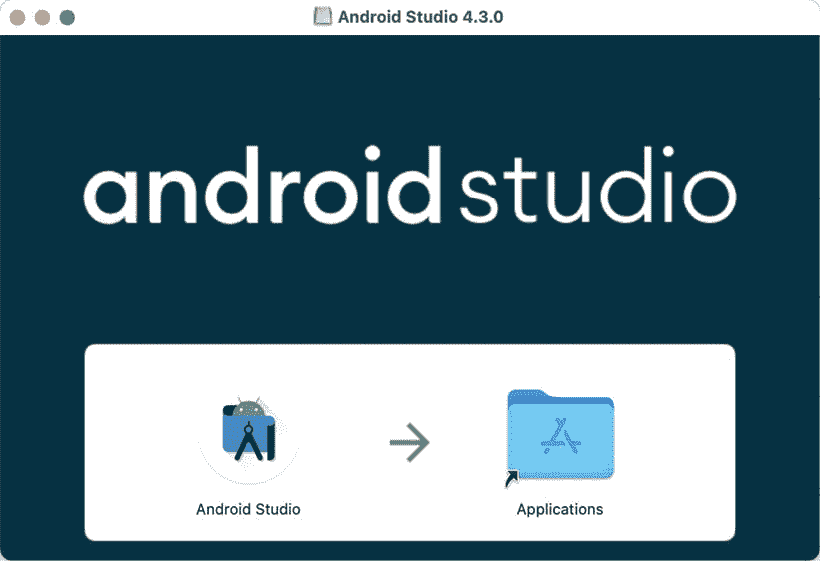

图 2-1

要安装此包，只需将 `Android Studio` 图标拖动到“应用程序”（Applications）文件夹中。`Android Studio` 包将随后安装到系统的应用程序文件夹中，此过程通常需要几秒钟即可完成。

要启动 `Android Studio`，请使用 Finder 窗口在应用程序文件夹中找到可执行文件并双击它。

为了以后方便访问该工具，可以从 Finder 窗口将 `Android Studio` 图标拖动并释放到 Dock（程序坞）上。

#### 2.3.3 在 Linux 上安装

下载好 Linux 版 `Android Studio` 包后，打开终端窗口，切换到准备安装 `Android Studio` 的目录并执行以下命令：

```bash
unzip /<path to package>/android-studio-ide-<version>-linux.zip
```

请注意，`Android Studio` 压缩包将安装到名为 `android-studio` 的子目录中。因此，假设上述命令是在 `/home/demo` 下执行的，软件包将解压到 `/home/demo/android-studio`。

要启动 `Android Studio`，请打开终端窗口，切换到 `android-studio/bin` 子目录并执行以下命令：

```bash
./studio.sh
```

在 64 位 Linux 系统上运行时，可能在运行 `Android Studio` 之前需要安装一些 32 位支持库。在 Ubuntu 上，可以使用以下命令安装这些库：

```bash
sudo apt-get install libc6:i386 libncurses5:i386 libstdc++6:i386 lib32z1 libbz2-1.0:i386
```

在基于 Red Hat 和 Fedora 的 64 位系统上，使用以下命令：

```bash
sudo yum install zlib.i686 ncurses-libs.i686 bzip2-libs.i686
```

### 2.4 Android Studio 设置向导

如果您是首次安装 `Android Studio`，在设置过程开始后出现的初始对话框可能类似于下方图 2-2 所示：

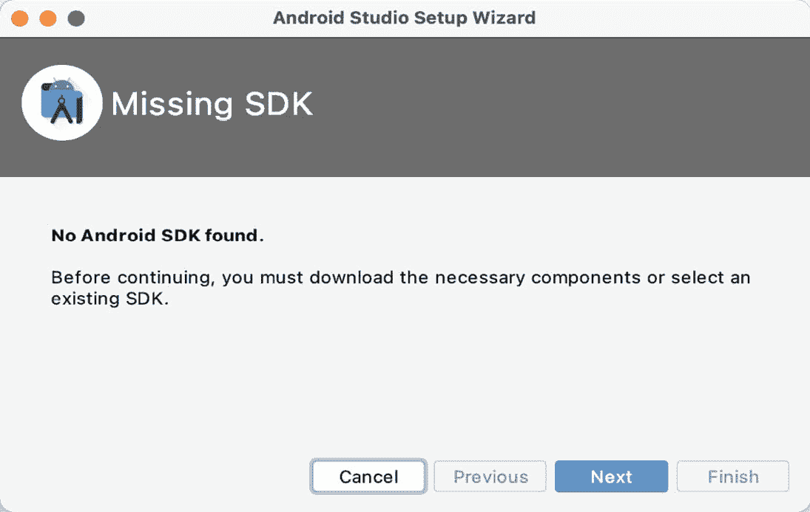

图 2-2

如果出现此对话框，点击“下一步”（Next）按钮以显示 SDK 组件设置对话框（图 2-3）。在此对话框中，点击“下一步”按钮之前，请确保已选择 Android SDK 选项以及最新的 API 包：

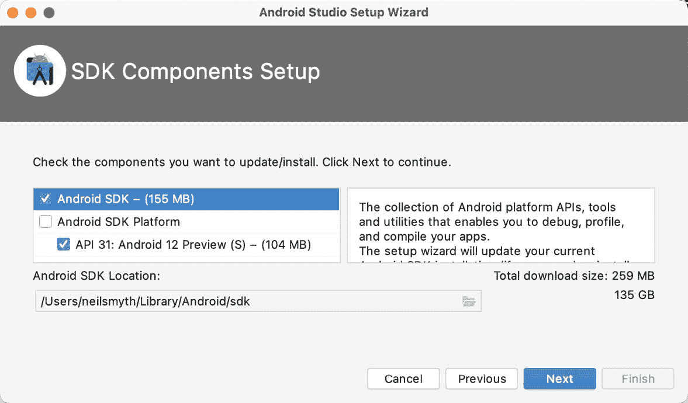

图 2-3

点击“下一步”后，`Android Studio` 将下载并安装 Android SDK 和工具。

如果您之前安装过旧版本的 `Android Studio`，在首次启动此新版本时，可能会出现一个对话框，提供从之前的 `Android Studio` 版本导入设置的选项。如果您有以前版本的设置并希望将其导入到最新安装中，请选择相应的选项和位置。或者，指示您不需要导入任何之前的设置并点击“确定”（OK）按钮继续。

完成这些初始设置步骤后，点击“完成”（Finish）按钮显示“欢迎使用 Android Studio”界面：

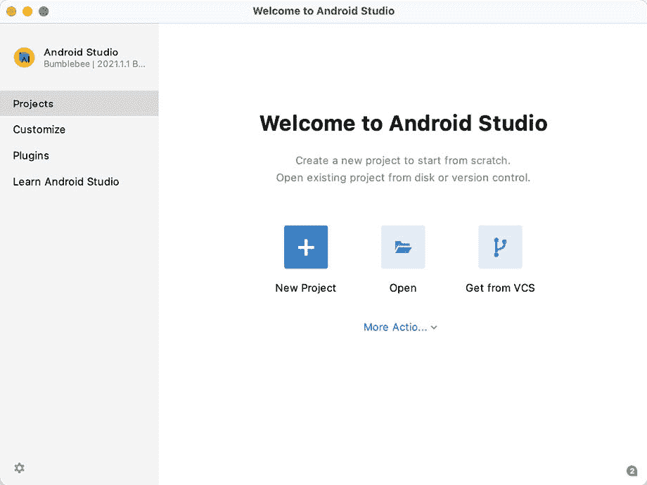

图 2-4

### 2.5 安装额外的 Android SDK 包

到目前为止执行的步骤安装了 `Android Studio` IDE 和当前的默认 Android SDK 包集。在继续之前，值得花时间验证已安装了哪些包，并安装任何缺失或更新的包。

此任务可以通过点击欢迎对话框中的“更多操作”（More Actions）链接并从下拉菜单中选择“SDK 管理”（SDK Manager）选项来完成。一旦调用，将显示设置对话框中的 Android SDK 界面，如图 2-5 所示：

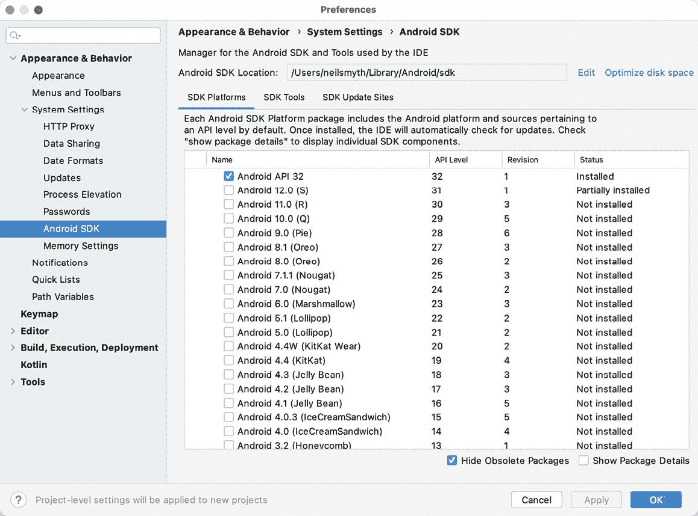

图 2-5

首次安装 `Android Studio` 之后，可能只安装了最新发布的 Android SDK 版本。要安装旧版本的 Android SDK，只需选择对应版本的复选框并点击“应用”（Apply）按钮即可。

本书中的大多数示例都将支持低至 Android 8.0 (Oreo) 的旧版本 Android。这是为了确保应用程序运行在广泛的 Android 设备上。在 SDK 版本列表中，启用 Android 8.0 (Oreo) 侧的复选框并点击“应用”按钮。在生成的确认对话框中，点击“确定”按钮安装 SDK。随后的对话框将在执行安装前寻求对许可和条款的接受。安装完成后，点击“完成”。

最新 SDK 也可能列出可用更新。要访问有关准备更新的包的详细信息，请启用屏幕右下角的“显示包详情”（Show Package Details）选项。这将显示与图 2-6 所示类似的信息：

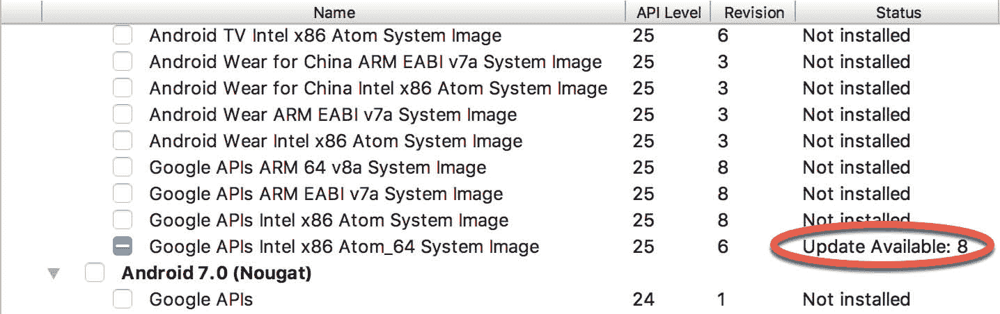

图 2-6

上图强调了可用更新。要安装更新，请启用项目名称左侧的复选框并点击“应用”按钮。

除了 Android SDK 包外，还安装了几个用于构建 Android 应用程序的工具。要查看当前安装的包并检查更新，请留在 SDK 设置界面并如图 2-7 所示选择“SDK 工具”（SDK Tools）标签页：

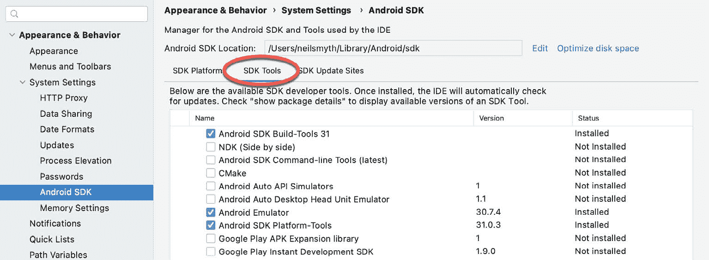

图 2-7

在 Android SDK Tools 界面中，确保以下包已列为“已安装”（Installed）：

* Android SDK Build-tools
* Android Emulator
* Android SDK Platform-tools
* Google Play Services
* Intel x86 Emulator Accelerator (HAXM)
* Google USB Driver（仅限 Windows）
* Layout Inspector image for API

注意：Intel x86 Emulator Accelerator (HAXM) 无法安装在 Apple 芯片 Mac 上。

如果上述任何包列为“未安装”或需要更新，只需选择这些包旁的复选框并点击“应用”按钮启动安装过程。如果出现 HAXM 设置对话框，选择推荐的内存分配：

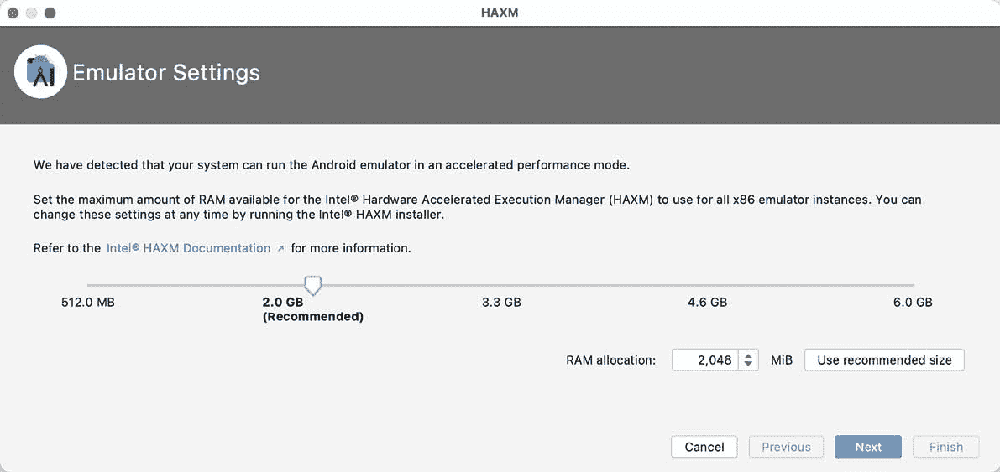

图 2-8

安装完成后，检查包列表并确保所选包现在列为“已安装”。如果有未安装的，确保已选择并再次点击“应用”按钮。

### 2.6 使 Android SDK 工具命令行可用

大多数情况下，Android SDK 的底层工具是在 Android 环境内部访问的。尽管如此，某些情况下，从命令提示符或终端窗口调用这些工具将很有用。为了让您开发的操作系统能够找到这些工具，有必要将它们添加到系统的 PATH 环境变量。

无论操作系统如何，PATH 变量都需要配置包含以下路径（其中 `<path_to_android_sdk_installation>` 代表安装 Android SDK 的文件系统位置）：

* `<path_to_android_sdk_installation>/sdk/tools`
* `<path_to_android_sdk_installation>/sdk/tools/bin`
* `<path_to_android_sdk_installation>/sdk/platform-tools`

SDK 在您系统上的位置可以通过启动 SDK 管理并参考设置面板顶部的“Android SDK 位置”（Android SDK Location）字段来确定，如图 2-9 所示：

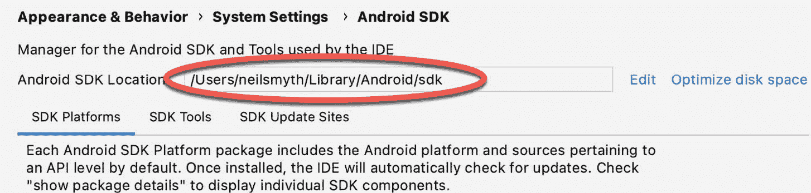

图 2-9

确定 SDK 的位置后，将此添加到 PATH 变量的步骤取决于操作系统：

#### 2.6.1 Windows 8.1

1. 在启动屏幕上，将鼠标移动到屏幕右下角，从弹出的菜单中选择 `Search`。在搜索框中输入 `Control Panel`。当 `Control Panel` 图标出现在结果区域时，点击它以在桌面上启动该工具。
2. 在 `Control Panel` 中，使用 `Category` 菜单将显示更改为 `Large Icons`。从图标列表中选择标记为 `System` 的项。
3. 在 `Environment Variables` 对话框中，在 `System` 变量列表中找到 `Path` 变量，选中它并点击 `Edit…` 按钮。在编辑对话框中使用 `New` 按钮向路径添加三个新项。例如，假设 Android SDK 安装在 `C:\Users\demo\AppData\Local\Android\Sdk`，则需要添加以下项目：

```
C:\Users\demo\AppData\Local\Android\Sdk\platform-tools
C:\Users\demo\AppData\Local\Android\Sdk\tools
C:\Users\demo\AppData\Local\Android\Sdk\tools\bin
```

4. 点击每个对话框中的 `OK` 并关闭系统属性控制面板。

通过按下键盘上的 `Windows + R` 并在 `Run` 对话框中输入 `cmd` 来打开命令提示符窗口。在 `Command Prompt` 窗口中输入：

```
echo %Path%
```


返回的路径变量值应包含 Android SDK 平台工具文件夹的路径。通过尝试如下运行`adb`工具来验证`platform-tools`值是否正确：

```
adb
```

该工具在执行时应输出命令行选项列表。

同样，通过尝试运行`AVD Manager`命令行工具来检查工具路径设置（如果`avdmanager`工具报告 Java 问题，请担心——稍后会处理）：

```
avdmanager
```

如果其中一个或两个命令都出现了类似下面的消息，那么很可能是向`Path`环境变量中添加了错误的路径：

```
'adb' is not recognized as an internal or external command,
operable program or batch file.
```

### 2.6.2 Windows 10

右键点击`Start`菜单，从弹出的菜单中选择`Settings`，并在`Find a setting`文本框中输入“Edit the system environment variables”。在`System Properties`对话框中，点击`Environment Variables...` 按钮。按照 Windows 8.1 列出的步骤操作，从第 3 步开始。

### 2.6.3 Windows 11

右键点击任务栏上的`Start`图标，从弹出的菜单中选择`Settings`。当`Settings`对话框出现时，向下滚动列表并选择“About”选项。在`About`屏幕上，从`Related links`部分选择`Advanced system settings`。当`System Properties`窗口出现时，点击`Environment Variables...` 按钮。按照 Windows 8.1 列出的步骤操作，从第 3 步开始。

### 2.6.4 Linux

在 Linux 上，此配置通常可以通过向家目录下的`.bashrc`文件添加命令来实现（具体细节可能取决于所使用的特定 Linux 发行版）。假设 Android SDK 程序包安装在`/home/demo/Android/sdk`，则`.bashrc`文件中的`export`行内容如下：

```
export PATH=/home/demo/Android/sdk/platform-tools:/home/demo/Android/sdk/tools:/home/demo/Android/sdk/tools/bin:/home/demo/android-studio/bin:$PATH
```

注意，上述命令将`android-studio/bin`目录添加到`PATH`变量中。这将允许无论在终端窗口中当前目录是什么，都可以执行`studio.sh`脚本。

### 2.6.5 macOS

在 macOS 上可以使用多种技术来修改`$PATH`环境变量。认为最干净的方法是在`/etc/paths.d`目录下创建一个新文件，其中包含要添加到`$PATH`的路径。假设 Android SDK 位置为`/Users/demo/Library/Android/sdk`，可以通过在`/etc/paths.d`目录下创建一个名为`android-sdk`的新文件并包含以下行：

```
/Users/demo/Library/Android/sdk/tools
/Users/demo/Library/Android/sdk/tools/bin
/Users/demo/Library/Android/sdk/platform-tools
```

注意，由于这是一个系统目录，在创建文件时必须使用`sudo`命令。例如：

```
sudo vi /etc/paths.d/android-sdk
```

## 2.7 Android Studio 内存管理

Android Studio 是一个大型复杂的软件应用程序，由许多后台进程组成。尽管 Android Studio 过去因性能不佳而受到批评，但谷歌在最近的发布中显著改进了性能并在并在新版本中继续这样做。这些改进包括允许用户配置 Android Studio IDE 以及用于构建和运行应用的后台进程所使用的内存量。这允许软件利用具有更大内存的系统。

如果你在运行 Android Studio 的系统具有足够的空闲内存来增加这些值（此功能仅适用于具有 5GB 或更多内存的 64 位系统），并且发现 Android Studio 性能似乎有所下降，那么尝试这些内存设置可能是值得的。Android Studio 还可能通过类似所示的对话框通知你可以提高性能：


图 2-10

要查看并修改当前配置，选择`File -> Settings...`（macOS 上为`Android Studio -> Preferences...`）菜单，并在生成的对话框中，选择左侧导航面板`System Settings`下的`Memory Settings`选项，如图 2-11 所示。

在更改内存分配时，务必不要分配超过需要或系统无法承受的内存。


图 2-11

## 2.8 更新 Android Studio 和 SDK

Android Studio 和 Android SDK 不定期发布新版本。新版本的 SDK 使用 Android SDK Manager 安装。Android Studio 通常会在有可用更新时通知你。

要手动检查 Android Studio 更新，在 Android Studio 主窗口中使用`Help -> Check for Updates...`菜单选项（macOS 上为`Android Studio -> Check for Updates...`）。

## 2.9 总结

在开发 Android 应用程序之前，第一步是设置适用于开发的环境。这包括 Android SDK 和 Android Studio IDE（它包含 OpenJDK 开发环境）。在本章中，我们涵盖了在 Windows、macOS 和 Linux 上安装这些包的步骤。

# 3. 在 Android Studio 中创建示例应用

本书的前几章节涵盖了配置使用 Android Studio IDE 开发 Android 应用程序所需环境的步骤。在进入更高级的主题之前，现在是验证所有所需的开发包都已安装并运行良好的时机。实现这一目标最佳方法是创建一个 Android 应用程序并编译运行它。本章将介绍如何使用 Android Studio 创建一个应用程序项目。

## 3.1 关于项目

在本章中创建的项目是一个初级的货币汇率转换器（事实上，它设计得非常简单，只支持从美元转换为欧元，并使用估算的汇率进行转换）。该项目还将使用 Android Studio 最基础的项目模板之一。这种简单性允许我们介绍 Android 应用开发的一些关键方面，而不会因为尝试一次性引入过多的概念（例如推荐的 App 架构和 Android 架构组件）让初学者感到无从从。在遵循本章的教程时，请放心，此示例项目中所使用的所有技术和代码将在后续章节中进行更详细的介绍。

## 3.2 创建新的 Android 项目

应用开发过程的第一步是在 Android Studio 环境中创建一个新项目。因此，请先启动 Android Studio，如图 3-1 所示的“欢迎来到 Android Studio”界面：

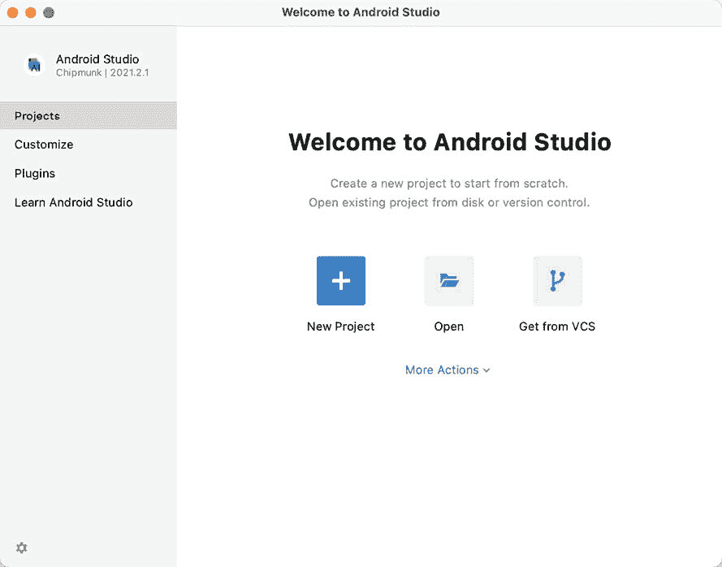

图 3-1

一旦出现此窗口，Android Studio 就已准备好创建新项目。要创建新项目，只需点击 `New Project`（新项目）选项即可显示新项目向导的第一个界面。

## 3.3 创建 Activity

第一步是为应用定义要创建的初始 Activity 类型。提供的选项可以为手机和平电脑、Wear OS、电视、Android 音频或 Android Things 创建项目。在开发 Android 应用时，可以使用不同的 Activity 类型，其中许多将在后面的章节中详细介绍。然而，为了本示例，只需在 Templates（模板）面板中选择 `Phone and Tablet`（手机和平电脑）选项，然后选择创建 `Empty Activity`（空 Activity）选项。`Empty Activity` 选项会创建一个由单个`TextView`对象组成的模板用户界面。

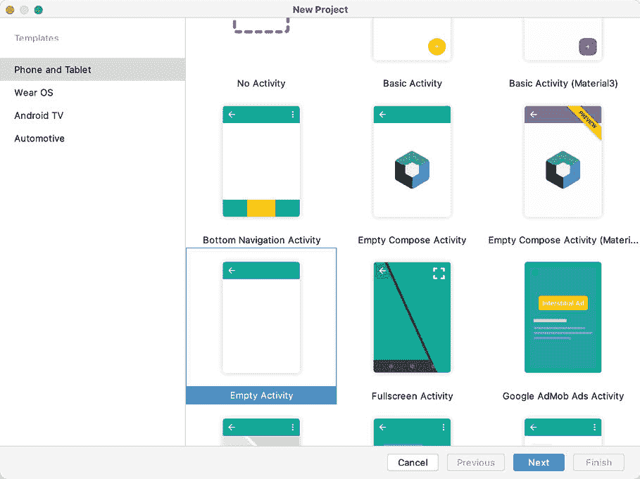

图 3-2

选中 `Empty Activity` 后，点击 `Next`（下一步）继续配置项目。

## 3.4 定义项目和 SDK 设置

在项目配置窗口（[图 3-3）中，将 `Name`（名称）字段设置为 `AndroidSample`。应用名称是在 Android Studio 内部引用和标识应用的名称，也是如果完成的应用要在 Google Play 商店中销售时将使用的名称。

`Package name`（包名）用于在 Android 应用生态系统中唯一地标识应用。虽然它可以设置为任何唯一标识你应用的字符串，但传统上，它是基于域名的反转 URL，后面加上应用的名称。例如，如果你的域名是 `www.mycompany.com`，且应用命名为 `AndroidSample`，那么包名可以指定如下：

`com.mycompany.androidsample`

如果你没有域名，可以在 `Company Domain`（公司域名）字段中输入任何其他字符串，或者为了测试之目的可以使用 `example.com`，但在发布应用之前需要更改它：

`com.example.androidsample`

`Save location`（保存位置）设置将默认位于你主目录下名为 `AndroidStudioProjects` 的文件夹中，可以通过点击包含当前路径设置的字段右侧的文件夹图标进行更改。

将 `minimum SDK`（最低 SDK）设置设置为 `API 26: Android 8.0 (Oreo)`。除非某个必要功能仅在较新版本中可用，否则此书中创建的大多数项目将使用此最低 SDK。这里的目标是使用最新的 Android SDK 构建应用，同时保留与运行旧版本 Android 的设备的兼容性（在此情况下，最可追溯到 Android 8.0）。`Minimum SDK` 设置下方的文本将概述目前运行该应用的 Android 设备百分比。点击 `Help me choose`（帮助我选择）按钮（在[图 3-3]中突出显示）查看仍在使用的各种 Android 版本的完整分类：

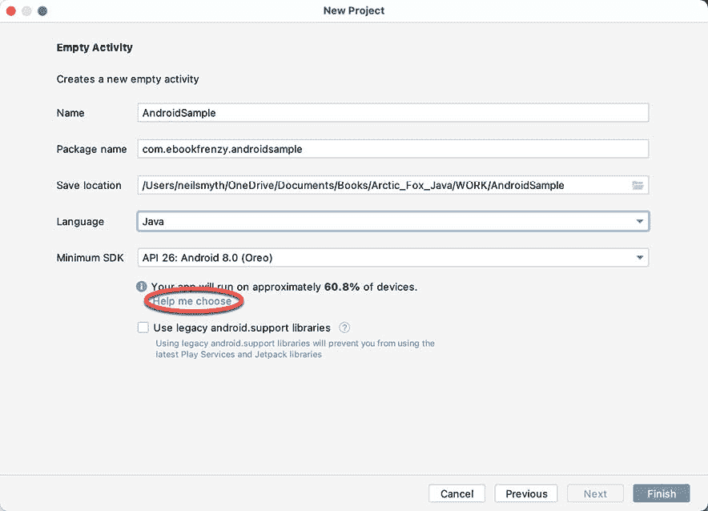

图 3-3

最后，将 `Language`（语言）菜单更改为 `Java` 并点击 `Finish`（完成）启动项目创建过程。

## 3.5 修改示例应用

此时，Android Studio 已创建一个最小的示例应用项目并打开了主窗口。

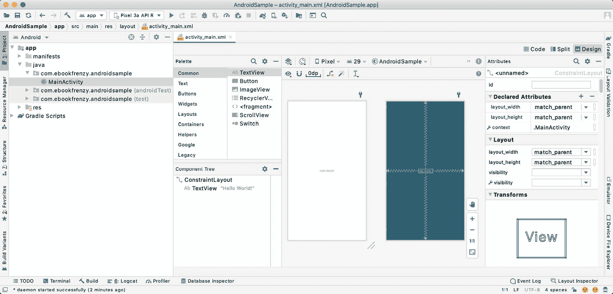

图 3-4

新创建的项目和关联文件的引用列位于主项目窗口左侧的 `Project`（项目）工具窗口。`Project` 工具窗口有多种显示信息的模式。默认情况下，此面板应处于 `Android` 模式。此设置由面板顶部的菜单控制，如[图 3-5]所示。如果面板当前不是 `Android` 模式，请使用菜单切换模式：

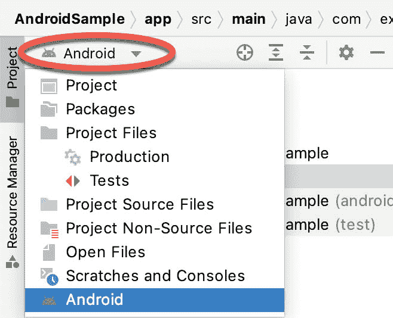

图 3-5

## 3.6 修改用户界面

我们的 Activity 用户界面设计存储在名为 `activity_main.xml` 的文件中，该文件位于项目文件层次结构的 `app -> res -> layout` 下。一旦在 `Project` 工具窗口中找到它，双击该文件将其加载到出现在 Android Studio 主窗口中心面板中的用户界面 `Layout Editor`（布局编辑器）工具中：

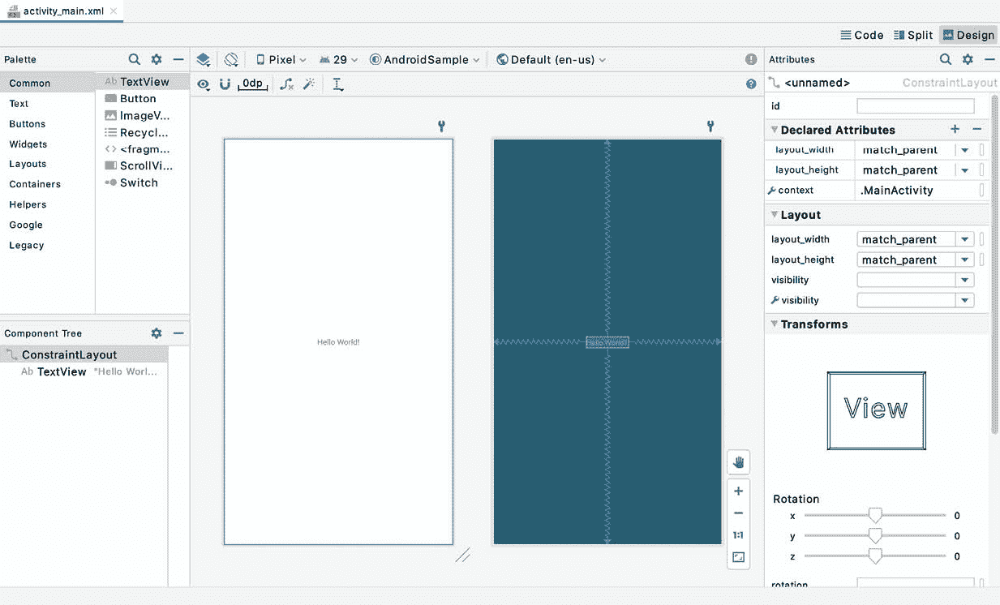

图 3-6

`Layout Editor` 窗口顶部工具栏上有一个菜单（在上方图中设置为 `Pixel`），它反映在 `Layout Editor` 面板中的设备视觉表示上。点击此菜单可以选择广泛的其他设备选项。

要在横屏和竖屏之间切换设备显示，请直接使用设备选择菜单左侧显示  图标的下拉菜单。使用夜晚按钮 ` 开启或关闭夜晚模式。

如屏幕所示，内容布局已经包含了一个显示“Hello World!”消息的标签。面板左侧运行着调色板，包含了用于构建用户界面的不同用户界面组件类别，例如按钮、标签和文本字段。然而需要注意的是，并不是所有用户界面组件对用户可见的。其中一个类别是布局。Android 支持多种布局，为视觉用户界面组件在屏幕上的定位和管理提供不同程度的控制。虽然从用户界面的视觉表示很难判断，但当前设计是使用 `ConstraintLayout` 创建的。可以通过查看 `Component Tree`（组件树）面板中的信息来确认这一点，该面板默认位于 `Layout Editor` 面板的左下角，如[图 3-7]所示：


图 3-7

从组件树层次结构中可以看出，用户界面布局由一个 `ConstraintLayout` 父对象和一个 `TextView` 子对象组成。

在继续之前，请检查布局编辑器（Layout Editor）的自动连接（Autoconnect）模式是否已启用。这意味着当组件添加到布局时，布局编辑器将自动添加约束条件，以确保组件在不同的屏幕尺寸和设备方向上正确定位（该主题将在后续章节中进行更详细的介绍）。`Autoconnect`按钮出现在布局编辑器的工具栏中，用一个磁铁图标表示。当被禁用时，磁铁图标上会出现一条斜线（见图 3-8）。如有必要，请通过点击此按钮重新启用自动连接模式。

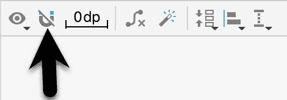

图 3-8

修改应用的下一步是向布局中添加一些额外的组件，其中第一个是`Button`（按钮），用户点击以启动货币转换。

`Palette`（调色板）面板由两列组成，左列包含视图组件分类列表。右列列出当前所选类别中包含的组件。例如，在图 3-9 中，当前在 `Buttons` 类别中选中了 `Button` ：

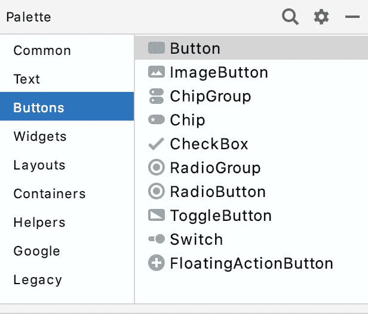

图 3-9

点击并拖动 `Buttons` 列表中的 `Button` 对象，并将其释放到用户界面设计的水平中心，使其位于现有 `TextView` 小部件下方：

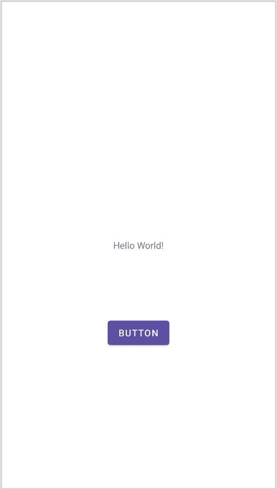

图 3-10

下一步是更改当前由 `Button` 组件显示的文本。位于设计区域右侧的面板是 `Attributes`（属性）面板。该面板显示分配给布局中当前选中组件的属性。在此面板中，在 `Common Attributes`（常用属性）部分找到 `text` 属性，并将当前值从“Button”更改为“Convert”，如图 3-11 所示：


图 3-11

第二个文本属性旁边有一个扳手，允许设置文本属性，该属性仅在布局编辑器工具中显示，而在运行时不会显示。这对于测试视觉组件和布局在不同设置下的行为非常有用，而无需反复运行应用。

万一自动连接系统未能设置所有布局连接，点击 `Infer constraints`（推断约束）按钮（图 3-12）为布局添加任何缺失的约束：

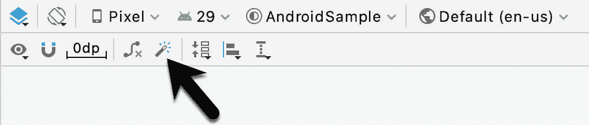

图 3-12

此时，重要的是说明位于布局编辑器工具右上角的警告按钮，如图 3-13 所示。显然，这表示布局存在潜在问题。要查看任何问题的详情，请点击该按钮：

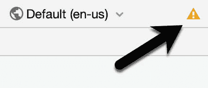

图 3-13

点击后将出现一个面板（图 3-14），描述问题的性质并提供一些可能的纠正措施：

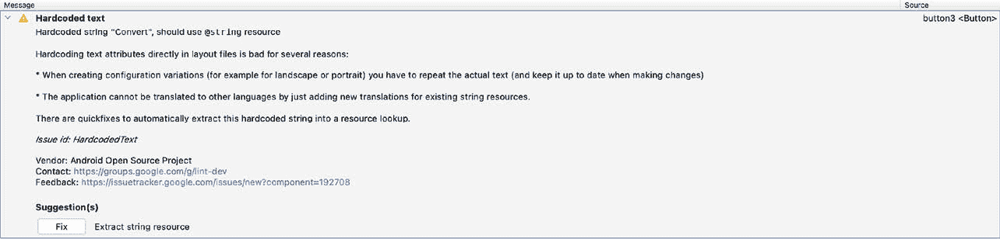

图 3-14

目前列出的唯一警告如下：

硬编码字符串 "Convert"，应使用 @string 资源

这条 I18N（国际化）消息告诉我们，项目未来的国际化存在一个潜在问题（“I18N”源于“internationalization”一词以“I”开头，以“N”结尾，中间有 18 个字母）。该警告提醒我们，在开发 Android 应用程序时，应尽可能将文本字符串等属性和值以资源的形式存储。这样做允许通过修改资源文件来更改应用程序的外观，而无需更改应用程序源代码。这在将用户界面翻译成不同的口语时特别有价值。如果用户界面中的所有文本都包含在单个资源文件中，例如，可以将该文件交给翻译人员，由他们执行翻译工作并返回翻译后的文件以包含在应用程序中。这使得可以在不修改任何源代码的情况下针对多种语言。在本例中，我们将创建一个名为 `convert_string` 的新资源，并为其分配字符串“Convert”。

点击 Issue Explanation（问题说明）面板中的 `Fix`（修复）按钮以显示 Extract Resource（提取资源）面板（图 3-15）。在此面板中，将资源名称字段更改为 `convert_string`，并在点击 `OK` 按钮之前将资源值保留为 Convert。

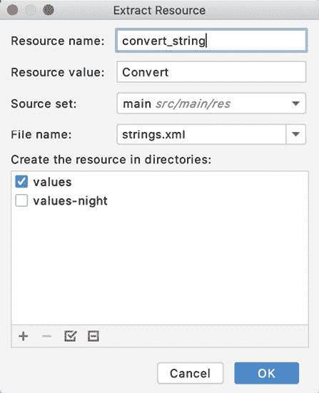

图 3-15

下一个要添加的小部件是 `EditText` 小部件，用户将其中输入要转换的美元金额。从 `Palette` 面板中，选择 `Text` 类别，点击并拖动 `Number (Decimal)` 组件到布局中，使其水平居中并位于现有 `TextView` 小部件上方。选中该小部件后，使用 `Attributes` 工具窗口将 `hint` 属性设置为“dollars”。点击警告图标并将字符串提取到名为 `dollars_hint` 的资源。


本章稍后编写的代码将需要访问用户输入`EditText`字段的美元值。它将通过引用分配给布局中小部件的`id`来实现。Android Studio分配给小部件的默认`id`可以在布局中选中时进行查看和更改，如图 3-16 所示：


将`id`更改为`dollar_text`，并在命名对话框中点击`Refactor`（重构）按钮。这将确保项目中的任何引用都自动更新为新`id`：

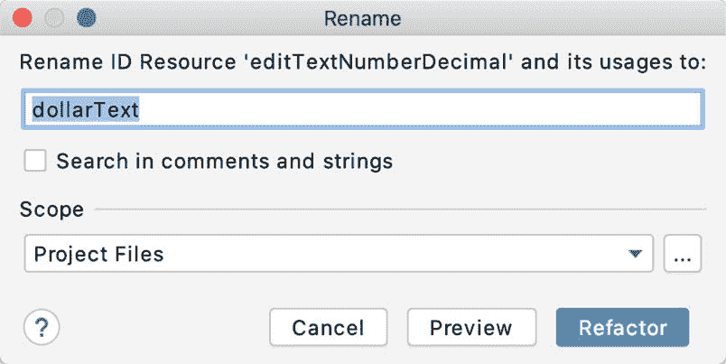

图 3-17

点击`Infer constraints`按钮添加任何缺失的布局约束。此时，布局应类似于图 3-18 所示：


图 3-18

### 审查布局和资源文件

在继续下一步之前，我们将查看用户界面设计和资源处理的一些内部方面。在上一节中，我们通过布局编辑器工具修改`activity_main.xml`文件对用户界面进行了一些更改。事实上，布局编辑器所做的只是提供了一种编辑文件 XML 内容的方式。在实践中，没有理由不直接修改 XML 来更改用户界面，在某些情况下，这实际上比使用布局编辑器工具更快。在布局编辑器面板的右上角有三个按钮，如下方图 3-19 所示：


图 3-19

默认情况下，编辑器处于 Design 模式，仅显示布局的视觉表示。最左侧的按钮将切换到 Code 模式显示布局的 XML，而中间按钮将进入 Split 模式，同时显示布局和 XML，如图 3-0 所示：

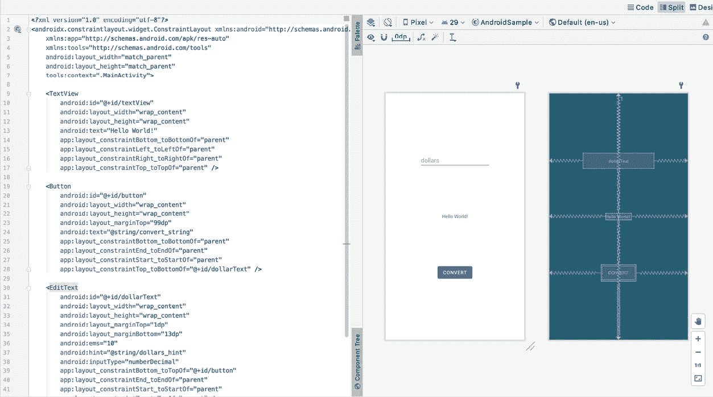

图 3-20

从 XML 文件的结构可以看出，用户界面由`ConstraintLayout`组件组成，该组件又是`TextView`、`Button`和`EditText`对象的父级。我们还可以看到，例如`Button`的`text`属性被设置为我们的`convert_string`资源。

当 XML 布局发生更改时，这些更改将反映在布局画布上。也可以在布局画布面板内对布局进行视觉化修改，更改将显示在 XML 列表中。要查看此效果，请切换到分屏（Split）模式，并修改 XML 布局以将`ConstraintLayout`的背景颜色更改为如下红色调：

```xml
<?xml version="1.0" encoding="utf-8"?>
<androidx.constraintlayout.widget.ConstraintLayout xmlns:android="http://schemas.android.com/apk/res/android"
    xmlns:app="http://schemas.android.com/apk/res-auto"
    xmlns:tools="http://schemas.android.com/tools"
    android:layout_width="match_parent"
    android:layout_height="match_parent"
    tools:context=".MainActivity"
    android:background="#ff2438" >

</androidx.constraintlayout.widget.ConstraintLayout>
```

注意，布局颜色会实时更改以匹配 XML 文件中的新设置。同时请注意，XML 编辑器中包含颜色设置行的左侧边距（也称为槽位 gutter）处会出现一个红色红色方块。这是一个视觉提示，表示已在该属性上设置了红色。点击红色方块将显示颜色选择器，允许选择不同的颜色：

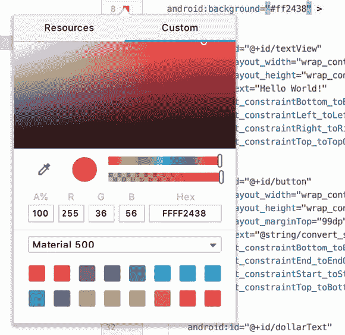

图 3-21

在继续之前，请从布局文件中删除背景属性，以便背景恢复到默认设置。

最后，使用项目（Project）面板找到`app` -> `res` -> `values` -> `strings.xml`文件，并双击它将其加载到编辑器中。目前 XML 的内容如下：

```xml
<resources>
    <string name="app_name">AndroidSample</string>
    <string name="convert_string">Convert</string>
    <string name="dollars_hint">dollars</string>
</resources>
```

作为资源实际应用的演示，将当前分配给`convert_string`资源的字符串值更改为“Convert to Euros”，然后通过选择编辑器面板中布局文件的选项页返回布局编辑器（Layout Editor）工具。注意布局已获取了该字符串的新资源值。

访问 XML 文件中引用的资源值还有一种快速方法。在分屏（Split）或代码（Code）模式下的布局编辑器工具中，点击`@string/convert_string`属性设置使其高亮，然后在键盘上按`Ctrl-B`（macOS 上为`Cmd-B`）。Android Studio 随后将打开`strings.xml`文件并带您进入文件中声明该资源的行。利用此机会将字符串资源还原为原始的“Convert”文本，并添加以下附加字符串资源项，该项稍将在应用代码中引用：

```xml
<resources>
    <string name="convert_string">Convert</string>
    <string name="dollars_hint">dollars</string>
    <string name="no_value_string">No Value</string>
</resources>
```

资源字符串也可以 Android Studio 的翻译编辑器（Translations Editor）进行编辑。要打开此编辑器，右键点击`app` -> `res` -> `values` -> `strings.xml`文件并选择`Open editor`（打开编辑器）菜单选项。将在 Android Studio 窗口的主面板中显示翻译编辑器：

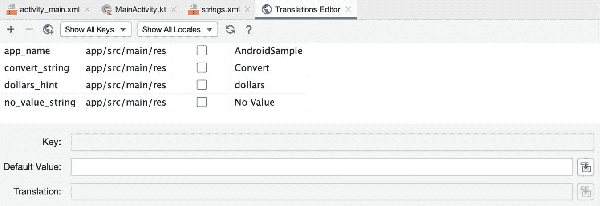

图 3-22

此编辑器允许编辑分配给资源键的字符串，并管理多种语言的翻译。

## 3.8 添加交互

此示例项目的最后一步是使应用程序具有交互性，这样当用户在`EditText`字段中输入美元值并点击转换按钮时，转换后的欧元值将显示在`TextView`上。这涉及在`Button`部件上实现一些事件处理。具体来说，需要对`Button`进行配置，以便在触发`onClick`事件时调用应用代码中的某个方法。事件处理可以通过多种不同的方式实现，并将在后续标题为 *Android 事件处理概述与示例* 的章节中进行详细介绍。将布局编辑器返回设计（Design）模式，在布局编辑器中选择`Button`部件，引用属性（Attributes）工具窗口，并如下所示指定名为`convertCurrency`的方法：


图 3-23

注意，`onClick`属性的文本字段现在用红色边框高亮，警告我们按钮已配置为调用一个尚不存在的方法。要解决这个问题，双击项目工具窗口（`app` -> `java` -> `<package name>` -> `MainActivity`）中的`MainActivity.java`文件将其加载到代码编辑器，并在类文件中添加`convertCurrency`方法的代码，使其内容如下，请注意还需要导入一些额外的 Android 包：

```java
package com.ebookfrenzy.androidsample;

import androidx.appcompat.app.AppCompatActivity;
import android.os.Bundle;
import android.view.View;
import android.widget.EditText;
import android.widget.TextView;
import java.util.Locale;

public class MainActivity extends AppCompatActivity {
    @Override
    protected void onCreate(Bundle savedInstanceState) {
        super.onCreate(savedInstanceState);
        setContentView(R.layout.activity_main);
    }

    public void convertCurrency(View view) {
        EditText dollarText = findViewById(R.id.dollarText);
        TextView textView = findViewById(R.id.textView);
        if (!dollarText.getText().toString().equals("")) {
            float dollarValue = Float.parseFloat(dollarText.getText().toString());
            float euroValue = dollarValue * 0.85F;
            textView.setText(String.format(Locale.ENGLISH,"%f", euroValue));
        } else {
            textView.setText(R.string.no_value_string);
        }
    }
}
```

## 3.9 总结

设置 Android 开发环境并不复杂，但涉及许多步骤。在完成这些步骤后，值得运行一个示例以确保环境正确安装和配置。在本章中，我们创建了一个示例应用程序，并使用 Android Studio 布局编辑器工具修改了用户界面布局。在此过程中，我们探索了尽可能使用资源的重要性，特别是在字符串值的情况下，并简要接触了布局的主题。最后，我们在`Button`上添加了`onClick`事件，并连接到一个实现的方法，该方法用于从`EditText`组件中提取用户输入，将美元转换为欧元，然后将结果显示在`TextView`上。

由于应用程序已准备好测试，下一章将详细介绍设置用于测试的模拟器的必要步骤。

虽然 Android Studio 预览面板（Preview panel）允许我们查看正在设计的布局并使用交互模式测试基本功能，但为了完全测试其是否正常工作，仍然需要编译并运行整个应用程序。可以通过在物理设备上安装并运行，或者在 Android 虚拟设备（`AVD`）模拟器环境中运行来对 Android 应用程序进行测试。在使用`AVD`之前，必须先创建并配置它以匹配特定设备型号的规格。在本章中，我们将以`Pixel 4`手机作为示例，演示如何创建这样一个虚拟设备。

# 4.1 关于 Android 虚拟设备

`AVDs`本质上是模拟器，允许在无需将应用程序安装到物理 Android 设备上的情况下对 Android 应用程序进行测试。`AVD`可以配置为模拟各种硬件特性，包括屏幕大小、内存容量，以及是否存在如摄像头、`GPS`导航支持或加速度计等功能。作为 Android Studio 标准安装的一部分，系统安装了多个模拟器模板，允许为一系列不同的设备配置`AVDs`。通过指定处理器类型、内存容量以及屏幕尺寸和像素密度等属性，可以创建自定义的配置，以匹配任何物理 Android 设备。

`AVD`会话可以作为独立窗口出现，也可以嵌入在 Android Studio 窗口中。

新的`AVDs`使用 Android 虚拟设备管理器（Android Virtual Device Manager）进行创建和管理，它可以使用命令行模式，也可以使用更易用户的图形用户界面。创建新`AVD`的第一步是启动`AVD Manager`。这可以通过在 Android Studio 环境的主窗口中选择`Tools` -> `Device Manager`菜单选项来实现。

启动后，管理器将以工具窗口的形式显示，如图图 4-1 所示：

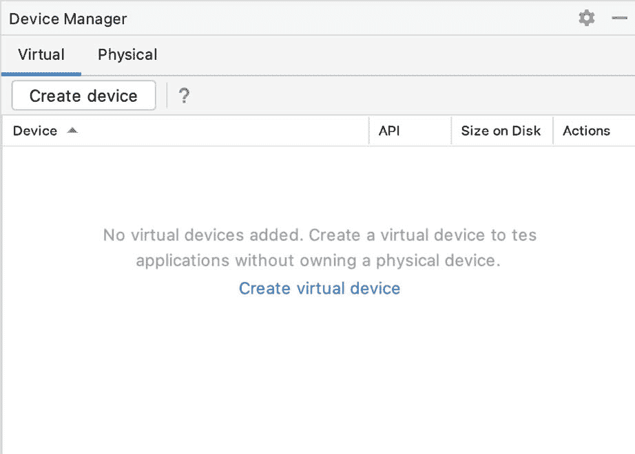

图 4-1

要添加新的`AVD`，首先确保在点击`Create device`按钮之前选中了`Virtual`标签页，以打开虚拟设备配置对话框：

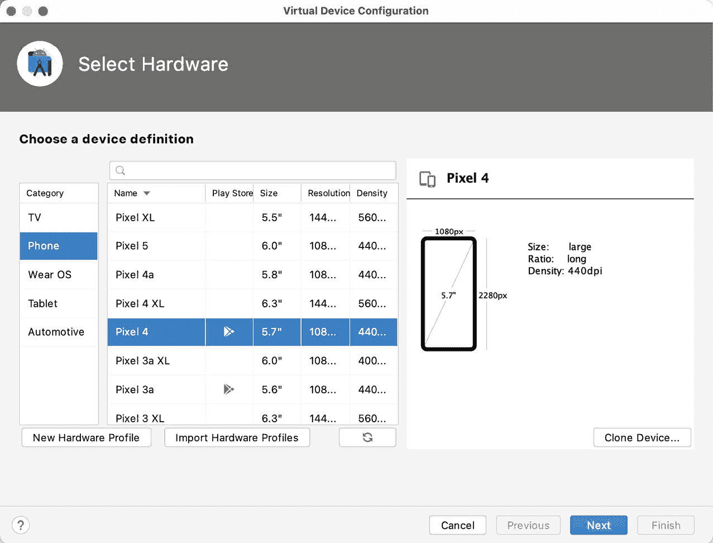

图 4-2

在对话框中，执行以下步骤创建一个兼容`Pixel 4`的模拟器：

1. 从`Category`面板中选择`Phone`选项，显示可用的 Android 手机`AVD`模板列表。

2. 选择`Pixel 4`设备选项并点击`Next`。

3. 在`System Image`界面，选择最新版本的 Android。注意，如果尚未安装系统镜像，`Release Name`旁边将提供`Download`链接。点击此链接在选择它之前下载并安装系统镜像。如果所需的镜像未在列表中，点击`x86 Images`（如果你运行的是带有 Apple 芯片的 Mac，则点击`ARM` images）或`Other images`标签页以查看备选列表。

4. 点击`Next`继续，并在`name`字段中输入描述性名称（例如`Pixel 4 API 32`），或直接接受默认名称。

5. 点击`Finish`创建`AVD`。

6. `AVD`创建完成后，现在可以关闭`Device Manager`了。如果以后需要对`AVD`进行修改，只需重新打开`Device Manager`，从列表中选择该`AVD`，并点击`Actions`列中的铅笔图标来编辑设置。

## 4.2 启动模拟器

要对新创建的`AVD`模拟器进行测试运行，只需从`Device Manager`中选择模拟器并点击启动按钮（`Actions`列中的三角形）。模拟器将嵌入到 Android Studio 主窗口中并开始启动过程。模拟器启动所需的时间取决于`AVD`及其运行所在系统的配置：

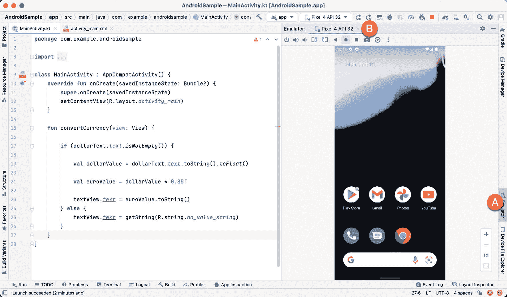

图 4-3

要隐藏和显示模拟器工具窗口，请点击`Emulator`工具窗口按钮（如上方标记的 A 所示）。点击标签旁边的“`x`”关闭按钮 (B)退出模拟器。模拟器工具窗口可以容纳多个模拟器会话，每个会话由一个标签页表示。例如，图 4-4 显示了一个具有两个模拟器会话的工具窗口：


图 4-4

要在会话之间切换，只需点击相应的标签页。

虽然模拟器可能默认以竖屏方向显示，但此或其他默认选项可以更改。在`Device Manager`中，选择新的`Pixel 4`项目，并点击设备行`Actions`列中的铅笔图标。在配置界面中，找到`Startup orientation`部分并更改设置。退出并重启模拟器会话使更改生效。关于模拟器的更多细节请参阅下一章 *使用和配置 Android Studio AVD 模拟器*。

为了在本章的下一节节省时间，请在继续之前保持模拟器运行。

## 4.3 在 AVD 中运行应用程序

配置好`AVD`模拟器后，之前章节中创建的示例`AndroidSample`现在可以编译并运行了。将`AndroidSample`项目加载到 Android Studio 后，确保新创建的`Pixel 4``AVD`显示在设备菜单中（如图 4-5 标记 A 所示），然后点击由三角形表示的运行按钮，或选择`Run` -> `Run ‘app’`菜单选项：

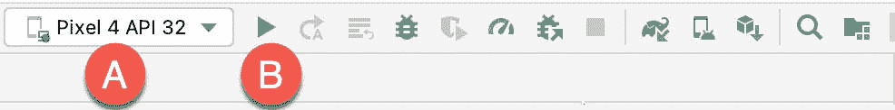

图 4-5

设备菜单 (A) 可选择不同的`AVD`实例或物理设备作为运行目标，并在多个设备上运行。该菜单还提供了访问`Device Manager`以及设备配置和排排除选项：

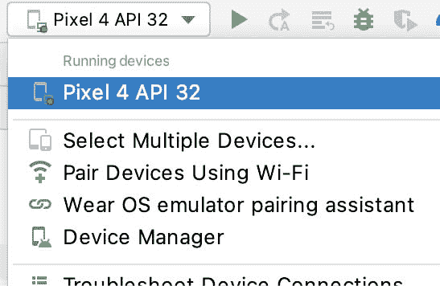

图 4-6

一旦应用程序安装并运行，第一个 fragment 的界面将出现在模拟器中（fragment 是 Android 项目的可重用部分，由界面布局和部分代码组成，该主题将在 *Android 简介* 中介绍）：


图 4-7

如果活动没有自动启动，请检查模拟器应用上是否出现了启动图标。如果是，只需点击启动应用程序。一旦运行过程开始，`Run`工具窗口将变为可用。`Run`工具窗口会在应用程序安装和启动期间显示诊断信息。图 4-8 显示了典型应用程序启动时的`Run`工具窗口输出：

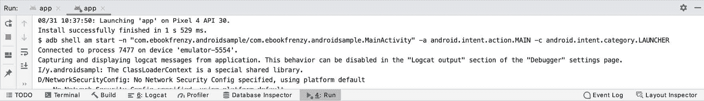

图 4-8

如果在启动过程中遇到问题，`Run`工具窗口将提供信息，这些信息将有助于隔离问题原因。

假设应用程序加载到模拟器并按预期运行，我们已经安全地验证了 Android 开发环境已正确安装和配置。现在应用程序运行时，尝试进行温度转换以验证应用程序是否按预期工作。

## 4.4 在多个设备上运行

上方图 4-6 所示的运行菜单包含一个在多个模拟器和设备上并行运行应用程序的选项。选中后，该选项将显示如图 4-9 所示的对话框，提供系统上配置的所有`AVDs`以及任何连接的物理设备的列表。在点击`Run`按钮之前，勾选要目标模拟器或设备旁复选框：

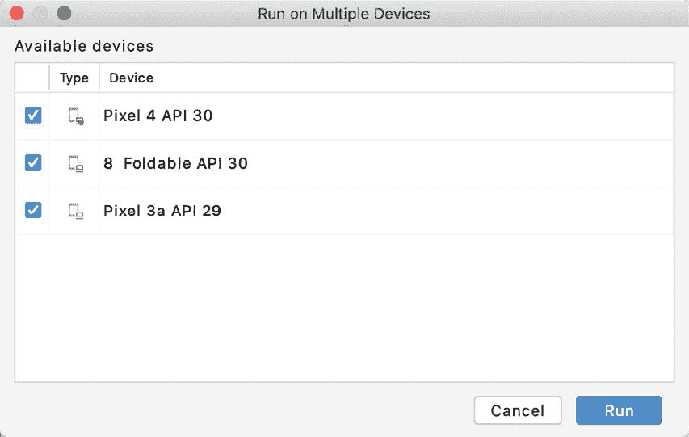

图 4-9


点击 `Run`（运行）按钮后，`Android Studio` 将在选定的模拟器和设备上启动应用。

## 4.5 停止正在运行的应用

要停止正在运行的应用，只需点击位于主工具栏上的停止按钮，如图 4-10 所示：

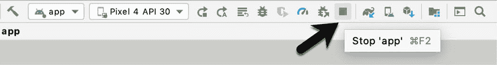

图 4-10

您也可以使用 `Run`（运行）工具窗口终止应用。首先，通过在应用运行时变为窗口工具栏按钮来显示 `Run` 工具窗口。一旦 `Run` 工具窗口出现，点击下方图 4-11 所示中高亮显示的停止按钮：

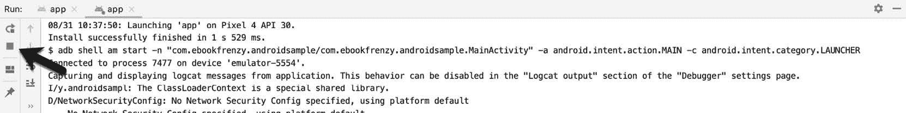

图 4-11

## 4.6 支持深色主题

`Android 10` 引入了备受期待的深色主题，`Android Studio` 项目默认启用了该功能支持。若要在 `AVD` 模拟器中测试深色主题，请在模拟器运行的 `Android` 实例中打开 `Settings`（设置）应用。在 `Settings` 应用中，选择 `Display`（显示）类别并如图 4-12 所示启用 `Dark`（深色）主题选项，以便使屏幕背景变为黑色：

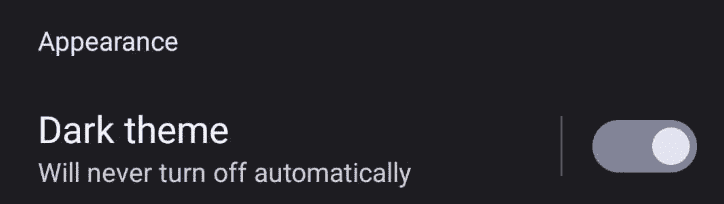

图 4-12

启用深色主题后，运行 `AndroidSample` 应用，并注意它以深色主题显示，包括黑色背景和按钮上的紫色背景，如图 4-13 所示：

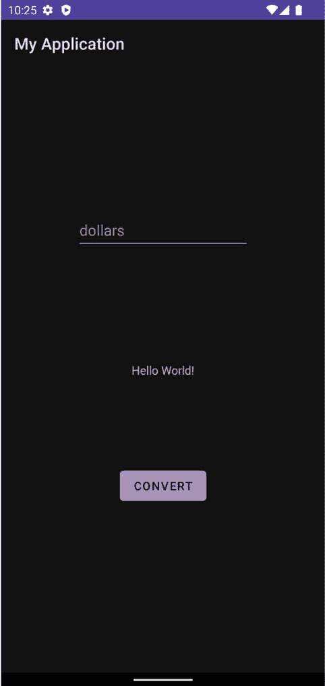

图 4-13

在继续操作之前，返回 `Settings` 应用并关闭深色主题模式。

## 4.7 在独立窗口中运行模拟器

到本章为止，我们仅将模拟器作为嵌入在 `Android Studio` 主窗口内的工具窗口使用。若要在独立窗口中运行模拟器，请选择 `File -> Settings...` 菜单选项（macOS 上为 `Android Studio -> Preferences...`），在偏好设置对话框的左侧导航面板导航到 `Tools -> Emulator`，并禁用 `Launch in a tool window` 选项：

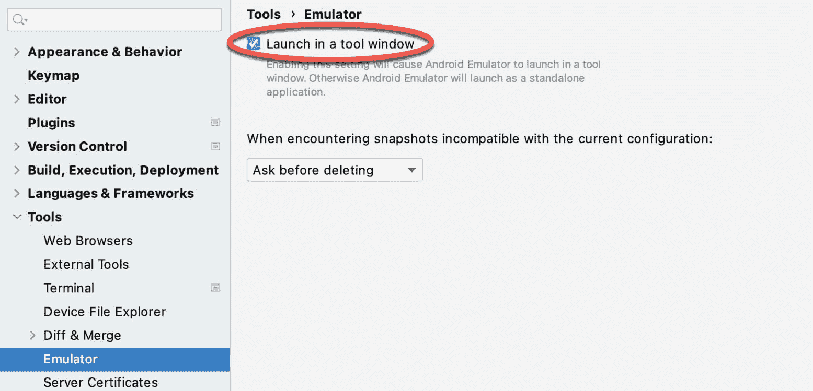

图 4-14

禁用该选项后，点击 `Apply` 按钮然后点击 `OK` 提交更改，通过点击上方标记为 `B` 的图 4-3 标签上的关闭按钮退出当前模拟器会话。

再次运行示例应用，此时模拟器将作为一个独立窗口出现，如下所示：

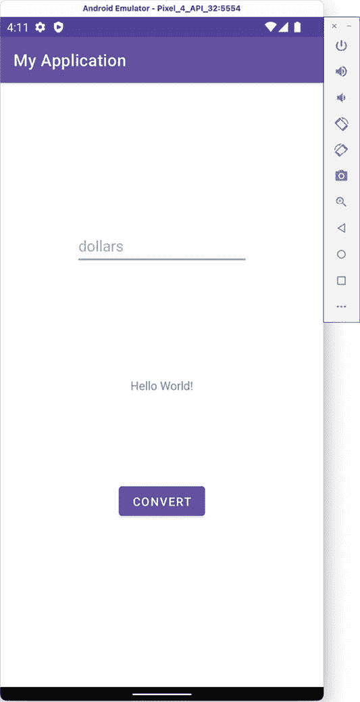

图 4-15

选择独立模式还是工具窗口模式取决于个人喜好。如果您喜欢模拟器运行在工具窗口中，请返回设置屏幕并重新启用 `Launch in a tool window` 选项。然而，在确定独立模式之前，请记住可以通过点击模拟器工具栏中的设置按钮（由齿轮图标表示）并选择 `View Mode -> Float` 菜单选项，将模拟器工具窗口从 `Android Studio` 主窗口分离：

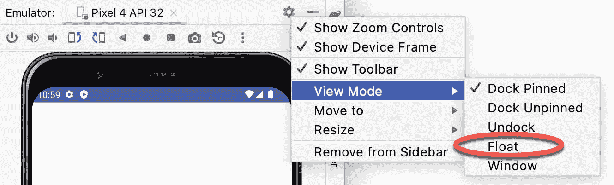

图 4-16

## 4.8 启用设备框架

模拟器可以配置为带有（图 4-17）或不带设备框架（图 4-15）的外观。

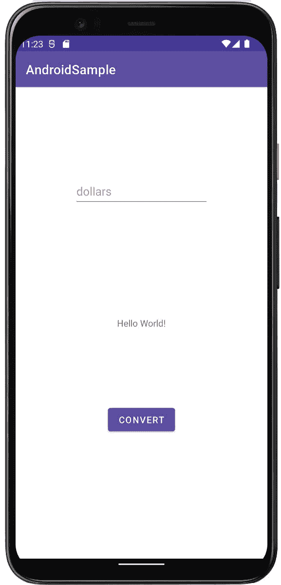

图 4-17

要更改设置，请打开 `Device Manager`（设备管理器），从列表中选择 `AVD`，并点击 `Actions` 列中的铅笔图标编辑设置。在设置屏幕上，找到并更改 `Enable Device Frame` 选项：

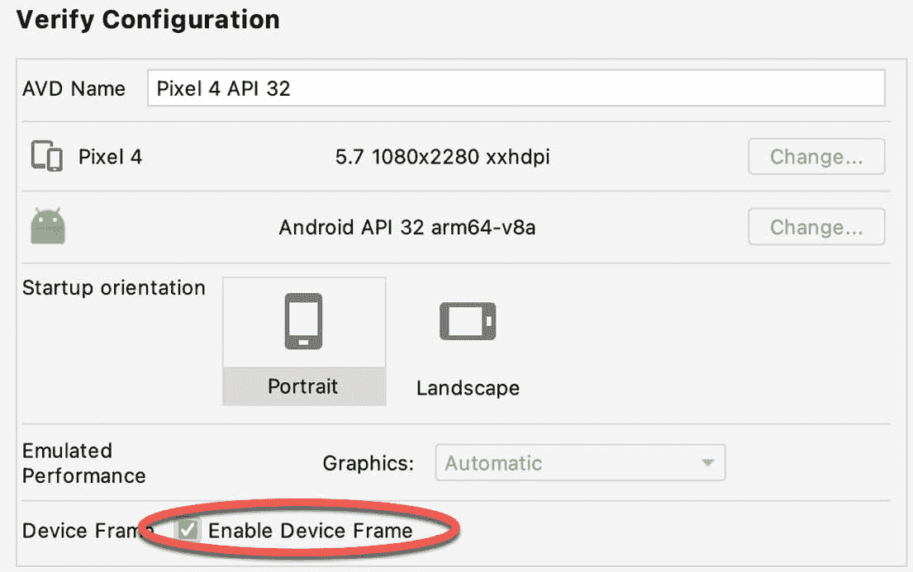

图 4-18

## 4.9 AVD 命令行创建

如所述，除了图形用户界面外，还可以直接从命令行创建新的 `AVD`。这是通过使用 `avdmanager` 工具结合某些命令行选项实现的。一旦启动，该工具将在创建新 `AVD` 之前提示额外信息。

`avdmanager` 工具需要访问 `Java` 运行时环境 (`JRE`) 才能运行。如果在尝试运行 `avdmanager` 时出现错误消息指示找不到 `java` 命令，则可以配置运行命令的命令提示符或终端窗口以使用与 `Android Studio` 捆绑的 `OpenJDK` 环境。首先按照以下方式识别 `OpenJDK JRE` 的位置：

1. 启动 `Android Studio` 并打开书中之前创建的 `ComposeDemo` 项目。

2. 选择 `File -> Settings...` 菜单选项（macOS 上为 `Android Studio -> Preferences...`）。

3. 导航到 `Build, Execution, Deployment` 部分，并选择 `Build Tools` 类别下的 `Gradle` 选项。

4. 点击 `Gradle JDK` 设置并记录 `Android Studio` 默认 `JDK` 的路径：

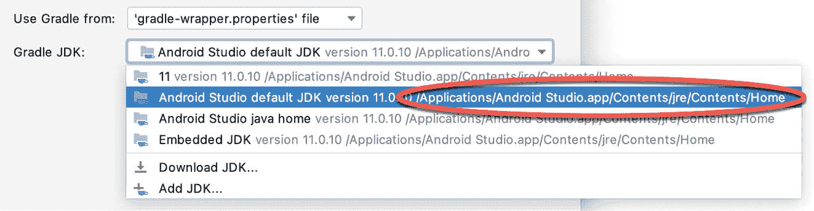

图 4-19

在 `Windows` 上，在运行 `avdmanager` 的命令提示符窗口中执行以下命令（其中 `<path to jre>` 为 `JRE` 路径）：

```bash
set JAVA_HOME=<path to jre>
```

在 `macOS` 或 `Linux` 上，执行以下命令：

```bash
export JAVA_HOME="<path to jre>"
```

假设已配置了 `Android SDK` 环境变量，通过在终端运行以下命令可以获取可用的 `AVD` 列表：

```bash
avdmanager list
```

上述命令输出将包含系统中可用的 `Android SDK` 版本。例如：

```
Available targets:

----------

id: 1 or "android-29"

     Name: Android API 29

     Type: Platform

     API level: 29

     Revision: 1

----------

id: 2 or "android-26"

     Name: Android API 26

     Type: Platform

     API level: 26

     Revision: 1
```

`avdmanager` 工具还允许从命令行创建新的 `AVD`。例如，要使用 `API 29` 设备的 `x86 ABI` 创建名为 `myAVD` 的新 `AVD`，可以使用命令：

```bash
avdmanager create avd -n myAVD -k "system-images;android-29;google_apis;x86"
```

该工具将根据创建设备配置所需的规格创建新 `AVD`。一旦从命令行创建了新的 `AVD`，在点击刷新按钮之前，它不会显示在 `Android` 设备管理器中。

除了创建新的 `AVD` 之外，还可以从命令行执行其他任务。例如，可以使用 `list avd` 命令行参数获取当前可用的 `AVD`：

```bash
avdmanager list avd
```

```
Available Android Virtual Devices:

   Name: Pixel_XL_API_28_No_Play

  Device: pixel_xl (Google)

      Path: /Users/neilsmyth/.android/avd/Pixel_XL_API_28_No_Play.avd

   Target: Google APIs (Google Inc.)

      Based on: Android API 28 Tag/ABI: google_apis/x86

  Skin: pixel_xl_silver

  Sdcard: 512M
```

同样，要删除现有的 `AVD`，只需使用删除选项：

```bash
avdmanager delete avd -n <avd name>
```

`config.ini` 文件包含了设备配置设置，例如在 `AVD` 创建过程中指定的显示尺寸和内存。这些设置可以直接在配置文件中进行更改，并在 `AVD` 下次被调用时将采用这些更改。

`<avd name>.ini` 文件包含了对目标 `Android SDK` 的引用以及 `AVD` 文件的路径。请注意，`config.ini` 文件中 `image.sysdir` 更改也需要反映在该文件的目标值中。

### 4.11 移动和重命名 Android 虚拟设备

可以使用 `avdmanager` 工具的 `move avd` 参数从命令行更改 `AVD` 的当前名称或文件位置。例如，若要将名为 `Pixel4` 的 `AVD` 重命名为 `Pixel4a`，可以执行以下命令：

```bash
avdmanager move avd -n Pixel4 -r Pixel4a
```

要物理移动与 `AVD` 关联的文件，应使用以下命令语法：

```bash
avdmanager move avd -n <avd name> -p <path to new location>
```

例如，将 `AVD` 从当前的文件系统位置移动到 `/tmp/Pixel4Test`：

```bash
avdmanager move avd -n Pixel4 -p /tmp/Pixel4Test
```

注意，在执行移动 `AVD` 的命令之前，目标目录不能已经存在。

### 4.12 总结

典型的应用开发过程遵循编码、编译和在测试环境中运行循环。`Android` 应用可以在物理 `Android` 设备上测试，也可以使用 `Android` 虚拟设备 (`AVD`) 模拟器进行测试。`AVD` 使用 `Android Studio Device Manager` 工具创建和管理，该工具可以作为命令行工具使用，也可以通过图形界面使用。在创建 `AVD` 以模拟特定的 `Android` 设备模型时，虚拟设备的硬件规格应配置为与物理设备匹配。

`AVD` 模拟器可以以独立窗口的形式显示，也可以嵌入到 `Android Studio` 主用户界面中。

# 5. 使用和配置 Android Studio AVD 模拟器

在下一章探索在物理 `Android` 设备上测试之前，本章将花一些时间提供 `Android Studio AVD` 模拟器的概述，并突出许多可以在独立模式和工具窗口模式下用于自定义环境的配置功能。

## 5.1 模拟器环境

当在独立模式下启动时，模拟器会在加载过程中显示初始启动屏幕。加载完成后，将出现模拟器主窗口，其中包含选择设备类型的表示（对于图 5-1，这是一个 `Pixel 4` 设备）：

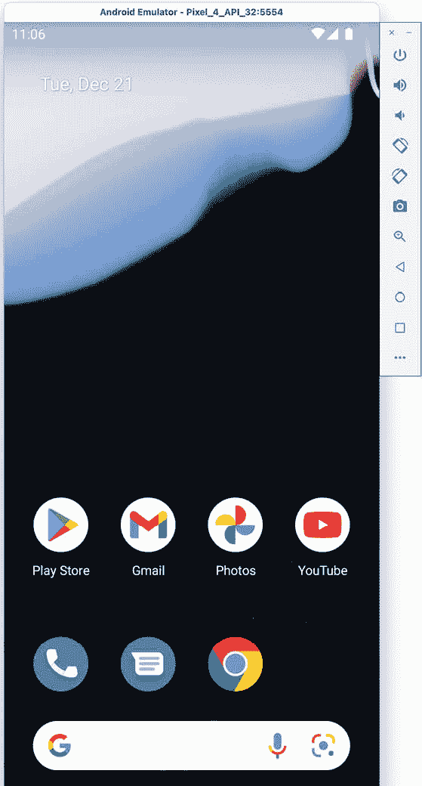

图 5-1

窗口右侧边缘是工具栏，提供了快速访问模拟器控制和配置选项的功能。

## 5.2 模拟器工具栏选项

模拟器工具栏（图 5-2）提供了与模拟器环境外观和行为相关的系列选项访问。

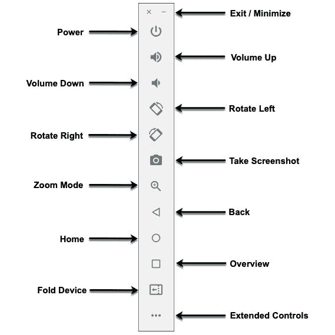

图 5-2

工具栏中的每个按钮都有关联的键盘快捷键，可以通过鼠标指针悬停在按钮上并等待工具提示出现，或者通过扩展控制面板的帮助选项来识别。

虽然工具栏中的许多选项都是不言自明的，但为了完整起见，将对每个选项进行介绍：

- **退出 / 最小化** – 工具栏最顶部的“x”按钮在选中时会退出模拟器会话，而“-”选项会最小化整个窗口。

- **电源** – 电源按钮模拟物理 `Android` 设备上的硬件电源按钮。点击并释放此按钮将锁定设备并关闭屏幕。点击并按住此按钮将启动设备的“关机”请求序列。

- **音量增大 / 减小** – 两个控制模拟器环境中播放音频音量的按钮。

- **向左/向右旋转** – 模拟设备在竖屏和横屏方向之间旋转。

- **截图** – 截取设备屏幕当前显示内容的屏幕。截取的图像存储在在本章稍后概述的扩展控制面板设置屏幕中指定的位置。

- **缩放模式** – 此按钮切换进入和退出缩放模式，其细节将在本章稍后介绍。

- **返回** – 执行标准的 `Android`“返回”导航以返回上一个屏幕。

- **主页** – 显示设备主屏幕。

- **概览** – 模拟选择标准的 `Android`“概览”导航，该界面显示设备上当前运行的应用。

- **折叠设备** – 模拟折叠设备的折叠和展开。此选项仅在模拟器正在运行折叠设备系统镜像时可用。

- **扩展控制** – 显示扩展控制面板，允许配置如模拟位置和电话活动、电池强度、蜂窝网络类型和指纹识别等选项。

## 5.3 在缩放模式下工作

位于模拟器工具栏中的缩放按钮用于切换进入和退出缩放模式。当缩放模式激活时，工具栏按钮处于按下状态，且鼠标指针悬停在设备屏幕上将显示为放大镜。点击左键将导致显示相对于屏幕上的选定点进行放大，重复点击将增加缩放级别。相反，点击右键将减小缩放级别。关闭缩放按钮将显示恢复到默认大小。

在缩放模式下点击并拖动将定义一个矩形区域，释放鼠标按钮时，视图将缩放到该区域。

在缩放模式下，可以使用模拟器窗口内的水平和垂直滚动条移动屏幕可视区域。

## 5.4 调整模拟器窗口大小

模拟器窗口（以及相应的设备表示）的大小可以通过点击并拖动任何角或侧边随时更改。

## 5.5 扩展控制选项

扩展控制工具按钮将显示如图 5-3 所示的面板。默认将显示位置设置。从左侧面板选择不同的类别将显示相应的控制组：

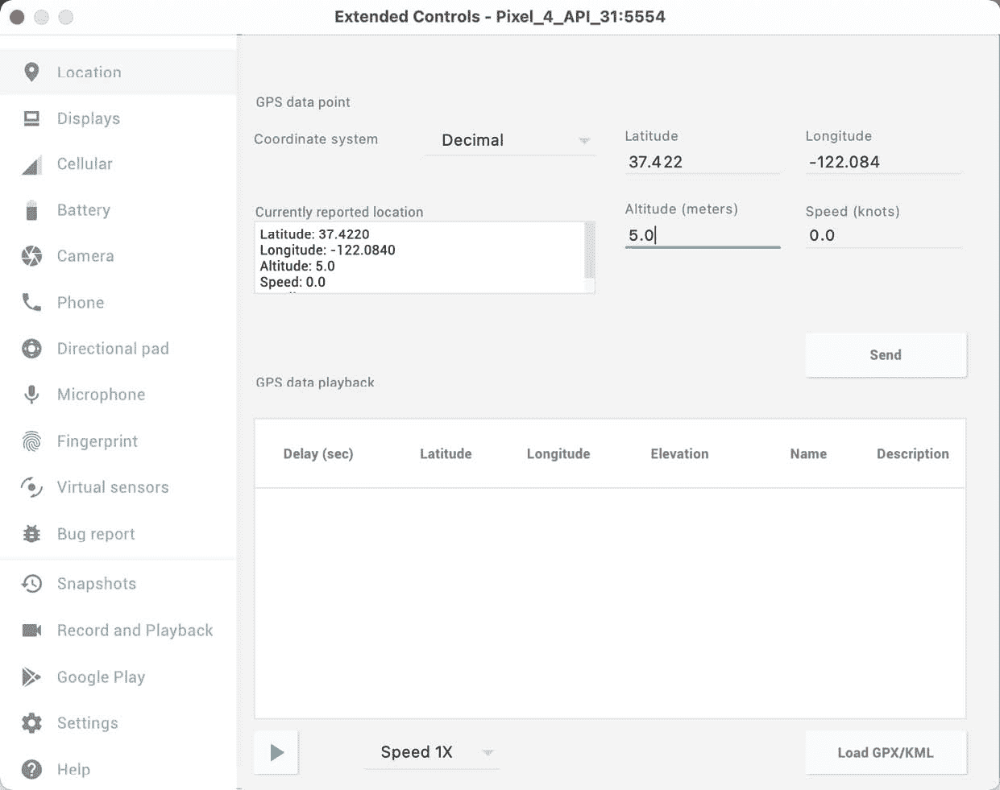

图 5-3

### 5.5.1 位置

位置控制允许以十进制或度分坐标将模拟位置信息发送到模拟器。位置信息可以是单个位置，也可以代表设备移动的点序列，后者通过 `GPS` 交换（`GPX`）或 `Keyhole` 标记语言（`KML`）格式的文件提供。或者，可以使用集成 `Google Maps` 面板视觉上选择单点或旅行路线。

### 5.5.2 显示

除了模拟器屏幕显示的主显示器外，显示选项允许在同一个 `Android` 实例运行额外的显示器。这对于测试如 `Microsoft Surface Duo` 等双屏应用非常有用。这些额外的屏幕可以配置为所需的尺寸，并出现在与主屏幕相同的模拟器窗口中。

### 5.5.3 蜂窝

可以在蜂窝设置屏幕内更改模拟的蜂窝连接类型。提供了用于模拟不同网络类型（`GSM`、`EDGE`、`HSDPA` 等）的选项，以及一系列语音和数据场景，如漫游和拒绝访问。

### 5.5.4 电池

可以在扩展控制屏幕的此面板上模拟各种电池状态和充电条件，包括电池电量、电池健康状况以及当前连接了 `AC` 充电器。

### 5.5.5 摄像头

当处于激活状态时，模拟器会模拟一个 `3D` 场景。这表现为一个虚拟建筑的内部，通过按住 `Option` 键（`Windows` 上为 `Alt`）并使用鼠标指针和键盘键，你可以在模拟器内录制视频或在拍摄照片之前对其中进行导航。此扩展配置选项允许上传不同的图像以显示在虚拟环境中。

### 5.5.6 电话

手机扩展控制功能在模拟器中提供了两个非常简单但实用的模拟功能。第一个选项允许模拟来自指定电话号码的入电电话。这在测试应用如何处理此类高层中断时特别有用。

第二个选项允许在模拟器会话中模拟接收短信。与在现实世界中一样，这些消息会出现在 `Message` 应用中，并触发模拟器内的标准通知。

### 5.5.7 方向键

方向键（`D-Pad`）是一组内置在 `Android` 设备中或通过外部连接（如游戏控制器）的额外控件，用于提供方向控制（左、右、上、下）。方向键设置允许在模拟器中模拟 `D-Pad` 交互。

### 5.5.8 麦克风

麦克风设置允许启用麦克风并模拟虚拟耳机和麦克风连接。还提供了一个按钮用于启动模拟器上的 `Voice Assistant`（语音助手）。

### 5.5.9 指纹

许多 `Android` 设备现在配备了内置指纹检测硬件。`AVD` 模拟器使得测试指纹认证成为可能，无需在带有指纹传感器的物理设备上测试应用。如何在模拟器中配置指纹测试的细节将在本章详细介绍。

### 5.5.10 虚拟传感器

虚拟传感器选项允许模拟加速度计和磁力计，通过 `yaw`、`pitch` 和 `roll` 设置来模拟设备的物理运动效果，如旋转、移动和倾斜。

### 5.5.11 快照

快照包含当前运行的 `AVD` 会话状态，可以被保存并快速恢复，从而轻松将模拟器恢复到精确状态。快照将在本章后部分介绍。

### 5.5.12 录制与播放

允许将模拟器屏幕和音频录制并保存为 `WebM` 或 `animated GIF` 格式。

### 5.5.13 Google Play

如果模拟器运行安装了 `Google Play` 服务的 `Android` 版本，此选项将显示当前的 `Google Play` 版本，并提供将模拟器更新到最新版本的选项。

### 5.5.14 设置

设置面板提供了一小组配置选项。使用此面板为工具栏和扩展控制面板选择更深的主题，指定保存屏幕截图的文件系统位置，配置 `OpenGL` 支持级别，并配置模拟器窗口显示在桌面其他窗口之上。

### 5.5.15 帮助

`Help` 屏幕包含三个子面板，列出了键盘快捷键列表、访问模拟器在线文档的链接、报告文件 `Bug` 和发送反馈的链接，以及模拟器版本信息。

## 5.6 使用快照

当模拟器首次启动时，它会执行冷启动，就像通电的物理 `Android` 设备一样。由于操作系统需要加载并启动所有后台进程，此冷启动过程可能需要一些时间才能完成。为了避免每次启动模拟器都经历这个过程，系统被配置为每次退出时都自动保存模拟器当前状态的快照（称为 `quick-boot snapshot`，快速启动快照）。下次启动模拟器时，`quick-boot snapshot` 将加载到内存中并从上次停止的地方继续执行，允许模拟器在冷启动完成所需的一部分时间内重启。

扩展控制面板的 `Snapshots` 屏幕可用于在模拟器执行期间任何一点存储额外的快照。这保存了整个模拟器的精确状态，允许模拟器恢复到拍摄快照时的精确时间点。从屏幕内部，可以使用 `Take Snapshot` 按钮（在 图 5-4 中标记为 `A`）拍摄快照。要恢复现有的快照，从列表 (`B`) 中选择它并点击屏幕底部的 `run` 按钮 (`C`)。还提供了选项来编辑 (`D`) 快照名称和描述，并删除 (`E`) 当前选中的快照：


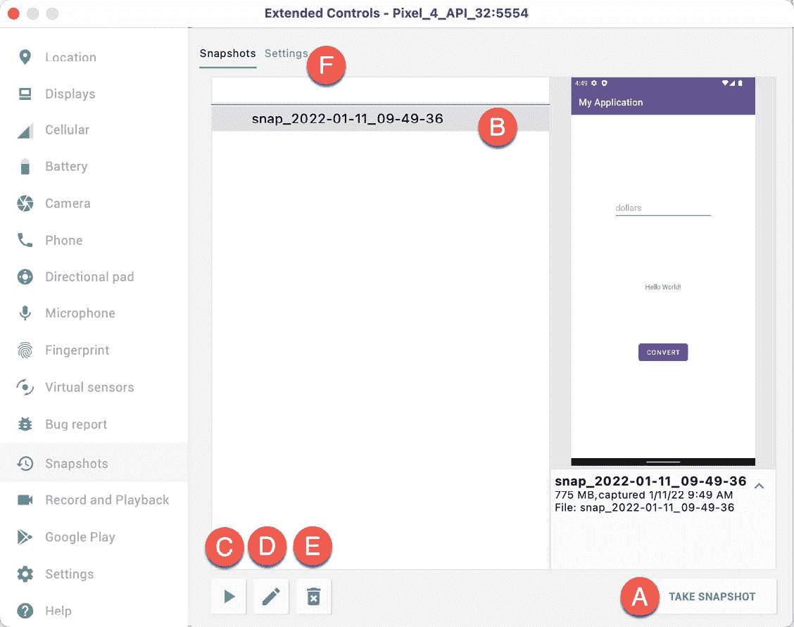

图 5-4

`Settings` 选项 (F) 提供了自动保存 `quick-boot snapshots` 的选项（默认情况下，模拟器会在每次退出时询问是否保存 `quick boot snapshot`）以及重新加载最近的快照。若要强制模拟器会话执行冷启动而不是使用之前的 `quick-boot snapshot`，打开 `AVD Manager`（`Tools -> AVD Manager`），点击模拟器 `Actions` 列中的向下箭头并选择 `Cold Boot Now` 菜单选项。

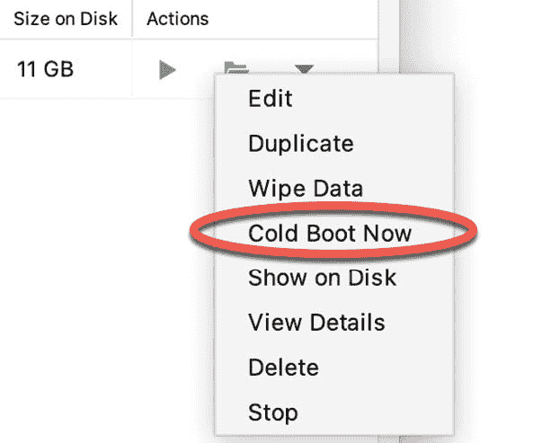

图 5-5

## 5.7 配置指纹模拟

模拟器允许配置多达 10 个模拟指纹，用于测试 Android 应用中的指纹认证。要配置模拟指纹，首先要启动模拟器，打开 `Settings` 应用，并选择 `Security & Location`（安全与位置）选项。

在 `Security` 设置屏幕中，选择 `Use fingerprint` 选项。在生成的信息屏幕上点击 `Next` 按钮进入 `Fingerprint` 设置屏幕。在启用指纹安全之前，必须配置一种备份解锁方法（例如 `PIN`）。点击 `Fingerprint + PIN` 按钮，并在提示时选择设备启动时不需要 `PIN`。输入并确认合适的 `PIN`，通过接受默认选项完成 `PIN` 输入过程。

继续后续屏幕，直到 `Settings` 应用请求指纹。此时显示扩展控制对话框，在左侧面板中选择 `Fingerprint` 类别，并确保主设置面板选取了 `Finger 1`：

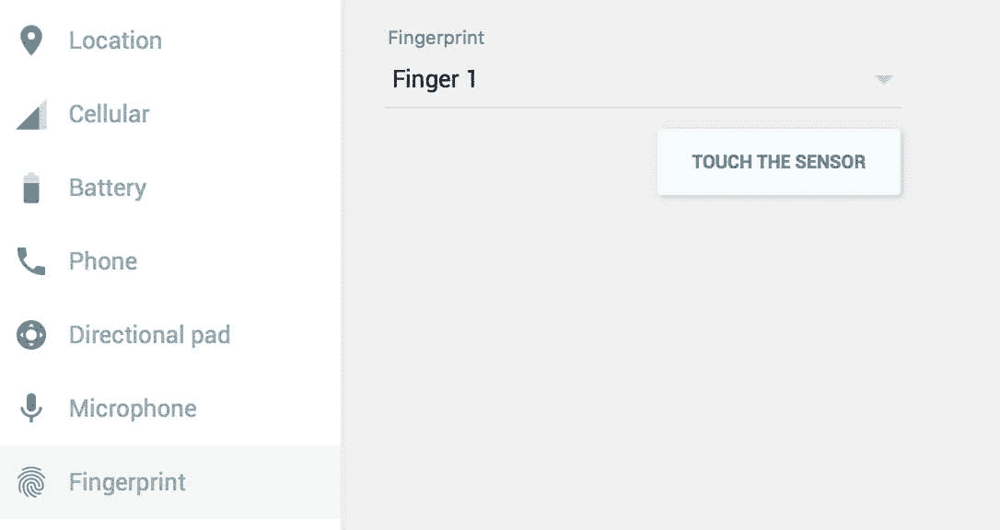

图 5-6

点击 `Touch the Sensor` 按钮模拟 `Finger 1` 触摸指纹传感器。模拟器将报告指纹添加：

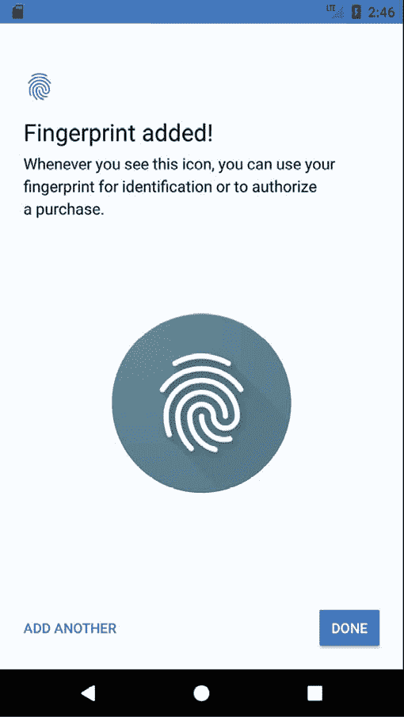

图 5-7

要添加更多指纹，点击 `Add Another` 按钮并在扩展面板中选择另一个手指，然后再次点击 `Touch the Sensor` 按钮。

## 5.8 工具窗口模式下的模拟器

正如在前章（在 Android Studio 中创建 Android Virtual Device）中概述，Android Studio 可以配置为以嵌入工具窗口启动模拟器，使其不会在独立窗口中出现。在此模式下运行时，独立模式下提供的相同控件将在工具栏中提供，如图 5-8 所示：


图 5-8

从左到右，这些按钮执行以下任务（详情与独立模式一致）：

*   `Power`
*   `Volume Up`
*   `Volume Down`
*   `Rotate Left`
*   `Rotate Right`
*   `Back`
*   `Home`
*   `Overview`
*   `Screenshot`
*   `Snapshots`
*   `Extended Controls`

## 5.9 总结

Android Studio 包含一个 Android 虚拟机模拟器环境，旨在使无需在物理 Android 设备上运行即可更容易地测试应用程序。本章对模拟器进行了简要介绍，并强调了用于配置和自定义环境以模拟不同测试条件的关键功能。

# 6. Android Studio 用户界面概览

虽然急于运行上一章中创建的示例应用程序非常诱人，但这样做涉及到使用 Android Studio 用户界面的某些方面，这些内容最好在之前对其进行描述。

Android Studio 是一个强大且功能丰富的开发环境，在很大程度上其用法是直观的。尽管如此，现在花时间熟悉 Android Studio 用户界面的布局和组织结构，将大大缩短本书后续章节的学习曲线。基于此，本章将提供构成 Android Studio 环境的各个区域和组件的初步概述。

## 6.1 欢迎界面

欢迎界面（图 6-1）在 Android Studio 运行且当前没有打开任何项目时显示（可以通过选择 `File -> Close Project` 菜单选项随时关闭打开的项目）。如果在项目仍打开时退出了 Android Studio，该工具在下次启动时将跳过欢迎界面，自动打开之前活动的项目。


图 6-1

除了最近项目列表外，欢迎界面还提供了执行各种任务的选项，如打开和创建项目，以及访问当前受版本控制的项目。此外，`Customize` 屏幕提供了更改 IDE 和编辑器共同使用的主题和字体设置的选项。可以通过 `Plugins` 选项查看、安装和管理 Android Studio 插件。点击如图 6-2 所示所示的菜单按钮，可以使用更多选项：


图 6-2

## 6.2 主窗口

当创建新项目或打开现有项目时，将出现 Android Studio 主窗口。当同时打开多个项目时，每个项目将分配其自己的主窗口。窗口的精确配置将取决于上次打开项目时显示了哪些工具和面板，但通常类似于图 6-3。


图 6-3

主窗口的各种元素可以总结如下：

*   **A – 菜单栏** – 包含用于在 Android Studio 环境中执行任务的系列菜单。
*   **B – 工具栏** – 一系列用于频繁操作的快捷键。工具栏按钮提供了快速访问一组菜单栏操作的方法。可以通过右键点击工具栏并选择 `Customize Menus and Toolbars…` 菜单选项对工具栏进行自定义。如果工具栏可见，可以使用 `View -> Appearance -> Toolbar` 菜单选项显示。
*   **C – 导航栏** – 导航栏提供了一种在组成项目的文件和文件夹之间移动的方便方法。点击导航栏中的元素将下拉菜单，列出该位置的子文件夹和文件供选择。同样，点击类名将显示列出该类中方法的菜单。从列表中选择一个方法将跳转到代码编辑器中的相应位置。使用 `View -> Appearance -> Navigation Bar` 菜单选项隐藏或显示此栏。
*   **D – 编辑器窗口** – 编辑器窗口显示开发者正在工作的文件内容。然而，在此处显示的内容取决于上下文。例如，编辑代码时，将显示代码编辑器。另一方面，处理用户界面布局文件时，将显示用户界面 `Layout Editor` 工具。当打开多个文件时，每个文件都由位于编辑器顶部的标签页表示，如图 6-4 所示。


图 6-4

*   **E – 状态栏** – 状态栏显示关于项目和 Android Studio 活动的信息消息，以及位于最左角的工具菜单按钮。鼠标悬停在状态栏条目上将提供该字段的描述。许多字段是可交互的，允许用户点击以执行任务或获取更详细的状态信息。
*   **F – 项目工具窗口 (Project Tool Window)** – 项目工具窗口提供了项目文件结构的层次概述，允许对特定文件和文件夹进行导航。可以使用工具栏以不同的方式显示项目。默认设置是 `Android view`，这是本书其余部分主要使用的模式。

项目工具窗口只是 Android Studio 环境中提供的许多工具窗口之一。

## 6.3 工具窗口

除了项目视图工具窗口外，Android Studio 还包含许多其他窗口，启用后它们会显示在主窗口的底部和侧边。将鼠标指针悬停在状态栏最左角的按钮上（图 6-5）而无需点击鼠标按钮，即可访问工具窗口快速访问菜单。


图 6-5

从快速访问菜单中选择项目将导致相应的工具窗口在主窗口内出现。

或者，可以通过点击状态栏中的快速访问菜单图标显示一组工具窗口栏。这些栏显示在主窗口的左侧、右侧和底部（如图 6-6 中的箭头所示），并包含显示和隐藏每个工具窗口的按钮。当工具窗口栏显示时，再次点击状态栏上的按钮将隐藏它们。


图 6-6

点击按钮将显示工具窗口，再次点击将隐藏窗口。带有数字前缀的按钮（例如 `1: Project`）表示按下键盘上的 `Alt` 键（macOS 为 `Command` 键）配合相应的数字也可以显示工具窗口。

按钮在工具窗口栏中的位置指示了窗口将出现在窗口的一侧。可以通过点击并拖动按钮到其他窗口栏的位置来更改这些位置。

每个工具窗口在顶部都有自己的工具栏。这些工具栏内的按钮随工具而异，但所有工具窗口都包含一个由齿轮图标表示的设置选项，允许更改窗口的各个方面。图 6-7 显示了项目视图工具窗口的设置菜单。


图 6-7

所有窗口在工具栏的最右侧还有一个按钮，提供了另一种隐藏工具窗口视图的额外方法。对工具窗口内的项目进行搜索可以简单完成，只需通过点击该窗口使其获取焦点，然后输入搜索词（例如项目工具窗口中的文件名）。搜索框将出现在窗口的工具栏中，并高亮显示匹配结果的项。

Android Studio 提供了广泛的工具窗口，其中最常用的如下：

- **应用检查器 (App Inspector)** - 提供对 `Database`（数据库）和 `Background Task`（后台任务）检查器的访问。`Database Inspector` 允许你在应用运行时检查、查询和修改数据库。`Background Task Inspector` 允许对使用 `WorkManager` 创建的后台工作任务进行监控和管理。
- **构建 (Build)** - 构建工具窗口在项目进行编译和打包时显示构建过程的信息，并显示遇到的任何错误详细信息。
- **构建变体 (Build Variants)** – 构建变体工具窗口提供了一种为当前应用程序项目配置不同构建目标的快速方法（例如，为应用程序的调试和发布版本配置不同的构建，或针对不同设备类别配置多个构建）。
- **设备文件浏览器 (Device File Explorer)** - 通过 `View -> Tool Windows -> Device File Explorer` 菜单访问，该工具窗口提供了直接访问当前连接的 Android 设备或模拟器文件系统的权限，允许浏览文件系统并将文件复制到本地文件系统。
- **设备管理器 (Device Manager)** - 提供对 `Device Manager` 工具窗口的访问，可以在其中添加、删除和管理物理 Android 设备连接和模拟器。
- **模拟器 (Emulator)** - 如果启用了在工具窗口中运行模拟器的选项（如标题为 “在 Android Studio 中创建 Android 虚拟设备 (AVD)” 的章节所示），则此处包含 `AVD` 模拟器。
- **事件日志 (Event Log)** - 事件日志窗口显示与在 Android Studio 内执行的事件和活动相关的消息。例如，项目的成功构建或应用程序正在运行等信息将在此工具窗口中报告。
- **收藏 (Favorites)** - 可以将各种项目项添加到收藏列表中。例如，在项目视图中右键点击文件，可以访问 `Add to Favorites`（添加到收藏）菜单选项。同样，通过在 `Structure`（结构）工具窗口中右键点击源文件中的方法，可以将其添加收藏。添加到收藏列表的任何内容都可以通过此 `Favorites` 工具窗口访问。
- **Gradle** - `Gradle` 工具窗口提供了构成项目构建配置的 `Gradle` 任务视图。该窗口列出了参与将项目各种元素编译为可执行应用程序的任务。右键点击顶层 `Gradle` 任务并选择 `Open Gradle Config`（打开 Gradle 配置）菜单选项，可以将当前项目的 `Gradle` 构建文件加载到编辑器中。本书稍后将详细介绍 `Gradle`。
- **布局检查器 (Layout Inspector)** - 提供构成用户界面布局的组件层级的可视 3D 渲染。
- **Logcat** - `Logcat` 工具窗口提供了对运行应用程序监控日志输出的访问，此外提供了拍摄应用程序截图、视频以及停止和重启进程的选项。
- **问题 (Problems)** - 查看项目内所有当前错误或警告的中心位置。双击问题列表中的项将带您进入问题文件所在的位置。
- **分析器 (Profiler)** - `Android Profiler` 工具窗口提供了识别运行应用中性能问题的实时监控和分析工具，包括 CPU、内存和网络使用。此选项在应用程序当前运行时变为可用。
- **项目 (Project)** - 项目视图提供了构成项目的文件结构概述，允许在文件之间快速导航。通常，在项目视图中双击文件将导致该文件加载到相应的编辑工具中。
- **资源管理器 (Resource Manager)** - 用于添加和管理项目包含的资源和资产（如图像、颜色和布局文件）。
- **运行 (Run)** - 当应用程序当前运行时，运行工具窗口变为可用，并提供运行结果视图以及停止或重启运行进程的选项。如果应用程序在设备或模拟器上无法安装和运行，此窗口通常会提供与问题相关的诊断信息。
- **结构 (Structure)** - 结构工具提供了编辑器中当前显示的源文件结构的高级视图。这些信息包括文件中的 `classes`（类）、`methods`（方法）和 `variables`（变量）等项。从结构列表中选择一个项将带您进入编辑器窗口中源文件的对应位置。
- **终端 (Terminal)** - 提供对运行 Android Studio 的系统的终端窗口访问。在 Windows 系统上，这是 `Command Prompt`（命令提示符）界面，而在 Linux 和 macOS 系统上，它呈现为 `Terminal` 提示符。
- **TODO** - 如如所示，该工具提供了一个查看项目中尚未完成项的地方。Android Studio 通过扫描构成项目的源文件并查找匹配指定 `TODO` 模式的注释来编译此列表。可以通过选择 `File -> Settings…` 菜单选项（macOS 为 `Android Studio -> Preferences...`）并导航到 `Editor`（编辑器）下的 `TODO` 页面来查看和更改这些模式。

### 6.4 Android Studio 快捷键

Android Studio 包含了大量的键盘快捷键，旨在执行常用任务时节省时间。可以在 Android Studio 项目窗口中通过选择 `Help -> Keymap Reference`（帮助 -> 映射参考）菜单选项查看并打印完整的键盘快捷键映射列表。您还可以通过选择 `File -> Settings...` 菜单选项（macOS 为 `Android Studio -> Preferences...`）并点击 `Keymap`（映射）项来列出和修改键盘快捷键，如下方的图 6-8 所示：


图 6-8

### 6.5 切换器和最近文件导航

在 Android Studio 主窗口导航的另一种实用机制是使用 `Switcher`（切换器）。通过 `Ctrl-Tab` 键盘快捷键访问，切换器会作为一个列出工具窗口和当前打开文件的面板出现（见图 6-9）。


图 6-9

显示后，只要按住 `Ctrl` 键，切换器将可见。在按住 `Ctrl` 键的同时反复按下 `Tab` 键会在选项之间循环，而释放 `Ctrl` 键会将当前选中的项显示在主窗口中。

除了切换器，`Recent Files` 面板还提供了最近打开文件的导航（见图 6-10）。可以使用 `Ctrl-E` 键盘快捷键（macOS 为 `Cmd-E`）访问。显示后，可以使用鼠标指针选择选项，或者使用键盘方向键滚动文件名和工具窗口选项。按下 `Enter` 将选中当前项。


图 6-10

### 6.6 更改 Android Studio 主题

Android Studio 环境的整体主题可以通过欢迎界面的 `Configure -> Settings` 选项，也可以通过主窗口的 `File -> Settings…` 菜单选项（macOS 为 `Android Studio -> Preferences...`）更改。

一旦显示设置对话框，在左侧面板中选择 `Appearance & Behavior`（外观与行为）选项，随后选择 `Appearance`（外观），然后在更改 `Theme` 设置之前点击 `Apply`（应用）按钮。可用的主题取决于平台，但通常包括 `Light`、`IntelliJ`、`Windows`、`High Contrast` 和 `Darcula` 等选项。图 6-11 显示了选定 `Darcula` 主题的主窗口示例：


图 6-11

若要使 Android Studio 主题与操作系统的亮/深色模式设置同步，请启用“与操作系统同步”（`Sync with OS`）选项，并使用下拉菜单控制每个模式下使用的主题：


图 6-12

## 6.7 总结

Android Studio 环境的主要元素包括欢迎界面和主窗口。每个打开的项目都分配有自己的主窗口，该窗口反过来由菜单栏、工具栏、编辑和设计区域、状态栏以及一组工具窗口组成。工具窗口出现在主窗口的侧边和底部，可以通过状态栏中的快速访问菜单或通过可选的工具窗口栏进行访问。

在 Android Studio 中，有极少数的操作是可以通过键盘快捷键触发的。可以随时从 Android Studio 主窗口访问默认键盘快捷键的键位映射（`keymap`）。

# 7. 在物理 Android 设备上测试 Android Studio 应用程序


虽然使用 Android 虚拟设备 (AVD) 测试应用程序可以实现很多工作，但在物理 Android 设备上进行真实的应用测试是不可替代的，而且某些某些 Android 功能仅在物理设备上可用。

与 AVD 实例和连接的 Android 设备之间的通信均由 Android 调试桥 (ADB) 处理。在本章中，我们将解释如何配置`adb`环境，以便在基于 macOS、Windows 和 Linux 的系统上对 Android 设备启用应用程序测试。

## 7.1 Android 调试桥 (ADB) 概述

ADB 的主要目的是促进开发系统（在此例中为 Android Studio）与 AVD 模拟器以及 Android 设备之间的交互，以便运行和调试应用程序。ADB 允许你通过 WiFi 网络或直接使用 USB 线缆连接到设备。

ADB 由一个客户端、一个运行在开发系统后台的服务器进程，以及一个运行在 AVD 或真实 Android 设备（如手机和平板）上的守护进程后台进程组成。

ADB 客户端可以有多种形式。例如，客户端以名为`adb`的命令行工具形式提供，位于 Android SDK 的`platform-tools`子目录中。同样，Android Studio 也有一个内置的客户端。

可以使用`adb`命令行工具执行多种任务。例如，可以使用`devices`命令行参数获取当前活跃的虚拟或物理设备列表。以下命令输出表示系统上存在一个 AVD，但没有物理设备：

```bash
$ ad devices
List of devices attached
emulator-5554 device
```

## 7.2 在 Android 设备上启用 USB 调试 ADB

在 ADB 连接到 Android 设备之前，必须先配置设备以允许连接。在运行 Android 6.0 或更高版本的手机和平板设备上，实现此目的步骤如下：

1. 打开设备上的`Settings`设置应用，并选择`About tablet`关于平板电脑（或`About phone`关于手机）选项（在某些 Android 版本中，可以在`Settings`的`System`系统）页面找到）。

2. 在`About`关于）屏幕上，滚动到`Build number`版本号）字段并点击七次，直到出现指示开发者模式已启的消息。如果`About`屏幕上没有列出`Build number`，则可以通过`Software information`软件信息）选项可用。或者，如果可用，展开列表中的`Advanced`高级）部分。


图 7-1

3. 返回主`Settings`屏幕，注意标题为`Developer options`开发者选项）的新选项的出现（在较新的 Android 版本中，此选项列在`System`设置屏幕上）。选择此选项，并在生成的屏幕上找到如图 7-2 所示的`USB debugging`USB 调试选项：


图 7-2

4. 启用`USB debugging`USB 调试选项，并在并在请求确认时点击`Allow`允许按钮。

此时，设备已配置为接受来自通过 USB 连接的开发系统上的`adb`的调试连接。剩下的工作是配置开发系统以便在连接时检测到设备。虽然这是一个相对简单的过程，但涉及的步骤取决于开发系统运行的是 Windows、macOS 还是 Linux。请注意，以下步骤假设 Android SDK 的`platform-tools`目录已包含在操作系统的`PATH`环境变量。

### 7.2.1 macOS ADB 配置

要在 macOS 系统上配置`ADB`环境，请使用 USB 线将设备连接到计算机系统，打开终端窗口并执行以下命令重启`adb`服务：

```bash
$ adb kill-server
$ adb start-server
daemon not running. starting it now on port 5037 *
daemon started successfully *
```

一旦服务器成功运行，执行以下命令以验证设备已检测到：

```bash
$ adb devices
List of devices attached
74CE000600000001 offline
```

如果设备被列为`offline`离线，请前往 Android 设备并检查是否存在图 7-3 所示的请求`Allow USB debugging`允许 USB 调试的对话框。在点击`OK`确定之前，勾选`Always allow from this computer`始终允许来自此计算机旁的复选框。


图 7-3

重复执行`adb devices`命令现在会将设备列为可用：

```bash
$ adb devices
List of devices attached
015d41d4454bf80c device
```

如果设备未被列出，尝试注销并重新登录 macOS 桌面，如果问题仍然存在，请重启系统。

### 7.2.2 Windows ADB 配置

配置 Windows 系统连接 Android 设备的第一步是在系统上安装相应的 USB 驱动程序。安装的 USB 驱动取决于 Android 型。如果您拥有 Google 设备（如 Pixel 手机），则需要安装并配置 Google USB 驱动程序。实现此操作的详细步骤列在以下网页：[`developer.android.com/sdk/win-usb.html`](https://developer.android.com/sdk/win-usb.html)

对于 Google USB 驱动程序不支持的 Android 设备，需要下载制造商提供的驱动程序。可以在线获取驱动程序列表以及安装信息：[`developer.android.com/tools/extras/oem-usb.html`](https://developer.android.com/tools/extras/oem-usb.html)

驱动程序安装且设备现在被识别为正确的类型后，打开命令提示符窗口并执行以下命令：

```bash
adb devices
```

此命令应输出连接设备的信息，如下所示：

```
List of devices attached
HT4CTJT01906 offline
```

如果设备列为`offline`或`unauthorized`未授权，请查看设备屏幕并检查是否存在图 7-3 所示的请求`Allow USB debugging`允许 USB 调试的对话框。在点击`OK`确定之前，勾选`Always allow from this computer`始终允许来自此计算机旁的复选框。重复执行`adb devices`命令现在会将设备列为就绪：

```bash
List of devices attached
HT4CTJT01906 device
```

如果设备未被列出，执行以下命令重启`ADB`服务：

```bash
adb kill-server
adb start-server
```

如果设备仍然未被列出，尝试执行以下命令：

```bash
android update adb
```

### 7.2.3 Linux adb 配置

在本章中，我们将再次使用 Ubuntu Linux 作为参考示例，介绍在 Linux 上配置`adb`以连接到物理 Android 设备进行应用测试。

在 Ubuntu Linux 上进行物理设备测试需要安装一个名为`android-tools-adb`的包，这反过来要求 Android Studio 用户必须是`plugdev`组的成员。这是大多数 Ubuntu 版本用户账户的默认设置，可以通过运行`id`命令进行验证。如果列表中没有显示`plugdev`组，请运行以下命令将您的账户添加到组组：

```bash
sudo usermod -aG plugdev $LOGNAME
```

在满足组成员要求后，可以通过执行以下命令安装`android-tools-adb`包：

```bash
sudo apt-get install android-tools-adb
```

完成上述更改后，重启 Ubuntu 系统。系统重启后，打开终端窗口，启动`adb`服务并检查连接的设备列表：

```
$ adb start-server
* daemon not running. starting it now on port 5037 *
* daemon started successfully *
$ adb devices
List of devices attached
015d41d4454bf80c offline
```

如果设备显示为 offline（离线）或 unauthorized（未授权），请检查 Android 设备并检查图 7-3 所示的请求允许 USB 调试权限的对话框。

## 7.3 解决 USB 连接问题

如果您无法通过上述步骤成功连接到设备，请显示运行目标菜单（图 7-4）并选择“排除设备连接”（Troubleshoot Device Connections）选项：


图 7-4

连接助手将扫描设备并报告问题及解决方案。

## 7.4 在 Android 设备上启用无线调试

按照上述 7.2 节的第 1 至 3 步操作，这次启用图 7-5 所示的“无线调试”选项：


图 7-5

接下来，点击上面的“无线调试”项以显示图 7-6 所示的屏幕：


图 7-6

如果您使用的设备带有摄像头，请选择“通过二维码配对设备”（Pair device with QR code），否则选择“通过配对码配对设备”（Pair device with pairing code）。根据您的选择，设置应用将启动摄像头会话，或显示如图 7-7 所示的配对码：


图 7-7

选择好选项后，返回 Android Studio，从运行目标菜单中选择如图 7-8 所示的“使用 WiFi 配对设备”（Pair Devices Using WiFi）选项：


图 7-8

在配对对话框中，根据您之前在设备设置应用中的选择，选择“使用二维码配对”或“使用配对码配对”：


图 7-9

使用 Android 设备扫描二维码，或将设备屏幕上显示的配对码输入 Android Studio 对话框（图 7-10）中以完成配对过程：


图 7-10

如果配对过程失败，请尝试重启开发系统和 Android 设备并重试。

## 7.5 测试 adb 连接

假设在所选开发平台上已成功配置`adb`，下一步是尝试在设备上运行“在 Android Studio 中创建示例 Android 应用”章节中创建的测试应用。启动 Android Studio，打开`AndroidSample`项目，并验证设备是否如图 7-11 所示高亮显示在设备选择列表中：


图 7-11

从列表中选择设备并点击运行按钮（位于设备菜单右侧的绿色箭头按钮）以安装并运行应用。

## 7.6 总结

虽然 Android 虚拟设备（AVD）模拟器提供了一个很好的测试环境，但请记住，没有什么可以替代确保应用在物理 Android 设备上正确运行。毕竟，这才是应用在现实世界中使用的地方。

默认情况下，Android Studio 环境未配置为将 Android 设备作为目标测试设备。因此，必须执行一些步骤，以便通过 USB 线缆或 WiFi 网络从 Android Studio 开发环境直接将应用加载到 Android 设备上。实现此目标的具体步骤取决于所使用的开发平台。在本章中，我们涵盖了适用于 Linux、macOS 和基于 Windows 平台的步骤。

# 8. Android Studio 代码编辑器的基础

为 Android 开发应用涉及大量的编程工作，这在定义上涉及在编辑器窗口内编写代码。不意外的是，使用 Android Studio 的大部分时间都在编辑器窗口内编辑代码。

现代代码编辑器需要的远超基础的输入和删除。今天代码编辑器的实用性通常取决于减少输入所需的量、大文件的导航易用性以及编辑器检测并突出显示编程错误的能力。正如本章将所示，这些只是编辑器卓越表现的少数领域之一。

虽然本章并非编辑器功能的详尽概述，但旨在提供该工具关键功能的指南。经验程序员会发现，某些功能在今天大多数编辑器中都是通用的，而许多是此环境特有的。

## 8.1 Android Studio 编辑器

当选择 Java、Kotlin、XML 或其他文本文件进行编辑时，Android Studio 编辑器出现在主窗口中心。例如图 8-1 显示典型的编辑器会话：


图 8-1

组成编辑器窗口的元素总结如下：

A – 文档标签 – Android Studio 能够同时打开多个文件进行编辑。每打开一个文件，它都会被分配一个位于编辑器窗口顶部标签栏的显示文件名的文档标签。当空间不足以显示所有标签时，标签栏的最右角会出现一个小小的下拉菜单。点击此菜单将列出其他文件列表。标签中文件名下方的波浪线表示文件中的代码包含需要解决的一个或多个错误，解决这些问题后才能编译和运行项目。

切换文件只需点击相应的标签，或使用`Alt-Left`和`Alt-Right`快捷键。也可以通过切换器机制（通过`Ctrl-Tab`快捷键访问）进行文件间的导航。

要将编辑器面板从 Android Studio 主窗口分离并使其在单独窗口中显示，请点击标签将其拖动到主窗口之外的桌面区域。要将编辑器返回主窗口，点击分离编辑器窗口中的文件标签，并将其拖放到主窗口中原始的编辑器标签栏上。

### B – 编辑器行槽区域

行槽区域被编辑器用于显示信息图标和控件。在此行槽区域显示的某些典型项目包括调试断点标记、折叠和展开代码块的控件、书签、更改标记和行号。行号默认是开启的，但可以通过在行槽上点击鼠标右键并选择`Show Line Numbers`（显示行号）菜单选项来将其禁用。

### C – 代码结构位置

编辑器底部的此栏显示了光标当前相对于代码整体结构的位置。例如，在图所示，该栏表示当前正在编辑`convertCurrency`方法，且该方法包含在`MainActivity`类中。


图 8-2

双击栏中的任意元素将把光标移动到代码文件中相应的位置。例如，双击`convertCurrency`条目将把光标移动到源代码中`convertCurrency`方法的顶部。同样，点击`MainActivity`条目将弹出一个可供选择的可用代码导航点列表：


图 8-3

### D – 编辑器区域

这是用户显示、输入和编辑代码的主要区域。本章随后的章节将详细介绍编辑区域的关键功能。

### E – 验证与标记侧边栏

Android Studio 整合了一项称为“代码即时代码分析”的功能。这本质上意味着当您输入代码时，编辑器会分析代码以检查警告和语法错误。验证侧边栏顶部的指示器会实时更新，显示随着代码添加而发现的错误和警告数量。点击此指示器将显示一个弹出窗口，其中包含编辑器中代码所发现的问题摘要，如图图 8-4 所示：


图 8-4

可以使用上下箭头在代码中的错误位置之间移动。绿色勾号表示未检测到任何警告或错误。

侧边栏还会在使用相同颜色编码的检测到问题的位置显示标记。当代码行在编辑器区域中可见时，将鼠标指针悬停在标记上，将显示一个包含问题描述的弹出窗口：


图 8-5

当代码行已滚动出编辑器视图区域时，将鼠标指针悬停在该代码行的标记上，将显示一个“透镜”覆盖层，其中包含问题所在的代码块（图 8-6），允许无需滚动到编辑器中的该位置即可查看：


图 8-6

值得注意的是，透镜覆盖层不仅限于侧边栏中的警告和错误。悬停在侧边栏的任何部分上都会出现一个透镜，其中包含源文件中该位置的代码。

### F – 状态栏

虽然状态栏实际上是主窗口的一部分而非编辑器，但它包含了一些关于当前活动编辑会话的信息。这些信息包括光标在行和字符方面的当前位置以及文件的编码格式（UTF-8、ASCII 等）。点击状态栏中的这些值可以更改相应的设置。例如，点击行号将显示`Go to Line`（转到行）对话框。

在提供了组成 Android Studio 编辑器的元素概述后，本章的其余部分将更详细地探讨编辑环境的关键功能。

## 8.2 分割编辑器窗口

默认情况下，编辑器将显示一个显示当前所选文件内容的面板。在同时处理多个源文件时，一个特别实用的功能是将编辑器拆分为多个窗格。要拆分编辑器，可以在编辑器窗口内的文件标签上点击右键，选择`Split Vertically`（垂直拆分）或`Split Horizontally`（水平拆分）菜单选项。例如，图 8-7 显示了拆分器的操作，编辑器被拆分为三个面板：


图 8-7


可以通过在相应的标签上点击右键并选择`Change Splitter Orientation`（更改拆分器方向）菜单选项随时更改拆分面板的方向。重复这些步骤可以取消单个面板的分拆，此时从菜单选择`Unsplit`（取消拆分）选项。可以通过右键点击任何标签并选择`Unsplit All`（取消所有拆分）选项来移除所有拆分面板。

窗口分割可用于不同的文件，或为同一个文件提供多个窗口，允许同时查看和编辑同一文件的不同区域。

## 8.3 代码补全

`Android Studio`编辑器对`Java`编程语法以及构成`Android SDK`的类和方法拥有大量的内置知识，还拥有您自己的代码库的知识。随着代码的输入，编辑器会扫描正在输入的内容，并在适当的情况下就完成语句或引用可能需要的内容提供建议。当编辑器检测到代码补全建议时，将出现一个包含建议列表的面板。例如，在图 8-8 中，编辑器正为一个`String`声明的开头提供可能的结果：


图 8-8

如果没有没有一个自动补全建议是正确的，只需继续输入，编辑器将在适当的情况下继续精炼建议。要接受最顶部的建议，只需按下键盘上的`Enter`或`Tab`键。要选择不同的建议，使用方向键在列表中上下移动，再次使用`Enter`或`Tab`键。

可以使用`Ctrl-Space`快捷序列手动调用补全建议。这在更改编辑器中的单词或声明时非常有用。

除了实时自动补全功能外，`Android Studio`编辑器还提供了一种名为“智能补全”的系统。智能补全通过`Shift-Ctrl-Space`快捷序列调用，选中后将根据代码的当前上下文提供更详细的建议。再次按下`Shift-Ctrl-Space`快捷序列将从更广泛的范围内提供更多建议。

代码补全对许多程序员来说可能是个人喜好问题。考虑到这一事实，`Android Studio`对自动补全设置提供了高水平的控制。可以通过选择`File -> Settings…`菜单选项（macOS 为`Android Studio -> Preferences…`）并在设置面板中选择`Editor -> General -> Code Completion`来查看和修改这些设置，如图图 8-9 所示：


图 8-9

## 8.4 语句补全

`Android Studio`编辑器提供的另一种自动补全形式是语句补全。它可以自动填充方法和循环语句等项的括号和大括号。语句补全通过`Shift-Ctrl-Enter`（macOS 为`Shift-Cmd-Enter`）快捷序列调用。考虑以下代码：

```
myMethod()
```

将此代码输入到编辑器后，触发语句补全将导致编辑器自动为方法添加大括号：

```
myMethod() {

}
```

### 8.5 参数信息

你也可以要求编辑器提供关于方法接收的参数参数的信息。当光标置于方法调用调用的括号之间时，按下`Ctrl-P`（macOS 上为`Cmd-P`）组合快捷键将显示该方法已知接受的参数，并对最可能的建议进行加粗显示：


图 8-10

### 8.6 参数名提示

代码编辑器可以配置为在方法调用中显示参数名提示。例如图 8-11 显示了调用`Snackbar`类的`make()`和`setAction()`方法时的参数名提示：


图 8-11

此模式的设置可以通过选择`File -> Settings`菜单（macOS 上为`Android Studio -> Preferences`）选项，然后在左侧面板中选择`Editor -> Inlay Hints -> Java`来配置。在生成的屏幕上，从列表中选择`Parameter Hints`，并启用或禁用`Show parameter hints`选项。要调整提示设置，点击`Exclude list...`链接并进行任何调整。

### 8.7 代码生成

除了输入代码时进行补全外，编辑器在某些条件下还可以为你生成代码。如图 8-12 所示的可用代码生成选项列表，可以在当光标位于文件中需要生成代码的位置时，使用`Alt-Insert`（macOS 上为`Cmd-N`）键盘快捷键来访问。


图 8-12

为了示例，请考虑一种情况：我们希望在项目中的`Activity`准备被操作系统销毁时收到通知。正如本书随后的章节将概述的那样，这可以通过重写`Activity`超类的生命周期方法`onStop()`来。要让`Android Studio`为此生成一个存根方法（stub method），只需从代码生成列表中选择`Override Methods…`选项，并从可用方法的列表中选择`onStop()`方法：


图 8-13

选中要重写的方法后，点击`OK`将在`Java`源文件的当前光标位置生成该存根方法，如下：

```java
@Override
protected void onStop() {
    super.onStop();
}
```

### 8.8 代码折叠

一旦源文件达到一定大小，即使是格式化最整齐、组织最良好的代码也可能变得难以处理和难以导航。`Android Studio`认为，并不总是需要让每个代码块的内容始终可见。通过使用`Android Studio`编辑器的代码折叠功能，可以使代码导航变得更容易。代码折叠通过出现在源文件编辑器行槽中每个代码块开头和结尾的标记来控制。例如图 8-14 显示了当前未折叠的方法声明的开始和结束标记：


图 8-14

点击这些标记中的任意一个都会折叠语句，只显示签名行，如图 8-15 所示：


图 8-15

要展开已折叠的代码段，只需点击编辑器行槽中的`+`标记。要在不展开的情况下查看隐藏代码，请将鼠标指针悬停在“{…}”指示器上，如图 8-16 所示。编辑器随后将显示包含折叠代码块的透镜覆盖层（lens overlay）：


图 8-16

文件中的所有代码块都可以使用`Ctrl-Shift-Plus`和`Ctrl-Shift-Minus`键盘组合键进行折叠或展开。

默认情况下，`Android Studio`编辑器会在打开源文件时自动折叠某些代码。要配置这种情况的条件，选择`File -> Settings…`（macOS 上为`Android Studio -> Preferences…`）并在生成的设置面板中选择`Editor -> General -> Code Folding`条目（图 8-17）：


图 8-17

### 8.9 快速文档查询

通过将光标置于所需文档的声明上并按下`Ctrl-Q`键盘快捷键（macOS 上为`Ctrl-J`），可以访问上下文相关的`Java`和`Android`文档。这将显示一个包含该项目相关参考文档的弹出窗口。例如图 8-18 显示了`FloatingActionButton`类的文档。


图 8-18

显示后，可以根据需要移动屏幕上的文档弹出窗口。

### 8.10 代码重格式化

通常，`Android Studio`编辑器会根据缩进、间距和语句的嵌套自动格式化代码。在需要格式化代码行的情况下（例如，从网站粘贴代码时），编辑器提供了格式化代码的功能，选择后以匹配主流样式。

要格式化代码，按下`Ctrl-Alt-L`（macOS 上为`Cmd-Opt-L`）组合键显示`Reformat Code`对话框（图 8-19）。这提供了格式化所选代码、整个源文件或仅更改代码的选择。


图 8-19

完整的代码样式偏好可以在项目设置内更改。选择`File -> Settings`菜单（macOS 上为`Android Studio -> Preferences`）并在左侧面板中选择`Code Style`以访问支持的编程和标记语言列表。选择一种语言将提供大量的格式样式选项，所有选项都可以根据代码样式进行修改。例如，要调整上述对话框中`Rearrange code`选项的设置，展开`Code Style`部分，选择`Java`，然后在`Java`设置中选择`Arrangement`标签页。

### 8.11 查找示例代码

`Android Studio`编辑器提供了访问与当前列表相关的示例代码的方法。这对于学习如何使用特定的`Android`类或方法非常有用。要查找示例代码，高亮编辑器中的方法或类名，右键点击它并选择`Find Sample Code`菜单选项。`Find Sample Code`面板（图 8-20）出现在编辑器下方，列出匹配的示例。从列表中选择示例会将相应的代码加载到右侧面板：


图 8-20

### 8.12 Live 模板

当你编写`Android`代码时，你会发现有一些经常使用的常用结构。例如，一个常见的需求是使用`Toast`类向用户显示弹出消息。Live 模板是常用代码结构的集合，可以通过输入初始字符后按一个特殊键（默认设置为`Tab`键）在编辑器中输入模板代码。要体验这一操作，请在代码编辑器中输入`toast`然后按`Tab`键，`Android Studio`将在光标位置插入以下代码并准备好编辑：

```java
Toast.makeText("", "", Toast.LENGTH_SHORT).show();
```

要列出和编辑现有模板、更改特殊键或添加自己的模板，请打开`Preferences`对话框，并在左侧导航面板的`Editor`部分选择`Live Templates`：


图 8-21

使用上方图 8-21 中标记为`A`的按钮来添加、删除、复制或重置模板。要修改模板，请从列表 (`B`) 中选择它并更改标记为`C`的面板中的设置。

## 8.13 总结

`Android Studio`编辑器投入大量精力减少编写代码所需的输入量，并使代码更容易阅读和导航。在本章中，我们涵盖了许多关键编辑器功能，包括代码补全、代码生成、编辑器窗口拆、代码折叠、重格式、文档查询和实时模板。

# 9. Android 架构概述

到目前为止，本书已经采取了步骤来建立适用于使用`Android Studio`开发`Android`应用的环境。通过创建`Android Studio`应用项目，也迈出了应用开发流程的第一步。

然而，在进一步研究`Android`应用开发的实际问题之前，了解`Android SDK`以及通用的`Android`开发的一些较为抽象的概念至关重要。现在清晰地理解这些概念将为构建进一步知识提供坚实的基础。

本章从`Android`架构概述开始，并在本书的接几章中继续，目标是提供`Android`开发基础知识的详细概述。

## 9.1 Android 软件栈

`Android`以软件栈的形式结构化，由应用程序、操作系统、运行时环境、中间件、服务和库组成。这种架构可以通过图 9-1 所示的视觉方式进行最佳表示。软件栈的每一层以及每层中的相应元素都是紧密集成并经过仔细调的，旨在为移动设备提供最优的应用开发和执行环境。本章其余部分将逐步介绍`Android`栈的不同层，从底部的`Linux Kernel`开始。


图 9-1

## 9.2 Linux 内核

`Linux Kernel`位于`Android`软件栈底部，在设备硬件和`Android`软件栈上层之间提供了一个抽象层。该内核基于`Linux`版本`2.6`，提供了抢式多任务处理，以及内存、进程和电源管理等底层核心系统服务，还为设备显示、WiFi 和音频等硬件提供了网络栈和设备驱动程序。

原始的`Linux`内核由 Linus Torvalds 于 1991 年开发，并与自由软件基金会的 Richard Stallman 开发的一系列工具、实用程序和编译器结合，创建了名为`GNU/Linux`的完整操作系统。各种`Linux`发行版都是从这些基础架构衍生而来的，例如`Ubuntu`和红帽企业 Linux（Red Hat Enterprise Linux）。

然而，需要注意的是，`Android`仅使用`Linux`内核。尽管如此，值得注意的是，`Linux`内核最初是为桌面电脑和服务器形式的传统计算机设计的。事实上，`Linux`现在最广泛地部署在任务关键的企业服务器环境中。我们在`Android`软件栈的核心发现这种软件，这既证明了今天移动设备的强大，也证明了`Linux`内核的效率和性能。

## 9.3 Android 运行时 – ART

当`Android`应用在`Android Studio`中构建时，它会被编译成一种中间字节码格式（称为`DEX`格式）。当应用程序随后加载到设备时，`Android Runtime` (`ART`) 使用一种称为提前编译（Ahead-of-Time, `AOT`）的过程将字节码翻译为设备处理器所需的原生指令。这种格式被称为可执行和链接格式 (`ELF`)。

之后每次启动应用程序时都会运行`ELF`可执行版本，从而获得更快的应用程序性能和更长的电池寿命。

这与旧版`Android`实现使用的即时编译（Just-in-Time, `JIT`）方法形成对比，后者每次启动应用程序时在虚拟机 (`VM`) 中翻译字节码。

## 9.4 Android 库

除了一组标准的`Java`开发库（提供对字符串处理、网络和文件操作等通用任务的支持）外，`Android`开发环境还包含`Android Libraries`。这些是专门用于`Android`开发的`Java`库。此类库的示例包括应用框架库，以及便于用户界面构建、图形绘制和数据库访问的库。

以下是`Android`开发者可用的一些核心`Android`库的摘要：

- `android.app` – 提供应用模型的访问，是所有`Android`应用的基石。

- `android.content` – 促进应用程序与应用组件之间的内容访问、发布和消息传递。

- `android.database` – 用于访问内容提供者发布的数据，包括`SQLite`数据库管理类。

- `android.graphics` – 一种底层 2D 图形绘制 API，包括颜色、点、过滤器、矩形和画布。

- `android.hardware` – 提供了访问加速度计和光传感器等硬件的 API。

- `android.opengl` – 指向`OpenGL ES` 3D 图形渲染 API 的`Java`接口。

- `android.os` – 为应用程序提供标准操作系统服务的访问，包括消息、系统服务和进程间通信。

- `android.media` – 提供播放音频和视频的类。

- `android.net` – 提供访问网络栈的 API。包括`android.net.wifi`，提供对设备无线栈的访问。

- `android.print` – 包括一组允许从`Android`应用内部将内容发送到配置的打印机的类。

- `android.provider` – 一组便利类，提供对`Android`内容数据库的访问，例如日历和联系应用维护的数据库。

- `android.text` – 用于在设备显示器渲染和处理文本。

- `android.util` – 一组工具类，用于执行字符串和数字转换、XML 处理以及日期时间操作。

- `android.view` – 应用用户界面的基础构建块。

- `android.widget` - 一个丰富的预构建用户界面组件集合，如按钮、标签、列表视图、布局管理器、单选按钮等。

- `android.webkit` – 一组旨在在应用程序中构建网页浏览功能的类。

在涵盖了`Android`运行时的`Java`库之后，现在该将注意力转向`Android`软件栈这一层中的 C/C++ 库了。

### 9.4.1 C/C++ 库

在前节概述的`Android`运行时核心库是基于`Java`的并并编写`Android`应用的开发者提供主要的 API。然而，需要注意的是，核心库并没有执行许多实际工作，事实上它们仅仅是一组 C/C++ 库的`Java`“包装器”（wrappers）。例如，当调用`android.opengl`库在设备显示器上绘制 3D 图形时，该库最终会调用`OpenGL ES` C++ 库，而该库又与底层的`Linux`内核协作工作以完成绘制任务。

C/C++ 库包含了广泛且多样的功能，包括 2D 和 3D 图形绘制、安全套接层 (SSL) 通信、`SQLite`数据库管理、音视频播放、位图和矢量字体渲染、显示子系统和图形层管理以及标准 C 系统库 (`libc`) 的实现。

在实践中，典型的`Android`开发者仅通过基于`Java`的`Android`核心库 API 访问这些库。如果需要直接访问这些库，可以使用`Android`原生开发包 (`NDK`) 实现，其目的是通过`Java`原生接口 (`JNI`) 从`Java`代码中调用非`Java`或`Kotlin`语言（如 C 和 C++）的原生方法。

## 9.5 应用程序框架

应用程序框架是一组服务，它们共同构成了`Android`应用程序运行和管理的环境。该框架实现了这样一个概念：`Android`应用程序是由可重用、可交换和可替换的组件构建的。这一概念更进一步，应用程序还可以发布其能力以及任何相关数据，以便其他应用程序发现并重用它们。

`Android`框架包含以下关键服务：


- `Activity Manager`：控制应用程序的生命周期和活动栈的所有方面。

- `Content Providers`：允许应用程序发布并与其他应用程序共享数据。

- `Resource Manager`：提供对非代码嵌入资源的访问，如字符串、颜色设置和用户界面布局。

- `Notifications Manager`：允许应用程序向用户显示警报和通知。

- `View System`：一个可扩展的视图集合，用于创建应用程序用户界面。

- `Package Manager`：应用程序借此查找设备上已安装的其他应用程序信息的系统。

- `Telephony Manager`：向应用程序提供设备上可用电话服务的信息，例如状态和订阅者信息。

- `Location Manager`：提供对位置服务的访问，允许应用程序接收有关位置更改的更新。

## 9.6 应用程序

位于 Android 软件栈顶端的是应用程序。它们包含了特定 Android 实现提供的原生应用程序（例如网络浏览器和电子邮件应用程序）以及用户在购买设备后安装的第三方应用程序。

## 9.7 总结

良好的 Android 开发知识基础需要对 Android 的整体架构有理解。Android 以软件栈架构的形式实现，由 Linux 内核、运行时环境及相应的库、一个应用程序框架以及一组应用程序组成。应用程序主要使用 `Java` 或 `Kotlin` 编写，并在 Android Studio 构建环境中编译为字节码格式。当应用程序随后安装到设备上时，这些字节码由 Android 运行时（`ART`）编译为 CPU 使用的原生格式。Android 架构的关键目标是性能和效率，涵盖了应用程序的执行以及应用程序设计中的重用实现。

# 10. Android 应用程序的剖析

无论你之前的编程经验是基于 Windows、macOS、Linux 甚至 iOS，Android 开发很有可能与你以前遇到的任何东西都完全不同。

因此，本章的目的是提供对 Android 应用程序架构背后高层概念的理解。为此，我们将详细探讨用于构建应用程序的各种组件以及允许这些组件协作以创建一个协作应用程序的机制。

### 10.1 Android Activities

熟悉 `Java`、`Kotlin`、`C++` 或 `C#` 等面向对象编程语言的人熟悉将应用程序功能元素封装在类中的概念，然后将其实例化为对象并进行操作以创建应用程序。由于 Android 应用程序用 `Java` 和 `Kotlin` 编写，情况依然如此。然而，Android 将可重用组件的概念提升到了更高的水平。

Android 应用程序通过组合一个或多个被称为 `Activities` 的组件创建的。`Activity` 是应用程序功能的单个独立模块，通常直接对应单个用户界面屏幕及其相应的功能。例如，一个预约应用程序可能有一个显示当天设置预约的 `Activity` 屏幕。该应用程序还可能使用第二个 `Activity`，它由一个用户可以在其中输入新预约的屏幕组成。

`Activity` 被设计为完全可重用和可交换的构建块，可以在不同的应用程序之间共享。例如，现有的电子邮件应用程序可能包含一个专门用于编写和发送电子邮件消息的 `Activity`。开发者可能正在编写一个应用程序，该程序也有发送电子邮件消息的需求。开发者无需为新应用程序专门开发一个邮件编写 `Activity`，而可以直接使用现有电子邮件应用程序中的 `Activity`。

`Activity` 是作为 `Android Activity` 类的子类创建的，并且必须实现为与应用程序中的其他 `Activity` 完全独立。换句话说，共享的 `Activity` 够依赖于在程序流的已知点被调用（因为其他应用程序可能会以意想不到的方式使用该 `Activity`），而且一个 `Activity` 不能直接调用另一个 `Activity` 的方法或访问其实例数据。相反，这是通过使用 `Intents` 和 `Content Providers` 实现的。

默认情况下，`Activity` 无法向调用它的 `Activity` 返回结果。如果需要此功能，则必须将该 `Activity` 特地启动为源 `Activity` 的子 `Activity`。

### 10.2 Android Fragments

如上所述，`Activity` 通常代表应用中的单个用户界面屏幕。一种方案是使用单个用户界面布局和一个相应的 `Activity` 类文件来构建该 `Activity`。然而，更好的替代方案是将 `Activity` 拆分为不同的部分。这些部分中的每个部分被称为一个 `fragment`，每个 `fragment` 都由用户界面布局的一部分和一个匹配的类文件组成（声明为 `Android Fragment` 类的子类）。在这种情况下，`Activity` 仅仅变成一个容器，在其中嵌入一个或多个 `fragment`。

事实上，`fragment` 为让每个用户界面屏幕由单独的 `Activity` 表示提供了一种高效的替代方案。相反，一个应用可以由单个 `Activity` 组成，在不同的 `fragment` 之间切换，每个 `fragment` 代表一个不同的应用屏幕。

### 10.3 Android Intents

`Intent` 是一个 `Activity` 启动另一个 `Activity` 并实现构成应用程序的 `Activity` 之间流转的机制。`Intent` 由对要执行的操作的描述以及可选的执行执行数据组成。

`Intent` 可以是显式的，即通过引用类名请求启动特定的 `Activity`；也可以是隐式的，通过陈述要执行的操作类型或提供要执行该操作的特定类型数据。在隐式 `Intent` 的情况下，Android 运行时将使用被称为 `Intent Resolution` 的过程选择最匹配 `Intent` 所指定标准的 `Activity`。

### 10.4 Broadcast Intents

另一种类型的 `Intent` 是 `Broadcast Intent`（广播意），它是一种系统范围内的意图，发送给所有注册了“感兴趣”广播接收器（`Broadcast Receiver`）的应用程序。例如，Android 系统通常会发送广播意来指示设备状态的变化，例如系统启动完成、外部电源连接到设备或屏幕开启或关闭。

`Broadcast Intent` 可以是普通的（异步的），即它在几乎相同的时间内被发送给所有感兴趣的广播接收器；也可以是有序的，即它一次发送给一个接收器，由接收器对其进行处理，然后决定是中止还是允许传递给下一个广播接收器。

### 10.5 广播接收器

广播接收器是应用程序能够响应 `Broadcast Intents` 的机制。`Broadcast Receiver` 必须由应用程序注册，并配置 `Intent Filter`（意图过滤器）以指明它感兴趣的广播类型。当匹配的意图被广播时，无论注册该接收器的应用程序当前是否运行，Android 运行时都会调用该接收器。接收器随后有 5 秒钟的时间来完成对其要求的任何任务（例如启动 `Service`、更新数据或向用户发送通知），然后返回。广播接收器在后台运行，并且没有用户界面。

## 10.6 Android 服务

`Android Services` 是在后台运行且没有用户界面的进程。它们可以从活动（`activities`）、`Broadcast Receivers` 或其他 `Services` 启动并随后管理。`Android Services` 适用于应用程序需要继续执行任务但一定不需要用户可见用户界面的情况。虽然 `Services` 缺乏用户界面，但它们仍然可以使用通知（notifications）和吐司（toasts，即屏幕上出现但不中断当前可见活动的小型通知消息）来通知用户事件，并且能够发布 `Intents`。

Android 运行时赋予 `Service` 的优先级高于许多其他进程，只有在系统为了释放资源的最后手段下，才会将其终止。然而，如果运行时确实需要杀死一个 `Service`，一旦资源再次可用，它将自动重启。`Service` 可以通过声明自己在前台运行来降低被终止的风险。这是通过调用 `startForeground()` 实现。这仅适用于终止会对用户体验产生不利的情况（例如，如果用户正在收听由 `Service` 流出的音频）。

`Service` 可能作为实际解决方案的示例情况包括（如提到的）：当应用程序不再活动时仍应继续的音频流，或者当股票达到指定价格时需要通知用户的股票跟踪应用程序。

## 10.7 内容提供者

`Content Providers` 实现了一种在应用程序之间共享数据的机制。任何应用程序都可以通过实现 `Content Provider` 为其他应用程序提供对其底层数据的访问，包括添加、删除和查询数据的能力（受权限限制）。对数据的访问通过 `Content Provider` 定义的通用资源标识符（`URI`）提供。数据可以以文件或整个 SQLite 数据库的形式进行共享。

原生 Android 应用程序包含许多标准的 `Content Providers`，允许应用程序访问联系人和媒体文件等数据。Android 系统上当前提供的 `Content Providers` 可以使用 `Content Resolver` 定位。

## 10.8 应用程序清单

将组成应用程序的各种元素结合在一起的是 `Application Manifest`（应用程序清单）文件。在这个基于 XML 的文件中，应用程序概述了构成完整应用程序的活动、服务、广播接收器、数据提供和权限。

## 10.9 应用程序资源

除了清单文件和包含字节码的 `Dex` 文件，Android 应用程序包通常还包含一组资源文件。这些文件包含了用户界面中显示的资源，如字符串、图像、字体和颜色，以及用户界面布局的 XML 表示。默认情况下，这些文件存储在应用程序项目层次结构的 `/res` 子目录中。

## 10.10 应用程序上下文

当应用程序编译时，会创建一个名为 `R` 的类，其中包含对应用程序资源的引用。应用程序清单文件和这些资源创建了所谓的 `Application Context`（应用程序上下文）。该上下文由 `Android Context` 类表示，可以在应用程序代码中使用它在运行时访问应用程序资源。此外，可以在应用程序上下文中调用广泛的方法来收集信息并在运行时更改应用程序的环境。

## 10.11 总结

可以通过多个不同的元素组合创建一个 Android 应用程序。在本章中，我们提供了活动（`Activities`）、片段（`Fragments`）、服务（`Services`）、意图和广播接收器的层级概述，以及清单文件和应用程序资源的概述。

通过以活动和意图的形式创建单独的、独立的功能模块，促进了最大程度的复用互操作性，而应用程序之间的数据共享则通过实现内容提供者来实现。

虽然活动专注于用户与应用程序交互的区域（一个活动本质等同于单个用户界面，通常由一个或多个片段组成），但后台处理通常由 `Services` 和 `Broadcast Receivers` 处理。

构成应用程序的组件在清单文件中为 Android 运行时进行了概述，该文件与应用程序资源相结合，代表了应用程序的上下文。

本章涵盖了许多内容，对普通开发者来说很可能是新的。然而，在随后的章节中将对这些概念进行深入探索和实际使用，以确保为构建您自己的应用程序奠定坚实的知识基础。

## 11. Android 视图绑定概述

开发 Android 应用的重要部分涉及代码与构成用户界面布局的视图之间的交互。本章将介绍在代码中访问布局视图的选项，特别强调一种名为视图绑定（view binding）的选项。在涵盖视图绑定的基础之后，本章将概述将 `AndroidSample` 项目转换为这种方法的必要更改。

## 11.1 通过 ID 查找视图

正如 Android 应用程序剖析章节概述的，构成应用程序的所有资源都编译到一个名为 `R` 的类中。这些资源中包含了定义布局的资源。`R` 类中名为 `layout` 的子类，它包含布局资源，包括构成用户界面的视图。大多数应用程序都需要实现代码与这些视图之间的交互，例如当从 `EditText` 视图中读取输入的值或更改 `TextView` 上显示的内容时。

在引入 Android Studio 3.6 之前，从应用程序代码内部访问视图的唯一选项是编写代码通过 `findViewById()` 方法根据其 ID 手动查找视图。例如：

```java
TextView exampleView = findViewById(R.id.exampleView);
```

获取引用后，就可以访问视图的属性。例如：

```java
exampleView.setText("Hello");
```

虽然通过 ID 查找视图仍然是一种可行的选择，但它存在一些局限性，`findViewById()` 最大的缺点是可能会获取到一个尚未在布局中创建的视图引用，这会导致在尝试访问视图属性时抛出空指针异常。

从 Android Studio 3.6 开始，已经可以通过视图绑定（view binding）的形式提供从应用代码访问视图的替代方法。

## 11.2 视图绑定 (View Binding)

当在应用模块中启用视图绑定时，Android Studio 会为该模块内的每个布局文件生成一个绑定类。使用此绑定类，可以从代码内部访问布局视图而无需使用 `findViewById()`。

Android Studio 生成的绑定类名称基于布局文件名转换为所谓的“驼峰命名法”（camel case），并在末尾附加“Binding”单词。例如，对于 `activity_main.xml` 文件，绑定类将命命名为 `ActivityMainBinding`。

Android Studio Chipmunk 在项目模板中使用视图绑定方面存在不一致。例如，我们在创建 `AndroidSample` 项目时使用的空活动（Empty Activity）模板没有使用视图绑定。另一方面，基础活动（Basic Activity）模板是使用视图绑定实现的。如果你使用的模板没有使用视图绑定，那么了解如何将该项目从合成属性（synthetic properties）迁移出来是非常重要的。

## 11.3 转换 AndroidSample 项目

在本章的剩余部分中，我们将通过将 `AndroidSample` 项目转换为使用视图绑定代替 `findViewById()` 来练习迁移到视图绑定。

首先启动 Android Studio 并打开在在 Android Studio 中创建示例 Android 应用章节中创建的 `AndroidSample` 项目。

## 11.4 启用视图绑定

要使用视图绑定，必须对需要视图绑定的每个模块的 `build.gradle` 文件进行更改。对于 `AndroidSample` 项目，这需要对 `Gradle Scripts -> build.gradle (Module: AndroidSample.app)` 文件进行细微更改。将此文件加载到编辑器中，找到 `android` 部分并添加如下项以启用 `viewBinding` 属性：

```gradle
plugins {
    id 'com.android.application'
}

android {
    buildFeatures {
        viewBinding true
    }
}
```

完成此更改后，点击编辑器面板顶部的 `Sync Now` 链接，然后使用 `Build` 菜单清理并重新构建项目，以确保生成了绑定类。下一步是在代码中使用该绑定类。

## 11.5 使用视图绑定

此过程的第一步是“膨胀”（inflate）视图绑定类，以便我们可以访问布局中的根视图。该根视图将用作布局的内容视图。

执行这些任务的逻辑位置是在与布局相关的活动的 `onCreate()` 方法中。一个典型的 `onCreate()` 方法如下：

```java
@Override
protected void onCreate(Bundle savedInstanceState) {
    super.onCreate(savedInstanceState);
    setContentView(R.layout.activity_main);
}
```

要切换到使用视图绑定，需要导入视图绑定类并如下如下修改类。注意，由于布局文件名为 `activity_main.xml`，我们可以推断 Android Studio 生成的绑定类名为 `ActivityMainBinding`。请注意，如果你在创建项目时使用了 `com.example` 以外的域名，则需要更改下面的导入语句以反映这一点：

```java
import android.widget.EditText;
import android.widget.TextView;
import com.example.androidsample.databinding.ActivityMainBinding;

public class MainActivity extends AppCompatActivity {
    private ActivityMainBinding binding;

    @Override
    protected void onCreate(Bundle savedInstanceState) {
        super.onCreate(savedInstanceState);
        setContentView(R.layout.activity_main);
        binding = ActivityMainBinding.inflate(getLayoutInflater());
        View view = binding.getRoot();
        setContentView(view);
    }
}
```

现在我们有了绑定的引用，可以如下所示通过名称访问视图：


```java
public void convertCurrency(View view) {
    EditText dollarText = findViewById(R.id.dollarText);
    TextView textView = findViewById(R.id.textView);
    if (!binding.dollarText.getText().toString().equals("")) {
        Float dollarValue = Float.valueOf(binding.dollarText.getText().toString());
        Float euroValue = dollarValue * 0.85F;
        binding.textView.setText(euroValue.toString());
    } else {
        binding.textView.setText(R.string.no_value_string);
    }
}
```

编译并运行应用，验证货币转换过程是否像以前一样正常工作。

## 11.6 选择选项

尽管在空活动模板中没有采用视图绑定，但 Google 强烈建议尽可能使用视图绑定。事实上，对合成属性的支持现在已经弃用，并可能在未来的发布中被移除。因此，在开发自己的项目时，应该使用视图绑定。

## 11.7 书中的视图绑定

本书中任何依赖未实现视图绑定的项目模板的章节将首先进行迁移。然而，与其在每次执行迁移时都重复步骤，这些章节将引导你回到这里重温记忆（别担心，几个章节之后，必要的更改就会顺理成章）。为了帮助这一过程，下面的部分更简洁地总结了迁移步骤。

## 11.8 将项目迁移到视图绑定

将项目模块转换为使用视图绑定的过程涉及以下步骤：

1. 编辑项目窗口列出的 `Gradle Scripts -> build.gradle (Module: <project name>.app)` 模块级脚本文件，`<project name>` 是项目名称（例如 `AndroidSample`）。

2. 找到文件的 `android` 部分并添加如下项以启用 `viewBinding` 属性：

```gradle
android {
    buildFeatures {
        viewBinding true
    }
}
```

3. 点击编辑器顶部的 `Sync Now` 链接以这些新的构建设置重新同步项目。

4. 编辑 `MainActivity.java` 文件并按如下所示修改（其中 `<reverse domain>` 代表创建项目时使用的域名，`<project name>` 替换为项目的小写名称，例如 `androidsample`），`<binding name>` 是对应布局资源文件的绑定名称（例如 `activity_main.xml` 的绑定为 `ActivityMainBinding`）：

```java
import android.view.View;
import com.<reverse domain>.<project name>.databinding.<binding name>;

public class MainActivity extends AppCompatActivity {
    private <binding name> binding;

    @Override
    protected void onCreate(Bundle savedInstanceState) {
        super.onCreate(savedInstanceState);
        setContentView(R.layout.activity_main);
        binding = <binding name>.inflate(getLayoutInflater());
        View view = binding.getRoot();
        setContentView(view);
    }
}
```

5. 通过绑定对象的属性按名称访问视图。

## 11.9 总结

在 Android Studio 3.6 引入之前，在 App 代码中访问布局视图需要使用 `findViewById()` 方法。现在提供了一种名为视图绑定（view bindings）的替代方案。视图绑定由 Android Studio 为每个 XML 布局文件自动生成的类组成。这些类包含了对对应布局中每个视图的绑定，比 `findViewById()` 方法提供的选项提供了更安全的选择。然而，从 Android Studio Chipmunk 版本开始，某些项目模板默认未启用视图绑定，需要通过额外的步骤来在每个项目模块中手动启用并配置支持。

# 12. 了解 Android 应用程序和 Activity 生命周期周期

在之前的章节中，我们已经学习了 Android 应用程序运行在进程中，并且它们由活动（activities）、服务（services）和广播接收器（broadcast receivers）形式的多个组件组成。本章的目标是通过查看 Android 运行时系统中应用程序和 Activity 的生命周期来扩展这些知识。

无论对于如今的移动设备与过去的桌面系统相比拥有多少内存和计算能力的讨论有多沸沸扬扬，请记住，根据现代桌面和笔记本电脑系统的标准，这些设备仍然被认为是“资源受限”的，特别是在内存方面。因此，Android 系统的一项关键职责是确保有效地管理这些有限资源，并确保操作系统及其运行的应用程序始终对用户保持响应。为了实现这一点，Android 对对运行应用程序的进程以及组成这些应用程序的单个组件的生命周期和状态拥有完全控制权。

因此，开发 Android 应用程序的一个重要因素是理解 Android 的应用程序和 Activity 生命周期管理模型，以及应用程序如何应对在其执行生命周期内可能施加于它的状态变化。

## 12.1 Android 应用程序与资源管理

每个运行的 Android 应用程序都被操作系统视为一个独立的进程。如果系统识别到设备上的资源正达到容量，它将采取措施终止进程以释放内存。

在决定终止哪个进程以释放内存时，系统会同时考虑所有当前正在运行进程的优先级和状态，结合这些因素创建出 Google 所谓的“重要性层级”（importance hierarchy）。然后，系统将从最低优先级开始，按照层级关系逐个向上终止进程，直到系统释放了足够的资源以供其运行。

## 12.2 Android 进程状态

进程托管应用程序，而应用程序由组件组成。在 Android 系统中，进程的当前状态由其托管的应用程序中排名最高的活动组件定义。如 图 12-1 所示，进程在任何时刻都可以处于以下五种状态之一：


图 12-1

### 12.2.1 前台进程 (Foreground Process)

这些进程被赋予最高优先级。在任何时刻，活跃的前台进程可能只有一个或两个，这些通常是系统最后被终止的进程。进程必须满足以下一个或多个标准才能获得前台状态：

* 托管一个用户正在交互的 Activity。

* 托管一个与用户正在交互的 Activity 连接的 Service。

* 托管一个通过调用 `startForeground()` 指明终止将破坏用户体验的 Service。

* 托管一个正在执行其 `onCreate()`、`onResume()` 或 `onStart()` 回调函数的 Service。

* 托管一个正在执行其 `onReceive()` 方法的广播接收器。

### 12.2.2 可见进程 (Visible Process)

包含对用户可见但不是用户正在交互的 Activity 的进程被归类为“可见进程”。这通常发生在进程中的 Activity 对用户可见，但另一个 Activity（例如部分屏幕或对话框）处于前台时。如果一个进程托管的 Service 本身绑定到一个可见或前台 Activity，该进程也具备可见状态的资格。

### 12.2.3 Service 进程 (Service Process)

包含已启动且正在执行的 Service 的进程。

### 12.2.4 后台进程 (Background Process)

包含一个或多个当前对用户不可见的 Activity，且未托管符合 Service 进程状态的 Service 的进程。如果需要为更高优先级的进程释放额外内存，落此类类别的进程面临很高的终止风险。Android 维护着后台进程的动态列表，按时间顺序终止进程，使得最久未在前台的进程首先被杀死。

### 12.2.5 空进程 (Empty Process)

空进程不再包含任何活跃的应用程序，并保留在内存中，准备好为新启动的应用程序提供托管。这在某种程度上为了等乘客到达而让公交车敞门并保持引擎运行。此类进程显然被认为是最低优先级，是释放资源时第一个被杀死的。

## 12.3 进程间依赖关系

关于确定最高优先级进程的情况比上一节描述的要稍微复杂，简单的原因是进程之间往往是相互依赖的。因此，在确定进程的优先级时，Android 系统还会考虑该进程是否以某种方式为另一个更高优先级的进程提供服务（例如，作为前台进程的内容提供者的 Service 进程）。根据基本规则，Android 文档规定，一个进程的排名永远不会低于它当前正在服务的另一个进程。

## 12.4 Activity 生命周期

正如我们之前确定的，Android 进程的状态在很大程度上取决于组成其托管应用程序的 Activity 和组件的状态。因此，重要的是，这些 Activity 在应用程序的执行生命周期内也会经过不同的状态。Activity 的当前状态在某种取决于它在所谓的“Activity 栈”（Activity Stack）中的位置。

## 12.5 Activity 栈

对于在 Android 设备上运行的每个应用程序，运行时系统都维护着 Activity 栈。当应用程序启动时，该应用程序启动的第一个 Activity 会被放入栈中。当启动第二个 Activity 时，它被放置在栈顶，而先前的 Activity 则被向下推。位于栈顶的 Activity 被称为活跃（或运行中）Activity。当活跃 Activity 退出时，它从栈中弹出，栈中紧邻其下方的 Activity 变成当前的活跃 Activity。例如，栈顶的 Activity 可能会退出，是因为它负责的任务已经完成。或者，用户可能选择了屏幕上的“返回”按钮以回到上一个 Activity，导致当前 Activity 被运行时系统从栈中弹出并被销毁。Android Activity 栈的视觉表示如 图 12-2 所示。

如图像所示，当新活动启动时，它们会被推入栈的顶部。当前活跃活动位于栈的顶部，直到它被新活动推入栈的下方，或者在它退出或用户导航到上一个活动时从栈中弹出。如果资源变得受限，运行时将杀死活动，从栈底的活动开始。

`Activity Stack`（活动栈）就是编程术语中所所谓的“后进先出”（LIFO）栈，因为最后一个被推入栈的项是第一个被弹出栈的项。


图 12-2

## 12.6 活动状态

在应用程序执行的整个过程中，活动可以处于若干不同状态之一：

- **活跃 / 运行中（Active / Running）** – 该活动位于 `Activity Stack` 顶部，是设备屏幕上可见的前台任务，拥有焦点并且当前正在与用户交互。在资源短缺的情况下，这种活动最不容易被终止。

- **已暂停（Paused）** – 该活动对用户可见，但当前没有焦点（通常是因为该活动被当前活跃活动部分遮挡）。已暂停的活动保留在内存中，保持连接到窗口管理器，保留所有状态信息，并且当移动到 `Activity Stack` 顶部时可以快速恢复到活跃状态。

- **已停止（Stopped）** – 该活动当前对用户不可见（换句话说，它在设备显示上被其他活动完全遮挡）。与已暂停的活动一样，它保留了所有状态和成员信息，但在低内存情况下，其被终止的风险更高。

- **已杀死（Killed）** – 该活动已被运行时系统终止以释放内存，不再存在于 `Activity Stack` 中。如果应用程序需要，则必须重启此类活动。

## 12.7 配置更改

到本章为止，我们已经了导致 Android 活动状态改变的两种原因，即活动在前台和后台之间的移动，以及运行时系统终止活动以释放内存。事实上，还有第三种场景，即活动状态在这种情况下会发生剧烈变化，这涉及到设备配置的更改。

默认情况下，任何影响活动外观的配置更改（例如在竖屏和横屏之间旋转设备方向，或更改系统字体设置）都会导致活动被销毁并重新创建。背后的原理是此类更改会影响用户界面布局等资源，而简单地销毁并重建受影响的活动是活动响应配置更改的最快方式。然而，也可以配置活动，使其在响应特定配置更改时不会被系统重启。

## 12.8 处理状态更改

即使没有别的，从本章也应该很清楚，应用程序以及根据定义包含在其中的组件在整个生命周期内将经历许多状态的转换。特别重要的一点是，这些状态更改（包括完全终止在内）是 Android 运行时根据用户操作和设备上资源的可用性强加给应用程序的。

但在实践中，这些状态更改并非完全在没有通知的情况下强加的，在大多数情况下，应用程序会收到运行时系统的更改通知，并获得相应反应的机会。这通常涉及保存或恢复内部数据结构和用户界面状态，从而允许用户在应用程序之间无缝切换，并至少提供多个并发运行应用程序的假象。

Android 提供了两种方法来处理应用内对象生命状态的变化。一种方法涉及响应操作系统的状态更改方法调用，将在下一章“处理 Android 活动状态更改”中详细介绍。

一种新方法，也是 Google 推荐的方法，涉及 Jetpack Android 组件包含的生命周期类，这些类在“使用 Jetpack 构建现代 Android 应用架构”中引入，并在“与 Android 生命周期感知组件配合”章节中进行了更详细的解释。

## 12.9 总结

移动设备通常被认为是资源受限的，特别是内存容量方面。因此，Android 操作系统的主要职责之一是确保应用程序以及整个操作系统对用户保持响应。

应用程序托管在 Android 的进程中。每个应用程序又由活动和 `Services` 服务组件组成。

Android 运行时系统有权终止进程和单个活动以释放内存。运行时在判断一个进程是否为合适的终止候选时会考虑进程状态。进程的状态很大程度上取决于该进程托管的活动状态。

本章的核心信息是，应用程序在执行生命周期内会经历各种状态，并且对其在 Android 运行时环境中的命运几乎没有控制权。不直接与用户交互的进程和活动被运行时系统终止的风险更高。因此，Android 应用开发的一个基本元素是应用程序具备响应操作系统状态更改通知的能力。

## 13. 处理 Android 活动状态更改

根据“理解 Android 应用和活动生命周期”章节中概述的信息，现在显而易见，构成应用程序的活动和片段在应用程序的生命周期内会经历各种不同的状态。从一个状态到另一个状态的更改是由 Android 运行时系统强加的，因此在很大程度上不受活动本身的控制。然而，这并不意味着应用程序无法响应这些更改并采取适当行动。

### 13.1 新旧生命周期技术

直到最近，为应用构建生命周期感知能力有一种标准方法。这是本章介绍的方法，涉及在活动或片段实例中实现一组方法（每个生命周期状态对应一个），当对象的生命周期状态更改时，操作系统会调用这些方法。这种方法自 Android 操作系统早期以来一直没有变化，虽然今天仍然是一个可行的选择，但它确实有一些局限性，将在本章后续部分进行解释。

随着 Jetpack Android 架构组件生命周期类（lifecycle classes）的引入，现在有了更好的生命周期处理方法。这种现代生命周期管理方法（结合 Jetpack 组件和架构指南）将在随后的章节中详细介绍。然而，出于几个原因，理解传统的生命周期方法仍然很重要。首先，作为一名 Android 开发人员，你无法完全隔离开传统的生命周期方法，并且仍然会使用其中的一些。更重要的是，理解处理生命周期的旧方法将为你以后在书后面开始学习新方法提供良好的知识基础。

## 13.2 Activity 和 Fragment 类

在极少数情况下，应用程序中的 activity 和 fragment 分别是作为 Android `AppCompatActivity` 类和 `Fragment` 类的子类创建的。

例如，考虑在“在 Android Studio 中创建示例 Android 应用”中创建的 `AndroidSample` 项目，并随后将其转换为视图绑定（view binding）。将此项目加载到 Android Studio 环境中，并找到 `MainActivity.java` 文件（位于 `app -> java -> com -> <your domain> -> androidsample`）。找到文件后，双击它将其加载到编辑器中，其内容应如下：


```java
package com.example.androidsample;

import androidx.appcompat.app.AppCompatActivity;
import android.view.View;
import android.os.Bundle;
import java.util.Locale;
import com.example.androidsample.databinding.ActivityMainBinding;

public class MainActivity extends AppCompatActivity {

    private ActivityMainBinding binding;

    @Override
    protected void onCreate(Bundle savedInstanceState) {
        super.onCreate(savedInstanceState);
        binding = ActivityMainBinding.inflate(getLayoutInflater());
        View view = binding.getRoot();
        setContentView(view);
    }

    public void convertCurrency(View view) {
        if (!binding.dollarText.getText().toString().equals("")) {
            float dollarValue = Float.parseFloat(
                    binding.dollarText.getText().toString());
            float euroValue = dollarValue * 0.85F;
            binding.textView.setText(
                    String.format(Locale.ENGLISH, "%f", euroValue));
        } else {
            binding.textView.setText(R.string.no_value_string);
        }
    }
}
```

当项目创建时，我们指示 Android Studio 同时也创建一个名为`MainActivity.java`的初始 activity。如上述代码所示，`MainActivity`类是`AppCompatActivity`类的子类。

查看`AppCompatActivity`类的引用文档可以发现它本身也是`Activity`类的子类。这可以在 Android Studio 编辑器中使用`Hierarchy`工具窗口进行验证。当将`MainActivity.java`文件加载到编辑器中时，点击类声明行中的`AppCompatActivity`并按下键盘快捷键`Ctrl-H`。层级工具窗口随后将会出现，显示所选类的类层次结构。如图 13-1 所示，`AppCompatActivity`显然继承自`FragmentActivity`类，而`FragmentActivity`最终本身也是`Activity`类的子类：


图 13-1

`Activity`和`Fragment`类包含一系列方法，旨在由 Android 运行时调用，以便在对象状态发生时通知该对象。在本章中，我们将这些方法称为生命周期方法。activity 或 fragment 类只需要重写这些方法并在它们内部实现必要的功能，以对状态变化做出相应反应。

其中一个方法的方法名为`onCreate()`，再次回到上面的代码段，我们可以看到该方法已经在`MainActivity`类中为我们重写并实现。在随后的章节中，我们将详细探索`onCreate()`以及`Activity`类和`Fragment`类的其他相关生命周期方法。

## 13.3 动态状态 vs. 持久化状态

生命周期管理的关键目标是确保 activity 的状态在适当的时间被保存和恢复。当我们在此语境下讨论状态时，我们指的是当前存储在 activity 中的数据以及用户界面的外观。例如，activity 可能会在内存中维护一个数据模型，该模型需要保存到数据库或文件中。这种状态信息因为从应用程序的某次调用持续存在，因此被称为持久化状态（persistent state）。

用户界面的外观（例如输入到字段中尚未提交给应用程序的文本）被称为动态状态（dynamic state），因为它通常只在应用程序的单次调用期间保留。理解这两种状态之间的区别很重要，因为它们的保存方式以及保存的原因都不同。

保存持久化状态的目的是避免 activity 在后台被运行时系统杀死而导致的数据丢失。另一方面，保存动态状态的原因稍微复杂一些。例如，一个应用程序包含一个 activity（我们将其称为`Activity A`），该 activity 包含一个文本字段和一些单选按钮。在使用应用程序的过程中，用户在文本字段中输入了一些文本，并在单选按钮上进行了选择。然而，在执行保存这些更改的操作之前，用户切换到了另一个 activity，导致`Activity A`被推入 Activity 栈并放置在后台。一段时间后，运行时系统确定内存不足，因此杀死了`Activity A`以释放资源。然而，对于用户而言，`Activity A`只是被放置在了后台，并且随时可以移动到前台。当返回`Activity A`到前台时，用户会很合理地预期输入的文本和单选按钮的选择已被保留。然而，在这种情况下，`Activity A`的新实例将被创建，如果动态状态没有被保存和恢复，则之前的用户输入将丢失。因此，保存动态状态的主要目的是提供前台和后台 activity 之间无缝切换的感知，无论 activity 是否实际上被杀死并重启。保存持久化和动态状态的机制在本章的后续章节中将变得更加清晰。

## 13.4 Android 生命周期方法

如前文所述，`Activity`和`Fragment`类包含许多生命周期方法，在实例状态更改时作为事件处理程序。Android`Activity`类和`Fragment`类支持的主要方法如下：

- `onCreate(Bundle savedInstanceState)`：当 activity 首次创建时调用的方法，是执行大多数初始化任务的理想位置。该方法接收一个`Bundle`对象作为参数，该对象可能包含来自 activity 之前调用的动态状态信息（通常与用户界面状态有关）。

- `onRestart()`：当 activity 在之前被运行时系统停止后准备重新启动时调用。

### 生命周期方法

- `onStart()` – 始终在调用`onCreate()`或`onRestart()`方法后立即调用，此方法通知 activity 它即将对用户可见。如果 activity 移动到 activity 栈的顶部，则在此调用之后将调用`onResume()`；如果它被另一个 activity 压到栈底，则将调用`onStop()`。

- `onResume()` – 表示 activity 现在处于 activity 栈的顶部，并且是用户当前正在与之交互的 activity。

- `onPause()` – 表示之前的 activity 即将成为前台 activity。取决于 activity 是返回前台还是对用户不可见，此调用之后将调用`onResume()`或`onStop()`方法。在此方法中可以采取措施存储尚未被应用保存的持久化状态信息。为了避免切换 activity 时的延迟，应避免在此方法中执行耗时操作，如将数据存储到数据库或执行网络操作。此方法还应该停止任何 CPU 密集型任务（如动画）。

- `onStop()` – activity 现在不再对用户可见。此调用之后可能出现两种后续场景：如果 activity 再次移动到前台，则调用`onRestart()`；如果 activity 正在被终止，则调用`onDestroy()`。

- `onDestroy()` – activity 即将被销毁，可能是因为 activity 已完成任务并调用了`finish()`方法而主动结束，也可能是因为运行时正在终止它以释放内存或由于配置更改（如设备方向改变）。需要注意的是，activity 终止时并不总是会调用`onDestroy()`。

- `onConfigurationChanged()` – 当发生配置更改且该 activity 已指示不进行重启时调用。该方法接收一个`Configuration`对象，该对象概述了新的设备配置，然后由 activity 负责对更改做出响应。

### Fragment 生命周期方法

以下生命周期方法仅适用于`Fragment`类：

- `onAttach()` - 当 fragment 分配给一个 activity 时调用。

- `onCreateView()` – 调用以创建并返回 fragment 的用户界面布局层级结构。

- `onActivityCreated()` - 与 fragment 关联的 activity 的`onCreate()`方法已执行完毕。

- `onViewStatusRestored()` - fragment 保存的视图层级结构已恢复。

### 动态状态管理

除了上述生命周期方法外，还有两个专门用于保存和恢复 activity 动态状态的方法：

- `onRestoreInstanceState(Bundle savedInstanceState)` – 当 activity 从之前的调用（已保存状态）中重启时，此方法在调用`onStart()`方法后立即调用。与`onCreate()`一样，此方法传递一个包含之前状态数据的`Bundle`对象。此方法通常用于以下情况：即在`onCreate()`和`onStart()`中完成 activity 初始化后，恢复之前的状态更具意义的场景。

- `onSaveInstanceState(Bundle outState)` – 在 activity 销毁之前调用，以便保存当前的动态状态（通常与用户界面相关）。该方法传递一个`Bundle`对象，状态应保存到该对象中，随后当 activity 重启时，该对象将通过之传递给`onCreate()`和`onRestoreInstanceState()`方法。请注意，此方法仅在运行时确定需要保存动态状态时才会被调用。

在重写上述方法时，请记住，除了`onRestoreInstanceState()`和`onSaveInstanceState()`之外，方法实现必须包含对父类相应方法的调用。例如，下面的方法重写了`onRestart()`方法，但也包含了对父类实例该方法的调用：

```java
protected void onRestart() {
    super.onRestart();
    Log.i(TAG, "onRestart");
}
```

在方法重写中未进行此父类调用会导致运行时在执行期间抛出异常。虽然在`onRestoreInstanceState()`和`onSaveInstanceState()`方法中调用父类是可选的（例如，在实现自定义的保存和恢复行为时可以省略），但使用它们有显著的优势，该主题将在[“保存和恢复 Android Activity 状态”]章节中进行介绍。

### 13.5 生命周期

最后一个要涵盖的主题涉及整个可见和前台生命周期的概述，activity 或 fragment 在执行期间将经过这些生命周期：

- **整个生命周期 (Entire Lifetime)** – “整个生命周期”一词用于描述从初始调用`onCreate()`方法到对象终止前调用`onDestroy()`之间发生的一切。

- **可见生命 (Visible Lifetime)** – 涵盖了调用`onStart()`到`onStop()`之间的执行期间。在此期间，activity 或 fragment 对用户可见，尽管它可能不是用户当前正在与之交互的对象。

- **前台生命 (Foreground Lifetime)** – 指调用`onResume()`和`onPause()`方法之间的执行期间。

需要注意的是，一个 activity 或 fragment 在整个生命周期内可能会多次经过前台和可见生命。

生命周期和生命周期方法的概念如图 13-2 所示：


图 13-2

## 13.6 折叠屏设备与多恢复

如前所述，当一个 activity 移动到前台并是用户当前正在与之交互的 activity 时，它被认为处于恢复状态。在标准设备上，应用在任何时候只能有一个 activity 处于恢复状态，所有其他 activity 可能处于暂停或停止状态。

一段时间以来，Android 一直包含了多窗口支持，允许多个 activity 同时出现在分屏或自由布局中。虽然此功能最初用于大屏幕平板设备，但随着折叠屏设备的推出，它可能会变得流行。

在运行 Android 10 且启用多窗口支持的设备上（大多数折叠屏设备如此），多个应用 activity 同时处于恢复状态（这种概念被称为多恢复），允许这些可见 activity 在另一个 activity 获得焦点时继续运行（例如流媒体内容或更新视觉数据）。尽管多个 activity 可以处于恢复状态，但这些 activity 中仅有一个会被视为顶部恢复 activity（换句话说，就是用户最近交互的 activity）。

activity 可以通过实现`onTopResumedActivityChanged()`回调方法来接收获得或丢失顶部恢复状态的通知。

## 13.7 禁用配置更改重启

正如本章开头提到的，生命周期方法已经使用了多年，直到最近，它们一直是处理活动（activity）和片段（fragment）生命周期状态变化的机制。然而，这种方法存在缺点。

生命周期方法的一个问题是，它们没有为活动或片段在应用执行过程中的任何特定点轻松发现其当前的生命周期状态。相反，对象需要在内部跟踪状态，或者等待下一次生命周期方法的调用。

此外，这些方法没有提供一种简单的方法，让一个对象观察应用内其他对象的生命周期状态变化。这是一个严重的考虑因素，因为应用中的许多其他对象都可能受到特定活动或片段生命周期状态变化的影响。

生命周期方法仅在`Fragment`和`Activity`类的子类中可用。因此，无法构建真正感知生命期的自定义类。

最后，生命周期方法导致大多数生命周期处理代码被写在活动或片段内部，这可能导致复杂且易出错的代码。理想情况下，这些代码大部分应该位于受状态变化影响的其他类中。例如，一个流媒体视频应用可能包含一个专门用于管理输入流的类。如果应用在主活动停止时需要暂停流，那么执行该操作的代码应该位于流媒体类中，而不是主活动中。

所有这些问题以及更多问题通过使用感知生命期的组件得以解决，这一主题将从名为 Jetpack 现代 Android 应用架构的章节开始。

## 13.9 总结

所有活动都源自 Android`Activity`类，该类包含许多生命周期方法，运行时系统在活动状态更改时调用这些方法。同样，`Fragment`类也包含许多类似的方法。通过重写这些方法，活动和片段可以对状态变化做出响应，并在必要时采取步骤保存并恢复活动及程序的当前状态。生命周期状态可以被认为有两种形式。持久状态（persistent state）是指在应用调用之间需要存储的数据（例如存储到文件或数据库）。另一方面，动态状态（dynamic state）与用户界面的当前显示有关。

虽然生命周期方法有很多局限性，可以通过感知生命期的组件避免，但理解这些方法对于充分理解书中后面介绍的生命周期管理新方法非常重要。

在本章中，我们强调了活动可用的生命周期方法，并涵盖了活动生命期的概念。在下一章通过示例理解 Android 活动状态变化中，我们将实现一个示例应用程序，将这些理论付诸实践。

### 14. 通过示例理解 Android 活动状态变化

之前的章节已经详细讨论了构成 Android 应用的活动的不同状态和生命周期。在本章中，我们将通过创建一个示例应用程序，将处理活动状态变化的理论付诸实践。该示例应用程序的目的是为活动提供在 Android 运行时通过各种不同状态的真实世界演示。在下一章保存和恢复 Android 活动的状态中，本章中构建的示例项目将得到扩展，以演示动态活动状态的保存和恢复。

#### 14.1 创建状态变化示例项目

此练习的第一步是创建一个新项目。首先启动 Android Studio，并在必要时，使用`File -> Close Project`菜单选项关闭任何当前打开的项目，以便出现欢迎界面。

从欢迎界面选择`New Project`选项，在生成的新项目对话框中，点击`Next`按钮之前选择`Empty Activity`模板。

在`Name`字段中输入`StateChange`，并指定`com.ebookfrenzy.statechange`为包名。在点击`Finish`按钮之前，将`Minimum API level`设置为`API 26: Android 8.0 (Oreo)`，并将`Language`菜单改为`Java`。项目创建过程完成后，`StateChange`项目应列在 Android Studio 主窗口左侧的`Project`工具窗口中。使用第 11.8 将项目迁移到 View Binding 节中概述的步骤将项目转换为使用视图绑定。


接下来的操作涉及设计活动的用户界面。它存储在名为`activity_main.xml`的文件中，该文件应该已经加载到`Layout Editor`工具中。如果没有，请在项目工具窗口中导航到它，可以在`app -> res -> layout`文件夹中找到它。一旦找到，双击该文件即可将其加载到 Android Studio `Layout Editor`工具中。


图 14-1

### 14.2 设计用户界面

当用户界面布局加载到`Layout Editor`工具后，现在是为示例应用程序设计用户界面了。与用户界面设计中当前存在的"Hello World!" `TextView`不同，活动实际上需要一个`EditText`。在`Layout Editor`画布上选择`TextView`对象并按键盘上的`Delete`键将其从设计中删除。

从`Layout Editor`左侧的`Palette`中，选择`Text`类别，从文本组件列表中点击并拖动`Plain Text`组件到设备屏幕的可视表示上。将组件移动到屏幕中心，使指南线出现，然后将其放置在位置，使布局类似于图 14-2。


图 14-2

在使用`EditText`控件时，必须为视图指定`inputType`。这简单地定义了用户输入的文本或数据类型。例如，如果将`inputType`设置为`Phone`，用户将被限制在视图中输入数字。或者，如果将`inputType`设置为`TextCapCharacters`，输入将默认为大写字母。输入类型也可以组合。

为了本示例的目的，我们将设置`inputType`以支持通用文本输入。为此，选择布局中的`EditText`控件，并在`Attributes`工具窗口中找到`inputType`条目。点击当前设置左侧的标志图标打开选项列表，在列表中关闭`textPersonName`并启用`text`，然后点击`Apply`按钮。

默认情况下，`EditText`显示内容为"Name"的文本。留在`Attributes`面板中，从`text`属性字段中删除此内容，使布局中的视图为空。

在继续之前，点击布局编辑器工具栏上的`Infer Constraints`按钮以添加任何缺失的约束。

#### 14.3 重写活动生命周期方法

此时，项目包含一个名为`MainActivity`的单一活动，它派自 Android 的`AppCompatActivity`类。该活动的源代码包含在`MainActivity.java`文件中，该文件已经在编辑器会话中打开，并在编辑器标签栏中以标签页的形式显示。如果文件未打开，请在 Project 工具窗口面板中（`app -> java -> com -> ebookfrenzy -> statechange -> MainActivity`）导航到它并双击将其加载到编辑器中。

到目前为止，活动重写的唯一周期方法是`onCreate()`方法，该方法已实现为在设置活动的用户界面之前调用父类的方法实例。我们现在将修改此方法，使其在每次执行时都能在 Android Studio 的 Logcat 面板中输出诊断消息。为了实现这一点，我们将使用`Log`类，这要求导入`android.util.Log`并声明一个标签（tag），以便我们能够在日志输出中过滤这些消息：

```java
package com.ebookfrenzy.statechange;

.

.

import android.util.Log;

import androidx.annotation.NonNull;

import android.view.View;

public class MainActivity extends AppCompatActivity {

    private ActivityMainBinding binding;

    private static final String TAG = "StateChange";

    @Override
    protected void onCreate(Bundle savedInstanceState) {
        super.onCreate(savedInstanceState);
        binding = ActivityMainBinding.inflate(getLayoutInflater());
        View view = binding.getRoot();
        setContentView(view);
        Log.i(TAG, "onCreate");
    }
}
```

下一个任务是重写更多方法，每个方法都包含一个相应的日志调用。这些重写方法可以手动添加，也可以使用`Alt-Insert`快捷键生成，如标题为[Android Studio 代码编辑器基础](#Code_Editor.xhtml__idTextAnchor193)的章节概述所示。请注意，如果方法是自动生成的，仍然需要手动添加`Log`调用：

```java
@Override
protected void onStart() {
    super.onStart();
    Log.i(TAG, "onStart");
}

@Override
protected void onResume() {
    super.onResume();
    Log.i(TAG, "onResume");
}

@Override
protected void onPause() {
    super.onPause();
    Log.i(TAG, "onPause");
}

@Override
protected void onStop() {
    super.onStop();
    Log.i(TAG, "onStop");
}

@Override
protected void onRestart() {
    super.onRestart();
    Log.i(TAG, "onRestart");
}

@Override
protected void onDestroy() {
    super.onDestroy();
    Log.i(TAG, "onDestroy");
}

@Override
protected void onSaveInstanceState(@NonNull Bundle outState) {
    super.onSaveInstanceState(outState);
    Log.i(TAG, "onSaveInstanceState");
}

@Override
protected void onRestoreInstanceState(@NonNull Bundle savedInstanceState) {
    super.onRestoreInstanceState(savedInstanceState);
    Log.i(TAG, "onRestoreInstanceState");
}
```

### 14.4 过滤 Logcat 面

在`MainActivity.java`的重写方法中添加代码的作用是将日志信息输出到 Logcat 工具窗口。此输出可以配置为显示与设备或模拟器会话的所有事件，或者限制为与当前选定应用相关的事件。输出还可以进一步限制为仅匹配特定过滤器的日志事件。

显示 Logcat 工具窗口并点击过滤器菜单（标记为图 14-3 中的 B）以查看可用选项。当此菜单设置为"Show only selected application"（仅显示选定应用）时，Logcat 面板中将仅显示与标记为 A 的菜单应用相关的消息。相反，选择"No Filters"（无过滤器）将显示由设备或模拟器生成的所有消息。


图 14-3

在运行应用程序之前，值得演示创建一个过滤器，当被选中时，它将进一步限制日志输出，确保只显示包含我们在活动中声明的标签的日志消息。

从过滤器菜单 (B) 选择 Edit Filter Configuration（编辑过滤器配置）菜单选项。在 Create New Logcat Filter 对话框（图 14-4）中，将过滤器命名为`Lifecycle`，并在 Log Tag 字段输入在`MainActivity.java`中声明的 Tag 值（在上面的代码示例中为`StateChange`）。


在 Package Name 字段中输入包标识，更改完成后，点击 OK 创建过滤器并关闭对话框。现在应该选中新创建的过滤器，而不是列出 No Filters。

### 14.5 运行应用程序

为了获得最佳效果，应用程序应在物理设备或模拟器上运行。在设备配置并连接到开发环境后，点击 Android Studio 工具栏上绿色三角形表示的运行按钮，如下方的图 14-5 所示，选择 Run -> Run 菜单选项或使用键盘快捷键`Shift+F10`：


如果你尚未配置设备，请从 Choose Device 对话框中选择物理设备或模拟器。在 Android Studio 构建应用程序并将其安装到设备上后，它应该启动并在前台运行。查看 Logcat 面板可以显示到为止触发了哪些方法（确保选中了上一节创建的 Lifecycle）：


图 14-6

### 14.6 测试活动

随着诊断功能的正常工作，现在是时候通过操作应用程序来获得对活动周期的理解了。首先，考虑 Logcat 面板中的初始日志序列：

`onCreate`

`onStart`

`onResume`

显然，初始状态更改正如理解 Android 应用生命周期所示。但注意，并没有调用`onRestoreInstanceState()`，因为 Android 运行时检测到在这种没有没有恢复的状态。

点击设备显示底部状态栏上的主图标，并注意日志中报告的方法调用序列如下：

`onPause`

`onStop`

`onSaveInstanceState`

在这种情况下，运行时注意到活动不再处于前台，用户不可见，并停止了活动，但并未为活动提供保存动态状态的机会。取决于运行时最终销毁了活动还是仅重新启动了它，当用户返回活动时，活动将通过`onRestart()`调用通知其已重启，或者将再次经历创建序列。

正如理解 Android 应用生命周期所述，活动的销毁和重建可以通过对设备进行配置更改（例如旋转屏幕）来触发。要观察此操作，只需在 StateChange 应用程序处于前台时旋转设备。当使用模拟器时，可以使用模拟器工具栏上的旋转按钮来模拟设备旋转。为了完成旋转，可能还需要点击旋转按钮。该按钮位于设备或模拟器屏幕的底部，如图 14-7 所示：


图 14-7

日志中产生的方法调用序列如下：

```
onPause
onStop
onSaveInstanceState
onDestroy
onCreate
onStart
onRestoreInstanceState
onResume
```

显然，运行时系统在 activity 被销毁和重启之前，已经给了它一个保存状态的机会。

### 14.7 总结

"一画胜千言"这句古谚语在学习新编程范式的示例中也同样适用。在本章中，我们创建了一个 Android 应用程序示例，目的是为了演示 activity 可能会经历的不同生命周期状态。在本章的项目开发过程中，我们还查看了从 activity 内部生成诊断性日志信息的机制。

在下一章中，我们将扩展`StateChange`示例项目，用以演示如何保存和恢复 activity 的动态状态。

# 15. 保存和恢复 Android Activity 的状态

如果前面的几个章节已经实现了目标，那么现在对于在 activity 的生命周期中的特定点保存并恢复用户界面状态的重要性，应该会变得更清晰一些。

在本章中，我们将扩展在 "通过示例学习 Android Activity 状态变化" 中创建的示例应用程序，以演示当 activity 被运行时系统销毁并重建时，保存和恢复状态涉及的步骤。

保存和恢复动态状态的关键组件涉及使用 Android SDK 中的`Bundle`类，这个主题在本章中也会介绍。

## 15.1 保存动态状态

正如我们所学的，activity 有机会通过运行时系统调用 activity 实现的`onSaveInstanceState()`方法来保存动态状态信息。作为该方法的参数，传递进来的是一个`Bundle`对象的引用，该方法需要向该对象中存储任何需要保存的动态数据。随后，运行时系统将代表 activity 保存该`Bundle`对象，并在调用 activity 的`onCreate()`和`onRestoreInstanceState()`方法时，分别将其作为参数传递给这些方法。然后，可以在这些方法内部从`Bundle`对象中检索数据，并使用它们来恢复 activity 的状态。

## 15.2 用户界面状态的默认保存

在上一章中，`StateChange`示例应用程序的诊断输出显示，当运行它的设备发生旋转到足以触发方向变化时，activity 会经历一系列状态变化。

再次启动`StateChange`应用程序，这次在执行设备旋转之前，在`EditText`字段中输入一些文本（在运行 Android 9 或更高版本的设备或模拟器上，可能需要点击位于状态栏中的旋转按钮来完成旋转）。旋转设备后，Logcat 窗口中将出现以下状态变化序列：

```
onPause
onStop
onSaveInstanceState
onDestroy
onCreate
onStart
onRestoreInstanceState
onResume
```

显然，这导致了 activity 被销毁和重建。然而，对运行中应用程序的用户界面进行检查，应该发现输入到`EditText`字段中的文本已被保留。鉴于 activity 已被销毁并重建，且我们没有添加任何特定的代码来确保文本被保存和恢复，这种行为需要一些解释。

事实上，Android SDK 包含的大多数视图控件已经实现了在 activity 重启时自动保存和恢复状态所需的行为。启用此行为的唯一要求是，activity 中的中的`onSaveInstanceState()`和`onRestoreInstanceState()`重写方法必须包含对父类相应方法的调用：

```java
@Override
protected void onSaveInstanceState(@NonNull Bundle outState) {
    super.onSaveInstanceState(outState);
}

@Override
protected void onRestoreInstanceState(@NonNull Bundle savedInstanceState) {
    super.onRestoreInstanceState(savedInstanceState);
}
```

可以通过 XML 布局文件通过将`android:saveEnabled`属性设置为`false`来禁用用户界面视图的状态自动保存。为了演示，我们将禁用用户界面布局中`EditText`视图的自动状态保存机制，然后在应用程序中添加代码来手动保存和恢复视图的状态。

要配置`EditText`视图以便在 activity 重启时不保存和恢复状态，请比编辑`activity_main.xml`文件，使视图的条目如下（注意，可以通过点击 Layout Editor 面板底部的 Text 标签直接编辑 XML）：

```xml
<EditText
    android:id="@+id/editText"
    android:layout_width="wrap_content"
    android:layout_height="wrap_content"
    android:ems="10"
    android:inputType="text"
    android:saveEnabled="false"
    app:layout_constraintBottom_toBottomOf="parent"
    app:layout_constraintEnd_toEndOf="parent"
    app:layout_constraintStart_toStartOf="parent"
    app:layout_constraintTop_toTopOf="parent" />
```

做出更改后，运行应用程序，输入文本并旋转设备，以验证在继续之前文本已不再被保存和恢复。

## 15.3 Bundle 类

对于需要保存用户界面视图组件所提供的默认功能之外状态的情况，`Bundle`类提供了一个使用键值对机制存储数据的容器。键的形式为字符串值，而与这些键关联的值可以是原始值的形式，也可以任何实现 Android `Parcelable`接口的对象的格式。已经有许多类实现了`Parcelable`接口。自定义类可以通过实现`Parcelable`接口定义的方法集来变为"可序列化的"，这些方法的详情可以在 Android 文档中找到：

https://developer.android.com/reference/android/os/Parcelable.html

`Bundle`类还包含一组方法，用于获取和设置各种数据类型的键值对，包括原始类型和对象（如`String`和`CharSequence`）。


出于本示例的目的，并且在已经禁用了 `EditText` 视图文本自动保存的情况下，我们需要确保用户输入到 `EditText` 字段的文本被保存到 `Bundle` 对象中，并在随后进行恢复。这将通过分别使用 `Bundle` 类的 `putCharSequence()` 和 `getCharSequence()` 方法演示如何在 Android 应用程序中手动保存和恢复状态。

## 15.4 保存状态

扩展 `StateChange` 应用程序的第一步是确保用户输入的文本是从 `MainActivity` activity 的 `onSaveInstanceState()` 方法中的 `EditText` 组件中提取的，然后以键值对的形式保存到 `Bundle` 对象中。

为了从 `EditText` 对象中提取文本，我们需要在用户界面中识别该对象。显然，这涉及到桥接 activity 的 Java 代码（包含在 `MainActivity.java` 源文件中）与用户界面 XML 表示（包含在 `activity_main.xml` 资源文件中）之间的差距。为了提取输入到 `EditText` 组件的文本，我们需要获取该用户界面对象的访问。

用户界面中的每个组件都关联有一个唯一的标识符。默认情况下，`Layout Editor` 工具会根据对象类型为新添加的组件构建 `id`。如果布局中包含多个相同类型的视图，则在类型名称后面会跟上顺序数字（尽管开发者可以、也应该将其更改为更具意义的内容）。通过在 Android Studio 主窗口中选定`activity_main.xml`文件并显示`Layout Editor`工具时，检查`Component Tree`面板可以看到，`EditText`组件被分配了`id` `editText`：


图 15-1

现在，我们可以通过对象的`getText()`方法获取`editText`视图包含的文本，该方法反过来会返回当前文本：

```
CharSequence userText = binding.editText.getText();
```

最后，我们可以使用`Bundle`对象的`putCharSequence()`方法保存文本，在调用时传递键（该键可以是任何字符串值，但在本例中，我们将其声明为“savedText”）和`userText`对象作为参数：

```
outState.putCharSequence("savedText", userText);
```

将以上内容整合在一起，我们在`MainActivity.java`文件中得到了一个修改后的`onSaveInstanceState()`方法，内容如下：

```java
package com.ebookfrenzy.statechange;

.

.

public class MainActivity extends AppCompatActivity {

.

.

.

    protected void onSaveInstanceState(@NonNull Bundle outState) {
        super.onSaveInstanceState(outState);
        Log.i(TAG, "onSaveInstanceState");
        CharSequence userText = binding.editText.getText();
        outState.putCharSequence("savedText", userText);
    }
.
.
```

既然已经采取了保存状态的步骤，下一步是确保在需要时恢复它。

### 15.5 恢复状态

保存的动态状态可以在传递`Bundle`对象作为参数的生命周期方法中恢复。这让开发者可以选择使用`onCreate()`或`onRestoreInstanceState()`。使用哪种方法取决于 的性质。在执行完活动初始化任务后最适合恢复状态的情况下，`onRestoreInstanceState()`方法通常更为合适。为了本示例的目的，我们将在`onRestoreInstanceState()`方法中添加代码，使用“savedText”键从`Bundle`中提取保存的状态。然后，我们可以使用对象的对象的`setText()`方法在`editText`组件上显示文本：

```java
@Override
protected void onRestoreInstanceState(@NonNull Bundle savedInstanceState) {
    super.onRestoreInstanceState(savedInstanceState);
    Log.i(TAG, "onRestoreInstanceState");
    CharSequence userText =
               savedInstanceState.getCharSequence("savedText");
    binding.editText.setText(userText);
}
```

### 15.6 测试应用程序

剩下的工作就是再次构建并运行`StateChange`应用程序。运行并处于前台时，触摸`EditText`组件并输入一些文本，然后在将设备旋转到另一种方向之前进行操作。虽然之前的文本更改会丢失，但得益于我们在本章中为活动添加的代码，新文本将保留在`editText`组件中。

在验证代码按预期执行后，请注释掉这两个方法中的`super.onSaveInstanceState()`和`super.onRestoreInstanceState()`调用，重新启动应用，并注意在设备旋转后文本仍然保留。默认的保存和恢复系统本质上被自定义实现所取代，从而提供了一种在活动内动态且选择地保存和恢复状态的方法。

### 15.7 总结

在 Android 应用程序中保存和恢复动态状态只需在相应的生命周期方法中实现适当的代码。对于大多数用户界面视图，这由`Activity`超类自动处理。在其他情况下，通常涉及在`onSaveInstanceState()`方法中提取值和设置，并将数据以键值对的形式保存在运行时系统传递给活动的`Bundle`对象中。

可以通过在活动的`onCreate()`或`onRestoreInstanceState()`方法中从`Bundle`对象中提取值并根据存储的值更新活动，从而恢复状态。

在本章中，我们使用了这些技术来更新`StateChange`项目，使`Activity`能够在活动销毁及随后的重建过程中保留更改。

# 16. 理解 Android 视图、视图组和布局

除了可能收听流媒体音频外，用户与 Android 设备的交互本质上主要是视觉和触觉的。所有这些交互都通过设备上安装的应用程序的用户界面进行，包括内置应用程序和用户安装的任何第三方应用程序。因此，开发 Android 应用程序的关键要素涉及用户界面的设计和创建，这并不意外。

在本章中，将涵盖 Android 用户界面结构的主题，并概述组成用户界面的不同元素；即`Views`（视图）、`View Groups`（视图组）和`Layouts`（布局）。

### 16.1 为不同的 Android 设备设计

“Android 设备”一词涵盖了大量具有不同尺寸和分辨率的平板电脑和智能手机产品。因此，应用程序用户界面现在必须仔细设计，以确保尽可能广泛的设备上正确显示。其关键部分是确保用户界面布局能够正确调整大小。这在很大程度上可以通过仔细的规划和使用布局管理器来实现。

同样重要的是，大多数 Android 智能手机和平板电脑可以在竖屏和横屏模式下持有。良好的用户界面应该能够适应变化并在每个方向下做出合理的布局调整。

### 16.2 视图与视图组

用户界面中的所有项都是`View`类的类（具体来说是`android.view.View`）。Android SDK 提供了一系列预构建视图，用于构建用户界面。典型示例包括`Button`、`CheckBox`、`ProgressBar`和`TextView`类。此类视图也被称为控件或组件。对于 SDK 提供的控件无法满足的需求，可以通过扩展现有类，或者直接在`View`类之上构建全新的组件来创建新视图。

视图也可以由多个其他视图组成（其他称为复合视图）。此类视图派自 Android `ViewGroup`类（`android.view.ViewGroup`），该类本身也是`View`的子类。此类视图的一个示例是`RadioGroup`，旨在包含多个`RadioButton`对象，使得在任何时间只有一个处于“开启”状态。

另一类基于`ViewGroup`的容器视图是布局管理器。

### 16.3 Android 布局管理器

上一节讨论的控件式视图外，SDK 还包含一组被称为布局的视图。布局是容器视图（因此派自`ViewGroup`），其唯一设计目的是控制子视图在屏幕上的位置。

Android SDK 包含了以下布局视图，这些视图可以用于 Android 用户界面的设计：

- `ConstraintLayout` – 引入自 Android 7 引入，建议对于大多数布局需求使用此布局管理器。`ConstraintLayout`允许通过为每个子视图分配简单的约束设置，来定义布局中视图的位置和行为。该布局的灵活性允许快速快捷地创建复杂布局，而无需在其他布局类型内部进行层嵌套，从而提高了布局性能。`ConstraintLayout`还紧密集成到 Android Studio 布局编辑器工具中。除非另有说明，它是书中大多数示例的优选布局。

- `LinearLayout` – 根据选择的方向（orientation）将子视图放置在单行或单列中。可以在每个子视图上设置权重（weight）值，以指定该视图相对于其他子视图占据布局空间的比例。

- `TableLayout` – 将子视图以行和列的网格格式排列。表格中的每一行由一个`TableRow`对象子视图表示，该子视图又包含每个单元格的视图对象。

- `FrameLayout` – `FrameLayout`的目的是分配屏幕区域，通常用于显示单个视图。如果添加了多个子视图，默认情况下它们将堆叠显示，并位于布局区域的左上角。可以通过设置每个子视图的重力（gravity）值来实现各个单个子视图的交替定位。例如，在子视图上设置`center_vertical`重力值使其位于容器`FrameLayout`视图的垂直中心位置。

- `RelativeLayout` – `RelativeLayout`允许通过在子视图上指定对齐方式和边距（margins），使子视图相对于彼此以及相对于容器布局视图进行定位。例如，可以将子视图 A 配置为位于容器`RelativeLayout`视图的垂直和水平中心点。另一方面，视图 B 也可以被配置为在布局视图中水平居中，但位于视图 A 顶部上方 30 像素处，从而产生相对于视图 A 的垂直位置。在设计必须适应各种屏幕尺寸和方向的用户界面时，`RelativeLayout`管理器可能特别有用。

- `AbsoluteLayout` – 允许将子视图放置在容器布局视图内特定的 X 和 Y 坐标上。不建议使用此布局，因为它缺乏响应屏幕尺寸和方向变化的灵活性。

- `GridLayout` – `GridLayout`实例由不可见的线划分，形成一个包含行和列单元格的网格。子视图被放置在单元格中，并可以配置为水平和垂直覆盖多个单元格，从而允许快速快捷地实现广泛的布局选项。`GridLayout`组件之间的间隔可以通过在相邻单元格中放置名为`Space`的特殊类型视图来实现，也可以通过设置边距（margin）参数来实现。

- `CoordinatorLayout` – 作为 Android 5.0 的 Android 设计支持库的一部分引入，`CoordinatorLayout`专门用于协调应用程序屏幕顶部应用栏（app bar）与其他视图元素的显示和行为。当使用 Basic Activity 模板创建新活动时，主布局中的父视图将使用`CoordinatorLayout`实例实现。该布局管理器将从标题为 “使用浮动操作按钮和 Snackbar” 的章节开始进行更详细的介绍。

在考虑在 Android 应用程序的用户界面中使用布局时，值得记住，正如下一节将概述的，这些布局可以相互嵌套，以创建几乎任何所需复杂程度的用户界面设计。

### 16.4 视图层级

用户界面中的每个视图都代表显示器上的矩形区域。视图负责在该矩形内绘制的内容，并对响应发生在屏幕该区域的事件（例如触摸事件）。

用户界面屏幕由一个视图层级组成，根视图位于树的顶部，子视图位于下方的分支。容器视图的子视图显示在其父视图之上，并被限制在父视图显示区域的边界内。例如，考虑 图 16-1 所示的用户界面：


图 16-1

除了可见的按钮和复选框视图外，用户界面实际上包含了许多布局视图，这些视图控制着可见视图的位置。图 16-2 显示了用户界面的另一种视图，这次突出了布局视图与子视图之间的关系：


图 16-2

正如之前讨论的，用户界面是以视图层级的形式构建的，顶部有一个根视图。由于是如此，我们也可以以 图 16-3 所示的视图树的形式来可视化上述用户界面示例：


图 16-3

视图层级图可能提供了对 图 16-1 所示的用户界面中各种视图之间关系的最清晰概述。当用户界面显示给用户时，Android 运行时会遍历视图层级，从根视图开始沿树向下移动，并渲染每个视图。

### 16.5 创建用户界面

在对视图、布局和视图层级概念有更清晰的理解后，接几章将重点关注创建 Android 活动界面的步骤。

### 16.6 总结

Android 应用程序用户界面中的每个视图都代表显示器上的矩形区域。视图负责该矩形内显示的内容，并负责处理在该边界内发生的事件。多个视图可以组合在一起创建一个复合视图。复合视图中的视图是容器视图的子视图，容器视图通常是`android.view.ViewGroup`的子类（该类本身也是`android.view.View`的子类）。用户界面是由视图层级形式构建的视图组成的。

Android SDK 提供了一系列预构建的视图可用于创建用户界面。这些包括文本字段和按钮等基本组件，还包括一系列用于控制子视图位置的布局管理器。如果提供的视图无法满足特定需求，可以创建自定义视图，方法可以是扩展或组合现有视图，或者通过子类`android.view.View`创建一个全新的视图类。

很难想象出一个不需要某种形式用户界面的 Android 应用程序概念。大多数 Android 设备都配备了触摸屏和键盘（虚拟或物理键盘），点击和滑动是用户与应用程序之间交互的主要形式。这些交互无一不通过应用程序的用户界面进行。

一个设计且实现良好的用户界面是创建一个成功且受欢迎的 Android 应用程序的重要因素，根据单个应用程序的设计需求，它可以从简单到极其复杂不等。无论复杂程度如何，`Android Studio Layout Editor`工具都显著简化了设计和实现 Android 用户界面的任务。

## 17.1 基础活动（Basic Activity）与空活动（Empty Activity）模板

正如标题为“Android 应用程序剖析章节中所述，Android 应用程序由一个或多个活动（activity）组成。活动是应用程序功能的一个独立模块，通常直接对应于单个用户界面屏幕。因此，在使用`Android Studio Layout Editor`时，我们始终是在为某个活动编写布局方案。

在创建新的`Android Studio`项目时，可以使用许多不同的模板作为主 Activity 用户界面的起点。这些模板中最基础的是`Basic Activity`和`Empty Activity`模板。尽管它们初看之下非常相似，但这两个选项之间实际上存在显著差异。要在布局编辑器中查看这些差异，请使用`View Options`菜单启用`Show System UI`，如下方的图 17-1 所示：


图 17-1

`Empty Activity`模板创建一个单一的布局文件，该文件包含一个`ConstraintLayout`管理器实例，其中包含一个`TextView`对象，如图 17-2 所示：


图 17-2

另一方面，`Basic Activity`模板由多个布局文件组成。顶层布局文件具有`CoordinatorLayout`作为根视图、一个可配置的应用程序栏（也称为 action bar），它显示在设备屏幕的顶部（在图 17-3 中标记为 A），以及一个悬浮按钮（标记为 B 的邮件按钮）。除了这些项目外，`activity_main.xml`布局文件还引用名为`content_main.xml`的第二个文件，该文件包含内容布局（标记为 C）：


图 17-3

`Basic Activity`包含两个屏幕的布局，两者都包含一个按钮和一个文本视图。该模板的目的是演示如何在应用内的多个屏幕之间实现导航。如果运行一个使用`Basic Activity`模板且未修改的应用程序，将出现这两个屏幕中的第一个（在图 17-4 中标记为 A）。点击`Next`按钮将导航到第二个屏幕 (B)，而第二个屏幕反过来又包含一个返回到第一个屏幕的按钮：


图 17-4


此应用程序行为使用了两个 Android 特性，即`fragments`（片段）和`navigation`（导航），这两个特性将分别从标题为“Android Fragment 简介”和“导航架构组件概览”的章节开始介绍。

`content_main.xml`文件包含一个名为`Navigation Host Fragment`（导航主机片段）的特殊片段，允许根据`res -> layout -> nav_graph.xml`文件中配置的设置在视图中切换不同的内容。在`Basic Activity`模板的情况下，`nav_graph.xml`文件被配置为根据用户选择的`Next`和`Previous`按钮，在`fragment_first.xml`和`fragment_second.xml`文件中定义的用户界面布局之间进行切换。

显然，如果你在活动中既不需要悬浮按钮也不需要菜单，不需要`CoordinatorLayout`提供的特殊应用程序栏行为（例如在某些滚动操作期间使应用程序栏和工具栏折叠的选项，该主题在标题为“使用 AppBar 和折叠工具栏布局”的章节中涵盖过），那么`Empty Activity`模板是有用的。然而，`Basic Activity`的用处在于它默认提供了这些元素。事实上，使用`Basic Activity`模板创建一个新活动并删除你不需要的元素，通常比使用`Empty Activity`模板并手动实现折叠工具栏、菜单或悬浮按钮等行为要快得多。

由于本书中的并非所有示例都需要`Basic Activity`模板的功能，因此本章中的大多数示例将使用`Empty Activity`模板，除非示例需要`Basic Activity`模板提供的某项或某些功能。

为了日后参考，如果你需要菜单但不需要悬浮按钮，请使用`Basic Activity`并按照以下步骤删除悬浮按钮：

1. 在`Project`工具窗口的`app -> res -> layout`下，双击主`activity_main.xml`布局文件，以将其加载到`Layout Editor`中。当布局加载到`Layout Editor`工具中后，选择悬浮按钮并按下键盘上的`Delete`键将其从布局中移除。

### 4\. 移除过时的导航代码

最后一个任务是从`FirstFragment`类中移除一些代码，以便`Button`视图在点击时不再导航到现已不存在的第二个碎片（fragment）。找到`FirstFragment.java`文件，双击它将其加载到编辑器，并删除`onViewCreated()`方法中的代码，使其内容如下所示：

```java
public void onViewCreated(@NonNull View view, Bundle savedInstanceState) {
    super.onViewCreated(view, savedInstanceState);
    binding.buttonFirst.setOnClickListener(new View.OnClickListener() {
        @Override
        public void onClick(View view) {
            NavHostFragment.findNavController(FirstFragment.this)
                    .navigate(R.id.action_FirstFragment_to_SecondFragment);
        }
    });
}
```

## 17.2 Android Studio 布局编辑器

正如前面的章节所示，布局编辑器工具提供了一个“所见即所得”（WYSIWYG）的环境，在该环境中，你可以从调色板中选择视图，然后将其放置在代表 Android 设备显示的画布上。一旦视图被放置在画布上，就可以对其进行移动、删除和调整大小（受限于父视图的约束）。此外，可以使用属性（Attributes）工具窗口修改与所选视图相关的各种属性。

在底层，布局编辑器工具实际上会构建一个包含正在设计的用户界面定义的 XML 资源文件。因此，布局编辑器以三种不同的模式运行，称为设计（Design）、代码（Code）和拆（Split）模式。

## 17.3 设计模式

在设计模式下，可以通过直接操作视图调色板和布局的图形表示来视觉化操作用户界面。图 17-5 展示了 Android Studio 布局编辑器工具在设计模式下的关键区域：


图 17-5

**A – 调色板（Palette）** – 调色板提供了对 Android 提供的系列视图组件的访问。这些组件按类别分组，以便导航。可以通过从调色板中拖拽视图组件并将其放到布局上所需的位置来向布局中添加项。

**B – 设备屏幕（Device Screen）** – 设备屏幕提供了正在设计的用户界面布局的可视化“所见即所得”表示。该布局允许对设计进行直接操作，允许对视图进行选择、删除、移动和调整大小。可以使用工具栏上的菜单随时更改布局所代表的设备模型。

**C – 组件树（Component Tree）** – 正如上一节（理解 Android 视图、视图组和布局）所述，用户界面是使用分级结构构建的。组件树提供了用户界面设计层级的视觉概览。从组件树中选择元素将导致布局中相应的视图被选中。同样，从设备屏幕布局中选择视图将选中组件树层级结构中的该视图。

**D – 属性（Attributes）** – 调色板中列出的所有组件视图都有一组关联的属性，用于调整该视图的行为和外观。布局编辑器的属性面板提供了对布局中当前选中视图属性的访问，从而进行更改。

**E – 工具栏（Toolbar）** – 布局编辑器工具栏提供了各种选项的快速访问，包括但不限于放大和缩小设备屏幕布局、更改当前显示的设备模型、在竖屏和横屏之间旋转布局，以及切换到不同的 Android SDK API 级别。工具栏还有一组上下文敏感按钮，当在设备屏幕布局中选择相关视图类型时，这些按钮将会出现。

**F – 模式切换控制（Mode Switching Controls）** – 这三个按钮提供了用于布局编辑器工具的设计、代码和拆模式之间切换的方法。

**G – 缩放和平移控制（Zoom and Pan Controls）** – 此控制面板允许你对设计画布进行放大和缩小，并抓取画布进行移动以寻找放大时被遮挡的区域。

## 17.4 调色板

布局编辑器调色板组织为两个面板，旨在方便查找和预览要添加到布局设计中的视图组件。类别面板（在图 17-6 中标记为 A）列出了 Android SDK 支持的不同视图组件类别。当从列表中选择一个类别时，第二个面板 (B) 将更新并显示属于该类别的组件列表：


图 17-6

要将组件从调色板添加到布局画布上，只需从组件列表或预览面板中选择该项，将其拖动到画布上的所需位置并放到位即可。

可以通过点击调色板工具栏中的搜索按钮（在图 17-6 上方标记为 C）并输入组件名称，在当前选择的类别内启动特定组件的搜索。随着字符的输入，匹配的结果将实时在组件列表中显示。如果你不确定组件所在的类别，只需在搜索之前或搜索期间选择“全部（All）”类别即可。

## 17.5 设计模式与布局视图

默认情况下，布局编辑器将以设计模式出现，如上文图 17-5 所示。此模式提供了用户界面的视觉表示。可以通过点击图 17-7 所示的切换控件随时选择设计模式：


图 17-7

当布局编辑器处于设计模式时，可以通过两种不同的方式查看布局。上文图 17-5 所示的是设计视图，它显示了布局在运行的应用程序中的外观。另一种被称为蓝图（Blueprint）的模式可以替换设计视图，也可以与设计视图同时显示。图 17-8 所示的工具栏菜单提供了显示设计、蓝图或视图的选项。还有调整色盲的设置。


图 17-8

显示布局视图、设计视图或两者取决于个人喜好。一种好的方法是同时显示两者，如图 17-9 所示：


图 17-9

## 17.6 夜间模式

要在设计期间以夜间模式查看布局，请选择下方图 17-10 所示菜单并将设置更改为“夜间（Night）”：


图 17-10

## 17.7 代码模式

在使用 Android Studio 布局编辑器工具时，重要的是记住它实际上只是为创建 XML 布局资源文件提供了一种易于操作的方法。在设计过程的任何时候，只需点击布局编辑器工具面板右上角的“代码（Code）”按钮，即可查看并直接编辑底层 XML，如图 17-11 所示：


图 17-11

图 17-12 显示了代码模式下的 Android Studio 布局编辑器工具，允许通过修改 XML 来更改用户界面声明：


图 17-12

## 17.8 分屏模式（Split Mode）

在分屏模式下，编辑器并排显示`Design`（设计）和`Code`（代码）视图，允许通过设计画布可视化地修改用户界面，也可以直接修改 XML 声明。要进入分屏模式，点击下方 图 17-13 所示的中间按钮：


图 17-13

对 XML 的任何更改都会自动反映在设计画布上，反之亦然。图 17-14 显示了分屏模式下的编辑器：


图 17-14

## 17.9 设置属性（Attributes）

`Attributes`（属性）面板提供了当前选中组件的所有可用设置。例如，图 17-15 显示了`TextView`控件的属性：


图 17-15

`Attributes`工具窗口被分为以下不同部分：

- `id` - 包含`id`属性，定义了在应用源代码中引用当前选中对象的名称。
- `Declared Attributes`（已声明属性） - 包含所有已分配数值的属性。
- `Layout`（布局） - 定义当前选中视图对象相对于屏幕以及布局中其他对象的定位和大小的设置。
- `Transforms`（变换） - 包含允许当前选中对象进行旋转、缩放和偏移（相对于当前位置的偏移）的控件。
- `Common Attributes`（常用属性） - 当前所选视图对象类通常需要更改的属性列表。
- `All Attributes`（所有属性） - 当前选中对象所有可用属性的完整列表。

也可以通过选择属性窗口工具栏中的搜索按钮并输入属性名称来搜索特定属性。

某些属性在值字段右侧有一个窄按钮。这表示可以使用`Resources`（资源）对话框来帮助选择合适的属性值。要显示该对话框，只需点击该按钮。此按钮的外观会变化，取决于相应的属性值是存储在资源文件中还是硬编码的。如果值存储在资源文件中，`text`属性字段右侧的按钮将填充，以指示该值不是硬编码的，如下方的 图 17-16 所示：


图 17-16

对于具有有限有效选项的属性，将呈现一个下拉菜单（图 17-17），可以从中进行选择。


图 17-17

可以点击滴管图标（如上方 图 17-16 中`backgroundTint`字段所示）来显示颜色选择调板。同样，当此位置出现旗帜图标时，点击它可以显示该属性的可用列表，而图像图标会打开资源管理器面板，允许为该属性选择图像和其他资源类型。

## 17.10 变换（Transforms）

`Attributes`工具窗口内的`transforms`面板（图 17-18）提供了一系列控件和属性，用于控制当前选中对象在旋转、透明度（用于视图的淡入和淡出）、缩放（大小）和平移（相对于当前位置的偏移）方面的视觉效果：


图 17-18

该面板包含视图的视觉表示，该表示随属性的更改而更新。这些更改也会反映在布局画布内的视图上。

## 17.11 工具可见性切换（Tools Visibility Toggles）

当在代码模式下查看 Android Studio XML 布局文件的内容时，你会发现许多定义视图外观和行为的属性都以`android:`前缀开头。这表示这些属性是在`android`命名空间内设置的，并在应用运行时生效。例如，来自布局文件的以下摘录在`Button`视图上设置了多种属性：

```xml
<Button
    android:id="@+id/button"
    android:layout_width="wrap_content"
    android:layout_height="wrap_content"
    android:text="Button" />
```

除了`android`命名空间外，Android Studio 还提供了`tools`命名空间。当在此命名空间内设置属性时，它们仅在布局编辑器预览中生效。在设计布局时，例如，你可能发现`EditText`视图显示某些文本很有帮助，但要求视图在运行时保持为空。你可以使用`tools`命名空间如下设置：

```xml
<EditText
    android:id="@+id/editTextName"
    android:layout_width="wrap_content"
    android:layout_height="wrap_content"
    android:ems="10"
    android:inputType="text"
    tools:text="Sample Text" />
```

这种工具属性在`Attributes`工具窗口中通过扳手图标进行设置，如下方的 图 17-19 所示：


图 17-19

工具属性在设计过程中更改视图的可见性时特别有用。布局可能包含一个在运行时根据用户操作显示或隐藏的视图。为了模拟隐藏视图，可以向视图添加以下工具属性：

```xml
tools:visibility="invisible"
```

使用`invisible`设置时，尽管视图不再可见，但它仍然存在于布局中并占据原来的空间。要让布局表现得视图不存在一样，应将可见性属性设置为`gone`：

```xml
tools:visibility="gone"
```

在上面的示例中，可见性设置仅适用于布局编辑器，对运行的应用没有影响。要在布局编辑器和运行的应用中控制可见性，应使用`android`命名空间设置相同的属性：

```xml
android:visibility="gone"
```

虽然这些可见性工具属性很有用，但手动编辑 XML 布局文件是一个复杂的过程。为了方便更改这些设置，Android Studio 在布局编辑器组件树面板中提供了一组切换。要访问这些控件，点击面板中对应视图右侧的边缘。例如，图 17-20 显示了名为`myButton`的`Button`视图的工具可见性控件：


图 17-20

这些切换控制`android`和`tools`命名空间对应视图的可见性，并提供`unset`、`visible`、`invisible`和`gone`选项。当设置冲突的属性时（例如`android`命名空间切换设置为`visible`，而`tools`值设置为`invisible`），`tools`命名空间在布局预览中具有优先级。当做出切换选择时，Android Studio 会自动为布局文件中的 XML 元素添加相应的属性。

除了组件树面板中的可见性切换外，布局编辑器还包含工具可见性和位置切换按钮，如下方高亮的 图 17-21 所示：


图 17-21

此按钮用于切换当前工具的可见性设置。例如，如果上方显示的`Button`视图当前的工具可见性属性被设置为`gone`，则切换此按钮将使其变为可见。这使得在视图添加到布局或从布局中移除时，能够方便地检查布局行为。此切换功能对于检查布局中的视图是否正确约束也非常有用，该主题将在题为“在 Android Studio 中使用 ConstraintLayout 指南”的章节中进行介绍。

## 17.12 转换视图

将布局中的视图从一种类型更改为另一种类型（例如将`TextView`转换为`EditText`）可以在 Android Studio 布局编辑器中轻松实现，只需在屏幕布局内或`Component tree`（组件树）窗口中对视图点击右键，并选择`Convert view...`（转换视图...）菜单选项（见图 17-22）：


图 17-22

选中后，将弹出一个对话框，其中包含兼容的视图类型列表，选中的对象可以转换为这些类型。例如，图 17-23 显示了现有`TextView`视图可以转换的类型：


图 17-23

此技术也适用于将布局从一种类型转换为另一种类型（例如将`ConstraintLayout`转换为`LinearLayout`）。

## 17.13 显示示例数据

在 Android Studio 中设计布局时，可能会出现这样的情况：用户界面中要显示的内容在应用完成并运行之前是不可用的。这有时会导致很难从布局编辑器内部评估布局在应用运行时外观。为了解决这个问题，布局编辑器允许指定示例数据，用示例图像和数据填充布局编辑器中的视图。这些示例数据仅在布局编辑器中显示，在应用运行时不会显示。可以通过直接编辑布局的`XML`，或者通过视觉方式使用设计时助手（在设计区域的小部件上点击右键并选择`Set Sample Data`（设置示例数据）菜单选项）来配置示例数据。设计时助手面板将为所选视图项显示一组预配置的示例数据选项，包括各种配置下文本和图像的组合。例如，图 17-24 显示了在选择在`RecyclerView`列表中显示示例数据时显示的示例数据选项：


图 17-24

或者，可以在布局设计过程中提供自定义文本和图像进行显示。在布局编辑器中使用示例数据的示例包含在随后的题为“布局编辑器示例数据教程”的章节中。由于示例数据是作为`tools`属性实现的，因此预览中内数据的可见性可以使用上文图 17-21 中高亮显示的切换按钮进行控制。

## 17.14 创建自定义设备定义

布局编辑器工具栏中的设备菜单（见图 17-25）提供了一个预配置的设备类型列表，选中后它们将作为设备屏幕画布出现。除了预配置的设备类型外，之前在 Android Studio 环境中配置过的任何`AVD`实例也会列在列表中。要添加额外的设备配置，显示设备菜单，选择`Add Device Definition`（添加设备定义）选项，并按照题为“在 Android Studio 中创建 Android 虚拟设备 (AVD)”的章节概述的步骤进行。


图 17-25

## 17.15 更改当前设备

作为设备选择菜单的替代方案，可以通过从设备菜单中选择`Custom`（自定义）选项，点击设备屏幕右下角的缩放句柄（见图 17-26）并拖动以选择另一种设备显示格式。随着屏幕调整大小，将出现标记指示可选的各种尺寸选项和方向：


图 17-26

## 17.16 布局验证（多预览）

布局验证（也称为多预览）选项允许用户界面布局在多个 Pixel 尺寸的屏幕上同时进行预览。要访问多预览，点击 Android Studio 主窗口右上角附近的标签页，如图 17-27 所示：


图 17-27

一旦加载，该面板将如图 17-28 所示显示，在多个设备屏幕配置上渲染布局：


图 17-28

## 17.17 总结

开发 Android 应用的关键部分涉及创建用户界面。在 Android Studio 环境中，这是通过布局编辑器工具完成的，该工具有三种模式。在设计（Design）模式下，从调板中选择组件并放置在代表 Android 设备的布局上，使用属性列表进行配置。在代码（Code）模式下，可以直接编辑表示用户界面的`XML`。另一方面，拆分（Split）模式允许通过视觉方式和直接编辑 XML 来创建布局。这些模式结合提供了一个广泛且直观的用户界面设计环境。

布局验证面板允许在各种设备尺寸上快速预览用户界面布局。

# 18. ConstraintLayout 使用指南

正如题为“理解视图、分组和布局”的章节所示，Android 提供了多种布局管理器用于设计用户界面。从 Android 7 开始，Google 引入了一种布局，旨在解决旧布局管理器的缺点。这种名为`ConstraintLayout`的新布局将简单、灵活且灵活的布局系统与 Android Studio 布局编辑器中强大的功能相结合，以便创建能够适应不同屏幕尺寸和方向变化的响应式用户界面布局。

本章将概述`ConstraintLayout`的基本概念，下一章将详细介绍如何在 Android Studio 布局编辑器中使用`ConstraintLayout`创建基于约束的布局。

## 18.1 ConstraintLayout 如何工作

与其他所有布局一样，`ConstraintLayout`负责管理它包含的视觉组件（也称为小部件）的定位和尺寸行为。它是根据设置在每个小部件上的约束连接来执行此操作的。

为了充分理解并使用`ConstraintLayout`，理解以下关键概念至关重要：

- Constraints（约束）
- Margins（边距）
- Opposing Constraints（对向约束）
- Constraint Bias（约束偏移）
- Chains（链）
- Chain Styles（链样式）
- Guidelines（辅助线）
- Groups（组）
- Barriers（障壁）
- Flow（流式）

### 18.1.1 Constraints（约束）

约束（Constraints）本质上是一组规则，规定了组件相对于其他组件、容器`ConstraintLayout`边界以及称为指南线（guidelines）的特殊元素的对齐和间距方式。约束还决定了 Activity 的界面布局如何响应设备方向的变化，或者在不同屏幕尺寸的设备上显示时的响应。为了充分配置，组件必须具有足够的约束连接，以便`ConstraintLayout`布局引擎能够在水平和垂直平面上都解析其位置。

### 18.1.2 外边距 (Margins)

外边距（margin）是一种指定固定距离的约束形式。考虑一个需要放置在设备屏幕右上角的`Button`对象。这可以通过实现从`Button`顶部和右侧边缘的外边距约束来实现，并将其连接到父级`ConstraintLayout`对应的边，如图 18-1 所示：


图 18-1

如上图所示，每个约束连接都关联有一个外边距值，该值规定了组件距离父布局两侧的固定距离。在这种配置下，无论屏幕尺寸或设备方向如何，`Button`对象将始终根据两个约束连接指定的，分别距离父级`ConstraintLayout`的顶部和右侧边缘 20 和 15 个设备无关像素 (dp)。

虽然上述配置在某些情况下是可以接受的，但它并没有让`ConstraintLayout`布局引擎调整组件位置以响应设备旋转并支持不同尺寸屏幕。为了向布局中添加这种响应性，必须实现对立约束（opposing constraints）。

### 18.1.3 对立约束 (Opposing Constraints)

在单个组件上沿同一轴运行的两个约束被称为对立约束。换句话说，左侧和右侧都有约束的组件被认为具有水平对立约束。例如，图 18-2 展示了在之前的布局中同时添加水平和垂直对立约束：


图 18-2

这里需要理解的关键点是，一旦在特定轴上实现了对立约束，组件的定位将基于百分比而不是坐标。例如，组件不再是固定在距离布局顶部 20dp 处，而是被放置在布局顶部 30% 的位置。在不同的方向上以及在更大或更小的屏幕上运行时，`Button`将始终相对于父布局尺寸处于相同的位置。

现在重要的是要理解，图 18-2 中概述的布局不仅是通过对立约束实现的，还通过应用约束偏置（constraint bias）实现的。

### 18.1.4 约束偏置 (Constraint Bias)

现在已经确定`ConstraintLayout`中的组件可能会受到对立约束连接。默认情况下，对立约束是相等的，导致相应的组件在对立轴上居中。例如，图 18-3 显示了一个使用对立的水平和垂直约束在容器`ConstraintLayout`中居中的组件：


图 18-3

为了在存在对立约束的情况下调整组件位置，`ConstraintLayout`实现了一个名为约束偏置（constraint bias）的功能。约束偏置允许组件沿对立轴的定位向某一约束偏移指定的百分比。例如，图 18-4 显示了之前的约束布局，具有 75% 的水平偏置和 10% 的垂直偏置：


图 18-4

下一章标题为《在 Android Studio 中使用 ConstraintLayout 的指南》将更详细地涵盖这些概念，并解释这些功能是如何集成到 Android Studio 布局编辑器工具中的。然而，还需要涵盖`ConstraintLayout`类的另外几个领域。

### 18.1.5 链 (Chains)

`ConstraintLayout`链（chains）为将两个或多个组件的布局行为定义为一个组提供了一种方式。链可以在垂直或水平轴上声明，并配置为定义链中组件的间距和大小。

当组件通过双向约束相互连接在一起时，它们就成了链。例如，图 18-5 展示了三个这样链在一起的组件：


图 18-5

链中的第一个元素是链头（chain head），在垂直链中对应顶部的组件，或者在水平链中对应左侧的组件。整个链的布局行为主要通过在链头组件上设置属性来配置。

### 18.1.6 链样式 (Chain Styles)

`ConstraintLayout`链的布局行为由应用于链头组件的链样式（chain style）设置决定。`ConstraintLayout`类目前支持以下链布局样式：

- **散布链 (Spread Chain)** – 链中的组件均匀分布在可用空间上。这是链的默认行为。


图 18-6

- **内部散布链 (Spread Inside Chain)** – 链中的组件在链头和链的最后一个组件之间均匀分布。链头和最后一个不包含在间距内。


图 18-7

- **权重链 (Weighted Chain)** – 允许通过权重属性定义链中每个组件占据的空间。


图 18-8

- **压缩链 (Packed Chain)** – 组成链的组件聚集在一起没有任何间距。可以使用偏置来控制链相对于父元素的水平或垂直位置。


图 18-9

## 18.2 基线对齐 (Baseline Alignment)

到目前为止，本章仅提到了相对于组件侧边的约束（通常称为侧边约束）。然而，一种常见的需求是组件相对于其显示的内容对齐，而不是组件本身。为了满足这一需求，`ConstraintLayout`提供了基线对齐。

例如，假设之前的图 18-1 需要一个`TextView`组件放置在`Button`左侧 40dp 处。在这种情况下，`TextView`需要与`Button`基线对齐。这意味着`Button`的文本需要与`TextView`内的文本垂直对齐。此布局的额外约束需要如图 18-10 所示进行连接：


图 18-10

`TextView`现在沿`Button`的基线垂直对齐，并在水平上距离`Button`对象左边缘 40dp。

## 18.3 配置组件尺寸 (Configuring Widget Dimensions)

控制组件的尺寸是界面设计过程中的关键要素。`ConstraintLayout`提供了可以在单个组件上设置的选项来管理尺寸行为。这些设置为高度和宽度维度单独配置：

- **固定 (Fixed)** – 组件固定到指定的尺寸。
- **匹配约束 (Match Constraint)** – 允许布局引擎调整组件的大小以满足现有的约束。它也被称为`AnySize`或`MATCH_CONSTRAINT`选项。
- **包裹内容 (Wrap Content)** – 组件的大小由其包含的内容（即文本或图形）决定。

## 18.4 引导线辅助（Guideline Helper）

引导线（Guidelines）是`ConstraintLayout`中可用的特殊元素，为约束的连接提供额外的目标。在`ConstraintLayout`实例中可以添加多个引导线，这些引导线可以被配置为水平或垂直方向。一旦添加，就可以从布局中的组件到引导线建立约束连接。这在多个组件需要沿某个轴线对齐时特别有用。例如，在图 18-11 中，包含在`ConstraintLayout`中的三个`Button`对象沿着一条垂直引导线进行约束：


图 18-11

## 18.5 组辅助（Group Helper）

`ConstraintLayout`的这一功能允许将组件放入逻辑组中，并作为一个单一实体控制这些组件的可见性。`Group`本质上是布局中其他组件的引用列表。一旦定义，更改组实例的可见性属性（`visible`、`invisible`或`gone`）将应用到所有组内成员。这使得通过更改单个属性就能轻松隐藏和显示多个组件。单个布局可以包含多个组，一个组件也可以属于多个组。如果组之间发生冲突，则 XML 文件中最后声明的组具有优先权。

## 18.6 屏障辅助（Barrier Helper）

与引导线类似，屏障（Barriers）是可用于约束布局内视图的虚拟视图。与引导线一样，屏障可以是垂直或水平的，并且一个或多个视图可以被约束在上面（为了避免混淆，这些将被称为受约束视图）。然而，与引导线在布局中保持固定位置不同，屏障的位置是由一组所谓的参考视图（reference views）定义的。引入屏障是为了解决经常涉及的视图重叠问题。例如，考虑下方的图 18-12 所示的布局：


图 18-12

上述布局需要注意的关键点是`View 3`的宽度设置为匹配约束模式，且该视图的左边缘连接到`View 1`的右边缘。按照目前的实现，增加`View 1`的宽度将产生缩小`View 3`宽度的预期效果：


图 18-13

但是，如果增加的是`View 2`的宽度而不是`View 1`，就会出现问题：


图 18-14

显然，由于`View 3`只受`View 1`约束，它不会为了适应`View 2`宽度的增加而调整大小，导致视图重叠。

解决这个问题的方法是添加一个垂直屏障并将`Views 1`和`View 2`分配为屏障的参考视图，以便它们控制屏障的位置。`View 3`的左边缘将相对于屏障约束，使其成为受约束视图。

现在，当`View 1`或`View 2`的任一宽度增加时，屏障将移动以适应两个视图中最宽的一个，从而导致`View 3`的宽度相对于新的屏障位置发生变化：


图 18-15

在使用屏障时，与单个屏障关联的参考视图和受约束视图的数量没有限制。

## 18.7 流辅助（Flow Helper）

`ConstraintLayout Flow`辅助允许视图组以流式网格样式布局进行显示。与`Group`辅助一样，`Flow`包含了对其负责定位的视图的引用，并提供了多种配置选项，包括垂直和水平方向、换行行为（包括换行之前的最大组件数量）、间距和对齐属性。链（Chain）行为也可以应用于`Flow`布局，包括散布（spread）、内部散布（spread inside）和打包（packed）选项。

图 18-16 表示了使用`Flow`辅助实例在水平模式且无换行设置的情况下定位的五个大小相同的按钮的布局：


图 18-16

图 18-17 显示了相同的按钮在水平流配置中，并将换行设置为每第三个组件后换行：


图 18-17

另一方面，图 18-18 显示了将换行设置为使用“内部散布”的链模式的按钮（其效果仅在第二行可见，因为第一行是满的）。该配置还设置了`gap`（间隙）属性，以在按钮之间添加间距：


图 18-18

作为对`Flow`辅助灵活性的最后的演示，图 18-19 显示了五个大小不一的按钮，配置为水平打包模式，并每三个组件换行。此外，通过设置`horizontal-bias`值为`1.0`，网格内容已右对齐（`0.0`将导致左对齐，而`0.5`将居中网格内容）：


图 18-19

## 18.8 比例

组件的尺寸可以使用比例设置定义。例如，组件可以使用比例进行约束，使得无论缩放行为如何，其宽度都是高度的两倍。

## 18.9 ConstraintLayout 优势

`ConstraintLayout`提供了一种灵活性，允许在需要嵌套多个布局的情况下，通过单个布局实例实现许多旧布局的功能。这通过允许设计所谓的“扁平化”或“浅层”布局层级，避免了布局嵌套固有的问题。

`ConstraintLayout`的实现也是为了解决目前存在的各种 Android 设备尺寸问题。`ConstraintLayout`的灵活性使得设计响应并适应运行应用程序设备的用户界面变得更容易。

最后，正如在“如何在 Android Studio 中使用 ConstraintLayout”章节中将演示的那样，Android Studio 布局编辑器已针对基于`ConstraintLayout`的用户界面设计进行了增强。

## 18.10 ConstraintLayout 的可用性

尽管`ConstraintLayout`是随 Android 7 引入的，但它是作为支持库从主 Android SDK 中提供的，并向下兼容到 API 9 (Gingerbread)。这使得使用这种新布局的应用程序可以在较旧版本的 Android 设备上运行。

## 18.11 总结

`ConstraintLayout`是随 Android 7 引入的布局管理器。它旨在简化创建适应市场上许多 Android 设备尺寸和方向的灵活布局。`ConstraintLayout`使用约束来控制组件相对于父`ConstraintLayout`实例、引导线、屏障以及布局中其他组件的对齐和定位。`ConstraintLayout`是新创建的 Android Studio 项目的默认布局，也是设计用户界面布局时的推荐选择。通过这种简单而灵活的布局管理方法，可以非常有效地实现复杂的响应式用户界面。

正如前面的章节中多次提到的那样，Google 对 Android Studio 布局编辑器工具进行了重大更改，其中许多更改仅是为了支持使用`ConstraintLayout`进行用户界面布局设计。既然上一章已经概述了`ConstraintLayout`的基本概念，本章将更详细地探讨这些概念，同时概述布局编辑器如何允许设计和实现基于`ConstraintLayout`的用户界面。

## 19.1 设计与布局视图

标题为“Android Studio 布局编辑器工具指南”的章节解释了 Android Studio 布局编辑器工具提供了两种方式来以“设计”（Design）和“布局”（Layout，也称为蓝图）视图的形式查看活动的用户界面布局。这些布局视图可以单独显示，也可以像图 19-1 所示那样并排显示：


图 19-1

`Design`视图（位于上图左侧）呈现了布局的“所见即所得”表示，其中布局的外观与其在运行的应用中的显示完全一致。另一方面，`Layout`视图显示蓝图风格的视图，其中组件由阴影轮廓表示。如上方的图 19-1 所示，`Layout`视图还显示了约束连接（在这种情况下，使用了用于将按钮居中布局的对立约束）。当选择布局中的特定组件或鼠标指针悬停在设计区域上时，这些约束也会叠加到`Design`视图上，如图 19-2 所示：


图 19-2

两种视图中约束连接的外观可以使用图 19-3 所示的`View Options`（视图选项）菜单进行更改：


图 19-3

除了显示用户界面布局的两种模式外，布局编辑器工具还提供了三种建立特定布局设计所需约束的不同方法。

## 19.2 自动连接模式

“自动连接”（Autoconnect）顾其实名，它会在项目添加到布局中时自动建立约束连接。可以使用图 19-4 所示的工具栏按钮启用或禁用`Autoconnect`模式：


图 19-4

`Autoconnect`模式使用算法根据组件的位置以及该组件与父布局两侧以及布局中其他元素的距离，来决定建立的最佳约束。如果任何自动约束连接未能提供预期的效果，可以在本章稍后提到的进行手动修改。

## 19.3 推断模式

推断模式（Inference mode）使用涉及算法和概率的启发式方法，在组件已添加到布局后自动实现约束连接。这种模式通常用于关闭了`Autoconnect`功能且在没有任何约束连接的情况下将对象添加到布局中的情况。这允许通过从调色板将对象拖放到布局画布上，并进行尺寸和位置更改，直到布局符合要求从而简单地设计布局。本质上，这涉及到在不担心约束的情况下“绘制”布局。推断模式也可以在设计过程任何时候使用，以填充布局中缺失的约束。

点击`Infer constraints`（推断约束）按钮（图 19-5）会自动向布局添加约束：


图 19-5

与`Autoconnect`模式一样，布局编辑器工具始终存在推断错误约束的可能性，尽管这些可以手动修改和修正。

## 19.4 手动操作约束

实现约束连接的第三种选择是手动进行。这样做时，理解布局编辑器工具中组件周围出现的各种句柄将很有帮助。例如，考虑图 19-6 所示的组件：


图 19-6

显然，弹簧状的线条 (A) 代表从组件侧边到目标的已建立约束连接。对象每个角上的小正方形标记 (B) 是缩放句柄，点击并拖动时可调整组件尺寸。位于组件每侧的小圆圈句柄 (C) 是侧边约束锚点。要创建约束连接，点击句柄并将生成的线条拖到要连接约束的元素（例如辅助线或父布局侧边或其他组件的侧边），如图 19-7 所示。

图 19-7

如果将约束线拖到组件并释放但未附加到约束句柄，布局编辑器将显示一个包含可以附加约束的侧边的菜单。在图 19-8 中，例如，约束可以附加到目标组件的顶部或底部：


图 19-8

额外的标记指示基线约束的锚点，其中使用组件内部的内容（而非外部边缘）作为对齐点。要显示此标记，只需右键点击组件并选择`Show Baseline`（显示基线）选项。要从句柄建立约束连接，只需将鼠标悬停在句柄上直到其高亮，然后点击并拖到目标（如图 19-9 所示的另一个组件的基线锚点）。


图 19-9

要隐藏基线锚点，再次右键点击组件并选择`Hide Baseline`选项。

## 19.5 在检查器中添加约束

可以使用图 19-10 所示的位于属性窗口的`Inspector`（检查器）面板为 Android Studio 布局编辑器中的视图添加约束。中间的正方形代表当前选视图，正方形周围的区域代表对应侧边的约束（如果有）：


图 19-10

视图侧边缺失约束由一条指向带有加号的蓝色圆圈的虚线表示（如图中视图底部边缘所示）。要添加约束，只需点击此蓝色圆圈，布局编辑器将添加连接到它认为的布局中最合适目标的约束。

## 19.6 在属性窗口中查看约束

可以通过显示属性窗口的`Constraints`（约束）部分来查看当前选中组件上配置的约束列表，如下方的图 19-11 所示：


图 19-11

点击列表中的约束将选中设计布局中的该约束。

## 19.7 删除约束

要删除单个约束，只需在设计布局内或`Attributes`工具窗口中选择该约束，使其高亮（例如，在图 19-12 中所示，最右侧的约束已被选中），然后按下键盘上的 delete 键。该约束将从布局中移除。


图 19-12

另一种选项是按住`Ctrl`键（macOS 上为`Cmd`）并将指针悬停在约束锚点上，在它变为红色后点击锚点：


图 19-13

或者，通过右键点击组件并选择`Clear Constraints of Selection`（清除选择约束）菜单来移除组件上的所有约束。

要移除布局中每个组件的所有约束，请使用图 19-14 中高亮的工具栏按钮：


图 19-14

## 19.8 调整约束偏置

在上一章中，概述了使用偏置（bias）设置来倾向于一个相对约束而非另一个约束的概念。`Android Studio Layout Editor`工具中的偏置是通过`Attributes`工具窗口中的`Inspector`进行调整的，如图 19-15 所示。图中箭头指示的两个滑块用于控制当前所选组件的垂直和水平相对约束的偏置。


图 19-15

## 19.9 理解 ConstraintLayout 边距

约束可以与边距结合使用，在组件与其他元素（如另一个组件、辅助线或父布局的边缘）之间实现固定间隙。例如，考虑图 19-16 中应用于`Button`对象的水平约束：


图 19-16

按照当前的配置，水平约束延伸到父`ConstraintLayout`的左右边缘。因此，该组件具有相对的水平约束，表明`ConstraintLayout`布局引擎在运行时组件的实际位置方面具有一定的裁量权。这使得布局具有灵活性，适应不同的屏幕尺寸和设备方向。水平偏置设置还能控制组件的位置一直直到布局的右侧。例如，图 19-17 显示了应用了 100% 水平偏置的同一个按钮：


图 19-17

`ConstraintLayout`边距可能会出现在约束连接的末端，代表一个固定间隙，即使在调整偏置或响应活动其他地方布局的变化时，组件也无法移动到间隙内。在图 19-18 中，右侧约束现在包含 50dp 的边距，即使偏置仍设置为 100%，组件也无法移动进此处。


图 19-18

组件上的现有边距值可以在`Inspector`内部进行修改。如图 19-19 所示，正使用下拉菜单将当前所选组件的右侧边距更改为 16dp。或者，点击当前值也可以在字段中输入数字。


图 19-19

新约束的默认边距可以随时使用图 19-20 中高亮的工具栏中的选项进行更改：


图 19-20

## 19.10 相对约束和偏置的重要性

正如上一章所讨论的，在使用`ConstraintLayout`时，相对约束、边距和偏置是 Android 响应式布局设计的基石。当组件被约束而没有相对约束连接时，这些约束本质上是边距约束。这在`Layout Editor`工具中通过实直线配合边距测量值在视觉上标出，如图 19-21 所示。


图 19-21

上述约束本质上将组件固定在那个位置。结果是，如果将设备旋转到横屏方向，组件将不再可见，因为垂直约束将其推出了设备屏幕的顶边缘（如图 19-22 所示）。如果在比设计时更小的设备上运行应用，也会出现类似的问题。


图 19-22

当实现相对约束时，约束连接由类似弹簧的波浪线表示（弹簧的比喻表示组件的位置未固定在绝对的`X`和`Y`坐标上）：


图 19-23

在上述布局中，垂直和水平偏置设置配置为组件始终位于距离底部 90% 和距离左侧边缘 35% 处。因此，在旋转后，组件相对于屏幕尺寸仍然可见：


图 19-24

在设计响应式且自适应的用户界面布局时，手动设计布局和对自动创建的约束进行修正时，考虑到偏置和相对约束很重要。

## 19.11 配置组件尺寸

`ConstraintLayout`内部尺寸也可以通过`Inspector`配置。正如上一章概述，组件尺寸可以设置为 wrap content（包裹内容）、fixed（固定）或 match constraint（匹配约束）模式。当前所选组件每个维度的现有设置显示在`Inspector`中代表组件的正方形内，如图 19-25 所示：


图 19-25

在上述图中，水平和垂直维度都设置为 wrap content 模式（由向内的箭头指示）。检查器使用以下视觉指示器来表示三种维度模式：

| 固定尺寸 |
| 匹配约束 |
| 包裹内容 |

要更改当前设置，只需点击指示器即可循环切换三种不同的设置。当布局编辑器中视图的维度设置为 match constraint 模式时，视图相应的边将用类似弹簧的波浪线绘制而不是普通的直线。例如，在图 19-26 中，仅视图的宽度被设置为匹配约束：


图 19-26

此外，可以通过`Expand horizontally`（水平扩展）和`Expand vertically`（垂直扩展）选项，将组件的大小水平或垂直方向扩展到约束以及布局中其他组件允许的最大值。这些选项可以通过右键点击布局中的组件，并在弹出的菜单中选择`Organize`（组织）选项来访问（图 19-27）。使用时，当前选中的组件将水平或垂直方向增大尺寸以填充其周围的可用空间。


图 19-27

## 19.12 设计时工具定位

名为“Android Studio 布局编辑器工具指南”的章节介绍了`tools`命名空间的概念，并解释了如何使用它来设置仅在布局编辑器内的可见性属性。在后台，Android Studio 还会使用`tools`属性在组件放置于布局中但没有约束时将它们保持在相应位置。例如，想象在禁用自动连接模式时将一个`Button`放置到布局中。虽然该组件在预览画布中看起来位置正确，但在运行应用时，它将出现在屏幕的左上角。这是因为组件没有约束来告诉父布局`ConstraintLayout`应该将其放置在哪里。

组件在布局编辑器中显示位置正确的原因是 Android Studio 设置了绝对的`X`和`Y`定位`tools`属性，以便在添加约束之前将其保持在正确位置。在 XML 布局文件中，内容可能如下：

```xml


`<Button`

```
    android:id="@+id/button4"
    android:layout_width="wrap_content"
    android:layout_height="wrap_content"
    android:text="Button"
    tools:layout_editor_absoluteX="111dp"
    tools:layout_editor_absoluteY="88dp" />
```

一旦为组件添加了足够的约束，布局编辑器将移除这些 `tools` 属性。一种快速识别哪些组件缺少约束而无需等待应用运行的实用技巧，是点击图 19-28 中高亮的按钮来切换工具位置的可见性。任何跳转到左上角的组件都没有被完全约束，它们正通过临时的 `tools` 绝对 `X` 和 `Y` 定位属性保持位置。


图 19-28

## 19.13 添加指南线

指南线（`Guidelines`）提供了约束可以在其锚定的额外元素。可以通过右键点击布局并选择 `Vertical Guideline`（垂直指南线）或 `Horizontal Guideline`（水平指南线）菜单选项，或者使用如图 19-29 所示的工具栏菜单选项来添加指南线：


图 19-29

或者从 `Palette`（调色板）的 `Helpers` 部分拖动水平和垂直 `Guidelines`，将其释放到布局画布或 `Component Tree`（组件树）面板上：


图 19-30

一旦添加，指南线将在布局中以虚线形式出现，可以通过点击并拖动该线来轻松移动。要建立到指南线的约束连接，点击组件的约束句柄，并在释放前将其拖动到指南线。在图 19-31 中，两个 `Buttons` 的左侧通过约束连接到一条垂直指南线。

垂直指南线的位置可以指定为距离父布局左侧或右侧的绝对距离（水平指南线为距离顶部或底部）。例如，上图中的垂直指南线距离父布局左边缘 `96dp`。


图 19-31

或者，指南线可以定位为父布局总宽度或高度的百分比。要在这三种模式之间切换，请选择指南线并点击指南线顶部或起始处的圆圈（取决于指南线是垂直还是水平）。例如，图 19-32 显示了一个基于百分比定位的指南线：


图 19-32

## 19.14 添加屏障

屏障（`Barriers`）可以通过右键点击布局并在 `Add helpers...` 菜单中选择 `Vertical Barrier`（垂直屏障）或 `Horizontal Barrier`（水平屏障）选项，或使用之前在图 19-29 中所示的工具栏菜单选项。或者，在 `Palette` 的 `Helpers` 部分找到 `Barrier` 类型，并将其拖放到布局画布或 `Component Tree` 面板上。

一旦向布局添加了屏障，它将作为 `Component Tree` 面板中的项出现：


图 19-33

要将视图作为引用视图（换句话说，控制屏障位置的视图），只需将视图从 `Component Tree` 拖到屏障。在图 19-34 中，`textView1` 和 `textView2` 已分配为 `barrier1` 的引用：


图 19-34

添加引用视图后，需要配置屏障指定相对于这些视图的方向。这是在 `Component Tree` 中选择屏障时在 `Attributes` 窗口定义的屏障方向设置：


图 19-35

下图显示了一个包含屏障的布局，`textView1` 和 `textView2` 作为引用视图，`textview3` 作为约束视图。由于屏障从引用视图的 `end` 推向约束视图，屏障方向已设置为 `end`：


图 19-36

## 19.15 添加分组

要向布局添加 `Group`（分组），右键点击布局并在 `Add helpers` 菜单中选择 `Group` 选项，或使用之前在图 19-29 中所示的工具栏选项。或者，在 `Palette` 的 `Helpers` 部分找到 `Group` 项目，并将其拖放到布局画布或 `Component Tree` 面板上。

要向分组添加组件，在 `Component Tree` 中选择它们并将其拖到 `Group` 项上。图 19-37 示例显示了三个选中的组件被添加到分组中：


图 19-37

分组引用的任何组件将在 `Component Tree` 中的分组项下方以*斜体*形式显示，如图 19-38 所示。要从分组中移除组件，只需选择它并按下键盘删除键：


图 19-38

一旦组件分配给分组，使用 `Attributes` 工具窗口的 `Constraints` 部分来修改可见性设置：


图 19-39

## 19.16 使用 Flow 助手

`Flow` 助手可以像之前概述其他助手一样通过菜单或 `Palette` 添加。与 `Group` 助手一样（图 19-37），通过将组件从 `Component Tree` 拖动到 `Flow` 实例来添加。在添加 `Flow` 助手并分配组件后，在 `Component Tree` 中选择它，并使用 `Attribute` 工具窗口的 `Common Attributes` 部分来配置流布局行为。


图 19-40

# 19.17 组件组对齐与分布

当在布局中选中两个或多个组件时，Android Studio 布局编辑器工具提供了一系列对齐和分布操作。只需按住 `Shift` 并点击要包含在操作中的每个组件，然后在布局上点击右键，并从 `Align`（对齐）菜单显示的多个选项中进行选择：


图 19-41

如下面的图 19-42 所示，这些选项也可以通过布局编辑器工具栏上的 `Align` 按钮访问：


图 19-42

同样，`Pack`（打包）菜单（图 19-43）可以用于共同重新定位所选组件，使它们在垂直或水平方向上紧凑排列。它通过更改组件的绝对 `x` 和 `y` 坐标来实现，但不会应用任何约束。另一方面，`Pack` 菜单中的两个分布选项会移动所选组件，使其在垂直或水平轴上均匀间隔开，并在视图之间应用约束以保持这种间距。


图 19-43

# 19.18 将其他布局转换为 ConstraintLayout

对于使用一或多个其他 Android 布局类（例如 `RelativeLayout` 或 `LinearLayout`）的现有用户界面布局，布局编辑器工具提供了一个将用户界面转换为使用 `ConstraintLayout` 的选项。

当布局编辑器工具打开并处于设计模式时，`Component Tree`（组件树）面板显示在 `Palette`（调面板）下方。要将布局转换为 `ConstraintLayout`，在 `Component Tree` 中找到它，右键点击它并选择 `Convert <current layout> to Constraint Layout` 菜单选项：


图 19-44

选择此菜单选项后，Android Studio 将选定的布局转换为 `ConstraintLayout`，并使用推理来建立约束，以匹配原始布局类型的布局行为。

# 19.19 总结

重新设计的布局编辑器工具结合 `ConstraintLayout`，使得在 Android Studio 中设计复杂的用户界面布局成为一个相对快速且直观的过程。本章详细介绍了约束、间距（margins）和偏移（bias）的概念，同时探索了基于 `ConstraintLayout` 的设计如何集成到布局编辑器工具中。

# 20. 在 Android Studio 中处理 ConstraintLayout Chains 和比例

之前的章节介绍了 `ConstraintLayout` 类的关键功能，并概述了在 Android Studio 布局编辑器中基于 `ConstraintLayout` 的用户界面设计的最佳实践。虽然 `ConstraintLayout` 链（chains）和比例（ratios）的概念在名为 Android ConstraintLayout 指南的章节中已经概述，但我们尚未讨论如何在布局编辑器中使用这些功能。因此，本章的重点是提供在使用 `ConstraintLayout` 类时创建和管理链和比例的实际步骤。

## 20.1 创建链

链可以通过向 Activity 的 XML 布局资源文件添加几行代码来实现，也可以通过布局编辑器的某些链特定功能来实现。

考虑一个由三个 `Button` 组件组成的布局，这些组件被约束为位于 `ConstraintLayout` 父容器的左上、顶中和右上角，如图图 20-1 所示：


图 20-1

为了表示这样的布局，XML 资源布局文件可能包含以下按钮组件条目：

```xml
<Button
    android:id="@+id/button1"
    android:layout_width="wrap_content"
    android:layout_height="wrap_content"
    android:layout_marginStart="8dp"
    android:layout_marginTop="16dp"
    android:text="Button"
    app:layout_constraintHorizontal_bias="0.5"
    app:layout_constraintStart_toStartOf="parent"
    app:layout_constraintTop_toTopOf="parent" />

<Button
    android:id="@+id/button2"
    android:layout_width="wrap_content"
    android:layout_height="wrap_content"
    android:layout_marginEnd="8dp"
    android:layout_marginStart="8dp"
    android:layout_marginTop="16dp"
    android:text="Button"
    app:layout_constraintHorizontal_bias="0.5"
    app:layout_constraintEnd_toStartOf="@+id/button3"
    app:layout_constraintStart_toEndOf="@+id/button1" />

<Button
    android:id="@+id/button3"
    android:layout_width="wrap_content"
    android:layout_height="wrap_content"
    android:layout_marginEnd="8dp"
    android:layout_marginTop="16dp"
    android:text="Button"
    app:layout_constraintHorizontal_bias="0.5"
    app:layout_constraintEnd_toEndOf="parent" />
```

按照目前的配置，没有双向约束将这些组件组合成链。要解决这个问题，需要从 `button1` 的右侧到 `button2` 的左侧，以及从 `button3` 的左侧到 `button2` 的右侧添加额外的约束：

```xml
<Button
    android:id="@+id/button1"
    android:layout_width="wrap_content"
    android:layout_height="wrap_content"
    android:layout_marginStart="8dp"
    android:layout_marginTop="16dp"
    android:text="Button"
    app:layout_constraintHorizontal_bias="0.5"
    app:layout_constraintStart_toStartOf="parent"
    app:layout_constraintTop_toTopOf="parent" />

<Button
    android:id="@+id/button2"
    android:layout_width="wrap_content"
    android:layout_height="wrap_content"
    android:layout_marginEnd="8dp"
    android:layout_marginStart="8dp"
    android:layout_marginTop="16dp"
    android:text="Button"
    app:layout_constraintHorizontal_bias="0.5"
    app:layout_constraintEnd_toStartOf="@+id/button3"
    app:layout_constraintStart_toEndOf="@+id/button1"
    app:layout_constraintTop_toTopOf="parent" />

<Button
    android:id="@+id/button3"
    android:layout_width="wrap_content"
    android:layout_height="wrap_content"
    android:layout_marginEnd="8dp"
    android:layout_marginTop="16dp"
    android:text="Button"
    app:layout_constraintHorizontal_bias="0.5"
    app:layout_constraintEnd_toEndOf="parent"
    app:layout_constraintTop_toTopOf="parent" />
```


通过这些更改，这些组件现在具有了双向水平约束。这本质上构成了一个`ConstraintLayout`链，在布局编辑器中通过链连接视觉化表示，如下面的图 20-2 所示。注意，在此配置下，链默认使用了分布链样式。


图 20-2

## 20.2 更改链样式

如果没有配置链样式，`ConstraintLayout`将默认使用分布链样式。可以通过右键点击链中的任何组件并选择`Cycle Chain Mode`（循环链模式）菜单选项来更改链样式。每次点击该菜单选项，样式就会在分布、内部分布和打包（`packed`）的设置之间切换。

或者，也可以在`Attributes`工具窗口中指定样式，展开`layout_constraints`属性，并根据链的方向更改`horizontal_chainStyle`或`vertical_chainStyle`属性：


图 20-3

## 20.3 链内部扩散样式 (Spread Inside Chain)

图 20-4 展示了使用上述技术将链样式更改为“链内部扩散”样式的效果：


图 20-4

## 20.4 紧凑链样式 (Packed Chain)

使用相同的技术，将`chain style`属性更改为`packed`，会导致布局发生变化，如图 20-5 所示：


图 20-5

## 20.5 带有偏置的紧凑链 (Packed Chain with Bias)

紧凑链的定位可能会应用`bias`值的影响。`bias`可以是`0.0`到`1.0`之间的任何值，其中`0.5`代表父级的中心。`Bias`通过选择链头控件并在属性（`Attributes`）面板中为`layout_constraintHorizontal_bias`或`layout_constraintVertical_bias`属性赋值来控制。图 20-6 显示了一个水平偏置设为`0.2`的紧凑链：


图 20-6

## 20.6 加权链 (Weighted Chain)

最后要探索的链区域涉及对单个控件进行加权，以控制链中每个控件在可用空间中所占空间。加权链仅可以使用`spread`链样式实现，并且链中任何响应`weight`属性的控件必须将其相应的维度属性（垂直链为`height`，水平链为`width`）配置为`match constraint`模式。控件维度的`match_constraint`模式可以通过选择控件、显示属性面板并将维度更改为`match_constraint`（等同于`0dp`）来配置。例如，在图 20-7 中，按钮的`layout_width`约束被设置为`match_constraint`（`0dp`），表示该控件的宽度将根据当前的约束设置来确定：


图 20-7

假设已选择了`spread`链样式，并且所有三个按钮都配置为宽度设置为匹配约束，则链中的控件将等宽扩展以填充可用空间：


图 20-8

每个控件相对于链中其他控件所占空间的大小可以通过向控件添加`weight`属性来控制。图 20-9 显示了将`button1`的`layout_constraintHorizontal_weight`属性设为`4`，以及在`button2`和`button3`上均设为`2`的效果：


图 20-9

由于这些权重值，`button1`占据了一半的空间（`4/8`），而`button2`和`button3`各占了空间的四分之一（`2/8`）。

## 20.7 使用比例 (Working with Ratios)

`ConstraintLayout`的`ratios`允许控件的一个维度相对于其另一个维度（也称为宽高比例）进行调整。例如，可以将比例设置应用于`ImageView`，以确保其宽度始终是高度的两倍。

维度比例约束通过将受约束的维度设置为`match constraint`模式，并将该控件上的`layout_constraintDimensionRatio`属性配置为所需的比例来配置。该比例值可以指定为`float`值或`width:height`比例设置。例如，下面的 XML 代码段为`ImageView`控件配置了`2:1`的比例：

```xml
<ImageView

    android:layout_width="0dp"

    android:layout_height="100dp"

    android:id="@+id/imageView"

    app:layout_constraintDimensionRatio="2:1" />
```

上面的示例演示了当仅设置一个维度为`match constraint`时如何配置比例。当两个维度都设置为`match constraint`模式时，也可以应用比例。这涉及到在比例前加上`H`或`W`，以指示哪个维度相对于另一个维度是约束的。

例如，考虑以下`ImageView`对象的 XML 代码段：

```xml
<ImageView

    android:layout_width="0dp"

    android:layout_height="0dp"

    android:id="@+id/imageView"

    app:layout_constraintBottom_toBottomOf="parent"

    app:layout_constraintRight_toRightOf="parent"

    app:layout_constraintLeft_toLeftOf="parent"

    app:layout_constraintTop_toTopOf="parent"

    app:layout_constraintDimensionRatio="W:2:1" />
```

项目创建流程完成后，Android Studio 主窗口将会出现，我们准备好创建一个新的活动（`Activity`）。这是一次非常有价值的练习，因为在开发 Android 应用程序的过程中，有很多需要从零开始创建新实例。

首先，使用快捷键`Alt-1/Cmd-1`显示`Project`工具窗口（如果它尚未显示）。一旦显示了 Android 的层级结构，点击`Project`窗口中条目右侧的右箭头将其展开。此的目标是访问项目层级结构中的`app -> java -> com -> ebookfrenzy -> layoutsample`文件夹。包名可见后，对其点击右键，并如图图 21-1 所示选择`New -> Activity -> Empty Activity`选项。或者，选择`New -> Activity -> Gallery...`选项以浏览可用模板，并在`New Android Activity`对话框中选择。


图 21-1

在弹出的`New Android Activity`对话框中，将新活动命名为`MainActivity`，将布局命名为`activity_main`。该活动自然需要一个布局资源文件，因此确保`Generate a Layout File`选项已启用。

为了让应用程序能够在设备上运行，它需要指定一个活动作为启动活动（launcher activity）。如果没有启动活动，操作系统将不知道在应用程序首次启动时启动哪个活动，导致应用程序启动失败。由于此示例只有一个活动，它需要被指定为应用程序的启动活动，因此在点击`Finish`按钮之前，确保`Launcher Activity`选项已启用。

此时，Android Studio 应该已向项目中添加了两个文件。活动的 Java 源代码文件位于`app -> java -> com -> ebookfrenzy -> layoutsample`文件夹。

此外，用户界面的 XML 布局文件应该已创建在`app -> res -> layout`文件夹中。注意，此活动选择了`Empty Activity`模板，因此布局完全包含在`activity_main.xml`文件中，没有独立布局文件。此外，由于我们不会编写任何代码来访问用户界面布局中的视图，因此没有必要将项目转换为支持视图绑定（view binding）。

最后，新活动应该已添加到`AndroidManifest.xml`文件中并指定为启动活动。清单文件可以在项目窗口的`app -> manifests`文件夹下找到，并包含以下 XML：

```xml
<?xml version="1.0" encoding="utf-8"?>

<manifest xmlns:android="http://schemas.android.com/apk/res/android"

    xmlns:tools="http://schemas.android.com/tools"

    package="com.ebookfrenzy.layoutsample">

    <application

        android:allowBackup="true"

        android:dataExtractionRules="@xml/data_extraction_rules"

        android:fullBackupContent="@xml/backup_rules"

        android:icon="@mipmap/ic_launcher"

        android:label="@string/app_name"

        android:roundIcon="@mipmap/ic_launcher_round"

        android:supportsRtl="true"

        android:theme="@style/Theme.LayoutSample"

        tools:targetApi="31">

        <activity

            android:name=".MainActivity"

            android:exported="true" >

            <intent-filter>

                <action android:name="android.intent.action.MAIN" />

                <category android:name="android.intent.category.LAUNCHER" />

            </intent-filter>

        </activity>

    </application>

</manifest>
```


### 21.3 准备布局编辑器环境

找到并双击`app -> res -> layout`文件夹中的`activity_main.xml`布局文件，将其加载到`Layout Editor`工具中。由于本教程法获得使用约束（constraints）的经验，请使用`Layout Editor`工具栏上的按钮关闭`Autoconnect`（自动连接）功能。禁用后，按钮上将出现一条划线，如图图 21-2 所示：


图 21-2

如果`Autoconnect`按钮右侧的默认边距值未设置为`8dp`，请点击它并在生成的面板中选择`8dp`。

用户界面设计还将利用`ImageView`对象来显示图像。在继续之前，应该将此图像添加到项目中，以便在章节后续部分使用。该文件名为`galaxysys6.png`，可以从以下 URL 提供的示例代码下载中的`project_icons`文件夹中找到：

[`www.ebookfrenzy.com/retail/chipmunkjava/index.php`](https://www.ebookfrenzy.com/retail/chipmunkjava/index.php)

在 Android Studio 中，显示`Resource Manager`工具窗口（`View -> Tool Windows -> Resource Manager`）。在系统中找到`galaxysys6.png`图像并将其拖到`Resource Manager`上。在生成的对话框中，点击`Next`然后点击`Import`按钮添加图像。图像现在应该出现在`Resource Manager`中，如图图 21-3 所示：


图 21-3

该图像也将出现在项目的`res -> drawables`部分：


### 21.4 向用户界面添加控件

从`Common`类别中，将`ImageView`对象拖到显示器的中心。注意，虚线表示显示器的轴线。当居中后，释放鼠标按钮将视图置于位置。

一旦放入布局，`Resources`对话框将出现寻找要显示的图像。在对话框顶部的搜索栏中输入`galaxy`以定位`galaxys6.png`资源，如图图 21-5 所示：


图 21-5

选择图像并点击`OK`将其分配给`ImageView`。如有需要，使用调整柄调整`ImageView`的大小并将其重新放置在布局中心。此时布局应与图图 21-6：


图 21-6

在调色板的`Common`部分点击并拖入`TextView`对象，并定位使其位于`ImageView`上方，如图图 21-7 所示。使用`Attributes`面板，展开`Common Attributes`部分中的`textAppearance`项，将`textSize`属性更改为`24sp`，将`textAlignment`设置为`center`，并将`text`更改为`Samsung Galaxy S6`。


图 21-7

接下来在布局底部添加三个`Button`控件，并将这些视图的`text`属性设置为`Buy Now`、`Pricing`和`Details`。完成的布局现在应该与图图 21-8：


图 21-8

此时，控件尚未充分约束，以便布局引擎能够在运行时确定控件的位置和大小。如果现在运行程序，所有控件将位于显示器的左上角。

在布局中添加控件后，使用`Layout Editor`工具栏上的设备旋转按钮（如图图 21-9 中的箭头所示）在横向模式下查看用户界面：


图 21-9

由于缺少约束，导致布局无法适应设备方向的变化，使得内容未居中，并且部分图像以及三个按钮都位于屏幕的可视区域之外。显然，为了将其转变为一个响应式用户界面，仍需进行一些工作。

### 21.5 添加约束

约束是创建能够适应设备方向变化和不同屏幕尺寸的布局的关键。首先，将布局旋转回竖屏，并选择位于`ImageView`之上的`TextView`小部件。选中该小部件后，如图 21-10 所示，从`TextView`的左侧、右侧和顶部建立到父级`ConstraintLayout`对应边的约束：


图 21-10

在`TextView`小部件设置好后，选择`ImageView`实例，并在左侧和右侧建立相对的约束，每个约束都连接到父布局的对应边。接下来，建立从`ImageView`顶部到`TextView`底部的约束连接，以及从`ImageView`底部到中间`Button`小部件顶部的约束。如有必要，点击并拖动`ImageView`，使其保持在布局的垂直中心位置。

在保持`ImageView`选中状态的情况下，使用属性面板中的`Inspector`将`ImageView`的顶部和底部边距分别更改为`24`和`8`，并将小部件的高度和宽度维度属性均改为`match_constraint`，以便小部件将调整大小以匹配约束。这些设置将允许布局引擎在需要适应布局变化时放大或缩小`ImageView`的尺寸：


图 21-11

图 21-12 显示了`ImageView`相对于布局中其他元素的当前实现的约束：


图 21-12

最后一个任务是为三个`Button`小部件添加约束。在本例中，按钮将以链（chain）的形式排列。首先，通过点击图 21-2 中突出显示的工具栏按钮，在`Layout Editor`中开启`Autoconnect`。

接下来，点击`Buy Now`按钮，然后按住 Shift 点击另外两个按钮，以便三个按钮都被选中。右键点击`Buy Now`按钮，并在弹出的菜单中选择`Chains` -> `Create Horizontal Chain`（创建水平链）选项。默认情况下，链将使用`spread`样式显示，这是本例的正确行为。

最后，在`Buy Now`按钮底部和布局底部之间建立约束。对剩余按钮重复此步骤。

完成这些步骤后，按钮应如图 21-13 所示被约束住：


图 21-13

### 21.6 测试布局

在布局中添加约束后，将屏幕旋转到横屏模式，并验证布局是否适应新的屏幕尺寸。

虽然`Layout Editor`工具提供了一个设计用户界面布局的有用视觉环境，但在涉及测试时，运行中的应用测试是不可替代的。在物理 Android 设备或模拟器会话上启动应用，验证用户界面是否反映了在`Layout Editor`中创建的布局。例如，图 21-14 显示了横屏模式下的运行应用：


图 21-14

用户界面设计现在已完成。设计更复杂的用户界面布局是上述步骤的延续。只需将视图拖放到显示器上，根据需要进行定位、约束并设置属性即可。

### 21.7 使用布局检查器

可以随时使用`Layout Inspector`工具查看组成用户界面布局的组件层级结构。要访问这些信息，应用必须运行在运行`Android API 29`或更高版本的设备或模拟器上。一旦应用运行，选择`Tools` -> `Layout Inspector`菜单选项，然后使用下方图 21-15 中标记为 A 的菜单选择要检查的进程。

一旦检查器加载，最左侧的面板 (B) 显示组成用户界面布局的组件层级结构。中间面板 (C) 显示布局设计的视觉表示。点击视觉布局中的小部件将导致该项在层级列表中高亮，从而易于找到视觉组件相对于整个布局层级结构的位置。

最后，最右侧的面板（在图 21-15 中标记为 D）包含当前所选组件的所有属性设置，允许对组件的内部配置进行深入分析。在适当的情况下，值单元格将包含指向项目源代码中属性设置位置的链接。


图 21-15

要以 3D 视图查看布局，点击标记为 E 的按钮。这将显示层级结构的“爆炸式”表示，以便对其进行旋转和检查。这对于识别遮挡视图等任务非常有用：


图 21-16

使用上方图中拖动渲染内容进行三维旋转。点击标记为 E 的按钮返回 2D 视图。

### 21.8 总结

Android Studio 中的`Layout Editor`工具与`ConstraintLayout`紧密集成。本章通过示例用户界面概述了如何使用`Layout Editor`添加小部件和设置约束来实现基于`ConstraintLayout`的用户界面。本章还介绍了`Layout Inspector`工具，它对于分析用户界面的结构非常有用。

## 22 Android Studio 中的手动 XML 设计

虽然使用 Android Studio 设计布局大大提高了效率，但仍然可以通过手动编辑 XML 创建布局。本章将介绍 Android XML 布局的基础。

### 22.1 手动创建 XML 布局

XML 布局的结构实际上简单，遵循视图树的分级方法。XML 文件的第一行应该包含以下标准声明：

```xml
<?xml version="1.0" encoding="utf-8"?>
```

之后应该是布局的根元素，通常是一个容器视图。它由起始标签和结束标签以及需要在视图上设置的任何属性表示。例如，以下 XML 定义了一个`ConstraintLayout`视图根元素，分配了 ID `activity_main`并设置了`match_parent`属性，以填充设备显示的所有空间：

```xml
<?xml version="1.0" encoding="utf-8"?>

<androidx.constraintlayout.widget.ConstraintLayout
    xmlns:android="http://schemas.android.com/apk/res/android"
    xmlns:app="http://schemas.android.com/apk/res-auto"
    xmlns:tools="http://schemas.android.com/tools"
    android:id="@+id/activity_main"
    android:layout_width="match_parent"
    android:layout_height="match_parent"
    android:paddingLeft="16dp"
    android:paddingRight="16dp"
    android:paddingTop="16dp"
    android:paddingBottom="16dp">
</androidx.constraintlayout.widget.ConstraintLayout>
```

注意，在上面的示例中，布局元素在每个侧都配置了`16dp`（密度无关像素）的内边距。Android 布局中的任何间距规范必须使用以下单位之一：

*   `in` – 英寸。
*   `mm` – 毫米。
*   `pt` – 点（1/72 英寸）。
*   `dp` – 密度无关像素。一种基于设备显示物理密度相对于`160dpi`显示基准计算的抽象测量单位。
*   `sp` – 缩放无关像素。与`dp`类似，但会根据用户的字体偏好进行缩放。
*   `px` – 实际屏幕像素。不建议使用它，因为不同的显示器每英寸像素数不同。请优先使用`dp`而非此单位。

任何需要添加到`ConstraintLayout`父容器的子元素必须嵌套在起始和结束标签之间。在接下来的示例中，添加了一个`Button`控件作为`ConstraintLayout`的子元素：

```xml
<?xml version="1.0" encoding="utf-8"?>

<androidx.constraintlayout.widget.ConstraintLayout
    xmlns:android="http://schemas.android.com/apk/res/android"
    xmlns:app="http://schemas.android.com/apk/res-auto"
    xmlns:tools="http://schemas.android.com/tools"
    android:id="@+id/activity_main"
    android:layout_width="match_parent"
    android:layout_height="match_parent"
    android:paddingLeft="16dp"
    android:paddingRight="16dp"
    android:paddingTop="16dp"
    android:paddingBottom="16dp"
    tools:context=".MainActivity">

    <Button
        android:text="@string/button_string"
        android:layout_width="wrap_content"
        android:layout_height="wrap_content"
        android:id="@+id/button" />
</androidx.constraintlayout.widget.ConstraintLayout>
```

按照目前的实现，按钮没有任何约束连接。因此，在运行时，按钮将出现在屏幕的左上角（尽管由于父布局分配的内边距而缩进了`16dp`）。然而，如果在按钮两侧添加了相反的约束，它将显示在布局正中央：

```xml
<Button
    android:text="@string/button_string"
    android:layout_width="wrap_content"
    android:layout_height="wrap_content"
    android:id="@+id/button"
    app:layout_constraintBottom_toBottomOf="parent"
    app:layout_constraintEnd_toEndOf="parent"
    app:layout_constraintStart_toStartOf="parent"
    app:layout_constraintTop_toTopOf="parent" />
```

注意，每个约束都连接到名为`activity_main`的元素上，在这种情况下，它是父级`ConstraintLayout`实例。

要向布局中添加第二个控件，只需将其嵌入`ConstraintLayout`元素的体部中。例如，下面的修改为布局添加了一个`TextView`控件：

```xml
<?xml version="1.0" encoding="utf-8"?>

<androidx.constraintlayout.widget.ConstraintLayout
    xmlns:android="http://schemas.android.com/apk/res/android"
    xmlns:app="http://schemas.android.com/apk/res-auto"
    xmlns:tools="http://schemas.android.com/tools"
    android:id="@+id/activity_main"
    android:layout_width="match_parent"
    android:layout_height="match_parent"
    android:paddingLeft="16dp"
    android:paddingTop="16dp"
    android:paddingRight="16dp"
    android:paddingBottom="16dp"
    tools:context=".MainActivity">

    <Button
        android:text="@string/button_string"
        android:layout_width="wrap_content"
        android:layout_height="wrap_content"
        android:id="@+id/button"
        app:layout_constraintBottom_toBottomOf="parent"
        app:layout_constraintEnd_toEndOf="parent"


`app:layout_constraintStart_toStartOf="parent"`

`app:layout_constraintTop_toTopOf="parent" />`

```xml
<TextView
    android:text="@string/button_string"
    android:layout_width="wrap_content"
    android:layout_height="wrap_content"
    android:id="@+id/button" />
```

```xml
</androidx.constraintlayout.widget.ConstraintLayout>
```

（注：原文在最后一个示例中包含冗余/冲突的 XML；上述结构已经过清理以保持清晰度。）

到本书为止，所有的用户界面设计任务都是使用 Android Studio Layout Editor 工具完成的，无论是使用文本模式还是设计模式。编写 XML 资源文件或使用 Android Studio Layout Editor 的替代方案是编写 Java 代码，以直接创建、配置和操作构成 Android Activity 用户界面的视图对象。在本章的上下文中，我们将在描述视图属性以及布局约束的创建与管理等一些关键概念之前，先探索使用 Java 代码创建用户界面的某些优势和缺点。

在下一章节中，将创建并使用一个示例项目，用以演示这种创建 Android 用户界面的方法中所涉及的一些典型步骤。

## 23.1 Java 代码与 XML 布局文件

与编写 Java 代码相比，使用 XML 资源文件设计用户界面具有许多关键优势。事实上，Google 在 Android 文档中花费了大量篇幅来赞扬 XML 资源优于 Java 代码的优点。正如上一章所讨论的，XML 方法的一个关键优势包括能够使用 Android Studio Layout Editor 工具，该工具本身会生成 XML 资源。另一个优势是，一旦创建了应用程序，可以通过修改 XML 文件来对用户界面屏幕进行更改，从而避免了重新编译应用程序的必要性。此外，即使是手写 XML 布局，也可以使用 Android Studio Layout Editor 工具的预览功能获取用户界面外观的即时反馈。为了测试由 Java 创建的用户界面外观，开发者不可避免地将反复循环编写代码、编译和测试的循环来完成设计工作。

在 Java 代码创建布局的优势方面，Java 优于 XML 资源文件最显著的优势体现在处理动态用户界面时。XML 资源文件在定义静态布局时本质上最有用，换句话说，就是那些每次调用 Activity 之间不太发生显著更改的布局。相反，Java 代码非常适合在运行时动态创建用户界面。这在用户界面可能受外部因素影响而在每次执行 Activity 时显示不同的情况下尤为有用。

当需要在 Activity 运行时对基于静态 XML 资源的布局进行实时的动态更改时，在 Java 代码中操作用户界面组件的知识也会有用。

最后，某些开发者无论后一种方法提供的优势，简单地倾向于编写 Java 代码而不是使用布局工具和 XML。

## 23.2 创建视图

如前所述，Android SDK 包含了一个视图类工具箱，旨在满足大多数基本的用户界面设计需求。在 Java 中创建视图仅是创建这些类的实例，并将与该视图关联的 Activity 引用作为参数传递。

第一个视图（通常是一个可以添加额外子视图的容器视图）通过调用 Activity 的 `setContentView()` 方法显示给用户。可以通过调用对象的 `addView()` 方法向根视图添加额外的视图。

当使用 Java 代码操作包含在 XML 布局资源文件中的视图时，必须获取视图的 ID。对于在 Java 中创建的视图也遵循相同的规则。因此，对于后续 Java 代码中需要某些类型访问的任何视图，必须为其分配一个 ID。这是通过调用相关视图对象的 `setId()` 方法实现的。在随后的代码中，可以通过对象的 `getId()` 方法获取视图的 ID。

## 23.3 视图属性

每个视图类都关联有一系列属性。这些属性设置直接设置在视图实例上，通常定义了视图对象将如何显示或行为。属性的示例包括显示在 `Button` 对象上的文本，或者 `ConstraintLayout` 视图的背景颜色。Android SDK 内部每个视图类都拥有一组预定义的方法，允许用户设置和获取这些属性值。例如，`Button` 类有一个 `setText()` 方法，可以在 Java 代码内部调用它，将按钮上显示的文本设置为特定的字符串值。另一方面，`ConstraintLayout` 对象的背景颜色可以通过调用对象的 `setBackground()` 方法来设置。

## 23.4 约束集

虽然属性设置是视图内部的并决定了视图的显示和行为，但约束集用于控制视图相对于其父视图和其他兄弟视图的显示。每个 `ConstraintLayout` 实例都关联有一组约束，定义了其子视图如何定位和受限。

在 Java 代码中处理约束集的关键是 `ConstraintSet` 类。该类包含一系列方法，允许执行诸如对 `ConstraintLayout` 实例创建、配置和应用约束等任务。此外，`ConstraintLayout` 实例的当前约束可以复制到 `ConstraintSet` 对象中，并用于将相同的约束应用于其他布局（可以或不带修改）。

`ConstraintSet` 实例的创建就像任何其他 Java 对象一样：

```java
ConstraintSet set = new ConstraintSet();
```

一旦创建了约束集，就可以在实例上调用方法来执行广泛广泛的任务。

### 23.4.1 建立连接

`ConstraintSet` 类的 `connect()` 方法用于建立视图之间的约束连接。以下代码配置了一个约束集，其中 `Button` 视图的左侧连接到 `EditText` 视图的右侧，间距为 70dp：

```java
set.connect(button1.getId(), ConstraintSet.LEFT,
           editText1.getId(), ConstraintSet.RIGHT, 70);
```

### 23.4.2 应用布局约束

一旦配置了约束集，必须将其应用到 `ConstraintLayout` 实例才能生效。约束集通过调用 `applyTo()` 方法应用，并传递要应用设置的布局引用：

```java
set.applyTo(myLayout);
```

### 23.4.3 父约束连接

也可以通过引用 `ConstraintSet.PARENT_ID` 常量在子视图与其父 `ConstraintLayout` 之间建立连接。在以下示例中，配置约束集将 `Button` 视图的顶部连接到父布局的顶部，间距为 100dp：

```java
set.connect(button1.getId(), ConstraintSet.TOP,
           ConstraintSet.PARENT_ID, ConstraintSet.TOP, 100);
```

### 23.4.4 尺寸约束

可以使用许多方法控制视图的尺寸行为。例如，以下代码将 `Button` 视图的水平尺寸设置为 `wrap_content`，并将 `ImageView` 实例的垂直尺寸限制为最大 250dp：

```java
set.constrainWidth(button1.getId(), ConstraintSet.WRAP_CONTENT);
set.constrainMaxHeight(imageView1.getId(), 250);
```

### 23.4.5 约束偏移

正如“Android Studio 中使用 ConstraintLayout 指南”章节概述的，当视图具有对立的约束时，它将沿着约束的轴居中（即水平方向或垂直方向）。这种居中位置可以通过在特定的约束轴上应用偏移（bias）来调整。当使用 Android Studio 布局编辑器时，这可以通过属性（Attributes）工具窗口中的控件来实现。然而，在处理约束集（constraint set）时，可以使用 `setHorizontalBias()` 和 `setVerticalBias()` 方法添加偏移，并引用视图 ID 和作为 0 到 1 之间的浮点数值的偏移值。

例如，下面的代码将 `Button` 的左侧和右侧约束到父布局的相应侧，在应用 25% 的水平偏移之前执行：

```java
set.connect(button1.getId(), ConstraintSet.LEFT,
              ConstraintSet.PARENT_ID, ConstraintSet.LEFT, 0);
set.connect(button1.getId(), ConstraintSet.RIGHT,
              ConstraintSet.PARENT_ID, ConstraintSet.RIGHT, 0);
set.setHorizontalBias(button1.getId(), 0.25f);
```

### 23.4.6 对齐约束

对齐也可以使用约束集来应用。Android Studio 布局编辑器中提供的完整对齐选项也可以通过 `centerVertically()` 和 `centerHorizontally()` 方法使用约束集进行配置，这两个方法都会根据配置的对齐方式接受各种参数。此外，可以使用 `center()` 方法将一个视图在两个其他视图之间居中。

在下面的代码中，`button2` 的位置设置使其与 `button1` 水水平上对齐：

```java
set.centerHorizontally(button2.getId(), button1.getId());
```

### 23.4.7 复制和应用约束集

`ConstraintLayout` 实例的当前约束集可以使用 `clone()` 方法复制到约束集对象中。例如，下行代码将名为 `myLayout` 的 `ConstraintLayout` 实例的约束设置复制到约束集对象：

```java
set.clone(myLayout);
```

一旦复制，可以将约束集直接应用到另一个布局，或者像下面的示例所示，在应用到第二个布局之前进行修改：

```java
ConstraintSet set = new ConstraintSet();
set.clone(myLayout);
set.constrainWidth(button1.getId(), ConstraintSet.WRAP_CONTENT);
set.applyTo(mySecondLayout);
```

### 23.4.8 ConstraintLayout 链（Chains）

可以使用 `createHorizontalChain()` 和 `createVerticalChain()` 方法在约束集中创建垂直和水平链。使用这些方法的语法如下：

```java
createHorizontalChain(int leftId, int leftSide, int rightId,
                      int rightSide, int[] chainIds, float[] weights, int style);
```

根据上述语法，下面的示例创建了一个从 `button1` 开始并以 `button4` 结束的水平扩散链（spread chain）。在这些视图之间是 `button2` 和 `button3`，它们的权重都设置为零：

```java
int[] chainViews = {button2.getId(), button3.getId()};
float[] chainWeights = {0, 0};
set.createHorizontalChain(button1.getId(), ConstraintSet.LEFT,
                          button4.getId(), ConstraintSet.RIGHT,
                          chainViews, chainWeights,
                          ConstraintSet.CHAIN_SPREAD);
```

可以通过将要移除的视图 ID 传递给 `removeFromHorizontalChain()` 或 `removeFromVerticalChain()` 方法来从链中移除视图。可以使用 `addToHorizontalChain()` 或 `addToVerticalChain()` 方法将视图添加到现有的链中。在这两种情况下，方法接受的参数是新视图要插入的视图之间的 ID，如下所示：

```java
set.addToHorizontalChain(newViewId, leftViewId, rightViewId);
```

### 23.4.9 指南线（Guidelines）

使用 `create()` 方法向约束集中添加指南线，然后使用 `setGuidelineBegin()`、`setGuidelineEnd()` 或 `setGuidelinePercent()` 方法进行定位。在下面的代码中，创建了一个垂直指南线并将其定位在父布局宽度的 50% 处：

```java
set.create(R.id.myGuideline, ConstraintSet.VERTICAL_GUIDELINE);
set.setGuidelinePercent(R.id.myGuideline, 0.5f);
set.connect(button1.getId(), R.id.myGuideline, ConstraintSet.LEFT, 0);
set.applyTo(layout);
```

### 23.4.10 移除约束

可以使用 `clear()` 方法从视图中移除约束，并将视图 ID 和锚点作为参数。同样，通过在 `clear()` 调用中引用视图，可以一步移除视图上的所有约束：

```java
set.clear(button.getId());
```

### 23.4.11 缩放

可以使用 `setScaleX()` 和 `setScaleY()` 方法调整布局内视图的缩放，这些方法接受要执行操作的视图以及表示缩放的浮点值。在下面的代码中，按钮对象被缩放为其宽度的两倍和高度的一半：

```java
set.setScaleX(myButton.getId(), 2f);
set.setScaleY(myButton.getId(), 0.5f);
```

### 23.4.12 旋转

可以使用 `setRotationX()` 和 `setRotationY()` 分别在 X 或 Y 轴旋转视图，这两个方法都必须传递视图 ID 和表示旋转角度的浮点值。旋转发生的中心点可以通过调用 `setTransformPivot()`、`setTransformPivotX()` 和 `setTransformPivotY()` 方法来定义。下面的代码将按钮绕 500, 500 处的中心点沿 Y 轴旋转 30 度：

```java
set.setTransformPivot(button.getId(), 500, 500);
set.setRotationY(button.getId(), 30);
set.applyTo(layout);
```

## 23.5 总结

编写 XML 资源文件或使用 Android Studio 布局编辑器之外，还可以使用 Java 代码动态创建 Android 用户界面。在 Java 代码中创建布局包括创建视图实例并设置属性以定义所需的显示和行为。

视图相对于 `ConstraintLayout` 父视图以及任何兄弟视图的位置和大小是通过使用约束集定义的。约束集由 `ConstraintSet` 实例表示，一旦创建，就可以通过各种方法调用来执行建立连接、控制视图大小行为和创建链等任务。

在本章介绍 `ConstraintSet` 类的基础知识后，下一章将通过教程把这些功能应用于实际开发。

# 24 Android ConstraintSet 教程

上一章介绍了使用 Java 代码创建和修改用户界面布局的基础概念，涉及 `ConstraintLayout` 和 `ConstraintSet` 类。本章将通过创建一个完全用 Java 代码创建的示例布局，将这些概念付诸实践。

## 24.1 在 Android Studio 中创建示例项目

启动 Android Studio，从欢迎界面选择 New Project 选项，在出现的新项目对话框中选择 Empty Activity 模板，然后点击 Next 按钮。

在 `Name` 字段中输入 `JavaLayout`，并指定 `com.ebookfrenzy.javalayout` 为包名。在点击 `Finish` 按钮之前，将 `Minimum API level` 设置为 `API 26`：`Android 8.0 (Oreo)`，并将 `Language` 菜单设置为 `Java`。

一旦项目完成，`MainActivity.java` 文件将自动加载到编辑面板中。正如我们预期的那样，Android Studio 创建了一个模板 Activity 并重写了 `onCreate()` 方法，这为添加 Java 代码创建用户界面提供了理想的位置。

## 24.2 向 Activity 中添加视图

`onCreate()` 方法目前设计为使用资源布局文件作为用户界面。因此，首先从该方法中删除此行：

```java
@Override
protected void onCreate(Bundle savedInstanceState) {
    super.onCreate(savedInstanceState);
    setContentView(R.layout.activity_main);
}
```


下一次修改是向活动添加一个包含单个`Button`视图子控件的`ConstraintLayout`对象。这涉及创建`ConstraintLayout`和`Button`类的新实例。然后，需要将`Button`视图作为子添加到`ConstraintLayout`视图中，而视图通过调用活动实例的`setContentView()`方法显示：

```java
package com.ebookfrenzy.javalayout;

import androidx.appcompat.app.AppCompatActivity;
import android.os.Bundle;
import androidx.constraintlayout.widget.ConstraintLayout;
import android.widget.Button;
import android.widget.EditText;

public class MainActivity extends AppCompatActivity {
    @Override
    protected void onCreate(Bundle savedInstanceState) {
        super.onCreate(savedInstanceState);
        configureLayout();
    }

    private void configureLayout() {
        Button myButton = new Button(this);
        ConstraintLayout myLayout = new ConstraintLayout(this);
        myLayout.addView(myButton);
        setContentView(myLayout);
    }
}
```

当以此方式创建用户界面对象的新实例时，必须向构造方法传递创建对象时的上下文，在本例中，它是当前活动。由于上述代码位于活动类内部，因此通过标准的`this`关键字引用上下文：

```java
Button myButton = new Button(this);
```

完成上述添加后，编译并运行应用程序（在物理设备或模拟器上均可）。启动后，可见结果是在`ConstraintLayout`视图的左上角出现一个没有文本的按钮，如图 24-1 所示：


图 24-1

## 24.3 设置视图属性

为了本次练习，我们需要将`ConstraintLayout`视图的背景设置为蓝色，并让`Button`视图在黄色背景上显示为“Press Me”文本。这两项任务都可以通过如文代码片段所示，在 Java 代码中对视图上设置属性来实现。为了让按钮上的文本能够轻松翻译成其他语言，将将其作为`String`资源添加。在 Project 工具窗口中，找到`app -> res -> values -> strings.xml`文件，并修改它以为“Press Me”字符串添加资源值：

```xml
<resources>
    <string name="app_name">JavaLayout</string>
    <string name="press_me">Press Me</string>
</resources>
```

虽然这是处理代码中直接引用字符串的推荐方法，但为了避免在书剩余部分重复此步骤，许多后续代码示例将直接在代码中输入字符串。

一旦字符串存储为资源，就可以如下方式从代码内部访问：

```java
getString(R.string.press_me);
```

创建字符串资源后，在`configureLayout()`方法中添加代码以设置按钮文本和颜色属性：

```java
import android.graphics.Color;

public class MainActivity extends AppCompatActivity {
    private void configureLayout() {
        Button myButton = new Button(this);
        myButton.setText(getString(R.string.press_me));
        myButton.setBackgroundColor(Color.YELLOW);
        ConstraintLayout myLayout = new ConstraintLayout(this);
        myLayout.setBackgroundColor(Color.BLUE);
        myLayout.addView(myButton);
        setContentView(myLayout);
    }
}
```

现在编译并运行应用程序时，布局将反映这些设置。

## 24.4 创建视图 ID

布局将包含一个`Button`和一个`EditText`。在`ConstraintSet`类的方法中引用这些视图之前，必须为它们分配唯一 ID。此过程的第一步是创建一个资源文件。右键点击`app -> res -> values`，选择`New -> Resource File`选项并将文件命名为`id`。创建资源文件后，编辑它使其内容如下：

```xml
<?xml version="1.0" encoding="utf-8"?>
<resources>
    <id name="myButton" />
    <id name="editText" />
</resources>
```

在教程的此时，只创建了`Button`，因此编辑`configureLayout()`方法将 ID 分配给对象：

```java
private void configureLayout() {
    Button myButton = new Button(this);
    myButton.setText(R.string.press_me);
    myButton.setBackgroundColor(Color.YELLOW);
    myButton.setId(R.id.myButton);
}
```

## 24.5 配置约束集

在没有任何约束的情况下，`ConstraintLayout`视图将`Button`视图放置在左上角。要指示布局将按钮放置在不同位置（在本例中为水平和垂直居中），有必要创建一个`ConstraintSet`实例，使用适当设置对其进行初始化，并将其应用于父布局。对于此示例，需要配置按钮，使其宽度和高度限制为文本的大小并在父布局中居中：

```java
import androidx.constraintlayout.widget.ConstraintSet;

private void configureLayout() {
    Button myButton = new Button(this);
    myButton.setText(R.string.press_me);
    myButton.setBackgroundColor(Color.YELLOW);
    myButton.setId(R.id.myButton);
    ConstraintLayout myLayout = new ConstraintLayout(this);
    myLayout.setBackgroundColor(Color.BLUE);
    myLayout.addView(myButton);
    setContentView(myLayout);

    ConstraintSet set = new ConstraintSet();
    set.constrainHeight(myButton.getId(), ConstraintSet.WRAP_CONTENT);
    set.constrainWidth(myButton.getId(), ConstraintSet.WRAP_CONTENT);
    set.connect(myButton.getId(), ConstraintSet.START, myLayout.getId(), ConstraintSet.START, 0);
    set.connect(myButton.getId(), ConstraintSet.END, myLayout.getId(), ConstraintSet.END, 0);
    set.connect(myButton.getId(), ConstraintSet.TOP, myLayout.getId(), ConstraintSet.TOP, 0);
    set.connect(myButton.getId(), ConstraintSet.BOTTOM, myLayout.getId(), ConstraintSet.BOTTOM, 0);

    set.applyTo(myLayout);
}
```

配置好初始约束后，编译并运行应用程序，验证`Button`视图现在是否出现在布局中央：

## 24.6 添加 EditText 视图

布局中下一个添加的项是`EditText`视图。第一步是创建`EditText`对象，为其分配在`id.xml`资源文件中声明的 ID，并将其添加到布局中。实现这些步骤的代码更改现在需要对`configureLayout()`方法进行如下修改：

```java
private void configureLayout() {

    Button myButton = new Button(this);
    myButton.setText(getString(R.string.press_me));
    myButton.setBackgroundColor(Color.YELLOW);
    myButton.setId(R.id.myButton);
    EditText myEditText = new EditText(this);
    myEditText.setId(R.id.myEditText);
    ConstraintLayout myLayout = new ConstraintLayout(this);
    myLayout.setBackgroundColor(Color.BLUE);
    myLayout.addView(myButton);
    myLayout.addView(myEditText);
    setContentView(myLayout);
}
```

`EditText`控件的大小应根据其显示的内容进行调整，在布局中水平居中，并位于现有`Button`视图上方 70dp 处。在`configureLayout()`方法中添加代码使其如下如下：

```java
set.connect(myButton.getId(), ConstraintSet.START,
            ConstraintSet.PARENT_ID, ConstraintSet.START, 0);
set.connect(myButton.getId(), ConstraintSet.END,
            ConstraintSet.PARENT_ID, ConstraintSet.END, 0);
set.connect(myButton.getId(), ConstraintSet.TOP,
            ConstraintSet.PARENT_ID, ConstraintSet.TOP, 0);
set.connect(myButton.getId(), ConstraintSet.BOTTOM,
            ConstraintSet.PARENT_ID, ConstraintSet.BOTTOM, 0);
set.constrainHeight(myEditText.getId(),
                    ConstraintSet.WRAP_CONTENT);
set.constrainWidth(myEditText.getId(),
                    ConstraintSet.WRAP_CONTENT);
set.connect(myEditText.getId(), ConstraintSet.START,
            ConstraintSet.PARENT_ID, ConstraintSet.START, 0);
set.connect(myEditText.getId(), ConstraintSet.END,
            ConstraintSet.PARENT_ID, ConstraintSet.END, 0);
set.connect(myEditText.getId(), ConstraintSet.BOTTOM,
            myButton.getId(), ConstraintSet.TOP, 70);
set.applyTo(myLayout);
```

运行测试应用程序后，应显示`EditText`字段位于按钮上方，并留有 70dp 的间距。

## 24.7 将密度无关像素 (dp) 转换为像素 (px)

本次练习的下一个任务是将`EditText`视图的宽度设置为 200dp。正如名为“Android Studio 布局编辑器 ConstraintLayout 教程”的章节所述，在用户界面布局中设置尺寸和位置时，使用密度无关像素 (dp) 比使用像素 (px) 更好。要使用`dp`设置位置，需要在运行时将`dp`值转换为`px`值，并考虑设备显示器的密度。因此，为了将`EditText`视图的宽度设置为 200dp，需要在该类中添加以下代码：

```java
package com.ebookfrenzy.javalayout;

import android.content.res.Resources;
import android.util.TypedValue;

public class MainActivity extends AppCompatActivity {
    private int convertToPx(int value) {
        Resources r = getResources();
        int px = (int) TypedValue.applyDimension(
                TypedValue.COMPLEX_UNIT_DIP, value,
                r.getDisplayMetrics());
        return px;
    }
}
```

## 25.1 引入应用更改 (Apply Changes)

在 Android Studio 的早期版本中，每次项目发生更改后都需要编译代码、将其转换为 Dex 格式并安装到设备上。完成这些步骤后，应用最终准备就绪。花费一分钟或更长时间并不罕见。

## 25.2 理解应用更改选项

Android Studio 提供了三种对运行中的应用程序应用更改的方法，分别为“运行应用 (Run App)”、“应用更改并重启活动 (Apply Changes and Restart Activity)”和“应用代码更改 (Apply Code Changes)”。这些选项可以总结如下：

- **运行应用**：停止当前运行的应用并重启它。如果自启动以来项目未发生任何更改，此选项将仅重启应用。相反，如果项目发生了更改，Android Studio 将在启动之前重新构建并将应用安装到设备或模拟器上。

- **应用更改**：当对项目进行的更改仅涉及对现有方法体的修改，或者添加了新类或方法时，可以使用此选项。选中后，更改将应用到运行中的应用，无需重启应用或当前运行的活动。然而，当对任何项目资源（如布局文件）进行更改时，无法使用此模式。其他限制还包括删除方法、更改方法签名、重命名类和其他结构性代码更改。

- **应用更改并重启活动**：选中后，此模式将动态应用项目内的任何代码或资源更改，并重启活动，而无需重新安装或重启应用。与“应用代码更改”选项不同，当项目代码和资源发生更改时，可以使用此选项。

## 25.3 使用应用更改

现在已经涵盖了一些使用 Android Studio 的基本概念，现在是引入“应用更改”功能的好时机。正如所有经验丰富的开发者所知，等待应用编译的每一秒钟都是编写和完善代码的时间。

当项目已加载到 Android Studio 但尚未在设备或模拟器上运行时，它可以像往常一样使用工具栏上的运行（在图 25-1 中标记为 A）或调试（B）按钮来启动：


图 25-1

在应用程序启动并运行后，运行按钮上的图标将更改，表示应用程序正在运行，并且`Apply Changes`（应用更改）、`Restart Activity`（重启活动）和`Apply Code Changes`（应用代码更改）按钮将如下方图 25-2 所示启用：


图 25-2

如果选择其中一个`Apply Changes`按钮后无法应用更改，Android Studio 将显示一条指示失败的消息并附带说明。例如图 25-3 显示了在对资源文件进行更改后选择`Apply Code Changes`选项时 Android Studio 显示的消息：


图 25-3

在这种情况下，解决方案是使用`Apply Changes`和`Restart Activity`选项（提供了相应的链接）。同样，当尝试应用涉及添加或删除方法的更改时，会出现以下消息：


图 25-4

在这种情况下，唯一的选项是点击`Run App`按钮以重新安装并启动应用程序。在这些情况下，作为手动手动选择正确选项的替代方案，可以配置 Android Studio 自动回退到执行`Run App`操作。

### 25.4 配置 Apply Changes 回退设置

`Apply Changes`回退设置位于 Android Studio 的`Preferences`（设置）窗口中，该窗口通过选择`File -> Settings`菜单选项（macOS 上为`Android Studio -> Preferences`）显示。在`Preferences`对话框中，选择左侧面板中的`Build, Execution, Deployment`（构建、执行、部署），然后选择`Deployment`（部署），如图 25-5 所示：


图 25-5

一旦启用了所需的选项，点击`Apply`然后点击`OK`按钮以提交更改并关闭对话框。在启用这些默认设置后，Android Studio 将需要时自动重新安装并重启应用程序。

## 25.5 Apply Changes 教程

启动 Android Studio，从欢迎界面选择`New Project`（新建项目）选项，并在生成的新项目对话框中，点击`Next`（下一步）按钮之前选择`Basic Activity (Material3)`模板。

在`Name`（名称）字段中输入`ApplyChanges`并指定`com.ebookfrenzy.applychanges`为包名。在点击`Finish`（完成）按钮之前，将`Minimum API level`（最低 API 级别）设置更改为`API 26: Android 8.0 (Oreo)`并将`Language`（语言）菜单更改为`Java`。

### 25.6 使用 Apply Code Changes

点击运行按钮并选择合适的模拟器或物理设备作为运行目标。点击运行按钮后，跟踪示例应用在设备或模拟器上出现之前的时间。

运行后，点击操作按钮（位于屏幕右下角的显示信封图标的按钮）。注意会出现一个`Snackbar`实例显示文本为“Replace with your own action”（替换为您自己的操作）的消息，如图 25-6 所示：


图 25-6

应用程序运行时，`Apply Changes`按钮应该已经启用，表示某些项目更改无需重新安装和重启应用程序即可应用。要查看此效果，编辑`MainActivity.java`文件，找到`onCreate`方法并修改操作代码，以便在选择操作按钮时显示不同的消息：

```java
binding.fab.setOnClickListener(new View.OnClickListener() {
    @Override
    public void onClick(View view) {
        Snackbar.make(view, "Apply Changes is Amazing!", Snackbar.LENGTH_LONG)
                .setAction("Action", null).show();
    }
});
```

实现代码更改后，点击`Apply Code Changes`按钮，注意几秒钟内会出现一条消息指示应用程序已更新。点击操作按钮，注意`Snackbar`中现在显示了新消息。

## 25.7 使用 Apply Changes 和 Restart Activity

任何资源更改都要求使用`Apply Changes`和`Restart Activity`选项。在 Android Studio 中选择`app -> res -> layout -> fragment_first.xml`布局文件。在`Design`模式下使用`Layout Editor`工具，选择默认的`TextView`组件，并在属性工具窗口中将`text`属性更改“Hello Android”。

在点击`Apply Code Changes`按钮之前，确保关闭上述“Configuring Apply Changes Fallback Settings”中概述的回退选项。注意请求失败了，因为此更改涉及了项目资源。点击`Apply Changes and Restart Activity`按钮，并验证活动已重启并在`TextView`部件上显示了新文本。

## 25.8 使用 Run App

如前所述，方法的更改需要重新安装和应用程序。为了体验这一点，编辑`MainActivity.java`文件，在`onCreate`方法之后添加一个方法：

```java
public void demoMethod() {
}
```

使用`Apply Changes`按钮并确认更改已应用。接下来，删除该方法，并验证点击任一`Apply Changes`按钮将导致请求失败。运行应用程序的唯一方法是点击`Run App`按钮。

## 25.9 总结

Apply Changes 是 Android Studio 的一项功能，旨在加速开发应用程序时的代码、构建和运行周期。Apply Changes 能够在许多情况下无需重新安装或重启应用程序即可推送更改。Apply Changes 根据更改的性质提供不同级别的支持。

# 26 事件处理概述与示例

之前的章节涵盖了许多关于用户界面设计的内容。然而，一个尚未涵盖的领域涉及用户与用户界面交互如何触发底层活动执行。换句话说，我们从之前的章节知道如何创建一个包含按钮视图的用户界面，但不知道在点击它时会发生什么。

因此，本章的主要目标是提供 Android 应用程序事件处理的概述，并结合 Android Studio 示例项目。

## 26.1 理解事件

Android 事件可以以各种形式存在，但通常是对外部操作的响应。最常见的事件形式（特别是对于平板电脑和智能手机）涉及某种形式的交互。此类事件属于输入事件范畴。Android 框架维护一个事件队列，事件在发生时会被放入队列。然后，按照先进先出（FIFO）原则从队列中移除事件。对于输入事件（如触摸屏幕），事件将传递给位于屏幕上触摸发生位置的视图。除了事件通知外，视图还会接收到有关事件性质的范围信息（取决于事件类型）。

为了能够处理传递过的事件，视图必须设置一个事件监听器。所有用户界面组件都派生自`View`类，它包含了一系列事件监听器接口，每个接口都包含一个回调方法的抽象声明。为了响应特定类型的事件，视图必须注册相应的事件监听器并实现相应的回调。例如，如果一个按钮要响应点击事件（等同于用户触摸并松开按钮视图，就像点击物理按钮一样），它必须同时注册`View.onClickListener`事件监听器（通过对目标视图的`setOnClickListener()`方法进行调用来完成）并实现相应的`onClick()`回调方法。如果在屏幕上按钮视图的位置检测到“点击”事件，则当该事件从事件队列中移除时，Android 框架将调用该视图的`onClick()`方法。当然，任何为了响应按钮点击而执行的任务或应被调用的其他方法，都应该在`onClick()`回调方法的实现中完成。

## 26.2 使用`android:onClick`资源

在详细探索事件监听器之前，值得注意的是，当只需要在用户在界面上“点击”按钮视图时调用回调方法，系统提供了一种快捷方式。考虑一个包含名为`button1`的按钮视图的用户界面布局，其要求是当用户触摸按钮时，调用活动类中声明的名为`buttonClick()`方法。实现此行为只需编写`buttonClick()`方法（该方法接收触发点击事件的视图引用作为参数），并在 XML 文件中的按钮视图声明中添加一行代码即可。例如：

```xml
<Button
      android:id="@+id/button1"
      android:layout_width="wrap_content"
      android:layout_height="wrap_content"
      android:onClick="buttonClick"
      android:text="Click me" />
```

这提供了一种捕获点击事件的简单方法。然而，它并没有提供事件处理器提供的选项范围，而事件处理器是本章其余部分的话题。正如后续章节概述的那样，`onClick`属性在涉及 fragment 的布局中也有局限性。在 Android Studio 布局编辑器中工作时，当在设备屏幕布局选择合适的视图类型时，可以在属性（Attributes）面板中找到并配置`onClick`属性。

## 26.3 事件监听器和回调方法

在本章稍后概述的示例活动中，将详细介绍注册事件监听器和实现回调方法的步骤。在在此之前，值得花些时间概述 Android 框架中提供的事件监听器以及每个监听器关联的回调方法。

*   `onClickListener`：用于检测点击式事件，即用户触摸然后释放由视图占据的设备显示区域。对应于`onClick()`回调方法，该方法将接收事件的视图引用作为参数传递。

*   `onLongClickListener`：用于检测用户在视图上长时间保持触摸。对应于`onLongClick()`回调方法，该方法将接收事件的视图作为参数传递。

*   `onTouchListener`：用于检测与触摸屏的任何形式的接触，包括单个或多次触摸以及手势动作。与`onTouch()`回调对应，此主题将在“Android 触摸和多点事件处理”章节中进行详细地介绍。回调方法将接收事件的视图和一个`MotionEvent`对象作为参数传递。

*   `onCreateContextMenuListener`：监听由于长按产生的上下文菜单创建。对应于`onCreateContextMenu()`回调方法。回调方法接收菜单、接收事件的视图和一个菜单上下文对象。

*   `onFocusChangeListener`：检测当由于与轨迹球或导航键交互导致焦点移出当前视图的情况。对应于`onFocusChange()`回调方法，该方法将接收事件的视图和一个指示焦点是否获得或丢失的`Boolean`值传递。

*   `onKeyListener`：用于检测当视图拥有焦点时按下设备上的按键。对应于`onKey()`回调方法。传递的参数是接收事件的视图、被按下物理键的`KeyCode`以及`KeyEvent`对象。

## 26.4 事件处理示例

在本章的剩余部分中，我们将完成一个 Android Studio 项目的创建，用于演示事件监听器和相应回调方法的实现，以检测用户何时点击了按钮。回调方法中的代码将更新文本视图，以指示事件已处理。

从欢迎界面选择`New Project`（新建项目）选项，在出现的新项目对话框中，点击`Next`（下一步）按钮之前选择`Empty Activity`（空活动）模板。

在`Name`字段中输入`EventExample`并指定`com.ebookfrenzy.eventexample`为包名。在点击`Finish`（完成）按钮之前，将最小 API 级别设置为`API 26: Android 8.0 (Oreo)`，并将语言菜单更改为`Java`。按照节 [11.8 Migrating a Project to View Binding] 中概述的步骤，将项目转换为使用`view binding`。

## 26.5 设计用户界面

示例中`MainActivity`类的用户界面布局将由一个`ConstraintLayout`、一个`Button`和一个`TextView`组成，如图 26-1 所示。


图 26-1

找到并选择 Android Studio 创建的`activity_main.xml`文件（位于项目窗口的`app -> res -> layouts`），双击将其加载到布局编辑器。

确保`Autoconnect`（自动连接）已启用，然后从调色板中拖入`Button`组件，并移动使其位于布局的水平中心且位于`TextView`组件的下方。当位置正确后，将组件放置到位，以便自动连接系统添加相应的约束。

选择“Hello World!”`TextView`组件，并使用属性面板将其 ID 设置为`statusText`。重复此步骤将`Button`组件的 ID 改为`myButton`。

点击布局编辑器工具栏上的`Infer Constraints`（推断约束）按钮来添加任何缺失的约束。

选中`Button`组件，使用属性面板将`text`属性设置为`Press Me`。使用布局编辑器右上角的黄色警告按钮（图 26-2），显示警告列表并点击`Fix`（修复）按钮，将按钮上的文本字符串提取到名为`press_me`的资源中：


图 26-2

## 26.6 事件监听器和回调方法

布局完成后，下一步是注册事件监听器和回调方法。

在本示例中，需要为`myButton`视图注册`onClickListener`。这是通过对按钮视图调用`setOnClickListener()`方法来实现的，传递一个新的`onClickListener`对象作为参数，并实现`onClick()`回调方法。由于这是一个只需要在活动创建时执行一次的任务，良好的位置是`MainActivity`类的`onCreate()`方法。

如果`MainActivity.java`文件已经在编辑器会话中打开，请通过点击编辑器面板中的标签页来选择它。或者，通过在项目工具窗口中导航到`(app -> java -> com -> ebookfrenzy -> eventexample -> MainActivity)`来找到它，并双击将其加载到代码编辑器中。加载后，找到模板`onCreate()`方法并对其修改以获取按钮视图的引用，注册事件监听并实现`onClick()`回调方法：

```java
package com.ebookfrenzy.eventexample;

import androidx.appcompat.app.AppCompatActivity;

import android.os.Bundle;

import android.view.View;

import android.widget.Button;

public class MainActivity extends AppCompatActivity {
    @Override
    protected void onCreate(Bundle savedInstanceState) {
        super.onCreate(savedInstanceState);
        binding = ActivityMainBinding.inflate(getLayoutInflater());
        View view = binding.getRoot();
        setContentView(view);
        binding.myButton.setOnClickListener(
            new Button.OnClickListener() {
                public void onClick(View v) {
                }
            }
        );
    }
}
```

上述代码现在已经在按钮上注册了事件监听器并实现了`onClick()`方法。然而，如果此时运行应用程序，将没有任何指示表明安装在按钮上的事件监听器正在工作，因为目前在`onClick()`回调方法体内尚未实现任何代码。本示例的目标是在点击按钮时在`TextView`上显示一条消息，因此需要进行一些额外的代码更改：

```java
@Override
protected void onCreate(Bundle savedInstanceState) {
    super.onCreate(savedInstanceState);
    binding = ActivityMainBinding.inflate(getLayoutInflater());
    View view = binding.getRoot();
    setContentView(view);
    binding.myButton.setOnClickListener(
        new Button.OnClickListener() {
            public void onClick(View v) {
                binding.statusText.setText("Button clicked");
            }
        }
    );
}
```

通过在 AVD 模拟器或物理 Android 设备上编译并运行应用程序，完成本教程的这一阶段。在触摸并松开按钮视图（也称为“点击”）时，文本视图应该改变并显示“Button clicked”文本。

## 26.7 消费事件

在视图上检测标准点击（相对于长点击）是事件处理的一个非常简单的情况。现在示例将扩展为包含对长点击事件的检测，长点击事件在用户点击并按住屏幕上的视图时发生，从而涵盖了事件消费的主题。

考虑本章上部分`onClick()`方法的代码。该回调被声明为`void`，因此在执行完成后它不会向 Android 框架返回任何值。


另一方面，分配给`onLongClickListener`的代码需要向 Android 框架返回一个`Boolean`值。此返回值的目的是向 Android 运行时指示回调是否消费了该事件。如果回调返回`true`值，框架将丢弃该事件。相反，如果回调返回`false`值，Android 框架将认为该事件仍然有效，并因此将其传递给同一视图上注册的下一个匹配的事件监听器。

与许多编程概念一样，这通过示例演示最好。第一步是为按钮添加长点击的事件监听器和回调：

```java
@Override
protected void onCreate(Bundle savedInstanceState) {
    super.onCreate(savedInstanceState);
    binding = ActivityMainBinding.inflate(getLayoutInflater());
    View view = binding.getRoot();
    setContentView(view);
    binding.myButton.setOnClickListener(
        new Button.OnClickListener() {
            public void onClick(View v) {
            }
        }
    );
    binding.myButton.setOnLongClickListener(
        new Button.OnLongClickListener() {
            public boolean onLongClick(View v) {
                binding.statusText.setText("Button clicked");
                return true;
            }
        }
    );
}
```

## 26.8 总结

如果用户界面包含的视图不对用户交互做出任何响应，那么用户界面就毫无用处。Android 通过事件监听器和回调方法的概念弥合了用户界面与后端代码之间的差距。`View`类定义了一组事件监听器，可以注册在视图对象上。每个事件监听器都有关联的回调方法。

当用户界面中的视图上发生事件时，该事件被放入事件队列，并由 Android 运行时按照先先出的原则进行处理。如果发生事件的视图注册了与事件类型匹配的监听器，则会调用相应的回调方法。该代码会在返回之前执行 activity 所需要的任何任务。某些回调方法需要返回`Boolean`值，以指示事件是否需要传递给视图上注册的其他事件监听器，还是被系统丢弃。

## 27 Android 触摸和多点事件处理

大多数 Android 设备使用触摸屏作为用户与设备之间的主要接口。上一章介绍了屏幕上的触摸转换为运行中的 Android 应用程序内动作的机制。然而，触摸事件处理远比响应视图对象上的单指点击要复杂得多。例如，大多数 Android 设备可以同时检测到多个触摸。触摸也不局限于设备显示器上的某一点。当然，触摸可以是动态的，当用户在屏幕表面滑动一个或多个接触点时。

本章将解释涉及运动的触摸处理，并探索并发触摸拦截的概念。识别手势的主题将在下一章介绍。

## 27.1 拦截触摸事件

可以通过注册`onTouchListener`事件监听器并实现相应的`onTouch()`回调方法由视图拦截触摸事件。下面的代码确保了名为`myLayout`的视图上的任何触摸操作都会调用`onTouch()`方法：

```java
binding.myLayout.setOnTouchListener(
    new ConstraintLayout.OnTouchListener() {
        public boolean onTouch(View v, MotionEvent m) {
            // 在此处执行任务
            return true;
        }
    }
);
```

正如代码所示，`onTouch()`回调需要返回一个`Boolean`值，指示 Android 运行时是将事件传递给其他监听器还是丢弃。方法传递了`MotionEvent`类型的对象。

## 27.2 MotionEvent 对象

传递`onTouch()`回调方法的`MotionEvent`对象是获取事件信息的关键。对象中包含的信息包括触摸的位置以及执行的操作类型。`MotionEvent`对象也是处理多触摸的关键。

## 27.3 理解触摸动作

触摸事件处理的一个重要方面是能够识别用户执行的操作类型。可以通过调用传递`onTouch()`回调方法的`MotionEvent`对象的`getAction()`方法获取事件相关的动作类型。当视图上发生第一次触摸时，`MotionEvent`对象将包含动作类型`DOWN`以及触摸的坐标。当该触摸离开屏幕时，会生成`ACTION_UP`事件。在 DOWN 和 UP 事件之间的任何任何运动将由`ACTION_MOVE`事件表示。

当视图上同时执行多个触摸时，这些触摸被称为指针（pointers）。在多触摸场景中，指针分别以`ACTION_POINTER_DOWN`和`ACTION_POINTER_UP`开始结束。要识别触发事件的指针索引，必须调用`MotionEvent`对象的`getAction()`回调方法。

## 27.4 处理多触摸

名为“Android 事件处理概述与示例”的章节开始在单个触摸事件的狭范围内探索事件处理。实践中，大多数 Android 设备具有响应连续触摸的能力（但重要的是，可以检测到的同时触摸数量取决于设备）。

如前所述，在多触摸情况下，每次触摸都被 Android 框架视为一个指针。每个指针又通过索引值引用并分配一个 ID。可以通过调用当前`MotionEvent`对象的`getPointerCount()`方法获取指针的数量。当前指针列表中特定索引的指针 ID 可以通过调用`MotionEvent getPointerId()`方法获取。例如，下面的代码片段获取了指针计数以及索引为 0 的指针的 ID：

```java
public boolean onTouch(View v, MotionEvent m) {
    int pointerCount = m.getPointerCount();
    int pointerId = m.getPointerId(0);
    return true;
}
```

注意，当`onTouch`监听器触发时，指针计数始终大于等于 1（因为回调的触发必须至少发生一次触摸）。

视图上的触摸（特别是涉及屏幕运动的触摸）会在与屏幕接触点释放之前产生系列事件。因此，应用程序可能需要在多个触摸事件期间跟踪单个触摸。虽然特定触摸手势的 ID 不会从一个事件变为另一个事件，但重要的是记住索引值会随着其他触摸事件的到来和离开而改变。因此，在处理跨事件的触摸手势时，必须使用 ID 值作为触摸引用，以确保跟踪的是同一个触摸。当调用需要索引值的方法时，应通过调用`MotionEvent`对象的`findPointerIndex()`方法将触摸的 ID 转换为相应的索引值来获取。

## 27.5 多触摸应用程序示例

在本章剩余部分创建的示例应用程序将跟踪跨布局视图移动的两个触摸手势。当每个触摸触发时，坐标、索引和 ID 将显示在...

```java
protected void onCreate(Bundle savedInstanceState) {
    super.onCreate(savedInstanceState);
    binding = ActivityMainBinding.inflate(getLayoutInflater());
    View view = binding.getRoot();
    setContentView(view);
    binding.activityMain.setOnTouchListener(
        new ConstraintLayout.OnTouchListener() {
            public boolean onTouch(View v, MotionEvent m) {
                handleTouch(m);
                return true;
            }
        }
    );
}
```

在测试应用程序之前的最后一个任务是实现由监听器调用的`handleTouch()`方法。该方法的代码如下：

```java
void handleTouch(MotionEvent m) {
    int pointerCount = m.getPointerCount();
    for (int i = 0; i < pointerCount; i++)
    {
        int x = (int) m.getX(i);
        int y = (int) m.getY(i);
        int id = m.getPointerId(i);
        int action = m.getActionMasked();
        int actionIndex = m.getActionIndex();
        String actionString;
        switch (action)
        {
            case MotionEvent.ACTION_DOWN:
                actionString = "DOWN";
                break;
            case MotionEvent.ACTION_UP:
                actionString = "UP";
                break;
            case MotionEvent.ACTION_POINTER_DOWN:
                actionString = "PNTR DOWN";
                break;
            case MotionEvent.ACTION_POINTER_UP:
                actionString = "PNTR UP";
                break;
            case MotionEvent.ACTION_MOVE:
                actionString = "MOVE";
                break;
            default:
                actionString = "";
        }
        String touchStatus = "Action: " + actionString + " Index: " + actionIndex + " ID: " + id + " X: " + x + " Y: " + y;
        if (id == 0)
            binding.textView1.setText(touchStatus);
        else
            binding.textView2.setText(touchStatus);
    }
}
```

在编译和运行应用程序之前，花时间系统地梳理这段代码，以突出所执行的任务。代码首先获取用户界面中两个`TextView`对象的引用，并识别当前有多少个活跃的指针：

```java
TextView textView1 = findViewById(R.id.textView1);
TextView textView2 = findViewById(R.id.textView2);
int pointerCount = m.getPointerCount();
```

接下来，使用`pointerCount`变量启动一个`for`循环，为每个活跃的指针执行一组任务。循环的前几行获取触摸的`X`和`Y`坐标，以及相应的`ID`、动作类型和动作索引。最后，声明了一个字符串变量`actionString`：

```java
for (int i = 0; i < pointerCount; i++) {
    int x = (int) m.getX(i);
    int y = (int) m.getY(i);
    int id = m.getPointerId(i);
    int action = m.getActionMasked();
    int actionIndex = m.getActionIndex();
    String actionString;
```

由于动作类型等于整数值，因此使用`switch`语句将动作类型转换为更有意义的字符串，并将其存储在之前声明的`actionString`变量中：

```java
switch (action)
{
    case MotionEvent.ACTION_DOWN:
        actionString = "DOWN";
        break;
    case MotionEvent.ACTION_UP:
        actionString = "UP";
        break;
    case MotionEvent.ACTION_POINTER_DOWN:
        actionString = "PNTR DOWN";
        break;
    case MotionEvent.ACTION_POINTER_UP:
        actionString = "PNTR UP";
        break;
    case MotionEvent.ACTION_MOVE:
        actionString = "MOVE";
        break;
    default:
        actionString = "";
}
```

最后，使用`actionString`值、动作索引、触摸`ID`以及`X`和`Y`坐标构建字符串消息。然后使用`ID`值来决定该字符串应该显示在第一个还是第二个`TextView`对象上：

```java
String touchStatus = "Action: " + actionString + " Index: " + actionIndex + " ID: " + id + " X: " + x + " Y: " + y;
if (id == 0)
    binding.textView1.setText(touchStatus);
else
    binding.textView2.setText(touchStatus);
```

## 27.8 运行示例应用程序

编译并运行应用程序，启动后，在屏幕上尝试单点和多点触摸实验，并注意文本视图更新以反映事件，如图 27-3 所示。在模拟器上运行时，可以通过按住`Ctrl`（macOS 上为`Cmd`）键同时点击鼠标按钮来模拟多点（注意，如果模拟器在工具窗口中运行，模拟多点可能无效）：


图 27-3

## 27.9 总结

Activity 通过注册`onTouchListener`事件监听器并实现`onTouch()`回调方法来接收触摸事件通知。当该方法被 Android 运行时调用时，会被传递一个`MotionEvent`对象。该对象包含了有关触摸的信息。

检测常见手势的基本步骤如下：

1. 声明一个实现了`GestureDetector.OnGestureListener`接口的类，包括所需的`onFling()`、`onDown()`、`onScroll()`、`onShowPress()`、`onSingleTapUp()`和`onLongPress()`回调方法。注意，这可以是一个全新的类，也可以是所属的 activity 类。如果需要检测双击手势，该类还必须实现`GestureDetector.OnDoubleTapListener`接口并包含相应的`onDoubleTap()`方法。

2. 创建`GestureDetectorCompat`类的实例，并将步骤 1 中创建的类实例作为参数传递。

3. 可选地调用`GestureDetectorCompat`实例的`setOnDoubleTapListener()`方法，以根据需要启用双击检测。

4. 在所属的 activity 中实现`onTouchEvent()`回调方法，该方法反过来必须调用`GestureDetectorCompat`实例的`onTouchEvent()`方法并将当前的运动事件对象作为参数传递给该方法。一旦实现，结果是在应用程序代码中的一组方法，当检测到特定类型的手势时，这些方法将被调用。随后可以实现这些方法中的代码，以执行响应相应手势需要执行的任何任务。

在本章的剩余部分，我们将通过创建一个示例项目，来将上述步骤付诸实践。

## 28.2 创建示例手势检测项目

该项目的目标是检测`GestureDetectorCompat`类当前支持的全范围常见手势，并向用户显示状态信息以指示检测到的手势类型。

从欢迎屏幕上选择 New Project 选项，在生成的新项目对话框中，点击 Next 按钮之前选择 Empty Activity 模板。

在 Name 字段中输入`CommonGestures`，并指定`com.ebookfrenzy.commongestures`为包名。在点击 Finish 按钮之前，将 Minimum API level 设置为 API 26: Android 8.0 (Oreo)，并将 Language 菜单更改为 Java。


按照第 11.8 Migrating a Project to View Binding 节所述，调整项目以使用 view binding。

一旦创建了新项目，在 Project 工具窗口中导航到`app -> res -> layout -> activity_main.xml`文件并双击它以将其加载到 Layout Editor 工具中。

在 Layout Editor 工具中，选择“Hello, World!” TextView 组件，并在 Attributes 工具窗口中输入`gestureStatusText`作为 ID。

## 28.3 实现监听器类

如前所述，有必要创建一个实现了`GestureDetector.OnGestureListener`接口的类，如果需要双击检测，还需要实现`GestureDetector.OnDoubleTapListener`接口。虽然这可以是一个全新的类，但在当前 activity 类中实现它也是完全有效的。因此，为了本示例，我们将修改`MainActivity`类以实现这些监听器接口。编辑`MainActivity.java`文件使其内容如下：

```java
package com.ebookfrenzy.commongestures;

import android.view.GestureDetector;

.
.

public class MainActivity extends AppCompatActivity
        implements GestureDetector.OnGestureListener,
        GestureDetector.OnDoubleTapListener
{
.
.
}
```

声明该类实现了监听器接口要求在类中也实现相应的方法：

```java
package com.ebookfrenzy.commongestures;

.
.

import android.view.MotionEvent;

public class MainActivity extends AppCompatActivity
        implements GestureDetector.OnGestureListener,
        GestureDetector.OnDoubleTapListener {
.
.

    @Override
    public boolean onDown(MotionEvent event) {
        binding.gestureStatusText.setText ("onDown");
        return true;
    }

    @Override
    public boolean onFling(MotionEvent event1, MotionEvent event2,
                            float velocityX, float velocityY) {
        binding.gestureStatusText.setText("onFling");
        return true;
    }

    @Override
    public void onLongPress(MotionEvent event) {
        binding.gestureStatusText.setText("onLongPress");
    }

    @Override
    public boolean onScroll(MotionEvent e1, MotionEvent e2,
                            float distanceX, float distanceY) {
        binding.gestureStatusText.setText("onScroll");
        return true;
    }

    @Override
    public void onPress(MotionEvent event) {
        binding.gestureStatusText.setText("onPress");
    }

    @Override
    public boolean onSingleTapUp(MotionEvent event) {
        binding.gestureStatusText.setText("onSingleTapUp");
        return true;
    }

    @Override
    public boolean onDoubleTap(MotionEvent event) {
        binding.gestureStatusText.setText("onDoubleTap");
        return true;
    }

    @Override
    public boolean onDoubleEvent(MotionEvent event) {
        binding.gestureStatusText.setText("onDoubleEvent");
        return true;
    }

    @Override
    public boolean onTapConfirmed(MotionEvent event) {
        binding.gestureStatusText.setText("onTapConfirmed");
        return true;
    }
.
.
}
```

注意，这些方法中的许多一个返回`true`。这向 Android 框架指示事件已被消费，不需要传递给下一个处理器。

## 28.4 创建 GestureDetector 实例

在 activity 类更新实现监听器接口后，下一步是创建`GestureDetectorCompat`实例。由于只需要在 activity 创建时执行一次，代码的最佳位置是`onCreate()`方法。由于我们还想检测双击，代码需要调用`GestureDetectorCompat`实例的`setOnDoubleTapListener()`方法：

```java
package com.ebookfrenzy.commongestures;

.
.

import androidx.core.view.GestureDetectorCompat;

public class MainActivity extends AppCompatActivity {
    private ActivityMainBinding binding;
    private GestureDetectorCompat gDetector;

    @Override
    protected void onCreate(Bundle savedInstanceState) {
        super.onCreate(savedInstanceState);
        binding = ActivityMainBinding.inflate(getLayoutInflater());
        View view = binding.getRoot();
        setContentView(view);
        this.gDetector = new GestureDetectorCompat(this,this);
        gDetector.setOnDoubleTapListener(this);
    }

.
}
```

## 28.5 实现 onTouchEvent() 方法

如果此时编译并运行应用程序，在设备上执行手势都不会发生任何事情。这是因为还没有添加代码来拦截触摸事件并将传递给`GestureDetectorCompat`实例。为了实现这一点，必要重写 activity 类中的`onTouchEvent()`方法，并实现使其调用`GestureDetectorCompat`实例的`onTouchEvent()`方法。因此，留在`MainActivity.java`文件中，实现此方法使其内容如下：

```java
@Override
public boolean onTouchEvent(MotionEvent event) {
    this.gDetector.onTouchEvent(event);
    // 确保调用父类实现
    return super.onTouchEvent(event);
}
```

## 28.6 测试应用程序

在物理 Android 设备或 AVD 模拟器上编译并运行应用程序。启动后，尝试滑动、按下、滚动动作以及双击和单击。注意，文本视图会更新以反映事件，如图 28-1 所示：


图 28-1

## 28.7 总结

用户与设备触摸屏显示之间的任何物理接触都可以被视为“手势”。由于缺乏传统计算机系统的物理键盘和鼠标指针，手势被广泛用作用户与应用程序之间的交互方法。虽然一个手势可以由几乎任何动作序列组成，但有一套广泛使用的手势，触摸屏设备的用户对此非常熟悉。通过使用 Android`GestureDetector`类，可以在应用程序中轻松地检测到许多所谓的“常用手势”。在本章中，我们已经从理论和示例项目实现两个概述了该技术的使用。

在本章涵盖了常用手势之后，下一章将介绍检测更广泛类型的手势，包括具备设计和检测自定义手势的能力。

# 29. 在 Android 上实现自定义手势和缩放识别

上一章涵盖了在 Android 应用程序内部检测所谓的“常用手势”。然而，在实践中，手势理论上可以涉及 Android 设备显示器上的几乎任何触摸动作序列。由于这一事实，Android SDK 允许应用程序开发者定义几乎任何性质的自定义手势，并在用户执行时触发事件。这是一个多阶段的过程，其详细细节是本章的主题。

### 29.1 Android Gesture Builder 应用程序

Android SDK 允许开发者设计自定义手势，然后这些手势存储在与 Android 应用程序包捆绑的手势文件中。这些自定义手势文件最简单的创建方法是使用作为 Android SDK 部分的示例包中自带的`Gesture Builder`应用程序。创建手势文件涉及启动`Gesture Builder`应用程序（在物理设备或模拟器上），并“画出”应用程序需要检测的手势。一旦设计好手势，包含手势数据的文件就可以从设备或模拟器的 SD 卡中提取出来，并添加到应用程序项目中。在应用程序代码中，该文件随后被加载到`GestureLibrary`类的实例中，可以在那里用它搜索用户在设备显示器上执行的任何手势的匹配项。

### 29.2 GestureOverlayView 类

为了方便在应用程序中检测手势，Android SDK 提供了`GestureOverlayView`类。这是一个透明视图，可以放置在用户界面其他视图之上，唯一目的是检测手势。

### 29.3 检测手势

通过加载使用`Gesture Builder`应用创建的手势文件，然后在`GestureOverlayView`类的实例上注册`GesturePerformedListener`事件监听器来检测手势。然后声明外围类同时实现`OnGesturePerformedListener`接口以及该接口所需的相应`onGesturePerformed`回调方法。如果监听器检测到手势，Android 运行时系统将触发对`onGesturePerformed`回调方法的调用。

### 29.4 识别特定手势

当检测到手势时，会调用`onGesturePerformed`回调方法，并作为参数传递检测到手势的`GestureOverlayView`对象的引用，以及一个包含手势信息的`Gesture`对象。

访问`Gesture`对象后，可以使用`GestureLibrary`将检测到的手势与之前加载到应用程序的手势文件中的手势进行比较。`GestureLibrary`通过为每个手势计算预测得分，报告用户执行的手势与手势文件条目匹配的概率。预测得分为 1.0 或更高通常认为文件中存储的手势与用户在设备显示器上执行的手势之间良好匹配。

### 29.5 安装和运行 Gesture Builder 应用程序

创建手势文件最简单的方法是使用允许捕和保存手势动作的应用程序。虽然 Google 最初提供了一个此类用途的应用程序，但它在较新版本的 Android 上没有得到充分维护。幸运的是，可以通过`Gesture Builder Tool`应用程序获得替代方案，该程序可以通过 Google Play 商店获取：

https://play.google.com/store/apps/details?id=migueldp.runeforge

### 29.6 创建手势文件

一旦`Gesture Builder Tool`加载，点击设备屏幕底部的`Create New Gesture`按钮，并如图 29-1 所示在灰色画布上使用圆形动作“画出”手势。假设手势显示正确（由设备屏幕上的黄线表示），点击`save`按钮将手势添加到手势文件中，在提示输入名称时输入“Circle Gesture”：


图 29-1

手势保存后，`Gesture Builder Tool`将显示当前定义的手势列表，此时它将仅包含新的 Circle Gesture。

### 29.7 创建示例项目

从欢迎界面选择`New Project`选项，在生成的新项目对话框中，点击`Next`按钮之前选择`Empty Activity`模板。

在`Name`字段中输入`CustomGestures`并指定`com.ebookfzy.customgestures`为包名。在点击`Finish`按钮之前，将`Minimum API level`设置为`API 26`: Android 8.0 (Oreo)，并将`Language`菜单设置为`Java`。根据 11.8 项目迁移到 View Binding 节中的步骤修改项目以使用 view binding。

### 29.8 从 SD 卡提取手势文件

由于手势是在`Gesture Builder`应用程序中创建的，它们被添加到运行应用程序的模拟器或设备存储中名为`gesture.txt`的文件中。然而，在将此文件添加到 Android Studio 项目之前，必须先将其从设备存储提取并保存到本地文件系统。最简单的方法是使用 Android Studio`Device File Explorer`工具窗口。使用`View -> Tool Windows -> Device File Explorer`菜单显示此工具。显示后，从下拉菜单中选择创建手势文件的设备或模拟器，然后导航到以下文件夹：

/storage/emulated/0/Android/data/migueldp.runeforge/files/gestures.txt

在此文件夹中找到`gesture.txt`文件，右键点击它，选择`Save As…`选项并将文件保存到临时位置，命名为`gestures`。


图 29-2

一旦手势文件创建并从设备存储中提取，就可以作为资源文件添加到 Android Studio 项目中。

## 29.9 将手势文件添加到项目

在 Android Studio Project 工具窗口中，找到并右键点击`res`文件夹（位于`app`下），并在弹出的菜单中选择`New -> Directory`。在`New Directory`对话框中，输入`raw`作为文件夹名称并按下键盘上的回车键。使用适用于你类型操作系统的相应文件管理器工具，找到之前从设备存储中提取出的手势文件，并将其复制并粘贴到 Project 工具窗口中新建的`raw`文件夹中。

## 29.10 设计用户界面

此示例应用需要一个用户界面，该界面包含一个`ConstraintLayout`视图，在其上方叠加一个`GestureOverlayView`以拦截用户执行的任何手势。找到`app -> res -> layout -> activity_main.xml`文件，双击它将其加载到 Layout Editor 工具中，并选择并删除默认的`TextView`控件。

切换到布局编辑器的 Code 模式并修改 XML，使其内容如下如下：


```xml
<?xml version="1.0" encoding="utf-8"?>
<androidx.constraintlayout.widget.ConstraintLayout
    xmlns:android="http://schemas.android.com/apk/res/android"
    xmlns:app="http://schemas.android.com/apk/res-auto"
    xmlns:tools="http://schemas.android.com/tools"
    android:layout_width="match_parent"
    android:layout_height="match_parent"
    tools:context=".MainActivity">
    <android.gesture.GestureOverlayView
        android:id="@+id/gOverlay"
        android:layout_width="0dp"
        android:layout_height="0dp"
        app:layout_constraintBottom_toBottomOf="parent"
        app:layout_constraintEnd_toEndOf="parent"
        app:layout_constraintStart_toStartOf="parent"
        app:layout_constraintTop_toTopOf="parent" />
</androidx.constraintlayout.widget.ConstraintLayout>
```

## 29.11 加载手势文件

现在手势文件已添加到项目中，下一步是编写一些代码以便在活动启动时加载该文件。为了本项目，实现此目的的代码将添加到位于`MainActivity.java`源文件的`MainActivity`类中，如下所示：

```java
package com.ebookfrenzy.customgestures;

import android.gesture.GestureLibraries;
import android.gesture.GestureLibrary;
import android.gesture.GestureOverlayView;
import android.gesture.GestureOverlayView.OnGesturePerformedListener;

public class MainActivity extends AppCompatActivity
        implements OnGesturePerformedListener {

    private ActivityMainBinding binding;
    private GestureLibrary gLibrary;

    @Override
    protected void onCreate(Bundle savedInstanceState) {
        super.onCreate(savedInstanceState);
        binding = ActivityMainBinding.inflate(getLayoutInflater());
        View view = binding.getRoot();
        setContentView(view);
        gestureSetup();
    }

    private void gestureSetup() {
        gLibrary = GestureLibraries.fromRawResource(this,
                R.raw.gestures);
        if (!gLibrary.load()) {
            finish();
        }
    }
}
```

除了必要的导入指令外，上述代码还创建了一个名为`gLibrary`的`GestureLibrary`实例，并将raw资源文件夹中的手势文件内容加载其中。活动类也修改为实现`OnGesturePerformedListener`接口，这要求实现`onGesturePerformed`回调方法（该方法将在章的后续章节中创建）。

## 29.12 注册事件监听器

为了让活动接收到用户在屏幕上执行手势的通知，必须在`gLayout`视图上注册`OnGesturePerformedListener`事件监听器，可以使用下面的代码所示使用`findViewById`方法获取其引用：

```java
private void gestureSetup() {
    gLibrary = GestureLibraries.fromRawResource(this,
            R.raw.gestures);
    if (!gLibrary.load()) {
        finish();
    }
    GestureOverlayView gOverlay = findViewById(R.id.gOverlay);
    gOverlay.addOnGesturePerformed(this);
}
```

## 29.13 实现 onGesturePerformed 方法

在首次运行应用程序之前，剩下的工作就是实现`onGesturePerformed`方法。当在`GestureOverlayView`实例上执行手势时，将调用此方法：

```java
package com.ebookfrenzy.customgestures;

import android.gesture.Prediction;
import android.widget.Toast;
import android.gesture.Gesture;
import java.util.ArrayList;

public class MainActivity extends AppCompatActivity implements OnGesturePerformedListener {
    private GestureLibrary gLibrary;

    public void onGesturePerformed(GestureOverlayView overlay, Gesture gesture) {
        ArrayList<Prediction> predictions = gLibrary.recognize(gesture);
        if (predictions.size() > 0 && predictions.get(0).score > 1.0) {
            String action = predictions.get(0).name;
            Toast.makeText(this, action, Toast.LENGTH_SHORT).show();
        }
    }
}
```

当Android运行时检测到手势叠加对象上的手势时，就会调用`onGesturePerformed`方法。传递的参数是检测到手势的`GestureOverlayView`对象引用以及一个`Gesture`类型的对象。`Gesture`类用于持有定义特定手势的信息（基本上是描述路径的点）。

## 29.14 测试应用程序

在模拟器或物理Android设备上构建并运行，并在屏幕上执行圆形手势。执行后，应该会出现包含检测到的手势名称的toast通知。注意，当手势被识别时，会在屏幕上用亮黄色线条勾勒，而叠加层不确定的手势显示为淡黄色线条。这在开发期间很有用，但对于实际应用可能并不理想。因此，显然还有一些配置工作要做。

## 29.15 配置 GestureOverlayView

默认情况下，`GestureOverlayView`配置为在手势期间显示黄色。用于绘制识别和未识别手势的颜色可以通过`android:gestureColor`和`android:uncertainGestureColor`属性定义。例如，要隐藏手势线条，请如下修改示例项目中的`activity_main.xml`文件：

```xml
<android.gesture.GestureOverlayView
    android:id="@+id/gOverlay"
    android:layout_width="0dp"
    android:layout_height="0dp"
    app:layout_constraintBottom_toBottomOf="parent"
    app:layout_constraintEnd_toEndOf="parent"
    app:layout_constraintStart_toStartOf="parent"
    app:layout_constraintTop_toTopOf="parent"
    android:gestureColor="#00000000"
    android:uncertainGestureColor="#00000000" />
```

重新运行应用程序后，手势现在应该是不可见的（因为它们是在`ConstraintLayout`视图的白色背景上以白色绘制的）。

### 拦截手势

如前所述，`GestureOverlayView`是一个透明覆盖层，可以放置在其他视图之上。这引出了问题：当识别出手势时，手势覆盖层拦截的事件是否传递给底层视图？这通过`GestureOverlayView`实例的`android:eventsInterceptionEnabled`属性来控制。当设置为`true`时，当识别出手势时，手势事件不会传递给底层视图。当在可能配置为响应特定手势而滚动的视图上执行手势时，此设置特别有用。将此属性设置为`true`可以避免手势同时被解释为让底层视图向特定方向滚动的指令。

### 检测缩放手势

在讨论通用触摸处理和特定的手势识别之前，本章的最后一个主题是处理缩放手势。虽然可以使用本章之前节概述的步骤来创建并检测各种手势，但实际上，使用目前为止讨论的技术无法检测缩放手势（即使用手指进行拉伸和收缩动作，通常用于放大或缩小视图或图像）。

检测缩放手势的最简单方法是使用Android的`ScaleGestureDetector`类。通常情况下，检测缩放手势涉及以下三个步骤：

1. 声明一个实现`SimpleOnScaleGestureListener`接口的新类，包括所需的`onScale()`、`onScaleBegin()`和`onScaleEnd()`回调方法。

2. 创建`ScaleGestureDetector`类的实例，并将步骤1中创建的类实例作为参数传递。

3. 在封装的Activity中实现`onTouchEvent()`回调方法，该方法反过来调用`ScaleGestureDetector`类的`onTouchEvent()`方法。

在本章的剩余部分中，我们将创建一个示例来演示缩放手势识别的实现。

### 缩放手势示例项目

从欢迎屏幕选择`New Project`选项，在出现的新项目对话框中，点击`Next`按钮之前选择`Empty Activity`模板。

在`Name`字段中输入`PinchExample`并指定`com.ebookfrenzy.pinchexample`为包名。在点击`Finish`按钮之前，将Minimum API level设置更改为`API 26: Android 8.0 (Oreo)`并将语言菜单更改为`Java`。按照11.8 Migrating a Project to View Binding中的步骤将项目转换为使用view binding。

在`activity_main.xml`文件中，选择默认的`TextView`对象并使用Attributes属性窗口将ID设置为`myTextView`。

找到并加载`MainActivity.java`文件到Android Studio编辑器并按如下修改文件：

```java
package com.ebookfrenzy.pinchexample;

import android.view.MotionEvent;
import android.view.ScaleGestureDetector;
import android.view.ScaleGestureDetector.SimpleOnScaleGestureListener;

public class MainActivity extends AppCompatActivity {

    private ActivityMainBinding binding;

    ScaleGestureDetector scaleGestureDetector;

    @Override
    protected void onCreate(Bundle savedInstanceState) {
        super.onCreate(savedInstanceState);
        binding = ActivityMainBinding.inflate(getLayoutInflater());
        View view = binding.getRoot();
        setContentView(view);
        scaleGestureDetector =
                new ScaleGestureDetector(this,
                        new MyOnScaleGestureListener());
    }

    @Override
    public boolean onTouchEvent(MotionEvent event) {
        scaleGestureDetector.onTouchEvent(event);
        return true;
    }

    public class MyOnScaleGestureListener extends SimpleOnScaleGestureListener {

        @Override
        public boolean onScale(ScaleGestureDetector detector) {
            float scaleFactor = detector.getScaleFactor();
            if (scaleFactor > 1) {
                binding.myTextView.setText("Zooming Out");
            } else {
                binding.myTextView.setText("Zooming In");
            }
            return true;
        }

        @Override
        public boolean onScaleBegin(ScaleGestureDetector detector) {
            return true;
        }

        @Override
        public void onScaleEnd(ScaleGestureDetector detector) {
        }
    }
}
```

`Fragment`是应用程序用户界面及其相应行为的自包含、模块化部分，可以嵌入到activity（活动）中。Fragments可以在应用程序设计阶段被组合以创建一个activity，并在应用程序运行时添加到或从activity中移除，从而创建一个随动态变化的用户界面。

Fragments仅可以作为activity的一部分使用，不能被实例化为独立的应用程序元素。尽管如此，fragment可以被认为是一个功能性的“子活动”，其生命周期与完整的activity类似。

Fragments以XML布局文件的形式存储，可以通过以下两种方式添加到activity中：在activity的布局文件中放置适当`<fragment>`元素，或者直接通过activity类实现中的代码进行添加。

## 30.2 创建 Fragment

构成fragment的两个组件是XML布局文件和对应的Java类。fragment的XML布局文件采用与任何其他activity布局相同的格式，并且可以包含布局管理器和视图的任何组合和复杂性。例如，下面的XML布局用于一个由具有红色背景的`ConstraintLayout`组成的fragment，其中包含一个白色前景的`TextView`：


与布局对应的类必须是 Android `Fragment` 类的子类。该类至少应该重写`onCreateView()`方法，该方法负责加载 fragment 布局。例如：

```java
package com.example.myfragmentdemo;

import android.os.Bundle;
import android.view.LayoutInflater;
import android.view.View;
import android.view.ViewGroup;
import androidx.fragment.app.Fragment;

public class FragmentOne extends Fragment {
    @Override
    public View onCreateView(LayoutInflater inflater,
               ViewGroup container,
               Bundle savedInstanceState) {
        // 此 fragment 的布局
        binding = FragmentTextBinding.inflate(inflater, container, false);
        return binding.getRoot();
    }
}
```

除了`onCreateView()`方法外，该类还可以重写标准的生命周期方法。一旦 fragment 布局和类创建完成，fragment 就可以在应用程序 activity 中使用。

## 30.3 使用布局 XML 文件将 Fragment 添加到 Activity

可以通过编写 Java 代码或将 fragment 嵌入 activity 的 XML 布局文件将其纳入 activity 中。无论使用哪种方法，需要注意的关键点是，当使用支持库以兼容旧版本的 Android 发布时，任何使用 fragment 的 activity 必须实现为`FragmentActivity`的子类，而不是`AppCompatActivity`类：

```java
package com.example.myfragmentdemo;

import android.os.Bundle;
import androidx.fragment.app.FragmentActivity;
import android.view.Menu;

public class MainActivity extends FragmentActivity {
// ...
}
```

Fragments 使用`FragmentContainerView`类被嵌入到 activity 布局文件中。下面的示例布局嵌入了上一节中创建的 fragment：

```xml
<?xml version="1.0" encoding="utf-8"?>
<androidx.constraintlayout.widget.ConstraintLayout xmlns:android="http://schemas.android.com/apk/res/android"
    xmlns:app="http://schemas.android.com/apk/res-auto"
    xmlns:tools="http://schemas.android.com/tools"
    android:layout_width="match_parent"
    android:layout_height="match_parent"
    tools:context=".MainActivity">
    <androidx.fragment.app.FragmentContainerView
        android:id="@+id/fragment2"
        android:layout_width="match_parent"
        android:layout_height="match_parent"
        android:name="com.example.myfragmentdemo.FragmentOne" />
</androidx.constraintlayout.widget.ConstraintLayout>
```

`<fragment>`元素中的关键属性是`android:name`（必须引用与 fragment 关联的类）和`tools:layout`（必须引用包含布局的 XML 文件）。一旦添加到 activity 的布局，就可以在 Android Studio 编辑器中查看和操作 fragments。

## 30.4 在代码中添加和管理 Fragments

通过 activity 布局文件向 activity 添加 fragment 虽然方便，但代价是 activity 无法在运行时移除 fragment。为了实现运行时对 fragments 的完全动态控制，这些 activity 必须通过代码添加。这样做的好处是可以在应用程序运行时添加、移除甚至替换其他 fragment。

当使用代码管理 fragments 时，fragment 本身仍然由 XML 布局文件和相应的类组成。区别在于在 activity 中操作 fragment。使用代码向 activity 添加 fragment 有一套标准的步骤序列：

1. 创建 fragment 类的实例。
2. 将任何额外的 intent 参数传递给类实例。
3. 获取 fragment 器的实例引用。
4. 在 fragment 器实例上调用`beginTransaction()`方法。这将返回一个`FragmentTransaction`实例。
5. 调用 fragment 事务实例的`add()`方法，将包含 fragment 的视图资源 ID 和 fragment 类实例作为参数传递。
6. 调用 fragment 事务的`commit()`方法。

例如，下面的代码添加了由`FragmentOne`类定义的 fragment，使其显示在 ID 为`LinearLayout1`的容器中：

```java
FragmentOne firstFragment = new FragmentOne();
firstFragment.setArguments(getIntent().getExtras());
FragmentManager fragManager = getSupportFragmentManager();
FragmentTransaction transaction = fragManager.beginTransaction();
transaction.add(R.id.LinearLayout1, firstFragment);
transaction.commit();
```

上述代码为了清晰起见，将每个步骤分成了独立的语句。然而，最后四行可以缩减为一行代码如下：

```java
getSupportFragmentManager().beginTransaction().add(R.id.LinearLayout1, firstFragment).commit();
```

一旦将 fragment 添加到容器中，后续可以通过调用片段事务实例的`remove()`方法来移除，该方法需要传递要移除的 fragment 实例的引用：

```java
transaction.remove(firstFragment);
```

同样，可以通过调用片段事务实例的`replace()`方法将一个 fragment 替换为另一个。该方法的参数是包含该 fragment 的视图 ID 以及一个新 fragment 的实例。被替换的 fragment 也可以被置于所谓的“回退栈”（back stack）中，这样当用户返回时，可以快速恢复它。这通过在调用`commit()`方法之前，调用片段事务对象的`addToBackStack()`方法来实现：

```java
FragmentTwo secondFragment = new FragmentTwo();
transaction.replace(R.id.LinearLayout1, secondFragment);
transaction.addToBackStack(null);
transaction.commit();
```

# 30.5 处理 Fragment 事件

正如之前讨论的，fragment 非常像一个子 activity，它有自己的布局、类和生命周期。fragment 内部的视图组件（如按钮和文本视图）能够像普通 activity 一样产生事件。这产生了一个问题：哪一个类接收来自 fragment 中视图的事件；是 fragment 本身，还是嵌入该 fragment 的 activity？这个问题的答案取决于事件处理器是如何声明的。

在标题为 "Android 事件处理概述与示例" 的章节中，讨论了两种处理事件的方法。第一种方法涉及在 activity 代码中配置事件监听器和回调方法。例如：

```java
binding.button.setOnClickListener(
    new Button.OnClickListener() {
        public void onClick(View v) {
            // 当按钮被点击时
            // 要执行的代码
        }
    }
);
```

在拦截点击事件的情况下，第二种方法涉及在 XML 布局文件中设置`android:onClick`属性：

```xml
<Button
    android:id="@+id/button1"
    android:layout_width="wrap_content"
    android:layout_height="wrap_content"
    android:onClick="onClick"
    android:text="Click me" />
```

fragment 中视图生成的事件的通用规则是：如果是在 fragment 类中通过事件监听器和回调方法的方法声明了事件监听器，那么该事件将由 fragment 首先处理。然而，如果使用了`android:onClick`资源，事件将直接传递给包含 fragment 的 activity。

# 30.6 实现 Fragment 通信

一旦一个或多个 fragment 被嵌入 activity 中，很可能需要在 fragment 与 activity 之间、以及两个 fragment 之间进行某种形式的通信。事实上，良好的实践要求 fragment 之间不要直接相互通信。所有通信都应该通过封装它们的 activity 进行。

为了让 activity 与 fragment 通信，activity 必须通过分配的 ID 标识 fragment 对象。一旦获取了引用，activity 就可以直接调用 fragment 对象的公共方法。

反向通信（从 fragment 到 activity）稍微复杂一些。首先，fragment 必须定义一个监听接口，然后在 activity 类中实现该接口。例如，以下代码在名为`ToolbarFragment`的 fragment 类上声明了一个名为`ToolbarListener`的接口。代码还声明了一个变量，稍后存储对 activity 的引用：

```java
public class ToolbarFragment extends Fragment {
    ToolbarListener activityCallback;
    public interface ToolbarListener {
        public void onButtonClick(int position, String text);
    }
.
.
}
```

上述代码规定，任何实现`ToolbarListener`接口的类都必须实现一个名为`onButtonClick`的回调方法，该方法接受一个整数和一个`String`作为参数。

接下来，需要重写并实现 fragment 类的`onAttach()`方法。当 fragment 初始化并与 activity 关联时，Android 系统会自动调用此方法。该方法被传递了包含该 fragment 的 activity 的引用。该方法必须存储该 activity 的本地引用，并验证它是否实现了`ToolbarListener`接口：

```java
@Override
public void onAttach(Context context) {
    super.onAttach(context);
    try {
        activityCallback = (ToolbarListener) activity;
    } catch (ClassCastException e) {
        throw new ClassCastException(activity + " must implement ToolbarListener");
    }
}
```

（注：原文在`onAttach`块中存在一些混乱的逻辑；我在保持按照标准工程实践检查转换的语义意图的同时，清理了结构）。

下一步是从 fragment 内部调用 activity 的回调方法。这种情况何时以及如何发生完全取决于情况。例如，以下代码调用了回调：

```java
activityCallback.onButtonClick(position, text);
```

剩下的就是修改 activity 类以使其实现`ToolbarListener`。例如：

```java
public class MainActivity extends FragmentActivity implements ToolbarFragment.ToolbarListener {
    public void onButtonClick(String text, int position) {
        // 实现回调方法的代码
    }
}
```

# 30.7 总结

Fragments 为创建可重用的用户界面布局和行为模块提供了一种强大的机制。可以通过将 fragment 添加到 activity 的布局文件中，或者通过编写代码在运行时管理 fragment，来利用 fragment。在代码中添加到 activity 的 fragment 可以在运行时动态移除和替换。fragment 之间的所有通信都应该通过嵌入它们的 activity 进行。

# 31. 在 Android Studio 中使用 Fragments - 示例

在上一章节探讨了 fragment 的整体理论后，本章的目标是使用 Android Studio 创建一个示例 Android 应用程序，演示创建和使用 fragment 的实际步骤，以及在 activity 中实现 fragment 之间的通信。

## 31.1 关于示例 Fragment 应用

在本章创建的应用程序将包含一个 Activity 和两个片段（Fragment）。第一个片段的用户界面将包含一个工具栏，由一个`EditText`视图、一个`SeekBar`和一个`Button`组成，它们包含在一个`ConstraintLayout`视图中。第二个片段将仅包含一个`TextView`对象，同样包含在一个`ConstraintLayout`视图中。


这两个片段将嵌入到应用程序的主 Activity 中，并实现通信机制：当点击第一个片段中的按钮时，输入到`EditText`视图中的文本将显示在第二个片段的`TextView`上，其字体大小由第一个片段中`SeekBar`的位置决定。

由于此应用程序旨在在较版本的 Android 上运行，因此还有必要使用相应的 Android 支持库。

## 31.2 创建示例项目

从欢迎界面选择`New Project`（新建项目）选项，在弹出的新项目对话框中，点击`Next`（下一步）按钮之前选择`Empty Activity`模板。

在`Name`字段输入`FragmentExample`，并指定`com.ebookfrenzy.fragmentexample`为包名。在点击`Finish`（完成）按钮之前，将`Minimum API level`（最低 API 级别）设置为`API 26: Android 8.0 (Oreo)`，并将`Language`（语言）菜单改为`Java`。按照节 11.8 迁移项目到 View Binding 中列出的步骤修改项目以使用 view binding。

返回`Gradle Scripts -> build.gradle (Module: FragmentExample.app)`文件，并在 dependencies 部分添加以下指令（请注意，现在可能有更新版本的库）：

```gradle
implementation 'androidx.navigation:navigation-fragment:2.4.0'
```

# 31.3 创建第一个片段布局

下一步是为将在 Activity 中使用的第一个片段创建用户界面。

该用户界面将由一个 XML 布局文件和一个片段类组成。虽然可以手动添加，但让 Android Studio 为我们创建会更快。在项目工具窗口中，找到`app -> java -> com -> ebookfrenzy -> fragmentexample`条目并对其右键点击。在弹出的菜单中，选择`New -> Fragment -> Gallery...`选项，显示下方所示 图 31-1 中的对话框：


图 31-1

在点击`Next`按钮之前选择`Fragment (Blank)`模板。在后续屏幕上，将片段命名为`ToolbarFragment`，布局文件命名为`fragment_toolbar`：


图 31-2

使用 Design 模式将`fragment_toolbar.xml`文件加载到布局编辑器中，右键点击组件树（Component Tree）面板中的`FrameLayout`条目，选择`Convert FrameLayout to ConstraintLayout`菜单选项，接受确认对话框中的默认设置。将`id`从`frameLayout`改为`constraintLayout`。选择并删除默认的`TextView`，向布局添加一个`Plain EditText`、`Seekbar`和`Button`，并将视图 ID 分别更改为`editText1`、`button1`和`seekBar1`。

将按钮上的文本改为“Change Text”，将文本提取到名为`change_text`的字符串资源中，并移除`EditText`视图中的`Name`文本。最后，将`Seekbar`的`layout_width`属性设置为`match_constraint`，并将左右边缘的边距设置为`16dp`。

使用 Infer constraints（推断约束）工具栏按钮添加任何缺失的约束，此时布局应与 图 31-3 所示：


图 31-3

# 31.4 将片段迁移到 View Binding

与`Empty Activity`模板一样，当向项目添加新片段时，Android Studio 不会启用 view binding 支持。因此，在继续本教程的下一步之前，我们需要执行此迁移。首先编辑`ToolbarFragment.java`文件，并按如下所示导入片段的绑定类：

```java
import com.ebookfrenzy.fragmentexample.databinding.FragmentToolbarBinding;
```

接下来，找到`onCreateView()`方法并进行以下声明和更改（这包括添加`onDestroyView()`方法以确保在片段销毁时移除绑定引用）：

```java
private FragmentToolbarBinding binding;

@Override
public View onCreateView(LayoutInflater inflater, ViewGroup container,
                         Bundle savedInstanceState) {
    // 加载此片段的布局
    return inflater.inflate(R.layout.fragment_toolbar, container, false);
    binding = FragmentToolbarBinding.inflate(inflater, container, false);
    return binding.getRoot();
}

@Override
public void onDestroyView() {
    super.onDestroyView();
    binding = null;
}
```

一旦完成这些更改，片段即可开始使用 view binding。

## 31.5 添加第二个片段

重复创建工具栏片段的步骤，添加另一个名为`TextFragment`的空片段，布局文件命名为`fragment_text`。再次将`FrameLayout`容器转换为`ConstraintLayout`（将`id`改为`constraintLayout2`）并移除默认的`TextView`。

从调色板拖入`TextView`小部件并将其放在布局中心，使用约束按钮添加任何约束。将`TextView`的`id`改为`textView2`，文本改为“Fragment Two”，并将`textAppearance`属性修改为`Large`。

完成后，布局应与 图 31-4 所示：


图 31-4

重复上一节中的步骤，将`TextFragment`类迁移以使用 view binding：

```java
import com.ebookfrenzy.fragmentexample.databinding.FragmentTextBinding;

private FragmentToolbarBinding binding;

@Override
public View onCreateView(LayoutInflater inflater, ViewGroup container,
                         Bundle savedInstanceState) {
    // 加载此片段的布局
    return inflater.inflate(R.layout.fragment_text, container, false);
    binding = FragmentTextBinding.inflate(inflater, container, false);
    return binding.getRoot();
}

@Override
public void onDestroyView() {
    super.onDestroyView();
    binding = null;
}
```

# 31.6 将片段添加到 Activity

应用程序的主 Activity 关联了一个名为`activity_main.xml`的 XML 布局文件。在本例中，片段将使用此文件中的`<fragment>`元素添加到 Activity 中。使用项目工具窗口，导航到`FragmentExample`项目的`app -> res -> layout`部分，并双击`activity_main.xml`文件将其加载到 Android Studio 布局编辑器中。

在 Design 模式下，选择并删除布局中的默认`TextView`对象，并选择调色板中的`Common`类别。从视图列表中拖入`FragmentContainerView`组件并将其释放到布局上，使其水平居中并放置在虚线出现在顶部边距的位置：


图 31-5

将片段释放到布局后，将弹出对话框，显示当前项目中可用的片段，如 图 31-6 所示：


图 31-6

从列表中选择`ToolbarFragment`条目并点击 OK 按钮关闭 Fragments 对话框。添加后，点击布局编辑器右上角的红色警告按钮以显示警告面板。列表中将列出一条“unknown fragments”消息，表示布局编辑器工具需要知道在预览期间应该显示哪个 fragment。如图 31-7 所示，点击错误消息中的`[Pick Layout...]`链接：


图 31-7

在弹出的对话框（图 31-8）中，选择`fragment_toolbar`条目，并在点击 OK 按钮之前执行：


图 31-8

选中 fragment 后，将`layout_width`属性更改为`match_constraint`，使其占据整个屏幕宽度。从调色板中点击并拖动另一个`FragmentContainerView`条目，并使其水平居中并位于第一个 fragment 底部下方。当出现提示时，从 fragment 对话框中选择`TextFragment`条目，然后点击 OK 按钮。再次显示错误面板并点击`Use @layout/fragment_text`选项。使用`Infer constraints`按钮建立任何缺失的布局约束。

注意，fragment 现在已显示在布局中，如图 31-9 所示：


图 31-9

在继续下一步之前，在布局中选择`TextFragment`实例，并在属性（Attributes）工具窗口中将 fragment 的 ID 更改为`text_fragment`。

### 31.7 让 Toolbar Fragment 与 Activity 通信

当用户触摸 toolbar fragment 中的按钮时，该 fragment 类需要从`EditText`视图获取文本以及`SeekBar`的当前值，并将它们发送给文本 fragment。正如“Android Fragments 简介”中概述，fragment 之间不应直接通信，而应该使用嵌入它们的 activity 作为中间媒介。

此过程的第一步是确保 toolbar fragment 响应按钮点击。我们还需要实现一些代码来跟踪`SeekBar`视图的值。为了本示例，我们将在`ToolbarFragment`类中实现这些监听器。选择`ToolbarFragment.java`文件并进行修改，使其如下列表所示：

```java
package com.ebookfrenzy.fragmentexample;

.

.

import android.content.Context;

import android.widget.SeekBar;

public class ToolbarFragment extends Fragment implements
SeekBar.OnSeekBarChangeListener {

    private static int seekvalue = 10;

.

.

@Override
    public void onViewCreated(@NonNull View view,
             @Nullable Bundle savedInstanceState) {
        super.onViewCreated(view, savedInstanceState);
        binding.seekBar1.setOnSeekBarChangeListener(this);
        binding.button1.setOnClickListener(new View.OnClickListener() {
            public void onClick(View v) {
                buttonClicked(v);
            }
        });
    }
    public void buttonClicked (View view) {
    }
    @Override
    public void onProgressChanged(SeekBar seekBar, int progress,
             boolean fromUser) {
        seekvalue = progress;
    }
    @Override
    public void onStartTouch(SeekBar arg0) {
    }
    @Override
    public void onStopTouch(SeekBar arg0) {
    }
}
```

在继续之前，我们需要花些时间解释上述代码。首先，该类被声明为实现了`OnSeekBarChangeListener`接口。这是因为用户界面包含一个`SeekBar`实例，fragment 需要在用户滑动滑条更改字体大小时接收通知。实现`OnSeekBarChangeListener`接口要求实现`onProgressChanged()`、`onStartTouch()`和`onStopTouch()`方法。这些方法已经实现，但实际上仅需要`onProgressChanged()`方法来执行任务，在本例中，是将新值存储在类开头声明的名为`seekvalue`的变量中。此外，还声明了一个变量，用于存储对`EditText`对象的引用。

添加`onViewCreated()`方法是为了在按钮上设置`OnClickListener`，它被配置为在检测到点击事件时调用名为`buttonClicked()`的方法。该方法也已实现，尽管此时它什么都不做。

此过程的下一阶段是设置监听器，允许 fragment 在按钮被点击时调用 activity。这遵循了上一章概述的机制：

```java
public class ToolbarFragment extends Fragment
    implements SeekBar.OnSeekBarChangeListener {
    private static int seekvalue = 10;
 ToolbarListener activityCallback;
    public interface ToolbarListener {
        public void onButtonClick(int position, String text);
    }
    @Override
    public void onAttach(Context context) {
        super.onAttach(context);
        try {
            activityCallback = (ToolbarListener) context;
        } catch (ClassCastException e) {
            throw new ClassCastException(context.toString()
                + " must implement ToolbarListener");
        }
    }
}
.

.
    public void buttonClicked (View view) {
        activityCallback.onButtonClick(seekvalue,
            binding.editText1.getText().toString());
    }
}
```

上述实现将导致在用户点击按钮时调用属于 activity 的`onButtonClick()`方法。因此，剩下的工作是声明 activity 类实现了`ToolbarListener`并实现`onButtonClick()`方法。

由于在较旧 Android 版本中使用 Android 支持库来支持 fragment，activity 还需要更改为自`FragmentActivity`而不是`AppCompatActivity`。将这些要求结合起来得到了`MainActivity.java`文件：


```java
package com.ebookfrenzy.fragmentexample;

import androidx.appcompat.app.AppCompatActivity;

import androidx.fragment.app.FragmentActivity;

import android.os.Bundle;

public class MainActivity extends FragmentActivity implements ToolbarListener {

.
.
    public void onButtonClick(int fontsize, String text) {
}
}
```

## 31.8 让 Activity 与 Text Fragment 通信

正如“Android Fragments 简介”概述，activity 可以获取 `fragment` 类实例的引用并调用其公共方法与 `fragment` 通信。因此，我们现在将在`TextFragment`类中实现一个名为`changeTextProperties()`的公共方法，它接收一个字体大小整数和一个新文本的字符串作为参数。该方法将使用这些值来修改`TextView`对象。在 Android Studio 编辑面板中，找到并修改`TextFragment.java`文件以添加此新方法：

```java
package com.ebookfrenzy.fragmentexample;

.

.
```

```java
public class TextFragment extends Fragment {

    public void changeTextProperties(int fontsize, String text)
    {
        binding.textView2.setTextSize(fontsize);
        binding.textView2.setText(text);
    }
}
```

当`TextFragment`片被放置在 activity 的布局中时，它被赋予了一个名为`text_fragment`的 ID。通过这个 ID，activity 现在可以获取片段实例的引用，并在对象上调用`changeTextProperties()`方法。编辑`MainActivity.java`文件并按照如下所示修改`onButtonClick()`方法：

```java
public void onButtonClick(int fontsize, String text) {
    TextFragment textFragment =
    (TextFragment)
      getSupportFragmentManager().findFragmentById(R.id.text_fragment);
    textFragment.changeTextProperties(fontsize, text);
}
```

## 31.9 测试应用程序

现在该项目的编码工作已经完成，最后的任务是运行应用程序。当应用程序启动时，主 activity 将启动，并相应创建并显示两个片段。当用户触摸工具栏片段中的按钮时，activity 的`onButtonClick()`方法将由工具栏片段调用，并传递来自`EditText`视图的文本和`SeekBar`的当前值。随后，activity 将调用第二个片段的`changeTextProperties()`方法，修改`TextView`以反映新的文本和字体大小：


图 31-10

## 31.10 总结

本章的目标是创建一个示例项目，该项目专门用于演示在 Android 应用程序中使用片段的步骤。涵盖的主题包括：使用 Android Support Library 以兼容在引入片段之前的 Android 版本，在 activity 布局中包含片段，以及片段间通信的实现。

## 32 使用带有 Jetpack 的现代 Android 应用架构

直到最近，Google 并没有建议构建 Android 应用程序的特定方法，而是提供工具和开发包，让开发者自行决定哪种方法最适合特定的项目或个人编程风格。这种情况在 2017 年随着 Android Architecture Components 的引入而发生了改变，这些组件在 2018 年发布时成为了 Android Jetpack 的一部分。

本章目的是提供 Jetpack 概念、Android 应用架构建议以及一些关键架构组件的概述。在涵盖基础知识后，这些主题将在后续章节中进行详细介绍，并通过实际示例进行演示。

### 32.1 什么是 Android Jetpack？

Android Jetpack 由 Android Studio、Android Architecture Components 和 Android Support Library 以及同一组建议如何构建 Android 应用程序的指南组成。Android Architecture Components 的设计目的是为了让在开发 Android 应用程序时执行常用任务变得更快、更简单，同时也符合架构指南的核心原则。

虽然本书书将涵盖所有的 Android Architecture Components，但本章的目标是介绍关键的架构指南以及`ViewModel`、`LiveData`、`Lifecycle`组件，同时介绍数据绑定（Data Binding）和存储库（Repositories）的使用。

在继续之前，理解 Jetpack 的应用开发方法并非强制性的，这一点很重要。尽管我们强调了一些多年来流行的其他技巧的缺点，但 Google 并没有完全谴责那些应用开发方法。Google 似乎采取了这样的立场：虽然开发应用程序没有对错之分，但有一种被推荐的方法。

## 32.2 "旧"架构

在标题为 "在 Android Studio 中创建 Android 示例应用程序" 的章节中，创建了一个 Android 项目，该项目由单个 activity 组成，包含了所有显示和管理用户界面的代码，以及应用程序的后端逻辑。在 Jetpack 引入之前，最常见的架构遵循这种范式，应用程序由多个 activity（应用中的每个屏幕各对应一个）组成，每个 activity 类在某种程度上都混合了用户界面和后端代码。

这种方法导致了一系列与应用程序生命周期相关的问题（例如，用户每次旋转设备时 activity 都会被销毁并重建，导致未保存到某种持久化存储的应用程序数据丢失），以及诸如导航效率低下等问题（为用户访问的每个应用屏幕启动一个新的 activity）。

### 32.3 现代 Android 架构

在最基础的层，Google 现在提倡单 activity 应用程序，其中不同的屏幕作为内容加载到同一个 activity 中。

现代架构指南还建议将应用程序中不同职责区域划分到完全独立的模块中（Google 将此概念称为"关注点分离"）。这种方法的关键之一是`ViewModel`组件。

### 32.4 ViewModel 组件

`ViewModel`的目的是将应用程序与用户界面相关的数据模型和逻辑，与负责实际显示、管理用户界面以及与操作系统交互的代码离开来。这样设计后，应用程序将由一个或多个 UI 控制器（如 activity）以及负责处理这些控制器所需数据的`ViewModel`实例组成。

实际上，`ViewModel`只感知数据模型和相应的逻辑。它对用户界面无所知，也不会尝试直接访问或响应与用户界面内视图相关的事件。当 UI 控制器需要数据进行显示时，它只需请求`ViewModel`提供。同样，当用户在用户界面的视图中输入数据时，UI 控制器会将其传递给`ViewModel`进行处理。

这种职责的分离解决了与 UI 控制器周期相关的问题。无论 UI 控制器在应用程序生命周期内被重建多少次，`ViewModel`实例都会保留在内存中，从而保持数据一致性。例如，activity 使用的`ViewModel`将保留在内存中，直到 activity 完全结束（在单 activity 应用程序中，这意味着应用程序退出）。


图 32-1

## 32.5 LiveData 组件

考虑一个显示实时数据（如股票当前价格）的应用程序。应用程序可能会使用某种形式的股票价格网络服务持续更新`ViewModel`中的数据模型以最新信息。显然，如果这些实时数据不能及时显示给用户，其作用就很小。UI 控制器确保在用户界面中显示最新数据的方法有两种。一种方案是控制器持续检查`ViewModel`以判断数据自上次显示以来是否发生了变化。然而，这种方法的问题在于效率低下。为了维持数据馈送的实时性，UI 控制器必须在循环中运行，持续检查数据变化。

更好的解决方案是在`ViewModel`中的特定数据项发生变化时，UI 控制器接收通知。这是通过使用`LiveData`组件实现的。`LiveData`是一个数据持有者，允许值变为可观察的。简单来说，可观察对象具有在其数据发生变化时通知其他对象的能力，从而解决了确保用户界面始终与`ViewModel`内数据匹配的问题。

这意味着，例如，一个对`ViewModel`值感兴趣的 UI 控制器可以设置观察者，当该值更改时，观察者将收到通知。在我们假设的应用程序中，例如，股价将被封装在`ViewModel`中的一个`LiveData`对象中，UI 控制器为该值分配一个观察者，声明一个在值变化时调用的方法。当该方法由数据变化触发时，将从`ViewModel`读取更新后的值并使用它来更新用户界面。


图 32-2

`LiveData`实例也可以被声明为可变的，允许观察者实体更新`LiveData`对象中持有的底层值。例如，用户可能会在用户界面中输入一个值，该值需要覆盖存储在`ViewModel`中的值。

使用`LiveData`的另一个关键优势是它可以感知观察者的生命周期状态。例如，如果一个 activity 包含一个`LiveData`观察者，相应的`LiveData`对象将知道 activity 生命周期周期状态的变化并做出相应响应。如果 activity 暂停（可能是应用被置于后台），`LiveData`对象将停止向观察者发送事件。如果 activity 刚刚启动或在暂停后恢复，`LiveData`对象将向观察者发送一个`LiveData`事件，以便 activity 拥有最新的值。同样，`LiveData`实例将知道 activity 被销毁并移除观察者以释放资源。

到此为止，我们只讨论了 UI 控制器使用观察者的情况。在实践中，观察者可以用于任何符合 Jetpack 生命周期管理方法的对象中。

### 32.6 ViewModel 存档状态

Android 允许用户将运行中的应用置于后台，并在在设备上执行其他任务（包括运行其他应用）后再次返回。当设备资源不足时，操作系统将通过终止后台应用进程来纠正这一问题，从最久未使用的应用开始。然而，当用户返回到已终止的后台应用时，无论它是否被终止，它都应该显示为与被置于后台时相同的状态。在与`ViewModel`关联的数据方面，可以通过利用`ViewModel Saved State`模块来实现。该模块允许将值存储在应用的保存状态中，并在系统发起的进程终止时恢复，该主题将在本章节后续标题为 "Android ViewModel 存档状态教程" 中介绍。

### 32.7 LiveData 和数据绑定

Android Jetpack 包含了`Data Binding Library`，它允许`ViewModel`中的数据直接映射到 XML 用户界面布局文件中的特定视图。在之前创建的`AndroidSample`项目中，必须编写代码来获取`EditText`和`TextView`视图的引用，并编写设置和获取文本属性的代码以反映数据变化。数据绑定允许存储在`ViewModel`中的`LiveData`值直接在 XML 布局文件中被引用，避免了编写代码来保持布局视图更新的需求。


图 32-3

数据将从标题为 "Android Jetpack 数据绑定概述" 的章节开始进行更详细的介绍。

## 32.8 Android 生命周期

从 Android 组件创建到其被销毁之间的时间被称为生命周期。在生命周期期间，组件将在不同的生命周期状态之间切换，这通常是在操作系统的控制下并响应用户操作。例如，一个 activity 将从初始化状态开始，然后过渡到创建状态。一旦 activity 开始运行，它将切换到启动状态，并从该状态循环通过包括创建、启动、恢复和销毁在内的各种状态。

许多 Android Framework 类和组件允许其他对象访问它们的当前状态。生命周期观察者也可以被使用，以便对象在另一个对象的生命周期状态变化时接收通知。这是`ViewModel`组件在背后使用的技术，用于识别观察者何时已重启或被销毁。此功能不仅限于 Android 框架和架构组件，也可以构建在任何使用架构组件包含的一组生命周期的类中。

能够检测并响应其他对象生命周期状态变化的对象被称为 `lifecycle-aware`（生命周期感知的），而提供其生命周期状态访问的对象被称为 `lifecycle-owners`（生命周期所有者）。生命周期将在标题为 "使用 Android 生命周期感知组件" 的章节中进行更详细的介绍。

### 32.9 存储库模块

如果`ViewModel`从一个或多个外部源（如数据库或网络服务）获取数据，那么将处理这些源的代码与`ViewModel`分离开是非常重要的。否则，这样做将违反关注点分离原则。为了避免将此功能与`ViewModel`混合，Google 的架构指南建议将此代码放在单独的 Repository（存储库）模块中。

Repository 不是一个 Android 组件，而是由应用开发者创建的 Java 类，负责与各种数据源建立接口。该类随后为`ViewModel`提供一个接口，允许该数据存储在模型中。


图 32-4

### 32.10 总结

直到最近，Google 倾向于不推荐任何特定的应用结构方法。随着 Jetpack 的引入，情况现在发生了变化，Jetpack 由一套工具、组件、库和架构指南组成。Google 现在建议将应用项目划分为若干单独的模块，每个模块负责一个特定的功能区域，即所谓的"关注点分离"。

特别是，指南建议将应用的视图数据模型与处理用户界面的代码分离。此外，负责从网络服务或数据库等数据源收集代码应该构建在独立的 模块中，而不是与 ViewModel 绑定。

Android Jetpack 包含了 Android 架构组件，这些组件专门设计用于以便更容易开发符合建议指南的应用。本章介绍了`ViewModel`、`LiveData`和生命周期组件。这些内容将从下一章开始进行更详细的介绍。书中未提到的其他架构组件将在书中后半部分介绍。

# 33 Android Jetpack ViewModel 教程

上一章介绍了 Android Jetpack 的核心概念并概述了现代 Android 应用架构的基础。Jetpack 本质上定义了一 set 建议，描述了 Android 应用项目应该如何构建，同时提供了一套库和组件，使其更容易符合这些指南，目标是用更少的代码和更少的错误开发可靠的应用。

为了帮助强化和澄清上一章提供的信息，本章将逐步引导你创建一个使用`ViewModel`组件的示例应用项目。该示例将在下一章通过引入`LiveData`和数据绑定支持来进一步增强。

## 33.1 关于项目

在标题为在 Android Studio 中创建一个 Android 示例的章节中，创建了一个名为`AndroidSample`的项目，该应用的所有代码都被封装在主 `Activity` 类文件中。在随后的章节中，我们创建了一个 AVD 模拟器并用它运行了应用。在应用运行时，我们亲身经历了以这种方式开发应用时会发生的问题：当设备旋转时，`TextView`小部件显示的数据会丢失。

本章将实现相同的货币转换器应用，但这次将使用`ViewModel`组件并遵循 Google 应用架构指南，以避免`Activity`生命周期带来的复杂性问题。

## 33.2 创建 ViewModel 示例项目

此练习的第一步是创建一个新项目。首先启动 Android Studio，如果有必要，使用 `File -> Close Project` 菜单选项关闭任何当前打开的项目，以便显示欢迎界面。

在创建`AndroidSample`项目时，选择了 `Empty Activity` 模板作为项目的基础。然而，对于此项目，将使用 `Fragment + ViewModel` 模板。这将生成一个结构符合架构指南的 Android Studio 项目。

从欢迎界面选择 `New Project`选项，在弹出的新项目对话框中，点击 `Next` 按钮之前选择 `Fragment + ViewModel` 模板。

在 `Name` 字段中输入 `ViewModelDemo` 并指定 `com.ebookfrenzy.viewmodeldemo` 为包名。在点击 `Finish` 按钮之前，将 `Minimum API level` 设置为 `API 26: Android 8.0 (Oreo)`，并将 `Language` 菜单更改为 `Java`。编辑 `build.gradle (Module: ViewModelDemo.app)` 文件，启用 `view binding` 并点击编辑器面板顶部的 `Sync Now` 链接：

```
android {
    buildFeatures {
        viewBinding true
    }
}
```

## 33.3 审查项目


当使用`Fragment + ViewModel`模板创建项目时，其结构在许多方面与创建`AndroidSample`项目时使用的`Empty Activity`有不同。该项目的关键组件如下：

### 33.3.1 主 Activity

首先需要注意的是，主 activity 的用户界面已经过结构化处理，允许单个 activity 作为容器，用于最终完成应用最终所需的所有屏幕。activity 的主用户界面布局位于`app -> res -> layout -> main_activity.xml`文件中，并以`FrameLayout`的形式提供空容器空间（在图 33-1 中突出），屏幕内容将出现在其中：


图 33-1

### 33.3.2 内容 Fragment

`FrameLayout`容器只是一个占位符，它将在运行时由应用启动时显示的第一个屏幕的内容替换。该内容通常以`Fragment`的形式存在，由一个 XML 布局资源文件和相应的类文件组成。事实上，在创建项目时，Android Studio 为此目的创建了一个初始 fragment。该 fragment 的布局资源文件可以在`app -> res -> layout -> fragment_main.xml`找到，加载到布局编辑器时，它将如图 33-2 所示：


图 33-2

默认情况下，该 fragment 包含一个显示文本“MainFragment”的`TextView`，但其他已准备好被修改以包含第一个应用屏幕的布局。此时，值得花时间查看 Android Studio 已经生成的将此 fragment 显示在 activity 容器区域内的代码。

将`FrameLayout`占位符替换为 fragment 的过程从`MainActivity`类文件（`app -> java -> <package name> -> MainActivity`）开始。关键代码出现在该类的`onCreate()`方法中，并将容器 ID（已分配给`FrameLayout`占位符视图）替换为`MainFragment`类：

```
@Override
protected void onCreate(Bundle savedInstanceState) {
    super.onCreate(savedInstanceState);
    setContentView(R.layout.main_activity);
    if (savedInstanceState == null) {
        getSupportFragmentManager().beginTransaction()
            .replace(R.id.container, MainFragment.newInstance())
            .commitNow();
    }
}
```

伴随 fragment 代码可以在`MainFragment.java`文件（`app -> <package name> -> ui.main -> MainFragment`）中找到。类文件中包含`onCreateView()`方法，该方法在 fragment 创建时被调用。此方法膨胀`fragment_main.xml`布局文件，使其显示在主 activity 布局的容器区域内：

```
@Override
public View onCreateView(@NonNull LayoutInflater inflater, @Nullable ViewGroup container, @Nullable Bundle savedInstanceState) {
    return inflater.inflate(R.layout.fragment_main, container, false);
}
```

### 33.3.3 ViewModel

activity 的`ViewModel`包含位于`app -> java -> ui.main -> MainViewModel`的`MainViewModel.java`文件。它被声明为`ViewModel`架构类的子类，并准备好被修改以存储应用的数据模型：

```
package com.ebookfrenzy.viewmodeldemo.ui.main;
import androidx.lifecycle.ViewModel;

public class MainViewModel extends ViewModel {
    //
}
```

## 33.4 设计 Fragment

下一步是设计 fragment 的布局。在项目窗口中找到`fragment_main.xml`并双击将其加载到布局编辑器。布局加载后，选择现有的`TextView`小部件并使用属性窗口将 id 更改为`resultText`。

从调色板中拖入`Number (Decimal)`视图并将其置于现有`TextView`之上。在布局中选中该视图，引用属性窗口并将 id 更改为`dollarText`。

向布局拖入`Button`小部件使其位于`TextView`下方，并将文本属性改为“Convert”。当按钮仍被选中时，将 id 属性改为`convertButton`。此时，布局应如图 33-3 所示（注意这三个视图使用了垂直链进行约束）：


图 33-3

最后，点击布局编辑器右上角的警告图标，并将硬编码字符串转换为资源。

## 33.5 实现 ViewModel

完成用户界面布局后，需要在 view model 中创建应用的数据模型。在项目窗口中找到`MainViewModel.java`文件，双击将其加载到代码编辑器，并修改类如下所示：

```java
package com.ebookfrenzy.viewmodeldemo.ui.main;
import androidx.lifecycle.ViewModel;

public class MainViewModel extends ViewModel {
    private static final Float rate = 0.74F;
    private String dollarText = "";
    private Float result = 0F;

    public void setAmount(String value) {
        this.dollarText = value;
        result = Float.parseFloat(dollarText)*rate;
    }

    public Float getResult() {
        return result;
    }
}
```

该类声明了变量用于存储当前的美元字符串值以及转换后的金额，并配备了获取（getter）和设置（setter）方法以访问这些数据值。当调用`setAmount()`方法时，它会将当前的美元金额作为参数并将其存储在局部变量`dollarText`中。美元字符串值会被转换为浮点数，乘以一个虚拟的汇率，并将生成的欧元值存储在`result`变量中。另一方面，`getResult()`方法简单地返回赋值给`result`变量的当前值。

## 33.6 将 Fragment 与 ViewModel 关联

显然，Fragment（片段）需要某种方式来获取`ViewModel`的引用，以便能够访问模型并观察数据变化。`Fragment`或`Activity`通过`ViewModelProvider`类的实例来维护其所依赖的、用于数据的`ViewModels`引用。

在`Fragment`内部，使用`ViewModelProvider`类创建`ViewModelProvider`实例。当调用时，类初始化器会接收当前`Fragment`或`Activity`的引用，并如下所示返回一个`ViewModelProvider`实例：

```java
ViewModelProvider viewModelProvider = new ViewModelProvider(this);
```

一旦创建了`ViewModelProvider`实例，就可以在该实例上调用`get()`方法，并传递所需的特定`ViewModel`类。提供程序将随后创建该`ViewModel`类的新实例，或者返回一个已存在的实例：

```java
ViewModel viewModel = viewModelProvider.get(MainViewModel.class);
```

编辑`MainFragment.java`文件，并验证 Android Studio 是否已经在`onActivityCreated()`方法中包含了此步骤（尽管为了简洁，操作是在单行代码中完成的）：

```java
viewModel = new ViewModelProvider(this).get(MainViewModel.class);
```

访问模型视图后，现在向`Fragment`中添加代码开始处理数据模型。

## 33.7 修改 Fragment

现在需要更新 fragment 类以响应按钮点击并与存储在`ViewModel`中的数据值进行交互。该类还需要用户界面布局中三个视图的引用，以便响应按钮点击、提取当前美元值并显示转换后的货币金额。

在标题为“在 Android Studio 中创建一个 Android 应用”的章节中，`Button`控件的`onClick`属性被用于指定用户点击按钮时要调用的方法。遗憾的是，此属性只能调用`Activity`上的方法，不能用于调用`Fragment`中的方法。为了克服这一局限性，我们需要向`Fragment`类中添加一些代码，在按钮上设置`onClick`监听器。执行此操作的代码可以如下文所示添加到`MainFragment.java`文件的`onActivityCreated()`方法中。在进行这些更改的同时，我们转换 fragment 以使其使用视图绑定（view binding）：

```java
import com.ebookfrenzy.viewmodeldemo.databinding.MainFragmentBinding;

public class MainFragment extends Fragment {

    private MainViewModel mViewModel;
    private MainFragmentBinding binding;

    public static MainFragment newInstance() {
        return new MainFragment();
    }

    @Nullable
    @Override
    public View onCreateView(@NonNull LayoutInflater inflater,
                             @Nullable ViewGroup container,
                             @Nullable Bundle savedInstanceState) {
        return inflater.inflate(R.layout.main_fragment, container, false);
        binding = MainFragmentBinding.inflate(inflater, container, false);
        return binding.getRoot();
    }

    @Override
    public void onDestroyView() {
        super.onDestroyView();
        binding = null;
    }

    @Override
    public void onActivityCreated(@Nullable Bundle savedInstanceState) {
        super.onActivityCreated(savedInstanceState);
        mViewModel = new ViewModelProvider(this).get(MainViewModel.class);
        binding.convertButton.setOnClickListener(new View.OnClickListener() {
            @Override
            public void onClick(View v) {
                // 后续实现
            }
        });
    }
}
```

（注：源代码中提供的代码块是碎片化的；我已根据提供的文本重构了其逻辑结构。）

## 33.8 访问 ViewModel

添加监听器后，放置在`onClick()`方法中的任何代码都会在点击按钮时被调用。当按钮被点击时，`onClick()`方法需要从`EditText`读取当前值，确认字段不为空，然后调用`ViewModel`的`setAmount()`方法。随后该方法需要调用`getResult()`方法并将结果显示在`TextView`上。

由于项目尚未使用`LiveData`，因此在每次 Fragment 创建时，都有必要从`ViewModel`获取最新值。在`MainFragment.java`文件中，实现这些需求：

```java
import java.util.Locale;

@Override
public void onActivityCreated(@Nullable savedInstanceState) {
    super.onActivityCreated(savedInstanceState);
    mViewModel = new ViewModelProvider(this).get(MainViewModel.class);
    binding.convertButton.setOnClickListener(new View.OnClickListener() {
        @Override
        public void onClick(View v) {
            if (!binding.dollarText.getText().toString().equals("")) {
                mViewModel.setAmount(String.format(Locale.ENGLISH, "%s", binding.dollarText.getText().toString()));
                binding.resultText.setText(String.format(Locale.ENGLISH, "%.2f", mViewModel.getResult()));
            } else {
                binding.resultText.setText("No Value");
            }
        }
    });
}
```

## 33.9 测试项目

完成项目开发的这一阶段后，在模拟器或物理设备上构建并运行应用，输入美元值并点击转换按钮。转换后的金额应显示在`TextView`上，这表明 UI 控制器和 ViewModel 的重构似乎是有效的。

当运行原始的 AndroidSample 应用时，旋转设备会导致`resultText` TextView 控件上的值丢失。现在用 ViewModelDemo 应用重此此测试，注意旋转后当前的欧元值仍然保留。这是因为当 Fragment 被销毁和重建时，ViewModel 仍然留在内存中，并且在`onActivityCreated()`方法中添加了代码，每次 Fragment 重启时使用`ViewModel`的结果数据值更新 TextView。

## 33.10 总结

在本章中，我们回顾了书中早期的 AndroidSample 项目，并创建了一个符合 Android Jetpack 架构指南的项目版本。章节概述了 Fragment + ViewModel 项目的结构，并解释了基于单一 Activity 使用 Fragment 在单个 Activity 布局中显示不同屏幕的概念。示例项目还演示了使用 ViewModel 将数据处理与界面相关代码分离。最后，章节展示了 ViewModel 方法如何避免处理 Fragment 和 Activity 生命周期时出现的一些问题。

## 34. 一个 Android Jetpack LiveData 教程

上一章开始了设计符合推荐 Jetpack 架构指南的应用程序的过程。这些初始步骤涉及选择`Fragment+ViewModel`项目模板，并在`ViewModel`实例中为应用用户界面实现数据模型。

本章将通过使用`LiveData`架构组件来进一步增强应用设计。一旦在本章中为项目添加了`LiveData`支持后，接下来的章节（从“Android Jetpack Data Binding 概述”开始）将利用 Jetpack Data Binding 库从项目中消除更大量的代码。

### 34.1 LiveData - 回顾


`LiveData`在之前标题为“使用 Jetpack 构建现代 Android 应用架构”的章节中介绍。如前所述，`LiveData`组件可以作为`ViewModel`中数据值的包装器。一旦包含在`LiveData`实例中，这些变量对应用中的其他对象（通常是 UI 控制器，如`Activities`和`Fragments`）即可观测。这允许 UI 控制器在底层`LiveData`值发生变化时接收到通知。通过创建`Observer`类的实例并定义一个在`LiveData`值变化时被调用的`onChange()`方法来设置观察者。一旦创建了`Observer`实例，就可以通过调用`LiveData`对象的`observe()`方法将其附加到`LiveData`对象上。

`LiveData`实例可以使用`MutableLiveData`类声明为可变的，从而允许`ViewModel`和 UI 控制器对底层数据值进行更改。

## 34.2 在 ViewModel 中添加 LiveData

启动 Android Studio，打开上一章创建的`ViewModelDemo`项目，并打开`MainViewModel.java`文件，该文件目前的内容如下：

```java
package com.ebookfrenzy.viewmodeldemo.ui.main;

import androidx.lifecycle.ViewModel;

public class MainViewModel extends ViewModel {
    private static final Float rate = 0.74F;
    private String dollarText = "";
    private Float result = 0F;

    public void setAmount(String value) {
        this.dollarText = value;
        result = Float.parseFloat(dollarText)*rate;
    }

    public Float getResult() {
        return result;
    }
}
```

本章此阶段的目标是将`result`变量封装在`MutableLiveData`实例中（该对象需要是可变的，以便在每次用户请求货币转换时都能更改值）。首先修改该类，使其内容如下所示，请注意在使用`LiveData`时需要导入额外的包：

```java
package com.ebookfrenzy.viewmodeldemo.ui.main;

import androidx.lifecycle.MutableLiveData;
import androidx.lifecycle.ViewModel;

public class MainViewModel extends ViewModel {
    private static final Float rate = 0.74F;
    private String dollarText = "";
    private Float result = 0F;
    private MutableLiveData<Float> result = new MutableLiveData<>();

    public void setAmount(String value) {
        this.dollarText = value;
        result = Float.valueOf(dollarText)*rate;
    }

    public Float getResult() {
        return result;
    }
}
```

既然`result`变量已包含在可变的`LiveData`实例中，`setAmount()`和`getResult()`方法都需要进行修改。在`setAmount()`方法中，不能再使用赋值运算符（`=`）为`result`变量赋值了。相反，必须调用`LiveData.setValue()`方法，并将新值作为参数传递。按照目前的实现，`getResult()`方法被声明为返回`Float`值，现在需要更改为返回`MutableLiveData`对象。完成这些剩余更改后，得到如下类文件：

```java
package com.ebookfrenzy.viewmodeldemo.ui.main;

import androidx.lifecycle.MutableLiveData;
import androidx.lifecycle.ViewModel;

public class MainViewModel extends ViewModel {
    private static final Float rate = 0.74F;
    private String dollarText = "";
    private MutableLiveData<Float> result = new MutableLiveData<>();

    public void setAmount(String value) {
        this.dollarText = value;
        result = Float.valueOf(dollarText)*rate;
        result.setValue(Float.parseFloat(dollarText)*rate);
    }

    public MutableLiveData<Float> getResult() {
        return result;
    }
}
```

## 34.3 实现观察者

现在转换结果已包含在`LiveData`实例中，下一步是在 UI 控制器中配置观察者，在本例中，它是`MainFragment`类。找到`MainFragment.java`类（`app` -> `java` -> `<package name>` -> `MainFragment`），双击它将其加载到编辑器中并修改`onActivityCreated()`方法以创建一个名为`resultObserver`的新`Observer`：

```java
package com.ebookfrenzy.viewmodeldemo.ui.main;
import androidx.lifecycle.Observer;

@Override
public void onActivityCreated(@Nullable Bundle savedInstanceState) {
    binding.resultText.setText(String.format(Locale.ENGLISH,"%.2f", mViewModel.getResult()));
    final Observer<Float> resultObserver = new Observer<Float>() {
        @Override
        public void onChanged(@Nullable Float result) {
            binding.resultText.setText(String.format(Locale.ENGLISH, "%.2f", result));
        }
    };
}
```

`resultObserver`实例声明了`onChange()`方法，该方法被调用时会接收当前结果，然后将其转换为字符串并显示在`resultText` TextView 上。下一步是将观察者添加到`result` `LiveData`对象中，可以通过调用`ViewModel`对象的`getResult()`方法获取引用。由于更新`resultText` TextView 现在是`onChange()`回调方法的职责，现在可以删除执行此任务的现有代码行：

```java
@Override
public void onActivityCreated(@Nullable Bundle savedInstanceState) {
    super.onActivityCreated(savedInstanceState);
    mViewModel = new ViewModelProvider(this).get(MainViewModel.class);
    binding.resultText.setText(String.format(Locale.ENGLISH,"%.2f", mViewModel.getResult()));
    final Observer<Float> resultObserver = new Observer<Float>() {
        @Override
        public void onChanged(@Nullable Float result) {
            binding.resultText.setText(String.format(Locale.ENGLISH, "%.2f", result));
        }
    };
    mViewModel.getResult().observe(getViewLifecycleOwner(), resultObserver);
    binding.convertButton.setOnClickListener(new View.OnClickListener() {
        @Override
        public void onClick(View v) {
            if (!binding.dollarText.getText().toString().equals("")) {
                mViewModel.setAmount(String.format(Locale.ENGLISH,"%s", binding.dollarText.getText()));
                binding.resultText.setText(String.format(Locale.ENGLISH, "%.2f", mViewModel.getResult()));
            } else {
                binding.resultText.setText("No Value");
            }
        }
    });
}
```

编译并运行应用，在美元字段中输入数值，点击转换按钮并验证转换后的欧元金额是否显示在 TextView 上。这确认了观察者收到了结果值已变化的通知，并调用了`onChange()`方法显示最新数据。

注意在上述`onActivityCreated()`方法的实现中，负责在每次调用该方法时显示当前结果值的代码行已被移除。最初之所以放置此代码是为了确保如果`Fragment`因为任何原因被重建，显示的值也不会丢失。由于`LiveData`会监控其观察者的生命周期状态，这一步已不再是必要的。当`LiveData`检测到 UI 控制器被重建时，它会自动触发任何相关的观察者并提供最新的数据。你可以通过在`TextView`对象上显示欧元数值时旋转设备并确认该值没有丢失来验证这一点。

在继续下一个章节之前，请关闭项目，复制`ViewModelDemo`项目文件夹并将其保存为`ViewModelDemo_LiveData`，以便稍后查看保存 ViewModel 状态时使用。

## 34.4 总结

本章演示了如何使用 Android `LiveData`组件来确保显示给用户的数据始终与存储在`ViewModel`中的数据匹配。这个相对简单的过程包括将`ViewModel`数据值封装在`LiveData`对象中，并在 UI 控制器中设置一个订阅该`LiveData`值的观察者。每当`LiveData`值发生变化时，观察者就会收到通知，且`onChanged()`方法会被调用并传递更新后的值。

为项目添加`LiveData`支持在某种程度上简化了项目设计。通过使用 Data Binding Library（数据绑定库），还可以实现额外且重大的改进，细节将在下一章节中介绍。

# 35. Android Jetpack Data Binding 概述

在标题为“使用 Jetpack 构建现代 Android 应用架构”的章节中，我们引入了 Android Data Binding（数据绑定）的概念，并简要解释了如何使用它直接将用户界面布局中的视图连接到应用中其他对象中的方法和数据，而无需编写代码。本章将提供更多关于数据绑定的详细信息，重点解释在 Android Studio 项目中如何实现数据绑定。下一章节的教程（“Android Jetpack Data Binding 教程”）将提供一个数据绑定运行的实际示例。

## 35.1 数据绑定概述

数据绑定支持由 Android Jetpack Data Binding 库提供，其主要目的是提供一种简单的方法，将用户界面布局中的视图连接到存储在应用代码中的数据（通常位于`ViewModel`实例中）。数据绑定还提供了一种方便的方法，将`Button`控件等用户界面控件映射到其他对象（如 UI 控制器和`ViewModel`实例）中的事件和监听器方法。

数据绑定与`LiveData`组件结合使用时变得异常强大。例如，考虑一个绑定到`ViewModel`中`LiveData`变量的`EditText`视图。通过这种连接，`ViewModel`中数据值的任何变化将自动显示在`EditText`视图中，当使用双向绑定时，输入`EditText`的任何数据都将自动用于更新`LiveData`值。最令人印象深刻可能是，除了初始设置绑定所需的代码外，不需要其他代码即可实现。

传统上，将`Button`控件等交互式视图连接到 UI 控制器中的方法需要开发者编写代码来实现监听器方法，以便在点击按钮时调用。数据绑定使得这变得非常简单，只需在布局 XML 文件的`Button`中引用要调用的方法即可。

### 35.2 数据绑定的关键组件

默认情况下，Android Studio 项目未配置数据绑定支持。事实上，在应用开始使用数据绑定之前，需要组合许多不同的元素。这些涉及项目构建配置、布局 XML 文件、数据绑定类以及数据绑定表达式语言的使用。虽然初看起来可能有些无从下手，但分开来看，这些实际上是非常简单的步骤，一旦完成，在节省编码工作量方面是非常值得的。在本章的剩余部分，将详细介绍这些元素中的每一个。在涵盖这些基础知识后，下一章节将通过详细的教程实际操作演示这些步骤。

### 35.2.1 项目构建配置

在项目可以使用数据绑定之前，必须先配置为使用 Android Data Binding 库，并启用对数据绑定类和绑定表达式语法的支持。幸运的是，这只需要在模块级`build.gradle`文件中添加几行代码（项目工具窗口 Gradle Scripts 下列出的`build.gradle` (Module: app)）即可实现。以下列出了启用了数据绑定的部分构建文件：

```gradle
android {
    buildFeatures {
        dataBinding = true
    }
}
```

### 35.2.2 数据绑定布局文件

正如我们在之前的章节中所看到的，应用的用户界面通常包含在 XML 布局文件中。在这些布局文件之一中的视图可以利用数据绑定之前，布局文件必须先转换为数据绑定布局文件。

正如书的前面提到的，XML 布局文件定义了布局中组件的层次结构，从顶层或根视图开始。该根视图总是以布局容器的形式存在，例如`ConstraintLayout`、`FrameLayout`或`LinearLayout`实例，如`ViewModelDemo`项目中的`main_fragment.xml`文件：

```xml
<?xml version="1.0" encoding="utf-8"?>
<androidx.constraintlayout.widget.ConstraintLayout
    xmlns:android="http://schemas.android.com/apk/res/android"
    xmlns:app="http://schemas.android.com/apk/res-auto"
    xmlns:tools="http://schemas.android.com/tools"
    android:id="@+id/main"
    android:layout_width="match_parent"
    android:layout_height="match_parent"
    tools:context=".ui.main.MainFragment">

</androidx.constraintlayout.widget.ConstraintLayout>
```

为了使用数据绑定，布局层次结构必须有一个布局组件作为根节点，反而成为当前视图的父级。在上述示例的情况下，这需要对布局文件进行以下更改：


```xml
<?xml version="1.0" encoding="utf-8"?>
<layout xmlns:app="http://schemas.android.com/apk/res-auto"
    xmlns:tools="http://schemas.android.com/tools"
    xmlns:android="http://schemas.android.com/apk/res/android">
    <androidx.constraintlayout.widget.ConstraintLayout
        xmlns:android="http://schemas.android.com/apk/res/android"
        xmlns:app="http://schemas.android.com/apk/res-auto"
        xmlns:tools="http://schemas.android.com/tools"
        android:id="@+id/main"
        android:layout_width="match_parent"
        android:layout_height="match_parent"
        tools:context=".ui.main.MainFragment">

    </androidx.constraintlayout.widget.ConstraintLayout>
</layout>
```

### 35.2.3 布局文件数据元素

数据绑定布局文件需要某种方式来声明与布局中视图绑定的项目中的类（例如 `ViewModel` 或 UI 控制器）。在声明这些类之后，布局文件还需要一个变量名称，以便在绑定表达式引用这些实例。

这是通过使用 `data` 元素实现的，示例所示：

```xml
<?xml version="1.0" encoding="utf-8"?>
<layout xmlns:app="http://schemas.android.com/apk/res-auto"
    xmlns:tools="http://schemas.android.com/tools">
```

```xml
<xmlns:android="http://schemas.android.com/apk/res/android">
    <data>
        <variable
            name="myViewModel"
            type="com.ebookfrenzy.myapp.ui.main.MainViewModel" />
    </data>
    <androidx.constraintlayout.widget.ConstraintLayout
        android:id="@+id/main"
        android:layout_width="match_parent"
        android:layout_height="match_parent"
        tools:context=".ui.main.MainFragment">
...
</layout>
```

上述 `data` 元素声明了一个类型为 `MainViewModel` 的新变量 `myViewModel`（请注意，在声明变量时，必须声明 `MyViewModel` 类的完整包名）。

`data` 元素还可以导入其他类，这些类随后可以在布局文件的其他绑定表达式中引用。例如，如果你有一个类，其中包含一个在值显示给用户之前需要对该值调的方法，可以按如下方式导入该类：

```xml
<data>
    <import type="com.ebookfrenzy.MyFormattingTools" />
    <variable
        name="viewModel"
        type="com.ebookfrenzy.myapp.ui.main.MainViewModel" />
</data>
```

### 35.2.4 绑定类

对于绑定布局文件中 `data` 元素中引用的每个类，Android Studio 会自动生成对应的绑定类。该类是 `AndroidDataBinding` 类的子类，并将根据布局文件名使用首字母大写规则并添加 `Binding` 后缀进行命名。因此，名为 `main_fragment.xml` 的布局文件的绑定类将被命名为 `MainFragmentBinding`。该绑定类包含了布局文件中指定的绑定，并将它们映射到绑定对象中的变量和方法。

尽管绑定类是自动生成的，但仍需要编写代码根据对应的数据绑定布局文件创建该类的实例。幸运的是，这可以通过使用 `DataBindingUtil` 类来实现。

`Activity` 或 `Fragment` 的初始化代码通常会设置内容视图或“填充”（inflate）用户界面布局文件。这仅意味着代码打开布局文件、解析 XML 并在内存中创建并配置所有的视图对象。对于现 `Activity` 类，实现此目的的代码可以在 `onCreate()` 方法中找到，其读取如下：

```java
setContentView(R.layout.activity_main);
```

在 `Fragment` 的情况下，这发生在 `onCreateView()` 方法中：

```java
return inflater.inflate(R.layout.main_fragment, container, false);
```

在 `Activity` 类中创建绑定类实例只需将此初始化代码修改如下：

```java
ActivityMainBinding binding;
binding = DataBindingUtil.setContentView(this, R.layout.activity_main, false);
```

在 `Fragment` 的情况下，代码读取如下：

```java
MainFragmentBinding binding;
binding = DataBindingUtil.inflate(
    inflater, R.layout.main_fragment, container, false);
binding.setLifecycleOwner(this);
View view = binding.getRoot();
return view;
```

### 35.2.5 数据绑定变量配置

如上所述，数据绑定布局文件包含 `data` 元素，该元素包含变量元素，变量元素由变量名和要建立绑定的类类型组成。例如：

```xml
<data>
    <variable
        name="viewModel"
        type="com.ebookfrenzy.viewmodeldemo.ui.main.MainViewModel" />
    <variable
        name="uiController"
        type="com.ebookfrenzy.viewmodeldemo_databinding.ui.main.MainFragment" />
</data>
```

在上面的示例中，第一个变量知道它将绑定到类型为 `MainViewModel` 的 `ViewModel` 类实例，但尚未连接到实际的 `MainViewModel` 对象实例。这需要额外的步骤，将应用中使用的 `MainViewModel` 实例分配给布局文件中声明的变量。这是通过调用数据绑定实例的 `setVariable()` 方法完成的，该实例的引用在上一章中获取：

```java
MainViewModel mViewModel = new ViewModelProvider(this).get();
binding.setVariable(viewModel, mViewModel);
```

上述示例中的第二个变量引用 `uiController` 作为一个 `Fragment`。在这种情况下，它将如下进行绑定：

```java
binding.setVariable(uiController, this);
```

### 35.2.6 绑定表达式（单向）

绑定表达式定义了视图如何与绑定数据交互。例如，`TextView` 可能会声明其 `text` 属性设置为存储在 `viewModel` 中的值。

绑定表达式以 `@` 符号开头，后跟由花括号 `{}` 包的表达式。例如，考虑一个包含名为 `result` 变量的 `ViewModel` 实例。假设该值为 `String`，它在布局文件中的声明如下：

```xml
<TextView
    android:id="@+id/resultText"
    android:layout_width="wrap_content"
    android:layout_height="wrap_content"
    android:text="@{viewModel.result}"
    app:layout_constraintBottom_toBottomOf="parent"
    app:layout_constraintEnd_toEndOf="parent"
    app:layout_constraintStart_toStartOf="parent"
    app:layout_constraintTop_toTopOf="parent" />
```

在上面的 XML 中，`text` 属性设置为存储在 `viewModel.result` 属性中的值。

然而，假设 `result` 在模型中存储为 `Float` 值而不是 `String`。如果是这样，上述表达式将导致编译错误。显然，在 `TextView` 显示它之前，需要将 `Float` 值转换为字符串。为了解决此类问题，绑定表达式可以包含使用标准 Java 类完成转换的必要步骤：

```xml
android:text="@{String.valueOf(viewModel.result)}"
```

在进行此更改后运行时，需要注意 Android Studio 控制台可能会出现以下警告：

`warning: myViewModel.result.getValue() is a boxed field but needs to be unboxed to execute String.valueOf(viewModel.result.getValue()).`

Java 值可以是原始值的形式，例如 `boolean` 类型（称为拆箱），也可以包装在 Java 对象中，例如 `Boolean` 类型并通过该对象的引用访问（即装箱）。拆箱过程是从对象中提取原始值的过程。

为了避免此消息，请如下所示使用 `safeUnbox()` 调用包裹引起的操作：

```xml
android:text="@{String.valueOf(safeUnbox(viewModel.result))}"
```

也可以使用字符串拼接。例如，为了在结果字符串值后包含“dollars”单词，可以使用以下表达式：

```xml
android:text='@{String.valueOf(safeUnbox(viewModel.result)) + " dollars"}'
```

注意，由于追加的结果字符串被包裹在双引号中，因此表达式现在使用单引号封装以避免语法错误。

表达式语法还允许声明三元语句。在以下表达式中，视图将根据结果值是否大于 10 来显示不同的文本。

```
@{myViewModel.result > 10 ? "Out of range" : "In range"}
```

表达式还可以构造用以访问数据数组中的特定元素：

```
@{myViewModel.resultsArray[3]}
```

### 35.2.7 绑定表达式（双向）

到目前为止涵盖的表达式类型被称为单向绑定。换句话说，布局会随着对应值的变化而不断更新，但从布局内部对值进行的更改不会更新存储的值。

另一方面，双向绑定允许数据模型响应布局的变化而进行更新。例如，一个 `EditText` 视图可以配置为双向绑定，这样当用户输入不同的值时，该值将用于用于更新对应的数据模型值。在声明双向表达式时，语法与单向表达式相似，不同在于它以 `@=` 开头。例如：

```
android:text="@={myViewModel.result}"
```

### 35.2.8 事件与监听器绑定

绑定表达式还可以用于响应视图上的事件来触发方法调用。例如，一个 `Button` 视图可以配置为点击时调用某个方法。在标题为“在 Android Studio 中创建 Android 示例”的章节中，例如，按钮的 `onClick` 属性被配置为调用应用主 Activity 中一个名为 `convertCurrency()` 的方法。在 XML 文件中，其表示如下：

```
android:onClick="convertCurrency"
```

`convertCurrency()` 方法在以下行中声明：

```java
public void convertCurrency(View view) {

.
.
}
```

注意，这种类型的方法调用始终会传递一个发生事件视图的引用。在数据绑定中，可以使用以下表达式相同的效果（假设布局已绑定到一个变量名为 `uiController` 的类）：

```
android:onClick="@{uiController::convertCurrency}"
```

另一个选项（也是一个提供向方法传递参数的功能）被称为监听器绑定。以下表达式使用这种方法在同一个 `viewModel` 实例上调用一个无参数的方法：

```
android:onClick='@{() -> myViewModel.methodOne()}'
```

以下表达式调用了一个需要三个参数的方法：

```
android:onClick='@{() -> myViewModel.methodTwo(viewModel.result, 10, "A String")}'
```

绑定表达式提供了一种丰富且灵活的语言，可以将用户界面视图绑定到其他对象的数据和方法，本章仅涵盖了最常见的用例。要了解更多关于绑定表达式的信息，请查看在线 Android 文：

https://developer.android.com/topic/libraries/data-binding/expressions

### 35.3 总结

Android 数据绑定提供了一个系统，可以在用户界面布局中的视图与应用架构与其他对象的数据和方法之间建立连接，而无需编写代码。完成一些初始配置步骤后，数据绑定仅涉及在布局文件的视图元素中使用绑定表达式。这些绑定表达式可以是单向的，也可以是双向的，还可以用于绑定响应用户界面中按钮点击等事件而引起的方法。

# 36. Android Jetpack 数据绑定教程

到目前为止，本书已经涵盖了现代 Android 应用架构的基本概念，并详细地查看了 `ViewModel` 和 `LiveData` 组件。上一节也涵盖了数据绑定的概念，现在将在本章中使用它进一步修改 `ViewModelDemo` 应用。

### 36.1 移除冗余代码

如果你还没有这样做，请复制 `ViewModelDemo` 项目文件夹并将其保存为 `ViewModelDemo_LiveData`，以便在下一章中再次使用。复制完成后，打开原始的 `ViewModelDemo` 项目，准备实现数据绑定。

在 `ViewModelDemo` 应用中实现数据绑定之前，将通过删除项目中在在本章结束时不再需要的所有代码来演示数据绑定的威力。

启动 Android Studio，打开 `ViewModelDemo` 项目，编辑 `MainFragment.java` 文件并进行如下修改：


```java
package com.ebookfrenzy.viewmodeldemo.ui.main;

.
.
import android.arch.lifecycle.Observer;

.
.
public class MainFragment extends Fragment {
    private MainViewModel mViewModel;
.
.
    @Override
    public void onActivityCreated(@Nullable Bundle savedInstanceState) {
        super.onActivityCreated(savedInstanceState);
        mViewModel = new ViewModelProvider(this).get(MainViewModel.class);
        final Observer<Float> resultObserver = new Observer<Float>() {
            @Override
            public void onChanged(@Nullable final Float result) {
                binding.resultText.setText(String.format(Locale.ENGLISH, "%.2f", result));
            }
        };
        mViewModel.getResult().observe(getViewLifecycleOwner(), resultObserver);
        binding.convertButton.setOnClickListener(new View.OnClickListener() {
            @Override
            public void onClick(View v) {
                if (!binding.dollarText.toString().equals("")) {
                    mViewModel.setAmount(String.format(Locale.ENGLISH, "%s", binding.dollarText.getText()));
                } else {
                    binding.resultText.setText("No Value");
                }
            }
        });
    }
}
```

接下来，编辑`MainViewModel.java`文件并继续按如下删除（同样注意`dollarText`到`LiveData`的转换）：

```java
package com.ebookfrenzy.viewmodeldemo.ui.main;

import android.arch.lifecycle.MutableLiveData;
import android.arch.lifecycle.ViewModel;

public class MainViewModel extends ViewModel {
    private static final Float rate = 0.74F;
    public MutableLiveData<String> dollarValue = new MutableLiveData<>();
    private String dollarText = "";
    public MutableLiveData<Float> result = new MutableLiveData<>();
    public void setAmount(String value) {
        this.dollarText = value;
        result.setValue(Float.valueOf(dollarText)*rate);
    }
    public MutableLiveData<Float> getResult()
    {
        return result;
    }
}
```

虽然在实现数据绑定的过程中我们会添加额外的代码，但显然数据绑定显著减少了需要编写的代码。

## 36.2 启用数据绑定

使用数据绑定的第一步是在 Android Studio 项目中启用它。这需要在`Gradle Scripts -> build.gradle (Module: ViewModelDemo.app)`文件中添加新属性。

在`build.gradle`文件中，添加以下元素以启用项目的数据绑定：

```gradle
plugins {
    id 'com.android.application'
}

android {
    buildFeatures {
        viewBinding true
        dataBinding true
    }
}
```

添加条目后，编辑器屏幕顶部会出现一个带有 `Sync Now` 链接的黄色条。点击该链接以新的构建配置设置重新同步项目。

## 36.3 添加布局元素

正如“Android Jetpack 数据绑定概述”所示，为了能够数据绑定，布局层次结构必须有一个布局组件作为根视图。这需要对`main_fragment.xml`布局文件（`app -> res -> layout -> main_fragment.xml`）进行以下更改。在布局编辑器工具中打开此文件，切换到 Code 模式并进行这些更改：

```xml
<?xml version="1.0" encoding="utf-8"?>
<layout xmlns:app="http://schemas.android.com/apk/res-auto"
    xmlns:tools="http://schemas.android.com/tools"
    xmlns:android="http://schemas.android.com/apk/res/android">
    <androidx.constraintlayout.widget.ConstraintLayout
        xmlns:android="http://schemas.android.com/apk/res/android"
        xmlns:app="http://schemas.android.com/apk/res-auto"
        xmlns:tools="http://schemas.android.com/tools"
        android:id="@+id/main"
        android:layout_width="match_parent"
        android:layout_height="match_parent"
        tools:context=".ui.main.MainFragment">
    </androidx.constraintlayout.widget.ConstraintLayout>
</layout>
```

完成这些更改后，切换回设计（Design）模式。注意新的根视图虽然在布局画布上不可见，但现在已列在组件树中，如图 36-1 所示：


图 36-1

编译并运行应用，验证布局元素的添加没有以任何方式改变用户界面的外观。

## 36.4 在布局文件中添加数据元素

将布局文件转换为数据绑定布局文件的下一步是添加`<data>`元素。在本例中，布局将绑定到`MainViewModel`，因此请编辑`main_fragment.xml`文件，并按照如下所示添加数据元素：

```xml
<?xml version="1.0" encoding="utf-8"?>
<layout xmlns:app="http://schemas.android.com/apk/res-auto"
    xmlns:tools="http://schemas.android.com/tools"
    xmlns:android="http://schemas.android.com/apk/res/android">
    <data>
        <variable
            name="myViewModel"
            type="com.ebookfrenzy.viewmodeldemo.ui.main.MainViewModel" />
    </data>
    <androidx.constraintlayout.widget.ConstraintLayout
        android:id="@+id/main"
        android:layout_width="match_parent"
        android:layout_height="match_parent"
        tools:context=".ui.main.MainFragment">
    </androidx.constraintlayout.widget.ConstraintLayout>
</layout>
```

再次编译并运行应用，以确保这些更改生效。

## 36.5 使用绑定类

下一步是修改`MainFragment.java`文件中的代码以膨胀数据绑定。实现这一方法是重写`onCreateView()`方法：

```java
import androidx.databinding.DataBindingUtil;

public class MainFragment extends Fragment {
    public View onCreateView(@NonNull LayoutInflater inflater, @Nullable ViewGroup container,
                            @Nullable Bundle savedInstanceState) {
        binding = MainFragmentBinding.inflate(inflater, container, false);
        binding = DataBindingUtil.inflate(inflater, R.layout.main_fragment, container, false);
        binding.setLifecycleOwner(this);
        return binding.getRoot();
    }
}
```

旧代码简单地膨胀了`main_fragment.xml`布局（换句话说，创建了包含所有视图对象的布局），并返回了根视图（顶层容器）的引用。数据绑定库包含一个工具类，它提供了一个特殊的膨胀方法，该方法在构建 UI 的同时，还会返回布局数据绑定的实例。新代码调用此方法并将类引用存储在变量中：

```java
binding = DataBindingUtil.inflate(inflater, R.layout.main_fragment, container, false);
```

`binding`对象只需要在 fragment 存在时保留在内存中。为了确保 fragment 在消失时销毁实例，将当前 fragment 声明为绑定的生命周期所有：

```java
binding.setLifecycleOwner(this);
return binding.getRoot();
```

## 36.6 将 ViewModel 实例分配给数据变量

此时，数据绑定知道它将绑定到一个类型类型的实例，但尚未连接到实际的`MainViewModel`对象。这需要额外的步骤，将应用内部使用的`MainViewModel`实例赋值给布局中声明的变量。由于`ViewModel`的引用是在`onActivityCreated()`方法中获取的，因此在该处进行赋值是合理的：

```java
import com.ebookfrenzy.viewmodeldemo.BR.myViewModel;

@Override
public void onActivityCreated(@Nullable Bundle savedInstanceState) {
    super.onActivityCreated(savedInstanceState);
    mViewModel = ViewModelProvider(this).get(MainViewModel.class);
    binding.setVariable(myViewModel, mViewModel);
}
```

如果 Android Studio 报告`myViewModel`未定义，请使用`Build -> Make Project`重新构建项目以强制生成该类。完成这些更改后，下一步开始向数据绑定布局的视图中插入一些绑定表达式。

## 36.7 添加绑定表达式

第一个绑定表达式将`resultText` `TextView`绑定到模型中的结果值。编辑`main_fragment.xml`文件，找到`resultText`元素并修改`text`属性，使元素如下：

```xml
<TextView
    android:id="@+id/resultText"
    android:layout_width="wrap_content"
    android:layout_height="wrap_content"
    android:text="MainFragment"
    android:text='@{safeUnbox(myViewModel.result) == 0.0 ? "Enter value" : String.valueOf(safeUnbox(myViewModel.result)) + " euros"}'
    app:layout_constraintBottom_toBottomOf="parent"
    app:layout_constraintEnd_toEndOf="parent"
    app:layout_constraintStart_toStartOf="parent"
    app:layout_constraintTop_toTopOf="parent" />
```

该表达式首先检查结果值当前是否为零，如果是，则显示一条指示用户输入值的消息。然而，如果结果不为零，则将该值转换为字符串，并与单词“euros”拼接后显示给用户。

结果值只需要单向绑定，因为布局永远不需要更新存储在`ViewModel`中的值。相反，`dollarValue` `EditText`视图需要使用双向绑定，以便可以使用用户输入的最新值更新数据模型，并在生命周期事件（例如由设备旋转触发）时在视图中重新显示当前值。`dollarText`元素现在应声明如下：

```xml
<EditText
    android:id="@+id/dollarText"
    android:layout_width="wrap_content"
    android:layout_height="wrap_content"
    android:layout_marginTop="96dp"
    android:ems="10"
    android:importantForAutofill="no"
    android:inputType="numberDecimal"
    android:text="@={myViewModel.dollarValue}"
    app:layout_constraintEnd_toEndOf="parent"
    android:layout_constraintHorizontal_bias="0.502"
    app:layout_constraintStart_toStartOf="parent"
    app:layout_constraintTop_toTopOf="parent" />
```

添加初始绑定表达式后，现在编写一个方法在用户点击`Button`组件时执行转换。

## 36.8 添加转换方法

当点击`Convert`按钮时，它将调用`ViewModel`上的方法来执行转换计算，并将欧元值放入`result` `LiveData`变量中。在`MainViewModel.java`文件中添加此方法：

```java
public class MainViewModel extends ViewModel {
    private static final Float usd_to_eu_rate = 0.74F;
    public MutableLiveData<String> dollarValue = new MutableLiveData<>();
    public MutableLiveData<Float> result = new MutableLiveData<>();
    public void convertValue() {
        if ((dollarValue.getValue() != null) &&
            (!dollarValue.getValue().equals(""))) {
            result.setValue(Float.parseFloat(dollarValue.getValue()));
        }
    }
}
```

```
        rate);

        } else {
            result.setValue(0F);
        }
    }
}
```


请注意，在没有有效的金额的情况下，`result` `LiveData` 变量将被赋值为零值。这确保了赋值给 `resultText` `TextView` 的绑定表达式在用户未输入任何值时会显示“Enter value”（输入值）消息。

## 36.9 添加监听器绑定

在测试项目之前的最后一步是在布局文件中的 `Button` 元素添加监听器绑定表达式，以便在点击按钮时调用 `convertValue()` 方法。再次在代码模式下编辑 `main_fragment.xml` 文件，找到 `convertButton` 元素并添加如下 `onClick` 项：

```xml
<Button
    android:id="@+id/convertButton"
    android:layout_width="wrap_content"
    android:layout_height="wrap_content"
    android:layout_marginTop="77dp"
    android:onClick="@{() -> myViewModel.convertValue()}"
    android:text="Convert"
    app:layout_constraintEnd_toEndOf="parent"
    app:layout_constraintStart_toStartOf="parent"
    app:layout_constraintTop_toBottomOf="@+id/resultText" />
```

## 36.10 测试应用

编译并运行应用，测试在金额字段中输入值并点击 Convert 按钮，是否会在 `TextView` 上显示正确的结果（连同“euros”后缀），以及在金额字段为空时尝试转换，是否会显示“Enter value”提示。此外，验证用户界面中显示的信息在设备旋转后是否仍被保留。

## 36.11 总结

本章的主要目标是完成设置项目以使用数据绑定的步骤，并演示单向、双向绑定和监听器绑定表达式的使用。本章还提供了一个实用示例，说明了通过使用数据绑定结合 `LiveData` 将用户界面视图与应用的后端数据和逻辑连接，可以节省多少代码编写。

# 37. Android ViewModel 状态保存教程

应用状态的保存与恢复，在于应用被置于后台后，能够从外观和行为上为用户提供连续性。用户已经习惯了可以在不同应用之间切换，并在返回原始应用时，发现它仍处于切换前的完全相同的状态。

正如“理解 Android 应用和 Activity 生命周期”章节中所述的，当用户将应用置于后台时，如果资源受限，该应用就有可能被操作系统终止。当用户尝试将已终止的应用返回前台时，Android 会简单地在新进程中重新启动该应用。由于这对用户来说是不可见的，因此应用有责任将其恢复到最初置于后台时的状态，而不是以其“初始启动”状态呈现。对于基于 `ViewModel` 的应用，这种行为很大程度上可以通过 `ViewModel- Saved State` 模块来实现。

## 37.1 理解 ViewModel 状态保存

如前面的章节所述，`ViewModel` 为应用开发带来了许多益处，包括设备旋转等配置更改发生时的 UI 状态恢复。为了看到实际效果，请运行 `ViewModelDemo` 应用（如果你尚未创建项目，请从随书的示例代码下载中加载到 `ViewModelDemo_LiveData` 项目）。

运行后，输入一个金额并将其转换为欧元。在美元和欧元值都显示的情况下，旋转设备或模拟器，并注意在应用响应方向变化后，两个值仍然可见。

遗憾的是，这种行为并不适用于后台应用进程的终止。在应用仍在运行的情况下，点击设备主页按钮将 `ViewModelDemo` 应用置于后台，然后通过打开 Android Studio 中的 `Logcat` 工具窗口并点击如图 37-1 所示的 `terminate` 按钮将其终止（不要点击 Android Studio 工具栏上的停止按钮）：


图 37-1

一旦应用被终止，返回设备或模拟器并从启动器中选择该应用（不要直接从 Android Studio 内部重新运行应用）。一旦应用出现，它看起来就像刚刚启动一样，之前的美元和欧元值都丢失了。然而，从用户的角度来看，应用仅仅是从后台恢复的，应该仍然包含原始数据。在这种情况下，应用未能提供用户对 Android 应用所期的连续性。

## 37.2 实现 ViewModel 状态保存

基础的 `ViewModel` 状态保存通过引入 `ViewModel Saved State` 库得以。保存状态的关键是 `SavedStateHandle` 对象，它允许数据的保存和恢复。`SavedStateHandle` 包含一个键值映射，允许对值的保存和恢复。

该库本质上扩展了 `ViewModel` 类，使其包含通过后台进程终止及随后的重新启动来维护状态的能力。为了支持保存状态，需要声明一种不同的 `ViewModel` 子类，在这种情况下，它包含一个 `SavedStateHandle` 实例。一旦声明，就可以通过包含 `SavedStateHandle` 创建这种类型的 `ViewModel` 实例。考虑以下来自标准 `ViewModel` 的代码片段：

```java
package com.ebookrenzy.viewmodeldemo.ui.main;

import androidx.lifecycle.ViewModel;
import androidx.lifecycle.MutableLiveData;

public class MainViewModel extends ViewModel {
}
```

创建此类类的实例的代码可能如下：

```java
private MainViewModel mViewModel;
mViewModel = new ViewModelProvider(this).get(MainViewModel.class);
```

另一方面，用于保存状态的 `ViewModel` 子类需要声明如下：

```java
package com.ebookrenzy.viewmodeldemo.ui.main;

import android.util.Log;
import androidx.lifecycle.ViewModel;
import androidx.lifecycle.MutableLiveData;
import androidx.lifecycle.SavedStateHandle;

public class MainViewModel extends ViewModel {
    private SavedStateHandle savedStateHandle;

    public MainViewModel(SavedStateHandle savedStateHandle) {
        this.savedStateHandle = savedStateHandle;
    }
}
```

当创建上述 `ViewModel` 的实例时，必须向 `ViewModelProvider` 类初始化器传递一个 `SavedStateViewModelFactory` 实例：

```java
SavedStateViewModelFactory factory = new SavedStateViewModelFactory(getActivity().getApplication(),this);
mViewModel = new ViewModelProvider(this).get(MainViewModel.class);
```

## 37.3 保存和恢复状态

可以通过 `SavedStateHandle` 实例 `set` 方法在 `ViewModel` 内部保存对象或值，提供检索时引用的键字符串：

```java
private static final String NAME_KEY = "Customer Name";
savedStateHandle.set(NAME_KEY, customerName);
```

当配合 `LiveData` 对象时，可以使用 `SavedStateHandle` 实例的 `getLiveData()` 方法恢复之前保存的值，再次引用相应的键：

```java
MutableLiveData<String> restoredName = savedStateHandle.getLiveData(NAME_KEY);
```

要恢复普通（非 LiveData）对象，只需使用 `SavedStateHandle` 的 `get()` 方法：

```java
String restoredName = savedStateHandle.get(NAME_KEY);
```

其他有用的 `SavedStateHandle` 方法包括：

- `contains(String key)` - 返回一个布尔值，表示保存的状态是否包含指定键的值。

- `remove(String key)` - 从保存的状态中移除该值和键。返回被移除的值。

- `keys()` - 返回一个包含保存状态中所有键的字符串集合。

## 37.4 为 ViewModelDemo 项目添加对保存状态的支持

在涵盖了 ViewModel 状态状态的基础的基础知识后，可以扩展 `ViewModelDemo` 应用以包含此支持。首先，在 Android Studio 中加载在“Android Jetpack LiveData 教程”中创建的 `ViewModelDemo_LiveData` 项目（示例代码中也有该项目的副本），打开 `build.gradle`（Module: ViewModelDemo.app）文件并添加 Saved State 库依赖（一如既往地，检查是否有更新的库版本）：

```gradle
dependencies {
    implementation "androidx.savedstate:savedstate:1.1.0"
    implementation "androidx.lifecycle:lifecycle-viewmodel-savedstate:2.4.0"
}
```

接下来，修改 `MainViewModel.java` 文件，使构造函数接受并存储一个 `SavedStateHandle` 实例。同时导入 `androidx.lifecycle.SavedStateHandle`，声明一个键字符串常量并修改结果 `LiveData` 变量，使得值现在从构造函数中的保存状态获取：

```java
package com.ebookfrenzy.viewmodeldemo.ui.main;

import androidx.lifecycle.ViewModel;
import androidx.lifecycle.MutableLiveData;
import androidx.lifecycle.SavedStateHandle;

public class MainViewModel extends ViewModel {
    private static final String RESULT_KEY = "Euro Value";
    private static final Float rate = 0.74F;
    private String dollarText = "";
    private SavedStateHandle savedStateHandle;
    private MutableLiveData<Float> result = new MutableLiveData<>();

    public MainViewModel(SavedStateHandle savedStateHandle) {
        this.savedStateHandle = savedStateHandle;
        result = savedStateHandle.getLiveData(RESULT_KEY);
    }
}
```

在保持 `MainViewModel.java` 文件不变的情况下，修改 `setAmount()` 方法，包含在每次计算新欧元金额时保存结果值的代码：

```java
public void setAmount(String value) {
    this.dollarText = value;
    result.setValue(Float.valueOf(dollarText)* rate);
    Float convertedValue = Float.parseFloat(dollarText)* rate;
    result.setValue(convertedValue);
    savedStateHandle.set(RESULT_KEY, convertedValue);
}
```

完成对 `ViewModel` 的更改后，打开 `MainFragment.java` 文件并进行以下更改，以便在创建 ViewModel 的过程中包含 Saved State 工厂实例：

```java
import androidx.lifecycle.SavedStateViewModelFactory;

@Override
public void onActivityCreated(@Nullable Bundle savedInstanceState) {
    super.onActivityCreated(savedInstanceState);
    SavedStateViewModelFactory factory =
        new SavedStateViewModelFactory(
            getActivity().getApplication(),this);
    mViewModel = new ViewModelProvider(this, factory).get(MainViewModel.class);
}
```

完成更改后，构建并运行应用并进行货币转换。当屏幕 UI 填充了美元和欧元值时，将应用置于后台，从 Logcat 工具窗口中终止它，然后从设备或模拟器屏幕上重新启动。重启后，之前的货币金额应仍然显示在 `TextView` 和 `EditText` 组件中，确认状态已成功保存并恢复。

## 37.5 总结

一个设计良好的应用程序在从后台恢复时，应该始终向用户呈现相同的状态，无论期间包含应用的进程是否被操作系统终止。在处理 `ViewModels` 时，可以通过利用 `ViewModel` Saved State 模块来实现这一点。这涉及修改 `ViewModel` 构造函数以接受 `SavedStateHandle` 实例，该实例可以通过一系列方法调用来保存和恢复数据值。在创建 `ViewModel` 实例时，必须传递一个 `SavedStateViewModelFactory` 实例。一旦实现了这些步骤，应用将在后台终止期间自动保存并恢复状态。

# 38. 使用 Android 生命周期感知组件

早之前标题为“理解 Android 应用和 Activity 生命周期”的章节描述了使用生命周期方法来跟踪 UI 控制器（如 activity 或 fragment）内部生命周期状态的变化。这些方法的主要问题之一是它们将处理状态的负担放在了 UI 控制器上（为了简洁省略了文字）。

## 38.1 生命周期感知

如果一个对象能够检测并响应应用内其他对象生命周期状态的变化，则称该对象是生命感知的。某些 Android 组件（`LiveData` 是一个很好的例子）已经是生命感知的。通过实现 `LifecycleObserver` 接口也可以可以将任何类配置为生命感知。

## 38.2 生命周期所有者

生命感知组件只能观察作为生命所有者的对象的状态。生命所有者实现 `LifecycleOwner` 接口，并分配一个辅助 `Lifecycle` 对象，该对象负责存储组件的当前状态并为生命观察者提供状态信息。大多数 Android Framework 组件（如 activity 和 fragment 类）都是生命所有者。也可以通过 `LifecycleRegistry` 类并实现 `LifecycleObserver` 接口将自定义类配置为生命所有者。例如：

```java
public class SampleOwner implements LifecycleOwner {
    private LifecycleRegistry lifecycleRegistry;

    @Override
    protected void onCreate(Bundle savedInstanceState) {
        super.onCreate(savedInstanceState);
        lifecycleRegistry = new LifecycleRegistry(this);
    }

    @NonNull
    @Override
    public Lifecycle getLifecycle() {
        return lifecycleRegistry;
    }
}
```

除非生命所有者是另一个生命感知组件的子类，否则该类需要通过调用 `LifecycleRegistry` 类的方法来自己触发生命周期状态的变化。`markState()` 方法可以用于通过传递新的状态值来触发生命周期状态变化：

```java
public void resuming() {
    lifecycleRegistry.markState(Lifecycle.State.RESUMED);
}
```

上述调用将导致调用相应的事件处理程序。或者，可以调用 `LifecycleRegistry.handleLifecycleEvent()` 方法并传递要触发的生命周期事件（这将导致生命周期状态发生变化）。例如：


`lifecycleRegistry.handleLifecycleEvent(Lifecycle.Event.ON_START);`

## 38.3 生命周期观察者

为了让感知生命周期的组件观察生命周期所有者（`lifecycle owner`）的状态，它必须实现 `DefaultLifecycleObserver` 接口，并对其需要观察的任何生命周期变化事件进行重写。

```java
public class SampleObserver implements DefaultLifecycleObserver {

    // 生命周期事件方法重写写在这里
}
```

然后创建此观察者类的实例并将其添加到由 `Lifecycle` 对象维护的观察者列表中。

```
getLifecycle().addObserver(new SampleObserver());
```

如果观察者不再需要跟踪生命周期状态，也可以随时从 `Lifecycle` 对象中移除。

图 38-1 阐述了提供生命周期感知能力的关键元素之间的关系：


图 38-1

## 38.4 生命周期状态和事件

当生命周期所有者的状态发生变化时，对应的 `Lifecycle` 对象将更新为新状态。在任何时刻，生命周期所有者都处于以下五种状态之一：

* `Lifecycle.State.INITIALIZED`
* `Lifecycle.State.CREATED`
* `Lifecycle.State.STARTED`
* `Lifecycle.State.RESUMED`
* `Lifecycle.State.DESTROYED`

随着组件在不同状态之间转换，`Lifecycle` 对象将在已添加到列表的观察者上触发事件。在生命周期观察者中可以重写以下事件方法：

* `onCreate()`
* `onResume()`
* `onPause()`
* `onStop()`
* `onStart()`
* `onDestroy()`

例如，以下代码重写了 `DefaultLifecycleObserver.onResume()` 方法：

```java
@Override
public void onResume(@NonNull LifecycleOwner owner) {
    // 响应 Resume 状态事件执行任务
}
```

图 38-2 中的流程图阐述了生命周期所有者的状态变化序列，以及在每个状态转换之间在观察者上触发的生命周期事件：


图 38-2

## 38.5 总结

本章介绍了生命周期感知的基础知识以及包含在 Android Jetpack 中的 Android Lifecycle 包的类和接口。该包包含许多用于创建生命周期所有者、生命周期观察者和感知生命周期组件的类和接口。生命周期所有者分配有一个 `Lifecycle` 对象，该对象维护所有者状态的记录和订阅观察者的列表。当所有者的状态发生变化时，会通过生命周期事件方法通知观察者，以便其对变化做出响应。

下一章将创建一个 Android Studio 项目，演示如何与感知生命周期的组件工作以及创建这些组件，包括生命周期观察者和所有者的创建，以及对生命周期状态变化和事件的处理。

# 39. Android Jetpack 生命周期感知感知教程

上一章提供了生命周期感知的概述，并概述了在 Android 应用项目内实现此点的关键类和接口。本章将在此知识的基础上，通过构建一个 Android Studio 项目，旨在突出生命周期感知的实际应用。

## 39.1 创建示例生命周期项目

从欢迎界面选择 `New Project` 快速启动选项，在生成的新项目对话框中，点击 `Next` 按钮之前选择 `Fragment + ViewModel` 模板。

在 `Name` 字段中输入 `LifecycleDemo`，并指定 `com.ebookfrenzy.lifecycledemo` 为包名。在点击 `Finish` 按钮之前，将最小 API 级别（`Minimum API level`）设置为 `API 26: Android 8.0 (Oreo)`，并将语言菜单设置为 `Java`。

## 39.2 创建生命周期观察者

如前所述，`activity` 和 `fragment` 已经实现了 `LifecycleOwner` 接口，并准备好被其他对象观察。为了在实践中这一点，本教程的下一步是在项目中添加一个新类，该类能够观察 `MainFragment` 实例。

要添加新类，在 `Project` 工具窗口中右键点击 `app` -> `java` -> `com` -> `ebookfrenzy` -> `lifecycledemo`，并在生成的菜单中选择 `New` -> `Java Class...`。在新类对话框中，将类命名为 `DemoObserver` 并按下键盘上的 `Return` 键创建 `DemoObserver.java` 文件。新文件应自动在编辑器中打开，其内容如下：

```java
package com.ebookfrenzy.lifecycledemo;

public class DemoObserver {

}
```

保持在编辑器中，修改类文件以声明它将实现 `DefaultLifecycleObserver` 接口：

```java
package com.ebookfrenzy.lifecycledemo;

import androidx.lifecycle.DefaultLifecycleObserver;

public class DemoObserver implements DefaultLifecycleObserver {

}
```

下一步是重写 `DefaultLifecycleObserver` 类的生命周期方法。为了本示例，所有的事件都将被处理，每个事件都会向 `Logcat` 面板输出一条消息显示事件类型。按照下方列表更新观察者类：

```java
package com.ebookfrenzy.lifecycledemo;

import android.util.Log;
import androidx.lifecycle.DefaultLifecycleObserver;
import androidx.lifecycle.LifecycleOwner;
import androidx.annotation.NonNull;

public class DemoObserver implements DefaultLifecycleObserver {
    private String LOG_TAG = "DemoObserver";

    @Override
    public void onCreate(@NonNull LifecycleOwner owner) {
        Log.i(LOG_TAG, "onCreate");
    }

    @Override
    public void onStart(@NonNull LifecycleOwner owner) {
        Log.i(LOG_TAG, "onStart");
    }

    @Override
    public void onResume(@NonNull LifecycleOwner owner) {
        Log.i(LOG_TAG, "onResume");
    }

    @Override
    public void onPause(@NonNull LifecycleOwner owner) {
        Log.i(LOG_TAG, "onPause");
    }

    @Override
    public void onStop(@NonNull LifecycleOwner owner) {
        Log.i(LOG_TAG, "onStop");
    }

    @Override
    public void onDestroy(@NonNull LifecycleOwner owner) {
        Log.i(LOG_TAG, "onDestroy");
    }
}
```

完成 `DemoObserver` 类后，下一步是将其作为观察者添加到 `MainFragment` 类。

## 39.3 添加观察者

观察者通过调用生命周期所有者 `Lifecycle` 对象的 `addObserver()` 方法来添加，该对象的引用通过调用 `getLifecycle()` 方法获取。编辑 `MainFragment.java` 类文件并在 `onActivityCreated()` 方法中添加代码以添加观察者：

```java
.
.
import com.ebookfrenzy.lifecycledemo.DemoObserver;
.
.

@Override
public void onActivityCreated(@Nullable Bundle savedInstanceState) {
    super.onActivityCreated(savedInstanceState);
    mViewModel = new ViewModelProvider(this).get(MainViewModel.class);
    getLifecycle().addObserver(new DemoObserver());
}
```

在创建观察者类并添加到生命周期所有者的 `Lifecycle` 对象后，该应用就可以进行测试了。

## 39.4 测试观察者

由于 `DemoObserver` 类向 `Logcat` 控制台输出诊断信息，如果配置了过滤器只显示 `DemoObserver` 消息，将更容易看到输出。使用之前在 “Android Activity 状态示例” 中概述的步骤，在运行应用之前为与 `DemoObserver` 标签的消息配置过滤器。

应用成功启动后，`Logcat` 输出应指示以下生命周期状态变化和事件：

`onCreate`
`onStart`
`onResume`

在应用仍在运行时，执行设备旋转以触发 `fragment` 的销毁和重建，产生以下额外的输出：

`onPause`
`onStop`
`onDestroy`
`onCreate`
`onStart`
`onResume`

在进入本章的下一节之前，请花些时间将应用的输出结果与上一章中图 38-2 的流程图进行对比。

## 39.5 创建生命所有者

本章的最后一个任务是创建一个自定义的生命所有者（`Lifecycle Owner`）类，并演示如何在类内部触发事件并修改生命状态。

在 `Project` 工具窗口中右键点击 `app` -> `java` -> `com` -> `ebookfrenzy` -> `lifecycledemo` 项，并选择 `New -> Java Class...` 菜单选项。在 `Create Class` 框中将类命名为 `DemoOwner`，然后按回车键。新的 `DemoOwner.java` 文件加载到代码编辑器后，对其进行如下修改：

```java
package com.ebookfrenzy.lifecycledemo;

import androidx.lifecycle.Lifecycle;
import androidx.lifecycle.LifecycleOwner;
import androidx.lifecycle.LifecycleRegistry;
import org.jetbrains.annotations.NotNull;

public class DemoOwner implements LifecycleOwner {

}
```

该类需要一个用自身引用初始化的 `LifecycleRegistry` 实例，以及一个配置为返回 `LifecycleRegistry` 实例的 `getLifecycle()` 方法。声明一个变量来存储 `LifecycleRegistry` 引用，一个构造函数来初始化 `LifecycleRegistry` 实例并添加 `getLifecycle()` 方法：

```java
public class DemoOwner implements LifecycleOwner {
    private final LifecycleRegistry lifecycleRegistry;

    public DemoOwner() {
        lifecycleRegistry = new LifecycleRegistry(this);
    }

    @NotNull
    @Override
    public Lifecycle getLifecycle() {
        return lifecycleRegistry;
    }
}
```

接下来，该类需要通知注册表生命状态的变化。可以通过 `LifecycleRegistry` 对象的 `markState()` 方法标记状态，也可以使用 `handleLifecycleEvent()` 方法触发生命周期事件。自定义类中什么构成状态变化取决于类的用途。在本示例中，我们将添加一些方法，在调用它们时只需触发生命周期事件：

```java
private LifecycleRegistry lifecycleRegistry;

    public void startOwner() {
        lifecycleRegistry.handleLifecycleEvent(Lifecycle.Event.ON_START);
    }

    public void stopOwner() {
        lifecycleRegistry.handleLifecycleEvent(Lifecycle.Event.ON_STOP);
    }

    @NotNull
    @Override
    public Lifecycle getLifecycle() {
        return lifecycleRegistry;
    }
```

`DemoOwner` 类中的最后一个更改是添加 `DemoObserver` 类作为观察者。此调用将在构造函数中如下执行：

```java
public DemoOwner() {
    lifecycleRegistry = new LifecycleRegistry(this);
    getLifecycle().addObserver(new DemoObserver());
}
```

将 `MainFragment.java` 文件加载到代码编辑器，找到 `onActivityCreated()` 方法，并添加代码创建 `DemoOwner` 类的实例并调用 `startOwner()` 和 `stopOwner()` 方法。请注意，添加 `DemoObserver` 作为观察者的调用已被移除。虽然一个观察者可以用于多个所有者，但在这种情况下移除是为了避免在 `Logcat` 工具窗口中出现重复且混淆的输出：

```java
import com.ebookfrenzy.lifecycledemo.DemoOwner;

private DemoOwner demoOwner;

@Override
public void onActivityCreated(@Nullable Bundle savedInstanceState) {
    super.onActivityCreated(savedInstanceState);
    mViewModel = new ViewModelProvider(this).get(MainViewModel.class);
    demoOwner = new DemoOwner();
    demoOwner.startOwner();
    demoOwner.stopOwner();
    getLifecycle().addObserver(new DemoObserver());
}
```

## 39.6 测试自定义生命所有者

最后一次构建并运行应用，参考 `Logcat` 工具窗口并确认观察者按照以下顺序检测到创建、开始和停止生命周期事件：

`onCreate`
`onStart`
`onStop`

注意，尽管没有在 `DemoOwner` 类中添加代码来手动执行此操作，“已创建”（`created`）状态的变化仍然被触发了。事实上，这些变化是在所有者实例首次被创建时以及随后在处理 `ON_STOP` 事件时自动触发的。

## 39.7 总结

本章提供了在 Android 应用中实现生命周期感知相关步骤的实实践演示。这包括生命周期观察者的创建，以及基础生命周期所有者类的设计与实现。

# 40. 导航架构组件概述

如今很少有 Android 应用仅包含单个屏幕。事实上，大多数应用由多个屏幕组成，用户通过屏幕手势、按钮点击和菜单选择在屏幕间进行导航。在引入 Android Jetpack 之前，应用内的导航实现很大程度上是一个手动编码过程，没有简单的方法来查看和组织可能复杂的导航路径。然而，随着 Android 导航架构组件的引入以及 Android Studio 中对导航图（`navigation graphs`）的支持，这种情况得到了显著改善。

## 40.1 理解导航

每个应用都有一个主屏幕，它在应用启动以及任何启动屏（`splash screen`）显示后出现（启动屏是应用加载时临时显示的品牌界面）。从这个主屏幕开始，用户通常会执行会导致其他屏幕出现的任务。这些屏幕通常以应用内其他 `Activity` 和 `Fragment` 的形式存在。例如，一个消息应用可能有一个列出当前消息的主屏幕，用户可以从该屏幕导航到另一个访问联系人列表或设置屏幕。联系人列表屏幕反又允许用户导航到可以添加新用户或更新现有联系人的屏幕。在图形上，应用的导航图可以如图 40-1 所示表示：


图 40-1

构成应用的每个屏幕（包括主屏幕）被称为目的地（destination），通常是一个 `Fragment` 或 `Activity`。Android 导航架构使用导航栈（navigation stack）跟踪用户在应用目的地之间的路径。当应用首次启动时，主屏幕是第一个放入栈的目的地并成为当前目的地。当用户导航到另一个目的地时，该屏幕成为当前目的地并推入主目的地之上。当用户导航到其他屏幕时，它们也会推入栈。例如，图 40-2 显示了假设的消息应用在用户启动应用并导航到“添加联系人”屏幕后，导航栈的状态：


图 40-2

当用户使用系统返回键返回屏幕时，每个目的地都会从栈中弹出，直到主屏幕再次成为栈上的唯一目的地。在图 40-3 中，用户已从“添加联系人”屏幕返回，将其从栈中弹出并使联系人列表屏幕成为当前目的地：


图 40-3

所有涉及目的地之间导航和管理导航栈的工作都由导航控制器处理，由`NavController`类表示。

使用 Navigation Architecture 组件为 Android 项目添加导航是一个简单的过程，它涉及导航宿（navigation host）、导航图（navigation graph）、导航动作（navigation actions）以及编写少量代码以获取导航控制器实例的引用并与其进行交互。

## 40.2 声明导航宿

导航宿仅仅是一个特殊的 fragment（`NavHostFragment`），它嵌入到 activity 的用户界面布局中，作为用户导航目标地的占位符。例如，图 40-4 显示了一个典型的 activity 屏幕，并突出了由导航宿 fragment 表示的区域：


图 40-4

在 Android Studio 布局编辑器中，可以通过从调板的容器（Containers）部分拖放实例，或者通过以下手动编辑 XML，将`NavHostFragment`放入 activity 布局中：

```xml
<?xml version="1.0" encoding="utf-8"?>
<FrameLayout xmlns:android="http://schemas.android.com/apk/res/android"
    xmlns:app="http://schemas.android.com/apk/res-auto"
    xmlns:tools="http://schemas.android.com/tools"
    android:id="@+id/container"
    android:layout_width="match_parent"
    android:layout_height="match_parent"
    tools:context=".MainActivity" >
    <androidx.fragment.app.FragmentContainerView
        android:id="@+id/demo_nav_host_fragment"
        android:name="androidx.navigation.fragment.NavHostFragment"
        android:layout_width="match_parent"
        android:layout_height="match_parent"
        app:defaultNavHost="true"
        app:navGraph="@navigation/navigation_graph" />
</FrameLayout>
```

上述导航宿 fragment 元素的注意点在于：`name`属性对`NavHostFragment`的引用、`defaultNavHost`设置为`true`以及将包含导航图的文件分配给`navGraph`属性。

当 activity 启动时，此导航宿 fragment 将被导航图中指定的首页目的地替换。当用户在应用屏幕之间导航时，宿 fragment 将被目标地的相应 fragment 替换。

## 40.3 导航图

导航图是一个 XML 文件，包含了包含在应用导航中的目的地。除了这些目的地外，该文件还包含了定义目的地之间导航的导航动作，以及用于从一个目的地传递数据到另一个目的地的可选参数。Android Studio 包含一个导航图编辑器，可以使用可视化方式或手动编辑 XML 来设计图并实现动作。

图 40-5 显示了设计模式下的 Android Studio 导航图编辑器：


图 40-5

目的地列表 (A) 提供了图中当前包含的所有目的地的列表。从列表中选择一个目的地将定位并选中图中对应的目的地（这对于在大型图中定位特定目的地特别有用）。导航图面板 (B) 包含每个目的地的一个对话框，显示了用户界面布局的表示形式。在例例中，此图包含两个名为`mainFragment`和`secondFragment`的目的地。目的地之间的箭头 (C) 表示导航动作连接。通过将鼠标指针悬停在起点边缘直到出现圆圈，然后从圆圈点击并拖动到目的地来添加动作。属性面板 (D) 允许查看和修改当前选中目的地或动作连接的属性。在上面的图中，显示了动作的属性。通过点击标记为 E 的按钮并从菜单中选择选项可以添加新目的地。可以选择将现有的 fragment 或 activity 作为目的地，也可以创建新的空白 fragment 。组件树面板 (F) 提供了导航图的层级概览。

可以通过将编辑器切换到代码（Code）模式查看并修改导航图的底层 XML。以下 XML 列表表示图 40-5 所示的目的地和动作连接的导航图：

```xml
<?xml version="1.0" encoding="utf-8"?>
<navigation xmlns:android="http://schemas.android.com/apk/res/android"
    xmlns:app="http://schemas.android.com/apk/res-auto"
    xmlns:tools="http://schemas.android.com/tools"
    android:id="@+id/navigation_graph"
    app:startDestination="@id/mainFragment">
    <fragment
        android:id="@+id/mainFragment"
        android:name="com.ebookf.navigation.demo.MainFragment"
        android:label="mainFragment"
        tools:layout="@layout/fragment_main">
        <action
            android:id="@+id/mainToSecond"
            app:destination="@id/secondFragment" />
    </fragment>
    <fragment
        android:id="@+id/secondFragment"
        android:name="com.ebookf.navigation.demo.SecondFragment"
        android:label="secondFragment"
        tools:layout="@layout/fragment_second" />
</navigation>
```

如有必要，导航图也可以拆分到多个文件中以改进组织结构并促进重用。以这种方式结构化时，嵌套图会被嵌入到根节点。要创建嵌套图，只需对要嵌套的目的地按 Shift+点击，在第一个目的地上右键并选择“移动到嵌套图（Move to Nested Graph）-> 新图”。随后嵌套图将作为新节点出现。要访问嵌套图，只需双击嵌套图节点将其加载到编辑器。

## 40.4 获取导航控制器

从目的地之间的导航通常会响应应用内的某种事件，例如点击按钮或选择菜单。在触发导航动作之前，代码必须先获取控制器实例的引用。这需要调用`Navigation`或`NavHostFragment`类的`findNavController()`方法。例如，以下代码可用于访问 activity 的控制器。注意，为了让代码工作，activity 必须包含导航宿：

```java
NavController controller = Navigation.findNavController(activity, R.id.demo_nav_host_fragment);
```

在这种情况下，方法调用传递了 activity 的引用以及 activity 布局中嵌入的导航宿 ID。

或者，可以通过将任何视图传递给方法来识别与其关联的导航控制器：

```java
NavController controller = Navigation.findNavController(binding.button);
```

最后选项是通过调用`NavHostFragment`类的`findNavController()`方法并传递 fragment 的引用来查找 fragment 的导航控制器：

```java
NavController controller = NavHostFragment.findNavController(fragment);
```

## 40.5 触发导航动作

一旦找到控制器，就可以调用控制器的`navigate()`方法并传递要执行动作的资源 ID 来触发导航动作。例如：

```java
controller.navigate(R.id.goToContactsList);
```

动作的 ID 在导航图编辑器中选中动作连接时的属性面板中定义。

## 40.6 传递参数

在导航操作过程中，可以使用导航图文件中声明的参数将数据从一个目的地传递到另一个目的地。一个参数由名称、类型和可选的默认值组成，并可以在 XML 中手动添加，也可以在图表中选择动作箭头或目的地时使用属性（Attributes）面板添加。例如，在图 40-6 中，声明了一个名为`contactsCount`的整数参数，其默认值为 0：


图 40-6

添加后，参数将放置在接收目的地的 XML 元素中，例如：

```xml
<fragment
    android:id="@+id/secondFragment"
    android:name="com.ebookfrenzy.navigationdemo.SecondFragment"
    android:label="fragment_second"
    tools:layout="@layout/fragment_second" >
    <argument
        android:name="contactsCount"
        android:defaultValue=0
        app:type="integer" />
</fragment>
```

导航架构组件提供了两种在目的地之间传递数据的技术。一种方法是将数据放入`Bundle`对象中，在动作期间将其传递给目的地，然后在目的地处进行解包并提取参数。

这种特定方法的主要缺点是它不是“类型安全的”。换句话说，如果接收目的地将参数处理为与其声明不同的类型（例如将字符串视为整数），那么此错误将不会被编译器捕获，并可能在运行时引发问题。

更好的选择（也是本书所采用的方法）是使用`safeargs`。`safeargs`是 Android Studio Gradle 构建系统的一个插件，它会自动生成特殊类，允许以类型安全的方式传递参数。`safeargs`的参数传递方法将在下一章进行描述和演示（“Android Jetpack 导航组件教程”）。

## 40.7 总结

在 Android 应用用户界面的语境下，`Navigation`（导航）一词指的是用户在不同屏幕之间来回的能力。曾经实现导航非常耗时且难以组织，现在 Android Studio 和导航架构组件使得在 Android 应用项目中实现和管理导航变得更容易。

应用中的不同屏幕被称为目的地（destinations），通常由碎片（fragments）或活动（activities）表示。所有应用都有一个主目的地，包括应用首次加载时显示的屏幕。该布局的内容区域被一个导航宿主碎片（navigation host fragment）取代，当用户导航应用时，该碎片会与其他目的地碎片进行切换。导航路径由导航图文件定义，该文件由目的地和连接它们的动作以及在目的地之间传递的任何参数组成。导航由导航控制器（navigation controllers）处理，它们除了管理导航栈外，还提供了从应用代码内部启动导航动作的方法。

# 41. Android Jetpack 导航组件教程

上一章描述了 Android Jetpack 导航组件以及它如何与 Android Studio 的导航绘图功能集成，从而为实现 Android 应用屏幕之间的导航提供了一种简单的方法。在本章中，将创建一个新的 Android Studio 项目，并利用这些导航功能实现一个包含多个屏幕的示例应用。除了演示 Android Studio 导航图编辑器的使用外，示例项目还将实现使用类型安全的参数在源屏幕和目的地屏幕之间传递数据。

## 41.1 创建 NavigationDemo 项目

从欢迎界面选择“新建项目”（New Project）选项，在出现的新项目对话框中，点击“下一步”（Next）按钮之前，选择“Fragment + ViewModel”模板。

在`Name`字段中输入`NavigationDemo`，并指定`com.ebookfrenzy.navigationdemo`为包名。在点击“完成”（Finish）按钮之前，将最低 API 设置更改为`API 26`：Android 8.0 (Oreo)，并将语言（Language）菜单设置为 Java。

## 41.2 向构建配置中添加导航

默认情况下，新的 Android Studio 项目不会在构建文件中包含导航组件库。因此，在执行任何其他任务之前，第一步是修改应用 级别的`build.gradle`文件。在项目工具窗口找到该文件（Gradle Scripts -> `build.gradle (Module: NavigationDemo.app)`），双击将其加载到代码编辑器中，并修改依赖部分以添加导航库。同时，利用此机会为该模块启用视图绑定（view binding）：

```gradle
android {
    buildFeatures {
        viewBinding true
    }
}
...
dependencies {
    implementation 'androidx.navigation:navigation-fragment:2.4.2'
    implementation 'androidx.navigation:navigation-ui:2.4.2'
}
```

注意，自本书出版以来，这些库可能已经发布了更新版本。要识别并使用更高版本的库，请将上述行添加到构建文件中，然后打开“项目结构”（Project Structure）对话框（File -> Project Structure...）。在项目结构对话框中，选择“建议”（Suggestions）选项以显示可用更新。如果有新的库版本，点击“更新”（Update）按钮以确保在`build.gradle`文件中使用这些最新版本，然后点击“应用”（Apply）按钮：


图 41-1

在文件中添加导航依赖项后，点击“立即同步”（Sync Now）链接以重新同步构建配置。

## 41.3 创建导航图文件

在构建配置中添加了导航库后，现在可以向项目中添加导航图文件了。正如“导航架构组件概述所示，这是一个 XML 文件，包含了用户可以导航的碎片和活动，以及执行转换的动作和在目的地之间传递的任何数据。

在项目工具窗口中找到`res`文件夹（app -> res），右键点击它并选择“New -> Android Resource File”（新建 资源文件）：


图 41-2

选择菜单项后，会出现“新建资源文件”对话框。在此对话框中，将文件命名为`navigation_graph`，并在点击确定按钮创建文件之前，如图 41-3 所示，将资源类型菜单更改为 Navigation。


图 41-3

导航图资源文件添加到项目后，它将出现在主面板，等待添加目的地。将编辑器切换到“代码”模式，并在添加任何目的地之前检查表的 XML：

```xml
<?xml version="1.0" encoding="utf-8"?>
<navigation xmlns:android="http://schemas.android.com/apk/res/android"
    xmlns:app="http://schemas.android.com/apk/res-auto"
    android:id="@+id/navigation_graph">

</navigation>
```

将编辑器切换回“设计”模式，注意目的地面板的“宿主”（Host）部分指示项目中未检测到任何导航宿主碎片：


图 41-4


在向导航图添加任何目的地之前，下一步是向项目添加一个导航宿主碎片。

## 41.4 声明导航宿主

对于此项目，导航宿片段（`navigation host fragment`）将包含在主 `Activity` 的用户界面布局中。这意味着导航图中的目标片段（`destination fragments`）将出现在主 `Activity` 中目前由`main_fragment.xml`布局占据的内容区域。在 `Project` 工具窗口中找到主 `Activity` 布局文件（`app -> res -> layout -> main_activity.xml`）并将其加载到布局编辑器。

在布局编辑器的设计（`Design`）模式下，从调色板（`Palette`）的 `Containers` 部分拖入`NavHostFragment`元素，将其释放到布局的容器区域，如图 41-5 所示：


图 41-5

在弹出的 `Navigation Graphs` 对话框中，选择创建的`navigation_graph.xml`文件并点击 `OK`。

在布局中选中新添加的`NavHostFragment`实例，使用属性（`Attributes`）窗口将其 `ID` 更改为`demo_host_fragment`。

将布局编辑器切换到代码（`Code`）模式并查看 `XML` 文件。注意编辑器已正确配置`navGraph`属性以引用`navigation_graph.xml`文件，且`defaultNavHost`属性已设置为 `true`：

```xml
<?xml version="1.0" encoding="utf-8"?>
<FrameLayout xmlns:android="http://schemas.android.com/apk/res/android"
    xmlns:app="http://schemas.android.com/apk/res-auto"
    xmlns:tools="http://schemas.android.com/tools"
    android:id="@+id/container"
    android:layout_width="match_parent"
    android:layout_height="match_parent"
    tools:context=".MainActivity" >
    <androidx.fragment.app.FragmentContainerView
        android:id="@+id/demo_host_fragment"
        android:name="androidx.navigation.fragment.NavHostFragment"
        android:layout_width="match_parent"
        android:layout_height="match_parent"
        app:defaultNavHost="true"
        app:navGraph="@navigation/navigation_graph" />
</FrameLayout>
```

由于在主 `Activity` 布局文件中配置了`NavHostFragment`，需要从`MainActivity.java`类中移除一些代码，以防止 `Activity` 加载`main_fragment.xml`文件。加载此文件，找到`onCreate()`方法并移除负责显示主片段的代码：

```java
@Override
protected void onCreate(Bundle savedInstanceState) {
    super.onCreate(savedInstanceState);
    setContentView(R.layout.main_activity);
    if (savedInstanceState == null) {
        // getSupportFragmentManager().beginTransaction()
        //         .replace(R.id.container, MainFragment.newInstance())
        //         .commit
```

返回`navigation_graph.xml`文件，确认已检测到`NavHostFragment`实例（可能需要关闭并重新打开文件才能显示）：


图 41-6

## 41.5 添加导航目标

现在是在导航图中添加第一个目标了。由于项目已经有了第一个屏幕的片段（`main_fragment.xml`），这将是添加到图中第一个目标。点击图 41-7 所示的 `New Destination` 按钮来选择或创建目标：


图 41-7

选择`main_fragment`作为目标，使其出现在图中：


图 41-8

位于目标上首页图标表示这是起始目标（`start destination`）。这意味着当包含`NavHostFragment`的 `Activity` 创建时，该目标将是第一个显示的。要将起始目标更改另一个目标，请在图中选中节点并点击工具栏上的首页按钮。

通过将编辑器切换到代码模式查看导航图的 `XML` 内容：

```xml
<?xml version="1.0" encoding="utf-8"?>

<navigation xmlns:android="http://schemas.android.com/apk/res/android"

    xmlns:app="http://schemas.android.com/apk/res-auto"

    xmlns:tools="http://schemas.android.com/tools"

    android:id="@+id/navigation_graph"

    app:startDestination="@id/main_fragment">

    <fragment

        android:id="@+id/main_fragment"

        android:name="com.frenzy.navigation.ui.MainFragment"

        android:label="main"

        tools:layout="@layout/main_fragment" />

</navigation>
```

在执行任何导航之前，图至少还需要另一个目标。切换回设计模式并点击 `New Destination` 按钮，这次选择 `Fragment` 模板，并将新片段命名为`SecondFragment`。在项目重新构建的简短等待后，新片段将作为另一个目标出现，如图 41-9 所示：


图 41-9

## 41.6 设计目标布局

在添加用于目标间跳转的操作之前，现在是为目标片段添加一些用户界面组件的好时机。首先，双击`mainFragment`目标，使`main_fragment.xml`文件加载到布局编辑器。选中并删除当前的`TextView`控件，然后将`Button`和`EditText`控件拖放到布局中，使其看起来像图 41-10 所示：


图 41-10

视图位置确定后，点击工具栏上的约束按钮为布局添加任何缺失的约束。选择`EditText`视图并使用属性窗口删除默认的“Name”文本，并将 `ID` 更改为`userText`。

返回`navigation_graph.xml`文件，双击`secondFragment`目标将`fragment_second.xml`文件加载到布局编辑器，然后选中并删除的`TextView`实例。在组件树（`Component Tree`）面板中，右键点击`FrameLayout`并选择“Convert from FrameLayout to ConstraintLayout...”选项，在转换对话框中接受默认设置：


图 41-11

使用属性窗口将`ConstraintLayout`的 `ID` 更改为`constraintLayout`。由于片段布局管理器已转换为更灵活的`ConstraintLayout`，拖入一个新的`TextView`控件使其位于布局中心，并点击约束按钮添加任何缺失的约束。选中新的`TextView`，使用属性面板将 `ID` 更改为`argText`。

## 41.7 为导航图添加操作

现在两个目标已添加到图中并设计了相应的用户界面布局，项目现在需要一种让用户从主片段导航到第二个片段的方法。这将通过向图中添加操作来实现，随后可以在应用代码中引用它。

要建立以主片段为起点、第二个片段为终点的操作连接，打开导航图并将鼠标指针悬停在`mainFragment`目标右边缘的垂直中心，此时会出现圆圈，如图 41-12 高亮所示：


图 41-12

点击圆内并拖动生成的线条到`secondFragment`目标：


图 41-13

释放线条以建立起点和目的地之间的动作连接，此时线条将变为箭头，如图 41-14 所示：


图 41-14

随时可以通过选中动作连接并按下键盘上的 `Delete` 键来删除它。在选中箭头后，检查 `Attributes` 工具窗口中可用的属性，并将 `ID` 更改为`mainToSecond`。代码代码引用该动作的 `ID`。将编辑器切换到 `Code` 模式，注意该动作已包含在 `XML` 中：

```xml
<?xml version="1.0" encoding="utf-8"?>

<navigation xmlns:android="http://schemas.android.com/apk/res/android"

    xmlns:app="http://schemas.android.com/apk/res-auto"

    xmlns:tools="http://schemas.android.com/tools"

    android:id="@+id/navigation_graph"

    app:startDestination="@id/mainFragment">

    <fragment

        android:id="@+id/mainFragment"

        android:name="com.ebookfrenzy.navigationdemo.ui.main.MainFragment"

        android:label="main_fragment"

        tools:layout="@layout/main_fragment" >

        <action

            android:id="@+id/mainToSecond"

            app:destination="@id/secondFragment" />

    </fragment>

    <fragment

        android:id="@+id/secondFragment"

        android:name="com.ebookfrenzy.navigationdemo.SecondFragment"

        android:label="fragment_second"

        tools:layout="@layout/fragment_second" />

</navigation>
```

### 41.8 实现 OnFragmentInteractionListener

在添加代码触发动作之前，需要修改`MainActivity`类以实现`OnFragmentInteractionListener`接口。该接口是在导航图编辑器中创建空白 `fragment` 时在`SecondFragment`类中生成的。为了符合该接口，`Activity` 需要实现一个名为`onFragmentInteraction()`的方法，该方法用于实现 `fragment` 与 `activity` 之间的通信。

编辑`MainActivity.java`文件并修改如下：

```java
import android.net.Uri;

public class MainActivity extends AppCompatActivity implements SecondFragment.OnFragmentInteractionListener {

    @Override

    protected void onCreate(Bundle savedInstanceState) {

        super.onCreate(savedInstanceState);

        setContentView(R.layout.main_activity);

    }

    @Override

    public void onFragmentInteraction(Uri uri) {

    }

}
```

如果 `Android Studio` 报告`OnFragmentInteractionListener`未定义（某些版本的 `Android Studio` 会自动添加，而其他版本则不会），请编辑`SecondFragment.java`文件并如下所示添加：

```java
import android.net.Uri;

public interface OnFragmentInteractionListener {

    // TODO: Update argument type and name

    void onFragmentInteraction(Uri uri);

}
```

### 41.9 为目标 Fragment 添加 View Binding 支持

由于我们需要访问 `fragment` 布局中的某些视图，因此需要修改当前代码以启用 view binding 支持。从编辑`MainFragment.java`文件并进行以下更改：

```java
import com.ebookfrenzy.navigationdemo.databinding.MainFragmentBinding;

public class MainFragment extends Fragment {

    private MainViewModel mViewModel;

    private MainFragmentBinding binding;

    public static MainFragment newInstance() {

        return new MainFragment();

    }

    @Nullable

    @Override

    public View onCreateView(@NonNull inflater, @Nullable ViewGroup container, @Nullable Bundle savedInstanceState) {

        return inflater.inflate(R.layout.main_fragment, container, false);

        binding = MainFragmentBinding.inflate(inflater, container, false);

        return binding.getRoot();

    }

    @Override

    public void onDestroyView() {

        super.onDestroyView();

        binding = null;

    }
```

对`SecondFragment.java`文件重复上述步骤，这次引用`FragmentBinding`。

### 41.10 触发动作

现在动作已添加到导航图中，下一步是在主 `fragment` 中添加一些代码，以便在点击`Button`控件时触发动作。找到`MainFragment.java`文件，将其加载到代码编辑器中并修改`onActivityCreated()`方法，以获取按钮实例的引用，并配置 `OnClickListener` 实例以便在用户点击按钮时调用：

```java
import android.widget.Button;

import androidx.navigation.Navigation;

public class MainFragment extends Fragment {

    @Override

    public void onActivityCreated(@Nullable Bundle savedInstanceState) {

        super.onActivityCreated(savedInstanceState);

        mViewModel = new ViewModelProvider(this).get(MainViewModel.class);
```


`binding.button.setOnClickListener(new View.OnClickListener() {`

```
    @Override
    public void onClick(View view) {
        Navigation.findNavController(view).navigate(R.id.mainToSecond);
    }
});
```

上述代码获取导航控制器的引用并在该实例上调用 `navigate()` 方法，传递动作的资源 ID 作为参数。

编译并运行应用，验证点击主 fragment 中的按钮是否跳转到第二个 fragment。

### 41.11 使用 SafeArgs 传递数据

目标是将主 fragment 中 `EditText` 视图输入的文本传递到第二个 fragment，并在 `TextView` 控件上显示。如上一章所述，Android Navigation 组件支持两种传递数据的方法。本章将介绍类型安全的传递。

使用 `safeArgs` 的第一步是在 Gradle 配置中添加 `safeArgs` 插件。使用 Project 工具窗口定位并编辑项目级 `build.gradle` 文件（`Gradle Scripts` -> `build.gradle (Project: NavigationDemo)`），如下所示添加插件依赖（再次提醒现在可能有更新版本）：

```
// 顶层构建文件，可为所有子项目/模块添加配置选项。
buildscript {
    dependencies {
        classpath("androidx.navigation:navigation-safe-args-gradle-plugin:2.5.0-rc01")
    }
}

plugins {
    id 'com.android.application' version '7.2.0' apply false
    id 'com.android.library' version '7.2.0' apply false
    id 'org.jetbrains.kotlin.android' version '1.6.10' apply false
}
```

接下来，编辑模块级 `build.gradle` 文件（`Gradle Scripts` -> `build.gradle (Module: App)`），如下所示应用插件，并在提示时重新同步项目：

```
plugins {
    id 'com.android.application'
    id 'androidx.navigation.safeargs'
}

android {
    // ...
}
```

下一步是定义目标接收的任何参数，在本例中，目标是第二个片段（fragment）。编辑导航图，选择 `secondFragment` 目标，并在属性（Attributes）工具窗口中定位到 `Arguments` 部分。点击 `+` 按钮（在图 41-15 中突出显示）为目标添加新参数：

``

图 41-15

点击 `+` 按钮后，将弹出一个对话框，在其中输入参数的名称、类型和默认值。将参数命名为 `message`，将类型设置为 `String`，并在默认值字段中输入 `No Message`：

``

图 41-16

新配置的参数将如下所示出现在 `navigation_graph.xml` 文件的 `secondFragment` 中：

```
<fragment
    android:id="@+id/secondFragment"
    android:name="com.ebookfrenzy.navigation.SecondFragment"
    android:label="fragment_second"
    tools:layout="@layout/fragment_second" >
    <argument
        android:name="message"
        app:argType="string" />
        android:defaultValue="No Message"
</fragment>
```

下一步是向 `MainFragment.java` 文件添加代码，以从 `EditText` 视图提取文本并在导航动作期间将其传递给第二个片段。这将涉及使用由 `safeArgs` 插件自动生成的特殊导航类。目前，导航涉及 `MainFragment` 类、`SecondFragment` 类、名为 `mainToSecond` 的导航动作以及名为 `message` 的参数。

当项目构建时，`safeArgs` 插件将生成以下附加类，用于在导航过程中传递接收参数：

- `MainFragmentDirections` - 此类表示导航动作的起点（使用导航源类名并在末尾附加“Directions”进行命名），并提供对动作对象的访问。
- `ActionMainToSecond` - 代表执行转换的类（根据导航图文件中分配给动作的 ID 命名，前缀为“Action”）。该类包含目标上配置的每个参数的 setter 方法。例如，由于第二个片段目标包含一个名为 `message` 的参数，该类包含一个名为 `setMessage()` 的方法。配置完成后，将此类的实例传递给导航控制器的 `navigate()` 方法以导航到目标。
- `SecondFragmentArgs` - 在目标片段中用于访问从起点传递的参数的类（使用导航目标类名并在末尾附加“Args”命名）。该类包含传递给目标的每个参数的 getter 方法（即 `getMessage()`）。

使用这些类，可以如下所示修改 `MainFragment.java` 文件中 `onActivityCreated()` 方法内的 `OnClickListener` 代码，以从 `EditText` 控件中提取当前文本，将其应用于动作并启动到第二个片段的转换：

```
binding.button.setOnClickListener(new View.OnClickListener() {
    @Override
    public void onClick(View view) {
        Navigation.findNavController(view).navigate(
                R.id.mainToSecond);
        MainFragmentDirections.MainToSecond action =
                MainFragmentDirections.mainToSecond();
        action.setMessage(binding.userText.getText().toString());
        Navigation.findNavController(view).navigate(action);
    }
});
```

上述代码获取了动作对象的引用，使用 `setMessage()` 方法设置消息参数字符串，然后调用导航控制器的 `navigate()` 方法并传递动作对象。如果 Android Studio 报告 `MainFragmentDirections` 未定义，使用 `Build -> Make Project` 菜单选项重新构建项目以生成该类。

剩下的只需修改 `SecondFragment.java` 类文件，在执行导航后接收参数并显示在 `TextView` 控件上。对于此示例，实现这些任务的代码将使用 `onStart()` 周期方法添加。编辑 `SecondFragment.java` 文件并添加此方法，使其读取如下：

```
@Override
public void onStart() {
    super.onStart();
    SecondFragmentArgs args = SecondFragmentArgs.fromBundle(getArguments());
    String message = args.getMessage();
    binding.text.setText(message);
}
```

上述方法中的代码首先获取 args 对象的引用。接下来，调用 `SecondFragmentArgs` 的 `fromBundle()` 方法来提取消息。由于示例中的参数命名为 `message`，因此该字符串将显示在 `TextView` 上。编译并运行应用，在点击按钮之前输入一些文本。当第二个片段出现时，`TextView` 现在应该显示在主片段中输入的文本。

### 总结

本章提供了一个如何使用 Navigation Component 结合 Android 导航图编辑器实现 Android 应用导航的实用示例。涵盖的主题包括包含现有和新目的的导航图的创建、在 Activity 中嵌入主机片段、编写触发导航事件的代码以及目标之间的参数传递。

# MotionLayout 简介

`MotionLayout` 类为布局中的视图添加动画效果提供了一种简单的方法。本章将从 `MotionLayout` 的概述开始，介绍 `MotionScenes`（运动场景）、`Transitions`（过渡）和 `Keyframes`（关键帧）的概念。在这些基础知识后，接下来的两个章节（Android MotionLayout 教程 和 MotionLayout 关键循环教程）将提供 `MotionLayout` 动画的更多细节和示例。

## MotionLayout 概述

`MotionLayout` 是一种布局容器，其主要目的是对布局中视图从一个状态转换到另一个状态的动画。`MotionLayout` 可以例如在指定时间内实现一个 `ImageView` 实例从屏幕左上角移动到右下角的动画。除了视图的位置，其他属性的变化也可以进行动画，例如颜色、大小或旋转角度。这些状态变化也可以进行插值（使得视图在动画过程中移动、旋转并改变大小）。

使用 `MotionLayout` 的视图运动可以在两点之间的直线执行，也可以通过位于起点和终点之间不同位置的路径来实现。`MotionLayout` 还支持使用触摸和滑动来启动和控制动画。

`MotionLayout` 动画完全在 XML 中声明，通常不需要编写代码。这些 XML 声明可以在 Android Studio 代码编辑器中手动实现、使用 MotionLayout 编辑器视觉化实现，或者结合这两种方法。

在实现动画时，用户界面中常用的 `ConstraintLayout` 容器必须首先转换为 `MotionLayout` 实例（此任务可以通过在布局编辑器中右键点击 `ConstraintLayout` 并选择 `Convert to MotionLayout` 菜单来实现）。`MotionLayout` 还需要 2.0.0 版本的 `ConstraintLayout` 库。

不足意外，作为 `ConstraintLayout` 的子类，`MotionLayout` 支持 `ConstraintLayout` 的所有布局功能。因此，对于任何不需要动画的视图，在使用 `MotionLayout` 时，可以以完全相同的方式设计用户界面布局。

对于需要动画的视图，会声明两个 `ConstraintSets` 来定义视图在动画开始和结束时的外观和位置。`transition` 定义了关键帧，用于在这些开始和结束状态之间对目标视图应用额外效果，并带有用于启动和控制动画的点击和滑动处理程序。

开始和结束的 `ConstraintSets` 以及过渡（transitions）都声明在一个 `MotionScene` XML 文件中。

## 42.3 MotionScene

正如我们在前面的章节中看到的，XML 布局文件包含了配置呈现给用户的用户界面的静态视图的外观和布局行为所需的信息。在使用 `MotionLayout` 时也是如此。对于非静态视图（即将被动画化的视图），这些视图仍然声明在布局文件中，但与这些视图相关的开始、结束和过渡声明存储在一个独立的 XML 文件中，称为 `MotionScene` 文件（之所以这样做是因为所有声明都定义在 `MotionScene` 元素内）。该文件被导入到布局 XML 文件中，包含开始和结束的 `ConstraintSets` 以及 `Transition` 声明（文件可以包含多个 `ConstraintSet` 对和 `Transition` 声明，允许将不同的动画作用于用户界面布局中的特定视图）。

下面的列表显示了 `MotionScene` 文件的模板：

```
<?xml version="1.0" encoding="utf-8"?>
<MotionScene
    xmlns:android="http://schemas.android.com/apk/res/android"
    xmlns:motion="http://schemas.android.com/apk/res-auto">
    <Transition
        motion:constraintSetEnd="@+id/end"
        motion:constraintSetStart="@id/start"
        motion:duration="1000">
        <KeyFrameSet>
        </KeyFrameSet>
    </Transition>
    <ConstraintSet android:id="@+id/start">
    </ConstraintSet>
    <ConstraintSet android:id="@+id/end">
    </ConstraintSet>
</MotionScene>
```

在上面的 XML 中，声明了名为 `start` 和 `end` 的 `ConstraintSets`（尽管可以使用任何名称），它们目前还没有包含任何约束元素。`Transition` 元素定义了这些 `ConstraintSets` 代表动画的开始和结束点，并包含一个空的 `KeyFrameSet` 元素，准备好填充额外的动画关键帧条目。`Transition` 元素还包含一个毫秒级的 `duration` 属性，用于控制动画的运行时间。

`ConstraintSets` 并不仅仅意味着视图的移动。例如，可以让开始和结束集合声明屏幕上的相同位置，然后使用过渡来动画其他属性的变化，如缩放和旋转角度。

## 42.4 配置 ConstraintSets

`MotionScene` 文件中的 `ConstraintSets` 允许在定位、尺寸以及与父布局和其他视图的关系方面，将全套 `ConstraintLayout` 设置应用于视图。此外，在 `ConstraintSet` 声明中还可能包含以下属性：

- `alpha`
- `visibility`
- `elevation`
- `rotation`
- `rotationX`
- `rotationY`
- `translationX`
- `translationY`
- `translationZ`
- `scaleX`
- `scaleY`

例如，为了在动画期间将视图旋转 180°，可以在开始和结束约束中声明以下内容：

```
<ConstraintSet android:id="@+id/start">
    <Constraint
        .
        .
        motion:layout_constraintStart_toStartOf="parent"
        android:rotation="0">
    </Constraint>
</ConstraintSet>

<ConstraintSet android:id="@+id/end">
    <Constraint
        .
        .
        motion:layout_constraintBottom_toBottomOf="parent"
        android:rotation="180">
    </Constraint>
</ConstraintSet>
```

上面的更改告诉 `MotionLayout` 视图将从 0° 开始，然后在动画期间旋转完整的 180°，最后以倒置状态停止。

## 42.5 自定义属性

除了上面列出的标准属性外，还可以指定范围的自定义属性（使用 `CustomAttribute` 声明）。事实上，视图类型上可用的几乎任何属性都可以指定为自定义属性以包含在动画中。要识别属性名称，请从目标视图类的文档中查找 getter/setter 名称，删除 get/set 前缀并将剩余的第一个字母转为小写。例如，为了在代码中更改 `Button` 视图的背景颜色，我们可能会如下调用 `setBackgroundColor()` setter 方法：

`myButton.setBackgroundColor(Color.RED)`


在约束集或关键帧中设置此属性时，属性名称将为`backgroundColor`。除了属性名称外，还必须使用以下列表中的相应类型声明值：

- `motion:customBoolean` - 布尔属性值
- `motion:customColorValue` - 属性值
- `motion:customDimension` - 维度属性值
- `motion:customFloatValue` - 浮点属性值
- `motion:customIntegerValue` - 整数属性值
- `motion:customStringValue` - 字符串属性值

例如，颜色设置需要使用`customColorValue`类型：

```xml
<CustomAttribute
    motion:attributeName="backgroundColor"
    motion:customColorValue="#43CC76" />
```

例如，下面的`MotionScene`文件片段除了将背景颜色从绿色变为红色外，还为视图声明了开始和结束约束：

```xml
<ConstraintSet android:id="@+id/start">
    <Constraint
        android:layout_width="wrap_content"
        android:layout_height="wrap_content"
        motion:layout_absoluteX="21dp"
        android:id="@+button"
        motion:constraintTop_toTopOf="parent"
        motion:constraintStart_toStartOf="parent" >
        <CustomAttribute
            motion:attributeName="backgroundColor"
            motion:customColorValue="#33CC33" />
    </Constraint>
</ConstraintSet>

<ConstraintSet android:id="@+id/end">
    <Constraint
        android:layout_width="wrap_content"
        android:layout_height="wrap_content"
        motion:layout_absoluteY="21dp"
        android:id="@+button"
        motion:layout_constraintEnd_toEndOf="parent"
        motion:layout_constraintBottom_toBottomOf="parent" >
        <CustomAttribute
            motion:attributeName="backgroundColor"
            motion:customColorValue="#F80A1F" />
    </Constraint>
</ConstraintSet>
```

## 42.6 触发动画

如果没有某种形式的事件告诉`MotionLayout`启动动画，`MotionScene`文件中的任何设置都不会对布局产生任何影响（例外是视图将根据开始`ConstraintSet`中的设置进行定位）。

动画可以配置为响应屏幕点击（`OnClick`）或滑动手势（`OnSwipe`）来启动。`OnClick`处理器会导致动画开始并运行到完成，而`OnSwipe`则会同步动画，使其沿着时间轴来回移动以匹配触摸动作。`OnSwipe`处理器还会响应屏幕上的“飞掷”（flinging）动作。`OnSwipe`处理器还提供了选项，用于配置动画如何对不同方向的拖拽做出反应，以及滑动动作锚定在目标视图的哪侧。这允许例如向左的拖拽动作使视图向相应方向移动，同时防止向上运动导致视图向侧面移动（除非这确实是你需要的行为）。

`OnSwipe`和`OnClick`包含在`MotionScene`文件的`Transition`元素中。在两种情况下，都必须指定视图 ID。例如，要实现一个锚定在名为`button`的视图底部并响应向下拖拽动作的`OnSwipe`处理器，可以将以下 XML 放在`Transition`元素中：

```xml
<Transition
    motion:constraintSetEnd="@+id/end"
    motion:constraintSetStart="@id/start"
    motion:duration="1000">
    <KeyFrameSet>
    </KeyFrameSet>
    <OnSwipe
        motion:touchAnchorId="@+id/button"
        motion:dragDirection="dragDown"
        motion:touchAnchorSide="bottom" />
</Transition>
```

或者，为同一个按钮添加一个`OnClick`处理器：

```xml
<OnClick motion:targetId="@id/button"
    motion:clickAction="toggle" />
```

在上面的示例中，动作已设置为切换（toggle）模式。这种模式以及其他可用选项可以总结如下：

- `toggle`: 动画化到相反状态。例如，如果视图当前处于过渡的起始点，它将过渡到结束点，反之亦然。
- `jumpToStart`: 立即更改到开始状态，没有动画。
- `jumpToEnd`: 立即更改到结束状态，没有动画。
- `transitionToStart`: 带有动画过渡到开始状态。
- `transitionToEnd`: 带有动画过渡到结束状态。

## 42.7 弧线运动 (Arc Motion)

默认情况下，视图位置的移动将在起点和终点之间沿直线移动。要将运动改为弧线路径，只需在起始约束内如所示使用`pathMotionArc`属性，并配置`startHorizontal`或`startVertical`设置来定义弧线是凹的还是凸的：

```xml
<ConstraintSet android:id="@+id/start">
    <Constraint
        android:layout_width="wrap_content"
        android:layout_height="wrap_content"
        motion:layout_editor_absoluteX="21dp"
        android:id="@+id/button"
        motion:layout_constraintTop_toTopOf="parent"
        motion:layout_constraintStart_toStartOf="parent"
        motion:pathMotionArc="startVertical" >
```

图 42-1 展示了`startVertical`和`startHorizontal`弧线与默认直线运动的对比：


图 42-1

## 42.8 关键帧 (Keyframes)

为止列出的所有`ConstraintSet`属性仅适用于动画的起点和终点。换句话说，如果旋转属性在终点设置为 180°，则旋转将在动画开始时并在到达终点时完成。因此，无法配置旋转在动画进行到 50% 处达到完全 180°，然后在动画结束时旋转回原始方向。幸运的是，这种效果可以使用关键帧（Keyframes）实现。

关键帧用于定义动画过程中发生状态变化的中间点。例如，可以声明关键帧，使视图的背景颜色在动画进行到 50% 处过渡为蓝色，在 75% 处变为绿色，并在动画结束时变回原始颜色。关键帧实现在`MotionScene`文件的`Transition`元素中，并嵌入在`KeyFrameSet`元素中。

`MotionLayout`支持几种类型的关键帧，可以总结如下：

### 42.8.1 属性关键帧 (Attribute Keyframes)

属性关键帧（使用`KeyAttribute`声明）允许在动画时间轴的中间点更改视图属性。`KeyAttribute`支持上述为`ConstraintSets`列出的相同属性集，并结合了指定更改在动画时间轴何处生效的能力。例如，以下关键帧声明将导致按钮视图在水平（`scaleX`）和垂直（`scaleY`）方向上逐渐倍增：

```xml
<Transition
    motion:constraintSetEnd="@+id/end"
    motion:constraintSetStart="@id/start"
    motion:duration="1000">
    <KeyFrameSet>
        <KeyAttribute
            motion:targetId="@+id/button"
            motion:framePosition="50"
            motion:scaleX="2.0" />
        <KeyAttribute
            motion:targetId="@+id/button"
            motion:framePosition="50"
            motion:scaleY="2.0" />
    </KeyFrameSet>
</Transition>
```

### 42.8.2 位置关键帧 (Position Keyframes)

位置关键帧（`KeyPosition`）用于修改视图在起点和终点之间移动时的路径。通过在时间轴上的不同点放置位置，可以对动画应用任何复杂程度的路径。使用`x`和`y`坐标声明，这些坐标相对于以下坐标系之一声明：

- `parentRelative`: `x`和`y`坐标相对于父视图。
- `deltaRelative`: 不相对于父视图，`x`和`y`坐标相对于起点和终点。例如，起点为 (0, 0)，终点为 (1, 1)。记住`x`和`y`坐标可以是负数。
- `pathRelative`: `x`和`y`坐标相对于路径，起点和终点之间的直线作为图表的 X 轴。再次，坐标以百分比表示（0.0 到 1.0）。这与`deltaRelative`坐标空间相似，但考虑了路径的角度。坐标可以是负数。

例如，以下`ConstraintSets`定义了设备屏幕两侧的起点和终点。默认情况下，使用这些点的视图过渡将跨越屏幕直线移动，如 图 42-5 所示：


图 42-5

然而，假设视图需要遵循下方 图 42-6 所示的路径：


图 42-6

为了实现此点，可以在过渡中如下声明关键帧位置点：

```xml
<KeyPosition
    motion:targetId="@+id/button"
    motion:framePosition="25"
    motion:keyPositionType="pathRelative"
    motion:percentY="0.3"
    motion:percentX="0.25"/>
<KeyPosition
    motion:targetId="@+id/button"
    motion:framePosition="75"
    motion:keyPositionType="pathRelative"
    motion:percentY="-0.3"
    motion:percentX="0.75"/>
```

上述元素使用`pathRelative`坐标系统在路径的 25% 和 75% 处创建了关键帧位置点。第一个位置位于坐标 (0.25, 0.3)，第二个位置位于 (0.75, -0.3)。这些位置关键帧可以可视化如下方的 图 42-7 所示：


图 42-7

### 42.9 时间线性度

在没有任何额外设置的情况下，上述的动画将以恒定速度执行。要更改动画的速度（例如使其加速和减速），可以在`ConstraintSet`或`Keyframe`中使用过渡缓动属性（`transitionEasing`）。

对于复杂的缓动需求，可以通过在立方贝塞尔曲线（cubic Bézier curve）上绘制点来定义线性线性度，例如：

```xml
.
.
      motion:layout_constraintBottom_toBottomOf="parent"
      motion:transitionEasing="cubic(0.2, 0.7, 0.3, 1)"
      android:rotation="360">
.
.
```

如果你不熟悉贝塞尔曲线，可以考虑使用以下 URL 上的在线曲线生成器：

[`cubic-bezier.com/`](https://cubic-bezier.com/)

然而，对于大多数需求，可以使用内置的标准、加速（accelerate）和减速（decelerate）值来指定缓动：

```xml
.
.
      motion:layout_constraintBottom_toBottomOf="parent"
      motion:transitionEasing="decelerate"
      android:rotation="360">
.
.
```

### 42.10 KeyTrigger

触发关键帧（`KeyTrigger`）允许在动画到达动画时间轴内的指定帧位置时，调用视图上的方法。这还考虑了动画的方向。例如，可以根据动画是向前运行还是反向运行调用不同的方法。假设有一个按钮在动画移动超过时间轴的 20% 时变得可见。`KeyTrigger`将按如下方式在`Transition`元素的`KeyFrameSet`中实现，并使用`onPositiveCross`属性：

```xml
.
.
    <KeyFrameSet>
          <KeyTrigger
              motion:framePosition="20"
              motion:onPositiveCross="show"
              motion:motionTarget="@id/button"/>
.
.
```

同样，如果动画反向运行并掉到 10% 以下时隐藏同一个按钮，可以使用`onNegativeCross`属性添加第二个关键触发器：

```xml
<KeyTrigger
      motion:framePosition="20"
      motion:onNegativeCross="show"
      motion:motionTarget="@id/button2"/>
```

如果动画使用切换动作（toggle action），只需使用`onCross`属性即可：

```xml
<KeyTrigger
      motion:framePosition="20"
      motion:onCross="show"
      motion:motionTarget="@id/button2"/>
```

### 42.11 Cycle 和 Time Cycle 关键帧

虽然位置关键帧可以用于向动画添加中间状态，但如果需要实现大量的重复位置和变化，这将很快变得非常麻烦。对于需要重复执行具有可预测状态变化的情况，`MotionLayout`包含了`Cycle`（循环）和`Time Cycle`（时间循环）关键帧，这一主题将在名为 “A MotionLayout KeyCycle Tutorial” 的章节中详细介绍。

### 42.12 从代码启动动画

到本章为止，我们只查看了如何使用`OnSwipe`和`OnClick`处理程序来控制动画。也可以通过调用`MotionLayout`实例上的方法从代码内部启动动画。例如，以下代码将为名为`motionLayout`的布局运行耗时为 2000ms 的从开始到结束的过渡：

```java
motionLayout.setTransitionDuration(2000);
motionLayout.transitionToEnd();
```

在没有额外设置的情况下，用于动画的起始和结束状态将是`MotionScene`文件中`Transition`声明中声明的状态。要使用特定的起始和结束约束集，只需在调用`MotionLayout`实例的`setTransition()`方法时通过其 ID 引用它们即可：

```java
motionLayout.setTransitionDuration(2000);
motionLayout.transitionToEnd();
```

要在动画运行时监控其状态，请如下所示为`MotionLayout`实例添加监听器：


```java
MotionLayout.TransitionListener transitionListener = new MotionLayout.TransitionListener() {
    @Override
    public void onTransitionStarted(MotionLayout motionLayout, int startId) {
        // 当过渡开始时调用
    }
    @Override
    public void onTransitionChange(MotionLayout motionLayout, int startId, float progress) {
        // 每次属性发生变化时调用。跟踪进度
    }
    @Override
    public void onTransitionCompleted(MotionLayout motionLayout, int endId) {
        // 当过渡完成时调用
    }
    @Override
    public void onTransitionTrigger(MotionLayout motionLayout, int triggerId, boolean positive, float progress) {
        // 当跨越触发关键帧阈值时调用
    }
};
motionLayout.setTransitionListener(transitionListener);
```

## 42.13 总结

`MotionLayout` 是 `ConstraintLayout` 的子类，专门设计用于为布局添加动画效果。`MotionLayout` 通过动画由起始和结束集定义的两个状态来工作。可以使用关键帧在这些状态之间添加额外的动画效果。动画可以通过 `OnClick` 或 `OnSwipe` 处理程序触发，也可以通过 `MotionLayout` 实例的方法调用触发。

## 43 Android MotionLayout 编辑器

在学习了 `MotionLayout` 的基础知识后，本章将提供在示例项目中尝试 `MotionLayout` 的机会。除了继续探索 `MotionLayout` 的主要功能外，本章还将引入 `MotionLayout` 编辑器，并探索如何使用它视觉构建和修改动画。本章创建的项目将使用起始和结束 `ConstraintSets`、手势处理器以及属性。

### 43.1 创建 MotionLayout 项目

点击欢迎屏幕上的 `New Project` 按钮，在 `New Project` 对话框中选择 `Empty Activity` 模板，然后点击 `Next` 按钮。

在 `Name` 字段输入 `MotionLayoutDemo` 并指定 `com.ebookzy.motionlayout` 为包名。在点击 `Finish` 按钮之前，将 `Minimum API level` 设置为 `API 26: Android 8.0 (Oreo)`，并将 `Language` 菜单设置为 `Java`。

此文件包含一个顶层 `MotionScene` 元素，其中包含 `ConstraintSet` 和 `Transition` 项，这些项将定义在主布局中执行的动画。默认情况下，该文件将包含起始和结束约束集的空元素以及一个初始过渡：

```xml
<?xml version="1.0" encoding="utf-8"?>

<MotionScene
    xmlns:android="http://schemas.android.com/apk/res/android"
    xmlns:motion="http://schemas.android.com/apk/res-auto">
    <Transition
        motion:constraintSetEnd="@+id/end"
        motion:constraintSetStart="@id/start"
        motion:duration="1000">
        <KeyFrameSet>
        </KeyFrameSet>
    </Transition>
    <ConstraintSet android:id="@+id/start">
    </ConstraintSet>
    <ConstraintSet android:id="@+id/end">
    </ConstraintSet>
</MotionScene>
```

在 `MotionLayout` 编辑器中进行的任何更改将存储在此文件中。同样，也可以直接编辑此文件，以便在 `MotionLayout` 编辑器之外实现和修改动画设置。在本教程中，将主要使用 `MotionLayout` 编辑器界面来实现动画。然而，在每个阶段，我们都会花时间回顾这些更改是如何反映在底层 `MotionScene` 文件中的。随着章节的进行，你会发现 `MotionScene` XML 语法实际上非常简单且易于学习。

本教程的第一阶段将演示如何使用 `MotionLayout` 对 `Button` 对象制作动画，包括运动（包括跟随路径）、旋转和尺寸缩放。

### 43.3 配置起始和结束约束

将 `activity_main.xml` 文件加载到 `MotionLayout` 编辑器后，请确保选中了 `Motion Layout` 框（在下方图 43-5 中标记为 E），然后在从调色板拖放并释放 `Button` 视图到布局画布的左上角之前，删除默认的 `TextView`，如图 43-4 所示：


图 43-4

选中按钮后，使用属性工具窗口将 `id` 改为 `myButton`。

如上一章所述，`MotionLayout` 动画主要是指定视图如何在两个状态之间切换的案例。因此，实现动画的第一步是指定定义这些状态的约束。对于此示例，起始点将是布局视图的顶部中央。要配置这些约束，请在编辑器窗口中选择起始约束集项（在图 43-5 中标记为 A）：


图 43-5

当选中起始框时，所有的约束和布局更改都将应用于起始点约束集。如要返回整个布局的标准约束和属性，请点击 `Motion Layout` 框 (E)。

接下来，在 `ConstraintSet` 列表中选择 `myButton` 项 (B)。注意，`Source`（源）列显示按钮是根据布局文件中的约束定位的。相反，我们希望按钮根据起始约束集进行定位。在仍选中 `myButton` 项的情况下，点击编辑按钮 (C) 并从菜单中选择 `Create Constraint`（创建约束），之后按钮项将指示该视图将根据起始约束集进行定位：


图 43-6

起始约束集需要将按钮放置在布局顶部，并带有 8dp 的偏移且水平居中。在 `myButton` 仍被选中的情况下，使用属性工具窗口对视图的顶部、左侧和右侧设置约束如下：


图 43-7

选择结束约束集项（在上方图 43-5 中标记为 D），并重复步骤以创建一个新约束，这次将按钮放置在布局的水平中心，但距离布局底部有 8dp 的偏移：


图 43-8

配置好起始和结束约束后，打开 `activity_main_scene.xml` 文件，并注意约束已添加到文件中：

```xml
<?xml version="1.0" encoding="utf-8"?>
<MotionScene
    xmlns:android="http://schemas.android.com/apk/res/android"
    xmlns:motion="http://schemas.android.com/apk/res-auto">
    .
    <ConstraintSet android:id="@+id/start">
        <Constraint
            android:id="@+id/myButton"
            android:layout_width="wrap_content"
            android:layout_height="wrap_content"
            motion:layout_constraintTopTopOf="parent"
            motion:layout_marginTop="8dp"
            motion:layout_constraintStartStartOf="parent"
            motion:layout_constraintEnd_EndOf="parent"/>
    </ConstraintSet>
    <ConstraintSet android:id="@+id/end">
        <Constraint
            android:id="@+id/myButton"
            android:layout_width="wrap_content"
            android:layout_height="wrap_content"
            motion:layout_constraintBottom_toBottomOf="parent"
            motion:layout_marginBottom="8dp"
            motion:layout_constraintStartStartOf="parent"
            motion:layout_constraintEnd_EndOf="parent"/>
    </ConstraintSet>
</MotionScene>
```

同样注意 `Transition` 元素已预配置为在 1000 毫秒内在起始和结束点之间进行动画。尽管我们尚未添加操作来启动过渡，但仍然可以在 `MotionLayout` 编辑器中预览动画。

### 43.4 预览 MotionLayout 动画

为了在不构建和运行应用程序的情况下预览动画，请在 `MotionLayout` 编辑器中选择下方图 43-9 中标记为 A 的过渡箭头。这将显示动画时间轴面板（标记为 B）：


图 43-9

要测试动画，点击滑块 (C) 并沿着时间轴移动。随着滑块移动，布局中的按钮将沿着虚线路径 (D) 移动。使用工具栏按钮 (E) 执行完整动画，以不同的速度重复动画（向前、向后或往返）。

### 43.5 添加点击手势

虽然已经创建了简单的 `MotionLayout` 动画过渡，但我们仍然需要一种从运行程序内部启动动画的方法。这可以通过分配点击或滑动处理器来实现。对于此示例，我们将配置在用户点击按钮时启动动画。在 `MotionLayout` 编辑器中，如果时间轴动画当前处于循环运行，请先暂停。接下来，选择上方图 43-9 中标记为 A 的过渡箭头，在属性工具窗口中找到 `OnClick` 属性部分，并点击图 43-10 中箭头所示的 `+` 按钮：


图 43-10

`OnClick` 面板会出现第一个空属性。对于属性名，输入 `targetId`，对于值字段输入按钮的 id (`@id/myButton`)。再次点击 `+` 按钮，这次在属性名字段中输入 `app:clickAction`。在值字段中，点击向下箭头显示有效选项菜单：


图 43-11

在此示例中，请选择切换（toggle）操作。这将导致视图在被点击时动画到相反的位置。一旦输入了这些设置，它们应该与图 43-12 所示匹配：


图 43-12

再次打开 `activity_main_scene.xml` 文件并检查在 `Transition` 条目中定义的 `OnClick` 属性：

```xml
<Transition
    motion:constraintSetEnd="@+id/end"
    motion:constraintSetStart="@id/start"
    motion:duration="1000">
    <KeyFrameSet>
    </KeyFrameSet>
    <OnClick motion:targetId="@id/myButton"
        motion:clickAction="toggle" />
</Transition>
```

在设备或模拟器上编译并运行应用，确认点击按钮是否会导致它在 `MotionScene` 文件中定义的起始点和终点之间来回转换。

### 43.6 为过渡添加属性关键帧

到目前为止，示例项目仅演示了按钮视图从屏幕上一个位置到另一个位置的运动。属性关键帧（`KeyAttribute`）提供了一种方法，用于指定过渡时间轴内的点，使其他属性生效。例如，可以定义一个 `KeyAttribute`，使得视图移动到时间轴 30% 处时，其尺寸必须增加 50%。对于此示例，我们添加一个位于动画中点的旋转效果。

首先，在 `MotionLayout` 编辑器中打开 `activity_main.xml` 文件，选择过渡连接箭头以显示时间轴，然后点击图 43-13 中高亮的按钮：


图 43-13

从菜单中，选择 `KeyAttribute` 选项：


图 43-14

一旦选中，将出现图 43-15 所示的对话框。在对话框中，确保选中了 `ID` 选项并引用了 `myButton`。在位置字段中，输入 `50`（这以百分比指定，`0` 是起始点，`100` 是终点）。最后，从属性下拉菜单中选择旋转（rotation）项，然后点击 `Add` 按钮：


图 43-15

一旦添加了 `KeyAttribute`，时间轴内会出现一个该属性的行。点击该行将其高亮，然后点击该行最左侧的展开箭头以展开属性过渡图。注意，时间轴上会出现一个小的菱形标记（如下方的图 43-16 所示），表示关键帧的位置。图表表示效果的线性度。在这种情况下，按钮将平稳地旋转到指定的度数，在关键帧位置处达到最大旋转。当它到达终点时，按钮将旋转回 0 度：


图 43-16

要更改 `KeyAttribute` 的属性，请在时间轴中选择它，然后参考 `Attributes` 工具窗口。在 `KeyAttribute` 面板中，将旋转属性更改为 360 度：


图 43-17

通过来回移动滑块并观察按钮在穿过布局画布中的动画路径时的旋转情况，检查该属性是否正常工作。参考 `activity_main_scene.xml` 文件，它现在应该如下所示：

```xml
<Transition
    motion:constraintSetEnd="@+id/end"
    motion:constraintSetStart="@id/start"
    motion:duration="1000">
    <KeyFrameSet>
        <KeyAttribute
            motion:motionTarget="@+id/myButton"
            motion:framePosition="50"
            android:rotation="360" />
    </KeyFrameSet>
    <OnClick motion:targetId="@+id/myButton"
        motion:clickAction="toggle" />
</Transition>
```

使用过渡滑块或通过编译并运行应用来测试动画，验证按钮现在在动画期间会旋转。

### 43.7 为过渡添加自定义属性 (CustomAttribute)

`KeyAttribute` 属性仅限于内置效果，如调整大小和旋转。通过声明 `CustomAttributes` 也可以进行额外的更改。与存储在 `Transition` 元素中的 `KeyAttributes` 不同，`CustomAttributes` 位于起始和结束约束集中。因此，它们只能在起始点和终点声明。

对于此示例，我们将配置按钮从红色逐渐变为绿色。首先，在图 43-18 中选择起始集，然后选择 `myButton` 视图：


图 43-18

参考 `Attributes` 窗口，点击 `CustomAttributes` 部分的 `+` 按钮：


图 43-19

在生成的对话框中（图 43-20），将属性类型更改为 `Color` 并在 `Name` 字段输入 `backgroundColor`。最后，将其设置为 `#F0A1F`：


图 43-20

点击 `OK` 提交更改，然后选择图 43-18 中标记的结束集，重复上述步骤添加属性，这次指定 `#33CC3`。使用滑块或运行应用确保按钮在动画期间变化。这些 `Attributes` 的添加将反映在 `activity_main_scene.xml` 文件中：

```xml
<ConstraintSet id="@+id/start">
    <Constraint id="@+id/myButton">
        <CustomAttribute attributeName="backgroundColor" attributeValue="#F0A1F" />
    </Constraint>
</ConstraintSet>

<ConstraintSet id="@+id/end">
    <Constraint id="@+id/myButton">
        <CustomAttribute attributeName="backgroundColor" attributeValue="#33CC3" />
    </Constraint>
</ConstraintSet>
```

### 43.8 添加位置关键帧 (Position Keyframes)

本教程的最后一个任务是为动画路径添加两个位置关键帧（`KeyPosition`），为动画引入一些横向运动。在 `MotionLayout` 编辑器中显示时间轴的情况下，点击上方图 43-13 中的按钮创建一个关键帧，并从下方图 43-21 所示的菜单中选择 `KeyPosition` 选项：


图 43-21

在生成的对话框中，按照图 43-22 所示设置属性：


图 43-22

点击 `Add` 按钮提交更改，然后重复上述步骤添加配置如下的第二个位置关键帧：

- `Position`: 75
- `Type`: `parentRelative`
- `PercentX`: 0.85
- `PercentY`: 0.75

完成这些更改后，`activity_main_scene.xml` 文件中的 `transition` 元素将添加以下关键帧条目：

```xml
<KeyFrameSet>
    <KeyPosition
        motion:motionTarget="@+id/myButton"
        motion:framePosition="25"
        motion:keyPositionType="parentRelative" />
</KeyFrameSet>
```

```xml
motion:percentX="0.15"
motion:percentY="0.25" />
<KeyPosition
    motion:motionTarget="@+id/myButton"
    motion:framePosition="75"
    motion:keyPositionType="parentRelative"
    motion:percentX="0.85"
    motion:percentY="0.75" />
</KeyFrameSet>
```

最后一次测试应用，验证按钮现在遵循下方所示的路径，同时仍在旋转并改变颜色：


图 43-23

位置关键帧由预览画布中表示运动路径的虚线上的菱形标记表示，如 图 43-24 所示（如果标记不可见，请确保在预览中选中了 `Button` 视图）：


图 43-24

要在视觉上调整关键帧的位置，只需点击标记并将其拖到新位置。随着标记移动，`MotionLayout` 编辑器将显示一个网格以及当前的 `x` 和 `y` 坐标：


图 43-25

## 43.9 总结

本章介绍了 Android Studio 内置的 `MotionLayout` 编辑器，并探索了如何使用它为 Android 应用的用户界面添加动画，而无需手动编写 XML 声明。本章涵盖的示例包括将 `ConstraintLayout` 容器转换为 `MotionLayout`、在 `MotionScene` 文件中创建起始和结束约束集以及过渡，以及添加 `OnClick` 处理器。此外还涵盖了动画预览器、自定义属性和位置关键帧的使用。

## 44. MotionLayout 关键帧循环教程

之前的章节介绍并演示了使用 `MotionLayout` 容器结合 Android Studio `MotionLayout` 编辑器的功能将动画集成到 Android 应用用户界面面的概念。标题为 “MotionLayout 简介” 的章节简要提到了循环（`KeyCycle`）和时间循环（`KeyTimeCycle`）关键帧，并解释了如何使用它们来实现涉及大量重复状态更改的动画。

本章将更详细地介绍循环关键帧，然后演示如何在使用 Android Studio 和循环编辑器的示例项目中使用它们。

### 44.1 循环关键帧概览

显然，位置关键帧可以用于向动画时间轴添加中间状态更改。虽然这对于较少的状态更改效果良好，但如果要实现大量的状态更改，操作起来将非常繁琐。例如，为了在点击按钮时让它抖动 50 次以表示发生错误，将涉及手动创建 100 个位置关键帧来执行微小的顺时针和逆时针旋转。同样，在视图跨越屏幕移动时实现弹跳效果也是一项同样耗时的任务。

对于需要重复执行状态更改的情况，`MotionLayout` 包含了 `Cycle`（循环）和 `Time Cycle`（时间循环）关键帧。两者都执行相同的任务，区别在于 `KeyCycle` 帧基于动画路径中的帧位置，而 `KeyTimeCycles` 是基于每秒循环次数（Hz）的时间的。

使用这些 `KeyCycle` 帧，动画时间轴本质上被划分为若干子部分（称为循环），每个部分包含一个或多个波形，定义了视图属性在整个时间轴上如何被修改。创建一个 `KeyCycle` 循环，需要以下信息：

- **目标视图 (target view)**：要进行更改的视图的 `id`。
- **帧位置 (frame position)**：循环开始的时间轴位置。
- **波周期 (wave period)**：循环中包含的波形数量。
- **属性 (attribute)**：要被波形修改的视图属性。
- **波偏移 (wave offset)**：相对于关键帧基准按指定量偏移循环。
- **波形 (wave shape)**：波的形状（正弦、余弦、锯齿波、方波、三角形、弹跳或反锯齿波）。

考虑以下循环关键帧集：

```xml
<KeyFrameSet>
    <KeyCycle
        motion:framePosition="0"
        motion:motionTarget="@+id/button"
        motion:wavePeriod="1"
        motion:waveOffset="0dp"
        motion:waveShape="sin"
        android:translationY="50dp"/>
    <KeyCycle
        motion:framePosition="25"
        motion:motionTarget="@+id/button"
        motion:wavePeriod="1"
        motion:waveOffset="0dp"
        motion:waveShape="sin"
        android:translationY="50dp"/>
    <KeyCycle
        motion:framePosition="50"
        motion:motionTarget="@+id/button"
        motion:wavePeriod="1"
        motion:waveOffset="0dp"
        motion:waveShape="sin"
        android:translationY="50dp"/>
    <KeyCycle
        motion:framePosition="75"
        motion:motionTarget="@+id/button"
        motion:wavePeriod="1"
        motion:waveOffset="0dp"
        motion:waveShape="sin"
        android:translationY="50dp"/>
    <KeyCycle
        motion:framePosition="100"
        motion:motionTarget="@+id/button"
        motion:wavePeriod="1"
        motion:waveOffset="0dp"
        motion:waveShape="sin"
        android:translationY="50dp"/>
</KeyFrameSet>
```

上述关键帧集将时间轴划分为四个相等的循环。每个循环配置为包含一个正弦波，以调整按钮的 `translationY` 属性。如 图 44-1 所示，其中圆点代表关键帧位置：


图 44-1

目前的实现中，每个循环包含一个波。假设在这些均匀分布的波中，我们从最后一个循环中需要四个波。这可以通过增加最后一个 `KeyCycle` 元素的 `wavePeriod` 属性轻松实现：

```xml
<KeyCycle
    motion:framePosition="75"
    motion:motionTarget="@+id/button"
    motion:wavePeriod="4"
    motion:waveOffset="0dp"
    motion:waveShape="sin"
    android:translationY="50dp"/>
```

进行此更改后，帧集可以如下波的形式渲染：


图 44-2

到目前为止，本章的示例一直正弦波。事实上，在 `MotionLayout` 中处理循环关键帧时有许多不同的波形。例如，图 44-3 展示了将所有循环关键帧的 `waveShape` 属性更改为锯齿波形状的效果：


图 44-3

除了正弦和锯齿波，`MotionLayout` 还支持三角形、方波、弹跳和反锯齿波形。

在上述示例中，每个循环在 `Y` 轴的相同范围内移动按钮。然而，假设我们需要第二个循环沿正 `Y` 轴移动更大的距离。这涉及对第二个循环的 `waveOffset` 属性进行调整：

```xml
<KeyCycle
    motion:framePosition="25"
    motion:target="@+id/button"
    motion:wavePeriod="1"
    motion:waveOffset="100dp"
    motion:waveShape="sin"
    android:translationY="50dp"/>
```

通过此更改，我们得到一个时间轴类似于 图 44-4：


图 44-4

现在，第二个循环期间按钮的运动在 `Y` 轴上的范围大约在 0 到 150dp 之间。如果我们仍然需要范围的低端与其他波匹配，我们当然可以为 `translationY` 值增加 100dp：

```xml
<KeyCycle
    motion:framePosition="25"
    motion:target="@+id/button"
    motion:wavePeriod="1"
    motion:waveOffset="100dp"
    motion:waveShape="sin"
    android:translationY="150dp"/>
```

此更改现在为我们提供了以下波形：


图 44-5

## 44.2 使用循环编辑器 (Cycle Editor)

虽然并不复杂，但通过直接在 `MotionScene` 文件中编辑 XML `KeyCycle` 条目来获取所需的精确循环配置可能需要一些时间。针对这一点，Google 的 Android 工程师开发了 `Cycle Editor`。这是一个独立的 Java 工具，目前尚未成为 Android Studio 的一部分。`Cycle Editor` 允许你可视化地设计和测试循环关键帧集。

`Cycle Editor` 工具以 Java 归档（`jar`）文件的形式提供，这需要在你的开发系统中安装 Java 运行环境。安装 Java 的步骤取决于你的操作系统。

一旦安装了 Java，即可从以下 URL 下载 `CycleEditor.jar` 文件：

`https://github.com/googlesamples/android-ConstraintLayoutExamples/releases/download/1.0/CycleEditor.jar`

下载完成后，打开命令提示符或终端窗口，切换目录到 `jar` 文件所在位置并运行以下命令：

```bash
java -jar CycleEditor.jar
```

工具加载后，将出现如图 44-6 所示的屏幕：


图 44-6

上图中标记为 A 的面板显示关键帧集的 XML，可以直接编辑，也可以使用 B 面板中的控件进行编辑。C 面板显示循环以波形形式呈现的渲染结果。遗憾的是，在进行更改时，它不会进行实时重绘。相反，必须通过选择 `File -> Parse XML` 菜单选项来刷新。当点击 B 面板中的播放按钮时，标记为 D 的面板将显示循环动画的实时渲染。`Examples` 菜单提供了一系列示例关键帧集，这些既可以用于学习，也可以作为你自己动画的基础。

为了演示循环关键帧（`Cycle Keyframe`）和循环编辑器（`Cycle Editor`）的使用，本章剩余部分将创建一个基于 `KeyCycle` 的动画效果示例项目。

## 44.3 创建 KeyCycleDemo 项目

从欢迎界面选择 `New Project` 选项，在生成的新项目对话框中，点击 `Next` 按钮之前选择 `Empty Activity` 模板。

在 `Name` 字段中输入 `KeyCycleDemo`，并指定 `com.ebookfrenzy.keycycledemo` 为包名。在点击 `Finish` 按钮之前，将 `Minimum API level` 设置为 `API 26: Android 8.0 (Oreo)`，并将语言菜单更改为 `Java`。

当布局编辑器处于 `Design` 模式并打开了 `activity_main.xml` 文件时，右键点击 `ConstraintLayout` 条目并选择 `Convert to MotionLayout` 菜单选项：


图 44-7

做出选择后，点击确认对话框中的 `Convert` 按钮。

## 44.4 配置起始和结束约束

本教程的目标是让按钮从设备屏幕的一侧移动到另一侧，包括导致视图沿 `Y-axis` 上下移动的 `KeyCycle` 效果。第一步是配置起始和结束约束。

将 `activity_main.xml` 文件加载到 `MotionLayout` 编辑器中，选择并删除默认的 `TextView`。在调色板拖入 `Button` 视图之前，确保选择了下方图 44-9 中的 E 的 `Motion Layout` 框，使其垂直居中并位于画布的左边缘：


图 44-8

要配置起始点的约束，选择编辑器中标记为图 44-9 A 的起始约束条目：


图 44-9

接下来，选择 `Constraint` 列表中的按钮条目。在按钮条目仍选中的状态下，点击按钮 (C) 并选择 `Create Constraint`。在按钮仍选中的状态下，使用 `Attributes` 工具窗口为视图的顶部和底部设置约束：


图 44-10

选择上方标记为图 44-9 D 的结束约束条目，重复步骤创建一个新约束，这次在顶部、底部和右侧设置：


图 44-11

## 44.5 创建循环

下一步是使用 `Cycle Editor` 生成动画的循环关键帧。在 `Cycle Editor` 运行时，参考下方图 44-12 所示的控制面板：


图 44-12

使用标记为 A 的菜单将要修改的属性从 `rotation` 更改为 `translationY`。


接下来，使用`KeyCycle`控制 (B) 选择循环 0，以便面板中的其他更改将应用到第一个循环。将`Period`滑块移动到`1`，并将`translationY`滑块移动到`60`，如图 44-13 所示（移动滑块时参考`XML`面板查看精确的`translationY`值）：


图 44-13

要查看图中的更改，选择`File -> Parse XML`菜单选项。使用表 44-1 列出的值配置`KeyFrames` 1 到 4（注意你已经配置了`KeyCycle` 0 列的设置）：

| KeyCycle 0 | KeyCycle 1 | KeyCycle 2 | KeyCycle 3 | KeyCycle 4 |
| :--- | :--- | :--- | :--- | :--- |
| Position | 0 | 25 | 50 | 75 | 100 |
| Period | 1 | 2 | 3 | 2 | 1 |
| translationY | 60 | 60 | 150 | 60 | 60 |

完成这些更改后，关键帧 XML 如下：

```xml
<KeySet>
  <KeyCycle
    motion:framePosition="0"
    motion:target="@+id/button"
    motion:wavePeriod="1"
    motion:waveOffset="0dp"
    motion:waveShape="sin"
    android:translationY="60dp"/>
  <KeyCycle
    motion:framePosition="25"
    motion:target="@+id/button"
    motion:wavePeriod="2"
    motion:waveOffset="0dp"
    motion:waveShape="sin"
    android:translationY="60dp"/>
  <KeyCycle
    motion:framePosition="50"
    motion:target="@+id/button"
    motion:wavePeriod="3"
    motion:waveOffset="0dp"
    motion:waveShape="sin"
    android:translationY="150dp"/>
  <KeyCycle
    motion:framePosition="75"
    motion:target="@+id/button"
    motion:wavePeriod="2"
    motion:waveOffset="0dp"
    motion:waveShape="sin"
    android:translationY="60dp"/>
  <KeyCycle
    motion:framePosition="100"
    motion:target="@+id/button"
    motion:wavePeriod="1"
    motion:waveOffset="0dp"
    motion:waveShape="sin"
    android:translationY="60dp"/>
</KeyFrameSet>
```

查看带有新循环的图表，选择`File -> Parse XML`菜单选项以刷新波形，该波形现在应该如图 44-14 所示：


图 44-14

## 44.6 预览动画

现在可以在 Cycle Editor（循环编辑器）工具内部预览基于循环的动画。点击播放按钮（在图 44-15 中标记为 A）启动动画。要将循环与水平移动结合，将第二个菜单 (B) 从`Stationary`（静态）更改为`West`（西）或`East`（东）。此外，花些时间实验时间和线性的设置（C 和 D）。


### 图 44-15

## 44.7 向 MotionScene 中添加 KeyFrameSet

在`Cycle Editor`中，从 XML 面板选中并复制`KeyCycle`元素，并将它们粘贴到`Android Studio`中`res -> xml -> activity_main_scene.xml`文件的`Transition`部分，使其放置在现有的`KeyFrameSet`标记之间。同时请注意增加的持续时间设置以及为了启动动画而添加的`OnClick`处理器：

```xml
<Transition
    motion:constraintSetEnd="@+id/end"
    motion:constraintSetStart="@id/start"
    motion:duration="7000">
    <KeyFrameSet>
        <KeyCycle
            motion:framePosition="0"
            motion:motionTarget="@+id/button"
            motion:wavePeriod="1"
            motion:waveOffset="0dp"
            motion:waveShape="sin"
            android:translationY="60dp"/>
        <KeyCycle
            motion:framePosition="25"
.
.
    </KeyFrameSet>
    <OnClick motion:targetId="@id/button"
              motion:clickAction="toggle" />
.
.
```

在继续之前，检查每个目标属性是否已正确声明。在编写时，`Cycle Editor`使用的是过时的`motion:target`标签。例如：

`motion:target="@+id/button"`

需要将这五个`KeyCycle`条目中的每一个都更改如下所示：

`motion:motionTarget="@+id/button"`

完成这些更改后，在设备或模拟器上编译并运行应用，点击按钮开始并查看动画。

请注意，`KeyCycle`的波形也可以在`Android Studio MotionLayout`编辑器中查看，如下方的图 44-16 所示：


### 图 44-16

`KeyCycle`帧集不限于每个动画只有一个。例如，将以下`KeyFrameSet`添加到`activity_main_scene.xml`文件的`Transition`部分，以便为按钮在移动时添加一些旋转效果：

```xml
<KeyFrameSet>
    <KeyCycle
        motion:framePosition="0"
        motion:motionTarget="@+id/button"
        motion:wavePeriod="1"
        motion:waveOffset="0dp"
        motion:waveShape="sin"
        android:translationY="60dp"
        android:rotation="45"/>
    <KeyCycle
        motion:framePosition="25"
        motion:motionTarget="@+id/button"
        motion:wavePeriod="2"
        motion:waveOffset="0dp"
        motion:waveShape="sin"
        android:translationY="60dp"
        android:rotation="80"/>
    <KeyCycle
        motion:framePosition="50"
        motion:motionTarget="@+id/button"
        motion:wavePeriod="3"
        motion:waveOffset="0dp"
        motion:waveShape="sin"
        android:translationY="150dp"
        android:rotation="45"/>
    <KeyCycle
        motion:framePosition="75"
        motion:motionTarget="@+id/button"
        motion:wavePeriod="2"
        motion:waveOffset="0dp"
        motion:waveShape="sin"
        android:translationY="60dp"
        android:rotation="80"/>
    <KeyCycle
        motion:framePosition="100"
        motion:motionTarget="@+id/button"
        motion:wavePeriod="1"
        motion:waveOffset="0dp"
        motion:waveShape="sin"
        android:translationY="60dp"
        android:rotation="45"/>
</KeyFrameSet>
```

## 44.8 总结

循环关键帧提供了一种构建涉及大量状态变化的帧动画的有用方法。正如本章概述的，通过使用 Cycle Editor 应用可以显著简化生成这些循环关键帧的过程。

## 45 使用悬浮操作按钮和 Snackbar

本章的目标之一是提供 Material Design（材料设计）概念的概述。Material 设计最初作为 Android 5.0 的一部分引入，是一套设计指南，规定了 Android 用户界面以及运行在 Android 上的应用的外观和行为。

作为实现材料设计概念的一部分，Google 还引入了 Android Design Support Library（Android 设计支持库）。该库包含许多不同的组件，允许将材料设计的许多关键功能构建到 Android 应用中。这些组件中的两个——悬浮操作按钮和`Snackbar`也将在本章中介绍，并在随后的章节中介绍许多其他组件。

## 45.1 Material Design

Android 环境的整体外观由 Material 设计原则定义。Material 设计由 Google 团队创建，规定了 Android 用户界面以及运行在其上的应用在行为、阴影、动画和样式方面以何种方式呈现。材料设计的一个原则是用户界面元素看起来具有物理深度，并且感觉是由物理材料构造而成的。例如，通过使用阴影效果，按钮似乎浮在其所在的布局之上。

Material 设计还规定了许多标准用户界面元素的布局和行为。一个关键例子是位于屏幕顶部的应用栏的外观，以及它相对于活动主体内的滚动活动应该如何表现。

事实上，Material 设计涵盖了从推荐颜色样式到对象动画方式的广泛领域。材料设计概念和指南的完整描述可以通过链接获取，它是所有 Android 开发者的推荐阅读材料：

[`material.io/design/introduction`](https://material.io/design/introduction)

## 45.2 设计库

实现采用设计原则的 Android 应用所需的许多构建模块包含在 Design Support Library 中。该库包含一组用户界面组件，可以包含在 Android 应用中以实现材料设计的外观、感觉和行为。该库中的两个组件——悬浮操作按钮和 Snackbar 将在本章中介绍，而其他将在后续章节介绍。

### 45.3 悬浮操作按钮 (FAB)

悬浮操作按钮是一个浮在应用用户界面上方的按钮，通常用于推广用户界面屏幕中最常见的操作。例如，悬浮操作按钮可能会放置在屏幕上，允许用户向联系列表添加条目或从应用内发送电子邮件。图 45-1 例如，突出了允许用户在标准 Android 电话应用中显示键盘的悬浮操作按钮：


### 图 45-1

为了符合材料设计指南，在使用悬浮按钮（Floating Action Buttons）时应遵循若干规则。悬浮按钮必须是圆形的，尺寸可以是 56 x 56dp（默认）或 40 x 40dp（微型）。在手机上，按钮应距离屏幕边缘至少 16dp，在桌面电脑和平板设备上至少为 24dp。无论大小如何，按钮必须包含一个大小为 24x24dp 的内部图标，并且建议每个用户界面只包含一个悬浮按钮。

悬浮按钮可以带有动画效果，或者设计为触碰时变形为其他项目。例如，悬浮按钮可以在点击时旋转，或者变形为其他元素，如工具栏或相关操作列表面板。

## 45.4 Snackbar

Snackbar 组件提供了一种以面板形式出现在屏幕底部的方式向用户展示信息的方法，如图 45-2 所示。Snackbar 实例包含一条简短的文本消息和一个可选的操作按钮，用户点击该按钮将执行某项任务。显示后， Snackbar 将自动超时，也可以由用户通过滑动操作手动移除。在 Snackbar 出现期间，应用将继续运行并以正常方式响应用户交互。


图 45-2

在本章的剩余部分，将创建一个示例应用程序，该程序将利用悬浮按钮和 Snackbar 的基本功能向项目列表添加项目。

## 45.5 创建示例项目

从欢迎界面选择“New Project”（新建项目）选项，在生成的新项目对话框中，点击“Next”（下一步）按钮之前，选择“Basic Activity (Material3)”模板。

在 Name 字段中输入`FabExample`，并指定`com.ebookfrenzy.fabexample`为包名。在点击“Finish”（完成）按钮之前，将 Minimum API level 设置更改为`API 26: Android 8.0 (Oreo)`，并将 Language 菜单设置为`Java`。

## 45.6 审查项目

由于选择了 Basic Activity 模板，该 activity 包含四个布局文件。`activity_main.xml`文件由一个`CoordinatorLayout`布局组成，其中包含应用栏、Material 工具栏和悬浮按钮的条目。

`content_main.xml`文件代表 activity 内容区域的布局，并包含一个`NavHostFragment`实例。该文件通过以下 include 指令嵌入到`activity_main.xml`文件中：

```xml
<include layout="@layout/content_main" />
```

`activity_main.xml`文件中的悬浮按钮元素内容如下：

```xml
<com.google.android.material.floatingactionbutton.FloatingActionButton
    android:id="@+id/fab"
    android:layout_width="wrap_content"
    android:layout_height="wrap_content"
    android:layout_gravity="bottom|end"
    android:layout_marginEnd="@dimen/fab_margin"
    android:layout_marginBottom="16dp"
    app:srcCompat="@android:drawable/ic_dialog_email" />
```

这声明了按钮将出现在屏幕的右下角，边距由`values/dimens.xml`文件中的`fab_margin`标识表示（在此情况下被设置为 16dp）。XML 进一步声明按钮的内部图标将采用标准 drawable 内置邮件图标的形式。

空白模板还配置了悬浮按钮，当用户点击时显示 Snackbar 实例。实现此功能的代码可以在`MainActivity.java`文件的`onCreate()`方法中找到，内容如下：

```java
binding.fab.setOnClickListener(new View.OnClickListener() {
    @Override
    public void onClick(View view) {
        Snackbar.make(view, "Replace with your own action", Snackbar.LENGTH_LONG)
                .setAction("Action", null).show();
    }
});
```

该代码通过视图绑定（view binding）访问悬浮按钮，并为其添加了一个`onClick`处理程序，在点击按钮时调用。此方法简单地显示了一个配置了消息但没有操作的 Snackbar 实例。

当项目编译并运行后，悬浮按钮将出现在屏幕底部，如图 45-3 所示：


图 45-3

点击悬浮按钮将触发`onClick`处理方法，导致 Snackbar 出现在屏幕底部：


图 45-4

## 45.7 移除导航功能

如“A Guide to the Android Studio Layout Editor Tool”概述，`Basic Activity` 模板包含多个 fragment 和按钮，用于在不同 fragment 之间导航。对于本教程而言，这些功能是不必要的，如果不移除，稍后会导致问题。在继续教程之前，按照以下方式修改项目：

1. 在 `Project` 工具窗口中，导航并双击`app -> res -> navigation -> nav_graph.xml`文件，将其加载到导航编辑器中。

2. 在编辑器中，在 `Component Tree`（组件树）面板中选择`SecondFragment`条目，按下键盘删除键将其从图中移除。

3. 找到并删除`SecondFragment.java`（`app -> java -> SecondFragment`）和`fragment_second.xml`（`app -> res -> layout -> fragment_second`）文件。

4. 找到`FirstFragment.java`文件，双击它加载到编辑器，并修改`onViewCreated()`方法代码如下：

```java
binding.buttonFirst.setOnClickListener(new View.OnClickListener() {
    @Override
    public void onClick(View view) {
        NavHostFragment.findNavController(view).navigate(R.id.action_FirstFragment_to_SecondFragment);
    }
});
```

## 45.8 更改操作按钮

由于示例的目标是配置悬浮按钮向列表添加项目，因此当前显示的按钮图标需要更改为指示执行的操作。用于按钮的图标名为`ic_add_entry.png`，可以在此处 URL 下载的示例文件夹中找到：[`www.ebookfrenzy.com/retail/chipjava.php`](https://www.ebookfrenzy.com/retail/chipjava.php)

在文件系统中找到该图像。右键点击`Project`工具窗口中的`app -> res -> drawable`条目并选择菜单中的 `Paste` 以将文件添加到文件夹：


图 45-5

接下来，编辑`activity_main.xml`文件，将图标源从`@android:drawable/ic_dialog_email`更改为`@drawable/ic_add_entry`：

```xml
<com.google.android.material.floatingactionbutton.FloatingActionButton
    android:id="@+id/fab"
    android:layout_width="wrap_content"
    android:layout_height="wrap_content"
    android:layout_gravity="bottom|end"
    android:layout_margin="@dimen/fab_margin"
    app:srcCompat="@drawable/ic_add_entry" />
```

在布局预览中，按钮的内部图标已变为加号。

我们也可以通过向`OnClickListener`添加代码，让悬浮按钮在点击时执行任何操作。例如，`MainActivity.java`文件的以下更改将在每次点击按钮时调用名为`displayMessage()`的方法来显示吐司消息：

```java
.
.
import android.widget.Toast;
.
.
binding.fab.setOnClickListener(new View.OnClickListener() {
    @Override
    public void onClick(View view) {
        displayMessage("Fab clicked");
        Snackbar.make(view, "Replace with your own action", Snackbar.LENGTH_LONG)
                .setAction("Action", null).show();
    }
});
```

.

.

```java
public void displayMessage(String message) {
    Toast.makeText(this,message,Toast.LENGTH_SHORT).show();
}
```

## 45.9 为 Snackbar 添加动作

也可以向`Snackbar`添加一个动作，该动作在用户点击时会执行特定任务。编辑`MainActivity.java`文件并修改`Snackbar`的创建代码，添加一个标题为“My Action”（我的动作）的动作，该动作配置了一个名为`actionOnClickListener`的`onClickListener`，它会显示一条吐司消息：

```java
binding.fab.setOnClickListener(new View.OnClickListener() {
    @Override
    public void onClick(View view) {
        Snackbar.make(view, "Replace with your own action", Snackbar.LENGTH_LONG)
                .setAction("My Action", actionOnClickListener).show();
    }
});
```

在`MainActivity.java`文件中添加监听器处理器：

```java
View.OnClickListener actionOnClickListener = new View.OnClickListener() {
    @Override
    displayMessage("Action clicked");
    public void onClick(View view) {
        Snackbar.make(view, "Action Complete", Snackbar.LENGTH_LONG)
                .setAction("Action", null).show();
    }
};
```

运行应用并点击悬浮动作按钮（FAB），此时吐司消息和`Snackbar`应该都会出现。当`Snackbar`可见时，点击`Snackbar`中的 "My Action" 按钮，并验证`Snackbar`上的文字已变为“Action Complete”（动作已完成）：


图 45-6

## 45.10 总结

本章在通过使用这些功能的示例项目之前，对 Material Design（材料设计）、悬浮动作按钮和`Snackbar`提供了概概述。

悬浮动作按钮和`Snackbar`都是 Android 用户界面实现 Material Design 方法的一部分。悬浮动作按钮提供了一种在 Android 应用特定屏幕内推广最常用操作的方法。`Snackbar`则为应用程序提供了一种向用户展示信息并允许用户对信息采取操作的方法。

## 46. 使用 TabLayout 组件创建标签页界面

上一章概述了 Android 中 Material Design 的概念，并介绍了设计支持库提供的两个组件：悬浮动作按钮和`Snackbar`。本章将演示如何使用设计库的另一个组件`TabLayout`，它可以与`ViewPager`类结合使用，在 Android Activity 中创建一个基于标签页的界面。

## 46.1 ViewPager2 简介

尽管`ViewPager2`不属于设计支持库的一部分，但在与`TabLayout`组件结合使用来实现标签页用户界面时，它是一个非常有用的辅助类。`ViewPager2`的主要作用是允许用户翻阅不同的信息页面，每个页面通常由一个布局片段（layout fragment）表示。与`ViewPager2`关联的片段由`FragmentPagerAdapter`类的实例管理。

至少分配给`ViewPager2`的分页适配器必须实现两个方法。第一个方法命名为`getItemCount()`，必须返回可显示给用户的所有页面片段总数。第二个方法`createFragment()`接收一个页码，并必须返回相应的、准备好向用户显示的片段对象。

### 46.2 TabLayout 组件概述

如前所述，`TabLayout`是作为 Material Design 引入的组件之一，包含在设计支持库中。`TabLayout`的目的是向用户提供一行标签，用户可以通过选择这些标签来显示不同的页面。标签可以是固定的，也可以是可滚动的，用户可以向左或向右滑动以查看当前屏幕无法显示的更多标签。标签上显示的信息可以是文本、图像或文本与图像的组合。例如，[图 46-1] 显示了一个包含四个显示图像标签的应用标签栏：


图 46-1

另一方面，[图 46-2] 显示了一个`TabLayout`配置，它由四个显示文本的标签组成且采用滚动配置：


图 46-2

本章的剩余部分将通过创建一个示例项目，逐一演示如何将`TabLayout`组件与`ViewPager2`以及四个片段一起使用。

### 46.3 创建 TabLayoutDemo 项目

从欢迎界面选择 `New Project`（新建项目）选项，在弹出的新项目对话框中，选择 `Basic Activity (Material3)` 模板然后点击 `Next`（下一步）按钮。

在 `Name` 字段中输入`TabLayoutDemo`，并指定`com.ebookfrenzy.tablayoutdemo`为包名。在点击 `Finish`（完成）按钮之前，将 `Minimum API level` 设置设置为 `API 26`：Android 8.0 (Oreo)，并将语言菜单设置为 Java。

一旦项目创建完成，将`content_main.xml`加载到 Layout Editor 工具中，选择`NavHostFragment`对象并将其删除。由于我们不会使用 `Basic Activity` 模板的导航功能，请编辑`MainActivity.java`文件并修改`onCreate`方法：

```java
@Override
protected void onCreate(Bundle savedInstanceState) {
    super.onCreate(savedInstanceState);
    binding = ActivityMainBinding.inflate(getLayoutInflater());
    setContentView(binding.getRoot());
    setSupportActionBar(binding.toolbar);
    NavController navController = Navigation.findNavController(this, R.id.nav_host_fragment);
    appBarConfiguration = new AppBarConfiguration.Builder(navController.getGraph()).build();
    NavigationUI.setupActionBarNavController(this, navController);
    binding.fab.setOnClickListener(new View.OnClickListener() {
        @Override
        public void onClick(View view) {
            Snackbar.make(view, "Replace with your own action", Snackbar.LENGTH_LONG)
                    .setAction("Action", null).show();
        }
    });
}
```

最后，删除`onSupportNavigateUp()`方法：

```java
@Override
public boolean onSupportNavigateUp() {
    NavController navController = Navigation.findNavController(this, R.id.nav_host_fragment);
    return NavigationUI.navigateUp(navController, appBarConfiguration) || super.onSupportNavigateUp();
}
```

## 46.4 创建第一个片段

`TabLayout`上的每个标签在选中时都会显示不同的片段。通过在 `Project` 工具窗口中右键点击`app -> java -> com -> ebookfrenzy -> tablayoutdemo`项并选择 `New -> Fragment -> Fragment (Blank)` 来创建第一个片段。在对话框中，在 `Fragment Name` 字段中输入`Tab1Fragment`，在 `Fragment Layout Name` 字段中输入`fragment_tab1`。点击 `Finish` 按钮创建新片段：


图 46-3

编辑`Tab1Fragment.java`文件，如果 Android Studio 没有自动添加，请按如下添加`OnFragmentInteractionListener`接口声明：

```java
...
import android.net.Uri;
...
public interface OnFragmentInteractionListener {
    // TODO: Update argument type and name
    void onFragmentInteraction(Uri uri);
}
...
```

将新创建的`fragment_tab1.xml`文件（位于`app -> res -> layout`）加载到 Layout Editor 中，右键点击 Component Tree 面中的`FrameLayout`项并选择 `Convert FrameLayout to ConstraintLayout` 菜单选项。在对话框中，点击 `OK` 之前确认所有转换选项均已选中。将布局的 ID 更改为`constraintLayout`。

一旦布局已转换为`ConstraintLayout`，请从布局中删除`TextView`。从调色板（Palette）中找到`TextView`控件，将其拖放并放置在布局的中心。编辑该对象的文本属性，使其显示为“Tab 1 Fragment”，并将该字符串提取为名为`tab_1_fragment`的资源，此时布局应与图 46-4 一致：


图 46-4

## 46.5 复制片段（Fragments）

到目前为止，项目包含了四个必需片段中的一个。与其使用之前的步骤创建其余三个片段，不如复制第一个片段来更快。每个片段都由一个布局 XML 文件和一个 Java 类文件组成，这两个文件都需要复制。

在项目（Project）工具窗口中右键点击`fragment_tab1.xml`文件，并在弹出的菜单中选择 `Copy`（复制）选项。再次右键点击布局项，这次选择 `Paste`（粘贴）选项。在弹出的对话框中，点击 `OK` 按钮之前将新布局文件命名为`fragment_tab2.xml`。编辑新的`fragment_tab2.xml`文件，并将 Text View 文本更改为“Tab 2 Fragment”，按照通常步骤将该字符串提取为名为`tab_2_fragment`的资源。

要复制`Tab1Fragment`类文件，右键点击`app -> java -> com -> ebookfrenzy -> tablayoutdemo`下列出的类并选择 `Copy`。右键点击`com.ebookfrenzy.tablayoutdemo`项并选择 `Paste`。在 `Copy Class` 对话框中，在 `New name:` 字段中输入`Tab2Fragment`并点击 `OK`。编辑新的`Tab2Fragment.java`文件并更改类名，然后修改`onCreateView()`方法以加载`fragment_tab2`布局文件：

```java
@Override
public View onCreateView(LayoutInflater inflater, ViewGroup container,
                         Bundle savedInstanceState) {
    // 载此片段的布局
    return inflater.inflate(R.layout.fragment_tab2, container, false);
}
```

再次执行上述复制步骤两次，为其余两个片段创建片段布局和类文件。完成这些步骤后，项目结构应与图 46-5 一致：


图 46-5

## 46.6 添加 TabLayout 和 ViewPager2

片段创建过程完成后，下一步是向主活动布局文件添加`TabLayout`和`ViewPager2`。编辑`activity_main.xml`文件，并按照下方 XML 列表添加这些元素。注意，`TabLayout`组件嵌入在`AppBarLayout`元素中，而`ViewPager2`放置在`AppBarLayout`之后：

```xml
<?xml version="1.0" encoding="utf-8"?>
<androidx.coordinatorlayout.widget.CoordinatorLayout xmlns:android="http://schemas.android.com/apk/res/android"
    xmlns:app="http://schemas.android.com/apk/res-auto"
    xmlns:tools="http://schemas.android.com/tools"
    android:layout_width="match_parent"
    android:layout_height="match_parent"
    android:fitsSystemWindows="true"
    tools:context=".MainActivity">
    <com.google.android.material.appbar.AppBarLayout
        android:layout_width="match_parent"
        android:layout_height="wrap_content"
        android:fitsSystemWindows="true">
        <com.google.android.material.appbar.MaterialToolbar
            android:id="@+id/toolbar"
            android:layout_width="match_parent"
            android:layout_height="?attr/actionBarSize" />
        <com.google.android.material.tabs.TabLayout
            android:id="@+id/tabLayout"
            android:layout_width="match_parent"
            android:layout_height="wrap_content"
            app:tabMode="fixed"
            app:tabGravity="fill"/>
    </com.google.android.material.appbar.AppBarLayout>
    <androidx.viewpager2.widget.ViewPager2
        android:id="@+id/view_pager"
        android:layout_width="match_parent"
        android:layout_height="match_parent"
        app:layout_behavior="@string/app_scrolling_view_behavior" />
    <include layout="@layout/content_main" />
    <com.google.android.material.floatingactionbutton.FloatingActionButton
        android:id="@+id/fab"
        android:layout_width="wrap_content"
        android:layout_height="wrap_content"
        android:layout_gravity="bottom|end"
        android:layout_marginEnd="@dim/fab_margin"
        android:layout_marginBottom="16dp"
        app:src="@android:drawable/ic_dialog_email" />
</androidx.coordinatorlayout.widget.CoordinatorLayout>
```

## 46.7 创建 Pager Adapter

此示例将使用`ViewPager2`方案来处理分配给`TabLayout`的片段。在布局文件中添加了`ViewPager2`后，需要向项目添加一个继承自`FragmentAdapter`的新类，用于管理当用户选择标签项时显示的片段。

在项目窗口中右键点击`com.ebookfrenzy.tablayoutdemo`项并选择`New -> Java Class`选项向项目添加新类。在新类对话框中，在`Name:`字段中输入`TabPagerAdapter`，选择列表中的`Class`项并按`Return`键。编辑`TabPagerAdapter.java`文件，内容如下：

```java
package com.ebookfrenzy.tablayoutdemo;

import androidx.annotation.NonNull;
import androidx.fragment.app.*;
import androidx.viewpager2.adapter.FragmentStateAdapter;

public class TabPagerAdapter extends FragmentStateAdapter {
    int tabCount;
    public TabPagerAdapter(@NonNull FragmentActivity fragmentActivity, int numberOfTabs) {
        super(fragmentActivity);
        this.tabCount = numberOfTabs;
    }
    @NonNull
    @Override
    public Fragment createFragment(int position) {
        switch (position) {
            case 0:
                return Tab1Fragment();
            case 1:
                return Tab2Fragment();
            case 2:
                return Tab3Fragment();
            case 3:
                return Tab4Fragment();
            default:
                return null;
        }
    }
    @Override
    public int getItemCount() {
        return tabCount;
    }
}
```

该类声明为扩展`FragmentAdapter`类，并实现了一个构造函数，允许在创建实例时传递所需的页面数量。`createFragment()`方法会在需要特定页面时调用。最后，`getItemCount()`方法简单返回通过对象实例传递的计数。

## 46.8 执行初始化任务

剩余的任务涉及初始化`TabLayout`、`ViewPager2`和`TabPagerAdapter`实例，并让主活动类实现四个片段的片段监听器。编辑`MainActivity.java`文件，内容如下：

```java
package com.ebookfrenzy.tablayoutdemo;

import android.net.Uri;
import com.google.android.material.tabs.TabLayoutMediator;

public class MainActivity extends AppCompatActivity implements
    Tab1Fragment.OnInteractionListener,
    Tab2Fragment.OnInteractionListener,
    Tab3Fragment.OnInteractionListener,
    Tab4Fragment.OnInteractionListener {

    @Override
    protected void onCreate(Bundle savedInstanceState) {
        configureTabLayout();
    }

    protected void configureTabLayout() {
        for (int i = 0; i < 4; i++) {
            binding.tabLayout.addTab(binding.tabLayout.newTab());
        }
        final TabPagerAdapter adapter = new TabPagerAdapter(
            this, binding.tabLayout.getTabCount());
        binding.viewPager.setAdapter(adapter);
    }
}
```

```java
new TabLayoutMediator(binding.tabLayout, binding.viewPager,
    (tab, position) -> tab.setText("Tab " + (position + 1) + " Item")).attach();
}

@Override
public void onFragmentInteraction(Uri uri) {
}

.
.
}
```

代码首先创建了四个标签，并将它们添加到`TabLayout`实例中，如下：

```java
for (int i = 0; i < 4; i++) {
    binding.tabLayout.addTab(binding.tabLayout.newTab());
}
```

接下来，创建一个`TabPagerAdapter`类的实例。请注意，创建`TabPagerAdapter`实例的代码传递了分配给`TabLayout`组件的标签数量。然后将`TabPagerAdapter`实例赋值为`ViewPager2`实例的适配器：

```java
final TabPagerAdapter adapter = new TabPagerAdapter
    (this, binding.tabLayout.getTabCount());
binding.viewPager.setAdapter(adapter);
```

最后，使用`TabLayoutMediator`类实例来连接`TabLayout`和`ViewPager2`对象：

```java
new TabLayoutMediator(binding.tabLayout, binding.viewPager,
    (tab, position) -> tab.setText("Tab " + (position + 1) + " Item")).attach();
```

该类确保`TabLayout`标签与当前选中的片段保持同步。此过程的一部分是确保在每个标签上显示正确的文本。在这种情况下，文本被配置为读取“Tab `<n>` Item”，其中`<n>`被替换为当前所选标签的编号。

## 46.9 测试应用程序

在设备或模拟器上编译并运行应用，确保选择一个标签会导致相应的片段出现在屏幕的区域区域：


图 46-6

## 46.10 定制 TabLayout

此示例项目中的`TabLayout`是使用固定模式（fixed mode）配置的。这种模式适用于标签较少且标题短的情况。当使用固定模式时，标签数量更多或标题较长可能会迅速变成问题，如图 46-7 所示：


图 46-7

为了让标签适应可显示宽度，`TabLayout`使用了多行文本。尽管如此，第二行明显被截断了，导致无法看到完整标题。解决此问题的方案是将`TabLayout`切换到滚动模式（scrollable mode）。在这种模式下，标题以全长度、单行格式显示，允许用户通过滑动水平滚动可用项目，如图 46-8 所示：


图 46-8

要将`TabLayout`切换到滚动模式，只需将`activity_main.xml`布局资源文件中的`app:tabMode`属性从“fixed”更改为“scrollable”即可：

```xml
<android.support.design.widget.TabLayout
    android:id="@+id/tabLayout"
    android:layout_width="match_parent"
    android:layout_height="wrap_content"
    app:tabMode="scrollable"
    app:tabGravity="fill"/>
</android.support.design.widget.AppBarLayout>
```

在固定模式下，可以配置`TabLayout`以控制标签项的显示以占据屏幕上的可用空间。这是通过`app:tabGravity`属性控制的，其结果在较宽的显示器（如横屏平板）上更为明显。例如，设置为“fill”时，项目将均匀分布在`TabLayout`的宽度上，如图 46-9 所示：


图 46-9

将属性值更改为“center”将导致项目相对于标签栏的中心进行定位：


图 46-10

## 46.11 总结

`TabLayout`是 Android Material 设计实现引入的组件之一。`TabLayout`组件的目的是展示一系列标签项，这些项在被选中时会向用户显示不同的内容。标签项可以显示文本、图像或两者的结合。与`ViewPager2`类和片段结合使用时，可以轻松地创建标签布局，每个标签项的选择都会显示不同的片段。

# 47. 使用 RecyclerView 和 CardView 控件

`RecyclerView`和`CardView`控件共同工作，为用户提供可滚动的信息列表，其中信息以单个卡片的形式呈现。在进行设计和实现之前，本章将介绍这两个类的详细信息。

## 47.1 RecyclerView 概述

与章节使用悬浮操作按钮和 Snackbar 中概述的`ListView`类类似，`RecyclerView`的目的是允许向用户展示信息。然而，`RecyclerView`相比`ListView`具有许多优势。特别是`RecyclerView`在管理视图方面要高效得多，它通过重用滚动出屏幕的列表项现有视图，而不是创建新视图（这就是“recycler/回收器”名称的由来）。这既提高了性能，又减少了列表使用的资源。

与`ListView`不同，`RecyclerView`还提供了三种内置布局管理器，用以控制向用户展示列表项的方式：

- `LinearLayoutManager`：列表项以水平或垂直列表的形式呈现。


图 47-1

- `GridLayoutManager`：列表项以网格格式呈现。这种管理器适用于列表项大小一致的情况。


图 47-2

- `StaggeredGridLayoutManager`：列表项以交错网格格式呈现。这种管理器适用于列表项大小不一致的情况。


图 47-3

对于三种内置管理器都无法提供所需布局的情况，可以通过子类`RecyclerView.LayoutManager`类来实现自定义的布局管理器。

`RecyclerView`中显示的每个列表项都是作为`ViewHolder`类的实例创建的。`ViewHolder`实例包含了`RecyclerView`显示列表项所需的所有内容，包括要显示的信息和用于显示项的视图布局。

将`RecyclerView`添加到布局中，简单来说就是在要在其显示的 activity 的 XML 内容布局文件中添加适当的元素即可。例如：


```xml
<?xml version="1.0" encoding="utf-8"?>
<androidx.constraintlayout.widget.ConstraintLayout
    xmlns:android="http://schemas.android.com/apk/res/android"
    xmlns:app="http://schemas.android.com/apk/res-auto"
    xmlns:tools="http://schemas.android.com/tools"
    android:layout_width="match_parent"
    android:layout_height="match_parent"
    app:layout_behavior="@string/appbar_scrolling_view_behavior"
    tools:context=".MainActivity"
    tools:showIn="@layout/activity_card_demo">
    <androidx.recyclerview.widget.RecyclerView
        android:id="@+id/recycler_view"
        android:layout_width="0dp"
        android:layout_height="0dp"
        app:layout_constraintBottom_toBottomOf="parent"
        app:layout_constraintEnd_toEndOf="parent"
        app:layout_constraintStart_toStartOf="parent"
        app:layout_constraintTop_toTopOf="parent"
        tools:listItem="@layout/card_layout" />
</androidx.constraintlayout.widget.ConstraintLayout>
```

在上面的示例中，`RecyclerView` 被嵌入到主 activity 布局文件的 `CoordinatorLayout` 中，并与 `AppBar` 和 `Toolbar` 在一起。这提供了一些额外功能，例如配置 `Toolbar` 和 `AppBar`，当用户在 `RecyclerView` 中向上滚动时，它们会滚出屏幕（该主题在"Working with the AppBar and Collapsing Toolbar Layouts"章节中会有更详细的介绍）。

## 47.2 CardView 概述

`CardView` 类是一种用户界面视图，允许使用卡片隐喻以分组的形式呈现信息。卡片通常使用 `RecyclerView` 实例以列表形式呈现，并可以配置为带有阴影效果和圆角。例如[图 47-4]显示了三个配置好的 `CardView` 实例，它们显示一个由一个 `ImageView` 和两个 `TextView` 组成的布局：


图 47-4

用 `CardView` 实例呈现的用户界面布局定义在 XML 布局资源文件中，并在运行时加载到 `CardView` 中。`CardView` 布局可以包含任何复杂性的布局，可以使用标准的布局管理器如 `RelativeLayout` 和 `LinearLayout`。接下来的 XML 布局文件表示了一个由 `RelativeLayout` 和单个 `ImageView` 组成的卡片视图布局。该卡片被配置为提升以创建阴影效果并带有圆角显示：

```xml
<?xml version="1.0" encoding="utf-8"?>
<androidx.cardview.widget.CardView
    xmlns:card_view="http://schemas.android.com/apk/res-auto"
    xmlns:android="http://schemas.android.com/apk/res/android"
    android:id="@+id/card_view"
    android:layout_width="match_parent"
    android:layout_height="wrap_content"
    android:layout_margin="5dp"
    card_view:cardCornerRadius="12dp"
    card_view:cardElevation="3dp"
    card_view:contentPadding="4dp">
    <RelativeLayout
        android:layout_width="match_parent"
        android:layout_height="wrap_content"
        android:padding="16dp" >
        <ImageView
            android:layout_width="100dp"
            android:layout_height="100dp"
            android:id="@+id/item_image"
            android:layout_alignParentLeft="true"
            android:layout_alignParentTop="true"
            android:layout_marginRight="16dp" />
    </RelativeLayout>
</androidx.cardview.widget.CardView>
```

当与 `RecyclerView` 结合创建一个可滚动的卡片列表时，recyclerView 的 `onCreateViewHolder()` 方法会加载卡片的布局文件，将其分配给 `ViewHolder` 实例并返回给 `RecyclerView` 实例。

## 47.3 总结

本章介绍了 Android `RecyclerView` 和 `CardView` 组件。`RecyclerView` 提供了一种资源高效的方法用于在 Android 应用中滚动视图列表。当以卡片形式呈现组数据（如姓名和地址列表）时，`CardView` 非常有用。正如之前概述的，并在下一章的教程演示的那样，`RecyclerView` 和 `CardView` 结合使用时特别别有用。

# 48. Android RecyclerView 和 CardView 教程

在本章中，将创建一个示例项目，同时利用 `CardView` 和 `RecyclerView` 组件来创建一个滚动的卡片列表。完成后的应用将显示一个包含图像和文本的卡片列表。除了显示卡片列表外，项目还将实现为：选择卡片会向用户显示消息。

## 48.1 创建 CardDemo 项目

从欢迎屏幕上选择 `New Project` 选项，在弹出的新项目对话框中，点击 `Next` 按钮之前选择 `Basic Activity (Material3)` 模板。在 `Name` 字段中输入 `CardDemo`，并指定 `com.ebookrenzy.carddemo` 为包名。在点击 `Finish` 按钮之前，将 `Minimum API level` 设置更改为 `API 26: Android 8.0 (Oreo)`并将 `Language` 设置为 `Java`。

## 48.2 修改 Basic Activity 项目

由于选择了 `Basic Activity`，布局包含一个悬浮操作按钮，但该项目并不需要。将 `activity_main.xml` 布局文件加载到布局编辑器，选择悬浮操作按钮并按键盘删除。编辑 `MainActivity.java` 文件，在 `onCreate` 方法中移除悬浮操作按钮代码：

```java
@Override
protected void onCreate(Bundle savedInstanceState) {
    super.onCreate(savedInstanceState);
    binding = ActivityMainBinding.inflate(getLayoutInflater());
    setContentView(binding.getRoot());
    setSupportActionBar(binding.toolbar);
    NavController navController = Navigation.findNavController(this, R.id.nav_host_fragment_content);
    appBarConfiguration = new AppBarConfiguration.Builder(navController.getGraph()).build();
    NavigationUI.setupActionBarWithNavController(this, navController, appBarConfiguration);
    binding.fab.setOnClickListener(new View.OnClickListener() {
        @Override
        public void onClick(View view) {
            Snackbar.make(view, "Replace with own action", Snackbar.LENGTH_LONG)
                .setAction("Action", null).show();
        }
    });
}
```

此外，移除 `onSupportNavigateUp()` 方法，然后打开 `content_main.xml` 文件并从布局中删除 `nav_host_fragment_content_main` 对象，只保留 `ConstraintLayout`。

## 48.3 设计 CardView 布局

卡片内部视图的布局将定义在一个独立的 XML 布局文件中。在 Project 工具窗口中右键点击 `app -> res -> layout` 项，选择 `New -> Layout Resource File` 菜单选项。在新资源对话框中，在 `File name:` 字段输入 `card_layout`，并在点击 `OK` 按钮之前在根元素字段输入 `androidx.cardview.widget.CardView`。

将 `card_layout.xml` 文件加载到布局编辑器，切换到 Code 模式并修改布局如下：

```xml
<?xml version="1.0" encoding="utf-8"?>
<androidx.cardview.widget.CardView
    xmlns:android="http://schemas.android.com/apk/res/android"
    xmlns:app="http://schemas.android.com/apk/res-auto"
    android:layout_width="match_parent"
    android:layout_height="wrap_content"
    android:id="@+id/card_view"
    android:layout_margin="5dp"
    app:cardBackgroundColor="#81C784"
    app:cardCornerRadius="12dp"
    app:cardElevation="3dp"
    app:contentPadding="4dp" >
```

```xml
<android:id="@+id/relativeLayout"
    android:layout_width="match_parent"
    android:layout_height="wrap_content"
    android:padding="16dp">
    <ImageView
        android:id="@+id/itemImage"
        android:layout_width="100dp"
        android:layout_height="100dp"
        app:layout_constraintLeft_toLeftOf="parent"
        app:layout_constraintStart_toStartOf="parent"
        app:layout_constraintTop_toTopOf="parent" />
    <TextView
        android:id="@+id/itemTitle"
        android:layout_width="236dp"
        android:layout_height="39dp"
        android:layout_marginStart="16dp"
        android:textSize="30sp"
        app:layout_constraintLeft_toRightOf="@+id/itemImage"
        app:layout_constraintStart_toEndOf="@+id/itemImage"
        app:layout_constraintTop_toTopOf="parent" />
    <TextView
        android:id="@+id/itemDetail"
        android:layout_width="236dp"
        android:layout_height="16dp"
        android:layout_marginStart="16dp"
        android:layout_marginTop="8dp"
        app:layout_constraintLeft_toRightOf="@+id/itemImage"
        app:layout_constraintStart_toEndOf="@+id/itemImage"
        app:layout_constraintTop_toBottomOf="@+id/itemTitle" />
</androidx.constraintlayout.widget.ConstraintLayout>
</androidx.cardview.widget.CardView>
```

## 48.4 添加 RecyclerView

选择 `content_main.xml` 布局文件，从调色板的 `Containers` 部分将 `RecyclerView` 对象拖放并到布局中，使其位于屏幕中心，此时它将自动调整大小以填充整个屏幕。使用 `Infer constraints`（推断约束）工具栏按钮为视图添加任何缺失的布局约束。使用 `Attributes` 窗口，将 `RecyclerView` 实例的 ID 更改为 `recyclerView`，并将 `layout_width` 和 `layout_height` 属性更改为 `match_constraint`。

### 48.5 添加图片文件

除了两个 `TextView` 之外，卡片布局还包含一个 `ImageView`，Recycler 适配器已配置为显示图像。在测试项目之前，必须添加这些图片。项目将使用的图片命名为 `android_image_<n>.jpg`，可以在以下 URL 下载的示例代码的 `project_icons` 文件夹中找到：

[`www.ebookfrenzy.com/retail/chipmunkjava/index.php`](https://www.ebookfrenzy.com/retail/chipmunkjava/index.php)

在操作系统的文件导航器中找到这些图片，选择并复制这八张图片。在 Project 窗口中右键点击 `app` -> `res` -> `drawable` 项，选择 `Paste`（粘贴）将文件添加到文件夹中：图 48-1

### 48.6 创建 RecyclerView 适配器

如上一章所述，`RecyclerView` 需要适配器来处理列表项的创建。在 Project 窗口中右键点击 `app` -> `java` -> `ebookfrenzy` -> `demo` 项，并选择 `New` -> `Java Class` 选项将此新类添加到项目中。在新类对话框中，在 `Name` 字段输入 `RecyclerAdapter`，并在列表中选择 `Class`，然后按回车键创建新的 Java 文件。

编辑 `RecyclerAdapter.java` 文件以添加一些导入语句并声明该类继承 `RecyclerView.Adapter`。与其创建一个单独的类来提供显示的数据，不如在适配器中添加一些基础数组作为应用的数据：


```java
package com.ebookfrenzy.demo;

import android.view.LayoutInflater;
import android.view.View;
import android.view.ViewGroup;
import android.widget.ImageView;
import android.widget.TextView;
import androidx.recyclerview.widget.RecyclerView;

public class RecyclerAdapter extends RecyclerView.Adapter<RecyclerAdapter.ViewHolder> {
    private String[] titles = {"One", "Two", "Three", "Four", "Five", "Six", "Seven", "Eight"};
    private String[] details = {"one details", "two details", "three details", "four details", "five details", "six details", "eight details"};
    private int[] images = { 
        R.drawable.android_image_1,
        R.drawable.android_image_2,
        R.drawable.android_image_3,
        R.drawable.android_image_4,
        R.drawable.android_image_5,
        R.drawable.android_image_6,
        R.drawable.android_image_7,
        R.drawable.android_image_8 
    };
}
```

在`RecyclerAdapter`类中，我们现在需要自己实现`ViewHolder`类，并配置以引用`card_layout.xml`文件中的视图元素。继续在`RecyclerAdapter.java`文件中如下实现该类：

```java
public class RecyclerAdapter extends RecyclerView.Adapter<RecyclerAdapter.ViewHolder> {

    static class ViewHolder extends RecyclerView.ViewHolder {
        ImageView itemImage;
        TextView itemTitle;
        TextView itemDetail;

        ViewHolder(View itemView) {
            super(itemView);
            itemImage = itemView.findViewById(R.id.itemImage);
            itemTitle = itemView.findViewById(R.id.itemTitle);
            itemDetail = itemView.findViewById(R.id.itemDetail);
        }
    }
}
```

## 48.7 初始化 RecyclerView 组件

到此时，项目包含一个`RecyclerView`实例、一个用于`CardView`实例的XML布局文件以及一个`RecyclerView`适配器。在测试目前进展之前的最后一步是使用布局管理器初始化`RecyclerView`，创建适配器实例并将该实例分配给`RecyclerView`对象。为了本例而言，`RecyclerView`将配置为使用`LinearLayoutManager`布局选项。

这里有一处复杂之处，因为我们需要能够使用 view binding 来从`MainActivity`类内部访问`recyclerView`组件。问题是`recyclerView`包含在`content_main.xml`布局文件中，而该文件又被包含在`activity_main.xml`文件中。为了能够访问`content_main.xml`文件，我们需要在它被包含时为它分配一个 id。要做到这一点，请编辑`activity_main.xml`文件并修改`include`元素，使其内容如下：

```xml
<include
    android:id="@+id/contentMain"
    layout="@layout/content_main" />
```

为被包含的文件分配了 id 后，可以使用以下绑定访问`recyclerView`组件：

现在编辑`MainActivity.java`文件并修改`onCreate()`方法以实现初始化代码：

```java
package com.ebookfrenzy.carddemo;

import androidx.appcompat.app.AppCompatActivity;
import androidx.appcompat.widget.Toolbar;
import androidx.recyclerview.widget.LinearLayoutManager;
import androidx.recyclerview.widget.RecyclerView;
import android.view.View;
import android.view.Menu;
import android.view.MenuItem;

public class MainActivity extends AppCompatActivity {
    private RecyclerView recyclerView;
    private RecyclerView.LayoutManager layoutManager;
    private RecyclerView.Adapter adapter;

    @Override
    protected void onCreate(Bundle savedInstanceState) {
        setSupportActionBar(toolbar);
        layoutManager = new LinearLayoutManager(this);
        binding.contentMain.recyclerView.setLayoutManager(layoutManager);
        adapter = new RecyclerAdapter();
        binding.contentMain.recyclerView.setAdapter(adapter);
    }
}
```

## 48.8 测试应用程序

在物理设备或模拟器会上编译并运行应用，滚动列表中的不同卡片项目：


图 48-2

## 48.9 响应卡片选择

项目的最后一个阶段是使列表中的卡片可选，这样点击卡片就会触发应用内的事件。在本示例中，卡片将被配置为在用户点击时在屏幕上显示消息。为了响应点击，需要修改`ViewHolder`类，为每个项目视图分配一个`onClickListener`。编辑`RecyclerAdapter.java`文件并修改`ViewHolder`类声明，使其内容如下：

```java
import com.google.android.material.snackbar.Snackbar;

class ViewHolder extends RecyclerView.ViewHolder {
    ImageView itemImage;
    TextView itemTitle;
    TextView itemDetail;

    ViewHolder(View itemView) {
        super(itemView);
        itemImage = itemView.findViewById(R.id.item_image);
        itemTitle = itemView.findViewById(R.id.item_title);
        itemDetail = itemView.findViewById(R.id.item_detail);
        itemView.setOnClickListener(new View.OnClickListener() {
            @Override public void onClick(View v) {
            }
        });
    }
}
```

在`onClick`处理程序的体内部，现在可以添加代码来显示消息，指示卡片已被点击。鉴于点击产生的操作可能取决于点击了哪张卡片，因此识别被选中的卡片也很重要。此信息可以通过调用`RecyclerView.ViewHolder`类的`getAdapterPosition()`方法获得。留在`RecyclerAdapter.java`文件中，向`onClick`处理程序中添加代码，使其内容如下：

```java
@override
public void onClick(View v) {
    int position = getAdapterPosition();
    Snackbar.make(v, "Click detected on item " + (position + 1),
            Snackbar.LENGTH_LONG)
            .setAction("Action", null).show();
}
```

最后一个任务是启用点击时的 material design 涟波效果。这仅涉及在`card_layout.xml`文件中的`CardView`实例中添加一些属性：

```xml
<?xml version="1.0" encoding="utf-8"?>
<androidx.cardview.widget.CardView  xmlns:android="http://schemas.android.com/apk/res/android"
    xmlns:app="http://schemas.android.com/apk/res-auto"
    android:id="@+id/card_view"
    android:layout_width="match_parent"
    android:layout_height="match_parent"
    android:layout_margin="5dp"
    app:cardBackgroundColor="#81C784"
    app:cardRadius="12dp"
    app:cardElevation="3dp"
    android:contentPadding="4dp"
    android:clickable="true"
    android:foreground="?attr/selectableItemBackground">
```

## 4.10 总结

本章介绍了结合`CardView`和`RecyclerView`组件以显示可滚动列表的步骤。示例还涵盖了对列表项的点击检测，包括识别选中的项目以及启用涟波效果视觉反馈。

## 布局编辑器示例教程

在上章节中创建的`CardDemo`项目提供了一个很好的例子，说明了在完成应用并测试之前，很难从布局编辑器内部准确判断用户界面将是种样子。当用户界面中要显示的内容只有在用户拥有应用后才会生成或获取时，这个问题经常发生。

长期以来，Android Studio 布局编辑器一直提供了指定简单属性的功能，这些属性仅在设计布局时有效。例如，一个仅限设计时的字符串可以分配给布局编辑器中的`TextView`，但它在应用运行时不会显示。随着 Android 布局编辑器中引入示例数据支持，这一功能得到了极大的扩展，并将在本章中使用它。

### A.1 为项目添加示例数据

在用户界面布局的设计阶段，`RecyclerView`实例（图 49-1）与上一章末尾测试的运行应用几乎没有相似之处。然而在此之前，值得注意的是，布局编辑器有一组预配置的示例数据模板，可以在设计用户界面时使用。要查看其中一些示例的效果，请将`content_main.xml`布局文件加载到布局编辑器并选择`RecyclerView`实例。右键点击`RecyclerView`并选择`Set Sample Data`菜单选项以显示设计视图属性面板：


图 49-2

将模板更改为`Email Client`选项并将项目计数更改为 12，注意`RecyclerView`会变化以显示来自模板的数据：


图 49-3

这些模板可以用于在无需任何额外工作的情况下显示示例数据，并且通常提供了完成布局设计所需的数据。然而在本示例中，将使用示例数据来显示`RecyclerView`中的卡片，就像它们在运行应用程序中的预期显示一样。在布局编辑器仍加载着`content_main.xml`文件的情况下，切换到代码（Code）模式并找到`RecyclerView`元素，其内容如下：

```xml
<androidx.recyclerview.widget.RecyclerView
    android:id="@+id/recyclerView"
    android:layout_width="0dp"
    android:layout_height="0dp"
    app:layout_constraintBottom_toBottomOf="parent"
    app:layout_constraintEnd_toEndOf="parent"
    app:layout_constraintStart_toStartOf="parent"
    app:layout_constraintTop_toTopOf="parent"
    tools:itemCount="12"
    tools:listitem="@layout/recycler_view_item" />
```

注意当前配置的两个特殊`tools`属性，它们用于列表中显示 12 个项目，每个项目都使用名为`recycler_view_item.xml`文件包含的布局。布局编辑器提供了一系列可以在布局文件中配置的`tools`选项。虽然涵盖所有这些设置超出了本书的范围，但可以在以下 URL 找到每个设置的完整描述：

https://developer.android.com/studio/write/tool-attributes#toolssample_resources

上述引用的`recycler_view_item.xml`文件是在选择示例数据模板时由布局编辑器自动生成的，可以在项目工具窗口（Project tool window）中找到。

切换回设计（Design）模式，在选中`RecyclerView`的情况下，使用设计时视图属性（Design-time View Attributes）面板将模板切回默认设置。`recycler_view_item.xml`文件将从项目被删除，同时`content_main.xml`XML 文件中的两行`tools`属性也将随之被删除（如果 Android Studio 未能自动删除这些行，则可以在代码视图中手动删除）。

要切换到使用卡片布局来显示示例数据，请添加一个`listitem`属性以引用`card_layout.xml`文件。在布局中选中`RecyclerView`后，在属性（Attributes）工具窗口中搜索`listitem`属性，并在属性字段中如图 49-4 所示输入`@layout/card_layout`：


图 49-4

切换回设计模式，注意每个列表项现在都显示了卡片布局，尽管还没有任何图像且使用的是示例文本数据：


图 49-5

下一步是在卡片布局的视图中显示一些图像和不同的文本。这既可以是布局编辑器提供的模板示例数据形式，也可以是专门为此项目添加的自定义示例数据。将`card_layout.xml`文件加载到布局编辑器中，选中`ImageView`并按照本章之前所述显示设计时视图属性面板。从`srcCompat`菜单中，选择下方图 49-6 所示的内置背景/风景图集：


图 49-6

接下来，右键点击`itemTitle`TextView 对象，选择“设置示例数据”（Set Sample Data）菜单选项，并在设计时属性面板中选择`cities`文本选项。对`itemDetail`视图重复此步骤，这次如图 49-7 所示选择`full_names`选项：


图 49-7

在设计模式下打开`content_main.xml`文件，注意`RecyclerView`现在正在使用内置图像和示例文本数据：


图 49-8

## 49.2 使用自定义示例数据

本章的最后一步是演示如何在布局编辑器中使用自定义示例数据和图像。这需要创建一个示例数据目录并添加一些文本和图像文件。在项目工具窗口中，右键点击`app`项并选择“新建 -> 示例数据目录”（New -> Sample Data Directory）菜单选项，此时项目工具窗口将出现一个名为`sampledata`的新目录。如果新文件夹不可见，将项目工具窗口从 Android 模式切换到 Project 模式，并在图 49-9 所示的`CardDemo -> app`下找到该文件夹：


图 49-9

右键点击`sampledata`目录，创建一个名为`images`的子目录，并按照上一章概述的步骤将 Android 图像复制粘贴到新文件夹中。再次显示`ImageView`的设计时视图属性面板，这次点击“浏览”（Browse）链接并在资源对话框中选择新添加的 Android 图像（如果图像文件夹未出现，请尝试重建项目）：


图 49-10

创建示例数据后，剩下的只需在`card_layout.xml`文件中如下所示引用它们：

```xml
<TextView
    android:id="@+id/itemTitle"
    android:layout_width="236dp"
    android:layout_height="39dp"
    android:layout_marginStart="16dp"
    app:layout_constraintLeft_RightOf="id/itemImage"
    app:layout_constraintStart_toEndOf="id/itemImage"
    app:layout_constraintTop_toTopOf="parent"
    tools:text="@sample/chapters" />

<TextView
    android:id="@+id/itemDetail"
    android:layout_width="236dp"
    android:layout_height="16dp"
    android:layout_marginStart="16dp"
    android:layout_marginTop="8dp"
    app:layout_constraintLeft_RightOf="id/itemImage"
    app:layout_constraintStart_toEndOf="id/itemImage"
    app:layout_constraintTop_toBottomOf="id/itemTitle"
    tools:text="@sample/items" />
```

## 49.3 总结

本章演示了在布局编辑器中使用示例数据，以为用户界面的运行时外观提供更真实的表示。本教程涵盖的步骤包括对现有示例数据模板的使用以及自定义示例数据的集成。

# 50. 使用 AppBar 和可折叠工具栏布局

在本章中，我们将探索自定义 Activity 布局中应用栏（app bar）并使其对屏幕上其他视图发生的滚动事件做出响应的方法。通过结合`CoordinatorLayout`与`AppBarLayout`和`CollapsingToolbarLayout`容器，可以配置应用栏显示图像，并在视图中执行淡入淡出动画。例如，可以配置列表的向上滚动动作，使应用 bar 从视图中退回，并在执行向下滚动动作时重新出现。

本章将从概述组成应用栏的元素开始，然后详细介绍各种应用 bar 配置的示例。

## 50.1 AppBar 的结构

应用 bar 是应用程序运行时显示在屏幕顶部的区域，它可以配置为包含各种不同的项目，包括状态栏、`toolbar`、`tab bar`（标签栏）和一个弹性空间区域。例如，图 50-1 显示了一个包含状态栏、`toolbar`和`tab bar`的应用栏：


图 50-1

弹性空间区域可以使用空白背景颜色填充，或者如图 50-2 所示，显示在`ImageView`对象上的图像：


图 50-2

正如本章其余部分将演示的，如果 Activity 用户界面布局的主内容区域包含可滚动内容，则可以配置应用栏元素，使其随着屏幕内容的滚动而进行展开和收缩。

## 50.2 示例项目

为了本示例，将对前面的章节中创建的`CardDemo`项目进行修改，该项目名为“Android RecyclerView 和 CardView 教程”。首先启动 Android Studio 并加载此项目。

项目加载后，运行应用程序，并注意当向上滚动列表时，`toolbar`保持可见，如图 50-3 所示：


图 50-3

第一步是进行一些配置更改，使`toolbar`在向上滚动运动期间收缩，并在向下滚动时展开。

## 50.3 协调 RecyclerView 和 Toolbar

将`activity_main.xml`文件加载到布局编辑器工具中，切换到代码模式并查看 XML 布局设计，其层级结构由图 50-4 所示：


图 50-4

层级结构的顶层是`CoordinatorLayout`，顾其名，它协调其包含的各种子视图元素之间的交互。例如在“使用悬操作按钮和 Snackbar”中所示，`CoordinatorLayout`会自动将悬操作按钮向上滑动，以容纳`Snackbar`的出现，然后在该栏消失后将按钮移回下方。

同样地，`CoordinatorLayout`还可以用于根据视图层级结构中某些视图的滚动动作，使应用栏的元素滑入或滑出视图。在图 50-4 所示的布局层级中，其中一个元素是`ConstraintLayout`。为了实现这种协调行为，必须在发生滚动的元素上以及与其协调滚动的元素上都设置属性。

在滚动元素（在本例中为`RecyclerView`）上，必须将`android:layout_behavior`设置为`appbar_scrolling_view_behavior`。在`content_main.xml`文件中，找到顶层的`ConstraintLayout`元素，并注意该属性已默认设置：

```xml
<androidx.constraintlayout.widget.ConstraintLayout
    xmlns:android="http://schemas.android.com/apk/res/android"
    xmlns:app="http://schemas.android.com/apk/res-auto"
    xmlns:tools="http://schemas.android.com/tools"
    android:layout_width="match_parent"
    android:layout_height="match_parent"
    app:layout_behavior="@string/appbar_scrolling_view_behavior" >
```

接下来，在布局编辑器中打开`activity_main.xml`文件，切换到代码模式并找到`AppBarLayout`元素。注意视图层级中`AppBarLayout`的唯一子元素是`Toolbar`。要让`toolbar`响应发生在`RecyclerView`中的滚动事件，必须在该元素上设置`app:layout_scrollFlags`属性。分配给此属性的值取决于所需的交互性质，并且必须由以下一个或多个项组成：

- `scroll` – 表示该视图将被滚出屏幕。如果不设置此项，在滚动事件期间，该视图将固定在屏幕顶部。

- `enterAlways` – 与`scroll`选项结合使用时，向上滚动动作将导致视图退回。在此模式下，任何向下滚动动作都会导致视图重新出现。

- `enterAlwaysCollapsed` – 设置在视图上时，该视图在向下滚动动作达到限制之前将不会从收缩状态展开。

- `exitUntilCollapsed` – 设置后，视图在向上运动期间将收缩，直到达到最小高度。在滚动方向改变之前将保持在该高度。

为了本示例，将在`Toolbar`上如下设置`scroll`和`enterAlways`选项：

```xml
<com.google.android.material.appbar.MaterialToolbar
    android:id="@+id/toolbar"
    android:layout_width="match_parent"
    android:layout_height="?attr/actionBarSize"
    app:layout_scrollFlags="scroll|enterAlways" />
```

设置好属性后，再次运行应用程序并在`RecyclerView`中进行向上滚动动作。这应该导致`toolbar`收缩出视图（图 50-5）。向下滚动动作应导致`toolbar`重新出现。


图 50-5

## 50.4 引入 CollapsingToolbar Layout

`CollapsingToolbarLayout`容器通过提供更丰富的选项和对响应协调滚动动作的应用栏及其子元素收缩的控制级别，增强了标准工具栏。`CollapsingToolbarLayout`类旨在作为`AppBarLayout`的子元素添加，并提供了如在工具栏收缩和展开时自动调整工具栏标题字体大小的功能。视差模式（parallax mode）允许应用栏中的指定内容在收缩时淡出，而固定模式（pin mode）则允许应用栏元素在收缩期间保持在固定位置。

还有遮罩（scrim）选项，用于指定工具栏在收缩序列期间过渡的颜色。

为了看到这些功能的效果，将修改`activity_main.xml`文件中包含的应用栏，使用`CollapsingToolbarLayout`类，并添加一个`ImageView`以更好地演示视差模式的效果。

将`activity_main.xml`文件加载到 Layout Editor 工具的代码模式中，并修改布局如下所示：

```xml
<?xml version="1.0" encoding="utf-8"?>
<androidx.coordinatorlayout.widget.CoordinatorLayout xmlns:android="http://schemas.android.com/apk/res/android"
    xmlns:app="http://schemas.android.com/apk/res-auto"
    xmlns:tools="http://schemas.android.com/tools"
    android:layout_width="match_parent"
    android:layout_height="match_parent"
    android:fitsSystemWindows="true"
    tools:context=".MainActivity">
    <com.google.android.material.appbar.AppBarLayout
        android:layout_width="match_parent"
        android:layout_height="wrap_content"
        android:fitsSystemWindows="true">
        <com.google.android.material.appbar.CollapsingToolbarLayout
            android:id="@+id/collapsing_toolbar"
            android:layout_width="match_parent"
            android:layout_height="match_parent"
            app:layout_scrollFlags="scroll|enterAlways"
            android:fitsSystemWindows="true"
            app:expandedTitleMarginBottom="30dp"
            app:expandedTitleMarginStart="15dp"
            app:expandedTitleMarginEnd="64dp">
            <ImageView
                android:id="@+id/backdrop"
                android:layout_width="match_parent"
                android:layout_height="200dp"
                android:scaleType="centerCrop"
                android:fitsSystemWindows="true"
                app:layout_collapseMode="parallax"
                android:src="@drawable/appbar_image" />
            <com.google.android.material.appbar.MaterialToolbar
                android:id="@+id/toolbar"
                android:layout_width="match_parent"
                android:layout_height="?attr/actionBarSize"
                app:layout_scrollFlags="scroll|enterAlways"
                app:layout_collapseMode="pin" />
        </com.google.android.material.appbar.CollapsingToolbarLayout>
    </com.google.android.material.appbar.AppBarLayout>
    <include
        android:id="@+id/contentMain"
        layout="@layout/content_main" />
</androidx.coordinatorlayout.widget.CoordinatorLayout>
```

除了向上述布局中添加新元素外，还删除了背景颜色属性。此更改的优点是提供了一个透明工具栏，允许应用栏中显示更多的图像。

使用你操作系统的文件系统，在代码示例的`project_icons`文件夹中找到`appbar_image.jpg`文件并复制它。在 Project 窗口中右键点击`app` -> `res` -> `drawable`项，并从生成的菜单中选择粘贴。运行时，应用栏应如图 50-7 所示：(image/card_demo_app_image.jpg)

向上滚动列表将导致应用栏逐渐折叠。在收缩过程中，图像将淡变为`scrim`属性定义的颜色，同时标题字体大小将按相应比例缩小，直到只看到工具栏：(image/card_demo_app_image_collapsed.jpg)

在滚动动作的初始阶段，工具栏保持可见（如果继续向上滚动，工具栏也将移出视图），这是因为`activity_main.xml`文件中的灵活区域被配置为使用`pin`模式：`app:layout_collapseMode="pin"`。如果折叠模式设置为`parallax`，工具栏将随视图一起收回。继续向上滚动动作将导致工具栏折叠，只留状态栏可见：(image/card_demo_app_image_hidden.jpg)

由于`CollapsingToolbarLayout`元素的`scrollFlags`属性包含了`enterAlways`选项，向下滚动动作将导致应用栏再次展开。要固定工具栏使其在向上滚动动作过程中不再移出视图，请将`activity_main.xml`文件中`CollapsingToolbarLayout`元素的`layout_scrollFlags`属性中的`enterAlways`替换为`exitUntilCollapsed`，如下所示：


```xml
<com.google.android.material.appbar.CollapsingToolbarLayout
    android:id="@+id/collapsing_toolbar"
    android:layout_width="match_parent"
    android:layout_height="match_parent"
    app:layout_scrollFlags="scroll|exitUntilCollapsed"
    android:fitsSystemWindows="true"
    app:expandedTitleMarginBottom="30dp"
    app:expandedTitleMarginStart="15dp"
    app:expandedTitleMarginEnd="64dp">
```

## 50.5 修改标题和 Scrim 颜色

作为最后一个任务，编辑`MainActivity.java`文件并在`onCreate()`方法中添加一些代码，以更改折叠布局实例上的标题文本，并设置不同的 scrim 颜色（注意，scrim 颜色也可以在布局资源文件中设置）：

```java
package com.ebookfrenzy.carddemo;

import com.google.android.material.appbar.CollapsingToolbarLayout;
import android.graphics.Color;

@Override
protected void onCreate(Bundle savedInstanceState) {
    super.onCreate(savedInstanceState);
    binding = ActivityMainBinding.inflate(getLayoutInflater());
    setContentView(binding.getRoot());
    setSupportActionBar(binding.toolbar);
    binding.collapsingToolbar.setTitle("My Toolbar Title");
    binding.collapsingToolbar.setContentScrimColor(Color.GREEN);
    layoutManager = new LinearLayoutManager(this);
    binding.contentMain.recyclerView.setLayoutManager(layoutManager);
    adapter = new RecyclerAdapter();
    binding.contentMain.recyclerView.setAdapter(adapter);
}
```

最后运行一次应用，注意新标题出现在应用栏中，并且滚动现在会导致工具栏在移出视图时变为绿色。

## 50.6 总结

# 51 Android Studio Primary/Detail Flow 教程

本章将解释 Primary/Detail 界面设计概念，然后详细探讨 Android Studio 包含的 Primary/Detail Flow 模板元素。我们将创建一个示例应用程序，演示修改模板以满足开发人员特定需求的步骤。

## 51.1 Primary/Detail Flow

Primary/Detail flow 是一种界面设计概念，其中向用户显示项目列表（称为主列表）。当选择列表中的某项时，与该项目相关的额外信息将在详细窗格中呈现给用户。

在横屏模式的平板电脑尺寸 Android 设备上，主列表显示在屏幕左边缘的窄垂直面板中。显示器的其余部分分配给详情面板，这种布局被称为双窗格模式（two-pane mode）。例如，图 51-1 展示了主/详情双窗格布局，其中列出了主项目，并将项目一的内容显示在详情面板中：


图 51-1

在较小的手机尺寸 Android 设备上，主列表占据整个屏幕，而详情面板则显示在独立的屏幕上，当从主列表中选择项目时该屏幕就会出现。在这种模式下，详情屏幕包含一个返回主列表的操作栏（action bar）条目。例如，图 51-2 展示了在 4 英寸手机屏幕上同一项目列表的主屏幕和详情屏幕：


图 51-2

## 51.2 创建主/详情流 Activity

在本章的下一节中，将详细介绍组成主/详情流模板的各个元素。实现此点的最佳方法是使用主/详情流模板创建一个项目，并在学习信息时使用它。该项目随后将作为章节末尾教程的基础。

虽然项目创建向导包含了选择主/详情流模板的选项，但在项目创建后添加 Activity 可以在配置模板方面获得更大的灵活性。

从欢迎界面选择`New Project`选项，在弹出的新项目对话框中，点击`Next`按钮之前先选择`No Activity`模板。

在`Name`字段中输入`PrimaryDetailFlow`，并指定`com.ebookfrenzy.primarydetailflow`为包名。在点击`Finish`按钮之前，将`Minimum API level`设置更改为`API 26: Android 8.0 (Oreo)`，并将`Language`菜单更改为`Java`。

项目创建完成后，在 Project（项目）工具窗口中，右键点击`app` -> `java` -> `com` -> `ebookfrenzy` -> `primarydetailflow`项，并选择`New` -> `Activity` -> `Primary/Detail Flow`菜单选项。

新建 Android Activity 屏幕（图 51-3）提供了配置将在主/详情活动中显示的对象的机遇。在本章稍后的教程中，主列表将包含许多网站名称，选择这些名称时，会将选定的网站加载到详情面板中的 web view 中。考虑到这些需求，将`Object Kind`字段设置为`“Website”`，并将`Object Kind Plural`设置为`“Websites”`。


图 51-3

在点击 Finish 按钮之前，请确保已启用`Launcher Activity`选项并将`Source Language`菜单设置为`Java`。

## 51.3 修改主/详情流模板

虽然主/详情流模板的结构初看起来可能令人困惑，但正如将要所示的，对于许多主/详情实现需求，模板提供的大部分功能可以保持不变。

在本章的剩余部分，将对`PrimaryDetailFlow`项目进行修改，使主列表显示网站名称列表，并将详情面板更改为包含一个`WebView`对象而不是当前的`TextView`。当用户选择一个网站时，相应的网页随后加载并显示在详情面板中。

## 51.4 更改内容模型

当前示例的内容由`PlaceholderContent`类文件定义。因此，首先选择`PlaceholderContent.java`文件（位于 Project 工具窗口的`app` -> `java` -> `com` -> `ebookfrenzy` -> `PrimaryDetailFlow` -> `placeholder`文件夹）并查看代码。文件底部是一个名为`PlaceholderItem`的类声明，它目前能够存储三个`String`对象，分别代表内容、详情字符串以及一个 ID。另一方面，更新后的项目需要每个项目对象包含一个 ID 字符串、一个网站名称字符串以及一个对应网站 URL 的字符串。为了添加这些功能，请修改`PlaceholderItem`类使其内容如下：

```java
public static class PlaceholderItem {

    public String id;
    public String website_name;
    public String website_url;

    public PlaceholderItem(String id, String website_name, String website_url)
    {
        this.id = id;
        this.website_name = website_name;
        this.website_url = website_url;
    }
    @Override
    public String toString() {
}
```

注意，封装的`PlaceholderContent`类当前包含一个循环，通过多次调用`createPlaceholderItem()`和`makeDetails()`来添加 25 个项目。这些代码大部分将不再需要，并且应该从类中删除：

```java
public static final Map<String, PlaceholderItem> ITEM_MAP = new HashMap<>();
private static int COUNT = 25;
static {
    // 添加示例项目
    for (int i = 1; i <= COUNT; i++) {
        addItem(createPlaceholderItem(i));
    }
}

private static void addItem(PlaceholderItem item) {
    ITEMS.add(item);
    ITEM_MAP.put(item.id, item);
}

private static PlaceholderItem createPlaceholderItem(int position) {
    return new PlaceholderItem(String.valueOf(position), "Item " + position, makeDetails(position));
}

private static String makeDetails(int position) {
    StringBuilder builder = new StringBuilder();
    builder.append("Details about ").append(position);
    for (int i = 0; i < position; i++) {
        builder.append("\nMore details here.");
    }
    return builder.toString();
}
```

代码现在利用修改后的`PlaceholderItem`类来存储每个项目的 ID、名称和 URL。

## 51.5 修改详情面板

详情面板的布局（用户从主列表选择项目时显示的屏幕）包含在`activity_website_detail.xml`文件中，该文件包含一个`FrameContainerView`实例，用于显示实际的详情内容。如果应用程序以单窗格模式显示，框架容器将显示`fragment_website_detail.xml`文件中的布局，而多窗格模式将显示`fragment_website_detail.xml (sw600dp)`。

Android Studio 为`fragment_website_detail.xml`提供的模板布局包含一个应用栏、工具栏、浮动按钮和文本视图的`Coordinator layout`。对于此示例，我们需要的是`WebView`，因此打开此文件并删除布局中`website_detail_container`以外的所有视图。最简单的方法是在按下键盘删除键之前，如如下所示，在`Component Tree`中选择所有不需要的视图：


图 51-4

从`Palette`的`Widgets`部分拖入一个`WebView`对象并将其到布局画布中心，将`id`更改为`website_detail`。

接下来，编辑`fragment_website_detail.xml` (sw600dp) 文件，在将`WebView`拖放到布局中之前，删除默认的`TextView`实例，再次将`id`更改为`website_detail`。这两个文件的布局现在应该类似于图 51-5 所示：


图 51-5

## 51.6 修改 WebsiteDetailFragment 类

此时，用户界面的详情窗已经过修改，但相应的 Java 类仍然设计用于处理`TextView`对象而非`WebView`。在项目（Project）工具窗口中双击`WebsiteDetailFragment.java`文件来加载该类的源代码。

要加载与当前所选项目对应的网页 URL，只需要更改几行代码。完成此更改后，代码应如下：

```java
.
.

import android.webkit.WebResourceRequest;

import android.webkit.WebView;
import android.webkit.WebViewClient;
.
.

public class WebsiteDetailFragment extends Fragment {
.
.

    @Override
    public View onCreateView(LayoutInflater inflater, ViewGroup container,
                                 Bundle savedInstanceState) {
        binding = FragmentWebsiteDetailBinding.inflate(inflater, container, false);
        View rootView = binding.getRoot();
        mToolbarLayout = rootView.findViewById(R.id.toolbar_layout);
        mTextView = binding.websiteDetail;
        updateContent();
        rootView.setOnDragListener(dragListener);
        return rootView;
    }
.
.

    private void updateContent() {
        if (mItem != null) {
            binding.websiteDetail.setWebViewClient(new WebViewClient(){
                @Override
                public boolean shouldOverrideUrlLoading(
                        WebView view, WebResourceRequest request) {
                    return super.shouldOverrideUrlLoading(
                                    view, request);
                }
            });
            binding.websiteDetail.loadUrl(mItem.website_url);
        }
    }
.
.
}
```

在上述代码中，通过了更改以删除对工具栏布局和项目详情文本元素的引用，这些元素之前已从`fragment_website_detail.xml`文件中移除。

接下来，修改`updateContent()`以访问`website_detail`视图（它以前是`TextView`，现在是`WebView`）并从所选项目中提取网站的 URL。创建一个`WebViewClient`类的实例并为其分配`shouldOverrideUrlLoading()`回调方法。实现此方法的目的是强制系统使用`WebView`实例加载页面，而不是使用 Chrome 浏览器。

## 51.7 修改 WebsiteListFragment 类

还需要对`WebsiteListFragment.java`文件进行微调，以确保网站名称出现在主列表中。编辑此文件，找到`onBindViewHolder()`方法并修改`setText()`方法调用，如下所示引用网站名称：

```java
@Override
public void onBindViewHolder(final ViewHolder holder, int position) {
    holder.mIdView.setText(mValues.get(position).id);
    holder.mContentView.setText(mValues.get(position).name);
}
```

```java
// 根据提供的文本逻辑：
@Override
public void onBindViewHolder(final ViewHolder holder, int position) {
    holder.mIdView.setText(mValues.get(position).id);
    holder.mContentView.setText(mValues.get(position).name);
}
```


（注：提供的源代码代码块包含一些破碎的逻辑；我已根据提供的上下文重建了逻辑流。）

```java
@Override
public void onBindViewHolder(final ViewHolder holder, int position) {
    holder.mIdView.setText(mValues.get(position).id);
    holder.mContentView.setText(mValues.get(position).name);
}
```

等等，查看提供的用于代码块的原始文本：

```java
@Override
public void onBindViewHolder(final ViewHolder holder, int position) {
    holder.mIdView.setText(mValues.get(position).id);
    holder.mContentView.setText(mValues.get(position).name);
}
```

实际上，提供的文本变量是一团乱的。让我们提取核心逻辑：

```java
@Override
public void onBindViewHolder(final ViewHolder holder, int position) {
    holder.mIdView.setText(mValues.get(position).id);
    holder.mContentView.setText(mValues.get(position).name);
}
```

让我们重新审视这个混乱的片段：

```java
@Override
public void onBindViewHolder(final ViewHolder holder, int position) {
    holder.mIdView.setText(mValues.get(position).id);
    holder.mContentView.setText(mValues.get(position).name);
}
```

实际上，原始文本是：

```java
@Override
public void onBindViewHolder(final ViewHolder holder, int position) {
    holder.mIdView.setText(mValues.get(position).id);
    holder.mContentView.setText(mValues.get(position).name);
}
```

我将使用提供的片段中最连贯的版本：

```java
@Override
public void onBindViewHolder(final ViewHolder holder, int position) {
    holder.mIdView.setText(mValues.get(position).id);
    holder.mContentView.setText(mValues.get(position).name);
}
```

等等，文本说：

```java
@Override
public void onBindViewHolder(final ViewHolder holder, int position) {
    holder.mIdView.setText(mValues.get(position).id);
    holder.mContentView.setText(mValues.get(position).name);
}
```

我将仅格式化提供的特定混乱代码块：

```java
@Override
public void onBindViewHolder(final ViewHolder holder, int position) {
    holder.mIdView.setText(mValues.get(position).id);
    holder.mContentView.setText(mValues.get(position).name);
}
```

实际上，文本是：

```java
@Override
public void onBindViewHolder(final ViewHolder holder, int position) {
    holder.mIdView.setText(mValues.get(position).id);
    holder.mContentView.setText(mValues.get(position).name);
}
```

我将提供清理后的片段版本：

```java
@Override
public void onBindViewHolder(final ViewHolder holder, int position) {
    holder.mIdView.setText(mValues.get(position).id);
    holder.mContentView.setText(mValues.get(position).name);
}
```

这是提供的文本逻辑：

```java
@Override
public void onBindViewHolder(final ViewHolder holder, int position) {
    holder.mIdView.setText(mValues.get(position).id);
    holder.mContentView.setText(mValues.get(position).name);
}
```

并从所选项目中提取网站的 URL。创建一个`WebViewClient`类的实例并为其分配`shouldOverrideUrlLoading()`回调方法。实现此方法的目的是强制系统使用`WebView`实例加载页面，而不是 Chrome 浏览器。

我将格式化：

### 51.8 在清单中添加权限

最后一步是在`AndroidManifest.xml`中添加权限：

```xml
<?xml version="1.0" encoding="utf-8"?>
<manifest xmlns:android="http://schemas.android.com/apk/res/android"
    package="com.example">

    <uses-permission android:name="android.permission.INTERNET" />

    <application android:allowBackup="true">
```

### 51.9 运行应用程序

在模拟器或连接的设备上编译并运行应用程序。根据显示大小，主列表应该如图 51-6 所示（#Master_Detail.xhtml__idTextAnchor1040）：


图 51-6

### 51.10 总结

用户界面由一个主列表组成，选择后会显示详细信息。`WebsiteDetail`是 Android 提供的一个模板，可以快速方便地创建。正如本章所示，通过对默认文件进行一些修改，就可以实现广泛的功能。

---

# 52. Intent 概述

到本书的现在，应该清楚 Android 应用程序是由一个或多个活动组成的。然而，尚未详细涵盖的一个领域是活动触发另一个活动的机制。正如在“Android 应用结构”章节（#App_Anatomy.xhtml__idAnchor249）中概述的，这主要通过`Intent`实现。

在接下来的章节中通过一些 Android 示例实现之前，本章的目标是通过显式`Intent`和隐式`Intent`以及对过滤器的介绍来提供`Intent`的概述。

## 52.1 Intent 概述

`Intent`（`android.content.Intent`）是活动可以启动另一个活动的消息系统。活动可以，例如，发布意图请求启动同一个应用程序内的另一个活动。然而，`Intent`也超出了这一概念，允许活动请求设备上任何已注册并配置了权限的服务。考虑例如，应用程序中的一个需要加载并显示网页的活动。与其让应用程序包含执行此任务的第二个活动，代码只需向 Android 运行时发送意图，请求任何注册了显示网页能力的活动。运行时系统会将请求与可用活动进行匹配，并启动匹配项，或者在存在多个匹配时允许用户决定使用哪一个活动。

`Intent`还允许从发送活动向接收活动传输数据。在之前概述的场景中，例如，发送活动需要将要显示的 URL 发送给第二个活动。同样，接收活动也可以配置为在完成所需任务后返回数据给发送活动。

## 52.2 显式 Intent

显式意图（Explicit intent）通过引用目标 Activity 的组件名称（实际上是类名）请求启动特定的活动。这种方法在启动与发送方位于同一应用程序中的 Activity 时最为常见（因为应用程序开发者已知类名）。

显式意图是通过创建`Intent`类的实例来发出的，传入 Activity 上下文（context）和要启动的 Activity 的组件名称。然后调用`startActivity()`方法并将`intent`对象作为参数传递。例如，以下代码片段发布了一个启动类名为`ActivityB` Activity 的意图：

```java
Intent i = new Intent(this, ActivityB.class);
startActivity(i);
```

可以通过调用意图对象的`putExtra()`方法，在启动之前将数据添加到意图对象中，从而将其传输到接收的 Activity。数据必须以键值对的形式添加。以下代码扩展了之前的示例，分别向意图添加了键名为`"myString"`和`"myInt"`的`String`值和整数值：

```java
Intent i = new Intent(this, ActivityB.class);
i.putExtra("myString", "This is a message for ActivityB");
i.putExtra("myInt", 100);
startActivity(i);
```

目标 Activity 作为`Bundle`对象的一部分接收数据，该对象可以通过调用`getIntent().getExtras()`获取。`Activity`类的`getIntent()`方法返回启动该 Activity 的意图，而`Intent`类的`getExtras()`方法返回一个包含数据的`Bundle`对象。例如，提取传递给`ActivityB`的数据值：

```java
Bundle extras = getIntent().getExtras();
if (extras != null) {
    String myString = extras.getString("myString");
    int myInt = extras.getInt("myInt");
}
```

当使用意图启动同一应用程序内的其他 Activity 时，必须将这些 Activity 列在应用程序清单文件（manifest file）中。以下`AndroidManifest.xml`内容正确适用于一个包含名为`ActivityA`和`ActivityB` Activity 的应用程序：

```xml
<?xml version="1.0" encoding="utf-8"?>
<manifest xmlns:android="http://schemas.android.com/apk/res/android"
    package="com.ebookfrenzy.intent1.intent1" >
    <application
        android:icon="@mipmap/ic_launcher"
        android:label="@string/app_name" >
        <activity
            android:label="@string/app_name"
            android:name="com.ebookfrenzy.intent1.intent1.ActivityA" >
            <intent-filter>
                <action android:name="android.intent.action.MAIN" />
                <category android:name="android.intent.category.LAUNCHER" />
            </intent-filter>
        </activity>
        <activity
            android:name="ActivityB"
            android:label="ActivityB" >
        </activity>
    </application>
</manifest>
```

## 52.3 从 Activity 返回数据

如上一节示例所示，虽然数据传输到了`ActivityB`，但没有办法将数据返回给第一个 Activity（我们称为`ActivityA`）。然而，可以通过将`ActivityB`启动为`ActivityA`的子 Activity（sub-activity）来实现这一点。通过创建`ActivityResultLauncher`实例来启动子 Activity。通过调用`registerForActivityResult()`方法创建`ActivityResultLauncher`实例，并以 lambda 表达式的形式传递回调处理程序。当子 Activity 返回时，该处理程序会被调用并传递返回数据。一旦创建了`ActivityResultLauncher`实例，可以使用`intent`参数调用它来启动子 Activity。创建`ActivityResultLauncher`实例的代码如下：

```java
ActivityResultLauncher<Intent> startForResult = registerForActivityResult(
    new ActivityResultContracts.StartActivityForResult(),
    new ActivityResultCallback<ActivityResult>() {
        @Override
        public void onActivityResult(ActivityResult result) {
            if (result.getResultCode() == Activity.RESULT_OK) {
                Intent data = result.getData();
                // 处理返回数据的代码
            }
        }
    });
```

一旦启动器就绪，可以如下调用它并传递要启动的意图：

```java
Intent i = new Intent(this, ActivityB.class);
startForResult.launch(i);
```

要向父级 Activity 返回数据，子 Activity 必须实现`finish()`方法，其目的是创建一个包含数据的新`intent`对象，然后调用封装 Activity 的`setResult()`方法，传递结果代码和包含数据的`intent`。结果代码通常是`RESULT_OK`或`RESULT_ANCELED`，但也可以根据开发者的需求自定义值。如果子 Activity 崩溃，父级 Activity 将接收到`RESULT_ANCELED`代码。例如，以下代码说明了典型的子 Activity `finish()`方法：

```java
public void finish() {
    Intent data = new Intent();
    data.putExtra("returnString", "Message to parent activity");
    setResult(RESULT_OK, data);
    super.finish();
}
```

## 52.4 隐式意图（Implicit Intents）

与引用要启动的 Activity 类名的显式意图不同，隐式意图通过指定要执行的操作和接收 Activity 处理的数据类型来识别要启动的 Activity。例如，操作类型类型以`URI`对象形式的网页 URL，将指示 Android 系统搜索并启动一个具备浏览器能力的 Activity。以下隐式意图在 Android 设备上执行时，会导致指定的网页在浏览器 Activity 中显示：

```java
Intent intent = new Intent(Intent.ACTION_VIEW, Uri.parse("https://www.ebookfrenzy.com"));
startActivity(intent);
```

当上述隐式意图由 Activity 发布时，Android 系统将搜索设备上能够处理`http`方案数据及`ACTION_VIEW`请求的 Activity。在系统使用隐式意图启动 Activity 之前，该 Activity 必须经过验证或由用户启用。如果未满足其中任一条件，将无法启动该 Activity。在探索这些选项之前，我们首先需要讨论意图过滤器（intent filters）。

## 52.5 使用意图过滤器


意图过滤器是 Activity 向 Android 意图解析过程声明支持的操作和数据处理能力的机制。这些声明还包含了执行链接验证所需的设置。以下`AndroidManifest.xml`文件演示了名为`MyWebView`的应用中名为`WebActivity`的 Activity 的配置，其包含了适当的意图过滤器：

```xml
<?xml version="1.0" encoding="utf-8"?>
<application
    android:allowBackup="true"
    android:icon="@mipmap/ic_launcher"
    android:label="@string/app_name"
    android:roundIcon="@mipmap/ic_launcher_round"
    android:supportsRtl="true"
    android:theme="@style/Theme.MyWebView">
    <activity
        android:name="WebActivity"
        android:exported="true">
        <intent-filter android:autoVerify="true">
            <action android:name="android.intent.action.VIEW" />
            <category android:name="android.intent.category.BROWSABLE" />
            <category android:name="android.intent.category.DEFAULT" />
            <data android:scheme="https" />
            <data android:host="www.ebookfrenzy.com"/>
        </intent-filter>
    </activity>
</application>
```

此清单文件配置了`WebActivity`活动，当意图（intent）包含`https://www.ebookfrenzy.com` URL 时，将响应来自另一个活动的隐式意图并启动该活动。例如，以下代码将启动`WebActivity`活动（假设用户已验证或启用了`MyWebView`应用支持链接）：

```java
Intent intent = new Intent(Intent.ACTION_VIEW,
        Uri.parse("https://www.ebookfrenzy.com"));

startActivity(intent);
```

## 52.6 自动链接验证

使用网页链接在 Android 设备上启动活动被认为具有潜在的安全风险。为了最大限度地降低这种风险，用于启动意图的链接必须经过自动验证，或者由用户在设备上手动添加为支持的链接。要启用自动验证，必须在目标活动中相应的意图声明中如下将`autoVerify`设置为`true`：

```xml
<intent-filter android:autoVerify="true">

.
.
</intent-filter>
```

接下来，需要将链接 URL 与应用所在的网站关联。这是通过创建一个名为`assetlinks.json`的数字资产链接文件（Digital Assets Link）并将其安装在网站的`.well-known`文件夹实现的。

数字资产链接文件包含一个关系语句（relation statement），允许目标应用使用网站的链接 URL 启动，以及一个目标语句（target statement），声明配套应用的包名和该项目的 SHA-256 证书指纹。一个典型的资产链接文件例如所示：

```json
[{
  "relation": ["delegate_permission/common.handle_all_urls"],
  "target": {
    "namespace": "android_app",
    "package_name": "com.ebookfrenzy.mywebview",
    "sha256_cert_fingerprints":
    ["<在此处输入您的证书指纹>"]
  }
}]
```

注意你可以手动创建此文件，也可以使用以下 URL 提供的在线工具生成它：

`https://developers.google.com/digital-asset-links/tools/generator`

在开发 Android 应用时，`namespace`值始终设置为`"android_app"`，而`package_name`对应于由意图启动的应用包名。最后，证书指纹是用于构建应用的哈希值。当你测试应用时，这将是包含在`debug.keystore`文件中的调试证书。在 Windows 系统上，Android Studio 将此文件存储在以下位置：

`\Users\<您的用户名>\.android\debug.keystore`

在 macOS 和 Linux 系统上，可以在此处找到文件：

`$HOME/.android/debug.keystore`

一旦找到文件，可以在终端或命令提示符窗口中运行以下命令获取 SHA 256 指纹：

```bash
keytool -list -v -keystore <在此处输入 debug.keystore 文件的路径>
```

提示密码时，输入`"android"`，随后将出现包含 SHA 256 指纹的输出：

```
.
.
Certificate fingerprints:
SHA1: 11:E8:66:11:B6:94:3D:AA:7E:50:63:99:77:B8:6A:90:FF:B6:9C:6D
SHA256: 7F:EE:E3:C8:38:41:C3:EA:11:56:83:94:2A:4C:D2:EA:A0:69:F8:96:D1:17:77:02:46:EC:AD:6E:3C:64:A9:29
.
.
```

当你准备好构建应用的发布版本时，需要确保已将发布版的 SHA 256 指纹添加到资产文件中。生成发布版 keystore 文件的详细信息请参见[“创建、测试和上传 Android App Bundle”]章节。一旦拥有了发布版 keystore 文件，对其运行上述`keytool`命令以获取指纹。

一旦你将数字资产文件放在网站的正确位置，在设备或模拟器上安装应用并等待 30 秒以验证链接。要检查验证状态，在命令或终端提示符中运行以下命令：

```bash
adb shell pm get-app-links --user cur com.example.mywebview
```

输出结果应包含链接已验证的确认：

```
com.example.mywebview:
    ID: 0e399bca-bf58-4cfc-8c7b-d1a6c3b065ec
    Signatures: [7F:EE:E3:C8:38:41:C3:EA:11:56:83:94:2A:4C:D2:EA:A0:69:F8:96:D1:17:77:02:46:EC:AD:6E:3C:64:A9:29]
    Domain verification state:
    www.ebookfrenzy.com:
      User 0: {= true}
```

## 52.7 手动启用链接

在无法通过上述步骤进行自动验证的情况下，唯一的选择是请求用户手动启用链接。这涉及启动目标应用的“默认打开”界面，用户可以在其中启用链接。由于突然出现“默认打开”界面可能会让用户感到困惑，建议显示解释性对话框。

为了提供用户手动启用链接的选项，在尝试启动意图之前需要执行以下代码：

```java
// 此处为显示需要启用链接的对话框的代码
Intent intent = new Intent(Settings.ACTION_APP_OPEN_BY_DEFAULT_SETTINGS,
        Uri.parse("package:com.ebookfrenzy.mywebview"));
startActivity(intent);
```

## 52.8 检查意图可用性

假设某个活动可以处理特定的意图是不明智的，特别是因为缺少匹配的操作通常会导致应用程序崩溃。坦率地说，可以在意图发送到运行时系统之前识别其可用性。可以使用以下方法来识别指定意图操作类型的活动可用性：

```java
public static boolean isIntentAvailable(Context context, String action) {
    final PackageManager packageManager = context.getPackageManager();
    final Intent intent = new Intent(action);
    List<ResolveInfo> list = packageManager.queryIntentActivities(intent,
            PackageManager.MATCH_DEFAULT_ONLY);
    return list.size() > 0;
}
```

## 52.9 总结

意图（Intent）是一个 Android Activity 启动另一个 Activity 的消息机制。显式意图（Explicit intent）通过类名引用接收 Activity 来指定要启动的特定 Activity。显式意图通常（但并非限于）用于启动同一应用程序内的 Activity。隐式意图（Implicit intent）指定了要执行的操作和要处理的数据类型，并允许 Android 运行时找到匹配的 Activity 进行启动。隐式意图通常用于启动位于不同应用程序的 Activity。

在使用隐式意图时，安全限制要求包含意图目标 Activity 的 App 在启动意图之前，必须先经过自动验证或由用户手动启用。自动验证涉及在链接 URL 对应的网站上放置数字资产链接（Digital Assets Link）文件。

Activity 可以通过键值对的形式将数据封装在意图对象中，并发送给接收 Activity。只有当 Activity 作为发送 Activity 的子 Activity 启动时，才能从其返回数据。

Activity 通过在应用清单文件中指定意图过滤器（intent-filters），向 Android 意图解析过程宣告其功能。发送和接收 Activity 都必须请求适当权限以执行诸如访问设备联系人数据库或互联网等任务。

在涵盖了意图的理论后，接下来的章节将在 Android Studio 中创建一些示例，将显式和隐式意图付诸实践。

# 53. Android 显式意图 – 实例演示

标题为 Android 意图概述的章节涵盖了使用意图启动 Activity 的理论。本章通过创建一个示例应用程序将该理论付诸实践。

在本章中创建的 Android Studio 应用项目将演示如何使用显式意图启动 Activity，包括在发送和接收 Activity 之间传输数据。下一章(Android Implicit Intents – 实例演示)将演示隐式意图的使用。

## 53.1 创建显式意图示例应用程序

从欢迎界面选择“New Project”（新建项目）选项，在出现的新项目对话框中选择“Empty Activity”模板，然后点击“Next”（下一步）按钮。

在`Name`字段中输入`ExplicitIntent`并指定`com.ebookfrenzy.explicitintent`为包名。在点击“Finish”（完成）按钮之前，将 Minimum API level（最低 API 级别）设置更改为`API 26`：Android 8.0 (Oreo)，并将语言菜单设置为 Java。按照第 11.8 将项目迁移到 View Binding 节概述的步骤，将项目转换为使用 view binding。

## 53.2 设计 MainActivity 的用户界面布局

`MainActivity`的用户界面将由一个`ConstraintLayout`视图组成，其中包含分别名为`editText1`、`textView1`和`button1`的`EditText`视图。使用 Project 工具窗口找到`MainActivity`的`activity_main.xml`资源文件（位于`app -> res -> layout`下），并双击将其加载到 Android Studio 布局编辑器工具中。选择并删除默认的“Hello World!”`TextView`。

从调板中拖入`TextView`小部件并将其放置在布局中心，并使用 Attributes（属性）工具窗口分配 ID 为`textView1`。

从调板中拖入`Button`对象并将其置于水平居中，且位于`TextView`底部边缘下方。更改文本属性使其显示为“Send Text”，并配置`onClick`属性以调用名为`sendText`的方法。

接下来，添加一个 Plain Text（纯文本）对象，使其水平居中并位于`TextView`顶部边缘上方。使用 Attributes 工具窗口移除分配给文本属性的“Name”字符串，并将 ID 设置为`editText1`。布局完成后，点击工具栏上的 Infer constraints（推断约束）按钮以添加适当的约束：


图 53-1

最后，点击布局编辑器窗口右上角的红色警告按钮，并使用生成的面板将“Send Text”字符串提取到名为`send_text`的资源中。布局完成后，用户界面应该类似于图 53-2 所示所示：


图 53-2

## 53.3 创建第二个 Activity 类

当用户触摸“Send Text”按钮时，将发出一个意图，请求启动第二个 Activity，用户可以在其中输入响应。因此，下一步是创建第二个 Activity。在 Project 工具窗口中，右键点击位于`app -> java`下的`com.ebookfrenzy.explicitintent`包名，并选择`New -> Activity -> Empty Activity`菜单选项显示如图 53-3 所示的新 Android Activity 对话框：


图 53-3

在`Activity Name`和`Title`字段中输入`SecondActivity`，并将布局文件命名为`activity_second`，将语言菜单设置为 Java。由于该 Activity 在应用程序启动时不启动（它将在点击按钮时通过`MainActivity`的意图启动），因此在点击“Finish”按钮之前确保禁用 Launcher Activity 选项是重要的。

## 53.4 设计 SecondActivity 的用户界面布局

第二个 Activity 用户界面所需的元素是纯文本`EditText`、`TextView`和`Button`视图。根据这些要求，将`activity_second.xml`布局加载到布局编辑器工具中并添加视图。

在设计过程中，注意按钮视图上的`onClick`属性已配置为调用名为`return`的方法，且`TextView`和`EditText`视图分别分配了`textView2`和`editText2`。完成后，布局应类似于图 53-4 所示。注意按钮上的文本（显示为“Return”）已提取到名为`return_text`的字符串中。

布局完成后，点击 Infer constraints 按钮为布局添加必要的约束：


## 53.5 检查应用清单

为了让`MainActivity`能够使用意图启动`SecondActivity`，有必要在`AndroidManifest.xml`文件中存在`SecondActivity`条目。在 Project 窗口找到该文件（`app -> manifests`），双击将其加载到编辑器中并验证 Android Studio 是否已添加了该 Activity 条目：


```xml
<?xml version="1.0" encoding="utf-8"?>
<manifest xmlns:android="http://schemas.android.com/apk/res/android"
    package="com.ebookfrenzy.explicitintent">
    <application
        android:allowBackup="true"
        android:icon="@mipmap/ic_launcher"
        android:label="@string/app_name"
        android:roundIcon="@mipmap/ic_launcher_round"
        android:supportsRtl="true"
        android:theme="@style/AppTheme">
        <activity
            android:name=".SecondActivity"
            android:exported="true" />
        <activity
            android:name=".MainActivity"
            android:exported="true">
            <intent-filter>
                <action android:name="android.intent.action.MAIN" />
                <category android:name="android.intent.category.LAUNCHER" />
            </intent-filter>
        </activity>
    </application>
</manifest>
```

随着清单文件中创建并列出了第二个活动，现在是在向`MainActivity`类中编写一些代码来发出意图（`intent`）了。

### 53.6 创建意图（Intent）

`MainActivity`的目标是在用户点击“发送文本”（Send Text）按钮时创建并启动一个`intent`。在意图创建过程中，用户在`EditText`视图中输入的字符串将以键值对的形式添加到意图对象中。在创建`MainActivity`的用户界面布局时，按钮对象已配置为在用户“点击”时调用名为`sendText()`的方法。现在需要将该方法添加到`MainActivity`类的`MainActivity.java`源文件中，如下所示：

```java
package com.ebookfrenzy.explicitintent;

.
.

import android.content.Intent;

.
.

public class MainActivity extends AppCompatActivity {
.
.
    public void sendText(View view) {
        Intent i = new Intent(this, SecondActivity.class);
        String myString = binding.editText1.getText().toString();
        i.putExtra("qString", myString);
        startActivity(i);
    }
}
```

`sendText()`方法的代码遵循了“Android Intent 概述”中概述的技术。首先，创建一个新的`Intent`实例，并将当前活动和`SecondActivity`的类名作为参数传递。接下来，将输入`EditText`对象的文本以键值对的形式添加到意图对象，并通过调用`startActivity()`启动意图，并将意图对象作为参数传递。

编译并运行应用程序，点击“发送文本”按钮启动`SecondActivity`，并使用返回按钮（位于屏幕底部的工具栏中）返回`MainActivity`。

### 53.7 提取意图数据

现在`SecondActivity`已经从`MainActivity`启动，下一步是从意图中提取包含的`String`类型数据值，并将其赋值给`SecondActivity`用户界面中的`TextView`对象。这涉及到除了将活动适配以使用视图绑定（view binding）之外，还需要在`SecondActivity.java`源文件的`SecondActivity`的`onCreate()`方法中添加一些代码：

```java
package com.ebookfrenzy.explicitintent;

import androidx.appcompat.app.AppCompatActivity;
import android.os.Bundle;
import android.content.Intent;
import android.view.View;
import com.ebookfrenzy.explicitintent.databinding.ActivitySecondBinding;

public class SecondActivity extends AppCompatActivity {
    private ActivitySecondBinding binding;

    public void onCreate(Bundle savedInstanceState) {
        super.onCreate(savedInstanceState);
        setContentView(R.layout.SecondActivity);
        binding = ActivitySecondBinding.inflate(getLayoutInflater());
        View view = binding.getRoot();
        setContentView(view);
        Bundle extras = getIntent().getExtras();
        if (extras == null) {
            return;
        }
        String qString = extras.getString("qString");
        binding.textView2.setText(qString);
    }
}
```

在模拟器中或物理 Android 设备上编译并运行应用程序。在点击“发送文本”按钮之前，在`MainActivity`的文本框中输入一些文本。该消息现在应该出现在`SecondActivity`用户界面的`TextView`组件上。

### 53.8 将 SecondActivity 作为子活动启动

为了让`SecondActivity`能够向`MainActivity`返回数据，必须将`SecondActivity`作为`MainActivity`的子活动启动。这意味着我们需要调用`registerForActivityResult()`并声明一个回调处理器，在`SecondActivity`返回时调用。此回调将提取`SecondActivity`返回的数据并显示在`textView1`上。

对`registerForActivityResult()`的调用返回一个`ActivityResultLauncher`实例，可以在`sendText()`内部调用它来启动意图。编辑`MainActivity.java`文件使其内容如下：

```java
.
.

import androidx.activity.result.ActivityResult;
import androidx.activity.result.ActivityResultCallback;
import androidx.activity.result.ActivityResultLauncher;
import androidx.activity.result.contract.ActivityResultContracts;
.
.

public class MainActivity extends AppCompatActivity {
.
.
    ActivityResultLauncher<Intent> startForResult = registerForActivityResult(
            new ActivityResultContracts.StartActivityForResult(),
            new ActivityResultCallback<ActivityResult>() {
                @Override
                public void onActivityResult(ActivityResult result) {
                    if (result.getResultCode() == Activity.RESULT_OK) {
                        Intent data = result.getData();
                        String returnString = data.getExtras().getString("returnData");
                        binding.textView1.setText(returnString);
                    }
                }
            });

    public void sendText(View view) {
        Intent i = new Intent(this, SecondActivity.class);
        String myString = binding.editText1.getText().toString();
        i.putExtra("qString", myString);
        startForResult.launch(i);
    }
}
.
```

### 53.9 从子活动返回数据

`SecondActivity`现在作为`MainActivity`的子活动启动，而`MainActivity`反过来也已修改以处理来自`SecondActivity`返回的数据。剩下的只需修改`SecondActivity.java`以实现`finish()`方法，并为`returnText()`方法添加代码，该方法在点击“返回文本”按钮时被调用。`finish()`方法在活动退出时触发（例如当用户选择设备上的返回按钮时）：

```java
public void returnText(View view) {
    finish();
}

@Override
public void finish() {
    Intent data = new Intent();
    String returnString = binding.editText2.getText().toString();
    data.putExtra("returnData", returnString);
    setResult(RESULT_OK, data);
    super.finish();
}
```

`finish()`方法需要做的只是创建一个新的`intent`，将返回数据作为键值对添加，然后调用`setResult()`方法传递结果代码和意图对象。`returnText()`方法简单地调用了`finish()`方法。

### 53.10 测试应用程序

编译并运行应用程序，在`MainActivity`的文本字段中输入一个问题并点击“发送文本”按钮。当`SecondActivity`出现时，在`EditText`视图中输入文本，并使用返回按钮或“返回文本”按钮返回`MainActivity`，响应应该出现在文本视图对象中。

### 53.11 总结

在上一节中涵盖了意图的基础知识后，本节的目标是通过在 Android Studio 中创建一个应用程序项目，来演示显式意图的使用，以及父活动与子活动之间数据传输的概念。

下一节将通过一个示例演示隐式意图的实际操作。

### 54. Android 隐式意图 – 实例详解

在本节中，我们将在 Android Studio 中创建一个应用程序项目，用于演示隐式意图的实际实现。目标是创建并发送一个请求加载并显示特定网页内容的请求。由于示例应用程序本身不包含执行此任务的活动，我们将发出一个隐式意图，以便 Android 意图解析算法识别并启动另一个应用程序中的合适活动。

## 54.1 创建 Android Studio 隐式许可示例项目

在欢迎界面选择`New Project`（新建项目），在弹出的新项目对话框中，点击`Next`按钮之前，选择`Empty Activity`模板。

在`Name`字段中输入`ImplicitIntent`，并将包名指定为`com.ebookfrenzy.implicitintent`。由于此示例将使用较新 Android 版本才有的功能，在点击`Finish`按钮之前，请将`Minimum API level`设置更改为`API 31: Android 12.0 (S)`，并将`Language`菜单改为`Java`。

## 54.2 设计用户界面

`MainActivity`类的用户界面非常简单，仅由一个`ConstraintLayout`和两个`Button`对象组成。在`Project`工具窗口中，找到`app -> res -> layout -> activity_main.xml`文件并双击它将其加载到`Layout Editor`（布局编辑器）工具中。

删除默认的`TextView`，并在开启`Autoconnect`（自动连接）模式的情况下在布局中放置`Button`控件，使其显示如下所示：


图 54-1

将按钮上的文本分别设置为`Open Web Page`和`Enable Links`，并将文本提取到字符串资源。

依次选择每个`Button`，使用`Attributes`（属性）工具窗口配置`onClick`属性，分别调用名为`showWebPage`和`enableLink`的方法。

## 54.3 创建隐式许可

如上所述，隐式许可将在名为`showWebPage()`的方法内部创建并发布，该方法反过来需要在`MainActivity`类中实现，其代码位于`MainActivity.java`源文件中。在`Project`工具窗口中找到该文件并双击它将其加载到编辑面板。加载后，修改代码以添加`showWebPage()`和`enableLink()`方法以及一些必要的`import`语句：

```java
package com.ebookfrenzy.implicitintent;

import androidx.appcompat.app.AppCompatActivity;

import android.os.Bundle;
import android.net.Uri;
import android.content.Intent;
import android.view.View;

public class MainActivity extends AppCompatActivity {
    @Override
    protected void onCreate(Bundle savedInstanceState) {
        super.onCreate(savedInstanceState);
        setContentView(R.layout.activity_implicit_intent);
    }

    public void showWebPage(View view) {
        Intent intent = new Intent(Intent.ACTION_VIEW,
                    Uri.parse("https://www.ebookfrenzy.com"));
        startActivity(intent);
    }

    public void enableLink(View view) {
    }
}
```

`showWebPage()`方法执行的任务实际上非常简单。首先，创建一个新的`intent`对象。然而，代码并没有指定许可的类名，而是使用`ACTION_VIEW`选项指示了许可的性质（向用户显示某些内容）。`intent`对象还包含一个包含要显示的 URL 的`URI`。这告诉 Android 许可解析系统，该活动正在请求显示网页。然后通过调用`startActivity()`方法发布该许可。

在模拟器或物理 Android 设备上编译并运行应用程序，运行后，触摸`Show Web Page`按钮。触摸时，应该出现一个浏览器视图并加载 URL 指定的网页。此时，一个成功的隐式许可已执行完毕。

## 54.4 添加第二个匹配活动


本章的剩余部分将用于演示当设备上安装了多个符合隐式许可要求的活动时产生的结果。为了实现这一点，将在设备或模拟器上创建并安装第二个应用程序。首先在 `Android Studio` 中创建一个新项目，应用程序名称设置为 `MyWebView`，使用在本章早些时候创建 `ImplicitIntent` 项目时相同的 SDK 配置选项，并再次选择 `Empty Activity`。

如果你有一个可以托管 `Digital Asset Links`（数字资产链接）文件的网站，并想尝试自动验证（auto verification），请在指定包名时使用您的网站 URL。例如，如果您的网站托管在 `www.mycompany.com`，则包名需要设置为如下：

`com.mycompany.mywebview`

如果你没有网站或不打算使用自动验证，请使用以下包名：

`com.ebookfrenzy.mywebview`

点击 `Finish` 创建项目，然后按照第 11.8 节将项目迁移到 View Binding 节所述将项目转换为使用视图绑定（view bindings）。

# 54.5 将 WebView 添加到 UI

新 `MyWebView` 项目中包含的唯一活动的用户界面将由 Android `WebView` 控件的实例组成。在 `Project` 工具窗口中，找到 `activity_main.xml` 文件（该文件包含活动的用户界面描述），双击它将其加载到 `Layout Editor` 工具中。

在 `Layout Editor` 工具的 Design 模式下，选择默认的 `TextView` 控件并使用键盘删除键将其从布局中移除。

从调板的 `Widgets` 部分将 `WebView` 对象拖放到现有的 `ConstraintLayout` 视图上，如图：


图 54-2

在继续之前，将 `WebView` 的 ID 更改为 `webView1` 并使用任何缺失的约束。

## 54.6 获取许可

当创建显示浏览器窗口的隐式许可时，网页的 URL 将封装在许可对象中。`MainActivity` 类中 `onCreate()` 方法的任务是从许可中提取此 `Uri`，将其转换并赋值给 `WebView`。为了实现这一点，修改 `MainActivity.java` 文件如下：

```java
package com.ebookfrenzy.mywebview;

import java.net.URL;
import android.net.Uri;
import android.content.Intent;
import android.webkit.WebView;

public class MainActivity extends AppCompatActivity {
    private ActivityMainBinding binding;

    @Override
    protected void onCreate(Bundle savedInstanceState) {
        handleIntent();
    }

    private void handleIntent() {
        Intent intent = getIntent();
        Uri data = intent.getData();
        URL url = null;
        try {
            url = new URL(data.getScheme(),
                    data.getHost(),
                    data.getPath());
        } catch (Exception e) {
            e.printStackTrace();
        }
        binding.webView1.loadUrl(url.toString());
    }
}
```

添加到 `onCreate()` 方法的新代码执行了以下任务：

- 获取触发此活动的许可引用
- 从许可中提取 `Uri` 数据
- 将 `Uri` 数据转换为 `URL` 对象
- 将 `URL` 加载到网络视图，在此过程中将 `URL` 转换为 `String`

# 54.7 修改 MyWebView Manifest 文件

在测试 `MyWebView` 之前，必须对 `MyWebView`清单文件进行若干更改。首先，该活动需要访问互联网的权限（因为它需要加载网页）。通过向清单文件中添加适当的权限行来实现：

```xml
<uses-permission android:name="android.permission.INTERNET" />
```

此外，检查 `MyWebView` 项目 `AndroidManifest.xml` 文件中 `intent-filter` 部分的内容，将显示以下设置：

```xml
<intent-filter>
    <action android:name="android.intent.action.MAIN" />
    <category android:name="android.intent.category.LAUNCHER" />
</intent-filter>
```

在上述 XML 中，`android.intent.action.MAIN` 条目表示该活动在没有任何数据输入的情况下启动时是应用程序的入口。另一方面，`android.intent.category.LAUNCHER` 指令表示该活动应该列在设备的应用程序启动器屏幕中。

由于该活动不需要作为应用程序的入口启动，无法在没有数据输入（在此情况下为 URL）的情况下运行，且不需要显示在启动器中，因此清单文件中不需要为此活动设置 `MAIN` 或 `LAUNCHER` 指令。

然而，`MainActivity` 活动的意图过滤器（intent filter）需要修改，以表明它可以处理针对 `http` 数据方案的 `ACTION_VIEW` 意图操作。

Android 要求任何处理隐式意图但不包含 `MAIN` 和 `LAUNCHER` 条目的活动必须在意图过滤器中包含所谓的 `able` 和 `default` 类别。因此，修改后的意图过滤器部分应如下，其中 `<website url>` 被替换为你的网站地址或 `www.ebookfrenzy.com`，取决于你在创建 `MyWebView` 项目时使用的包名：

```xml
<intent-filter android:autoVerify="true">
    <action android:name="android.intent.action.VIEW" />
    <category android:name="android.intent.category.BROWSABLE" />
    <category android:name="android.intent.category.DEFAULT" />
    <data android:scheme="https" />
    <data android:host="<website url>"/>
</intent-filter>
```

汇总这些要求得到了如下完整的 `AndroidManifest.xml` 文件：

```xml
<?xml version="1.0" encoding="utf-8"?>
<manifest xmlns:android="http://schemas.android.com/apk/res/android"
    package="com.ebookfrenzy.mywebview">
    <uses-permission android:name="android.permission.INTERNET" />
    <application
        android:allowBackup="true"
        android:icon="@mipmap/ic_launcher"
        android:label="@string/app_name"
        android:roundIcon="@mipmap/ic_launcher_round"
        android:supportsRtl="true"
        android:theme="@style/Theme.MyWebView">
        <activity
            android:name=".MainActivity"
            android:exported="true">
            <intent-filter android:autoVerify="true">
                <action android:name="android.intent.action.VIEW" />
                <category android:name="android.intent.category.BROWSABLE" />
                <category android:name="android.intent.category.DEFAULT" />
                <data android:scheme="https" />
                <data android:host="<website url>"/>
            </intent-filter>
        </activity>
    </application>
</manifest>
```

通过双击 Project 工具窗口中的文件名，将 `AndroidManifest.xml` 文件加载到清单编辑器中。一旦加载完成，请修改 XML 以匹配上述更改，记得输入正确的网站 URL。

对清单文件进行适当的修改后，新活动已准备好安装到设备上。

### 54.8 在设备上安装 MyWebView 包

在 `MyWebView` 主活动可以作为隐式意图的接收者之前，必须先将其安装到设备上。这通过正常方式运行应用程序来实现。由于清单文件既不包含 `android.intent.action.MAIN` 也不包含 `android.intent.category.LAUNCHER` 设置，需要指示 Android Studio 仅安装但不启动应用。要配置此行为，请如[图 54-3]所示，从工具栏中选择 app -> `Edit configurations…` 菜单。

## 54.9 测试应用程序

通过双击 Project 工具窗口中的文件名，将 `AndroidManifest.xml` 文件加载到清单编辑器中。一旦加载完成，请修改 XML 以匹配上述更改，记得输入正确的网站 URL。

对清单文件进行适当的修改后，新活动已准备好安装到设备上。

### 54.10 手动启用链接

对清单文件进行适当的修改后，新活动已准备好安装到设备上。

### 54.11 自动链接验证

如果你选择为 `MyWebView` 包名使用你自己的网站 URL，现在可以执行自动链接验证的额外步骤。首先从你一直测试的设备或模拟器上卸载 `MyWebView` 应用。在 Digital Asset Links 文件放置于网站后，我们将重新安装应用以触发验证过程。

## 54.12 总结

隐式意图提供了一种机制，允许一个活动请求另一个活动的服务，这只需指定操作类型，以及（可选的）执行该操作所需的数据。然而，要成为隐式意图的目标候选者，该活动必须配置为从传入的意图对象中提取适当的数据，并包含在配置正确的清单文件中，包括适当的权限和意图过滤器。包含目标活动的应用程序还必须通过数字资产链接（Digital Asset Links）文件进行验证或由用户手动启用。

在本章中，我们创建了一个示例来演示隐式意图的发送、能够处理此类意图的示例活动的创建，以及链接验证过程。

# 55. Android 广播意图与广播接收器

意图（Intent）除了提供了启动应用程序活动的机制外，还被用于向系统的其他组件广播系统级消息。这涉及`Broadcast Intents”（广播意图）和`Broadcast Receivers”（广播接收器）的实现，两者都是本章的主题。

## 55.1 广播意图概述

广播意图是 `Intent` 对象，通过调用 `Activity` 类的 `sendBroadcast()`、`sendStickyBroadcast()` 或 `sendOrderedBroadcast()` 方法进行广播（后者在需要广播结果时使用）。除了在应用程序组件之间提供消息和事件系统外，广播意图还被 Android 系统用于通知感兴趣的应用程序有关关键系统事件（例如外部电源或耳机的连接或断开）。

在创建广播意图时，除了可选的数据和类别字符串外，它必须包含一个操作字符串（action string）。与标准意图一样，数据使用意图对象的 `putExtra()` 方法结合键值对被添加到广播意图中。可选的类别字符串可以通过调用 `addCategory()` 方法分配给广播意图。

用于标识广播事件的操作字符串必须是唯一的，并且通常使用应用程序的包名语法。例如，以下代码段创建并发送了一个包含唯一操作字符串和数据的广播意图：

```
Intent intent = new Intent();
intent.setAction("com.example.Broadcast");
intent.putExtra("MyData", 1000);
sendBroadcast(intent);
```

上述代码将在运行早于 3.0 的 Android 版本的设备上成功启动相应的广播接收器。然而，在较新版本的 Android 中，该意图将不会被广播接收器接收。这是因为 Android 3.0 引入了一种启动控制安全措施，防止通过意图启动已停止应用程序的组件。如果应用程序刚刚安装且之前从未启动过，或者被用户使用设备上的应用程序管理器手动停止，则该应用程序被认为处于停止状态。然而，为了解决这个问题，可以在发送意图之前向其添加一个标记，以指示允许该意图启动停止应用程序的组件。该标记是 `FLAG_INCLUDE_STOPPED_PACKAGES`，并将按照此处对上代码段的适配方式中使用：

```
Intent intent = new Intent();
intent.addFlags(Intent.FLAG_INCLUDE_STOPPED_PACKAGES);
intent.setAction("com.example.Broadcast");
intent.putExtra("MyData", 1000);
sendBroadcast(intent);
```

## 55.2 广播接收器概述

应用程序通过注册广播接收器来监听特定的广播意图。广播接收器通过扩展 `AndroidBroadcastReceiver` 类并重写 `onReceive()` 方法来实现。然后，可以在代码中注册广播接收器（例如在活动内部），也可以在清单文件中注册。注册实现的一部分涉及创建意图过滤器（intent filters），以指示接收器需要监听的特定广播意图。这是通过引用广播意图的操作字符串实现的。当检测到匹配的广播时，会调用广播接收器的 `onReceive()` 方法，此时该方法有 5 秒钟的时间在返回之前执行任何必要的任务。需要注意的是，广播接收器不需要一直运行。如果检测到匹配的意图，Android 运行时系统将在调用 `onReceive()` 方法之前自动启动广播接收器。

以下代码概述了一个模板广播接收器子类：

```java
package com.example.broadcastdetector;

import android.content.BroadcastReceiver;
import android.content.Context;
import android.content.Intent;

public class MyReceiver extends BroadcastReceiver {

    public MyReceiver() {
    }

    @Override
    public void onReceive(Context context, Intent intent) {
        // 在检测到
        // 广播时，在此处实现要执行的代码
    }
}
```

在清单文件内中注册广播接收器时，必须为接收器添加一个 `<receiver>` 条目。

以下示例清单文件注册了上述示例广播接收器：

```xml
<?xml version="1.0" encoding="utf-8"?>
<manifest xmlns:android="http://schemas.android.com/apk/res/android"
    package="com.example.broadcastdetector.broadcastdetector"
    android:versionCode="1"
    android:versionName="1.0" >
    <uses-sdk android:minSdkVersion="17" />
    <application android:icon="@mipmap/ic_launcher"
        android:label="@string/app_name" >
        <receiver android:name="MyReceiver" />
    </application>
</manifest>
```

在早于 8.0 的 Android 版本上运行时，与接收器关联的意图过滤器可以放在清单文件的接收器元素内，如下所示：


```xml
<receiver android:name="MyReceiver" >
    <intent-filter>
        <action android:name="com.example.Broadcast" >
    </intent-filter>
</receiver>
```

在 Android 8.0 或更高版本上，必须使用`Activity`类的`registerReceiver()`方法结合适当配置的`IntentFilter`对象在代码中注册接收器：

```java
IntentFilter filter = new IntentFilter("com.example.Broadcast");
MyReceiver receiver = new MyReceiver();
registerReceiver(receiver, filter);
```

当代码中注册的广播接收器不再需要时，可以通过调用活动类的`unregisterReceiver()`方法来注销它，并传递接收器对象的引用作为参数。例如，以下代码将注销上述广播接收器：

```java
unregisterReceiver(receiver);
```

必须记住，某些系统广播意图只有当接收器在代码中注册而非清单文件中注册时才能被检测到。可以在在线查看 Android `Intent` 类文档获取系统广播意图及相应要求的详细概述：

[`developer.android.com/reference/android/content/Intent`](https://developer.android.com/reference/android/content/Intent)

## 55.3 从广播获取结果

当使用`sendBroadcast()`方法发送广播意图时，发起活动无法从获取该广播的广播接收器接收结果。如果需要返回结果，则必须使用`sendOrderedBroadcast()`方法。

`sendOrderedBroadcast()`方法的调用包含多个参数，其中包含一个指向另一个广播接收器的引用（称为结果接收器），当所有其他广播接收器处理完`intent`后，该接收器将收到通知；同时也包含一组数据引用，这些接收器可以将结果数据放入其中。当所有广播接收器都获得了机会处理广播后，结果接收器的`onReceive()`方法将被调用并传递结果数据。

## 55.4 粘性广播意图 (Sticky Broadcast Intents)

默认情况下，广播意图一旦发送并被任何感兴趣的广播接收器处理就会消失。然而，可以将广播意图定义为“粘性”（sticky）。粘性意图及其包含的数据在执行完成后仍保留在系统中。粘性广播意图中存储的数据可以通过调用`registerReceiver()`方法的返回值获取，使用通常的参数（指向广播接收器和意图过滤器对象的引用）。许多 Android 系统广播都是粘性的，一个典型的例子是与电池电量状态相关的广播。

可以通过调用`removeStickyBroadcast()`方法随时移除粘性广播，并将要移除的广播意图的引用作为参数传递。

## 55.5 广播意图示例

本章的剩余部分将实现一个基于 Android Studio 的广播意图运行示例。在第一个实例中，将创建一个简单的应用程序，用于发送自定义广播意图。随后将创建一个相应的广播接收器，当检测到广播时，它会在 Android 设备的屏幕上显示消息。最后，将修改广播接收器，以检测系统关于外部电源已从设备断出的通知。

## 55.6 创建示例应用程序

从欢迎界面选择`New Project`（新建项目）选项，在生成的新项目对话框中，点击`Next`（下一步）按钮之前选择`Empty Activity`模板。

在`Name`字段中输入`SendBroadcast`，并指定包名为`com.ebookfrenzy.sendbroadcast`。点击`Finish`（完成）按钮之前，将`Minimum API level`设置为`API 26: Android 8.0 (Oreo)`，并将`Language`菜单更改`Java`。

一旦创建了新项目，在 Project 工具窗口的`app -> res -> layout`下找到并加载`activity_main.xml`布局文件，并在`Design`模式下使用`Layout Editor`工具，将`TextView`对象替换为`Button`视图，并设置`text`属性显示为“Send Broadcast”。一旦设置了文本值，按照通常步骤将字符串提取到命名为`send_broadcast`的资源中。

在布局仍选中按钮的情况下，在 Attributes 面板中找到`onClick`属性，并将其配置为调用名为`broadcastIntent`的方法。

## 55.7 创建并发送广播意图

创建了`SendBroadcast`应用程序的框架后，现在是时候实现发送广播意图的代码了。这涉及实现之前指定的作为用户界面`Button`视图`onClick`目标的`broadcastIntent()`方法。找到并双击`MainActivity.java`文件，修改它以添加创建和发送广播意图的代码。修改后，该类的源代码应如下：

```java
package com.ebookfrenzy.sendbroadcast;

import androidx.appcompat.app.AppCompatActivity;

import android.os.Bundle;

import android.content.Intent;

import android.view.View;

public class MainActivity extends AppCompatActivity {

.

.

    public void broadcastIntent(View view)
    {
        Intent intent = new Intent();
        intent.setAction("com.ebookfrenzy.sendbroadcast");
        intent.addFlags(Intent.FLAG_INCLUDE_STOPPED_PACKAGES);
        sendBroadcast(intent);
    }
}
```

注意，在此实例中，意图的 action 字符串为`com.ebookfrenzy.sendbroadcast`。在本章随后的部分创建广播接收器类时，意图过滤器声明必须与此 action 字符串匹配。

发送广播意图的应用程序创建此结束。剩下的就是构建匹配的广播接收器。

## 55.8 创建广播接收器

要创建广播接收器，需要创建一个子自`BroadcastReceiver`超类的新类。在 Project 工具窗口中，导航到`app -> java`并右键点击包名。从生成的菜单中，选择`New -> Other -> Broadcast Receiver`选项，将类命名为`MyReceiver`并确保勾选`Exported`和`Enabled`选项。这些设置允许 Android 系统在需要时启动接收器，并确保该类能够接收设备上其他应用程序发送的消息。配置好类后，点击`Finish`。

一旦创建，Android Studio 将自动将新的`MyReceiver.java`类文件加载到编辑器中，其内容如下：

```java
package com.ebookfrenzy.sendbroadcast;

import android.content.BroadcastReceiver;

import android.content.Context;

import android.content.Intent;

public class MyReceiver extends BroadcastReceiver {

    @Override
    public void onReceive(Context context, Intent intent) {
        // TODO: This method is called when the BroadcastReceiver is receiving
        // an Intent broadcast.
        throw new UnsupportedOperationException("Not yet implemented");
    }
}
```

如代码所示，Android Studio 为类生成了一个模板，并为`onReceive()`方法生成了一个存根。需要对类进行一些更改以实现所需的行为。在`MyReceiver.java`文件中，因此修改代码如下：

```java
package com.ebookfrenzy.sendbroadcast;

import android.content.BroadcastReceiver;

import android.content.Context;
import android.content.Intent;
import android.widget.Toast;

public class MyReceiver extends BroadcastReceiver {
    @Override
    public void onReceive(Context context, Intent intent) {
        // TODO: This method is called when the BroadcastReceiver is receiving
        // an Intent broadcast.
        throw new UnsupportedOperationException("Not yet implemented");
        Toast.makeText(context, "Broadcast Detected.", Toast.LENGTH_LONG).show();
    }
}
```

广播接收器的代码现在完成了。

## 55.9 注册广播接收器

项目需要公示广播接收器的存在，并包含一个意图过滤器来指定接收器感兴趣的广播意图。在上上一节创建`BroadcastReceiver`类时，Android Studio 已在清单文件中添加了`<receiver>`元素。因此，剩下的是在`MainActivity.java`文件中添加代码创建意图过滤器并注册接收器：

```java
package com.ebookfrenzy.sendbroadcast;

.

.

import android.content.BroadcastReceiver;
import android.content.IntentFilter;

.

.

public class MainActivity extends AppCompatActivity {
    BroadcastReceiver receiver;

    @Override
    protected void onCreate(Bundle savedInstanceState) {
        super.onCreate(savedInstanceState);
        setContentView(R.layout.activity_main);
        configureReceiver();
    }

    private void configureReceiver() {
        IntentFilter filter = new IntentFilter();
        filter.addAction("com.ebookfrenzy.sendbroadcast");
        receiver = new MyReceiver();
        registerReceiver(receiver, filter);
    }

.

.
}
```

在不再需要接收器时，注销广播接收器也是重要的：

```java
@Override
protected void onDestroy() {
    super.onDestroy();
    unregisterReceiver(receiver);
}
```

## 55.10 测试广播示例

要测试广播发送端和接收端，请在设备或 AVD 上运行`SendBroadcast`应用并等待它显示在屏幕上。运行后，点击按钮，此时应该弹出一个显示“Broadcast Intent Detected.”的吐司（toast），持续几秒钟后消失。

## 55.11 监听系统广播

本示例的最后一个阶段是修改广播接收器的意图过滤器（intent filter），使其也能监听当外部电源断开设备时广播的系统意图。该操作是`android.intent.action.ACTION_POWER_DISCONNECTED`。修改`MainActivity.java`文件中的`configureReceiver()`方法以添加此额外的过滤器：

```java
private void configureReceiver() {
    IntentFilter filter = new IntentFilter();
    filter.addAction("com.ebookfrenzy.sendbroadcast");
    filter.addAction(
              "android.intent.action.ACTION_POWER_DISCONNECTED");
    receiver = new MyReceiver();
    registerReceiver(receiver, filter);
}
```

由于`MyReceiver.java`文件中的`onReceive()`方法现在将监听两种广播意图，因此最好修改代码，使当前意图的动作字符串也显示在吐司消息中。该字符串可以通过调用作为`onReceive()`方法参数传递的`intent`对象的`getAction()`方法获取：

```java
public void onReceive(Context context, Intent intent) {
    String message = "Broadcast intent detected "
                     + intent.getAction();
    Toast.makeText(context, message,
             Toast.LENGTH_LONG).show();
}
```

重新安装修改后的`SendBroadcast`程序包来测试接收器。在`SendBroadcast`应用中点击按钮现在应该产生一个包含自定义动作字符串的新消息：

`Broadcast intent detected com.ebookfrenzy.sendbroadcast`

接下来，拔掉当前为 Android 设备供电的 USB 连接器，此时接收器将在吐司消息中报告以下内容。如果应用运行在模拟器上，请显示扩展控制，选择 Battery（电池）选项并将 Charger（充电器）连接设置为 None。

`Broadcast intent detected android.intent.action.ACTION_POWER_DISCONNECTED`

为了避免设备每次断开电源时都出现此消息，请启动设备上的 Settings（设置）应用并选择 Apps（应用）选项。在生成的列表中选择`SendBroadcast`应用并点击 Uninstall（卸载）按钮。

## 55.12 总结

广播意图是一种机制，可以发布意图供 Android 系统上的多个组件消费。通过注册`Broadcast Receiver`（广播接收器）来检测广播，接收器被配置为监听匹配特定动作字符串的意图。通常情况下，广播接收器在检测到匹配意图并被系统唤醒之前保持休眠。Android 系统也使用广播意图来发布事件通知，例如低电警告或外部电源的连接或断开。

除了提供广播意图和接收器的概述外，本章还通过示例演示了发送广播意图以及实现监听自定义和系统广播意图的接收器。

## 56. Java Threads、Handlers 和 Executors 概述

下一章将是系列章节中的第一个，旨在介绍使用 Android Services 在后台执行应用任务。然而，如果不首先 get Android Android 应用中线程的基本概念，就不可能理解实现服务涉及的步骤。因此，线程、线程处理器和执行服务是本章的主题。

## 56.1 线程概述

线程是任何多任务操作系统的基石，可以被认为是运行在主进程内的微进程，其目的是使应用程序内部至少表现出并行执行路径的效果。

### 56.2 应用主线程

当 Android 应用首次启动时，运行时系统会创建一个单线程，所有应用组件默认将在该线程中运行。此线程通常被称为主线程（main thread）。主线程的主要作用是在事件处理方面处理用户界面，并与用户界面中的视图进行交互。在应用内启动的任何额外组件默认也会运行在主线程上。

应用程序中任何使用主线程执行耗时任务的组件都将导致整个应用程序看起来像锁定了，直到任务完成。这通常会导致操作系统向用户显示“应用未响应（Application is not responding）”的警告。显然，这对于任何应用程序来说都不是理想的行为。这可以通过将将要执行的任务在单独线程中启动来避免，允许主线程不受阻碍地继续处理其他任务。

### 56.3 线程处理器 (Thread Handlers)

显然，Android 开发的关键规则之一是绝不要在应用的主线程上执行耗时操作。第二个同样重要的规则是，在独立线程中的代码在任何情况下都绝不能直接更新用户界面的任何部分。


对用户界面的任何更改必须始终在主线程内执行。之所以这样做，是因为 Android UI 工具包不是线程安全的。在多个线程内部与非线程安全的代码工作通常会导致间歇性问题和不可预测的应用行为。

如果在线程中执行的代码需要与用户界面交互，它必须通过与主线程同步来实现。这通过在主线程中创建一个`handler`来实现，`handler`反而接收来自另一个线程的消息并更新用户界面。

## 56.4 线程示例

本章的剩余部分将通过一些简单的示例提供对线程的入门介绍。第一步将强调在离开主线程的独立线程中执行耗时任务的重要性。

启动 Android Studio，从欢迎界面选择 New Project（新建项目）选项，在生成的项目对话框中，在点击 Next（下一步）按钮之前选择 Empty Activity 模板。

在 Name（名称）字段中输入`ThreadExample`，并指定`com.ebookfrenzy.threadexample`为包名。在点击 Finish（完成）按钮之前，将 Minimum API level 设置为 API 26: Android 8.0 (Oreo)，并将 Language（语言）菜单改为 Java。按照第 11.8 节 Migrating a Project to View Binding（将项目迁移到 View Binding）中的步骤将项目转换为使用 view binding。

## 56.5 构建应用

将项目的`activity_main.xml`文件加载到 Layout Editor（布局编辑器）工具中。选择默认的 TextView 组件并在 Properties（属性）工具窗口中将视图的 ID 更改为`myTextView`。

在用户界面上添加一个`Button`视图，位于现有`TextView`对象正下方，如图 56-1 所示。添加按钮后，点击工具栏上的 Infer Constraints（推断约束）按钮以添加缺失的约束。

将文本更改为“Press Me”并提取为名为`press_me`的资源。在布局中仍选中按钮视图时，找到`onClick`属性并输入`buttonClick`作为方法名。


图 56-1

接下来，将`MainActivity.java`文件加载到编辑面板中，并为`buttonClick()`方法添加代码，该方法将在用户点击`Button`视图时被调用。由于这里的目标是演示在主线程上执行耗时任务的问题，代码将在`TextView`对象上显示不同文本之前简单暂停 20 秒：

```java
public void buttonClick(View view) {
    long endTime = System.currentTimeMillis() + 20 * 1000;
    while (System.currentTimeMillis() < endTime) {
        synchronized (this) {
            try {
                wait(endTime - System.currentTimeMillis());
            } catch (Exception e) {
            }
        }
    }
    binding.myTextView.setText("Button Pressed");
}
```

完成代码更改后，在物理设备或模拟器上运行应用程序。一旦应用程序运行，点击按钮，此时应用程序将看起来像冻结了。例如，将无法第二次点击按钮，在某些情况下，操作系统将报告应用程序为无响应，如图 56-2 所示。


图 56-2

显然，`buttonClick()`方法中任何需要时间完成的任务都需要在单独线程中执行。

## 56.6 创建新线程

要创建一个新线程，需要将在该线程中执行的代码放在`Runnable`实例的`run()`方法中。然后需要创建一个新的`Thread`对象，并将`Runnable`实例引用传递给构造函数。最后，需要调用线程对象的`start()`方法来启动线程运行。因此，为了执行`buttonClick()`方法中的任务，需要进行以下更改：

```java
public void buttonClick(View view) {
    Runnable runnable = new Runnable() {
        public void run() {
            long endTime = System.currentTimeMillis() + 20 * 1000;
            while (System.currentTimeMillis() < endTime) {
                synchronized (this) {
                    try {
                        wait(endTime - System.currentTimeMillis());
                    } catch (Exception e) {
                    }
                }
            }
        }
        binding.myTextView.setText("Button Pressed");
    };
    Thread myThread = new Thread(runnable);
    myThread.start();
}
```

事实上，如果需要，可以使用 Java Lambda 表达式来简化`runnable`的声明。此更改将导致以下声明：

```java
Runnable runnable = () -> {
    long endTime = System.currentTimeMillis() + 20 * 1000;
    while (System.currentTimeMillis() < endTime) {
        synchronized (this) {
            try {
                wait(endTime - System.currentTimeMillis());
            } catch (Exception e) {
            }
        }
    }
};
Thread myThread = new Thread(runnable);
myThread.start();
```

现在运行应用程序时，点击按钮会导致延迟在一个新的线程中执行，从而留出主线程继续处理用户界面。事实上，每次点击按钮都会创建一个新线程，允许任务并发执行。仔细检查用于`buttonClick()`方法的更新代码，可以发现更新`TextView`的代码已被移除。正如之前所说的，从主线程以外的线程更新用户界面元素违反了 Android 开发的一项关键规则。因此，为了更新用户界面，将需要为该线程实现一个`Handler`。

## 5.7 实现线程 Handler

线程 Handler 在应用程序的主线程中实现，主要用于响应由在应用程序进程内的其他线程发送的消息对用户界面进行更新。Handler 继承自`Handler`类，可以通过指定要由线程执行的`Runnable`来使用，也可以通过重写`Handler`子类中的`handleMessage()`回调来使用，该回调将在线程向 handler 发消息时被调用。

为了本例的目的，将实现一个`handler`以从之前创建的线程内部更新用户界面。将`MainActivity.java`文件加载到 Android 编辑器并修改代码，为 activity 添加一个`Handler`实例：

```java
import android.os.Handler;
import android.os.Message;
import android.os.Looper;

public class MainActivity extends AppCompatActivity {
    Handler handler = new Handler(Looper.getMainLooper()) {
        @Override public void handleMessage(Message msg) {
            binding.myTextView.setText("Message Received");
        }
    };
}
```

上述代码更改声明了一个`handler`，并在该 handler 中实现了`handleMessage()`回调，当线程向 handler 发送消息时该回调将被调用。在此实例中，代码仅在用户界面的`TextView`对象上显示一个字符串。现在只需修改在`buttonClick()`方法中创建的线程，在延迟完成后向`handler`发送消息：

```java
public void buttonClick(View view) {
    Runnable runnable = () -> {
        long endTime = System.currentTimeMillis() + 20 * 1000;
        while (System.currentTimeMillis() < endTime) {
            synchronized (this) {
                try {
                    wait(endTime - System.currentTimeMillis());
                } catch (Exception e) {
                }
            }
        }
        handler.sendEmptyMessage(0);
    };
    Thread myThread = new Thread(runnable);
    myThread.start();
}
```

注意，唯一的更改是调用了`handler`的`sendEmptyMessage()`。由于 handler 目前对对收到的消息不做任何操作，它发送的是空消息。编译并运行应用程序，并在执行时点击按钮。20 秒后新文本将出现在`TextView`中。

## 5.8 向 Handler 传递消息

虽然上一个示例触发了`handleMessage()`回调，但它没有利用消息对象发送数据。在教程的此阶段，将进一步修改示例以在线程和 handler 之间传递数据。首先，`buttonClick()`方法中更新的线程将从系统获取日期和时间并将将其存储在`Bundle`中。然后调用 handler 的`obtainMessage()`来获取消息对象。最后，在通过调用 handler 对象的`sendMessage()`发送之前，将`bundle`添加到消息对象中：

```java
public void buttonClick(View view) {
    Runnable runnable = () -> {
        long endTime = System.currentTimeMillis() + 20 * 1000;
        while (System.currentTimeMillis() < endTime) {
            synchronized (this) {
                try {
                    wait(endTime - System.currentTimeMillis());
                } catch (Exception e) {
                }
            }
        }
        Message msg = handler.obtainMessage();
        Bundle bundle = new Bundle();
        bundle.putString("myKey", "Thread Completed");
        msg.setData(bundle);
        handler.sendMessage(msg);
    };
    Thread myThread = new Thread(runnable);
    myThread.start();
}
```

接下来，更新处理器的`handleMessage()`方法，以从消息中的`bundle`对象提取日期和时间字符串，并将其显示在`TextView`对象上：

```java
Handler handler = new Handler(Looper.getMainLooper()) {
    @Override
    public void handleMessage(Message msg) {
        Bundle bundle = msg.getData();
        String string = bundle.getString("myKey");
        binding.myTextView.setText(string);
    }
};
```

最后，编译并运行应用程序，测试点击按钮现在是否会在线程结束后在`TextView`对象上显示“Thread Complete”消息。

# 56.9 Java Executor 并发性

在本章到目前为止，我们只查看了直接创建和管理 Java 线程。虽然对于简单的多线程任务这种方法是可以接受的，但在处理涉及大量线程的复杂情况时，这可能被证明是不够的。例如，启动和停止线程涉及到系统开销。因此，创建和销毁大量线程的应用程序面临着性能下降的风险。基础线程 API 也没有提供用于调度或重复任务执行、或从任务中返回结果的预构建选项。

通过使用 Java 并发框架的`Executor`类（属于`java.util.concurrent`包的一部分），可以克服直接处理线程的缺点。该框架允许创建活动线程池，并管理如何将任务分配给这些线程。这使得现有线程可以被重用于其他任务，而无需不断地创建新线程。

该框架还提供了额外功能，包括在任务完成后返回结果的能力（称为`Callable`任务）、检查线程状态，以及调度任务在超时后或按重复的时间间隔运行。

## 56.10 使用 Runnable 任务

探索此框架的第一步是修改`buttonClicked()`方法，使用并发框架`Executor`在单独线程中运行任务：

```java
import java.util.concurrent.ExecutorService;
import java.util.concurrent.Executors;

public void buttonClick(View view) {
    ExecutorService executor = Executors.newSingleThreadExecutor();
    executor.submit(new Runnable(){
        public void run(){
            long endTime = System.currentTimeMillis() + 10 * 1000;
            while (System.currentTimeMillis() < endTime) {
                synchronized (this) {
                    try {
                        wait(endTime - System.currentTimeMillis());
                    } catch (Exception e) {
                    }
                }
            }
            Message msg = handler.obtainMessage();
            Bundle bundle = new Bundle();
            bundle.putString("myKey", "Button Pressed");
            msg.setData(bundle);
            handler.sendMessage(msg);
        }
    });
    executor.shutdown();
}
```

当执行上述代码时，超时将像以前一样在单独线程上执行。然而，对方法的更改需要一些解释。首先，从`Executors`实例获取`ExecutorService`实例的引用：

`ExecutorService executor = Executors.newSingleThreadExecutor();`

在这种情况下，请求了一个仅包含一个线程的池。可以通过以下方式请求具有指定线程数量的池：

`ExecutorService executor = Executors.newFixedThreadPool(10);`

接下来，通过调用执行器实例的`submit()`方法在线程上启动一个`Runnable`任务：

`executor.submit(new Runnable(){ public void run(){ long endTime = System.currentTimeMillis() + 20 * 1000; } });`

注意，上述声明可以通过转换为 lambda 来简化：


`executor.submit(() -> { long endTime = System.currentTimeMillis() + 20 * 1000; });`

从现在起，任务将一直运行到完成。然而，执行器服务将继续运行。如果你不再需要该服务，则应该关闭它。

## 5.11 关闭 Executor Service

`ExecutorService` 提供了几项启动关闭的技巧。要通知服务在当前正在运行的任务完成后应关闭，应按如下所示调用`shutdown()`：

`executor.shutdown();`

另一方面，调用`shutdownNow()`会停止服务上运行的所有任务，并取消对待处理任务的处理：

`executor.shutdownNow();`

## 5.12 使用 Callable 任务和 Futures

如前所述，`ExecutorService`支持名为`Callable`的可调用任务，该任务能够在任务完成后返回结果。运行在单独线程上的任务预计需要一些时间才能完成（否则，它们最初可能根本不需要在单独线程上运行）。这产生了一个问题：如何将结果返回到启动任务的线程代码中？这是通过`Future`类型实现的，它代表在未来某个时刻将提供的值。

当执行可调用任务时，它会返回一个`Future`实例，应用程序随后可以使用它在任务完成后获取结果。要查看此操作，首先开始编辑`activity_main.xml`文件，添加一个标记为“Status”的额外按钮，并将`onClick`属性配置为调用名为`statusClick`的方法：


图 56-3

接下来，修改`buttonClick()`方法以执行一个`Callable`任务，该任务配置为通过`Future`变量返回`String`值：

```java
import java.util.concurrent.Callable;
import java.util.concurrent.Future;

public class MainActivity extends AppCompatActivity {
    Future<String> future;

    public buttonClick(View view) {
        ExecutorService executor = Executors.newSingleThreadExecutor();
        future = executor.submit(new Callable<String>() {
            public String call() {
                long endTime = System.currentTimeMillis() + 10 * 1000;
                while (System.currentTimeMillis() < endTime) {
                    synchronized (this) {
                        try {
                            wait(endTime - System.currentTimeMillis());
                        } catch (Exception e) {
                        }
                    }
                }
                return "Task Completed";
            }
        });
        executor.shutdown();
    }
}
```

注意，除了导入`java.util.concurrent.Future`包并声明一个存储字符串值的`Future`变量外，对启动任务的方式也进行了更改：

`future = executor.submit(new Callable<String>() {`

这里的关键点是，我们不再向执行器服务提交`Runnable`任务，而是传递一个`Callable`任务（声明为返回`String`值）。同样注意任务的结果被赋值给`Future`变量。最后，添加了返回语句以返回字符串值：

`return "Task Completed";`

## 5.13 处理 Future 结果

`buttonClick()`方法现在配置为启动一个`Callable`任务，并将返回值赋值给`Future`变量。应用程序现在需要知道任务何时完成以及结果可用。一种方案是调用`Future`变量的`get()`方法。由于该方法在执行失败或被中断时能够抛出异常，因此必须在 try/catch 语句中执行，如下所示：

```java
String result = null;
try {
```

```java
result = future.get();

} catch (ExecutionException | InterruptedException e) {
    e.printStackTrace();
}
```

遗憾的是，`get()`方法将阻塞当前线程，直到正在运行的任务完成，这违背了最初在单独线程中运行任务的初衷。另一个选项是为`get()`方法提供一个超时时间，之后它将返回控制权。例如，以下代码会导致`get()`调用在 3 秒后超时：

```java
result = future.get(3, TimeUnit.SECONDS);
```

然而，更好的替代方案是调用`Future`实例的`isDone()`方法来检查状态，并在任务完成后调用`get()`方法。要实现这种行为，请在`MainActivity.java`文件中添加如下`statusClick()`方法：

```java
import java.util.concurrent.ExecutionException;
import java.util.concurrent.TimeUnit;
import java.util.concurrent.TimeoutException;

public void statusClick(View view) {
    if (future.isDone()) {
        String result = null;
        try {
            result = future.get(3, TimeUnit.SECONDS);
        } catch (ExecutionException | InterruptedException | TimeoutException e) {
            e.printStackTrace();
        }
        binding.myTextView.setText(result);
    } else {
        binding.myTextView.setText("Waiting");
    }
}
```

完成更改后，运行应用并点击“Press Me”按钮。在任务运行期间，`TextView`中将显示“Waiting”消息。一旦任务完成，`isDone()`方法将返回`true`值，调用`get()`方法并将任务返回的字符串（“Task Complete”）显示在`TextView`上。

## 56.14 任务调度

最后要涵盖的内容涉及使用`ExecutorService`来调度任务执行。这涉及到使用`ScheduledExecutorService`实例，通过传递`Runnable`任务并调用`schedule()`方法。例如，以下代码在可选的 30 秒延迟后调度任务，并访问剩余延迟：

```java
ScheduledExecutorService executor = Executors.newScheduledThreadPool(1);
Runnable task = () -> {
    // 在此处执行任务
};
ScheduledFuture<?> future = executor.schedule(task, 30, TimeUnit.SECONDS);
long delayRemaining = future.getDelay(TimeUnit.SECONDS);
```

同样，`ScheduledExecutorService`可用于在初始延迟后定期间隔重复执行任务。例如，以下代码在 30 秒初始延迟后每 10 秒执行一次任务：

```java
executor.scheduleAtFixedRate(task, 30, 10, TimeUnit.SECONDS);
```

`scheduleAtFixedRate()`方法无论之前调度的任务是否完成都会启动下一个任务实例。要指定任务结束与下次执行开始之间的固定时间，请使用`scheduleWithFixedDelay()`方法。在示例中，第一个任务在 0 秒延迟后调度，每个后续执行在上任务完成 10 秒后进行：

```java
executor.scheduleWithFixedDelay(task, 0, 10, TimeUnit.SECONDS);
```

## 56.15 总结

本章的目标是提供 Android 应用的线程概述。当应用首次启动时，运行时系统创建一个主线程，所有随后启动的应用组件都在其中运行。主线程的主要作用是处理用户界面，因此在该线程中执行任何耗时任务都会导致应用看起来卡死。因此，将可能需要时间完成的任务在单独线程中启动是至关重要的。

由于 Android 用户界面工具包不是线程安全的，不应在主线程之外的任何线程对用户界面进行更改。可以通过在主线程中创建一个`handler`来实现用户界面更改，从其他非主线程向其发送消息。

线程可以直接创建，也可以使用 Java 并发框架的执行器服务（executor services）。对于更复杂的线程需求，该框架提供了线程池的自动管理、任务结果返回以及执行调度。

# 57. Android 服务概述

`Service`类专门设计用于允许应用程序启动并执行后台任务。与广播接收器（旨在快速执行任务后退出）不同，服务设计用于执行需要长时间才能完成的任务（例如通过互联网连接下载文件或向用户流传输音乐），但这些任务不需要用户界面。在本章中，将涵盖可用不同类型的概述，包括启动服务（started services）、绑定服务（bound services）和意图服务（intent services）。在涵盖这些基础后，后续章节将介绍多个服务的运行示例。

## 57.1 启动服务 (Started Services)

启动服务由其他组件（如 Activity 或广播接收器）启动，并可能无限期，直到服务停止或被 Android 系统销毁以释放资源。如果启动它的应用程序不再处于前台，服务将继续运行。

默认情况下，服务将在启动它的应用程序相同的主线程中运行（称为本地服务）。因此，确保任何 CPU 密集型任务都在新线程中执行是非常重要的。指示服务在单独的进程中运行（因此称为远程服务）需要在清单文件（manifest）中更改配置。

除非服务被专门配置为私有（再次通过清单文件中的设置），否则该服务由同一 Android 设备上的其他组件启动。这是通过使用 Intent 机制实现的，就像一个 Activity 启动另一个 Activity 一样。

启动服务通过调用`startService()`方法启动，传递一个识别启动服务的对象作为参数。当启动服务完成任务后，它应该通过调用`stopSelf()`停止自己。或者，运行的服务可以通过另一个组件通过调用`stopService()`方法停止，传递匹配的 Intent 作为参数。服务被 Android 系统赋予高优先级，通常是释放资源时最后被终止的之一。

## 57.2 意图服务 (Intent Service)

如前所述，服务默认在启动它的组件相同的主线程中运行。因此，需要由服务执行的任何 CPU 密集型任务应在新线程中进行，从而避免影响调用应用程序的性能。

`JobIntentService`类是一个派生自`Service`类的便利类，它设置了一个工作线程来处理后台任务，并以异步方式处理每个请求。一旦服务处理了所有队列请求，它将直接退出。使用`JobIntentService`类仅需要实现`onHandleWork()`方法，其中包含每个请求要执行的代码。

对于不需要对请求进行同步的服务，`JobIntentService`是推荐的选项。然而，需要同步处理请求的服务则需要继承自`Service`类，并手动实现和管理线程，以高效地处理任何 CPU 密集型任务。

## 57.3 绑定服务 (Bound Service)

绑定服务与启动服务（started service）类似，区别在于启动服务通常不会返回结果，也不允许与启动它的组件进行交互。相反，绑定服务允许启动组件与服务进行交互并从服务处接收结果。通过进程间通信（IPC）的实现，这种交互也可以跨进程边界进行。例如，一个 activity 可能会启动一个服务来处理音频播放。该 activity 极可能包含一个用户界面，为用户提供暂停播放或跳到下一曲目的的控制控件。同样，服务很可能需要向调用的 activity 通信信息，指示当前音频轨道已完成，并提供即将开始播放的下一曲目的详情。

组件（在此上下文中也称为客户端）通过调用`bindService()`方法启动并绑定到绑定服务。此外，多个组件可以同时绑定到同一个服务。当客户端不再需要服务绑定时，应调用`unbindService()`方法。当最后一个绑定的客户端从服务取消绑定时，Android 运行时系统将终止该服务。需要注意的是，绑定服务也可以通过调用`startService()`来启动。一旦启动，组件就可以通过`bindService()`调用绑定到它。当绑定服务通过调用`startService()`启动时，即使在最后一个客户端从其取消绑定后，它仍将继续运行。

绑定服务必须包含`onBind()`方法的实现，该方法在服务首次创建时以及其他客户端随后绑定到运行中的服务时都会被调用。该方法的目的是向绑定的客户端返回一个类型为`IBinder`的对象，该对象包含了客户端与服务进行通信所需的信息。

在实现客户端与绑定服务之间的通信方面，推荐的技术取决于客户端和服务之间是位于相同进程还是不同的进程中，以及服务是否对客户端私有。本地通信可以通过扩展`Binder`类并在`onBind()`方法中返回一个实例来实现。另一方面，进程间通信需要`Messenger`和`Handler`的实现。这两种方法的详细细节将在后面的章节中介绍。

## 57.4 服务的结构 (The Anatomy of a Service)

如前所述，服务必须被创建为 Android `Service`类（更具体说是`android.app.Service`）或其子类（如`android.app.IntentService`）。在子类化过程中，根据所创建服务的具体性质，必须重写以下一个或多个父类回调方法：

- `onStartCommand()` – 当其他组件通过调用`startService()`方法启动服务时，会调用此方法。对于绑定服务，不需要实现此方法。

- `onBind()` – 当组件通过调用`bindService()`方法绑定到服务时调用。在实现绑定服务时，此方法必须返回一个`IBinder`对象以促进与客户端的通信。对于启动服务，此方法必须实现并返回`NULL`值。

- `onCreate()` – 旨在用于执行初始化任务的地方，该方法在调用`onStartCommand()`或首次调用`onBind()`方法之前立即被调用。

- `onDestroy()` – 当服务被销毁时调用。

- `onHandleWork()` – 仅适用于`JobIntentService`子类。此方法被用于处理服务的逻辑。它在与主应用程序分离的线程中执行。

注意，`IntentService`类包含了其对`onStartCommand()`和`onBind()`回调方法的自己的实现，因此在子类中不需要实现这些方法。

## 57.5 控制已销毁服务的重启选项

`onStartCommand()`回调方法要求返回一个整数值，以定义如果服务被 Android 运行时系统销毁，应该发生什么。这些方法的可能返回值如下：

- `START_NOT_STICKY` – 指示系统，在服务被销毁的情况下，除非有等待递送的意图（intents），否则不应重启服务。

- `START_STICKY` – 表示如果服务是在`onStartCommand()`方法返回后被销毁的，则尽快重启服务。如果没有等待递送的意图，则用`NULL`意图值调用`onStartCommand()`回调方法。销毁时正在处理的意图将被丢弃。

- `START_REDELIVER_INTENT` – 表示如果服务在从`onStartCommand()`回调方法返回后被销毁，则应重启服务并将当前意图重新递送给`onStartCommand()`方法，随后是任何待处理的意图。

## 57.6 在 Manifest 文件中声明服务

为了使服务可用，它必须首先在清单文件中声明。这涉及在现有的`<application>`条目中嵌入一个配置适当的`<service>`元素。至少，`<service>`元素必须包含一个声明服务类名的属性，如下 XML 片段所示：


```xml
<application
    android:icon="@mipmap/ic_launcher"
    android:label="@string/app_name" >
    <activity
        android:label="@string/app_name"
        android:name=".MainActivity" >
        <intent-filter>
            <action android:name="android.intent.action.MAIN" />
            <category android:name="android.intent.category.LAUNCHER" />
        </intent-filter>
    </activity>
    <service android:name=".MyService">
</application>
```

默认情况下，服务是公开的，以便包之外的组件访问。要使服务变为私有，必须在 `<service>` 元素中将 `android:exported` 属性声明为 `false`。例如：

```xml
<service android:name="MyService"
    exported="false">
</service>
```

在使用 `JobIntentService` 时，清单中的服务声明还必须如下所示请求 `BIND_JOB_SERVICE` 权限：

```xml
<service
    android:name=".MyJobIntentService"
    android:permission="android.permission.BIND_JOB_SERVICE" />
```

正如讨论过的，服务默认在与调用组件相同的进程中运行。强制服务在自己的进程中运行，请向 `<service>` 元素添加 `android:process` 属性，并声明一个以冒号 (:) 开头的进程名称：

```xml
<service android:name=".MyService"
    exported="false"
    android:process=":myprocess">
</service>
```

冒号前缀表示新进程对本地应用程序专用。然而，如果进程名是以小写字母而不是冒号开头，则该进程将是全局的，供其他组件使用。

最后，通过为 activity 定义的相同的过滤器机制，服务还可以向设备上的其他应用程序宣告其功能。有关意图过滤器的更多细节，请参考“Android 意图概览”章节。

# 57.7 在系统启动时启动服务

由于服务具有后台属性，在 Android 系统首次启动时需要启动服务并不罕见。这可以通过创建一个广播接收器（broadcast receiver）来实现，配置意图过滤器（intent filter）来监听系统的 `android.intent.action.BOOT_COMPLETED` 意图。当检测到此类意图时，广播接收器只需调用必要的服务然后返回。请注意，为了运行，此类广播接收器需要请求 `android.permission.RECEIVE_BOOT_COMPLETED` 权限。

## 57.8 总结

Android 服务是一种强大的机制，允许应用程序在后台执行任务。服务一旦启动，无论调用它的应用程序是否处于前台状态，即使启动服务的组件被销毁，它也会继续运行。

服务派自 Android `Service` 类，并分为启动服务（started services）和绑定服务（bound services）两类。启动服务会一直运行直到它们被停止或销毁，并且它们本身并不提供与其他组件进行交互或数据交换的内在机制。另一方面，绑定服务为其他客户端组件提供了通信接口，通常一直运行到最后一个客户端从服务中解绑为止。

默认情况下，服务在与调用应用程序相同的进程和主线程中本地运行。因此，应该在服务内部创建一个新线程，用于处理 CPU 密集型任务。远程服务可以通过对应用程序清单文件中对应的 `<service>` 条目进行细小的配置更改，在单独进程中启动。

`IntentService` 类（其本身是 Android `Service` 类的子类）提供了一种方便的机制，用于在单独的辅助线程中处理异步服务请求。

# 58. 实现一个 Android 启动服务 – 实例示例

上一章涵盖了大量与 Android 服务相关的信息，到此时，服务的概念可能显得有些无从从。为了强化上一章的信息，本章将通过一个 Android Studio 教程，旨在逐步引入启动服务实现的概念。

在本章中，将创建一个示例应用程序并将其作为实现 Android 服务的的基础。在第一个实例中，将使用 `IntentService` 类创建服务。随后，将扩展此示例以演示演示 `Service` 类的用法。最后，将实现使用 `Service` 类时在独立线程中执行任务的步骤。在本章涵盖了启动服务之后，下一章题为“Android 本地绑定服务 – 实例示例”，将侧重于绑定服务的实现和客户端与服务的通信。

## 58.1 创建示例项目

从欢迎界面选择 `New Project` 选项，在生成的新项目对话框中，选择 `Empty Activity` 模板然后点击 `Next` 按钮。

在 `Name` 字段中输入 `ServiceExample` 并指定 `com.ebookfrenzy.serviceexample` 为包名。在点击 `Finish` 按钮之前，将 `Minimum API level` 设置为 `API 26: Android 8.0 (Oreo)`，并将 `Language` 菜单设置为 `Java`。按照第 11.8 节“迁移项目到 View Binding”中的概述修改项目以支持 view binding。

## 58.2 设计用户界面

在 Project 工具窗口中找到并加载 `activity_main.xml` 文件（app -> res -> layout -> activity_main.xml）。右键点击“Hello World!” `TextView`，从弹出的菜单中选择 `Convert view...`选项。在转换对话框中，选择 `Button` 视图然后点击 `Apply`。选择新按钮，将文本更改为“Start Service”，并将字符串提取到命名为 `start_service` 的资源中。在仍选中新 `Button` 的情况下，在 Attributes 面板中找到 `onClick` 属性并分配一个名为 `buttonClick` 的方法。

## 58.3 创建服务类

在编写任何代码之前，第一步是向项目添加一个新类来包含服务。在本教程中演示的第一种类型的服务将基于 `JobIntentService` 类。正如上一章（“Android 服务概述”）所述，`JobIntentService` 类的目的是为开发者提供一种方便的机制，用于在调用应用程序的独立线程中异步执行任务的服务。

在 Project 工具窗口中，右键点击 app -> java 下的 `com.ebookfrenzy.serviceexample` 包名，选择 `New -> Java Class` 菜单选项向项目添加新类。在生成的对话框中，将新类命名为 `MyJobIntentService`。最后，创建新类。

在 Android Studio 编辑器中检查新的 `MyJobIntentService.java` 文件，内容应如下：

```java
package com.ebookfrenzy.serviceexample;

public class MyJobIntentService {

}
```

需要修改该类使其派自 `JobIntentService` 类。在派生 `JobIntentService` 时，类必须重写 `onHandleWork()` 方法。因此，修改 `MyJobIntentService.java` 文件中的代码，使其如下：

```java
package com.ebookfrenzy.serviceexample;

import android.content.Intent;
import androidx.core.app.JobIntentService;
import androidx.annotation.NonNull;

public class MyIntentService extends JobIntentService {

    @Override
    protected void onHandleWork(@NonNull Intent intent) {

    }
}
```

此时只需在 `onHandleWork()` 方法中实现一些代码，以便服务在调用时实际执行某些操作。通常，这将涉及执行需要一些时间完成的任务，例如下载大文件或播放音频。为了本示例的目的，处理器将简单的睡眠 3 秒，向 Android Log 面板输出消息：

```java
package com.ebookrenzy.serviceexample;

import android.util.Log;

public class IntentService extends JobIntentService {
    private final String TAG = "Service";
    @Override
    protected void onHandleWork(@NonNull intent) {
        Log.i(TAG, "Job started");
        int i = 0;
        while (i <= 3) {
            try {
                Thread.sleep(1000);
                i++;
            } catch (Exception e) {
        }
        Log.i(TAG, "Service running");
    }
}
```

## 58.4 将服务添加到清单文件

在可以调用服务之前，必须先将其添加到所属的应用程序清单文件中。至少这涉及添加 `<service>` 元素以及服务的类名和 `BIND_JOB_SERVICE` 权限请求。

双击当前项目的 `AndroidManifest.xml` 文件（app -> manifests）将其加载到编辑器中，并按照所示修改 XML 添加服务元素：

```xml
<?xml version="1.0" encoding="utf-8"?>
<manifest xmlns:android="http://schemas.android.com/apk/res/android"
    package="com.example.serviceexample" >
    <application
        android:allowBackup="true"
        android:icon="@mipmap/ic_launcher"
        android:label="@string/app_name"
        android:roundIcon="@mipmap/ic_launcher_round"
        android:supportsRtl="true"
        android:theme="@style/Theme.ServiceExample" >
        <activity
            android:name=".MainActivity"
            android:exported="true">
            <intent-filter>
                <action android:name="android.intent.action.MAIN" />
            </intent-filter>
        </activity>
    </application>
</manifest>
```

```xml
<category android:name="android.intent.category.LAUNCHER" />
</intent-filter>
</activity>
<service
    android:name=".MyJobIntentService"
    android:permission="android.permission.BIND_JOB_SERVICE" />
</application>
</manifest>
```

## 58.5 启动服务

现在服务已经实现并在清单文件中进行了声明，下一步是添加代码以便在点击按钮时启动服务。找到并将 `MainActivity.java` 文件加载到编辑器器中，并实现 `buttonClick()` 方法以添加启动服务的代码：

```java
package com.ebookfrenzy.serviceexample;

import android.content.Intent;
import static androidx.core.app.JobIntentService.enqueueWork;

public class MainActivity extends AppCompatActivity {
    static final int SERVICE_ID = 1001;

    public void buttonClick(View view) {
        Intent intent = new Intent();
        enqueueWork(this, MyJobIntentService.class, SERVICE_ID, intent);
    }
}
```

代码声明了一个服务 ID（可以是任何整数值），用于标识该服务。接下来，实现了 `buttonClick()` 方法，调用 `JobIntentService` 类的 `enqueueWork()` 方法来提交服务进行执行。

# 58.6 测试 IntentService 示例

这个基于 `IntentService` 的服务示例现在已完成并准备好测试。由于服务显示的消息将出现在 `Logcat` 面板中，因此在 Android Studio 环境中配置此项至关重要。

首先，在显示 `Logcat` 工具窗口之前，点击面板右上角的菜单（该菜单目前可能显示为 Show only selected application）。从此菜单中，选择 `Edit Filter Configuration`（编辑过滤器配置）选项。

在 `Create New Logcat Filter` 对话框中将过滤器命名为 `ServiceExample`，并在 `Log Tag` 字段中，输入在 `MyIntentService.java` 中声明的 `TAG` 值（在上面的代码示例中，该值为 `ServiceExample`）。

更改完成后，点击 `OK` 按钮创建过滤器并关闭对话框。新创建的过滤器现在应该是 Android 工具窗口选中状态。

配置好过滤器后，在物理设备或 AVD 模拟器话上运行应用程序，点击 `Start Service` 按钮。注意，“Job Service Started”消息会出现在 `Logcat` 面板中。注意，应用程序启动后可能需要将过滤器菜单设置改回 `ServiceExample`：

```
2021-01-14 14:20:05.630 7193-7265/com.example.serviceexample I/ServiceExample: Job Service started
```

在接下来的 30 秒内，`Service Running` 信息将每隔 10 秒出现一次。需要注意的是，此执行是在主线程之外的线程中进行的，使得应用程序可以自由响应用户并执行其他任务。

# 58.7 使用 Service 类

虽然 `JobIntentService` 类允许用极少的代码实现服务，但在某些情况下，需要 `Service` 类的灵性和同步特性。正如本章将显而易见的，这涉及到一些额外的编程工作来实现。

为了避免一次性引入过多概念，并为了演示在与调用应用程序相同的线程中执行耗时服务任务的固有风险，这里创建的示例服务将不会在新线程中运行服务任务，而是依赖应用程序的主线程。在服务内部创建和管理新线程将在教程的下一阶段进行介绍。

## 58.8 创建新服务

为了本示例，将向项目添加一个继承自 `Service` 类的新类。因此，在 Project 工具窗口中右键点击 `app -> java` 下列出的包名，选择 `New -> Service -> Service` 菜单选项。创建一个名为 `MyService` 的新类，并勾选 `Exported` 和 `Enabled` 选项。

创建一个运行服务的最小要求是实现 `onStartCommand()` 回调方法，该方法会在服务启动时被调用。此外，`onBind()` 方法必须返回 `null` 值，以指示 Android 系统这不是一个绑定服务。为了本示例，`onStartCommand()` 方法将循环 3 次，并在每次循环迭代时睡眠 10 秒。为了完整性，新的 `MyService.java` 文件中还将实现 `onCreate()` 和 `onDestroy()` 方法的存根版本，如下所示：


```java
package com.ebookfrenzy.serviceexample;

import android.app.Service;
import android.content.Intent;
import android.os.IBinder;
import android.util.Log;

public class MyService extends Service {
    public MyService() {
    }

    static final String TAG = "ServiceExample";

    @Override
    public void onCreate() {
        Log.i(TAG, "onCreate");
    }

    @Override
    public int onStartCommand(Intent intent, int flags, int startId) {
        Log.i(TAG, "onStartCommand " + startId);
        int i = 0;
        while (i <= 3) {
            try {
                Thread.sleep(10000);
                i++;
            } catch (Exception e) {
                Log.i(TAG, "Service running");
            }
        }
        return START_STICKY;
    }

    @Override
    public IBinder onBind(Intent arg) {
        Log.i(TAG, "onBind");
        return null;
    }

    @Override
    public void onDestroy() {
        Log.i(TAG, "onDestroy");
    }
}
```

服务实现后，将`AndroidManifest.xml`文件加载到编辑器中，验证 Android Studio 是否已为新服务添加了条目，其内容如下：

```xml
<service
    android:name=".MyService"
    android:enabled="true"
    android:exported="true" >
```

## 58.9 启动服务

编辑`MainActivity.java`文件并修改`buttonClick()`方法以启动`MyService`服务：

```java
public void buttonClick(View view) {
    Intent intent = new Intent(this, MyService.class);
    startService(intent);
}
```

`buttonClick()`方法只是创建新服务的意对象并启动它。

## 58.10 运行应用程序

运行应用程序并在加载后点击`Start Service`按钮。在`Logcat`工具窗口中（使用之前创建的`ServiceExample`过滤器），将出现日志消息表明`buttonClick()`方法已被调用，`onStartCommand()`方法中的循环正在执行。

在最后一个循环消息出现之前，尝试第二次点击`Start Service`按钮。注意按钮是没有响应的。大约 20 秒后，系统可能会显示一个包含“ServiceExample isn’t responding”消息的警告对话框。这是因为应用程序的主线程正被执行循环任务的服务阻塞。

# 58.11 为服务添加多线程

正如 Java 线程、Handlers 和执行器的基本概述 中所述，当 Android 应用程序首次启动时，运行时系统创建一个单线程，所有应用程序组件默认将在该线程中运行。该线程通常被称为主线程。

如上一节所示，任何在主线程上执行耗时操作的组件都会导致应用程序在任务完成之前无响应状态。因此，Android 提供了一个允许应用程序创建和使用额外线程的 API，这并不意外。在独立于主线程的线程中执行的任务本质上是在后台执行的。此类线程通常被称为后台线程或工作线程。

修改`MyService.java`文件中的`onStartCommand()`方法，如下所示在独立线程中执行任务：

```java
@Override
public int onStartCommand(Intent intent, int flags, int startId) {
    Log.i(TAG, "Service onStartCommand " + startId);
    Runnable runnable = () -> {
        int i = 0;
        while (i <= 3) {
            try {
                Thread.sleep(10000);
                i++;
            } catch (Exception e) {
            }
            Log.i(TAG, "Service running " + startId);
        }
    };
    Thread serviceThread = new Thread(runnable);
    serviceThread.start();
    return Service.START_STICKY;
}
```

现在运行应用程序，应该可以多次点击“启动服务”（`Start Service`）按钮。这样做时，`Logcat`输出应显示有多个任务在同时运行：

```
I/ServiceExample: Service onStartCommand 1
I/ServiceExample: Service onStartCommand 2
I/ServiceExample: Service onStartCommand 3
I/ServiceExample: Service running 1
I/ServiceExample: Service running 2
I/ServiceExample: Service running 3
```

由于服务现在在主线程之外处理请求，应用程序对用户和 Android 系统都保持响应状态。

## 58.12 总结

本章通过了一个使用`IntentService`和`Service`类实现 Android 启动服务（started service）的示例。该示例还演示了在服务中使用异步任务，以避免应用程序的主线程变得无响应。

# 59. Android 本地绑定服务 – 实例详解

正如前几章详细概述的那样，绑定服务（bound services）与启动服务（started services）不同，它们提供了一种实现 Android 服务与一个或多个客户端组件之间通信的机制。本章的目标是在[Android 服务概述（An Overview of Android Services）#Started_Service.xhtml__idTextAnchor1127]提供的绑定服务概述基础上，开始对本地绑定服务的实际实例实现。

## 59.1 理解绑定服务

与启动服务一样，提供绑定服务允许应用程序在后台执行任务。然而，与启动服务不同的是，多个客户端组件可以绑定到一个绑定服务上，并且一旦绑定，就可以使用不同的机制与该服务进行交互。

绑定服务是作为 Android `Service` 类的子类创建的，并且至少必须实现`onBind()`方法。客户端组件通过调用`bindService()`方法绑定到服务。对绑定服务的第一个绑定请求将导致调用该服务的`onBind()`方法（随后的绑定请求不会触发`onBind()`调用）。想要绑定到服务的客户端还必须实现一个包含`onServiceConnected()`和`onServiceDisconnected()`方法的`ServiceConnection`子类，这两个方法将分别在客户端-服务器连接建立或断开时被调用。在`onServiceConnected()`方法中，将传递给该方法的是一个`IBinder`对象，该对象包含了客户端与服务进行交互所需的信息。

## 59.2 绑定服务的交互选项

实现客户端组件与绑定服务之间交互有两种推荐机制。如果绑定服务是本地的且与客户端组件属于同一个应用程序（也就是说，它在同一个进程中运行并且对其他应用程序中的组件不可用），推荐的方法是创建一个`Binder`类的子类并扩展它以为服务提供接口。然后通过`onBind()`方法返回此`Binder`对象的实例，随后供客户端组件使用以直接访问服务中持有的方法和数据。

在绑定服务不是应用程序本地的情况下（也就是说，它在与客户端组件不同的进程中运行），最好使用`Messenger/Handler`实现方案来实现交互。

在本章的剩余部分中，将创建一个示例，旨在演示创建、启动和与本地私有绑定服务交互的步骤。

## 59.3 本地绑定服务示例

在本章剩余部分创建的示例应用程序将由单个 Activity 和一个绑定服务组成。绑定服务的目的是从系统获取当前时间并将该信息返回到显示该信息的 Activity。从欢迎屏幕上选择新建项目（New Project），在新项目对话框中选择空活动（Empty Activity）模板。在 Name 字段中输入`LocalBound`，并指定`com.ebookrenzy.localbound`为包名。在点击完成（Finish）按钮之前，将最低 API 级别改为 API 26：Android 8.0 (Oreo)，并将语言设置为 Java。使用 11.8 将项目迁移到 View Binding 中的步骤将项目迁移到 view binding。项目创建完成后，下一步是添加一个新类来作为绑定服务。

## 59.4 向项目添加绑定服务

要向项目添加新类，请在 Project 窗口中右键点击包名（位于 app -> java -> ebookrenzy -> localbound 下），并选择 New -> Service -> Service 菜单选项。指定`BoundService`为类名，并在点击 Finish 创建类之前，确保选中了 Exported（导出）和 Enabled（启用）选项。Android Studio 将`BoundService.java`文件加载到编辑器，内容如下：

```java
package com.ebookrenzy.localbound;

import android.app.Service;

import android.content.Intent;

import android.os.IBinder;

public class BoundService extends Service {
    public BoundService() {
    }

    @Override
    public IBinder onBind(Intent intent) {
        // TODO: 返回通往服务的通道
        throw new UnsupportedException("Not yet implemented");
    }
}
```

## 59.5 实现 Binder

如前所述，本地绑定服务通过向客户端传递配置适当的`Binder`对象来与绑定客户端通信。这是通过在绑定服务类内部创建一个`Binder`子类并通过扩展添加一个或多个可以由客户端调用的方法来实现的。大多数情况下，这仅涉及实现一个返回绑定服务实例引用的方法。有了该实例的引用，客户端就可以直接访问并调用服务内部的方法。

因此，为了本示例，需要对在前节创建的模板`BoundService`类进行一些更改。首先，需要声明一个`Binder`子类。该类将包含一个名为`getService()`的方法，该方法只需返回当前服务对象的实例引用（由`this`关键字表示）。根据这些要求，编辑`BoundService.java`文件并进行如下修改：

```java
package com.ebookrenzy.localbound;

import android.app.Service;

import android.content.Intent;

import android.os.IBinder;

import android.os.Binder;

public class BoundService extends Service {
```

```java
    private final IBinder myBinder = new MyLocalBinder();

    public BoundService() {
    }

    @Override
    public IBinder onBind(Intent intent) {
        // TODO: Return the communication channel to the service.
        throw new UnsupportedOperationException("Not yet implemented");
    }

    public class MyLocalBinder extends Binder {
        BoundService getService() {
            return BoundService.this;
        }
    }
}
```

对类进行更改后，值得花一点时间回顾一下这里执行的步骤。首先，声明了一个`Binder`的新子类（命名为`MyLocalBinder`）。该类包含一个方法，其唯一目的是返回`BoundService`类当前实例的引用。创建了`MyLocalBinder`类的新实例并将其赋值给`myBinder` `IBinder`引用（由于`Binder`是`IBinder`的子类，因此在此赋值中不存在类型不匹配）。

接下来，需要修改`onBind()`方法以返回`myBinder`对象的引用，并实现一个新的公共方法，以便在任何绑定到服务的客户端调用时返回当前时间：

```java
package com.ebookfrenzy.localbound;

import java.text.SimpleDateFormat;
import java.util.Date;
import java.util.Locale;
import android.app.Service;
import android.content.Intent;
import android.os.IBinder;
import android.os.Binder;

public class BoundService extends Service {
    private final IBinder myBinder = new MyLocalBinder();

    public BoundService() {
    }

    @Override
    public IBinder onBind(Intent intent) {
        return myBinder;
    }

    public String getCurrentTime() {
        SimpleDateFormat dateformat =
            new SimpleDateFormat("HH:mm:ss MM/dd/yyyy",
                               Locale.US);
        return (dateformat.format(new Date()));
    }

    public class MyLocalBinder extends Binder {
        BoundService getService() {
            return BoundService.this;
        }
    }
}
```

此时，绑定服务已经完成，并准备好添加到项目清单文件中。在 Project 工具窗口中找到并双击 LocalBound 项目的`AndroidManifest.xml`文件，一旦加载到 Manifest 编辑器，请验证 Android Studio 是否已按照如下所示添加了服务的`<service>`条目：


```xml
<?xml version="1.0" encoding="utf-8"?>
<manifest xmlns:android="http://schemas.android.com/apk/res/android"
    package="com.ebookfrenzy.localbound.localbound" >
    <application
        android:allowBackup="true"
        android:icon="@mipmap/ic_launcher"
        android:label="@string/app_name"
        android:theme="@style/AppTheme" >
        <service
            android:name=".BoundService"
            android:enabled="true"
            android:exported="true" >
        </service>
        <activity
            android:name=".MainActivity" >
            <intent-filter>
                <action android:name="android.intent.action.MAIN" />
                <category android:name="android.intent.category.LAUNCHER" />
            </intent-filter>
        </activity>
    </application>
</manifest>
```

下一阶段是在 activity 中实现必要的代码，以绑定到服务并调用`getCurrentTime()`方法。

## 59.6 将客户端绑定到服务

在本教程中，客户端是运行应用程序的`MainActivity`实例。如前所述，要成功绑定到服务并接收由服务的`onBind()`方法返回的`IBinder`对象，有必要创建一个`ServiceConnection`子类并实现`onServiceConnected()`和`onServiceDisconnected()`方法。编辑`MainActivity.java`文件并进行如下修改：

```java
package com.ebookfrenzy.localbound;
import androidx.appcompat.app.AppCompatActivity;
import android.os.Bundle;
import android.os.IBinder;
import android.os.Handler;
import android.os.Message;
import android.content.Context;
import android.content.Intent;
import android.content.ComponentName;
import android.content.ServiceConnection;
import com.ebookfrenzy.localbound.BoundService.MyLocalBinder;

public class MainActivity extends AppCompatActivity {
    BoundService myService;
    boolean isBound = false;

    @Override
    protected void onCreate(Bundle savedInstanceState) {
        super.onCreate(savedInstanceState);
        setContentView(R.layout.activity_main);
    }

    final ServiceConnection myConnection = new ServiceConnection() {
        @Override
        public void onServiceConnected(ComponentName className, IBinder service) {
            MyLocalBinder binder = (MyLocalBinder) service;
            myService = binder.getService();
            isBound = true;
        }

        @Override
        public void onServiceDisconnected(ComponentName name) {
            isBound = false;
        }
    };
}
```

当客户端成功绑定到服务时，将调用`onServiceConnected()`方法。该方法的参数是服务的`onBind()`方法返回的`IBinder`对象。该参数被强制转换为`MyLocalBinder`类型的对象，然后调用 binder 对象的`getService()`方法以获取服务实例的引用，随后将其赋值给`myService`。使用一个布尔标志来表示连接是否已建立。

当连接结束时，会调用`onServiceDisconnected()`方法并将布尔标志位设置为 false。

建立连接后，下一步是修改 activity 以绑定到服务。这涉及创建一个`intent`并调用`bindService()`方法，这些操作可以在 activity 的`onCreate()`方法中执行：

```java
@Override
public void onCreate(Bundle savedInstanceState) {
    super.onCreate(savedInstanceState);
    setContentView(R.layout.activity_main);
    Intent intent = new Intent(this, BoundService.class);
    bindService(intent, myConnection, Context.BIND_AUTO_CREATE);
}
```

## 59.7 完成示例

剩下的就是实现一种调用`getCurrentTime()`方法并将结果显示给用户的机制。按照惯例，Android Studio 已为 activity 创建了一个模板`activity_main.xml`文件，其中仅包含一个`TextView`。将此文件加载到 Layout 编辑器中，使用 Design 模式选择`TextView`组件并将 ID 更改为`myTextView`。在`TextView`下方添加一个`Button`视图，并将按钮上的文本改为“Show Time”，将文本提取到名为`show_time`的字符串资源。完成这些更改后，布局应如图 59-1 所示。如果缺少任何约束，点击 Layout 编辑器中的 Infer Constraints 按钮。

完成用户界面设计，选择`Button`并配置`onClick`属性以调用`showTime`方法。

最后，编辑`MainActivity.java`文件中的代码来实现`showTime()`方法。该方法简单地调用服务的`getCurrentTime()`方法（得益于`onServiceConnected()`方法，现在可以通过`myService`引用从 activity 中调用），并将生成的字符串分配给`TextView`：

```java
TextView myTextView = findViewById(R.id.myTextView);
myTextView.setText(currentTime);
```

## 59.8 测试应用程序

代码更改完成后，对应用程序进行测试运行。一旦界面可见，点击按钮并注意文本视图已更改为显示当前日期和时间。该示例已成功启动并绑定到一个服务，然后调用了该服务的方法来执行任务并将结果返回给活动（activity）。

## 59.9 总结

当绑定的服务是本地的且对应用程序私有时，该应用程序内的组件可以与服务进行交互，而无需诉助于进程间通信（IPC）。通俗地说，服务的`onBind()`方法返回一个`IBinder`对象，该对象包含一个指向运行中服务实例的引用。客户端组件实现一个`ServiceConnection`子类，其中包含回调方法，这些方法在服务连接和断开时被调用。前一种方法接收由`onBind()`方法返回的`IBinder`对象，从而允许调用服务中的公共方法。

在涵盖了本地绑定服务的实现后，下一章将重点关注使用 IPC 与远程绑定服务进行交互。

## 60 Android 远程绑定服务 – 实例教程

在这一关于 Android 服务的最后一章中，将开发一个示例应用程序，以演示使用`messenger`和`handler`配置来促进客户端与远程绑定服务之间的交互。

## 60.1 客户端与远程服务的通信

正如上一章所述，客户端与本地服务之间的交互可以通过向客户端返回一个包含服务对象引用的`IBinder`对象来实现。然而，对于远程服务，这种方法是不可通的，因为远程服务运行在不同的进程中，因此无法从客户端直接访问。

对于远程服务，必须创建一个`Messenger`和`Handler`配置，以允许消息在客户端和服务之间的进程边界上进行传递。

具体而言，服务会创建一个`Handler`实例，该实例在接收到来自客户端的消息时会被调用。在初始化方面，`Handler`的的任务是创建一个`Messenger`对象，该对象反过来创建一个`IBinder`对象并在`onBind()`方法中返回给客户端。客户端使用此`IBinder`对象来创建`Messenger`对象的实例，随后将消息发送给服务处理器。客户端每发送一次消息，处理器的`handleMessage()`方法就会被调用一次，并传递消息对象。

本章创建的示例将包含一个在单独进程中运行的和一个绑定服务。`Messenger/Handler`机制将用于向服务发送一个字符串，服务将在`Toast`消息中显示该字符串。

## 60.2 创建示例应用程序

从欢迎界面选择`New Project`get，在生成的新项目对话框中，点击`Next`按钮之前选择`Empty Activity`模板。

在`Name`字段中输入`RemoteBound`，并指定包名为`com.ebookfrenzy.remotebound`。在点击`Finish`按钮之前，将`Minimum API level`设置为`API 26: Android 8.0 (Oreo)`，并将语言菜单设置为`Java`。

## 60.3 设计用户界面

在 Project 工具窗口中找到`activity_main.xml`文件并双击将其加载到 Layout Editor 工具中。在 Layout Editor 工具的`Design`模式下，右键点击默认的`TextView`实例，选择`Convert view...`菜单选项，从弹出的对话框中选择`Button`视图并点击`Apply`。将按钮的`text`属性更改为“Send Message”，并将字符串提取到名为`send_message`的新资源中。

最后，配置`onClick`属性以调用名为`sendMessage`的方法。

## 60.4 实现远程绑定服务

为了实现此示例的远程绑定服务，在 Project 工具窗口中右键点击包名（位于`app -> java`下），并选择`New -> Service -> Service`菜单选项向项目添加新类。指定`RemoteService`为类名，并在点击`Finish`创建类之前，确保选中了`Exported`和`Enabled`选项。

下一步是为新服务实现处理器类。这是通过扩展`Handler`类并实现`handleMessage()`方法来实现的。该将在接收到来自客户端的消息时被调用。它将接收一个`Message`对象作为参数，包含客户端需要传递给服务的任何数据。在本例中，这将包含一个要显示给用户的字符串的`Bundle`对象。实现后，`RemoteService.java`文件中修改后的类应如下：

```java
package com.ebookfrenzy.remotebound;

import android.app.Service;
import android.content.Intent;
import android.os.IBinder;
import android.os.Bundle;
import android.os.Handler;
import android.os.Message;
import android.widget.Toast;
import android.os.Messenger;

public class RemoteService extends Service {

    public RemoteService() {

    }

    class IncomingHandler extends Handler {

        @Override
        public void handleMessage(Message msg) {
            Bundle data = msg.getData();
            String dataString = data.getString("MyString");
            Toast.makeText(getApplicationContext(), dataString, Toast.LENGTH_SHORT).show();
        }
    }

    @Override
    public IBinder onBind(Intent intent) {
        // TODO: Return the communication
        throw new UnsupportedOperationException("Not implemented");
    }
}
```

处理器后，服务中的唯一任务是修改`onBind()`，使其返回一个包含处理器引用的`IBinder`对象：

```java
final Messenger myMessenger = new Messenger(new IncomingHandler());

@Override
public IBinder onBind(Intent intent) {
    return myMessenger.getBinder();
}
```

上述代码的第一行创建了处理器的实例，并将其传递给`Messenger`对象的构造函数。在`onBind()`方法中，调用 messenger 的`getBinder()`方法以返回其 binder。

## 60.5 在 Manifest 中配置远程服务

为了准确展示客户端与远程之间的通信，有必要配置服务在与应用程序部分独立的进程中运行。这通过清单文件中`<service>`标签内的添加`android:process`属性来实现。为了启动远程服务，还需要为服务提供意图过滤器（intent filter）。实现此操作需要修改`AndroidManifest.xml`文件以添加所需的条目：

```xml
<?xml version="1.0" encoding="utf-8"?>
<manifest xmlns:android="http://schemas.android.com/apk/res/android"
    package="com.ebookfrenzy.remotebound">

    <application
        android:allowBackup="true"
        android:icon="@mipmap/ic_launcher"
        android:label="@string/app_name"
        android:supportsRtl="true"
        android:theme="@style/AppTheme">

        <service
            android:name=".RemoteService"
            android:enabled="true"
            android:exported="true"
            android:process=":my_process">
        </service>

        <activity android:name=".MainActivity">
            <intent-filter>
                <action android:name="android.intent.action.MAIN" />
                <category android:name="android.intent.category.LAUNCHER" />
            </intent-filter>
        </activity>
    </application>
</manifest>
```

## 60.6 启动并绑定到远程服务


与本地绑定服务一样，客户端组件需要实现 `ServiceConnection` 类的实例，并包含 `onServiceConnected()` 和 `onServiceDisconnected()` 方法。同样，与本地服务相同，`onServiceConnected()` 方法将接收来自远程服务 `onBind()` 方法返回的 `IBinder` 对象，该对象将用于向服务器处理器发送消息。在本示例中，客户端是 `MainActivity`，其代码位于 `MainActivity.java`。加载此文件并进行修改，以添加 `ServiceConnection` 类、一个用于存储接收到的 `Messenger` 对象引用的变量，以及一个用于指示连接是否建立的 `Boolean` 标志：

```java
package com.ebookfrenzy.remotebound;

import androidx.appcompat.app.AppCompatActivity;

import android.os.Bundle;
import android.os.IBinder;
import android.os.Message;
import android.os.Messenger;
import android.os.RemoteException;
import android.content.ComponentName;
import android.content.Context;
import android.content.Intent;
import android.os.ServiceConnection;
import android.view.View;

public class MainActivity extends AppCompatActivity {
    Messenger myService = null;
    boolean isBound;

    @Override
    protected void onCreate(Bundle savedInstanceState) {
        super.onCreate(savedInstanceState);
        setContentView(R.layout.activity_main);
    }

    final private ServiceConnection myConnection =
        new ServiceConnection() {
            public void onServiceConnected(
                    ComponentName className,
                    IBinder service) {
                myService = new Messenger(service);
                isBound = true;
            }
            public void onServiceDisconnected(
                    ComponentName className) {
                myService = null;
                isBound = false;
            }
        };
}
```

接下来，需要添加一些代码来绑定到远程服务。这涉及创建一个与清单文件中声明的服务意图过滤器匹配的 `intent`，然后调用 `bindService()` 方法，并将 `intent` 和 `ServiceConnection` 实例引用作为参数提供。为了本示例的目的，这些代码将在 Activity 的 `onCreate()` 方法中实现：

```java
@Override
protected void onCreate(Bundle savedInstanceState) {
    super.onCreate(savedInstanceState);
    setContentView(R.layout.activity_remote_bound);
    Intent intent = new Intent(getApplicationContext(),
                               RemoteService.class);
    bindService(intent, myConnection, Context.BIND_AUTO_CREATE);
}
```

## 60.7 向远程服务发送消息

在测试应用程序之前，剩下的工作是在 `MainActivity` 类中实现 `sendMessage()` 方法，该方法被配置为当用户触摸界面上的按钮时被调用。此方法需要检查服务是否连接，创建一个包含要显示字符串的 `bundle` 对象，将其添加到 `Message` 对象中并发送到服务器：

```java
public void sendMessage(View view) {
    if (!isBound) return;
    Message msg = Message.obtain();
    Bundle bundle = new Bundle();
    bundle.putString("MyString", "Message Received");
    msg.setData(bundle);
    try {
        myService.send(msg);
    } catch (RemoteException e) {
        e.printStackTrace();
    }
}
```

完成代码更改后，编译并运行应用程序。加载后，触摸用户界面上的按钮，此时应该出现一个显示“Message Received”的 `Toast` 消息。

## 60.8 总结

要实现客户端与远程绑定服务之间的交互，必须实现处理器/消息框架。该技术背后的概念在本章中已经涵盖，并实现了一个示例应用程序，该程序用于演示客户端与绑定服务之间的通信，每个服务都运行在独立的进程中。

# 61 通知教程

通知提供了一种应用程序在未运行或当前处于后台时向用户传达消息的方法。例如，消息应用可能会发布通知让用户知道新消息已到达。通知可以分为本地通知和远程通知。本地通知是由运行在设备上的应用程序本身触发的。相反，远程通知由远程服务器启动并递送到设备上供用户展示。

通知显示在从屏幕状态栏下拉的通知栏中，每条通知都可以包含某些操作，例如打开发送通知的应用程序的按钮。Android 还支持直接回复（Direct Reply）通知，此功能允许用户直接在通知面板中输入并提交对通知的回复。

本章的目标是概述并演示 Android 应用中本地通知的实现。下一章（“Android 直接回复通知教程”）将涵盖直接回复通知的实现。

## 61.1 通知概览

当 Android 设备上启动通知时，它会以图标的形式显示在状态栏中。例如，图 61-1 显示了一个带有多个通知图标的状态栏：


图 61-1

要查看通知，用户只需从状态栏开始向下划动的动作来拉下通知栏，如图 61-2 所示：


图 61-2

在运行 Android 8 或更高版本的设备上，长按应用程序启动图标将显示与该程序关联的所有待处理通知，如图 61-3 所示：


图 61-3

Android 8 及更高版本还支持通知点，当有待查看通知时，应用程序启动图标上会出现该点。典型的通知只会显示消息，并在点击时启动发布通知的应用程序。通知还可以包含操作按钮，点击后可以执行对应程序的特定任务。例如，图 61-4 显示了一个包含两个操作按钮的通知，允许用户删除或保存传入的消息。


图 61-4

用户还可以在通知中输入内联文本回复并发送给应用程序，如下图 61-5 所示。这允许用户无需将相应的程序调到前台即可对通知做出响应。


图 61-5

本章剩余部分将介绍创建和发布包含操作简单通知的步骤。直接回复支持将在后续题为“Android 直接回复通知教程”的章节中涵盖。

## 61.2 创建 NotifyDemo 项目

从欢迎屏幕上选择新项目选项，并在弹出的新项目对话框中选择 Empty Activity 模板，然后点击 Next 按钮。

在 `Name` 字段中输入 `NotifyDemo` 并指定 `com.ebookfrenzy.notifydemo` 为包名。在点击 `Finish` 按钮之前，将 `Minimum API level` 设置更改为 `API 26: Android 8.0 (Oreo)`，并将 `Language` 菜单设置为 `Java`。

## 61.3 设计用户界面

主 Activity（main activity）将包含一个按钮，其目的是创建并发出意图（intent）。在 `Layout Editor` 工具中定位并加载 `activity_main.xml` 文件，删除默认的 `TextView` 组件。

在启用 `Autoconnect` 的情况下，从面板中拖放 `Button` 对象到布局画布的中心，如图 61-6 所示。

在布局中选中 `Button` 组件后，使用 `Attributes` 面板配置 `onClick` 属性以调用名为 `sendNotification` 的方法。


图 61-6

选中 `Button` 组件，在 `Attributes` 工具窗口中将 `text` 属性更改为“Notify”，并将属性值提取为字符串资源。

## 61.4 创建第二个 Activity

为了本示例的目的，应用将包含第二个 Activity，该活动将由用户从通知内部启动。通过右键点击位于 `app -> java` 下的 `com.ebookfrenzy.notifydemo` 包名，向项目添加此新 Activity，选择 `New -> Activity -> Empty Activity` 菜单选项显示 `New Android Activity` 对话框。

在 `Activity Name` 字段中输入 `ResultActivity`，并将布局文件命名为 `activity_result`。由于此 Activity 不会在应用程序启动时启动（它将通过通知内部的意图启动），因此在点击 `Finish` 按钮之前，确保禁用了 `Launcher Activity` 选项是重要的。请参考章节 11.8 将项目迁移到 View Binding 中的步骤，为 `build.gradle` 和 `ResultActivity.java` 文件添加 view binding 支持（请注意，绑定名称将是 `ActivityResultBinding` 而不是 `ActivityMainBinding`）。

打开第二个活动的布局（`app -> res -> layout -> activity_result.xml`），并拖放 `TextView` 组件，使其位于布局中心。编辑 `TextView` 的文本，使其显示为“Result Activity”，并将属性值提取为字符串资源。

## 61.5 创建通知通道

在应用发送通知之前，它必须先创建一个通知通道（notification channel）。通知通道由一个 `ID`（用于在应用内唯一标识通道）、一个 `channel name`（通道名称）和一个 `channel description`（通道描述）组成（只有后两个会被用户看到）。通道通过配置 `NotificationChannel` 实例并将该对象传递给 `NotificationManager` 类的 `createNotificationChannel()` 方法创建。对于此示例，应用将包含一个名为“NotifyDemo News”的单一通知通道。编辑 `MainActivity.java` 文件并实现在应用启动时创建通道的代码：

```java
import android.app.NotificationManager;
import android.app.NotificationChannel;
import android.content.Context;
import android.graphics.Color;

public class MainActivity extends AppCompatActivity {
    NotificationManager notificationManager;

    @Override
    protected void onCreate(Bundle savedInstanceState) {
        super.onCreate(savedInstanceState);
        setContentView(R.layout.activity_main);
        notificationManager = (NotificationManager)
                getSystemService(Context.NOTIFICATION_SERVICE);
        createNotificationChannel(
                "com.ebookfrenzy.notifydemo.news",
                "NotifyDemo News",
                "Example News Channel");
    }

    protected void createNotificationChannel(String id, String name, String description) {
        int importance = NotificationManager.IMPORTANCE_LOW;
        NotificationChannel channel = new NotificationChannel(id, name, importance);
        channel.setDescription(description);
        channel.enableLights(true);
        channel.setLightColor(Color.RED);
        channel.enableVibration(true);
        channel.setVibrationPattern(new long[]{100, 200, 300, 400, 500, 400, 300, 200, 400});
        notificationManager.createNotificationChannel(channel);
    }
}
```

该代码声明并初始化了一个 `NotificationManager` 实例，并按名称和描述创建一个低重要级别（其他还有高、最小和无）的新通道。通道还添加了一系列可选设置，以自定义用户接收通知到达的提醒方式。这些设置适用于发送到此通道的所有通知。最后，通过将通知通道传递给通知管理器的 `createNotificationChannel()` 方法来创建通道。

代码完成后，在运行 Android 10 或更高版本的设备或模拟器上编译并运行应用。应用启动后，将其置于后台并打开 `Settings`（设置）应用。在 `Settings` 应用中，选择 `Apps & notifications`，然后选择 `App info`。在 `App info` 屏幕上找到并选择 `NotifyDemo` 项目，在随后的屏幕上点击 `Notifications`。通知屏幕应列出 `NotifyDemo News` 为用户处于激活状态：


图 61-7

在继续之前，检查 `Advanced` 设置以确保应用已启用通知点（dots）和气泡（bubbles）。虽然这不是本示例的要求，但值得注意的是，可以通过调用通知管理器的 `deleteChannel()` 方法从应用内部删除通道，传递要删除通道的 `ID`：

```java
String channelID = "com.ebookfrenzy.notifydemo.news";
notificationManager.deleteChannel(channelID);
```

## 61.6 创建并发布通知

通知使用 `Notification.Builder` 类创建，并必须包含图标、标题和内容。打开 `MainActivity.java` 文件并按所示实现 `sendNotification()` 方法以构建基础通知：

```java
import android.app.Notification;
import android.view.View;

public void sendNotification(View view) {
    String channelID = "com.ebookfrenzy.notifydemo.news";
    Notification notification = new Notification.Builder(MainActivity.this, channelID)
            .setContentTitle("Example Notification")
            .setContentText("This is an example notification.")
            .setSmallIcon(android.R.drawable.ic_dialog_info)
            .setChannelId(channelID)
            .build();
}
```


一旦构建了通知，就需要使用`NotificationManager`实例的`notify()`方法进行发布。将访问`NotificationManager`并发布通知的代码按所示添加到`sendNotification()`方法中：

```java
protected void sendNotification(View view) {
    int notificationID = 101;
    String channelID = "com.ebookfrenzy.notifydemo.news";
    Notification notification = new Notification.Builder(MainActivity.this, channelID)
            .setContentTitle("New Message")
            .setContentText("You've received new messages.")
            .setSmallIcon(android.R.drawable.ic_dialog_info)
            .setChannelId(channelID)
            .build();
    notificationManager.notify(notificationID, notification);
}
```

注意，当发布通知时，它会被分配一个通知 ID。该 ID 可以任何整数，并可能在以后用于更新通知。

编译并运行应用，点击主活动上的按钮。当通知图标在状态栏中出现时，从状态栏向下拖动以查看完整通知：


图 61-8

点击并向右滑动通知，然后选择设置齿轮图标以查看有关该通知的附加信息：


图 61-9

接下来，将应用置于后台，导航到显示所有应用启动器图标的主屏幕，并注意`NotifyDemo`启动图标上出现了一个通知点，如 图 61-10 所示：


图 61-10

如果没有出现圆点，请在`Settings`（设置）应用中检查`NotifyDemo`的通知选项，以确认已按照本章前面的介绍启用了通知点。如果圆点仍未出现，请长按设备主屏幕的空白区域，从弹出的菜单中选择`Home Settings`（主屏幕设置）选项，并启用`Notification dots`（通知点）选项。

长按启动器图标将显示一个包含通知的弹出窗口：


图 61-11

如果一个应用有多个待处理通知，长按菜单弹出窗将包含通知数量（如上图所示）。此数字可以在构建通知时通过调用`setNumber()`方法在应用内部进行配置：

```java
Notification notification = new Notification.Builder(MainActivity.this, CHANNEL_ID)
        .setContentTitle("Example Notification")
        .setContentText("This is an example notification.")
        .setSmallIcon(android.R.drawable.ic_dialog_info)
        .setChannelId(CHANNEL_ID)
        .setNumber(10)
        .build();
```

按照目前的实现，无论从何处访问，点击通知都没有效果。下一步是配置通知，以便在点击时启动一个活动（activity）。

## 61.7 从通知启动活动

理想情况下，通知应该允许用户执行某些形式的操作，例如启动相应的应用，或者响应通知采取其他形式的操作。一个常见的需求是，当用户点击通知时，简单启动属于应用的活动。

这种方法需要启动一个活动并配置一个`Intent`来启动该活动。假设应用中包含一个名为`ResultActivity`的活动，该 intent 的创建方式如下：

```java
Intent resultIntent = new Intent(this, ResultActivity.class);
```

然后需要将此 intent 封装在`PendingIntent`实例中。`PendingIntent`对象的设计用于将 intent 传递给其他应用程序，本质上是授予这些应用程序在未来某个时间点执行该 intent 的权限。在这种情况下，`PendingIntent`对象被用于为通知系统提供一种方法，在用户点击通知面板时启动`ResultActivity`活动：

```java
PendingIntent pendingIntent =
    PendingIntent.getActivity(
        this,
        0,
        resultIntent,
        PendingIntent.FLAG_UPDATE_CURRENT
    );
```

剩下的工作是在构建通知过程中使用`setContentIntent()`方法分配`PendingIntent`对象。

将这些更改整合在一起，得到了一个修改后的`sendNotification()`方法，其内容如下：

```java
import android.app.PendingIntent;
import android.content.Intent;
import android.graphics.drawable.Icon;

protected void sendNotification(View view) {
    int notificationId = 101;
    Intent resultIntent = new Intent(this, ResultActivity.class);
    PendingIntent pendingIntent =
            PendingIntent.getActivity(
                    this,
                    0,
                    resultIntent,
                    PendingIntent.FLAG_UPDATE_CURRENT
            );
    String CHANNEL_ID = "com.ebookfrenzy.notifydemo.news";
    Notification notification = new Notification.Builder(MainActivity.this, CHANNEL_ID)
            .setContentTitle("Example Notification")
            .setContentText("This is an example notification.")
            .setSmallIcon(android.R.drawable.ic_dialog_info)
            .setChannelId(channelID)
            .setContentIntent(pendingIntent)
            .build();
    notificationManager.notify(notificationId, notification);
}
```

编译并运行应用，点击按钮并显示通知抽屉。然而，这次点击通知将导致`ResultActivity`启动。

## 61.8 为通知添加操作

另一种为通知添加交互性的方法是创建操作（actions）。它们显示为通知消息下方的按钮，并编写为在用户点击时触发特定的 intent。如果将以下代码添加到`sendNotification()`方法中，这将添加标记为"Open"（打开）的操作按钮，它将启动引用的 intent：

```java
final Icon icon = Icon.createResource(MainActivity.this, android.R.drawable.ic_dialog_info);
Notification.Action action =
    new Notification.Action.Builder(icon, "Open", pendingIntent)
    .build();
Notification notification = new Notification.Builder(MainActivity.this, CHANNEL_ID)
        .setContentTitle("Example Notification")
        .setContentText("This is an example notification.")
        .setSmallIcon(R.drawable.ic_info_24dp)
        .setChannelId(channelID)
        .setContentIntent(pendingIntent)
        .setActions(action)
        .build();
notificationManager.notify(notificationId, notification);
```

将上述代码添加到方法并运行应用。发布通知并注意通知中的 Open 操作（取决于 Android 版本，可能需要下拉通知面板才能显示该操作）：


图 61-12

点击操作将触发 pending intent 并启动`ResultActivity`。

## 61.9 堆叠通知

如果一个应用倾向于定期通知，可能会导致这些通知迅速占用状态栏和通知抽屉，为用户提供欠佳的体验。对于新闻或消息应用尤为如此，它们每当有突发新闻或联系人新消息时都会发送通知。请考虑图 61-13 中的通知：


图 61-13

现在想象如果有十条甚至二十条新消息。为了避免此类问题，Android 允许通知打包在一起。

要堆叠通知，可以通过`setGroup()`方法指定每个通知属于同一个组，并发布一个额外的摘要通知。例如，以下代码创建并发布了上方图 61-13 所示的三个通知，但将它们打包在同一个组中。该代码还发布了一个作为摘要的通知：

```java
final String GROUP_KEY_NOTIFY = "group_key_notify";
Notification.Builder builderSummary =
    new Notification.Builder(this, channelID)
        .setSmallIcon(android.R.drawable.ic_dialog_info)
        .setContentTitle("A Bundle Example")
        .setContentText("You have 3 new messages")
        .setGroup(GROUP_KEY_NOTIFY)
        .setGroupSummary(true);

Notification.Builder builder1 =
    new Notification.Builder(this, channelID)
        .setSmallIcon(android.R.drawable.ic_dialog_info)
        .setContentTitle("New Message")
        .setContentText("You have a new message from Kassidy")
        .setGroup(GROUP_KEY_NOTIFY);

Notification.Builder builder2 =
    new Notification.Builder(this, channelID)
        .setSmallIcon(android.R.drawable.ic_dialog_info)
        .setContentTitle("New Message")
        .setContentText("You have a new message from Caitlyn")
        .setGroup(GROUP_KEY_NOTIFY);

Notification.Builder builder3 =
    new Notification.Builder(this, channelID)
        .setSmallIcon(android.R.drawable.ic_dialog_info)
        .setContentTitle("New Message")
        .setContentText("You have a new message from Jason")
        .setGroup(GROUP_KEY_NOTIFY);

int notificationId0 = 100;
int notificationId1 = 101;
int notificationId2 = 102;
int notificationId3 = 103;

notificationManager.notify(notificationId1, builder1.build());
notificationManager.notify(notificationId2, builder2.build());
notificationManager.notify(notificationId3, builder3.build());
notificationManager.notify(notificationId0, builderSummary.build());
```

当代码执行时，尽管应用程序实际上发布了四条通知，但状态栏中只会出现一个通知图标。在通知栏中，会显示一条摘要通知，列出每个组包通知中的信息：


图 61-14

在通知条目上继续向下滑动，面板会展开并显示每个组包通知的详情：


图 61-15

## 61.10 总结

通知为应用程序提供了一种在未运行或当前处于后台时向用户传递消息的方法。通知显示在状态栏和通知栏中。本地通知由运行的应用在设备上触发，而远程通知由远程服务器启动并递送到设备。本地通知使用`NotificationCompat.Builder`类创建，并使用`NotificationManager`服务发布。

本章所示，可以通过利用操作（actions）、意图（intents）和`PendingIntent`类，配置为用户提供选项（例如启动活动或保存消息）。通知组包（Notification bundling）提供了一种将通知分组的机制，为发布大量通知的应用程序提供了更好的体验。

# 62. Android 直接回复通知教程

直接回复（Direct reply）是 Android 7 中引入的一项功能，允许用户在通知中输入文本并将其发送到与通知关联的应用程序。这使用户无需启动应用程序内的活动即可直接在通知中回复消息。本章将基于上一章学到的知识，创建一个使用此通知特性的示例应用程序。

## 62.1 创建 DirectReply 项目

从欢迎屏幕上选择"New Project"（新建项目）选项，在弹出的新项目对话框中，点击"Next"（下一步）按钮之前选择"Empty Activity"模板。

在"Name"（名称）字段中输入`DirectReply`，并指定`com.ebookfrenzy.directreply`为包名。在点击"Finish"（完成）按钮之前，将最低 API 级别设置设置为`API 31: Android 12`，并将语言菜单更改为`Java`。按照第 11.8 迁移项目到 View Binding 概述的步骤修改项目以支持 view binding。

## 62.2 设计用户界面

将`activity_main.xml`布局文件加载到布局工具。在启用 Autoconnect（自动连接）的情况下，在现有的"Hello World!"标签下方添加一个`Button`对象，如图 62-1 所示。在布局中选中`Button`控件后，使用 Attributes（属性）工具窗口将`onClick`属性设置为调用一个名为`sendNotification`的方法。如有必要，使用 Infer Constraints（推断约束）按钮为布局添加任何缺失的约束。在继续之前，选择"Hello World!"`TextView`，将`id`属性更改为`textView`并将按钮上的文本修改为"Notify"。


图 62-1

## 62.3 创建通知通道

如上一章示例所示，在发送通知之前必须创建一个通道。编辑`MainActivity.java`文件并添加以下代码创建新通道：


```java
import android.app.NotificationChannel;
import android.app.NotificationManager;
import android.content.Context;
import android.graphics.Color;

public class MainActivity extends AppCompatActivity {
    private ActivityMainBinding binding;
    private NotificationManager notificationManager;
    private final String channelID = "com.ebookfrenzy.directreply.news";

    @Override
    protected void onCreate(Bundle savedInstanceState) {
        notificationManager = (NotificationManager) getSystemService(Context.NOTIFICATION_SERVICE);
        createNotificationChannel(channelID, "DirectReply News", "Example Channel");
    }

    protected void createNotificationChannel(String id, String name, String description) {
        int importance = NotificationManager.IMPORTANCE_HIGH;
        NotificationChannel channel = new NotificationChannel(id, name, importance);
        channel.setDescription(description);
        channel.enableLights(true);
        channel.setLightColor(Color.RED);
        channel.enableVibration(true);
        channel.setVibrationPattern(new long[]{100, 200, 300, 400, 500, 400, 300, 200, 400});
        notificationManager.createChannel(channel);
    }
}
```

#### 62.4 构建 `RemoteInput` 对象

在通知中实现直接回复的关键元素是`RemoteInput`类。之前的章节介绍了`PendingIntent`类，并解释了它如何允许应用程序创建一个意图，然后授予其他应用程序或服务从外部启动该意图的能力。在名为“Android 通知教程”的章节中，创建了允许从通知内部启动原始应用程序活动的等待意图。`RemoteInput`类允许将用户输入请求连包含在`PendingIntent`对象中。

在通知中实现直接回复的第一步是创建`RemoteInput`对象。这是通过使用`RemoteInput.Builder()`方法实现的。构建`RemoteInput`对象时，需要一个键字符串，用于从生成的意图中提取输入。该对象还需要一个标签字符串，显示在通知的文本输入字段中。编辑`MainActivity.java`文件并开始实现`sendNotification()`方法。注意还添加了一些在后续章节中将使用的导入指令和变量：

```java
package com.ebookfrenzy.directreply;

import android.view.View;
import android.app.PendingIntent;
import android.app.RemoteInput;
import android.content.Intent;

public class MainActivity extends AppCompatActivity {
    private ActivityMainBinding binding;
    private static final int notificationId = 101;
    private static final String KEY_TEXT_REPLY = "key_text_reply";
    private NotificationManager notificationManager;
    private static final String channelID = "com.ebookfrenzy.directreply.news";

    public void sendNotification(View view) {
```

```java
String replyLabel = "Enter your reply here";

RemoteInput remoteInput =
    new RemoteInput.Builder(KEY_TEXT_REPLY)
        .setLabel(replyLabel)
        .build();
}
```

现在`RemoteInput`对象已经创建并使用键和标签字符串初始化，它需要被放置在通知操作（notification action）对象中。然而在执行该步骤之前，需要创建`PendingIntent`实例。

## 62.5 创建 `PendingIntent`

创建`PendingIntent`的步骤与“Android 通知教程”章节中概述的步骤相同，不同之处在于意图（intent）将配置为启动`MainActivity`。在`MainActivity.java`文件中，添加以下代码来创建`PendingIntent`：

```java
public void sendNotification(View view) {
    String replyLabel = "Enter your reply here";
    RemoteInput remoteInput =
            new RemoteInput.Builder(KEY_TEXT_REPLY)
                .setLabel(replyLabel)
                .build();
    Intent resultIntent = new Intent(this, MainActivity.class);
    PendingIntent resultPendingIntent =
            PendingIntent.getActivity(
                this,
                0,
                resultIntent,
                PendingIntent.FLAG_MUTABLE
            );
}
```

## 62.6 创建回复操作

内联回复将可以通过通知中的操作按钮进行访问。现在需要创建此操作，并为其配置图标、显示在按钮上的标签、`PendingIntent`对象以及`RemoteInput`对象。修改`sendNotification()`方法以添加创建此操作的代码：

```java
import android.graphics.drawable.Icon;
import android.app.Notification;
import android.graphics.Color;
import androidx.core.content.ContextCompat;

public void sendNotification(View view) {
    String replyLabel = "Enter your reply here";
    RemoteInput remoteInput =
            new RemoteInput.Builder(KEY_TEXT_REPLY)
                .setLabel(replyLabel)
                .build();
    Intent resultIntent = new Intent(this, MainActivity.class);
    PendingIntent resultPendingIntent =
            PendingIntent.getActivity(
                this,
                0,
                resultIntent,
                PendingIntent.FLAG_UPDATE_CURRENT
            );
    final Icon icon =
            Icon.createWithResource(MainActivity.this,
            android.R.drawable.ic_dialog_info);
    Notification.Action replyAction =
            new Notification.Action.Builder(
                icon,
                "Reply", resultPendingIntent)
                .addRemoteInput(remoteInput)
                .build();
}
```

在教程的这一阶段，我们已经构建并准备好使用`RemoteInput`、`PendingIntent`和`Notification`对象。下一阶段是构建并发布通知：

```java
public void sendNotification(View view) {
    String replyLabel = "Enter your reply here";
    RemoteInput remoteInput =
        new RemoteInput.Builder(KEY_TEXT_REPLY)
            .setLabel(replyLabel)
            .build();
    Intent resultIntent = new Intent(this, MainActivity.class);
    PendingIntent resultPendingIntent =
        PendingIntent.getActivity(
            this,
            0,
            resultIntent,
            PendingIntent.FLAG_UPDATE_CURRENT
        );
    final Icon icon =
        Icon.createWithResource(MainActivity.this,
        android.R.drawable.ic_dialog_info);
    Notification.Action replyAction =
        new Notification.Action.Builder(
            icon,
            "Reply", resultPendingIntent)
            .addRemoteInput(remoteInput)
            .build();
    Notification newMessageNotification =
        new Notification.Builder(this, channelID)
            .setColor(ContextCompat.getColor(this,
            R.color.design_default_color_primary))
            .setSmallIcon(
            android.R.drawable.ic_dialog_info)
            .setContentTitle("My Notification")
            .setContentText("This is a test message")
            .addAction(replyAction).build();
    NotificationManager notificationManager =
        (NotificationManager)
        getSystemService(Context.NOTIFICATION_SERVICE);
    notificationManager.notify(notificationId, newMessageNotification);
}
```

完成更改后，编译并运行应用，测试点击按钮是否成功发布了通知。当查看通知栏时，通知应该如图 62-2 所示：


图 62-2

点击“回复”（Reply）操作按钮，输入字段将出现并显示创建`RemoteInput`对象时嵌入的回复标签。


图 62-3

输入一些文本并点击位于输入字段末端的发送箭头。

## 62.7 接收直接回复输入

现在通知已成功向用户获取输入，应用需要对该输入进行处理。本教程的目标是让用户在通知中输入的文本显示在 Activity 界面的`TextView`控件上。

当用户输入文本并点击发送按钮时，通过`PendingIntent`对象包含的`intent`启动`MainActivity`。该意图中包含了用户通过通知输入的文本。在 Activity 的`onCreate()`方法中，调用`getIntent()`方法将返回启动该 Activity 的`intent`副本。将其传递给`RemoteInput.getResultsFromIntent()`方法，反将返回一个包含回复文本的`Bundle`对象，可以从中提取文本并赋值给`TextView`控件。这导致`MainActivity.java`文件中的`onCreate()`方法被修改为如下内容所示：

```java
@Override
protected void onCreate(Bundle savedInstanceState) {
    createNotificationChannel(channelID, "DirectReply News",
            "Example News Channel");
    handleIntent();
}

private void handleIntent() {
    Intent intent = this.getIntent();
    Bundle remoteInput = RemoteInput.getResultsFromIntent(intent);
    if (remoteInput != null) {
        String inputString = remoteInput.getCharSequence(
            KEY_TEXT_REPLY).toString();
        binding.textView.setText(inputString);
    }
}
```

完成这些代码更改后，再次构建并运行应用。点击按钮发布通知，并在通知面板内输入并发送一些文本。注意`MainActivity`中的`TextView`控件已更新以显示所输入的内联文本。

## 62.8 更新通知

在通知中发送回复后，你可能注意到进度指示在通知面板中继续旋转，如图 62-4 所示：


图 62-4

通知显示此指示器是因为它正在等待 Activity 的响应，以确认收到发送的文本。执行此任务的推荐方法是更新通知显示一条新消息，表明回复已接收并处理。由于原始通知在发布时已分配了 ID，因此可以再次使用它进行更新。向`handleIntent()`方法添加以下代码以执行此任务：

```java
private void handleIntent() {
    Intent intent = this.getIntent();
```


```java
Bundle remoteInput = RemoteInput.getResultsFromIntent(intent);

if (remoteInput != null) {
    String inputString = remoteInput.getCharSequence(
            KEY_TEXT_REPLY).toString();
    binding.myTextView.setText(inputString);
    Notification repliedNotification =
            new Notification.Builder(this, channelID)
                .setSmallIcon(
                        android.R.drawable.ic_dialog_info)
                .setContentText("Reply received")
                .build();
    notificationManager.notify(notificationId,
            repliedNotification);
}
```

最后一次测试应用程序，并验证在内联回复文本发送后进度器是否消失，以及出现了一个新面板表示回复已收到：


图 62-5

## 62.9 总结

直接回复通知功能允许用户在通知内输入文本，并通过通过 `intent` 传递给相应应用程序的 activity。直接回复是通过 `RemoteInput` 类实现的，该类的实例可以嵌入到操作（action）中，并与通知一起打包。在处理直接回复通知时，让 `NotificationManager` 服务知道回复已接收并处理非常重要。实现这一点的最佳方法是使用最初发布通知时提供的 `notification ID` 直接更新通知消息。

# 63. 折叠屏设备与多窗口支持

无论我们是否准备好，折叠屏设备都会到来（对于第一代三星 Galaxy Fold 来说，可能在设备本身准备好之前就出现了）。为了准备这类新类型的设备，注意应该采取的一些额外步骤非常重要的，以确保你的应用程序在折叠屏设备上运行时运行正常。幸运的是，支持折叠屏设备的大部分行为已经以多窗口支持的形式存在于 Android 中。

### 63.1 折叠屏与多窗口支持

当应用程序在折叠屏设备上运行时，它可能会与其他应用程序共享屏幕，并遇到重大的配置更改（例如当用户折叠或展开显示器时屏幕尺寸的变化）。如果你的应用程序已经设计为可以处理设备方向的变化，那么它很可能能够处理由屏幕折叠引起的变化。

多窗口支持最初是在 Android 7 中引入的。与之前的 Android 版本不同，Android 7 中的多窗口支持允许在设备上同时显示多个 activity。Android 中的多窗口支持提供了三种不同的窗口支持形式。

**分屏模式**适用于大多数手机、折叠屏和平板设备，它提供了一个分屏环境，其中两个 activity 并排显示或一个在上在上。它提供了一个可移动的分割线，当用户拖动它时，会调整给每个相邻 activity 的屏幕百分比：


图 63-1

**自由窗口模式**（Freeform mode）为大屏幕设备提供了一个窗口化环境，目前由设备制造商决定是否启用。自由窗口模式与分屏模式的不同之处在于，它允许每个 activity 在独立的、可调整大小的窗口中显示，并且不限于显示两个 activity。例如，图中显示了一个处于自由窗口模式的设备，其中 `Calculator` 和第二个应用程序显示在两个独立的窗口中：


图 63-2

**画中画支持**（Picture-in-picture support）顾如其名，允许用户在执行其他任务时在较小的窗口中继续播放视频，该主题将在题为“Android 画中画模式”的章节开始讨论。

### 63.2 使用折叠屏模拟器

尽管在编写时，市场上还没有可以进行应用测试的折叠屏设备，但 Android SDK 包含了折叠屏模拟器。要创建一个折叠屏模拟器，选择 `Tools -> AVD Manager` 菜单选项，点击 `Create Virtual Device` 按钮，并在硬件选择屏幕上，选择如下所示的 `Foldable` 选项之一：


图 63-3

在选择折叠屏后，继续创建过程，选择 `Android 10 API 29` 或更高版本作为系统镜像。一旦模拟器启动运行，工具栏上将出现额外的按钮，允许模拟器在折叠和展开的配置之间切换：


图 63-4

### 63.3 进入多窗口模式

可以通过显示 `Overview screen`（概览屏幕）、长按工具栏中列出的应用应用图标，并如下所示选择 `Split screen`（分屏）菜单选项进入分屏模式：


图 63-5

进入分屏模式后，`Overview button` 将变为显示两个矩形（标记为 A），当前 activity 将占据屏幕部分 (B)，`Overview screen` 将出现在屏幕的相邻部分，允许选择第二个 activity 进行显示 (C)：


图 63-6

一旦选择了第二个应用，屏幕将被平分。要退出分屏模式，只需将分离两个 activity 的分割线拖动到远端，使一个 activity 占据整个屏幕，或者长按 `Overview button` 直到它恢复为单个方块。

### 63.4 启用并使用自由窗口支持

尽管在所有设备上都未获得官方支持，但在大屏幕设备和模拟器上启用自由窗口模式。要启用此模式，请在模拟器运行时或设备连接时运行以下 `adb` 命令：

```
adb shell settings global enable_freeform_support 1
```

在做出此更改后，可能需要重启设备才能生效。一旦启用，在长按应用图标时，`Overview screen` 中会出现一个额外的选项，如下所示：


图 63-7

### 63.5 检查自由窗口支持

正如本章早期概述，Google 将启用自由窗口多窗口模式的选择交给了各个 Android 设备制造商。由于只有在大屏幕上使用自由窗口才有意义，因此无法保证在可能运行应用的每个设备上都有自由窗口。幸运的是，如果设备上不支持自由窗口，系统所有特定的自由窗口方法和属性都会被忽略，因此在非自由窗口设备上使用它们不会导致应用程序崩溃。然而，可能会出现需要检测设备是否支持自由窗口多窗口模式的情况。幸运的是，这可以通过检查包管理器中的自由窗口管理功能来实现。以下代码示例检查自由窗口多窗口支持并根据测试结果返回 `Boolean` 值：

```java
public Boolean checkFreeform() {
    return getPackageManager().hasSystemFeature(
            PackageManager.FEATURE_FREEFORM_WINDOW_MANAGEMENT);
}
```

## 63.6 在应用程序中启用多窗口支持

`android:resizableActivity` 清单文件设置控制了应用是否支持多窗口行为。此设置可以在应用程序级别或单个 activity 级别进行配置。例如，以下代码片段配置了名为 `MainActivity` 的 activity，使其支持分屏和自由窗口多窗口模式：

```xml
<activity
    android:name=".MainActivity"
    android:resizeableActivity="true"
    android:label="@string/app_name"
    android:theme="@style/AppTheme.NoActionBar">
    <intent-filter>
        <action android:name="android.intent.action.MAIN" />
        <category android:name="android.intent.category.LAUNCHER" />
    </intent-filter>
</activity>
```

将该属性设置为 `false` 将防止该 activity 在分屏或自由窗口模式下出现，且相应的按钮将不会出现在应用程序的“概览（Overview）”菜单中。在分屏配置中，选择一个禁用多窗口支持的 activity 作为第二个 activity，将显示一条消息，指示该应用可能不支持多窗口模式。

## 63.7 指定多窗口属性

`<layout>` 元素提供了若干属性，用于指定 activity 在启动到多窗口模式时的尺寸和位置。当 activity 在自由窗口模式下启动时，其初始高度、宽度和位置可以使用以下属性指定：

- `android:defaultWidth` – 指定 activity 的默认宽度。

- `android:defaultHeight` – 指定 activity 的默认高度。

- `android:gravity` – 指定 activity 的初始位置（start、end、left、right、top 等）。

请注意，上述属性仅在 activity 在自由窗口模式下显示时才生效。以下示例配置了 activity 以特定的高度和宽度显示在屏幕起始边缘的顶部：

```xml
<activity android:name=".MainActivity ">
    <layout android:defaultHeight="350dp"
             android:defaultWidth="450dp"
             android:gravity="start|end" />
</activity>
```

可以使用以下 `<layout>` 属性来指定 activity 在分屏视图或自由窗口模式下可以缩减的最小宽度和高度：

- `android:minimalHeight` – 指定 activity 在分屏或自由窗口模式下可以缩减的最小高度。

- `android:minimalWidth` - 指定 activity 在分屏或自由窗口模式下可以缩减的最小宽度。

当用户滑动分屏分割线超出最小高度或宽度边界时，系统将停止调整收缩中 activity 的布局，并简单地裁剪用户界面为相邻的 activity 留出空间。

以下清单文件片段为 activity 实现了最小宽度和高度属性：

```xml
<activity android:name=".MainActivity ">
    <layout android:minimalHeight="400dp"
             android:minimalWidth="290dp" />
</activity>
```

## 63.8 在 Activity 中检测多窗口模式

在某些情况下，activity 需要检测其当前是否正以多窗口模式显示给用户。可以通过调用 `Activity` 类的 `isInMultiWindowMode()` 方法来获取当前状态。调用此方法时，它会返回一个 `true` 或 `false` 值，取决于该 activity 当前是否处于全屏状态：

```java
if (this.isInMultiWindowMode()) {
    // Activity 正在多窗口模式运行
} else {
    // Activity 不在多窗口模式
}
```

## 63.9 接收多窗口通知

如果 activity 重写了 `onMultiWindowModeChanged()` 回调方法，它将接收进入或退出多窗口模式的通知。传递给方法的第一个参数在进入多窗口模式时为 `true`，当 activity 退出该模式时为 `false`。新的配置设置包含在作为第二个参数传递的 `Configuration` 对象中：

```java
@Override
public void onMultiWindowModeChanged(boolean isInMultiWindowMode,
                                     Configuration newConfig) {
    super.onMultiWindowModeChanged(isInMultiWindowMode, newConfig);
    if (isInMultiWindowMode) {
        // Activity 进入多窗口模式
    } else {
        // Activity 已退出多窗口模式
    }
}
```

正如“处理 Android Activity 状态更改”章节概述的，为了跟踪 activity 获取和失去顶层状态的过程，可以实现 `onMultiWindowModeChanged()` 方法，例如：

```java
@Override
public void onMultiWindowModeChanged(boolean isInMultiWindowMode,
                                     Configuration newConfig) {
    // ...
    if (isInMultiWindowMode) {
        // Activity 现在是顶层 activity
    } else {
        // Activity 不再是顶层 activity
    }
}
```

在某些运行 Android 9 的设备上，通过在清单文件中启用以下属性，也可以利用多恢复（multi-resume）功能：

```xml
<meta-data android:name="android.allow_resumed_activities" android:value="true" />
```

## 63.10 在多窗口模式下启动 Activity

在“Android Intents – 一个工作示例”中，创建了一个示例应用，其中 activity 使用 intent 启动第二个 activity。默认情况下，通过 intent 启动的 activity 被认为与源 activity 位于同一个任务栈中。然而，通过向 intent 传递适当的标志，可以将 activity 启动到新的任务栈中。

当多窗口模式下的 activity 在同一个任务栈中启动另一个 activity 时，新 activity 将替换分屏或自由窗口中的源 activity（用户可以通过返回键回到源 activity）。然而，如果在分屏模式下启动到新的任务栈，第二个 activity 将出现在源 activity 的相邻窗口，从而同时查看两个 activity。在自由窗口模式下，启动的 activity 将独立于源 activity 显示。

要将 activity 启动到新的任务栈，必须在启动前对 intent 设置以下标志：

- `Intent.FLAG_ACTIVITY_ADJENT`

- `Intent.FLAG_ACTIVITY_MULTIPLE_TASK`

- `Intent.FLAG_ACTIVITY_NEW_TASK`

以下示例配置并启动了一个位于独立窗口的第二个 activity：

```java
Intent i = new Intent(this, SecondActivity.class);
i.addFlags(Intent.FLAG_ACTIVITY_ADJENT |
          Intent.FLAG_ACTIVITY_MULTIPLE_TASK |
          Intent.FLAG_ACTIVITY_NEW_TASK);
startActivity(i);
```

## 63.11 配置自由窗口 activity 的尺寸和位置

默认情况下，自由窗口模式下启动到不同任务栈的 activity 将位于屏幕中心，尺寸由系统决定。通过 `ActivityOptions` 类向 intent 传递边界设置，可以控制此窗口的位置和维度。此过程的第一步是创建一个 `Rect` 对象，并配置代表 activity 窗口的左 (X)、顶 (Y)、右 (X) 和底 (Y) 坐标。以下示例创建了一个 `Rect` 对象，其左上角位于坐标 (0, 0)，右下角位于 (100, 100)：

```java
Rect rect = new Rect(100, 800, 900, 700);
```

下一步是创建 `ActivityOptions` 类的基本实例，并通过 `setLaunchBounds()` 方法使用 `Rect` 设置进行初始化：

`ActivityOptions options = ActivityOptions.makeBasic();`

`ActivityOptions bounds = options.setLaunchBounds(rect);`

最后，`ActivityOptions` 实例被转换为 `Bundle` 对象，并与 `Intent` 对象一起传递给 `startActivity()` 方法：

```
startActivity(i, bounds.toBundle());
```

结合这些步骤后，代码序列如下：


```java
Intent i = new Intent(this, SecondActivity.class);
i.addFlags(Intent.FLAG_ACTIVITY_LAUNCH_ADJACENT|
           Intent.FLAG_ACTIVITY_MULTIPLE_TASK|
           Intent.FLAG_ACTIVITY_NEW_TASK);
Rect rect = new Rect(100, 800, 900, 700);
ActivityOptions options = ActivityOptions.makeBasic();
ActivityOptions bounds = options.setLaunchBounds(rect);
startActivity(i, bounds.toBundle());
```

当源活动处于自由窗口模式（freeform mode）时，通过`intent`启动第二个活动，新活动窗口将按照`Rect`对象中定义的区域和尺寸出现。

### 63.12 总结

Android 7 引入了多窗口支持，这种系统允许屏幕上同时显示多个活动。这一功能现在成了为折叠屏设备提供支持的基础。多窗口支持提供了三种模式：分屏（split-screen）、自由窗口（freeform）和画中画（picture-in-picture）。在分屏模式下，屏幕被水平或垂直分为两个窗格，每个窗格显示一个活动。自由窗口模式仅支持某些 Android 设备，它允许每个活动出现在独立的、可移动且可调整大小的窗口中。正如本文所述，Android SDK 提供了许多方法和属性设置，用于在应用内检测、响应和控制多窗口行为。

## 64. Android SQLite 数据库概览

不需要至少存储一些持久化数据的移动应用程序是寥寥无几的。数据库的使用是大多数应用的一个基本方面，涵盖了从几乎完全由数据驱动的应用，到仅需要存储少量数据（如游戏的当前得分）的应用。

当考虑到典型的 Android 应用具有某种瞬性的生命周期时，持久化数据存储的重要性变得更加尤为明显。由于 Android 运行时系统始终存在终止应用程序组件以释放资源的风险，因此，一个避免数据丢失的全面数据存储策略是任何应用开发策略设计和实现的关键因素。

本章将提供与 Android 操作系统绑定的 SQLite 数据库管理系统的概述，并概述 Android SDK 提供的类，以便在 Android 应用内部实现基于 SQLite 的持久化数据库存储。然而，在深入探讨 Android 开发背景下的 SQLite 细节之前，将对数据库和 SQL 进行简要概述。

### 64.1 理解数据库表

数据库表（Database Tables）提供了数据库中最基础层的数据结构。每个数据库可以包含多个表，每张表都设计用于存储特定类型的信息。例如，数据库可以包含一个客户表（customer table），其中包含特定业务每位客户的名称、地址和电话号码。同一个数据库可能还包含一个产品表（products table），用于存储该业务销售商品的描述以及相关的产品代码。

数据库中的每个表都分配有一个名称，该名称在该特定数据库内必须是唯一的。表名称一旦分配给数据库中的表，除非在另一个数据库的上下文中，否则不能用于另一个表。

### 64.2 引入数据库架构（Schema）

数据库架构（Database Schemas）定义了存储在数据库表中的数据的特征。例如，客户数据库表的架构可能会定义客户名称是一个长度不超过 20 个字符的字符串，并且客户电话是一个特定格式的数值数据字段。

架构还用于定义整个数据库的结构以及每个数据库中包含各种表之间的关系。

### 64.3 列和数据类型

在此阶段，开始将数据库表视为类似于电子表格（数据存储在行和列中）将是有帮助的。

每一列代表对应表中的一个数据字段。例如，表的名称、地址和电话数据字段都是列。

每列反过来被定义为包含特定类型的数据。因此，设计用于存储数字的列将被定义为包含数值型数据。

### 64.4 数据库行

保存到表中的每个新记录都存储在某行（row）中。每一行反过来由与保存记录关联的数据列组成。

再次考虑本章前面描述的电子表格类比。客户表中的每个条目等同于电子表格中的行，每列都包含每位客户的数据（名称、地址、电话等）。当向表中添加新客户时，会创建一个新行，并将该客户的数据存储在新行对应的列中。

行有时也被称为记录（records）或条目（entries），这些术语通常可以互换。

### 64.5 引入主键

每个数据库表都应该包含一个或多个列，这些列可唯一标识表中的每一行。这在数据库术语中被称为主键（Primary Key）。例如，一个表可以使用银行账户列作为主键。或者，客户表可以使用客户的社会安全号码作为主键。

主键允许数据库管理系统唯一地标识表中的某特定行。如果没有主键，将无法检索或删除表中的某特定行，因为无法确定选择了正确的行。例如，假设存在一个表，客户的姓氏被定义为主键。想象一下，如果数据库中记录了多个姓“Smith”的客户，会产生什么问题。如果没有一种保证的方法来标识特定行，就无法确保访问了正确的数据。

主键可以由表中的单列或多列组成。为了符合单列主键的标准，没有两个行包含相同的主键值。当使用多个列构造主键时，单个列的值不需要唯一，但所有列的值组合必须是唯一的。

### 64.6 什么是 SQLite？

SQLite 是一个嵌入式关系型数据库管理系统（RDBMS）。大多数关系型数据库（Oracle、SQL Server 和 MySQL 是典型的例子）是独立运行并与需要数据库访问的应用程序协作的服务器进程。SQLite 被称为嵌入式，是因为它是以库的形式提供并链接到应用程序中的。因此，后台没有运行的独立数据库服务器。所有的数据库操作通过调用 SQLite 库包含的函数在应用程序内部处理。

SQLite 的开发者已将该技术投入公共领域，结果它现在成为了一种广泛部署的数据库解决方案。

SQLite 使用 C 语言编写，因此 Android SDK 提供了围绕底层数据库接口的 Java 基“封装器”。这本质上由一组类组成，可以在应用程序的 Java 或 Kotlin 代码中创建并管理基于 SQLite 的数据库。

有关 SQLite 的更多信息，请参阅[`www.sqlite.org`](https://www.sqlite.org)。

### 64.7 结构化查询语言 (SQL)

在 SQLite 数据库中使用一种名为结构化查询语言（Structured Query Language）的高级语言访问数据。它通常缩写为`SQL`，读音为 "sequel"。`SQL`是绝大多数关系型数据库管理系统使用的标准语言。`SQLite`基本遵循`SQL-92`标准。

`SQL`本质上是一种非常简单且易于使用的语言，专门设计用于读取和写入数据库数据。由于`SQL`包含一组少量的关键字，因此可以快速学习。此外，大多数 DBMS 实现之间的`SQL`语法大体相同，因此在学习了一个系统的`SQL`之后，你的技能很可能会迁移到其他数据库管理系统。

虽然本章将用到一些基础的`SQL`语句，但对`SQL`的详细概述超出了本书的范围。不过，还有许多其他资源可以提供比我们在此单章节中能提供的详尽多的`SQL`概述。

## 64.8 在 Android 虚拟设备 (AVD) 上尝试 SQLite

对于对通用数据库（特别是`SQLite`）不熟悉的读者来说，直接开始创建一个使用`SQLite`的 Android 应用程序可能会有些令畏。幸运的是，Android 预装了`SQLite`，其中包含一个交互式环境，可以在连接到运行中的 Android AVD 模拟器实例的`adb shell`会话中发布`SQL`命令。这既是学习`SQLite`和`SQL`的有效方法，也是识别运行在模拟器中的应用程序创建的数据库问题的价值工具。

要启动交互式`SQLite`会话，首先运行 AVD 会话。这可以通过在 Android Studio 中启动 Android 虚拟设备管理器（`Tools` -> `AVD Manager`）、选择一个之前配置过的 AVD 并点击启动按钮来实现。

一旦 AVD 运行，打开终端或命令提示符窗口，并使用`adb`命令行工具如下连接到模拟器（注意`-e`标志指示工具查找可以连接的模拟器，而不是物理设备）：

```bash
adb –e shell
```

连接后，shell 环境将提供一个命令提示符，您可以在其中输入命令。首先使用`su`命令获取超级用户权限：

```bash
Generic_x86:/ su
root@android:/ #
```

如果出现指示不允许超级用户权限的消息，可能是该 AVD 实例包含了 Google Play 支持。要解决此问题，请创建一个新的 AVD，并在“选择设备定义”屏幕上，选择一个在“Play Store”列中没有标记的设备。

存储在`SQLite`数据库中的数据实际上存储在运行应用程序的 Android 设备的文件系统的数据库文件中。默认情况下，这些数据库文件的文件系统路径如下：

`/data/data/<package name>/databases/<database filename>.db`

例如，如果一个包名为`com.example.MyDBApp`的应用程序创建一个名为`mydatabase.db`的数据库，则设备上的文件路径如下：

`/data/data/com.example.MyDBApp/databases/mydatabase.db`

因此，为了练习的目的，请在`adb shell`中切换目录到`/data/data`并创建一个适用于某些`SQLite`实验的子目录结构：

```bash
cd /data/data
mkdir com.example.dbexample
cd com.example.dbexample
mkdir databases
cd databases
```

为数据库文件创建了合适的位置后，按如下方式启动交互式`SQLite`工具：

```bash
root@android:/data/data/databases # sqlite3 ./mydatabase.db
sqlite3 ./mydatabase.db
SQLite version 3.8.10.2 2015-05-20 18:17:19
Enter ".help" for usage hints.
sqlite>
```

在`sqlite>`提示符下，可以输入命令来执行如创建表、插入和检索数据等任务。例如，要在我们的数据库中创建一个包含存储 ID、名称、地址和电话号码字段的新表，需要以下语句：

```sql
create table contacts (_id integer primary key autoincrement, name text, address text, phone text);
```

注意，表中的每行都应该有一个对该行唯一的的主键。在上面的示例中，我们将`_id`字段指定为主键，将其声明为`integer`类型，并要求`SQLite`在每次添加新行时自动增加数字。这是确保每行都具有唯一主键的常用方法。在大多数其他平台上，主键名称的选择是任意的。然而，在 Android 中，必须将键命名为`_id`，以便使用所有的 Android 数据库相关类完全访问数据库。剩余的字段每个都被声明为`text`类型。

要列出当前选择数据库中的表，使用`.tables`语句：

```sql
sqlite> .tables
contacts
```

向表中插入记录：

```sql
sqlite> insert into contacts (name, address, phone) values ("Bill Smith", "123 Main Street, California", "123-555-2323");
sqlite> insert into contacts (name, address, phone) values ("Mike Parks", "10 Upping Street, Idaho", "444-444-1212");
```

从表中检索所有行：

```sql
sqlite> select * from contacts;
1|Bill Smith|123 Main Street, California|123-555-2323
2|Mike Parks|10 Upping Street, Idaho|444-444-1212
```

提取符合特定标准的行：

```sql
sqlite> select * from contacts where name="Mike Parks";
2|Mike Parks|10 Upping Street, Idaho|444-444-1212
```

从`sqlite3`交互式环境退出：

```sql
sqlite> .exit
```

## 64.9 Android Room 持久库

`SQLite`如前所述，是用 C 语言编写的，而 Android 应用主要使用 Java 或 Kotlin 开发。为了弥补过去这种“语言差距”，Android SDK 包含了一组位于`SQLite`数据库管理系统之上的类。虽然这些类在 SDK 中仍然可用，但使用这些类仍然需要编写大量的代码，并且没有利用新的架构指南和功能（如 LiveData 和生命周期管理）。为了解决这些缺点，Android Jetpack 组件包含了`Room`持久库。该库在`SQLite`数据库系统之上提供了一个高级接口，使其能够以少量代码在 Android 设备上本地存储数据，同时符合现代应用程序架构的建议。

## 64.10 总结

`SQLite`是一个轻量级的嵌入式关系型数据库管理系统，作为 Android 框架的一部分，为 Android 应用程序实现组织的持久化数据存储提供了机制。与`Room`持久库结合时，Android 提供了一种在 Android 内部实现数据存储的现代方式。

# 65. Android Room 持久化库

Room 持久化库包含在 Android Architecture Components 中，专门设计用于更更容易地为 Android 应用添加数据库存储支持，并且这种方式符合 Android 架构指南。在上一章中涵盖了 SQLite 数据库的基础知识后，本章将探索基于 Room 的数据库管理的基本概念、在 Android 应用中实现 Room 支持的协作关键元素，以及这些元素在架构和编码方面是如何实现的。在涵盖这些主题后，接下来的章节将通过示例 Room 数据库项目的形式将这些理论付诸实践。

## 65.1 重新审视现代应用架构

名为[“使用 Jetpack 构建现代 Android 应用架构”]的章节介绍了现代应用架构的概念，并强调了分离应用内不同职责区域的重要性。[图 65-1]中所示的图表概述了典型 Android 应用的推荐架构：


图 65-1

在本书之前的章节中已经详细介绍了该架构的顶三层，现在是时候在 Room 持久化库背景下探索仓库（Repository）和数据库架构层了。

## 65.2 Room 数据库持久化的关键元素

在本书章稍后进入详细讨论之前，首先值得总结使用 Room 持久化库处理 SQLite 数据库涉及的关键元素：

### 65.2.1 仓库 (Repository)

如之前所述，仓库模块包含了直接处理应用使用的所有数据源所需的所有。这避免了 UI 控制器和`ViewModel`包含直接访问数据库或网络服务的代码。

### 65.2.2 Room 数据库

`room database`对象提供了底层 SQLite 数据库的接口。它还为仓库提供了访问数据访问对象 (`DAO`) 的权限。一个应用应该只有一个`room database`实例，该实例可以用于访问多个数据库表。

### 65.2.3 数据访问对象 (DAO)

`DAO`包含了仓库在 SQLite 数据库中插入、检索和删除所需的 SQL 语句。这些 SQL 语句映射到方法，然后从仓库内部调用这些方法来执行相应的查询。

### 65.2.4 实体 (Entities)

实体是定义数据库中表模式的类，它定义了表名、列名和数据类型，并标识哪一列是主键。除了声明表模式外，实体类还包含提供访问这些数据字段的 getter 和 setter 方法。`DAO`响应 SQL 查询方法调用返回给仓库的数据将以这些实体类实例的形式存在。然后将调用 getter 方法来从实体对象中提取数据。同样，当仓库需要向数据库写入新记录时，它会创建一个实体实例，通过 setter 调用在对象上配置值，然后调用在`DAO`中声明的`insert`方法，传递要保存的实体实例。

### 65.2.5 SQLite 数据库

负责存储和提供数据访问的实际 SQLite 数据库。应用代码（包括仓库）绝永远不应直接访问此底层数据库。所有的数据库操作都是通过使用`room database`、`DAOs`和实体的组合完成的。

[图 65-2]中的架构图说明了这些不同元素相互交互以在 Android 应用中提供基于 Room 的数据库存储的方式：


图 65-2

上述架构图中的数字编号连接可以总结如下：

1. 仓库与`Room Database`交互以获取数据库实例，该实例反过来用于获取`DAO`实例的引用。

2. 仓库创建实体实例并在传递给`DAO`用于搜索和插入操作之前在它们上配置数据。

3. 仓库调用`DAO`上的方法，并传递要插入到数据库的实体，并在响应搜索查询时接收返回的实体实例。

4. 当`DAO`有结果要返回给仓库时，它将这些结果封装成实体对象。

5. `DAO`与`Room Database`交互以启动数据库操作并处理结果。

6. `Room Database`处理与底层 SQLite 数据库的所有低级交互，提交查询并接收结果。

在涵盖了使用 Room 持久化库访问数据库的关键元素的基本概述后，现在是时候详细地探索实体、`DAOs`、`room databases`和仓库了。


## 65.3 理解实体

每个数据库表都将有一个关联的实体类。该类定义了表的模式，其形式为标准的 Java 类，并穿插了一些特殊的 Room 注解。一个声明存储在数据库表中数据的 Java 类示例可能如下所示：

```java
public class Customer {

    private int id;
    private String name;
    private string address;

    public Customer(String name, String address) {
        this.id = id;
        this.name = name;
        this.address = address;
    }

    public int getId() {
        return this.id;
    }

    public String getName() {
        return this.name;
    }

    public String getAddress() {
        return this.address;
    }

    public void setId(int id) {
        this.id = id;
    }

    public void setName(String name) {
        this.name = name;
    }

    public void setAddress(int quantity) {
        this.address = address;
    }
}
```

按照目前的实现方式，上面的代码声明了一个基础 Java 类，其中包含若干代表数据库字段的变量以及一组 getter 和 setter 方法。然而，该类还没有实体。为了使该类成为实体并使其在 SQL 语句可用，需要添加如下 Room 注解：

```java
@Entity(tableName = "customers")
public class Customer {

    @PrimaryKey(autoGenerate = true)
    @NonNull
    @ColumnInfo(name = "customerId")
    private int id;

    @ColumnInfo(name = "customerName")
    private String name;

    private String address;

    public Customer(String name, String address) {
        this.id = id;
        this.name = name;
        this.address = address;
    }

    public int getId() {
        return this.id;
    }

    public String getName() {
        return this.name;
    }

    public String getAddress() {
        return this.address;
    }

    public void setId(@NonNull int id) {
        this.id = id;
    }

    public void setName(String name) {
        this.name = name;
    }

    public void setAddress(int quantity) {
        this.address = address;
    }
}
```

```java
@ColumnInfo(name = "customerId")
private int id;
```

为客户名称字段也分配了一个列名。但注意，地址字段没有分配列名。这意味着地址数据仍将存储在数据库中，但在 SQL 语句中不需要引用它。如果实体中的某个字段不需要存储在数据库中，只需使用`@Ignore`注解即可：

```java
@Ignore
private String myString;
```

最后，对`id`变量的 setter 方法进行了修改，以防止分配`null`值：

```java
public void setId(@NonNull int id) {
    this.id = id;
}
```

实体类中还可以包含注解，以使用关系型数据库中被称为“外键”的概念来与其他实体建立关系。外键允许一个表引用另一个表中的主键。例如，可以在一个名为`Purchase`的实体与我们现有的`Customer`实体之间建立如下关系：

```java
@Entity(foreignKeys = {@ForeignKey(entity = Customer.class,
        parentColumns = "customerId",
        childColumns = "buyerId",
        onDelete = ForeignKey.CASCADE,
        onUpdate = ForeignKey.RESTRICT})
public class Purchase {
    @PrimaryKey(autoGenerate = true)
    @ColumnInfo(name = "purchaseId")
    private int purchaseId;
    @ColumnInfo(name = "buyerId")
    private int buyerId;
}
```

注意，外键声明还指定了当父记录被删除或更新时要采取的操作。可选选项有`CASCADE`、`NO_ACTION`、`RESTRICT`、`SET_DEFAULT`和`SET_NULL`。

### 65.4 数据访问对象

数据访问对象（DAO）提供了访问存储在 SQLite 数据库中的数据的方法。`DAO`被声明为标准的 Java 接口，并带有一些额外的注解，将特定的 SQL 语句映射到方法，这些方法可以由仓库调用。

第一步是创建接口并使用`@Dao`注解将其声明为 DAO：

```java
@Dao
public interface CustomerDao {
}
```

接下来，添加包含 SQL 语句和相应方法名的条目。例如，下面的声明允许通过调用名为`getAllCustomers()`的方法检索`customers`表中的所有行：

```java
@Dao
public interface CustomerDao {
    @Query("SELECT * FROM customers")
    LiveData<List<Customer>> getAllCustomers();
}
```

注意，`getAllCustomers()`方法返回一个`List`对象，其中包含从数据库表中检索到的每条记录的`Customer`实体对象。DAO 还利用了`LiveData`，以便仓库能够观察到数据库的变化。

参数也可以传递给方法，并在相应的 SQL 语句中引用。考虑下面的 DAO 声明，它会搜索与客户名称匹配的数据库记录（注意`WHERE`条件中引用的列名是实体类中分配给列的名称）：

```java
@Query("SELECT * FROM customers WHERE name = :customerName")
List<Customer> findCustomer(String customerName);
```

在此示例中，方法接收了一个字符串值，该值随后通过在变量名前前加上冒号（`:`）被包含在 SQL 语句中。

可以使用`@Insert`方便注解声明一个基础的插入操作：

```java
@Insert
void addCustomer(Customer customer);
```

这被称为方便注解，因为 Room 持久化库可以推断传递给`addCustomer()`方法的`Customer`实体将要插入数据库中，而无需提供 SQL 插入语句。也可以在单个事务中插入多条数据库记录，如下：

```java
@Insert
public void insertCustomers(Customer... customers);
```

下面的 DAO 声明删除所有匹配提供的客户名称的记录：

```java
@Query("DELETE FROM customers WHERE name = :name")
void deleteCustomer(String name);
```

作为使用`@Query`注解执行删除的替代方案，也可以使用`@Delete`方便注解。在下面的示例中，所有与传递给`deleteCustomers()`方法的实体集匹配的`Customer`记录将从数据库中删除：

```java
@Delete
public void deleteCustomers(Customer... customers);
```

`@Update`方便注解在更新记录时提供了类似的行为：

```java
@Update
public void updateCustomers(Customer... customers);
```

此类数据库操作的 DAO 方法也可以声明为返回一个`int`值，表示受事务影响的行数，例如：

```java
@Delete
public int deleteCustomers(Customer... customers);
```

### 65.5 Room 数据库

Room 数据库类通过扩展`RoomDatabase`类创建，并作为嵌入 Android 操作系统的实际 SQLite 数据库之上的层。该类负责创建并返回新的 Room 数据库实例，并提供与数据库关联的 DAO 实例的访问。

Room 持久化库提供了一个数据库构建器来创建数据库实例。每个 Android 应用应该只有一个 Room 数据库实例，因此最好在类内部实现防御性代码，以防止创建多个实例。

下面的代码列表列出了与示例客户表一起使用的 Room 数据库实现：

```java
import android.content.Context;
import android.arch.persistence.room.Database;
import android.arch.persistence.room.Room;
import android.arch.persistence.room.RoomDatabase;

@Database(entities = {Customer.class}, version = 1)
public class CustomerRoomDatabase extends RoomDatabase {
    abstract CustomerDao dao();
    private static CustomerRoomDatabase INSTANCE;
    static CustomerRoomDatabase getDatabase(Context context) {
        if (INSTANCE == null) {
            synchronized (CustomerRoomDatabase.class) {
                if (INSTANCE == null) {
                    INSTANCE = Room.databaseBuilder(context.getApplicationContext(),
                            CustomerRoomDatabase.class, "customer_database")
                            .build();
                }
            }
        }
        return INSTANCE;
    }
}
```

注意上述示例中重要的区域是类上方声明数据库工作实体的注解、检查类是否已创建实例的代码，以及为实例分配的名称`customer_database`。

### 65.6 仓库

仓库负责获取 Room 数据库实例，使用该实例访问 DAO，然后调用 DAO 方法执行数据库操作。一个为配合 Room 数据库设计的典型构造函数可能如下：

```java
public class CustomerRepository {
    private CustomerDao customerDao;
    private CustomerRoomDatabase db;
    public CustomerRepository(Application application) {
        db = CustomerRoomDatabase.getDatabase(application);
        customerDao = db.customerDao();
    }

}
```

一旦仓库访问了 DAO，就可以调用数据访问方法。例如，下面的代码调用了`getAllCustomers()` DAO 方法：

```java
private LiveData<List<Customer>> allCustomers;
allCustomers = customerDao.getAllCustomers();
```

在调用 DAO 方法时，重要的是，除非该方法返回`LiveData`实例（它会自动在单独线程上运行查询），否则无法在应用程序的主线程上执行操作。事实上，尝试这样做会导致应用程序崩溃，并产生以下诊断输出：

```
无法在主线程上访问数据库，因为它可能会长时间锁定 UI
```

由于某些数据库事务可能需要较长的时间才能完成，因此在单独线程运行操作可以避免应用出现假死状态。正如“Android Room 数据库与仓库教程”章节将展示的，这个问题可以通过使用 Java 线程来轻松解决（如需更多信息或回顾如何使用线程，请参阅“Java 线程、Handlers 和执行器基础概述”章节）。

## 65.7 内存数据库

本章概述的示例涉及对 SQLite 数据库的使用，该数据库以数据库文件的形式保存在于 Android 设备的持久性存储中。这确保了即使应用程序进程终止，数据仍然存在。

Room 数据库持久化库还支持内存数据库。这些数据库完全存储在内存中，并在应用程序终止时丢失。与内存数据库配合工作，唯一需要的更改是调用`RoomDatabase`类的`Room.inMemoryDatabaseBuilder()`方法，而不是`Room.databaseBuilder()`。以下代码显示了方法调用之间的区别（注意内存数据库不需要数据库名称）：

```
// 创建一个基于文件存储的数据库
INSTANCE = Room.databaseBuilder(context.getApplicationContext(),
                                 CustomerRoomDatabase.class, "customer_database")
                                 .build();

// 创建一个内存数据库
INSTANCE = Room.inMemoryDatabaseBuilder(context.getApplicationContext(),
                                         CustomerRoomDatabase.class)
                                         .build();
```

## 65.8 数据库检查器

Android Studio 包含一个 Database Inspector（数据库检查器）工具窗口，允许对与运行应用相关的 Room 数据库进行查看、搜索和修改，如图图 65-3 所示：


图 65-3

数据库检查器的用法将在“Android Room 数据库与仓库教程”章节中介绍。

## 65.9 总结

Android Room 持久库包含在 Android 架构组件中，并作为底层 SQLite 数据库之上的抽象层。该库的设计旨在符合 Android 架构指南的同时，使数据库操作变得更容易。本章介绍了在 Android 应用项目项目中构建基于 Room 的数据库存储所需的相互作用的不同元素，包括实体（entities）、仓库（repositories）、数据访问对象（DAO）、注解和 Room Database 实例。

在涵盖了 SQLite 和 Room 架构组件的基础知识后，下一步是创建一个将这些理论付诸实践的示例应用。由于示例应用程序的用户界面需要基于表单布局，下一章“Android TableLayout 和 TableRow 教程”工作时，原计划是它将包含为 Room 数据库示例应用设计用户界面布局的步骤。然而，很快变得明显，实现用户界面的方法是使用 Android TableLayout 和 TableRow 视图，而且该主题值得作为一个独立的章节。因此，本章将专门关注下一章要完成的数据库应用程序的用户界面设计，并在此过程中花一些时间介绍 Android Studio 中表格布局的基本概念。

### 66.1 TableLayout 和 TableRow 布局视图

`TableLayout`容器视图的目的是允许用户界面元素以行和列组成的表格格式组织在屏幕上。`TableLayout`中的每一行都由一个`TableRow`实例占据，而`TableRow`又被划分为多个单元格，每个单元格包含一个子视图（该单元格本身可以是一个包含多个子视图的容器）。


表格中的列数由列数最多的行决定，默认情况下，每列的宽度由该列中最宽的单元格定义。列可以配置为可收缩或可伸展（或两者兼有），以便它们的大小相对于父`TableLayout`发生变化。此外，单个单元格可以配置为跨多列。

考虑图 66-1 所示的用户界面布局：


图 66-1

从布局的视觉外观来看，很难识别出设计界面时使用的`TableLayout`结构。然而，图 66-2 所示的层次树使得结构稍微更容易理解一些：


图 66-2

显然，布局由一个父`LinearLayout`视图和其`TableLayout`及`RecyclerView`子视图组成。`TableLayout`包含三个`TableRow`子视图，代表表格中的三行。`TableRows`包含两个子视图，每个子视图代表表格单元格的内容。`LinearLayout`子视图包含三个`Button`子视图。

## 66.2 创建 Room 数据库项目

创建 Room 数据库项目

从欢迎界面选择 New Project（新建项目）菜单选项，在出现的新项目对话框中，点击 Next（下一步）按钮之前，选择 Fragment + ViewModel 模板。

在 Name（名称）字段中输入`RoomDemo`并指定`com.ebookrenzy.room`为包名。在点击 Finish（完成）按钮之前，将 Minimum API（最低 API 级别）改为 26: Android 8.0 (Oreo)，并将 Language（语言）菜单改为 Java。

## 66.3 转换为 LinearLayout

转换为 LinearLayout

在 Project（项目）窗口中（app -> res -> layout）找到`main_fragment.xml`文件，并双击将其加载到 Layout Editor 工具。默认情况下，Android Studio 使用`ConstraintLayout`作为根布局元素。这需要转换为垂直方向的`LinearLayout`。在 Design 模式下的 Layout Editor 中，找到`ConstraintLayout`组件并右键点击它以显示图 66-3 所示的菜单，然后选择 Convert view...（转换视图...）选项：


图 66-3

在出现的对话框（图 66-4）中，点击 Apply（应用）按钮之前，选择转换为`LinearLayout`：


图 66-4

默认情况下，布局编辑器会将`ConstraintLayout`转换为水平`LinearLayout`，因此在 Component Tree 窗口中选择布局组件，参考 Attributes（属性）窗口并将`orientation`（方向）属性更改为垂直：


图 66-5

转换完成后，从布局中删除默认的`TextView`小部件。

## 66.4 在用户界面中添加 TableLayout

在用户界面中添加 TableLayout

留在`main_fragment.xml`文件中并参考 Palette（调色板）中的 Layouts（布局）类别，拖放并释放`TableLayout`视图，使其位于`LinearLayout`画布区域的顶部。

一旦完成了这些初始步骤，布局的`Component Tree`（组件树）应该类似于 图 66-6 所示。


图 66-6

显然，Android Studio 已自动向`TableLayout`添加了四个`TableRow`实例。由于此示例只需要三行，请选择并删除第四个`TableRow`实例。你可以随时从调色板（palette）中拖动`TableRow`对象并将其释放到`Component Tree`工具窗口中的`TableLayout`条目上，从而向`TableLayout`中添加额外的行。

在在选中`TableLayout`的情况下，使用`Attributes`（属性）工具窗口将`layout_height`属性更改为`wrap_content`，并将`layout_width`更改为`match_parent`。

## 66.5 配置 TableRows

从调色板的`Text`部分，将两个`TextView`对象拖放到`Component Tree`中最顶部的`TableRow`条目上（图 66-7）：


图 66-7

选择屏幕布局中最左侧的`TextView`，并在`Attributes`工具窗口将`text`属性更改为“Product ID”。对最右侧的`TextView`重复此步骤，这次将文本更改为“Not assigned”并指定 ID 值为`productID`。

将另一个`TextView`小部件拖放到`Component Tree`中的第二个`TableRow`条目上，并将视图上的文本更改为“Product Name”。在调色板中找到`Plain Text`对象并将其拖放，使其置于`Component Tree`中 Product Name`TextView`的下方，如 图 66-8 所示。选中`EditText`对象后，将`inputType`属性从`textPersonName`更改为`none`，删除`text`属性中的“Name”字符串，并将 ID 设置为`productName`。


图 66-8

将另一个`TextView`和一个`Number (Decimal) Text Field`拖放到第三个`TableRow`中，使`TextView`在层次结构中位于`EditText`上方。将`TextView`文本更改为 Product Quantity，并将`EditText`对象的 ID 更改为`productQuantity`。

按住 Shift 键选择布局中的所有小部件（如下方的 图 66-9 所示），并使用`Attributes`工具窗口将所有对象的`textSize`属性设置为 18sp：


图 66-9

在继续之前，请务必将上述步骤中添加的所有`text`属性提取到字符串资源中。

## 66.6 向布局中添加按钮栏

下一步是在父`LinearLayout`视图中添加一个`LinearLayout (Horizontal)`视图，其位于`TableLayout`视图的正下方。首先点击`Component Tree`中`TableLayout`条目左侧的小展开箭头，使`TableRows`折叠隐藏。从布局编辑器调色板的`Layouts`部分拖入一个`LinearLayout (horizontal)`实例，将其直接释放到`Component Tree`面板中`TableLayout`条目的下方，并将`layout_height`属性更改为`wrap_content`：


图 66-10

将三个`Button`对象拖放到新的`LinearLayout`中，并为每个按钮分配分别读取“Add”、“Find”和“Delete”的字符串资源。这种类型的按钮栏布局中的按钮通常应以无边框样式显示。对于每个按钮，使用`Attributes`工具窗口将样式设置为`Widget.AppCompat.Button.Borderless`，并将`textColor`属性设置为`@color/black`。将按钮的 ID 分别更改为`addButton`、`findButton`和`deleteButton`。


图 66-11

在`Component Tree`中选中新的水平`LinearLayout`视图，将`gravity`属性更改为`center_horizontal`，使按钮在显示区域水平居中。

## 66.7 添加 RecyclerView

在`Component Tree`中，点击新添加的水平`LinearLayout`条目右侧的展开箭头以折叠所有子项。

从调色板的`Containers`部分拖入一个`RecyclerView`实例并将其释放到`Component Tree`中，使其如 图 66-12 所示位于按钮栏`LinearLayout`下方。确保`RecyclerView`是父垂直`LinearLayout`视图的直接子项，而不是水平按钮栏`LinearLayout`的子项。


图 66-12

在布局中选中`RecyclerView`，将视图的 ID 更改为`product_recycler`并将`layout_height`属性设置为`match_parent`。在继续之前，检查`Component Tree`面板中的布局层次结构是否与下图所示：


图 66-13

## 66.8 调整布局边距

最后只需调整一些布局边距。首先点击`Component Tree`面板中的第一个`TableRow`以使其选中。按住键盘上的`Cmd/Ctrl`键并点击第二个和第三个`TableRow`、水平`LinearLayout`以及`RecyclerView`。在`Attributes`面板中找到`layout_margin`类别，并将值更改为 10dp，如 图 66-14 所示：


图 66-14

设置边距后，用户界面应如 图 66-1 所示。

## 66.9 总结

Android`TableLayout`容器提供了排列视图的方式。虽然`TableLayout`是整体容器，但其中的行通过`TableRow`实例实现。在本章中，我们在 Android Studio 中设计了用户界面。下一章将为该用户界面添加功能，以实现数据库能力。

# 67. Room 数据库与存储库教程

本章将 Room Persistence Library 章节中学的知识与上一章创建的项目相结合，提供一个实现 SQLite 数据库存储的详细教程。遵循 Android 架构指南，项目将使用视图模型和存储库。教程将使用 Room Persistence Library 中涵盖的所有元素，包括实体、数据访问对象（DAO）、Room 数据库和异步查询。

## 67.1 关于 RoomDemo 项目

上一章创建的用户界面布局是创建一个用于存储产品名称和数量的基础应用程序的第一步。完成后，该程序将提供添加、删除和搜索数据库项的功能，同时显示数据库中存储的所有产品的可滚动列表。当添加或删除数据库项时，此产品列表将自动更新。

## 67.2 修改构建配置

首先，启动 Android Studio 并打开上一章的 RoomDemo 项目。在向项目中添加任何新类之前，第一步是向构建添加一些额外的库，包括 Room 持久库。现在也是在`build.gradle`中启用视图绑定（view binding）的好时机。定位并编辑模块级`build.gradle`文件（app -> Gradle Scripts -> build.gradle (Module: RoomDemo.app)）并修改如下：

```gradle
android {
    buildFeatures {
        viewBinding true
    }
}

dependencies {
    implementation "androidx.recyclerview:recyclerview:1.2.1"
    implementation "androidx.room:room-runtime:2.4.1"
    implementation "androidx.fragment:fragment-ktx:1.4.1"
    annotationProcessor "androidx.room:room-compiler:2.4.1"
}
```

## 67.3 构建实体 (Entity)

该项目将通过创建实体来定义数据库的模式。实体将包含一个整数类型的`id`、一个存储产品名称的字符串列以及另一个整数`quantity`。`id`列将作为主键并自动生成。表 67-1 总结了实体的结构：

| 列 | 数据类型 |
| :--- | :--- |
| productId | Integer / 主键 / 递增 |
| pname | String |
| productquantity | Integer |

在工具窗口中右键点击`app` -> `java` -> `com` -> `ebookfzy` -> `roomdemo`条目并选择`New -> Java Class`选项。为实体添加一个类文件。在新的类对话框中将类命名为`Product`，在列表中选择`Class`并按回键生成文件。

当`Product.java`文件在编辑器中打开时，对其进行修改：

```java
package com.ebookfzy.roomdemo;

public class Product {
    private int id;
    private String name;
    private int quantity;

    public Product(String name, int quantity) {
        this.name = name;
        this.quantity = quantity;
    }

    public int getId() {
        return id;
    }

    public String getName() {
        return name;
    }

    public int getQuantity() {
        return quantity;
    }

    public void setId(int id) {
        this.id = id;
    }

    public void setName(String name) {
        this.name = name;
    }

    public void setQuantity(int quantity) {
        this.quantity = quantity;
    }
}
```

该类现在有了数据库表列对应的 getter 和 setter 方法。在添加注解之前，该类不会成为实体。在编辑器中打开类文件的情况下，添加注解和相应的导入语句：

```java
package com.ebookfzy.roomdemo;

import androidx.annotation.NonNull;
import androidx.room.ColumnInfo;
import androidx.room.Entity;
import androidx.room.PrimaryKey;

@Entity(tableName = "products")
public class Product {
    @PrimaryKey(autoGenerate = true)
    @ColumnInfo(name = "productId")
    private int id;

    @ColumnInfo(name = "productName")
    private String name;

    private int quantity;
}
```

这些注解将其声明为名为`products`的实体，并为`id`和`name`变量分配列名。`id`列也被配置为主键并自动生成。由于主键永远不能为空，因此应用`@NonNull`注解。由于在 SQL 查询中不需要引用`quantity`列，因此未为其分配列名。

## 67.4 创建数据访问对象 (DAO)

定义产品实体后，下一步是创建 DAO 接口。再次引用工具窗口，右键点击`app` -> `java` -> `com` -> `ebookfzy` -> `roomdemo`条目并选择`New -> Java Class`选项。在新的类对话框中，在`Name`字段输入`ProductDao`并从列表中如图 67-1 所示选择`Interface`。


图 67-1

点击 OK 生成新接口，并将`ProductDao.java`文件加载到代码中进行以下更改：


进入`/path/to/xxx`目录，找到`xxx.json`。

在表达式`cvar = avar + bvar`中，加法运算符（`+`）将`avar`与`bvar`相加，得到它们的和`cvar`。

在`List.of(arg0, arg1, arg2)`中，`List`接口的工厂方法`of()`接受一系列的元素，返回包含它们的只读列表。

之后我们这样调用`cmd`命令：`cmd arg0 arg1 arg2`。

```
if (condVar > someVal) {console.log("xxx")}
```

## 67.4 实现 DAO

```java
package com.ebookfzy.roomdemo;

import androidx.lifecycle.LiveData;
import androidx.room.Dao;
import androidx.room.Insert;
import androidx.room.Query;
import java.util.List;

@Dao
public interface ProductDao {
    @Insert
    void insertProduct(Product product);

    @Query("SELECT * FROM products WHERE productName = :name")
    List<Product> findProduct(String name);

    @Query("DELETE FROM products WHERE productName = :name")
    void deleteProduct(String name);

    @Query("SELECT * FROM products")
    LiveData<List<Product>> getAllProducts();
}
```

`DAO`实现了从`products`数据库中插入、查找和删除记录的方法。插入方法传递包含要存储数据的`Product`实体对象，而查找和删除记录的方法传递包含要操作产品名称的字符串。`getAllProducts()`方法返回包含数据库中所有记录的`LiveData`对象。此方法将用于保持接口中的`RecyclerView`列表。

## 67.5 添加 Room 数据库

在将仓库添加到项目之前的最后一项任务是实现 Room 数据库。向项目中添加一个名为`RoomDatabase`的新类，这次使用`Class`选项。文件生成后，使用“Android 持久库”章节概述的步骤对其进行修改：

```java
package com.ebookfzy.roomdemo;

import android.content.Context;
import androidx.room.Database;
import androidx.room.Room;
import androidx.room.RoomDatabase;

@Database(entities = {Product.class}, version = 1)
public abstract class RoomDatabase extends RoomDatabase {
    public abstract ProductDao dao();
    private static RoomDatabase INSTANCE;

    static RoomDatabase getDatabase(Context context) {
        if (INSTANCE == null) {
            synchronized (RoomDatabase.class) {
                if (INSTANCE == null) {
                    INSTANCE = Room.databaseBuilder(context.getApplicationContext(),
                            RoomDatabase.class,
                            "product_database").build();
                }
            }
        }
        return INSTANCE;
    }
}
```

## 67.6 添加仓库 (Repository)

向项目添加一个名为`ProductRepository`的新类，并选择`Class`选项。仓库类将负责代表`ViewModel`与数据库进行交互，并需要提供使用 DAO 插入、删除和查询产品记录的方法。除了`getAllProducts()` DAO 方法返回`LiveData`对象外，这些数据库操作需要在单独线程上执行。

在`ProductRepository.java`文件中，添加 handler 代码以将搜索结果返回给仓库：

```java
package com.ebookfzy.roomdemo;

import android.os.Handler;
import android.os.Looper;
import android.os.Message;
import java.util.concurrent.ExecutorService;
import java.util.concurrent.Executors;
import androidx.lifecycle.MutableLiveData;
import java.util.List;

public class ProductRepository {
    private final MutableLiveData<List<Product>> searchResults = new MutableLiveData<>();
    private List<Product> results;

    Handler handler = new Handler(Looper.getMainLooper()) {
        @Override public void handleMessage(Message msg) {
            searchResults.setValue(results);
        }
    };
}
```

`ProductRepository`类现在需要提供一些可以供`ViewModel`调用以启动这些操作的方法。然而，为了实现这一点，仓库需要通过`ProductRoomDatabase`实例获取`DAO`引用。为`ProductRepository`类添加一个构造方法来执行这些任务：

```java
import android.app.Application;

public class ProductRepository {
    private final MutableLiveData<List<Product>> searchResults = new MutableLiveData<>();
    private List<Product> results;
    private final ProductDao productDao;

    public ProductRepository(Application application) {
        ProductRoomDatabase db;
        db = ProductRoomDatabase.getDatabase(application);
        productDao = db.productDao();
    }
}
```

在存储了`DAO`引用后，就可以按照如下方式将方法添加到`ProductRepository`类文件中：

```java
public void insertProduct(Product newproduct) {
    ExecutorService executor = Executors.newSingleThreadExecutor();
    executor.submit(() -> {
            productDao.insertProduct(newproduct);
    });
    executor.shutdown();
}

public void deleteProduct(String name) {
    ExecutorService executor = Executors.newSingleThreadExecutor();
    executor.submit(() -> {
            productDao.deleteProduct(name);
    });
    executor.shutdown();
}

public void findProduct(String name) {
    ExecutorService executor = Executors.newSingleThreadExecutor();
    executor.submit(() -> {
            results = productDao.findProduct(name);
            handler.sendEmptyMessage(0);
    });
    executor.shutdown();
}
```

在插入和删除方法中，创建并使用了适当的新线程来执行相应的数据库操作。在`findProduct()`方法中，会向`handler`发送一条消息，指示新结果已可用。

完成仓库类还剩最后一项任务。用户界面布局中的`RecyclerView`需要能够实时更新存储在数据库中的当前产品列表。`ProductDao`类已经包含一个名为`getAllProducts()`的方法，该方法使用 SQL 查询选择所有数据库记录并将它们封装在`LiveData`对象中返回。仓库需要在初始化时调用一次此方法，并将结果存储在一个`LiveData`对象中，该对象可以被`ViewModel`观察，进而被 UI 控制器观察。一旦完成此设置，数据库表每发生变化，UI 控制器观察者都会收到通知，`RecyclerView`就可以更新最新的产品列表。在`ProductRepository.java`文件中，添加一个`LiveData`变量并在构造方法中调用 DAO 的`getAllProducts()`方法：

```java
import androidx.lifecycle.LiveData;

public class ProductRepository {
    private final MutableLiveData<List<Product>> searchResults = new MutableLiveData<>();
    private List<Product> results;
    private final LiveData<List<Product>> allProducts;
    private final ProductDao productDao;

    public ProductRepository(Application application) {
        ProductRoomDatabase db;
        db = ProductRoomDatabase.getDatabase(application);
        productDao = db.productDao();
        allProducts = productDao.getAllProducts();
    }
}
```

为了完成仓库，添加`ViewModel`可以调用以获取`allProducts`和`searchResults` live 数据对象引用的方法：

```java
public LiveData<List<Product>> getAllProducts() {
    return allProducts;
}

public MutableLiveData<List<Product>> getSearchResults() {
    return searchResults;
}
```

## 67.7 修改 ViewModel

`ViewModel`负责创建仓库的实例，并提供 UI 控制器可以利用的方法和`LiveData`对象，以保持用户界面与底层数据库同步。正如在`ProductRepository.java`中实现的那样，仓库构造方法需要访问应用上下文以便获取 Room 数据库实例。为了让`ViewModel`内部可以访问应用上下文，`ViewModel`需要继承`AndroidViewModel`的子类。因此，首先开始编辑`MainViewModel.java`文件（位于`app -> java -> com -> ebookfrenzy -> roomdemo -> ui.main`），并将类更改为`AndroidViewModel`并实现构造方法：

```java
package com.ebookfrenzy.roomdemo.ui.main;

import android.app.Application;
import androidx.lifecycle.AndroidViewModel;
import androidx.lifecycle.LiveData;
import androidx.lifecycle.MutableLiveData;
import com.ebookfrenzy.roomdemo.Product;
import com.ebookfrenzy.roomdemo.ui.main.ProductRepository;
import java.util.List;

public class MainViewModel extends AndroidViewModel {
    private ProductRepository repository;
    private LiveData<List<Product>> allProducts;
    private MutableLiveData<List<Product>> searchResults;

    public MainViewModel(Application application) {
        super(application);
        repository = new ProductRepository(application);
        allProducts = repository.getAllProducts();
        searchResults = repository.getSearchResults();
    }
}
```

构造方法本质上创建了一个仓库实例，然后使用它来获取结果和 live 数据对象的引用，以便它们可以被 UI 控制器观察。现在`ViewModel`中剩下的所有工作是实现 UI 控制器响应点击调用的方法：

```java
MutableLiveData<List<Product>> getSearchResults() {
    return searchResults;
}

LiveData<List<Product>> getAllProducts() {
    return allProducts;
}

public void insertProduct(Product product) {
    repository.insertProduct(product);
}

public void findProduct(String name) {
    repository.findProduct(name);
}

public void deleteProduct(String name) {
    repository.deleteProduct(name);
}
```

## 67.8 创建产品项布局

数据库中的每个产品名称将出现在`RecyclerView`列表中。这需要一个包含`TextView`的布局资源文件用于列表中的每一行。现在通过右键点击项目窗口中的`app -> res -> layout`并选择 New -> Layout resource file 添加此文件。将文件命名为`product_list_item`并在点击 OK 创建文件之前将根元素更改为`LinearLayout`。在布局编辑器加载文件后，在设计模式下，从调板中拖出一个`TextView`对象到布局中，它将默认出现在布局顶部：

![image/as_3.5_roomdemo_item_layout.jpg)

图 67-2

在布局中选中`TextView`，使用属性窗口将视图的 ID 设置为`product_row`并将`layout_height`设置为`30dp`。选择组件树中的`LinearLayout`并将`layout_height`属性设置为`wrap_content`。

## 67.9 添加 RecyclerView 适配器

正如使用 RecyclerView 和 CardView Widget](#RecyclerView.xhtml__idTextAnchor967）章节详细概述的，`RecyclerView`实例需要一个适配器类来提供要显示的数据。现在通过右键点击项目窗口中的`app -> java -> com -> ebookfrenzy -> roomdemo -> ui.main`项并选择 New -> Java Class... 类。在对话框中，将类命名为`ProductListAdapter`并在列表中选择 Class，然后按回车键。将生成的`ProductListAdapter.java`类加载到编辑器后，按如下方式实现类：

```java
package com.ebookfrenzy.roomdemo.ui.main;

import android.view.LayoutInflater;
import android.view.View;
import android.view.ViewGroup;
import android.widget.TextView;
```

### 67.10 准备 Main Fragment


最后一个需要修改的组件是`MainFragment`类，它需要为`Button`视图配置监听器，并为位于`ViewModel`类中的`live data`对象配置观察器。在添加这些代码之前，需要进行一些准备工作，包括添加一些导入、变量以及获取视图 ID 的引用。我们还需要修改 fragment 以使用视图绑定（view binding）。编辑`MainFragment.java`文件并进行如下修改：

```java
import com.ebookfrenzy.roomdemo.databinding.MainFragmentBinding;

public class MainFragment extends Fragment {

    private MainViewModel mViewModel;
    private MainFragmentBinding binding;
    private ProductListAdapter adapter;

    @Nullable
    @Override
    public View onCreateView(@NonNull LayoutInflater inflater,
                               @Nullable ViewGroup container,
                               @Nullable Bundle savedInstanceState) {
        return inflater.inflate(R.layout.main_fragment, container, false);
        binding = MainFragmentBinding.inflate(inflater, container, false);
        return binding.getRoot();
    }

    @Override
    public void onDestroyView() {
        super.onDestroyView();
        binding = null;
    }

    @Override
    public void onActivityCreated(@Nullable savedInstanceState) {
        super.onActivityCreated(savedInstanceState);
        mViewModel = new ViewModelProvider(this).get(MainViewModel.class);
        listenerSetup();
        observerSetup();
        recyclerViewSetup();
    }
}
```

在代码的不同阶段，应用需要清空用户界面中的产品信息。为了避免重复，请添加以下`clearFields()`函数：

```java
private void clearFields() {
    binding.productID.setText("");
    binding.productName.setText("");
    binding.productQuantity.setText("");
}
```

在应用构建和测试之前，需要将从`onActivityCreated()`方法中调用的三个方法添加到类中。

## 67.1 添加按钮监听器

该 fragment 的用户界面布局包含三个按钮，每个按钮在被用户点击时都需要执行特定的任务。编辑`MainFragment.java`文件并添加`listenerSetup()`方法：

```java
import com.ebookfrenzy.roomdemo.Product;

private void listenerSetup() {
    binding.addButton.setOnClickListener(new View.OnClickListener() {
        @Override
        public void onClick(View view) {
            String name = binding.productName.getText().toString();
            String quantity = binding.productQuantity.getText().toString();
            if (!name.equals("") && !quantity.equals("")) {
                Product product = new Product(name, Integer.parseInt(quantity));
                mViewModel.insertProduct(product);
                clearFields();
            } else {
                binding.productID.setText("Incomplete information");
            }
        }
    });
    binding.findButton.setOnClickListener(new View.OnClickListener() {
        @Override
        public void onClick(View view) {
            mViewModel.findProduct(binding.productName.getText().toString());
        }
    });
    binding.deleteButton.setOnClickListener(new View.OnClickListener() {
        @Override
        public void onClick(View view) {
            mViewModel.deleteProduct(binding.productName.getText().toString());
            clearFields();
        }
    });
}
```

`addButton`监听器执行了一些验证，以确保用户同时输入了名称和数量，并使用这些数据创建一个新的`Product`实体（注意：数量字符串被转换为整数以匹配实体数据）。在清空字段之前，会调用`insertProduct()`方法。`findButton`和`deleteButton`将产品名称传递给`findProduct()`或`deleteProduct()`方法。

## 67.2 添加 LiveData 观察器

用户界面现在需要添加观察器，以保持与`ViewModel`中`searchResults`和`allProducts` `live data`的同步。保持在`Mainfragment.java`文件中，如下实现`observer`方法：

```java
import androidx.lifecycle.Observer;
import java.util.List;
import java.util.Locale;

private void observerSetup() {
    mViewModel.getAllProducts().observe(getViewLifecycleOwner(), new Observer<List<Product>>() {
        @Override
        public void onChanged(@Nullable List<Product> products) {
            adapter.setProductList(products);
        }
    });
    mViewModel.getSearchResults().observe(getViewLifecycleOwner(), new Observer<List<Product>>() {
        @Override
        public void onChanged(@Nullable List<Product> products) {
            if (products.size() > 0) {
                binding.productID.setText(String.format(Locale.US, "%d", products.get(0).getId()));
                binding.productName.setText(products.get(0).getName());
                binding.productQuantity.setText(String.format(Locale.US, "%d", products.get(0).getQuantity()));
            } else {
                binding.productID.setText("No Match");
            }
        }
    });
}
```

“all products”观察器仅将当前的产品列表传递给`RecyclerViewAdapter`的`setProductList()`方法，从而更新显示列表。

“search results”观察器检查数据库中是否至少找到了一个匹配项，从列表中提取第一个匹配的`Product`实体对象，获取该对象的数据，并在必要时进行转换，将其赋值给布局中的`TextView`和`EditText`视图。如果产品搜索失败，将通过显示在产品 ID `TextView`上的消息通知用户。

### 67.13 初始化 RecyclerView

添加最后的设置方法来初始化并配置`RecyclerView`和适配器：

```java
import androidx.recyclerview.widget.LinearLayoutManager;
import androidx.recyclerview.widget.RecyclerView;
```

```java
private void recyclerSetup() {
    adapter = new ProductListAdapter(R.layout.product_list_item);
    binding.productRecycler.setLayoutManager(
        new LinearLayoutManager(getContext()));
    binding.productRecycler.setAdapter(adapter);
}
```

### 67.14 测试 RoomDemo 应用

在设备或模拟器上编译并运行该应用，添加一些产品并确保它们自动出现在`RecyclerView`中。对现有产品进行搜索，并验证产品 ID 和数量字段是否相应更新。最后，输入一个现有产品的名称，从数据库中删除它，并确认它已从`RecyclerView`中移除。

### 67.15 使用数据库检查器 (Database Inspector)

正如之前在“Android 持化库”中所概述的，可以使用`Database Inspector`工具检查与运行应用关联的 Room 数据库的内容，并进行细微的数据更改。在使用`RoomDemo`应用添加一些数据库记录后，通过`View` -> `App Inspection`菜单显示`Database Inspector`工具：在检查器窗口内部，从图 67-3 中标记为`A`的菜单中选择正在运行的应用：


图 67-3

从`Databases`面板 (`B`) 双击产品以查看当前存储在数据库中的表行。启用`Live updates` (`C`)，然后使用正在运行的应用向数据库中添加更多记录。关闭`Live updates`以便表格不再处于只读状态，双击表行的单元格并在按下按键之前更改其值。返回正在运行的应用并搜索该产品，以确认对检查器所做的更改已保存到数据库表中。最后，点击下方的查询按钮（如图 67-4 中的箭头所示）以显示新的查询标签页 (`A`)，确保选择了`product_database` (`B`) 并在查询字段 (`C`) 中输入 SQL 语句：


图 67-4

行列表应该会更新，以反映 SQL 查询的结果 (`E`)。

### 67.16 总结

本章演示了如何使用 Room 持化库在`SQLite`数据库中存储数据。完成的项目利用`repository`（存储库）将`ViewModel`与所有数据库操作分离，并演示了`entities`（实体）、`DAO`以及数据库实例的创建，包括对异步任务的使用。

### 68. 使用 Android 存储访问框架访问云存储

近年来，远程存储服务（也称为“云存储”）被广泛采用以存储用户文件和数据。驱动这一增长的因素有两个。其一是，大多数移动设备现在都提供持续的高速互联网连接，从而使得数据传输既快速又廉价。第二个因素是，与传统的计算机系统（如台式式机和笔记本电脑）相比，这些移动设备在内部存储资源方面受到限制。例如，今天一个高规格的 Android 平板具有 128GB 的存储容量。与带有 750GB 硬盘驱动的中端笔记本系统相比，对文件进行无缝远程存储是许多移动应用的关键需求。为了承认这一事实，Google 在 Android 4.4 SDK 部分中引入了`Storage Access Framework`（存储访问框架）。本章将为下一章中名为“Android 存储访问框架示例”的更详细的教程做准备。

#### 68.1 存储访问框架

从用户的角度来看，`Storage Access Framework`提供了一个直观的用户界面，允许用户在 Android 应用内部浏览、选择、删除和创建由存储服务（也称为文档提供者）托管的文件。通过使用此浏览界面（也称为选择器），用户可以例如浏览其所选文档提供者托管的文件（如文档、音频、图像和视频）。例如图 68-1 显示了选择器界面显示了由文档提供者服务托管的文件集合：


图 68-1

文档提供者可以从云端服务到运行与客户端应用程序在同一设备上的本地文档提供者不等。在编写本文时，兼容`Storage Access Framework`的最著名的文档提供者是`Box`，以及意乎意料的`Google Drive`。其他云存储提供者和应用开发者很快可能也会提供符合`Storage Access Framework`的服务。

除了云端文档提供者外，选择器还提供了对设备内部存储的访问，为应用程序用户提供一系列文件存储选项。

通过一组`Intents`，Android 开发者只需几行代码即可将这些存储功能整合到应用中。从开发者的角度来看，`Storage Access Framework`一个特别引人注目的方面是，用户选择的底层文档提供者对应用程序是完全透明的。一旦在应用内使用框架实现了存储功能，它将与所有文档提供者配合工作而无需任何代码修改。

#### 68.2 使用存储访问框架

Android 包含一组`Intents`，旨在将`Storage Access Framework`的功能集成到 Android 应用中。这些 intent 向用户显示`Storage Access Framework`选择器用户界面，并通过调用启动 intent 的 activity 的`onActivityResult()`方法将交互结果返回给应用。当调用`onActivityResult()`方法时，它会将所选文件的`Uri`以及一个指示操作成功或与否的值一起传递过来。

`Storage Access Framework` intent 可以总结如下：

- `ACTION_OPEN_DOCUMENT`：为用户提供访问选择器界面的权限，以便从设备上配置的文档提供者选择文件。所选文件以`Uri`对象的形式返回给应用程序。

- `ACTION_CREATE_DOCUMENT`：允许用户选择文档提供者、该提供者存储上的位置以及新文件的文件名。一旦选择，该文件将由`Storage Access Framework`创建，并将文件的`Uri`返回给应用程序进行进一步处理。

#### 68.3 过滤选择器文件列表

当启动 intent 时，选择器用户界面中列出的文件可以使用多种选项进行过滤。例如，考虑以下代码配置`ACTION_OPEN_DOCUMENT` intent：

```java
Intent intent = new Intent(Intent.ACTION_OPEN_DOCUMENT);
```

启动上述意图（intent）后，将显示选择器用户界面，允许用户浏览并选择由可用文档提供程序托管的任何文件。一旦用户选择了文件，应用程序将以`Uri`对象的形式获得该文件的引用。随后，应用程序可以使用`openFileDescriptor(Uri, String)`方法打开该文件。然而，存在某种风险，即并非文档提供程序列出的所有文件都能通过这种方式打开。可以通过使用`CATEGORY_OPENABLE`选项修改意图，在选择器中排除此类文件。例如：

```java
Intent intent = new Intent(Intent.ACTION_OPEN_DOCUMENT);
intent.addCategory(Intent.CATEGORY_OPENABLE);
```


当现在显示意图时，无法使用`openFileDescriptor()`方法打开的文件将被列出，但用户无法选择它们。

另一种实用的过滤方法允许根据文件类型限制可供选择的文件。这涉及指定应用程序能够处理的文件类型。例如，图像编辑应用程序可能只想为用户提供从文档提供程序中选择图像文件的选项。这是通过配置意图对象以设置用户可以选择的文件 MIME 类型来实现的。例如，以下代码指定了只有图像文件适合在选择器中选择：

```java
intent.addCategory(Intent.CATEGORY_OPENABLE);
intent.setType("image/*");
```

这可以进一步完善以限制选择为 JPEG 图像：

```java
intent.setType("image/jpeg");
```

或者，音频播放器应用可能只能处理音频文件：

```java
intent.setType("audio/*");
```

音频应用可能会被进一步限制为仅支持播放基于 MP4 的音频文件：

```java
intent.setType("audio/mp4");
```

在处理存储访问框架（Storage Access Framework）时，可以使用广泛的 MIME 类型设置，其中更常见的可以在网上找到以下列表：

https://en.wikipedia.org/wiki/Internet_media_type#List_of_common_media_types

## 68.4 处理意图结果

由于我们启动了将返回结果的意图，因此需要使用`registerForActivityResult()`方法（在“Android 显式意图 – 示例示例”章节中介绍）来创建一个启动器并声明一个 lambda 表达式来处理返回的数据，例如：

```java
ActivityResultLauncher<Intent> startOpenForResult = registerForActivityResult(
    new ActivityResultContracts.StartActivityForResult(),
    new ActivityResultCallback<ActivityResult>() {
        @Override
        public void onActivityResult(ActivityResult result) {
            if (result.getResultCode() == Activity.RESULT_OK) {
                Intent data = result.getData();
                // 在此处从 Uri 读取文件内容
            }
        }
    });
```

一旦声明，可以如下所示配置并启动意图：

```java
Intent intent = new Intent(Intent.ACTION_OPEN_DOCUMENT);
intent.addCategory(Intent.CATEGORY_OPENABLE);
intent.setType("text/plain");
startOpenForResult.launch(intent);
```

## 68.5 读取文件内容

读取文档提供程序托管的文件内容所需的准确步骤在很大程度上取决于文件的类型。例如，从文本文件中读取行的步骤与读取图像或音频文件的步骤不同。

通过从`Uri`对象中提取文件描述符，并将图像解码为`BitmapFactory`实例，可以将图像文件分配给`Bitmap`对象。例如：

```java
ParcelFileDescriptor pFileDescriptor = getContentResolver().openFileDescriptor(uri, "r");
FileDescriptor fileDescriptor = pFileDescriptor.getFileDescriptor();
Bitmap image = BitmapFactory.decodeFileDescriptor(fileDescriptor);
pFileDescriptor.close();
myImageView.setImageBitmap(image);
```

注意，文件描述符是以“r”模式打开的。这表示该文件将用于读取。其他选项是用于写入访问的“w”和用于读写访问的“rwt”，其中文件中的现有内容将被新内容截断。

读取文本文件的内容需要稍多的工作，并需要使用`InputStream`对象。例如，以下代码从文本文件中读取行：

```java
InputStream inputStream = getContentResolver().openInputStream(uri);
BufferedReader reader = new BufferedReader(new InputStreamReader(inputStream));
String readline;
while ((readline = reader.readLine()) != null) {
    // 对该行进行某些操作
}
inputStream.close();
```

### 68.6 写入文件

向文档提供程序托管的打开文件写入内容与读取类似，不同之处使用的是输出流而不是输入流。例如，以下代码向目标文件的输出流写入文本：

```java
try {
    ParcelFileDescriptor pFileDescriptor = getContentResolver().openFileDescriptor(uri, "w");
    FileOutputStream fileOutputStream = new FileOutputStream(pFileDescriptor.getFileDescriptor());
    String textContent = "Some text";
    fileOutputStream.write(textContent.getBytes());
    fileOutputStream.close();
    pFileDescriptor.close();
} catch (FileNotFoundException e) {
    e.printStackTrace();
} catch (IOException e) {
    e.printStackTrace();
}
```

首先，从`Uri`中提取文件描述符，这次请求对文件的写入权限。随后使用该文件描述符来获取输出流的引用。在关闭文件描述符和输出流之前，将内容（在本例中为文本）写入输出流。

### 68.7 删除文件

文件是否可以从存储中删除取决于文件提供程序是否支持删除。假设允许删除，可以在指定的`Uri`上执行操作：

```java
if (DocumentsContract.deleteDocument(getContentResolver(), uri)) {
    // 删除成功
} else {
    // 删除失败
}
```

## 68.8 获取文件的持久访问权限

当应用程序通过存储访问框架访问文件时，该访问将一直有效，直到运行应用程序的 Android 设备重启。可以通过“获取”`Uri`的必要权限来获得特定文件的持久访问权限。例如，以下代码为`fileUri`实例持久化了读写权限：

```java
final int takeFlags = intent.getFlags() & (Intent.FLAG_GRANT_READ_URI_PERMISSION | Intent.FLAG_GRANT_WRITE_URI_PERMISSION);
getContentResolver().takePersistableUriPermission(fileUri, takeFlags);
```

一旦应用程序获取了文件的权限，并且应用程序保存了该`Uri`，用户在设备重启后无需重新从选择器界面选择文件。

如果在任何时间不再需要持久权限，可以通过调用内容解析器的`releasePersistableUriPermission()`方法释放它们：

```java
final int releaseFlags = intent.getFlags() & (Intent.FLAG_GRANT_READ_URI_PERMISSION | Intent.FLAG_GRANT_WRITE_URI_PERMISSION);
getContentResolver().releasePersistableUriPermission(fileUri, releaseFlags);
```

## 68.9 总结

思考近年来人们对“存储”的认知是如何变化的是非常有趣的。 “存储”一词曾与大容量内置硬盘等同，而现在，它同样可能指代托管在远程云端并通过互联网连接访问的存储空间。随着资源受限、内部存储容量最小的“始终在线”移动设备的普及，这种情况正变得日益普遍。

Android 存储访问框架（Storage Access Framework）为用户和应用程序开发者提供了一种简单的机制，可以无缝访问存储在云端的文件。通过使用一组意图（intents）以及用于选择文档提供和文件的内置用户界面，现在可以用少量代码将全面的云存储集成到 Android 应用程序中。

# 69. Android 存储访问框架示例

如前所述，存储访问框架极大地简化了将云存储访问集成到 Android 应用程序中的过程。它由一个选择器用户界面和一组新意图组成，可以轻松地在 Android 应用程序中构建对`Google Drive`和`Box`等文档提供程序的文件访问。在上一章介绍了 Android 存储访问框架的基础知识后，本章将创建一个示例应用程序，该程序使用存储访问框架来存储和管理文件。

## 69.1 关于存储访问框架示例

在本章创建的 Android 应用程序将是一个基础的文本编辑器，旨在将文本文件远程创建并存储到云存储服务中。在实践中，该示例可以与任何兼容存储访问框架的云文档存储提供程序一起工作，但为了本示例，假设使用`Google Drive`。

在功能方面，该应用程序将向用户提供一个多行文本视图，可以在其中输入和编辑文本，并有一组按钮允许创建、打开和保存基于存储的文本。

## 69.2 创建存储访问框架示例

从欢迎界面选择`New Project`（新建项目）选项，在出现的新项目对话框中，点击`Next`（下一步）按钮之前选择`Empty Activity`（空活动）模板。

在`Name`字段中输入`StorageDemo`并指定包名为`com.ebookfrenzy.storagedemo`。在点击`Finish`（完成）按钮之前，将`Minimum API level`（最低 API ）设置为`API 26: Android 8.0 (Oreo)`，并将`Language`（语言）菜单设置为`Java`。按照[11.8 将项目迁移到 View Binding]章节中的通常步骤为项目添加 view binding 支持。

## 69.3 设计用户界面

用户界面需要由三个`Button`（按钮）视图和一个`EditText`（编辑框）视图组成。在`Project`工具窗口中，导航到位于`app -> res -> layout`的`activity_main.xml`布局文件并双击将其加载到`Layout Editor`（布局编辑器）工具中。在工具的`Design`（设计）模式下，选择并删除`Hello World!` `TextView`对象。

在布局的左上角拖动并放置一个`Button`控件，在释放控件之前，显示左侧和顶部的虚线边距指南。放置第二个`Button`，使中心和顶部的边距指南出现。然后放置第三个`Button`控件，使顶部和右侧的边距指南出现。

将三个按钮的文本属性分别更改为“New”（新建）、“Open”（打开）和“Save”（保存）。接下来，放置`Plain Text`（纯文本）控件，使其水平居中并位于中间`Button`的下方，以便用户界面布局与[图 69-1]所示匹配。使用`Layout Editor`工具栏中的`Infer Constraints`（推断约束）按钮添加任何缺失的约束。

选择布局中的`Plain Text`控件，删除当前的文本属性设置使字段初始为空，并将`ID`设置为`fileText`，记住将所有字符串属性提取到资源值中：


图 69-1

使用`Attributes`（属性）工具窗口，配置`Button`控件上的`onClick`属性，分别调用名为`newFile`、`openFile`和`saveFile`的方法。

## 69.4 添加活动启动器

按照“Android 显式意图 – 实例示例”章节概述的步骤，我们需要从开始注册活动启动器以处理文件内容的创建、打开和保存。在`MainActivity.java`文件中，如下为三个操作中的每一个操作添加一个启动器：


以下是需要处理的文本内容，已根据要求进行排版：

```java
import androidx.activity.result.ActivityResult;
import androidx.activity.result.ActivityResultCallback;
import androidx.activity.result.ActivityResultLauncher;
import androidx.activity.result.contract.ActivityResultContracts;
import android.app.Activity;
import android.content.Intent;
import android.net.Uri;
import java.io.IOException;

ActivityResultLauncher<Intent> startOpenForResult =
    registerForActivityResult(
        new ActivityResultContracts.StartActivityForResult(),
        new ActivityResultCallback<ActivityResult>() {
            @Override
            public void onActivityResult(ActivityResult result) {
                if (result.getResultCode() == Activity.RESULT_OK) {
                    Intent data = result.getData();
                    if (data != null) {
                        Uri currentUri = data.getData();
                        try {
                            String content = readFileContent(currentUri);
                            binding.fileText.setText(content);
                        } catch (IOException e) {
                            // Handle here
                        }
                    }
                }
            }
        }
    );

ActivityResultLauncher<Intent> startSaveForResult =
    registerForActivityResult(
        new ActivityResultContracts.StartActivityForResult(),
        new ActivityResultCallback<ActivityResult>() {
            @Override
            public void onActivityResult(ActivityResult result) {
                if (result.getResultCode() == Activity.RESULT_OK) {
                    Intent data = result.getData();
                    if (data != null) {
                        Uri currentUri = data.getData();
                        try {
                            writeFileContent(currentUri);
                        } catch (IOException e) {
                            // Handle here
                        }
                    }
                }
            }
        }
    );

ActivityResultLauncher<Intent> startCreateForResult =
    registerForActivityResult(
        new ActivityResultContracts.StartActivityForResult(),
        new ActivityResultCallback<ActivityResult>() {
            @Override
            public void onActivityResult(ActivityResult result) {
                if (result.getResultCode() == Activity.RESULT_OK) {
                    Intent data = result.getData();
                    if (data != null) {
                        binding.fileText.setText("");
                    }
                }
            }
        }
    );
```

## 69.5 创建新的存储文件

当选中 `New` 按钮时，应用程序需要触发一个配置为 `ACTION_CREATE_DOCUMENT` 的意图（intent），用于创建一个具有纯文本 MIME 类型的文件。在设计用户界面时，`New` 按钮被配置为调用名为 `newFile()` 的方法。在该方法内部需要启动相应的意图。

在 `MainActivity.java` 文件中，如下所示实现该方法：

```java
package com.ebookfrenzy.storagedemo;

public class MainActivity extends AppCompatActivity {

.

.

    public void newFile(View view)
    {
        Intent intent = new Intent(Intent.ACTION_CREATE_DOCUMENT);
        intent.addCategory(Intent.CATEGORY_OPENABLE);
        intent.setType("text/plain");
        intent.putExtra(Intent.EXTRA_TITLE, "newfile.txt");
        startCreateForResult.launch(intent);
    }

.

.

}
```

此代码创建了一个新的 `ACTION_CREATE_INTENT` `Intent` 对象。随后对该意图进行配置，以便返回可以使用文件描述打开的文件（通过 `Intent.CATEGORY_OPENABLE` 类别设置）。

接下来，代码指定要打开的文件应具有纯文本 MIME 类型，并提供了一个占位符文件名（用户可以在选择器界面中更改该文件名）。

当执行此方法且意图已完成分配的任务时，将调用 `startCreateForResult()` lambda 表达式，并传入新创建文档的 `Uri`。

编译并运行应用程序，选择 `New` 按钮。存储访问框架（Storage Access Framework）随后应显示下载用户界面，如图 69-3 所示：


图 69-2

选择上方指定的菜单按钮，选择 `Drive` 选项，然后选择 `My Drive`，并导航到你 Google Drive 存储上的合适位置以保存文件。在选择器界面底部的文本框中，在选择 `Save` 选项之前，将名称从“newfile.txt”更改为合适的名称（但保留 `.txt` 扩展名）。


图 69-3

一旦创建了新文件，应用程序应返回主活动，通知面板中可能会出现一条显示为“1 file uploaded”的通知。


图 69-4

此时，应该可以在浏览器窗口中登录你的 Google Drive 账户，并在请求的位置找到新创建的文件。如果文件丢失，请确保运行应用程序的 Android 设备已连接到活跃互联网。也可以通过运行 Google Drive 应用来验证设备对 Google Drive 的访问权限，该应用在许多 Android 设备上默认安装，并可以从 Google Play 商店下载。

### 69.6 保存到存储文件

现在应用程序能够创建新的基于存储的文件了，下一步是添加能够将用户输入的任何文本保存到文件的功能。用户界面被配置为当用户选中 `Save` 按钮时调用 `saveFile()` 方法。该方法将负责启动一个类型为 `ACTION_OPEN_DOCUMENT` 的新意图，这将导致选择器用户界面出现，使用户可以选择存储文本的文件。由于我们只处理纯文本文件，因此需要配置意图以将用户的选择选项限制为匹配 `text/plain` MIME 类型的现有文件。在确定了 `saveFile()` 方法要执行的操作后，现在可以将其如下所示添加到 `MainActivity.java` 类文件中：

```java
public void saveFile(View view)
{
    Intent intent = new Intent(Intent.ACTION_OPEN_DOCUMENT);
    intent.addCategory(Intent.CATEGORY_OPENABLE);
    intent.setType("text/plain");
    startSaveForResult.launch(intent)
}
```

分配给 `startSaveForResult()` 的 lambda 调用了名为 `writeFileContent()` 的方法，并传入要写入文本的文件的 `Uri`。继续留在 `MainActivity.java` 文件中，现在实现该方法，使其如下：

```java
package com.ebookfrenzy.storagedemo;

import java.io.FileOutputStream;
import android.os.ParcelFileDescriptor;

public class MainActivity extends AppCompatActivity {

.

.

    private void writeFileContent(Uri uri) throws IOException
    {
        try{
            ParcelFileDescriptor pfd =
                this.getContentResolver().
                openFileDescriptor(uri, "w");
            FileOutputStream fileOutputStream =
                new FileOutputStream(pfd.getFileDescriptor());
            String textContent =
                binding.fileText.getText().toString();
            fileOutputStream.write(textContent.getBytes());
            fileOutputStream.close();
            pfd.close();
        } catch (IOException e) {
            e.printStackTrace();
        }
    }

.
}
```

该方法首先从用户选择的文件的 `Uri` 获取并打开文件描述符。由于代码需要写入文件，因此描述符以写模式（`w`）打开。然后使用该文件描述符作为创建输出流的基础，以便应用程序能够写入文件。用户输入的文本从编辑框对象中提取，并在文件描述符和流关闭之前写入输出流。代码还处理了文件写入过程中可能遇到的 `IO` 异常。

添加新方法后，编译并运行应用程序，在视图中输入一些文本并选择 `Save` 按钮。从选择器界面找到之前创建的 Google Drive 文件，将文本保存到该文件。返回浏览器窗口中的 Google Drive 账户并选择文本文件。该文件现在包含了 Android 设备上 `StorageDemo` 应用程序输入的文本。

### 69.7 打开并读取存储文件

在编写了创建和保存文件的代码后，最后的任务是添加从存储器打开并读取文件的功能。这涉及编写 `openFile()` 点击事件处理方法，并实现它以启动 `ACTION_OPEN_DOCUMENT` 意图：

```java
public void openFile(View view)
{
    Intent intent = new Intent(Intent.ACTION_OPEN_DOCUMENT);
    intent.addCategory(Intent.CATEGORY_OPENABLE);
    intent.setType("text/plain");
    startOpenForResult.launch(intent);
}
```

下一个任务是实现由 `startOpenForResult()` lambda 调用的 `readFileContent()` 方法：

```java
package com.ebookfrenzy.storagedemo;

.

.

import java.io.BufferedReader;
import java.io.InputStream;
import java.io.InputStreamReader;

.

.

public class MainActivity extends AppCompatActivity {

.

.

    private String readFileContent(Uri uri) throws IOException {
        InputStream inputStream =
            this.getContentResolver().openInputStream(uri);
        BufferedReader reader =
            new BufferedReader(new InputStreamReader(inputStream));
        StringBuilder stringBuilder = new StringBuilder();
        String currentline;
        while ((currentline = reader.readLine()) != null) {
            stringBuilder.append(currentline).append("\n");
        }
        inputStream.close();
        return stringBuilder.toString();
    }

.

.
}
```

该方法首先提取所选文本文件的描述符并以读取方式打开。随后打开与 `Uri` 关联的输入流，并将其作为 `BufferedReader` 实例的输入源。接着，读取文件中的每一行并将其存储在 `StringBuilder` 对象中。一旦读取完所有行，将同时关闭输入流和文件描述符，并将文件内容作为 `String` 对象返回。

## 69.8 测试存储访问应用程序

编码阶段完成后，该应用程序现已准备好进行全面测试。首先，在配置了您的 Google 账户身份的 Android 设备或 AVD（Android 虚拟机）上启动应用程序，并选择“新建”（New）按钮。在生成的存储选择器界面中，选择一个 Google Drive 位置，并将文本文件命名为 `storagedemo.txt`，然后选择文件名字段右侧的保存（Save）选项。

当返回您的应用程序时，寻找文件上传通知，然后在文本区域输入一些文本，然后选择“保存”（Save）按钮。从选择器中选择之前创建的 `storagedemo.txt` 文件，将内容保存到文件中。返回应用程序后，删除文本并选择“打开”（Open）按钮，再次选择 `storagedemo.txt` 文件。当控制返回应用程序时，文本视图应已填充文本文件的内容。

需要注意的是，如果 Android 设备缺少活跃的互联网连接，存储访问框架（Storage Access Framework）会将存储文件缓存缓存。然而，一旦重新建立连接，任何缓存数据将与远程存储服务同步。因此，作为应用程序的最终测试，请在浏览器窗口中登录您的 Google Drive 账户，导航到 `storagedemo.txt` 文件并点击它以查看内容，一切顺利的情况下，它应该包含应用程序保存的文本。

## 69.9 总结

本章详细介绍了如何创建一个 Android Studio 应用程序示例，该程序表现为一个非常基础的文本编辑器，旨在使用 Android 存储访问框架利用云存储创建、保存和打开文件。


## 70. 使用 VideoView 和 MediaController 类在 Android 上进行视频播放

智能手机和平板的主要用途之一是提供在线内容的访问。一种被广泛使用的内容形式（特别是在平板设备上）是视频。

Android SDK 包含了两个类，它们在开发应用程序时使在 Android 设备上实现视频播放变得极其简单。本章将在创建视频播放应用程序之前，对这两个类——`VideoView` 和 `MediaController`——进行概述。

### 70.1 介绍 Android VideoView 类

到目前为止，在 Android 应用程序中显示视频最简单的方法是使用 `VideoView` 类。这是一个视觉组件，当它被添加到 Activity 的布局中时，提供了一个可以播放视频的表面。Android 目前支持以下视频格式：

- H.263
- H.264 AVC
- H.265 HEVC
- MPEG-4 SP
- VP8
- VP9

`VideoView` 类有一系列广泛的方法，可以调用这些方法来管理视频播放。一些较常用的方法如下：

- `setVideoPath(String path)` – 指定要播放的视频媒体的路径（字符串格式）。这可以是远程视频文件的 URL，也可以是设备本地视频文件。
- `setVideoUri(Uri uri)` – 执行与 `setVideoPath()` 方法相同的任务，但它接受 `Uri` 对象作为参数而不是字符串。
- `start()` – 开始视频播放。
- `stopPlayback()` – 停止视频播放。
- `pause()` – 暂停视频播放。
- `isPlaying()` – 返回一个布尔值，指示视频当前是否正在播放。
- `setOnPreparedListener(MediaPlayer.OnPreparedListener)` – 允许在视频准备就绪播放时调用回调方法。
- `setOnErrorListener(MediaPlayer.OnErrorListener)` – 允许在视频播放期间发生错误时调用回调方法。
- `setOnCompletionListener(MediaPlayer.OnCompletionListener)` – 允许在视频结束时调用回调方法。
- `getDuration()` – 返回视频持续时间。除非从 `OnPreparedListener()` 回调方法内部调用，否则通常会返回 -1。
- `getCurrentPosition()` – 返回一个指示当前播放位置的整数值。
- `setMediaController(MediaController)` – 指定一个 `MediaController` 实例，允许向用户显示播放控件。

### 70.2 介绍 Android MediaController 类

如果仅使用 `VideoView` 类播放视频，用户将无法对播放进行任何控制，视频将一直运行直到结束。这个问题可以通过将 `MediaController` 类的实例挂载到 `VideoView` 实例上来解决。`MediaController` 将提供一组控件，允许用户管理播放（例如暂停以及在视频时间轴上向后或/向前快进）。

控件的位置通过将控制器实例锚定到用户界面布局中的特定视图来指定。一旦挂载并锚定，控件在开始播放时会短暂出现，随后用户可以通过点击实例所锚定的视图在任何时间点重新恢复控件。

该类的一些关键方法如下：

- `setAnchorView(View view)` – 指定控制器要锚定的视图。这指定了控件在屏幕上的位置。
- `show()` – 显示控件。
- `show(int timeout)` – 控件按指定的持续时间（毫秒）显示。
- `hide()` – 向用户隐藏控制器。
- `isShowing()` – 返回一个布尔值，指示控件是否对用户可见。

### 70.3 创建视频播放示例

本章的剩余部分将创建一个示例应用程序，用于 `VideoView` 和 `MediaController` 类播放 MPEG-4 视频文件。

在欢迎界面选择新建项目（New Project）选项，并在生成的项目对话框中选择空 Activity（Empty Activity）模板，然后点击下一步（Next）按钮。

在 Name 字段中输入 `VideoPlayer`，并将 `com.ebookrenzy.videoplayer` 指定包名。在点击完成（Finish）按钮之前，将 Minimum API level 设置为 26: Android 8.0 (Oreo)，并将 Language 菜单改为 Java。按照 11.8 节迁移项目到 View Binding 的步骤启用项目的视图绑定。

### 70.4 设计 VideoPlayer 布局

主 Activity 的界面将仅由 `VideoView` 类的实例组成。使用 Project 工具窗口找到 `app -> res -> layout -> activity_main.xml` 文件，双击它，将 Layout Editor 工具切换到 Design 模式并删除默认的 `TextView` 组件。

从 Palette 面板的 Widgets 分类将 `VideoView` 实例拖到布局中，使其填充可用画布区域，如图 70-1 所示。使用 Attributes 面板，将 `layout_width` 和 `layout_height` 属性分别更改 `match_constraint` 和 `wrap_content`。此外，移除连接 `VideoView` 底部到父 `ConstraintLayout` 底部的约束。最后，将组件的 ID 改为 `videoView1`。


### 70.5 下载视频文件

由 VideoPlayer 应用播放的视频是一个以 MPEG-4 格式编码的短动画电影片段。使用网络浏览器导航到以下 URL 以播放视频：

`https://www.ebookfrenzy.com/android_book/movie.mp4`

在浏览器窗口内，右键点击视频播放区域，选择保存或下载视频到本地文件的选项，并选择合适的临时文件系统位置，将文件命名为 `movie.mp4`。

在 `Android Studio` 中，在 `Project` 工具窗口中找到 `res` 文件夹，右键点击它并选择 `New -> Directory` 菜单选项，在名称字段中输入 `raw`，然后点击 `OK` 按钮。使用操作系统的文件导航器，找到上述下载的 `movie.mp4` 文件并将其复制。返回 `Android Studio`，右键点击新创建的 `raw` 目录并选择 `Paste` 选项将视频文件复制到项目中。添加完成后，`raw` 文件夹应与 `Project` 工具窗口中的图 70-2 一致：


### 70.6 配置 VideoView

下一步是为 `VideoView` 配置要播放视频的路径，然后开始播放。这将在主活动初始化时执行，因此将 `MainActivity.java` 文件加载到编辑器中并按照下面的代码列表进行修改：

```java
package com.ebookfrenzy.videoplayer;

import androidx.appcompat.app.AppCompatActivity;

import android.os.Bundle;

import android.widget.VideoView;

import android.net.Uri;

.

.

public class MainActivity extends AppCompatActivity {
    private ActivityMainBinding binding;

    private VideoView videoView;

    @Override
    protected void onCreate(Bundle savedInstanceState) {
        super.onCreate(savedInstanceState);
        binding = ActivityMainBinding.inflate(getLayoutInflater());
        View view = binding.getRoot();
        setContentView(view);
        configureVideoView();
    }

    private void configureVideoView() {
        binding.videoView1.setVideoURI(Uri.parse("android.resource://"
                    + getPackageName() + "/" + R.raw.movie));
        binding.videoView1.start();
    }
}
```

这段代码的作用是获取布局中 `VideoView` 实例的引用，为其分配一个指向位于 raw 资源目录中的电影文件的 `URI` 对象，然后开始播放视频。

在物理 Android 设备上运行应用程序以测试它。应用程序启动后，在视频内容开始播放之前可能会有短暂的缓冲延迟（图 70-3）。


这展示了将视频播放集成到 Android 应用程序中多么简单。本示例到目前为止的所有内容都是通过一个 `VideoView` 实例和三行代码实现的。

### 70.7 在 Video View 中添加 MediaController

目前 `VideoPlayer` 应用程序中，用户没有办法控制播放。如之前所述，这可以使用 `MediaController` 类来实现。要为 `VideoView` 添加控制器，请再次修改 `configureVideoView()` 方法：

```java
package com.ebookfrenzy.videoplayer;

.

.

import android.widget.MediaController;

public class MainActivity extends AppCompatActivity {
    private ActivityMainBinding binding;

    private VideoView videoView;

    private MediaController mediaController;
.

.

    private void configureVideoView() {
        binding.videoView1.setVideoURI(Uri.parse("android.resource://"
                    + getPackageName() + "/" + R.raw.movie));
        mediaController = new MediaController(this);
        mediaController.setAnchorView(videoView);
        binding.videoView1.setMediaController(mediaController);
        binding.videoView.start();
    }
}
```

当应用这些更改后应用程序时，点击 `VideoView` 画布将导致媒体控件出现在视频播放上方。这些控件应该包含一个进度条以及快进、后回和播放/暂停按钮。控件从视图中消失后，可以通过再次点击 `VideoView` 画布随时恢复。只需多加三行代码，我们的视频播放器现在就有了如图 70-4 所示的媒体控件：


### 70.8 设置 onPreparedListener

作为处理视频视频媒体的最后一个示例，现在将扩展活动，以演示配置监听器的机制。在这种情况下，将实现一个监听器，旨在将视频时长作为消息在 Android Studio Logcat 面板中输出。该监听器还将配置视频播放循环：

```java
package com.ebookfrenzy.videoplayer;

.

.

import android.util.Log;
import android.media.MediaPlayer;

public class MainActivity extends AppCompatActivity {
    private ActivityMainBinding binding;

    private VideoView videoView;

    private MediaController mediaController;
    String TAG = "VideoPlayer";
    private void configureVideoView() {
        binding.videoView1.setVideoURI(Uri.parse("android.resource://"
                    + getPackageName() + "/" + R.raw.movie));
        MediaController mediaController = new MediaController(this);
        mediaController.setAnchorView(videoView);
        binding.videoView1.setMediaController(mediaController);
        binding.videoView1.setOnPreparedListener(new MediaPlayer.OnPreparedListener() {
            @Override
            public void onPrepared(MediaPlayer mp) {
                mp.setLooping(true);
                Log.i(TAG, "Duration = " + binding.videoView1.getDuration());
            }
        });
        binding.videoView.start();
    }
}
```

现在在视频开始播放之前，Logcat 面板中将出现如下所示的消息，视频结束后将重启：

`11-05 10:27:52.256 12542-12542/com.ebookfrenzy.videoplayer I/VideoPlayer: Duration = 13504`

### 70.9 总结

Android 设备是交付内容的优秀平台，特别是视频媒体。如本章所述，Android SDK 提供了两个类即 `VideoView` 和 `MediaController`，它们使得将视频播放集成到 Android 应用程序变得非常简单，通常只需要几行代码。

---

# 71. Android 画中画模式

在之前的章节中介绍 Android 多任务处理时，简要提到了画中画（PiP）模式，但没有进行详细介绍。画中画模式主要用于视频播放，它允许活动屏幕缩小并放置在屏幕上的任何位置。在这种状态下，活动继续运行，无论设备上运行任何其他活动，窗口都保持可见。这允许用户例如在检查电子邮件或处理电子表格等任务时继续观看视频播放。

本章将提供画中画模式的概述，然后在下一章中为 VideoPlayer 项目添加画中画支持。

### 71.1 画中画功能

正如本章后面解释并在下一章中演示的，通过运行应用程序内部 API 调用将活动放入画中画模式。进入画中画模式时，可以指定配置选项来控制 PiP 窗口的宽高比，并定义包含在窗口内的活动屏幕区域。例如图 71-1 显示了画中画模式下的视频播放活动：


图 71-2 显示了用户点击后的 PiP 模式窗口。在此模式下，窗口会变得更大，并在中心包含一个全屏操作按钮，点击该按钮会将窗口恢复到全屏模式；同时，右上角会有一个退出按钮，用于关闭窗口并将应用程序置于后台。添加到 PiP 窗口的任何自定义操作也会在此模式显示时呈现在屏幕上。在图 71-2 中，PiP 窗口包含了自定义的播放和暂停操作按钮：


本章的剩余部分将概述如何在 Android 应用内部启用和管理 PiP 模式。

### 71.2 启用画中画模式

PiP 模式目前仅支持运行 `API 26`（即 Android 8.0（Oreo）或更高版本的设备。实现 PiP 模式的第一步是在项目的清单文件（manifest）中启用它。通过向每个需要 PiP 支持的 activity 元素添加以下行，可以按 activity 基础配置 PiP 模式：

```xml
<activity android:name=".MyActivity"
    android:supportsPictureInPicture="true"
    android:configChanges=
        "screenSize|smallestScreenSize|screenLayout|orientation">
    <intent-filter>
        <action android:name="android.intent.action.MAIN" />
        <category android:name="android.intent.category.LAUNCHER" />
    </intent-filter>
</activity>
```


`android:supportsPictureInPicture` 启用该 activity 的 PiP 功能，而 `android:configChanges` 属性通知 Android 该 activity 能够处理配置更改。如果没有此设置，每当 activity 进入或退出 PiP 模式时，activity 都会重新启动，导致视频在切换期间从头重新播放。

## 71.3 配置画中画参数

PiP 行为通过使用 `PictureInPictureParams` 类来定义，可以使用 `Builder` 类创建其实例，如下：

```java
PictureInPictureParams params =
    new PictureInPictureParams.Builder().build();
```

上述代码创建了一个具有定义特殊参数的默认 `PictureInPictureParams` 实例。可以使用以下可选方法调用来自定义参数：

- `setActions()` – 用于定义在 activity 处于 PiP 模式时可以在 PiP 窗口内执行的操作。操作将在本章稍后详细介绍。

- `setAspectRatio()` – 声明 PiP 窗口显示的首选宽高比。该方法接受一个 `Rational` 对象作为参数，该对象包含宽/高的比例。

- `setSourceRectHint()` – 接受一个 `Rect` 对象作为参数，定义要在 PiP 窗口中显示的 activity 屏幕区域。

例如，下面的代码在 `PictureInPictureParams` 对象中配置了宽高比和操作参数。在宽高比的情况下，它是使用 `VideoView` 实例的宽度和高度定义的：

```java
Rational rational = new Rational(videoView.getWidth(),
                                    videoView.getHeight());
PictureInPictureParams params =
    new PictureInPictureParams.Builder()
              .setAspectRatio(rational)
              .setActions(actions)
              .build();
```

一旦定义，可以随时使用 `setPictureInPictureParams()` 方法设置 PiP 参数，如下：

```java
setPictureInPictureParams(params);
```

在进入 PiP 模式时也可以指定参数。

## 71.4 进入画中画模式

通过调用 `enterPictureInPictureMode()` 方法并传递 `PictureInPictureParams` 对象，可以将 activity 画中画模式：

```java
enterPictureInPictureMode(params);
```

如果不需要参数，只需按照上一节所述创建一个默认的 `PictureInPictureParams` 对象即可。如果之前使用 `setPictureInPictureParams()` 方法设置了参数，则这些参数将与调用 `enterPictureInPictureMode()` 方法时指定的参数合并。

## 71.5 检测画中画模式变化

当 activity 进入 PiP 模式时，隐藏任何不必要的视图非常重要，这样视频才可见。当 activity 重新进入全屏时，需要恢复任何隐藏的界面组件。这些任务和其他模式切换任务可以通过重写 `onPictureInPictureChanged()` 方法来完成。

```java
@Override
public void onPictureInPictureChanged(boolean isInPictureMode) {
    super.onPictureInPictureChanged(isInPictureMode);
    if (isInPictureMode) {
        // 进入了画中画模式
    } else {
        // 进入了全屏
    }
}
```

## 71.6 添加画中画操作

当用户点击 PiP 窗口时，画中画操作将以图标的形式出现。实现 PiP 是一个多步骤过程，从实现一种让 PiP 窗口通知 activity 已选择操作的方法开始。通过在 activity 内部设置广播接收器（broadcast receiver）来实现。

下面的代码段演示了 `Intent`、`PendingIntent` 和 `RemoteAction` 对象以及 `PictureInPictureParams` 的创建：

```java
final ArrayList<RemoteAction> actions = new ArrayList<>();
Intent actionIntent = new Intent("MY_ACTION");
final PendingIntent pendingIntent =
    PendingIntent.getBroadcast(MyActivity.this,
    REQUEST_CODE, actionIntent, FLAG_IMMUTABLE);
final Icon icon = Icon.createResource(MyActivity.this,
    R.drawable.action_icon);

RemoteAction remoteAction = new RemoteAction(icon,
    "My Action Title",
    "My Action Description",
    pendingIntent);

actions.add(remoteAction);

PictureInPictureParams params =
    new PictureInPictureParams.Builder()
              .setActions(actions)
              .build();

setPictureInPictureParams(params);
```

## 71.7 总结

画中画模式（PiP mode）是 Android 8.0 引入的一种多任务功能，专门设计允许用户在执行其他应用程序和 activity 任务时，视频仍在小窗口中继续播放。在使用 PiP 模式之前，必须先在清单文件中启用需要 PiP 支持的 activity。

PiP 模式行为通过 `PictureInPictureParams` 类的实例进行配置，并在 activity 内部通过调用 `enterPictureInPictureMode()` 方法启动。在 PiP 模式下，应只有视频可见，因此需要隐藏任何其他用户界面元素，直到选择全屏模式。

当用户点击画中画（PiP）窗口时，PiP 操作将以图标的形式叠加在窗口上。选中后，这些操作将触发 Activity 内部的行为。PiP 窗口通过广播接收器（broadcast receivers）和等待意图（pending intents）通知 Activity 操作。

# 72. Android 画中画教程

接上前面的章节，本章将基于现有的 `VideoPlayer` 项目并进行增强，以添加对画中画的支持，包括检测 PiP 模式的变化，以及添加一个用于显示当前运行视频信息的 PiP 操作。

## 72.1 在 Manifest 中添加画中画支持

在 Android 应用项目向添加 PiP 支持的第一步是在项目的 Manifest 文件中启用它。打开 `manifests -> AndroidManifest.xml` 文件并修改 `activity` 元素以启用 PiP 支持：

```xml
<activity android:name=".MainActivity"
  android:supportsPictureInPicture="true"
  android:configChanges="screenSize|smallestScreenSize|screenLayout|orientation"
  android:exported="true">
    <intent-filter>
        <action android:name="android.intent.action.MAIN" />
        <category android:name="android.intent.category.LAUNCHER" />
    </intent-filter>
</activity>
```

## 72.2 添加画中画按钮

按照目前的设计，`VideoPlayer` Activity 的布局仅包含一个 `VideoView` 实例。现在向布局中添加一个按钮，用于切换到 PiP 模式。将 `activity_main.xml` 文件加载到布局编辑器中，从调色板拖入 `Button` 对象到布局中，使其位置如图 72-1 所示：


图 72-1

更改按钮上的文本使其显示为“Enter PiP Mode”（进入 PiP 模式），并将其提取为名为 `enter_pip_mode` 的资源。在继续下一步之前，将按钮的 ID 改为 `pipButton` 并配置按钮调用名为 `enterPipMode` 的方法。

## 72.3 进入画中画模式

现在需要在 `MainActivity.java` 类文件中添加 `enterPipMode` onClick 回调方法。找到该文件，在代码编辑器中打开并如下添加该方法：

```java
import android.app.PictureInPictureParams;
import android.util.Rational;

public void enterPipMode(View view) {
    Rational rational = new Rational(binding.videoView1.getWidth(),
            binding.videoView1.getHeight());
    PictureInPictureParams params =
            new PictureInPictureParams.Builder()
                .setAspectRatio(rational)
                .build();
    binding.pipButton.setVisibility(View.INVISIBLE);
    binding.videoView1.setMediaController(null);
    enterPictureInPictureMode(params);
}
```

该方法首先获取 `Button` 视图的引用，然后创建一个包含 `VideoView` 宽和高的 `Rational` 对象。接着，使用 `PictureInPictureParams Builder` 创建一组画中画参数，并将 `Rational` 对象作为视频播放的宽高比传递。由于视频在 PiP 模式下不需要显示按钮，因此将其设置为不可见。视频播放控件也被隐藏，以确保视频视图在 PiP 模式下不会被遮挡。

在运行 Android 8 或更高版本的设备或模拟器上编译并运行应用，在点击 PiP 模式按钮之前等待视频开始播放。视频应该缩小并出现在 PiP 窗口中，如图 72-2 所示：


图 72-2

虽然视频现在于 PiP 窗口中播放，但大部分视图被标准的 Android 栏（action bar）遮挡了。要移除它需要更改 Activity 的应用程序主题样式。在 Android Studio 中，找到并编辑 `app -> res -> values -> themes.xml` 文件，修改 `AppTheme` 元素以使用 `NoActionBar` 主题：

```xml
<resources xmlns:tools="http://schemas.android.com/tools">
    <!-- Base application theme. -->
    <style name="Theme.VideoPlayer" parent="Theme.MaterialComponents.DayNight.NoActionBar">
        <!-- Primary brand color. -->
        <item name="colorPrimary">@color/purple_500</item>
        <item name="colorPrimaryVariant">@color/purple_700</item>
    </style>
```

对 `themes.xml (night)` 资源重复此步骤。编译并运行应用，将视频播放进入 PiP 模式，并注意操作栏不再出现在窗口中：


图 72-3 点击 PiP 窗口使其增大，然后点击窗口中心出现的全屏标记。尽管 Activity 回到了全屏状态，但请注意按钮和媒体控件仍然保持隐藏状态。显然，需要在项目中添加一些代码来检测 Activity 内部发生 PiP 模式的时机。

## 72.4 检测画中画模式

如上一章所述，PiP 模式的变化是通过重写受影响 Activity 内部 `onPictureInPictureMode()` 方法来检测的。在这种情况下，需要编写该方法，以便能够检测 Activity 是正在进入还是退出 PiP 模式，并采取适当行动重新激活 PiP 按钮和播放控件。继续留在 `MainActivity.java` 文件中，现在添加此方法：

```java
@Override
public void onPictureInModeChanged(boolean isInPictureInMode) {
    super.onPictureInModeChanged(isInPictureInMode);
    if (isInPictureInMode) {
    } else {
        binding.pipButton.setVisibility(View.VISIBLE);
        binding.videoView1.setController(mediaController);
    }
}
```

当调用该方法时，会传递一个 `Boolean` 值，指示 Activity 现在是否处于 PiP 模式。上述方法中的代码简单检查此值以决定是否显示 PiP 按钮并重新激活播放控件。

## 72.5 添加广播接收器

项目的最后一步是在 PiP 窗口中添加一个操作。该操作目的是显示一个包含当前播放视频名称的 `Toast` 消息。这需要在 PiP 窗口和 Activity 之间进行通信。实现这一点的简单方法是在 Activity 内部实现广播接收器（broadcast receiver），并使用等待意图（pending intent）从 PiP 窗口向 Activity 广播消息。这些步骤每次 Activity 进入 PiP 模式时都需要执行，因此代码需要添加到 `onPictureInModeChanged()` 方法中。找到该方法并开始通过添加代码来创建意图过滤器（intent filter）并初始化广播接收器：

```java
import android.content.BroadcastReceiver;
import android.content.Context;
import android.content.IntentFilter;
import android.widget.Toast;

public class MainActivity extends AppCompatActivity {
    private BroadcastReceiver receiver;

    @Override
    public void onPictureInModeChanged(boolean isInPictureInMode) {
        super.onPictureInModeChanged(isInPictureInMode);
        if (isInPictureInMode) {
            IntentFilter filter = new IntentFilter();
            filter.addAction("com.ebookfrenzy.videoplayer.VIDEO_INFO");
            receiver = new BroadcastReceiver() {
                @Override
                public void onReceive(Context context, Intent intent) {
                    Toast.makeText(context, "Favorite Home Movie Clips", Toast.LENGTH_LONG).show();
                }
            };
            registerReceiver(receiver, filter);
        } else {
            binding.pipButton.setVisibility(View.VISIBLE);
            binding.videoView1.setMediaController(mediaController);
            if (receiver != null) {
                unregisterReceiver(receiver);
            }
        }
    }
}
```

## 72.6 添加 PiP 动作


在实现广播接收器后，下一步是创建一个`RemoteAction`对象，并配置一个图像来表示 PiP 窗口中的动作。为了本例的演示，将使用一个名为`ic_info_24dp.xml`的图像图标文件。该文件可以在以下 URL 提供的源码下载包的`project_icons`文件夹中找到：

[`www.ebookfrenzy.com/retail/chipmunkjava/index.php`](https://www.ebookfrenzy.com/retail/chipmunkjava/index.php)

找到此图标文件，将其复制并粘贴到 Project 工具窗口中的`app` -> `res` -> `drawables`文件夹下：


图 72-4

下一步是创建一个将发送给广播接收器的`Intent`。然后，该意图需要封装在一个`PendingIntent`对象中，以便在用户点击 PiP 窗口中的动作按钮时触发该意图。

编辑`MainActivity.java`文件，添加一个如下方法来创建`Intent`和`PendingIntent`对象：

```java
import android.app.PendingIntent;

public class MainActivity extends AppCompatActivity {
    private static final int REQUEST_CODE = 101;

    private void createPipAction() {
        Intent actionIntent =
            new Intent("com.ebookfrenzy.videoplayer.VIDEO_INFO");
        final PendingIntent pendingIntent =
            PendingIntent.getBroadcast(MainActivity.this,
                REQUEST_CODE, actionIntent, FLAG_IMMUTABLE);
    }
}
```

现在`Intent`对象和包含它的`PendingIntent`实例都已创建，接需要创建一个`RemoteAction`对象，其中包含显示在 PiP 窗口中的图标以及`PendingIntent`对象。在`createPipAction()`方法中继续添加以下代码：

```java
import android.app.RemoteAction;
import android.graphics.drawable.Icon;
import java.util.ArrayList;

private void createPipAction() {
    final ArrayList<RemoteAction> actions = new ArrayList<>();
    Intent actionIntent =
        new Intent("com.ebookfrenzy.videoplayer.VIDEO_INFO");
    final PendingIntent pendingIntent = PendingIntent.getBroadcast(
        MainActivity.this,
        REQUEST_CODE, actionIntent, FLAG_IMMUTABLE);
    final Icon icon =
        Icon.createWithResource(MainActivity.this,
            R.drawable.ic_info_24dp);
    RemoteAction remoteAction = new RemoteAction(icon, "Info",
        "Video Info", pendingIntent);
    actions.add(remoteAction);
}
```

现在需要创建一个包含该动作的`PictureInPictureParams`对象并应用这些参数，以便该动作出现在 PiP 窗口中：

```java
private void createPipAction() {
    final ArrayList<RemoteAction> actions = new ArrayList<>();
    Intent actionIntent =
        new Intent("com.ebookfrenzy.videoplayer.VIDEO_INFO");
    final PendingIntent pendingIntent = PendingIntent.getBroadcast(
        MainActivity.this,
        REQUEST_CODE, actionIntent, FLAG_IMMUTABLE);
    final Icon icon =
        Icon.createWithResource(MainActivity.this,
            R.drawable.ic_info_24dp);
    RemoteAction remoteAction = new RemoteAction(icon, "Info",
        "Video Info", pendingIntent);
    actions.add(remoteAction);

    PictureInPictureParams params = new PictureInPictureParams.Builder()
        .setActions(actions)
        .build();
    setPictureInPictureParams(params);
}
```

（注：提供的文本在最后一个块中具有一些碎片化的逻辑，我已根据显示的标准 Android 模式重建了逻辑）：

```java
if (receiver != null) {
    unregisterReceiver(receiver);
} else {
    binding.pipButton.setVisibility(View.VISIBLE);
}
```

## 72.7 测试画中画动作

构建并运行应用进入 PiP 模式。如`图 72-5`所示点击动作：


图 72-5

等待如`图 72-6`所示的 toast 消息：


图 72-6

## 72.8 总结

本章演示了 Android 的画中画支持，包括启用和进入 PiP 模式，以及广播接收器和等待意图的使用。

## 73. Android 中的运行时权限

### 73.1 理解普通和危险权限

Android 通过要求用户授予应用执行某些任务的权限来实现安全性。在 Android 6 引入之前，权限总是在应用安装时请求的。例如，`图 73-1`显示了通过 Google Play 安装应用期间请求各种权限的典型界面。


图 73-1

对于许多类型的权限，这种场景对于 Android 6.0 或更高版本的应用仍然适用。这些权限被称为**普通权限**，仍需用户在安装时接受。第二类权限被称为**危险权限**，也必须像普通权限一样在清单文件中声明，但必须在首次启动时向用户请求。当发出此类请求时，它将以如`图 73-2`所示的对话框形式出现：


图 73-2

属于危险类的权限完整列表包含在`表 73-1`中：

| 权限组 | 权限 |

| :--- | :--- |

| 日历 | READ_CALENDAR,WRITE_CALENDAR |

| 摄像头 | CAMERA |

| 联系 | READ_CONTACTS,WRITE_CONTACTS,GET_ACCOUNTS |

| 位置 | ACCESS_FINE_LOCATION,ACCESS_COARSE_LOCATION |

| 麦风 | RECORD_AUDIO |

| 电话 | READ_PHONE_STATE,CALL_PHONE,READ_CALL_LOG,WRITE_CALL_LOG,ADD_VOICEMAIL,USE_SIP,PROCESS_OUTGOING_CALLS |

| 传感器 | BODY_SENSORS |

| 短信 | SEND_SMS,RECEIVE_SMS,READ_SMS,RECEIVE_WAP_PUSH,RECEIVE_MMS |

| 存储 | READ_EXTERNAL_STORAGE,WRITE_EXTERNAL_STORAGE |

表 73-1

### 73.2 创建权限示例项目

从欢迎屏幕选择 New Project（新建项目）选项，在出的新项目对话框中，点击 Next（下一步）按钮之前选择`Empty Activity`（空活动）模板。

在`Name`字段中输入`PermissionDemo`并指定`com.ebookfrenzy.permissiondemo`为包名。在点击 Finish（完成）按钮之前，将`Minimum API level`设置更改为`API 26: Android 8.0 (Oreo)`，并将`Language`菜单设置为`Java`。

### 73.3 检查权限

Android 支持库（Android Support Library）包含许多方法，可用于在 Android 应用的代码中查找和管理危险权限（dangerous permissions）。无论应用运行的 Android 版本如何，这些 API 调用都是安全的，但只有在在 Android 6.0 或更高版本的系统上执行时，它们才会执行有意义的任务。

在应用尝试使用需要批准危险权限的功能之前，无论之前是否已授予权限，代码都必须检查该权限是否已授予。这可以通过调用`ContextCompat`类的`checkSelfPermission()`方法来实现，并将当前活动的引用和请求的权限作为参数传递。该方法将检查权限是否已被授予，并返回匹配`PackageManager.PERMISSION_GRANTED`或`PackageManager.PERMISSION_DENIED`的整数值。

在示例项目的`MainActivity.java`文件中，修改代码以检查是否已授予应用录制音频的权限：

```java
package com.ebookfrenzy.permissiondemoactivity;

import androidx.appcompat.app.AppCompatActivity;
import androidx.core.content.ContextCompat;
import android.os.Bundle;
import android.Manifest;
import android.content.pm.PackageManager;
import android.util.Log;

public class MainActivity extends AppCompatActivity {
    private static final String TAG = "PermissionDemo";

    @Override
    protected void onCreate(Bundle savedInstanceState) {
        super.onCreate(savedInstanceState);
        setContentView(R.layout.activity_permission_demo);
        setupPermissions();
    }

    private void setupPermissions() {
        int permission = ContextCompat.checkSelfPermission(this,
                Manifest.permission.RECORD_AUDIO);

        if (permission != PackageManager.PERMISSION_GRANTED) {
            Log.i(TAG, "Permission to record denied");
        }
    }
}
```

在运行 Android 6.0 之前的版本的设备或模拟器上运行应用，并检查 Android Studio 中的 Logcat 输出。应用启动后，Logcat 输出应包含“Permission to record denied”消息。

编辑`AndroidManifest.xml`文件（位于 Project 工具窗口的`app -> manifests`下），并添加以下行来请求录制权限：

```xml
<?xml version="1.0" encoding="utf-8"?>
<manifest xmlns:android="http://schemas.android.com/apk/res/android"
    package="com.ebookfrenzy.permissiondemoactivity" >
    <uses-permission android:name="android.permission.RECORD_AUDIO" />
    <application
        android:allowBackup="true"
        android:icon="@mipmap/ic_launcher"
        android:label="@sxtring/app_name"
        android:supportsRtl="true"
        android:theme="@style/AppTheme" >
        <activity android:name=".MainActivity" >
            <intent-filter>
                <action android:name="android.intent.action.MAIN" />
                <category android:name="android.intent.category.LAUNCHER" />
            </intent-filter>
        </activity>
    </application>
</manifest>
```

编译并运行应用一次，注意这次没有出现拒绝权限的消息。显然，在旧版本 Android 版本上请求此权限所需要的所有工作都已完成。然而，在运行 Android 6.0 或更高版本的设备或模拟器上运行应用，你会发现尽管权限已添加到 manifest 文件中，检查结果仍然报告权限被拒绝。这是因为 Android 6 及更高版本要求应用还必须在运行时请求危险权限。

## 73.4 在运行时请求权限

权限请求是通过调用`ActivityCompat`类的`requestPermissions()`方法发出的。当调用此方法时，权限请求将进行异步处理，并在任务完成后将调用一个名为`onRequestResult()`的方法。`requestPermissions()`方法的参数是当前活动的引用，连同所请求权限的标识符以及一个请求代码（request code）。请求代码可以是任何整数，用于标识是哪个请求触发了`onRequestResult()`方法的调用。修改`MainActivity.java`文件以声明请求代码，并在权限检查失败时请求权限：

```java
import androidx.core.app.ActivityCompat;

public class MainActivity extends AppCompatActivity {
    private static final String TAG = "PermissionDemo";
    private static final int RECORD_REQUEST_CODE = 101;

    @Override
    private void setupPermissions() {
        int permission = ContextCompat.checkSelfPermission(this,
                Manifest.permission.RECORD_AUDIO);
        if (permission != PackageManager.PERMISSION_GRANTED) {
            Log.i(TAG, "Permission to record denied");
            makeRequest();
        }
    }

    protected void makeRequest() {
        ActivityCompat.requestPermissions(this,
                new String[]{Manifest.permission.RECORD_AUDIO},
                RECORD_REQUEST_CODE);
    }
}
```

接下来，实现`onRequestPermissionsResult()`方法，其内容如下：


```java
@Override
public void onRequestPermissionsResult(int requestCode,
        String permissions[], int[] grantResults) {
    super.onRequestPermissionsResult(requestCode, permissions, grantResults);
    switch (requestCode) {
        case RECORD_REQUEST_CODE: {
            if (grantResults.length == 0
                    || grantResults[0] != PackageManager.PERMISSION_GRANTED) {
                Log.i(TAG, "Permission has been denied by user");
            } else {
                Log.i(TAG, "Permission has been granted by user");
            }
        }
    }
}
```

在 Android 6 或更高版本的模拟器或设备上编译并运行应用，注意会出现如图 73-3 所示的请求录音权限的对话框：


图 73-3

点击应用按钮，检查 Logcat 面板是否出现了“Permission has been granted by user”消息。

一旦用户授予了请求的权限，在后续调用应用时，`checkSelfPermission()` 调用将返回 `PERMISSION_GRANTED`，直到用户卸载并重装应用或在设置中更改应用权限。

最好是将解释包含在一个独立的对话框中，该对话框可以在请求对话框呈现给用户之前显示。这引出了问题：何时显示此解释对话框？Android 文档建议，只有当用户之前拒绝过权限且提供了一种方法来识别这种情况时，才显示解释对话框。

调用 `ActivityCompat` 类的 `shouldShowRequestPermissionRationale()` 方法，如果用户之前拒绝过对特定权限的请求，将返回 `true`；如果之前没有请求过权限，则返回 `false`。在结果为 `true` 的情况下，应用程序应该显示一个包含权限所需的对话框，并在用户阅读并关闭该对话框后，应重复权限请求。

要在示例应用程序中添加此功能，请修改 `onCreate()` 方法如下所示：

```java
import android.app.AlertDialog;
import android.content.DialogInterface;

private void setupPermissions() {
    int permission = ContextCompat.checkSelfPermission(this,
            Manifest.permission.RECORD_AUDIO);
    if (permission != PackageManager.PERMISSION_GRANTED) {
        Log.i(TAG, "Permission to record denied");
        if (ActivityCompat.shouldShowRequestPermissionRationale(this,
                Manifest.permission.RECORD_AUDIO)) {
            AlertDialog.Builder builder =
                    new AlertDialog.Builder(this);
            builder.setMessage("Permission to access the microphone is required for this app to record audio.")
                    .setTitle("Permission required");
            builder.setPositiveButton("OK",
                    new DialogInterface.OnClickListener() {
                        public void onClick(DialogInterface dialog, int id) {
                            makeRequest();
                        }
                    });
            AlertDialog dialog = builder.create();
            dialog.show();
        } else {
            makeRequest();
        }
    }
}
```

该方法仍然检查权限是否已授予，但现在还会识别是否需要显示解释。如果用户之前拒绝了请求，则会显示一个包含解释和 OK 按钮的对话框，并在该按钮上配置了监听器，以便在点击按钮时调用 `makeRequest()` 方法。如果之前没有请求过权限，代码将直接跳转到请求权限。

### 73.6 测试权限应用程序

在进行测试的 Android 6 或更高版本的设备或模拟器会话上，启动“设置”应用，选择“应用”选项，并滚动到选择 PermissionDemo 应用程序。在应用设置屏幕上，点击“卸载”按钮从设备中移除该应用。

再次运行应用程序，当权限请求对话框出现时，点击“不允许”。停止并重启应用程序，验证解释对话框是否出现。点击“确定”按钮，当权限请求对话框再次出现时，点击“在使用应用期间允许”。

返回“设置”应用，选择“应用”选项并再次从列表中选择 PermissionDemo 应用程序。一旦列出应用设置，请验证“权限”部分是否列出了“麦克风”权限：


图 73-4

## 73.7 总结

在 Android 6.0 之前，应用程序请求访问某些功能的权限的唯一步骤是在应用程序的清单文件（manifest file）中添加适当的行。用户将在安装应用程序时被提示批准该权限。

### 74. 使用 MediaPlayer 和 MediaRecorder 进行音频录制和播放

音频录制和播放可以使用多种不同的技术实现。一种方案是使用 `MediaPlayer` 类，它与 `MediaRecorder` 类一样，提供了许多可供的方法。

#### 74.1 播放音频

`MediaPlayer` 类关联有一系列可以调用的方法。其中一些关键方法的子集如下：

- `create()`：被调用以创建类的新实例。

- `setDataSource()`：设置要播放音频的源。

- `prepare()`：指示播放器准备好开始播放。

- `start()`：开始播放。

- `pause()`：暂停播放。可以通过调用 `resume()` 方法恢复播放。

- `stop()`：停止播放。

- `setVolume()`：接收两个浮点数参数，指定左通道和右通道的播放音量。

- `resume()`：恢复之前暂停的播放会话。

- `reset()`：重置媒体播放器的状态。本质上是将实例重置为未初始化状态。最少，一个重置的播放器需要重新设置源并调用 `prepare()` 方法。

- `release()`：在不再需要播放器实例时调用。此方法确保播放器所持有的任何资源都会被释放。

在典型的实现中，应用程序将实例化 `MediaPlayer` 类的实例，设置要播放的音频源，然后调用 `prepare()` 随后调用 `start()`。例如：

```java
MediaPlayer mediaPlayer = new MediaPlayer();
mediaPlayer.setDataSource("https://www.yourcompany.com/myaudio.mp3");
mediaPlayer.prepare();
mediaPlayer.start();
```

#### 74.2 使用 MediaRecorder 类录音录视频

与音频播放一样，录制可以使用多种不同的技术实现。一种方案是使用 `MediaRecorder` 类，它与 `MediaPlayer` 类一样，提供了许多可供的方法：

- `setAudioSource()`：指定要录制的音频源（对于设备麦克风，这通常是 `MediaRecorder.AudioSource.MIC`）。

- `setVideoSource()`：指定要录制的视频源（例如 `MediaRecorder.VideoSource.CAMERA`）。

- `setOutputFormat()`：指定录制的音频或视频存储的格式（例如 `MediaRecorder.OutputFormat.AAC_ADTS`）。

- `setAudioEncoder()`：指定用于录制音频的编码器（例如 `MediaRecorder.AudioEncoder.AAC`）。

- `setOutputFile()`：配置录制的音频或视频的文件路径。

- `prepare()`：准备 `MediaRecorder` 实例以开始录制。

- `start()`：开始录制过程。

- `stop()`：停止录制过程。一旦录制机停止，在重新启动之前需要进行完全重新配置和准备。

- `reset()`：重置录制机。实例在重新启动之前需要进行完全重新配置和准备。

- `release()`：在不再需要录制机实例时应调用此方法。该方法确保实例持有的所有资源都得到释放。

使用此类的典型实现将设置源、输出格式、编码格式以及输出文件。然后将调用 `prepare()` 和 `start()` 方法。当录制结束时将调用 `stop()` 方法，随后调用 `reset()` 方法。当应用不再需要录制机实例时，建议调用 `release()` 方法：

```java
MediaRecorder mediaRecorder = new MediaRecorder();
mediaRecorder.setAudioSource(MediaRecorder.AudioSource.MIC);
mediaRecorder.setOutputFormat(MediaRecorder.OutputFormat.AAC_ADTS);
mediaRecorder.setAudioEncoder(MediaRecorder.AudioEncoder.AAC);
mediaRecorder.setOutputFile(audioFilePath);
mediaRecorder.prepare();
mediaRecorder.start();
.
mediaRecorder.stop();
mediaRecorder.reset();
mediaRecorder.release();
```

要录制音频，应用程序清单文件必须包含 `android.permission.RECORD_AUDIO` 权限：

```xml
<uses-permission android:name="android.permission.RECORD_AUDIO" />
```

正如名为 “在 Android 中请求运行时权限” 的章节概述的，访问麦克风属于危险权限类别。因此，为了支持 Android 6，在应用启动时必须对对麦克风访问进行特定请求，相关步骤将在本章稍后介绍。

## 74.3 关于示例项目

本章的剩余部分将通过创建一个示例应用程序来实现，旨在演示如何使用 `MediaPlayer` 和 `MediaRecorder` 类在 Android 设备上实现音频的录制和播放。

在开发使用特定硬件功能的应用（以麦克风为例）时，在应用代码中尝试访问它之前，检查该功能的可用性是非常重要的。因此，在本章中创建的应用还将包含检测设备上是否存在麦克风的代码。

完成后，该应用程序将提供一个非常简单的界面，允许用户录制和播放音频。录制的音频需要存储在设备上的音频文件中。既然如此，本教程还将简要探索使用 SD 卡存储的机制。

## 74.4 创建 AudioApp 项目

从欢迎界面选择“New Project”（新建项目）选项，在出现的新项目对话框中，点击“Next”（下一步）按钮之前选择“Empty Activity”（空活动）模板。

在 `Name`（名称）字段输入 `AudioApp`，并指定 `com.ebookfrenzy.audioapp` 为包名。在点击“Finish”（完成）按钮之前，将 Minimum API level（最低 API 级别）设置更改为 `API 26`：Android 8.0 (Oreo)，并将 Language（语言）菜单更改为 Java。按照第 11.8 节 将项目迁移到视图绑定 节概述的步骤为项目添加视图绑定支持。

### 74.5 设计用户界面

创建新项目后，从 Project 工具窗口中选择 `activity_main.xml` 文件，并在 Design（设计）模式下的 Layout Editor 工具中选择“Hello World!” TextView 并将其从布局中删除。

向布局上拖入三个 `Button` 视图。按钮的布局对本示例来说并不重要，尽管图 74-1 显示了使用垂直链的建议布局。

配置按钮显示读取 Play（播放）、Record（录制）和 Stop（停止）的字符串资源，并分别为它们赋予视图 ID `playButton`、`recordButton` 和 `stopButton`。

选择播放按钮，并在 Attributes（属性）面板中配置 `onClick` 属性，以便用户选择时调用名为 `playAudio` 方法。重复这些步骤配置其余按钮分别调用名为 `recordAudio` 和 `stopAudio` 的方法。


图 74-1

## 74.6 检查麦克风可用性

在没有麦克风的设备上尝试录制音频会导致 Android 系统抛出异常。因此，在进行此类尝试之前检查麦克风的存在至关重要。有多种方法可以实现，包括检查设备的物理存在。一种更简单且更有可能在不同 Android 设备上可行的方法是询问 Android 系统是否安装了特定功能的包。这涉及创建 `Android PackageManager` 类的实例，然后调用该对象的 `hasSystemFeature()` 方法。`PackageManager.FEATURE_MICROPHONE` 是本例中关注的功能。

为了本示例的目的，我们将创建一个名为 `hasMicrophone()` 的方法，可以调用它来检查麦克风是否存在。在 Project 工具窗口中，找到并双击 `MainActivity.java` 文件并进行修改以添加此方法：

```java
package com.ebookfrenzy.audioapp;

import android.content.pm.PackageManager;

public class MainActivity extends AppCompatActivity {
    protected boolean hasMicrophone() {
        PackageManager pmanager = this.getPackageManager();
        return pmanager.hasSystemFeature(
            PackageManager.FEATURE_MICROPHONE);
    }
}
```

## 74.7 初始化 Activity

下一步是修改 activity 以执行若干任务。在 `MainActivity.java` 文件中，按如下修改代码：


```java
package com.ebookfrenzy.audioapp;

import java.io.IOException;
import android.media.MediaRecorder;
import android.media.MediaPlayer;

public class MainActivity extends AppCompatActivity {
    private ActivityMainBinding binding;
    private static MediaRecorder mediaRecorder;
    private static MediaPlayer mediaPlayer;
    private static String audioFilePath;
    private boolean isRecording = false;

    @Override
    protected void onCreate(Bundle savedInstanceState) {
        super.onCreate(savedInstanceState);
        binding = ActivityMainBinding.inflate(getLayoutInflater());
        View view = binding.getRoot();
        setContentView(view);
        audioSetup();
    }

    private void audioSetup() {
        if (!hasMicrophone()) {
            binding.stopButton.setEnabled(false);
            binding.playButton.setEnabled(false);
            binding.recordButton.setEnabled(false);
        } else {
            binding.playButton.setEnabled(false);
            binding.stopButton.setEnabled(false);
        }
        audioFilePath = this.getExternalFilesDir(Environment.DIRECTORY_MUSIC).getAbsolutePath() + "/myaudio.3gp";
    }
}
```

添加的代码首先获取用户界面中三个按钮视图的引用。接下来，调用之前实现的`hasMicrophone()`方法来确定设备是否包含麦克风。

下一行代码需要更多的解释：

```java
audioFilePath = this.getExternalFilesDir(Environment.DIRECTORY_MUSIC).getAbsolutePath() + "/myaudio.3gp"
```

这段代码的目的是识别设备上外部存储的位置（尽管在许多 Android 设备上它实际上是设备内部的，但被称为“外部存储”），并利用该位置创建一个名为`maudio.3gp`的文件路径，音频录制将存储在该文件中。`getExternalFilesDir()`方法的参数是所需的存储类型（在本例中，我们请求的是音乐目录的路径，尽管也有播客、有声书、电影、图片等其他选项可用）。

在处理外部存储操作时，重要的是要意识到应用程序的此类活动需要在应用程序清单文件（manifest file）中请求权限。例如：

```xml
<uses-permission android:name="android.permission.WRITE_EXTERNAL_STORAGE" />
```

## 74.8 实现`recordAudio()`方法

当用户点击录制（Record）按钮时，将调用`recordAudio()`方法。该方法需要启用和禁用相应的按钮，并配置`MediaRecorder`实例，包含有关音频源、输出格式和编码以及音频存储文件位置的信息。最后，需要调用`MediaRecorder`对象的`prepare()`和`start()`方法。这些要求共同构成了`MainActivity.java`文件中的以下方法实现：

```java
public void recordAudio (View view)
{
    isRecording = true;
    binding.stopButton.setEnabled(true);
    binding.playButton.setEnabled(false);
    binding.recordButton.setEnabled(false);
    try {
      mediaRecorder = new MediaRecorder();
      mediaRecorder.setAudioSource(MediaRecorder.AudioSource.MIC);
      mediaRecorder.setOutputFormat(
              MediaRecorder.OutputFormat.THREE_GPP);
      mediaRecorder.setOutputFile(audioFilePath);
      mediaRecorder.setAudioEncoder(MediaRecorder.AudioEncoder.AMR_NB);
      mediaRecorder.prepare();
    } catch (Exception e) {
          e.printStackTrace();
    }
    mediaRecorder.start();
}
```

## 74.9 实现`stopAudio()`方法

`stopAudio()`方法负责启用播放（Play）按钮，禁用停止（Stop）按钮，然后停止并重置`MediaRecorder`实例。实现此目的的代码如下列表所示，并应添加到`MainActivity.java`文件中：

```java
public void stopAudio (View view)
{
    binding.stopButton.setEnabled(false);
    binding.playButton.setEnabled(true);
    if (isRecording)
    {
      binding.recordButton.setEnabled(false);
      mediaRecorder.stop();
      mediaRecorder.release();
      mediaRecorder = null;
      isRecording = false;
    } else {
      mediaPlayer.release();
      mediaPlayer = null;
      binding.recordButton.setEnabled(true);
    }
}
```

## 74.10 实现`playAudio()`方法

`playAudio()`方法只需创建一个新的`MediaPlayer`实例，将位于 SD 卡上的音频文件指定为数据源，然后准备并播放：

```java
public void playAudio (View view) throws IOException
{
    binding.playButton.setEnabled(false);
    binding.recordButton.setEnabled(false);
    binding.stopButton.setEnabled(true);
    mediaPlayer = new MediaPlayer();
    mediaPlayer.setDataSource(audioFilePath);
    mediaPlayer.prepare();
    mediaPlayer.start();
}
```

## 74.11 配置和请求权限

在测试应用程序之前，必须在应用程序的清单文件中请求适当的权限。具体而言，应用程序需要录制音频和访问外部存储（SD 卡）的权限。在 Project（项目）窗口中，找到并双击`AndroidManifest.xml`文件将其加载到编辑器中，并修改 XML 添加两个权限标签：

```xml
<?xml version="1.0" encoding="utf-8"?>
<manifest xmlns:android="http://schemas.android.com/apk/res/android"
package="com.ebookrenzy.audioapp" >
  <uses-permission android:name="android.permission.WRITE_EXTERNAL_STORAGE" />
  <uses-permission android:name="android.permission.RECORD_AUDIO" />
<application
```

上述步骤将确保当应用安装在运行 Android 6.0 之前的版本的设备上时，用户能够启用这些权限。麦克风和外部存储访问在 Android 中被归类为“危险权限”，因为它们让应用程序有潜力损害用户的隐私。因此，为了让示例应用程序在 Android 6 或更高版本的设备上运行，需要添加代码在运行时专门地请求这两个权限。编辑`MainActivity.java`文件，并从添加一些导入指令和常量开始，作为所请求权限的请求码：

```java
import androidx.core.app.ActivityCompat;
import androidx.core.content.ContextCompat;
import android.widget.Toast;
import android.Manifest;

public class MainActivity extends AppCompatActivity {
  private static int RECORD_REQUEST_CODE = 101;
  private static int STORAGE_REQUEST_CODE = 102;
```

接下来，需要在类中添加一个方法，其目的是将要请求的权限和对应的请求标识作为参数。在`MainActivity.java`类中，如下实现此方法：

```java
protected void requestPermission(String permissionType, int requestCode) {
    int permission = ContextCompat.checkSelfPermission(this,
          permissionType);
    if (permission != PackageManager.PERMISSION_GRANTED) {
      ActivityCompat.requestPermissions(this,
          new String[]{permissionType}, requestCode);
    }
}
```

使用本书“在 Android 中进行运行时请求”章节概述的步骤，上述方法在请求之前验证指定的权限尚未授予，并将识别码作为参数传递。当被处理后，将在 Activity 上调用`onRequestPermissions()`，传递识别码和请求结果。因此，下一步是在`MainActivity.java`文件中按如下实现此方法：

```java
@Override
public void onRequestPermissions(int requestCode,
          String permissions[], int[] grantResults) {
    super.onRequestPermissions(requestCode, permissions, grantResults);
    switch (requestCode) {
      case RECORD_REQUEST_CODE: {
        if (grantResults.length == 0
            || grantResults[0] !=
            PackageManager.PERMISSION_GRANTED) {
          binding.recordButton.setEnabled(false);
          Toast.makeText(this,
              "Record permission required",
              Toast.LENGTH_LONG).show();
        } else {
          requestPermission(
              Manifest.permission.WRITE_EXTERNAL_STORAGE,
              STORAGE_REQUEST_CODE);
        }
        return;
      }
      case STORAGE_REQUEST_CODE: {
        if (grantResults.length == 0
            || grantResults[0] !=
            PackageManager.PERMISSION_GRANTED) {
          binding.recordButton.setEnabled(false);
          Toast.makeText(this,
              "External Storage permission required",
              Toast.LENGTH_LONG).show();
        }
      }
    }
  }
```

上述代码通过检查请求标识符代码，在检查是否授予了相应的权限之前，识别出哪一个权限请求已返回。如果用户授予了访问麦克风的权限，代码将继续请求访问外部存储。如果任一权限被拒绝，将向用户显示一条消息，指示应用程序将无法运行。在这两种情况下，录制按钮也会被禁用。

在测试应用程序之前，最后需要做的工作是在应用启动时调用新添加的`requestPermission()`方法来请求麦克风访问。在`MainActivity.java`文件中，按照如下所示修改`audioSetup()`方法：

```java
private void audioSetup(){
    binding.recordButton = findViewById(R.id.recordButton);
    binding.playButton = findViewById(R.id.playButton);
    binding.stopButton = findViewById(R.id.stopButton);
    if (!hasMicrophone())
    {
        stopButton.setEnabled(false);
        playButton.setEnabled(false);
        recordButton.setEnabled(false);
    } else {
        playButton.setEnabled(false);
        stopButton.setEnabled(false);
    }
    audioFilePath =
            Environment.getExternalStorageDirectory()
                .getAbsolutePath()
                + "/myaudio.3gp";
    requestPermission(Manifest.permission.RECORD_AUDIO,
            RECORD_REQUEST_CODE);
}
```

### 74.12 测试应用程序

在带有麦克风的 Android 设备上编译并运行应用程序，允许请求的权限并点击录制（Record）按钮。录制完成后，点击停止（Stop）然后点击播放（Play），此时录制的音频应通过设备扬声器回放。如果在 Android 6.0 或更高版本上运行，请注意应用程序在首次启动时会请求使用外部存储和录制音频的权限。

## 74.13 总结

Android SDK 为音频录制和播放提供了多种机制。本章以`MediaPlayer`和`MediaRecorder`类的形式查看了其中两种。在涵盖了使用这些技术的理论之后，本章详细介绍了如何创建一个用于录制并然后回放音频的示例应用程序。在 Android 中处理音频的过程中，本章还研究了在尝试录制音频之前，确保运行应用程序的设备具有麦克风的步骤。还涵盖了以 SD 卡形式使用外部存储的内容。

# 75. 在 Android Studio 中使用 Google Maps Android API

当 Google 在许多年前决定引入地图服务时，很难说他们是否预料到会有版本可以集成到移动应用程序中。当 2005 年推出最终被称为 Google Maps 的第一个 Web 版本时，iPhone 尚未引发智能手机革命。当 Google 在许多年前决定引入地图服务时，很难说他们是否预料到会有版本可以集成到移动应用程序中。

当 2005 年推出最终被称为 Google Maps 的第一个 Web 版本时，iPhone 尚未引发智能手机革命。当 Google 在许多年前决定引入地图服务时，很难说他们是否预料到会有版本可以集成到移动应用程序中。


# 75. 在 Android Studio 中使用 Google Maps Android API

当 2005 年推出最终被称为 `Google Maps` 的第一个 Web 版本时，`iPhone` 尚未引发智能手机革命。当 `Google` 在许多年前决定引入地图服务时，很难说他们是否预料到会有版本可以集成到移动应用程序中。

## 75.1 Google Maps 的元素

`Google Maps API` 由以下核心元素组成，这些元素在地图上提供功能：

- **GoogleMap**：在 Android 应用程序，它负责下载地图瓦片并响应地图的控件。
- **MapView**：`View` 的子类，用于在布局中绘制地图。
- **SupportFragment**：`Fragment` 的子类，允许在片段中使用地图。
- **Marker**：通过 `addMarker` 方法添加，在地图上标记位置。`Marker` 的位置通过 `Longitude` 和 `Latitude` 定义。
- **Shapes**：通过绘制线条、多边形和圆形在地图上实现，使用了 `Polyline`、`Polygon` 和 `Circle` 类。
- **UiSettings**：该类提供了对地图控件的控制，例如控制是否显示缩放、当前位置和指南。
- **My Location Layer**：启用后，地图上会显示一个按钮，点击后地图中心位于用户的当前地理位置。用户静止时用蓝色标记表示，移动时则用箭头指示方向。

熟悉 `Google Maps API` 的最佳方法是通过示例。本章的剩余部分将创建一个示例并突出 API 的关键区域。

## 75.2 创建 Google Maps 项目

在欢迎界面选择 `New Project`，在出现的新项目对话框中选择 `Google Maps Activity` 模板，然后点击 `Next` 按钮。

在 `Name` 字段输入 `MapDemo`，并指定包名为 `com.ebookfrenzy.mapdemo`。在点击 `Finish` 按钮之前，将 `Minimum API level` 设置为 `API 26: Android 8.0 (Oreo)`，并将 `Language` 菜单设置为 `Java`。

## 75.3 获取开发者签名

在应用程序可以使用 `Google Maps Android API` 之前，必须先在 `Google APIs Console` 中进行注册。在注册之前，必须识别与开发环境相关的开发者签名（也称为 `SHA-1` 指纹）。它包含位于主目录下 `.android` 子目录中的 `keystore` 文件，可以使用 `Java SDK` 提供的 `keytool` 工具获取。然而，为了简化过程，当在创建项目期间选择 `Google Maps` 选项时，`Android Studio` 会项目中添加一些额外文件。其中一个文件名为 `google_maps_api.xml`，位于项目的 `app -> res -> values` 文件夹。

`google_maps_api.xml` 文件包含一个指向 `Google Developer` 控制的链接。复制此链接并粘贴到浏览器窗口。加载后，将出现类似下面的页面：


图 75-1

在点击 `Continue` 按钮之前，请确认菜单已设置为 `Create a new project`。一旦 API 已启用，点击 `Create API Key` 按钮。稍等片，新项目将被创建并出现一个面板（图 75-2），为应用程序提供 API 密钥。


图 75-2

复制此密钥，返回 `Android Studio`，并将 API 密钥粘贴到文件的 `YOUR_KEY_HERE` 部分：

```xml
<string name="google_maps_key"
templateMergeStrategy="preserve" translatable="false">YOUR_KEY_HERE</string>
```

## 75.4 添加 Apache HTTP 遗留库需求

由于此示例项目将为 `Android 9.0` 或更高版本的 `Android` 构建，因此需要在 `AndroidManifest.xml` 文件的 `<application>` 节点内添加以下声明：

```xml
<application
    android:allowBackup="true"
    android:icon="@mipmap/ic_launcher"
    android:label="@string/app_name"
    android:roundIcon="@mipmap/ic_launcher_round"
    android:supportsRtl="true"
    android:theme="@style/Theme.MapDemo">
    <uses-library
        android:name="org.apache.http.legacy"
        android:required="false" />
</application>
```

## 75.5 测试应用程序

运行应用程序测试以验证 API 密钥是否配置正确。假设配置正确，应用程序将运行并在屏幕上显示地图。

如果未显示地图，请检查以下区域：

- 如果应用程序运行在模拟器上，请确保模拟器运行的是包含 `Google APIs` 的 `Android` 版本。可以通过选择 `Tools -> Android -> AVD Manager` 菜单选项更改 `AVD` 配置的当前操作系统，点击 `AVD Actions` 列中的铅笔图标，然后点击当前 `Android` 版本旁边的 `Change…` 按钮。在系统镜像对话框中，选择一个包含 `Google APIs` 的目标。
- 检查 `Logcat` 输出，查看任何与 `Google Maps API` 身份验证问题相关的内容。这通常意味着 API 密钥输入错误，或者应用程序包名与生成 API 密钥时指定的包名不匹配。
- 在 `Google API` 控制台中验证 `Google Maps Android API` 是否已在服务面板中启用。

## 75.6 理解地理编码和反向地理编码

如果不先介绍地理编码（`Geocoding`）主题，就无法谈论地图和地理位置。地理编码最好的描述是将基于文本的地理位置（例如街道地址）转换为以经纬度表示的地理坐标的过程。

可以使用 `Android` 的 `Geocoder` 类实现地理编码。例如，可以向 `Geocoder` 类的实例传递代表位置的字符串（如城市名称、街道地址或机场代码）。`Geocoder` 将尝试找到匹配的位置，并返回一个可能匹配位置字符串的 `Address` 对象列表，这些对象按顺序排序，最匹配的项位于列表的 0 位置。随后可以从 `Address` 对象中提取各种信息，包括潜在匹配项的经纬度。

例如，以下代码请求位于华盛顿特区的国家航天博物馆的位置：

```java
import java.io.IOException;
import java.util.List;
import android.location.Address;
import android.location.Geocoder;

double latitude;
double longitude;
List<Address> geocodeMatches = null;

try {
    geocodeMatches =
        new Geocoder(this).getFromLocationName(
            "600 Independence Ave SW, Washington, DC 20560", 1);
} catch (IOException e) {
    // TODO Auto-generated catch block
    e.printStackTrace();
}

if (!geocodeMatches.isEmpty()) {
    latitude = geocodeMatches.get(0).getLatitude();
    longitude = geocodeMatches.get(0).getLongitude();
}
```

注意传递了值 `1`。上面的代码是基于文本的正向地理编码（`forward-geocoding`）示例。正如名称所示，反向地理编码（`reverse-geocoding`）涉及将坐标转换为可读的字符串。例如，考虑以下代码：

```java
import java.io.IOException;
import java.util.List;
import android.location.Address;
import android.location.Geocoder;

double latitude;
double longitude;
List<Address> geocodeMatches = null;

try {
    geocodeMatches =
        new Geocoder(this).reverseGeocode(38.887425, -77.020029, 1);
} catch (IOException e) {
    // TODO Auto-generated catch block
    e.printStackTrace();
}

if (!geocodeMatches.isEmpty()) {
    latitude = geocodeMatches.get(0).getLatitude();
    longitude = geocodeMatches.get(0).getLongitude();
}
```

在这种情况下，`Geocoder` 对象通过 `reverseGeocode()` 方法使用经度和纬度值进行初始化。再次，仅请求单个结果。然后从生成的 `Address` 对象中提取地址信息。需要注意的是，地理编码实际上并不是在 `Android` 设备上执行的，而是在服务器上执行，设备在需要翻译时连接到服务器，随后返回结果。

## 75.7 在应用程序中添加地图

向应用程序添加地图简单的方法是在用户界面布局文件中指定它。以下布局文件显示了在 `activity_maps.xml` 文件中添加的 `SupportMapFragment` 实例：

```xml
<fragment xmlns:android="http://schemas.android.com/apk/res/android"
    xmlns:tools="http://schemas.android.com/tools"
    android:layout_width="match_parent"
    android:layout_height="match_parent"
    android:id="@+id/map"
    tools:context=".MapsActivity"
    android:name="com.google.android.gms.maps.SupportMapFragment"/>
```

## 75.8 请求位置权限

正如在 Android 中请求运行时权限 章节所述，某些权限被归类为危险权限，对于 `Android 6.0` 或更高版本需要特殊处理。其中一种权限允许应用程序识别用户的当前位置。默认情况下，`Android Studio` 已在 `AndroidManifest.xml` 文件中放置了位置权限请求。找到项目工具窗口中 `app -> manifests` 下的该文件，并找到以下权限行：

```xml
<uses-permission android:name="android.permission.ACCESS_FINE_LOCATION" />
```

这将确保在旧版本 `Android` 上安装应用程序时，能够获得提供位置信息权限的机会，但为了完全支持 `Android 6.0` 或更高版本，应用程序必须在运行时专门请求此权限。为了实现这一点，需要在 `MapsActivity.java` 文件中添加一些代码。

首先添加一些导入指令和一个作为权限请求代码的常量：

```java
package com.ebookfrenzy.mapdemo;

import androidx.core.content.ContextCompat;
import androidx.core.app.ActivityCompat;
import android.Manifest;
import android.widget.Toast;
import android.content.pm.PackageManager;

public class MapsActivity extends FragmentActivity implements OnMapReadyCallback {

    private static final int LOCATION_REQUEST_CODE = 101;
    private GoogleMap mMap;

}
```

接下来，需要向类中添加一个方法来向用户请求特定的权限。留在 `MapsActivity.java` 类文件中，按照如下方式实现该方法：

```java
protected void requestPermission(String permissionType, int requestCode) {
    ActivityCompat.requestPermissions(this,
            new String[]{permissionType}, requestCode
    );
}
```

当用户对权限请求做出响应时，活动将调用 `onRequestPermissionsResult()` 方法。继续留在 `MapsActivity.java` 文件中，现在实现该方法，使其内容如下：

```java
@Override
public void onRequestPermissionsResult(int requestCode, String permissions[], int[] grantResults) {
    super.onRequestPermissionsResult(requestCode, permissions, grantResults);

    switch (requestCode) {
        case LOCATION_REQUEST_CODE: {
            if (grantResults.length == 0
                    || grantResults[0] != PackageManager.PERMISSION_GRANTED) {
                Toast.makeText(this,


`Toast.LENGTH_LONG).show();` — 此处代码片段不完整，需结合上下文。

如果用户没有授予权限，应用程序将显示一条消息，指示无法显示当前位置。另一方面，如果已授予权限，地图将刷新，以便为显示位置标记提供机会。

## 75.9 显示用户的当前位置

一旦授予了适当权限，可以通过获取与显示的地图相关的`GoogleMap`对象的引用，并调用该实例的`setMyLocationEnabled()`方法且传入`true`值，从而在地图上显示用户的当前位置。

当地图准备好显示时，会调用活动的`onMapReady()`方法。当在上面的`onRequestPermissionsResult()`方法中刷新地图时，该方法也会被调用。默认情况下，Android Studio 已经实现了此方法，并添加了一些代码将地图对准澳大利亚，并在悉尼市上方放置了一个标记。找到并编辑`MapsActivity.java`文件中的`onMapReady()`方法，以移除此模板代码，并添加代码在启用显示用户当前位置之前检查位置权限已授予。如果未授予权限，将通过调用之前添加的`requestPermission()`方法向用户发出请求：

```java
@Override
public void onMapReady(GoogleMap googleMap) {
    mMap = googleMap;
    // 在悉尼添加标记并移动相机
    LatLng sydney = new LatLng(-34, 151);
    mMap.addMarker(new MarkerOptions().position(sydney).title("Marker in Sydney"));
    mMap.moveCamera(CameraUpdateFactory.newLatLng(sydney));

    if (mMap != null) {
        int permission = ContextCompat.checkSelfPermission(this, Manifest.permission.ACCESS_FINE_LOCATION);
        if (permission == PackageManager.PERMISSION_GRANTED) {
            mMap.setMyLocationEnabled(true);
        } else {
            requestPermission(Manifest.permission.ACCESS_FINE_LOCATION, LOCATION_REQUEST_CODE);
        }
    }
}
```

现在运行应用程序时，将出现图 75-3 所示的对话框请求权限。如果授予权限，地图上将出现一个蓝点，指示设备的当前位置。

## 75.10 更改地图类型

通过调用相应`GoogleMap`对象的`setMapType()`方法并传入以下值之一，可以动态修改显示的地图类型：

- `GoogleMap.MAP_TYPE_NONE`: 没有地图瓦片的空网格。
- `GoogleMap.MAP_TYPE_NORMAL`: 由经典道路地图组成的标准视图。
- `GoogleMap.MAP_TYPE_SATELLITE`: 显示地图区域的卫星图像。
- `GoogleMap.MAP_TYPE_HYBRID`: 显示带有道路地图的卫星图像。
- `GoogleMap.MAP_TYPE_TERRAIN`: 显示等高线和颜色等地形信息。

例如，对`onMapReady()`方法进行以下代码更改，可以将地图切换到卫星模式：

```java
if (mMap != null) {
    int permission = ContextCompat.checkSelfPermission(this, Manifest.permission.ACCESS_FINE_LOCATION);
    if (permission == PackageManager.PERMISSION_GRANTED) {
        mMap.setMyLocationEnabled(true);
    } else {
        requestPermission(Manifest.permission.ACCESS_FINE_LOCATION, LOCATION_REQUEST_CODE);
    }
    mMap.setMapType(GoogleMap.MAP_TYPE_SATELLITE);
}
```

或者，可以在嵌入地图的 XML 布局文件中使用`map:mapType`属性结合`none`、`normal`、`hybrid`、`satellite`或`terrain`值来指定地图类型。例如：

```xml
<?xml version="1.0" encoding="utf-8"?>
<fragment xmlns:android="http://schemas.android.com/apk/res/android"
          xmlns:map="http://schemas.android.com/apk/res-auto"
          android:id="@+id/map"
          android:layout_width="match_parent"
          android:layout_height="match_parent"
          map:mapType="hybrid"
          android:name="com.google.android.gms.maps.SupportFragment"/>
```

## 75.11 向用户显示地图控件

Google Maps API 提供了一些可以可选显示给用户的控件，包括放大和缩小按钮、"我的位置"按钮和指南针。

是否显示比例控件和指南针可以通过编程或 XML 资源来控制。要编程配置控件，必须获取与`GoogleMap`对象相关的`UiSettings`对象引用：

```java
import com.google.android.gms.maps.UiSettings;

UiSettings mapSettings;
mapSettings = mMap.getUiSettings();
```

通过调用`UiSettings`对象的`setZoomControlsEnabled()`方法启用或禁用比例控件。例如：

```java
mapSettings.setZoomControlsEnabled(true);
```

或者，可以在 XML 资源文件的 map 元素中设置`map:uiZoomControls`属性：

```xml
map:uiZoomControls="false"
```

指南针只有在地图相机偏离默认方向旋转时才会出现。

"我的位置"按钮只有在本章之前启用我的位置模式时才会出现。即使在这种模式下，也可以通过调用`UiSettings`实例的`setMyLocationButtonEnabled()`方法防止按钮出现。

## 75.12 处理地图手势交互

Google Maps Android API 能够响应不同的用户交互。这些交互可以用于更改显示的地图区域、缩放级别，甚至是视角（以便为某些城市显示地图区域的 3D 表示）。

### 75.12.1 地图缩放手势

可以使用与`GoogleMap`实例关联的`UiSettings`对象的`setZoomGesturesEnabled()`方法来启用或禁用与地图缩放相关的手势。例如，以下代码禁用了我们示例地图的缩放手势：

```java
UiSettings mapSettings;
mapSettings = map.getUiSettings();
mapSettings.setZoomGesturesEnabled(false);
```

在 XML 资源文件中，通过将`map:uiZoomGestures`属性设置为`true`或`false`也可以实现相同的效果。

启用后，当用户在屏幕上进行缩捏合手势时，将发生缩放。同样地，双击会放大，而双指轻触会缩小。另一方面，单指缩放手势是通过轻触两次但不释放第二次点击，然后沿屏幕上向上或向下滑动手指来分别进行放大和缩小。

### 75.12.2 地图滚动/平移手势

滚动（或平移）手势允许用户通过单指在屏幕上拖动地图从而在地图上移动。可以通过代码中调用`UiSettings`实例的`setScrollGesturesEnabled()`方法在内部启用滚动手势：

```java
UiSettings mapSettings;
mapSettings = mMap.getUiSettings();
mapSettings.setScrollGesturesEnabled(true);
```

或者，也可以在 XML 资源布局文件中使用`map:uiScrollGestures`属性启用地图实例上的滚动功能。

### 75.12.3 地图倾斜手势

倾斜手势允许用户通过在屏幕上放置两个手指并上下移动它们来调整倾斜角度，从而改变投影的角度。可以通过调用`UiSettings`实例的`setTiltGesturesEnabled()`方法启用或禁用倾斜手势，例如：

```java
UiSettings mapSettings;
mapSettings = mMap.getUiSettings();
mapSettings.setTiltGesturesEnabled(true);
```

也可以在 XML 布局资源文件中使用`map:uiTiltGestures`属性启用或禁用倾斜手势。

### 75.12.4 地图旋转手势

通过在屏幕上放置两个手指并进行圆周运动，当启用地图旋转手势时，用户可以旋转地图的朝向。这种手势支持在代码中通过调用`UiSettings`实例的`setRotateGesturesEnabled()`方法启用或禁用，例如：

```java
UiSettings mapSettings;
mapSettings = mMap.getUiSettings();
mapSettings.setRotateGesturesEnabled(true);
```

也可以在 XML 布局资源文件中使用`map:uiRotateGestures`属性启用或禁用旋转手势。

## 75.13 创建地图标记点

标记点（Markers）用于通知用户地图上的位置，其形式可以是标准图标或自定义图标。标记点还可以包含一个标题（title）和可选的文本（称为摘要 snippet），并可以配置为允许用户将其拖动到地图上的不同位置。当用户点击标记点时，将出现一个信息窗口显示有关标记点位置的额外信息。

标记点由`Marker`类的实例表示，并通过调用相应`GoogleMap`对象的`addMarker()`方法添加到地图上。作为该方法的参数传递的是`MarkerOptions`类的实例，它包含了标记点所需的各种选项，如标题和摘要文本。标记点的位置通过指定纬度和经度值定义，这些值也包含在`MarkerOptions`实例中。例如，以下代码向地图上的特定位置添加了一个包含标题、摘要和位置的标记点：

```java
import com.google.android.gms.maps.model.Marker;
import com.google.android.gms.maps.model.LatLng;
import com.google.android.gms.maps.model.MarkerOptions;

LatLng position = new LatLng(38.8874245, -77.0200729);
Marker museum = mMap.addMarker(new MarkerOptions()
                .position(position)
                .title("Museum")
                .snippet("National Air and Space Museum"));
```

执行上述代码将标记指定的位置，点击该位置时将显示一个包含标题和摘要的信息窗口，如图 75-4 所示：


图 75-4

## 75.14 控制地图相机

由于 Android 设备的屏幕是平坦的，而地球是球体，Google Maps Android API 使用墨卡托投影在平面表面上表示地球。地图的默认视图呈现给用户，就像通过一个悬挂在地图上方并直接指向地图的相机一样。Google Maps Android API 允许在应用程序内部实时更改相机的目标、缩放（zoom）、方位（bearing）和倾斜（tilt）：

- **目标 (Target)**：地图在设备显示器内的中心位置，用经纬度指定。
- **缩放 (Zoom)**：以级别指定的相机缩放级别。缩放级别增加`1.0`会使显示的地图宽度翻倍。
- **倾斜 (Tilt)**：相机的视角角度，指定为跨越可视地图区域正上方弧线的位置，从弧顶开始以度测量。
- **方位 (Bearing)**：地图的朝向，以从北方向顺时针方向的角度测量。

为了在相机变化时获得平滑的动画效果，可以使用`animateCamera()`方法代替`moveCamera()`。`CameraUpdateFactory`方法摘要如下：

- `CameraUpdateFactory.zoomIn()`：放大一级。
- `CameraUpdateFactory.zoomOut()`：缩小一级。
- `CameraUpdateFactory.zoomTo(float)`：将缩放级别更改为指定值。
- `CameraUpdateFactory.zoomBy(float)`：按量增加缩放级别。
- `CameraUpdateFactory.zoomBy(float, Point)`：按指定值增加或减少缩放。
- `CameraUpdateFactory.newLatLng(LatLng)`：更改相机的纬度和经度。
- `CameraUpdateFactory.newLatLngZoom(LatLng, float)`：更改相机的纬度、经度和缩放。
- `CameraUpdateFactory.newCameraPosition(CameraPosition)`：将相机移动到指定的位置。可以使用`CameraPosition.Builder()`获取`CameraPosition`实例。

例如，上述代码使用动画放大相机：

```java
mMap.animateCamera(CameraUpdateFactory.zoomIn());
```

另一方面，以下代码在不使用动画的情况下将相机移动到新位置并将缩放调整为 10：

```java
private static final LatLng position = new LatLng(38.8874245, -77.0200729);
mMap.moveCamera(CameraUpdateFactory.newLatLngZoom(position, 10));
```

最后，下一个代码示例使用`CameraPosition.Builder()`创建一个具有目标、缩放、方位和倾斜更改的`CameraPosition`对象。然后使用动画将更改更改到相机：

```java
import com.google.android.gms.maps.model.CameraPosition;
import com.google.android.gms.maps.CameraUpdateFactory;

CameraPosition cameraPosition = new CameraPosition.Builder()
            .target(position)
            .zoom(50)
            .bearing(70)
            .tilt(25)
            .build();
mMap.animateCamera(CameraUpdateFactory.newCameraPosition(cameraPosition));
```


## 75.15 总结

本章概述了构成 Google Maps Android API 的关键类和方法，并概述了准备开发环境和应用程序项目以使用该 API 的步骤。

# 76. 使用 Android 打印框架进行打印

随着 Android 4.4 KitKat 的发布，从 Android 应用程序内部打印内容已成为可能。后续章节将更详细地探讨为自己的应用程序添加打印支持的选项，但本章将重点关注 Android 目前提供的各种打印选项以及启用这些选项的步骤。在介绍这些初始主题后，本章将概述 Android 开发者在为应用程序构建打印支持时可以使用的各种打印功能。

## 76.1 Android 打印架构

Android 打印由打印框架（Printing framework）提供。简单来说，该框架由一个`Print Manager`（打印管理器）和若干打印服务插件组成。`Print Manager`负责处理来自设备应用程序的打印请求，并与设备上的打印服务插件交互，从而确保打印请求得到执行。默认情况下，许多 Android 设备都安装了打印服务插件，以便使用 Google Cloud Print 和 Google Drive 服务进行打印。其他打印机类型的打印服务插件（如果尚未安装）也可以从 Google Play 商店获取。目前适用于 HP、爱普生、三星和佳能打印机的打印服务插件，未来可能会发布其他打印机制造商的插件，尽管 Google Cloud Print 服务插件也可以用于从 Android 设备打印到几乎任何类型和型号的打印机。出于本书的目的，我们将使用`HP Print Services Plugin`作为参考示例。

## 76.2 打印服务插件

打印服务插件的目的是让应用程序能够打印到通过局域无线网络或蓝牙对 Android 设备可见的兼容打印机。

通过加载 Google Play 应用程序并搜索“Print Service Plugin”，可以验证 Android 设备上是否存在`Print Service Plugin`。一旦该插件在 Play 商店中列出，如果该插件尚未安装，则可以通过选择`Install`（安装）按钮进行安装。例如，图 76-1 显示了 Google Play 中的 HP 打印服务插件。

打印服务插件将自动检测当前 Android 设备所连接的网络上的兼容打印机，并在从应用程序进行打印时将它们列为选项。


图 76-1

## 76.3 Google Cloud Print

Google Cloud Print 是 Google 提供的一项服务，允许您从任何具有互联网连接的地方通过网络将内容打印到自己的打印机上。Google Cloud Print 支持云就绪（Cloud Ready）和经典（Classic）打印机形式的各种设备和打印机型号。云就绪打印机内置了通过网络进行打印的技术。提供云就绪打印机的制造商包括兄弟、佳能、戴尔、爱普生、HP、柯达和三星。要确定您的打印机是否既是云就绪又受 Google Cloud Print 支持，请查看以下 URL 中的打印机列表：

[`www.google.com/cloudprint/learn/printers.html`](https://www.google.com/cloudprint/learn/printers.html)

对于经典的非云就绪打印机，Google Cloud Print 通过在连接经典打印机的计算机系统上（直接连接或通过家庭或办公室网络）安装软件来提供云打印支持。

要设置 Google Cloud Print，请访问以下网页并使用登录 Android 设备时相同的 Google 账户 ID 登录：

[`www.google.com/cloudprint/learn/index.html`](https://www.google.com/cloudprint/learn/index.html)

一旦打印机添加到您的 Google Cloud Print 账户，当您从设备上的 Android 应用程序进行打印时，它们将列为打印目标选项。

## 76.4 打印到 Google Drive

除了支持物理打印机外，还可以将打印输出保存到您的 Google Drive 账户。从设备打印时，选择打印面板中的`Save to Google Drive`（保存到 Google Drive）选项。打印内容将被转换为 PDF 文件并保存到与设备上当前激活的 Google ID 关联的 Google Drive 云存储中。

## 76.5 保存为 PDF

Android 提供的打印选项允许将打印内容作为 PDF 文件本地保存到 Android 设备上。一旦选择，该选项将要求指定 PDF 文件名以及保存文档的设备位置。

在测试自己的 Android 应用程序的打印功能时，保存为 PDF 和 Google Drive 选项在节约纸张方面非常有价值。

## 76.6 从 Android 设备打印

Google 建议提供打印内容能力的应用程序应将打印选项放在溢出菜单（Overflow menu）中。许多与 Android 绑定的应用程序现在都包含了“打印...”菜单选项。例如，图 76-2 显示了通过选择 Chrome 浏览器应用程序溢出菜单中的“共享...”选项来访问打印选项：


图 76-2

一旦在应用程序内选择了打印选项，将出现标准的 Android 打印屏幕，显示如图 76-3 所示的打印内容预览：


图 76-3

点击屏幕顶部的面板将显示完整的打印选项：


图 76-4

Android 打印面板提供了纸张大小、颜色、方向和份数等常用的打印选项。可以通过点击当前打印机或 PDF 输出访问其他打印目标选项。

## 76.7 构建打印支持的选项

打印框架提供了许多为 Android 应用程序构建打印支持的选项。这些选项可以分类如下：

### 76.7.1 打印

正如名称所示，此选项允许在 Android 应用程序中集成图像打印。在应用程序中添加此功能时，第一步是创建一个`PrintHelper`类的实例：

```
PrintHelper imagePrinter = new PrintHelper(context);
```

接下来，可以通过调用`PrintHelper`实例的`setScaleMode()`方法指定打印图像的缩放模式。选项如下：

- `SCALE_MODE_FIT`（适应）：图像将缩放到适应纸张尺寸，而不进行任何裁剪或更改比例。这通常会导致在一个维度出现空白。
- `SCALE_MODE_FILL`（填充）：图像将缩放以填充纸张尺寸，必要时进行裁剪以避免打印输出中出现空白。

在没有设置缩放模式的情况下，系统默认使用`SCALE_MODE_FILL`。例如，以下代码将之前声明的`PrintHelper`实例缩放设置为适应模式：

```
imagePrinter.setScaleMode(PrintHelper.SCALE_MODE_FIT);
```

同样，也可以配置颜色模式以指示打印输出是彩色还是黑白。这是通过向`PrintHelper`实例的`setColorMode()`方法传递以下选项来实现的：

- `COLOR_MODE_COLOR`（彩色）：指示以彩色打印图像。
- `COLOR_MODE_MONOCHROME`（单色）：表示图像将以黑白模式打印。

打印框架默认使用彩色打印，除非按照如下方式指定了单色选项：

```java
imagePrinter.setColorMode(PrintHelper.COLOR_MODE_MONOCHROME);
```

完成打印操作仅需提供一个待打印的图像，并调用`PrintHelper`实例的`printBitmap()`方法。该方法需要传递一个表示分配给打印任务名称的字符串，以及图像的引用（以`Bitmap`对象或图像的`Uri`形式）：

```java
Bitmap bitmap = BitmapFactory.decodeResource(getResources(), R.drawable.oceanscene);
imagePrinter.printBitmap("My Test Print Job", bitmap);
```

一旦启动打印任务，打印框架将显示打印对话框，并处理后续与用户的交互以及在用户选择的打印目标上打印图像。

### 76.7.2 创建并打印 HTML 内容

Android 打印框架还提供了一种在应用程序内部打印基于 HTML 内容的简单方法。这些内容可以是由网站上托管的页面 URL 引用的 HTML 内容，也可以是在应用程序内动态创建的 HTML 内容。

为了启用 HTML 打印，`WebView`类经过扩展，以支持以极少代码要求进行打印。

在动态创建 HTML 内容时（与加载和打印现有网页不同），该过程涉及创建一个`WebView`对象并与其关联一个`WebViewClient`实例。然后配置该 web view 客户端，以便在 HTML 加载到`WebView`后启动打印任务。在配置好 web view 客户端后，HTML 会被加载到`WebView`中，此时将触发打印过程。

例如，考虑以下代码：

```java
public void printContent() {

    WebView webView = new WebView(this);

    webView.setWebViewClient(new WebViewClient() {

        public boolean shouldOverrideUrlLoading(WebView view, String url) {

            return false;

        }

        @Override

        public void onPageFinished(WebView view, String url) {

            createWebPrintJob(view);

            myWebView = null;

        }

    });

    String htmlDocument =

        "<html><body><h1>Android Print Test</h1><p>"

        + "This is some sample content.</p></body></html>";

    webView.loadDataWithBaseURL(null, htmlDocument, "text/HTML", "UTF-8", null);

    myWebView = webView;

}
```

该方法首先声明了一个名为`myWebView`的变量，其中将存储方法中创建的`WebView`实例的引用。在`printContent()`方法内部，创建了一个`WebView`类的实例，并为其分配了一个`WebViewClient`实例。

分配给 web view 对象的`WebViewClient`被配置为指示 HTML 内容的加载由`WebView`实例处理（通过从`shouldOverrideUrlLoading()`方法返回`false`）。更重要的是，声明并实现了一个`onPageFinished()`处理器方法，用于调用名为`createWebPrintJob()`的方法。当所有 HTML 内容都加载到 web view 时，`onPageFinished()`回调方法将被自动调用。这确保了在内容准备就绪之前不会启动打印任务，从而确保所有内容都能被打印。

接下来，会创建一个包含某些 HTML 的字符串作为内容。然后将其加载到 web view 中。一旦 HTML 加载完成，`onPageFinished()`方法将触发。最后，该方法存储了 web view 对象的引用。如果没有这一关键步骤，将存在极大风险，即 Java 运行时系统假设应用程序不再需要该 web view 对象并将其丢弃以释放内存（Java 术语中称为垃圾回收），导致打印任务在完成之前就已终止。

此示例中剩下的工作是按如下实现`createWebPrintJob()`方法：

```java
private void createWebPrintJob(WebView webView) {

    PrintManager printManager = (PrintManager) this

            .getSystemService(Context.PRINT_SERVICE);

    PrintDocumentAdapter printAdapter = webView.createPrintAdapter("MyDocument");

    String jobName = getString(R.string.app_name) + " Document";

    PrintJob printJob = printManager.print(jobName, printAdapter, new PrintAttributes.Builder().build());

}
```

此方法仅用于获取`PrintManager`服务的引用，并指示 web view 创建打印适配器。创建一个新字符串来存储打印任务名称。最后，通过调用管理器的`print()`方法启动打印任务，传递任务名称、适配器和一组打印属性。如果需要，可以自定义打印属性以指定分辨率（每英寸点）、边距和颜色选项。

### 76.7.3 打印网页

打印网页的步骤与上述概述的步骤相似，不同在于传递给 web view 的要打印网页的 URL 而不是动态创建的 HTML，例如：

```java
myWebView.loadUrl("https://developer.android.com/index.html");
```

同样重要的是，只有当页面在加载后需要自动打印时，才需要配置`WebViewClient`。如果打印是由用户在页面加载后选择菜单选项启动的，则应用程序代码中仅需包含`createWebPrintJob()`方法中的代码。下一章名为“Android HTML 和 Web 内容打印示例”，它将演示这样一个场景。

### 76.7.4 打印自定义文档

虽然打印框架引入的 HTML 和 Web 打印功能为应用程序内部打印内容提供了方便路径，但显然对于更高级的打印需求，这些选项过于简单。对于更复杂的打印任务，打印框架还提供了自定义文档打印支持。这允许将文本和图形形式的内容绘制到画布上进行打印。

与可以相对容易实现的 HTML 和图像打印不同，自定义文档打印是一个更复杂、多阶段的过程，将在本书的“Android 自定义文档打印指南”章节中概述。这些步骤可以总结如下：

- 连接到 Android 打印管理器
- 创建继承自`PrintDocumentAdapter`类的自定义打印适配器
- 创建`PdfDocument`实例来表示文档页
- 获取`PdfDocument`实例的页引用，每个页都关联有一个`Canvas`实例
- 在页面画布上绘制内容
- 通知打印框架文档已准备就绪可以打印

上述步骤中概述的自定义打印适配器需要实现若干方法，Android 系统会在打印过程中调用这些方法来执行特定任务。其中最重要的方法是`onLayout()`方法，它负责根据用户更改的纸张大小或页面方向等设置来重新排列文档布局；以及`onWrite()`方法，它负责渲染要打印的页面。本主题将在标题为“Android 自定义文档打印指南”的章节中详细介绍。

## 76.8 总结

Android SDK 包含了从运行中的应用程序内部打印内容的能力。打印输出可以重定向到配置适当的打印机、本地 PDF 文件或通过 Google Drive 直到云端。从 Android 应用开发人员的角度来看，可以通过`Printing`框架在应用程序中使用这些功能。目前为止，最容易实现的打印选项是涉及图像和`HTML`格式内容的。然而，更高级的打印可以使用框架的自定义文档打印功能来实现。

# 77. Android HTML 和 Web 内容打印示例

如前一章节“使用 Android 打印框架进行打印”所述，Android`Printing`框架可以用于打印网页和动态创建的`HTML`内容。虽然这两种打印方法有许多相似之处，但也存在一些需要考虑的细微差异。本章将通过创建两个示例应用程序来使这两种打印选项更加清晰。

## 77.1 创建 HTML 打印示例应用程序

从欢迎界面选择`New Project`，在弹出的新项目对话框中，点击`Next`按钮之前选择`Empty Activity`模板。

在`Name`字段中输入`HTMLPrint`并指定`com.ebookfrenzy.htmlprint`为包名。在点击`Finish`按钮之前，将`Minimum API level`设置为`API 26: Android 8.0 (Oreo)`并将`Language`菜单设置为 Java。

## 77.2 打印动态 HTML 内容

本教程的第一阶段是向项目添加代码以创建`HTML`内容并以打印任务的形式发送到`Printing`框架。

首先找到`MainActivity.java`文件（位于 Project 工具窗口的`app -> java -> com -> ebookfrenzy -> htmlprint`下），并将其加载到编辑面板中。加载完成后，修改代码使其读取如下述列表所示：

```java
package com.ebookfrenzy.htmlprint;

import androidx.appcompat.app.AppCompatActivity;

import android.os.Bundle;
```


```java
import android.webkit.WebView;
import android.webkit.WebViewClient;
import android.webkit.WebResourceRequest;
import android.print.PrintAttributes;
import android.print.PrintDocumentAdapter;
import android.print.PrintManager;
import android.content.Context;

public class MainActivity extends AppCompatActivity {

    private WebView myWebView;

    @Override
    protected void onCreate(Bundle savedInstanceState) {
        super.onCreate(savedInstanceState);
        setContentView(R.layout.activity_htmlprint);
        printWebView();
    }

    private void printWebView() {
        WebView webView = new WebView(this);
        webView.setWebViewClient(new WebViewClient() {
            public boolean shouldOverrideUrlLoading(WebView view,
                                                  WebResourceRequest request) {
                return false;
            }

            @Override
            public void onPageFinished(WebView view, String url) {
                createWebPrintJob(view);
                myWebView = null;
            }
        });

        String htmlDocument = "<html><body><h1>Android Test</h1><p>This is sample content.</p></body></html>";
        webView.loadDataWithURL(null, htmlDocument, "text/html", "UTF-8", null);
        myWebView = webView;
    }
}
```

从欢迎界面选择“New Project”（新建项目）选项，在弹出的新项目对话框中，点击“Next”（下一步）按钮之前，选择`Basic Activity`模板。

在`Name`字段中输入`WebPrint`，并指定`com.ebookfrenzy.webprint`为包名。在点击“Finish”（完成）按钮之前，将`Minimum API level`设置设置为`API 26: Android 8.0 (Oreo)`，并将`Language`菜单设置为`Java`。

## 77.4 移除悬浮操作按钮

选择`Basic Activity`模板提供了一个上下文菜单和一个悬浮操作按钮。由于应用不需要悬浮操作按钮，可以在继续之前将其移除。将`activity_main.xml`布局文件加载到`Layout Editor`（布局编辑器）中，选择悬浮操作按钮并按键盘`Delete`键将该对象从布局中删除。编辑`MainActivity.java`文件，从`onCreate`方法中删除悬浮操作按钮的代码，如下所示：

```java
@Override
protected void onCreate(Bundle savedInstanceState) {
    super.onCreate(savedInstanceState);
    binding = ActivityMainBinding.inflate(getLayoutInflater());
    setContentView(binding.getRoot());
    setSupportActionBar(binding.toolbar);
    binding.fab.setOnClickListener(new View.OnClickListener() {
        @Override
        public void onClick(View view) {
            Snackbar.make(view, "Replace with your own action", Snackbar.LENGTH_LONG)
                .setAction("Action", null).show();
        }
    });
}
```

## 77.5 移除导航功能

正如“Android Studio 布局编辑器工具指南”概述的，`Basic Activity`模板包含多个片段和按钮，用于在不同片段之间导航。对于本教程而言，这些功能是不必要的，如果不移除，稍后将会产生问题。在继续教程之前，按照以下方式修改项目：

1. 在`Project`工具窗口中，导航到并双击`app -> res -> navigation -> nav_graph.xml`文件，将其加载到`navigation editor`（导航编辑器）中。
2. 在编辑器中，选择图面板中的`SecondFragment`条目，按键盘删除键将其从图中删除。
3. 找到并删除`SecondFragment.java`（`app -> java -> <package name> -> SecondFragment`）和`fragment_second.xml`（`app -> res -> layout -> fragment_second.xml`）文件。
4. 找到`FirstFragment.java`文件，双击它将其加载到编辑器，并从`onViewCreated()`方法中的代码，使其内容如下：

```java
public void onViewCreated(@NonNull View view, Bundle savedInstanceState) {
    super.onViewCreated(view, savedInstanceState);
    binding.buttonFirst.setOnClickListener(new View.OnClickListener() {
        @Override
        public void onClick(View view) {
            NavHostFragment.findNavController(FirstFragment.this)
                .navigate(R.id.action_FirstFragment_to_SecondFragment);
        }
    });
}
```

5. 编辑`MainActivity.java`文件并移除以下导航代码：

```java
@Override
protected void onCreate(Bundle savedInstanceState) {
    super.onCreate(savedInstanceState);
    binding = ActivityMainBinding.inflate(getLayoutInflater());
    setContentView(binding.getRoot());
    setSupportActionBar(binding.toolbar);
    NavController navController =
        Navigation.findNavController(this, R.id.nav_host_fragment_content_main);
    appBarConfiguration = new AppBarConfiguration.Builder(
        navController.getGraph()).build();
    NavigationUI.setupActionBarWithNavController(this, navController, appBarConfiguration);
}

@Override
public boolean onSupportNavigateUp() {
    NavController navController = Navigation.findNavController(this, R.id.nav_host_fragment_content_main);
    return NavigationUI.navigateUp(navController, appBarConfiguration) || super.onSupportNavigateUp();
}
```

## 77.6 设计用户界面

如果尚未加载，请将`content_main.xml`布局资源加载到`Layout Editor`中，并在`Design`（设计）模式下，选择并删除`nav_host_fragment_content_main`对象。从调色板的`Widgets`部分将`WebView`对象拖放到设备屏幕中心。点击`Infer constraints`（推断约束）按钮，并使用`Attributes`（属性）窗口将`layout_width`和`layout_height`属性更改为`match constraint`（匹配约束），以便如图 77-2 所示填充整个画布。

选择新添加的`WebView`实例并将`ID`更改为`myWebView`。在继续教程的下一步之前，需要向项目添加额外的权限，以允许`WebView`对象访问互联网并下载网页进行打印。在`Project`工具窗口中找到`AndroidManifest.xml`文件并双击它将其加载到编辑面板以添加此权限。加载后，编辑 XML 内容添加所示所示适当权限行：

```xml
<?xml version="1.0" encoding="utf-8"?>
<manifest xmlns:android="http://schemas.android.com/apk/res/android"
    package="com.ebookfrenzy.webprint">
    <uses-permission android:name="android.permission.INTERNET" />
    <application android:allowBackup="true">
</manifest>
```

## 77.7 从 MainActivity 访问 WebView

与“Android RecyclerView 和 CardView”章节的项目一样，我们需要使用视图绑定从`MainActivity`类中访问`content_main.xml`文件中的组件（此处为`myWebView`）。为了能够访问`content_main.xml`文件中的视图，我们需要在包含它时再次分配一个`id`。编辑`activity_main.xml`文件并修改`include`元素如下：

```xml
<include android:id="@+id/contentMain" layout="@layout/content_main" />
```

## 77.8 将网页加载到 WebView

在打印网页之前，需要将其加载到`WebView`实例。对于本教程，这将通过调用`WebView`实例的`loadUrl()`方法来实现，该方法将放在名为`configureWebView()`的方法中，并在`MainActivity`类的`onStart()`方法中调用。因此，编辑`MainActivity.java`文件并修改如下：

```java
package com.ebookfrenzy.webprint;

import android.view.Menu;
import android.view.MenuItem;
import android.webkit.WebView;
import android.webkit.WebViewClient;
import android.webkit.WebResourceRequest;

public class MainActivity extends AppCompatActivity {

    private WebView myWebView;

    @Override
    protected void onStart() {
        super.onStart();
        configureWebView();
    }

    private void configureWebView() {
        myWebView = findViewById(R.id.myWebView);
        myWebView.setWebViewClient(new WebViewClient() {
            @Override
            public boolean shouldOverrideUrlLoading(WebView view, WebResourceRequest request) {
                return super.shouldOverrideUrlLoading(view, request);
            }
        });
        myWebView.loadUrl("https://www.answertopia.com");
    }
}
```

## 77.9 添加打印菜单选项

现在将根据“创建和管理 Android 溢出菜单”章节概述的技术将打印网页的选项添加到溢出菜单。第一个要求是用于标记菜单选项的字符串资源。在`Project`工具窗口中，找到`app -> res -> values -> strings.xml`文件，双击它将其加载到编辑器并修改它以添加一个新的字符串资源：

```xml
<resources>
    <string name="app_name">WebPrint</string>
    <string name="action_settings">Settings</string>
    <string name="print_string">Print</string>
</resources>
```

接下来，将`app -> res -> menu -> menu_main.xml`文件加载到菜单编辑器中，切换到`Code`模式并将`Settings`菜单选项替换为`print`：

```xml
<menu xmlns:android="http://schemas.android.com/apk/res/android"
    xmlns:tools="http://schemas.android.com/tools"
    tools:context="com.ebookfrenzy.webprint.MainActivity" >
    <item android:id="@+id/action_settings"
        android:title="@string/action_settings"
        android:orderInCategory="100"
        app:showAsAction="never" />
    <item
        android:id="@+id/action_print"
        android:orderInCategory="100"
        app:showAsAction="never"
        android:title="@string/print_string"/>
</menu>
```

在配置菜单选项方面，剩下的工作就是修改`MainActivity.java`文件中的`onOptionsItemSelected()`处理程序方法：

```java
@Override
public boolean onOptionsItemSelected(MenuItem item) {
    int id = item.getItemId();
    if (id == R.id.action_print) {
        createWebPrintJob(myWebView);
        return true;
    }
    return super.onOptionsItemSelected(item);
}
```

在实现`onOptionsItemSelected()`方法后，当从溢出菜单中选择打印选项时，活动将调用一个名为`createWebPrintJob()`的方法。该方法的实现方式与之前的`HTMLPrint`项目使用的相同，现在可以将其添加到`MainActivity.java`文件中，其内容如下：


```java
package com.ebookfrenzy.webprint;

import android.print.PrintAttributes;
import android.print.PrintDocumentAdapter;
import android.print.PrintManager;
import android.content.Context;

public class MainActivity extends AppCompatActivity {
    private WebView myWebView;

    private void createWebPrintJob(WebView webView) {
        PrintManager printManager = (PrintManager) this
            .getSystemService(Context.PRINT_SERVICE);
        PrintDocumentAdapter printAdapter =
            webView.createPrintDocumentAdapter("MyDocument");
        String jobName = getString(R.string.app_name) +
            " Print Test";
        printManager.print(jobName, printAdapter,
            new PrintAttributes.Builder().build());
    }
}
```

代码更改完成后，在运行 Android 5.0 或更高版本的物理 Android 设备或模拟器上运行该应用程序。一旦成功启动，应该能看到`WebView`并加载了指定的网页。页面加载后，从溢出菜单中选择`Print`选项，并使用生成的打印面板将网页打印到合适的目标地。

## 77.10 总结

Android 打印框架包含了`WebView`类的扩展，使得在 Android 应用程序内部打印基于 HTML 的内容成为可能。这些内容可以是应用程序在运行时动态创建的 HTML 内容，也可以是加载到`WebView`实例中的现有网页。对于动态创建的 HTML，使用`WebViewClient`实例是至关重要的，这可以确保在 HTML 完全加载到`WebView`之前不会开始打印。

## 78. Android 自定义文档打印指南

正如我们在前面的章节中所看到的，只要内容是图像或 HTML 标记的形式，Android 打印框架使得在应用程序中构建打印支持相对容易。更高级的打印需求可以通过利用打印框架的自定义文档打印功能来满足。

### 78.1 Android 自定义文档打印概述

简单来说，自定义文档打印使用画布（canvases）来表示页面。虽然听起来足够简单，但实际上需要执行许多步骤，可以总结如下：

- 实现继承自`PrintDocumentAdapter`的自定义打印适配器子类
- 获取`PrintManager`的引用
- 创建`PdfDocument`实例
- 向`PdfDocument`中添加页面
- 获取`Canvas`对象
- 在画布上绘制内容
- 将文档写入目标地
- 通知打印框架文档已准备就绪

在本章中，将提供这些步骤的概述，然后提供一个详细的教程来演示如何在 Android 应用程序中实现自定义文档打印。

#### 78.1.1 自定义适配器

打印适配器的作用是为打印框架提供要打印的内容，并确保其根据用户的偏好（如纸张大小和方向）进行正确的格式化。在打印 HTML 和图像时，大部分工作是由作为打印框架一部分提供的适配器完成的。例如，在打印网页时，当我们调用`WebView`实例的`createPrintDocumentAdapter()`方法时，为我们创建一个打印适配器。

然而，在自定义文档打印的情况下，由应用程序开发人员设计打印适配器并实现绘制和格式化内容的代码。

从欢迎界面选择`New Project`选项，在弹出的新项目对话框中，点击`Next`按钮之前选择`Empty Activity`模板。

在`Name`字段中输入`CustomPrint`，并指定`com.ebookfrenzy.customprint`为包名。在点击`Finish`按钮之前，将`Minimum API level`设置为`API 26: Android 8.0 (Oreo)`，并将`Language`菜单更改为`Java`。

在`Layout Editor`工具中加载`activity_main.xml`布局文件，并在`Design`模式下，选择并删除“Hello World!”`TextView`对象。从调色板的`Form Widgets`部分拖放一个`Button`视图，并将其放置在布局视图的中心。选中`Button`视图后，将`text`属性更改为“Print Document”，并将该字符串提取到新的资源中。完成后，用户界面布局应与图 78-1 所示匹配：


图 78-1

当在应用程序中选中按钮时，需要调用一个方法来启动文档打印过程。在`Attributes`工具窗口中，将`onClick`属性设置为调用名为`printDocument`的方法。

### 78.3 创建自定义打印适配器

在 Android 应用程序内部打印自定义文档的大部分工作涉及自定义打印适配器的实现。此示例将需要一个实现了`onLayout()`和`onWrite()`回调方法的打印适配器。在`MainActivity.java`文件中，添加此新类的模板，使其读取如下：

```java
package com.ebookfrenzy.customprint;

.

.

import android.os.CancellationSignal;

import android.os.ParcelFileDescriptor;

import android.print.PageRange;

import android.print.PrintAttributes;

import android.print.PrintDocumentAdapter;

import android.content.Context;

public class MainActivity extends AppCompatActivity {
    public static class MyPrintDocumentAdapter extends PrintDocumentAdapter
    {
        Context context;
        MyPrintDocumentAdapter(Context context)
        {
            this.context = context;
        }
        @Override
        public void onLayout(PrintAttributes oldAttributes,
                                            PrintAttributes newAttributes,
                                            CancellationSignal cancellationSignal,
                                            LayoutResultCallback callback,
                                            Bundle metadata) {
        }
        @Override
        public void onWrite(final PageRange[] pageRanges,
                                            final ParcelFileDescriptor destination,
                                            final CancellationSignal
                                            cancellationSignal,
                                            final WriteResultCallback callback) {
        }
    }
.

.

}
```

目前该新类包含一个构造函数方法，该方法会在创建类的新实例时被调用。构造函数接受调用方法的 context 作为参数，并将其存储，以便稍后在两个回调方法中引用。在建立类的框架后，下一步是开始实现两个回调方法，从`onLayout()`开始。

### 78.4 实现 onLayout() 回调

继续留在`MainActivity.java`文件中，开始添加`onLayout()`方法代码所需的某些导入语句：

```java
package com.ebookfrenzy.customprint;

.

import android.print.PrintDocumentInfo;
import android.print.pdf.PrintedDocument;
import android.graphics.PdfDocument;

public class MainActivity extends AppCompatActivity {
.
}
```

接下来，修改`MyPrintDocumentAdapter`类，声明在`onLayout()`方法中使用的变量：

```java
public static class MyPrintDocumentAdapter extends PrintDocumentAdapter
{
    Context context;
    int pageHeight;
    int pageWidth;
    PdfDocument myPdfDocument;
    int totalpages = 4;
.
}
```

注意，为了本示例，将打印一个四页文档。在更复杂的情况下，应用程序可能需要根据内容的数量和布局相对于用户的纸张尺寸和方向，动态计算要打印的页数。

声明变量后，按照以下代码实现`onLayout()`方法：

```java
@Override
public void onLayout(PrintAttributes oldAttributes,
                                            PrintAttributes newAttributes,
                                            CancellationSignal cancellationSignal,
                                            LayoutResultCallback callback,
                                            Bundle metadata) {
    myPdfDocument = new PrintedDocument(context, newAttributes);
    pageHeight = newAttributes.getMediaSize().getHeightMils()/1000 * 72;
    pageWidth = newAttributes.getMediaSize().getWidthMils()/1000 * 72;
    if (cancellationSignal.isCanceled() ) {
        callback.onLayoutCancelled();
        return;
    }
    if (totalpages > 0) {
        PrintDocumentInfo.Builder builder = new PrintDocumentInfo
                .Builder("print_output.pdf").setContentType(
                    PrintDocumentInfo.CONTENT_TYPE_DOCUMENT)
                .setPageCount(totalpages);
        PrintDocumentInfo info = builder.build();
        callback.onLayoutFinished(info, true);
    } else {
        callback.onLayoutFailed("Page count is zero.");
    }
}
```

显然，此方法正在执行相当多的任务，每项任务都需要详细解释。

首先，以`PdfDocument`类实例的形式创建一个新的 PDF 文档。当打印框架调用`onLayout()`方法时传入的参数之一是`PrintAttributes`类型的对象，包含了用户为打印输出选择的纸张尺寸、分辨率和颜色设置。这些设置在创建 PDF 文档时与之前由构造方法存储的 context 一起使用：

`myPdfDocument = new PrintedDocument(context, newAttributes);`

该方法随后使用`PrintAttributes`对象提取文档页的高度和宽度。这些维度在对象中以千分之一英寸的形式存储。由于本示例中稍后使用这些值的方法以 1/72 英寸为单位，因此在存储之前对其进行了转换：

`pageHeight = newAttributes.getMediaSize().getHeightMils()/1000 * 72;`

`pageWidth = newAttributes.getMediaSize().getWidthMils()/1000 * 72;`

尽管此示例没有利用颜色选择，但此属性可以通过调用`PrintAttributes`对象的`getColorMode()`方法获取，该方法将返回`COLOR_MODE_COLOR`或`COLOR_MODE_MONOCHROME`之一的值。

当调用`onLayout()`方法时，会传入一个`LayoutResultCallback`类型的对象。该对象允许方法通过一组方法向打印框架通信状态信息。例如，如果用户取消了打印过程，就会调用`onLayout()`方法。进程已取消的事实通过`CancellationSignal`参数中的设置来指示。如果检测到取消，`onLayout()`方法必须调用`LayoutResultCallback`对象的`onLayoutCancelled()`方法，以通知打印框架已收到取消请求且布局任务已取消。

当布局工作完成后，需要调用`LayoutResultCallback`对象的`onLayoutFinished()`方法，并传递两个参数。第一个参数的类型为`PrintDocumentInfo`对象，其中包含了要打印文档的信息。这些信息包括用于 PDF 文档的名称、内容类型（在此情况下是文档而非图像）以及页数。第二个参数是一个`Boolean`值，表示自上一次调用`onLayout()`方法以来，布局是否发生了变化：

```java
if (totalpages > 0) {
    PrintDocumentInfo.Builder builder = new PrintDocumentInfo
            .Builder("print_output.pdf")
            .setContentType(
                PrintDocumentInfo.CONTENT_TYPE_DOCUMENT)
            .setPageCount(totalpages);
    PrintDocumentInfo info = builder.build();
    callback.onLayoutFinished(info, true);
} else {
    callback.onLayoutFailed("Page count is zero.");
}
```

如果页数为 0，代码将通过调用`LayoutResultCallback`对象的`onLayoutFailed()`方法向打印框架（Printing framework）报告此失败。调用`onLayoutFinished()`方法通知打印框架布局工作已完成，从而触发调用`onWrite()`方法。

## 78.5 实现 onWrite() 回调方法

`onWrite()`回调方法负责渲染文档的页面，然后通知打印框架文档已准备好进行打印。完成后，`onWrite()`方法的读取如下：


```java
package com.ebookfrenzy.customprint;

import java.io.FileOutputStream;
import java.io.IOException;
.
.
import android.graphics.pdf.PdfDocument.PageInfo;
.
.

@Override
public void onWrite(final PageRange[] pageRanges,
                    final ParcelFileDescriptor destination,
                    final CancellationSignal cancellationSignal,
                    final WriteResultCallback callback) {
    for (int i = 0; i < totalpages; i++) {
        if (pageInRange(pageRanges, i)) {
            PageInfo newPage = new PageInfo.Builder(pageWidth,
                    pageHeight, i).create();
            PdfDocument.Page page =
                    myPdfDocument.startPage(newPage);
            if (cancellationSignal.isCanceled()) {
                callback.onWriteCancelled();
                myPdfDocument.close();
                myPdfDocument = null;
                return;
            }
            drawPage(page, i);
            myPdfDocument.finishPage(page);
        }
    }
    try {
        myPdfDocument.writeTo(new FileOutputStream(
                destination.getFileDescriptor()));
    } catch (IOException e) {
        callback.onWriteFailed(e.toString());
        return;
    } finally {
        myPdfDocument.close();
        myPdfDocument = null;
    }
    callback.onWriteFinished(pageRanges);
}
```

`onWrite()` 方法首先循环遍历文档中的每一页。然而，重要的是要考虑到用户可能并没有请求打印构成文档的所有页面。事实上，打印框架的 UI 面板提供了指定打印特定页面或页码范围的选项。图 78-2 显示了配置为打印文档第 1-4 页、第 9 页以及第 11-13 页的打印面板。


图 78-2

在将页面写入 PDF 文档时，`onWrite()` 方法必须采取步骤以确保打印用户指定的页面。为了实现这一点，打印框架通过参数传递了一个 `PageRange` 对象的数组，指示要打印的页面范围。在上面的 `onWrite()` 实现中，对每个页都会调用名为 `pagesInRange()` 的方法，以验证该页是否在指定的范围内。`pagesInRange()` 方法的代码将在本章稍后实现。

```java
for (int i = 0; i < totalpages; i++) {
    if (pageInRange(pageRanges, i)) {
```

对于每个在任何指定范围内的页面，都会创建一个新的 `PdfDocument.Page` 对象。在创建新页面时，之前由 `onLayout()` 方法存储的高度和宽度值将作为参数传递，以便页面尺寸与用户选择的打印选项相匹配：

```java
PageInfo newPage = new PageInfo.Builder(pageWidth, pageHeight, i).create();
PdfDocument.Page page = myPdfDocument.startPage(newPage);
```

与 `onLayout()` 方法一样，`onWrite()` 方法也需要响应取消请求。在这种情况下，代码在关闭并取消 `myPdfDocument` 变量之前，会通知打印框架取消已执行：

```java
if (cancellationSignal.isCanceled()) {
    callback.onWriteCancelled();
    myPdfDocument.close();
    myPdfDocument = null;
    return;
}
```

只要打印过程没有被取消，该方法就会调用 `myPdfDocument` 对象的 `finishPage()` 方法之前，调用一个方法在当前页面上绘制内容。

```java
drawPage(page, i);
myPdfDocument.finishPage(page);
```

`drawPage()` 方法负责将内容绘制到页面，并在 `onWrite()` 方法完成后实现。

当所需的页面已添加到 PDF 文档后，将使用作为 `onWrite()` 方法参数传递的文件描述符写入文档。如果由于原因写入操作失败，该方法将通过调用 `WriteResultCallback` 对象的 `onWriteFailed()` 方法来通知框架。

```java
try {
    myPdfDocument.writeTo(new FileOutputStream(
            destination.getFileDescriptor()));
} catch (IOException e) {
    callback.onWriteFailed(e.toString());
    return;
} finally {
    myPdfDocument.close();
    myPdfDocument = null;
}
```

最后，`WriteResultCallback` 对象的 `onWriteFinished()` 方法用于通知打印框架文档已准备好打印。

## 78.6 检查页面在范围内

正如概述，当调用 `onWrite()` 方法时，它接收一个 `PageRange` 对象的数组，指示要打印的页面范围。`PageRange` 类设计用于存储页面范围的起始和结束页，这些可以通过类的 `getStart()` 和 `getEnd()` 方法访问。

在上一节实现 `onWrite()` 方法时，我们调用了一个名为 `pageInRange()` 的方法，该方法将 `PageRange` 对象的数组和页码作为参数。`pageInRange()` 方法的作用是识别指定的页码是否在范围内，可以在 `MainActivity.java` 类中的 `MyPrintDocumentAdapter` 类中如下实现：

```java
public class MyPrintDocumentAdapter extends PrintDocumentAdapter {
.
.
    private boolean pageInRange(PageRange[] pageRanges, int page) {
        for (PageRange pageRange : pageRanges) {
            if ((page >= pageRange.getStart()) &&
                (page <= pageRange.getEnd())) {
                return true;
            }
        }
        return false;
    }
.
.
}
```

## 78.7 在页面画布上绘制内容

我们现在已经到了需要编写代码在页面上绘制内容的阶段，以便这些内容准备好打印。所绘制的内容完全取决于具体的应用程序，并且仅限于使用 `Android Canvas` 类能够实现的功能。然而，为了本示例的考虑，我们将在画布上绘制一些简单的文本和图形。

`onWrite()` 方法被设计为调用一个名为 `drawPage()` 的方法，该方法接受代表当前页的 `PdfDocument.Page` 对象和一个表示页码的整数作为参数。在 `MainActivity.java` 文件中，该方法的实现方式如下所示：

```java
package com.ebookfrenzy.customprint;

.

.

import android.graphics.Canvas;

import android.graphics.Color;

import android.graphics.Paint;

public class MainActivity extends AppCompatActivity {
.

.

    public static class MyPrintDocumentAdapter extends PrintDocumentAdapter
    {
.

.

        private void drawPage(PdfDocument.Page page, int pagenumber) {
            Canvas canvas = page.getCanvas();
            pagenumber++; // 确保页码从 1 开始
            int titleBaseLine = 72;
            int leftMargin = 54;
            Paint paint = new Paint();
            paint.setColor(Color.BLACK);
            paint.setTextSize(40);
            canvas.drawText(
                "Test Print Document Page " + pagenumber,
                leftMargin,
                titleBaseLine,
                paint);
            paint.setTextSize(14);
            canvas.drawText("This is some test content to verify that custom document printing works", leftMargin, titleBaseLine + 35, paint);
            if (pagenumber % 2 == 0)
                paint.setColor(Color.RED);
            else
                paint.setColor(Color.GREEN);
            PageInfo pageInfo = page.getInfo();
            canvas.drawCircle(pageInfo.getPageWidth()/2f,
                pageInfo.getPageHeight()/2f,
                150,
                paint);
        }
.
}
```

代码中的页码计数从 `0` 开始。由于文档从 `1` 开始，该方法首先对页码进行增。然后获取与页面相关的 `Canvas` 对象的引用，并声明了一些边距和基线值：

```java
Canvas canvas = page.getCanvas();
pagenumber++;
int titleBaseLine = 72;
int leftMargin = 54;
```

接下来，代码创建了 `Paint` 和 `Color` 对象用于绘制，设置了字体大小并绘制了包含当前页码的页面标题：

```java
Paint paint = new Paint();
paint.setColor(Color.BLACK);
paint.setTextSize(40);
canvas.drawText("Test Print Document Page " + pagenumber,
    leftMargin,
    titleBaseLine,
    paint);
```

随后缩小了字体大小并在标题下方绘制了一些正文：

```java
paint.setTextSize(14);
canvas.drawText("This is some test content to verify that custom document printing works", leftMargin, titleBaseLine + 35, paint);
```

该方法执行的最后一个任务是绘制一个圆（偶数页为红色，奇数页为绿色）。在确定页面是奇是偶后，该方法获取了页的高度和宽度，然后使用这些信息将圆置于页面中心：

```java
if (pagenumber % 2 == 0)
    paint.setColor(Color.RED);
else
    paint.setColor(Color.GREEN);
PageInfo pageInfo = page.getInfo();
canvas.drawCircle(pageInfo.getPageWidth()/2,
    pageInfo.getPageHeight()/2,
    150,
    paint);
```

在画布上绘制完成后，该方法将控制权返回给 `onWrite()` 方法。

### 78.8 开始打印任务

当点击“Document”按钮时，将调用 `printDocument()` 事件处理器。在开始测试之前，剩下的工作是将此方法添加到 `MainActivity.java` 中，特别注意确保将其放置在 `PrintDocumentAdapter` 类之外：

```java
package com.ebookfrenzy.customprint;

.

.

import android.print.PrintManager;
import android.view.View;

public class MainActivity extends AppCompatActivity {

    public void printDocument(View view) {
        PrintManager printManager = (PrintManager) getSystemService(Context.PRINT_SERVICE);
        String jobName = getString(R.string.app_name) + " Document";
        printManager.print(jobName, new MyPrintDocumentAdapter(this), null);
    }
}
```

### 78.9 测试应用程序

在运行 4.4 或更高版本的 Android 设备或模拟器上编译并运行应用程序。当应用程序加载后，点击“Document”按钮启动打印任务，并为输出选择合适的目标（“保存为 PDF”选项是避免纸张和墨水的有用选项）。

检查打印输出，它应该包含文本和图形的 4 个页面。例如，图 78-3 显示了作为 PDF 文件查看并准备保存的文档四页。

尝试其他的打印配置选项，例如在打印面板中更改纸张大小、方向和页面设置。每项设置更改都应该反映在打印输出中，这表明自定义打印适配器运行正常。


图 78-3

### 78.10 总结

虽然自定义文档打印比 Android 打印框架的 HTML 和图像打印更复杂，但它为从 Android 应用程序打印复杂内容提供了极大的灵活性。实现自定义文档打印的大部分工作涉及创建一个自定义打印适配器类，使其不仅能够在文档页面上绘制内容，还能在用户更改纸张大小和页面范围等打印设置时做出正确响应。

# 79. Android App Links 简介

随着技术的发展，网页内容和移动内容之间的传统界限正变得模糊。这种趋势在渐进 Web 应用中尤为明显，这类应用的外观和行为非常像传统的移动应用。

另一个趋势是让移动应用内部的内容可以通过网页搜索和 URL 链接被发现。在 Android 应用开发背景下，App Links 特性专门用于让用户即使在没有安装应用程序的情况下也能更容易地发现并访问存储在 Android 应用的内容。

## 79.1 Android App Links 概览

应用链接（App link）是一种标准的 HTTP URL，旨在作为从外部源（如网站或应用）直接链接到应用内特定位置的便捷方式。应用链接（也称为深度链接 deep links）主要用于鼓励用户与应用交互，并允许用户共享应用内容。

应用链接的实现是一个多步骤过程，涉及在项目清单（manifest）中添加意图过滤器（intent filters）、在关联 Activity 中实现链接处理代码，以及使用数字资产链接文件（digital asset links files）将应用与基于 Web 的内容关联。

这些步骤可以通过手动修改项目内容来完成，也可以使用 Android Studio App Links 助手（App Links Assistant）自动完成。


本章剩余部分将从项目需要更改的角度概述应用链接的实现。下一章（“Android Studio App Links 教程”](#App_Links_Tutorial.xhtml__idTextAnchor1500)）将演示如何使用`App Links`助手来实现相同的效果。

## 79.2 应用链接意图过滤器

应用链接`URL`需要映射到应用项目中的特定`Activity`。这通过向项目的`AndroidManifest.xml`文件中添加意图过滤器来实现，这些过滤器设计用于响应`android.intent.action.VIEW`操作来启动`Activity`。意图过滤器声明在要启动的`Activity`元素内部，并且包含概述应用链接`URL`的方案（scheme）、主机（host）和路径（path）的数据。例如，下面的清单片段声明了检测到匹配`http://www.example.com/welcome`的应用链接时，启动名为`MyActivity`的`Activity`：

```xml
<activity android:name="com.ebookfrenzy.myapp.MyActivity">
    <intent-filter android:autoVerify="true">
        <action android:name="android.intent.action.VIEW" />
        <category android:name="android.intent.category.DEFAULT" />
        <category android:name="android.intent.category.BROWSABLE" />
        <data
            android:scheme="http"
            android:host="www.example.com"
            android:pathPrefix="/welcome" />
    </intent-filter>
</activity>
```

处理歧义意图过滤器的顺序可以使用意图过滤器标签的`order`属性进行指定，如下所示：

```xml
<application>
    <activity android:name=" com.ebookfrenzy.myapp.MyActivity">
        <intent-filter android:autoVerify="true" android:order="1">
.
.
```

`intent`-`filter`将导致应用链接启动正确的`Activity`，但仍需要在目标`Activity`中实现代码以恰当地处理该意图。

## 79.3 处理应用链接意图

在大多数情况下，启动的`Activity`需要获取应用链接`URL`，并根据`URL`的结构采取特定操作。接上例示例，当通过包含路径`/welcome/newuser`的`URL`启动`Activity`时，其显示的内容可能与通过路径设置为`/welcome/existinguser`的`URL`启动时不同。

当`Activity`由链接启动时，它会接收到一个`intent`对象，该对象包含有关启动`Activity`的操作数据，包括一个包含应用链接`URL`的`Uri`对象。在`Activity`的初始化阶段，可以添加代码如下所示提取这些数据：

```java
Intent appLinkIntent = getIntent();
String appLinkAction = appLinkIntent.getAction();
Uri appLinkData = appLinkIntent.getData();
```

获取应用链接的`Uri`后，可以使用构成`URL`路径的各种组件来决定在`Activity`内要执行的操作。在下面的代码示例中，使用`URL`的最后一个组件来识别是否应该为新用户或现有用户显示内容：

```java
String userType = appLinkData.getLastPathSegment();
if (userType.equals("newuser")) {
    // 显示新用户内容
} else {
    // 显示现有用户内容
}
```

## 79.4 将应用与网站关联

在应用链接生效之前，应用链接`URL`需要与该应用链接的基础网站进行关联。这通过创建一个名为`assetlinks.json`的数字资产链接文件并将其安装在网站的`.well-known`文件夹来实现。注意，数字资产链接仅适用于基于`https`的网站。

数字资产链接文件包含一个关系声明（relation statement），允许目标应用使用网站链接`URL`启动，以及一个目标声明（target statement），声明该项目的配套应用包名和`SHA-256`证书指纹。典型的资产链接文件可能如下：

```json
[{
    "relation": ["delegate_permission/common.handle_all_urls"],
    "target" : { "namespace": "android_app",
      "package_name": "<app package name here>",
      "sha256_cert_fingerprints": ["<app certificate here>"] }}]
```

`assetlinks.json`文件可以包含多个资产链接，允许单个网站与多个应用关联。

## 79.5 总结

Android App Links 允许通过网站链接启动应用`Activity`。应用链接通过在项目清单中使用意图过滤器和`Activity`中的意图处理代码相结合来实现。此外，通过使用数字链接文件还可以关联链接中使用的域名。

## 80 Android Studio App Links 教程

本章的目标是为应用链接和`App Links`助手提供实操演示。本章将为现有应用添加应用链接支持，允许通过`URL`启动`Activity`。

### 80.1 关于示例应用

本章使用的项目名为`AppLink`，是一个旨在让用户查询地标信息的基础应用。该应用通过标准的内容提供类访问`SQLite`数据库。应用提供了一个现有数据库，包含了伦敦旅游景点的记录。除了现有数据库条目外，应用还允许用户添加和删除地标描述。在当前形式下，应用允许搜索现有记录并添加新记录。项目由两个名为`AppLinkActivity`和`LandmarkActivity`的`Activity`组成。`AppLinkActivity`是应用启动时的主`Activity`。该`Activity`允许用户输入搜索标准并向数据库添加新记录。当搜索找到匹配记录时，会启动`LandmarkActivity`并显示相关地标的信息。

### 80.2 数据库模式

示例应用的数据位于名为`landmarks.db`的文件中，位于项目层次结构的`app` -> `assets` -> `databases`文件夹中。数据库包含一个名为`locations`的表，其结构见表 80-1](#App_Links_Tutorial.xhtml__idTextAnchor1505)：

| 列 | 类型 | 说明 |
| :--- | :--- | :--- |
| `_id` | `String` | 主索引，此列包含唯一标识数据库中地标的字符串值。 |
| `title` | `String` | 地标名称（例如伦敦桥）。 |
| `description` | `String` | 地标的描述。 |
| `personal` | `Boolean` | 表明该记录是私人的还是公共的。用户添加的所有记录此值均设为`true`。数据库提供的现有记录设为`false`。 |

表 80-1

# 80.3 加载并运行项目

项目位于位于`URL`的示例源码下载包的`AppLinking`文件夹中：

[`www.ebookfrenzy.com/retail/chipmunkjava/index.php`](https://www.ebookfrenzy.com/retail/chipmunkjava/index.php)

找到文件夹后，在`Android Studio`中打开它，并在设备或模拟器上运行应用。一旦应用启动，将出现下方图 80-1 所示的屏幕：


图 80-1

在目前的实现中，地标是使用位置`ID`进行定位的。默认数据库配置当前包含两个由`ID` `londonbridge`和`toweroflondon`引用的记录。在`ID`字段中输入`londonbridge`并点击`Find`按钮来测试搜索功能。当找到匹配的记录时，将启动第二个活动（`LandmarkActivity`）并传递有关要显的记录的信息。这些信息以以添加到`Intent`对象的额外数据（extra data）的形式存在。`LandmarkActivity`使用这些信息从数据库提取记录，并使用图 80-2 所示的屏幕向用户显示。


图 80-2

# 80.4 添加 URL 映射

现在应用已经加载到`Android Studio`并通过了测试，项目已准备好添加应用链接支持。目标是让`LandmarkActivity`屏幕在响应应用链接点击时启动并显示信息。这是通过将`URL`映射到`LandmarkActivity`实现的。在本例，`URL`的格式如下：

`http://<website domain>/landmarks/<landmarkId>`

在完成所有步骤后，例如以下`URL`将导致应用显示伦敦塔的信息：

`http://www.yourdomain.com/landmarks/toweroflondon`

要向项目添加`URL`映射，请开始使用`Tools -> App Links Assistant`菜单选项打开`App Links Assistant`。打开后，助手程序将如图 80-3 所示：


图 80-3

点击`Open URL Mapping Editor`按钮开始将`URL`映射到活动。在映射屏幕中，点击`+`按钮（在图 80-4 中高亮）来添加新的`URL`：


图 80-4

在`Add URL Mapping`对话框的`Host`字段中，输入你网站的`URL`。如果你没有自己的网站来用于此教程，你仍然可以使用`http://www.example.com`遵循本章的大部分内容，但无法测试需要`Digital Asset Links`文件存在的功能。

`Path`字段（在下方图 80-5 中标记为 A）是声明`URL`路径组件的地方。路径必须以`/`为前缀，因此在此字段中输入`/landmarks`。

`Path`菜单 (B) 提供以下三个路径匹配选项：

-   `path` – `URL`必须完全匹配`URL`的路径组件才能启动活动。例如，如果路径设置为`/landmarks`，则`http://www.example.com/landmarks`将被视为匹配。然而，`http://www.example.com/landmarks/londonbridge`的`URL`将不被视为匹配。
-   `pathPrefix` – 指定的路径仅被视为前缀。在`/landmarks`组件之后可以包含额外的路径组件（例如`http://www.example.com/landmarks/londonbridge`仍被视为匹配）。
-   `pathPattern` – 允许使用基本正则表达式和通配符形式的模式匹配来来指定路径，例如`landmarks/*/[l-L]ondon/*`

由于此例中的路径是地标`ID`组件的前缀，请选择`pathPrefix`菜单选项。

最后，使用`Activity`菜单 (C) 选择`LandmarkActivity`作为响应应用链接启动的活动：


图 80-5

在完成对话框中的设置后，点击`OK`按钮提交更改。通过在映射屏幕的`Check URL Mapping`字段中输入以下`URL`（其中`<your domain>`设置为上方`Host`字段中指定的域名），检查`URL`格式是否正确并分配给适当的活动：

`http://<your domain>/landmarks/toweroflondon`

如果配置正确，`LandmarkActivity`将被列为映射的活动：


图 80-6

最新版本的`Android`要求必须同时为`HTTP`和`HTTPS`协议声明`App Links`，即使只使用了其中一个。因此，在继续下一步之前，请重复上述步骤将`HTTPS`版本的`URL`添加到列表中。下一步也将在`App Links Assistant`的`URL`映射屏幕中执行。

# 80.5 添加意图过滤器

如上一节所述，需要意图过滤器允许目标活动在响应应用点击时启动。事实上，当添加`URL`映射时，意图过滤器已自动添加到项目文件中。在`App Links Assistant`中选中`URL`映射，向下滚动屏幕直到意图过滤器部分可见。预览应包含修改后的`AndroidManifest.xml`文件：


图 80-7

虽然 Links Assistant 为我们添加了意图过滤器，但它可能没有包含处理应用链接所需的`autoVerify`设置。打开`manifests -> AndroidManifest.xml`文件，如下所示将此设置添加到两个意图过滤器：

```xml
<intent-filter autoVerify="true">
    <data
        scheme="http"
        host="www.ebookfrenzy.com"
        pathPrefix="/landmarks" />
</intent-filter>

<intent-filter autoVerify="true">
    <data
        scheme="https"
        host="www.ebookfrenzy.com"
        pathPrefix="/landmarks" />
</intent-filter>
```

# 80.6 添加意图处理代码

之前的步骤确保了响应相应的应用链接时启动正确的活动。下一步是在`LandmarkActivity`类中处理意图，以便从数据库提取并向用户显示记录。在对`LandmarkActivity.java`文件中的代码进行更改之前，查看现有代码区域是值得的。在代码编辑器中打开`LandmarkActivity.java`文件并找到`onCreate()`和`handleIntent()`方法，它们目前的内容如下：

```java

@Override

protected void onCreate(Bundle savedInstanceState) {

    super.onCreate(savedInstanceState);

    binding = ActivityLandmarkBinding.inflate(getLayoutInflater());

    View view = binding.getRoot();

    setContentView(view);

    handleIntent(getIntent());

}

private void handleIntent(Intent intent) {

    String landmarkId = intent.getStringExtra(AppLinkingActivity.LANDMARK_ID);

    displayLandmark(landmarkId);

}

```

在目前的格式下，代码期望在`Intent`包的额外数据中找到地标`ID`。由于活动现在也可以通过应用链接启动，需要更改此代码以处理这两种情况。从删除`onCreate()`方法中对`handleIntent()`的调用开始：

```java

@Override

protected void onCreate(Bundle savedInstanceState) {

    super.onCreate(savedInstanceState);

    binding = ActivityLandmarkBinding.inflate(getLayoutInflater());

    View view = binding.getRoot();

    setContentView(view);

}

```

要添加初始的`App`链接意图处理代码，返回`App Links Assistant`面板并点击步骤 2 下列出的`Select Activity`按钮。在活动选择对话框中，在点击`Insert Code`按钮之前，选择`LandmarkActivity`项：


图 80-8

返回`LandmarkActivity.java`文件并注意以下代码已插入到`onCreate()`方法中（注意，如果`Android Studio`无法完成请求，您可以手动添加此代码）：

```java

// ATTENTION: This was auto-generated to handle app links.

Intent appLinkIntent = getIntent();

String appLinkAction = appLinkIntent.getAction();
```


`Uri appLinkData = appLinkIntent.getData();`

此代码访问了 `Intent` 对象并提取了 Action 字符串和 `Uri`。如果活动启动是由 App 链接的结果，则 action 字符串将被设置为 `android.intent.action.VIEW`，这与添加到清单文件（manifest file）中的意图过滤器（intent filter）中声明的 action 相匹配。相反，如果活动是通过主活动中 `findLandmark()` 方法的标准意图启动代码启动的，则 action 字符串将为 `null`。通过检查赋值给 action 字符串的值，可以编写代码识别活动启动的方式并采取适当的操作：

```java
import android.net.Uri;

@Override
protected void onCreate(Bundle savedInstanceState) {
    super.onCreate(savedInstanceState);

    // ATTENTION: This was auto-generated to handle app links.
    Intent appLinkIntent = getIntent();
    String appLinkAction = appLinkIntent.getAction();
    Uri appLinkData = appLinkIntent.getData();
    String landmarkId = appLinkData.getLastPathSegment();
    if (landmarkId != null) {
        displayLandmark(landmarkId);
    }
}
```

剩下的工作是在方法中添加一些额外代码以识别 App 链接 URL 路径中的最后一个组件，并在查询数据库时将其作为地标 ID：

```java
@Override
protected void onCreate(Bundle savedInstanceState) {

    // ATTENTION: This was auto-generated to handle app links.
    Intent appLinkIntent = getIntent();
    String appLinkAction = appLinkIntent.getAction();
    Uri appLinkData = appLinkIntent.getData();

    if (appLinkAction != null) {
        if (appLinkAction.equals("android.intent.action.VIEW")) {
            String landmarkId = appLinkData.getLastPathSegment();
            if (landmarkId != null) {
                displayLandmark(landmarkId);
            }
        }
    } else {
        handleIntent(appLinkIntent);
    }
}
```

如果 action 字符串不 `null`，则会在提取 `Uri` 路径的最后一个组件之前进行检查以验证其是否设置为 `android.intent.action.VIEW`。随后，该组件将用于执行数据库查询的地标 ID。相反，如果 action 字符串为 `null`，则调用现有的 `handleIntent()` 方法从意图数据中提取 ID。

### 80.7 测试应用

在设备或模拟器上运行应用，并确保仍然可以搜索示例地标。我们现在已成功为应用添加了 App 链接支持。如果您为 App 链接指定了了自己的网站 URL，我们现在可以通过创建并安装数字资产链接文件（Digital Asset Links file）将示例更进一步。

### 80.8 创建数字资产链接文件

正如“Android Intent 概述”章节概述出的，为了完全支持 App 链接，我们需要在 App 链接引用的网站上安装数字资产链接文件。首先按照“Android Intent 概述”中列出的步骤找到您的 `debug.keystore` 文件并识别您的 SHA256 指纹。

接下来在浏览器中打开以下页面：

[`developers.google.com/digital-asset-links/tools/generator`](https://developers.google.com/digital-asset-links/tools/generator)

页面加载后，在 Hosting site domain 字段输入您的网站 URL，将 `com.ebookfrenzy.applinking` 作为 App 包名，并将您的 SHA256 指纹输入到 App package fingerprint (SHA256) 字段：


图 80-9

点击 Generate 按钮显示生成的语句，并将其放在您 Web 服务器的 `.well-known` 目录下。返回生成器页面并点击 Test 按钮验证文件是否位于正确位置。测试成功后，将出现类似的输出：


图 80-10

假设测试成功，我们现在准备好尝试该应用了。

### 80.9 测试应用

在设备或模拟器上运行应用，并确保仍然可以搜索示例地标。我们现在已成功为应用添加了 App 链接支持。如果您为 App 链接指定了了自己的网站 URL，我们现在可以通过创建并安装数字资产链接文件将示例更进一步。

### 80.10 总结

本章演示了在 Android 应用项目内实现 App 链接支持的步骤。本章涵盖的内容包括在 Android Studio 中使用 App Link Assistant、意图过滤器（intent filters）、使用数字资产链接文件处理网站关联以及 App Link 测试。

### 81 Android 生物识别认证教程

许多设备现在已内置触控传感器，用于识别用户并提供如使用指纹识别的设备内功能。指纹识别当然是许多不同身份验证方法之一，包括密码、PIN 码以及最近的脸部识别。

尽管目前市场上只有少数 Android 设备提供脸部识别，但预计这在不久的将来将变得更加常见。考虑到这一点，Google 已开始从以指纹为中心的应用身份验证方法转向一种不那么特定性的方法，称为生物识别认证。在 Android 8 的初始版本中，这些生物识别功能仅涵盖指纹认证，但这将随着 Android 操作系统和 SDK 的未来发布和更新而改变。

### 81.1 生物识别概述

生物认证的关键组件是 `BiometricPrompt` 类。该类执行了许多在早期 Android 版本中需要编写代码完成的工作，包括显示标准对话框引导用户完成认证过程、执行认证并将结果报告给应用。该类还处理了多次失败的认证尝试，并在用户再次尝试之前强制超时。

`BiometricPrompt` 类包含一个关联的 `Builder` 类，用于配置和创建 `BiometricPrompt` 实例，包括定义在生物识别对话框中显示的文本以及对对话框中出现的取消按钮（也称为负按钮）进行自定义。

在涵盖了这些基础知识后，本章的剩余部分将通过一个示例项目实现基于指纹的生物识别认证。

## 81.2 创建生物识别认证项目

从欢迎界面选择 `New Project`，在弹出的新项目对话框中，在点击 `Next` 按钮之前选择 `Empty Activity` 模板。

在 `Name` 字段中输入 `BiometricDemo`，并指定 `com.ebookfrenzy.biometricdemo` 为包名。在点击 `Finish` 按钮之前，将 `Minimum API level` 设置为 `API 29: Android 9.0 (Pie)`，并将 `Language` 菜单设置为 `Java`。

## 81.3 配置设备指纹认证

指纹认证仅适用于包含触摸传感器的设备，并且这些设备已采取适当的配置步骤来保护设备并注册了至少一个指纹。有关配置模拟器会话以测试指纹认证的步骤，请参考标题为使用和配置 Android Studio AVD 模拟器的章节。要在物理设备上配置指纹认证，首先打开 `Settings` 应用并选择 `Security` 选项。在 `Security` 设置屏幕内，选择 `Fingerprint` 选项。在弹出的信息屏幕上点击 `Next` 按钮进入指纹设置屏幕。在启用指纹安全之前，必须配置一种备用锁屏解锁方法（例如 `PIN number`）。如果锁屏尚未受保护，请按照步骤配置 `PIN`、`pattern` 或 `password` 安全。

锁屏受保护保护后，继续进入指纹检测屏幕，并在提示时触摸传感器（图 81-1），如果需要，重复此过程以添加额外的指纹。


图 81-1

## 81.4 在 Manifest 文件中添加生物识别权限

生物识别认证要求应用在项目清单文件中请求 `USE_BIOMETRIC` 权限。在 Android Studio 项目工具窗口中，找到并编辑 `app -> manifests -> AndroidManifest.xml` 文件，按如下方式添加权限请求：

```xml
<?xml version="1.0" encoding="utf-8"?>
<manifest xmlns:android="http://schemas.android.com/apk/res/android"
    package="com.ebookfrenzy.biometricdemo">

    <uses-permission
        android:name="android.permission.USE_BIOMETRIC" />
```

## 81.5 设计用户界面

为了保持示例尽可能简单，用户界面中的唯一视觉元素将是一个 `Button` 视图。找到并选择 `activity_main.xml` 布局资源文件，将其加载到 `Layout Editor` 工具中。

删除示例 `TextView` 对象，从调色板的 `Common` 类别拖拖并释放一个 `Button` 对象，将其放置在布局画布的中心。使用 `Attributes` 工具窗口，将按钮上的 `text` 属性更改为“Authenticate”，并将字符串提取到资源。最后，配置 `onClick` 属性以调用名为 `authenticateUser` 的方法。

完成上述步骤后，布局应与图 81-2 所示所示：


图 81-2

## 81.6 添加 Toast 方便方法

在示例代码的各个点，应用将被设计为通过 `Toast` 消息向用户显示信息。为了避免多次重复相同的 `Toast` 代码，将在主活动中添加一个名为 `notifyUser()` 的方便方法。该方法将接受单个 `String` 值并以 `Toast` 消息的形式显示给用户。现在编辑 `MainActivity.java` 文件并如下所示添加此方法：

```java
import android.widget.Toast;

private void notifyUser(String message) {
    Toast.makeText(this,
                  message,
                  Toast.LENGTH_LONG).show();
}
```

## 81.7 检查安全设置

在本章早些时候，已采取步骤在要测试应用的设备或模拟器上配置锁屏并注册指纹。然而，在应用中包含防御性代码是非常重要的，以确保在尝试请求指纹认证之前已满足这些要求。这些步骤将在 `MainActivity.java` 文件中的 `onCreate` 方法中执行，并利用 `Keyguard` 和 `PackageManager` 管理服务。注意，还添加了代码来验证是否已为应用配置了 `USE_BIOMETRIC` 权限：

```java
package com.ebookfrenzy.biometricdemo;

import androidx.appcompat.app.AppCompatActivity;
import androidx.core.app.ActivityCompat;
import android.widget.Toast;
import android.Manifest;
import android.content.pm.PackageManager;
import android.app.KeyguardManager;

public class MainActivity extends AppCompatActivity {

    @Override
    protected void onCreate(Bundle savedInstanceState) {
        super.onCreate(savedInstanceState);
        setContentView(R.layout.activity_biometric_demo);
        checkBiometricSupport();
    }

    private Boolean checkBiometricSupport() {
        KeyguardManager keyguardManager = (KeyguardManager) getSystemService(KEYGUARD_SERVICE);
        PackageManager packageManager = this.getPackageManager();

        if (!keyguardManager.isKeyguardSecure()) {
            notifyUser("Lock security not enabled");
            return false;
        }

        if (ActivityCompat.checkSelfPermission(this, Manifest.permission.USE_BIOMETRIC) != PackageManager.PERMISSION_GRANTED) {
            notifyUser("Finger authentication permission not enabled");
            return false;
        }

        if (packageManager.hasSystemFeature(PackageManager.FEATURE_FINGERPRINT)) {
            return true;
        }

        return true;
    }
}
```

上述代码首先使用 `Keyguard` 管理器验证是否已配置备用锁屏解锁方法（也就是说，可以使用 `PIN` 或或其他认证方法作为指纹认证的替代方案）。如果锁屏未受保护，代码将向用户报告问题并返回方法。该方法在使用管理器验证设备上是否有指纹认证之前，检查用户是否已启用生物识别权限。

## 81.8 配置认证回调

配置生物识别提示对话框时，需要分配一组认证回调方法，以便通知应用认证过程的成功或失败。这些方法需要封装在 `BiometricPrompt.AuthenticationCallback` 实例中。继续留在 `MainActivity.java` 文件中，添加一个方法来创建并返回该类的实例，实现相应的方法：

```java
import android.hardware.biometrics.BiometricPrompt;

private BiometricPrompt.AuthenticationCallback getAuthenticationCallback() {
    return new BiometricPrompt.AuthenticationCallback() {
        @Override
        public void onAuthenticationError(int errorCode, CharSequence errString) {
            notifyUser("Authentication error: " + errString);
            super.onAuthenticationError(errorCode, errString);
        }

        @Override
        public void onAuthenticationHelp(int helpCode, CharSequence helpString) {
            super.onAuthenticationHelp(helpCode, helpString);
        }

        @Override
        public void onAuthenticationFailed() {
            super.onAuthenticationFailed();
        }
    };
}
```

```java
public void onAuthenticationSucceeded(
    BiometricPrompt.AuthenticationResult result) {
```


`notifyUser("Authentication Succeeded");`

`super.onAuthenticationSucceeded(result);`

```
}
```

## 81.9 添加 CancellationSignal

一旦启动，生物识别身份验证过程将独立于应用程序运行。为了给应用程序提供取消操作的方法，需要创建一个`CancellationSignal`类的实例并将其传递给生物识别身份验证过程。可以使用此`CancellationSignal`实例在必要时取消该过程。取消信号实例可以配置一个监听器，该监听会在取消完成时被调用。在活动类中添加一个新方法来配置并返回`CancellationSignal`对象，如下：

```java
import android.os.CancellationSignal;

private CancellationSignal cancellationSignal;

private CancellationSignal getCancellationSignal() {

    cancellationSignal = new CancellationSignal();

    cancellationSignal.setOnCancelListener(new

            CancellationSignal.OnCancelListener() {

        @Override

        public void onCancel() {

            notifyUser("Cancelled via signal");

        }

    });

    return cancellationSignal;

}
```

## 81.10 启动生物识别提示

剩下的工作是在`authenticateUser()`方法中添加代码，创建并配置`BiometricPrompt`实例并启动身份验证。添加`authenticateUser()`方法如下：

```java
import android.view.View;

import android.content.DialogInterface;

public void authenticateUser(View view) {

    BiometricPrompt biometricPrompt = new BiometricPrompt.Builder(this)

            .setTitle("Biometric Demo")

            .setSubtitle("Authentication is required to continue")

            .setDescription("This app uses biometric authentication to protect your data.")

            .setNegativeButton("Cancel", this.getMainExecutor(),

new DialogInterface.OnClickListener() {

                @Override

                public void onClick(DialogInterface dialogInterface, int i) {

                    notifyUser("Authentication cancelled");

                }

            })

            .build();

    biometricPrompt.authenticate(getCancellationSignal(), getMainExecutor(),

                                     getAuthenticationCallback());

}
```

`BiometricPrompt.Builder`类用于创建一个新的`BiometricPrompt`实例，并配置标题、副标题和描述文本，这些文本将显示在提示框中。负按钮通过`this.getMainExecutor()`和`DialogInterface.OnClickListener`进行配置。调用`BiometricPrompt.authenticate()`方法时传入了`getCancellationSignal()`、`getMainExecutor()`和`getAuthenticationCallback()`。

## 81.11 测试项目

现在项目已完成，请在物理设备上运行应用或使用模拟器测试生物识别功能。（注：原文此处包含占位符/图像，逻辑保持不变）。

## 81.12 总结

本章概述了如何将生物识别验证集成到 Android 项目中。涉及使用`BiometricPrompt`类，一旦配置了适当的文本和回调，它会自动处理大部分身份验证过程。

# 82 创建、测试和上传 Android Bundle

一旦完成 Android 应用程序的开发工作并在多种设备上通过测试，下一步是准备将应用程序提交到 Google Play。

## 82.1 发布准备流程

到本书的目前为止，我们一直在以适用于测试和调试的模式构建应用程序项目。另一方面，构建通过 Google Play 向客户发布的应用程序包则需要采取一些额外的步骤。第一个要求是应用程序必须以发布（release）模式而非调试（debug）模式编译。其次，应用程序必须使用私钥进行签名。最后，应用程序必须打包成 Android App Bundle（Android 应用包）。

虽然这些任务都可以在 Android Studio 环境之外执行，但使用 Android Studio 的构建机制可以更方便地完成。不过，重要的是进一步了解 Android App Bundles。

## 82.2 Android App Bundles

当用户从 Google Play 安装应用时，应用将以 APK 文件的形式下载。该文件包含了在用户设备上安装和运行应用所需的所有内容。在 Android Studio 3.2 引入之前，开发者会使用 Android Studio 生成一个或多个 APK 文件并将其上传到 Google Play。

通用 APK 选项虽然减轻了开发者的负担，导致了一个完全意料之外的问题。通过分析应用安装指标，Google 发现安装 APK 文件越大（这会导致下载时间变长和设备存储空间占用增加），应用收到的转化率就越低。转化率的计算方式为：在 Google Play 上查看该应用后，完成应用安装的用户所占的百分比。事实上，Google 估计 APK 文件大小每增加 6MB，该应用的转化率就会下降 1%。

Android App Bundle（Android 应用包）通过提供一种方法解决了这两个问题：该方法允许开发者在 Android Studio 内部创建一个单一包，并让 Google Play 为每个单独支持的配置自动生成自定义的 APK 文件（这一概念被称为“动态交付”，Dynamic Delivery）。

Android App Bundle 本质上是一个 ZIP 文件，包含了为应用项目内已支持的设备和语言区域构建 APK 文件所需的所有文件。例如，项目可能包含针对不同屏幕尺寸的资源和图像。当用户安装应用时，Google Play 会接收有关用户设备的信息，包括显示器、处理器架构和语言区域。利用这些信息，将相应的预先生成的 APK 文件传输到用户的设备上。

动态交付的另一个优点是可以将应用拆分为多个模块，称为“动态功能模块”，每个模块包含应用内特定功能区域的代码和资源。每个动态功能模块都包含在与基础模块分离的 APK 文件中，并且只有在用户需要该功能时才会下载到设备上。动态交付和应用包还允许创建“即时动态功能模块”，这些模块可以在设备上立即运行，而无需安装整个应用。这些主题将从标题为 “Android 动态功能模块概述 的章节开始进行更详细的介绍。

尽管仍然可以从 Android Studio 生成 APK 文件，但应用包（app bundles）现在是上传应用到 Google Play 的推荐方式。

## 82.3 注册 Google Play 开发者控制账户

提交应用的第一步是创建一个 Google Play 开发者控制账户。要执行此操作，请导航至`https://play.google.com/apps/publish/signup/`并按照说明完成注册过程。注意，注册需要支付一次性 25 美元的费用。一旦应用开始销售，Google 将保留与该应用相关的所有收入的 30%。

创建账户后，下一步是收集有关应用的信息。为了将应用推向市场，需要以下信息：

* 标题 – 应用标题。
* 短描述 – 描述应用的最多 80 个单词的内容。
* 完整描述 – 描述应用的最多 4000 个单词的内容。
* 截图 – 最多 8 张应用运行截图（至少需要两张）。Google 建议提交应用在 7 英寸或 10 英寸平板上运行的截图。
* 语言 – 应用语言（默认为美式英语）。
* 推广文本 – 当你的应用出现在 Google Play 环境内的特殊促销活动中时使用的文本。
* 应用类型 – 你的应用是被视为游戏还是应用程序。
* 类别 – 最能描述你应用的类别（例如：金融、健康与健身、教育、体育等）。
* 地区 – 你希望你的应用可以购买的地理位置。
* 联系详情 – 用户可以通过哪些方式与你联系以获取应用支持。选项包括网页、电子邮件和电话。
* 定价与发布 – 关于应用价格以及要在哪些地理位置营销和销售的信息。

收集上述信息后，点击 Google Play Console 中的`Create app`（创建应用）按钮开始创建过程。

## 82.4 在控制台中配置应用

当首次点击`Create app`按钮时，将显示应用详情和声明屏幕，如下方的图 82-1 所示：


图 82-1

一旦应用条目完全配置，点击`Create app`按钮（在上图中突出显示）来添加应用并显示仪表板屏幕。在仪表板中，找到`Initial setup`（初始设置）部分并展开步骤列表以配置应用商店列目信息：


图 82-2

按照链接列表操作并为你的应用提供所需信息，并确保在每一步都保存更改。

## 82.5 启用 Google Play 应用签名

直到最近，Google Play 的上传都是在 Android Studio 内部使用发布应用签名密钥进行签名，然后上传到 Google Play 控制台。虽然此选项仍然可用，但现在上传文件的推荐方法是使用被称为“Google Play 应用签名”的过程。对于新创建的应用，这涉及加入 Google Play 应用签名，然后生成一个上传密钥，用于在 Android Studio 内部对应用包文件进行签名。当上传 Android Studio 生成的应用包文件时，Google Play 控制台会移除上传密钥，然后使用安全存储在 Google Play 服务器中的应用签名密钥对文件进行签名。对于现有应用，则需要一些额外的步骤来启用 Google Play 签名，这些将在本文末尾介绍。

在 Google Play 控制台中，从“所有应用”（All Apps）屏幕（通过左侧导航面板顶部的选项访问）选择新添加的应用条目，展开`Setup`（设置）部分（在图 82-3 中标记为 A），并选择`App Signing`（应用签名）选项（B）。


图 82-3

点击`Create release`（创建发布）按钮（C）加入 Google Play 应用签名。现在准备好创建应用的测试版本。在此之前，下一步是在 Android Studio 内部生成上传密钥。这是生成签名应用包过程的一部分。

## 82.6 创建密钥文件

要创建密钥文件，选择 Android `Build -> Generate Signed Bundle / APK…`菜单选项，显示生成签名包或 APK 向导，如图 82-4 所示：


图 82-4

在点击`Next`按钮之前，确认已选择`Android App Bundle`。

如果你已有现有的发布密钥文件，在下一个屏幕上点击`Choose existing…`（选择现有）并导航并选择该文件。如果你尚未创建密钥文件，点击`Create new…`（新建）以显示`New Key Store`（新密钥库）对话框（图 82-5）。点击`Key store path`右侧的按钮，导航到文件系统上的合适位置，为密钥文件命名（例如`release.keystore.jks`），并点击`OK`按钮。

“新建密钥库”（New Key Store）对话框分为两个部分。顶部部分与密钥库文件有关。在此部分，在`Password`和`Confirm`字段中输入强密码以保护密钥库文件。对话框的下半部分与将存储在密钥库文件上传密钥有关。


图 82-5

在“新建密钥库”对话框的`Certificate`（证书）部分，输入以下详细信息：

-   引用密钥的别名（Alias）。这可以是任何字符序列，但系统仅使用前 8 个字符。
-   一个足够强的密码来保护密钥。
-   密钥的有效期年数（Google 建议有效期超过 25 年）。

此外，必须为剩余字段中的至少一个字段提供信息（例如，您的姓和名，或组织名称）。


图 82-6

输入信息后，点击`OK`按钮继续创建包（bundle）。

## 82.7 创建 Android App Bundle

下一步是指示 Android Studio 以发布模式构建应用包文件，然后使用新创建的私钥对其签名。此时，`Generate Signed Bundle or APK`对话框应仍显示，密钥库路径、密码和密钥别名字段已填充信息：


图 82-7

确保启用`Export Encrypted Key`（导出加密密钥）选项，并在假设其他设置正确的情况下，点击`Next`按钮进入应用包生成屏幕（参见图 82-8）。在此屏幕中，检查`Destination Folder:`设置，以验证生成应用包文件的位置是否可以接受。如果偏于其他位置，点击文本字段右侧的按钮并导航到所需的文件系统位置。


图 82-8

点击`Finish`按钮并等待`Gradle`系统构建应用包。构建完成后，将出现一个对话框，提供在资源管理器窗口中打开包含应用包文件的文件夹选项，或将文件加载到`APK Analyzer`中：


图 82-9

此时，应用已准备好提交到 Google Play。点击`locate`链接打开文件系统浏览器窗口。文件应命名为`bundle.aab`，并位于项目文件夹的`app/release`子目录，除非指定了其他位置。

在此过程中生成的私钥应在签名和发布未来应用时使用，因此，应将其保存在安全的地方并进行可靠的备份。

## 82.8 生成测试 APK 文件

此阶段的可选步骤是从应用包生成 APK 文件，并在设备或模拟器会话上安装并运行它们。Google 提了一个名为`bundletool`的命令行工具，专门为此目的设计，可以从以下 URL 下载：

[`github.com/google/bundletool/releases`](https://github.com/google/bundletool/releases)

在编写时，`bundletool`以`.jar`格式提供，可以如下所示从命令行执行（请注意版本号自本书出版以来可能发生了变化）：

```
java -jar bundletool-all-0.9.0.jar
```

运行上述命令将列出工具内可用的所有选项。要从应用包生成 APK 文件，使用`build-apks`选项。要生成可以安装到设备或模拟器上的 APK 文件，还需要对文件进行签名。为了实现这一点，请包含`--ks`选项以指定在本节之前创建的密钥库文件路径，并带有`--ks-key-alias`选项以指定生成密钥时提供的别名。

最后，必须使用`--output`标记来指定生成 APK 文件的路径（称为`APK Set`）。该文件不能已经存在，并且必须具有`.apks`文件名扩展名。将这些要求结合起来，得到以下命令行（允许您的操作系统路径结构之间存在差异）：

```
java -jar bundletool-all-0.9.0.jar build-apks --bundle=/tmp/MyApps/app/release/bundle.aab --output=/tmp/MyApks.apks --ks=/MyKeys/release.keystore.jks --ks-key-alias=MyReleaseKey
```

执行此命令时，在将 APK 文件生成到指定的 APK Set 文件之前，将出现提示要求输入密钥库密码。APK Set 文件仅是包含从应用包生成的所有 APK 文件的 ZIP 文件。

要将相应的 APK 文件安装到连接的设备或模拟器上，请使用类似下面的命令：

```
java -jar bundletool-all-0.9.0.jar install-apks --apks=/tmp/MyApks.apks
```


此命令将指示工具识别适用于连接设备的相应 APK 文件并安装它们，以便启动和测试应用。

也可以从 APK Set 中提取适用于连接设备的 APK 文件而无需安装它们。此过程的第一步是获取连接设备的规范：

```
java -jar bundletool-all-0.9.0.jar get-device-spec --output=/tmp/device.json
```

上述命令将生成如下 JSON 文件：

```json
{
  "supportedAbis": ["x86"],
  "supportedLocales": ["en-US"],
  "screenDensity": 420,
  "sdkVersion": 27
}
```

接下来，使用该规范文件来提取 APK 文件：

```
java -jar bundletool-all-0.9.0.jar extract-apks --apks=/tmp/MyApks.apks --output-dir=/tmp/nexus5_apks --device-spec=/tmp/device.json
```

执行后，通过`--output-dir`指定的目录将包含 APK 文件。

将 Android 应用引入市场的下一步是提交到 Google Play 以供测试。

## 82.9 将应用包上传到 Google Play Console

返回 Google Play Console，选择“内部测试”选项（图 82-10 中的 A 位置），然后点击“创建版本”按钮（B）：


图 82-10

在生成的屏幕上，点击“继续”按钮（如下所示）确认使用 Google Play 应用签名，然后将由 Android Studio 生成的文件拖入上传投放点（B）：


图 82-11

上传完成后，向下滚动屏幕输入发布名称和可选的发布说明。发布名称可以是帮助您识别版本的任何信息，且对用户不可见。

应用包文件上传后，Google Play 将生成所有测试所需的 APK 文件。一旦 APK 文件生成完毕，滚动到屏幕底部并点击“保存”按钮。设置保存后，点击“查看版本”按钮。

## 82.10 探索应用包

在审核屏幕上，点击上传应用包右侧的箭头，如图 82-12 所示：


图 82-12

在生成的面板中，点击“探索包”链接加载应用包资源器。这提供了有关应用包支持的 API 级别、屏幕布局和平台的摘要信息：


图 82-13

点击“转到设备目录”链接将显示支持 APK 文件的设备：


图 82-14

此时，应用程序已准备好进行测试，但在控制台中设置好某些测试人员之前，无法发布。

## 82.11 管理测试人员

如果应用仍处于内部测试（Internal）、Alpha 或 Beta 测试阶段，可以通过以下方式指定授权测试人员列表：在 Google Play 控制台中选择该应用，点击导航面板中的`Internal testing`（内部测试），然后选择`Testers`（测试人员）选项卡，如图 82-15 所示：

图 82-15

要添加测试人员，点击`Create email list`（创建电子邮件列表）按钮，命名列表并手动或通过上传`CSV`文件指定测试用户的电子邮件地址。

现在可以从屏幕上复制`Join on the web`URL 并提供给测试用户，以便他们接受测试邀请并下载应用。

## 82.12 发布应用进行测试

现在已经创建了内部版本并添加了测试人员列表，应用已准备好发布进行测试。留在内部测试界面中，在点击最近创建版本的`Edit`按钮之前，选择`Releases`（发布）选项卡：


图 82-16

在审核界面上，滚动到底部并点击`Start rollout to Internal testing`（开始发布内部测试）按钮。在版本处理稍作等待后，应用即可供指定用户下载和测试。

## 82.13 上传新的 App Bundle 版本

为您的应用程序上传的第一个 app bundle 文件版本号始终为`1`。如果尝试上传另一个具有相同版本号的包文件，控制台将拒绝该文件并显示以下错误：

`You need to use a different version code for your APK because you already have one with version code 1.`

要解决这个问题，需要增加嵌入到包文件中的版本号。这在项目模块级的`build.gradle`文件中进行，如图 82-17 中高亮所示：


图 82-17

默认情况下，该文件内容通常如下：

```gradle
plugins {
    id 'com.android.application'
}

android {
    compileSdkVersion 31

    defaultConfig {
        applicationId "com.example.myapplication"
        minSdkVersion 26
        targetSdkVersion 31
        versionCode 1
        versionName "1.0"
    }
}
```

要更改版本号，只需更改`versionCode`旁边声明的数字。要更改显示给应用程序用户的版本名称，请更改`versionName`字符串。例如：

```gradle
versionCode 2
versionName "2.0"
```

完成这些更改后，重新构建 APK 文件并再次上传。

## 82.14 分析 App Bundle 文件

Android Studio 提供了分析 app bundle 文件内容的能力。要分析包文件，选择`Android Studio Build -> Analyze APK…`菜单选项，导航并选择要审查的包文件。一旦加载到工具中，将显示有关包的原始大小和下载大小的信息，以及包的文件结构列表，如图 82-18 所示：


图 82-18

选择`classes.dex`文件将在下面板中显示该文件的类结构。在此面板中，可以探索单个类的详细信息，一直到类内方法的级别：


图 82-19

同样，在列表中选择资源或图像文件将在下面板中显示文件内容。可以通过点击`Compare with previous APK…`（与之前的 APK 比较……）按钮并选择第二个包文件来查看两个包文件之间的大小差异。

## 82.15 总结

一旦应用项目完成或准备好进行用户测试，就可以将其上传到 Google Play 控制台并发布到生产环境、内部、Alpha 或 Beta 测试。在应用应用之前，必须在控制台中创建一个应用条目，包括应用信息以及用于 Play 商店的截图。随后，在 Android Studio 中生成一个发布版 Android App Bundle 文件并使用上传密钥对其进行签名。包文件上传后，Google Play 会移除上传密钥并将其替换为安全存储的应用签名密钥，应用即可准备好发布。

可以随时通过加载到 Android Studio APK Analyzer 工具中来查看包文件的内容。

## 83. Android 内购计费概述

在 Android 和 iOS 等操作系统的移动应用早期，最常见的盈利方法是收取下载和安装应用的预付费用。另一种收入机会很快以在应用中嵌入广告的形式引入。现在最常见且最丰厚的选择可能是安装应用后向用户收取购买应用内物品的费用。这通常表现为访问游戏中的更高等级、获取虚拟商品或货币，或者订阅杂志或报纸中的高级内容。

Google 通过 Google Play In-App Billing API 和 Play 控制台支持内购计费的集成。本章将提供内购计费的概述，并概述在 Android 项目中集成该功能的步骤。在探索这些主题后，下一章将引导您创建一个包含内购购买功能的示例应用。

### 83.1 为内购计费准备项目

在应用中构建内购计费需要 Google Play 控制台帐户，其细节已在之前的创建、测试和上传 App Bundle 章节中介绍。您还需要注册商户并配置支付设置。这些设置可以通过导航到 Play 控制台中的`Setup -> Payments profile`找到。请注意，商户注册并非在所有国家可用。详情请参考页面：https://support.google.com/googleplay/android-developer/answer/9306917

随后需要将应用上传到控制台并启用内购。然而，除非在模块级`build.gradle`文件中添加了 Google Play Billing Library，否则控制台不会为应用激活内购支持：

```gradle
dependencies {
    implementation 'com.android.billingclient:billing:<latest version>'
}
```

一旦添加了库并将应用上传到控制台，下一步是添加供用户购买的应用内产品或订阅。

### 83.2 创建应用产品和订阅

产品和订阅是通过 Play 控制台导航面板中`Monetize`（变现）部分下的选项进行创建和管理的，如下方图 83-1 所示：


图 83-1

每个产品或订阅都需要 ID、标题、描述和价格信息。购买分为消耗性（用户每次需要时必须购买，例如游戏虚拟货币）、非消耗性（用户只需购买一次，例如内容访问）和订阅制几类。消耗性和非消耗性产品统称为管理产品。

订阅适用于销售需要按定期续订的项目，例如访问新闻内容或 App 的高级功能。在创建订阅时，会定义一个基础方案，指定价格、续订周期（按月、按年等）以及是否自动续订。还可以为用户提供优惠活动，并提供预购订阅的选项。

### 83.3 结算客户端初始化

您的应用与 Google Play 结算库之间的通信由`BillingClient`实例处理。此外，`BillingClient`包含一组可以调用的方法，用于执行同步和异步的与结算相关的活动。在初始化计费用客户端时，需要为它提供一个`PurchasesUpdatedListener`回调处理句的引用。客户端将调用此处理程序以通知您的应用任何购买活动的结果。为了避免重复通知，建议每个应用仅保留`BillingClient`实例。

可以使用`newBuilder()`方法创建`BillingClient`实例，并传入当前的 activity 或 fragment 上文。然后通过`setListener()`方法将购买更新处理程序分配给客户端：

```java
private final PurchasesUpdatedListener purchasesUpdatedListener =
    new PurchasesUpdatedListener() {
        @Override
        public void onPurchasesUpdated(BillingResult billingResult,
                List<Purchase> purchases) {
            if (billingResult.getResponseCode() ==
                    BillingClient.BillingResponseCode.OK
                    && purchases != null) {
                // 购买(s)成功
                for (Purchase purchase : purchases) {
                    // 处理购买
                }
            } else if (billingResult.getResponseCode() ==
                    BillingClient.BillingResponseCode.USER_CANCELED) {
                // 用户取消购买
            } else {
                //在此处处理错误
            }
        }
};

private BillingClient billingClient = BillingClient.newBuilder(context)
    .setListener(purchasesUpdatedListener)
    .enablePendingPurchases()
    .build();
```

### 83.4 连接到 Google Play 结算库

成功创建结算客户端后，下一步是初始化与 Google Play 结算库的连接。要建立此连接，需要调用结算客户端实例的`startConnection()`方法。由于连接是异步执行的，需要实现一个`BillingClientStateListener`处理程序以接收指示连接是否成功的回调。还应该添加代码来重写`onBillingServiceDisconnected()`方法。如果与结算库的连接丢失，将调用此方法，用于向用户报告问题并重试连接。

一旦完成设置和连接任务，`BillingClient`实例将调用`onBillingSetupFinished()`方法，该方法可以检查客户端是否就绪：

```java
billingClient.startConnection(new BillingClientStateListener() {
    @Override
    public void onBillingSetupFinished(
            @NonNull BillingResult billingResult) {
        if (billingResult.getResponseCode() ==
                BillingClient.BillingResponseCode.OK) {
            // 连接成功
        } else {
            // 连接失败
        }
    }

    @Override
    public void onBillingServiceDisconnected() {
        // 现有的连接
    }
});
```

### 83.5 显示可用产品

一旦结算环境初始化并准备就绪，下一步是请求可购买的产品或订阅的详细信息。这是通过调用`BillingClient`的`queryProductDetailsAsync()`方法实现的，并传入一个配置适当的`QueryDetailsParams`实例，其中包含产品 ID 和类型（订阅使用`ProductType.SUBS`，受管理产品使用`ProductType.INAPP`）：

```java
billingClient.queryProductDetailsAsync(queryProductDetailsParams,
    new ProductDetailsListener() {
        public void onProductDetailsResponse(
                @NonNull BillingResult billingResult,
                @NonNull List<ProductDetails> productDetailsList) {
            if (!productDetailsList.isEmpty()) {
                // 处理产品列表
            } else {
                // 无匹配产品
            }
        }
    }
);
```

`queryProductDetailsAsync()`方法传递了一个`ProductDetailsListener`处理程序，该处理程序会被调用并传入一个包含匹配产品信息的`ProductDetail`对象列表。例如，我们可以调用这些对象的方法来获取如产品名称、标题、价格和优惠详情等信息。

### 83.6 启动购买流程

一旦用户查询并选择了购买的产品或订阅，购买流程就准备好启动了。我们通过调用`BillingClient`的`launchBillingFlow()`方法来实现这一点，并将当前 activity 以及配置了所购项目`ProductDetail`对象的`BillingFlowParams`实例作为参数传入：

```java
BillingFlowParams billingFlowParams =
    BillingFlowParams.newBuilder()
        .setProductDetailsList(
            ImmutableList.of(


进入`/path/to/xxx`目录，找到`xxx.json`。

在表达式`cvar = avar + bvar`中，加法运算符（`+`）将`avar`与`bvar`相加，得到它们的和`cvar`

在`List.of(arg0, arg1, arg2)`中，`List`接口的工厂方法`of()`接受一系列的元素，返回包含它们的只读列表。

之后我们这样调用`cmd`命令：`cmd arg0 arg1 arg2`。

```
if (condVar > someVal) {console.log("xxx")}
```


当应用启动时，`onCreate()` 方法现在将调用 `billingSetup()`，反而创建一个新的计费客户端并尝试连接到 Google Play Billing 费库。当连接尝试完成后，将调用 `onBillingSetupFinished()` 监听器并输出指示连接尝试成功或失败的 Logcat 信息。最后，我们还实现了 `onBillingDisconnected()` 回调，如果 Google Play 计费连接丢失，该回调将被调用。如果连接成功，将调用名为 `queryProduct()` 的方法。此方法和分配给计费客户端的 `purchasesListener` 现在都需要被添加。

## 84.9 查询商品

为了确保商品可以购买，我们需要创建一个带有在 `Play Console` 中指定的商品 ID 的 `QueryDetailsParams` 实例，并将其传递给计费客户端的 `queryDetailsAsync()` 方法。这要求我们添加 `onProductDetails()` 回调，在其中我们将检查商品是否存在，提取商品名称并将其显示在 `TextView` 上。现在我们已经获取了商品详情，可以安全地启用购买按钮。在 `MainActivity.java` 文件中，添加 `queryProduct()` 方法，其内容如下：

```java
import com.google.common.collect.ImmutableList;
import java.util.List;

private void queryProduct() {
    QueryDetailsParams queryProductDetailsParams =
        QueryDetailsParams.newBuilder()
            .setProductList(
                ImmutableList.of(
                    QueryDetailsParams.Product.newBuilder()
                        .setProductId("one_button_click")
                        .setProductType(BillingClient.ProductType.INAPP)
                        .build()))
            .build();

    billingClient.queryDetailsAsync(
        queryProductDetailsParams,
        new ProductDetailsListener() {
            public void onProductDetails(
                @NonNull BillingResult billingResult,
                @NonNull List<ProductDetails> productDetails) {
                if (!productDetails.isEmpty()) {
                    productDetails = productDetails.get(0);
                    runOnUiThread(() -> {
                        binding.buyButton.setEnabled(true);
                        binding.statusText.setText(productDetails.getName());
                    });
                } else {
                    Log.i(TAG, "onProductDetails: No products");
                }
            }
        }
    );
}
```

这里使用的许多代码在上一章中已经熟悉。监听器代码检查是否找到了匹配查询标准的商品。然后从第一个匹配的商品中提取 `ProductDetails` 对象，存储在 `productDetails` 变量中，并将名称属性显示在 `TextView` 上。

注意的是，当我们启用购买按钮并在状态 `TextView` 上显示商品名称时，我们调用了 `runOnUiThread()`。这是因为监听器没有在主线程运行，因此无法安全地对用户界面进行更改。

## 84.10 启动购买流程

当用户点击购买按钮时，将调用名为 `makePurchase()` 的方法来启动购买流程。现在我们可以按照如下添加此方法：

```java
public void makePurchase(View view) {
    BillingFlowParams billingFlowParams =
        BillingFlowParams.newBuilder()
            .setProductDetailsParamsList(
                ImmutableList.of(
                    BillingFlowParams.ProductDetailsParams.newBuilder()
                        .setProductDetails(productDetails)
                        .build()
                )
            )
            .build();

    billingClient.launchBillingFlow(this, billingFlowParams);
}
```

### 84.11 处理购买更新

购买过程的结果将通过初始化阶段分配给 `billingClient` 的 `PurchaseUpdatedListener` 报告给应用。请按照以下方式添加此处理器：

```java
private final PurchasesUpdatedListener purchasesUpdatedListener = new PurchasesUpdatedListener() {
    @Override
    public void onPurchasesUpdated(BillingResult billingResult, List<Purchase> purchases) {
        if (billingResult.getResponseCode() == BillingClient.BillingResponseCode.OK && purchases != null) {
            for (Purchase purchase : purchases) {
                completePurchase(purchase);
            }
        } else if (billingResult.getResponseCode() == BillingClient.BillingResponseCode.USER_CANCELED) {
            Log.i(TAG, "onPurchasesUpdated: Purchase Canceled");
        } else {
            Log.i(TAG, "onPurchasesUpdated: Error");
        }
    }
};
```

如果用户取消购买或发生其他错误，该处理器将输出日志消息。然而，成功的购买将调用一个名为 `completePurchase()` 的方法，并传入当前的 `Purchase` 对象。请按照下文概述添加此方法：

```java
private void completePurchase(Purchase item) {
    purchase = item;
    if (purchase.getPurchaseState() == Purchase.PurchaseState.PURCHASED)
        runOnUiThread(() -> {
            binding.consumeButton.setEnabled(true);
            binding.statusText.setText("Purchase Complete");
        });
}
```

此方法在验证产品确实已购买且支付仍处于挂起状态之前会存储购买信息。随后将启用“消耗（consume）”按钮并通知用户购买成功。

### 84.12 消耗产品

现在用户可以点击“消耗”按钮了，下一步是确保产品被消耗，这样在点击另一个按钮进行购买之前，只能执行一次点击。这要求我们现在编写 `consumePurchase()` 方法：

```java
public void consumePurchase(View view) {
    ConsumeParams consumeParams = ConsumeParams.newBuilder()
        .setPurchaseToken(purchase.getPurchaseToken())
        .build();

    ConsumeResponseListener listener = new ConsumeResponseListener() {
        @Override
        public void onConsumeResponse(BillingResult billingResult, @NonNull String purchaseToken) {
            if (billingResult.getResponseCode() == BillingClient.BillingResponseCode.OK) {
                runOnUiThread(() -> {
                    binding.consumeButton.setEnabled(false);
                    binding.statusText.setText("Purchase consumed");
                });
            }
        }
    };

    billingClient.consumeAsync(consumeParams, listener);
}
```

此方法创建了一个 `ConsumeParams` 实例并使用当前购买的购买令牌（从之前在 `completePurchase()` 方法中保存的 `Purchase` 对象获取）对其配置。声明了一个处理器，以便在消耗成功时禁用消耗按钮并更新状态文本。最后，调用 `billingClient` 的 `consumeAsync()` 方法，并传入消耗参数和监听器的引用。

### 84.13 测试应用

在测试应用之前，我们需要将此最新版本上传到 Play Console。由于我们已经上传了版本 1，我们首先需要增加 `build.gradle`（模块: `InAppPurchase.app`）文件中的版本号：

```gradle
defaultConfig {
    applicationId "com.ebookrenzy.inapppurchase"
    minSdk 26
    targetSdk 32
    versionCode 2
    versionName "2.0"
}
```

同步构建配置，然后按照“创建、测试和上传 Android App Bundle”章节中的步骤生成新的应用 bundle，将其上传到内部测试轨道并分发给测试人员。使用测试轨道链接，在已登录其中一个测试账户的设备或模拟器上安装该应用。应用启动后，它应该在短时间延迟后在 `TextView` 上显示产品名称并启用购买按钮。点击购买按钮将如图 84-6 所示开始购买流程：


图 84-6

点击购买按钮以使用测试卡完成购买，并等待“消耗购买（Consume Purchase）”按钮被启用。在点击此按钮之前，尝试再次购买该产品，并验证无法购买，因为你已经拥有该产品。

点击“消耗购买”按钮，等待 `TextView` 上出现“购买已消耗（Purchase consumed）”消息。产品消耗后，现在应该可以再次购买它。

### 84.14 故障排除

如果你在购买过程中遇到问题，请确保设备已通过 USB 线或 WiFi 连接到 Android Studio，并从 Logcat 面板中选择该设备。在 Logcat 搜索栏中输入 `InAppPurchaseTag` 并检查诊断输出，必要时在代码中添加额外的 `Log` 调用。关于失败的额外信息，一个实用的技巧是从 `BillingResult` 实例中访问调试消息，例如：

```java
else if (billingResult.getResponseCode() == BillingClient.BillingResponseCode.USER_CANCELED) {
    Log.i(TAG, "onPurchasesUpdated: Purchase Canceled");
} else {
    Log.i(TAG, billingResult.getDebugMessage());
}
```


注意，只要你在模块级`build.gradle`文件中保持应用版本号不变，现在应该可以直接在设备或模拟器上运行修改后的应用，而无需重新打包上传。

如果没有看到测试支付卡，请确保设备上的用户账户已添加到许可测试人员列表中。如果应用运行在物理设备上，请尝试在模拟器上运行。如果所有方法都失败，你可以输入有效的支付方式进行测试购买，然后通过 Play Console 主页上的订单管理界面进行退款。

## 84.15 总结

在本章中，我们创建了一个演示如何向应用添加内购购买的项目。这包括在 Google Play Console 中创建产品，以及编写代码初始化并连接计费客户端、查询可用产品，最后购买并消耗产品。我们还解释了如何向 Play Console 添加许可测试人员，以便在测试时无需付费即可进行购买。

# 85 Android 动态功能模块概述

正如在前章所述，应用 bundle 和动态交付的引入显著减少了用户在安装 Android 应用时需要下载的应用包文件的大小。尽管最初是为了为每种可能的设备配置生成单独的包，但动态交付的另一个关键优势是将应用分成多个按需安装的动态功能模块。

在本章中，我们将开始探索动态功能模块的基本概念，为下一章的详细实践示例做准备。

动态交付的主要目标是减少从应用商店安装应用所需的时间和带宽，同时确保应用在安装后仅占用最少的存储空间。

动态功能模块（也称为按需模块）允许将组成 Android 应用的不同功能封装在独立的模块中，只有当用户需要这些功能时，这些模块才会被下载并安装到设备上。例如，一个新闻新闻类应用可能包含新闻和讨论功能。在这种情况下，该应用默认可能只安装新闻功能，并将讨论功能拆分成一个动态功能模块。当用户尝试访问讨论功能时，应用将从 Google Play 商店下载该功能模块并启动它。如果用户从未访问过该功能，该模块将永远不会被安装，从而确保应用仅使用绝对最少的存储空间。

使用动态功能模块的应用对模块的安装方式和时机具有完全的控制权。事实上，应用还可以监控用户访问特定功能的频率，并临时移除任何不常用的功能。

动态功能模块还可能被指定为“即时”（instant）模块。这取代了早版本 Android 发布中的“即时应用”（Instant App）概念，并允许在不安装应用的情况下在设备上运行动态功能模块。这使得应用可以在 Google Play 商店中显示“立即尝试”按钮，或者通过点击网络 URL 在设备上即时启动。

## 85.2 动态功能模块架构

Android 从设计之初就考虑了模块化，特别是在`Intents`和`Activities`概念方面。动态功能将这种哲学推向了逻辑终，允许应用在用户需要的时候仅安装用户需要的内容。鉴于这种能力的灵活性和强大，动态功能模块的实现相对简单。

简单来说，动态功能模块是使用拆分 APK 文件（split APK files）构建的，这些文件允许多个 APK 文件组合形成单个应用。

正如我们在创建、测试和上传 Android App 包中中学到的，动态交付和应用包的工作原理是生成一个自定义的 APK 文件，该文件仅包含在特定设备配置上运行应用所需的所需的字节码和资源。在这种情况下，应用仍然通过单个 APK 文件进行安装，尽管该文件是为用户的设备定制的。

相比之下，动态功能模块的工作原理是将应用拆分为多个称为拆分 APK 文件的 APK 文件。

当应用使用拆分 APK 文件时，只有基础模块（base module）在应用首次下载时被安装。基础模块通过一个可启动的活动（activity）作为应用的入口，并包含应用基础功能的字节码和资源，以及应用其他部分所需的配置和构建资源。例如，基础模块清单（manifest）文件包含了与应用绑定的任何动态功能模块清单文件的合并。此外，所有动态功能模块的版本号由基础模块构建配置文件中的版本代码（version code）设置决定。

基础模块还包含应用包中包含的动态功能模块列表，所有动态功能模块必须在它们的构建配置将基础模块列为依赖项。

每个动态功能以模块的形式存在，包含字节码、清单、资源和构建配置，以及该特定功能的任何其他资产（如图像或数据文件）。

当用户从应用商店请求安装应用时，商店将为该模块生成基础 APK 文件，其中包含所有设备配置通用的字节码和资源，以及一组专门为用户设备配置的配置 APK 文件。同样，安装动态功能模块的请求除了生成相应的配置 APK 文件外，还会生成动态功能 APK 文件，如下图 85-1（Dynamic_Feature_Modules.xhtml__idTextAnchor1606）所示：


图 85-1

## 85.3 创建动态功能模块

可以通过添加全新的新模块或迁移现有模块将动态功能添加到项目。要添加新模块，只需选择 Android Studio 的`File -> New -> New Module...`菜单选项。在弹出的对话框中，根据左侧面板选择`Dynamic Feature Module`（动态功能模块）或`Instant Dynamic Feature Module`（即时动态功能模块）选项，取决于你正在创建的动态功能类型：


图 85-2

选择合适的动态功能选项后，为模块命名并更改最小 API 设置，使其与基础模块选择的 API 级别匹配（如果这些版本不匹配，项目将无法构建）。

再次点击`Next`按钮配置按需（On-Demand）选项：


图 85-3

当启用`Fusing`（融合）选项时，在运行旧版本 Android（Android 4.4 API 20 或更早版本）的设备上，该模块将与基础 APK 一起下载，这些版本早于动态交付的引入。`Module Title`字符串长度可达 50 个字符，Google Play 在消息和通知中向用户描述该功能时将使用。

`Install-time inclusion`（安装时包含）菜单提供了控制模块按需安装条件的选项，而不是包含在用户设备上的初始安装中。该菜单提供以下选项：

- `Do not include module at install time (on-demand only)` - 安装时不包含模块（仅按需） - 无论设备配置和用户国家如何，在应用请求之前，模块都不会被安装。
- `Include module at install time` - 安装时包含模块 - 禁用所有设备和国家的按需动态安装。模块将在应用安装设备的同时安装。
- `Only include module at install-time for devices with specified features` - 仅针对指定功能的设备安装时包含 - 对于符合标准的设备配置和国家，模块将在安装时包含。所有其他国家和设备配置将使用按需。选择此选项时，会出现额外选项允许输入设备功能。在图 85-4（Dynamic_Feature_Modules.xhtml__idTextAnchor1608）中，例如，该模块将在具有麦克风和指纹识别器的设备上安装时包含。在所有其他设备上，模块将按需动态安装：


图 85-4

其他标准如国家和 API 级别必须在项目清单（AndroidManifest.xml）文件中声明。例如，以下条目将禁用法国用户和运行早于 API 21 的 Android 版本的动态功能安装：

```xml
<dist:conditions>
  <dist:user-countries exclude="true">
    <dist:country code="FR"/>
  </dist:user-countries>
  <dist:min-sdk value="21"/>
</dist:conditions>
```

## 85.4 将现有模块转换为动态交付

如果应用包含一个适合动态交付的现有功能，可以通过几个基本步骤将其转换为动态功能。例如，考虑以下项目结构：


图 85-5

在此项目中，`app`模块将作为基础模块，而`secondfeature`模块是转换为动态功能模块的理想人选。

要将应用中的现有模块转换为动态功能模块，请先编辑模块级`build.gradle`文件（在上面的示例中为`Gradle Scripts -> build.gradle (Module: secondfeature)`），并将其修改为使用`com.android.dynamic-feature`而不是`com.android.application`插件，同时更改依赖关系，使模块仅依赖于基础（app）模块。例如：

```gradle
apply plugin: 'com.android.application'

apply plugin: 'com.android.dynamic-feature'

dependencies {
    implementation fileTree(dir: 'libs', include: ['*.jar'])
    api 'androidx.appcompat:appcompat:1.0.2'
    api 'androidx.constraintlayout:constraintlayout:1.1.3'
    testImplementation 'junit:junit:4.12'
    androidTestImplementation 'androidx.test.ext:junit:1.1.1'
    androidTestImplementation 'androidx.test.espresso:espresso-core:3.2.0'
    implementation project(':app')
}
```

接下来，编辑模块的`AndroidManifest.xml`文件并按如下方式进行修改（注意在本示例中，这是一个按需模块，而不是即时模块）：

```xml
<?xml version="1.0" encoding="utf-8"?>
<manifest xmlns:android="http://schemas.android.com/apk/res/android"
    xmlns:dist="http://schemas.android.com/apk/distribution"
    package="com.ebookfrenzy.mymodule">

    <dist:module
        dist:instant="false"
        dist:onDemand="true"
        dist:title="@string/title_my_dynamic_feature">
        <dist:fusing dist:include="true" />
    </dist:module>

    <application
        android:allowBackup="true">
```

注意`title`属性引用了字符串资源，该资源也需要在`strings.xml`文件中声明。该属性强制要求使用字符串资源而不是硬编码字符串。

接下来，需要修改基础模块的`build.gradle`文件（`build.gradle (Module: app)`）以引用动态功能模块，并将 Play Core Library 作为依赖项：

```gradle
apply plugin: 'com.android.application'

android {
    compileSdkVersion 29
    dynamicFeatures = [":secondfeature"]
}

dependencies {
    api 'com.google.android.play:core:1.5.0'
}
```

最后，编辑基础模块的`AndroidManifest.xml`文件，将该模块声明为`SplitCompatApplication`的子类：

```xml
<?xml version="1.0" encoding="utf-8"?>
<manifest xmlns:android="http://schemas.android.com/apk/res/android"
    package="com.ebookfrenzy.mydemoapp">

    <application
        android:name="com.google.android.play.core.splitcompat.SplitCompatApplication"
        android:allowBackup="true">
```

# 85.5 使用动态功能模块

一旦应用项目添加了一个或多个动态功能模块，就需要编写代码来安装和管理这些模块。这将涉及执行任务，例如检查模块是否已经安装、安装模块、跟踪安装进度以及删除不再需要的已安装模块。所有这些任务都是使用 Play Core Library 提供的 API 完成的，大部分这些 API 调用涉及使用`SplitInstallManager`实例，该实例可以通过如下方式创建：

```java
private SplitInstallManager manager;
manager = SplitInstallManagerFactory.create(this);
```

通常，在允许用户启动动态功能之前，第一步是检查相应的模块是否已经安装。例如，以下代码获取已安装模块的列表并检查特定模块是否安装：

```java
if (manager.getInstalledModules().contains("my_dynamic_feature")) {
    // 模块已安装
}
```

可以通过构建`SplitInstallRequest`对象并将其传递给`SplitInstallManager`实例的`startInstall()`方法来安装一个或多个模块：

```java
private int mySessionID = 0;

SplitInstallRequest request =
        SplitInstallRequest
            .newBuilder()
            .addModule("my_dynamic_feature")
            .addModule("my_dynamic_feature2")
            .build();

manager.startInstall(request)
    .addOnSuccessListener(new OnSuccessListener<Integer>() {
        @Override
        public void onSuccess(Integer sessionId) {
            mySessionID = sessionId;
        }
    })
    .addOnFailureListener(new FailureListener() {
        @Override
        public void onFailure(Exception exception) {
        }
    });
```

当执行上述代码时，模块安装将开始。或者，也可以通过向`deferredInstall()`方法传递功能名称数组来执行延迟安装，如下所示：

```java
manager.deferredInstall(Arrays.asList("my_dynamic_feature", "my_dynamic_feature2"));
```

虽然无法跟踪延迟安装的状态，但可以通过向`manager`添加监听器来跟踪非延迟安装：

```java
SplitInstallStateUpdatedListener listener = new SplitInstallStateUpdatedListener() {
    @Override
    public void onStateUpdate(SplitSessionState state) {
        if (state.sessionId() == mySessionID) {
            switch (state.status()) {
                case SplitInstallSessionStatus.REQUIRES_USER_CONFIRMATION:
                    // 需要用户确认
                    break;
                case SplitInstallSessionStatus.DOWNLOADING:
                    // 正在下载模块
                    break;
                case SplitInstallSessionStatus.INSTALLING:
                    // 正在安装下载的模块
                    break;
                case SplitInstallSessionStatus.DOWNLOADED:
                    // 模块下载完成
                    break;
                case SplitInstallSessionStatus.INSTALLED:
                    // 模块已安装
                    break;
            }
        }
    }
};
```


`break;`

`case SplitInstallSessionStatus.CANCELED:`

```java
// 用户取消了下载
break;
```

`case SplitInstallSessionStatus.PENDING:`

```java
// 安装已延迟
break;
```

`case SplitInstallSessionStatus.FAILED:`

```java
// 安装失败
break;
```

`}`

`}`

`}`

`};`

一旦实现了监听器，需要将其注册到 `SplitInstallManager` 实例中，并在不再需要时注销。

```java
manager.registerListener(listener);
manager.unregisterListener(listener);
```

# 85.6 处理大型功能模块

Android 系统在未获得用户许可的情况下不允许下载大于 10MB 的动态功能。当请求下载大型功能时，监听器会被调用并传递 `REQUIRES_USER_CONFIRMATION` 状态。此时，应用负责显示确认对话框，并可以选择实现 `onActivityResult()` 方法以识别用户是批准还是拒绝了下载。

```java
private static final int REQUEST_CODE = 101;

SplitInstallStateUpdatedListener listener = new SplitInstallStateUpdatedListener() {
    @Override
    public void onStateUpdate(SplitSessionState state) {
        if (state.sessionId() == mySessionID) {
            switch (state.status()) {
                case SplitInstallSessionStatus.REQUIRES_USER_CONFIRMATION:
                    try {
                        manager.startConfirmationDialogForResult(state, MainActivity.this, REQUEST_CODE);
                    } catch (IntentSender.SendIntentException ex) {
                        // 请求失败
                    }
                    break;
            }
        }
    }
};
```

上述代码启动了一个意图，该意图将显示内置确认对话框。此意图将向 `onActivityResult()` 方法返回结果代码，其实现方式如下：

```java
@Override
public void onActivityResult(int requestCode, int resultCode, Intent data) {
    if (requestCode == REQUEST_CODE) {
        if (resultCode == RESULT_OK) {
            // 用户批准安装
        } else {
            // 用户拒绝安装
        }
    }
}
```

如果用户批准请求，动态功能模块将自动下载并安装。

## 85.7 总结

动态功能模块允许 Android 应用被划分为独立的功能模块，这些模块在用户需要时按需下载。动态功能模块也可以配置为即时功能（instant features）。即时功能可以在无需在设备安装应用的情况下运行，用户可以通过应用商店页面上的“立即尝试”按钮或通过网络 URL 访问。

动态功能的实现涉及将应用拆分为一个基础模块（base module）和一个或多个动态功能模块。可以在 Android Studio 中创建新的动态功能模块，也可以通过对项目配置进行少量更改，将现有模块转换为动态功能模块。

一旦向应用添加了动态功能模块，这些模块的下载和管理将由应用通过 Play Core 库的 `SplitInstall` 类来处理。

# 86. Android Studio 动态功能教程

在上一节涵盖了 Android 动态交付和动态功能的基本概念后，本章将以示例项目的形式这些理论付诸实践。在本章创建的应用将包含两个 Activity，第一个将作为应用的基础模块，而第二个将指定为动态功能，以便从运行中的应用内部按需下载。本教程将包括在 Android Studio 内部创建动态模块的步骤、将应用包上传到 Google Play 商店进行测试，以及使用 Play Core 库下载和管理动态功能的步骤。本章还将探索延迟动态功能安装的使用。

## 86.1 创建 DynamicFeature 项目

从欢迎界面选择 `New Project`（新建项目）选项，在弹出的新项目对话框中，选择 `Empty Activity` 模板并点击 `Next`（下一步）按钮。

在 `Name` 字段中输入 `DynamicFeature`，并指定在 Google Play 生态系统中唯一标识应用的包名（例如 `com.<your company>.dynamicfeature`)。在点击 `Finish`（完成）按钮之前，将 Minimum API level 设置更改为 `API 26: Android 8.0 (Oreo)`，并将语言菜单设置为 `Java`。

## 86.2 为项目添加动态功能支持

在开始实现应用之前，需要对项目进行两个更改以添加对动态功能的支持。由于项目将大量使用 Play Core 库，需要在构建配置中添加指令以包含此库。在 Android Studio 中，打开应用层级的 `build.gradle` 文件（`Gradle Scripts -> build.gradle (Module: DynamicFeature.app)`），找到 `dependencies` 部分并按照如下方式添加 Play Core 库（请记住，该库现在可能有更更新的版本）：

```gradle
dependencies {
    implementation 'com.google.android.play:core:1.10.3'
}
```

一旦下载了动态功能模块，用户很可能需要立即访问组成该功能的代码和资源资产。然而，默认情况下，新安装的功能模块在应用重启之前对应用的其他部分是不可用的。幸运的是，通过在项目中启用 `SplitCompat` 库可以避免这一缺陷。目前实现此目标最简单的方法是在主 `AndroidManifest.xml` 文件（也称为基础模块清单文件）中将应用声明为 `SplitCompatApplication` 的子类，如下：

```xml
<?xml version="1.0" encoding="utf-8"?>
<manifest xmlns:android="http://schemas.android.com/apk/res/android"
    package="com.ebookfrenzy.dynamicfeature">

    <application
        android:name="com.google.android.play.core.splitcompat.SplitCompatApplication"
        android:allowBackup="true"
        android:icon="@mipmap/ic_launcher"
        android:label="@string/app_name"
        android:roundIcon="@mipmap/ic_launcher_round">
```

## 86.3 设计 Base Activity 用户界面

此时，项目包含一个 Activity，它将作为应用基础模块的入口。该基础模块将负责请求、安装和管理动态功能模块。

为了演示动态功能的使用，基础 Activity 将由一系列按钮组成，允许安装、启动和删除动态功能模块。用户界面还将包含一个用于显示动态功能状态信息的 `TextView`。

根据这些要求，将布局编辑器加载 `activity_main.xml` 文件，删除默认的 `TextView` 对象，并实现设计使其类似于图 86-1。通过选择所有对象、右键点击 TextView 并选择 `Center -> Horizontally`（水平居中）选项开始应用布局约束，从而将所有对象约束在水平中心。

在所有对象仍被选中的情况下，再次右键点击 TextView，这次选择 `Chains -> Vertical Chain`（垂直链）选项。在继续之前，将所有按钮文本字符串提取到资源，并配置三个按钮分别调用名为 `launchFeature`、`installFeature` 和 `deleteFeature` 的方法。

## 86.4 添加动态功能模块

要向项目添加动态功能模块，选择 `File -> New -> New Module...` 选项，在生成的对话框中，从左面板选择 `Dynamic Feature`。在主面板中，将模块命名为 `my_dynamic_feature`，并将最小 API 设置更改为 `API 26: Android 8.0 (Oreo)`，以便与基础模块选择的 API 级别匹配，如图 86-2 所示。

再次点击 `Next` 按钮配置按需选项，确保启用了 `Fusing` 选项。在 `Module Title` 字段中输入文本“My Example Dynamic Feature”。为了本示例，在点击 `Finish` 按钮提交更改并将动态功能模块添加到项目之前，将安装时包含菜单设置为 `Do not include module at install time (on-demand only)`（安装时不包含该模块）。

## 86.5 查看动态功能模块

在继续下一步之前，值得花些时间查看 Android Studio 对项目所做的更改。理解这些更改在解决问题以及将现有应用功能转换为动态功能时都很有用。

首先参考 Project 工具窗口，那里将出现一个代表新动态功能模块文件夹的新条目。

请注意，该功能拥有自己的子结构，包括一个清单文件、一个可以添加代码和资源的包以及一个 `res` 文件夹。打开并查看 `AndroidManifest.xml` 文件，它应该包含在功能创建过程中选择的属性设置，包括按需（on-demand）、融合（fusing）和功能标题值：

```xml
<manifest xmlns:android="http://schemas.android.com/apk/res/android"
    xmlns:dist="http://schemas.android.com/apk/distribution"
    package="com.ebookfrenzy.my_dynamic_feature">

    <dist:module
        dist:instant="false"
        dist:title="@string/title_my_dynamic_feature">
        <dist:delivery>
            <dist:on-demand />
        </dist:delivery>
        <dist:fusing dist:include="true" />
    </dist:module>
</manifest>
```

特别感兴趣的一点是，模块标题字符串是作为字符串资源存储的，而不是直接输入清单文件中。这是标题字符串的前提条件，可以在基础模块的 `strings.xml` 文件（`app -> res -> values -> strings.xml`）中找到并在必要时进行修改。

动态功能模块的构建配置可以在 Gradle Scripts -> `build.gradle (Module: DynamicFeature.my_dynamic_feature)` 文件中找到，内容如下：

```gradle
plugins {
    id 'com.android.dynamic-feature'
}

android {
    compileSdkVersion 32
}

dependencies {
    implementation project(":app")
}
```

该文件中的关键条目的是应用 `com.android.dynamic-feature` 插件，这确保了该模块被视为动态功能，以及 `implementation` 行，表示该功能依赖于基础（`app`）模块。

基础模块的 `build.gradle` 文件（`Gradle Scripts -> build.gradle (Module: DynamicFeature.app)`）也包含一个列出动态功能模块的新条目。在查看文件时，添加指令以启用视图绑定（view binding）支持：

```gradle
plugins {
    id 'com.android.application'
}

android {
    buildFeatures {
        viewBinding true
    }
    dynamicFeatures = [':my_dynamic_feature']
}
```

向项目添加的任何额外动态功能也需要在此处引用，例如：`dynamicFeatures = [":my_dynamic_feature", ":my_second_feature", ...]`

## 86.6 添加动态功能 Activity

从上方图 86-4 所示的 Project 工具窗口中可以清楚看到，此时动态功能模块除了一个清单文件外没有其他内容。下一步是向模块中添加一个 activity，以便该功能在从基础模块启动时能够执行某些操作。在 Project 工具窗口中，右键点击位于 `my_dynamic_feature -> java` 下的包名，选择 `New -> Activity -> Empty Activity` 菜单。将 activity 命名为 `MyFeatureActivity` 并启用 `Generate Layout File`选项，但在点击 `Finish` 按钮之前禁用 `Launcher Activity`选项。


图 86-5

一旦将 activity 添加到模块中，编辑 `AndroidManifest.xml` 文件并修改它以添加意图过滤器（intent filter），该过滤器允许基础模块启动该 activity（将 `<com.yourcompany>` 替换为在 Google Play 上使您的应用唯一的所选包名）：

```xml
<?xml version="1.0" encoding="utf-8"?>
<manifest xmlns:android="http://schemas.android.com/apk/res/android"
    xmlns:dist="http://schemas.android.com/apk/distribution"
    package="com.ebookfrenzy.my_dynamic_feature">

    <dist:module
        dist:instant="false"
        dist:title="@string/title_my_dynamic_feature">
        <dist:delivery>
            <dist:on-demand />
        </dist:delivery>
        <dist:fusing dist:include="true" />
    </dist:module>

    <application>
        <activity android:name=".MyFeatureActivity" android:exported="true">
            <intent-filter>
                <action android:name="android.intent.action.VIEW" />
                <action android:name="com.yourcompany.my_dynamic_feature.MyFeatureActivity" />
                <category android:name="android.intent.category.DEFAULT" />
            </intent-filter>
        </activity>
    </application>
</manifest>
```

接下来，编辑 `build.gradle (Module: DynamicFeature.my_dynamic_feature)` 文件的 `dependencies` 部分以包含 Google Play 库：

```gradle
dependencies {
```


进入`/path/to/xxx`目录，找到`xxx.json`。

在表达式`cvar = avar + bvar`中，加法运算符（`+`）将`avar`与`bvar`相加，得到它们的和`cvar`。

在`List.of(arg0, arg1, arg2)`中，`List`接口的工厂方法`of()`接受一系列的元素，返回包含它们的只读列表。

之后我们这样调用`cmd`命令：`cmd arg0 arg1 arg2`。

```
if (condVar > someVal) {console.log("xxx")}
```


```java
SplitInstallStateUpdatedListener listener = new SplitInstallStateUpdatedListener() {
    @Override
    public void onStateUpdate(SplitInstallSessionState state) {
        if (state.sessionId() == mySessionId) {
            switch (state.status()) {
                case SplitInstallSessionStatus.DOWNLOADING:
                    long size = state.totalBytesToDownload();
                    long downloaded = state.bytesDownloaded();
                    binding.statusText.setText(String.format(Locale.getDefault(),
                            "%d of %d bytes downloaded.", downloaded, size));
                    break;
                case SplitInstallSessionStatus.INSTALLING:
                    binding.statusText.setText("Installing feature");
                    break;
                case SplitInstallSessionStatus.DOWNLOADED:
                    binding.statusText.setText("Download Complete");
                    break;
                case SplitInstallSessionStatus.INSTALLED:
                    binding.statusText.setText("Installed - Feature is ready");
                    break;
                case SplitInstallSessionStatus.CANCELED:
                    binding.statusText.setText("Installation cancelled");
                    break;
                case SplitInstallSessionStatus.PENDING:
                    binding.statusText.setText("Installation pending");
                    break;
                case SplitInstallSessionStatus.FAILED:
                    binding.statusText.setText("Installation Failed. Error code: " + state.errorCode());
            }
        }
    }
};
```

该监听器捕获许多常见的安装状态并据此更新状态文本，提供有关下载大小和已下载字节总数的信息。在继续之前，添加`onPause()`和`onResume()`生命周期方法，以确保在应用处于活跃状态时注销监听器：

```java
@Override
public void onResume() {
    manager.registerListener(listener);
    super.onResume();
}

@Override
public void onPause() {
    manager.unregisterListener(listener);
    super.onPause();
}
```

通过增加模块`build.gradle`文件中的版本号、生成并上传新的发布应用 bundle 并进行发布来测试监听器代码是否正常。如果设备上已安装了动态功能模块，`Play Core` Library 将忽略再次下载该模块的尝试。因此，为了完全测试监听器，必须在安装更新后的版本之前从 Play Store 卸载应用。要查看 Play Store 将安装哪个版本，请向下滚动应用页面到`About app`，选择它并在下图所示的`App Info`部分检查`Version`字段：

如果仍列出之前的版本，请退出应用并等待几分钟后再检查。一旦列出新版本，请完成安装，打开应用并检查在下载动态功能模块时状态文本是否已得到相应的更新。

## 使用延迟安装 (Deferred Installation)

延迟安装会导致动态功能模块在后台下载，并将根据操作系统的决定完成。当启动延迟安装时，监听器将带有待定（pending）状态被调用，但其他无法追踪进度。要尝试延迟安装，请修改`installFeature()`方法如下所示：

```java
public void installFeature(View view) {
    manager.deferredInstall(Arrays.asList("my_dynamic_feature"));
}
```

注意，`deferredInstall()`方法传递了一个数组，允许延迟多个模块的安装。

## 移除动态模块

此项目的最后一个任务是在`MainActivity.java`文件中按如下实现`deleteFeature()`方法：

```java
import java.util.Collections;

public void deleteFeature(View view) {
    manager.deferredUninstall(Collections.singletonList("my_dynamic_feature"));
}
```

该功能的移除将在操作系统在需要额外存储空间时在后台执行。与`deferredInstall()`方法一样，可以在单次调用中调度多个功能的移除。

## 总结

本章完成了一个示例应用的创建，该应用旨在演示如何在 Android 应用中使用动态功能模块。涵盖的话题包括动态功能模块的创建，以及使用`Play Core` Library 的类和方法来安装和管理动态功能。

# 使用 Material Design 3 主题 (Working with Material Design 3 Theming)

Android 应用的外观旨在符合 Material Design 定义的一系列指南。Material Design 由 Google 开发，旨在为不同的应用之间提供设计的一致性，同时允许应用开发者在颜色、字体和形状选择上包含他们自己的品牌设计（这一概念被称为 Material 主题）。除了设计指南外，Material Design 还包含了一套用于设计用户界面布局的 UI 组件，其中许多组件我们在整本书中一直在使用。

在本章中，我们将概述主题化在 Android Studio 项目中是如何工作的，并探索如何修改为新项目提供的默认设计配置，以满足您的品牌需求。

## Material Design 2 与 Material Design 3

在开始之前，重要的是，Google 目前正在从 Material Design 2 过渡到 Material Design 3，并且使用 Android Studio Chipmunk 创建的项目默认使用 Material Design 2，除非在创建新项目时选择了 Basic Activity (Material3) 模板。Material Design 3 为 Material You 提供了基础，这是 Android 12 中引入的一项功能，允许应用自动调整主题元素，以配合用户在设备上配置的偏好。例如，Material Design 3 提供的动态颜色支持允许应用中使用的颜色自动适应，以补充用户的壁纸选择。

## 理解 Material Design 主题

我们当然知道，Android 应用的用户界面是通过组装布局、文本字段和按钮等组件创建的。除非我们专门在 XML 布局资源文件中或通过编写代码覆盖颜色属性，否则所有这些组件都使用默认颜色显示。这些默认颜色由项目主题定义。主题由了一组颜色槽（在`themes.xml`文件中声明）组成，并被分配了颜色值（在`colors.xml`文件中声明）。每个 UI 组件在内部都被编写为使用主题颜色槽作为特定属性的默认颜色（例如`Text`小部件的前景和背景颜色）。因此，我们可以通过更改分配给特定主题槽的颜色来简单地更改应用的主题。当应用运行时，在渲染用户界面时，新的默认颜色将作为所有小部件的默认值。

在探索 Material Design 3 之前，我们首先需要查看 Material Design 2 如何在 Android Studio 项目中使用。应用项目使用的主题被声明为`AndroidManifest.xml`文件中`application`元素的属性，例如：

```xml
<?xml version="1.0" encoding="utf-8"?>
<manifest xmlns:android="http://schemas.android.com/apk/res/android"
    package="com.ebookfrenzy.themedemo">
    <application
        android:allowBackup="true"
        android:icon="@mipmap/ic_launcher"
        android:label="@string/app_name"
        android:roundIcon="@mipmap/ic_launcher_round"
        android:supportsRtl="true"
        android:theme="@style/Theme.MyDemoApp">
        <activity
.
.
```

如之前讨论的，所有与项目主题相关的文件都包含在`res -> values`文件夹下的`colors.xml`和`themes.xml`文件中，如图 图 87-1 所示：


图 87-1

主题本身声明在 themes 文件夹下的两个`themes.xml`文件中。这些资源文件声明了不同的调色板，包含 Material 主题颜色槽，供设备在亮色模式或深色模式时使用。注意，每个文件中`style`名称属性必须与`AndroidManifest.xml`文件中引用的名称匹配：

```xml
<resources xmlns:tools="http://schemas.android.com/tools">
    <!-- Base 应用主题。 -->
    <style name="Theme.MyDemoApp" parent="Theme.MaterialComponents.DayNight.DarkActionBar">
        <!-- 主品牌色。 -->
        <item name="colorPrimary">@color/purple_500</item>
        <item name="colorPrimaryVariant">@color/purple_700</item>
        <item name="colorOnPrimary">@color/white</item>
        <!-- 次要品牌色。 -->
        <item name="colorSecondary">@color/teal_200</item>
.
.
```

这些颜色槽（也称为颜色属性）被 Material 组件用于在屏幕上渲染时设置颜色。例如，`colorPrimary`颜色槽被用作 Material Button 组件的背景颜色。分配给槽的实际颜色在`colors.xml`资源文件中声明如下：

```xml
<?xml version="1.0" encoding="utf-8"?>
<resources>
    <color name="purple_200">#FFBB86FC</color>
    <color name="purple_500">#FF6200EE</color>
    <color name="purple_700">#FF3700B3</color>
    <color name="teal_200">#FF03DAC5</color>
    <color name="teal_700">#FF018786</color>
    <color name="black">#FF000000</color>
    <color name="white">#FFFFFFFF</color>
</resources>
```

例如，`colorPrimary`槽被分配了颜色`purple_500`，而该颜色又分配了 RGB 颜色值`FF6200EE`。

创建自定义主题仅需编辑这些文件以使用不同的颜色设置。这些更改将作为 Material 组件的默认颜色使用。

## Material Design 3 主题设计

Material Design 3 (MD3) 仍然使用`colors.xml`和`themes.xml`文件，但为 MD3 组件提供了更广泛的颜色槽供使用。事实上，MD3 提供了 25 多个颜色槽用于自定义应用主题。颜色的名称也不同，因为它们描述的是颜色的用途而不是颜色本身。在 Material Design 2 中，例如我们有一个命名为`purple_500`的颜色：

```xml
<color name="purple_500">#FF6200EE</color>
```

反过来，它被用于亮色模式`themes.xml`文件中的`colorPrimary`主题槽：

```xml
<item name="colorPrimary">@color/purple_500</item>
```

假设我们需要将`colorPrimary`从紫色改为红色。当然，我们只需要将一种红色深色的 RGB 值分配给`purple_500`颜色声明。遗憾的是，我们现在有了一个名称暗示它是紫色的红色声明。唯一的选择是向`colors.xml`文件为红色添加一个新条目，然后将其分配给`themes.xml`文件中的`colorPrimary`槽。这种方法可行，但为了实现这一点，我们必须编辑颜色和主题文件。在 MD3 中，颜色名称不再引用它们代表的实际颜色。MD3 主题文件中的`colorPrimary`槽声明如下：

```xml
<item name="colorPrimary">@color/md_theme_light_primary</item>
```

该颜色随后在`colors.xml`文件中声明：

```xml
<color name="md_theme_light_primary">#B82000</color>
```

我们现在可以更改此颜色的 RGB 颜色值，而保持`themes.xml`文件不变，且无需在`colors.xml`中创建新的颜色元素。 在`themes.xml`文件中启用。。以下是来自 MD3 `themes.xml`文件的片段：


```xml
<resources>
    <style name="Theme.MyApp" parent="Theme.MaterialComponents.DayNight.DarkActionBar">
        <!-- 
 -->
        <item name="colorPrimary">@color/md_theme_light_primary</item>
        <item name="colorOnPrimary">@color/md_theme_light_primary</item>
        <item name="colorPrimaryContainer">@color/md_theme_light_primary</item>
        <item name="colorOnPrimaryContainer">@color/md_theme_light_primary</item>
        <item name="colorSecondary">@color/md_theme_light_primary</item>
    </style>
</resources>
```

MD3 中的颜色槽被分组为主要、次要、三级、错误、背景和表面。这些槽由一个基础颜色和一个“之上”颜色组成的对。特定组件使用的分组会有不同。例如，按钮组件使用`colorPrimary`作为背景颜色，使用`colorOnPrimary`作为内容（即文本或图标）。另一方面，浮动操作按钮（`ActionButton`）使用`colorPrimaryContainer`作为背景。通过更改布局编辑器中的颜色设置可以快速识别正确的分组。

MD2 和 MD3 之间最大的区别是支持动态颜色和 Material You，这些将在下一章“Material Design 3 主题与动态颜色”中介绍。注意，动态颜色只有当用户在设备设置应用程序的壁纸和样式部分将其启用时才会生效。

## 87.5 构建自定义主题

正如我们目前所看到的，实现主题的代码工作相对简单。然而，困难的部分通常是选择一组组成主题的互色。幸运的是，Google 开发了一个工具，方便为应用程序设计自定义主题。该工具被称为 Material Theme Builder，地址为：

[`material-foundation.github.io/material-theme-builder`](https://material-foundation.github.io/material-theme-builder)

在工具内部，选择 Custom 选项卡（如 图 87-2 中的 A），通过点击颜色矩形显示颜色选择对话框，为主颜色键（B）选择颜色。一旦选择了颜色，主题面板（C）将更改以反映所有 MD3 颜色槽的推荐颜色。次要、三级和中性槽生成的颜色可以通过点击圆圈（D）并在颜色选择面板中选择不同的颜色来覆盖。

要将主题整合到设计中，点击导出按钮（E）并选择 Android 视图（XML）选项。下载后，可以使用`colors.xml`和`themes.xml`文件替换项目中的现有文件。注意，导出的两个`themes.xml`文件中的主题名称需要更改以匹配您的项目。

## 87.6 总结

Material Design 提供了指南和组件，定义了 Android 应用的外观和呈现方式。通过设计指定应用显示时应使用的颜色、字体和形状的主题，可以对应用进行个性品牌化。Google 目前正在引入`Material Design 3`，它取代了`Material Design 2`并支持包括动态颜色在内的`Material You`新功能。为了设计您自己的主题，Google 还提供了`Material Theme Builder`，它可以减轻选择互补主题颜色的任务。一旦使用该工具设计好主题，就可以导出相应的文件并在 Android Studio 项目中使用。

# 88. 从 Material Design 2 迁移到 Material Design 3

本章将演示如何将 Android Studio 项目从`Material Design 2`迁移到`Material Design 3`，并集成一个使用`Material Theme Builder`工具生成的自定义主题。教程还将演示如何为应用添加支持并测试`Material You`动态主题颜色。

## 88.1 创建 ThemeMigration 项目

在欢迎界面上选择`New Project`（新建项目）选项，在弹出的新项目对话框中，点击`Next`（下一步）按钮之前，选择`Empty Activity`（空活动）模板。

在`Name`（名称）字段中输入`ThemeMigration`，并指定`com.ebookfrenzy.thememigration`为包名。在点击`Finish`（完成）按钮之前，将`Minimum API level`（最低 API 级别）设置为`API 26: Android 8.0 (Oreo)`，并将`Language`（语言）菜单设置为`Java`。

## 88.2 设计用户界面

主活动将包含一个简单的布局，其中包含一些用户界面组件，让我们能够看到切换到`Material Design 3`的效果以及本章之后进行的主题工作。关于`MD3`组件的信息，请参考以下网页：

https://material.io/blog/migrating-material-3

https://material.io/blog/migrating-material-3

布局将在`activity_main.xml`文件中设计，该文件目前包含单个`Text`视图。在布局编辑器中打开此文件，删除`Text`视图，禁用`Autoconnect`（自动连接）模式（在图 88-1 中标记为`A`），并点击按钮清除布局中的所有约束（`B`）。


图 88-1

从`Palette`（调色板）的`Buttons`部分，将`Chip`、`CheckBox`、`Switch`和`Button`视图拖到布局画布上。接下来，将`FloatingActionButton`拖到布局画布上，使其位于`Button`组件下方。当提示选择显示在`FloatingActionButton`上的图标时，从资源工具窗口选择`ic_lock_power_off`图标，如图 88-2 所示：


图 88-2

将`Chip`小部件的文本属性更改为“This is my chip”，并将`chipIcon`属性设置为`@android:drawable/ic_btn_speak_now`，使布局图 88-3 左侧所示：


图 88-3

要设置上图中蓝图视图所示的约束，选择所有组件，右键点击`Chip`视图，并在生成的菜单中选择`Chains -> Create Vertical Chain`（链 -> 创建垂直链）。重复此步骤，这次选择`Center -> Horizontally in Parent`（居中 -> 在父布局中水平）菜单选项。

在设备或模拟器上编译并运行应用，验证用户界面与上方图 88-3 显示。布局使用了`Material Design 2`组件。下一步是将主题迁移到`Material Design 3`。

## 88.3 迁移到 Material Design 3

要切换到`Material Design 3`组件，我们做的只是编辑位于`app -> res -> values -> themes`下的两个`themes.xml`文件。第一个`themes.xml`中`style`元素的`name`属性需要更改如下：

```xml
<resources xmlns:tools="http://schemas.android.com/tools">
    <!-- Base application theme. -->
    <style name="Theme.ThemeMigration" parent="Theme.Material3.Light">
```

同样，对`themes.xml (night)`文件进行以下更改，以便将深模式迁移到`MD3`：

```xml
<resources xmlns:tools="http://schemas.android.com/tools">
    <!-- Base application theme. -->
    <style name="Theme.ThemeMigration" parent="Theme.Material3.Dark">
```

进行更改后，再次运行应用，注意下方图 88-4 所示`MD2`和`MD3`之间的外观差异：


图 88-4

现在我们已经将项目迁移到`MD3`，下一步是创建一个自定义主题并将其应用到项目中。

## 88.4 构建新主题

项目主题将使用`Material Theme Builder`设计和生成。打开浏览器窗口并导航到以下 URL 以访问构建工具：

https://material-foundation.github.io/material-theme-builder/

https://material-foundation.github.io/material-theme-builder/

一旦加载了构建器，选择屏幕顶部的`Custom`（自定义）按钮，然后点击`Primary`圆圈显示颜色选择器。


图 88-5

在`Your Theme`面中审查配色方案，并进行必要的调整直到您对颜色满意。主题准备好后，点击右上角的`Export`（导出）按钮并选择`Android (XML)`选项。提示时，将文件保存到计算机合适的位置。主题将保存为名为`material-theme.zip`的压缩文件。

使用相应的操作系统工具解压主题文件，应包含以下文件夹和文件：

- `values/colors.xml`：颜色定义。

- `values/themes.xml`：亮模式主题。

- `values-night/themes.xml`：深模式主题。

现在主题文件已经生成，需要将其集成到 Android Studio 项目中。

## 88.5 将主题添加到项目

将新主题添加到项目之前，我们需要先删除旧的`MD2`主题文件。如果`Project`工具窗口处于`Project Files`模式，这样做更容易。切换模式，使用下所示`Project`工具窗口顶部的菜单并选择`Project Files`选项：


图 88-6

选择`Project Files`模式后，导航到`app -> src -> main -> res -> values`文件夹，并选择删除`colors.xml`和`themes.xml`文件。同样，删除`values-night`文件夹中的`themes.xml`文件。

打开操作系统的文件导航工具，找到新主题`values`文件夹中的`colors.xml`和`themes.xml`文件，将其复制并粘贴到`Project`工具窗口的`values`文件夹中。重复此步骤复制`values-night`文件夹中的`themes.xml`文件，这次粘贴到`values-night`文件夹。

将`Project`工具窗口切换回`Android`模式，此时值资源部分应与图 88-7 匹配：


图 88-7

审查两个`themes.xml`文件，如果`colorInversePrimary`和`colorShadow`项显示为红色（表示它们未解析），请在继续之前从文件中删除这些行。

接下来，修改亮色`themes.xml`文件以匹配当前项目：

```xml
<resources>
    <style name="Base.Theme.ThemeMigration" parent="Theme.Material3.Light.NoActionBar">
```

```xml
<item name="colorPrimary">@color/md_theme_light_primary</item>
<item name="colorOnPrimary">@color/md_theme_light_onPrimary</item>
... ...
</style>
<style name="Theme.ThemeMigration" parent="Base.Theme.ThemeMigration" />
</resources>
```

重复这些步骤对`themes.xml` (night) 文件进行相同的修改。

返回`activity_main.xml`文件或再次运行应用，以确认用户界面现在已使用自定义主题颜色进行渲染。

### 88.6 启用动态颜色支持

为了测试动态颜色，应用程序需要在运行 Android 12 或更高版本且壁纸设置正确的设备或模拟器上运行。在设备或模拟器上，启动`Settings`应用并从选项列表中选择`Wallpaper & style`（壁纸与样式）。在壁纸设置屏幕上，点击更改壁纸选项（在图 88-8 中标记为 A），并选择一张与你的主题颜色有显著差异的壁纸图像。选择后，将该壁纸分配到主屏幕。

返回`Wallpaper & styles`屏幕，在尝试不同的颜色方案按钮（C）之前，确保已选择`Wallpaper colors`（壁纸颜色）选项（B）。每点击一个选项，壁纸示例都会发生变化以反映选择：


图 88-8

要启用动态颜色，我们需要调用`DynamicColors`类的`applyToActivitiesIfAvailable()`方法。为了为整个应用启用动态颜色支持，需要在自定义`Application`实例的`onCreate()`方法中调用它。首先，在项目的`app -> java -> com -> ebookfrenzy -> thememigration`下创建一个新的 Java 类文件，命名为`ThemeMigrationApplication.java`，并对其进行修改如下：

```java
package com.ebookfrenzy.thememigration;

import android.app.Application;
import com.google.android.material.color.DynamicColors;

public class ThemeMigrationApplication extends Application {
    @Override
    public void onCreate() {
        super.onCreate();
        DynamicColors.applyToActivitiesIfAvailable(this);
    }
}
```

创建自定义`Application`类后，我们现在需要配置项目使用此类而不是默认的`Application`实例。要此操作，编辑`AndroidManifest.xml`文件并添加引用新类的`android:name`元素：

```xml
<?xml version="1.0" encoding="utf-8"?>
<manifest xmlns:android="http://schemas.android.com/apk/res/android"
    package="com.ebookfrenzy.thememigation">
    <application
        android:name=".ThemeMigrationApplication"
        android:allowBackup="true"
... ...
```

构建并运行应用，注意布局现在正在使用与壁纸颜色匹配的主题。将`ThemeMigration`应用置于后台，返回`Wallpaper & styles`设置屏幕并选择不同的壁纸。再次将`ThemeMigration`应用带到前台，此时它将已动态地调整以匹配新的壁纸。

### 88.7 总结

在本章中，我们演示了如何将 Android Studio 项目从 Material Design 2 迁移到 Material Design 3。项目还利用了 Material Theme Builder 设计了自定义主题，并解释了将生成题文件集成到旧项目中的步骤。最后，本章演示了如何实现和使用 Android 12 的 Material You 动态颜色功能。

---

# 89. Android Studio 中的 Gradle 概述

到目前为止，人们在很大程度上认为 Android Studio 会自动采取必要的步骤来编译和运行创建的应用程序项目。Android Studio 一直通过名为`Gradle`的系统在后台实现这一点。

现在是时候查看如何使用`Gradle`来编译并打包应用程序项目的各种元素，并开始探索当在 Android Studio 中构建项目有更高级的需求时如何配置此系统了。

### 89.1 Gradle 概述

`Gradle`是一个自动化构建工具包，它允许通过一组构建配置文件对项目构建方式进行配置和管理。这包括定义如何构建项目、项目成功构建需要满足哪些依赖项，以及构建过程的最终结果（或结果）应该是什么。


`Gradle`的优势在于它为开发者提供的灵活性。`Gradle`系统是一个自包含的、基于命令行的环境，可以通过插件集成到其他环境中。在 Android Studio 的情况下，`Gradle`集成是通过适当命名的 Android Studio 插件提供的。

尽管 Android Studio 插件允许在 Android Studio 启动和管理`Gradle`任务，但仍然可以使用`Gradle`命令行封装器来构建基于 Android Studio 的项目，包括在未安装 Android Studio 的系统上。

构建项目的配置规则声明在基于 Groovy 编程语言的`Gradle`构建文件和脚本中。

### 89.2 Gradle 与 Android Studio

`Gradle`为构建 Android 应用程序项目带来了许多强大的功能。一些关键功能如下：

#### 89.2.1 合理默认

`Gradle`实现了一个被称为“约定优于配置”（convention over configuration）的概念。这简单意味着`Gradle`拥有一套预定义的合理默认配置设置，除非它们被构建文件中的设置覆盖，否则将使用它们。这意味着可以使用最少的配置完成构建。只有当默认配置不能满足构建需求时，才需要对构建文件进行更改。

#### 89.2.2 依赖项

`Gradle`的另一个核心领域是依赖项。例如，考虑 Android Studio 项目中的一个模块，它触发了加载另一个模块的请求。第一个模块实际上对第二个模块有依赖关系，因为如果在运行时无法找到并启动第二个模块，应用程序将失败。这种依赖可以在第一个模块的`Gradle`构建文件中声明，以便将第二个模块包含在构建中，或者在无法找到或构建第二个模块时标记错误。其他依赖项示例是项目编译运行所需的库和 JAR 文件。

`Gradle`依赖项可以分类为本地或远程。本地依赖项引用执行构建的计算机本地文件系统上的项。远程依赖项引用位于远程服务器（通常称为仓库）上的项。

Android Studio 项目使用另一个名为 Maven 的项目管理工具处理远程依赖项。如果在`Gradle`构建文件中使用 Maven 语法声明了远程依赖项，则该依赖项将从指定的仓库自动下载并包含在构建过程中。例如，以下依赖声明会导致从 Google 仓库将 AppCompat 库添加到项目中：

```gradle
implementation 'androidx.appcompat:appcompat:1.2.0'
```

#### 89.2.3 构建变体

除了依赖项，`Gradle`还为 Android Studio 项目提供了构建变体（build variant）支持。这允许从单个项目构建应用程序的多个变。Android 运行在许多不同的设备上，涵盖了各种类型的处理器和屏幕尺寸。为了尽可能覆盖广泛的设备类型和尺寸，通常需要构建应用程序的多个不同变体（例如，一个适用于手机的用户界面版本，另一个适用于平板电脑大小的屏幕）。通过使用`Gradle`，这在 Android Studio 中现在是可以实现的。

#### 89.2.4 Manifest 清单项

每个 Android Studio 项目都关联着一个`AndroidManifest.xml`文件，其中包含了有关应用程序的配置详细信息。在`Gradle`构建文件中可以指定多个清单项（manifest entries），这些条目会在项目构建时自动生成到清单文件中。此功能与构建变体功能互补，允许为每个构建变体配置不同的应用版本号、应用 ID 和 SDK 版本信息等元素。

#### 89.2.5 APK 签名

名为创建、测试和上传 Android App Bundle 的章节介绍了如何使用 Android Studio 环境创建签名的发布 APK 文件。也可以将通过 Android Studio 用户界面输入的签名信息包含在`Gradle`构建文件中，以便可以从命令行生成签名的 APK 文件。

#### 89.2.6 ProGuard 支持

`ProGuard`是 Android Studio 自带的一个工具，它可以优化、收缩和混淆 Java 字节码，使其更高效且更难被反向工程（即他人通过分析编译后的 Java 字节码来识别应用程序逻辑的方法）。`Gradle`构建文件提供了控制在构建应用程序时是否对其运行`ProGuard`的能力。

### 89.3 属性（Property）与设置（Settings）Gradle 构建文件

`gradle`构建配置由一组配置、属性和设置文件组成。例如，`gradle.properties`文件主要包含与 Java 虚拟机 (`JVM`) 使用的命令行标志相关的晦涩设置、项目是否使用`AndroidX`库以及 Kotlin 编码风格的支持。作为典型用户，你可能不需要更改此文件中的任何设置。

另一方面，`settings.gradle`文件定义了当构建系统需要下载和安装构建项目所需的任何额外库和插件时，应该搜索哪些在线仓库，以及项目名称。一个典型的`settings.gradle`文件内容如下：

```gradle
pluginManagement {
    repositories {
        gradlePluginPortal()
        google()
        mavenCentral()
    }
}

dependencyResolutionManagement {
    repositoriesMode.set(RepositoriesMode.FAIL_ON_PROJECT_REPOS)
    repositories {
        google()
        mavenCentral()
    }
}

rootProject.name = "AndroidSample"

include ':app'
```

与`gradle.properties`文件一样，可能不需要对此文件进行更改。

### 89.4 顶层 Gradle 构建文件

一个完整的 Android Studio 项目包含了构建 Android 应用程序所需的所有内容，由模块、库、清单文件和`Gradle`构建文件组成。

每个项目包含一个顶层`Gradle`构建文件。该文件列为`build.gradle` (Project: `<project name>`)，可以在项目工具窗口中找到，如图 89-1 所示：


图 89-1

默认情况下，顶层`Gradle`构建文件的内容如下：

```gradle
//顶层构建文件，你可以在此处添加所有子项目/模块通用的配置选项。

plugins {
    id 'com.android.application' version '7.1.0-rc01' apply false
    id 'com.android.library' version '7.1.0-rc01' apply false
}

task clean(type: Delete) {
    delete rootProject.buildDir
}
```

目前，该文件仅声明使用`jcenter`仓库获取远程库，并声明构建依赖于 Gradle 的 Android 插件。在大多数情况下，没有必要对此构建文件进行任何更改。

### 89.5 模块级 Gradle 构建文件

Android Studio 应用程序项目由一个或多个模块组成。例如，有一个名为`GradleDemo`的假设应用程序项目，它包含两个名为`Module1`和`Module2`的模块。在这种情况下，每个模块都需要它们自己的`Gradle`构建文件。从项目结构来看，这些文件的位置如下：

* `Module1/build.gradle`
* `Module2/build.gradle`

默认情况下，`Module1.build.gradle`文件将类似于下面的列表所示：

```gradle
plugins {
    id 'com.android.application'
}

android {
    compileSdk 32
    defaultConfig {
        applicationId "com.ebookfrenzy.demoapp"
        minSdkVersion 26
        targetSdkVersion 32
        versionCode 1
        versionName "1.0"
        testInstrumentationRunner "androidx.test.runner.AndroidJUnitRunner"
    }
    buildTypes {
        release {
            minifyEnabled false
            proguardFiles getDefaultProguardFile('proguard-android-optimize.txt'), 'proguard-rules.pro'
        }
    }
    compileOptions {
        sourceCompatibility JavaVersion.VERSION_8
        targetCompatibility JavaVersion.VERSION_8
    }
}

dependencies {
    implementation 'androidx.appcompat:appcompat:1.4.1'
    implementation 'com.google.android.material:material:1.5.0'
    implementation 'androidx.constraintlayout:constraintlayout:2.1.3'
    testImplementation 'junit:junit:4.13+'
    androidTestImplementation 'androidx.test.ext:junit:1.1.3'
    androidTestImplementation 'androidx.test.espresso:espresso-core:3.4.0'
}
```

从文件内容可以看出，构建文件首先声明了使用 Android 插件：

```gradle
plugins {
    id 'com.android.application'
}
```

文件的`android`部分随后阐明了构建`Module1`时使用的 SDK 版本：

`compileSdk 32`

`defaultConfig`部分中声明的项定义了在构建期间要生成到模块`AndroidManifest.xml`中的元素。这些设置可以在构建文件中进行修改，它们取自最初创建模块时在 Android Studio 中输入的设置：

```gradle
defaultConfig {
    applicationId "com.ebookfrenzy.demoapp"
    minSdkVersion 26
    targetSdkVersion 32
    versionCode 1
    versionName "1.0"
    testInstrumentationRunner "androidx.test.runner.AndroidJUnitRunner"
}
```

`buildTypes`部分包含了在构建应用程序发布版本时，是否以及如何运行`ProGuard`的指令：

```gradle
buildTypes {
    release {
        minifyEnabled false
        proguardFiles getDefaultProguardFile('proguard-android-optimize.txt'), 'proguard-rules.pro'
    }
}
```

按照目前的配置，构建`Module1`时不会运行`ProGuard`。要启用`ProGuard`，需要将`minifyEnabled`项从`false`改为`true`。`proguard-rules.pro`文件可以在项目的模块目录下找到。

由于此文件中没有声明`debug` `buildType`，将使用默认值（不带`ProGuard`构建，使用调试密钥签名并启用调试符号）。

名为`productFlavors`的额外部分也可以包含在模块构建文件中，以启用多个构建变体。

接下来，包含了指令，用于指定构建项目时使用的 Java 编译器版本：

```gradle
compileOptions {
    sourceCompatibility JavaVersion.VERSION_8
}
```

```gradle
    targetCompatibility JavaVersion.VERSION_1_8
}
```

最后，`dependencies`部分列出了模块依赖的任何本地和远程依赖。上述示例文件中的依赖行指定了需要从 Android 仓库包含的 Android 库：

```
implementation 'androidx.core:core-ktx:1.7.0'
implementation 'androidx.appcompat:appcompat:1.4.1'
```

注意，依赖声明包含了版本号，用于指示应该包含哪个版本的库。

## 89.6 在构建文件中配置签名设置

本书中“创建、测试和上传 Android App Bundle”章节涵盖了使用 Android Studio 用户界面设置密钥和生成签名发布版 APK 文件的步骤。这些设置也可以在`build.gradle`文件的`signingSettings`节中声明。例如：

```gradle
    defaultConfig {

    }
    signingConfigs {
        release {
            storeFile file("keystore.release")
            storePassword "your keystore password here"
            keyAlias "your key alias here"
            keyPassword "your key password here"
        }
    }
    buildTypes {

    }
}
```

上面的示例直接将密钥密码信息嵌入到构建文件中。这种方法的另一种替代方案是从系统环境变量中提取这些值：

```gradle
signingConfigs {
    release {
        storeFile file("keystore.release")
        storePassword System.getenv("KEYSTOREPASSWD")
        keyAlias "your key alias here"
        keyPassword System.getenv("KEYPASSWD")
    }
}
```

另一种方法是配置构建文件，使得`Gradle`在构建过程中提示输入密码：

```gradle
signingConfigs {
    release {
        storeFile file("keystore.release")
        storePassword System.console().readLine("\nEnter Keystore password: ")
        keyAlias "your key alias here"
        keyPassword System.console().readLIne("\nEnter Key password: ")
    }
}
```

## 89.7 从命令行运行 Gradle 任务

每个 Android Studio 项目都包含一个`Gradle`包装工具，用于允许从命令行调用`Gradle`任务。该工具位于每个项目文件夹的根目录下。虽然该包装器在 Windows 系统上是可以执行的，但在 Linux 和 macOS 上使用之前，需要启用执行权限。要启用执行权限，请打开终端窗口，切换到需要该包装器的项目目录并执行以下命令：

```bash
chmod +x gradlew
```

一旦文件具有了执行权限，则需要将该文件的位置添加到你的`$PATH`环境变量中，或者在名称前加上缀`./`来运行。例如：

```bash
./gradlew tasks
```

`Gradle`通过许多不同的任务来构建项目构建。可以通过在项目目录下运行以下命令来获取当前项目可用任务的完整列表（如果在 macOS 或 Linux 上运行，请记住在命令前加上`./`）：

```bash
gradlew tasks
```

要构建适用于设备或模拟器测试的调试发布版项目，请使用`assembleDebug`选项：

```bash
gradlew assembleDebug
```

或者，构建应用程序的发布版本：

```bash
gradlew assembleRelease
```

## 89.8 总结

在大多数情况下，Android Studio 在后台执行应用构建，无需开发人员的干预。此构建过程使用`Gradle`系统处理，这是一个自动化构建工具包，旨在允许通过一组构建配置文件来配置和管理项目构建的方式。虽然`Gradle`的默认行为对于许多基础项目构建需求已经足够，但对于复杂的项目，配置构建过程的需求是不可避免的。本章在 Android Studio 项目的背景下概述了`Gradle`构建系统和配置文件。

## 索引

### 符号

- `<application>` 475
- `<fragment>` 237
- `<fragment>` element 237
- `<receiver>` 237


- `<service>` 475
- `<application>` 475
- `<fragment>` 237
- `<fragment>` element 237
- `<receiver>` 237
- `<service>` 475

...（为了简洁省略了其余索引项，但保持了核心结构）

# 无线配对 59

## 方法

- `addCategory()` 方法 453
- `addMarker()` 方法 637
- `addView()` 方法 188
- `ADD_VOICEMAIL` 权限 610

## android

- 命令行工具 35
- 导出 475
- `gestureColor` 231
- `layout_behavior` 属性 409
- `onClick` 239
- 进程 476, 495
- `uncertainGestureColor` 231

## Android

- `Activity` 77
- 架构 73
- 事件 205
- 意图 78
- `onClick` 资源 205
- 运行时 74

## SDK 包 6

- `android.app` 74
- Android 架构组件 255
- `android.content` 74
- `android.content.Intent` 423
- `android.database` 74
- Android 调试桥接。参见 ADB
- Android 设计支持库 367

## Android 开发

- 系统要求 3

## Android 设备

- 针对不同的设计 115
- `android.graphics` 74
- `android.hardware` 74
- `android.intent.action` 459
- `android.intent.action.BOOT_COMPLETED` 476
- `android.intent.action.MAIN` 445
- `android.intent.category.LAUNCHER` 445

## Android 库 74

- `AndroidManifest.xml` 文件 174
- `android.media` 75
- Android 监工具窗口 31, 104
- Android 原生开发包 75
- `android.net` 75
- `android.opengl` 75
- `android.os` 75
- `android.permission.RECORD_AUDIO` 619
- `android.print` 75

## Android 项目

- 创建新 13
- `android.provider` 75

## Android SDK

- 识别 9
- Android SDK Manager 8, 10

## Android SDK 包

- 版本要求 8

## Android SDK 工具

- 命令行访问 9
- Linux 10
- macOS 10
- Windows 7 9
- Windows 8 9

## Android 软件栈 73

## Android 存储访问 572

## Android Studio

- 更改主题 53
- 下载 9
- 编辑窗口 49
- 安装 4
- Linux 安装 5
- macOS 安装 4
- 主窗口 48
- 菜单栏 48
- 导航栏 48
- 项目窗口 49
- 设置向导 5
- 状态栏 49
- 工具栏 48
- 更新 12
- 欢迎界面 47
- Windows 安装 4
- `android.text` 75
- `android.util` 75
- `android.view` 75
- `android.view.View` 18
- `android.view.ViewGroup` 115
- Android 设备 27
- Android 设备管理器 27
- `android.webkit` 75
- `android.widget` 75
- AndroidX 库 768
- APK 分析器 706
- APK 文件 700
- 动态特性模块 728
- APK 分析 706
- APK 签名 768
- APK 向导 698
- 现代 App 架构 255
- App 结构 407
- `appbar_scrolling_behavior` 409
- App 包 695
- 创建 App 700
- App 概览 695
- App 修订 705
- App 上传 702
- `AppCompatActivity` 类 94
- App 检查器 51
- 停止应用 31
- 应用上下文 79
- 应用框架 75
- 应用清单 79
- 应用资源 79

## App Link

- 添加意图过滤器 682
- 助手 677
- 数字资产链接文件 674, 427
- 意图过滤器处理 682
- 意图过滤器 673
- 意图处理 674
- 测试 686
- 教程 677
- URL 映射 679
- App Link 助手 677
- App Links 673
- 自动验证 427
- 自动验证 427
- 手动启用 429
- 概览 673
- 应用更改 201
- 更改并重启 Activity 201

# 应用代码更改 201

# 备用设置 203

# 选项 201

# 运行应用 201

# 教程 203

## `applyToActivitiesIfAvailable()` 方法 764

## 架构组件 255

## ART 74

## `assetlinks.json` 674, 427

## 属性帧 334

# 音频

## 支持的格式 617

## 音频播放 617

## 音音 617

## 自动连接模式 148

## 自动链接验证 427, 449

## `autoVerify` 427, 682

# AVD

### 命令行创建 27, 35

### 配置文件 37

### 创建 27

### 设备外框 34

### 在工具窗口中启动 34

### 概述 27

### 重命名 37

### 运行应用程序 29

### 独立 33

### 启动 28

### 启动尺寸和方向 29

# B

## 后台进程 88

## 屏 142

### 添加 160

### 约束视图 142

## Base APK 文件 728

## 基线对齐 141

## `beginTransaction()` 方法 238

## BillingClient 714

### `acknowledgePurchase()` 方法 713

### `consumeAsync()` 方法 713

### `getPurchaseState()` 方法 713

### 初始化 710, 720

### `launchBillingFlow()` 方法 712

### `queryProductDetails()` 方法 712

### `queryPurchasesAsync()` 方法 714

### `startConnection()` 方法 711

### BillingResult 726

### `getDebugMessage()` 726

### 绑定表达式 279

### 单向 279

### 双向 280

### `BIND_JOB_SERVICE` 权限 475

### `bindService()` 方法 474, 485, 490

## 生物识别认证 687

### 回调 691

### 概述 687

### 教程 687

## 生物识别提示 693

## `BitmapFactory` 573

## 黑色 Activity 14

## 空模板 119

## 蓝图视图 147

## `BODY_SENSORS` 权限 610

### 绑定服务 473, 474, 485

### 添加到项目 486

### 实现 `Binder` 486

### 交互选项 485

### `BoundService` 类 487

## 广播意图 453

### 示例 456

### 概述 78, 453

### 发送 456

### 粘性 455

## 广播接收器 453

### 添加到清单文件 458

### 创建 457

### 概述 78, 454

### `BroadcastReceiver` 类 454

### `BroadcastReceiver` 超父类 457

## `BufferedReader` 对象 584

## 构建工具窗口 51

### 构建变体 51

### 工具窗口 51

## `Bundle` 类 110

## 捆通知 508

# C

## 日历权限 610

## `CALL_PHONE` 权限 610

## `CAMERA` 权限 610

## 摄像头权限 610

## `CameraUpdateFactory` 类

### 方法 638

## `CancellationSignal` 692

## `Canvas` 类 668

## CardView

### 示例 389

### 布局文件 387

### 响应选择的 396

### `CardView` 类 387

## `CATEGORY_OPENABLE` 572

## C/C++ 库 75

### 链偏移 168

### 链头 140

### 链 140

### 链

### 创建 165

### 链样式

### 更改 167

### 链样式 140

## `CharSequence` 111

## `CheckBox` 115

## `checkSelfPermission()` 方法 614

## `Circle` 类 627

## 代码补全 66

## 代码编辑器

### 基础 63

### 代码补全 66

### 代码生成 68

### 代码格式化 71

### 文档标签页 63

### 编辑区域 64

### 标槽区域 64

### 实时模板 72

# 分割 65

# 语句完成 67

# 状态栏 65

# 代码生成 68

# 代码样本

- 下载 1

# CollapsingToolbarLayout

- 示例 410
- 介绍 410
- 视差模式 410
- 钉钉模式 410
- 设置遮罩颜色 413
- 设置标题 413
- 使用图片 410

# Color 类 669

- `COLOR_MODE_COLOR` 644, 664
- `COLOR_MODE_MONOCHROME` 644, 664
- `com.android.application` 731
- `com.android.dynamic-feature` 731

# 通用手势 219

- 检测 219

# 组件树 17

# 配置 APK 文件 728

# 约束偏移 139

- 调整 152

# ConstraintLayout

- 优势 145
- 可用性 146
- 障碍 142
- 基线对齐 141
- 链偏移 168
- 链头 140
- 链 140
- 链样式 140
- 约束偏移 139
- 约束 137
- 转换为 164
- 转换为 MotionLayout 341
- 删除约束 152
- 辅助线 158
- 辅助线 142
- 手动约束操作 149
- 外边距 138, 153
- 对抗约束 138, 154
- 概览 137
- 紧凑链 141, 168
- 比例 145, 169
- 散开链 140
- 内部散开 167
- 链内散开 140
- 教程 173
- 在 Android Studio 中使用 147
- 加权链 140, 168
- 控件尺寸 141, 156
- 组对齐 163
- ConstraintLayout 链创建 165
- 在布局编辑器中 165
- ConstraintLayout 样式更改 167
- 删除 152
- `addToHorizontalChain()` 方法 190
- `addToVerticalChain()` 方法 190
- 对齐约束 189
- 应用到布局 188
- `applyTo()` 方法 188
- `centerHorizontally()` 方法 189
- `centerVertically()` 方法 189
- 链 189
- `clear()` 方法 190
- `clone()` 方法 189
- `connect()` 方法 188
- 连接到父视图 188
- 约束偏移 189
- 复制约束 189
- 创建 188
- 创建连接 188
- `createHorizontalChain()` 方法 189
- `createVerticalChain()` 方法 189
- 辅助线 190
- `removeFromHorizontalChain()` 方法 190
- `removeFromVerticalChain()` 方法 190
- 移除约束 190
- 旋转 191
- 缩放 190
- `setGuidelineBegin()` 方法 190
- `setGuidelineEnd()` 方法 190
- `setGuidelinePercent()` 方法 190
- `setHorizonalBias()` 方法 189
- `setRotationX()` 方法 191
- `setRotationY()` 方法 191
- `setScaleX()` 方法 190
- `setScaleY()` 方法 190
- `setTransformPivot()` 方法 191
- `setTransformPivotX()` 方法 191
- `setTransformPivotY()` 方法 191
- `setVerticalBias()` 方法 189
- 尺寸约束 189
- 教程 193
- 视图 ID 195
- `ConstraintSet` 类 187, 188
- `ConstraintSet.PARENT_ID` 188
- 约束集 188

# ConstraintSets

- 配置 330
- `consumeAsync()` 方法 713
- `ConsumeParams` 725
- `ConsumeResponseListener` 713

# 联系人权限 610

# 容器视图 115

# Content Provider 76

- 概览 79
- `Context` 类 79

# CoordinatorLayout 116, 407, 409

# `createPrintDocumentAdapter()` 方法 659

## 自定义属性 331

## 自定义文档打印 647, 659

## 自定义手势

### 识别 225

## 自定义打印适配器

### 实现 661

### 自定义打印适配器 659

## 自定义主题

### 构建 756

## 循环编辑器 359

### 循环关键帧 339

## 循环关键帧

### 概述 355

## D

### 危险权限 609

### 列表 610

## 深色主题 32

### 在设备上启用 32

## 数据访问对象 (DAO) 538

## 数据访问对象 (DAO) 542

## 数据库检查器 545, 569

### 实时更新 570

### SQL 查询 570

## 数据库行 532

## 数据库 Schema 531

## 数据库表 531

## 数据绑定

### 绑定表达式 279

## 数据绑定 258

### 绑定类 278

### 启用 285

### 事件与监听器绑定 280

### 核心组件 275

### 概述 275

### 教程 283

### 配合 LiveData 258

## DDMS 31

## 调试

### 在设备上启用 55

### `debug.keystore` 文件 427, 449

### `deltaRelative` 335

## 密度独立像素 183

## 密度独立像素

### 转换为像素 198

## 开发者签名 628

## 设备定义

### 自定义 133

### 设备文件管理器 51

### 设备框架 34

### 设备管理器 51

### 设备配对 59

### 数字资产链接文件 427, 674, 427

## 直接回复输入 519

## 直接回复通知 513

## 文档提供程序 571

## dp 183

## 动态色彩

### `applyToActivitiesIfAvailable()` 方法 764


### 启用 764

### 在 Android 上启用 764

## 动态交付 730

## 动态特性 APK 728

## 动态特性模块

### 架构 727

### 概述 727

### 移除 751

### 教程 737

## 动态特性模块

### 延迟安装 733

### 处理大型模块 735

### 添加到项目 737

## 动态状态 95

### 这里的 109

## E

### 空闲进程 89

### 空白模板 119

## 模拟器 51

### 电池 42

### 蜂窝网络 42

### 配置指纹 44

### 方向面板 42

## 扩展控制

### 选项 41

### 扩展控制 41

### 指纹 42

### 位置配置 42

### 手机设置 42

### 调整大小 41

### 旋转 40

## 屏幕录制 43

### 快照 43

### 启动 28

### 截图 40（等待，索引 063）

### 工具栏 39

### 工具栏选项 39

### 工具窗口模式 45

### 虚拟传感器 43

### 缩放 40

## `enablePendingPurchases()` 方法 713

### 启用 ADB 支持 55

### `settings.gradle` 文件 768

## 事件处理 205

### 示例 206

## 事件监听器 208

## 事件监听器 206

## 事件日志 51

## 事件

### 消费 209

### 显式

### 意图 78

### 显式意图 423

## 显式意图 423

## 扩展控制

### 选项 41

## F

## 收藏

### 工具窗口 51

## 文件

### 之间切换 64

### `findPointerIndex()` 方法 212

### `findViewById()` 81

## 指纹

### 模拟 44

## 指纹识别

### 设备配置 688

### 权限 688

### 实施步骤 687

## 指纹识别

### 概述 687

### 教程 687

## `FLAG_INCLUDE_STOPPED_PACKAGES` 453

## 弹性空间区域 407

# 悬浮操作按钮

悬浮操作按钮 14, 120, 367

- 更改 371 的外观

- 外边距 368

- 367 概览

- 移除 121

- 尺寸 368

# 折叠设备

折叠设备 98

- 多任务恢复 98

- 折叠屏模拟器 524

- 折叠屏 523

# 前台进程

前台进程 88

# 正向地理编码

正向地理编码 631

# Fragment

Fragment 235

- 创建 235

- 事件处理 239

- XML 文件 235, 236

- `FragmentActivity` 类 94

- Fragment 间通信 240

- `FragmentPagerAdapter` 类 381

- 在代码中添加 238

- 重复 378

- 示例 243

- 概览 235

- `FrameLayout` 116

# G

- `Geocoder` 类 630

- `Geocoder` 对象 631

- 地理编码 630

- 手势构建器应用程序 225

- 构建与运行 226

- `GestureDetector` 类 219

- `GestureDetectorCompat` 222

- 实例创建 222

- `GestureDetectorCompat` 类 219

- `GestureDetector.OnDoubleTapListener` 219, 220

- `GestureDetector.OnGestureListener` 220

- `GestureLibrary` 225

- `GestureLibrary` 类 225

- `GestureOverlayView` 225

- 配置颜色 231

- 配置多笔画 231

- `GestureOverlayView` 类 225

- `GesturePerformedListener` 225

# 手势

- 231 的拦截

# 手势文件

- 创建 226

- 从 SD 卡提取 227

- 加载到应用程序 228

- `GET_ACCOUNTS` 权限 610

- `getAction()` 方法 459

- `getDebugMessage()` 726

- `getFromLocation()` 方法 631

- `getId()` 方法 188

- `getIntent()` 方法 424

- `getPointerCount()` 方法 212

- `getPointerId()` 方法 212

- `getPurchaseState()` 方法 713

- `getService()` 方法 490

- GNU/Linux 74

- Google Cloud Print 642

- Google Drive 572

- 打印到 642

- `GoogleMap` 627

- 地图类型 634

- `GoogleMap.MAP_TYPE_HYBRID` 635

- `GoogleMap.MAP_TYPE_NONE` 635

- `GoogleMap.MAP_TYPE_NORMAL` 635

- `GoogleMap.MAP_TYPE_SATELL` 635

- `GoogleMap.MAP_TYPE_TERRAIN` 635

- Google Maps 627

- Google Maps API 627

- 控制地图 638

- 开发者签名 628

- 显示 635

- 手势处理 636

- 标记 637

- 概览 627

- Google Play 库 709

- Google Play Console 717

- 创建应用内产品 718

- Google Play 测试者 719

- APK 签名设置 716

# Gradle

- 变体 772

- 构建 773

- 命令行 774

- 依赖项 775

- Manifest 条目 776

- 默认值 777

- 工具 778

## Gradle 文件

- 顶层 779

## Gradle 文件

- 模块级 780

- `gradle.properties` 文件 781

- `GridLayout` 116

- `RecyclerView` 385

# H

- `Handler` 类 494

- HP 服务 641

- HTML 打印 645

# HTML 打印

- 示例 649

# I

- `IBinder` 474, 487

- `IBinder` 对象 485, 493, 495

- 打印 644

# implicit

- 意图 78

- 隐式意图 423

- 隐式意图 425

# 隐式意图

- 示例 441

- 在 183

# INAPP

- 714

- 应用内产品 709

- 应用内购买 717

- `acknowledgePurchase()` 方法 713

- `BillingClient` 710

- `BillingResult` 726

- `consumeAsync()` 方法 713

- `ConsumeParams` 725

- `ConsumeResponseListener` 713

- 消费购买 724

- `enablePendingPurchases()` 方法 713

- `getPurchaseState()` 方法 713

- `Google Play Billing Library` 709

- `launchBillingFlow()` 方法 712

- `Libraries` 717

- `newBuilder()` 方法 710

- `onBillingServiceDisconnected()` 回调 722

- `onBillingServiceDisconnected()` 方法 711

- `onBillingSetupFinished()` 监听 721

- `onProductDetailsResponse()` 回调 722

- `Overview` 709

- `ProductDetail` 712

- `ProductDetails` 723

- `products` 709

- `ProductType` 714

- `ProductType.INAPP` 714

- `ProductType.SUBS` 714

- `Purchase Flow` 723

- `PurchaseResponseListener` 714

- `PurchasesUpdatedListener` 713

- `PurchaseUpdatedListener` 723

- `purchase updates` 723

- `queryProductDetailsAsync()` 722

- `queryProductDetailsAsync()` 方法 712

- `queryPurchasesAsync()` 方法 714

- `runOnUiThread()` 723

- `startConnection()` 方法 711

- `subscriptions` 709

- `tutorial` 717

- `In-Memory Database` 545

- `Instant Dynamic Feature Module` 728

- `Intent` 78

- `explicit` 78

- `implicit` 78

### Intent 可用性

检查 431

- `Intent.CATEGORY_OPENABLE` 580

- `intent filters` 423

- `Intent Filters` 426

- `App Link` 673

- `intent resolution` 426

- `Intents` 423

- `ActivityResultLauncher` 425

- 概述 423

- `registerForActivityResult()` 438

- `Intent Service` 473

- `IntentService` 类 473, 476

- `Intent URL` 444

### J

- `Java Native Interface` 75

- `Jetpack` 255

- 概述 255

- `JobIntentService` 473, 477, 478, 480

- `BIND_JOB_SERVICE` 权限 475

- `onHandleWork()` 473

### K

- `KeyAttribute` 334

- `快捷快捷` 2

- `KeyCycle` 339, 355

- `Cycle Editor` 359

- 教程 355

- `Keyframe` 347

- `Keyframes` 334

- `KeyFrameSet` 364

- `KeyPosition` 335

- `deltaRelative` 335

- `parentRelative` 335

- `pathRelative` 336

- `Keystore File` 创建 698

- `KeyTimeCycle` 339, 355

- `keytool` 427

- `KeyTrigger` 338

- `Killed state` 90

### L

- `launchBillingFlow()` 方法 712

- `launcher activity` 174

- `layout_collapseMode`

- `parallax` 412

- `pin` 412

- `layout_constraintDimentionRatio` 170

- `layout_constraintHorizontal_bias` 168

- `layout_constraintVertical_bias` 168

### 布局编辑器

- `ConstraintLayout chains` 165

- `Layout Editor` 16, 173

- `Autoconnect Mode` 148

- `code mode` 126

- `Component Tree` 124

- `design mode` 123

- `device screen` 124

- `example project` 173

- `Inference Mode` 149

- `palette` 123

- `properties panel` 124

- `Sample Data` 132

- `Setting Properties` 127

- `toolbar` 124

- `user interface design` 175

- `view conversion` 132

### 布局编辑器工具

更改方向 16

概述 123

- `Layout Inspector` 51

- `Layout Managers` 115

- `LayoutResultCallback` 对象 665

- `Layouts` 115

### `layout_scrollFlags`

- `enterAlwaysCollapsed mode` 409

- `enterAlways mode` 409

- `exitUntilCollapsed mode` 409

- `scroll mode` 409

- `Layout Validation` 134

- `libc` 75

- `License Testers` 719

### 生命周期（Lifecycle）

感知 297

组件 258

所有者 297

状态和事件 299

教程 301

# 周期感知组件 297

## 周期方法 96

## 周期观察者 301

- 创建一个 301

- 生命周期所有者（Lifecycle Owner）

- 创建一个 303

## 生命周期

- 现代架构 258

- `LinearLayout` 116

- `LinearLayoutManager` 385

- `LinearLayoutManager` 布局 394

- Linux 内核 74

- 列出设备 55

- `LiveData` 256, 269

- 添加到 `ViewModel` 269

- 观察者 271

- 教程 269

## 代码实时模板 72

## 本地绑定服务 485

- 示例 485

## 位置管理器 76

- 位置权限 610

## Logcat

- 工具窗口 51

## LogCat

- 启用 104

- 过滤器配置 105

## M

## Manifest 文件

- 权限 445

## 地图 627

- `MapView` 627

- 添加到布局 632

- `Marker` 类 627

## 主/详情流

- 创建 416

- 对象类型 416

- 双窗格模式 415

- `match_parent` 属性 183

## Material design 367

## Material Design 2 753

## Material Design 2 主题 753

## Material Design 3 753

## Material Design 3 主题 755

## Material Me 756

## Material Theme Builder 756

## MediaController

- 添加到 `VideoView` 实例 591

- `MediaController` 类 588

- 方法 588

- `MediaPlayer` 类 617

- 方法 617

- `MediaRecorder` 类 617

- 方法 618

- 录制音频 618

- `Messenger` 对象 495

## 麦风

- 检查可用性 620

- 麦风权限 610

## mm 183

- `MotionEvent` 211, 212, 233

- `getActionMasked()` 212

- `MotionLayout` 329

- `arc motion` 334

- `Attribute Keyframes` 334

- `ConstraintSets` 330

- `Custom Attribute` 350

- `Custom Attributes` 331

- `Cycle Editor` 359

- `Cycle Keyframes` 339

- `Editor` 341

- `KeyAttribute` 334

- `KeyCycle` 355

- `Keyframes` 334

- `KeyFrameSet` 364

- `KeyPosition` 335

- `KeyTime` 355

- `KeyTrigger` 338

- `OnClick` 333, 346

- `OnSwipe` 333

- `overview` 329

- `Position Keyframes` 335

- `previewing animation` 345

- `starting animation` 332

- `Trigger Keyframe` 338

- `Tutorial` 341

## MotionScene

- `ConstraintSets` 330

- `Custom Attributes` 331

- `file` 330

- `overview` 329

- `transition` 330

- `moveCamera()` 方法 638

- 多设备

- 在 31 上测试应用

## 多触摸

- 处理 212

- 多次恢复 98

## 多触控

- 示例 212

## 多触摸事件处理 211

## 多窗口

- 属性 527

## 多窗口模式

- 检测 528

- 进入 525


- 将活动启动到 529
- 多窗口通知 528
- 多窗口支持 98

## 多窗口支持

- 启用 526
- 我的位置层 628

## N

## 导航 307

- 添加目的地 317
- 概览 307
- 使用`safeargs`传递数据 323
- 传递参数 312
- `safeargs` 312
- 栈 307
- 教程 313

## 导航动作

- 触发 311

## 导航架构组件 307

## 导航组件

- 教程 313

## 导航控制器

- 访问 311
- 导航图 310, 314
- 添加动作 319
- 创建一个 314
- 导航宿 308
- 声明 315

# `newBuilder()` 方法 710

# `normal permissions` 609

## 通知

### 添加操作 508
### 直接回复 513
### 直接回复输入 519
### 发送基础通知 504
### 从通知启动活动 506
### `PendingIntent` 515
### 回复操作 516
### 更新直接回复 520

## Notifications 499

### 组合的 508
### 概览 499

## Notifications Manager 76

## O

## Observer

### 实现 `LiveData` 271
### `onAttach()` 方法 240
### `onBillingServiceDisconnected()` 回调 722
### `onBillingServiceDisconnected()` 方法 711
### `onBillingSetupFinished()` 监听 721
### `onBind()` 方法 474, 481, 485, 493
### `onBindViewHolder()` 方法 393
### `OnClick` 333
### `onClickListener` 206, 208, 210
### `onClick()` 方法 205
### `onCreateContextMenuListener` 206
### `onCreate()` 方法 88, 96, 474
### 按需模块 727
### `onDestroy()` 方法 96, 474
### `onDoubleTap()` 方法 219
### `onDown()` 方法 219
### `onFling()` 方法 219
### `onFocusChangeListener` 206

## OnFragmentInteractionListener

### 实现 321
### `onGesturePerformed()` 方法 225
### `onHandleIntent()` 方法 478
### `onHandleWork()` 方法 473, 474, 478
### `onKeyListener` 206
### `onLayoutFailed()` 方法 665
### `onLayoutFinished()` 方法 665
### `onLongClickListener` 206, 209
### `onLongClick()` 方法 210
### `onLongPress()` 方法 219
### `onMapReady()` 方法 634
### `onPageFinished()` 回调 650
### `onPause()` 方法 96
### `onProductDetails()` 回调 722
### `onReceive()` 方法 88, 454, 455, 457
### `onRequestPermissions()` 方法 613, 625
### `onRestart()` 方法 96
### `onRestoreInstanceState()` 方法 97
### `onResume()` 方法 88, 96
### `onSaveInstanceState()` 方法 97
### `onScaleBegin()` 方法 231
### `onScaleEnd()` 方法 231
### `onScale()` 方法 231
### `onScroll()` 方法 219
### `OnSeekBarChangeListener` 250
### `onServiceConnected()` 方法 485, 489, 496
### `onServiceDisconnected()` 方法 485, 489, 496
### `onShowPress()` 方法 219
### `onSingleTapUp()` 方法 219
### `onStartCommand()` 方法 474, 481, 482
### `onStart()` 方法 96
### `onStop()` 方法 96
### `onTouchEvent()` 方法 219, 231
### `onTouchListener` 206, 211
### `onTouch()` 方法 211
### `openFileDescriptor()` 方法 572

## OpenJDK 3

## P

## Package Explorer 15

## Package Manager 76

## `PackageManager` 类 620

### `PackageManager.FEATURE_MICROPHONE` 620
### `PackageManager.PERMISSION_DENIED` 611
### `PackageManager.PERMISSION_GRANTED` 611

## Package Name 14

## Packed chain 141, 168

## PageRange 666, 667

## `Paint` 类 669

## parentRelative 335

## parent view 117

## pathRelative 336

## Paused state 90

## `PdfDocument` 647

### `PdfDocument.Page` 659, 666

## `PendingIntent` 类 515

## Permission

### 检查 611

## permissions

### 危险权限 609
### 普通权限 609

## 持久化状态 95

## 手机权限 610

## 选择器 571

## Pinch Gesture

### 检测 231
### 示例 232

# 捏合手势识别 [225]

# Play Core 库 [733], [737]

# 多边形类 [627]

# Polyline 类 [627]

# 位置关键帧 [335]

# PrintAttributes [664]

# PrintDocumentAdapter [647], [659]

# PrintDocumentInfo [664]

# 打印

- 颜色 [644]
- 黑白 [644]

## 打印框架

- 架构 [641]
- 打印框架 [641]

## 打印任务

- 正在启动 [670]
- 打印管理器 [641]
- PrintManager 服务 [651]

# 问题

- 工具窗口 [51]
- `PROCESS_OUTGOING_CALLS` 权限 [610]
- 进程状态 [87]
- ProductDetail [712]
- ProductDetails [723]
- ProductType [714]

# 性能分析器

- 工具窗口 [51]
- ProgressBar [115]
- `proguard-rules.pro` 文件 [771]
- ProGuard 支持 [768]

# 项目

- 工具窗口 [51]
- 项目名称 [14]
- 项目工具窗口 [15], [51]
- pt [183]
- PurchaseResponseListener [714]
- PurchasesUpdatedListener [713]
- PurchaseUpdatedListener [723]
- `putExtra()` 方法 [423], [453]
- px [184]

# Q

- `queryProductDetailsAsync()` [722]
- `queryProductDetailsAsync()` 方法 [712]
- `queryPurchaseHistoryAsync()` 方法 [714]
- `queryPurchasesAsync()` 方法 [714]
- 快速文档 [70]

# R

- RadioButton [115]
- 比例 [169]
- `READ_CALENDAR` 权限 [610]
- `READ_CALL_LOG` 权限 [610]
- `READ_CONTACTS` 权限 [610]
- `READ_EXTERNAL_STORAGE` 权限 [611]
- `READ_PHONE_STATE` 权限 [610]
- `READ_SMS` 权限 [610]
- `RECEIVE_MMS` 权限 [610]
- `RECEIVE_SMS` 权限 [610]
- `RECEIVE_WAP_PUSH` 权限 [610]
- 最近文件导航 [53]
- `RECORD_AUDIO` 权限 [610]
- 录音 [619]
- `RecyclerView` [385]
- 添加到布局文件 [386]
- 示例 [389]
- `GridLayoutManager` [385]
- 初始化 [394]
- `LinearLayoutManager` [385]
- `StaggeredGridLayoutManager` [385]

## RecyclerView 器

- 创建 [392]
- `RecyclerView.Adapter` [386], [392]
- `getItemCount()` 方法 [386]
- `onBindViewHolder()` 方法 [386]
- `onCreateViewHolder()` 方法 [386]
- `RecyclerView.ViewHolder.getAdapterPosition()` 方法 [396]
- `registerForActivityResult()` 方法 [425], [438]
- `registerReceiver()` 方法 [455]
- `RelativeLayout` [116]
- 模式 [695]
- `releasePersistableUri()` 方法 [575]
- 释放准备 [695]
- 远程绑定服务 [493]
- 客户端通信 [493]
- 实现 [494]
- Manifest 文件声明 [495]
- `RemoteInput.Builder()` 方法 [515]
- `RemoteInput` 对象 [515]

## 远程服务

- 启动与绑定 [496]
- 发送消息 [497]

## 仓库

- 教程 [555]
- 仓库模块 [258]
- `requestPermissions()` 方法 [613]

# 资源

- 字符串创建 [19]
- 资源文件 [21]
- 资源管理 [87]
- 资源管理器，52
- 结果接收器 [455]
- 反向编码 [631]
- 反向地理编码 [630]

# Room

- 数据访问对象 (DAO) [538]
- 实体 [538], [539]
- 内存数据库 [545]
- 仓库 [538]
- Room 数据库 [538]
- 教程 [555]
- Room 数据库持久化 [537]
- Room 持久化库 [535], [537]
- 根元素 [115]
- 根视图 [117]

# 

- 工具窗口 [52]
- `runOnUiThread()` [723]
- 运行时权限请求 [609]

# S

- `safeargs` [312], [323]
- 示例数据 [132], [399]
- 教程 [399]
- 保存状态 [257], [291]

# 库依赖 [293]

## `SavedStateHandle` [292], [293]

- `contains()` 方法 [293]
- `keys()` 方法 [293]
- `remove()` 方法 [293]

## 保存状态模块 [291]

- `SavedStateViewModelFactory` [292], [293]

## `ScaleGestureDetector` 类 [231]

## 尺寸无关 [184]

## SD 卡存储 [619]

## SDK 包 [6]

## 安全传输层 (SSL) [75]

## `SeekBar` [243]

- `sendBroadcast()` 方法 [453], [455]
- `sendOrderedBroadcast()` 方法 [453], [455]
- `SEND_SMS` 权限 [610]
- `sendStickyBroadcast()` 方法 [453]

## 传感器权限 [610]

## Service

### 剖结构 [474]
- 在系统启动时启动 [476]
- 清单文件项 [475]
- 概述 [78]
- 在独立进程中运行 [476]
- 启动中 [479]

### `ServiceConnection` 类 [496]
### Service Process [88]
### Service 重启选项 [475]
### Service 任务

- 在新线程中 [483]
- `setAudioEncoder()` 方法 [618]
- `setAudioSource()` 方法 [618]
- `setBackgroundColor()` [188]
- `setCompassEnabled()` 方法 [636]
- `setContentView()` 方法 [187], [193]
- `setId()` 方法 [188]
- `setMyLocationButtonEnabled()` 方法 [636]
- `setOnClickListener()` 方法 [205], [208]
- `setOnDoubleTapListener()` 方法 [219], [222]
- `setOutputFile()` 方法 [618]
- `setOutputFormat()` 方法 [618]
- `setResult()` 方法 [425]
- `setRotateGesturesEnabled()` 方法 [637]
- `setScrollGesturesEnabled()` 方法 [636]
- `setText()` 方法 [112]
- `setTiltGesturesEnabled()` 方法 [637]
- `setTransition()` [339]
- `setVideoSource()` 方法 [618]
- `setZoomControlsEnabled()` 方法 [636]

## SHA-256 证书指纹 [427]

- `shouldOverrideUrlLoading()` 方法 [650]
- `shouldShowRequestRationale()` 方法 [615]

## `SimpleOnScaleListener` [231]

- `SimpleOnScaleGestureListener` 类 [233]

## SMS 权限 [610]

## `Snackbar` [367], [368], [369]

- 概述 [368]

## 快照

- 模拟器 [43]
- `sp` [184]
- `Space` 类 [116]

## 分拆 APK 文件 [728]

- `SplitCompatApplication` [732]
- `SplitInstallManager` [733]
- 分拆链 [140]
- 内部展开 [167]
- 内部展开链 [140]

## `SQL` [532]

- `SQLite` [531]
- `AVD` 命令行 [533]
- 列和数据类型 [531]
- 概述 [532]
- 主键 [532]
- `StaggeredGridLayoutManager` [385]
- `startActivity()` 方法 [423]
- `startConnection()` 方法 [711]
- 已启动 Service [473]
- 示例 [477]
- `startForeground()` 方法 [88]
- `START_NOT_STICKY` [475]
- `START_REDELIVER_INTENT` [475]
- `startService()` 方法 [473]
- `START_STICKY` [475]

## 状态

- 恢复 [112]

## 状态更改

- 处理 [91]

## 语句完成 [67]

- 状态栏 [407]
- 粘性广播 Intent [455]
- 停止状态 [90]
- `stopSelf()` 方法 [473]
- `stopService()` 方法 [473]

## 存储访问框架 [571]

- `ACTION_CREATE_DOCUMENT` [572]
- `ACTION_OPEN_DOCUMENT` [572]
- 删除文件 [575]
- 示例 [577]
- 文件创建 [580]
- 文件过滤 [572]
- 文件读取 [573]
- 文件写入 [574]
-  [572]
- MIME 类型 [573]
- 持久访问 [575]
- 选择器 [571]
- 存储权限 [611]
- `StringBuilder` 对象 [584]


- `strings.xml` 文件 [23]

## 订阅 709

## `SupportMapFragment` 类 627

## 切换器 53

## 系统广播 459

## 系统要求 3

## T

## 标签栏 407

## `TabLayout` 375

### 添加到布局 379

#### `app`

#### `tabGravity` 属性 384

#### `tabMode` 属性 384

#### 示例 376

#### 固定模式 383

#### `getCount()` 方法 375

#### `getItem()` 方法 375

#### 概览 375

#### 可滚动模式 384

## `TableLayout` 116, 547

## `TableRow` 547

## 电话管理器 76

## 模板

### 空 vs. 空白 119

## 终端

### 工具窗口 52

## 主题

### 构建自定义 756

## 主题 753

### `Material Theme Builder` 756

### 教程 759

## 时间周期关键帧 339

## `TODO`

### 工具窗口 52

## 工具栏 407

## `ToolbarListener` 240

## `tools`

### 布局 237

### 工具窗口栏 49

## 工具窗口 49

## 触摸动作 212

## 触摸事件监听器

### 实现 213

## 触摸事件

### 拦截 211

### 触摸处理 211

## U

## `UiSettings` 类 627

### `unbindService()` 方法 474

### `unregisterReceiver()` 方法 455

## URL 映射 679

## USB 连接问题

### 解决 58

## `USE_BIOMETRIC` 688

## 用户界面状态 95

## `USE_SIP` 权限 610

## V

## 视频播放 587

## `VideoView` 类 587

### 方法 587

### 支持的格式 587

## 视图绑定 81

### 启用 82

### 使用 82

## `View` 类

### 设置属性 194

### 视图转换 132

## `ViewGroup` 115

## 视图组 115

## 视图层级 117

## `ViewHolder` 类 386

### 示例实现 393

## `ViewModel`

### 添加 `LiveData` 269

### 数据访问 267

### `Fragment` 关联 265

### 概览 256

### 保存的状态 291

### 教程 261

## `ViewModelProvider` 265

## `ViewModel` 保存的状态 291

## `ViewPager` 375, 380

### 适配器 380

### 添加到布局 379

### 示例 376

## 视图 115

### Java 创建 187

## 视图系统 76

### 虚拟设备配置 28

### 虚拟传感器 43

## 可见进程 88

## W

## `WebViewClient` 645, 650

## `WebView` 视图 443

### 权重链 140, 168

## 组件尺寸 141

## 组件组对齐 163

## 组件调色板 176

## WiFi 调试 59

## 无线调试 59

## 蓝牙配对 59

## `wrap_content` 属性 186

## `WRITE_CALENDAR` 权限 610

## `WRITE_CALL_LOG` 权限 610

## `WRITE_CONTACTS` 权限 610

## `WRITE_EXTERNAL_STORAGE` 权限 611

## X

## XML 布局文件

### 手动创建 183

### vs. Java 代码 187
