# Android Studio Dolphin 核心教程：Java 版——使用 Android Studio 2021.3.1 和 Java 开发 Android 应用


# 87. Android Studio 中的 Gradle 概述

## 87.1 Gradle 概述

## 87.2 Gradle 与 Android Studio

### 87.2.1 合理的默认值

### 87.2.2 依赖关系

### 87.2.3 构建变体 (Build Variants)

### 87.2.4 Manifest 条目

### 87.2.5 APK 签名

### 87.2.6 ProGuard 支持

## 87.3 属性与设置 Gradle 构建文件

## 87.4 根级 Gradle 构建文件

## 87.5 模块级构建文件

## 87.6 在构建文件中配置签名设置

## 87.7 从命令行运行 Gradle 任务

## 87.8 总结

# 1. 引言

本书已针对 Android Studio Dolphin 进行完全更新，旨在教你如何使用 Java 编程语言开发 Android 应用。

本书从基础知识开始，概述了设置 Android 开发和测试环境所需的步骤。书中包含了 Android Studio 的概述，涵盖了工具窗口、代码编辑器和布局编辑器工具等领域。在介绍 Android 架构之后，将深入探讨如何使用 Android Studio 环境设计 Android 应用和用户界面。

章节还涵盖了 Android 架构组件，包括视图（`ViewModel`）、生命周期管理、`Room` 数据库访问、数据库检查器（`Database Inspector`）、应用导航、可存数据（`LiveData`）和数据绑定（`Data Binding`）。

书中同样涵盖了 `Intent` 等高级主题，以及触摸屏处理、手势识别以及音频的录制和播放。本版还涵盖了打印、过渡动画以及折叠设备支持。

书中还详细介绍了 Material Design 的概念，包括悬浮操作按钮、`Snackbars`、标签页界面、卡片视图（`Card Views`）、导航抽屉和折叠工具栏。

此外，还详细介绍了 Android Studio Dolphin 和 Android 的其他关键特性，包括应用链接（`App Links`）、动态交付（`Dynamic Delivery`）、`Gradle` 构建配置、内应用购买以及向 Google Play 开发者控制台提交应用。

假设你已经具备一些 Java 编程经验，准备下载 Android Studio 和 Android SDK，拥有 Windows、Mac 或 Linux 系统，并且对要开发的应用有了一些想法，那么你就可以开始了。

## 1.1 下载代码示例

本书中包含的示例源代码和 Android Studio 项目文件可以在以下地址下载：

`https://www.ebookfrenzy.com/retail/dolphinjava/index.php`

从代码示例将项目加载到 Android Studio 的步骤如下：

1. 在 `Welcome to Android Studio` 对话框中，点击 `Open` 按钮。
2. 在项目选择对话框中，导航并选择包含要导入的项目的文件夹，然后点击 `OK`。

## 1.2 反馈

我们希望你对购买此本书感到满意。如果你在书中发现任何错误，或者有任何意见、问题或疑虑，请通过 `feedback@ebookfrenzy.com` 与我们联系。

## 1.3 勘误表

尽管我们尽力确保本书内容的准确性，但对于一本涵盖如此规模和复杂领域的书籍，包含一些错误和遗漏是不可避免的。书中所有已知问题及其解决方案将在以下 URL 列出：

`https://www.ebookfrenzy.com/errata/dolphinjava.html`

如果你发现了勘误表中未列出的错误，请通过邮件向我们的技术支持团队 `feedback@ebookfrenzy.com` 反馈。他们将为你提供帮助并努力解决你可能遇到的任何问题。

# 2. 设置 Android Studio 开发环境

在开始开发 Android 应用之前，第一步是配置计算机系统作为开发平台。这涉及几个步骤，包括安装 Android Studio 集成开发环境 (IDE)，其中包含 Android 软件开发包 (SDK) 和 OpenJDK Java 开发环境。本章将介绍在 Windows、macOS 和基于 Linux 的系统上安装 Android 应用开发所需所需的步骤。

## 2.1 系统要求

Android 应用开发可以在任何类型的系统上进行：

- Windows 8/10/11 64 位
- 运行 Intel 或 Apple 芯片的 macOS 10.14 或更高版本
- 配置 Intel i5 或更高处理器的 Chrome OS 设备
- 版本为 2.31 或更高的 GNU C Library (`glibc`) 的 Linux 系统
- 至少 8GB 内存（见下文）
- 大约 8GB 可用磁盘空间
- 最低屏幕分辨率 1280 x 800

尽管 Android Studio 可以在 8GB 内存的电脑上运行，但在内存更大的系统上性能将得到极大提升。如果你计划使用 Android 虚拟设备模拟器 (`AVD`) 测试应用，这个问题尤为突出。

## 2.2 下载 Android Studio 包

开发 Android 应用的大部分工作将在 Android Studio 环境中完成。本书的内容和示例是基于 Android Studio Dolphin 2021.3.1 创建的，使用了 Android API 33 SDK (Tiramisu)，在编写时这些是最新版本。

然而，Android Studio 频繁更新，因此自本书出版以来可能已经发布了更新版本。

可以在主下载页面下载最新版本的 Android Studio，该页面 URL 为：

`https://developer.android.com/studio/index.html`

如果该页面提供了下载新版本 Android Studio 的说明，请注意本书与软件之间可能存在某些细微差异。如果这些差异成为问题，在网络上搜索“Android Studio Dolphin”应该会提供下载旧版本的选项。或者，访问以下网页在存档中找到 Android Studio Dolphin 2021.3.1：

`https://developer.android.com/studio/archive`

## 2.3 安装 Android Studio

下载完成后，安装 Android Studio 的具体步骤取决于执行安装的操作系统。

### 2.3.1 在 Windows 上安装

在 Windows 资源管理器窗口中找到下载的 Android Studio 安装可执行文件（名为 `android-studio-<version>-windows.exe`），并双击它开始安装过程。如果弹出用户账户控制对话框，请点击 `Yes` 按钮。

一旦出现 Android Studio 安装向导，按照各个屏幕操作配置安装，以满足你的需求，包括 Android Studio 应该安装的文件系统位置，以及是否应供系统的其他用户使用。在提示选择要安装的组件时，确保勾选了 `Android Studio` 和 `Android Virtual Device` 选项。

虽然对 Android Studio 安装在系统中的位置没有严格规定，但本书的其余部分将假设安装在 `C:\Program Files\Android\Android Studio`，并且 Android SDK 包已安装在用户的 `AppData\Local\Android\sdk` 子文件夹中。配置选项后，点击 `Install` 按钮开始安装过程。

在带有开始菜单的 Windows 版本上，可以从安装期间添加到该菜单的项目启动新安装的 Android Studio。可以通过导航到 `Android Studio\bin` 目录，右键点击 `studio64` 并选择 `固定到任务栏` 选项来将其固定，以便方便访问。

### 2.3.2 在 macOS 上安装

macOS 版 Android Studio 以磁盘镜像 (`.dmg`) 文件的形式下载。下载 `android-studio-<version>-mac.dmg` 文件后，在 Finder 窗口中找到它并双击打开。

要安装该包，只需将 Android Studio 图标拖到 `Applications` 文件夹。Android Studio 包将安装到系统的 `Applications` 文件夹，此过程通常需要几秒钟。

要启动 Android Studio，在 `Applications` 文件夹中找到可执行文件并双击。为了以后方便访问工具，请从 Finder 窗口将 Android Studio 图标拖到 Dock。

### 2.3.3 在 Linux 上安装

下载 Linux Android Studio 包后，打开终端窗口，切换到要安装 Android Studio 的目录并执行以下命令：

```bash
unzip /<path to package>/android-studio-ide-<version>-linux.zip
```

注意，Android Studio 包将安装到名为 `android-studio` 的子目录。假设上述命令是在 `/home/demo` 执行的，软件包将解压到 `/home/demo/android-studio`。

要启动 Android Studio，打开终端窗口，切换到 `android-studio/bin` 子目录并执行以下命令：

```bash
./studio.sh
```

在 64 位 Linux 系统上运行时，可能需要安装一些 32 位支持库才能运行 Android Studio。在 Ubuntu 上可以使用以下命令安装这些库：

```bash
sudo apt-get install libc6:i386 libncurses5:i386 libstdc++6:i386 lib32z1 libbz2-1.0:i386
```

在基于 Red Hat 和 Fedora 的 64 位系统，使用以下命令：

```bash
sudo yum install zlib.i686 ncurses-libs.i386 bzip2-libs.i386
```

## 2.4 Android Studio 安装向导

如果你是首次安装 Android Studio，当安装过程开始后出现的初始对话框可能如下图 2-2 所示：

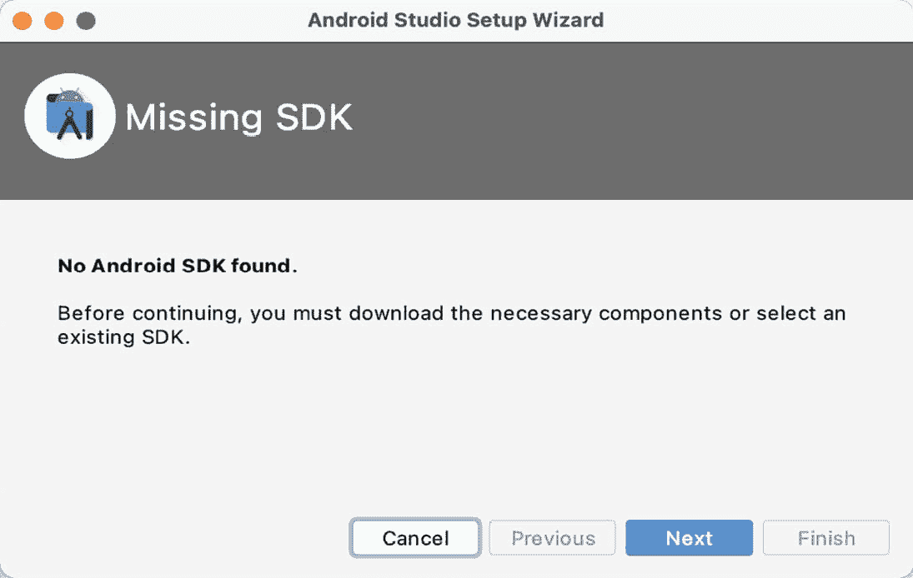

图 2-2

如果出现此对话框，点击 `Next` 按钮显示 SDK 组件设置对话框（图 2-3）。在此对话框中，在点击 `Next` 按钮之前，请确保已选择 `Android SDK` 选项以及最新的 API 程序包：

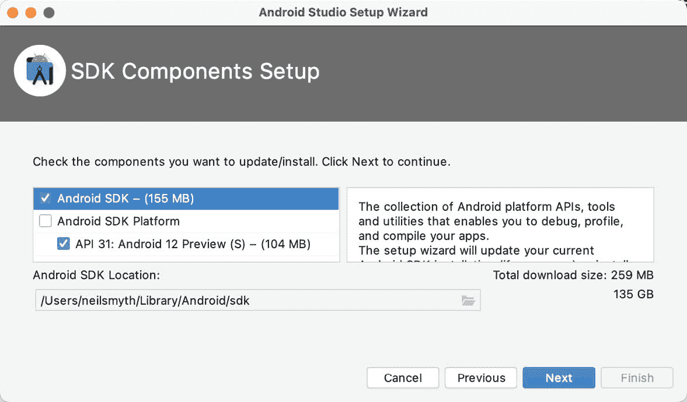

图 2-3

点击 `Next` 后，Android Studio 将下载并安装 `Android SDK` 和工具。

如果你之前安装过较旧版本的 Android Studio，在首次启动此新版本时，可能会弹出一个对话框，提供从之前的 Android Studio 版本导入设置的选项。如果你有以前版本的设置并希望将其导入到最新安装中，请选择相应的选项和位置。或者，指示你不需要导入任何之前的设置并点击 `OK` 按钮继续。

在完成这些初始设置步骤后，点击 `Finish` 按钮显示 Android Studio 欢迎界面：

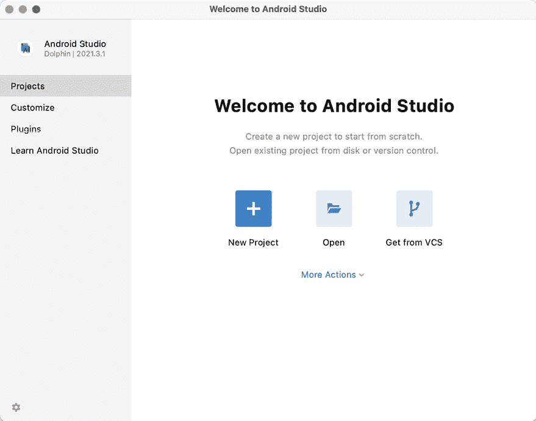

图 2-4

## 2.5 安装额外的 Android SDK 程序包

到目前为止的操作已经安装了 Android Studio IDE 和当前一组默认的 `Android SDK` 程序包。在继续之前，值得花些时间验证安装了哪些程序包，并安装任何缺失或更新的程序包。

此任务可以通过点击欢迎对话框中的 `More Actions` 链接并在下拉菜单中选择 `SDK Manager` 选项来完成。一旦调用，将出现 `Preferences` 对话框中的 `Android SDK` 界面，如图 2-5 所示：

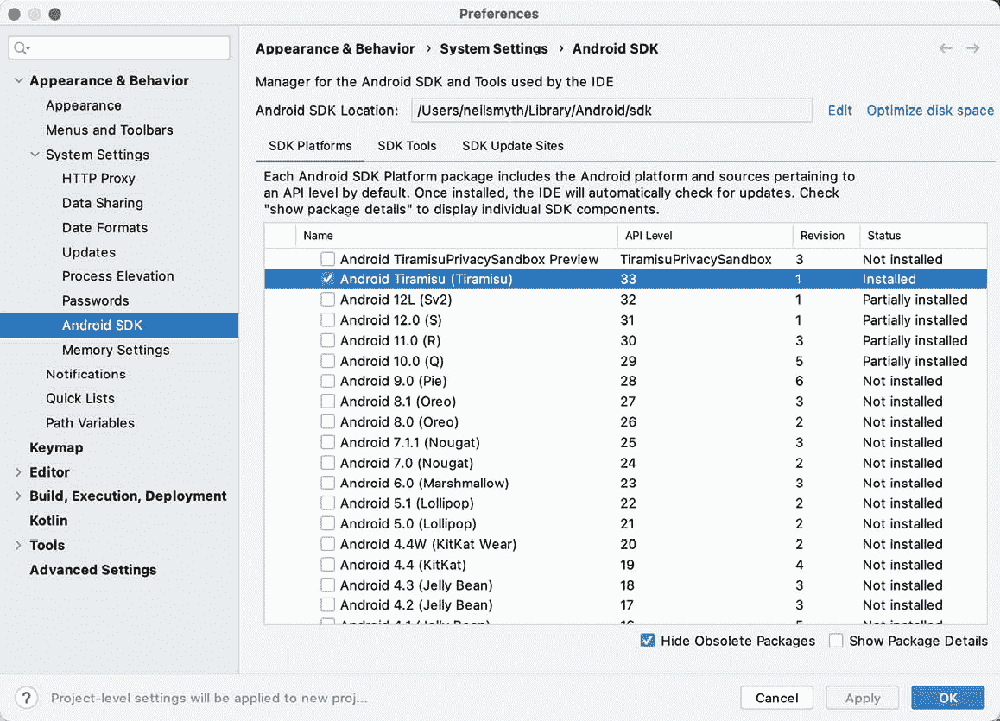

图 2-5

在首次安装 Android Studio 之后，可能只安装了最新发布的 `Android SDK` 版本。要安装旧版本的 `Android SDK`，只需选择对应版本的复选框并点击 `Apply` 按钮即可。本书的其余部分假设已安装了 `Android Tiramisu (API Level 33) SDK`。

本书中的大多数示例将支持一直到 Android 8.0 (Oreo) 的旧版本 Android。这是为了确保应用程序可以在各种 Android 设备上运行。在 SDK 版本列表中，勾选 `Android 8.0 (Oreo)` 旁边的复选框并点击 `Apply` 按钮。在生成的确认对话框中，点击 `OK` 按钮安装 `SDK`。后续对话框将在执行安装前寻求对许可和条款的接受。安装完成后点击 `Finish`。

可能还会列出最新 `SDK` 有可用更新。要访问有关准备更新的程序包的详细信息，请启用屏幕右下角的 `Show Package Details` 选项。这将显示与图 2-6 所示相似的信息：

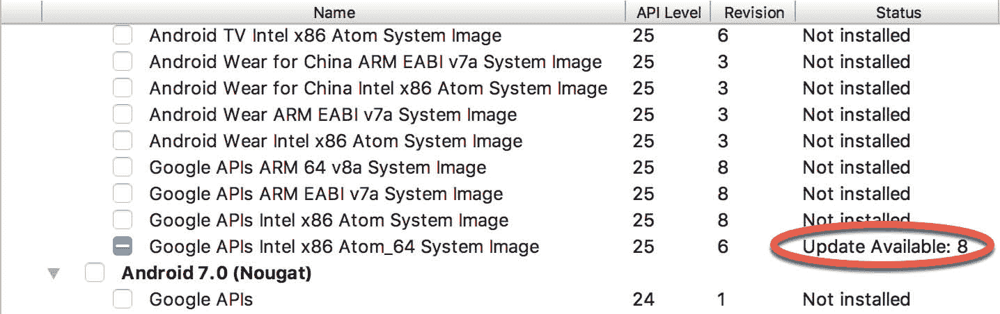

图 2-6

上面的图片强调了更新的可用性。要安装更新，勾选项目名称左侧的复选框并点击 `Apply` 按钮。

除了 `Android SDK` 程序包外，还安装了几个用于构建 Android 应用程序工具。查看当前安装的程序包并检查更新，请留在 `SDK` 设置界面并选择如图 2-7 所示的 `SDK Tools` 标签：

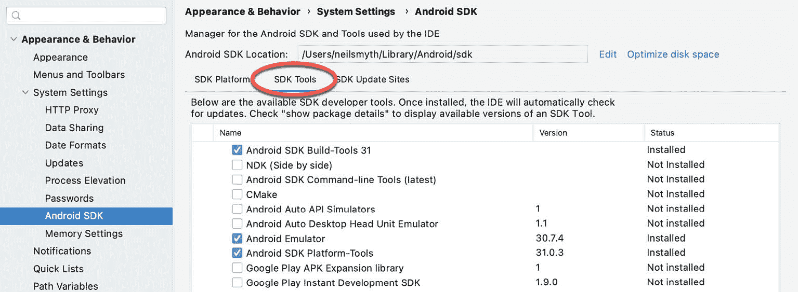

图 2-7

在 `Android SDK Tools` 界面中，请确保以下程序包在 `Status` 列中显示为 `Installed`：

- `Android SDK Build-tools`
- `Android Emulator`
- `Android SDK Platform-tools`
- `Google Play Services`
- `Intel x86 Emulator Accelerator (HAXM installer)`
- `Google USB Driver (Windows only)`
- `Layout Inspector image server for API 31 and T`

注意 `Intel x86 Emulator Accelerator (HAXM installer)` 无法在基于 Apple silicon 的 Mac 上安装。

如果上述任何程序包列为 `Not Installed` 或需要更新，只需选择这些程序包旁的复选框并点击 `Apply` 按钮启动安装过程。如果出现 `HAXM` 模拟器设置对话框，请选择推荐的内存分配：

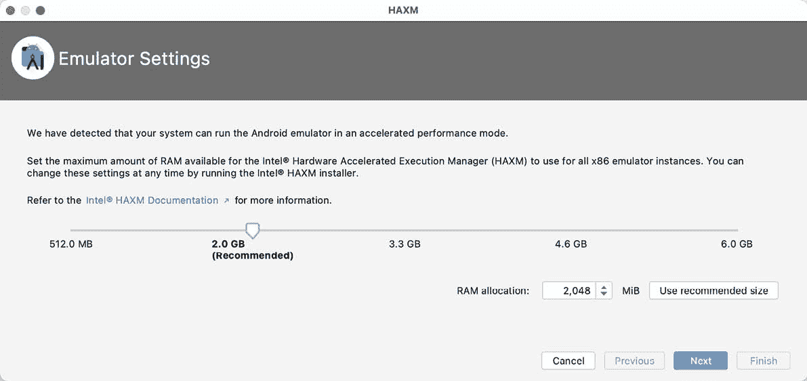

图 2-8

安装完成后，检查程序包列表并确保所选程序包现在在 `Status` 列中被列为 `Installed`。如果任何一个被列为 `Not installed`，请确保它们已选中并再次点击 `Apply` 按钮。

## 2.6 使 Android SDK 工具可在命令行中访问

大多数情况下，`Android SDK` 的底层工具将在 Android Studio 环境内部访问。但尽管如此，在某些情况下，能够从命令提示符或终端窗口调用这些工具将非常有用。为了让你正在开发的操作系统能够找到这些工具，有必要将它们添加到系统的 `PATH` 环境变量中。

无论使用何种操作系统，都需要配置 `PATH` 变量以包含以下路径（其中 `<path_to_sdk_installation>` 代表安装 Android SDK 的系统位置）：

`<path_to_sdk_installation>/sdk/tools`

`<path_to_sdk_installation>/tools/bin`

`<path_to_sdk_installation>/platform-tools`

可以通过启动 `SDK Manager` 并参考图 2-9 所示面板顶部的 `Android SDK Location:` 字段来确定系统上的 SDK 位置：


图 2-9

一旦确定了 SDK 的位置，将其添加到 `PATH` 变量的操作取决于操作系统：

### 2.6.1 Windows 8.1

1. 在开始屏幕，将鼠标移动到屏幕右下角并从生成的菜单选择 `Search`。在搜索框中输入 `Control Panel`。当 `Control Panel` 图标出现在结果区域时，点击它在桌面上启动。
2. 在 `Control Panel` 中，使用 `Category` 菜单将显示更改为 `Large Icons`。从列表中选择 `System`。
3. 在 `Environment Variables` 对话框中，在 `System variables` 列表中找到 `Path` 变量，选中并点击 `Edit…` 按钮。使用编辑对话框中的 `New` 按钮向路径添加三个条目。例如，假设 Android SDK 安装在 `C:\Users\demo\AppData\Local\Android\Sdk`，需要添加以下条目：

`C:\Users\demo\AppData\Local\Android\Sdk\platform-tools`

`C:\Users\demo\AppData\Local\Android\Sdk\tools`

`C:\Users\demo\AppData\Local\Android\Sdk\tools\bin`

4. 在每个对话框中点击 `OK` 并关闭系统属性控制面板。

通过键盘按下 `Windows + R` 在 `Run` 对话框中输入 `cmd` 打开命令提示符窗口。在命令提示符窗口中输入：


`echo %Path%`

返回的路径变量值应包含 Android SDK 平台工具的路径。通过尝试运行`adb`工具来验证`platform-tools`值是否正确：

```
adb
```

执行后工具应输出命令行选项列表。

同样，通过尝试运行`AVD Manager`命令行工具来检查`tools`路径设置（不要担心`avdmanager`工具报告 Java 有问题 - 这稍后会解决）：

```
avdmanager
```

如果其中一个或两个命令出现类似下所示的消息，最可能是将错误的路径追加到了`Path`环境变量中：

`adb`不是内部或外部命令、可程序或批文件。

### 2.6.2 Windows 10

右键点击“开始”菜单，从弹出的菜单中选择“设置”，并在“搜索”文本框中输入“编辑系统环境变量”。在“系统属性”对话框中，点击“环境变量...”按钮。按照 Windows 8.1 概述的步骤，从第 3 步开始操作。

### 2.6.3 Windows 11

右键点击任务栏上的“开始”图标，从弹出的菜单中选择“设置”。当设置对话框出现时，向下滚动列表并选择“关于”选项。在“关于”屏幕中，从“相关链接”部分选择“高级系统设置”。当“系统属性”窗口出现时，点击“环境变量...”按钮。按照 Windows 8.1 概述的步骤，从第 3 步开始操作。

### 2.6.4 Linux

在 Linux 上，此配置通常通过向家目录下的`.bashrc`文件添加命令来实现（具体细节取决于所使用的特定 Linux 发行版）。假设 Android SDK 软件包安装在`/home/demo/Android/sdk`，则`.bashrc`文件中的 export 行内容如下：

```bash
export PATH=/home/demo/Android/sdk/platform-tools:/home/demo/Android/sdk/tools:/home/demo/Android/sdk/tools/bin:/home/demo/android-studio/bin:$PATH
```

请注意，上述命令将`android-studio/bin`目录添加到`PATH`变量中。这将允许在终端窗口的任何当前目录下均执行`studio.sh`脚本。

### 2.6.5 macOS

在 macOS 上可以使用多种技术来修改`$PATH`环境变量。最干净的方法是在`/etc/paths.d`目录下创建一个新文件，其中包含要添加到`$PATH`的路径。假设 Android SDK 安装位置为`/Users/demo/Library/Android/sdk`，可以通过在`/etc/paths.d`目录下创建一个名为`android-sdk`的新文件并包含以下行来配置路径：

```
/Users/demo/Library/Android/sdk/tools
/Users/demo/Library/Android/sdk/tools/bin
/Users/demo/Library/Android/sdk/platform-tools
```

注意，由于这是一个系统目录，在创建文件时需要使用`sudo`命令。例如：

```bash
sudo vi /etc/paths.d/android-sdk
```

## 2.7 Android Studio 内存管理

Android Studio 是一个大型且复杂的应用程序，由许多后台进程组成。尽管 Android Studio 过去因性能不佳而受到过批评，但 Google 在最近的发布中已显著改进了性能，并在每个新版本中持续优化。这些改进包括允许用户配置 Android Studio IDE 以及用于构建和运行应用程序的后台进程所使用的内存。这使得软件能够利用内存更大的系统。

如果你在具有足够空闲内存以增加这些值的系统上运行 Android Studio（此功能仅适用于具有 5GB 或更多内存的 64 位系统），并发现 Android Studio 的性能似乎有所下降，那么尝试调整这些内存设置可能是值得的。Android Studio 还可能通过类似于底图所示的对话框通知你可以提高性能：


图 2-10

要查看并修改当前的内存配置，请选择`File -> Settings...`（macOS 上为`Android Studio -> Preferences...`）菜单选项，并在弹出的对话框中，选择左侧导航面板`System Settings`下列出的`Memory Settings`选项，如下图 2-11 所示：

图 2-11

## 2.8 更新 Android Studio 和 SDK

Android Studio 和 Android SDK 会定期发布新版本。新版本的 SDK 使用 Android SDK Manager 安装。当有更新准备好安装时，Android Studio 通常会通知你。

若要手动检查 Android Studio 更新，请使用 Android Studio 主窗口的`Help -> Check for Updates...`菜单选项（macOS 上为`Android Studio -> Check for Updates...`）。

## 2.9 总结

在开始开发 Android 应用程序之前，第一步是搭建合适的开发环境。这由 Android SDK 和 Android Studio IDE（包含 OpenJDK 开发环境）组成。在本章中，我们涵盖了在 Windows、macOS 和 Linux 上安装这些包所需的步骤。

# 3. 在 Android Studio 中创建 Android 示例

本书的前几个章节已经涵盖了使用 Android Studio IDE 配置适用于 Android 应用程序开发的环境所需的步骤。在进入更高级的话题之前，现在是验证所有所需的开发包均已安装并正常运行的好时机。实现这一目标的最佳方法是创建一个 Android 应用程序并编译、运行它。本章将介绍如何使用 Android Studio 创建 Android 应用程序项目。项目创建后，稍后的章节将探索如何使用 Android 模拟器环境对应用程序进行测试运行。

## 3.1 关于项目

在本章创建的项目是一个原始的货币汇率转换器（事实上，它非常简单，仅将美元转换为欧元，并使用估算的汇率进行转换）。项目还将使用 Android Studio 最基础的项目模板之一。这种简单性允许我们介绍 Android 应用开发的关键方面，而不会因一次性引入过多概念（如推荐的应用架构和 Android 架构组件）让初学者无所适从。在遵循本教程时，请放心，项目中使用的所有技术和代码将在后续章节中进行更详细介绍。

## 3.2 创建新 Android 项目

开发过程的第一步是在 Android Studio 环境中创建一个新项目。因此，首先启动 Android Studio，出现“欢迎来到 Android Studio”屏幕，如图 3-1 所示：

图 3-1

一旦此窗口出现，Android Studio 就可以创建新项目了。要创建新项目，只需点击`New Project`选项显示向导的第一页。

## 3.3 创建 Activity

第一步是为应用程序定义初始 Activity 类型。可以选择为手机和平板、Wear OS、TV、Android Audio 或 Android Things 创建项目。开发 Android 应用程序可以使用多种 Activity 类型，其中许多将在后续章节中详细介绍。但对于本示例而言，只需在模板面板中选择`Phone and Tablet`选项，然后选择创建`Empty Activity`。`Empty Activity`选项会创建一个包含单个`TextView`对象的模板用户界面。

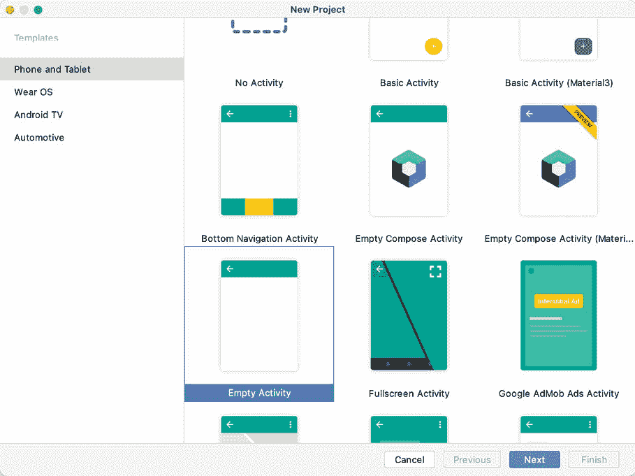

图 3-2

选中`Empty Activity`选项后，点击`Next`继续配置项目。

## 3.4 定义项目和 SDK 设置

在项目配置窗口（图 3-3）中，将`Name`字段设置为`AndroidSample`。应用程序名称是在 Android Studio 中引用和标识应用程序的名称，它也是当完成的应用程序在 Google Play 商店销售时将要使用的名称。

`Package name`（包名）用于在 Android 应用生态系统中唯一标识该应用程序。虽然它可以设置为任何唯一标识你应用程序的字符串，但传统上它是基于你域名的反转 URL 加上应用程序名称。例如，如果你的域名是`www.mycompany.com`，且应用程序命名为`AndroidSample`，那么包名可以指定如下：

```
com.mycompany.androidsample
```

如果你没有域名，可以在`Company Domain`字段中输入任何其他字符串，或者出于测试之目的使用`example.com`，但在发布应用程序之前需要对其更改：

```
com.example.androidsample
```

`Save location`（保存位置）设置将默认指向位于你主目录下名为`AndroidStudioProjects`的文件夹，你可以通过点击包含当前路径设置的文本字段右侧的文件夹图标进行更改。

将`minimum SDK`设置为`API 26`：Android 8.0 (Oreo)。除非某个必要功能仅在较新版本中可用，否则书中创建的大多数项目将使用此 SDK。这里的目标是使用最新的 Android SDK 构建应用，同时保持与运行旧版本 Android 的设备的兼容性（在这种情况下，可以追溯到 Android 8.0）。`Minimum SDK`设置下方的文字将概述当前运行该应用程序的 Android 设备百分比。点击`Help me choose`按钮（在 图 3-3 中突出显示）可以查看仍在使用的各种 Android 版本的完整细分：

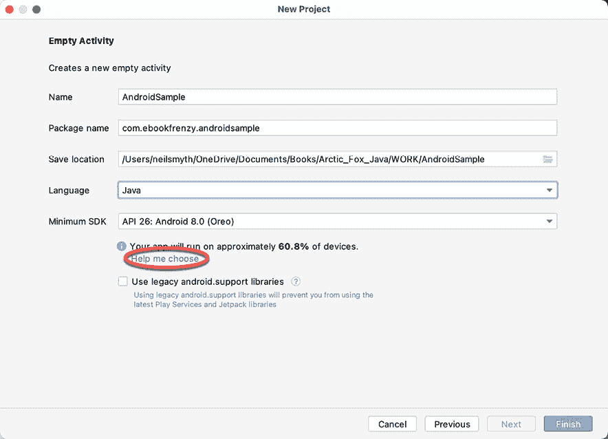

图 3-3

最后，将`Language`（语言）菜单更改为`Java`并点击`Finish`（完成）启动项目创建过程。

## 3.5 示例应用程序

此时，Android Studio 已创建了一个最小的示例应用程序项目并打开了主窗口。

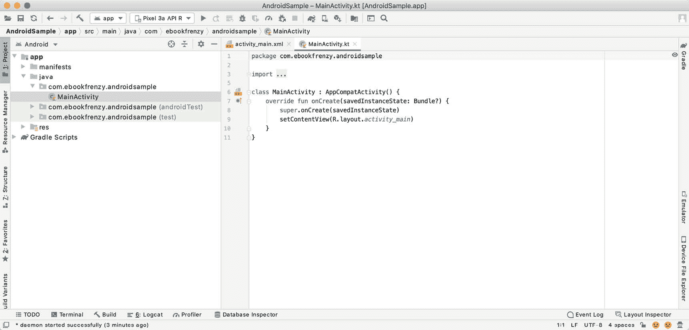

图 3-4

新创建的项目和相关文件的引用列在主项目窗口左侧的`Project`工具窗口中。`Project`工具窗口有多种显示信息的模式。默认情况下，此面板应处于`Android`模式。此设置由面板顶部的菜单控制，如 图 3-5 所示。如果面板当前不是 Android 模式，请使用菜单切换模式：

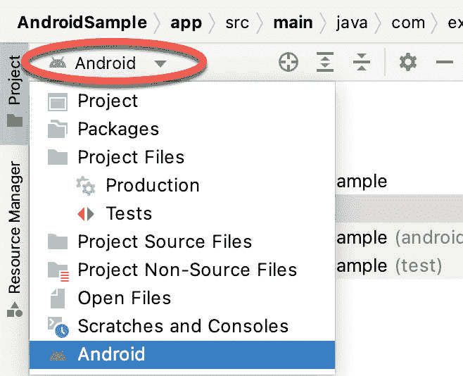

图 3-5

## 3.6 修改用户界面

我们 Activity（活动）的用户界面设计存储在名为`activity_main.xml`的文件中，该文件位于项目层级结构的`app -> res -> layout`下。在`Project`工具窗口中找到它后，双击该文件将其加载到用户界面`Layout Editor`（布局编辑器）工具中，该工具将出现在 Android Studio 主窗口的中间面板：

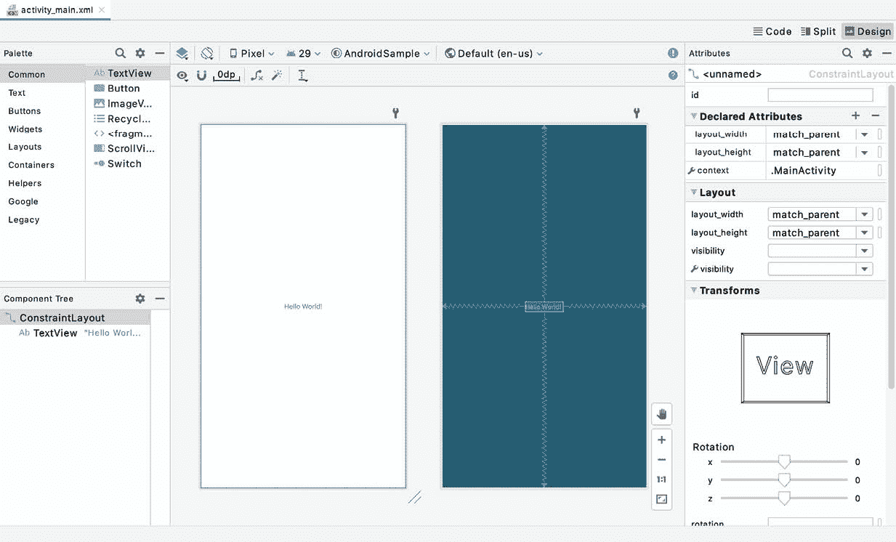

图 3-6

`Layout Editor`窗口顶部的工具栏上有一个菜单（在上面的图中设置为`Pixel`），它反映在`Layout Editor`面板中设备的视觉表示上。点击此菜单可以选择广泛的其他设备选项。

要在设备表示的横屏和竖屏之间切换，只需使用设备选择菜单正左侧的下拉菜单，该菜单显示为  图标。使用`night`按钮（）来开启或关闭`Night mode`（夜间模式）。

正如设备屏幕所示，内容布局已经包含一个显示“Hello World!”消息的标签。面板左侧是`palette`（调色板），包含不同类别的用户界面组件，这些组件可构建用户界面，例如按钮、标签和文本字段。然而，需要注意的是，并不是所有用户界面组件对用户都是可见的。其中一类就是布局。Android 支持多种布局，对视觉用户界面组件在屏幕上的定位和管理提供不同级别的控制。虽然很难从用户界面的视觉表示上判断，但当前的设计是使用`ConstraintLayout`创建的。这可以通过查看`Component Tree`（组件树）面板中的信息来确认，该面板默认位于`Layout Editor`面板的左下角，如 图 3-7 所示：


图 3-7

从组件树层次结构可以看出，用户界面布局由一个`ConstraintLayout`父对象和一个`TextView`子对象组成。

在继续之前，还请检查`Layout Editor`的`Autoconnect`（自动连接）模式已启用。这意味着当组件添加到布局中时，`Layout Editor`将自动添加约束，以确保组件在不同屏幕尺寸上正确定位。`Autoconnect`按钮出现在`Layout Editor`工具栏中，由磁铁图标表示。当禁用时，磁铁上会有一条斜线（如 图 3-8 所示）。如有必要，点击此按钮重新启用`Autoconnect`。


图 3-8

修改应用程序的下一步是在布局中添加一些额外的组件，其中第一个用于用户启动转换的`Button`。

`Palette`（调色板）面板由两列组成，左列包含视图组件类别列表。右列列出当前选择类别中的组件。在 图 3-9 中，例如，`Buttons`类别中选择了`Button`视图：


图 3-9

从`Buttons`列表中点击并拖动`Button`对象，将其放到用户界面设计的水平中心，使其位于现有的`TextView`组件下方：

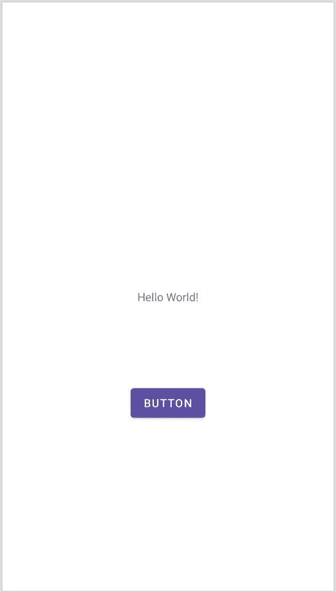

图 3-10

下一步是更改`Button`组件当前显示的文本。设计区域右侧的面板是`Attributes`（属性）面板。此面板显示分配给布局中选中组件的属性。在此面板中，在`Common Attributes`中找到`text`属性，并将当前值从“Button”更改为“Convert”，如 图 3-11 所示：


图 3-11

第二个带有扳手的文本属性允许设置仅在`Layout Editor`工具中显示的文本属性，但在运行时不显示。这对于测试视觉组件和布局在不同设置下的行为非常有用，而无需反复运行应用程序。

以防`Autoconnect`系统未能设置所有布局连接，请点击`Infer constraints`（推断约束）按钮（图 3-12）为布局添加任何缺失的约束：

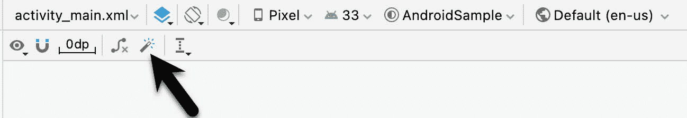

图 3-12

在此处，重要的是解释位于布局编辑器（Layout Editor）工具右上角的警告按钮，如图 3-13 所示。显然，这表示布局可能存在问题。要查看任何问题的详细信息，请点击该按钮：


图 3-13

点击后，将出现一个面板（图 3-14），描述问题的性质并提供一些可能的纠正措施：

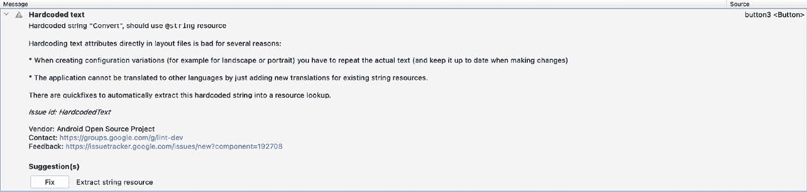

图 3-14

目前，列出的唯一警告内容如下：

硬编码字符串 "Convert"，应使用 @string 资源

这条 I18N 消息告诉我们，项目未来的国际化（I18N）存在潜在问题（“I18N”源于“internationalization”一词以“I”开头，以“N”结尾，中间有 18 个字母）。该警告提醒我们，在开发 Android 时，尽可能应将文本字符串等属性和值以资源的形式存储。这样做允许通过修改资源文件来更改应用程序的外观，而不是更改应用程序源代码。这在将用户界面翻译成不同的口语语言时可能特别有价值。如果用户界面中的所有文本都包含在单一资源文件中，例如，可以将该文件交给翻译人员，由他们执行翻译工作并返回翻译后的文件以包含在应用程序中。这使得无需修改任何源代码即可针对多种语言。在本例中，我们将创建一个名为`convert_string`的新资源，并为其分配字符串“Convert”。

点击问题说明（Issue Explanation）面板中的`Fix`按钮，以显示提取资源（Extract Resource）面板（图 3-15）。在此面板中，将资源名称字段更改为`convert_string`，并在点击`OK`按钮之前，将资源值保留为`Convert`。

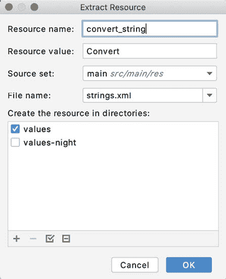

图 3-15

下一个要添加的部件是`EditText`挂件，用户将在其中输入要转换的美元金额。从调色板（Palette）面板中，选择`Text`类别，并点击拖动`Number (Decimal)`组件到布局上，使其水平居中并置于现有`TextView`部件上方。选中挂件后，使用`Attributes`（属性）工具窗口将`hint`设置为“dollars”。点击警告图标并将字符串提取为名为`dollars_hint`的资源。

本章稍后编写的代码将需要访问用户输入`EditText`字段的美元值。它将通过引用分配给用户界面布局中挂件的`id`来实现。当在布局中选中挂件时，可以在`Attributes`工具窗口查看并更改 Android Studio 为挂件分配的默认`id`，如图 3-16 所示：

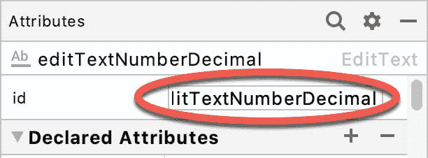

图 3-16


将`id`更改为`dollarText`，并在`Rename`（重命名）对话框中点击`Refactor`（重构）按钮。这确保了项目其他地方对旧`id`的引用都会自动更新为使用新`id`：

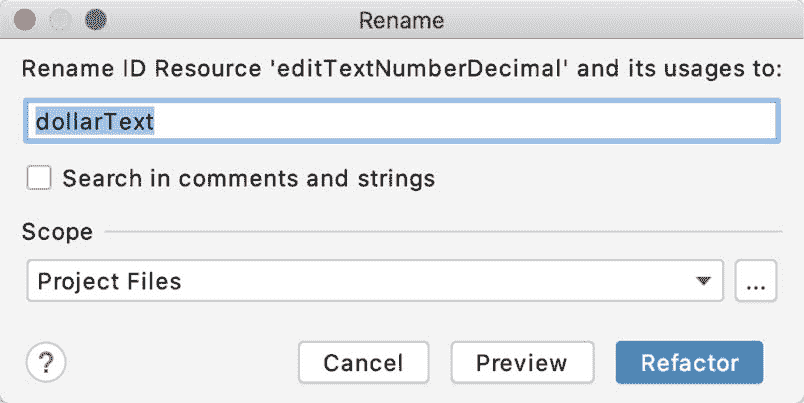

图 3-17

点击`Infer constraints`（推断约束）按钮添加任何缺失的布局约束。此时，布局应该类似于图 3-18 所示：


图 3-18

## 3.7 检查布局和资源文件

在继续后续步骤之前，我们将查看用户界面设计和资源处理的一些内部方面。在上一节中，我们通过使用布局编辑器工具修改`activity_main.xml`文件对用户界面进行了一些更改。事实上，布局编辑器所做的只是提供了一种用户友好的方式来编辑文件的底层 XML 内容。在实践中，没有理由不直接修改 XML 来进行用户界面更改，在某些情况下，这实际上比使用布局编辑器工具更快。在布局编辑器面板的右上角有三个按钮，如下文图 3-19 所示：


图 3-19

默认情况下，编辑器将处于`Design`（设计）模式，此时仅显示布局的视觉表示。最左侧的按钮将切换到`Code`（代码）模式以显示布局的 XML，而中间的按钮进入`Split`（分割）模式，同时显示布局和 XML，如图 3-20 所示：

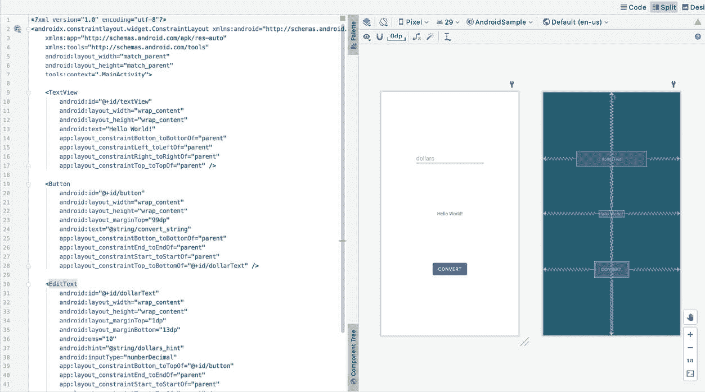

图 3-20

从 XML 文件的结构可以看出，用户界面由`ConstraintLayout`组件组成，它又是`TextView`、`Button`和`EditText`对象的父级。我们还可以看到，例如`Button`的`text`属性被设置为我们的`convert_string`资源。尽管复杂程度和内容不同，所有用户界面布局都是以这种层次化的、基于 XML 的方式构建的。

当对 XML 布局进行更改时，这些更改将反映在画布上。也可以在画布内视觉修改布局，更改出现在 XML 列表中。为了演示这种效果，切换到`Split`模式并修改 XML 布局，将`ConstraintLayout`的背景颜色改为：

```xml
<?xml version="1.0" encoding="utf-8"?>
<androidx.constraintlayout.ConstraintLayout xmlns:android="http://schemas.android.com/apk/res/android"
    xmlns:app="http://schemas.android.com/apk/res-auto"
    xmlns:tools="http://schemas.android.com/tools"
    android:layout_width="match_parent"
    android:layout_height="match_parent"
    tools:context=".MainActivity"
    android:background="#ff2438">

</androidx.constraintlayout.ConstraintLayout>
```

注意布局颜色实时变化以匹配 XML 文件中的新设置。还要注意 XML 编辑器中颜色设置行的左侧边距（也称为槽）出现了一个红色小方块。这是设置了红色属性的视觉提示。点击红色方块将显示颜色选择器，允许选择不同的颜色：

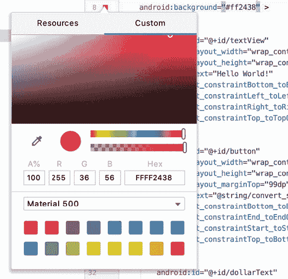

图 3-21

在继续之前，从布局文件中删除`background`属性，使背景返回默认设置。

最后，使用`Project`面板找到`app` -> `res` -> `values` -> `strings.xml`文件，并双击它将其加载到编辑器中。目前 XML 内容应如下：

```xml
<resources>
    <string name="app_name">AndroidSample</string>
    <string name="convert_string">Convert</string>
    <string name="dollars_hint">dollars</string>
</resources>
```

为了演示资源的作用，将分配给`convert_string`资源的字符串值更改为“Convert to Euros”，然后通过编辑器面板中的布局文件标签页返回布局编辑器工具。注意布局已经获取了字符串的新资源值。

还有一种快速访问 XML 文件中引用的资源值的方法。在拆分（Split）或代码（Code）模式下，使用布局编辑器工具，点击`@string/convert_string`属性设置，使其高亮显示，然后按下键盘上的`Ctrl-B`（macOS 上为`Cmd-B`）。Android Studio 随后会打开`strings.xml`文件，并将您带到文件中声明该资源的行。利用此机会将字符串资源还原为原始的“Convert”文本，并添加以下额外的字符串资源项，该资源稍将在应用代码中引用：

```xml
<resources>
    <string name="convert_string">Convert</string>
    <string name="dollars_hint">dollars</string>
    <string name="no_value_string">No Value</string>
</resources>
```

资源字符串也可以使用 Android Studio 的翻译编辑器（Translations Editor）进行编辑。要打开此编辑器，右键点击`app` -> `res` -> `values` -> `strings.xml`文件，并选择`Open editor`菜单选项。这会在 Android Studio 窗口的主面板中显示翻译编辑器：

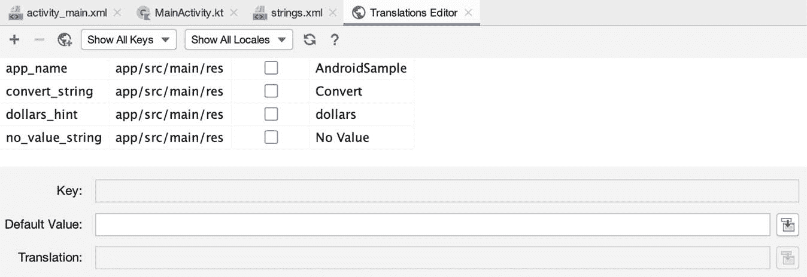

图 3-22

此编辑器允许编辑分配给资源键的字符串，并管理多种语言的翻译。

## 3.8 添加交互

此示例项目的最后一步是使应用程序具有交互性，以便当用户在`EditText`字段中输入美元值并点击转换按钮时，转换后的欧元值将显示在`TextView`上。这涉及在`Button`控件上实现一些事件处理。具体来说，需要配置`Button`，以便在触发`onClick`事件时调用应用代码中的方法。事件处理可以通过多种不同的方式实现，并将在后续标题为 Android 事件处理概述与示例 的章节中进行详细介绍。将布局编辑器返回设计（Design）模式，在布局编辑器中选择`Button`控件，参考属性（Attributes）工具窗口并按所示指定名为`convertCurrency`的方法：


图 3-23

注意，`onClick`属性的文本字段现在用红色边框高亮显示，警告我们该按钮已配置调用一个尚不存在的方法。为了解决这个问题，双击项目工具窗口中的`MainActivity.java`文件（`app` -> `java` -> `<package name>` -> `MainActivity`）将其加载到代码编辑器中，并在类文件中添加`convertCurrency`方法的代码，使其读取内容如下，请注意还有必要导入一些额外的 Android 程序包：

```java
package com.ebookfrenzy.androidsample;

import androidx.appcompat.app.AppCompatActivity;
import android.os.Bundle;
import android.view.View;
import android.widget.EditText;
import android.widget.TextView;

import java.util.Locale;

public class MainActivity extends AppCompatActivity {
    @Override
    protected void onCreate(Bundle savedInstanceState) {
        super.onCreate(savedInstanceState);
        setContentView(R.layout.activity_main);
    }

    public void convertCurrency(View view) {
        EditText dollarText = findViewById(R.id.dollarText);
        TextView textView = findViewById(R.id.textView);
        if (!dollarText.getText().toString().equals("")) {
            float dollarValue = Float.parseFloat(dollarText.getText().toString());
            float euroValue = dollarValue * 0.85F;
            textView.setText(String.format(Locale.ENGLISH,"%.2f", euroValue));
        } else {
            textView.setText(R.string.no_value_string);
        }
    }
}
```

该方法首先通过调用名为`findViewById`方法并传递布局文件中分配的`id`来获取`EditText`和`TextView`对象的引用。然后进行检查以确保用户已输入了美元值，如果是，则提取该值，将其从`String`转换为浮点值并转换为欧元。最后，结果显示在`TextView`控件上。如果这些任何内容不清楚，请放心，这些概念将在后面的章节中进行详细介绍。

## 3.9 总结

虽然设置 Android 开发环境并不特别复杂，但涉及许多步骤。在完成这些步骤后，通过运行示例来确保环境已正确安装和配置是非常好的。在本章中，我们创建了一个示例应用程序，并使用 Android Studio 布局编辑器工具修改了用户界面布局。通过这样做，我们探讨了尽可能使用资源的重要性，特别是在字符串值的情况下，并简要接触了布局主题。接下来，我们查看了用于存储 Android 应用用户界面设计的底层 XML。

最后，在`Button`上添加了`onClick`事件，连接到一个已实现的方法，该方法用于从`EditText`组件中提取用户输入，将美元转换为欧元，然后在`TextView`上显示结果。

由于应用程序已准备好测试，为测试之目的设置模拟器的必要步骤将在下一章中详细介绍。

# 4. 在 Android Studio 中创建 Android 虚拟设备 (AVD)

尽管 Android Studio 的预览面板允许我们查看正在设计的布局并使用交互模式测试基本功能，但仍有必要编译并运行整个应用程序以完全测试其是否运行正常。可以通过在物理设备上或在 Android 虚拟设备 (AVD) 模拟器环境中安装并运行来测试 Android 。在使用 AVD 之前，必须先创建并配置以匹配特定设备型号的规格。在本章中，我们将以 Pixel 4 为参考创建此类虚拟设备。

## 4.1 关于 Android 虚拟设备

AVD 本质上是模拟器，允许在无需将应用程序安装到物理设备上的情况下测试 Android 应用程序。AVD 可以配置为模拟各种硬件功能，包括屏幕大小、内存容量以及是否存在摄像头、GPS 导航或加速度计等功能选项。作为 Android Studio 标准安装的一部分，安装了几个模拟器模板，允许为一系列不同的设备配置 AVD。可以通过指定处理器类型、内存容量以及屏幕尺寸和像素密度等属性，来创建自定义配置以匹配任何物理 Android 设备。

AVD 会话可以以独立窗口的形式出现，也可以嵌入在 Android Studio 窗口中。

新的 AVD 使用 Android 虚拟设备管理器（Android Virtual Device Manager）创建和管理，该管理器可以在命令行模式或使用更友好的图形用户界面使用。要创建新的 AVD，第一步是启动 AVD 管理器。可以在 Android Studio 环境内选择`Tools` -> `Device Manager`菜单选项来实现。

启动后，管理器将作为工具窗口出现，如图 4-1 所示：

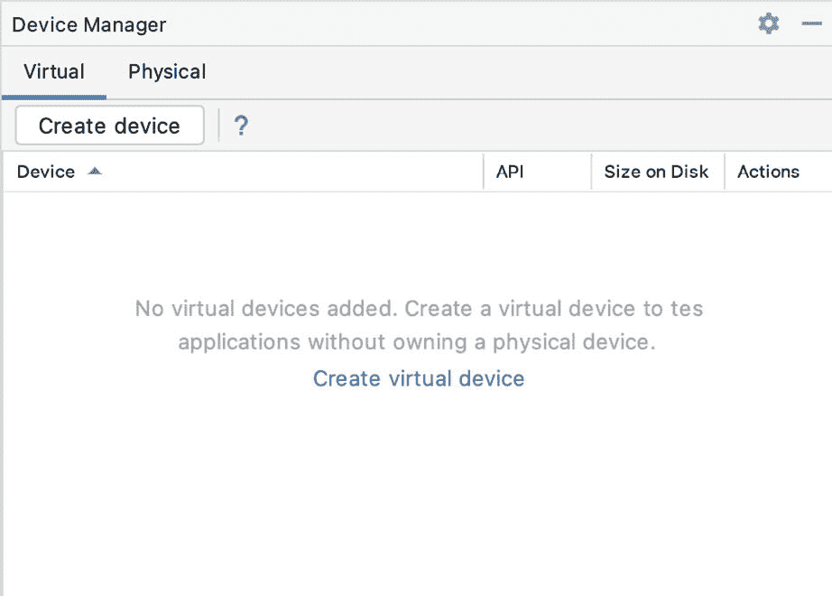

图 4-1

要添加新的 AVD，首先确保选中了`Virtual`选项卡，然后点击`Create device`按钮打开虚拟设备配置对话框：

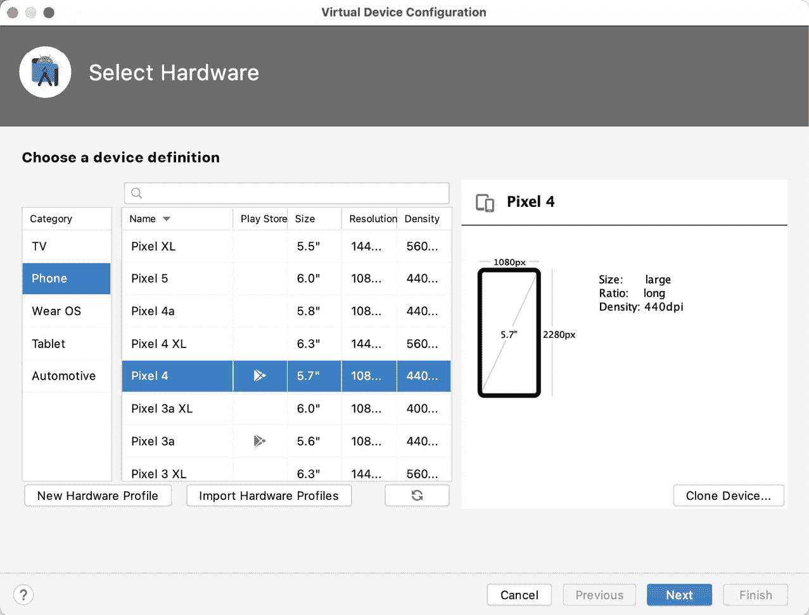

图 4-2

在对话框中，执行以下步骤创建一个兼容 Pixel 4 的模拟器：

1. 从`Category`面板中选择`Phone`选项以显示可用 Android 手机 AVD 模板列表。

2. 选择`Pixel 4`设备选项并点击`Next`。

3. 在 System Image（系统镜像）屏幕上，选择最新版本的 Android。注意，如果尚未安装系统镜像，`Release Name`（发行名称）旁边将提供一个`Download`链接。点击此链接下载并安装系统镜像，然后再进行选择。如果列表中没有你需要的镜像，请点击`x86 Images`标签（如果你运行的是搭载 Apple 芯片的 Mac，则点击`ARM images`）或`Other images`标签以查看备选列表。

4. 点击`Next`继续，并在 name 字段中输入一个描述性名称（例如 Pixel 4 API 32），或直接接受默认名称。

5. 点击`Finish`创建 AVD。

6. AVD 创建完成后，现在可以关闭`Device Manager`（设备管理器）。如果以后需要对 AVD 进行修改，只需重新打开`Device Manager`，从列表中选择 AVD，并点击`Actions`列中的铅笔图标来编辑设置。

## 4.2 启动模拟器

要对新创建的 AVD 模拟器进行测试运行，只需从`Device Manager`中选择该模拟器并点击启动按钮（`Actions`列中的三角形）。模拟器将嵌入在 Android Studio 主窗口中出现并开始启动过程。模拟器启动所需取决于 AVD 本身及其运行系统的配置：

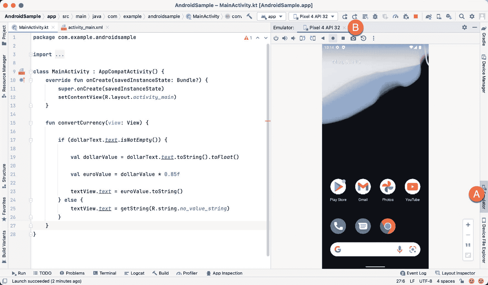

图 4-3

要隐藏和显示模拟器工具窗口，请点击`Emulator`工具窗口按钮（如上方的 A 标记）。点击标签页旁边的“x”关闭按钮 (B) 退出模拟器。模拟器工具窗口可以容纳多个模拟器会话，每个会话由一个标签页表示。例如，图 4-4 显示了一个包含两个模拟器会话的工具窗口：


图 4-4

要在会话之间切换，只需点击相应的标签页。

虽然模拟器可能默认以竖向方向显示，但此项和其他默认选项都可以更改。在`Device Manager`中，选择新的 Pixel 4 条目，并点击设备行`Actions`列中的铅笔图标。在配置屏幕上，找到`Startup orientation`（启动方向）部分并更改方向设置。退出并重启模拟器会话以使更改生效。关于模拟器的更多细节请参见下一章 “使用和配置 Android Studio AVD 模拟器”。

为了在本章的下一节中节省时间，请在继续之前保持模拟器运行。

## 4.3 在 AVD 中运行应用程序

配置 AVD 模拟器后，之前章节中创建的示例`AndroidSample`应用程序现在可以编译并运行。将`AndroidSample`项目加载到 Android Studio 后，确保新创建的 Pixel 4 AVD 显示在设备菜单中（如下方 图 4-5 中的 A 标记），然后点击由绿色三角形代表的运行按钮 (B)、选择`Run -> Run ‘app’`菜单选项，或使用键盘快捷键`Ctrl-R`：

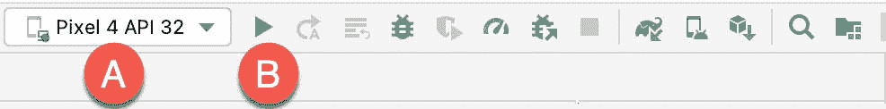

图 4-5

设备菜单 (A) 可用于选择不同的 AVD 实例或物理设备作为运行目标，也可以在多个设备上运行应用。该菜单还提供了访问`Device Manager`以及设备连接配置和故障排除选项的通道：

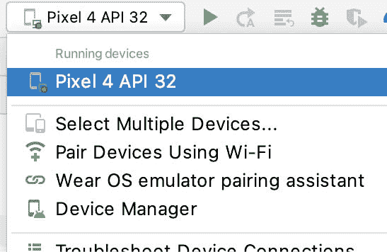

图 4-6

一旦应用程序安装并运行，第一个 fragment（碎片）的用户界面将在模拟器中出现（fragment 是 Android 项目中可重用的部分，通常由用户界面布局和一些代码组成，该主题将在题为 “Android 碎片简介” 的章节中介绍）：

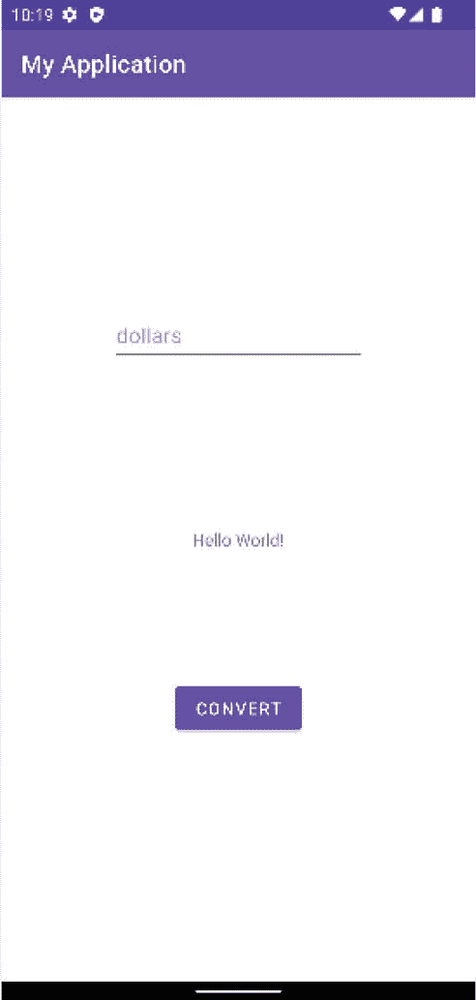

图 4-7

如果 activity（活动）没有自动启动，请检查模拟器应用列表中是否出现了启动图标。如果是，只需点击它即可启动应用程序。一旦运行过程开始，`Run`工具窗口将可用。在应用程序包安装和启动时，`Run`工具窗口将显示诊断信息。图 4-8 显示了典型成功启动应用程序时`Run`工具窗口的输出：

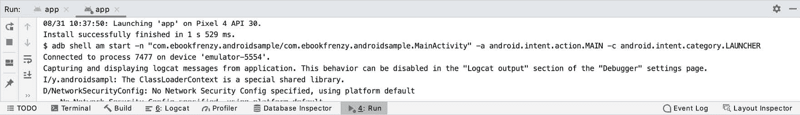

图 4-8

如果在启动过程中遇到问题，`Run`工具窗口将提供信息，希望这有助于隔离问题原因。

假设应用程序加载到模拟器并按预期运行，我们已经安全地验证了 Android 开发环境已正确安装和配置。现在应用正在运行，尝试进行货币转换以验证应用是否按预期工作。

## 4.4 在多个设备上运行


上方图 4-6 显示的运行菜单包含一个在多个模拟器和设备上并行运行应用的选项。选择此项后，将显示如图 4-9 所示的框，列出系统上配置的所有 AVD 以及任何连接的物理设备。勾选要目标模拟器或设备旁边的复选框，然后点击 `Run` 按钮：

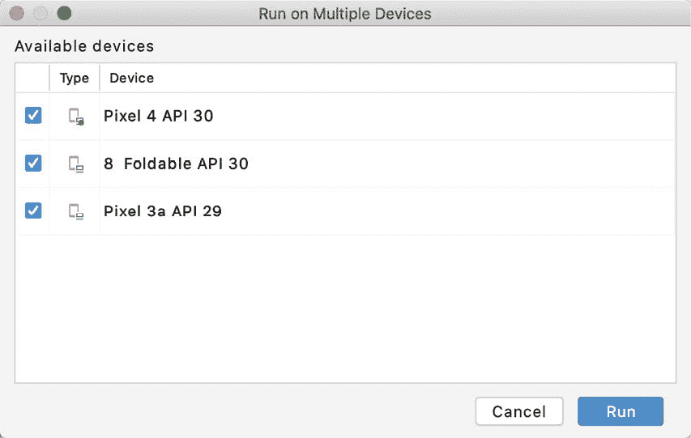

图 4-9

点击 `Run` 按钮后，Android Studio 将在指定的模拟器和设备上启动应用。

## 4.5 停止运行的应用程序

要停止正在运行的应用程序，只需点击如图 4-10 所示的主工具栏中的停止按钮：

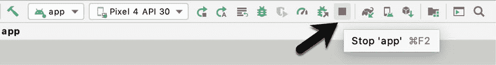

图 4-10

也可以使用 `Run` 工具窗口终止应用。在应用运行时显示 `Run` 工具窗口。一旦窗口出现，点击下方图 4-11 所示的停止按钮：

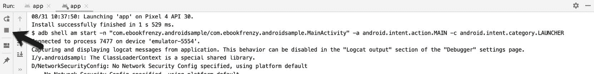

图 4-11

## 4.6 支持深色主题

Android 10 引入了期待已久的深色主题，Android Studio 项目默认启用。要在 AVD 模拟器中测试深色主题，请在运行的 Android 实例中打开 `Settings` 应用。在 `Settings` 应用中，选择图 4-12 所示的 `Display`，使屏幕背景变为黑色：

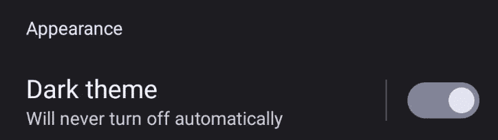

图 4-12

启用深色主题后，运行 `AndroidSample` 应用，并注意它以如图 4-13 所示的深色主题显示，包括黑色背景和紫色背景按钮：

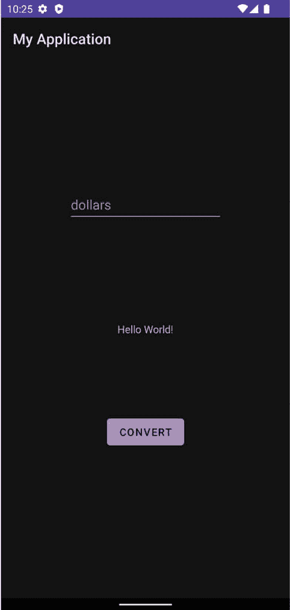

图 4-13

返回 `Settings` 应用并关闭深色模式后再继续。

## 4.7 在独立窗口中运行模拟器

到目前为止，我们仅将模拟器作为嵌入在 Android Studio 主窗口的工具窗口。要在独立窗口中运行模拟器，选择 `File -> Settings...` 菜单选项（macOS 为 `Android Studio -> Preferences...`），在设置对话框的左侧导航面板中导航到 `Tools -> Emulator`，并禁用 `Launch in a tool window`：

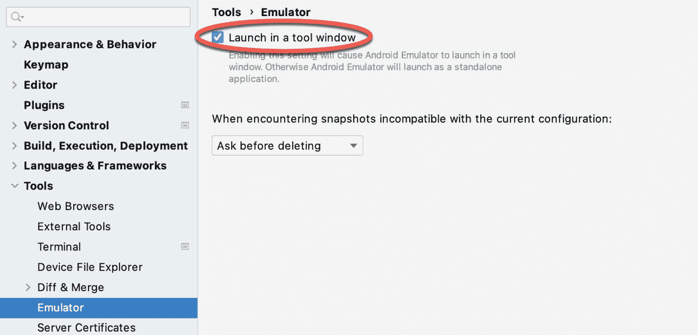

图 4-14

禁用该选项后，点击 `Apply` 按钮以及 `OK` 提交更改，然后点击上方图 4-3 中标记为 B 的标签页上的关闭按钮退出当前的模拟器会话。

再次运行示例应用，此时模拟器将作为一个独立窗口出现，如图所示：

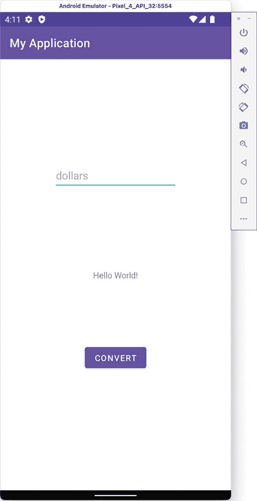

图 4-15

选择独立模式或工具窗口模式取决于个人喜好。如果你喜欢让模拟器运行在工具窗口中，请返回设置界面并重新启用 `Launch in a tool window`（在工具窗口中启动）选项。然而，在决定使用独立模式之前，请记住模拟器工具窗口可以通过点击模拟器工具栏上的设置按钮（由齿轮图标表示）并选择 `View Mode -> Float`（视图模式 -> 浮动）菜单选项与主 Android Studio 窗口分离：

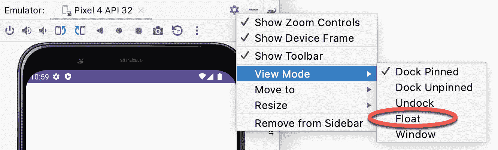

图 4-16

## 4.8 启用设备框架

模拟器可以配置为显示（参考图 4-17）或不显示（参考图 4-15）的设备框架。

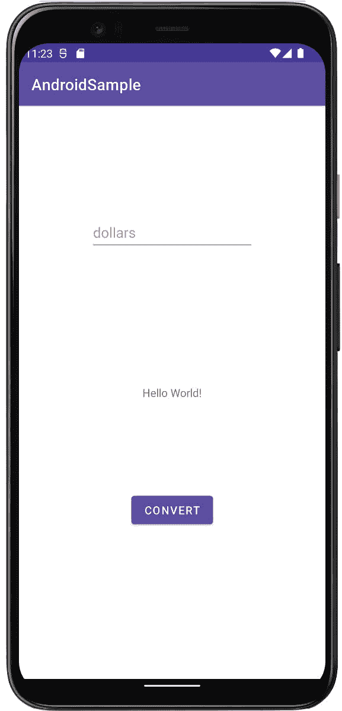

图 4-17

要更改设置，请打开 `Device Manager`（设备管理器），从列表中选择 `AVD`，并点击 `Actions`（操作）列中的铅笔图标以编辑设置。在设置界面，找到并更改 `Enable Device Frame`（启用设备框架）选项：

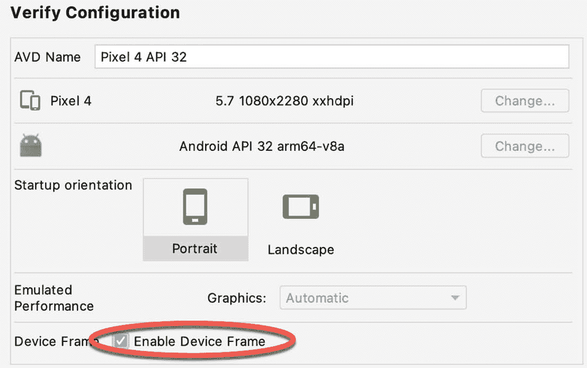

图 4-18

## 4.9 AVD 命令行创建

如前所述，除了图形用户界面外，还可以直接从命令行创建新的 `AVD`。这是通过使用 `avdmanager` 工具结合一些命令行选项实现的。一旦启动，该工具会在创建新 `AVD` 之前提示输入额外信息。

`avdmanager` 工具需要访问 Java 运行环境 (`JRE`) 才能运行。如果在尝试运行 `avdmanager` 时出现错误消息提示找不到 `java` 命令，则可以将运行该命令的命令提示符或终端窗口配置为使用与 Android Studio 捆绑的 `OpenJDK` 环境。首先通过以下方式识别 `OpenJDK` `JRE` 的位置：

1. 启动 Android Studio 并打开书中之前创建的 `ComposeDemo` 项目。
2. 选择 `File -> Settings...`（文件 -> 设置...）菜单选项（macOS 上为 `Android Studio -> Preferences...`）。
3. 到 `Build, Execution, Deployment`（构建、执行、部署）部分，选择 `Build Tools`（构建工具）类别下的 `Gradle` 选项。
4. 点击 `Gradle JDK` 设置并记录 Android Studio 默认 `JDK` 的路径：

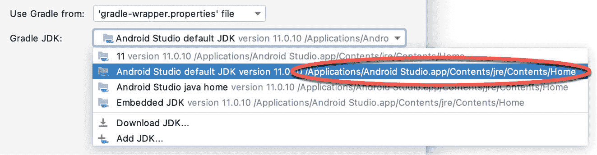

图 4-19

在 Windows 上，在运行 `avdmanager` 的命令提示符窗口中执行以下命令（将 `<path to jre>` 替换为上方项目结构对话框中复制的路径）：

```bash
set JAVA_HOME=<path to jre>
```

在 macOS 或 Linux 上，执行以下命令：

```bash
export JAVA_HOME="<path to jre>"
```

如果你预计经常使用 `avdmanager` 工具，请按照“设置 Android Studio 开发环境”章节概述的针对你操作系统的环境变量步骤，在系统范围内配置 `JAVA_HOME`。

假设系统已配置将 `Android SDK` 工具目录包含在 `PATH` 环境变量中，可以通过在终端或命令窗口中发布以下命令获取新 `AVD` 的可用目标列表：

```bash
avdmanager list targets
```

上述命令的输出将包含系统可用的 `Android SDK` 版本列表。例如：

```
Available Android targets:
----------
id: 1 or "android-29"
     Name: Android API 29
     Type: Platform
     API level: 29
     Revision: 1
----------
id: 2 or "android-26"
     Name: Android API 26
     Type: Platform
     API level: 26
     Revision: 1
```

`avdmanager` 工具还允许从命令行创建新的 `AVD` 实例。例如，要使用 Android API 29 设备的目标 ID 并使用 `x86` `ABI` 创建名为 `myAVD` 的新 `AVD`，可以使用以下命令：

```bash
avdmanager create avd -n myAVD -k "system-images;android-29;google_apis_playstore;x86"
```

`avdmanager` 工具将根据基础 Android 8 设备的规格创建新的 `AVD`，同时根据需要提供创建自定义配置以匹配特定设备规格的选项。一旦从命令行创建了新的 `AVD`，在点击 `Refresh`（刷新）按钮之前，它可能不会出现在 `Android Device Manager`（Android 设备管理器）工具中。

除了创建新的 `AVD`，还可以从命令行执行其他任务。例如，可以使用 `list avd` 命令行参数获取当前可用 `AVD` 列表：

```bash
avdmanager list avd
```

```
Available Android Virtual Devices:
   Name: Pixel_XL_API_28_No_Play
   Device: pixel_xl (Google)
   Path: /Users/neilsmyth/.android/avd/Pixel_XL_API_28_No_Play.avd
   Target: Google APIs (Google Inc.)
   Skin: pixel_xl
   ABI: x86
```

同样，要删除一个 `AVD`，可以使用：

```bash
avdmanager delete avd -n <avd name>
```

## 4.10 Android 设备配置文件

默认情况下，与 `AVD` 关联的文件存储在用户主目录下的 `.android/avd` 子目录中，其结构如下（其中 `<avd name>` 替换为 AVD 的名称）：

`<avd name>.avd/config.ini`
`<avd name>.avd/userdata.img`

`config.ini` 文件包含了创建 AVD 时指定的设备配置，如显示和内存。这些设置可以在配置文件中直接更改，并在下次调用 AVD 时采用。

`.ini` 文件包含了对 `Android SDK` 路径的引用。注意 `config.ini` 中的 `sysdir` 也需要反映目标值。

## 4.11 移动和重命名 Android 设备

可以使用 `avdmanager` 工具的 `move` 参数从命令行更改 AVD 的当前名称或位置。例如，要将名为 `Pixel4` 的 AVD 重命名为 `Pixel4a`，可以使用：

```bash
avdmanager move avd -n Pixel4 -r Pixel4a
```

要物理移动 AVD 的文件，应使用以下命令格式：

```bash
avdmanager move avd -n <avd name> -p <path to new location>
```


注意在执行移动 AVD 的命令之前，目标目录必须存在。

## 4.12 总结

典型的应用程序开发过程遵循编码、编译和在测试环境中运行的循环。Android 应用程序可以在物理 Android 设备或使用虚拟设备（AVD）模拟器上进行测试。AVD 使用`Android Studio Device Manager`工具创建和管理，该工具既可以通过命令行使用，也可以通过图形界面使用。在模拟特定的 Android 设备模型时，应配置为与物理设备匹配的硬件规格。

AVD 模拟器可以以独立窗口的形式显示，也可以嵌入 Android Studio 用户界面。

# 5. 使用和配置 Android Studio AVD 模拟器

在下一章探索物理 Android 设备之前，本章将花一些时间提供 Android Studio AVD 模拟器的概述，并突出许多在独立和工具窗口模式下用于自定义环境的配置功能。

## 5.1 模拟器环境

以独立模式启动时，模拟器会在加载过程中显示初始启动屏幕。加载完成后，会出现主模拟器窗口，包含所选设备类型的表示（对于图 5-1 (#AVD_Configuration.xhtml__idTextAnchor108) 而言，这是一个 Pixel 4 设备）：

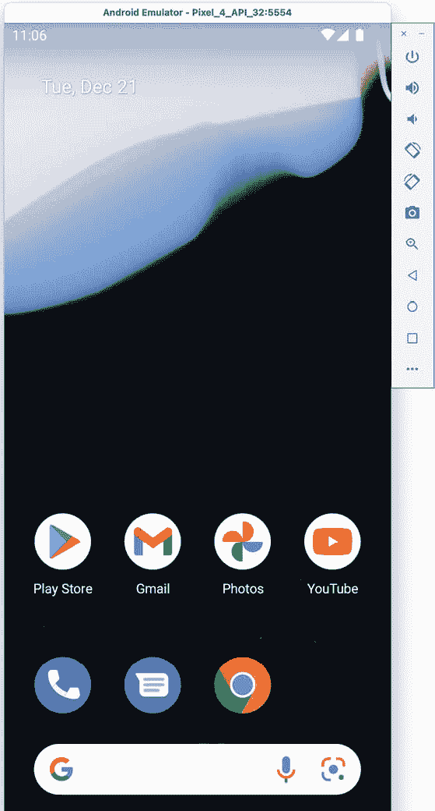

图 5-1

窗口右侧边缘设置了工具栏，提供了快速访问模拟器控件和配置选项的功能。

## 5.2 模拟器工具栏选项

模拟器工具栏（图 5-2）提供了与模拟器环境外观和行为相关的系列选项访问。

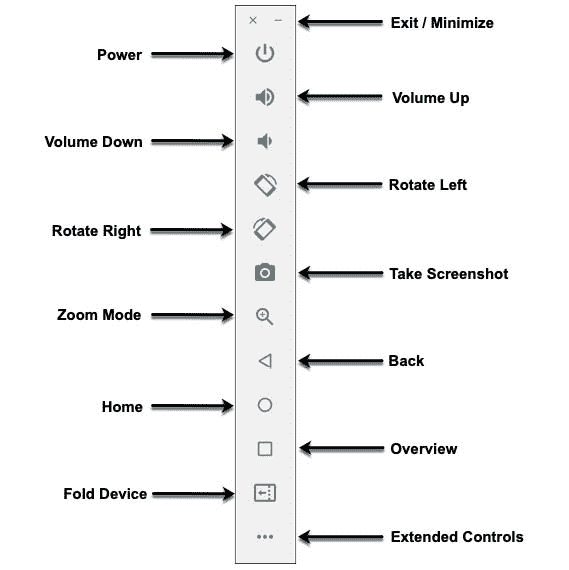

图 5-2

工具栏中的每个按钮都关联有一个键盘快捷键，可以通过将鼠标指针悬停在按钮上并等待工具提示出现，或者通过扩展控制面板的帮助选项来识别。

尽管工具栏中包含许多选项都是自俗易懂的，但为了完整性，我们将介绍每个选项：

* `Exit / Minimize`（退出/最小化）——工具栏中最顶部的“x”按钮退出模拟器会话，而“-”选项则最小化整个窗口。
* `Power`（电源）——`Power`按钮模拟物理 Android 设备上的硬件电源按钮。点击并释放此按钮将锁定设备并关闭屏幕。长按此按钮将启动设备的“关机”请求序列。
* `Volume Up / Down`（音量增大/减小）——控制模拟器环境内播放音量的两个按钮。
* `Rotate Left/Right`（左转/右转）——在模拟设备的纵屏和横屏方向之间旋转设备。
* `Take Screenshot`（截图）——对设备屏幕当前显示的内容截图。截取的图像存储在扩展控制面板`Settings`屏幕指定的路径（本章稍后概述）。
* `Zoom Mode`（缩放模式）——此按钮切换进入和退出缩放模式，细节将在本章后续介绍。
* `Back`（返回）——执行标准的 Android“返回”导航回到上一个屏幕。
* `Home`（主页）——显示设备主屏幕。
* `Overview`（概述）——模拟选择标准的 Android“概述”导航，显示设备上正在运行的应用。
* `Fold Device`（折叠设备）——模拟折叠设备的折叠和展开。此选项仅在模拟器运行折叠设备系统镜像时才可用。
* `Extended Controls`（扩展控制）——显示扩展控制面板，允许配置此类选项，如模拟位置和电话活动、电池强度、蜂窝网络类型和指纹识别。

## 5.3 在缩放模式下工作

模拟器工具栏上的缩放按钮用于切换进入和退出缩放模式。当缩放模式激活时，工具栏按钮处于按下状态，且鼠标指针悬停在设备屏幕上时显示放大镜。点击左鼠标键将导致显示相对于屏幕上的选定点放大，重复点击将增加缩放级别。相反，点击右鼠标键将降低缩放级别。关闭缩放按钮将显示恢复为默认大小。

在缩放模式下点击并拖动将定义一个矩形区域，释放鼠标按钮时视图将缩放至该区域。

在缩放模式下，可以使用模拟器窗口内的水平和垂直滚动条对屏幕可见区域进行移动。

## 5.4 调整模拟器窗口大小

可以通过点击并拖动窗口的任何角或侧边，随时更改模拟器窗口的大小（以及相应的设备表示）。

## 5.5 扩展控制选项

扩展控制工具栏按钮显示如 图 5-3 所示的面板。默认情况下将显示位置设置。从左侧面板选择不同的类别将显示相应的控件组：

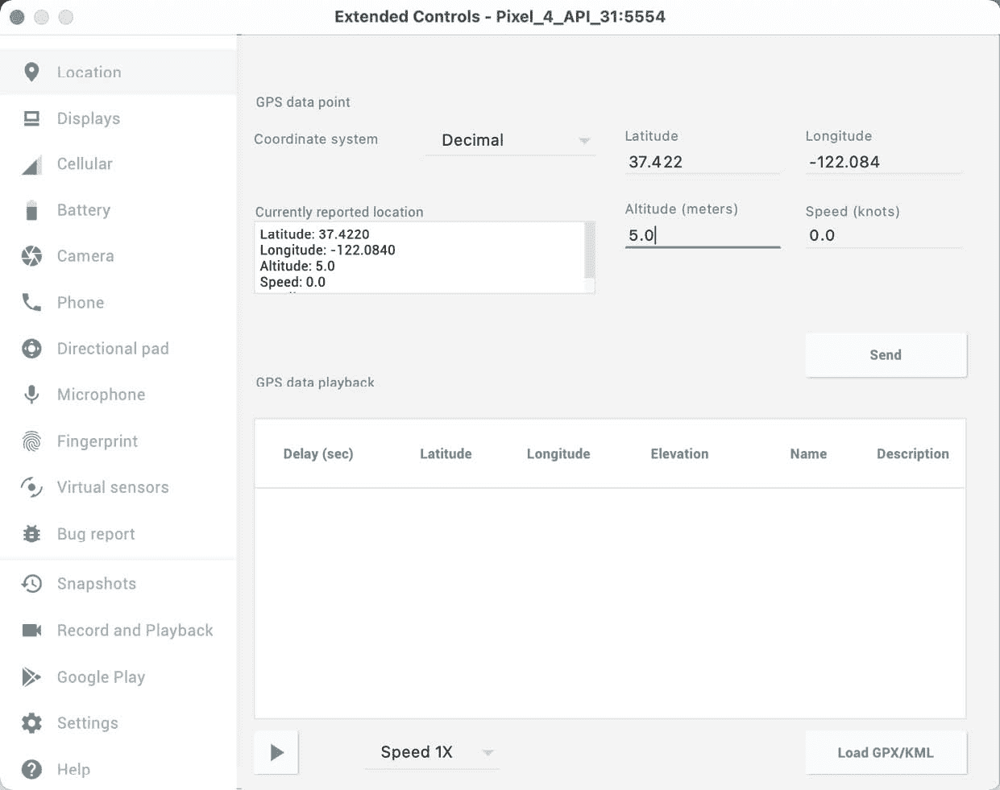

图 5-3

### 5.5.1 位置

位置控制允许以十进制或六十进制制坐标的形式将模拟位置信息发送到模拟器。位置信息可以是单个位置，也可以是代表设备移动的点序列，后者通过 GPS 交换 (GPX) 或 Keyhole 标记语言 (KML) 格式的文件提供。或者，可以使用集成的 Google Maps 面板视觉化地选择点或旅行路线。

### 5.5.2 显示器

除了模拟器屏幕内显示的主显示外，`Displays`选项允许在同一个 Android 实例中运行额外的显示器。这对于为如 Microsoft Surface Duo 等双屏设备测试应用可能非常有用。这些额外屏幕可以配置为任何所需的尺寸，并与主屏幕在同一个模拟器窗口中显示。

### 5.5.3 蜂窝

可以在蜂窝设置屏幕内更改模拟的蜂窝连接类型。提供了可以模拟不同网络类型（CSM、EDGE、HSDPA 等）的选项，以及一系列漫游和拒绝访问等语音和数据场景。

### 5.5.4 电池

扩展控制屏幕的此面板可以模拟各种电池状态和充电条件，包括电池电量、电池健康状况以及当前是否连接了 AC 充电器。

### 5.5.5 摄像头

模拟器在摄像头激活时模拟 3D 场景。这表现为虚拟建筑内部，在模拟器内录制视频或拍照之前，可以通过按住`Option`键（Windows 上为 Alt）同时使用鼠标指针和键盘键进行导航。此扩展配置选项允许上传不同的图像以在虚拟环境中显示。

### 5.5.6 电话

电话扩展控制为模拟器提供了两个非常简单但实用的模拟。第一个选项允许模拟来自指定电话号码的入电电话。这在测试应用如何处理此类高级级中断时特别有用。

第二个选项允许在模拟器会话中模拟接收短信。与现实世界一样，这些消息将显示在消息应用中，并触发模拟器内的标准通知。

### 5.5.7 方向键

方向键 (D-Pad) 是内置在 Android 设备中或外部连接（如游戏控制器）的额外组控件，提供方向控制（左、右、上、下）。方向键设置允许在模拟器内模拟 D-Pad 交互。

### 5.5.8 麦克风

麦克风设置允许启用麦克风并模拟虚拟耳机和麦克风连接。还提供按钮启动模拟器上的语音助手。

### 5.5.9 指纹

许多 Android 设备现在都配备了内置指纹检测硬件。AVD 模拟器使得测试指纹识别成为可能，无需在带有指纹传感器的物理设备上测试应用。关于如何在模拟器中配置指纹测试的细节将在本章后面详细介绍。

### 5.5.10 虚拟传感器

虚拟传感器选项允许模拟加速度计和磁力计，通过偏航、俯仰和横滚设置模拟设备的物理运动（如旋转、移动和倾斜）。

### 5.5.11 快照

快照包含当前运行 AVD 会话的状态，可以进行保存并快速恢复，使模拟器能够返回精确状态。快照将在本章后续介绍。

### 5.5.12 录制与回放

允许将模拟器屏幕和音频录制并保存为 WebM 或动态 GIF 格式。

### 5.5.13 Google Play

如果模拟器运行的是安装了 Google Play 服务的 Android 版本，此选项将显示当前的 Google Play 版本，并提供将模拟器更新到最新版本的选项。

### 5.5.14 设置

设置面板提供了一小组配置选项。使用此面板为工具栏和扩展控制面板选择更深色的主题，指定用于保存截图的文件系统位置，配置 OpenGL 支持级别，并配置模拟器窗口在桌面上位于其它窗口之上。

### 5.5.15 帮助

帮助屏幕包含三个子面板，分别包含键盘快捷键列表、访问模拟器在线文档的链接、报告 Bug 和发送反馈的链接，以及模拟器版本信息。

## 5.6 使用快照 (Snapshots)

当模拟器首次启动时，它会执行冷启动，这就像物理 Android 设备开机时一样。由于操作系统需要加载并启动所有后台进程，此冷启动过程可能需要一些时间才能完成。为了避免每次启动模拟器都经过这一过程，系统被配置为每次退出时自动保存模拟器当前状态的快照（称为快速启动快照）。下次启动模拟器时，快速启动快照将被加载到内存中，并从之前停止的地方继续执行，允许模拟器在冷启动完成所需时间的一小部分内重启。

扩展控制面板的快照屏幕用于在模拟器执行期间的任何点存储额外的快照。这保存了整个模拟器的精确状态，允许模拟器恢复到拍摄快照时的精确时间点。在屏幕中，可以使用`Take Snapshot`（拍摄快照）按钮（标记为 图 5-4 中的 A）拍摄快照。要恢复现有的快照，从列表中选择它 (B) 并点击屏幕底部的运行按钮 (C)。还提供了编辑 (D) 快照名称和描述以及删除 (E) 当前所选快照的选项：

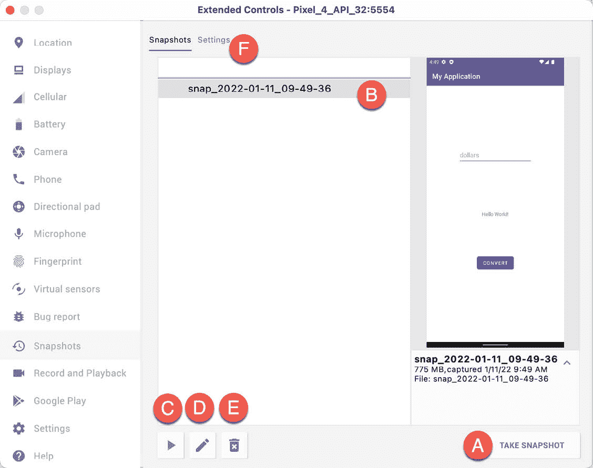

图 5-4

设置选项 (F) 提供了配置自动保存快速启动快照的选项（默认情况下，模拟器每次退出时都会询问是否保存快速启动快照）以及重新加载最近的快照。要强制模拟器话执行冷启动而不是使用之前的快速启动快照，请打开 AVD Manager（`Tools -> AVD Manager`），点击模拟器操作列中的向下箭头，并选择`Cold Boot Now`（立即冷启动）菜单选项。

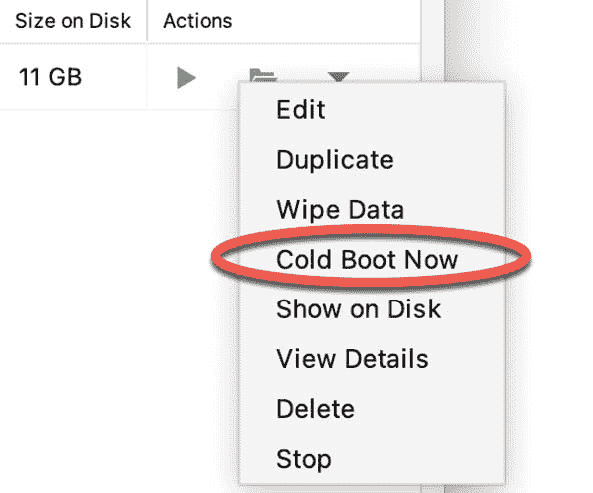

图 5-5

## 5.7 配置指纹模拟

模拟器允许配置 10 个模拟指纹，用于测试 Android 应用中的指纹身份验证。要配置模拟指纹，首先启动模拟器，打开`Settings`应用并选择`Security & Location`（安全与位置）选项。

在安全设置屏幕内，选择`Use fingerprint`（使用指纹）选项。在生成的信息屏幕上点击`Next`（下一步）按钮进入指纹设置屏幕。在启用指纹安全之前，必须配置备用屏幕解锁方法（例如`PIN`）。点击`Fingerprint + PIN`按钮，并在出现提示时，选择在设备启动时不需要`PIN`。输入并确认合适的`PIN`，通过接受默认通知选项完成`PIN`输入过程。

继续通过剩余的屏幕，直到设置应用请求传感器上的指纹。此时，显示扩展控制对话框，在左侧面板中选择`Fingerprint`类别，并确保主设置面板中选中了`Finger 1`：

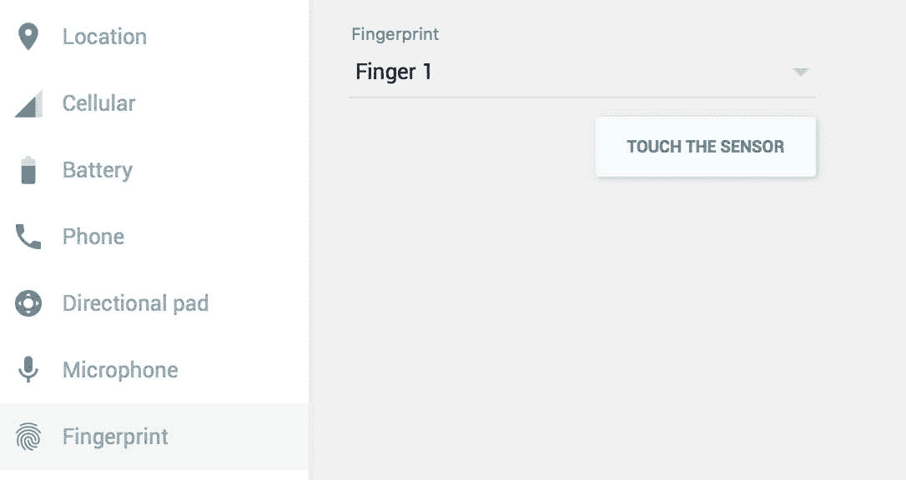

图 5-6

点击`Touch the Sensor`（触摸传感器）按钮模拟`Finger 1`触摸指纹传感器。模拟器将报告成功添加指纹：

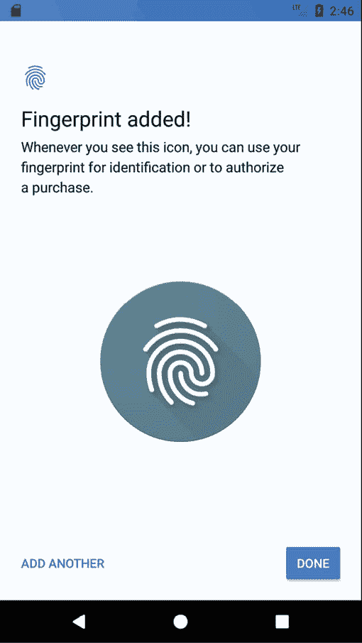

图 5-7

要添加额外的指纹，点击`Add Another`（添加另一个）按钮，并在扩展控制面板菜单中选择另一个手指，然后再次点击`Touch the Sensor`按钮。

## 5.8 工具窗口模式下的模拟器

如上一章所述（“在 Android Studio 中创建 Android 虚拟设备 (AVD)”），Android Studio 可以配置为将模拟器作为嵌入式工具窗口启动，这样它就不会出现在单独窗口中。当在此模式下运行时，工具栏中将提供与独立模式下相同的控制控件，如 图 5-8 所示：

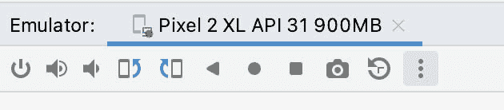

图 5-8

从左到右，这些按钮执行以下任务（细节与独立模式一致）：

* 电源 (Power)
* 音量增大 (Volume Up)
* 音量减小 (Volume Down)
* 向左旋转 (Rotate Left)
* 向右旋转 (Rotate Right)
* 返回 (Back)
* 首页 (Home)
* 概览 (Overview)
* 截图 (Screenshot)
* 快照 (Snapshots)
* 扩展控制 (Extended Controls)

## 5.9 总结

Android Studio 包含一个 Android 虚拟设备模拟器环境，旨在使其无需在物理 Android 设备上运行即可测试应用程序。本章对模拟器进行了要介绍，并强调了用于配置和自定义环境以模拟不同测试条件的关键功能。

# 6. Android Studio 用户界面概览

虽然运行上一章创建的示例应用程序很诱人，但这涉及使用 Android Studio 用户界面的某些方面，这些内容最好先进行描述。

Android Studio 是一个强大且功能丰富的开发环境，在很大程度上用起来非常直观。尽管如此，现在花时间熟悉 Android Studio 用户界面的布局和组织将极大缩短书中后续章节的学习曲线。基于此，本章将对构成 Android Studio 环境的各个区域和组件提供初步概述。

## 6.1 欢迎屏幕

欢迎屏幕（图 6-1）在 Android Studio 运行但没有打开的项目时显示（可以随时通过选择`File -> Close Project`菜单关闭打开的项目）。如果 Android Studio 在退出时仍有一个项目，下次启动时将跳过欢迎屏幕，自动打开之前的项目。


图 6-1

除了最近的项目列表，欢迎屏幕还提供了执行打开和创建项目的操作，以及访问受版本控制的项目。此外，`Customize`屏幕提供了更改 IDE 和编辑器使用的主题和字体设置。可以使用`Plugins`查看、安装和管理 Android Studio 插件。

通过点击图 6-2 所示的菜单按钮可以使用更多选项：

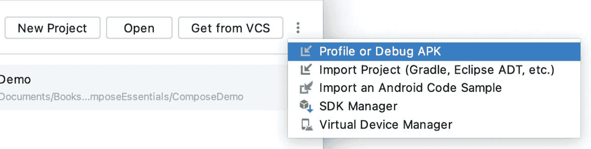

图 6-2

## 6.2 主窗口

当创建新项目或打开现有项目时，Android Studio 主窗口将出现。当同时打开多个项目时，每个项目将分配一个自己的主窗口。窗口的精确配置取决于上次打开项目时显示了哪些工具和面板，但通常类似于图 6-3 所示。

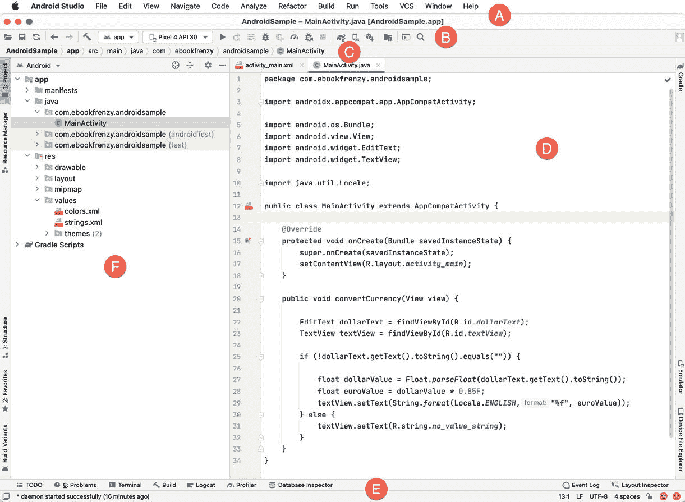

图 6-3

主窗口的各个元素总结如下：

### 组件

#### A – 菜单栏 (Menu Bar)
包含一系列用于在 Android Studio 环境执行任务的菜单。

#### B – 工具栏 (Toolbar)
一组用于常用操作的快捷键。工具栏按钮提供了快速访问一组特定菜单栏操作的方法。可以通过右键点击工具栏并选择`Customize Menus and Toolbars…`菜单选项来自定义工具栏。如果工具栏可见，可以使用`View -> Appearance -> Toolbar`菜单将其显示。

#### C – 导航栏 (Navigation Bar)
导航栏提供了一种在项目文件和文件夹之间移动的便捷方式。点击导航栏中的元素将弹出一个菜单，列出该位置的子文件夹和文件供选择。同样，点击类名将显示包含该类中包含的方法列表。从列表中选择一个方法将跳转到代码编辑器中的相应位置。使用`View -> Appearance -> Navigation Bar`菜单选项隐藏或显示此栏。

#### D – 编辑窗口 (Editor Window)
编辑器窗口显示开发者当前正在的文件内容。当打开多个文件时，每个文件都由位于图 6-4 所示编辑器顶部边缘的标签页表示：

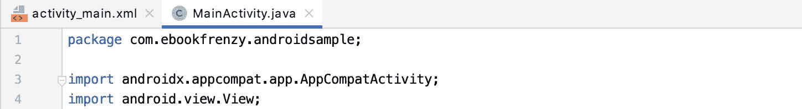

图 6-4

#### E – 状态栏 (Status Bar)
状态栏显示关于项目和 Android Studio 活动的消息信息，以及位于最左角的工具菜单按钮。悬停在状态栏条目上将显示该字段的描述。许多字段是可交互的，允许用户点击以执行任务或获取更详细的状态信息。

#### F – 项目工具窗口 (Project Tool Window)
项目工具窗口提供了项目文件结构的层次级概述，允许对特定文件和文件夹进行导航。可以使用工具栏以多种方式显示项目。默认设置是 Android 视图，这是本书其余部分主要使用的模式。

项目工具窗口只是 Android Studio 环境中提供的许多工具窗口之一。

## 6.3 工具窗口 (The Tool Windows)

除了项目视图工具窗口外，Android Studio 还包含许多其他窗口，启用后，它们将显示在主窗口的底部和两侧。通过将鼠标指针悬停在状态栏最左角的按钮上（图 6-5）而无需点击鼠标按钮，即可显示工具窗口快速访问菜单。


图 6-5

从快速访问菜单中选择项目将导致相应的工具窗口在主窗口中出现。

或者，可以通过点击状态栏中的快速访问图标来显示一组工具窗口栏。这些栏出现在主窗口的左侧、右侧和底部边缘（如图 6-6 中的箭头所示），并包含显示和隐藏每个工具窗口的按钮。当工具窗口栏显示时，再次点击状态栏中的按钮将把它们隐藏。


图 6-6

点击按钮将显示相应的工具窗口，而再次点击将隐藏窗口。带有数字前缀的按钮（例如`1: Project`）表示可以通过按下键盘上的`Alt`键（macOS 为`Command`键）配合相应的数字来显示该工具窗口。

工具窗口栏中按钮的位置指示了窗口显示时将位于窗口的哪侧。可以通过点击并拖拽按钮到其他窗口工具栏中的不同位置来更改这些位置。

每个工具窗口在顶部边缘都有自己的工具栏。这些工具栏内的按钮随工具而异，但所有工具窗口都包含由齿轮图标表示的设置选项，允许更改窗口的各个方面。图 6-7 显示了项目工具窗口的设置菜单。提供可用选项，例如取消停靠窗口并将其浮在 Android Studio 主窗口边界之外，以及移动和调整面板大小。


图 6-7

所有窗口在工具栏上还包含一个最右侧的按钮，提供了隐藏工具窗口视图的额外方法。只需通过点击窗口使其获得焦点然后输入搜索词，即可对工具窗口内的项目进行搜索（例如项目工具窗口中的文件名）。搜索框将出现在窗口的工具栏中，与搜索匹配的项将被高亮显示。

Android Studio 提供了各种工具窗口，最常用的如下：

* **App Inspector (App 检查器)**：提供数据库 (Database) 和后台任务 (Background Task) 检查器的访问。数据库检查器允许你在应用程序运行时检查、查询和修改应用程序的数据库。后台任务检查器允许对使用`WorkManager`创建的后台工作任务进行监控和管理。
* **Build (构建)**：构建工具窗口显示项目在编译和打包时的构建过程信息，并显示遇到的任何错误的详情信息。
* **Build Variants (构建变体)**：构建变体工具窗口为当前应用程序项目配置不同的构建目标提供了快速方法（例如应用程序调试版本和发布版本的不同构建，或针对不同设备类别的多个构建）。
* **Device File Explorer (设备文件浏览器)**：通过`View -> Tool Windows -> Device File Explorer`菜单可用，此工具窗口直接访问当前连接的 Android 设备或模拟器的文件系统，允许浏览文件并将文件复制到本地文件系统。
* **Device Manager (设备管理器)**：访问设备管理器窗口，可以在其中添加、删除和管理 Android 设备连接和模拟器。
* **Emulator (模拟器)**：如果启用了在工具窗口中运行模拟器的选项，则包含 AVD 模拟器，如`创建 Android 设备 (AVD)章节所示。
* **Event Log (事件日志)**：事件日志窗口显示与 Android Studio 内执行的事件和活动相关的消息。例如，项目的成功构建或应用程序正在运行将在此工具窗口中报告。
* **Favorites (收藏)**：可以将各种项目项添加到收藏列表。例如，在项目视图中右键点击文件，可以提供`Add to Favorites`菜单选项。同样，可以通过在结构 (Structure) 工具窗口中右键点击源文件中的方法作为收藏。添加到收藏列表的任何内容都可以通过此收藏工具窗口进行访问。
* **Gradle**：Gradle 工具窗口提供了项目构建配置所需的 Gradle 任务视图。该窗口列出了将项目元素编译为可执行应用程序所需的任务。右键点击顶级 Gradle 任务并选择`Open Gradle Config`菜单选项，可以将当前项目的 Gradle 构建文件加载到编辑器。Gradle 将在本书后部分进行详细介绍。
* **Layout Inspector (布局检查器)**：提供构成用户界面布局的组件层次结构的视觉 3D 渲染。
* **Logcat**：Logcat 工具窗口提供了对运行应用程序的监控日志输出的访问，此外还有拍摄应用程序截图和视频以及停止和重启进程的选项。

## 工具

- **Problems（问题）**：用于查看项目内所有当前错误或警告的中心位置。双击问题列表中的项将带您进入该问题所在的文件和位置。
- **Profiler（性能分析器）**：Android`Profiler`工具窗口为识别运行应用程序中的性能问题提供实时监控和分析工具，包括 CPU、内存和网络使用情况。当应用程序当前正在运行时，此选项将变为可用。
- **Project（项目）**：`project`视图提供了构成项目的文件结构概览，允许在文件之间快速导航。通常情况下，在项目视图中双击文件将导致该文件加载到相应的编辑器工具中。
- **Resource Manager（资源管理器）**：用于添加和管理项目包含的资源和资产的工具，如图像、颜色和布局文件。
- **Run（运行）**：当应用程序正在运行时，`run`工具窗口将变为可用，并提供运行结果视图，以及停止或重启运行进程的选项。如果应用程序无法在设备或模拟器上安装和运行，此窗口通常会提供与问题相关的诊断信息。
- **Structure（结构）**：`structure`工具提供当前编辑器中显示的源文件结构的高级视图。这些信息包括文件中的类、方法和变量等项列表。从结构列表中选择一个项将带您进入编辑器窗口中源文件的对应位置。
- **Terminal（终端）**：提供对运行 Android Studio 的系统上的终端窗口的访问。在 Windows 系统上，这是`Command Prompt`（命令提示符）界面，而在 Linux 和 macOS 系统上，它表现为`Terminal`（终端）提示符。
- **TODO**：顾顾名，此工具提供了一个查看项目中尚未完成项的地方。Android Studio 通过扫描构成项目的源文件并查找匹配指定`TODO`模式的注释来编译此列表。可以通过选择`File -> Settings…`菜单选项（macOS 为`Android Studio -> Preferences…`）并导航到`Editor`下的`TODO`页面来查看和更改这些模式。
- **Version Control（版本控制）**：当项目文件受源代码版本控制管理时，使用此工具窗口，允许访问`Git`仓库和代码更改历史。

## 6.4 Android Studio 快捷键

Android Studio 包含了大量的键盘快捷键，旨在为执行常用任务节省时间。可以通过在 Android Studio 项目窗口中选择`Help -> Keymap Reference`菜单选项来查看并打印完整的键盘快捷键映射列表。您也可以通过选择`File -> Settings...`菜单选项（macOS 为`Android Studio -> Preferences...`）并点击下文图 6-8 所示的`Keymap`项来列出和修改键盘快捷键：


图 6-8

## 6.5 切换器和最近文件导航

在 Android Studio 主窗口内导航的另一种实用机制是使用`Switcher`（切换器）。通过键盘快捷键`Ctrl-Tab`访问切换器，切换器将以面板形式出现，列出所有工具窗口和当前打开的文件（见图 6-9]）。


图 6-9

一旦显示，只要`Ctrl`键保持按下状态，切换器就会保持可见。在按住`Ctrl`键的同时反复敲击`Tab`键将在不同的选择选项之间循环，而释放`Ctrl`键将选中当前高中的项并在主窗口中显示。

除了切换器外，`Recent Files`（最近文件）面板还提供了到最近打开文件的导航（见图 6-10]）。可以使用`Ctrl-E`键盘快捷键（macOS 为`Cmd-E`）访问该面板。一旦显示，可以使用鼠标指针选择选项，或使用键盘方向键滚动查看文件名和工具窗口选项。按下`Enter`键将选中当前高中的项。


图 6-10

## 6.6 更改 Android Studio 主题

Android Studio 环境的主题可以通过欢迎界面上的`Configure -> Settings`选项，或者通过主窗口的`File -> Settings…`菜单选项（macOS 为`Android Studio -> Preferences…`）进行更改。

一旦显示设置对话框，在左侧面板中选择`Appearance & Behavior`（外观与行为），然后选择`Appearance`（外观），然后在点击`Apply`（应用）按钮之前更改`Theme`（主题）的设置。可用主题取决于平台，但通常包括`Light`、`IntelliJ`、`Windows`、`High Contrast`和`Darcula`等选项。图 6-11 显示了选择了`Darcula`主题的主窗口示例：


图 6-11

要将 Android Studio 主题与系统的亮黑暗模式设置同步，请启用`Sync with OS`（与操作系统同步）选项并使用下拉菜单控制每种模式使用的主题：


图 6-12

## 6.7 总结

Android Studio 环境的主要元素由欢迎界面和主窗口组成。每个打开的项目都分配有自己的主窗口，该窗口又由菜单栏、工具栏、编辑和设计区域、状态栏以及一组工具窗口组成。工具窗口出现在窗口的侧边和底部，可以通过状态栏中的快速访问菜单进行访问。

Android Studio 中极少的操作是无法通过快捷键触发的。可以随时从 Android Studio 窗口内访问默认快捷键映射。

# 7. 在物理设备上测试 Android 应用

虽然可以使用 Android 设备 (AVD) 进行测试来完成大部分工作，但在物理设备上进行真实测试是不可替代的，且某些 Android 功能仅在物理设备可用。

与 AVD 实例以及连接设备的通信由 Android 调试桥 (`ADB`) 处理。在本章中，我们将解释如何配置`adb`环境，以便在 macOS、Windows 和 Linux 系统的 Android 设备上进行测试。

## 7.1 Android 调试桥 (ADB) 概述

`ADB`的主要目的是促进开发系统（在此例中为 Android Studio）与 AVD 模拟器以及 Android 设备之间的交互。`ADB`允许通过 WiFi 网络或直接使用 USB 线连接到设备。

`ADB`由一个客户端、一个在开发系统上后台运行的服务器进程以及一个在 AVD 或真实 Android 设备上运行的守护进程组成。

在`ADB`连接到 Android 设备之前，该设备必须先配置为允许连接。在运行 Android 6.0 或更高版本的手机和平板设备上，实现此目的的步骤如下：

1. 打开设备上的`Settings”（设置）应用并选择`About tablet”（关于平板电脑）或`About phone”（关于手机）选项（在某些 Android 版本中，这可以在`Settings`应用的`System`页面上找到）。
2. 在`About`屏幕上，向下滚动到`Build number`版本号）字段（图 7-1）并连续点击七次，直到出现指示开发者模式已开启的消息。如果`About`屏幕上没有列出`Build number`，则可以通过`Software information`（软件信息）选项找到。或者，如果可用，展开列表中的`Advanced`（高级）部分。


图 7-1

3. 返回`Settings`主屏幕，注意此时出现了一个名为`Developer options`（开发者选项）的新选项（在较新版本的 Android 中，此选项列在`System`设置屏幕上）。选择此选项，并在生成的屏幕上找到如图 7-2 所示的`USB debugging`选项：


图 7-2

4. 启用`USB debugging`选项，并在请求确认时点击`Allow`允许）按钮。

此时，设备已配置为接受来自通过 USB 连接的开发系统上的`adb`的调试连接。剩下的工作是配置开发系统以便在设备连接时检测到它。虽然这是一个相对简单的过程，但涉及的步骤取决于开发系统运行的是 Windows、macOS 还是 Linux。注意，以下步骤假设`Android SDK platform-tools`目录已包含在操作系统`PATH`环境变量中，正如标题为“Setting up an Android Studio Development Environment`所示的对话框，请求许可`Allow USB debugging`允许 USB 调试）。在点击`OK`之前，勾选`Always allow from this computer`始终允许来自此计算机旁边的复选框。


图 7-3

再次执行`adb devices`命令现在会将设备列为可用：

```


`List of devices attached`

`015d41d4454bf80c device`

如果设备未列出，请尝试注销并重新登录 macOS 桌面，如果问题仍然，请重启系统。

### 7.2.2 Windows ADB 配置

配置基于 Windows 的开发系统使用`ADB`连接到 Android 设备的第一步是在系统上安装相应的 USB 驱动程序。要安装的 USB 驱动程序取决于 Android 设备的型号。如果您拥有 Google 设备（如`Pixel`手机），则必须在您的 Windows 系统上安装并配置`Google USB Driver`包。实现此目的的详细步骤在以下网页上概述：

`https://developer.android.com/sdk/win-usb.html`

对于`Google USB`驱动程序不支持的 Android 设备，需要下载由设备制造商提供的驱动程序。可以在网上获取驱动程序列表以及下载和安装信息：

`https://developer.android.com/tools/extras/oem-usb.html`

安装驱动程序且设备现在被识别为正确的设备类型，打开`Command Prompt`（命令提示符）窗口并执行以下命令：

```
adb devices
```

此命令应输出关于连接设备的信息，类似于：

```
List of devices attached

HT4CTJT01906 offline
```

如果设备被列为`offline`或`unauthorized`（未授权），请查看设备显示并检查是否存在如图 7-3 所示的对话框，请求许可`Allow USB debugging`允许 USB 调试）。在点击`OK`之前，勾选`Always allow from this computer`始终允许来自此计算机旁的复选框。再次执行`adb devices`命令现在会将设备列为已就绪：

```
List of devices attached

HT4CTJT01906 device
```

如果设备未列出，执行以下命令重启 `ADB` 服务：

```
adb kill-server

adb start-server
```

如果设备仍然未列出，尝试执行以下命令：

```
android update adb
```

注意，可能还需要重启系统。

### 7.2.3 Linux adb 配置

在本章中，我们将再次使用`Ubuntu Linux`作为在 Linux 上配置`adb`以连接物理 Android 设备的参考示例。

在`Ubuntu`上进行物理设备测试需要安装`android-tools-adb`包，这反过来要求`Android Studio`用户是`plugdev`组的成员。这是大多数`Ubuntu`账户的默认设置，可以通过运行`id`命令进行验证。如果没有列出`plugdev`组，请运行以下命令将账户添加到组中：

```
sudo usermod -aG plugdev $USER
```

在满足组要求后，可以通过执行以下命令安装`android-tools-adb`包：

```
sudo apt-get install android-tools-adb
```

完成上述更改后，重启`Ubuntu`系统。系统重启后，打开`Terminal`窗口，启动`adb`服务器并检查设备列表：

```
adb start-server
```
* daemon not running. starting it now on port 5037 *
* daemon started successfully *

```
adb devices
```

```
List of devices attached

015d41d454bf0c offline
```

如果设备被列为`offline`或`unauthorized`，请前往 Android 设备并检查如图 7-3 所示的对话框，请求许可`Allow USB debugging`允许 USB 调试）。

### 7.3 解决 USB 连接问题

如果您无法通过上述步骤成功连接到设备，显示运行目标菜单（图 7-4）并选择`Trouhoot Device Connections`（设备设备连接）选项：

``

图 7-4

连接助手将扫描设备并报告问题和解决方案

### 7.4 在 Android 设备上启用无线调试

遵循上述 7.2 节的步骤 1 到 3，这次是启用如图 7-5 所示的`Wireless debugging`（无线调试）选项：

``

图 7-5

接下来，点击上述`Wireless debugging`项显示如图 7-6 所示的屏幕：

``

图 7-6

如果您使用的设备带有相机，选择`Pair device with QR code`（通过二维码配对设备），否则选择`Pair device with pairing code`（通过配对码配对设备）。根据您的选择，`Settings`应用将启动相机会话或显示配对码，如图 7-7 所示：

``

图 7-7

选择一个选项后，返回`Android Studio`并在运行目标菜单中选择`Pair Devices Using WiFi`（通过 WiFi 配对设备）选项，如图 7-8 所示：

``

图 7-8

在配对对话框中，根据您之前在设备“设置”应用中的选择，选择“使用二维码配对”或“使用配对码配对”：

``

图 7-9

使用 Android 设备扫描二维码，或将设备屏幕上显示的配对码输入到 Android Studio 对话框（参见图 7-10），以完成配对过程：

``

图 7-10

如果配对过程失败，请尝试重启开发系统和 Android 设备并重试。

## 7.5 测试 `adb` 连接

假设在所选的开发平台上已成功配置了 `adb`，下一步是尝试在设备上运行在 Android Studio 中创建示例 Android 应用章节中创建的测试应用程序。启动 Android Studio，打开 `AndroidSample` 项目，并验证设备是否出现在设备选择菜单中（如图 7-11 所示）：

``

图 7-11

从列表中选择设备，并点击运行按钮（位于设备菜单正右侧的绿色箭头按钮）来安装并运行应用程序。

## 7.6 总结

虽然 Android 虚拟设备（AVD）模拟器提供了一个良好的测试环境，但请记住，确保应用程序在物理 Android 设备上正常运行没有真正的替代方案。毕竟，这才是应用程序在现实世界中使用的地方。

然而，默认情况下，Android Studio 环境未配置为将 Android 设备视为目标测试设备。因此，必须执行某些步骤，以便能够在 Android Studio 开发环境中通过 USB 线或 WiFi 网络直接将应用程序加载到 Android 设备上。实现此目标的具体步骤取决于所使用的开发平台。在本章中，我们涵盖了适用于 Linux、macOS 和基于 Windows 平台的这些步骤。

## 8. Android Studio 代码编辑器基础知识

为 Android 开发应用程序涉及大量的编程工作，根据定义，这涉及到代码行的输入、审查和修改。开发者在使用 Android Studio 时的大部分时间通常都在编辑器窗口内编辑代码，这并不令人意外。

现代代码编辑器需要远超最初的输入、删除、剪切和粘贴等功能。如今，代码编辑器的实用性通常由等因素衡量，例如它在多程度上减少了程序员所需的输入量、在大型源文件中导航的易用性，以及编辑器在编写代码时实时检测并突出编程错误的能力。正如本章将变得的那样，这些只是 Android Studio 编辑器出色的少数领域之一。

虽然本章不是 Android Studio 编辑器功能的详尽概述，但其目的是提供该工具关键功能的指南。丰富的程序员会发现，这些功能中的某些是目前大多数代码编辑器通用的，而许多许多是该特定编辑环境独有的。

## 8.1 Android Studio 编辑器

当选择 Java、Kotlin、XML 或其他文本文件进行编辑时，Android Studio 编辑器会出现在主窗口中央。例如，图 8-1 显示了一个加载了 Java 源代码文件的典型编辑器会话：

``

图 8-1

构成编辑器窗口的元素可以总结如下：

**A – 文档标签页 (Document Tabs)** – Android Studio 能够同时打开多个文件进行编辑。每打开一个文件时，它都会被分配一个文档标签页，在编辑器窗口顶部边缘的标签栏中显示文件名。当空间不足以显示所有标签页时，标签栏的最右侧会出现一个很小的下拉菜单。点击此菜单将列出其他已打开的文件列表。标签页中文件名下方的红色波浪线表示该文件中的代码包含一个或多个错误，在项目可以编译和运行之前，需要解决这些错误。

在文件之间切换只需点击相应的标签页，或使用 `Alt-Left` 和 `Alt-Right` 键盘快捷键。也可以使用 `Switcher` 机制（通过 `Ctrl-Tab` 键盘快捷键访问）进行文件间的导航。

要将编辑器面板从 Android Studio 主窗口中分离并使其在单独窗口中显示，请点击标签并将其拖到主窗口之外的桌面区域。如需将编辑器返回主窗口，请点击分离的编辑器窗口中的文件标签，并将其拖放到主窗口中原始的编辑器标签栏上。

**B – 编辑器行边区域 (Editor Gutter Area)** – 编辑器使用行边区域显示信息图标和控件。显示在此行边区域的一些典型项目包括调试断点标记、折叠和展开代码块的控件、书签、更改标记和行号。行号默认开启，但可以通过在行边处点击右键并选择 `Show Line Numbers`（显示行号）菜单选项来禁用。

**C – 代码结构位置 (Code Structure Location)** – 编辑器顶部的此栏显示光标当前位置相对于代码整体结构的情况。例如，在后续图中，该栏表示正在编辑 `convertCurrency` 方法，且该方法包含在 `MainActivity` 类中。

``

图 8-2

双击栏内的元素会将光标移动到代码中的相应位置。例如，双击 `convertCurrency` 条目将光标移动到该方法的顶部。同样，点击 `MainActivity` 条目将弹出一个供选择的代码导航点列表：

``

图 8-3

**D – 编辑器区域 (Editor Area)** – 这是用户显示、输入和编辑代码的主要区域。本章的后续部分将详细介绍编辑区域的关键功能。

**E – 验证与标记侧边栏 (Validation and Marker Sidebar)** – Android Studio 引入了称为“实时代码分析”的功能。这实际上意味着当你输入代码时，编辑器正在分析代码以检查警告和语法错误。验证侧边栏顶部的指示器实时更新，指示添加代码时发现的错误和警告数量。点击此指示器将显示一个包含编辑器代码问题摘要的弹出窗口，如图 8-4 所示：

``

图 8-4

可以使用向上向下箭头在代码中的错误位置之间移动。绿色勾钩表示未检测到警告或错误。

侧边栏还在检测到问题的位置显示标记，并使用相同的颜色编码。当代码行在编辑器区域可见时，将鼠标指针悬停在标记上，将显示一个包含问题描述的弹出窗口：

``

图 8-5

将鼠标指针悬停在当前滚动出编辑器可视区域的行行标记上，将显示一个“透镜（lens）”覆盖层，该层包含问题所在的代码块（见图 8-6），从而无需滚动到编辑器中的该位置即可查看它：

``

图 8-6

值得注意的是，透镜覆盖层不仅限于侧边栏中的警告和错误。悬停在侧边栏的任何部分都会出现一个透镜，其中包含源文件中对应位置的代码。

### F – 状态栏

虽然状态栏实际上是主窗口的一部分，而不是编辑器，但它确实包含了一些关于当前活动编辑会话的信息。这些信息包括光标在行和字符维度的当前位置，以及文件的编码格式（UTF-8、ASCII 等）。点击状态栏中的这些值可以更改相应的设置。例如，点击行号会显示“转到行”（Go to Line）对话框。

在概述构成 Android Studio 编辑器的元素后，本章的剩余部分将更详细地探讨编辑环境的关键特性。

## 8.2 分割编辑器窗口

默认情况下，编辑器将显示一个显示当前选中文件内容的面板。在同时处理多个源文件时，一个特别实用的功能是将编辑器拆分为多个窗格。要分割编辑器，右键点击编辑器窗口内的文件标签页，然后选择`垂直分割`(Split Vertically)或`水平分割`(Split Horizontally)菜单选项。例如，图 8-7 显示了拆分器的工作状态，编辑器被分为三个面板：

``

图 8-7

可以通过右键点击相应的标签并选择`更改拆分器方向`(Change Splitter Orientation)菜单选项来随时更改分割面板的方向。重复这些步骤可以取消单个面板的分割，此时从菜单中选择`取消分割`(Unsplit)选项。可以通过右键点击任何标签并选择`取消所有分割`(Unsplit All)选项来移除所有分割面板。

窗口分割可显示不同的文件，或为同一个文件提供多个窗口，允许并发查看和编辑同一文件的不同区域。

## 8.3 代码补全

Android Studio 编辑器对 Java 编程语法以及构成 Android SDK 的类和方法拥有大量的内置知识，同时也对你自己的代码库有了解。在输入代码时，编辑器会扫描正在输入的内容，并在适当的情况下提供关于完成语句或引用可能需要的内容的建议。当编辑器检测到补全建议时，将出现一个包含建议列表的面板。例如，在图 8-8 中，编辑器正为 `String` 声明的开头提供可能的候选项：

``

图 8-8

如果没有任何自动补全建议是正确的，只需继续输入，编辑器将继续在适当的地方精炼建议。要采纳最顶部的建议，只需按下键盘上的 `Enter` 或 `Tab` 键。要选择不同的建议，使用方向键在列表中上下移动，再次使用 `Enter` 或 `Tab` 键选中高亮显示的项。

可以使用 `Ctrl-Space` 组合键手动调出补全建议。这在更改编辑器中的单词或声明时非常有用。当光标置于编辑器中的某个单词上时，该单词将自动高亮。按下 `Ctrl-Space` 将显示备选建议列表。要将当前单词替换为建议列表中当前高亮的项，只需按下 `Tab` 键。

除了实时自动补全功能外，Android Studio 编辑器还提供名为“智能补全”（Smart Completion）的系统。智能补全使用`Shift-Ctrl-Space`组合键调用，选中后根据代码的当前上下文提供更详细的建议。再次按下 `Shift-Ctrl-Space` 快捷键将从更广泛的范围内提供更多建议。

代码补全对许多程序员来说可能是个人偏好。由于这一事实，Android Studio 对自动补全设置提供了很高的控制权限。可以通过选择`File -> Settings…`菜单选项（macOS 上的 `Android Studio -> Preferences…`）并在设置面板中选择 `Editor -> General -> Code Completion` 来查看和修改这些设置，如图 8-9 所示：

``

图 8-9

## 8.4 语句补全

Android Studio 编辑器提供的另一种自动补全形式是语句补全。它可以自动填充方法和循环语句等项的括号和花括号。语句补全使用`Shift-Ctrl-Enter`（macOS 上的 `Shift-Cmd-Enter`）组合键调用。考虑以下代码：

```
myMethod()
```

在编辑器中输入此代码后，触发语句补全将导致编辑器自动为方法添加大括号：

```
myMethod() {

}
```


## 8.5 参数信息

还可以请求编辑器提供关于方法接受的参数信息。当光标置于方法调用括号之间时，`Ctrl-P`（macOS 上的 `Cmd-P`）组合键将显示该方法已知接受的参数：


图 8-10

## 8.6 参数提示

代码编辑器可以配置为在方法调用中显示参数名称提示。例如，图 8-11 高亮了 `Snackbar` 类 `make()` 和 `setAction()` 方法调用中的参数名称提示：


图 8-11

此模式的设置可以通过选择 `File -> Settings`（macOS 上的 `Preferences`）选项，然后在左侧面板中选择 `Editor -> Inlay Hints -> Java` 来配置。在结果屏幕上，从列表中选择 `Parameter Hints` 并启用或禁用 `Show parameter hints` 选项。要调整提示设置，点击 `Exclude list...` 链接并进行任何调整。

## 8.7 代码生成

除了输入代码时进行补全，编辑器在某些情况下还可以为你生成代码。图 8-12 所示的可用代码生成列表可以在光标位于文件中代码生成位置时使用 `Alt-Insert`（macOS 上的 `Cmd-N`）快捷键访问。


图 8-12

作为示例，考虑我们需要在项目的 `Activity` 被操作系统销毁时收到通知的情况。正如本书后续章节概述的，这可以通过重写 `Activity` 超类的 `onStop()` 生命周期方法来实现。要让 Android Studio 为此生成存根方法，只需从代码生成列表中选择 `Override Methods...` 选项，然后从可用方法列表中选择 `onStop()` 方法：


图 8-13

选择了要重写的方法后，点击 OK 将 Java 源文件的当前光标位置生成存根，如下：

```java
@Override
protected void onStop() {
    super.onStop();
}
```

## 8.8 代码折叠

当源代码文件达到一定大小时，即使是格式最精谨、组织良好的代码也可能变得难以阅读和难以导航。Android Studio 认为，并不总是需要让每个代码块的内容始终可见。通过使用 Android Studio 编辑器的代码折叠（code folding）功能，可以使代码导航更容易。代码折叠通过位于源文件中编辑器行槽（gutter）中每个代码块开头和结尾的标记来控制。例如图 8-14 突出了当前未折叠的方法声明的开始和结束标记：


图 8-14

点击这些标记中的任意一个都会折叠语句，使得仅签名行可见，如图 8-15 所示：


图 8-15

要展开已折叠的代码段，只需点击编辑器行槽中的 `+` 标记。若要在不展开代码的情况下查看隐藏代码，请将鼠标指针悬停在 `{...}` 指示上，如图 8-16 所示。编辑器将显示包含折叠代码块的透镜叠加：


图 8-16

文件中的所有代码块可以使用 `Ctrl-Shift-Plus` 和 `Ctrl-Shift-Minus` 键盘序列进行折叠或展开。

默认情况下，Android Studio 编辑器在打开源文件时会自动折叠某些代码。要配置发生这种情况的情况，请选择 `File -> Settings...`（macOS 上为 `Android Studio -> Preferences...`）并在生成的设置面板中选择 `Editor -> General -> Code Folding` 项（图 8-17）：


图 8-17

### 8.9 快速文档查询

通过将光标置在需要文档的声明上并按下 `Ctrl-Q` 快捷键（macOS 上为 `Ctrl-J`），可以访问上下文敏感的 Java 和 Android 文档。这将显示一个包含该项目相关参考文档的弹出窗口。例如图 8-18 显示了 Android `FloatingActionButton` 类的文档。


图 8-18

显示后，可以根据需要可以在屏幕上移动文档弹出窗口。

### 8.10 代码重格式化

通常，Android Studio 编辑器会在添加代码时自动根据缩进、间距以及语句和代码块的嵌套对代码进行格式化。在需要重新格式化代码的情况下（这很常见，例如从网站复制并粘贴示例代码时），编辑器提供了源代码重格式化功能，选中后它将自动重新格式化代码以匹配主流的代码风格。

要重新格式化源代码，请按 `Ctrl-Alt-L`（macOS 上为 `Cmd-Opt-L`）快捷键序列。要显示重格式化代码对话框（图 8-19），使用 `Ctrl-Alt-Shift-L`（macOS 上为 `Cmd-Opt-Shift-L`）。此对话框提供了仅重新格式化当前选中的代码、编辑器中当前活动的整个源文件或仅重新格式化由于源代码控制更新而更改代码的选项。


图 8-19

全范围的代码风格偏好可以在项目设置对话框中进行更改。选择 `File -> Settings` 菜单选项（macOS 上为 `Android Studio -> Preferences...`）并在左侧面板中选择 `Code Style` 以访问支持的编程和标记语言列表。选择一种语言将提供大量的格式化样式选项，所有选项都可以从 Android Studio 默认值进行修改以匹配你偏好的代码风格。例如，要配置上述对话框中 `Rearrange` 代码选项的设置，请展开 `Code Style` 部分，选择 `Java`，并从 `Java` 设置中选择 `Arrangement` 选项。

### 8.11 查找示例代码

Android Studio 编辑器提供了一种访问与代码列表中当前高亮条目相关的示例代码的方法。这对于学习如何使用特定的 Android 类或方法非常有用。要查找示例代码，在编辑器中高亮方法或类名，右键点击它并选择 `Find Sample Code` 菜单选项。Find Sample Code 面板（图 8-20）将出现在编辑器下方，列出匹配的示例。从列表中选择一个示例将把相应的代码加载到右侧面板：


图 8-20

### 8.12 实时模板 (Live Templates)

在编写 Android 代码时，你会发现有一些经常使用的常用结构。例如，一个常见需求是使用 Android `Toast` 类向用户显示弹出消息。实时模板是常用代码结构的集合，可以通过在编辑器中输入初始字符后跟一个特殊键（默认设置为 `Tab` 键）来插入模板代码。要体验这种效果，请在代码编辑器中输入 `toast` 然后按 `Tab` 键，Android Studio 将插入：

```
Toast.makeText("", Toast.LENGTH_SHORT).show();
```


要列出并编辑模板、更改特殊键或添加自己的模板，打开 `Preferences` 对话框并在 `Editor` 部分中选择 `Live Templates`：


图 8-21

使用图 8-21 上方的按钮添加、删除或重置模板。要修改模板，从列表 (B) 中选择并更改 C 面中的设置。

### 8.13 总结

`Android Studio` 编辑器极力减少编写代码所需的打字量。在本章中，我们涵盖了许多关键编辑器功能，包括代码补全、代码生成、编辑器分屏、代码折叠、重格式化、文档查询和实时模板。

# 9 Android 架构概述

到目前为止，本书已经设置了适用于使用 `Android Studio` 开发 Android 应用的环境。通过创建 `Android Studio` 应用项目，也迈出了应用开发的第一步。

然而，在进一步探讨 Android 应用开发的实际问题之前，了解 `Android SDK` 和通用 Android 开发的一些更抽象的概念是重要的。现在清晰理解这些概念将为后续学习奠定良好基础。

从本章对 Android 架构的概述开始，并在接下来的章节中继续，目标是提供 Android 开发基础的详细概述。

## 9.1 Android 软件栈

Android 以软件栈的形式结构化，由应用程序、操作系统、运行环境、中间层、服务和库组成。这种架构或许最好通过图 9-1 所示进行视觉化表示。栈的每一层以及每层中的相应元素都紧密集成并经过仔细调整，为移动设备提供最佳的应用开发和执行环境。本章的其余部分将介绍 Android 栈的不同层，从底部的 `Linux` 内核开始。

## 9.2 Linux 内核

`Linux` 内核位于 Android 软件栈的底部，在设备硬件与 Android 软件栈上层之间提供了抽象层。内核基于 Linux `2.6` 版本，提供了抢占式多任务处理，以及内存、进程和电源管理等低级核心系统服务，还为显示器、WIFI 和音频等硬件提供了网络栈和设备驱动程序。

原始的 `Linux` 内核由 `Linus Torvalds`（林纳·托瓦兹）于 1991 年开发，并与自由软件基金理查德·斯托曼（`Richard Stallman`）开发的系列工具、实用程序和编译器相结合，形成了名为 `GNU/Linux` 的完整操作系统。`Ubuntu` 和 `Red Hat Enterprise Linux` 等各种 `Linux` 发行版都是基于这些基础衍生而来的。

然而，重要的是，Android 仅使用 `Linux` 内核。尽管如此，值得注意的是，`Linux` 内核最初是为桌面电脑和服务器形式的传统计算机设计的。事实上，`Linux` 现在最广泛地部署在任务关键型企业服务器环境中。我们能在 Android 软件栈的核心发现这种软件，这既证明了今天移动设备的强大，也证明了 `Linux` 内核的效率和性能。

## 9.3 Android Runtime – ART

当在 `Android Studio` 中构建 Android 应用时，它会被编译为中间字节码格式（称为 `DEX` 格式）。当应用程序随后加载到设备时，Android 运行时（`ART`）使用称为提前编译（Ahead-of-Time `AOT`）的过程将字节码翻译为设备处理器所需的本地指令。这种格式被称为可执行和链接格式（`ELF`）。

之后每次启动应用程序时都会运行 `ELF` 可执行版本，从而获得更快的应用程序性能和更高的电池寿命。

这与旧版 Android 实现中使用的即时编译（Just-in-Time `JIT`）方法形成对比，后者在每次启动应用程序时都在虚拟机（`VM`）内部翻译字节码。

## 9.4 Android Libraries

除了一组标准的 Java 开发库（提供对字符串处理、网络和文件操作等通用任务的支持）外，Android 开发环境还包含 Android 库。这些是特定 Android 开发的 Java 库。此类库的示例包括应用程序框架库，以及促进用户界面构建、图形绘制和数据库访问的库。

Android 开发者可以使用的一些关键核心 Android 库摘要如下：

- `android.app` – 提供对应用模型的访问，是所有 Android 应用的基石。
- `android.content` – 应用程序与应用组件之间的内容访问、发布和消息传递。
- `android.database` – 用于访问内容提供者发布的数据，包括 `SQLite` 管理类。
- `android.graphics` – 一种低级 2D 图形绘制 API，包括颜色、点、过滤器、矩形和画布。
- `android.hardware` – 提供一个对加速度计和光传感器等硬件进行访问的 API。
- `android.opengl` – 指向 `OpenGL ES` 3D 图形渲染 API 的 Java 接口。
- `android.os` – 为应用程序提供标准操作系统的服务的访问，包括消息、系统服务和进程间通信。
- `android.media` – 提供启用音频和视频播放的类。
- `android.net` – 一组访问网络栈的 API。包括 `android.net.wifi`，它提供了对设备无线栈的访问。
- `android.print` – 包括一组类，允许从 Android 应用内部将内容发送到配置的打印机。
- `android.provider` – 一组便利类，提供对标准 Android 内容提供者数据库的访问，例如日历和联系人应用维护的数据库。
- `android.text` – 用于在设备显示上渲染和处理文本。
- `android.util` – 一组用于执行任务的实用类，如字符串和数字转换、XML 处理以及日期时间处理。
- `android.view` – 应用程序用户界面的基础构建块。
- `android.widget` - 丰富的内置用户界面组件集合，如按钮、标签、列表视图、布局管理器、单选按钮等。
- `android.webkit` – 一组旨在在应用程序中构建网络浏览功能的类。

在涵盖了 Android 运行时基于 Java 的库之后，现在是我们将转向 Android 软件栈这一层包含的基于 C/C++ 的库了。

### 9.4.1 C/C++ 库

在前节概述的 Android 运行时核心库是基于 Java 的，为编写 Android 应用的开发者提供了主要的 API。然而，重要的是，核心库并没有执行大部分实际工作，事实上，它们本质上是对基于 C/C++ 的库的 Java “包装器”。例如，在调用 `android.opengl` 库在设备显示上绘制 3D 图形时，该库最终会调用 `OpenGL ES` C++ 库，该库反过来与底层 `Linux` 内核协作执行绘制任务。

包含 C/C++ 库是为了满足广泛多样的功能，包括 2D 和 3D 图形绘制、安全套接层（`SSL`）通信、`SQLite` 数据库管理、音频视频播放、位图和矢量字体渲染、显示系统和图形层管理以及标准 C 系统库（`libc`）的实现。

典型的 Android 应用开发者仅通过基于 Java 的 Android 核心库 API 访问这些库。如果需要直接访问这些库，可以使用 Android Native 开发包（`NDK`），其目的是通过 Java 接口（`JNI`）在 Java 代码中调用非 Java 或 Kotlin 编程语言（如 `C` 和 `C++`）的本地方法。

## 9.5 Application Framework

应用程序框架是一系列共同构成 Android 应用运行和管理环境的服务。该框架实现了 Android 应用由可重用、可交换和可替换组件构建的概念。这一概念更进一步，应用程序还可以发布其功能以及相应的数据，以便其他应用程序发现和重用。

Android 框架包含以下关键服务：

- `Activity Manager` – 控制应用程序生命周期和活动栈的所有方面。
- `Content Providers` – 允许应用程序发布并共享数据。
- `Resource Manager` – 提供对非代码嵌入资源的访问，如字符串、颜色设置和用户界面布局。
- `Notifications Manager` – 允许应用程序向用户显示警报和通知。
- `View System` – 用于应用程序用户界面的扩展视图集。
- `Package Manager` – 应用程序用于查找设备上当前安装的其他应用程序信息的系统。
- `Telephony Manager` – 为应用程序提供有关设备可用电话服务的信息，例如状态和订阅者信息。
- `Location Manager` – 提供对位置服务的访问，允许应用程序接收位置更改的更新。

## 9.6 Applications

应用程序位于 Android 软件栈的顶端。这些应用程序包含了特定 Android 实现提供的原生应用程序（例如网络浏览器和电子邮件应用程序）以及用户在购买设备后安装的第三方应用程序。

## 9.7 总结

良好的 Android 开发知识基础要求对 Android 的整体架构有理解。Android 以软件栈架构的形式实现，由 `Linux` 内核、运行时环境及相应的库、应用程序框架以及一组应用程序组成。应用程序主要使用 Java 或 Kotlin 编写，并在 `Android Studio` 构建环境中编译为字节码格式。当应用程序随后安装到设备上时，这些字节码将由 Android 运行时（`ART`）编译为 CPU 使用的本地格式。Android 架构的关键目标是性能和效率，这都体现在应用程序执行以及应用程序设计中的复用实现中。

## 10. Android 应用程序剖析

无论你之前的编程经验如何（无论是基于 Windows、macOS、Linux 甚至是 iOS），Android 开发很有可能与你之前遇到过的任何东西都大不相同。

因此，本章的目的是提供对 Android 应用程序架构背后高层概念的理解。在此，我们将详细探索用于构建应用程序的各种组件，以及允许这些组件协同工作以创建一个一致应用程序的机制。

## 10.1 Android Activity（活动）

熟悉 Java、Kotlin、C++ 或 C# 等面向对象编程语言的人，会对将应用程序功能元素封装在类中，然后将其实例化为对象并进行操作以创建应用程序的概念熟悉。由于 Android 应用程序是用 Java 和 Kotlin 编写的，情况仍然如此。然而，Android 还将复用组件的概念提升到了更高的水平。

Android 应用程序通过组合一个或多个被称为 `Activity` 的组件创建。`Activity` 是一个单一、独立的应用程序功能模块，通常直接对应于单个用户界面及其相应的功能。例如，一个预约应用程序可能会有一个 `Activity` 屏幕，显示当天设置的预约。该应用程序还可能使用第二个 `Activity`，其由一个用户可以在其中输入新预约的屏幕。

`Activity` 被设计为完全可复用且可交换的构建块，可以在不同的应用程序之间共享。例如，一个现有的电子邮件应用程序可能包含一个专门用于编写和发送电子邮件消息的 `Activity`。开发者可能正在编写一个应用程序，该程序也有发送电子邮件消息的需求。开发者无需为新应用程序专门开发一个邮件编写 `Activity`，而可以直接使用现有电子邮件应用程序中的 `Activity`。

`Activity` 是作为 `Android Activity` 类的子类创建的，并且必须实现为完全独立于应用程序中的其他 `Activity`。换句话说，共享的 `Activity` 不能依赖在程序流的已知点被调用（因为其他应用程序可能会以意想不到的方式使用该 `Activity`），而且一个 `Activity` 不能直接调用另一个 `Activity` 的方法或访问其实例数据。相反，这是通过 `Intent`（意图）和 `Content Provider`（内容提供者）实现的。

默认情况下，`Activity` 不能向调用它的 `Activity` 返回结果。如果需要此功能，则必须将该 `Activity` 特别启动为源 `Activity` 的子 `Activity`。

## 10.2 Android Fragment（片段）

如上所述，`Activity` 通常代表应用中的单个用户界面屏幕。一种方案是使用单一的用户界面布局和一个相应的 `Activity` 类文件来构建该 `Activity`。然而，更好的替代方案是将 `Activity` 拆分为不同的部分。这些部分中的每一个部分都被称为 `Fragment`，每个 `Fragment` 都由用户界面布局的一部分和一个匹配的类文件（声明为 `Android Fragment` 类的子类）组成。在这种情况下，`Activity` 仅仅变成了一个容器，其中嵌入了一个或多个 `Fragment`。

事实上，`Fragment` 为每个用户界面屏幕由单独的 `Activity` 表示提供了一种高效的替代方案。相反，一个应用由单个 `Activity` 组成，并在不同的 `Fragment` 之间切换，每个 `Fragment` 代表一个不同的应用屏幕。

## 10.3 Android Intent（意图）

`Intent` 是一个 `Activity` 启动另一个 `Activity` 并实现构成应用程序的 `Activity` 之间流的机制。`Intent` 由对要执行的操作的描述以及可选的要执行该操作的数据组成。

`Intent` 可以是显式的（explicit），即通过类名引用 `Activity` 来请求启动特定的 `Activity`；也可以是隐式的（implicit），即通过说明要执行的操作类型或提供执行该操作的特定类型的数据。在隐式 `Intent` 的情况下，Android 运行时将使用称为 `Intent Resolution`（Intent 解析）的过程，选择与 `Intent` 所指定的标准最匹配的 `Activity` 进行启动。

## 10.4 Broadcast Intent（广播意图）

另一种类型的 `Intent` 是广播意图（`Broadcast Intent`），它是系统级的意图，发送给所有注册了“感兴趣”广播接收器（`Broadcast Receiver`）的应用程序。例如，Android 系统通常会发送广播 `Intent` 来指示设备状态的变化，例如系统启动完成、外部电源连接到设备或屏幕开启或关闭。

广播 `Intent` 可以是普通的（异步的），因为它在几乎相同的时间内发送给所有感兴趣的广播接收器；也可以是有序的，因为它一次向一个接收器发送，接收器处理后可以被中止，也可以允许传递给下一个广播接收器。

## 10.5 Broadcast Receivers（广播接收器）

广播接收器是应用程序响应广播 `Intent` 的机制。广播接收器必须由应用程序注册，并配置 `Intent Filter`（意图过滤器）以指示其感兴趣的广播类型。当广播匹配的意图时，无论注册接收器的应用程序当前是否运行，Android 运行时都会调用该接收器。接收器有 5 秒钟来完成其所需的任何任务（例如启动 `Service`、更新数据或向用户发出通知），然后返回。广播接收器在后台运行，没有用户界面。

### 10.6 Android Services（服务）

Android `Services` 是在后台运行且没有用户界面的进程。它们可以从 `Activity`、广播接收器或其他 `Service` 启动并随后进行管理。Android `Services` 适用于应用程序需要继续执行任务但不一定需要向用户可见的用户界面的情况。虽然 `Service` 缺乏用户界面，但它们仍然可以使用通知（notifications）和 Toast（在屏幕上出现且不中断当前可见 `Activity` 的小型通知消息）通知用户事件，并能够发布 `Intent`。

Android 运行时赋予服务的优先级高于许多其他进程，系统只有在需要释放资源的最后手段情况下，才会将其终止。然而，如果运行时确实需要杀死一个 `Service`，一旦足够的资源再次可用，它将自动重启。`Service` 可以通过声明自己为在前台运行来降低被终止的风险。这通过调用 `startForeground()` 实现。这仅建议用于终止会对用户体验产生不利的情况（例如，如果用户正在收听由 `Service` 流出的音频）。

`Service` 可能作为实际解决方案的示例情况包括（如前提到的）：应用程序不再活跃时仍继续播放的音频流，或者需要在股票达到指定价格时通知用户的股票跟踪应用程序。

## 10.7 内容提供者 (Content Providers)

`Content Providers` 实现了一种应用程序之间共享数据的机制。任何应用程序都可以通过实现 `Content Provider` 向其他应用程序提供对其底层数据的访问权限，包括添加、删除和查询数据的能力（受权限限制）。对数据的访问通过 `Content Provider` 定义的通用资源标识符 (`URI`) 提供。数据可以以文件或整个 `SQLite` 数据库的形式进行共享。

原生 Android 应用程序包含许多标准 `Content Providers`，允许应用程序访问联系人和媒体文件等数据。当前 Android 系统上提供的 `Content Providers` 可以使用 `Content Resolver` 定位。

## 10.8 应用程序清单 (The Application Manifest)

将组成应用程序的各种元素结合在一起的是应用程序清单文件。在这个基于 `XML` 的文件中，应用程序概述了构成完整应用程序的活动、服务、广播接收器、数据提供和权限。

## 10.9 应用程序资源 (Application Resources)

除了清单文件和包含字节码的 `Dex` 文件外，Android 应用程序包通常还包含一组资源文件。这些文件包含了用户界面中显示的字符串、图像、字体和颜色等资源，以及用户界面布局的 `XML` 表示。默认情况下，这些文件存储在应用程序项目层级结构的 `/res` 子目录中。

## 10.10 应用程序上下文 (Application Context)

当应用程序被编译时，会创建一个名为 `R` 的类，其中包含对应用程序资源的引用。应用程序清单文件和这些资源结合创建了所谓的应用程序上下文（`Application Context`）。该上下文由 `Android Context` 类表示，可以在应用程序代码中使用它在运行时访问应用程序资源。此外，可以在应用程序上下文中调用广泛的方法来收集信息并在运行时更改应用程序的环境。

## 10.11 总结 (Summary)

可以将许多不同的元素结合在一起创建一个 Android 应用程序。在本章中，我们提供了活动 (`Activities`)、片段 (`Fragments`)、服务 (`Services`)、意图 (`Intents`) 和广播接收器 (`Broadcast Receivers`) 的概述，以及清单文件和应用程序资源的概述。

通过创建活动和意图形式的独立功能模块可以促进最大的重用和操作性，而应用程序之间的数据共享通过实现内容提供来实现。

活动专注于用户与应用程序交互的区域（活动本质等同于单个用户界面屏幕，通常由一个或多个片段组成），而后台处理通常由服务和广播接收器处理。

构成应用程序的组件在清单文件中为 Android 运行时系统进行了概述，该文件结合应用程序资源代表了应用程序的上下文。

本章涵盖了许多对普通开发者来说可能是新的内容。不过，请放心，在随后的章节中将对这些概念进行广泛的探索和实际应用，以确保为构建自己的应用程序奠定坚实的知识基础。

## 11. Android 视图绑定概述 (An Overview of Android View Binding)

开发 Android 应用程序的一个重要部分涉及代码与构成用户界面布局的视图之间的交互。本章将介绍在代码中访问布局视图的可用选项，特别强调一种被称为视图绑定（view binding）的选项。一旦涵盖了视图绑定的基础，本章将概述将 `AndroidSample` 项目转换为使用此方法所需的更改。

### 11.1 通过 ID 查找视图 (Find View by Id)

正如在“Android 应用程序剖析”章节中概述的，构成应用程序的所有资源都被编译成一个名为 `R` 的类。这些资源中包含了定义布局的资源。`R` 类中有一个名为 `layout` 的子类，它包含了布局资源，包括构成用户界面的视图。大多数应用程序都需要实现代码与这些视图之间的交互，例如当读取在 `EditText` 视图中输入的值或更改在 `TextView` 上显示的内容时。

在 `Android Studio` 3.6 引入之前，从应用代码访问视图的唯一选项是编写代码，通过 `findViewById()` 方法根据其 id 手动查找视图。例如：

```java
TextView textView = findViewById(R.id.textView);
```


`TextView exampleView = findViewById(R.id.exampleView);`

获取引用后，就可以访问视图的属性了。例如：

```
exampleView.setText("Hello");
```

虽然通过 id 查找视图仍然是一个可行的选项，但它具有一些局限性，`findViewById()` 的最大缺点是可能会获取到一个尚未在布局中创建的视图引用，导致在尝试访问视图属性时抛出空指针异常。

自 Android Studio 3.6 以来，以视图绑定的形式提供了另一种从应用代码访问视图的方法。

## 11.2 视图绑定 (View Binding)

当应用模块中启用视图绑定时，Android Studio 会自动为模块中的每个布局文件生成一个绑定类。使用此绑定类，可以在代码内部访问布局视图，而无需使用 `findViewById()`。

Android Studio 生成的绑定类名称是基于布局文件名转换为所谓的“驼峰命名”（camel case）并在末尾加上“Binding”字。例如，对于`activity_main.xml`文件，绑定类将命名为`ActivityMainBinding`。

Android Studio Dolphin 在项目模板中使用视图绑定的情况并不一致。例如，我们创建 AndroidSample 项目时使用的空活动模板没有使用视图绑定。另一方面，基础活动模板是使用视图绑定实现的。如果你使用了不使用视图绑定的模板，了解如何将该项目迁移并弃合成属性（synthetic properties）是重要的。

### 11.3 转换 AndroidSample 项目 (Converting the AndroidSample project)

在本章的剩余部分中，我们将通过将 AndroidSample 项目转换为使用视图绑定代替使用 `findViewById()` 来练习迁移。

首先启动 Android Studio 并打开在“在 Android Studio 中创建 Android 应用”章节中创建的 AndroidSample 项目。

## 11.4 启用视图绑定 (Enabling View Binding)

要使用 `view binding`，必须首先对每个需要 view binding 的模块的 `build.gradle` 文件进行更改。在 `AndroidSample` 项目中，这需要对 `Gradle Scripts -> build.gradle (Module: AndroidSample.app)` 文件进行细微更改。将此文件加载到编辑器中，找到 `android` 部分并添加如下项以启用 `viewBinding` 属性：

```gradle
plugins {
    id 'com.android.application'
}

android {
    buildFeatures {
        viewBinding true
    }
}
```

完成此更改后，点击编辑器面板顶部的 `Sync Now` 链接，然后使用 `Build` 菜单清理（clean）并重新构建（rebuild）项目，以确保已生成绑定类（binding class）。下一步是在代码中使用该绑定类。

## 11.5 使用 View Binding

此过程的第一步是“膨胀”（inflate）视图绑定类，以便我们能够访问布局中的根视图（root view）。该根视图随后将作为布局的内容视图（content view）。

执行这些任务的逻辑位置是在与布局相关的 activity 的 `onCreate()` 方法中。一个典型的 `onCreate()` 方法如下：

```java
@Override
protected void onCreate(Bundle savedInstanceState) {
    super.onCreate(savedInstanceState);
    setContentView(R.layout.activity_main);
}
```

要切换到使用 view binding，需要导入视图绑定类并按照如下方式修改类。请注意，由于布局文件名为 `activity_main.xml`，我们可以推断 Android Studio 生成的绑定类命名为 `ActivityMainBinding`。注意，如果你在创建项目时使用了 `com.example` 以外的域名，则下面的 import 语句需要更改以反映这一点：

```java
import android.widget.EditText;
import android.widget.TextView;
import com.example.androidsample.databinding.ActivityMainBinding;

public class MainActivity extends AppCompatActivity {
    private ActivityMainBinding binding;

    @Override
    protected void onCreate(Bundle savedInstanceState) {
        super.onCreate(savedInstanceState);
        setContentView(R.layout.activity_main);
        binding = ActivityMainBinding.inflate(getLayoutInflater());
        View view = binding.getRoot();
        setContentView(view);
    }
}
```

现在我们已经有了绑定的引用，可以如下所示通过名称访问视图：

```java
public void convertCurrency(View view) {
    EditText dollarText = findViewById(R.id.dollarText);
    TextView textView = findViewById(R.id.textView);

    if (!binding.dollarText.getText().toString().equals("")) {
        Float dollarValue = Float.valueOf(
                            binding.dollarText.getText().toString());
        Float euroValue = dollarValue * 0.85F;
        binding.textView.setText(String.format(Locale.ENGLISH,"%.2f",
                                             euroValue));
    } else {
        binding.textView.setText(R.string.no_value_string);
    }
}
```

编译并运行应用，验证货币转换过程是否如以前一样正常工作。

## 11.6 选择选项

尽管在 `Empty Activity` 项目模板中未能采用 view bindings，但 Google 仍强烈建议尽可能使用 view binding。事实上，对合成属性（synthetic properties）的支持现在已经废弃，并且可能会在 Android Studio 的未来版本中被移除。因此，在开发自己的项目时，可能应该使用 view binding。

## 11.7 书中示例中的 View Binding

本书中任何依赖未实现 view binding 的项目模板的章节都将首先进行迁移。然而，与其在每次需要迁移时重复这些步骤，这些章节将引导你回到此处重温记忆（别担心，过了几个章节后，必要的更改将变成你的本能）。为了帮助这一过程，接下来的部分更简洁地总结了迁移步骤。

## 11.8 将项目迁移到 View Binding

将项目模块转换为使用 view binding 的过程涉及以下步骤：

1. 编辑项目（Project）工具窗口中列出的模块级 Gradle 构建脚本文件，路径为 `Gradle Scripts -> build.gradle (Module: <project name>.app)`，其中 `<project name>` 是项目名称（例如 `AndroidSample`）。
2. 找到 `android` 部分并添加如下项以启用 `viewBinding` 属性：

```gradle
android {
    buildFeatures {
        viewBinding true
    }
}
```

3. 点击编辑器顶部的 `Sync Now` 链接以重新同步项目。
4. 编辑 `MainActivity.java` 文件并按如下方式修改它（其中 `reverse domain` 代表创建项目时使用的域名，`project name` 是项目名称，例如 `AndroidSample`，而 `ActivityMainBinding` 是 `activity_main.xml` 的名称）：

```java
import android.view.View;
import reverse domain.databinding.ActivityMainBinding;

public class MainActivity extends AppCompatActivity {
    private ActivityMainBinding binding;

    @Override
    protected void onCreate(Bundle savedInstanceState) {
        super.onCreate(savedInstanceState);
        setContentView(R.layout.activity_main);
        binding = ActivityMainBinding.inflate(getLayoutInflater());
        View view = binding.getRoot();
        setContentView(view);
    }
}
```


5. 通过绑定对象的属性按名称访问视图。

## 11.9 总结

此前，在代码内部访问视图需要使用`findViewById()`方法。现在有了 view bindings 这种替代方案。view bindings 由为每个 XML 布局文件自动生成的类组成。然而，从 Android Studio Dolphin 开始，某些项目模板默认未启用 view bindings，需要额外步骤在每个模块中手动启用并配置支持。

## 12 理解 Android 应用和 Activity 生命周期

在之前的章节中，我们学习了 Android 应用运行在进程中，并且由 activity 和广播接收器等组件组成。本章的目标是通过查看 Android 运行时系统中应用和 activity 的生命来扩展这些知识。

无论现在的移动设备与过去的桌面系统相比拥有多大的内存和计算能力，但请记住，根据现代桌面和笔记本电脑的标准，这些设备仍然被认为是“资源受限的”。因此，Android 系统的一项关键任务是有效管理这些有限资源，并确保操作系统以及运行其上的应用程序始终对用户做出响应。为了实现这一点，Android 对运行应用程序的进程以及组成应用程序的各个组件的生命和状态拥有完全控制权。

## 12.1 Android 应用与资源管理

每个运行的 Android 应用程序都被操作系统视为一个独立的进程。如果系统识别到设备资源达到容量，它将采取措施终止进程以释放内存。

在决定终止哪个进程以释放内存时，系统会同时考虑所有当前运行进程的优先级和状态，结合这些因素创建出 Google 所说的“重要性层次结构”（importance hierarchy）。然后，系统将从最低优先级开始，按照层次结构向上终止进程，直到释放出足够的资源供系统运行。

## 12.2 Android 进程状态

进程托管应用程序，而应用程序由组件组成。在 Android 系统中，进程的当前状态由其所托管的应用程序中排名最高的活动组件定义。如图 12-1 所示，进程在任何给定时刻都可以处于以下五种状态之一：


图 12-1

### 12.2.1 前台进程 (Foreground Process)

这些进程被赋予了最高优先级。在任何时刻，活跃的前台进程可能只有一个或两个，这些通常是系统最后被终止的进程。一个进程必须满足以下一个或多个标准才能获得前台状态：

- 托管一个用户当前正在交互的 Activity（活动）。
- 托管一个与用户正在交互的 Activity 相连的 Service（服务）。
- 托管一个通过调用`startForeground()`指明终止会破坏用户体验 Service。
- 托管一个正在执行其`onCreate()`、`onResume()`或`onStart()`回调函数的 Service。
- 托管一个正在执行其`onReceive()`方法的广播接收器（Broadcast Receiver）。

### 12.2.2 可见进程 (Visible Process)

包含一个对用户可见但不是用户正在交互的 Activity 的进程被归类为“可见进程”。这通常发生在进程中的某个 Activity 对用户可见，但另一个 Activity（例如部分屏幕或对话框）处于前台时。如果一个进程托管着一个 Service，且该 Service 本身绑定到了可见或前台的 Activity，那么该进程也符合可见状态条件。

### 12.2.3 服务进程 (Service Process)

包含一个已经启动且正在执行的 Service 的进程。

### 12.2.4 后台进程 (Background Process)

包含一个或多个当前对用户不可见的 Activity，且没有托管符合服务进程状态的 Service 的进程。如果需要为更高优先级的进程释放额外内存，属于此类的进程有很高的终止风险。Android 维护着后台进程的动态列表，按时间顺序终止进程，使得最久处于前台的进程首先被杀掉。

### 12.2.5 空进程 (Empty Process)

空进程不再包含任何活跃的应用程序，被保留在内存中，准备作为新启动应用程序的宿主。这有点像预计乘客到达时保持公交车门开启并引擎运转。显然，此类进程被认为优先级最低，并且是第一个被杀掉以释放资源的。

## 12.3 进程间依赖 (Inter-Process Dependencies)

确定最高优先级进程的情况比上一节描述的稍微复杂，简单原因是进程之间通常是相互依赖的。因此，在确定进程的优先级时，Android 系统还会考虑该进程是否以某种方式为另一个更高优先级的进程提供服务（例如作为前台进程的内容提供者的服务进程）。作为一个基本规则，Android 文档规定，一个进程的排名永远不会低于它正在服务的另一个进程。

## 12.4 Activity 生命周期 (The Activity Lifecycle)

正如我们之前确定的，Android 进程的状态很大程度上取决于其托管应用程序所组成的 Activity 和组件的状态。因此，理解这些 Activity 在应用程序的执行生命周期内也会经历不同的状态很重要。Activity 的当前状态部分取决于它在所谓的 Activity 栈（Activity Stack）中的位置。

## 12.5 Activity 栈 (The Activity Stack)

对于在 Android 设备上运行的每个应用程序，运行时系统都维护着 Activity 栈。当应用程序启动时，第一个启动的应用程序 Activity 被放入栈中。当启动第二个 Activity 时，它将被放在栈顶，而上一个 Activity 被向下推。栈顶部的 Activity 被称为活动（或运行中） Activity。当活动 Activity 退出时，它会被运行时从栈中弹出，栈中紧邻其下方的 Activity 变成当前的活动 Activity。栈顶部的 Activity 可能会因为其负责的任务已完成而直接退出。或者，用户可能选择了屏幕上的“返回”按钮以返回到上一个 Activity，导致当前 Activity 被运行时系统从栈中弹出并因此销毁。图 12-2 展示了 Android Activity 栈的可视化表示。

如图所示，新 Activity 在启动时会被推到栈顶。当前的活动 Activity 位于栈顶，直到它被新的 Activity 推向栈深处，或者在它退出或用户导航回上一个 Activity 时从栈中弹出。如果资源变得紧张，运行时将杀死 Activity，从栈底开始。

Activity 栈就是编程术语中所谓的“后进先出”（LIFO）栈，因为最后一个被推入栈的项是第一个被弹出的项。


图 12-2

## 12.6 Activity 状态 (Activity States)

在应用程序内部的执行过程中，Activity 可以处于若干不同状态之一：

- **活动 / 运行 (Active / Running)**：Activity 位于 Activity 栈顶端，是设备屏幕上可见的前台任务，拥有焦点且当前正在与用户交互。在资源短缺的情况下，这种 Activity 最不可能被终止。
- **已暂停 (Paused)**：Activity 对用户可见，但当前没有焦点（通常是因为该 Activity 被当前的活动 Activity 部分遮挡）。已暂停的 Activity 保留在内存中，保持连接到窗口管理器，保留所有状态信息，并在被移动到 Activity 栈顶端时可以快速恢复到活动状态。
- **已停止 (Stopped)**：Activity 当前对用户不可见（换句话说，它在设备显示器上被其他 Activity 完全遮挡）。与已暂停的 Activity 一样，它保留了所有状态和成员信息，但在低内存情况下，被终止的风险更高。
- **已杀掉 (Killed)**：Activity 已被运行时系统终止以释放内存，不再存在于 Activity 栈中。如果应用程序需要，必须重新启动此类 Activity。

## 12.7 配置更改 (Configuration Changes)

在本章中，我们已经了解了导致 Android activity 状态变化的两种原因，即 activity 在前台和后台之间的移动，以及运行时系统为了释放内存而对 activity 终止。事实上，还有第三种场景会导致 activity 的状态发生剧烈变化，这涉及到设备配置的更改。

默认情况下，任何影响 activity 外观的配置更改（例如在竖屏和横屏之间旋转设备方向，或更改系统字体设置）都会导致 activity 被销毁并重建。其后的逻辑是，此类更改会影响用户界面布局等资源，而直接销毁并重建受影响的 activity 是 activity 响应配置更改最快的方法。不过，也可以对 activity 进行配置，使其在响应特定配置更改时不被系统重启。

## 12.8 处理状态变化

即使没有其他内容，本章也应该让人明确：一个应用程序以及（根据定义）其中包含的组件在它的整个生命周期内会经历许多状态转换。尤为重要的一点是，这些状态变化（包括完全终止）是 Android 运行时根据用户操作和设备资源可用性施加给应用程序的。

但在实践中，这些状态变化并非在完全没有通知的情况下强加的，在大多数情况下，应用程序会收到运行时系统的变化通知，并获得做出相应反应的机会。这通常涉及保存或恢复内部数据结构和用户界面状态，从而允许用户在应用程序之间无缝切换，并至少提供多个应用程序并发运行的假象。

Android 提供了两种方法来处理应用内对象生命状态的变化。一种方法是响应操作系统的状态变化方法调用，这将在题为“处理 Android Activity 状态变化”的后续章节中详细介绍。

另一种新方法（也是 Google 推荐的方法）涉及 Jetpack Android 架构组件中包含的生命周期类，这些类在“使用 Jetpack 构建现代 Android 应用程序架构”中引入，并在题为“与 Android 生命周期感知组件一起工作”的章节中进行了更详细的解释。

## 12.9 总结

移动设备通常被认为是资源受限的，特别是在板内存容量方面。因此，Android 操作系统的主要职责之一是确保应用程序以及整个操作系统对用户保持响应。

应用程序托管在 Android 的进程中。每个应用程序反过来由以 activity 和`Services`形式存在的组件组成。

Android 运行时系统有权终止进程和单个 activity 以释放内存。运行时系统在决定一个进程是否为终止的合适候选者时会考虑进程状态。进程的状态在很大程度上取决于该进程托管的 activity 的状态。

本章的核心信息是，应用程序在它的执行生命周期内会经历各种状态，并且对其在 Android 运行时环境中的命运几乎没有控制权。那些不与用户直接交互的进程和 activity 面临着被运行时系统终止的较高风险。因此，Android 应用程序开发的一项基本要素就涉及应用程序响应操作系统状态变化通知的能力。

## 13. 处理 Android Activity 状态变化

根据“理解 Android 应用程序和 Activity 生命周期”章节中概述的信息，现在已经显而易见，构成应用程序的 activity 和 fragment 在应用程序的生命周期内会经过各种不同的状态。从一个状态到另一个状态的转换是由 Android 运行时系统强加的，因此在很大程度上不受 activity 自身的控制。然而，这并不意味着应用无法对这些变化做出反应并采取适当行动。

本章的主要目标是提供 activity 如何被通知状态变化的高层级概述，并概述建议保存或恢复状态信息的区域。在涵盖这些信息后，本章将简要触及 activity 寿命的主题。

## 13.1 新旧生命周期技术

直到最近，一直有一种标准方法在应用中构建生命周期感知。这是本章涵盖的方法，涉及在 activity 或 fragment 实例中实现一组方法（每个生命周期状态对应一个），当该对象的生命周期状态发生变化时，操作系统调用这些方法。这种方法自 Android 操作系统早期以来一直没有改变，虽然在今天仍然是一个可行的选项，但它确实有一些局限性，这些将在本章的稍后解释。

随着 Jetpack Android 架构组件引入了生命周期类，现在有了更好的生命周期处理方法。这种现代的生命周期管理方法（结合 Jetpack 组件和架构指南）将在随后的章节中详细介绍。然而，出于以下原因，理解传统的生命周期方法仍然很重要。首先，作为一名 Android 开发人员，你无法完全隔离开传统的生命周期方法，并且仍然会使用其中的一些。更重要的是，理解处理生命周期的旧方法将为你提供良好的知识基础，以便在书的后面开始学习新方法。

## 13.2 Activity 和 Fragment 类

除少数例外外，应用程序中的 activity 和 fragment 分别作为`AppCompatActivity`类和`Fragment`类的子类创建。

例如，考虑在“在 Android Studio 中创建 Android 示例”中创建的`AndroidSample`项目，并随后转换为使用视图绑定（view binding）。将此项目加载到 Android Studio 环境并定位`MainActivity.java`文件（位于`app -> java -> <your domain> -> androidsample`）。找到文件后，双击将其加载到编辑器，其内容如下：

```java
package com.example.androidsample;

import androidx.appcompat.app.AppCompatActivity;

import android.view.View;

import android.os.Bundle;

import java.util.Locale;

import com.example.androidsample.databinding.ActivityMainBinding;

public class MainActivity extends AppCompatActivity {

    private ActivityMainBinding binding;

    @Override

    protected void onCreate(Bundle savedInstanceState) {

        super.onCreate(savedInstanceState);

        binding = ActivityMainBinding.inflate(getLayoutInflater());

        View view = binding.getRoot();

        setContentView(view);

    }

    public void convertCurrency(View view) {

        if (!binding.dollarText.getText().toString().equals("")) {

            float dollarValue = Float.parseFloat(

                binding.dollarText.getText().toString());

            float euroValue = dollarValue * 0.85F;

            binding.textView.setText(

        }

    }

}
```

```java
String.format(Locale.ENGLISH,"%f", euroValue));

} else {

    binding.textView.setText(R.string.no_value_string);

}
```


在创建项目时，我们指示 Android Studio 同时也创建一个名为`MainActivity.java`的初始化 Activity。如上面的代码所示，`MainActivity`类是`AppCompatActivity`类的子类。

查看`AppCompatActivity`类的引用文档可以发现，它本身也是`Activity`类的子类。在 Android Studio 编辑器中使用`Hierarchy`工具窗口窗口可以验证这一点。在编辑器中加载`MainActivity.java`文件后，点击类声明行中的`AppCompatActivity`并按下键盘快捷键`Ctrl-H`。随后会弹出层级工具窗口，显示所选类的类层级结构。如图 13-1 所示，`AppCompatActivity`显然继承自`FragmentActivity`类，而`FragmentActivity`最终也是`Activity`类的子类：


图 13-1

`Activity`和`Fragment`类包含了一系列方法，旨在由 Android 运行时调用，以便在状态发生变化时通知对象。在本章中，我们将这些方法称为生命周期方法。Activity 或 fragment 类只需要重写这些方法并在其中实现必要的功能，以对状态变化做出相应响应。

其中一个方法名为`onCreate()`，再次回到上面的代码片段，我们可以看到该方法已经在`MainActivity`类中为我们重写并实现。在随后的章节中，我们将详细探讨`onCreate()`以及`Activity`和`Fragment`类的其他相关生命周期方法。

## 13.3 动态状态 vs. 持久状态

生命周期管理的关键目标是确保 Activity 的状态在适当的时间被保存和恢复。当我们在此语境下讨论状态时，指的是当前在 Activity 中保存的数据以及用户界面的显示。例如，Activity 可能在内存中维护一个数据模型，该模型需要保存到数据库、内容提供程序或文件中。这种状态信息因为从一次应用程序调用到另一次调用持续存在，因此被称为**持久状态**。

用户界面的显示（例如输入到文本框但尚未提交到应用程序内部数据模型的文本）被称为**动态状态**，因为它通常只在应用程序的单次调用期间保留（也称为用户界面状态或实例状态）。

理解这两种状态之间的差异非常重要，因为它们保存的方式以及保存的原因都是不同的。

保存持久状态的目的是避免 Activity 在后台运行时被运行时系统杀死而导致的数据丢失。另一方面，动态状态的保存和恢复的原因稍微复杂一些。

例如，假设应用程序包含一个 Activity（我们将其称为`Activity A`），该 Activity 包含一个文本框和一些单选按钮。在使用应用程序的过程中，用户在文本框中输入了一些文本并在单选按钮上进行了选择。然而，在执行保存这些更改的操作之前，用户切换到了另一个 Activity，导致`Activity A`被推入 Activity 堆栈（`Activity Stack`）并被置于后台。一段时间后，运行时系统确定内存不足，因此杀死了`Activity A`以释放资源。然而，对于用户来说，`Activity A`只是被放到了后台，并随时准备移动到前台。当返回`Activity A`到前台时，用户会理所当然地预期输入的文本和单选按钮的选择已被保留。在这种情况下，将创建一个`Activity A`的新实例，如果动态状态没有被保存和恢复，之前的用户输入就会丢失。

因此，保存动态状态的主要目的是提供一种在前台和后台 Activity 之间进行无缝切换的感知，无论 Activity 实际上可能在用户不知情的情况下被杀死并重启。

保存持久和动态状态的机制将在本章的后续章节中变得更加清晰。

### 13.4 Android 生命周期方法

如前所述，`Activity`和`Fragment`类包含许多生命周期方法，它们在实例状态更改时充当事件处理器。Android `Activity`和`Fragment`类支持的主要方法如下：

- `onCreate(Bundle savedInstanceState)` – 当 Activity 首次创建时调用的方法，是执行大多数初始化任务的理想位置。该方法接收一个`Bundle`对象形式的参数，该参数可能包含来自 Activity 之前调用的动态状态信息（通常与用户界面状态有关）。
- `onRestart()` – 当 Activity 在之前被运行时系统停止后准备重启时调用。
- `onStart()` – 始终在调用`onCreate()`或`onRestart()`方法后立即调用，此方法通知 Activity 它即将对用户可见。如果 Activity 移动到 Activity 堆栈的顶部，则此调用之后将调用`onResume()`；如果它被另一个 Activity 推入堆栈，则将调用`onStop()`。
- `onResume()` – 表示 Activity 现在位于 Activity 堆栈的顶部，并且是用户当前正在交互的 Activity。
- `onPause()` – 表示之前的 Activity 即将成为前台 Activity。此调用之后将调用`onResume()`或`onStop()`方法，取决于 Activity 是移回前台还是变为不可见。在此方法中可以采取措施存储尚未由应用保存的持久状态信息。为了避免切换 Activity 延迟，应避免在此方法中执行耗时操作，如将数据存储到数据库或执行网络操作。
- `onStop()` – Activity 不对用户可见。此调用之后可能的两种场景是：再次回到前台时调用`onRestart()`，或者 Activity 终止时调用`onDestroy()`。
- `onDestroy()` – Activity 即将销毁，要么是因为 Activity 完成任务并调用了`finish()`方法，要么是因为运行时为了释放内存或由于配置更改（如设备方向改变）而终止它。需要注意的是，终止时并不总是调用`onDestroy()`。
- `onConfigurationChanged()` – 当发生 Activity 已指示不会重启的配置更改时调用。该方法传递一个`Configuration`对象，概述了新的设备配置，随后响应该更改是 Activity 的责任。

以下生命周期方法仅适用于`Fragment`类：

- `onAttach()` – 当 Fragment 分配给 Activity 时调用。
- `onCreateView()` – 用于创建并返回 Fragment 的用户界面布局视图层级结构。
- `onViewCreated()` – 在`onCreateView()`返回后调用。
- `onStatusRestored()` – Fragment 保存的视图层级结构已恢复。

除了上述列出的生命周期方法外，还有两个专门用于保存和恢复 activity 动态状态的方法：

- `onRestoreInstanceState(Bundle savedInstanceState)` – 当 activity 从之前保存了状态的调用中重启时，该方法会在调用`onStart()`方法后立即被调用。与`onCreate()`类似，该方法会接收一个包含之前状态数据的`Bundle`对象。该方法通常用于此类情况：即在`onCreate()`和`onStart()`中完成 activity 的初始化后，恢复之前的状态在逻辑上更具合理性。
- `onSaveInstanceState(Bundle outState)` – 在 activity 被销毁之前调用，以便可以保存当前的动态状态（通常与用户界面有关）。该方法会传递一个`Bundle`对象，状态应保存到该对象中，并在 activity 重启时，该对象会被随后传递给`onCreate()`和`onRestoreInstanceState()`方法。请注意，只有在运行时确定需要保存动态状态时，此方法才会被调用。

在重写上述方法时，必须记住，除了`onRestoreInstanceState()`和`onSaveInstanceState()`之外，方法的实现必须包含对父类中对应方法的调用。例如，下面的方法重写了`onRestart()`方法，但也包含了对父类实例方法的调用：

```java
protected void onRestart() {

    super.onRestart();

    Log.i(TAG, "onRestart");

}
```

如果在方法重写中未调用此父类方法，将导致运行时在执行期间抛出异常。虽然在`onRestoreInstanceState()`和`onSaveInstanceState()`方法中调用父类是可选的（例如，在实现自定义的保存和恢复行为时可以省略它们），但使用它们有许多益处，这一主题将在题为保存和恢复 Android Activity 状态的章节中进行介绍。

## 13.5 生命周期 (Lifetimes)

最后一个要涵盖的主题涉及 activity 或 fragment 在执行过程中将经历的整个可见和前台生命周期概述：

- **整个生命周期 (Entire Lifetime)** – “整个生命周期”一词用于描述从初始调用`onCreate()`方法到对象终止前调用`onDestroy()`之间发生的一切。
- **可见生命周期 (Visible Lifetime)** – 涵盖了调用`onStart()`和`onStop()`之间的执行期间。在此期间，activity 或 fragment 对用户是可见的，尽管它可能不是用户当前正在交互的实例。
- **前台生命周期 (Foreground Lifetime)** – 指在调用`onResume()`和`onPause()`方法之间的执行期间。

需要注意的是，activity 或 fragment 在整个生命周期期间可能会多次经过前台和可见生命周期。

生命周期和生命周期方法的概念在图 13-2 中所示：


图 13-2

## 13.6 折叠屏设备与多恢复 (Foldable Devices and Multi-Resume)

正如之前讨论的，当 activity 移动到前台并是用户当前交互的 activity 时，它被认为处于恢复状态。在标准设备上，一个应用任何时候只能有一个 activity 处于恢复状态，而所有其他 activity 都可能处于暂停或停止状态。

长期以来，Android 一直包含了多窗口支持，允许多个 activity 同时在分屏或自由窗口配置中出现。虽然此功能最初主要用于大屏幕平板设备，但随着折叠屏设备的引入，它可能会变得更加流行。

在运行 Android 10 且启用多窗口支持的设备上（大多数折叠屏设备也是如此），多个应用 activity 可能同时处于恢复状态（这一概念被称为“多恢复”，multi-resume），允许这些可见的 activity 即使在另一个 activity 当前拥有焦点的情况下继续运行（例如流媒体内容或更新视觉数据）。尽管多个 activity 可以处于恢复状态，但这些 activity 中只有一个会被视为最顶层的恢复 activity（换句话说，就是用户最近交互的 activity）。

activity 可以通过实现`onTopResumedActivityChanged()`回调方法来接收获得或丢失顶层恢复状态的通知。

## 13.7 禁用配置更改重启 (Disabling Configuration Change Restarts)

正如之前概述的，activity 可以指明在某些配置更改发生时不重启。这是通过在项目清单文件（manifest）的 activity 元素中添加`android:configChanges`指令实现的。例如，下面的清单文件片段表明在发生与方向或全局字体大小相关的配置更改时，不重启该 activity：

```xml
<activity android:name=".MainActivity"

         android:configChanges="orientation|fontScale"

         android:label="@string/app_name">
```


## 13.8 生命周期方法的局限性 (Lifecycle Method Limitations)

正如在本章开头提到的，生命周期方法已经使用了多年，直到最近它们一直是处理 activity 和 fragment 生命周期状态变化的唯一可用机制。然而，这种方法存在缺点。

生命周期方法的一个问题是，它们没有提供一种简单的方法让 activity 或 fragment 在应用执行的任何一点发现其当前的生命周期状态。相反，对象需要在内部跟踪状态，或者等待下一次生命周期方法的调用。

此外，这些方法没有提供简单的方法让一个对象观察应用内其他对象的生命周期状态变化。这是一个严重的考虑因素，因为应用中的许多其他对象都可能受到特定 activity 或 fragment 生命周期状态变化的影响。

生命周期方法仅适用于`Fragment`和`Activity`类的子类。因此，无法构建真正感知生命周期的自定义类。

最后，生命周期方法导致大多数生命周期处理代码写在 activity 或 fragment 中，这可能导致代码变得复杂且易出错。理想情况下，这部分代码应该位于受状态变化影响的其他类中。例如，一个视频流媒体应用可能会包含一个专门设计用于管理输入流的类。如果应用需要在主 activity 停止时暂停流，那么执行该操作的代码应该位于流类中，而不是主 activity 中。

所有这些问题以及更多问题都可以通过使用生命周期感知（lifecycle-aware）组件来解决，该主题将从题为使用 Jetpack 构建现代 Android 应用架构的章节开始介绍。

## 13.9 总结 (Summary)

所有的活动都源自`Android Activity`类，该类包含许多生命周期方法，这些方法设计用于在活动状态发生时由运行时系统调用。同样，`Fragment`类也包含许多可比的方法。通过重写这些方法，活动和碎片可以对状态变化做出响应，并在必要时采取步骤保存并恢复活动及应用程序的当前状态。生命状态可以认为有两种形式。持久化状态（persistent state）指的是在应用程序调用之间需要存储的数据（例如存储到文件或数据库）。另一方面，动态状态（dynamic state）与用户界面的当前显示有关。

虽然生命周期方法有很多局限性，但可以通过生命周期感知组件（lifecycle-aware components）来避免，但理解这些方法对于充分理解本书后面介绍的生命周期管理新方法至关重要。

在本章中，我们重点介绍了活动可用的生命周期方法，并涵盖了活动生命周期的概念。在下一章（标题为通过示例理解 Android Activity 状态变化）中，我们将实现一个示例应用程序，将这些大部分理论付诸实践。

# 14 通过示例理解 Android Activity 状态变化

之前的章节已经详细讨论了组成 Android 应用程序的活动的不同状态和生命周期。在本章中，我们将通过创建一个示例应用程序，将处理活动状态变化的理论付诸实践。该示例应用程序的目的是提供一个真实的演示，展示活动如何在 Android 运行时中通过各种不同的状态。在下一章（标题为保存和恢复 Android Activity 状态）中，在章章构建的示例项目将得到扩展，演示动态活动状态的保存和恢复。

## 14.1 创建状态变化示例项目

此练习的第一步是创建一个新项目。首先启动 Android Studio，如有必要，使用`File -> Close Project`菜单选项关闭当前打开的项目，以便显示欢迎界面。

从欢迎界面选择`New Project`，在出现的新项目对话框中，选择`Empty Activity`模板，然后点击`Next`按钮。

在`Name`字段中输入`StateChange`并指定`com.ebookfrenzy.statechange`为包名。在点击`Finish`按钮之前，将`Minimum API level`设置为`API 26: Android 8.0 (Oreo)`，并将`Language`菜单更改为`Java`。项目创建过程完成后，`StateChange`项目应列在 Android Studio 主窗口左侧的`Project`工具窗口中。使用节 11.8 迁移项目到 View Binding 中概述步骤将项目转换为使用 view binding。

接下来的操作涉及活动用户界面的设计。它存储在名为`activity_main.xml`的文件中，该文件应该已经加载到`Layout Editor`工具中。如果没有，请在项目工具窗口中导航到它，可以在`app -> res -> layout`文件夹找到它。找到后，双击文件将将其加载到 Android Studio Layout Editor 工具中。


图 14-1

## 14.2 设计用户界面

当用户界面布局加载到`Layout Editor`工具后，现在是为示例应用程序设计用户界面了。与用户界面设计中目前的“Hello World!”`TextView`不同，活动实际上需要一个`EditText`视图。在 Layout Editor 画布上选择`TextView`对象，并按键盘上的`Delete`键将其从设计中删除。

从 Layout Editor 左侧的`Palette`中，选择`Text`类别，从文本组件列表中点击并拖动`Plain Text`组件到设备屏幕的可视化表示上。将组件移动到显示中心，直到中心引导线出现，然后放置到位，使布局类似于图 14-2。


图 14-2

使用`EditText`控件时，有必要为视图指定输入类型（input type）。这只是定义了用户将输入的文本或数据类型。例如，如果输入类型设置为`Phone`，则用户被限制在视图中输入数字。或者，如果输入类型设置为`TextCapCharacters`，则输入将默认为大写字母。输入类型设置也可以组合。

为了本示例的目的，我们将设置输入类型以支持普通文本输入。为此，选择布局中的`EditText`控件，并在`Attributes`工具窗口中找到`inputType`条目。点击当前设置左侧的图标以打开选项列表，并在列表中，关闭`textPersonName`并启用`text`，然后点击`Apply`按钮。留在`Attributes`工具窗口中，将视图的`id`更改为`editText`，并在生成的对话框中点击`Refactor`按钮。

默认情况下，`EditText`显示名为“Name”的文本。留在`Attributes`面板中，从`text`属性字段删除删除内容，使视图在布局中保持空白。

在继续之前，点击布局编辑器工具栏中的`Infer Constraints`按钮以添加缺失的约束。

## 14.3 重写活动生命周期方法

此时，项目包含一个名为`MainActivity`的活动，它派自`AppCompatActivity`类。该活动的源代码包含在`MainActivity.java`文件中，该文件已经在编辑器会话中打开并由标签页表示。

到目前为止，活动重写的唯一生命周期方法是`onCreate()`方法，该方法已实现为设置用户界面之前调用父类实例。现在我们将修改此方法，使其在每次执行时都在 Android 面板中输出诊断消息。为此，我们将使用`Log`类，这需要我们导入`android.util.Log`并声明一个标签，以便在日志输出中过滤这些消息：

```java
package com.ebookfrenzy.statechange;

import android.util.Log;

import androidx.annotation.NonNull;

import android.view.View;

public class MainActivity extends AppCompatActivity {

    private ActivityMainBinding binding;

    private static final String TAG = "StateChange";

    @Override

    protected void onCreate(Bundle savedInstanceState) {

        super.onCreate(savedInstanceState);

        binding = ActivityMainBinding.inflate(getLayoutInflater());

        View view = binding.getRoot();

        setContentView(view);

        Log.i(TAG, "onCreate");

    }

}
```

下一个任务是重写更多方法，每个方法包含一个相应的日志调用。这些重写方法可以手动添加，也可以使用`Alt-Insert`快捷键生成，如标题为 Android Studio 代码编辑器基础](Code_Editor.xhtml__idTextAnchor196)的章节所述。请注意，如果方法是自动生成的，仍然需要手动添加`Log`调用：

```java
@Override

protected void onStart() {

    super.onStart();

    Log.i(TAG, "onStart");

}

@Override

protected void onResume() {

    super.onResume();

    Log.i(TAG, "onResume");

}

@Override

protected void onPause() {

    super.onPause();

    Log.i(TAG, "onPause");

}

@Override

protected void onStop() {

    super.onStop();

    Log.i(TAG, "onStop");

}

@Override

protected void onRestart() {

    super.onRestart();

    Log.i(TAG, "onRestart");

}

@Override

protected void onDestroy() {

    super.onDestroy();

    Log.i(TAG, "onDestroy");

}

@Override

protected void onSaveInstanceState(@NonNull Bundle outState) {

    super.onSaveInstanceState(outState);

    Log.i(TAG, "onSaveInstanceState");

}

@Override

protected void onRestoreInstanceState(@NonNull Bundle savedInstanceState) {

    super.onRestoreInstanceState(savedInstanceState);

    Log.i(TAG, "onRestoreInstanceState");

}
```


## 14.4 过滤 Logcat 面

在`MainActivity.java`的重写方法中添加代码的目的是将日志信息输出到`Logcat`工具窗口。此输出可以配置为显示与设备或模拟器会话相关的所有事件，也可以限制为仅与当前选定应用相关的事件。输出还可以进一步限制为仅显示匹配指定过滤器的日志事件。

当在当前应用运行时，`Logcat`工具窗口将如下方的图 14-3 所示：


图 14-3

如果面板与上述图形不符，请选择`File -> Settings...`菜单选项（macOS 上为`Preferences`），选择`Experimental`（实验性）类别并开启`Enable new Logcat tool window`（启用新的 Logcat 工具窗口）选项。

上图中标记为 A 的菜单允许你选择要显示日志输出的设备或模拟器。这些输出将显示在标记为 C 的输出面板中。可以通过在标记为 B 的字段中输入选项来过滤日志输出。默认键设置`package:mine`将输出限制为由当前应用包生成的日志消息（在此例中`com.ebookfrenzy.statechange`）。留空此字段将允许显示来自所选设备或模拟器的日志输出，包括操作系统生成的诊断消息。也可以组合多个键以进一步过滤输出。例如，我们可以配置`Logcat`面板仅显示与我们的`StateChange`标签相关的消息，如下：

`package:mine tag:StateChange`

我们还可以通过在键名前加加上减号（`-`）来排除输出。除了`StateChange`标签外，我们可能还有使用名为“OtherTag”的不同标签的诊断消息。为了过滤日志以排除此第二个标签的输出，我们可以输入以下键选项：

`package:mine tag:StateChange -tag:OtherTag`

除了你自己的标签值外，还可以从 Android 内置的一系列预定义诊断标签中进行选择。当你向过滤器字段中输入内容时，`Logcat`将显示匹配的标签列表，如图 14-4 所示：


图 14-4

级别键（level）可以根据严重程度控制显示哪些消息。要过滤掉错误消息之外的所有消息，将使用以下键：

`level:error`

除了 error，`Logcat`面板还支持`verbose`、`info`、`warn`和`assert`级别设置。

`Logcat`还支持多个日志面板，每个面板都有自己的过滤设置。要添加另一个面板，点击上方图 14-3 中标记为 D 的`+`按钮。使用相应的标签在不同面板之间切换，或者通过右键点击当前显示的面板并选择`Split-Right`（向右拆分）或`Split-Down`（向下拆分）菜单选项来水平或垂直排列面板。要重命名面板，右键点击标签并选择`Rename Tab`（重命名标签）选项。在继续之前，关闭除一个以外的所有 Logcat 面板并配置如下配置：

`package:mine tag:StateChange`

## 14.5 运行应用程序

为了获得最佳效果，应在物理 Android 设备或模拟器上运行应用程序。设备配置好并连接到开发计算机后，点击 Android Studio 工具栏中绿色三角形表示的运行按钮，如下方的图 14-5 所示，选择`Run -> Run…`菜单选项或使用快捷键`Shift+F10`：


图 14-5

如果出现`Choose Device`（选择设备）对话框，请从从中选择物理 Android 设备或模拟器（假设你尚未将其配置为默认目标）。在 Android Studio 构建应用程序并将其安装到设备后，它应该会启动并在前台运行。


图 14-6

## 14.6 对 Activity 进行实验

诊断功能工作正常后，现在是时候通过运行应用程序来练习生命周期了。首先，考虑初始的生命周期序列：

`onCreate`
`onStart`
`onResume`

显然，初始状态的变化正如理解 Activity 生命周期周期中所示。然而，点击设备底部状态栏上的`Home`图，注意后续序列：

`onPause`
`onStop`
`onSaveInstanceState`

在这种情况下，运行时注意到活动已不再在前台，用户不可见且活动已停止，但在此之前提供了保存状态的机会。取决于运行时最终是销毁了活动还是简单重启了它，活动将通过调用`onRestart()`被通知已重启，或者在用户返回时再次通过创建序列。

正如理解 Activity 生命周期所示，活动的销毁和重建可以通过对设备进行更改（例如从竖屏旋转到横屏）来触发。为了观察这一过程，只需在 StateChange 应用程序在前台时旋转设备。在使用模拟器时，可以使用工具栏中的旋转按钮模拟设备旋转。为了完成旋转，可能还需要点击旋转按钮。它位于设备或模拟器屏幕的底部，如图 14-7 所示：


图 14-7

日志中的方法调用序列结果如下：

`onPause`
`onStop`
`onSaveInstanceState`
`onDestroy`
`onCreate`
`onStart`
`onRestoreInstanceState`
`onResume`

显然，运行时系统在活动被销毁和重启之前提供了保存状态的机会。

## 14.7 总结

“一图胜千言”对于学习新编程范式的示例来说同样适用。在本章中，我们创建了一个示例 Android 应用程序，用于演示活动可能会经历的不同生命周期状态。在本章开发项目期间，我们还查看了从活动内部生成诊断日志信息的机制。

在下一章中，我们将扩展`StateChange`示例项目，以演示如何保存和恢复 Activity 的动态状态。

# 15. 保存和恢复 Android Activity 状态

如果前面的几个章节已经实现了目标，那么现在你对于在 Activity 生命周期中的特定时间点保存和恢复用户界面状态的重要性，应该变得更清晰了一些。

在本章中，我们将扩展在通过示例学习 Android Activity 状态变化中创建的示例应用程序，以演示当 Activity 被运行时系统销毁并重建时，保存和恢复状态所需的步骤。

保存和恢复动态状态的关键组件涉及使用 Android SDK 的`Bundle`类，这个主题在本章中也会被介绍。

## 15.1 保存动态状态

正如我们已经学到的，Activity 有机会通过运行时系统调用其实现的`onSaveInstanceState()`方法来保存动态状态信息。作为方法的参数传递的是一个`Bundle`对象的引用，该方法需要向该`Bundle`中存储任何需要保存的动态数据。随后，运行时系统会代表 Activity 存储该`Bundle`对象，并在 Activity 的`onCreate()`和`onRestoreInstanceState()`方法被调用时将其作为参数传递过去。然后，可以在这些方法中从`Bundle`对象中检索数据，并将其用于恢复 Activity 的状态。

## 15.2 用户界面状态的默认保存

在上一章中，`StateChange`示例应用程序的诊断输出显示，当运行它的设备旋转得足够以触发方向变化时，该 Activity 会经历多次状态变化。

再次启动`StateChange`应用程序，这次在执行设备旋转之前向`EditText`字段中输入一些文本（在运行 Android 9 或更高版本的设备或模拟器上，可能需要点击位于状态栏中的旋转按钮来完成旋转）。旋转设备后，Logcat 窗口中会出现以下状态变化序列：

```text
onPause
onStop
onSaveInstanceState
onDestroy
onCreate
onStart
onRestoreInstanceState
onResume
```

显然，这导致了 Activity 的销毁和重建。然而，通过查看运行中应用程序的用户界面，应该会发现输入到`EditText`字段中的文本已被保留。鉴于 Activity 已经被销毁并重建了，而且我们没有添加任何特定代码来确保文本被保存和恢复，这种行为需要一些解释。

事实上，Android SDK 包含的大多数视图小部件已经实现了在 Activity 重启时自动保存和恢复状态所需的行为。启用此行为的唯一要求是 Activity 中的`onSaveInstanceState()`和`onRestoreInstanceState()`重写方法包含对父类对应方法的调用：

```java
@Override
protected void onSaveInstanceState(@NonNull Bundle outState) {
    super.onSaveInstanceState(outState);
}

@Override
protected void onRestoreInstanceState(@NonNull Bundle savedInstanceState) {
    super.onRestoreInstanceState(savedInstanceState);
}
```

可以通过在 XML 布局文件中将`android:saveEnabled`属性设置为`false`来禁用用户界面视图状态的自动保存。为了示例起见，我们将禁用用户界面布局中`EditText`视图的自动状态保存机制，然后在应用程序中添加代码来手动保存和恢复视图的状态。

要配置`EditText`视图以便在 Activity 重启时不再保存和恢复状态，请编辑`activity_main.xml`文件，使视图的条目如下所示（注意，点击 Layout Editor 面板底部的 Text 标签可以直接编辑 XML）：

```xml
<EditText
    android:id="@+id/editText"
    android:layout_width="wrap_content"
    android:layout_height="wrap_content"
    android:ems="10"
    android:inputType="text"
    android:saveEnabled="false"
    app:layout_constraintBottom_toBottomOf="parent"
    app:layout_constraintEnd_toEndOf="parent"
    app:layout_constraintStart_toStartOf="parent"
    app:layout_constraintTop_toTopOf="parent" />
```

进行更改后，运行应用程序，输入文本并旋转设备，以验证文本不再被保存和恢复。

## 15.3 Bundle 类

对于需要在用户界面视图组件提供的默认功能之外保存状态的情况，`Bundle`类提供了一个容器，使用键值对机制来存储数据。键的形式为字符串形式型值，而与这些键关联的值可以是原始值的形式，也可以是实现 Android`Parcelable`接口的任何对象。许多类已经实现了`Parcelable`接口。通过实现`Parcelable`接口中定义的一组方法，可以将自定义类变为“可序列化的”，详细信息可以在 Android 文档中找到：

https://developer.android.com/reference/android/os/Parcelable.html

`Bundle`类还包含一组方法，可用于获取和设置各种数据类型的键值对，包括原始类型（包括`Boolean`、`char`、`double`和`float`值）和对象（如`String`和`CharSequence`）。

为了本示例，并且由于已经禁用了`EditText`视图的文本自动保存，我们需要确保输入到`EditText`中的文本被保存到`Bundle`对象中并恢复。这将演示如何在 Android 应用程序中手动保存和恢复状态并将分别使用`Bundle`类的`putCharSequence()`和`getCharSequence()`方法。

## 15.4 保存状态

扩展`StateChange`应用程序的第一步是确保在`MainActivity`Activity 的`onSaveInstanceState()`方法中从`EditText`组件中提取用户文本，然后作为键值对保存到`Bundle`对象中。

为了从`EditText`对象中提取文本，我们首先需要在用户界面中标识该对象。显然，这涉及到 Activity 的 Java 代码（包含在`MainActivity.java`源文件中）与用户界面的 XML 表示（包含在`activity_main.xml`资源文件中）之间的桥接。为了提取到`EditText`中的文本，我们需要访问该用户界面对象。

用户界面中的每个组件都关联有一个唯一标识符。默认情况下，Layout Editor 工具根据新添加组件的类型来构造`id`。如果布局中包含多个相同类型的视图，类型名称后面会跟一个顺序数字（尽管开发者可以并且应该将其更改为更具意义的内容）。正如通过在 Android Studio 主窗口中选择`activity_main.xml`文件并显示 Layout Editor 工具时检查 Component Tree 面板所所示，`EditText`组件被分配了 id `editText`：


图 15-1

现在，可以通过对象的`getText()`方法获取`editText`视图包含的文本，该方法反过来返回当前文本：

```java
CharSequence userText = binding.editText.getText();
```

最后，我们可以使用`Bundle`对象的`putCharSequence()`方法来保存文本，并将键（这可以是任何字符串值，但在本例中，我们将将其声明为“savedText”）和`userText`对象作为参数：

```java
outState.putCharSequence("savedText", userText);
```

将这些内容整合在一起，我们在`MainActivity.java`文件中得到了一个修改后的`onSaveInstanceState()`方法，其代码如下：

```java
package com.ebookfrenzy.statechange;

.
.

public class MainActivity extends AppCompatActivity {

.
.
.

    protected void onSaveInstanceState(@NonNull Bundle outState) {
        super.onSaveInstanceState(outState);
        Log.i(TAG, "onSaveInstanceState");
        CharSequence userText = binding.editText.getText();
        outState.putCharSequence("savedText", userText);
    }

.
.
```

现在已经采取了保存状态的步骤，下一个阶段是确保在需要时对其进行恢复。

### 15.5 恢复状态

保存的动态状态可以在传递`Bundle`对象作为参数的那些生命周期方法中恢复。这为开发者提供了使用`onCreate()`或`onRestoreInstanceState()`的选择。使用哪种方法取决于传入的性质。在执行完活动初始化任务后最好恢复状态的情况下，通常`onRestoreInstanceState()`方法更合适。为了本例的目的，我们将向`onRestoreInstanceState()`方法中添加代码，使用“savedText”键从`Bundle`中提取保存的状态。然后，我们可以使用对象的`setText()`方法在`editText`组件上显示文本：

```java
@Override
protected void onRestoreInstanceState(@NonNull Bundle savedInstanceState) {
    super.onRestoreInstanceState(savedInstanceState);
    Log.i(TAG, "onRestoreInstanceState");
    CharSequence userText =
               savedInstanceState.getCharSequence("savedText");
    binding.editText.setText(userText);
}
```


### 15.6 测试应用程序

剩下的只是再次构建并运行 `StateChange` 应用。运行并处于前景时，触摸 `EditText` 组件并输入一些文本，然后将设备旋转到另一个方向。以前文本的更改会丢失，但得益于我们在本章向活动中添加的代码，新文本将保留在 `editText` 组件中。

在验证代码按预期执行后，注释掉两个方法中的 `super.onSaveInstanceState()` 和 `super.onRestoreInstanceState()` 调用，重新启动应用，并注意在设备旋转后文本仍然保留。默认的保存和恢复系统本质上被自定义实现取代，从而提供了一种在活动内动态且选择性保存和恢复状态的方法。

### 15.7 总结

Android 应用中动态状态的保存和恢复仅仅是在适当的生命周期方法中实现适当的代码。对于大多数用户界面视图，这由 `Activity` 超类自动处理。在其他情况下，这通常包括在 `onSaveInstanceState()` 方法中提取值和设置，并将数据以键值对的形式保存到运行时系统传递给活动的 `Bundle` 对象中。

可以通过在活动的 `onCreate()` 或 `onRestoreInstanceState()` 方法中从 `Bundle` 对象中提取值并根据存储的值更新活动，从而恢复状态。

在本章中，我们使用了这些技术更新了 `StateChange` 项目，使 `Activity` 能够通过活动的销毁和随后的重建保留更改。

# 16. 理解 Android 视图、视图和布局

除了听流媒体音频外，用户与 Android 设备的交互在本质上主要是视觉和触觉的。所有这些交互都通过设备上安装的应用的用户界面进行，包括内置应用和用户安装的任何第三方应用。因此，开发 Android 应用的关键元素涉及用户界面的设计和创建，这并不意外。

在本章中，将涵盖 Android 用户界面的结构主题，并概述组成用户界面的不同元素；即 `Views`（视图）、`View Groups`（视图组）和 `Layouts`（布局）。

## 16.1 为不同的 Android 设备设计

“Android 设备”术涵盖了具有不同屏幕尺寸和分辨率的海板电脑和智能手机产品。因此，应用程序的用户界面现在必须仔细设计，以确保在尽可能广泛的显示尺寸上正确显示。关键之一是确保用户界面布局在不同设备上运行时能够正确缩放大小。这在很大程度上可以通过仔细的规划和使用本章概述的布局管理器来实现。

同样重要的是，大多数基于 Android 的手机和平板电脑都可以用户以竖屏和横屏模式手持。良好的用户界面应该能够适应这些变化，并进行合理的布局调整以利用每种方向上的可用屏幕空间。

## 16.2 视图和视图组

用户界面中的每个项目都是 `View` 类的子类（准确地说是 `android.view.View`）。Android SDK 提供了一组预构建的视图，可用于构建用户界面。典型示例包括标准项，如 `Button`、`CheckBox`、`ProgressBar` 和 `TextView` 类。这些视图也被小部件（widgets）或组件。对于 SDK 提供的小部件无法满足的需求，可以通过子类和扩展现有类来创建新视图，或者通过直接在 `View` 类之上构建来创建一个全新的组件。

视图也可以由多个其他视图组成（另一种称为复合视图）。此类视图继承自 Android `ViewGroup` 类（`android.view.ViewGroup`），而该类本身是 `View` 的子类。这种视图的一个示例是 `RadioGroup`，它旨在包含多个 `RadioButton` 对象，使得在任何时候只有一个处于“开启”状态。从结构上来说，复合视图由单个父视图（派自 `ViewGroup` 类，另一种称为容器视图或根元素）组成，该视图能够包含其他视图（称为子视图）。

另一类基于 `ViewGroup` 的容器视图是布局管理器。

## 16.3 Android 布局管理器

除了上一节讨论的小部件样式视图外，SDK 还包含了一组称为布局的视图。布局是容器视图（因此继承自 `ViewGroup`），其设计目的仅用于控制子视图在屏幕上的位置。

Android SDK 包含以下布局视图，可用于 Android 用户界面设计中：

- `ConstraintLayout` – 在 Android 7 中引入，建议对于大多数布局需求使用此布局管理器。`ConstraintLayout` 允许通过分配给每个子视图的简单约束设置来定义布局中视图的位置和行为。这种布局的灵活性允许快速方便地创建复杂的布局，而无需嵌套其他布局类型，从而提高了布局性能。`ConstraintLayout` 也与 Android Studio 布局编辑器工具深度集成。除非另有说明，它是书中大多数示例的布局首选。

- `LinearLayout` – 根据所选的方向（orientation），将子视图在单行或单列中排列。可以为每个子视图设置权重（weight）值，以指定该子视图相对于其他子视图占据布局空间的比例。

- `TableLayout` – 将子视图以行和列的网格格式排列。表格中的每一行由一个 `TableRow` 对象子视图表示，而 `TableRow` 又包含每个单元格的一个 `view` 对象。

- `FrameLayout` – `FrameLayout` 的目的是分配屏幕上的一个区域，通常用于显示单个视图。如果添加了多个子视图，默认情况下它们将相互堆叠，并定位在布局区域的左上角。通过为每个子视图设置 `gravity`（重力）值可以实现单个子视图的交替定位。例如，在子视图上设置 `center_vertical` 重力值将使其定位在容器 `FrameLayout` 视图的垂直中心位置。

- `RelativeLayout` – `RelativeLayout` 允许通过指定子视图的对齐方式（alignments）和间距（margins），将子视图相对于彼此以及容器布局视图进行定位。例如，可以将子视图 `View A` 配置为位于容器 `RelativeLayout` 视图的垂直和水平中心。另一方面，`View B` 也可以被配置为在布局视图水平居中，但位于 `View A` 顶部上方 30 像素处，从而使其垂直位置相对于 `View A` 进行定位。在设计必须适应各种屏幕尺寸和方向的用户界面时，`RelativeLayout` 管理器可能特别有用。

- `AbsoluteLayout` – 允许子视图定位在容器布局视图内特定的 `X` 和 `Y` 坐标上。不建议使用这种布局，因为它缺乏响应屏幕尺寸和方向变化的灵活性。

- `GridLayout` – `GridLayout` 实例由不可见的线划分，形成一个包含行和列单元格的网格。子视图被放置在单元格中，并可以配置为水平和垂直方向覆盖多个单元格，从而能够快速方便地实现各种布局选项。`GridLayout` 中组件之间的间隔可以通过在相邻单元格中放置名为 `Space` 的特殊类型视图，或设置边距（margin）参数来实现。

- `CoordinatorLayout` – 作为 Android 5.0 中 Android 设计支持库的一部分引入，`CoordinatorLayout` 专门用于协调应用程序屏幕顶部的应用栏（app bar）与其他视图元素的外观行为。当使用 Basic Activity 模板创建新活动时，主布局中的父视图将使用 `CoordinatorLayout` 实例实现。该布局管理器将从标题为“使用 Floating Action Button 和 Snackbar”的章节开始进行更详细的介绍。

在考虑 Android 应用程序的用户界面中使用布局时，值得记住，正如下一节将概述的，这些布局可以相互嵌套，以创建几乎任何所需复杂程度的用户界面设计。

## 16.4 视图层次结构 (View Hierarchy)

用户界面中的每个视图都代表显示器上的一个矩形区域。视图负责在该矩形内绘制的内容，并负责响应屏幕该部分发生的事件（例如，触摸事件）。

用户界面屏幕由一个视图层次结构组成，其中根视图（root view）位于树的顶端，子视图位于下方的分支上。容器视图的子视图显示在其父视图之上，并被限制在父视图显示区域的边界内。例如，考虑图 16-1 所示的用户界面：


图 16-1

除了可见的按钮和复选框视图外，用户界面实际上还包含许多布局视图，这些视图控制可见视图的定位方式。图 16-2 显示了用户界面的另一种视图，这次强调了布局视图与子视图之间的对应关系：


图 16-2

正如之前讨论的，用户界面是以视图层次结构的形式构建的，顶部有一个根视图。正因如此，我们也可以以图 16-3 所示的视图树的形式来视觉化上述用户界面示例：


图 16-3

视图层次结构图可能最清晰地概述了构成图 16-1 所示用户界面的各种视图之间的关系。当用户界面显示给用户看时，Android 运行时会遍历视图层次结构，从根视图开始沿树向下移动，并在过程中渲染每个视图。

## 16.5 创建用户界面

在对视图、布局和视图层次结构概念有了更清晰的理解后，接下来的章节将重点关注为 Android 活动（activities）创建用户界面的步骤。事实上，有三种不同的用户界面设计方法：使用 Android Studio Layout 编辑器工具、手动编写 XML 布局资源文件或编写 Java 代码，每种方法都将被涵盖。

## 16.6 总结

Android 应用程序用户界面屏幕中的每个元素都是视图，它们最终继承自 `android.view.View` 类。每个视图代表设备显示器的一个矩形区域，并负责该矩形内出现的内容，以及处理发生在该视图边界内的事件。多个视图可以组合创建一个复合视图。复合视图中的视图是容器视图的子视图，容器视图通常是 `android.view.ViewGroup` 的子类（`ViewGroup` 也是 `android.view.View` 的子类）。用户界面是由视图层次结构的形式构成的。

正如“Android 应用程序结构”章节概述，Android 应用程序由一个或多个活动（activities）组成。活动是应用程序功能的独立模块，通常直接对应于单个用户界面屏幕。因此，在使用 Android Studio 布局编辑器（Layout Editor）工作时，我们总是在为某个活动编写布局。

在创建新的 Android Studio 项目时，可以使用许多不同的模板作为主活动用户界面的起点。这些模板中是最基础的是 `Basic Activity`（基础活动）和 `Empty Activity`（空活动）模板。尽管它们初看之下非常相似，但这两个选项之间实际上存在显著差异。要在布局编辑器中查看这些差异，请使用 `View Options`（视图选项）菜单启用 `Show System UI`（显示系统界面），如下方的图 17-1 所示：


图 17-1

`Empty Activity` 模板创建一个单一布局文件，其中包含一个 `ConstraintLayout` 管理器实例，该实例包含一个 `TextView` 对象，如图 17-2 所示：


图 17-2

相反，`Basic Activity` 模板包含多个布局文件。顶层布局文件具有 `CoordinatorLayout` 作为根视图，包含一个可配置的标题栏（包含一个工具栏），显示在设备屏幕顶部（在图 17-3 中标记为 A），以及一个浮动操作按钮（标记为 B 的邮件按钮）。除了这些项目外，`activity_main.xml` 布局文件还引用了一个名为 `content_main.xml` 的第二个文件，该文件包含内容布局（标记为 C）：


图 17-3

`Basic Activity` 包含两个屏幕的布局，这两个屏幕都包含一个按钮和一个文本视图。该模板的目的是演示如何在应用内实现多个屏幕之间的导航。如果运行使用 `Basic Activity` 模板的未修改的程序，将显示这两个屏幕中的第一个（在图 17-4 中标记为 A）。点击 `Next`（下一步）按钮将导航到第二个屏幕 (B)，该屏幕又包含一个返回第一个屏幕的按钮：


图 17-4

此应用行为使用了两个 Android 功能：片段（fragments）和导航（navigation），这两个功能都将在后续的“Android 片片简介”和“导航架构组件概述”章节开始介绍。

`content_main.xml` 文件包含一个名为 `Navigation Host Fragment`（导航宿主片段）的特殊片段，它允许根据 `res -> layout -> nav_graph.xml` 文件中配置的设置，在视图中切换不同的内容。在 `Basic Activity` 模板的情况下，`nav_graph.xml` 文件被配置为根据用户对 `Next` 和 `Previous` 按钮的选择，在 `fragment_first.xml` 和 `fragment_second.xml` 文件定义的用户界面布局之间进行切换。

显然，如果你的活动中既不需要浮动操作按钮也不需要菜单，并且不需要 `CoordinatorLayout` 提供的特殊标题栏行为（例如在某些滚动操作期间使标题栏和工具栏从视图中折叠的选项，该主题在“与 AppBar 和折叠工具栏布局一起工作”章节中介绍过），那么 `Empty Activity` 模板就是很有用的。然而，`Basic Activity` 的用处在于它默认提供了这些元素。事实上，使用 `Basic Activity` 模板创建一个新活动并删除你不需要的元素，通常比使用 `Empty Activity` 模板并手动实现折叠工具栏、菜单或浮动操作按钮等行为要快。

然而，由于本书中的并非所有示例都需要 `Basic Activity` 模板的功能，除非示例需要 `Basic Activity` 模板提供的某项功能，否则本章中的大多数示例都将使用 `Empty Activity` 模板。

为了以后参考，如果你需要菜单但不需要浮动操作按钮，请使用 `Basic Activity` 并按照以下步骤删除浮动操作按钮：

1. 双击 Project 工具窗口中 `app -> res -> layout` 下的主 `activity_main.xml` 布局文件，将其加载到布局编辑器中。在布局编辑器工具中，选择浮动操作按钮并按下键盘上的 `Delete` 键从布局中删除该对象。

2. 找到并编辑活动的 Java 代码（位于 `app -> java -> <package name> -> <activity class name>`），并如下所示从 `onCreate` 方法中删除浮动操作按钮代码：

```java
@Override
protected void onCreate(Bundle savedInstanceState) {
    super.onCreate(savedInstanceState);
    binding = ActivityMainBinding.inflate(getLayoutInflater());
    setContentView(binding.getRoot());
    setSupportActionBar(binding.toolbar);
    NavController navController = Navigation.findNavController(this, R.id.nav_host_fragment_content_main);
    appBarConfiguration = new AppBarConfiguration.Builder(navController.getGraph()).build();
    NavigationUI.setupActionBarWithNavController(this, navController);
    binding.fab.setOnClickListener(new View.OnClickListener() {
        @Override
        public void onClick(View view) {
            Snackbar.make(view, "Replace with action", Snackbar.LENGTH_LONG).show();
        }
    });
}
```


如果你需要浮动操作按钮但不需要菜单，请使用`Basic Activity`并按照以下步骤操作：

1. 编辑活动类文件，删除`onCreateOptionsMenu`和`onOptions`方法。
2. 选择 Project 工具窗口中的`res -> menu`项并按下键盘`Delete`键删除文件夹和资源文件。

如果你需要使用`Basic Activity`模板但不需要导航功能或第二个内容片段，请遵循以下步骤：

1. 在 Project 工具窗口中，导航并双击`app -> res -> navigation -> nav_graph.xml`文件，将其加载到导航编辑器中。
2. 在编辑器中，选择图中的`SecondFragment`项并按下删除键将其从图中移除。
3. 找到并删除`SecondFragment.java`（`app -> java -> <package name> -> SecondFragment`）和`fragment_second.xml`（`app -> res -> layout -> fragment_second.xml`）文件。
4. 最后的任务是从`FirstFragment`类中移除某些代码，以便点击按钮视图时不再导航到已不存在的第二个片段。找到`FirstFragment.java`文件，双击它加载到编辑器中，并从`onViewCreated()`方法中删除代码，使其内容如下：

```java
public void onViewCreated(@NonNull View view, Bundle savedInstanceState) {
    super.onViewCreated(view, savedInstanceState);
    binding.buttonFirst.setOnClickListener(new View.OnClickListener() {
        @Override
        public void onClick(View view) {
            NavHostFragment.findNavController(FirstFragment.this)
                .navigate(R.id.action_FirstFragment_to_SecondFragment);
        }
    });
}
```

如前面的章节所示，布局编辑器（Layout Editor）工具提供了一个“所见即所得”（WYSIWYG）的环境，在该环境中，可以从调色板中选择视图，然后将其放置在代表 Android 设备显示的画布上。一旦视图放置在画布上，就可以对其进行移动、删除和调整大小（受父视图约束的限制）。此外，还可以使用属性（Attributes）工具窗口修改与所选视图相关的各种属性。

在底层，布局编辑器工具实际上会构建一个包含正在设计的用户界面定义的 XML 资源文件。因此，布局编辑器以不同的模式运行，称为设计（Design）、代码（Code）和拆分（Split）模式。

## 17.3 设计模式

在设计模式下，可以通过直接操作视图调色板和布局的图形表示来视觉化操作用户界面。图 17-5 展示了 Android Studio 布局编辑器工具在设计模式下的关键区域：


图 17-5

**A – 调色板（Palette）** – 调色板提供了访问 Android SDK 提供的系列视图组件的通道。这些组件被分类以便于导航。可以通过从调色板中拖拽视图组件并将其掉到布局所需的位置来向布局中添加项。

**B – 设备屏幕（Device Screen）** – 设备屏幕提供了设计中的用户界面布局的视觉“所见即所得”表示。该布局允许对设计进行直接操作，允许选择、删除、移动和调整视图的大小。可以使用位于工具栏的菜单随时更改布局所代表的设备模型。

**C – 组件树（Component Tree）** – 如前一节（“理解 Android 视图、视图组和布局”中标记为 A）列出了 Android SDK 支持的不同类别视图组件。当从列表中选择一个类别时，第二个面板（B）会更新并显示该类别下的组件列表：


图 17-6

要将调色板中的组件添加到布局画布上，只需从组件列表或预览面板中选择该项，将其拖动到画布上的所需位置并释放到位即可。

在当前选定的类别内搜索特定组件，可以通过点击调色板工具栏中的搜索按钮（在图 17-6 上方标记为 C）并输入组件名称来启动。随着字符的输入，匹配的结果将实时显示在组件列表面板中。如果您不确定组件属于哪个类别，只需在搜索操作之前或期间选择“全部（All）”类别即可。

## 17.5 设计模式与布局视图

默认情况下，布局编辑器将以设计模式出现，如上方的图 17-5 所示。此模式提供了用户界面的视觉表示。可以通过点击如图 17-7 所示的最右侧模式切换控制按钮来随时选择设计模式：


图 17-7

当布局编辑器工具处于设计模式时，可以用两种不同的方式查看布局。上方图 17-5 中显示的视图是设计视图，显示了布局和小部件在运行应用程序中的样式。第二种模式称为蓝图视图（Blueprint view），可以替代设计视图显示，也可以与设计视图同时显示。图 17-8 所示的工具栏菜单提供了显示设计、蓝图或两种视图的选项。还有可用设置进行调整。第五个选项“强制刷新（Force Refresh）”会重新构建布局。当布局进入意外状态或未反映当前设计时，此功能非常有用：


图 17-8

显示布局视图、设计视图或两者都取决于个人喜好。一种好的方法是显示两者，如图 17-9 所示：


图 17-9

## 17.6 夜间模式

要在设计期间以夜间模式查看布局，选择下方图 17-10 所示的菜单并设置为“夜间（Night）”：


图 17-10

## 17.7 代码模式

在使用 Android Studio 布局编辑器工具时重要的是它实际上提供了一种创建 XML 资源文件的友好方法。在设计过程中，可以通过点击布局编辑器工具右上角的代码（Code）按钮查看并直接编辑底层 XML，如图 17-11 所示：


图 17-11

图 17-12 显示 Android Studio 布局编辑器处于代码模式，允许通过更改 XML 来修改用户界面声明：


图 17-12

## 17.8 拆分模式

在拆分模式下，编辑器并排显示设计视图和代码视图，允许通过设计画布视觉化修改用户界面，或直接更改 XML 声明。要进入拆分模式，点击下方图 17-13 所示的中间按钮：


图 17-13

XML 的任何更改都会自动反映在设计画布上，反之亦然。图 17-14 显示编辑器处于拆分模式：


图 17-14

## 17.9 设置属性

属性（Attributes）面板提供了当前所选组件的所有可用设置的访问。例如图 17-15 显示了`TextView`控件的属性：


图 17-15

属性工具窗口分为以下不同的部分：

- `id` - 包含`id`属性，该属性定义了在应用源码中引用当前所选对象的名称。
- `Declared Attributes`（已声明属性） - 包含所有已赋值的属性。
- `Layout`（布局） - 定义当前所选视图对象相对于屏幕以及布局中其他对象的定位和缩放的设置。
- `Transforms`（变换） - 包含允许当前所选对象进行旋转、缩放和偏移的控件。
- `Common Attributes`（常用属性） - 当前所选视图对象类中通常需要更改的属性列表。
- `All Attributes`（所有属性） - 当前所选对象可用属性的完整列表。

可以通过选择属性工具窗口工具栏中的搜索按钮并输入属性名称来对特定属性进行搜索。

某些属性在值字段右侧有一个窄按钮。这表示可以使用资源（Resources）对话框来帮助选择合适的属性值。要显示对话框，只需点击该按钮。此按钮的外观变化将反映相应的属性值是存储在资源文件中还是硬编码的。如果值存储在资源文件中，文本属性字段右侧的按钮将填充，以指示该值不是硬编码的，如下方的图 17-16 所示：


图 17-16

具有有限数量有效选项的属性将显示下拉菜单（图 17-17），可以从中进行选择。


图 17-17

可以点击滴管图标（如上方图 17-16 中`backgroundTint`字段所示）来显示颜色选择调板。同样，当此位置出现旗帜图标时，点击它可以显示该属性的可用选项列表而图像图标会打开资源管理器面板，允许为属性选择图像和其他资源类型。

## 17.10 变换

属性工具窗口内的变换面板（图 17-18）提供了一组控件和属性，用于控制当前所选对象在旋转、alpha（用于视图的淡入淡出）、缩放（大小）和平移（相对于当前位置的偏移）方面的视觉效果：


图 17-18

面板包含视图的可视化表示，它会随着属性的更改而更新。这些更改也会反映在布局画布内的视图上。

## 17.11 工具可见性切换

在代码模式下查看 Android Studio XML 布局文件的内容时，你会注意到许多定义视图外观和行为的属性都以`android:`前缀开头。这表示属性是在`android`命名空间内设置的，并在应用运行时生效。例如，布局文件的以下摘录在`Button`视图上设置了各种属性：

```xml
<Button
    android:id="@+id/button"
    android:layout_width="wrap_content"
    android:layout_height="wrap_content"
    android:text="Button"
```

除了`android`命名空间外，Android Studio 还提供了一个`tools`命名空间。当在此命名空间内设置属性时，它们仅在布局编辑器预览中生效。在设计布局时，例如你可能发现`EditText`视图显示某些文本很有帮助，但在应用运行时需要视图为空。为了实现这一点，你可以如下所示使用`tools`命名空间设置视图的`text`属性：

```xml
<EditText
    android:id="@+id/editTextTextPersonName"
    android:layout_width="wrap_content"
    android:layout_height="wrap_content"
    android:ems="10"
    android:inputType="textPersonName"
    tools:text="Sample Text"
```

此类工具属性在属性工具窗口中的设置方法是通过在标记有扳手图标的属性字段中输入值，如图 17-19 所示：


图 17-19

工具属性对于在设计过程中更改视图的可见性特别有用。布局中可能包含一个视图，它根据用户操作在应用运行时程序化地显示和隐藏。为了模拟视图的隐藏，可以在视图 XML 声明中添加以下工具属性：

```xml
tools:visibility="invisible"
```

使用`invisible`设置时，尽管视图将不再可见，但它仍然存在布局中并占据相同的空间。要让布局的行为就像视图不存在一样，应将可见性属性设置为`gone`：

```xml
tools:visibility="gone"
```

在上述两个示例中，可见性设置仅适用于布局编辑器，对运行应用没有影响。若要在布局编辑器和运行应用中控制可见性，可以使用`android`命名空间设置相同的属性：

```xml
android:visibility="gone"
```


虽然这些可见性工具属性很有用，但手动编辑布局文件是一个繁琐的过程。为了方便更改这些设置，Android Studio 在布局编辑器组件树面板提供了一组切换控件。要访问这些控件，点击对应视图右侧的边距。例如，图 17-20 显示了名为`myButton`的`Button`视图的工具可见性控件：


图 17-20

这些切换控件控制`android`和`tools`命名空间对应视图的可见性，并提供未设置、可见（`visible`）、隐藏（`invisible`）和消失（`gone`）选项。当设置冲突时（例如`android`命名空间切换设置为可见，而`tools`值设置为隐藏），`tools`命名空间在布局预览中具有优先级。当做出切换选择时，Android Studio 会自动在布局文件的 XML 视图元素中添加相应的属性。

除了组件树中的可见性切换外，布局编辑器还包含下方图 17-21 中高亮显示的工具可见性与位置切换按钮：


图 17-21

此按钮切换当前的工具可见性设置。例如，如果上方`Button`视图当前的工具可见性属性设置为`gone`，切换此按钮将使其变为可见。这便于快速检查视图添加和从布局中移除时的布局行为。此切换按钮对于检查布局中的视图是否正确约束也很有用，该主题将在 Android Studio 中使用 ConstraintLayout 的指南章节中讨论。

## 17.12 转换视图

在布局中将视图从一种类型转换为另一种类型（例如将`TextView`转换为`EditText`），可以在 Android Studio 布局编辑器中轻松实现，只需在屏幕布局或组件树（Component tree）窗口中右键点击视图，并选择`Convert view...`（转换视图）菜单选项（图 17-22）：


图 17-22

选中后将弹出一个对话框，其中包含所选对象可以转换的兼容视图类型列表。例如，图 17-23 显示了现有`TextView`可以转换的类型：


图 17-23

这种技术也适用于将布局从一种类型转换为另一种（例如将`ConstraintLayout`转换为`LinearLayout`）。

## 17.13 显示样本数据

在 Android Studio 中设计布局时，可能会出现这样的情况：用户界面内要显示的内容在应用完成并运行之前无法可用。这有时会导致很难从布局编辑器内部评估布局在应用运行时的外观。为了解决这个问题，布局编辑器允许指定样本数据，用样本图像和数据填充布局编辑器中的视图。这些样本数据仅显示在布局编辑器中，在应用运行时不会显示。可以通过直接编辑布局的 XML，或者通过视觉化使用设计时助手（在设计区域中右键点击小部件并选择`Set Sample Data`（设置样本数据）菜单选项）来配置样本数据。设计时助手面板将显示显示在所选视图项上一系列预配置样本数据选项，包括各种配置的文本和图像组合。例如，图 17-24 显示了在选择在`RecyclerView`列表中显示样本数据时显示的选项：


图 17-24

或者，可以在布局设计过程中提供自定义文本和图像进行显示。在布局编辑器中使用样本数据的示例包含在随后的章节 “布局编辑器样本数据教程” 中。由于样本数据是实现为`tools`属性的，可以使用上方图 17-21 中突出显示的切换按钮来控制预览中内数据的可见性。

## 17.14 创建自定义设备定义

布局编辑器工具栏中的设备菜单（图 17-25）提供了预配置设备类型的列表，选中后它们将作为设备屏幕画布出现。除了预配置的设备类型外，任何之前在 Android Studio 环境中配置过的 AVD 实例也将列在菜单中。要添加额外的设备配置，显示设备菜单，选择`Add Device Definition`（添加设备定义）选项，并按照 “在 Android Studio 中创建 Android 虚拟设备 (AVD)”章节中概述的步骤进行。


图 17-25

## 17.15 更改当前设备

作为设备选择菜单的替代方案，可以通过从设备菜单中选择`Custom`（自定义）选项，点击设备屏幕右下角附近的缩放句柄（图 17-26）并拖动以选择另一种设备显示格式。随着屏幕缩放，将出现标记指示可选择的各种尺寸选项和方向：


图 17-26

## 17.16 布局验证（多预览）

布局验证（也称为多预览）选项允许在范围内的 Pixel 尺寸屏幕上同时预览用户界面布局。要访问多预览，点击位于 Android Studio 主窗口右上角附近的页签，如 图 17-27 所示：


图 17-27

一旦加载，该面板将如 图 17-28 所示显示，在多个设备屏幕配置上渲染布局：


图 17-28

## 17.17 总结

开发 Android 应用的关键部分涉及创建用户界面。在 Android Studio 环境中，这是使用布局编辑器工具完成的，它以三种模式运行。在设计（Design）模式下，从调板中选择视图组件并将其放置在代表 Android 设备屏幕的布局上，并使用属性列表进行配置。在代码（Code）模式下，可以直接编辑表示用户界面布局的底层 XML。而拆（Split）模式允许既可以通过视觉化方式也可以通过直接编辑 XML 来创建和修改布局。这些模式结合提供了一个广泛且直观的用户界面设计环境。

布局验证面板允许在各种不同的设备屏幕尺寸上快速预览用户界面布局。

## 18 ConstraintLayout 指南

正如在理解 Android 、视图组和布局章节中讨论的那样，Android 提供了多种布局管理器用于设计用户界面。从 Android 7 开始，Google 引入了一种新的布局，旨在解决旧布局管理器的许多缺点。这种名为`ConstraintLayout`的新布局将简单、表现力且灵活的布局系统与内置到 Android Studio 布局编辑器中的强大功能相结合，以便创建能够适应屏幕尺寸和设备方向变化的响应式用户界面布局。

本章将概述`ConstraintLayout`的基本概念，下一章将详细概述如何在 Android Studio 布局编辑器中使用`ConstraintLayout`创建基于约束的布局。

## 18.1 ConstraintLayout 如何工作

与其他所有布局一样，`ConstraintLayout`负责管理它包含的视觉组件（也称为小部件）的位置和尺寸行为。它是根据设置在每个小部件上的约束连接来实现的。要充分理解并使用`ConstraintLayout`，理解以下关键概念是非常重要的：

- 约束（Constraints）
- 边距（Margins）
- 对抗约束（Opposing Constraints）
- 约束偏移（Constraint Bias）
- 链（Chains）
- 链样式（Chain Styles）
- 指南（Guidelines）
- 组（Groups）
- 障碍（Barriers）
- 流（Flow）

### 18.1.1 约束

约束本质上是规则集，规定了部件相对于其它部件、容器`ConstraintLayout`边缘以及称为指南的特殊元素的对齐和距离方式。约束还决定了 Activity 用户界面布局在设备方向变化或在不同屏幕尺寸设备上显示时如何响应。为了充分配置，小部件必须具有足够的约束连接，以便`ConstraintLayout`布局引擎能够在水平和垂直平面上解析其位置。

### 18.1.2 边距

边距（margin）是一种指定固定距离的约束形式。考虑一个需要放置在设备屏幕右上角的`Button`对象。这可以通过实现从`Button`顶部和右侧边缘开始的边距约束，并将其连接到父级`ConstraintLayout`的相应侧边来实现，如图 18-1 所示：


图 18-1

如上图所示，这些约束连接中的每一个都关联着一个边距值（margin value），该值决定了组件距离父级布局两侧的固定距离。在这种配置下，无论屏幕大小或设备方向如何，`Button`对象将始终根据这两个约束连接的指定，分别距离父级`ConstraintLayout`的顶部和右边缘 20 和 15 个设备独立像素（dp）。

虽然上述配置在某些情况下是可以接受的，但它没有提供足够的灵活性，无法让`ConstraintLayout`布局引擎通过调整组件的位置来响应设备旋转并支持不同尺寸的屏幕。要为布局添加这种响应性，必须实现对向约束。

### 18.1.3 对向约束（Opposing Constraints）

在单个组件上沿同一轴线运行的两个约束被称为对向约束。换句话说，一个左侧和右侧都具有约束的组件被认为具有水平对向约束。例如，图 18-2 演示了在之前的布局中同时添加水平和垂直对向约束的情况：


图 18-2

这里需要理解的关键点是，一旦在特定轴线上实现了对向约束，组件的定位将变为基于百分比而非基于坐标。例如，组件不再固定在距离布局顶部 20dp 的位置，而是被放置在距离布局顶部 30% 的位置。在不同的方向以及在更大或更小的屏幕上运行时，`Button`将始终处于相对于父级布局尺寸的相同位置。

现在需要理解的是，图 18-2 所示的布局不仅使用了对向约束，还应用了约束偏置（constraint bias）。

### 18.1.4 约束偏置（Constraint Bias）

现在已经确定`ConstraintLayout`中的组件可能会受到对向约束连接的影响。默认情况下，对向约束是相等的，导致相应的组件在对向轴线上居中。例如，图 18-3 显示了一个使用水平和垂直对向约束的、且在包含它的`ConstraintLayout`中居中的组件：


图 18-3

为了在存在对向约束的情况下调整组件位置，`ConstraintLayout`实现了一种名为约束偏置（constraint bias）的功能。约束偏置允许组件沿对向轴线的定位根据指定的百分比产生偏置，以有利于其中一个约束。例如，图 18-4 显示了之前具有 75% 水平偏置和 10% 垂直偏置的约束布局：


图 18-4

下一章的主题为“在 Android Studio 中使用 ConstraintLayout 的指南，将更详细地介绍这些概念，并解释这些功能如何集成到 Android Studio 布局编辑器工具中。然而，还需要涵盖`ConstraintLayout`类的其他领域。

### 18.1.5 链（Chains）

`ConstraintLayout`链提供了一种方法，可以将两个或多个组件的布局行为定义为一个组。链可以在垂直或水平轴线上声明，并进行配置以定义链中组件的间距和大小。

当组件通过双向约束连接在一起时，它们就成了链。例如，图 18-5 演示了三个以这种方式成链的组件：


图 18-5

链中的第一个元素是链头（chain head），它在垂直链中对应顶部的组件，在水平链中对应最左侧的组件。整个链的布局行为主要通过在链头组件上设置属性来配置。

### 18.1.6 链样式（Chain Styles）

`ConstraintLayout`链的布局行为由应用于链头组件的链样式设置决定。`ConstraintLayout`类目前支持以下链布局样式：

- **散布链（Spread Chain）** – 链包含的组件均匀地分布在可用空间内。这是链的默认行为。


图 18-6

- **内部散布链（Spread Inside Chain）** – 链包含的组件均匀地分布在链头和链中的最后一个组件之间。头部和最后一个组件包含在间距分布中。


图 18-7

- **权重链（Weighted Chain）** – 允许通过权重属性定义链中每个组件占据的空间。


图 18-8

- **紧凑链（Packed Chain）** – 构成链的组件聚集在一起，没有任何间距。可以应用偏置来控制链相对于容器的水平或垂直位置。


图 18-9

### 18.2 基线对齐（Baseline Alignment）

到目前为止，本章仅提到了相对于组件侧边的约束（通常称为侧约束）。然而，一种常见的需求是组件相对于其显示的内容而非组件本身对齐。为了满足这一需求，`ConstraintLayout`提供了基线对齐支持。

例如，假设图 18-1 中的布局需要一个`TextView`位于`Button`左侧 40dp 处。在这种情况下，`TextView`需要与`Button`基线对齐。这意味着`Button`内的文本需要与`TextView`内的文本垂直对齐。该布局的额外约束需要如图 18-10 所示进行连接：


图 18-10

`TextView`现在沿`Button`的基线垂直对齐，并在水平上距离`Button`对象左边缘 40dp。

### 18.3 配置组件尺寸

控制组件尺寸是用户界面设计过程的关键元素。`ConstraintLayout`提供了三种选项，可以设置在单个组件上以管理尺寸行为。这些设置单独为高度和宽度配置：

- **固定（Fixed）** – 组件固定为指定的尺寸。
- **匹配约束（Match Constraint）** – 允许布局引擎调整组件大小以满足主流约束。也称为`AnySize`或`MATCH_CONSTRAINT`选项。
- **包裹内容（Wrap Content）** – 组件的大小由其包含的内容（即文本或图形）决定。

### 18.4 辅助线辅助工具（Guideline Helper）

Guidelines（指南）是`ConstraintLayout`内部的一种特殊元素，它们提供了一个额外的目标，约束可以连接到该目标。一个`ConstraintLayout`实例中可以添加多个指南，这些指南可以进一步被配置为水平或垂直方向。一旦添加，就可以在布局中的控件与指南之间建立约束连接。这在多个控件需要沿某个轴对齐时特别有用处。例如，在图 18-11 中，包含在`ConstraintLayout`内的三个`Button`对象沿着一条垂直指南进行约束：


图 18-11

## 18.5 Group Helper（组辅助类）

`ConstraintLayout`的此功能允许将控件放置在逻辑组中，并作为一个单一实体控制这些控件的可见性。`Group`本质上是布局中其他控件的引用列表。一旦定义，更改`Group`实例的可见性属性（`visible`、`invisible`或`gone`）将该更改应用到所有组员。这使得通过更改单个属性就能轻松地隐藏和显示多个控件。一个布局可以包含多个组，而一个控件可以属于多个组。如果组之间发生冲突，则在 XML 文件中最后声明的组具有优先级。

## 18.6 Barrier Helper（屏障辅助类）

与指南类似，barriers（屏障）是用于约束布局内视图的虚拟视图。与指南一样，屏障可以是垂直或水平的，并且可以将一个或多个视图约束到它上面（为了避免混淆，这些将被被称为受约束视图）。然而，与指南在布局中保持固定位置不同，屏障的位置是由一组所谓的“引用视图”（reference views）定义的。屏障的引入是为了解决某些情况下经常发生的视图重叠问题。例如，考虑下方的图 18-12 所示的布局：


图 18-12

关于上述布局需要注意的关键点是，`View 3`的宽度设置为匹配约束模式，并且视图的左边缘连接到`View 1`的右边缘。按照目前的实现方式，增加`View 1`的宽度将产生预期效果，即减少`View 3`的宽度：


图 18-13

然而，如果增加的是`View 2`的宽度而不是`View 1`，就会出现问题：


图 18-14

显然因为`View 3`仅受到`View 1`的约束，它不会调整大小以适应`View 2`宽度的增加，导致视图重叠。

解决此问题的方法是添加一个垂直屏障并将`Views 1`和`View 2`分配为屏障的引用视图，以便它们控制屏障的位置。`View 3`的左边缘将相对于屏障进行约束，使其成为受约束视图。

现在，当`View 1`或`View 2`的宽度增加时，屏障将移动以适应较宽视图，导致`View 3`的宽度相对于新的屏障位置发生变化：


图 18-15

在使用屏障时，与单个屏障关联的引用视图和受约束视图的数量没有限制。

## 18.7 Flow Helper（流辅助类）

`ConstraintLayout Flow`辅助类允许视图组以流式网格布局样式显示。与`Group`辅助类一样，`Flow`包含了对其负责定位的视图引用，并提供了多种配置选项，包括垂直和水平方向、换行行为（包括换行之前的最大控件数量）、间隔和对齐属性。链（Chain）行为也可以应用于`Flow`布局，包括 spread（分布）、spread inside（内部分布）和 packed（打包）选项。

图 18-16 代表了使用`Flow`辅助类实例以水平模式且无换行设置的五个等大小按钮的布局：


图 18-16

图 18-17 显示了相同的按钮在水平流配置中的情况，换行设置为每第三个控件后发生一次：


图 18-17

另一方面，图 18-18 显示了换行设置为使用 spread inside 链模式的按钮（其效果仅在第二行可见，因为第一行是满的）。该配置还设置了`gap`属性以在按钮之间添加间隔：


图 18-18

作为`Flow`辅助类灵活性的最后一个演示，图 18-19 显示了五个大小不一的按钮，配置为水平、打包链模式，并在每第三个控件后换行。此外，通过设置`horizontal-bias`值为`1.0`，网格内容已右对齐（值为`0.0`将导致左对齐，而`0.5`将使网格内容居中对齐）：


图 18-19

## 18.8 Ratios（比例）

可以使用比例设置定义控件的尺寸。例如，一个控件可以使用比例设置进行约束，使得无论如何调整大小，宽度始终是高度的两倍。

## 18.9 ConstraintLayout 的优势

`ConstraintLayout`提供了这种灵活性，允许在需要嵌套多个布局的情况下，通过单个布局实例实现许多旧布局的功能。这通过允许设计所谓的“扁平”或“浅”布局层次，避免了布局嵌套固有的问题，从而提高了运行时界面的性能。

`ConstraintLayout`也是为了解决广泛的 Android 设备屏幕尺寸而实现的。`ConstraintLayout`的灵活性使得设计适应并响应运行应用程序的设备的用户界面变得更容易。

最后，正如“在 Android Studio 中使用 ConstraintLayout 的”章节将展示的那样，Android Studio 布局编辑器针对基于`ConstraintLayout`的界面设计进行了增强。

## 18.10 ConstraintLayout 的可用性

尽管`ConstraintLayout`是在 Android 7 中引入的，但它是作为独立的支持库从主 Android SDK 中提供的，并向下追溯到 API 9 (Gingerbread) 的旧 Android 版本。这使得使用这种新布局的应用程序可以在运行旧版本 Android 的设备上运行。

## 18.11 总结

`ConstraintLayout`是在 Android 7 中引入的布局管理器。它的设计目的是为了创建适应目前市场上许多 Android 设备尺寸和方向的灵活布局。`ConstraintLayout`使用约束来控制相对于父`ConstraintLayout`实例、指南、屏障以及布局中其他控件的对齐和定位。`ConstraintLayout`是新创建的 Android Studio 项目的默认布局，也是设计用户界面布局时的推荐选择。通过这种简单而灵活的布局管理方法，可以以惊人的便利实现复杂且响应式的用户界面。

正如前面的章节中多次提到的那样，Google 对 Android Studio 布局编辑器（Layout Editor）工具进行了重大更改，其中许多更改仅是为了支持使用`ConstraintLayout`进行用户界面布局设计。在上一节概述了`ConstraintLayout`的基本概念之后，本章将详细探讨这些概念，同时概述布局编辑器工具允许设计和实现基于`ConstraintLayout`的用户界面的方法。

## 19.1 设计与布局视图

标题为 "Android Studio 布局编辑器工具指南"的章节解释了 Android Studio 布局编辑器工具提供了两种查看 Activity 的用户界面布局的方式，即设计（Design）视图和布局（Layout）视图（也称为蓝图视图）。这些布局视图可以单独显示，也可以像图 19-1 所示那样并排显示：


图 19-1

`Design`视图（位于图左侧）呈现了布局的“所见即所得”表示，其中布局的外观与在运行程序中的显示的完全一致。另一方面，`Layout`视图显示的是蓝图风格的视图，组件由阴影轮廓表示。如上面的图 19-1 所示，`Layout`视图还显示了约束连接（在这种情况下，用于将按钮居中在布局中的对立约束）。当选择布局中的特定组件或鼠标指针悬停在设计区域上时，这些约束也会叠加到`Design`视图上，如图 19-2 所示：


图 19-2

两种视图中约束连接的外观都可以使用图 19-3 所示的`View Options`菜单进行更改：


图 19-3

除了显示用户界面布局的两种模式外，布局编辑器工具还提供了三种不同的方法来为特定的布局设计建立约束。

## 19.2 自动连接模式

`Autoconnect`正顾其名，它会在项目添加到布局时自动建立约束连接。可以使用图 19-4 所示的工具栏按钮来启用或禁用`Autoconnect`模式：


图 19-4

`Autoconnect`模式使用算法，根据组件的位置以及组件与父布局边缘及布局中其他元素的接近程度，来决定建立最佳约束。如果任何自动约束连接未能提供预期的行为，可以像本章稍后概述的那样手动修改。

## 19.3 推断模式

`Inference`模式使用涉及算法和概率的启发式方法，在组件已添加到布局后自动实现约束连接。这种模式通常在`Autoconnect`功能被关闭且对象在没有任何约束连接的情况下被添加到布局时使用。这允许通过简单地从调色板将对象拖放到布局画布上，并不断更改尺寸和位置，直到布局符合要求，从而完成设计。本质上，这涉及在不担心约束的情况下“绘制”布局。`Inference`模式也可以在设计过程中的任何时候填充布局中缺失的约束。

当点击图 19-5“Infer constraints”按钮时，约束会自动添加到布局中：


图 19-5

与`Autoconnect`模式一样，布局编辑器工具始终可能推断错误的约束，尽管可以手动进行修改和修正。

## 19.4 手动操作约束

实现约束连接的第三种选择是手动进行。这样做时，理解布局编辑器工具中组件周围出现的各种句柄将很有帮助。例如，考虑图 19-6 所示的组件：


图 19-6

显然，像弹簧一样的线条 (A) 代表了从组件边缘到目标的已建立约束连接。对象每个角的小正方形标记 (B) 是缩放句柄，点击并拖动它们可以缩放组件尺寸。位于组件每侧的小圆圈句柄 (C) 是侧约束锚点。要创建约束连接，点击句柄并将生成的线条拖动到要连接的元素上（例如辅助线或父布局或另一个组件的侧边），如图 19-7 所示。当连接到另一个组件的侧边时，只需将线条拖到该组件的侧约束句柄，并在组件和句柄高亮时释放线条。


图 19-7

如果将约束线拖到组件并释放，但未附加到约束句柄，布局编辑器将显示一个菜单，列出可以附加的侧。在图 19-8 中，约束可以附加到目标组件的顶部或底部：


图 19-8

额外的标记表示基线约束的锚点，使用组件内部内容而非外部边缘作为对齐点。要显示此标记，只需右键点击组件并选择`Show Baseline`。要从基线句柄建立约束连接，只需将鼠标指针悬停在句柄上直到其高亮，然后点击并拖到目标（如图 19-9 所示的另一个组件的基线锚点）。


图 19-9

再次右键点击组件并选择`Hide Baseline`选项即可隐藏基线锚点。

## 还可以使用图 19-10 所示位于`Attributes`工具窗口中的`Inspector`面板向视图中添加约束。中间的正方形代表当前选中的视图，正方形周围的区域表示应用于视图对应侧的约束（如果有的话）：


图 19-10

视图侧缺少约束由指向带有加号的蓝色圆圈的虚线表示（如上图视图底部所示）。要添加约束，只需点击此蓝色圆圈，布局编辑器将添加连接到它认为布局中最合适目标的约束。

## 19.6 在属性窗口中查看约束

可以通过显示下方图 19-11 所示的`Attributes`工具窗口中的`Constraints`部分，来查看当前选中组件的配置约束列表：


图 19-11

点击列表中的约束将在设计布局中选中该约束。

### 19.7 删除约束

要删除单个约束，只需在设计布局或`Attributes`（属性）工具窗口中选择该约束，使其变为高亮状态（例如图 19-12 所示，选中了最右侧的约束），然后按下键盘上的 delete（删除）键。该约束将将从布局中移除。


图 19-12

另一种选项是在按住`Ctrl`键（macOS 上为`Cmd`）的同时将鼠标指针悬停在约束锚点上，并在变为红色后点击锚点：


图 19-13

或者，通过右键点击小组件并选择`Clear Constraints of Selection`（清除选中约束）菜单选项来移除该组件上的所有约束。

要移除布局中每个组件的所有约束，请使用图 19-14 中高亮的工具栏按钮：


图 19-14

### 19.8 调整约束偏置

在上一章中，概述了使用偏置（bias）设置来倾向于一个相对约束而非另一个的概念。`Android Studio Layout Editor`工具中的偏置是通过位于`Attributes`工具窗口中的`Inspector`（检查器）调整的，如图 19-15 所示。图中由箭头指示的两个滑块用于控制当前选中组件的垂直和水平相对约束的偏置。


图 19-15

### 19.9 理解 ConstraintLayout 边距

约束可以结合边距使用，以便在组件与其他元素（如另一个组件、辅助线或父布局侧边）之间实现固定间隙。例如，考虑图 19-16 中应用于`Button`对象的水平约束：


图 19-16

按照目前的配置，水平约束延伸到父`ConstraintLayout`的左、右边缘。因此，该组件具有相对水平约束，这意味着`ConstraintLayout`布局引擎在运行时组件的实际位置方面具有裁量权。这使得布局具有一定的灵活性，以适应不同的屏幕尺寸和设备方向。水平偏置设置也能控制组件的位置直到布局的右侧。例如，图 19-17 显示了应用了 100% 水平偏置的相同按钮：


图 19-17

`ConstraintLayout`边距可能会出现在约束连接的末端，代表一个固定间隙，即使在调整偏置或响应活动其他部分的布局变化时，组件也无法移动到间隙内。在图 19-18 中，显示了 50% 的边距，即使在调整偏置或响应活动其他部分的布局变化时，组件也无法移动。


图 19-18

组件上现有的边距值可以通过`Inspector`修改。如图 19-19 所示，下拉菜单允许在右侧输入数字。


图 19-19

新约束的默认边距可以使用工具栏图 19-20 随时更改：


图 19-20

### 19.10 相对约束的重要性

正如上一章所讨论的，相对约束、边距和偏置形成了响应式布局的基石。在使用`ConstraintLayout`时，相对约束在编辑器中以实线形式视觉化地指示，如图 19-21 所示。


图 19-21

结果是，如果设备发生旋转，该组件将不再可见（如图 19-22 所示）。


图 19-22

当实现相对约束时，约束连接由弹簧状线条表示（使用弹簧比喻是为了位置没有固定在绝对 X 和 Y 坐标上）：


图 19-23

在上述布局中，垂直和水平偏置设置已配置，使得组件始终位于距离底部 90% 距离父布局左边缘的 35%。因此，当旋转时，组件相对于屏幕尺寸仍处于相同位置：


图 19-24

### 19.11 配置组件尺寸

`ConstraintLayout`中组件的内部尺寸也可以通过`Inspector`配置。如上一章概述的，组件尺寸可以设置为内容包裹（wrap content）、固定（fixed）或匹配约束（match constraint）。当前选中组件每个维度的现有设置显示`Inspector`中代表组件的正方形内，如图 19-25 所示：


图 19-25

在图中，水平和垂直维度都设置为内容包裹模式（由向内的 V 形指示）。检查器使用以下视觉指示器来表示三种维度模式：

| 固定尺寸 |  |
| 匹配约束 |  |
| 内容包裹 |  |

表 19-1

更改当前设置，只需点击指示器并在三种不同设置之间循环。当布局编辑器中视图的维度设置为匹配约束模式时，视图相应的边将用弹簧状线条代替通常的直线。例如在图 19-26 中，仅视图的宽度被设置为匹配约束：


图 19-26

此外，可以通过`Expand horizontally`（水平扩展）和`Expand vertically`（垂直扩展）选项将组件的大小扩展到约束以及布局中其他组件允许的最大范围。这些选项可以通过在布局中的组件上**点击右键**，并在弹出的菜单中选择`Organize`（组织）选项来访问（图 19-27）。使用时，当前选中的组件将在水平或垂直方向上增大尺寸，以填充其周围的可用空间。


图 19-27

## 19.12 设计时工具定位

标题为 Android Studio 布局编辑器工具指南的章节介绍了`tools`命名空间的概念，并解释了如何使用它来设置仅在布局编辑器中生效的可见性属性。在后台，Android Studio 还会使用`tools`属性在组件放置于布局中但没有约束时，将它们保持在原有位置。例如，想象一下在禁用自动连接模式时将一个`Button`放置在布局中。虽然组件在预览画布中似乎处于正确位置，但在运行应用时它会出现在屏幕的左上角。这是因为组件没有约束来告诉父级`ConstraintLayout`将其放在哪里。

组件在布局编辑器中看起来位于正确位置的原因是 Android Studio 设置了绝对 X 和 Y 定位`tools`属性，以便在添加约束之前将其保持在正确位置。在 XML 布局文件中，内容可能如下：

```xml

```


```
<Button
    android:id="@+id/button4"
    android:layout_width="wrap_content"
    android:layout_height="wrap_content"
    android:text="Button"
    tools:layout_editor_absoluteX="111dp"
    tools:layout_editor_absoluteY="88dp" />
```

一旦为组件添加了足够的约束，这些`tools`属性将由布局编辑器移除。一种快速识别哪些组件缺少约束的实用技巧（而无需等待应用运行）是点击图 19-28 中高亮的按钮来切换工具位置的可见性。任何跳转到左上角的组件都是未完全约束的，它们正被临时的`tools`绝对 X 和 Y 定位属性保持在位。


图 19-28

## 19.13 添加辅助线

辅助线（`Guidelines`）提供了约束可以在其锚定的额外元素。可以通过在布局上点击右键并选择`Vertical Guideline`（垂直辅助线）或`Horizontal Guideline`（水平辅助线）菜单选项，或者使用工具栏菜单选项（如图 19-29 所示）来添加辅助线：


图 19-29

或者从`Palette`（调色板）的`Helpers`部分拖动水平和垂直`Guidelines`，将其将其到布局画布或`Component Tree`（组件树）面板：


图 19-30

一旦添加，辅助线将在布局中以虚线的形式出现，可以通过点击并拖动线来简单移动。要建立到辅助线的约束连接，请点击组件的约束句柄，并在释放之前拖动到辅助线。在图 19-31 中，两个`Buttons`的左侧通过约束连接到一条垂直辅助线。

垂直辅助线的位置可以指定为距离父布局左侧或右侧的绝对距离（对于水平辅助线则为顶部或底部）。例如，上图中的垂直辅助线距离父级左边缘 96dp。


图 19-31

或者，辅助线可以定位为父布局总宽度或高度的百分比。要在这这模式模式之间切换，请选择辅助线并点击辅助线顶部或起始处的圆圈（取决于辅助线是垂直还是水平）。图 19-32 例如显示了一个基于百分比定位的辅助线：


图 19-32

## 19.14 添加屏障

添加屏障可以通过在布局上点击右键并在`Add helpers...`中选择`Vertical Barrier`（垂直屏障）或`Horizontal Barrier`（水平屏障）选项，或者像之前在图 19-29 所示所示工具栏菜单选项。或者，在`Palette`的`Helpers`部分找到`Barrier`类型并将其拖放到布局画布或`Component Tree`面板。

一旦布局中添加了屏障，它将作为`Component Tree`面板中的项出现：


图 19-33

要将视图作为引用视图（换句话说，控制屏障位置的视图），只需将组件从`Component Tree`内部拖到屏障上。在图 19-34 中，例如，`textView1`和`textView2`已分配给`barrier`：


图 19-34

在添加引用视图后，需要配置屏障以指定其相对于这些视图的方向。当在`Component Tree`中选择屏障时，这是属性窗口中定义的屏障方向设置：


图 19-35

下图了一个包含`barrier`的布局，其中`textView1`和`textView2`作为引用视图，`textview3`作为约束视图。由于屏障从引用视图的`end`推向约束视图，因此屏障方向已设置为`end`：


图 19-36

## 19.15 添加组

要在布局中添加`Group`（组），请在布局上点击右键并在辅助工具菜单中选择`Group`选项，或者使用之前在图 19-29 所示的工具栏菜单选项。或者，在`Palette`的`Helpers`部分找到`Group`项目并将其拖放到布局画布或`Component Tree`面板。

要向组添加组件，请在`Component Tree`中选择它们并将它们拖到`Group`项上。图 19-37 例如显示了三个选中的组件被添加到组中：


图 19-37

组引用的任何组件在`Component Tree`中的组项下方均*斜体*显示，如图 19-38 所示。要从组中移除组件，只需选择它并按下键盘删除键：


图 19-38

一旦将组件分配给组，使用属性窗口的`Constraints`部分来修改可见性设置：


图 19-39

## 19.16 使用 Flow 辅助工具

`Flow`辅助工具可以像之前其他辅助工具那样使用菜单或调色板添加。与`Group`辅助工具一样（图 19-37），通过将组件从`Component Tree`内部拖到`Flow`实例来添加组件。在了`Flow`辅助工具并为其分配组件后，在`Component Tree`中选择它并使用属性窗口的`Common Attributes`部分来配置流布局行为：


图 19-40

## 19.17 组件组的对齐与分布

Android Studio 布局编辑器工具在选择两个或多个组件时，提供了一系列对齐和分布操作。只需按住 Shift 键点击要包含在操作中的每个组件，右键点击布局，并从`Align`（对齐）菜单显示的许多选项中进行选择：


图 19-41

如下方的图 19-42 所示，这些选项也可以通过布局编辑器工具栏上的`Align`按钮访问：


图 19-42

同样，`Pack`（打包）菜单（图 19-43）可以用于共同重新定位所选组件，使其在垂直或水平方向上紧凑地排列在一起。它通过更改组件的绝对 x 和 y 坐标来实现，但不会应用任何约束。另一方面，`Pack`菜单中的两个分布选项会移动所选组件，使其在垂直或水平轴上均匀间距，并在视图之间应用约束以保持这种间距。


图 19-43

## 19.18 将其他布局转换为 ConstraintLayout

对于使用一个或多个其他 Android 布局类（例如`RelativeLayout`或`LinearLayout`）的现有用户界面布局，布局编辑器工具提供了一个将用户界面转换为使用`ConstraintLayout`的选项。

当布局编辑器工具打开并处于设计模式时，`Component Tree`（组件树）面板显示在`Palette`（调面板）下方。要将布局转换为`ConstraintLayout`，在`Component Tree`中找到它，右键点击它并选择`Convert <current layout> to Constraint Layout`（将当前布局转换为 Constraint Layout）菜单选项：


图 19-44

选择此菜单选项后，Android Studio 将将所选布局转换为`ConstraintLayout`，并使用推断来建立旨在匹配原始布局类型行为的约束。

## 19.19 总结

重新设计的布局编辑器工具结合`ConstraintLayout`，使得使用 Android Studio 设计复杂的用户界面布局成为一个相对快速且直观的过程。本章详细介绍了约束、外边距（margins）和偏移（bias）的概念，同时探索了基于`ConstraintLayout`的设计是如何集成到布局编辑器工具中的。

## 20 在 Android Studio 中使用 ConstraintLayout 链和比例

之前的章节介绍了`ConstraintLayout`类的关键特性，并概述了在 Android Studio 布局编辑器中基于`ConstraintLayout`的用户界面设计的最佳实践。虽然`ConstraintLayout`链和比例的概念在标题为“Android ConstraintLayout 指南”的章节中已经过过，但我们尚未讨论过如何在布局编辑器中使用这些功能。因此，本章的重点是提供在使用`ConstraintLayout`类时如何创建和管理链与比例的实际步骤。

## 20.1 创建链（Chain）

链可以通过向 Activity 的 XML 布局资源文件添加几行代码来实现，也可以通过使用布局编辑器的某些链特定功能来实现。

考虑一个由三个`Button`组件组成的布局，它们被约束为位于`ConstraintLayout`父布局的左上角、顶部中央和右上角，如图 20-1](#Chains_and_Ratios.xhtml__idTextAnchor506)所示：


图 20-1

为了表示此类布局，XML 资源布局文件可能包含以下按钮组件的条目：

```xml
<Button
    android:id="@+id/button1"
    android:layout_width="wrap_content"
    android:layout_height="wrap_content"
    android:layout_marginStart="8dp"
    android:layout_marginTop="16dp"
    android:text="Button"
    app:layout_constraintHorizontal_bias="0.5"
    app:layout_constraintStart_toStartOf="parent"
    app:layout_constraintTop_toTopOf="parent" />

<Button
    android:id="@+id/button2"
    android:layout_width="wrap_content"
    android:layout_height="wrap_content"
    android:layout_marginEnd="8dp"
    android:layout_marginStart="8dp"
    android:layout_marginTop="16dp"
    android:text="Button"
    app:layout_constraintHorizontal_bias="0.5"
    app:layout_constraintEnd_toStartOf="@+id/button3"
    app:layout_constraintStart_toEndOf="@+id/button1"
    app:layout_constraintTop_toTopOf="parent" />

<Button
    android:id="@+id/button3"
    android:layout_width="wrap_content"
    android:layout_height="wrap_content"
    android:layout_marginEnd="8dp"
    android:layout_marginTop="16dp"
    android:text="Button"
    app:layout_constraintHorizontal_bias="0.5"
    app:layout_constraintEnd_toEndOf="parent" />
```

按照目前的配置，这些组件没有双向约束来将它们组合成链。要解决这个问题，需要从`button1`的右侧向`button2`的左侧添加约束，并从`button3`的左侧向`button2`的右侧添加约束，如下：

```xml
<Button
    android:id="@+id/button1"
    android:layout_width="wrap_content"
    android:layout_height="wrap_content"
    android:layout_marginStart="8dp"
    android:layout_marginTop="16dp"
    android:text="Button"
    app:layout_constraintHorizontal_bias="0.5"
    app:layout_constraintStart_toStartOf="parent"
    app:layout_constraintTop_toTopOf="parent" />

<Button
    android:id="@+id/button2"
    android:layout_width="wrap_content"
    android:layout_height="wrap_content"
    android:layout_marginEnd="8dp"
    android:layout_marginStart="8dp"
    android:layout_marginTop="16dp"
    android:text="Button"
    app:layout_constraintHorizontal_bias="0.5"
    app:layout_constraintEnd_toStartOf="@+id/button3"
    app:layout_constraintStart_toEndOf="@+id/button1"
    app:layout_constraintTop_toTopOf="parent" />

<Button
    android:id="@+id/button3"
    android:layout_width="wrap_content"
    android:layout_height="wrap_content"
    android:layout_marginEnd="8dp"
    android:layout_marginTop="16dp"
    android:text="Button"
    app:layout_constraintHorizontal_bias="0.5"
    app:layout_constraintEnd_toEndOf="parent"
    app:layout_constraintTop_toTopOf="parent" />
```


通过这些更改，组件现在具有了双向水平约束。这在本质上构成了一个`ConstraintLayout`链，在布局编辑器中通过链连接视觉化表示，如下方的[图 20-2](#Chains_and_Ratios.xhtml__idTextAnchor508)所示。注意，在此配置下，链默认使用了散链样式。


图 20-2

链也可以通过右键点击其中一个视图并选择`Chains -> Create Horizontal Chain`（创建水平链）或`Chains -> Create Vertical Chain`（创建垂直链）菜单选项来创建。

## 20.2 更改链样式

如果没有配置链样式，`ConstraintLayout`将默认使用散链。可以通过右键点击链中的任何组件并选择`Cycle Chain Mode`（循环链模式）菜单选项来更改链样式。每点击一次菜单选项，样式就会在散（spread）、内散（spread inside）和打包（packed）设置之间切换。

或者，也可以在`Attributes`工具窗口中展开`layout_constraints`属性，并根据链的方向更改`horizontal_chainStyle`或`vertical_chainStyle`属性来指定样式：


图 20-3

## 20.3 链式样式内部扩散 (Spread Inside)

图 20-4 展示了使用上述技术将链式样式更改为内部扩散链式样式的效果：


图 20-4

## 20.4 紧凑链样式 (Packed Chain)

使用相同的技术，将`chain style`属性更改为`packed`会导致布局发生变化，如 图 20-5 所示：


图 20-5

## 20.5 带有偏移的紧凑链样式 (Packed Chain with Bias)

紧凑链的定位可能会受到应用偏移值（bias）的影响。偏移值可以是`0.0`到`1.0`之间的任何值，其中`0.5`代表父容器的中心。可以通过选择链头小部件并在属性（Attributes）面板中为`layout_constraintHorizontal_bias`或`layout_constraintVertical_bias`属性赋值来控制偏移。图 20-6 显示了一个水平偏移设为`0.2`的紧凑链：


图 20-6

## 20.6 权重链 (Weighted Chain)

最后一种需要探索的链区域涉及对单个控件设置权重，以控制链中每个控件在可用空间中所占据的比例。权重链只能通过`spread`链式样式实现，并且链中任何要响应`weight`属性的控件必须将其相应的维度属性（垂直链为`height`，水平链为`width`）配置为`match constraint`（匹配约束）模式。控件维度的匹配约束模式可以通过选择小部件、显示属性面板并将维度更改为`match_constraint`（等于`0dp`）来配置。在图 20-7 中，例如按钮的`layout_width`约束已设置为`match_constraint` (`0dp`)，表示该控件的宽度将根据现有的约束设置来确定：


图 20-7

假设已选择`spread`链式样式，并且三个按钮都已配置为`width`维度设置为匹配约束，则链中的控件将等宽扩展以填充可用空间：


图 20-8

每个控件相对于链中其他控件所占空间的大小可以通过向小部件添加权重属性来控制。图 20-9 显示了将`button1`的`layout_constraintHorizontal_weight`属性设置为`4`，将`button2`和`button3`均设置为`2`的效果：


图 20-9

由于这些权重值，`button1`占据了空间的一半 (`4/8`)，而`button2`和`button3`各占据空间的四分之一 (`2/8`)。

## 20.7 使用比例 (Working with Ratios)

`ConstraintLayout`比例允许控件的一个维度相对于控件的另一个维度（也称为纵横比）进行尺寸调整。例如，可以将比例设置应用到`ImageView`上，以确保其宽度始终是高度的两倍。

维度比例约束通过将受限制的维度设置为`match constraint`模式，并将该控件上的`layout_constraintDimensionRatio`属性配置为所需的比例完成配置。该比例值可以指定为浮点值，也可以指定为`width:height`比例设置。例如，下面的 XML 代码为`ImageView`控件配置了`2:1`的比例：

```xml
<ImageView
    android:layout_width="0dp"
    android:layout_height="100dp"
    android:id="@+id/imageView"
    app:layout_constraintDimensionRatio="2:1" />
```

上面的示例演示了当仅设置一个维度为匹配约束时如何配置比例。当两个维度都设置为`match constraint`模式时，也可以应用比例。这涉及在比例前前加上`H`或`W`，以指示哪一个维度是相对于另一个维度受限制的。

例如，考虑以下针对`ImageView`对象的 XML 代码：

```xml
<ImageView
    android:layout_width="0dp"
    android:layout_height="0dp"
    android:id="@+id/imageView"
    app:layout_constraintBottom_toBottomOf="parent"
    app:layout_constraintRight_toRightOf="parent"
    app:layout_constraintLeft_toLeftOf="parent"
    app:layout_constraintTop_toTopOf="parent"
    app:layout_constraintDimensionRatio="W,1:3" />
```

在上面的示例中，高度将由应用到它的约束定义。在这种情况下，约束被配置为使其连接到父容器的顶部和底部，从而拉满整个高度。无论布局在什么尺寸或方向上，宽度都是父容器的三分之一。同样的结果也可以无需手动编辑 XML 文件来实现。当控件维度被设置为匹配约束时，属性面板的检查器区域会出现比例控件。图 20-10 显示了按钮的布局宽度和高度设置为匹配约束，并高亮了比例控件：


图 20-10

默认情况下比例控制是关闭的。点击该控件可以启用比例约束并显示可以更改的额外字段：


图 20-11

## 20.8 总结

链和比例都是`ConstraintLayout`的强大功能，旨在为设计灵活的用户界面提供更多选项。正如本章所述，Android Studio Layout Editor 已经增强，便于在用户界面设计中使用这些功能。

# 21. Android Studio Layout 教程

最简单且有效的方法是使用 Android Studio Layout Editor。本章将概述如何使用这种方法创建基于`ConstraintLayout`的用户界面。本章包含的练习也将作为一种机会，引导从空白 Android Studio 项目开始创建一个 activity。

## 21.1 布局工具示例

示例阶段的第一步是创建一个新项目。首先启动 Android Studio，并通过选择`File -> Close Project`选项关闭任何之前打开的项目。

在欢迎屏幕上选择`New Project`选项。在之前的示例中，我们要求 Android Studio 为项目创建一个模板 activity。然而，我们将使用此教程学习如何手动创建一个全新的 activity 以及相应的布局资源文件，因此在点击`Next`按钮之前，请确保选择了`No Activity`。

在`Name`字段中输入`LayoutSample`，并指定包名为`com.ebookfrenzy.layoutsample`。在点击`Finish`按钮之前，将`Minimum API level`设置为`API 26: Android 8.0 (Oreo)`，并将`Language`菜单更改为`Java`。

# 创建 Activity (Activity)

一旦完成项目创建过程，就会出现 Android Studio 主窗口，我们就可以准备好创建一个新的 Activity。这将是一次非常有价值的学习练习，因为在开发 Android 应用程序的过程中，有很多场景需要从零开始创建新的 Activity。

首先，使用快捷键`Alt-1`/`Cmd-1`显示`Project`工具窗口（如果尚未显示）。在显示 Android 层次结构后，点击`Project`窗口中项目右侧的右箭头将其展开。此的目标是访问项目层级中的`app -> java -> com -> ebookfrenzy -> layoutsample`文件夹。一旦包名可见，右键点击它，并选择`New -> Activity -> Empty Activity`菜单选项，如图 21-1 所示。或者，选择`New -> Activity -> Gallery...`选项来浏览可用模板，并在`New Android Activity`对话框中选择。


图 21-1

在弹出的`New Android Activity`对话框中，将新 Activity 命名为`MainActivity`，将布局命名为`activity_main`。当然，该 Activity 需要一个布局资源文件，请确保启用`Generate a Layout File`选项。

为了让应用程序能够在设备上运行，它需要指定一个 Activity 作为启动 Activity（launcher activity）。如果没有启动 Activity，操作系统将不知道在应用程序首次启动时启动哪个 Activity，导致应用程序启动失败。由于此示例只有一个 Activity，因此需要将其指定为应用程序的启动 Activity，请在点击`Finish`按钮之前确保`Launcher Activity`选项已启用。

此时，Android Studio 应该已经向项目添加了两个文件。Activity 的 Java 源代码文件位于`app -> java -> com -> ebookfrenzy -> layoutsample`文件夹中。

此外，用户界面的 XML 布局文件已经在`app -> res -> layout`文件夹中创建。注意，此 Activity 选择了`Empty Activity`模板，因此布局完全包含在`activity_main.xml`文件，没有独立的内容布局文件。此外，由于我们不会编写任何代码来访问用户界面布局中的视图，因此没有必要将项目转换为支持视图绑定（view binding）。

最后，新 Activity 应该已添加到`AndroidManifest.xml`文件中并被指定为启动 Activity。清单文件可以在项目窗口的`app -> manifests`文件夹下找到，并应包含以下 XML：

```xml
<?xml version="1.0" encoding="utf-8"?>
<manifest xmlns:android="http://schemas.android.com/apk/res/android"
    xmlns:tools="http://schemas.android.com/tools"
    package="com.ebookfrenzy.layoutsample">

    <application
        android:allowBackup="true"
        android:dataExtractionRules="@xml/data_extraction_rules"
        android:fullBackupContent="@xml/backup_rules"
        android:icon="@mipmap/ic_launcher"
        android:label="@string/app_name"
        android:roundIcon="@mipmap/ic_launcher_round"
        android:supportsRtl="true"
        android:theme="@style/Theme.LayoutSample"
        tools:targetApi="31">

        <activity
            android:name=".MainActivity"
            android:exported="true" >

            <intent-filter>
                <action android:name="android.intent.action.MAIN" />
                <category android:name="android.intent.category.LAUNCHER" />
            </intent-filter>

        </activity>
    </application>
</manifest>
```


## 21.3 准备布局编辑器环境

找到并双击位于`app -> res -> layout`文件夹中的`activity_main.xml`布局文件，将其加载到`Layout Editor`工具中。由于教程的目的是消除布局编辑器的神秘感，我们将使用它为三星 Galaxy S6 应用设计一个简单的界面。布局编辑器提供三种视图：`Code`、`Design`和`Split`。`Code`视图显示 XML 源码，`Design`视图显示 UI 的视觉表示，而`Split`视图显示两者。对于本教程，我们将主要使用`Split`视图。

在`Split`视图中，你将在左侧看到 XML 代码，右侧是可视化编辑器。要向布局添加控件（widgets），你可以从`Palette`面板拖拽它们并释放到可视化编辑器上，或者直接输入到 XML 代码中。`Palette`分为几类，包括`Buttons`、`Text`、`Common`、`Widgets`和`Helper`。

## 21.4 向用户界面添加控件

从调板的`Common`中，将一个`ImageView`对象拖到显示器中心。注意指示显示中心轴的水平和垂直虚线。居中后，释放鼠标按钮将视图放置在相应位置。一旦放置在布局中，将出现`Resources`对话框寻找图像。在对话框顶部的搜索栏中，输入`galaxy`以定位`galaxy6.png`资源，如图 21-5 所示。


选择该图像并点击`OK`将其分配给`ImageView`。如有必要，使用调整柄调整`ImageView`的大小，并将其重新置在布局中心。此时，布局应与图 21-6 一致。


图 21-6

从调板的`Common`部分点击并拖拽`TextView`对象，并对其定位使其出现在`ImageView`上方，如图 21-7 所示。

使用`Attributes`面板，展开`Common Attributes`部分中的`textAppearance`项，将`textSize`属性更改为`24sp`，`textAlignment`设置为`center`，并将`text`设置为`Samsung Galaxy S6`。


图 21-7

接下来在布局底部添加三个`Button`控件，并将这些视图的`text`属性设置为`Buy Now`、`Pricing`和`Details`。完成后的布局现在应与图 21-8 一致。


图 21-8

此时，控件尚未足够的约束，以使布局引擎能够在运行时对控件进行定位和尺寸调整。如果现在运行应用程序，所有控件都将位于显示器的左上角。

在布局中添加控件后，使用`Layout Editor`工具栏中的设备旋转按钮（如图 21-9 中的箭头所示）在横屏模式下查看用户界面：


图 21-9

由于缺乏约束，导致布局无法适应设备方向的变化，使得内容未居中，并且部分图像以及三个按钮都处于了屏幕可视区域之外。显然，要将其转变为响应式用户界面，仍需进行一些工作。

## 21.5 添加约束

约束是创建能够适应设备方向变化和不同屏幕尺寸的布局的关键。首先，将布局旋转回竖屏方向，并选择位于`ImageView`之上的`TextView`小部件。选中部件后，将`TextView`的左侧、右侧和顶部建立约束到父`ConstraintLayout`对应的侧边，如图 21-10 所示：


图 21-10

设置好`TextView`小部件后，选择`ImageView`实例，并在左侧和右侧建立相对的约束，每个约束都连接到父布局对应的侧边。接下来，从`ImageView`的顶部到`TextView`的底部建立约束连接，从`ImageView`的底部到中间`Button`小部件的顶部建立约束。如有必要，点击并拖动`ImageView`，使其保持在布局的垂直中心位置。

在保持`ImageView`选中状态的情况下，使用属性面板中的`Inspector`将`ImageView`的顶部和底部边距分别更改为`24`和`8`，并将部件的高度和宽度维度属性均更改为`match_constraint`，以便部件能够调整大小以匹配约束。这些设置将允许布局引擎在需要时放大或缩小`ImageView`的尺寸以适应布局的变化：


图 21-11

图 21-12 显示了`ImageView`相对于布局中其他元素的当前实现约束：


图 21-12

最后一个任务是为三个`Button`小部件添加约束。在本例中，按钮将以链（chain）的形式放置。首先，通过点击图 21-2 中突出显示的工具栏按钮，在`Layout Editor`中开启`Autoconnect`。

接下来，点击`Buy Now`按钮，然后按住 Shift 点击另外两个按钮，使三个按钮都被选中。右键点击`Buy Now`按钮，并在弹出的菜单中选择`Chains -> Create Horizontal Chain`选项。默认情况下，链将使用`spread`样式显示，这是本例的正确行为。

最后，在`Buy Now`按钮底部和布局底部之间建立约束。对剩余按钮重复此步骤。

完成这些步骤后，按钮应按照如图 21-13 所示的方式进行约束：


图 21-13

## 21.6 测试布局

在布局中添加约束后，将屏幕旋转到横屏模式，并验证布局是否适应了新的屏幕尺寸。

虽然`Layout Editor`工具为设计用户界面布局提供了一个实用的可视化环境，但在涉及测试时，运行应用程序进行测试是不可替代的。在物理 Android 设备或模拟器会话上启动应用，验证用户界面是否反映了在`Layout Editor`中创建的布局。例如，图 21-14 显示了横屏下运行的应用：


图 21-14

用户界面设计现在已完成。设计更复杂的用户界面布局是上述步骤的延续。只需将视图拖放到显示器上，根据需要进行定位、约束并设置属性即可。

## 21.7 使用 Layout Inspector

可以使用`Layout Inspector`工具随时查看组成用户界面布局的组件层次结构。要访问这些信息，应用必须在运行`Android API 29`或更高版本的设备或模拟器上运行。应用运行后，选择`Tools -> Layout Inspector`选项，然后使用下方图 21-15 中标记为 A 的菜单选择要检查的进程。

一旦检查器加载，最左侧的面板 (B) 显示组成用户界面布局的组件层次结构。中间面板 (C) 显示布局设计的视觉化表示。点击视觉布局中的部件将导致该项在层次结构列表中高亮，从而易于找到视觉组件相对于整个布局层次结构所在的位置。

最后，最右侧的面板（在图 21-15 中标记为 D）包含当前选中组件的所有属性设置，允许对组件的内部配置进行深入分析。在适当的情况下，值单元将包含一个指向项目源代码中属性设置位置的链接。


图 21-15

要以 3D 视图查看布局，点击标记为 E 的按钮。这将显示层次结构的"爆炸式"表示，以便对其进行旋转和检查。这对于识别被遮挡的视图非常有用：


图 21-16

使用图中指示的箭头拖动渲染进行三维旋转。点击标记为 E 的按钮返回 2D 视图

## 21.8 总结

Android Studio 中的`Layout Editor`工具与`ConstraintLayout`类紧密集成。本章通过创建一个示例用户界面，概述了如何通过`Layout Editor`添加部件和设置约束来实现基于`ConstraintLayout`的用户界面。本章还介绍了`Layout Inspector`工具，它对于分析用户界面的结构非常有用。

## 22 Android Studio 中的手动 XML 布局

虽然使用 Android Studio 设计布局极大提高了效率，但仍然可以通过手动编辑 XML 来创建布局。本章将介绍 Android XML 布局的基础。

## 22.1 手动创建 XML 布局

XML 布局的结构实际上简单，遵循视图树的层次结构。XML 资源文件的第一行应当包含以下标准声明：

```xml
<?xml version="1.0" encoding="utf-8"?>
```

该声明之后应该是布局的根元素，通常是一个容器视图（如布局管理器）。它由起始和结束标签以及需要在视图上设置的属性表示。例如，以下 XML 声明`ConstraintLayout`视图作为根元素，分配了 ID`activity_main`并设置了`match_parent`属性，以填充设备显示的所有空间：

```xml
<?xml version="1.0" encoding="utf-8"?>
<androidx.constraintlayout.widget.ConstraintLayout
    xmlns:android="http://schemas.android.com/apk/res/android"
    xmlns:app="http://schemas.android.com/apk/res-auto"
    xmlns:tools="http://schemas.android.com/tools"
    android:id="@+id/activity_main"
    android:layout_width="match_parent"
    android:layout_height="match_parent"
    android:paddingLeft="16dp"
    android:paddingRight="16dp"
    android:paddingTop="16dp"
    android:paddingBottom="16dp">

    <tools:context=".MainActivity">
</androidx.constraintlayout.widget.ConstraintLayout>
```

注意，在上面的示例中，布局元素的每个侧边都配置了`16dp`（密度无关像素）的内边距。Android 布局中的任何间距规范必须使用以下测量单位之一：

* `in` – 英寸。
* `mm` – 毫米。
* `pt` – 磅（1/72 英寸）。
* `dp` – 密度无关像素。一种基于设备显示器相对于`160dpi`显示基准的物理密度的抽象测量单位。
* `sp` – 缩放无关像素。与`dp`类似，但会根据用户的字体偏好进行缩放。
* `px` – 实际屏幕像素。不建议使用，因为不同的显示器每英寸像素不同。请优先使用`dp`而非此单位。

任何需要添加到`ConstraintLayout`父元素的子元素都必须嵌套在起始和结束标签之间。在下面的示例中，已添加了一个`Button`控件作为`ConstraintLayout`的子元素：

```xml
<?xml version="1.0" encoding="utf-8"?>
<androidx.constraintlayout.widget.ConstraintLayout
    xmlns:android="http://schemas.android.com/apk/res/android"
    xmlns:app="http://schemas.android.com/apk/res-auto"
    xmlns:tools="http://schemas.android.com/tools"
    android:layout_width="match_parent"
    android:layout_height="match_parent"
    tools:context=".MainActivity">

    <Button
        android:text="My Button"
        android:layout_width="wrap_content"
        android:layout_height="wrap_content"
        android:id="@+id/button" />
</androidx.constraintlayout.widget.ConstraintLayout>
```

按照目前的实现，按钮没有任何约束连接。因此，在运行时，按钮将出现在屏幕的左上角（尽管由于父布局分配的内边距而缩进了`16dp`）。然而，如果按钮两侧添加了相反的约束，它将在布局居中显示：

```xml
<Button
    android:text="My Button"
    android:layout_width="wrap_content"
    android:layout_height="wrap_content"
    android:id="@+id/button"
    app:layout_constraintBottom_toBottomOf="parent"
    app:layout_constraintEnd_toEndOf="parent"
    app:layout_constraintStart_toStartOf="parent"
    app:layout_constraintTop_toTopOf="parent" />
```

注意，每个约束都连接到名为`activity_main`的元素上，在这种情况下，它是父级`ConstraintLayout`实例。

要向布局中添加第二个控件，只需将其嵌入`ConstraintLayout`元素的体中。例如，下面的修改为布局中添加了一个`TextView`控件：

```xml
<?xml version="1.0" encoding="utf-8"?>
<androidx.constraintlayout.widget.ConstraintLayout
    xmlns:android="http://schemas.android.com/apk/res/android"
    xmlns:app="http://schemas.android.com/apk/res-auto"
    xmlns:tools="http://schemas.android.com/tools"
    android:id="@+id/activity_main"
    android:layout_width="match_parent"
    android:layout_height="match_parent"
    android:paddingLeft="16dp"
    android:paddingTop="16dp"
    android:paddingRight="16dp"
    android:paddingBottom="16dp"
    tools:context=".MainActivity">

    <Button
        android:text="@string/button_string"
        android:layout_width="wrap_content"
        android:layout_height="wrap_content"
        android:id="@+id/button"
        app:layout_constraintBottom_toBottomOf="parent"
        app:layout_constraintEnd_toEndOf="parent"
        app:layout_constraintStart_toStartOf="parent"
        app:layout_constraintTop_toTopOf="parent" />

    <TextView
        android:text="My Text"
        android:layout_width="wrap_content"
        android:layout_height="wrap_content"
        android:id="@+id/textView" />
</androidx.constraintlayout.widget.ConstraintLayout>
```


# 23.1 Java 代码对比 XML 布局文件

与编写 Java 代码相比，使用 XML 资源文件设计用户界面有许多优势。事实上，Google 在 Android 文档中花费了大量精力来赞扬 XML 资源优于 Java 代码的优点。正如上一节所讨论的，XML 方法的一个关键优势包括可以使用 Android Studio 布局编辑器工具，该工具本身可以生成 XML 资源。另一个优势是，一旦创建了应用程序，就可以通过简单的修改 XML 文件对用户界面屏幕进行更改，从而避免了重新编译应用程序的必要。此外，即使是手动编写 XML 布局，也可以通过 Android Studio 布局编辑器工具的预览功能获取用户界面外观的即时反馈。而要测试通过 Java 创建的用户界面外观，开发者不可避免地需要反复循环“编写代码、编译和测试”的过程，才能完成设计工作。

在 Java 代码创建布局的优势方面，Java 相比 XML 资源文件最显著的优势可能在处理动态用户界面时发挥作用。XML 资源文件在定义静态布局时本质上最有用，换句话说，就是那些在每次调用 activity 之间不太可能发生显著变化的布局。另一方面，Java 代码非常适合在运行时动态创建用户界面。这在用户界面可能受外部因素影响而在每次执行 activity 时显示得不同的情况下特别有用。

当需要在 activity 运行时对基于静态 XML 资源的布局进行实时动态更改时，在 Java 代码中处理用户界面组件的知识也会有用。

最后，无论后期方法提供哪些优势，某些开发者简单地倾向于编写 Java 代码而不是使用布局工具和 XML。

## 23.2 创建视图

如前所述，Android SDK 包含了一个视图类工具箱，旨在满足大多数基本用户界面设计需求。在 Java 中创建视图只需创建这些类的实例，并传递一个与该视图关联的 activity 引用作为参数即可。

第一个视图（通常是一个可以在其添加额外子视图的容器视图）通过调用 activity 的`setContentView()`方法向用户显示。可以通过调用对象的`addView()`方法向根视图添加额外的视图。

当使用 Java 代码操作包含在 XML 布局资源文件中的视图时，必须获取视图的 ID。对于在 Java 中创建的视图也遵循相同的规则。因此，对于后续 Java 代码中需要某些类型访问的任何视图，必须为其分配一个 ID。这通过调用相关视图对象的`setId()`方法来实现。在后的代码中，可以通过对象的`getId()`方法获取视图的 ID。

## 23.3 视图属性

每个视图类都关联有一系列属性。这些属性设置直接设置在视图实例上，通常定义了视图对象将如何显示或行为。属性的示例包括显示在`Button`对象上的文本，或者`ConstraintLayout`视图的背景颜色。Android SDK 内的每个视图类都有一组预定义的方法，允许用户设置和获取这些属性值。例如，`Button`类有一个`setText()`方法，可以在 Java 代码内部调用该方法以将按钮上显示的文本设置为特定的字符串值。相反，`ConstraintLayout`对象的背景颜色可以通过调用对象的`setBackground()`方法来设置。

## 23.4 约束集

虽然属性设置是视图内部的并决定了视图的外观和行为，但约束集用于控制视图相对于其父视图和其他兄弟视图的显示方式。每个`ConstraintLayout`实例都关联一组约束，定义了其子视图是如何定位和受限制的。

在 Java 代码中处理约束集的关键是`ConstraintSet`类。该类包含一系列方法，允许执行诸如创建、配置和将约束应用于`ConstraintLayout`实例等任务。此外，`ConstraintLayout`实例的当前约束可以复制到`ConstraintSet`对象中，并用于将相同的约束应用于其他布局（带有或不带修改）。

`ConstraintSet`实例的创建就像任何其他 Java 对象一样：

```
ConstraintSet set = new ConstraintSet();
```

一旦创建了约束集，就可以调用实例的方法来执行广泛的任务。

### 23.4.1 建立连接

`ConstraintSet`类的`connect()`方法用于建立视图之间的约束连接。以下代码配置了一个约束集，其中`Button`视图的左侧连接到`EditText`视图的右侧，并有 70dp 的间距：

```java
set.connect(button1.getId(), ConstraintSet.LEFT,
           editText1.getId(), ConstraintSet.RIGHT, 70);
```

## 23.4.2 将约束应用于布局

一旦配置了约束集，必须将其应用于`ConstraintLayout`实例才能生效。约束集通过调用`applyTo()`方法应用，传递要应用设置的布局对象的引用：

```java
set.applyTo(myLayout);
```

### 23.4.3 父约束连接

也可以通过引用`ConstraintSet.PARENT_ID`常量在子视图与其父`ConstraintLayout`之间建立连接。在下面的示例中，约束集被配置为将`Button`视图的顶部连接到父布局的顶部，间距为 100dp：

```java
set.connect(button1.getId(), ConstraintSet.TOP,
           ConstraintSet.PARENT_ID, ConstraintSet.TOP, 100);
```

### 23.4.4 尺寸约束

许多方法可以控制视图的尺寸行为。例如，以下代码将`Button`视图的水平尺寸设置为`wrap_content`，并将`ImageView`实例的垂直尺寸最大 250dp：

```java
set.constrainWidth(button1.getId(), ConstraintSet.WRAP_CONTENT);
set.constrainMaxHeight(imageView1.getId(), 250);
```

### 23.4.5 约束偏移

正如“在 Android Studio 中使用 ConstraintLayout”章节概述，当视图具有相反的约束时，它会在约束轴上居中（即水平或垂直）。这种居中可以通过在特定的约束轴上应用偏移来调整。当使用 Android Studio 布局编辑器时，这是通过属性窗口中的控件实现的。然而，在处理约束集工作时，可以使用`setHorizontalBias()`和`setVerticalBias()`方法添加偏移，引用视图 ID 和 0 到 1 之间的浮点值作为偏移量。

例如，以下代码在应用 25% 的水平偏移之前，将`Button`的左侧和右侧约束到父布局的相应侧边：

```java
set.connect(button1.getId(), ConstraintSet.LEFT,
           ConstraintSet.PARENT_ID, ConstraintSet.LEFT, 0);
set.connect(button1.getId(), ConstraintSet.RIGHT,
           ConstraintSet.PARENT_ID, ConstraintSet.RIGHT, 0);
set.setHorizontalBias(button1.getId(), 0.25f);
```

### 23.4.6 对齐约束

也可以使用约束集（constraint set）来应用对齐。Android Studio 布局编辑器提供的完整对齐选项也可以通过`centerVertically()`和`centerHorizontally()`方法使用约束集进行配置，这两个方法都会根据正在配置的对齐方式接收各种参数。此外，还可以使用`center()`方法将一个视图在两个其他视图之间居中。

在下面的代码中，`button2`的位置使其与`button1`水平对齐：

```java
set.centerHorizontally(button2.getId(), button1.getId());
```

### 23.4.7 复制和应用约束集

可以使用`clone()`方法将`ConstraintLayout`实例的当前约束集复制到约束集对象中。例如，下行代码将名为`myLayout`的`ConstraintLayout`实例的约束设置复制到约束集对象中：

```java
set.clone(myLayout);
```

一旦复制，可以将约束集直接应用于另一个布局，或者像下面的示例所示，在应用到第二个布局之前进行修改：

```java
ConstraintSet set = new ConstraintSet();
set.clone(myLayout);
set.constrainWidth(button1.getId(), ConstraintSet.WRAP_CONTENT);
set.applyTo(mySecondLayout);
```

### 23.4.8 ConstraintLayout 链（Chains）

也可以使用约束集中的`createHorizontalChain()`和`createVerticalChain()`方法创建垂直和水平链。这些方法的语法如下：

```java
createHorizontalChain(int leftId, int leftSide, int rightId, int rightSide, int[] chainIds, float[] weights, int style);
```

基于语法，下面的示例创建了一个从`button1`开始到`button4`结束的水平散布链（spread chain）。在这些视图之间是`button2`和`button3`，它们的权重设置为零：

```java
int[] chainViews = {button2.getId(), button3.getId()};
float[] chainWeights = {0, 0};
set.createHorizontalChain(button1.getId(), ConstraintSet.LEFT, button4.getId(), ConstraintSet.RIGHT, chainViews, chainWeights, ConstraintSet.CHAIN_SPREAD);
```

可以通过将要删除的视图的 ID 传递给`removeFromHorizontalChain()`或`removeFromVerticalChain()`方法，将视图从链中移除。可以使用`addToHorizontalChain()`或`addToVerticalChain()`方法将视图添加到现有链。在这两种情况下，方法接收的参数是新视图要插入的视图之间的 ID，如下：

```java
set.addToHorizontalChain(newViewId, leftViewId, rightViewId);
```

### 23.4.9 指南（Guidelines）

使用`create()`方法将指南添加到约束集，然后使用`setGuidelineBegin()`、`setGuidelineEnd()`或`setGuidelinePercent()`方法进行定位。在下面的代码中，创建了一个垂直指南并将其定位在父布局宽度的 50% 处。然后将按钮视图的左侧无边距地连接到该指南：

```java
set.create(R.id.myGuideline, ConstraintSet.VERTICAL_GUIDELINE);
set.setGuidelinePercent(R.id.myGuideline, 0.5f);
set.connect(button.getId(), ConstraintSet.LEFT, R.id.myGuideline, ConstraintSet.RIGHT, 0);
set.applyTo(layout);
```

### 23.4.10 移除约束

可以使用`clear()`方法从约束集中的视图移除约束，传递的参数为视图 ID 和要移除约束的锚点：

```java
set.clear(button.getId(), ConstraintSet.LEFT);
```

同样，通过在`clear()`方法调用中仅引用视图，可以一次性移除视图上的所有约束：

```java
set.clear(button.getId());
```

### 23.4.11 缩放

可以使用`ConstraintSet.setScaleX()`和`setScaleY()`方法调整布局内视图的缩放，这些方法接收要操作的视图以及表示缩放的浮点值。在下面的代码中，按钮对象被缩放为原始宽度的两倍和高度的一半：

```java
set.setScaleX(myButton.getId(), 2f);
set.setScaleY(myButton.getId(), 0.5f);
```

### 23.4.12 旋转

可以使用`setRotationX()`和`setRotationY()`方法分别在 X 轴或 Y 轴上旋转视图，这两个方法都必须传递旋转视图的 ID 和表示旋转角度的浮点值。旋转发生的轴心点可以通过调用`setTransformPivot()`、`setTransformPivotX()`和`setTransformPivotY()`方法来定义。下面的代码使用位于点 500, 500 的轴点在 Y 轴上旋转按钮视图 30 度：

```java
set.setTransformPivot(button.getId(), 500, 500);
set.setRotationY(button.getId(), 30);
set.applyTo(layout);
```

在涵盖了约束集的理论和从 Java 代码创建用户界面的内容后，下一章将通过创建一个示例应用程序，目标是将这些理论付诸实践。关于约束集的更多详细信息，请参阅：

https://developer.android.com/reference/androidx/constraintlayout/ConstraintSet

## 23.5 总结

也可以使用约束集来应用对齐。Android Studio 布局编辑器提供的完整对齐选项也可以通过`centerVertically()`和`centerHorizontally()`方法使用约束集进行配置，这两个方法都会根据正在配置的对齐方式接收各种参数。此外，还可以使用`center()`方法将一个视图在两个其他视图之间居中。

在下面的代码中，`button2`的位置使其与`button1`水平对齐：

```java
set.centerHorizontally(button2.getId(), button1.getId());
```

### 23.4.7 复制和应用约束集

可以使用`clone()`方法将`ConstraintLayout`实例的当前约束集复制到约束集对象中。例如，下行代码将名为`myLayout`的`ConstraintLayout`实例的约束设置复制到约束集对象中：

```java
set.clone(myLayout);
```

一旦复制，可以将约束集直接应用于另一个布局，或者像下面的示例所示，在应用到第二个布局之前进行修改：

```java
ConstraintSet set = new ConstraintSet();
set.clone(myLayout);
set.constrainWidth(button1.getId(), ConstraintSet.WRAP_CONTENT);
set.applyTo(mySecondLayout);
```

### 23.4.8 ConstraintLayout 链（Chains）

也可以使用约束集中的`createHorizontalChain()`和`createVerticalChain()`方法创建垂直和水平链。这些方法的语法如下：

```java
createHorizontalChain(int leftId, int leftSide, int rightId, int rightSide, int[] chainIds, float[] weights, int style);
```

基于语法，下面的示例创建了一个从`button1`开始到`button4`结束的水平散布链（spread chain）。在这些视图之间是`button2`和`button3`，它们的权重设置为零：

```java
int[] chainViews = {button2.getId(), button3.getId()};
float[] chainWeights = {0, 0};
set.createHorizontalChain(button1.getId(), ConstraintSet.LEFT, button4.getId(), ConstraintSet.RIGHT, chainViews, chainWeights, ConstraintSet.CHAIN_SPREAD);
```

可以通过将要删除的视图的 ID 传递给`removeFromHorizontalChain()`或`removeFromVerticalChain()`方法，将视图从链中移除。可以使用`addToHorizontalChain()`或`addToVerticalChain()`方法将视图添加到现有链。在这两种情况下，方法接收的参数是新视图要插入的视图之间的 ID，如下：

```java
set.addToHorizontalChain(newViewId, leftViewId, rightViewId);
```


### 23.4.9 指南（Guidelines）

使用`create()`方法将指南添加到约束集，然后使用`setGuidelineBegin()`、`setGuidelineEnd()`或`setGuidelinePercent()`方法进行定位。在下面的代码中，创建了一个垂直指南并将其定位在父布局宽度的50%处。然后将按钮视图的左侧无边距地连接到该指南：

```java
set.create(R.id.myGuideline, ConstraintSet.VERTICAL_GUIDELINE);
set.setGuidelinePercent(R.id.myGuideline, 0.5f);
set.connect(button.getId(), ConstraintSet.LEFT, R.id.myGuideline, ConstraintSet.RIGHT, 0);
set.applyTo(layout);
```

### 23.4.10 移除约束

可以使用`clear()`方法从约束集中的视图移除约束，传递的参数为视图 ID 和要移除约束的锚点：

```java
set.clear(button.getId(), ConstraintSet.LEFT);
```

同样，通过在`clear()`方法调用中仅引用视图，可以一次性移除视图上的所有约束：

```java
set.clear(button.getId());
```

### 23.4.11 缩放

可以使用`ConstraintSet.setScaleX()`和`setScaleY()`方法调整布局内视图的缩放，这些方法接收要操作的视图以及表示缩放的浮点值。在下面的代码中，按钮对象被缩放为原始宽度的两倍和高度的一半：

```java
set.setScaleX(myButton.getId(), 2f);
set.setScaleY(myButton.getId(), 0.5f);
```

### 23.4.12 旋转

可以使用`setRotationX()`和`setRotationY()`方法分别在X轴或Y轴上旋转视图，这两个方法都必须传递旋转视图的 ID 和表示旋转角度的浮点值。旋转发生的轴心点可以通过调用`setTransformPivot()`、`setTransformPivotX()`和`setTransformPivotY()`方法来定义。下面的代码使用位于点500, 500的轴点在Y轴上旋转按钮视图30度：

```java
set.setTransformPivot(button.getId(), 500, 500);
set.setRotationY(button.getId(), 30);
set.applyTo(layout);
```

在涵盖了约束集的理论和从Java代码创建用户界面的内容后，下一章将通过创建一个示例应用程序，目标是将这些理论付诸实践。关于约束集的更多详细信息，请参阅：

https://developer.android.com/reference/androidx/constraintlayout/ConstraintSet

## 23.5 总结

也可以使用约束集来应用对齐。除了编写XML布局文件或使用Android Studio布局编辑器，Android用户界面也可以在Java代码中动态创建。在Java代码中创建布局包括创建类实例并在这些对象上设置属性以定义外观。视图相对于其`ConstraintLayout`父视图和任何兄弟视图的定位和大小是通过使用约束集定义的。约束集由`ConstraintSet`实例表示，一旦创建，就可以广泛的方法调用来执行建立连接、控制尺寸和创建链等任务。在本章涵盖了`ConstraintSet`类的基础知识后，下一章将通过一个教程演示这些功能。

# 24. Android ConstraintSet 教程

上一章介绍了在Java代码中通过`ConstraintLayout`和`ConstraintSet`创建和修改用户界面的基本概念。本章将通过创建一个完全由Java代码创建且不使用Android Studio编辑器的示例布局，将这些概念付诸实践。

## 24.1 在 Android Studio 中创建项目

启动Android Studio并在欢迎界面选择New Project，在新项目对话框中选择Empty Activity模板，然后点击Next。

在Name字段中输入`JavaLayout`并指定`com.ebookfrenzy.javalayout`为包名。在点击Finish按钮之前，将Minimum API level设置为API 26: Android 8.0 (Oreo)，并将Language菜单更改为Java。

项目完成后，`MainActivity.java`文件应该会自动加载到编辑面板。

## 24.2 向 Activity 添加视图

`onCreate()`方法目前设计为使用资源布局文件创建用户界面。因此，首先从该方法中删除此行代码：

```java
@Override
protected void onCreate(Bundle savedInstanceState) {
    super.onCreate(savedInstanceState);
    setContentView(R.layout.activity_main);
}
```

下一次修改是向activity添加一个包含单个`Button`视图子元素的`ConstraintLayout`对象。这涉及创建`ConstraintLayout`和`Button`类的新实例。然后，需要将`Button`视图作为子视图添加到`ConstraintLayout`视图，后者通过调用activity实例的`setContentView()`方法显示：

```java
package com.ebookfrenzy.javalayout;

import androidx.appcompat.app.AppCompatActivity;
import android.os.Bundle;
import androidx.constraintlayout.widget.ConstraintLayout;
import android.widget.Button;
import android.widget.EditText;

public class MainActivity extends AppCompatActivity {
    @Override
    protected void onCreate(Bundle savedInstanceState) {
        super.onCreate(savedInstanceState);
        configureLayout();
    }

    private void configureLayout() {
        Button myButton = new Button(this);
        ConstraintLayout myLayout = new ConstraintLayout(this);
        myLayout.addView(myButton);
        setContentView(myLayout);
    }
}
```

当以这种方式创建界面对象的新实例时，必须向构造方法传递创建对象时的上下文（context），在本例中，它是当前activity。由于上述代码位于activity类内部，因此直接通过标准的`this`关键字引用上下文：

```java
Button myButton = new Button(this);
```

完成上述添加后，编译并运行应用程序（在物理设备或模拟器上均可）。启动后，可见结果是在`ConstraintLayout`视图的左上角出现没有任何文本的按钮，如图24-1所示：


图 24-1

## 24.3 设置视图属性

为了完成练习，我们需要将`ConstraintLayout`视图的背景设置为蓝色，并让`Button`视图在黄色背景上显示为“Press Me”的文本。这两个任务都可以通过如下代码段所示，在Java代码中为视图设置属性来实现。为了让按钮上的文本能够轻松地翻译成其他语言，将将其作为`String`资源添加。在Project工具窗口中，找到`app -> res -> values -> strings.xml`文件并修改它，为“Press Me”字符串添加一个资源值：

```xml
<resources>
    <string name="app_name">JavaLayout</string>
    <string name="press_me">Press Me</string>
</resources>
```

虽然这是处理代码中直接引用字符串的推荐方法，但为了避免在书中剩余部分重复此步骤，许多后续代码示例将直接将字符串输入代码中。

一旦字符串作为资源存储，可以通过以下方式从代码内部访问：

```java
getString(R.string.press_me);
```

创建字符串资源后，在`configureLayout()`方法中添加代码以设置按钮文本和颜色属性：

```java
import android.graphics.Color;

public class MainActivity extends AppCompatActivity {
    private void configureLayout() {
        Button myButton = new Button(this);
        myButton.setText(getString(R.string.press_me));
        myButton.setBackgroundColor(Color.YELLOW);
        ConstraintLayout myLayout = new ConstraintLayout(this);
        myLayout.setBackgroundColor(Color.BLUE);
        myLayout.addView(myButton);
        setContentView(myLayout);
    }
}
```

当现在编译并运行应用程序时，布局将反映属性设置，使得布局将呈现蓝色背景，且按钮将在黄色背景上显示指定的文本。

## 24.4 创建视图 ID

当布局完成后，它将由一个`Button`和一个`EditText`视图组成。在`ConstraintSet`类的方法中引用这些视图之前，必须为它们分配唯一的视图 ID。此过程的第一步是创建一个包含这些 ID 值新资源文件。

右键点击`app -> res -> values`文件夹，选择`New -> Values Resource File`菜单选项，并将新资源文件命名为`id.xml`。创建资源文件后，编辑它使其内容如下所示：

```xml
<?xml version="1.0" encoding="utf-8"?>
<resources>
    <item name="myButton" type="id" />
    <item name="myEditText" type="id" />
</resources>
```

在教程的此时，仅创建了`Button`，因此编辑`configureLayout()`方法将 ID 分配给对象：

```java
private void configureLayout() {
    Button myButton = new Button(this);
    myButton.setText(getString(R.string.press_me));
    myButton.setBackgroundColor(Color.YELLOW);
    myButton.setId(R.id.myButton);
}
```

## 24.5 配置约束

在没有约束的情况下，`ConstraintLayout`视图将`Button`视图放在左上角。要指示布局将按钮放在不同的位置（在本例中为水平和垂直居中），有必要创建一个`ConstraintSet`实例，用适当设置对其进行初始化并应用于父布局。

对于此示例，需要配置按钮使其宽度和高度限制为其显示的尺寸，并在父布局中居中。再次编辑`configureLayout()`方法进行这些更改：

```java
import androidx.constraintlayout.widget.ConstraintSet;

private void configureLayout() {
    Button myButton = new Button(this);
    myButton.setText(getString(R.string.press_me));
    myButton.setBackgroundColor(Color.YELLOW);
    myButton.setId(R.id.myButton);
    ConstraintLayout myLayout = new ConstraintLayout(this);
    myLayout.setBackgroundColor(Color.BLUE);
    myLayout.addView(myButton);
    setContentView(myLayout);

    ConstraintSet set = new ConstraintSet();
    set.constrainHeight(myButton.getId(), ConstraintSet.WRAP_CONTENT);
    set.constrainWidth(myButton.getId(), ConstraintSet.WRAP_CONTENT);
    set.connect(myButton.getId(), ConstraintSet.START, ConstraintSet.PARENT_ID, ConstraintSet.START, 0);
    set.connect(myButton.getId(), ConstraintSet.END, ConstraintSet.PARENT_ID, ConstraintSet.END, 0);
    set.connect(myButton.getId(), ConstraintSet.TOP, ConstraintSet.PARENT_ID, ConstraintSet.TOP, 0);
    set.connect(myButton.getId(), ConstraintSet.BOTTOM, ConstraintSet.PARENT_ID, ConstraintSet.BOTTOM, 0);
    set.applyTo(myLayout);
}
```

配置初始约束后，编译并运行应用程序，验证`Button`视图现在出现在布局的中心：


图 24-2

## 24.6 添加 EditText 视图

下一个要添加到布局的项是`EditText`视图。第一步是创建`EditText`对象，为其分配在`id.xml`资源文件中声明的 ID，并将其添加到布局中。实现这些步骤的代码更改需要对`configureLayout()`方法进行如下修改：

```java
private void configureLayout() {
    Button myButton = new Button(this);
    myButton.setText(getString(R.string.press_me));
    myButton.setBackgroundColor(Color.YELLOW);
    myButton.setId(R.id.myButton);
    EditText myEditText = new EditText(this);
    myEditText.setId(R.id.myEditText);
    ConstraintLayout myLayout = new ConstraintLayout(this);
    myLayout.setBackgroundColor(Color.BLUE);
    myLayout.addView(myButton);
    myLayout.addView(myEditText);
    setContentView(myLayout);
}
```

`EditText`组件旨在根据显示的内容调整大小，在布局中水平居中，并位于现有`Button`视图上方70dp处。向`configureLayout()`方法添加代码使其内容如下所示：


```java
set.connect(myButton.getId(), ConstraintSet.START, ConstraintSet.PARENT_ID, ConstraintSet.START, 0);
```

```java
set.connect(myButton.getId(), ConstraintSet.END, ConstraintSet.PARENT_ID, ConstraintSet.END, 0);
set.connect(myButton.getId(), ConstraintSet.TOP, ConstraintSet.PARENT_ID, ConstraintSet.TOP, 0);
set.connect(myButton.getId(), ConstraintSet.BOTTOM, ConstraintSet.PARENT_ID, ConstraintSet.BOTTOM, 0);
set.constrainHeight(myEditText.getId(), ConstraintSet.WRAP_CONTENT);
set.constrainWidth(myEditText.getId(), ConstraintSet.WRAP_CONTENT);
set.connect(myEditText.getId(), ConstraintSet.START, ConstraintSet.PARENT_ID, ConstraintSet.START, 0);
set.connect(myEditText.getId(), ConstraintSet.END, ConstraintSet.PARENT_ID, ConstraintSet.END, 0);
set.connect(myEditText.getId(), ConstraintSet.BOTTOM, myButton.getId(), ConstraintSet.TOP, 70);
set.applyTo(myLayout);
```

运行应用程序测试，应该显示 `EditText` 字段居于按钮上方，并且有 70dp 的间距。

## 24.7 将密度无关像素（dp）转换为像素（px）

本次练习的下一个任务是将 `EditText` 视图的宽度设置为 200dp。正如“Android Studio 布局编辑器 ConstraintLayout 教程”章节所述，在用户界面布局中设置尺寸和位置时，使用密度无关像素（`dp`）比像素（`px`）更好。要使用 `dp` 设置位置，需要在运行时将 `dp` 值转换为 `px` 值，并考虑设备显示器的密度。因此，为了将 `EditText` 视图的宽度设置为 200dp，需要在类中添加以下代码：

```java
package com.ebookfrenzy.javalayout;

import android.content.res.Resources;
import android.util.TypedValue;

public class MainActivity extends AppCompatActivity {
    private int convertToPx(int value) {
        Resources r = getResources();
        return (int) TypedValue.applyDimension(
            TypedValue.COMPLEX_UNIT_DIP, value,
            r.getDisplayMetrics());
    }

    private void configureLayout() {
        Button myButton = new Button(this);
        myButton.setText(getString(R.string.press_me));
        myButton.setBackgroundColor(Color.YELLOW);
        myButton.setId(R.id.myButton);
        EditText myEditText = new EditText(this);
        myEditText.setId(R.id.myEditText);
        int px = convertToPx(200);
        myEditText.setWidth(px);
    }
}
```

再次编译并运行应用程序，注意 `EditText` 视图的宽度已经发生变化，如图 24-3 所示：


图 24-3

## 24.8 总结

本章创建的示例 Activity 当然创建了一个类似的用户界面（不考虑背景颜色和视图类型的变化），就像之前的“手动 XML 布局设计”中所创建的。

## 25. 应用更改（Apply Changes）使用指南

### 25.1 介绍应用更改

在 Android 的早期版本中，编译、部署和运行应用程序的时间是非常漫长的。然而，最近版本的 Android Studio 引入了一个功能，允许开发者对运行中的应用程序应用更改，而无需重新构建并重启整个项目。这被称为应用更改（Apply Changes）。

当项目加载到 Android Studio 中但尚未在设备或模拟器上运行时，可以使用 `run` 或 `debug` 按钮正常启动。应用程序启动并运行后，`run` 按钮上的图标将改变，表示程序正在运行，并且 `Apply Changes` 和 `Apply Changes and Restart Activity`（应用更改并重启活动）按钮将变为可用。

### 25.2 理解应用更改选项

Android Studio 为运行中的程序应用更改提供了三种选项：

- **运行应用（Run App）**：停止当前运行的应用程序并重启它。如果自上次启动以来项目未发生任何更改，此选项将简单地在设备或模拟器上重新启动应用。

- **应用代码更改（Apply Code Changes）**：当项目的更改仅涉及对现有方法体的修改，或者添加了新类或方法时，可以使用此选项。选中后，更改将应用到运行中的程序，而无需重启活动。然而，当对项目资源（如布局文件）进行更改时，无法使用此模式。其他限制还包括删除方法、更改方法签名、重命名类以及其他结构性更改。

- **应用更改并重启活动（Apply Changes and Restart Activity）**：选中后，此模式将动态应用项目内做的任何代码或资源更改，并重启活动，无需重新安装或重启应用程序。与 `Apply Code Changes` 选项不同，当项目资源发生更改时可以使用此选项，尽管仍然存在某些结构性更改和清单修改的限制。

### 25.3 使用应用更改

如果在选择其中一个 `Apply Changes` 按钮后无法应用更改，Android Studio 将显示一条指示失败的消息以及说明。例如，显示了在对资源文件进行更改后选择 `Apply Code Changes` 选项时，Android Studio 显示的消息。

在这种情况下，解决方案是使用 `Apply Changes and Restart Activity`（应用更改并重启活动）选项（提供了链接）。同样，当尝试应用涉及添加或删除方法的更改时，会出现以下消息：


图 25-4

在这种情况下，唯一的选项是点击 `Run App`（运行应用）按钮来重新安装并启动应用。在这些情况下，作为手动选择正确选项的替代方案，可以配置 Android Studio 能够自动回退到执行 `Run App` 操作。

### 25.4 配置应用更改回退设置

`Apply Changes` 回退设置位于 Android Studio 的 `Preferences`（偏好设置）窗口，可以通过选择 `File` -> `Settings` 菜单项（macOS 上为 `Android Studio` -> `Preferences`）显示。在 `Preferences` 对话框中，在左侧面板中选择 `Build, Execution, Deployment`，然后选择 `Deployment`，如图 25-5 所示：


图 25-5

启用所需的选项后，点击 `Apply`，然后点击 `OK` 按钮以提交更改并关闭对话框。启用这些默认设置后，Android Studio 将在需要时自动重新安装并重启应用。

### 25.5 应用更改教程

启动 Android Studio，从欢迎界面选择 `New Project`（新建项目）选项，在生成的新项目对话框中，点击 `Next`（下一步）按钮之前选择 `Basic Activity`（基础活动）模板。

在 `Name` 字段中输入 `ApplyChanges`，并指定 `com.ebookfrenzy.applychanges` 为包名。在点击 `Finish`（完成）按钮之前，将 `Minimum API level`（最低 API 级别）设置更改 `API 26`: `Android 8.0 (Oreo)`，并将 `Language`（语言）菜单设置为 `Java`。

### 25.6 使用应用代码更改

点击运行按钮并选择模拟器或物理设备作为运行目标。点击运行按钮后，跟踪示例应用在设备或模拟器上出现之前的时间。

运行后，点击操作按钮（位于屏幕右下角的显示信封图标的按钮）。注意会出现一个 `Snackbar` 实例，显示文本为“Replace with your own action”，如图 25-6 所示：


图 25-6

应用运行时，`Apply Changes` 按钮应该已经启用，表示某些项目更改可以在无需重新安装和重启应用的情况下应用。要查看此效果，编辑 `MainActivity.java` 文件，找到 `onCreate` 方法并修改操作代码，以便在选择操作按钮时显示不同的消息：

```java
binding.fab.setOnClickListener(new View.OnClickListener() {
    @Override
    public void onClick(View view) {
        Snackbar.make(view, "Apply Changes is Amazing!", Snackbar.LENGTH_LONG)
                 .setAction("Action", null).show();
    }
});
```

实现更改后，点击 `Apply Code Changes`（应用代码更改）按钮，注意几秒钟内会出现消息，指示应用已更新。点击操作按钮，注意新消息现在显示在 `Snackbar` 中。

### 25.7 使用应用更改并重启活动

任何资源更改都需要使用 `Apply Changes and Restart Activity` 选项。在 Android Studio 中，选择 `app` -> `res` -> `layout` -> `fragment_first.xml` 布局文件。在 `Design` 模式下使用 `Layout Editor` 工具，选择默认的 `TextView` 组件并将属性窗口中的 `text` 属性更改为“Hello Android”。

在点击 `Apply Code Changes` 按钮之前，关闭上述“配置应用更改回退设置”中列出的回退选项。注意请求失败了，因为此更改涉及项目资源。点击 `Apply Changes and Restart Activity` 按钮，验证活动已重启并在 `TextView` 控件上显示新文本。

### 25.8 使用 Run App

如前所述，删除方法需要完全重新安装并重启运行中的应用。要体验这一点，编辑 `MainActivity.java` 文件，并在 `onCreate` 方法之后按如下添加新方法：

```java
public void demoMethod() {
}
```

使用 `Apply Code Changes` 按钮并确认更改已应用而无需重新安装应用。

接下来，删除新方法并验证点击两个 `Apply Changes` 按钮中的任一个都会导致请求失败。在此类更改后，运行应用的唯一方法是点击 `Run App` 按钮。

## 25.9 总结

`Apply Changes` 是 Android Studio 的一项功能，旨在加速开发应用时的代码、构建和运行周期。`Apply Changes` 功能能够将更新推送到运行的应用程序中，在许多情况下无需重新安装甚至无需重启应用。根据对项目应用的更改性质，`Apply Changes` 提供了多个层级的支持。

# 26 Android 事件处理概述与示例

之前的章节已经涵盖了许多关于 Android 应用用户界面设计的内容。然而，一个尚未涵盖的领域涉及用户与用户界面的交互如何触发底层活动执行操作。换句话说，我们从之前的章节中知道如何创建一个包含按钮的用户界面，但不知道在用户点击它时让应用发生某些操作。

因此，本章的主要目标是提供 Android 事件处理的概述并结合一个 Android 示例。

## 26.1 理解 Android 事件

Android 事件可以有多种形式，但通常是响应外部动作而产生的最常见的事件形式，特别是对于平板电脑和智能手机，涉及与触摸屏幕的某种交互。此类事件属于输入事件的类别。

Android 框架维护一个事件队列，事件在发生时被放入队列中。然后按照先进先出（FIFO）原则从队列中移除。在触摸屏幕等输入事件的情况下，事件将传递给位于屏幕该处的视图。除了事件通知外，视图还会接收有关事件性质的范围信息（取决于事件类型），例如手指与屏幕之间接触点的坐标。

为了能够处理传递过的事件，视图必须就绪事件监听器。从所有用户界面组件派生的 Android `View` 类包含了一系列事件监听器接口，每个接口都包含一个回调方法的抽象声明。为了响应特定类型的事件，视图必须注册相应的事件监听器并实现相应的回调。例如，如果按钮要响应点击事件（等同于用户触摸并释放物理按钮），它必须同时注册 `View.onClickListener` 事件监听器（通过调用目标视图的 `setOnClickListener()` 方法）并实现相应的 `onClick()` 回调。当在按钮视图的位置检测到“点击”事件时，Android 框架会在该事件从队列中移除时调用该视图的 `onClick()` 方法。

### 26.2 使用 android:onClick 资源

在详细探索事件监听器之前，值得注意的是，当仅需在用户“点击”用户界面上的按钮视图时调用回调方法时，可以使用一种快捷方法。考虑一个包含名为 `button1` 的按钮视图的用户界面布局，其要求当用户触碰按钮时，调用在活动（activity）类中声明的名为 `buttonClick()` 方法。实现此行为只需要编写 `buttonClick()` 方法（该方法接收触发点击事件的视图引用作为参数），并在 XML 文件中按钮视图的声明中添加一行即可。例如：

```xml
<Button
    android:id="@+id/button1"
    android:layout_width="wrap_content"
    android:layout_height="wrap_content"
    android:onClick="buttonClick"
    android:text="Click me" />
```

这提供了一种捕获点击事件的简单方法。然而，它并没有提供事件处理器提供的范围，而事件处理器是本章其余部分的主题。正如后续章节概述的，`onClick` 属性在涉及片段（fragments）的布局中也具有局限性。在 Android Studio 布局编辑器中工作时，当在设备屏幕布局中选择合适的视图类型时，可以在属性（Attributes）面板中找到并配置 `onClick` 属性。

### 26.3 事件监听器和回调方法

在本章后面概述的示例活动中，将详细介绍注册事件监听器和实现回调方法所需的步骤。但在在此之前，值得花些时间概述 Android 框架中提供的事件监听器以及与每一个相关的回调方法。

* `onClickListener` – 用于检测点击式事件，即用户触摸并释放设备显示器上视图占据的区域。对应于 `onClick()` 回调方法，该方法将接收事件的视图引用作为参数传递。

* `onLongClickListener` – 用于检测用户是否在视图上长时间保持触摸。对应于 `onLongClick()` 回调方法，该方法将接收事件的视图作为参数传递。

* `onTouchListener` – 用于检测与触摸屏的任何接触，包括单个或多次触摸以及手势动作。与 `onTouch()` 回调对应，该主题将在“Android 触摸和多点事件处理”章节中进行更详细介绍。回调方法将接收事件的视图和一个 `MotionEvent` 对象作为参数传递。

* `onCreateContextMenuListener` – 监听因长点击产生上下文菜单的创建。对应于 `onCreateContextMenu()` 回调方法。回调将菜单、接收事件的视图和菜单上下文对象传递。

* `onFocusChangeListener` – 检测由于与轨迹球或导航键的交互而导致焦点离开当前视图的情况。对应于 `onFocusChange()` 回调方法，该方法将接收事件的视图和一个指示焦点是否获得或丢失的 `Boolean` 值传递。

* `onKeyListener` – 用于检测当视图拥有焦点时设备按键被按下。对应于 `onKey()` 回调方法。作为参数传递的是接收事件的视图、被按物理键的 `KeyCode` 以及一个 `KeyEvent` 对象。

## 26.4 事件处理示例


在本章的剩余部分，我们将完成一个 Android Studio 项目的创建，旨在演示事件监听器和相应回调方法的实现，以检测用户何时点击按钮。回调方法中的代码将更新文本视图（text view）以指示事件已处理。

从欢迎界面选择“新建项目”（New Project）选项，在出现的新项目对话框中，点击“下一步”（Next）按钮之前选择“空活动”（Empty Activity）模板。

在`Name`字段中输入`EventExample`，并指定包名为`com.ebookfrenzy.eventexample`。在点击“完成”（Finish）按钮之前，将最低 API 级别设置改为`API 26`：`Android 8.0 (Oreo)`并将语言菜单设置为`Java`。按照第 11.8 节“迁移项目到 View Binding”概述的步骤，将项目转换为使用 view binding。

## 26.5 设计用户界面

示例中`MainActivity`类的用户界面布局由一个`ConstraintLayout`、一个`Button`和一个`TextView`组成，如图 26-1 所示


图 26-1

找到并选择 Android Studio 创建的`activity_main.xml`文件（位于 Project 工具窗口的`app -> res -> layouts`下），双击将其加载到布局编辑器工具中。

确保启用了“自动连接”（Autoconnect），然后从调色板中拖入`Button`部件并移动使其位于布局的水平中心并在现有`TextView`部件下方。当位置正确时，将部件放置到位，以便自动连接系统添加恰当的约束。

选择“Hello World!”`TextView`部件，并使用属性面板将 ID 设置为`statusText`。重复此步骤将`Button`部件的 ID 更改为`myButton`。

点击布局编辑器工具栏上的“推断约束”（Infer Constraints）按钮添加任何缺失的约束。

选中`Button`部件后，使用属性面板将文本设置为 Press Me。使用布局编辑器右上角的黄色按钮显示警告，并点击该按钮将字符串提取到名为`press_me`的资源中


图 26-2

完成用户界面布局后，下一步是注册事件监听器和回调方法。

### 26.6 事件监听器和回调方法

在该示例中，需要为`myButton`视图注册`OnClickListener`。这通过调用按钮的`setOnClickListener()`方法来实现，传递一个新的`OnClickListener`作为参数并实现`onClick()`方法。由于任务只需要在活动创建时执行，良好的位置是`MainActivity`类的`onCreate()`方法。

如果`MainActivity.java`文件已在编辑器会话中打开，请通过点击标签页选择它。或者在 Project 窗口中导航到`app -> java -> ebookfrenzy -> eventexample -> MainActivity`并双击将其加载到代码编辑器。一旦加载，找到模板`onCreate()`方法并修改它以获取视图引用，注册事件监听器并实现`onClick()`方法：

```java
package com.ebookfrenzy.eventexample;

import androidx.appcompat.app.AppCompatActivity;
import android.os.Bundle;
import android.view.View;
import android.widget.Button;

public class MainActivity extends AppCompatActivity {
    private ActivityMainBinding binding;

    @Override
    protected void onCreate(Bundle savedInstanceState) {
        super.onCreate(savedInstanceState);
        binding = ActivityMainBinding.inflate(getLayoutInflater());
        View view = binding.getRoot();
        setContentView(view);

        binding.myButton.setOnClickListener(
            new Button.OnClickListener() {
                @Override
                public void onClick(View v) {
                    // Handle click
                }
            }
        );
    }
}
```

上述代码现在已经在按钮上注册了事件监听器，并实现了`onClick()`方法。然而，如果此时运行应用程序，将没有任何迹象表明安装在按钮上的事件监听器正在工作，因为目前`onClick()`回调方法的体内尚未实现任何代码。该示例的目标是在点击按钮时在`TextView`上显示一条消息，因此需要对代码进行进一步的更改：

```java
@Override
protected void onCreate(Bundle savedInstanceState) {
    super.onCreate(savedInstanceState);
    binding = ActivityMainBinding.inflate(getLayoutInflater());
    View view = binding.getRoot();
    setContentView(view);
    binding.myButton.setOnClickListener(
            new Button.OnClickListener() {
                public void onClick(View v) {
                    binding.statusText.setText("Button clicked");
                }
            }
    );
}
```

通过在 AVD 模拟器或物理 Android 设备上编译并运行应用程序，完成本教程的这一阶段。在触摸并释放按钮视图（也称为“点击”）时，文本视图应该更改为显示“Button clicked”文本。

## 26.7 消费事件

在视图上检测标准点击（而非长点击）是事件处理的一个非常简单的情况。示例现在将扩展为包含对长点击事件的检测，长点击发生在用户点击并按住屏幕上的视图时，并由此涵盖了事件消费的主题。

考虑本章上一部分中`onClick()`方法的代码。该回调被声明为`void`，因此在执行完成后它不会向 Android 框架返回任何值。

另一方面，分配给`onLongClickListener`的代码需要向 Android 框架返回一个`Boolean`值。此返回值的目的是告诉 Android 运行时回调是否已经消费了该事件。如果回调返回`true`值，则该事件会被框架丢弃。相反，如果回调返回`false`值，Android 框架将认为该事件仍然处于状态，并因此将其传递给在同一视图上注册的下一个匹配事件监听器。

与许多编程概念一样，这可能通过示例来演示得最好。第一步是在示例活动中的按钮视图上添加长点击的事件监听器和回调方法：

```java
@Override
protected void onCreate(Bundle savedInstanceState) {
.
.
    binding.myButton.setOnLongClickListener(
            new Button.OnLongClickListener() {
                public boolean onLongClick(View v) {
                    binding.statusText.setText("Long button click");
                    return true;
                }
            }
    );
}
```

显然，当检测到长点击时，`onLongClick()`回调方法将在文本视图上显示“Long button click”。然而，注意回调方法还返回了`true`值，表示它已消费了该事件。运行应用程序并按住按钮视图，直到文本视图中出现“Long button click”文本。释放按钮时，文本视图继续显示“Long button click”文本，表明`onClick`监听器代码没有被调用。

接下来，修改代码使`onClick`监听器不再被调用：

```java
binding.myButton.setOnLongClickListener(
    new Button.OnLongClickListener() {
        public boolean onLongClick(View v) {
            binding.statusText.setText("Long button click");
            return true;
        }
    }
);
```

传递到`onTouch()`回调方法的`MotionEvent`对象是获取事件信息的关键。该对象包含的信息包括触摸在视图中的位置以及所执行的动作类型。`MotionEvent`对象也是处理多点触摸的关键。

## 27.3 理解触摸动作

触摸事件处理的一个重要方面是能够识别用户执行的动作类型。与事件关联的动作类型可以通过调用传递给`onTouch()`回调方法的`MotionEvent`对象的`getActionMasked()`方法来获取。当在视图上发生初次触摸时，`MotionEvent`对象将包含动作类型`ACTION_DOWN`以及该触摸的坐标。当该触摸从屏幕上抬起时，会产生一个`ACTION_UP`事件。在`ACTION_DOWN`和`ACTION_UP`事件之间的任何触摸移动都将由`ACTION_MOVE`事件表示。

当在视图上同时进行多个触摸操作时，这些触摸被称为“指针（pointers）”。在多点触摸场景下，指针分别以类型为`ACTION_POINTER_DOWN`和`ACTION_POINTER_UP`的事件动作开始和结束。要识别触发事件的指针索引，必须调用`MotionEvent`对象的`getActionIndex()`回调方法。

## 27.4 处理多点触摸

标题为“Android 事件处理概述与示例”的章节开始在单次触摸事件的狭窄范围内探索事件处理。在实践中，大多数 Android 设备都具有响应多个连续触摸的能力（尽管需要注意的是，可以检测到的同时触摸数量取决于设备）。

正如之前讨论的，在多点触摸情况下，每次触摸都被 Android 框架视为一个指针。每个指针又通过一个索引值被引用，并被分配一个 ID。当前的指针数量可以通过调用当前`MotionEvent`对象的`getPointerCount()`方法来获取。当前指针列表中特定索引处的指针 ID 可以通过调用`MotionEvent.getPointerId()`方法获取。例如，以下代码段获取了指针计数以及索引 0 处指针的 ID：

```
public boolean onTouch(View v, MotionEvent m) {
    int pointerCount = m.getPointerCount();
    int pointerId = m.getPointerId(0);
    return true;
}
```

注意，当`onTouch`监听器被触发时，指针计数始终大于或等于 1（因为回调的触发意味着至少发生了一次触摸）。

对视图的触摸，特别是跨屏幕移动的触摸，会在与屏幕接触点抬起之前产生一系列事件。因此，应用程序可能需要跨越多个触摸事件跟踪单个触摸。虽然特定触摸手势的 ID 不会从一个事件变为下一个事件，但重要的是，索引值会随着其他触摸事件的来去而改变。因此，在处理跨多个事件的触摸手势时，必须使用 ID 值作为触摸引用，以确保跟踪的是同一次触摸。在调用需要索引值的方法时，应通过调用`MotionEvent`对象的`findPointerIndex()`方法将触摸的 ID 转换为相应的索引值来获取。

## 27.5 多点触摸应用程序示例

在本章剩余部分创建的示例应用程序将跟踪在布局视图上移动的最多两个触摸手势。当每个触摸的事件被触发时，每个触摸的坐标、索引和 ID 都将显示在屏幕上。

从欢迎界面选择“New Project（新建项目）”选项，在出现的新项目对话框中，点击“Next（下一步）”按钮之前选择“Empty Activity（空活动）”模板。

在`Name`字段中输入`MotionEvent`，并指定包名为`com.ebookfrenzy.motionevent`。点击“Finish（完成）”按钮之前，将 Minimum API level（最低 API 级别）设置改为`API 26: Android 8.0 (Oreo)`，并将语言菜单改为 Java。

按照第 11.8 将项目迁移到 View Binding 节所述，调整项目以使用 view binding。

## 27.6 设计 Activity 用户界面

应用程序唯一 Activity 的用户界面由一个包含两个`TextView`对象的`ConstraintLayout`视图组成。在 Project 工具窗口中，导航到`app -> res -> layout`并双击`activity_main.xml`布局资源文件将其加载到 Android Studio 布局编辑器中。

选择并删除默认的“Hello World!”`TextView`小控件，然后在启用自动连接（autoconnect）的情况下，拖放一个新的`TextView`小控件，使其水平居中并置在布局顶部边缘 16dp 的外边距线处：


图 27-1

拖入第二个`TextView`小控件并对其进行定位和约束，使其与第一个控件的底部保持 32dp 的间距：


图 27-2

使用 Attributes（属性）工具窗口，将`TextView`小控件的 ID 分别更改为`textView1`和`textView2`。将控件显示的文本改为“Touch One Status”和“Touch Two Status”，并使用右上角的警告按钮将字符串提取到资源中。

## 27.7 实现监听器

要接收事件通知，需要在`MainActivity`类的`onCreate()`方法中为布局注册触摸监听器。从 Android Studio 编辑器选择`MainActivity.java`标签。在`onCreate()`方法中添加代码以注册监听器，在此情况下它将调用一个传递`MotionEvent`对象的`handleTouch()`方法：

```java
package com.ebookfrenzy.motionevent;

import androidx.appcompat.app.AppCompatActivity;
import androidx.constraintlayout.widget.ConstraintLayout;
import android.os.Bundle;
import android.view.MotionEvent;
import android.view.View;
import com.ebookfrenzy.motionevent.databinding.ActivityMainBinding;

public class MainActivity extends AppCompatActivity {
    ActivityMainBinding binding;

    @Override
    protected void onCreate(Bundle savedInstanceState) {
        super.onCreate(savedInstanceState);
        binding = ActivityMainBinding.inflate(getLayoutInflater());
        View view = binding.getRoot();
        setContentView(view);
        binding.activityMain.setOnTouchListener(
            new ConstraintLayout.OnTouchListener() {
                public boolean onTouch(View v, MotionEvent m) {
                    handleTouch(m);
                    return true;
                }
            }
        );
    }
}
```

当我们设计用户界面时，父级`ConstraintLayout`没有分配可以通过 view binding 机制访问的 ID。由于该布局组件是 UI 布局层次中的顶层组件，我们能够通过上述代码中的`root`属性来引用它。


测试应用程序之前的最后一个任务是实现监听器调用的`handleTouch()`方法。该方法的代码如下：

```java
void handleTouch(MotionEvent m) {
    int pointerCount = m.getPointerCount();
    for (int i = 0; i < pointerCount; i++) {
        int x = (int) m.getX(i);
        int y = (int) m.getY(i);
        int id = m.getPointerId(i);
        int action = m.getActionMasked();
        int actionIndex = m.getActionIndex();
        String actionString;
    }
}
```

```java
switch (action)
{
    case MotionEvent.ACTION_DOWN:
        actionString = "DOWN";
        break;
    case MotionEvent.ACTION_UP:
        actionString = "UP";
        break;
    case MotionEvent.ACTION_POINTER_DOWN:
        actionString = "PNTR DOWN";
        break;
    case MotionEvent.ACTION_POINTER_UP:
        actionString = "PNTR UP";
        break;
    case MotionEvent.ACTION_MOVE:
        actionString = "MOVE";
        break;
    default:
        actionString = "";
}
String touchStatus = "Action: " + actionString + " Index: " + actionIndex + " ID: " + id + " X: " + x + " Y: " + y;
if (id == 0)
    binding.textView1.setText(touchStatus);
else
    binding.textView2.setText(touchStatus);
}
```

在编译和运行应用程序之前，值得花时间系统地梳理这段代码，以突出显示正在执行的任务。

代码开始获取用户界面中两个`TextView`对象的引用，并识别当前视图上活跃了多少指针（pointer）：

```java
TextView textView1 = findViewById(R.id.textView1);
TextView textView2 = findViewById(R.id.textView2);
int pointerCount = m.getPointerCount();
```

接下来，使用`pointerCount`变量启动一个`for`循环，为每个活跃的指针执行一组任务。循环的前几行获取了触摸位置的`X`和`Y`坐标，以及相应的事件 ID、动作类型和动作索引。最后，声明了一个字符串变量：

```java
for (int i = 0; i < pointerCount; i++)
{
    int x = (int) m.getX(i);
    int y = (int) m.getY(i);
    int id = m.getPointerId(i);
    int action = m.getActionMasked();
    int actionIndex = m.getActionIndex();
    String actionString;
}
```

由于动作类型等于整数值，因此使用`switch`语句将动作类型转换为更有意义的字符串值，并将其存储在之前声明的`actionString`变量中：

```java
switch (action)
{
    case MotionEvent.ACTION_DOWN:
        actionString = "DOWN";
        break;
    case MotionEvent.ACTION_UP:
        actionString = "UP";
        break;
    case MotionEvent.ACTION_POINTER_DOWN:
        actionString = "PNTR DOWN";
        break;
    case MotionEvent.ACTION_POINTER_UP:
        actionString = "PNTR UP";
        break;
    case MotionEvent.ACTION_MOVE:
        actionString = "MOVE";
        break;
    default:
        actionString = "";
}
```

最后，使用`actionString`值、动作索引、触摸 ID 以及`X`和`Y`坐标构建字符串消息。然后使用`ID`值来决定该字符串应该显示在第一个还是第二个`TextView`上：

```java
String touchStatus = "Action: " + actionString + " Index: " + actionIndex + " ID: " + id + " X: " + x + " Y: " + y;
if (id == 0)
    binding.textView1.setText(touchStatus);
else
    binding.textView2.setText(touchStatus);
```

## 27.8 运行示例

编译并运行应用程序，启动后，在屏幕上尝试单点和多点触摸实验，并注意文本视图会更新以反映事件，如图 27-3 所示。在模拟器上运行时，可以通过按住`Ctrl`键（macOS 上为`Cmd`）同时点击鼠标来模拟多点触摸（注意，如果模拟器在工具窗口中运行，模拟多点触摸可能无效）：


## 27.9 总结

`Activities`通过注册`onTouchListener`监听器并实现`onTouch()`回调方法来接收触摸事件通知，该方法在被 Android 运行时调用时会被传递一个`MotionEvent`对象。该对象包含了触摸信息，例如触摸事件的类型、触摸坐标以及当前与视图接触的触摸次数。

当涉及多点触摸时，每个接触点被称为一个`pointer`（指针），每个指针被分配了一个`index`（索引）和一个`ID`。虽然触摸的`index`可能会在事件之间发生变化，但`ID`在触摸结束之前将保持不变。

### 28 使用 Gesture Detector 类检测常见手势

“手势”（gesture）一词用于定义触摸屏与用户之间连续的交互序列。一个典型的手势开始于屏幕首次触摸的点，结束于最后一个手指或指针设备离开显示器表面。如果利用得当，手势可以实现为用户与应用程序之间的一种通信形式。用于翻电子书页码的滑动动作，或涉及两个触摸点以放大或缩小图片的捏合动作，都是使用手势与应用程序交互的典型示例。

Android SDK 提供了在应用程序内检测常见和自定义手势的机制。常见手势涉及点击、双击、长按或沿水平或垂直方向的滑动动作（在 Android 术语中称为 fling/滑动）。

本章的目标是探索使用 Android`GestureDetector`类检测 Android 设备屏幕上的常见手势。

### 28.1 实现常见手势检测

当用户与 Android 显示器交互时，系统会调用当前应用程序的`onTouchEvent()`方法，并传递包含用户接触数据的`MotionEvent`对象。这些数据可以被解释为屏幕上的动作是否匹配某种常见手势。通过使用`GestureDetectorCompat`类，只需少量编程工作即可实现这一点。该类专门设计用于接收来自应用程序的事件信息，并根据检测到的任何常见手势类型触发方法调用。

检测常见手势的基本步骤如下：

1. 声明一个实现`GestureDetector.OnGestureListener`接口的类，包含所需的调方法（此处省略具体方法名）。注意，这可以是一个全新的类，也可以是所属 Activity 类。如果需要双击手势检测，该类还必须实现`GestureDetector.OnDoubleTapListener`接口并包含相应的`onDoubleTap()`方法。

2. 创建`GestureDetectorCompat`类的实例，并将第一步创建的类实例作为参数传递。

3. 可调用`GestureDetectorCompat`实例的`setOnDoubleTapListener()`方法来启用双击检测（如果需要）。

4. 在所属 Activity 中实现`onTouchEvent()`回调方法，该方法反过来必须调用`GestureDetectorCompat`实例的`onTouchEvent()`方法，并将当前的运动事件对象作为参数传递给该方法。

一旦实现，结果就是在应用程序代码中的一组方法，当检测到特定类型的手势时，这些方法将被调用。这些方法内部的代码随后可以被实现，以执行任何响应相应手势而需要执行的任务。

在本章的剩余部分中，我们将通过创建一个示例项目，来将上述步骤付诸实践。

## 28.2 创建示例手势检测项目

该项目的目标是检测`GestureDetectorCompat`类目前支持的所有常见手势，并向用户显示状态信息，指示已检测到的手势类型。

从欢迎界面选择`New Project`选项，在弹出的新项目对话框中，点击`Next`按钮之前选择`Empty Activity` 模板。

在`Name`字段中输入 `CommonGestures`，并指定`com.ebookfrenzy.commongestures`为包名。在点击`Finish`按钮之前，将`Minimum API level`设置更改为`API 26`:`Android 8.0 (Oreo)`，并将`Language`菜单更改为`Java`。

按照第 11.8 Migrating a Project to View Binding 节所述调整项目以使用 view binding。

创建新项目后，在 Project 工具窗口中导航到`app -> res -> layout -> activity_main.xml`文件并双击它将其加载到 Layout Editor 工具中。

在 Layout Editor 工具中，选择“Hello, World!”`TextView`组件，并在`Attributes`工具窗口中输入`gestureStatusText`作为 ID。

## 28.3 实现监听器类

如前所述，有必要创建一个实现`GestureDetector.OnGestureListener`接口的类，如果需要检测双击，则还需要实现`GestureDetector.OnDoubleTapListener`接口。虽然这可以是一个全新的类，但在当前活动类中实现它也是完全有效的。因此，为了本示例，我们将修改`MainActivity`类以实现这些监听器接口。编辑`MainActivity.java`文件使其内容如下：

```java
package com.ebookfrenzy.commongestures;

.
.

import android.view.GestureDetector;

.
.

public class MainActivity extends AppCompatActivity
        implements GestureDetector.OnGestureListener,
        GestureDetector.OnDoubleTapListener
{
.
.
}
```

声明该类实现了监听器接口强制要求在类中也实现相应的方法：

```java
package com.ebookfrenzy.commongestures;

.
.

import android.view.MotionEvent;

public class MainActivity extends AppCompatActivity
        implements GestureDetector.OnGestureListener,
        GestureDetector.OnDoubleTapListener {
.
.

    @Override
    public boolean onDown(MotionEvent event) {
        binding.gestureStatusText.setText ("onDown");
        return true;
    }

    @Override
    public boolean onFling(MotionEvent event1, MotionEvent event2,
                                   float velocityX, float velocityY) {
        binding.gestureStatusText.setText("onFling");
        return true;
    }

    @Override
    public void onLongPress(MotionEvent event) {
        binding.gestureStatusText.setText("onLongPress");
    }

    @Override
    public boolean onScroll(MotionEvent e1, MotionEvent e2,
                                   float distanceX, float distanceY) {
        binding.gestureStatusText.setText("onScroll");
        return true;
    }

    @Override
    public void onShowPress(MotionEvent event) {
        binding.gestureStatusText.setText("onShowPress");
    }

    @Override
    public boolean onSingleTapUp(MotionEvent event) {
        binding.gestureStatusText.setText("onSingleTapUp");
        return true;
    }

    @Override
    public boolean onDoubleTap(MotionEvent event) {
        binding.gestureStatusText.setText("onDoubleTap");
        return true;
    }

    @Override
    public boolean onDoubleEvent(MotionEvent event) {
        binding.gestureStatusText.setText("onDoubleEvent");
        return true;
    }

    @Override
    public boolean onSingleTapConfirmed(MotionEvent event) {
        binding.gestureStatusText.setText("onSingleTapConfirmed");
        return true;
    }
}
```

## 28.4 创建 GestureDetector 实例

现在活动已更新以实现监听器接口，下一步是创建一个`GestureDetectorCompat`的实例。由于只需要在活动创建时执行一次，因此此代码的最佳位置是`onCreate()`方法中：


```java
package com.ebookfrenzy.commongestures;

.

.

import androidx.view.GestureDetector;

public class MainActivity extends AppCompatActivity
        implements GestureDetector.OnGestureListener,
        GestureDetector.OnDoubleTapListener {

    private ActivityMainBinding binding;
    private GestureDetectorCompat gDetector;

    @Override
    protected void onCreate(Bundle savedInstanceState) {
        super.onCreate(savedInstanceState);
        binding = ActivityMainBinding.inflate(getLayoutInflater());
        View view = binding.getRoot();
        setContentView(view);

        this.gDetector = new GestureDetectorCompat(this,this);

        gDetector.setOnDoubleTapListener(this);
    }
```

## 28.5 实现 `onTouchEvent()` 方法

如果此时编译并运行应用程序，即使在设备上执行手势也不会发生任何事情。这是因为还没有添加代码来拦截触摸事件并传递给`GestureDetectorCompat`。为了实现这一点，有必要重写活动类中的`onTouchEvent()`方法并实现它以调用`GestureDetectorCompat`的`onTouchEvent()`方法。因此，留在`MainActivity.java`文件中，实现该方法使其内容如下：

```java
@Override
public boolean onTouchEvent(MotionEvent event) {
    this.gDetector.onTouchEvent(event);
    // 确保调用父类实现
    return super.onTouchEvent(event);
}
```

## 28.6 测试应用程序

在物理 Android 设备或 AVD 模拟器上编译并运行应用程序。启动后，尝试滑动、长按、滚动动作以及双击和单击。注意文本视图会如图 28-1 所示进行更新：


图 28-1

## 28.7 总结

用户与设备触摸屏之间的任何物理接触都可以认为是“手势”。由于缺乏传统计算机系统的物理键盘和鼠标指针，手势被广泛用作用户与应用程序之间交互的方法。虽然手势可以由几乎任何动作序列组成，但有一组触摸屏用户所熟悉的广泛使用的手势集。通过使用 Android 手势检测类，可以在应用程序中轻松检测到许多此类“常见手势”。在本章中，我们从理论和通过示例项目实现两个概述了该技术的使用。

上一章涵盖了如何从 Android 应用程序内部检测所谓的“常用手势”。然而，在实践中，手势理论上可以涉及 Android 设备屏幕上的几乎任何触摸动作序列。由于这一事实，Android SDK 允许应用程序开发者定义几乎任何性质的自定义手势，并在用户执行这些手势时触发事件。这是一个多阶段的过程，其细节将是本章的主题。

## 29.1 Android Gesture Builder 应用程序

Android SDK 允许开发者设计自定义手势，然后将这些自定义手势存储在与 Android 应用程序包捆绑的手势文件中。创建这些自定义手势文件最简单的方法是使用 Android SDK 提供的示例包中附带的 Gesture Builder 应用程序。创建文件的过程涉及在物理设备或模拟器上启动 Gesture Builder 应用程序，并在灰色画布上“画出”应用程序需要检测的手势。一旦设计好手势，就可以将包含该手势数据的文件从设备或模拟器的 SD 卡中提取出来并添加到应用程序项目中。在应用程序代码中，该文件会被加载到 `GestureLibrary` 类的实例中，在该类中可以使用它来搜索用户在设备屏幕上执行的任何手势的匹配项。

## 29.2 `GestureOverlayView` 类

为了方便在应用程序内检测手势，Android SDK 提供了 `GestureOverlayView` 类。这是一个透明视图，可以放置在用户界面其他视图之上，其唯一目的是检测手势。

## 29.3 检测手势

手势的检测是通过加载使用 Gesture Builder 应用创建的手势文件，然后在 `GestureOverlayView` 类的实例上注册一个 `GesturePerformedListener` 事件监听器来实现的。随后声明封装类同时实现 `OnGesturePerformedListener` 接口以及该接口所需的 `onGesturePerformed` 回调方法。如果监听器检测到手势，Android 运行时系统将触发对 `onGesturePerformed` 回调方法的调用。

## 29.4 识别特定手势

当检测对手势时，会调用 `onGesturePerformed` 回调方法，并参数传递检测到手势的 `GestureOverlayView` 对象的引用，以及一个包含手势信息的 `Gesture` 对象。

通过访问 `Gesture` 对象，可以使用 `GestureLibrary` 将检测到的手势与之前加载到应用程序的手势文件中所包含的手势进行比较。`GestureLibrary` 通过计算每个手势的预测得分，报告用户执行的手势与手势文件条目匹配的概率。预测得分为 1.0 或更高通常被认为文件中存储的手势与用户在设备屏幕上执行的手势之间良好匹配。

## 29.5 安装并运行 Gesture Builder 应用程序

创建手势文件的简单方法是使用一个允许捕捉并保存手势动作的应用程序。虽然 Google 最初提供过一个用于此目的的应用程序，但它在较新的 Android 版本上已没有得到良好的维护。幸运的是，有一个名为 Gesture Builder Tool 的替代方案，该程序可以通过以下 URL 从 Google Play 商店获取：

[`play.google.com/store/apps/details?id=migueldp.runeforge`](https://play.google.com/store/apps/details?id=migueldp.runeforge)

## 29.6 创建手势文件

一旦 Gesture Builder Tool 加载，点击设备屏幕底部的 `Create New Gesture` 按钮，并在图 29-1 所示所示在灰色画布上使用圆形运动“画出”手势。假设手势如预期所示（由设备屏幕上的黄线表示），点击 `save` 按钮将手势添加到手势文件中，并在提示输入名称时输入“Circle Gesture”：


图 29-1

手势保存后，Gesture Builder Tool 将显示当前定义的手势列表，此时该列表将仅包含新生成的 Circle Gesture。

## 29.7 创建示例项目

从欢迎界面选择 `New Project` 选项，在生成的新项目对话框中，点击 `Next` 按钮之前选择 `Empty Activity` 模板。

在 `Name` 字段中输入 `CustomGestures`，并指定 `com.ebookfrenzy.customgestures` 为包名。在点击 `Finish` 按钮之前，将 Minimum API level 设置为 API 26：Android 8.0 (Oreo)，并将 Language 更改为 `Java`。

## 29.8 从 SD 卡提取手势文件

由于每个手势都是在 Gesture Builder 应用程序中创建的，因此它们被添加到名为 `gesture.txt` 的文件中，该文件位于运行应用程序的模拟器或设备的存储空间中。然而，在将此文件添加到 Android Studio 项目之前，必须先将其从设备存储中复制并保存到本地文件系统。最简单的方法是使用 Android Studio 的 `Device File Explorer` 工具窗口。使用 `View -> Tool Windows -> Device File Explorer` 菜单选项显示此工具。显示后，从下拉菜单中选择创建手势文件的设备或模拟器，然后导航到以下文件夹：

`/storage/emulated/0/Android/data/migueldp.runeforge/files/gestures.txt`

在该文件夹中找到 `gesture.txt` 文件，右键点击它，选择 `Save As…` 菜单选项并将文件保存到命名为 `gestures` 的临时位置。


图 29-2

一旦从设备存储提取了手势文件，就可以作为资源文件添加到 Android Studio 项目中了。

## 29.9 将手势文件添加到项目

在 Android Studio 项目中中找到并右键点击 `app` 下的 `res` 文件夹，选择 `New -> Directory`。在 `New Directory` 对话框中输入 `raw` 作为文件夹名称并按回车键。使用适用于您操作系统的文件管理器，找到之前从设备存储提取的 `gestures` 文件，并将其粘贴到新的 `raw` 文件夹中。

## 29.10 设计用户界面

此示例应用程序需要一个由 `ConstraintLayout` 视图的用户界面，并在上方叠加 `GestureOverlayView` 以拦截用户执行的手势。找到 `app -> res -> layout -> activity_main.xml` 文件，双击它将其加载到布局编辑器并选择并删除默认的 `TextView` 组件。

切换到布局编辑器的 Code 模式并修改 XML 如下：

```xml
<?xml version="1.0" encoding="utf-8"?>
<androidx.constraintlayout.widget.ConstraintLayout
    xmlns:android="http://schemas.android.com/apk/res/android"
    xmlns:app="http://schemas.android.com/apk/res-auto"
    xmlns:tools="http://schemas.android.com/tools"
    android:layout_width="match_parent"
    android:layout_height="match_parent"
    tools:context=".MainActivity" >

    <android.gesture.GestureOverlayView
        android:id="@+id/gOverlay"
        android:layout_width="0dp"
        android:layout_height="0dp"
        app:layout_constraintBottom_toBottomOf="parent"
        app:layout_constraintEnd_toEndOf="parent"
        app:layout_constraintStart_toStartOf="parent"
        app:layout_constraintTop_toTopOf="parent" />

</androidx.constraintlayout.widget.ConstraintLayout>
```

## 29.11 加载手势文件

既然 `gestures` 文件已经添加到项目中，下一步是编写一些代码以便在 Activity 启动时加载该文件。对于本项目而言，实现此目的的代码将添加到位于 `MainActivity.java` 源文件的 `MainActivity` 类中，如下所示：

```java
package com.ebookfrenzy.customgestures;

.

.

import android.gesture.GestureLibraries;

import android.gesture.GestureLibrary;
import android.gesture.GestureOverlayView;

import android.gesture.GestureOverlayView.OnGesturePerformedListener;

public class MainActivity extends AppCompatActivity
        implements OnGesturePerformedListener {

    private ActivityMainBinding binding;

    private GestureLibrary gLibrary;

    @Override
    protected void onCreate(Bundle savedInstanceState) {
        super.onCreate(savedInstanceState);
        binding = ActivityMainBinding.inflate(getLayoutInflater());
        View view = binding.getRoot();
        setContentView(view);
        gestureSetup();
    }

    private void gestureSetup() {
        gLibrary =
                GestureLibraries.fromRawResource(this,
                        R.raw.gestures);
        if (!gLibrary.load()) {
            finish();
        }
    }
.
.
}
```

除了一些必要的导入指令外，上述代码还创建了一个名为 `gLibrary` 的 `GestureLibrary` 实例，然后将位于原始（raw）资源文件夹的手势文件内容加载到其中。Activity 类也被修改为实现 `OnGesturePerformedListener` 接口，这需要实现 `onGesturePerformed` 回调方法（该方法将在本章的后续部分创建）。

### 29.12 注册事件监听器

为了让 Activity 接收到用户在屏幕上执行手势的通知，必须在 `gLayout` 视图上注册 `OnGesturePerformedListener` 事件监听器。如下面的代码片段所示，可以使用 `findViewById` 方法获取其引用：

```java
private void gestureSetup() {
    gLibrary =
            GestureLibraries.fromRawResource(this,
                    R.raw.gestures);
    if (!gLibrary.load()) {
        finish();
    }
    GestureOverlayView gOverlay = findViewById(R.id.gOverlay);
    gOverlay.addOnGesturePerformedListener(this);
}
```

### 29.13 实现 `onGesturePerformed` 方法

在对应用程序进行首次测试之前，只需实现 `onGesturePerformed` 回调方法。该方法会在在 `GestureOverlayView` 实例上执行手势时被调用：

```java
package com.ebookfrenzy.customgestures;

.

.

import android.gesture.Prediction;

import android.widget.Toast;
import android.gesture.Gesture;
import java.util.ArrayList;

public class MainActivity extends AppCompatActivity implements OnGesturePerformedListener {
    private GestureLibrary gLibrary;
.
.

    public void onGesturePerformed(GestureOverlayView overlay, Gesture gesture) {
        ArrayList<Prediction> predictions =
                gLibrary.recognize(gesture);
        if (predictions.size() > 0 && predictions.get(0).score > 1.0)
        {
            String action = predictions.get(0).name;
            Toast.makeText(this, action, Toast.LENGTH_SHORT).show();
        }
    }
.
.
.
}
```


当 Android 运行时检测到手势覆盖层视图对象上的手势时，就会调用`onGesturePerformed`方法。传递的参数是检测到手势的`GestureOverlayView`对象的引用以及一个`Gesture`类型的对象。`Gesture`类设计用于存储定义特定手势的信息（本质上是屏幕上一系列带时间的点，描述了构成手势的笔画路径）。

`Gesture`对象被传递给`gLibrary`实例的`recognize()`方法，其目的是将当前手势与从手势文件中加载的每个手势进行比较。一旦完成此任务，`recognize()`方法将返回一个`ArrayList`对象，其中包含每次比较产生的`Prediction`对象。列表按照最佳匹配（数组位置 0 处）到最差匹配进行排序。每个预测对象中包含了手势文件中对应手势的名称以及一个指示匹配程度的预测评分。

## 29.14 测试应用程序

在模拟器或物理设备上构建并运行应用程序，然后执行圆形手势。执行后，应该弹出 toast 通知。注意，当手势被识别时，它会在显示器上用亮黄色轮廓显示，而覆盖层不确定的手势则显示为淡线。虽然这在开发期间非常有用，但对于真实应用来说可能并不理想。

### 29.15 配置 GestureOverlayView

默认情况下，`GestureOverlayView`配置为显示黄色线条。用于绘制识别和未识别手势的颜色可以通过`gestureColor`和`uncertainGestureColor`属性定义。例如，要隐藏手势线条，请按如下修改`activity_main.xml`文件：

```xml
<android.gesture.GestureOverlayView
    android:id="@+id/gOverlay"
    android:layout_width="0dp"
    android:layout_height="0dp"
    app:layout_constraintBottom_toBottomOf="parent"
    app:layout_constraintEnd_toEndOf="parent"
    app:layout_constraintStart_toStartOf="parent"
    app:layout_constraintTop_toTopOf="parent"
    android:gestureColor="#000000"
    android:uncertainGestureColor="#000000" />
```

重新运行应用程序时，手势现在应该是不可见的（因为它们被绘制在`ConstraintLayout`视图的白色背景上）。

## 29.16 拦截手势

如之前所述，`GestureOverlayView`是一个可以放置在其他视图之上的透明覆盖层。这引出了一个问题：当识别出手势后，拦截的事件是否应该传递给底层视图。这通过`GestureOverlayView`实例的`eventsInterceptionEnabled`属性控制。设置为 true 时，当识别出手势时，事件将不会传递给底层视图。当手势在可能配置滚动的视图上执行时，这可能非常有用的设置。

### 29.17 检测缩放手势

在离开通用触摸处理特别是手势识别之前，本章的最后一个主题是处理缩放手势。虽然可以使用本章之前节概述的步骤创建并检测各种范围的手势，但事实上，使用目前讨论的技术无法检测缩放手势（使用两个手指进行拉伸和收缩动作，通常用于缩放视图或图像）。

1. 声明一个实现`SimpleOnScaleGestureListener`接口的新类，包含所需的`onScale()`、`onScaleBegin()`和`onScaleEnd()`回调方法。

2. 创建`ScaleGestureDetector`类的实例，并将步骤 1 中创建的类实例作为参数传递。

3. 在外层 activity 中实现`onTouchEvent()`回调方法，该方法反过来调用`ScaleGestureDetector`类的`onTouchEvent()`方法。

在本章的剩余部分中，我们将创建一个用于演示缩放手势（pinch gesture）识别实现的示例。

## 29.18 缩放手势示例项目

从欢迎界面选择`New Project`选项，在弹出的新项目对话框中，在点击`Next`按钮之前选择`Empty Activity`模板。

在`Name`字段中输入`PinchExample`，并指定`com.ebookfrenzy.pinchexample`为包名。在点击`Finish`按钮之前，将`Minimum API level`设置更改为`API 26: Android 8.0 (Oreo)`，并将`Language`菜单更改为`Java`。按照 11.8 Migrating a Project to View Binding 中的步骤将项目转换为使用 view binding。

在`activity_main.xml`文件中，选择默认的`TextView`对象并使用`Attributes`属性工具窗口将`ID`设置为`myTextView`。

找到并加载`MainActivity.java`文件到 Android Studio 编辑器中并按所示修改文件：

```java
package com.ebookfrenzy.pinchexample;

.
.

import android.view.MotionEvent;
import android.view.ScaleGestureDetector;
import android.view.ScaleGestureDetector.SimpleOnScaleGestureListener;

public class MainActivity extends AppCompatActivity {
    private ActivityMainBinding binding;

    ScaleGestureDetector scaleGestureDetector;

    @Override
    protected void onCreate(Bundle savedInstanceState) {
        super.onCreate(savedInstanceState);
        binding = ActivityMainBinding.inflate(getLayoutInflater());
        View view = binding.getRoot();
        setContentView(view);
        scaleGestureDetector =
                new ScaleGestureDetector(this,
                        new MyOnScaleGestureListener());
    }

    @Override
    public boolean onTouchEvent(MotionEvent event) {
        scaleGestureDetector.onTouchEvent(event);
        return true;
    }

    public class MyOnScaleGestureListener extends
            SimpleOnScaleGestureListener {
        @Override
        public boolean onScale(ScaleGestureDetector detector) {
            float scaleFactor = detector.getScaleFactor();
            if (scaleFactor > 1) {
                binding.myTextView.setText("Zooming Out");
            } else {
                binding.myTextView.setText("Zooming In");
            }
            return true;
        }

        @Override
        public boolean onScaleBegin(ScaleGestureDetector detector) {
            return true;
        }

        @Override
        public void onScaleEnd(ScaleGestureDetector detector) {
        }
    }
}
.
.
.
```

该代码定义了一个名为`MyOnScaleGestureListener`的新类，它继承了 Android 的`SimpleOnScaleGestureListener`类。该接口要求实现三个方法（`onScale()`、`onScaleBegin()`和`onScaleEnd()`）。在此实例中，`onScale()`方法识别缩放因子并在文本视图上显示指示检测到的缩放手势类型的消息。

在`onCreate()`方法中创建了一个新的`ScaleGestureDetector`实例，并将外层 activity 的引用以及我们新类`MyOnScaleGestureListener`的实例作为参数传递。最后，为 activity 实现了一个`onTouchEvent()`回调方法，它简单地调用了`ScaleGestureDetector`对象对应的`onTouchEvent()`方法，并将`MotionEvent`对象作为参数传递。

在模拟器或物理 Android 设备上编译并运行应用程序，然后在屏幕上执行缩放手势，注意文本视图将根据缩放动作显示放大或缩小的消息。在模拟器的独立模式模式下，可以通过按住`Ctrl`（或`Cmd`）键并点击拖动鼠标指针来模拟缩放手势，如图 29-3

图 29-3

## 29.1 总结

手势本质上是涉及一个或多个点的屏幕接触动作。手势可以在应用程序设计阶段设计并在应用程序中使用。一旦创建，手势就可以保存到文件中并在运行时加载到 activity 中。

缩放手势可以通过实现`ScaleGestureDetector`类来检测，本章也提供了该类的示例。

# 30. Android Fragments 简介

随着你对本书章节的深入，你会越来越明显，Android 系统背后的许多设计概念其构思目标是促进不同元素之间的复用和交互。本章将探讨的一个领域涉及 Fragments 的使用。

本章将概述 fragments 的基础知识，包括它们是什么以及如何创建它们。下一章将通过教程展示 fragments 在开发应用程序时的实际运行情况。

### 30.1 什么是 Fragment？

Fragment 是应用程序界面及其相应行为的自包含、模块化部分，可以嵌入到 activity 中。Fragments 可以在设计阶段组合以创建一个 activity，并在运行时添加或从 activity 中移除以创建动态变化的用户界面。

Fragments 只能作为 activity 的一部分而不能作为独立元素实例化。尽管如此，fragment 可以被认为是一个功能性的“子 activity”，具有与完整 activity 类似的生命周期。

Fragments 以 XML 布局文件的形式存储并通过在 activity 的布局文件中放置`<fragment>`元素或直接通过 activity 类中的代码添加到 activity 中。

### 30.2 创建 Fragment

构成 fragment 的两个组件是 XML 布局文件和相应的 Java 类。fragment 的 XML 布局格式与任何其他 activity 的布局相同，可以包含任何组合和复杂性的布局管理器和视图。例如，以下 XML 布局用于一个由红色背景的`ConstraintLayout`组成的 fragment，其中包含一个白色前景的`TextView`：

```xml
<?xml version="1.0" encoding="utf-8"?>
<androidx.constraintlayout.widget.ConstraintLayout xmlns:android="http://schemas.android.com/apk/res/android"
    xmlns:app="http://schemas.android.com/apk/res-auto"
    xmlns:tools="http://schemas.android.com/tools"
    android:id="@+id/constraintLayout"
    android:layout_width="match_parent"
    android:layout_height="match_parent"
    android:background="@android:color/holo_red_dark"
    tools:context=".FragmentOne">

    <TextView
        android:id="@+id/textView1"
        android:layout_width="wrap_content"
        android:layout_height="wrap_content"
        android:text="My First Fragment"
        android:textAppearance="@style/TextAppearance.AppCompat.Large"
        android:textColor="@color/white"
        app:layout_constraintBottom_toBottomOf="parent"
        app:layout_constraintEnd_toEndOf="parent"
        app:layout_constraintStart_toStartOf="parent"
        app:layout_constraintTop_toTopOf="parent" />

</androidx.constraintlayout.widget.ConstraintLayout>
```

与布局对应的类必须是`Fragment`类的子类。该类至少应该重写`onCreateView()`方法，该方法负责加载 fragment 布局。例如：

```java
package com.example.myfragmentdemo;

import android.os.Bundle;
import android.view.LayoutInflater;
import android.view.View;
import android.view.ViewGroup;
import androidx.fragment.app.Fragment;

public class FragmentOne extends Fragment {

    @Override
    public View onCreateView(LayoutInflater inflater,
                ViewGroup container,
                Bundle savedInstanceState) {
        // 加载此 fragment 的布局
        binding = FragmentTextBinding.inflate(inflater, container, false);
        return binding.getRoot();
    }
}
```

除了`onCreateView()`方法外，该类还可以重写标准的生命周期方法。

一旦创建了 fragment 布局和类，fragment 就可以在应用程序活动（activities）中使用了。

### 30.3 使用布局 XML 文件向 Activity 添加 Fragment

可以通过编写 Java 代码或将 fragment 嵌入到活动的 XML 布局文件中将其整合到活动中。无论使用哪种方法，需要注意的关键点是，当使用支持库来兼容旧版本的 Android 发布时，任何使用 fragment 的活动都必须实现为`FragmentActivity`的子类，而不是`AppCompatActivity`类：

```java
package com.example.myfragmentdemo;

import android.os.Bundle;
import androidx.fragment.app.FragmentActivity;
import android.view.Menu;

public class MainActivity extends FragmentActivity {
.
.
```

使用`FragmentContainerView`类将 fragment 嵌入到活动布局文件中。以下示例布局将本章上一节中创建的 fragment 嵌入到活动布局中：


以下为排版后的内容：

```xml
<?xml version="1.0" encoding="utf-8"?>
<androidx.constraintlayout.widget.ConstraintLayout xmlns:android="http://schemas.android.com/apk/res/android"
    xmlns:app="http://schemas.android.com/apk/res-auto"
    xmlns:tools="http://schemas.android.com/tools"
    android:layout_width="match_parent"
    android:layout_height="match_parent"
    tools:context=".MainActivity">
    <androidx.fragment.app.FragmentContainerView
          android:id="@+id/fragment2"
          android:name="com.ebookfrenzy.myfragmentdemo.FragmentOne"
          android:layout_width="0dp"
          android:layout_height="wrap_content"
          android:layout_marginStart="32dp"
          android:layout_marginEnd="32dp"
          app:layout_constraintBottom_toBottomOf="parent"
          app:layout_constraintEnd_toEndOf="parent"
          app:layout_constraintStart_toStartOf="parent"
          app:layout_constraintTop_toTopOf="parent"
          tools:layout="@layout/fragment_one" />
</androidx.constraintlayout.widget.ConstraintLayout>
```

`<fragment>`元素中的关键属性是`android:name`，它必须引用与 fragment 关联的类以及`tools:layout`，它必须引用包含 fragment 布局的 XML 资源文件。

一旦添加到活动的布局中，可以在 Android Studio 布局编辑器工具中查看并操作 fragment。例如，图 30-1 显示了在 Android Studio 布局编辑器中带有嵌入 fragment 的布局：


图 30-1

## 30.4 在代码中添加和管理 Fragment

通过活动的 XML 布局文件向活动添加 fragment 的便利性是以活动无法在运行时移除 fragment 为代价的。为了在运行时对 fragment 进行完全动态控制，必须通过代码添加这些活动。这种方法的优点是，当应用程序运行期间，可以动态地添加、删除，甚至让 fragment 相互替换。

当使用代码管理 fragment 时，fragment 本身仍然由一个 XML 布局文件和一个相应的类组成。区别在于在宿主活动中操作 fragment。使用代码添加 fragment 时有一套标准的步骤序列：

1. 创建 fragment 实例。

2. 传递任何参数。

3. 获取 fragment manager 的引用。

4. 在 fragment manager 实例上调用`beginTransaction()`。这返回一个 fragment 事务实例。

5. 调用 fragment 实例的`add()`方法，将视图的资源 ID 和 fragment 实例作为参数传递。

6. 调用 fragment 事务的`commit()`方法。

例如，以下代码添加了由`FragmentOne`定义的 fragment，使其显示在 ID 为`LinearLayout1`的容器中：

```java
FragmentOne firstFragment = new FragmentOne();
firstFragment.setArguments(getIntent().getExtras());
FragmentManager fragManager = getSupportFragmentManager();
FragmentTransaction transaction = fragManager.beginTransaction();
transaction.add(R.id.LinearLayout1);
transaction.commit();
```

上述代码为了清晰，将每个步骤分成了独立的语句。然而，最后四行可以缩减为一行代码：

```java
getSupportFragmentManager().beginTransaction().add(R.id.LinearLayout1, firstFragment).commit();
```

一旦添加到容器，随后可以通过调用 fragment 事务实例的`remove()`方法移除 fragment，传递要移除的 fragment 实例：

```java
transaction.remove(firstFragment);
```

同样，可以通过调用 fragment 事务的`replace()`方法将一个 fragment 替换为另一个。该方法接收新 fragment 实例作为参数。被替换的 fragment 还可以放在所谓的回栈（back stack）中，以便在用户返回时快速恢复。这是通过在调用`commit()`之前调用 fragment 事务的`addToBackStack()`方法实现的：

```java
FragmentTwo secondFragment = new FragmentTwo();
transaction.replace(R.id.LinearLayout1, secondFragment);
transaction.addToBackStack(null);
transaction.commit();
```

### 30.5 处理 Fragment 事件

正如前面提到的，fragment 非常像具有布局、类和生命周期的子活动。fragment 内部视图组件（如按钮和文本视图）可以产生事件。这引发了哪个类接收来自 fragment 视图事件的问题：是 fragment 本身，还是嵌入它的活动？这个问题的答案取决于如何声明事件处理器。

在名为 Android 事件处理概述与示例 的章节中，讨论了两种处理事件的方法。第一种方法是在代码中配置事件监听器和回调方法。例如：

```java
binding.button.setOnClickListener(
    new Button.OnClickListener() {
        public void onClick(View v) {
            // 点击时执行的代码
        }
    });
```

```java
        // the button is clicked
    }
}
);
```

在拦截点击事件时，第二种方法是在 XML 布局文件中设置`android:onClick`属性：

```xml
<Button
    android:id="@+id/button1"
    android:layout_width="wrap_content"
    android:layout_height="wrap_content"
    android:onClick="onClick"
    android:text="Click me" />
```

Fragment 中的视图生成的事件的通用规则是：如果事件监听器是在 Fragment 类中通过事件监听器和回调方法声明的，那么该事件将首先由 Fragment 处理。然而，如果使用了`android:onClick`资源，事件将直接传递给包含该 Fragment 的 Activity。

## 30.6 实现 Fragment 间的通信

一旦一个或多个 Fragment 被嵌入到 Activity 中，很可能需要在 Fragment 与 Activity 之间、以及 Fragment 之间进行某种形式的通信。事实上，良好的做法是 Fragment 之间不进行直接通信。所有的通信都应该通过封装它们的 Activity 进行。

为了让 Activity 与 Fragment 建立通信，Activity 必须通过分配给它的 ID 来识别 Fragment 对象。一旦获取此引用，Activity 就可以直接调用 Fragment 对象的公共方法。

反向通信（从 Fragment 到 Activity）则稍微复杂一些。首先，Fragment 必须定义一个监听器接口，然后在 Activity 类中实现该接口。例如，以下代码在名为`ToolbarFragment`的 Fragment 类上声明了一个名为`ToolbarListener`的接口。代码还声明了一个变量，稍后存储 Activity 的引用：

```java
public class ToolbarFragment extends Fragment {
    ToolbarListener activityCallback;

    public interface ToolbarListener {
        public void onButtonClick(int position, String text);
    }
.
.
}
```

上述代码规定，任何实现`ToolbarListener`接口的类都必须实现名为`onButtonClick`的回调方法，该方法接受一个整数和一个`String`作为参数。

接下来，需要重写并实现 Fragment 类的`onAttach()`方法。当 Fragment 初始化并与 Activity 关联时，Android 系统会自动调用此方法。该方法会接收包含该 Fragment 的 Activity 引用。该方法必须存储该 Activity 的本地引用，并验证它是否实现了 `ToolbarListener`接口：

```java
@Override
public void onAttach(Context context) {
    super.onAttach(context);
    try {
        activityCallback = (ToolbarListener) activity;
    } catch (ClassCastException e) {
        throw new ClassCastException(activity.toString()
            + " must implement ToolbarListener");
    }
}
```

执行此示例后，Activity 的引用将存储在本地变量`activityCallback`中，如果该 Activity 没有实现`ToolbarListener`接口，则会抛出异常。

下一步是从 Fragment 内部调用 Activity 的回调方法。何时以及如何发生这种情况完全取决于 Fragment 需要联系 Activity 的情况。例如，以下代码在点击按钮时调用 Activity 上的回调方法：

```java
public void buttonClicked (View view) {
    activityCallback.onButtonClick(arg1, arg2);
}
```

剩下的工作是修改 Activity 类，使其实现`ToolbarListener`接口。例如：

```java
public class MainActivity extends FragmentActivity
    implements ToolbarFragment.ToolbarListener {
    public void onButtonClick(String arg1, int arg2) {
        // 实现回调方法的代码
    }
.
.
}
```

从上面的代码可以看出，Activity 声明它实现了`ToolbarFragment`类的`ToolbarListener`接口，然后按照接口的要求实现了`onButtonClick()`方法。

## 30.7 总结

Fragment 为创建可重用的用户界面布局和应用程序行为提供了一种强大的机制，这些模块一旦创建，就可以嵌入到 Activity 中。Fragment 由一个用户界面布局文件和一个类组成。可以通过将 Fragment 添加到布局文件或通过编写代码在运行时管理 Fragment 来使用它们。所有的通信都应该通过 Fragment 所在的 Activity 执行。

# 31. 在 Android Studio 中使用 Fragment - 示例

正如上一章所述，Fragment 提供了一种创建可重用用户界面布局和应用程序行为模块的便捷机制。一旦创建，就可以嵌入 Activity 中。在上一章探索了 Fragment 的整体理论后，本章的目标是使用 Android Studio 创建一个 Android 应用，演示创建和使用 Fragment 的实际步骤。

## 31.1 关于示例 Fragment

本章创建的应用将由一个 Activity 和两个 Fragment 组成。第一个 Fragment 的用户界面将包含一个`EditText`、一个`SeekBar`和一个`Button`，都包含在一个`ConstraintLayout`视图中。第二个 Fragment 将仅包含一个`TextView`，同样包含在一个`ConstraintLayout`视图中。

这两个 Fragment 将嵌入到应用的主 Activity 中，并实现通信逻辑：当第一个 Fragment 中的按钮被按下时，输入到`EditText`中的文本将出现在第二个 Fragment 的`TextView`上，字体大小由第一个 Fragment 中`SeekBar`的位置决定。由于此应用程序旨在在较早版本的 Android 上运行，因此还有必要使用适当的支持库。

## 31.2 创建示例项目

从欢迎界面选择 New Project 选项，在生成的新项目对话框中选择 Empty Activity 模板，然后点击 Next 按钮。

在 Name 字段中输入`FragmentExample`，并指定`com.ebookrenzy.fragmentexample`为包名。在点击 Finish 按钮之前，将 Minimum API level 设置为 API 26: Android 8.0 (Oreo)，并将 Language 设置为 Java。按照第 11.8 节“迁移项目到 View Binding”概述的步骤修改项目以使用 view binding。

返回 Gradle Scripts -> `build.gradle (Module: FragmentExample.app)` 文件，并在 dependencies 部分添加以下指令（请注意现在可能有更新版本的库）：

```gradle
implementation 'androidx.navigation:navigation-fragment:2.5.2'
```

## 31.3 创建第一个 Fragment 布局

下一步是为将在我们的 Activity 中使用的第一个 Fragment 创建用户界面。

此用户界面将由一个 XML 布局文件和一个 fragment 类的类组成。虽然可以手动添加它们，但让 Android Studio 为我们创建会更快。在项目工具窗口中，找到`app -> java -> com -> ebookfrenzy -> fragmentexample`条目并右键点击它。在弹出的菜单中，选择`New -> Fragment -> Gallery...`选项显示下方图 31-1 所示的对话框：


图 31-1

在点击`Next`按钮之前选择`Fragment (Blank)`模板。在后续屏幕上，将 fragment 命名为`ToolbarFragment`，布局文件命名为`fragment_toolbar`：


图 31-2

使用`Design`模式将`fragment_toolbar.xml`文件加载到布局编辑器，在`Component Tree`（组件树）面板中右键点击`FrameLayout`条目，选择`Convert FrameLayout to ConstraintLayout`菜单选项，并在确认对话框中接受默认设置。将 id 从`frameLayout`改为`constraintLayout`。选择并删除默认的`TextView`，向布局中添加一个`Plain EditText`、`Seekbar`和`Button`，并将视图 id 分别更改为`editText1`、`button1`和`seekBar1`。

将按钮文本改为“Change Text”，将文本提取为名为`change_text`的字符串资源，并移除`EditText`视图中的`Name`文字。最后，将`Seekbar`的`layout_width`属性设置为`match_constraint`，并将左右边缘边距设置为`16dp`。

使用`Infer constraints`（推断约束）工具栏按钮添加任何缺失的约束，此时布局应与下方的图 31-3 所示：


图 31-3


## 31.4 将 Fragment 迁移到 View Binding

与`Empty Activity`模板一样，当向项目中添加新 fragment 时，Android Studio 不会启用视图绑定（view binding）支持。因此，在继续本教程的下一步之前，我们需要进行此迁移。首先编辑`ToolbarFragment.java`文件并按如下导入 fragment 的绑定类：

```java
import com.ebookfrenzy.fragmentexample.databinding.FragmentToolbarBinding;
```

接下来，找到`onCreateView()`方法并进行以下声明和更改（这包括添加`onDestroyView()`方法以确保在 fragment 销毁时移除绑定引用）：

```java
private FragmentToolbarBinding binding;

@Override
public View onCreateView(LayoutInflater inflater, ViewGroup container,
                         Bundle savedInstanceState) {
    // 加载此 fragment 的布局
    return inflater.inflate(R.layout.fragment_toolbar, container, false);
    binding = FragmentToolbarBinding.inflate(inflater, container, false);
    return binding.getRoot();
}

@Override
public void onDestroyView() {
    super.onDestroyView();
    binding = null;
}
```

完成这些更改后，该 fragment 就可以使用视图绑定了。

## 31.5 添加第二个 Fragment

重复创建 toolbar fragment 的步骤，添加另一个名为`TextFragment`的空 fragment，布局文件名为`fragment_text`。再次将`FrameLayout`容器转换为`ConstraintLayout`（将 id 改为`constraintLayout2`）并移除默认的`TextView`。

从调色板拖入一个`TextView`组件并将其放置在布局中心，使用`Infer constraints`按钮添加任何缺失的约束。将`TextView`的 id 改为`textView2`，文本改为“Fragment Two”，并修改`textAppearance`属性为`Large`。

完成后，布局应与下方的图 31-4 所示：


图 31-4

重复上一节执行的步骤，将`TextFragment`类迁移到使用视图绑定，如下：

```java
import com.ebookfrenzy.fragmentexample.databinding.FragmentTextBinding;

private FragmentTextBinding binding;

@Override
public View onCreateView(LayoutInflater inflater, ViewGroup container,
                         Bundle savedInstanceState) {
    // 加载此 fragment 的布局
    return inflater.inflate(R.layout.fragment_text, container, false);
    binding = FragmentTextBinding.inflate(inflater, container, false);
    return binding.getRoot();
}

@Override
public void onDestroyView() {
    super.onDestroyView();
    binding = null;
}
```

## 31.6 将 Fragments 添加到 Activity

应用程序的主活动关联有一个名为`activity_main.xml`的 XML 布局文件。为了本例演示，fragment 将使用该文件中的`<fragment>`元素添加到活动中。使用 Project 窗口，导航到`app -> res -> layout`部分并双击`activity_main.xml`将其加载到 Android Studio 布局编辑器。

在`Design`模式的布局编辑器中，选择并删除布局中的默认`TextView`，并在调色板中选择`Common`类别。从列表中拖出`FragmentView`组件并将其释放到布局上，使其水平居中，并放置在虚线所示顶部边距的位置：


图 31-5

当将 fragment 释放到布局上时，会出现一个对话框，显示项目中可用的 Fragments 列表，如图 31-6 所示：


图 31-6

从列表中选择`ToolbarFragment`条目并点击`OK`按钮关闭 Fragments 对话框。添加完成后，点击布局编辑器右上角的红色警告按钮显示警告面板。将列出一条“未知 fragments”的消息，表示布局编辑器在预览会话期间需要知道显示哪个 fragment。点击错误消息中如图 31-7 所示的`Pick Layout...`链接：


图 31-7

在结果出的对话框（图 31-8）中，选择`fragment_toolbar`条目，然后点击`OK`按钮：


图 31-8

选中 fragment 后，将`layout_width`属性设置为`match_constraint`，使其占据整个屏幕宽度。从调色板点击并拖入另一个`FragmentView`条目，并将其使其水平居中并位于第一个 fragment 下方。在提示时，从 fragment 对话框中选择`TextFragment`条目，然后点击`OK`按钮。再次显示错误面板并点击`Use @layout/fragment_text`选项。使用`Infer constraints`按钮建立任何缺失的布局约束。

注意现在布局中可见 fragments，如图 31-9 所示：


图 31-9

在继续之前，选择布局中的`TextFragment`实例，并在 Attributes 工具窗口将 fragment 的 ID 改为`text_fragment`。

### 31.7 让 Toolbar Fragment 与 Activity 通信

当用户触摸 toolbar fragment 中的按钮时，fragment 类将从`EditText`视图获取文本以及`SeekBar`的当前值，并将它们发送给 text fragment。正如[“Android Fragments 简介”(#Fragments.xhtml__idTextAnchor679)]所述，fragment 之间不直接通信，而是使用嵌入它们的活动作为中介。

此过程的第一步是确保工具栏碎片（toolbar fragment）对按钮的点击做出响应。我们还需要实现一些代码来跟踪`SeekBar`视图的值。为了本示例，我们将在`ToolbarFragment`类中实现这些监听器。选择`ToolbarFragment.java`文件并对其进行修改，使其内容如下列表所示：

```java
package com.ebookfrenzy.fragmentexample;

import androidx.annotation.NonNull;
import androidx.annotation.Nullable;
import android.content.Context;
import android.widget.SeekBar;

public class ToolbarFragment extends Fragment implements SeekBar.OnSeekBarChangeListener {

    private static int seekvalue = 10;

    @Override
    public void onViewCreated(@NonNull View view,
                             @Nullable Bundle savedInstanceState) {
        super.onViewCreated(view, savedInstanceState);
        binding.seekBar1.setOnSeekBarChangeListener(this);
        binding.button1.setOnClickListener(new View.OnClickListener() {
            public void onClick(View v) {
                buttonClicked(v);
            }
        });
    }

    public void buttonClicked (View view) {
    }

    @Override
    public void onProgressChanged(SeekBar seekBar, int progress,
                                  boolean fromUser) {
        seekvalue = progress;
    }

    @Override
    public void onStartTrackingTouch(SeekBar arg0) {
    }

    @Override
    public void onStopTrackingTouch(SeekBar arg0) {
    }
}
```

在继续之前，我们需要花一些时间解释上述代码更改。首先，该类被声明为实现了`OnSeekBarChangeListener`接口。这是因为用户界面包含一个`SeekBar`实例，而碎片在用户滑动滑条更改字体大小时需要接收这些通知。实现`OnSeekBarChangeListener`接口要求实现`onProgressChanged()`、`onStartTrackingTouch()`和`onStopTrackingTouch()`方法。这些方法已经实现，但实际上只需要`onProgressChanged()`方法来执行任务，在本例中，是将新值存储在名为`seekvalue`的变量中，该变量在类的开头声明。此外还声明了一个变量用于存储对`EditText`对象的引用。

添加了`onViewCreated()`方法以便在按钮上设置`onClickListener`，它被配置为检测到点击事件时调用名为`buttonClicked()`的方法。该方法随后也被实现，尽管在目前它什么都没做。

此过程的下一阶段是设置监听器，允许碎片在按钮被点击时调用活动（activity）。这遵循上一章节中概述的机制：

```java
public class ToolbarFragment extends Fragment implements SeekBar.OnSeekBarChangeListener {

    private static int seekvalue = 10;
    private FragmentToolbarBinding binding;
    ToolbarListener activityCallback;

    public interface ToolbarListener {
        public void onButtonClick(int position, String text);
    }

    @Override
    public void onAttach(Context context) {
        super.onAttach(context);
        try {
            activityCallback = (ToolbarListener) context;
        } catch (ClassCastException e) {
            throw new ClassCastException(context.toString() + " must implement ToolbarListener");
        }
    }

    public void buttonClicked (View view) {
        activityCallback.onButtonClick(seekvalue, binding.editText1.getText().toString());
    }
}
```

上述实现将在当用户点击按钮时，在活动类中产生一个名为`onButtonClick()`的方法。因此，剩下的工作只是声明活动类实现了新创建的`ToolbarListener`接口并实现`onButtonClick()`方法。由于在较早的 Android 版本中使用 Android Support Library 来支持碎片，活动也需要更改为继承`FragmentActivity`而不是`AppCompatActivity`。将这些要求结合产生了下面的`MainActivity.java`文件：

```java
package com.ebookfrenzy.fragmentexample;
import androidx.appcompat.app.AppCompatActivity;
import androidx.fragment.app.FragmentActivity;
import android.os.Bundle;

public class MainActivity extends FragmentActivity implements ToolbarFragment.ToolbarListener {
    public void onButtonClick(int fontsize, String text) {
    
}
```

按照目前的代码更改，工具栏碎片将检测用户何时点击了按钮，并调用活动上的一个方法，传递`EditText`字段的内容和`SeekBar`视图的当前设置。现在活动的任务是与`TextFragment`通信并传递这些值，以便碎片可以更新`TextView`对象。

### 31.8 让活动与 TextFragment 碎片进行通信

正如“Android 碎片简介”中所概述的，活动可以通过获取碎片类实例的引用，然后在该对象上调用公共方法与碎片进行通信。因此，在`TextFragment`类中，我们现在实现一个名为`changeTextProperties()`的公共方法，该方法接收一个字体大小的整数和一个用于显示的新文本的字符串。该方法将使用这些值来修改`TextView`对象。在 Android Studio 编辑面板中，找到并修改`TextFragment.java`文件以添加此新方法：

```java
package com.ebookfrenzy.fragmentexample;

public class TextFragment extends Fragment {

    public void changeTextProperties(int fontsize, String text) {
        binding.textView2.setTextSize(fontsize);
        binding.textView2.setText(text);
    }
}
```

当`TextFragment`碎片放置在活动的布局中时，它被赋予了 ID`text_fragment`。使用此 ID，活动现在可以获取碎片的引用并调用该对象的`changeTextProperties()`方法。编辑`MainActivity.java`文件并如下修改`onButtonClick()`方法：

```java
public void onButtonClick(int fontsize, String text) {
    TextFragment textFragment = (TextFragment) getSupportFragmentManager().findFragmentById(R.id.text_fragment);
    textFragment.changeTextProperties(fontsize, text);
}
```

## 31.9 测试应用程序

随着该项目的代码编写完成，最后的任务是运行应用程序。当应用程序启动时，主活动将启动，并相应创建显示两个碎片。当用户触摸工具栏碎片中的按钮时，活动的`onButtonClick()`方法将被工具栏碎片调用，并传递来自`EditText`视图的文本和`SeekBar`视图的当前值。然后活动将调用第二个碎片的`changeTextProperties()`方法，这将修改`TextView`以反映新的文本和字体大小：


图 31-10

## 31.10 总结


本章旨在演示在 Android 应用程序中使用碎片的步骤。涵盖的主题包括使用 `Android Support Library` 以兼容碎片引入之前的 Android 版本、在活动布局中包含碎片以及碎片间通信的实现。

直到最近，Google 并没有为构建 Android 应用推荐特定的方法，而是提供工具和开发工具包，让开发者自行决定什么方案最适合特定的项目或个人编程风格。这种情况在 2017 年随着 `Android Architecture Components`（Android 架构组件）的引入发生了改变，这些组件随后在 2018 年发布成为 `Android Jetpack` 的一部分。

本章的目的是概述 `Jetpack` 的概念、Android 应用架构建议以及一些关键架构组件。在介绍基础知识后，将在后续章节中对这些主题进行详细介绍，并通过实际示例进行演示。

## 32.1 什么是 Android Jetpack？

`Android Jetpack` 由 `Android Studio`、`Android Architecture Components` 和 `Android Support Library` 组成，并包含了一组关于 Android 应用结构的指南。`Android Architecture Components` 的设计目的是为了让开发者在开发 Android 应用时既能更快速、更方便地执行常用任务，又能符合架构指南的核心原则。

虽然本书将涵盖所有的 `Android Architecture Components`，但本章的目标是介绍关键的架构指南以及 `ViewModel`、`LiveData`、`Lifecycle` 组件，同时介绍 `Data Binding`（数据绑定）和 `Repositories`（存储库）的使用。

在继续之前，重要的是理解 `Jetpack` 应用开发方法并非强制性的。虽然 Google 强调了一些多年来流行的其他技术的缺点，但它并没有完全谴责那些应用开发方法。Google 似乎采取了这样的立场：虽然开发应用的方法没有绝对的对错之分，但存在一种被推荐的方法。

## 32.2 “旧”架构

在标题为“在 Android Studio 中创建示例 Android 应用”的章节中，创建了一个由单个 activity 组成的 Android 项目，该 activity 包含了显示和管理用户界面的所有代码，以及应用的后端逻辑。在 `Jetpack` 引入之前，最常见的架构遵循这种范式，即应用由多个 activity（应用中的每个屏幕各对应一个）组成，每个 activity 类在某种程度上都混合了用户界面代码和后端代码。

这种方法导致了一系列与应用生命周期相关的问题（例如，用户每次旋转设备时，activity 被销毁并重建，导致任何未保存到持久化存储形式的应用数据丢失），以及诸如导航效率低下等问题（涉及到用户访问的每个应用屏幕都要启动一个新的 activity）。

## 32.3 现代 Android 架构

在最基础层面，Google 现在提倡单 activity 应用，将不同的屏幕作为内容加载到同一个 activity 中。

现代架构指南还建议将应用中不同的职责划分到完全独立的模块中（Google 将此称为“关注点分离”）。这种方法的关键之一是 `ViewModel` 组件。

## 32.4 ViewModel 组件

`ViewModel` 的目的是将与用户界面相关的数据模型和逻辑与负责实际显示、管理用户界面以及与操作系统交互的代码分离。当按照这种方式设计时，应用将由一个或多个 UI 控制器（如 activity）以及负责处理这些控制器所需数据的 `ViewModel` 实例组成。

实际上，`ViewModel` 只知道数据模型和相应的逻辑。它完全不知道用户界面，也不会尝试直接访问或响应与用户界面内视图相关的事件。当 UI 控制器需要数据进行显示时，它只需请求 `ViewModel` 提供数据即可。同样，当用户在用户界面的视图中输入数据时，UI 控制器会将其传递给 `ViewModel` 进行处理。

这种职责分离解决了与 UI 控制器生命周期相关的问题。无论 UI 控制器在应用生命周期内被重建了多少次，`ViewModel` 实例都会保留在内存中，从而保持数据一致性。例如，activity 使用的 `ViewModel` 将一直留在内存中，直到 activity 完全结束（在单 activity 应用中，这意味着直到应用退出才会结束）。


图 32-1

## 32.5 LiveData 组件

考虑一个显示实时数据（如金融股票当前价格）的应用。该应用可能会使用某种形式的股票价格网络服务，用最新信息持续更新 `ViewModel` 中的数据模型。显然，如果不能及时显示给用户，这些实时数据将毫无用处。UI 控制器只有两种方式可以确保在用户界面中显示最新数据。一种方案是控制器持续检查 `ViewModel`，以确定数据自上次显示以来是否发生了变化。然而，这种方法的问题是效率低下。为了保持数据馈送的实时性，UI 控制器必须在循环中运行，不断检查数据是否变化。

更好的解决方案是让 UI 控制器在 `ViewModel` 中的特定数据项发生变化时接收通知。这是通过使用 `LiveData` 组件实现的。`LiveData` 是一个数据持有者，允许一个值变得可观察。简单来说，可观察对象具有在其数据发生变化时通知其他对象的能力，从而解决了确保用户界面始终与 `ViewModel` 中的数据匹配的问题。

这意味着，例如，对 `ViewModel` 值感兴趣的 UI 控制器可以设置观察者，观察者会在值变化时接收通知。例如，在我们假设的应用中，股票价格将被封装在 `ViewModel` 中的 `LiveData` 对象中，UI 控制器为该值分配一个观察者，声明一个在值变化时调用的方法。该方法在数据变化触发时，将从 `ViewModel` 读取更新后的值并用其更新用户界面。


图 32-2

`LiveData` 实例也可以被声明为可变的，允许观察实体更新 `LiveData` 对象持有的底层值。使用 `LiveData` 的另一个关键优势是它可以感知观察者的生命周期状态。例如，如果一个 activity 包含一个 `LiveData` 观察者，相应的 `LiveData` 对象将知道 activity 生命周期状态的变化并做出相应响应。如果 activity 暂停（例如应用进入后台），`LiveData` 对象将停止向观察者发送事件。如果 activity 刚刚启动或在暂停后恢复，`LiveData` 对象将向观察者发送一个 `LiveData` 事件，以便 activity 拥有最新的值。同样，`LiveData` 实例会在 activity 销毁时知道移除观察者以释放资源。

到目前为止，我们只讨论了 UI 控制器使用观察者。然而，在实践中，观察者可以在任何符合 `Jetpack` 生命周期管理方法的对象中使用。

## 32.6 ViewModel Saved State

Android 允许用户将活跃的应用置于后台，并在在设备上执行其他任务（包括运行其他应用）后返回该应用。当设备资源不足时，操作系统将通过终止后台应用进程来纠正，并从最久未使用的应用开始。然而，当用户返回被终止的后台应用时，无论它是否被终止，它都应该以其进入后台时的相同状态出现。对于与 `ViewModel` 关联的数据，可以通过利用 `ViewModel Saved State` 模块来实现。该模块允许将值存储在应用的保存状态中，并在系统发起的进程终止时恢复，该主题将在本章标题为“Android ViewModel 保存状态教程”的章节中介绍。

## 32.7 LiveData 和数据绑定

`Android Jetpack` 包含了 `Data Binding` 库，它允许将 `ViewModel` 中的数据直接映射到 XML 用户界面布局文件中的特定视图。在之前创建的 `AndroidSample` 项目中，必须编写代码来获取 `EditText` 和 `TextView` 视图的引用，并设置和获取文本属性以反映数据变化。数据绑定允许在 XML 布局文件中直接引用存储在 `ViewModel` 中的 `LiveData` 值，避免了编写代码来更新布局视图的需求。


图 32-3

数据绑定将从标题为“Android Jetpack 数据绑定概览”的章节开始进行详细介绍。

## 32.8 Android 生命周期

从 Android 组件创建到其被销毁的时间被称为生命周期。在这一生命周期内，组件将在不同的生命周期状态之间切换，通常受操作系统的控制并响应用户操作。例如，`activity` 将从初始化状态开始，然后过渡到创建状态。一旦活动开始运行，它将切换到启动状态，从该状态开始将循环经过包括创建、启动、恢复和销毁在内的各种状态。

许多 Android 框架类和组件允许其他对象访问其当前状态。可以使用生命周期观察者（Lifecycle observers），以便对象在另一个对象的生命周期状态更改时接收通知。这是 `ViewModel` 组件在背后用于识别观察者何时重启或被销毁所采用的技术。此功能不仅限于 Android 框架和架构组件，也可以内置到任何使用架构组件包含的一套生命周期组件的其他类中。

能够检测并响应其他对象生命周期状态变化的对象被称为生命周期感知（lifecycle-aware），而提供其生命周期状态访问的对象被称为生命周期所有者（lifecycle-owners）。生命周期将在标题为“与 Android 生命周期感知组件协作”的章节中进行更详细的介绍。

## 32.9 仓库模块

如果 `ViewModel` 从一个或多个外部源（如数据库或网络服务）获取数据，那么将处理这些数据源的代码与 `ViewModel` 类分离是至关重要的。否则，这样做将违反关注点分离（separation of concerns）的指南原则。为了避免将此功能与 `ViewModel` 混合，Google 的架构指南建议将此代码放在单独的 `Repository`（仓库）模块中。

仓库不是 Android 架构组件，而是应用开发者创建的 Java 类，负责与各种数据源进行交互。该类随后为 `ViewModel` 提供一个接口，允许将数据存储在模型中。


图 32-4

## 32.10 总结

直到最近，Google 倾向于不推荐构建 Android 应用的特定方法。随着 `Android Jetpack` 的引入，情况现在发生了变化，`Android Jetpack` 包含了一套工具、组件、库和架构指南。Google 现在建议将应用项目分成单独的模块，每个模块负责特定的功能区域，即所谓的“关注点分离”。

特别是，指南建议将应用的视图数据模型与负责处理用户界面的代码分离。此外，负责从网络服务或数据库等数据源收集数据的代码应该构建在单独的仓库模块中，而不是与视图模型捆绑。

`Android Jetpack` 包含了 `Android Architecture Components`，这些组件专门设计以便更容易地开发符合推荐指南的应用。本章介绍了 `ViewModel`、`LiveData` 和 `Lifecycle` 组件。这些将从下一章开始进行更详细的介绍。本章中未提到的其他架构组件将在书的后部分介绍。

# 33. 一个 Android Jetpack ViewModel 教程

上一章介绍了 `Android Jetpack` 的核心概念，并概述了现代 Android 应用架构的基础。`Jetpack` 本质上定义了一套描述 Android 应用项目应该如何构建的建议，同时提供了一套库和组件，使其更容易符合这些指南，其目标是用更少的代码和更少的错误开发可靠的应用。

为了帮助强化和澄清上一章提供的信息，本章将逐步演示一个使用 `ViewModel` 组件的示例应用项目的创建。该示例将在下一章中通过包含 `LiveData` 和数据绑定的支持得到进一步增强。

## 33.1 关于项目

在标题为“在 Android Studio 中创建示例 Android 应用”的章节中，创建了一个名为 `AndroidSample` 的项目，其中应用的所有代码都捆装在主 `Activity` 类文件中。在随后的章节中，创建并使用了一个 `AVD` 模拟器来运行该应用。在应用运行时，我们亲身经历了以这种方式开发应用时，设备旋转会导致 `TextView` 上的数据丢失的问题。

本章将实现相同的货币转换器，但这次使用 `ViewModel` 组件并遵循 Google 架构指南以避免 Activity 的复杂性。

## 33.2 创建 ViewModel 示例项目

本练习的第一步是创建一个新项目。首先启动 Android Studio，如果有必要，使用 `File -> Close Project` 菜单关闭任何打开的项目，以便显示欢迎界面。

当创建 `AndroidSample` 项目时，选择了 `Empty Activity` 模板作为项目的基础。然而，对于本项目，将使用 `Fragment + ViewModel` 模板。这将生成一个符合架构指南的 Android Studio 项目。

在欢迎屏幕上选择 `New Project` 选项，并在出现的新项目对话框中选择 `Fragment + ViewModel` 模板，然后点击 `Next` 按钮。

在 `Name` 中输入 `ViewModelDemo`，将 `Minimum API` 级别设置为 `API 26: Android 8.0 (Oreo)` 并将 `Language` 菜单更改为 Java。编辑 `build.gradle (Module: ViewModelDemo.app)` 文件，启用视图绑定并点击编辑器面板顶部的 `Sync Now` 链接：

```gradle
android {
    buildFeatures {
        viewBinding true
    }
}
```

## 33.3 审查项目

当使用 `Fragment + ViewModel` 模板创建项目时，其结构在许多方面与创建 `AndroidSample` 项目时使用的 `Empty Activity` 有何不同。项目的关键组件如下：

### 33.3.1 主 Activity (MainActivity)

需要注意的第一点是，主 Activity 的用户界面结构经过设计，允许单个 Activity 作为完成后的应用所需的所有屏幕的容器。Activity 主用户界面布局包含在 `app -> res -> layout -> activity_main.xml` 文件中，并以 `FrameLayout` 的形式提供了一个空容器（在图 33-1 中突出），屏幕内容将显示其中：


图 33-1

### 33.3.2 内容 Fragment (Content Fragment)

`FrameLayout` 容器只是一个占位符，运行时会被应用启动时显示的第一个屏幕的内容替换。该内容通常以 `Fragment` 的形式存在，由一个 XML 布局资源文件和一个相应的类文件组成。事实上，在创建项目时，Android Studio 已经为此目的创建了一个初始 fragment。该 fragment 的布局资源文件可以在 `app -> res -> layout -> fragment_main.xml` 找到，并在加载到布局编辑器时将如图 33-2 所示：


图 33-2

默认情况下，该 fragment 包含一个显示“MainFragment”文本的 `TextView`，但已准备好被修改以包含应用第一个屏幕的布局。此时值得花时间查看 Android Studio 已生成的用于在 Activity 容器区域显示此 fragment 的代码。

将 `FrameLayout` 占位符替换为 fragment 的开始于 `MainActivity` 类文件（`app -> java -> <package name> -> MainActivity`）。关键代码出现在该类的 `onCreate()` 方法中，并将容器 ID（已分配给 `FrameLayout` 占位符视图）替换为 `MainFragment` 类：

```java
@Override
protected void onCreate(Bundle savedInstanceState) {
    super.onCreate(savedInstanceState);
    setContentView(R.layout.activity_main);
    if (savedInstanceState == null) {
        getSupportFragmentManager().beginTransaction()
            .replace(R.id.container, MainFragment.newInstance())
            .commitNow();
    }
}
```

伴随 fragment 的代码可以在 `MainFragment.java` 文件中找到（`app -> <package name> -> ui.main -> MainFragment`）。类文件中包含 `onCreateView()` 方法，它在 fragment 创建时被调用。此方法加载 `fragment_main.xml` 布局文件，使其在主 Activity 布局的容器区域显示：

```java
@Override
public View onCreateView(@NonNull LayoutInflater inflater, @Nullable ViewGroup container, @Nullable Bundle savedInstanceState) {
    return inflater.inflate(R.layout.fragment_main, container, false);
}
```

### 33.3.3 ViewModel


Activity 的`ViewModel`包含位于`app -> java -> ui.main -> MainViewModel`的`MainViewModel.java`类文件中。它被声明为`ViewModel` Android 架构组件类的子类，并准备好被修改以存储应用的数据模型：

```java
package com.ebookfrenzy.viewmodeldemo.ui.main;

import androidx.lifecycle.ViewModel;

public class MainViewModel extends ViewModel {
    // TODO: Implement the ViewModel
}
```

## 33.4 设计 Fragment 布局

下一步是设计 fragment 的布局。在 Project（项目）工具窗口中找到`fragment_main.xml`文件并双击它将其加载到布局编辑器。加载完成后，选择现有的`TextView`控件并使用 Attributes（属性）工具窗口将`id`属性更改为`resultText`。

从调色板中拖入一个`Number (Decimal)`视图并将其放置在现有`TextView`之上。在布局中选中该视图后，引用 Attributes 工具窗口并将`id`更改为`dollarText`。

将一个`Button`控件拖到布局中，使其位于`TextView`之下，并将文本属性更改为“Convert”。在按钮仍处于选中的状态时，将`id`属性更改为`convertButton`。此时，布局应该类似于图 33-3 中所示（注意这三个视图已使用垂直链进行了约束）：


图 33-3

最后，点击布局编辑器右上角的警告图标，并将硬编码字符串转换为资源。

## 33.5 实现 View Model

完成用户界面布局后，需要在 view model 中创建应用的数据模型。在 Project 工具窗口中，找到`MainViewModel.java`文件，双击将其加载到代码编辑器并修改类，使其内容如下：

```java
package com.ebookfrenzy.viewmodeldemo.ui.main;

import androidx.lifecycle.ViewModel;

public class MainViewModel extends ViewModel {
    private static final Float rate = 0.74F;
    private String dollarText = "";
    private Float result = 0F;

    public void setAmount(String value) {
        this.dollarText = value;
        result = Float.parseFloat(dollarText) * rate;
    }

    public Float getResult() {
        return result;
    }
}
```

## 33.6 将 Fragment 与 ViewModel

显然，fragment 需要某种方式来获取 ViewModel 的引用，以便访问模型并观察数据变化。Fragment 或 Activity 使用`ViewModelProvider`实例来维护其依赖的 ViewModel。

在 Fragment 内部使用`ViewModelProvider`类创建`ViewModelProvider`实例。调用时，类初始化器接收当前 Fragment 或 Activity 的引用并返回`ViewModelProvider`实例：

```java
ViewModelProvider viewModelProvider = new ViewModelProvider(this);
```

一旦创建了`ViewModelProvider`实例，即可调用该实例`get()`方法并传入所需的`ViewModel`类。提供者将创建该`ViewModel`类的新实例，或返回一个现有实例：

```java
ViewModel viewModel = viewModelProvider.get(MainViewModel.class);
```

编辑`MainFragment.java`文件并验证 Android Studio 是否已在`onCreate()`方法中包含了此步（尽管为了简洁在一行代码中完成了操作）：

```java
viewModel = new ViewModelProvider(this).get(MainViewModel.class);
```

## 33.7 修改 Fragment

现在需要更新 fragment 类以响应按钮点击，并与 ViewModel 中存储的数据值进行交互。该类还需要用户界面布局中三个视图的引用，以便响应按钮点击、提取当前的美元值以及显示转换后的货币金额。

在标题为“在 Android Studio 中创建一个 Android 示例”的章节中，`Button`控件的`onClick`属性被用于指定用户点击按钮时要调用的方法。遗憾的是，该属性只能调用`Activity`上的方法，而无法用于调用`Fragment`中的方法。为了绕过这一局限性，我们需要在`Fragment`类中添加一些代码，以在按钮上设置`onClick`监听器。这可以通过在下文所示的`MainFragment.java`文件中重写`onViewCreated()`生命周期方法来实现。在进行这些更改时，我们还将转换 fragment，使其使用视图绑定（view binding）：

```java
import com.ebookfrenzy.viewmodeldemo.databinding.FragmentMainBinding;

public class MainFragment extends Fragment {

    private MainViewModel mViewModel;
    private FragmentMainBinding binding;

    public static MainFragment newInstance() {
        return new MainFragment();
    }

    @Nullable
    @Override
    public View onCreateView(@NonNull LayoutInflater inflater,
                             @Nullable ViewGroup container,
                             @Nullable Bundle savedInstanceState) {
        return inflater.inflate(R.layout.fragment_main, container, false);
        binding = FragmentMainBinding.inflate(inflater, container, false);
        return binding.getRoot();
    }

    @Override
    public void onDestroyView() {
        super.onDestroyView();
        binding = null;
    }

    @Override
    public void onViewCreated(@NonNull View view, @Nullable Bundle savedInstanceState) {
        super.onViewCreated(view, savedInstanceState);
        binding.convertButton.setOnClickListener(v -> {
        });
    }
}
```

添加监听器后，每当用户点击按钮时，放置`onClick()`方法中的任何代码都会被调用。

## 33.8 访问 ViewModel 数据

当点击按钮时，`onClick()`方法需要从`EditText`视图中读取当前值，确认该字段为空，然后调用`ViewModel`实例的`setAmount()`方法。随后，该方法需要调用`ViewModel`的`getResult()`方法，并将转换后的值显示在`TextView`控件上。

由于项目尚未使用`LiveData`，因此在每次创建`Fragment`时，都有必要从`ViewModel`中获取最新的结果值。

在`MainFragment.java`文件中，在`onViewCreated()`方法按如下方式实现这些要求：

```java
import java.util.Locale;

@Override
public void onViewCreated(@NonNull View view, @Nullable Bundle savedInstanceState) {
    super.onViewCreated(view, savedInstanceState);
    binding.resultText.setText(String.format(Locale.ENGLISH,"%.2f",
            mViewModel.getResult()));
    binding.convertButton.setOnClickListener(v -> {
        if (!binding.dollarText.getText().toString().equals("")) {
            mViewModel.setAmount(String.format(Locale.ENGLISH,"%s",
                    binding.dollarText.getText()));
            binding.resultText.setText(String.format(Locale.ENGLISH,"%.2f",
                    mViewModel.getResult()));
        } else {
            binding.resultText.setText("No Value");
        }
    });
}
```

## 33.9 测试项目

添加监听器后，每当用户点击按钮时，放置`onClick()`方法中的任何代码都会被调用。

当点击按钮时，`onClick()`方法需要从`EditText`视图中读取当前值，确认该字段为空，然后调用`ViewModel`实例的`setAmount()`方法。随后，该方法需要调用`ViewModel`的`getResult()`方法，并将转换后的值显示在`TextView`控件上。

由于项目尚未使用`LiveData`，因此在每次创建`Fragment`时，都有必要从`ViewModel`中获取最新的结果值。

当点击按钮时，`onClick()`方法需要从`EditText`视图中读取当前值，确认该字段为空，然后调用`ViewModel`实例的`setAmount()`方法。随后，该方法需要调用`ViewModel`的`getResult()`方法，并将转换后的值显示在`TextView`控件上。

由于项目尚未使用`LiveData`，因此在每次创建`Fragment`时，都有必要从`ViewModel`中获取最新的结果值。

添加监听器后，每当用户点击按钮时，放置`onClick()`方法中的任何代码都会被调用。

当点击按钮时，`onClick()`方法需要从`EditText`视图中读取当前值，确认该字段为空，然后调用`ViewModel`实例的`setAmount()`方法。随后，该方法需要调用`ViewModel`的`getResult()`方法，并将转换后的值显示在`TextView`控件上。

由于项目尚未使用`LiveData`，因此在每次创建`Fragment`时，都有必要从`ViewModel`中获取最新的结果值。

添加监听器后，每当用户点击按钮时，放置`onClick()`方法中的任何代码都会被调用。

当点击按钮时，`onClick()`方法需要从`EditText`视图中读取当前值，确认该字段为空，然后调用`ViewModel`实例的`setAmount()`方法。随后，该方法需要调用`ViewModel`的`getResult()`方法，并将转换后的值显示在`TextView`控件上。

由于项目尚未使用`LiveData`，因此在每次创建`Fragment`时，都有必要从`ViewModel`中获取最新的结果值。

添加监听器后，每当用户点击按钮时，放置`onClick()`方法中的任何代码都会被调用。

当点击按钮时，`onClick()`方法需要从`EditText`视图中读取当前值，确认该字段为空，然后调用`ViewModel`实例的`setAmount()`方法。随后，该方法需要调用`ViewModel`的`getResult()`方法，并将转换后的值显示在`TextView`控件上。

由于项目尚未使用`LiveData`，因此在每次创建`Fragment`时，都有必要从`ViewModel`中获取最新的结果值。

添加监听器后，每当用户点击按钮时，放置`onClick()`方法中的任何代码都会被调用。

当点击按钮时，`onClick()`方法需要从`EditText`视图中读取当前值，确认该字段为空，然后调用`ViewModel`实例的`setAmount()`方法。随后，该方法需要调用`ViewModel`的`getResult()`方法，并将转换后的值显示在`TextView`控件上。

由于项目尚未使用`LiveData`，因此在每次创建`Fragment`时，都有必要从`ViewModel`中获取最新的结果值。

```java
import androidx.lifecycle.MutableLiveData;

import androidx.lifecycle.ViewModel;

public class MainViewModel extends ViewModel {
    private static final Float rate = 0.74F;
    private String dollarText = "";
    private Float result = 0F;
    private MutableLiveData<Float> result = new MutableLiveData<>();

    public void setAmount(String value) {
        this.dollarText = value;
        result = Float.valueOf(dollarText)*rate;
    }

    public Float getResult()
    {
        return result;
    }
}
```

既然`result`变量现在包含在一个可变的`LiveData`实例中，`setAmount()`和`getResult()`方法都需要进行修改。在`setAmount()`方法中，不能再使用赋值运算符 (`=`) 为`result`变量赋值了。相反，必须调用`LiveData.setValue()`方法，并将新值作为参数传递。按照目前的实现，`getResult()`方法声明为返回`Float`值，现在需要更改为返回`MutableLiveData`对象。完成这些剩余更改后，将得到以下类文件：


```java
package com.ebookfrenzy.viewmodeldemo.ui.main;

import androidx.lifecycle.MutableLiveData;

import androidx.lifecycle.ViewModel;

public class MainViewModel extends ViewModel {
    private static final Float rate = 0.74F;
    private String dollarText = "";
    private MutableLiveData<Float> result = new MutableLiveData<>();

    public void setAmount(String value) {
        this.dollarText = value;
        result = Float.valueOf(dollarText)*rate;
        result.setValue(Float.parseFloat(dollarText)*rate);
    }

    public Float getResult()
    public MutableLiveData<Float> getResult()
    {
        return result;
    }
}
```

### 34.3 实现观察者

现在转换结果已包含在`LiveData`实例中，下一步是在 UI 控制器中配置一个观察者，在本例中它是`MainFragment`类。找到`MainFragment.java`类（`app -> java -> `<package name>` -> `MainFragment`），双击它将其加载到编辑器中，并修改`onViewCreated()`方法创建一个名为`resultObserver`的新`Observer`实例：

```java
package com.ebookfrenzy.viewmodeldemo.ui.main;

import androidx.lifecycle.Observer;

.
.

@Override
public void onViewCreated(@NonNull View view, @Nullable Bundle savedInstanceState) {
    super.onViewCreated(view, savedInstanceState);
    binding.resultText.setText(String.format(Locale.ENGLISH,"%.2f",
            mViewModel.getResult()));
    final Observer<Float> resultObserver = new Observer<Float>() {
        @Override
        public void onChanged(@Nullable final Float result) {
            binding.resultText.setText(String.format(Locale.ENGLISH,
                    "%.2f", result));
        }
    };
.
.
}
```

`resultObserver`实例声明了`onChanged()`方法，该方法被调用时会传入当前的`result`值，然后将其转换为字符串并显示在`resultText` `TextView`对象上。下一步是将观察者添加到`result` `LiveData`对象中，可以通过调用`ViewModel`对象的`getResult()`方法获取该引用。由于更新`result` `TextView`现在是`onChanged()`回调方法的职责，现在可以删除执行此项任务的现有代码行：

```java
@Override
public void onViewCreated(@NonNull View view, @Nullable Bundle savedInstanceState) {
    super.onViewCreated(view, savedInstanceState);
    binding.resultText.setText(String.format(Locale.ENGLISH,"%.2f",
            mViewModel.getResult()));
    final Observer<Float> resultObserver = new Observer<Float>() {
        @Override
        public void onChanged(@Nullable final Float result) {
            binding.resultText.setText(String.format(Locale.ENGLISH,
                    "%.2f", result));
        }
    };
    // ... 添加观察者的逻辑 ...
}
```

当数据绑定与`LiveData`组件结合使用时，会变得格外强大。例如，考虑使用数据绑定将一个`EditText`视图绑定到`ViewModel`内部的`LiveData`变量。通过这种方式连接后，`ViewModel`中数据值的任何更改将自动显示在`EditText`视图中；当使用双向绑定时，在`EditText`中输入的任何数据都将自动用于更新`LiveData`的值。可能最令人印象深刻的是，实现这一点除了初始设置绑定所需的代码之外，无需编写任何代码。

传统上，将`Button`控件等交互式视图连接到`UI controller`中的方法时，需要开发者编写代码来实现一个监听器方法，以便在点击按钮时调用。而数据绑定使得这一切变得简单，只需在布局 XML 文件的`Button`元素中引用要被调用的方法即可。

## 35.2 数据绑定的核心组件

默认情况下，Android Studio 项目未配置数据绑定支持。事实上，在应用开始使用数据绑定之前，需要组合许多不同的元素。这些元素涉及项目构建配置、布局 XML 文件、数据绑定类以及数据绑定表达式语言的使用。虽然初看起来这可能有些无从下手，但分开来看，这些实际上是非常简单的步骤，一旦完成，在节省编码工作量方面是非常值得的。在本章的剩余部分中，将详细介绍这些元素中的每一个。在涵盖了这些基础知识后，下一章将通过详细的教程在实际中演示这些步骤。

### 35.2.1 项目构建配置

在项目可以使用数据绑定之前，必须首先配置为使用 Android Data Binding 库，并启用对数据绑定类和绑定表达式语法的支持。幸运的是，只需在模块级`build.gradle`文件中添加几行代码即可实现（该文件在项目工具窗口的 Gradle Scripts 下，显示为`build.gradle (Module: app)`）。以下列表列出了一个启用了数据绑定的部分构建文件：

```gradle
android {
    buildFeatures {
        dataBinding = true
    }
}
```

### 35.2.2 数据绑定布局文件

正如我们在之前的章节中所看到的，应用的用户界面通常包含在 XML 布局文件中。在这些布局文件中的视图能够利用数据绑定之前，必须先将布局文件转换为数据绑定布局文件。

正如书前面概述的，XML 布局文件定义了布局中组件的层级结构，从顶层或根视图开始。根视图总是采用布局容器的形式，例如`ConstraintLayout`、`FrameLayout`或`LinearLayout`实例，就像`ViewModelDemo`项目中的`fragment_main.xml`文件所示：

```xml
<?xml version="1.0" encoding="utf-8"?>
<androidx.constraintlayout.widget.ConstraintLayout
    xmlns:android="http://schemas.android.com/apk/res/android"
    xmlns:app="http://schemas.android.com/apk/res-auto"
    xmlns:tools="http://schemas.android.com/tools"
    android:id="@+id/main"
    android:layout_width="match_parent"
    android:layout_height="match_parent"
    tools:context=".ui.main.MainFragment">
</androidx.constraintlayout.widget.ConstraintLayout>
```

为了能够使用数据绑定，布局层级必须有一个布局组件作为根视图，该组件反过来成为当前根视图的父视图。

在上述示例的情况下，这需要对现有的布局文件进行以下更改：

```xml
<?xml version="1.0" encoding="utf-8"?>
<layout xmlns:app="http://schemas.android.com/apk/res-auto"
    xmlns:tools="http://schemas.android.com/tools"
    xmlns:android="http://schemas.android.com/apk/res/android">
    <androidx.constraintlayout.widget.ConstraintLayout
        xmlns:android="http://schemas.android.com/apk/res/android"
        xmlns:app="http://schemas.android.com/apk/res-auto"
        xmlns:tools="http://schemas.android.com/tools"
        android:id="@+id/main"
        android:layout_width="match_parent"
        android:layout_height="match_parent"
        tools:context=".ui.main.MainFragment">
    </androidx.constraintlayout.widget.ConstraintLayout>
</layout>
```

### 35.2.3 布局文件数据元素

数据布局文件需要某种方式来声明视图绑对应的类（例如`ViewModel`）。在声明这些类后，布局文件还需要一个变量来引用它们。这是通过使用`data`元素实现的，示例所示：

```xml
<?xml version="1.0" encoding="utf-8"?>
<layout xmlns:app="http://schemas.android.com/apk/res-auto"
    xmlns:tools="http://schemas.android.com/tools"
    xmlns:android="http://schemas.android.com/apk/res/android">
    <data>
        <variable
            name="viewModel"
            type="com.example.myapp.ui.main.MainViewModel" />
    </data>
    <androidx.constraintlayout.widget.ConstraintLayout
        android:id="@+id/main"
        android:layout_width="match_parent"
        android:layout_height="match_parent"
        tools:context=".ui.main.MainFragment">
    </androidx.constraintlayout.widget.ConstraintLayout>
</layout>
```


### 35.2.3 布局文件数据元素

数据布局文件需要某种方式来声明视图绑对应的类（例如`ViewModel`）。在声明这些类后，布局文件还需要一个变量来引用它们。这是通过使用`data`元素实现的，示例所示：

```xml
<?xml version="1.0" encoding="utf-8"?>
<layout xmlns:app="http://schemas.android.com/apk/res-auto"
    xmlns:tools="http://schemas.android.com/tools"
    xmlns:android="http://schemas.android.com/apk/res/android">
    <data>
        <variable
            name="viewModel"
            type="com.example.myapp.ui.main.MainViewModel" />
    </data>
    <androidx.constraintlayout.widget.ConstraintLayout
        android:id="@+id/main"
        android:layout_width="match_parent"
        android:layout_height="match_parent"
        tools:context=".ui.main.MainFragment">
    </androidx.constraintlayout.widget.ConstraintLayout>
</layout>
```

```java
binding = DataBindingUtil.inflate(
        inflater, R.layout.fragment_main, container, false);
binding.setLifecycleOwner(this);
View view = binding.getRoot();
return view;
```

### 35.2.5 数据绑定变量配置

如上所述，数据绑定布局文件包含一个`<data>`元素，该元素包含了变量元素，这些变量由变量名以及要建立绑定的类类型组成。例如：

```xml
<data>
    <variable
        name="viewModel"
        type="com.ebookfrenzy.viewmodeldemo.ui.main.MainViewModel" />
    <variable
        name="uiController"
        type="com.ebookfrenzy.viewmodeldemo_databinding.ui.main.MainFragment" />
</data>
```

在上面的示例中，第一个变量知道它将绑定到类型为`MainViewModel`的`ViewModel`类实例，但尚未连接到实际的`MainViewModel`对象实例。这需要额外的额外的步骤，将 App 中使用的`MainViewModel`实例赋值给布局文件中声明的变量。这是通过调用数据绑定实例的`setVariable()`方法实现的，该引用是在上一节中获取的：

```java
MainViewModel mViewModel = new ViewModelProvider(this).get(MainViewModel.class);
binding.setVariable(viewModel, mViewModel);
```

上述`<data>`元素中的第二个变量引用了名为`MainFragment`的 Fragment 形式的 UI 控制器类。在这种情况下，UI 控制器（无论是`Activity`还是`Fragment`）中的代码只需要如下方式将自己赋值给变量：

```java
binding.setVariable(uiController, this);
```

### 35.2.6 绑定表达式（单向）

绑定表达式定义了特定视图与绑定对象之间如何交互。例如，`Button`上的绑定表达式可以声明响应点击时调用对象上的哪个方法。或者，绑定表达式可以定义存储在`ViewModel`中的哪个数据值显示在`TextView`中，以及如何对其进行展示和格式化。

绑定表达式使用声明式语言，允许在决定如何使用绑定数据时使用逻辑以及对其他类和方法的访问。例如，表达式可以包含数学表达式、方法调用、字符串拼接、数组元素访问和比较操作。此外，所有标准的 Java 语言库都默认导入，因此 Java 中可以实现的许多功能在绑定表达式中也可以执行。正如已经讨论过的，`<data>`元素还可以用于导入自定义类以为表达式增加更多功能。

绑定表达式以`@`符号开头，后跟包含在大括号（`{}`）中的表达式。

例如，考虑一个包含名为`result`变量的`ViewModel`实例。假设该类已分配给数据绑定布局文件中名为`viewModel`的变量，并需要绑定到`TextView`对象，以便该视图始终显示最新的结果值。如果此值被存储为`String`对象，则在布局文件中的声明如下：

```xml
<TextView
    android:id="@+id/resultText"
    android:layout_width="wrap_content"
    android:layout_height="wrap_content"
    android:text="@{viewModel.result}"
    app:layout_constraintBottom_toBottomOf="parent"
    app:layout_constraintEnd_toEndOf="parent"
    app:layout_constraintStart_toStartOf="parent"
    app:layout_constraintTop_toTopOf="parent" />
```

在上面的 XML 中，`text`属性被设置为存储在`viewModel`对象`result` `LiveData`属性中的值。

然而，考虑结果存储在模型中是`Float`值而不是`String`。如果是这样，上面的表达式将导致编译错误。显然，在`TextView`显示它之前，需要将`Float`值转换为字符串。为了解决此类问题，绑定表达式可以包含使用标准 Java 语言类完成转换的必要步骤：

```xml
android:text="@{String.valueOf(viewModel.result)}"
```

在进行此更改后运行 App 时，需要注意 Android Studio 控制台中可能会出现以下警告：

`warning: myViewModel.result.getValue() is a boxed field but needs to be un-boxed to execute String.valueOf(myViewModel.result.getValue()).`

Java 中的值可以以原始值的形式（例如`boolean`类型，称为“未拆箱”）存在，也可以封装在 Java 对象中（例如`Boolean`类型），并通过对该对象的引用进行访问（即“装箱”）。拆箱过程涉及从对象中拆出原始值。

为了避免此消息，请如下所示将错误的操作封装在`safeUnbox()`调用中：

```xml
android:text="@{String.valueOf(safeUnbox(myViewModel.result))}"
```

也可以使用字符串拼接。例如，为了在结果字符串值之后包含单词“dollars”，将使用以下表达式：

```xml
android:text='@{String.valueOf(safeUnbox(myViewModel.result)) + " dollars"}'
```

注意，由于附加的字符串被封装在双引号中，现在表达式本身用单引号封装，以避免语法错误。表达式语法还允许三元语句。在下面的表达式中，根据结果值是否大于 10，视图将显示不同的文本：

```xml
@{myViewModel.result > 10 ? "Out of range" : "In range"}
```

表达式还可以构造为访问数组中的特定元素：

```xml
@{myViewModel.resultsArray[3]}
```

### 35.2.7 绑定表达式（双向）

为止过的表达式类型被称为单向绑定。换句话说，布局随着值的变化不断更新，但布局的更改不会更新数据模型。

相反，双向绑定允许响应布局的变化来更新数据模型。例如，`EditText`视图可以配置双向绑定，当用户输入不同的值时，该值将用于更新相应的数据模型。声明双向表达式时，语法与单向表达式类似，但它以`@=`开头。例如：

```xml
android:text="@={myViewModel.result}"
```

### 35.2.8 事件与绑定

绑定表达式也可以用于响应视图的事件触发方法调用。例如，`Button`视图可以配置为点击时调用方法。在之前的“在 Android Studio 中创建示例 App”章节中，按钮的`onClick`属性被配置为调用 App 主 Activity 中名为`convertCurrency()`的方法。在 XML 文件中这表示如下：

```xml
android:onClick="convertCurrency"
```

`convertCurrency()`方法定义如下：

```java
public void convertCurrency(View view) {
}
```

注意，这种类型的方法调用始终会被传递事件发生视图的引用。数据绑定可以使用以下表达式来实现相同的效果（假设布局已绑定到名为`uiController`的类）：

```xml
android:onClick="@{uiController::convertCurrency}"
```

另一种选择，也是提供向方法传递参数的方法，被称为监听绑定。下面的表达式使用这种方法调用同一`viewModel`实例上的方法，且没有参数：

```xml
android:onClick='@{() -> myViewModel.methodOne()}'
```

下面的表达式调用了一个接受三个参数的方法：

```xml
android:onClick='@{() -> myViewModel.methodTwo(viewModel.result, 10, "A String")}'
```

绑定表达式提供了一种丰富且灵活的语言，可以将用户界面视图绑定到其他对象的数据和方法，本章仅涵盖了最常见的用例。要学习更多关于绑定表达式的知识，请查看 Android 在线文档：

https://developer.android.com/topic/libraries/data-binding/expressions

### 35.3 总结

Android 数据绑定提供了一种系统，可以在用户界面布局中的视图与应用 架构中其他对象的数据和方法之间建立连接，而无需编写代码。在完成一些初始配置步骤后，数据绑定仅涉及在布局文件的视图元素中使用绑定表达式。这些绑定表达式可以是单向的或双向的，并且还可以用于绑定方法，以响应用户界面中按钮点击等事件的回调。

# 36. Android Jetpack 数据绑定教程

到本书为止，我们已经涵盖了现代 Android 应用架构的基础概念，并更详细地查看了`ViewModel`和`LiveData`组件。上一章也涵盖了数据绑定的概念，现在将在本章中使用它来进一步修改`ViewModelDemo`应用。

## 36.1 移除冗余代码

如果你还没有这样做，请复制`ViewModelDemo`项目文件夹并将其保存为`ViewModelDemo_LiveData`，以便在下一章中再次使用。复制完成后，打开原始的`ViewModelDemo`项目，准备实现数据绑定。

在`ViewModelDemo`应用中实现数据绑定之前，将通过删除项目中在本章结束时不再需要的所有代码来演示数据绑定的力量。

启动 Android Studio，打开`ViewModelDemo`项目，编辑`MainFragment.java`文件并进行如下代码：

```java
package com.ebookfrenzy.viewmodeldemo.ui.main;

import android.arch.lifecycle.Observer;

public class MainFragment extends Fragment {
    private MainViewModel mViewModel;

    @Override
    public void onViewCreated(@NonNull View view,
                             @Nullable Bundle savedInstanceState) {
        super.onViewCreated(view, savedInstanceState);
        final Observer<Float> resultObserver = new Observer<Float>() {
            @Override
            public void onChanged(@Nullable final Float result) {
                binding.resultText.setText(String.format(Locale.ENGLISH,
                                    "%.2f", result));
            }
        };
        mViewModel.getResult().observe(getViewLifecycleOwner(), resultObserver);
        binding.convertButton.setOnClickListener(v -> {
            if (!binding.dollarText.getText().toString().equals("")) {
                mViewModel.setAmount(String.format(Locale.ENGLISH,"%s",
                                    binding.dollarText.getText()));
            } else {
                binding.resultText.setText("No Value");
            }
        });
    }
}
```

接下来，编辑`MainViewModel.java`文件并继续按如下删除代码（同时注意`dollarText`变量到`LiveData`的转换）：

```java
package com.ebookfrenzy.viewmodeldemo.ui.main;

import android.arch.lifecycle.MutableLiveData;
import android.arch.lifecycle.ViewModel;

public class MainViewModel extends ViewModel {
    private static final Float rate = 0.74F;
    public MutableLiveData<String> dollarValue = new MutableLiveData<>();
    private String dollarText = "";
    private public MutableLiveData<Float> result = new MutableLiveData<>();

    public void setAmount(String value) {
}
```


`this.dollarText = value;`

`result.setValue(Float.valueOf(dollarText) * rate);`

```
}

public MutableLiveData<Float> getResult()
{
    return result;
}
```

尽管我们在实现数据绑定的过程中会添加几行额外的代码，但显然数据绑定显著减少了需要编写的代码。

## 36.2 启用数据绑定

使用数据绑定的第一步是在 Android Studio 项目中启用它。这涉及向`Gradle Scripts` -> `build.gradle (Module: ViewModelDemo.app)`文件添加新属性。

在`build.gradle`文件中，添加以下元素以启用数据绑定：

```gradle
plugins {
    id 'com.android.application'
}

android {
    buildFeatures {
        viewBinding true
        dataBinding true
    }
}
```

一旦添加了条目，编辑器顶部会出现一个包含`Sync`链接的栏。点击它重新同步项目。

### 36.3 添加布局元素

正如“数据绑定”部分所述，为了能够使用数据绑定，布局必须有一个`layout`组件作为根节点。这要求对`fragment_main.xml`文件（`app` -> `layout` -> `fragment_main.xml`）进行以下更改。在布局编辑器中打开此文件，切换到`Code`模式并进行更改：

```xml
<?xml version="1.0" encoding="utf-8"?>
<layout xmlns:app="http://schemas.android.com/apk/res-auto"
    xmlns:tools="http://schemas.android.com/tools"
    xmlns:android="http://schemas.android.com/apk/res/android">

    <androidx.constraintlayout.widget.ConstraintLayout
        android:id="@+id/main"
        android:layout_width="match_parent"
        android:layout_height="match_parent"
        tools:context=".ui.main.MainFragment">

    </androidx.constraintlayout.widget.ConstraintLayout>
</layout>
```

完成这些更改后，切换回`Design`模式，注意新的画布上不可见但在组件树列表中可见。构建并运行应用以验证布局的添加没有更改界面。

### 36.4 在文件中添加数据元素

将布局文件转换为数据绑定布局的下一步是添加`data`元素。在本示例中，布局将绑定到`MainViewModel`，因此编辑`fragment_main.xml`文件：

```xml
<?xml version="1.0" encoding="utf-8"?>
<layout xmlns:app="http://schemas.android.com/apk/res-auto"
    xmlns:tools="http://schemas.android.com/tools"
    xmlns:android="http://schemas.android.com/apk/res/android">

    <data>
        <variable
            name="myViewModel"
            type="com.ebookfrenzy.viewmodeldemo.ui.main.MainViewModel" />
    </data>

    <androidx.constraintlayout.widget.ConstraintLayout
        android:id="@+id/main"
        android:layout_width="match_parent"
        android:layout_height="match_parent"
        tools:context=".ui.main.MainFragment">
</layout>
```

再次构建并运行应用以确保更改生效。

### 36.5 使用绑定类

下一步是修改`MainFragment.java`文件中的代码以膨胀数据绑定。通过重写`onCreateView()`方法可以最好地实现这一点：

```java
.
.
import androidx.databinding.DataBindingUtil;
.
.
public class MainFragment extends Fragment {
.
.
    @Override
    public View onCreateView(@NonNull LayoutInflater inflater, @Nullable ViewGroup container,
                             @Nullable Bundle savedInstanceState) {
        binding = FragmentMainBinding.inflate(inflater, container, false);
        binding = DataBindingUtil.inflate(
            inflater, R.layout.fragment_main, container, false);
        binding.setLifecycleOwner(this);
    }
}
```

```java
return binding.getRoot();
}
```

旧代码简单地加载了`fragment_main.xml`布局文件（换句话说，创建包含所有视图对象的布局），并返回了根视图（顶层布局容器）的引用。`Data Binding Library`包含一个工具类，它提供了一个特殊的加载方法，该方法在构建 UI 的同时，还会初始化并返回布局数据绑定类的实例。新代码调用了此方法，并将绑定类实例的引用存储在变量中：

```java
binding = DataBindingUtil.inflate(inflater, R.layout.fragment_main, container, false);
```

`binding`对象只需要在 fragment 存在期间保留在内存中。为了确保 fragment 在消失时销毁实例，将当前 fragment 声明为绑定对象的生命周期所有者（lifecycle owner）。

```java
binding.setLifecycleOwner(this);
return binding.getRoot();
```

### 36.6 将 ViewModel 实例赋值给 Data Binding 变量

此时，数据绑定知道它将绑定到类型为`MainViewModel`的类实例，但尚未连接到实际的`MainViewModel`对象。这需要额外的步骤，将应用内部使用的`MainViewModel`实例赋值给布局文件中声明的`viewModel`变量。将以下代码添加到`MainFragment.kt`文件的`onViewCreated()`方法中：

```java
import static com.ebookfrenzy.viewmodeldemo.BR.myViewModel;

@Override
public void onViewCreated(@NonNull View view, @Nullable Bundle savedInstanceState) {
    super.onViewCreated(view, savedInstanceState);
    binding.setVariable(myViewModel, mViewModel);
}
```

如果 Android Studio 报告`myViewModel`未定义，请使用`Build -> Make Project`菜单选项重新构建项目以强制生成该类。完成这些更改后，下一步是开始在数据绑定布局文件的视图元素中插入一些绑定表达式。

### 36.7 添加绑定表达式（Binding Expressions）

第一个绑定表达式将`resultText` `TextView`绑定到模型视图中的结果值。编辑`fragment_main.xml`文件，找到`resultText`元素并修改 text 属性，使元素内容如下：

```xml
<TextView
    android:id="@+id/resultText"
    android:layout_width="wrap_content"
    android:layout_height="wrap_content"
    android:text="MainFragment"
    android:text='@{safeUnbox(myViewModel.result) == 0.0 ? "Enter value" : String.valueOf(safeUnbox(myViewModel.result)) + " euros"}'
    app:layout_constraintBottom_toBottomOf="parent"
    app:layout_constraintEnd_toEndOf="parent"
    app:layout_constraintStart_toStartOf="parent"
    app:layout_constraintTop_toTopOf="parent" />
```

该表达式首先检查结果值当前是否为零，如果是，则显示一条指示用户输入数值的消息。然而，如果结果不为零，则将该值转换为字符串，并与单词“euros”拼接，然后显示给用户。

结果值只需要单向绑定，因为布局永远不需要更新存储在`ViewModel`中的值。相比之下，`dollarValue` `EditText`视图需要使用双向绑定，以便根据用户输入的最新值更新数据模型，并允许在发生如设备旋转触发的生命周期事件时，将当前值重新显示在视图中。`dollarText`元素现在应声明如下：

```xml
<EditText
    android:id="@+id/dollarText"
    android:layout_width="wrap_content"
    android:layout_height="wrap_content"
    android:layout_marginTop="96dp"
    android:ems="10"
    android:importantForAutofill="no"
    android:inputType="numberDecimal"
    android:text="@={myViewModel.dollarValue}"
    app:layout_constraintEnd_toEndOf="parent"
    app:layout_constraintHorizontal_bias="0.502"
    app:layout_constraintStart_toStartOf="parent"
    app:layout_constraintTop_toTopOf="parent" />
```

现在已经添加这些初始绑定表达式，现在需要编写一个方法在用户点击`Button`小部件时执行转换。

### 36.8 添加转换方法

点击`Convert`按钮时，它将调用`ViewModel`上的方法来执行转换计算，并将欧元值放入`result` `LiveData`变量中。现在在`MainViewModel.java`文件中添加此方法：

```java
public class MainViewModel extends ViewModel {
    static final Float usd_to_rate = 0.74;
    public MutableLiveData<String> dollarValue = new MutableLiveData<>();
    public MutableLiveData<Float> result = new MutableLiveData<>();

    public void convertValue() {
        if (dollarValue.getValue() != null && !dollarValue.getValue().equals("")) {
            result.setValue(Float.parseFloat(dollarValue.getValue()) * usd_to_rate);
        } else {
            result.setValue(0F);
        }
    }
}
```

注意，在没有有效的美元值的情况下，为`result` `LiveData`分配零值。这确保了到`resultText`的绑定表达式会显示“Enter value”。

### 36.9 添加监听绑定

测试项目前的最后一步是在布局文件中的`Button`元素添加监听表达式，以便在点击按钮时调用`convertValue()`方法。再次以代码模式编辑`fragment_main.xml`文件，找到`convertButton`元素并添加如下 onClick 项：

```xml
<Button
    android:id="@+id/convertButton"
    android:layout_width="wrap_content"
    android:layout_height="wrap_content"
    android:layout_marginTop="77dp"
    android:onClick="@() -> myViewModel.convertValue()}"
    android:text="Convert"
    app:layout_constraintEnd_toEndOf="parent"
    app:layout_constraintStart_toStartOf="parent"
    app:layout_constraintTop_toBottomOf="@+id/resultText" />
```

## 36.10 测试应用

编译并运行应用，测试在美元字段中输入值并点击`Convert`按钮会在`TextView`上显示正确的结果（带有“euros”后缀），以及当美元字段为空时尝试转换是否会显示提示。此外，验证在设备旋转时用户界面显示的信息是否保留。

### 36.11 总结

本章的主要目标是完成设置项目使用数据绑定的步骤，并演示单向、双向和监听绑定表达式的使用。本章还提供了一个实用示例，展示了通过结合数据绑定和`LiveData`将用户界面视图与应用的后端数据和逻辑连接，可以节省多少代码编写。

### 37. Android ViewModel 状态保存教程

应用状态的保护和恢复是为了确保在应用进入后台后，在外观和行为上为用户提供连续性。用户已经习惯从一个应用切换到另一个应用，并在返回原始应用时，发现它仍处于切换之前的完全状态。

正如“理解 Android 应用和 Activity 生命周期”章节中概述的，当用户将应用程序置于后台时，如果资源受限，该程序可能会被操作系统可能会终止。当用户尝试将已终止的应用恢复到前台时，Android 只会在一个新的进程中重新启动该应用。由于这一切对用户来说是不可见的，因此由应用负责将自己恢复到最初被置于后台时的状态，而不是以其“初始启动”状态呈现出来。对于基于`ViewModel`的应用，这种行为的很大一部分可以使用 ViewModel Saved State 模块来实现。

### 37.1 理解 ViewModel 状态保存

如前面的章节所示，`ViewModel`为应用开发带来了许多好处，包括在设备旋转等配置更改时恢复 UI 状态。要查看其操作效果，请运行`ViewModelDemo`应用（或者如果您尚未创建项目，请从书籍附带的示例代码下载中向 Android Studio 加载`ViewModelDemo_LiveData`项目）。

运行后，输入一个美元金额并将其转换为欧元。在同时显示美元和欧元值的情况下，旋转设备或模拟器，并注意：一旦应用响应了方向变化，两个值仍然可见。

遗憾的是，这种行为并不适用于后台应用进程的终止。在应用仍在运行时，点击设备上的主页键将`ViewModelDemo`应用置于后台，然后通过打开终端或命令提示符窗口并运行以下命令将其终止（其中`<package name>`是您创建项目时使用的名称，例如`com.ebookfrenzy.viewmodeldemo`）：

```
adb shell am kill <package name>
```


如果未找到`adb`命令，请参考“设置 Android Studio 开发环境”章节中有关设置您的 Android Studio 环境的步骤。

一旦应用被终止，返回设备或模拟器并从启动器中选择该应用（不要直接在 Android Studio 内部重新运行该应用）。一旦应用出现，它的表现就像是刚刚启动的一样，之前的美元和欧元值都丢失了。然而，从用户的角度来看，该应用仅仅是从后台恢复的，理应仍包含原始数据。在这种情况下，该应用未能提供用户在 Android 应用中预期期望的连续性。

## 37.2 实现 ViewModel 状态保存

基础的 ViewModel 状态保存通过引入 ViewModel Saved State 库而成为可能。该库本质上扩展了`ViewModel`类，以支持在后台进程终止及后续重新启动期间维护状态。

保存状态的关键是`SavedStateHandle`类，它用于保存和恢复 view model 实例的状态。`SavedStateHandle`对象包含一个键值映射（key-value map），允许通过引用相应的键来保存和恢复值。

为了支持保存状态，需要声明一种不同的`ViewModel`子类，在这种情况下，它包含一个可以接收`SavedStateHandle`实例的构造函数。一旦声明，就可以在创建时包含一个`SavedStateViewModelFactory`对象来创建此类类型的`ViewModel`实例。考虑以下来自标准`ViewModel`声明的代码摘录：

```java
package com.ebookfrenzy.viewmodeldemo.ui.main;

import androidx.lifecycle.ViewModel;

import androidx.lifecycle.MutableLiveData;

public class MainViewModel extends ViewModel {

.

.

}
```

创建此类类实例的代码可能如下所示：

```java
private MainViewModel mViewModel;

mViewModel = new ViewModelProvider(this).get(MainViewModel.class);
```

另一方面，设计用于支持保存状态的`ViewModel`子类需要如下声明：

```java
package com.ebookfrenzy.viewmodeldemo.ui.main;

import android.util.Log;

import androidx.lifecycle.ViewModel;

import androidx.lifecycle.MutableLiveData;

import androidx.lifecycle.SavedStateHandle;

public class MainViewModel extends ViewModel {

    private SavedStateHandle savedStateHandle;

    public MainViewModel(SavedStateHandle savedStateHandle) {

        this.savedStateHandle = savedStateHandle;

    }

.

.

}
```

当创建上述`ViewModel`实例时，必须如下所示向`ViewModelProvider`类初始化器传递一个`SavedStateViewModelFactory`实例：

```java
SavedStateViewModelFactory factory =

      new SavedStateViewModelFactory(getActivity().getApplication(),this);

mViewModel = new ViewModelProvider(this).get(MainViewModel.class);
```

## 37.3 保存和恢复状态

可以通过从`ViewModel`内部将对象或值传递给`SavedStateHandle`实例的`set()`方法来保存，并提供在执行检索时用于引用的键字符串：

```java
private static final String NAME_KEY = "Customer Name";

savedStateHandle.set(NAME_KEY, customerName);
```

当与`LiveData`对象一起使用，可以使用`SavedStateHandle`实例的`getLiveData()`方法恢复之前保存的值，再次如下引用相应的键：

```java
MutableLiveData<String> restoredName = savedStateHandle.getLiveData(NAME_KEY);
```

要恢复一个普通的（非 LiveData）对象，只需使用`SavedStateHandle`的`get()`方法：

```java
String restoredName = savedStateHandle.get(NAME_KEY);
```

其他有用的`SavedStateHandle`方法包括：

- `contains(String key)` - 返回保存状态是否包含指定键的布尔值。
- `remove(String key)` - 从保存状态中移除值和键。返回被移除的值。
- `keys()` - 返回保存状态中包含的所有键集合。

## 37.4 为 ViewModelDemo 项目添加保存状态支持

在掌握了 ViewModel 保存状态的基础知识后，可以扩展`ViewModelDemo`应用以包含此支持。首先，向 Android Studio 加载在“Android Jetpack LiveData 教程”中创建的`ViewModelDemo_LiveData`项目（示例代码下载中该项目），打开`build.gradle` (Module: ViewModelDemo.app) 文件并添加 Saved State 库（如既往一样检查是否有更新的库版本）：

```gradle
dependencies {

.

.

    implementation "androidx.savedstate:savedstate:1.2.0"

    implementation "androidx.lifecycle:lifecycle-viewmodel-savedstate:2.5.1"

.

.

}
```

接下来，修改`MainViewModel.java`文件，使其构造函数接收并存储`SavedStateHandle`实例。同时导入`androidx.lifecycle.SavedStateHandle`，声明键常量并修改`result`变量，使其从保存状态中获取值：

```java
package com.ebookfrenzy.viewmodeldemo.ui.main;

import androidx.lifecycle.ViewModel;

import androidx.lifecycle.MutableLiveData;

import androidx.lifecycle.SavedStateHandle;

public class MainViewModel extends ViewModel {

    private static final String RESULT_KEY = "Euro Value";

    private static final Float rate = 0.74F;

    private String dollarText = "";

    private SavedStateHandle savedStateHandle;

    private MutableLiveData<Float> result = new MutableLiveData<>();

    public MainViewModel(SavedStateHandle savedStateHandle) {

        this.savedStateHandle = savedStateHandle;

        result = savedStateHandle.getLiveData(RESULT_KEY);

    }

.

.

}
```

在`MainViewModel.java`文件中继续，修改`setAmount()`方法，包含代码以在每次计算新的欧元金额时保存结果值：

```java
public void setAmount(String value) {

    this.dollarText = value;

}
```

```java
result.setValue(Float.valueOf(dollarText)* rate);

Float convertedValue = Float.parseFloat(dollarText)* rate;

result.setValue(convertedValue);

savedStateHandle.set(RESULT_KEY, convertedValue);

}
```

完成`ViewModel`的更改后，打开`MainFragment.java`文件，并进行以下更改，以便在`ViewModel`创建过程中包含一个`Saved State factory`实例：

```java
import androidx.lifecycle.SavedStateViewModelFactory;

@Override

public void onCreate(@Nullable Bundle savedInstanceState) {

    super.onCreate(savedInstanceState);

    SavedStateViewModelFactory factory =

            new SavedStateViewModelFactory(

                    getActivity().getApplication(),this);

    mViewModel = new ViewModelProvider(this, factory).get(MainViewModel.class);

    // TODO: Use the ViewModel

}
```

完成更改后，构建并运行应用，然后执行货币转换。当屏幕 UI 填充了美元和欧元数值后，将应用置于后台，使用`adb`工具将其终止，然后从设备或模拟器屏幕上重新启动。重启后，之前的货币金额应仍然显示在`TextView`和`EditText`组件中，这确认状态已成功保存并恢复。

## 37.5 总结

设计良好的应用在从后台切回时，应该始终向用户呈现相同的状态，无论期间包含应用的进程是否被操作系统终止。在与`ViewModels`工作时，可以通过利用`ViewModel Saved State`模块来实现这一点。这涉及修改`ViewModel`构造函数以接受一个`SavedStateHandle`实例，该实例反过来可以通过一系列方法调用来保存和恢复数据值。当创建`ViewModel`实例时，必须传递一个`SavedStateViewModelFactory`实例。一旦实现了这些步骤，应用将在后台终止期间自动保存和恢复状态。

## 38. 与 Android 生命周期感知组件一起工作

早些之前名为“理解 Android 应用和 Activity 生命周期”的章节描述了如何使用生命周期方法跟踪 UI 控制器（如`activity`或`fragment`）内部的生命周期状态变化。这些方法的主要问题之一是它们将处理生命周期变化的负担转嫁给了 UI 控制器。从表面上看，这似乎是逻辑上的方法，因为 UI 控制器终究是经历状态更改的对象。然而，事实是，通常受状态更改影响的代码往往存在于应用中的其他类中。这导致 UI 控制器中出现了复杂的代码，这些代码需要响应生命周期状态的变化来管理和操作其他对象。显然，在遵循 Android 架构指南时，这种情况是应该尽量避免的。

更整洁、更有逻辑的方法是让应用中的对象能够观察其他对象的生命周期状态，并负责对变化采取任何必要的行动。例如，负责跟踪用户位置的类可以观察 UI 控制器的生命周期状态，并在控制器进入暂停（paused）状态时挂起位置更新。当控制器进入恢复（resumed）状态时，重新开始跟踪。这是通过 Android 架构组件包含的`Lifecycle`包所提供的类和接口实现的。

本章将引入能够在 Android 应用中构建生命周期感知能力的术语和关键组件。

### 38.1 生命周期感知

如果一个对象能够检测并响应应用内其他对象生命周期状态的变化，则称该对象是生命周期感知的。某些 Android 组件（`LiveData`是一个典型的例子）已经是生命周期感知的。通过在类中实现`LifecycleObserver`接口，也可以将任何类配置为生命周期感知。

### 38.2 生命周期所有者

生命周期感知组件只能观察生命周期所有者（lifecycle owners）对象的状态。生命周期所有者实现`LifecycleOwner`接口，并被分配一个伴生的`Lifecycle`对象，该对象负责存储组件当前的状态并向生命周期观察者提供状态信息。大多数标准的 Android Framework 组件（如`activity`和`fragment`类）都是生命周期所有者。自定义类也可以通过使用`LifecycleRegistry`类并实现`LifecycleObserver`接口来配置为生命周期所有者。例如：

```java
public class SampleOwner implements LifecycleOwner {

    private LifecycleRegistry lifecycleRegistry;

    @Override

    protected void onCreate(Bundle savedInstanceState) {

        super.onCreate(savedInstanceState);

        lifecycleRegistry = new LifecycleRegistry(this);

    }

    @NonNull

    @Override

    public Lifecycle getLifecycle() {

        return lifecycleRegistry;

    }

}
```

除非生命周期所有者是另一个生命周期感知组件的子类，否则该类需要通过调用`LifecycleRegistry`类的方法来自己触发生命周期状态变化。可以使用`markState()`方法传递新状态值来触发生命周期状态变化：

```java
public void resuming() {

    lifecycleRegistry.markState(Lifecycle.State.RESUMED);

}
```

上述调用也将导致对相应事件处理程序的调用。或者，可以调用`LifecycleRegistry.handleLifecycleEvent()`方法并传递要触发的生命周期事件（这将导致生命周期状态改变）。例如：

```java
lifecycleRegistry.handleLifecycleEvent(Lifecycle.Event.ON_START);
```

### 38.3 生命周期观察者

为了让生命周期感知组件能够观察生命周期所有者的状态，它必须实现`DefaultLifecycleObserver`接口，并对它需要观察的任何生命周期变化事件重写方法。

```java
public class SampleObserver implements DefaultLifecycleObserver {

    // 生命周期事件方法重写在这里

}
```

然后创建此观察者类的实例并将其添加到`Lifecycle`对象维护的列表中。

```java
getLifecycle().addObserver(new SampleObserver());
```

如果观察者不再需要跟踪生命周期状态，可以随时从`Lifecycle`对象中移除。

图 38-1 展示了提供生命周期感知能力的关键元素之间的关系：


图 38-1

### 38.4 生命周期状态与事件

当生命周期所有者的状态更改时，分配的`Lifecycle`对象将更新为新状态。在任何给定时刻，生命周期所有者处于以下五个状态之一：

- `Lifecycle.State.INITIALIZED`
- `Lifecycle.State.CREATED`
- `Lifecycle.State.STARTED`
- `Lifecycle.State.RESUMED`
- `Lifecycle.State.DESTROYED`

当组件在不同状态之间切换时，`Lifecycle`对象将在任何添加的观察者上触发事件。生命周期观察者可以重写以下事件方法：

- `onCreate()`
- `onResume()`
- `onPause()`
- `onStop()`
- `onStart()`
- `onDestroy()`

例如，以下代码重写了`DefaultLifecycleObserver.onResume()`方法：

```java
@Override

public void onResume(@NonNull LifecycleOwner owner) {

    // 响应 状态事件执行任务

}
```


`[图 38-2]`中的流程图说明了生命周期所有者状态变化的顺序，以及在每个状态转换之间观察者上触发的生命周期事件：


图 38-2

### 38.5 总结

本章介绍了生命周期感知的基础知识，以及 Android Jetpack 包含的 Android Lifecycle 包中的类和接口。该包包含许多用于创建生命周期所有者（lifecycle owners）、生命周期观察者（lifecycle observers）和生命周期感知组件的类和接口。生命周期所有者分配有一个`Lifecycle`对象，用于维护所有者的状态记录以及订阅观察者的列表。当所有者的状态发生变化时，会通过生命周期事件方法通知观察者，以便对变化做出响应。

下一章将创建一个 Android Studio 项目，演示如何使用和创建生命周期感知组件，包括创建生命周期观察者和所有者，以及处理生命周期状态变化和事件。

# 39. Android Jetpack 生命周期感知教程

上一章提供了生命周期感知的概述，并概述了在 Android 应用项目中实现这一特点的关键类和接口。本章将在这些知识的基础上，通过构建一个 Android Studio 项目，旨在突出生命周期感知的实际应用。

## 39.1 创建示例生命周期项目

从欢迎界面选择`New Project`（新建项目）快速启动选项，在生成的新项目对话框中，在点击`Next`（下一步）按钮之前选择`Fragment + ViewModel`模板。

在`Name`（名称）字段中输入`LifecycleDemo`并指定`com.ebookfrenzy.lifecycledemo`为包名。在点击`Finish`（完成）按钮之前，将`Minimum API level`（最低 API 级别）设置为`API 26: Android 8.0 (Oreo)`，并将`Language`（语言）菜单改为`Java`。

## 39.2 创建生命周期观察者

如前所述，activity 和碎片已经实现了`LifecycleOwner`接口，并准备好被其他对象观察。为了在实践中查看，本教程的下一步是在项目中添加一个新类，该类能够观察`MainFragment`实例。

要添加新类，在 Project 工具窗口中键单击`app` -> `java` -> `com` -> `ebookfrenzy` -> `lifecycledemo`，并在生成的菜单中选择`New` -> `Java Class...`。在`New Class`对话框中，将类命名为`DemoObserver`并按下键盘 Return 键创建`DemoObserver.java`文件。新文件应自动在编辑器中打开，内容如下：

```java
package com.ebookfrenzy.lifecycledemo;

public class DemoObserver {

}
```

留在编辑器中，修改类文件以声明将实现`DefaultLifecycleObserver`接口：

```java
package com.ebookfrenzy.lifecycledemo;

import androidx.lifecycle.DefaultLifecycleObserver;

public class DemoObserver implements DefaultLifecycleObserver {

}
```

下一步是重写`DefaultLifecycleObserver`类的生命周期方法。为了本示例，所有的事件都将被处理，每个事件都会向 Logcat 面板输出显示事件类型的消息。按照以下列表更新观察者类：

```java
package com.ebookfrenzy.lifecycledemo;

import android.util.Log;
import androidx.annotation.NonNull;
import androidx.lifecycle.LifecycleOwner;

public class DemoObserver implements DefaultLifecycleObserver {

    private String LOG_TAG = "DemoObserver";

    @Override
    public void onCreate(@NonNull LifecycleOwner owner) {
        Log.i(LOG_TAG, "onCreate");
    }

    @Override
    public void onResume(@NonNull LifecycleOwner owner) {
        Log.i(LOG_TAG, "onResume");
    }

    @Override
    public void onPause(@NonNull LifecycleOwner owner) {
        Log.i(LOG_TAG, "onPause");
    }

    @Override
    public void onStart(@NonNull LifecycleOwner owner) {
        Log.i(LOG_TAG, "onStart");
    }

    @Override
    public void onStop(@NonNull LifecycleOwner owner) {
        Log.i(LOG_TAG, "onStop");
    }

    @Override
    public void onDestroy(@NonNull LifecycleOwner owner) {
        Log.i(LOG_TAG, "onDestroy");
    }
}
```

完成`DemoObserver`类后，下一步是将其作为观察者添加到`MainFragment`类中。

## 39.3 添加观察者

通过调用所有者`Lifecycle`对象的`addObserver()`方法将观察者添加到生命周期所有者，该引用通过调用`getLifecycle()`方法获取。编辑`MainFragment.java`类文件并重写`onViewCreated()`生命周期方法以添加观察者：

```java
import com.ebookfrenzy.lifecycledemo.DemoObserver;

@Override
public void onViewCreated(@NonNull View view, @Nullable Bundle savedInstanceState) {
    super.onViewCreated(view, savedInstanceState);
    getLifecycle().addObserver(new DemoObserver());
}
```

创建观察者并将其添加到生命周期所有者后，应用已准备就绪。

## 39.4 测试观察者

由于`DemoObserver`类向 Logcat 输出诊断信息，如果配置了过滤器仅显示`DemoObserver`，则将更容易看到输出。使用之前描述的步骤，显示 Logcat 面板并输入以下键：`DemoObserver`。

在成功启动应用后，输出应指示以下内容：
`onCreate`
`onResume`

在应用运行时，执行设备旋转以触发碎片的销毁和重建，生成以下输出：
`onPause`
`onStop`
`onDestroy`
`onCreate`
`onStart`

在移动到章的下一节之前，花些时间将输出与上一章的流程图进行比较。

## 39.5 创建生命周期所有者

本章的最后一个任务是创建一个生命周期所有者，并演示如何触发事件和修改生命周期状态。

在 Project 工具窗口中，键单击`app` -> `java` -> `com` -> `ebookfrenzy` -> `lifecycledemo`项并选择`New` -> `Java Class...`添加新类。在按下 Return 键之前将类命名为`DemoOwner`。将`DemoOwner.java`文件加载到编辑器后，修改如下：

```java
package com.ebookfrenzy.lifecycledemo;

import androidx.lifecycle.Lifecycle;
import androidx.lifecycle.LifecycleOwner;
import androidx.lifecycle.LifecycleRegistry;
import androidx.annotation.NonNull;

public class DemoOwner implements LifecycleOwner {

}
```

该类需要一个使用引用初始化的`LifecycleRegistry`实例，以及一个返回`LifecycleRegistry`实例的`getLifecycle()`方法。声明一个存储`LifecycleRegistry`引用的变量、初始化`LifecycleRegistry`实例的构造函数并添加`getLifecycle()`方法：

```java
public class DemoOwner implements LifecycleOwner {

    private final LifecycleRegistry lifecycleRegistry;

    public DemoOwner() {
        lifecycleRegistry = new LifecycleRegistry(this);
    }

    @NonNull
    @Override
    public Lifecycle getLifecycle() {
        return lifecycleRegistry;
    }
}
```

接下来，该类需要向注册表通知生命周期状态变化。可以通过使用`LifecycleRegistry`对象的`markState()`方法标记状态，或者通过使用`handleLifecycleEvent()`方法触发事件来实现。自定义类中什么是状态变化取决于类的目的。对于本示例，我们将添加一些在调用时会触发生命周期事件的方法：

```java
private LifecycleRegistry lifecycleRegistry;

public void startOwner() {
    lifecycleRegistry.handleLifecycleEvent(Lifecycle.Event.ON_START);
}

public void stopOwner() {
    lifecycleRegistry.handleLifecycleEvent(Lifecycle.Event.ON_STOP);
}

@NonNull
@Override
public Lifecycle getLifecycle() {
    return lifecycleRegistry;
}
```

`DemoOwner`类中的最后一项更改是将`DemoObserver`类作为观察者添加。此调用将在构造函数中执行：

```java
public DemoOwner() {
    lifecycleRegistry = new LifecycleRegistry(this);
    getLifecycle().addObserver(new DemoObserver());
}
```

将`MainFragment.java`文件加载到代码编辑器中，找到`onViewCreated()`方法并添加代码以创建`DemoOwner`类的实例并调用`startOwner()`和`stopOwner()`方法。请注意，已经删除了添加`DemoObserver`作为观察者的调用。虽然一个观察者可以用于多个所有者，但在情况下将其删除是为了避免在 Logcat 工具窗口中出现重复且混淆的输出：

```java
import com.ebookfrenzy.lifecycledemo.DemoOwner;

private DemoOwner demoOwner;

@Override
public void onViewCreated(@NonNull View view, @Nullable Bundle savedInstanceState) {
    super.onViewCreated(view, savedInstanceState);
    demoOwner = new DemoOwner();
    demoOwner.startOwner();
    demoOwner.stopOwner();
    getLifecycle().addObserver(new DemoObserver());
}
```

### 39.6 测试自定义生命周期所有者

最后一次构建并运行应用，参考 Logcat 工具窗口并确认观察者按照以下顺序检测到创建、启动和停止生命周期事件：

1. `onCreate`
2. `onStart`
3. `onStop`

注意，尽管没有在`DemoOwner`类中添加代码来手动执行此操作，但“已（created）”状态的变化仍被触发了。事实上，这些变化是在所有者实例首次被创建时以及随后的处理`ON_STOP`事件时自动触发的。

## 39.7 总结

本章实际演示了在 Android 应用中实现生命周期感知（lifecycle awareness）的步骤。这包括了创建生命周期观察者以及基础生命周期所有者类的设计与实现。

# 40. 导航架构组件概述

如今很少有 Android 应用仅由单个屏幕组成。事实上，大多数应用包含多个屏幕，用户通过屏幕手势、按钮点击和菜单选择在屏幕之间进行导航。在 Android Jetpack 引入之前，应用内的导航实现很大程度上是一个手动编码过程，没有简单的方法来查看和组织可能复杂的导航路径。然而，随着 Android 导航架构组件的引入以及 Android Studio 对导航图（navigation graphs）的支持，这种情况得到了显著改善。

## 40.1 理解导航

每个应用都有一个主屏幕，它在应用启动且任何启动屏出现后显示（启动屏是在应用加载时临时显示的应用品牌屏幕）。从这个主屏幕开始，用户通常会执行会导致其他屏幕出现的任务。这些屏幕通常以应用内其他 Activity 和 Fragment 的形式存在。例如，消息应用可能有一个列出当前消息的主屏幕，用户从那里导航到另一个屏幕以访问联系人列表，或者导航到设置屏幕。联系人列表屏幕又允许用户导航到其他屏幕，在其中可以添加新用户或更新现有联系人。从图上看，应用的导航图可以如图 40-1 所示：


图 40-1

构成应用的每个屏幕（包括主屏幕）被称为“目的地（destination）”，通常是一个 Fragment 或 Activity。Android 导航架构使用导航栈（navigation stack）来跟踪用户在应用内目的地之间的路径。当应用首次启动时，主屏幕是第一个被放入栈中的目的地，并成为当前目的地。当用户导航到另一个目的地时，该屏幕将成为当前目的地并推入主目的地之上。当用户导航到其他屏幕时，它们也会被推入栈中。例如图 40-2 显示了假设的消息应用在用户启动应用并导航到“添加联系人”屏幕后导航栈的当前状态：


图 40-2

当用户使用系统返回键在屏幕间向后导航时，每个目的地都会从栈中弹出，直到主屏幕再次成为栈上的唯一目的地。在图 40-3 中，用户已从“添加联系人”屏幕返回，将其从栈中弹出并使联系人列表屏幕成为当前目的地：


图 40-3

在目的地之间导航和管理导航栈的所有工作都由导航控制器处理，它由`NavController`类表示。

使用导航架构组件为 Android 项目添加导航是一个简单的过程，涉及导航主机（navigation host）、导航图（navigation graph）、导航动作（navigation actions）以及少量的代码编写，以获取导航控制器实例的引用并与其交互。

## 40.2 声明导航主机

导航主机仅仅是嵌入到 Activity 用户界面的特殊 Fragment（`NavHostFragment`），作为用户将导航的目的地的占位符。例如图 40-4 显示了一个典型的 Activity 屏幕，并突出了导航主机的区域：


图 40-4

`NavHostFragment`可以通过从调板中拖放实例放置到 Activity 布局中，或者通过如下手动编辑 XML：

```xml
xml version="1.0" encoding="utf-8"?>
<FrameLayout xmlns:android="http://schemas.android.com/apk/res/android"
    xmlns:app="http://schemas.android.com/apk/res-auto"
    xmlns:tools="http://schemas.android.com/tools"
    android:id="@+id/container"
    android:layout_width="match_parent"
    android:layout_height="match_parent"
    tools:context=".MainActivity" >
```


`<androidx.fragment.app.FragmentContainerView`

`android:id="@+id/demo_nav_host_fragment"`

`android:name="androidx.navigation.fragment.NavHostFragment"`

`android:layout_width="match_parent"`

`android:layout_height="match_parent"`

`app:defaultNavHost="true"`

`app:navGraph="@navigation/navigation_graph" />`

`</FrameLayout>`

```
```

上述导航主机元素的重点在于`name`属性对`NavHostFragment`的引用、将`defaultNavHost`设置为`true`以及将包含导航图的文件分配给`navGraph`属性。

当 Activity 启动时，此导航主机将被导航图中指定的首页目的地替换。当用户在应用屏幕间导航时，主机 Fragment 将被对应目的地的 Fragment 替换。

## 40.3 导航图

导航图是一个 XML 文件，其中包含了包含在应用导航中的目的地（destinations）。除了这些目的地，该文件还包含了定义目的地之间导航的导航动作，以及用于从一个目的地传递数据到另一个目的地的可选参数参数。Android Studio 包含一个导航图编辑器，可以使用可视化方式或手动编辑 XML 来设计图表并实现动作。

图 40-5 显示了处于 Design 模式的 Android Studio 导航图编辑器：


图 40-5

目的地列表 (A) 提供了图中当前包含的所有目的地的列表。从列表中选择一个目的地将会在图中定位并选中相应的目的地（这对于在大型图表中定位特定目的地特别有用）。导航图面板 (B) 包含每个目的地的一个对话框，显示了用户界面布局的表示。在例例中，此图表包含两个名为`mainFragment`和`secondFragment`的目的地。目的地之间的箭头 (C) 代表导航动作连接。可以通过将鼠标指针悬停在源节点的边缘直到出现一个圆圈，然后从圆圈拖到目的地来添加动作。属性面板 (D) 允许查看和修改当前选中目的地或动作连接的属性。在上面的图中，显示了动作的属性。通过点击标记为 E 的按钮并从菜单中选择选项可以添加新目的地。可以选择将现有的 fragment 或 activity 作为目的地，也可以创建新的空白 fragment 目的地。组件树面板 (F) 提供了导航图的层级概览。

可以通过将编辑器切换到 Code 模式查看并修改导航图的底层 XML。以下 XML 列表表示了上述 [图 40-5] 中所示目的地和动作连接的导航图：

```xml

<?xml version="1.0" encoding="utf-8"?>

<navigation xmlns:android="http://schemas.android.com/apk/res/android"

    xmlns:app="http://schemas.android.com/apk/res-auto"

    xmlns:tools="http://schemas.android.com/tools"

    android:id="@+id/navigation_graph"

    app:startDestination="@id/mainFragment">

    <fragment

        android:id="@+id/mainFragment"

        android:name="com.ebookfrenzy.navigationdemo.ui.main.MainFragment"

        android:label="fragment_main"

        tools:layout="@layout/fragment_main" >

        <action

            android:id="@+id/mainToSecond"

            app:destination="@id/secondFragment" />

    </fragment>

    <fragment

        android:id="@+id/secondFragment"

        android:name="com.ebookfrenzy.navigationdemo.SecondFragment"

        android:label="fragment_second"

        tools:layout="@layout/fragment_second" >

    </fragment>

</navigation>

```

如有必要，导航图也可以拆分到多个文件中，以改进结构并促进复用。以这种结构组织时，嵌套图会被嵌入到根图中。要创建嵌套图，只需对要嵌套的目的按 shift-点击，右键点击第一个目的地并选择`Move to Nested Graph -> New Graph`菜单选项。嵌套图随后将作为图中的新节点出现。要访问嵌套图，只需双击嵌套图节点将图文件加载到编辑器中。

### 40.4 访问导航控制器 (Navigation Controller)

从一个目的地导航到另一个目的地通常是响应应用内部的某种事件，例如按钮点击或菜单选择。在触发导航动作之前，代码必须先获取导航控制器实例的引用。这需要调用`Navigation`或`NavHostFragment`类的`findNavController()`方法。例如，下面的代码可以访问 activity 的导航控制器。注意，为了使代码生效，activity 必须包含一个导航主机 fragment：

```java

NavController controller =

    Navigation.findNavController(activity, R.id.demo_nav_host_fragment);

```

在这种情况下，方法调用传递了 activity 的引用以及嵌入 activity 布局中的`NavHostFragment`的 ID。

或者，可以通过简单将该视图传递给方法来识别与视图关联的导航控制器：

```java

NavController controller = Navigation.findNavController(binding.button);

```

最后一种选项通过调用`NavHostFragment`的`findNavController`方法查找 fragment 的导航控制器：

```java

NavController controller = NavHostFragment.findNavController(fragment);

```

### 40.5 触发导航动作

一旦找到导航控制器，可以通过调用`navigate()`方法并传递动作的资源 ID 来触发导航动作。例如：

```java

controller.navigate(R.id.goToList);

```

动作的 ID 在导航图的属性面板中定义。

### 40.6 传递参数

在导航动作期间，可以使用导航图内声明的参数将数据从一个目的地传递到另一个目的地。参数由名称、类型和可选的默认值组成，可以在 XML 中手动添加，也可以使用属性面板添加。在 图 40-6 中，声明了一个名为`contactsCount`的整数参数，其默认值为 0：


图 40-6

添加后，参数将放置在接收目的地的 XML 元素中，例如：

```xml

<fragment

    android:id="@+id/secondFragment"

    android:name="com.ebookfrenzy.navigationdemo.SecondFragment"

    android:label="fragment_second"

    tools:layout="@layout/fragment_second" >

    <argument

        android:name="contactsCount"

        android:defaultValue="0"

        app:type="integer" />

</fragment>

```

导航架构组件提供了两种在目的地之间传递数据的技术。一种方法是将数据放入`Bundle`对象中，在动作期间将其传递给目的地，然后在该处进行解包并提取参数。

这种特定方法的主要缺点是它**不是类型安全的**（type safe）。换句话说，如果接收端目的地将参数处理为与声明不同的类型（例如将一个字符串视为整数），此错误将不会被编译器捕获，并可能在运行时引发问题。

一个更好的选择（也是本书中使用的方法）是使用`safeargs`。`safeargs`是 Android Studio Gradle 构建系统的一个插件，它可以自动生成特殊类，允许以类型安全的方式传递参数。`safeargs`参数传递方法将在下一章（“Jetpack 导航组件教程”）中进行描述和演示。

## 40.7 总结

在 Android 应用用户界面的语境下，“导航”（Navigation）指的是用户在不同屏幕之间来回的能力。曾经实现导航非常耗时且难以组织，现在 Android Studio 和导航架构组件使得在 Android 应用项目中实现和管理导航变得更加简单。

应用中的不同屏幕被称为目的地（destinations），通常由片段（fragments）或活动（activities）表示。所有应用都有一个主页（home destination），包含应用首次加载时显示的屏幕。该布局的内容区域被一个导航宿主片段（navigation host fragment）替换，当用户导航应用时，该片段会切换为其他目的地片段。导航路径由导航图文件定义，该文件由目的地以及将它们连接在一起的动作（actions）以及在目的地之间传递的任何参数组成。导航由导航控制器（navigation controllers）处理，它们除了管理导航栈外，还提供了从应用代码内部启动导航动作的方法。

# 41. Android Jetpack 导航组件教程

上一个章节描述了 Android Jetpack 导航组件以及它如何与 Android Studio 的导航图表功能集成，从而为在 Android 应用屏幕之间实现导航提供了方便的方法。在本章中，将创建一个新的 Android Studio 项目，利用这些导航功能来实现一个包含多个屏幕的示例应用。除此演示 Android Studio 导航图表编辑器的使用外，示例项目还将实现使用类型安全参数（type-safe arguments）在源屏幕和目的地屏幕之间传递数据。

## 41.1 创建 NavigationDemo 项目

从欢迎屏幕选择`New Project`选项，在弹出的新项目对话框中，在点击`Next`按钮之前选择`Fragment + ViewModel`模板。

在`Name`字段中输入`NavigationDemo`，并指定`com.ebookfrenzy.navigationdemo`为包名。在点击`Finish`按钮之前，将`Minimum API level`设置为`API 26: Android 8.0 (Oreo)`，并将`Language`菜单更改为`Java`。

## 41.2 在构建配置中添加导航

新的 Android Studio 项目默认不会在构建配置文件中包含导航组件库。因此，在执行任何其他任务之前，第一步是修改应用层级的`build.gradle`文件。在项目工具窗口找到该文件（`Gradle Scripts -> build.gradle (Module: NavigationDemo.app)`），双击它将其加载到代码编辑器中，并修改`dependencies`部分以添加导航库。同时利用此机会启用此模块的视图绑定（view binding）：

```gradle

android {

    buildFeatures {

        viewBinding true

    }

}

dependencies {

    implementation 'androidx.navigation:navigation-fragment:2.5.2'

    implementation 'androidx.navigation:navigation-ui:2.5.2'

}

```

注意，自本书出版以来，这些库可能已发布更新版本。在文件中添加导航依赖后，点击`Sync Now`链接以重新同步项目的构建配置。

## 41.3 创建导航图资源文件

在构建配置中添加导航库后，现在可以将导航图资源文件添加到项目中。正如 "导航架构组件概述" 中所示，这是一个 XML 文件，包含了用户可以导航的片段和活动，以及执行转换的动作和在目的地之间传递的任何数据。

在 Project 工具窗口中，找到`res`文件夹（`app -> res`），右键点击并选择`New -> Android Resource File`菜单选项：


图 41-1

选择菜单项后，将出现`New Resource File`对话框。对话框中，将文件命名为`navigation_graph`，并在点击`OK`按钮创建文件之前，如图 41-2 所示，将`Resource type`菜单更改为`Navigation`


图 41-2

导航图资源文件添加到项目后，它将出现在主面板中，准备添加新目的地。将编辑器切换到`Code`模式，并在添加任何目的地之前检查图的 XML：

```xml

<?xml version="1.0" encoding="utf-8"?>

<navigation xmlns:android="http://schemas.android.com/apk/res/android"

    xmlns:app="http://schemas.android.com/apk/res-auto"

    android:id="@+id/navigation_graph">

</navigation>

```

将编辑器切换回`Design`模式，注意`Destinations`面板的`Host`部分指示项目内未检测到导航宿主片段：


图 41-3

在向导航图添加任何目的地之前，下一步是向项目添加导航宿主片段。

## 41.4 声明导航宿主

对于此项目，导航宿主片段将包含在主活动的用户界面布局中。这意味着导航图中的目的地片段将出现在主活动当前由`fragment_main.xml`布局占据的内容区域。在 Project 工具窗口中找到主活动布局文件（`app -> res -> layout -> activity_main.xml`）并将其加载到布局编辑器工具中。

在布局编辑器的`Design`模式下，从`Palette`的`Containers`部分拖出一个`NavHostFragment`元素，并将其放置到活动布局的容器区域，如图 41-4 中的箭头所示：


图 41-4

从弹出的`Navigation`对话框中，选择创建的`navigation_graph`文件并点击`OK`按钮。在布局中选中新添加的`NavHostFragment`，使用`Attributes`窗口将元素的`ID`更改为`demo_host_fragment`。

将布局编辑器切换到`Code`模式并检查 XML。注意编辑器已正确配置`navigation`属性以引用`navigation_graph`文件，并且设置了`defaultHost`属性：

```xml

<?xml version="1.0" encoding="utf-8"?>

<FrameLayout xmlns:android="http://schemas.android.com/apk/res/android"

    xmlns:app="http://schemas.android.com/apk/res-auto"

    xmlns:tools="http://schemas.android.com/tools"

    android:id="@+id/container"

    android:layout_width="match_parent"

    android:layout_height="match_parent"

    tools:context=".MainActivity" >

    <androidx.fragment.app.FragmentContainerView

        android:id="@+id/demo_host_fragment"

        android:name="androidx.navigation.fragment.NavHostFragment"

        android:layout_width="match_parent"

        android:layout_height="match_parent"

        app:defaultNavHost="true"


`app:navGraph="@navigation/navigation_graph" />

`</FrameLayout>`

在主活动布局文件中配置了宿主片段后，需要从`MainActivity.java`类中删除某些代码，以防止活动在运行时加载`fragment_main.xml`文件。将此文件加载到代码编辑器，找到`onCreate()`方法并删除显示主片段的代码：

```java
@Override
protected void onCreate(Bundle savedInstanceState) {
    super.onCreate(savedInstanceState);
    setContentView(R.layout.activity_main);
    if (savedInstanceState == null) {
        getSupportFragmentManager().beginTransaction()
            .replace(R.id.container, MainFragment.newInstance())
            .commitNow();
    }
}
```

返回`navigation_graph.xml`文件并确认已检测到`NavHostFragment`实例（可能需要关闭并重新打开文件才能显示更改）：

  
图 41-5

## 41.5 添加导航目的地

继续留在导航图中，现在是时候添加第一个目的地了。由于项目已经有一个第一个屏幕的片段（`fragment_main.xml`），这将是被添加到图中的第一个目的地。点击如图 41-6 所示的新目的地按钮来选择或创建一个目的地：

  
图 41-6

选择`fragment_main`作为目的地，使其显示在导航图中：

  
图 41-7

此位于目的地节点上方的主页图标表示这是起始目的地。这意味着当包含`NavHostFragment`的activity被创建时，该目的地将是第一个显示的界面。要将起始目的地更改为另一个目的地，请在图中选择该节点并点击位于工具栏上的主页按钮。

通过将编辑器切换到Code模式来检查导航图的XML内容：

```xml
<?xml version="1.0" encoding="utf-8"?>
<navigation xmlns:android="http://schemas.android.com/apk/res/android"
    xmlns:app="http://schemas.android.com/apk/res-auto"
    xmlns:tools="http://schemas.android.com/tools"
    android:id="@+id/navigation_graph"
    app:startDestination="@id/mainFragment">

    <fragment
        android:id="@+id/mainFragment"
        android:name="com.ebookfrenzy.navigationdemo.ui.main.MainFragment"
        android:label="fragment_main"
        tools:layout="@layout/fragment_main" />
</navigation>
```

在执行任何导航之前，图至少还需要一个目的地。这次，将使用导航图编辑器创建一个新的空白目的地。切换回Design模式并再次点击New Destination按钮，这次从菜单中选择Create new destination（创建新目的地）选项。在弹对话框中，选择Fragment (Blank)模板，将新片段命名为`SecondFragment`，布局命名为`fragment_second`，然后点击Finish按钮。在项目重新构建的简短延迟后，新片段将作为另一个目的地出现在图中，如图 41-8 所示：

  
图 41-8

## 41.6 设计目的地片段布局

在添加用于在目的地之间导航的动作之前，现在是为图中两个目的地片段添加一些用户界面组件的好时机。首先双击`mainFragment`目的地，使`fragment_main.xml`文件加载到布局编辑器中。选择并删除当前的`TextView`控件，然后将`Button`和`Plain Text EditText`控件拖到布局中，使其看起来像下方图 41-9 所示：

  
图 41-9

一旦视图定位正确，点击工具栏上的Infer constraints（推断约束）按钮为布局添加任何缺失的约束。选择`EditText`视图并使用Attributes工具窗口删除默认的“Name”文本，并将控件的ID更改为`userText`。返回`navigation_graph.xml`文件并双击`secondFragment`目的地将`fragment_second.xml`文件加载到布局编辑器，然后选择并删除默认的`TextView`实例。在Component Tree面板中，右键点击`FrameLayout`条目并选择`Convert from FrameLayout to ConstraintLayout...`菜单选项，接受生成的转换对话框中的默认设置：

  
图 41-10

使用Attributes工具窗口将`ConstraintLayout`的ID更改为`constraintLayout`。由于片段的父级布局管理器已转换为更灵活的`ConstraintLayout`，拖放一个新的`TextView`控件，使其位于布局中心，并点击Infer constraints按钮以添加任何缺失的约束。选中新的`TextView`后，使用Attributes面板将ID更改为`argText`。

## 41.7 为导航图添加动作

现在两个目的地已经添加到图中，并且相应的用户界面布局也已设计，项目现在需要一种方法让用户能够从主片段导航到第二个片段。这将通过向图中添加动作来实现，然后可以在应用代码中引用该动作。

要建立一个以主片段为起点、第二个片段为目的地的动作连接，打开导航图并将鼠标指针悬停在`mainFragment`目的地右边缘的垂直中心，会出现一个高亮的圆圈，如图 41-11 所示：

  
图 41-11

点击圆圈并将生成的线条拖动到`secondFragment`目的地：

  
图 41-12

释放线条以建立起点和目的地之间的动作连接，此时线条将变为箭头，如图 41-13 所示：

  
图 41-13

随时可以通过选中它并按Delete键来删除动作。选中箭头后，在Attributes窗口中查看ID为`mainToSecond`。这是代码中引用该动作的ID：

```xml
<?xml version="1.0" encoding="utf-8"?>
<navigation xmlns:android="http://schemas.android.com/apk/res/android"
    xmlns:app="http://schemas.android.com/apk/res-auto"
    xmlns:tools="http://schemas.android.com/tools"
    android:id="@+id/navigation_graph"
    app:startDestination="@id/mainFragment">

    <fragment
        android:id="@+id/mainFragment"
        android:name="com.ebookfrenzy.navigationdemo.ui.main.MainFragment"
        android:label="fragment_main"
        tools:layout="@layout/fragment_main" >

        <action
            android:id="@+id/mainToSecond"
            app:destination="@id/secondFragment" />
    </fragment>

    <fragment
        android:id="@+id/secondFragment"
        android:name="com.ebookfrenzy.navigationdemo.ui.main.SecondFragment"
        android:label="fragment_second"
        tools:layout="@layout/fragment_second" />
</navigation>
```

## 41.8 实现OnFragmentInteractionListener

在添加触发动作的代码之前，`MainActivity`类需要实现`OnFragmentInteractionListener`。这是在导航编辑器中创建空白片段时在`SecondFragment`类中生成的接口。为了符合接口，activity需要实现`onFragmentInteraction()`方法，并用于片段与activity之间的通信。

编辑`MainActivity.java`文件，使其内容如下：

```java
import android.net.Uri;

public class MainActivity extends AppCompatActivity implements SecondFragment.OnFragmentInteractionListener {

    @Override
    protected void onCreate(Bundle savedInstanceState) {
        super.onCreate(savedInstanceState);
        setContentView(R.layout.activity_main);
    }

    @Override
    public void onFragmentInteraction(Uri uri) {
    }
}
```

如果Android Studio报告`OnFragmentInteractionListener`未定义（某些版本会自动添加，而其他版本则不会），请编辑`SecondFragment.java`文件并如下添加：

```java
import android.net.Uri;

public interface OnFragmentInteractionListener {
    // TODO: 更新参数类型和名称
    void onFragmentInteraction(Uri uri);
}
```

# 41.9 为目标Fragment添加视图绑定（View Binding）支持

我们需要访问fragment布局中的某些视图，我们需要修改当前代码以启用视图绑定支持。首先，编辑`MainFragment.java`文件并进行以下更改：

```java
import com.ebookfrenzy.navigationdemo.databinding.FragmentMainBinding;

public class MainFragment extends Fragment {

    private MainViewModel mViewModel;
    private FragmentMainBinding binding;

    public static MainFragment newInstance() {
        return new MainFragment();
    }

    @Nullable
    @Override
    public View onCreateView(@NonNull LayoutInflater inflater, @Nullable ViewGroup container,
                             @Nullable Bundle savedInstanceState) {
        // return inflater.inflate(R.layout.fragment_main, container, false);
        binding = FragmentMainBinding.inflate(inflater, container, false);
        return binding.getRoot();
    }

    @Override
    public void onDestroyView() {
        super.onDestroyView();
        binding = null;
    }
}
```

对`SecondFragment.java`文件重复上述步骤，这次引用`FragmentSecondBinding`。

## 41.10 触发动作

现在动作已添加到导航图中，下一步是在主fragment中添加一些代码，以便在点击`Button`控件时触发该动作。找到`MainFragment.java`文件，将其加载到代码编辑器中并重写`onViewCreated()`方法以获取按钮实例的引用，并配置一个`onClickListener`实例，在用户点击按钮时调用：

```java
import android.widget.Button;
import androidx.navigation.Navigation;

public class MainFragment extends Fragment {

    @Override
    public void onViewCreated(@NonNull View view,
                             @Nullable Bundle savedInstanceState) {
        super.onViewCreated(view, savedInstanceState);
        binding.button.setOnClickListener(new View.OnClickListener() {
            @Override
            public void onClick(View view) {
                Navigation.findNavController(view).navigate(R.id.mainToSecond);
            }
        });
    }
}
```

上述代码获取了导航控制器的引用并在该实例上调用`navigate()`方法，将导航动作的资源ID作为参数传递。

编译并运行应用，验证点击主fragment中的按钮是否跳转到第二个fragment。

作为这种设置监听器方法的替代，`Navigation`类还包含一个名为`createNavigateOnClickListener()`的方法，它提供了一种更高效的方法来设置监听器并导航到目标。因此，可以使用以下单行代码来启动跳转：

```java
binding.button.setOnClickListener(Navigation.createNavigateOnClickListener(R.id.mainToSecond, null));
```

## 41.11 使用Safeargs传递数据

下一个目标是将主fragment中`EditText`视图中输入的文本传递到第二个fragment，并在那里显示在`TextView`控件上。如前一章所述，Android Navigation组件支持两种传递数据的方法。本章将使用类型安全的参数传递。

使用`safeargs`的第一步是向Gradle构建配置添加`safeargs`插件。使用Project工具窗口，找到并编辑项目层级的`build.gradle`文件（`Gradle Scripts -> build.gradle (Project: NavigationDemo)`），按如下方式添加插件依赖（再次记住，现在可能有更更新的版本）：

```gradle
// 根级构建文件，可以在其中添加适用于所有子项目/模块的配置选项。
buildscript {
    dependencies {
        classpath("androidx.navigation:navigation-safe-args-gradle-plugin:2.5.2")
    }
}

plugins {


`id 'com.android.application' version '7.3.0' apply false`

`id 'com.android.library' version '7.3.0' apply false`

接下来，编辑模块层级的`build.gradle`文件（`Gradle Scripts -> build.gradle (Module: App)`）按如下方式应用插件并重新同步项目：

```gradle
plugins {
    id 'com.android.application'
    id 'androidx.navigation.safeargs' // 或 androidx.navigation.safeargs.kotlin
}
```

下一步是定义目标将接收的任何参数。编辑导航图，选择`secondFragment`并找到`Arguments`部分。点击`+`按钮添加新参数：

```xml
<fragment
    android:id="@+id/secondFragment"
    android:name="com.ebookfrenzy.navigationdemo.SecondFragment"
    android:label="fragment_second"
    tools:layout="@layout/fragment_second">
    <argument
        android:name="message"
        app:argType="string"
        android:defaultValue="No Message" />
</fragment>
```

下一步是向`MainFragment.java`添加代码，以从`EditText`提取文本并在导航动作期间将其传递给第二个fragment。这将涉及使用一些由`safeargs`自动生成的特殊类。目前导航涉及`MainFragment`类、`SecondFragment`类、一个名为`mainToSecond`的导航动作以及名为`message`的参数。

当构建项目时，`safeargs`插件将生成以下额外的类，用于传递和接收导航参数：

- `MainFragmentDirections`: 此类表示导航动作的起点（使用导航源的类名并加上`Directions`命名），并提供对动作对象的访问。
- `ActionMainToSecond`: 该类代表执行跳转的动作（根据导航图中分配给动作的ID加上`Action`命名）。该类包含目标配置的每个参数的setter方法。例如，由于第二个fragment目标包含名为`message`的参数，该类包含一个名为`setMessage()`的方法。配置完成后，将该类的实例传递给导航控制器的`navigate()`方法以导航到目标。
- `SecondFragmentArgs`: 用于目标fragment中访问从源点传递的参数的类（使用导航目标的类名并加上`Args`命名）。该类包含传递给目标的每个参数的getter方法（即`getMessage()`）。

使用这些类，可以对`MainFragment.java`文件中`onViewCreated()`方法内的`OnClickListener`代码如下，以提取`EditText`控件中的当前文本，将其应用于动作并启动到第二个fragment的跳转：

```java
binding.button.setOnClickListener(view1 -> {
    MainFragmentDirections.MainToSecond action =
            MainFragmentDirections.mainToSecond();
    action.setMessage(binding.userText.getText().toString());
    Navigation.findNavController(view1).navigate(action);
});
```

上述代码获取action对象的引用，使用`setMessage()`方法设置消息参数字符串，然后调用导航器的`navigate()`方法并传递action对象。如果Android Studio报告`MainFragmentDirections`未定义，请使用`Build -> Make Project`菜单选项重新构建项目以生成该类。

剩下的工作是修改`SecondFragment.java`类文件，在导航执行后接收参数并在`TextView`小部件上显示它。在本例中，将使用`onStart()`周期方法添加实现这些任务的代码。编辑`SecondFragment.java`文件并添加此方法，使其内容如下：

```java
@Override
public void onStart() {
    super.onStart();
    SecondFragmentArgs args = SecondFragmentArgs.fromBundle(getArguments());
    String message = args.getMessage();
    binding.argText.setText(message);
}
```

上述方法中的代码首先获取`TextView`小部件的引用。接下来，调用`SecondFragmentArgs`类的`fromBundle()`方法来从源头提取`SecondFragmentArgs`对象。由于示例中的参数在`navigation_graph.xml`文件中命名为`message`，因此在`args`对象上调用相应的`getMessage()`方法以获取字符串值。该字符串随后显示在`TextView`小部件上。

编译并运行应用，在点击`Button`小部件之前输入一些文本。当第二个fragment目标出现时，`TextView`现在应该显示在主fragment中输入的文本，这表明数据已在导航目的地之间成功传递。

## 41.12 总结

本章提供了一个如何使用Navigation架构组件结合Android Studio导航图编辑器实现Android应用导航的实用示例。涵盖的主题包括创建包含现有和新新目标fragment的导航图、在Activity布局中嵌入导航宿fragment、编写触发导航事件的代码，以及使用Gradle `safeargs`插件在目的地之间传递参数。

# 42. MotionLayout 简介

`MotionLayout`类为给用户界面布局中的视图添加动画效果提供了一种简单的方法。本章将首先提供`MotionLayout`的概述，并介绍`MotionScenes`（场景）、`Transitions`（过渡）和`Keyframes`（帧）的概念。在涵盖这些基础知识后，接下来的章节（标题为"Android MotionLayout 编辑器教程"和"MotionLayout KeyCycle 教程"）将通过创建示例项目提供`MotionLayout`动画的更多细节和示例。

## 42.1 MotionLayout 概述

`MotionLayout`是一种布局容器，其主要目的是对布局内视图从一个状态到另一个状态的过渡进行动画处理。例如，`MotionLayout`可以在指定时间内动画`ImageView`实例从屏幕左上角到右下角的运动。除了视图的位置外，其他属性的变化也可以进行动画处理，例如颜色、大小或旋转角度。这些状态变化还可以进行插值处理（使得视图在整个动画过程中移动、旋转并改变大小）。

使用`MotionLayout`的视图运动可以在两点之间沿直线执行，也可以实现为遵循位于起点和终点之间不同位置的中间点的路径。`MotionLayout`还支持使用触摸和滑动来启动和控制动画。

`MotionLayout`动画完全声明在XML中，通常不需要编写任何代码。这些XML声明可以在Android Studio代码编辑器中手动实现、使用`MotionLayout`编辑器进行可视化实现，或者结合这两种方法。

## 42.2 MotionLayout

在实现动画时，通常用于用户界面的`ConstraintLayout`容器必须先转换为`MotionLayout`实例（此任务可以通过右键点击布局编辑器中的`ConstraintLayout`并选择`Convert to MotionLayout`菜单来实现）。`MotionLayout`还需要至少2.0.0版本的`ConstraintLayout`库。

由于它是`ConstraintLayout`的子类，并不意外`MotionLayout`支持`ConstraintLayout`的所有布局功能。因此，在使用`MotionLayout`设计任何不需要动画的视图时，其方式完全相同。

对于需要进行动画的视图，声明了两个`ConstraintSets`来定义视图在动画开始和结束时的外观和位置。`transition`声明定义了关键帧，用于在这些结束状态之间对目标视图应用额外效果，以及用于启动和控制动画的点击和滑动处理器。

起始和结束的`ConstraintSets`以及`transitions`都声明在`MotionScene`XML文件中。

## 42.3 MotionScene

正如我们在前面的章节中看到的，XML布局文件包含了配置呈现给用户的静态视图的外观和布局行为所需的信息，在使用`MotionLayout`时也是如此。对于非静态视图（即将进行动画处理的视图），这些视图仍然声明在布局文件中，但与这些视图相关的起始、结束和过渡声明存储在一个单独的XML文件中，称为`MotionScene`（之所以这样做是因为所有声明都定义在`MotionScene`元素内）。该文件被导入到布局XML文件中，包含起始和结束的`ConstraintSets`以及`Transition`声明（单个文件可以包含多个`ConstraintSet`对，针对用户界面布局中的特定视图）。

以下列表显示了`MotionScene`文件的模板：

```xml
<?xml version="1.0" encoding="utf-8"?>
<MotionScene
    xmlns:android="http://schemas.android.com/apk/res/android"
    xmlns:motion="http://schemas.android.com/apk/res-auto">
    <Transition
        motion:constraintSetEnd="@+id/end"
        motion:constraintSetStart="@id/start"
        motion:duration="1000">
        <KeyFrameSet>
        </KeyFrameSet>
    </Transition>
    <ConstraintSet android:id="@+id/start">
    </ConstraintSet>
    <ConstraintSet android:id="@+id/end">
    </ConstraintSet>
</MotionScene>
```

在上述XML中，声明了名为`start`和`end`（尽管可以使用任何名称）的`ConstraintSets`，目前尚未包含任何约束元素。`Transition`元素定义了这些`ConstraintSets`代表动画起始和结束点，并包含一个空的`KeyFrameSet`元素，准备填充额外的动画关键帧。`Transition`元素还包含一个毫秒`duration`属性来控制动画的运行时间。

`ConstraintSets`并不意味着视图的运动。例如，可以让起始和结束声明屏幕上的相同位置，然后使用过渡动画其他属性的变化，例如缩放和旋转角度。

### 42.4 配置 ConstraintSets

`MotionScene`文件中的`ConstraintSets`允许将完整的`ConstraintLayout`设置应用于视图（在定位、尺寸以及与父布局和其他视图的关系方面）。此外，以下属性也可以包含在`ConstraintSet`声明中：

- `alpha`
- `visibility`
- `elevation`
- `rotation`
- `rotationX`
- `rotationY`
- `translationX`
- `translationY`
- `translationZ`
- `scaleX`
- `scaleY`

例如，为了在动画期间将视图旋转180°，可以在起始和结束约束中声明如下内容：

```xml
<ConstraintSet android:id="@+id/start">
    <Constraint
        .
        .
        motion:layout_constraintStart_toStartOf="parent"
        android:rotation="0">
    </Constraint>
</ConstraintSet>

<ConstraintSet android:id="@+id/end">
    <Constraint
        .
        .
        motion:layout_constraintBottom_toBottomOf="parent"
        android:rotation="180">
    </Constraint>
</ConstraintSet>
```

上述更改告诉`MotionLayout`视图将从0°开始，并在动画过程中旋转完整的180°，最后以倒置状态停止。

## 42.5 自定义属性

除了上述列出的标准属性外，还可以指定范围内的自定义属性（使用`CustomAttribute`声明）。事实上，视图类型上提供的几乎任何属性都可以指定为自定义属性，以便包含在动画中。要识别属性的名称，请从目标视图类的文档中找到getter/setter名称，移除get/set前缀并将剩余字符的首字母转换为小写。例如，在代码中更改`Button`视图的背景颜色，我们可能如下调用`setBackgroundColor()` setter方法：

```java
myButton.setBackgroundColor(Color.RED)
```

在约束集或关键帧中设置此属性时，属性名称将为`backgroundColor`。除了属性名称外，还必须使用以下选项列表中的相应类型声明值：

- `motion:customBoolean` - 布尔属性值。
- `motion:customColorValue` - 颜色属性值。
- `motion:customDimension` - 维度属性值。
- `motion:customFloatValue` - 浮点型属性值。
- `motion:customIntegerValue` - 整数属性值。
- `motion:customStringValue` - 字符串属性值

例如，颜色设置将需要使用`customColorValue`类型赋值：

```xml
<CustomAttribute
    motion:attributeName="backgroundColor"
    motion:customColorValue="#43CC76" />
```

例如，以下`MotionScene`文件的节选除了将背景颜色从绿色改为红色外，还为视图声明了起始和结束约束：

```xml
.
.
<ConstraintSet android:id="@+id/start">
    <Constraint
        android:layout_width="wrap_content"
        android:layout_height="wrap_content"
        motion:layout_editor_absoluteX="21dp"
        android:id="@+id/button"
        motion:layout_constraintTop_toTopOf="parent"
        motion:layout_constraintStart_toStartOf="parent" >
        <CustomAttribute
            motion:attributeName="backgroundColor"
            motion:customColorValue="#33CC33" />
    </Constraint>
</ConstraintSet>

<ConstraintSet android:id="@+id/end">
    <Constraint
        android:layout_width="wrap_content"
        android:layout_height="wrap_content"
        motion:layout_editor_absoluteY="21dp"
        android:id="@+id/button"
        motion:layout_constraintEnd_toEndOf="parent"
        motion:layout_constraintBottom_toBottomOf="parent" >
        <CustomAttribute
            motion:attributeName="backgroundColor"
            motion:customColorValue="#FF0000" />
    </Constraint>
</ConstraintSet>
```


进入`/path/to/xxx`目录，找到`xxx.json`。

在表达式`cvar = avar + bvar`中，加法运算符（`+`）将`avar`与`bvar`相加，得到它们的和`cvar`。

在`List.of(arg0, arg1, arg2)`中，`List`接口的工厂方法`of()`接受一系列的元素，返回包含它们的只读列表。

之后我们这样调用`cmd`命令：`cmd arg0 arg1 arg2`。

```
if (condVar > someVal) {console.log("xxx")}
```

---

```xml
            motion:customColorValue="#F80A1F" />

    </Constraint>

</ConstraintSet>
```

# 42.6 触发动画

如果没有某种形式的事件告诉`MotionLayout`开始动画，则`MotionScene`文件中的任何设置都不会产生影响（视图将根据`ConstraintSet`进行定位除外）。

动画可以配置为响应屏幕点击（`OnClick`）或滑动（`OnSwipe`）手势启动。`OnClick`处理器会导致动画开始并运行到完成，而`OnSwipe`则将同步动画，使其沿时间轴线反复移动。`OnSwipe`处理器还会响应屏幕上的“飞掷”（flinging）动作。`OnSwipe`处理器还提供了配置选项，用于设置动画如何对不同方向的拖动做出反应，以及滑动动作锚定在目标视图的哪一边。这允许例如向左的运动移动视图，同时防止向上运动导致视图侧向移动（除非这确实是需要的行为）。

`OnSwipe`和`OnClick`包含在`MotionScene`文件的`Transition`元素中。在两种情况下，必须指定视图 ID。例如，要实现一个响应于锚定在名为`button`的视图底部边缘的向下拖动的`OnSwipe`处理器，可以将以下 XML 放在`Transition`元素中：

```xml
<Transition
    motion:constraintSetEnd="@+id/end"
    motion:constraintSetStart="@id/start"
    motion:duration="1000">

    <KeyFrameSet>
    </KeyFrameSet>

    <OnSwipe
        motion:touchAnchorId="@+id/button"
        motion:dragDirection="dragDown"
        motion:touchAnchorSide="bottom" />
</Transition>
```

或者，为同一个按钮添加`OnClick`处理器：

```xml
<OnClick motion:targetId="@id/button"
    motion:clickAction="toggle" />
```

在上面的示例中，动作已设置为`toggle`模式。这种模式和其他可用选项可以总结如下：

- `toggle` - 动画到相反状态。例如，如果视图当前处于过渡起点，它将过渡到终点，反之亦然。
- `jumpToStart` - 立即更改到起始状态，无动画。
- `jumpToEnd` - 立即更改到结束状态，无动画。
- `transitionToStart` - 带有动画过渡到起始状态。
- `transitionToEnd` - 带有动画过渡到结束状态。

# 42.7 弧形运动

默认情况下，视图位置的移动将在起点和终点之间沿直线。要将运动更改为弧形路径，只需在起始约束中使用`pathMotionArc`属性，并配置`startHorizontal`或`startVertical`设置来定义弧是凹形还是凸形：

```xml
<ConstraintSet android:id="@+id/start">
    <Constraint
        android:layout_width="wrap_content"
        android:layout_height="wrap_content"
        motion:layout_editor_absoluteX="21dp"
        android:id="@+id/button"
        motion:layout_constraintTop_toTopOf="parent"
        motion:layout_constraintStart_toStartOf="parent"
        motion:pathMotionArc="startVertical" />
</ConstraintSet>
```

[图 42-1] 展示了`startVertical`和`startHorizontal`弧与默认直线运动的对比：


图 42-1

# 42.8 关键帧

目前为止概述的所有`ConstraintSet`属性仅适用于动画的起点和终点。也就是说，如果`rotation`属性在终点被设置为 180°，则旋转将在动画开始时开始并在到达终点时完成。因此，无法配置旋转在动画进行 50% 处达到完全 180°，然后在动画结束时旋转回原始方向。幸运的是，这种效果可以使用关键帧（Keyframes）实现。

关键帧用于定义动画期间状态变化的中间点。例如，可以声明关键帧，使视图的背景颜色在动画进行 50% 处过渡到蓝色，在 75% 处变为绿色，并在动画结束时回到原始颜色。关键帧在`MotionScene`文件的`Transition`元素内部实现，嵌入在`KeyFrameSet`元素中。

`MotionLayout`支持多种关键帧，总结如下：

## 42.8.1 属性关键帧

属性关键帧（`KeyAttribute`）允许在动画时间轴的中间点更改视图属性。`KeyAttribute`支持上述`ConstraintSets`列出的相同属性集，并允许指定更改在动画时间轴的何处生效。例如，以下关键帧声明将导致按钮视图在水平（`scaleX`）和垂直（`scaleY`）方向上逐渐增大，并在时间轴 50% 处达到完全尺寸。在时间轴的剩余时间内，视图将尺寸缩小到原始尺寸：

```xml
<Transition
    motion:constraintSetEnd="@+id/end"
    motion:constraintSetStart="@id/start"
    motion:duration="1000">

    <KeyFrameSet>
        <KeyAttribute
            motion:motionTarget="@+id/button"
            motion:framePosition="50"
            android:scaleX="2.0" />
        <KeyAttribute
            motion:motionTarget="@+id/button"
            motion:framePosition="50"
            android:scaleY="2.0" />
    </KeyFrameSet>
</Transition>
```

## 42.8.2 位置关键帧

位置关键帧（`KeyPosition`）用于修改视图在起始和结束位置之间移动时遵循的路径。通过在时间轴上的不同点放置关键位置，可以为动画应用几乎任何复杂程度的路径。位置使用`x`和`y`坐标结合过渡时间轴中的对应点进行声明。这些坐标必须相对于以下坐标系之一声明：

- `parentRelative`：`x`和`y`坐标相对于坐标所在的父容器，坐标以百分比表示（表示为 0.0 到 1.0 之间的值）：
  
  图 42-2

- `deltaRelative`：`x`和`y`坐标不是相对于父容器，而是相对于起始和结束位置。例如，起点为 (0, 0)，终点为 (1, 1)。请记住`x`和`y`坐标可以是负值：
  
  图 42-3

- `pathRelative`：`x`和`y`坐标相对于路径，其中起点和终点之间的直线作为图表的 X 轴。同样，坐标以百分比表示（0.0 到 1.0）。这与`deltaRelative`坐标空间相似，但考虑了路径的角度。同样，坐标可以是负值：
  
  图 42-4

例如，以下`ConstraintSets`在设备屏幕的两侧声明了起始点和终点。默认情况下，使用这些点的视图过渡将呈现在图 42-5 中所示的跨越屏幕的直线移动：
  
  图 42-5

然而，假设视图需要遵循下方图 42-6 所示的类似路径：
  
  图 42-6

为了实现这一点，可以在过渡中如下声明关键帧位置点：

```xml
<KeyPosition
    motion:motionTarget="@+id/button"
    motion:framePosition="25"
    motion:keyPositionType="pathRelative"
    motion:percentY="0.3"
    motion:percentX="0.25"/>

<KeyPosition
    motion:motionTarget="@+id/button"
    motion:framePosition="75"
    motion:keyPositionType="pathRelative"
    motion:percentY="-0.3"
    motion:percentX="0.75"/>
```

上述元素使用`pathRelative`坐标系在路径的 25% 和 75% 处创建了关键帧位置点。第一个位置放置在坐标 (0.25, 0.3)，第二个放置在 (0.75, -0.3)。这些位置关键帧可以如下方图 42-7 所示可视化：
  
  图 42-7

# 42.9 时间线性

在没有任何额外设置的情况下，上述动画将以恒定速度执行。要更改动画的速度（例如使其加速和减速），可以在`ConstraintSet`中使用`transitionEasing`属性。

对于复杂需求，可以通过在贝塞尔曲线上绘制点来定义线性度，例如：

```xml
transitionEasing="cubic(0.2, 0.3, 0.7, 1)"
```

如果您不熟悉贝塞尔曲线，可以考虑[cubic-bezier.com](https://cubic-bezier.com/)上的在线生成器。然而，对于大多数需求，可以使用内置值指定缓动效果：

```xml
transitionEasing="accelerate"
transitionEasing="decelerate"
```

# 42.10 KeyTrigger

`KeyTrigger`允许在动画到达指定位置时调用视图上的方法。这考虑了动画的方向。例如，根据动画是向前还是向后运行，调用不同的方法。考虑当动画移动时间轴的 20% 以上时使按钮可见。`KeyTrigger`在`FrameSet`中使用`onCross`属性实现：

```xml
<KeyTrigger
    motion:framePosition="20"
    motion:onCross="show" />
```

同样，如果动画在反向运行并下降到 10% 以下，可以添加第二个关键触发器：

```xml
<KeyTrigger
    motion:framePosition="10"
    motion:onCross="hide" />
```

如果动画使用切换操作，只需使用`onCross`属性：

```xml
<KeyTrigger
    motion:framePosition="20"
    motion:onCross="toggle" />
```

# 42.11 循环和时间循环关键帧

虽然位置关键帧可以用于向动画添加中间状态，但如果需要实现大量的重复位置更改，将变得非常复杂。对于需要重复执行可预测状态更改的情况，`MotionLayout`包含了`Cycle`和`Time Cycle`关键帧，该主题将在 MotionLayout KeyCycle Tutorial 中详细介绍。

# 42.12 从代码启动动画

到目前为止，本节只查看了使用`OnSwipe`和`OnClick`处理程序控制动画。也可以通过调用`MotionLayout`实例上的方法从代码启动动画。例如，以下代码为名为`motionLayout`的布局以 2000ms 的持续时间从开始过渡到结束：

```java
motionLayout.setTransitionDuration(2000);
motionLayout.transitionToEnd();
```

在没有额外设置的情况下，动画使用的起始和结束状态将是`MotionScene`文件中`Transition`声明的那些。要使用特定的起始和结束约束集，只需在调用`MotionLayout`实例的`setTransition()`方法时通过 id 引用它们：

```java
motionLayout.setTransitionDuration(2000);
motionLayout.transitionToEnd();
```

要在动画运行时监控状态，如下所示为`MotionLayout`实例添加过渡监听器：

```java
motionLayout.setTransitionListener(transitionListener);

MotionLayout.TransitionListener transitionListener = new MotionLayout.TransitionListener() {
    @Override
    public void onTransitionStarted(MotionLayout motionLayout, int startId, int endId) {
        // 当过渡开始时调用
    }

    @Override
    public void onTransitionChange(MotionLayout motionLayout, int startId, int endId, float progress) {
        // 每次属性变化时调用。通过跟踪进度值来查找当前位置
    }

    @Override
    public void onTransitionCompleted(MotionLayout motionLayout, int currentId) {
        // 当过渡完成时调用
    }

    @Override
    public void onTransitionTrigger(MotionLayout motionLayout, int triggerId, boolean positive, float progress) {
        // 当跨越触发关键帧阈值时调用
    }
};
```


## 42.13 总结

`MotionLayout` 是`ConstraintLayout`的子类，专门用于为用户界面布局中的视图添加动画效果。`MotionLayout`的工作原理是通过动画视图在由起始和结束约束集（constraint sets）定义的两个状态之间的过渡来实现。通过利用关键帧（keyframes），可以在这些起始和结束点之间添加额外的动画效果。

动画可以通过`OnClick`或`OnSwipe`处理器触发，也可以通过对`MotionLayout`实例的方法调用进行编程触发。

# 43. Android MotionLayout 编辑器教程

既然已经介绍了`MotionLayout`的基础知识，本章将提供在示例项目中尝试`MotionLayout`的机会。除了继续探索`MotionLayout`的主要功能外，本章还将介绍`MotionLayout`编辑器并探索如何使用它可视化地构建和修改`MotionLayout`动画。

在本章创建的项目将使用起始和结束`ConstraintSets`、手势处理器以及属性（Attribute）和位置关键帧（Position Keyframes）。

## 43.1 创建 MotionLayoutDemo 项目

点击欢迎界面上的`New Project`按钮，在弹出的新项目对话框中，点击`Next`按钮之前选择`Empty Activity`模板。

在`Name`字段中输入`MotionLayoutDemo`，并指定`com.ebookfrenzy.motionlayoutdemo`为包名。在点击`Finish`按钮之前，将`Minimum API level`设置为`API 26: Android 8.0 (Oreo)`，并将`Language`菜单设置为`Java`。

## 43.2 ConstraintLayout 到 MotionLayout 的转换

按照惯例，Android Studio 会在`activity_main.xml`布局文件中放置一个`ConstraintLayout`容器作为父视图。下一步是将该容器转换为`MotionLayout`实例。在`Component Tree`中，右键点击`ConstraintLayout`条目并选择`Convert to MotionLayout`菜单选项：


图 43-1

做出选择后，点击确认对话框中的`Convert`按钮。一旦转换完成，`MotionLayout`编辑器将出现在 Android Studio 主窗口中，如[图 43-2]所示。


图 43-2

作为转换过程的一部分，Android Studio 还会创建一个名为`res -> xml`的新文件夹，并在其中放置一个名为`activity_main_scene.xml`的`MotionLayout`场景文件：


图 43-3

该文件包含一个顶层`MotionScene`元素，其中包含`ConstraintSet`和`Transition`条目，这些条目定义了要在主布局中执行的动画。默认情况下，文件将包含起始和结束约束集的空元素以及初始过渡：

```xml
<?xml version="1.0" encoding="utf-8"?>

<MotionScene

    xmlns:android="http://schemas.android.com/apk/res/android"

    xmlns:motion="http://schemas.android.com/apk/res-auto">

    <Transition

        motion:constraintSetEnd="@+id/end"

        motion:constraintSetStart="@id/start"

        motion:duration="1000">

        <KeyFrame />

    </Transition>

    <ConstraintSet android:id="@+id/start"></ConstraintSet>

    <ConstraintSet android:id="@+id/end"></ConstraintSet>

</MotionScene>
```

对`MotionLayout`编辑器进行的任何更改都将存储在此文件中。随着本章的不断进行，你会发现`MotionScene`的语法实际上非常简单。

## 43.3 配置起始和结束约束

加载`activity_main.xml`文件后，确保选中了`MotionLayout`框。因此，实现动画的第一步是指定定义这些状态的约束。对于此示例，起始点将是布局的顶部中央。

使用`MotionLayout`编辑器，删除默认的`TextView`，然后从调色板拖入一个`Button`到布局的左上角。


图 43-4

起始约束集需要将按钮置在布局顶部，带有`8dp`的偏移量并水平居中。在选中`myButton`的情况下，使用`Attributes`窗口为视图的顶部、左侧和右侧设置约束如下：


图 43-5

选择结束约束集并重复这些步骤创建一个新约束，这次将按钮放置在布局的水平中心，但距离布局底部有`8dp`的偏移：


图 43-6

配置好起始和结束约束后，打开`activity_main_scene.xml`文件，并这些约束已添加到文件中：

```xml
<?xml version="1.0" encoding="utf-8"?>

<MotionScene

    xmlns:android="http://schemas.android.com/apk/res/android"

    xmlns:motion="http://schemas.android.com/apk/res-auto">

    <ConstraintSet android:id="@+id/start">

        <Constraint

            android:id="@+id/myButton"

            android:layout_constraintTop_toTopOf="parent"

            android:layout_left_toLeftOf="parent"

            android:layout_right_toRightOf="parent"

            android:layout_marginTop="8dp" />

    </ConstraintSet>

    <ConstraintSet android:id="@+id/end">

        <Constraint

            android:id="@+id/myButton"

            android:layout_constraintBottom_toBottomOf="parent"

            android:layout_left_toLeftOf="parent"

            android:layout_right_toRightOf="parent"

            android:layout_marginBottom="8dp" />

    </ConstraintSet>

</MotionScene>
```

```xml
<Constraint

            android:id="@+id/myButton"

            android:layout_width="wrap_content"

            android:layout_height="wrap_content"

            motion:layout_constraintTop_toTopOf="parent"

            android:layout_marginTop="8dp"

            motion:layout_constraintStart_toStartOf="parent"

            motion:layout_constraintEnd_toEndOf="parent" />

    </ConstraintSet>

    <ConstraintSet android:id="@+id/end">

        <Constraint

            android:id="@+id/myButton"

            android:layout_width="wrap_content"

            android:layout_height="wrap_content"

            motion:layout_editor_absoluteY="6dp"

            motion:layout_constraintStart_toStartOf="parent"

            motion:layout_constraintEnd_toEndOf="parent"

            motion:layout_constraintBottom_toBottomOf="parent"

            android:layout_marginBottom="8dp" />

    </ConstraintSet>

</MotionScene>
```

请注意，`Transition`元素已经预配置，将在 1000 毫秒内执行起始点和结束点之间的过渡动画。尽管我们尚未添加触发过渡的动作，但仍然可以在 MotionLayout 编辑器中预览该动画。

### 43.4 预览 MotionLayout 动画

要在不构建和运行 App 的情况下预览动画，请在 MotionLayout 编辑器中选择下方[图 43-9]中标记为 A 的过渡箭头。这将显示动画时间轴面板（标记为 B）：


图 43-9

要测试动画，请点击滑块 (C) 并沿着时间轴拖动它。随着滑块的移动，布局画布中的按钮将沿着虚线路径 (D) 移动。使用工具栏按钮 (E) 可以执行完整动画，或以不同的速度连续重复动画（向前、向后或来回切换）。

### 43.5 添加 OnClick 点击手势

虽然我们已经创建了一个简单的 MotionLayout 动画过渡，但我们仍然需要一种方法在运行的 App 内部启动动画。这可以通过分配点击或滑动处理程序来实现。在本例中，我们将配置在用户点击按钮时启动动画。在 MotionLayout 编辑器中，首先如果时间轴动画正在循环运行，请先将其暂停。接下来，选择过渡箭头（在上方[图 43-9]中标记为 A），在属性工具窗口中找到`OnClick`属性部分，并点击下方[图 43-10]中箭头指示的 + 号：


图 43-10

`OnClick`面板中会出现一个第一个属性的空行。对于属性名称，输入`targetId`，在值字段中输入按钮的 ID`@id/myButton`。再次点击 + 号，这次在属性名称字段中输入`app:clickAction`。在值字段中，点击向下箭头显示有效选项菜单：


图 43-11

对于此例，选择切换操作（toggle action）。这将导致视图在被点击时动画到相反的位置。一旦输入了这些设置，它们应该与[图 43-12]中所示的内容相匹配：


图 43-12

再次打开`activity_main_scene.xml`文件并检查`Transition`条目中定义的`OnClick`属性：

```xml
<Transition

        motion:constraintSetEnd="@+id/end"

        motion:constraintSetStart="@id/start"

        motion:duration="1000">

        <KeyFrameSet>

        <OnClick motion:targetId="@id/myButton"

            motion:clickAction="toggle" />

    </Transition>
```

在设备或模拟器上编译并运行 App，并确认点击按钮会导致它在 MotionScene 中定义的起始点和结束点之间来回切换。

### 43.6 为过渡添加属性关键帧

到为止，示例仅演示了按钮视图从一个位置移动到另一个位置的运动。属性关键帧（`KeyAttribute`）提供了一种方法，可以指定时间轴内的点，使其他属性的变化在该处生效。例如，可以定义一个`KeyAttribute`，使得视图在移动到时间轴 30% 时，其尺寸必须增加了 50%。在本例中，我们将在动画的中点处添加一个旋转效果。

首先在 MotionLayout 编辑器中打开`activity_main.xml`文件，选择过渡连接器显示时间轴，然后点击图 43-13 中高亮的按钮：


图 43-13

从菜单中选择`KeyAttribute`选项：


图 43-14

选择后，将出现[图 43-15]所示的对话框。在对话框中，确保选择了 ID 选项并引用了`myButton`。在位置字段中，输入 50（以百分比形式指定，0 是起点，100 是终点）。最后在点击 Add 按钮之前，从属性下拉菜单中选择旋转（rotation）项：


图 43-15

一旦添加了`KeyAttribute`，时间轴中会出现该属性行。点击该行将其高亮，然后点击行左侧的展开箭头以展开属性过渡。注意时间轴上出现了一个小菱形标记（如[图 43-16]所示），指示关键帧的位置。图表显示了效果的线性。在这种情况下，按钮将稳稳地旋转到指定的角度，并在关键帧位置达到最大旋转。在到达终点时，按钮将旋转回 0 度：


图 43-16

要更改`KeyAttribute`的属性，请时间轴上选择它，然后参考属性工具窗口。在`KeyAttribute`面板中，将`rotation`属性更改为 360 度：


图 43-17

通过拖动滑块并观察按钮在遍历画布动画路径时的旋转来检查属性是否有效。参考`activity_main_scene.xml`文件，它现在应该如下：

```xml
<Transition

        motion:constraintSetEnd="@+id/end"

        motion:constraintSetStart="@id/start"

        motion:duration="1000">

        <KeyFrameSet>

            <KeyAttribute

                motion:motionTarget="@+id/myButton"

                motion:framePosition="50"

                android:rotation="360" />

        </KeyFrameSet>

        <OnClick motion:targetId="@+id/myButton"

            motion:clickAction="toggle" />

    </Transition>
```


使用过渡滑块或通过编译并运行 App 来测试动画，验证按钮现在在动画期间会旋转。

## 43.7 为过渡添加自定义属性

`KeyAttribute` 属性仅限于缩放和旋转等内置效果。通过声明 `CustomAttributes`（自定义属性）也可以实现额外的更改。与存储在 `Transition` 元素中的 `KeyAttributes` 不同，`CustomAttributes` 位于起始和结束约束集（constraint sets）。因此，这些属性只能声明为在起始和结束点生效（换句话说，你无法在过渡时间轴的中间位置指定属性帧）。

在本示例中，我们将配置按钮使其颜色从红色逐渐变为绿色。首先，选择图 43-18 中标记为 `A` 的起始框，然后选择 `myButton` 视图约束集 (B)：


图 43-18

参考 `Attributes` 属性窗口，点击下文所示 `CustomAttributes` 区域的 `+` 按钮：


图 43-19

在弹出的对话框（图 43-20）中，将属性类型更改为 `Color`，并在 `Attribute Name` 字段输入 `backgroundColor`。最后，将值设置为 `#F80A1F`：


图 43-20

点击 `OK` 更改，然后选择上方图 43-18 中标记为 `C` 的结束约束集，并重复上述步骤添加自定义属性，这次指定 `#33CC33` 为颜色的 RGB 值。

使用时间轴滑块或运行应用程序，确保按钮在动画期间更改了颜色。

这些 `CustomAttributes` 的添加将如下所示反映在 `activity_main_scene.xml` 文件中：

```xml
<ConstraintSet android:id="@+id/start">
    <Constraint>
        <CustomAttribute
            motion:attributeName="backgroundColor"
            motion:customColorValue="#F80A1F" />
    </Constraint>
</ConstraintSet>

<ConstraintSet android:id="@+id/end">
    <Constraint>
        <CustomAttribute
            motion:attributeName="backgroundColor"
            motion:customColorValue="#33CC33" />
    </Constraint>
</ConstraintSet>
```

## 43.8 添加位置帧

本教程的最后一个任务是向动画路径添加两个位置帧（`KeyPosition`），以为动画引入一些横向移动。在 MotionLayout 编辑器中显示过渡时间轴的情况下，点击按钮如上方图 43-13 所示创建一个关键帧，并从下文图 43-21 所示的菜单中选择 `KeyPosition`：


图 43-21

在弹出的对话框中，按照图 43-22 所示设置属性：


图 43-22

点击 `Add` 按钮提交更改，然后重复上述步骤添加第二个配置如下的位置帧：

- Position: 75
- Type: `parentRelative`
- PercentX: 0.85
- PercentY: 0.75

在完成这些更改后，`activity_main_scene.xml` 文件中的 `transition` 元素将添加以下关键帧项：

```xml
<KeyFrameSet>
    <KeyPosition
        motion:motionTarget="@+id/myButton"
        motion:framePosition="25"
        motion:keyPositionType="parentRelative"
        motion:percentX="0.15"
        motion:percentY="0.25" />
    <KeyPosition
        motion:motionTarget="@+id/myButton"
        motion:framePosition="75"
        motion:keyPositionType="parentRelative"
        motion:percentX="0.85"
        motion:percentY="0.75" />
</KeyFrameSet>
```

最后测试一次应用程序，验证按钮现在在遵循下方所示路径的同时，仍在旋转并改变颜色：


图 43-23

位置帧由如图 43-24 所示，预览画布中表示运动路径的虚线上的菱形标记表示：


图 24

要从视觉上调整关键帧的位置，只需点击标记并将其拖到新位置：


图 25

## 43.9 总结

本章介绍了 MotionLayout，并探索了如何将其用于用户界面。本章涵盖的示例包括 `ConstraintLayout` 转换为 `MotionLayout`、起始和结束约束集的创建以及 `CustomAttributes` 的添加。

## 44 MotionLayout KeyCycle

之前的章节介绍并演示了如何使用 MotionLayout 将动画集成到用户界面。MotionLayout 简介简要提到了循环（`Cycle`）和时间循环（`TimeCycle`）帧，并解释了如何使用它们来实现动画。

本章将详细介绍循环帧，并在示例中演示如何使用它们。

### 44.1 循环帧概述

显然，位置帧可以用于添加中间状态变化。虽然这对于少量状态变化效果良好，但在数量较大时会非常繁琐。例如，为了让按钮在点击时抖动 50 次以指示错误，需要手动创建 100 个位置帧。同样，在视图跨屏幕时实现弹跳效果也是耗时的任务。

对于需要重复执行状态更改的情况，MotionLayout 包含了 `Cycle` 和 `Time Cycle` 关键帧。两者执行相同的任务，区别在于 `KeyCycle` 帧基于帧位置，而 `TimeCycles` 基于时间（每秒循环）。

使用这些循环帧，动画时间轴本质上被分为子部分（循环），每个子部分包含一个或多个波形，定义了在时间范围内如何修改属性。创建 `KeyCycle` 需要以下信息：

- target view: 要更改的视图 ID。
- frame position: 循环开始的时间轴位置。
- wave period: 循环中包含的波形数量。
- attribute: 被波形修改的视图属性。
- wave offset: 按指定量从关键帧基准线偏移循环。
- wave shape: 波形的形状（sin、余、锯齿、方波、三角形、弹性或反锯齿）。

考虑以下循环帧集：

```xml
<KeyFrameSet>
    <KeyCycle
        motion:framePosition="0"
        motion:motionTarget="@+id/button"
        motion:wavePeriod="1"
        motion:waveOffset="0dp"
        motion:waveShape="sin"/>
    <KeyCycle
        motion:framePosition="25"
        motion:motionTarget="@+id/button"
        motion:wavePeriod="1"
        motion:waveOffset="0dp"
        motion:waveShape="sin"
        android:translationY="50dp"/>
    <KeyCycle
        motion:framePosition="50"
        motion:motionTarget="@+id/button"
        motion:wavePeriod="1"
        motion:waveOffset="0dp"
        motion:waveShape="sin"
        android:translationY="50dp"/>
    <KeyCycle
        motion:framePosition="75"
        motion:motionTarget="@+id/button"
        motion:wavePeriod="1"
        motion:waveOffset="0dp"
        motion:waveShape="sin"
        android:translationY="50dp"/>
    <KeyCycle
        motion:framePosition="100"
        motion:motionTarget="@+id/button"
        motion:wavePeriod="1"
        motion:waveOffset="0dp"
        motion:waveShape="sin"
        android:translationY="50dp"/>
</KeyFrameSet>
```

上述关键帧集将时间线划分为四个等周期。每个周期都配置为包含一个 `sin` 波形形状，该形状会将按钮的 `translationY` 属性调整 50dp。执行时，此动画将导致按钮在指定范围内进行多次垂直振荡。该关键帧集的可视化结果如图 44-1 所示，其中五个圆点代表了关键帧的位置：


图 44-1

按照目前的实现方式，每个周期包含一个波形。假设我们需要的不是均匀分布的波形，而是在最后一个周期内需要四个波形。可以通过如下增加最后一个 `KeyCycle` 元素的 `wavePeriod` 属性轻松实现：

```xml
<KeyCycle
    motion:framePosition="75"
    motion:motionTarget="@+id/button"
    motion:wavePeriod="4"
    motion:waveOffset="0dp"
    motion:waveShape="sin"
    android:translationY="50dp"/>
```

做出此更改后，帧集可以按如下波形形式渲染：


图 44-2

到目前为止，本章的示例一直使用 `sin` 波形。事实上，在 MotionLayout 中处理循环关键帧（cycle key frames）时，可以使用许多不同的波形。例如，图 44-3 展示了将所有循环关键帧的 `waveShape` 属性更改为锯齿波的效果：


图 44-3

除了 `sin` 和 `sawtooth` 之外，MotionLayout 还支持 `triangle`、`square`、`bounce` 和 `reverseSawtooth` 波形。

在上面的示例中，每个周期都沿 Y 轴在相同范围内移动按钮。然而，假设我们需要第二个周期沿 Y 轴正方向移动按钮的距离更大。这涉及如下所示对第二个周期的 `waveOffset` 属性进行调整：

```xml
<KeyCycle
    motion:framePosition="25"
    motion:target="@+id/button"
    motion:wavePeriod="1"
    motion:waveOffset="100dp"
    motion:waveShape="sin"
    android:translationY="50dp"/>
```

通过此更改，我们得到了一个类似于图 44-4 的时间线：


图 44-4

现在，在第二个周期期间，按钮在 Y 轴上的范围大约在 0 到 150dp 之间。如果我们仍然需要范围的低端与其他波形相匹配，我们自然需要为 `translationY` 值加上 100dp：

```xml
<KeyCycle
    motion:framePosition="25"
    motion:target="@+id/button"
    motion:wavePeriod="1"
    motion:waveOffset="100dp"
    motion:waveShape="sin"
    android:translationY="150dp"/>
```

此更改现在为我们提供了以下波形：


图 44-5

## 44.2 使用循环编辑器 (Cycle Editor)

虽然不是特别复杂，但通过直接编辑 `MotionScene` 文件中的 XML `KeyCycle` 条目来获取所需的精确循环配置可能会花费一些时间。考虑到这一点，Google 的 Android 工程师开发了 `Cycle Editor`。这是一个独立的基于 Java 的工具，尚未包含在 Android Studio 中。`Cycle Editor` 允许你可视化地设计和测试循环帧集。

`Cycle Editor` 工具以 Java 归档文件（`.jar`）的形式提供，这需要在你的开发系统中安装 Java 运行时。安装 Java 的步骤取决于你的操作系统。

一旦你安装了 Java，可以从以下 URL 下载 `CycleEditor.jar` 文件：https://github.com/googlesamples/android-ConstraintLayoutExamples/download/CycleEditor.jar

下载完成后，打开命令提示符或终端，切换到 jar 文件所在的目录并运行以下命令：

```bash
java -jar CycleEditor.jar
```


工具加载后，将显示如 图 44-6 所示的界面：


上述图中标记为 A 的面板显示了关键帧集的 XML，可以使用面板 B 中的控件进行编辑。面板 C 显示了波形形式的循环。遗憾的是，更改时不会实时重绘。你需要通过选择 `File -> Parse XML` 选项来刷新。点击面板 B 中的播放按钮，标记为 D 的面板将显示动画的渲染。`Examples` 菜单提供了示例帧集的集合，可以作为你动画的基础。

为了演示关键帧和循环编辑器的用法，本章剩余部分将创建一个实现循环动画的示例项目。

## 44.3 创建 `CycleDemo` 项目

在欢迎界面选择 `New Project` 选项，并在新建项目对话框中选择 `Empty Activity` 模板，然后点击 `Next` 按钮。

在 `Name` 字段中输入 `CycleDemo`，并指定 `com.ebookfren.keycycledemo` 为包名。在点击 `Finish` 按钮之前，将最低 API 级别设置为 `API 26: Android 8.0 (Oreo)`并将 `Language` 菜单设置为 `Java`。

## 44.4 配置开始和结束约束

本教程的目标是制作按钮从屏幕一侧移动到另一侧的动画，包括视图沿 Y 轴上下移动的循环效果。第一步是配置开始和结束约束。

用 `MotionLayout` 编辑器加载`activity_main.xml`文件，选择并删除默认的 `TextView` 控件。在从调色板拖放 `Button` 视图之前，确保已选中下方 图 44-9（标记为 E）的 Motion Layout 框，将其放置使其在垂直方向上居中并位于布局画布的左边缘：


图 44-8

要配置起始点的约束，选择编辑器窗口中的起始约束集条目（如 图 44-9 中标记为 A 处）：


图 44-9

接下来，在 `ConstraintSet` 列表中选择按钮项 (B)。在按钮项仍处于选中状态时，点击编辑按钮 (C) 并从菜单中选择 `Create Constraint`（创建约束）。

在保持按钮选中状态的情况下，使用 `Attributes` 工具窗口对视图的顶部、左侧和底部设置约束，如下所示：


图 44-10

选择结束约束集项（在下方的图 44-9 中标记为 D），并重复步骤以创建一个新的约束，这次对按钮的顶部、底部和右侧边缘设置约束：


图 44-11

## 44.5 创建循环 (Cycles)

下一步是使用 `Cycle Editor`（循环编辑器）为动画生成循环关键帧。在 `Cycle Editor` 运行时，请参考下方的图 44-12 所示的控制面板：


图 44-12

使用标记为 A 的菜单，将要修改的属性从 `rotation`（旋转）更改为 `translationY`（垂直偏移）。

接下来，使用 `KeyCycle` 控制 (B) 选择 `cycle 0`，这样对面板其他部分的更改将应用于第一个循环。将 `Period`（周期）滑动块移动到 `1`，将 `translationY` 滑动块移动到 `60`，如图 44-13 所示（在移动滑动块时，参考 XML 面板查看 `translationY` 值的精确设置）：


图 44-13

为了在图中查看目前为止的变化，选择 `File -> Parse XML`（文件 -> 解析 XML）菜单选项。使用表 44-1 中列出的值，配置 `KeyFrames 1` 到 `4` 的设置（记住你已经配置了 `KeyCycle 0` 列中的设置）：

| | `KeyCycle 0` | `KeyCycle 1` | `KeyCycle 2` | `KeyCycle 3` | `KeyCycle 4` |
| --- | --- | --- | --- | --- | --- |
| `Position` | 0 | 25 | 50 | 75 | 100 |
| `Period` | 1 | 2 | 3 | 2 | 1 |
| `translationY` | 60 | 60 | 150 | 60 | 60 |

表 44-1

完成这些更改后，关键帧 XML 应该如下：

```xml
<KeyFrameSet>
    <KeyCycle
      motion:framePosition="0"
      motion:motionTarget="@+id/button"
      motion:wavePeriod="1"
      motion:waveOffset="0dp"
      motion:waveShape="sin"
      android:translationY="60dp"/>

    <KeyCycle
      motion:framePosition="25"
      motion:motionTarget="@+id/button"
      motion:wavePeriod="2"
      motion:waveOffset="0dp"
      motion:waveShape="sin"
      android:translationY="60dp"/>

    <KeyCycle
      motion:framePosition="50"
      motion:motionTarget="@+id/button"
      motion:wavePeriod="3"
      motion:waveOffset="0dp"
      motion:waveShape="sin"
      android:translationY="150dp"/>

    <KeyCycle
      motion:framePosition="75"
      motion:motionTarget="@+id/button"
      motion:wavePeriod="2"
      motion:waveOffset="0dp"
      motion:waveShape="sin"
      android:translationY="60dp"/>

    <KeyCycle
      motion:framePosition="100"
      motion:motionTarget="@+id/button"
      motion:wavePeriod="1"
      motion:waveOffset="0dp"
      motion:waveShape="sin"
      android:translationY="60dp"/>
</KeyFrameSet>
```

要查看带有新循环的图，选择 `File -> Parse XML` 菜单选项以刷新波形，波形现在应该如图 44-14 所示：


图 44-14

## 44.6 预览动画

现在可以在 `Cycle Editor` 中预览循环动画。点击图 44-15 中的播放按钮启动动画。要将循环与水平移动结合，将第二个菜单 (B) 从 `Stationary`（静态）更改为 `East`（东）。还要花一些时间尝试线性设置（C 和 D）。


图 44-15

## 44.7 将 `KeySet` 添加到 `MotionScene`

在 `Cycle Editor` 中，突出并拷贝 XML 面板中的 `KeyCycle` 元素，将其到 Android Studio 中 `res -> activity_main_scene.xml` 文件的 `Transition` 部分，使其位于现有的 `KeySet` 标记之间。注意增加的持续时间设置以及启动动画的 `OnClick` 处理程序：

```xml
<Transition
    motion:constraintEnd="@+id/end"
    motion:constraintStart="@id/start"
    motion:duration="7000">
    <KeySet>
        <KeyCycle
          motion:framePosition="0"
          motion:motionTarget="@+id/button"
          motion:wavePeriod="1"
          motion:waveOffset="0dp"
          motion:waveShape="sin"
          android:translationY="60dp"/>

        <KeyCycle
          motion:framePosition="25"/>
    </KeySet>

    <OnClick motion:targetId="@id/button" motion:clickAction="toggle" />
```

继续之前检查每个目标是否声明正确。在编写时，`Cycle Editor` 使用旧的 `motion:target` 标签。例如：`motion:target="@+id/button"` 需要为五个 `KeyCycle` 项更改为 `motion:motionTarget="@+id/button"`。

完成这些更改后，在设备或模拟器上编译并运行应用，点击按钮开始并查看动画。注意 `KeyCycle` 波形形成也可以在 Android Studio `MotionLayout` 编辑器中查看，如下方的图 44-16 所示：


图 44-16

`KeyCycle` 关键帧集不限于每个一个。例如，将以下 `KeySet` 添加到 `activity_main_scene.xml` 文件的 `Transition` 部分，以便在按钮移动时添加一些旋转效果：

```xml
<KeySet>
    <KeyCycle
      motion:framePosition="0"
      motion:motionTarget="@+id/button"
      motion:wavePeriod="1"
      motion:waveOffset="0dp"
      motion:waveShape="sin"
      android:translationY="60dp"
      android:rotation="45"/>

    <KeyCycle
      motion:framePosition="25"
      motion:motionTarget="@+id/button"
      motion:wavePeriod="2"
      motion:waveOffset="0dp"
      motion:waveShape="sin"
      android:translationY="60dp"
      android:rotation="80"/>

    <KeyCycle
      motion:framePosition="50"
      motion:motionTarget="@+id/button"
      motion:wavePeriod="3"
      motion:waveOffset="0dp"
      motion:waveShape="sin"
      android:translationY="150dp"
      android:rotation="45"/>

    <KeyCycle
      motion:framePosition="75"
      motion:motionTarget="@+id/button"
      motion:wavePeriod="2"
      motion:waveOffset="0dp"
      motion:waveShape="sin"
      android:translationY="60dp"
      android:rotation="80"/>

    <KeyCycle
      motion:framePosition="100"
      motion:motionTarget="@+id/button"
      motion:wavePeriod="1"
      motion:waveOffset="0dp"
      motion:waveShape="sin"
      android:translationY="60dp"
      android:rotation="45"/>
</KeySet>
```


## 44.8 总结

循环关键帧提供了一种实用的方法，用于构建可能涉及大量匹配波形状态变化的帧动画。如本章所述，通过使用`Cycle Editor`应用可以显著简化生成这些循环关键帧的过程。

# 45. 使用悬浮操作按钮和 Snackbar

本章的目标之一是提供材料设计（Material Design）概念的概述。材料设计最初作为 Android 5.0 的引入，是一套设计指南，规定了 Android 用户界面以及运行在 Android 上的应用程序的显示和行为。

作为材料设计概念实现的一部分，Google 还引入了 Android 设计支持库（Android Design Support Library）。该库包含许多不同的组件，允许将材料设计的许多关键功能构建到 Android 中。这些组件中的两个——悬浮操作按钮（Floating Action Button）和`Snackbar`将在本章中介绍，并在随后的章节中介绍许多其他组件。

## 45.1 材料设计

Android 环境的整体外观由材料设计的原则定义。材料设计由 Google 的 Android 团队创建，它规定了构成 Android 用户界面以及运行其上的应用的元素在行为、阴影、动画和样式方面以特定方式显示和运行。材料设计的原则之一是，用户界面的元素似乎具有物理深度，并且感觉物品是由物理材料层层构建而成的。例如，按钮通过使用阴影效果，看起来悬浮在其所在的布局表面之上。按下按钮会导致按钮弯曲并抬起，就像是由薄薄材料制成的，释放时会产生波纹一样。

材料设计还规定了许多标准用户界面元素的布局和行为。一个关键示例是位于屏幕顶部的应用栏（App Bar）应该显示的方式，以及它相对于活动主内容内滚动活动的行为方式。

事实上，材料设计涵盖了广泛的领域，从推荐的颜色样式到对象动画的方式。可以通过以下链接在网上找到材料设计概念和指南的完整描述，它是所有 Android 开发者的推荐读物：

[`material.io/design/introduction`](https://material.io/design/introduction)

## 45.2 设计库

实现采用材料设计原则的 Android 应用程序所需的许多构建块包含在 Android 设计支持库中。该库包含一组用户界面组件，可以包含在 Android 应用程序中以实现材料设计的大部分外观、感觉和行为。该库中的两个组件——悬浮操作按钮和`Snackbar`将在本章介绍，而其他将在后面的章节中介绍。

## 45.3 悬浮操作按钮 (FAB)

悬浮操作按钮是一个悬浮在应用程序用户界面表面之上的按钮，通常用于促进用户界面屏幕中最常见的操作。例如，悬浮操作按钮可以放置在屏幕上，允许用户向联系人列表添加条目或从应用内部发送电子邮件。图 45-1 展示了允许用户在标准 Android 电话应用中显示键盘的悬浮操作按钮：


图 45-1

为了符合材料设计指南，使用悬浮操作按钮时应遵循许多规则。悬浮操作按钮必须是圆形的，尺寸可以是 56 x 56dp（默认）或 40 x 40dp（微型）。按钮在手机上距离屏幕边缘至少 16dp，在桌面设备和平板设备上距离至少 24dp。无论大小如何，按钮必须包含一个大小为 24x24dp 的内部图标，并且建议每个用户界面只有一个悬浮操作按钮。

悬浮操作按钮可以带有动画，或设计为在触摸时变形为其他项目。例如，悬浮操作按钮可以在点击时旋转，或变形为其他元素，如工具栏或列出相关操作的面板。

## 45.4 Snackbar

`Snackbar`组件提供以面板形式向用户呈现信息的方法，该面板如图 45-2 所示。`Snackbar`实例包含一条短的文本消息和一个可选的操作按钮，该按钮在用户点击时将执行某任务。一旦显示，`Snackbar`将自动超时，或者可以由用户通过滑动操作手动移除。在`Snackbar`显示期间，应用程序将继续运行并以正常方式响应用户交互。


图 45-2

在本章的剩余部分，将创建一个示例应用程序，该程序利用悬浮操作按钮和`Snackbar`的基本功能向项目列表添加条目。

## 45.5 创建示例项目

从欢迎界面选择`New Project`（新建项目），在生成的新项目对话框中，点击`Next`（下一步）按钮之前选择`Basic Activity`（基础活动）模板。

在`Name`字段中输入`FabExample`并指定`com.ebookfrenzy.fabexample`为包名。在点击`Finish`（完成）按钮之前，将`Minimum API level`（最低 API 级别）设置更改`API 26: Android 8.0 (Oreo)`，并将`Language`（语言）菜单改为`Java`。

## 45.6 审查项目

由于选择了`Basic Activity`模板，该活动包含四个布局文件。`activity_main.xml`文件由一个`CoordinatorLayout`布局组成，包含应用栏、`Material toolbar`（Material 工具栏）和悬浮操作按钮的条目。

`content_main.xml`文件代表活动内容区域的布局，包含一个`NavHostFragment`实例。该文件通过以下指令嵌入`activity_main.xml`中：

```xml
<include layout="@layout/content_main" />
```

`activity_main.xml`中的悬浮操作按钮元素如下：

```xml
com.google.android.material.floatingbutton.FloatingActionButton
    android:id="@+id/fab"
    android:layout_width="wrap_content"
    android:layout_height="wrap_content"
    android:layout_gravity="bottom|end"
    android:layout_marginEnd="@dimen/fab_margin"
    android:layout_marginBottom="16dp"
    app:srcCompat="@android:drawable/ic_dialog_email" />
```

这声明按钮将出现在屏幕右下角，边距由`values/dimens.xml`文件中的`fab_margin`标识表示（在此情况下设置为 16dp）。XML 进一步声明按钮的内部图标将采用标准内置绘图的形式。

空白模板还配置了悬浮操作按钮在用户点击时显示`Snackbar`实例。实现此功能的代码可以在`MainActivity.java`文件的`onCreate()`方法中找到，如下：

```java
binding.fab.setOnClickListener(new View.OnClickListener() {
    @Override
    public void onClick(View view) {
        Snackbar.make(view, "Replace with your own action", Snackbar.LENGTH_LONG)
            .setAction("Action", null).show();
    }
});
```

代码通过视图绑定访问悬浮操作按钮，并添加了一个点击时调用的`OnClickListener`处理程序。该方法简单显示带有消息但没有操作的`Snackbar`实例。

当项目编译并运行时，悬浮操作按钮将出现在屏幕底部，如图 45-3](#Floating_Action_Button.xhtml__idTextAnchor934)所示：


图 45-3

点击悬浮操作按钮将触发`onClick`处理方法，导致`Snackbar`在屏幕底部出现：


图 45-4

## 45.7 移除导航功能

如《Android Studio 布局编辑器指南》所示，`Basic Activity`模板包含多个片段和按钮，用于从一个片段导航到另一个片段。对于本教程而言，这些功能是不必要的，而且如果不移除，稍后将会引起问题。在继续教程之前，请按照以下方式修改项目：

1. 在`Project`工具窗口中，导航并双击`app -> res -> navigation -> nav_graph.xml`文件，将其加载到导航编辑器中。
2. 在编辑器中，在`Component Tree`（组件树）面板中选择`SecondFragment`条目，并按下键盘上的删除键将其从图中移除。
3. 找到并删除`SecondFragment.java`（`app -> java -> <package name> -> SecondFragment`）和`fragment_second.xml`（`app -> res -> layout -> fragment_second.xml`）。
4. 找到`FirstFragment.java`文件，双击将其加载到编辑器，并删除`onViewCreated()`方法中的代码，使其内容如下：

```java
binding.buttonFirst.setOnClickListener(new View.OnClickListener() {
    @Override
    public void onClick(View view) {
        NavHostFragment.findNavController(FirstFragment.this)
                      .navigate(R.id.action_FirstFragment_to_SecondFragment);
    }
});
```

## 45.8 更改悬浮操作按钮

由于此示例的目标是配置悬浮操作按钮向列表添加条目，因此当前显示在按钮上的邮件图标需要更改为更能指示所执行操作的内容。按钮将使用的图标命名为`ic_add_entry.png`，可以在以下 URL 下载的示例代码的`project_icons`文件夹中找到：

[`www.ebookfrenzy.com/retail/dolphinjava/index.php`](https://www.ebookfrenzy.com/retail/dolphinjava/index.php)

在你的操作系统的文件系统导航器中找到此图像并复制该文件。在`Project`工具窗口中右键点击`app -> res -> drawable`条目，并从菜单中选择`Paste`（粘贴）将文件添加到文件夹中：


图 45-5

接下来，编辑`activity_main.xml`文件，将图标的图像源从`@android:drawable/ic_dialog_email`更改为`@drawable/ic_add_entry`，如下：

```xml
<com.google.android.material.floatingactionbutton.FloatingActionButton
    android:id="@+id/fab"
    android:layout_width="wrap_content"
    android:layout_height="wrap_content"
    android:layout_gravity="bottom|end"
    android:layout_margin="@dimen/fab_margin"
    android:layout_marginBottom="16dp"
    app:srcCompat="@drawable/ic_add_entry" />
```

在布局预览中，按钮的内部图标将变为加号。

我们也可以通过简单向`OnClickListener`添加代码，让悬浮操作按钮在点击时执行几乎任何操作。例如，对`MainActivity.java`文件进行以下更改，每次点击按钮时都会调用`displayMessage()`方法来显示 toast 消息：

```java
import android.widget.Toast;

binding.fab.setOnClickListener(new View.OnClickListener() {
    @Override
    public void onClick(View view) {
        displayMessage("Fab clicked");
        Snackbar.make(view, "Replace with your own action", Snackbar.LENGTH_LONG)
                      .setAction("Action", null).show();
    }
});

public void displayMessage(String message) {
    Toast.makeText(this,message,Toast.LENGTH_SHORT).show();
}
```

## 45.9 为 Snackbar 添加操作

也可以为`Snackbar`添加操作，当用户点击时会执行某项任务。编辑`MainActivity.java`文件并修改`Snackbar`的创建代码，添加一个标题为“My Action”的操作，并配置一个名为`actionOnClickListener`的`OnClickListener`，该监听器反过来会显示 toast 消息：

```java
binding.fab.setOnClickListener(new View.OnClickListener() {
    @Override
    public void onClick(View view) {
        Snackbar.make(view, "Replace with your own action", Snackbar.LENGTH_LONG)
                      .setAction("My Action", actionOnClickListener).show();
    }
});
```

在`MainActivity.java`文件中添加监听器处理：

```java
View.OnClickListener actionOnClickListener = new View.OnClickListener() {
    @Override
    public void onClick(View view) {
        displayMessage("Action clicked");
        Snackbar.make(view, "Action Complete", Snackbar.LENGTH_LONG)
                      .setAction("Action", null).show();
    }
};
```


运行应用并点击悬浮操作按钮，此时 `toast` 消息和 `Snackbar` 都应该出现。在 `Snackbar` 可见时，点击 `Snackbar` 中的 `My Action` 按钮，并验证 `Snackbar` 上的文字已变为“Action Complete”：


图 45-6

## 45.10 总结

本章提供了 `Material Design`（材质设计）、悬浮操作按钮和 `Snackbar` 的总体概述，并完成了一个使用这些功能的示例。悬浮操作按钮和 `Snackbar` 都是该设计的一部分。

# 46. 使用 TabLayout 组件创建标签页界面

上一章概述了 Android 设计的设计，并介绍了悬浮操作按钮和 `Snackbar`。本章将演示如何使用设计库的另一个组件 `TabLayout`，它可以与 `ViewPager` 结合。

## 46.1 ViewPager2 简介

虽然 `ViewPager2` 不是设计库的一部分，但在与 `TabLayout` 配合实现标签页界面时它非常有用。`ViewPager2` 的主要作用是允许用户切换不同的页面，每个页面通常由一个片段表示。与 `ViewPager2` 关联片段由 `FragmentPagerAdapter` 实例管理。

分配给 `ViewPager2` 的适配器至少需要实现两个方法。第一个 `getItemCount()` 返回要显示的页面总数。第二个 `createFragment()` 接收一个页面编号并返回相应的给用户的片段对象。

## 46.2 TabLayout 组件概述

如前所述，`TabLayout` 是作为材质设计的组件之一，并包含在设计支持库中。`TabLayout` 的目的是向用户展示标签，可以通过选择显示不同的页面。标签可以是固定的，也可以是滚动的，用户可以向左右滑动查看比屏幕显示更多的标签。标签上显示的信息可以是文本、图像或文本与图像的组合。图 46-1，例如，显示了一个包含四个显示图像标签的应用标签栏：


图 46-1

图 46-2，另一方面，显示了一个包含四个显示文本标签的滚动 `TabLayout` 配置：


图 46-2

本章的剩余部分将通过创建一个示例项目，演示如何结合 `TabLayout` 组件、`ViewPager2` 以及四个片段。

## 46.3 创建 TabLayoutDemo 项目

从欢迎界面选择 `New Project` 选项，在弹出的新项目对话框中，点击 `Next` 按钮之前，选择 `Basic Activity` 模板。

在 `Name` 字段中输入 `TabLayoutDemo`，并指定 `com.ebookfrenzy.tablayoutdemo` 为包名。在点击 `Finish` 按钮之前，将 `Minimum API level` 设置为 `API 26: Android 8.0 (Oreo)`，并将 `Language` 菜单改为 `Java`。

项目创建完成后，在 `Layout Editor` 工具中加载 `content_main.xml` 文件，选择 `NavHostFragment` 对象并将其删除。由于我们不打算使用 `Basic Activity` 模板的导航功能，请编辑 `MainActivity.java` 文件并修改 `onCreate()` 方法以移除导航代码：

```java
@Override
protected void onCreate(Bundle savedInstanceState) {
    super.onCreate(savedInstanceState);
    binding = ActivityMainBinding.inflate(getLayoutInflater());
    setContentView(binding.getRoot());
    setSupportActionBar(binding.toolbar);
    NavController navController =
        Navigation.findNavController(this, R.id.nav_host_fragment_content_main);
    appBarConfiguration =
        new AppBarConfiguration.Builder(navController.getGraph()).build();
    NavigationUI.setupActionBarWithNavController(this, navController, appBarConfiguration);
    binding.fab.setOnClickListener(new View.OnClickListener() {
        @Override
        public void onClick(View view) {
            Snackbar.make(view, "Replace with your own action", Snackbar.LENGTH_LONG)
                    .setAction("Action", null).show();
        }
    });
}
```

最后，删除 `onSupportNavigateUp()` 方法：

```java
@Override
public boolean onSupportNavigateUp() {
    NavController navController = Navigation.findNavController(this, R.id.nav_host_fragment_content_main);
    return NavigationUI.navigateUp(navController, appBarConfiguration)
            || super.onSupportNavigateUp();
}
```

## 46.4 创建第一个 Fragment

`TabLayout` 上的每个标签在被选中时将显示不同的 fragment。在 Project 工具窗口中右键点击 `app -> java -> com.ebookfrenzy.tablayoutdemo` 条目，选择 `New -> Fragment -> Fragment (Blank)` 选项来创建其中的第一个 fragment。在弹出的对话框中，在 `Fragment Name:` 字段中输入 `Tab1Fragment`，并在 `Fragment Layout Name:` 字段中输入 `fragment_tab1`。点击 `Finish` 按钮创建新 fragment：


图 46-3

编辑 `Tab1Fragment.java` 文件，如果 Android Studio 没有自动添加，请如下所示添加 `OnFragmentInteractionListener` 接口声明：

```java
import android.net.Uri;

public interface OnFragmentInteractionListener {
    // TODO: Update argument type and name
    void onFragmentInteraction(Uri uri);
}
```

将新创建的 `fragment_tab1.xml` 文件（位于 `app -> res -> layout`）加载到 `Layout Editor` 工具中，在 `Component Tree` 面板中右键点击 `FrameLayout` 条目，选择 `Convert FrameLayout to ConstraintLayout` 选项。在弹出的对话框中，点击 `OK` 之前确保所有转换选项都已选中。将布局的 ID 改为 `constraintLayout`。

一旦布局已转换为 `ConstraintLayout`，从布局中删除 `TextView`。从 `Palette` 中找到 `TextView` 控件，并将其拖放到布局的中心。编辑该对象的 `text` 属性，使其显示为“Tab 1 Fragment”，并将字符串提取为命名为 `tab_1_fragment` 的资源，此时布局应与图 46-4 一致：


图 46-4

## 46.5 复制 Fragments

到目前为止，项目仅包含了四个所需的 fragment 中的一个。与其使用之前的步骤创建其余三个 fragment，不如复制第一个 fragment 快快。每个 fragment 都由一个布局 XML 文件和一个 Java 类文件组成，每者都需要被复制。

在 Project 工具窗口中右键点击 `fragment_tab1.xml` 文件，从弹出的菜单中选择 `Copy` 选项。再次右键点击布局条目，选择 `Paste` 选项。在弹出的对话框中，将新布局文件命名为 `fragment_tab2.xml`。编辑新的 `fragment_tab2.xml` 并将 `View` 上的文本改为“Tab 2”，按照步骤将字符串提取为命名为 `tab_2` 的资源。

要复制 `Tab1Fragment` 类，右键点击 `app -> java -> com.ebookfrenzy.tablayoutdemo`。右键点击 `com.ebookfrenzy.tablayoutdemo` 并选择 `Copy`。在 `Copy` 对话框中，在名称字段输入 `Tab2Fragment` 并点击 `OK`。编辑 `Tab2Fragment.java` 文件并修改 `onCreateView()` 方法：

```java
@Override
public View onCreateView(LayoutInflater inflater, ViewGroup container, Bundle savedInstanceState) {
    return inflater.inflate(R.layout.fragment_tab2, false);
}
```

再次执行上述复制操作以创建 fragment 布局和类。完成这些步骤后，项目结构应与图 46-5 一致：


图 46-5

## 46.6 添加 TabLayout 和 ViewPager

创建完成后，下一步是在主布局中添加 `TabLayout` 和 `ViewPager`。编辑 `activity_main.xml` 文件并按如下所示添加这些元素。注意 `TabLayout` 嵌入在 `AppBarLayout` 中而 `ViewPager` 放在 `AppBarLayout` 之后：

```xml
<?xml version="1.0" encoding="utf-8"?>
<androidx.coordinatorlayout.widget.CoordinatorLayout xmlns:android="http://schemas.android.com/apk/res/android"
    xmlns:app="http://schemas.android.com/apk/res-auto"
    xmlns:tools="http://schemas.android.com/tools"
    android:layout_width="match_parent"
    android:layout_height="match_parent"
    tools:context=".MainActivity">

    <com.google.android.material.appbar.AppBarLayout
        android:layout_width="match_parent"
        android:layout_height="wrap_content"
        android:theme="@style/Theme.Demo">

        <androidx.appcompat.widget.Toolbar
            android:id="@+id/toolbar"
            android:layout_width="match_parent"
            android:layout_height="?attr/actionBarSize"
            android:background="?attr/colorPrimary"
            app:popupTheme="@style/Theme.Demo.PopupOverlay"/>

        <com.google.android.material.tabs.TabLayout
            android:id="@+id/tabLayout"
            android:layout_width="match_parent"
            android:layout_height="wrap_content"
            app:tabMode="fixed"
            app:tabGravity="fill"/>

    </com.google.android.material.appbar.AppBarLayout>

    <androidx.viewpager2.widget.ViewPager
        android:id="@+id/view_pager"
        android:layout_width="match_parent"
        android:layout_height="match_parent"
        app:layout_behavior="@string/appbar_scrolling_view_behavior" />

    <include layout="@layout/content_main" />

    <com.google.android.material.floatingactionbutton.FloatingActionButton
        android:id="@+id/fab"
        android:layout_width="wrap_content"
        android:layout_height="wrap_content"
        android:layout_gravity="bottom|end"
        android:layout_marginEnd="@dimen/fab_margin"
        android:layout_marginBottom="16dp"
        app:srcCompat="@android:drawable/ic_dialog_email" />

</androidx.coordinatorlayout.widget.CoordinatorLayout>
```

## 46.7 创建 Pager 适配器

本示例将使用 `ViewPager2` 方法来处理分配给 `TabLayout` 标签页的 fragment。在向布局资源文件添加 `ViewPager2` 后，需要向项目中添加一个子类 `FragmentPagerAdapter` 的新类，用于管理当用户选择标签项时将显示的 fragment。

在 Project（项目）工具窗口中，右键点击 `com.ebookfrenzy.tablayoutdemo` 项，并选择 `New -> Java Class` 菜单选项向项目添加一个新类。在新类对话框中，在 `Name:` 字段中输入 `TabPagerAdapter`，选择列表中的 `Class` 项并按下键盘的回车键。

编辑 `TabPagerAdapter.java` 文件，使其内容如下：

```java
package com.ebookfrenzy.tablayoutdemo;

import androidx.annotation.NonNull;
import androidx.fragment.app.*;
import androidx.viewpager2.adapter.FragmentStateAdapter;

public class TabPagerAdapter extends FragmentStateAdapter {
    int tabCount;

    public TabPagerAdapter(@NonNull FragmentActivity fragmentActivity, int numberOfTabs) {
        super(fragmentActivity);
        this.tabCount = numberOfTabs;
    }

    @NonNull
    @Override
    public Fragment createFragment(int position) {
        switch (position) {
            case 0:
                return new Tab1Fragment();
            case 1:
                return new Tab2Fragment();
            case 2:
                return new Tab3Fragment();
            case 3:
```


`return new Tab4Fragment();`

```java
default:
    return null;
}
```

`getItemCount()` 方法返回 `tabCount`。

该类声明为扩展 `FragmentPagerAdapter` 类，并实现了一个构造函数，允许在创建实例时将所需的页面数量传递给类。当需要特定页面时将调用 `createFragment()` 方法。使用 `switch` 语句来识别请求的页码并返回相应的 fragment 实例。最后，`getItemCount()` 方法简单返回创建实例时传递的计数值。

### 46.8 执行初始化任务

剩余的任务涉及初始化 `TabLayout`、`ViewPager2` 和 `TabPagerAdapter` 实例并声明主活动类实现四个标签页 fragment 的 fragment 交互监听器。编辑 `MainActivity.java` 文件，使其内容如下：

```java
package com.ebookfrenzy.tablayoutdemo;

import android.net.Uri;
import com.google.android.material.tabs.TabLayoutMediator;

public class MainActivity extends AppCompatActivity implements
    Tab1Fragment.OnFragmentInteractionListener,
    Tab2Fragment.OnFragmentInteractionListener,
    Tab3Fragment.OnFragmentInteractionListener,
    Tab4Fragment.OnFragmentInteractionListener {

    @Override
    protected void onCreate(Bundle savedInstanceState) {
        configureTabLayout();
    }

    protected void configureTabLayout() {
        for (int i = 0; i < 4; i++) {
            binding.tabLayout.addTab(binding.tabLayout.newTab());
        }

        final TabPagerAdapter adapter = new TabPagerAdapter(this, binding.tabLayout.getTabCount());
        binding.viewPager.setAdapter(adapter);

        new TabLayoutMediator(binding.tabLayout, binding.viewPager,
            (tab, position) -> tab.setText("Tab " + (position + 1) + " Item")).attach();
    }

    @Override
    public void onFragmentInteraction(Uri uri) {
    }
}
```

代码首先创建四个标签页并如下所示将其添加到 `TabLayout` 实例中：

```java
for (int i = 0; i < 4; i++) {
    binding.tabLayout.addTab(binding.tabLayout.newTab());
}
```

接下来创建一个 `TabPagerAdapter` 类实例。注意，创建 `TabPagerAdapter` 实例的代码传递了分配给 `TabLayout` 组件的标签数量。然后将 `TabPagerAdapter` 实例赋值为 `ViewPager2` 实例的适配器：

```java
final TabPagerAdapter adapter = new TabPagerAdapter(this, binding.tabLayout.getTabCount());
binding.viewPager.setAdapter(adapter);
```

最后，使用 `TabLayoutMediator` 类实例来连接 `TabLayout` 和 `ViewPager2` 对象：

```java
new TabLayoutMediator(binding.tabLayout, binding.viewPager,
    (tab, position) -> tab.setText("Tab " + (position + 1) + " Item")).attach();
```

该类确保 `TabLayout` 标签与当前选中的 fragment 保持同步。此过程的一部分是确保在每个标签页上显示正确的文本。在这种情况下，文本被配置为“Tab `<n>` Item”，其中 `<n>` 被替换为当前选中标签的数字。

### 46.9 测试应用程序

在设备或模拟器上编译并运行应用，确保选择某个标签会导致相应的 fragment 出现在屏幕的内容区域：

46-6

### 46.10 自定义 TabLayout

此示例项目中的 `TabLayout` 是使用固定模式（fixed mode）配置的。这种模式适用于数量较少且标题较短的标签。如图 46-7 所示，当使用固定模式时，较数量的标签或较长的标题可能会迅速变成一个问题：

46-7

为了让标签适应到可用的显示宽度，`TabLayout` 使用了多行文本。尽管如此，第二行被截断了，导致无法看到完整标题。解决此问题的方案是将 `TabLayout` 切换到滚动模式（scrollable mode）。在这种模式下，标题以单行格式显示，允许用户水平滑动查看可用项目，如图 46-8 所示：

46-8

要将 `TabLayout` 切换到滚动模式，只需将 `activity_main.xml` 布局文件中的 `app:tabMode` 属性从 "fixed" 改为 "scrollable"：

```xml
<android.support.design.widget.TabLayout
    android:id="@+id/tabLayout"
    android:layout_width="match_parent"
    android:layout_height="wrapContent"
    app:tabMode="scrollable"
    app:tabGravity="fill"/>
</android.support.design.widget.AppBarLayout>
```

在固定模式下，可以配置 `TabLayout` 以控制标签项如何占据屏幕可用空间。这是通过 `app:tabGravity` 属性控制的，其结果在横屏平板等宽显示器上更为明显。例如，设置为 "fill" 时，将将分布在 `TabLayout` 的宽度，如图 46-9 所示：

46-9

将属性值更改为 "center" 将导致项目相对于标签栏的中心进行定位：

46-10

### 46.11 总结

`TabLayout` 是作为 Android Material 设计实现引入的组件之一。`TabLayout` 组件的目的是展示一系列标签项，这些项被选中时会用户显示不同的内容。标签项可以显示文本、图像或两者的结合。

正如使用悬浮操作按钮和 Snackbar 章节中概述的 `ListView` 类一样，`RecyclerView` 的目的是允许以滚动列表的形式向用户呈现信息。然而，`RecyclerView` 相比 `ListView` 具有许多优势。特别是 `RecyclerView` 在管理组成列表的视图方面效率高得多，它本质上是在列表项滚出屏幕时复用现有的列表项视图，而不是创建新视图（因此得名为“recycler”，即复用器）。这既提高了性能，又减少了列表的资源，这一特性在向用户展示大量数据时特别有益。

与 `ListView` 不同，`RecyclerView` 还提供了三种内置布局管理器供选择，以控制列表项呈现给用户的方式：

* `LinearLayoutManager` – 列表项以水平或垂直滚动列表的形式呈现。
  
  图 47-1
* `GridLayoutManager` – 列表项以网格格式呈现。当列表项大小相同时，使用此管理器效果最佳。
  
  图 47-2
* `StaggeredGridLayoutManager` - 列表项以交错网格格式呈现。当列表项大小不相同时，使用此管理器效果最佳。
  
  图 47-3

对于这三种内置管理器都无法提供所需布局的情况，可以通过子类化 `RecyclerView.LayoutManager` 类来实现自定义布局管理器。

在 `RecyclerView` 中显示的每个列表项都是作为 `ViewHolder` 类的实例创建的。`ViewHolder` 实例包含了 `RecyclerView` 显示列表项所需的所有内容，包括要显示的信息和用于显示项的视图布局。

与 `ListView` 一样，`RecyclerView` 依赖于适配器（adapter）作为 `RecyclerView` 实例与要显示给用户的数据之间的中间媒介。适配器被创建为 `RecyclerView.Adapter` 类的子类，并且至少实现以下方法，这些方法会被分配给适配器的 `RecyclerView` 对象在多个时间点调用：

* `getItemCount()` – 此方法必须返回列表中要显示的项的数量计数。
* `onCreateViewHolder()` – 此方法创建并返回一个 `ViewHolder` 对象，该对象使用用于显示数据的视图进行初始化。此视图通常通过膨胀 XML 布局文件创建。
* `onBindViewHolder()` – 此方法接收由 `onCreateViewHolder()` 方法创建的 `ViewHolder` 对象，以及一个指示即将显示的列表项的整数值。`ViewHolder` 对象中包含了 `onCreateViewHolder()` 方法分配的布局。`onBindViewHolder()` 方法的责任是用与指定项对应的文本和图形填充布局中的视图中，并将该对象返回给 `RecyclerView`，由其将项呈现给用户。

在布局中添加 `RecyclerView` 只需要向出现在该位置的 activity 的 XML 内容布局文件中添加相应的元素。例如：

```xml
<?xml version="1.0" encoding="utf-8"?>
<androidx.constraintlayout.widget.ConstraintLayout
    xmlns:android="http://schemas.android.com/apk/res/android"
    xmlns:app="http://schemas.android.com/apk/res-auto"
    xmlns:tools="http://schemas.android.com/tools"
    android:layout_width="match_parent"
    android:layout_height="match_parent"
    app:layout_behavior="@string/appbar_scrolling_view_behavior"
    tools:context=".MainActivity"
    tools:showIn="@layout/activity_card_demo">

    <androidx.recyclerview.widget.RecyclerView
        android:id="@+id/recycler_view"
        android:layout_width="0dp"
        android:layout_height="0dp"
        app:layout_constraintBottom_toBottomOf="parent"
        app:layout_constraintEnd_toEndOf="parent"
        app:layout_constraintStart_toStartOf="parent"
        app:layout_constraintTop_toTopOf="parent"
        tools:listItem="@layout/card_layout" />
</androidx.constraintlayout.widget.ConstraintLayout>
```

在上面的示例中，`RecyclerView` 被嵌入到主 activity 布局文件的 `CoordinatorLayout` 中，与 `AppBar` 和 `Toolbar` 在一起。这提供了一些额外功能，例如配置 `Toolbar` 和 `AppBar`，当用户在 `RecyclerView` 中向上滚动时它们会滚出屏幕（该主题在使用 AppBar 和折叠 Toolbar 布局 章节中有更详细的介绍）。

## 47.2 CardView 概述

`CardView` 类是一种允许使用卡片形式呈现信息的用户界面。卡片通常使用 `RecyclerView` 实例以列表形式呈现，并可以配置为带有阴影和圆角出现。例如 47-4 显示了配置的 `CardView` 实例，用于显示包含一个 `ImageView` 和两个 `TextView` 的布局：

图 47-4

使用 `CardView` 呈现的用户界面定义在 XML 文件中，并在运行时加载到 `CardView` 中。`CardView` 可以包含任何复杂性的布局，例如标准的 `RelativeLayout`。以下 XML 文件表示一个包含 `RelativeLayout` 的卡片布局：

```xml
<?xml version="1.0" encoding="utf-8"?>
<androidx.cardview.widget.CardView
    xmlns:card_view="http://schemas.android.com/apk/res-auto"
    xmlns:android="http://schemas.android.com/apk/res/android"
    android:id="@+id/card_view"
    android:layout_width="match_parent"
    android:layout_height="wrap_content"
    android:layout_margin="5dp"
    card_view:cardRadius="12dp"
    card_view:cardElevation="3dp"
    card_view:contentPadding="4dp">

    <RelativeLayout
        android:layout_width="match_parent"
        android:layout_height="wrap_content"
        android:padding="16dp">

        <ImageView
            android:id="@+id/item_image"
            android:layout_width="100dp"
            android:layout_height="100dp"
            android:layout_alignParentLeft="true"
            android:layout_alignParentTop="true"
            android:layout_marginRight="16dp" />
    </RelativeLayout>
</androidx.cardview.widget.CardView>
```


当与`RecyclerView`结合创建卡片滚动列表时，滚动视图`onCreateViewHolder()`方法会膨胀布局资源文件，将其分配给`ViewHolder`实例并返回给`RecyclerView`实例。

## 47.3 总结

本章介绍了 Android 的`RecyclerView`和`CardView`组件。`RecyclerView`提供了一种在 Android 应用中显示滚动视图列表的高资源效率的方法。`CardView`在以卡片形式呈现组数据（例如姓名和地址列表）时非常有用。正如之前概述并且将在下一章节的教程中演示的，`RecyclerView`和`CardView`结合使用时特别有用。

## 48. Android RecyclerView 和 CardView 教程

在本章中，将创建一个示例项目，该项目将同时利用`CardView`和`RecyclerView`组件来创建一个可滚动的卡片列表。完成后的应用将显示一个包含图像和文本的卡片列表。除了显示卡片列表外，项目还将实现为选择卡片时会向用户显示消息，指示点击了哪一个卡片。

## 48.1 创建 CardDemo 项目

从欢迎界面选择`New Project`，在弹出的新项目对话框中，点击`Next`按钮之前选择`Basic Activity`模板。

在`Name`字段中输入`CardDemo`并指定`com.ebookfrenzy.carddemo`为包名。在点击`Finish`按钮之前，将`Minimum API level`设置为`API 26: Android 8.0 (Oreo)`并将`Language`菜单设置为`Java`。

## 48.2 修改 Basic Activity 项目

由于选择了`Basic Activity`，布局中包含了一个此项目所需的悬浮操作按钮（floating action button）。在`Layout Editor`工具中加载`activity_main.xml`布局文件，选择悬浮操作按钮并按下键盘上的删除键将该对象从布局中移除。编辑`MainActivity.java`文件，从`onCreate`方法中移除悬浮操作按钮和导航控制器代码如下：

```java
@Override
protected void onCreate(Bundle savedInstanceState) {
    super.onCreate(savedInstanceState);
    binding = ActivityMainBinding.inflate(getLayoutInflater());
    setContentView(binding.getRoot());
    setSupportActionBar(binding.toolbar);
    NavController navController =
            Navigation.findNavController(this, R.id.nav_host_fragment_content_main);
    appBarConfiguration =
            new AppBarConfiguration.Builder(navController.getGraph()).build();
    NavigationUI.setupActionBarWithNavController(this, navController,
            appBarConfiguration);
    binding.fab.setOnClickListener(new View.OnClickListener() {
        @Override
        public void onClick(View view) {
            Snackbar.make(view, "Replace with your own action", Snackbar.LENGTH_LONG)
                    .setAction("Action", null).show();
        }
    });
}
```

同样，移除`onSupportNavigateUp()`方法，然后打开`content_main.xml`文件并删除布局中的`nav_host_fragment_content_main`对象，使只保留`ConstraintLayout`父布局。

## 48.3 设计 CardView 布局

卡片内视图的布局将在单独的 XML 布局文件中定义。在`Project`工具窗口中，右键点击`app -> res -> layout`条目并选择`New -> Layout Resource File`菜单选项。在`New Resource Dialog`中，在`File name:`字段中输入`card_layout`，并在点击`OK`按钮之前在根元素字段中输入`androidx.cardview.widget.CardView`。

在`Layout Editor`工具中加载`card_layout.xml`文件，切换到`Code`模式并修改布局，使其内容如下：

```xml
<?xml version="1.0" encoding="utf-8"?>
<androidx.cardview.widget.CardView
    xmlns:android="http://schemas.android.com/apk/res/android"
    xmlns:app="http://schemas.android.com/apk/res-auto"
    android:layout_width="match_parent"
    android:layout_height="wrap_content"
    android:id="@+id/card_view"
    android:layout_margin="5dp"
    app:cardBackgroundColor="#81C784"
    app:cardCornerRadius="12dp"
    app:cardElevation="3dp"
    app:contentPadding="4dp" >
    <androidx.constraintlayout.widget.ConstraintLayout
        android:id="@+id/relativeLayout"
        android:layout_width="match_parent"
        android:layout_height="wrap_content"
        android:padding="16dp">
        <ImageView
            android:id="@+id/itemImage"
            android:layout_width="100dp"
            android:layout_height="100dp"
            app:layout_constraintLeft_toOf="parent"
            app:layout_constraintStart_toStart="parent"
            app:layout_constraintTop_toTopOf="parent" />
        <TextView
            android:id="@+id/itemTitle"
            android:layout_width="236dp"
            android:layout_height="39dp"
            android:layout_marginStart="16dp"
            android:textSize="30sp"
            app:layout_constraintLeft_toRightOf="itemImage"
            app:layout_constraintStart_toEndOf="itemImage"
            app:layout_constraintTop_toTopOf="parent" />
        <TextView
            android:id="@+id/itemDetail"
            android:layout_width="236dp"
            android:layout_height="16dp"
            android:layout_marginStart="16dp"
            android:layout_marginTop="8dp"
            app:layout_constraintLeft_toRightOf="itemImage"
            app:layout_constraintStart_toEndOf="itemImage"
            app:layout_constraintTop_toBottomOf="@+itemTitle" />
    </androidx.constraintlayout.widget.ConstraintLayout>
</androidx.cardview.widget.CardView>
```

## 48.4 添加 RecyclerView

选择`content_main.xml`布局文件，从调色板的`Containers`部分将`RecyclerView`对象拖到布局中，使其位于屏幕中心。使用`Infer constraints`按钮为视图添加缺失的布局约束。使用`Attributes`窗口，将`RecyclerView`实例的`ID`改为`recyclerView`，并将`layout_width`和`layout_height`属性设置为`match_constraint`。

## 48.5 添加图像

除了两个`TextView`，卡片布局还包含一个`ImageView`，`Recycler`适配器已配置显示图像。在测试项目之前必须添加这些图像。项目使用的图像命名为`android_image_<n>.jpg`，可以在以下 URL 下载的示例代码`project_icons`文件夹中找到：

https://www.ebookfrenzy.com/retail/dolphinjava

在操作系统文件系统中找到这些图像并复制。右键点击`Project`工具窗口中的`app -> res -> drawable`条目并选择`Paste`将文件添加到文件夹中：


图 48-1

## 48.6 创建 RecyclerView Adapter

上一所述，`RecyclerView`需要一个适配器来处理列表项的创建。通过右键点击`Project`工具窗口中的`app -> java -> com -> ebookfrenzy -> carddemo`条目并选择`New -> Java Class`选项将此新类添加到项目中。在新类对话框中，在`Name`字段中输入`RecyclerAdapter`并在列表中选择`Class`，然后按键盘`Return`创建新的 Java 类文件。

编辑新的`RecyclerAdapter.java`文件，添加一些导入指令并声明该类现在继承`RecyclerView.Adapter`。与其创建一个单独的类来提供显示的数据，将在适配器中添加一些数组作为应用的数据：

```java
package com.ebookfrenzy.carddemo;

import android.view.LayoutInflater;
import android.view.View;
import android.view.ViewGroup;
import android.widget.ImageView;
import android.widget.TextView;
import androidx.annotation.NonNull;
import androidx.recyclerview.widget.RecyclerView;

public class RecyclerAdapter extends RecyclerView.Adapter<RecyclerAdapter.ViewHolder> {
    final String[] titles = {"Chapter One", "Chapter Two", "Chapter Three", "Chapter Four", "Chapter Five", "Chapter Six", "Chapter Seven", "Chapter Eight"};
    final String[] details = {"Item one details", "Item two details", "Item three details", "Item four details", "Item five details", "Item six details", "Item seven details", "Item eight details"};
    final private int[] images = { 
        R.drawable.android_image_1,
        R.drawable.android_image_2,
        R.drawable.android_image_3,
        R.drawable.android_image_4,
        R.drawable.android_image_5,
        R.drawable.android_image_6,
        R.drawable.android_image_7,
        R.drawable.android_image_8 
    };
}
```

在`RecyclerAdapter`类中，我们现在需要实现自己的`ViewHolder`类，并配置以引用`card_layout.xml`文件中的视图元素。在`RecyclerAdapter.java`文件中，按照如下方式实现该类：

```java
public class RecyclerAdapter extends RecyclerView.Adapter<RecyclerAdapter.ViewHolder> {
    // ...

    static class ViewHolder extends RecyclerView.ViewHolder {
        ImageView itemImage;
        TextView itemTitle;
        TextView itemDetail;

        ViewHolder(View itemView) {
            super(itemView);
            itemImage = itemView.findViewById(R.id.itemImage);
            itemTitle = itemView.findViewById(R.id.itemTitle);
            itemDetail = itemView.findViewById(R.id.itemDetail);
        }
    }
}
```

`ViewHolder`类包含一个`ImageView`和两个`TextView`变量，以及一个构造方法，该方法通过指向`card_layout.xml`文件中三个视图项的引用来初始化这些变量。

要添加到`RecyclerAdapter.java`文件的下一个项是`onCreateViewHolder()`方法的实现：

```java
@NonNull
@Override
public ViewHolder onCreateViewHolder(ViewGroup viewGroup, int i) {
    View v = LayoutInflater.from(viewGroup.getContext())
            .inflate(R.layout.card_layout, viewGroup, false);
    return new ViewHolder(v);
}
```

该方法将由`RecyclerView`调用以获取`ViewHolder`对象。它会填充布局层次文件`card_layout.xml`，并创建一个初始化了该视图层次的`ViewHolder`类实例，然后将其返回给`RecyclerView`。

`onBindViewHolder()`方法的作用是将要显示的数据填充到`ViewHolder`对象中的视图层次结构中。它接收一个`ViewHolder`对象和一个表示要显示的列表项的整数值。现在应该添加此方法，并使用项目编号作为数据数组的索引。这些数据将使用`ViewHolder`类构造方法中创建的引用显示在布局视图上：

```java
@Override
public void onBindViewHolder(ViewHolder viewHolder, int i) {
    viewHolder.itemTitle.setText(titles[i]);
    viewHolder.itemDetail.setText(details[i]);
}
```


`viewHolder.itemImage.setImageResource(images[i]);`

}

```

适配器类的最后一个要求是实现`getItemCount()`方法，在此情况下，它简单地返回`titles`数组中项的数量：

```java
@Override

public int getItemCount() {

    return titles.length;

}

```

## 48.7 初始化 RecyclerView 组件

此时，项目包含一个`RecyclerView`实例、一个用于`CardView`实例的 XML 文件以及一个`RecyclerView`适配器。在测试目前进展之前的最后一步是使用布局管理器（layout manager）初始化`RecyclerView`，创建适配器实例并将该实例分配给`RecyclerView`对象。为了本示例，`RecyclerView`将配置为使用`LinearLayoutManager`布局。

这里有一点复杂之处，因为我们需要通过视图绑定（view binding）从`MainActivity`类访问`recyclerView`组件。问题是`recyclerView`包含在`content_main.xml`布局中，而该布局又包含在`activity_main.xml`文件中。为了访问`content_main.xml`，我们需要在包含它时给它分配一个`id`。为了做到这一点，编辑`activity_main.xml`并修改`include`元素如下所示：

```xml
<include android:id="@+id/contentMain" layout="@layout/content_main" />
```

为文件分配了`id`后，可以使用以下绑定`binding.contentMain.recyclerView`访问`recyclerView`组件。现在编辑`MainActivity.java`文件并修改`onCreate()`方法来实现初始化代码：

```java
package com.ebookrenzy.carddemo;

import androidx.recyclerview.widget.LinearLayoutManager;
import androidx.recyclerview.widget.RecyclerView;

public class MainActivity extends AppCompatActivity {

    private RecyclerView recyclerView;
    private RecyclerView.LayoutManager layoutManager;
    private RecyclerView.Adapter adapter;

    @Override
    protected void onCreate(Bundle savedInstanceState) {
        // ...
        setSupportActionBar(toolbar);
        layoutManager = new LinearLayoutManager(this);
        binding.contentMain.recyclerView.setLayoutManager(layoutManager);
        adapter = new RecyclerAdapter();
        binding.contentMain.recyclerView.setAdapter(adapter);
    }
}
```

## 48.8 测试应用程序

在物理设备或模拟器会话上编译并运行应用，滚动查看列表中不同的卡片项：


## 48.9 响应卡片选择

该项目的最后一个阶段是使列表中的卡片变为可选的，这样点击卡片就会触发应用内的事件。在本例中，卡片将被配置为在用户点击时显示一条消息。为了响应点击，需要修改`ViewHolder`类为每个项视图分配一个`OnClickListener`。编辑`RecyclerAdapter.java`文件并修改`ViewHolder`声明如下：

```java
import com.google.android.material.snackbar.Snackbar;

class ViewHolder extends RecyclerView.ViewHolder {

    ImageView itemImage;
    TextView itemTitle;
    TextView itemDetail;

    ViewHolder(View itemView) {
        super(itemView);
        itemImage = itemView.findViewById(R.id.itemImage);
        itemTitle = itemView.findViewById(R.id.itemTitle);
        itemDetail = itemView.findViewById(R.id.itemDetail);
        itemView.setOnClickListener(new View.OnClickListener() {
            @Override
            public void onClick(View v) {
                // ...
            }
        });
    }
}
```

在`onClick`处理程序的体内，现在可以添加代码来显示消息。由于点击产生的结果可能会取决于点击了哪张卡片，因此识别选定的卡片也很重要。此信息可以通过调用`RecyclerView.ViewHolder`类的`getAdapterPosition()`方法获取。在`RecyclerAdapter.java`文件中，添加`onClick`处理程序如下：

```java
@override
public void onClick(View v) {
    int position = getAdapterPosition();
    Snackbar.make(v, "检测到点击项 " + (position + 1), Snackbar.LENGTH_LONG)
            .setAction("操作", null).show();
}
```

最后一个任务是启用 Android 应用中点击项时出现的材质设计波纹效果（ripple effect）。这只需在`card_layout.xml`文件中的`CardView`实例声明中添加一些属性即可：

```xml
<?xml version="1.0" encoding="utf-8"?>
<androidx.cardview.widget.CardView
    xmlns:android="http://schemas.android.com/apk/res/android"
    xmlns:card_view="http://schemas.android.com/apk/res-auto"
    android:layout_width="match_parent"
    android:layout_height="match_parent"
    android:id="@+id/card_view"
    android:layout_margin="5dp"
    app:cardBackgroundColor="#81C784"
    app:cardCornerRadius="12dp"
    app:cardElevation="3dp"
    app:contentPadding="4dp"
    android:foreground="?selectableItemBackground"
    android:clickable="true" />
```

再次运行应用并验证点击列表中的卡片是否会触发接触点的标准波纹效果（ripple effect），以及显示报告所选项目编号的`Snackbar`。

## 48.10 总结

本章详细介绍了结合`CardView`和`RecyclerView`组件以显示可滚动的基于卡片的项列表的步骤。示例还涵盖了对列表项点击的检测，包括识别所选项目以及在被点击的`CardView`实例上启用波纹效果视觉反馈。

# 49. 布局编辑器示例数据教程

在上一章节中创建的`CardDemo`项目提供了一个很好的示例，说明了在完成应用并测试之前，从布局编辑器内部准确评估用户界面的外观是多么困难。每当用户界面中要显示的内容只有在用户安装并运行应用后才能生成或获取时，这个问题就会经常发生。

长期以来，Android Studio 布局编辑器一直提供了指定简单属性的能力，这些属性仅在设计布局时有效。例如，可以为布局编辑器中的`TextView`分配一个仅用于设计时的字符串资源，该资源在应用运行时不会显示。随着 Android Studio 布局编辑器引入示例数据支持，此功能得到了显著扩展，并将在本章中用于改进`CardDemo`项目的布局编辑器体验。

## 49.1 为项目添加示例数据

在用户界面布局的设计阶段，`RecyclerView`实例（图 49-1）与上一章节末尾测试的运行应用几乎没有相似之处：


图 49-1

在书中前面的使用 Jetpack 构建现代 Android 应用架构章节中，引入了示例数据的概念。为了演示示例数据的使用，现在将修改项目，使得完全填充的卡片可以在布局编辑器内部显示在`RecyclerView`中。但在在此之前，值得注意的是，布局编辑器拥有一组预配置的示例数据模板，可以在设计用户界面时使用。要查看这些模板的用法，将`content_main.xml`布局文件加载到布局编辑器并选择`RecyclerView`实例。右键点击`RecyclerView`并选择`Set Sample Data`（设置示例数据）菜单选项以显示设计视图属性面板：


图 49-2

将模板更改为`Email Client`选项并将项目计数更改为 12，注意`RecyclerView`发生了变化，显示来自模板的数据：


图 49-3

这些模板对于在无需任何额外工作的情况下显示示例数据非常有用，通常足以完成布局设计。然而对于本示例，将使用示例数据来显示`RecyclerView`中的卡片，正如它们在运行应用中的预期外观所示。在布局编辑器仍加载着`content_main.xml`文件的情况下，切换到代码模式并找到`RecyclerView`元素，其内容如下：

```xml
<androidx.recyclerview.widget.RecyclerView
    android:id="@+id/recyclerView"
    android:layout_width="0dp"
    android:layout_height="0dp"
    app:layout_constraintBottom_toBottomOf="parent"
    app:layout_constraintEnd_toEndOf="parent"
    app:layout_constraintStart_toStartOf="parent"
    app:layout_constraintTop_toTopOf="parent"
    tools:itemCount="12"
    tools:listitem="@layout/recycler_view_item" />
```

注意当前配置的两个特殊`tools`属性，用于在列表中显示 12 个项，每个项使用包含在`recycler_view_item.xml`文件中的布局。布局编辑器提供了一系列可以在布局文件中配置的`tools`选项。虽然涵盖所有这些设置超出了本书的范围，但可以在以下 URL 处找到每个设置的完整描述：

https://developer.android.com/studio/write/tool-attributes#toolssample_resources

上述的`recycler_view_item.xml`文件是布局编辑器在选择示例数据模板时自动生成的，可以在项目工具窗口中找到。

切换回设计模式，在选中`RecyclerView`的情况下，使用设计视图属性面板将模板切回默认设置。`recycler_view_item.xml`文件将从项目中删除，同时`content_main.xml` XML 文件中的两个`tools`属性行也会被删除（如果 Android Studio 未能删除这些行，则可以从代码视图手动删除）。

要切换到使用卡片布局显示示例数据，添加一个`listitem`属性来引用`card_layout.xml`文件。在布局中选中`RecyclerView`后，在属性工具窗口中搜索`listitem`属性，并在属性字段中输入`@layout/card_layout`，如图 49-4 所示：


图 49-4

切换回设计模式，注意每个项现在都显示卡片布局，尽管没有任何图像且使用的是示例数据：


图 49-5

下一步是在卡片布局中的视图显示一些图像和不同的文本。这可以是布局编辑器提供的模板数据，也可以为项目添加的自定义数据。将`card_layout.xml`文件加载到布局编辑器，选中`ImageView`并显示设计视图属性面板。从`srcCompat`菜单中，选择内置的`scenic`图像，如图 49-6 所示：


图 49-6

接下来，右键点击`itemTitle` `TextView`对象，选择`Set Sample Data`菜单选项，并在设计属性面板中选择`cities`文本。对`itemDetail`视图此步骤，这次选择`full_names`选项，如图 49-7 所示：


图 49-7

以设计模式打开`content_main.xml`文件，注意`RecyclerView`现在使用的是内置图像和示例文本数据：


图 49-8

## 49.2 使用自定义示例数据

本章的最后一步是在布局编辑器中使用自定义示例数据图像。这需要创建一个示例数据目录并添加一些文本和图像文件。在项目工具窗口，右键点击`app`条目并选择`New -> Sample Data Directory`菜单选项，此时名为`sampledata`的新目录将出现在工具窗口中。如果新文件夹不可见，将工具窗口从 Android 切换到 Project 模式，并在`CardDemo -> app`下找到文件夹，如图 49-9 所示：


图 49-9

右键点击`sampledata`目录，创建一个名为`images`的子目录，并按照上一章节概述的步骤将 Android 图像复制粘贴到新文件夹。再次显示`ImageView`的设计视图属性面板，这次点击`Browse`并在资源对话框中选择新添加的 Android 图像（如果文件夹没有出现，请尝试重新构建项目）：


图 49-10

再次右键点击`sampledata`目录，选择`New -> File`，将文件命名为`chapters`，在`Register New File Type Association`对话中选择`Text`，并输入以下内容：

```
Chapter One
Chapter Two
Chapter Three
Chapter Four
Chapter Five
Chapter Six
Chapter Seven
Chapter Eight
```

接下来，创建一个名为`items`的第二个文本文件，内容如下：

```
Item one details
Item two details
Item three details
Item four details
Item five details
Item six details
Item seven details
Item eight details
```

创建好示例数据文本文件后，剩下的就是在`card_layout.xml`文件的视图元素中按如下方式引用它们：

```xml
<TextView
    android:id="@+id/itemTitle"
    android:layout_width="236dp"
    android:layout_height="39dp"
    android:layout_marginStart="16dp"
    android:textSize="30sp"
    tools:text="@sample/chapters" />
```


`app:layout_constraintLeft_toRightOf="@+id/itemImage"`

`app:layout_constraintStart_toEndOf="@+id/itemImage"`

`app:layout_constraintTop_toTopOf="parent"`

`tools:text="@sample/chapters" />

<TextView`

`android:id="@+id/itemDetail"`

`android:layout_width="236dp"`

`android:layout_height="16dp"`

`android:layout_marginStart="16dp"`

`android:layout_marginTop="8dp"`

`app:layout_constraintLeft_toRightOf="@+id/itemImage"`

`app:layout_constraintStart_toEndOf="@+id/itemImage"`

`app:layout_constraintTop_toBottomOf="@+id/itemTitle"`

`tools:text="@sample/items" />`

重新构建应用并返回 `content_main.xml` 文件的布局设计界面，此时自定义的示例数据和图像应该显示在 `RecyclerView` 列表中：


图 49-11

与其使用两个独立的文本文件并对图片集的引用，另一种方案是在 JSON 文件中声明示例数据。例如：

```json
{
  "mydata": [
    {
      "chapter" : "Chapter One",
      "details": "Item one details",
      "image": "@sample/images"
    },
    {
      "chapter" : "Chapter Two",
      "details": "Item two details",
      "image": "@sample/images"
    },
    ...
  ]
}
```

假设上述内容包含在一个名为 `chapterdata.json` 的文件中，则示例数据将在视图 XML 元素中按如下方式引用：

```xml
<ImageView
    ...
    tools:src="@sample/chapterdata.json/mydata/image" />

<TextView
    ...
    tools:text="@sample/chapterdata.json/mydata/chapter" />

<TextView
    ...
    tools:text="@sample/chapterdata.json/mydata/details" />
```

## 49.3 总结

本章演示了在布局编辑器中使用示例数据，以提供用户界面运行时外观的更真实的表示。本教程涵盖的步骤包括使用现有的示例数据模板以及集成自定义示例数据。

### 50. 使用 AppBar 和折叠工具栏布局

在本章中，我们将探索如何自定义活动布局中的应用栏（app bar），并使其响应屏幕上其他视图发生的滚动事件。通过结合使用 `CoordinatorLayout` 与 `AppBarLayout` 以及 `CollapsingToolbarLayout` 容器，可以配置应用栏显示图像，并在进入和退出视图时执行动画效果。例如，列表上的向上滚动动作可以配置为让应用栏从视图中退回，然后在执行向下滚动动作时重新出现。

本章将从构成应用栏的元素概述开始，然后处理各种应用栏配置的示例。

### 50.1 AppBar 的结构

应用栏是应用运行时显示在屏幕顶部的区域，可以配置为包含各种不同的项目，包括状态栏、工具栏（toolbar）、标签栏（tab bar）和弹性空间区域。例如，[图 50-1] 显示了一个一个包含状态栏、工具栏和标签栏的应用栏：


图 50-1

弹性空间区域可以用空白颜色填充，或者如[图 50-2]所示，用图像填充：


图 50-2

正如本章其余部分将演示的那样，如果活动布局包含可滚动内容，就可以对应用栏元素进行配置。

### 50.2 示例项目

为了本示例演示，将对项目进行更改。首先启动 Android Studio 并加载此项目。项目加载后，运行应用，并注意在滚动时工具栏是如何保持可见的，如[图 50-3]所示：


图 50-3

第一步是进行一些配置，使工具栏在向上移动时收起。

#### 50.3 协调 RecyclerView 和工具栏

将 `activity_main.xml` 文件加载到布局编辑器中，切换到代码模式并查看 XML 布局，其层级结构由[图 50-4]中的图所示：


图 50-4

层次结构的顶层是 `CoordinatorLayout`，正如其名称所示，它协调各种视图之间的交互。例如，在“使用浮动按钮和 Snackbar”章节所示，`CoordinatorLayout`会自动向上移动浮动按钮以适应 Snackbar 的出现，然后在条形消失后将按钮移回。

`CoordinatorLayout` 同样可以用于根据某些视图的滚动使应用栏元素滑入或滑出视图。上述层级结构中的此类元素是 `ConstraintLayout`。要实现这一点，需要对发生滚动的元素以及与之协调的元素设置属性。

在滚动元素（本例中 `RecyclerView`）上，必须将 `android:layout_behavior` 属性设置为 `appbar_scrolling_view_behavior`。在 `content_main.xml` 文件中，找到顶级 `ConstraintLayout` 元素，并注意该属性已默认设置：

```xml
<androidx.constraintlayout.widget.ConstraintLayout
    xmlns:android="http://schemas.android.com/apk/res/android"
    xmlns:app="http://schemas.android.com/apk/res-auto"
    xmlns:tools="http://schemas.android.com/tools"
    android:layout_width="match_parent"
    android:layout_height="match_parent"
    app:layout_behavior="@string/appbar_scrolling_view_behavior" >
```

接下来，在布局编辑器中打开 `activity_main.xml` 文件，切换到代码模式并找到 `AppBarLayout` 元素。注意 `AppBarLayout` 的唯一子元素是 `Toolbar`。要让工具栏响应在 `RecyclerView` 中发生的滚动事件，必须在该元素上设置 `app:layout_scrollFlags` 属性。分配给此属性的值取决于所需的交互性质，并且必须由以下一个或多个项组成：

- `scroll`: 表示该视图将被滚动出屏幕。如果不设置此项，在滚动事件期间该视图将固定在屏幕顶部。

- `enterAlways` – 与 `scroll` 选项配合使用时，向上滚动动作将导致视图收回。在此模式下，任何向下滚动动作都会导致视图重新出现。

- `enterAlwaysCollapsed` – 在视图上设置此项时，在向下滚动动作达到列表限制之前，该视图将不会从折叠状态展开。如果设置了 `minHeight`（最小高度）属性，视图将在初始滚动过程中出现，但仅持续到达到最小高度。随后它将保持在该高度，并且在到达列表顶部之前不会完全展开。请注意，此选项仅在同时配合 `enterAlways` 和 `scroll` 选项使用时才有效。例如：

```xml
app:layout_scrollFlags="scroll|enterAlways|enterAlwaysCollapsed"
android:minHeight="20dp"
```

- `exitUntilCollapsed` – 设置后，视图在向上滚动过程中会折叠，直到达到 `minHeight` 阈值，此时它将保持在该高度，直到滚动方向发生变化。

为了本示例的目的，`scroll` 和 `enterAlways` 选项将如下设置在 `Toolbar` 上：

```xml
<androidx.appcompat.widget.Toolbar
    android:id="@+id/toolbar"
    android:layout_width="match_parent"
    android:layout_height="?attr/actionBarSize"
    android:background="?attr/colorPrimary"
    app:popupTheme="@style/Theme.CardDemo.PopupOverlay"
    app:layout_scrollFlags="scroll|enterAlways" />
```

设置好相应的属性后，再次运行应用，并在 `RecyclerView` 列表中执行向上滚动动作。这应该导致工具栏折叠到视图之外（图 50-5）。向下滚动动作将导致工具栏重新出现。


图 50-5

## 50.4 引入折叠应用工具栏布局 (Collapsing Toolbar Layout)

`CollapsingToolbarLayout` 容器通过提供更广泛的选项以及对响应协调滚动动作的标题栏及其子视图的折叠进行更高级别的控制，增强了标准工具栏。`CollapsingToolbarLayout` 类旨在作为 `AppBarLayout` 的子项添加，并提供诸如随着工具栏的折叠和展开自动调整工具栏标题字体大小的功能。`parallax`（视差）模式允许应用栏中的指定内容在折叠时淡出视图，而 `pin`（固定）模式则允许应用栏的元素在收缩期间保持在固定位置。

可以使用使用 `scrim`（遮罩）选项，用于指定工具栏在折叠序列期间过渡的颜色。

为了看到这些功能的实际效果，将修改 `activity_main.xml` 文件中包含的应用栏，使其使用 `CollapsingToolbarLayout` 类，并添加一个 `ImageView` 以更好地演示 `parallax` 模式的效果。使用 `CollapsingToolbarLayout` 的新视图层级由图 50-6 中的图表表示：


图 50-6

在 Code 模式下将 `activity_main.xml` 文件加载到布局编辑器工具中，并修改布局使其读取内容如下：

```xml
<?xml version="1.0" encoding="utf-8"?>
<androidx.coordinatorlayout.widget.CoordinatorLayout
    xmlns:android="http://schemas.android.com/apk/res/android"
    xmlns:app="http://schemas.android.com/apk/res-auto"
    xmlns:tools="http://schemas.android.com/tools"
    android:layout_width="match_parent"
    android:layout_height="match_parent"
    tools:context=".MainActivity">

    <com.google.android.material.appbar.AppBarLayout
        android:layout_width="match_parent"
        android:layout_height="wrap_content"
        android:theme="@style/Theme.CardDemo.AppBarOverlay">

        <com.google.android.material.appbar.CollapsingToolbarLayout
            android:id="@+id/collapsing_toolbar"
            android:layout_width="match_parent"
            android:layout_height="match_parent"
            app:layout_scrollFlags="scroll|enterAlways"
            android:fitsSystemWindows="true"
            app:expandedTitleMarginBottom="30dp"
            app:expandedTitleMarginStart="15dp"
            app:expandedTitleMarginEnd="64dp">

            <ImageView
                android:id="@+id/backdrop"
                android:layout_width="match_parent"
                android:layout_height="200dp"
                android:scaleType="centerCrop"
                android:fitsSystemWindows="true"
                app:layout_collapseMode="parallax"
                android:src="@drawable/appbar_image" />

            <androidx.appcompat.widget.Toolbar
                android:id="@+id/toolbar"
                android:layout_width="match_parent"
                android:layout_height="?attr/actionBarSize"
                android:background="?attr/colorPrimary"
                app:popupTheme="@style/Theme.CardDemo.PopupOverlay"
                app:layout_collapseMode="pin" />

        </com.google.android.material.appbar.CollapsingToolbarLayout>

    </com.google.android.material.appbar.AppBarLayout>

    <include
        android:id="@+id/contentMain"
        layout="@layout/content_main" />

</androidx.coordinatorlayout.widget.CoordinatorLayout>
```

除了添加新元素外，还移除了背景颜色设置。这种更改允许应用栏中显示更多图像。使用文件系统导航器，在项目窗口中找到 `app` -> `res` -> `drawable` 条目并选择它。

运行时，应用栏应如图 50-7 所示：


图 50-7

向上滚动列表将导致应用栏逐渐折叠。在收缩期间，图像将淡入 `scrim` 属性定义的颜色，同时标题文本字体大小按比例减小，直到只剩下工具栏：


图 50-8

在滚动初始阶段，工具栏保持可见（但如果继续向上滚动，工具栏也会收回），因为 `activity_main.xml` 文件中的工具栏元素被配置为 `pin` 模式：

`app:layout_collapseMode="pin"`

如果将压缩模式设置为 `parallax`，工具栏将与图像一起收回。

继续向上滚动将导致工具栏也折叠，只留状态栏可见：


图 50-9

由于 `CollapsingToolbarLayout` 元素的滚动标志属性包含了 `enterAlways` 选项，向下滚动动作将导致应用栏再次展开。

为了固定工具栏使其在向上滚动过程中不再收回，将 `activity_main.xml` 文件中 `CollapsingToolbarLayout` 元素的 `layout_scrollFlags` 属性中的 `enterAlways` 替换为 `exitUntilCollapsed`：

```xml
<com.google.android.material.appbar.CollapsingToolbarLayout
    android:id="@+id/collapsing_toolbar"
    android:layout_width="match_parent"
```


`android:layout_height="match_parent"`

`app:layout_scrollFlags="scroll|exitUntilCollapsed"`

`android:fitsSystemWindows="true"`

`app:expandedTitleMarginBottom="30dp"`

`app:expandedTitleMarginStart="15dp"`

`app:expandedTitleMarginEnd="64dp"`

## 50.5 修改标题和罩颜色

作为最后一个任务，编辑`MainActivity.java`文件并在`onCreate()`方法中添加一些代码，以更改折叠布局管理器实例上的标题文本，并设置不同的遮罩颜色（注意，遮罩颜色也可以在布局资源文件中设置）：

```java
package com.ebookfrenzy.carddemo;
```

## 50.6 总结

出现在大多数 Android 应用程序顶部的应用栏（app bar）可以由多个不同的元素组成，包括工具栏、选项卡布局甚至图像视图。当嵌入在`CoordinatorLayout`父容器时，可以使用许多不同的选项来控制应用栏响应 Activity 中主内容滚动事件的行为。为了对这种行为进行更细的控制，`CollapsingToolbar`管理器提供了一系列额外的控制级别，用于控制应用栏内容随滚动进行展开和收缩的方式。

# 51 Android Studio 主列表/详情流教程

本章将在详细探索 Android Studio 自带的主列表/详情（Primary/Detail）模板的组成元素之前，先解释主列表/详情用户界面设计的概念。随后，将创建一个示例应用程序，演示修改模板以满足应用程序开发者特定需求的各个步骤。

## 51.1 主列表/详情流

主列表/详情流是一种界面设计概念，其中向用户显示项目列表（称为主列表）。当用户从列表中选择一个项目时，系统便会在详情窗格（detail pane）中向用户展示与该项目相关的额外信息。例如，一个电子邮件应用程序可能包含一个接收消息的主列表，其中包含发送者地址和邮件主题。当从主列表中选择一条消息后，邮件正文将出现在详情窗格中。

在横屏模式的平板尺寸 Android 设备屏幕上，主列表显示在屏幕左侧的窄垂直面板中。屏幕的其余部分留给详情窗格，这种布局被称为双窗模式（two-pane mode）。例如，图 51-1 显示了主列表/详情的双窗布局，其中列出了主项目并将项目一的内容显示在详情窗格中：


图 51-1

在较小的手机尺寸 Android 设备上，主列表占据整个屏幕，而详情窗格出现在独立的屏幕上，当用户从主列表中进行选择时就会显示。在这种模式下，详情屏幕包含一个返回主列表的操作栏条目。例如，图 51-2 展示了 4 英寸手机屏幕上针对同一项目列表的主界面和详情界面：


图 51-2

## 51.2 创建主列表/详情流 Activity

在本章的下一节中，将详细介绍组成主列表/详情模板的各种元素。最佳做法是使用主列表/详情模板创建一个项目，并在学习这些信息时使用它。该项目随后将作为章节末尾教程的基础。

从欢迎界面选择`New Project`选项，在出现的新项目对话框中，点击`Next`按钮之前选择`Primary/Detail Flow`模板。

在`Name`字段中输入`PrimaryDetailFlow`并指定`com.ebookfrenzy.detailflow`为包名。在点击`Finish`按钮之前，将最低 API（Minimum API level）改为`API 26: Android 8.0 (Oreo)`并将语言（Language）改为`Java`。

## 51.3 修改主列表/详情模板

虽然主列表/详情流模板的结构最初看起来很复杂，但事实证明，模板提供的许多功能对于大多数主列表/详情需求可以保持不变。在本章的剩余部分中，将修改`PrimaryDetailFlow`项目，使主列表显示网站列表，并将详情窗格更改为包含`WebView`对象而不是当前的`TextView`。当用户选择某个网站时，相应的网页随后将在详情窗格中加载并显示。

## 51.4 更改内容

当前示例的内容由`PlaceholderContent`文件定义。因此，首先选择`PlaceholderContent.java`（位于 Project 窗口中的`app` -> `com.ebookfrenzy.detailflow` -> `placeholder`）并查看代码。文件底部有一个`PlaceholderItem`类的声明，它目前能够存储表示内容和详情的三个对象。相反，更新后的项目需要每个对象包含 ID、网站名称字符串以及相应的 URL。为了添加这些功能，请修改`PlaceholderItem`类如下：

```java
public static class PlaceholderItem {

    public String id;

    public String website_name;

    public String website_url;

    public PlaceholderItem(String id, String website_name, String website_url) {

        this.id = id;

        this.website_name = website_name;

        this.website_url = website_url;

    }

    @Override

    public String toString() {

        return website_name;

    }

}
```

注意，封装`PlaceholderContent`类包含一个`for`循环，通过多次调用名为`createPlaceholderItem()`和`makeDetails()`的方法来添加 25 个项目。这些代码将不再需要，应从类中删除如下：

```java
public static final Map<String, PlaceholderItem> ITEM_MAP = new HashMap<String, PlaceholderItem>();

private static int COUNT = 25;

static {

    // 添加一些示例项目。

    for (int i = 1; i <= COUNT; i++) {

        addItem(createPlaceholderItem(i));

    }

}

private static void addItem(PlaceholderItem item) {

    ITEMS.add(item);

    ITEM_MAP.put(item.id, item);

}

private static PlaceholderItem createPlaceholderItem(int position) {

    return new PlaceholderItem(String.valueOf(position), "Item " + position, makeDetails(position));

}

private static String makeDetails(int position) {

    StringBuilder builder = new StringBuilder();

    builder.append("Details about Item: ").append(position);

    for (int i = 0; i < position; i++) {

        builder.append("\nMore details information here.");

    }

    return builder.toString();

}
```

此代码需要修改以用所需的网站数据初始化数据模型：

```java
public static final Map<String, PlaceholderItem> ITEM_MAP = new HashMap<String, PlaceholderItem>();

static {

    // 添加 3 个示例项目。

    addItem(new PlaceholderItem("1", "eBookFrenzy", "https://www.ebookfrenzy.com"));

    addItem(new PlaceholderItem("2", "Amazon", "https://www.amazon.com"));

    addItem(new PlaceholderItem("3", "New York Times", "https://www.nytimes.com"));

}
```

代码现在利用修改后的`PlaceholderItem`类来存储每个项的 ID、网站名称和 URL。

## 51.5 更改详情窗

详情窗的布局（用户从主列表中选择一个项目时显示的屏幕）包含在`activity_item_detail.xml`文件中，该文件包含一个`FrameContainerView`实例，用于显示实际的详情内容。如果应用以单窗模式显示，则框架容器将显示`fragment_item_detail.xml`文件中的布局，而多窗模式将显示`fragment_item_detail.xml (sw600dp)`布局。

Android Studio 为`fragment_item_detail.xml`提供的模板布局包含一个`Coordinator`布局，其中包含一个应用栏、工具栏、浮动按钮和一个`text`视图。在本示例中，我们只需要显示一个`WebView`，因此打开此文件并删除布局中`item_detail_container`视图以外的所有视图。实现此操作的最简单方法如下所示，在`Component Tree`（组件树）中选择所有不需要的视图，然后按键盘上的删除键：


图 51-3

从`Palette`（调色板）的`Widgets`部分拖出一个`WebView`对象并将其到布局画布中心，并将`id`更改为`website_detail`。

接下来，编辑`fragment_item_detail.xml (sw600dp)`文件，在将`WebView`放到布局之前删除默认的`TextView`实例，再次将`id`更改为`website_detail`。这两个文件的布局现在应该类似于图 51-4：


图 51-4

## 51.6 修改 ItemDetailFragment 类

此时，用户界面详情窗已经修改，但相应的 Java 类仍设计用于处理`TextView`对象而不是`WebView`。通过在`Project`工具窗口中双击`ItemDetailFragment.java`文件来加载该类的源代码。

要加载与当前所选项目对应的网页 URL，只需要更改几行代码。完成此更改后，代码读取如下：

```java
.

.

import android.webkit.WebResourceRequest;

import android.webkit.WebView;

import android.webkit.WebViewClient;

.

.

public class ItemDetailFragment extends Fragment {

.

.

    @Override

    public View onCreateView(LayoutInflater inflater, ViewGroup container,

                             Bundle savedInstanceState) {

        binding = FragmentItemDetailBinding.inflate(inflater, container, false);

        View rootView = binding.getRoot();

        mToolbarLayout = rootView.findViewById(R.id.toolbar_layout);

        mTextView = binding.ItemDetail;

        updateContent();

        rootView.setOnDragListener(dragListener);

        return rootView;

    }

.

.

    private void updateContent() {

        if (mItem != null) {

            binding.ItemDetail.setWebViewClient(new WebViewClient(){

                @Override

                public boolean shouldOverrideUrlLoading(

                        WebView view, WebResourceRequest request) {

                    return super.shouldOverrideUrlLoading(

                                             view, request);

                }

            });

            binding.ItemDetail.loadUrl(mItem.getUrl());

        }

    }

}
```

Intent（`android.content.Intent`）是一种消息系统，允许一个活动（activity）启动另一个活动。例如，一个活动可以发出一个 Intent 来请求启动同一个应用程序内的另一个活动。然而，Intent 的概念超出了此范围，它允许一个活动请求设备上任何其他已配置权限并适当注册的活动提供的服务。

例如，考虑应用程序中的一个需要加载并向用户显示网页的活动。该应用程序不需要在内部包含一个第二个活动来执行此任务，代码可以简单地向 Android 运行时发送一个 Intent，请求任何已注册显示网页能力的活动提供服务。运行时系统会将该请求与设备上可用的活动进行匹配，并启动匹配的活动；或者在存在多个匹配项的情况下，允许用户决定使用哪一个活动。

Intent 还允许将数据从发送方活动传输到接收方活动。例如在之前描述的场景中，发送方活动需要将显示的网页 URL 发送给第二个活动。同样，接收方活动也可以配置为在完成所需任务后将数据返回给发送方活动。

虽然在后面的章节中才会介绍，但值得强调的是，Intent 除了启动活动外，还用于启动和通信服务（services）以及广播接收器（broadcast receivers）。

Intent 分为显式（explicit）或隐式（implicit）。

## 52.2 显式 Intent

显式 Intent 通过引用目标活动的组件名称（实际上是该类名）来请求启动特定的活动。当启动与发送方活动位于同一个应用程序的活动时，这种方法最为常见（因为开发者知道该类名）。

显式 Intent 通过创建`Intent`类的实例来发出，并时传入活动上下文（activity context）和要启动的活动的组件名称。然后调用`startActivity()`方法，并将 Intent 对象作为参数传递。例如，以下代码段发出了一个启动类名为`ActivityB`活动的 Intent：

```java
Intent i = new Intent(this, ActivityB.class);

startActivity(i);
```

可以通过调用 Intent 对象的`putExtra()`方法，在启动它之前将数据添加到 Intent 对象中，从而将其传输到接收方活动。数据必须以键值对的形式添加。以下代码扩展了之前的示例，分别向 Intent 添加了键为"myString"和"myInt"的字符串值和整数值：

```java
Intent i = new Intent(this, ActivityB.class);

i.putExtra("myString", "This is a message for ActivityB");

i.putExtra("myInt", 100);

startActivity(i);
```

目标活动作为`Bundle`对象的一部分接收这些数据，该对象可以通过调用`getIntent().getExtras()`获得。`Activity`类的`getIntent()`方法返回启动该活动的 Intent，而`Intent`类的`getExtras()`方法返回一个包含数据的`Bundle`对象。例如，要提取传递给`ActivityB`的数据值：

```java
Bundle extras = getIntent().getExtras();

if (extras != null) {

    String myString = extras.getString("myString");

    int myInt = extras.getInt("myInt");

}
```


当使用 `Intent` 启动同一应用程序内的其他活动时，这些活动必须列在应用程序清单文件（application manifest file）中。以下 `AndroidManifest.xml` 内容对于包含名为 `ActivityA` 和 `ActivityB` 活动的应用程序配置是正确的：

```xml
<?xml version="1.0" encoding="utf-8"?>
<manifest xmlns:android="http://schemas.android.com/apk/res/android"
    package="com.ebookfrenzy.intent1.intent1" >
    <application
        android:icon="@mipmap/ic_launcher"
        android:label="@string/app_name" >
        <activity
            android:label="@string/app_name"
            android:name="com.ebookfrenzy.intent1.intent1.ActivityA" >
            <intent-filter>
                <action android:name="android.intent.action.MAIN" />
                <category android:name="android.intent.category.LAUNCHER" />
            </intent-filter>
        </activity>
        <activity
            android:name="ActivityB"
            android:label="ActivityB" >
        </activity>
    </application>
</manifest>
```

## 52.3 从活动返回数据

如上一节示例所示，虽然数据传输到了 `ActivityB`，但没有办法将数据返回给第一个活动（我们将称为 `ActivityA`）。然而，这可以通过将 `ActivityB` 作为子活动（sub-activity）来实现。通过调用 `registerForActivityResult()` 创建 `ActivityResultLauncher` 实例，并传递一个回调处理器。代码通常读取如下：

```java
ActivityResultLauncher<Intent> startForResult = registerForActivityResult(
    new ActivityResultContracts.StartForResult(),
    new ActivityCallback<>() {
        @Override
        public void onResult(ActivityResult result) {
            if (result.getResultCode() == Activity.RESULT_OK) {
                Intent data = result.getData();
                // 处理返回数据的代码
            }
        }
    });
```

一旦启动器准备就绪，就可以调用它并传递要启动的 `Intent`：

```java
Intent i = new Intent(this, ActivityB.class);
startForResult.launch(i);
```

要向父活动返回数据，子活动必须实现 `finish()` 方法，该方法的目的是创建一个包含数据的新 `Intent` 对象，然后调用外层活动的 `setResult()` 方法，传入结果代码和 `Intent`。结果代码通常为 `RESULT_OK` 或 `RESULT_CANCELED`，但也可以根据开发者的需求自定义值。如果子活动崩溃，父活动将接收到 `RESULT_CANCELED` 结果代码。

例如，以下代码说明了典型的子活动 `finish()` 方法实现：

```java
public void finish() {
    Intent data = new Intent();
    data.putExtra("returnString1", "Message to parent activity");
    setResult(RESULT_OK, data);
    super.finish();
}
```

## 52.4 隐式 Intent

显式 `Intent` 引用要启动活动的类名，隐式 `Intent` 通过指定要执行的操作和接收方活动处理的数据类型来识别要启动的活动。例如，一个 `ACTION_VIEW` 类型的操作配以 `Uri` 对象形式的网页 URL，将指示 Android 系统搜索并随后启动具备浏览器功能的活动。以下隐式 `Intent` 在 Android 设备上执行时，会导致指定的网页在网络浏览器活动中显示：

```java
Intent intent = new Intent(Intent.ACTION_VIEW,
    Uri.parse("https://www.ebookfrenzy.com"));
startActivity(intent);
```

当活动发布上述隐式意图时，Android 系统将通过称为“意图解析”（intent resolution）的过程，在设备上搜索注册了能够处理 `http` 方案数据的 `ACTION_VIEW` 请求的活动。在系统使用隐式意图启动活动之前，该活动必须已经经过用户验证或启用。如果这两个条件都不满足，则该活动不会通过该意图被启动。在探索这两个选项之前，我们首先需要讨论一下意图过滤器（intent filters）。

## 52.5 使用意图过滤器

意图过滤器是活动向 Android 意图解析过程“宣称”其支持的操作和数据处理能力的机制。这些声明还包含了执行链接验证过程所需的设置。以下 `AndroidManifest.xml` 文件展示了名为 `MyWebView` 的应用中一个名为 `WebActivity` 的活动的配置，并包含了配置适当的意图过滤器：

```xml
<?xml version="1.0" encoding="utf-8"?>
<manifest>
    <application
        android:allowBackup="true"
        android:icon="@mipmap/ic_launcher"
        android:label="@string/app_name"
        android:roundIcon="@mipmap/ic_launcher_round"
        android:supportsRtl="true"
        android:theme="@style/Theme.MyWebView">
        <activity
            android:name="WebActivity"
            android:exported="true">
            <intent-filter android:autoVerify="true">
                <action android:name="android.intent.action.VIEW" />
                <category android:name="android.intent.category.BROWSABLE" />
                <category android:name="android.intent.category.DEFAULT" />
                <data android:scheme="https" />
                <data android:host="www.ebookfrenzy.com"/>
            </intent-filter>
        </activity>
    </application>
</manifest>
```

该清单文件配置了 `WebActivity` 活动，当意图包含 `https://www.ebookfrenzy.com` URL 时，响应来自另一个活动的隐式意图并启动它。例如，以下代码将启动 `WebActivity` 活动（假设 `MyWebView` 应用已通过用户验证或启用作为支持链接）：

```java
Intent intent = new Intent(Intent.ACTION_VIEW,
        Uri.parse("https://www.ebookfrenzy.com"));
startActivity(intent);
```

## 52.6 自动链接验证

使用网页链接启动 Android 设备上的活动被认为存在潜在的安全风险。为了最大限度地降低这种风险，用于启动意图的链接必须是自动验证的，或者由用户在设备上手动添加为支持链接。要启用自动验证，目标活动中相应的意图声明必须将 `autoVerify` 设置为 `true`，如下：

```xml
<intent-filter android:autoVerify="true">
    ...
</intent-filter>
```

接下来，链接 URL 需要与应用链接所基于的网站相关。这是通过创建一个名为 `assetlinks.json` 的数字资产链接文件并将其安装网站的 `.well-known` 文件夹中来实现。

数字资产链接文件包含一个关系声明（relation statement），用于授权目标应用使用网站的链接 URL 进行启动，以及一个目标声明（target statement），用于声明该项目的配套应用包名和 SHA-256 证书指纹。一个典型的资产链接文件内容可能如下：

```json
[{
  "relation": ["delegate_permission/common.handle_all_urls"],
  "target": {
    "namespace": "android_app",
    "package_name": "com.ebookfrenzy.mywebview",
    "sha256_cert_fingerprints": [
      "<your certificate fingerprint here>"
    ]
  }
}]
```

注意，你可以手动创建此文件，也可以使用在线工具生成：`https://developers.google.com/digital-asset-links/tools/generator`。在处理 Android 开发时，`namespace` 值始终设置为 `android_app`，而 `package_name` 对应于要启动的应用。最后，`certificate fingerprint` 是构建应用所需的哈希值。当你测试应用时，这将是包含在 `debug.keystore` 文件中的证书。在 Windows 系统上，Android Studio 将此文件存储在以下位置：`\Users\<用户名>\.android\debug.keystore`。在 macOS 和 Linux 系统上，可以在以下位置找到文件：`$HOME/.android/debug.keystore`。

一旦找到该文件，就可以在终端或命令窗口中运行以下命令获取 SHA-256 指纹：

```bash
keytool -list -v -keystore <path to debug.keystore file>
```

当提示密码时，输入 `android`，随后将出现包含 SHA256 指纹的输出：

```
Certificate fingerprints:
    SHA1: 11:E8:66:11:B6:94:3D:AA:7E:50:63:99:77:B8:6A:90:FF:B6:9C
    SHA256: 7F:EE:E3:C8:38:41:C3:EA:11:56:83:94:2A:4C:D2:EA:A0:69:F8:96:D1:17:77:02:46:EC:AD:6E:3C
```

当你准备好构建应用时，为了查看链接是否已验证，可以在终端中运行以下命令：

```
adb shell pm get-links cur
```

输出将包含链接已验证的确认：

```
com.example.mywebview:
  ID: e39bca-bf58-4cfc-8c7b-d1a3b065ec
  Signatures: [7F:EE:E3:C8:38:41:C3:EA:11:56:83:94:2A:4C:D2:EA:A0:69:F8:96:D1:17:77:02:46:EC:AD:6E:3C]
  Domain verification state:
    www.ebookfrenzy.com: verified
  User 0:
    Verification link allowed: true
  Selection state:
    Disabled: www.ebookfrenzy.com
```

如果你想通过设置应用检查状态，可以按照以下步骤操作：

1. 打开设置。
2. 选择“应用”。
3. 在已应用列表中找到并选择你的应用。
4. 在应用的设置页面上，选择“默认打开”选项。

一旦显示，页面将指示链接已验证，如图 52-1 所示：


图 52-1

要查看哪些链接已验证，点击上图中箭头指示的信息按钮以显示以下面板：


图 52-2

`assetlinks.json` 文件可以包含多个数字资产链接，从而允许单个网站关联到多个应用。如果你无法使用自动链接验证，你需要在应用中添加代码来提示用户手动启用链接。

## 52.7 手动启用链接

在无法通过上述步骤自动验证链接的情况下，唯一的选项是请求用户手动启用应用链接。这涉及启动目标应用的“默认打开”屏幕，用户可以在该处启用链接。由于突然弹出“默认打开”屏幕可能会让普通用户感到困惑，建议在启动设置应用之前显示解释性的对话框。

为了给用户手动启用链接的选项，在尝试启动意图之前需要执行以下代码：

```java
// 此处编写显示需要启用链接的对话框的代码
```

```java
Intent intent = new Intent(
        Settings.ACTION_APP_OPEN_BY_DEFAULT_SETTINGS,
        Uri.parse("package:com.ebookfrenzy.mywebview"));
startActivity(intent);
```

上面的示例代码将显示我们目标 `MyWebView` 应用的“默认打开”设置屏幕，用户可以在那里点击“添加链接”按钮：


图 52-3

一旦点击，将会出现一个对话框，其初始化时使用了通过 `intent` 的链接。可以通过勾选图 52-4 所示的复选框来启用：


图 52-4

## 52.8 检查 Intent 的可用性

通常假设某个 activity 对于特定的 `Intent` 是可用的是不明智的，特别是因为缺少匹配的动作（action）通常会导致应用程序崩溃。幸运的是，在将 `Intent` 发送到运行时系统之前，可以识别 activity 对于特定 `Intent` 的可用性。可以使用以下方法根据指定的 `Intent` 动作类型来识别 activity 的可用性：

```java
public static boolean isIntentAvailable(Context context, String action) {
    final PackageManager packageManager = context.getPackageManager();
    final Intent intent = new Intent(action);
    List<ResolveInfo> list =
            packageManager.queryIntentActivities(intent,
                    PackageManager.MATCH_DEFAULT_ONLY);
    return list.size() > 0;
}
```


## 52.9 总结

`Intents` 是一个 Android activity 启动另一个 activity 的消息机制。显式意（explicit intent）通过通过类名引用接收 activity 来引用要启动的特定 activity。显式意通常（但不仅限于）用于启动包含在同一个应用程序中的 activity。隐式意（implicit intent）指定了要执行的动作和要处理的数据类型，并让 Android 运行时找到一个匹配的 activity 进行启动。隐式意通常用于启动位于不同应用程序中的 activity。

在使用隐式意时，安全限制要求在启动`intent`之前，包含`intent`目标 activity 的应用必须先经过自动验证或由用户手动启用。自动验证涉及在与链接 URL 对应的网站上放置数字资产链接文件（Digital Assets Link file）。

activity 可以通过以键值对的形式封装在`intent`对象中，将数据发送给接收 activity。只有当 activity 作为发送 activity 的子 activity 启动时，才能从该 activity 返回数据。

Activity 通过在应用程序清单文件中指定`intent-filters`向 Android intent 解析过程宣告其功能。发送和接收 activity 必须请求适当的权限以执行如访问设备联系人数据库或互联网等任务。

在涵盖`intents`的理论后，接下来的章节将通过在 Android Studio 中创建示例，将显式意和隐式意投入实践。

## 53. Android 显式意 – 实例演示

标题为 Android Intent 概览 的章节涵盖了使用`intents`启动 activity 的理论。本章将通过创建一个示例应用程序将该理论付诸实践。

在本章创建的 Android Studio 示例项目将演示如何使用显式意启动 activity，包括在发送和接收 activity 之间传输数据。下一章（Android 隐式意 – 实例演示）将演示隐式意的使用。

### 53.1 创建显式意示例应用程序

从欢迎界面选择 New Project（新建项目）选项，在弹出的新项目对话框中，点击 Next（下一步）按钮之前选择 Empty Activity（空活动）模板。

在 Name（名称）字段中输入`ExplicitIntent`，并指定`com.ebookfrenzy.explicitintent`为包名。在点击 Finish（完成）按钮之前，将 Minimum API level（最低级别）设置为`API 26`: Android 8.0 (Oreo)，并将 Language（语言）菜单更改为`Java`。按照节 11.8 将项目迁移到 View Binding 中概述的步骤，将项目转换为使用 view binding。

### 53.2 设计 MainActivity 用户界面布局

`MainActivity`的用户界面将由一个`ConstraintLayout`视图组成，其中包含名为`editText1`、`textView1`和`button1`的`EditText`（纯文本）、`TextView`和`Button`视图。使用 Project 工具窗口，找到`MainActivity`的`activity_main.xml`资源文件（位于`app -> res -> layout`下），并双击将其加载到 Android Studio Layout Editor 工具中。选择默认的“Hello World!”`TextView`并使用 Attributes 工具窗口为其分配 ID`textView1`。

从调板中拖入一个`Button`对象并将其置于水平居中且位于`TextView`的底边缘下方。更改`text`属性使其显示为“Send Text”，并配置`onClick`属性调用名为`sendText`的方法。

接下来，添加一个 Plain Text（纯文本）对象，使其水平居中并位于`TextView`的顶边缘上方。使用 Attributes 工具窗口删除分配给 text 属性的“Name”字符串，并将 ID 设置为`editText1`。布局完成后，点击工具栏上的 Infer constraints（推断约束）按钮以添加适当的约束：


图 53-1

最后，点击 Layout Editor 右角的红色警告按钮，并在生成的面板将“Send Text”字符串提取到名为`send_text`的资源中。布局完成后，用户界面应类似于 图 53-2：


图 53-2

### 53.3 创建第二个 Activity 类

当用户触摸“Send Text”按钮时，将发出`intent`请求启动一个可以在其中输入响应的第二个 activity。因此，下一步是创建第二个 activity。在 Project 工具窗口中，右键点击`app -> java`下的`com.ebookfrenzy.explicitintent`包名，选择 New -> Activity -> Empty Activity 选项以显示如 图 53-3 所示的 New Activity 对话框：


图 53-3

在 Activity Name 和 Title 字段中输入`SecondActivity`，命名布局文件为`activity_second`，由于此 activity 不会在应用程序启动时启动（它将由`MainActivity`通过`intent`启动），因此在点击 Finish 按钮之前，确保禁用了 Launcher Activity（启动活动）选项非常重要。

### 53.4 设计 SecondActivity 用户界面布局

第二个 activity 用户界面所需的元素是一个纯文本`EditText`、`TextView`和`Button`视图。根据这些要求，将`activity_second.xml`布局加载到 Layout Editor 工具中并添加视图。

在设计过程中，注意按钮视图上的`onClick`属性已配置为调用名为`returnText`的方法，且`TextView`和`EditText`视图分别分配了 ID`textView2`和`editText2`。完成后，布局应类似于 图 53-4。注意按钮上的文本（显示为“Return Text”）已提取到名为`return_text`的字符串资源。

布局完成后，点击工具栏上的 Infer constraints 按钮，为布局添加必要的约束。


图 53-4

### 53.5 检查应用清单文件

为了让`MainActivity`能够使用意图启动`SecondActivity`，`AndroidManifest.xml`文件中必须存在`SecondActivity`的条目。在 Project 工具窗口（`app` -> `manifests`）中找到该文件，双击将其加载到编辑器中并验证 Android Studio 是否已自动为活动添加了条目：

```xml
<?xml version="1.0" encoding="utf-8"?>
<manifest xmlns:android="http://schemas.android.com/apk/res/android"
    xmlns:tools="http://schemas.android.com/tools">
    <application
        android:allowBackup="true"
        android:dataExtractionRules="@xml/data_extraction_rules"
        android:fullBackupContent="@xml/backup_rules"
        android:icon="@mipmap/ic_launcher"
        android:label="@string/app_name"
        android:roundIcon="@mipmap/ic_launcher_round"
        android:supportsRtl="true"
        android:theme="@style/Theme.ExplicitIntent"
        tools:targetApi="31">
        <activity
            android:name=".SecondActivity"
            android:exported="false" />
        <activity
            android:name=".MainActivity"
            android:exported="true">
            <intent-filter>
                <action android:name="android.intent.action.MAIN" />
                <category android:name="android.intent.category.LAUNCHER" />
            </intent-filter>
        </activity>
    </application>
</manifest>
```

第二个活动已经创建并列在清单文件中，现在是时候在`MainActivity`类中编写代码来发出意图了。

### 53.6 创建意图

`MainActivity`的目标是在用户点击“Send Text”按钮时创建并启动意图。作为意图创建过程的一部分，用户在`EditText`中输入的查询字符串将作为键值对被添加到意图对象中。当创建`MainActivity`的用户界面布局时，按钮对象被配置为在用户“点击”时调用名为`sendText()`的方法。现在需要如下将此方法添加到`MainActivity`类`MainActivity.java`源文件中：

```java
package com.ebookfrenzy.explicitintent;

.
.
import android.content.Intent;
.
.
public class MainActivity extends AppCompatActivity {
.
.
    public void sendText(View view) {
        Intent i = new Intent(this, SecondActivity.class);
        String myString = binding.editText1.getText().toString();
        i.putExtra("qString", myString);
        startActivity(i);
    }
}
```

`sendText()`方法的代码遵循了 "Android Intent 概述"中概述的技术。首先，创建一个新的`Intent`实例，并将当前活动和`SecondActivity`的类名作为参数传递。接下来，将输入`EditText`对象的文本作为键值对添加到意图对象中，并通过调用`startActivity()`启动意图，将意图对象作为参数传递。

编译并运行应用程序，点击“Send Text”按钮启动`SecondActivity`。使用返回按钮（位于显示器底部工具栏中）或从屏幕边缘向右滑动返回`MainActivity`屏幕。

### 53.7 提取意图数据

现在`SecondActivity`已从`MainActivity`启动，下一步是提取意图中包含的`String`值，并将其赋值给`SecondActivity`用户界面中的`TextView`对象。这涉及在适配活动以使用视图绑定之外，向`SecondActivity.java`源文件`SecondActivity`的`onCreate()`方法添加一些代码：

```java
package.ebookfrenzy.explicitintent;

import androidx.appcompat.app.AppCompatActivity;
import android.os.Bundle;
import android.content.Intent;
import android.view.View;
import com.ebookfrenzy.explicitintent.databinding.ActivityBinding;

public class SecondActivity extends AppCompatActivity {
    private ActivityBinding binding;

    public void onCreate(Bundle savedInstanceState) {
        super.onCreate(savedInstanceState);
        setContentView(R.layout.SecondActivity);
        binding = ActivityBinding.inflate(getLayoutInflater());
        View view = binding.getRoot();
        setContentView(view);

        Bundle extras = getIntent().getExtras();
        if (extras == null) {
            return;
        }
        String qString = extras.getString("qString");
        binding.textView2.setText(qString);
    }
}
```

在模拟器或物理 Android 设备上编译并运行应用程序。在点击“Send Text”按钮之前，在`MainActivity`的文本框中输入一些。现在消息应该出现在`SecondActivity`用户界面的`TextView`组件上。

### 53.8 将 SecondActivity 作为子活动启动

为了让`SecondActivity`能够向`MainActivity`返回数据，`SecondActivity`必须作为`MainActivity`的子活动启动。这意味着我们需要调用`registerActivityResult()`并声明一个回调处理器，在`SecondActivity`返回时调用。该回调将提取`SecondActivity`返回的数据并显示在`textView1`上。

`registerActivityResult()`返回一个`ActivityResultLauncher`实例，可以在`sendText()`中调用它来启动意图。编辑`MainActivity.java`文件使其如下：

```java
.
.
import android.app.Activity;
import androidx.activity.result.ActivityResult;
import androidx.activity.result.ActivityResultCallback;
import androidx.activity.result.ActivityResultLauncher;
import androidx.activity.result.contract.ActivityResultContracts;
.
.
public class MainActivity extends AppCompatActivity {
.
.
    ActivityResultLauncher<Intent> startForResult = registerActivityResult(
        new ActivityResultContracts.StartActivityForResult(),
        new ActivityResultCallback<ActivityResult>() {
            @Override
            public void onActivityResult(ActivityResult result) {
                if (result.getResultCode() == Activity.RESULT_OK) {
                    Intent data = result.getData();
                    String returnString = data.getExtras().getString("returnData");
                    binding.textView1.setText(returnString);
                }
            }
        });

    public void sendText(View view) {
        Intent i = new Intent(this, SecondActivity.class);
        String myString = binding.editText1.getText().toString();


`i.putExtra("qString", myString);`
`startForResult.launch(i);`
`}`

## 53.9 从子活动返回数据

现在 `SecondActivity` 作为 `MainActivity` 的子活动启动，而 `MainActivity` 也经过修改以处理来自 `SecondActivity` 的数据。剩下的就是修改 `SecondActivity.java` 以实现 `finish()` 方法并为 `returnText()` 方法添加代码，该方法在点击“Return Text”按钮时调用。`finish()` 方法在活动退出时触发（例如当用户选择设备上的返回键时）：

```java
public void returnText(View view) {
    finish();
}

@Override
public void finish() {
    Intent data = new Intent();
    String returnString = binding.editText2.getText().toString();
    data.putExtra("returnData", returnString);
    setResult(RESULT_OK, data);
    super.finish();
}
```

### 53.10 测试应用程序

编译并运行应用程序，在 `MainActivity` 的文本字段中输入一个问题并点击“Send Text”按钮。当 `SecondActivity` 出现时，向 `EditText` 视图输入文本，并使用返回按钮或“Return Text”按钮返回 `MainActivity`，此时响应将显示在文本视图对象中。

## 53.11 总结

在上一节介绍了意图（intents）的基础知识后，本章的目标是在 Android Studio 中完成一个应用程序项目，用以演示显式意图（explicit intents）的使用，以及父活动与子活动之间数据传输的概念。下一章将通过一个示例来演示隐式意图（implicit intents）的作用。

# 54. Android 隐式意图 – 实例演示

在本章中，将在 Android Studio 中创建一个示例应用程序，用于演示隐式意图的实际实现。其目标是创建并发送一个意图，请求加载并向用户显示特定网页的内容。由于示例应用程序本身不包含能够执行此任务的活动，因此将发布一个隐式意图，以便触发 Android 意图解析算法，从另一个应用程序中识别并启动合适的活动。这最可能是 Android 操作系统自带的 Chrome 浏览器活动。

在成功启动内置浏览器后，将创建一个新项目，该项目也包含一个能够显示网页的活动。它将被安装到设备或模拟器上，并用于演示隐式意图的使用和链接验证。

### 54.1 创建 Android Studio 隐式意图示例项目

从欢迎界面选择`New Project`，在弹出的新项目对话框中，点击`Next`按钮之前选择`Empty Activity`模板。

在`Name`字段中输入`ImplicitIntent`并指定`com.ebookfrenzy.implicitintent`为包名。由于此示例将使用仅限较新 Android 版本中的功能，在点击`Finish`按钮之前，将`Minimum API level`设置为`API 31: Android 12.0 (S)`，并将`Language`菜单改为`Java`。

### 54.2 设计用户界面

`MainActivity`类的用户界面非常简单，仅由`ConstraintLayout`和两个`Button`对象组成。在`Project`工具窗口中，找到`app -> res -> layout -> activity_main.xml`文件并双击它将其加载到`Layout Editor`工具中。

删除默认的`TextView`，并在启用`Autoconnect`模式的情况下，将`Button`组件放置在布局中，使其显示所示：


图 54-1

将按钮上的文本分别设置为`Show Web Page`和`Enable Links`，并将文本提取到字符串资源。依次选择每个`Button`，使用`Attributes`工具窗口配置`onClick`属性，分别调用名为`showWebPage`和`enableLink`的方法。

### 54.3 创建隐式意图

如上述，隐式意图将在名为`showWebPage()`的方法内部创建并发布，该方法反过来需要在`MainActivity`类中实现，其代码位于`MainActivity.java`源文件中。在`Project`工具窗口中找到该文件并双击它将其加载到编辑面板。加载后，修改代码以添加`showWebPage()`和`enableLink()`方法以及一些必要的导入：

```java
package com.ebookfrenzy.implicitintent;

import androidx.appcompat.app.AppCompatActivity;

import android.os.Bundle;

import android.net.Uri;

import android.content.Intent;

import android.view.View;

public class MainActivity extends AppCompatActivity {

    @Override

    protected void onCreate(Bundle savedInstanceState) {

        super.onCreate(savedInstanceState);

        setContentView(R.layout.activity_implicit_intent);

    }

    public void showWebPage(View view) {

        Intent intent = new Intent(Intent.ACTION_VIEW,

                    Uri.parse("https://www.ebookfrenzy.com"));

        startActivity(intent);

    }

    public void enableLink(View view) {

    }

}
```

`showWebPage()`方法执行的任务实际上非常简单。首先，创建一个新的`intent`对象。然而，代码并没有指定意图的类名，而是使用`ACTION_VIEW`选项简单指示意图的性质（向用户显示某些内容）。`intent`对象还包含一个要显示的 URL 的`URI`。这告诉 Android 意图解析系统，该活动正在请求显示网页。然后通过调用`startActivity()`方法发布该意图。

在模拟器或物理 Android 设备上编译并运行应用程序，运行后，点击`Show Web Page`按钮。点击后，应该出现一个浏览器视图并加载 URL 指定的网页。一个成功的隐式意图现在已经执行完毕。

### 54.4 添加第二个匹配的活动

本章的剩余部分将用于演示当设备上安装了多个符合隐式意图要求的活动时产生的结果。为了实现这一点，将在设备或模拟器上创建并安装第二个应用程序。首先在 Android Studio 中创建一个新项目，将应用程序名称设置为`MyWebView`，使用与创建`ImplicitIntent`时相同的 SDK 选项，并再次选择`Empty Activity`。

如果你有一个网站来托管 Digital Asset Links 文件并想尝试自动验证，请在指定包名时使用你的网站 URL。例如，如果你的网站是`www.mycompany.com`，则包名需要为：`com.mycompany`

如果你没有网站或计划使用自动验证，请使用以下包名：

`com.ebookfrenzy.webview`

点击`Finish`创建项目，然后按照 11.8 节将项目转换为视图绑定（view bindings）。

### 54.5 在 UI 中添加 Web View

新`MyWebView`项目中唯一活动的用户界面将包含一个 Android`WebView`组件实例。在`Project`工具窗口中，找到包含活动界面描述的`activity_main.xml`文件并双击它将其加载到`Layout Editor`工具中。

在`Layout Editor`工具的`Design`模式下，选择默认的`TextView`组件并通过删除键从布局中移除。

从调板的`Widgets`部分拖入`WebView`对象到现有的`ConstraintLayout`视图中，如图 54-2 所示：


图 54-2

在继续之前，将`WebView`实例的 ID 改为`webView1`并使用`Infer constraints`按钮添加缺失的约束。

### 54.6 获取意图 URL

当创建显示浏览器窗口的隐式意图对象时，要显示的网页 URL 将封装在意图对象的`Uri`对象中。`MainActivity`类`onCreate()`方法的任务是从意图对象提取此`Uri`，将其转换为`URL`字符串并赋值给`WebView`对象。为了实现此功能，修改`MainActivity.java`文件使其内容如下：

```java
package com.ebookfrenzy.mywebview;

import java.net.URL;

import android.net.Uri;

import android.content.Intent;

import android.webkit.WebView;

public class MainActivity extends AppCompatActivity {

    private ActivityMainBinding binding;

    @Override

    protected void onCreate(Bundle savedInstanceState) {

        handleIntent();

    }

    private void handleIntent() {

        Intent intent = getIntent();

        Uri data = intent.getData();

        URL url = null;

        try {

            url = new URL(data.getScheme(),

                          data.getHost(),

                          data.getPath());

        } catch (Exception e) {

            e.printStackTrace();

        }

        binding.webView1.loadUrl(url.toString());

    }

}
```

添加到`onCreate()`方法中的新代码执行了以下任务：

- 获取导致此活动启动的`intent`
- 从`intent`对象中提取`Uri`数据
- 将`Uri`数据转换为`URL`对象
- 将`URL`加载到 Web View 中，在此过程中将`URL`转换为`String`

`MyWebView`项目的编码部分已经完成。剩下的工作是修改清单（manifest）文件。

## 54.7 修改 MyWebView 项目的清单文件

在进行测试之前，必须对`MyWebView`的清单文件进行多处更改。首先，活动需要请求访问互联网的权限（因为它需要加载网页）。这通过在清单文件中添加适当的权限行来实现：

```xml
<uses-permission android:name="android.permission.INTERNET" />
```

此外，对`MyWebView`项目的`AndroidManifest.xml`文件中的`intent filter`部分进行审查将发现以下设置：

```xml
<intent-filter>
    <action android:name="android.intent.action.MAIN" />
    <category android:name="android.intent.category.LAUNCHER" />
</intent-filter>
```

在上面的 XML 中，`android.intent.action.MAIN`项表示该活动在没有任何数据输入启动时是应用程序的入口点。另一方面，`android.intent.category.LAUNCHER`指令表示该活动应该列在设备的应用程序启动器屏幕中。

由于该活动不需要作为应用程序的入口启动，在没有数据输入（在此情况下为`URL`）的情况下无法运行，且不需要显示在启动器中，因此该活动的清单文件中不需要`MAIN`或`LAUNCHER`指令。

然而，`MainActivity`活动的`intent filter`需要进行修改，以指示它能够处理针对`http`数据方案的`ACTION_VIEW` intent 操作。

Android 还要求任何能够处理不包含`MAIN`和`LAUNCHER`项的隐式 intent 的活动必须在`intent filter`中包含所谓的可浏览（browsable）和默认（default）类别。因此，修改后的`intent filter`部分应如下所示，其中`<website url>`被替换为你的网站地址或`www.ebookfrenzy.com`，取决于你在创建`MyWebView`项目时使用的包名：

```xml
<intent-filter android:autoVerify="true">
    <action android:name="android.intent.action.VIEW" />
    <category android:name="android.intent.category.BROWSABLE" />
    <category android:name="android.intent.category.DEFAULT" />
    <data android:scheme="https" />
    <data android:host="<website url>"/>
</intent-filter>
```

结合这些要求，得到了完整的`AndroidManifest.xml`文件：

```xml
<?xml version="1.0" encoding="utf-8"?>
<manifest xmlns:android="http://schemas.android.com/apk/res/android"
    package="com.ebookfrenzy.mywebview">

    <uses-permission android:name="android.permission.INTERNET" />

    <application
        android:allowBackup="true"
        android:icon="@mipmap/ic_launcher"
        android:label="@string/app_name"
        android:roundIcon="@mipmap/ic_launcher_round"
        android:supportsRtl="true"
        android:theme="@style/Theme.MyWebView">
        <activity
            android:name=".MainActivity"
            android:exported="true">
            <intent-filter android:autoVerify="true">
                <action android:name="android.intent.action.VIEW" />
                <category android:name="android.intent.category.BROWSABLE" />
                <category android:name="android.intent.category.DEFAULT" />
                <data android:scheme="https" />
                <data android:host="<website url>"/>
            </intent-filter>
        </activity>
    </application>
</manifest>
```


通过双击`Project`工具窗口中的文件名将`AndroidManifest.xml`文件加载到清单编辑器中。一旦加载，修改`XML`以匹配上述内容，并记住输入正确的网站`URL`。在对清单文件进行适当修改后，新活动就已准备好进行安装。

## 54.8 在设备上安装`MyWebView`包

在`MyWebView`主活动可以作为隐式`intent`的接收者之前，必须先将其安装到设备上。这通过正常方式运行应用程序来实现。由于清单文件既不包含`android.intent.action.MAIN`包含`android.intent.category.LAUNCHER`设置，因此需要指示`Android Studio`只安装但不启动应用。要配置此行为，请从工具栏上选择`app -> Edit configurations…`菜单，如图 54-3 所示：


在`Run/Debug Configurations`对话中，将面板中的`Launch`选项更改为`Nothing`，然后点击`Apply`并点击`OK`：


配置此设置后，照常运行应用。注意应用已安装，但尚未启动。

### 54.9 测试应用程序

当`MyWebView`主活动安装后，再次运行`ImplicitIntent`并点击`Show Web Page`按钮。注意网页仍然加载到`Chrome`浏览器而不是`MyWebView`活动中。这是因为`MyWebView`活动尚未经过验证或启用以打开链接。要手动启用链接，需要在`enableLink()`方法中添加代码。

## 54.10 手动启用链接

在`enableLink()`方法中，我们现在需要创建并启动一个`intent`来显示`MyWebView`应用的默认设置界面。将`MainActivity.java`文件加载到代码编辑器并修改`enableLink()`方法如下所示，确保将`<reverse domain>`替换为`com.ebookfrenzy`或你自己的反域名，取决于你在创建`MyWebView`项目时选择的包名：

```java
import android.provider.Settings;

public void enableLink(View view) {

    Intent intent = new Intent(

        Settings.ACTION_APP_OPEN_BY_DEFAULT_SETTINGS,

        Uri.parse("package:<reverse domain>.mywebview"));

    startActivity(intent);

}
```

再次运行`ImplicitIntent`应用并点击`Enable Link`按钮以显示`MyWebView`应用的默认设置界面：


点击`Add Link`按钮（如上 A 所示），勾选`URL`旁边的复选框并点击`Add`按钮：


在返回`ImplicitIntent`应用之前，确认链接现在已列为支持，然后点击返回箭头（如图 54-5 中的 B 所示）。点击`Open Web Page`现在应该将页面加载到`MyWebView`应用中而不是`Chrome`浏览器。

如果你选择使用自己的网站`URL`作为`MyWebView`的包名，现在可以采取额外步骤进行自动链接验证。首先，从你目前为止一直在测试的设备或模拟器上卸载`MyWebView`应用。在数字资产链接（`Digital Asset Links`）文件放置在网站之后，我们将重新安装应用以触发验证过程。

按照“`Android Intent`概述”章节中列出的步骤操作，找到你的`debug.keystore`文件，并使用如下方式通过`keytool`获取`SHA-256`证书指纹：

```
keytool -list -v -keystore <path to debug.keystore file here>
```

接下来，在浏览器中打开以下页面：

`https://developers.google.com/digital-asset-links/tools/generator`

页面加载后，在“托管站点域名”（`Hosting site domain`）字段中输入你的网站`URL`，使用`com.<domain here>.mywebview`作为应用包名，并将你的`SHA-256`指纹输入到“应用包指纹”（`App package fingerprint (SHA256)`）字段中：


图 54-8

点击`Generate`按钮显示生成的语句，并将其放在名为`assetlinks.json`的文件中，位于`Web`服务器上名为`.well-known`的文件夹中。返回生成器页面并点击`Test statement`按钮验证文件是否有效且位置正确。

假设测试成功，我们现在可以尝试应用链接了。在你的设备或模拟器上重新安装`MyWebView`应用，并使用`Settings`应用导航到`MyWebView`的“默认打开”页面。该页面应该显示链接已验证：


图 54-9

再次运行`ImplicitIntent`应用，点击`Open Web Page`按钮，并验证页面内容是否出现在`MyWebView`应用中而不是`Chrome`浏览器。

## 54.12 总结

隐式意（`Implicit intents`）提供了一种机制，一个活动可以通过指定操作类型（以及可选的要执行该操作的数据）来请求另一个活动的服务。然而，要成为隐式意的目标候选者，活动必须配置为从传入的意图对象中提取适当的数据，并包含在配置正确的清单文件中，包括适当的权限和意图过滤器。包含目标活动的应用还必须通过使用数字资产链接文件进行验证，或由用户手动启用。

在本章中，创建了一个示例来演示隐式意的发送、能够处理此类意图的示例活动的创建，以及链接验证过程。

## 55 Android 广播意图和广播接收器

意图（`intents`）除了提供启动应用活动的机制外，还被用面向系统其他组件广播系统级消息的方法。这涉及广播意图（`Broadcast Intents`）和广播接收器（`Broadcast Receivers`）的实现，都是本章的主题。

### 55.1 广播意图概述

广播意图是`Intent`对象，通过调用`Activity`类的`sendBroadcast()`、`sendStickyBroadcast()`或`sendOrderedBroadcast()`方法进行广播（后者在需要广播结果时使用）。除了在应用组件之间提供消息和事件系统外，广播意图还被`Android`系统用于通知感兴趣的应用有关关键系统事件（例如外部电源或耳机的连接或断开连接）。

在创建广播意图时，除了可选的数据和分类字符串外，必须包含一个操作字符串（`action string`）。与标准意图一样，数据使用意图对象的`putExtra()`方法结合键值对添加到广播意图中。可选的分类字符串可以通过调用`addCategory()`方法分配给广播意图。

标识广播事件的操作字符串必须是唯一的，通常使用应用程序的包名语法。例如，以下代码段创建并发送了一个包含唯一操作字符串和数据的广播意图：

```java
Intent intent = new Intent();
intent.setAction("com.example.Broadcast");
intent.putExtra("MyData", 1000);
sendBroadcast(intent);
```

上述代码在运行低于 3.0 版本的`Android`的设备上将成功启动相应的广播接收器。然而，在较新版本的`Android`中，该`intent`将不会被广播接收器接收。这是因为`Android 3.0`引入了一种启动控制安全措施，防止停止状态的应用组件通过意图启动。如果一个应用刚刚安装且尚未启动过，或者被用户使用设备上的应用程序管理器手动停止了，则该应用被认为处于停止状态。然而，为了解决这个问题，可以在发送`intent`之前添加一个标记，以指示允许该意图启动停止状态应用的组件。该标记是`FLAG_INCLUDE_STOPPED_PACKAGES`，其用法如下文对之前代码段的适配所示：

```java
Intent intent = new Intent();
intent.addFlags(Intent.FLAG_INCLUDE_STOPPED_PACKAGES);
intent.setAction("com.example.Broadcast");
intent.putExtra("MyData", 1000);
sendBroadcast(intent);
```

### 55.2 广播接收器概述

应用通过注册广播接收器来监听特定的广播意图。广播接收器通过扩展`AndroidBroadcastReceiver`类并重写`onReceive()`方法来实现。然后可以注册广播接收器，可以在代码内部（例如在活动内部），也可以在清单文件中。注册的实现涉及创建意图过滤器（`intent filters`）以指示接收器需要的特定意图。这通过引用广播意图的操作字符串来实现。当检测到匹配的广播时，广播接收器的`onReceive()`方法会被调用，此时方法有 5 秒的时间执行任何任务。需要注意的是，广播接收器不需要一直运行。如果检测到匹配的意图，`Android`运行时会在调用`onReceive()`方法之前自动启动广播接收器。

以下代码概述了一个接收器子类：

```java
package com.example.broadcastdetector;

import android.content.BroadcastReceiver;
import android.content.Context;
import android.content.Intent;

public class MyReceiver extends BroadcastReceiver {
    public MyReceiver() {
    }

    @Override
    public void onReceive(Context context, Intent intent) {
        // 在检测到广播时在此处执行代码
    }
}
```

在清单文件中注册广播接收器时，必须为接收器添加`<receiver>`条目。

以下清单文件注册了上述示例广播接收器：

```xml
<?xml version="1.0" encoding="utf-8"?>
<manifest xmlns:android="http://schemas.google.com/apk/res/android"
    package="com.example.broadcastdetector.broadcastdetector"
    android:versionCode="1"
    android:versionName="1.0" >

    <uses-sdk android:minSdkVersion="17" />

    <application
        android:icon="@mipmap/ic_launcher"
        android:label="@string/app_name" >
        <receiver android:name="MyReceiver" >
        </receiver>
    </application>
</manifest>
```

在`Android 8.0`之前的`Android`版本上运行时，与接收器关联意图过滤器可以放在清单文件的`receiver`元素中，如下所示：

```xml
<receiver android:name="MyReceiver" >
    <intent-filter>
        <action android:name="com.example.Broadcast">
    </intent-filter>
</receiver>
```

在`Android 8.0`或更高版本上，接收器必须通过`Activity`类的`registerReceiver()`方法结合一个适当配置的`IntentFilter`对象在代码中进行注册：

```
IntentFilter filter = new IntentFilter("com.example.Broadcast");
MyReceiver receiver = new MyReceiver();
registerReceiver(receiver, filter);
```

当代码中注册的广播接收器不再需要时，可以通过调用活动类中的`unregisterReceiver()`方法来取消注册，并时将接收器对象的引用作为参数传递。例如，以下代码将注销上述广播接收器：

```
unregisterReceiver(receiver);
```

需要注意的是，某些系统广播意图只有在代码中注册而不是在清单文件中注册时，才能被广播接收器检测到。查看`Android Intent`类文档获取有关系统广播意图及其要求的详细概述，地址如下：[`developer.android.com/reference/android/content/Intent`](https://developer.android.com/reference/android/content/Intent)

### 55.3 从广播获取结果

当使用`sendBroadcast()`方法发送广播意图时，发起的活动无法从任何接收该广播的广播接收器获取结果。如果需要返回结果，则必须使用`sendOrderedBroadcast()`方法。当使用此方法发送广播意图时，它将按照顺序顺序传递给每个注册了相关兴趣的广播接收器。

调用`sendOrderedBroadcast()`方法时会传入多个参数，包括另一个广播接收器的引用（称为结果接收器），该接收器将在所有其他广播接收器处理意图后收到通知，以及一组供接收器在其中放置结果数据的数据引用。当所有广播接收器都获得了处理广播的机会后，结果接收器的`onReceive()`方法将被调用并传递结果数据。

## 55.4 粘性广播意图（`Sticky Broadcast Intents`）

默认情况下，广播意图一旦发送并被任何感兴趣的广播接收器处理就会消失。然而，意图可以定义为“粘性”。粘性意图及其包含的数据在完成后仍保留在系统中。存储在粘性广播意图中的数据可以通过调用`registerReceiver()`方法的返回值获取，使用通常的参数（广播接收器引用和意图过滤器对象）。许多`Android`系统广播都是粘性的，一个典型的例子是与电池量状态相关的广播。

可以通过调用`removeStickyBroadcast()`方法随时移除粘性广播，并将要移除的广播意图的引用作为参数传递。

### 55.5 广播意图示例

本章的剩余部分将实现一个基于`Android Studio`的广播意图运行示例。首先，将创建一个简单的应用程序，用于发送自定义广播意图。随后，将创建一个相应的广播接收器，当检测到广播时，它将在`Android`设备的屏幕上显示消息。最后，将修改广播接收器以检测系统关于外部电源已从设备断开的通知。

### 55.6 创建示例应用程序

从欢迎界面选择“`New Project`”（新建项目）选项，在生成的项目对话框中，点击“`Next`”（下一步）按钮之前选择“`Empty Activity`”模板。

在`Name`字段中输入`SendBroadcast`，并指定`com.ebookfrenzy.sendbroadcast`为包名。在点击“`Finish`”（完成）按钮之前，将`Minimum API level`设置更改为`API 26`：`Android 8.0 (Oreo)`，并将`Language`菜单设置为`Java`。

一旦创建了新项目，在`Project`工具窗口的`app -> res -> layout`下加载`activity_main.xml`布局文件，并在`Design`（设计）模式下使用`Layout Editor`工具，将`TextView`对象替换为`Button`视图，并设置文本属性使其显示“`Send Broadcast`”。设置好文本值后，按照通常步骤将字符串提取到名为`send_broadcast`的资源中。

在布局中仍选中按钮的情况下，在`Attributes`（属性）面板中找到`onClick`属性，并配置其调用一个名为`broadcastIntent`的方法。

## 55.7 创建并发送广播意图

创建好`SendBroadcast`应用程序的框架后，现在是实现发送广播意图代码了。这涉及实现之前指定的作为用户界面`Button`视图的`onClick`目标的`broadcastIntent()`方法。找到并双击`MainActivity.java`文件，并修改它以添加创建和发送广播意图的代码。修改后，该类的源代码应如下：

```java
package com.ebookfrenzy.sendbroadcast;

import androidx.appcompat.app.AppCompatActivity;
import android.os.Bundle;
import android.content.Intent;


`import android.view.View;`

`public class MainActivity extends AppCompatActivity {`

```java
// ... omitted ...

    public void broadcastIntent(View view)

    {

        Intent intent = new Intent();

        intent.setAction("com.ebookfrenzy.sendbroadcast");

        intent.addFlags(Intent.FLAG_INCLUDE_STOPPED_PACKAGES);

        sendBroadcast(intent);

    }

}
```

注意，在此例中，意图的 action 字符串为 `com.ebookfrenzy.sendbroadcast`。在本章后续章节中创建广播接收器类时，意图过滤器必须匹配此字符串。

发送广播意图的应用程序创建完成。剩下的就是构建匹配的接收器。

## 55.8 创建广播接收器

要创建广播接收器，需要创建一个子自 `BroadcastReceiver` 基类的类。在 Project 工具窗口，导航到`app -> java`并右键点击包。在生成的菜单中，选择`New -> Other -> Broadcast Receiver`选项，将类命名为`MyReceiver`，并确保勾选了`Exported`和`Enabled`选项。这些设置允许 Android 系统在需要时启动接收器，并确保该类可以接收来自其他应用程序的消息。配置完成后，点击 Finish。

一旦创建，Android Studio 将将`MyReceiver.java`类文件加载到编辑器中，内容如下：

```java
package com.ebookfrenzy.sendbroadcast;

import android.content.BroadcastReceiver;

import android.content.Context;

import android.content.Intent;

public class MyReceiver extends BroadcastReceiver {

    @Override

    public void onReceive(Context context, Intent intent) {

        // TODO: 此方法在 BroadcastReceiver 接收

        // Intent 广播时被调用。

        throw new UnsupportedOperationException("Not yet implemented");

    }

}
```

从代码可以看出，Android Studio 为新类生成了模板并为`onReceive()`方法生成了存根。现在需要对类进行一些更改以实现所需的行为。因此，留在`MyReceiver.java`文件中，修改代码如下：

```java
package com.ebookfrenzy.sendbroadcast;

import android.content.BroadcastReceiver;

import android.content.Context;

import android.content.Intent;

import android.widget.Toast;

public class MyReceiver extends BroadcastReceiver {

    @Override

    public void onReceive(Context context, Intent intent) {

        // TODO: 此方法在 BroadcastReceiver 接收时被调用。

    }

}
```

```java
// an Intent broadcast.

throw new UnsupportedOperationException("Not yet implemented");

Toast.makeText(context, "Broadcast Intent Detected.",

             Toast.LENGTH_LONG).show();

}
```

广播接收器的代码现在已经完成。

## 55.9 注册广播接收器

项目需要公开广播接收器的存在，并且必须包含一个意过滤器（intent filter）来指定接收器感兴趣的广播意图。在上一节创建`BroadcastReceiver`类时，Android Studio 自动在清单文件中添加了`<receiver>`元素。因此，剩下的就是在`MainActivity.java`文件中添加代码来创建意过滤器并注册接收器：

```java
package com.ebookfrenzy.sendbroadcast;

.

.

import android.content.BroadcastReceiver;

import android.content.IntentFilter;

.

.

public class MainActivity extends AppCompatActivity {

    BroadcastReceiver receiver;

    @Override

    protected void onCreate(Bundle savedInstanceState) {

        super.onCreate(savedInstanceState);

        setContentView(R.layout.activity_main);

        configureReceiver();

    }

    private void configureReceiver() {

        IntentFilter filter = new IntentFilter();

        filter.addAction("com.ebookfrenzy.sendbroadcast");

        receiver = new MyReceiver();

        registerReceiver(receiver, filter);

    }

.

.

}
```

在不再需要广播接收器时注销它也是同样重要的：

```java
@Override

protected void onDestroy() {

    super.onDestroy();

    unregisterReceiver(receiver);

}
```

## 55.10 测试广播示例

要测试广播发送者和接收器，请在设备或 AVD 上运行`SendBroadcast`应用并等待它显示在屏幕上。运行后，点击按钮，此时显示为“Broadcast Intent Detected.”的 toast 消息将弹出几秒钟然后消失。

## 55.11 监听系统广播

此示例的最后阶段是修改广播接收器的意过滤器，使其也监听当外部电源从设备断开时广播的系统意图。该操作是`android.intent.action.ACTION_POWER_DISCONNECTED`。修改`MainActivity.java`文件中的`configureReceiver()`方法以添加此额外的过滤器：

```java
private void configureReceiver() {

    IntentFilter filter = new IntentFilter();

    filter.addAction("com.ebookfrenzy.sendbroadcast");

    filter.addAction(

              "android.intent.action.ACTION_POWER_DISCONNECTED");

    receiver = new MyReceiver();

    registerReceiver(receiver, filter);

}
```

由于`MyReceiver.java`文件中的`onReceive()`方法现在将监听两种类型的广播意图，值得修改代码，使当前意图的 action 字符串也显示在 toast 消息中。此字符串可以通过调用作为参数传递给`onReceive()`方法的`intent`对象的`getAction()`方法获得：

```java
public void onReceive(Context context, Intent intent) {

    String message = "Broadcast intent detected "

                     + intent.getAction();

    Toast.makeText(context, message,

             Toast.LENGTH_LONG).show();

}
```

重新安装修改后的`SendBroadcast`包来测试接收器。现在，点击`SendBroadcast`中的按钮应该会产生一个包含自定义 action 字符串的新消息：

`Broadcast intent detected com.ebookfrenzy.sendbroadcast`

接下来，移除当前为 Android 设备供电 USB 连接器，此时接收器应该会在 toast 消息中报告以下内容。如果应用运行在模拟器上，请显示扩展控制面板，选择 Battery 选项并将充电器连接设置设置为 None。

`Broadcast intent detected android.intent.action.ACTION_POWER_DISCONNECTED`

为了避免在每次设备断开电源时都出现此消息，请启动设备上的`Settings`应用并选择`Apps`选项。从结果列表中选择`SendBroadcast`应用并点击`Uninstall`按钮。

## 55.12 总结

除了提供广播意图的概述外，本章还有一个发送广播意图和接收器的示例。

# 56. Android 绑定服务 – 实例演示

如上一节所述，绑定服务（bound services）为客户端组件之间的通信提供了机制。本章的目标是在开始本地绑定服务示例之前，对绑定服务的概述进行深入介绍。

## 56.1 理解绑定服务

提供绑定服务是为了允许应用程序在后台执行任务。多个客户端组件可以绑定到一个绑定服务，并在绑定后与其交互。

绑定服务是作为`Service`类的子类创建的，并且至少必须实现`onBind()`方法。客户端通过调用`bindService()`方法绑定到服务。对绑定服务的首次绑定请求将导致调用该服务的`onBind()`方法（随后的绑定请求不会触发`onBind()`调用）。想要绑定到服务的客户端必须实现一个`ServiceConnection`子类，该子类包含`onServiceConnected()`和`onServiceDisconnected()`方法，这些方法将分别在客户端-服务器连接建立或断开后被调用。在`onServiceConnected()`方法的情况下，它将传递一个`IBinder`对象，该对象包含了客户端与服务交互所需的全部信息。

## 56.2 绑定服务的交互选项

实现客户端组件与绑定服务之间交互有两种推荐的机制。如果绑定服务是与客户端组件同地且私有的本地（也就是说，它在同一个进程中运行，并且对其他应用程序的组件不可用），推荐的方法是创建一个`Binder`类的子类并扩展它以为服务提供接口。该`Binder`对象的实例将由`onBind()`方法返回，并随后供客户端组件用于直接访问服务中保存的方法和数据。

在绑定服务不是应用程序本地的情况下（也就是说，它与客户端组件在不同的进程中运行），最佳交互方式是使用`Messenger/Handler`实现。

## 56.3 本地绑定服务示例

在本章剩余部分创建的示例应用程序将由单个 activity 和一个绑定服务组成。绑定服务的目的是从系统获取当前时间，并将该信息返回给 activity，以便显示给用户查看。该绑定服务将是与 activity 同地且私有的。

从欢迎屏幕选择`New Project`选项，在弹出的新项目对话框中，点击`Next`按钮之前选择`Empty Activity`模板。

在`Name`字段中输入`LocalBound`，并指定`com.ebookfrenzy.localbound`为包名。在点击`Finish`按钮之前，将`Minimum API level`设置更改为`API 26: Android 8.0 (Oreo)`，并将`Language`菜单更改为`Java`。参考 11.8 Migrating a Project to View Binding 部分中的步骤将项目迁移到 view binding。

项目创建完成后，下一步是添加一个新类作为绑定服务（bound service）。

## 56.4 向项目添加绑定服务（Bound Service）

要向项目添加一个新类，请在 Project 工具窗口中右键点击包名（位于`app -> java -> com -> ebookfrenzy -> localbound`下），并选择`New -> Service -> Service`菜单选项。指定`BoundService`为类名，并确保在点击`Finish`创建类之前勾选了`Exported`和`Enabled`选项。Android Studio 将`BoundService.java`文件加载到编辑器中，其内容如下：

```java
package com.ebookfrenzy.localbound;

import android.app.Service;

import android.content.Intent;

import android.os.IBinder;

public class BoundService extends Service {

    public BoundService() {

    }

    @Override

    public IBinder onBind(Intent intent) {

        // TODO: Return the communication channel to the service.

        throw new UnsupportedOperationException("Not yet implemented");

    }

}
```

## 56.5 实现 Binder

如前所述，本地绑定服务可以通过向客户端传递适当配置的`Binder`对象来与客户端进行通信。这是通过在绑定服务类内部创建一个`Binder`子类，并通过添加一个或多个可以供客户端调用的新方法来扩展来实现的。在大多数情况下，这只需实现一个返回绑定服务实例引用的方法。有了该实例的引用，客户端就可以直接访问数据并调用绑定服务中的方法。

因此，出于本示例的目的，需要对上一节创建的模板类`BoundService`进行一些更改。首先，需要声明一个`Binder`子类。该类将包含一个名为`getService()`的方法，该方法只需返回当前服务对象实例的引用（由`this`关键字表示）。考虑到这些要求，编辑`BoundService.java`文件并对其修改如下：

```java
package com.ebookfrenzy.localbound;

import android.app.Service;

import android.content.Intent;

import android.os.IBinder;

import android.os.Binder;

public class BoundService extends Service {

    private final IBinder myBinder = new MyLocalBinder();

    public BoundService() {

    }

    @Override

    public IBinder onBind(Intent intent) {

        // TODO: Return the communication channel to the service.

        throw new UnsupportedOperationException("Not yet implemented");

    }

    public class MyLocalBinder extends Binder {

        BoundService getService() {

            return BoundService.this;

        }

    }

}
```

对类进行修改后，值得花一点时间回顾一下这里执行的步骤。首先，声明了一个`Binder`的新子类（命名为`MyLocalBinder`）。该类包含一个单一方法，唯一目的是返回`BoundService`类当前实例的引用。创建了`MyLocalBinder`类的新实例并将其赋值给`myBinder` `IBinder`引用（由于`Binder`是`IBinder`的子类，因此在此赋值中不存在类型不匹配）。

接下来，需要修改`onBind()`方法以返回`myBinder`对象的引用，并实现了一个新的公共方法，以便在任何绑定到服务的客户端调用调用时返回当前时间：

```java
package com.ebookfrenzy.localbound;

import java.text.SimpleDateFormat;
```


`import java.util.Date;`

`import java.util.Locale;`

`import android.app.Service;`

`import android.content.Intent;`

`import android.os.IBinder;`

`import android.os.Binder;`

`public class BoundService extends Service {`

```java
    private final IBinder myBinder = new MyLocalBinder();
    public BoundService() {
    }
    @Override
    public IBinder onBind(Intent intent) {
        return myBinder;
    }
    public String getCurrentTime() {
        SimpleDateFormat dateformat = new SimpleDateFormat("HH:mm:ss MM/dd/yyyy", Locale.US);
        return (dateformat.format(new Date()));
    }
    public class MyLocalBinder extends Binder {
        BoundService getService() {
            return BoundService.this;
        }
    }
}
```

此时，绑定服务已完成，并准备好添加到项目清单（manifest）中。在工具窗口中找到并双击`LocalBound`项目的`AndroidManifest.xml`文件，一旦加载到 Manifest 编辑器，验证 Android Studio 是否已如下为服务添加了`<service>`条目：

```xml
<?xml version="1.0" encoding="utf-8"?>
<manifest xmlns:android="http://schemas.android.com/apk/res/android"
    package="com.ebookfrenzy.localbound" >
    <application
        android:allowBackup="true"
        android:icon="@mipmap/launcher"
        android:label="@string/app_name"
        android:theme="@style/AppTheme" >
        <service
            android:name=".BoundService"
            android:enabled="true"
            android:exported="true" />
        <activity
            android:name=".MainActivity" >
            <intent-filter>
                <action android:name="android.intent.action.MAIN" />
                <category android:name="android.intent.category.LAUNCHER" />
            </intent-filter>
        </activity>
    </application>
</manifest>
```

下一个阶段是在 Activity 中实现必要的代码以绑定服务并调用`getCurrentTime()`方法。

## 56.6 将客户端绑定到服务

对于教程而言，客户端是运行中的`MainActivity`实例。如之前所述，为了成功绑定到服务并接收服务`onBind()`方法返回的`IBinder`对象，创建一个`ServiceConnection`子类并实现`onServiceConnected()`和`onServiceDisconnected()`回调方法。编辑`MainActivity.java`文件并对其修改如下：

```java
package com.ebookfrenzy.localbound;
import androidx.appcompat.app.AppCompatActivity;
import android.os.Bundle;
import android.os.IBinder;
import android.content.Context;
import android.content.Intent;
import android.content.ComponentName;
import android.content.ServiceConnection;
import com.ebookfrenzy.localbound.BoundService.MyLocalBinder;

public class MainActivity extends AppCompatActivity {
    BoundService myService;
    boolean isBound = false;
    @Override
    protected void onCreate(Bundle savedInstanceState) {
        super.onCreate(savedInstanceState);
        setContentView(R.layout.activity_main);
    }
    final private ServiceConnection myConnection = new ServiceConnection()
    {
        @Override
        public void onServiceConnected(ComponentName className, IBinder service) {
            MyLocalBinder binder = (MyLocalBinder) service;
            myService = binder.getService();
            isBound = true;
        }
        @Override
        public void onServiceDisconnected(ComponentName name) {
            isBound = false;
        }
    };
}
```

当客户端成功绑定到服务时，将调用`onServiceConnected()`方法。该方法以参数的形式接收由服务的`onBind()`方法返回的`IBinder`对象。该参数被强制转换为`MyLocalBinder`类型的对象，然后调用 binder 对象的`getService()`方法以获取服务实例的引用，该引用随后被赋值给`myService`。使用一个布尔标志来表示连接已成功建立。

当连接结束时，会调用`onServiceDisconnected()`方法，它简单地将布尔标志设置为`false`。

建立连接后，下一步是修改 activity 以绑定到该服务。这涉及创建一个`intent`并调用`bindService()`方法，这些操作可以在 activity 的`onCreate()`方法中执行：

```java
@Override
public void onCreate(Bundle savedInstanceState) {
    super.onCreate(savedInstanceState);
    setContentView(R.layout.activity_main);
    Intent intent = new Intent(this, BoundService.class);
    bindService(intent, myConnection, Context.BIND_AUTO_CREATE);
}
```

## 56.7 完成示例

剩下的工作是实现一种调用`getCurrentTime()`方法并将结果显示给用户的机制。按照现在的惯例，Android Studio 已经为 activity 创建了一个模板化的`activity_main.xml`文件，其中仅包含一个`TextView`。将此文件加载到 Layout Editor 工具中，使用 Design（设计）模式选择`TextView`组件并将 ID 更改为`myTextView`。在`TextView`下方添加一个`Button`视图，并将按钮上的文本更改为“Show Time”，将文本提取到名为`show_time`的字符串资源中。完成这些更改后，布局应当类似于图 56-1 所示。如果缺少任何约束，点击 Layout Editor 工具栏中的“Infer Constraints（推断约束）”按钮。


图 56-1

通过选择`Button`并配置`onClick`属性以调用名为`showTime`的方法，来完成用户界面设计。

最后，编辑`MainActivity.java`文件中的代码以实现`showTime()`方法。该方法简单调用服务的`getCurrentTime()`方法（得益于`onServiceConnected()`方法，现在可以通过 activity 内部的`myService`引用调用），并将生成的字符串赋值给`TextView`：

```java
package com.ebookfrenzy.localbound;
import androidx.appcompat.app.AppCompatActivity;
import android.os.Bundle;
import android.os.IBinder;
import android.content.Context;
import android.content.Intent;
import android.content.ComponentName;
import android.content.ServiceConnection;
import android.view.View;
import android.widget.TextView;
import com.ebookfrenzy.localbound.BoundService.MyLocalBinder;

public class MainActivity extends AppCompatActivity {
    BoundService myService;
    boolean isBound = false;
    public void showTime(View view) {
        String currentTime = myService.getCurrentTime();
        TextView myTextView = findViewById(R.id.myTextView);
        myTextView.setText(currentTime);
    }
}
```

## 56.8 测试应用程序

代码更改完成后，对应用程序进行测试运行。一旦可见，触摸按钮并注意文本视图更改为显示当前日期和时间。该示例已成功启动并绑定到服务，然后调用了该服务的方法来执行任务并将结果返回给 activity。

## 56.9 总结

当绑定服务是本地的且对应用程序私有时，该应用程序中的组件可以与服务进行交互，而无需使用进程间通信（IPC）。通俗地说，服务的`onBind()`方法返回一个`IBinder`对象，该对象包含指向正在运行的服务实例的引用。客户端组件实现`ServiceConnection`子类，其中包含回调方法，这些方法在服务连接和断开时被调用。前一个方法接收由`onBind()`方法返回的`IBinder`对象，允许调用服务中的公共方法。

在涵盖了本地绑定服务的实现后，下一章将重点关注使用 IPC 与远程绑定服务进行交互。

# 57. Android 远程绑定服务 – 实例示例

在关于 Android 服务的最后一章中，将开发一个示例应用程序，演示如何使用 messenger 和 handler 配置来促进客户端与远程绑定服务之间的交互。

## 57.1 客户端到远程服务的通信

如上一章所述，客户端与本地服务之间的交互可以通过向客户端返回一个包含服务对象引用的`IBinder`对象来实现。然而，在远程服务的情况下，这种方法不起作用，因为远程服务运行在不同的进程中，因此无法从客户端直接访问。

对于远程服务，必须创建一个`Messenger`和`Handler`配置，允许消息在客户端和服务之间跨进程边界进行传递。

具体来说，服务创建一个`Handler`实例，当接收到来自客户端的消息时将调用它。在初始化方面，由`Handler`负责创建一个`Messenger`对象，该对象又创建一个`IBinder`对象并在`onBind()`方法中返回给客户端。客户端使用此`IBinder`对象创建`Messenger`对象的实例，随后向 handler 发送消息。每当发送消息时，handler 的`handleMessage()`方法就会被调用并传递消息对象。

本章创建的示例将由运行在单独进程中的 activity 和绑定服务组成。将使用 Messenger/Handler 机制向服务发送字符串，服务随后输出该字符串。

## 57.2 创建示例应用程序

在欢迎界面选择 New Project 选项，并在新建项目对话框中选择 Empty Activity 模板，然后点击 Next 按钮。

在 Name 字段中输入`RemoteBound`，并在 package name 字段指定为`com.ebookfrenzy.remotebound`。在点击 Finish 按钮之前，将 Minimum API level 设置为`API 26: Android 8.0 (Oreo)`并将 Language 设置为 Java。

## 57.3 设计用户界面

在 Project 工具窗口中找到`activity_main.xml`文件并双击它将其加载到 Layout Editor 工具中。在 Layout Editor 的 Design 模式下，右键点击默认的`TextView`实例，选择 Convert view... 选项并在对话框中选择`Button`视图，然后点击 Apply。将按钮的文本属性更改为“Send Message”，将其提取到名为`send_message`的新资源。

最后，配置`onClick`属性以调用名为`sendMessage`的方法。

## 57.4 实现远程绑定服务

为了实现此示例的远程绑定服务，在 Project 工具窗口中右键点击包名（位于 app -> java 下）为项目添加新类，选择 New -> Service -> Service 选项。指定类名为`RemoteService`，并确保 Exported 和 Enabled 选项已勾选，然后点击 Finish 创建类。

下一步是为新服务实现处理器类（handler class）。通过扩展`Handler`类并实现`handleMessage()`方法来实现。当从客户端接收消息时，该方法会被调用。它将接收一个`Message`对象作为参数，该对象包含了客户端需要传递给服务的任何数据。在本例中，这将是一个包含要显示给用户的字符串的`Bundle`对象。一旦完成此功能，`RemoteService.java`文件中的修改后的类应如下：

```java
package com.ebookfrenzy.remotebound;
import android.app.Service;
import android.content.Intent;
import android.os.IBinder;
import android.os.Bundle;
import android.os.Handler;
import android.os.Looper;
import android.os.Message;
import android.os.Messenger;
import android.util.Log;

public class RemoteService extends Service {
    public RemoteService() {
    }
    static class IncomingHandler extends Handler {
        String TAG = "RemoteService";
        public IncomingHandler() {
            super(Looper.getMainLooper());
        }
        @Override
        public void handleMessage(Message msg) {
            Bundle data = msg.getData();
            String dataString = data.getString("MyString");
            Log.i(TAG, "Message = " + dataString);
        }
    }
}
```

接下来，需要在`RemoteService`类中添加`Messenger`和`IBinder`相关的字段和方法，以便将消息从客户端传递到服务。这包括在`onBind()`方法中返回`Messenger`的`getBinder()`方法，以及处理客户端发送消息的逻辑。

```java
public class RemoteService extends Service {
    public RemoteService() {
    }
    final Messenger myMessenger = new Messenger(new IncomingHandler());
    static class IncomingHandler extends Handler {
        String TAG = "RemoteService";
        public IncomingHandler() {
            super(Looper.getMainLooper());
        }
        @Override
        public void handleMessage(Message msg) {
            Bundle data = msg.getData();
            String dataString = data.getString("MyString");
            Log.i(TAG, "Message = " + dataString);
        }
    }
    @Override
    public IBinder onBind(Intent intent) {
        return myMessenger.getBinder();
    }
}
```

现在，服务已准备好接收来自客户端的消息。接下来需要在`MainActivity`中实现绑定和发送消息的逻辑。

## 57.5 客户端实现

在`MainActivity`中，需要创建一个`Messenger`对象，并通过绑定服务获取的`IBinder`对象进行初始化。然后，在`sendMessage()`方法中，构造一个`Message`对象并包含要发送的数据，最后通过`Messenger`发送它。

```java
public class MainActivity extends AppCompatActivity {
    private Messenger myService = null;
    private boolean isBound = false;

    private ServiceConnection myConnection = new ServiceConnection() {
        public void onServiceConnected(ComponentName className, IBinder service) {
            myService = new Messenger(service);
            isBound = true;
        }
        public void onServiceDisconnected(ComponentName className) {
            myService = null;
            isBound = false;
        }
    };

    @Override
    protected void onCreate(Bundle savedInstanceState) {
        super.onCreate(savedInstanceState);
        setContentView(R.layout.activity_main);
        Intent intent = new Intent(this, RemoteService.class);
        bindService(intent, myConnection, Context.BIND_AUTO_CREATE);
    }

    public void sendMessage(View view) {
        if (isBound) {
            Message msg = Message.obtain();
            Bundle bundle = new Bundle();
            bundle.putString("MyString", "Message received");
            msg.setData(bundle);
            try {
                myService.send(msg);
            } catch (RemoteException e) {
                e.printStackTrace();
            }
        }
    }
}
```

在`onCreate()`方法中绑定服务，并在`sendMessage()`方法中通过`Messenger`发送消息。

## 57.6 测试应用程序

编译并运行应用程序，确保设备或模拟器上已安装。点击“Send Message”按钮，观察日志输出（通过 Logcat 控制器）。如果一切正常，您将看到来自服务的日志消息“Message = Message received”，表明客户端和服务之间的通信成功。


实现处理器后，服务代码方面唯一剩余的任务是修改 `onBind()` 方法，使其返回一个包含 `Messenger` 对象的 `IBinder` 对象，而该 `Messenger` 对象又包含对处理器的引用：

```java
final Messenger myMessenger = new Messenger(new IncomingHandler());

@Override
public IBinder onBind(Intent intent) {
    return myMessenger.getBinder();
}
```

上述代码段的第一行创建了处理器类的新实例，并通过新 `Messenger` 对象的构造函数将其传递。在 `onBind()` 方法中，调用 `messenger` 对象的 `getBinder()` 方法来返回 `messenger` 的 `IBinder` 对象。

### 57.5 在清单文件中配置远程服务

为了准确描述客户端与远程服务之间的通信，有必要将服务运行在与应用程序其余部分的独立进程中。通过在清单文件中服务的 `<service>` 标签内添加 `android:process` 属性来实现。要启动远程服务，还需要为服务提供意图过滤器（`intent filter`）。要实现此更改，请修改 `AndroidManifest.xml` 文件以添加所需的条目：

```xml
<?xml version="1.0" encoding="utf-8"?>
<manifest xmlns:android="http://schemas.android.com/apk/res/android"
    package="com.ebookfrenzy.remotebound" >

    <application
        android:allowBackup="true"
        android:icon="@mipmap/ic_launcher"
        android:label="@string/app_name"
        android:supportsRtl="true"
        android:theme="@style/AppTheme" >

        <service
            android:name=".RemoteService"
            android:enabled="true"
            android:exported="true"
            android:process=":my_process" >
        </service>

        <activity
            android:name=".MainActivity" >
            <intent-filter>
                <action android:name="android.intent.action.MAIN" />
                <category android:name="android.intent.category.LAUNCHER" />
            </intent-filter>
        </activity>
    </application>
</manifest>
```

### 5.6 启动并绑定到远程服务

作为一个绑定服务，客户端组件需要实现 `ServiceConnection` 类的实例，并包含 `onServiceConnected()` 和 `onServiceDisconnected()` 方法。此外，对于本地服务，`onServiceConnected()` 方法将接收由远程服务的 `onBind()` 方法返回的 `IBinder` 对象，该对象将向处理器发送消息。在本例中，客户端是 `MainActivity`，其代码位于 `MainActivity.java` 中。加载此文件并修改它，以添加 `ServiceConnection` 类和一个用于存储 `Messenger` 对象引用的变量，以及一个指示连接是否已建立的标志：

```java
package com.ebookfrenzy.remotebound;

import androidx.appcompat.app.AppCompatActivity;
import android.os.Bundle;
import android.os.IBinder;
import android.os.Message;
import android.os.Messenger;
import android.os.RemoteException;
import android.content.ComponentName;
import android.content.Context;
import android.content.ServiceConnection;
import android.view.View;

public class MainActivity extends AppCompatActivity {

    Messenger myService = null;
    boolean isBound;

    @Override
    protected void onCreate(Bundle savedInstanceState) {
        super.onCreate(savedInstanceState);
        setContentView(R.layout.activity_main);
    }

    final ServiceConnection myConnection = new ServiceConnection() {
        public void onServiceConnected(ComponentName className, IBinder service) {
            myService = new Messenger(service);
            isBound = true;
        }

        public void onServiceDisconnected(ComponentName className) {
            myService = null;
            isBound = false;
        }
    };
}
```

接下来，需要添加代码来绑定远程服务。这涉及创建一个与清单文件中声明的服务意图过滤器匹配的 `Intent`，然后调用 `bindService()` 方法，提供 `Intent` 和 `ServiceConnection` 实例。为了本示例的目的，此代码将实现在 Activity 的 `onCreate()` 方法中：

```java
@Override
protected void onCreate(Bundle savedInstanceState) {
    super.onCreate(savedInstanceState);
    setContentView(R.layout.activity_main);

    Intent intent = new Intent(getApplicationContext(), RemoteService.class);
    bindService(intent, myConnection, Context.BIND_AUTO_CREATE);
}
```

### 5.7 向远程服务发送消息

在测试应用程序之前，剩下的是在 `MainActivity` 类中实现 `sendMessage()` 方法，该方法被配置在用户触摸界面上的按钮时调用。此方法需要检查服务是否连接，创建一个包含要由服务器显示的字符串的 `Bundle` 对象，将其添加到 `Message` 对象中并发送到服务器：

```java
public void sendMessage(View view) {
    if (!isBound) return;

    Message msg = Message.obtain();
    Bundle bundle = new Bundle();
    bundle.putString("MyString", "Message Received");
    msg.setData(bundle);

    try {
        myService.send(msg);
    } catch (RemoteException e) {
        e.printStackTrace();
    }
}
```

代码更改完成后，编译并运行应用程序。加载后，打开 `Logcat` 工具窗口并在过滤器字段中输入以下内容：

`package:mine tag:RemoteService`

在 `Logcat` 窗口可见的情况下，点击用户界面上的按钮，此时日志消息应显示如下：

`Message = Message Received`

### 57.8 总结

为了实现客户端与远程绑定服务之间的交互，必须实现一个处理器/消息通信框架。该技术背后的基本概念在本章中进行了介绍，并实现了一个示例应用程序，该程序旨在演示客户端与绑定服务之间的通信，它们分别运行在独立的进程中。

---

# 58. Java 线程、处理器（Handlers）和执行器概述

线程是任何多任务操作系统的基石，可以被认为是运行在主进程中的微进程，其目的是在应用程序中至少实现并行执行路径的表象。在本章中，我们将探讨在 Android 应用开发中使用线程的重要性，并演示如何创建和管理它们。

### 58.1 应用程序主线程

当 Android 应用首次启动时，运行时系统会创建一个线程，所有应用程序组件默认都将在该线程中运行。此线程通常被称为主线程。主线程的主要作用是处理用户界面，包括事件处理以及与用户界面中视图的交互。应用程序内启动的任何额外组件默认也会运行在主线程上。

应用程序中任何使用主线程执行耗时任务的组件都会导致整个应用程序看起来像死掉了，直到任务完成。这通常会导致操作系统向用户显示“应用程序未响应”的警告。显然，这远不是任何应用程序所希望的行为。这可以通过将要执行的任务启动在单独的线程中来避免，允许主线程不受干扰地继续处理其他任务。

### 58.2 线程处理器（Thread Handler）

显然，Android 开发的关键规则之一是永远不要在应用程序的主线程上执行耗时操作。第二个同样重要的规则是，在任何情况下，独立线程中的代码都不能直接更新用户界面的任何部分。

对用户界面的任何更改必须在主线程内部执行。之所以这样做是因为 Android UI 工具包不是线程安全的。在多个线程中尝试处理非线程安全的代码通常会导致间歇性问题和不可预测的应用程序行为。

如果在线程中执行的代码需要与用户界面交互，它必须通过与主 UI 线程同步来实现。这通过在主线程中创建一个 handler 来完成，该 handler 继而接收来自另一个线程的消息并相应地更新用户界面。

### 58.3 线程示例

本章的剩余部分将通过一些简单的示例，旨在对线程提供基础介绍。第一步将强调在主线程之外的线程中执行耗时任务的重要性。

启动 Android Studio，从欢迎界面选择“New Project”（新建项目）选项，在生成的新项目对话框中选择“Empty Activity”模板，然后点击“Next”（下一步）按钮。

在 `Name` 字段中输入 `ThreadExample` 并指定 `com.ebookfrenzy.threadexample` 为包名。在点击 `Finish` 按钮之前，将 `Minimum API level` 设置更改为 `API 26`：`Android 8.0 (Oreo)`，并将 `Language` 菜单设置为 `Java`。按照第 11.8 Migrating a Project to View Binding 节中的步骤将项目转换为使用 view binding。

### 58.4 构建应用

将项目的 `activity_main.xml` 文件加载到 Layout Editor（布局编辑器）工具中。选择默认的 `TextView` 组件，并在 Properties（属性）工具窗口将视图的 ID 更改为 `myTextView`。

在用户界面添加一个 `Button` 视图，位于现有 `TextView` 对象的正下方，如图 58-1 所示。添加按钮后，点击工具栏上的 `Infer Constraints`（推断约束）按钮以添加缺失的约束。

将文本更改为“Press Me”，并将字符串提取到名为 `press_me` 的资源。在布局中仍选中按钮视图时，找到 `onClick` 属性并输入方法名 `buttonClick`。


接下来，将 `MainActivity.java` 文件加载到编辑面板，并为 `buttonClick()` 方法添加代码，当用户点击 `Button` 时调用。由于此处的目标是演示在主线程上执行耗时任务的问题，代码将简单地暂停 20 秒，然后在 `TextView` 对象上显示不同的文本：

```java
public void buttonClick(View view) {
    long endTime = System.currentTimeMillis() + 20 * 1000;

    while (System.currentTimeMillis() < endTime) {
        synchronized (this) {
            try {
                wait(endTime - System.currentTimeMillis());
            } catch (Exception e) {
            }
        }
    }

    binding.myTextView.setText("Button Pressed");
}
```

代码更改完成后，在物理设备或模拟器上运行应用程序。应用程序运行时，点击按钮，此时应用程序将看起来假死。例如，在某些操作系统会报告应用程序未响应的情况下，你将是无法触摸按钮的。


显然，`buttonClick()` 方法中任何将花费时间的操作都需要在单独的线程中执行。

### 58.5 创建新线程

要创建一个新线程，需要将在该线程中执行的代码放置在实例的 `run()` 方法中。需要创建一个 `Thread` 对象。最后，需要调用线程的 `start()` 方法来启动。因此，为了在 `buttonClick()` 方法中执行任务，需要进行以下更改：

```java
public void buttonClick(View view) {
    Runnable runnable = new Runnable() {
        public void run() {
            long endTime = System.currentTimeMillis() + 20 * 1000;

            while (System.currentTimeMillis() < endTime) {
                synchronized (this) {
                    try {
                        wait(endTime - System.currentTimeMillis());
                    } catch (Exception e) {
                    }
                }
            }

            binding.myTextView.setText("Button Pressed");
        }
    };

    Thread myThread = new Thread(runnable);
}
```

事实上，如果需要，可以使用 Java Lambda 表达式来简化 `runnable` 的声明。此更改将导致如下结果：

```java
Runnable runnable = () -> {
    long endTime = System.currentTimeMillis() + 20 * 1000;

    while (System.currentTimeMillis() < endTime) {
        synchronized (this) {
            try {
                wait(endTime - System.currentTimeMillis());
            } catch (Exception e) {
            }
        }
    }
};

Thread myThread = new Thread(runnable);
myThread.start();
```


现在运行应用程序时，点击按钮会导致延迟在新的线程中执行，留出主线程继续处理用户界面，包括响应额外的按钮点击。事实上，每次点击按钮都会创建一个新线程，允许并发执行多次任务。

仔细检查`buttonClick()`方法更新后的代码，可以发现更新`TextView`的代码已被移除。正如之前提到的，从主线程以外的线程更新用户界面元素违反了Android开发的一项关键规则。因此，为了更新用户界面，必须为线程实现一个`Handler`。

## 58.6 实现线程处理器 (Thread Handler)

线程处理器（Thread handlers）在应用程序的主线程中实现，主要用于响应运行应用程序进程的其他线程发送的消息并对用户界面进行更新。

处理器是Android `Handler`类的子类，可以通过指定一个在线程需要执行的`Runnable`，或者通过重写`Handler`子类中的`handleMessage()`回调方法来使用。当线程向处理器发送消息时，该回调方法会被调用。

在本示例中，将实现一个处理器以便从之前创建的线程内部更新用户界面。将`MainActivity.java`文件加载到Android Studio编辑器中，并修改代码为活动添加一个`Handler`实例：

```java
import android.os.Handler;
import android.os.Message;
import android.os.Looper;

public class MainActivity extends AppCompatActivity {
    Handler handler = new Handler(Looper.getMainLooper()) {
        @Override
        public void handleMessage(Message msg) {
            binding.myTextView.setText("Message Received");
        }
    };
}
```

上面的代码更改声明了一个处理器，并在该处理器内部实现了`handleMessage()`回调，当线程向处理器发送消息时，该方法会被调用。在此实例中，代码简单地在用户界面的`TextView`对象上显示一个字符串。

现在剩下的就是修改`buttonClick()`方法中创建的线程，在延迟完成后向处理器发送消息：

```java
public void buttonClick(View view) {
    Runnable runnable = () -> {
        long endTime = System.currentTimeMillis() + 20 * 1000;
        while (System.currentTimeMillis() < endTime) {
            synchronized (this) {
                try {
                    wait(endTime - System.currentTimeMillis());
                } catch (Exception e) {
                }
            }
        }
        handler.sendEmptyMessage(0);
    };
    Thread myThread = new Thread(runnable);
    myThread.start();
}
```

注意，唯一的更改是调用了处理器的`sendEmptyMessage()`方法。由于处理器目前没有对收到的任何消息内容进行任何操作，因此向它发送了一个空消息对象。

编译并运行应用程序，并在执行后，点击按钮。20秒后，新文本将出现在用户界面的`TextView`对象中。

## 58.7 向处理器传递消息

虽然上一个示例触发了对`handleMessage()`处理器回调的调用，但它没有利用消息对象向处理器发送数据。在教程的这一阶段，将进一步修改该示例，以便在线程和处理器之间传递数据。首先，`buttonClick()`方法中更新的线程将以字符串格式从系统获取日期和时间，并将该信息存储在`Bundle`对象中。然后，将调用处理器对象的`obtainMessage()`方法从消息池中获取一个消息对象。最后，在通过调用处理器对象的`sendMessage()`方法发送之前，将bundle添加到消息对象中：

```java
public void buttonClick(View view) {
    Runnable runnable = () -> {
        long endTime = System.currentTimeMillis() + 20 * 1000;
        while (System.currentTimeMillis() < endTime) {
            synchronized (this) {
                try {
                    wait(endTime - System.currentTimeMillis());
                } catch (Exception e) {
                }
            }
        }
        Message msg = handler.obtainMessage();
        Bundle bundle = new Bundle();
        bundle.putString("myKey", "Thread");
        msg.setData(bundle);
        handler.sendMessage(msg);
    };
    Thread myThread = new Thread(runnable);
    myThread.start();
}
```

接下来，更新处理器的`handleMessage()`方法，从`bundle`对象中提取日期和时间字符串并显示在`TextView`上：

```java
Handler handler = new Handler(Looper.getMainLooper()) {
    @Override
    public void handleMessage(Message msg) {
        Bundle bundle = msg.getData();
        String string = bundle.getString("myKey");
        binding.myTextView.setText(string);
    }
};
```

最后，编译并运行应用程序，并测试点击按钮现在是否会在线程结束后在`TextView`对象上显示"Thread Complete"消息。

## 58.8 Java 执行器并发 (Executor Concurrency)

到本章为止，我们一直只关注直接创建和管理Java线程。虽然对于简单的多线程任务是可以的，但在处理涉及大量线程的复杂情况时，这可能证明是不够的。例如，启动和停止线程涉及系统开销。因此，创建和销毁大量线程的应用程序面临性能下降的风险。基本的线程API没有提供用于调度或重复任务执行、或从任务中返回结果的预构建选项。

通过使用Java并发框架（`java.util.concurrent`包的一部分）的`Executor`类，可以克服直接操作线程的缺点。该框架允许创建活动线程池，并管理如何分配任务。这允许重用现有线程，而不断创建新线程。

该框架还提供了额外功能，包括在任务完成后返回结果（称为`Callable`任务）、检查线程状态以及在超时后或重复间隔调度任务。

## 58.9 使用 Runnable 任务

探索此框架的第一步是修改`buttonClick()`方法，使用并发框架`Executor`在单独线程中运行任务：

```java
import java.util.concurrent.ExecutorService;
import java.util.concurrent.Executors;

public void buttonClick(View view) {
    ExecutorService executor = Executors.newSingleThreadExecutor();
    executor.submit(new Runnable() {
        public void run() {
            long endTime = System.currentTimeMillis() + 10 * 1000;
            while (System.currentTimeMillis() < endTime) {
                synchronized (this) {
                    try {
                        wait(endTime - System.currentTimeMillis());
                    } catch (Exception e) {
                    }
                }
            }
            Message msg = handler.obtainMessage();
            Bundle bundle = new Bundle();
            bundle.putString("myKey", "Button Pressed");
            msg.setData(bundle);
            handler.sendMessage(msg);
        }
    });
    executor.shutdown();
}
```

当执行上述代码时，超时将像以前一样在单独线程中执行。然而，对方法的更改需要一些解释。首先，从系统`Executors`实例获取`ExecutorService`实例引用：

`ExecutorService executor = Executors.newSingleThreadExecutor();`

在这种情况下，请求了一个仅包含一个线程的池。也可以按如下方式请求指定线程数量的池：

```java
ExecutorService executor = Executors.newFixedThreadPool(10);
```

接下来，通过调用执行服务实例的`submit()`方法，在线程上启动一个`Runnable`任务：

```java
executor.submit(new Runnable(){
    public void run(){
        long endTime = System.currentTimeMillis() + 20 * 1000;
    }
});
```

注意，上面的声明可以通过将其转换为lambda表达式来简化：

```java
executor.submit(() -> {
    long endTime = System.currentTimeMillis() + 20 * 1000;
});
```

从这一点起，任务将一直运行直到完成。然而，一旦完成，执行服务仍将继续运行。如果你不再需要该服务，应该将其关闭。

## 58.10 关闭执行器服务

`ExecutorService`提供了几种启动关闭的技术。若要通知服务在当前运行的任务完成后自动关闭，应如下所示调用`shutdown()`方法：

```java
executor.shutdown();
```

与此相反，调用`shutdownNow()`方法会停止服务上正在运行的所有任务，并取消正在等待的任务的处理：

```java
executor.shutdownNow();
```

## 58.11 使用 Callable 任务和 Future

如前所述，`ExecutorService`支持所谓的"Callable"任务，这些任务能够在任务完成后返回结果。运行在独立线程上的任务通常预计需要一些时间才能完成（否则它们可能从根本就不需要运行在独立线程中了）。这引出了一个问题：结果如何返回到启动任务的线程代码中？这是通过使用`Future`值类型实现的，它代表一个将在未来某个点提供的值。

当执行一个可调用任务时，它会返回一个`Future`实例，应用程序随后可以使用该实例在任务完成时获取结果。要查看其运行效果，首先编辑`activity_main.xml`文件，添加一个标记为"Status"的按钮，并配置`onClick`属性以调用名为`statusClick`的方法：


图58-3

接下来，修改`buttonClick()`方法以执行一个`Callable`任务，该任务配置为通过`Future`变量返回`String`值：

```java
import java.util.concurrent.Callable;
import java.util.concurrent.Future;

public class MainActivity extends AppCompatActivity {
    Future<String> future;
    
    public void buttonClick(View view) {
        ExecutorService executor = Executors.newSingleThreadExecutor();
        future = executor.submit(new Callable<String>() {
            public String call() {
                long endTime = System.currentTimeMillis() + 10 * 1000;
                while (System.currentTimeMillis() < endTime) {
                    synchronized (this) {
                        try {
                            wait(endTime - System.currentTimeMillis());
                        } catch (Exception e) {
                        }
                    }
                }
                return("Task Completed");
            }
        });
        executor.shutdown();
    }
}
```

注意，除了导入`java.util.concurrent.Future`包并声明一个存储字符串值的`Future`变量外，启动任务的方式也发生了一些更改：

```java
future = executor.submit(new Callable<String>() {
    public String call() {
```

这里的关键点是，我们现在不是向执行服务提交`Runnable`任务，而是传递了一个`Callable`任务（声明返回`String`值）。同样注意，任务的结果被赋值给`Future`变量。此外，在提交`Runnable`任务时使用的是之前使用的`run()`方法，而现在使用的是`call()`方法。最后，添加了一个返回语句来返回字符串：`return("Task Completed")`。

## 58.12 处理 Future 结果

`buttonClick()`方法现在配置为启动一个`Callable`任务，并将返回值赋值给`Future`变量。应用程序现在需要知道任务何时完成以及结果何时可用。一种方案是调用`Future`变量的`get()`方法。由于该方法在执行失败或被中断时可能会抛出异常，因此必须在`try/catch`语句中执行，如下：

```java
String result = null;
try {
    result = future.get();
} catch (ExecutionException | InterruptedException e) {
    e.printStackTrace();
}
```

遗憾的是，`get()`方法将阻塞当前线程，直到线程中运行的任务完成，这违背了在独立线程中运行任务的初衷。另一种方案是为`get()`方法调用提供一个超时时间，到后它会将控制交回当前线程。例如，下面的代码将导致`get()`调用在3秒后超时：

```java
result = future.get(3, TimeUnit.SECONDS);
```

然而，更好的替代方案是调用`Future`实例的`isDone()`方法来检查线程状态，仅在任务完成后调用`get()`方法。为了实现这种行为，请在`MainActivity.java`文件中如下添加`statusClick()`方法：

```java
import java.util.concurrent.ExecutionException;
```


`import java.util.concurrent.TimeUnit;`

`import java.util.concurrent.TimeoutException;`

```java
public void statusClick(View view) {

    if (future != null && future.isDone()) {

        String result = null;

        try {

            result = future.get(3, TimeUnit.SECONDS);

        } catch (ExecutionException | InterruptedException | TimeoutException e) {

            e.printStackTrace();

        }

        binding.myTextView.setText(result);

    } else {

        binding.myTextView.setText("Waiting");

    }

}
```

完成更改后，运行应用程序并点击“Press Me”按钮。在任务运行期间，点击 Status 按钮。只要任务仍在运行，TextView 就会显示“Waiting”。一旦任务完成，`isDone()` 方法将返回 true 值，调用 `get()` 方法并将任务的字符串（Task Complete）显示在 TextView 上。

## 58.13 调度任务

最后一个领域涉及使用 ExecutorService 调度任务。这涉及到使用 ScheduledExecutorService 实例，在其上需要调用 `schedule()` 方法，传递要执行的 Runnable 任务以及延迟时间。`schedule()` 调用将返回一个 ScheduledFuture 实例，可以识别启动前的剩余时间。

下面的代码调度了一个任务在 30 秒后运行，并访问剩余延迟：

```java
ScheduledExecutorService executor = Executors.newScheduledThreadPool(1);

Runnable task = () -> {

    // 在此处执行任务

};

ScheduledFuture<?> future = executor.schedule(task, 30, TimeUnit.SECONDS);

long delayRemaining = future.getDelay(TimeUnit.SECONDS);
```

同样，`ScheduledExecutorService` 可用于在可选初始延迟后定隔重复执行任务。下面的代码导致任务在初始 30 秒延迟后每 10 秒执行一次：

```java
executor.scheduleAtFixedRate(task, 30, 10, TimeUnit.SECONDS);
```

`scheduleAtFixedRate()` 方法无论之前调度的任务是否完成，都会启动下一个任务实例。若要指定执行结束与下一次执行开始之间的固定时间，请使用 `scheduleWithFixedDelay()` 方法。在下面的示例中，第一个任务在 0 秒延迟后调度，随后的每次执行在前一次完成后 10 秒后发生：

```java
executor.scheduleWithFixedDelay(task, 0, 10, TimeUnit.SECONDS);
```

本章的目标是概述 Android 应用中的线程处理。当应用程序在进程中首次启动时，运行时系统会创建一个主线程，随后启动的所有应用程序组件默认都会在该线程中运行。主线程的主要作用是处理用户界面，因此，在该线程中执行任何耗时任务都会导致应用程序出现假死现象。因此，将可能需要时间完成的任务启动在单独的线程中是至关重要的。

由于 Android 用户界面工具包不是线程安全的，不应在主线程之外的任何线程中更改用户界面。可以通过在主线程中创建一个 handler 来用户界面的更改，从其他非主线程向其发送消息。

线程可以直接创建，也可以使用 Java Concurrent 框架的执行服务。对于更复杂的线程需求，该框架提供了线程池的自动管理、任务结果返回以及执行调度。

# 59. Android 通知教程

通知提供了一种方法在应用程序未运行或当前处于后台时向用户传递消息的方法。例如，消息应用可能会发布通知，让用户知道收到了联系人的新消息。通知可以分为本地通知和远程通知。本地通知是由运行在设备上的应用程序本身触发的。相反，远程通知由远程服务器发起并递送到设备上供用户展示。

通知出现在从屏幕状态栏向下拉出的通知栏中，每个通知都可以包含某些操作，例如打开发送通知的应用程序的按钮。Android 还支持直接回复（Direct Reply）通知，该功能允许用户在通知面板内直接输入并提交对通知的回复。

本章的目标是概述并演示 Android 应用中本地通知的实现。下一章（“Android 直接回复通知教程”）将涵盖直接回复通知的实现。

## 59.1 通知概述

当 Android 设备上启动通知时，它将以图标的形式出现在状态栏中。例如，图 59-1 显示了一个带有若干个通知图标的状态栏：


要查看通知，用户需要从状态栏开始向下滑动动作，以拉下通知栏，如图 59-2 所示：


在运行 Android 8 或更高版本的设备上，长按应用启动图标将显示与该应用相关的所有待处理通知，如图 59-3 所示：


Android 8 及更高版本还支持通知点，当有通知等待用户查看时，通知点会出现在应用启动图标上。

典型的通知将简单地显示消息，并在被点击时启动发布该通知的应用程序。通知还可能包含操作按钮，点击这些按钮时会执行对应应用程序特定的任务。例如，图 59-4 显示了一个包含两个操作按钮的通知，允许用户删除或保存收到的消息。


用户还可以在通知中输入内联文本回复并将其发送给应用程序，如下方的图 59-5 所示。这允许用户无需将相应的应用程序切换到前台即可对通知做出响应。


本章的剩余部分将介绍创建和发布包含操作的简单通知的步骤。直接回复支持的主将在下一章——标题为“Android 直接回复通知教程”中介绍。

## 59.2 创建 NotifyDemo 项目

从欢迎界面选择 New Project（新建项目）选项，在生成的新项目对话框中，点击 Next（下一步）按钮之前选择 Empty Activity 模板。

在 Name 字段中输入 `NotifyDemo` 并指定 `com.ebookfrenzy.notifydemo` 为包名。在点击 Finish（完成）按钮之前，将 Minimum API level 设置为 `API 26`：Android 8.0 (Oreo)，并将 Language（语言）菜单设置为 Java。

## 59.3 设计用户界面

主 Activity 将包含一个按钮，其目的是创建并发布一个 intent。在 Layout Editor 工具中定位并加载 `activity_main.xml` 文件，并删除默认的 TextView 挂件。

在启用 Autoconnect（自动连接）的情况下，从面板中拖放 Button 对象到布局画布的中心，如图 59-6 所示。

在布局中选中 Button 挂件后，使用 Attributes（属性）面板配置 onClick 属性，以调用名为 sendNotification 的方法。


选中 Button 挂件，在 Attributes 工具窗口中将 text 属性更改为“Notify”，并将属性值提取为字符串资源。

## 59.4 创建第二个 Activity

为了本示例，应用程序将包含一个由用户从通知内部启动的 Activity。通过右键点击 app -> java 下的 `com.ebookfrenzy.notifydemo` 包并选择 New -> Activity -> Empty Activity 为项目添加此 Activity。

在 Activity Name 字段中输入 ResultActivity 并将布局文件命名为 `activity_result`。由于该 Activity 不会在应用程序启动时启动（而是通过意图启动），因此在点击 Finish 按钮之前，确保禁用了 Launcher Activity 选项是非常重要的。

打开第二个 Activity 的布局（`app -> res -> layout -> activity_result.xml`），并拖放一个 TextView 挂件使其位于布局中心。编辑 TextView 的文本使其显示为“Result Activity”，并将属性值提取为字符串资源。

## 59.5 创建通知通道

在应用程序发送通知之前，它必须先创建一个通知通道。通知通道由在应用程序内唯一标识该通道的 ID、通道名称和通道描述组成（后两个会被用户看到）。通道的创建是通过配置 NotificationChannel 实例，然后将其通过 NotificationManager 类的 `createNotificationChannel()` 方法。对于此示例，应用程序将包含一个名为“NotifyDemo News”的单一通知通道。编辑 `MainActivity.java` 文件并实现启动启动时创建通道的代码：

```java
import android.app.NotificationManager;

import android.app.NotificationChannel;

import android.content.Context;

import android.graphics.Color;

public class MainActivity extends AppCompatActivity {

    NotificationManager notificationManager;

    @Override

    protected void onCreate(Bundle savedInstanceState) {

        super.onCreate(savedInstanceState);

        setContentView(R.layout.activity_main);

        notificationManager =

            (NotificationManager)

                getSystemService(Context.NOTIFICATION_SERVICE);

    }

}
```

```java
createNotificationChannel(

    "com.ebookfrenzy.notifydemo.news",

    "NotifyDemo News",

    "Example News Channel");
}

protected void createNotificationChannel(String id, String name,

        String description) {

    int importance = NotificationManager.IMPORTANCE_LOW;

    NotificationChannel channel =

        new NotificationChannel(id, name, importance);

    channel.setDescription(description);

    channel.enableLights(true);

    channel.setLightColor(Color.RED);

    channel.enableVibration(true);

    channel.setVibrationPattern(

    new long[]{100, 200, 300, 400, 500, 400, 300, 200, 400});

    notificationManager.createNotificationChannel(channel);
}
```

该代码声明并初始化了一个 NotificationManager 实例，然后使用低优先级级别（其他选项有 high、max、min 和 none）创建一个新通道，并配置了名称和描述属性。该通道还添加了一系列可选设置，以自定义用户接收通知到达提醒的方式。这些设置适用于发送到此通道的所有通知。最后，通过将通知通道对象传递给通知管理器实例的 `createNotificationChannel()` 方法来创建该通道。

完成代码更改后，编译并在运行 Android 10 或更高版本的设备或模拟器上运行应用。应用启动后，将其置于后台并打开 Settings 应用。在 Settings 应用中，选择 Apps & notifications ，然后选择 App info。在 App info 屏幕上找到并选择 NotifyDemo 项目，在随后的屏幕上，点击 Notifications 项。通知屏幕应该列出 NotifyDemo News 类别对用户处于激活状态：


在继续之前，检查 Advanced 设置，以确保已为应用启用通知圆点和气泡。

虽然这不是本示例的强制要求，但值得注意的是，可以通过调用通知管理器的 `deleteNotificationChannel()` 方法从应用内部删除通道，并传递要删除通道的 ID：

```java
String channelID = "com.ebookfrenzy.notifydemo.news";

notificationManager.deleteNotificationChannel(channelID);
```

## 59.6 创建并发布通知

通知是使用 Notification.Builder 类创建的，并且包含图标、标题和内容。打开 `MainActivity.java` 文件并如下所示实现 `sendNotification()` 方法以构建基础通知：

```java
import android.app.Notification;

import android.view.View;

public void sendNotification(View view) {

    String channelID = "com.ebookfrenzy.notifydemo.news";

    Notification notification =

        new Notification.Builder(MainActivity.this,

                                    channelID)

            .setContentTitle("Example Notification")

            .setContentText("This is an example notification.")

            .setSmallIcon(android.R.drawable.ic_dialog_info)

            .setChannelId(channelID)

            .build();

}
```

一旦构建了通知，就需要使用 NotificationManager 实例的 `notify()` 方法进行发布。访问 NotificationManager 并发布通知的代码需要如下所示添加到 `sendNotification()` 方法中：

```java
protected void sendNotification(View view) {

    int notificationID = 101;

    String channelID = "com.ebookfrenzy.notifydemo.news";

    Notification notification =

        new Notification.Builder(MainActivity.this,

        channelID)

            .setContentTitle("New Message")

            .setContentText("You've received new messages.")

            .setSmallIcon(android.R.drawable.ic_dialog_info)

            .setChannelId(channelID)

            .build();

    notificationManager.notify(notificationID, notification);

}
```


注意，当发布通知时，它会被分配一个通知 ID。这可以是任何整数，并在稍后更新通知时使用。编译并运行应用，然后点击主活动上的按钮。当通知图标出现在状态栏中时，触摸并向下拖动状态栏以查看完整通知：


图 59-8

点击并向右滑动通知，然后选择设置图标以查看有关通知的附加信息：


图 59-9

接下来，将应用置于后台，导航到显示所有应用启动图标的主屏幕，并注意`NotifyDemo`启动图标上出现了一个通知圆点，如图 59-10 中的箭头所示：


图 59-10

如果未显示圆点，请检查`Settings`应用中`NotifyDemo`的通知选项，以确认已如前所述启用了通知圆点。如果圆点仍然未出现，触摸并长按设备主屏幕的空白区域，从生成的菜单中选择`Home Settings`选项并启用`Notification dots`。在启动图标上长按将显示一个包含通知的弹出窗口：


图 59-11

如果有多个待处理通知，长按弹出菜单将包含通知数量（上所示）。此数字可以通过在构建通知时调用`setNumber()`方法从应用内部配置：

```java
Notification notification = new Notification.Builder(MainActivity.this, CHANNEL_ID)
    .setContentTitle("Example Notification")
    .setContentText("This is an example notification.")
    .setSmallIcon(android.R.drawable.ic_dialog_info)
    .setChannelId(CHANNEL_ID)
    .setNumber(10)
    .build();
```

目前的实现方式无论何时点击通知都没有效果。下一步是配置通知在点击时启动活动。

## 59.7 从通知启动活动

通知理想情况下应该允许用户执行某些操作，例如启动相应的应用程序或响应通知采取其他形式的操作。常见的需求是在用户点击通知时启动属于该应用的活动。

这种方法需要启动一个活动并配置启动该活动的意图。假设应用包含名为`ResultActivity`的活动，其创建方式如下：

```java
Intent resultIntent = new Intent(this, ResultActivity.class);
```

该意图还需要封装在`PendingIntent`实例中。`PendingIntent`设计用于将意图传递给其他应用程序，从而授予这些应用程序在未来某个时刻执行该意图的权限。在这种情况下，`PendingIntent`对象用于为通知系统提供一种在用户点击通知面板时启动`ResultActivity`活动的方法：

```java
PendingIntent pendingIntent =
    PendingIntent.getActivity(
        this,
        0,
        resultIntent,
        PendingIntent.FLAG_UPDATE_CURRENT
    );
```

剩下的工作是在构建通知过程中使用`setContentIntent()`方法分配`PendingIntent`对象。

将这些更改结合起来，得到的修改后的`sendNotification()`方法如下所示：

```java
.
.
import android.app.PendingIntent;
import android.content.Intent;
import android.graphics.drawable.Icon;
.
.

public void sendNotification(View view) {
    int notificationId = 101;
```

```java
Intent resultIntent = new Intent(this, ResultActivity.class);

PendingIntent pendingIntent =
        PendingIntent.getActivity(
                        this,
                        0,
                        resultIntent,
                        PendingIntent.FLAG_UPDATE_CURRENT
        );

String CHANNEL_ID = "com.ebookfrenzy.notifydemo.news";

Notification notification = new Notification.Builder(MainActivity.this,
                                                                    CHANNEL_ID)
        .setContentTitle("Example Notification")
        .setContentText("This is an example notification.")
        .setSmallIcon(android.R.drawable.ic_dialog_info)
        .setChannelId(channelID)
        .setContentIntent(pendingIntent)
        .build();

notificationManager.notify(notificationId, notification);
```

再次编译并运行应用，点击按钮并显示通知栏。与之前不同，这次点击通知将启动`ResultActivity`。

## 59.8 向通知中添加操作（Actions）

为通知添加交互性的另一种方法是创建操作（actions）。这些操作显示为通知消息下方的按钮，并被设计为在用户点击时触发特定的意图（intent）。如果将以下代码添加到`sendNotification()`方法中，将添加标记为“Open”的操作按钮，在选择时会启动引用的待处理意图（pending intent）：

```java
final Icon icon = Icon.createWithResource(MainActivity.this,
        android.R.drawable.ic_dialog_info);

Notification.Action action =
        new Notification.Action.Builder(icon, "Open", pendingIntent)
                .build();

Notification notification = new Notification.Builder(MainActivity.this, CHANNEL_ID)
        .setContentTitle("Example Notification")
        .setContentText("This is an example notification.")
        .setSmallIcon(R.drawable.ic_info_24dp)
        .setChannelId(channelID)
        .setContentIntent(pendingIntent)
        .setActions(action)
        .build();

notificationManager.notify(notificationId, notification);
```

将上述代码添加到方法中并运行应用。发布通知并注意通知中出现的“Open”操作（取决于 Android 版本，可能需要向下滑动通知面板以显示“Open”操作）：


图 59-12

点击操作将触发待处理意图并启动`ResultActivity`。

## 59.9 组合通知（Bundled Notifications）

如果一个应用倾向于定期发布通知，可能会出现这些通知迅速占用状态栏和通知栏的危险，从而给用户带来不佳的体验。对于新闻或消息类应用尤为如此，这类应用每当有突发新闻或来自联系人的新消息到达时都会发送通知。例如，考虑图 59-13 中的通知：


图 59-13

现在想象一下收到了十条甚至二十条消息。为了避免这类问题，Android 允许将通知组合在一起。要组合通知，必须通过`setGroup()`方法将每个通知指定为属于同一个组，并且发布一条额外的配置为摘要（summary）的通知。例如，以下代码创建并发布了图 59-13 所示的三个通知，但将它们打包到了同一个组中。该代码还发布了一个作为摘要的通知：

```java
final String GROUP_KEY_NOTIFY = "group_key_notify";

Notification.Builder builderSummary =
        new Notification.Builder(this, channelID)
                .setSmallIcon(android.R.drawable.ic_dialog_info)
                .setContentTitle("A Bundle")
                .setContentText("You have 3 new messages")
                .setGroup(GROUP_KEY_NOTIFY)
                .setGroupSummary(true);

Notification.Builder builder1 =
        new Notification.Builder(this, channelID)
                .setSmallIcon(android.R.drawable.ic_dialog_info)
                .setContentTitle("New Message")
                .setContentText("You have a new message from Kassidy")
                .setGroup(GROUP_KEY_NOTIFY);

Notification.Builder builder2 =
        new Notification.Builder(this, channelID)
                .setSmallIcon(android.R.drawable.ic_dialog_info)
                .setContentTitle("New Message")
                .setContentText("You have a new message from Caitlyn")
                .setGroup(GROUP_KEY_NOTIFY);

Notification.Builder builder3 =
        new Notification.Builder(this, channelID)
                .setSmallIcon(android.R.drawable.ic_dialog_info)
                .setContentTitle("New Message")
                .setContentText("You have a new message from Jason")
                .setGroup(GROUP_KEY_NOTIFY);

int notificationId0 = 100;
int notificationId1 = 101;
int notificationId2 = 102;
int notificationId3 = 103;

notificationManager.notify(notificationId1, builder1.build());
notificationManager.notify(notificationId2, builder2.build());
notificationManager.notify(notificationId3, builder3.build());
notificationManager.notify(notificationId0, builderSummary.build());
```

当代码执行时，状态栏中只会出现一个通知图标，尽管应用实际上发布了四个通知。在通知栏中，会显示单个摘要通知，列出每个组合通知中的信息：


图 59-14

在通知项上进一步向下滑可以展开面板，显示每个组合通知的详情：


## 59.10 总结

通知提供了一种在应用未运行或处于后台时向用户传递消息的方式。通知出现在状态栏和通知栏中。本地通知由设备应用触发，而远程通知由远程服务器启动并传递到设备。本地通知使用`NotificationCompat.Builder`创建并使用`NotificationManager`服务发布。

## 60. Android 直接回复（Direct Reply）教程

直接回复是 Android 7 引入的一项功能，它允许用户在通知中输入文本并发送到与通知关联的应用。这允许用户在无需启动应用活动的情况下直接回复消息。本章将基于上一章中学的知识，创建一个使用此通知功能的示例应用。

### 60.1 创建 DirectReply 项目

在欢迎界面选择`New Project`，在弹出的新项目对话框中选择`Empty Activity`模板，然后点击`Next`按钮。

在`Name`字段中输入`DirectReply`，并将`com.ebookfrenzy.directreply`指定包名。在点击`Finish`按钮之前，将`Minimum API level`设置为`API 31: Android 12`并将`Language`菜单更改为`Java`。按照第 [11.8 Migrating a Project to View Binding] 节概述的步骤修改项目以支持 view binding。

### 60.2 设计用户界面

将`activity_main.xml`布局文件加载到布局工具。在启用`Autoconnect`的情况下，在现有的“Hello World!”标签下方添加一个`Button`对象，如图 60-1 所示。在布局中选中`Button`控件后，使用属性（Attributes）工具窗口将`onClick`属性设置为调用一个名为`sendNotification`的方法。如有必要，使用`Infer Constraints`按钮为布局添加任何缺失的约束。在继续之前，选择“Hello World!” `TextView`并将`id`属性更改为`textView`，并将按钮上的文本修改为“Notify”。


图 60-1

## 60.3 创建通知通道

与上一章的示例相同，在发送通知之前必须创建一个通道。编辑`MainActivity.java`文件并添加以下代码来创建一个新通道：

```java
import android.app.NotificationChannel;
import android.app.NotificationManager;
import android.content.Context;
import android.graphics.Color;

public class MainActivity extends AppCompatActivity {

    private ActivityMainBinding binding;
    private NotificationManager notificationManager;
    private final String channelID = "com.ebookfrenzy.directreply.news";

    @Override
    protected void onCreate(Bundle savedInstanceState) {
        notificationManager = (NotificationManager)
            getSystemService(Context.NOTIFICATION_SERVICE);
        createNotificationChannel(channelID, "DirectReply News", "Example News Channel");
    }

    protected void createNotificationChannel(String id, String name, String description) {


# 60.4 构建 `RemoteInput` 对象

在通知中实现内联直接回复的关键元素是`RemoteInput`类。之前的章节引入了`PendingIntent`类，并解释了它如何允许一个应用程序创建一个意图（intent），然后授予其他应用程序或服务从原始应用之外启动该意图的能力。在该章中，在“Android 通知教程”中创建了一个等待意图，允许从通知内部启动原始应用中的活动。`RemoteInput`类允许将用户输入请求与意图一起包含在`PendingIntent`对象中。当`PendingIntent`对象中的意图被触发时（例如启动一个活动），该活动也会接收到用户提供的任何输入。

在通知中实现直接回复的第一步是创建`RemoteInput`对象。这是通过使用`RemoteInput.Builder()`方法实现的。要构建`RemoteInput`对象，需要一个键字符串，用于从生成的意图提取提取输入。该对象还需要一个标签字符串，将显示在通知的文本输入字段中。编辑`MainActivity.java`文件并开始实现`sendNotification()`方法。同时请注意添加了一些导入指令和变量，它们将在章节后续进展中被使用：

```java
package com.ebookfrenzy.directreply;

import android.view.View;
import android.app.PendingIntent;
import android.app.RemoteInput;
import android.content.Intent;

public class MainActivity extends AppCompatActivity {

    private ActivityMainBinding binding;
    private static int notificationId = 101;
    private static String KEY_TEXT_REPLY = "key_text_reply";
    private NotificationManager notificationManager;
    private static String channelID = "com.ebookfrenzy.directreply.news";

    public void sendNotification(View view) {
        String replyLabel = "Enter your reply here";
        RemoteInput remoteInput = new RemoteInput.Builder(KEY_TEXT_REPLY)
            .setLabel(replyLabel)
            .build();
    }
}
```

现在已经使用键和标签创建了`RemoteInput`对象，需要将其放置在通知对象内部。但在执行该步骤之前，需要先创建`PendingIntent`实例。

# 60.5 创建 `PendingIntent`

创建`PendingIntent`的步骤与“Android 通知”（#Notifications.xhtml__idTextAnchor49）章节中概述的相同，不同在于意图将配置为启动`MainActivity`。留在`MainActivity.java`文件中，添加以下代码创建`PendingIntent`：

```java
public void sendNotification(View view) {
    String replyLabel = "Enter your reply here";
    RemoteInput remoteInput = new RemoteInput.Builder(KEY_TEXT_REPLY)
        .setLabel(replyLabel)
        .build();

    Intent resultIntent = new Intent(this, MainActivity.class);
    PendingIntent resultPendingIntent = PendingIntent.getActivity(
        this,
        0,
        resultIntent,
        PendingIntent.FLAG_MUTABLE
    );
}
```

# 60.6 创建回复操作

内联回复将通过操作按钮在通知中访问。现在需要创建此操作并使用图标、显示在按钮上的标签、`PendingIntent`对象以及`RemoteInput`对象进行配置。修改`sendNotification()`方法以添加创建此操作的代码：

```java
import android.graphics.drawable.Icon;
import android.app.Notification;
import android.graphics.Color;
import androidx.core.content.ContextCompat;

public void sendNotification(View view) {
    String replyLabel = "Enter your reply here";
    RemoteInput remoteInput = new RemoteInput.Builder(KEY_TEXT_REPLY)
        .setLabel(replyLabel)
        .build();

    Intent resultIntent = new Intent(this, MainActivity.class);
    PendingIntent resultPendingIntent = PendingIntent.getActivity(
        this,
        0,
        resultIntent,
        PendingIntent.FLAG_UPDATE_CURRENT
    );

    Icon icon = Icon.createWithResource(MainActivity.this, R.drawable.dialog_info);
    Notification.Action replyAction = new Notification.Action.Builder(
        icon,
        "Reply",
        resultPendingIntent
    )
    .addRemoteInput(remoteInput)
    .build();
}
```

在教程的这一阶段，我们已经构建了准备使用的`RemoteInput`、`PendingIntent`和通知操作对象。下一步是构建并发布通知：

```java
public void sendNotification(View view) {
    String replyLabel = "Enter your reply here";
    RemoteInput remoteInput = new RemoteInput.Builder(KEY_TEXT_REPLY)
        .setLabel(replyLabel)
        .build();

    Intent resultIntent = new Intent(this, MainActivity.class);
    PendingIntent resultPendingIntent = PendingIntent.getActivity(
        this,
        0,
        resultIntent,
        PendingIntent.FLAG_UPDATE_CURRENT
    );

    final Icon icon = Icon.createWithResource(MainActivity.this,
        android.R.drawable.ic_dialog_info);
    Notification.Action replyAction =
        new Notification.Action.Builder(
                icon,
                "Reply", resultPendingIntent)
                .addRemoteInput(remoteInput)
                .build();

    Notification newMessageNotification =
        new Notification.Builder(this, channelID)
                .setColor(ContextCompat.getColor(this,
                        R.color.design_default_color_primary))
                .setSmallIcon(
                        android.R.drawable.ic_dialog_info)
                .setContentTitle("My Notification")
                .setContentText("This is a test message")
                .addAction(replyAction).build();

    NotificationManager notificationManager =
        (NotificationManager)
                getSystemService(Context.NOTIFICATION_SERVICE);
    notificationManager.notify(notificationId,
        newMessageNotification);
}
```

完成更改后，编译并运行应用，测试点击按钮是否成功发送了通知。当查看通知栏时，通知应该如图 60-2 所示：


图 60-2

点击回复（Reply）操作按钮，文本输入字段将会出现并显示创建`RemoteInput`对象时嵌入的回复标签。


图 60-3

输入一些文本并点击位于输入字段末尾的发送箭头按钮。

# 60.7 接收直接回复输入

现在通知已成功地向用户请求输入，应用需要对该输入进行处理。本教程的目标是让用户在通知中输入的文本显示在活动用户界面的`TextView`控件上。

当用户输入文本并点击发送按钮时，系统将通过`PendingIntent`对象包含的`intent`启动`MainActivity`。该`intent`中包含了用户通过通知输入的文本。在`onCreate()`方法中，调用`getIntent()`方法将返回启动该应用的`intent`副本。将其传递给`RemoteInput.getResultsFromIntent()`方法将反过来返回一个包含回复文本的`Bundle`对象，该文本可以被提取并赋值给`TextView`控件。这导致`MainActivity.java`文件中的`onCreate()`方法被修改，内容如下：

```java
@Override
protected void onCreate(Bundle savedInstanceState) {
    createNotificationChannel(channelID, "DirectReply News",
                              "Example News Channel");
    handleIntent();
}

private void handleIntent() {
    Intent intent = this.getIntent();
    Bundle remoteInput = RemoteInput.getResultsFromIntent(intent);
    if (remoteInput != null) {
        String inputString = remoteInput.getCharSequence(
            KEY_TEXT_REPLY).toString();
        binding.textView.setText(inputString);
    }
}
```

完成这些更改后，再次构建并运行应用。点击按钮发出通知，并在通知面板内输入一些文本。注意`MainActivity`中的`TextView`控件已更新，以显示所输入的内联文本。

# 60.8 更新通知

在通知中发送回复后，你可能会注意到进度器在通知面板中继续旋转，如图 60-4 所示：


图 60-4

通知显示此指示器是因为它正在等待应用的响应，以确认收到发送的文本。执行此任务的推荐方法是使用新消息更新通知，表明回复已收到。由于原始通知在发布时已分配了一个 ID，可以再次使用该 ID 来执行更新。将以下代码添加到`handleIntent()`方法中以执行此任务：

```java
private void handleIntent() {
    Intent intent = this.getIntent();
    Bundle remoteInput = RemoteInput.getResultsFromIntent(intent);
    if (remoteInput != null) {
        String inputString = remoteInput.getCharSequence(
            KEY_TEXT_REPLY).toString();
        binding.myTextView.setText(inputString);

        Notification repliedNotification =
            new Notification.Builder(this, channelID)
                .setSmallIcon(
                    android.R.drawable.ic_dialog_info)
                .setContentText("Reply received")
                .build();
        notificationManager.notify(notificationId,
            repliedNotification);
    }
}
```


最后测试一次应用，验证在发送内联回复文本后进度器会消失，并且出现了一个新面板表示回复已收到：


图 60-5

## 60.9 总结

直接回复通知功能允许用户在通知中输入文本，并通过`intent`传递给相应应用程序的活动。直接回复的实现是通过`RemoteInput`类实现的，该类的实例可以嵌入到操作中并与通知打包在一起。在处理直接回复通知时，让`NotificationManager`服务知道回复已收到并处理至关重要。实现这一点的最佳方法是使用首次发布通知时提供的`notification ID`直接更新通知消息。

# 61. 折叠设备与多窗口支持

折叠设备无论我们是否准备好都会到来（对于第一代三星Galaxy Fold来说，甚至可能在设备本身准备好之前）。为了给这种新设备做好准备，了解需要采取的一些额外步骤以确保你的应用在折叠设备上运行正常至关重要。

幸运的是，支持折叠设备的许多行为已经以多窗口支持的形式存在于Android。

## 61.1 折叠屏与多窗口支持

当应用在折叠设备上运行时，它可能会与其他应用共享屏幕并遇到重大的配置更改（例如当用户折叠或展开显示屏时屏幕尺寸的变化）。如果你的应用已经设计为能够处理设备方向的变化，那么它很可能也能处理由屏幕折叠引起的变化，尽管仍然建议进行彻底测试。

多窗口支持最初在Android 7中引入。与之前的Android版本不同，Android 7的多窗口支持允许设备屏幕上同时显示多个活动。

自由窗口模式（Freeform mode）为大屏幕设备提供了一个窗口化环境，目前由设备制造商决定是否启用。自由窗口模式与分屏模式的区别在于，它允许每个活动（activity）在独立的、可调整的窗口中显示，并且不受同时显示两个活动的限制。例如图 61-2 显示了一个处于自由窗口模式下的设备，其中计算器和另一个应用显示在独立的窗口中：


图 61-2

画中画（Picture-in-picture）支持正如其名，允许视频在用户执行其他任务时在较小的窗口中继续播放，该主题将在标题为Android画中画模式的章节中开始介绍。

## 61.2 使用折叠屏模拟器

尽管在编写时，市场上还没有可用于应用测试的折叠屏设备，但Android SDK包含了折叠屏模拟器。要创建一个折叠屏模拟器，请选择`Android Studio Tools -> AVD Manager`菜单选项，点击`Create Virtual Device`按钮，并在硬件选择屏幕上，从下方图 61-3 所示的任一`Foldable`选项：


图 61-3

在选择折叠屏后，继续完成创建过程，选择`Android 10 API 29`或更高版本作为系统镜像。

一旦模拟器运行，工具栏中将出现一个额外的按钮，允许模拟器在折叠和展开的配置之间进行切换：


图 61-4

## 61.3 进入多窗口模式

可以通过显示总览（Overview）屏幕、长按工具栏中列出的应用的图标，并选择如图 61-5 所示的`Split screen`菜单选项来进入分屏模式：


图 61-5

进入分屏模式后，总览按钮将变为显示两个矩形（如图 61-6 中标记为`A`），当前活动将占据屏幕部分 (B)，总览屏幕将出现在屏幕的相邻部分，允许选择第二个活动进行显示 (C)：


图 61-6

一旦选择了第二个应用，屏幕将如上文图 61-1 所示所示被平分。

要退出分屏模式，只需将分隔两个活动的分割线拖动到最远边缘，使之只剩一个活动占据整个屏幕，或长按总览按钮直到它恢复为单个正方形。

## 61.4 启用并使用自由窗口支持

虽然在所有设备上尚未得到官方支持，但在大屏幕设备和模拟器上可以启用自由多窗口模式。要启用此模式，请在模拟器运行或设备连接时运行以下`adb`命令：

```
adb shell settings put global enable_freeform_support 1
```

进行此更改后，可能需要重启设备使设置生效。

一旦启用，在总览屏幕中长按应用图标时，将出现一个额外的选项，如图 61-7 所示：


图 61-7

## 61.5 检查是否支持自由窗口

正如本章节早些时候概述，Google将启用自由多窗口模式的选择权交给了各个Android设备制造商。由于自由窗口仅在大屏幕设备上才才有意义，因此无法保证在可能运行应用的每个设备上都提供自由窗口功能。幸运的是，如果设备不支持自由窗口模式，系统将忽略所有自由窗口特定的方法和属性，因此使用这些方法不会导致应用在不支持自由窗口的设备上崩溃。然而，可能会出现需要检测设备是否支持自由多窗口模式的情况。幸运的是，这可以通过检查包管理器中的自由窗口管理功能来实现。以下代码示例检查了自由多窗口支持情况，并根据测试结果返回布尔值：

```java
public Boolean checkFreeform() {

    return getPackageManager().hasSystemFeature(

            PackageManager.FEATURE_FREEFORM_WINDOW_MANAGEMENT);

}
```

## 61.6 在应用中启用多窗口支持

`android:resizableActivity`清清单文件设置控制应用是否支持多窗口行为。此设置可以在应用程序级或单个活动级进行。例如，以下代码片段配置了名为`MainActivity`的活动同时支持分屏和自由多窗口模式：

```xml
<activity

    android:name=".MainActivity"

    android:resizeableActivity="true"

    android:label="@string/app_name"

    android:theme="@style/AppTheme.NoActionBar">

    <intent-filter>

        <action android:name="android.intent.action.MAIN" />

        <category android:name="android.intent.category.LAUNCHER" />

    </intent-filter>

</activity>
```

将该属性设置为`false`将防止该活动出现在分屏或自由窗口模式中，且相应的按钮将不会出现在总览菜单中。在分屏配置中选择一个不支持多窗口的活动作为第二个活动，将显示一条消息，提示该应用可能不支持多窗口。

## 61.7 指定多窗口属性

`<layout>`元素提供了若干属性，用于指定活动在多窗口模式下启动时的尺寸和位置。当活动在自由窗口模式下启动时，其初始高度、宽度和位置可以使用以下属性：

- `android:defaultWidth`：指定活动的默认宽度。
- `android:defaultHeight`：指定活动的默认高度。
- `android:gravity`：指定活动的初始位置（`start`、`end`、`left`、`right`、`top`）。

注意，上述属性仅适用于活动在自由窗口模式显示。以下示例配置活动在屏幕顶部以特定的高度和宽度显示：

```xml
<activity android:name=".MainActivity ">

    <layout android:defaultHeight="350dp"

             android:defaultWidth="450dp"

             android:gravity="start|end" />

</activity>
```

以下`<layout>`属性可指定活动在分屏或自由窗口模式下可缩小的最小宽度和高度：

- `android:minimalHeight`：指定在分屏或自由窗口模式下，活动可以缩小的最小高度。
- `android:minimalWidth`：指定在分屏或自由窗口模式下，活动可以缩小的最小宽度。

当用户将分屏分割线滑最小高度或宽度边界时，系统将停止调整收缩活动的布局，并仅裁剪用户界面为相邻活动留出空间。

以下清清单文件片段实现了活动的最小宽度和高度属性：

```xml
<activity android:name=".MainActivity ">

    <layout android:minimalHeight="400dp"

             android:minimalWidth="290dp" />

</activity>
```

## 61.8 在活动中检测多窗口模式

可能会出现某些情况，此时Activity需要检测当前是否正以多窗口模式显示给用户。当前状态可以通过调用`Activity`类的`isInMultiWindowMode()`方法获取。当调用此方法时，它将根据Activity当前是否处于全屏状态返回真或假的布尔值：

```java
if (this.isInMultiWindowMode()) {

    // Activity 正在多窗口模式下运行

} else {

    // Activity 不在多窗口模式

}
```

## 61.9 接收多窗口通知

如果Activity重写了`onMultiWindowModeChanged()`回调方法，它将接收到其正在进入或退出多窗口模式的通知。传递给该方法的第一个参数在进入多窗口模式时为`true`，在Activity退出该模式时为`false`。新的配置设置包含在作为第二个参数传递的`Configuration`对象中：

```java
@Override

public void onMultiWindowModeChanged(boolean isInMultiWindowMode,

                                     Configuration newConfig) {

    super.onMultiWindowModeChanged(isInMultiWindowMode, newConfig);

    if (isInMultiWindowMode) {

        // Activity 已进入多窗口模式

    } else {

        // Activity 已退出多窗口模式

    }

}
```

正如“处理Android Activity状态变化”章节概述的，Android 10及更高版本允许多个Activity同时处于恢复（resumed）状态（也称为多重恢复，multi-resume）。用户最近交互的Activity被称为顶层恢复Activity。为了跟踪Activity获取和失去顶层恢复状态的过程，可以在Activity内部实现`onTopResumedActivityChanged()`回调方法，例如：

```java
@Override

public void onTopResumedActivityChanged(boolean isTopResumedActivity) {

    super.onTopResumedActivityChanged(isTopResumedActivity);

    if (isTopResumedActivity) {

        // Activity 现在是顶层恢复 Activity

    } else {

        // Activity 不再是顶层恢复 Activity

    }

}
```

在某些运行Android 9的设备上，通过在App清单清单文件中启用以下属性，也可以在App中利用多重恢复：

```xml
<meta-data android:name="android.allow_multiple_resumed_activities" android:value="true" />
```

## 61.10 在多窗口模式下启动Activity

在本书的“Android显式意图——实例示例”章节中，了一个示例App，其中Activity使用`intent`启动第二个Activity。默认情况下，通过`intent`启动的Activity被认为与源Activity位于同一个任务栈（task stack）中。然而，通过向`intent`传递相应的标志，可以将Activity启动到新的任务栈中。

当多窗口模式下的Activity在同一个任务栈内启动另一个Activity时，新Activity将替换分屏或自由窗口窗口中的源Activity（用户可以通过返回键返回到原始Activity）。

然而，当在分屏模式下启动到新的任务栈时，第二个Activity将出现在与原始Activity邻接的窗口中，从而允许两个Activity同时被查看。在自由窗口模式下，启动的Activity将出现在与原始Activity独立的窗口中。

要将Activity启动到新的任务栈中，在启动`intent`之前必须对其设置以下标志：

* `Intent.FLAG_ACTIVITY_LAUNCH_ADJACENT`
* `Intent.FLAG_ACTIVITY_MULTIPLE_TASK`
* `Intent.FLAG_ACTIVITY_NEW_TASK`

例如，以下代码配置并启动了一个设计为独立窗口显示的第二个Activity：

```java
Intent i = new Intent(this, SecondActivity.class);

i.addFlags(Intent.FLAG_ACTIVITY_LAUNCH_ADJACENT|

           Intent.FLAG_ACTIVITY_MULTIPLE_TASK|

           Intent.FLAG_ACTIVITY_NEW_TASK);

startActivity(i);
```

## 61.11 配置自由窗口Activity的大小和位置

默认情况下，在自由窗口模式下启动到不同任务栈的Activity将位于屏幕中心，大小由系统决定。可以通过通过`ActivityOptions`类向`intent`传递启动边界（launch bounds）设置来控制此窗口的位置和尺寸。此过程的第一步是创建一个`Rect`对象，并配置表示矩形的左（`X`）、顶（`Y`）、右（`X`）和底（`Y`）坐标。以下代码创建一个`Rect`对象，其左上角位于 0,0，右下角位于 100：

```java
Rect rect = new Rect(100, 800, 900, 700);
```

下一步是创建`ActivityOptions`的基本实例，并通过`setLaunchBounds()`方法通过`Rect`初始化它：

```java
ActivityOptions options = ActivityOptions.makeBasic();

options.setLaunchBounds(rect);
```

最后，将`ActivityOptions`实例转换为`Bundle`并与`Intent`一起传递给`startActivity()`方法：

```java
startActivity(i, bounds.toBundle());
```


当源 Activity 处于自由窗口模式时，通过`intent`启动第二个 Activity，新 Activity 将按照`Rect`中定义的位置和尺寸出现。

## 61.12 总结

Android 7 引入了多窗口支持，这允许在屏幕上同时显示多个窗口。该功能现在是支持折叠屏设备的基础。多窗口支持三种模式：分屏、自由窗口和画中画。在分屏模式下，屏幕水平或垂直分割，每个窗格显示一个 Activity。自由窗口模式（仅支持某些 Android 设备）允许每个 Activity 在独立的、可移动且可调整的窗口中出现。正如本章概述，Android SDK 提供了许多方法和属性设置用于检测、响应和控制 App 内的多窗口行为。

## 62 Android SQLite 概述

不需要存储某些持久化数据的移动应用程序寥寥无几。数据库是大多数应用程序的核心组成部分，从完全数据驱动的应用程序到仅需存储游戏得分等少量数据的应用程序。

在考虑到典型的 Android 应用具有短暂的生命周期时，持久化数据存储的重要性变得更加明显。由于 Android 运行时系统随时可能终止应用组件以释放资源，制定避免数据丢失的全面数据存储策略是任何应用开发策略的关键因素。

本章将概述 Android 操作系统自带的 SQLite 数据库管理系统，并概述用于在 Android 内部实现持久化 SQLite 数据库存储的 Android SDK 类。然而，在深入探讨 Android 开发背景下的 SQLite 之前，我们将简述数据库和 SQL。

### 62.1 理解数据库表

数据库表提供了数据库中最基础的数据结构。每个数据库可以包含多个表，每张表都设计用于存储特定类型的信息。例如，一个数据库可能包含一个客户表，其中包含了特定业务每位客户的名称、地址和电话号码。同一个数据库还可能包含一个产品表，用于存储该业务销售的商品描述以及相关的产品代码。

数据库中的每个表都将被分配一个名称，该名称在该特定数据库中必须是唯一的。表名一旦分配给某个数据库中的表，除非在另一个数据库的范围内，否则不能用于另一个表。

## 62.2 简介数据库模式 (Database Schema)

数据库模式（Schemas）定义了存储在数据库表中的数据的特征。例如，客户数据库表的模式可能会定义客户名称为长度不超过 20 个字符的字符串，并且客户电话为特定格式的数值数据字段。

模式还用于定义整个数据库的结构以及每个数据库中包含各种表之间的关系。

## 62.3 列与数据类型

在此阶段，开始将数据库表视为类似于电子表格是有帮助的，数据存储在行和列中。

每一列代表对应表中的一个数据字段。例如，表的名称、地址和电话数据字段都是列。

每一列又被定义为包含特定类型的数据。因此，设计用于存储数字的列将被定义为包含数值数据。

## 62.4 数据库行

保存到表中的每条新记录都存储在行中。每一行反过来由与保存记录关联的数据列组成。

再次考虑本章前面描述的电子表格类比。客户表中的每个条目等同于电子表格中的行，每一列都包含每位客户的数据（名称、地址、电话等）。当向表中添加新客户时，会创建一个新行，并将该客户的数据存储在新行的相应列中。

行（Rows）也被称为记录（records）或条目（entries），这些术语通常可以互换。

## 62.5 简介主键 (Primary Keys)

每个数据库表都应该包含一列或多列，这些列可以唯一地标识表中的每一行。这在数据库术语中被称为主键（Primary Key）。例如，一个表可以使用银行账户列作为主键。或者，客户表可以使用客户的社会安全号码作为主键。

主键允许数据库管理系统唯一地识别表中的特定行。如果没有主键，将无法检索或删除表中的特定行，因为无法确定是否选中了正确的行。例如，假设存在一个表，客户的姓氏被定义为主键。想象一下，如果数据库中记录了多个姓为“Smith”的客户，可能会出现什么问题。如果没有某种保证的方法来唯一地标识特定行，就无法在任何时候确保访问的是正确的数据。

主键可以由表中的单列或多列组成。要符合单列主键的条件，任何两行不能包含匹配的主键值。当使用多列构造主键时，单个列的值不需要是唯一的，但所有列的值组合在一起必须是唯一的。

## 62.6 什么是 SQLite?

SQLite 是一种嵌入式关系型数据库管理系统（RDBMS）。大多数关系型数据库（Oracle、SQL Server 和 MySQL 为主要示例）都是独立运行的独立服务器进程，并与需要数据库访问的应用程序协作工作。SQLite 被称为“嵌入式”，是因为它以库的形式提供，并链接到应用程序中。因此，后台没有运行一个独立的数据库服务器。所有的数据库操作都是通过调用 SQLite 库中包含的函数，在应用程序内部处理的。

SQLite 的开发者已将该技术投入公共领域，结果是它现在已成为广泛部署的数据库解决方案。

SQLite 用 C 语言编写，因此 Android SDK 在底层数据库接口周围提供了一个基于 Java 的“封装器”（wrapper）。这本质上由一组类组成，可以在应用程序的 Java 或 Kotlin 代码中创建并管理基于 SQLite 的数据库。

有关 SQLite 的更多信息，请参考 [`www.sqlite.org`](https://www.sqlite.org)。

## 62.7 结构化查询语言 (SQL)

SQLite 数据库使用一种名为结构化查询语言的高级语言访问数据。这通常简称为`SQL`，读作 sequel。`SQL`是大多数关系型数据库管理系统使用的标准语言。SQLite 基本符合`SQL-92`标准。

`SQL`本质上是一种非常简单易用的语言，专门设计用于读写数据库数据。由于`SQL`包含一小组关键字，可以快速学习。此外，`SQL`语法在大多数 DBMS 实现之间大体相同，因此在学习了一个系统的`SQL`后，你的技能可能会转移到其他数据库管理系统。

虽然本章将使用一些基本的`SQL`语句，但对`SQL`的详细概述超出了本书的范围。然而，还有许多其他资源提供了比我们希望在此单一章节中提供的详得多的`SQL`概述。

## 62.8 在 Android 虚拟设备 (AVD) 上尝试 SQLite

对于对通用数据库特别是 SQLite 不熟悉的读者来说，直接上手并创建一个使用 SQLite 的 Android 应用程序可能看起来有些令人畏惧。幸运的是，Android 在带时预装了 SQLite，包括一个可以从连接到运行的`adb shell`会话中发布`SQL`命令的交互环境。这既是学习 SQLite 和`SQL`的有用方法，也是识别应用程序创建的数据库问题的宝贵工具。

要启动交互式 SQLite 会话，首先要运行 AVD。这可以通过 Android Studio 内部启动 Android 虚拟设备管理器（Tools -> AVD Manager），选择一个之前配置过的 AVD 并点击启动按钮。

一旦 AVD 启动运行，打开终端或命令提示符窗口并使用`adb`命令行工具连接到模拟器（注意`-e`标志指示工具查找要连接的模拟器而不是物理设备）：

```
adb -e shell
```

连接后，shell 环境将提供一个可以在其中输入命令的提示符。首先使用`su`命令获取超级用户权限：

```
Generic_x86:/ su
root@android:/ #
```

如果出现不允许超级用户权限的消息，可能是因为 AVD 实例包含了 Google Play 支持。要解决这个问题，创建一个新的 AVD，并在“选择设备定义”屏幕上选择一个在“Play Store”列没有标记的设备。存储在 SQLite 数据库中的数据实际上存储在运行应用程序的 Android 设备的文件系统上。默认情况下，这些数据库文件的文件系统路径如下：

```
/data/data/<package name>/databases/<database filename>.db
```

例如，如果一个包名为`com.example.MyDBApp`的应用程序创建一个名为`mydatabase.db`的数据库，则该文件在设备上的路径将如下：

`/data/data/com.example.MyDBApp/databases/mydatabase.db`

出于本次练习的目的，请在`adb` shell 中切换到`/data/data`目录，并创建一个适用于 SQLite 实验的子目录结构：

```bash
cd /data/data
mkdir com.example.dbexample
cd com.example.dbexample
mkdir databases
cd databases
```

为数据库文件创建合适的位置后，按照以下方式启动交互式 SQLite 工具：

```bash
root@android:/data/data/databases # sqlite3 ./mydatabase.db
sqlite3 ./mydatabase.db
SQLite version 3.8.10.2 2015-05-20 18:17:19
Enter ".help" for usage hints.
sqlite>
```

在`sqlite>`提示符下，可以输入命令来执行创建表、插入和检索数据等任务。例如，要在我们的数据库中创建一个包含存储 ID、名称、地址和电话号码字段的新表，需要以下语句：

```sql
create table contacts (_id integer primary key autoincrement, name text, address text, phone text);
```

注意，表中的每一行都应该有一个对于该行唯一的主键。在上面的示例中，我们将`ID`字段指定为主键，将其声明为`integer`类型，并要求 SQLite 在每次添加新行时自动递增数字。这是确保每行都具有唯一主键的常用方法。在大多数其他平台上，主键名称的选取是任意的。然而，在 Android 的情况下，务必将主键命名为`_id`，以便能够使用所有的 Android 数据库相关类来完全访问数据库。其余字段每个都被声明为`text`类型。

要列出当前选择数据库中的表，请使用`.tables`语句：

```sql
sqlite> .tables
contacts
```

向表中插入记录：

```sql
sqlite> insert into contacts (name, address, phone) values ("Bill Smith", "123 Main Street, California", "123-555-2323");
sqlite> insert into contacts (name, address, phone) values ("Mike Parks", "10 Upping Street, Idaho", "444-444-1212");
```

从表中检索所有行：

```sql
sqlite> select * from contacts;
1|Bill Smith|123 Main Street, California|123-555-2323
2|Mike Parks|10 Upping Street, Idaho|444-444-1212
```

提取符合特定标准的行：

```sql
sqlite> select * from contacts where name="Mike Parks";
2|Mike Parks|10 Upping Street, Idaho|444-444-1212
```

退出`sqlite3`交互环境：

```sql
sqlite> .exit
```

在模拟器环境环境中运行 Android 应用程序时，任何数据库文件都将使用之前讨论的路径约定创建在模拟器的文件系统上。这样做的好处是，你可以通过`adb`连接，导航到数据库文件所在，将其加载到`sqlite3`交互式工具中，并对数据进行操作，以识别应用程序代码中可能出现的问题。

同样重要的是，虽然可以通过`adb shell`连接到物理 Android 设备，但该 shell 默认没有获得足够的权限来创建和管理 SQLite 数据库。因此，数据库问题的调试最好使用 AVD 会话进行。

## 62.9 Android Room 持久化库

如前所述，SQLite 是用 C 语言编写的，而 Android 应用程序主要使用`Java`或`Kotlin`开发。过去，为了弥补这种“语言差异”，Android SDK 包含了一组类，它们在 SQLite 数据库管理系统之上提供层。尽管这些类在 SDK 中仍然可用，但使用它们仍然需要编写大量的代码，并且没有利用`LiveData`和生命周期管理等新的架构指南和特性。为了解决这些缺点，Android Jetpack 架构组件包含了 Room 持久化库。该库在 SQLite 数据库系统之上提供了一个层级接口，使其能够最少的代码在 Android 设备上在本地存储数据，同时符合现代应用程序架构的建议。

接下来的章节将提供使用 Room 持久化库进行 SQLite 数据库管理的概述和教程。

## 62.10 总结

SQLite 是一种轻量级的嵌入式关系型数据库管理系统，作为 Android 框架的一部分，它为 Android 应用程序实现组织的持久化数据存储提供了机制。与 Room 持久化库结合时，Android 提供了一种从 Android 应用内部实现数据存储的现代方法。

本章的目标是在 Android 应用程序开发的背景下，提供通用数据库特别是 SQLite 的概述。接下来的章节将提供 Room 持久化库的概述，之后我们将完成示例应用程序的。

## 63 Android Room 持久化库

Room 持久化库包含在 Android 架构组件中，专门设计用于方便地为 Android 应用添加数据库存储支持，且这种方法符合 Android 架构指南。在上一章涵盖了 SQLite 数据库的基础知识后，本章将探索基于 Room 的数据库管理的基本概念、协作实现 Android 应用中 Room 支持的关键元素，以及如何在架构和代码方面实现它们。在涵盖这些主题后，接下来的两个章节将通过示例数据库项目把理论付诸实践。

### 63.1 回顾现代应用架构

名为“现代应用架构”的章节介绍了现代应用架构的概念，并强调了在应用内部划分不同职责区域的重要性。图 63-1 所示所示概述了典型 Android 应用的推荐架构：


图 63-1

随着该架构的前三个层在前面的章节中进行了详细介绍，现在是时候在 Room 持久化库的背景下探索仓库和数据库架构层。

### 63.2 Room 数据库持久化的关键元素

在之后详细介绍之前，首先值得总结使用 Room 持久化库处理 SQLite 数据库涉及的关键元素：

#### 63.2.1 仓库

如前所述，仓库模块包含了直接处理应用使用的所有数据源所需的代码。这避免了 UI 控制器和 ViewModel 包含直接访问数据库或网络服务的代码。

#### 63.2.2 Room Database

room database 对象提供了底层 SQLite 数据库的接口。它还为仓库提供了数据访问对象 (DAO)。一个应用应该只有一个 room 数据库实例，然后它可以访问多个数据库表。

#### 63.2.3 数据访问对象 (DAO)

DAO 包含了仓库在 SQLite 数据库中插入、检索和删除所需的 SQL 语句。这些 SQL 语句映射到方法，从仓库内部调用这些方法来执行相应的查询。

#### 63.2.4 实体

实体（entity）是一个定义数据库表中结构（schema）的类，它定义了表名、列名数据类型，并指定哪列作为主键。除了声明表结构外，实体类还包含 getter 和 setter 方法，用于访问这些数据字段。`DAO`在响应 SQL 查询方法调用时返回给仓库的数据将以这些实体类实例的形式存在。随后将调用 getter 方法从实体对象中提取数据。同样，当仓库需要向数据库写入新记录时，它会创建一个实体实例，通过调用 setter 在对象上配置值，然后调用在`DAO`中声明的插入方法，并传递要保存的实体实例。

#### 63.2.5 SQLite 数据库

负责存储和提供数据访问的实际 SQLite 数据库。应用程序（包括仓库）绝不应直接访问此底层数据库。所有的数据库操作都通过 Room 数据库、`DAOs`和实体（entities）的组合完成。

图 63-2 中的架构图说明了这些不同元素如何交互，从而在 Android 应用中提供基于 Room 的数据库存储：


图 63-2

上述架构图中的带编号连接可以总结如下：

1. 仓库与`Room Database`交互以获取数据库实例，该实例反过来被用于获取`DAO`实例的引用。
2. 仓库创建实体实例并在将其传递给`DAO`之前对其配置数据，以便用于搜索和插入操作。
3. 仓库调用`DAO`上的方法并传递要插入到数据库的实体，并在响应搜索查询时接收实体实例。
4. 当`DAO`有结果要返回给仓库时，它会将这些结果封装成实体对象。
5. `DAO`与`Room Database`交互以启动数据库操作并处理结果。
6. `Room Database`处理所有与底层 SQLite 数据库的低级交互，提交查询并接收结果。

在涵盖了使用 Room 持久库进行数据库访问的关键要素大纲后，现在是时候详细探索实体、`DAOs`、`room databases`和仓库了。

### 63.3 理解实体

每个数据库表都将有一个关联实体类。该类定义了表的结构，并表现为标准的 Java 类，其中穿插了一些特殊的 Room 注解。一个声明存储在数据库表中的数据的 Java 类示例如下：

```java
public class Customer {

    private int id;

    private String name;

    private string address;

    public Customer(String name, String address) {

        this.id = id;
```


按照目前的实现，上述代码声明了一个基础 Java 类，包含若干表示数据库表字段的变量以及一组 `getter` 和 `setter` 方法。然而，该类尚未成为实体。要使此类成为实体并使其在 SQL 语句中可访问，需要按照所示添加某些 Room 注解：

```java
@Entity(tableName = "customers")
public class Customer {

    @PrimaryKey(autoGenerate = true)
    @NonNull
    @ColumnInfo(name = "customerId")
    private int id;

    @ColumnInfo(name = "customerName")
    private String name;

    private String address;

    public Customer(String name, String address) {
        this.id = id;
        this.name = name;
        this.address = address;
    }

    public int getId() {
        return this.id;
    }

    public String getName() {
        return this.name;
    }

    public int getAddress() {
        return this.address;
    }

    public void setId(int id) {
        this.id = id;
    }

    public void setName(String name) {
        this.name = name;
    }

    public void setAddress(int quantity) {
        this.address = address;
    }
}
```

上述注解首先声明该类表示一个实体，并分配了表名 `customers`。每个数据库表都需要一列作为主键。在这种情况下，`id` 被声明为主键。还添加了注解来分配一个被引用的列名。最后，`id` 值是自动生成的。

注意，外键声明还指定了当父记录被删除或更新时要采取的操作。可选范围 `CASCADE`、`NO_ACTION`、`RESTRICT`、`SET_DEFAULT` 和 `SET_NULL`。

## 63.4 数据访问对象

数据访问对象（DAO）提供了一种访问存储在 SQLite 数据库中数据的方法。

`DAO` 被声明为标准的 Java 接口，并带有一些额外的注解，将特定的 SQL 语句映射到随后由仓库调的方法。

第一步创建接口并使用 `@Dao` 注解将其声明为 `DAO`：

```java
@Dao
public interface CustomerDao {
}
```

接下来，添加由 SQL 语句和对应方法组成的条目。例如，下面的声明允许通过调用 `getAllCustomers()` 方法获取 `customers` 表中的所有行：

```java
@Dao
public interface CustomerDao {

    @Query("SELECT * FROM customers")
    LiveData<List<Customer>> getAllCustomers();
}
```

注意，`getAllCustomers()` 方法返回一个 `List` 对象，其中包含从数据库表中检索到的每条记录的 `Customer` 实体对象。`DAO` 还使用了 `LiveData`，以便仓库（repository）能够观察数据库的变化。

参数也可以传递给方法，并在相应的 SQL 语句中引用。考虑下面的 `DAO` 声明，它搜索与客户名称匹配的数据库记录（注意，`WHERE` 条件中引用的列名是实体类中分配给列的名称）：

```java
@Query("SELECT * FROM customers WHERE name = :customerName")
List<Customer> findCustomer(String customerName);
```

在此示例中，方法接收了一个字符串值，该值随后通过在变量名前前加冒号 (`:`) 被包含在 SQL 语句中。

可以使用 `@Insert` 方便注解按如下声明一个基本的插入操作：

```java
@Insert
void addCustomer(Customer customer);
```

这被称为方便注解，因为 Room 持久化库可以推断传递给 `addCustomer()` 方法的 `Customer` 实体将被插入数据库，而无需提供 SQL 插入语句。也可以像所示在单个事务中插入多条数据库记录：

```java
@Insert
public void insertCustomers(Customer... customers);
```

下面的 `DAO` 声明删除了所有与提供的客户名称匹配的记录：

```java
@Query("DELETE FROM customers WHERE name = :name")
void deleteCustomer(String name);
```

作为使用 `@Query` 注解执行删除的替代方案，也可以使用 `@Delete` 方便注解。在下面的示例中，所有与传递给 `deleteCustomers()` 方法的实体集匹配的 `Customer` 记录将从数据库中删除：

```java
@Delete
public void deleteCustomers(Customer... customers);
```

`@Update` 方便注解在更新记录时提供了类似的行为：

```java
@Update
public void updateCustomers(Customer... customers);
```

这些数据库操作的 `DAO` 方法也可以声明返回一个 `int` 值，表示受事务影响的行数，例如：

```java
@Delete
public int deleteCustomers(Customer... customers);
```

## 63.5 Room 数据库

`RoomDatabase` 类通过扩展 `RoomDatabase` 类来创建，它作为嵌入在 Android 系统的实际 SQLite 数据库之上的层。该类负责创建并返回一个新的 Room 数据库实例，并提供对数据库关联的 `DAO` 实例的访问。

Room 持久化库提供了一个创建数据库实例的构建器。每个 Android 应用应该只有一个 `room-database` 实例，因此最好在类中实现防御性代码，以防止创建多个实例。

接下来的代码列表列出了用于示例客户表的 Room 数据库实现示例：

```java
import android.content.Context;
import android.arch.persistence.room.Database;
import android.arch.persistence.room.Room;
import android.arch.persistence.room.RoomDatabase;

@Database(entities = {Customer.class}, version = 1)
public class CustomerRoomDatabase extends RoomDatabase {

    public abstract CustomerDao customerDao();

    private static CustomerRoomDatabase INSTANCE;

    static CustomerRoomDatabase getDatabase(final Context context) {

        if (INSTANCE == null) {

            synchronized (CustomerRoomDatabase.class) {

                if (INSTANCE == null) {
```


`INSTANCE = Room.databaseBuilder(context.getApplicationContext(), CustomerRoomDatabase.class, "customer_database").build();`

上述示例中需要注意的重要区域是：类声明上方声明数据库将处理的实体的注解、检查类实例是否已经创建的代码，以及为实例分配名称`customer_database`。

## 63.6 仓库

仓库负责获取 Room 数据库实例，使用该实例访问关联的`DAOs`，然后调用`DAO`方法执行数据库操作。一个设计用于与 Room 数据库工作的仓库的典型构造函数可能如下所示：

```java
public class CustomerRepository {

    private CustomerDao customerDao;
    private CustomerRoomDatabase db;

    public CustomerRepository(Application application) {
        db = CustomerRoomDatabase.getDatabase(application);
        customerDao = db.customerDao();
    }
}
```

一旦仓库获取了`DAO`，它就可以调用数据访问方法。例如，接下来的代码调用了`getAllCustomers()` DAO 方法：

```java
private LiveData<List<Customer>> allCustomers;
allCustomers = customerDao.getAllCustomers();
```

在调用 DAO 方法时，重要的是，除非方法返回`LiveData`实例（该实例自动在单独线程上运行查询），否则无法在应用的主线程上执行该操作。事实上，尝试这样做会导致应用崩溃并输出以下诊断信息：

`Cannot access database on the main thread since it may potentially lock the UI for long period`

由于某些数据库事务可能需要更长时间才能完成，因此在单独线程上运行操作可以避免应用出现假死现象。正如在“Android Room Database and Repository”章节中将演示的那样，这个问题可以通过使用 Java 线程轻松解决（如需更多信息或关于如何使用线程的提醒，请参考“Java 线程基础概述”章节）。

## 63.7 内存数据库

本章概述的示例涉及使用作为 Android 设备持久化存储上文件的 SQLite 数据库。这确保了数据在应用程序终止后仍然存在。

Room 持久化库还支持内存数据库。这些数据库完全存储在内存中，并在应用程序终止时丢失。要使用内存数据库，唯一的更改是调用`Room`类的`Room.inMemoryDatabaseBuilder()`方法而不是`Room.databaseBuilder()`。下面的代码显示了方法调用之间的区别（注意内存数据库不需要数据库名称）：

```java
// 创建文件存储数据库
INSTANCE = Room.databaseBuilder(context.getApplicationContext(),
        CustomerRoomDatabase.class, "customer_database")
        .build();

// 创建内存数据库
INSTANCE = Room.inMemoryDatabaseBuilder(context.getApplicationContext(),
        CustomerRoomDatabase.class)
        .build();
```


## 63.8 数据库检查器

Android Studio 包含一个数据库检查器工具窗口，允许对运行中应用程序关联的 Room 数据库进行查看、搜索和修改，如图 63-3 所示：


图 63-3

数据库检查器的使用将在“Android Room Database and Repository”章节中介绍。

## 63.9 总结

Android Room 持久库包含在 Android 架构组件中，它作为低级 SQLite 数据库之上的抽象层。该库的设计旨在使其符合 Android 架构指南的同时，更容易进行数据库操作。本章介绍了在 Android 应用项目中构建基于 Room 的数据库存储的不同交互元素，包括实体（`entities`）、仓库（`repositories`）、数据访问对象（`DAO`）、注解以及 Room 数据库实例。

在涵盖了 SQLite 和 Room 架构组件之后，下一步是创建一个示例应用将这些理论付诸实践。由于示例应用程序的用户界面需要基于表单的布局，下一章标题为“Android TableLayout 和 TableRow 教程”的章节将稍微偏离核心主题，介绍 `TableLayout` 和 `TableRow` 视图的基础知识。

# 64. Android TableLayout 和 TableRow 教程

当开始编写本书的下一章（“Android Room 数据库和仓库教程”）时，最初打算包含为 Room 数据库示例应用设计用户界面布局的步骤。然而，显而易见，实现用户界面的最佳方法是利用 Android `TableLayout` 和 `TableRow` 视图，而且这一主题值得单独成章。因此，本章将专门专注于下一章要完成的数据库应用程序的用户界面设计，并在此过程中花一些时间介绍 Android Studio 中表格布局的基本概念。

## 64.1 TableLayout 和 TableRow 布局视图

`TableLayout` 容器视图的目的是允许用户界面元素以行和列组成的表格格式组织在屏幕上。`TableLayout` 中的每一行都由一个 `TableRow` 实例占据，该实例又被分为多个单元格，每个单元格包含一个子视图（该单元格本身可以是具有多个视图子项的容器）。

表格中的列数由列数最多的行决定，默认情况下，每列的宽度由该列中最宽的单元格定义。列可以配置为可收缩或可延伸（或两者兼有），使其相对于父级 `TableLayout` 变化。此外，单个单元格可以配置为跨列。

考虑图 64-1 所示的用户界面布局：


图 64-1

从布局的外观来看，很难识别出设计界面的 `TableLayout` 结构。然而，图 64-2 所示的层级树使得结构变得稍微容易理解：


图 64-2

显然，该布局由一个父级 `LinearLayout` 视图带有 `TableLayout`、`LinearLayout` 和 `RecyclerView` 子项。`TableLayout` 包含三个 `TableRow` 子项，代表表格中的三行。`TableRow` 包含两个子视图，每个子视图代表表格列单元格的内容。`LinearLayout` 子视图包含三个 `Button` 子项。

图 64-2 所示的布局是下一章将完成的数据库示例所需的确切布局。因此，本章的其余部分将用于使用 Android Studio 布局编辑器工具逐步完成此用户界面的设计。

## 64.2 创建 Room 数据库项目

从欢迎界面选择 `New Project`（新建项目）菜单选项，在弹出的新项目对话框中，点击 `Next`（下一步）按钮之前选择 `Fragment + ViewModel` 模板。

在 `Name` 字段输入 `RoomDemo` 并指定 `com.ebookfrenzy.roomdemo` 为包名。在点击 `Finish`（完成）按钮之前，将 `Minimum API level`（最低 API 级别）设置为 `API 26: Android 8.0 (Oreo)`，并将 `Language`（语言）菜单改为 `Java`。

## 64.3 转换为 LinearLayout

在 Project 工具窗口（`app -> res -> layout`）中找到 `fragment_main.xml` 文件并双击它将其加载到布局编辑器工具中。默认情况下，Android Studio 使用 `ConstraintLayout` 作为用户界面的根布局元素。这需要转换为垂直方向的 `LinearLayout`。在设计模式下的布局编辑器工具中，在组件树（Component tree）中找到主 `ConstraintLayout` 组件，右键点击它显示图 64-3 所示的菜单，并选择 `Convert view...`（转换视图...）选项：


图 64-3

在结果对话框（图 64-4）中，点击 `Apply`（应用）按钮之前，选择转换为 `LinearLayout` 的选项：


图 64-4

默认情况下，布局编辑器会将 `ConstraintLayout` 转换为水平的 `LinearLayout`，因此在组件树窗口中选择布局组件，参考 `Attributes`（属性）工具窗口并将 `orientation`（方向）属性改为 `vertical`（垂直）：


图 64-5

转换完成后，选择并删除默认的 `TextView`。

## 64.4 向用户界面添加 TableLayout

留在 `fragment_main.xml` 文件中并在调色板（Palette）的 `Layouts` 类别中拖入 `TableLayout` 视图使其位于 `LinearLayout` 顶部。

一旦完成这些初始步骤，布局的组件树应类似于图 64-6 所示。


图 64-6

显然，Android Studio 自动为 `TableLayout` 添加了四个 `TableRow` 实例。由于示例只需要三行，请选择并删除第四个 `TableRow` 实例。可以随时通过从调色板将 `TableRow` 对象拖到 `TableLayout` 条目中添加额外的行。

选中 `TableLayout`，使用 `Attributes` 工具窗口将 `layout_height` 属性更改为 `wrap_content`，并将 `layout_width` 更改为 `match_parent`。

## 64.5 配置 TableRows

从调色板 `Text` 部分将两个 `TextView` 对象拖放到组件树中最顶部的 `TableRow` 条目中（图 64-7）：


图 64-7

选择屏幕布局内左侧的 `TextView`，并在 `Attributes` 工具窗口中将 `text` 属性更改为“Product ID”。对右侧的 `TextView` 重复此步骤，这次将文本改为“Not assigned”并指定 ID 值 `productID`。

将另一个 `TextView` 组件拖放到组件树中的第二个 `TableRow` 条目中，并将视图上的文本改为“Product Name”。在调色板中找到 `Plain Text` 对象并将其拖入使其位于组件树中 `Product Name` `TextView` 的下方，如图 64-8 所示。选中 `EditText` 对象，将 `inputType` 属性从 `textPersonName` 改为 `none`，删除 `text` 属性中的“Name”字符串并将 ID 设置为 `productName`。


图 64-8

将另一个 `TextView` 和一个 `Number (Decimal) Text Field` 拖放到第三个 `TableRow` 中，使 `TextView` 在层级结构中位于 `EditText` 上。将 `TextView` 上的文本更改为“Product Quantity”，并将 `EditText` 对象的 ID 更改为 `productQuantity`。

按住 Shift 并点击以选择下方图 64-9 所示布局中的所有控件，并使用属性（Attributes）工具窗口将所有对象的 `textSize` 属性设置为 `18sp`：


图 64-9

在继续之前，请确保将上述步骤中添加的所有文本属性提取到字符串资源中。

## 64.6 向布局中添加按钮栏

下一步向父级 `LinearLayout` 视图添加一个 `LinearLayout (Horizontal)` 视图，其位置紧邻 `TableLayout` 视图下方。首先点击组件树（Component Tree）中 `TableLayout` 条目左侧的小展开收起箭头，使 `TableRows` 折叠隐藏。从布局编辑器面板（Layout Editor palette）面板的布局（Layouts）部分拖入一个 `LinearLayout (horizontal)` 实例，将其放置在组件树面板中 `TableLayout` 条目的正下方，并将 `layout_height` 属性更改为 `wrap_content`：


图 64-10

将三个 `Button` 对象拖放到新的 `LinearLayout` 上，并为每个按钮分配分别读取为“Add”、“Find”和“Delete”的字符串资源。此类按钮栏布局中的按钮通常应显示为无边框样式（borderless）。对于每个按钮，使用属性工具窗口将样式设置为 `Widget.AppCompat.Button.Borderless`，并将 `textColor` 属性设置为 `@color/black`。将按钮的 ID 分别更改为 `addButton`、`findButton` 和 `deleteButton`。


图 64-11

在组件树中选中新的水平 `LinearLayout` 视图，将 `gravity` 属性更改为 `center_horizontal`，以便按钮在显示区域内水平居中。

## 64.7 添加 RecyclerView

在组件树中，点击新添加的水平 `LinearLayout` 条目右侧的展开箭头，折叠所有子项。

从调面板（Palette）的容器（Containers）部分拖入一个 `RecyclerView` 实例并将其释放到组件树上，如 图 64-12 所示，位于按钮栏 `LinearLayout` 下方。确保 `RecyclerView` 是作为父级垂直 `LinearLayout` 视图的直接元素添加，而不是水平按钮栏 `LinearLayout` 的元素。


图 64-12

在布局中选中 `RecyclerView`，将视图的 ID 更改为 `product_recycler`，并将 `layout_height` 属性设置为 `match_parent`。在继续之前，检查组件树面板中的布局层级结构是否与下图所示：


图 64-13

## 64.8 调整布局边距

剩下的只需调整一些布局设置。首先点击组件树面板中的第一个 `TableRow` 条目以选中它。按住键盘上的 `Cmd/Ctrl` 键，点击第二个和第三个 `TableRows`、水平 `LinearLayout` 以及 `RecyclerView`，以便选中所有五个项目。在属性面板中，找到 `layout_margin` 属性类别，一旦找到，将其值更改为 图 64-14 所示的 `10dp`：


图 64-14

设置好边距后，用户界面应如 图 64 所示。

## 64.9 总结

Android `TableLayout` 容器视图提供了一种以行列配置排列视图的方法。虽然 `TableLayout` 视图提供了整体容器，但每一行及其中的单元格是通过 `TableRow` 视图实例实现的。在本章中，在 Android Studio 中使用 `TableLayout` 和 `TableRow` 容器设计了一个用户界面。下一章将为此用户界面添加功能，使用存储库（`repository`）和 Room 库实现 SQLite 数据库。

# 65. Room 数据库与存储库教程

本章将“Android 持久化库”（`#Room_Overview.xhtml__idTextAnchor2`）章节中学知识与上一章创建的初始项目相结合，提供关于如何使用 Room 库实现 SQLite 存储的详细教程。遵循 Android 架构指南，项目将使用视图模型（`view model`）和存储库（`repository`）。该教程将利用“Android 持久化库”（`#Room_Overview.xhtml__idTextAnchor2`）中涵盖的所有内容，包括实体（`entities`）、数据访问对象（`Data Access Object`）、Room 数据库以及异步数据库查询。

## 65.1 关于 RoomDemo 项目

上一章创建的用户界面布局是创建一个用于存储产品名称和数量的简单应用的第一步。完成后，该应用将提供添加、删除和搜索数据库条目的功能，同时显示数据库中当前存储的所有产品的可滚动列表。此产品列表将随着数据库条目的添加或删除而更新。

## 65.2 修改构建配置

首先启动 Android Studio 并打开上一章开始的 `RoomDemo` 项目。在向项目添加任何新类之前，第一步是在构建配置中添加一些额外的库，包括 Room 库。现在是时候在 `build.gradle` 文件中启用视图绑定。定位并编辑模块级 `build.gradle`（`app -> Gradle Scripts -> build.gradle (Module: RoomDemo)`）并进行如下修改：

```gradle
android {

    buildFeatures {

        viewBinding true

    }

}

dependencies {

    implementation "androidx.recyclerview:1.2.1"

    implementation "androidx.room:room-runtime:2.4.3"

    implementation "androidx.fragment:fragment-ktx:1.5.3"

    annotationProcessor "androidx.room:room-compiler:2.4.3"

}
```

## 65.3 构建实体

该项目将从创建定义数据库表的实体开始。实体将包含一个用于产品 ID 的整数、一个存储产品名称的字符串。产品 ID 将作为主键并自动生成。表 65-1 总结了实体的结构：

| 列 | 数据类型 |
| :--- | :--- |
| `productid` | Integer / 主键 / 自动增长 |
| `productname` | String |
| `productquantity` | Integer |

表 65-1

通过右键点击项目窗口中的 `app -> java -> com.ebookrenzy.roomdemo` 条目并选择 `New -> Java Class` 菜单选项为实体添加类文件。在新类对话框中，将类命名为 `Product`，选择列表中的 `Class` 条目并按回车键生成文件。

当 `Product.java` 文件在编辑器中打开时，对其进行修改如下所示：

```java
package com.ebookrenzy.roomdemo;

public class Product {

    private int id;

    private String name;

    private int quantity;

    public Product(String name, int quantity) {

        this.name = name;

        this.quantity = quantity;

    }

    public int getId() {

        return this.id;

    }

    public String getName() {

        return this.name;

    }

    public int getQuantity() {

        return this.quantity;

    }

    public void setId(int id) {

        this.id = id;

    }

    public void setName(String name) {

        this.name = name;

    }

    public void setQuantity(int quantity) {

        this.quantity = quantity;

    }

}
```


该类现在包含了对应数据库表列的变量以及相应的 getter 和 setter 方法。当然，在该类添加注解之前，它不会成为一个实体（entity）。在编辑器中保持该类文件打开，添加注解和相应的导入语句：

```java
package com.ebookfrenzy.roomdemo;

import androidx.annotation.NonNull;
import androidx.room.ColumnInfo;
import androidx.room.Entity;
import androidx.room.PrimaryKey;

@Entity(tableName = "products")
public class Product {

    @PrimaryKey(autoGenerate = true)
    @ColumnInfo(name = "productId")
    private int id;

    @ColumnInfo(name = "productName")
    private String name;

    private int quantity;
}
```

这些注解声明该类为名为`products`的表的实体，并为`id`和`name`变量分配了列名。`id`列被配置为主键并自动生成。由于主键永远不能为空，因此也应用了`@NonNull`注解。因为在 SQL 查询中不需要引用`quantity`列，所以没有为`quantity`变量分配列名。

## 65.4 创建数据访问对象

定义好产品实体后，下一步是创建 DAO 接口。再次引用 Project 工具窗口，右键点击`app` -> `java` -> `com.ebookfrenzy.roomdemo`项，并选择`New` -> `Java Class`菜单选项。在新类对话框中，在`Name`字段中输入`ProductDao`，并从列表中（如图 65-1 所示）选择`Interface`：


图 65-1

点击 OK 生成新接口，并在`ProductDao.java`文件加载到代码编辑器后，进行以下更改：

```java
package com.ebookfrenzy.roomdemo;

import androidx.lifecycle.LiveData;
import androidx.room.Dao;
import androidx.room.Insert;
import androidx.room.Query;
import java.util.List;

@Dao
public interface ProductDao {

    @Insert
    void insertProduct(Product product);

    @Query("SELECT * FROM products WHERE productName = :name")
    List<Product> findProduct(String name);

    @Query("DELETE FROM products WHERE productName = :name")
    void deleteProduct(String name);

    @Query("SELECT * FROM products")
    LiveData<List<Product>> getAllProducts();
}
```

DAO 实现了从`products`数据库中插入、查找和删除记录的方法。插入方法接收一个包含要存储数据的`Product`实体对象，而查找和删除记录的方法接收一个包含操作产品名称的字符串。`getAllProducts()`方法返回一个包含数据库中所有记录的`LiveData`对象。此方法将用于保持用户界面布局中`RecyclerView`产品列表与数据库的同步。

## 65.5 添加 Room 数据库

在将仓库（repository）添加到项目之前，最后一个任务是实现 Room 数据库实例。向项目添加一个名为`ProductRoomDatabase`的新类，这次选择`Class`选项。

文件生成后，按照按照“Android Room 持久库”章节中概述的步骤对其进行修改：

```java
package com.ebookfrenzy.roomdemo;

import android.content.Context;
import androidx.room.Database;
import androidx.room.Room;
import androidx.room.RoomDatabase;

@Database(entities = {Product.class}, version = 1)
public abstract class ProductRoomDatabase extends RoomDatabase {

    public abstract ProductDao productDao();

    private static ProductRoomDatabase INSTANCE;

    static ProductRoomDatabase getDatabase(final Context context) {

        if (INSTANCE == null) {
            synchronized (ProductRoomDatabase.class) {
                INSTANCE =
                    Room.databaseBuilder(context.getApplicationContext(),
                            ProductRoomDatabase.class,
                            ).build();
            }
        }

        return INSTANCE;
    }
}
```

## 65.6 添加仓库

向项目添加一个名为`ProductRepository`的新类，选择`Class`选项。仓库类负责代表`ViewModel`与 Room 数据库进行交互，并需要提供插入、删除和查询的方法。除了`getAllProducts()`方法（返回`LiveData`对象）外，这些操作都需要需要在单独线程上执行。

在`ProductRepository.java`文件中，添加用于返回结果的处理器：

```java
package com.ebookfrenzy.roomdemo;

import android.os.Handler;
import android.os.Looper;
import android.os.Message;
import java.util.concurrent.ExecutorService;
import java.util.concurrent.Executors;
import androidx.lifecycle.MutableLiveData;
import java.util.List;

public class ProductRepository {

    private final MutableLiveData<List<Product>> searchResults = new MutableLiveData<>();

    private List<Product> results;

    private Handler handler = new Handler(Looper.getMainLooper()) {

        @Override
        public void handleMessage(Message msg) {
            searchResults.setValue(results);
        }
    };
```

上述代码声明了一个`MutableLiveData`变量`searchResults`，当任务完成时会将结果存储其中。`ViewModel`将监控此数据数据。

仓库类现在需要提供供`ViewModel`调用以启动这些操作的方法。然而，这需要通过`ProductRoomDatabase`实例获取 DAO 引用。为`ProductRepository`类添加构造函数以执行这些任务：

```java
import android.app.Application;

public class ProductRepository {

    // ... (上述字段)
    private final ProductDao productDao;

    public ProductRepository(Application application) {
        ProductRoomDatabase db;
        db = ProductRoomDatabase.getDatabase(application);
        productDao = db.productDao();
    }
}
```

存储 DAO 引用后，可以按照以下方法添加到`ProductRepository`类中：

```java
public void insertProduct(Product newproduct) {
    ExecutorService executor = Executors.newSingleThreadExecutor();
    executor.submit(() -> productDao.insertProduct(newproduct));
    executor.shutdown();
}

public void deleteProduct(String name) {
    ExecutorService executor = Executors.newSingleThreadExecutor();
    executor.submit(() -> productDao.deleteProduct(name));
    executor.shutdown();
}

public void findProduct(String name) {
    ExecutorService executor = Executors.newSingleThreadExecutor();
    executor.submit(() -> {
        results = productDao.findProduct(name);
        handler.sendEmptyMessage(0);
    });
    executor.shutdown();
}
```

在插入和删除方法的情况下，创建并使用了相应的新的线程来执行相应的数据库操作。在`findProduct()`方法的情况下，向处理器发送一条消息，表示新结果可用。

还剩最后一个任务来完成仓库类（Repository）。用户界面布局中的`RecyclerView`需要能够同步数据库存储的当前产品列表。`ProductDao`类已包含一个名为`getAllProducts()`的方法，它使用 SQL 查询来选择数据库中的所有记录并将其封装在`LiveData`对象中返回。仓库需要在初始化时调用此方法，并将结果存储在一个`LiveData`对象中，该对象可以被`ViewModel`观察，进而被 UI 控制器观察。一旦设置完成，每当数据库表发生变化时，UI 控制器的观察者都会收到通知，`RecyclerView`就可以更新为最新的产品列表。在`ProductRepository.java`文件中，在构造函数内添加`LiveData`变量并调用 DAO 的`getAllProducts()`方法：

```java
import androidx.lifecycle.LiveData;

public class ProductRepository {

    private final MutableLiveData<List<Product>> searchResults =
            new MutableLiveData<>();

    private List<Product> results;

    private final LiveData<List<Product>> allProducts;

    private final ProductDao productDao;

    public ProductRepository(Application application) {
        ProductRoomDatabase db;
        db = ProductRoomDatabase.getDatabase(application);
        productDao = db.productDao();
        allProducts = productDao.getAllProducts();
    }
}
```

为了完成仓库，添加`ViewModel`可以调用的方法以获取`allProducts`和`searchResults`活数据对象的引用：

```java
public LiveData<List<Product>> getAllProducts() {
    return allProducts;
}

public MutableLiveData<List<Product>> getSearchResults() {
    return searchResults;
}
```

## 65.7 修改 ViewModel

`ViewModel`负责创建仓库的实例，并提供 UI 控制器可以使用的方法和`LiveData`对象，以保持用户界面与底层数据库的同步。正如在`ProductRepository.java`中实现的那样，仓库构造函数需要访问应用上下文以便获取 Room 实例。为了让应用上下文在`ViewModel`中可访问并传递给仓库，`ViewModel`需要派自`AndroidViewModel`而不是`ViewModel`。因此，首先开始编辑`MainViewModel.java`文件（位于 Project 窗口的`app -> java -> com.ebookfrenzy.roomdemo -> ui.main`下），并将类更改为扩展`AndroidViewModel`并实现默认构造函数：

```java
package com.ebookfrenzy.roomdemo.ui.main;

import android.app.Application;
import androidx.lifecycle.AndroidViewModel;
import androidx.lifecycle.LiveData;
import androidx.lifecycle.MutableLiveData;
import com.ebookfrenzy.roomdemo.Product;
import com.ebookfrenzy.roomdemo.ProductRepository;
import java.util.List;
import androidx.lifecycle.ViewModel;

public class MainViewModel extends AndroidViewModel {

    final private ProductRepository repository;
    final private LiveData<List<Product>> allProducts;
    final private MutableLiveData<List<Product>> searchResults;

    public MainViewModel (Application application) {
        super(application);
        repository = new ProductRepository(application);
        allProducts = repository.getAllProducts();
        searchResults = repository.getSearchResults();
    }
}
```

构造函数本质上创建了一个仓库实例，然后使用它来获取结果和活数据对象的引用，以便它们被 UI 控制器观察。现在`ViewModel`中剩下的工作是实现 UI 控制器内部调用以响应按钮点击以及在设置`LiveData`对象观察者时调的方法：

```java
MutableLiveData<List<Product>> getSearchResults() {
    return searchResults;
}

LiveData<List<Product>> getAllProducts() {
    return allProducts;
}

public void insertProduct(Product product) {
    repository.insertProduct(product);
}

public void findProduct(String name) {
    repository.findProduct(name);
}

public void deleteProduct(String name) {


## 65.8 创建产品项布局

数据库中每个产品的名称将出现在主用户界面的`RecyclerView`列表中。这需要一个布局资源文件，其中包含一个用于列表每行的`TextView`。现在，通过右键点击 Project 窗口中的`app -> res -> layout`项并选择`New -> Layout Resource File`菜单选项来添加此文件。将文件命名为`product_list_item`并将根节点更改为`LinearLayout`。

正如“使用`RecyclerView`”章节所述，`RecyclerView`实例需要一个适配器（adapter）来提供显示的数据。通过右键点击`app -> java -> com.ebookfrenzy.roomdemo -> ui.main`项并选择`New -> Java Class`来添加此类。在对话框中，将类命名为`ListAdapter`并从列表中选择`Class`。在编辑器中加载`ListAdapter.java`类后，按如下实现该类：

```java
package com.ebookfrenzy.roomdemo.ui.main;

import android.view.LayoutInflater;
import android.view.View;
import android.view.ViewGroup;
import android.widget.TextView;
import com.ebookfrenzy.roomdemo.R;
import androidx.annotation.NonNull;
import androidx.recyclerview.widget.RecyclerView;
import com.ebookfrenzy.roomdemo.Product;
import java.util.List;

public class ListAdapter extends RecyclerView.Adapter<ListAdapter.ViewHolder> {
    private final int layoutId;
    private List<Product> productList;

    public ListAdapter(int layoutId) {
        gridLayout = layoutId;
    }

    public void setProductList(List<Product> products) {
        productList = products;
        notifyDataSetChanged();
    }

    @Override
    public int getItemCount() {
        return productList == null ? 0 : productList.size();
    }

    @NonNull
    @Override
    public ViewHolder onCreateViewHolder(ViewGroup parent, int viewType) {
        View view = LayoutInflater.from(parent.getContext()).inflate(gridLayout, parent, false);
        return new ViewHolder(view);
    }

    @Override
    public void onBindViewHolder(final ViewHolder holder, final int listPosition) {
        TextView item = holder.item;
        item.setText(productList.get(listPosition).getName());
    }

    static class ViewHolder extends RecyclerView.ViewHolder {
        TextView item;

        ViewHolder(View itemView) {
            super(itemView);
            item = itemView.findViewById(R.id.product_row);
        }
    }
}
```

## 65.10 准备主 Fragment

最后一个需要修改的组件是`MainFragment`类，它需要为`Button`视图配置监听器，并为位于`ViewModel`类中的 live data 对象配置观察者。在添加这些代码之前，需要进行一些准备工作，例如添加一些导入语句、变量并获取视图 ID 的引用。我们还需要修改 fragment 以使用视图绑定（view binding）。编辑`MainFragment.java`文件并进行如下修改：

```java
import com.ebookfrenzy.roomdemo.databinding.FragmentMainBinding;
.
public class MainFragment extends Fragment {
    private MainViewModel mViewModel;
    private FragmentMainBinding binding;
    private ProductListAdapter adapter;

    @Nullable
    @Override
    public View onCreateView(@NonNull LayoutInflater inflater,
                             @Nullable ViewGroup container,
                             @Nullable Bundle savedInstanceState) {
        return inflater.inflate(R.layout.fragment_main, container, false);
        binding = FragmentMainBinding.inflate(inflater, container, false);
        return binding.getRoot();
    }

    @Override
    public void onDestroyView() {
        super.onDestroyView();
        binding = null;
    }

    @Override
    public void onViewCreated(@NonNull View view,
                              @Nullable Bundle savedInstanceState) {
        super.onViewCreated(view, savedInstanceState);
        listenerSetup();
        observerSetup();
        recyclerSetup();
    }
}
```

在代码的各个阶段，应用需要清除用户界面上显示的产品信息。为了避免代码重复，请添加以下方便函数`clearFields()`：

```java
private void clearFields() {
    binding.productID.setText("");
    binding.productName.setText("");
    binding.productQuantity.setText("");
}
```

在应用可以编译和测试之前，需要将上述从`onViewCreated()`方法调用的三个设置方法添加到类中。

### 65.11 添加按钮监听器

主 fragment 的用户界面布局包含三个按钮，每个按钮在用户点击时都需要执行特定的特定的任务。编辑`MainFragment.java`文件并添加`listenerSetup()`方法：

```java
import com.ebookfrenzy.roomdemo.Product;
.
private void listenerSetup() {
    binding.addButton.setOnClickListener(view -> {
        String name = binding.productName.getText().toString();
        String quantity = binding.productQuantity.getText().toString();
        if (!name.equals("") && !quantity.equals("")) {
            Product product = new Product(name,
                    Integer.parseInt(quantity));
            mViewModel.insertProduct(product);
            clearFields();
        } else {
            binding.productID.setText("Incomplete information");
        }
    });

    binding.findButton.setOnClickListener(view ->
        mViewModel.findProduct(binding.productName.getText().toString()
        )
    );

    binding.deleteButton.setOnClickListener(view -> {
        mViewModel.deleteProduct(binding.productName.getText().toString());
        clearFields();
    });
}
```

`addButton`监听器执行了一些验证，以确保用户同时输入了名称和数量，并使用这些数据创建一个`Product`对象（注意数量已转换为整数）。随后在清除字段之前，会调用`mViewModel.insertProduct()`方法传入该对象。`findButton`和`deleteButton`监听器将名称传递给`mViewModel.findProduct()`或`mViewModel.deleteProduct()`。

### 65.12 添加 LiveData 观察者

用户界面现在需要添加观察者，以与`ViewModel`内部的`searchResults`和`allProducts`数据保持同步。在`MainFragment.java`中，实现`observerSetup()`方法：

```java
import androidx.lifecycle.Observer;
import java.util.Locale;
.
private void observerSetup() {
    mViewModel.getAllProducts().observe(getViewLifecycleOwner(), products -> {
        adapter.setList(products);
    });

    mViewModel.getSearchResults().observe(getViewLifecycleOwner(), products -> {
        if (products.size() > 0) {
            binding.productID.setText(String.format(Locale.US, products.get(0).getId()));
            binding.productName.setText(products.get(0).getName());
            binding.productQuantity.setText(String.format(Locale.US, "%d", products.get(0).getQuantity()));
        } else {
            binding.productID.setText("No Match");
        }
    });
}
```

`allProducts`观察者仅将当前列表传递给`adapter.setList()`。`searchResults`观察者检查数据库中是否至少找到一个结果，提取第一个`Product`对象并将其赋值给 EditText 视图。

### 65.13 初始化 RecyclerView

添加如下最后的设置方法以初始化 RecyclerView 和适配器：

```java
import androidx.recyclerview.widget.LinearLayoutManager;
.
private void recyclerSetup() {
    adapter = new ProductListAdapter(R.layout.product_item);
    binding.productRecycler.setLayoutManager(new LinearLayoutManager(getContext()));
    binding.productRecycler.setAdapter(adapter);
}
```


### 65.14 测试 Room 应用

在设备或模拟器上编译并运行应用，添加一些产品，并确保它们自动出现在`RecyclerView`中。对现有产品进行搜索，并验证产品 ID 和数量字段相应更新。最后，输入一个现有产品的名称，从数据库中删除它，并确认它已从`RecyclerView`产品列表中移除。

### 65.15 使用数据库检查器 (Database Inspector)

正如在“Android 持久库”中所述，可以使用数据库检查器工具检查与运行应用相关的 Room 数据库内容，并进行细微的数据更改。在使用`RoomDemo App`添加一些数据库记录后，使用`View -> Tool Windows -> App Inspection`菜单显示数据库检查器工具：

在检查器窗口中，从图 65-3 所示的标记 A 中选择运行的应用：


图 65-3

在数据库面板 (B) 中双击`products`表，查看当前存储在数据库中的表行。启用实时更新 (C) 选项，然后使用运行的应用向数据库添加更多记录。注意数据库检查器会实时更新表数据 (D) 以反映更改。

关闭实时更新以使表格不再是只读的，双击表行中的数量单元格，并在按下键盘`Enter`键之前更改该值。返回到运行的应用并搜索该产品，以确认在检查器中对数量的更改已保存到数据库表中。

最后，点击表格查询按钮（如下方图 65-4 中的箭头所示）显示一个新的查询标签页 (A)，确保已选择`product_database` (B)，并在查询文本框中输入 SQL 语句 (C) 并点击`Run`按钮 (D)：


图 65-4

行列表应该会更新，以反映 SQL 查询的结果 (E)。

### 65.16 总结

本章演示了如何使用 Room 持久化库在 SQLite 数据库中存储数据。完成的项目使用了仓库（repository）模式将`ViewModel`与所有数据库操作分离，并演示了实体（entities）、`DAO`以及 Room 数据库实例的创建，包括在执行某些数据库操作时使用异步任务。

## 66. 使用 Android 存储访问框架访问云存储

多年来，远程存储服务（又称为“云存储”）在存储用户文件和数据方面已被广泛采用。驱动这一增长有两个关键因素。首先，大多数移动设备现在都提供持续、高速的互联网连接，从而使得数据传输既快速又便宜。第二个因素是，与传统的计算机系统（如台式机和笔记本电脑）相比，这些移动设备在内部存储资源方面受到限制。例如，今天高规格的 Android 平板通常具有 128Gb 的存储容量。与带有 750Gb 硬盘驱动器的中端笔记本系统相比，对文件的无缝远程存储已成为今天许多移动应用程序的关键需求。

由于这一事实，Google 在 Android 4.4 SDK 的中引入了存储访问框架（Storage Access Framework）。本章将提供存储访问框架的高级概述，为下一章节中更注重细节的教程做准备，该章节的标题为“Android 存储访问框架示例”。

### 66.1 存储访问框架

从用户的角度来看，存储访问框架提供了一个直观的用户界面，允许用户在 Android 应用程序内部浏览、选择、删除和创建由存储服务（也称为文档提供者）托管的文件。通过此浏览界面（也称为选择器 picker），用户可以浏览其所选文档提供者托管的文件（如文档、音频、图像和视频）。例如，图 66-1 显示了选择器界面显示由文档提供者服务托管的文件集：


图 66-1

文档提供者可以从云服务到与客户端应用程序运行在同一设备上的本地文档提供者不等。在编写时，与存储访问框架兼容的最著名文档提供者是 Box 以及意料之中的 Google Drive。其他云存储提供者和应用程序开发者很快也会提供符合 Android 存储访问框架的服务。

除了云端文档提供者外，选择器还提供了对设备内部存储的访问，为应用程序用户提供了文件存储选项。

通过一组`Intents`，Android 应用程序开发者只需几行代码将这些存储功能集成到应用程序中。从开发者角度来看，存储访问框架的一个特别吸引人的方面是，用户选择的底层文档提供者对应用程序完全透明的。一旦在应用程序中使用框架实现了存储功能，它将能够在不修改任何代码的情况下与所有文档提供者配合。

### 66.2 使用存储访问框架

Android 包含一组设计用于将存储访问框架的功能集成到 Android 应用程序中的`Intents`。这些意图向用户显示存储访问框架选择器界面，并通过调用启动意图的 activity 的`onActivityResult()`方法将交互结果返回应用程序。当`onActivityResult()`方法被调用时，它将接收所选文件的`Uri`以及一个指示操作成功或与否的值。

存储访问框架的意图可以总结如下：

*   `ACTION_OPEN_DOCUMENT` – 为用户提供访问选择器界面的权限，以便从设备上配置的文档提供者选择文件。所选的文件以`Uri`对象的格式传回应用程序。
*   `ACTION_CREATE_DOCUMENT` – 允许用户选择文档提供者、该提供者存储器上的位置以及新文件的文件名。一旦选择完成，将由存储访问框架创建该文件，并将该文件的`Uri`返回给应用程序进行进一步处理。

### 66.3 过滤选择器文件列表

当启动意图时，选择器界面中列出的文件可以使用各种选项进行过滤。例如，考虑以下用于配置`ACTION_OPEN_DOCUMENT`意图的代码：

```
Intent intent = new Intent(Intent.ACTION_OPEN_DOCUMENT);
```

启动后，上述意图将显示选择器界面，允许用户浏览并选择由可用文档提供者托管的任何文件。一旦用户选择了文件，应用程序将以`Uri`对象的格式获得该文件的引用。应用程序随后可以使用`openFileDescriptor(Uri, String)`方法打开该文件。然而，存在某些风险，并不是所有文档提供者列出的文件都能通过这种方式打开。可以通过使用`CATEGORY_OPENABLE`选项修改意图来实现选择器中排除此类文件。例如：

```
Intent intent = new Intent(Intent.ACTION_OPEN_DOCUMENT);
intent.addCategory(Intent.CATEGORY_OPENABLE);
```

现在显示意图时，无法使用`openFileDescriptor()`方法打开的文件将被列出来，但用户无法选择。

另一种有效的过滤方法是按文件类型限制可选的文件。这涉及指定应用程序能够处理的文件类型。例如，图像编辑应用程序可能只想为用户提供从文档提供者选择图像文件的选项。这是通过为`intent`对象配置供用户选择文件的 MIME 类型来实现的。例如，以下代码指定了选择器中仅适用于图像文件：

```
intent.addCategory(Intent.CATEGORY_OPENABLE);
intent.setType("image/*");
```

这可以进一步细化以限制选择 JPEG 图像：

```
intent.setType("image/jpeg");
```

或者，音频播放器可能只能处理音频文件：

```
intent.setType("audio/*");
```

音频应用可能被进一步限制为仅支持播放 MP4 格式的音频：

```
intent.setType("audio/mp4");
```

在处理存储访问框架时，可以使用广泛的 MIME 类型设置，更常见的可以在网上找到：

https://en.wikipedia.org/wiki/Internet_media_type#List_of_common_media_types

### 66.4 处理意图结果

由于我们启动了会返回结果的意图，需要使用`registerForActivityResult()`方法（在标题为“Android 显式意图——工作示例”](#Explicit_Intents.xhtml__idTextAnchor1058) 的章节中介绍）创建一个启动器并声明处理返回数据的 Lambda 表达式，例如：

```java
ActivityResultLauncher<Intent> startOpenForResult = registerForActivityResult(
        new ActivityResultContracts.StartActivityForResult(),
        new ActivityResultCallback<ActivityResult>() {
            @Override
            public void onActivityResult(ActivityResult result) {
                if (result.getResultCode() == Activity.RESULT_OK) {
                    Intent data = result.getData();
                    // Read file content from Uri here
                }
            }
        });
```

一旦声明，即可按照如下方式配置并启动`intent`：

```java
Intent intent = new Intent(Intent.ACTION_OPEN_DOCUMENT);
intent.addCategory(Intent.CATEGORY_OPENABLE);
intent.setType("text/plain");
startOpenForResult.launch(intent);
```

### 66.5 读取文件内容

读取由文档提供者托管的文件内容，所需的具体步骤在很大程度上取决于文件的类型。例如，从文本文件中读取行的步骤就与读取图像或音频文件的步骤不同。

通过从`Uri`对象中提取文件描述符，然后将图像解码为`BitmapFactory`实例，可以将图像文件分配给`Bitmap`对象。例如：

```java
ParcelFileDescriptor pFileDescriptor = getContentResolver().openFileDescriptor(uri, "r");
FileDescriptor fileDescriptor = pFileDescriptor.getFileDescriptor();
Bitmap image = BitmapFactory.decodeFileDescriptor(fileDescriptor);
pFileDescriptor.close();
myImageView.setImageBitmap(image);
```

注意，文件描述符是以`“r”`模式打开的。这表示文件是为了读取而打开。其他选项包括用于写访问的`“w”`以及用于读写的`“rwt”`，其中文件中的现有内容将被新内容截断。

读取文本文件的内容需要稍多的工作，并需要使用`InputStream`对象。例如，以下代码从文本文件中读取行：

```java
InputStream inputStream = getContentResolver().openInputStream(uri);
BufferedReader reader = new BufferedReader(new InputStreamReader(inputStream));
String readline;
while ((readline = reader.readLine()) != null) {
    // 对文件中的每一行进行某些操作
}
inputStream.close();
```

### 66.6 向文件写入内容

向由文档提供者托管的打开文件写入内容与读取类似，区别在于使用的是输出流而不是输入流。例如，以下代码向由指定`Uri`用的存储基础文件的输出流中写入文本：

```java
try {
    ParcelFileDescriptor pFileDescriptor = this.getContentResolver().openFileDescriptor(uri, "w");
    FileOutputStream fileOutputStream = new FileOutputStream(pFileDescriptor.getFileDescriptor());
    String textContent = "Some sample text";
    fileOutputStream.write(textContent.getBytes());
    fileOutputStream.close();
    pFileDescriptor.close();
} catch (FileNotFoundException e) {
    e.printStackTrace();
} catch (IOException e) {
    e.printStackTrace();
}
```

首先，从`Uri`中提取文件描述符，这次请求对目标文件的写权限。随后使用该文件描述符获取文件输出流的引用。在关闭文件描述符和输出流之前，将内容（在本例中为某些文本）写入输出流。

### 66.7 删除文件

是否可以从存储中删除文件取决于文档提供者是否支持删除。假设允许删除，可以执行如下操作：

```java
if (DocumentsContract.delete(getContentResolver(), uri)) {
    // 删除成功
} else {
    // 删除失败
}
```

### 66.8 获取文件的持久访问权限

当应用程序通过存储访问框架（Storage Access Framework）获取文件访问时，该权限将一直有效直到设备重启。例如，以下代码为`Uri`“获取”必要的权限：

```java
int takeFlags = intent.getFlags();
getContentResolver().takePersistableUriPermissions(uri, takeFlags & Intent.FLAG_GRANT_READ_PERMISSION | Intent.FLAG_GRANT_WRITE_PERMISSION);
```

如果在任何时候不再需要持久化权限，可以通过调用来释放它们：

```java
int releaseFlags = intent.getFlags();
getContentResolver().releasePersistableUriPermissions(uri, releaseFlags & Intent.FLAG_GRANT_READ_PERMISSION | Intent.FLAG_GRANT_WRITE_PERMISSION);
```


## 66.9 总结

考虑近年来人们对“存储”的感知发生的变化很有趣。“存储”一词曾是大容量内部硬盘驱动器的同义词，现在它同样可能指代远程托管在云端并通过互联网连接访问的存储空间。对于资源受限、“始终连接”的且存储容量极微的移动设备来说，这种情况日益普遍。

Android 存储访问框架提供了一个简单的机制，让用户和应用程序开发者都能无缝访问存储在云端的文件。通过使用一组`intent`以及用于选择文档提供者和文件的内置用户界面，现在可以用极少的代码将全面的云端存储集成到 Android 应用程序中。

# 67. 存储访问框架示例

如前所述，存储访问框架极大地简化了将云端存储集成到 Android 应用程序的过程。该框架由一个选择器用户界面和一组新的`intent`组成，访问 Google Drive 和 Box 等文档提供者存储的文件现在可以相对容易地构建到 Android 应用中。

## 67.1 关于存储访问框架示例

在本章创建的 Android 应用程序将采用原始文本编辑器的形式，旨在将文本文件远程创建并存储到云端存储服务中。在实践中，该示例适用于任何兼容存储访问框架的云存储提供者，尽管本示例假设使用 Google Drive。

从功能角度来看，该应用程序将向用户提供一个多行文本视图，用户可以在其中输入和编辑文本，并带有一允许创建、打开和保存存储基础文本文件的按钮。

## 67.2 创建存储访问框架示例

用户界面将包含三个`Button`视图和一个`EditText`视图。在`Project`工具窗口中，导航到位于`app` -> `res` -> `layout`的`activity_main.xml`布局文件，并双击它将其加载到`Layout Editor`工具中。在工具的`Design`模式下，选择并删除`Hello World!` `TextView`对象。

在布局的左上角拖动并放置一个`Button`控件，以便在释放控件到指定位置之前出现左侧和顶部的虚线边距引导线。放置第二个`Button`，使其中心和顶部的边距引导线出现。放置第三个`Button`控件，使其出现顶部和右侧的边距引导线。

将三个按钮的文本属性分别更改为“New”、“Open”和“Save”。接下来，放置一个`Plain Text`控件，使其水平居中并位于中间的`Button`下方，以便用户界面布局与图 67-1 所示所示匹配。使用`Layout Editor`工具栏中的`Infer Constraints`按钮添加任何缺失的约束。

在布局中选择`Plain Text`控件，删除当前的文本属性设置使该字段初始为空白，并将`ID`设置为`fileText`，记住将所有字符串属性提取为资源值：


图 67-1

使用`Attributes`工具窗口配置`Button`控件上的`onClick`属性，分别调用名为`newFile`、`openFile`和`saveFile`的方法。

## 67.4 添加 Activity 启动器

按照名为“Android Explicit Intents – 一个示例”章节概述的步骤，我们需要开始注册 activity 启动器以处理文件内容的创建、打开和保存。在`MainActivity.java`文件中，如下所示为三个操作中的每个添加一个启动器：

```java
.

.

import androidx.activity.result.ActivityResult;

import androidx.activity.result.ActivityResultCallback;

import androidx.activity.result.ActivityResultLauncher;

import androidx.activity.result.contract.ActivityResultContracts;

import android.app.Activity;

import android.content.Intent;

import android.net.Uri;

import java.io.IOException;

.

.

    ActivityResultLauncher<Intent> startOpenForResult =

        registerForActivityResult(

        new ActivityResultContracts.StartActivityForResult(),

        new ActivityResultCallback<ActivityResult>() {

            @Override

            public void onActivityResult(ActivityResult result) {

                if (result.getResultCode() == Activity.RESULT_OK) {

                    Intent data = result.getData();

                    if (data != null) {

                        Uri currentUri = data.getData();

                        try {

                            String content = readFileContent(currentUri);

                            binding.fileText.setText(content);

                        } catch (IOException e) {

                            // Handle error

                        }

                    }

                }

            }

        });

    ActivityResultLauncher<Intent> startSaveForResult =

        registerForActivityResult(

        new ActivityResultContracts.StartActivityForResult(),

        result -> {

            if (result.getResultCode() == Activity.RESULT_OK) {

                Intent data = result.getData();

                if (data != null) {

                    Uri currentUri = data.getData();

                    try {

                        writeFileContent(currentUri);

                    } catch (IOException e) {

                        // Handle error

                    }

                }

            }

        });

    ActivityResultLauncher<Intent> startCreateForResult =

        registerForActivityResult(

        new ActivityResultContracts.StartActivityForResult(),

        new ActivityResultCallback<ActivityResult>() {

            @Override

            public void onActivityResult(ActivityResult result) {

                if (result.getResultCode() == Activity.RESULT_OK) {

                    Intent data = result.getData();

                    if (data != null) {

                        Uri currentUri = data.getData();

                        try {

                            String content = readFileContent(currentUri);

                            binding.fileText.setText(content);

                        } catch (IOException e) {

                            // Handle error

                        }

                    }

                }

            }

        });
```

## 67.5 创建新文件

此代码创建了一个新的`ACTION_DOCUMENT` `Intent`对象。然后配置该意图，使其仅返回可以使用文件描述符打开的文件（通过`Intent.CATEGORY_OPENABLE`）。接下来，代码指定要打开的文件具有纯文本 MIME 类型，并提供了一个占位文件名（用户可以在选择器界面中更改该文件名）。

在`MainActivity.java`文件中，如下实现此方法：

```java
package com.ebookrenzy.storagedemo;

public class MainActivity extends AppCompatActivity {

.

.

    public void newFile(View view) {

        Intent intent = new Intent(Intent.ACTION_DOCUMENT);

        intent.addCategory(Intent.CATEGORY_OPENABLE);

        intent.setType("text/plain");

        intent.putExtra(Intent.EXTRA_TITLE, "newfile.txt");

        startCreateForResult.launch(intent);

    }

.
```

当 intent 完成分配的任务时，将调用`startCreateForResult` lambda 表达式并传递新创建文档的`Uri`。

编译并运行应用程序，选择 New 按钮。Storage Access Framework 随后应显示如图 67-3 所示的下载界面：


图 67-2

点击上方显示的菜单按钮，选择 Drive 选项，然后选择 My Drive，并导航到 Google Drive 存储中合适的位置以保存文件。在选择器界面底部的文本框中，在选择 Save 之前，将名称从“newfile.txt”更改为合适的名称（但保留 .txt 扩展名）。


图 67-3

一旦创建新文件，应用程序应返回主 activity，通知面板可能会出现“1 file uploaded”的通知。


图 67-4

此时，应该可以在浏览器窗口中登录您的 Google Drive 账户，并在请求的位置找到新创建的文件。如果文件丢失，请确保运行应用程序的 Android 设备已连接到互联网。也可以通过运行 Google Drive 应用来验证设备对 Google Drive 的访问，该应用在许多 Android 设备上预装，并可从 Google Play 商店下载。

现在应用程序已经能够创建基于存储的文件了，下一步是添加将用户输入的任何文本保存到文件的功能。用户界面已配置为在用户选择“保存（Save）”按钮时调用`saveFile()`方法。该方法负责启动一个类型为`ACTION_OPEN_DOCUMENT`的新意图（intent），这将显示文件选择器界面，使用户可以选择存储文本的文件。由于我们只处理纯文本文件，因此需要对意图进行配置，将用户的选择选项限制为匹配`text/plain` MIME 类型的现有文件。在确定了`saveFile()`方法要执行的操作后，现在可以将其添加到`MainActivity.java`类文件中，如下：

```java
public void saveFile(View view) 

{

    Intent intent = new Intent(Intent.ACTION_OPEN_DOCUMENT);

    intent.addCategory(Intent.CATEGORY_OPENABLE);

    intent.setType("text/plain");

    startSaveForResult.launch(intent)

}
```

赋值给`startSaveForResult()`的 lambda 表达式调用了一个名为`writeFileContent()`的方法，并传递了要写入文本文件的`Uri`。在`MainActivity.java`文件中继续实现此方法，其读取方式如下：

```java
package com.ebookfrenzy.storagedemo;

import java.io.FileOutputStream;

import android.os.ParcelFileDescriptor;

public class MainActivity extends AppCompatActivity {

.

.

    private void writeFileContent(Uri uri) throws IOException

    {

        try{

            ParcelFileDescriptor pfd =

                    this.getContentResolver().

                    openFileDescriptor(uri, "w");

            FileOutputStream fileOutputStream =

                    new FileOutputStream(

                            pfd.getFileDescriptor());

            String textContent =

                    binding.fileText.getText().toString();

            fileOutputStream.write(textContent.getBytes());

            fileOutputStream.close();

            pfd.close();

        } catch (IOException e) {

            e.printStackTrace();

        }

    }

.

.

}
```

该方法首先从用户选择的文件的`Uri`获取并打开文件描述符。由于代码需要写入文件，因此以写入模式（`"w"`）打开描述符。然后，使用该文件描述符作为创建输出流的基础，以便应用程序能够写入文件。用户输入的文本从编辑框对象中提取，并在文件描述符和流关闭之前写入输出流。代码还添加了处理文件写入过程中任何 IO 异常的代码。添加新方法后，编译并运行应用程序，在文本视图中输入一些文本并选择“保存（Save）”按钮。从选择器界面中，从 Google Drive 存储中找到之前创建的文件，并将文本保存到该文件中。返回浏览器窗口中的 Google Drive 并选择该文本文件以显示内容。现在，该文件应该包含了在 Android 设备上的 StorageDemo 中输入的文本。

### 7 打开和读取存储文件

在编写了创建和保存文件的代码后，最后一个任务是添加从存储器中打开和读取文件的功能。这将涉及编写`openFile()` `onClick`事件处理程序并实现它，使其启动`ACTION_OPEN_DOCUMENT`意图：

```java
public void openFile(View view)

{

    Intent intent = new Intent(Intent.ACTION_OPEN_DOCUMENT);

    intent.addCategory(Intent.CATEGORY_OPENABLE);

    intent.setType("text/plain");

    startOpenForResult.launch(intent);

}
```

下一个任务是实现由`startOpenForResult()` lambda 调用的`readFileContent()`方法：

```java
package com.ebookfrenzy.storagedemo;

.

.
```


```java
import java.io.BufferedReader;
import java.io.InputStream;
import java.io.InputStreamReader;
.
.
public class MainActivity extends AppCompatActivity {
.
.
    private String readFileContent(Uri uri) throws IOException {
        InputStream inputStream =
                getContentResolver().openInputStream(uri);
        BufferedReader reader =
                new BufferedReader(new InputStreamReader(inputStream));
        StringBuilder stringBuilder = new StringBuilder();
        String currentline;
        while ((currentline = reader.readLine()) != null) {
            stringBuilder.append(currentline).append("\n");
        }
        inputStream.close();
        return stringBuilder.toString();
    }
.
.
}
```

该方法首先提取所选文本文件的文件描述符并将其以读取。然后打开与`Uri`关联的输入流，并将其作为`BufferedReader`实例的输入源。读取文件中的每一行并存储在`StringBuilder`对象中。一旦读取完所有行，输入流和文件描述符都将关闭，文件内容以`String`对象的形式返回。

### 8 测试存储访问应用程序

编码阶段完成后，应用程序现在已准备好完全测试。首先在配置了您的 Google 账户身份的 Android 设备或 AVD 上启动应用程序，并选择“新建（New）”按钮。在生成的存储选择器界面中，选择一个 Google Drive 位置，并将文本文件命名为`storagedemo.txt`，然后选择文件名右侧的保存（Save）选项。

当控制权返回到您的应用程序时，寻找文件上传通知，然后在在选择“保存（Save）”按钮之前向文本区域输入一些文本。从选择器中选择之前创建的`storagedemo.txt`文件，将内容保存到该文件中。返回应用程序后，删除文本并选择“打开（Open）”按钮，再次选择`storagedemo.txt`文件。当控制权返回应用程序时，文本视图应该已经填充了文本文件的内容。

需要注意的是，如果 Android 设备缺少活跃的互联网连接，存储访问框架（Storage Access Framework）将在本地缓存存储文件。然而，一旦重新建立连接，任何缓存数据都将与远程存储服务同步。因此，作为应用程序的最终测试，请在浏览器窗口中登录您的 Google Drive 账户，导航到`storagedemo.txt`文件，一切顺利的话，内容应该包含应用程序保存的文本。

本章介绍了一个示例 Android Studio 应用程序的创建，该程序是一个非常原始的文本编辑器，旨在使用 Android 存储框架利用云存储来创建、保存和打开文件。

## 68 使用 VideoView 和 MediaController 类在 Android 上进行视频播放

智能手机和平板的主要用途之一是访问在线内容。一种被广泛使用的内容形式（特别是在平板设备上）是视频。

Android SDK 包含了两个类，使得在开发应用程序时在 Android 设备上实现视频播放变得极其简单。本章将在创建视频播放应用程序之前，提供对这两个类——`VideoView`和`MediaController`的概述。

### 8.1 介绍 Android VideoView 类

在 Android 应用程序中显示视频最简单的方法是使用`VideoView`类。这是一个视觉组件，当它被添加到活动的布局时，提供了一个可以播放视频的表面。Android 目前支持以下视频格式：

- H.263
- H.264 AVC
- H.265 HEVC
- MPEG-4 SP
- VP8
- VP9

`VideoView`类有一系列方法可以被调用来管理视频播放。以下是一些较常用的方法：

- `setVideoPath(String path)` – 指定要播放的视频媒体的路径（字符串格式）。这可以是远程视频文件的 URL，也可以是设备本地的视频文件。
- `setVideoUri(Uri uri)` – 执行与`setVideoPath()`方法相同的任务，但接受一个`Uri`对象作为参数而不是字符串。
- `start()` – 开始视频播放。
- `stopPlayback()` – 停止视频播放。
- `pause()` – 暂停视频播放。
- `isPlaying()` – 返回一个`Boolean`值，表示视频当前是否正在播放。
- `setOnPreparedListener(MediaPlayer.OnPreparedListener)` – 允许在视频准备好播放时调用回调方法。
- `setOnErrorListener(MediaPlayer.OnErrorListener)` - 允许在视频播放期间发生时调用回调方法。
- `setOnCompletionListener(MediaPlayer.OnCompletionListener)` - 允许在视频结束时调用回调方法。
- `getDuration()` – 返回视频的持续时间。除非从`OnPreparedListener()`回调方法内部调用，否则通常会返回`-1`。
- `getCurrentPosition()` – 返回表示当前播放位置的整数值。
- `setMediaController(MediaController)` – 指定一个`MediaController`实例，允许向用户显示播放控制控件。

## 68.2 介绍 Android MediaController 类

如果仅使用`VideoView`类播放视频，用户将无法对播放进行任何控制，视频将一直运行到结束。这个问题可以通过将`MediaController`类的实例挂载到`VideoView`实例来解决。此时`MediaController`将提供一组控制控件，允许用户管理播放（例如暂停以及在视频时间轴上向后/向前快进）。

控制控件的位置通过将控制器实例锚定到用户界面布局中的特定视图来指定。一旦挂载并锚定，控制控件在播放开始时会短暂出现，随后用户可以通过点击实例所锚定的视图来在任何时候恢复这些控件。

该类的一些关键方法如下：

- `setAnchorView(View view)` – 指定控制器要锚定的视图。这决定了控制控件在屏幕上的位置。
- `show()` – 显示控制控件。
- `show(int timeout)` – 控制控件在指定持续（毫秒）内显示。
- `hide()` – 向用户隐藏控制器。
- `isShowing()` – 返回一个`Boolean`值，表示控制控件当前是否对用户可见。

## 68.3 创建视频播放示例

本章的剩余部分将创建一个示例应用程序，该程序旨在使用`VideoView`和`MediaController`类来播放 MPEG-4 视频文件。

从欢迎屏幕选择`New Project`（新项目），在生成的新项目对话框中，在点击`Next`按钮之前选择`Empty Activity`模板。

在`Name`字段中输入`VideoPlayer`，并指定`com.ebookfrenzy.videoplayer`为包名。在点击`Finish`按钮之前，将 Minimum API level 设置为`API 26: Android 8.0 (Oreo)`，并将`Language`菜单设置为`Java`。使用章节`[11.8 Migrating a Project to View Binding]`中的步骤为项目启用视图绑定（view binding）。

## 68.4 设计 VideoPlayer 布局

主 Activity 的界面将仅由一个`VideoView`类的实例组成。使用`Project`工具窗口找到`app -> res -> layout -> activity_main.xml`文件，双击它，将`Layout Editor`工具切换到`Design`模式并删除默认的`TextView`组件。

从`Palette`面板的`Widgets`类别中将`VideoView`实例拖放到布局中，使其如`[Figure 68-1]`所示填充可用画布区域。使用`Attributes`面板，将`layout_width`和`layout_height`属性分别更改为`match_constraint`和`wrap_content`。此外，移除连接`VideoView`底部到父`ConstraintLayout`底部的约束。最后，将组件的`ID`更改为`videoView1`。


图 68-1

## 68.5 下载视频文件

VideoPlayer 应用程序将播放的视频是一个 MPEG-4 格式编码的短动画片段。使用网络浏览器导航到以下 URL 来播放视频：

`https://www.ebookfrenzy.com/android_book/movie.mp4`

在浏览器窗口内，右键点击视频播放并选择保存或下载视频到本地文件的选项，选择一个合适的临时文件系统位置并将文件命名为`movie.mp4`。

在 Android Studio 中，在`Project`工具窗口找到`res`文件夹，右键点击它并选择`New -> Directory`菜单选项，在名称字段中输入`raw`然后点击`OK`按钮。使用操作系统的文件导航器找到上述下载的`movie.mp4`文件并复制它。回到 Android Studio，右键点击新创建的`raw`目录并选择`Paste`将视频文件复制到项目中。添加完成后，`Project`工具窗口中的`raw`文件夹应符合`[Figure 68-2]`。


图 68-2

## 68.6 配置 VideoView

下一步是用视频路径配置`VideoView`然后开始播放。这将在主 Activity 初始化后执行，因此请将`MainActivity.java`文件加载到编辑器中，并按照后续代码列表所示进行修改：

```java
package com.ebookfrenzy.videoplayer;

import androidx.appcompat.app.AppCompatActivity;
import android.os.Bundle;
import android.net.Uri;
import android.view.View;

public class MainActivity extends AppCompatActivity {

    private ActivityMainBinding binding;

    @Override
    protected void onCreate(Bundle savedInstanceState) {
        super.onCreate(savedInstanceState);
        binding = ActivityMainBinding.inflate(getLayoutInflater());
        View view = binding.getRoot();
        setContentView(view);
        configureVideoView();
    }

    private void configureVideoView() {
        binding.videoView1.setVideoURI(Uri.parse("android.resource://" + getPackageName() + "/" + R.raw.movie));
        binding.videoView1.start();
    }
}
```

这段代码的作用是获取布局中`VideoView`实例的引用，为其分配指向 raw 资源中文件的`Uri`对象，然后开始播放视频。

在物理 Android 设备上运行应用程序进行测试。在应用程序启动后，视频开始播放之前可能会由于视频内容缓冲而出现短暂延迟（`[Figure 68-3]`）。


图 68-3

这展示了将视频播放集成到 Android 应用中有多简单。到目前为止，示例中的所有操作都是通过一个`VideoView`实例和少量代码实现的。

## 68.7 为视频视图添加 MediaController

目前 VideoPlayer 应用程序的状态是用户无法控制播放。如前所述，这可以通过`MediaController`类来实现。要为`VideoView`添加控制器，请再次修改`configureVideoView()`方法：

```java
package com.ebookfrenzy.videoplayer;

import android.widget.MediaController;

public class MainActivity extends AppCompatActivity {

    private ActivityMainBinding binding;
    private MediaController mediaController;

    private void configureVideoView() {
        binding.videoView1.setVideoURI(Uri.parse("android.resource://"
                + getPackageName() + "/" + R.raw.movie));
        mediaController = new MediaController(this);
        mediaController.setAnchorView(binding.videoView1);
        binding.videoView1.setMediaController(mediaController);
        binding.videoView.start();
    }
}
```

当应用实现这些更改并启动时，点击`VideoView`画布将导致媒体控件显示在视频播放上层。这些控件应该包含一个`seekbar`以及快进、后退和播放/暂停按钮。当控件从视图中消失后，可以通过再次点击`VideoView`画布来随时恢复它们。只需多写三行代码，我们的视频播放器应用程序现在就如图 68-4 所示拥有媒体控件：


图 68-4

## 68.8 设置 onPreparedListener

作为处理视频媒体的最后一个示例，该 Activity 现在将进一步扩展，以演示配置监听器的机制。在这种情况下，将实现一个监听器，其目的是将视频时长作为消息输出到 Android Studio Logcat 面板中。该监听器还将配置视频播放持续循环：

```java
package com.ebookfrenzy.videoplayer;

// ... imports ...
import android.util.Log;

public class MainActivity extends AppCompatActivity {

    private ActivityMainBinding binding;
    private MediaController mediaController;
    String TAG = "VideoPlayer";

    private void configureVideoView() {
        binding.videoView1.setVideoURI(Uri.parse("android.resource://"
                + getPackageName() + "/" + R.raw.movie));
        MediaController mediaController = new MediaController(this);
        mediaController.setAnchorView(binding.videoView1);
        binding.videoView1.setMediaController(mediaController);
        binding.videoView1.setOnPreparedListener(mp -> {
            mp.setLooping(true);
            Log.i(TAG, "Duration = " +
                    binding.videoView1.getDuration());
        });
        binding.videoView.start();
    }
}
```


现在在视频播放开始之前，`Android Studio Logcat`面板中将出现一条如下所示的消息，并且视频将在播放结束后重启：

```
11-05 10:27:52.256 12542-12542/com.ebookfrenzy.videoplayer I/VideoPlayer: Duration = 13504
```

## 68.9 总结

`Android`设备是向用户传递内容的极佳平台，特别是视频媒体形式。正如本章概述的，`Android SDK`提供了两个类，即`VideoView`和`MediaController`，它们结合使得将视频播放集成到`Android`应用中变得快速且简单，通常只需要几行`Java`代码。

## 69. Android 画中画模式

在之前的章节中介绍`Android`的多任务处理时，简要提到了画中画（`PiP`）模式，但没有进行任何详细介绍。`PiP`模式主要为视频播放设计，允许`Activity`屏幕缩小尺寸并放置在屏幕上的任何位置。在这种状态下，无论设备上运行任何其他`Activity`，`Activity`都会继续运行且窗口保持可见。这允许用户例如在执行检查邮件或处理电子表格等任务的同时，继续观看视频播放。

本章将提供画中画模式的概述，在下一章中为`VideoPlayer`项目添加画中画支持。

### 69.1 画中画功能

正如本章稍后将解释的以及在下一章中演示的那样，可以通过`API`调用将`Activity`置于`PiP`模式。进入`PiP`模式后，可以指定控制`Activity`屏幕宽高比例的配置选项。例如，图 69-1 显示了视频播放：


图 69-1

图 69-2 显示了窗口被点击后：


图 69-2

### 69.2 启用画中画

`PiP`模式目前支持运行`API 26 (Oreo)`或更高版本的设备。实现`PiP`的第一步是在清单文件中启用它。通过添加以下行，基于`Activity`配置`PiP`模式：

```xml
<activity android:name=".MyActivity"
    android:supportsPicturePicture="true"
    android:configChanges="screenSize|smallestSize|orientation">
    <intent-filter>
        <action android:name="android.intent.action.MAIN" />
        <category android:name="android.intent.category.LAUNCHER" />
    </intent-filter>
</activity>
```

`android:supportsPicturePicture`条目启用该`Activity`的`PiP`功能，而`android:configChanges`属性通知`Android`该`Activity`能够处理布局变化。如果没有此设置，每次`Activity`进入或退出`PiP`模式时，该`Activity`都将从头重新启动。

### 69.3 配置画中画参数

`PiP`行为通过使用`PictureInParams`类来定义，该实例可以通过`Builder`类创建：

```java
PictureInParams params = new PictureInParams.Builder().build();
```

上述代码创建一个默认的`PictureInParams`实例。可以使用以下方法调用来自定义参数：

- `setActions()`：用于定义在`Activity`处于`PiP`模式时从`PiP`窗口内执行的操作。本章将在稍后将详细介绍。
- `setAspectRatio()`：声明`PiP`窗口外观的首选宽高比例。该方法接收一个包含宽高比例的`Rational`对象作为参数。
- `setSourceHint()`：接收一个`Rect`对象作为参数，定义在`PiP`窗口内显示的`Activity`区域。

通过调用`enterPictureInPictureMode()`方法并传递一个`PictureInPictureParams`对象，可以将`Activity`置于画中模式：

```
enterPictureInPictureMode(params);
```

如果不需要参数，只需按照上一节所述创建一个默认的`PictureInPictureParams`对象。如果之前使用`setPictureInPictureParams()`方法设置了参数，则这些参数将与调用`enterPictureInPictureMode()`方法时指定的参数进行合并。

## 69.5 检测画中画模式的变化

当`Activity`进入`PiP`模式时，隐藏任何不必要的视图，这样`PiP`窗口内就只显示视频播放。当`Activity`重新进入全屏模式时，需要恢复任何隐藏的用户界面组件。这些以及任何其他特定于应用程序的任务可以通过重写`onPictureInPictureModeChanged()`方法来实现。当该方法添加到`Activity`后，每当`Activity`在`PiP`和全屏模式之间切换时，都会调用该方法，并传递一个`Boolean`值，表示`Activity`当前是否处于`PiP`模式：

```java
@Override
public void onPictureInPictureModeChanged(boolean isInPictureInPictureMode) {
    super.onPictureInPictureModeChanged(isInPictureInPictureMode);
    if (isInPictureInPictureMode) {
        // Activity 进入画中画模式
    } else {
        // Activity 进入全屏模式
    }
}
```

## 69.6 添加画中画动作

当`PiP`窗口被用户点击时，画中画动作将以图标的形式显示。实现`PiP`动作是一个多步骤过程，首先要实现一种让`PiP`窗口通知`Activity`已选择某个动作的方法。这通过在`Activity`中设置一个`broadcast receiver`（广播接收器）来实现，然后在`PiP`动作中创建一个`pending intent`（待处理意图），该意图被配置为广播广播接收器正在监听的意图。当广播接收器由意图触发时，可以使用意图中存储的数据来识别所执行的动作，并在`Activity`中采取必要的操作。

`PiP`动作使用`RemoteAction`实例声明，这些实例在初始化时包含图标、标题、描述以及`PendingIntent`对象。一旦创建了一个或多个动作，它们就会被添加到`ArrayList`中，并在构建`PictureInPictureParams`对象时传递给`setActions()`方法。

以下代码段演示了`Intent`、`PendingIntent`和`RemoteAction`对象的创建，以及`PictureInPictureParams`实例，然后该实例被应用于`Activity`的`PiP`设置：

```java
final ArrayList<RemoteAction> actions = new ArrayList<>();
Intent actionIntent = new Intent("MY_PIP_ACTION");
final PendingIntent pendingIntent =
    PendingIntent.getBroadcast(MyActivity.this,
                              REQUEST_CODE, actionIntent, FLAG_IMMUTABLE);
final Icon icon = Icon.createWithResource(MyActivity.this,
                                         R.drawable.action_icon);
RemoteAction remoteAction = new RemoteAction(icon,
                                             "My Action Title",
                                             "My Action Description",
                                             pendingIntent);
actions.add(remoteAction);
PictureInPictureParams params =
    new PictureInPictureParams.Builder()
              .setActions(actions)
              .build();
setPictureInPictureParams(params);
```

## 69.7 总结

画中模式是`Android 8.0`引入的一种多任务功能，专门设计用于允许视频在用户执行其他应用和`Activity`任务的同时在小窗口继续播放。在使用`PiP`模式之前，必须在清单文件中支持`PiP`的`Activity`中启用它。

`PiP`模式的行为通过`PictureInPictureParams`类的实例进行配置，并通过`Activity`内部调用`enterPictureInPictureMode()`方法启动。在`PiP`模式下，应只显示视频播放，这要求在选择全屏模式之前隐藏任何其他用户界面元素。这些和其他与模式切换相关的任务可以通过重写`onPictureInPictureModeChanged()`方法来实现。

`PiP`动作在用户点击`PiP`窗口时以图标的形式覆盖在窗口上。当动作被选中时，这些动作会触发`Activity`内部的行为。`PiP`窗口通过`broadcast receivers`和`pending intents`通知`Activity`动作。

## 70. Android 画中画教程

接上章节，本章将采用现有的`VideoPlayer`项目并对其增强，以添加画中画支持，包括检测`PiP`模式的变化以及添加用于显示当前正在运行视频信息的`PiP`动作。

### 70.1 在 Manifest 中添加画中画支持

在`Android`应用项目中添加`PiP`支持的第一步是在清单文件中启用它。打开`AndroidManifest.xml`文件并修改`activity`元素以启用`PiP`：

```xml
<activity android:name=".MainActivity"
    android:supportsPictureInPicture="true"
    android:configChanges="screenSize|smallestScreenSize|orientation"
    android:exported="true">
    <intent-filter>
        <action android:name="android.intent.action.MAIN" />
        <category android:name="android.intent.category.LAUNCHER" />
    </intent-filter>
</activity>
```

### 70.2 添加画中画按钮

按照目前的设计，`VideoPlayer`的布局仅包含一个`VideoView`。现在向布局中添加一个按钮，用于切换到`PiP`模式。加载`activity_main.xml`文件并从调板中拖入一个`Button`对象到布局中。更改按钮文本使其显示为“进入画中模式”，并将字符串提取为名为`enter_pip`的资源。在继续下一步之前，将按钮的`ID`改为`pipButton`，并配置按钮调用`enterPipMode`方法。

### 70.3 进入画中模式

现在需要将`enterPipMode` `onClick`回调方法添加到`MainActivity.java`类文件中。找到该文件，在代码编辑器中打开并添加此方法：

```java
import android.app.PictureInPictureParams;
import android.util.Rational;

public void enterPipMode(View view) {
    Rational rational = new Rational(binding.videoView1.getWidth(),
                                     binding.videoView1.getHeight());
    PictureInPictureParams params = new PictureInPictureParams.Builder()
              .setAspectRatio(rational)
              .build();
    binding.pipButton.setVisibility(View.INVISIBLE);
    binding.videoView1.setMediaController(null);
    enterPictureInPictureMode(params);
}
```

该方法首先获取按钮视图的引用，创建一个包含`VideoView`宽度和高度的`Rational`对象。使用`PictureInPictureParams` `Builder`创建一组`PictureInPictureParams`参数，并将`Rational`对象作为视频播放的宽高比传递。由于在`PiP`模式下不需要按钮，因此将其设置为不可见。视频播放控件也被隐藏，以便在`PiP`模式下视频视图不受遮挡。

在运行`Android 8`或更高版本的设备或模拟器上编译并运行应用，并在视频开始播放之前点击画中画模式按钮。视频播放应该最小化并显示在`PiP`窗口中。


图 70-2

虽然视频现在正在`PiP`（画中画）窗口中播放，但大部分视图被标准的`Android`操作栏遮挡了。要移除此内容，需要更改`activity`的应用程序主题样式。在`Android Studio`中，找到并编辑`app -> res -> values -> themes.xml`文件，并修改`AppTheme`元素使用`NoActionBar`主题：

```xml
<resources xmlns:tools="http://schemas.android.com/tools">
    <!-- Base application theme. -->
    <style name="Theme.VideoPlayer" parent="Theme.MaterialComponents.DayNight.NoActionBar">
        <!-- Primary brand color. -->
        <item name="colorPrimary">@color/purple_500</item>
        <item name="colorPrimaryVariant">@color/purple_700</item>
    </style>
</resources>
```

对`themes.xml (night)`资源文件重复此步骤。编译并运行应用，将视频播放进入`PiP`模式，并注意操作栏不再出现在窗口中：


图 70-3

点击`PiP`窗口使其增大，然后点击窗口中心出现的全屏模式标记内。虽然`activity`回到了全屏模式，但请注意按钮和媒体播放控件仍然保持隐藏状态。

显然，需要在项目中添加一些代码，以检测`activity`内部何时发生`PiP`模式切换。

## 70.4 检测画中画模式变化

如前一节所述，`PiP`模式的变化是通过重写受影响`activity`内部的`onPictureInPictureModeChanged()`方法来检测的。在这种情况下，需要编写该方法，使其能够检测`activity`是正在进入还是退出`PiP`模式，并采取适当的操作重新激活`PiP`按钮和播放控件。继续留在`MainActivity.java`文件中，现在添加此方法：

```java
@Override
public void onPictureInPictureModeChanged(boolean isInPictureInPictureMode) {
    super.onPictureInPictureModeChanged(isInPictureInPictureMode);
    if (isInPictureInPictureMode) {
    } else {
        binding.pipButton.setVisibility(View.VISIBLE);
        binding.videoView1.setMediaController(mediaController);
    }
}
```


当该方法被调用时，会传递一个`Boolean`值，指示 activity 现在是否处于 PiP 模式。上述方法中的代码只需检查此值，即可决定是否显示 PiP 按钮并重新激活播放控件。

## 70.5 添加广播 Receiver

项目的最后一步是为 PiP 窗口添加一个操作。该操作目的是显示一个包含当前播放视频名称的`Toast`消息。这需要在 PiP 窗口和 activity 之间进行通信。实现此点的最简单方法之一是在 activity 内部实现广播接收器，并使用`pending intent`从 PiP 窗口向 activity 广播消息。每次 activity 进入 PiP 模式时都需要执行这些步骤，因此需要在`onPictureInPictureModeChanged()`方法中添加代码。现在找到该方法，并开始添加一些代码来创建`intent filter`并初始化广播接收器：

```java
import android.content.BroadcastReceiver;
import android.content.Context;
import android.content.Intent;
import android.content.IntentFilter;
import android.widget.Toast;

public class MainActivity extends AppCompatActivity {

    private BroadcastReceiver receiver;

    @Override
    public void onPictureInPictureModeChanged(boolean isInPictureInPictureMode) {
        super.onPictureInPictureModeChanged(isInPictureInPictureMode);
        if (isInPictureInPictureMode) {
            IntentFilter filter = new IntentFilter();
            filter.addAction("com.ebookfrenzy.videoplayer.VIDEO_INFO");
            receiver = new BroadcastReceiver() {
                @Override
                public void onReceive(Context context, Intent intent) {
                    Toast.makeText(context, "Favorite Movie Clips", Toast.LENGTH_LONG).show();
                }
            };
            registerReceiver(receiver, filter);
        } else {
            binding.pipButton.setVisibility(View.VISIBLE);
            binding.videoView1.setMediaController(mediaController);
            if (receiver != null) {
                unregisterReceiver(receiver);
            }
        }
    }
}
```

## 70.6 添加 PiP 操作

实现广播接收器后，下一步是创建一个`RemoteAction`对象，并配置一个图像来表示 PiP 窗口中的操作。为了本示例，将使用一个名为`ic_info_24dp.xml`的图像文件。该文件可以在从以下 URL 获取的源码存档`project_icons`文件夹中找到：[`www.ebookfrenzy.com/retail/dolphinjava/index.php`](https://www.ebookfrenzy.com/retail/dolphinjava/index.php)

找到此图标文件，将其复制并粘贴到 Project 窗口中的`app -> res -> drawables`文件夹内：


下一步是创建一个将发送给广播接收器的 Intent。然后，此意需要封装在`PendingIntent`对象中，允许在用户稍后点击 PiP 窗口中的操作时触发该意。

编辑`MainActivity.java`文件，添加创建`Intent`和`PendingIntent`对象的方法：

```java
import android.app.PendingIntent;

public class MainActivity extends AppCompatActivity {

    private static final int REQUEST_CODE = 101;

    private void createAction() {
        Intent actionIntent = new Intent("com.ebookfrenzy.videoplayer.VIDEO_INFO");
        final PendingIntent pendingIntent = PendingIntent.getBroadcast(MainActivity.this, REQUEST_CODE, actionIntent, FLAG_IMMUTABLE);
    }
}
```

现在已经创建了`Intent`对象以及包含它的`PendingIntent`实例，需要创建一个`RemoteAction`对象，配置表示 PiP 窗口内操作的图像以及`PendingIntent`对象。留在`createAction()`方法中，添加以下代码：

```java
import android.app.RemoteAction;
import android.graphics.drawable.Icon;
import java.util.ArrayList;

private void createAction() {
    final ArrayList<RemoteAction> actions = new ArrayList<>();
    Intent actionIntent = new Intent("com.ebookfrenzy.videoplayer.VIDEO_INFO");
    final PendingIntent pendingIntent = PendingIntent.getBroadcast(MainActivity.this, REQUEST_CODE, actionIntent, FLAG_IMMUTABLE);
    final Icon icon = Icon.createWithResource(MainActivity.this, R.drawable.ic_info_24dp);
    RemoteAction remoteAction = new RemoteAction(icon, "Info", pendingIntent);
    actions.add(remoteAction);
}
```

现在需要创建一个包含该操作的`PictureInPictureParams`对象，并应用这些参数，以便该操作出现在 PiP 窗口中：

```java
PictureInPictureParams params = 
```

```java
new PictureInPictureParams.Builder()
        .setActions(actions)
        .build();
setPictureInPictureParams(params);
}
```

在测试操作之前的最后一项任务是在 activity 进入 PiP 模式时调用`createPipAction()`方法：

```java
@Override
public void onPictureInPictureModeChanged(boolean isInPictureInPictureMode) {
    super.onPictureInPictureModeChanged(isInPictureInPictureMode);
    registerReceiver(receiver, filter);
    createPipAction();
} else {
    binding.pipButton.setVisibility(View.VISIBLE);
    binding.videoView1.setMediaController(mediaController);
}
```

## 70.7 测试画中画操作

再次构建并运行应用，并将 activity 置于 PiP 模式。点击 PiP 窗口，新的操作按钮将如图 70-5 所示出现：


点击操作按钮并等待 Toast 消息出现显示视频名称：


## 70.8 总结

本章演示了如何在 Android Studio 应用项目添加添加画中画（Picture-in-Picture）支持，包括启用和进入 PiP 模式以及 PiP 操作实现。这包含了使用广播接收器（broadcast receiver）和等待意图（pending intents）来实现 PiP 窗口与 activity 之间的通信。

## 71. 在 Android 中请求运行时权限

在前面的章节中创建的许多示例项目中，已对`AndroidManifest.xml`文件进行了修改，以请求应用执行特定任务的权限。在某些情况下，例如，已请求了访问访问权限以允许应用下载和显示网页。在目前为止的每种情况下，只需在清单文件中添加请求，应用即可获得用户授予执行指定任务的权限。

然而，对于某些权限，在 Android 6.0 或更高版本上运行时，需要额外的步骤才能使应用正常工作。这些所谓的“危险”权限中的第一个将在下一章遇到。但在到达那里之前，本章将概述在最新一代 Android 上运行时请求此类权限的涉及步骤。

### 71.1 理解普通权限和危险权限

Android 通过要求用户授予应用执行某些任务的权限来强制安全性。在 Android 6 引入之前，权限总是在应用安装到设备上时获取的。例如，图 71-1 显示了通过 Google Play 安装应用期间寻求各种权限的典型屏幕。


对于许多类型的权限，这种场景仍然适用于 Android 6.0 或更高版本上的应用。这些权限被称为**普通权限**（normal permissions），并且仍要求在安装时点由用户接受。第二类权限被称为**危险权限**（dangerous permissions），也必须像普通权限一样在清单文件中声明，但必须在应用程序首次启动时向用户请求。当发出此类请求时，它将以对话框的形式出现，如图 71-2 所示：


属于危险类别的权限完整列表包含表 71-1 中：

| 权限组 | 权限 |
| :--- | :--- |
| 日历 | READ_CALENDARWRITE_CALENDAR |
| 相机 | CAMERA |
| 联系人 | READ_CONTACTSWRITE_CONTACTSGET_ACCOUNTS |
| 位置 | ACCESS_FINE_LOCATIONACCESS_COARSE_LOCATION |
| 麦风 | RECORD_AUDIO |
| 电话 | READ_PHONE_STATECALL_PHONEREAD_CALL_LOGWRITE_CALL_LOGADD_VOICEMAILUSE_SIPPROCESS_OUTGOING_CALLS |
| 传感器 | BODY_SENSORS |
| 短信 | SEND_SMSRECEIVE_SMSREAD_SMSRECEIVE_WAP_PUSHRECEIVE_MMS |
| 存储 | MANAGE_EXTERNAL_STORAGEREAD_EXTERNAL_STORAGEWRITE_EXTERNAL_STORAGE |

表 71-1

`MANAGE_EXTERNAL_STORAGE`权限允许应用访问存储上的所有文件，包括属于其他应用的文件。因此，只有当 Google 在审核期间确认需要该级别后，权限才会被启用。在提交到 Google Play 之前测试您的应用，可以执行以下`adb`命令临时启用应用的访问：

```bash
adb shell appops set <package name> MANAGE_EXTERNAL_STORAGE allow
```

可以通过以下方式禁用此模式：

```bash
adb shell appops set <package name> MANAGE_EXTERNAL_STORAGE default
```

### 71.2 创建权限示例

从欢迎界面选择 New Project（新项目），并在新项目中选择 Empty Activity（空活动）模板。在 Name 字段中输入`PermissionDemo`并指定`com.ebookrenzy.permissiondemo`为包名。在点击 Finish 按钮之前，将 Minimum API 设置为`26: Android 8.0`并语言设置为 Java。

## 71.3 检查权限

Android 强制通过要求用户授予应用执行某些任务的权限来实施安全。在 Android 6 引入之前，权限总是在应用安装到设备上时获取的。

Android 支持库包含许多方法，用于在 Android 应用中寻求和管理危险权限。这些 API 调用无论在何种 Android 版本上都是安全的，但只有在 Android 6.0 或更高版本上执行时才有意义。

在应用尝试使用需要权限的功能之前，无论之前是否已授予，代码都必须检查是否已授予。这可以通过调用`ContextCompat`的`checkSelfPermission()`实现，传入当前 activity 的引用和请求的权限。该方法将返回匹配`PERMISSION_GRANTED`或`PERMISSION_DENIED`的整数。

在示例项目的`MainActivity.java`文件中，修改代码以检查是否已授予权限：

```xml
<manifest xmlns:android="http://schemas.android.com/apk/res/android"
    package="com.ebookfrenzy.permissiondemoactivity">

    <uses-permission android:name="android.permission.RECORD_AUDIO" />

    <application
        android:allowBackup="true"
        android:icon="@mipmap/ic_launcher"
        android:label="@sxtring/app_name"
        android:supportsRtl="true"
        android:theme="@style/AppTheme">
        <activity android:name=".MainActivity">
            <intent-filter>
                <action android:name="android.intent.action.MAIN" />
                <category android:name="android.intent.category.LAUNCHER" />
            </intent-filter>
        </activity>
    </application>
</manifest>
```

再次编译并运行应用，注意这次没有出现出现拒绝权限的消息。显然，在较旧版本的 Android 上请求此权限所需的所有工作都已完成。然而，在运行 Android 6.0 或更高版本的设备或模拟器上运行应用，你会发现尽管权限已添加到 manifest 文件中，检查结果仍然报告权限被拒绝。这是因为 Android 6 及更高版本要求应用在运行时也请求危险权限。

## 71.4 在运行时请求权限

权限请求是通过调用`ActivityCompat`类的`requestPermissions()`方法发出的。当调用此方法时，权限请求将进行异步处理，并在任务完成后将调用一个名为`onRequestPermissionsResult()`的方法。

`requestPermissions()`方法的参数是当前活动的引用、正在请求的权限的标识符以及一个请求代码。请求代码可以是任意整数值，并将用于标识是哪一个请求触发了对`onRequestPermissionsResult()`方法的调用。修改`MainActivity.java`文件声明请求代码，并在权限检查失败时请求录音权限：

```java
import androidx.core.app.ActivityCompat;

public class MainActivity extends AppCompatActivity {
```


```java
private static final String TAG = "PermissionDemo";

private static final int RECORD_REQUEST_CODE = 101;

@Override
private void setupPermissions() {
    int permission = ContextCompat.checkSelfPermission(
            this,
            Manifest.permission.RECORD_AUDIO);

    if (permission != PackageManager.PERMISSION_GRANTED) {
        Log.i(TAG, "Permission to record denied");
        makeRequest();
    }
}

protected void makeRequest() {
    ActivityCompat.requestPermissions(
            this,
            new String[]{Manifest.permission.RECORD_AUDIO},
            RECORD_REQUEST_CODE);
}
```

接下来，实现 `onRequestPermissionsResult()` 方法，使其内容如下：

```java
@Override
public void onRequestPermissionsResult(
        int requestCode,
        @NonNull String[] permissions,
        @NonNull int[] grantResults) {

    super.onRequestPermissionsResult(
            requestCode,
            permissions,
            grantResults);

    if (requestCode == RECORD_REQUEST_CODE) {
        if (grantResults.length == 0
                || grantResults[0] != PackageManager.PERMISSION_GRANTED) {
            Log.i(TAG, "Permission has been denied");
        } else {
            Log.i(TAG, "Permission has been granted by user");
        }
    }
}
```

在运行 Android 6 或更高版本的模拟器或设备上编译并运行应用，注意看到如图 7-3 所示的用于请求录音权限的对话框。点击“在使用应用期间”按钮，并检查 Logcat 中是否出现了“Permission has been granted by user”的消息。一旦用户授予了请求的权限，`checkSelfPermission()` 方法的后续调用将返回 `PERMISSION_GRANTED` 结果，直到用户卸载并重新安装应用，或者在设置中更改了应用的权限。

## 7.5 为权限请求提供理由

如图 7-3 所示，用户可以选择拒绝所请求的权限。在这种情况下，除非用户在点击“拒绝”按钮之前选择了“不再询问”选项，否则应用在每次启动时都会继续请求该权限。用户的反复拒绝可能表明用户不理解为什么应用为什么需要该权限。因此，如果在发出请求时解释需求的原因，用户可能更容易授予权限。遗憾的是，无法更改请求对话框的内容来包含此类解释。

最好的做法是将解释包含在一个独立的对话框中，可以在请求对话框显示给用户之前显示。这引出了何时显示此解释对话框的问题。Android 文档建议仅在用户之前拒绝过权限时才显示解释对话框，并提供了一个方法来识别此类情况。

调用 `ActivityCompat` 类的 `shouldShowRequestRationale()` 方法，如果用户之前拒绝过对特定权限的请求，则将返回 `true` 结果；如果之前未请求过，则返回 `false` 结果。在结果为 `true` 的情况下，应用应该显示一个包含权限理由的对话框，并在用户阅读并关闭该对话框后，应重复权限请求。

要向示例应用添加此功能，请修改 `onCreate()` 方法使其内容如下：

```java
import android.app.AlertDialog;

private void setupPermissions() {
    int permission = ContextCompat.checkSelfPermission(
            this,
            Manifest.permission.RECORD_AUDIO);

    if (permission != PackageManager.PERMISSION_GRANTED) {
        Log.i(TAG, "Permission to record denied");

        if (ActivityCompat.shouldShowRequestRationale(
                this,
                Manifest.permission.RECORD_AUDIO)) {

            AlertDialog.Builder builder =
                    new AlertDialog.Builder(this);

            builder.setMessage(
                            "Permission to access the microphone is required "
                                    + "for this app to record audio.")
                    .setTitle("Permission required");

            builder.setPositiveButton(
                    "OK",
                    (dialog, id) -> makeRequest());

            AlertDialog dialog = builder.create();
            dialog.show();
        } else {
            makeRequest();
        }
    }
}
```

该方法仍然检查权限是否已授予，但现在还会识别是否需要显示理由。

## 7.6 测试权限应用

在进行测试的 Android 6 或更高版本的设备或模拟器话上，启动“设置”应用，选择“应用”选项，并滚动选择 PermissionDemo 应用。在应用设置界面上，点击卸载按钮从设备中移除应用。

再次运行应用，当权限请求对话框出现时，点击“不允许”按钮。停止并重启应用，验证理由对话框是否出现。点击“确定”按钮，当权限请求对话框出现时，点击“在使用应用期间”按钮。

返回设置应用，选择应用选项，并再次从列表中选择 `PermissionDemo` 应用。一旦列出该应用的设置，请验证权限（Permissions）部分是否已列出麦克风权限：


图 71-4

## 7.7 总结

在 Android 6.0 引入之前，应用请求访问某些功能的唯一必要步骤是在应用程序的清单文件（manifest）中添加适当的行。用户将在安装应用时会被提示其批准该权限。对于大多数权限来说，情况仍然如此，但一组被认为是“危险”的权限除外。被认为危险的权限通常具有允许应用违反用户隐私的潜力，例如允许访问麦克风、联系人列表或外部存储。

正如本章所述，基于 Android 6 或更高版本的应用现在除了在清单文件中包含权限请求外，还在应用启动时向用户请求危险权限的批准。

# 72. 使用 MediaPlayer 和 MediaRecorder 进行 Android 音频录制和播放

本章将概述 `MediaRecorder` 类，并解释如何使用该类录制音频或视频的基本知识。还将涵盖使用 `MediaPlayer` 类播放音频的内容。在介绍基础之后，将创建一个示例应用程序以演示这些技术的实际应用。除了查看音频和视频处理，本章还将涉及将文件保存到 SD 卡的主题。

## 72.1 播放音频

在音频播放方面，Android 的大多数实现支持 AAC LC/LTP、HE-AACv1 (AAC+)、HE-AACv2 (enhanced AAC+)、AMR-NB、AMR-WB、MP3、MIDI、Ogg Vorbis 和 PCM/WAVE 格式。

可以使用 `MediaPlayer` 或 `AudioTrack` 类执行音频播放。`AudioTrack` 是更高级的选项，使用流音频缓冲区并对音频提供更大的控制。相比之下，`MediaPlayer` 类为实现音频播放提供了更简单的编程接口，能够满足大多数音频需求。

`MediaPlayer` 类有一系列关联的方法，应用程序可以通过这些方法来执行特定任务。该类一些关键方法的子集如下：

- `create()` – 调用以创建类的新实例，传递要播放音频的 `Uri`。
- `setDataSource()` – 设置播放音频的源。
- `prepare()` – 指令播放器准备开始播放。
- `start()` – 开始播放。
- `pause()` – 暂停播放。可以通过调用 `resume()` 方法恢复播放。
- `stop()` – 停止播放。
- `setVolume()` – 接收两个浮点参数，指定左右声道的播放音量。
- `resume()` – 恢复之前暂停的播放会话。
- `reset()` – 重置多媒体播放器实例的状态。本质上是将实例重置为未初始化状态。至少，重置后的播放器需要重新设置数据源并调用 `prepare()` 方法。
- `release()` – 在播放器实例不再需要时调用此方法。此方法确保播放器持有的任何资源都会被释放。

在典型的实现中，应用程序将实例化 `MediaPlayer` 类的实例，设置要播放的音频源，然后调用 `prepare()` 随后调用 `start()`。例如：

```java
MediaPlayer mediaPlayer = new MediaPlayer();

mediaPlayer.setDataSource(
        "https://www.yourcompany.com/myaudio.mp3");

mediaPlayer.prepare();

mediaPlayer.start();
```

## 72.2 使用 MediaRecorder 类录制音频和视频

与音频播放一样，录制可以使用许多不同的技术进行。一种方案是使用 `MediaRecorder` 类，与 `MediaPlayer` 类一样，它提供了许多用于录制音频的方法：

- `setAudioSource()` – 指定录制音频的源（通常对于设备麦克风，这将是 `MediaRecorder.AudioSource.MIC`）。
- `setVideoSource()` – 指定录制视频的源（例如 `MediaRecorder.VideoSource.CAMERA`）。
- `setOutputFormat()` – 指定录制的音频或视频存储的格式（例如 `MediaRecorder.OutputFormat.AAC_ADTS`）。
- `setAudioEncoder()` – 指定用于录制音频的音频编码器（例如 `MediaRecorder.AudioEncoder.AAC`）。
- `setOutputFile()` – 配置存储录制音频或视频的文件路径。
- `prepare()` – 准备 `MediaRecorder` 实例以开始录制。
- `start()` – 开启录制过程。
- `stop()` – 停止录制过程。一旦录制器停止，在重新启动之前需要对其完全重新配置和准备。
- `reset()` – 重置录制器。实例在重新启动之前需要完全重新配置和准备。
- `release()` – 在录制器实例不再需要时应调用此方法。此方法确保实例持的所有资源都被释放。

使用此类的典型实现将设置源、输出和编码格式以及输出文件。然后将调用 `prepare()` 和 `start()` 方法。录制结束时调用 `stop()` 方法，然后调用 `reset()` 方法。当应用程序不再需要录制器实例时，建议调用 `release()` 方法：

```java
MediaRecorder mediaRecorder = new MediaRecorder();

mediaRecorder.setAudioSource(
        MediaRecorder.AudioSource.MIC);

mediaRecorder.setOutputFormat(
        MediaRecorder.OutputFormat.AAC_ADTS);

mediaRecorder.setAudioEncoder(
        MediaRecorder.AudioEncoder.AAC);

mediaRecorder.setOutputFile(audioFilePath);

mediaRecorder.prepare();

mediaRecorder.start();

...

mediaRecorder.stop();

mediaRecorder.reset();

mediaRecorder.release();
```

为了录制音频，应用程序的清单文件必须包含 `android.permission.RECORD_AUDIO` 权限：

```xml
<uses-permission
    android:name="android.permission.RECORD_AUDIO" />
```

## 72.3 关于示例项目

本章其余部分将通过创建一个示例应用程序，来演示如何使用 `MediaPlayer` 和 `MediaRecorder` 类在 Android 设备上实现音频的录制和播放。

在开发使用特定硬件功能的应用程序（以麦克风为例）时，在尝试在代码中访问该功能之前，检查该功能的可用性重要的。因此，本章创建的应用程序将包含检测设备上是否存在麦克风的代码。

## 72.4 创建 AudioApp 项目

在欢迎界面上选择 `New Project` 选项，并在出现的新项目对话框中，选择 `Empty Activity` 模板，然后点击 `Next` 按钮。

在 `Name` 字段中输入 `AudioApp`，并指定 `com.ebookfrenzy.audioapp` 为包名。在点击 `Finish` 按钮之前，将 `Minimum API level` 设置更改为 `API 31: Android 12.0`，并将 `Language` 菜单更改为 `Java`。按照第 11.8 将项目迁移到 View Binding 节列出的步骤为项目添加视图绑定支持。

## 72.5 设计用户界面

一旦创建了新项目，从 `Project` 工具窗口选择 `activity_main.xml` 文件，并在 `Design` 模式下使用 `Layout Editor` 工具，选择“Hello World!” `TextView` 并将其从布局中删除。

将三个 `Button` 视图拖放到布局中。对于本示例而言，按钮的位置并不至关重要，但图 72-1 显示了一个使用垂直链的建议布局。

配置按钮以显示读取为 `Play`、`Record` 和 `Stop` 的字符串资源，并分别为它们赋予 `playButton`、`recordButton` 和 `stopButton` 视图 ID。

选择 `Play` 按钮，并在 `Attributes` 面中，配置 `onClick` 属性以便在用户选择时调用名为 `playAudio` 的方法。重复这些步骤配置其余按钮分别调用名为 `recordAudio` 和 `stopAudio` 的方法。


图 72-1

## 72.6 检查麦克风可用性

在没有麦克风的设备上尝试录音会导致 Android 系统抛出异常。因此，代码在尝试之前检查麦克风的存在至关重要。有很多方法可以实现这一点，包括检查设备是否存在。一种更容易且更有可能在不同的 Android 设备上运行的方法是询问 Android 系统是否安装了针对特定功能的包。这涉及创建一个 `PackageManager` 类的实例，然后调用对象的 `hasSystemFeature()` 方法。在这种情况下，`PackageManager.FEATURE_MICROPHONE` 是关注的特性。

为了本示例，我们将创建一个名为 `hasMicrophone()` 的方法，可以调用它来检查麦克风的存在。在 `Project` 工具窗口中，找到并双击 `MainActivity.java` 文件并修改它以添加此方法：

```java
package com.ebookfrenzy.audioapp;

.

.

import android.content.pm.PackageManager;

.

.

public class MainActivity extends AppCompatActivity {
    .

    .

    protected boolean hasMicrophone() {
        PackageManager pmanager =
                this.getPackageManager();

        return pmanager.hasSystemFeature(
                PackageManager.FEATURE_MICROPHONE);
    }
}
```

## 72.7 初始化 Activity

下一步是修改 activity 以执行若干初始化任务。留在 `MainActivity.java` 文件中，按如下所示修改代码：

```java
package com.ebookfrenzy.audioapp;

import java.io.File;
```


```java
import java.io.IOException;
import androidx.annotation.NonNull;
import android.media.MediaRecorder;
import android.os.Environment;
import android.media.MediaPlayer;
```

```java
public class MainActivity extends AppCompatActivity {

    private ActivityMainBinding binding;
    private static MediaRecorder mediaRecorder;
    private static MediaPlayer mediaPlayer;
    private static String audioFilePath;
    private boolean isRecording = false;

    @Override
    protected void onCreate(Bundle savedInstanceState) {
        super.onCreate(savedInstanceState);
        binding = ActivityMainBinding.inflate(getLayoutInflater());
        View view = binding.getRoot();
        setContentView(view);
        audioSetup();
    }

    private void audioSetup() {
        if (!hasMicrophone()) {
            binding.stopButton.setEnabled(false);
            binding.playButton.setEnabled(false);
            binding.recordButton.setEnabled(false);
        } else {
            binding.playButton.setEnabled(false);
            binding.stopButton.setEnabled(false);
        }

        File audioFile = new File(this.getFilesDir(), "myaudio.3gp");
        audioFilePath = audioFile.getAbsolutePath();
    }
}
```

添加的代码首先获取用户界面中三个按钮视图的引用。接下来，调用之前实现的`hasMicrophone()`方法来确定设备是否包含麦克风。如果不包含，则所有按钮都被禁用；否则只禁用`Stop`和`Play`按钮。

下一行代码需要稍微解释一下：
`File audioFile = new File(this.getFilesDir(), "myaudio.3gp");`
`audioFilePath = audioFile.getAbsolutePath();`
这段代码在应用程序的内部存储中创建一个名为`myaudio.3gp`的新文件，用于存储音频录制。

## 72.8 实现 recordAudio() 方法

当用户触摸`Record`按钮时，将调用`recordAudio()`方法。该方法需要启用和禁用适当的按钮，并配置`MediaRecorder`实例，提供音频源、输出格式和编码以及存储音频的文件位置的信息。最后，需要调用`MediaRecorder`对象的`prepare()`和`start()`方法。这些要求共同构成了`MainActivity.java`文件中的以下实现：

```java
public void recordAudio (View view) {
    isRecording = true;
    binding.stopButton.setEnabled(true);
    binding.playButton.setEnabled(false);
    binding.recordButton.setEnabled(false);

    try {
        mediaRecorder = new MediaRecorder(this);
        mediaRecorder.setAudioSource(MediaRecorder.AudioSource.MIC);
        mediaRecorder.setOutputFormat(MediaRecorder.OutputFormat.THREE_GPP);
        mediaRecorder.setOutputFile(audioFilePath);
        mediaRecorder.setAudioEncoder(MediaRecorder.AudioEncoder.AMR_NB);
        mediaRecorder.prepare();
    } catch (Exception e) {
        e.printStackTrace();
    }

    mediaRecorder.start();
}
```

## 72.9 实现 stopAudio() 方法

`stopAudio()`方法负责启用`Play`按钮、禁用`Stop`按钮，然后停止并重置`MediaRecorder`实例。实现此目的的代码如下所示，并应添加到`MainActivity.java`文件中：

```java
public void stopAudio (View view) {
    binding.stopButton.setEnabled(false);
    binding.playButton.setEnabled(true);

    if (isRecording) {
        binding.recordButton.setEnabled(false);
        mediaRecorder.stop();
        mediaRecorder.release();
        mediaRecorder = null;
        isRecording = false;
    } else {
        mediaPlayer.release();
        mediaPlayer = null;
        binding.recordButton.setEnabled(true);
    }
}
```

## 72.10 实现 playAudio() 方法

`playAudio()`方法只需创建一个新的`MediaPlayer`实例，将位于SD卡上的音频文件指定为数据源，然后准备并开始播放：

```java
public void playAudio (View view) throws IOException {
    binding.playButton.setEnabled(false);
    binding.recordButton.setEnabled(false);
    binding.stopButton.setEnabled(true);

    mediaPlayer = new MediaPlayer();
    mediaPlayer.setDataSource(audioFilePath);
    mediaPlayer.prepare();
    mediaPlayer.start();
}
```

## 72.11 配置并请求权限

在测试应用程序之前，必须在文件中请求适当权限。特别是，应用程序需要访问麦克风。在`Project`工具窗口中，找到并双击`AndroidManifest.xml`文件将其加载到编辑器，并修改XML以添加权限标签：

```xml
<?xml version="1.0" encoding="utf-8"?>
<manifest xmlns:android="http://schemas.android.com/apk/res/android"
    package="com.ebookfrenzy.audioapp" >
```

```xml
<uses-permission android:name="android.permission.RECORD_AUDIO" />
<application
```

上述步骤将确保当应用安装在运行Android 6.0之前的版本的设备上时，用户启用麦克风访问权限。在Android中，麦克风访问被归类为危险权限，因为它可以让应用有可能损害用户的隐私。因此，为了让示例应用在Android 6或更高版本的设备上运行，需要添加代码以在应用运行时专门请求权限。

编辑`MainActivity.java`文件，开始添加一些额外的导入指令和常量，用作所请求权限的请求识别码：

```java
import androidx.core.app.ActivityCompat;
import androidx.core.content.ContextCompat;
import android.widget.Toast;
import android.Manifest;

public class MainActivity extends AppCompatActivity {
    private static final int RECORD_REQUEST_CODE = 101;
```

接下来，需要向类中添加一个方法，其目的是将要请求的权限和相应的请求识别码作为参数。继续留在`MainActivity.java`类文件中，按照如下方式实现此方法：

```java
protected void requestPermission(String permissionType, int requestCode) {
    int permission = ContextCompat.checkSelfPermission(this,
            permissionType);

    if (permission != PackageManager.PERMISSION_GRANTED) {
        ActivityCompat.requestPermissions(this,
                new String[]{permissionType}, requestCode
        );
    }
}
```

使用本书书中“在Android中进行运行时请求”章节中概述的步骤，上述方法在发出请求之前验证指定的权限是否已经授予，并将识别码作为参数传递。

当请求被处理后，活动上将调用`onRequestPermissionsResult()`方法，传递识别码和请求结果。因此，下一步是在`MainActivity.java`文件中按照如下方式实现此方法：

```java
@Override
public void onRequestPermissionsResult(int requestCode,
        @NonNull String[] permissions, @NonNull int[] grantResults) {
    super.onRequestPermissionsResult(requestCode, permissions, grantResults);

    if (requestCode == RECORD_REQUEST_CODE) {
        if (grantResults.length == 0
                || grantResults[0] !=
                PackageManager.PERMISSION_GRANTED) {
            binding.recordButton.setEnabled(false);
            Toast.makeText(this,
                    "Record permission required",
                    Toast.LENGTH_LONG).show();
        }
    }
}
```

上述代码检查请求识别码，以便在检查相应的权限是否授予之前识别出是哪个权限请求返回的。如果权限被拒绝，将向用户显示一条消息，指示应用将无法运行且录音按钮将被禁用。

在测试应用之前，最后剩下的就是在应用启动时调用新添加的麦克风访问`requestPermission()`方法。继续留在`MainActivity.java`文件中，按照如下方式修改`audioSetup()`方法：

```java
private void audioSetup(){
    binding.recordButton = findViewById(R.id.recordButton);
    binding.playButton = findViewById(R.id.playButton);
    binding.stopButton = findViewById(R.id.stopButton);

    if (!hasMicrophone())
    {
        stopButton.setEnabled(false);
        playButton.setEnabled(false);
        recordButton.setEnabled(false);
    }
}
```

## 2.1 测试应用程序

```xml
<uses-permission android:name="android.permission.RECORD_AUDIO" />
<application
```

上述步骤将确保当应用安装在运行Android 6.0之前的版本的设备上时，用户启用麦克风访问权限。在Android中，麦克风访问被归类为危险权限，因为它可以让应用有可能损害用户的隐私。因此，为了让示例应用在Android 6或更高版本的设备上运行，需要添加代码以在应用运行时专门请求权限。

编辑`MainActivity.java`文件，开始添加一些额外的导入指令和常量，用作所请求权限的请求识别码：

```java
import androidx.core.app.ActivityCompat;
import androidx.core.content.ContextCompat;
import android.widget.Toast;
import android.Manifest;

public class MainActivity extends AppCompatActivity {
    private static final int RECORD_REQUEST_CODE = 101;
```

接下来，需要向类中添加一个方法，其目的是将要请求的权限和相应的请求识别码作为参数。继续留在`MainActivity.java`类文件中，按照如下方式实现此方法：

```java
protected void requestPermission(String permissionType, int requestCode) {
    int permission = ContextCompat.checkSelfPermission(this,
            permissionType);

    if (permission != PackageManager.PERMISSION_GRANTED) {
        ActivityCompat.requestPermissions(this,
                new String[]{permissionType}, requestCode
        );
    }
}
```

使用本书书中“在Android中进行运行时请求”章节中概述的步骤，上述方法在发出请求之前验证指定的权限是否已经授予，并将识别码作为参数传递。

当请求被处理后，活动上将调用`onRequestPermissionsResult()`方法，传递识别码和请求结果。因此，下一步是在`MainActivity.java`文件中按照如下方式实现此方法：

```java
@Override
public void onRequestPermissionsResult(int requestCode,
        @NonNull String[] permissions, @NonNull int[] grantResults) {
    super.onRequestPermissionsResult(requestCode, permissions, grantResults);

    if (requestCode == RECORD_REQUEST_CODE) {
        if (grantResults.length == 0
                || grantResults[0] !=
                PackageManager.PERMISSION_GRANTED) {
            binding.recordButton.setEnabled(false);
            Toast.makeText(this,
                    "Record permission required",
                    Toast.LENGTH_LONG).show();
        }
    }
}
```


"Record permission required",

Toast.LENGTH_LONG).show();

}

}

}

```

上述代码检查请求识别码，以便在检查相应的权限是否授予之前识别出是哪个权限请求返回的。如果权限被拒绝，将向用户显示一条消息，指示应用将无法运行且录音按钮将被禁用。

在测试应用之前，最后剩下的就是在应用启动时调用新添加的麦克风访问`requestPermission()`方法。继续留在`MainActivity.java`文件中，按照如下方式修改`audioSetup()`方法：

```java
private void audioSetup(){

    binding.recordButton = findViewById(R.id.recordButton);

    binding.playButton = findViewById(R.id.playButton);

    binding.stopButton = findViewById(R.id.stopButton);

    if (!hasMicrophone())

    {

        stopButton.setEnabled(false);

        playButton.setEnabled(false);

        recordButton.setEnabled(false);

    }

}
```

## 2.2 总结

Android SDK 提供了许多音频录制和播放的机制。本章涵盖了`MediaPlayer`和`MediaRecorder`。在涵盖了音频理论的基础上，本章还探讨了……

## 2.3 在 Android 中使用 Google Maps

当 Google 多年前决定推出地图服务时，很难说他们是否曾预见到移动应用程序版本。当时 iPhone 尚未引发手机革命，而开发 Android 操作系统的公司六个月后才被 Google 收购。无论 Google 对 Google Maps 的未来有什么打算，现在可以通过 Android 应用访问它的功能。

### 3.1 Google Maps API 的元素

Google Maps API 由一组类组成，为 Android 应用提供地图功能。地图的关键元素如下：

- `GoogleMap`: Google Maps API 的主类。该类负责下载和显示地图瓦片，以及显示和响应地图控件。`GoogleMap`对象不是由应用程序直接创建，而是在创建`MapView`或`MapFragment`实例时创建的。应用程序代码中可以通过调用`MapView`、`MapFragment`或`SupportFragment`实例的`getMap()`方法获取`GoogleMap`对象的引用。
- `MapView`: `View`类的子类，该类提供画布，`GoogleMap`对象在上面绘制地图，允许在活动的用户界面布局中放置地图。
- `SupportFragment`: `Fragment`类的子类，该类允许在 Android 布局的 Fragment 中放置地图。
- `Marker`: `Marker`类的目的是允许在地图上标记位置。通过获取与地图相关的`GoogleMap`对象，然后调用该对象实例的`addMarker()`方法即可添加标记。标记的位置通过`Longitude`和`Latitude`定义。标记可以以多种方式配置，包括指定标题、文本和图标。标记还可以被设置为“可拖动”，允许用户将标记移动到地图的不同位置。
- `Shapes`: 在地图上绘制线条和形状是通过使用`Polyline`、`Polygon`和`Circle`类实现的。
- `UiSettings` – `UiSettings`类提供了从应用程序内部控制用户界面控件是否显示在地图上的控制级别。例如，使用此类类，应用程序可以控制缩放、当前位置和指南针控件是否显示在地图上。该类还可以用于配置地图识别哪些触摸屏手势。
- `My Location Layer` – 启用后，`My Location Layer`会地图上显示一个按钮，用户选择该按钮会将地图中心置于用户当前的地理位置。如果用户是静的，该位置在地图上用一个蓝色标记表示。如果用户正在移动，该位置将由一个指示用户行驶方向的箭头（chevron）表示。

熟悉 Google Maps Android API 的最佳方法是运行示例。本章的剩余部分将创建一个基于 Google Maps 的应用程序，同时重点介绍 API 的关键领域。

## 73.2 创建 Google Maps 项目

从欢迎界面选择`New Project`（新建项目）选项，在出现的新项目对话框中，点击`Next`（下一步）按钮之前，选择`Google Maps Activity`模板。

在`Name`（名称）字段中输入`MapDemo`，并指定`com.ebookfrenzy.mapdemo`为包名。在点击`Finish`（完成）按钮之前，将`Minimum API level`（最低 API 级别）设置为`API 26: Android 8.0 (Oreo)`，并将`Language`（语言）菜单设置为`Java`。

## 73.3 获取开发者签名

应用程序在使用 Google Maps Android API 之前，必须先在 Google APIs Console 中注册。然而，在注册应用程序之前，必须识别与开发环境相关的开发者签名（也称为`SHA-1`指纹）。它包含在位于主目录下`.android`子目录下的 keystore 文件中，可以使用 Java SDK 提供的`keytool`工具获取。不过，为了使过程更简单，在项目创建过程中选择`Google Maps Activity`选项时，Android Studio 会向项目添加一些额外文件。其中一个文件名为`google_maps_api.xml`，位于项目的`app -> res -> values`文件夹。

`google_maps_api.xml`文件包含指向 Google 开发者控制台的链接。将此链接复制并粘贴到浏览器窗口中。加载后，将出现类似下面的页面：


图 73-1

在点击`Continue`（继续）按钮之前，确保菜单设置为`Create a new project`（创建一个新项目）。启用 API 后，点击`Create API Key`（创建 API 密钥）按钮。稍等后，将创建一个新项目并出现一个提供应用程序 API 密钥的面板。


图 73-2

复制此密钥，返回 Android Studio 并将 API 密钥粘贴到文件的`YOUR_KEY_HERE`部分

```xml
<string name="google_maps_key" templateMergeStrategy="preserve" translatable="false">YOUR_KEY_HERE</string>
```

## 73.4 添加 Apache HTTP Legacy 库需求

由于此示例项目将为用于 Android 9.0 或更高版本而构建，因此需要在`AndroidManifest.xml`文件的`<application>`部分内添加如下声明：

```xml
<application

    android:allowBackup="true"

    android:icon="@mipmap/ic_launcher"

    android:label="@string/app_name"

    android:roundIcon="@mipmap/ic_launcher_round"

    android:supportsRtl="true"

    android:theme="@style/Theme.MapDemo">

    <uses-library

        android:name="org.apache.http.legacy"

        android:required="false" />

</application>
```

## 73.5 测试应用程序

运行应用程序以验证配置是否正确。如果地图没有显示，请检查：

- API 密钥是否正确配置。如果未显示，通常意味着 API 密钥输入错误，或者包名不匹配。
- 检查`Logcat`输出中任何与 API 密钥相关的问题。
- 确认 Google Maps API 已启用。

## 73.6 理解地理编码和反向地理编码

在没有进行地理编码之前，无法讨论地图。地理编码可以被描述为将文本位置（例如地址）转换为坐标的过程。可以使用`Geocoder`类来实现。以下代码通过传递一个代表位置的字符串来请求：

```java
import java.io.IOException;

import java.util.List;

import android.location.Address;

import android.location.Geocoder;

double latitude;

double longitude;

List<Address> geocodeMatches = null;

try {

    geocodeMatches = new Geocoder(this).getFromLocation("600 Independence SW, Washington, DC 20560", 1);

} catch (IOException e) {

    // TODO-generated catch block

    e.printStackTrace();

}

if (!geocodeMatches.isEmpty()) {

    latitude = geocodeMatches.get(0).getLatitude();

    longitude = geocodeMatches.get(0).getLongitude();

}
```

注意`1`的值作为第二个参数传递。这只是告诉`Geocoder`只返回一个结果。考虑到提供的地址具有特定性，应该只有一个匹配项。对于更模糊的位置名称，可能需要请求更多的匹配项并允许用户选择正确的一个。

上面的代码是正向地理编码的示例，坐标是基于描述计算的。反向地理编码正如其名，涉及将地理坐标转换为人类可读的地址字符串。考虑以下代码：

```java
import java.io.IOException;

import java.util.List;

import android.location.Address;

import android.location.Geocoder;

List<Address> geocodeMatches = null;

String Address1;

String Address2;

String State;

String Zipcode;

try {

    geocodeMatches = new Geocoder(this).getFromLocation(38.8874245, -77.0200729, 1);

} catch (IOException e) {

    // TODO-generated catch block

    e.printStackTrace();

}

if (!geocodeMatches.isEmpty()) {

    Address1 = geocodeMatches.get(0).getAddressLine(0);

    Address2 = geocodeMatches.get(0).getAddressLine(1);

    State = geocodeMatches.get(0).getAdminArea();

    Zipcode = geocodeMatches.get(0).getPostalCode();

}
```

```java
Country = geocodeMatches.get(0).getCountryName();

}
```

在这种情况下，`Geocoder`对象通过`getFromLocation()`方法使用经度和纬度值进行初始化。再次，系统仅请求单个匹配结果。然后从生成的`Address`对象中提取基于文本的地址信息。

需要注意的是，地理编码并不是在 Android 设备上实际执行的，而是在服务器上执行。当需要翻译时，设备会连接到服务器，并在翻译完成后返回结果。因此，只有当设备具有活跃的互联网连接时才能进行地理编码。

## 73.7 在应用程序中添加地图

向应用程序添加地图的最简单方法是在 activity 的用户界面布局 XML 文件中指定它。下面的示例布局文件显示了在 Android Studio 创建的`activity_maps.xml`文件中添加的`SupportMapFragment`实例：

```xml
<fragment xmlns:android="http://schemas.android.com/apk/res/android"

    xmlns:tools="http://schemas.android.com/tools"

    android:layout_width="match_parent"

    android:layout_height="match_parent"

    android:id="@+id/map"

    tools:context=".MapsActivity"

    android:name="com.google.android.gms.maps.SupportMapFragment"/>
```

## 73.8 请求当前位置权限

正如“在 Android 中请求运行时权限”章节概述所示，某些权限被归类为危险权限，对于 Android 6.0 或更高版本需要特殊处理。其中一种权限赋予了应用程序识别用户当前位置的能力。默认情况下，Android Studio 已在`AndroidManifest.xml`文件中放置了位置权限请求。在 Project 工具窗口中找到`app -> manifests`下的文件，并找到以下权限行：

```xml
<uses-permission

    android:name="android.permission.ACCESS_FINE_LOCATION" />
```

这将确保在在旧版本的 Android 上安装应用时，应用有机会获得提供以获取位置信息的权限；但为了完全支持 Android 6.0 或更高版本，应用还必须在运行时特定地请求此权限。为了实现这一点，需要在`MapsActivity.java`文件中添加一些代码。

首先添加一些导入指令和一个常量作为权限请求代码：

```java
package com.ebookfrenzy.mapdemo;

.

.

import androidx.annotation.NonNull;

import androidx.core.content.ContextCompat;

import androidx.core.app.ActivityCompat;

import android.Manifest;

import android.widget.Toast;

import android.content.pm.PackageManager;

.

.

public class MapsActivity extends FragmentActivity implements OnMapReadyCallback {

    private static final int LOCATION_REQUEST_CODE = 101;

    private GoogleMap mMap;

.

.

}
```

接下来，需要向类中添加一个方法来向用户请求特定权限。留在`MapsActivity.java`类文件中，按如下方式实现此方法：

```java
protected void requestPermission(String permissionType,

                                int requestCode) {

    ActivityCompat.requestPermissions(this,

        new String[]{permissionType}, requestCode

    );

}
```

当用户对权限请求做出响应时，将调用`onRequestPermissionsResult()`方法。留在`MapsActivity.java`文件中，现在实现此方法，使其读取如下：

```java
@Override

public void onRequestPermissionsResult(int requestCode,

                                    @NonNull String[] permissions, @NonNull int[] grantResults) {

    super.onRequestPermissionsResult(requestCode, permissions, grantResults);

    if (requestCode == LOCATION_REQUEST_CODE) {

        if (grantResults.length == 0

                || grantResults[0] !=

                PackageManager.PERMISSION_GRANTED) {

            Toast.makeText(this,
```


"Unable to show location - permission required",

Toast.LENGTH_LONG).show();

} else {

SupportMapFragment mapFragment = (SupportMapFragment) getSupportFragmentManager()

.findFragmentById(R.id.map);

mapFragment.getMapAsync(this);

}

}

}
```

如果用户未授予权限，应用将显示一条指示无法显示当前位置的消息。相反，如果授予了权限，地图将刷新，为显示位置标记提供机会。

## 73.9 显示用户的当前位置

一旦授予了适当的权限，可以通过获取显示地图的`GoogleMap`对象的引用，并调用该实例的`setMyLocation()`方法传递`true`值，从而在地图上显示用户的当前位置。

当地图准备好显示时，将调用 activity 的`onMapReady()`方法。当地图在`onRequestPermissionsResult()`方法中刷新时，也会调用此方法。默认情况下，Android Studio 已实现此方法并添加了一些代码，将地图对准澳大利亚并在悉尼市上方放置标记。找到并编辑`MapsActivity.java`文件中的`onMapReady()`方法，移除此模板代码，并添加代码在启用显示用户当前位置之前检查是否已授予权限。如果尚未授权，将通过调用之前添加的`requestPermission()`方法向用户请求：

```java
@Override
public void onMapReady(GoogleMap googleMap) {
    mMap = googleMap;

    // 在悉尼添加标记并移动相机
    LatLng sydney = new LatLng(-34, 151);
    mMap.addMarker(new MarkerOptions().position(sydney).title("Sydney"));
    mMap.moveCamera(CameraUpdateFactory.newLatLng(sydney));

    if (mMap != null) {
        int permission = ContextCompat.checkSelfPermission(this,
            Manifest.permission.ACCESS_FINE_LOCATION);

        if (permission == PackageManager.PERMISSION_GRANTED) {
            mMap.setMyLocationEnabled(true);
        } else {
            requestPermission(Manifest.permission.ACCESS_FINE_LOCATION,
                LOCATION_REQUEST_CODE);
        }
    }
}
```

现在运行应用时，将出现如图 73-3 所示请求权限对话框。如果授权，地图上将出现一个蓝点表示设备的当前位置。

`image/as_map_permission.jpg`

图 73-3

## 73.10 修改地图类型

可以通过调用相应`GoogleMap`对象的`setMapType()`方法动态修改显示的地图类型，传递以下值之一：

- `GoogleMap.MAP_TYPE_NONE` – 不显示地图片的空白网格。
- `GoogleMap.MAP_TYPE_NORMAL` – 由经典道路地图组成的标准视图。
- `GoogleMap.MAP_TYPE_SATELLITE` – 显示地图区域的卫星图像。
- `GoogleMap.MAP_TYPE_HYBRID` – 显示叠加了道路地图的卫星图像。
- `GoogleMap.MAP_TYPE_TERRAIN` – 显示等高线和颜色等地形信息。

例如，对`onMapReady()`方法的以下更改会将地图切换到卫星模式：

```java
.
.
if (mMap != null) {
    int permission = ContextCompat.checkSelfPermission(
        this, Manifest.permission.ACCESS_FINE_LOCATION);

    if (permission == PackageManager.PERMISSION_GRANTED) {
        mMap.setMyLocationEnabled(true);
    } else {
        requestPermission(Manifest.permission.ACCESS_FINE_LOCATION,
            LOCATION_REQUEST_CODE);
    }
}
    mMap.setMapType(GoogleMap.MAP_TYPE_SATELLITE);
}
```
.
.

另一种，可以在嵌入地图的 XML 布局文件中指定地图类型，使用`map:mapType`属性并结合`none`、`normal`、`hybrid`、`satellite`或`terrain`等值来指定。例如：

```xml
<?xml version="1.0" encoding="utf-8"?>
<fragment xmlns:android="http://schemas.android.com/apk/res/android"
          xmlns:map="http://schemas.android.com/apk/res-auto"
          android:id="@+id/map"
          android:layout_width="match_parent"
          android:layout_height="match_parent"
          map:mapType="hybrid"
          android:name="com.google.android.gms.maps.SupportMapFragment"/>
```

# 73.11 向用户显示地图控件

Google Maps Android API 提供了许多可以可选显示给用户的控件，包括放大和缩小按钮、“我的位置”按钮和指南针。

缩放控件和指南针控件是否显示，可以通过编程方式控制，也可以在 XML 布局资源中的地图元素中控制。要通过编程方式配置控件，必须获取与`GoogleMap`对象关联的`UiSettings`引用：

```java
import com.google.android.gms.maps.UiSettings;

.
.
UiSettings mapSettings;
mapSettings = mMap.getUiSettings();
```

通过调用`UiSettings`对象的`setZoomControlsEnabled()`方法来启用或禁用缩放控件。例如：

```java
mapSettings.setZoomControlsEnabled(true);
```

另一种，可以在 XML 资源文件的地图元素中设置`map:uiZoomControls`属性：

```xml
map:uiZoomControls="false"
```

指南针可以通过调用`UiSettings`实例的`setCompassEnabled()`方法显示，也可以通过 XML 资源使用`map:uiCompass`属性进行显示。请注意，指南针图标只有在地图相机倾斜或旋转偏离默认朝向时才会出现。

“我的位置”按钮只有在如本章前文所述的那样，启用了“我的位置”模式时才会出现。即使在该模式下，也可以通过调用`UiSettings`实例的`setMyLocationButtonEnabled()`方法来防止按钮出现。

# 73.12 处理地图手势交互

Google Maps Android API 能够响应许多不同的用户交互。这些交互可以用于更改地图的显示区域、缩放级别甚至视角角度（例如为某些城市显示地图区域的 3D 表示）。

### 73.12.1 地图缩放手势

可以使用与`GoogleMap`实例关联的`UiSettings`对象的`setZoomGesturesEnabled()`方法来启用或禁用与地图缩放相关的手势。例如，以下代码禁用了示例地图的缩放手势：

```java
UiSettings mapSettings;
mapSettings = map.getUiSettings();
mapSettings.setZoomGesturesEnabled(false);
```

在 XML 资源文件中通过将`map:uiZoomGestures`属性设置为 true 或 false 也可以相同的结果。

当启用时，当用户在屏幕上进行捏合手势时，将发生缩放。同样，双击会放大，而双指点击会缩小。相反，单指缩放手势是通过双击两次但不松开第二次点击，然后在屏幕上上下滑动手指分别进行放大和缩小。

### 73.12.2 地图滚动/平移手势

滚动或平移手势允许用户通过单指动作在屏幕上拖动地图来在地图上移动。可以通过调用`UiSettings`实例的`setScrollGesturesEnabled()`方法在代码中启用滚动手势：

```java
UiSettings mapSettings;
mapSettings = mMap.getUiSettings();
mapSettings.setScrollGesturesEnabled(true);
```

另一种，可以在 XML 资源布局文件中使用`map:uiScrollGestures`属性启用地图实例上的滚动功能。

### 73.12.3 地图倾斜手势

倾斜手势允许用户通过在屏幕上放置两个手指并上下移动它们来调整地图投影角度的角度。例如，可以通过调用`UiSettings`实例的`setTiltGesturesEnabled()`方法来启用或禁用倾斜手势：

```java
UiSettings mapSettings;
mapSettings = mMap.getUiSettings();
mapSettings.setTiltGesturesEnabled(true);
```

倾斜手势也可以使用 XML 布局资源文件中的`map:uiTiltGestures`属性来启用和禁用。

### 73.12.4 地图旋转手势

通过在屏幕上放置两个手指并呈圆形旋转它们，当地图旋转手势启用时，用户可以旋转地图的朝向。这种手势的支持在代码中通过调用`UiSettings`实例的`setRotateGesturesEnabled()`方法启用或禁用，例如：

```java
UiSettings mapSettings;
mapSettings = mMap.getUiSettings();
mapSettings.setRotateGesturesEnabled(true);
```

旋转手势也可以使用 XML 资源布局文件中的`map:uiRotateGestures`属性来启用或禁用。

## 73.13 创建地图标记

标记（Markers）用于通知用户地图上的位置，形式可以是标准图标或自定义图标。标记还可以包含标题和可选文本（称为 snippet），并可以配置为允许用户将其拖动到地图上的不同位置。点击时将弹出一个信息窗口。

标记由`Marker`类的实例表示，并通过调用`GoogleMap`对象的`addMarker()`方法添加到地图上。传递给方法的参数是`MarkerOptions`实例，它包含了标记所需的各种选项，如标题和 snippet。标记的位置通过指定经纬度值来定义，这些值也包含在`MarkerOptions`实例中。例如，以下代码向地图添加包含标题、snippet 和位置的标记：

```java
import com.google.android.gms.maps.model.Marker;
import com.google.android.gms.maps.model.LatLng;
import com.google.android.gms.maps.model.MarkerOptions;

.
.
.
LatLng position = new LatLng(38.8874245, -77.0200729);
Marker museum = mMap.addMarker(new MarkerOptions()
    .position(position)
    .title("Museum")
    .snippet("National Air and Space Museum"));
```

执行上述代码将标记指定的地点，点击时将显示如图 73-4 所示的信息窗口：


图 73-4

# 73.14 控制地图相机

由于 Android 设备屏幕是平面的而地球是球体，Google Maps Android API 使用墨投影在平面上表示地球。地图的默认视图呈现给用户，就像通过一个悬挂在地图上方并正对着地图的相机一样。Google Maps Android API 允许从应用程序内部实时更改相机的目标、缩放、航向和倾斜角度：

- **Target（目标）**：设备中心中心的位置，用经纬度指定。
- **Zoom（缩放）**：以级别指定的相机缩放级别。缩放级别增加 1.0，显示的地图宽度将翻倍。
- **Tilt（倾斜）**：相机的视角角度，以跨越可视地图区域中心的弧线位置表示，从弧线顶部计算角度（顶部为相机正对着地图的底点）。
- **Bearing（航向）**：地图的朝向，以从北顺时针的角度表示。

通过创建一个具有适当设置的`CameraUpdate`类实例来实现相机的更改。`CameraUpdate`实例是通过调用`CameraUpdateFactory`类的方法来创建的。一旦创建了`CameraUpdate`实例，就可以通过调用`GoogleMap`实例的`moveCamera()`方法将其应用到地图。为了在相机变化时获得平滑的动画效果，可以调用`animateCamera()`方法代替`moveCamera()`。

`CameraUpdateFactory`方法的摘要如下：

- `CameraUpdateFactory.zoomIn()` – 提供一个放大一个层级的`CameraUpdate`实例。
- `CameraUpdateFactory.zoomOut()` - 提供一个缩小一个层级的`CameraUpdate`实例。
- `CameraUpdateFactory.zoomTo(float)` - 产生一个将缩放级别更改为指定值的`CameraUpdate`实例。
- `CameraUpdateFactory.zoomBy(float)` – 提供一个缩放级别按指定量增加或减少的`CameraUpdate`实例。
- `CameraUpdateFactory.zoomBy(float, Point)` - 创建一个按指定值增加或减少缩放级别的`CameraUpdate`实例。
- `CameraUpdateFactory.newLatLng(LatLng)` - 创建一个更改相机的目标纬度和经度的`CameraUpdate`实例。
- `CameraUpdateFactory.newLatLngZoom(LatLng, float)` - 产生一个更改相机纬度、经度和缩放级别的`CameraUpdate`实例。
- `CameraUpdateFactory.newCameraPosition(CameraPosition)` - 返回一个将相机移动到指定位置的`CameraUpdate`实例。可以使用`CameraPosition.Builder()`获取`CameraPosition`实例。

例如，以下代码使用动画将相机放大一个层级：

```java
mMap.animateCamera(CameraUpdateFactory.zoomIn());
```

相反，以下代码将相机移动到新位置并将缩放级别调整为 10，且不使用动画：

```java
private static final LatLng position =
    new LatLng(38.8874245, -77.0200729);
mMap.moveCamera(CameraUpdateFactory.newLatLngZoom(position, 10));
```

最后，下一个代码示例使用`CameraPosition.Builder()`创建了一个更改了目标、缩放、方位角和倾角的`CameraPosition`对象。然后使用动画将此更改应用到相机：

```java
import com.google.android.gms.maps.model.CameraPosition;
import com.google.android.gms.maps.CameraUpdateFactory;

CameraPosition cameraPosition = new CameraPosition.Builder()
    .target(position)
    .zoom(50)
    .bearing(70)
    .tilt(25)
    .build();
mMap.animateCamera(CameraUpdateFactory.newCameraPosition(
```


## 73 总结

本章概述了构成 Google Maps Android API 的关键类和方法，并概述了准备开发环境和应用程序项目以使用该 API 的涉及步骤。

## 74. 使用 Android 打印框架进行打印

随着 Android 4.4 KitKat 的发布，从 Android 应用程序内部打印内容已成为可能。虽然随后的章节将更详细地探讨为自己的应用程序添加打印支持的选项，但本章将重点关注 Android 中现提供的各种打印选项以及启用这些选项的步骤。在涵盖了这些初始主题后，本章将概述 Android 开发者在为应用程序构建打印支持方面可以使用的各种打印功能。

## 74.1 Android 打印架构

Android 打印由打印框架（Printing framework）提供。简单来说，该框架由一个`Print Manager`（打印管理器）和若干打印服务插件组成。`Print Manager`负责处理来自设备应用程序的打印请求，并与设备上安装的打印服务插件交互，从而确保打印请求得到。默认情况下，许多 Android 设备都安装了打印服务插件，以便使用 Google Cloud Print 和 Google Drive 服务进行打印。其他打印类型的打印服务插件（如果尚未安装）也可以从 Google Play 商店获取。目前提供适用于 HP、爱普生、三星和佳能打印机的打印服务插件，其他打印机制造商的插件未来可能会发布，尽管 Google Cloud Print 服务插件也可以从 Android 设备打印到几乎任何类型和型号的打印机。就本书而言，我们将 HP 打印服务插件作为参考示例。

## 74.2 打印服务插件

打印服务插件的目的是允许应用程序打印到通过本地局域无线网络或蓝牙对 Android 设备可见的兼容打印机。

可以通过加载 Google Play 应用并搜索“Print Service Plugin”来验证 Android 设备上是否存在打印服务插件。一旦插件在 Play Store 中列出，如果该插件尚未安装，可以通过选择安装按钮进行安装。例如图 74-1 显示了 Google Play 中的 HP 打印服务插件。

打印服务插件会自动检测 Android 设备当前连接的网络上的兼容打印机，并在从应用程序打印时将它们列为选项。


图 74-1

## 74.3 Google Cloud Print

Google Cloud Print 是 Google 提供的一项服务，允许你从任何连接互联网的地方将内容打印到你自己的打印机上。Google Cloud Print 支持广泛的设备和打印机型号，包括云打印机和传统打印机两种形式。云打印机内置了通过网络进行打印的技术。提供云打印机的制造商包括惠得、佳能、戴尔、爱普生、HP 和三星。要确定你的打印机是否支持云打印并受 Google Cloud Print 支持，请查看以下 URL 中的打印机列表：

[`www.google.com/cloudprint/learn/printers.html`](https://www.google.com/cloudprint/learn/printers.html)

对于传统的非云打印打印机，Google Cloud Print 通过在连接到传统打印机的计算机系统（直接连接或通过家庭/办公室网络）上安装软件来实现云打印。

要设置 Google Cloud Print，请访问以下网页并使用你登录 Android 设备时相同的 Google 账号 ID：

[`www.google.com/cloudprint/learn/index.html`](https://www.google.com/cloudprint/learn/index.html)

一旦打印机添加到你的 Google Cloud Print 账户，从设备上的 Android 应用程序打印时，它们将被列为打印目标选项。

## 74.4 打印到 Google Drive

除了支持实体打印机，还可以将打印输出保存到你的 Google Drive 账户。从设备打印时，选择打印面板中的“保存到 Google Drive”选项。待打印内容将被转换为 PDF 文件并保存到与设备当前活跃 Google 账号 ID 关联的 Google Drive 云存储空间中。

## 74.5 保存为 PDF

Android 提供的最后一个打印选项是将打印内容本地保存为 Android 设备上的 PDF 文件。一旦选择此选项，该程序将请求 PDF 文件的名称以及将文档保存到设备上的位置。

保存为 PDF 和 Google Drive 选项在测试自己的 Android 应用程序的打印功能时，在节省纸方面是非常宝贵的。

## 74.6 从 Android 设备打印

Google 建议提供打印内容功能的应用程序将打印选项放置在溢出菜单（Overflow menu）中。许多与 Android 捆绑的应用程序现在已包含了“打印……”菜单选项。例如，图 74-2 显示了通过选择 Chrome 浏览器应用程序溢出菜单中的“共享……”选项来访问打印选项：


图 74-2

一旦在应用程序内选择了打印选项，就会出现标准的 Android 打印屏幕，显示待打印内容的预览，如图 74-3 所示：


图 74-3

点击屏幕顶部的面板将显示全量范围的打印选项：


图 74-4

Android 打印面板提供了常用的打印选项，如纸张大小、颜色、方向和打印份数。通过点击当前打印机或 PDF 输出选择，可以访问其他打印目标选项。

## 74.7 在 Android 应用中构建打印支持的选项

打印框架为将打印支持整合到 Android 应用程序提供了多种选项。这些选项可以分类如下：

### 74.7.1 图像打印

顾如名，此选项允许将图像打印整合到 Android 中。在应用程序添加此功能时，第一步是创建一个`PrintHelper`类的新实例：

```
PrintHelper imagePrinter = new PrintHelper(context);
```

接下来，可以通过调用`PrintHelper`实例的`setScaleMode()`方法来指定打印图像的缩放模式。选项如下：

• `SCALE_MODE_FIT` – 图像将缩放以适应纸张大小，而不进行任何裁剪或改变纵横比。这通常会导致一个维度上出现留白。

• `SCALE_MODE_FILL` – 图像将缩放以填充纸张大小，并在必要时进行裁剪，以避免打印输出中出现留白。

在没有设置缩放模式的情况下，系统将默认使用`SCALE_MODE_FILL`。例如，以下代码对之前定义的`PrintHelper`实例将缩放设置为适应模式：

```
imagePrinter.setScaleMode(PrintHelper.SCALE_MODE_FIT);
```

同样，也可以配置颜色模式，以指示打印输出是彩色还是黑白。这是通过向`PrintHelper`实例的`setColorMode()`方法传递以下选项之一来实现的：

• `COLOR_MODE_COLOR` – 表示图像将以彩色打印。

• `COLOR_MODE_MONOCHROME` – 表示图像将以黑白打印。

打印框架将默认进行彩色打印，除非如下所示指定了单色选项：

```
imagePrinter.setColorMode(PrintHelper.COLOR_MODE_MONOCHROME);
```

完成打印操作所需的只需要待打印的图像以及调用`PrintHelper`实例的`printBitmap()`方法，该方法传递一个代表分配给打印任务名称的字符串以及图像的引用（以`Bitmap`对象或图像的`Uri`引用的形式存在）：

```
Bitmap bitmap = BitmapFactory.decodeResource(getResources(),
                R.drawable.oceanscene);
imagePrinter.printBitmap("My Test Print Job", bitmap);
```

一旦启动打印任务，打印框架将显示打印对话框，并处理后续与用户的交互以及在用户选择的打印目标上打印图像。

### 74.7.2 创建并打印 HTML 内容

Android 打印框架还提供了从应用程序内部打印基于 HTML 内容内容的方法。这些内容可以是由托管在网站页面 URL 引用的 HTML 内容，也可以是在应用程序内动态创建的 HTML 内容。

为了启用 HTML 打印，`WebView`类已扩展，以以最少的代码要求支持打印。

在动态创建 HTML 内容（而不是加载并打印现有的网页）时，该过程涉及创建一个`WebView`对象并与其关联一个`WebViewClient`实例。然后配置 web view 客户端在 HTML 加载到`WebView`之后启动打印任务。在配置好 web view 客户端后，HTML 被加载到`WebView`中，此时触发打印过程。

例如，考虑以下代码：

```
public void printContent()
{
    WebView webView = new WebView(this);
    webView.setWebViewClient(new WebViewClient() {
        public boolean shouldOverrideUrlLoading(WebView view,
                    String url)
        {
            return false;
        }

        @Override
        public void onPageFinished(WebView view) {
            createPrintJob(view);
            myWebView = null;
        }
    });

    String htmlDocument = "<html><body><h1>Android Print</h1><p>" +
        "This is sample content.</p></body></html>";
    webView.loadDataWithBase(null, htmlDocument, "text/HTML", "UTF-8", null);
}
```

该方法代码首先声明了一个变量`myWebView`，其中将存储方法中创建的`WebView`引用。在`printContent()`方法内部，创建了一个`WebView`类的实例，并为其分配了一个`WebViewClient`实例。然后配置 web view 客户端，在 HTML 加载到`WebView`之后启动打印任务。在配置好 web view 客户端后，HTML 被加载到`WebView`中，此时触发打印过程。

最后，通过调用打印管理器的`print()`方法启动打印任务，并传入任务名称、`print adapter`以及一组默认的`print attributes`。如果需要，可以对打印属性进行自定义，以指定`resolution`（每英寸点数）、`margin`和颜色选项。

### 74.7.3 打印网页

打印网页涉及的步骤与上述概述的类似，不同在于 web 接收的是要打印网页的`URL`，而不是动态创建的 HTML，例如：

```
myWebView.loadUrl("https://developer.android.com/google/index.html");
```

同样重要的是，只有当网页在加载后需要立即自动打印时，才需要配置`WebViewClient`。如果打印是由用户在页面加载后选择菜单选项来启动的，则只需要在应用程序代码中包含上述`createWebPrintJob()`方法中的代码即可。下一章标题为“Android HTML 和 Web 内容打印示例”，将演示这样一个这样一个场景。

### 74.7.4 打印自定义文档

虽然`Printing`框架引入的 HTML 和网页打印功能为从 Android 应用程序打印内容提供了便利路径，但显然，对于更高级的打印需求，这些选项将过于简单。对于更复杂的打印任务，`Printing`框架提供了自定义文档打印支持。这允许将文本和图形形式的内容绘制到`canvas`上然后打印。

与可以较实现的 HTML 和图像打印不同，自定义文档打印是一个更复杂、多阶段的过程，它将在本书的“Android 自定义文档打印指南”章节中概述。这些步骤可以总结如下：

* 连接到 Android 打印管理器
* 创建一个继承自`PrintDocumentAdapter`类的`Custom Print Adapter`
* 创建一个`PdfDocument`实例来表示文档页面
* 获取`PdfDocument`实例页面的引用，每个页面都关联着一个`Canvas`实例
* 在页面画布上绘制内容
* 通知打印框架文档已准备好打印

上述步骤概述的自定义打印适配器需要实现许多方法，Android 系统将在打印过程中调用这些方法来执行特定任务。其中最重要的是`onLayout()`方法，它负责根据用户更改纸张大小或页面方向等设置来重新排列文档布局，以及`onWrite()`方法，负责渲染要打印的页面。此主题将在名为“Android 自定义文档打印指南”的章节中详细介绍。

## 74.8 总结

`Android SDK`包含了从运行中的应用打印内容的能力。打印输出可以重定向到配置适当的打印机、本地`PDF`文件或通过`Google Drive`到云端。从 Android 应用程序开发者的角度来看，可以通过使用`Printing`框架在应用程序中使用这些功能。目前最实现的打印选项是涉及图像和 HTML 形式的内容。然而，可以使用框架的自定义文档打印功能实现更高级的打印。

# 75. Android HTML 和 Web 内容打印示例

如上一章标题为“使用 Android 打印框架进行打印”所述，`Android Printing framework`可用于打印网页和动态创建的 HTML 内容。虽然这两种打印方法有许多相似之处，但也存在一些需要考虑的细微差异。本章将通过创建两个示例应用程序来使这两种打印选项更加清晰。

## 75.1 创建 HTML 打印示例应用程序

从欢迎屏幕选择`New Project`get，在生成的新项目对话框中，选择`Empty Activity`模板然后点击`Next`按钮。

在`Name`字段中输入`HTMLPrint`并指定`com.ebookfrenzy.htmlprint`为包名。在点击`Finish`按钮之前，将`Minimum API level`设置为`API 26: Android 8.0 (Oreo)`，并将`Language`菜单设置为`Java`。

## 75.2 打印动态 HTML 内容

本教程的第一阶段是向项目添加代码以创建一些 HTML 内容并以打印任务的形式将其发送给`Printing framework`。

首先找到`MainActivity.java`文件（位于 Project 工具窗口的`app -> java -> com -> ebookfrenzy -> htmlprint`下）并将其加载到编辑面板。加载后，修改代码使其按如下列表所示进行读取：

```java
package com.ebookfrenzy.htmlprint;

import androidx.appcompat.app.AppCompatActivity;
import android.os.Bundle;
import android.webkit.WebView;
import android.webkit.WebViewClient;
import android.webkit.WebResourceRequest;
import android.print.PrintAttributes;
import android.print.PrintDocumentAdapter;
import android.print.PrintManager;
import android.content.Context;

public class MainActivity extends AppCompatActivity {

    private WebView myWebView;

    @Override
    protected void onCreate(Bundle savedInstanceState) {
        super.onCreate(savedInstanceState);
        setContentView(R.layout.activity_htmlprint);
        printWebView();
    }

    private void printWebView() {
        WebView myWebView = new WebView(this);
        webView.setWebViewClient(new WebViewClient() {
            @Override
            public boolean shouldOverrideUrl(WebView view, WebResourceRequest request) {
                return false;
            }

            @Override


## 75.5 创建网页打印示例

本章中创建的第二个示例应用程序将为用户提供打印`WebView`实例中显示网页的功能。

从欢迎屏幕选择新项目（New Project）选项，在出现的新项目对话框中，点击下一步（Next）按钮之前选择基本 Activity（Basic Activity）模板。

在名称（Name）字段输入`WebPrint`，并指定`com.ebookrenzy.webprint`为包名。在点击完成（Finish）按钮之前，将最低 API 级别（Minimum API level）设置为`API 26: Android 8.0 (Oreo)`，并将语言菜单设置为 Java。

### 悬浮操作按钮

选择基本 Activity 模板提供了上下文菜单和一个悬浮操作按钮。由于应用程序不需要悬浮按钮，可以在继续之前将其删除。将`activity_main.xml`布局文件加载到布局编辑器中，选择悬浮按钮并按下 Delete 键从布局中移除该对象。编辑`MainActivity.java`文件，从`onCreate()`方法中删除悬浮按钮代码如下：

```java
@Override
protected void onCreate(Bundle savedInstanceState) {
    super.onCreate(savedInstanceState);
    binding = ActivityMainBinding.inflate(getLayoutInflater());
    setContentView(binding.getRoot());
    setSupportActionBar(binding.toolbar);
    binding.fab.setOnClickListener(new View.OnClickListener() {
        @Override
        public void onClick(View view) {
            Snackbar.make(view, "Replace with your own action",
                    Snackbar.LENGTH_LONG)
                .setAction("Action", null).show();
        }
    });
}
```

### 移除导航功能

正如“Android Studio 布局编辑器指南”概述的，基本 Activity 模板包含多个用于在 fragment 之间导航的 fragment 和按钮。对于本教程，这些功能是不必要的，如果不移除，稍后会导致问题。在继续教程之前，按照如下方式修改项目：

1. 在项目（Project）工具窗口中，导航并双击`app -> res -> navigation -> nav_graph.xml`文件以将其加载到导航编辑器中。
2. 在编辑器中，选择图面板中的`SecondFragment`条，并按下键盘删除键将其从图中移除。
3. 找到并删除`SecondFragment.java`（`app -> java -> <package name> -> SecondFragment`）和`fragment_second.xml`（`app -> res -> layout -> fragment_second.xml`）文件。
4. 找到`FirstFragment.java`文件，双击将其加载到编辑器中，并移除`onViewCreated()`方法中的代码，使其如下：

```java
public void onViewCreated(@NonNull View view, Bundle savedInstanceState) {
    super.onViewCreated(view, savedInstanceState);
    binding.buttonFirst.setOnClickListener(new View.OnClickListener() {
        @Override
        public void onClick(View view) {
            NavHostFragment.findNavController(this)
                .navigate(R.id.action_FirstFragment_to_SecondFragment);
        }
    });
}
```

5. 编辑`MainActivity.java`文件，移除导航代码：

```java
@Override
protected void onCreate(Bundle savedInstanceState) {
    super.onCreate(savedInstanceState);
    binding = ActivityMainBinding.inflate(getLayoutInflater());
    setContentView(binding.getRoot());
    setSupportActionBar(binding.toolbar);
    NavController navController = findNavController(this, R.id.nav_host_main);
    appBarConfiguration = new AppBarConfiguration.Builder(navController.getGraph()).build();
    NavigationUI.setupActionBarWithNavController(this, navController);
}

@Override
public boolean onSupportNavigateUp() {
    NavController navController = findNavController(this, R.id.nav_host_main);
    return NavigationUI.navigateUp(navController, appBarConfiguration) || super.onSupportNavigateUp();
}
```

### 设计用户界面布局

将`content_main.xml`布局资源文件加载到布局编辑器工具（如果尚未加载），并在设计模式下选择并删除`nav_host_content_main`对象。从调板的 Widgets 部分将`WebView`对象拖到设备屏幕布局中心。点击推断约束（Infer constraints）工具按钮，并在属性（Attributes）工具窗口更改`WebView`的`layout_width`和`layout_height`属性以匹配约束，使其填充整个布局画布，如图 75-2 所示：


图 75-2

选择新添加的`WebView`实例并将视图的 ID 更改为`myWebView`。

在继续教程的下一步之前，需要向项目添加额外的权限，以便`WebView`对象访问互联网并下载用于打印的网页。通过在项目（Project）工具窗口中找到`AndroidManifest.xml`文件并双击将其加载到编辑面板来添加此权限。加载后，编辑 XML 内容添加如下所示的适当权限行：

```xml
<?xml version="1.0" encoding="utf-8"?>
<manifest xmlns:android="http://schemas.android.com/apk/res/android">
    package="com.ebookfrenzy.webprint" >
    <uses-permission android:name="android.permission.INTERNET" />
    <application
        android:allowBackup="true">
    </application>
</manifest>
```

## 75.7 从主 Activity 访问 WebView

正如在标题为“Android RecyclerView 和 CardView 教程”的章节中的项目一样，我们需要使用视图绑定（view binding）来从`MainActivity`类中访问`content_main.xml`文件包含的组件（在此情况下为`myWebView`）。为了能够访问`content_main.xml`文件中的视图，我们再次需要在包含它时为它分配一个 ID。编辑`activity_main.xml`文件并修改`include`元素，使其内容如下：

```xml
<include
    android:id="@+id/contentMain"
    layout="@layout/content_main" />
```

## 75.8 将网页加载到 WebView 中

在打印网页之前，需要将其加载到`WebView`实例中。对于本教程而言，这将通过调用`WebView`实例的`loadUrl()`方法来实现，该方法将被放置在名为`configureWebView()`方法中，并在`MainActivity`类的`onStart()`方法中调用。因此，编辑`MainActivity.java`文件并将其修改如下：

```java
package com.ebookfrenzy.webprint;

import android.view.Menu;
import android.view.MenuItem;
import android.webkit.WebView;
import android.webkit.WebViewClient;
import android.webkit.WebResourceRequest;

public class MainActivity extends AppCompatActivity {
    private WebView myWebView;

    @Override
    protected void onStart() {
        super.onStart();
        configureWebView();
    }

    private void configureWebView() {
        myWebView = findViewById(R.id.myWebView);
        myWebView.setWebViewClient(new WebViewClient(){
            @Override
            public boolean shouldOverrideUrlLoading(
                    WebView view, WebResourceRequest request) {
                return super.shouldOverrideUrlLoading(
                        view, request);
            }
        });
        myWebView.loadUrl(
                    "https://www.answertopia.com");
    }
}
```

## 75.9 添加打印菜单选项

现在将使用“在 Android 上创建和管理溢出菜单”章节中概述的技术将网页打印选项添加到溢出菜单（Overflow menu）中。第一个要求是创建一个用于标记菜单选项的字符串资源。在项目（Project）工具窗口中，找到`app -> res -> values -> strings.xml`文件，双击将其加载到编辑器中并修改它以添加一个新的字符串资源：

```xml
<resources>
    <string name="app_name">WebPrint</string>
    <string name="action_settings">Settings</string>
    <string name="print_string">Print</string>
</resources>
```

接下来，将`app -> res -> menu -> menu_main.xml`文件加载到菜单编辑器中，切换到代码（Code）模式并将设置选项替换为打印选项：

```xml
<menu xmlns:android="http://schemas.android.com/apk/res/android"
    xmlns:tools="http://schemas.android.com/tools"
    tools:context="com.ebookfrenzy.webprint.MainActivity" >
    <item android:id="@+id/action_settings"
        android:title="@string/action_settings"
        android:priority="100"
        app:showAsAction="never" />
    <item
        android:id="@+id/action_print"
        android:priority="100"
        app:showAsAction="never"
        android:title="@string/print_string"/>
</menu>
```

配置菜单的剩余工作是修改`MainActivity.java`文件中的`onOptionsItemSelected()`处理器：

```java
@Override
public boolean onOptionsItemSelected(MenuItem item) {
    int id = item.getItemId();
    if (id == R.id.action_print) {
        createWebPrint(myWebView);
        return true;
    }
    return super.onOptionsItemSelected(item);
}
```

---

接下来，将创建一个`String`对象，包含一些 HTML 内容并将其加载到视图中。一旦 HTML 加载，`onPageFinished()`回调方法将触发。最后，在之前声明的`myWebView`变量中存储视图的引用。如果没有这一关键步骤，Java 运行时系统将认为应用程序不再需要视图并将其丢弃，导致打印任务在完成之前终止。

示例中剩下的工作是实现`createWebPrintJob()`方法，该方法当前配置为由`onPageFinished()`回调调用。在`MainActivity.java`文件中，实现如下：

```java
private void createWebPrintJob(WebView webView) {
    PrintManager printManager = (PrintManager) this
            .getSystemService(Context.PRINT_SERVICE);
    PrintDocumentAdapter printAdapter =
            webView.createPrintDocumentAdapter("Document");
    String jobName = getString(R.string.app_name) + " Print Test";
    printManager.print(jobName, printAdapter,
            new PrintAttributes.Builder().build());
}
```

此方法获取`PrintManager`服务引用并创建打印适配器。创建一个新的字符串来存储打印任务名称（基于应用程序名称和“Print Test”）。

最后，通过调用打印管理器的`print()`方法启动打印任务，传递任务名称、适配器和一组打印属性。

在运行 Android 5.0 或更高版本的设备或模拟器上编译并运行应用程序。一旦启动，标准的 Android 打印页面将如图 75-1 所示。


图 75-1

如果你配置了物理打印机，则打印到那里；或者，选择保存为 PDF 文件的选项。一旦打印任务启动，检查所选的目标。注意，当使用保存为 PDF 选项时，系统会请求 PDF 文件的名称和位置。可以通过设备上的 Downloads 文件夹（Android 8 中重命名为 Files）查看其内容。

---

在代码中，`public void onPageFinished(WebView view, String url)`方法中的逻辑包括调用`createWebPrintJob(view)`，将`myWebView`设置为`null`，然后创建一个包含 HTML 内容的字符串，通过`loadDataWithBaseURL()`加载该内容，最后将`webView`引用存储到`myWebView`变量中。


一旦实现了`onOptionsItemSelected()`方法，当从溢出菜单中选择打印选项时，该活动将调用名为`createWebPrint()`的方法。该方法的实现与之前的 HTML 项目中使用的相同，现在可以将其添加到`MainActivity.java`文件中，使其内容如下：

```java
package com.ebookfrenzy.webprint;

import android.print.PrintAttributes;
import android.print.PrintDocumentAdapter;
import android.print.PrintManager;
import android.content.Context;

public class MainActivity extends AppCompatActivity {

    private WebView myWebView;

    private void createWebPrint(WebView webView) {

        PrintManager printManager = (PrintManager) this
                .getSystemService(Context.PRINT_SERVICE);

        PrintDocumentAdapter printAdapter =
                webView.createDocumentAdapter("MyDocument");

        String jobName = getString(R.string.app_name) +
                " Print Test";

        printManager.print(jobName, printAdapter,
                new PrintAttributes.Builder().build());
    }
}
```

代码更改完成后，在物理 Android 设备或运行 Android 版本 5 及以上版本的模拟器上运行应用程序。

## 75.10 总结

Android 打印框架包含了`WebView`的扩展，允许在应用程序内部打印 HTML 内容。对于动态创建的 HTML，重要的是使用`WebViewClient`实例以确保在 HTML 完全加载之前不开始打印。

# 76. Android 自定义打印指南

正如我们在前面的章节中所看到的，只要内容是以图像或 HTML 标记的形式，Android 打印框架就可以轻松地构建打印支持。更高级的打印需求可以通过使用框架的自定义打印功能来满足。

## 76.1 Android 自定义打印概述

简单来说，自定义打印使用画布（canvas）来表示要打印的页面。应用程序在这些画布上以形状、颜色、文本和图像绘制要打印的内容。实际上，画布是由`Canvas`类的实例表示，从而提供了丰富的绘制选项。一旦绘制了所有页面，即可进行打印。

虽然这听起来很简单，但实际上需要执行许多步骤才能实现，可以总结如下：

- 实现继承自`PrintDocumentAdapter`类的自定义打印适配器
- 获取打印服务的引用
- 创建`PdfDocument`类的实例以存储文档页面
- 以`PdfDocument.Page`实例的形式将页面添加到`PdfDocument`中
- 获取与文档页面相关的`Canvas`对象引用
- 在画布上绘制内容
- 将 PDF 文档写入打印框架提供的目标输出流
- 通知打印框架文档已准备好打印

在本章中，将提供这些步骤的概述，随后将提供一个旨在演示 Android 中实现自定义打印的详细教程。

### 76.1.1 自定义打印适配器

打印适配器（print adapter）的作用是为打印框架提供需要打印的内容，并确保其按照用户选择的偏好进行正确的格式化（考虑纸张大小和页面方向等因素）。

在打印 HTML 和图像时，大部分工作由 Android 打印框架提供的打印适配器完成，这些适配器是为这些特定的打印任务设计的。例如，在打印网页时，当我们调用`WebView`类实例的`createPrintDocumentAdapter()`方法时，就会为我们创建一个打印适配器。

然而，在自定义文档打印的情况下，设计打印适配器并实现绘制和格式化内容以准备打印是应用程序开发者的责任。

自定义打印适配器通过子类化`PrintDocumentAdapter`类并重写该类中的一组回调方法来创建，这些方法会在打印过程的各个阶段由打印框架调用。这些回调方法可以总结如下：

- `onStart()` – 该方法在打印过程开始时被调用，提供该方法是为了让应用程序代码有机会在创建打印作业之前执行任何必要的任务。在`PrintDocumentAdapter`子类中实现此方法是可选的。
- `onLayout()` – 该回调方法在调用`onStart()`方法之后被调用，并且每当用户更改打印设置（如更改方向、纸张大小或颜色设置）时都会调用。此方法应根据需要调整内容和布局以适应这些更改。一旦完成更改，方法必须返回要打印的页数。在`PrintDocumentAdapter`子类中实现`onLayout()`方法是强制的。
- `onWrite()` – 该方法在每次调用`onLayout()`后被调用，负责在要打印页面的画布上渲染内容。除其他外，此方法还会接收一个文件描述符，渲染完成后必须将 PDF 写入该描述符。随后将调用`onFinished()`回调，并传递一个包含要打印页范围信息的参数。在`PrintDocumentAdapter`子类中实现`onWrite()`方法是强制的。
- `onFinish()` – 可选方法。如果实现，它将在打印过程完成时由打印框架调用，从而为应用程序提供执行任何必要的清理操作的机会。

## 76.2 准备自定义文档项目

从欢迎界面选择“New Project”（新建项目）选项，在生成的项目对话框中，点击“Next”（下一步）按钮之前选择“Empty Activity”（空活动）模板。在“Name”（名称）字段中输入`CustomPrint`，并指定`com.ebookrenzy.customprint`为包名。在点击“Finish”（完成）按钮之前，将“Minimum level”（最低级别）设置改为 API 26 (Oreo)，并将“Language”（语言）设置为 Java。

在 Layout Editor（布局编辑器）工具的 Design 模式加载`activity_main.xml`文件，选择并删除“Hello World!” TextView 对象。从调面板的 Widgets（小部件）部分拖入一个 Button 视图，并将其放置在布局视图的中心。选中 Button 后，将 text 属性更改为“Print Document”，并将字符串提取到新资源中。完成后，用户界面布局应与图 76-1 所示。

当在应用程序中选择按钮时，需要调用一个方法来启动文档打印。保持在 Attributes（属性）窗口中，设置`onClick`属性以调用名为`printDocument`的方法。

## 76.3 创建打印适配器

在 Android 应用程序内部打印自定义文档的大部分工作涉及自定义适配器的实现。此示例将需要一个实现了`onLayout()`和`onWrite()`方法的打印适配器。在`MainActivity.java`文件中，添加此新类的模板，使其内容如下：

```java
package com.ebookrenzy.customprint;

import android.os.CancellationSignal;
import android.os.ParcelFileDescriptor;
import android.print.PageRange;
import android.print.PrintAttributes;
import android.print.PrintDocumentAdapter;
import android.content.Context;

public class MainActivity extends AppCompatActivity {

    public static class MyPrintDocumentAdapter extends PrintDocumentAdapter {

        Context context;

        MyPrintDocumentAdapter(Context context) {
            this.context = context;
        }

        @Override
        public void onLayout(PrintAttributes oldAttributes,
                             PrintAttributes newAttributes,
                             CancellationSignal cancellationSignal,
                             LayoutResultCallback callback,
                             Bundle metadata) {
        }

        @Override
        public void onWrite(final PageRange[] pageRanges,
                            final ParcelFileDescriptor destination,
                            CancellationSignal cancellationSignal,
                            LayoutResultCallback callback) {
        }
    }
}
```

目前该新类包含一个在创建新实例时被调用的构造函数。该构造函数接收 context 作为参数，然后将其存储以便稍后引用。

## 76.4 实现`onLayout()`方法

继续留在`MainActivity.java`中，首先添加`onLayout()`方法所需的某些指令：

```java
package com.ebookrenzy.customprint;

import android.print.PrintDocumentInfo;
import android.print.pdf.PrintedDocument;
import android.graphics.pdf;
```

接下来，修改`MyPrintDocumentAdapter`类以声明在`onLayout()`方法中使用的变量：

```java
public static class MyPrintDocumentAdapter extends PrintDocumentAdapter {

    Context context;

    int pageHeight;

    int pageWidth;

    int totalpages;
```

注意，对于本示例而言，将打印一个四页的文档。在更复杂的情况下，应用程序可能需要根据内容数量和布局相对于用户纸张大小和方向的选择，动态计算要打印的页数。声明变量后，按照以下代码概述实现`onLayout()`方法：

```java
@Override
public void onLayout(PrintAttributes oldAttributes,
                     PrintAttributes newAttributes,
                     CancellationSignal cancellationSignal,
                     LayoutResultCallback callback,
                     Bundle metadata) {

    myPdfDocument = new PrintedPdfDocument(context, newAttributes);

    pageHeight = newAttributes.getMediaSize().getHeightMils() / 1000 * 72;

    pageWidth = newAttributes.getMediaSize().getWidthMils() / 1000 * 72;

    if (cancellationSignal.isCanceled()) {
        callback.onLayoutCancelled();
        return;
    }

    if (totalpages > 0) {
        PrintDocumentInfo.Builder builder = new PrintDocumentInfo
```

```java
if (totalpages > 0) {

    PrintDocumentInfo.Builder builder = new PrintDocumentInfo
            .Builder("print_output.pdf")
            .setContentType(PrintDocumentInfo.CONTENT_TYPE_DOCUMENT)
            .setPageCount(totalpages);

    PrintDocumentInfo info = builder.build();

    callback.onLayoutFinished(info, true);

} else {

    callback.onLayoutFailed("Page count is zero.");
}
```

显然，该方法执行了相当多的任务，每项任务都需要详细的解释。

首先，会以`PdfDocument`类实例的形式创建一个新的 PDF 文档。当打印框架调用`onLayout()`方法时，传入的参数之一是一个`PrintAttributes`类型的对象，它包含了用户为打印输出选择的纸张大小、分辨率和颜色设置的细节。在创建 PDF 文档时，会使用这些设置，以及我们的构造方法之前为我们存储的活动上下文（context）：

`myPdfDocument = new PrintedPdfDocument(context, newAttributes);`

然后，该方法使用`PrintAttributes`对象提取文档页的高度和宽度值。这些维度以千分之一英寸的形式存储在对象中。由于本示例中后续使用这些值的方法是以 1/72 英寸为单位的，因此这些数字在存储之前会进行转换：

`pageHeight = newAttributes.getMediaSize().getHeightMils()/1000 * 72;`

`pageWidth = newAttributes.getMediaSize().getWidthMils()/1000 * 72;`

尽管此示例没有使用用户的颜色选择，但可以通过调用`PrintAttributes`对象的`getColorMode()`方法获取此属性，该方法将返回`COLOR_MODE_COLOR`或`COLOR_MODE_MONOCHROME`之一。

当`onLayout()`方法被调用时，会传入一个`LayoutResultCallback`类型的对象。该对象为方法提供了通过一组方法向打印框架传回状态信息。例如，如果用户取消了打印过程，将调用`onLayout()`方法。进程已取消通过`CancellationSignal`参数中的一个设置来指示。如果检测到取消，`onLayout()`方法必须调用`LayoutResultCallback`对象的`onLayoutCancelled()`方法，以通知打印框架已收到取消请求且布局任务已取消：

```java
if (cancellationSignal.isCanceled()) {

    callback.onLayoutCancelled();

    return;
}
```

当布局工作完成后，该方法要求调用`LayoutResultCallback`对象的`onLayoutFinished()`方法，并传递两个参数。第一个参数是一个`PrintDocumentInfo`对象，其中包含了有关要打印文档的信息。这些信息包括用于 PDF 文档的名称、内容类型（在这种情况下是文档而不是图像）以及页数。第二个参数是一个布尔值，表示自上一次调用`onLayout()`方法以来布局是否发生了变化：

```java
if (totalpages > 0) {

    PrintDocumentInfo.Builder builder = new PrintDocumentInfo
            .Builder("print_output.pdf")
            .setContentType(PrintDocumentInfo.CONTENT_TYPE_DOCUMENT)
            .setPageCount(totalpages);

    PrintDocumentInfo info = builder.build();

    callback.onLayoutFinished(info, true);

} else {

    callback.onLayoutFailed("Page count is zero.");
}
```


如果页数为零，代码将通过调用`LayoutResultCallback`对象的`onLayoutFailed()`方法向打印框架报告此失败。

调用`onLayoutFinished()`方法会通知打印框架布局工作已完成，从而触发对`onWrite()`方法的调用。

## 76.5 实现 onWrite() 回调方法

`onWrite()`回调方法负责渲染文档页面，然后通知打印框架文档已准备好打印。完成后，`onWrite()`方法的内容如下：

```java
package com.ebookfrenzy.customprint;

import java.io.FileOutputStream;

import java.io.IOException;

import android.graphics.pdf.PdfDocument.Info;

@Override

public void onWrite(final PageRange[] pageRanges, final FileDescriptor destination, final CancellationSignal cancellationSignal, final WriteCallback callback) {

    for (int i = 0; i < totalpages; i++) {

        if (pageInRange(pageRanges, i)) {

            PageInfo newPage = new PageInfo.Builder(pageWidth, pageHeight, i).create();

            PdfDocument.Page page = myPdfDocument.startPage(newPage);

            if (cancellationSignal.isCanceled()) {

                callback.onWriteCancelled();

                myPdfDocument.close();

                myPdfDocument = null;

                return;

            }

            drawPage(page, i);

            myPdfDocument.finishPage(page);

        }

    }

    try {

        myPdfDocument.writeTo(new FileOutputStream(destination.getFileDescriptor()));

    } catch (IOException e) {

        callback.onWriteFailed(e.toString());

        return;

    } finally {

        myPdfDocument.close();

        myPdfDocument = null;

    }

    callback.onWriteFinished(pageRanges);

}
```

`onWrite()`方法从遍历文档中的每一页开始。然而，必须考虑的情况是，用户可能并没有请求组成文档的所有页面。事实上，打印框架的用户面板提供了指定特定页面或页范围打印的选项。例如，图 76-2 显示打印面板配置为打印文档的第 1-4 页、第 9 页以及第 11-13 页。


在将页面写入 PDF 文档时，`onWrite()`方法必须采取措施确保只打印用户指定的页面。为了实现这一点，打印框架作为参数传递了一个`PageRange`对象数组，指示要打印的页范围。在上面的`onWrite()`实现中，对每一页都会调用`pagesInRange()`方法来验证该页是否在范围内。`pagesInRange()`方法的代码将在本章晚些部分实现。

`drawPage()`方法负责将内容绘制到页面上，并在`onWrite()`方法完成后完成实现。

当向 PDF 文档添加了所需数量的页面后，文档将使用通过`onWrite()`方法作为参数传递的文件描述符写入目标流。如果由于任何原因导致写入操作失败，该方法将通过调用`WriteResultCallback`对象的`onWriteFailed()`方法来通知框架（该对象也是作为参数传递给`onWrite()`方法的）。

```java
try {

    myPdfDocument.writeTo(new FileOutputStream(

            destination.getFileDescriptor()));

} catch (IOException e) {

    callback.onWriteFailed(e.toString());

    return;

} finally {

    myPdfDocument.close();

    myPdfDocument = null;

}
```

最后，调用`WriteResultsCallback`对象的`onWriteFinish()`方法，通知打印框架文档已准备好打印。

## 76.6 检查页面是否在范围内

如前所述，当调用`onWrite()`方法时，会传入一个`PageRange`对象数组，该数组指示了文档中要打印的页面范围。`PageRange`类设计用于存储页面范围的起始和结束页码，可以通过该类的`getStart()`和`getEnd()`方法访问这些信息。

在上一节实现`onWrite()`方法时，调用了一个名为`pageInRange()`的方法，该方法接收一个`PageRange`对象数组和一个页码作为参数。`pageInRange()`方法的作用是识别指定的页码是否在指定的范围内，可以如下所示在`MainActivity.java`类的`MyPrintDocumentAdapter`类中实现：

```java
public class MyPrintDocumentAdapter extends PrintDocumentAdapter {

.

.

    private boolean pageInRange(PageRange[] pageRanges, int page)

    {

        for (PageRange pageRange : pageRanges) {

            if ((page >= pageRange.getStart()) &&

                (page <= pageRange.getEnd()))

                return true;

        }

        return false;

    }

.

.

}
```

## 76.7 在页面画布上绘制内容

现在我们到了需要编写某些代码在页面上绘制内容的步了，以便它们准备好打印。绘制的内容完全取决于应用程序，仅限于使用`Canvas`类所能实现的内容。然而，为了本示例的目的，将在画布上绘制一些简单的文本和图形。

`onWrite()`方法被设计为调用名为`drawPage()`的方法，该方法接收代表当前页的`PdfDocument.Page`对象和一个代表页码的整数作为参数。在`MainActivity.java`文件中，该方法的现在的实现如下：

```java
package com.ebookfrenzy.customprint;

.

.

import android.graphics.Canvas;

import android.graphics.Color;

import android.graphics.Paint;

public class MainActivity extends AppCompatActivity {

.

.

    public static class MyPrintDocumentAdapter extends PrintDocumentAdapter

    {

.

.

        private void drawPage(PdfDocument.Page page, int pagenumber) {

            Canvas canvas = page.getCanvas();

            pagenumber++; // 让页码从 1 开始

            int titleBaseLine = 2;

            int leftMargin = 5;

            Paint paint = new Paint();

            paint.setColor(Color.BLACK);

            paint.setTextSize(0);

            canvas.drawText("Test Print Page " + pagenumber, leftMargin, titleBaseLine, paint);

            paint.setTextSize(14);

            canvas.drawText("This is some content to verify that custom printing works", leftMargin, titleBaseLine + 35, paint);

            if (pagenumber % 2 == 0)

                paint.setColor(Color.RED);

            else

                paint.setColor(Color.GREEN);

            PageInfo pageInfo = page.getInfo();

            canvas.drawCircle(pageInfo.getPageWidth()/2f, pageInfo.getPageHeight()/2f, 150, paint);

        }

.

.

}
```

代码中的页码从 0 开始。由于文档传统上从 1 开始，该方法首先递增存储的页码。然后获取与页面关联的`Canvas`对象的引用，并声明了一些边距和基线：

```java
Canvas canvas = page.getCanvas();

pagenumber++;

int titleBaseLine = 72;

int leftMargin = 54;
```

接下来，代码创建用于绘制的`Paint`和`Color`对象，设置字体大小并绘制页面标题（包括页码）：

```java
Paint paint = new Paint();

paint.setColor(Color.BLACK);

paint.setTextSize(40);

canvas.drawText("Test Print Page " + pagenumber, leftMargin, titleBaseLine, paint);
```

然后缩小字体大小，并在标题下方绘制一些文本：

```java
paint.setTextSize(14);

canvas.drawText("This is some content to verify that custom printing works", leftMargin, titleBaseLine + 35, paint);
```

该方法执行的最后一个任务是绘制一个圆（偶数页红色，奇数页绿色）。在确定页面是奇数还是偶数后，方法获取了页面的高度和宽度，然后使用这些信息将圆位于页面中心：

```java
if (pagenumber % 2 == 0)

    paint.setColor(Color.RED);

else

    paint.setColor(Color.GREEN);

PageInfo pageInfo = page.getInfo();

canvas.drawCircle(pageInfo.getPageWidth()/2f, pageInfo.getPageHeight()/2f, 150, paint);
```

在画布上绘制完成后，该方法将控制权返回给`onWrite()`方法。随着`drawPage()`方法的完成，`MyPrintDocumentAdapter`类现在已经完成。

## 76.8 启动打印任务

当用户点击"打印文档"按钮时，将调用`printDocument()`点击事件处理方法。因此，在开始测试之前剩下的工作是将此方法添加到`MainActivity.java`文件中，特别注意将其放置在`MyPrintDocumentAdapter`类之外：

```java
package com.ebookfrenzy.customprint;

.

.

import android.print.PrintManager;

import android.view.View;

public class MainActivity extends AppCompatActivity {

    public void printDocument(View view)

    {

        PrintManager printManager = (PrintManager) this

                .getSystemService(Context.PRINT_SERVICE);

        String jobName = this.getString(R.string.app_name) + " Document";

        printManager.print(jobName, new MyPrintDocumentAdapter(this), null);

    }

.

}
```

该方法在获取设备上运行的打印服务的引用之前，创建一个新的`String`对象作为打印任务的名称。最后，调用`PrintManager`的`print()`方法来启动打印任务，传入任务名称和自定义打印文档适配器类的实例。

## 76.9 测试应用程序

在运行 Android 4.4 或更高版本的 Android 设备或模拟器上编译并运行应用程序。当应用程序加载后，点击"打印文档"（Print Document）按钮启动打印作业，并选择合适的输出目标（"保存为 PDF"选项是避免浪费纸张打印机墨水的有用选项）。

检查打印输出，它应该包含文本和图形在内的 4 个页面。例如，图 76-3 显示了作为 PDF 文件查看的文档四个页面，准备好保存到设备上。

尝试其他的打印配置选项，例如在打印面板中更改纸张大小、方向和页面设置。每项设置更改都应反映在打印输出中，表明自定义打印文档适配器正在正常工作。


图 76-3

## 76.10 总结

虽然自定义文档打印的实现比 Android 打印框架的 HTML 和图像打印选项更复杂，但它在 Android 应用内部打印复杂内容方面提供了极大的灵活性。实现自定义文档打印的大部分工作涉及创建一个自定义的`Print Adapter`类，使其不仅能在文档页面上绘制内容，还能在用户更改打印设置（如页面大小和打印页面范围）时做出正确响应。

# 77. Android 应用链接（App Links）简介

随着技术的演进，Web 内容与移动端内容之间的传统区别开始模糊。这一点尤为明显的一个领域是渐进式 Web 应用（PWA）的日益普及，Web 应用的外观和行为非常类似于传统的移动应用。

另一个趋势是让移动应用中的内容可以在 Web 搜索和通过 URL 链接被发现。在 Android 应用开发背景下，`App Links`功能专门设计用于让用户即使在没有安装该应用的情况下，也能更容易地发现和访问存储在 Android 应用中的内容。

### 77.1 Android 应用链接概述

应用链接（app link）是一个标准的 HTTP URL，旨在作为从网站或应用等外部源直接链接到应用中特定位置的便捷方式。`App links`（也称为深度链接）主要用于鼓励用户与应用交互，并允许用户分享应用内容。

应用链接的实现是一个多步骤过程，涉及向项目清单（manifest）添加意图过滤器（intent filters）、在关联应用活动（activities）中实现链接处理代码，以及使用数字资产链接文件（digital asset links files）来关联应用和 Web 内容。

这些步骤既可以通过修改项目来手动完成，也可以使用 Android Studio 的`App Links Assistant`自动完成。

本章的剩余部分将根据对项目所需的更改来概述应用链接的实现。下一章（"Android Studio 应用链接教程"）将演示如何使用`App Links Assistant`实现相同的结果。

### 77.2 应用链接意图过滤器

应用链接 URL 需要映射到应用项目中的某个特定活动。这是通过向项目的`AndroidManifest.xml`文件添加意图过滤器来实现的，这些过滤器设计用于响应`android.intent.action.VIEW`动作以启动活动。意图过滤器声明在要启动的活动元素内，并且必须包含概述应用链接 URL 的方案（scheme）、主机（host）和路径（path）的数据。例如，下面的清单片段声明了一个检测到匹配`http://www.example.com/welcome`的应用链接时，启动名为`MyActivity`活动的意图过滤器：

```xml


`<activity android:name="com.ebookfrenzy.myapp.MyActivity">`

`<intent-filter android:autoVerify="true">`

`<action android:name="android.intent.action.VIEW" />`

`<category android:name="android.intent.category.DEFAULT" />`

`<category android:name="android.intent.category.BROWSABLE" />`

`<data`

`android:scheme="http"`

`android:host="www.example.com"`

`android:pathPrefix="/welcome" />`

`</intent-filter>`

`</activity>`

可以使用意图过滤器标签的`order`属性按如下方式指定处理歧义意图过滤器的顺序：

```xml
<application>
    <activity android:name="com.ebookfrenzy.myapp.MyActivity">
        <intent-filter android:autoVerify="true" android:order="1">
        ...
```

意图过滤器将导致应用链接启动正确的活动，但仍需要在目标活动中实现代码以妥善处理该意图。

### 77.3 处理应用链接意图

在大多数情况下，启动的活动需要获取应用链接 URL 的访问，并根据 URL 的结构采取特定操作。继续上例示例，当通过包含`/welcome/newuser`路径的 URL 启动时，该活动显示的内容可能与路径设置为`/welcome`的 URL 启动时不同。

当通过链接启动活动时，会传递一个包含动作数据的`intent`对象。在活动的初始化阶段，可以添加代码来提取这些数据，如下：

```java
Intent appLinkIntent = getIntent();
String appLinkAction = appLinkIntent.getAction();
Uri appLinkData = appLinkIntent.getData();
```

获取应用链接的`Uri`后，可以使用构成 URL 路径的各种组件来对要执行的操作做出决策。在下面的代码示例中，URL 的最后一个组件被用于识别是否应该为新用户或现有用户显示内容：

```java
String userType = appLinkData.getLastPathSegment();
if (userType.equals("newuser")) {
    // 显示新用户内容
} else {
    // 显示现有用户内容
}
```

### 77.4 将应用关联网站

在应用链接生效之前，应用链接 URL 需要与其所在的网站进行关联。这是通过创建一个名为`assetlinks.json`的数字资产链接文件并将其安装在网站的`.well-known`文件夹中实现的。注意，数字资产链接仅适用于基于`HTTPS/HTTP`的网站。

数字资产链接包含一个允许使用网站链接启动目标应用的关系声明，以及一个声明配套应用包名和 SHA256 证书指纹的目标声明。例如，典型的资源链接文件可能如下：

```json
[
  {
    "relation": ["delegate_permission/common.handle_all_urls"],
    "target": {
      "namespace": "android_app",
      "package_name": "<应用包名>",
      "sha256_cert_fingerprints": ["<应用证书>"]
    }
  }
]
```

`assetlinks.json`文件可以包含多个数字资产链接，从而允许单个网站与多个配套应用关联。

### 77.5 总结

Android 应用链接允许通过外部网站和其他应用的 URL 链接启动应用活动。应用链接的实现通过项目清单文件中的意图过滤器和启动活动中的意图处理代码相结合。此外，通过使用数字资产链接文件可以将应用链接中使用的域名与相应的网站关联。一旦关联建立，当使用应用链接时，Android 就不再需要用户选择目标应用。

本章将为现有的 Android 应用添加应用链接（app linking）支持，允许通过应用链接 URL 启动 activity。除了启动 activity 外，显示的内容将在 URL 的路径中指定。

## 78.1 关于示例应用

本章使用的项目命名为`AppLinking`，这是一个基础应用，允许用户查找有关伦敦地标的信息。该应用使用`SQLite`数据库，通过标准的 Android`content provider`类进行访问。应用提供了一个现有的数据库，其中包含了一些伦敦热门景点的记录。除了现有的数据库条目外，应用还允许用户添加和删除地标描述。

在目前的形式下，该应用允许搜索现有记录并添加和删除新记录。

该项目由两个名为`AppLinkingActivity`和`LandmarkActivity`的 activity 组成。`AppLinkingActivity`是应用启动时启动的主 activity。该 activity 允许用户输入搜索标准向数据库添加额外的记录。当搜索找到匹配的记录时，`LandmarkActivity`将启动并显示相关地标的信息。

本章的目标是增强该应用以添加对应用链接的支持，以便可以使用 URL 在应用内显示特定的地标记录。

## 78.2 数据库结构

示例应用的数据包含在名为`landmarks.db`的文件中，位于项目层次结构的`app -> assets -> databases`文件夹中。数据库包含一个名为`locations`的表，其结构如表 78-1 所示：

| 列 | 类型 | 描述 |
| :--- | :--- | :--- |
| `_id` | String | 主索引，此列包含唯一标识数据库中地标的字符串值。 |
| `title` | String | 地标的名称（例如：伦敦桥）。 |
| `description` | String | 地标的描述。 |
| `personal` | Boolean | 表示记录是私人的还是公共的。对于用户添加的所有记录，此值设置为`true`。数据库提供的现有记录设置为`false`。 |

## 78.3 加载并运行项目

项目包含位于以下 URL 的示例源码下载包的`AppLinking`文件夹中：

`https://www.ebookfrenzy.com/retail/dolphinjava/index.php`

找到文件夹后，在`Android Studio`中打开它并在设备或模拟器上运行该应用。一旦应用启动，将出现图 78-1 所示的屏幕：

``

图 78-1

按照目前的实现，地标是通过位置 ID 定位的。默认数据库配置当前包含两个由 ID`londonbridge`和`toweroflondon`引用的记录。通过在 ID 字段中输入`londonbridge`并点击`Find`按钮来测试搜索功能。当找到匹配的记录时，会启动第二个 activity（`LandmarkActivity`）并传递要显示的记录信息。这些信息以添加到`Intent`对象的额外数据形式存在。`LandmarkActivity`使用这些信息从数据库中提取记录，并使用图 78-2 所示的屏幕显示给用户。

``

图 78-2

## 78.4 添加 URL 映射

现在应用已加载到`Android Studio`并通过了测试，项目已准备好添加应用链接支持。目标是让`LandmarkActivity`屏幕响应应用链接点击启动并显示信息。这是通过将 URL 映射到`LandmarkActivity`实现的。对于此示例，URL 的格式如下：

`http://<website domain>/landmarks/<landmarkId>`

当完成所有步骤后，例如以下 URL 应该导致应用显示伦敦塔的信息：

`http://www.yourdomain.com/landmarks/toweroflondon`

要向项目添加 URL 映射，首先使用`Tools -> App Links Assistant`菜单选项打开`App Links Assistant`。打开后，助手程序将如图 78-3 所示：

``

图 78-3

点击`Open URL Mapping Editor`按钮开始将 URL 映射到 activity。在映射屏幕中，点击`+`按钮（如图 78-4 中高亮所示）添加新 URL：

``

图 78-4

在`Add URL Mapping`对话框的`Host`字段中，输入你自己的网站 URL。如果你没有自己的网站供本教程使用，仍然可以使用`http://www.example.com`遵循本章的大部分内容，但无法测试需要存在`Digital Asset Links`文件才能实现的功能。

`Path`字段（在图 78-5 中标记为 A）是声明 URL 路径组件的地方。路径必须以`/`开头，因此在此字段中输入`/landmarks`。

`Path`菜单 (B) 提供以下三种路径匹配选项：

- `path` – URL 必须与 URL 的路径组件完全匹配才能启动 activity。例如，如果路径设置为`/landmarks`，则`http://www.example.com/landmarks`被视为匹配。然而，URL`http://www.example.com/landmarks/londonbridge`将不被视为匹配。
- `pathPrefix` – 指定路径仅被视为前缀。在`/landmarks`组件之后可以包含额外的路径组件（例如`http://www.example.com/landmarks/londonbridge`将视为匹配）。
- `pathPattern` – 允许使用基本正则表达式和通配符形式的模式匹配来指定路径，例如`landmarks/*[l-L]ondon/*`

由于由于示例中的路径是地标 ID 的前缀，请选择`pathPrefix`菜单选项。

最后，使用`Activity`菜单 (C) 选择`LandmarkActivity`作为响应链接启动的 activity：

``

图 78-5

完成对话框中的设置后，点击`OK`按钮提交更改。在映射屏幕的`Check URL Mapping`字段中输入以下 URL（其中`<your domain>`设置为在`Host`字段中指定的域名），以检查 URL 格式是否正确并已分配给适当的 activity：

`http://<your domain>/landmarks/toweroflondon`

如果映射配置正确，`LandmarkActivity`将列为映射的 activity：

``

图 78-6

最新版本的 Android 要求同时为 HTTP 和 HTTPS 协议声明应用链接，即使只使用其中一个。因此，在继续下一步之前，请重复上述步骤将 URL 的 HTTPS 版本添加到列表中。

下一步也将在`App Links Assistant`的 URL 映射屏幕中执行，因此请保持屏幕选中状态。

## 78.5 添加 Intent Filter

需要 intent filter 来允许目标 activity 响应应用链接点击启动。事实上，当你添加 URL 映射时，intent filter 已自动添加到了项目清单文件中。在`App Links Assistant` URL 映射列表中选中 URL 映射后，向下滚动屏幕直到 intent filter 预览部分进入视野。预览应包含包含新添加 intent filter 的修改`AndroidManifest.xml`文件：

``

图 78-7

尽管`App Links Assistant`为我们添加了意图过滤器（intent filters），但它可能没有包含应用链接（app links）所需的`autoVerify`设置。打开`manifests -> AndroidManifest.xml`文件，并如下所示向两个意图过滤器添加此设置：

```xml
<intent-filter android:autoVerify="true">
    <data
        android:scheme="http"
        android:host="www.ebookfrenzy.com"
        android:pathPrefix="/landmarks" />
</intent-filter>

<intent-filter android:autoVerify="true">
    <data
        android:scheme="https"
        android:host="www.ebookfrenzy.com"
        android:pathPrefix="/landmarks" />
</intent-filter>
```

## 78.6 添加意图处理代码

到为止的步骤确保了在响应格式正确的应用链接 URL 时，会启动正确的 activity。下一步是在`LandmarkActivity`类中处理意图（intent），以便从数据库中提取正确的记录并将其显示给用户。在修改`LandmarkActivity.java`文件中的代码之前，最好检查现有代码的某些区域。在代码编辑器中打开`LandmarkActivity.java`文件，并找到`onCreate()`和`handleIntent()`方法，它们目前的内容如下：

```java
@Override
protected void onCreate(Bundle savedInstanceState) {
    super.onCreate(savedInstanceState);
    binding = ActivityLandmarkBinding.inflate(getLayoutInflater());
    View view = binding.getRoot();
    setContentView(view);
    handleIntent(getIntent());
}

private void handleIntent(Intent intent) {
    String landmarkId =
        intent.getStringExtra(AppLinkingActivity.LANDMARK_ID);
    displayLandmark(landmarkId);
}
```

在目前的形式下，代码期望在`Intent`包的额外数据中找到地标 ID。由于 activity 现在也可以通过应用链接启动，因此需要更改此代码以处理这两种情况。首先，删除`onCreate()`方法中的`handleIntent()`的调用：

```java
@Override
protected void onCreate(Bundle savedInstanceState) {
    super.onCreate(savedInstanceState);
    binding = ActivityLandmarkBinding.inflate(getLayoutInflater());
    View view = binding.getRoot();
    setContentView(view);
    handleIntent(getIntent());
}
```

要添加初始的应用链接意图处理代码，返回`App Links Assistant`面板，并点击步骤 2 下列出的`Select Activity`按钮。在活动选择对话框中，点击`Insert Code`按钮之前，选择`LandmarkActivity`项：

``

图 78-8

返回`LandmarkActivity.java`文件，注意以下代码已插入到`onCreate()`方法中（注意，如果 Android Studio 无法完成请求，您可以手动添加此代码）：

```java
// ATTENTION: 这是自动生成的，用于处理应用链接。
Intent appLinkIntent = getIntent();
String appLinkAction = appLinkIntent.getAction();
Uri appLinkData = appLinkIntent.getData();
```

（后续内容未完，以上为已排版文本）


这段代码访问`Intent`对象并提取`Action`字符串和`Uri`。如果activity的启动是应用链接的结果，则action字符串将设置为`android.intent.action.VIEW`，这与添加到manifest文件中的意图过滤器中声明的action相匹配。相反，如果activity是由主活动中`findLandmark()`方法的标准意图启动代码启动的，则action字符串将为null。通过检查赋值给action字符串的值，可以编写代码来识别activity的启动方式并采取相应操作：

```
import android.net.Uri;

@Override
protected void onCreate(Bundle savedInstanceState) {
    super.onCreate(savedInstanceState);
    // ATTENTION: 这是自动生成的，用于处理应用链接。
    Intent appLinkIntent = getIntent();
    String appLinkAction = appLinkIntent.getAction();
    Uri appLinkData = appLinkIntent.getData();
    String landmarkId = appLinkData.getLastPathSegment();
    if (landmarkId != null) {
        displayLandmark(landmarkId);
    }
}
```

剩下的就是在方法中添加一些额外代码以识别应用链接URL路径中的最后一个组件，并在查询数据库时将其作为地标ID：

```
@Override
protected void onCreate(Bundle savedInstanceState) {
    // ATTENTION: 这是自动生成的，用于处理应用链接。
    Intent appLinkIntent = getIntent();
    String appLinkAction = appLinkIntent.getAction();
    Uri appLinkData = appLinkIntent.getData();

    if ("android.intent.action.VIEW".equals(appLinkAction)) {
        String landmarkId = appLinkData.getLastPathSegment();
        if (landmarkId != null) {
            displayLandmark(landmarkId);
        }
    }
}
```

触摸传感器现在已内置在许多Android设备中，用于识别用户并提供对设备及应用功能的访问，例如使用指纹识别进行应用内支付。当然，指纹识别只是多种不同的身份验证方法之一，包括密码、PIN码以及最近的面部识别。

尽管目前市场上只有少数Android设备提供面部识别，但可能在不久的将来，这会变得更加常见。针对这一点，Google已开始从以指纹为中心的应用添加身份验证的方法，转向一种不那么特定的方法，这种被称为“生物识别认证”（biometric authentication）。在Android 8的初始版本中，这些生物识别功能仅涵盖指纹认证，但将在Android操作系统和SDK的未来发布和更新中发生变化。

本章将提供生物识别认证的概述，并提供了一个详细的逐步操作教程，演示了在Android应用项目中实现生物识别认证的实用方法。

# 79.1 生物识别认证概述

关键的生物识别组件是`BiometricPrompt`类。该类执行了许多以前在早期Android版本中必须通过编写代码完成的工作，包括显示标准对话框以引导用户完成身份验证过程、执行身份验证并将结果报告给应用。该类还处理了过度失败的身份验证尝试，并在用户再次尝试之前强制执行超时。

`BiometricPrompt`类包含一个伴侣类`Builder`，使用它可以配置和创建`BiometricPrompt`实例，包括定义显示在生物识别认证对话框中的文本，以及对对话框中取消按钮（也称为负向按钮）进行自定义。

`BiometricPrompt`实例还分配了一组身份验证回调，这些回调将被调用以向应用提供身份验证操作的结果。`CancellationSignal`实例也允许应用在身份验证过程中将其取消。

在涵盖这些基础知识后，本章的剩余部分将在示例项目中实现基于指纹的生物识别认证。

# 79.2 创建生物识别认证项目

从欢迎界面选择`New Project`选项，在生成的新项目对话框中，点击`Next`按钮之前选择`Empty Activity`模板。

在`Name`字段中输入`BiometricDemo`，并指定`com.ebookfrenzy.biometricdemo`为包名。在点击`Finish`按钮之前，将`Minimum API level`设置更改为`API 29: Android 9.0 (Pie)`，并将`Language`菜单更改为`Java`。

# 79.3 配置设备指纹认证

指纹认证仅适用于包含触摸传感器且已采取适当配置步骤以保护设备并录入至少一个指纹的设备。有关配置模拟器会话以测试指纹认证的步骤，请参考标题为Using and Configuring the Android Studio AVD Emulator的章节。

要在物理设备上配置指纹认证，首先打开`Settings`应用并选择`Security`。在安全设置屏幕内，选择`Fingerprint`。在弹出的信息屏幕上，点击`Next`按钮进入指纹设置屏幕。在启用指纹安全之前，必须配置一种备份锁屏解锁方法（例如PIN码）。如果锁屏尚未加密，请按照步骤配置PIN、模式或密码安全。

锁屏加密后，继续进入指纹检测屏幕，并在提示时触摸传感器（图79-1），如果需要，重复此过程以添加额外的指纹。


图79-1

# 79.4 向Manifest文件添加生物识别权限

生物识别认证要求应用在项目清单文件中请求`USE_BIOMETRIC`权限。在Android Studio项目窗口中，找到并编辑`app -> manifests -> AndroidManifest.xml`文件，如下所示添加权限请求：

```xml
<?xml version="1.0" encoding="utf-8"?>
<manifest xmlns:android="http://schemas.android.com/apk/res/android"
    package="com.ebookfrenzy.biometricdemo">

    <uses-permission
        android:name="android.permission.USE_BIOMETRIC" />
```

## 79.5 设计用户界面

为了保持示例尽可能简单，用户界面中的唯一视觉元素将是一个`Button`。找到并选择`activity_main.xml`布局资源文件将其加载到Layout Editor工具中。

删除示例`TextView`对象，从调色板的Common类别拖放一个`Button`对象，并将其放置在布局画布的中心。使用Attributes工具窗口，将按钮上的`text`属性更改为“Authenticate”，并将字符串提取到资源。最后，配置`onClick`属性以调用名为`authenticateUser`的方法。

完成上述步骤后，布局应与图79-2所示。


图79-2

# 79.6 添加Toast便利方法

在示例代码的各个点上，应用将设计为通过`Toast`消息向用户显示信息。与其多次重复相同的`Toast`代码，将在主活动中添加一个名为`notifyUser()`的便利方法。该方法将接受单个`String`值并以`Toast`消息的形式显示给用户。现在编辑`MainActivity.java`文件并添加该方法：

```java
import android.widget.Toast;

private void notifyUser(String message) {
    Toast.makeText(this,
                  message,
                  Toast.LENGTH_LONG).show();
}
```

# 79.7 检查安全设置

在本章之前，已经采取了在测试应用的设备或模拟器上配置锁屏并注册指纹的步骤。然而，在尝试寻求指纹认证之前，在应用中包含防御性代码以确保这些要求。这些将在`MainActivity.java`文件中的`onCreate`方法中执行，并使用`Keyguard`和`PackageManager`服务。注意，还添加了代码来验证应用已配置了`USE_BIOMETRIC`权限：

```java
package com.ebookfrenzy.biometricdemo;

import androidx.appcompat.app.AppCompatActivity;
import androidx.core.app.ActivityCompat;
import android.widget.Toast;
import android.Manifest;
import android.content.pm.PackageManager;
import android.app.Keyguard;

public class MainActivity extends AppCompatActivity {

    @Override
    protected void onCreate(Bundle savedInstanceState) {
        super.onCreate(savedInstanceState);
        setContentView(R.layout.activity_biometric_demo);
        checkBiometricSupport();
    }

    private void checkBiometricSupport() {
        KeyguardManager keyguardManager =
            (KeyguardManager) getSystemService(KEYGUARD_SERVICE);
        if (!keyguardManager.isKeyguardSecure()) {
            notifyUser("Lock screen security not enabled in Settings");
        }
        if (ActivityCompat.checkSelfPermission(this,
                Manifest.permission.USE_BIOMETRIC) !=
                PackageManager.PERMISSION_GRANTED) {
            notifyUser("Fingerprint authentication permission not enabled");
        }
    }
}
```

上述代码首先通过使用`Keyguard manager`来验证是否已配置了备份屏幕解锁方法（换句话说，可以使用`PIN`或其他验证方式作为指纹认证的替代方案来解锁屏幕）。如果锁屏未加密，代码将向用户报告问题并从该方法返回。

随后，该方法会在通过`package manager`验证设备是否支持指纹认证之前，先检查用户是否已为应用启用了生物识别权限。

## 79.8 配置身份验证回调

在配置生物识别提示对话框时，需要分配一组身份验证回调方法，这些方法可以用来通知应用身份验证过程的成功或失败。这些方法需要封装在`BiometricPrompt.AuthenticationCallback`类实例中。继续留在`MainActivity.java`文件中，添加一个方法来创建并返回一个实现了这些适当方法的类实例：

```java
import android.hardware.biometrics.BiometricPrompt;

private BiometricPrompt.AuthenticationCallback getAuthenticationCallback() {
    return new BiometricPrompt.AuthenticationCallback() {
        @Override
        public void onAuthenticationError(int errorCode, CharSequence errString) {
            notifyUser("Authentication error: " + errString);
            super.onAuthenticationError(errorCode, errString);
        }

        @Override
        public void onAuthenticationHelp(int helpCode, CharSequence helpString) {
            super.onAuthenticationHelp(helpCode, helpString);
        }

        @Override
        public void onAuthenticationFailed() {
            super.onAuthenticationFailed();
        }

        @Override
        public void onAuthenticationSucceeded(BiometricPrompt.AuthenticationResult result) {
            notifyUser("Authentication Succeeded");
            super.onAuthenticationSucceeded(result);
        }
    };
}
```

## 79.9 添加取消信号 (CancellationSignal)

一旦启动，生物识别认证过程将独立于应用执行。为了给应用提供取消操作的方法，会创建一个`CancellationSignal`类实例并将其传递给生物识别认证过程。该`CancellationSignal`实例可以在需要时用于取消过程。取消信号实例可以配置一个监听器，该监听器会在取消完成后被调用。在活动类中添加一个新方法来配置并返回`CancellationSignal`对象，如下：

```java
import android.os.CancellationSignal;

private CancellationSignal cancellationSignal;

private CancellationSignal getCancellationSignal() {
    cancellationSignal = new CancellationSignal();
    cancellationSignal.setOnCancelListener(() ->
        notifyUser("Cancelled via signal"));
    return cancellationSignal;
}
```

## 79.10 启动生物识别提示

剩下的工作是在`authenticateUser()`方法中添加代码，以创建并配置`BiometricPrompt`实例并启动认证。如下所示添加`authenticateUser()`方法：

```java
import android.view.View;

public void authenticateUser(View view) {
    BiometricPrompt biometricPrompt = new BiometricPrompt.Builder(this)
        .setTitle("Biometric Demo")
        .setSubtitle("Authentication is required to continue")
        .setDescription("This app uses biometric authentication to protect your data.")
        .setNegativeButton("Cancel", this.getMainExecutor(), (dialogInterface, i) ->
            notifyUser("Authentication cancelled"))
        .build();

    biometricPrompt.authenticate(getCancellationSignal(), getMainExecutor(), getAuthenticationCallback());
}
```


使用 `BiometricPrompt.Builder` 类创建一个新的 `BiometricPrompt` 实例，并配置用于显示提示对话框中的标题、副标题和描述文本。负按钮被配置为显示“Cancel”文本，并配置了一个在点击此按钮时显示消息的监听器。最后，调用 `BiometricPrompt` 实例的 `authenticate()` 方法，并传递 `AuthenticationCallback` 和 `CancellationSignal` 实例。生物识别提示还需要知道在哪个线程执行认证。这是通过传递一个配置为所需线程的 `Executor` 来定义的。在这种情况下，使用 `getMainExecutor()` 方法将一个主 `Executor` 对象传递给 `BiometricPrompt` 实例，以便身份验证过程在应用的主线程上进行。

## 79.11 测试项目

现在项目已完成，在物理 Android 设备或模拟器会话上运行应用，并点击 Authenticate 按钮以显示如图 79-3 所示的 `BiometricPrompt` 对话框：


图 79-3

运行后，可以触摸指纹传感器或使用模拟器内的扩展控制面板来按照“使用和配置 Android Studio 模拟器”章节中所述的方法模拟指纹触摸。假设检测到已注册指纹，提示对话框将返回主活动，此时将显示来自成功身份验证回调方法的 toast 消息。

再次点击 Authenticate 按钮，这次使用未注册的指纹尝试身份认证。这次，生物识别提示对话框将指示指纹未被识别：


图 79-4

通过点击生物识别提示对话框之外活动区域来验证错误处理回调是否正常。提示对话框将消失，并弹出带有以下消息的 toast：

`Authentication error: Fingerprint operation cancelled by user.`

检查使用 Cancel 按钮取消提示对话框是否会触发“Authentication Canceled” toast 消息。最后，尝试使用未注册的指纹多次身份认证，并注意在尝试多次后，提示对话框会指示发生了过多失败，在此之后无法再次尝试。

## 79.12 总结

本章概述了如何在 Android 应用项目中集成生物识别认证。这涉及对 `BiometricPrompt` 类的使用，该类在配置了适当的消息文本和回调后，会自动处理大部分认证过程。

# 80 创建、测试和上传 Android App Bundle

一旦 Android 应用程序的开发完成并在各种 Android 设备上进行了测试，下一步是准备将应用程序提交到 Google Play。但在提交之前，必须对应用程序进行发布打包并使用私密钥进行签名。本章将介绍获取私密钥、准备项目的 Android App Bundle 以及将其上传到 Google Play 的步骤。

到本书目前为止，我们一直在以一种适用于测试和调试的模式构建应用程序项目。另一方面，要通过 `Google Play` 向客户发布应用程序包，则需要采取一些额外的步骤。第一个要求是应用程序必须在 `release mode`（发布模式）下编译，而不是 `debug mode`（调试模式）。其次，应用程序必须使用 `private key`（私钥）进行签名，该密钥将唯一标识你作为应用程序的开发者。最后，应用程序必须被打包成一个 `Android App Bundle`（Android 程序包）。

虽然这些任务中的每一项都可以在 `Android Studio` 环境之外完成，但正如本章其余部分所概述的那样，可以更方便地使用 `Android Studio` 构建机制来完成。不过，首先，进一步了解 Android App Bundles 是重要的。

## 80.2 Android App Bundles

当用户从 `Google Play` 安装应用时，应用将以 `APK` 文件的形式下载。该文件包含了在用户设备上安装和运行该应用所需的所有内容。在 `Android Studio 3.2` 引入之前，开发者会使用 `Android Studio` 生成一个或多个 `APK` 文件并将其上传到 `Google Play`。为了支持多种设备类型、屏幕尺寸和本地语言，这需要创建并上传针对每个目标设备和本地语言定制的多个 `APK` 文件，或者生成一个包含所有不同配置资源和平台二进制文件的单个包的大型通用 `APK`。

创建多个 `APK` 文件涉及大量工作，且每次应用需要更新时都必须重复这些工作，为应用发布过程造成了相当的时间开销。

通用 `APK` 选项虽然减轻了开发者的负担，但导致了一个完全意料之外的问题。通过分析应用安装指标，`Google` 发现安装 `APK` 文件越大（导致下载时间变长和设备上的存储占用增加），该应用获得的转化率就越低。转化率的计算方式为：在 `Google Play` 上查看该应用后完成应用安装的用户占比。事实上，`Google` 估计 `APK` 文件大小每增加 `6MB`，应用的转化率就会下降 1%。

Android App Bundles 解决了这两个问题，它为开发者提供了一种方法，可以在 `Android Studio` 内部创建一个包，并让 `Google Play` 为每个单独支持的配置自动生成自定义的 `APK` 文件（这一概念被称为 `Dynamic Delivery`，动态交付）。

Android App Bundle 本质上是一个 `ZIP` 文件，包含了为应用项目内已支持的设备和本地语言构建 `APK` 文件所需的所有文件。例如，项目可能包含不同屏幕尺寸的资源和图像。当用户安装应用时，`Google Play` 会接收有关用户设备的信息，包括显示器、处理器架构和本地语言。使用这些信息，相应的预生成的 `APK` 文件将被传输到用户的设备上。

`Dynamic Delivery` 的额外优点是能够将应用拆分为多个模块，称为 `dynamic feature modules`（动态功能模块），每个模块包含应用内特定功能区域的代码和资源。每个动态功能模块都包含在与基础模块分开的 `APK` 文件中，并且只有在用户需要该功能时才会下载到设备。`Dynamic Delivery` 和应用包还允许创建快速动态功能模块，这些模块可以在无需安装整个应用的情况下在设备上立即运行。这些主题将从标题为 Android 动态功能模块概述的章节开始进行更详细的介绍。

尽管仍然从 `Android Studio` 生成 `APK` 文件，但应用包现在是向 `Google Play` 上传应用的推荐方式。

## 80.3 注册 Google Play Developer Console 账户

应用提交过程的第一步是创建一个 `Google Play Developer Console` 账户。要这样做，请访问 `https://play.google.com/apps/publish/signup/` 并按照说明完成注册过程。注意，注册需要支付一次性的 `$25` 费用。一旦应用开始销售，`Google` 将保留与应用相关的所有收入的 30%。

账户创建后，下一步是收集有关应用程序的信息。为了将您的应用程序推向市场，需要以下信息：

- **Title（标题）** – 应用程序的标题。
- **Short Description（简述）** – 最多 80 个单词的应用描述。
- **Full Description（完整描述）** – 最多 4000 个单词的应用完整描述。
- **Screenshots（截图）** – 最多 8 张应用运行的截图（至少需要两张）。`Google` 建议提交在 7 英寸或 10 英寸平板上运行的应用截图。
- **Language（语言）** – 应用程序的语言（默认为美式英语）。
- **Promotional Text（推广文本）** – 当您的应用出现在 `Google Play` 环境内的特殊推广功能时将使用的文本。
- **Application Type（应用类型）** – 您的应用程序被视为游戏还是应用程序。
- **Category（类别）** – 最能描述您的应用程序的类别（例如：金融、健康健身、教育、体育等）。
- **Locations（地区）** – 您希望您的应用程序可供购买的地理位置。
- **Contact Details（联系方式）** – 用户通过哪些方法与您联系以获取应用支持。选项包括网站、电子邮件和电话。
- **Pricing & Distribution（定价与发行）** – 关于应用程序价格以及营销和销售的地理位置的信息。

收集上述信息后，点击 `Google Play Console` 内的 `Create app`（创建应用）按钮。

## 80.4 在控制台中配置应用

首次点击 `Create app` 按钮时，将显示应用详情和声明屏幕，如下图 80-1 所示：


图 80-1

配置完应用条目后，点击图中高亮显示的 `Create app` 按钮添加应用并显示仪表板屏幕。在仪表板中，找到 `Initial setup`（初始设置）部分并展开配置应用商店的列表：


图 80-2

按照列表提供应用所需的信息，确保在每一步都保存更改。

## 80.5 启用 Google Play 应用签名

直到最近，`Google Play` 的上传是在 `Android Studio` 内部使用 `release app signing key`（发布应用签名密钥）进行签名，然后上传到 `Google Play console`。虽然该选项仍然可用，现在推荐的上传方式是使用名为 `Google Play App Signing` 的过程。对于新应用，这涉及加入 `Google Play App Signing` 并生成一个 `upload key`（上传密钥），用于在 `Android Studio` 内部签名应用包文件。当上传由 `Android Studio` 生成的应用包文件时，`Google Play console` 会移除 `upload key`，然后使用安全存储在 `Google Play` 服务器中的 `app signing key` 对文件进行签名。对于现有应用，还需要额外的步骤来启用 `Google Play Signing`，这些将在章末尾介绍。

在 `Google Play console` 中，从 `All Apps` 屏幕选择新添加的应用条目（通过位于左侧导航面板顶部的选项访问），展开 `Setup` 部分（如图 80-3 中的标记 A 所示），并选择 `App Signing` 选项（B）。


图 80-3

点击 `Create release`（创建发布）按钮来启用 Google Play 应用签名。现在控制台已准备好创建您的应用程序的第一个版本进行测试。但在此之前，下一步是在 Android Studio 内部生成上传密钥（upload key）。这是生成签名应用包（signed app bundle）过程的一部分。请保持浏览器中加载当前的 Google Play Console 页面，我们将在本书的稍后部分返回此处。

## 80.6 创建 Keystore 文件

要创建 keystore 文件，选择 Android Studio 中的 `Build` -> `Generate Signed Bundle / APK…` 菜单选项，以显示“生成签名 Bundle 或 APK”向导对话框，如图 80-4 所示：


图 80-4

在点击 `Next`（下一步）按钮之前，请确认已选择 Android App Bundle（Android 应用包）。

如果您已有现有的发布版 keystore 文件，点击下一屏幕上的 `Choose existing…`（选择现有…）按钮导航并选择该文件。如果您尚未创建 keystore 文件，点击 `Create new…`（新建…）按钮以显示 `New Key Store`（新建密钥库）对话框（图 80-5）。点击 `Key store path` 字段右侧的按钮导航到文件系统上的合适位置，为 keystore 文件输入名称（例如 `release.keystore.jks`）并点击 `OK` 按钮。

`New Key Store` 对话框分为两个部分。上半部分与 keystore 文件有关。在此部分中，在 `Password`（密码）和 `Confirm`（确认）字段中输入强密码以保护 keystore 文件。对话框的下半部分与存储在 keystore 文件中的上传密钥有关。


图 80-5

在 `New Key Store` 对话框的 `Certificate`（证书）部分中，输入以下详细信息：

- 引用密钥的别名（alias）。可以是任何字符序列，但系统仅使用前 8 个字符。
- 保护密钥的足够强力的密码。
- 密钥的有效期年数（Google 建议有效期超过 25 年）。

此外，必须为剩余字段中的至少一个提供信息（例如，您的姓和名，或组织名称）。


图 80-6

信息输入完成后，点击 `OK` 按钮继续创建包。

## 80.7 创建 Android App Bundle

下一步是指示 Android Studio 在发布模式（release mode）下构建应用包文件，然后使用新创建的私钥对其进行签名。此时，`Generate Signed Bundle or APK` 对话框应仍显示着，且 keystore 路径、密码和密钥别名字段已填充了相关信息：


图 80-7

确保 `Export Encrypted Key`（导出加密密钥）选项已启用，并在假设其他设置均正确的情况下，点击 `Next` 按钮进入应用包生成屏幕（图 80-8）。在此屏幕中，检查 `Destination Folder:`（目标文件夹：）设置，以验证生成应用包文件的位置是否可以接受。如果首选其他位置，点击文本字段右侧的按钮导航到所需的文件系统位置。


图 80-8

点击 `Finish`（完成）按钮并等待 Gradle 系统构建应用包。构建完成后，将弹出一个对话框，提供在资源管理器窗口中打开包含应用包文件的文件夹，或将文件加载到 APK Analyzer 中的选项：


图 80-9

此时，应用程序已准备好提交到 Google Play。点击 `locate`（定位）链接打开文件系统浏览器窗口。该文件应命名为 `bundle.aab`，并位于项目文件夹的 `app/release` 子目录下（除非指定了其他位置）。

在此过程中生成的私钥应在未来签名和发布应用程序时使用，因此，应将其保存在安全的地方，并进行安全备份。

## 80.8 生成测试 APK 文件

此阶段的一个可选步骤是从应用包生成 APK 文件，并在设备或模拟器会话中安装并运行它们。Google 提供了一个名为 `bundletool` 的命令行工具专门用于此目的，可以从以下 URL 下载：

[`github.com/google/bundletool/releases`](https://github.com/google/bundletool/releases)

在编写时，`bundletool` 以 `.jar` 文件的形式提供，可以如下从命令行执行（请注意版本号自本书出版以来可能已经更改）：

```bash
java -jar bundletool-all-0.9.0.jar
```

运行上述命令将列出工具中提供的所有选项。要从应用包生成 APK 文件，使用 `build-apks` 选项。要生成可以安装到设备或模拟器上的 APK 文件，这些文件还需要签名。为了实现这一点，请包含 `--ks` 选项（指定在本章之前创建的 keystore 文件的路径）以及 `--ks-key-alias` 选项（指定生成密钥时提供的别名）。

最后，必须使用 `--output` 标志指定生成 APK 文件的路径（称为 APK Set）。该文件不能已存在，且必须具有 `.apks` 扩展名。结合这些要求，得到如下命令：

```bash
java -jar bundletool-all-0.9.0.jar build-apks --bundle=/tmp/MyApps/release/bundle.aab --output=/tmp/MyApks.apks --ks=/MyKeys/release.keystore.jks --key-alias=MyRelease
```

当执行此命令时，在生成 APK 文件到指定的 Set 之前，将弹出提示请求 keystore 密码。APK Set 文件只是包含所有 APK 文件的 ZIP 文件。

要将相应的 APK 文件安装到连接的设备上，请使用类似下面的命令：

```bash
bundletool install-apks=/tmp/MyApks.apks
```

此命令将指示工具识别连接设备的相应 APK 文件并安装它们，以便启动应用程序。

也可以从 APK Set 中提取 APK 文件而不进行安装。此过程的第一步按如下方式获取连接设备的规格：

```bash
java -jar bundletool-all-0.9.0.jar get-device-spec --output=/tmp/device.json
```

上述命令将生成类似下面的 JSON 文件：

```json
{
  "supportedAbis": ["x86"],
```


`"supportedLocales": ["en-US"],`

`"screenDensity": 420,`

`"sdkVersion": 27`

`}`

接下来，使用此规格文件从 APK Set 中提取匹配的 APK 文件：

```bash
java -jar bundletool-all-0.9.0.jar extract-apks --apks=/tmp/MyApks.apks --output-dir=/tmp/nexus5_apks --device-spec=/tmp/device.json
```

执行后，通过`--output-dir`标志指定的目录将包含适用于指定设备的 APK 文件。

## 80.9 将应用包上传到 Google Play Developer Console

将 Android 推向市场的下一步将其提交到 Google Play Developer Console 以便测试。

返回 Google Play Console，在导航面板的 Testing 部分选择 Internal testing 选项（在图 80-10 中标记为 A），然后点击 Create new release（新建发布）按钮（B）：


图 80-10

在弹出的屏幕上，点击“继续”（Continue）按钮（下方标记为 A）以确认使用 Google Play 应用签名，然后将 Android Studio 生成的包文件（bundle file）拖放到上传投放点 (B)：


图 80-11

上传完成后，向下滚动屏幕并输入发布名称和可选的发布说明。发布名称可以是任何帮助你识别该发布版本的信息，且它对用户不可见。

在应用包文件上传成功后，Google Play 将生成所有必要的 APK 文件以供测试。一旦 APK 文件生成完毕，滚动到屏幕底部并点击“保存”（Save）按钮。设置保存后，点击“审核发布版本”（Review release）按钮。

## 80.10 探索应用包

在审核界面上，如图 80-12 所示，点击已上传包右侧的箭头：


图 80-12

在弹出的面板中，点击“探索包”（Explore bundle）链接以加载应用包探索器。此工具提供了与应用包支持的 API 级别、屏幕布局和平台相关的摘要信息：


图 80-13

点击“前往设备目录”（Go to device catalog）链接将显示 APK 文件支持的设备：


图 80-14

此时，应用已准备好进行测试，但在控制台中设置好某些测试人员之前，无法发布。

## 80.11 管理测试人员

如果应用仍处于内部测试（Internal）、Alpha 或 贝测试（Beta）测试阶段，可以通过在 Google Play 控制台中选择该应用、点击导航面板中的“内部测试”（Internal testing），并选择“测试人员”（Testers）选项卡（如图 80-15 所示）来指定授权测试人员列表：


图 80-15

要添加测试人员，点击“创建邮件列表”（Create email list）按钮，为列表命名并手动或通过上传 CSV 文件为测试用户指定电子邮件地址。

现在可以从屏幕复制“网页加入”（Join on the web）URL 并提供给测试人员，以便他们接受测试邀请并下载应用。

## 80.12 发布应用进行测试

现在已经创建了内部发布版本并添加了测试人员列表，应用已准备好发布进行测试。留在内部测试界面中，在点击最近创建的版本的“编辑”（Edit）按钮之前，先选择“发布版本”（Releases）选项卡：


图 80-16

在审核界面上，滚动到最后并点击“开始内部测试发布”（Start rollout to Internal testing）按钮。在发布版本经过简短延迟后，应用将可以供指定用户下载和测试。

## 80.13 上传新的应用包版本

为你的应用程序上传的第一个应用包文件版本号始终为`1`。如果尝试上传具有相同版本号的另一个包文件，控制台将通过以下错误拒绝该文件：

`You need to use a different version code for your APK because you already have one with version code 1.`

要解决这个问题，需要增加嵌入到包文件中的版本号。这在项目的模块级`build.gradle`文件中完成，如图 80-17 高亮所示：


图 80-17

默认情况下，该文件通常内容如下：

```gradle
plugins {
    id 'com.android.application'
}

android {
    compileSdkVersion 31

    defaultConfig {
        applicationId "com.example.myapplication"
        minSdkVersion 26
        targetSdkVersion 31
        versionCode 1
        versionName "1.0"
    }
}
```

要更改版本号，只需更改`versionCode`旁边声明的数字。要同时更改显示给应用用户的用户的版本号，请更改`versionName`字符串。例如：

`versionCode 2`
`versionName "2.0"`

做出这些更改后，重新构建 APK 文件并再次执行上传。

## 80.14 分析应用包文件

Android Studio 提供了分析应用包内容的能力。要分析包文件，选择 Android Studio Build -> Analyze APK… 菜单选项，并导航到选择要审核的包文件。一旦加载到工具中，将显示有关包的原始大小和下载大小的信息，以及包的文件结构列表，如图 80-18 所示：


图 80-18

选择`classes.dex`将显示文件的类结构。在此面板中，可以探索到方法层级的单个类详情：


图 80-19

同样，在文件中选择资源或图像文件将显示大小差异，这可以通过点击“与之前的版本比较”（Compare with previous APK）进行查看。

## 80.15 总结

一旦应用项目完成或准备好测试，就可以将其上传到 Google Play 控制台并发布生产、内部或贝测试。在上传应用之前，必须在控制台中创建一个应用条目，并包含用于商店的信息。随后应用包文件将通过 Android Studio 生成并使用签名密钥签名。

随后，需要将应用上传到控制台并启用应用内购买。然而，除非在模块级`build.gradle`文件添加了`Google Play Billing Library`，否则控制台不会为应用激活应用内购买支持。在配合 Kotlin 时，建议使用`Google Play Kotlin Extensions Library`：

```
dependencies {
    implementation 'com.android.billingclient:billing:<latest version>'
}
```

一旦修改了构建文件并将应用程序包上传到控制台，下一步是添加供用户购买的应用内产品或订阅。

## 81.2 创建应用内产品和订阅

产品和订阅是通过 Play 控制台导航面板中`Monetize`（变现）部分下方列出的选项创建和管理的，如下文 图 81-1 所示：


图 81-1

每个产品或订阅都需要 ID、标题、描述和定价信息。购买分为消耗性（用户每当需要时都必须购买，例如游戏中的虚拟货币）、非消耗性（用户仅需购买一次，例如内容访问权限）和订阅制。消耗性和非消耗性产品统称为受管产品。

订阅适用于销售需要按定期更新的项目，例如新闻内容访问权限或应用的高功能。在创建订阅时，会定义一个基础方案，指定价格、续订周期（每月、每年等）以及订阅是否自动续订。还可以为用户提供折扣优惠，并提供预购订阅的选项。

## 81.3 初始化 Billing Client

应用与`Google Play Billing Library`之间的通信由`BillingClient`实例处理。此外，`BillingClient`包含一组可以调用的方法，用于执行同步和异步计费相关活动。在初始化结算客户端时，需要为其提供一个`PurchasesUpdatedListener`回调处理器的引用。客户端将调用此处理器来通知您的应用任何购买活动的结果。为了避免重复通知，建议每个应用只保留`BillingClient`实例。

可以使用`newBuilder()`方法创建`BillingClient`实例，传入当前的 activity 或 fragment 上下。然后通过`setListener()`方法将购买更新处理器分配给客户端：

```java
private final PurchasesUpdatedListener purchasesUpdatedListener =
    new PurchasesUpdatedListener() {
        @Override
        public void onPurchasesUpdated(BillingResult billingResult,
                List<Purchase> purchases) {
            if (billingResult.getResponseCode() ==
                    BillingClient.BillingResponseCode.OK
                    && purchases != null) {
                // 购买成功
                for (Purchase purchase : purchases) {
                    // 处理购买
                }
            } else if (billingResult.getResponseCode() ==
                    BillingClient.BillingResponseCode.USER_CANCELED) {
                // 用户取消购买
            } else {
                // 在此处处理错误
            }
        }
    };

private BillingClient billingClient = BillingClient.newBuilder(context)
    .setListener(purchasesUpdatedListener)
    .enablePendingPurchases()
    .build();
```

## 81.4 连接到 Google Play Billing Library

在成功创建`Billing Client`后，下一步是初始化与`Google Play Billing Library`的连接。要建立此连接，需要调用结算客户端的`startConnection()`方法。由于连接是异步进行的，因此需要实现`BillingClientListener`处理器以接收指示连接成功的回调。还应该添加代码来重写`onServiceDisconnected()`方法。当与 Billing Library 的连接丢失时会调用此方法，用于报告问题并重试连接。一旦设置和连接任务完成，`BillingClient`实例将调用`onBillingFinished()`方法，该方法可以检查客户端是否就绪：

```java
billingClient.startConnection(new BillingClientListener() {
    @Override
    public void onBillingFinished(@NonNull BillingResult billingResult) {
        if (billingResult.getResponseCode() ==
                BillingClient.BillingResponseCode.OK) {
            // 连接成功
        } else {
            // 连接失败
        }
    }

    @Override
    public void onServiceDisconnected() {
        // 连接丢失
    }
});
```

## 81.5 查询可用产品

一旦计费环境初始化并准备就绪，下一步是请求可购买的产品或订阅的详情。这通过调用`BillingClient`的`queryProductDetailsAsync()`方法并传入配置配置的`QueryDetailsParams`实例来实现，该实例包含产品 ID 和类型（订阅使用`ProductType.SUBS`，受管产品使用`ProductType.INAPP`）：

```java
QueryDetailsParams queryProductDetailsParams =
    QueryDetailsParams.newBuilder()
        .setProductList(
            ImmutableList.of(
                QueryDetailsParams.Product.newBuilder()
                    .setProductId("one_button_click")
                    .setProductType(BillingClient.ProductType.INAPP)
                    .build()))
        .build();

billingClient.queryProductDetailsAsync(queryProductDetailsParams,
    new ProductDetailsResponseListener() {
        public void onProductDetailsResponse(
                @NonNull BillingResult billingResult,
                @NonNull List<ProductDetails> productDetailsList) {
            if (!productDetailsList.isEmpty()) {
                // 处理匹配的产品列表
            } else {
                // 未找到匹配的产品
            }
        }
    }
);
```

`queryProductDetailsAsync()`方法接收一个`ProductDetailsResponseListener`处理器，该处理器反过来会被调用并传入一个包含匹配产品信息的`ProductDetail`对象列表。例如，我们可以调用这些对象的方法来获取如产品名称、标题、描述、价格和优惠详情等信息。

## 81.6 启动购买流程

一旦用户查询并选择了要购买的产品或订阅，购买流程就可以启动了。我们通过调用`BillingClient`的`launchBillingFlow()`方法来实现，传入当前的 activity 和一个配置了所购项目`ProductDetail`对象的`BillingFlowParams`实例。

```java
BillingFlowParams billingFlowParams =
    BillingFlowParams.newBuilder()
        .setProductDetailsParamsList(
            ImmutableList.of(
                BillingFlowParams.ProductDetailsParams.newBuilder()
                    .setProductDetails(productDetails)
                    .build()))
        .build();

billingClient.launchBillingFlow(this, billingFlowParams);
```

购买操作的成功与否将通过在本章前面概述的`PurchasesUpdatedListener`回调处理器调用来报告。

当购买成功时，`PurchasesUpdatedListener`处理器将接收一个包含每个项目对应的`Purchase`对象的列表。你可以通过如下方式调用`Purchase`实例的`getPurchaseState()`方法来验证项目是否已购买：


```
if (purchase.getPurchaseState() == Purchase.PurchaseState.PURCHASED) {

    // 购买完成。

} else if (purchase.getPurchaseState() == Purchase.PurchaseState.PENDING) {

    // 支付仍在处理中

}
```

请注意，只有在初始化期间调用了`enablePendingPurchases()`方法，你的应用才会支持待处理购买。待处理购买将一直保持该状态，直到用户完成支付流程。

当非消耗性项目的购买完成后，需要对其进行确认（acknowledged），以防止向用户发放退款。这需要项目的购买令牌，该令牌通过调用`Purchase`对象的`getPurchaseToken()`方法获取。该令牌用于配合`AcknowledgePurchaseResponseListener`处理器创建一个`AcknowledgePurchaseParams`实例。托管型商品购买和订阅通过如下方式调用`BillingClient`的`acknowledgePurchase()`方法进行确认：

```
AcknowledgePurchaseParams acknowledgePurchaseParams =

    AcknowledgePurchaseParams.newBuilder()

        .setPurchaseToken(purchase.getPurchaseToken())

        .build();

AcknowledgePurchaseResponseListener acknowledgePurchaseResponseListener =

    new AcknowledgePurchaseResponseListener() {

        @Override

        public void onAcknowledgePurchaseResponse(

                @NonNull BillingResult billingResult) {

            // 检查确认结果

        }

    };
```

对于消耗性购买，你需要在项目被消耗时通知 Google Play，以便用户可以再次购买。这需要一个包含购买令牌的已配置`ConsumeParams`实例、一个`ConsumeResponseListener`以及调用 billing client 的`consumeAsync()`方法：

```
ConsumeParams consumeParams =

    ConsumeParams.newBuilder()

        .setPurchaseToken(purchase.getPurchaseToken())

        .build();

ConsumeResponseListener listener = new ConsumeResponseListener() {

    @Override

    public void onConsumeResponse(BillingResult billingResult,

                                    @NonNull String purchaseToken) {

        if (billingResult.getResponseCode() ==

            BillingClient.BillingResponseCode.OK) {

            // 购买已成功消耗

        }

    }

};

billingClient.consumeAsync(consumeParams, listener);
```

# 81.8 查询之前的购买记录

在处理应用内购买时，常见的需求是检查用户是否已经购买了某个商品或订阅。通过调用`BillingClient`实例的`queryPurchasesAsync()`方法并实现`PurchaseResponseListener`，可以生成用户特定类型的所有之前的购买列表。例如，以下代码获取了所有尚未消耗的先前购买项目列表：

```
QueryPurchasesParams queryPurchasesParams =

    QueryPurchasesParams.newBuilder()

        .setProductType(BillingClient.ProductType.INAPP)

        .build();

billingClient.queryPurchasesAsync(queryPurchasesParams,

    new PurchasesResponseListener() {

        @Override

        public void onPurchasesResponse(@NonNull BillingResult billingResult,

                                        @NonNull List<Purchase> list) {

            // 处理列表

        }

    });
```

或者，要获取订阅列表，请将`ProductType`值从`INAPP`改为`SUBS`。要获取最近购买的列表，请调用`queryPurchasesAsync()`：

```
QueryPurchasesParams queryPurchasesParams =

    QueryPurchasesParams.newBuilder()

        .setProductType(BillingClient.ProductType.SUBS)

        .build();

billingClient.queryPurchasesAsync(queryPurchasesParams,

    new PurchasesResponseListener() {

        @Override

        public void onPurchasesResponse(@NonNull BillingResult billingResult,

                                        @NonNull List<Purchase> list) {

            // 处理列表

        }

    });
```

# 81.9 总结

应用内购买了一种通过销售商品和订阅从应用内部产生收入的方法。在本章中，我们探索了托管商品和订阅，并解释了消耗性与非消耗性商品之间的区别。下一章将包含如何使用 Google Play Billing Library 向 Android 项目添加应用内购买的教程。

# 82. Android 购买教程

在上一章中，我们探索了如何将应用内购买集成到项目中，并查看了代码示例。本章将通过创建一个示例来将这些理论付诸实践，演示如何在 Google Play Console 中添加和管理购买。

## 82.1 关于应用内购买示例项目

该项目背后的简单概念是一个应用：在点击按钮之前，必须购买一个应用内商品。该应用内商品在每次点击按钮时都会被消耗，因此用户每次想要点击它时，都需要重新购买该商品。在初始化时，应用将连接到应用商店，获取商品详情并显示商品名称。一旦应用确认商品可用，将启用一个购买按钮，点击该按钮将进入购买流程。购买完成后，将启用第二个按钮，以便用户点击它并消耗购买的项目。

## 82.2 创建 InAppPurchase 项目

此项练习的第一步是创建一个新项目。首先启动 Android Studio 并在欢迎界面上选择 New Project（新建项目）选项。在新项目对话框中，选择 Empty Activity 模板，然后点击 Next（下一步）按钮。

在 Name 字段中输入`InAppPurchase`，并指定在 Google Play 生态系统中唯一标识你的应用的包名（例如`com.<your company>.InAppPurchase`）。在点击 Finish（完成）按钮之前，将 Minimum API level 设置为 API 26: Android 8.0 (Oreo)，并将语言菜单为 Java。项目创建后，按照步骤将项目转换为使用 view binding（视图绑定）。

## 82.3 为项目添加库

在开始编写代码之前，需要向项目配置添加一些库，包括标准的 Android billing 库。在随后的项目中，我们还需要使用`ImmutableList`类，它是 Google Guava Core Java 库的一部分。现在通过修改`build.gradle` (Module: `InAppPurchase.app`) 文件并进行以下更改来添加这些库：

```gradle
dependencies {

    implementation 'com.android.billingclient:billing:5.0.0'

    implementation 'com.google.guava:guava:24.1-jre'

    implementation 'com.google.guava:guava:27.0.1-android'

}
```

点击编辑器面板顶部的 Sync Now（立即同步）链接以提交这些更改。

## 82.4 设计用户界面

用户界面将由现有的`TextView`和两个`Buttons`组成。在编辑器加载`activity_main.xml`文件后，将两个`Button`视图拖动到布局中，使一个位于`TextView`上方，另一个位于下方。选择`TextView`并将`id`属性更改为`statusText`。

点击工具栏上的“Clear all Constraints”（清除所有约束）按钮，并按 Shift 点击所有三个视图。右键点击最顶部的`Button`视图，选择“Center -> Horizontally in Parent”（父布局水平居中）菜单选项。再次重复此步骤，这次选择“Chains -> Create Vertical Chain”（创建垂直链）。更改顶部按钮的`text`属性显示为“Consume Purchase”，并将`id`改为`consumeButton`。同时，配置`onClick`属性以调用名为`consumePurchase`的方法。

选择最底部的按钮并重复上述步骤，这次将`text`设置为“Buy Product”，“`id`设置为`buyButton”，并将`onClick`回调设置为`makePurchase`。完成后，布局应与图 82-1 所示所示：


图 82-1

## 82.5 将应用添加到 Google Play 商店

使用标题为创建、测试和上传 Android App Bundle 的章节中概述的步骤，登录 Play Console，创建一个新应用，并设置一个新的内部测试轨道，其中包含指定测试人员的电子邮件地址。返回 Android Studio 为项目生成一个已签名的发布版 app bundle。一旦生成了 bundle 文件，将其上传到内部测试轨道并发布进行测试。

现在应用已出现在 Google Play 商店中，我们准备好为该项目创建一个应用内产品了。

## 82.6 创建应用内产品

在 Play Console 中选中应用，向下滚动左侧面板中的选项列表直到“Monetize”（变现）部分出现。在该部分，选择“Products”下的“In-app products”（应用内产品）选项，如图 82-2 所示：


图 82-2

在应用内内产品页面上，点击“Create product”（创建产品）按钮：


图 82-3

在新产品屏幕上，在保存新产品之前输入以下信息：

- Product ID: `one_button_click`
- Name: A Button Click
- Description: 这是一个测试应用内产品，允许按钮被点击一次。
- Default price (默认价格): 设置为你偏好货币的最低价格。

# 82.7 启用许可测试人员

在测试应用内结算时，能够在不花费任何资金的情况下进行测试购买是有用的。这可以通过为内部轨道测试人员启用许可测试来实现。许可测试人员在购买时可以使用测试付款卡，这样他们就不会被收费。

在 Play Console 中，返回主屏幕并选择“Setup -> License testing”（设置 -> 许可测试）选项：


图 82-4

在许可测试屏幕内，添加为内部测试轨道添加的测试人员，将`License response`设置更改为`RESPOND_NORMALLY`并保存更改：


图 82-5

现在应用和应用内产品都已在 Play Console 中设置，我们可以开始向项目添加代码了。

## 82.8 初始化 Billing Client

编辑`MainActivity.kt`文件并进行以下更改以开始实现应用内购买功能：

```kotlin
import androidx.annotation.NonNull;

import android.util.Log;

import com.android.billingclient.api.*;

public class MainActivity extends AppCompatActivity {

    private ActivityMainBinding binding;

    private BillingClient billingClient;

    private ProductDetails productDetails;

    private Purchase purchase;

    static final String TAG = "InAppPurchaseTag";

    @Override

    protected void onCreate(Bundle savedInstanceState) {

        super.onCreate(savedInstanceState);

        binding = ActivityMainBinding.inflate(getLayoutInflater());

        View view = binding.getRoot();

        setContentView(view);

        billingSetup();

    }

    private void billingSetup() {

        billingClient = BillingClient.newBuilder(this)

                    .setListener(purchasesUpdatedListener)

                    .enablePendingPurchases()

                    .build();

        billingClient.startConnection(new BillingStateListener() {

            @Override

            public void onBillingSetup(@NonNull BillingResult billingResult) {

                if (billingResult.getResponseCode() == BillingClient.ResponseCode.OK) {

                    Log.i(TAG, "OnSetupFinish connected");

                    queryProduct();

                } else {

                    Log.i(TAG, "OnSetupFinish failed");

                }

            }

            @Override

            public void onBillingServiceDisconnected() {

                Log.i(TAG, "OnSetupFinish connection lost");

            }

        });

    }

}
```


当应用启动时，`onCreate()` 方法现在将调用 `billingSetup()`，反过来这将创建一个新的 `billing client` 实例并尝试连接到 Google Play Billing Library。`onBillingSetup()` 监听器将在连接尝试完成后被调用，并输出连接成功或失败的 `Logcat` 信息。最后，我们还实现了 `onBillingServiceDisconnected()` 回调，当 Google Play 连接丢失时将调用它。

如果连接成功，将调用名为 `queryProduct()` 的方法。现在需要添加此方法以及分配给 `billing client` 的 `purchasesListener`。

## 82.9 查询产品

为了确保产品可以购买，我们需要创建一个 `QueryProductDetailsParams` 实例，配置为 Play Console 中指定的产品 ID，并将其传递给 `billing client` 的 `queryProductDetailsAsync()` 方法。这将要求我们添加 `onProductDetailsResponse()` 回调方法，我们在其中检查产品是否存在、提取产品名称并显示在状态 `TextView` 上。现在我们已经获取了产品详情，也可以安全地启用购买按钮。在 `MainActivity` 文件中添加 `queryProduct()` 方法，其内容如下：

```kotlin
import com.google.common.collect.ImmutableList;
import java.util.List;

private void queryProduct() {
    QueryProductDetailsParams queryProductDetailsParams =
        QueryProductDetailsParams.newBuilder()
            .setProductList(
                ImmutableList.of(
                    QueryProductDetailsParams.Product.newBuilder()
                        .setProductId("one_button_click")
                        .setType(BillingClient.Type.INAPP)
                        .build())
            )
            .build();

    billingClient.queryProductDetailsAsync(
        queryProductDetailsParams,
        new ProductDetailsListener() {
            public void onProductDetailsResponse(
                @NonNull BillingResult billingResult,
                @NonNull List<ProductDetails> productDetailsList) {
                if (!productDetailsList.isEmpty()) {
                    productDetails = productDetailsList.get(0);
                    runOnUiThread(() -> {
                        binding.buyButton.setEnabled(true);
                        binding.statusText.setText(productDetails.getName());
                    });
                }
            }
        });
}
```

```java
Log.i(TAG, "onProductDetailsResponse: No products");
// ...
```

这里使用的许多代码在上一章中应该已经熟悉了。监听器代码检查是否至少找到一个符合查询标准的产品。然后，从第一个匹配的产品中提取 `ProductDetails` 对象，并将其存储在 `productDetails` 变量中，并将产品名称属性显示在 `TextView` 上。

需要注意的是，当我们在状态 `TextView` 上显示产品名称时，是通过调用 `runOnUiThread()` 实现的。这是必要的，因为监听器运行在主线程之外，因此无法安全地直接对用户界面进行更改。`runOnUiThread()` 方法提供了一种在主线程上执行代码的快速方便的方法，而无需使用协程。

## 82.10 启动购买流程

当用户点击购买按钮时，将调用名为 `makePurchase()` 的方法来启动购买流程。我们现在如下添加此方法：

```java
public void makePurchase(View view) {
    BillingFlowParams billingFlowParams =
        BillingFlowParams.newBuilder()
            .setProductDetailsParamsList(
                ImmutableList.of(
                    BillingFlowParams.ProductDetailsParams.newBuilder()
                        .setProductDetails(productDetails)
                        .build()
                )
            )
            .build();

    billingClient.launchBillingFlow(this, billingFlowParams);
}
```

## 82.11 处理购买更新

购买流程的结果将通过在初始化阶段分配给结算客户端的 `PurchaseUpdatedListener` 报告给应用。现在如下添加此处理程序：

```java
private final PurchasesUpdatedListener purchasesUpdatedListener = new PurchasesUpdatedListener() {
    @Override
    public void onPurchasesUpdated(BillingResult billingResult,
                                List<Purchase> purchases) {
        if (billingResult.getResponseCode() ==
                            BillingClient.BillingResponseCode.OK
                && purchases != null) {
            for (Purchase purchase : purchases) {
                completePurchase(purchase);
            }
        } else if (billingResult.getResponseCode() ==
                BillingClient.BillingResponseCode.USER_CANCELED) {
            Log.i(TAG, "onPurchasesUpdated: Purchase Canceled");
        } else {
            Log.i(TAG, "onPurchasesUpdated: Error");
        }
    }
};
```

如果用户取消购买或发生其他错误，处理程序将输出日志消息。然而，成功的购买将导致调用 `completePurchase()` 方法，并向其传递当前的 `Purchase` 对象。如下所示添加此方法：

```java
private void completePurchase(Purchase item) {
    purchase = item;
    if (purchase.getPurchaseState() == Purchase.State.PURCHASED)
        runOnUiThread(() -> {
            binding.consumeButton.setEnabled(true);
            binding.statusText.setText("Purchase Complete");
        });
}
```

此方法在验证产品已购买且支付仍处于挂起状态之前存储购买记录。然后启用“消耗”按钮并通知用户购买成功。

## 82.12 消耗产品

现在用户已经可以点击“消耗”按钮了，下一步是使产品被消耗掉，这样在购买另一个按钮之前，只能执行一次点击。这要求我们现在编写 `consumePurchase()` 方法：

```java
public void consumePurchase(View view) {
    ConsumeParams consumeParams =
        ConsumeParams.newBuilder()
            .setPurchaseToken(purchase.getPurchaseToken())
            .build();

    ConsumeResponseListener listener = new ConsumeResponseListener() {
        @Override
        public void onConsumeResponse(BillingResult billingResult,
            @NonNull String purchaseToken) {
            if (billingResult.getResponseCode() ==
                            BillingClient.BillingResponseCode.OK) {
                runOnUiThread(() -> {
                    binding.consumeButton.setEnabled(false);
                    binding.statusText.setText("Purchase consumed");
                });
            }
        }
    };

    billingClient.consumeAsync(consumeParams, listener);
}
```

此方法创建一个 `ConsumeParams` 实例并使用当前购买的购买令牌进行配置（从之前在 `completePurchase()` 方法中保存的 `Purchase` 对象获取）。它被传递给 `consumePurchase()` 方法，该方法在带有 `IO` 调度器的协程中启动。如果产品成功消耗，将在主线程中执行代码以禁用消耗按钮并更新状态文本。

## 82.13 恢复之前的购买

通过目前为止添加的代码，我们可以在单个会话中购买并消耗产品。如果我们进行购买并在消耗之前退出应用，那么购买记录在应用重启时将会丢失。我们可以通过配置 `QueryPurchasesParams` 实例来搜索未消耗的应用内产品，并将其传递给结算客户端的 `queryPurchasesAsync()` 方法，同时带上监听器的引用，监听器将带有结果被调用。如下在 `MainActivity.kt` 文件中添加新函数和监听器：

```java
private void reloadPurchase() {
    QueryPurchasesParams queryPurchasesParams = QueryPurchasesParams.newBuilder()
        .setProductType(BillingClient.ProductType.INAPP)
        .build();

    billingClient.queryPurchasesAsync(
        queryPurchasesParams,
        purchasesListener
    );
}

private final PurchasesResponseListener purchasesListener = new PurchasesResponseListener() {
    @Override
    public void onPurchasesResponse(@NonNull BillingResult billingResult,
        @NonNull List<Purchase> list) {
        if (!list.isEmpty()) {
            purchase = list.get(0);
            binding.consumeButton.setEnabled(true);
        } else {
            binding.consumeButton.setEnabled(false);
        }
    }
};
```

如果传递给监听器的购买列表为空，则将列表中的第一个购买分配给 `purchase` 变量，并启用消耗按钮（在更完整的实现中应该添加检查以确认是正确产品并处理多个购买返回）。如果没有找到购买，则在再次购买之前将禁用消耗按钮。剩下的就是在结算过程中如下调用我们的 `reloadPurchase()` 方法：

```java
private void billingSetup() {
    if (billingResult.getResponseCode() == BillingClient.BillingResponseCode.OK) {
        Log.i(TAG, "OnBillingSetup connected");
        queryProduct();
        reloadPurchase();
    } else {
        Log.i(TAG, "OnBillingSetup failed");
    }
}
```

## 82.14 测试应用

在测试应用之前，我们需要将此版本上传到 Play Console。由于我们已经上传了版本 1，首先需要在 `build.gradle` (Module: `InAppPurchase.app`) 文件中增加版本号：

```gradle
defaultConfig {
    applicationId "com.ebookfrenzy.inapppurchase"
    minSdk 26
    targetSdk 32
    versionCode 2
    versionName "2.0"
}
```

同步构建配置，然后按照“创建、测试和上传 Android App Bundle” 章节中的步骤生成新的程序包，将其上传到内部测试轨道并发布给测试人员。使用测试轨道链接，在登录了其中一个测试账户的设备或模拟器上安装应用。

应用启动后，经过短暂的延迟，它应该在 `TextView` 上显示产品名称。点击购买按钮将开始如图 82-6 所示的购买流程：


图 82-6

点击购买按钮使用测试卡完成购买，并等待 `Consume Purchase` 按钮启用。在点击此按钮之前，尝试再次购买产品，并验证无法再次购买，因为你已经拥有该产品。

点击 `Consume Purchase` 按钮，等待 `TextView` 上出现“Purchase consumed”（购买已消费）消息。产品被消费后，现在应该可以再次购买。再次进行一次购买，然后终止并重启应用。应用程序应该找到之前的未消费购买并启用消费按钮。

### 82.15 故障排除

如果在购买过程中遇到问题，请确保设备已通过 USB 线或 WiFi 连接到 Android Studio，并在 `Logcat` 面板中选择它。在 `Logcat` 搜索栏中输入 `InAppPurchaseTag` 并检查诊断输出，必要时在代码中添加额外的 `Log` 调用。关于失败的更多信息，一个实用的技巧是从 `BillingResult` 实例访问调试消息，例如：

```java
} else if (billingResult.getResponseCode()
            == BillingClient.BillingResponseCode.USER_CANCELED) {
    Log.i(TAG, "onPurchasesUpdated: Purchase Canceled");
} else {
    Log.i(TAG, billingResult.getDebugMessage());
}
```


请注意，只要你不更改模块级`build.gradle`文件中的应用版本号，你现在应该能够直接在设备或模拟器上运行修改后的应用版本，而无需重新打包并上传到控制台。

如果未显示测试支付卡，请确保设备上的用户账户已添加到许可测试人员列表中。如果应用运行在物理设备上，请尝试在模拟器上运行。如果所有其他方法都失败，你可以输入有效的支付方式进行测试购买，然后通过 Play 控制台首页访问的订单管理界面为自己退款。

### 82.16 总结

在本章中，我们创建了一个项目，演示了如何向 Android 应用中添加内购产品。这包括在 Google Play 控制台中创建产品、编写初始化并连接计费客户端的代码、查询可用产品，最后对产品进行购买和消费。我们还解释了如何使用 Play 控制台添加许可测试人员，以便在测试期间进行购买而无需花费费用。

# 83. Android 动态功能模块概述

如前一章所述，应用包（App Bundles）和动态交付（Dynamic Delivery）的引入显著减少了用户在 Android 设备上安装应用时需要下载的应用包文件的大小。尽管最初初衷是为每种可能的设备配置自动生成独立的包文件，但动态交付的另一个关键优势是可以将应用拆分成多个可以按需安装的动态功能模块。

在本章中，我们将开始探索动态功能模块的基本概念，为在下一章中详细的实践示例做准备。

### 83.1 动态功能模块概述

动态交付的主要目标是减少从应用商店安装应用所需的时间和带宽，同时确保应用在安装后仅占用最少的存储空间。

动态功能模块（也称为按需模块）允许将组成 Android 应用的不同功能打包成单独的模块，这些模块仅在用户需要时才会被下载并安装到设备上。例如，一个应用可能包含新闻功能和讨论功能。在这种情况下，应用默认可能只安装新闻功能，并将讨论功能单独拆分为一个动态功能模块。当用户尝试访问讨论功能时，应用将从 Google Play 商店下载该功能模块并启动它。如果用户从未访问过该功能，该模块将永远不会被安装，从而确保应用仅使用绝对最少的存储空间。

使用动态功能模块的应用对模块的安装方式和安装时间具有完全控制权。事实上，应用还可以监控用户访问特定功能的频率，并临时移除任何不常使用的模块。

动态功能还可能被指定为“即时”（instant）模块。这取代了早期 Android 版本中的“即时应用”（Instant App）概念，允许动态功能模块在无需安装应用的情况下在设备上运行。这使得应用可以在 Google Play 应用商店中带有“立即尝试”按钮出现，或者通过点击网络 URL 在设备上立即启动。

### 83.2 动态功能模块架构

Android 从设计之初就考虑了模块化，特别是在`Intents`和`Activities`方面。动态功能将这种哲学推向了逻辑终，允许应用在用户需要的时候安装用户需要的内容。鉴于这种能力的灵活性和强大，动态功能模块的实现相对简单。

简单来说，动态功能模块使用拆分 APK 文件（split APK files）构建，这些文件允许多个 APK 文件组合成一个单一应用。

正如我们在“创建、测试和上传 Android App Bundle”中学学的，动态交付和应用包通过生成自定义 APK 文件来工作，该文件仅包含在特定设备配置上运行应用所需的字节码和资源。在这种情况下，应用仍然通过单个 APK 文件安装，尽管它是针对用户定制的。

相比之下，动态功能模块通过将应用拆分为多个称为拆分 APK 的来工作。

当应用使用拆分 APK 文件时，在首次下载应用时只会安装基础模块（base module）。基础模块通过可启动的 Activity 作为应用的入口点，并包含了应用基础功能所需的字节码和资源，以及应用其余部分所需的配置和构建资源。例如，基础模块的清单包含了与绑定的任何动态功能模块清单的合并结果。基础模块还包含了应用包中动态功能模块的列表，且所有动态功能模块必须在它们的构建配置中列出基础模块作为依赖项。

当用户从应用商店请求安装应用时，商店将为模块生成一个`Base APK`文件，该文件包含所有设备配置通用的字节码和资源，此外还会生成一组专门针对用户设备配置的`Configuration APK`文件。同样，安装动态功能模块的请求将生成一个`Dynamic Feature APK`文件，并包含相应的`Configuration APK`文件，如下方的图 83-1 所示：


图 83-1

### 83.3 创建动态功能模块

可以通过添加全新的模块或迁移现有模块来向项目中添加动态功能。要添加新模块，只需选择 Android Studio 菜单中的`File -> New -> New Module...`即可。在弹出的对话框中，根据你要创建的动态功能类型，在左侧面板选择`Dynamic Feature Module`（动态功能模块）或`Instant Dynamic Feature Module`（即时动态功能模块）选项：


图 83-2

选择好相应的动态功能选项后，为模块命名并修改最小 API 设置，使其与基础模块选择的 API 级别匹配（如果这些版本不匹配，项目将构建失败）。

再次点击`Next`按钮配置`On-Demand`（按需）选项：


图 83-3

当启用`Fusing`选项时，在运行旧版本 Android（Android 4.4 API 20 或更版本）的设备上，模块将与基础 APK 一起下载。`Module Title`（模块标题）字符串长度最大可达 50 个字符，Google Play 将在消息和通知中向用户描述该功能。

`Install-time`（安装时）包含菜单提供了选项，用于控制模块按需安装的条件，而不是包含在用户设备上的应用初始安装中。该菜单提供以下选项：

- **Do not include module at install time (on-demand only)**（安装时不包含模块（仅限按需）） - 无论设备配置和用户国家如何，在应用请求之前，模块不会被安装。
- **Include module at install time**（安装时包含模块） - 禁用所有设备和用户国家的按需动态安装。模块将在应用安装到设备的同时安装。
- **Only include module at install-time for devices with specified features**（仅对具有特定功能的设备在安装时包含模块） - 对于符合指定标准的设备配置和用户国家将在安装时包含模块。所有其他国家和设备配置将使用动态按需安装。当选择此选项时，将出现额外选项允许输入设备功能。在图 83-4 中，例如模块将在带有麦克风和指纹识别器的设备上安装时包含。在所有其他设备上，模块将根据需要动态动态安装：


图 83-4

其他标准（如国家和 API 级别）必须在项目清单文件（`AndroidManifest.xml`）声明。例如，以下条目将禁用法国用户以及运行比 API 21 旧的 Android 版本的动态按需功能安装：

```xml
<dist:conditions>
  <dist:user-countries dist:exclude="true">
      <dist:country dist:code="FR"/>
  </dist:user-countries>
  <dist:min-sdk dist:value="21"/>
</dist:conditions>
```

### 83.4 将现有模块转换为动态交付模式

如果应用包含一个非常适合动态交付的现有功能，可以通过几个基本步骤将其转换为动态功能。例如，考虑以下项目结构：


图 83-5

在此项目中，app 模块将作为基础模块，而`secondfeature`模块是转换为动态功能模块的理想理想候选者。

要将应用中的现有模块转换为动态功能模块，首先编辑模块级的`build.gradle`文件（在上述示例中为`Gradle Scripts -> build.gradle (Module: secondfeature)`），并修改为使用`com.android.dynamic-feature`代替`com.android.application`插件，同时更改依赖关系，使模块仅依赖基础（app）模块。例如：

```gradle
apply plugin: 'com.android.application'
apply plugin: 'com.android.dynamic-feature'
.
dependencies {
    implementation fileTree(dir: 'libs', include: ['*.jar'])
    api 'androidx.appcompat:appcompat:1.0.2'
    api 'androidx.constraintlayout:constraintlayout:1.1.3'
    testImplementation 'junit:junit:4.12'
    androidTestImplementation 'androidx.test.ext:junit:1.1.1'
    androidTestImplementation 'androidx.test.espresso:espresso-core:3.2.0'
    implementation project(':app')
}
```

接下来，编辑该模块的`AndroidManifest.xml`文件并进行如下修改（注意，在此示例中，这是一个按需模块，而不是即时模块）：

```xml
<?xml version="1.0" encoding="utf-8"?>
<manifest xmlns:android="http://schemas.android.com/apk/res/android"
  xmlns:dist="http://schemas.android.com/apk/distribution"
  package="frenzy">
  <dist:module
    instant="false"
    onDemand="true"
    title="@string/dynamic_feature">
    <dist:fusing include="true" />
  </dist:module>
</manifest>
```

注意，这里的`title`属性引用了一个字符串资源，该资源需要在`strings.xml`中声明。

下一步，需要修改基础模块的`build.gradle`文件（`Module: app`）以引用动态功能并添加 Play Core 依赖：

```gradle
apply plugin: 'com.android.application'
android {
    compileSdkVersion 29
    dynamicFeatures = [":secondfeature"]
}
dependencies {
    api 'com.google.android.play:core:1.0.3'
}
```

最后，编辑基础模块的`AndroidManifest.xml`文件以声明`SplitCompat`：

```xml
<?xml version="1.0" encoding="utf-8"?>
<manifest xmlns:android="http://schemas.android.com/apk/res/android"
  package="frenzy.mydemoapp">
  <application
    android:name="com.google.android.play.core.splitcompat.SplitCompat"
    android:allowBackup="true">
</manifest>
```

### 83.5 使用动态功能模块

一旦应用项目添加了一个或多个动态功能模块，就需要编写代码来安装和管理这些模块。这涉及检查模块是否已安装、安装模块以及删除不再需要的已安装模块。所有这些任务都通过使用 Play Core 库提供的 API 完成，并且大多数 API 调用都涉及`SplitInstallManager`实例的使用，其创建方式如下：

```java
private SplitInstallManager manager;
manager = SplitInstallManagerFactory.create(this);
```

通常，在允许用户启动动态功能的第一步是检查相应的模块是否已经安装。例如，以下代码获取已模块列表并检查特定模块是否安装：

```java
if (manager.getInstalledModules().contains("my_dynamic_feature")) {
    // 模块已安装
}
```

通过构建`SplitInstallRequest`对象并将其传递给`SplitInstallManager`实例的`startInstall()`方法，可以安装一个或多个模块：

```java
private int mySessionID = 0;
```

```java
SplitInstallRequest request = SplitInstallRequest
            .newBuilder()
            .addModule("my_dynamic_feature")
            .addModule("my_dynamic_feature2")
            .build();

manager.startInstall(request)
    .addOnSuccessListener(new OnSuccessListener<Integer>() {
        @Override
        public void onSuccess(Integer sessionId) {
            mySessionID = sessionId
        }
    })
    .addOnFailureListener(new OnFailureListener() {
        @Override
        public void onFailure(Exception exception) {
        }
    });
```

当执行上述代码时，模块安装将立即开始。或者，也可以通过向`deferredInstall()`方法传递一个特性模块名称数组来执行延迟安装：

```java
manager.deferredInstall(Arrays.asList("my_dynamic_feature", "my_dynamic_feature2"));
```

延迟下载将由操作系统根据实际情况在后台执行。

虽然无法跟踪延迟安装的状态，但可以通过向管理器添加监听器来跟踪非延迟安装的状态：

```java
SplitInstallStateUpdatedListener listener = new SplitInstallStateUpdatedListener() {
    @Override
    public void onStateUpdate(SplitInstallSessionState state) {
        if (state.sessionId() == mySessionID) {
            switch (state.status()) {
                case SplitInstallSessionStatus.REQUIRES_USER_CONFIRMATION:
                    // 大模块需要用户确认
                    break;
                case SplitInstallSessionStatus.DOWNLOADING:
                    // 模块正在下载
                    break;
                case SplitInstallSessionStatus.INSTALLING:
                    // 已下载的模块正在安装中
                    break;
                case SplitInstallSessionStatus.DOWNLOADED:
                    // 模块下载完成
                    break;
                case SplitInstallSessionStatus.INSTALLED:
                    // 模块已安装
                    break;
                case SplitInstallSessionStatus.CANCELED:
                    // 用户取消了下载
                    break;
                case SplitInstallSessionStatus.PENDING:
                    // 安装已延迟
                    break;
            }
        }
    }
};
```


处理动态特性模块时，需要先实现`SplitInstallStateUpdatedListener`监听器。以下代码展示了如何处理安装失败的情况：

```
case SplitInstallSessionStatus.FAILED:

    // 安装失败
    break;
```

一旦实现了监听器，就需要将其在`SplitInstallManager`实例上进行注册，并在不再需要时取消注册：

```java
manager.registerListener(listener);
manager.unregisterListener(listener);
```

### 8.6 处理动态特性模块

Android 交付系统在未先向用户请求权限的情况下，允许下载大小大于 10MB 的动态特性。当请求下载大型特性模块时，监听器将被调用并传递一个`REQUIRES_USER_CONFIRMATION`状态。此时，应用程序有责任显示确认对话框，并可选地实现`onActivityResult()`处理程序，以识别用户是批准还是拒绝了下载。

```java
private static final int REQUEST_CODE = 101;

SplitInstallStateUpdatedListener listener = new SplitInstallStateUpdatedListener() {
    @Override
    public void onStateUpdate(SplitInstallSessionState state) {
        if (state.sessionId() == mySessionID) {
            switch (state.status()) {
                case SplitInstallSessionStatus.REQUIRES_USER_CONFIRMATION:
                    try {
                        manager.startConfirmationDialogForResult(state, MainActivity.this, REQUEST_CODE);
                    } catch (IntentSender.SendIntentException ex) {
                        // 请求失败
                    }
                    break;
            }
        }
    }
};
```

上述代码启动了一个意图，该意图随后显示内置的确认对话框。该意图会将结果码返回给`onActivityResult()`方法，该方法可以实现如下：

```java
@Override
public void onActivityResult(int requestCode, int resultCode, Intent data) {
    if (requestCode == REQUEST_CODE) {
        if (resultCode == RESULT_OK) {
            // 用户批准安装
        } else {
            // 用户拒绝安装
        }
    }
}
```

### 8.7 总结

动态特性模块允许将 Android 应用拆分为单独特性，这些特性在用户需要时进行下载。动态特性模块还可以被配置为即时特性（instant features）。即时特性无需安装应用即可运行，用户可以通过商店页面上的“立即体验”按钮或通过网络 URL 访问它们。

一旦动态功能模块完成下载，用户很可能需要立即访问组成该功能的代码和资源资产。然而，默认情况下，新安装的功能模块在应用重启之前对应用的其他部分不可用。幸运的是，通过在项目中启用`SplitCompat`库可以避免这一缺陷。到目前为止，实现最简单的方法是在主`AndroidManifest.xml`文件（也称为基础模块清单文件）中将应用程序声明为`SplitCompatApplication`的子类，如下：

```xml
<?xml version="1.0" encoding="utf-8"?>
<manifest xmlns:android="http://schemas.android.com/apk/res/android"
    package="com.ebookfrenzy.dynamicfeature">

<application
      android:name="com.google.android.play.core.splitcompat.SplitCompatApplication"
      android:allowBackup="true"
      android:icon="@mipmap/ic_launcher"
      android:label="@string/app_name"
      android:roundIcon="@mipmap/ic_launcher_round">
```

## 84.3 设计基础 Activity 用户界面

此时，项目包含一个 activity，它将作为应用基础模块的入口点。该基础模块将负责请求、安装和管理动态功能模块。

为了演示动态功能的使用，基础 activity 由一系列按钮组成，允许安装、启动和移除动态功能模块。用户界面还将包含一个`TextView`对象，用于显示与动态功能模块相关的状态信息。考虑到这些要求，将`activity_main.xml`布局文件加载到布局编辑器中，删除默认的`TextView`对象，并实现设计使其类似于下面的图 84-1。


图 84-1

一旦定位了对象，选择`TextView`控件并使用“属性（Attributes）”工具窗口将`id`属性设置为`status_text`。通过选择布局中的所有对象，右键点击`TextView`对象并从菜单中选择`Center -> Horizontally`选项开始应用布局约束，从而将所有四个对象约束在屏幕的水平中心。

在所有对象仍被选中的情况下，再次右键点击`TextView`，这次选择`Chains -> Vertical Chain`菜单选项。在继续之前，将所有按钮文本字符串提取到资源，并配置三个按钮分别调用名为`launchFeature`、`installFeature`和`deleteFeature`的方法。

## 84.4 添加动态功能模块

要向项目添加动态功能模块，选择`File -> New -> New Module...`菜单选项，在弹出的对话框中，从左侧面板选择`Dynamic Feature`。在主面板中，将模块命名为`my_dynamic_feature`，并将最小 API 设置为`API 26: Android 8.0 (Oreo)`，以便与基础模块选择的 API 级别匹配，如图 84-2 所示：


图 84-2

再次点击`Next`按钮以配置按需（On-Demand）选项，确保已启用`Fusing`选项。在`Module Title`字段中输入文本“My Example Dynamic Feature”：


图 84-3

为了本示例的目的，在点击`Finish`按钮之前，将`Install-time`包含菜单设置为`Do not include module at install time (on-demand only)`，以提交更改并将动态功能模块添加到项目中。

## 84.5 检查动态功能模块

在继续下一步之前，值得花些时间查看 Android Studio 对项目所做的更改。理解这些更改在解决问题以及将现有应用功能转换为动态功能时都是非常有用的。

首先参考`Project`工具窗口，那里将出现一个新条目，代表包含新动态功能模块的文件夹：


图 84-4

注意，该功能有自己的子结构，包括一个清单文件、一个可以添加代码和资源的包以及一个`res`文件夹。打开并检查`AndroidManifest.xml`文件，它应该包含在功能创建过程中选择的属性设置，包括按需、合并（fusing）和功能标题的值：

```xml
<manifest xmlns:android="http://schemas.android.com/apk/res/android"
    xmlns:dist="http://schemas.android.com/apk/distribution"
    package="com.ebookfrenzy.my_dynamic_feature">

    <dist:module
        dist:instant="false"
        dist:title="@string/title_my_dynamic_feature">
        <dist:delivery>
            <dist:demand />
        </dist:delivery>
        <dist:fusing dist="true" />
    </dist:module>
</manifest>
```

值得感兴趣的一点是，模块标题已存储为资源，而不是直接输入清单文件中。这是标题的先决条件，可以在基础模块的`strings.xml`（app -> values）中找到并在必要时修改。

动态构建配置可以在`Gradle Scripts -> build.gradle (Module:my_dynamic_feature)`中找到，其内容如下：

```gradle
plugins {
    id 'com.android.dynamic-feature'
}

android {
    compileSdkVersion 33
}

dependencies {
    implementation project(":app")
}
```

该文件的关键项是`com.android.dynamic-feature`插件，它确保该模块被视为动态功能，以及`implementation`行，表明该功能依赖于基础模块。

基础模块的`build.gradle`文件（Gradle Scripts -> build.gradle (Module:app））也包含列出动态功能的新条目。在查看文件时，添加启用视图绑定（view binding）的指令：

```gradle
plugins {
    id 'com.android.application'
}

android {
    buildFeatures {
        viewBinding true
    }
    dynamicFeatures = [':my_dynamic_feature']
}
```

项目中添加的任何动态功能都需要在此处引用，例如：`dynamicFeatures = [":my_dynamic_feature", ":my_second_feature", ...]`

## 84.6 添加动态功能 Activity

如图 84-4 所示，动态功能目前只有一个清单文件。下一步是向模块添加一个 activity，以便功能在从基础模块启动时能够实际运行。在项目工具窗口中，右键点击`my_dynamic_feature -> java`下的包名，选择`New -> Activity -> Empty Activity`菜单选项。将活动命名为`MyFeatureActivity`并启用`Generate Layout File`选项，但禁用`Launcher Activity`选项，然后点击`Finish`按钮。


图 84-5

一旦活动已添加到模块中，编辑`AndroidManifest.xml`文件并修改它以添加意图过滤器，允许该活动被基础模块启动（将`<com.yourcompany>`替换为为了使应用在 Google Play 上唯一而选择的包名）：

```xml
<manifest>
    <dist:delivery>
        <dist:on-demand />
    </dist:delivery>
    <dist:fusing dist:include="true" />
  </dist:module>
  <application>
    <activity android:name=".MyFeatureActivity" android:exported="true">
      <intent-filter>
        <action android:name="android.intent.action.VIEW" />
        <action android:name="com.yourcompany>.my_dynamic_feature.MyFeatureActivity" />
        <category android:name="android.intent.category.DEFAULT" />
      </intent-filter>
    </activity>
  </application>
</manifest>
```

接下来，编辑`build.gradle`（Module: `DynamicFeature.my_dynamic_feature`）文件的依赖部分以包含 Google Play 库：

```gradle
dependencies {
    .
    implementation 'com.google.android.play:core:1.10.1'
    .
}
```

为了能够从动态模块内部访问资源，需要在`MyFeatureActivity`中调用`SplitCompat.install()`方法。编辑`MainActivity.java`文件并按所示修改`onCreate()`方法，包括添加视图绑定（view binding）支持的变化：

```java
import android.view.View;
import com.google.android.play.core.splitcompat.SplitCompat;
import <com.yourcompany>.dynamicfeature.databinding.ActivityMainBinding;

public class MainActivity extends AppCompatActivity {
    private ActivityMainBinding binding;

    @Override
    protected void onCreate(Bundle savedInstanceState) {
        super.onCreate(savedInstanceState);
        setContentView(R.layout.activity_my_feature);
        SplitCompat.install(this);
        binding = ActivityMainBinding.inflate(getLayoutInflater());
        View view = binding.getRoot();
        setContentView(view);
    }
}
```


未执行此步骤通常会导致应用在启动动态功能时崩溃，并出现类似下面的错误：

```
AndroidRuntime: java.lang.RuntimeException: Unable to start activity ComponentInfo{com.ebookfrenzy.dynamicfeature/com.ebookfrenzy.my_dynamic_feature.MyFeatureActivity}: android.content.res.Resources$NotFoundException: Resource ID #0x80020000
```

将`activity_my_feature.xml`文件加载到布局编辑器工具中，并添加一个显示“My Dynamic Feature Module”文本的`TextView`对象以完成该功能：


图 84-6

## 84.7 实现`launchIntent()`方法

项目结构和用户界面设计完成后，现在是时候使用 Play Core 库开始处理动态功能模块了。第一步是实现`launchFeature()`方法，其目的是使用 intent 启动动态功能 activity。然而，尝试在尚未安装的动态功能模块中启动 activity 会导致应用崩溃。因此，`launchFeature()`方法需要包含一些防御性代码以确保动态功能已经安装。为了实现这一点，我们需要创建一个`SplitInstallManager`类的实例，并调用该对象的`getInstalledModules()`方法来检查`my_dynamic_feature`模块是否已经安装。如果已安装，就可以安全地启动模块中包含的 activity，否则需要在状态`TextView`上向用户显示消息。在`MainActivity.java`文件中，对该类进行以下更改：

```java
import android.content.Intent;
.
import com.google.android.play.core.splitinstall.SplitInstallManager;
import com.google.android.play.core.splitinstall.SplitInstallFactory;
.
public class MainActivity extends AppCompatActivity {

    private ActivityMainBinding binding;
    private SplitInstallManager manager;

    @Override
    protected void onCreate(Bundle savedInstanceState) {
        super.onCreate(savedInstanceState);
        SplitCompat.install(this);
        binding = ActivityMainBinding.inflate(getLayoutInflater());
        View view = binding.getRoot();
        setContentView(view);
        manager = SplitInstallFactory.create(this);
    }

    public void launchFeature(View view) {
        if (manager.getInstalledModules().contains("my_dynamic_feature")) {
            Intent i = new Intent(this, "<com.yourcompany>.my_dynamic_feature.MyFeatureActivity");
            startActivity(i);
        } else {
            binding.statusText.setText("Feature not installed");
        }
    }
}
```

## 84.8 上传 App Bundle 进行测试

项目现在已准备好进行第一阶段测试。这涉及生成一个 release bundle 并上传到 Google Play Console。实现这些步骤的操作在“创建、测试和上传 Android Bundle”章节中已概述，但可以总结如下：

1. 登录 Google Play Console 并创建一个新应用。
2. 按照步骤在标题、描述和图像资源方面配置应用（示例图像资源可以在随书附带示例代码的`image_assets`文件夹中找到）并保存草稿。同时，确保为 bundle 启用 Google Play 应用签名。
3. 使用 Android Studio 中的`Build` -> `Generate Signed App Bundle / APK...`菜单生成签名的 release app bundle。
4. 在 Google Play Console 中，从左侧导航面板中选择`Testing`（测试）-> `Internal testing`（内部测试）。
5. 在内部测试界面上，点击`Create Release`（创建发布），将生成的签名的 app bundle 文件拖入上传框中，并点击`Save`（保存）。
6. 切换到`Testers`标签页，添加要在物理设备上测试应用的账户邮箱。
7. 返回`Releases`（发布）标签页，点击`Edit`（编辑）按钮。滚动到页面底部并点击`Review release`（审核发布）按钮。
8. 在确认屏幕上，点击`Start rollout to Internal testing`（发布到内部测试）按钮。应用将显示为`Pending`（等待中）。

一旦发布，将向所有内部测试用户发送通知，让他们加入测试。或者，复制`Testers`屏幕上的 URL 并发送给测试用户。一旦用户加入，将提供一个链接，在设备上打开时将启动 Play Store 并打开图 84-7 所示的`DynamicFeature`应用下载页：


图 84-7

点击按钮安装应用，然后打开它并点击`Launch Feature`按钮。动态功能尚未安装的事反映在状态文本中。

## 84.9 实现`installFeature()`方法

`installFeature()`方法将为`my_dynamic_feature`模块创建一个`SplitInstallRequest`对象，然后使用`SplitInstallManager`实例启动安装过程。还将实现监听器以显示指示请求状态的`Toast`消息。仍在`MainActivity.java`文件中，按所示添加`installFeature()`方法：

```java
import android.widget.Toast;
.
import com.google.android.play.core.splitinstall.SplitInstallRequest;
import com.google.android.play.core.tasks.OnFailureListener;
import com.google.android.play.core.tasks.OnSuccessListener;
.
public void installFeature(View view) {
    SplitInstallRequest request =
            SplitInstallRequest.newBuilder()
                .addModule("my_dynamic_feature")
                .build();
    manager.startInstall(request)
}
```

```java
            .addOnSuccessListener(new OnSuccessListener<Integer>() {
                @Override
                public void onSuccess(Integer sessionId) {
                    Toast.makeText(MainActivity.this,
                            "Module installation started",
                            Toast.LENGTH_SHORT).show();
                }
            })
            .addOnFailureListener(new OnFailureListener() {
                @Override
                public void onFailure(Exception exception) {
                    Toast.makeText(MainActivity.this,
                            "Module installation failed" + exception.toString(),
                            Toast.LENGTH_SHORT).show();
                }
            });
    }
}
```

编辑`Gradle Scripts` -> `build.gradle (Module: DynamicFeature.app)`文件，并增加`versionCode`和`versionName`的值，以便将新版本的 App 包上传进行测试：

```gradle
android {
    versionCode 2
    versionName "2.0"
}
```

重复此步骤，在`Gradle Scripts` -> `build.gradle (Module: DynamicFeature.my_dynamic_feature)`文件中声明匹配的版本号。

生成一个包含更改的新 App 包，然后返回 Google Play Console 中该应用的`Testing` -> `Internal testing`页面，并点击下方图 84-8 所示的高亮`Create new release`按钮：


图 84-8

按照步骤上传新的 App 包并将其发布到内部测试。在测试设备上，打开 Google Play Store 应用，并确保`Install`按钮已变为`Update`按钮（如果尚未 way，请关闭 App Store 应用并在等待几分钟后重试），并更新到新版本。更新完成后，运行应用，点击`Install Feature`按钮并检查`Toast`消息，以确保安装已成功。在下载功能时，屏幕顶部状态栏将短暂出现下载图标。下载完成后，点击`Launch Feature`按钮显示第二个活动（activity）。

如果安装失败或应用崩溃，通常可以从`LogCat`输出中识别原因。要查看此输出，请将设备连接到开发计算机，打开终端或命令提示窗口并执行以下命令：

```bash
adb logcat
```

此`adb`命令将实时显示`LogCat`输出，包括应用遇到问题或崩溃时生成的任何异常或诊断错误。

## 84.10 添加更新监听器（Update Listener）

为了更详细地跟踪动态功能模块的安装进度，可以在应用中添加`SplitInstallStateUpdatedListener`实例。由于可能同时安装多个功能，需要添加代码来跟踪分配给安装过程的会 ID。首先添加一些导入，在`MainActivity.java`文件中声明一个变量来包含当前的会 ID，并修改`installFeature()`方法，以便每次启动安装时存储会 ID 并注册监听器：

```java
import com.android.play.core.install.SplitInstallSession;
import com.android.play.core.install.SplitInstallStateUpdatedListener;
import com.android.play.core.install.model.SplitInstallStatus;
import java.util.Locale;

public class MainActivity extends AppCompatActivity {

    private ActivityMainBinding binding;
    private SplitInstallManager manager;
    private int mySessionId = 0;

    public void installFeature(View view) {
        manager.registerListener(listener);
        manager.startInstall(request)
            .addOnSuccessListener(new OnSuccessListener<Integer>() {
                @Override
                public void onSuccess(Integer sessionId) {
                    mySessionId = sessionId;
                    Toast.makeText(MainActivity.this,
                            "Module installation started",
                            Toast.LENGTH_SHORT).show();
                }
            });
    }
```

接下来，实现监听器代码，其读取如下：

```java
SplitInstallStateUpdatedListener listener = new SplitInstallStateUpdatedListener() {
    @Override
    public void onStateUpdate(SplitInstallSessionState state) {
        if (state.sessionId() == mySessionId) {
            switch (state.status()) {
                case SplitInstallStatus.DOWNLOADING:
                    long size = state.totalBytesToDownload();
                    long downloaded = state.bytesDownloaded();
                    binding.statusText.setText(String.format(Locale.getDefault(),
                            "%d of %d bytes downloaded.", downloaded, size));
                    break;

                case SplitInstallStatus.INSTALLING:
                    binding.statusText.setText("Installing feature");
                    break;

                case SplitInstallStatus.DOWNLOADED:
                    binding.statusText.setText("Download Complete");
                    break;

                case SplitInstallStatus.INSTALLED:
                    binding.statusText.setText("Installed - Feature is ready");
                    break;

                case SplitInstallStatus.CANCELED:
                    binding.statusText.setText("Installation cancelled");
                    break;

                case SplitInstallStatus.PENDING:
                    binding.statusText.setText("Installation pending");
                    break;

                case SplitInstallStatus.FAILED:


`binding.statusText.setText("Installation Failed. Error code: " + state.errorCode());`

```java
case SplitInstallStatus.CANCELING:
    binding.statusText.setText("Installation canceling");
    break;

case SplitInstallStatus.REQUIRES_USER_CONFIRMATION:
    binding.statusText.setText("User Confirmation Required");
    break;

case SplitInstallStatus.UNKNOWN:
    binding.statusText.setText("Unknown Status");
    break;
```

该监听器捕获了许多常见的安装状态并相应更新状态文本，包括提供下载大小和目前已下载字节数总和的信息。在继续之前，添加`onPause()`和`onResume()`生命周期方法，以确保在应用非活动时注销监听器：

```java
@Override
public void onResume() {
    manager.registerListener(listener);
    super.onResume();
}

@Override
public void onPause() {
    manager.unregisterListener(listener);
    super.onPause();
}
```

通过增加两个模块级`build.gradle`文件中的版本号信息、生成并上传新的发布版 App Bundle 以及将其推出测试，验证监听器代码是否正常。如果设备上已经安装了动态功能模块，`Play Core Library`类将忽略再次下载该模块的尝试。因此，为了完全测试监听器，必须在安装更新的发布版本之前，从 Play Store 应用内部卸载应用。当然，移除应用后，将没有“更新”按钮来我们新版本已准备就绪安装。要查看 Play Store 应用将安装哪个版本，请向下滚动应用页面到“关于此应用”(About this app) 按钮，点击它并检查下方 图 84-9 所示的“应用信息”(App Info) 区域中的“版本”(Version) 字段：


图 84-9

如果仍列出旧版本，请退出 Play 应用并在几分钟后再再次检查。一旦列出新版本，完成安装，打开应用并检查在下载动态功能模块时状态文本是否相应更新。

## 84.11 使用延迟安装

延迟安装会导致动态功能模块在后台下载，并由操作系统决定何时完成。当启动延迟安装时，监听器将以挂起（pending）状态被调用，除了检查模块是否已安装外，没有其他方法可以跟踪安装进度。

要尝试延迟安装，请修改`installFeature()`方法使其如下所示：

```java
public void installFeature(View view) {
    manager.deferredInstall(Arrays.asList("my_dynamic_feature"));
}
```

注意，`deferredInstall()`方法传递了一个数组，允许对多个模块进行延迟安装。

## 84.12 移除动态模块

该项目的最后一个任务是在`MainActivity.java`文件中按所示实现`deleteFeature()`方法：

```java
import java.util.Collections;

public void deleteFeature(View view) {
    manager.deferredUninstall(Collections.singletonList("my_dynamic_feature"));
}
```

功能的移除将由操作系统在需要额外存储空间时在后台执行。与`deferredInstall()`方法一样，可以在单次调用中调度多个功能的移除。

## 84.13 总结

本章完成了一个示例应用的创建，该旨在演示如何在 Android 应用中使用动态功能模块。涵盖的主题包括创建动态功能模块，以及使用`Play Core Library`的类和方法来安装和管理动态功能模块。

# 85 使用 Material Design 3 主题

Android 应用的外观旨在符合`Material Design`定义的一系列指南。Material Design 由 Google 开发，旨在为不同应用之间提供某种层面的设计一致性，同时允许应用开发者在颜色、字体和形状选择方面包含他们自己的品牌标识（这一概念称为 Material 主题）。除了设计指南外，Material Design 还包含了一组用于设计用户界面布局的 UI 组件，其中许多组件我们在整书中一直在使用。

在本章中，我们将概述主题化在 Android Studio 项目中是如何运作的，并探索如何修改为新创建的项目提供的默认设计配置，以满足您的品牌需求。

## 85.1 Material Design 2 与 Material Design 3

在开始之前，重要的是，Google 目前正在从`Material Design 2`向`Material Design 3`过渡，且使用 Android Studio Dolphin 创建的项目默认使用 Material Design 2，除非在创建新项目时选择了`Basic Activity (Material3)`模板。Material Design 3 为`Material You`基础，这是 Android 12 中引入的一个功能，允许应用自动调整主题元素，以配合用户在设备上配置的偏好。例如，Material Design 3 提供的动态颜色支持允许应用使用的颜色自动自适应以匹配用户的壁纸选择。

## 85.2 理解 Material Design 主题

我们当然知道，Android 应用的用户界面是通过组装布局、文本字段和按钮等组件创建的。除非我们在 XML 布局资源文件中或通过编写代码显式覆盖颜色属性，否则所有这些组件都使用默认颜色显示。这些默认颜色由项目的主题定义。主题由一组颜色槽（在`themes.xml`文件中声明）组成，并为其分配了颜色值（在`colors.xml`文件中声明）。每个 UI 组件在内部都被编写为使用主题颜色槽作为特定属性的默认颜色（例如`Text`小部件的前景和背景颜色）。因此，我们可以仅通过更改分配给特定主题槽的颜色来更改应用的全局主题。当应用运行时，当用户界面被渲染时，新的默认颜色将作为所有小部件的默认值。

## 85.3 Material Design 2 主题

在探索 Material Design 3 之前，我们首先需要查看如何在 Android Studio 项目中使用 Material Design 2。应用项目使用的主题被声明为`AndroidManifest.xml`文件中`application`元素的属性，例如：

```xml
<?xml version="1.0" encoding="utf-8"?>
<manifest xmlns:android="http://schemas.android.com/apk/res/android"
    package="com.ebookfrenzy.themedemo">
    <application
        android:allowBackup="true"
        android:supportsRtl="true"
        android:targetApi="31"
        android:theme="@style/Theme.MyApp">
```

如之前所述，与主题相关的所有文件包含在`res`文件夹下的`colors.xml`和`themes.xml`文件中，如图 85-1 所示：


图 85-1

主题本身位于两个`themes.xml`文件中。这些资源文件为设备处于亮色模式或暗色模式时声明不同的调色板。注意每个文件样式名称必须与`AndroidManifest.xml`文件中引用的名称匹配：

```xml
<resources xmlns:tools="http://schemas.android.com/tools">
    <!-- 基础应用主题 -->
    <style name="Theme.MyApp" parent="Theme.MaterialComponents.DayNight.DarkActionBar">
        <!-- 主品牌颜色 -->
        <item name="colorPrimary">@color/purple_500</item>
        <item name="colorPrimaryVariant">@color/purple_700</item>
        <item name="colorOnPrimary">@color/white</item>
        <!-- 次要品牌颜色 -->
        <item name="colorSecondary">@color/teal_200</item>
    </style>
```

这些颜色槽（也称为颜色属性）用于 Material 组件在屏幕上渲染时设置颜色。例如，`colorPrimary`颜色槽用于`Material Button`组件的背景颜色。分配给槽的实际颜色在`colors.xml`资源文件中声明如下：

```xml
<?xml version="1.0" encoding="utf-8"?>
<resources>
    <color name="purple_200">#FFBB86FC</color>
    <color name="purple_500">#FF6200EE</color>
    <color name="purple_700">#FF3700B3</color>
    <color name="teal_200">#FF03DAC5</color>
    <color name="teal_700">#FF018786</color>
    <color name="black">#FF000000</color>
    <color name="white">#FFFFFFFF</color>
</resources>
```

例如，`colorPrimary`插槽被分配了颜色`purple_500`，而该颜色又被分配了 RGB 颜色值`FF6200EE`。

创建自定义主题只需编辑这些文件以使用不同的颜色设置。这些更改将由 Material 组件作为默认颜色使用。

## 85.4 Material Design 3 主题

Material Design 3 (MD3) 仍然使用`colors.xml`和`themes.xml`文件，但为 MD3 组件提供了更广泛的颜色插槽。事实上，MD3 提供了 25 种颜色插槽用于自定义应用主题。颜色名称也不同，它们描述的是颜色的用途而非颜色本身。例如，在 Material Design 2 中，我们有一个命名为`purple_500`的颜色：

```xml
<color name="purple_500">#FF6200EE</color>
```

这反过来被用于浅色模式`themes.xml`文件中的`colorPrimary`主题槽：

```xml
<item name="colorPrimary">@color/purple_500</item>
```

假设我们需要将`colorPrimary`从紫色改为红色。当然，我们可以直接将一种红色的 RGB 值分配给`purple_500`颜色声明。遗憾的是，我们现在有了一个名称暗示它是紫色的红色颜色声明。唯一的选项是在`colors.xml`文件中为红色添加一个新条目，然后将其分配给`themes.xml`文件中的`colorPrimary`插槽。这种方法行得通，但为了实现这一点，我们必须编辑颜色文件和主题文件。在 MD3 中，颜色名称不再引用它们所代表的实际颜色。MD3 主题文件中的`colorPrimary`插槽声明如下：

```xml
<item name="colorPrimary">@color/md_theme_light_primary</item>
```

该颜色随后在`colors.xml`文件中声明：

```xml
<color name="md_theme_light_primary">#B82000</color>
```

我们现在可以更改此颜色的 RGB 值，而保持`themes.xml`文件不变，且无需在`colors.xml`文件中创建新的颜色元素。

此外，MD3`themes.xml`文件中的元素是基于`Theme.Material3.*`而不是`Theme.MaterialComponents.*`。例如，以下是 MD3`themes.xml`文件的片段：

```xml
<resources>
    <style name="Base.Theme.MyAppDemo" parent="Theme.Material3.DayNight.NoActionBar">
    .
    </style>
    <style name="Theme.MyAppDemo" parent="Base.Theme.MyAppDemo" />
</resources>
```


MD3 中的颜色插槽分为 `Primary`（主）、`Secondary`（次）、`Tertiary`（三级）、`Error`（错误）、`Background`（背景）和 `Surface`（表面）。这些插槽进一步分为对，由一个基础颜色和一个“在其之上（on）”的基础颜色组成。这通常对应于 `Material` 组件的背景颜色和前景颜色。

不同组件之间使用的特定颜色组会有不同。例如，`Material Button` 组件将使用`colorPrimary`基础颜色作为背景颜色，并使用`colorOnPrimary`作为其内容（即它显示的文本或图标）。相反，`FloatingActionButton` 组件使用`colorPrimaryContainer`作为背景颜色，使用`colorOnPrimaryContainer`作为前景。通常可以通过更改主题文件中的颜色设置并查看布局编辑器中的渲染结果，来快速识别特定组件类型的正确颜色组。

MD2 和 MD3 之间最大的区别是对动态颜色和 `Material You` 的支持，这两者将在标题为 “从 Material Design 2 迁移到 Material Design 3” 的章节中介绍。注意，动态颜色只有当用户在 Android 设置应用的“壁纸和样式”部分在设备上启用时才会生效。

## 85.5 构建自定义主题

正如我们目前所见，实现主题的编码工作相对简单。然而，困难的部分通常是选择一组互补色来组成主题。幸运的是，Google 开发了一个工具，可以轻松地为你的应用设计自定义颜色主题。该工具称为 `Material Theme Builder`，地址如下：

[`material-foundation.github.io/material-theme-builder`](https://material-foundation.github.io/material-theme-builder)

在构建工具内部，选择一个示例壁纸选项（在 `图 85-2` 中被标记为 `A`），然后点击 `Custom`（自定义）选项卡 (`B`)。或者，使用标记为 `C` 的按钮上传你自己的壁纸：

```

```

`图 85-2`

在自定义屏幕上（`图 85-3`），通过点击颜色矩形以显示颜色选择对话框，为主色颜色键 (`A`) 进行颜色选择。一旦选择了颜色，主题面板 (`B`) 将更改，以反映所有 MD3 颜色插槽的推荐颜色。`Secondary`、`Tertiary` 和 `Neutral` 插槽生成的颜色可以通过点击颜色选项 (`C`) 并从颜色选择面板中选择不同的颜色来覆盖：

```

```

`图 85-3`

`Android View (XML)` 选项。一旦下载，可以使用`colors.xml`和`themes.xml`文件替换现有文件。

## 85.6 总结

`Material Design` 提供了定义 Android 应用外观的指南和组件。通过设计指定颜色、字体和形状的主题，可以将个人品牌应用于应用中。Google 正在引入 `Material Design 3`，它取代了 `Material Design 2` 并支持 `Material You` 的新功能。为了设计自己的主题，Google 还提供了 `Material Theme Builder`，简化了选择互补色的任务。一旦使用该工具设计了主题，导出的文件就可以用于 Android Studio 项目。

## 86 从 Material Design 2 迁移到 Material Design 3

本章将演示如何将 Android Studio 项目从 `Material Design 2` 迁移到 `Material Design 3`，并集成使用 `Builder` 生成的自定义主题。教程还将演示如何为应用添加并测试动态颜色。

## 86.1 创建 ThemeMigration 项目

在欢迎界面选择 `New Project`（新建项目）选项，在新项目对话框中选择 `Empty Activity` 模板，然后点击 `Next` 按钮。

在 `Name` 字段输入`ThemeMigration`并指定`com.ebookrenzy.thememigration`为包名。在点击 `Finish` 按钮之前，将 `Minimum API` 级别改为 `API 26: Android 8.0 (O)`，并将 `Language` 设置为 `Java`。

## 86.2 设计用户界面

主活动由一个简单的布局组成，包含一些用户界面组件，让我们能够看到切换到 `Material Design 3` 以及本章后续执行的主题化的效果。有关 MD3 组件的信息，请参考以下网页：

[`material.io/blog/migrating-material-3`](https://material.io/blog/migrating-material-3)

布局将在`activity_main.xml`文件中设计，该文件目前包含一个 `Text view`。在布局编辑器中打开此文件，删除 `Text view`，禁用 `Autoconnect`（自动连接）模式（在 `图 86-1` 中被标记为 `A`），并点击按钮清除布局中的所有约束 (`B`)。

```

```

`图 86-1`

从色板的 `Buttons` 部分，将 `Chip`、`CheckBox`、`Switch` 和 `Button` 视图拖到布局画布上。接下来，将`FloatingActionButton`拖到布局画布上，使其位于 `Button` 组件下方。当提示选择显示在`FloatingActionButton`上的图标时，从资源工具窗口选择`ic_lock_power_off`图标，如图 86-2](#Material_Design_Migration.xhtml__idTextAnchor1627) 所示：

```

```

`图 86-2`

将`Chip`控件的文本属性更改为“This is my chip”，并将`chipIcon`属性设置为`@android:drawable/ic_btn_speak_now`，使布局类似于图 86-3 左侧所示的内容：

```

```

`图 86-3`

要设置图中蓝图视图（blueprint view）中所示约束，选择所有组件，右键点击`Chip`视图，并在弹出的菜单中选择`Chains -> Create Vertical Chain`。重复此步骤，这次选择`Center -> Horizontally in Parent`菜单选项。

在设备或模拟器上编译并运行应用，并验证用户界面是否与上方的图 86-3 所示。该布局使用了 `Material Design 2` 组件。下一步是将主题迁移到 `Material Design 3`。

## 86.3 迁移到 Material Design 3

要切换到 `Material Design 3` 组件，我们只需要需要编辑位于`app -> res -> values -> themes`下的两个`themes.xml`文件。第一个`themes.xml`中`style`元素的`name`属性需要更改如下：

```xml
<resources xmlns:tools="http://schemas.android.com/tools">

    <!-- Base application theme. -->

    <style name="Theme.ThemeMigration" parent="Theme.Material3.Light">
```

同样，对`themes.xml (night)`文件进行以下更改，以将深模式迁移到 MD3：

```xml
<resources xmlns:tools="http://schemas.android.com/tools">

    <!-- Base application theme. -->

    <style name="Theme.ThemeMigration" parent="Theme.Material3.Dark">
```

进行更改后，再次运行应用，并注意下方图 86-4 所示的 MD2 和 MD3 之间的外观差异：

```

```

`图 86-4`

现在我们已经将项目迁移到 MD3，下一步是创建一个自定义主题并将其应用到项目中。

## 86.4 构建新主题

如果您完成了上一个章节（“Material Design 3 主题化和动态颜色教程”），则可以使用该章节中创建的自定义主题。如果您还没有自定义主题，请打开浏览器窗口并导航到以下 URL 以访问构建器工具：

[https://material-foundation.github.io/material-theme-builder/]

一旦加载了构建器，选择一张壁纸，然后点击屏幕顶部的`Custom`按钮，然后点击`Core Colors`部分中的`Primary`颜色圆显示颜色选择器。从颜色选择器中，选择任何颜色作为主题的主色：

```

```

`图 86-5`

在`Your Theme`面板中检查颜色方案，并使用`Core`颜色设置进行任何必要的调整，直到您对颜色槽满意为止。主题准备好后，点击右上角的`Export`按钮并选择`Android Views (XML)`选项。在提示时，将文件保存到计算机文件系统中的合适位置。主题将保存为名为`material-theme.zip`的压缩文件。

使用适用于您的操作系统的工具解压主题文件，该文件应包含一个名为`material-theme`文件夹中的以下文件夹和文件：

* `values/colors.xml` - 颜色定义。
* `values/themes.xml` - 亮模式主题。
* `values-night/themes.xml` - 深色模式主题。

现在主题文件已经生成，需要将它们集成到 Android Studio 项目中。

## 86.5 将主题添加到项目

在将新主题添加到项目之前，我们需要移除旧的 MD2 主题文件。如果`Project`工具窗口处于`Project Files`模式，这样做会更容易。要切换模式，使用如下所示的`Project`工具窗口顶部的菜单并选择`Project Files`选项：

```

```

`图 86-6`

在选中`Project Files`模式的情况下，导航到`app -> src -> main -> res -> values`文件夹，选择并删除`colors.xml`和`themes.xml`文件。还要删除位于`values-night`文件夹中的`themes.xml`文件。

打开您操作系统的文件导航工具，找到新材料主题`values`文件夹中的`colors.xml`和`themes.xml`文件，并将它们粘贴到`Project`工具窗口内的`values`文件夹中。重复此步骤复制位于`values-night`文件夹中的`themes.xml`文件，这次粘贴到`values-night`文件夹中。

将`Project`工具窗口切换回`Android`模式，此时值资源文件部分应匹配图 86-7：

```

```

`图 86-7`

接下来，修改亮色`themes.xml`文件以匹配当前：

```xml
<resources>

    <style name="Theme.ThemeMigration" parent="Theme.Material3.Light">

        <item name="colorPrimary">@color/md_theme_primary</item>

        <item name="colorOnPrimary">@color/md_theme_on_primary</item>

    </style>

</resources>
```

对`themes.xml (night)`文件重复这些步骤。返回`activity.xml`文件再次运行应用以确认用户界面现在使用的是自定义主题。

## 86.6 启用颜色支持

为了测试动态颜色，应用需要在运行 Android 12 或更高版本的设备上具有正确的设置。在设备或模拟器上启动`Settings`应用并选择`Wallpaper & style`。在壁纸设置上点击更改壁纸（图 86-8 中的 `A`），并选择一张与主题颜色显著不同的壁图像。一旦选择，将壁纸设置为主屏幕。

返回`Wallpaper & style`屏幕，在尝试不同的颜色方案之前，确保已选择`Wallpaper colors`选项（`B`）。点击每个选项时，壁纸示例将反映选择（`C`）：

```

```

要启用动态颜色，我们需要调用`DynamicColors`类的`applyToActivitiesIfAvailable()`方法。为了为整个应用启用动态颜色支持，需要在自定义`Application`实例的`onCreate()`方法中调用它。通过在项目`app -> java -> com -> ebookfrenzy -> thememigration`下添加新的 Java 文件`ThemeMigrationApplication.java`并对其进行修改，如下：

```java
package com.ebookfrenzy.thememigration;

import android.app.Application;

import com.google.android.material.color.DynamicColors;

public class ThemeMigrationApplication extends Application {

    @Override

    public void onCreate() {

        super.onCreate();

        DynamicColors.applyToActivitiesIfAvailable(this);

    }

}
```

创建自定义`Application`类后，我们现在需要配置项目使用该类而不是默认的`Application`实例。为此，编辑`AndroidManifest.xml`文件并添加引用新类的`android:name`元素：

```xml
<?xml version="1.0" encoding="utf-8"?>
<manifest xmlns:android="http://schemas.android.com/apk/res/android"

    package="com.ebookfrenzy.thememigration">

    <application

        android:name=".ThemeMigrationApplication"

        android:allowBackup="true">

    </application>

</manifest>
```


构建并运行应用，并注意布局现在正在使用与壁纸颜色匹配的主题。将`ThemeMigration`应用置于后台，返回到`Wallpaper & styles`设置屏幕并选择不同的壁纸。再次将`ThemeMigration`应用带到前台，此时它将已经动态适应以匹配新的壁纸。

## 86.7 总结

在本章中，我们演示了如何将 Android Studio 项目从 Material Design 2 迁移到 Material Design 3。该项目还利用了`Material Theme Builder`设计了自定义主题，并解释了将生成的主文件集成到旧项目中的步骤。

# 87. Android Studio 中 Gradle 概述

直到为止，人们在很大程度上认为理所当然，即 Android Studio 会采取必要的步骤来编译和运行创建的应用程序项目。Android Studio 一直通过一个名为`Gradle`的系统在后台实现这一点。

现在是时候查看如何使用`Gradle`来编译和打包应用程序项目中的各种元素，并开始探索当在 Android Studio 中构建项目有更高级的需求时，如何配置该系统。

## 87.1 Gradle 概述

`Gradle`是一个自动化构建工具包，允许通过一组构建配置文件来配置和管理项目的构建方式。这包括定义如何构建项目、为了成功构建项目需要满足哪些依赖项，以及构建过程的最终结果（或结果）应该是什么。

`Gradle`的优势在于它为开发者提供的灵活性。`Gradle`系统是一个自包含的、基于命令行的环境，可以通过插件的使用将其集成到其他环境中。在 Android Studio 的情况下，`Gradle`集成是通过命名恰当的`Android Studio Plugin`提供的。

尽管 Android Studio 插件允许从 Android Studio 内部启动和管理`Gradle`任务，但仍然可以使用`Gradle`命令行包装器构建基于 Android Studio 的项目，包括在未安装 Android Studio 的系统上。

构建项目的配置规则声明在基于`Groovy`编程语言的`Gradle`构建文件和脚本中。

## 87.2 Gradle 与 Android Studio

`Gradle`为构建 Android 应用程序项目带来了许多强大的功能。一些关键功能如下：

### 87.2.1 智能的默认值

`Gradle`实现了一种被称为“约定优于配置”（`convention over configuration`）的概念。这意味着`Gradle`拥有一套预定义的、合理的默认配置设置，除非它们被构建文件中的设置覆盖，否则它们将被使用。这意味着可以使用开发者所需的最少配置来执行构建。只有当默认配置不能满足您的构建需求时，才需要更改构建文件。

### 87.2.2 依赖

`Gradle`功能的另一个关键领域是依赖项。例如，考虑 Android Studio 项目中的一个模块，它触发一个`intent`来加载项目中的另一个模块。第一个模块实际上对第二个模块有依赖关系，因为如果在运行时无法找到并启动第二个模块，应用程序将无法构建。这种依赖关系可以在第一个模块的`Gradle`构建文件中进行声明，以便将第二个模块包含在应用程序构建中，或者在无法找到或构建第二个模块时标记错误。依赖项的其他示例是项目编译和运行所依赖的库和`JAR`文件。

`Gradle`依赖项可以分为本地或远程。本地依赖引用存在执行构建的计算机系统本地文件系统上的项。远程依赖引用存在远程服务器（通常称为`repository`，仓库）上的项。

Android Studio 项目的远程依赖使用另一个名为`Maven`的项目管理工具进行处理。如果在`Gradle`构建文件中使用`Maven`语法声明了远程依赖，则该依赖将自动从指定的仓库下载并包含在构建过程中。例如，下面的依赖声明会导致从 Google 仓库将`AppCompat`库添加到项目中：

```
implementation 'androidx.appcompat:appcompat:1.5.1'
```

### 87.2.3 构建变体

除了依赖项外，`Gradle`还为 Android Studio 项目提供了构建变体支持。这允许从单个项目构建应用程序的多个变。Android 运行在许多不同的设备上，涵盖了各种处理器和屏幕尺寸。为了针对尽可能广泛的设备类型和尺寸，通常需要构建应用程序的多个不同变体（例如，一个适用于手机的用户界面，另一个适用于平板电脑大小的屏幕）。通过使用`Gradle`，这在 Android Studio 中是可以实现的。

### 87.2.4 Manifest 条目

每个 Android Studio 项目都关联有一个`AndroidManifest.xml`文件，其中包含有关应用程序的配置细节。在`Gradle`构建文件中可以指定许多清单条目，这些条目会在项目构建时自动生成到清单文件中。此功能与构建变体功能互补，允许为每个构建变体配置不同的应用程序版本号、应用程序 ID 和 SDK 版本信息。

### 87.2.5 APK 签名

标题为[创建、测试和上传 Android App Bundle]的章节涵盖了使用 Android Studio 环境创建带签名的发布版 APK 文件。也可以将通过 Android Studio 用户界面输入的签名信息包含在`Gradle`构建文件中，以便从命令行生成签名的 APK 文件。

### 87.2.6 ProGuard 支持

`ProGuard`是 Android Studio 自带的一个工具，它可以优化、压缩和混淆`Java`字节码，使其更高效且更难进行逆向工程（通过分析编译的`Java`字节码来识别应用程序逻辑的方法）。`Gradle`构建文件提供了控制在构建应用程序时是否运行`ProGuard`的能力。

## 87.3 属性和设置 Gradle 构建文件

`gradle`配置由一组配置、属性和设置文件组成。例如，`gradle.properties`文件包含了与 Java 虚拟机 (`JVM`) 使用的命令行标志、项目是否使用`AndroidX`库以及`Kotlin`代码风格支持设置。作为典型用户，你可能不需要更改此文件中的任何设置。

相反，`settings.gradle`文件定义了当构建系统需要下载和安装构建项目所需的任何额外库和插件时，搜索哪些在线仓库，以及项目名称。典型的`settings.gradle`文件如下：

```gradle
pluginManagement {
    repositories {
        gradlePluginPortal()
        google()
        mavenCentral()
    }
}

dependencyResolutionManagement {
    repositoriesMode.set(RepositoriesMode.FAIL_ON_PROJECT_REPOS)
    repositories {
        google()
        mavenCentral()
    }
}

rootProject.name = "AndroidSample"
include ':app'
```

与`gradle.properties`文件一样，可能不需要对此文件进行更改。

## 87.4 顶层 Gradle 构建文件

一个完整的 Android Studio 项目包含构建 Android 应用程序所需的所有内容，由模块、库、清单文件和 Gradle 构建文件组成。

每个项目都包含一个顶层 Gradle 构建文件。该文件列为`build.gradle`（项目: <项目名称>），并可以在项目工具窗口中找到，如图 87-1 所示：


图 87-1

默认情况下，顶层 Gradle 构建文件的内容如下：

```gradle
// 顶层构建文件，你可以在此处添加适用于所有子项目/模块的配置选项。
plugins {
    id 'com.android.application' version '7.3.0' apply false
    id 'com.android.library' version '7.3.0' apply false
}

task clean(type: Delete) {
    delete rootProject.buildDir
}
```

目前，该文件的作用仅仅是声明使用`jcenter`仓库获取远程库，并声明构建依赖于 Android Gradle 插件。在大多数情况下，没有必要对此构建文件进行任何更改。

## 87.5 模块级 Gradle 构建文件

一个 Android Studio 应用程序项目由一个或多个模块组成。例如，有一个名为`GradleDemo`的假设应用程序项目，它包含两个命名为`Module1`和`Module2`的模块。在这种情况下，每个模块都需要它们自己的 Gradle 构建文件。在项目结构中，这些文件位于如下：

* `Module1/build.gradle`
* `Module2/build.gradle`

默认情况下，`Module1/build.gradle`文件将类似于以下列表所示：

```gradle
plugins {
    id 'com.android.application'
}

android {
    buildFeatures {
        viewBinding true
    }

    namespace 'com.ebookfrenzy.fragmentexample'
    compileSdk 33

    defaultConfig {
        applicationId "com.ebookfrenzy.fragmentexample"
        minSdk 26
        targetSdk 33
        versionCode 1
        versionName "1.0"
        testInstrumentationRunner "androidx.test.runner.AndroidJUnitRunner"
    }

    buildTypes {
        release {
            minifyEnabled false
            proguardFiles getDefaultProguardFile('proguard-android-optimize.txt'), 'proguard-rules.pro'
        }
    }

    compileOptions {
        sourceCompatibility JavaVersion.VERSION_1_8
        targetCompatibility JavaVersion.VERSION_1_8
    }
}

dependencies {
    implementation 'androidx.appcompat:appcompat:1.5.1'
    implementation 'com.google.android.material:material:1.6.1'
    implementation 'androidx.constraintlayout:constraintlayout:2.1.4'
    testImplementation 'junit:junit:4.13.2'
    androidTestImplementation 'androidx.test.ext:junit:1.1.3'
    androidTestImplementation 'androidx.test.espresso:espresso-core:3.4.0'
}
```

从文件内容显而易见，构建文件开头声明了使用 Gradle Android 应用程序插件：

```gradle
plugins {
    id 'com.android.application'
```

文件的`android`部分随后阐明了在构建`Module1`时使用的 SDK 版本。

```gradle
android {
    compileSdk 33
```

`defaultConfig`部分中声明的项定义了在构建期间生成到模块`AndroidManifest.xml`文件中的元素。这些设置可以在构建文件中修改，它们取自模块首次创建时在 Android Studio 中输入的的设置：

```gradle
defaultConfig {
    applicationId "com.ebookfrenzy.fragmentexample"
    minSdk 26
    targetSdk 33
    versionCode 1
    versionName "1.0"
    testInstrumentationRunner "androidx.test.runner.AndroidJUnitRunner"
}
```

`buildTypes`部分包含了关于在构建应用程序发布版本时，是否以及如何对 APK 文件上运行 ProGuard 的指令：

```gradle
buildTypes {
    release {
        minifyEnabled false
        proguardFiles getDefaultProguardFile('proguard-android-optimize.txt'), 'proguard-rules.pro'
    }
}
```

按照当前的配置，在构建`Module1`时不会运行 ProGuard。要启用 ProGuard，需要将`minifyEnabled`条目从`false`改为`true`。`proguard-rules.pro`文件可以在项目的模块目录中找到。对此文件进行的更改将覆盖位于 Android 安装目录`tools/proguard`下的`proguard-android.txt`中的默认设置。

由于此文件中没有声明`buildType`，将使用默认值（不带 ProGuard 的构建、使用调试密钥签名并带有调试符号）。

模块构建文件中还可能包含一个标题为`productFlavors`的额外部分，以启用创建构建变体（build variants）。

接下来，包含了指令用以指定构建项目时使用的 Java 编译器版本：

```gradle
compileOptions {
    sourceCompatibility JavaVersion.VERSION_1_8
    targetCompatibility JavaVersion.VERSION_1_8
}
```

最后，`dependencies`部分列出了模块所依赖的任何本地和远程依赖。上述示例中的依赖行指定了需要从仓库包含的 Android 库：

```gradle
implementation 'androidx.appcompat:appcompat:1.5.1'
```

注意，依赖声明包含了版本号，以指示使用哪个版本。

## 87.6 在构建文件中配置签名

上传 Android Bundle 章节涵盖了设置密钥和生成签名 APK 的步骤。这些设置也可以在构建文件的`signingConfigs`部分定义。例如：

```gradle
defaultConfig {
}

signingConfigs {
    release {
        storeFile("keystore.release")
        storePassword "your keystore password"
        keyAlias "your key alias"
        keyPassword "your key password"
    }
}

buildTypes {
}
```

上面的示例将密码直接嵌入到构建文件中。这种方法的替代方案是从系统环境变量中提取这些值：

```gradle
signingConfigs {
    release {
        storeFile("keystore.release")
        storePassword System.getenv("KEYSTOREPASSWD")
        keyAlias "your key alias"
        keyPassword System.getenv("KEYPASSWD")
    }
}
```

另一种方法是配置构建文件，让 Gradle 在构建过程中提示输入：

```gradle
signingConfigs {
    release {
        storeFile("keystore.release")
        storePassword System.console().readLine("\nEnter Keystore password: ")
        keyAlias "your key alias"
        keyPassword System.console().readLine("\nEnter Key password: ")
    }
}
```

## 87.7 从命令行运行 Gradle 任务

每个 Android Studio 项目都包含一个 Gradle 封装，用于从命令行调用 Gradle 任务。该工具位于每个项目文件夹的根目录下。虽然此封装在 Windows 系统上是可以执行的，但在 Linux 和 macOS 上可能需要启用执行权限。要启用执行权限，打开终端窗口，进入到需要该封装的项目文件夹并执行以下命令：

```bash
chmod +x gradlew
```

一旦执行权限被设置，就可以通过以下命令从项目文件夹的根目录运行 Gradle 任务：

```bash
./gradlew taskname
```

例如，要构建项目的调试版本，可以执行以下命令：

```bash
./gradlew assembleDebug
```

要查看项目中可用的 Gradle 任务列表，可以执行：

```bash
./gradlew tasks
```

Gradle 封装器还允许在未安装 Gradle 的系统上执行构建，因为它会自动下载所需的 Gradle 版本。


`chmod +x gradlew`

一旦文件具有执行权限，则需要将文件路径添加到 `$PATH` 环境变量中，或者在运行时在名称名前加上 `./`。例如：

```bash
./gradlew tasks
```

Gradle 通过不同的任务来看待项目构建。可以通过在项目目录下运行以下命令获取当前项目可用任务的完整列表（如果在 macOS 或 Linux 上运行，请记住在命令前加上 `./`）：

```bash
gradlew tasks
```

要构建适用于设备或模拟器测试的调试版本，请使用 `assembleDebug` ：

```bash
gradlew assembleDebug
```

或者，构建应用程序的发布版本：

```bash
gradlew assembleRelease
```


## 87.8 总结

在大多数情况下，Android Studio 会在后台执行应用构建，无需开发人员干预。此构建过程是使用 `Gradle` 系统处理的，它是一个自动化构建工具包，旨在允许通过一组构建配置文件来配置和管理项目的构建方式。虽然 `Gradle` 的默认行为对于满足许多基础项目构建的需求，但对于更复杂的项目，配置构建过程的需求是不可避免的。本章概述了在 Android Studio 项目背景下的 `Gradle` 构建系统和配置文件。

## 索引

### 符号

- `<fragment>` 239
- `<fragment>` 元素（fragment element）239
- `<receiver>` 456
- `<service>` 466, 473

### 代码格式化

- 代码格式化 73
- `.well-known` 文件夹 429, 452, 662

### A

- `AbsoluteLayout` 118
- `ACCESS_COARSE_LOCATION` 权限 598
- `ACCESS_FINE_LOCATION` 权限 598
- `acknowledgePurchase()` 方法 701
- `ACTION_CREATE_DOCUMENT` 569
- `ACTION_CREATE_INTENT` 570
- `ACTION_DOWN` 214
- `ACTION_MOVE` 214
- `ACTION_OPEN_DOCUMENT` intent 562
- `ACTION_POINTER_DOWN` 214
- `ACTION_POINTER_UP` 214
- `ACTION_UP` 214
- `ACTION_VIEW` 447
- 激活 / 运行状态（Active / Running state）92
- `Activity` 79, 95
- 向项目添加 175
- 在 Java 代码中添加视图 195
- `class` 95
- 创建（creation）14
- 整个生命周期（Entire Lifetime）99
- 前台生命周期（Foreground Lifetime）99
- 生命周期方法（lifecycle methods）98
- 生命周期（lifecycles）89
- 从……返回数据 426
- 状态变化示例 103
- 状态变化（state changes）95
- 状态（states）92
- 可见生命周期（Visible Lifetime）99
- `ActivityCompat` 类 603
- Activity 生命周期周期（Activity Lifecycle）91
- Activity 管理器（Activity Manager）78
- `ActivityResultLauncher` 427
- Activity 栈（Activity Stack）91
- 实际屏幕像素 186
- `adb`
  - 命令行工具 57
  - 连接测试 63
  - 设备配对 61
  - 启用 Android 设备 57
  - Linux 配置 60
  - 设备列表（list devices）57
  - macOS 配置 58
  - 概述（overview）57
  - 重启（restart）58
  - 测试（testing）63
  - 配对（pairing）61
  - 调试（debugging）57
- 添加（add）427
- 添加视图（`addViews`）195
- 添加（`add()`）427

# Android 软件栈

# Android 存储访问框架

# Android Studio

## 安装

- 更改主题
- 下载
- 编辑窗口
- 安装
- Linux 安装
- macOS 安装
- 主窗口
- 菜单栏
- 导航栏
- 项目工具窗口
- 设置向导
- 状态栏
- 工具栏
- 工具窗口栏
- 工具窗口
- 更新
- 欢迎界面
- Windows 安装

## Android

- `android.text`
- `android.util`
- `android.view`
- `android.view.View`
- `android.view.ViewGroup`

## Android 虚拟设备

参见 `AVD`。

- 概述
- Android 虚拟设备管理器

- `android.webkit`
- `android.widget`

## AndroidX 库

## APK 分析器

- APK 文件
- 拆分

### APK 文件

- 分析

## APK 签名

- APK 向导对话框

## App 架构

- 现代

### AppBar

- 结构
- `appbar_scrolling_view_behavior`

### App Bundles（应用包）

- 创建
- 概述
- 版本修订
- 上传

## `AppCompatActivity` 类

## App 检查器

## Application（应用）

- 停止
- 应用上下文（Application Context）
- 应用框架
- 应用清单（Application Manifest）
- 应用资源

## App Link（应用链接）

- 添加 Intent 过滤器
- 助手
- 数字资产链接文件（Digital Asset Links）
- Intent 过滤器处理
- Intent 过滤器
- Intent 处理
- 测试
- 教程
- URL 映射
- App Link 助手
- App Links
- 自动验证
- `autoVerify`
- 手动启用
- 概述
- 应用更改
- 更改并重启 Activity
- 应用代码更改
- 备用设置
- 选项
- 运行应用
- 教程
- `applyToIfAvailable()` 方法

## 架构组件

- `ART`
- `assetlinks.json`，属性关键帧

### Audio（音频）

- 支持的格式
- 音频播放
- 音频录制
- 自动连接模式
- 自动链接验证
- `autoVerify`

## AVD

- 命令行创建
- 配置文件
- 创建
- 设备框架
- 在工具窗口中启动
- 概述
- 重命名
- 运行应用程序
- 独立
- 启动
- 启动尺寸和方向

## B

- 后台进程（Background Process）
- Barriers（Barriers）
- 添加
- 约束视图
- Base APK 文件
- 基线对齐（Baseline Alignment）
- `beginTransaction()` 方法

### `BillingClient`

- `acknowledgePurchase()` 方法
- `consumeAsync()` 方法
- `getPurchaseState()` 方法
- 初始化
- `launchBillingFlow()` 方法
- `queryProductDetailsAsync()` 方法
- `queryPurchasesAsync()` 方法
- `startConnection()` 方法

### `BillingResult`

- `getDebugMessage()`

### 绑定表达式（Binding Expressions）

- 单向
- 双向
- `bindService()` 方法

### 生物识别认证（Biometric Authentication）

- 回调

## 概述 [675]

# 教程 [675]

# 生物识别提示 [680]

# `BitmapFactory` [563]

# 黑色活动 [14]

# 空模板 [121]

# 蓝图视图 [149]

# `BODY_SENSORS` 权限 [598]

# 绑定服务 [463]

## 添加到项目 [464]

## 实现 Binder [464]

## 交互选项 [463]

## `BoundService` 类 [465]

# 广播 Intent [455]

## 示例 [458]

## 概述 [80], [455]

## 发送 [458]

## 粘性 [457]

## 广播接收器 [455]

## 添加到 manifest 文件 [460]

## 创建 [459]

## 概述 [80], [456]

## `BroadcastReceiver` 类 [456]

## `BroadcastReceiver` 超类 [459]

# `BufferedReader` 对象 [574]

# 构建工具窗口 [51]

## 构建变体 [51], [758]

## 工具窗口 [51]

# `Bundle` 类 [112]

# 捆绑通知 [498]

# C

## 日历权限 [598]

## `CALL_PHONE` 权限 [598]

## `CAMERA` 权限 [598]

## 摄像头权限 [598]

## `CameraUpdateFactory` 类

## 方法 [626]

# `CancellationSignal` [680]

# `Canvas` 类 [656]

# `CardView`

## 示例 [391]

## 布局文件 [389]

## 响应选择 [397]

## `CardView` 类 [389]

# `CATEGORY_OPENABLE` [562]

# C/C++ 库 [77]

# 链（Chains）

## 链偏移 [170]

## 链头 [142]

## 链 [142]

## 创建 [167]

## 链样式

## 更改 [169]

## 链样式 [142]

# `CharSequence` [113]

# `CheckBox` [117]

## `checkSelfPermission()` 方法 [602]

# `Circle` 类 [615]

# 代码补全 [68]

# 代码编辑器

## 基础 [65]

## 代码补全 [68]

## 代码生成 [70]

## 代码重格式 [73]

## 文档标签页 [65]

## 编辑区域 [66]

## 槽格区域 [66]

## Live 模板 [74]

## 分割 [67]

## 语句完成 [69]

## 状态栏 [67]

## 代码生成 [70]

# 代码样本 [1]

# `CollapsingToolbar`

## 示例 [413]

## 介绍 [412]

## 视差模式 [412]

## 钉钉模式 [412]

## 设置颜色 [415]

## 设置标题 [415]

## 带有图片 [12]

# `Color` 类 [657]

## `COLOR_MODE_COLOR` [632], [652]

## `COLOR_MODE_MONOCHROME` [632], [652]

# `com.android.application` [721]

## `com.android.dynamic-feature` [721]

# 通用手势 [221]

## 检测 [221]

# 组件树 [17]

## 配置 APK 文件 [718]

# 约束偏移 [141]

## 调整 [154]

# `ConstraintLayout`

## 优势 [147]

## 可用性 [148]

## 屏障 [144]

## 基线对齐 [143]

## 链偏移 [170]

## 链头 [142]

## 链 [142]

## 链样式 [142]

## 约束偏移 [141]

## 约束 [139]

## 转换为 [166]

## 转换为 `MotionLayout` [341]

## 删除约束 [154]

## 导引 [160]

## 导引 [144]

## 手动约束操作 [151]

## 间距 [140], [155]

## 对抗约束 [140], [156]

## 概述 [139]

## 紧凑链 [143], [170]

## 比例 [147], [171]

## 散布链 [142]

## 内部散布 [169]

## 内部散布链 [142]

## 教程 [175]

## 在 Android Studio 中使用 [149]

## 权重链 [142], [170]

# 控件尺寸 [143], [158]

# 组对齐 [165]

# `ConstraintLayout` 链 [167]

- 创建 [167]
- 在布局编辑器中 [167]

# `ConstraintLayout` 链样式

- 更改 [169]

# 约束

- 删除 [154]

# `ConstraintSet`

- `addToHorizontalChain()` 方法 [192]
- `addToVerticalChain()` 方法 [192]
- 对齐约束 [191]
- 应用于布局 [190]
- `applyTo()` 方法 [190]
- `centerHorizontally()` 方法 [191]
- `centerVertically()` 方法 [191]
- 链 [191]
- `clear()` 方法 [192]
- `clone()` 方法 [191]
- `connect()` 方法 [190]
- 连接到父视图 [190]
- 约束偏置 [191]
- 复制约束 [191]
- 创建 [190]
- 创建连接 [190]
- `createHorizontalChain()` 方法 [191]
- `createVerticalChain()` 方法 [191]
- 引导线 [192]
- `removeFromHorizontalChain()` 方法 [192]
- `removeFromVerticalChain()` 方法 [192]
- 约束 [192]
- 旋转 [193]
- 缩放 [192]
- `setGuidelineBegin()` 方法 [192]
- `setGuidelineEnd()` 方法 [192]
- `setGuidelinePercent()` 方法 [192]
- `setHorizonalBias()` 方法 [191]
- `setRotationX()` 方法 [193]
- `setRotationY()` 方法 [193]
- `setScaleX()` 方法 [192]
- `setScaleY()` 方法 [192]
- `setTransformPivot()` 方法 [193]
- `setTransformPivotX()` 方法 [193]
- `setTransformPivotY()` 方法 [193]
- `setVerticalBias()` 方法 [191]
- 尺寸约束 [191]
- 教程 [195]
- 视图 ID [197]

# `ConstraintSet` 类 [189], [190]

- `ConstraintSet.PARENT_ID` [190]

# 约束集 [190]

## `ConstraintSets`

- 配置 [330]
- `consumeAsync()` 方法 [701]
- `ConsumeParams` [713]
- `ConsumeResponseListener` [701]
- 联系人权限 [598]
- 容器视图 [117]
- 内容提供程序（Content Provider）[78]
- `Context` 类 [81]
- `CoordinatorLayout` [118], [409], [411]
- `createDocumentAdapter()` 方法 [647]
- 自定义属性 [331]
- 自定义文档打印 [635], [647]
- 自定义手势 [227]
- 自定义打印适配器 [649]
- 自定义打印适配器 [647]
- 构建 [746]
- 循环编辑器 [359]
- 循环关键帧 [339]
- 循环关键帧 [355]
- 危险权限 [597]
- 列表 [598]
- 深色主题 [32]
- 在设备上启用 [32]
- 数据访问对象（DAO）[528]
- 数据访问对象（DAO）[532]
- 数据库检查器 [535], [559]
- 实时更新 [559]
- SQL 查询 [559]
- 数据库行 [522]
- 数据库架构 [521]
- 数据库表 [521]

# 数据绑定（Data binding）

- 绑定表达式 [281]
- 数据绑定（Data Binding）[260]
- 绑定类 [280]
- 启用 [286]
- 事件与监听器绑定 [282]
- 关键组件 [277]
- 概述 [277]
- 教程 [285]
- 配合 `LiveData` [260]

# DDMS [31]

## 调试

- 在设备上启用 [57]
- `debug.keystore` [429], [451]

# `DefaultLifecycleObserver` [300], [303]

# `deltaRelative` [335]

# 密度无关像素（dp）[185]

# 密度无关像素（Density Independent Pixels）

- 转换为像素 [200]

# 开发者签名 [616]

# 设备定义

- 自定义 [135]
- 设备文件管理器 [51]
- 设备外 [34]
- 设备管理器 [51]
- 设备配对 [61]
- 数字资产链接文件 [429], [662]

# 直接回复输入 [509]

# 直接回复通知 [503]

# 文档提供程序 [561]

# `dp` [185]

# 动态颜色（Dynamic Colors）

# `applyToActivitiesIfAvailable()` 方法

## 启用

- 在 Android 中启用

# 动态交付

# 动态特性 APK

## 动态特性模块

- 架构
- 概述
- 移除
- 教程
- 延迟安装
- 大型文件处理

# 动态特性支持

- 添加到项目

# 动态状态

- 保存

# E

## 空白进程

## 空白模板

## 模拟器

- 电池
- 移动网络配置
- 配置指纹
- 方向键
- 扩展控制选项
- 扩展控制
- 指纹
- 位置配置
- 手机设置
- 调整大小
- 旋转

## 屏幕录制

- 捕照
- 开始
- 截图
- 工具栏
- 工具栏选项
- 工具窗口模式

## 虚拟传感器

- 缩放

## `enablePendingPurchases()` 方法

- 启用 ADB 支持
- `settings.gradle` 文件

## 事件处理

- 示例
- 事件监听器
- 事件日志

### 事件

- 消耗
- 显式
- `intent`
- 显式意图

### 扩展控制

- 选项

# F

## 收藏

- 工具窗口

## 文件

- 之间切换
- `findPointerIndex()` 方法
- `findViewById()`

## 指纹

- 模拟

## 指纹认证

- 设备配置
- 权限
- 实施步骤
- 概述
- 教程

- `FLAG_INCLUDE_STOPPED_PACKAGES`
- 灵活区域
- 悬浮操作按钮
- 更改外观
- 外边距
- 概述
- 移除
- 尺寸
- 折叠屏设备
- 多次恢复
- 折叠屏模拟器
- 折叠屏
- 前台进程
- 正向地理编码

## `Fragment`

- 创建
- 事件处理
- `XML` 文件
- `FragmentActivity` 类
- Fragment 间通信
- `FragmentPagerAdapter` 类
- Fragments
- 在代码中添加
- 重复
- 示例
- 概述
- `FrameLayout`

# G

## `Geocoder` 类

- `Geocoder` 对象
- 地理编码

## 手势生成器应用程序

- 构建与运行
- `GestureDetector` 类
- `GestureDetectorCompat`
- 实例创建
- `GestureDetectorCompat` 类
- `GestureDetector.OnDoubleTapListener`
- `GestureDetector.OnGestureListener`
- `GestureLibrary`
- `GestureLibrary` 类
- `GestureOverlayView`
- 配置颜色
- 配置多笔划
- `GestureOverlayView` 类
- `GesturePerformedListener`

## 手势

- 拦截

## 手势文件

- 创建
- 从 SD 卡提取
- 加载到应用程序
- `GET_ACCOUNTS` 权限
- `getAction()` 方法
- `getDebugMessage()`
- `getFromLocation()` 方法
- `getId()` 方法
- `getIntent()` 方法
- `getPointerCount()` 方法 214
- `getPointerId()` 方法 214
- `getPurchaseState()` 方法 701
- `getService()` 方法 468

- GNU/Linux 76
- Google Cloud Print 630
- Google Drive 562
- 打印到 630
- `GoogleMap` 615
- 地图类型 623
- `GoogleMap.MAP_TYPE_HYBRID` 623
- `GoogleMap.MAP_TYPE_NONE` 623
- `GoogleMap.MAP_TYPE_NORMAL` 623
- `GoogleMap.MAP_TYPE_SATELLITE` 623
- `GoogleMap.MAP_TYPE_TERRAIN` 623
- Google Maps 615
- Google Maps Android API 615
- 控制地图相机 626
- 开发者签名 616
- 显示控件 623
- 手势处理 624
- 地图标记 625
- 概览 615
- Google Play 结算库 697
- Google Play Console 706
- 创建应用内商品 706
- 许可测试人员 707
- Google Play 开发者中心 684

# Gradle

- APK 签名设置 762
- 构建变体 758
- 命令行任务 763
- 依赖关系 757
- Manifest 条目 758
- 概览 757
- 合理的默认值 757
- 工具窗口 51

## Gradle 构建文件

- 顶层 759
- 模块级 760

- `gradle.properties` 文件 758
- `GridLayout` 118
- `GridLayoutManager` 387

# H

- `Handler` 类 472
- HP 打印插件 629
- HTML 打印 633

# HTML 打印

- 示例 637

# I

- `IBinder` 465
- `IBinder` 对象 463, 471, 473
- 图像打印 632

# implicit

- `intent` 80
- 隐式意图 425
- 隐式 Intent 427

# 隐式 Intents

- 示例 443
- 在 185
- `INAPP` 702
- 应用内商品 697
- 应用内购买 705
- `acknowledgePurchase()` 701
- `BillingClient` 698
- `BillingResult` 715
- `consumeAsync()` 701
- `ConsumeParams` 713
- `ConsumeResponse` 701
- 消费购买 712
- `enablePendingPurchases()` 701
- `getPurchaseState()` 701
- Google Play 结算库 697
- `launchBillingFlow()` 700
- 库 705
- `newBuilder()` 698
- `onBillingServiceDisconnected()` 710
- `onBillingServiceDisconnected()` 699
- `onBillingSetup()` listener 709
- `onProductDetails()` callback 710
- 概览 697
- 商品详情 700
- 商品详情 711
- 商品 697
- `ProductType` 702
- `ProductType.INAPP` 702
- `ProductType.SUBS` 702
- 购买流程 711
- `PurchaseResponseListener` 702
- `PurchasesUpdatedListener` 701
- `PurchaseUpdatedListener` 711
- 购买更新 711
- `queryProductDetailsAsync()` 710
- `queryProductDetailsAsync()` 方法 700
- `queryPurchasesAsync()` 713
- `queryPurchasesAsync()` 方法 702
- `runOnUiThread()` 711
- `startConnection()` 方法 699
- 订阅 697
- 教程 705

# 内存数据库 535

# 即时动态模块 718

- `Intent` 80
- 显式 80
- 隐式 80

# Intent 可用性

- 检查 433
- `Intent.CATEGORY_OPENABLE` 570
- intent 过滤器 425
- Intent 过滤器 428
- 应用链接 661
- intent 解析 428
- Intents 425
- `ActivityResultLauncher` 427
- 概览 425
- `registerForActivityResult()` 440
- Intent URL 446

# J

- Java Native 生接口 77

# Jetpack 257

- 概览 257

# K

- `KeyAttribute` 334
- 键盘快捷键 52
- `KeyCycle` 339, 355
- Cycle 编辑 359

# 教程 [355]

# 关键帧 [347]

# 关键帧 [334]

# 帧集 [364]

# 关键位置 [335]

# 相对偏移 [335]

# 相对父 [335]

# 相对路径 [336]

# 密钥库文件（Keystore File）

# 创建 [686]

# 关键时间循环 [339], [355]

# `keytool` [429]

# 关键触发 [338]

# 已杀死状态 [92]

# L

# `launchBillingFlow()` 方法 [700]

# 启动器活动 [176]

# `layout_collapseMode`

# 视差 [414]

# 钉钉 [414]

# `layout_constraintDimentionRatio` [172]

# `layout_constraintHorizontal_bias` [170]

# `layout_constraintVertical_bias` [170]

# 布局编辑器

- `ConstraintLayout` 链 [167]
- 布局编辑器 [16], [175]
- 自动连接模式 [150]
- 代码模式 [128]
- 组件树 [126]
- 设计模式 [125]
- 设备屏幕 [126]
- 示例项目 [175]
- 推断模式 [151]
- 调板 [125]
- 属性面板 [126]
- 样本数据 [134]
- 设置属性 [129]
- 工具栏 [126]
- 用户界面设计 [177]
- 视图转换 [134]

# 布局编辑器工具

- 更改方向 [16]
- 概述 [125]

# 布局检查 [52]

# 布局管理器 [117]

# `LayoutResultCallback` 对象 [653]

# 布局 [117]

# `layout_scrollFlags`

- 始终折叠模式 [411]
- 始终展开模式 [411]
- 退出直到折叠模式 [411]
- 滚动模式 [411]

# 布局验证 [136]

# `libc` [77]

# 许可证测试员 [707]

# 生命周期

- 感知 [299]
- 组件 [260]
- 所有者 [299]
- 状态和事件 [301]
- 教程 [303]
- 周期感知组件 [299]
- 生命周期方法 [98]
- 周期观察者 [303]
- 创建一个 [303]
- 生命周期所有者 [305]
- 生命周期周期 [260]

# `LinearLayout` [118]

# `LinearLayoutManager` [387]

# `LinearLayoutManager` 布局 [396]

# Linux 内核 [76]

# 列出设备 [57]

# `LiveData` [258], [271]

- 添加到 `ViewModel` [271]
- 观察者 [273]
- 教程 [271]

# Live Templates [74]

# 本地绑定服务 [463]

- 示例 [463]

# 位置管理器 [78]

# 位置权限 [598]

# Logcat 窗口 [52]

# 启用 LogCat [106]

# M

# `MANAGE_EXTERNAL_STORAGE` [599]

- 启用 `adb` [599]
- 测试 [599]

# Manifest 文件 [447]

# 地图 [615]

# `MapView` [615]

- 添加到布局中 [620]

# Marker 类 [615]

# 主/详情流

- 创建 [418]
- 双窗格模式 [417]
- `match_parent` 属性 [185]

# Material design [367]

# Material Design 2 [743]

# Material Design 2 主题 [743]

# Material Design 3 [743]

# Material Design 3 主题 [745]

# Material Theme Builder [746]

# Material You [746]

# `MediaController`

- 添加到 `VideoView` 实例 [581]
- `MediaController` 类 [578]
- 方法 [578]

# `MediaPlayer` 类 [605]

- 方法 [605]

# `MediaRecorder` 类 [605]

- 方法 [606]
- 录音 [606]

# `Messenger` 对象 [473]

# 麦克风

- 检查可用性 [608]
- 麦克风权限 [598]

# `mm` [185]

# `MotionEvent` [213], [214], [235]

- `getActionMasked()` [214]

# `MotionLayout` [329]

- 循环关键帧 [339]

## 编辑器 [341]

## 关键属性 [334]

## 关键循环 [355]

## 关键帧 [334]

## 关键帧集 [364]

## 关键位置 [335]

## 时间循环 [355]

## 触发 [338]

## OnClick [333], [346]

## OnSwipe [333]

## 概述 [329]

## 位置关键帧 [335]

## 预览动画 [345]

## 开始动画 [332]

## 触发关键帧 [338]

## 教程 [341]

# 运动场景（MotionScene）

## 约束集 [330]

## 自定义属性 [331]

## 文件 [330]

## 概述 [329]

## 过渡 [330]

## `moveCamera()` 方法 [626]

## 多设备

### 在 [31] 上测试应用

## 多点触

### 处理 [214]

### 多重恢复 [100]

### 多触

### 示例 [214]

### 多触事件处理 [213]

## 多窗口

### 属性 [517]

## 多窗口模式

### 检测 [518]

### 进入 [515]

### 将活动启动到 [519] 中

## 多窗口通知 [518]

### 多窗口支持 [100]

## 多窗口支持

### 启用 [516]

## 我的位置层 [616]

# N

# 导航 [309]

## 添加目的地 [318]

## 概述 [309]

## 使用 `safeargs` 传递数据 [325]

## 传递参数 [314]

## `safeargs` [314]

## 栈 [309]

## 教程 [315]

### 导航动作

#### 触发 [313]

### 导航架构组件 [309]

### 导航组件

#### 教程 [315]

### 导航控制器

#### 访问 [313]

#### 导航图 [312], [316]

#### 添加动作 [321]

#### 创建一个 [316]

#### 导航主机 [310]

#### 声明 [317]

#### `newBuilder()` 方法 [698]

# 通知

## 普通权限 [597]

## 添加动作 [498]

## 直接回复 [503]

## 直接回复输入 [509]

## 颁发基础 [494]

## `PendingIntent` [505]

## 回复动作 [506]

## 更新直接回复 [510]

# 通知 [489]

## 组绑 [498]

## 概述 [489]

# 通知管理器 [78]

# 观察者

## 实现一个 `LiveData` [273]

## `onAttach()` 方法 [242]

## `onBillingDisconnected()` 回调 [710]

## `onBillingDisconnected()` 方法 [699]

## `onSetupFinished()` 监听 [709]

## `onBind()` 方法 [463], [471]

## `onBindViewHolder()` 方法 [395]

## 按需模块 [717]

## `onDestroy()` 方法 [98]

## `onDoubleTap()` 方法 [221]

## `onDown()` 方法 [221]

## `onFling()` 方法 [221]

## `onFocusChangeListener` [208]

## `OnFragmentInteractionListener`

### 实现 [322]

## `onGesturePerformed()` 方法 [227]

## `onKeyListener` [208]

## `onLayoutFailed()` 方法 [653]

## `onLayoutFinished()` 方法 [653]

## `onLongClickListener` [208], [211]

## `onLongClick()` 方法 [212]

## `onLongPress()` 方法 [221]

## `onMapReady()` 方法 [621]

## `onPageFinished()` 回调 [638]

## `onPause()` 方法 [98]

## `onProductDetailsResponse()` 回调 [710]

## `onReceive()` 方法 [90], [456], [457], [459]

## `onRequestPermissionsResult()` 方法 [601], [602], [612]

## `onRestart()` 方法 [98]

## `onRestoreInstanceState()` 方法 [99]

## `onResume()` 方法 [90], [98]

- `onSaveInstanceState()` 方法 99
- `onScaleBegin()` 方法 233
- `onScaleEnd()` 方法 233
- `onScale()` 方法 233
- `onScroll()` 方法 221
- `OnSeekBarChangeListener` 252
- `onServiceConnected()` 方法 463, 467, 474
- `onServiceDisconnected()` 方法 463, 467, 474
- `onShowPress()` 方法 221
- `onSingleTapUp()` 方法 221
- `onStart()` 方法 98
- `onStop()` 方法 98
- `onTouchEvent()` 方法 221, 233
- `onTouchListener` 208, 213
- `onTouch()` 方法 213
- `onViewCreated()` 方法 98
- `onViewStatusRestored()` 方法 98
- `openFileDescriptor()` 方法 562
- `OpenJDK` 3

# P

- 包资源管理器 15
- 包管理器 78
- `PackageManager` 类 608
- `PackageManager.FEATURE_MICROPHONE` 608
- `PackageManager.PERMISSION_DENIED` 599
- `PackageManager.PERMISSION_GRANTED` 599
- 包名 14
- 打包链 143, 170
- 页范围 654, 655
- `Paint` 类 657
- 相对相对 335
- 父视图 119
- 路径相对 336
- 暂停状态 92
- `PdfDocument` 635
- `PdfDocument.Page` 647, 654
- `PendingIntent` 类 505

# Permission

- 正在检查 599
- 权限
  - 危险 597
  - 普通 597
  - 持久化状态 97
  - 电话权限 598
  - 选择器 561

# Pinch Gesture

- 缩放手势检测 233
- 示例 234
- 缩放手势识别 227
- Play Core 库 723, 727
- `Polygon` 类 615
- `Polyline` 类 615
- 位置关键帧 335
- 打印属性 652
- `PrintDocumentAdapter` 635, 647
- `PrintDocumentInfo` 652
- 打印颜色 632
- 单色 632
- 打印架构 629
- 打印框架 629
- 打印任务 658
- 打印管理器 629
- 打印服务 639
- 工具窗口 52
- `PROCESS_OUTGOING_CALLS` 权限 598
- 进程状态 89
- 产品详情 700
- 产品详情 711
- 产品类型 702
- 工具窗口 52
- `ProgressBar` 117
- `proguard-rules.pro` 文件 762
- ProGuard 支持 758
- 工具窗口 52
- 项目名 14
- 项目工具窗口 15, 52
- `pt` 185
- 购买响应器 702
- 购买更新监听 701
- 购买更新监听 711
- `putExtra()` 方法 425, 455
- `px` 186

# Q

- `queryProductDetailsAsync()` 710
- `queryProductDetailsAsync()` 方法 700
- `queryPurchaseHistoryAsync()` 方法 702
- `queryPurchasesAsync()` 713
- `queryPurchasesAsync()` 方法 702
- 快速文档 72

# R

- `RadioButton` 117
- 比例 171
- `READ_CALENDAR` 权限 598
- `READ_CALL_LOG` 权限 598
- `READ_CONTACTS` 权限 598
- `READ_EXTERNAL_STORAGE` 权限 599
- `READ_PHONE_STATE` 权限 598
- `READ_SMS` 权限 598
- `RECEIVE_MMS` 权限 598
- `RECEIVE_SMS` 权限 598
- `RECEIVE_WAP_PUSH` 权限 598
- 最近文件导航 53
- `RECORD_AUDIO` 权限 598
- 录音权限 607
- `RecyclerView` 387
- 添加到布局文件 388
- 示例 391
- `GridLayoutManager` 387
- 初始化 396
- `LinearLayoutManager` 387
- `StaggeredGridLayoutManager` 387
- `RecyclerView` 适配器
- 创建的 394

# `RecyclerView`

## `RecyclerView.Adapter` [388], [394]

- `getItemCount()` method [388]
- `onBindViewHolder()` method [388]
- `onCreateViewHolder()` method [388]

## `RecyclerView.ViewHolder`

- `getAdapterPosition()` method [398]

## Intents

- `registerForActivityResult()` method [427], [440]
- `registerReceiver()` method [457]

## Layouts

## `RelativeLayout` [118]

## App Bundles

- 发布模式 [683]
- 发布准备 [683]
- `releasePersistableUriPermission()` method [565]

## Remote Bound Service

- 客户端通信 [471]
- `implementation` [472]
- 清单文件声明 [473]

## Direct Reply

- `RemoteInput.Builder()` method [505]
- `RemoteInput` 对象 [505]

## Remote Service

- 启动与绑定 [474]
- 发送消息 [475]

## Repository

- 教程 [545]
- `Repository Modules` [260]
- `requestPermissions()` method [601]

## Resource

- 字符串创建 [19]
- `Resource File` [21]
- 资源管理 [89]
- 资源管理器 [52], [78]
- 结果接收器 [457]

## Google Maps

- 反向地理编码 [619]
- 反向地理编码 [618]

## Room

- 数据访问对象（DAO）[528]
- 实体 [528], [529]
- 内存数据库 [535]
- `Repository` [528]
- `Room Database` [528]
- 教程 [545]
- Room 数据库持久化 [527]
- Room 持久化库 [525], [527]

## Views and Layouts

- 根元素 [117]
- 根视图 [119]

## Run

- 工具窗口 [52]
- `runOnUiThread()` [711]

## Permission Requests

- 运行时权限请求 [597]

## Navigation

- `safeargs` [314], [325]

## Sample Data

- 示例数据 [134], [401]
- 教程 [401]

## ViewModel

- `Saved State` [259], [293]
- 库依赖 [295]
- `SavedStateHandle` [294], [295]
- `contains()` method [295]
- `keys()` method [295]
- `remove()` method [295]
- `Saved State` 模块 [293]
- `SavedStateViewModelFactory` [294]

## Custom Gestures

- `ScaleGestureDetector` 类 [233]
- `SimpleOnScaleGestureListener` [233]
- `SimpleOnScaleGestureListener` 类 [235]
- `setOnDoubleTapListener()` method [221], [224]

## SDK Packages

- `Scale-independent` [186]

## Secure Sockets（SSL）

- [77]

## Intents

- `SeekBar` [245]
- `sendBroadcast()` method [455], [457]
- `sendOrderedBroadcast()` method [455], [457]
- `SEND_SMS` 权限 [598]
- `sendStickyBroadcast()` method [455]

## Sensor permissions

- [598]

## Service

- 概览 [80]
- `ServiceConnection` 类 [474]
- `Service Process` [90]
- `setAudioEncoder()` method [606]
- `setAudioSource()` method [606]
- `setBackgroundColor()` [190]
- `setCompassEnabled()` method [624]
- `setContentView()` method [189], [195]
- `setId()` method [190]
- `setMyLocationEnabled()` method [624]
- `setOnClickListener()` method [207], [210]
- `setOutputFile()` method [606]
- `setOutputFormat()` method [606]
- `setResult()` method [427]
- `setRotateGesturesEnabled()` method [625]
- `setScrollGesturesEnabled()` method [624]
- `setText()` method [114]
- `setTiltGesturesEnabled()` method [625]
- `setTransition()` [339]
- `setVideoSource()` method [606]
- `setZoomControlsEnabled()` method [624]

## HTML Printing

- SHA-256 证书指纹 [429]
- `shouldOverrideUrlLoading()` method [638]
- `shouldShowRequestPermissionRationale()` method [603]

## Floating Button

- `Snackbar` [367], [368], [369]
- 概览 [368]

## Snapshots

- `emulator` [43]
- `sp` [186]
- `Space` 类 [118]

## Dynamic Feature Modules

- 分拆 APK 文件 [718]
- `SplitCompatApplication` [722]
- `SplitInstallManager` [723]

## Constraint Layout

- 散开链 [142]

## Chains and Ratios

- 内部散开 [169]

# 链内展开 [142]

# SQL [522]

# SQLite [521]

## AVD 命令行使用 [523]

# 列与数据类型 [521]

## 概述 [522]

## 主键 [522]

# `StaggeredGridLayoutManager` [387]

## `startActivity()` 方法 [425]

## `startConnection()` 方法 [699]

## `startForeground()` 方法 [90]

# 状态

## 恢复 [114]

# 状态更改

## 处理 [93]

# 语句完成 [69]

## 状态栏 [409]

# 粘性广播 Intent [457]

## 停止状态 [92]

# 存储访问框架 [561]

## `ACTION_CREATE_DOCUMENT` [562]

## `ACTION_OPEN_DOCUMENT` [562]

## 删除文件 [565]

## 示例 [567]

## 创建文件 [569]

## 文件过滤 [562]

## 读取文件 [563]

## 写入文件 [564]

## intent [562]

## MIME 类型 [563]

## 持久访问 [565]

## 选择器 [561]

## 存储权限 [599]

## `StringBuilder` 对象 [574]

## `strings.xml` 文件 [23]

# 结构

## 工具窗口 [52]

## 结构化查询语言 [522]

## 结构工具窗口 [52]

## `SUBS` [702]

## 订阅 [697]

## `SupportMapFragment` 类 [615]

## Switcher [53]

# 系统广播 [461]

## 系统要求 [3]

# T

## 标签栏 [409]

## `TabLayout` [375]

## 添加到布局 [379]

# app

## `tabGravity` 属性 [384]

## `tabMode` 属性 [384]

## 示例 [376]

## 固定模式 [383]

## `getItemCount()` 方法 [375]

## 概述 [375]

## 可滚动模式 [384]

# `TableLayout` [118], [537]

## `TableRow` [537]

# 电话管理器 [78]

# 模板

## 空白 vs. 空 [121]

# 终端

## 工具窗口 [52]

# 主题

## 构建自定义主题 [746]

## 主题 [743]

## `Material Theme Builder` [746]

## 教程 [749]

# 时间关键帧 [339]

# TODO

## 工具窗口 [52]

## 工具栏 [409]

## `ToolbarListener` [242]

# tools [239]

## 工具栏 [50]

## 工具窗口 [49]

# 触摸操作 [214]

## 触摸事件实现 [215]

## 拦截 [213]

## 触摸处理 [213]

# U

## `Ui` 类 [615]

## `unregisterReceiver()` 方法 [457]

## URL 映射 [667]

# USB 连接

## 解析 [60]

## `BIOMETRIC` [776]

## 用户界面状态 [97]

## `SIP` 权限 [598]

# V

## 视频播放 [577]

## `VideoView` 类 [577]

## 方法 [577]

## 支持的格式 [577]

## 视图绑定 [83]

## 启用 [84]

## 使用 [84]

# View 类

## 设置属性 [196]

## View 转换 [134]

## `ViewGroup` [117]

## View [117]

## 视图层级 [119]

## `ViewHolder` 类 [388]

## 示例实现 [395]

# ViewModel

## 添加 `LiveData` [271]

## 数据访问 [269]

## Fragment 关联 [267]

## 概述 [258]

## 保存状态 [293]

## 保存状态 [259], [293]

## 教程 [263]

## `ViewModelProvider` [267]

## ViewModel 保存状态 [293]

# `ViewPager` [375], [380]

## `adapter` [380]

## 添加到布局 [379]

## 示例 [376]

# Views [117]

## Java 创建 [189]

## View 系统 [78]

## 虚拟设备配置对话框 [28]

## 虚拟传感器 [43]

## 可见进程 [90]

# W

## `WebViewClient` [633], [638]

## WebView 视图 [445]

# 加权链 [142], [170]

# 欢迎界面 [47]

# 组件尺寸 [143]

# 组件组对齐 [165]

# 小组件面板 178

# WiFi 调试 61

# 无线调试 61

# 无线配对 61

# `wrap_content` 属性 187

# `WRITE_CALENDAR` 权限 598

# `WRITE_CALL_LOG` 权限 598

# `WRITE_CONTACTS` 权限 598

# `WRITE_EXTERNAL_STORAGE` 权限 599

# X

# XML 布局文件

## 手动创建 185

## 与 Java 代码对比 189
