# Android Studio Electric Eel 核心指南 - Java 版


## 标题

### 7.3 解决 USB 连接问题

### 7.4 在 Android 设备上启用无线调试

### 7.5 测试 adb 连接

### 7.6 设备镜像

### 7.7 总结

## 8. Android Studio 代码编辑器基础

### 8.1 Android Studio 编辑器

### 8.2 分割编辑器窗口

### 8.3 代码补全

### 8.4 语句补全

### 8.5 参数信息

### 8.6 参数名提示

### 8.7 代码生成

### 8.8 代码折叠

### 8.9 快速文档查询

### 8.10 代码格式化

### 8.11 查找示例代码

### 8.12 Live Templates

### 8.13 总结

## 9 Android 架构概览

### 9.1 Android 软件栈

### 9.2 Linux 内核

### 9.3 Android Runtime – ART

### 9.4 Android 库

#### 9.4.1 C/C++ 库

### 9.5 应用程序框架

### 9.6 应用程序

### 9.7 总结

## 10 Android 程序的剖析

### 10.1 Android Activity (活动)

### 10.2 Android Fragment (片段)

### 10.3 Android Intent (意图)

### 10.4 广播 Intent (Broadcast Intents)

### 10.5 广播接收器 (Broadcast Receivers)

### 10.6 Android Service (Services)

### 10.7 内容提供者 (Content Providers)

### 10.8 应用程序清单 (Application Manifest)

### 10.9 应用程序资源 (Application Resources)

### 10.10 应用程序上下文 (Application Context)

### 10.11 总结

## 11 Android View Binding 概览

### 11.1 通过 ID 查找 View

### 11.2 View Binding 绑定

### 11.3 转换 AndroidSample 项目

### 11.4 启用 View Binding

### 11.5 使用 View Binding

### 11.6 选择选项

### 11.7 书中示例中的 View Binding

### 11.8 将项目迁移到 View Binding

### 11.9 总结

## 12 理解 Android 应用程序和 Activity 生命周期

### 12.1 Android 应用程序与资源管理

### 12.2 Android 进程状态

#### 12.2.1 前台进程 (Foreground Process)

#### 12.2.2 可见进程 (Visible Process)

#### 12.2.3 服务进程 (Service Process)

#### 12.2.4 后台进程 (Background Process)

#### 12.2.5 空进程 (Empty Process)

### 12.3 进程间依赖

### 12.4 Activity 生命周期

### 12.5 Activity 栈

### 12.6 Activity 状态

### 12.7 配置更改 (Configuration Changes)

### 12.8 处理状态变化

### 12.9 总结

## 13 处理 Android Activity 状态变化

### 13.1 新旧生命周期对比

### 13.2 Activity 和 Fragment 类

### 13.3 动态状态 vs 持久化状态

### 13.4 Android 生命周期方法

### 13.5 周期 (Lifetimes)

### 13.6 折叠设备与多重恢复 (Multi-Resume)

### 13.7 禁用配置重启

### 13.8 生命周期方法

### 13.9 总结

## 14 示例详解 Android 状态变化

### 14.1 创建状态变化项目

### 14.2 设计用户界面

### 14.3 重写 Activity 生命周期

### 14.4 过滤 Logcat 面板

### 14.5 运行应用程序

### 14.6 实验 Activity 操作

### 14.7 总结

## 15 保存与恢复 Android Activity 状态

### 15.1 保存动态状态

### 15.2 用户界面状态的默认保存

### 15.3 Bundle 类

### 15.4 保存状态

### 15.5 恢复状态

### 15.6 测试应用程序

### 15.7 总结

## 16 理解 Android Views、View Groups 和 Layouts

### 16.1 针对设备的设计

### 16.2 Views 和 View Groups

### 16.3 Android 布局管理器

### 16.4 View 层级结构 (View Hierarchy)

### 16.5 创建用户界面

### 16.6 总结

## 17 Android Studio 布局工具指南

### 17.1 基础模板 vs 空 Activity 模板

### 17.2 Android Studio 布局编辑器

### 17.3 设计模式 (Design Mode)

### 17.4 工具面板 (Palette)

### 17.5 设计模式与布局视图

### 17.6 夜间模式 (Night Mode)

### 17.7 代码模式 (Code Mode)

### 17.8 分屏模式 (Split Mode)

### 17.9 设置属性

### 17.10 变换 (Transforms)

### 17.11 工具可见性切换

### 17.12 转换 Views

### 17.13 显示示例数据

### 17.14 创建自定义设备定义

### 17.15 切换当前设备

### 17.16 布局验证

### 17.17 总结

## 18 Android ConstraintLayout 指南

### 18.1 ConstraintLayout 如何工作

#### 18.1.1 约束 (Constraints)

#### 18.1.2 边距

#### 18.1.3 对抗约束

#### 18.1.4 约束偏移

#### 18.1.5 链 (Chains)

#### 18.1.6 链样式

### 18.2 基线对齐

### 18.3 配置小组件尺寸

### 18.4 辅助线辅助工具 (Guideline Helper)

### 18.5 分组辅助工具 (Group Helper)

### 18.6 屏障辅助工具 (Barrier Helper)

### 18.7 流布局辅助工具 (Flow Helper)

### 18.8 比例

### 18.9 ConstraintLayout 的优势

### 18.10 ConstraintLayout 的可用性

### 18.11 总结

## 19 意在 Android Studio 中使用 ConstraintLayout 的指南

### 19.1 设计和布局视图

### 19.2 自动连接模式

### 19.3 推断模式

### 19.4 手动操作约束

### 19.5 在检查器中添加约束

### 19.6 在属性窗口中查看约束

### 19.7 删除约束

### 19.8 调整约束偏移

### 19.9 理解 ConstraintLayout 边距

### 19.10 对抗约束和偏移的重要性

### 19.11 配置小组件尺寸

### 19.12 设计时工具定位

### 19.13 添加辅助线

### 19.14 添加屏障

### 19.15 添加分组

### 19.16 使用流布局辅助工具

### 19.17 小组件组的对齐与分布

### 19.18 将其他布局转换为 ConstraintLayout

### 19.19 总结

## 20 在 Android Studio 中处理 ConstraintLayout 链和比例

### 20.1 创建链

### 20.2 更改链样式

### 20.3 内部扩散链样式 (Spread Inside)

### 20.4 紧凑链样式 (Packed)

### 20.5 带偏移的紧凑链样式

### 20.6 权重链

### 20.7 使用比例

### 20.8 总结

## 21 Android Studio 布局编辑器 ConstraintLayout 教程

### 21.1 Android Studio 布局编辑器工具示例

### 21.2 创建新 Activity

### 21.3 准备布局编辑器

### 21.4 向用户界面添加小组件

### 21.5 添加约束

### 21.6 测试布局

### 21.7 使用布局检查器

### 21.8 总结

## 22 在 Android Studio 中进行 XML 设计

### 22.1 手动创建 XML 布局

### 22.2 手动 XML vs. 可视化设计

### 22.3 总结

## 23 使用约束集 (Constraint Sets) 管理约束

### 23.1 Java 代码 vs. 布局文件

### 23.2 创建视图

### 23.3 视图属性

### 23.4 约束集

#### 23.4.1 建立连接

#### 23.4.2 将约束应用到布局

#### 23.4.3 父级连接

#### 23.4.4 尺寸约束

#### 23.4.5 约束偏移

#### 23.4.6 对齐约束

#### 23.4.7 复制并应用约束集

#### 23.4.8 ConstraintLayout 链

#### 23.4.9 辅助线

#### 23.4.10 约束

#### 23.4.11 缩放

#### 23.4.12 旋转

### 23.5 总结

## 24 Android ConstraintSet 教程

### 24.1 在 Android Studio 中创建示例项目

### 24.2 向 Activity 添加视图

### 24.3 设置视图属性

### 24.4 创建视图 ID

### 24.5 配置约束集

### 24.6 添加 EditText 视图

### 24.7 将密度无关像素 (dp) 转换为像素 (px)

### 24.8 总结

## 25 在 Android Studio 中使用 Apply Changes 的指南

### 25.1 介绍 Apply Changes

### 25.2 理解 Apply Changes 选项

### 25.3 使用 Apply Changes

### 25.4 配置 Apply Changes 回退设置

### 25.5 Apply Changes 教程

### 25.6 使用 Apply Code Changes

### 25.7 使用 Apply Changes 并重启 Activity

### 25.8 使用运行应用 (Run App)

### 25.9 总结

## 26 Android 事件处理概览与示例

### 26.1 理解 Android 事件

### 26.2 使用 `android:onClick` 资源

### 26.3 事件监听器和回调方法

### 26.4 事件处理示例

### 26.5 设计用户界面

### 26.6 事件监听器与回调方法

### 26.7 消费事件

### 26.8 总结

## 27 Android 触摸与多点触摸事件处理

### 27.1 拦截触摸事件

### 27.2 MotionEvent 对象

### 27.3 理解触摸动作

### 27.4 处理多点触摸

### 27.5 一个多点触摸示例

### 27.6 设计 Activity 用户界面

### 27.7 实现触摸事件监听器

### 27.8 运行示例应用程序

### 27.9 总结

## 28 使用 Android GestureDetector 类检测常见手势

### 28.1 实现常见手势检测

### 28.2 创建一个手势检测示例项目

### 28.3 实现监听器类

### 28.4 创建 GestureDetectorCompat 实例

### 28.5 实现 `onTouchEvent()` 方法

### 28.6 测试应用程序

### 28.7 总结

## 29 在 Android 上实现自定义手势和缩放识别

### 29.1 Android Gesture Builder 应用程序

### 29.2 GestureOverlayView 类

### 29.3 检测手势

### 29.4 识别特定手势

### 29.5 安装并运行 Gesture Builder 应用程序

### 29.6 创建手势文件

### 29.7 创建示例项目

### 29.8 从 SD 卡中提取手势文件

### 29.9 将手势文件添加到项目

### 29.10 设计用户界面

### 29.11 加载手势文件

### 29.12 注册事件监听器

### 29.13 实现 `onGesturePerformed` 方法

### 29.14 测试应用程序

### 29.15 配置 GestureOverlayView

### 29.16 拦截手势

### 29.17 检测缩放手势

### 29.18 缩放手势示例项目

### 29.19 总结

## 30 Android Fragments（片段）简介

### 30.1 什么是 Fragment？

### 30.2 创建 Fragment

### 30.3 使用布局 XML 文件向 Activity 添加 Fragment

### 30.4 在代码中添加和管理 Fragments

### 30.5 处理 Fragment 事件

### 30.6 实现 Fragment 通信

### 30.7 总结

## 31 在 Android Studio 中使用 Fragments - 示例

### 31.1 关于示例

### 31.2 创建示例项目

### 31.3 创建第一个 Fragment

### 31.4 添加第二个 Fragment

### 31.5 将 Fragments 添加到 Activity

### 31.6 让 Fragment 与 Activity 通信

### 31.7 让 Activity 与 Fragment 通信

### 31.8 测试应用程序

### 31.9 总结

## 32 使用 Jetpack 构建现代 Android 架构

### 32.1 什么是 Jetpack？

### 32.2 “旧”架构

### 32.3 现代 Android 架构

### 32.4 ViewModel 组件

### 32.5 LiveData 组件

### 32.6 保存的状态 (Saved State)

### 32.7 LiveData 与数据绑定

### 32.8 仓库 (Repository) 模块

### 32.9 总结

## 33 Android Jetpack ViewModel 教程

### 33.1 关于项目

### 33.2 创建示例项目

### 33.3 复习项目

#### 33.3.1 MainActivity

#### 33.3.2 ContentFragment

#### 33.3.3 ViewModel

### 33.4 设计 Fragment 布局

### 33.5 实现 ViewModel

### 33.6 将 Fragment 与 ViewModel 关联

### 33.7 修改 Fragment

### 33.8 访问 ViewModel 数据

### 33.9 测试项目

### 33.10 总结

## 34 Android Jetpack LiveData 教程

### 34.1 LiveData - 回顾

### 34.2 在 ViewModel 中添加 LiveData

### 34.3 实现观察者 (Observer)

### 34.4 总结

## 35 Android Jetpack 数据绑定 (Data Binding) 概述

### 35.1 数据绑定概述

### 35.2 数据绑定的关键组件

#### 35.2.1 项目构建配置

#### 35.2.2 数据绑定布局文件

#### 35.2.3 布局文件数据元素

#### 35.2.4 绑定类 (Binding Classes)

#### 35.2.5 数据绑定变量配置

#### 35.2.6 绑定表达式（单向）

#### 35.2.7 绑定表达式（双向）

#### 35.2.8 事件与监听器绑定

### 35.3 总结

## 36 Android Jetpack 数据绑定教程

### 36.1 移除冗余代码

### 36.2 启用数据绑定

### 36.3 添加布局元素

### 36.4 在布局文件中添加数据元素

### 36.5 使用绑定类

### 36.6 将 ViewModel 实例赋值给数据绑定变量

### 36.7 添加绑定表达式

### 36.8 添加转换方法

### 36.9 添加监听器绑定

### 36.10 测试应用

### 36.11 总结

## 37 Android ViewModel 状态保存教程

### 37.1 理解 ViewModel 状态保存

### 37.2 实现 ViewModel 状态保存

### 37.3 保存与恢复状态

### 37.4 为 ViewModelDemo 项目添加已保存状态支持

### 37.5 总结

## 38 使用 Android 生命周期感知组件


# 38. 生命周期感知

## 38.1 周期感知

## 38.2 生命周期所有者 (Lifecycle Owners)

## 38.3 生命周期观察者 (Lifecycle Observers)

## 38.4 生命周期状态与事件

## 38.5 总结

# 39. Android Jetpack 生命周期感知教程

## 39.1 创建示例生命周期项目

## 39.2 创建生命观察者

## 39.3 添加观察者

## 39.4 测试观察者

## 39.5 创建生命所有者

## 39.6 测试自定义生命所有者

## 39.7 总结

# 40. 导航架构组件概述

## 40.1 理解导航

## 40.2 声明导航宿主 (Navigation Host)

## 40.3 导航图 (Navigation Graph)

## 40.4 访问导航控制器 (Navigation Controller)

## 40.5 触发导航动作

## 40.6 传递参数

## 40.7 总结

# 41. Android Jetpack 导航组件教程

## 41.1 创建 NavigationDemo 项目

## 41.2 向构建配置添加导航

## 41.3 创建导航图资源文件

## 41.4 声明导航宿主

## 41.5 添加目的地 (Destinations)

## 41.6 设计 Fragment 布局

## 41.7 在导航图中添加动作

## 41.8 实现目标变化监听器 (OnDestinationListener)

## 41.9 为目的地 Fragment 添加支持

## 41.10 触发动作

## 41.11 传递数据

## 41.12 总结

# 42. MotionLayout 简介

## 42.1 MotionLayout 概述

## 42.2 MotionLayout

## 42.3 MotionScene

## 42.4 配置约束集 (ConstraintSets)

## 42.5 属性 (Attributes)

## 42.6 触发动画

## 42.7 关键帧 (Keyframes)

### 42.7.1 属性关键帧

### 42.7.2 位置关键帧

## 42.8 时间 (Time)

## 42.9 循环 (Cycles)

## 42.10 循环关键帧

## 42.11 从代码启动动画

# 43. MotionLayout 教程

## 43.1 创建 MotionLayoutDemo 项目

## 43.2 从 ConstraintLayout 迁移到 MotionLayout

## 43.3 配置起始和结束约束

## 43.4 预览 MotionLayout 动画

## 43.5 添加点击手势

## 43.6 在过渡中添加属性关键帧

## 43.7 在过渡中添加自定义属性

## 43.8 添加位置关键帧

## 43.9 总结

# 44. MotionLayout 关键循环（KeyCycle）教程

## 44.1 循环关键帧概述

## 44.2 使用循环编辑器

## 44.3 创建 KeyCycleDemo 项目

## 44.4 配置起始和结束约束

## 44.5 创建循环

## 44.6 预览动画

## 44.7 将关键帧集 (KeyFrameSet) 添加到 MotionScene

## 44.8 总结

# 45. 使用悬浮按钮 (FAB) 和 Snackbar

## 45.1 Material Design

## 45.2 设计库

## 45.3 悬浮操作按钮 (FAB)

## 45.4 Snackbar

## 45.5 创建示例项目

## 45.6 审查项目

## 45.7 移除导航功能

## 45.8 更改悬浮操作按钮

## 45.9 为 Snackbar 添加一个操作

## 45.10 总结

# 46. 使用 TabLayout 组件创建标签页界面

## 46.1 ViewPager2 简介

## 46.2 TabLayout 组件概述

## 46.3 创建 TabLayoutDemo 项目

## 46.4 创建第一个 Fragment

## 46.5 复制 Fragment

## 46.6 添加 TabLayout 和 ViewPager2

## 46.7 创建 Pager 适配器 (Adapter)

## 46.8 执行初始化任务

## 46.9 测试应用程序

## 46.10 定制 TabLayout

## 46.11 总结

# 47. 使用 RecyclerView 和 CardView 组件

## 47.1 RecyclerView 概述

## 47.2 CardView 概述

## 47.3 总结

# 48. Android RecyclerView 和 CardView 教程

## 48.1 创建 CardDemo 项目

## 48.2 修改基础 Activity 项目

## 48.3 设计 CardView 布局

## 48.4 添加 RecyclerView

## 48.5 添加图片文件

## 48.6 创建 RecyclerView 适配器 (Adapter)

## 48.7 初始化 RecyclerView 组件

## 48.8 测试应用程序

## 48.9 响应卡片选择

## 48.10 总结

# 49. 布局编辑器示例数据教程

## 49.1 向项目添加示例数据

## 49.2 使用自定义示例数据

## 49.3 总结

# 50. 使用 AppBar 和 Collapsing Toolbar 布局

## 50.1 AppBar 的结构

## 50.2 示例项目

## 50.3 协调 RecyclerView 和 Toolbar

## 50.4 介绍折叠式工具栏布局 (Collapsing Toolbar Layout)

## 50.5 更改标题和遮罩颜色 (Scrim Color)

## 50.6 总结

# 51. Android Studio 主/详情流 (Primary/Detail Flow) 教程

## 51.1 主/详情流

## 51.2 创建主/详情流 Activity

## 51.3 修改主/详情流模板

## 51.4 更改内容模型

## 51.5 更改详情面板 (Detail Pane)

## 51.6 修改 ItemDetailFragment

## 51.7 修改 ItemListFragment

## 51.8 添加 Manifest 权限

## 51.9 运行应用程序

## 51.10 总结

# 52. Android 服务 (Services) 概述

## 52.1 Intent 服务

## 52.2 绑定服务 (Bound Service)

## 52.3 服务的结构

## 52.4 控制已销毁的重启选项

## 52.5 在 Manifest 文件中声明服务

## 52.6 在系统启动时启动服务

## 52.7 总结

# 53. Intent（意图）概述

## 53.1 Intent 概述

## 53.2 显式 Intent (Explicit Intents)

## 53.3 从 Activity 返回数据

## 53.4 隐式 Intent (Implicit Intents)

## 53.5 使用 Intent 过滤器 (Intent Filters)

## 53.6 自动链接验证

## 53.7 手动启用链接

## 53.8 检查 Intent 的可用性

## 53.9 总结

# 54. Android 显式 Intent – 实例演示

## 54.1 创建显式 Intent 应用程序

## 54.2 设计 MainActivity 的用户界面布局

## 54.3 创建第二个 Activity 类

## 54.4 设计 SecondActivity 的用户界面布局

## 54.5 审查 Manifest 文件

## 54.6 创建 Intent

## 54.7 提取 Intent 数据

## 54.8 将 SecondActivity 作为子 Activity (Sub-Activity) 启动

## 54.9 从子 Activity 返回数据

## 54.10 测试应用程序

## 54.11 总结

# 55. Android 隐式 Intent – 实例演示

## 55.1 创建 Android Studio 隐式 Intent 示例项目

## 55.2 设计用户界面

## 55.3 创建隐式 Intent

## 55.4 添加第二个匹配的 Activity

## 55.5 在 UI 中添加 WebView

## 55.6 获取 Intent 的 URL

## 55.7 修改 MyWebView 项目的 Manifest 文件

## 55.8 在设备上安装 MyWebView 包

## 55.9 测试应用程序

## 55.10 手动启用链接

## 55.11 自动链接验证

## 55.12 总结

# 56. Android 广播 Intent 与广播接收器

## 56.1 广播 Intent 概述

## 56.2 广播接收器概述

## 56.3 从广播中获取结果

## 56.4 粘性广播 Intent (Sticky Broadcast Intents)

## 56.5 广播 Intent 示例

## 56.6 创建示例应用程序

## 56.7 创建并发送广播 Intent

## 56.8 创建广播接收器

## 56.9 注册广播接收器

## 56.10 测试广播示例

## 56.11 监听系统广播

## 56.12 总结

# 57. Android 本地绑定服务 – 实例演示

## 57.1 理解绑定服务 (Bound Services)

## 57.2 绑定服务的交互选项

## 57.3 本地绑定服务示例

## 57.4 向项目添加绑定服务

## 57.5 实现 Binder

## 57.6 将客户端绑定到服务

## 57.7 完成示例

## 57.8 测试应用程序

## 57.9 总结

# 58. Android 远程绑定服务 – 实例演示

## 58.1 客户端与远程服务的通信

## 58.2 创建示例应用程序

## 58.3 设计用户界面

## 58.4 实现远程绑定服务

## 58.5 在清单文件中配置远程服务

## 58.6 启动并绑定到远程服务

## 58.7 向远程服务发送消息

## 58.8 总结

# 59. Java 线程、Handlers 与执行器 (Executors) 基础概述

## 59.1 主线程

## 59.2 线程 Handlers

## 59.3 线程处理示例

## 59.4 编译应用程序

## 59.5 创建新线程

## 59.6 实现一个线程 Handler

## 59.7 向 Handler 传递消息

## 59.8 Java Executor 并发

## 59.9 使用 Runnable 任务

## 59.10 关闭执行器服务 (Executor Service)

## 59.11 使用 Callable 任务与 Future

## 59.12 处理 Future 结果

## 59.13 调度任务

## 59.14 总结

# 60. 在 Android 中请求运行时权限

## 60.1 理解普通权限与危险权限

## 60.2 创建权限示例

## 60.3 检查权限

## 60.4 在运行时请求权限

## 60.5 为权限提供理由

## 60.6 测试权限应用程序

## 60.7 总结

# 61. 通知 (Notifications) 教程

## 61.1 通知概述

## 61.2 创建 Notify 项目

## 61.3 设计用户界面

## 61.4 创建第二个 Activity

## 61.5 创建通道 (Channel)

## 61.6 请求通知权限

## 61.7 创建并发布通知

## 61.8 从通知启动 Activity

## 61.9 为通知添加操作 (Actions)

## 61.10 组合通知 (Bundled Notifications)

## 61.11 总结

# 62. Android 直接回复通知 (Direct Reply Notification)

## 62.1 创建 DirectReply 项目

## 62.2 设计用户界面

## 62.3 请求通知权限

## 62.4 创建通知通道

## 62.5 构建 RemoteInput 对象

## 62.6 创建 PendingIntent

## 62.7 创建回复操作 (Reply Action)

## 62.8 接收直接回复输入

## 62.9 更新通知

## 62.10 总结

# 63. 折叠屏设备与多窗口支持

## 63.1 折叠屏与多窗口支持

## 63.2 使用折叠屏模拟器

## 63.3 进入多窗口模式

## 63.4 启用并使用自由窗口 (Freeform) 支持

## 63.5 检查自由窗口支持

## 63.6 在应用中启用多窗口支持

## 63.7 指定多窗口属性

## 63.8 在 Activity 中检测多窗口模式

## 63.9 接收多窗口通知

## 63.10 在多窗口模式下启动 Activity

## 63.11 配置自由窗口 Activity 的大小和位置

## 63.12 总结

# 64. Android SQLite 数据库概述

## 64.1 理解数据库表

## 64.2 引入数据库模式 (Schema)

## 64.3 列与数据类型

## 64.4 数据库行

## 64.5 引入主键

## 64.6 什么是 SQLite?

## 64.7 结构化查询语言 (SQL)

## 64.8 在 Android 虚拟设备 (AVD) 上尝试 SQLite

## 64.9 Android Room 持久化库

## 64.10 总结

# 65. Android Room 持久化库

## 65.1 重新审现代应用架构

## 65.2 Room 数据库持久化的关键元素

### 65.2.1 仓库 (Repository)

### 65.2.2 Room 数据库

### 65.2.3 数据访问对象 (DAO)

### 65.2.4 实体 (Entities)

### 65.2.5 SQLite 数据库

## 65.3 理解实体

## 65.4 数据访问对象

## 65.5 Room 数据库

## 65.6 仓库

## 65.7 内存数据库

## 65.8 数据库检查器 (Database Inspector)

## 65.9 总结

# 66. Android TableLayout 和 TableRow 教程

## 66.1 TableLayout 和 TableRow 布局视图

## 66.2 创建 Room 数据库项目

## 66.3 转换为 LinearLayout

## 66.4 向用户界面添加 TableLayout

## 66.5 配置 TableRows

## 66.6 在布局中添加按钮栏

## 66.7 添加 RecyclerView

## 66.8 调整布局边距

## 66.9 总结

# 67. Android Room 数据库和仓库教程

## 67.1 关于 RoomDemo 项目

## 67.2 修改构建配置

## 67.3 构建实体

## 67.4 创建数据访问对象

## 67.5 添加 Room 数据库

## 67.6 添加仓库

## 67.7 修改 ViewModel

## 67.8 创建产品项布局

## 67.9 添加 RecyclerView 适配器

## 67.10 准备主 Fragment

## 67.11 添加按钮监听器

## 67.12 添加 LiveData 观察者

## 67.13 初始化 RecyclerView

## 67.14 测试 RoomDemo App

## 67.15 使用数据库检查器

## 67.16 总结

# 68. 使用 Android 存储访问框架访问云存储

## 68.1 存储访问框架 (Storage Access Framework)

## 68.2 使用存储访问框架工作

## 68.3 过滤选择器文件列表

## 68.4 处理 Intent 结果

## 68.5 读取文件内容

## 68.6 向文件写入内容

## 68.7 删除文件

## 68.8 获取文件的持久化访问

## 68.9 总结

# 69. Android 存储框架示例

## 69.1 关于存储访问框架

## 69.2 创建存储访问框架

## 69.3 设计用户界面

## 69.4 添加 Activity 启动器 (Activity Launchers)

## 69.5 创建新的存储文件

## 69.6 保存到存储文件

## 69.7 打开并读取存储文件

## 69.8 测试存储访问

## 69.9 总结

# 70. 使用 VideoView 和 MediaController 类在 Android 上进行视频播放

## 70.1 介绍 Android VideoView 类

## 70.2 介绍 Android MediaController 类

## 70.3 创建视频播放示例

## 70.4 设计 VideoPlayer 布局

## 70.5 下载视频文件

## 70.6 配置 VideoView


## 70.7 在视频视图中添加 MediaController

### 70.8 设置 onPreparedListener

### 70.9 总结

# 71. Android 画中画模式 (Picture-in-Picture Mode)

### 71.1 画中画功能

## 71.2 启用画中画模式

## 71.3 配置画中画参数

## 71.4 进入画中画模式

## 71.5 检测画中画模式变化

## 71.6 添加画中画操作

### 71.7 总结

## 72. Android 画中画教程

## 72.1 在 Manifest 中添加画中画支持

## 72.2 添加画中画按钮

## 72.3 进入画中画模式

## 72.4 检测画中画模式变化

## 72.5 添加广播接收器 (Broadcast Receiver)

## 72.6 添加画中画操作

## 72.7 测试画中画操作

### 72.8 总结

# 73. 使用 MediaPlayer 和 MediaRecorder 进行 Android 音录制和播放

### 73.1 播放音频

## 73.2 使用 MediaRecorder 类录制音视频

### 73.3 关于示例项目

## 73.4 创建 AudioApp 项目

### 73.5 设计用户界面

### 73.6 检查麦克风可用性

### 73.7 初始化 Activity

## 73.8 实现 `recordAudio()` 方法

## 73.9 实现 `stopAudio()` 方法

## 73.10 实现 `playAudio()` 方法

### 73.11 配置并请求权限

### 73.12 测试应用程序

### 73.13 总结

## 74. 在 Android Studio 中使用 Google Maps Android API

### 74.1 Google Maps Android API 的元素

### 74.2 创建 Google Maps 项目

### 74.3 创建 Google Cloud 结算账户

### 74.4 创建新的 Google Cloud 项目

### 74.5 启用 Google Maps SDK

### 74.6 生成 Google Maps API Key

### 74.7 将 API Key 添加到 Android Studio 项目

### 74.8 添加 Apache HTTP 遗留库依赖

### 74.9 测试应用程序

### 74.10 理解地理编码与反向地理编码

### 74.11 在应用程序中添加地图

### 74.12 请求当前位置权限

### 74.13 显示用户的当前位置

### 74.14 地图类型

### 74.15 向用户显示地图控件

### 74.16 处理地图手势交互

#### 74.16.1 地图缩放手势

#### 74.16.2 地图滚动/平移手势

#### 74.16.3 地图倾斜手势

#### 74.16.4 地图旋转手势

### 74.17 创建地图标记

### 74.18 控制地图相机

### 74.19 总结

## 75. 使用 Android 打印框架打印

### 75.1 Android 打印架构

### 75.2 打印服务插件

### 75.3 Google Cloud Print

### 75.4 打印到 Google Drive

### 75.5 保存为 PDF

### 75.6 从 Android 设备打印

### 75.7 在 Android 应用中构建打印支持的选项

#### 75.7.1 打印打印

#### 75.7.2 创建并打印 HTML 内容

#### 75.7.3 打印网页

#### 75.7.4 打印自定义文档

### 75.8 总结

## 76. Android HTML 和 Web 内容打印示例

### 76.1 创建 HTML 打印示例应用程序

### 76.2 打印动态 HTML 内容

### 76.3 创建网页打印示例页面

### 76.4 移除悬浮动作按钮

### 76.5 移除导航功能

### 76.6 设计用户界面

### 76.7 从主 Activity 访问 WebView

### 76.8 将网页加载到 WebView

### 76.9 添加打印菜单

### 76.10 总结

## 77. Android 自定义打印指南

### 77.1 Android 自定义打印概述

#### 77.1.1 自定义适配器

#### 77.2 准备自定义文档打印项目

#### 77.3 创建自定义适配器

#### 77.4 实现 `onLayout()` 方法

#### 77.5 实现 `onWrite()` 方法

### 77.6 检查页面是否在范围内

#### 77.7 在页面画布上绘制内容

#### 77.8 启动打印任务

### 77.9 测试应用程序

### 77.10 总结

## 78. Android App Links 简介

### 78.1 Android App Links 概述

### 78.2 App Link 过滤器

### 78.3 处理 App Link Intent

### 78.4 将应用与网站关联

### 78.5 总结

## 79. Android Studio App Links 教程

### 79.1 关于示例应用

### 79.2 数据库架构

### 79.3 加载并运行项目

### 79.4 添加 URL 映射

### 79.5 添加 Intent Filter

### 79.6 添加 Intent 处理代码

### 79.7 测试应用

### 79.8 创建数字资产文件

### 79.9 测试 App Link

### 79.10 总结

## 80. Android 生物识别认证教程

### 80.1 生物识别概述

### 80.2 创建生物识别认证项目

### 80.3 配置设备指纹认证

### 80.4 在 Manifest 文件中添加生物识别权限

### 80.5 设计用户界面

### 80.6 添加 Toast 便便方法

### 80.7 检查安全设置

### 80.8 配置认证回调

### 80.9 添加 `CancellationSignal`

### 80.10 启动生物识别提示

### 80.11 测试项目

### 80.12 总结

## 81 创建、测试和上传 Android App Bundle

### 81.1 发行准备流程

### 81.2 Android App Bundles

### 81.3 注册 Google Play 开发者控制账户

### 81.4 在控制台中配置应用

## 81.5 启用 Google Play 应用签名

## 81.6 创建 Keystore 文件

## 81.7 创建 Android App Bundle (应用程序包)

## 81.8 生成测试 APK 文件

## 81.9 将 App Bundle 上传到 Google Play 开发者控制台

## 81.10 探索 App Bundle

## 81.11 管理测试人员

## 81.12 发布应用进行测试

## 81.13 上传新版本的 App Bundle 

## 81.14 分析 App Bundle 文件

## 81.15 总结

# 82. Android 内应用计费概述

## 82.1 为内应用购买准备项目

## 82.2 创建内购产品和订阅

## 82.3 初始化 Billing Client（Billing Client）

## 82.4 连接到 Google Play 计费库

## 82.5 查询可用产品

## 82.6 启动购买流程

## 82.7 完成购买

## 82.8 查询之前的购买记录

## 82.9 总结

# 83. Android 内应用购买教程

## 83.1 关于内应用购买示例项目

## 83.2 创建 InAppPurchase 项目

## 83.3 为项目添加库

## 83.4 设计用户界面

## 83.5 将应用发布到 Google Play 商店

## 83.6 创建一个内购产品

## 83.7 启用许可测试人员

## 83.8 初始化 Billing Client

## 83.9 查询产品

## 83.10 启动购买流程

## 83.11 处理购买更新

## 83.12 消耗产品

## 83.13 恢复之前的购买记录

## 83.14 测试应用

## 83.15 故障排除

## 83.16 总结

# 84. Android 动态功能模块概述

## 84.1 动态功能模块概述

## 84.2 动态功能模块架构

## 84.3 创建动态功能模块

## 84.4 将现有模块转换为动态交付

## 84.5 使用动态功能模块

## 84.6 处理大型动态功能模块

## 84.7 总结

# 85. Android Studio 动态功能教程

## 85.1 创建动态项目

## 85.2 为项目添加动态功能支持

## 85.3 设计基础用户界面

## 85.4 添加动态模块

## 85.5 审查动态模块

## 85.6 添加动态 Activity

## 85.7 实现 `launch()` 方法

## 85.8 上传应用进行测试

## 85.9 实现 `install()` 方法

## 85.10 添加更新

## 85.11 使用延迟安装

## 85.12 移除动态模块

## 85.13 总结

# 86. 使用 Material Design 3 主题工作

## 86.1 Material Design 2 与 Material Design 3

## 86.2 理解 Material Design 主题

## 86.3 Material Design 2 主题

## 86.4 Material Design 3 主题

## 86.5 构建自定义主题

## 86.6 总结

# 87. 从 Material Design 2 迁移到 Material Design 3

## 87.1 创建主题项目

## 87.2 设计用户界面

## 87.3 迁移到 Material Design 3

## 87.4 构建新主题

## 87.5 将主题添加到项目

## 87.6 启用动态颜色支持

## 87.7 总结

# 88. Android Studio 中的 Gradle 概述

## 88.1 Gradle 概述

## 88.2 Gradle 与 Android Studio

## 88.2.1 合理的默认值

## 88.2.2 依赖关系

## 88.2.3 构建变体

## 88.2.4 Manifest 条目

## 88.2.5 APK 签名

## 88.2.6 ProGuard 支持

## 88.3 属性与设置 Gradle 构建文件

## 88.4 顶层 Gradle 构建文件

## 88.5 模块级 Gradle 构建文件

## 88.6 在构建文件中配置签名设置

## 88.7 从命令行运行 Gradle 

## 88.8 总结

## 索引

目录

# 1. 导言

本书已针对 Android Studio Electric Eel 版本进行了完全更新，旨在教你如何使用 Java 编程语言开发 Android 应用。

本书从基础知识开始，概述了如何搭建 Android 开发和测试环境。书中包含了对 Android Studio 的概述，涵盖了工具窗口、代码编辑器和布局编辑器（Layout Editor）工具等领域。介绍了 Android 架构，随后介绍了使用 Android Studio 环境设计应用程序和用户界面。

章节还涵盖了 Android 组件，包括 ViewModel、生命周期管理、Room 数据库访问、Database Inspector、LiveData 以及数据绑定。

更高级的主题如 Intents 也包括屏幕处理、手势识别以及音频录制和播放。本书还涵盖了打印、折叠屏设备支持。

详细介绍了 Material Design 的概念，包括浮动按钮、Snackbars、标签页界面、卡片视图、导航抽屉和折叠工具栏。

Android Studio 的其他关键功能也包括布局编辑器、`ConstraintLayout` 和 `ConstraintSet` 类、MotionLayout、视图约束和直接通知。

章节还涵盖了 Android Studio 的高级功能，如 App Links、动态交付、Gradle 配置以及将应用提交到 Google Play 控制台。假设你已经具备 Java 编程经验，准备好下载 Android Studio 和 Android SDK，拥有 Windows、Mac 或 Linux 系统，并有开发某些应用程序的想法，准备好开始吧。

## 1.1 下载代码示例

书中包含的示例源代码和 Android Studio 项目文件可以在以下地址下载：

`https://www.ebookrenzy.com/retail/eeljava/index.php`

将代码示例加载到 Android Studio 的步骤如下：

1. 在 Welcome to Android 对话框中，点击 `Open` 按钮。

2. 在项目选择对话框中，导航到要导入的项目文件夹并点击 `OK`。

## 1.2 反馈

我们希望你对本书的购买满意。如果你在书中发现任何错误，或有任何意见或建议，请通过 `feedback@ebookrenzy.com` 联系我们。

## 1.3 勘误

虽然我们尽力确保本书内容的准确性，但如此规模和复杂程度的内容不可免会包含一些错误和疏漏。任何已知问题及其解决方案将列在以下 URL：

`https://www.ebookrenzy.com/errata/eeljava.html`

如果你在勘误列表中未找到某个错误，请发送邮件至 `feedback@ebookrenzy.com` 通知我们的技术支持团队，他们将帮助你解决你可能遇到的任何问题。

# 2. 设置 Android Studio 开发环境

在开始任何 Android 应用开发之前，第一步是配置计算机系统作为开发平台。这涉及多个步骤，包括安装 Android Studio 集成开发环境 (IDE)，以及 Android 软件包 (SDK) 和 OpenJDK 开发环境。

本章将涵盖在 Windows、macOS 和 Linux 系统上安装 Android 开发所需组件的步骤。

## 2.1 系统要求

可以在以下系统类型上进行 Android 应用开发：

- Windows 8/10/11 64 位

- 运行 Intel 或 Apple 芯片的 macOS 10.14 或更高版本

- 带有 Intel i5 或更高处理器的 Chrome OS

- Linux 系统，glibc 版本或更高

- 至少 8GB RAM

- 约 8GB 可用磁盘空间

- 最小屏幕分辨率 1280 x 800

## 2.2 下载 Android Studio 包

开发 Android 应用的大部分工作将使用 Android Studio 环境完成。本书的内容和示例是基于 Android Studio Electric Eel 2022.1.1 创建的，使用了 Android API 33 SDK (Tiramisu)，在编写时这些都是最新版本。

然而，Android Studio 会频繁更新，因此自本书出版以来可能发布了新版本。

可以从以下 URL 的主下载页面下载最新版本的 Android Studio：

`https://developer.android.com/studio/index.html`

如果此页面提供了下载新版本 Android Studio 的说明，请注意本书与软件之间可能存在某些细微差异。如果这些差异成为问题，通过网页搜索“Android Studio Electric Eel”应该提供下载旧版本的选项。或者，访问以下网页在存档中找到 Android Studio Electric Eel 2022.1.1：

`https://developer.android.com/studio/archive`

## 2.3 安装 Android Studio

下载完成后，安装 Android Studio 的具体步骤取决于执行安装的操作系统。

### 2.3.1 在 Windows 上安装

在 Windows 资源管理器窗口中找到下载的 Android Studio 安装可执行文件（命名为 `android-studio-<version>-windows.exe`），并双击它以开始安装过程，如果弹出用户帐户控制对话框，点击 `是` 按钮。

一旦出现 Android Studio 安装向导，请按照各个屏幕进行配置安装，以满足你对 Android Studio 安装文件系统位置以及是否向系统其他用户提供的要求。在提示选择要安装的组件时，确保勾选 Android Studio 和 Android Virtual Device 所有选项。

虽然对 Android Studio 的安装位置没有严格规定，但本书的其余部分将假设安装在 `C:\Program Files\Android\Android Studio` 中，并且 Android SDK 包已安装在用户的 `AppData\Local\Android\sdk` 子文件夹中。配置好选项后，点击 `Install` 按钮开始安装过程。

在带有开始菜单的 Windows 版本上，可以从安装期间添加到菜单的项目启动新安装的 Android Studio。可以通过导航到 `Android Studio\bin` 目录，右键点击 `studio64` 可执行文件并选择“固定到任务栏”选项来方便访问。

### 2.3.2 在 macOS 上安装

macOS 版 Android Studio 以磁盘镜像 (`.dmg`) 文件的形式下载。一旦下载了 `android-studio-<version>-mac.dmg` 文件，在 Finder 窗口中找到它并双击打开，如图 2-1 所示：


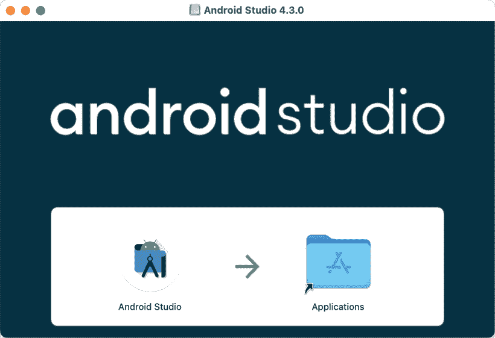

图 2-1

要安装该包，只需将 `Android Studio` 图标拖动并释放到应用程序文件夹中。`Android Studio` 将安装到系统的应用程序文件夹中，此过程通常需要几秒钟。

要启动 `Android Studio`，请在 `Finder` 窗口的应用程序文件夹找到可执行文件并双击它。

为了方便以后访问该工具，请从 `Finder` 窗口拖动 `Android Studio` 图标并将其置到 `dock` 栏上。

## 2.3.3 在 Linux 上安装

下载 Linux 版本的 `Android Studio` 安装包后，打开终端窗口，切换到要安装 `Android Studio` 的目录并执行以下命令：

```bash
unzip /<path to package>/android-studio-ide-<version>-linux.zip
```

请注意，`Android Studio` 软件包将安装在名为 `android-studio` 的子目录下。因此，假设上述命令是在 `/home/demo` 中执行的，那么软件包将会被解压到 `/home/demo/android-studio`。

要启动 `Android Studio`，打开终端窗口，切换到 `android-studio/bin` 子目录并执行以下命令：

```bash
./studio.sh
```

在 64 位 Linux 系统上运行时，可能在运行 `Android Studio` 之前需要安装一些 32 位的支持库。在 `Ubuntu` 上，可以使用以下命令安装这些库：

```bash
sudo apt-get install libc6:i386 libncurses5:i386 libstdc++6:i386 lib32z1 libbz2-1.0:i386
```

在基于 `Red Hat` 和 `Fedora` 的 64 位系统上，使用以下命令：

```bash
sudo yum install zlib.i686 ncurses-libs.i686 bzip2-libs.i686
```

## 2.4 Android Studio 设置向导

如果您之前安装过旧版本的 `Android Studio`，在首次启动此新版本时，可能会出现对话框，提供从之前的 `Android Studio` 版本导入设置的选项。如果您有旧版本的设置并希望将其导入到最新安装中，请选择相应的选项和位置。或者，指示您不需要导入任何之前的设置并点击 `OK` 按钮继续。

如果您是第一次安装 `Android Studio`，在设置过程开始后出现的初始对话框可能如下面的图 2-2 所示：

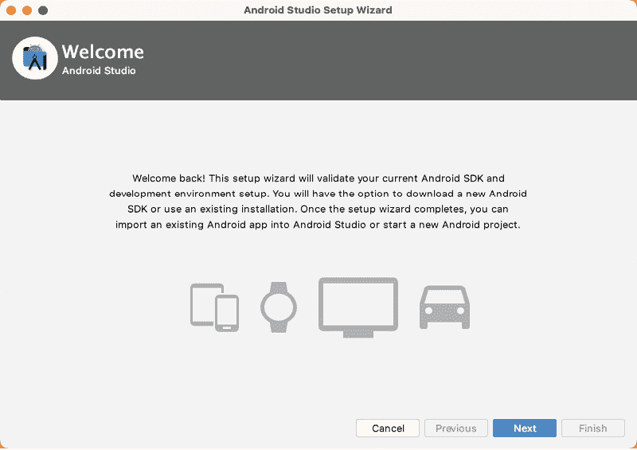

图 2-2

如果出现此对话框，点击 `Next`（下一步）按钮显示安装类型屏幕（图 2-3）。在此屏幕上，点击 `Next` 之前选择 `Standard`（标准）安装选项。

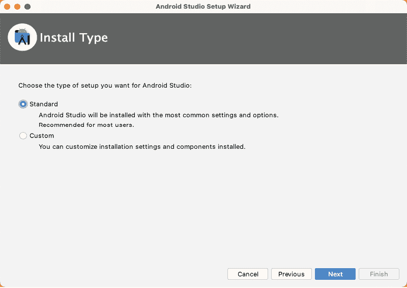

图 2-3

在 `Select UI Theme`（选择 UI 主题）屏幕上，根据您的喜好选择 `Darcula` 或 `Light`（浅色）主题。选择后，点击 `Next`，并在进入 `License Agreement`（许可协议）屏幕之前检查 `Settings` 选项。选择每个许可类别并启用 `Accept`（接受）复选框。最后，点击 `Finish`（完成）按钮开始安装。

完成这些初始设置步骤后，点击 `Finish` 按钮使用您选择的 UI 主题显示 `Welcome to Android Studio` 屏幕：

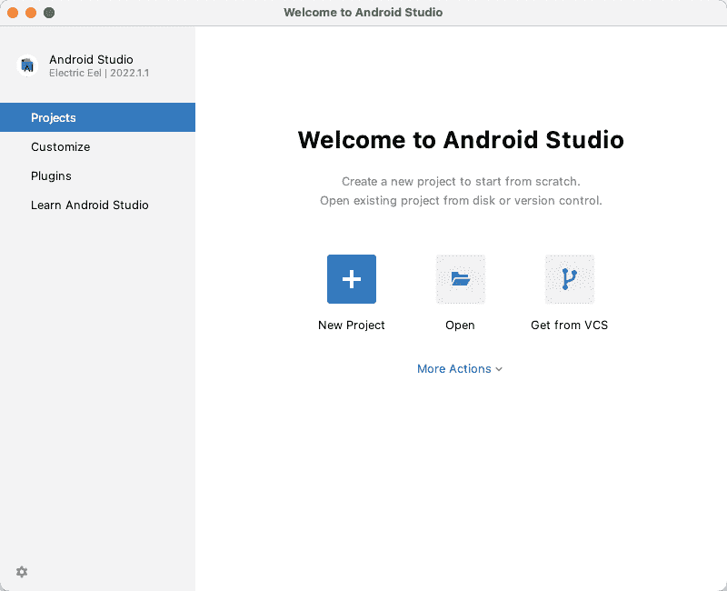

图 2-4

## 2.5 安装额外的 Android SDK 软件包

到为止执行的步骤已经安装了 `Android Studio` IDE 和当前的默认 `Android SDK` 软件包。在继续之前，值得花些时间验证安装了哪些软件包，并安装任何缺失或需要更新的软件包。

此任务可以通过点击欢迎对话框中的 `More Actions`（更多操作）链接并在下拉菜单中选择 `SDK Manager`（SDK 管理器）选项来完成。一旦调用，将出现 `Preferences`（首选项）对话框中的 `Android SDK` 屏幕，如图 2-5 所示：

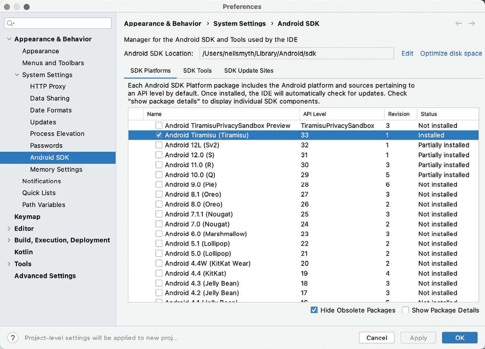

图 2-5

在首次安装 `Android Studio` 之后，很可能只安装了最新版本的 `Android SDK`。要安装旧版本的 `Android SDK`，只需勾选对应版本的复选框并点击 `Apply`（应用）按钮。本书的其余部分假设已安装了 `Android Tiramisu (API Level 33)` SDK。

书中的大多数示例将支持低低到 `Android 8.0 (Oreo)` 的旧版本 `Android`。这是为了确保应用程序运行在广泛的 `Android` 设备上。在 `SDK` 版本列表中，启用 `Android 8.0 (Oreo)` 旁的复选框并点击 `Apply` 按钮。在生成的确认对话框中，点击 `OK` 按钮安装 `SDK`。随后的对话框将在执行安装前寻求对许可和条款的接受。安装完成后，点击 `Finish`。

可能还会列出最新 `SDK` 有可用更新。要访问有关待更新软件包的详细信息，请启用屏幕右下角的 `Show Package Details`（显示包详情）选项。这将显示与图 2-6 类似的信息：

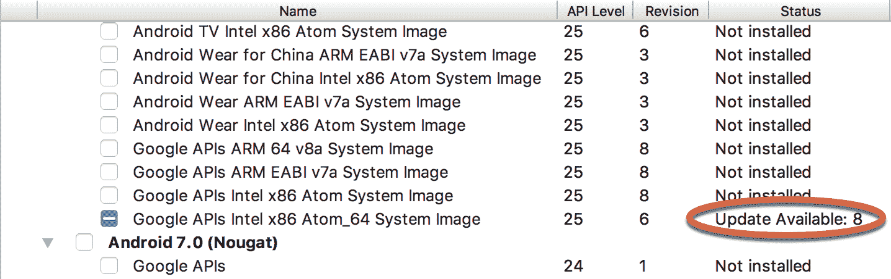

图 2-6

上图强调了可用更新。要安装这些更新，请启用项目名称左侧的复选框并点击 `Apply` 按钮。

除了 `Android SDK` 软件包外，还安装了一些构建 `Android` 应用程序的工具。要查看当前安装的软件包并检查更新，请留在 `SDK` 设置屏幕并选择 `SDK Tools` 选项卡，如图 2-7 所示：

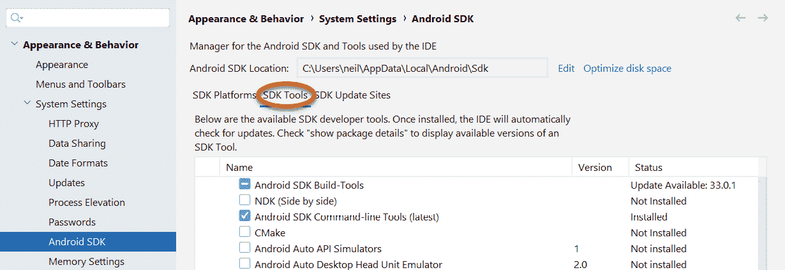

图 2-7

在 `Android SDK Tools` 屏幕中，确保以下软件包在 `Status`（状态）列中显示为 `Installed`（已安装）：

- `Android SDK Build-tools`

- `Android Emulator`

- `Android SDK Platform-tools`

- `Google Play Services`

- `Intel x86 Emulator Accelerator (HAXM)`*

- `Google USB Driver`（仅限 `Windows`）

- `Layout Inspector image for API 31`

注：`Intel x86 Emulator Accelerator (HAXM)` 无法在基于 `Apple silicon` 的 `Mac` 上安装。

如果上述任何软件包显示为 `Not Installed`（未安装）或需要更新，只需选择这些软件包并点击 `Apply` 按钮。如果出现 `HAXM` 模拟器对话框，选择推荐的内存分配：


图 2-8

安装完成后，检查软件包列表并确保所选软件包现在已为 `Installed`。如果仍未安装，请选中它们并点击 `Apply` 按钮。

## 2.6 安装 Android SDK 命令行工具

`Android Studio` 包含一组工具允许从系统命令行执行某些任务。要在您的系统中安装这些工具，请打开 `SDK Manager`，选择 `SDK Tools` 选项卡并启用窗口左下角的 `Show Package Details` 选项。接下来，滚动软件包列表，当 `Android SDK Command-line Tools (latest)` 软件包出现时，如图 2-9 所示启用它：

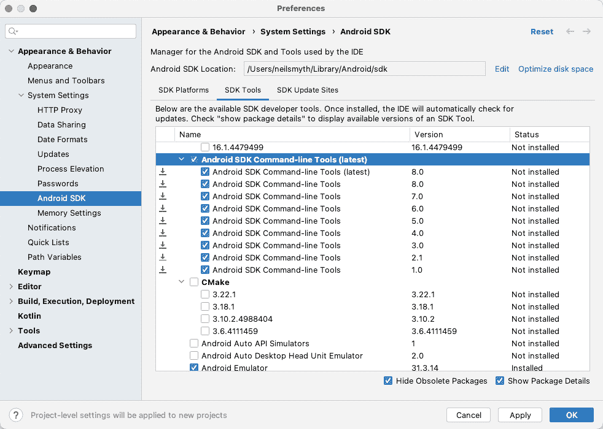

图 2-9

开发操作系统能够找到这些工具，需要将它们添加到系统的 `PATH` 环境变量中。无论哪种操作系统，您都需要配置 `PATH` 环境变量以包含以下路径（其中 `path_to_android_sdk_installation` 代表您安装 `Android SDK` 的文件系统位置）：

`<path_to_android_sdk_installation>/sdk/cmdline-tools/latest/bin`

- `<path_to_android_sdk_installation>/sdk/platform-tools`

您可以通过启动 `SDK Manager` 并参考设置面板顶部的 `Android SDK Location` 字段来识别 `SDK` 在系统上的位置，如图 2-10 所示：

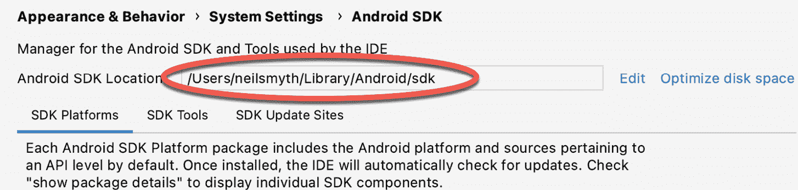

图 2-10

一旦确定了 `SDK` 的位置，将其添加到 `PATH` 变量的步骤取决于操作系统：

### 2.6.1 Windows 8.1

1. 在开始屏幕上，将鼠标移动到屏幕右下角，并在弹出的菜单中选择`搜索`。在搜索框中，输入`控制面板`。当结果区域出现`控制面板` 图标时，点击它在桌面上启动该工具。

2. 在`控制面板`中，使用`类别` 菜单将显示更改为`大图标`。从图标列表中选择标记为`系统` 的项。

3. 在`环境变量`对话框中，在`系统变量` 列表中找到 `Path` 变量，选择它并点击`编辑…` 按钮。使用编辑对话框中的`新建` 按钮向路径添加三个新条目。例如，假设 `Android SDK` 安装在 `C:\Users\demo\AppData\Local\Android\Sdk`，则需要添加以下项：

```cmd
C:\Users\demo\AppData\Local\Android\Sdk\cmdline-tools\latest\bin
C:\Users\demo\AppData\Local\Android\Sdk\platform-tools
```

4. 点击每个对话框中的`确定`并关闭系统属性控制面板。

通过按下键盘上的 `Windows + R` `运行`对话框中输入 `cmd` 来打开命令提示符窗口。在`命令提示符`窗口中，输入：

```cmd
echo %Path%
```

返回的路径变量值应包含 `Android SDK` 工具文件夹的路径。可以通过尝试如下运行 `adb` 工具来验证 `platform-tools` 值是否正确：

```cmd
adb
```

执行该工具后应输出命令行选项列表。

同样，通过尝试运行 `AVD Manager` 命令行工具来检查工具路径设置（如果 `avdmanager` 工具报告 `Java` 问题请不要担心——稍后会解决）：

```cmd
avdmanager
```

如果执行其中一个或两个命令时出现类似下面的消息，很可能是向 `Path` 环境变量中添加了错误的路径：

`'adb'不是内部或外部命令，可运行程序或批文件。`

### 2.6.2 Windows 10

右键点击`开始` 菜单，从弹出的菜单中选择`设置`，并在`查找设置`文本框中输入“编辑系统环境变量”。在`系统属性`对话框中，点击`环境变量...` 按钮。按照 `Windows 8.1` 列出的步骤从第 3 步开始继续。

### 2.6.3 Windows 11

右键点击任务栏上的`开始` 图标，从弹出的菜单中选择`设置`。当`设置`对话框出现时，向下滚动类别列表并选择“关于”选项。在“关于”屏幕上，从“相关链接”部分选择`高级系统设置`。当`系统属性`窗口出现时，点击`环境变量...` 按钮。按照 `Windows 8.1` 列出的步骤从第 3 步开始继续。

### 2.6.4 Linux

在 `Linux` 上，此配置通常可以通过通过向用户主目录下的 `.bashrc` 文件中添加命令来实现（具体细节取决于所使用的特定 `Linux` 发行版）。假设 `Android SDK` 压缩包安装在 `/home/demo/Android/sdk`，`.bashrc` 文件中的 `export` 行如下：

```bash
export PATH=/home/demo/Android/sdk/platform-tools:/home/demo/Android/sdk/cmdline-tools/latest/bin:/home/demo/android-studio/bin:$PATH
```

另注意，上述命令将 `android-studio/bin` 目录添加了 `PATH` 变量。这将允许在终端窗口的任何当前目录下都能执行 `studio.sh` 脚本。

### 2.6.5 macOS

在 `macOS` 上可以使用多种技术来修改 `$PATH` 环境变量。认为最干净的方法是在 `/etc/paths.d` 目录中创建一个新文件，其中包含要添加到 `$PATH` 的路径。假设 `Android SDK` 安装位置为 `/Users/demo/Library/Android/sdk`，可以通过在 `/etc/paths.d` 目录下创建一个名为 `android-sdk` 的新文件并包含以下行：

```bash
/Users/demo/Library/Android/sdk/cmdline-tools/latest/bin
/Users/demo/Library/Android/sdk/platform-tools
```

注意，由于这是一个系统目录，在创建文件时需要使用 `sudo` 命令。例如：

```bash
sudo vi /etc/paths.d/android-sdk
```

## 2.7 Android Studio 内存管理

`Android Studio` 是一个大型且复杂的软件应用程序，由许多后台进程组成。尽管 `Android Studio` 过去曾因性能欠佳而受到批评，但 `Google` 在最近的发行中进行了显著的性能改进，并在每个新版本中持续改进。这些改进允许用户配置 `Android Studio` IDE 以及用于构建和运行应用程序的后台进程的内存使用。这使得软件能够利用具有较大内存的系统。

如果你在具有足够空闲内存来增加这些值的系统上运行 `Android Studio`（此功能仅适用于具有 5GB 或更多内存的 64 位系统），并发现 `Android Studio` 性能似乎有所下降，那么尝试这些内存设置可能是值得的。`Android Studio` 还可能通过类似下所示的对话框通知你可以提高性能：


图 2-11

要查看并修改当前内存配置，请选择 `File -> Settings...`（`macOS` 上为 `Android Studio -> Preferences...`）菜单选项，并在出的对话框中选择 `Appearance & Behavior`，然后选择左侧导航面板中 `System Settings` 下的 `Memory Settings` 选项，如下图 2-12 所示。

在更改内存分配时，请确保不要分配超过必要的内存，或在不减慢其他进程的情况下超过系统可承受的内存。


图 2-12

`IDE 堆大小`（IDE heap size）设置调整分配给 `Android Studio` 的内存，并且无论当前加载的项目如何都生效。另一方面，当从 `Android Studio` 内部构建和运行项目时，许多后台进程（称为守护进程 `daemon`）会执行编译和运行应用程序的任务。在编译和运行大型复杂项目时，可以通过调整守护进程堆设置来改进构建时间。与 `IDE` 堆设置不同，这些守护进程设置仅适用于当前项目，并且只有在 `Android Studio` 中打开项目时才能访问。

## 2.8 更新 Android Studio 和 SDK

`Android Studio` 和 `Android SDK` 不经常会发布新版本。新版本的 `SDK` 使用 `Android SDK Manager` 安装。`Android Studio` 通常会在更新可用时通知你。

要手动检查 `Android Studio` 更新，请使用 `Android Studio` 主窗口中的 `Help -> Check for Updates...` 菜单选项（`macOS` 上为 `Android Studio -> Check for Updates...`）。

## 2.9 总结

在开始开发 `Android` 应用程序之前，第一步是设置适当的开发环境。这包括 `Android SDK` 和 `Android Studio`（它还包含 `OpenJDK` 开发环境）。在本章中，我们涵盖了在 `Windows`、`macOS` 和 `Linux` 上安装这些包所需的步骤。

# 3. 在 Android Studio 中创建一个示例 Android 应用

本书前面的章节已经涵盖了配置适用于 `Android Studio` IDE 开发 `Android` 应用程序的环境的步骤。在进入稍高阶的主题之前，现在是验证所有所需的开发包是否已安装并正常运行的良好时机。实现这一目标的最佳方法是创建一个 `Android` 应用程序并对其进行编译和运行。本章将介绍如何使用 `Android Studio` 创建 `Android` 应用程序项目。项目创建完成后，随后的章节将探索如何使用 `Android` 模拟器环境对应用程序进行测试运行。

## 3.1 关于项目

在本章中创建的项目是一个基础的货币汇率转换器（事实上，它非常简单，只支持从美元转换为欧元，并使用估算的汇率进行转换）。该项目还将使用 `Android Studio` 最基础的项目模板之一。这种简单易性使我们能够在不介绍 `Android` 应用开发的一些关键方面，而不会因为一次性尝试引入过多概念（例如推荐的应用架构和 `Android` 架构组件）而让初学者无从从。在遵循本章的教程时，请放心，初始示例项目中所使用的所有技术和代码将在后续章节中进行更详细的介绍。

## 3.2 创建新的 Android 项目

应用程序开发过程的第一步是在 `Android Studio` 环境中创建一个新项目。因此，请先启动 `Android Studio`，直到出现“欢迎来到 `Android Studio`”屏幕，如图 3-1 所示：


图 3-1

一旦出现此窗口，`Android Studio` 已准备好创建新项目。要创建新项目，只需点击 `New Project`（新项目）选项即可显示“新项目”向导的第一个屏幕。

## 3.3 创建 Activity（活动）


第一步是定义为应用程序创建的初始 Activity 类型。提供了多种选项，可以为手机和平板、Wear OS、TV、Android 音频或 Android Things 创建项目。在开发 Android 应用程序时，可以使用多种 Activity 类型，其中许多将在后面的章节中进行详细介绍。然而，就本示例而言，只需从 `Templates`（模板）面板中选择 `Phone and Tablet`（手机和平板）选项，然后选择创建 `Empty Activity`（空活动）。`Empty Activity` 选项会创建一个包含单个 `TextView` 对象的模板用户界面。

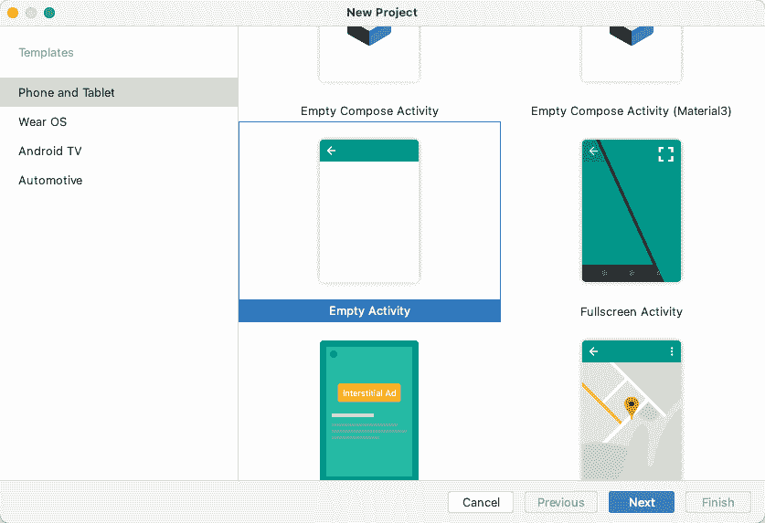

图 3-2

选中 `Empty Activity` 后，点击 `Next`（下一步）继续配置项目。

### 3.4 定义项目和 SDK 设置

在项目配置窗口 ( ) 中，将 `Name`（名称）字段设置为 `AndroidSample`。应用程序名称是在 `Android Studio` 内部引用和标识应用程序的名称，也是如果完成的应用程序要在 Google Play 商店发售时将要使用的名称。

`Package name`（包名）用于在 Android 应用程序生态系统中唯一标识应用程序。虽然这可以设置为任何唯一标识您的应用程序的字符串，但传统上它是基于您域名的反转 URL，后跟应用程序名称。例如，如果您的域名是 `www.mycompany.com`，且应用程序命名为 `AndroidSample`，那么包名可以指定如下：

`com.mycompany.androidsample`

如果您没有域名，可以在 `Company Domain`（公司域名）字段中输入任何其他字符串，或者出于测试目的使用 `example.com`，但在发布应用程序之前需要更改它：

`com.example.androidsample`

`Save location`（保存位置）设置将默认到位于您主目录下的名为 `AndroidStudioProjects` 文件夹中的位置，可以通过点击包含当前路径设置的文本字段右侧文件夹图标进行更改。

将 `minimum SDK`（最低 SDK）设置为 `API 26`：Android 8.0 (Oreo)。这是本书创建的大多数项目将使用的最低 SDK，除非某个必要功能仅在更高版本中可用。这里的目标是使用最新的 Android SDK 构建应用，同时保留与运行较旧版本 Android 的设备的兼容性（在这种情况下，可追溯到 Android 8.0）。`Minimum SDK` 设置下的文字将概述目前运行该应用程序的 Android 设备百分比。点击 `Help me choose`（帮助我选择）按钮（在图 3-3 中突出显示）查看仍在使用的各种 Android 版本的完整细分：

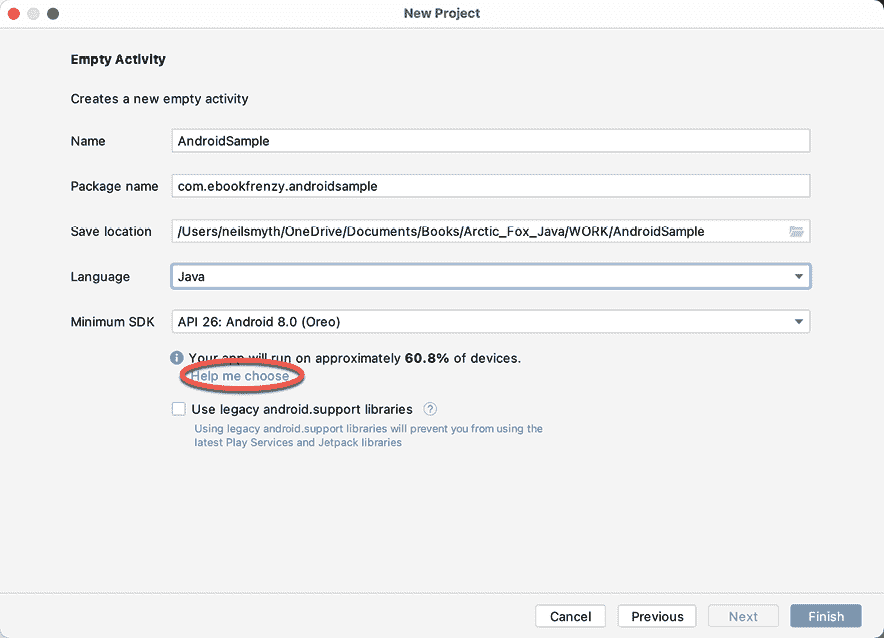

图 3-3

最后，将 `Language`（语言）菜单更改为 `Java` 并点击 `Finish`（完成）启动项目创建过程。

### 3.5 修改示例应用程序

此时，`Android Studio` 已创建了一个最小的示例应用程序项目并打开了主窗口。

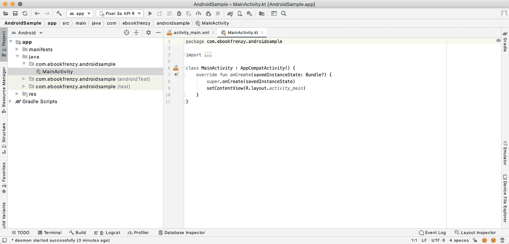

图 3-4

新创建的项目和关联文件的引用列位于主项目窗口左侧的 `Project`（项目）工具窗口。`Project` 工具窗口有多种显示信息的模式。默认情况下，此面板应处于 `Android` 模式。此设置由面板顶部的菜单控制，如图 3-5 中突出所示。如果面板当前不是 `Android` 模式，请使用菜单切换模式：

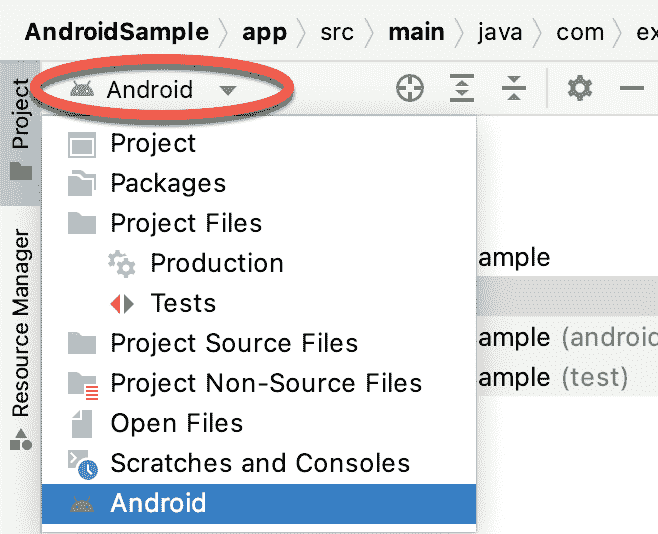

图 3-5

### 3.6 修改用户界面

我们 Activity 的界面设计存储在名为 `activity_main.xml` 的文件中，该文件位于项目层次结构中的 `app -> res -> layout` 下。在 `Project` 工具窗口找到该文件后，双击将其加载到用户界面 `Layout Editor`（布局编辑器）工具中，该工具将出现在 `Android Studio` 主窗口的中间面板：

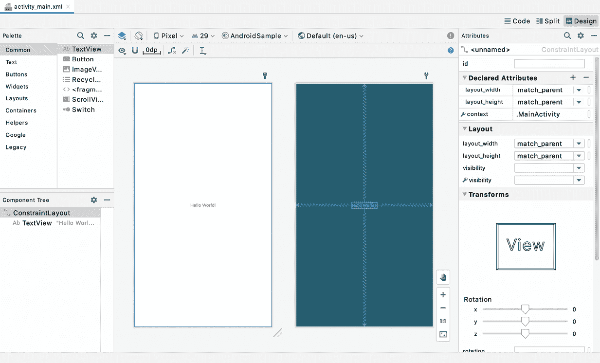

图 3-6

在 `Layout Editor` 窗口顶部工具栏上有一个菜单（在上方图中设置为 `Pixel`），它反映在 `Layout Editor` 面板中设备视觉表示上。通过点击此菜单可以选择广泛的其他设备选项。

要在设备表示的横屏和竖屏之间切换方向，请直接使用设备选择菜单左侧的显示  图标的下拉菜单。使用 `night mode`（夜模式）按钮 ) 来关闭夜模式。

从设备屏幕可以看到，内容布局已经包含了一个显示“Hello World!”消息的标签。面板左侧运行着 `palette`（调色板），包含了用于构建用户界面的不同类别用户界面组件，例如按钮、标签和文本字段。然而需要注意的是，并不是所有的用户界面组件对用户都是可见的。其中一类是布局。Android 支持多种布局，对视觉用户界面组件在屏幕上的定位和管理提供不同程度的控制。虽然从用户界面的视觉上很难判断，但当前的设计是使用 `ConstraintLayout` 创建的。这可以通过查看 `Component Tree`（组件树）面板中的信息来确认，该面板默认位于 `Layout Editor` 面板的左下角，如图 3-7 所示：

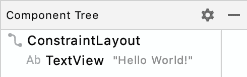

图 3-7

从组件树层级结构中看到，用户界面布局由一个 `ConstraintLayout` 父容器和一个 `TextView` 子对象组成。

在继续之前，还要检查布局编辑器的 `Autoconnect`（自动连接）模式是否启用。这意味着当组件被添加到布局中时，布局编辑器会自动添加约束条件，以确保组件在不同的屏幕尺寸和设备方向上都能正确定位（该主题将在后续章节中进行更详细的介绍）。`Autoconnect` 按钮出现在布局编辑器的工具栏中，用磁铁图标表示。当禁用时，磁铁图标上会出现一条斜线（图 3-8）。如有必要，可以通过点击此按钮重新启用 `Autoconnect` 模式。

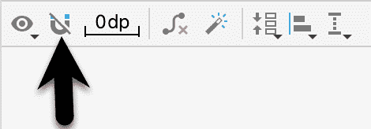

图 3-8

修改应用程序的下一步是向布局添加一些额外的组件，其中第一个是 `Button`（按钮），供用户点击以启动货币转换。

`Palette`（调色板）面板由两列组成，左列包含视图组件类别列表。右列列出当前选定类别包含的组件。例如，在 图 3-9 中，当前在 `Buttons` 类别中选择了 `Button` 视图：

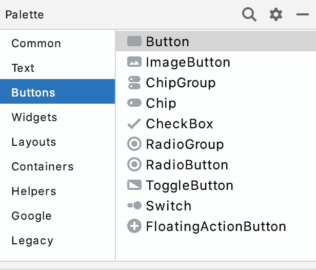

图 3-9

从 `Buttons` 列表中点击并拖动 `Button` 对象，将其释放到用户界面设计的水平中心，使其位于现有 `TextView` 控件下方：

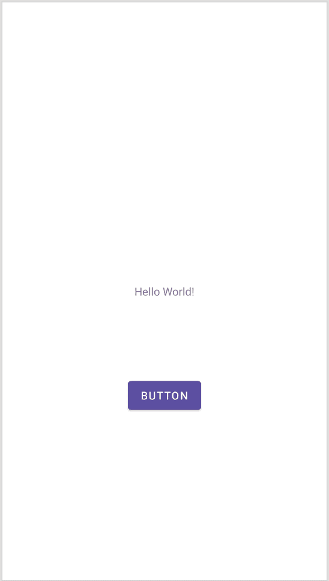

图 3-10

下一步是更改 `Button` 组件当前显示的文本。位于设计区域右侧的面板是 `Attributes`（属性）面板。该面板显示分配给布局中当前选定组件的属性。在此面板中，在 `Common Attributes`（常用属性）部分找到 `text` 属性，并如 图 3-11 所示，将当前值从“Button”更改为“Convert”：

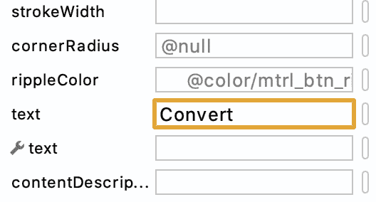

图 3-11

第二个文本属性旁边有一个扳手允许设置文本属性，该属性仅在布局编辑器工具中显示，而在运行时不会显示。这对于测试视觉组件和布局在不同设置下的行为非常有用，而无需反复运行应用。

为了防万一 `Autoconnect` 系统未能设置所有布局连接，点击 `Infer constraints`（推断约束）按钮（图 3-12）为布局添加任何缺失的约束：

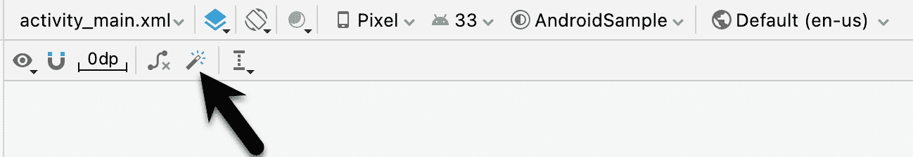

图 3-12

此时，重要的是解释位于布局编辑器工具右上角的警告按钮，如 图 3-13 所示。显然，这表示布局可能存在问题。要需有关任何问题的详细信息，请点击该按钮：

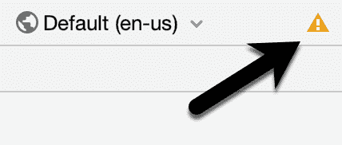

图 3-13

点击后，将出现 `Problems`（问题）工具窗口（图 3-14），描述问题的性质：

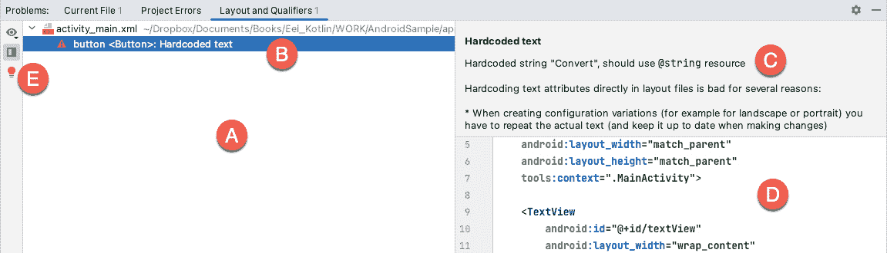

图 3-14

此工具窗口分为两个面板。左侧面板（上图标记为 A）列出了在布局文件中检测到的问题。在我们的示例中，仅列出了以下问题：

```
button <Button>: Hardcoded text
```

当从列表中一个项目 (B) 时，右侧面板将更新以提供有关问题的更多详细信息 (C)。在这种情况下，解释如下：

```
Hardcoded string "Convert", should use @string resource
```

工具窗口还包含一个预览编辑器 (D)，允许对布局文件进行手动修正。

此 I18N 消息是在告知我们，项目未来的国际化可能存在潜在问题（“I18N”源于“internationalization”一词以“I”开头，以“N”结尾，中间有 18 个字母）。警告在提醒我们，在开发 Android 应用时，应尽可能将文本字符串等属性和值以资源（resources）的形式存储。这样做可以通过修改资源文件而不是更改应用程序源代码来更改应用程序的外观。这在将用户界面翻译成不同的口语时尤其为有价值。如果用户界面中的所有文本都包含在一个资源文件中，例如，可以将该文件交给翻译人员，由他们执行翻译工作并返回翻译后的文件包含在应用程序中。这使得无需修改任何源代码即可针对多种语言。在这种情况下，我们将创建一个名为 `convert_string` 的新资源，并为其分配字符串“Convert”。

首先点击 `Show Quick Fixes`（显示快速修复）按钮 (E)，并在菜单中选择 `Extract string resource`（提取字符串资源）选项，如 图 3-15 所示：

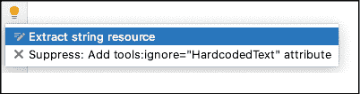

图 3-15

选择此选项后，将出现 `Extract Resource`（提取资源）面板（图 3-16）。在此面板中，将资源名称更改为 `convert_string`，并将资源值设置为 `Convert`，然后点击 `OK` 按钮。

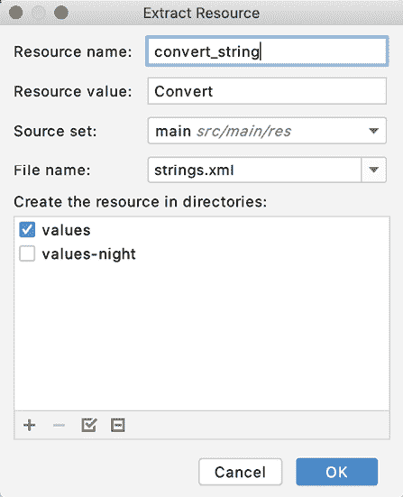

图 16

要添加的控件是 `EditText`，用户将在其中输入金额。从 `Palette` 面板选择 `Text` 类别，并点击拖动一个 `Number (Decimal)` 组件到布局中，使其位于现有 `TextView` 控件上方。选中该控件后，使用 `Attributes` 窗口将 `hint` 属性设置为“dollars”。点击警告图标并将字符串提取为资源 `dollars_hint`。

稍后编写的代码需要访问用户输入 `EditText` 字段的美元值。它将通过引用分配给控件的 `id` 来。在布局中选中控件时，可以在 `Attributes` 窗口查看并更改 Android 分配的默认 `id`，如 图 3-17 所示：


图 3-17

将 `id` 更改为 `dollarText`并在 `Rename` 对话中点击 `Refactor`（重构）按钮。这将项目其他地方对旧 `id` 的引用自动更新为新的 `id`：

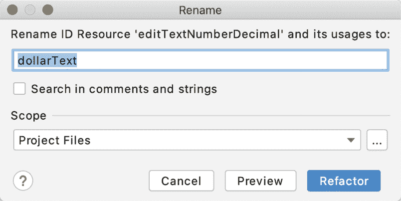

图 3-18

重复步骤将 `TextView` 控件的 `id` 设置为 `textView`。

点击 `Infer constraints` 按钮添加任何缺失的布局约束。此时，布局应类似于 图 3-19 所示：

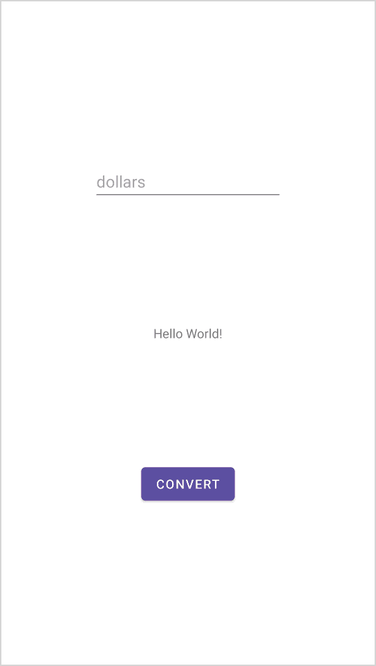

图 3-19

## 3.7 查看布局和资源文件

在继续下一步之前，我们将查看用户界面设计和资源处理的一些内部方面。在上一节中，我们通过使用布局编辑器工具修改 `activity_main.xml` 文件对用户界面进行了一些更改。事实上，布局编辑器所做的只是提供了编辑文件底层 XML 内容的用户友好方式。在实践中，没有理由不直接修改 XML 来进行用户界面更改，在某些情况下，这实际上比使用布局编辑器工具更快。布局编辑器面板的右上角有三个按钮，如下方的 图 3-20 所示：

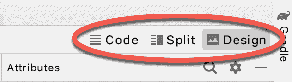

图 3-20

默认情况下，编辑器处于设计模式（Design mode），此时仅显示布局的视觉呈现。最左侧的按钮将切换到代码模式（Code mode），显示布局的 XML；而中间的按钮将进入拆模式（Split mode），同时显示布局和 XML，如图图 3-21 所示：

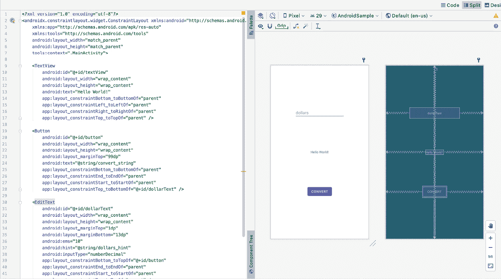

图 3-21

从 XML 文件的结构可以看出，用户界面由 `ConstraintLayout` 组件组成，该组件又是 `TextView`、`Button` 和 `EditText` 对象的父级。我们还可以看到，例如 `Button` 的文本属性被设置为我们的 `convert_string` 资源。尽管复杂性和内容各异，但所有用户界面布局都是以这种分层的、基于 XML 的方式组织的。

当 XML 布局发生更改时，这些更改将反映在布局画布上。也可以在布局画布面板内对布局进行视觉修改，更改将显示在 XML 列表中。要查看操作效果，请切换到拆模式并修改 XML 布局，将 `ConstraintLayout` 的背景颜色更改为红色调，如下：

```xml
<?xml version="1.0" encoding="utf-8"?>
<androidx.constraintlayout.widget.ConstraintLayout xmlns:android="http://schemas.android.com/apk/res/android"
    xmlns:app="http://schemas.android.com/apk/res-auto"
    xmlns:tools="http://schemas.android.com/tools"
    android:layout_width="match_parent"
    android:layout_height="match_parent"
    tools:context=".MainActivity"
    android:background="#ff2438" >

</androidx.constraintlayout.widget.ConstraintLayout>
```

注意，布局的颜色会实时更改以匹配 XML 文件中的新设置。同样注意，在 XML 编辑器左侧边距（也称为行槽）中，包含颜色设置的旁边会出现一个小的红色方块。这是该属性已设置为红色的视觉提示。点击红色方块将显示颜色选择器，允许选择不同的颜色：

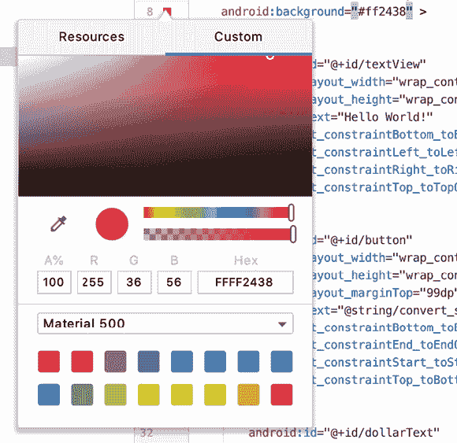

图 3-22

在继续之前，删除布局文件中的背景属性，以便背景恢复默认设置。

最后，使用 `Project` 面板找到 `app -> res -> values -> strings.xml` 文件，并双击它将其加载到编辑器中。目前 XML 的内容如下：

```xml
<resources>
    <string name="app_name">AndroidSample</string>
    <string name="convert_string">Convert</string>
    <string name="dollars_hint">dollars</string>
</resources>
```

作为资源实际应用的演示，将当前分配给 `convert_string` 资源的字符串值更改为“Convert to Euros”，然后通过选择编辑器面板中布局文件的标签页返回布局编辑器工具。注意，布局已经获取了该字符串的新资源值。

访问 XML 文件中引用的资源值还有一种快速方法。在拆模式或代码模式下使用布局编辑器工具时，点击 `text`@string/convert_string` 属性设置使其变为高亮，然后按键盘上按下 `Ctrl-B`（macOS 上为 `Cmd-B`）。`Android Studio` 随后将打开 `strings.xml` 文件并将您带到该文件中声明此资源的行。利用此机会将字符串资源恢复为原始的“Convert”文本，并添加以下后续在应用代码中引用的字符串资源条目：

```xml
<resources>
    .
    <string name="convert_string">Convert</string>
    <string name="dollars_hint">dollars</string>
    <string name="no_value_string">No Value</string>
</resources>
```

也可以通过点击编辑器窗口左上角的“Open editor”链接，使用 `Android Studio` 翻译编辑器（Translations Editor）来编辑资源字符串。这将在 `Android Studio` 窗口的主面板中显示翻译编辑器：

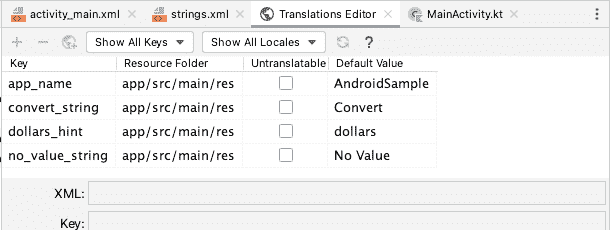

图 3-23

此编辑器允许编辑分配给资源键的字符串，并管理多种语言的翻译。

### 3.8 添加交互


此示例项目的最后一步是使应用程序具有交互性，以便当用户在`EditText`字段中输入美元值并点击转换按钮时，转换后的欧元值将显示在`TextView`上。这涉及在`Button`小部件上实现一些事件处理。具体来说，需要配置`Button`，以便在触发`onClick`事件时调用应用代码中的方法。事件处理可以通过多种不同的方式实现，并在稍后标题为“Android 事件处理概述与示例”的章节中详细介绍。将布局编辑器返回设计模式，在布局编辑器中选择`Button`小部件，参考`Attributes`（属性）工具窗口并指定名为`convertCurrency`的方法，如下所示：

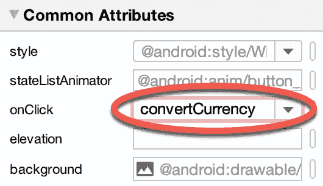

图 3-24

注意，`onClick`属性的文本字段现在用红色边框高亮，警告我们该按钮已配置为调用一个不存在的方法。要解决这个问题，在`Project`窗口中双击`MainActivity.java`文件（`app -> java -> <package> -> MainActivity`）将其加载到代码中，并在类中添加`convertCurrency`代码，如下：

```java
package com.ebookrenzy.androidsample;
import androidx.appcompat.app.AppCompatActivity;
import android.os.Bundle;
import android.view.View;
import android.widget.EditText;
import android.widget.TextView;
import java.util.Locale;

public class MainActivity extends AppCompatActivity {
    @Override
    protected void onCreate(Bundle savedInstanceState) {
        super.onCreate(savedInstanceState);
        setContentView(R.layout.activity_main);
    }

    public void convertCurrency(View view) {
        EditText dollarText = findViewById(R.id.dollarText);
        TextView textView = findViewById(R.id.textView);
        if (!dollarText.getText().toString().equals("")) {
            float dollarValue = Float.parseFloat(dollarText.getText().toString());
            float euroValue = dollarValue * 0.85F;
            textView.setText(String.format(Locale.ENGLISH,"%.2f", euroValue));
        } else {
            textView.setText(R.string.no_value_string);
        }
    }
}
```

### 3.9 总结

设置 Android 开发环境涉及许多步骤，尽管并不复杂。完成这些步骤后，值得运行示例以确保环境正确安装和配置。在本章中，我们创建了一个示例应用程序，并使用 Android Studio 布局编辑器工具修改了界面布局。在此过程中，我们探讨了尽可能使用资源的重要性，特别是在字符串值的情况下，并简要接触了布局的主题。

最后，在`Button`上添加了一个`onClick`事件，并连接到一个已实现的方法，该方法用于从`EditText`组件中提取用户输入，将美元转换为欧元，然后将结果显示在`TextView`上。

应用程序已准备好进行测试，下一章将详细介绍为测试目的设置模拟器所需的必要步骤。

# 4. 在 Android Studio 中创建 Android 虚拟设备 (AVD)

尽管 Android Studio 的预览面板（`Preview` panel）允许我们看到正在设计的布局，并使用交互模式测试基本功能，但仍需编译并运行整个应用程序才能完全测试其运行情况。Android 应用程序可以通过在物理设备上或在 Android 虚拟设备 (AVD) 模拟器环境中安装并运行来完成测试。在使用 AVD 之前，必须先创建并配置它以匹配特定设备型号的规格。在本章中，我们将以`Pixel 4`手机作为参考示例，完成此类虚拟设备的创建。

## 4.1 关于 Android 虚拟设备

AVD 本质上是模拟器，它们允许在无需将应用程序安装到物理 Android 设备上的情况下测试 Android 应用程序。AVD 可以配置为模拟各种硬件功能，包括屏幕大小、内存容量，以及是否存在摄像头、GPS 导航支持或加速度计等功能。作为 Android Studio 标准安装程序的一部分，系统安装了几个模拟器模板，允许为一系列不同的设备配置 AVD。可以通过指定处理器类型、内存容量以及屏幕尺寸和像素密度等属性，创建自定义配置以匹配任何物理 Android 设备。

AVD 会话既可以以独立窗口的形式出现，也可以嵌入在 Android Studio 窗口中。

新的 AVD 使用 Android 虚拟设备管理器（`Android Virtual Device Manager`）创建和管理，该管理器可以在命令行模式下使用，也可以使用更友好的图形用户界面。创建新 AVD 的第一步是启动 AVD Manager。这可以在 Android Studio 环境中通过选择主窗口中的`Tools -> Device Manager`菜单选项来实现。

启动后，管理器将作为工具窗口形式出现，如图 4-1 所示：

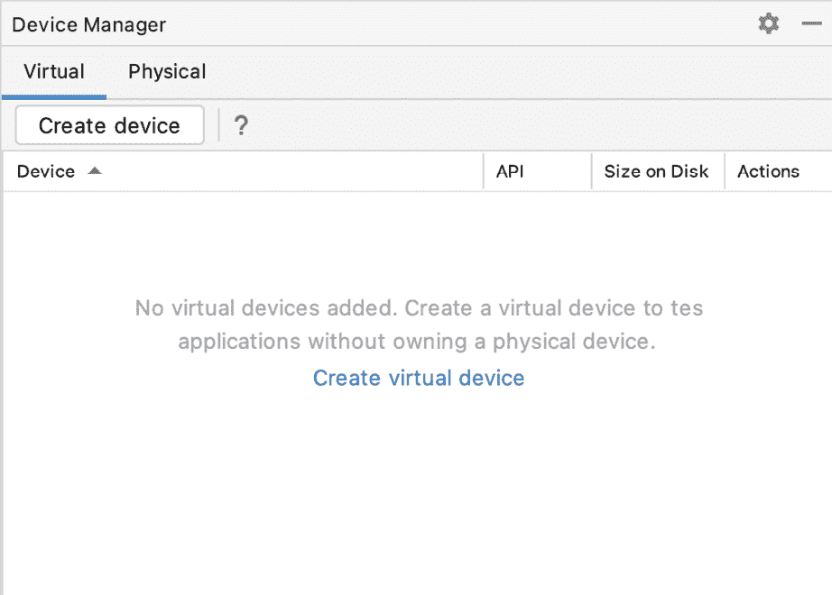

图 4-1

如果您是首次在计算机上安装 Android Studio（而不是升级现有的 Android Studio 安装），安装程序可能已经创建了一个可用的初始 AVD 实例，如图 4-2 所示：

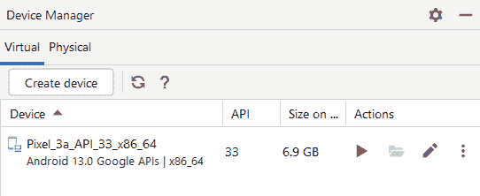

图 4-2

如果您的系统中存在此 AVD，您可以使用它来测试应用程序。如果没有创建 AVD，或者您想为不同类型的设备创建 AVD，请按照本章其余部分的步骤进行操作。

要添加新的 AVD，请确保在点击`Create device`按钮之前选择了`Virtual`选项卡，以打开虚拟设备配置对话框：

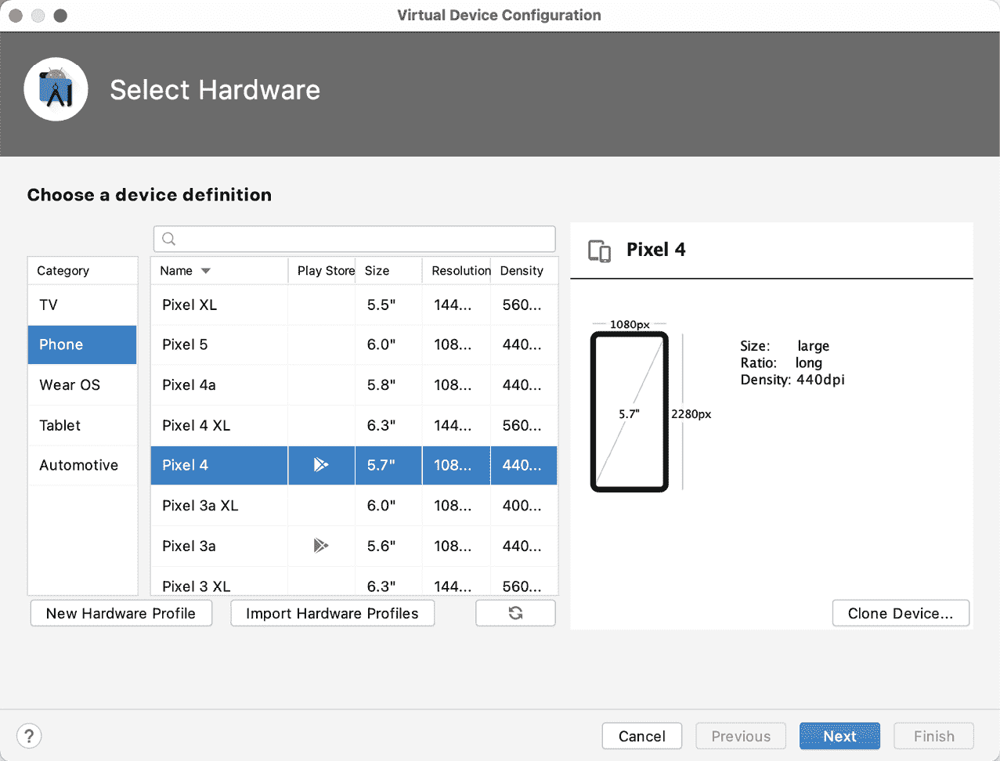

图 4-3

在对话框中，执行以下步骤创建一个兼容`Pixel 4`的模拟器：

1. 从`Category`面板中，选择`Phone`选项以显示可用的 Android 手机 AVD 模板列表。

2. 选择`Pixel 4`设备选项并点击`Next`。

3. 在`System Image`屏幕上，选择最新版本的 Android。注意，如果尚未安装系统镜像，则`Release Name`旁边将提供`Download`链接。点击此链接在选择它之前下载并安装系统镜像。如果所需的镜像未列出，请点击`x86 Images`（如果您运行带有 Apple 芯片的 Mac，请点击`ARM images`）和`Other images`标签查看替代列表。

4. 点击`Next`继续并在`name`字段输入描述性名称（例如`Pixel 4 API 33`），或直接接受默认名称。

5. 点击`Finish`创建 AVD。

6. AVD 创建后，现在可以关闭`Device Manager`。如果以后需要修改 AVD，只需重新打开`Device Manager`，从列表中选择 AVD，并点击`Actions`列中的`pencil icon`（铅笔图标）编辑设置。

## 4.2 启动模拟器

对新创建的 AVD 模拟器进行测试运行，只需从`Device Manager`中选择模拟器并点击`launch`按钮（`Actions`列中的三角形）。模拟器将嵌入到 Android Studio 主窗口中并开始启动过程。模拟器启动所需的时间取决于 AVD 及其运行的系统的配置：

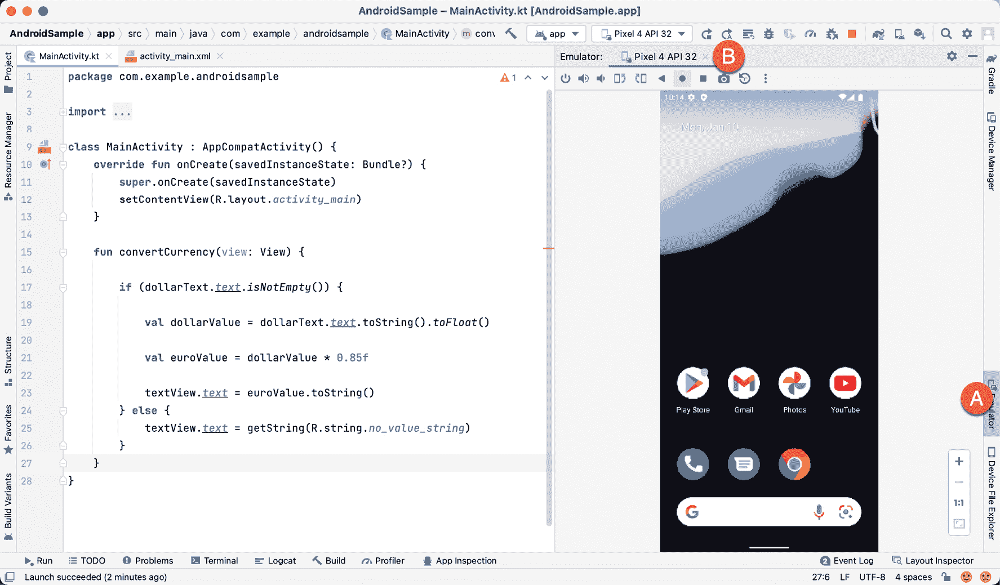

图 4-4

要隐藏和显示模拟器工具窗口，请点击`Emulator`工具窗口按钮（如标记 A 所示）。点击标签页旁边的`x`关闭按钮 (B) 退出模拟器。模拟器工具窗口可以容纳多个模拟器会话，每个会话由一个标签页表示。例如图 4-5 显示了一个带有两个模拟器会话的工具窗口：

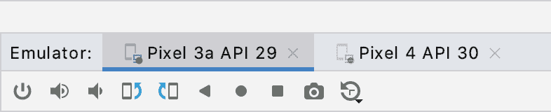

图 4-5

要在会话之间切换，只需点击相应的标签页。

尽管模拟器可能默认以竖屏方向显示，但此或其他默认选项可以更改。在`Device Manager`中，选择`Pixel 4`条目并点击设备行中的`pencil icon`。在配置屏幕上，找到`Startup orientation`部分并更改方向设置。退出并重启模拟器以使更改生效。关于模拟器的更多细节将在下一章“使用和配置 Android Studio AVD”中介绍。

为了节省本章后续章节的时间，请保持模拟器运行。

## 4.3 在 AVD 中运行应用程序

有了 AVD 模拟器，早期章节创建的示例`AndroidSample`应用程序现在可以编译并运行。将`AndroidSample`项目加载到 Android Studio 后，确保新创建的`Pixel 4` AVD 显示在下方图 4-6 所示的设备菜单中（标记为 A），然后点击由绿色三角形表示的运行按钮 (B)，或使用快捷键`Ctrl-R`：

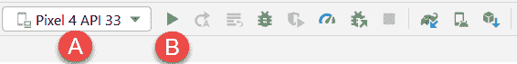

图 4-6

设备菜单 (A) 可选择不同的 AVD 实例或物理设备作为运行目标，也可在多个设备上运行应用。菜单还提供了访问`Device Manager`以及设备连接配置和故障排除选项：

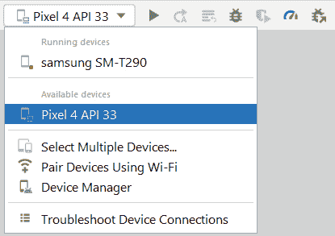

图 4-7

应用程序安装并运行时，第一个 fragment 的用户界面将出现在模拟器中（fragment 是 Android 项目的可重用部分，通常由用户界面布局和一些代码组成，该主题将在后续的“Android Fragment 简介”章节中介绍）：

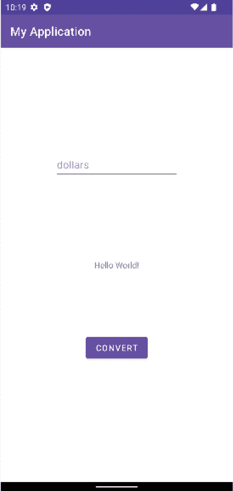

图 4-8

如果活动没有自动启动，请检查启动图标是否出现在模拟器的应用列表中。如果是，只需点击它即可启动应用程序。一旦运行过程开始，`Run`工具窗口将可用。`Run`工具窗口将在应用程序包安装和启动时显示诊断信息。图 4-9 显示了典型成功启动应用程序的`Run`工具窗口输出：

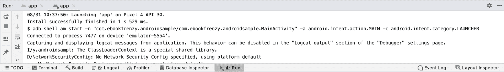

图 4-9

如果在启动过程中遇到问题，`Run`工具窗口将提供相关信息，这些信息可能有助于定位问题所在。

假设应用程序已加载到模拟器并按预期运行，我们已经安全地验证了 Android 开发环境已正确安装并配置。现在应用正在运行，尝试进行货币兑换以验证应用是否按预期工作。

## 4.4 在多个设备上运行

上述图 4-7 所示的“运行”菜单包含一个在多个模拟器和设备上并行运行应用程序的选项。选择该选项后，将显示如图 4-10 所示的对话框，列出系统上配置的所有`AVDs`以及任何已连接的物理设备。在点击`Run`按钮之前，勾选目标模拟器或设备旁边的复选框：

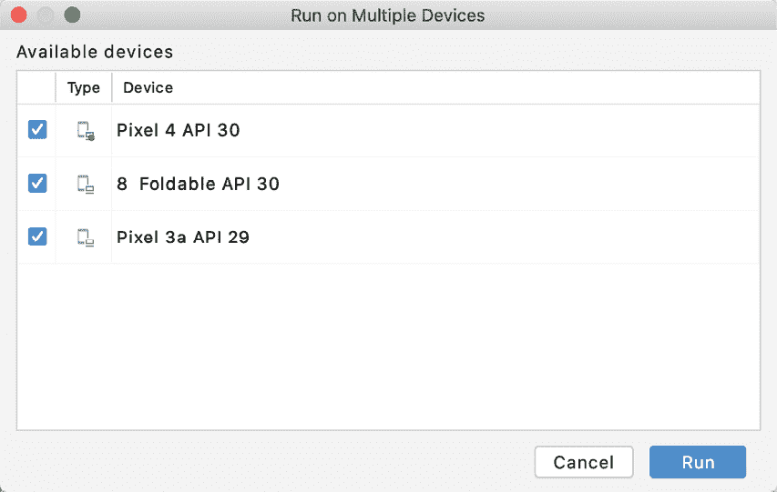

图 4-10

点击`Run`按钮后，Android Studio 将会在选定的模拟器和设备上启动应用程序。

## 4.5 停止运行的应用程序

要停止运行的应用程序，只需点击位于主工具栏上的停止按钮，如图 4-11 所示：

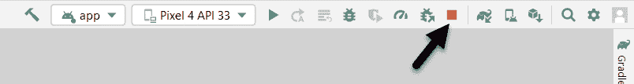

图 4-11

也可以使用`Run`工具窗口终止应用程序。首先，通过应用程序运行时变为可用的窗口栏按钮显示`Run`工具窗口。一旦`Run`工具窗口出现，点击下方图 4-12 所示的高亮显示的停止按钮：

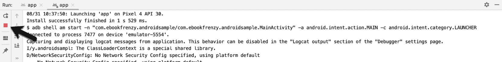

图 4-12

## 4.6 支持深色主题

Android 10 引入了备受期待的深色主题，Android Studio 应用项目默认启用了该功能的支持。要在`AVD`模拟器中测试深色主题，请在模拟器中运行的 Android 实例内打开`Settings`应用。在`Settings`应用中，选择`Display`类别并启用如图 4-13 所示的`Dark theme`选项，使屏幕背景变为黑色：

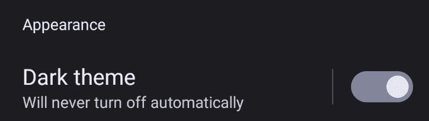

图 4-13

启用深色主题后，运行`AndroidSample`应用，注意它以深色主题显示，包括黑色背景和按钮上的紫色背景，如图 4-14 所示：

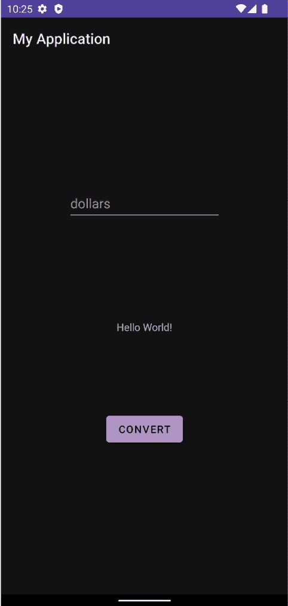

图 4-14

在继续操作之前，返回`Settings`应用并关闭`Dark theme`模式。

## 4.7 在独立窗口中运行模拟器

在本章到目前为止，我们仅将模拟器作为嵌入在 Android Studio 主窗口内的工具窗口使用。若要在独立窗口中运行模拟器，请选择`File -> Settings...`菜单选项（macOS 上为`Android Studio -> Preferences...`），在设置对话框的左侧导航面板中导航到`Tools -> Emulator`，并禁用`Launch in a tool window`选项：

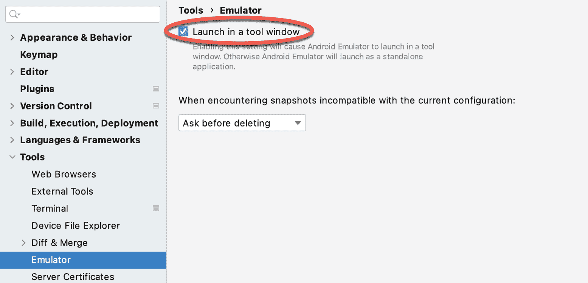

图 4-15

禁用该选项后，点击`Apply`按钮随后点击`OK`以提交更改，然后点击上方图 4-4 中标记为 B 的标签上的关闭按钮退出当前模拟器会话。

再次运行示例应用，此时模拟器将显示所示的独立窗口：

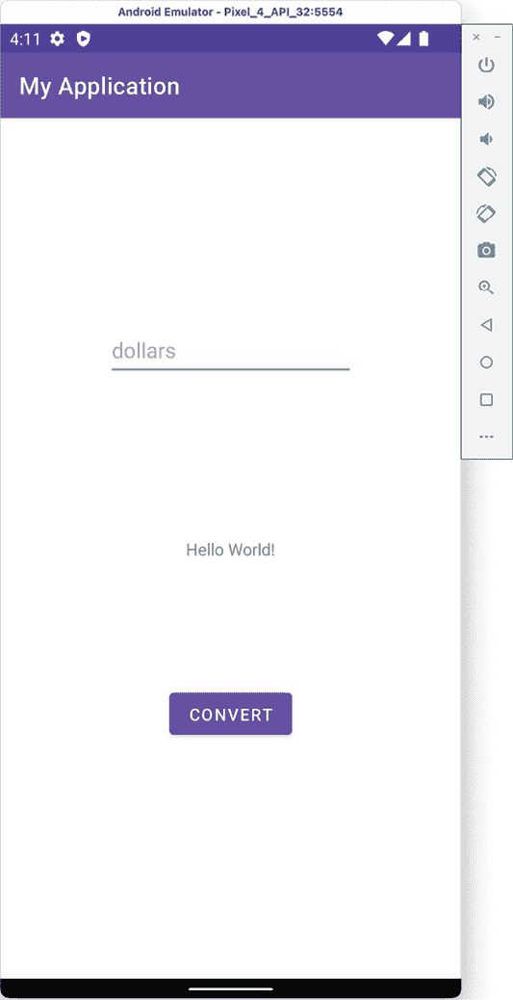

图 4-16

选择独立模式还是工具窗口模式取决于个人喜好。如果你喜欢模拟器在工具窗口中运行，请返回设置屏幕并重新启用`Launch in a tool window`选项。然而，在提交独立模式之前，请记住也可以通过点击模拟器工具栏中的设置按钮（由齿轮图标表示）并选择`View Mode -> Float`菜单选项，将模拟器工具窗口从 Android Studio 主窗口分离：

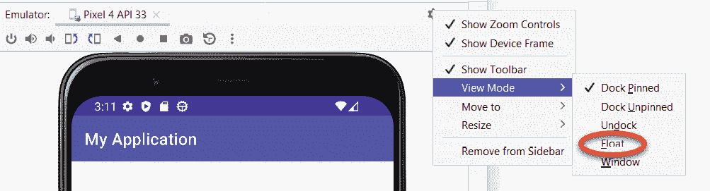

图 4-17

## 4.8 启用设备框架

模拟器可以配置为带有（图 4-18）或不带设备框架（图 4-16）显示。

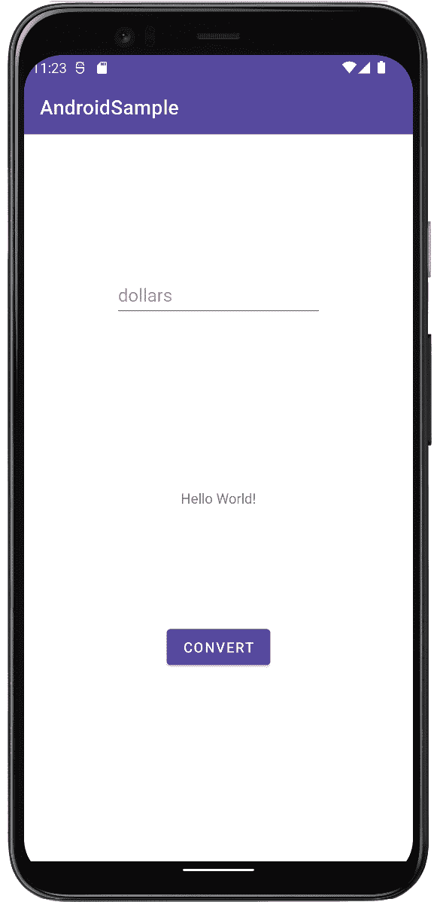

图 4-18

要更改设置，打开`Device Manager`，从列表中选择`AVD`，并点击`Actions`列中的铅笔图标以编辑设置。在设置屏幕中，找到并更改`Enable Device Frame`选项：

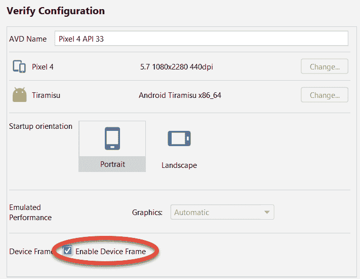

图 4-19

## 4.9 AVD 命令行创建

如前所述，除了图形界面外，还可以直接从命令行创建新的`AVD`。这是通过使用`avdmanager`工具结合一些命令行选项实现的。一旦启动，该工具将在创建`AVD`之前提示额外信息。

`avdmanager`工具需要访问 Java 环境（JRE）。如果在尝试运行`avdmanager`时出现找不到`java`命令的消息，可以配置运行命令提示符或终端以使用 Android Studio 绑定的 JDK。

1. 启动 Android Studio 并打开项目。

2. 选择`File -> Settings...`（macOS 上为`Android Studio -> Preferences...`）。

3. 导航到`Build, Execution, Deployment`部分并选择`Gradle`选项。

4. 点击`JDK`设置并记录 Android home 的路径：


图 4-20

在 Windows 上，在命令提示符中执行以下命令（将`<path to jre>`替换为从对话框复制的路径）：

`set JAVA_HOME=<path to jre>`

在 macOS 或 Linux 上执行以下命令：

如果你预计频繁使用`avdmanager`工具，请按照“设置 Android 开发环境”章节中概述的操作系统环境变量步骤来配置`JAVA_HOME`。

假设系统已配置将 Android SDK 目录包含在`PATH`环境变量中，可以通过在终端中执行以下命令获取`AVD`目标列表：

`avdmanager list targets`

上述命令的输出将包含系统上可用的 Android 版本列表。例如：

```
Available targets:

----------

id: 1 or "android-29"
     Name: Android API 29
     Type: Platform
     API level: 29
     Revision: 1

----------

id: 2 or "android-26"
     Name: Android API 26
     Type: Platform
     API level: 26
```


Revision: 1

`avdmanager` 工具还允许从命令行创建新的 `AVD` 实例。例如，要使用 Android API 29 设备的目标 ID 使用 `x86` ABI 创建名为 `myAVD` 的新 `AVD`，可以使用命令：

```
avdmanager create avd -n myAVD -k "system-images;android-29;google_apis_playstore;x86"
```

`avdmanager` 工具将根据基本 Android 8 设备的规范创建新的 `AVD`，并在需要时提供创建匹配特定设备规范的自定义配置的选项。一旦从命令行创建了新的 `AVD`，在点击 `Refresh` 按钮之前，它可能不会出现在 Android Device Manager 工具中。

除了创建新的 `AVD` 之外，还可以从命令行执行其他任务。例如，可以使用 `list avd` 命令行参数获取当前可用的 `AVD` 列表：

```
avdmanager list avd
```

可用 Android 虚拟设备：

```
Name: Pixel_XL_API_28_No_Play
Device: pixel_xl (Google)
Path: /Users/neilsmyth/.android/avd/Pixel_XL_API_28_No_Play.avd
Target: Google APIs (Google Inc.)
Based on: Android API 28 Tag/ABI: google_apis/x86
Skin: pixel_xl_silver
Sdcard: 512M
```

同样，要删除现有的 `AVD`，只需如下使用 `delete` 选项：

```
avdmanager delete avd –n <avd name>
```

## 4.10 Android 虚拟设备配置文件

默认情况下，与 `AVD` 关联的文件存储在用户主目录下的 `.android/avd` 子目录下，其结构如下（其中 `<avd name>` 被替换为分配给 `AVD` 的名称）：

```
<avd name>.avd/config.ini
<avd name>.avd/userdata.img
<avd name>.ini
```

`config.ini` 文件包含了在 `AVD` 创建过程中指定的设备配置设置，如显示尺寸和内存。这些设置可以直接在配置文件中进行更改，并在下次调用 `AVD` 时被其采纳。

`<avd name>.ini` 文件包含了对目标 Android SDK 的引用以及 `AVD` 文件的路径。请注意，`config.ini` 文件中 `image.sysdir` 值的更改也需要反映在该文件的 `target` 值中。

## 4.11 移动和重命名 Android 虚拟设备

可以使用 `avdmanager` 工具的 `move avd` 参数从命令行更改 `AVD` 的当前名称或文件所在位置。例如，要将命名为 `Pixel4` 的 `AVD` 重命名为 `Pixel4a`，可以执行以下命令：

```
avdmanager move avd -n Pixel4 -r Pixel4a
```

要物理重新移动与 `AVD` 关联的文件，应使用以下命令语法：

```
avdmanager move avd -n <avd name> -p <path to new location>
```

例如，将 `AVD` 从其当前的文件系统位置移动到 `/tmp/Pixel4Test`：

```
avdmanager move avd -n Pixel4 -p /tmp/Pixel4Test
```

注意，在执行移动 `AVD` 的命令之前，目标目录不能已经存在。

## 4.12 总结

典型的应用开发过程遵循编码、编译和在测试环境中运行的循环。Android 应用可以在物理 Android 设备上进行测试，也可以使用 Android 虚拟设备（`AVD`）模拟器进行测试。`AVD` 使用 Android Studio Device Manager 工具创建和管理，该工具可以作为命令行工具使用，也可以通过图形用户界面使用。在创建 `AVD` 以模拟特定的 Android 设备型号时，虚拟设备应配置为与物理设备匹配的硬件规格。

`AVD` 模拟器会可能会以独立窗口的形式显示，也可以嵌入到 Android Studio 主用户界面中。

## 5. 使用和配置 Android Studio AVD 模拟器

在下一章探索在物理 Android 设备上进行测试之前，本章将花费一些时间概述 Android Studio `AVD` 模拟器，并突出介绍在独立模式和工具窗口模式下可用于自定义环境的许多配置功能。

### 5.1 模拟器环境

当以独立模式启动时，模拟器在加载过程中会显示初始启动屏幕。加载完成后，会出现模拟器主窗口，其中包含所选设备类型的表示（在图 5-1 中，这是一个 Pixel 4 设备）：


图 5-1

窗口右侧排列着工具栏，提供了快速访问模拟器控制和配置选项的功能。

### 5.2 模拟器工具栏选项

模拟器工具栏（图 5-2）提供了与模拟器环境外观和行为相关的一系列选项。


图 5-2

工具栏中的每个按钮都关联有一个键盘快捷键，可以通过将鼠标指针悬停在按钮上并等待工具提示出现，或者通过扩展控制面板的帮助选项来识别。

尽管工具栏包含的许多选项都是言而易懂，但为了完整起见，将对每个选项进行介绍：

* **退出 / 最小化 (Exit / Minimize)** – 工具栏中最顶部的“x”按钮在选中时退出模拟器会话，而“－”选项会最小化整个窗口。

* **电源 (Power)** – 电源按钮模拟物理 Android 设备上的电源按钮。点击并释放此按钮将锁定设备并关闭屏幕。长按此按钮将启动设备的“关机”请求序列。

* **音量增大 / 减小 (Volume Up / Down)** – 控制模拟器环境中播放音频音量的两个按钮。

* **向左/右旋转 (Rotate Left/Right)** – 模拟的设备在竖屏和横屏方向之间旋转。

* **截图 (Take Screenshot)** – 拍摄设备屏幕上当前显示的内容。捕获的图像存储在扩展控制面板设置屏幕中指定的位置。

* **缩放模式 (Zoom Mode)** – 此按钮切换进入或退出缩放模式，其细节将在本章后续介绍。

* **返回 (Back)** – 执行标准的 Android“返回”导航返回上一屏幕。

* **主页 (Home)** – 显示设备主屏幕。

* **任务界面 (Overview)** – 模拟标准的 Android“任务界面”导航，显示设备上正在运行的应用。

* **折叠设备 (Fold Device)** – 模拟折叠设备的折叠和展开。此选项仅在模拟器运行折叠设备镜像时可用。

* **扩展控制 (Extended Controls)** – 显示扩展控制面板，允许配置模拟位置和通话活动、电池强度、移动网络类型和指纹识别。

### 5.3 使用缩放模式

位于模拟器工具栏的缩放按钮进入或退出缩放模式。当缩放模式激活时，工具栏按钮处于按下状态，鼠标指针悬停在设备屏幕上时显示放大镜。点击左鼠标键将导致显示相对于选点放大，重复点击会增加缩放级别。相反，点击右鼠标键将减少缩放级别。切换缩放按钮会将显示恢复到默认大小。

在缩放模式下点击并拖动将定义一个矩形区域，释放鼠标后视图将缩放到该区域。

在缩放模式下，可以使用模拟器窗口内的水平和垂直滚动条移动可视区域。

### 5.4 调整模拟器窗口大小

可以通过点击并拖动窗口的任何角或边随时更改模拟器窗口（以及相应的设备表示）的大小。

### 5.5 扩展控制选项

扩展控制工具栏按钮显示图 5-3 所示的面板。默认将显示位置设置。从左侧面板选择不同的类别将显示相应的控件组：

#### 5.5.1 位置 (Location)

位置控制允许以十进制或度分秒坐标的形式将模拟的位置信息发送到模拟器。位置信息可以是单个位置的形式，也可以是代表设备移动的点序列，后者通过 GPS 交换 (GPX) 或 Keyhole 标记语言 (KML) 格式的文件提供。或者，可以使用集成的 Google Maps 面板视觉化地选择单点或旅行路线。

#### 5.5.2 显示器

除了模拟器屏幕内显示的主显示外，“显示器”（Displays）选项允许添加运行在同一 Android 实例中的额外显示器。这对于测试如 Microsoft Surface Duo 等双屏设备的 App 非常有用。这些额外的屏幕可以配置为任何所需的尺寸，并与主屏幕出现在同一个模拟器窗口中。

#### 5.5.3 蜂窝

可以在蜂窝设置屏幕中更改模拟的蜂窝连接类型。提供了模拟不同网络类型（如 `CSM`、`EDGE`、`HSDPA` 等）以及漫游和拒绝访问等一系列语音和数据场景。

#### 5.5.4 电池

在扩展控制屏幕的此面板上，可以模拟各种电池状态和充电条件，包括电池电量、电池健康以及当前是否连接了 AC 器。

#### 5.5.5 摄像头

当摄像头激活时，模拟器会模拟 3D 场景。它表现为虚拟建筑内部，您可以在模拟器内录制视频或拍照之前，通过按住 `Option` 键（Windows 上的 `Alt`）并同时使用鼠标指针和键盘键在其中进行导航。此扩展配置选项允许上传不同的图像以显示在虚拟环境中。

#### 5.5.6 电话

电话扩展控制在模拟器中提供了两个非常简单但实用的模拟。第一个选项允许模拟来自指定电话号码的入电电话。这在测试 App 如何处理此类高层中断时特别有用。

第二个选项允许在模拟器会话中模拟接收短信。与现实世界中一样，这些消息会出现在 `Message` 应用中，并触发模拟器内的标准通知。

#### 5.5.7 方向键

方向键（`D-Pad`）是内置在 Android 设备中或外接（如游戏手柄）的另一组控制控件，提供方向性控制（左、右、上、下）。方向键设置允许在模拟器中模拟 `D-Pad` 交互。

#### 5.5.8 麦克风

麦克风设置允许启用麦克风并模拟虚拟耳机和麦克风连接。还提供按钮启动模拟器上的 `Voice Assistant`。

#### 5.5.9 指纹

许多 Android 设备现在配备了内置指纹检测硬件。`AVD` 模拟器使得测试指纹认证成为可能，无需在带有指纹传感器的物理设备上测试 App。如何在模拟器中配置指纹测试的细节将在本章稍后详细介绍。

#### 5.5.10 虚拟传感器

虚拟传感器选项允许模拟加速度计和磁计，通过偏航（yaw）、俯仰（pitch）和滚滚（roll）设置来模拟设备物理运动的效果，如旋转、移动和倾斜。

#### 5.5.11 快照

快照包含当前运行的 `AVD` 会话状态，可以保存并快速恢复，使模拟器能够返回到精确的状态。快照将在本章稍后介绍。

#### 5.5.12 录制与回放

允许以 WebM 或动画 GIF 格式录制并保存模拟器屏幕和音频。

#### 5.5.13 Google Play

如果模拟器运行安装了 Google Play 服务的 Android 版本，此选项将显示当前的 Google Play 版本，并提供更新模拟器到最新版本的选项。

#### 5.5.14 设置

设置面板提供了一组小型配置选项。使用此面板为工具栏和扩展控制面板选择较深颜色的主题，指定保存截图的文件系统位置，配置 OpenGL 支持级别，并配置模拟器窗口显示在桌面其他窗口之上。

#### 5.5.15 帮助

帮助屏幕包含三个子面板，其中包含键盘快捷键列表、访问模拟器在线文档/报告 Bug 和发送反馈的链接，以及模拟器版本信息。

### 5.6 使用快照

当模拟器第一次启动时，它会执行冷启动，就像物理 Android 设备通电时一样。由于操作系统的加载和所有后台进程的启动，此冷启动过程可能需要一些时间才能完成。为了避免每次启动模拟器都必须经过此过程，系统配置为每次退出时自动保存模拟器当前状态的快照（称为“快速启动快照”）。下次启动模拟器时，快速启动快照将被加载到内存中，并从之前离开的地方继续执行，允许模拟器重启的时间仅为冷启动所需时间的一部分。

扩展控制面板的“快照”屏幕可以在模拟器执行期间的任何点存储额外的快照。这保存了整个模拟器的精确状态，允许模拟器恢复到拍摄快照时的精确时间点。从屏幕内部，可以使用 `Take Snapshot` 按钮拍摄快照（标记为 `Figure 5-4]` 中的 A 标记）。要恢复现有快照，从列表 (B) 中选择它并点击屏幕底部的运行按钮 (C)。还提供了编辑 (D) 快照名称和描述以及删除 (E) 当前选中快照的选项。

设置选项 (F) 提供了配置自动保存快速启动快照的选项（默认情况下，模拟器每次退出都会询问是否保存快速启动快照）以及加载最近的快照。要强制模拟器会话执行冷启动而不是使用快速启动快照，请打开 `AVD Manager`（工具 -> AVD Manager），点击模拟器对应的 Actions 列中的向下箭头，并选择 `Cold Boot Now` 选项。

点击 `Touch the Sensor` 按钮模拟 `Finger 1` 触摸指纹传感器。模拟器将报告指纹添加成功：


图 5-7

要添加更多指纹，请点击 `Add Another` 按钮，并在再次点击 `Touch the Sensor` 按钮之前，从扩展控制面板菜单中选择另一个手指。

## 5.8 工具窗口模式下的模拟器

正如前一章节（“在 Android Studio 中创建 Android 虚拟设备 (AVD)”）所述，Android Studio 可以配置为将模拟器嵌入工具窗口启动，这样它就不会出现在独立的窗口中。当在此模式下运行时，工具栏中将提供与独立模式下可用的相同控件，如图 5-8 所示：


图 5-8

从左到右，这些按钮执行以下任务（详细信息与独立模式一致）：

- 电源
- 音量上
- 音量减
- 向左旋转
- 向右旋转
- 返回
- 首页
- 概览
- 截图
- 快照
- 扩展控制

## 5.9 创建可调整大小的模拟器

除了配置为匹配特定 Android 设备模型的模拟器外，Android Studio 还提供了可调整大小的 `AVD`，允许你在手机、平板和折叠设备尺寸之间切换。要创建一个可调整大小的模拟器，打开 `Device Manager` 并点击 `Create device` 按钮。接下来，选择图 5-9 所示的 `Resizable` 设备定义，并按照通常步骤创建新的 `AVD`：


图 5-9

当你在工具窗口内的新模拟器上运行应用时，工具栏中会出现 `Display mode` 选项，允许你在模拟器配置之间切换，如图 5-10 所示：


图 5-10

如果模拟器在独立模式下运行，可以在侧边工具栏中找到 `Display mode` 选项，如下所示：


图 5-11

## 5.10 总结

Android Studio 包含 Android 虚拟设备模拟器环境，旨在使其无需运行物理 Android 设备即可更轻松地测试应用程序。本章对模拟器进行了简要介绍，并突出了关键功能，这些用于配置和自定义环境以模拟不同的测试条件。

## 6. Android Studio 用户界面概览

虽然人们可能急于运行上一章中创建的示例应用，但这样做涉及到使用 Android Studio 用户界面的某些方面，这些内容最好先进行描述。

Android Studio 是一个强大且功能丰富的开发环境，在很大程度上是直观易用的。尽管如此，现在花时间来熟悉 Android Studio 用户界面的布局和结构，将大大缩短本书后续章节的学习曲线。考虑到这一点，本章将提供构成 Android Studio 环境的各种区域和组件的初步概述。

## 6.1 欢迎屏幕

欢迎屏幕（图 6-1）在 Android Studio 运行且当前没有打开任何项目时显示（可以通过选择 `File -> Close Project` 菜单选项随时关闭项目）。如果在项目仍打开时之前退出了 Android Studio，工具在下次启动时将跳过欢迎屏幕，自动打开之前活跃的项目。


图 6-1

除了最近项目列表外，欢迎屏幕提供了执行任务的选项，如打开和创建项目，以及访问当前位于版本控制下的项目。此外，`Customize` 屏幕提供了更改 IDE 和编辑器使用的主题和字体设置的选项。可以使用 `Plugins` 选项查看、安装和管理 Android Studio 插件。

点击菜单按钮可以获得更多选项，如图 6-2 所示：


图 6-2

## 6.2 主窗口

当创建新项目或打开现有项目时，Android Studio 主窗口将出现。当同时打开多个项目时，每个项目将分配到自己的主窗口。窗口的精确配置将取决于项目上次打开时显示了哪些工具和面板，但通常类似于图 6-3 所示。


图 6-3

主窗口的各种元素可以总结如下：

A – 菜单栏 – 包含用于在 Android Studio 环境中执行任务的一系列菜单。

B – 工具栏 – 经常执行的操作快捷键选择。工具栏按钮提供了快速访问一组菜单栏操作的通道。可以通过右键点击工具栏并选择 `Customize Menus and Toolbars…` 菜单选项来自定义工具栏。如果工具栏不可见，可以使用 `View -> Appearance -> Toolbar` 菜单选项显示。


C – 导航栏 – 导航栏提供了在组成项目的文件和文件夹之间移动的方便方法。点击导航栏中的元素将列出该处的子文件夹和文件供选择。同样，点击类名将列出该类的方法。从列表中选择方法将跳转到代码编辑器中的相应位置。使用`View -> Appearance -> Navigation Bar`菜单选项隐藏或显示此栏。

D – 编辑器窗口 – 编辑器窗口显示当前正在开发的文件内容。当打开多个文件时，每个文件都由编辑器顶部的标签表示，如图 6-4 所示：


图 6-4

E – 状态栏 – 状态栏显示有关项目和 Android Studio 活动的信息消息，以及位于远左角的工具菜单按钮。悬停在状态栏项目上将显示该字段的描述。许多字段是交互式的，允许用户点击以执行任务或获取更详细的状态信息。

F – 项目工具窗口 – 项目窗口提供了项目文件结构的层次概述，允许导航到特定的文件和文件夹。工具栏可以使用不同的方式显示项目。默认设置是`Android`视图，这是本书其余部分使用的模式。

项目窗口只是 Android Studio 环境中许多工具窗口之一。

## 6.3 工具窗口

除了项目视图工具窗口，Android Studio 还包含许多其他窗口，启用后，它们将显示在主窗口的底部和侧面。可以通过将鼠标指针悬停在状态栏最左角的按钮上（图 6-5）而不点击鼠标按钮来显示工具窗口快速访问菜单。


图 6-5

从快速访问菜单中选择项目将导致相应的工具窗口在主窗口中出现。

或者，也可以通过点击状态栏中的快速访问菜单图标来显示一组工具窗口栏。这些工具栏会出现在主窗口的左侧、右侧和底部边缘（如图 6-6 中的箭头所示），并包含用于显示和隐藏每个工具窗口的按钮。当工具窗口栏显示时，再次点击状态栏中的按钮将把它们隐藏。


图 6-6

点击按钮将显示相应的工具窗口，而再次点击将隐藏该窗口。带有数字前缀的按钮（例如`1: Project`）表示可以通过按下键盘上的`Alt`键（macOS 上为`Command`键）配合相应的数字来显示该工具窗口。

按钮在工具窗口栏中的位置表示该窗口在显示时将出现在窗口的哪一。可以通过点击并拖拽按钮到其他窗口工具栏中的不同位置来更改这些位置。

每个工具窗口在顶部边缘都有自己的工具栏。这些工具栏中的按钮随工具的不同而异，但所有工具窗口都包含一个由齿轮图标表示的设置选项，允许更改窗口的各个方面。图 6-7 显示了`Project`工具窗口的设置菜单。可用选项包括取消停靠窗口并允许其浮动在 Android Studio 主窗口边界之外，以及移动和调整工具面板的大小。


图 6-7

所有窗口在工具栏的最右侧还包含一个按钮，提供了隐藏工具窗口视图的额外方法。只需通过点击窗口获取焦点，然后输入搜索词（例如`Project`工具窗口中的文件名），即可对工具窗口内的项目进行搜索。搜索框将出现在窗口的工具栏中，与搜索匹配的项将会被高亮显示。

Android Studio 提供了广泛的工具窗口，最常用的如下：

- **App Inspection**（应用检查） - 提供访问`Database`（数据库）和`Background Task`（后台任务）检查器。`Database Inspector`允许你在应用运行时检查、查询和修改应用的数据库。`Background Task Inspector`允许监控和管理使用`WorkManager`创建的后台工作任务。

- **Build**（构建） - 构建工具窗口显示项目正在编译和打包时的构建过程信息，并显示遇到的任何错误详细信息。

- **Build Variants**（构建变体） – 构建变体工具窗口提供了为当前应用程序项目配置不同构建目标的快速方法（例如为应用程序的调试和发布版本提供不同的构建，或针对不同设备类别的多个构建）。

- **Device File Explorer**（设备文件管理器） - 通过`View` -> `Tool Windows` -> `Device File Explorer`菜单可用，该工具窗口直接访问当前连接的 Android 设备或模拟器的文件系统，允许浏览文件系统并将文件复制到本地文件系统。

- **Device Manager**（设备管理器） - 提供访问`Device Manager`工具窗口的权限，可以在其中添加、删除和管理物理 Android 设备连接和模拟器。

- **Emulator**（模拟器） - 如果启用了“在 Android Studio 中创建 Android 虚拟设备 (AVD)”章节中所述的在工具窗口中运行模拟器的选项，则该窗口包含`AVD`模拟器。

- **Bookmarks**（书签） – `Bookmarks`工具窗口提供了快速访问已书签的文件和代码行。例如，在项目视图中右键点击文件可以访问`Add to Bookmarks`菜单选项。同样，可以通过将光标移动到该行并按下`F11`键（macOS 上为`F3`）书签源文件中的代码。所有书签项都可以通过此窗口访问。

- **Gradle** - `Gradle`工具窗口提供了组成项目构建配置的`Gradle`任务视图。窗口列出了参与将项目各种元素编译为可执行应用程序的任务。右键点击顶层`Gradle`任务并选择`Open Gradle Config`菜单选项，可以将当前项目的`Gradle`构建文件加载到编辑器中。`Gradle`将在本书后部分进行详细介绍。

- **Layout Inspector**（布局检查器） - 提供构成用户界面布局的组件层次结构的可视 3D 渲染。

- **Logcat** - `Logcat`工具窗口提供了对运行应用程序监控日志输出的访问，外提供了拍摄应用程序截图和视频以及停止和重启进程的选项。

- **Problems**（问题） - 查看项目内所有当前错误或警告的中心位置。双击问题列表中的项将带您进入问题所在的文件和位置。

- **Profiler**（分析器） - `Android Profiler`工具窗口提供了识别运行应用中性能问题的实时监控和分析工具，包括 CPU、内存和网络使用情况。此选项在应用当前运行时变为可用。

- **Project**（项目） - 项目视图提供了构成项目的文件结构概述，允许在文件之间快速导航。通常情况下，在项目视图中双击文件将导致该文件加载到适当的编辑工具中。

- **Resource Manager**（资源管理器） - 用于添加和管理项目包含的资源和资产（如图像、颜色和布局文件）。

- **Run**（运行） - 当应用程序运行时，运行工具窗口变为可用并提供运行结果视图以及停止或重启进程的选项。如果应用程序无法安装和运行，此窗口通常会提供相关的诊断信息。

- **Structure**（结构） - 结构工具提供了当前编辑器中源文件的结构层次视图。这些信息包括类、方法和变量。从结构列表中选择项将带您进入编辑器中的对应位置。

- **Terminal**（终端） - 提供访问运行 Android Studio 的系统的终端窗口。在 Windows 系统上，它是命令提示符界面，而在 Linux 和 macOS 系统上，它呈现为终端提示符。

- **TODO**（待办事项） – 顾其实名，此工具提供了查看项目中尚未完成项的地方。Android Studio 通过扫描组成项目的源文件查找指定`TODO`模式的注释来编译此列表。可以通过选择`File` -> `Settings…`菜单选项（macOS 上为`Preferences…`）并导航到`Editor`下的`TODO`页面查看和更改这些模式。

- **Version Control**（版本控制） - 当项目文件受源代码版本控制时使用此工具窗口，允许访问`Git`仓库和代码更改历史。

Android Studio 包含了大量的键盘快捷键，旨在执行常用任务时节省时间。可以在 Android Studio 项目窗口内通过选择`Help` -> `Keymap Reference`菜单选项查看并打印完整的键盘快捷键列表。您还可以通过选择`File` -> `Settings...`菜单选项（macOS 上为`Preferences...`）并点击`Keymap`来列出并修改键盘快捷键。

## 6.5 切换器和最近文件导航

在 Android Studio 主窗口内进行导航的另一个有用机制是使用`Switcher`（切换器）。通过`Ctrl-Tab`快捷键访问，切换器会以面板的形式出现，列出工具窗口和当前打开的文件（图 6-9）。


图 6-9

一旦显示出来，只要`Ctrl`键保持按下状态，切换器就会保持可见。按住`Ctrl`键并重复点击`Tab`键可以在各种选择选项之间循环，松开`Ctrl`键将选中当前高亮的项并在主窗口中显示。

除了切换器之外，`Recent Files`（最近文件）面板提供了导航到最近打开的文件的功能（图 6-10 可以使用可以使用`Ctrl-E`快捷键（mac 上为`Cmd-E`）访问它。显示后，可以使用鼠标指针选择选项，或使用键盘箭头键滚动浏览文件名和工具窗口选项。按下`Enter`键将选中当前高亮的项。


图 6-10

## 6.6 修改 Android Studio 主题

Android Studio 环境的整体主题可以通过欢迎界面的`Configure -> Settings`（配置 -> 设置）选项，或者通过主窗口的`File -> Settings…`菜单（mac 上为`Android Studio -> Preferences…`）进行更改。

一旦显示设置对话框，在左侧面板中选择`Appearance & Behavior`（外观与行为），然后选择`Appearance`（外观），在点击`Apply`（应用）按钮之前更改`Theme`（主题）菜单设置。可用主题取决于平台，但通常包括`Light`（浅色）、`IntelliJ`、`Windows`、`High Contrast`（高对比度）和`Darcula`等选项。图 6-11 显示选择了`Darcula`主题的主窗口示例：


图 6-11

要将 Android Studio 主题与操作系统的亮/色模式设置同步，请启用`Sync with OS`（与操作系统同步）选项，并使用下拉菜单控制每个模式下使用哪个主题：


图 6-12

## 6.7 总结

Android Studio 环境的主要元素包括欢迎界面和主窗口。每个打开的项目都分配有自己的主窗口，该窗口反过来由菜单栏、工具栏、编辑和设计区域、状态栏以及工具窗口组成。工具窗口显示在主窗口的侧边和底部，可以通过状态栏中的快速访问菜单访问，也可以通过可选的工具窗口栏访问。

Android Studio 中有极少数的操作是无法通过快捷键触发的。可以随时从 Android Studio 主窗口访问默认快捷键的键位映射（keymap）。

## 7. 在物理 Android 设备上测试 Android Studio 应用

虽然使用 Android 虚拟设备 (AVD) 测试应用程序可以实现许多功能，但在物理 Android 设备上进行真实世界的应用测试是不可替代的，而且由于某些 Android 功能仅在物理 Android 设备上可用。

与 AVD 实例和已连接的 Android 设备的通信均由 Android 调试桥接 (`ADB`) 处理。在本章中，我们将解释如何配置`adb`环境，以便在基于 macOS、Windows 和 Linux 的系统上对 Android 设备进行应用测试。

### 7.1 Android 调试桥 (ADB) 概述

`ADB`的主要目的是促进开发系统（在本例中为 Android Studio）与 AVD 模拟器以及 Android 设备之间的交互，以运行和调试应用程序。`ADB`允许通过 WiFi 网络或直接使用 USB 线连接到设备。

`ADB`由一个客户端、一个运行在开发系统后台的服务器进程以及一个运行在 AVD 或真实 Android 设备（如手机和平板电脑）上的守护进程后台进程组成。

`ADB`客户端有多种形式。例如，以名为`adb`的命令行工具形式提供，位于 Android SDK 的`platform-tools`子目录中。同样，Android Studio 也有一个内置的客户端。

可以使用`adb`命令行工具执行多种任务。例如，可以使用`devices`命令行参数获取当前活跃的虚拟或物理设备列表。以下命令输出表示系统中存在一个 AVD 但没有物理设备：

```
$ adb devices

List of devices attached
emulator-5554 device
```

### 7.2 在 Android 设备上启用 USB 调试 ADB

在`ADB`连接到 Android 设备之前，该设备必须先配置为允许连接。在运行 Android 6.0 或更高版本的手机和平板设备上，实现此点的步骤如下：

1. 打开设备上的`Settings`（设置）应用并选择`About tablet`或`About phone`（在某些 Android 版本中，可以在`Settings`应用的`System`页面找到）。

2. 在`About`屏幕上滚动到`Build number`（版本号）字段（图 7-1）并点击七次，直到出现指示开发者模式已启的消息。如果`About`屏幕上没有列出`Build number`，则可以通过`Software information`（软件信息）选项找到。或者，如果可用，展开列表中的`Advanced`（高级）部分。


图 7-1

3. 返回设置设置主屏幕，注意出现了`Developer options`（开发者选项）选项（在较新的 Android 版本中，该选项位于`System`设置屏幕）。选择此选项，并在生成的屏幕上找到图 7-2 所示的`USB debugging`选项：


图 7-2

4. 启用`USB debugging`选项并在请求时点击`Allow`（允许）按钮。

此时，设备已配置为接受来自开发系统的`adb`连接。剩下的工作是配置开发系统检测该设备。虽然这是一个相对简单的过程，但取决于开发系统运行的是 Windows、macOS 还是 Linux。以下步骤假设 Android SDK`platform-tools`目录已包含在操作系统的`PATH`环境中，参见“设置 Android Studio 开发环境”章节(#Installation.xhtml__idTextAnchor09)。

#### 7.2.1 macOS ADB 配置

要在 macOS 系统上配置`ADB`环境，使用 USB 线将设备连接到计算机，打开终端窗口并执行以下命令重启`adb`服务器：

```
$ adb kill-server
$ adb start-server
* daemon not running. starting it now on port 5037
* daemon started successfully *
```

服务器成功启动后，执行以下命令验证设备是否已检测到：

```
$ adb devices

List of devices attached
74CE00060000001 offline
```

如果设备被列为`offline`（离线），回到 Android 设备并检查是否存在图 7-3 所示的请求允许 USB 调试的对话框。勾选“Always allow from this computer”（始终允许此计算机）旁边的复框，然后点击`OK`。


图 7-3

重复执行`adb devices`命令现在应该列出可用设备：

```
$ adb devices

List of devices attached
015d41d4454bf80c device
```

如果没有列出设备，尝试注销并重新登录 macOS 桌面，如果问题仍然存在，请重启系统。

#### 7.2.2 Windows ADB 配置

在配置 Windows 开发系统以使用`ADB`连接到 Android 设备时，第一步是在系统上安装相应的 USB 驱动程序。需要安装的 USB 驱动程序取决于 Android 设备的型号。如果你拥有 Google 设备（例如 Pixel 手机），则有必要在你的 Windows 系统上安装并配置`Google USB Driver`程序包。实现此操作的详细步骤请参见以下网页：

[`developer.android.com/sdk/win-usb.html`](https://developer.android.com/sdk/win-usb.html)

对于不支持`Google USB`驱动程序的 Android 设备，则需要下载由设备制造商提供的驱动程序。你可以在线上获取驱动程序列表以及下载和安装信息：

[`developer.android.com/tools/extras/oem-usb.html`](https://developer.android.com/tools/extras/oem-usb.html)

安装驱动程序后，一旦设备被识别为正确的设备类型，打开命令提示符窗口并执行以下命令：

```
adb devices
```

该命令应该输出关于已连接设备的信息，类似于下所示：

```
List of devices attached
HT4CTJT01906 offline
```


如果设备被列为`offline`（离线）或`unauthorized`（未授权），请查看设备屏幕并检查[图 7-3]中请求“Allow USB debugging”（允许 USB 调试）的对话框。在点击确定之前，勾选“Always allow from this computer”（始终允许来自此计算机）旁复选框。再次执行`adb devices`命令会将设备列为已就绪：

```
List of devices attached
HT4CTJT01906 device
```

如果设备未列出，执行以下命令重启`ADB`服务：

```
adb kill-server
adb start-server
```

如果设备仍然未列出，尝试执行以下命令：

```
android update adb
```

请注意，可能还需要重新启动系统。

## 7.2.3 Linux adb 配置

在本章中，我们将再次使用 Ubuntu Linux 作为参考示例，介绍如何在 Linux 上配置`adb`以连接物理 Android 设备进行应用测试。

在 Ubuntu Linux 上进行物理设备测试需要安装名为`android-tools-adb`的包，这反过来要求 Android Studio 用户必须是`plugdev`组的成员。大多数 Ubuntu 版本的用户账户默认此类设置，可以通过运行`id`命令进行验证。如果没有列出`plugdev`组，请运行以下命令将你的账户添加到该组：

```
sudo usermod -aG plugdev $LOGNAME
```

在满足组成员要求后，可以通过执行以下命令安装`android-tools-adb`包：

```
sudo apt-get install android-tools-adb
```

完成上述更改后，重启 Ubuntu 系统。系统重启后，打开终端窗口，启动`adb`服务并检查已连接的设备列表：

```
$ adb start-server
* daemon not running. starting it now on port 5037 *
* daemon started successfully *
$ adb devices
List of devices attached
015d41d4454bf80c offline
```

如果设备被列为`offline`或`unauthorized`，请查看 Android 设备并检查[图 7-3]中请求“Allow USB debugging”（允许 USB 调试）的对话框。

### 7.3 解决 USB 连接问题

如果你无法通过上述步骤成功连接到设备，请显示运行目标菜单（[图 7-4]）并选择`Troubleshoot Device Connections`（排除设备连接）选项：


图 7-4

连接助手将扫描设备并报告问题及可能的解决方案。

### 7.4 在 Android 设备上启用无线调试

在 Android 设备上启用无线调试，请按照上述步骤 1 到 3 操作，这次是显示[图 7-5]所示的`Wireless debugging`选项：


图 7-5

接下来，点击[图 7-6]所示的`Wireless debugging`条目：


图 7-6

如果设备被列为`offline`或`unauthorized`，请查看 Android 设备并检查[图 7-3]中请求“Allow USB debugging”（允许 USB 调试）的对话框。在点击确定之前，勾选“Always allow from this computer”（始终允许来自此计算机）旁复选框。再次执行`adb devices`命令会将设备列为已就绪：

```
List of devices attached
HT4CTJT01906 device
```

如果设备未列出，执行以下命令重启`ADB`服务：

```
adb kill-server
adb start-server
```

如果设备仍然未列出，尝试执行以下命令：

```
android update adb
```

请注意，可能还需要重新启动系统。

### 7.5 测试 adb 连接

假设在所选平台上已成功配置`adb`，下一步是尝试在设备上运行“在 Android Studio 中创建应用”章节中创建的应用。启动 Android Studio，打开项目，并验证设备是否出现在[图 7-11]所示的设备菜单中：


从列表中选择设备并点击运行按钮（位于设备菜单右侧的绿色箭头按钮）安装并运行应用。

### 7.6 设备镜像

设备镜像允许你在物理设备上运行应用，同时在 Android Studio 的`Running Devices`工具窗口中查看设备显示。换句话说，尽管应用在物理设备上运行，但它以类似于 AVD 实例的方式出现在 Android Studio 中。

设备镜像是 Android Studio Electric Eel 的一项实验功能，必须手动启用。要启用设备镜像，选择`File -> Settings...`（macOS 上为`Android Studio -> Preferences...`），选择左面板中的`Experimental`项，并开启“Enable mirroring of physical Android devices”（启用物理 Android 设备镜像），如[图 7-12]所示：


在启用设备镜像后，将设备连接到 Android Studio，显示`Running Devices`工具窗口（`View -> Tool Windows -> Running Devices`）。Android Studio 将镜像物理设备的显示。

### 7.7 总结

虽然 Android 虚拟机模拟器提供了一个极佳的测试环境，但重要的是，确保应用在物理 Android 设备上正常运行没有真正的替代方案。毕竟，这才是应用在现实世界中被使用的地方。

默认情况下，Android Studio 环境并未配置为将 Android 设备视为目标测试设备。因此，必须执行一些步骤，以便能够在 Android Studio 开发环境中通过 USB 线缆或 WiFi 网络将应用程序直接加载到 Android 设备上。实现这一目标的具体步骤取决于所使用的开发平台。在本章中，我们已经涵盖了适用于 Linux、macOS 和基于 Windows 平台的步骤。

# 8. Android Studio 代码编辑器的基础

开发 Android 应用涉及大量的编程工作，根据定义，这涉及到输入、审查和修改代码行。开发者在使用 Android Studio 时花费的大部分时间通常都是在编辑器窗口内编辑代码，这似乎并不令人意外。

现代代码编辑器需要远超最初的输入、删除、剪切和粘贴等基本功能。如今，代码编辑器的实用性通常由等因素衡量，例如它在减少程序员输入量方面的程度、在大型源文件中导航的便利性，以及编辑器在编写代码时实时检测并突出显示编程错误的能力。正如本章将所示，这些只是 Android Studio 编辑器出色的领域之一。

虽然本章并非对 Android Studio 编辑器功能的详尽概述，但旨在提供一份该工具关键功能的指南。丰富的程序员会发现，其中某些功能是目前大多数代码编辑器的共同点，而许多功能是这一特定编辑环境独有的。

### 8.1 Android Studio 编辑器

当选择 Java、Kotlin、XML 或其他文本文件进行编辑时，Android Studio 编辑器出现在主窗口的中心。例如，图 8-1 显示了一个加载了 Java 源文件的典型编辑器会话：


图 8-1

构成编辑器窗口的元素总结如下：

**A – 文档标签 (Document Tabs)** – Android Studio 能够同时打开多个文件进行编辑。每当打开一个文件时，它都会分配一个文档标签，在编辑器窗口顶部边缘的标签栏中显示文件名。当空间不足以显示所有标签时，标签栏的最右侧会出现一个较小的下拉菜单。点击此菜单将列出其他已打开的文件列表。标签页中文件名下方的红色波浪线表示该文件中的代码包含一个或多个错误，这些错误在项目编译和运行之前需要解决。

在文件之间进行切换只需点击相应的标签或使用快捷键`Alt-Left`和`Alt-Right`。也可以使用 Switcher 机制（通过快捷键`Ctrl-Tab`访问）进行文件间的导航。

要将编辑器面板从 Android Studio 主窗口分离以便在单独窗口中显示，请点击标签并将其拖到主窗口之外的桌面区域。要将编辑器返回主窗口，请点击分离的编辑器窗口中的文件标签，并将其拖放到主窗口中原始编辑器标签栏上。


**B – 编辑器行槽区 (The Editor Gutter Area)** - 槽区被编辑器用于显示信息图标和控件。该槽区中出现的一些典型项目包括调试断点标记、用于折叠和展开代码块的控件、书签、更改标记和行号。行号默认开启，但可以通过在槽区上点击单击右键并选择`Show Line Numbers`菜单选项来将其禁用。

**C – 代码结构位置 (Code Structure Location)** – 编辑器顶部的此栏显示了光标相对于代码整体结构的位置。例如，在图中，该栏指示当前正在编辑`convertCurrency`方法，且该方法包含在`MainActivity`类中。


图 8-2

双击栏内的任意元素将把光标移动到代码文件中的相应位置。例如，双击`convertCurrency`条目将把光标移动到源代码中`convertCurrency`方法的顶部。同样，点击`MainActivity`条目将弹出一个可供选择的代码导航点列表：


图 8-3

**D – 编辑器区域 (The Editor Area)** – 这是用户显示、输入和编辑代码的主区域。本章随后的章节将详细介绍编辑区域的关键功能。

**E – 验证与标记侧边栏 (The Validation and Marker Sidebar)** – Android-ndroid Studio 整合了一项名为“实时代码分析”（on-the-fly code analysis）的功能。这本质上意味着当你输入代码时，编辑器正在分析代码以检查警告和语法错误。验证侧边栏顶部的指示器会随着代码的添加实时更新，指示发现的错误和警告数量。点击此指示器将显示一个弹出窗口，如图 8-4 所示，其中包含编辑器中代码发现问题的摘要：


图 8-4

可以使用向上和向下箭头在代码中的错误位置之间移动。绿色勾钩表示未检测到警告或错误。

侧边栏还使用相同的颜色编码在检测到问题的位置显示标记。当代码行在编辑器区域可见时，将鼠标指针悬停在标记上将显示一个包含问题描述的弹出窗口：


图 8-5

当代码行当前位于编辑器区域的可视图之外时，将鼠标指针悬停在标记上将显示一个包含问题所在代码块的“透镜”覆盖层（图 8-6），从而无需滚动到编辑器的该位置即可：


图 8-6

值得注意的是，透镜覆盖不仅限于侧边栏的警告和错误。悬停在侧边栏的任何部分都会显示一个包含源文件中该位置代码的透镜。

**F – 状态栏 (The Status Bar)** – 虽然状态栏实际上是主窗口的一部分而非编辑器，但它确实包含有关当前活动编辑会话的信息。这些信息包括光标在行和字符方面的当前位置，以及文件的编码格式（UTF-8、ASCII 等）。点击状态栏中的这些值可以更改相应的设置。例如，点击行号将显示“转到行：列”对话框。使用`View -> Appearance -> Status Bar Widgets`菜单选项可以添加和删除组件。例如，如果你遇到 Android Studio 的性能问题，内存指示（Memory Indicator）是一个非常有帮助的组件。

在对构成 Android Studio 编辑器的元素进行概述之后，本章剩余部分将更详细地介绍编辑环境的关键功能。

### 8.2 分割编辑器窗口

默认情况下，编辑器将显示单个面板，用于显示当前选中文件的内容。在同时处理多个源代码文件时，一个特别实用的功能是将编辑器拆分为多个窗格。若要拆分编辑器，请在编辑器窗口内右键点击文件标签，然后选择`Split Vertically`（垂直拆分）或`Split Horizontally`（水平拆分）菜单选项。例如，图 8-7 显示了拆分器的工作状态，编辑器被分为三个面板：


图 8-7

可以通过右键点击相应的标签并选择`Change Splitter Orientation`（更改拆分方向）菜单选项，随时更改拆分面板的方向。重复这些步骤可以取消单个面板的拆分，从从中选择`Unsplit`（取消拆分）选项。可以通过右键点击任何标签并选择`Unsplit All`（取消全部拆分）移除所有的拆分面板。

窗口拆分可显示不同的文件，或为同一个文件提供多个窗口，允许同时查看和编辑同一文件的不同区域。

### 8.3 代码补全

Android Studio 编辑器对 Java 编程语法以及构成 Android SDK 的类和方法拥有大量的内置知识，同时也对您自己的代码库有深入了解。在输入代码时，编辑器会扫描正在输入的内容，并在适当的情况下针对完成某个语句或引用可能需要的内容提供建议。当编辑器检测到代码补全建议时，将出现一个包含建议列表的面板。例如，在图 8-8 中，编辑器正在为`String`声明的开头提供可能的选项：


图 8-8

如果没有任何自动补全建议是正确的，只需继续输入，编辑器将在适当的情况下继续精炼建议。若要采纳最顶部的建议，只需按下键盘上的`Enter`或`Tab`键。若要选择不同的建议，请使用方向键在列表中上下移动，再次使用`Enter`或`Tab`键选中高亮的项。

可以使用`Ctrl-Space`组合键手动调用完成补全建议。这在更改编辑器中的单词或声明时非常有用。当光标置于编辑器中的某个单词上时，该单词将自动高亮。按下`Ctrl-Space`将显示一组备选建议。若要将当前单词替换为建议列表中当前高亮的项，只需按下`Tab`键。

除了实时自动补全功能外，Android Studio 编辑器还提供名为“智能补全”（Smart Completion）的系统。智能补全通过`Shift-Ctrl-Space`组合键调用，选中后将根据代码当前的上下文提供更详细的建议。再次按下`Shift-Ctrl-Space`快捷键将从更广泛范围内提供更多建议。

代码补全对许多程序员来说可能取决于个人偏好。考虑到这一事实，Android Studio 对自动补全设置提供了很高的控制权限。可以通过选择`File -> Settings…`菜单选项（macOS 上`Android Studio -> Preferences…`）并在设置面板中选择`Editor -> General -> Code Completion`来查看和修改这些设置，如图 8-9 所示：


图 8-9

### 8.4 语句补全

Android Studio 编辑器提供的另一种自动补全形式是语句补全。它可以自动填充方法和循环语句等项的括号和大括号。语句补全通过通过`Shift-Ctrl-Enter`（macOS 上为`Shift-Cmd-Enter`）组合键调用。请考虑以下代码：

```
myMethod()
```

在编辑器中输入此代码后，触发语句补全将导致编辑器自动为方法添加大括号：

```java
myMethod() {

}
```

### 8.5 参数信息

还可以请求编辑器提供关于方法接受的参数参数的信息。当光标置于方法调用的括号之间时，使用`Ctrl-P`（macOS 上为`Cmd-P`）组合键将显示该方法已知接受的参数，并对可能的建议进行加粗高亮：


图 8-10

### 8.6 参数名提示

代码编辑器可以配置为在方法调用中显示参数名提示。例如，图 8-11 高亮了`Snackbar`类`make()`和`setAction()`方法调用中的参数名提示：


图 8-11

此模式的设置可以通过选择`File -> Settings`菜单（macOS 上为`Android Studio -> Preferences`），然后在左侧面板中选择`Editor -> Inlay Hints -> Java`来配置。在结果屏幕上，从列表中选择`Parameter Hints`项并启用或禁用`Show parameter hints`选项。要调整提示设置，点击`Exclude list...`链接进行任何必要的调整。

### 8.7 代码生成

除了在输入代码时进行补全外，编辑器在某些条件下还可以为您生成代码。如图 8-12 所示的可用代码生成选项列表可以在光标位于文件所需位置时使用`Alt-Insert`（macOS 上为`Cmd-N`）快捷键来访问。


图 8-12

考虑一种在`Activity`被操作系统销毁之前收到通知的情况。正如本书后续章节概述的那样，这可以通过重写`Activity`的生命周期方法来实现。要让 Android Studio 生成此存根方法，只需从代码生成列表中选择`Override Methods`选项，并在方法列表中选择`onStop()`方法：


图 8-13

选择好要覆盖的方法后，点击 OK 将在源位置生成存根方法：

```java
@Override
protected void onStop() {
    super.onStop();
}
```

### 8.8 代码折叠

一旦源文件达到一定大小，即使是格式良好、组织良好的代码也可能变得难以处理和导航。Android Studio 认为没有必要显示所有代码块的内容。通过使用 Android Studio 编辑器的代码折叠功能可以使代码导航变得更容易。代码折叠通过位于源文件中代码块开始和结束处的边缘标记来控制。例如，图 8-14 高亮了当前未折叠的方法定义的起始和结束标记：


图 8-14

点击这些标记之一都将折叠语句，使其只显示签名行，如图 8-15 所示：


图 8-15

要展开已折叠的代码部分，只需点击编辑器边缘的`+`标记。若要在不折叠的情况下查看隐藏的代码，请将鼠标指针悬停在`{…}`指示器上。编辑器随后将显示一个包含折叠代码块的透镜叠加：


图 8-16

文件中的所有代码块都可以使用`Ctrl-Shift-Plus`和`Ctrl-Shift-Minus`组合键进行折叠或展开。

默认情况下，`Android Studio`编辑器在打开源文件时会自动折叠某些代码。要配置发生此情况条件，请选择`File` -> `Settings…`（macOS 上为`Android Studio` -> `Preferences…`），并在生成的设置面板中选择`Editor` -> `General` -> `Code Folding`（图 8-17）：


图 8-17

### 8.9 快速文档查询

通过将光标置于需要查看文档的声明上并按下`Ctrl-Q`快捷键（macOS 上为`Ctrl-J`），可以访问与上下文相关的 Java 和 Android 文档。这将显示一个包含该项目相关参考文档的弹出窗口。例如，图 8-18 显示了`AndroidFloatingActionButton`类的文档。


图 8-18

### 8.10 代码重格式

通常情况下，`Android Studio`编辑器会在添加语句和代码块时，根据缩进、间距和嵌套自动对代码格式格式。在需要重新格式化代码的情况下（这是很常见的情况，例如从网站复制粘贴示例代码时），编辑器提供了源码重格式功能，选择该功能后将自动重格式代码以匹配主流的代码风格。

要重格式源代码，请按`Ctrl-Alt-L`（macOS 上为`Cmd-Opt-L`）快捷键组合。要显示“重格式代码”对话框（图 8-19），请使用`Ctrl-Alt-Shift-L`（macOS 上为`Cmd-Opt-Shift-L`）。此对话框提供了仅重格式当前选定代码、编辑器中活动的整个源文件或仅重格式由于源码控制更新而更改的代码选项。


图 8-19

完整的代码风格偏可以在项目设置对话框中更改。选择`File` -> `Settings`菜单（macOS 上为`Android Studio` -> `Preferences…`）并在左侧面板中选择`Code Style`以访问支持的编程和标记语言列表。选择一种语言将提供大量的格式风格选项，所有选项都可以从`Android Studio`默认值修改以匹配您喜的代码风格。例如，要配置上述对话框中`Rearrange`代码选项的设置，请展开`Code Style`部分，选择`Java`，并在`Java`设置中选择`Arrangement`标签。

### 8.11 查找示例代码

`Android Studio`编辑器提供了访问与代码列表中当前高亮项相关的示例代码的方法。此功能对于学习如何使用特定的`Android`类或方法非常有用。要查找示例代码，在编辑器中高亮方法或类名，右键点击它并选择`Find Sample Code`菜单选项。`Find Sample Code`面板（图 8-20）将出现在编辑器下方，列出匹配示例。从列表中选择一个示例会将相应的代码加载到右侧面板：


图 8-20

### 8.12 Live Templates（实时模板）

在编写`Android`代码时，你会发现有一些经常使用的常用结构。例如，一个常见的需求是使用`Android Toast`类向用户显示弹出消息。Live 模板是常用代码结构的集合，可以通过在编辑器中输入初始字符后跟一个特殊键（默认设置为`Tab`键）来插入模板代码。要体验这一操作，请在代码编辑器中输入`toast`然后按`Tab`键，`Android Studio`将在光标位置插入以下代码并准备好编辑：

```java
Toast.makeText(, "", Toast.LENGTH_SHORT).show();
```

要列出并编辑现有模板、更改特殊键或添加您自己的模板，请打开`Preferences`对话框并从左侧导航面板的`Editor`部分选择`Live Templates`：


图 8-21

使用上方 图 8-21 中标记为`A`的按钮添加、删除、复制或重置模板。要修改模板，从列表中选择它 (B) 并更改标记为 (C) 的面板中的设置。

### 8.13 总结

`Android Studio`编辑器付出了很大努力减少编写代码所需的打字量，并使代码更容易阅读和导航。在本章中，我们涵盖了许多关键编辑器功能，包括代码补全、代码生成、编辑器窗口拆、代码折叠、重格式、文档查询和实时模板。

## 9. Android 架构概览

到本书为止，已经采取了步骤来建立适用于使用`Android Studio`开发`Android`应用程序的环境。通过创建`Android Studio`应用程序项目也迈出了应用开发过程的第一步。

然而，在进一步探讨`Android`应用开发的实际问题之前，获取`Android SDK`和通用`Android`开发的一些更抽象的概念是非常重要的。现在理解这些概念将为后续知识提供坚实基础。

从本章对`Android`架构的概览开始，并在接下来的章节中继续，目标是提供`Android`开发的详细概述。

### 9.1 Android 软件栈

`Android`结构为软件栈的形式，由应用程序、操作系统、运行时环境、中间件、服务和库组成。这种架构可以通过图 9-1 所示的视觉表示。软件栈的每一层以及每层中相应的元素都紧密集成并经过仔细调整，为移动设备提供最优的应用开发和执行环境。


图 9-1

### 9.2 Linux 内核

位于 核栈栈栈，设备硬件与 Android 软件栈上层之间提供了抽象层。基于`Linux`版本 2.6，内核提供了抢占式多任务、内存、进程和电源管理等底层核心系统服务，还提供了网络栈以及显示、WiFi 和音频等设备的驱动程序。

原始`Linux`内核由`Linus Torvalds`于 1991 年开发，并与`Richard Stallman`在自由软件基金开发的系列工具、实用程序和编译器相结合，创建了被称为`GNU/Linux`的完整操作系统。各种`Linux`发行版都是从这些基础衍生出的，如`Ubuntu`和`Red Hat Enterprise Linux`。

然而，重要的是`Android`仅使用`Linux 内核`。尽管如此，值得注意的是，`Linux 内核`最初是为传统计算机（桌面电脑和服务器的形式）开发的。事实上，`Linux`现在在任务关键的企业级服务器环境中部署最广泛。这种软件能出现在`Android`软件栈的核心，既证明了移动设备的强大，也证明了`Linux 内核`的效率和性能。

### 9.3 Android Runtime – ART

当 Android 应用在 Android Studio 中构建时，它会被编译成一种中间字节码格式（称为`DEX`格式）。当应用程序随后加载到设备上时，Android Runtime（`ART`）会使用一种称为提前编译（Ahead-of-Time，简称`AOT`）的过程将字节码翻译为设备处理器所需的原生指令。这种格式被称为可执行和链接格式（`ELF`）。

此后每次启动应用程序时，都会运行`ELF`可执行版本，从而获得更快的应用性能和更好的电池续航。


这与旧版 Android 实现使用的即时编译（Just-in-Time，简称`JIT`）方法形成对比，后者是在每次启动应用程序时在虚拟机（`VM`）内翻译字节码。

## 9.4 Android 库

除了一组标准的 Java 开发库（提供字符串处理、网络和文件操作等通用任务的支持）外，Android 开发环境还包含了`Android Libraries`（Android 库）。这些是专门用于 Android 开发的 Java 库。此类库示例包括应用框架库，以及便于用户界面构建、图形绘制和数据库访问的库。

以下是 Android 开发者可以使用的一些核心 Android 库的摘要：

* `android.app` – 提供对应用模型的访问，是所有 Android 应用的石。
* `android.content` – 促进应用程序与应用组件之间的内容访问、发布和消息传递。
* `android.database` – 用于访问内容提供发布的数据，包含`SQLite`数据库管理类。
* `android.graphics` – 一种底层 2D 图形绘制 API，包括颜色、点、过滤器、矩形和画布。
* `android.hardware` – 提供访问硬件（如加速度计和光线传感器）的 API。
* `android.opengl` – 指向`OpenGL ES` 3D 图形渲染 API 的 Java 接口。
* `android.os` – 为应用程序提供对标准操作系统服务的访问，包括消息、系统服务和进程间通信。
* `android.media` – 提供启用音频和视频播放的类。
* `android.net` – 一组提供对网络栈访问的 API。包括`android.net.wifi`，它提供了对设备无线栈的访问。
* `android.print` – 包括一组类，允许从 Android 内部将内容发送到已配置的打印机。
* `android.provider` – 一组便利类，提供对标准 Android 内容提供者数据库的访问，例如日历和联系人应用维护的数据库。
* `android.text` – 用于在设备显示上渲染和操作文本。
* `android.util` – 一组工具类，用于执行字符串和数字转换、XML 处理以及日期时间操作等任务。
* `android.view` – 应用用户界面的基础构建模块。
* `android.widget` - 一组丰富的预构建用户界面组件，如按钮、标签、列表视图、布局管理器、单选按钮等。
* `android.webkit` – 一组旨在在应用程序中构建网络浏览能力的类。

在涵盖了 Android 运行时中的 Java 库之后，现在是关注 Android 软件栈这一层中的 C/C++ 库了。

### 9.4.1 C/C++ 库

在前节概述的 Android 运行时核心库是基于 Java 的，为编写 Android 应用的开发者提供了主要的 API。然而，重要的是，这些核心库并没有执行大量的实际工作，事实上它们本质上是一组基于 C/C++ 的库的 Java“包装器”。例如，在调用`android.opengl`库在设备显示器上绘制 3D 图形时，该库最终会调用`OpenGL ES` C++ 库，而后者又与底层的 Linux 内核协作执行绘制任务。

引入 C/C++ 库是为了满足广泛且多样的功能，包括 2D 和 3D 图形绘制、安全套接层（`SSL`）通信、`SQLite`数据库管理、音频视频播放、位图和矢量字体渲染、显示子系统和图形层以及标准 C 系统库（`libc`）的实现。

在实践中，典型的 Android 应用开发者将通过基于 Java 的 Android 核心库 API 访问这些库。如果需要访问这些库，可以使用 Android Native 开发包（`NDK`），其目的是使用 Java Native Interface（`JNI`）从 Java 代码中调用非 Java 或 Kotlin 编程语言（如`C`和`C++`）的原生方法。

## 9.5 应用框架

应用框架是共同构成 Android 应用运行和管理环境的服务集。该框架实现了这样一个概念：Android 应用是由可重用、可交换和可替换的组件构建的。这一概念更进了一步，应用程序还可以发布其功能以及任何相关数据，以便其他应用程序发现并重用它们。

Android 框架包含以下关键服务：

* `Activity Manager` – 控制应用程序生命周期和活动栈的所有方面。
* `Content Providers` – 允许应用程序与其他应用程序发布并共享数据。
* `Resource Manager` – 提供对非代码嵌入资源的访问，如字符串、颜色设置和用户界面布局。
* `Notifications Manager` – 允许应用程序向用户显示警报和通知。
* `View System` – 用于创建应用程序用户界面的可扩展视图集。
* `Package Manager` – 应用程序通过此系统获取设备上当前安装的其他应用程序的信息。
* `Telephony Manager` – 为应用程序提供关于设备上可用电话服务的信息，如状态和订阅者信息。
* `Location Manager` – 提供对位置服务的访问，允许应用程序接收位置变化的更新。

## 9.6 应用

位于 Android 软件栈顶端的是应用程序。这些程序包含了特定 Android 实现提供的原生应用（例如网络浏览器和电子邮件应用）以及用户购买设备后安装的第三方应用。

# 10 Android 应用的解析

无论你之前的编程经验如何，无论是 Windows、macOS、Linux 还是 iOS 平台，很有可能 Android 开发与你遇到过的任何东西都不同。

因此，本章的目的是让读者理解 Android 架构背后的高层概念。为此，我们将详细探索用于构建应用程序的各种组件，以及允许这些组件协作以创建一个统一应用程序的机制。

## 10.1 Android Activities（活动）

熟悉`Java`、`Kotlin`、`C++`或`C#`等面向对象语言的人都会熟悉将应用程序功能元素封装在类中，然后将这些类实例化为对象并进行操作以创建应用程序。由于 Android 应用是用`Java`和`Kotlin`编写的，情况仍然如此。然而，Android 将可重用组件的概念提升到了更高的水平。

Android 应用是通过组合一个或多个称为`Activities`的组件创建的。`Activity`是应用程序功能的一个单一、独立模块，通常直接对应单个用户界面屏幕及其相应的功能。例如，一个预约应用程序可能包含一个显示当天已安排预约的 Activity 屏幕。该应用程序还可以使用第二个 Activity，该屏幕包含一个允许用户输入新预约的屏幕。

`Activities`被设计为完全可重用且可交换的构建块，可以在不同的应用程序之间共享。例如，一个现有的电子邮件应用程序可能包含一个专门用于编写和发送电子邮件消息的 Activity。开发者可能正在编写一个也具有发送电子邮件消息要求的应用程序。开发者无需为新应用程序专门开发一个电子邮件编写 Activity，只需简单地使用现有电子邮件应用程序中的 Activity 即可。

`Activities`是作为`Android Activity`类的子类创建的，并且必须实现为完全独立于应用程序中的其他 Activity。换句话说，共享的 Activity 不能依赖于在程序流的已知点被调用（因为其他应用程序可能会以意想不到的方式使用该 Activity），而且一个 Activity 不能直接调用另一个 Activity 的方法或访问其实例数据。相反，这是通过`Intents`和`Content Providers`实现的。

默认情况下，Activity 不能向调用它的 Activity 返回结果。如果需要此功能，则必须将该 Activity 特别启动为源 Activity 的子 Activity。

## 10.2 Android Fragments（片段）

如上所述，Activity 通常代表应用中的一个单一用户界面屏幕。一种方案是使用单一的用户界面布局和一个对应的 Activity 类文件来构建该 Activity。然而，更好的替代方案是将 Activity 拆分为不同的部分。这些部分中的每一个都被称为`fragment`，每个片段都由用户界面布局的一部分和一个匹配的类文件（声明为`Android Fragment`类的子类）组成。在这种情况下，Activity 仅仅变成一个容器，其中嵌入了一个或多个片段。

事实上，片段为每个用户界面屏幕由单独的 Activity 表示提供了高效的替代方案。相反，应用可以由单个 Activity 组成，在不同的片段之间切换，每个片段代表不同的应用屏幕。

## 10.3 Android Intents（意图）

`Intents`是一个 Activity 启动另一个 Activity 并实现组成应用程序的 Activity 流的机制。`Intents`由对要执行的操作的描述以及可选的要执行操作的数据组成。

`Intents`可以是显式的（explicit），即通过类名引用 Activity 来请求启动特定的 Activity；也可以是隐式的（implicit），通过说明要执行的操作类型或提供要执行操作的特定类型的数据。在隐式意图的情况下，Android 运行时将使用称为`Intent Resolution`（意图解析）的过程选择最符合`Intent`指定标准的 Activity 进行启动。

## 10.4 Broadcast Intents（广播意图）

另一种类型的`Intent`——`Broadcast Intent`（广播意图），是一种系统范围的意图，发送给所有注册了“感兴趣”的`Broadcast Receiver`（广播接收器）的应用程序。例如，Android 系统通常发送广播意图来指示设备状态的变化，例如系统启动完成、外部电源连接到设备或屏幕开启或关闭。

`Broadcast Intent`可以是普通的（异步的），因为它是在大致相同的时间发送给所有感兴趣的`Broadcast Receivers`；也可以是有序的（ordered），因为它是一次发送给一个接收器，接收器可以对其进行处理，然后要么中止或允许传递给下一个`Broadcast Receiver`。

## 10.5 Broadcast Receivers（广播接收器）

`Broadcast Receivers`是应用程序响应`Broadcast Intents`的机制。`Broadcast Receiver`必须由应用程序注册，并配置`Intent Filter`（意图过滤器）以指示其感兴趣的广播类型。当一个匹配的意图被广播时，无论注册该接收器的应用程序当前是否运行，Android 运行时都会调用该接收器。接收器随后有 5 秒钟的时间来完成对其要求的任何任务（如启动`Service`、更新数据或向用户发出通知），然后返回。`Broadcast Receivers`在后台运行，没有用户界面。

## 10.6 Android Services（Android 服务）

`Android Services`是在后台运行的进程，没有用户界面。它们可以从 Activity、`Broadcast Receivers`或其他`Services`启动并进行管理。`Android Services`适用于需要继续执行任务但不一定需要用户可见用户界面的情况。虽然`Services`缺乏用户界面，但它们仍然可以使用通知（notification）和吐司（toast，出现在屏幕上且不中断当前可见 Activity 的小型通知消息）通知用户事件，并能够发出`Intents`。

Android 运行时赋予了服务比许多其他进程更高的优先级，系统只会在最后手段情况下才会将其终止以释放资源。然而，如果运行时确实需要杀死一个`Service`，一旦资源再次可用，它将自动重启。`Service`可以通过声明其需要在前台运行来降低被终止的风险。这是通过调用`startForeground()`实现的。这仅建议用于会对用户体验产生不利的情况（例如，如果用户正在听由`Service`流出的音频）。

`Service`可能作为实际解决方案的示例情况包括如之前提到的，在应用程序不再活动时继续流音频，或者在股票达到指定价格时需要通知用户的股票市场跟踪应用程序。

## 10.7 Content Providers（内容提供者）

`Content Providers`实现了一种在应用程序之间共享数据的机制。任何应用程序都可以通过实现`Content Provider`向其他应用程序提供对其底层数据的访问，包括添加、删除和查询数据的能力（受权限限制）。对数据的访问通过`Content Provider`定义的通用资源标识符（`URI`）提供的。数据可以以文件或整个 SQLite 数据库的形式共享。

原生 Android 应用程序包含许多标准的内容提供（Content Providers），允许应用程序访问联系人和媒体文件等数据。Android 系统上当前可用的内容提供可以使用内容解析器（Content Resolver）进行定位。

## 10.8 应用清单（Application Manifest）

将组成应用程序各种元素结合在一起的胶水是应用清单文件。在这个基于 XML 的文件中，应用程序概述了构成完整应用程序的活动、服务、广播接收器、数据提供和权限。

## 10.9 应用资源（Application Resources）

除了清单文件和包含字节码的 Dex 文件外，Android 应用包通常还包含一组资源文件。这些文件包含了出现在用户界面中的资源，如字符串、图像、字体和颜色，以及用户界面布局的 XML 表示。默认情况下，这些文件存储在应用程序项目层级结构中的`/res`子目录下。

## 10.10 上下文（Application Context）

当应用程序被编译时，会创建一个名为`R`的类，其中包含对应用程序资源的引用。应用清单文件和这些资源结合创建了所谓的应用程序上下文（Application Context）。该上下文由`Android Context`类表示，可以在应用程序代码中使用它在运行时访问应用程序资源。此外，可以在应用程序上下文上调用广泛的方法，以收集信息并在运行时更改应用程序的环境。

### 10.11 总结

许多不同的元素可以组合在一起创建一个 Android 应用程序。在本章中，我们提供了对活动（Activities）、片段（Fragments）、服务（Services）、意（Intents）和广播接收器（Broadcast Receivers）的高级概述，以及清单文件和应用资源的概述。

通过以活动和意的形式创建独立的、单独的功能模块，促进了最大重用和互操作性；而应用程序之间的数据共享通过实现内容提供来实现。

虽然活动专注于用户与应用程序交互的区域（一个活动本质等同于单个用户界面屏幕，通常由一个或多个片段组成），但后台处理通常由服务和广播接收器处理。

构成应用程序的组件在清单文件中为 Android 运行时系统概述，该文件与应用程序资源结合，代表了应用程序的上下文。

本章涵盖了许多对普通开发者来说可能是新的内容。但请放心，在后续章节中将对这些概念进行广泛的探索和实际应用，以确保在坚实的知识基础之上构建您自己的应用程序。

# 11. Android 视图绑定（View Binding）概述

开发 Android 应用程序的重要部分涉及代码与构成用户界面布局的视图之间的交互。本章将查看在代码中访问布局视图的选项，特别强调一种名为视图绑定（view binding）的选项。在涵盖视图绑定的基础知识后，本章将概述将 AndroidSample 项目转换为使用此方法所需的更改。

## 11.1 通过 ID 查找视图（Find View by Id）

正如“Android 应用程序剖析”章节中所概述的，构成应用程序的所有资源都被编译成一个名为`R`的类。这些资源中包含了定义布局的资源。`R`类中有一个名为`layout`的子类，它包含了布局资源，包括构成用户界面的视图。大多数应用程序都需要实现代码与这些视图之间的交互，例如读取输入到`EditText`视图的值或更改`TextView`上显示的内容时。

在引入 Android Studio 3.6 之前，从应用代码访问视图的唯一选项是编写代码，通过`findViewById()`方法根据其 id 手动查找视图。例如：

```java
TextView exampleView = findViewById(R.id.exampleView);
```

获取引用后，就可以访问视图的属性。例如：

```java
exampleView.setText("Hello");
```

虽然通过 id 查找视图仍然是一个可行的选项，但它有一些局限性，`findViewById()`最大的缺点可能会获取到尚未在布局中创建的视图引用，导致在尝试访问视图属性时发生空指针异常。

自 Android Studio 3.6 以来，已经有了以视图绑定形式从应用代码访问视图的替代方法。

## 11.2 视图绑定（View Binding）

当应用模块中启用视图绑定时，Android Studio 会自动为模块中的每个布局文件生成一个绑定类（binding class）。使用此绑定类，可以在代码内部访问布局视图，而无需使用`findViewById()`。

Android Studio 生成的绑定类名称基于布局文件名转换为所谓的“驼峰命名法”（camel case），并在末尾添加“Binding”单词。例如，对于`activity_main.xml`文件，绑定类将命名为`ActivityMainBinding`。

Android Studio Electric Eel 在项目模板中使用视图绑定方面存在不一致。例如，我们在创建 AndroidSample 项目时使用的空活动（Empty Activity）模板没有使用视图绑定。另一方面，基础活动（Basic Activity）模板是使用视图绑定实现的。如果您使用的模板没有使用视图绑定，那么了解如何将该项目迁移出合成属性（synthetic properties）是非常重要的。


### 11.3 转换 AndroidSample 项目

在本章的剩余部分中，我们将通过将 AndroidSample 项目转换为使用视图绑定而不是使用`findViewById()`来练习迁移到视图绑定。

从启动 Android Studio 并打开“在 Android Studio 中创建示例 Android 应用”章节创建的 AndroidSample 项目开始。

## 11.4 启用视图绑定（Enabling View Binding）

要使用视图绑定，必须对需要视图绑定的模块的`build.gradle`文件进行一些更改。对于 AndroidSample 项目，这将对 Gradle Scripts -> `build.gradle (Module: AndroidSample.app)`文件进行细微更改。将此文件加载到编辑器，找到`android`部分并添加以下项以启用`viewBinding`属性：

```gradle
plugins {
    id 'com.android.application'
}

android {
    buildFeatures {
        viewBinding true
    }
}
```

完成更改后，点击编辑器顶部的“Sync Now”（同步）链接，然后使用 Build 菜单清理并重新构建项目，以确保生成绑定类。下一步是在代码中使用绑定类。

## 11.5 使用视图绑定（Using View Binding）

此过程的第一步是“实例化”（inflate）视图绑定类，以便我们可以访问布局中的根视图。然后，将此根视图作为布局的内容视图。

执行这些任务的逻辑位置位于关联布局的`onCreate()`方法中。典型的`onCreate()`方法如下：

```java
@Override
protected void onCreate(Bundle savedInstanceState) {
    super.onCreate(savedInstanceState);
    setContentView(R.layout.activity_main);
}
```

要切换到使用视图绑定（view binding），需要导入绑定类并按如下方式修改类。注意，由于布局文件名为`activity_main.xml`，我们可以推断 Android Studio 生成的绑定类名为`ActivityMainBinding`。注意，如果你在创建项目时使用了`com.example`以外的域，则需要更改下方的导入语句以反映此点：

```java
import android.widget.EditText;
import android.widget.TextView;
import com.example.androidsample.databinding.ActivityMainBinding;

public class MainActivity extends AppCompatActivity {
    private ActivityMainBinding binding;

    @Override
    protected void onCreate(Bundle savedInstanceState) {
        super.onCreate(savedInstanceState);
        setContentView(R.layout.activity_main);
        binding = ActivityMainBinding.inflate(getLayoutInflater());
        View view = binding.getRoot();
        setContentView(view);
    }
}
```

现在我们已经有了绑定的引用，可以如下所示通过名称访问视图：

```java
public void convertCurrency(View view) {
    EditText dollarText = findViewById(R.id.dollarText);
    TextView textView = findViewById(R.id.textView);
    if (!binding.dollarText.getText().toString().equals("")) {
        Float dollarValue = Float.valueOf(
                            binding.dollarText.getText().toString());
        Float euroValue = dollarValue * 0.85F;
        binding.textView.setText(String.format(Locale.ENGLISH,"%.2f",
                                            euroValue));
    } else {
        binding.textView.setText(R.string.no_value_string);
    }
}
```

编译并运行应用，验证货币转换过程是否如以前一样正常工作。

### 11.6 选择选项

尽管在 Empty Activity 项目模板中没有采用视图绑定，但 Google 强烈建议尽可能使用视图绑定。事实上，对合成属性（synthetic properties）的支持现在已被弃用，并可能在 Android Studio 的未来版本中移除。因此，在开发自己的项目时，可能应该使用视图绑定。

### 11.7 书中示例中的视图绑定

本书中任何依赖于未实现视图绑定项目模板的章节将首先进行迁移。然而，为了避免每次执行迁移时都重复这些步骤，这些章节将引导你回到此处以温习（别担心，在几个章节之后，必要的更改将变成本能）。为了帮助这一过程，接下来的部分更简要地总结了迁移步骤。

### 11.8 将项目迁移到视图绑定

将项目模块转换为使用视图绑定的过程涉及以下步骤：

1. 在 Project 工具窗口中列出模块级 Gradle 构建脚本文件，其路径为`Gradle Scripts -> build.gradle (Module :app)`，其中`<project name>`是项目名称（例如`AndroidSample`）。

2. 找到文件的`android`部分，并添加如下条目以启用`viewBinding`属性：

```gradle
android {
    buildFeatures {
        viewBinding true
    }
}
```

3. 点击编辑器顶部的`Sync Now`链接，用这些新的构建设置重新同步项目。

4. 编辑`MainActivity.java`文件并将其修改为如下内容（其中`<reverse domain>`代表创建项目时使用的域名，`<project name>`替换为项目的小写名称，例如`androidsample`），且`<binding name>`是对应布局资源文件的绑定名称（例如，`activity_main.xml`的绑定为`ActivityMainBinding`）。

```java
import android.view.View;
import com.<reverse domain>.<project name>.databinding.<binding name>;

public class MainActivity extends AppCompatActivity {
    private <binding name> binding;

    @Override
    protected void onCreate(Bundle savedInstanceState) {
        super.onCreate(savedInstanceState);
        setContentView(R.layout.activity_main);
        binding = <binding name>.inflate(getLayoutInflater());
        View view = binding.getRoot();
        setContentView(view);
    }
}
```

### 11.9 总结

在引入视图绑定之前，Android 使用合成属性。现在视图绑定提供了另一种替代方案，它由 Android Studio 为每个布局自动生成。然而，从 Android Studio Electric 版本开始，某些模板默认未启用视图绑定，需要额外的步骤来手动启用。

## 12. 理解 Android 应用程序和 Activity 生命周期

在早的章节中，我们已经学习了 Android 应用程序运行在进程，并且由组件组成。本章的目标是通过查看应用程序和 Activity 的生命周期来扩展这些知识。

无论当今移动设备与桌面系统相比拥有了多少内存和计算能力，重要的是，要记住这些设备仍然被认为是“资源受限的”。因此，Android 的核心职责是确保这些有限资源得到有效管理，并确保操作系统以及运行其上的应用程序都能保持响应。为了实现这一点，Android 对进程的生命周期和状态具有完全控制权。

因此，开发 Android 应用的一个重要因素是理解 Android 的应用程序和 Activity 生命周期模型，以及应用程序如何应对在其执行生命周期内可能被施加的状态变化。

### 12.1 Android 应用程序与资源管理

每个运行的 Android 应用程序都被操作系统视为一个独立的进程。如果系统识别到设备上的资源达到容量，它将采取措施终止进程以释放内存。

在决定终止哪个进程以释放内存时，系统会考虑所有当前运行进程的优先级和状态，结合这些因素创建 Google 所说的“重要性层次结构”。然后系统将从最低优先级开始按层次向上终止进程，直到释放出足够的系统资源。

### 12.2 Android 进程状态

进程托管应用程序，应用程序由组件组成。在 Android 系统中，进程的当前状态由其托管的应用程序中排名最高的活动组件定义。如图 12-1 所示，进程在任何时候都可以处于以下五种状态之一：

#### 12.2.1 前台进程

这些进程被分配最高优先级。任何时候都不可能多有一个或两个活跃的前台进程，它们通常是系统最后终止的。进程必须满足以下一个或多个标准才能获得前台状态：

-   托管一个用户当前正在交互的 Activity。

-   托管一个与用户正在交互的 Activity 相连的 Service。

-   托管一个通过调用`startForeground()`表明终止会破坏用户体验的 Service。

-   托管一个正在执行其`onCreate()`、`onResume()`或`onStart()`回调函数的 Service。

-   托管一个正在执行其`onReceive()`方法的广播接收器（Broadcast Receiver）。

#### 12.2.2 可见进程 (Visible Process)

包含一个对用户可见但并非用户当前正在交互的 Activity 的进程被归类为“可见进程”。通常发生在当进程中的某个 Activity 对用户可见，但另一个 Activity（如部分屏幕或对话框）处于前台时。如果一个进程托管了一个本身已绑定到可见或前台 Activity 的 Service，那么该进程也具备可见状态的资格。

#### 12.2.3 服务进程 (Service Process)

包含已启动并正在执行的 Service 的进程。

#### 12.2.4 后台进程 (Background Process)

包含一个或多个当前对用户不可见的 Activity，且不托管符合服务进程状态的 Service 的进程。如果需要为高优先级进程释放额外内存，落入此类别的进程面临极高的终止风险。Android 维护着后台进程的动态列表，按时间顺序终止进程，因此最久未处于前台的进程会被首先杀死。

#### 12.2.5 空进程 (Empty Process)

空进程不再包含任何活跃的应用程序，被保留在内存中，准备作为新启动应用程序的托管者。这在某种程度上类似于为了等待乘客到达而保持巴士车门敞开并引擎运转。显然，此类进程被认为是最低优先级，是第一个被杀死以释放资源的进程。

## 12.3 进程间依赖 (Inter-Process Dependencies)

关于确定最高优先级进程的情况比前节概述的要稍微复杂，简单原因是进程之间往往是相互依赖的。因此，在判定进程的优先级时，Android 系统还会考虑该进程是否正在以某种方式为另一个更高级的进程提供服务（例如，作为前台进程的内容提供者的服务进程）。根据基本规则，Android 文档规定，一个进程的排名永远不会低于它当前正在服务的另一个进程。

## 12.4 Activity 生命周期 (The Activity Lifecycle)

正如我们之前确定的，Android 进程的状态在很大程度上取决于它托管的应用程序所包含的 Activity 和组件的状态。因此，理解这一点很重要：这些 Activity 在应用程序的执行生命周期内也会经历不同的状态。Activity 的当前状态部分由它在所谓的 Activity 栈（Activity Stack）中的位置决定的。

## 12.5 Activity 栈 (The Activity Stack)

对于在 Android 设备上运行的每个应用程序，运行时系统都维护着一个 Activity 栈。当应用程序启动时，首先启动的应用程序 Activity 会被放入栈中。当启动第二个 Activity 时，它被放置在栈顶，而上一个 Activity 则被向下推。栈顶部的 Activity 被称为活跃（或运行中）的 Activity。当活跃 Activity 退出时，运行时会将其从栈中弹出，栈中紧邻其下方的 Activity 就会成为当前的活跃 Activity。例如，栈顶部的 Activity 可能会因为其所负责的任务已完成而直接退出。或者，用户可能选择了屏幕上的“返回”按钮以返回到上一个 Activity，导致当前 Activity 被运行时系统从栈中弹出并被销毁。Android Activity 栈的视觉表示见图 12-2。

如图所示，新的 Activity 在启动时会被推入栈顶。当前活跃的 Activity 位于栈顶，直到它被新的 Activity 推向下移动，或者在它退出或用户导航到上一个 Activity 时被从栈中弹出。如果资源变得紧张，运行时将杀死 Activity，从栈底部的 Activity 开始。

Activity 栈即为编程术语中所指的“后进先出”（LIFO）栈，因为最后一个推入栈的项是第一个被弹出栈的项。


图 12-2

## 12.6 Activity 状态 (Activity States)

在应用程序内部的执行过程中，Activity 可以处于若干不同状态之一：

-   **活跃 / 运行中 (Active / Running)** – 该 Activity 位于 Activity 栈的顶端，是设备屏幕上可见的前台任务，拥有焦点并正在与用户交互。在资源短缺的情况下，这种 Activity 被终止的概率最低。

-   **已暂停 (Paused)** – 该 Activity 对用户可见，但当前没有焦点（通常是因为该 Activity 被当前活跃的 Activity 部分遮挡）。已暂停的 Activity 保留在内存中，保持连接到窗口管理器，保留所有状态信息，并在移动到 Activity 栈顶端时可以快速恢复到活跃状态。

-   **已停止 (Stopped)** – 该 Activity 当前对用户是不可见的的（换句话说，它在设备显示器上被其他 Activity 完全遮挡）。与已暂停的 Activity 一样，它保留了所有状态和成员信息，但在低内存情况下面临更高的终止风险。

-   **已杀死 (Killed)** – 该 Activity 被运行时系统终止以释放内存，不再存在于 Activity 栈中。如果应用程序需要，必须重新启动此类 Activity。

### 12.7 配置更改 (Configuration Changes)

到本节为止，我们查看了导致 Android Activity 状态改变的两种原因，即 Activity 在前台和后台之间的移动，以及运行时系统为了释放内存而终止 Activity。事实上，还有第三种情况会导致 Activity 状态发生剧变，这涉及到设备配置的更改。

默认情况下，任何影响 Activity 外观的配置更改（例如在竖屏和横屏之间旋转设备，或更改系统字体设置）都会导致 Activity 被销毁并重新创建。这种背后的原因是此类更改影响了用户界面布局等资源，简单地销毁并重新创建受影响的 Activity 是响应配置更改最快的方法。然而，也可以配置 Activity，使其在响应特定的配置更改时不被重启。

## 12.8 处理状态更改 (Handling State Change)

本章除了其他说明外，读者应该明确一点：应用程序以及根据定义包含其它的组件，在整个生命周期内将经历许多状态转换。特别重要的一点是，这些状态变化（包括完全终止）是由 Android 运行时根据用户操作和设备资源可用性施加给应用程序的。

在实践中，这些状态更改并非完全在无通知的情况下强制发生，在大多数情况下，运行时系统会通知应用程序状态的变化，并给予其机会做出相应的反应。这通常涉及保存或恢复内部数据结构和用户界面状态，从而允许用户在应用程序之间无缝切换，并至少提供多个并发运行应用程序的假象。

Android 两种方法来处理应用内对象生命周期状态的变化。一种方法是响应操作系统的状态更改方法调用，这将在标题为“处理 Android Activity 状态更改`的后续章节中详细介绍。


另一种新方法（也是 Google 推荐的方法）涉及与 Jetpack Android 架构组件包含的生命周期类，这些类在“使用 Jetpack 构建现代 Android 应用架构”中引入，并在标题为“与 Android 生命周期感知组件一起工作”的章节中进行了更详细的解释。

## 12.9 总结

移动设备通常被认为资源受限，特别是在板载内存容量方面。因此，Android 操作系统的主要职责之一是确保应用程序以及整个操作系统对用户保持响应。

应用程序托管在 Android 的进程中。每个应用程序反过来又由以 `Activity` 和 `Service` 形式的组件组成。

Android 运行时系统有权终止进程和单个 `Activity` 以释放内存。运行时系统在决定一个进程是否为合适的终止候选者时，会考虑进程状态。进程的状态很大程度上取决于该进程所托管的 `Activity` 的状态。

本章的核心信息是，应用程序在执行生命周期内会经历多种状态，并且对其在 Android 运行时环境中的命运几乎没有控制权。那些不直接与用户交互的进程和 `Activity` 面临着被运行时系统终止的较高风险。因此，Android 应用开发的一个基本元素是应用程序具备响应操作系统状态更改通知的能力。

## 13 处理 Android Activity 状态更改

根据标题为“理解 Android 应用和 Activity 生命周期”的章节中概述的原理，现在显而易见，组成应用程序的 `Activity` 和 `Fragment` 在应用程序的生命周期期间会经历各种不同的状态。从一个状态到另一个状态的更改是由 Android 运行时系统强制的，因此在很大程度上超出了 `Activity` 自身的控制。然而，这并不意味着应用无法对这些更改做出反应并采取适当行动。

本章的主要目标是提供 `Activity` 如何接收状态更改通知的高级概述，并概述建议保存或恢复状态信息的区域。在涵盖这些信息后，本章将简要触及 Activity 周期的话题。

### 13.1 新旧生命周期技术

直到最近，有一种标准方法可以向应用中构建生命周期感知能力。这是本章涵盖的方法，它涉及在 `Activity` 或 `Fragment` 实例中实现一组方法（每个生命周期状态对应一个），当该对象的生命周期状态更改时，操作系统会调用这些方法。这种方法自 Android 操作系统早期以来一直保持不变，虽然它在今天仍然是一个可行的选项，但它确实存在一些局限性，将在本章的稍后部分解释。

随着 Jetpack Android 架构组件引入了生命周期类，现在有了更好的生命周期处理方法。这种现代的生命周期管理方法（结合 Jetpack 组件和架构指南）将在后面的章节中详细介绍。然而，理解传统的生命周期方法仍然很重要，原因有几点：首先，作为一名 Android 开发人员，你无法完全隔绝传统的生命周期方法，并且仍会使用其中一些。更重要的是，理解处理生命周期的旧方法将为在书后部分开始学习新方法提供良好的知识基础。

### 13.2 Activity 和 Fragment 类

在极少数例外，应用程序中的 `Activity` 和 `Fragment` 分别作为 Android `AppCompatActivity` 类和 `Fragment` 类的子类被创建。

例如，考虑在“在 Android Studio 中创建 Android 示例”中创建并随后转换为使用视图绑定（view binding）的 `AndroidSample` 项目。将此项目加载到 Android Studio 环境中，并找到 `MainActivity.java` 文件（位于 `app -> java -> <your domain> -> androidsample`）。找到文件后，双击它将其加载到编辑器中，其内容应如下：

```java
package com.example.androidsample;

import androidx.appcompat.app.AppCompatActivity;

import android.view.View;

import android.os.Bundle;

import java.util.Locale;

import com.example.androidsample.databinding.ActivityMainBinding;

public class MainActivity extends AppCompatActivity {

    private ActivityMainBinding binding;

    @Override
    protected void onCreate(Bundle savedInstanceState) {
        super.onCreate(savedInstanceState);
        binding = ActivityMainBinding.inflate(getLayoutInflater());
        View view = binding.getRoot();
        setContentView(view);
    }

    public void convertCurrency(View view) {
        if (!binding.dollarText.getText().toString().equals("")) {
            float dollarValue = Float.parseFloat(binding.dollarText.getText().toString());
            float euroValue = dollarValue * 0.85F;
            binding.textView.setText(String.format(Locale.ENGLISH,"%f", euroValue));
        } else {
            binding.textView.setText(R.string.no_value);
        }
    }
}
```

在创建项目时，我们指示 Android Studio 创建了一个名为 `MainActivity` 的初始 `Activity`。如上述代码所示，`MainActivity` 类是 `AppCompatActivity` 类的子类。

查看 `AppCompatActivity` 类的参考文档可以发现它本身是 `FragmentActivity` 类的子类，而后者最终是 `Activity` 类的子类。可以在 Android Studio 编辑器中使用层次级窗口来验证这一点。当 `MainActivity.java` 文件加载到编辑器中时，点击类声明行中的 `AppCompatActivity` 并按下快捷键 `Ctrl-H`。层次级窗口随后出现，显示所选类的层次结构。正如图 13-1 所示，`AppCompatActivity` 显然继承自 `FragmentActivity` 类，而后者最终是 `Activity` 类的子类：


图 13-1

`Activity` 和 `Fragment` 类包含了一系列方法，旨在由 Android 运行时调用，以便在对象状态更改时通知对象。在本章中，我们将这些方法称为生命周期方法。`Activity` 或 `Fragment` 类只需要重写这些方法并在其内部实现必要的功能，以便对状态更改做出相应反应。

其中一种方法被命名为 `onCreate()`，再次回到上面的代码段，我们可以看到方法已经在 `MainActivity` 类中为我们重写并实现。在随后的章节中，我们将详细探讨 `onCreate()` 以及 `Activity` 和 `Fragment` 类的其他相关生命周期方法。

### 13.3 动态状态 vs. 持久状态

生命周期管理的一个核心目标是确保 `Activity` 的状态在适当的时间保存并恢复。当我们在此背景下讨论“状态”时，指的是当前在 `Activity` 中保存的数据以及用户界面的外观。例如，`Activity` 可能在内存中维护一个数据模型，该模型需要保存到数据库、内容提供程序或文件中。这种状态信息因为其从应用程序的一次调用到下一次调用都持续存在，因此被称为**持久化状态**（persistent state）。

用户界面的外观（例如输入到文本框但尚未提交到应用程序内部数据模型的文本）被称为**动态状态**（dynamic state），因为它通常只在应用程序的单次调用期间保留（也称为用户界面状态或实例状态）。

理解这两种状态之间的区别是非常重要的，因为它们的保存方式以及保存的原因都是不同的。

保存持久化状态的目的是避免 `Activity` 在后台被运行时系统杀死而导致的数据丢失。另一方面，动态状态的保存和恢复的原因要稍微复杂一些。

例如，假设应用程序包含一个 `Activity`（我们将其称为 `Activity A`），该 `Activity` 包含一个文本框和一些单选按钮。在使用应用程序的过程中，用户在文本框中输入了一些文本，并在单选按钮上进行了选择。然而，在执行保存这些更改的操作之前，用户切换到了另一个 `Activity`，导致 `Activity A` 被推入 Activity 栈并置于后台。一段时间后，运行时系统确定内存不足，因此杀死了 `Activity A` 以释放资源。然而，对于用户来说，`Activity A` 仅仅是被置于后台，并准备好随时移动到前台。当将 `Activity A` 回到前台时，用户理所当然地预期输入的文本和单选按钮的选择已被保留。然而，在这种情况下，将创建一个 `Activity A` 的新实例，如果动态状态没有被保存和恢复，之前的用户输入就会丢失。

因此，保存动态状态的主要目的是提供一种在在前台和后台活动之间进行无缝切换的感知，无论活动实际上可能在用户不知情的情况下被杀死并重启。

保存持久化状态和动态状态的机制将在本章的后续章节中变得更加清晰。

### 13.4 Android 生命周期方法

如前所述，`Activity` 和 `Fragment` 类包含许多生命周期方法，这些方法在实例状态发生时充当事件处理器。Android `Activity` 和 `Fragment` 类支持的主要方法如下：

- `onCreate(Bundle savedInstanceState)` – 当 `Activity` 首次创建时调用的方法，是执行大多数初始化任务的理想位置。该方法接收一个以 `Bundle` 对象形式的参数，该对象可能包含来自 `Activity` 之前调用的动态状态信息（通常与用户界面状态有关）。

- `onRestart()` – 当 `Activity` 在之前被运行时系统停止后准备重新启动时调用。

- `onStart()` – 始终在调用 `onCreate()` 或 `onRestart()` 方法后立即调用，此方法指示 `Activity` 它即将对用户可见。如果 `Activity` 移动到 Activity 栈的顶端，则此调用将随后调用 `onResume()`；如果它被另一个 `Activity` 推入栈中，则调用 `onStop()`。

- `onResume()` – 表示 `Activity` 现在处于 Activity 栈的顶端，并且是用户当前正在交互的 `Activity`。

- `onPause()` – 表示之前的 `Activity` 即将成为前台活动。此调用将根据 `Activity` 是移回前台还是对用户不可见，随后调用 `onResume()` 或 `onStop()` 方法。可以在此方法中采取措施存储尚未被应用保存的持久化状态信息。为了避免切换 `Activity` 之间的延迟，应避免在此方法中执行耗时较的操作，如将数据存储到数据库或执行网络操作。此方法还应该停止任何 CPU 密集型任务（如动画）。

- `onStop()` – `Activity` 现在对用户不再可见。此调用之后可能出现两种场景：如果 `Activity` 再次移动到前台，则调用 `onRestart()`；如果 `Activity` 正在被终止，则调用 `onDestroy()`。

- `onDestroy()` – `Activity` 即将被销毁，可能是因为 `Activity` 完成了任务并调用了 `finish()` 方法，也可能是因为运行时为了释放内存或由于配置更改（例如设备方向改变）而正在终止它。需要注意的是，当 `Activity` 终止时，并不总是调用 `onDestroy()`。

- `onConfigurationChanged()` – 当发生配置更改且 `Activity` 已指示不要重新启动时调用。该方法传递一个概述新设备配置的 `Configuration` 对象，然后由 `Activity` 对更改做出反应。

以下生命周期方法仅适用于 `Fragment` 类：

- `onAttach()` - 当 `Fragment` 分配给一个 `Activity` 时调用。

- `onCreateView()` – 用于创建并返回 `Fragment` 的用户界面布局视图层级。

- `onViewCreated()` – 在 `onCreateView()` 返回后调用。

- `onViewRestored()` – `Fragment` 保存的视图层级已恢复。

除了上述生命周期方法外，还有两个专门用于保存和恢复 `Activity` 动态状态的方法：

- `onRestoreInstanceState(Bundle savedInstanceState)` – 当 `Activity` 从之前保存状态的状态重新启动时，在调用 `onStart()` 方法之后立即调用。与 `onCreate()` 类似，该方法传递包含之前状态数据的 `Bundle` 对象。此方法通常用于在 `onCreate()` 和 `onStart()` 完成 `Activity` 初始化后恢复之前状态的场景。

- `onSaveInstanceState(Bundle outState)` – 在 `Activity` 销毁之前调用，以便保存当前的动态状态（通常与用户界面有关）。该方法传递一个应保存状态的 `Bundle` 对象，该对象在 `Activity` 重启时会被传递给 `onCreate()` 和 `onRestoreInstanceState()` 方法。请注意，此方法仅在运行时确定需要保存动态状态时才会被调用。

在重写上述方法时，请记住除了 `onRestoreInstanceState()` 和 `onSaveInstanceState()` 之外，方法实现必须包含对父类相应方法的调用。例如，下面的方法重写了 `onRestart()` 方法，但也包含了对父类实例方法的调用：

```java
protected void onRestart() {
    super.onRestart();
    Log.i(TAG, "onRestart");
}
```

如果在方法重写中未能调用此父类方法，会导致运行时在执行期间抛出异常。虽然在 `onRestoreInstanceState()` 和 `onSaveInstanceState()` 方法中调用父类方法是可选的（例如，在实现自定义保存和恢复行为时可以省略它们），但使用这些方法有显著的好处，这一主题将在名为保存和恢复 Android Activity 状态的章节中介绍。

### 13.5 生命周期 (Lifetimes)

最后一个要涵盖的主题涉及对 `Activity` 或 `Fragment` 在执行过程中将经历的整个、可见和前台生命周期的概述：

- **整个生命周期 (Entire Lifetime)** – “整个生命周期”一词用于描述从初始调用 `onCreate()` 方法到对象终止前调用 `onDestroy()` 之间发生的一切。

- **可见生命周期 (Visible Lifetime)** – 涵盖了调用 `onStart()` 和 `onStop()` 之间的执行期间。在此期间，`Activity` 或 `Fragment` 对用户是可见的，但可能不是用户当前交互的对象。

- **前台生命周期 (Foreground Lifetime)** – 指在调用 `onResume()` 和 `onPause()` 方法之间的执行期间。

需要注意的是，一个 `Activity` 或 `Fragment` 在整个生命周期期间可能会多次经过前台和可见生命周期。

生命周期和生命周期方法的概念在图 13-2 中所示：


图 13-2

### 13.6 折叠屏设备与多恢复 (Foldable Devices and Multi-Resume)

正如之前讨论的，当 `Activity` 移动到前台并是用户当前交互的 `Activity` 时，它被认为处于恢复状态。在标准设备上，应用程序在任何时候只能有一个处于恢复状态的 `Activity`，而所有其他 `Activity` 可能处于暂停或停止状态。

从一段时间以来，Android 包含了多窗口支持，允许多个 `Activity` 同时在分屏或自由窗口配置中出现。虽然该功能最初主要用于大屏幕平板设备，但随着折叠屏设备的引入，这一功能可能会变得更加流行。

在运行 Android 10 且启用了多窗口支持的设备上（大多数折叠屏设备如此），多个应用 `Activity` 可能同时处于恢复状态（这种概念被称为“多恢复”），允许这些可见的 `Activity` 在另一个 `Activity` 当前拥有焦点的同时继续运行功能（例如流媒体内容或更新视觉数据）。尽管多个 `Activity` 可以处于恢复状态，但这些 `Activity` 中只有一个会被视为最顶层的恢复状态 `Activity`（换句话说，就是用户最近交互的 `Activity`）。

`Activity` 可以通过实现 `onTopResumedActivityChanged()` 回调方法来接收其获得或丢失顶层恢复状态的通知。

### 13.7 禁用配置更改重启 (Disabling Configuration Change Restarts)


正如之前概述的，`activity` 可以指明在某些配置更改发生时不重新启动。这是通过在项目清单文件（manifest）的 `activity` 元素中添加`android:configChanges`指令实现的。例如，下面的清单文件片段表明，当发生与方向或全局字体大小相关的配置更改时，不应重启`activity`：

```xml
<activity android:name=".MainActivity"
          android:configChanges="orientation|fontScale"
          android:label="@string/app_name">
```

## 13.8 生命周期方法的局限性 (Lifecycle Method Limitations)

正如在本章开头讨论的那样，生命周期方法已经使用了多年，直到最近，它们仍然是处理`activity`和`fragment`生命周期状态变化的唯一机制。然而，这种方法存在一些缺点。

生命周期方法的一个问题是，它们没有为`activity`或`fragment`提供在应用执行期间任何给定点轻松查找当前生命周期状态的方法。相反，对象需要在内部跟踪状态，或者等待下一次生命周期方法的调用。

此外，这些方法没有提供一种简单的方法让一个对象观察应用内其他对象的生命周期状态变化。这是一个严重的考虑因素，因为应用中的许多其他对象都可能受到特定`activity`或`fragment`生命周期状态变化的影响。

生命周期方法仅适用于`Fragment`和`Activity`类的子类。因此，无法构建出真正感知生命周期的自定义类。

最后，生命周期方法导致大部分的生命周期处理代码被写在`activity`或`fragment`内部，这可能导致复杂且易出错的代码。理想情况下，这些代码大部分应该位于受状态变化影响的其他类中。例如，一个流媒体视频的应用程序可能包含一个专门设计用于管理输入流的类。如果应用需要在主`activity`停止时暂停流，那么执行此操作的代码应该位于流媒体类中，而不是主`activity`中。

所有这些以及更多问题都可以通过感知生命周期组件（lifecycle-aware components）解决，该主题将从名为使用 Jetpack 构建现代 Android 应用架构的章节开始介绍。

## 13.9 总结

所有的`activity`都派生自`Android Activity`类，该类反过来包含了许多生命周期方法，这些方法设计用于在`activity`状态改变时由运行时系统调用。同样`Fragment`类包含了许多类似的方法。通过重写这些方法，`activity`和`fragment`可以对状态变化做出响应，并在必要时采取步骤保存并恢复`activity`以及应用程序的当前状态。生命周期状态可以被认为有两种形式。持久化状态指的是在应用程序调用之间需要存储的数据（例如存储到文件或数据库）。而动态状态则关系到用户界面的当前显示。

尽管生命周期方法具有可以通过感知生命周期组件避免的许多局限性，但理解这些方法对于充分理解书中后面介绍的新生命周期管理方法至关重要。

# 14 示例 Android Activity 状态变化

之前的章节已经详细讨论了构成 Android 应用程序的`activity`的状态和生命周期。在本章中，我们将通过创建一个示例应用程序将处理`activity`状态变化的理论付诸实践。该示例应用程序的目的是为`activity`在 Android 运行时通过各种不同状态提供真实演示。在下一章中，名为[保存和恢复 Android Activity 状态](#Activity_Restore_State.xhtml__idTextAnchor332)，在本章构建的示例项目将得到扩展，以演示动态`activity`状态的保存和恢复。

## 14.1 创建状态变化示例项目

## 引言

此练习的第一步是创建一个新项目。首先启动`Android Studio`，如有必要，使用`File` -> `Close Project`菜单关闭任何当前打开的项目，以便显示欢迎界面。

在欢迎界面上选择`New Project`，并在弹出的新项目对话框中，点击`Next`按钮之前选择`Empty Activity`模板。

在`Name`字段中输入`StateChange`，并指定`com.ebookfrenzy.statechange`为包名。在点击`Finish`按钮之前，将`Minimum API level`设置为`API 26: Android 8.0 (Oreo)`，并将`Language`菜单改为`Java`。项目创建过程完成后，`StateChange`项目应列位于`Android Studio`主窗口左侧的`Project`工具窗口中。请按照章节 11.8 将项目迁移到 View Binding 中概述的步骤将项目转换为使用 view binding。

接下来的操作涉及设计`activity`的用户界面。该界面存储在名为`activity_main.xml`的文件中，该文件应该已经加载到`Layout Editor`工具中。如果没有，请在`project`工具窗口中导航到它，可以在`app` -> `res` -> `layout`文件夹找到它。找到后，双击该文件将将其加载到`Android Studio Layout Editor`工具中。


图 14-1

## 14.2 设计用户界面

当用户界面布局加载到`Layout Editor`工具后，现在是为示例应用程序设计用户界面了。与用户界面设计中目前的“Hello World!” `TextView`不同，`activity`实际上需要一个`EditText`视图。在`Layout Editor`画布上选择`TextView`对象，并按下键盘上的`Delete`键将其从设计中删除。

从位于`Layout Editor`左侧的`Palette`中，选择`Text`类别，并在文本组件列表中点击并拖动`Plain Text`组件到设备屏幕的可视表示上。将组件移动到显示器中心，直到出现中心引导线，然后将其释放到位，使布局类似于图 14-2。


图 14-2

使用`EditText`控件时，必须为视图指定输入类型。这仅定义了用户将输入的文本或数据类型。例如，如果输入类型设置为`Phone`，则用户被限制在视图中输入数字。或者，如果输入类型设置为`TextCapCharacters`，则输入将默认为大写字母。输入类型设置也可以进行组合。

出于本示例的考虑，我们将输入类型设置为支持普通文本输入。为此，请选择布局中的`EditText`控件，并在`Attributes`工具窗口中找到`inputType`条目。点击当前设置左侧的标志图标打开选项列表，并在点击`Apply`按钮之前，在列表中关闭`textPersonName`并启用`text`。留在`Attributes`工具窗口中，将视图的`id`更改为`editText`，并点击弹出的对话框中的`Refactor`按钮。

默认情况下，`EditText`显示读取为“Name”的文本。留在`Attributes`面板中，从`text`属性字段中删除此内容，使视图在布局中保持空白。

在继续之前，点击布局编辑器工具栏上的`Infer Constraints`按钮以添加任何缺失的约束。

## 14.3 重写 Activity 生命周期方法

此时，项目包含一个名为`MainActivity`的单`activity`，它派生自`AppCompatActivity`类。该`activity`的源代码包含在`MainActivity.java`文件中，该文件已经在编辑器会话中打开并由编辑器标签栏中的标签页表示。如果文件不再打开，请在`Project`工具窗口面板中导航它（`app` -> `java` -> `com.ebookfrenzy.statechange` -> `MainActivity`）并双击它将文件加载到编辑器。

到目前为止，`activity`重写的唯一生命周期方法是`onCreate()`方法，该方法已实现为在设置`activity`的用户界面之前调用`super`类实例的方法。我们现在将修改此方法，使其在每次执行时都在`Android Studio Logcat`面板中输出诊断消息。为此，我们将使用`Log`类，这需要导入`android.util.Log`并声明一个标记，以便我们能够在日志输出中过滤这些消息：

```java
package com.ebookfrenzy.statechange;

import android.util.Log;
import androidx.annotation.NonNull;
import android.view.View;

public class MainActivity extends AppCompatActivity {
    private ActivityMainBinding binding;
    private static final String TAG = "StateChange";

    @Override
    protected void onCreate(Bundle savedInstanceState) {
        super.onCreate(savedInstanceState);
        binding = ActivityMainBinding.inflate(getLayoutInflater());
        View view = binding.getRoot();
        setContentView(view);
        Log.i(TAG, "onCreate");
    }
}
```

下一个任务是重写一些方法，每个方法都包含一个日志调用。这些重写方法可以手动添加，也可以使用 Android Studio 代码编辑器章节中概述的`Alt-Insert`快捷键生成。注意，日志调用仍需要手动添加：

```java
@Override
protected void onStart() {
    super.onStart();
    Log.i(TAG, "onStart");
}

@Override
protected void onResume() {
    super.onResume();
    Log.i(TAG, "onResume");
}

@Override
protected void onPause() {
    super.onPause();
    Log.i(TAG, "onPause");
}

@Override
protected void onStop() {
    super.onStop();
    Log.i(TAG, "onStop");
}

@Override
protected void onRestart() {
    super.onRestart();
    Log.i(TAG, "onRestart");
}

@Override
protected void onDestroy() {
    super.onDestroy();
    Log.i(TAG, "onDestroy");
}

@Override
protected void onSaveInstanceState(@NonNull outState) {
    super.onSaveInstanceState(outState);
    Log.i(TAG, "onSaveInstanceState");
}

@Override
protected void onRestoreInstanceState(@NonNull savedInstanceState) {
    super.onRestoreInstanceState(savedInstanceState);
    Log.i(TAG, "onRestoreInstanceState");
}
```

## 14.4 过滤 Logcat 面板

添加到`MainActivity.java`重写方法中的代码目的是将日志信息输出到`Logcat`工具窗口。此输出可以配置为显示与设备或模拟器会话相关事件，或者限制为与当前选定应用程序相关的事件。输出也可以进一步限制为仅匹配指定过滤器的日志事件。

当在当前应用程序运行时显示时，`Logcat`工具窗口将如下方的图 14-3 所示：


图 14-3

上图中标记为 A 的菜单允许你选择显示日志输出的设备或模拟器。此输出显示在标记为 C 的输出面板中。通过在标记为 B 的字段中输入选项，可以对日志输出进行过滤。默认设置`package:mine`将输出限制为由当前应用包（在本例中为`com.ebookfrenzy.statechange`）生成的日志消息。留空此字段将允许显示来自所选设备或模拟器的日志输出，包括由操作系统生成的诊断消息。也可以组合键值以进一步过滤输出。例如，我们可以配置`Logcat`面板，使其仅显示与我们的`StateChange`标签相关的消息，如下所示：

```
package:mine tag:StateChange
```

我们还可以通过在键值前加上一个负号（-）来排除输出。除了`StateChange`标签外，我们可能还有使用名为“OtherTag”的不同标签的诊断消息。为了过滤日志以排除第二个标签的输出，我们可以输入以下键选项：

```
package:mine tag:StateChange -tag:OtherTag
```

除了你自己的标签值外，还可以从 Android 内置的一系列预定义诊断标签中进行选择。当你向过滤字段输入内容时，`Logcat`将显示匹配的标签列表，如图 14-4 所示：


图 14-4

`level`键可以根据严重性控制显示哪些消息。要过滤掉除错误消息以外的所有消息，将使用以下键：

```
level:error
```

除了`error`之外，`Logcat`面板支持`verbose`、`info`、`warn`和`assert`级别设置。

`Logcat`还支持多个日志面板，每个面板都有自己的过滤设置。要添加另一个面板，请点击上方图 14-3 中标记为 D 的 + 按钮。使用相应的标签在不同面板之间切换，或者通过右键点击当前显示的面板并选择`Split-Right`或`Split-Down`菜单选项来水平或垂直排列面板。要重命名面板，请右键点击标签并选择`Rename Tab`选项。在继续之前，关闭除一个以外的所有`Logcat`面板并按如下配置过滤器：

```
package:mine tag:StateChange
```

## 14.5 运行应用程序

为了获得最佳结果，应在物理 Android 设备或模拟器上运行应用程序。配置设备并连接到开发电脑后，点击 Android Studio 工具栏中绿色三角形表示的运行按钮，如下方的图 14-5 所示，选择`Run -> Run…`菜单选项或使用键盘快捷键`Shift+F10`：


图 14-5

如果出现`Choose Device`对话框，请从中选择物理 Android 设备或模拟器（假设你尚未将其配置为默认目标）。在 Android Studio 构建应用程序并将其安装到设备后，它应该启动并在前台运行。

查看`Logcat`面板应指示到目前为止触发了哪些方法：


图 14-6

## 14.6 实验 Activity

诊断功能工作正常后，现在是时候运行应用程序来理解 Activity 生命周期状态变化了。首先，考虑`Logcat`面板中的初始日志事件序列：

```
onCreate
onStart
onResume
```

显然，初始的状态变化与“理解 Android 应用和 Activity 生命周期”中概述的完全一致。但请注意，并没有调用`onRestoreInstanceState()`，因为 Android 运行时检测到在这种情况下没有需要恢复的状态。

点击设备显示屏底部状态栏上的`Home`图标，并注意日志中报告的方法调用序列，如下：

```
onPause
onStop
onSaveInstanceState
```

在这种情况下，运行时注意到 `Activity`不再处于前台，对用户不可见，并停止了该`Activity`，但并不是没有给 `Activity`提供保存动态状态的机会。取决于运行时最终是销毁了`Activity`还是简单地重新启动了它，`Activity`将通过调用`onRestart()`通知其已重启，或者当用户返回`Activity`时再次通过创建序列。

正如“理解 Android 应用和 Activity 生命周期”所述，`Activity`的销毁和重建可以通过对设备进行配置更改触发，例如从竖屏旋转到横屏。要看到这一过程，只需在`StateChange`处于前台时旋转设备。使用模拟器时，可以使用模拟器工具栏上的旋转按钮来模拟设备旋转。为了完成旋转，可能还需要点击旋转按钮。它显示在设备或模拟器屏幕的底部，如图 14-7 所示：


图 14-7

日志中产生的方法调用序列应如下：

```
onPause
onStop
onSaveInstanceState
onDestroy
onCreate
onStart
onRestoreInstanceState
onResume
```

显然，运行时系统在销毁和重启之前给了`Activity`一个保存状态的机会。

## 14.7 总结


“一画胜千言”的老谚语在学习新范式的示例中同样适用。在本章中，我们创建了一个 Android 应用程序，用于演示 `Activity` 可能经过的不同生命周期状态。在本章项目的过程中，我们还查看了从内部生成诊断信息的机制。

在下一章中，我们将扩展 `StateChange` 示例项目，演示如何保存和恢复 `Activity` 的动态状态。

## 15. 保存和恢复 Android Activity 的状态

如果前面的几章达到了目标，现在对于保存和恢复界面状态的重要性应该更清晰了。在本章中，我们将扩展在 Android Activity 状态示例中创建的应用程序，演示当 `Activity` 被运行时系统销毁和重建时保存和恢复状态的步骤。

### 15.1 保存动态状态

正如我们已经学的，`Activity` 通过运行时调用其实现的 `onSaveInstanceState()` 方法获得保存动态状态信息的机会。作为参数传递给方法的是一个 `Bundle` 对象的引用，该方法需要向其中存储任何需要保存的动态数据。随后，`Bundle` 对象由运行时系统代表 `Activity` 进行存储，并在调用 `Activity` 的 `onCreate()` 和 `onRestoreInstanceState()` 方法时，将其作为参数传递回来。然后，可以在这些方法中从 `Bundle` 对象中检索数据并用于恢复 `Activity` 的状态。

在上一章中，`StateChange` 示例应用程序的诊断输出显示，当运行该程序的设备旋转足够以触发方向变化时，活动会经历一系列状态更改。

再次启动 `StateChange` 应用程序，并在执行设备旋转之前向 `EditText` 字段中输入一些文本（在运行 Android 9 或更高版本的设备或模拟器上，可能需要点击状态栏中的旋转按钮来完成旋转）。旋转设备后，`Logcat` 窗口中将出现以下状态更改序列：

```text
onPause
onStop
onSaveInstanceState
onDestroy
onCreate
onStart
onRestoreInstanceState
onResume
```

显而易见，这导致了活动被销毁并重建。然而，检查运行中应用程序的用户界面，应该发现输入到 `EditText` 字段中的文本被保留了。鉴于活动被销毁并重建了，而且我们没有添加任何特定代码来确保文本被保存和恢复，这种行为需要一些解释。

事实上，Android SDK 包含的大多数视图控件（view widgets）已经实现了在活动重启时自动保存和恢复状态所需的必要行为。启用此行为的唯一要求是活动中的 `onSaveInstanceState()` 和 `onRestoreInstanceState()` 覆盖方法必须包含对父类等效方法的调用：

```java
@Override
protected void onSaveInstanceState(@NonNull Bundle outState) {
    super.onSaveInstanceState(outState);
}

@Override
protected void onRestoreInstanceState(@NonNull Bundle savedInstanceState) {
    super.onRestoreInstanceState(savedInstanceState);
}
```

可以通过在 XML 布局文件中将 `android:saveEnabled` 属性设置为 `false` 来禁用用户界面视图的自动状态保存。为了示例目的，我们将禁用用户界面布局中 `EditText` 视图的自动状态保存机制，然后向应用程序添加代码以手动保存和恢复视图的状态。

要配置 `EditText` 视图以便在活动重启时不保存和恢复状态，请编辑 `activity_main.xml` 文件，使视图的条目如下所示（注意可以通过点击 Layout Editor 面板底部的 `Text` 标签页直接编辑 XML）：

```xml
<EditText
    android:id="@+id/editText"
    android:layout_width="wrap_content"
    android:layout_height="wrap_content"
    android:ems="10"
    android:inputType="text"
    android:saveEnabled="false"
    app:layout_constraintBottom_toBottomOf="parent"
    app:layout_constraintEnd_toEndOf="parent"
    app:layout_constraintStart_toStartOf="parent"
    app:layout_constraintTop_toTopOf="parent" />
```

做出更改后，运行应用程序，输入文本并旋转设备，以验证文本不再被保存和恢复。

### 15.3 Bundle 类

对于需要在用户界面视图组件提供的默认功能之外保存状态的情况，`Bundle` 类提供了一个容器，用于使用键值对机制存储数据。键的形式为字符串值，而与这些键关联的值可以是原始类型值或任何实现了 `Parcelable` 接口的对象。许多类已经实现了 `Parcelable` 接口。可以通过实现 `Parcelable` 接口中定义的一组方法来使自定义类变为“可序列化的”，详细信息可以在 Android 文档中找到：

https://developer.android.com/reference/android/os/Parcelable.html

`Bundle` 类还包含一组方法，可用于获取和设置各种数据类型的键值对，包括原始类型（包括 `Boolean`、`char`、`double` 和 `float` 值）和对象（如 `Strings` 和 `CharSequences`）。

为了本示例，并且已经禁用了 `EditText` 视图的文本自动保存，我们需要确保用户输入 `EditText` 字段的文本被保存到 `Bundle` 对象中并在随后恢复。这将演示如何在 Android 应用程序中手动保存和恢复状态，并将分别使用 `Bundle` 类的 `putCharSequence()` 和 `getCharSequence()` 方法来实现。

### 15.4 保存状态

扩展 `StateChange` 应用程序的第一步是确保在 `MainActivity` 类的 `onSaveInstanceState()` 方法中从 `EditText` 组件提取用户输入的文本，然后将其作为键值对保存到 `Bundle` 对象中。

要从 `EditText` 对象提取文本，我们首先需要在用户界面中识别该对象。显而易见，这涉及到活动的 Java 代码（包含在 `MainActivity.java` 源码文件中）与用户界面 XML 表示（包含在 `activity_main.xml` 资源文件中）之间的差距。为了提取输入到 `EditText` 组件的文本，我们需要访问该用户界面对象。

用户界面中的每个组件都关联有一个唯一标识符。默认情况下，Layout Editor 工具根据对象类型为新添加的组件构建 `id`。如果布局中包含多个相同类型的视图，则类型名称后会跟一个顺序数字（尽管开发者可以并且应该将其更改为更有意义的内容）。正如在 Android Studio 主窗口中选中 `activity_main.xml` 文件并显示 Layout Editor 时通过检查 Component Tree（组件树）面板所示，`EditText` 组件被分配了 id `editText`：

image/as_4.1_state_.jpg

图 15-1

我们现在可以通过对象的 `getText()` 方法获取 `editText` 视图包含的文本：

```java
CharSequence userText = binding.editText.getText();
```

最后，我们可以使用 `Bundle` 对象的 `putCharSequence()` 方法保存文本，传递键（可以是任何字符串值，但在本例中我们声明为“savedText”）和 `userText` 对象作为参数：

```java
outState.putCharSequence("savedText", userText);
```

将这一切整合在一起，我们在 `MainActivity.java` 文件中修改后的 `onSaveInstanceState()` 方法如下：

```java
@Override
protected void onSaveInstanceState(@NonNull Bundle outState) {
    super.onSaveInstanceState(outState);
    Log.i(TAG, "onSaveInstanceState");
    CharSequence userText = binding.editText.getText();
    outState.putCharSequence("savedText", userText);
}
```

现在已经有了保存状态的步骤，下一步是确保在需要时恢复它。

### 15.5 恢复状态

保存的动态状态可以在那些将 `Bundle` 对象作为参数的生命周期方法中恢复。这让开发者可以选择使用 `onCreate()` 或 `onRestoreInstanceState()`。使用哪种方法取决于活动的性质。在执行活动初始化任务后最好恢复状态的情况下，`onRestoreInstanceState()` 方法通常更合适。为了本示例目的，我们将在 `onRestoreInstanceState()` 方法中添加代码，使用“savedText”键从 `Bundle` 中提取保存的状态。然后我们可以使用对象的 `setText()` 方法将文本显示在 `editText` 组件上：

```java
@Override
protected void onRestoreInstanceState(@NonNull Bundle savedInstanceState) {
    super.onRestoreInstanceState(savedInstanceState);
    Log.i(TAG, "onRestoreInstanceState");

    CharSequence userText =
        savedInstanceState.getCharSequence("savedText");

    binding.editText.setText(userText);
}
```

### 15.6 测试应用程序

剩下的工作就是再次构建并运行 `StateChange` 应用程序。运行并处于前台状态时，触摸 `EditText` 组件，并在设备旋转到另一个方向之前输入一些文本。此前文本的更改会丢失，但得益于我们在本章中向活动中添加的代码，新文本将保留在 `editText` 组件中。

验证代码执行结果符合预期后，注释掉这两个方法中的 `super.onSaveInstanceState()` 和 `super.onRestoreInstanceState()` 调用，重新启动应用并注意设备旋转后文本仍然被保留。默认的保存和恢复系统本质上被自定义实现取代，从而提供了一种在活动内部动态且选择性保存和恢复状态的方法。

### 15.7 总结

Android 应用中动态状态的保存和恢复只需要在适当生命周期方法中实现适当的代码。对于大多数界面视图，这由 `Activity` 超类自动处理。在其他情况下，这通常包括在 `onSaveInstanceState()` 方法中提取值和设置，并将数据以键值对的形式保存到运行时系统传递给活动的 `Bundle` 对象中。

可以在活动的 `onCreate()` 或 `onRestoreInstanceState()` 方法中，通过从 `Bundle` 对象中提取值并根据存储的值更新活动，从而恢复状态。

在本章中，我们使用了这些技术更新了 `StateChange` 项目，使 `Activity` 能够在活动的销毁及随后的重建过程中保留更改。

## 16 理解 Android 视图、视图组和布局

除了可能播放流媒体音频外，用户与 Android 设备的交互本质上主要是视觉和触觉的。所有这些交互都通过设备上安装的应用的用户界面进行，包括内置应用和用户安装的任何第三方应用。因此，开发 Android 应用的一个关键要素涉及用户界面的设计和创建，这并不令人意外。

在本章中，将涵盖 Android 用户界面结构的主题，并概述组成用户界面的不同元素；即视图（Views）、视图组（View Groups）和布局（Layouts）。

### 16.1 为不同的 Android 设备进行设计

“Android 设备”一词涵盖了具有不同屏幕尺寸和分辨率的海量平板电脑和智能手机产品。因此，应用程序的用户界面现在必须经过仔细设计，以确保在尽可能广泛的显示尺寸上正确显示。其关键部分之一是确保用户界面布局在不同设备上运行时能够正确调整缩放。这在很大程度上可以通过仔细的规划以及使用本章概述的布局管理器来实现。

同样重要的是，大多数基于 Android 的智能手机和平板电脑都可以用户以竖屏或横屏模式手持。设计良好的用户界面应该能够适应这些变化，并进行合理的布局调整，以利用每种方向下的可用屏幕空间。

### 16.2 视图和视图组

用户界面中的每项内容都是 Android `View` 类的子类（准确来说是 `android.view.View`）。Android SDK 提供了一套预构建视图，用于构建用户界面。典型示例包括标准项，如 `Button`、`CheckBox`、`ProgressBar` 和 `TextView` 类。这些视图也被称为小部件（widgets）或组件。对于 SDK 提供的小部件无法满足的需求，可以通过子类并扩展现有类来创建新视图，或者通过直接在 `View` 类之上构建创建一个全新的组件。

一个视图也可以由多个其他视图（也称为复合视图）组成。此类视图派自 Android `ViewGroup` 类（`android.view.ViewGroup`），而该类本身是 `View` 的子类。此类视图的示例是 `RadioGroup`，它旨在包含多个 `RadioButton` 对象，以便在任何时间只有一个对象处于“开启”状态。从结构上来说，复合视图由单个父视图（派自 `ViewGroup` 类，其他称为容器视图或根元素）组成，它可以包含其他视图（称为子视图）。

另一类基于 `ViewGroup` 的容器视图是布局管理器。

### 16.3 Android 布局管理器

除了上一节讨论的小部件样式视图外，SDK 还包含了一组被称为“布局（layouts）”的视图。布局是容器视图（因此派自 `ViewGroup`），其设计目的仅用于控制子视图在屏幕上的定位方式。

Android SDK 包含以下可能用于 Android 用户界面设计中的布局视图：

- `ConstraintLayout` – 引入自 Android 7，建议对于大多数布局需求都使用此布局管理器。`ConstraintLayout` 允许通过分配给每个子视图的简单约束设置来定义布局中视图的位置和行为。该布局的灵活性允许快速、方便地创建复杂布局，而无需将其他布局类型嵌套在内部，从而提高了布局性能。`ConstraintLayout` 也紧密集成到 Android Studio 布局编辑器工具中。除非另有说明，它是书中大多数示例的首选布局。

- `LinearLayout` – 根据所选的方向，将子视图放置在单行或单列中。可以在每个子视图上设置权重（weight）值，以指定该视图相对于其他子视图应占据布局空间的比例。

- `TableLayout` – 将子视图按行和列的网格格式排列。表格中的每一行由一个 `TableRow` 对象表示，该对象为每个单元格包含一个视图对象。

- `FrameLayout` – `FrameLayout` 的目的是分配一个屏幕区域，通常用于显示单个视图。如果添加了多个子视图，默认它们将相互堆叠并位于布局区域左上角。通过为每个子视图设置重力（gravity）值来实现单个子视图的备选定位。例如，在子视图上设置 `center_vertical` 重力值将其放置在容器 `FrameLayout` 视图的垂直居中。

- `RelativeLayout` – `RelativeLayout` 允许通过指定子视图的对齐方式和边距，使子视图相对于彼此以及容器布局视图进行定位。例如，子视图 `View A` 可以配置为位于容器 `RelativeLayout` 视图的垂直和水平居中。另一方面，`View B` 可能也配置为在布局视图内水平居中，但位于 `View A` 顶部上方 30 像素处，从而使其在垂直方向相对于 `View A` 定位。`RelativeLayout` 管理器在设计适用于各种屏幕尺寸和方向的用户界面时可能特别有用。

- `AbsoluteLayout` – 允许将子视图放置在容器布局视图内特定的 X 和 Y 坐标处。不建议使用此布局，因为它缺乏响应屏幕尺寸和方向变化的灵活性。

- `GridLayout` – `GridLayout` 实例由不可见的线条划分，形成一个包含行和列单元格的网格。子视图被放置在单元格中，并可以配置为水平和垂直方向上覆盖多个单元格，从而能够快速方便地实现各种布局选项。`GridLayout` 中组件之间的间隔可以通过在相邻单元格中放置一种名为 `Space` 的特殊类型视图，或者通过设置页边距参数来实现。

- `CoordinatorLayout` – `CoordinatorLayout` 随着 Android 5.0 作为 Android 设计支持库的一部分引入，它专门设计用于协调应用程序屏幕顶部应用标题栏（app bar）与其他视图元素之间的外观和行为。当使用 `Basic Activity` 模板创建新活动时，主布局中的父视图将使用 `CoordinatorLayout` 实例实现。该布局管理器将从标题为“使用浮动操作按钮和 Snackbar”的章节开始进行更详细的介绍。


在考虑在 Android 应用程序的用户界面中使用布局时，值得记住，正如下一节将概述的，这些布局可以相互嵌套，以创建几乎任何所需复杂度的用户界面设计。

## 16.4 视图层次结构

用户界面中的每个视图代表显示器上的矩形区域。视图负责在该矩形区域内绘制的内容，并响应发生在屏幕该部分的事件（例如触摸事件）。

用户界面屏幕由一个视图层次结构组成，其中根视图位于树的顶端，子视图位于下方的分支上。容器视图的子视图位于父视图之上，并被限制在父视图显示区域的边界内。例如，考虑 图 16-1 所示的用户界面：


图 16-1

除了可见的按钮和复选框视图外，用户界面实际上还包含许多布局视图，这些布局视图控制可见视图的位置。图 16-2 显示了用户界面的另一种视图，这次重点突出了布局视图与子视图之间的关系：


图 16-2

正如之前讨论过的，用户界面是以视图层次结构的形式构建的，顶端有一个根视图。既然如此，我们也可以通过 图 16-3 所示的视图树形式来视觉化上述用户界面示例：


图 16-3

视图层次结构图可能为构成 图 16-1 所示用户界面的各种视图之间的关系提供了最清晰的概览。当用户界面显示给用户看时，Android 运行环境会遍历视图层次结构，从根视图开始向下遍历树，并渲染每个视图。

### 16.5 创建用户界面

在对视图、布局和视图层次结构的概念有了更清晰的理解后，接下来的章节将重点关注为 Android 活动创建用户界面的步骤。事实上，有三种不同的用户界面设计方法：使用 Android Studio 布局编辑器工具、手写 XML 布局资源文件或编写 Java 代码，每种方法都将被涵盖。

### 16.6 总结

Android 应用程序用户界面屏幕中的每个元素都是视图，它们最终派生自 `android.view.View` 类。每个视图代表设备显示器上的矩形区域，并负责该矩形区域内出现的内容以及处理发生在视图边界内的事件。多个视图可以组合成单个复合视图。复合视图中的视图是容器视图的子视图，容器视图通常是 `android.view.ViewGroup` 的子类（它本身也是 `android.view.View` 的子类）。用户界面由以后层次结构形式构建的视图组成。

Android SDK 包含了一系列预构建视图，可用于创建用户界面。这些包括文本字段和按钮等基础组件，还包括一系列用于控制子视图位置的布局管理器。如果提供的视图不能满足特定需求，可以通过扩展或组合现有视图，或者通过派生 `android.view.View` 并创建一个完全新类型的视图来创建自定义视图。

用户界面可以使用 Android Studio 布局编辑器工具、手写 XML 布局资源文件或编写 Java 代码来创建。这些方法中的每一种将在随后的章节中介绍。

## 17. Android Studio 布局编辑器工具指南

很难想象出一个不需要某种形式用户界面的 Android 应用程序概念。大多数 Android 设备都配备了触摸屏和键盘（虚拟或物理），点击和滑动是用户与应用程序之间交互的主要形式。这些交互不可避免地通过应用程序的用户界面进行。

设计良好的用户界面是创建成功且流行的 Android 应用程序的重要因素，它取决于单个应用程序的设计需求，从简单到极其复杂不等。无论复杂度如何，Android Studio 布局编辑器工具都显著简化了设计和实现 Android 用户界面的任务。

## 17.1 Basic Activity vs. Empty Activity 模板

正如 “Android 应用程序剖析” 章节概述的，Android 应用程序由一个或多个活动组成。活动是一个独立的应用程序功能模块，通常直接对应单个用户界面屏幕。因此，当使用 Android 布局编辑器时，我们始终是在处理某个活动的布局。

在创建新的 Android Studio 项目时，有许多不同的模板可以作为主活动用户界面的起点。这些模板中最基础的是 Basic Activity 和 Empty Activity 模板。虽然这些模板初看起来看起来相似，但它们之间实际上存在相当差异。要在布局编辑器中查看这些差异，请使用 View 菜单如下方 图 17-1 所示启用 Show System UI：


图 17-1

Empty Activity 模板创建一个单布局文件，由一个 `ConstraintLayout` 实例包含一个 `TextView` 对象组成，如 图 17-2 所示：


图 17-2

另一方面，Basic Activity 由多个布局文件组成。顶层布局文件以 `CoordinatorLayout` 作为根视图，一个跨越设备屏幕顶部的可配置应用栏（包含工具栏，如 图 17-3 中的 A 所示）和一个浮动操作按钮（标记为 B 的电子邮件按钮）。除了这些项目，`activity_main.xml` 布局文件还包含名为 `content_main.xml` 的第二个文件的引用，该文件包含内容布局（标记为 C）：


图 17-3

基础活动（Basic Activity）包含两个屏幕的布局，这两个屏幕都包含一个按钮和一个文本视图（text view）。此模板目的是演示如何在应用内实现多个屏幕之间的导航。如果运行使用未修改的 Basic Activity 模板的程序，将显示这两个屏幕中的第一个屏幕（在图 17-4 中标记为 A）。点击 Next（下一步）按钮将导航到第二个屏幕（B），该屏幕反过来包含一个可以返回第一个屏幕的按钮：


图 17-4

此应用行为利用了两个 Android 功能，称为片段（fragments）和导航（navigation），这两者都将分别从标题为“Android Fragment 简介”和“导航架构组件概述”的章节开始进行介绍。

`content_main.xml` 文件包含一个名为导航宿主片段（Navigation Host Fragment）的特殊片段，它允许根据 `res -> layout -> nav_graph.xml` 文件中配置的设置，将不同的内容切换入或出视图。对于 Basic Activity 模板，`nav_graph.xml` 文件被配置为根据用户选择 Next（下一步）和 Previous（上一步）按钮，在 `fragment_first.xml` 和 `fragment_second.xml` 文件定义的用户界面布局之间进行切换。

显然，如果你在活动中既不需要悬浮操作按钮（floating action button）也不需要菜单，不需要 `CoordinatorLayout` 提供的特殊应用栏行为（例如在某些滚动操作期间让应用栏和工具栏折叠隐藏的选项，该主题在标题为“使用 AppBar 和折叠工具栏布局”的章节中介绍过），那么 Empty Activity 模板就是很有用的。然而，Basic Activity 的用处在于它默认提供了这些元素。事实上，使用 Basic Activity 模板创建一个新活动并删除你不需要的元素，比使用 Empty Activity 模板并手动实现折叠工具栏、菜单或悬浮操作按钮等行为要快得多。

然而，由于书中并非所有的示例都需要 Basic Activity 模板的功能，因此本章的大多数示例将使用 Empty Activity 模板，除非示例需要 Basic Activity 模板提供的某个或多个功能。

为了以后参考，如果你需要菜单但不需要悬浮操作按钮，请使用 Basic Activity 并按照以下步骤删除悬浮操作按钮：

1. 双击位于 Project 工具窗口中 `app -> res -> layout` 下的主 `activity_main.xml` 布局文件，将其加载到布局编辑器（Layout Editor）中。当布局加载到布局编辑器工具时，选择悬浮操作按钮并按下键盘上的 Delete 键从布局中删除该对象。

2. 找到并编辑活动的 Java 代码（位于 `app -> java -> <package name> -> <activity class name>`），并按如下所示从 `onCreate` 方法中删除悬浮操作按钮代码：

```java
@Override
protected void onCreate(Bundle savedInstanceState) {
    super.onCreate(savedInstanceState);
    binding = ActivityMainBinding.inflate(getLayoutInflater());
    setContentView(binding.getRoot());
    setSupportActionBar(binding.toolbar);
    NavController navController = Navigation.findNavController(this, R.id.nav_host_fragment_content_main);
    appBarConfiguration = new AppBarConfiguration.Builder(navController.getGraph()).build();
    NavigationUI.setupActionBarWithNavController(this, navController, appBarConfiguration);
    binding.fab.setOnClickListener(new View.OnClickListener() {
        @Override
        public void onClick(View view) {
            Snackbar.make(view, "Replace with your own action", Snackbar.LENGTH_LONG)
                    .setAction("Action", null).show();
        }
    });
}
```

如果你需要悬浮操作按钮但不需要菜单，请使用 Basic Activity 模板并遵循以下步骤：

1. 编辑活动类文件并删除 `onCreateOptionsMenu` 和 `onOptionsItemSelected` 方法。

2. 在 Project 工具窗口中选择 `res -> menu` 项，并按下键盘 Delete 键从项目中删除文件夹和相应的菜单资源文件。

如果你需要使用 Basic Activity 模板但既不需要导航功能也不需要第二个内容片段，请遵循以下步骤：

1. 在 Project 工具窗口中，导航并双击 `app -> res -> navigation -> nav_graph.xml` 文件，将其加载到导航编辑器中。

2. 在编辑器中，选择图面板中的 `SecondFragment` 条目，并按下键盘 Delete 键将其从图中移除。

3. 找到并删除 `SecondFragment.java`（`app -> java -> <package name> -> SecondFragment`）和 `fragment_second.xml`（`app -> res -> layout -> fragment_second.xml`）文件。

4. 最后的任务是从 `FirstFragment` 类中移除一些代码，以便 Button 视图在点击时不再导航到已不存在的第二个片段。找到 `FirstFragment.java` 文件，双击将其加载到编辑器，并删除 `onViewCreated()` 方法中的代码，使其内容如下：

```java
public void onViewCreated(@NonNull View view, Bundle savedInstanceState) {
    super.onViewCreated(view, savedInstanceState);
    binding.buttonFirst.setOnClickListener(new View.OnClickListener() {
        @Override
        public void onClick(View view) {
            NavHostFragment.findNavController(FirstFragment.this)
                .navigate(R.id.action_FirstFragment_to_SecondFragment);
        }
    });
}
```

### 17.2 Android Studio 布局编辑器

正如前面的章节所示，布局编辑器工具提供了一个“所见即所得”（WYSIWYG）环境，在该环境中可以从调色板中选择视图并将其放置在代表设备的画布上。一旦视图放置在画布上，就可以对其进行移动、删除和调整大小。此外，可以使用属性窗口（Attributes window）修改与选中视图相关的各种属性。

在底层，布局编辑器工具实际上构建了一个包含正在设计的用户界面定义的 XML 资源文件。因此，布局编辑器以三种不同的模式运行，称为设计（Design）、代码（Code）和拆分（Split）模式。

### 17.3 设计模式

在设计模式下，可以通过直接操作视图调色板和布局的图形表示来视觉化用户界面。图 17-5 突出了 Android Studio 布局编辑器在设计模式下的关键区域：

A – 调色板（Palette）——调色板提供了 Android SDK 提供的视图组件范围。这些组件分类以便导航。可以通过从调色板中拖拽视图组件并将其放在布局上的指定位置向布局添加项。

B – 设备屏幕（Device Screen）——设备屏幕提供了正在设计的的用户界面布局的视觉“所见即所得”表示。该布局允许对设计进行直接操作，允许对视图进行选择、删除、移动和调整大小。可以使用工具栏中的菜单随时更改布局代表的设备模型。

### C – 组件树

如前一章（“理解 Android Views、Groups 和 Groups”）所述，用户界面是使用分级结构构建的。组件树提供了用户界面设计层级的可视化概述。在组件树中选择一个元素会导致布局中相应的视图被选中。同样，在设备屏幕布局中选择一个视图将选中组件树层级中的该视图。

### D – 属性

调色板中列出的所有组件视图都有一组相关的属性，可用于调整该视图的行为和外观。`Layout Editor` 的属性面板可以访问布局中当前选中视图的属性，从而进行更改。

### E – 工具栏

`Layout Editor` 工具栏提供了对广泛选项的快速访问，这些选项包括但不限于：放大和缩小设备屏幕布局、更改当前显示的设备模型、在横屏和竖屏之间旋转布局，以及切换到不同的 Android SDK API 级别。工具栏还有一组上下文敏感按钮，当在设备屏幕布局选中相关的视图类型时，这些按钮将会显示。

### F – 模式切换控制

这三个按钮提供了一种在 `Layout Editor` 工具的 `Design`（设计）、`Code`（代码）和 `Split`（拆分）模式之间切换的方法。

### G - 缩放与平移控制

此控制面板允许你对设计画布进行放大和缩小，并抓取画布进行移动，以找到放大时被遮挡的区域。

## 17.4 调色板

`Layout Editor` 调色板由两个面板组成，旨在方便定位和预览视图组件，以便添加到布局设计中。类别面板（在图 17-6 中标记为 A）列出了 Android SDK 支持的各种视图组件类别。当从列表中选择一个类别时，第二个面板 (B) 将更新并显示属于该类别的组件列表：


图 17-6

要将组件从调色板添加到布局画布上，只需从组件列表或预览面板中选择该项，将其拖动到画布上的所需位置并释放即可。

要在当前选定的类别中搜索特定组件，可以点击调色板工具栏中的搜索按钮（在图 17-6 中标记为 C）并输入组件名称。随着字符的输入，匹配的结果将实时显示在组件列表面板中。如果你不确定组件所属的类别，只需在搜索操作之前或期间勾选 `All Results`（所有结果）类别即可。

## 17.5 设计模式与布局视图

默认情况下，布局编辑器将以 `Design` 模式出现，如上面的图 17-5 所示。此模式提供了用户界面的视觉化表示。可以通过点击图 17-7 所示的最右侧的模式切换控制控件，随时选择 `Design` 模式：


图 17-7

当 `Layout Editor` 工具处于 `Design` 模式时，可以用两种不同的方式查看布局。上方图 17-5 所示的视图是 `Design` 视图，显示了布局和小部件在运行程序中的外观。第二种模式称为 `Blueprint`（蓝图）视图，可以替代 `Design` 视图，也可以与 `Design` 视图同时显示。图 17-8 所示的工具栏菜单提供了显示 `Design`、`Blueprint` 或两种视图的选项。还提供了设置来调整色盲显示。第五种选项 `Force Refresh Layout`（强制刷新布局）会导致布局重建并重绘。当布局进入意外状态或未能准确反映当前设计设置时，此功能非常有用：


图 17-8

显示布局视图、设计视图还是两者都取决于个人喜好。一种好的方法是像图 17-9 所示，从同时显示两者开始：


图 17-9

## 17.6 夜间模式

要在设计工作期间以夜间模式查看布局，请选择下方图 17-10 所示菜单并将设置更改为 `Night`：


图 17-10

## 17.7 代码模式

在使用`Android Studio Layout Editor`工具时，必须记住它实际上所做的只是提供一种易于的方法来创建`XML`布局资源文件。在设计过程中的任何时候，只需点击位于`Layout Editor`工具面板右上角的`Code`按钮，即可查看并直接编辑底层`XML`，如图 17-11 所示：


图 17-11

图 17-12 显示了`Code`模式下的`Android Studio Layout Editor`，允许修改`XML`来更改用户界面：


图 17-12

## 17.8 拆分模式

在`Split`模式下，编辑器并排显示`Design`和`Code`视图，允许通过设计画布可视化或直接修改`XML`声明来修改用户界面。要进入`Split`模式，请点击下方图 17-13 所示的中间按钮：


图 17-13

`XML`的任何更改都会反映在设计画布上，反之亦然。图 17-14 显示了处于`Split`模式的编辑器：


图 17-14

### 17.9 设置属性

属性面板提供了访问当前选中所有可用设置的方法。例如，图 17-15 显示了`TextView`小部件的属性：


图 17-15

属性窗口分为以下不同部分：

- `id`：包含`id`属性，定义了在源码中引用当前选中对象的名称。

- `Declared Attributes`（已声明属性）：包含所有已赋值的属性。

- `Layout`（布局）：定义当前视图对象相对于屏幕和其他布局中其他对象的位置和大小的设置。

- `Transforms`（变换）：允许对当前对象进行旋转、缩放和偏移的控件。

- `Common Attributes`（常用属性）：当前选中视图对象通常需要更改的属性列表。

- `All Attributes`（所有属性）：当前对象所有可用属性的完整列表。

也可以通过选择属性窗口工具栏中的搜索按钮并输入属性名称来对特定属性进行搜索。

某些属性在值字段右侧包含一个窄按钮。这表示可以使用资源（`Resources`）对话框来帮助选择合适的属性值。只需点击该按钮即可显示对话框。此按钮的外观会变化，以反映相应的属性值是存储在资源文件中还是硬编码的。如果值存储在资源文件中，文本属性字段右侧的按钮将变为填充，以指示该值不是硬编码，如下方的图 17-16 所示：


图 17-16

具有有限数量有效选项的属性将呈现一个下拉菜单（图 17-17），从中进行选择。


图 17-17

可以点击吸管图标（如上方图 17-16 中`backgroundTint`字段所示）来显示颜色调色板。同样，当此位置出现标志图标时，点击它可以显示该属性的可用选项列表，而图像图标会打开资源管理器面板，允许为该属性选择图像和其他资源类型。

### 17.10 变换 (Transforms)

属性工具窗口内的变换面板（图 17-18）提供了一组控件和属性，用于控制当前选中对象的视觉方面，包括旋转、`alpha`（用于视图的淡入淡出）、缩放（大小）和平移（相对于当前位置的偏移）：


图 17-18

该面板包含视图的视觉表示，随着属性的更改而更新。这些更改也会反映在布局画布内的视图上。

### 17.11 工具可见性切换 (Tools Visibility Toggles)

在代码模式下查看`Android Studio XML`布局文件的内容时，你会发现许多定义视图外观和行为的属性以`android:`前缀开头。这表示这些属性是在`android`命名空间内设置的，并在应用运行时生效。例如，以下布局文件的节录在`Button`视图上设置了多种属性：

```xml
<Button
    android:id="@+id/button"
    android:layout_width="wrap_content"
    android:layout_height="wrap_content"
    android:text="Button"
```

除了`android`命名空间外，`Android Studio`还提供了`tools`命名空间。当属性在此命名空间内设置时，它们仅在布局编辑器的预览中生效。在设计布局时，例如，你可能会发现`EditText`视图显示某些文本很有帮助，但在应用运行时需要视图为空。为了实现这一点，你可以如下所示使用`tools`命名空间设置视图的文本属性：

```xml
<EditText
    android:id="@+id/editTextTextPersonName"
    android:layout_width="wrap_content"
    android:layout_height="wrap_content"
    android:ems="10"
    android:inputType="textPersonName"
    tools:text="Sample Text"
```

此类工具属性在属性工具窗口中的设置是通过在带有扳手图标标记的属性字段中输入值来实现的，如图 17-19 所示：


图 17-19

工具属性对于在设计过程中更改视图的可见性特别有用。布局可能包含一个视图，根据用户操作在应用运行运行时程序化地显示或隐藏。为了模拟视图的隐藏，可以在视图的`XML`声明中添加以下工具属性：

```xml
tools:visibility="invisible"
```

使用`invisible`设置时，尽管视图不再可见，但它仍然存在于布局中，并占据它可见时相同的空间。若要让布局表现得像视图不再存在一样，应将可见性属性设置为`gone`，如下所示：

```xml
tools:visibility="gone"
```

在上述两个示例中，可见性设置仅适用于布局编辑器，而对运行中的应用不会产生影响。若要同时在布局编辑器和运行中的应用中控制可见性，则应使用`android`命名空间设置相同的属性：

```xml
android:visibility="gone"
```

虽然这些可见性工具属性很有用，但手动编辑`XML`布局文件是一个繁琐的过程。为了方便更改这些设置，`Android Studio`在布局编辑器的组件树（`Component Tree`）面板中提供了一组开关。要访问这些控件，请点击面板中对应视图右侧的边距。例如，图 17-20 显示了名为`myButton`的`Button`视图的工具可见性切换控件：


图 17-20

这些开关控制`android`和`tools`命名空间下对应视图的可见性，并提供 `not set`（未设置）、`visible`（可见）、`invisible`（不可见）和`gone`（隐藏）选项。当设置了冲突的属性时（例如，`android`命名空间开关设置为`visible`，而`tools`值设置为`invisible`），`tools`命名空间在布局预览中具有优先权。当做出切换选择时，`Android Studio`会自动向布局中的元素添加相应的属性。

除了组件树面板中的可见性开关外，布局编辑器还包含了下方的图 17-21 所示的工具可见性和位置按钮：


图 17-21

此按钮切换当前的工具可见性设置。例如，如果上述`Button`视图当前的工具设置为`gone`，切换此按钮将使其变为可见。这便于快速检查视图从布局中添加或移除时的行为。此切换对于检查布局中的视图是否正确约束也非常有用，该主题将在`Android Studio 中使用 ConstraintLayout`章节中介绍。

### 17.13 显示示例数据

在`Android Studio`中设计布局时，可能会遇到这样的情况：用户界面中要显示的内容在应用完成并运行之前无法获取。这有时会导致很难从布局编辑器内部评估布局在应用运行时的实际外观。为了解决这个问题，布局编辑器允许指定样本数据，这些数据将用样本图像和数据填充布局编辑器中的视图。这些样本数据仅在布局编辑器中显示，而在应用运行时不会被显示。可以通过直接编辑布局的`XML`，或者通过视觉化使用设计时助手（通过在设计区域中右键点击小部件并选择 `Set Sample Data`（设置样本数据）菜单选项）来配置样本数据。设计时助手面板将为所选的视图项显示一系列预配置的样本数据选项，包括各种配置的文本和图像组合。例如，图 17-24 显示了在`RecyclerView`列表中选择显示样本数据时显示的样本数据选项：


图 17-24

或者，也可以在布局设计过程中提供自定义的文本和图像进行显示。后续章节名为“布局编辑器样本数据教程” 的章节包含一个在布局编辑器中使用样本数据的示例。由于样本数据是实现为`tools`属性的，因此可以使用上方图 17-21 中突出显示的切换按钮来控制预览界面中数据的可见性。

## 17.14 创建自定义设备定义

布局编辑器工具栏中的设备菜单（图 17-25）提供了一个预配置的设备类型列表，选择这些类型后将作为设备屏幕画布出现。除了预配置的设备类型外，之前在`Android Studio`环境中配置过的任何`AVD`实例也会列在菜单中。要添加额外的设备配置，显示设备菜单，选择 `Add Device Definition`（添加设备定义）选项并按照“在 Android Studio 中创建 Android 虚拟设备 (AVD)”章节中概述的步骤进行。


图 17-25

## 17.15 更改当前设备

作为设备选择菜单的替代方案，可以通过从设备菜单选择 `Custom`（自定义）选项更改当前设备格式，点击位于设备屏幕右下角的缩放手（图 17-26）并拖动以选择另一种设备显示格式。随着屏幕调整大小，将出现标记，指示可选的各种尺寸选项和方向：


图 17-26

### 17.16 布局验证

布局验证（`Layout Validation`）选项允许在系列 Pixel 尺寸的屏幕上同时预览用户界面布局。要访问布局验证工具窗口，可以点击`Android Studio`主窗口右边缘的标签页，或使用窗口左下角的 `Tool Window`（工具窗口）菜单。如果没有显示布局验证工具窗口，你可能需要创建一个键位快捷键来显示它。要添加键位快捷键，选择 `File`（文件） -> `Settings...`（设置...）（在 macOS 上为 `Android Studio` -> `Preferences...`），并在左侧导航面板中选择 `Keymap`（键位）项。在 `Keymap` 列表中，找到位于 `Tool Windows`（工具窗口）下的 `Layout Validation` 条，右键点击它并选择 `Add Keyboard Shortcut`（添加键盘快捷键）菜单选项：


图 17-27

在 `Keyboard Shortcut` 对话框中，尝试键盘序列，直到找到一个未被使用的序列，然后点击 `OK` 按钮。接下来，在 `Preferences`（偏好设置）对话框中点击 `Apply`（应用）后点击 `OK`，返回布局编辑器并使用快捷键显示布局验证工具窗口。一旦加载，该面板将如图 17-28 所示，在多个设备屏幕配置上渲染布局：


图 17-28

### 17.17 总结

开发 Android 应用的关键部分涉及创建用户界面。在`Android Studio`环境中，这是通过运行三种模式的 `Layout Editor` 工具完成的。在 `Design`（设计）模式下，从调板中选择视图组件并放置在代表 Android 设备屏幕的布局上，并使用属性列表进行配置。在 `Code`（代码）模式下，可以直接编辑代表用户界面布局的底层`XML`。另一方面，`Split`（拆）模式允许通过视觉化和直接编辑`XML`来创建和修改布局。这些模式结合在一起提供了一个广泛且直观的用户界面设计环境。

布局验证面板允许在不同的设备屏幕尺寸上快速预览用户界面布局。

## 18. Android ConstraintLayout 指南

正如在“理解 Android View、视图组和布局”章节中所讨论的，Android 提供了许多布局管理器用于设计用户界面。在 Android 7 中，Google 引入了一种新的布局，旨在解决旧布局管理器的许多缺点。这种名为 `ConstraintLayout` 的新布局将简单、灵活且灵活的布局系统与`Android Studio`布局编辑器中的强大功能相结合，以便创建能够自动适应屏幕尺寸和设备方向变化的响应式用户界面布局。

本章将概述 `ConstraintLayout` 的基本概念，而下一章将详细介绍如何在`Android Studio`布局编辑器中使用 `ConstraintLayout` 创建基于约束的布局。

### 18.1 ConstraintLayout 工作原理

与其他布局一样，`ConstraintLayout` 负责管理其包含的视觉组件（也称为小部件）的位置和尺寸行为。它是根据每个小部件上设置的约束连接来实现的。

为了充分理解并使用 `ConstraintLayout`，理解以下关键概念非常重要：

• 约束（`Constraints`）

• 边距（`Margins`）

• 对抗约束（`Opposing Constraints`）

• 约束偏移（`Constraint Bias`）

• 链（`Chains`）

• 链样式（`Chain Styles`）

• 引导线（`Guidelines`）

• 组（`Groups`）

• 屏障（`Barriers`）

• 流（`Flow`）

### 18.1.1 约束

约束是定义小部件相对于其他小部件、`ConstraintLayout` 边缘以及特殊元素对齐和距离的规则集。约束还决定了活动的用户界面布局对设备方向变化或在不同屏幕尺寸设备上显示时的响应。为了充分配置，小部件必须具有足够的约束连接，以便 `ConstraintLayout` 布局引擎能够在水平和垂直平面上解析其位置。

#### 18.1.2 边距

边距是一种指定固定距离的约束形式。考虑一个需要放置在设备屏幕右上角的 `Button` 对象。这可以通过实现 `Button` 顶部和右边缘连接到父级 `ConstraintLayout` 对应侧的边距约束来实现，如图 18-1 所示：


图 18-1

如上图所示，每个约束连接都关联有一个边距值（`margin value`），该值规定了组件距离父布局两边的固定距离。在此配置下，无论屏幕大小或设备方向如何，`Button` 对象将始终根据两个约束连接的指定，分别距离父级 `ConstraintLayout` 的顶部和右侧边缘 20 和 15 个设备无关像素 (dp)。

虽然上述配置在某些情况下是可以接受的，但它在允许 `ConstraintLayout` 布局引擎通过调整组件位置来响应设备旋转并支持不同尺寸的屏幕方面没有提供灵活性。要为布局添加这种响应性，必须实现相反约束（`opposing constraints`）。

### 18.1.3 相反约束 (Opposing Constraints)

在单个组件上沿同一轴运行的两个约束被称为相反约束。换句话说，在左右两侧都有约束的组件被认为具有水平方向的相反约束。例如，图 18-2 展示了在之前的布局中同时添加水平和垂直方向的相反约束：


图 18-2

这里需要理解的关键点是，一旦在特定轴上实现了相反约束，组件的定位将变为基于百分比而非基于坐标。例如，组件不再固定在距离布局顶部的 20dp 处，而是位于距离布局顶部 30% 的位置。在不同的方向上以及在较大或更小的屏幕上运行时，`Button` 始终相对于父布局的尺寸处于相同的位置。

现在重要的是要理解，图 18-2 中概述的布局不仅使用了相反约束，还应用了**约束偏置（constraint bias）**。

### 18.1.4 约束偏置 (Constraint Bias)

现在已经确定 `ConstraintLayout` 中的组件可能会受到相反约束连接的影响。默认情况下，相反约束是对等的，导致相应的组件在相反轴上居中。例如，图 18-3 展示了一个使用相反的水平和垂直约束，在包含它的 `ConstraintLayout` 中居中的组件：


图 18-3

为了在相反约束的情况下允许调整组件位置，`ConstraintLayout` 实现了一种名为约束偏置（`constraint bias`）的功能。约束偏置允许组件沿相反轴的定位根据指定的百分比向其中一个约束倾斜（偏置）。例如，图 18-4 显示了具有 75% 水平偏置和 10% 垂直偏置的之前的约束布局：


图 18-4


下一章节标题为“在 Android Studio 中使用 ConstraintLayout 的指南”，将更详细地涵盖这些概念，并解释这些功能是如何集成到 Android Studio 布局编辑器工具中的。然而，在此还需要涵盖 `ConstraintLayout` 类的其他领域。

## 18.1.5 链（Chains）

`ConstraintLayout` 链（Chains）提供了一种将两个或多个组件的布局行为定义为组的方法。链可以在垂直或水平轴上声明，并进行配置以定义链中组件的间距和大小。

当组件通过双向约束连接在一起时，它们就成了链。例如，图 18-5 展示了三个以这种方式链联的组件：


图 18-5

链中的第一个元素是**链头（chain head）**，它在垂直链中翻译为顶部的组件，在水平链中则翻译为最左侧的组件。整个链的布局行为主要通过在链头组件上设置属性来配置。

### 18.1.6 链样式（Chain Styles）

`ConstraintLayout` 链的布局行为由应用在链头组件上的链样式设置决定。`ConstraintLayout` 类目前支持以下链样式：

- **散布链（Spread Chain）** – 链中包含的组件在可用空间内均匀分布。这是链的默认行为。


图 18-6

- **内侧散布链（Spread Inside Chain）** – 链中包含的组件均匀分布在链头和链中的最后一个组件之间。链头和最后一个组件不包含在间距分布中。


图 18-7

- **权重链（Weighted Chain）** – 允许通过权重属性定义链中每个组件占据的空间。


图 18-8

- **紧凑链（Packed Chain）** – 构成链的组件紧凑在一起，没有任何间距。可以应用偏置来控制链相对于父容器的水平或垂直位置。


图 18-9

## 18.2 基线对齐（Baseline Alignment）

到目前为止，本章只提到了相对于组件侧边规定对齐的约束（通常称为侧边约束）。然而，一个常见的需求是让组件相对于其显示的内容进行对齐，而不是相对于组件本身的边界。为了解决这个问题，`ConstraintLayout` 提供了基线对齐支持。

举个例子，假设图 18-1 之前的布局需要一个 `TextView` 组件位于 `Button` 左侧 40dp。在这种情况下，`TextView` 需要与 `Button` 进行基线对齐。这意味着 `Button` 中的文本需要与 `TextView` 中的文本进行垂直对齐。此布局的额外约束需要如图 18-10 所示连接：


图 18-10

`TextView` 现在沿 `Button` 的基线对齐，并水平距离 `Button` 对象的左边缘 40dp。

## 18.3 配置组件尺寸

控制组件尺寸是设计过程的关键元素。`ConstraintLayout` 提供了三个可以在单个组件上设置来管理尺寸行为的选项。这些设置单独为高度和宽度配置：

- **固定（Fixed）** – 组件固定为指定的尺寸。

- **匹配约束（Match Constraint）** – 允许布局引擎调整组件大小以满足现有约束。也称为 `AnySize` 或 `MATCH_CONSTRAINT`。

- **内容包裹（Wrap Content）** – 组件的大小由其包含的内容（即文本或图形）决定。

## 18.4 辅助线助手（Guideline）

辅助线是 `ConstraintLayout` 中的特殊元素，提供了一个可以连接约束的额外目标。可以向 `ConstraintLayout` 实例添加多个辅助线，这些辅助线可以被配置为水平或垂直方向。一旦添加，就可以建立从布局中的组件到辅助线的约束连接。当多个组件需要沿某一轴对齐时，这特别有用。例如，在图 18-11 中，包含在 `ConstraintLayout` 中的三个 `Button` 对象沿垂直辅助线进行约束：


图 18-11

## 18.5 组助手（Group Helper）

`ConstraintLayout` 的此功能允许将组件放置在逻辑组中，并作为一个单一实体控制这些组件的可见性。`Group` 本质上是布局中其他组件的引用列表。一旦定义，更改 `group` 实例的可见性属性（`visible`、`invisible` 或 `gone`）会将此更改应用到组内的所有成员。这使得通过更改单个属性即可轻松隐藏和显示多个组件。单个布局可以包含多个 `group`，且一个组件可以属于多个 `group`。如果组之间发生冲突，则在 XML 文件中最后声明的组具有优先级。

## 18.6 Barrier Helper（障碍辅助类）

与辅助线（guidelines）类似，障碍是用于约束布局内视图的虚拟视图。与辅助线一样，障碍可以是垂直或水平的，并且一个或多个视图可以被约束在其上（为了避免混淆，这些视图被称为受约束视图）。然而，与辅助线在布局中保持固定位置不同，障碍的位置是由一组所谓的“参考视图”（reference views）定义的。引入障碍是为了解决某些经常发生的视图重叠问题。例如，考虑下图 18-12 所示的布局：


图 18-12

上述布局需要注意的关键点是，`View 3` 的宽度设置为匹配约束模式（constraint mode），且该视图的左边缘连接到 `View 1` 的右边缘。按照目前的实现方式，增加 `View 1` 的宽度将产生减少 `View 3` 宽度的预期效果：


图 18-13

然而，如果是 `View 2` 的宽度增加而不是 `View 1`，就会出现问题：


图 18-14

显然，由于 `View 3` 仅受 `View 1` 约束，它不会为了适应 `View 2` 宽度的增加而调整大小，导致视图重叠。

解决此问题的方法是添加垂直障碍并将 `View 1` 和 `View 2` 分配为障碍的参考视图，以便它们控制障碍的位置。`View 3` 的左边缘将相对于障碍进行约束，使其成为受约束视图。

现在，当 `View 1` 或 `View 2` 的任一宽度增加时，障碍将移动以适应两个视图中较宽的一个，从而导致 `View 3` 的宽度相对于新的障碍位置发生相应变化：


图 18-15

在使用障碍时，与单个障碍关联的参考视图和受约束视图的数量没有限制。

## 18.7 Flow Helper（流辅助类）

`ConstraintLayout Flow` 辅助类允许视图组以流式网格样式布局显示。与 `Group` 辅助类一样，`Flow` 包含了对其负责定位的视图的引用，并提供了多种配置选项，包括垂直和水平方向、换行行为（包括换行前的最大组件数量）、间距和对齐属性。链（Chain）行为也可以应用于 `Flow` 布局，包括分布（spread）、内部分布（spread inside）和打包（packed）选项。

图 18-16 表示在水平模式下使用 `Flow` 实例定位、且无换行设置的五个大小相同的按钮的布局：


图 18-16

图 18-17 显示了相同的按钮在水平流配置中，并设置在每第三个组件后换行：


图 18-17

另一方面，图 18-18 显示了按钮的换行设置为使用“内部分布”模式的链模式（其效果仅在第二行可见，因为第一行是满的）。该配置还设置了 `gap` 属性以在按钮之间添加间距：


图 18-18

作为 `Flow` 辅助类灵活性的最后一个演示，图 18-19 显示了五个大小不一的按钮，配置为水平打包链模式，并在每第三个组件后换行。此外，通过设置 `horizontal-bias` 值为 `1.0`，网格内容已右对齐（值为 `0.0` 将导致左对齐，而 `0.5` 将使网格内容居中对）：


图 18-19

## 18.8 Ratios（比例）

组件的尺寸可以使用比例设置来定义。例如，一个组件可以使用比例设置进行约束，使得无论任何调整大小的行为如何，其宽度始终是高度的两倍。

## 18.9 ConstraintLayout 优势

`ConstraintLayout` 提供的灵活性允许人们在单个布局实例中实现旧布局的许多功能，而以前这可能需要嵌套多个布局。这样做的好处是允许设计所谓的“扁平”或“浅层”布局层级，避免了布局嵌套固有的问题，从而使布局不那么复杂并提升了用户界面的渲染性能。

`ConstraintLayout` 的实现也是为了适应市场上存在的各种 Android 设备屏幕尺寸。

最后，正如将在“在 Android Studio 中使用 ConstraintLayout”章节中演示的那样，Android Studio 布局编辑器工具已针对 `ConstraintLayout` 用户界面设计进行了增强。

### 18.10 ConstraintLayout 的可用性

尽管 `ConstraintLayout` 是随 Android 7 引入的，但它是作为独立的支持库提供的，可以追溯到 Android 9（Gingerbread）。这使得使用这种新布局的应用可以运行在更旧的 Android 版本上。

### 18.11 总结

`ConstraintLayout` 是随 Android 7 引入的布局管理器。它旨在简化创建适应各种设备尺寸和方向的灵活布局。`ConstraintLayout` 使用约束相对于父 `ConstraintLayout` 实例、辅助线、障碍以及布局中的其他组件来控制组件的定位。它是新建 Android Studio 项目的默认布局，也是设计用户界面布局时的推荐选择。通过这种简单而灵活的布局管理方法，可以轻松地实现复杂的响应式用户界面。

## 19. 在 Android Studio 中使用 ConstraintLayout 指南

正如之前的章节中多次提到的，Google 对 Android Studio 布局编辑器工具进行了重大改进，其中许多改进完全是为了支持使用 `ConstraintLayout` 进行用户界面设计。既然上一章已经概述了 `ConstraintLayout` 的基本概念，本章将详细探讨这些概念，同时概述布局编辑器工具允许设计和实现基于 `ConstraintLayout` 用户界面的方法。

### 19.1 设计与布局视图

“Android Studio 布局编辑器指南”章节解释了 Android Studio 布局编辑器提供了两种查看活动用户界面布局的方式：设计视图和布局视图（也称为蓝图视图）。这些布局视图可以单独显示，也可以像图 19-1 所示并排显示：


图 19-1

设计视图（Design view，位于上图左侧）提供了布局的“所见即所得”表示，其中布局的外观与其在运行应用程序中的显示完全一致。相反，`Layout` 视图显示了一种蓝图风格的视图，其中小部件由阴影轮廓表示。如上方的图 19-1 所示，`Layout` 视图还会显示约束连接（在本例中，使用了相对的约束来将按钮居中于布局内）。当选中布局中的特定小部件或鼠标指针悬停在设计区域上时，这些约束也会叠加在设计视图上，如图 19-2 所示：


图 19-2

两种视图中约束连接的显示方式可以通过图 19-3 所示的 `View Options`（视图选项）菜单进行更改：


图 19-3

除了显示用户界面布局的两种模式外，`Layout Editor` 工具提供了三种方法来建立特定布局设计所需的约束。

### 19.2 自动连接模式（Autoconnect Mode）

顾如其名，自动连接在项目添加到布局中时会自动建立约束连接。可以使用图 19-4 所示的工具栏按钮来启用或禁用 `Autoconnect` 模式：


图 19-4

`Autoconnect` 模式使用算法根据小部件的位置以及它与父布局侧边和布局中其他元素的距离，来决定建立最佳的约束。如果任何自动约束连接未能提供预期的效果，可以按照本文后面的概述进行手动修改。

### 19.3 推断模式（Inference Mode）

推断模式使用涉及算法和概率的启发式方法，在小部件已添加到布局后自动实现约束连接。这种模式通常用于关闭了 `Autoconnect` 功能且在没有任何约束连接的情况下向布局添加对象的情况。这允许通过简单的从调色板将对象拖放到布局画布上，并更改尺寸和位置，直到布局符合要求，从而完成布局。本质上，这涉及到在不担心约束的情况下“绘制”布局。推断模式也可以在设计过程中的任何时候用于填充布局中缺失的约束。

当点击 `Infer constraints` 按钮（图 19-5）时，约束会自动添加到布局中：


图 19-5

与自动连接模式一样，`Layout Editor` 工具始终存在推断错误约束的可能性，尽管这些约束可以手动进行修改和纠正。

### 19.4 手动操作约束

实现约束连接的第三种方法是手动进行。这样做时，理解 `Layout Editor` 工具中小部件周围出现的各种句柄将很有帮助。例如，考虑图 19-6 所示的小部件：


图 19-6

显然，弹簧状线条（A）代表从小部件侧边到目标的已建立约束连接。对象每个角的小正方形标记（B）是调整大小的句柄，点击并拖动它们可以调整小部件的大小。位于小部件每侧的小圆形句柄（C）是侧约束锚点。要创建约束连接，点击句柄并将生成的线条拖到要连接约束的元素上（例如引导线或父布局侧边或另一个小部件的侧边），如图 19-7 所示。连接到另一个小部件的侧边时，只需将线条拖到该小部件的侧约束句柄，并在小部件和句柄高亮时释放线条。


图 19-7

如果将约束线拖到小部件并释放，但未附加到约束句柄，布局编辑器将显示一个菜单，列出约束可以附加的侧边列表。例如，在图 19-8 中，约束可以附加到目标按钮小部件的顶部或底部：


图 19-8

额外的标记指示了基线约束的锚点，其中小部件内部的内容（而非外部边缘）被用作对齐点。要显示此标记，只需右键点击该小部件并选择 `Show Baseline`（显示基线）菜单选项。要从基线约束句柄建立约束连接，只需将鼠标指针悬停在句柄上直到其高亮，然后点击并拖动到目标（如图 19-9 所示的另一个小部件的基线锚点）。


图 19-9

要隐藏基线锚点，再次右键点击小部件并选择 `Hide Baseline`。

### 19.5 在检查器中添加约束

还可以通过图 19-10 所示的 `Attributes` 工具窗口中的 `Inspector`（检查器）面板在 Android Studio 布局编辑器为视图添加约束。中间的正方形表示选中的视图，周围的区域表示应用于视图对应侧边的约束：


图 19-10

视图侧边缺少约束由一条指向带有加号的蓝圆的虚线表示（如上图视图底边所示）。要添加约束，只需点击此蓝圆，布局编辑器将将其连接到它认为最合适的目标。

### 19.6 在属性窗口中查看约束

当前小部件上配置的约束列表可以通过显示下方图 19-11 所示的 `Attributes` 工具窗口中的 `Constraints` 部分来查看：


图 19-11

点击列表中的约束将选择布局中的该约束。

### 19.7 删除约束

要删除单个约束，只需在设计布局或 `Attributes` 工具窗口中选择该约束使其高亮（例如在图 19-12 中，最右侧的约束已被选中），然后按下键盘删除键。该约束将从布局中移除。


图 19-12

另一种选项是在按住 `Ctrl` 键（macOS 上为 `Cmd`）将鼠标指针悬停在约束锚点上，并在变为红色后点击锚点：


图 19-13

或者，通过右键点击小部件并选择 `Clear Constraints of Selection`（清除选择约束）菜单选项来移除该小部件上的所有约束。

使用图 19-14 中亮出的工具栏按钮从布局中清除每个小部件的所有约束：


图 19-14

## 19.8 调整约束偏置（Constraint Bias）

在上一节中，概述了使用偏置设置优于一个对立约束而非另一个的概念。Android Studio 布局编辑器工具中的偏置通过 `Attributes` 工具窗口中的 `Inspector`（检查器）进行调整，如图 19-15 所示。图中箭头指示的两个滑块用于控制当前所选控件的垂直和水平对立约束的偏置。


图 19-15

## 19.9 理解 ConstraintLayout 边距


约束可以结合边距（`margins`）使用，以实现控件与其他元素（例如另一个控件、指南或父布局的边缘）之间的固定间隙。例如，考虑应用于图 19-16 中 `Button` 对象上的水平约束：


图 19-16

按照当前的配置，水平约束延伸到父 `ConstraintLayout` 的左右边缘。因此，该控件具有对立的水平约束，这意味着 `ConstraintLayout` 布局引擎在运行时对控件的实际位置具有某些裁量权。这使得布局具有灵活性，以适应不同的屏幕尺寸和设备方向。水平偏置设置还能控制控件的位置一直到布局的右侧。例如，图 19-17 显示了应用了 100% 水平偏置的同一个按钮：


图 19-17

`ConstraintLayout` 边距可以出现在约束连接的末端，并代表一个固定间隙，即使调整偏置或响应 Activity 中其他处的布局变化，控件也无法移动到该间隙。在图 19-18 中，右侧约束现在包含一个 `50dp` 的边距，即使偏置仍设置为 100%，控件也无法移动到该区域。


图 19-18

控件上的现有边距值可以在 `Inspector` 中进行修改。如图 19-19 所示，正在使用下拉菜单将当前所选控件的右侧边距更改为 `16dp`。或者，点击当前值也可以在字段中输入数字。


图 19-19

新约束的默认边距可以随时使用工具栏中的高亮选项进行更改，该选项在图 19-20 中被高亮：


图 19-20

## 19.10 对立约束和偏置重要性

正如上一节所讨论的，在使用 `ConstraintLayout` 时，对立约束、边距和偏置成了 Android 响应式布局设计的基石。当控件被约束但没有对立的约束连接时，这些约束本质上是边距约束。这在布局编辑器工具中通过实线直线并配以边距测量值来直观地表示出来，如图 19-21 所示。


图 19-21

上述约束本质上将控件固定在那个位置。其结果是，如果设备旋转到横屏模式，控件将不再可见，因为垂直约束将它推出了设备屏幕的顶边缘（如图 19-22 所示）。如果应用程序在屏幕比设计过程中使用的更小的设备上运行，也会出现类似的问题。


图 19-22

当实现对立约束时，约束连接由像弹簧一样的锯齿线表示（使用弹簧的比喻旨在表示控件的位置并非固定在绝对的 X 和 Y 坐标上）：


图 19-23

在上述布局中，配置了垂直和水平偏置设置，使得控件将始终位于距离父布局底部 90% 距离处，以及距离左边缘 35% 处。因此，当旋转时，控件仍然可见，并且相对于屏幕尺寸保持在相同的位置：


图 19-24

在设计响应式且自适应的用户界面布局时，手动设计用户界面布局以及对自动创建的约束进行修正时，同时考虑偏置和对立约束是非常重要的。

## 19.11 配置控件尺寸

`ConstraintLayout` 中控件的内部尺寸也可以使用 `Inspector` 进行配置。正如上一节概述的，控件尺寸可以设置为 `wrap content`、`fixed` 或 `match constraint`。如图 19-25 所示，当前所选控件的每个尺寸的流行设置显示在代表该控件的方框内的 Inspector 中：


图 19-25

在上方图中，水平和垂直维度都设置为 `wrap content`（由向内的箭头指示）。Inspector 使用以下视觉指示器表示这三种模式：

| 固定大小 (Fixed Size) |  |
| --- | --- |
| 匹配约束 (Match Constraint) |  |
| 内容内容 (Wrap Content) |  |

表 19-1

只需点击指示器即可在三个设置之间切换。当布局编辑器内视图的维度设置为 `match constraint` 时，相应的边将用弹簧线代替普通的直线绘制。例如，在图 19-26 中，仅视图的宽度被设置为匹配约束：


图 19-26

此外，可以使用 `Expand horizontally`（水平扩展）和 `Expand vertically`（垂直扩展）选项根据约束和布局中的其他控件水平或垂直扩展控件的大小。这些选项可以通过右键点击布局中的控件并从生成的菜单中选择 `Organize`（组织）来访问（如图 19-27 所示）。使用时，当前选择的控件将水平或垂直增大以填充周围的空间。


图 19-27

## 19.12 设计时工具定位

Android Studio 布局编辑器工具指南章节介绍了 `tools` 空间的概念，并解释了如何使用它设置仅在布局编辑器中生效可见性属性。在后台，Android Studio 还使用 `tools` 属性在没有约束的情况下放置在布局上时保持控件的位置。例如，想象在禁用自动连接模式时将 `Button` 放到布局中。虽然控件在预览画布上看起来位置正确，但在运行应用程序时，它将出现在屏幕的左上角。这是因为控件没有约束来告诉父容器 `ConstraintLayout` 应该如何放置它。

小组件在布局编辑器中显示在正确位置的原因，是因为 Android Studio 设置了绝对 X 和 Y 定位工具属性，以便在添加约束条件之前将其保持在正确位置。在 XML 布局文件中，这些内容可能读起来如下：

```xml
<Button
    android:id="@+id/button4"
    android:layout_width="wrap_content"
    android:layout_height="wrap_content"
    android:text="Button"
    tools:layout_editor_absoluteX="111dp"
    tools:layout_editor_absoluteY="88dp" />
```

一旦为小组件添加了足够的约束条件，布局编辑器将移除这些工具属性。一种快速识别哪些小组件缺少约束（而无需等待应用运行）的实用技巧是，点击图 19-28

图 19-28

### 19.13 添加辅助线

辅助线提供了可以锚定约束的额外元素。可以通过右键点击布局并选择 `Vertical Guideline`（垂直辅助线）或 `Horizontal Guideline`（水平辅助线）菜单选项，或者使用工具栏菜单选项（如图 19-29 所示）来添加辅助线：


图 19-29

或者，也可以从面板（Palette）的助手（Helpers）部分拖动水平和垂直 `Guidelines`，并将其释放到布局画布或组件树（Component Tree）面板上，如图 19-30 中的箭头所示：


图 19-30

添加后，辅助线将以虚线的形式出现在布局中，并可以通过简单的点击和拖动线条来移动。要建立到辅助线的约束连接，请点击小组件的约束句柄，并在释放之前拖动到辅助线。在图 19-31 中，两个按钮的左侧通过约束连接到一条垂直辅助线。

垂直辅助线的位置可以指定为距离父布局左侧或右侧的绝对距离（水平辅助线为距离顶部或底部）。例如，上图中的垂直辅助线距离父布局左边缘 `96dp`。


图 19-31

或者，辅助线也可以定位为父布局总宽度或高度的百分比。若要在这三种模式之间切换，请选择辅助线并点击辅助线顶部或起始处的圆（取决于辅助线是垂直还是水平）。例如，图 19-32 显示了一个基于百分比定位的辅助线：


图 19-32

### 19.14 添加屏障

可以通过右键点击布局并在 `Add helpers...` 菜单中选择 `Vertical Barrier`（垂直屏障）或 `Horizontal Barrier`（水平屏障）选项，或使用工具栏菜单选项（如之前的图 19-29 所示）来添加屏障。或者，在面板的助手部分找到 Barrier 类型，将其拖放到布局画布或组件树面板上。

一旦布局中添加了屏障，它将作为组件树面板中的一个项目：


图 19-33

要将视图作为引用视图（换句话说，控制屏障位置的视图），只需将组件树内部的小组件拖动到屏障项上。例如，在图 19-34 中，名为 `textView1` 和 `textView2` 的小组件已被分配为 `barrier1` 的引用组件：


图 19-34

添加引用视图后，需要配置屏障以指定屏障相对于这些视图的方向。这是屏障方向设置，当在组件树面板中选择屏障时，它在属性（Attributes）工具窗口中定义：


图 19-35

接下来的图显示了一个包含屏障的布局，其中 `textView1` 和 `textView2` 作为引用视图，`textview3` 作为受约束视图。由于屏障是从引用视图的末端向受约束视图推挤，因此屏障方向已设置为 `end`：


图 19-36

## 19.15 添加组

要在布局中添加 `Group`（组），请右键点击布局并在 `Add helpers..` 菜单中选择 `Group` 选项，或使用工具栏菜单选项（如之前的图 19-29 所示）。或者，在面板的助手部分找到 `Group` 并将其拖放到布局画布或组件树面板。

要向组添加小组件，请在组件树中选择它们并将它们拖放到该项。例如，图 19-37 显示将三个选中的小组件添加到组中：


图 19-37

组引用的任何小组件将以斜体显示在组件树的组下方，如图 19-38 所示。要从组中移除小组件，只需选择它并按删除键：


图 19-38

一旦分配组，可以使用属性工具窗口的约束（Constraints）部分来修改可见性设置：


图 19-39

## 19.16 使用 Flow 助手

可以使用之前为其他助手指定的菜单或面板添加 Flow 助手。与 Group 助手一样（图 19-37），通过将组件拖入组件树项中添加到 Flow 中。添加 Flow 助手并为其分配组件后，在组件树中选择它并使用属性工具窗口的通用属性（Common Attributes）部分来配置流布局行为：


图 19-40

### 19.17 组件组对齐与分布

当在布局中选择多个小组件时，Android Studio 布局编辑器提供了一系列对齐和分布操作。只需按 Shift 点击要参与操作的每个组件，右键点击布局并从对齐（Align）菜单显示的许多选项中进行选择：


图 19-41

如下所示图 19-42，这些选项也可以通过布局编辑器工具栏上的对齐按钮访问：


图 19-42

同样，`Pack` 菜单（图 19-43）可以用于共同重新定位选中的小组件，使其在垂直或水平方向上紧凑。它通过更改组件的绝对 X 和 Y 坐标来实现，但不应用任何约束。另一方面，Pack 菜单中的两个分布选项会移动选中的组件，使其在垂直或水平轴上均匀间距，并在视图之间应用约束以保持这种间距。


图 19-43

### 19.18 将其他布局转换为 ConstraintLayout

对于使用一个或多个其他 Android 布局类（如 `RelativeLayout` 或 `LinearLayout`）的现有用户界面布局，`Layout Editor` 工具提供了一个选项，可以将用户界面转换为使用 `ConstraintLayout`。

当 `Layout Editor` 工具打开并处于 Design（设计）模式时，`Component Tree`（组件树）面板显示在 `Palette`（调色板）下方。要将布局转换为 `ConstraintLayout`，在 `Component Tree` 中找到它，右键点击并选择 `Convert <current layout> to Constraint Layout`（将当前布局转换为 Constraint Layout）菜单选项：


图 19-44

选择此菜单选项后，Android Studio 将将选布局转换为 `ConstraintLayout`，并使用推理建立约束，以匹配原始布局类型的行为。

### 19.19 总结

重新设计的 `Layout Editor` 工具结合 `ConstraintLayout`，使得使用 Android Studio 设计复杂的用户界面布局成为一个相对快速且直观的过程。本章详细介绍了约束（constraints）、外边距（margins）和偏置（bias）的概念，同时也探索了基于 `ConstraintLayout` 的设计集成到 `Layout Editor` 工具的方法。

## 20. 在 Android Studio 中处理 ConstraintLayout 链和比例

之前的章节已经介绍了 `ConstraintLayout` 类的关键特性，并概述了在 Android Studio `Layout Editor` 中基于 `ConstraintLayout` 的用户界面设计的最佳实践。尽管 `ConstraintLayout` 链和比例的概念在标题为 "A Guide to the Android ConstraintLayout" 的章节中进行了概述，但我们尚未讨论过如何在 `Layout Editor` 中利用这些功能。因此，本章的重点是提供在使用 `ConstraintLayout` 类时创建和管理链和比例的实际步骤。

## 20.1 创建链（Chain）

链可以通过在 Activity 的 XML 布局资源文件中添加几行代码，也可以使用 `Layout Editor` 的某些链特定功能来实现。

考虑一个包含三个 `Button` 控件的布局，它们被约束为定位在 `ConstraintLayout` 父布局的左上角、顶部中央和右上角，如图 20-1 所示：


图 20-1

为了表示此类布局，XML 资源布局文件可能包含按钮控件的以下条：


```xml
<Button
    android:id="@+id/button1"
    android:layout_width="wrap_content"
    android:layout_height="wrap_content"
    android:layout_marginStart="8dp"
    android:layout_marginTop="16dp"
    android:text="Button"
    app:layout_constraintHorizontal_bias="0.5"
    app:layout_constraintStart_toStartOf="parent"
    app:layout_constraintTop_toTopOf="parent" />

<Button
    android:id="@+id/button2"
    android:layout_width="wrap_content"
    android:layout_height="wrap_content"
    android:layout_marginEnd="8dp"
    android:layout_marginStart="8dp"
    android:layout_marginTop="16dp"
    android:text="Button"
    app:layout_constraintHorizontal_bias="0.5"
    app:layout_constraintEnd_toStartOf="@+id/button3"
    app:layout_constraintStart_toEndOf="@+id/button1"
    app:layout_constraintTop_toTopOf="parent" />

<Button
    android:id="@+id/button3"
    android:layout_width="wrap_content"
    android:layout_height="wrap_content"
    android:layout_marginEnd="8dp"
    android:layout_marginTop="16dp"
    android:text="Button"
    app:layout_constraintHorizontal_bias="0.5"
    app:layout_constraintEnd_toEndOf="parent"
    app:layout_constraintTop_toTopOf="parent" />
```

按照目前的配置，没有双向约束将这些控件分组成一条链。为了解决这个问题，需要从`button1`的右侧到`button2`的左侧添加额外的约束，并从`button3`的左侧到`button2`的右侧添加约束，如下所示：

```xml
<Button
    android:id="@+id/button1"
    android:layout_width="wrap_content"
    android:layout_height="wrap_content"
    android:layout_marginStart="8dp"
    android:layout_marginTop="16dp"
    android:text="Button"
    app:layout_constraintHorizontal_bias="0.5"
    app:layout_constraintStart_toStartOf="parent"
    app:layout_constraintTop_toTopOf="parent" />

<Button
    android:id="@+id/button2"
    android:layout_width="wrap_content"
    android:layout_height="wrap_content"
    android:layout_marginEnd="8dp"
    android:layout_marginStart="8dp"
    android:layout_marginTop="16dp"
    android:text="Button"
    app:layout_constraintHorizontal_bias="0.5"
    app:layout_constraintEnd_toStartOf="@+id/button3"
    app:layout_constraintStart_toEndOf="@+id/button1"
    app:layout_constraintTop_toTopOf="parent" />

<Button
    android:id="@+id/button3"
    android:layout_width="wrap_content"
    android:layout_height="wrap_content"
    android:layout_marginEnd="8dp"
    android:layout_marginTop="16dp"
    android:text="Button"
    app:layout_constraintHorizontal_bias="0.5"
    app:layout_constraintEnd_toEndOf="parent"
    app:layout_constraintTop_toTopOf="parent" />
```

通过这些更改，这些控件现在有了双向约束。这本质上构成了一个`ConstraintLayout`链，在`Layout Editor`中的视觉表示如下方的图 20-2。注意，在此配置下，链默认使用散布（spread）样式。

## 20.2 更改链样式

如果没有配置链样式，`ConstraintLayout`将默认使用散布链样式。可以通过右键点击链中的任何控件并选择`Cycle Mode`（循环模式）选项来更改链样式。每点击一次菜单选项，样式就会在散布（spread）、内部散布（spread inside）和打包（packed）之间切换。

或者，可以在`Attributes`窗口中展开`layout_constraints`属性，并根据链的方向更改`horizontalChainStyle`或`verticalChainStyle`属性来指定样式：


图 20-3

## 20.3 内部散布链样式

图 20-4 展示了使用上述技术将链样式更改为内部散布链的效果：


图 20-4

## 20.4 打包链样式

使用相同的技术，将链样式属性更改为`packed`（打包）会导致布局发生如图 20-5 所示的变化：


图 20-5

## 20.5 带有偏置的打包链样式

打包链的位置可能会受到应用偏置值的影响。偏置可以是 0.0 到 1.0 之间的任何值，0.5 代表父布局的中心。偏置通过选择链头控件并在`Attributes`面板中的`layout_constraintHorizontal_bias`或`layout_constraintVertical_bias`属性赋值来控制。图 20-6 显示了一个水平偏置设置为 0.2 的打包链：


图 20-6

链（chains）的最后一个探索领域涉及对单个组件进行加权，以控制链中每个组件在可用空间中所占据的比例。加权链只能通过扩散式链（spread chain）样式来实现，且链中任何需要响应权重属性的组件都必须将其相应的尺寸属性（垂直链为高度，水平链为宽度）配置为`match constraint`（匹配约束）模式。可以通过选择组件、显示属性（Attributes）面板并将尺寸（dimension）更改为`match_constraint`（等同于`0dp`）来配置组件尺寸的匹配约束模式。例如，在图 20-7 中，按钮的`layout_width`约束已设置为`match_constraint`（`0dp`），表示该组件的宽度将根据现有的约束设置来确定：


图 20-7

假设已选择扩散式链样式，并且三个按钮都已配置为宽度维度设置为匹配约束，链中的组件将等比例扩展以填充可用空间：


图 20-8

每个组件相对于链中其他组件所占空间的大小可以通过向组件添加权重属性来控制。图 20-9 显示了将`button1`的`layout_constraintHorizontal_weight`属性设置为`4`，将`button2`和`button3`同时设置为`2`的效果：


图 20-9

由于这些权重值，`button1`占据了空间的一半 (4/8)，而`button2`和`button3`各占据空间的四分之一 (2/8)。

## 20.7 使用比例

`ConstraintLayout`比例（ratios）允许组件的一个维度相对于组件的另一个维度（也称为宽高比）进行尺寸调整。例如，可以将比例设置应用于`ImageView`，以确保其宽度始终是高度的两倍。

尺寸比例约束通过将受约束的维度设置为匹配约束模式，并将该组件上的`layout_constraintDimensionRatio`属性配置为所需的比例来实现。该比例值可以指定为浮点值或“宽度:高度”比例设置。例如，下面的 XML 代码段为`ImageView`组件配置了 2:1 的比例：

```xml
<ImageView
    android:layout_width="0dp"
    android:layout_height="100dp"
    android:id="@+id/imageView"
    app:layout_constraintDimensionRatio="2:1" />
```

上面的示例演示了当仅设置一个维度为匹配约束时如何配置比例。当两个维度都设置为匹配约束模式时，也可以应用比例。这需要在比例前加`H`或`W`，以指明哪一个维度是相对于另一个维度受约束的。

例如，考虑以下针对`ImageView`对象的 XML 代码段：

```xml
<ImageView
    android:layout_width="0dp"
    android:layout_height="0dp"
    android:id="@+id/imageView"
    app:layout_constraintBottom_toBottomOf="parent"
    app:layout_constraintRight_toRightOf="parent"
    app:layout_constraintLeft_toLeftOf="parent"
    app:layout_constraintTop_toTopOf="parent"
    app:layout_constraintDimensionRatio="W,1:3" />
```

在上面的示例中，高度将根据应用于其上的约束来定义。在这种情况下，约束已配置为使其附加到父视图的顶部和底部，实质上是将组件拉伸以填充父视图的高度。另一方面，宽度维度被约束为`ImageView`高度的三分之一。因此，无论布局显示在什么尺寸的屏幕或方向上，`ImageView`的高度始终与父视图相同，宽度为该高度的三分之一。

也可以不需要手动编辑 XML 资源文件的情况下获得相同的结果。每当组件维度设置为匹配约束模式时，属性面板的检查器（Inspector）区域就会出现比例控制开关。例如，图 20-10 显示了按钮组件的布局宽度和高度属性分别设置为匹配约束模式和`100dp`，并在组件尺寸预览中高亮了比例控制开关：


图 20-10

默认情况下，比例尺寸控制是关闭的。点击该控件可以启用比例约束，并显示一个可以在其中更改比例的额外字段：


图 20-11

## 20.8 总结

链和比例都是`ConstraintLayout`类的强大功能，旨在为设计用户界面布局提供额外的选项。正如本章概述，Android Studio 布局编辑器已经过增强，使得使用这些功能更加容易。

# 21. Android 布局编辑器 ConstraintLayout 教程

到目前为止，为 Android 应用设计用户界面最简单最高效的方法是利用 Android Studio 布局编辑器。本章将概述如何使用这种方法创建基于`ConstraintLayout`的用户界面。本章包含的练习也将作为从“空壳”Android Studio 项目创建一个活动的机会。

## 21.1 Android 布局编辑器示例

此阶段的第一步是创建一个新项目。首先启动 Android Studio 并通过选择`File -> Close Project`来关闭任何已打开的项目。

在欢迎屏幕上选择`New Project`选项。在之前的示例中，我们请求 Android Studio 为项目创建一个模板活动。然而，我们将利用此教程学习手动创建一个活动以及相应的布局文件，因此在点击`Next`按钮之前，请确保选择了`No Activity`。

在 Name 字段中输入`LayoutSample`，并在包名中指定`com.ebookfzy.layoutsample`。在点击`Finish`按钮之前，将 Minimum API 设置为`API 26: Android 8.0 (Oreo)`并将语言设置为`Java`。

## 21.2 创建新活动

一旦项目创建完成，Android Studio 主窗口将出现，我们准备好创建一个新活动。这将是一个非常有价值的学习练习，因为在开发 Android 应用的过程中，有很多需要从零创建新活动的情况。

如果`Project`工具窗口可见，请使用`Alt-1/Cmd-1`快捷键显示它。一旦显示了 Android 结构，通过点击 Project 窗口条目旁边的右箭头来展开它。这里的目标是访问`app -> java -> com.ebookfzy.layoutsample`文件夹。一旦包名可见，右键点击它并选择`New -> Activity -> Empty Activity`菜单选项，如图 21-1 所示。或者，选择`New -> Activity -> Gallery...`选项以浏览可用模板并在`New Android Activity`对话框中进行选择。

在生成的 New Android Activity 对话框中，将新活动命名为`MainActivity`，布局命名为`activity_main`。当然，该活动需要一个布局资源文件，因此确保启用`Generate a Layout File`（生成布局文件）选项。

为了让应用程序能够在设备上运行，它必须有一个被指定为启动活动（launcher activity）的活动。如果没有启动活动，操作系统不知道在应用程序首次启动时启动哪个活动，导致应用程序启动失败。由于此示例只有一个活动，它需要被指定为应用程序的启动活动，因此请在点击`Finish`（完成）按钮之前确保启用了`Launcher Activity`（启动活动）选项。

此时，Android Studio 应该向项目添加了两个文件。该活动的 Java 源代码文件位于`app -> java -> com.ebookfrenzy.layoutsample`文件夹中。

此外，用户界面的 XML 布局文件应该已创建在`app -> res -> layout`文件夹中。注意，此活动选择了`Empty Activity`模板，因此布局完全包含在`activity_main.xml`文件中，没有独立的内容布局文件。此外，由于我们不会编写任何代码来访问用户界面布局中的视图，因此没有必要将项目转换为支持视图绑定（view binding）。

最后，新活动应该已添加到`AndroidManifest.xml`文件中并指定为启动活动。清单文件可以在项目窗口的`app -> manifests`文件夹下找到，并应包含以下 XML：


```xml
<?xml version="1.0" encoding="utf-8"?>
<manifest xmlns:android="http://schemas.android.com/apk/res/android"
    xmlns:tools="http://schemas.android.com/tools"
    package="com.ebookfrenzy.layoutsample">
    <application
        android:allowBackup="true"
        android:dataExtractionRules="@xml/data_extraction_rules"
        android:fullBackupContent="@xml/backup_rules"
        android:icon="@mipmap/ic_launcher"
        android:label="@string/app_name"
        android:roundIcon="@mipmap/ic_launcher_round"
        android:supportsRtl="true"
        android:theme="@style/Theme.LayoutSample"
        tools:targetApi="31">
        <activity
            android:name=".MainActivity"
            android:exported="true" >
            <intent-filter>
                <action android:name="android.intent.action.MAIN" />
                <category android:name="android.intent.category.LAUNCHER" />
            </intent-filter>
        </activity>
    </application>
</manifest>
```

## 21.3 准备布局编辑器环境

找到并双击`app -> res -> layout`文件夹中的`activity_main.xml`布局文件，将其加载到`Layout Editor`工具中。由于本教程的目的是获得约束（constraints）的使用经验，请使用`Layout Editor`工具栏上的按钮关闭`Autoconnect`（自动连接）功能。一旦禁用，该按钮将出现一条删除线，如 图 21-2 所示：


图 21-2

如果`Autoconnect`按钮右侧的默认边距值未设置为`8dp`，请点击它并在出现的面板中选择`8dp`。

用户界面设计还将利用`ImageView`对象来显示图像。在继续之前，应将此图像添加到项目中，以便在章节后续部分使用。该文件名为`galaxysys6.png`，可以在从以下 URL 下载的示例代码`project_icons`文件夹中找到：

[`www.ebookfrenzy.com/retail/eeljava/index.php`](https://www.ebookfrenzy.com/retail/eeljava/index.php)

在 Android Studio 中，显示`Resource Manager`工具窗口（`View -> Tool Windows -> Resource Manager`）。在操作系统的文件导航器中找到`galaxy6s.png`图像，并将其拖到`Resource Manager`工具窗口中。在出现的对话框中，点击`Next`（下一步）然后点击`Import`（导入）按钮将图像添加到项目。图像现在应该出现在`Resource Manager`中，如 图 21-3 所示：


图 21-3

图像还将出现在`Project`工具窗口的`res -> drawables`部分：


图 21-4

## 21.4 向用户界面添加控件

从`Common`调色板类别中，将一个`ImageView`对象拖到显示视图的中心。注意，会出现水平和垂直虚线，表示显示的中心轴。当居中时，释放鼠标按钮将视图放置在相应位置。一旦放置在布局中，将出现`Resources`对话框，请求在视图中要的图像。在位于对话框顶部的搜索栏中，输入`galaxy`以定位`galaxys6.png`资源，如 图 21-5 所示。


图 21-5

选择图像并点击`OK`（确定）将其分配给`ImageView`。如有，使用缩放句柄调整`ImageView`的大小并将其重新定位在布局中心。此时，布局应如 图 21-6 所示：


图 21-6

从调色板的`Common`部分点击并拖入一个`TextView`对象，将其放置在`ImageView`上方，如 图 21-7 所示。

使用`Attributes`面，展开`Common Attributes`部分中的`textAppearance`，将`textSize`属性更改为`24sp`，`textAlignment`设置为`center`，并将文本设置为`Samsung Galaxy S6`。


图 21-7

接下来，在布局底部添加三个`Button`控件，并将这些视图的文本属性设置为`Buy Now`、`Pricing`和`Details`。完成后的布局现在应如 图 21-8 所示：


图 21-8

此时，控件还没有足够的约束，布局引擎无法在运行时对控件进行定位和调整大小。如果现在运行该程序，所有控件都将位于显示器的左上角。

将控件添加到布局后，使用`Layout Editor`工具栏上的设备旋转按钮（如 图 21-9 中的箭头所示）在横向模式下查看用户界面：


图 21-9

缺少约束导致布局无法适应设备方向的变化，导致内容偏离，并且部分图像和所有三个按钮位于屏幕可视区域之外。显然，还需要一些工作才能使其成为响应式用户界面。

### 21.5 添加约束

约束是创建能够适应设备方向变化和不同屏幕尺寸的关键。首先将布局旋转回竖屏模式，并选择`ImageView`上方的`TextView`控件。在选中控件时，从`TextView`的左侧、右侧和顶部到`ConstraintLayout`相应侧建立约束，如 图 21-10 所示：


图 21-10

在约束了`TextView`小部件后，选择`ImageView`实例，并在左右两侧建立相反的约束，使每侧都连接到父布局相应的侧边。接下来，建立从`ImageView`顶部到`TextView`底部的约束连接，以及从`ImageView`底部到中间`Button`小部件顶部的约束连接。如有必要，点击并拖动`ImageView`，使其保持在布局的垂直中心位置。

在`ImageView`仍处于选中状态时，使用属性面板中的`Inspector`将`ImageView`的顶部和底部外边距分别更改为`24`和`8`，并将小部件的高度和宽度维度属性均更改为`match_constraint`，以便小部件调整大小以匹配约束。这些设置将允许布局引擎在需要时放大或缩小`ImageView`的尺寸以适应布局变化：


图 21-11

图 21-12 显示了`ImageView`相对于布局中其他元素的当前实现的约束：


图 21-12

最后一个任务是为三个`Button`小部件添加约束。在本示例中，按钮将放置在一个链中。首先通过点击图 21-2 中高亮的工具栏按钮，在`Layout Editor`中开启`Autoconnect`。

接下来，点击`Buy Now`按钮，然后按住`Shift`点击另外两个按钮，使三个按钮都被选中。右键点击`Buy Now`按钮，并在弹出菜单中选择`Chains -> Create Horizontal Chain`。默认情况下，链将使用`spread`样式显示，这是本示例的正确行为。

最后，在`Buy Now`按钮底部和布局底部之间建立约束。对剩余按钮重复此步骤。

完成这些步骤后，按钮应如图 21-13 所示所示受到约束：


图 21-13

### 21.6 测试布局

在布局中添加约束后，将屏幕旋转到横屏模式，验证布局是否适应了新的屏幕尺寸。

虽然`Layout Editor`工具提供了一个实用的视觉环境来设计用户界面布局，但在测试方面，没有任何东西可以替代运行应用测试。在物理 Android 设备或模拟器会话上启动应用，验证用户界面是否反映了在`Layout Editor`中创建的布局。例如，图 21-14 显示了横屏模式下的运行应用：


图 21-14

用户界面设计现在已完成。设计更复杂的用户界面布局是上述步骤的延续。只需将视图拖放到显示器上，根据需要进行定位、约束并设置属性即可。

## 21.7 使用布局检查 (Layout Inspector)

可以使用`Layout Inspector`工具随时查看组成用户界面布局的组件层次结构。要访问此信息，应用必须运行在运行 Android 29 或更高版本的设备或模拟器上。应用运行后，选择图 21-15 中标记为`A`的`Tools -> Layout Inspector`选项。

检查器加载后，左侧面板 (`B`) 显示层次结构。中间面板 (`C`) 显示布局的视觉表示。点击布局中的小部件将将其高亮。最后，最右侧的面板 (`D`) 包含当前选中组件的所有属性设置，如上例所示。这对于在源代码中定位非常有用。


图 21-15

要查看 3D 布局，点击标记为`E`的按钮。这将显示一个“爆炸式”表示：


图 21-16

点击并拖动滑块进行旋转。再次点击按钮`E`返回`2D`视图。

### 21.8 总结

Android Studio 中的`Layout Editor`工具与`ConstraintLayout`紧密集成。本章通过创建一个用户界面的示例，概述了添加约束的方法。

## 22 Android 中的手动布局设计

虽然使用 Android Studio Layout Editor 设计布局极大地提高了效率，但仍然可以通过手动编辑 XML 来创建 XML 布局。本章将介绍 XML 布局格式的基础。

### 22.1 手动创建 XML 布局

XML 布局的结构实际上非常简单并遵循视图树。XML 资源的第一行理想情况下包含以下声明：

```xml
<?xml version="1.0" encoding="utf-8"?>
```

该声明之后应当是布局的根元素，通常是一个容器视图（如布局管理器）。例如，下面的 XML 声明了一个`ConstraintLayout`作为根元素，并设置`match_parent`属性使其填充设备上的所有可用空间：

```xml
<?xml version="1.0" encoding="utf-8"?>
<androidx.constraintlayout.widget.ConstraintLayout
    xmlns:android="http://schemas.android.com/apk/res/android"
    xmlns:app="http://schemas.android.com/apk/res-auto"
    xmlns:tools="http://schemas.android.com/tools"
    android:layout_width="match_parent"
    android:layout_height="match_parent"
    android:paddingLeft="16dp"
    android:paddingRight="16dp"
    android:paddingTop="16dp"
    android:paddingBottom="16dp"
    tools:context=".MainActivity">

</androidx.constraintlayout.widget.ConstraintLayout>
```

注意，在上面的示例中，布局元素还配置了每侧 16dp（密度独立像素）的内边距。Android 布局中的任何间距规范都必须使用以下单位之一：

- `in` – 英寸。
- `mm` – 毫米。
- `pt` – 磅（1/72 英寸）。
- `dp` – 密度独立像素。基于设备显示相对于 160dpi 显示基准的物理密度的抽象单位。
- `sp` – 缩放独立像素。与 dp 类似，但根据用户的字体偏好进行缩放。
- `px` – 屏幕像素。不建议使用，因为不同的显示器像素不同。优先使用`dp`而非此单位。

任何需要添加到`ConstraintLayout`父类的子组件必须嵌套在起始标签和结束标签之间。在以下示例中，一个`Button`组件被添加为`ConstraintLayout`的子组件：

```xml
<?xml version="1.0" encoding="utf-8"?>

<androidx.constraintlayout.widget.ConstraintLayout
    xmlns:android="http://schemas.android.com/apk/res/android"
    xmlns:app="http://schemas.android.com/apk/res-auto"
    xmlns:tools="http://schemas.android.com/tools"
    android:layout_width="match_parent"
    android:layout_height="match_parent"
    tools:context=".MainActivity">
    <Button
        android:text="My Button"
        android:layout_width="wrap_content"
        android:layout_height="wrap_content"
        android:id="@+id/button" />
</androidx.constraintlayout.widget.ConstraintLayout>
```

按照目前的实现，按钮没有任何约束连接。因此，在运行时，按钮将出现在屏幕的左上角（尽管根据父布局分配的内边距会缩进 16dp）。然而，如果在按钮的两侧添加了相反的约束，它将显示在布局正中央：

```xml
<Button
    android:text="My Button"
    android:layout_width="wrap_content"
    android:layout_height="wrap_content"
    android:id="@+id/button"
    app:layout_constraintBottom_toBottomOf="parent"
    app:layout_constraintEnd_toEndOf="parent"
    app:layout_constraintStart_toStartOf="parent"
    app:layout_constraintTop_toTopOf="parent" />
```

要向布局中添加第二个组件，只需将其嵌入`ConstraintLayout`元素的正体内即可。例如，以下修改向布局中添加了一个`TextView`组件：


```xml
<?xml version="1.0" encoding="utf-8"?>

<androidx.constraintlayout.widget.ConstraintLayout
    xmlns:android="http://schemas.android.com/apk/res/android"
    xmlns:app="http://schemas.android.com/apk/res-auto"
    xmlns:tools="http://schemas.android.com/tools"
    android:layout_width="match_parent"
    android:layout_height="match_parent"
    android:paddingLeft="16dp"
    android:paddingTop="16dp"
    android:paddingRight="16dp"
    android:paddingBottom="16dp"
    tools:context=".MainActivity">
    <Button
        android:text="@string/button_string"
        android:layout_width="wrap_content"
        android:layout_height="wrap_content"
        android:id="@+id/button"
        app:layout_constraintBottom_toBottomOf="parent"
        app:layout_constraintEnd_toEndOf="parent"
        app:layout_constraintStart_toStartOf="parent"
        app:layout_constraintTop_toTopOf="parent" />
    <TextView
        android:text="My Text"
        android:layout_width="wrap_content"
        android:layout_height="wrap_content"
        android:id="@+id/textView" />
</androidx.constraintlayout.widget.ConstraintLayout>
```

同样，新添加的`TextView`缺少约束会导致它在运行时出现在布局的左上角。以下修改添加了与父布局连接的相反约束以使组件在水平上居中，同时添加了一个将`TextView`底部连接到`button`顶部的约束：

```xml
<TextView
    android:text="My Text"
    android:layout_width="wrap_content"
    android:layout_height="wrap_content"
    android:id="@+id/textView"
    app:layout_constraintBottom_toBottomOf="parent"
    app:layout_constraintEnd_toEndOf="parent"
    app:layout_constraintStart_toStartOf="parent"
    app:layout_constraintTop_toTopOf="parent" />
```

与编写 Java 代码相比，使用 XML 资源文件设计用户界面具有许多关键优势。事实上，Google 在 Android 文档中花费了大量精力来推扬 XML 资源优于 Java 代码的优点。正如在前一节中讨论的，XML 方法的一个关键优势包括可以使用 Android Studio 布局编辑器工具，该工具本身可以生成 XML 资源。另一个优势是，一旦创建了应用程序，只需修改 XML 文件即可对用户界面屏幕进行更改，从而避免了重新编译应用程序的必要。此外，即使是手动编写 XML 布局，也可以通过 Android Studio 布局编辑器工具的预览功能获取用户界面外观的实时反馈。而要测试由 Java 创建的用户界面外观，开发者不可避免地将反复通过“编写代码、编译和测试”的循环以完成设计工作。

在 Java 代码创建布局的优势方面，Java 相比 XML 资源文件最显著的优势可能在处理动态用户界面时发挥作用。XML 资源文件在定义静态布局时本质最有用，换句话说，就是这些布局在一次 activity 调用到下一次调用之间不太发生显著变化。相反，Java 代码非常适合在运行时动态创建用户界面。当用户界面可能受外部因素影响在每次执行 activity 时显示不同的情况下，这种方法特别有用。

当需要在 activity 运行时实时对基于静态 XML 资源的布局进行动态更改时，在 Java 代码中处理用户界面组件的知识也会有用。

最后，一些开发者简单地倾向于编写 Java 代码而不是使用布局工具和 XML，无论后方法提供哪些优势。

## 23.2 创建视图 (Views)

如前所述，Android SDK 包含了一个视图类工具箱，旨在满足大多数基本用户界面设计需求。在 Java 中创建视图只需对这些类进行实例化，并传递与该视图要关联的 activity 引用作为参数。

第一个视图（通常是一个可以添加额外子视图的容器视图）通过调用 activity 的`setContentView()`方法向用户显示。可以通过调用对象的`addView()`方法向根视图添加额外的视图。

当使用 Java 代码处理 XML 布局资源文件中包含的视图时，必须获取该视图的 ID。在 Java 中创建的视图也遵循相同的规则。因此，对于后续 Java 代码中需要某些类型访问的任何视图，都有必要分配一个 ID。这是通过调用相关 view 对象的`setId()`方法实现的。在随后的代码中，可以通过对象的`getId()`方法获取视图的 ID。

## 23.3 视图属性 (View Attributes)

每个视图类都关联有一系列属性。这些属性设置直接设置在视图实例上，通常定义了视图对象将如何外观或行为。属性的示例包括`Button`对象上显示的文本，或`ConstraintLayout`视图的背景颜色。Android SDK 中的每个视图类都有一组预定义的方法，允许用户设置和获取这些属性值。例如，`Button`类有一个`setText()`方法，可以在 Java 代码内部调用它，以将按钮上显示的文本设置为特定的字符串值。另一方面，`ConstraintLayout`对象的背景颜色可以通过调用对象的`setBackgroundColor()`方法设置。

## 23.4 约束集 (Constraint Sets)

虽然属性设置是视图对象内部的，并决定了视图的外观和行为，但约束集用于控制视图相对于其父视图和其他兄弟视图的显示方式。每个`ConstraintLayout`实例都关联一组约束，定义了其子视图如何定位和受限约束。

在 Java 代码中处理约束集的关键是`ConstraintSet`类。该类包含一系列方法，允许执行诸如创建、配置和将约束应用到`ConstraintLayout`实例等任务。此外，`ConstraintLayout`实例的当前约束可以复制到`ConstraintSet`对象中，并用于将相同的约束应用于其他布局（可以或不带修改）。

`ConstraintSet`实例的创建就像其他 Java 对象一样：

```
ConstraintSet set = new ConstraintSet();
```

一旦创建了约束集，就可以在实例上调用方法来执行广泛的任务。

#### 23.4.1 建立连接

`ConstraintSet`类的`connect()`方法用于建立视图之间的约束连接。以下代码配置了一个约束集，其中`Button`视图的左侧连接到`EditText`视图的右侧，边距为 70dp：

```
set.connect(button1.getId(), ConstraintSet.LEFT, editText1.getId(), ConstraintSet.RIGHT, 70);
```

#### 23.4.2 将约束应用到布局

一旦配置了约束集，就必须将其应用到`ConstraintLayout`实例才能生效。约束集的应用是通过调用`applyTo()`方法实现的，并传递要应用设置的布局对象的引用：

```
set.applyTo(myLayout);
```

### 23.4.3 父约束连接

也可以通过引用`ConstraintSet.PARENT_ID`常量在子视图与其父`ConstraintLayout`之间建立连接。在以下示例中，约束集被配置为将`Button`视图的顶部连接到父布局的顶部，边距为 100dp：

```
set.connect(button1.getId(), ConstraintSet.TOP, ConstraintSet.PARENT_ID, ConstraintSet.TOP, 100);
```

#### 23.4.4 尺寸约束

有很多方法可以控制视图的尺寸行为。例如，以下代码将`Button`视图的水平尺寸设置为`wrap content`，并将`ImageView`实例的垂直尺寸最大设置为 250dp：

```
set.constrainWidth(button1.getId(), ConstraintSet.WRAP_CONTENT);
set.constrainMaxHeight(imageView1.getId(), 250);
```

### 23.4.5 约束偏移 (Constraint Bias)

正如在 Android Studio 中使用 ConstraintLayout 的章节中所概述的，当一个视图具有相反的约束时，它会在约束的轴上居中（即水平或垂直）。可以通过沿特定的约束轴应用偏移来调整这种居中状态。当使用 Android Studio 布局编辑器时，这是通过“属性”工具窗口中的控件实现的。然而，在处理约束集时，可以使用`setHorizontalBias()`和`setVerticalBias()`方法添加偏移，并引用视图 ID 和在 0 到 1 之间的浮点值作为偏移量。

例如，以下代码首先将`Button`的左侧和右侧约束到父布局相应的侧边，然后应用 25% 的水平偏移：

```
set.connect(button1.getId(), ConstraintSet.LEFT, ConstraintSet.PARENT_ID, ConstraintSet.LEFT, 0);
set.connect(button1.getId(), ConstraintSet.RIGHT, ConstraintSet.PARENT_ID, ConstraintSet.RIGHT, 0);
set.setHorizontalBias(button1.getId(), 0.25f);
```

### 23.4.6 对齐约束 (Alignment Constraints)

对齐也可以使用约束集（constraint set）来实现。Android Studio 布局编辑器中提供的完整对齐选项也可以通过`centerVertically()`和`centerHorizontally()`方法使用约束集进行配置，这两个方法都会根据正在配置的对齐方式接收多种不同的参数。此外，可以使用`center()`方法将视图在两个其他视图之间居中。

在下面的代码中，`button2`的位置设置使其与`button1`水平对齐：

```java
set.centerHorizontally(button2.getId(), button1.getId());
```

### 23.4.7 复制和应用约束集

`ConstraintLayout`实例的当前约束集可以使用`clone()`方法复制到约束集对象中。例如，下行代码将名为`myLayout`的`ConstraintLayout`实例的约束设置复制到一个约束集对象中：

```java
set.clone(myLayout);
```

一旦复制，可以将约束集直接应用到另一个布局，或者像下面的示例所示，在应用到第二个布局之前进行修改：

```java
ConstraintSet set = new ConstraintSet();
set.clone(myLayout);
set.constrainWidth(button1.getId(), ConstraintSet.WRAP_CONTENT);
set.applyTo(mySecondLayout);
```

### 23.4.8 ConstraintLayout 链（Chains）

也可以在约束集中中使用`createHorizontalChain()`和`createVerticalChain()`创建垂直和水平链。使用这些方法的语法如下：

```java
createHorizontalChain(int leftId, int leftSide, int rightId, int rightSide, int[] chainIds, float[] weights, int style);
```

根据上面的语法，下面的示例创建了一个从`button1`开始到`button4`结束的水平散布链。在这些视图之间是`button2`和`button3`，它们的权重都设置为零：

```java
int[] chainViews = {button2.getId(), button3.getId()};
float[] chainWeights = {0, 0};
set.createHorizontalChain(button1.getId(), ConstraintSet.LEFT, button4.getId(), ConstraintSet.RIGHT, chainViews, chainWeights, ConstraintSet.CHAIN_SPREAD);
```

可以通过将要删除视图的 ID 传递给`removeFromHorizontalChain()`或`removeFromVerticalChain()`方法之一来从链中移除视图。可以使用`addToHorizontalChain()`或`addToVerticalChain()`方法将视图添加到现有链中。在这两种情况下，方法接收的参数是新视图要插入的两个视图之间的 ID，如下：

```java
set.addToHorizontalChain(newViewId, leftViewId, rightViewId);
```

### 23.4.9 辅助线（Guidelines）

使用`create()`方法向约束集添加辅助线，然后使用`setGuidelineBegin()`、`setGuidelineEnd()`或`setGuidelinePercent()`方法进行定位。在下面的代码中，创建了一个垂直辅助线，并将其定位在父布局宽度的 50% 处。然后将按钮视图的左侧无边距连接到该辅助线：

```java
set.create(R.id.myGuideline, ConstraintSet.VERTICAL_GUIDELINE);
set.setGuidelinePercent(R.id.myGuideline, 0.5f);
set.connect(button.getId(), ConstraintSet.LEFT, R.id.myGuideline, ConstraintSet.RIGHT, 0);
set.applyTo(layout);
```

### 23.4.10 移除约束

可以使用`clear()`方法从约束集中的视图移除约束，传递的参数是视图 ID 和要移除约束的锚点：

```java
set.clear(button.getId(), ConstraintSet.LEFT);
```

同样，通过仅在`clear()`方法调用中引用视图，可以一次性移除该视图上的所有约束：

```java
set.clear(button.getId());
```

#### 23.4.11 缩放

可以使用`ConstraintSet.setScaleX()`和`setScaleY()`方法调整布局内视图的缩放，这些方法接收的参数是要执行操作的视图以及一个表示缩放比例的浮点值。在下面的代码中，按钮对象被缩放为原始宽度的两倍和高度一半：

```java
set.setScaleX(myButton.getId(), 2f);
set.setScaleY(myButton.getId(), 0.5f);
```

#### 23.4.12 旋转

分别可以使用`setRotationX()`和`setRotationY()`方法在 X 轴或 Y 轴上旋转视图，这两个方法都必须传递要旋转视图的 ID 和代表要旋转角度的浮点值。旋转发生的中心点可以通过调用`setTransformPivot()`、`setTransformPivotX()`和`setTransformPivotY()`方法来定义。下面的代码使用 500, 500 处的中心点在 Y 轴上旋转按钮 30 度：

```java
set.setTransformPivot(button.getId(), 500, 500);
set.setRotationY(button.getId(), 30);
```

### 23.5 总结

作为 XML 的替代，Android 用户界面可以在 Java 代码中动态创建。在 Java 代码中创建布局包括创建视图实例并在这些对象上设置属性以定义所需的显示。

视图相对于其`ConstraintLayout`父视图和任何兄弟视图的位置和大小是通过使用约束集定义的。约束集由`ConstraintSet`实例表示，一旦创建，就可以通过一系列方法调用进行配置，以执行建立连接、控制视图大小和创建链等任务。


在介绍了`ConstraintSet`类的基础知识后，下一章将通过教程把这些功能付诸实践。

## 24. Android ConstraintSet 教程

上一章介绍了使用 Java 代码通过`ConstraintLayout`和`ConstraintSet`类创建和修改布局的基本概念。本章将通过创建一个完全在 Java 代码中创建的示例布局将这些概念付诸实践。

### 24.1 在 Android Studio 中创建示例项目

启动 Android Studio 并在欢迎界面选择 New Project，在出现的新项目对话框中选择 Empty Activity 模板，然后点击 Next 按钮。

在 Name 字段输入`JavaLayout`并指定`com.ebookfrenzy.javalayout`为包名。在点击 Finish 按钮之前，将 Minimum API level 设置为`API 26: Android 8.0 (Oreo)`，并将 Language 菜单设置为 Java。

项目创建完成后，`MainActivity.java`文件应该会自动加载到编辑面板。正如我们预期的那样，Android Studio 创建了一个模板 Activity 并重写了`onCreate()`方法，为添加用于创建用户界面的 Java 代码提供了一个理想的位置。

### 24.2 向 Activity 添加视图

`onCreate()`方法目前设计为使用资源布局文件创建用户界面。因此，首先从该方法中删除此行：

```java
@Override
protected void onCreate(Bundle savedInstanceState) {
    super.onCreate(savedInstanceState);
    setContentView(R.layout.activity_main);
}
```

下一次修改是向活动添加一个`ConstraintLayout`对象，该对象包含一个的`Button`视图作为子视图。这涉及创建`ConstraintLayout`和`Button`类的新实例。然后，需要将`Button`视图作为子视图添加到`ConstraintLayout`视图中，该视图将通过调用活动实例的`setContentView()`方法显示：

```java
package com.ebookfrenzy.javalayout;

import androidx.appcompat.app.AppCompatActivity;

import android.os.Bundle;

import androidx.constraintlayout.widget.ConstraintLayout;

import android.widget.Button;
import android.widget.EditText;

public class MainActivity extends AppCompatActivity {
    @Override
    protected void onCreate(Bundle savedInstanceState) {
        super.onCreate(savedInstanceState);
        configureLayout();
    }

    private void configureLayout() {
        Button myButton = new Button(this);
        ConstraintLayout myLayout = new ConstraintLayout(this);
        myLayout.addView(myButton);
        setContentView(myLayout);
    }
}
```

当以这种方式创建用户界面对象的新实例时，必须向构造方法传递创建该对象的上下文（context），在本例中，它是当前活动。由于上述代码位于活动类内部，因此通过标准的`this`关键字引用上下文：

```java
Button myButton = new Button(this);
```

一旦完成上述添加，请编译并运行应用程序（在物理设备或模拟器上）。启动后，可见的运行将是一个不包含文本的按钮出现在`ConstraintLayout`视图的左上角，如图 24-1 所示：


图 24-1

### 24.3 设置视图属性

为了本次练习，我们需要将`ConstraintLayout`视图的背景设置为蓝色，并让`Button`视图在黄色背景上显示文本“Press Me”。这两项任务都可以通过如接下来的代码片段所示，在 Java 代码中设置视图的属性来实现。为了让按钮上的文本能够轻松翻译到其他语言，将将其作为 String 资源添加。在项目（Project）工具窗口中，找到`app -> res -> values -> strings.xml`文件并对其进行修改，以为“Press Me”字符串添加资源值：

```xml
<resources>
    <string name="app_name">JavaLayout</string>
    <string name="press_me">Press Me</string>
</resources>
```

虽然这是处理直接在代码中引用字符串的推荐方法，但为了避免在书中剩余部分重复此步骤，许多后续代码示例将直接将字符串输入代码中。

一旦字符串作为资源存储，就可以如下方式从代码内部访问它：

`getString(R.string.press_me);`

创建字符串资源后，向`configureLayout()`方法添加代码以设置按钮的文本和颜色属性：

```java
import android.graphics.Color;

public class MainActivity extends AppCompatActivity {
    private void configureLayout() {
        Button myButton = new Button(this);
        myButton.setText(getString(R.string.press_me));
        myButton.setBackgroundColor(Color.YELLOW);
        ConstraintLayout myLayout = new ConstraintLayout(this);
        myLayout.setBackgroundColor(Color.BLUE);
        myLayout.addView(myButton);
        setContentView(myLayout);
    }
}
```

当现在编译并运行应用程序时，布局将反映属性设置，使得布局将呈现蓝色背景，并且按钮将在黄色背景上显示分配的文本。

### 24.4 创建视图 ID

当布局完成后，它将由一个`Button`和一个`EditText`视图组成。在这些视图被`ConstraintSet`类的方法中引用之前，必须为它们分配唯一的视图 ID。此过程的第一步是创建一个包含这些 ID 值的新资源文件。

右键点击`app -> res -> values`文件夹，选择`New -> Values Resource File`菜单选项并将新资源文件命名为`id.xml`。创建资源文件后，对其进行编辑使其内容如下：

```xml
<?xml version="1.0" encoding="utf-8"?>
<resources>
    <item name="myButton" type="id" />
    <item name="myEditText" type="id" />
</resources>
```

在教程的此时，只创建了`Button`，因此编辑`configureLayout()`方法来分配相应的 ID：

```java
private void configureLayout() {
    Button myButton = new Button(this);
    myButton.setText(getString(R.string.press_me));
    myButton.setBackgroundColor(Color.YELLOW);
    myButton.setId(R.id.myButton);
}
```

### 24.5 配置约束集

在没有任何约束的情况下，`ConstraintLayout`放置了`Button`视图。要指示布局将按钮放置在不同的位置（在本例中为水平和垂直居中），需要创建一个`ConstraintSet`实例，使用适当的设置对其初始化并将其应用于布局。对于此示例，需要配置按钮，使其宽度和高度受限于它正在显示的大小，并在父布局中居中。再次编辑`configureLayout()`方法来做出这些更改：

```java
import android.constraintlayout.widget.ConstraintSet;

private void configureLayout() {
    Button myButton = new Button(this);
    myButton.setText(getString(R.string.press_me));
    myButton.setBackgroundColor(Color.YELLOW);
    myButton.setId(R.id.myButton);
    ConstraintLayout myLayout = new ConstraintLayout(this);
    myLayout.setBackgroundColor(Color.BLUE);
    myLayout.addView(myButton);
    setContentView(myLayout);

    ConstraintSet set = new ConstraintSet();
    set.clone(myLayout);
    set.constrainHeight(myButton.getId(), ConstraintSet.WRAP_CONTENT);
    set.constrainWidth(myButton.getId(), ConstraintSet.WRAP_CONTENT);
    set.connect(myButton.getId(), ConstraintSet.START, ConstraintSet.PARENT_ID, ConstraintSet.START, 0);
    set.connect(myButton.getId(), ConstraintSet.END, ConstraintSet.PARENT_ID, ConstraintSet.END, 0);
    set.connect(myButton.getId(), ConstraintSet.TOP, ConstraintSet.PARENT_ID, ConstraintSet.TOP, 0);
    set.connect(myButton.getId(), ConstraintSet.BOTTOM, ConstraintSet.PARENT_ID, ConstraintSet.BOTTOM, 0);
    set.applyTo(myLayout);
}
```

配置好初始约束后，编译并运行应用程序，验证`Button`视图现在位于布局的中心：


图 24-2

### 24.6 添加 EditText 视图

要添加到布局的下一个项目是`EditText`视图。第一步是创建`EditText`对象，为其分配在`id.xml`资源文件中声明的 ID，并将其添加到布局中。现在需要按照如下方式对`configureLayout()`方法进行代码更改：

```java
private void configureLayout() {
    Button myButton = new Button(this);
    myButton.setText(getString(R.string.press_me));
    myButton.setBackgroundColor(Color.YELLOW);
    myButton.setId(R.id.myButton);
    EditText myEditText = new EditText(this);
    myEditText.setId(R.id.myEditText);
    ConstraintLayout myLayout = new ConstraintLayout(this);
    myLayout.setBackgroundColor(Color.BLUE);
    myLayout.addView(myButton);
    myLayout.addView(myEditText);
    setContentView(myLayout);
}
```

`EditText`组件旨在根据其显示的内容进行调整，在布局中水平居中，并位于现有`Button`视图上方 70dp。向`configureLayout()`方法添加代码使其内容如下：

`set.connect(myButton.getId(), ConstraintSet.START, ConstraintSet.PARENT_ID, ConstraintSet.START, 0);`

```java
set.connect(myButton.getId(), ConstraintSet.END, ConstraintSet.PARENT_ID, ConstraintSet.END, 0);
set.connect(myButton.getId(), ConstraintSet.TOP, ConstraintSet.PARENT_ID, ConstraintSet.TOP, 0);
set.connect(myButton.getId(), ConstraintSet.BOTTOM, ConstraintSet.PARENT_ID, ConstraintSet.BOTTOM, 0);
set.constrainHeight(myEditText.getId(), ConstraintSet.WRAP_CONTENT);
set.constrainWidth(myEditText.getId(), ConstraintSet.WRAP_CONTENT);
set.connect(myEditText.getId(), ConstraintSet.START, ConstraintSet.PARENT_ID, ConstraintSet.START, 0);
set.connect(myEditText.getId(), ConstraintSet.END, ConstraintSet.PARENT_ID, ConstraintSet.END, 0);
set.connect(myEditText.getId(), ConstraintSet.BOTTOM, myButton.getId(), ConstraintSet.TOP, 70);
set.applyTo(myLayout);
```

应用程序的测试运行显示`EditText`字段居中位于按钮上方，且边距为`70dp`。

### 24.7 将密度无关像素 (dp) 转换为像素 (px)

本次练习的下一项任务是将`EditText`视图的宽度设置为`200dp`。正如“Android Studio 布局编辑器 ConstraintLayout 教程”章节概述的，在用户界面布局中设置尺寸和位置时，使用密度无关像素（`dp`）比像素（`px`）更好。使用`dp`设置位置，需要在运行时将`dp`值转换为`px`值，并考虑设备显示器的密度。因此，为了将`EditText`视图的宽度设置为`200dp`，需要向类中添加以下代码：

```java
package com.ebookfrenzy.javalayout;

import android.content.res.Resources;
import android.util.TypedValue;

public class MainActivity extends AppCompatActivity {
    private int convertToPx(int value) {
        Resources r = getResources();
        return (int) TypedValue.applyDimension(
            TypedValue.COMPLEX_UNIT_DIP, value,
            r.getDisplayMetrics());
    }

    private void configureLayout() {
        Button myButton = new Button(this);
        myButton.setText(getString(R.string.press_me));
        myButton.setBackgroundColor(Color.YELLOW);
        myButton.setId(R.id.myButton);
        EditText myEditText = new EditText(this);
        myEditText.setId(R.id.myEditText);
        int px = convertToPx(200);
        myEditText.setWidth(px);
    }
}
```


再次编译并运行应用程序，并注意`EditText`视图的宽度已经发生变化，如图 24-3 所示：


图 24-3

### 24.8 总结

在本章创建的示例 activity 显然创建了一个类似的用户界面（不考虑背景颜色和视图类型的变化），这与之前的“在 Android Studio 中手动进行 XML 布局设计”章节中创建的相似。尽管如此，本章应该让读者意识到，Android Studio 布局编辑器工具和 XML 资源在很大程度上保护了开发者，免受创建 Android 用户界面布局的复杂。

然而，在某些情况下，使用 Java 创建用户界面是有意义的。这种方法非常有用，例如在创建动态用户界面布局时。

## 25. Android Studio 中使用 Apply Changes 的指南

现在已经涵盖了使用 Android Studio 进行 Android 开发的一些基本概念，现在是介绍 Android Studio Apply Changes（应用更改）功能的好时机。正如所有经验丰富的开发者所知的，等待应用编译和运行的每一秒都应该花在编写和完善代码上。

### 25.1 介绍 Apply Changes

在 Android Studio 的早期版本中，每次需要测试对项目的更改时，Android Studio 都会重新编译代码，将其转换为 Dex 格式，生成 APK 包并将其安装到设备或模拟器上。完成这些步骤后，应用程序最终启动并准备好测试。即使在快速的开发系统上，这也是一个需要相当时间才能完成的过程。对于大型应用程序，此过程花费一分钟或更长的时间并不罕见。

相比之下，Apply Changes 允许在项目中的许多代码和资源更改在应用程序已在设备或模拟器会话运行时几乎立即反映在应用中。

举例来说，一个在 Android Studio 中开发已在设备或模拟器上启动的应用程序。如果对资源设置或方法内的代码进行了更改，Apply Changes 将更新后的代码和资源推送到运行的应用程序并动态地“交换”更改。更改随后反映在运行的应用程序中，而无需构建、部署和重新启动整个应用程序。在许多情况下，这允许在不使用 Apply Changes 的所需时间的一内测试更改。

### 25.2 理解 Apply Changes 选项

Android Studio 提供了针对运行应用应用更改的选项，分别是运行应用（Run App）、应用更改（Apply Changes）、重启 Activity（Restart Activity）和应用代码更改（Apply Code Changes）。这些选项可以总结如下：

* **Run App (运行应用)** - 停止当前运行的应用程序并重启它。如果自上次启动以来项目未发生任何更改，此选项将仅重启应用程序。但如果对项目进行了更改，Android Studio 将重新构建并安装应用程序。

* **Apply Code Changes (应用代码更改)** - 当对项目的更改仅涉及现有方法的修改或添加了新类或方法时，可以使用此选项。选中后，更改将应用到运行的应用程序，而无需重启应用程序。然而，当对资源（如布局文件）进行更改时，无法使用此模式。其他限制包括删除方法、更改方法签名、重命名类以及其他结构性代码更改。

* **Apply Changes and Restart Activity (应用更改并重启 Activity)** - 选择此模式将动态应用于项目内的任何代码或资源更改并重启 Activity，而无需重新安装或重启应用程序。与 Apply Changes 选项不同，它可以应用于项目代码资源的更改，但相同的结构性代码更改和清单修改限制仍然适用。

### 25.3 使用 Apply Changes

当项目加载到 Android Studio 但尚未在设备或模拟器上运行时，可以照常使用工具栏上的运行（如图 25-1 中 A 所示）或调试（B）按钮启动：


图 25-1

应用程序启动并运行后，运行按钮上的图标将更改以指示应用程序正在运行，且应用更改并重启 Activity 以及应用代码更改按钮将启用，如下图 25-2 所示：


图 25-2

如果在选择一个 Apply Changes 按钮时无法应用更改，Android Studio 将显示一条指示失败的消息以及解释。例如，图 25-3 显示了对资源文件进行更改后选择应用代码更改时 Android Studio 显示的消息：


图 25-3

在这种情况下，解决方案是使用`Apply Changes and Restart Activity`选项（此处提供了相关链接）。同样，当尝试应用涉及方法的添加或删除的更改时，将会出现以下消息：


图 25-4

在这种情况下，唯一的选项是点击`Run App`按钮来重新安装并启动应用。作为在这些情况下手动选择正确选项的替代方案，可以配置 Android Studio 自动回退到执行`Run App`操作。

## 25.4 配置 Apply Changes 回退设置

Apply Changes 回退设置位于 Android Studio 的`Preferences`（偏好设置）窗口，该窗口通过选择`File` -> `Settings`菜单项显示（macOS 上为`Android Studio` -> `Preferences`）。在`Preferences`对话框中，选择左侧面板中的`Build, Execution, Deployment`项，然后选择`Deployment`，如图 25-5 所示：


图 25-5

一旦启用了所需的选项，点击`Apply`然后点击`OK`按钮以提交更改并关闭对话框。在启用这些默认设置后，Android Studio 将会在需要自动重新安装并启动应用。

## 25.5 Apply Changes 教程

启动 Android Studio，从欢迎界面选择`New Project`选项，并在随后的新项目对话框中，在点击`Next`按钮之前选择`Basic Activity`模板。

在`Name`字段中输入`ApplyChanges`，并指定`com.ebookfrenzy.applychanges`为包名。在点击`Finish`按钮之前，将`Minimum API level`设置更改为`API 26: Android 8.0 (Oreo)`，并将`Language`菜单更改为`Java`。

## 25.6 使用 Apply Code Changes

首先点击运行按钮，并选择模拟器或物理设备作为运行目标。点击运行按钮后，跟踪从示例应用在设备或模拟器上出现所需的时间。

运行后，点击操作按钮（位于屏幕右下角的显示信封图标的按钮）。注意会出现一个`Snackbar`实例，显示文本为“Replace with your own action”，如图 25-6 所示：


图 25-6

一旦应用运行，`Apply Changes`按钮应该已启用，表示某些项目更改可以在无需重新安装和启动应用的情况下应用。为了查看此效果，编辑`MainActivity.java`文件，找到`onCreate`方法并修改操作代码，以便在选择操作按钮时显示不同的消息：

```java
binding.fab.setOnClickListener(new View.OnClickListener() {
    @Override
    public void onClick(View view) {
        Snackbar.make(view, "Apply Changes is Amazing!", Snackbar.LENGTH_LONG)
                .setAction("Action", null).show();
    }
});
```

实现代码更改后，点击`Apply Code Changes`按钮，注意几秒钟内会出现一条消息，表明应用已更新。点击操作按钮，注意新消息现在已显示在`Snackbar`中。

## 25.7 使用 Apply Changes and Restart Activity

任何资源更改都需要使用`Apply Changes and Restart Activity`选项。在 Android Studio 中选择`app -> res -> layout -> fragment_first.xml`布局文件。使用 Design 模式下的`Layout Editor`工具，选择默认的`TextView`组件，并将属性工具窗口中的`text`属性更改为“Hello Android”。

在点击`Apply Code Changes`按钮之前，确保上述“#Configuring Apply Changes Fallback Settings”中列出的回退选项已关闭。注意请求失败了，因为此更改涉及项目资源。点击`Apply Changes and Restart Activity`按钮，验证活动已重启并在`TextView`控件上显示新文本。

## 25.8 使用 Run App

如前所述，删除方法需要完全重新安装并重启正在运行的应用。为了体验这一点，编辑`MainActivity.java`文件，并在`onCreate`方法之后添加一个新方法，如下：

```java
public void demoMethod() {
}
```

使用`Apply Code Changes`按钮并确认更改已应用而无需重新安装应用。

接下来，删除新方法并验证点击两个`Apply Changes`按钮之一都会导致请求失败。在发生此类更改后，运行应用的唯一方法是点击`Run App`按钮。

### 25.9 总结

Apply Changes 是 Android Studio 的一项功能，旨在加速开发应用时的代码、构建和运行周期。`Apply Changes`功能能够将更新推送到运行的应用中，在许多情况下无需重新安装甚至无需重启应用。Apply Changes 提供了多个级别的支持，取决于对项目所应用的修改性质。

## 26. Android 事件处理概述与示例

前面的章节已经涵盖了许多关于 Android 应用用户界面设计的内容。然而，一个尚未涵盖的领域涉及用户与用户界面交互如何触发底层活动执行任务的方法。换句话说，从之前的章节中我们知道如何创建按钮用户界面，但不知道在用户触摸时让应用内部发生什么。

因此，本章的主要目标是提供 Android 事件处理的概述，并结合基于 Android Studio 的示例。

### 26.1 理解 Android 事件

Android 事件有多种形式，但通常是响应外部动作而产生的。常见的事件形式（对于平板电脑和智能手机）涉及与触摸屏幕的某种形式交互。此类事件属于输入事件。

Android 框架维护一个事件队列，事件在发生时被放入其中。然后按照先进先出（FIFO）的原则从队列中移除。在触摸屏幕等输入事件的情况下，事件将传递给位于触摸位置的视图。除了事件通知外，视图还会接收有关事件性质的信息（取决于事件类型），例如手指与屏幕接触点的坐标。

为了能够处理传递过的事件，视图必须配备事件监听器。Android`View`类（所有用户界面组件均派自于）包含一系列事件监听接口，每个接口都包含一个回调方法的抽象声明。为了能够响应特定类型的事件，视图必须注册相应的事件监听器并实现相应的回调。

## 26.2 使用 android:onClick 资源

在详细探索事件监听器之前，值得注意的是，如果只需要在用户“点击”用户界面上的按钮视图时调用一个回调方法，可以使用一种快捷方法。考虑一个包含名为`button1`的按钮视图的用户界面布局，其要求是当用户触碰按钮时，调用在活动类（activity class）中声明的`buttonClick()`方法。实现此行为只需要编写`buttonClick()`方法（该方法接受触发点击事件的视图引用作为参数），并在 XML 文件中的按钮视图声明中添加一行代码即可。例如：

```xml
<Button
    android:id="@+id/button1"
    android:layout_width="wrap_content"
    android:layout_height="wrap_content"
    android:onClick="buttonClick"
    android:text="Click me" />
```

这提供了一种捕获点击事件的简单方法。然而，它并没有提供事件处理器（event handlers）提供的范围选项，这是本章后续的主题。正如后续章节概述的，`onClick`属性在涉及片段（fragments）的布局中也具有局限性。在 Android Studio 布局编辑器中工作时，当在设备屏幕布局中选择合适的视图类型时，可以在属性面板（Attributes panel）找到并配置`onClick`属性。

## 26.3 事件监听器与回调方法

在本章稍后概述的示例活动中将详细介绍注册事件监听器和实现回调方法的涉及步骤。但在在此之前，值得花些时间概述 Android 框架中提供的事件监听器以及与每个关联的回调方法。

- `onClickListener` – 用于检测点击样式事件，用户触碰然后释放由视图占据的设备显示区域。对应于`onClick()`回调方法，该方法将接收事件的视图引用作为参数传递。

- `onLongClickListener` – 用于检测用户是否在视图上长时间保持触摸。对应于`onLongClick()`回调方法，该方法将接收事件的视图作为参数传递。

- `onTouchListener` – 用于检测与触摸屏的任何形式接触，包括单次或多次触摸以及手势动作。与`onTouch()`回调对应，该主题将在 Android 触摸和多点事件处理章节中进行更详细的介绍。回调方法将接收事件的视图和一个`MotionEvent`对象作为参数传递。

- `onCreateContextMenuListener` – 监听由于长按产生的上下文菜单创建。对应于`onCreateContextMenu()`回调方法。回调将接收菜单、接收事件的视图和一个菜单上下文对象。

- `onFocusChangeListener` – 检测焦点是否因与轨迹球或导航键的交互而移出当前视图。对应于`onFocusChange()`回调方法，该方法将接收事件的视图和一个用于指示是否获得或丢失焦点的`Boolean`值传递。

- `onKeyListener` – 用于检测当视图拥有焦点时按了设备上的按键。对应于`onKey()`回调方法。传递参数的是接收事件的视图、所按物理键的`KeyCode`以及一个`KeyEvent`对象。

### 26.4 事件处理示例

在本章的剩余部分中，我们将完成一个 Android Studio 项目的创建，该项目旨在演示事件监听器和相应回调方法的实现，以检测用户何时点击了按钮。回调方法中的代码将更新文本视图（text view）以指示事件已处理。

从欢迎界面选择`New Project`（新建项目）选项，在生成的新项目对话框中，点击`Next`（下一步）按钮之前选择`Empty Activity`模板。

在`Name`（名称）字段中输入`EventExample`并指定`com.ebookfrenzy.eventexample`为包名。在点击`Finish`（完成）按钮之前，将最低 API 级别设置为`API 26: Android 8.0 (Oreo)`，并将语言菜单更改为`Java`。按照章节 11.8 将项目迁移到 View Binding 中概述的步骤，将项目转换为使用 view binding。

### 26.5 设计用户界面

示例中`MainActivity`类的用户界面布局将由一个`ConstraintLayout`、一个`Button`和一个`TextView`组成，如图 26-1 所示所示。


图 26-1

找到并选择 Android Studio 创建的`activity_main.xml`文件（位于 Project 工具窗口的`app -> res -> layouts`下），并双击它将其加载到布局编辑器工具中。

确保`Autoconnect`（自动连接）已启用，然后从调板中拖入一个`Button`组件并移动使其位于布局的水平中心且现有`TextView`组件的下方。当位置正确时，将组件释放到到位，以便自动连接系统添加适当的约束。

选择“Hello World!”`TextView`组件，并使用属性面板将 ID 设置为`statusText`。重复此步骤将`Button`组件的 ID 更改为`myButton`。

点击布局编辑器工具栏上的`Infer Constraints`（推断约束）按钮添加任何缺失的约束。

选中`Button`组件，使用属性面板将属性设置为`Press Me`。将按钮上的文本提取为名为`press_me`的资源。

用户界面布局完成后，下一步是注册事件监听器和回调方法。

## 26.6 事件监听器与回调方法

在该示例中，需要为`myButton`视图注册`OnClickListener`。通过调用按钮视图的`setOnClickListener()`方法来实现，传递一个新的`OnClickListener`作为参数并实现`onClick()`方法。由于这是一个只需要在创建活动时执行的任务，良好的位置是`MainActivity`类的`onCreate()`方法。


如果`MainActivity.java`文件已在编辑器会话中打开，点击编辑器面板中的标签页选择它。或者在`Project`窗口中导航到`app -> java -> com.ebookfrenzy.eventexample -> MainActivity`并双击将其加载到代码编辑器中。加载后，找到模板`onCreate()`方法并修改以获取视图引用、注册事件监听器并实现`onClick()`方法：

```java
package com.ebookfrenzy.eventexample;

import androidx.appcompat.app.AppCompatActivity;
import android.os.Bundle;
import android.view.View;
import android.widget.Button;

public class MainActivity extends AppCompatActivity {
    private ActivityMainBinding binding;

    @Override
    protected void onCreate(Bundle savedInstanceState) {
        super.onCreate(savedInstanceState);
        binding = ActivityMainBinding.inflate(getLayoutInflater());
        View view = binding.getRoot();
        setContentView(view);

        binding.myButton.setOnClickListener(
            new Button.OnClickListener() {
                @Override
                public void onClick(View v) {
                    // 事件逻辑在这里
                }
            }
        );
    }
}
```

上述代码现在已经在按钮上注册了事件监听器，并实现了`onClick()`方法。然而，如果此时运行应用程序，将没有任何迹象表明安装在按钮上的事件监听器正在工作，因为在`onClick()`回调方法的体内尚未实现任何代码。本示例的目标是在点击按钮时在`TextView`上显示一条消息，因此需要对代码进行一些进一步更改：

```java
@Override
protected void onCreate(Bundle savedInstanceState) {
    super.onCreate(savedInstanceState);
    binding = ActivityMainBinding.inflate(getLayoutInflater());
    View view = binding.getRoot();
    setContentView(view);
    binding.myButton.setOnClickListener(
        new Button.OnClickListener() {
            public void onClick(View v) {
                binding.statusText.setText("Button clicked");
            }
        }
    );
}
```

通过在 AVD 模拟器或物理 Android 设备上编译并运行应用程序，来完成教程的这一阶段。在触摸并释放按钮视图（即所谓的“点击”）时，文本视图应该发生变化并显示“Button clicked”文本。

## 26.7 消费事件

在视图上检测标准点击（与长点击相对）是事件处理的一个非常简单的情况。现在将扩展示例以包含对长点击事件的检测，长点击事件发生在用户点击并按住屏幕上的视图时，并借此涵盖事件消费的主题。

考虑本章上一节中`onClick()`方法的代码。该回调被声明为`void`，因此它在执行完毕后不会向 Android 框架返回值。

另一方面，分配给`onLongClickListener`的代码需要向 Android 框架返回一个`Boolean`值。此返回值的目的是向 Android 运行时指示回调是否已经消费了该事件。如果回调返回`true`值，则事件将由框架丢弃。反，如果回调返回`false`值，Android 框架将认为该事件仍然有效，并因此将其传递给在同一视图上注册的下一个匹配的事件监听器。

与许多编程概念一样，这可能通过示例演示得最好。第一步是为示例活动中的按钮视图添加长点击的事件监听器和回调方法：

```java
@Override
protected void onCreate(Bundle savedInstanceState) {
. ...
.
    binding.myButton.setOnLongClickListener(
        new Button.OnLongClickListener() {
            public boolean onLongClick(View v) {
                binding.statusText.setText("Long button click");
                return true;
            }
        }
    );
}
```

显然，当检测到长点击时，`onLongClick()`回调方法将在文本视图上显示“Long button click”。但注意，该回调方法也返回`true`值以表示它已消费了该事件。运行应用程序并按住`Button`视图直到文本视图中出现“Long button click”文本。释放按钮时，文本视图继续显示“Long button click”文本，表明`onClick`监听器代码未被调用。

接下来，修改代码使`onClick`监听器不被调用：

```java
button.setOnLongClickListener(
    new Button.OnLongClickListener() {
        public boolean onLongClick(View v) {
            TextView myTextView = findViewById(R.id.statusText);
            myTextView.setText("Long button click");
            return false;
        }
    }
);
```

再次编译并运行应用程序，并对按钮进行长点击。释放按钮后，文本视图继续显示“Long button click”文本。

## 26.8 总结

如果用户界面包含的视图不对用户交互做出任何响应，那么该界面几乎毫无用处。Android 定义了一组事件监听器。当视图上发生事件时，它会被放入队列中并由运行时处理。如果视图注册了与事件匹配的监听器，则会调用相应的方法。某些方法要求返回一个`Boolean`值，指示系统是需要传递还是丢弃该事件。在涵盖事件处理的基础知识后，下一章将探索触摸事件。

# 27 Android 触摸和多点事件处理

大多数 Android 设备使用触摸屏作为主要接口。上一章介绍了将触摸转换为动作的机制。然而，触摸处理远比响应视图上的单指点击要复杂。例如，大多数 Android 设备可以同时检测到多个触摸点。触摸也不限于单点。当然，当用户在表面滑动一个或多个接触点时，触摸可以是动态的。

应用程序还可以将触摸解释为手势。例如，水平滑动通常用于翻页电子书，或者捏合动作如何缩放图像。本章将解释通过注册`onTouchListener`事件监听器并实现相应的`onTouch()`回调方法由视图对象拦截触摸事件，并探索拦截多个触摸的概念。识别手势的主题将在下一章涵盖。

## 27.1 拦截触摸事件

视图对象可以通过注册`onTouchListener`事件监听器并实现相应的`onTouch()`回调方法来拦截触摸事件。例如，下面的代码确保名为`myLayout`的`ConstraintLayout`实例上的任何触摸都会调用`onTouch()`方法：

```java
binding.myLayout.setOnTouchListener(
    new ConstraintLayout.OnTouchListener() {
        public boolean onTouch(View v, MotionEvent m) {
            // 在处执行任务
            return true;
        }
    }
);
```

## 27.2 MotionEvent 对象

传递给`onTouch()`回调方法的`MotionEvent`对象是获取事件信息的关键。该对象中包含的信息包括触摸在视图中的位置以及所执行的操作类型。`MotionEvent`对象也是处理多点触摸的关键。

## 27.3 理解触摸动作

触摸事件处理的一个重要方面是能够识别用户执行的操作类型。通过调用传递给`onTouch()`回调方法的`MotionEvent`对象的`getActionMasked()`方法，可以获取与事件关联的动作类型。当视图上发生第一次触摸时，`MotionEvent`对象将包含一个动作类型`ACTION_DOWN`以及触摸坐标。当该触摸从屏幕上抬起时，会产生一个`ACTION_UP`事件。在`ACTION_DOWN`和`ACTION_UP`事件之间的任何触摸移动将由`ACTION_MOVE`事件表示。

当在视图上同时进行多个触摸操作时，这些触摸被称为“指针”（pointers）。在多点触摸场景中，指针分别通过类型为`ACTION_POINTER_DOWN`和`ACTION_POINTER_UP`的事件动作开始和结束。要识别触发事件的指针索引，必须调用`MotionEvent`对象的`getActionIndex()`回调方法。

## 27.4 处理多点触摸

名为“Android 事件处理概述与示例”的章节在单次触摸事件的狭窄背景下开始探索事件处理。在实践中，大多数 Android 设备都具有响应多个连续触摸的能力（但需要注意的是，可以检测到的同时触摸数量取决于设备）。

正如之前讨论的，在多点触摸情况下，多点触摸中的每次触摸都被 Android 框架视为一个指针。每个指针反过来通过一个索引值被引用并分配一个 ID。当前的指针数量可以通过调用当前`MotionEvent`对象的`getPointerCount()`方法来获取。当前指针列表中特定索引处的指针的 ID，可以通过调用`MotionEvent.getPointerId()`方法来获取。例如，以下代码段落获取了指针的计数以及索引为 0 的指针的 ID：

```java
public boolean onTouch(View v, MotionEvent m) {
    int pointerCount = m.getPointerCount();
    int pointerId = m.getPointerId(0);
    return true;
}
```

请注意，当`onTouch`监听器被触发时，指针计数将始终大于或等于 1（因为回调的触发至少必须发生一次触摸）。

对视图的触摸，特别是涉及跨屏幕移动的触摸会在接触点从屏幕抬起之前产生一系列事件。因此，应用程序可能需要跨越多个触摸事件来跟踪单个触摸。虽然特定触摸手势的 ID 不会从一个事件变到下一个事件，但重要的是要记住，索引值会随着其他触摸事件的到来和离开而改变。因此，在跨越多个事件处理触摸手势时，必须使用 ID 值作为触摸引用，以确保跟踪的是同一次触摸。在调用需要索引值的方法时，应该通过调用`MotionEvent`对象的`findPointerIndex()`方法将触摸的 ID 转换为相应的索引值来获取它。

## 27.5 多触摸应用程序示例

在本章剩余部分创建的示例应用程序将跟踪在跨越布局视图移动的最多两个触摸手势。当每个触摸的事件被触发时，每个触摸的坐标、索引和 ID 将显示在屏幕上。

从欢迎界面选择“New Project”（新建项目）选项，在生成的新项目对话框中，在点击“Next”（下一步）按钮之前选择“Empty Activity”（空活动）模板。

在“Name”（名称）字段中输入`MotionEvent`，并指定`com.ebookfrenzy.motionevent`为包名。在点击“Finish”（完成）按钮之前，将“Minimum API level”（最低 API 级别）设置为 API 26: Android 8.0 (Oreo)，并将“Language”（语言）菜单设置为 Java。

按照第 11.8 节“将项目迁移到 View Binding”所述，调整项目以使用 view binding。

## 27.6 设计 Activity 用户界面

应用程序唯一 Activity 的界面由一个包含两个`TextView`对象的`ConstraintLayout`视图组成。在`Project`工具窗口中，导航到`app -> res -> layout`并双击`activity_main.xml`布局资源文件，将其加载到 Android Studio 布局编辑器中。

选择并删除默认的“Hello World!”`TextView`部件，然后在启用自动连接的情况下，拖放一个新的`TextView`部件，使其水平居中并位于布局顶部边缘的 16dp 边距线上：


图 27-1

拖入第二个`TextView`部件，并对其进行定位和约束，使其与第一个部件的底部保持 32dp 的距离：


图 27-2

使用`Attributes`工具窗口将`TextView`部件的 ID 分别更改为`textView1`和`textView2`。将部件上显示的文本更改为“Touch One Status”和“Touch Two Status”，并使用布局右上角的警告按钮将字符串提取到资源中。

### 27.7 实现触摸监听器

为了接收事件通知，需要在`MainActivity`类的`onCreate()`方法中为布局注册触摸监听器。从 Android Studio 面板选择`MainActivity.java`显示源码。在`onCreate()`方法中添加代码以注册监听器，在这种情况下，它将调用一个名为`handleTouch()`的方法并传递`MotionEvent`对象：

```java
package com.ebookfrenzy.motionevent;

import androidx.appcompat.app.AppCompatActivity;
import androidx.constraintlayout.widget.ConstraintLayout;
import android.os.Bundle;
import android.view.MotionEvent;
import android.view.View;
import com.ebookfrenzy.motionevent.databinding.ActivityMainBinding;

public class MainActivity extends AppCompatActivity {
    ActivityMainBinding binding;

    @Override
    protected void onCreate(Bundle savedInstanceState) {
        super.onCreate(savedInstanceState);
        binding = ActivityMainBinding.inflate(getLayoutInflater());
        View view = binding.getRoot();
        setContentView(view);
        binding.activityMain.setOnTouchListener(
            new ConstraintLayout.OnTouchListener() {
                public boolean onTouch(View v, MotionEvent m) {
                    handleTouch(m);
                    return true;
                }
            }
        );
    }
}
```

当我们设计用户界面时，父`ConstraintLayout`没有分配允许通过 view binding 机制访问的 ID。由于该布局组件是 UI 层次结构的顶层组件，我们能够使用上述代码中的`root`属性引用它。

在测试应用程序之前的最后一个任务是实现监听器调用的`handleTouch()`方法。该方法的代码如下：


```java
void handleTouch(MotionEvent m) {
    int pointerCount = m.getPointerCount();
    for (int i = 0; i < pointerCount; i++) {
        int x = (int) m.getX(i);
        int y = (int) m.getY(i);
        int id = m.getPointerId(i);
        int action = m.getActionMasked();
        int actionIndex = m.getActionIndex();
        String actionString;
    }
}
```

```java
switch (action)
{
    case MotionEvent.ACTION_DOWN:
        actionString = "DOWN";
        break;
    case MotionEvent.ACTION_UP:
        actionString = "UP";
        break;
    case MotionEvent.ACTION_POINTER_DOWN:
        actionString = "PNTR DOWN";
        break;
    case MotionEvent.ACTION_POINTER_UP:
        actionString = "PNTR UP";
        break;
    case MotionEvent.ACTION_MOVE:
        actionString = "MOVE";
        break;
    default:
        actionString = "";
}
String touchStatus = "Action: " + actionString + " Index: " + actionIndex + " ID: " + id + " X: " + x + " Y: " + y;
if (id == 0)
    binding.textView1.setText(touchStatus);
else
    binding.textView2.setText(touchStatus);
}
```

在编译和运行应用程序之前，花时间系统地梳理这段代码，以突出显示正在执行的任务。

代码首先获取用户界面中两个`TextView`对象的引用，并识别视图上当前有多少个活跃的指针：

```java
TextView textView1 = findViewById(R.id.textView1);
TextView textView2 = findViewById(R.id.textView2);
int pointerCount = m.getPointerCount();
```

接下来，使用`pointerCount`变量启动一个`for`循环，为每个活跃的指针执行一组任务。循环的前几行获取触摸的`X`和`Y`坐标，以及相应的事件`ID`、动作类型和动作索引。最后，声明了一个字符串变量：

```java
for (int i = 0; i < pointerCount; i++)
{
    int x = (int) m.getX(i);
    int y = (int) m.getY(i);
    int id = m.getPointerId(i);
    int action = m.getActionMasked();
    int actionIndex = m.getActionIndex();
    String actionString;
}
```

由于动作类型等于整数值，因此使用`switch`语句将动作类型转换为更有意义的字符串值，并将其存储在之前声明的`actionString`变量中：

```java
switch (action)
{
    case MotionEvent.ACTION_DOWN:
        actionString = "DOWN";
        break;
    case MotionEvent.ACTION_UP:
        actionString = "UP";
        break;
    case MotionEvent.ACTION_POINTER_DOWN:
        actionString = "PNTR DOWN";
        break;
    case MotionEvent.ACTION_POINTER_UP:
        actionString = "PNTR UP";
        break;
    case MotionEvent.ACTION_MOVE:
        actionString = "MOVE";
        break;
    default:
        actionString = "";
}
```

最后，使用`actionString`值、动作索引、触摸`ID`以及`X`和`Y`坐标构建字符串消息。然后使用`ID`值来决定该字符串应该显示在第一个或第二个`TextView`上：

```java
String touchStatus = "Action: " + actionString + " Index: " + actionIndex + " ID: " + id + " X: " + x + " Y: " + y;
if (id == 0)
    binding.textView1.setText(touchStatus);
else
    binding.textView2.setText(touchStatus);
```

## 2.8 运行示例

编译并运行应用程序，一旦启动，在屏幕上进行单点和多点触摸实验，并注意文本视图会更新以反映事件，如图 27-3 所示。在模拟器上运行时，可以通过按住`Ctrl`键（macOS 上为 Cmd）的同时点击鼠标按钮来模拟多点触摸（注意，如果模拟器在工具窗口中运行，模拟多点触摸可能无效）：


图 27-3

## 2.9 总结

`Activity`通过注册`onTouchListener`并实现`onTouch()`回调方法来接收触摸事件通知，当该方法被 Android 运行时调用时，它会被传递一个`MotionEvent`对象。该对象包含了有关触摸的信息，例如触摸事件的类型、触摸坐标以及当前与视图接触的触摸计数。

当涉及多点触摸时，每个接触点被称为一个指针（pointer），每个指针被分配了一个`index`和一个`ID`。虽然触摸的`index`可能会在事件之间发生变化，但`ID`在触摸结束之前将保持不变。

本章完成了一个 Android 应用程序示例的创建，旨在显示设备屏幕上多达两个同时触摸的坐标和动作类型。

# 使用 Android Detector 类检测常见手势

“手势”（gesture）一词用于定义触摸屏与用户之间连续的交互序列。一个典型的手势开始于屏幕首次触摸的点，结束于最后一个手指或指针设备离开显示表面。当被正确利用时，手势可以实现用户与应用程序之间的一种通信形式。用于翻电子书页码的滑动动作，或涉及两次触摸以放大或缩小图像的捏合动作，都是使用手势与应用程序交互的典型示例。

Android SDK 提供了在应用程序内检测常见和自定义手势的机制。常见手势涉及点击（tap）、双击、长按或水平/垂直方向的滑动（在 Android 术语中称为`fling`）。

本章的目标是探索使用`GestureDetector`类检测 Android 设备上的常见手势。

## 28.1 实现常见手势检测

当用户与 Android 设备的屏幕交互时，系统会调用当前活动应用程序的`onTouchEvent()`方法，并传递包含用户接触屏幕数据的`MotionEvent`对象。这些数据可以被解释以识别屏幕上的动作是否匹配点击或滑动等常见手势。通过使用`GestureDetectorCompat`类，只需少量编程工作即可实现。该类专门设计用于接收应用程序的运动信息，并根据检测到的任何常见手势触发方法调用。

检测常见手势的基本步骤如下：

1. 声明一个实现`GestureDetector.OnGestureListener`接口的类，包括`onFling()`、`onDown()`、`onScroll()`、`onShowPress()`、`onSingleTapUp()`和`onLongPress()`回调方法。注意，这可以是全新的类，也可以是封装 Activity 类。如果需要检测双击手势，该类还必须实现`OnDoubleTapListener`接口并包含相应的`onDoubleTap()`方法。

2. 创建`GestureDetectorCompat`实例，并将创建的实例作为参数传递。

3. 可选调用`GestureDetectorCompat`实例的`setOnDoubleTapListener()`方法启用双击检测（如果需要）。

4. 在封装 Activity 中实现`onTouchEvent()`回调方法，该方法反过来调用`GestureDetectorCompat`实例的`onTouchEvent()`方法，并将当前的运动事件对象作为参数传递给该方法。

一旦实现，结果就是应用程序代码中的一组方法，这些方法会在检测到特定类型的手势时被调用。随后，可以实现这些方法内部的逻辑，以执行任何响应相应手势时需要执行的任务。

在本章的剩余部分中，我们将通过创建一个示例项目来将上述步骤付诸实践。

## 28.2 创建示例手势检测项目

该项目的目标是检测`GestureDetectorCompat`类当前支持的全范围内常用手势，并向用户显示状态信息，以指示检测到的手势类型。

从欢迎界面选择`New Project`（新建项目）选项，在弹出的新项目对话框中，点击`Next`按钮之前选择`Empty Activity`（空活动）模板。

在`Name`字段中输入`CommonGestures`并指定`com.ebookfrenzy.commongestures`为包名。在点击`Finish`按钮之前，将`Minimum API level`（最低 API 级别）设置为`API 26: Android 8.0 (Oreo)`，并将`Language`（语言）菜单设置为`Java`。

按照第 11.8 迁移项目到 View Binding 节中的概述，调整项目以使用 view binding。

创建新项目后，在`Project`工具窗口中导航到`app` -> `res` -> `layout` -> `activity_main.xml`文件，并双击它将其加载到`Layout Editor`工具中。

在`Layout Editor`工具中，选择“Hello, World!”`TextView`组件，并在`Attributes`（属性）工具窗口中输入`gestureStatusText`作为 ID。

## 28.3 实现监听器类

如前所述，有必要创建一个实现`GestureDetector.OnGestureListener`接口的类，如果需要检测双击，则还需要实现`GestureDetector.OnDoubleTapListener`接口。虽然这可以是一个全新的类，但在当前活动类中实现它也是完全有效的。因此，为了本示例的目的，我们将修改`MainActivity`类来实现这些监听器接口。编辑`MainActivity.java`文件，使其内容如下：

```java
package com.ebookfrenzy.commongestures;

import android.view.GestureDetector;

.

.

public class MainActivity extends AppCompatActivity
        implements GestureDetector.OnGestureListener,
        GestureDetector.OnDoubleTapListener
{

.

.

}
```

声明该类实现了监听器接口要求在类中也实现对应的方法：

```java
package com.ebookfrenzy.commongestures;

.

.

import android.view.MotionEvent;

public class MainActivity extends AppCompatActivity
        implements GestureDetector.OnGestureListener,
        GestureDetector.OnDoubleTapListener {

.

.

    @Override
    public boolean onDown(MotionEvent event) {
        binding.gestureStatusText.setText ("onDown");
        return true;
    }

    @Override
    public boolean onFling(MotionEvent event1, MotionEvent event2,
                                   float velocityX, float velocityY) {
        binding.gestureStatusText.setText("onFling");
        return true;
    }

    @Override
    public void onLongPress(MotionEvent event) {
        binding.gestureStatusText.setText("onLongPress");
    }

    @Override
    public boolean onScroll(MotionEvent e1, MotionEvent e2,
                                   float distanceX, float distanceY) {
        binding.gestureStatusText.setText("onScroll");
        return true;
    }

    @Override
    public void onShowPress(MotionEvent event) {
        binding.gestureStatusText.setText("onShowPress");
    }

    @Override
    public boolean onSingleTapUp(MotionEvent event) {
        binding.gestureStatusText.setText("onSingleTapUp");
        return true;
    }

    @Override
    public boolean onDoubleTap(MotionEvent event) {
        binding.gestureStatusText.setText("onDoubleTap");
        return true;
    }

    @Override
    public boolean onEvent(MotionEvent event) {
        binding.gestureStatusText.setText("onEvent");
        return true;
    }

    @Override
    public boolean onSingleConfirmed(MotionEvent event) {
        binding.gestureStatusText.setText("onSingleConfirmed");
        return true;
    }
}
```

## 28.4 创建 GestureDetector 实例

现在活动已更新以实现监听器接口，下一步是创建一个`GestureDetectorCompat`的实例。由于这只需要在活动创建时执行一次，因此此代码的最佳位置是`onCreate()`方法中：


```java
package com.ebookfrenzy.commongestures;

.

.

import android.view.GestureDetector;

public class MainActivity extends AppCompatActivity
        implements GestureDetector.OnGestureListener,
        GestureDetector.OnDoubleTapListener {

    private ActivityMainBinding binding;
    private GestureDetectorCompat gDetector;

    @Override
    protected void onCreate(Bundle savedInstanceState) {
        super.onCreate(savedInstanceState);
        binding = ActivityMainBinding.inflate(getLayoutInflater());
        View view = binding.getRoot();
        setContentView(view);
        this.gDetector = new GestureDetectorCompat(this,this);
        gDetector.setOnDoubleTapListener(this);
    }
}
```

## 28.5 实现 onTouchEvent 方法

如果此时编译并运行应用程序，在设备上执行手势将什么都不会发生。这是因为还没有添加代码来拦截触摸事件并传递给`GestureDetectorCompat`实例。为了实现这一点，有必要重写活动类中的`onTouchEvent()`方法并实现它以调用`GestureDetectorCompat`实例的`onTouchEvent()`方法。仍在`MainActivity.java`文件中，因此实现此方法使其内容如下：

```java
@Override
public boolean onTouchEvent(MotionEvent event) {
    this.gDetector.onTouchEvent(event);
    // 确保调用父类的实现
    return super.onTouchEvent(event);
}
```

### 28.6 测试应用程序

在物理 Android 设备或 AVD 模拟器上编译并运行应用程序。启动后，尝试尝试滑动、按下、滚动动作以及双击和单击。注意文本视图将更新以反映事件，如图 28-1 所示](#Common_Gestures.xhtml__idTextAnchor660):


图 28-1

### 28.7 总结

用户与设备触摸屏之间的任何物理接触被称为“手势”。由于缺乏传统系统的物理键盘和鼠标指针，手势被广泛用于用户与应用程序之间的交互方法。虽然手势可以由几乎任何动作序列组成，但有一套触摸屏用户已经熟悉的常用手势。通过使用 Android 的`GestureDetector`类，可以在应用程序中轻松检测到许多所谓的“常用手势”。在本章中，我们已经从理论和通过示例项目的实现概述了该技术的使用。在本章涵盖了常用手势之后，下一章将查看更广泛的手势类型检测，包括设计和检测自定义手势的能力。

上一章涵盖了如何从 Android 应用程序检测所谓的“常用手势”。然而，在实践中，一个手势理论上可能涉及 Android 设备屏幕上几乎任何触摸动作的序列。为了承认这一事实，Android SDK 允许应用程序开发者定义几乎任何性质的自定义手势，并在用户执行这些手势时触发事件。这是一个多阶段的过程，其细节正是本章的主题。

## 29.1 Android 手势生成器应用程序

Android SDK 允许开发者设计自定义手势，然后这些手势会被存储在与 Android 包（APK）捆绑的手势文件中。这些自定义手势文件最简单的创建方法是使用作为 Android SDK 示例包提供的 Gesture Builder 应用程序。创建手势文件涉及在物理设备或模拟器上启动 Gesture Builder 应用程序，并在上面“画出”应用程序需要检测的手势。一旦设计好手势，就可以将包含手势数据的文件从设备或模拟器的 SD 卡中提取出来，并添加到应用程序项目中。在应用程序代码中，该文件会被加载到`GestureLibrary`类的实例中，在该实例可以使用它来搜索用户在设备屏幕上执行的任何手势的匹配项。

### 29.2 GestureOverlayView 类

为了方便在应用程序内检测手势，Android SDK 提供了`GestureOverlayView`类。这是一个透明视图，可以放置在用户界面其他视图之上，唯一目的是检测手势。

### 29.3 检测手势

手势的检测是通过加载使用 Gesture Builder 应用创建的手势文件，然后在`GestureOverlayView`类的实例上注册`GesturePerformedListener`事件监听器来实现的。然后声明外层类同时实现`OnGesturePerformedListener`接口以及该接口所需的`onGesturePerformed`回调方法。如果监听器检测到手势，Android 运行时系统将触发对`onGesturePerformed`回调方法的调用。

## 29.4 识别特定手势

当检测到手势时，会调用`onGesturePerformed`回调方法，并作为参数传递检测到手势的`GestureOverlayView`对象的引用，以及一个包含手势信息的`Gesture`对象。

通过访问`Gesture`对象，随后可以使用`GestureLibrary`将检测到的手势与之前加载到应用程序的手势文件所包含的手势进行比较。`GestureLibrary`通过为每个手势计算预测分，报告用户执行的手势与手势文件中的条目匹配的概率。通常认为预测分 1.0 或更高即为文件中存储的手势与用户在设备屏幕上执行的手势之间的良好匹配。

## 29.5 安装和运行手势生成器应用程序

创建手势文件最简单的方法是使用允许捕捉和保存手势动作的应用程序。虽然 Google 最初提供过用于此用途的应用程序，但它在较新版本的 Android 上已没有得到充分维护。幸运的是，可以通过 Gesture Builder Tool App 提供替代方案，它可以通过以下 URL 从 Google Play Store 获取：

`https://play.google.com/store/apps/details?id=migueldp.runeforge`

### 29.6 创建手势文件

一旦 Gesture Builder Tool 加载，点击设备屏幕底部的 Create New Gesture（创建新手势）按钮，并在如图 29-1 所示的灰色画布上使用圆形轨迹“画出”手势。假设手势显示如预期（由设备屏幕上的黄色线条表示），点击保存按钮将手势添加到手势文件中，在提示输入名称时输入“Circle Gesture”：

```
image/as_gesture_builder_app.jpg
```

图 29-1

手势保存后，Gesture Builder Tool 将显示当前定义的手势列表，此时该列表将仅包含新建的 Circle Gesture。

### 29.7 创建示例项目

从欢迎界面选择 New Project（新建项目）选项，在出现的新项目对话框中，点击 Next（下一步）按钮之前选择 Empty Activity 模板。

在 Name（名称）字段中输入`CustomGestures`并指定`com.ebookfrenzy.customgestures`为包名。在点击 Finish（完成）按钮之前，将 Minimum API level（最低 API 级别）设置为 API 26: Android 8.0 (Oreo)，并将 Language（语言）菜单设置为 Java。按照节 11.8 将项目迁移到 View Binding 的所述调整项目以使用 view binding。

### 29.8 从 SD 卡提取手势文件

由于每个手势都是在 Gesture Builder 应用程序中创建的，它们会被添加到位于运行应用程序的模拟器或设备存储中的名为`gesture.txt`的文件中。然而，在将此文件添加到 Android Studio 项目之前，必须先从设备存储中复制并保存到本地文件系统。这最简单的方法是使用 Android Studio 的 Device File Explorer 工具窗口。通过 View -> Tool Windows -> Device File Explorer 菜单项显示此工具。显示后，从下拉菜单中选择创建手势文件的设备或模拟器，然后通过文件系统导航到文件夹：

`/storage/emulated/0/Android/data/migueldp.runeforge/files/gestures.txt`

在该文件夹找到`gesture.txt`文件，右键点击它，选择 Save As…（另存为……菜单选项并将文件保存到临时位置，命名为`gestures`。

```
image/as_gesture_file_explorer.jpg
```

图 29-2

一旦手势文件创建并从设备存储中提取，即可作为资源文件添加到 Android Studio 项目。

## 29.9 将手势文件添加到项目

在 Android Studio 项目窗口中，找到并右键点击`res`文件夹（位于`app`下），选择 New -> Directory（新建目录）。在 New Directory 对话框中输入`raw`作为文件夹名称并按回车。使用适用于您操作系统的文件管理器，找到之前从设备存储提取的手势文件，并将其复制粘贴到项目中的新`raw`文件夹。

### 29.10 设计用户界面

此示例应用程序需要一个`ConstraintLayout`视图以及叠加在其上的`GestureOverlayView`，用以拦截用户执行的操作。找到`app` -> `res` -> `layout` -> `activity_main.xml`文件，双击将其加载到布局编辑器并选择删除默认的`TextView`组件。

切换到布局编辑器的 Code 模式并修改 XML，使其内容如下：

```xml
<?xml version="1.0" encoding="utf-8"?>
<androidx.constraintlayout.widget.ConstraintLayout
    xmlns:android="http://schemas.android.com/apk/res/android"
    xmlns:app="http://schemas.android.com/apk/res-auto"
    xmlns:tools="http://schemas.android.com/tools"
    android:layout_width="match_parent"
    android:layout_height="match_parent"
    tools:context=".MainActivity" >

    <android.gesture.GestureOverlayView
        android:id="@+id/gOverlay"
        android:layout_width="0dp"
        android:layout_height="0dp"
        app:layout_constraintBottom_toBottomOf="parent"
        app:layout_constraintEnd_toEndOf="parent"
        app:layout_constraintStart_toStartOf="parent"
        app:layout_constraintTop_toTopOf="parent" />
</androidx.constraintlayout.widget.ConstraintLayout>
```

`</androidx.constraintlayout.widget.ConstraintLayout>`

### 29.11 加载手势文件

现在手势文件已经添加到项目中，下一步是编写一些代码，以便在活动启动时加载该文件。为了本项目的目的，实现此目的的代码将添加到位于`MainActivity.java`源文件中的`MainActivity`类中，所示：

```java
package com.ebookfrenzy.customgestures;

.

.

import android.gesture.GestureLibraries;

import android.gesture.GestureLibrary;

import android.gesture.GestureOverlayView;

import android.gesture.GestureOverlayView.OnGesturePerformedListener;

public class MainActivity extends AppCompatActivity
    implements OnGesturePerformedListener {

    private ActivityMainBinding binding;

    private GestureLibrary gLibrary;

    @Override
    protected void onCreate(Bundle savedInstanceState) {
        super.onCreate(savedInstanceState);
        binding = ActivityMainBinding.inflate(getLayoutInflater());
        View view = binding.getRoot();
        setContentView(view);
        gestureSetup();
    }

    private void gestureSetup() {
        gLibrary =
            GestureLibraries.fromRawResource(this,
                R.raw.gestures);
        if (!gLibrary.load()) {
            finish();
        }
    }
.
.

}
```

除了一些必要的导入指令外，上述代码还创建了一个名为`gLibrary`的`GestureLibrary`实例，并将位于原始资源文件夹中的手势文件内容加载到其中。活动类也被修改为实现`OnGesturePerformedListener`接口，这需要实现`onGesturePerformed`回调方法（该方法将在章的后续部分中创建）。

# 29.12 注册事件监听器

为了让活动接收到用户在屏幕上执行手势的通知，需要在`gLayout`视图上注册`OnGesturePerformedListener`事件监听器，可以使用下面的代码片段所示的`findViewById`方法获取其引用：

```java
private void gestureSetup() {
    gLibrary =
        GestureLibraries.fromRawResource(this,
            R.raw.gestures);
    if (!gLibrary.load()) {
        finish();
    }
    GestureOverlayView gOverlay = findViewById(R.id.gOverlay);
    gOverlay.addOnGesturePerformedListener(this);
}
```

### 29.13 实现 onGesturePerformed 方法

在对应用程序进行首次测试运行之前剩下的唯一工作就是实现`OnGesturePerformed`回调方法。该方法会在`GestureOverlayView`实例上执行手势时被调用：

```java
package com.ebookfrenzy.customgestures;

.

.

import android.gesture.Prediction;

import android.widget.Toast;

import android.gesture.Gesture;
import java.util.ArrayList;

public class MainActivity extends AppCompatActivity implements OnGesturePerformedListener {

    private GestureLibrary gLibrary;
.
.

    public void onGesturePerformed(GestureOverlayView overlay, Gesture gesture) {
        ArrayList<Prediction> predictions =
            gLibrary.recognize(gesture);
        if (predictions.size() > 0 && predictions.get(0).score > 1.0)
        {
            String action = predictions.get(0).name;
            Toast.makeText(this, action, Toast.LENGTH_SHORT).show();
        }
    }
.
}
```


## 29.14 测试应用程序

在模拟器或物理设备上构建并运行应用程序，执行手势。注意，当执行时，如果识别出手势，应该会出现`toast`通知，它在显示器上用亮黄色线条勾勒，而覆盖层不确定的手势将显示为淡黄色线条。

## 29.15 配置 GestureOverlayView

默认情况下，`GestureOverlayView`配置为显示黄色线条。用于绘制已识别和未识别手势的颜色可以通过`gestureColor`和`uncertainColor`属性进行定义。例如，要隐藏手势线条，请如下所示修改`activity_main.xml`文件：

```xml
<android.gesture.GestureOverlayView
    android:id="@+id/gOverlay"
    android:layout_width="0dp"
    android:layout_height="0dp"
    app:layout_constraintBottom_toBottomOf="parent"
    app:layout_constraintEnd_toEndOf="parent"
    app:layout_constraintStart_toStartOf="parent"
    app:layout_constraintTop_toTopOf="parent"
    android:gestureColor="#000000"
    android:uncertainGestureColor="#000000" />
```

重新运行应用程序后，手势现在应该是不可见的（因为它们在`ConstraintLayout`视图的白色背景上用白色绘制）。

## 29.16 拦截手势

如前所述，`GestureOverlayView`是一个透明的覆盖层，可以放置在其他视图之上。这引出了问题：当识别出手势后，被手势拦截的事件是否应该传递给底层的视图？这通过`GestureOverlayView`的`eventsInterceptionEnabled`属性控制。当设置为`true`时，当识别出手势时，手势事件不会传递给底层视图。当在可能配置为滚动的视图上执行手势时，此设置特别有用。

## 29.17 检测双指缩放手势

在离开通用的触摸处理特别是手势识别之前，本章的最后一个主题是处理双指缩放手势（pinch gestures）。检测双指缩放手势最简单的方法是使用 Android 的`ScaleGestureDetector`类。

## 缩放手势实现

1. 声明一个实现`SimpleOnScaleGestureListener`接口的新类，包括所需的`onScale()`、`onScaleBegin()`和`onScaleEnd()`回调方法。
2. 创建`ScaleGestureDetector`类的实例，并将步骤1中创建的类实例作为参数传递。
3. 在封装的`activity`中实现`onTouchEvent()`回调方法，该方法反过来调用`ScaleGestureDetector`类的`onTouchEvent()`方法。

在本章的剩余部分中，我们将创建一个用于演示缩放手势识别实现的示例。

## 29.18 缩放手势示例项目

从欢迎界面选择`New Project`，在弹出的新项目对话框中，点击`Next`按钮之前选择`Empty Activity`模板。

在`Name`字段输入`PinchExample`并指定`com.ebookfrenzy.pinchexample`为包名。在点击`Finish`按钮之前，将`Minimum API`级别设置设置为`API 26: Android 8.0 (Oreo)`，并将`Language`菜单设置为`Java`。按照11.8 "Migrating a Project to View Binding"中的步骤将项目转换为使用 view binding。

在`activity_main.xml`文件中，选择默认的`TextView`对象并使用`Attributes`工具窗口将`ID`设置为`myTextView`。

找到并加载`MainActivity.java`文件到 Android Studio 编辑器并按如下方式修改文件：

```java
package com.ebookfrenzy.pinchexample;

import android.view.MotionEvent;
import android.view.ScaleGestureDetector;
import android.view.ScaleGestureDetector.SimpleOnScaleGestureListener;

public class MainActivity extends AppCompatActivity {
    private ActivityMainBinding binding;
    ScaleGestureDetector scaleGestureDetector;

    @Override
    protected void onCreate(Bundle savedInstanceState) {
        super.onCreate(savedInstanceState);
        binding = ActivityMainBinding.inflate(getLayoutInflater());
        View view = binding.getRoot();
        setContentView(view);
        scaleGestureDetector = new ScaleGestureDetector(this,
                    new MyOnScaleGestureListener());
    }

    @Override
    public boolean onTouchEvent(MotionEvent event) {
        scaleGestureDetector.onTouchEvent(event);
        return true;
    }

    public class MyOnScaleGestureListener extends SimpleOnScaleGestureListener {
        @Override
        public boolean onScale(ScaleGestureDetector detector) {
            float scaleFactor = detector.getScaleFactor();
            if (scaleFactor > 1) {
                binding.myTextView.setText("Zooming Out");
            } else {
                binding.myTextView.setText("Zooming In");
            }
            return true;
        }

        @Override
        public boolean onScaleBegin(ScaleGestureDetector detector) {
            return true;
        }

        @Override
        public void onScaleEnd(ScaleGestureDetector detector) {
        }
    }
}
```

## 30. Fragments 简介

随着章节的深入，你会越来越发现，Android 后面的许多设计概念的设计初衷是为了实现不同元素之间的复用和交互。本章将探讨的一个领域就涉及`Fragments`。本章将从 fragment 是什么以及它们如何运作方面提供基础知识的概述。

### 30.1 什么是 Fragment？

Fragment 是应用程序用户界面中一个自包含的模块化部分以及相应的行为，可以嵌入到 activity 中。Fragments 可以在设计阶段组合以创建一个 activity，并在运行时添加到或从 activity 中移除，以创建动态变化的用户界面。

Fragments 只能作为 activity 的一部分使用，不能作为独立的应用程序元素进行实例化。尽管如此，一个 fragment 可以被认为是一个“子活动”，它具有与完整 activity 类似的生命周期。

Fragments 以 XML 布局文件的形式存储，可以通过在 activity 的布局文件中放置适当的`<fragment>`元素，或者直接通过 activity 类中的代码将其添加到 activity 中。

### 30.2 创建 Fragment

构成 fragment 的两个组件是 XML 布局文件和对应的 Java 类。fragment 的 XML 布局文件格式与任何其他 activity 的布局格式相同，并且可以包含布局管理器和视图的任何组合和复杂度。例如，下面的 XML 布局用于一个由具有红色背景且包含单个`TextView`的`ConstraintLayout`组成的 fragment：

```xml
<?xml version="1.0" encoding="utf-8"?>
<androidx.constraintlayout.widget.ConstraintLayout xmlns:android="http://schemas.android.com/apk/res/android"
    xmlns:app="http://schemas.android.com/apk/res-auto"
    xmlns:tools="http://schemas.android.com/tools"
    android:id="@+id/constraintLayout"
    android:layout_width="match_parent"
    android:layout_height="match_parent"
    android:background="@android:color/holo_red_dark"
    tools:context=".FragmentOne">

    <TextView
        android:id="@+id/textView1"
        android:layout_width="wrap_content"
        android:layout_height="wrap_content" />
</androidx.constraintlayout.widget.ConstraintLayout>
```

## 29.1 总结

手势本质上是用户的触摸，可以在屏幕上检测到手势。一旦创建，手势就可以文件的形式保存。缩放手势可以通过`ScaleGestureDetector`类的实现来检测，该类在本章中也提供了。

```xml
android:layout_width="wrap_content"
android:layout_height="wrap_content"
android:text="My First Fragment"
android:textAppearance="@style/TextAppearance.AppCompat.Large"
android:textColor="@color/white"
app:layout_constraintBottom_toBottomOf="parent"
app:layout_constraintEnd_toEndOf="parent"
app:layout_constraintStart_toStartOf="parent"
app:layout_constraintTop_toTopOf="parent" />
</androidx.constraintlayout.widget.ConstraintLayout>
```

与布局对应的类必须是`Fragment`类的子类。该类至少应该重写`onCreateView()`方法，该方法负责加载 fragment 布局。例如：

```java
package com.example.myfragmentdemo;

import android.os.Bundle;
import android.view.LayoutInflater;
import android.view.View;
import android.view.ViewGroup;
import androidx.fragment.app.Fragment;

public class FragmentOne extends Fragment {

    @Override
    public View onCreateView(LayoutInflater inflater,
                ViewGroup container,
                Bundle savedInstanceState) {
        // Inflate the layout for this fragment
        binding = FragmentTextBinding.inflate(inflater, container, false);
        return binding.getRoot();
    }
}
```

除了`onCreateView()`方法外，该类还可以重写标准的生命周期方法。一旦 fragment 布局和类创建完成，fragment 就可以在应用程序的活动（activity）中使用。

### 30.3 使用布局 XML 文件向 Activity 添加 Fragment

可以通过编写 Java 代码或将 fragment 嵌入到 activity 的 XML 布局文件中将其纳入活动中。无论使用哪种方法，需要注意的关键点是：当使用支持库来兼容旧版本的 Android 发布时，任何使用 fragment 的 activity 必须实现为`FragmentActivity`的子类，而不是`AppCompatActivity`类：

```java
package com.example.myfragmentdemo;

import android.os.Bundle;
import androidx.fragment.app.FragmentActivity;
import android.view.Menu;

public class MainActivity extends FragmentActivity {
.
.
```

fragment 使用`FragmentContainerView`类嵌入到 activity 布局文件中。接下来的示例布局将本章上一节创建的 fragment 嵌入到 activity 布局中：

```xml
<?xml version="1.0" encoding="utf-8"?>
<androidx.constraintlayout.widget.ConstraintLayout xmlns:android="http://schemas.android.com/apk/res/android"
    xmlns:app="http://schemas.android.com/apk/res-auto"
    xmlns:tools="http://schemas.android.com/tools"
    android:layout_width="match_parent"
    android:layout_height="match_parent"
    tools:context=".MainActivity">
    <androidx.fragment.app.FragmentContainerView
        android:id="@+id/fragment2"
        android:name="com.ebookfrenzy.myfragmentdemo.FragmentOne"
        android:layout_width="0dp"
        android:layout_height="wrap_content"
        android:layout_marginStart="32dp"
        android:layout_marginEnd="32dp"
        app:layout_constraintBottom_toBottomOf="parent"
        app:layout_constraintEnd_toEndOf="parent"
        app:layout_constraintStart_toStartOf="parent"
        app:layout_constraintTop_toTopOf="parent" />
</androidx.constraintlayout.widget.ConstraintLayout>
```

`androidx.constraintlayout.widget.ConstraintLayout`中的关键属性是`android:name`（它必须引用该类）和`tools:context`（它必须引用布局）。一旦添加到布局中，就可以在 Android 编辑器中查看。

### 30.4 在代码中添加和管理 Fragment

使用代码向 activity 添加 fragment 非常方便。为了实现对 fragment 的完全控制，可以在运行时对它们进行添加、删除甚至替换。使用代码时，有一套标准的步骤顺序要遵循：


1. 创建`fragment`实例。

2. 传递任何额外的参数。

3. 获取管理器的引用。

4. 在执行器实例上调用`beginTransaction()`。

5. 调用`fragment`实例的`add()`方法，并将视图 ID 和`fragment`实例作为参数传递。

6. 调用`commit()`。

例如，以下代码通过`FragmentOne`类添加了`fragment`：

```java
FragmentOne firstFragment = new FragmentOne();
firstFragment.setArguments(getIntent().getExtras());
FragmentManager fragManager = getSupportFragmentManager();
FragmentTransaction transaction = fragManager.beginTransaction();
transaction.add(R.id.LinearLayout1, firstFragment);
transaction.commit();
```

上述代码为了清晰起见将每一步拆分为单独的语句。然而，最后四行可以简化为一行代码如下：

```java
getSupportFragmentManager().beginTransaction().add(R.id.LinearLayout1, firstFragment).commit();
```

一旦添加到容器中，随后可以通过调用`fragment`事务实例的`remove()`方法将其移除，传递要移除的`fragment`实例：

```java
transaction.remove(firstFragment);
```

同样，可以通过调用`fragment`事务实例的`replace()`方法用一个`fragment`替换另一个。它接收的参数是包含`fragment`的视图 ID 和新`fragment`的实例。被替换的`fragment`也可以放在所谓的回退栈（back stack）中，以便当用户导航回它时可以快速恢复。这通过在调用`commit()`方法之前调用`fragment`事务的`addToBackStack()`方法来实现：

```java
FragmentTwo secondFragment = new FragmentTwo();
transaction.replace(R.id.LinearLayout1, secondFragment);
transaction.addToBackStack(null);
transaction.commit();
```

## 30.5 处理 Fragment 事件

如之前讨论过的，`fragment`非常像一个子活动，它拥有自己的布局、类和生命周期。`fragment`内部的视图组件（如按钮和文本视图）能够像普通活动中的一样生成事件。这产生了一个问题：哪个类来接收来自`fragment`中视图的事件？是`fragment`本身，还是嵌入`fragment`的活动？问题的答案取决于如何声明事件处理器。第一种方法是在`activity`代码中配置事件监听器和回调方法。例如：

```java
binding.button.setOnClickListener(new Button.OnClickListener() {
    public void onClick(View v) {
        // 点击时要执行的代码
    }
});
```

在拦截点击事件时，第二种方法是在 XML 布局文件中设置`android:onClick`属性：

```xml
<Button
    android:id="@+id/button1"
    android:layout_width="wrap_content"
    android:layout_height="wrap_content"
    android:onClick="onClick"
    android:text="Click me" />
```

`Fragment`中`View`生成的事件的通用规则是：如果事件监听器是通过事件监听器和回调方法的方法在`Fragment`类中声明的，那么事件将首先由`Fragment`处理。然而，如果使用了`android:onClick`资源，事件将直接传递给包含该`Fragment`的`Activity`。

# 30.6 实现 Fragment 之间的通信

一旦一个或多个`Fragment`被嵌入`Activity`中，很可能需要在`Fragment`与`Activity`之间、以及`Fragment`与`Fragment`之间进行某种形式的通信。事实上，良好的实践要求`Fragment`之间不进行直接通信。所有通信都应该通过封装它的`Activity`进行。

为了让`Activity`与`Fragment`通信，`Activity`必须通过分配给`Fragment`的 ID 来识别`Fragment`对象。一旦获取了该引用，`Activity`就可以简单地调用`Fragment`对象的公共方法。

反向通信（从`Fragment`到`Activity`）稍微复杂一些。首先，`Fragment`必须定义一个监听接口，然后在`Activity`类中实现该接口。例如，以下代码在名为`ToolbarFragment`的`Fragment`类上声明了一个名为`ToolbarListener`的接口。代码还声明了一个变量，稍后将存储对`Activity`的引用：

```java
public class ToolbarFragment extends Fragment {
    ToolbarListener activityCallback;
    public interface ToolbarListener {
        public void onButtonClick(int position, String text);
    }
.
.
}
```

上述代码规定，任何实现`ToolbarListener`接口的类都必须实现名为`onButtonClick`的回调方法，该方法接受一个整数和一个`String`作为参数。

接下来，需要重写并实现`Fragment`类的`onAttach()`方法。当`Fragment`初始化并与`Activity`关联时，Android 系统会自动调用此方法。该方法会接收一个包含该`Fragment`的`Activity`引用。该方法必须存储该`Activity`的本地引用，并验证它是否实现了`ToolbarListener`接口：

```java
@Override
public void onAttach(Context context) {
    super.onAttach(context);
    try {
        activityCallback = (ToolbarListener) activity;
    } catch (ClassCastException e) {
        throw new ClassCastException(activity.toString()
            + " must implement ToolbarListener");
    }
}
```

执行此示例后，`Activity`的引用将存储在本地变量`activityCallback`中，如果该`Activity`没有实现`ToolbarListener`接口，则会抛出异常。

下一步是从`Fragment`内部调用`Activity`的回调方法。何时以及如何发生这种情况完全取决于`Fragment`需要联系`Activity`的情况。例如，以下代码在点击按钮时调用`Activity`的回调方法：

```java
public void buttonClicked (View view) {
    activityCallback.onButtonClick(arg1, arg2);
}
```

剩下的工作是修改`Activity`类，使其实现`ToolbarListener`接口。例如：

```java
public class MainActivity extends FragmentActivity
    implements ToolbarFragment.ToolbarListener {
    public void onButtonClick(String arg1, int arg2) {
        // 实现回调方法的代码
    }
.
.
}
```

从上述代码中可以看到，`Activity`声明它实现了`ToolbarFragment`类的`ToolbarListener`接口，然后按照接口的要求实现了`onButtonClick()`方法。

## 30.7 总结

`Fragment`提供了一种创建可重用用户界面布局模块和应用程序行为模块的强大机制，这些模块一旦创建，就可以嵌入到`Activity`中。

# 31. 在 Android Studio 中使用 Fragments - 示例

正如上一章所述，`Fragment`提供了一种创建可重用用户界面布局模块和应用程序行为模块的强大机制，这些模块一旦创建，就可以嵌入到`Activity`中。

在上一章探索了`Fragment`的整体理论后，本章的目标是使用 Android Studio 创建一个示例应用程序，旨在演示创建和使用`Fragment`的实际步骤，并实现一个`Fragment`与另一个之间的通信。

## 31.1 关于示例 Fragment 应用

本章创建的应用程序将由一个`Activity`和两个`Fragment`组成。第一个`Fragment`的用户界面将包含某种类型的工具栏，由`EditText`视图、一个`SeekBar`和一个`Button`组成，所有内容包含在`ConstraintLayout`中。第二个`Fragment`将仅包含一个`TextView`对象，同样包含在`ConstraintLayout`中。

这两个`Fragment`将嵌入应用程序的主`Activity`中，并实现通信逻辑：使得当第一个`Fragment`中的按钮被按下时，输入到`EditText`中的文本将显示在第二个`Fragment`的`TextView`上，字体大小由第一个`Fragment`中`SeekBar`的位置决定。

由于此应用程序旨在运行在旧版本的 Android 上，因此也有必要使用适当的支持库。

## 31.2 创建示例项目

在欢迎屏幕上选择`New Project`选项，在出现的新项目对话框中选择`Empty Activity`模板，然后点击`Next`按钮。

在`Name`字段中输入`FragmentExample`并指定`com.ebookfrenzy.fragmentexample`为包名。在点击`Finish`按钮之前，将`Minimum API level`设置为`API 26: Android 8.0 (Oreo)`并将`Language`设置为`Java`。按照第 11.8 节迁移项目到 View Binding 的步骤修改项目以使用 view binding。

返回`Gradle Scripts -> build.gradle (Module :app)`文件，并在`dependencies`部分添加以下指令（请注意现在可能会有更高版本的库）：

```
implementation 'androidx.navigation:navigation-fragment:2.5.2'
```

## 31.3 创建第一个 Fragment 布局

下一步是为将在我们的`Activity`中使用的第一个`Fragment`创建用户界面。

此用户界面将由一个 XML 布局文件和一个`fragment`类组成。虽然可以手动添加它们，但让 Android Studio 为我们创建会更快。在项目工具窗口中，找到`app -> java -> com.ebookfrenzy.fragmentexample`条目并右键点击它。在弹出的菜单中，选择`New -> Fragment -> Gallery...`选项，显示下方图 31-1 所示的对话框：


图 31-1

在点击`Next`按钮之前，选择`Fragment (Blank)`模板。在后续屏幕上，将`fragment`命名为`ToolbarFragment`，布局文件命名为`fragment_toolbar`：


图 31-2

使用`Design`模式将`fragment_toolbar.xml`文件加载到布局编辑器中，并确保启用`Autoconnect`（自动连接）模式。接下来，在`Component Tree`（组件树）面板中右键点击`FrameLayout`条目，选择`Convert FrameLayout to ConstraintLayout`菜单选项，并在确认对话框中接受默认设置。将`id`从空改为`constraintLayout`。选择并删除默认的`TextView`，并向布局添加`Plain Text`、`Seekbar`和`Button`控件，使其位置与图 31-3 所示的。最后，将视图 id 分别更改为`editText1`、`seekBar1`和`button1`。

将按钮上的文本更改为“Change Text”，将文本提取为名为`change_text`的字符串资源，并移除`EditText`视图中的`Name`文本。最后，将`Seekbar`的`layout_width`属性设置为`match_constraint`，并设置左右边缘边距为`16dp`。

使用`Infer`（推断）约束工具栏按钮添加任何缺失的约束，此时布局应与下方的图 31-3 所示：


图 31-3

## 31.4 将 Fragment 迁移到 View Binding

与`Empty Activity`模板一样，当向项目中添加新`fragment`时，Android Studio 不启用 view binding 支持。因此，在继续本教程的下一步之前，我们需要执行此迁移。首先编辑`ToolbarFragment.java`文件，并如下所示导入该`fragment`的绑定：

```java
import com.ebookfrenzy.fragmentexample.databinding.FragmentToolbarBinding;
```

接下来，找到`onCreateView()`方法并进行以下声明和更改（这包括添加`onDestroyView()`方法以确保在`fragment`销毁时移除绑定引用）：

```java
private FragmentToolbarBinding binding;

@Override
public View onCreateView(LayoutInflater inflater, ViewGroup container,
                         Bundle savedInstanceState) {
    // 加载此 fragment 的布局
    return inflater.inflate(R.layout.fragment_toolbar, container, false);
    binding = FragmentToolbarBinding.inflate(inflater, container, false);
    return binding.getRoot();
}

@Override
public void onDestroyView() {
    super.onDestroyView();
    binding = null;
}
```

完成这些更改后，该`fragment`已准备好使用 view binding。

## 31.5 添加第二个 Fragment

重复创建工具栏`fragment`的步骤，添加另一个名为`TextFragment`的空`fragment`，布局文件命名为`fragment_text`。再次将`FrameLayout`容器转换为`ConstraintLayout`（将`id`改为`constraintLayout2`）并删除默认的`TextView`。

从调色板中拖入`TextView`控件并将其放在布局中心，使用`Infer`约束按钮添加任何缺失的约束。将`TextView`的`id`更改为`textView2`，文本更改为“Fragment Two”，并修改`textAppearance`属性为`Large`。

完成后，布局应与图 31-4 所示：


图 31-4

重复上一节中执行的步骤，将`TextFragment`类迁移到使用 view binding，如下：


```java
import com.ebookfrenzy.fragmentexample.databinding.FragmentTextBinding;

private FragmentTextBinding binding;

@Override
public View onCreateView(LayoutInflater inflater, ViewGroup container,
                         Bundle savedInstanceState) {
    // 加载此 fragment 的布局
    return inflater.inflate(R.layout.fragment_text, container, false);
    binding = FragmentTextBinding.inflate(inflater, container, false);
    return binding.getRoot();
}

@Override
public void onDestroyView() {
    super.onDestroyView();
    binding = null;
}
```

### 31.6 将 Fragments 添加到 Activity

应用程序的主 activity 关联了一个名为`activity_main.xml`的 XML 布局文件。在本例中，将使用该文件内的`<fragment>`元素将 fragments 添加到 activity。使用`Project`工具窗口，导航到 FragmentExample 项目的`app -> res -> layout`部分，双击`activity_main.xml`文件将其加载到 Android Studio 布局编辑器工具中。

使用`Design`模式下的`Layout Editor`工具，选择并删除布局中的默认`TextView`对象，并在调色板中选择`Common`类别。从列表中拖出`FragmentContainerView`组件并将其拖到布局上，使其水平居中，并放置使得虚线指示顶部布局边距：


图 31-5

将 fragment 拖到布局上时，会出现一个对话框，显示当前项目中可用的 Fragments 列表，如图 31-6 所示：


图 31-6

从列表中选择`ToolbarFragment`条目并点击`OK`按钮关闭对话框。添加后，点击布局编辑器右上角的红色警告按钮显示`Problems`工具窗口。一条未知 fragment 的消息表明`Layout Editor`需要在预览期间知道显示哪个 fragment。选择`Unknown`项，然后点击右侧面板中的`Pick Layout...`链接，如图 31-7 所示：


图 31-7

在结果对话框中（图 31-8）选择`fragment_toolbar`条目，然后点击`OK`按钮：


图 31-8

选中 fragment 后，将`layout_width`属性设置为`match_constraint`，使其占据全屏。从调色板中点击并拖入另一个`FragmentContainerView`条目，并将其放置，使其水平居中并位于第一个 fragment 边缘下方。在提示时，从 fragment 对话框中选择`TextFragment`条目，然后点击`OK`按钮。显示`Problems`工具窗口并重复之前的步骤，这次选择`fragment_text`布局。使用`Infer`按钮建立任何的的约束。

注意现在布局中可以看到这些 fragments，如图 31-9 所示：


图 31-9

在继续下一步之前，选择布局中的`TextFragment`实例，并在`Attributes`工具窗口中将 fragment 的`ID`更改为`text_fragment`。

### 31.7 让 Toolbar Fragment 与 Activity 通信

当用户点击工具栏片段（toolbar fragment）中的按钮时，该片段类需要从`EditText`视图获取文本以及`SeekBar`的当前值，并将它们发送给文本片段（text fragment）。如 "Android Fragments 简介"所述，片段之间不应直接通信，而应该使用嵌入它们的片段的 activity 作为中介。

此过程的第一步是确保工具栏片段对按钮点击有响应。我们还需要实现一些代码来跟踪`SeekBar`视图的值。为了本示例的考虑，我们将在`ToolbarFragment`类中实现这些监听器。选择`ToolbarFragment.java`文件并对其修改，使其读取内容如下列表所示：

```java
package com.ebookfrenzy.fragmentexample;

import androidx.annotation.NonNull;
import androidx.annotation.Nullable;
import android.content.Context;
import android.widget.SeekBar;

public class ToolbarFragment extends Fragment implements SeekBar.OnSeekBarChangeListener {

    private static int seekvalue = 10;

    @Override
    public void onViewCreated(@NonNull View view,
                             @Nullable Bundle savedInstanceState) {
        super.onViewCreated(view, savedInstanceState);
        binding.seekBar1.setOnSeekBarChangeListener(this);
        binding.button1.setOnClickListener(new View.OnClickListener() {
            public void onClick(View v) {
                buttonClicked(v);
            }
        });
    }

    public void buttonClicked (View view) {
    }

    @Override
    public void onProgressChanged(SeekBar seekBar, int progress,
                                   boolean fromUser) {
        seekvalue = progress;
    }

    @Override
    public void onStartTrackingTouch(SeekBar arg0) {
    }

    @Override
    public void onStopTrackingTouch(SeekBar arg0) {
    }
}
```

在继续之前，我们需要花时间解释上述代码更改。首先，该类声明为实现了`OnSeekBarChangeListener`接口。这是因为用户界面包含一个`SeekBar`实例，并且当用户滑动条以更改字体大同时，片段需要接收通知。实现`OnSeekBarChangeListener`接口要求实现`onProgressChanged()`、`onStartTrackingTouch()`和`onStopTrackingTouch()`方法。这些方法已经实现，但实际上只需要`onProgressChanged()`方法来执行任务，在此情况下是将新值存储在类开始处声明的名为`seekvalue`的变量中。还声明了一个变量，用于存储对`EditText`对象的引用。

添加了`onViewCreated()`方法以便在按钮上设置`OnClickListener`，该监听器配置为在检测到点击事件时调用名为`buttonClicked()`的方法。该方法随后也被实现了，尽管在此时它什么都不做。

此过程的下一阶段是设置监听器，允许片段在按钮被点击时调用 activity。这遵循了上一章中概述的机制：

```java
public class ToolbarFragment extends Fragment implements SeekBar.OnSeekBarChangeListener {

    private static int seekvalue = 10;
    private FragmentToolbarBinding binding;
    ToolbarListener activityCallback;

    public interface ToolbarListener {
        public void onButtonClick(int position, String text);
    }

    @Override
    public void onAttach(Context context) {
        super.onAttach(context);
        try {
            activityCallback = (ToolbarListener) context;
        } catch (ClassCastException e) {
            throw new ClassCastException(context.toString() + " must implement ToolbarListener");
        }
    }

    public void buttonClicked (View view) {
        activityCallback.onButtonClick(seekvalue, binding.editText1.getText().toString());
    }
}
```

上述实现将导致当用户点击按钮时，调用属于 activity 类的名为`onButtonClick()`的方法。因此，剩下的工作就是声明 activity 类实现了新创建的`ToolbarListener`接口并实现`onButtonClick()`方法。

由于在早期版本中使用 Android Support Library 来支持片段，因此 activity 也需要更改为继承自`FragmentActivity`而不是`AppCompatActivity`。将这些要求结合得到了修改后的`MainActivity.java`文件：

```java
package com.ebookfrenzy.fragmentexample;
import androidx.appcompat.app.AppCompatActivity;
import androidx.fragment.app.FragmentActivity;
import android.os.Bundle;

public class MainActivity extends FragmentActivity implements ToolbarFragment.ToolbarListener {

    public void onButtonClick(int fontsize, String text) {
    }
}
```

按照目前代码更改，工具栏片段将检测用户何时点击按钮，并调用 activity 上的方法，传递`EditText`字段的内容和`SeekBar`视图的当前设置。现在轮到 activity 的任务与文本片段通信并传递这些值，以便片段可以更新`TextView`对象。

### 31.8 让 Activity 与文本片段通信

如 "Android Fragments 简介"所述，activity 可以通过获取片段类实例的引用然后调用该对象上的公共方法来与片段通信。因此，在`TextFragment`类中，我们现在实现一个名为`changeTextProperties()`的公共方法，该方法接受一个字体大小整数和一个要显示的新文本字符串作为参数。该方法将使用这些值来修改`TextView`对象。在 Android 编辑面板中，找到并修改`TextFragment.java`文件以添加此新方法：

```java
package ebookfrenzy.fragmentexample;

public class TextFragment extends Fragment {

    public void changeTextProperties(int fontsize, String text) {
        binding.textView2.setTextSize(fontsize);
        binding.textView2.setText(text);
    }
}
```

当`TextFragment`片段放置在 activity 的布局中，它被赋予了 ID`text_fragment`。使用此 ID，activity 现在可以获取片段的引用并调用对象上的`changeTextProperties()`方法。编辑`MainActivity.java`文件并如下所示修改`onButtonClick()`方法：

```java
public void onButtonClick(int fontsize, String text) {
    TextFragment textFragment = (TextFragment) getSupportFragmentManager().findFragmentById(R.id.text_fragment);
    textFragment.changeTextProperties(fontsize, text);
}
```

### 31.9 测试应用程序

随着此项目的编码完成，最后的任务是运行应用程序。当应用程序启动时，主 activity 将启动并创建创建显示两个片段。当用户触摸工具栏片段中的按钮时，activity 的`onButtonClick()`方法将被工具栏片段调用，并传递来自`EditText`视图的文本和`SeekBar`视图的当前值。随后 activity 调用第二个片段的`changeTextProperties()`方法，该方法将修改`TextView`以反映新的文本和字体大小：


图 31-10

### 31.10 总结

本章的目标是完成一个示例项目的创建，专门用于演示在 Android 应用中使用片段（fragments）的步骤。涵盖的主题包括使用 Android Support Library 以兼容在片段引入之前的 Android 版本、在 Activity 布局中包含片段，以及实现片段间的通信。

# 32 使用 Jetpack 构建现代 Android 应用程序架构

多年来，Google 并不推荐构建 Android 应用的特定方法，而是提供工具和开发工具包（SDKs），让开发者自行决定哪种方法对于特定项目或个人编程风格最有效。这种情况在 2017 年随着 Android 架构组件（Android Architecture Components）的引入发生了改变，这些组件随后在 2018 年发布时成为了 Android Jetpack 的一部分。

本章的目的是提供 Jetpack 概念、Android 应用架构建议以及一些关键架构组件的概述。在介绍基础知识后，将在后续章节中更详细地讨论这些主题并通过实际示例进行演示。

## 32.1 什么是 Android Jetpack？

Android Jetpack 由 Android Studio、Android 架构组件和 Android Support Library，以及一套建议 Android 应用 应该如何构建的指南组成。Android 架构组件旨在让开发 Android 应用时的常用任务执行变得更快、更简单，同时也符合架构指南的核心原则。

虽然本书将涵盖所有的 Android 架构组件，但本章的目标是介绍关键的架构指南，以及`ViewModel`、`LiveData`、`Lifecycle`组件，同时介绍数据绑定（Data Binding）和仓库（Repositories）的使用。

在继续之前，理解 Jetpack 的应用开发方法并非强制性的至关重要。尽管它强调了一些多年来受欢迎的其他技术的缺点，但 Google 并没有完全谴责那些应用开发方法。Google 似乎采取了这样的立场：虽然开发应用没有绝对的对错，但存在一种被推荐的方法。

### 32.2 “旧”架构

在标题为“在 Android Studio 中创建 Android 示例应用”的章节中，创建了一个由单个 Activity 组成的 Android 项目，该 Activity 包含了显示和管理用户界面的所有代码，以及应用的后端逻辑。在 Jetpack 引入之前，最常见的架构遵循这种范式，应用由多个 Activity （应用内的每个屏幕对应一个）组成，每个 Activity 类在某种程度上都混合了用户界面和后端代码。


这种方法导致了一系列与应用生命周期相关的问题（例如，用户每次旋转设备时`Activity`都会销毁并重建，导致任何未保存到持久化存储形式的应用数据丢失），以及诸如导航效率低下的问题（为用户访问的每个应用屏幕启动一个新的`Activity`）。

## 32.3 现代 Android 架构

在最基础的层，Google 现在提倡单`Activity`应用，其中不同的屏幕作为内容加载到同一个`Activity`中。

现代架构指南还建议将应用内不同的责任区域划分到完全独立的模块中（Google 将此称为“关注点分离”）。这种方法的关键之一是`ViewModel`组件。

## 32.4 ViewModel 组件

`ViewModel`的目的是将应用中用户界面相关的数据模型和逻辑与负责实际显示、管理用户界面以及与操作系统交互的代码分离。按照这种方式设计时，应用将由一个或多个 UI 控制器（如`Activity`）以及负责处理这些控制器所需数据的`ViewModel`实例组成。

实际上，`ViewModel`只知道数据模型和相应的逻辑。它对用户界面一无所知，也不会尝试直接访问或响应与用户界面内视图相关的事件。当 UI 控制器需要数据进行显示时，它只需请求`ViewModel`提供。同样，当用户在用户界面内的视图中输入数据时，UI 控制器将其传递给`ViewModel`处理。

这种责任分离解决了与 UI 控制器生命周期相关的问题。无论 UI 控制器在应用生命周期内重建多少次，`ViewModel`实例都会保留在内存中，从而保持数据的一致性。例如，`Activity`使用的`ViewModel`将一直留在内存中，直到`Activity`完全结束（在单`Activity`应用中，这意味着直到应用退出）。


图 32-1

## 32.5 LiveData 组件

考虑一个显示实时数据（如金融股票的当前价格）的应用。该应用可能会使用某种形式的股票价格网络服务，用最新信息持续更新`ViewModel`内部的数据模型。显然，如果这些实时数据不及时显示给用户，它们将几乎毫无用处。UI 控制器确保用户界面显示最新数据的方法只有两种。一种方案是控制器持续检查`ViewModel`，以发现数据自上次显示以来是否发生了变化。然而，这种方法的问题是效率低下。为了维持数据馈送的实时性，UI 控制器必须在循环中运行，持续检查数据变化。

更好的解决方案是让 UI 控制器在`ViewModel`某个特定数据项发生变化时接收通知。这通过使用`LiveData`组件实现。`LiveData`是一个数据持有者，允许一个值变为可观察的。简单来说，可观察对象具有在数据发生变化时通知其他对象的能力，从而解决了确保用户界面始终与`ViewModel`中的数据匹配的问题。

这意味着，例如，对某个`ViewModel`值感兴趣的 UI 控制器可以设置一个观察者，该观察者反而在值变化时收到通知。例如，在我们假设的应用中，股票价格将封装在`ViewModel`内部的`LiveData`对象中，UI 控制器将为该值分配观察者，声明在值变化时要调用的方法。该方法在数据更改触发时将从`ViewModel`读取更新后的值并用其更新用户界面。


图 32-2

`LiveData`实例也可以被声明为可变的，允许观察实体更新`LiveData`对象中持有的底层值。例如，用户可能会在用户界面输入一个需要覆盖存储在`ViewModel`中的值。

使用`LiveData`的另一个关键优势是它能够感知观察者的生命周期状态。例如，如果一个`Activity`包含一个`LiveData`观察者，那么对应的`LiveData`对象将知道`Activity`生命周期状态何时的变化，并做出相应的响应。如果`Activity`被暂停（可能由于 app 被置于后台），`LiveData`对象将停止向观察者发送事件。如果`Activity`刚刚启动或在暂停后恢复，`LiveData`对象将向观察者发送一个`LiveData`事件，以确保`Activity`拥有最新的值。同样地，`LiveData`实例也会在`Activity`被销毁时知道并移除观察者以释放资源。

到目前为止，我们只讨论了 UI 控制器使用观察者的情况。在实践中，观察者可以用于任何符合 Jetpack 生命周期周期管理方法的对象中。

## 32.6 ViewModel 状态保存

Android 允许用户将正在运行的 app 置于后台，并在在设备上执行其他任务（包括运行其他应用）后返回该应用。当设备资源不足时，操作系统将通过终止后台 app 进程来解决这个问题，从最近最未使用的 app 开始。然而，当用户返回被终止的后台 app 时，它应该以其进入后台时的相同状态出现，无论它是否被终止。在与`ViewModel`关联的数据方面，可以通过利用`ViewModel Saved State`模块来实现。该模块允许将值存储在 app 的保存状态中，并在系统发起的进程终止时恢复，该主题将在本章标题为 "Android ViewModel 状态保存教程" 的章节中介绍。

## 32.7 LiveData 与数据绑定

Android Jetpack 包含了数据绑定库（Data Binding Library），它允许将`ViewModel`中的数据直接映射到 XML 用户界面布局文件中的特定视图。在之前创建的`AndroidSample`项目中，必须编写代码来获取`EditText`和`TextView`视图的引用，并设置和获取文本属性以反映数据变化。数据绑定允许在`ViewModel`中存储的`LiveData`值直接在 XML 布局文件中中被引用，从而避免了编写代码来更新布局视图的需求。


图 32-3

数据绑定将从标题为 "Android Jetpack 数据绑定概览" 的章节开始进行详细介绍。

## 32.8 Android 生命周期

从一个 Android 组件创建到其被销毁的时间被称为生命周期。在生命周期期间，组件将在不同的生命周期状态之间切换，通常在操作系统的控制下并响应用户操作。例如，一个`Activity`将从初始化状态开始，然后过渡到创建状态。一旦`Activity`开始运行，它将切换到启动状态，并从那里循环经过包括创建、启动、恢复和销毁在内的各种状态。

许多 Android Framework 类和组件允许其他对象访问它们的当前状态。也可以使用生命周期观察者（Lifecycle observers），使得对象在另一个对象的生命周期状态改变时接收通知。这是`ViewModel`组件在背后使用的技术，用于识别观察者何时重新启动或被销毁。此功能不仅限于 Android 框架和架构组件，也可以构建在任何使用架构组件包含的一组生命周期组件的类中。

能够检测并响应其他对象生命周期状态变化的对象被称为生命周期感知（lifecycle-aware），而提供其生命周期状态访问的对象则被称为生命周期所有者（lifecycle-owners）。生命周期将在标题为 "使用 Android 生命周期感知组件" 的章节中进行详细介绍。

## 32.9 Repository 模块

如果`ViewModel`从一个或多个外部源（如数据库或网络服务）获取数据，那么将处理这些数据源的代码与`ViewModel`类分离是非常重要的。毕竟，不这样做将违反关注点分离的准则。为了避免将此功能与`ViewModel`混合，Google 的架构指南建议将此代码放在单独的`Repository`模块中。

`Repository`不是 Android 架构组件，而是由应用开发者创建的`Java`类，负责与各种数据源建立接口。该类随后为`ViewModel`提供接口，允许将数据存储在模型中。


图 32-4

## 32.10 总结

直到最近，Google 倾向于不推荐构建 Android app 的特定方法。随着 Android Jetpack 的引入，这种情况现在发生了变化，Jetpack 由一套工具、组件、库和架构指南组成。Google 现在建议将一个应用项目分成不同的模块，每个模块负责特定的功能区域，即所谓的“关注点分离”。

特别地，指南建议将应用的视图数据模型与负责处理用户界面的代码分离。此外，负责从网络服务或数据库等数据源收集代码应该被构建在单独的 repository 模块中，而不是与 view model 绑定。

Android Jetpack 包含了 Android 架构组件，这些组件专门设计用于以便更容易开发符合推荐准则的应用程序。本章介绍了`ViewModel`、`LiveData`和`Lifecycle`组件。这些将从下一章开始进行更详细介绍。在本章中未提到的其他组件将在本书的后部分介绍。

# 33. 一个 Android Jetpack ViewModel 教程

上一章介绍了 Android Jetpack 的核心概念，并概述了现代 Android 应用架构的基础。Jetpack 本质上定义了一套建议，描述了 Android 应用项目应该如何构建结构，同时提供了一套库和组件，使其更容易符合这些准则，目标是用更少的代码和更少的错误开发可靠的应用。

为了帮助强化和澄清上一章提供的信息，本章将逐步演示创建一个使用`ViewModel`组件的示例应用项目。该示例将在下一章通过引入`LiveData`和数据绑定支持进一步增强。

## 33.2 创建 ViewModel 示例项目

此练习的第一步是创建新项目。首先启动 Android Studio，如果有必要，使用 File -> Close Project 菜单选项关闭当前打开的项目，以便显示欢迎界面。

在创建 AndroidSample 项目时，选择了 **Empty Activity** 模板作为项目的基础。然而，对于本项目，将使用 **Fragment + ViewModel** 模板。这将生成一个结构符合架构指南的 Android Studio 项目。

从欢迎界面上选择 **New Project**（新建项目）选项，在弹出的新项目对话框中，点击 **Next**（下一步）按钮之前，选择 **Fragment + ViewModel** 模板。

在`Name`字段中输入`ViewModelDemo`并指定`com.ebookfrenzy.viewmodeldemo`为包名。在点击 **Finish**（完成）按钮之前，将 **Minimum API level** 设置更改为`API 26`: Android 8.0 (Oreo)，并将 **Language** 菜单更改为`Java`。编辑`build.gradle (Module :app)`文件，启用 view binding 并点击编辑器面板顶部的 **Sync Now**（立即同步）链接：

```gradle
android {
    buildFeatures {
        viewBinding true
    }
}
```

## 33.3 审查项目

使用 **Fragment + ViewModel** 模板创建项目时，其结构在许多方面与创建 AndroidSample 项目时使用的 **Empty Activity** 有不同。项目的关键组件如下：

### 33.3.1 主 Activity

首先需要注意的是，主`Activity`的用户界面已经过结构化，允许单个活动充当最终完成的应用所需的所有屏幕的容器。该活动的主用户界面布局包含在`app -> res -> layout -> activity_main.xml`文件中，并以`FrameLayout`的形式提供了一个空容器（在图 33-1 中突出显示），屏幕内容将出现在其中：


图 33-1

### 33.3.2 内容 Fragment

`FrameLayout`容器只是一个占位符，它将在运行时被应用启动时要显示的第一个屏幕的内容替换。该内容通常以`Fragment`的形式存在，由一个 XML 布局资源文件和相应的类文件组成。事实上，在创建项目时，Android Studio 已为此目的创建了一个初始 fragment。该 fragment 的布局资源文件可以在`app -> res -> layout -> fragment_main.xml`找到，当加载到布局编辑器时，它将如图 33-2 所示：


图 33-2

默认情况下，该 fragment 仅包含一个显示文本“MainFragment”的`TextView`，但其他已准备好修改以包含第一个应用屏幕的布局。此时，值得花一点时间查看 Android Studio 已生成的代码，以便在活动容器区域内显示此 fragment。

将`FrameLayout`占位符替换为 fragment 的过程从`MainActivity`类文件（`app -> java -> <package name> -> MainActivity`）开始。关键代码出现在该类的`onCreate()`方法中，并将容器的 id（已分配给`FrameLayout`占位符视图）替换为`MainFragment`类：

```java
@Override
protected void onCreate(Bundle savedInstanceState) {
    super.onCreate(savedInstanceState);
    setContentView(R.layout.activity_main);
    if (savedInstanceState == null) {
        getSupportFragmentManager().beginTransaction()
                    .replace(R.id.container, MainFragment.newInstance())
                    .commitNow();
    }
}
```

伴随 fragment 的代码可以在`MainFragment.java`文件（`app -> <package name> -> ui.main -> MainFragment`）中找到。在该类文件中是`onCreateView()`方法，它在 fragment 创建时被调用。此方法加载`fragment_main.xml`布局文件，使其显示在主活动布局的容器区域内：

```java
@Override
public View onCreateView(@NonNull LayoutInflater inflater, @Nullable ViewGroup container, @Nullable Bundle savedInstanceState) {
    return inflater.inflate(R.layout.fragment_main, container, false);
}
```

#### 33.3.3 ViewModel

活动的`ViewModel`包含位于`app -> java -> ui.main -> MainViewModel`的`MainViewModel.java`类文件中。它被声明为`ViewModel` Android 架构组件类的子类，并已准备好修改以存储应用的数据模型：

```java
package com.ebookfrenzy.viewmodeldemo.ui.main;

import androidx.lifecycle.ViewModel;

public class MainViewModel extends ViewModel {
    // TODO: Implement the ViewModel
}
```

### 33.4 设计 Fragment 布局

下一步是设计 fragment 的布局。在 Project 工具窗口中找到`fragment_main.xml`文件并双击它将其加载到布局编辑器中。一旦加载完成，选择现有的`TextView`小部件并使用 Attributes 工具窗口将`id`属性更改为`resultText`。

从调色板拖入一个`Number (Decimal)`视图并将其置于现有`TextView`之上。选中该视图后，参考 Attributes 工具窗口并将 id 更改为`dollarText`。

将一个`Button`小部件拖到布局中，使其置于`TextView`下方，并将文本属性更改为“Convert”。选中按钮后，将 id 更改为`convertButton`。此时，布局应该类似于图 33-3 所示：


图 33-3

最后，点击布局编辑器右上角的警告图标，并将硬编码字符串转换为资源。

### 33.5 实现 ViewModel

完成用户界面布局后，需要在 view model 中创建应用的数据模型。在 Project 窗口中，找到`MainViewModel.java`文件，双击将其加载到代码编辑器并修改该类如下：


```java
package com.ebookfrenzy.viewmodeldemo.ui.main;

import androidx.lifecycle.ViewModel;

public class MainViewModel extends ViewModel {
    private static final Float rate = 0.74F;
    private String dollarText = "";
    private Float result = 0F;

    public void setAmount(String value) {
        this.dollarText = value;
        result = Float.parseFloat(dollarText)*rate;
    }

    public Float getResult()
    {
        return result;
    }
}
```

该类声明了变量来存储当前的美元字符串值和转换后的金额，并提供了访问这些数据值的 `getter` 和 `setter` 方法。调用时，`setAmount()` 方法接收美元金额并存储在本地`dollarText`变量中。将美元字符串值转换为浮点数，乘以虚拟汇率，并将生成的欧元金额存储在`result`变量中。另一方面，`getResult()` 方法简单返回赋值给`result`变量的当前值。

### 33.6 将 Fragment 与 ViewModel 关联

显然，fragment 需要某种方式来获取`ViewModel`的引用，以便访问模型并观察数据变化。Fragment 或活动使用`ViewModelProvider`类的实例来维护其依赖的 ViewModels。

在 Fragment 内部使用`ViewModelProvider`类创建`ViewModelProvider`实例。调用时，类初始化器传递了当前 Fragment 或活动的引用，并返回如下的`ViewModelProvider`实例：

```java
ViewModelProvider viewModelProvider = new ViewModelProvider(this);
```

一旦创建了`ViewModelProvider`实例，就可以在该实例上调用`get()`方法，并传递所需的特定`ViewModel`类。该提供程序将随后创建该`ViewModel`类的新实例，或者返回一个已存在的实例：

```java
ViewModel mviewModel = viewModelProvider.get(MainViewModel.class);
```

编辑`MainFragment.java`文件，并验证 Android Studio 已在`onCreate()`方法中包含了此步骤（为了简洁起见，通过单行代码操作）：

```java
mViewModel = new ViewModelProvider(this).get(MainViewModel.class);
```

访问模型视图后，现在可以在`Fragment`中添加代码以开始处理数据。

### 33.7 修改 Fragment

现在需要更新 fragment 类以响应按钮点击并与`ViewModel`中存储的数据进行交互。该类还需要布局中视图的引用，以便响应按钮点击、提取当前的美元值并显示转换后的金额。

在“在 Android Studio 中创建应用程序”章节中，`Button`控件的`onClick`属性用于指定用户点击按钮时调的方法。遗憾的是，此属性只能在`Activity`中调用方法，而不能在`Fragment`中调用方法。为了解决这一局限性，我们需要在`Fragment`类中添加一些代码来设置按钮的`onClick`监听器可以通过重写`MainFragment.java`文件中的`onViewCreated()`方法来实现。在进行这些更改时，我们将 fragment 使用视图绑定（binding）：

```java
import com.ebookfrenzy.viewmodel.databinding.FragmentMainBinding;

public class MainFragment extends Fragment {

    private MainViewModel mViewModel;

    private FragmentMainBinding binding;

    public static MainFragment newInstance() {
        return new MainFragment();
    }

    @Nullable
    @Override
    public View onCreateView(LayoutInflater inflater,
                             @Nullable ViewGroup container,
                             @Nullable Bundle savedInstanceState) {
        return inflater.inflate(R.layout.fragment_main, container, false);
        binding = FragmentMainBinding.inflate(inflater, container, false);
        return binding.getRoot();
    }

    @Override
    public void onDestroyView() {
        super.onDestroyView();
        binding = null;
    }

    @Override
    public void onViewCreated(@NonNull View view, @Nullable Bundle savedInstanceState) {
        super.onViewCreated(view, savedInstanceState);
        binding.convertButton.setOnClickListener(v -> {
        });
    }
}
```

添加监听器后，每当用户点击按钮时，都会调用`onClick()`方法中的任何代码。

### 33.8 访问 ViewModel 数据

点击按钮时，`onClick()`方法需要从`EditText`读取当前值，确认字段为空，然后调用`ViewModel`实例的`setAmount()`方法并在`TextView`控件上显示转换后的值。

由于项目尚未使用`LiveData`，因此每次创建`Fragment`时都需要从`ViewModel`获取最新的结果。

在`MainFragment.java`文件中，按照如下方式在`onViewCreated()`方法中实现这些需求：

```java
import java.util.Locale;

@Override
public void onViewCreated(@NonNull View view, @Nullable Bundle savedInstanceState) {
    super.onViewCreated(view, savedInstanceState);
    binding.resultText.setText(String.format(Locale.ENGLISH,"%.2f",
            mViewModel.getResult()));
    binding.convertButton.setOnClickListener(v -> {
        if (!binding.amountEditText.getText().toString().equals("")) {
            mViewModel.setAmount(Double.parseDouble(binding.amountEditText.getText().toString()));
            binding.resultText.setText(String.format(Locale.ENGLISH,"%.2f", mViewModel.getResult()));
        } else {
            binding.resultText.setText("No Value");
        }
    });
}
```

### 33.9 测试项目

完成项目的阶段后，在模拟器上构建并运行应用，输入美元值并点击 Convert 按钮。转换后的金额出现在`TextView`上，表明 ViewModel 正在工作。运行原始的 AndroidSample 应用时，旋转设备会导致`TextView`显示的值丢失。现在使用 ViewModel 应用重复此测试，注意旋转后值仍然保留。这是因为当 Fragment 被销毁和重建时，ViewModel 仍然留在内存中。

### 33.10 总结

在本章中，我们回顾了之前创建的 AndroidSample 项目，并创建了一个符合 Jetpack 架构指南的新版本项目。章节概述了 Fragment + ViewModel 项目模板的结构，并解释了基于单一 Activity 并使用 Fragments 显示不同屏幕的概念。示例项目还演示了使用 ViewModels 将数据处理与用户界面相关的代码分离。

## 34. Android Jetpack LiveData 教程

上一章（等一下，“上一章”）开始了设计符合推荐 Jetpack 架构指南的应用的过程。这些初始步骤涉及选择 Fragment+ViewModel 项目模板，并在 ViewModel 实例中实现应用用户界面的数据模型。

本章将通过使用`LiveData`架构组件进一步增强应用设计。一旦在本章中向项目添加`LiveData`支持，接下来的章节（从“Android Jetpack Data Binding 概述”开始）将利用 Jetpack Data Binding 库从项目中消除更多多的代码。

### 34.1 LiveData - 回顾

`LiveData`之前在名为“使用 Jetpack 构建现代 Android 架构”的章节中介绍。如之前所述，`LiveData`组件可以作为 ViewModel 内部数据值的封装。一旦包含在`LiveData`实例中，这些变量就可以被应用内的其他对象（通常是`Activity`和`Fragment`等 UI 控制器）观察到。这允许 UI 控制器在底层`LiveData`值发生变化时接收通知。通过创建`Observer`类的实例并定义在`LiveData`值变化时调用的`onChange()`方法来设置观察者。一旦创建了`Observer`实例，就会调用`LiveData`对象的`observe()`方法将其附加到`LiveData`对象上。`LiveData`实例可以使用`MutableLiveData`类声明为可变的，允许`ViewModel`和 UI 控制器对底层数据值进行更改。

### 34.2 为 ViewModel 添加 LiveData

启动`Android Studio`，打开上一章创建的`ViewModelDemo`项目，并打开`MainViewModel.java`文件，其目前的内容如下：

```java
package com.ebookfrenzy.viewmodeldemo.ui.main;

import androidx.lifecycle.ViewModel;

public class MainViewModel extends ViewModel {
    private static final Float rate = 0.74F;

    private String dollarText = "";

    private Float result = 0F;

    public void setAmount(String value) {
        this.dollarText = value;
        result = Float.parseFloat(dollarText)*rate;
    }

    public Float getResult()
    {
        return result;
    }
}
```

本章此阶段的目标是将`result`变量封装在一个`MutableLiveData`实例中（该对象需要是可变的，以便在用户每次请求货币转换时都能更改值）。首先修改该类，使其内容如下所示所示，请注意在使用`LiveData`时需要导入额外的包：

```java
package com.ebookfrenzy.viewmodeldemo.ui.main;

import androidx.lifecycle.MutableLiveData;

import androidx.lifecycle.ViewModel;

public class MainViewModel extends ViewModel {
    private static final Float rate = 0.74F;

    private String dollarText = "";

    private Float result = 0F;
    final private MutableLiveData<Float> result = new MutableLiveData<>();

    public void setAmount(String value) {
        this.dollarText = value;
        result = Float.parseFloat(dollarText)*rate;
    }

    public Float getResult()
    {
        return result;
    }
}
```

既然`result`变量已包含在可变的`LiveData`实例中，那么`setAmount()`和`getResult()`方法都需要进行修改。在`setAmount()`方法中，不能再使用赋值运算符（`=`）为`result`变量赋值了。相反，必须调用`LiveData setValue()`方法，并将新值作为参数传递。按照目前的实现，`getResult()`方法声明为返回`Float`值，现在需要更改为返回`MutableLiveData`对象。完成这些剩余更改后，得到如下类文件：

```java
package com.ebookfrenzy.viewmodeldemo.ui.main;

import androidx.lifecycle.MutableLiveData;

import androidx.lifecycle.ViewModel;

public class MainViewModel extends ViewModel {
    private static final Float rate = 0.74F;

    private String dollarText = "";
    final private MutableLiveData<Float> result = new MutableLiveData<>();

    public void setAmount(String value) {
        this.dollarText = value;
        result = Float.parseFloat(dollarText)*rate;
        result.setValue(Float.parseFloat(dollarText)*rate);
    }

    public Float getResult()
    public MutableLiveData<Float> getResult()
    {
        return result;
    }
}
```

### 34.3 实现观察者

现在转换结果已包含在`LiveData`实例中，下一步是在 UI 控制器中配置一个观察者，在本例中，它就是`MainFragment`类。找到`MainFragment.java`类（`app` -> `java` -> `<package name>` -> `MainFragment`），双击将其加载到编辑器，并修改`onViewCreated()`方法创建一个名为`resultObserver`的新`Observer`实例：


```java
package com.ebookfrenzy.viewmodeldemo.ui.main;

import androidx.lifecycle.Observer;

.
.

@Override
public void onViewCreated(@NonNull View view, @Nullable Bundle savedInstanceState) {
    super.onViewCreated(view, savedInstanceState);
    binding.resultText.setText(String.format(Locale.ENGLISH,"%.2f",
            mViewModel.getResult()));
    final Observer<Float> resultObserver = new Observer<Float>() {
        @Override
        public void onChanged(Float result) {
            binding.resultText.setText(String.format(Locale.ENGLISH,"%.2f",
                result));
        }
    };
.
```

`resultObserver` 实例声明了 `onChanged()` 方法，当该方法被调用时，会传入当前值并将其转换并显示在 `TextView` 上。下一步是将观察者添加到 `LiveData` 对象中，可以通过调用 `ViewModel` 的 `getResult()` 方法获取引用。由于更新 `TextView` 现在是 `onChanged()` 回调的职责，现在可以删除执行此任务的现有代码行了：

```java
@Override
public void onViewCreated(@NonNull View view, @Nullable Bundle savedInstanceState) {
    super.onViewCreated(view, savedInstanceState);
    binding.resultText.setText(String.format(Locale.ENGLISH,"%.2f",
            mViewModel.getResult()));
    final Observer<Float> resultObserver = new Observer<Float>() {
        @Override
        public void onChanged(Float result) {
            binding.resultText.setText(String.format(Locale.ENGLISH,"%.2f",
                result));
        }
    };

mmViewModel.getResult().observe(getViewLifecycleOwner(), resultObserver);

binding.convertButton.setOnClickListener(v -> {
    if (!binding.dollarText.toString().equals("")) {
        mViewModel.setAmount(String.format(Locale.ENGLISH,"%s",
            binding.dollarText.getText()));
        binding.resultText.setText(String.format(Locale.ENGLISH,"%.2f",
            mViewModel.getResult()));
    } else {
        binding.resultText.setText("No Value");
    }
});
}
```

### 34.4 总结

本章演示了如何使用 Android LiveData 组件来确保显示给用户的数据始终与 `ViewModel` 中存储的数据一致。这一简单过程包括将 `ViewModel` 数据值封装在 `LiveData` 对象中，并在 UI 控制器中设置该 `LiveData` 值的观察者。每当 `LiveData` 值发生变化时，观察者就会收到通知并调用 `onChanged()` 方法传入更新后的值。

向项目中添加 LiveData 支持已经在某种程度上简化了项目设计。通过使用 Data Binding 库还可以实现进一步的重大改进，细节将在下一章中介绍。

### 35. Android Jetpack Data Binding 概述

在“使用 Jetpack 构建现代 Android 应用架构”章节中，我们介绍了 Android 数据绑定（Data Binding）的概念，并简要解释了它如何在无需编写代码的情况下，将用户界面布局中的视图直接连接到应用内其他对象的方法和数据。本章将提供更多关于数据绑定的细节，重点解释如何在 Android Studio 项目中实现数据绑定。在下一章的教程（“Android Jetpack 数据绑定教程”）将提供数据绑定的实际操作示例。

### 35.1 数据绑定概述

数据绑定支持由 Android Jetpack Data Binding 库提供，其主要目的是提供一种简单的方法，将用户界面布局中的视图与存储在应用代码中的数据（通常在 `ViewModel` 实例中）连接起来。数据绑定还提供了一种方便的方法，将 `Button` 组件等用户界面控件映射到其他对象（如 UI 控制器和 `ViewModel` 实例）中的事件和监听方法。

当数据绑定与 `LiveData` 组件结合使用时，会变得格外强大。例如，考虑使用数据绑定绑定到 `ViewModel` 中 `LiveData` 变量的 `EditText` 视图。通过这种连接，`ViewModel` 中数据值的任何变化都将自动显示在 `EditText` 视图中；在使用双向绑定时，输入到 `EditText` 中的任何数据都将自动用于更新 `LiveData` 值。最令人印象深刻的是，这除了初始设置绑定所需的代码外，不需要任何额外的代码即可。

传统上，将 `Button` 组件等交互式视图连接到 UI 控制器中的方法，需要开发者编写代码来实现监听方法，以便在点击按钮时调用。数据绑定使得这一切变得非常简单，只需在布局 XML 文件的 `Button` 元素中引用要调用的方法即可。

### 35.2 数据绑定的关键组件

默认情况下，Android Studio 项目未配置数据绑定支持。事实上，在应用开始使用数据绑定之前，需要组合多个不同的元素。这些涉及项目构建配置、布局 XML 文件、数据绑定类以及数据绑定表达式语言的使用。虽然这初看起可能有些复杂，但分离开来看，这些步骤实际上是非常简单的，一旦完成，在节省代码工作量方面是非常值得的。在本章的剩余部分，将详细介绍这些元素中的每一个。完成这些基础知识后，下一章将通过详细的教程以实际方式演示这些步骤。

#### 35.2.1 项目构建配置

在项目可以使用数据绑定之前，必须先配置使用 Android Data Binding 库，并启用对数据绑定类和绑定表达式语法的支持。幸运的是，这只需要在模块级 `build.gradle` 文件添加几行代码（项目工具窗口 Gradle Scripts 下列出的 `build.gradle (Module: app)`）即可。以下列出了启用了数据绑定的部分构建文件：

```gradle
android {
    buildFeatures {
        dataBinding = true
    }
}
```

#### 35.2.2 数据绑定布局文件

正如我们在之前的章节看到的，应用的用户界面通常包含在 XML 布局文件中。在这些布局文件中的视图利用数据绑定之前，必须先将布局文件转换为数据绑定布局文件。

如书前面所述，XML 布局文件定义了布局组件的层次结构，从顶层或根视图开始。根视图总是以布局容器的形式出现，例如 `ConstraintLayout`、`FrameLayout` 或 `LinearLayout` 实例，正如 `ViewModelDemo` 项目中的 `fragment_main.xml` 文件所示：

```xml
<?xml version="1.0" encoding="utf-8"?>
<androidx.constraintlayout.widget.ConstraintLayout
    xmlns:android="http://schemas.android.com/apk/res/android"
    xmlns:app="http://schemas.android.com/apk/res-auto"
    xmlns:tools="http://schemas.android.com/tools"
    android:id="@+id/main"
    android:layout_width="match_parent"
    android:layout_height="match_parent"
    tools:context=".ui.main.MainFragment">

</androidx.constraintlayout.widget.ConstraintLayout>
```

为了能够使用数据绑定，布局层次结构必须有一个布局组件作为根视图，而该组件又成为当前根视图的父视图。

在上述示例中，需要对现有布局文件进行以下更改：

```xml
<?xml version="1.0" encoding="utf-8"?>
<layout xmlns:app="http://schemas.android.com/apk/res-auto"
    xmlns:tools="http://schemas.android.com/tools"
    xmlns:android="http://schemas.android.com/apk/res/android">
    <androidx.constraintlayout.widget.ConstraintLayout
        xmlns:android="http://schemas.android.com/apk/res/android"
        xmlns:app="http://schemas.android.com/apk/res-auto"
        xmlns:tools="http://schemas.android.com/tools"
        android:id="@+id/main"
        android:layout_width="match_parent"
        android:layout_height="match_parent"
        tools:context=".ui.main.MainFragment">

    </androidx.constraintlayout.widget.ConstraintLayout>
</layout>
```

## 35.2.3 布局文件数据

数据绑定布局文件需要某种方式来声明项目中要绑定的类（例如 `ViewModel` 或 UI 控制器）。声明这些类后，布局文件还需要一个变量来引用这些实例。这是通过使用 `data` 实现的，示例所示：

```xml
<?xml version="1.0" encoding="utf-8"?>
<layout xmlns:app="http://schemas.android.com/apk/res-auto"
    xmlns:tools="http://schemas.android.com/tools"
    xmlns:android="http://schemas.android.com/apk/res/android">
    <data>
        <variable
            name="myViewModel"
            type="com.ebookrenzy.myapp.ui.main.MainViewModel" />
    </data>
    <androidx.constraintlayout.widget.ConstraintLayout
        android:id="@+id/main"
        android:layout_width="match_parent"
        android:layout_height="match_parent"
        tools:context=".ui.main.MainFragment">

</layout>
```

上述 `data` 元素声明了一个类型为 `MainViewModel` 的新变量 `myViewModel`（注意声明变量时必须使用 `MainViewModel` 类的完整包名）。

`data` 元素还可以导入其他类，这些类可以在布局文件的其他地方通过绑定表达式引用。例如，如果你有一个类包含在显示给用户之前需要调用的方法，可以如下所示导入该类：

```xml
<data>
    <import type="com.ebookrenzy.MyFormattingTools" />
    <variable
        name="viewModel"
        type="com.ebookrenzy.myapp.ui.main.MainViewModel" />
</data>
```

## 35.2.4 绑定类

对于绑定布局文件中数据元素（data element）中引用的每个类，Android Studio 会自动生成一个对应的绑定类。它是 `AndroidDataBinding` 类的子类，并将根据布局文件名使用单词大写字母和 `Binding` 后缀进行命名。因此，名为 `fragment_main.xml` 的布局文件的绑定类将被命名为 `FragmentMainBinding`。该绑定类包含了布局文件中指定的绑定，并将它们映射到绑定对象内部的变量和方法。

尽管绑定类是自动生成的，但仍需要编写代码来根据对应的数据绑定布局文件创建该类的实例。幸运的是，这可以通过利用 `DataBindingUtil` 类来实现。

`Activity` 或 `Fragment` 的初始化代码通常会设置内容视图或“填充”（inflate）用户界面布局文件。这仅意味着代码打开布局文件、解析 XML 并在内存中创建并配置所有的视图对象。对于现有的 `Activity` 类，实现此目的代码可以在 `onCreate()` 方法找到，内容如下：

```java
setContentView(R.layout.activity_main);
```

对于 `Fragment`，这发生在 `onCreateView()` 方法中：

```java
return inflater.inflate(R.layout.fragment_main, container, false);
```

在 `Activity` 类中创建绑定类实例只需要按照如下所示修改此初始化代码：

```java
ActivityMainBinding binding;

binding = DataBindingUtil.setContentView(this, R.layout.activity_main, false);
```

对于 `Fragment`，代码如下：

```java
FragmentMainBinding binding;

binding = DataBindingUtil.inflate(
      inflater, R.layout.fragment_main, container, false);

binding.setLifecycleOwner(this);

View view = binding.getRoot();

return view;
```

#### 35.2.5 数据绑定变量配置

如上所述，数据绑定布局文件包含数据元素，该元素包含变量元素，变量元素由变量名和要建立绑定的类型组成。例如：

```xml
<data>
    <variable
        name="viewModel"
        type="com.ebookfrenzy.viewmodeldemo.ui.main.MainViewModel" />
    <variable
        name="uiController"
        type="com.ebookfrenzy.viewmodeldemo_databinding.ui.main.MainFragment" />
</data>
```

在上面的示例中，第一个变量知道它将绑定到类型为 `MainViewModel` 的 `ViewModel` 类实例，但尚未连接到实际的 `MainViewModel` 对象实例。这需要额外的步骤，将应用内部使用的 `MainViewModel` 实例分配给布局文件中声明的变量。这是通过调用数据绑定实例的 `setVariable()` 方法实现的，该实例的引用在上一章中已获取：

```java
MainViewModel mViewModel = new ViewModelProvider(this).get(MainViewModel.class);

binding.setVariable(viewModel, mViewModel);
```

上述数据元素中的第二个变量以名为 `MainFragment` 的 `Fragment` 形式引用 UI 控制器类。在这种情况下，UI 控制器（无论是 `Activity` 还是 `Fragment`）中的代码只需要如下所示将自身赋值给变量：

```java
binding.setVariable(uiController, this);
```

### 35.2.6 绑定表达式（单向）


绑定表达式定义了特定视图如何与绑定对象交互。例如，`Button` 上的绑定表达式可能会声明响应点击时调用对象上的哪种方法。或者，绑定表达式可能会定义存储在 `ViewModel` 中的哪个数据值显示在 `TextView` 中，以及它如何被呈现和格式化。

绑定表达式使用声明式语言，允许在决定如何使用绑定数据时使用逻辑以及对其他类和方法的访问。例如，表达式可以包含数学表达式、方法调用、字符串拼接、对数组元素的访问和比较操作。此外，所有标准的 Java 语言库都会默认导入，因此在 Java 中可以实现的许多工作也可以在绑定表达式中完成。正如已经过的，数据元素还可以用于导入自定义类，以为表达式添加更多功能。

绑定表达式以`@`符号开头，随后是用大括号`{}`包围的表达式。

例如，考虑一个包含名为`result`变量的`ViewModel`实例。假设该类已分配给数据绑定布局文件中名为`viewModel`的变量，并需要绑定到`TextView`对象，以便视图始终显示最新的结果值。如果此值被存储为`String`对象，则在布局文件中的声明如下：

```xml
<TextView
    android:id="@+id/resultText"
    android:layout_width="wrap_content"
    android:layout_height="wrap_content"
    android:text="@{viewModel.result}"
    app:layout_constraintBottom_toBottomOf="parent"
    app:layout_constraintEnd_toEndOf="parent"
    app:layout_constraintStart_toStartOf="parent"
    app:layout_constraintTop_toTopOf="parent" />
```

另一方面，双向绑定允许数据模型响应布局的变化进行更新。例如，`EditText`视图可以配置为双向绑定，这样当用户输入不同的值时，该值将用于更新对应的数据模型值。在声明双向表达式时，语法与单向表达式相似，不同之处它以`@=`开头。例如：

```xml
android:text="@={myViewModel.result}"
```

## 35.2.8 事件和监听器绑定

绑定表达式也可以用于响应视图上的事件来触发方法调用。例如，`Button`视图可以配置为在点击时调用某个方法。在标题为在 Android Studio 中创建一个示例 Android 应用的章节中，例如，按钮的`onClick`属性被配置为调用应用主 Activity 中名为`convertCurrency()`的方法。在 XML 文件中，这表示如下：

```xml
android:onClick="convertCurrency"
```

`convertCurrency()`方法在以下行进行了声明：

```java
public void convertCurrency(View view) {
.
.
}
```

注意，这种类型的方法调用总是会传递一个发生事件的视图引用。在数据绑定中，可以使用以下表达式实现相同的效果（假设布局已绑定到一个变量名为`uiController`的类）：

```xml
android:onClick="@{uiController::convertCurrency}"
```

另一个选项（也是一个提供了向方法传递参数的选项）被称为监听器绑定。以下表达式使用这种方法调用同一个`viewModel`实例上的方法，且不带参数：

```xml
android:onClick='@{() -> myViewModel.methodOne()}'
```

以下表达式调用了一个需要三个参数的方法：

```xml
android:onClick='@{() -> myViewModel.methodTwo(viewModel.result, 10, "A String")}'
```

绑定表达式提供了一种丰富且灵活的语言，用于将用户界面视图绑定到其他对象中的数据和方法，本章仅涵盖了最常见的用例。要了解更多关于绑定表达式的知识，请查看 Android 在线文档：

https://developer.android.com/topic/libraries/data-binding/expressions

## 35.3 总结

Android 数据绑定提供了一个系统，用于在界面布局中的视图与应用架构中其他对象的数据和方法之间建立连接，而无需编写代码。一旦完成了一些初始配置步骤，数据绑定只需涉及在布局文件的视图元素中使用绑定表达式。这些绑定表达式可以是单向的，也可以是双向的，还可以用于绑定响应用户界面内按钮点击等事件的调用方法。

# 36. Android Jetpack 数据绑定教程

到目前为止，我们在书中已经涵盖了现代 Android 应用架构的基本概念，并详细地查看了`ViewModel`和`LiveData`组件。数据绑定的概念在上一章中也有过，现在将在本章中使用它来进一步修改`ViewModelDemo`应用。

## 36.1 移除冗余代码

如果你还没有这样做，请复制`ViewModelDemo`项目文件夹并将其保存为`ViewModelDemo_LiveData`，这样它可以在下一章中再次使用。复制完成后，打开原始的`ViewModelDemo`项目，准备实现数据绑定。

在`ViewModelDemo`应用中实现数据绑定之前，将通过删除项目内到在本章结束时不再需要的全部代码，来演示数据绑定的威力。

启动 Android Studio，打开`ViewModelDemo`项目，编辑`MainFragment.java`文件并按如下方式修改代码：

```java
package com.ebookfrenzy.viewmodeldemo.ui.main;
.
.
import android.arch.lifecycle.Observer;
.
.
public class MainFragment extends Fragment {
    private MainViewModel mViewModel;
.
.
    @Override
    public void onViewCreated(@NonNull View view,
                             @Nullable Bundle savedInstanceState) {
        super.onViewCreated(view, savedInstanceState);
        final Observer<Float> resultObserver = new Observer<Float>() {
            @Override
            public void onChanged(@Nullable final Float result) {
                binding.resultText.setText(String.format(Locale.ENGLISH,
                            "%.2f", result));
            }
        };
        mViewModel.getResult().observe(getViewLifecycleOwner(), resultObserver);
        binding.convertButton.setOnClickListener(v -> {
            if (!binding.dollarText.toString().equals("")) {
                mViewModel.setAmount(String.format(Locale.ENGLISH,"%s",
                            binding.dollarText.getText()));
            } else {
                binding.resultText.setText("No Value");
            }
        });
    }
.
```

接下来，编辑`MainViewModel.java`文件并继续按如下方式删除代码（同样注意`dollarText`转换为`LiveData`）：

```java
package com.ebookfrenzy.viewmodeldemo.ui.main;
import android.arch.lifecycle.MutableLiveData;
import android.arch.lifecycle.ViewModel;
public class MainViewModel extends ViewModel {
    private static final rate = 0.7F;
    final MutableLiveData<String> dollarValue = new MutableLiveData<>();
    private String dollarText = "";
    final MutableLiveData<Float> result = new MutableLiveData<>();
    public void setAmount(String value) {
        this.dollarText = value;
        result.setValue(Float.valueOf(dollarText));
    }
    public MutableLiveData<Float> getResult() {
        return result;
    }
}
```

虽然在数据过程中过程中添加一些额外的代码，但数据绑定显著减少了需要编写的代码。

## 36.2 启用数据绑定

使用数据绑定的第一步是在 Android Studio 项目中启用它。这需要在`Gradle Scripts -> build.gradle (:app)`文件中添加一个新属性。在`build.gradle`文件中，添加以下元素以在项目中启用数据绑定：

```gradle
plugins {
    id 'com.android.application'
}
android {
    buildFeatures {
        viewBinding true
        dataBinding true
    }
}
```

添加条目后，编辑器顶部会出现一个包含`Sync Now`链接的栏。点击它以与新的构建设置同步项目。

## 36.3 添加布局元素

正如 Android Jetpack 数据绑定概述所示，为了能够使用数据绑定，布局层次必须有一个`layout`组件作为根视图。这需要对`fragment_main.xml`布局文件（`app -> res -> layout -> fragment_main.xml`）进行更改。在布局编辑器工具中打开此文件，切换到`Code`并进行这些更改：

```xml
<?xml version="1.0" encoding="utf-8"?>
<layout xmlns:app="http://schemas.android.com/apk/res-auto"
    xmlns:tools="http://schemas.android.com/tools"
    xmlns:android="http://schemas.android.com/apk/res/android">
    <androidx.constraintlayout.widget.ConstraintLayout
        xmlns:android="http://schemas.android.com/apk/res/android"
        xmlns:app="http://schemas.android.com/apk/res-auto"
        xmlns:tools="http://schemas.android.com/tools"
        android:id="@+id/main"
        android:layout_width="match_parent"
        android:layout_height="match_parent"
        tools:context=".ui.main.MainFragment">

.
.
    </androidx.constraintlayout.widget.ConstraintLayout>
</layout>
```

完成这些更改后，切换回设计模式。注意新的根视图虽然在布局画布上不可见，但它现在已列在组件树中，如图 36-1 所示：


图 36-1

构建并运行应用，验证添加布局元素没有以任何方式改变用户界面的外观。

## 36.4 在布局文件中添加数据元素

将布局文件转换为数据绑定布局文件的下一步是添加`<data>`元素。在本例中，布局将绑定到`MainViewModel`，因此编辑`fragment_main.xml`文件并如下所示添加`<data>`元素：

```xml
<?xml version="1.0" encoding="utf-8"?>
<layout xmlns:app="http://schemas.android.com/apk/res-auto"
    xmlns:tools="http://schemas.android.com/tools"
    xmlns:android="http://schemas.android.com/apk/res/android">
    <data>
        <variable
            name="myViewModel"
            type="com.ebookfrenzy.viewmodeldemo.ui.main.MainViewModel" />
    </data>
    <androidx.constraintlayout.widget.ConstraintLayout
        android:id="@+id/main"
        android:layout_width="match_parent"
        android:layout_height="match_parent"
        tools:context=".ui.main.MainFragment">
.
</layout>
```

再次构建并运行应用，以确保这些更改生效。

## 36.5 使用绑定类

下一步是修改`MainFragment.java`文件中的代码以载入数据绑定。实现此点的最佳方法是重写`onCreateView()`方法：

```java
import androidx.databinding.DataBindingUtil;
import com.ebookfrenzy.viewmodeldemo.R

public class MainFragment extends Fragment {
    @Override
    public View onCreateView(@NonNull LayoutInflater inflater, @Nullable ViewGroup container,
                             @Nullable Bundle savedInstanceState) {
        binding = FragmentMainBinding.inflate(inflater, container, false);
        binding = DataBindingUtil.inflate(
            inflater, R.layout.fragment_main, container, false);
        binding.setLifecycleOwner(this);
        return binding.getRoot();
    }
}
```

旧代码只是载入了`fragment_main.xml`布局文件（换句话说，创建了包含所有视图对象的布局）并返回根视图的引用（顶层布局容器）。数据绑定库包含一个工具类，它提供了一个特殊的载入方法，该方法在构建 UI 的同时，还会初始化并返回布局绑定类的实例。新代码调用此方法并将绑定类实例的引用存储在变量中：

```java
binding = DataBindingUtil.inflate(
    inflater, R.layout.fragment_main, container, false);
```

绑定对象只需要在 fragment 存在期间保留在内存中。为了确保在 fragment 消失时销毁该实例，将当前 fragment 声明为绑定对象的生命周期所有者。

```java
binding.lifecycleOwner = this;
return binding.getRoot();
```

## 36.6 将 ViewModel 实例分配给数据绑定变量

此时，数据绑定知道它将绑定到类型为`MainViewModel`的类实例，但尚未连接到实际的`MainViewModel`对象。这需要额外的步骤，将应用内部使用的`MainViewModel`实例分配给布局文件中声明的`viewModel`变量。在`MainFragment.java`文件的`onViewCreated()`方法中添加以下代码：


进入`/path/to/xxx`目录，找到`xxx.json`。

在表达式`cvar = avar + bvar`中，加法运算符（`+`）将`avar`与`bvar`相加，得到它们的和`cvar`。

在`List.of(arg0, arg1, arg2)`中，`List`接口的工厂方法`of()`接受一系列的元素，返回包含它们的只读列表。

之后我们这样调用`cmd`命令：`cmd arg0 arg1 arg2`。

```
if (condVar > someVal) {console.log("xxx")}
```


```java
package com.ebookfrenzy.viewmodeldemo.ui.main;

import androidx.lifecycle.ViewModel;
import androidx.lifecycle.MutableLiveData;
import androidx.lifecycle.SavedStateHandle;

public class MainViewModel extends ViewModel {
    private static final String RESULT_KEY = "Euro Value";
    private static final Float rate = 0.74F;
    private String dollarText = "";

    final private SavedStateHandle savedStateHandle;
    final private MutableLiveData<Float> result = new MutableLiveData<>();

    public MainViewModel(SavedStateHandle savedStateHandle) {
        this.savedStateHandle = savedStateHandle;
        result = savedStateHandle.getLiveData(RESULT_KEY);
    }
}
```

在`MainViewModel.java`文件中继续，修改`setAmount()`方法，包含代码以在每次计算新的欧元金额时保存结果值：

```java
public void setAmount(String value) {
    this.dollarText = value;
    result.setValue(Float.valueOf(dollarText)* rate);
    Float convertedValue = Float.parseFloat(dollarText)* rate;
    result.setValue(convertedValue);
    savedStateHandle.set(RESULT_KEY, convertedValue);
}
```

`ViewModel`的更改完成后，打开`MainFragment.java`文件并进行以下更改，以便在`ViewModel`创建过程中包含一个 Saved State 工厂实例：

```java
import androidx.lifecycle.SavedStateViewModelFactory;

@Override
public void onCreate(@Nullable Bundle savedInstanceState) {
    super.onCreate(savedInstanceState);
    SavedStateViewModelFactory factory =
            new SavedStateViewModelFactory(
                    getActivity().getApplication(),this);
    mViewModel = new ViewModelProvider(this, factory).get(MainViewModel.class);
    // TODO: Use the ViewModel
}
```

注意，上述代码中对`ViewModelProvider`用的更改可能会导致 Android Studio 生成以下语法错误：

`Cannot resolve constructor 'ViewModelProvider(MainFragment, SavedStateViewModelFactory)'`

此语法错误是错误的，可以忽略。应用程序仍然可以成功编译并运行。

完成更改后，构建并运行应用，然后进行货币转换。当屏幕 UI 填充了美元和欧元值时，将应用置于后台，使用`adb`工具终止它，然后从设备或模拟器屏幕上重新启动它。重启后，之前的货币金额仍然显示在`TextView`和`EditText`组件中，这证明了状态已成功保存并恢复。

## 37 总结

一个设计良好的应用程序在从后台恢复时，始终应该向用户呈现相同的状态，无论包含应用程序的进程在此期间是否被操作系统终止。处理`ViewModels`时，可以通过利用`ViewModel Saved State`模块来实现这一点。这涉及修改`ViewModel`构造函数以接收`SavedStateHandle`实例，该实例可以通过一系列方法调用来保存和恢复数据值。在创建`ViewModel`实例时，必须传递一个`SavedStateViewModelFactory`实例。一旦实现了这些步骤，应用程序将在后台终止期间自动保存并恢复状态。

## 38 与感知生命周组件工作

之前名为“理解 Android 应用和 Activity 生命周期”的章节描述了使用生命周期方法来跟踪 UI 控制器（如 activity 或 fragment）内部生命周期状态的变化。这些方法的主要问题之一是它们将处理生命周期变化的负担交给了 UI 控制器。从表面上看，这似乎是逻辑方法，因为 UI 控制器毕竟是经历状态更改的对象。但事实上，通常受状态更改影响的代码始终位于应用中的其他类中。这导致了 UI 控制器代码变得复杂。本章引入了使 Android 应用能够构建生命周期感知能力的术语和关键组件。

### 38.1 生命周期感知

如果一个对象能够检测并响应其他对象生命周期状态的变化，则说它是感知生命周期的。某些 Android 组件（以`LiveData`为一个主要的例子）已经是感知生命周期的。通过实现`LifecycleObserver`接口，也可以配置任何类为感知生命周期。

### 38.2 生命周期所有者

感知生命周期组件只能观察作为生命所有者的对象的状态。生命所有者实现`LifecycleOwner`接口，并被分配一个伴的`Lifecycle`对象，该对象负责存储组件的当前状态并向生命周期观察者提供状态信息。大多数标准的 Android Framework 组件（如 activity 和 fragment 类）都是生命所有者。自定义类也可以通过使用`LifecycleRegistry`类并实现`LifecycleOwner`接口来配置为生命所有者。例如：

```java
public class SampleOwner implements LifecycleOwner {
    private LifecycleRegistry lifecycleRegistry;

    @Override
    protected void onCreate(Bundle savedInstanceState) {
        super.onCreate(savedInstanceState);
        lifecycleRegistry = new LifecycleRegistry(this);
    }

    @NonNull
    @Override
    public Lifecycle getLifecycle() {
        return lifecycleRegistry;
    }
}
```

除非生命所有者是另一个感知生命周期组件的子类，否则该类需要通过调用`LifecycleRegistry`类的方法自己触发生命周期状态更改。可以使用`markState()`方法通过传递新的状态值来触发生命周期状态更改：

```java
public void resuming() {
    lifecycleRegistry.markState(Lifecycle.State.RESUMED);
}
```

上述调用将导致调用相应的事件处理程序。或者，也可以调用`LifecycleRegistry.handleLifecycleEvent()`方法并传递要触发的生命周期事件（这将导致生命周期状态改变）。

```java
lifecycleRegistry.handleLifecycleEvent(Lifecycle.Event.ON_START);
```

## 38.3 生命周期周期观察者 (Lifecycle Observers)

为了让感知生命周期的组件观察生命周期所有者的状态，它必须实现`DefaultLifecycleObserver`接口，并对它需要观察的任何生命周期变化事件重写方法。

```java
public class SampleObserver implements DefaultLifecycleObserver {
    // 生命周期事件方法重写在这里
}
```

随后，创建该观察者类的实例，并将其添加到由`Lifecycle`对象维护的观察者列表中。

```java
getLifecycle().addObserver(new SampleObserver());
```

如果观察者不再需要跟踪生命周期状态，也可以随时从`Lifecycle`对象中移除。

图 38-1 展示了提供生命周期感知能力的关键元素之间的关系：


图 38-1

## 38.4 生命周期状态与事件

当生命周期所有者的状态发生变化时，指定的`Lifecycle`对象将更新为新状态。在任何时刻，生命周期所有者都处于以下五种状态之一：

- `Lifecycle.State.INITIALIZED`
- `Lifecycle.State.CREATED`
- `Lifecycle.State.STARTED`
- `Lifecycle.State.RESUMED`
- `Lifecycle.State.DESTROYED`

随着组件在不同状态之间转换，`Lifecycle`对象将对任何已添加到列表的观察者触发事件。在生命周期观察者中，可以重写以下可用事件方法：

- `onCreate()`
- `onResume()`
- `onPause()`
- `onStop()`
- `onStart()`
- `onDestroy()`

例如，以下代码重写了`DefaultLifecycleObserver.onResume()`方法：

```java
@Override
public void onResume(@NonNull LifecycleOwner owner) {
    // 执行响应 Resume 状态事件的任务
}
```

在图 38-2 中的流程图说明了生命周期所有者的状态变化序列，以及在每次状态转换之间触发在观察者上的生命周期事件：


图 38-2

## 38.5 总结

本章介绍了生命周期感知的基础，以及包含在 Android Jetpack 中的 Android Lifecycle 包类和接口。该包包含许多用于创建生命周期所有者、生命周期观察者和感知生命周期组件的类和接口。生命周期所有者分配了一个`Lifecycle`对象，该对象维护所有者状态的记录和订阅观察者列表。当所有者的状态发生变化时，会通过生命周期事件方法通知观察者，以便其对变化做出响应。

下一章将创建一个 Android Studio 项目，演示如何使用和创建感知生命周期的组件，包括创建生命周期观察者和所有者，以及对生命周期状态变化和事件的处理。

## 39. Android Jetpack 生命周期周期感知教程

上一章提供了生命周期感知的概述，并概述了在 Android 应用项目内实现此点的关键类和接口。本章将基于这些知识基础，通过构建一个 Android Studio 项目，旨在突出生命周期感知的实际应用。

### 39.1 创建示例生命周期项目

从欢迎屏幕选择“New Project”快速启动选项，在弹出的新项目对话框中，点击“Next”按钮之前，选择`Fragment + ViewModel`模板。

在`Name`字段中输入`LifecycleDemo`，并指定`com.ebookfrenzy.lifecycledemo`为包名。在点击“Finish”按钮之前，将“Minimum API level”设置设置为`API 26: Android 8.0 (Oreo)`，并将语言菜单设置为`Java`。

### 39.2 创建生命周期观察者

如之前讨论的，activity 和 fragment 已经实现了`LifecycleOwner`接口，并准备好被其他对象观察。为了在实践中看到这一点，教程的下一步是向项目中添加新类，该类能够观察`MainFragment`实例。

要添加新类，在 Project 工具窗口中右键点击`app` -> `java` -> `com.ebookfrenzy.lifecycledemo`，并从菜单中选择`New` -> `Java Class...`。在新类对话框中，将类命名为`DemoObserver`并按键盘回车键创建`DemoObserver.java`文件。新文件应自动在编辑器中打开，其内容如下：

```java
package com.ebookfrenzy.lifecycledemo;

public class DemoObserver {
}
```

留在编辑器中，修改类文件以声明它将实现`DefaultLifecycleObserver`接口：

```java
package com.ebookfrenzy.lifecycledemo;

import androidx.lifecycle.DefaultLifecycleObserver;

public class DemoObserver implements DefaultLifecycleObserver {
}
```

下一步是重写`DefaultLifecycleObserver`类的生命周期方法。在本示例中，所有事件都将进行处理，每个事件向 Logcat 面板输出一条消息显示事件类型。按照以下列表更新观察者类：

```java
package com.ebookfrenzy.lifecycledemo;

import android.util.Log;
import androidx.annotation.NonNull;
import androidx.lifecycle.LifecycleOwner;

...

public class DemoObserver implements DefaultLifecycleObserver {
    private String LOG_TAG = "DemoObserver";

    @Override
    public void onCreate(@NonNull LifecycleOwner owner) {
        Log.i(LOG_TAG, "onCreate");
    }

    @Override
    public void onResume(@NonNull LifecycleOwner owner) {
        Log.i(LOG_TAG, "onResume");
    }

    @Override
    public void onPause(@NonNull LifecycleOwner owner) {
        Log.i(LOG_TAG, "onPause");
    }

    @Override
    public void onStart(@NonNull LifecycleOwner owner) {
        Log.i(LOG_TAG, "onStart");
    }

    @Override
    public void onStop(@NonNull LifecycleOwner owner) {
        Log.i(LOG_TAG, "onStop");
    }

    @Override
    public void onDestroy(@NonNull LifecycleOwner owner) {
        Log.i(LOG_TAG, "onDestroy");
    }
}
```

完成`DemoObserver`类后，下一步是将其作为观察者添加到`MainFragment`类中。

### 39.3 添加观察者

观察者通过调用所有者`Lifecycle`对象的`addObserver()`方法添加到生命周期所有者，该对象通过调用`getLifecycle()`方法获取。编辑`MainFragment.java`类文件并重写`onViewCreated()`生命周期方法以添加观察者：

```java
...
import com.ebookfrenzy.lifecycledemo.DemoObserver;
...

@Override
public void onViewCreated(@NonNull View view, @Nullable Bundle savedInstanceState) {
    super.onViewCreated(view, savedInstanceState);
    getLifecycle().addObserver(new DemoObserver());
}
```

创建观察者类并添加到生命周期所有者对象后，应用已准备好进行测试。

### 39.4 测试观察者

由于`DemoObserver`类将诊断信息输出到 Logcat 控制台，如果配置过滤器只显示`DemoObserver`消息，将更容易看到输出。按照之前在“Android Activity 状态变化示例”中概述的步骤，显示 Logcat 面板并在过滤器字段中输入以下键：

`package:mine tag:DemoObserver`

成功启动应用后，Logcat 输出应指示以下生命周期状态变化和事件：

- `onCreate`
- `onStart`
- `onResume`


在应用运行时，执行设备旋转以触发`fragment`的销毁和重建，产生以下额外的输出：

- `onPause`
- `onStop`
- `onDestroy`
- `onCreate`
- `onStart`
- `onResume`

在进入本章的下一节之前，请花些时间将应用程序的输出与上一章中图 38-2 的流程图进行对比。

## 39.5 创建生命周期所有者 (Lifecycle Owner)

本章最后一个任务是创建一个自定义生命周期所有者类，并演示如何在该类内部触发事件并修改生命周期状态。

在项目窗口中右键点击`app` -> `java` -> `com.ebookfrenzy.lifecycledemo`条目，选择`New` -> `Java Class...`菜单选项。在`Create Class`对话框中将类命名为`DemoOwner`，然后按回车键。当新的`DemoOwner.java`文件加载到代码编辑器后，对其进行如下修改：

```java
package com.ebookfrenzy.lifecycledemo;

import androidx.lifecycle.Lifecycle;
import androidx.lifecycle.LifecycleOwner;
import androidx.lifecycle.LifecycleRegistry;
import androidx.annotation.NonNull;

public class DemoOwner implements LifecycleOwner {

}
```

该类需要一个用自身引用初始化的`LifecycleRegistry`实例，以及一个配置为返回`LifecycleRegistry`实例的`getLifecycle()`方法。声明一个变量来存储`LifecycleRegistry`引用，一个初始化`LifecycleRegistry`实例的构造函数并添加`getLifecycle()`方法：

```java
public class DemoOwner implements LifecycleOwner {

    private final LifecycleRegistry lifecycleRegistry;

    public DemoOwner() {
        lifecycleRegistry = new LifecycleRegistry(this);
    }

    @NonNull
    @Override
    public Lifecycle getLifecycle() {
        return lifecycleRegistry;
    }
}
```

接下来，该类需要通知注册表生命周期状态的变化。这可以通过使用`LifecycleRegistry`对象的`markState()`方法标记状态，或者通过`handleLifecycleEvent()`方法触发生命周期事件来实现。自定义类的状态变化取决于类的用途。在本示例中，我们将添加一些方法，在调用时简单地触发生命周期事件：

```java
private final LifecycleRegistry lifecycleRegistry;

    public void startOwner() {
        lifecycleRegistry.handleLifecycleEvent(Lifecycle.Event.ON_START);
    }

    public void stopOwner() {
        lifecycleRegistry.handleLifecycleEvent(Lifecycle.Event.ON_STOP);
    }

    @NonNull
    @Override
    public Lifecycle getLifecycle() {
        return lifecycleRegistry;
    }
```

`DemoOwner`类中的最后一个更改是添加`DemoObserver`类作为观察者。此调用通过向类中添加以下构造函数来实现：

```java
public DemoOwner() {
    lifecycleRegistry = new LifecycleRegistry(this);
    getLifecycle().addObserver(new DemoObserver());
}
```

将`MainFragment.java`文件加载到代码编辑器，找到`onViewCreated()`方法并添加代码创建`DemoOwner`类的实例并调用`startOwner()`和`stopOwner()`方法。同时注意，添加`DemoObserver`作为观察者的调用已被移除。虽然单个观察者可以用于多个所有者，但在情况下将其移除是为了避免在`Logcat`工具窗口中产生重复且混淆的输出：

```java
import com.ebookfrenzy.lifecycledemo.DemoOwner;

private DemoOwner demoOwner;

@Override
public void onViewCreated(@NonNull View view, @Nullable Bundle savedInstanceState) {
    super.onViewCreated(view, savedInstanceState);
    demoOwner = new DemoOwner();
    demoOwner.startOwner();
    demoOwner.stopOwner();
    getLifecycle().addObserver(new DemoObserver());
}
```

## 39.6 测试自定义生命周期所有者

构建并运行应用，查看`Logcat`工具窗口以确认观察者检测到的创建、启动和停止生命周期事件顺序：

- `onCreate`
- `onStart`
- `onStop`

注意，“创建”状态即使没有手动添加到`DemoOwner`类也触发了。事实上，这些是在`ON_STOP`事件处理触发的。

### 39.7 总结

本章演示了在`Android`应用中实现生命周期感知的步骤。这包含了生命周期观察者的创建以及基础生命周期所有者类的设计与实现。

## 40. 导航组件概述

如今的`Android`应用很少由单个屏幕组成。事实上，大多数应用包含多个屏幕，用户通过手势和点击在屏幕间导航。在引入`Android Jetpack`之前，应用内部的导航很大程度上是一个手动过程。然而，随着导航图的引入，这种情况得到了显著改善。

### 40.1 理解导航

每个应用都有主屏幕（启动屏是应用加载时临时显示的屏幕）。从主屏幕开始，用户通常会执行会导致其他屏幕的任务。这些屏幕通常以其他`Activity`的形式存在。例如，一个消息应用可能有一个列出当前消息的主屏幕，用户可以导航到联系人列表或设置屏幕。联系人列表屏幕允许用户导航到可以添加新用户或更新现有联系人的屏幕。应用的导航可以如图 40-1 所示：

`(image/navigation_graph_diagram.jpg)`

Figure 40-1

构成应用的每个屏幕被称为目的地，通常是`Fragment`或`Activity`。导航架构使用导航栈来跟踪用户通过目的地的路径。当应用首次启动时，主屏幕是第一个放入栈中的目的地并成为当前目的地。当用户导航到另一个目的地时，该屏幕成为当前目的地并推入栈。图 40-2 展示了假设消息应用在用户启动应用并导航到“添加联系人”屏幕后导航栈的当前状态：

`(image/navigation_stack_diagram.jpg)`

Figure 40-2

当用户使用系统返回键导航回屏幕时，每个目的地都会从栈中弹出，直到主屏幕再次成为栈上的唯一目的地。在图 40-3 中，用户已从添加联系人屏幕返回，将其从栈中弹出并使联系人列表屏幕成为当前目的地：

`(image/navigation_stack_pop_diagram.jpg)`

Figure 40-3

在目的地之间导航和管理导航栈的所有工作都由导航控制器处理，由`NavController`类表示。

### 40.2 声明导航主机

导航宿（`Navigation host`）仅仅是一个特殊的片段（`NavHostFragment`），它嵌入到`activity`的用户界面布局中，作为用户导航的目的地的占位符。例如，图 40-4 显示了一个典型的`activity`屏幕，并突出了由导航宿片段代表的区域：

``

图 40-4

可以通过`Android Studio`布局编辑器从调面板的容器（`Containers`）部分拖放实例，或者通过如下方式手动编辑`XML`，将`NavHostFragment`放入`activity`布局中：

```xml
<?xml version="1.0" encoding="utf-8"?>
<FrameLayout xmlns:android="http://schemas.android.com/apk/res/android"
    xmlns:app="http://schemas.android.com/apk/res-auto"
    xmlns:tools="http://schemas.android.com/tools"
    android:id="@+id/container"
    android:layout_width="match_parent"
    android:layout_height="match_parent"
    tools:context=".MainActivity" >
    <androidx.fragment.app.FragmentContainerView
        android:id="@+id/demo_nav_host_fragment"
        android:name="androidx.navigation.fragment.NavHostFragment"
        android:layout_width="match_parent"
        android:layout_height="match_parent"
        app:defaultNavHost="true"
        app:navGraph="@navigation/navigation_graph" />
</FrameLayout>
```

上述导航宿片段元素中的注意点是：`name`属性对`NavHostFragment`的引用、`defaultNavHost`设置为`true`以及将包含导航图的文件分配给`navGraph`属性。

当`activity`启动时，此导航宿片段将被导航图中指定的首页目的地替换。当用户在应用屏幕之间进行时时，宿片段将被对应目的地的相应片段替换。

## 40.3 导航图

导航图是一个`XML`文件，包含了将包含应用导航中的目的地。除了这些目的地外，该文件还包含了定义目的地之间导航的导航动作（`actions`），以及用于从一个目的地传递数据到另一个目的地的可选参数。`Android Studio`包含一个导航图编辑器，可用于可视化地设计图或通过手动编辑`XML`来实现动作。

图 40-5 显示了设计模式下的`Android Studio`导航图编辑器：

``

图 40-5

目的地列表 (A) 提供了图中当前包含的所有目的地的列表。从列表中选择一个目的地将定位并选中图中对应的目的地（这对于在大型图中定位特定目的地特别有用）。导航图面板 (B) 包含每个目的地的一个对话框，显示了用户界面布局的表示。在示例中，此图包含两个命名为`mainFragment`和`secondFragment`的目的地。目的地之间的箭头 (C) 代表导航动作连接。可以通过将鼠标指针悬停在起点边缘直到出现一个圆圈，然后点击并从圆圈拖动到目的地来添加动作。属性面板 (D) 允许查看和修改当前所选目的地或动作连接的属性。在上面的图中，显示了动作的属性。通过点击标记为 E 的按钮并从菜单中选择选项可以添加新目的地。提供的选项可以将现有的片段或`activity`作为目的地，或者创建新的空白片段目的地。组件树面板 (F) 提供了导航图的层级概览。

通过将编辑器切换到代码模式可以查看和修改导航图的底层`XML`。以下`XML`列表表示了上方 图 40-5 所示目的地和动作连接的导航图：

```xml
<?xml version="1.0" encoding="utf-8"?>
<navigation xmlns:android="http://schemas.android.com/apk/res/android"
    xmlns:app="http://schemas.android.com/apk/res-auto"
    xmlns:tools="http://schemas.android.com/tools"
    android:id="@+id/navigation_graph"
    app:startDestination="@id/mainFragment">
    <fragment
        android:id="@+id/mainFragment"
        android:name="com.ebookfrenzy.navigationdemo.ui.main.MainFragment"
        android:label="fragment_main"
        tools:layout="@layout/fragment_main">
        <action
            android:id="@+id/goToSecond"
            app:destination="@id/secondFragment" />
    </fragment>
    <fragment
        android:id="@+id/secondFragment"
        android:name="com.ebookfrenzy.navigationdemo.ui.second.SecondFragment"
        android:label="fragment_second"
        tools:layout="@layout/fragment_second" />
</navigation>
```

## 40.4 访问导航控制器

从一个目的地到另一个目的地的导航通常是为了响应应用内的某种事件，例如按钮点击或菜单选择。在触发导航动作之前，代码必须先获取导航控制器实例的引用。这需要调用`Navigation`或`NavHostFragment`类的`findNavController()`方法。例如，以下代码可以用于访问`activity`的导航控制器。注意，为了使代码生效，`activity`必须包含一个导航宿：

```java
NavController controller = Navigation.findNavController(activity, R.id.demo_nav_host_fragment);
```

在这种情况下，方法传递了`activity`的引用和嵌入在`activity`布局中的`NavHostFragment`的 ID。

或者，可以通过将任何视图传递给方法来识别与视图关联的导航控制器：

```java
NavController controller = Navigation.findNavController(binding.button);
```

最后一种选项通过调用`NavHostFragment`类的`findNavController()`方法并传递片段的引用来查找片段的导航控制器：

```java
NavController controller = NavHostFragment.findNavController(fragment);
```

## 40.5 触发导航动作

一旦找到控制器，就可以调用控制器的`navigate()`方法并传递要执行动作的资源 ID 来触发动作。例如：

```java
controller.navigate(R.id.goToContactsList);
```

动作的 ID 在选择动作连接时在导航图编辑器的属性面板中定义。

## 40.6 传递参数

在导航动作期间，可以使用导航图文件中定义的参数将数据从一个目的地传递到另一个目的地。参数由名称、类型和可选的默认值组成，可以在`XML`中手动添加，也可以在图中选择动作箭头或目的地时使用属性面板添加。例如，在图 40-6 中，定义了一个命名为`contactsCount`默认值为 0 的整数参数：

``

图 40-6

一旦添加，参数将放置在接收端的`XML`元素中，例如：

```xml
<fragment
    android:id="@+id/secondFragment"
    android:name="com.ebookfrenzy.navigationdemo.SecondFragment"
    android:label="fragment_second"
    tools:layout="@layout/fragment_second" >
    <argument
        android:name="contactsCount"
        android:defaultValue=0
        app:type="integer" />
</fragment>
```


导航架构组件（Navigation Architecture Component）提供了两种在目的地之间传递数据的技术。一种方法是将数据放入一个`Bundle`对象中，并在操作（action）期间将其传递给目的地，然后在那里进行解包（unbundled）并提取参数。

这种特定方法的主要缺点是它不是“类型安全的”（type safe）。换句话说，如果接收端将参数处理为与声明不同的类型（例如，将字符串视为整数），编译器将不会捕获此种错误，并且可能会在运行时引起问题。

更好的选项（也是本书中所采用的方法）是使用`safeargs`。`safeargs`是 Android Studio Gradle 构建系统的一个插件，它可以自动生成特殊的类，允许以类型安全的方式传递参数。`safeargs`的参数传递方法将在下一章中描述和演示（“Android Jetpack 导航组件教程”）。

### 40.7 总结

在 Android 应用用户界面背景下，“导航”（Navigation）一词指的是用户在不同屏幕之间来回移动的能力。曾经这种实现非常耗时且难以组织，而 Android Studio 和导航架构组件现在使得在 Android 应用项目中实现和管理导航变得更加简单。

应用内部的不同屏幕被称为目的地（destinations），通常由片段（fragments）或活动（activities）表示。所有应用都有一个主页（home destination），包括应用首次加载时显示的屏幕。该布局的内容区域被导航宿主片段（navigation host fragment）取代，当用户导航应用时，该片段会切换为其他目的地片段。导航路径由导航图文件定义，该文件由目的地以及连接它们的操作（actions）组成，并包含要在在目的地之间传递的任何参数。导航由导航控制器（navigation controllers）处理，它们除了管理导航栈外，还提供了从应用代码内部启动导航操作的方法。

## 41. Android Jetpack 导航组件教程

上一章描述了 Android Jetpack 导航组件以及它如何与 Android Studio 的导航绘图功能集成，从而为实现 Android 应用屏幕之间的导航提供了一种简单的方法。在本章中，将创建一个新的 Android Studio 项目，利用这些导航功能来实现一个包含多个屏幕的示例应用。除了演示 Android Studio 导航图编辑器的使用外，示例项目还将实现使用类型安全参数在源屏幕和目的地屏幕之间传递数据。

### 41.1 创建 NavigationDemo 项目

从欢迎界面选择新建项目（New Project）选项，在出现的新项目对话框中，点击下一步（Next）按钮之前，选择 Fragment + ViewModel 模板。

在 Name 字段中输入`NavigationDemo`并指定`com.ebookfrenzy.navigationdemo`为包名。在点击完成（Finish）按钮之前，将最低 API 级别设置改为`API 26`：Android 8.0 (Oreo)，并将语言菜单设置为 Java。

### 41.2 向构建配置中添加导航

新的 Android Studio 项目默认不会在构建配置文件中包含导航组件库。因此，在执行任何其他任务之前，第一步是修改应用层级的`build.gradle`文件。在项目工具窗口中找到此文件（Gradle Scripts -> `build.gradle (Module :app)`），双击它将其加载到代码编辑器中，并修改依赖部分以添加导航库。同时也利用此机会为此模块启用视图绑定（view binding）：

```gradle
android {
    buildFeatures {
        viewBinding true
    }
}

dependencies {
    implementation 'androidx.navigation:navigation-fragment:2.5.3'
    implementation 'androidx.navigation:navigation-ui:2.5.3'
}
```

注意，自本书出版以来，这些库可能已发布更新版本。在文件中添加导航依赖项后，点击 Sync Now 链接以重新同步项目的构建配置。

### 41.3 创建导航图资源文件

在构建配置中添加了导航库后，现在可以向项目添加导航图资源文件了。正如“导航架构组件概述”所述，这是一个 XML 文件，包含了用户将能够导航的片段和活动，以及执行转换的操作和在目的地之间传递的任何数据。

在 Project 工具窗口中，找到`res`文件夹（app -> res），右键点击它并选择 New -> Android Resource File 菜单项：


图 41-1

选择菜单项后，会出现 New Resource File 对话框。在此对话框中，将文件命名为`navigation_graph`，并在图 41-2 所示将 Resource type 菜单改为 Navigation，然后点击 OK 按钮创建文件。


图 41-2

将导航图资源文件添加到项目后，它将出现在主面板中，准备添加新的目的地。将编辑器切换到 Code 模式，并在添加任何目的地之前检查图的 XML：

```xml
<?xml version="1.0" encoding="utf-8"?>
<navigation xmlns:android="http://schemas.android.com/apk/res/android"
    xmlns:app="http://schemas.android.com/apk/res-auto"
    android:id="@+id/navigation_graph">

</navigation>
```

切换回编辑器的 Design 模式，注意 Destinations 面板的 Host 部分显示项目内未检测到任何宿主片段：


图 41-3

在向导航图添加任何目的地之前，下一步是向项目添加一个导航宿主片段（navigation host fragment）。

### 41.4 声明导航宿主

对于此项目而言，导航宿主片段将包含在主活动的用户界面布局中。这意味着导航图中的目的地片段将出现在主活动的内容区域，该区域目前由`fragment_main.xml`布局占据。在 Project 工具窗口中找到主活动布局文件（app -> res -> layout -> `activity_main.xml`）并将其加载到布局编辑器工具中。

在布局器的 Design 模式下，从调色板（Palette）的 Containers 部分拖出一个`NavHostFragment`元素，并将其丢到活动布局的内容区域，如图 41-4 中的箭头所示：


图 41-4

选择菜单项后，在出现的 Navigation Graphs 对话框中选择上一节创建的`navigation_graph.xml`文件，并点击 OK 按钮。

在布局中选中新添加的`NavHostFragment`实例，使用 Attributes 工具窗口将元素的 ID 改为`demo_nav_host_fragment`。

将布局编辑器切换到 Code 模式并检查 XML 文件。注意编辑器正确配置了`navGraph`属性以引用`navigation_graph.xml`文件，并且`defaultNavHost`属性已设置为`true`：

```xml
<?xml version="1.0" encoding="utf-8"?>
<FrameLayout xmlns:android="http://schemas.android.com/apk/res/android"
    xmlns:app="http://schemas.android.com/apk/res-auto"
    xmlns:tools="http://schemas.android.com/tools"
    android:id="@+id/container"
    android:layout_width="match_parent"
    android:layout_height="match_parent"
    tools:context=".MainActivity" >
    <androidx.fragment.app.FragmentContainerView
        android:id="@+id/demo_nav_host_fragment"
        android:name="androidx.navigation.fragment.NavHostFragment"
        android:layout_width="match_parent"
        android:layout_height="match_parent"
        app:defaultNavHost="true"
        app:navGraph="@navigation/navigation_graph" />
</FrameLayout>
```

在主活动布局文件中配置了`NavHostFragment`后，需要从`MainActivity.java`类文件中删除一些代码，以防止 Activity 在运行时加载`fragment_main.xml`文件。将此文件加载到代码编辑器，找到`onCreate()`方法并删除负责显示主 fragment 代码：

```java
@Override
protected void onCreate(Bundle savedInstanceState) {
    super.onCreate(savedInstanceState);
    setContentView(R.layout.activity_main);
    if (savedInstanceState == null) {
        getSupportFragmentManager().beginTransaction()
                    .replace(R.id.container, MainFragment.newInstance())
                    .commitNow();
    }
}
```

返回`navigation_graph.xml`文件并确认已检测到`NavHostFragment`实例（可能需要在更改生效之前关闭并重新打开文件）：


图 41-5

### 4.5 添加导航目的地

继续留在导航图中，现在是时候添加第一个目的地了。由于项目已经有一个用于第一个屏幕的 fragment（`fragment_main.xml`），它将是添加到图中的第一个目的地。点击如图 41-6 所示的新目的地按钮来选择或创建目的地：


图 41-6

选择`fragment_main`为目的地，使其出现在导航图中：


图 41-7

位于目的地节点上方的首页图标表示这是起始目的地。这意味着包含`NavHostFragment`的 Activity 创建时，该目的地将是第一个显示的界面。要将起始目的地更改为另一个目的地，请选择图中的节点并点击工具栏上的首页按钮。

通过将编辑器切换到代码（Code）模式查看导航图的 XML 内容：

```xml
<?xml version="1.0" encoding="utf-8"?>
<navigation xmlns:android="http://schemas.android.com/apk/res/android"
    xmlns:app="http://schemas.android.com/apk/res-auto"
    xmlns:tools="http://schemas.android.com/tools"
    android:id="@+id/navigation_graph"
    app:startDestination="@id/mainFragment">
    <fragment
        android:id="@+id/mainFragment"
        android:name="com.ebookfrenzy.navigationdemo.ui.main.MainFragment"
        android:label="fragment_main"
        tools:layout="@layout/fragment_main" />
</navigation>
```

在执行任何导航之前，图至少还需要另一个目的地。这次，将使用导航图编辑器创建一个新的空白目的地。切换回设计（Design）模式并再次点击“新目的地”（New Destination）按钮，这次从菜单中选择“创建新目的地”（Create new destination）选项。在弹出的对话框中，选择`Fragment (Blank)`模板，将 fragment 命名为`SecondFragment`，布局命名为`fragment_second`，然后点击完成（Finish）按钮。等待项目重新构建稍作后，新 fragment 将作为另一个目的地出现：


图 4.8

### 4.6 设计目的地布局

在添加用于在目的地之间跳转的动作之前，是为 fragment 添加用户界面的好时机。首先双击`mainFragment`，使`fragment_main.xml`加载到编辑器。选择并删除默认的`TextView`，然后将`Button`拖放到布局中：


图 4-9

返回`navigation_graph.xml`并双击`SecondFragment`以加载`fragment_second.xml`。在组件树（Component Tree）中，右键点击`FrameLayout`并选择“将 FrameLayout 转换为 ConstraintLayout”选项，接受默认设置：


图 4-10

使用属性（Attributes）窗口将`FrameLayout`的 ID 更改为`constraintLayout`。由于 fragment 的父布局已转换为`ConstraintLayout`，拖放一个新的`TextView`使其位于布局中心，并点击推断（Infer）按钮添加缺失的约束。在选中`TextView`时，使用属性窗口将 ID 更改为`argText`。

### 4.7 为导航图添加动作

现在两个目的地已添加到图中，用户布局也已设计，项目现在需要一种方法让用户从主 fragment 导航到第二个 fragment。这将通过向图中添加动作来实现，并在可以在代码中引用。

要建立以主 fragment 为起点、第二个 fragment 为目的地的动作，打开导航图并将鼠标指针悬停在`mainFragment`目的地上，如图 41-11 所示所示会出现一个圆：


图 4-11

点击圆内部并将生成的线条拖向`SecondFragment`：


图 4-12

释放线条以建立起点和目的地之间的动作连接，此时线条将如图 41-13 所示变为箭头：


图 4-13

可以通过选中它随时删除动作连接。选中箭头，查看属性窗口中的可用属性并将更改为`mainToSecond`。这是代码中引用该动作的 ID。将编辑器切换到代码模式，注意动作现在包含在 XML 中：

```xml
<?xml version="1.0" encoding="utf-8"?>
<navigation xmlns:android="http://schemas.android.com/apk/res/android"
    xmlns:app="http://schemas.android.com/apk/res-auto"
    xmlns:tools="http://schemas.android.com/tools"
    android:id="@+id/navigation_graph"
    app:startDestination="@id/mainFragment">
    <fragment
        android:id="@+id/mainFragment"
        android:name="com.ebookfrenzy.navigationdemo.ui.main.MainFragment"
        android:label="fragment_main"
        tools:layout="@layout/fragment_main" >
        <action
            android:id="@+id/mainToSecond"
            app:destination="@id/secondFragment" />
    </fragment>
</navigation>
```


```xml
android:id="@+id/mainToSecond"
app:destination="@id/secondFragment" />
</fragment>

<fragment
    android:id="@+id/secondFragment"
    android:name="com.ebookfrenzy.navigationdemo.SecondFragment"
    android:label="fragment_second"
    tools:layout="@layout/fragment_second" />
```

## 41.8 实现 OnFragmentInteractionListener

在添加触发动作的代码之前，需要修改`MainActivity`类以实现`OnFragmentInteractionListener`接口。该接口是在在导航图编辑器中创建空白 fragment 时，在`SecondFragment`类内部生成的。为了符合该接口，activity 需要实现一个名为`onFragmentInteraction()`的方法，该方法用于实现 fragment 与 activity 之间的通信。

编辑`MainActivity.java`文件并将其修改如下所示：

```java
import android.net.Uri;

public class MainActivity extends AppCompatActivity implements SecondFragment.OnFragmentInteractionListener {

    @Override
    protected void onCreate(Bundle savedInstanceState) {
        super.onCreate(savedInstanceState);
        setContentView(R.layout.activity_main);
    }

    @Override
    public void onFragmentInteraction(Uri uri) {
    }
}
```

如果 Android Studio 报告`OnFragmentInteractionListener`未定义（某些版本的 Android Studio 会自动添加它，而另一些则不会），请编辑`SecondFragment.java`文件并添加以下内容：

```java
import android.net.Uri;

public interface OnFragmentInteractionListener {
    // TODO: 更新参数类型和名称
    void onFragmentInteraction(Uri uri);
}
```

## 41.9 为目标 Fragment 添加 View Binding 支持

由于我们需要访问 fragment 布局中的某些视图，因此需要修改当前代码以启用 view binding 支持。首先编辑`MainFragment.java`文件并进行以下更改：

```java
import com.ebookfrenzy.navigationdemo.databinding.FragmentMainBinding;

public class MainFragment extends Fragment {
    private MainViewModel mViewModel;
    private FragmentMainBinding binding;

    public static MainFragment newInstance() {
        return new MainFragment();
    }

    @Nullable
    @Override
    public View onCreateView(@NonNull LayoutInflater inflater, @Nullable ViewGroup container,
                             @Nullable Bundle savedInstanceState) {
        return inflater.inflate(R.layout.fragment_main, container, false);
        binding = FragmentMainBinding.inflate(inflater, container, false);
        return binding.getRoot();
    }

    @Override
    public void onDestroyView() {
        super.onDestroyView();
        binding = null;
    }
}
```

对`SecondFragment.java`文件重复上述步骤，这次引用`FragmentSecondBinding`。

### 41.10 触发动作

现在动作已经添加到导航图中，下一步是在主 fragment 中添加一些代码，以便在点击`Button`小部件时触发该动作。找到`MainFragment.java`文件，将其加载到代码编辑器中，并重写`onViewCreated()`方法，以获取按钮实例的引用，并配置`OnClickListener`实例以便在用户点击按钮时调用：

```java
import android.widget.Button;
import androidx.navigation.Navigation;

public class MainFragment extends Fragment {

    @Override
    public void onViewCreated(@NonNull View view,
                             @Nullable Bundle savedInstanceState) {
        super.onViewCreated(view, savedInstanceState);
        binding.button.setOnClickListener(new View.OnClickListener() {
            @Override
            public void onClick(View view) {
                Navigation.findNavController(view).navigate(R.id.mainToSecond);
            }
        });
    }
}
```

上述代码获取了导航控制器的引用并在该实例上调用`navigate()`方法，将导航动作的资源 ID 作为参数传递。编译并运行应用，验证点击主 fragment 中的按钮是否跳转到第二个 fragment。

作为这种设置监听器方法的替代方案，`Navigation`类还包含一个名为`createNavigateOnClickListener()`的方法，它提供了一种更高效的方法来设置监听器并导航到目标。因此，可以使用以下单行代码来启动跳转：

```java
binding.button.setOnClickListener(Navigation.createNavigateOnClickListener(R.id.mainToSecond, null));
```

## 41.11 使用 Safeargs 传递数据

下一个目标是将主 fragment 中`EditText`视图中输入的文本传递到第二个 fragment，并在那里在`TextView`小部件上显示。如上一章所述，Android Navigation 组件支持两种传递数据的方法。本章将使用类型安全的参数。

使用 safeargs 的第一步是在 Gradle 配置中添加`safeargs`插件。使用 Project 窗口，找到并编辑项目级的`build.gradle`文件（`Gradle Scripts` -> `build.gradle` (Project: `NavigationDemo`），以按如下方式添加插件依赖（再次提醒，可能有更更新的版本）：

```gradle
// 顶层构建文件，可以在其中添加适用于所有子项目/模块的配置
buildscript {
    dependencies {
        classpath("androidx.navigation:navigation-safe-args-gradle-plugin:2.5.3")
    }
}
```

接下来，编辑模块级的`build.gradle`文件（`Gradle Scripts` -> `build.gradle` (Module :app)），按如下方式应用插件并同步项目：

```gradle
plugins {
    id 'com.android.application'
    id 'androidx.navigation.safeargs'
}

android {
}
```

下一步是定义目标接收的任何参数，在本例中目标是第二个 fragment。编辑导航图，选择`secondFragment`目标并找到 Attributes 工具窗口中的`Arguments`部分。点击`+`按钮（如图 41-14 所示）向目标添加新参数：


图 41-14

点击`+`按钮后会弹出一个对话框，需要在其中输入参数名称、类型和默认值。将参数命名为`message`，将类型设置为`String`，在默认值字段中输入`No Message`，然后点击`Add`按钮：


图 41-15

新配置的参数将如下出现在`navigation_graph.xml`文件的`secondFragment`元素中：

```xml
<fragment
    android:id="@+id/secondFragment"
    android:name="com.ebookfrenzy.navigationdemo.SecondFragment"
    android:label="fragment_second"
    tools:layout="@layout/fragment_second" >
    <argument
        android:name="message"
        app:argType="string" />
        android:defaultValue="No Message"
</fragment>
```

下一步是向`MainFragment.java`文件添加代码，从`EditText`视图中提取文本并在导航期间将其传递给第二个 fragment。这将涉及使用由`safeargs`插件自动生成的一些特殊导航类。当前导航涉及`MainFragment`类、`SecondFragment`类、名为`mainToSecond`的导航动作以及名为`message`的参数。

当构建项目时，safeargs 插件将生成以下额外的类，用于在导航期间传递和接收参数。

- `MainFragmentDirections` - 此类表示导航动作的起点（使用导航源点的类名并在末尾附加“Directions”来命名），并提供对动作对象的访问。

- `ActionMainToSecond` - 此类表示用于执行跳转的动作（根据导航图文件中分配给动作的 ID 命名，并带有“Action”前缀）。该类为目标地上配置的每个参数都包含一个 setter 方法。例如，由于第二个片段目标地包含一个名为`message`的参数，因此该类包含一个名为`setMessage()`的方法。一旦配置完成，该类的实例将传递给导航控制器的`navigate()`方法，以跳转到目标地。

- `SecondFragmentArgs` - 在目标片段中使用该类，用于访问从起点传递的参数（使用导航目的地的类名并在末尾附加“Args”来命名）。该类为每个传递到目的地的参数都包含一个 getter 方法（例如`getMessage()`）。

使用这些类，可以对`MainFragment.java`文件中`onViewCreated()`方法内的`onClickListener`代码进行如下修改，以从`EditText`控件中提取当前文本，将其应用于动作并启动到第二个片段的跳转：

```java
binding.button.setOnClickListener(view1 -> {
    MainFragmentDirections.MainToSecond action =
            MainFragmentDirections.mainToSecond();

    action.setMessage(binding.userText.getText().toString());

    Navigation.findNavController(view1).navigate(action);
});
```

上述代码获取动作对象的引用，使用`setMessage()`方法设置消息参数字符串，然后调用导航控制器的`navigate()`方法并传递动作对象。如果 Android Studio 报告`MainFragmentDirections`未定义，请使用`Build -> Make Project`菜单选项重新构建项目以生成该类。

剩下的只需修改`SecondFragment.java`类文件，以便在跳转执行后接收参数并显示在`TextView`控件上。对于此示例，实现这些任务的代码将使用`onStart()`生命周期方法进行添加。编辑`SecondFragment.java`文件并添加此方法，使其内容如下：

```java
@Override
public void onStart() {
    super.onStart();
    SecondFragmentArgs args = SecondFragmentArgs.fromBundle(getArguments());
    String message = args.getMessage();
    binding.argText.setText(message);
}
```

上述方法中的代码首先获取`TextView`控件的引用。接下来，调用`SecondFragmentArgs`类的`fromBundle()`方法从起点提取`SecondFragmentArgs`对象。由于此示例中的参数在`navigation_graph.xml`文件中名为`message`，因此在`args`对象上调用相应的`getMessage()`方法来获取字符串值。该字符串随后显示在`TextView`控件上。

编译并运行应用，在点击`Button`控件之前输入一些文本。当第二个片段目标出现时，`TextView`现在应该显示在主片段中输入的文本，这表明数据已在导航目的地之间成功传递。

### 41.12 总结

本章提供了一个实用示例，展示了如何使用 Navigation Architecture 组件结合 Android Studio 导航图编辑器实现 Android 应用导航。涵盖的主题包括创建包含现有和新目标片段的导航图、在 Activity 布局中嵌入导航宿片段、编写触发跳转事件的代码，以及使用`Gradle safeargs`插件在目的地之间传递参数。

## 42. MotionLayout 简介

`MotionLayout`类为为用户界面布局中的视图添加动画效果提供了一种简单的方法。本章将首先提供 MotionLayout 的概述，并引入`MotionScenes`（场景）、`Transitions`（过渡）和`Keyframes`（关键帧）的概念。在涵盖这些基础之后，接下来的两章（题为“Android MotionLayout 编辑教程”和“MotionLayout KeyCycle 教程”）将通过创建示例项目提供 MotionLayout 动画的更多细节和示例。

### 42.1 MotionLayout 概述

`MotionLayout`是一种布局容器，其主要目的是使布局内视图从一个状态到另一个状态的转换动画化。例如，`MotionLayout`可以对指定时间内`ImageView`实例从屏幕左上角移动到右下角的运动。除了视图的位置，还可以对其他属性的变化进行动画处理，例如颜色、大小或旋转角度。这些状态变化还可以进行插值（使得视图在整个动画过程中移动、旋转并改变大小）。

使用`MotionLayout`的视图运动可以在两点之间沿直线执行，也可以实现为遵循由起点和终点之间不同位置中间点组成的路径。`MotionLayout`还支持使用触摸和滑动来启动和控制动画。

`MotionLayout`动画完全在 XML 中声明，通常不需要编写任何代码。这些 XML 声明可以在 Android Studio 代码编辑器中手动实现、使用`MotionLayout`编辑器进行视觉化实现，或者结合这两种方法使用。

### 42.2 MotionLayout

在实现动画时，用户界面中通常使用的`ConstraintLayout`容器必须先转换为`MotionLayout`实例（此任务可以通过在布局编辑器中右单击`ConstraintLayout`并选择`Convert to MotionLayout`菜单选项来实现）。`MotionLayout`至少需要 2.0.0 版本的`ConstraintLayout`库。


意外，由于它是`ConstraintLayout`的子类，`MotionLayout`支持`ConstraintLayout`的所有布局功能。因此，在使用`MotionLayout`处理不需要动画的视图时，用户界面布局的设计方式完全相同。

对于需要动画的视图，会声明两个`ConstraintSet`来定义视图在动画开始和结束时的外观和位置。`transition`声明定义关键帧，在这些开始和结束状态之间对目标视图应用额外效果，以及用于启动和控制动画的点击和滑动处理器。

开始和结束的`ConstraintSet`以及过渡都在`MotionScene`文件中声明。

### 42.3 MotionScene

正如我们在前面的章节中看到的，XML布局文件包含配置呈现给用户的静态视图的外观和布局所需的信息，在使用`MotionLayout`时也是如此。对于非静态视图（即将进行动画的视图），这些视图仍然声明在布局文件中，但与它们相关的开始、结束和过渡声明存储在独立的XML文件中，称为`MotionScene`文件（如此是因为所有声明都定义在`MotionScene`元素内）。该文件被导入布局XML文件中，并包含开始和结束的`ConstraintSets`以及过渡声明（单个文件可以包含多个`ConstraintSet`对和`Transition`声明，允许对用户界面布局中的特定视图实现不同的动画）。

以下列表显示了`MotionScene`模板：

```xml
<?xml version="1.0" encoding="utf-8"?>
<MotionScene
    xmlns:android="http://schemas.android.com/apk/res/android"
    xmlns:motion="http://schemas.android.com/apk/res-auto">
    <Transition
        motion:constraintSetEnd="@+id/end"
        motion:constraintSetStart="@id/start"
        motion:duration="1000">
        <KeyFrameSet>
        </KeyFrameSet>
    </Transition>
    <ConstraintSet android:id="@+id/start">
    </ConstraintSet>
    <ConstraintSet android:id="@+id/end">
    </ConstraintSet>
</MotionScene>
```

在上述XML中，声明了名为`start`和`end`的`ConstraintSets`（尽管可以使用任何名称），它们在此时尚未包含任何约束元素（constraint elements）。`Transition`元素定义了这些`ConstraintSets`代表动画的起点和终点，并包含一个空的`KeyFrameSet`元素，准备好填充额外的动画关键帧项。`Transition`元素还包含一个毫秒级的持续时间属性（`duration`），用于控制动画的运行时间。

`ConstraintSets`并不意味着视图的移动。例如，可以让起始集合和结束集合声明屏幕上的相同位置，然后使用过渡来制作其他属性的变化，例如缩放和旋转角度。

### 42.4 配置 ConstraintSets

`MotionScene`文件中的`ConstraintSets`允许将全套`ConstraintLayout`设置应用于视图上，涉及定位、尺寸调整以及与父视图和其他视图之间的关系。此外，在`ConstraintSet`声明中还可以包含以下属性：

* `alpha`

* `visibility`

* `elevation`

* `rotation`

* `rotationX`

* `rotationY`

* `translationX`

* `translationY`

* `translationZ`

* `scaleX`

* `scaleY`

例如，为了在动画期间将视图旋转180°，可以在起始和结束约束中声明以下内容：

```xml
<ConstraintSet android:id="@+id/start">
    <Constraint
        .
        .
        motion:layout_constraintStart_toStartOf="parent"
        android:rotation="0">
    </Constraint>
</ConstraintSet>

<ConstraintSet android:id="@+id/end">
    <Constraint
        .
        .
        motion:layout_constraintBottom_toBottomOf="parent"
        android:rotation="180">
    </Constraint>
</ConstraintSet>
```

上述更改告诉`MotionLayout`视图将从0°开始，然后在动画过程中旋转整个180°，最后以倒置的状态停下。

### 42.5 自定义属性

除了上述列出的标准属性外，还可以指定范围内的自定义属性（使用`CustomAttribute`声明）。事实上，视图类型上可用的几乎任何属性都可以指定为自定义属性以包含在动画中。要识别属性名称，请从目标视图类的文档中找到获取/设置方法（getter/setter）名称，删除`get/set`前缀并将剩余字符的首字母转换为小写。例如，为了在代码中更改`Button`视图的背景颜色，我们可能如下所示调用`setBackgroundColor()`设置方法：

```java
myButton.setBackgroundColor(Color.RED)
```

在约束集或关键帧中设置此属性时，属性名称将为`backgroundColor`。除了属性名称外，值还必须使用以下列表中的适当类型声明：

* `motion:customBoolean` - 布尔属性值。

* `motion:customColorValue` - 颜色属性值。

* `motion:customDimension` - 维度属性值。

* `motion:customFloatValue` - 浮点属性值。

* `motion:customIntegerValue` - 整数属性值。

* `motion:customStringValue` - 字符串属性值。

例如，颜色设置需要使用`customColorValue`类型进行赋值：

```xml
<CustomAttribute
    motion:attributeName="backgroundColor"
    motion:customColorValue="#43CC76" />
```

例如，以下来自`MotionScene`文件的片段除了将背景颜色从绿色改为红色外，还声明了视图的起始和结束约束：

```xml
<ConstraintSet android:id="@+id/start">
    <Constraint
        android:layout_width="wrap_content"
        android:layout_height="wrap_content"
        motion:layout_editor_absoluteX="21dp"
        android:id="@+id/button"
        motion:layout_constraintTop_toTopOf="parent"
        motion:layout_constraintStart_toStartOf="parent">
        <CustomAttribute
            motion:attributeName="backgroundColor"
            motion:customColorValue="#33CC33" />
    </Constraint>
</ConstraintSet>
<ConstraintSet android:id="@+id/end">
    <Constraint
        android:layout_width="wrap_content"
        android:layout_height="wrap_content"
        motion:layout_editor_absoluteY="21dp"
        android:id="@+id/button"
        motion:layout_constraintEnd_toEndOf="parent"
        motion:layout_constraintBottom_toBottomOf="parent">
        <CustomAttribute
            motion:attributeName="backgroundColor"
            motion:customColorValue="#F8A1F" />
    </Constraint>
</ConstraintSet>
```

### 42.6 触发动画

如果没有某种形式的事件告诉`MotionLayout`启动动画，`MotionScene`文件中的任何设置都不会对布局产生任何影响（视图将根据`start ConstraintSet`中的设置进行定位除外）。

动画可以配置为响应屏幕点击（`OnClick`）或滑动动作（`OnSwipe`）手势来启动。

`OnClick`处理程序会导致动画启动并运行到完成，而`OnSwipe`则会同步动画，使其沿时间轴来回移动以匹配触摸动作。`OnSwipe`处理程序还会响应屏幕上的“飞掷”（flinging）动作。`OnSwipe`处理程序还提供了配置动画如何响应不同方向拖拽的选项，以及滑动锚定在目标视图的哪一侧。这允许例如，向左拖拽动作让视图沿相应方向移动，同时防止向上运动导致视图横向移动（除非这确实是所需的行为）。

`OnSwipe`和`OnClick`声明包含在`MotionScene`文件的`Transition`元素中。两种情况下都必须指定视图的`id`。例如，要实现响应锚定在名为`button`的视图底部向下拖动的`OnSwipe`处理程序，可以将以下XML放置在`Transition`元素中：

```xml
<Transition
    motion:constraintSetEnd="@+id/end"
    motion:constraintSetStart="@id/start"
    motion:duration="1000">
    <KeyFrameSet>
    </KeyFrameSet>
    <OnSwipe
        motion:touchAnchorId="@+id/button"
        motion:dragDirection="dragDown"
        motion:touchAnchorSide="bottom" />
</Transition>
```

或者，为同一个按钮添加`OnClick`处理程序：

```xml
<OnClick motion:targetId="@id/button"
    motion:clickAction="toggle" />
```

在上述示例中，已设置为`toggle`模式。此模式和其他可用选项总结如下：

* `toggle` - 切换到相反状态。例如，如果视图当前处于过渡起点，它将过渡到终点，反之亦然。

* `jumpToStart` - 立即跳转到起始状态，不进行动画。

* `jumpToEnd` - 立即跳转到结束状态，不进行动画。

* `transitionToStart` - 过渡到起始状态。

* `transitionToEnd` - 过渡到结束状态。

### 42.7 弧形运动

默认情况下，视图位置的移动将在起点和终点之间直线旅行。要将运动改为弧形路径，只需在起始约束中如下所示使用`pathMotionArc`属性，并配置`startHorizontal`或`startVertical`设置来定义弧线是凹形还是凸形：

```xml
<ConstraintSet android:id="@+id/start">
    <Constraint
        android:layout_width="wrap_content"
        android:layout_height="wrap_content"
        motion:layout_editor_absoluteX="21dp"
        android:id="@+id/button"
        motion:layout_constraintTop_toTopOf="parent"
        motion:layout_constraintStart_toStartOf="parent"
        motion:pathMotionArc="startVertical" />
</ConstraintSet>
```

图42-1展示了`startVertical`和`startHorizontal`弧线运动与默认直线运动的对比：


图42-1

## 42.8 关键帧 (Keyframes)

目前为止概述的所有`ConstraintSet`属性仅适用于动画的起点和终点。换句话说，如果`rotation`（旋转）属性在终点设置为180°，那么旋转将在动画开始时开始并在到达终点时完成。因此，无法配置旋转在动画进行到50%处时达到完整的180°，然后在动画结束时旋转回原始方向。幸运的是，使用`Keyframes`可以实现这种效果。

关键帧用于定义动画过程中的中间点，在这些点上发生状态变化。例如，可以声明关键帧，使视图的背景颜色在动画进行50%处变为蓝色，在75%处变为绿色，并在动画结束时恢复原始颜色。关键帧实现在嵌入`MotionScene`文件的`Transition`元素中，位于`KeyFrameSet`。

`MotionLayout`支持多种类型的关键帧，总结如下：

### 42.8.1 属性关键帧 (Attribute Keyframes)

属性关键帧（使用`KeyAttribute`）允许在动画时间轴的中间点更改视图属性。`KeyAttribute`支持与上述`ConstraintSets`列出的相同属性集，并能够指定更改在动画时间轴的何位置生效。例如，以下关键帧声明将导致`button`视图在水平（`scaleX`）和垂直（`scaleY`）方向上逐渐增大倍，并在时间轴50%处达到完全尺寸。在时间轴的剩余时间内，视图的尺寸将缩小到原始尺寸：

```xml
<Transition
    motion:constraintSetEnd="@+id/end"
    motion:constraintSetStart="@id/start"
    motion:duration="1000">
    <KeyFrameSet>
        <KeyAttribute
            motion:motionTarget="@+id/button"
            motion:framePosition="50"
            android:scaleX="2.0" />
        <KeyAttribute
            motion:motionTarget="@+id/button"
            motion:framePosition="50"
            android:scaleY="2.0" />
    </KeyFrameSet>
</Transition>
```

### 42.8.2 位置关键帧 (Position Keyframes)

位置关键帧（`KeyPosition`）用于修改视图在起点和终点位置移动时遵循的路径。通过在时间轴上的不同点放置关键位置，可以为动画应用任何复杂程度的路径。位置使用`x`和`y`坐标结合过渡时间轴中的相应点进行声明。这些坐标必须相对于以下坐标系之一进行声明：

- `parentRelative` - `x`和`y`坐标相对于指定坐标的父容器，以百分比形式表示（0.0到1.0之间的值）：


图42-2

- `deltaRelative` - 相对于父容器，`x`和`y`坐标是相对于起点和终点位置。例如，起点为(0, 0)，终点为(1, 1)。请记住`x`和`y`坐标可以是负值：


图42-3

- `pathRelative` - `x`和`y`坐标相对于路径，其中起点和终点之间的直线作为图表的X轴。再次，坐标以百分比形式表示（0.0到1.0）。这与`deltaRelative`坐标空间相似，但考虑了路径的角度。再次，坐标可能可能是负的：


图42-4

例如，以下`ConstraintSets`声明了设备屏幕两侧的起点和终点。默认情况下，使用这些点的视图过渡将跨越屏幕沿直线移动，如 图42-5 所示：


图42-5

然而，假设视图需要遵循类似于 图42-6 所示的路径：


图42-6


为了实现这一点，可以在过渡中如下声明关键帧点：

```xml
<KeyPosition
    motion:motionTarget="@+id/button"
    motion:framePosition="25"
    motion:keyPositionType="pathRelative"
    motion:percentY="0.3"/>
<KeyPosition
    motion:motionTarget="@+id/button"
    motion:framePosition="75"
    motion:keyPositionType="pathRelative"
    motion:percentY="-0.3"/>
```

上述 `KeyPosition` 元素在路径的 25% 和 75% 处创建了关键帧。第一个位置在 `(0.25, 0.3)`，第二个在 `(0.75, -0.3)`。这些位置可以在下方图 42-7 中可视化：


图 42-7

## 42.9 线性度 (Linearity)

在没有任何设置的情况下，上述动画将以恒定速度执行。为了改变动画的速度（例如使其加速后减速），可以在 `ConstraintSet` 中使用 `easing` 属性。

对于复杂的需求，可以通过在贝塞尔曲线上绘制点来定义线性度，例如：

```xml
motion:easing="cubic(0.2, 0.7, 0.3, 1)"
```

如果你不熟悉贝塞尔曲线，可以使用 [`cubic-bezier.com/`](https://cubic-bezier.com/) 生成器。

然而，对于大多数需求，可以使用内置的 `accelerate` 和 `decelerate` 值来指定。

## 42.10 触发 (KeyTrigger)

触发关键帧（`KeyTrigger`）允许在动画到达指定的帧位置时调用视图的方法。这还考虑了动画的方向。例如，可以根据动画向前还是向后运行调用不同的方法。考虑一个在超过时间轴 20% 时可见的按钮。该 `KeyTrigger` 将实现在 `Transition` 元素的 `KeyFrameSet` 中，使用 `onPositiveCross` 属性如下：

```xml
<KeyTrigger
    motion:framePosition="20"
    motion:onPositiveCross="show"
    motion:motionTarget="@+id/button"/>
```

同样，如果当动画反向并降至 10% 时隐藏同一个按钮，则可以使用 `onNegativeCross` 属性添加第二个关键触发器：

```xml
<KeyTrigger
    motion:framePosition="10"
    motion:onNegativeCross="hide"
    motion:motionTarget="@+id/button"/>
```

如果动画使用切换动作，只需使用 `onCross` 属性：

```xml
<KeyTrigger
    motion:framePosition="10"
    motion:onCross="show"
    motion:motionTarget="@+id/button"/>
```

虽然可以使用位置关键帧（position keyframes）为动画添加中间状态变化，但如果需要大量重复的位置和变化，这很快就会变得繁琐。对于需要重复执行具有预测变化的状态更改的情况，`MotionLayout` 包含了 `Cycle`（循环）和 `Time Cycle`（时间循环）关键帧，主题将在名为 `MotionLayout KeyCycle` 的教程中介绍。

## 42.11 关键帧 (KeyFrame) 循环

### 42.12 以编程方式启动过渡

在前一章中，我们介绍了通过 `OnClick` 或 `OnSwipe` 手势启动过渡的方法。但此外，也可以通过调用 `MotionLayout` 实例的方法来启动过渡。要从代码中启动过渡，需要调用 `transitionToEnd()` 或 `transitionToStart()` 方法：

```kotlin
motionLayout.transitionToEnd()
```

如果没有额外设置，用于动画的起始状态和结束状态将是 `MotionScene` 文件中 `Transition` 声明里定义的那些。要使用特定的起始和结束约束集，只需在调用 `MotionLayout` 实例的 `setTransition()` 方法时通过 id 引用它们：

```kotlin
motionLayout.setTransition(R.id.myStart, R.id.myEnd)
motionLayout.transitionToEnd()
```

要在动画运行中监控状态，请如下所示为 `MotionLayout` 实例添加过渡监听器（transition listener）：

```kotlin
motionLayout.setTransitionListener(transitionListener)

val transitionListener = object : MotionLayout.TransitionListener {
    override fun onTransitionStarted(motionLayout: MotionLayout, startId: Int, endId: Int) {
        // 当过渡开始时调用
    }

    override fun onTransitionChange(motionLayout: MotionLayout, startId: Int, endId: Int, progress: Float) {
        // 每次属性变化时调用。跟踪进度值以查找
        // 当前位置
    }

    override fun onTransitionCompleted(motionLayout: MotionLayout, currentId: Int) {
        // 当过渡完成时调用
    }

    override fun onTransitionTrigger(motionLayout: MotionLayout, triggerId: Int, positive: Boolean, progress: Float) {
        // 当跨越触发关键帧阈值时调用
    }
}
```

## 42.13 总结

`MotionLayout` 是 `ConstraintLayout` 的子类，专门为用户界面布局中的视图添加动画效果而设计。`MotionLayout` 的工作原理是对视图在由起始和结束约束集定义的两个状态之间的过渡进行动画处理。可以通过关键帧在这些起始和结束点之间添加额外的动画效果。

动画可以通过 `OnClick` 或 `OnSwipe` 处理器触发，也可以通过调用 `MotionLayout` 实例的方法进行程序化触发。

## 43. Android MotionLayout 编辑器教程

既然已经涵盖了 `MotionLayout` 的基础知识，本章将提供在示例项目中尝试 `MotionLayout` 的机会。除了继续探索 `MotionLayout` 的主要功能外，本章还将介绍 `MotionLayout` 编辑器，并探索如何使用它来视觉化构建和修改 `MotionLayout` 动画。

在本章创建的项目将使用起始和结束 `ConstraintSets`（约束集）、手势处理器以及 `Attribute`（属性）和位置关键帧。

### 43.1 创建 MotionLayoutDemo 项目

点击欢迎屏幕上的 `New Project` 按钮，在生成的新项目对话框中，选择 `Empty Activity` 模板，然后点击 `Next` 按钮。

在 `Name` 字段中输入 `MotionLayoutDemo` 并指定 `com.ebookfrenzy.motionlayoutdemo` 为包名。在点击 `Finish` 按钮之前，将 `Minimum API level` 设置更改为 `API 26`：Android 8.0 (Oreo)，并将 `Language` 菜单设置为 `Java`。

### 43.2 ConstraintLayout 到 MotionLayout 的转换

一如既常，Android Studio 会在 `activity_main.xml` 布局文件中放置一个 `ConstraintLayout` 容器作为父视图。下一步是将此容器转换为 `MotionLayout` 实例。在 `Component Tree`（组件树）中，右键点击 `ConstraintLayout` 并选择 `Convert to MotionLayout`：


图 43-1

选择后，点击 `Convert` 按钮。一旦转换完成，`MotionLayout` 编辑器将出现在主窗口中，如图所示：


图 43-2

作为转换的一部分，Android Studio 还会创建一个名为 `res/xml` 的新文件夹，并在其中放置名为 `activity_main_scene.xml` 的 `MotionLayout` 场景文件：


图 43-3

该文件包含一个顶层 `MotionScene` 元素，其中包含定义动画的 `ConstraintSet` 和 `Transition`。默认情况下，该文件将包含起始和结束的空元素以及初始过渡：

```xml
<?xml version="1.0" encoding="utf-8"?>

<MotionScene xmlns:android="http://schemas.android.com/apk/res/android"
    xmlns:motion="http://schemas.android.com/apk/res-auto">

    <Transition motion:constraintSetEnd="@+id/end"
        motion:constraintSetStart="@id/start"
        motion:duration="1000">

        <KeyFrameSet />
    </Transition>

    <ConstraintSet android:id="@+id/start" />
    <ConstraintSet android:id="@+id/end" />
</MotionScene>
```

在 `MotionLayout` 编辑器中进行的任何更改都将存储在此文件中。同样，也可以直接编辑此文件在 `MotionLayout` 编辑器之外实现动画。在本教程中，我们将主要使用 `MotionLayout` 编辑器来实现。然而，在每个阶段我们将花时间查看这些更改如何反映在底层 `MotionScene` 中。随着章节的进行，你会发现 `MotionScene` XML 语法实际上非常简单易于学习。

本教程的第一阶段将演示使用 `MotionLayout` 对 `Button` 对象进行动画处理，包括运动（沿路径）、旋转和尺寸缩放。

### 43.3 配置起始和结束约束

将 `activity_main.xml` 文件加载到 `MotionLayout` 编辑器后，确保选中 `MotionLayout` 容器框（下方图 43-5 中标记为 E 的部分），然后删除默认的 `TextView`，最后从调色板拖放 `Button` 视图到布局画布的左上角，如图 43-4 所示：


图 43-4

选中按钮后，使用 `Attributes` 工具窗口将 `id` 更改为 `myButton`。

如上一章所述，`MotionLayout` 动画主要主要是指定视图在两个状态之间转换的情况。因此，实现动画的第一步是指定定义这些状态的约束。对于此示例，起点将是布局视图的顶部中央。要配置这些约束，请选择编辑器窗口中的起始约束集项（图 43-5 中标记为 A 的部分）：


图 43-5

当选中“起始”框（start box）时，所有的约束和布局更改都将应用于起始约束集（start constraint set）。要返回到整个布局的标准约束和属性，请点击 `MotionLayout` 框 (E)。

接下来，在 `ConstraintSet` 列表中选择 `myButton` 项 (B)。请注意，`Source`（源）列显示该按钮是根据布局文件中的约束进行定位的。相反，我们希望按钮根据起始约束集进行定位。在仍选中 `myButton` 项的状态下，点击 `Edit`（编辑）按钮 (C) 并从菜单中选择 `Create Constraint`（创建约束），之后该按钮项将指示该视图将根据起始约束集进行定位：


图 43-6

起始约束集需要将按钮放置在布局的顶部，带有 8dp 的偏移量并水平居中。在仍选中 `myButton` 的情况下，使用 `Attributes`（属性）工具窗口，为视图的顶部、左侧和右侧设置约束如下：


图 43-7

选择“结束”约束集项（在上方图 43-5 中标记为 D），并重复这些步骤创建一个新约束，这次将按钮放置在布局的水平中心，但距离布局底部有 8dp 的偏移量：


图 43-8

配置好起始和结束约束后，打开 `activity_main_scene.xml` 文件，注意约束已添加到文件中：

```xml
<?xml version="1.0" encoding="utf-8"?>

<MotionScene
    xmlns:android="http://schemas.android.com/apk/res/android"
    xmlns:motion="http://schemas.android.com/apk/res-auto">

    <ConstraintSet android:id="@+id/start">
        <Constraint
            android:id="@+id/myButton"
            android:layout_width="wrap_content"
            android:layout_height="wrap_content"
            motion:layout_constraintTop_toTopOf="parent"
            android:layout_marginTop="8dp"
            motion:layout_constraintStart_toStartOf="parent"
            motion:layout_constraintEnd_toEndOf="parent" />
    </ConstraintSet>

    <ConstraintSet android:id="@+id/end">
        <Constraint
            android:id="@+id/myButton"
            android:layout_width="wrap_content"
            android:layout_height="wrap_content"
            motion:layout_editor_absoluteY="6dp"
            motion:layout_constraintStart_toStartOf="parent"
            motion:layout_constraintEnd_toEndOf="parent"
            motion:layout_constraintBottom_toBottomOf="parent"
            android:layout_marginBottom="8dp" />
    </ConstraintSet>
</MotionScene>
```


同样注意，`Transition`（过渡）元素已经预先配置，用于在 1000 毫秒内动画起始和结束点之间的过渡。尽管我们尚未添加操作来启动过渡，但仍然可以在 `MotionLayout` 编辑器内部预览动画。

### 43.4 预览 MotionLayout 动画

要在无需构建和运行应用的情况下预览动画，请选择 `MotionLayout` 编辑器中下方图 43-9 标记为 A 的过渡箭头。这将显示动画时间轴面板（标记为 B）：


图 43-9

要测试动画，点击滑块 (C) 并沿着时间轴拖动。随着滑块的移动，布局画布上的按钮将沿着虚线路径 (D) 移动。使用工具栏按钮 (E) 执行完整动画，或以不同的速度连续重复动画（向前、向后或在之间来回切换）。

### 43.5 添加 OnClick 点击手势

尽管已经创建了简单的 `MotionLayout` 动画过渡，但我们仍然需要一种方法从运行的应用内部启动动画。这可以通过分配点击或滑动处理程序来实现。在本示例中，我们将配置动画为在用户点击按钮时启动。在 `MotionLayout` 编辑器中，如果时间轴动画当前正以循环设置运行，请首先开始暂停它。接下来，选择过渡箭头（在上方图 43-9 中标记为 A），在 `Attributes` 工具窗口中找到 `OnClick` 属性部分，并点击图 43-10 中箭头所示的 `+` 按钮：


图 43-10

`OnClick` 面板中会出现一个空行。对于属性名，输入 `targetId`，对于值字段，输入 `@myButton`。再次点击 `+` 按钮，这次在属性名中输入 `clickAction`。在值字段中，点击向下箭头显示有效选项：


图 43-11

对于此示例，选择 `toggle` 操作。这将导致视图动画到相反的位置。一旦输入了这些设置，它们应与图 43-12 中的内容一致。再次打开 `activity_main_scene.xml` 文件，查看 `Transition` 中定义的 `OnClick`：

```xml
<Transition
    motion:constraintSetEnd="@+id/end"
    motion:constraintSetStart="@+id/start"
    motion:duration="1000">
    <KeyFrameSet />
    <OnClick motion:targetId="@+id/myButton" clickAction="toggle" />
</Transition>
```

编译并在设备上运行应用，并确认点击按钮使其会在 `MotionScene` 文件定义的起始和结束点之间来回过渡。

### 43.6 为过渡添加属性关键帧

到目前为止，示例项目仅演示了按钮从屏幕上一个位置到另一个位置的运动。属性关键帧（`KeyAttribute`）提供了一种在过渡过程中指定其他属性生效点的方法。例如可以定义一个 `KeyAttribute`，使得在视图移动时间轴 30% 时，其尺寸已经增加了 50%。对于此示例，我们将在动画的中点添加一个旋转效果。

首先在 `MotionLayout` 编辑器中打开 `activity_main.xml` 文件，选择过渡箭头显示时间轴，然后点击图 43-13 中高亮的按钮：


图 43-13

从菜单中选择 `KeyAttribute` 选项：


图 43-14

选中后，将显示图 43-15 所示的对话框。在对话框中，确保选择了 ID 并引用了 `myButton`。在位置字段中，输入 50（以百分比指定，0 为起始点，100 为结束点）。最后在 `Attribute` 下拉菜单中选择 `rotation` 项，然后点击 `Add` 按钮：


图 43-15

一旦添加了 `KeyAttribute`，时间轴上就会出现该属性的一行。点击该行将其高亮，然后点击该行最左侧的折叠箭头以展开属性过渡图。请注意，时间轴上会出现一个小的菱形标记（如下方的图 43-16 所示），它表示关键帧的位置。图表表示了效果的线性度。在这种情况下，按钮将稳定地旋转到指定的度数，并在关键帧位置达到最大旋转。当到达终点时，按钮将旋转回 0 度：


图 43-16

要更改 `KeyAttribute` 的属性，请在时间轴上选择它，然后参考 `Attributes`（属性）工具窗口。在 `KeyAttribute` 面板中，将旋转（`rotation`）属性改为 360 度：


图 43-17

通过移动滑动块并观察按钮在布局画布中遍历动画路径时的旋转情况，检查属性是否生效。参考 `activity_main_scene.xml` 文件，它现在应该如下：

```xml
<Transition
    motion:constraintSetEnd="@+id/end"
    motion:constraintSetStart="@id/start"
    motion:duration="1000">
    <KeyFrameSet>
        <KeyAttribute
            motion:motionTarget="@+id/myButton"
            motion:framePosition="50"
            android:rotation="360" />
    </KeyFrameSet>
    <OnClick motion:targetId="@id/myButton"
        motion:clickAction="toggle" />
</Transition>
```

使用过渡滑动块或通过编译并运行应用来测试动画，验证按钮现在在动画过程中会旋转。

### 43.7 在 Transition 中添加 CustomAttribute

`KeyAttribute` 属性仅限于缩放和旋转等内置效果。通过声明 `CustomAttributes`（自定义属性）也可以实现额外的更改。与存储在 `Transition` 元素 `KeyAttributes` 不同，`CustomAttributes` 位于起始和结束约束集中。因此，这些属性只能声明在起始和结束点生效（换句话说，你无法在过渡时间轴的中间位置指定属性关键帧）。

在本示例中，我们将配置按钮使其颜色从红色逐渐变为绿色。首先选择图 43-18 中标记为 A 的起始框，然后选择 `myButton` 视图约束集 (B)：


图 43-18

参考 `Attributes` 工具窗口，点击如下所示的 `CustomAttributes` 区域中的 `+` 按钮：


图 43-19

在弹出的对话框（图 43-20）中，将属性类型更改为 `Color` 并在 `Attribute Name`（属性名称）字段中输入 `backgroundColor`。最后将值设置为 `#F80A1F`：


图 43-20

点击 `OK` 提交更改，然后选择结束约束集（在上方图 43-18 中标记为 C），并重复步骤以添加自定义属性，这次指定 `#33CC33` 为颜色的 RGB 值。

使用时间轴滑动块或运行应用，确保按钮在动画过程中更改了颜色。

这些 `CustomAttributes` 的添加将反映在 `activity_main_scene.xml` 文件中，如下所示：

```xml
<ConstraintSet android:id="@+id/start">
    <Constraint>
        <CustomAttribute
            motion:attributeName="backgroundColor"
            motion:customColorValue="#F80A1F" />
    </Constraint>
</ConstraintSet>

<ConstraintSet android:id="@+id/end">
    <Constraint>
        <CustomAttribute
            motion:attributeName="backgroundColor"
            motion:customColorValue="#33CC33" />
    </Constraint>
</ConstraintSet>
```

### 43.8 添加位置关键帧

本教程的最后一个任务是在动画路径上添加两个位置关键帧（`KeyPosition`）以引入横向移动。在 `MotionLayout` 编辑器中显示过渡时间轴时，点击按钮创建一个关键帧（如上方图 43-13 所示的高亮显示），并从下方的图 43-21 所示菜单中选择 `KeyPosition` 选项：


图 43-21

在弹出的对话框中，按照图 43-22 所示设置属性：


图 43-22

点击 `Add` 按钮提交更改，然后重复上述步骤添加位置关键帧，配置如下：

- 位置：75
- 类型：`parentRelative`
- `PercentX`：0.85
- `PercentY`：0.75

完成这些更改后，`activity_main_scene.xml` 中的 `transition` 元素将添加以下关键帧项：

```xml
<KeyFrameSet>
    <KeyPosition
        motion:motionTarget="@+id/myButton"
        motion:framePosition="25"
        motion:keyPositionType="parentRelative"
        motion:percentX="0.15"
        motion:percentY="0.25" />
    <KeyPosition
        motion:motionTarget="@+id/myButton"
        motion:framePosition="75"
        motion:keyPositionType="parentRelative"
        motion:percentX="0.85"
        motion:percentY="0.75" />
</KeyFrameSet>
```

最后测试一次应用，验证按钮现在按照所示路径进行旋转并改变颜色：


图 43-23

位置关键帧由预览中表示运动路径的虚线上的菱形标记表示，如图 43-24 所示（如果标记不可见，请确保选中了 `Button` 视图）：


图 43-24

要视觉上调整关键帧的位置，只需点击标记并将其拖到新位置。随着标记移动，`MotionLayout` 编辑器将显示网格以及当前的 `x` 和 `y` 坐标：


图 43-25

### 43.9 总结

本章介绍了 Android Studio 中的 `MotionLayout` 编辑器，并探索了如何在无需手动编写 XML 声明的情况下为界面添加动画。本章涵盖的示例包括将 `ConstraintLayout` 容器转换为 `MotionLayout`、在 `MotionScene` 文件中创建起始和结束约束集以及过渡以及添加 `OnClick` Handler。还涵盖了动画预览器、自定义属性和位置关键帧的使用。

## 44. MotionLayout Cycle 教程

之前的章节介绍并演示了使用 `MotionLayout` 容器结合 Android Studio `MotionLayout` 编辑器功能将动画集成到 Android 应用用户界面的概念。标题为“MotionLayout 简介”的章节（`MotionLayout_Overview.xhtml__idTextAnchor856`）简要介绍了循环（`KeyCycle`）和时间循环（`KeyTimeCycle`）关键帧，并解释了如何使用它们来实现大量重复状态更改的动画。

本章将详细介绍循环关键帧，然后在示例项目中使用 Android Studio 和 Cycle 编辑器演示它们。

### 44.1 循环关键帧概述

显然，位置关键帧（position keyframes）可以用于向动画轴添加中间状态变化。虽然这对于少量状态变化效果良好，但如果要实现大量的更改，将会非常繁琐。例如，为了让按钮在点击时抖动 50 次以表示发生错误，将涉及手动创建 100 个位置关键帧来执行微小的顺时针和反时针旋转。同样，在视图跨越屏幕时实现弹跳效果也是一项同样耗时的任务。

对于需要重复执行状态变化的情况，`MotionLayout` 包含了 `Cycle` 和 `Time Cycle` 关键帧。这两者执行相同的任务，区别在于 `KeyCycle` 帧是基于动画路径中的帧位置的，而 `KeyTimeCycles` 是基于每秒循环次数（Hz）的时间基础的。

使用这些 `KeyCycle` 帧，动画时间轴本质上被划分为若干子部分（称为循环），每个子部分包含一个或多个波形，这些波形定义了视图属性在整个时间轴上如何修改。创建一个 `KeyCycle` 循环，需要以下信息：

- `target view`（目标视图） - 要进行更改的视图的 `id`。
- `frame position`（帧位置） - 循环开始的时间轴位置。
- `wave period`（波周期） - 循环中包含的波数量。
- `attribute`（属性） - 被波形修改的视图属性。
- `wave offset`（波偏移） - 按指定的量从关键帧基准偏移循环。
- `wave shape`（波形） - 波形的形状（`sin`、`cos`、`sawtooth`、`square`、`triangle`、`bounce` 或 `reverse sawtooth`）。

考虑以下循环关键帧集：

```xml
<KeyFrameSet>
    <KeyCycle
        motion:framePosition="0"
        motion:motionTarget="@+id/button"
        motion:wavePeriod="1"
        motion:waveOffset="0dp"
        motion:waveShape="sin"
        android:translationY="50dp"/>
    <KeyCycle
        motion:framePosition="25"
        motion:motionTarget="@+id/button"
        motion:wavePeriod="1"
        motion:waveOffset="0dp"
        motion:waveShape="sin"
        android:translationY="50dp"/>
    <KeyCycle
        motion:framePosition="50"
        motion:motionTarget="@+id/button"
        motion:wavePeriod="1"
        motion:waveOffset="0dp"
        motion:waveShape="sin"
        android:translationY="50dp"/>
    <KeyCycle
        motion:framePosition="75"
        motion:motionTarget="@+id/button"
        motion:wavePeriod="1"
        motion:waveOffset="0dp"
        motion:waveShape="sin"
        android:translationY="50dp"/>
    <KeyCycle
        motion:framePosition="100"
        motion:motionTarget="@+id/button"
        motion:wavePeriod="1"
        motion:waveOffset="0dp"
        motion:waveShape="sin"
        android:translationY="50dp"/>
</KeyFrameSet>
```


上述关键帧集将时间轴分为四个相等的循环。每个循环都被配置为包含一个 `sin` 波形，该波形将按钮的 `translationY` 属性调整 50dp。执行时，此动画将导致按钮在指定范围内多次垂直振荡。此关键帧集可以可视化，如图 44-1 所示，其中五个点代表关键帧位置：


图 44-1

按照目前的实现方式，每个循环包含单个波形。假设我们需要的不是均匀分布的波形，而是在最后一个循环内需要四个波形。可以通过如下方式增加最后一个 `KeyCycle` 元素的 `wavePeriod` 属性来轻松实现：

```xml
<KeyCycle
    motion:framePosition="75"
    motion:target="@+id/button"
    motion:wavePeriod="4"
    motion:waveOffset="0dp"
    motion:waveShape="sin"
    android:translationY="50dp"/>
```

在进行此更改后，帧集可以如下图所示以波形形式渲染：


图 44-2

到目前，本章的示例一直使用 `sin` 波。事实上，在 `MotionLayout` 中处理循环关键帧时，可以使用许多不同的波形。图 44-3 说明了将所有循环关键帧的 `waveShape` 属性更改为 `sawtooth`（锯齿）形状的效果：


图 44-3

除了 `sin` 和 `sawtooth`，`MotionLayout` 还支持 `triangle`、`square`、`bounce` 和 `reverse sawtooth` 形状。

在上面的示例中，每个循环都在 Y 轴上以相同的范围移动按钮。然而，假设我们需要第二个循环沿正 Y 轴移动按钮的距离更远。这涉及对第二个循环的 `waveOffset` 属性进行如下调整：

```xml
<KeyCycle
    motion:framePosition="25"
    motion:target="@+id/button"
    motion:wavePeriod="1"
    motion:waveOffset="0dp"
    motion:waveShape="sin"
    android:translationY="50dp"/>
```

通过此更改，我们得到的时间轴以波形呈现，类似于图 44-4：


图 44-4

目前，按钮在第二个循环期间的范围在 0 到 150dp 之间。如果我们仍然需要范围的低端匹配其他波形，当然可以在 `translationY` 值上添加 100dp：

```xml
<KeyCycle
    motion:framePosition="25"
    motion:target="@+id/button"
    motion:wavePeriod="1"
    motion:waveOffset="100dp"
    motion:waveShape="sin"
    android:translationY="150dp"/>
```

此更改给了我们如下波形：


图 44-5

## 44.2 使用 Cycle Editor

虽然并不复杂，但通过直接编辑 `MotionScene` 文件中的 `KeyCycle` 条目来获得所需的循环配置可能需要一些时间。考虑到这一点，Google 的 Android 工程师开发了 `Cycle Editor`。这是一个独立的 Java 工具，尚未加入 Android Studio。`Cycle Editor` 允许你可视化地设计和测试关键帧集。

Cycle Editor 工具以 Java 归档（`.jar`）的形式提供，需要在开发系统中安装 Java 运行时。安装 Java 的步骤取决于你的操作系统。

安装 Java 后，可以从以下 URL 下载 `CycleEditor.jar` 文件：

`https://github.com/googlesamples/android-ConstraintLayoutExamples/releases/download/1.0/CycleEditor.jar`

下载完成后，打开命令行提示符或终端，切换到 jar 文件所在的目录并运行以下命令：

```bash
java -jar CycleEditor.jar
```

工具加载后，将出现如图 44-6 所示的屏幕：


图 44-6

图中标记为 A 的面板显示关键帧集的 XML，可以直接编辑，也可以通过面板 B 中的控件进行编辑。面板 C 显示循环的波形渲染结果。遗憾的是，在进行更改时它不会实时重绘。相反，必须选择 `File -> parse xml` 菜单来刷新。标记为 D 的面板将在点击面板 B 中的播放按钮时，显示循环动画的实时渲染。

### 44.3 创建 KeyCycleDemo 项目

从欢迎屏幕选择 `New Project` 选项，在出现的新项目对话框中，点击 `Next` 按钮之前，选择 `Empty Activity` 模板。

在 `Name` 字段中输入 `KeyCycleDemo`，并指定 `com.ebookfrenzy.keycycledemo` 为包名。在点击 `Finish` 按钮之前，将 `Minimum API level` 设置更改为 `API 26: Android 8.0 (Oreo)`，并将 `Language` 菜单更改为 `Java`。

在布局编辑器处于 `Design` 模式并打开了 `activity_main.xml` 文件的情况下，右键点击 `ConstraintLayout` 条目并选择 `Convert to MotionLayout` 选项：


图 44-7

选择后，点击确认对话框中的 `Convert` 按钮。

### 44.4 配置起始和结束约束

本教程的目标是制作按钮从设备屏幕一侧移动到另一侧的动画，包括 KeyCycle 效果，这些效果会使视图沿 Y 轴上下移动。第一步是配置起始和结束约束。

将 `activity_main.xml` 文件加载到 `MotionLayout` 编辑器中，选择并删除默认的 `TextView` 小部件。在从调色板拖放 `Button` 视图之前，确保 `Motion Layout` 框（在下方图 44-9 中标记为 `E`）已选中，以便该视图在垂直方向上居中并放置在布局画布的左边缘：


图 44-8

要配置起始点的约束，请在编辑器窗口中选择起始约束集条目（在下方图 44-9 中标记为 `A`）：


图 44-9

接下来，在 `ConstraintSet` 列表中选择按钮条目（`B`）。在保持按钮条目选中状态的情况下，点击 `edit` 按钮（`C`）并从菜单中选择 `Create Constraint`。

在按钮仍选中的情况下，使用 `Attributes` 工具窗口为视图的 `top`、`left` 和 `bottom` 侧设置约束如下：


图 44-10

选择结束约束集条目（在上方图 44-9 中标记为 `D`），并重复步骤创建一个新约束，这次对按钮的 `top`、`bottom` 和 `right` 边缘设置约束：


图 44-11

## 44.5 创建循环（Cycles）

下一步是使用 `Cycle Editor` 为动画生成循环关键帧。在 `Cycle Editor` 运行时，请参考下方图 44-12 所示的控制面板：


使用标记为 `A` 的菜单，将要修改的属性从 `rotation` 更改为 `translationY`。

接下来，使用 `KeyCycle` 控制（`B`）选择 `cycle 0`，这样在面板其他处的更改将应用到第一个循环。将 `Period` 滑块移动到 `1`，并将 `translationY` 滑块移动到 `60`，如图 44-13 所示（在移动滑块时，参考 XML 面板以查看 `translationY` 值的精确设置）：


图 44-13

为了在图中看到目前为止的变化，选择 `File -> Parse XML` 菜单选项。使用表 44-1 中列出的值，配置 `KeyFrames 1` 到 `4` 的设置（记住你已经配置了 `KeyCycle 0` 列中的设置）：

|  | KeyCycle 0 | KeyCycle 1 | KeyCycle 2 | KeyCycle 3 | KeyCycle 4 |
| --- | --- | --- | --- | --- | --- |
| Position | 0 | 25 | 50 | 75 | 100 |
| Period | 1 | 2 | 3 | 2 | 1 |
| translationY | 60 | 60 | 150 | 60 | 60 |

表 44-1

完成这些更改后，关键帧集 XML 应该如下：

```xml
<KeyFrameSet>
    <KeyCycle
        motion:framePosition="0"
        motion:motionTarget="@+id/button"
        motion:wavePeriod="1"
        motion:waveOffset="0dp"
        motion:waveShape="sin"
        android:translationY="60dp"/>
    <KeyCycle
        motion:framePosition="25"
        motion:motionTarget="@+id/button"
        motion:wavePeriod="2"
        motion:waveOffset="0dp"
        motion:waveShape="sin"
        android:translationY="60dp"/>
    <KeyCycle
        motion:framePosition="50"
        motion:motionTarget="@+id/button"
        motion:wavePeriod="3"
        motion:waveOffset="0dp"
        motion:waveShape="sin"
        android:translationY="150dp"/>
    <KeyCycle
        motion:framePosition="75"
        motion:motionTarget="@+id/button"
        motion:wavePeriod="2"
        motion:waveOffset="0dp"
        motion:waveShape="sin"
        android:translationY="60dp"/>
    <KeyCycle
        motion:framePosition="100"
        motion:motionTarget="@+id/button"
        motion:wavePeriod="1"
        motion:waveOffset="0dp"
        motion:waveShape="sin"
        android:translationY="60dp"/>
</KeyFrameSet>
```

要查看带有循环的图形，选择 `File -> parse xml` 选项以刷新波形，它现在应该像图 44-14 所示：


图 44-14

### 44.6 预览动画

现在可以在 `Cycle Editor` 工具中预览基于循环的动画。点击 `play` 按钮启动动画（在图 44-15 中标记为 `A`）。要将循环与水平移动结合，将第二个菜单（`B`）从 `Stationary` 更改为 `East`。此外，花时间尝试 `time` 和 `linearity` 设置（`C` 和 `D`）。


图 44-15

## 44.7 将 KeyFrameSet 添加到 MotionScene

在 `Cycle Editor` 中，从 XML 面板复制并粘贴到 Android Studio 中 `res -> xml -> activity_main_scene.xml` 文件的 `Transition` 部分，使其位于现有的 `KeyFrameSet` 标记之间。还要注意增加的时间设置以及用于启动动画的 `OnClick` 处理程序：

```xml
<Transition
    motion:constraintSetEnd="@+id/end"
    motion:constraintSetStart="@id/start"
    motion:duration="7000">

    <KeyFrameSet>
        <KeyCycle
            motion:framePosition="0"
            motion:motionTarget="@+id/button"
            motion:wavePeriod="1"
            motion:waveOffset="0dp"
            motion:waveShape="sin"
            android:translationY="60dp"/>

        <KeyCycle
            motion:framePosition="25"
            .
            .
    </KeyFrameSet>

    <OnClick
        motion:targetId="@id/button"
        motion:clickAction="toggle" />

    .
    .
```

在继续之前，检查每个目标属性是否正确声明。在编写本文时，Cycle Editor 使用的是过时的 `motion:target` 标签。例如：

`motion:target="@+id/button"`

需要将这五个 `KeyCycle` 条目中的每一个更改为：

`motion:motionTarget="@+id/button"`

完成这些更改后，在设备或模拟器上编译并运行应用程序，点击按钮开始并查看动画。

注意在 Android Studio MotionLayout 编辑器中也可以查看循环波形形成，如下方图 44-16 所示：


图 44-16

循环关键帧集不仅限于每个动画只有一个。例如，在 `activity_main_scene.xml` 文件的 `Transition` 部分添加以下 `KeyFrameSet`，以便为移动的按钮添加一些旋转效果：

```xml
<KeyFrameSet>
    <KeyCycle
        motion:framePosition="0"
        motion:motionTarget="@+id/button"
        motion:wavePeriod="1"
        motion:waveOffset="0dp"
        motion:waveShape="sin"
        android:translationY="60dp"
        android:rotation="45"/>

    <KeyCycle
        motion:framePosition="25"
        motion:motionTarget="@+id/button"
        motion:wavePeriod="2"
        motion:waveOffset="0dp"
        motion:waveShape="sin"
        android:translationY="60dp"
        android:rotation="80"/>

    <KeyCycle
        motion:framePosition="50"
        motion:motionTarget="@+id/button"
        motion:wavePeriod="3"
        motion:waveOffset="0dp"
        motion:waveShape="sin"
        android:translationY="150dp"
        android:rotation="45"/>

    <KeyCycle
        motion:framePosition="75"
        motion:motionTarget="@+id/button"
        motion:wavePeriod="2"
        motion:waveOffset="0dp"


### 44.8 总结  

循环关键帧（Cycle key frames）为构建帧动画提供了一种有效的方法，涉及匹配波形的大数量状态变化。正如本章概述，通过 Cycle Editor 应用可以显著简化生成这些循环关键帧的过程。

## 45. 使用悬浮按钮（Floating Action Button）和 Snackbar  

本章的目标之一是提供材料设计（material design）概念的概述。材料设计最初作为 Android 5.0 的引入，是一套设计指南，规定了 Android 用户界面以及运行在 Android 上的应用的外观和行为。  

作为实现材料设计概念的一部分，Google 还引入了 Android 设计支持库（Android Design Support Library）。该库包含了许多不同的组件，允许将材料设计的许多关键功能构建到 Android 应用中。这些组件中的两个——悬浮按钮和 Snackbar，将在后续章节介绍其他组件之前在本章中介绍。

### 45.1 材料设计  

Android 环境的整体外观由材料设计的原则定义。材料设计由 Google 的 Android 团队创建，它规定构成 Android 用户界面和运行在 Android 上的应用元素在行为、阴影、动画和样式方面以特定方式呈现和运行。材料设计的原则之一是用户界面的元素似乎具有物理深度，并且具有项目是由物理材料层构建的感。例如，按钮通过使用阴影效果似乎悬浮于其所在的布局表面之上。按下按钮时，按钮也会弯曲并抬起。

#### 45.1.1 示例代码片段  

```
motion:waveShape="sin"

android:translationY="60dp"

android:rotation="80"/>

<KeyCycle

    motion:framePosition="100"

    motion:motionTarget="@+id/button"

    motion:wavePeriod="1"

    motion:waveOffset="0dp"

    motion:waveShape="sin"

    android:translationY="60dp"

    android:rotation="45"/>

</KeyFrameSet>
```

```
android:layout_marginEnd="@dimen/fab_margin"

android:layout_marginBottom="16dp"

app:srcCompat="@android:drawable/ic_dialog_email" />
```

此代码声明按钮将出现在屏幕右下角，边距由 `values/dimens.xml` 文件中的 `fab_margin` 标识符表示（在本例中被设置为 `16dp`）。`XML` 进一步声明按钮的内部图标将采用标准的内置 drawable 电子邮件图标形式。  

空白模板还配置了悬浮操作按钮，在用户点击时显示 `Snackbar` 实例。实现此功能的代码可以在 `MainActivity.java` 文件的 `onCreate()` 方法中找到，内容如下：

```java
binding.fab.setOnClickListener(new View.OnClickListener() {

    @Override

    public void onClick(View view) {

        Snackbar.make(view, "Replace with your own action", Snackbar.LENGTH_LONG)

                 .setAction("Action", null).show();

    }

});
```

该代码通过视图绑定（view binding）访问悬浮操作按钮，并为其添加了一个 `onClickListener` 处理器，在按钮被点击时调用。此方法仅显示了一个配置了消息但没有操作的 `Snackbar` 实例。  

当编译并运行项目时，悬浮操作按钮出现在屏幕底部，如图 45-3 所示：  

  

图 45-3  

点击悬浮操作按钮将触发 `onClickListener` 处理器方法，导致 `Snackbar` 出屏幕底部：  

  

图 45-4  

### 45.7 移除导航功能  

如《Android Studio 布局编辑器指南》所述，`Basic Activity` 模板包含多个片段和按钮，用于在不同片段之间导航。对于本教程而言，这些功能是不必要的，如果不移除，稍后将会引起问题。在继续教程之前，请按照以下方式修改项目：  

1. 在 `Project` 工具窗口中，导航并双击 `app -> res -> navigation -> nav_graph.xml` 文件，将其加载到导航编辑器中。  
2. 在编辑器中，在 `Component Tree` 面板中选择 `SecondFragment` 项，并按键盘删除键将其从图中移除。  
3. 找到并删除 `SecondFragment.java`（`app -> java -> <package name> -> SecondFragment`）和 `fragment_second.xml`（`app -> res -> layout -> fragment_second.xml`）文件。  
4. 找到 `FirstFragment.java` 文件，双击加载到编辑器并移除 `onViewCreated()` 方法中的代码，使其内容如下：

```java
binding.buttonFirst.setOnClickListener(new View.OnClickListener() {

    @Override

    public void onClick(View view) {

        NavHostFragment.findNavController(FirstFragment.this)

                 .navigate(R.id.action_FirstFragment_to_SecondFragment);

    }

});
```

### 45.8 更改悬浮操作按钮  

由于本示例的目标是配置悬浮操作按钮向列表添加条目，因此当前按钮上显示的电子邮件图标需要更改为更能指示所执行操作的内容。按钮将使用的图标名为 `ic_add_entry.png`，可以在从以下 URL 下载的示例代码 `project_icons` 文件夹中找到：  

[`www.ebookfrenzy.com/retail/eeljava/index.php`](https://www.ebookfrenzy.com/retail/eeljava/index.php)  

在您的操作系统的文件导航器中找到此图像并复制图像文件。在 `Project` 工具窗口中右键点击 `app -> res -> drawable` 项，从菜单中选择 `Paste`（粘贴）将文件添加到文件夹：  

  

图 45-5  

接下来，编辑 `activity_main.xml` 文件，将图标的图像源从 `@android:drawable/ic_dialog_email` 更改为 `@drawable/ic_add_entry`如下：  

```xml
<com.google.android.material.floatingactionbutton.FloatingActionButton

    android:id="@+id/fab"

    android:layout_width="wrap_content"

    android:layout_height="wrap_content"

    android:layout_gravity="bottom|end"

    android:layout_margin="@dimen/fab_margin"

    android:layout_marginBottom="16dp"

    app:srcCompat="@drawable/ic_add_entry" />
```

在布局预览中，按钮的内部图标将更改为加号。  

我们也可以通过通过添加 `onClickListener` 让悬浮操作按钮在点击时执行几乎任何操作。例如，对 `MainActivity.java` 文件的以下更改调用了名为 `displayMessage()` 的方法来显示 toast：

```java
.

binding.fab.setOnClickListener(new View.OnClickListener() {

    @Override

    public void onClick(View view) {

        Snackbar.make(view, "Replace with your own action", Snackbar.LENGTH_LONG)

                 .setAction("Action", null).show();

    }

});

.

public void displayMessage(String message) {

    Toast.makeText(this,message,Toast.LENGTH_SHORT).show();

}
```

### 45.9 为 Snackbar 添加操作  

也可以为 `Snackbar` 添加操作，在用户点击时执行特定任务。编辑 `MainActivity.java` 文件并修改 `Snackbar` 的创建代码，以添加一个标题为“My Action”并配置了 `onClickListener` 的操作：  

```java
binding.fab.setOnClickListener(new View.OnClickListener() {

    @Override

    public void onClick(View view) {

        Snackbar.make(view, "Replace with your own action", Snackbar.LENGTH_LONG)

                 .setAction("My Action", actionOnClickListener).show();

    }

});
```

在 `MainActivity.java` 文件中添加监听处理器：

```java
View.OnClickListener actionOnClickListener = new View.OnClickListener() {

    @Override

    public void onClick(View view) {

        displayMessage("Action clicked");

        Snackbar.make(view, "Action Complete", Snackbar.LENGTH_LONG)

                 .setAction("Action", null).show();

    }

};
```

运行应用并点击悬浮操作按钮，此时 toast 消息和 `Snackbar` 将出现。当 `Snackbar` 可见时，点击 Snackbar 中的 My Action 按钮，验证 Snackbar 上的文字更改为“Action Complete”：  

  

图 45-6  

### 45.10 总结  

本章对材料设计、悬浮操作按钮和 Snackbar 进行了概述，并并通过一个使用这些特性的示例项目进行了演示。  

悬浮操作按钮和 Snackbar 都是 Android 用户界面实现材料设计方法的一部分。悬浮操作按钮提供了一种推广应用程序特定屏幕内最常用操作的方式。Snackbar 则为应用程序提供了一种向用户展示信息并允许用户对其采取行动的方式。

## 46 使用 TabLayout 组件创建标签页界面  

上一章概述了 Android 中材料设计的概念，并介绍了设计支持库提供的两个组件：悬浮操作按钮和 Snackbar。本章将演示如何使用设计库的另一个组件 `TabLayout`，它可以与 `ViewPager` 类结合，在 Android Activity 中创建标签页界面。

### 46.1 ViewPager2 简介  

虽然 `ViewPager2` 不是设计支持库的一部分，但在与 `TabLayout` 组件配合使用时是一个非常有用的辅助类，用于实现标签页用户界面。`ViewPager2` 的主要作用是允许用户翻阅不同的信息页面，每个页面通常由一个布局片段（fragment）表示。与 `ViewPager2` 关联的片段由 `FragmentStateAdapter` 类的实例管理。  

至少，分配给 `ViewPager2` 的页面适配器必须实现两个方法。第一个名为 `getItemCount()`，它必须返回可供用户显示的页面片段总数。第二个方法 `createFragment()` 接收一个页码，并必须返回准备好给用户的相应片段对象。

### 46.2 TabLayout 组件概述  

如前所述，`TabLayout` 是材料设计（material design）引入的组件之一，并包含在设计支持库中。`TabLayout` 的目的是为用户提供一行标签，可以通过选择标签向用户显示不同的页面。标签可以是固定的，也可以是滚动的，用户可以向左或向右滑动查看当前屏幕无法显示的更多标签。标签上显示的信息可以是文本、图像或文本与图像的组合。例如，图 46-1 显示了一个包含四个显示图像标签的 App 标签栏：

  

图 46-1  

另一方面，图 46-2 显示了一个 `TabLayout` 配置，其包含四个以可滚动配置显示文本的标签：

  

图 46-2  

本章的剩余部分将通过创建一个示例项目，来演示如何将 `TabLayout` 组件与 `ViewPager2` 以及四个片段结合使用。

### 46.3 创建 TabLayoutDemo 项目  

从欢迎界面选择“New Project”（新建项目）选项，在弹出的新项目对话框中，点击“Next”（下一步）按钮之前选择“Basic Activity”模板。  

在 `Name` 字段中输入 `TabLayoutDemo`，并指定 `com.ebookfrenzy.tablayoutdemo` 为包名。在点击“Finish”（完成）按钮之前，将最低 API 级别设置改为 `API 26`：Android 8.0 (Oreo)，并将语言菜单更改为 `Java`。  

项目创建完成后，将 `content_main.xml` 文件加载到 Layout Editor 工具中，选择 `NavHostFragment` 对象并将其删除。由于我们不会使用 Basic Activity 模板的导航功能，请编辑 `MainActivity.java` 文件并修改 `onCreate()` 方法以移除导航代码：

```java
@Override

protected void onCreate(Bundle savedInstanceState) {

    super.onCreate(savedInstanceState);

    binding = ActivityMainBinding.inflate(getLayoutInflater());

    setContentView(binding.getRoot());

    setSupportActionBar(binding.toolbar);

    NavController navController =

        Navigation.findNavController(this, R.id.nav_host_fragment_content_main);

    appBarConfiguration =

        new AppBarConfiguration.Builder(navController.getGraph()).build();

    NavigationUI.setupActionBarWithNavController(this, navController, appBarConfiguration);

    binding.fab.setOnClickListener(new View.OnClickListener() {

        @Override

        public void onClick(View view) {

            Snackbar.make(view, "Replace with your own action", Snackbar.LENGTH_LONG)

                    .setAction("Action", null).show();

        }

    });

}
```

最后，删除 `onSupportNavigateUp()` 方法：

```java
@Override

public boolean onSupportNavigateUp() {

    NavController navController = Navigation.findNavController(this, R.id.nav_host_fragment_content_main);

    return NavigationUI.navigateUp(navController, appBarConfiguration)

           || super.onSupportNavigateUp();
}
```


### 46.4 创建第一个 Fragment

`TabLayout` 上的每个标签在选中时都会显示不同的片段。在 Project 工具窗口中，右键点击 app -> java -> `com.ebookfrenzy.tablayoutdemo` 项，选择 New -> Fragment -> Fragment (Blank) 选项来创建这些片段中的第一个。在弹出的对话框中，在 `Fragment Name:` 字段中输入 `Tab1Fragment`，在 `Fragment Layout Name:` 字段中输入 `fragment_tab1`。点击 Finish 按钮创建新片段：


图 46-3

编辑 `Tab1Fragment.java` 文件，如果 Android Studio 没有自动添加，请按照如下所示添加 `OnFragmentInteractionListener` 接口声明：

```java
import android.net.Uri;

public interface OnFragmentInteractionListener {

    void onFragmentInteraction(Uri uri);

}
```

将 `fragment_tab1.xml` 文件（位于 res -> layout 下）加载到 Layout Editor 工具中，右键点击 `FrameLayout` 项并选择 Convert to ConstraintLayout 选项。在弹出的对话框中，确认所有选项已选中。一旦布局转换为 `ConstraintLayout`，删除 `TextView`。从 Palette（调色板）中找到 `TextView` 部件并将其拖放至布局中心位置。编辑该对象的文本属性，使其显示为“Tab 1”，将字符串提取为名为 `tab_1` 的资源，并点击 Infer Constraints（推断约束）按钮。此时，布局应该与图 46-4 一致：


图 46-4

### 46.5 片段

到为止，项目包含一个片段。与其使用之前的步骤创建剩余的三个片段，不如复制第一个片段更快。每个片段由一个布局文件和一个 Java 类文件组成，每个都需要复制。

在 Project 工具窗口中右键点击 `fragment_tab1.xml` 并选择菜单中的 Copy 选项。右键点击布局项，这次选择 Paste。在弹出的对话框中，点击 OK 按钮之前将新布局文件命名为 `fragment_tab2.xml`。编辑新的 `fragment_tab2.xml` 文件，将 `TextView` 文本改为“Tab 2”，按照通常步骤将其提取为名为 `tab_2` 的资源。

要复制 `Tab1Fragment` 类文件，右键点击 app -> java -> `com.ebookfrenzy.tablayoutdemo` 下的类并选择 Copy。右键点击 `com.ebookfrenzy.tablayoutdemo` 项选择 Paste。在 Copy Class 对话框中，在 `New name:` 字段中输入 `Tab2Fragment` 并点击 OK。

编辑新的 `Tab2Fragment.java` 文件并修改 `onCreateView()` 方法以加载 `fragment_tab2` 布局：

```java
@Override
public View onCreateView(LayoutInflater inflater, ViewGroup container, Bundle savedInstanceState) {

    // Inflate the layout for this fragment
    return inflater.inflate(R.layout.fragment_tab2, container, false);

}
```

再次执行上述复制步骤，为剩余两个片段创建布局和类文件。完成这些步骤后，项目结构应与图 46-5 一致：


图 46-5

### 46.6 添加 TabLayout 和 ViewPager2

片段创建过程现在完成，下一步是在主活动布局文件中添加 `TabLayout` 和 `ViewPager2`。编辑 `activity_main.xml` 文件并按照下方 XML 列表添加这些元素。注意 `TabLayout` 组件嵌入在 `AppBarLayout` 元素中，而 `ViewPager2` 放置在 `AppBarLayout` 之后。

```xml
<?xml version="1.0" encoding="utf-8"?>
```

` 标签内仅包含了一段 XML 代码，而没有包含需要翻译的从 46.7 到 46.10 的英文正文内容。

根据您的要求，我为您处理了提供的 XML 代码（代码保持不翻译）。如果您有后续的英文文本，请提供给我，我将立即为您完成翻译工作。

```xml
<androidx.coordinatorlayout.widget.CoordinatorLayout xmlns:android="http://schemas.android.com/apk/res/android"
    xmlns:app="http://schemas.android.com/apk/res-auto"
    xmlns:tools="http://schemas.android.com/tools"
    android:layout_width="match_parent"
    android:layout_height="match_parent"
    tools:context=".MainActivity">

    <com.google.android.material.appbar.AppBarLayout
        android:layout_width="match_parent"
        android:layout_height="wrap_content"
        android:theme="@style/Theme.TabLayoutDemo.AppBarOverlay">

        <androidx.appcompat.widget.Toolbar
            android:id="@+id/toolbar"
            android:layout_width="match_parent"
            android:layout_height="?attr/actionBarSize"
            android:background="?attr/colorPrimary"
            app:popupTheme="@style/Theme.TabLayoutDemo.PopupOverlay" />

        <com.google.android.material.tabs.TabLayout
            android:id="@+id/tabLayout"
            android:layout_width="match_parent"
            android:layout_height="wrap_content"
            app:tabMode="fixed"
            app:tabGravity="fill"/>

    </com.google.android.material.appbar.AppBarLayout>

    <androidx.viewpager2.widget.ViewPager2
        android:id="@+id/view_pager"
        android:layout_width="match_parent"
        android:layout_height="match_parent"
        app:layout_behavior="@string/appbar_scrolling_view_behavior" />

    <include layout="@layout/content_main" />

    <com.google.android.material.floatingactionbutton.FloatingActionButton
        android:id="@+id/fab"
        android:layout_width="wrap_content"
        android:layout_height="wrap_content"
        android:layout_gravity="bottom|end"
        android:layout_marginEnd="@dimen/fab_margin"
        android:layout_marginBottom="16dp"
        app:srcCompat="@android:drawable/ic_dialog_email" />

</androidx.coordinatorlayout.widget.CoordinatorLayout>
```

要将 `TabLayout` 切换到滚动模式，只需将 `activity_main.xml` 布局资源文件中的 `app:tabMode` 属性从“fixed”更改为“scrollable”：

```xml
<android.support.design.widget.TabLayout
    android:id="@+id/tabLayout"
    android:layout_width="match_parent"
    android:layout_height="wrap_content"
    app:tabMode="scrollable"
    app:tabGravity="fill"/>
</android.support.design.widget.AppBarLayout>
```

在固定模式下，可以配置 `TabLayout` 以控制标签页项的显示方式，以占据屏幕上的可用空间。这是通过 `app:tabGravity` 属性控制的，其结果在更宽的显示（如横屏模式下的平板）上更为明显。例如，当设置为“fill”时，项目将均匀分布在 `TabLayout` 的宽度上，如图 46-9 所示：


图 46-9

将属性值更改为“center”将导致项目相对于标签栏的中心进行定位：


图 46-10

### 46.11 总结

`TabLayout` 是 Android Material 设计实现的一部分引入的组件之一。`TabLayout` 组件的目的是展示一系列标签页项，这些项在被选中时会向用户显示不同的内容。标签页项可以显示文本、图像或两者的结合。当与 `ViewPager2` 类和 `fragments` 结合时，可以轻松地创建标签布局，每个标签页项的选择都会显示不同的 `fragment`。

## 47. 使用 RecyclerView 和 CardView 组件

`RecyclerView` 和 `CardView` 组件共同工作，为用户提供可滚动的信息列表，其中信息以单个卡片的形式呈现。在深入介绍示例项目的设计和实现之前，本章将介绍这两个类的详细信息。

### 47.1 RecyclerView 概述

与标题为“使用悬浮操作按钮和 Snackbar”章节中概述的 `ListView` 类类似，`RecyclerView` 的目的是允许信息以可滚动列表的形式向用户呈现。然而，`RecyclerView` 相比 `ListView` 提供了许多优势。特别是 `RecyclerView` 在管理组成列表的视图方面效率高得多，它本质上是在列表项滚出屏幕时复用已有的列表项视图，而不是创建新视图（因此其名为“recycler”，即“回收器”）。这既提高了性能，又减少了列表消耗的资源，这一特性在向用户展示大量数据时特别有益。

由于与 `ListView` 不同，`RecyclerView` 还提供了三种内置布局管理器的选择，以控制列表项呈现给用户的方式：

- `LinearLayoutManager` – 列表项以水平或垂直滚动列表的形式呈现。

  

  图 47-1

- `GridLayoutManager` – 列表项以网格格式呈现。当列表项的大小均相同时，使用此管理器效果最好。

  

  图 47-2

- `StaggeredGridLayoutManager` - 列表项以交错网格格式呈现。当列表项的大小不相同时，使用此管理器效果最好。

  

  图 47-3

对于三种内置管理器都无法提供所需布局的情况，可以通过子类化 `RecyclerView.LayoutManager` 类来实现自定义布局管理器。

在 `RecyclerView` 中显示的每个列表项都是作为 `ViewHolder` 类的实例创建的。`ViewHolder` 实例包含了 `RecyclerView` 显示列表项所需的所有内容，包括要显示的信息和用于显示该项的视图布局。

与 `ListView` 一样，`RecyclerView` 依赖于适配器（adapter）在 `RecyclerView` 实例与要显示给用户的数据之间当中间人。适配器被创建为 `RecyclerView.Adapter` 类的子类，并且至少必须实现以下方法，这些方法会被分配给适配器的 `RecyclerView` 对象在不同时间点调用：

- `getItemCount()` – 此方法必须返回在列表中要显示的项数量计数。
- `onCreateViewHolder()` – 此方法创建并返回一个 `ViewHolder` 对象，该对象使用用于显示数据的视图进行初始化。此视图通常通过膨胀 XML 布局文件创建。
- `onBindViewHolder()` – 此方法接收由 `onCreateViewHolder()` 方法创建的 `ViewHolder` 对象，以及一个指示即将显示的列表项的整数值。`ViewHolder` 对象中包含了 `onCreateViewHolder()` 方法分配的布局。`onBindViewHolder()` 方法的责任是用与指定项目对应的文本和图形填充布局中的视图，并将该对象返回给 `RecyclerView`，然后由其呈现给用户。

在布局中添加 `RecyclerView` 只需要在它将要出现的 Activity 的 XML 内容布局文件中添加相应的元素即可。例如：

```xml
<?xml version="1.0" encoding="utf-8"?>

<androidx.constraintlayout.widget.ConstraintLayout
    xmlns:android="http://schemas.android.com/apk/res/android"
    xmlns:app="http://schemas.android.com/apk/res-auto"
    xmlns:tools="http://schemas.android.com/tools"
    android:layout_width="match_parent"
    android:layout_height="match_parent"
    app:layout_behavior="@string/appbar_scrolling_view"
    tools:context=".MainActivity">

    <androidx.recyclerview.widget.RecyclerView
        android:id="@+id/recycler_view"
        android:layout_width="0dp"
        android:layout_height="0dp"
        app:layout_constraintBottom_toBottomOf="parent"
        app:layout_constraintEnd_toEndOf="parent"
        app:layout_constraintStart_toStartOf="parent"
        app:layout_constraintTop_toTopOf="parent"
        tools:listitem="@layout/card_layout" />

</androidx.constraintlayout.widget.ConstraintLayout>
```


在上面的示例中，`RecyclerView`被嵌入主 Activity 布局的`CoordinatorLayout`中，并带有`Toolbar`。这提供了一些额外功能，例如当用户在`RecyclerView`内向上滚动时配置`Toolbar`和`AppBar`滚出屏幕（该主题在“使用 AppBar 和折叠 Toolbar 布局”章节中有更详细的介绍）。

## 47.2 CardView 概述

`CardView`类是一种用户界面视图，允许以卡片隐喻的形式分组信息。卡片通常使用`RecyclerView`实例在列表中呈现，并可以配置为具有阴影效果和圆角。例如图 47-4 显示了三个配置为显示包含`ImageView`和两个`TextView`布局的`CardView`实例：


图 47-4

要在`CardView`实例呈现的用户界面布局是在 XML 布局文件中定义的并在运行时加载到`CardView`中。`CardView`布局可以使用标准布局管理器（如`RelativeLayout`和`LinearLayout`）包含任何复杂的布局。以下 XML 布局文件表示一个包含`RelativeLayout`和单个`ImageView`的卡片视图布局。该卡片被配置为提升以创建阴影效果并具有圆角：

```xml
<?xml version="1.0" encoding="utf-8"?>
<androidx.cardview.widget.CardView
    xmlns:card_view="http://schemas.android.com/apk/res-auto"
    card_view:cardElevation="4dp"
    card_view:cardCornerRadius="8dp">
</androidx.cardview.widget.CardView>
```

```xml
xmlns:android="http://schemas.android.com/apk/res/android"
    android:id="@+id/card_view"
    android:layout_width="match_parent"
    android:layout_height="wrap_content"
    android:layout_margin="5dp"
    card_view:cardCornerRadius="12dp"
    card_view:cardElevation="3dp"
    card_view:contentPadding="4dp">
    <RelativeLayout
        android:layout_width="match_parent"
        android:layout_height="wrap_content"
        android:padding="16dp" >
        <ImageView
            android:layout_width="100dp"
            android:layout_height="100dp"
            android:id="@+id/item_image"
            android:layout_alignParentLeft="true"
            android:layout_alignParentTop="true"
            android:layout_marginRight="16dp" />
    </RelativeLayout>
</androidx.cardview.widget.CardView>
```

当与`RecyclerView`结合以创建一个可滚动的卡片列表时，复用视图的`onCreateViewHolder()`方法会膨胀卡片的布局资源文件，将其分配给`ViewHolder`实例并返回给`RecyclerView`实例。

## 47.3 总结

本章介绍了 Android 的`RecyclerView`和`CardView`组件。`RecyclerView`提供了一种资源高效的方式，用于在 Android 应用中显示可滚动的视图列表。当以卡片形式展示分组数据（例如名称和地址列表）时，`CardView`非常有用。正如之前概述的，并且在下一章的教程中所演示的那样，`RecyclerView`和`CardView`结合使用时特别有用。

## 48. Android RecyclerView 和 CardView 教程

在本章中，将创建一个示例项目，该项目将同时使用`CardView`和`RecyclerView`组件来创建一个滚动的卡片列表。完成后的应用程序将显示一个包含图像和文本的卡片列表。除了显示卡片列表外，项目还将实现为：选择卡片将向用户显示消息，以指示点击了哪张卡片。

### 48.1 创建 CardDemo 项目

从欢迎屏幕上选择`New Project`选项，在出现的新项目对话框中，选择`Basic Activity`模板，然后点击`Next`按钮。

在`Name`字段中输入`CardDemo`并指定`com.ebookfrenzy.carddemo`为包名。在点击`Finish`按钮之前，将`Minimum API level`设置为`API 26: Android 8.0 (Oreo)`，并将`Language`菜单更改`Java`。

### 48.2 修改 Basic Activity 项目

由于选择了`Basic Activity`，布局中包含了一个浮动按钮，但这对于该项目来说是不需要的。在`Layout Editor`工具中加载`activity_main.xml`布局文件，选择浮动按钮并按下键盘上的删除键将该对象从布局中移除。编辑`MainActivity.java`文件，从`onCreate`方法中移除浮动按钮和导航控制器代码，如下：

```java
@Override
protected void onCreate(Bundle savedInstanceState) {
    super.onCreate(savedInstanceState);
    binding = ActivityMainBinding.inflate(getLayoutInflater());
    setContentView(binding.getRoot());
    setSupportActionBar(binding.toolbar);
    NavController navController =
        Navigation.findNavController(this, R.id.nav_host_fragment_content_main);
    appBarConfiguration =
        new AppBarConfiguration.Builder(navController.getGraph()).build();
    NavigationUI.setupActionBarWithNavController(this, navController, appBarConfiguration);
    binding.fab.setOnClickListener(new View.OnClickListener() {
        @Override
        public void onClick(View view) {
            Snackbar.make(view, "Replace with own action", Snackbar.LENGTH_LONG).setAction("Action", null).show();
        }
    });
}
```

同时，移除`onSupportNavigateUp()`方法，然后打开`content_main.xml`文件并从布局中删除`nav_host_fragment_content_main`对象，只保留`ConstraintLayout`。

### 48.3 设计 CardView 布局

卡片内视图的布局将在单独的 XML 文件定义。在 Project 窗口中右键点击`app -> res -> layout`并选择`New -> Layout Resource File`选项。在`New Resource Dialog`中，在`File name:`字段中输入`card_layout`，并在`root element`字段中输入`androidx.cardview.widget.CardView`，然后点击`OK`按钮。

将`card_layout.xml`文件加载到`Layout Editor`工具中，切换到`Code`并修改布局如下：

```xml
<?xml version="1.0" encoding="utf-8"?>
<androidx.cardview.widget.CardView
    xmlns:android="http://schemas.android.com/apk/res/android"
    xmlns:app="http://schemas.android.com/apk/res-auto"
    android:layout_width="match_parent"
    android:layout_height="wrap_content"
    android:id="@+id/card_view"
    android:layout_margin="5dp"
    app:cardBackgroundColor="#81C74"
    app:cardCornerRadius="12dp"
    app:cardElevation="3dp"
    app:contentPadding="4dp" >
    <androidx.constraintlayout.widget.ConstraintLayout
        android:id="relativeLayout"
        android:layout_width="match_parent"
        android:layout_height="wrap_content"
        android:padding="16dp">
        <ImageView
            android:id="@+id/itemImage"
            android:layout_width="100dp"
            android:layout_height="100dp"
            app:layout_constraintLeft_toLeftOf="parent"
            app:layout_constraintStart_toStartOf="parent"
            app:layout_constraintTop_toTopOf="parent" />
        <TextView
            android:id="@+id/itemTitle"
            android:layout_width="236dp"
            android:layout_height="39dp"
            android:layout_marginStart="16dp"
            android:textSize="30sp"
            app:layout_constraintLeft_toRightOf="itemImage"
            app:layout_constraintStart_toEndOf="itemImage"
            app:layout_constraintTop_toTopOf="parent" />
        <TextView
            android:id="@+id/itemDetail"
            android:layout_width="236dp"
            android:layout_height="16dp"
            android:layout_marginStart="16dp"
            android:layout_marginTop="8dp"
            app:layout_constraintLeft_toRightOf="itemImage"
            app:layout_constraintStart_toEndOf="itemImage"
            app:layout_constraintTop_toBottomOf="itemTitle" />
    </androidx.constraintlayout.widget.ConstraintLayout>
</androidx.cardview.widget.CardView>
```

### 48.4 添加 RecyclerView

选择`content_main.xml`布局文件并从调面板的`Containers`部分拖入`RecyclerView`对象到布局中，使其位于屏幕中心，它会自动调整填充整个屏幕。使用工具栏上的`Infer constraints`按钮为视图添加缺失的布局约束。使用`Attributes`工具窗口将`RecyclerView`实例的 ID 更改为`recyclerView`，并将`layout_width`和`layout_height`属性更改为`match_constraint`。

### 48.5 添加图像

除了两个`TextView`外，卡片布局还包含一个`ImageView`，`RecyclerView adapter`已配置为显示图像。在测试项目之前，必须添加这些图像。项目将使用的图像命名为`android_image_<n>.jpg`，可以在从以下 URL 下载示例代码的`project_icons`文件夹中找到：[`www.ebookfrenzy.com/retail/eeljava/index.php`](https://www.ebookfrenzy.com/retail/eeljava/index.php)

在操作系统的文件系统导航器中找到这些图像，选择并复制这八张图像。右键点击 Project 工具窗口中的`app -> res -> drawable`项并选择`Paste`将文件添加到文件夹中：


图 48-1

## 48.6 创建 RecyclerView 适配器

如上一节所述，`RecyclerView`需要一个`adapter`（适配器）来处理列表项的创建。在项目工具窗口中右键点击`app` -> `java` -> `com.ebookfrenzy.carddemo`，选择`New` -> `Java Class`菜单向项目添加此新类。在新类对话框中，在`Name`字段输入`RecyclerAdapter`，并在列表中选择`Class`，然后按回键`Return`创建新的 Java 类文件。

编辑新的`RecyclerAdapter.java`文件以添加一些导入指令，并声明该类现在继承`RecyclerView.Adapter`。我们没有创建一个单独的类来提供要显示的数据，而是向适配器添加了一些基础数组作为应用的数据：

```java
package com.ebookfrenzy.carddemo;

import android.view.LayoutInflater;
import android.view.View;
import android.view.ViewGroup;
import android.widget.ImageView;
import android.widget.TextView;
import androidx.annotation.NonNull;
import androidx.recyclerview.widget.RecyclerView;

public class RecyclerAdapter extends RecyclerView.Adapter<RecyclerAdapter.ViewHolder> {

    final private String[] titles = {"Chapter One",
            "Chapter Two",
            "Chapter Three",
            "Chapter Four",
            "Chapter Five",
            "Chapter Six",
            "Chapter Seven",
            "Chapter Eight"};

    final private String[] details = {"Item one details",
            "Item two details", "Item three details",
            "Item four details", "Item five details",
            "Item six details", "Item seven details",
            "Item eight details"};
```


```java
final private int[] images = {
    R.drawable.android_image_1,
    R.drawable.android_image_2,
    R.drawable.android_image_3,
    R.drawable.android_image_4,
    R.drawable.android_image_5,
    R.drawable.android_image_6,
    R.drawable.android_image_7,
    R.drawable.android_image_8
};

}
```

在`RecyclerAdapter`类中，我们现在需要实现`ViewHolder`类，并配置其引用`card_layout.xml`文件中的视图元素。在`RecyclerAdapter.java`文件中按如下方式实现此类：

```java
public class RecyclerAdapter extends RecyclerView.Adapter<RecyclerAdapter.ViewHolder> {

    // ...

    static class ViewHolder extends RecyclerView.ViewHolder {

        ImageView itemImage;
        TextView itemTitle;
        TextView itemDetail;

        ViewHolder(View itemView) {
            super(itemView);

            itemImage = itemView.findViewById(R.id.itemImage);
            itemTitle = itemView.findViewById(R.id.itemTitle);
            itemDetail = itemView.findViewById(R.id.itemDetail);
        }
    }
}
```

`ViewHolder`类包含一个`ImageView`和两个`TextView`变量，其构造方法使用`card_layout.xml`中的三个项目来初始化这些变量。下一个要添加到`RecyclerAdapter.java`文件中的项是`onCreateViewHolder()`方法的实现：

```java
@NonNull
@Override
public ViewHolder onCreateViewHolder(ViewGroup viewGroup, int i) {
    View v = LayoutInflater.from(viewGroup.getContext())
            .inflate(R.layout.card_layout, viewGroup, false);

    return new ViewHolder(v);
}
```

此方法将由`RecyclerView`调用以获取`ViewHolder`对象。它会膨胀`card_layout.xml`文件，并创建一个用视图层级结构初始化的`ViewHolder`类实例，然后将其返回给`RecyclerView`。

`onBindViewHolder()`方法的目的是用要显示的数据填充`ViewHolder`对象中的视图层级结构。它接收一个`ViewHolder`对象和一个表示要显示的列表项的整数值。现在应该添加此方法，并使用项目编号作为数据数组的索引。然后，这些数据将使用`ViewHolder`类构造方法创建的引用显示在布局视图上：

```java
@Override
public void onBindViewHolder(ViewHolder viewHolder, int i) {
    viewHolder.itemTitle.setText(titles[i]);
    viewHolder.itemDetail.setText(details[i]);
    viewHolder.itemImage.setImageResource(images[i]);
}
```

适配器类的最后一项要求是实现`getItemCount()`方法，在这种情况下，它简单地返回`titles`数组中的数量：

```java
@Override
public int getItemCount() {
    return titles.length;
}
```

## 48.7 初始化`RecyclerView`组件

此时，项目包含一个`RecyclerView`实例、一个`CardView`实例的 XML 布局文件以及一个`RecyclerView`的`adapter`。在测试目前进展之前的最后一步是使用布局管理器初始化`RecyclerView`，创建`adapter`实例并将该实例分配给`RecyclerView`对象。为了本示例，`RecyclerView`将配置为使用`LinearLayoutManager`布局选项。

这里有一点复杂之处，因为我们需要能够在`MainActivity`类内部使用视图绑定（view binding）来访问`recyclerView`组件。问题是`recyclerView`包含在`content_main.xml`布局文件中，而该文件被包含在`activity_main.xml`中。为了能够访问`content_main.xml`文件，我们需要在包含时为其分配一个 ID。编辑`activity_main.xml`文件，使`include`元素如下：

```xml
<include
    android:id="@+id/contentMain"
    layout="@layout/content_main" />
```

为包含的文件分配 ID 后，可以使用以下绑定访问`recyclerView`组件：`binding.contentMain`

现在编辑`MainActivity.java`文件并修改`onCreate()`方法来实现初始化代码：

```java
package com.ebookfrenzy.carddemo;

import androidx.recyclerview.widget.LinearLayoutManager;
import androidx.recyclerview.widget.RecyclerView;

public class MainActivity extends AppCompatActivity {

    private RecyclerView recyclerView;
    private RecyclerView.LayoutManager layoutManager;
    private RecyclerView.Adapter adapter;

    @Override
    protected void onCreate(Bundle savedInstanceState) {
        setSupportActionBar(toolbar);

        layoutManager = new LinearLayoutManager(this);
        binding.contentMain.recyclerView.setLayoutManager(layoutManager);

        adapter = new RecyclerAdapter();
        binding.contentMain.recyclerView.setAdapter(adapter);
    }
}
```

## 48.8 测试应用程序

在物理设备或模拟器会话上编译并运行应用，滚动列表中的不同卡片：


图 48-2

## 48.9 响应卡片选择

本项目的最后一个阶段是使列表中的卡片可选，这样点击卡片就会触发应用内的事件。在本文示例中，卡片将被配置为在用户点击时在屏幕上显示消息。为了响应点击，需要修改`ViewHolder`类以为每个项目视图分配一个`OnClickListener`。编辑`RecyclerAdapter.java`文件并修改`ViewHolder`类声明如下所示：

```java
import com.google.android.material.snackbar.Snackbar;

class ViewHolder extends RecyclerView.ViewHolder {

    ImageView itemImage;
    TextView itemTitle;
    TextView itemDetail;

    ViewHolder(View itemView) {
        super(itemView);

        itemImage = itemView.findViewById(R.id.itemImage);
        itemTitle = itemView.findViewById(R.id.itemTitle);
        itemDetail = itemView.findViewById(R.id.itemDetail);
    }
}
```

```java
itemView.setOnClickListener(new View.OnClickListener() {
    @Override
    public void onClick(View v) {
    }
});
```

在`onClick`程序的句体内部，现在可以添加代码来显示一条消息，指示卡片已被点击。由于点击后执行的操作可能取决于点击了哪张卡片，因此识别选中的卡片也同样重要。此信息可以通过调用`RecyclerView.ViewHolder`类的`getAdapterPosition()`方法获取。继续留在`RecyclerAdapter.java`文件中，为`onClick`处理器添加代码，其内容如下：

```java
@override
public void onClick(View v) {
    int position = getAdapterPosition();

    Snackbar.make(v, "Click detected on item " + (position + 1),
            Snackbar.LENGTH_LONG)
            .setAction("Action", null).show();
}
```

最后一个任务是启用 Android 应用中点击项时出现的 Material Design 水波纹效果（ripple effect）。这仅涉及在`card_layout.xml`文件的`CardView`实例声明中添加一些属性，如下所示：

```xml
<?xml version="1.0" encoding="utf-8"?>

<androidx.cardview.widget.CardView
    xmlns:android="http://schemas.android.com/apk/res/android"
    xmlns:card_view="http://schemas.android.com/apk/res-auto"
    android:layout_width="match_parent"
    android:layout_height="match_parent"
    android:id="@+id/card_view"
    android:layout_margin="5dp"
    app:cardBackgroundColor="#81C784"
    app:cardCornerRadius="12dp"
    app:cardElevation="3dp"
    app:contentPadding="4dp"
    android:foreground="?selectableItemBackground"
    android:clickable="true">
```

再次运行应用，验证点击列表中的卡片是否会触发接触点的标准水波纹效果，并显示报告所选项目编号的`Snackbar`。

### 48.10 总结

本章介绍了结合`CardView`和`RecyclerView`组件以显示可滚动的卡片项列表的步骤。示例还涵盖了对列表项点击的检测，包括识别选中的项目以及在被点击的`CardView`实例上启用水波纹视觉反馈。

## 49. 布局编辑器示例数据教程

在上一章中创建的`CardDemo`项目提供了一个很好的示例，说明了在完成应用并测试之前，很难从布局编辑器内部准确判断用户界面将呈现什么样子。当用户界面中要显示的内容只有在用户安装并运行应用后才会生成或获取时，这个问题就会频繁发生。

从一段时间以来，Android Studio 布局编辑器一直提供了指定简单属性的能力，这些属性仅在设计布局时有效。例如，可以将一个仅用于设计时的字符串资源分配给布局编辑器中的`TextView`，而该资源在应用运行时不会显示。随着 Android Studio 布局编辑器中引入示例数据支持，这一功能得到了显著扩展，并在本章中，它被用于改进`CardDemo`项目中的布局编辑器体验。

### 49.1 为项目添加示例数据

在用户界面布局的设计阶段，`RecyclerView`实例（图 49-1）与上一章末尾测试的运行应用几乎没有相似之处：


图 49-1

在书中前面的“使用 Jetpack 构建现代 Android 应用架构”章节中，引入了示例数据的概念。为了演示示例数据的使用，现在将修改项目，使得完全填充的卡片出现在布局编辑器内部的`RecyclerView`中。然而在此之前，值得注意的是，布局编辑器有一系列预配置的示例数据模板，在设计用户界面时可以使用。要查看其中一些的效果，请将`content_main.xml`布局文件加载到布局编辑器并选择`RecyclerView`实例。右键点击`RecyclerView`并选择`Set Sample Data`菜单选项以显示设计视图属性（Design-time View Attributes）面板：


图 49-2

将模板更改为`Email Client`选项并将项目计数更改为`12`，注意`RecyclerView`变为显示来自模板的数据：


图 49-3

这些模板可以用于无需任何额外工作即可显示示例数据，并且通常提供足够的内容完成布局。对于此示例，将使用示例数据来显示`RecyclerView`中的卡片。在编辑器中仍加载`content_main.xml`文件的情况下，切换到 Code 模式并找到`RecyclerView`元素，其内容如下：

```xml
<androidx.recyclerview.widget.RecyclerView
    android:id="@+id/recyclerView"
    android:layout_width="0dp"
    android:layout_height="0dp"
    app:layout_constraintBottom="parent"
    app:layout_constraintEnd="toEndOf="parent"
    app:layout_constraintStart_toStartOf="parent"
    app:layout_constraintTop_toTopOf="parent"
    tools:itemCount="12"
    tools:listitem="@layout/recycler_view_item" />
```


注意用于列表的两个 `tools` 属性。虽然这些设置的范围超出了本书的范围，但可以在以下 URL 找到完整描述：https://developer.android.com/studio/write/tool-attributes#toolssample_resources

上述 `recycler_view_item` 文件是布局编辑器在选择示例数据模板时自动生成的，可以在项目窗口中找到。切换回 Design 模式，选中 `RecyclerView` 后，使用设计视图属性面板将模板切回默认设置。`tools` 行将从项目被移除，正如图 49-4 所示：


图 49-4

要切换到使用卡片布局作为示例数据，添加 `listitem` 属性以引用 `card_layout.xml` 文件。在布局中选中 `RecyclerView`，在 Attributes 工具窗口中搜索 `listitem` 属性，并在属性字段中输入 `@layout/card_layout`：


图 49-5

注意每个列表项现在显示卡片布局，但没有任何图像且使用的是示例文本数据。下一步是在卡片布局中的视图显示某些图像和不同的文本。这既可以是布局编辑器提供的模板示例数据形式，也可以是专门为此项目添加的自定义示例数据。

将 `card_layout.xml` 文件加载到布局编辑器，选择 `ImageView`，并按照本章前面的概述显示设计视图属性面板。从 `srcCompat` 菜单中选择内置的背景/风景图像集，如下方的图 49-6 所示：


图 49-6

接下来，右键点击 `itemTitle` `TextView` 对象，选择 `Set Sample Data` 菜单选项，并在设计时属性面板（Design-time attributes panel）中选择 `cities` 选项。对 `itemDetail` 视图重复此步骤，这次选择 `full_names` 选项，如图 49-7 所示：


图 49-7

在设计模式下打开 `content_main.xml` 文件，并注意 `RecyclerView` 现在正在使用内置图像和示例文本数据：


图 49-8

## 49.2 使用自定义样本数据

本章的最后一步是演示如何在布局编辑器中使用自定义样本数据图像。这需要创建一个样本数据目录并添加一些文本和图像文件。

在 `Project` 工具窗口中，右键点击 `app` 条目并选择 `New -> Sample Data Directory` 菜单选项，此时 `Project` 工具窗口中会出现一个名为 `sampledata` 的新目录。如果新文件夹不可见，将 `Project` 工具窗口从 `Android` 切换到 `Project` 模式，并在 `CardDemo -> app` 下找到该文件夹，如图 49-9 所示：


图 49-9

右键点击 `sampledata` 目录，创建一个名为 `images` 的子目录，并按照上一章概述的步骤将 Android 图像复制粘贴到新文件夹中。

在 `card_layout.xml` 文件中，再次显示 `ImageView` 的设计时视图属性面板（Design-time View Attributes），这次点击 `Browse` 链接，并在 `Resources` 对话中选择新添加的 Android 图像。如果 `images` 文件夹未出现，请重新构建项目。


图 49-10

再次右键点击 `sampledata` 目录，选择 `New -> File` 选项，将文件命名为 `chapters`，并输入以下内容：

```
Chapter One

Chapter Two

Chapter Three

Chapter Four

Chapter Five

Chapter Six

Chapter Seven

Chapter Eight
```

接下来，创建一个名为 `items` 的第二个文本文件，内容如下：

```
Item one details

Item two details

Item three details

Item four details

Item five details

Item six details

Item seven details

Item eight details
```

创建样本数据文本文件后，剩下的只需在 `card_layout.xml` 文件的视图元素中按如下引用它们：

```xml
<TextView
    android:id="@+id/itemTitle"
    android:layout_width="236dp"
    android:layout_height="39dp"
    android:layout_marginStart="16dp"
    android:textSize="30sp"
    app:layout_constraintLeft_toRightOf="@+id/itemImage"
    app:layout_constraintStart_toEndOf="@+id/itemImage"
    app:layout_constraintTop_toTopOf="parent"
    tools:text="@sample/chapters" />

<TextView
    android:id="@+id/itemDetail"
    android:layout_width="236dp"
    android:layout_height="16dp"
    android:layout_marginStart="16dp"
    android:layout_marginTop="8dp"
    app:layout_constraintLeft_toRightOf="@+id/itemImage"
    app:layout_constraintStart_toEndOf="@+id/itemImage"
    app:layout_constraintTop_toBottomOf="@+id/itemTitle"
    tools:text="@sample/items" />
```

重新构建应用并返回 `content_main.xml` 文件中的布局设计，此时自定义样本数据和图像应该已经显示在 `RecyclerView` 列表中：


图 49-11

与其使用两个独立的文本文件和对图像集的引用，另一种选项是在 JSON 文件中声明样本数据。例如：

```json
{
  "mydata": [
    {
      "chapter": "Chapter One",
      "details": "Item one details",
      "image": "@sample/images"
    },
    {
      "chapter": "Chapter Two",
      "details": "Item two details",
      "image": "@sample/images"
    }
  ]
}
```

假设上述内容包含在名为 `chapterdata.json` 的文件中，则在视图 XML 元素中的引用方式如下：

```xml
<ImageView
    tools:src="@sample/chapterdata.json/mydata" />

<TextView
    tools:text="@sample/chapterdata.json/chapter" />

<TextView
    tools:text="@sample/chapterdata.json/details" />
```

### 49.3 总结

本章演示了在布局编辑器中使用样本数据以提供更真实的表示。本教程涵盖的步骤包括使用现有的样本数据以及集成自定义样本数据。

# 50 使用 AppBar 和折叠布局

在本章中，我们将探索如何自定义 Activity 布局内应用栏（app bar）并使其对滚动事件做出响应的方法。通过使用 `CoordinatorLayout` 配合 `AppBarLayout` 和 `CollapsingToolbarLayout`，可以配置应用栏的进入和退出。

## 50.1 AppBar 的结构

应用栏是应用运行时显示在顶部的区域，可以配置为包含状态栏、工具栏和可扩展区域。图 50-1 展示了一个包含状态栏、工具栏和标签栏的应用栏：


图 50-1

可扩展区域可以使用背景颜色填充，或者如图 50-2 所示，显示在 `ImageView` 图像中：


图 50-2

正如本章其余部分所示，如果 Activity 用户界面的主体区域包含可滚动内容，可以配置应用栏元素随屏幕滚动进行展开和收起。

## 50.2 示例项目

为了本示例，将在早期章节 Android RecyclerView 和 CardView 教程创建的 `CardDemo` 项目基础上进行修改。启动 Android Studio 并加载该项目。

项目加载后，运行应用并注意向上滚动列表时，工具栏保持可见，如图 50-3 所示：


图 50-3

## 50.3 协调 RecyclerView 和工具栏

第一步是进行一些配置更改，使工具栏在向上滚动过程中收起，在向下滚动时展开。

`CoordinatorLayout` 同样可以用于根据视图层级中某些视图的滚动动作，使应用栏（app bar）的元素滑入或滑出视图。图 50-4 所示的布局层级中，其中一个元素就是 `ConstraintLayout`。为了实现这种协调行为，必须在发生滚动的元素以及与滚动进行协调的元素上都设置属性。

在滚动元素（在此例中 `RecyclerView`）上，必须将 `android:layout_behavior` 属性设置为 `appbar_scrolling_view_behavior`。在 `content_main.xml` 文件中，找到顶层 `ConstraintLayout` 元素，并注意该属性已默认设置：

```xml
<androidx.constraintlayout.widget.ConstraintLayout
    xmlns:android="http://schemas.android.com/apk/res/android"
    xmlns:app="http://schemas.android.com/apk/res-auto"
    xmlns:tools="http://schemas.android.com/tools"
    android:layout_width="match_parent"
    android:layout_height="match_parent"
    app:layout_behavior="@string/appbar_scrolling_view_behavior">
```

接下来，在布局编辑器中打开 `activity_main.xml` 文件，切换到 Code 模式并找到 `AppBarLayout` 元素。注意视图层级中 `AppBarLayout` 的唯一子元素是 `Toolbar`。为了让工具栏对 `RecyclerView` 中发生的滚动事件做出反应，必须在该元素上设置 `app:layout_scrollFlags` 属性。

赋值给该属性的值取决于所需的交互性质，并且必须由以下一个或多个选项组成：

- `scroll` – 表示该视图将滚动出屏幕。如果不设置此项，在滚动事件期间，该视图将固定在屏幕顶部。
- `enterAlways` – 与 `scroll` 选项配合使用时，向上滚动的动作会导致视图收回。在此模式下，任何向下滚动动作都会导致视图重新出现。
- `enterAlwaysCollapsed` – 设置在视图上时，在向下滚动动作达到列表限制之前，该视图不会从折叠状态展开。如果设置了 `minHeight` 属性，视图将在初始滚动期间出现，但只到达到最小高度为止。随后它将保持在该高度，在到达列表顶部之前不会完全展开。注意，此选项仅在与 `enterAlways` 和 `scroll` 选项结合使用时有效。例如：

```xml
app:layout_scrollFlags="scroll|enterAlways|enterAlwaysCollapsed"
android:minHeight="20dp"
```

- `exitUntilCollapsed` – 设置后，视图在向上滚动期间会折叠，直到达到 `minHeight` 阈值，此时它将保持在该高度，直到滚动方向改变。

为了本例的演示，`scroll` 和 `enterAlways` 选项将如下所示设置在 `Toolbar` 上：

```xml
<androidx.appcompat.widget.Toolbar
    android:id="@+id/toolbar"
    android:layout_width="match_parent"
    android:layout_height="?attr/actionBarSize"
    android:background="?attr/colorPrimary"
    app:popupTheme="@style/Theme.CardDemo.PopupOverlay"
    app:layout_scrollFlags="scroll|enterAlways" />
```

在设置了相应的属性后，再次运行应用并在 `RecyclerView` 列表中执行向上滚动动作。这应该导致工具栏折叠出视图（图 50-5）。向下滚动动作应该导致工具栏重新出现。


图 50-5

## 50.4 引入折叠工具栏布局

`CollapsingToolbarLayout` 容器通过提供更广泛的选项，以及在响应协调滚动动作时对应用栏及其子元素的折叠提供更深层次的控制，增强了标准工具栏。

`CollapsingToolbarLayout` 类旨在被作为 `AppBarLayout` 的子元素添加，并提供诸如在工具栏折叠和展开时自动调整工具栏标题字体大小的功能。视差模式（parallax mode）允许应用栏中的指定内容在折叠时淡出视图，而固定模式（pin mode）则允许应用栏的元素在收缩期间保持在固定位置。

还可以使用遮罩（scrim）选项，用于指定工具栏在折叠序列期间过渡的颜色。

为了看到这些功能的效果，将修改 `activity_main.xml` 文件中包含的应用栏，以使用 `CollapsingToolbarLayout` 类，并添加一个 `ImageView` 以更好地演示视差模式的效果。使用 `CollapsingToolbarLayout` 的新视图层级由图 50-6 中的图所示：


图 50-6

在 Code 模式下将 `activity_main.xml` 文件加载到 Layout Editor 工具中，并修改布局如下：

```xml
<?xml version="1.0" encoding="utf-8"?>

<androidx.coordinatorlayout.widget.CoordinatorLayout
    xmlns:android="http://schemas.android.com/apk/res/android"
    xmlns:app="http://schemas.android.com/apk/res-auto"
    xmlns:tools="http://schemas.android.com/tools"
    android:layout_width="match_parent"
    android:layout_height="match_parent"
    tools:context=".MainActivity">

    <google.android.material.app.AppBarLayout
        android:layout_width="match_parent"
        android:layout_height="wrap_content"
        android:theme="@style/Theme.CardDemo.AppBarOverlay">

        <google.android.material.appbar.CollapsingToolbarLayout
            android:id="@+id/collapsing_toolbar"
            android:layout_width="match_parent"
            android:layout_height="match_parent"
            app:layout_scrollFlags="scroll|enterAlways"
            android:fitsSystemWindows="true">
```


```xml
app:expandedTitleBottom="30dp"

app:expandedTitleStart="15dp"

app:expandedTitleEnd="64dp">

<android.widget.ImageView

    android:id="@+id/backdrop"

    android:layout_width="match_parent"

    android:layout_height="200dp"

    android:scaleType="centerCrop"

    android:fitsSystemWindows="true"

    app:layout_collapseMode="parallax"

    android:src="@drawable/appbar_image" />

<androidx.appcompat.widget.Toolbar

    android:id="@+id/toolbar"

    android:layout_width="match_parent"

    android:layout_height="?attr/actionBarSize"

    android:background="?attr/colorPrimary"

    app:popupTheme="@style/Theme.CardDemo.PopupOverlay"

    app:layout_collapseMode="pin" />

</google.android.material.appbar.CollapsingToolbarLayout>

</google.android.material.app.AppBarLayout>

<androidx.view.View

    android:id="@+id/contentMain"

    layout="@layout/content_main" />

</androidx.coordinatorlayout.widget.CoordinatorLayout
```

除了向上述布局添加新元素外，还删除了背景颜色属性设置。此更改的优点是提供了透明工具栏，允许应用栏中显示更多图像。

使用你操作系统的文件导航器，在书籍代码示例下载的 `project_icons` 文件夹中找到 `appbar_image.jpg` 文件并复制。在 Project 工具窗口的 `app` -> `res` -> `drawable` 条上点击右键，并在生成的菜单中选择粘贴。

运行时，应用栏应如图 50-7 所示：


图 50-7

向上滚动列表会导致应用栏逐渐折叠。在收缩期间，图像将淡入到 `scrim` 属性定义的颜色，同时标题文本的字体大小随之减小，直到只看到工具栏：


图 50-8

在滚动动作的初始阶段，由于灵活区域收叠，工具栏仍然保持可见（如果继续向上滚动，工具栏也会从视图中退回），这是因为 `activity_main.xml` 文件中的工具栏元素被配置为使用 `pin`（固定）模式：

```xml
app:layout_collapseMode="pin"
```

如果将折叠模式设置为 `parallax`（视差），工具栏将随着视图一起收。

继续向上滚动会导致工具栏也收叠，只留下状态栏可见：


图 50-9

由于 `CollapsingToolbarLayout` 元素的 `scrollFlags` 属性包含了 `enterAlways` 选项，向下滚动将导致应用栏再次展开。

要将工具栏固定在位置，使其在向上滚动过程中不再消失，请按照所示所示，将 `activity_main.xml` 文件中 `CollapsingToolbarLayout` 元素的 `layout_scrollFlags` 属性中的 `enterAlways` 替换为 `exitUntilCollapsed`：

```xml
<com.google.android.material.appbar.CollapsingToolbarLayout

    android:id="@+id/collapsing_toolbar"

    android:layout_width="match_parent"

    android:layout_height="match_parent"

    app:layout_scrollFlags="scroll|exitUntilCollapsed"

    android:fitsSystemWindows="true"

    app:expandedTitleMarginBottom="30dp"

    app:expandedTitleMarginStart="15dp"

    app:expandedTitleMarginEnd="64dp">
```

## 50.5 修改标题和遮罩颜色

最后一个任务是编辑 `MainActivity.java` 文件并在 `onCreate()` 方法中添加一些代码，以更改折叠布局管理器实例上的标题文本并设置不同的遮罩颜色（注意，遮罩颜色也可以在布局资源文件中设置）：

```java
package com.ebookfrenzy.carddemo;

.

.

import com.google.android.material.appbar.CollapsingToolbarLayout;

import android.graphics.Color;

.

.

.

    @Override

    protected void onCreate(Bundle savedInstanceState) {

        super.onCreate(savedInstanceState);

        binding = ActivityMainBinding.inflate(getLayoutInflater());

        setContentView(binding.getRoot());

        setSupportActionBar(binding.toolbar);

        binding.collapsingToolbar.setTitle("My Toolbar Title");

        binding.collapsingToolbar.setContentScrimColor(Color.GREEN);

        layoutManager = new LinearLayoutManager(this);

        binding.contentMain.recyclerView.setLayoutManager(layoutManager);

        adapter = new RecyclerAdapter();

        binding.contentMain.recyclerView.setAdapter(adapter);

    }

.

.
```

最后运行一次应用程序，并新新标题出现在应用栏中，并且现在滚动会导致工具栏在从视图中退回时过渡到绿色。

### 50.6 总结

大多数 Android 应用顶部的应用栏可以由许多不同的元素组成，包括工具栏、标签布局甚至图像视图。当嵌入在 `CoordinatorLayout` 父布局中，可以使用许多不同的选项来控制应用栏响应活动主要内容滚动事件的行为方式。为了对这种行为进行更强的控制，`CollapsingToolbarLayout` 管理器提供了应用栏内容相对于滚动活动展开和收缩方式的一系列额外控制级别。

## 51. Android Studio 主界面/详情流教程

本章将在探索主界面/详情（Primary/Detail）用户界面设计概念之前，将详细介绍构成 Android Studio 带的主界面/详情流模板的元素。随后将创建一个示例应用程序，演示修改模板以满足应用程序开发者特定需求所需的步骤。

### 51.1 主界面/详情流

主界面/详情流是一种界面设计概念，其中向用户显示项目列表（称为主列表）。当从列表中选择一个项目时，与该项目相关的附加信息将在详情窗格中呈现给用户。例如，一个电子邮件应用程序可能由一个收到的消息主列表组成，该列表由发件者地址和消息主题组成。当从主列表中选择一条消息时，邮件正文将显示在详情窗格中。

在横屏模式的平板尺寸 Android 设备显示器上，主列表显示在屏幕左边缘的狭窄垂直面板中。屏幕的其余部分用于详情窗格，这种布局被称为双窗格模式。例如，图 51-1 显示了主界面/详情的双窗格布局，其中列出了主项目，项目一的内容显示在详情窗格中：


图 51-1

在较小的手机尺寸 Android 设备上，主列表占据整个屏幕，当从主列表中做出选择时，详情窗格将出现在单独的屏幕上。在这种模式下，详情屏幕包含一个用于返回主列表的操作栏。例如，图 51-2 展示了同一个项目的主界面屏幕和详情屏幕：


图 51-2

### 51.2 创建主界面/详情流

在本章的下一节中，将涵盖组成主界面/详情流的不同元素。实现此点的最佳方法是创建一个项目。该项目随后将作为本章最后教程的基础。

从欢迎界面选择“New Project（新建项目）”，并在项目对话框中选择“Primary/Detail”模板。在“Name（名称）”字段中输入 `PrimaryDetailFlow`，并指定 `com.ebookfrenzy.primaryflow` 作为包名。在点击“Finish（完成）”按钮之前，将 Minimum API 设置为 26: Android 8.0 (Oreo)，并将 Language（语言）菜单设置为 Java。

### 51.3 修改主界面/详情模板

虽然主界面/详情流的结构初看起来可能很复杂，正如事实所示，模板提供的许多功能对于许多主界面/详情需求可以保持不变。

在本章的剩余部分中，将修改 `PrimaryDetailFlow` 项目，使主列表显示网站列表，并将详情窗格改为 `WebView` 而不是当前的 `TextView`。当用户选择网站时，相应的网页将在详情窗格中加载并显示。

### 51.4 更改内容模型

示例的内容由 `PlaceholderContent` 类定义。因此，首先选择 `PlaceholderContent.java` 文件（位于项目窗口的 `app` -> `java` -> `com.ebookfrenzy.primaryflow` -> `placeholder` 文件夹）并查看代码。文件底部有一个名为 `PlaceholderItem` 的类声明，它目前能够存储代表内容详情字符串和 ID 的三个 `String` 对象。相反，更新后的项目需要每个项目包含一个 ID 字符串、一个网站名称字符串以及一个相应的 URL 字符串。为了添加这些功能，请修改 `PlaceholderItem` 类使其如下所示：

```java
public String toString() {

    return website_name;

}
```

注意，封装类 `PlaceholderContent` 目前包含一个 `for` 循环，该循环通过多次调用命名为 `createPlaceholderItem()` 和 `makeDetails()` 方法来添加 25 个项目。其中许多代码将不再需要，并应该按照如下方式从类中删除：

```java
public static final Map<String, PlaceholderItem> ITEM_MAP = new HashMap<String, PlaceholderItem>();

private static final int COUNT = 25;

static {

    // 添加一些示例项。

    for (int i = 1; i <= COUNT; i++) {

        addItem(createPlaceholderItem(i));

    }

}

private static void addItem(PlaceholderItem item) {

    ITEMS.add(item);

    ITEM_MAP.put(item.id, item);

}

private static PlaceholderItem createPlaceholderItem(int position) {

    return new PlaceholderItem(String.valueOf(position), "Item " + position, makeDetails(position));

}

private static String makeDetails(int position) {

    StringBuilder builder = new StringBuilder();

    builder.append("Details about Item: ").append(position);

    for (int i = 0; i < position; i++) {

        builder.append("\nMore details information here.");

    }

    return builder.toString();

}
```

需要修改此代码以用所需的网站数据初始化数据模型：

```java
public static final Map<String, PlaceholderItem> ITEM_MAP =

    new HashMap<String, PlaceholderItem>();

static {

    // 添加 3 个示例项。

    addItem(new PlaceholderItem("1", "eBookFrenzy", "https://www.ebookfrenzy.com"));

    addItem(new PlaceholderItem("2", "Amazon", "https://www.amazon.com"));

    addItem(new PlaceholderItem("3", "New York Times", "https://www.nytimes.com"));

}
```

现在代码利用了修改后的 `PlaceholderItem` 类来存储每个项目的 ID、网站名称和 URL。

## 51.5 修改详情面板（Detail Pane）

详情面板的布局（当用户从主列表中选择项目时显示的屏幕）包含在 `activity_item_detail.xml` 文件中，该文件包含一个 `FrameContainerView` 实例，用于显示实际的详情内容。如果应用以单面板模式显示，框架容器将显示包含在 `fragment_item_detail.xml` 文件中的布局，而多面板模式将显示 `fragment_item_detail.xml (sw600dp)` 布局。

Android Studio 为 `fragment_item_detail.xml` 模板布局包含一个 `Coordinator` 布局，其中包含一个应用栏、工具栏、浮动操作按钮和一个文本视图。对于本示例，我们需要显示的是一个 `WebView`，因此打开此文件并删除布局中除 `item_detail_container` 视图以外的所有视图。实现此操作最简单的方法是在组件树（Component Tree）中如如下所示选择所有不需要的视图，然后按下键盘上的删除键：


图 51-3

从调色板（Palette）的 Widgets 部分拖出一个 `WebView` 对象并将其到布局画布的中心，并将 id 改为 `website_detail`。

接下来，编辑 `fragment_item_detail.xml (sw600dp)` 文件，在拖放 `WebView` 到布局上之前先删除默认的 `TextView` 实例，再次将 id 改为 `website_detail`。两个文件的布局现在应该类似于图 51-4：


图 51-4

## 51.6 修改 `ItemDetailFragment` 类

此时，用户界面详情面板已经修改，但相应的 Java 类仍然设计用于处理 `TextView` 对象而不是 `WebView`。在项目工具窗口（Project tool window）中双击 `ItemDetailFragment.java` 文件来加载该类的源代码。

要加载与当前所选项目对应的网页 URL，只需要更改几行代码。一旦完成此更改，代码读取方式如下：

```java
import android.webkit.WebResourceRequest;

import android.webkit.WebView;

import android.webkit.WebViewClient;

public class ItemDetailFragment extends Fragment {

    @Override
```


```java
public View onCreateView(LayoutInflater inflater, ViewGroup container, Bundle savedInstanceState) {
    binding = FragmentItemDetailBinding.inflate(inflater, container, false);

    View rootView = binding.getRoot();

    mToolbarLayout = rootView.findViewById(R.id.toolbar_layout);
    mTextView = binding.ItemDetail;

    updateContent();

    rootView.setOnDragListener(dragListener);

    return rootView;
}

private void updateContent() {
    if (mItem != null) {
        binding.websiteDetail.setWebViewClient(new WebViewClient() {
            @Override
            public boolean shouldOverrideUrlLoading(WebView view, WebResourceRequest request) {
                return super.shouldOverrideUrlLoading(view, request);
            }
        });

        binding.websiteDetail.loadUrl(mItem.website_url);
    }
}
```

在上述代码中，进行了更改以删除对工具栏布局和项目详情文本元素的引用，这些元素之前已从`fragment_item_detail.xml`中删除。

接下来，修改`updateContent()`以访问`website_detail`视图（之前是`TextView`，现在是`WebView`）并从所选项目提取网站 URL。创建一个`WebViewClient`类并分配`shouldOverrideUrlLoading()`回调方法。该方法的目的是强制系统使用`WebView`实例加载页面而不是 Chrome 浏览器。

## 51.7 修改`ItemListFragment`类

还需要对`ItemListFragment.java`文件进行细微更改，以确保网站名称出现在主列表中。编辑此文件，找到`onBindViewHolder()`方法并修改`setText()`调用以引用网站名称：

```java
@Override
public void onBindViewHolder(final ViewHolder holder, int position) {
    holder.mIdView.setText(mValues.get(position).id);
    holder.mContentView.setText(mValues.get(position).website_name);

    // 标识内容的 ID
    ClipData.Item clipItem = new ClipData.Item(mValues.get(position).id);

    ClipData dragData = new ClipData(
        ((PlaceholderContent.PlaceholderItem) v.getTag()).website_name,
        new String[]{ClipDescription.MIMYPE_TEXT_PLAIN},
        clipItem
    );
}
```

## 51.8 添加 Manifest 权限

最后是通过 Manifest 文件为应用程序添加互联网权限。这将允许`WebView`对象访问互联网并下载网页。导航到项目工具窗口中的`AndroidManifest.xml`文件（`app -> manifests`），并双击它将其加载到编辑器中。加载后，在文件中添加相应的权限行：

```xml
<?xml version="1.0" encoding="utf-8"?>

<manifest xmlns:android="http://schemas.android.com/apk/res/android"
    package="com.ebookfrenzy.PrimaryDetailflow">

    <uses-permission android:name="android.permission.INTERNET" />

    <application
        android:allowBackup="true">
    </application>
</manifest>
```

## 51.9 运行应用程序

在配置相应的模拟器或连接的 Android 设备上编译并运行应用程序。根据显示屏，应用程序将以小屏或双面板模式显示。无论如何，主列表都应该显示出内容模型中定义的三个网站名称。选择一个项目将导致相应的网站出现在详情面板中，如图 51-5 中的双面板模式所示：


## 51.10 总结

主/详情用户界面由一个主项目列表组成，当选择某个项目时，会在详情面板中显示关于该选择的额外信息。主/详情流（Primary/Detail Flow）是 Android Studio 提供的一个模板，允许快速且相对轻松地创建主/详情布局。如本章所示，通过对默认模板文件进行细微修改，就可以以极少的编码和设计工作实现广泛基于主/详情的功能。

# 52. Android 服务概览

`Service`类专门设计用于允许应用程序启动并执行后台任务。与旨在快速执行任务后退出的广播接收器（broadcast receivers）不同，服务设计用于执行需要较长时间才能完成的任务（例如通过互联网连接下载文件或向用户流式传输音乐），但不需要用户界面。

在本章中，将概述不同类型的服务，包括绑定服务（bound services）和意图服务（intent services）。介绍这些基础知识后，后续章节将通过一些服务的运行示例。

## 52.1 `Intent`图服务

如前所述，服务默认在启动它的组件相同的主线程中运行。因此，服务需要执行的任何 CPU 密集型任务都应该在新线程中进行，从而避免影响调用应用程序的性能。

`JobIntentService`类是一个便利类（继承自`Service`类），它为处理后台任务设置了一个工作线程，并以异步方式处理每个请求。一旦服务处理了所有队列中的请求，它就会直接退出。使用`JobIntentService`类时，只需要实现`onHandleWork()`方法，其中包含为每个请求要执行的代码。

对于不需要同步处理请求的服务，`JobIntentService`是推荐的选项。然而，需要同步处理请求的服务将需要继承自`Service`类，并手动实现和管理线程，以高效地处理任何 CPU 密集型任务。

## 52.2 绑定服务

绑定服务允许启动组件与服务进行交互并从其接收结果。通过进程间通信（IPC）的实现，这种交互也可以跨进程边界进行。例如，一个 Activity 可能会启动一个服务来处理音频播放。该 Activity 很可能包含一个用户界面，为用户提供暂停播放或跳到下一曲目的控制控件。同样，服务很可能需要向调用的 Activity 通信信息，以指示当前音频轨道已完成，并提供即将开始播放的下一曲目的详情。

组件（在此上下文中也称为客户端）通过调用`bindService()`方法启动并绑定到绑定服务。此外，多个组件可以同时绑定到一个服务。当客户端不再需要服务绑定关系时，应该调用`unbindService()`方法。当最后一个绑定的客户端从服务取消绑定时，Android 运行时系统将终止该服务。需要注意的是，绑定服务也可以通过调用`startService()`来启动。一旦启动，组件就可以通过`bindService()`调用绑定到它。当绑定服务通过调用`startService()`启动时，即使在最后一个客户端从其取消绑定后，它将继续运行。

绑定服务必须包含`onBind()`方法的实现，该方法在服务首次创建以及其他客户端随后绑定到正在运行的服务时都会被调用。该方法的目的是向绑定的客户端返回一个类型为`IBinder`的对象，该对象包含了客户端与服务通信所需的信息。

在实现客户端与绑定服务之间的通信方面，推荐的技术取决于客户端和服务器是否位于相同或不同的进程中，以及该服务是否对客户端是私有的。本地通信可以通过扩展`Binder`类并从`onBind()`方法返回实例来实现。而进程间通信则需要`Messenger`和`Handler`的实现。这两种方法的细节将在后面的章节中介绍。

## 52.3 服务的结构

如前所述，服务必须创建为 Android`Service`类（具体为`android.app.Service`）或其子类（如`android.app.IntentService`）子类。在继承过程中，取决于所创建服务的具体性质，必须重写以下一个或多个父类回调方法：

- `onStartCommand()`– 当另一个组件通过调用`startService()`方法启动服务时调用的该方法。绑定服务不需要实现此方法。
- `onBind()`– 当组件通过调用`bindService()`方法绑定到服务时调用。在实现绑定服务时，此方法必须返回一个`IBinder`对象以促进与客户端通信。
- `onCreate()`– 旨在执行初始化任务的地方，此方法在调用`onStartCommand()`或第一次调用`onBind()`方法之前立即调用。
- `onDestroy()`– 当服务被销毁时调用。
- `onHandleWork()`– 仅适用于`JobIntentService`子类。调用此方法来处理服务的逻辑。它在独立于主应用程序的线程中执行。

注意，`IntentService`类包含了自己的`onStartCommand()`和`onBind()`回调方法的实现，因此在子类中不需要实现它们。

## 52.4 控制销毁服务的重启选项

`onStartCommand()`回调方法需要返回一个整数值，以定义服务被 Android 运行时系统销毁时发生的情况。这些方法的可能返回值如下：

- `START_NOT_STICKY`– 指示系统在服务被销毁时不重启，除非有等待交付的意图。
- `START_STICKY`– 指示如果服务在`onStartCommand()`方法返回后被销毁，则应尽快重启。在没有等待交付的意图的情况下，`onStartCommand()`回调方法调用的意图值为`NULL`。在销毁时正在处理的意图将被丢弃。
- `START_REDELIVER_INTENT`– 指示如果服务从`onStartCommand()`回调方法返回后被销毁，则应重启服务并将当前意图重新传递给`onStartCommand()`方法，随后是任何待挂的意图。

## 52.5 在清单文件中声明服务

为了使服务可用，必须首先在清单文件中声明。这涉及在现有的`<application>`条目中嵌入配置适当的`<service>`元素。至少，`<service>`元素必须包含声明服务类名的属性，如下 XML 片段所示：

```xml
<application
    android:icon="@mipmap/ic_launcher"
    android:label="@string/app_name">

    <activity
        android:label="@string/app_name"
        android:name=".MainActivity">

        <intent-filter>
            <action android:name="android.intent.action.MAIN" />
        </intent-filter>
    </activity>
</application>
```

```xml
<manifest>
    <application>
        <activity>
            <intent-filter>
                <category android:name="android.intent.category.LAUNCHER" />
            </intent-filter>
        </activity>

        <service android:name=".MyService" />
    </application>
</manifest>
```

默认情况下，服务被声明为公开的，这意味着它们可以被其所在应用程序包之外的组件访问。要将服务设置为私有，必须在清单文件的`<service>`元素中将`android:exported`属性声明为`false`。例如：

```xml
<service
    android:name="MyService"
    android:exported="false">
</service>
```

在使用`JobIntentService`时，清单文件中的 Service 声明还必须如下所示请求`BIND_JOB_SERVICE`权限：

```xml
<service
    android:name=".MyJobIntentService"
    android:permission="android.permission.BIND_JOB_SERVICE" />
```

如前所述，服务默认运行在与调用组件相同的进程中。若要强制服务运行在自己的进程中，请向`<service>`元素添加`android:process`属性，并声明一个以冒号（`:`）为前缀的进程名称：

```xml
<service
    android:name=".MyService"
    android:exported="false"
    android:process=":myprocess">
</service>
```


冒号前缀表示新进程是本地应用程序私有的。然而，如果进程名以小写字母而不是冒号开头，该进程将是全局的，供其他组件使用。

最后，服务可以使用与活动相同的意图过滤器机制向设备运行的其他应用程序发布功能。有关意图过滤器的更多细节，请参阅标题为“Android Intent 概述”的章节。

## 52.6 在系统启动时运行的服务

考虑到服务的后台性质，当 Android 系统首次启动时需要启动服务并不罕见。这可以通过创建一个广播接收器来实现，并配置意图过滤器以监听系统 `android.intent.action.BOOT_COMPLETED` 意图。当检测到此类意图时，广播接收器只需调用所需的服务然后返回。请注意，为了运行此类广播接收器需要请求 `android.permission.RECEIVE_BOOT_COMPLETED` 权限。

### 52.7 总结

Android 服务是一种强大的机制，允许应用程序在后台执行任务。服务一旦启动，无论调用它的应用程序是否为前台任务，即使启动服务的组件被销毁，它都会继续运行。

服务继承自 `Android Service` 类。绑定服务（Bound services）为其他客户端组件提供通信接口，通常一直运行到最后一个客户端从服务取消绑定为止。

默认情况下，服务在与调用应用程序相同的进程和主线程中运行。因此，应该在服务内部创建一个新线程，用于处理 CPU 密集型任务。通过对应用程序清单文件中相应的 `<service>` 条目进行细微配置，可以在单独进程中启动远程服务。

`IntentService` 类（本身是 `Android Service` 类的子类）为在单独的工作线程中处理异步服务请求提供了方便的机制。

## 53. Android Intent 概述

读到这本书的这里，你应该已经清楚 Android 应用程序在很大程度上由一个或多个活动组成。然而，一个尚未详细介绍的领域是一个活动如何触发另一个活动启动的机制。正如标题为“Android 应用程序结构”的章节简要概述的那样，这主要通过使用意图（Intents）实现。

在后续章节中通过基于 Android Studio 的意图示例实现之前，本章的目标是以显式意图和隐式意图的形式提供意图概述，并介绍意图过滤器。

### 53.1 意图概述

意图（`android.content.Intent`）是一个活动启动另一个活动的消息系统。例如，一个活动可以发出一个意图来请求启动位于同一个应用程序内的另一个活动。然而，意图也超越了这一概念，它允许活动请求设备上任何其他已相应注册并配置了权限的活动的服务。例如，考虑应用程序中包含一个需要加载并向用户显示网页的活动。应用程序不需要包含第二个活动来执行此任务，代码只需简单地向 Android 运行时发送一个意图，请求任何注册了显示网页能力的活动的服务。运行时系统将该请求与设备上的可用活动进行匹配，并启动匹配的活动，或者在有多个匹配项的情况下，允许用户决定使用哪个活动。

意图还允许数据从发送活动传输到接收活动。在之前描述的场景中，例如，发送活动需要将要显示的网页 URL 发送给第二个活动。同样，接收活动也可以配置为在完成所需任务后向发送活动返回数据。

虽然在后面的章节中才会介绍，但值得强调，除了启动活动外，意图还用于启动并与服务以及广播接收器通信。

意图分为显式意图和隐式意图。

### 53.2 显式意图

显式意图通过引用目标活动的组件名称（实际上是类名）请求启动特定的活动。这种方法在启动与发送活动位于相同应用程序的活动时最为常见（因为应用程序开发者已知类名）。

显式意图是通过创建 `Intent` 类的实例来发出的，并传递活动上下文和要启动的活动的组件名称。然后调用 `startActivity()` 方法，并将意图对象作为参数传递。例如，以下代码段发出了请求启动类名为 `ActivityB` 的活动的意图：

```java
Intent i = new Intent(this, ActivityB.class);

startActivity(i);
```

可以在启动意图对象之前，通过调用意图对象的 `putExtra()` 方法将数据添加到意图对象中，从而传输到接收活动。数据必须以键值对的形式添加。以下代码扩展了之前的示例，向意图添加了键 `"myString"` 和 `"myInt"` 的字符串和整数值：

```java
Intent i = new Intent(this, ActivityB.class);

i.putExtra("myString", "This is a message for ActivityB");

i.putExtra("myInt", 100);

startActivity(i);
```

目标活动作为 `Bundle` 对象的一部分接收数据，该对象可以通过调用 `getIntent().getExtras()` 获取。`Activity` 类的 `getIntent()` 方法返回启动该活动的意图，而 `Intent` 类的 `getExtras()` 方法则返回一个包含数据的 `Bundle` 对象。例如，提取传递给 `ActivityB` 的数据值：

当使用意图（intent）启动同一应用程序内的其他活动（activity）时，必须将这些活动列在应用程序清单文件中。以下 `AndroidManifest.xml` 内容对于包含名为 `ActivityA` 和 `ActivityB` 的活动的应用程序是正确配置：

```xml
<?xml version="1.0" encoding="utf-8"?>
<manifest xmlns:android="http://schemas.android.com/apk/res/android"
    package="com.ebookfrenzy.intent1.intent1">

    <application
        android:icon="@mipmap/ic_launcher"
        android:label="@string/app_name">

        <activity
            android:label="@string/app_name"
            android:name="com.ebookfrenzy.intent1.intent1.ActivityA">

            <intent-filter>
                <action android:name="android.intent.action.MAIN" />
                <category android:name="android.intent.category.LAUNCHER" />
            </intent-filter>
        </activity>

        <activity
            android:name="ActivityB"
            android:label="ActivityB">
        </activity>
    </application>
</manifest>
```

### 53.3 从活动返回数据

正如上一节中的示例所示，虽然数据被传输到了 `ActivityB`，但没有方法可以将数据返回给第一个活动（我们称之为 `ActivityA`）。然而，这可以通过将 `ActivityB` 启动为 `ActivityA` 的子活动来实现。通过创建一个 `ActivityResultLauncher` 实例，可以将活动启动为子活动。通过调用 `registerForActivityResult()` 方法创建 `ActivityResultLauncher` 实例，并以 lambda 的形式传递一个回调处理器。当子活动返回时，将调用该处理器并传递其返回的数据。一旦创建了 `ActivityResultLauncher` 实例，就可以带有 `intent` 参数调用它来启动子活动。创建 `ActivityResultLauncher` 实例的代码通常如下所示：

```java
ActivityResultLauncher<Intent> startForResult =
        registerForActivityResult(
                new ActivityResultContracts.StartActivityForResult(),
                new ActivityResultCallback<ActivityResult>() {
                    @Override
                    public void onActivityResult(ActivityResult result) {
                        if (result.getResultCode() == Activity.RESULT_OK) {
                            Intent data = result.getData();

                            // 处理返回数据的代码
                        }
                    }
                });
```

一旦启动器准备就绪，就可以如下调用它并传递要启动的 `intent`：

```java
Intent i = new Intent(this, ActivityB.class);

// ...

startForResult.launch(i);
```

要将数据返回给父活动，子活动必须实现 `finish()` 方法，该方法的目的是创建一个包含要返回数据的新 `intent` 对象，然后调用封装该方法的活动的 `setResult()` 方法，传递一个结果代码和包含返回数据的 `intent`。结果代码通常为 `RESULT_OK` 或 `RESULT_CANCELED`，但也可以根据开发者的需求使用自定义值。如果子活动崩溃，父活动将收到 `RESULT_CANCELED` 结果代码。

例如，以下代码说明了典型的子活动 `finish()` 方法：

```java
public void finish() {
    Intent data = new Intent();

    data.putExtra("returnString", "Message to parent activity");

    setResult(RESULT_OK, data);

    super.finish();
}
```

### 53.4 隐式意图

与引用要启动活动类的显式意图（explicit intents）不同，隐式意图通过指定要执行的操作和接收活动要处理的数据类型来标识要启动的活动。例如，操作类型 `ACTION_VIEW` 配合以 `URI` 对象形式的网页 URL，将指示 Android 系统搜索并启动一个具备 Web 访问能力的活动。以下隐式意图在 Android 设备上执行时，将导致指定的网页在 Web 浏览器活动中出现：

```java
Intent intent = new Intent(
        Intent.ACTION_VIEW,
        Uri.parse("https://www.ebookfrenzy.com"));

startActivity(intent);
```

当活动发布上述隐式意图时，Android 系统将使用一种称为意图解析（intent resolution）的过程，在设备上搜索能够处理 `http` 方案的 `ACTION_VIEW` 请求的活动。系统在使用隐式意图启动活动之前，该活动必须已经经过用户验证或启用。如果这两个条件都不满足，该活动将不会被意图启动。在探索这两个选项之前，我们首先需要讨论意图过滤器（intent filters）。

### 53.5 使用意图过滤器

意图过滤器是活动向 Android 意图过程“广告”其支持的操作和数据处理能力的机制。这些声明还包含了执行链接验证所需的设置。以下 `AndroidManifest.xml` 文件演示了在名为 `WebView` 的应用中名为 `WebActivity` 的活动的配置，并带有适当配置的意图过滤器：

```xml
<?xml version="1.0" encoding="utf-8"?>
<application
    android:allowBackup="true"
    android:icon="@mipmap/ic_launcher"
    android:label="@string/app_name"
    android:roundIcon="@mipmap/ic_launcher_round"
    android:supportsRtl="true"
    android:theme="@style/Theme.MyWebView">

    <activity
        android:name="WebActivity"
        android:exported="true">

        <intent-filter android:autoVerify="true">
            <action android:name="android.intent.action.VIEW" />
            <category android:name="android.intent.category.BROWSABLE" />
            <category android:name="android.intent.category.DEFAULT" />
            <data android:scheme="https" />
            <data android:host="www.ebookfrenzy.com" />
        </intent-filter>
    </activity>
</application>
</manifest>
```

该清单文件配置了 `WebActivity` 活动，当另一个活动通过意图包含 `https://www.ebookfrenzy.com` URL 时进行响应。例如，以下代码将启动 `WebActivity` 活动（假设 `MyWebView` 应用已被用户验证或启用为支持链接）：

```java
Intent intent = new Intent(
        Intent.ACTION_VIEW,
        Uri.parse("https://www.ebookfrenzy.com"));

startActivity(intent);
```

### 53.6 自动链接验证

使用 Web 启动 Android 设备上的活动被认为存在潜在的安全风险。为了降低这种风险，启动意图的链接必须经过自动验证，或者由用户在设备上手动添加为支持链接。要启用自动验证，目标活动中的相应声明必须将 `autoVerify` 设置为 `true`，如下所示：

```xml
<intent-filter android:autoVerify="true">
    <!-- ... -->
</intent-filter>
```

接下来，需要将链接 URL 与应用链接所在的网站关联。这是通过创建一个名为 `assetlinks.json` 的数字资产链接文件并将其安装到网站的 `.well-known` 文件夹中来实现。

数字资产链接文件包含一个授予目标应用使用网站链接的权限的关系声明，以及一个声明配套应用包名和 SHA-256 证书指纹的目标声明。一个典型的资产链接文件可能如下所示：

```json
[
  {
    "relation": ["delegate_permission/common.handle_all_urls"],
    "target": {
      "namespace": "android_app",
      "package_name": "com.ebookfrenzy.mywebview",
      "sha256_cert_fingerprints": [
        "<您的证书指纹>"
      ]
    }
  }
]
```

请注意，你可以手动创建此文件，也可以使用以下 URL 中的在线工具生成：

[`developers.google.com/digital-asset-links/tools/generator`](https://developers.google.com/digital-asset-links/tools/generator)

在 Android 开发中，命名空间（namespace）值始终设置为 `android_app`，而包名（package name）对应于要通过意图启动的应用包。最后，证书指纹是构建应用所需的哈希值。当你测试应用时，这将是包含在 `debug.keystore` 文件中的调试证书。在 Windows 系统上，Android Studio 将此文件存储在以下位置：

`\Users\<your user name>\.android\debug.keystore`

在 macOS 和 Linux 系统上，可以在此处找到文件：

`$HOME/.android/debug.keystore`

一旦找到该文件，可以在终端或命令提示符窗口中运行以下命令获取 `SHA 256` 指纹：

```bash
keytool -list -v -keystore <path to debug.keystore file here>
```


当提示输入密码时，输入“android”，随后将出现包含`SHA 256`指纹的输出：

证书指纹：

`SHA1: 11:E8:66:11:B6:94:3D:AA:7E:50:63:99:77:B8:6A:90:FF:B6:9C:6D`

`SHA256: 7F:EE:E3:C8:38:41:C3:EA:11:56:83:94:2A:4C:D2:EA:A0:69:F8:96:D1:17:77:02:46:EC:AD:6E:3C:64:A9:29`

当你准备好构建应用的发布版本时，需要确保已将发布版的`SHA 256`指纹添加到资源文件中。关于生成发布版密钥库（`keystore`）文件的详情，请参见创建、测试和上传 Android App Bundle”章节。一旦拥有发布版密钥库文件，对其运行上述`keytool`命令即可获取指纹。

一旦将数字资源文件放置在网站的正确位置，将应用安装到设备或模拟器上并等待 30 秒以验证链接。要检查验证状态，请在命令行或终端提示符中运行以下命令：

```bash
adb shell pm get-app-links --user cur com.example.mywebview
```

输出结果应包含链接已验证的确认：

```text
com.example.mywebview:

    ID: 0e399bca-bf58-4cfc-8c7b-d1a6c3b065ec

    Signatures: [7F:EE:E3:C8:38:41:C3:EA:11:56:83:94:2A:4C:D2:EA:A0:69:F8:96:D1:17:77:02:46:EC:AD:6E:3C:64:A9:29]

    Domain verification state:

      www.ebookfrenzy.com: verified

    User 0:

      Verification link handling allowed: true

      Selection state:

        Disabled:

          www.ebookfrenzy.com
```

你也可以通过设备或模拟器上的“设置”应用按以下步骤检查状态：

1. 启动“设置”应用。
2. 从主列表中选择“应用”（Apps）。
3. 从已安装列表中找到并选择你的应用。
4. 在应用的设置页面上，选择“默认打开”（Open by Default）选项。

页面显示后，该页面应标明链接已通过验证，如图图 53-1 所示：


图 53-1

要查看哪些链接已验证，点击上图中箭头指示的详情按钮，以显示以下面板：


图 53-2

`assetlinks.json`文件可以包含多个数字资源链接，可能允许单个网站与多个应用关联。如果你无法使用自动链接验证，则需要在应用中添加代码，提示用户手动启用链接。

### 53.7 手动启用链接

在无法通过上述步骤自动验证链接的情况下，唯一的选项是请求用户手动启用应用链接。这涉及启动目标应用的“设置”应用中的“默认打开”屏幕，用户可以在那里启用链接。由于突然弹出的“默认打开”屏幕可能会让普通用户感到困惑，建议在启动“设置”应用之前显示一个说明性对话框。

为了给用户提供手动启用链接的选项，需要在启动“设置”应用之前执行以下代码：

```java
// 显示说明需要启用链接的对话框的代码

// ... (对话框逻辑)

// 点击后，上述示例将显示设置屏幕

Intent intent = new Intent(Settings.ACTION_APP_OPEN_BY_DEFAULT);

intent.setData(Uri.parse("package:com.example.mywebview"));

startActivity(intent);
```

### 53.8 检查`Intent`的可用性

假设某个`intent`一定可用是不明智的，因为缺少匹配的`action`通常会导致应用程序崩溃。幸运的是，可以检查`activity`的可用性。可以使用以下方法识别`activity`：

```java
public static boolean isIntentAvailable(Context context, String action) {

    final PackageManager packageManager = context.getPackageManager();

    final Intent intent = new Intent(action);

    List<ResolveInfo> list = packageManager.queryIntentActivities(intent, PackageManager.MATCH_DEFAULT_ONLY);

    return list.size() > 0;

}
```

### 53.9 总结

`Intent`是一个 Android`activity`启动另一个`activity`的机制。显式意（explicit intent）通过引用接收端的类名来引用特定的`activity`。显式意通常但不限于用于启动应用内部的`activity`。隐式意（implicit intent）指定要执行的操作和要处理的数据类型，并让 Android 运行时找到匹配的`activity`。隐式意通常用于启动位于不同应用程序的`activity`。

在使用隐式意时，安全限制要求包含该意的应用在启动之前必须经过自动验证或由用户手动启用。自动验证涉及在链接 URL 对应的网站上放置数字资源链接文件。

## 54 Android 显式意 —— 实例演示

“Android Intent 概述”章节涵盖了使用`intent`启动`activity`的理论。本章将通过创建一个示例应用将这些理论付诸实践。

本章在章节中创建的示例 Android Studio 应用程序项目将演示如何使用显式`intent`来启动`activity`，包括在发送和接收活动之间传输数据。下一章（“Android Implicit Intents – 实例示例”）将演示隐式意图的使用。

### 54.1 创建显式`Intent`示例应用程序

从欢迎界面选择`New Project`选项，在弹出的新项目对话框中，点击`Next`按钮之前选择`Empty Activity`模板。

在`Name`字段中输入`ExplicitIntent`，并指定`com.ebookfrenzy.explicitintent`为包名。在点击`Finish`按钮之前，将`Minimum API level`设置更改为`API 26`：Android 8.0 (Oreo)，并将`Language`菜单设置为`Java`。按照节 11.8 将项目迁移到 View Binding 中列出的步骤，将项目转换为使用`view binding`。

### 54.2 设计`MainActivity`的用户界面布局

`MainActivity`的用户界面将由一个`ConstraintLayout`视图组成，其中包含命名为`editText1`、`textView1`和`button1`的`EditText`（文本）、`TextView`和`Button`视图。使用`Project`工具窗口找到`MainActivity`的`activity_main.xml`资源文件（位于`app -> res -> layout`），双击将其加载到 Android Studio 布局编辑器工具中。选择默认的“Hello World!”`TextView`并使用`Attributes`工具窗口为其分配 ID`textView1`。

从调色板中拖入`Button`对象并将其放置在水平居中且位于`TextView`底部边缘下方。更改文本属性使其显示为“Send Text”，并配置`onClick`属性以调用名为`sendText()`的方法。

接下来，添加一个`Plain Text`对象，使其水平居中并位于`TextView`顶部边缘上方。使用`Attributes`工具窗口删除分配给文本属性的“Name”字符串，并将 ID 设置为`editText1`。布局完成后，点击工具栏上的`Infer constraints`按钮以添加相应的约束：


图 54-1

最后，点击布局编辑器窗口右上角的红色警告按钮，并使用生成的面板将“Send Text”字符串提取到名为`send_text`的资源中。布局完成后，用户界面应该类似于图 54-2 所示：


图 54-2

### 54.3 创建第二个`Activity`类

当用户触摸“Send Text”按钮时，将发布一个`intent`请求启动第二个活动，用户可以在其中输入响应。因此，下一步是创建第二个活动。在`Project`工具窗口中，右键点击`app -> java`下的`com.ebookfrenzy.explicitintent`包名，并选择`New -> Activity -> Empty Activity`菜单选项以显示 New Android Activity 对话框，如图 54-3 所示：


图 54-3

在`Activity Name`和`Title`字段中输入`SecondActivity`，将布局文件命名为`activity_second`并将`Language`菜单改为`Java`。由于此活动在应用程序启动时不会启动（它将在点击按钮时通过`MainActivity`的`intent`启动），因此在点击`Finish`按钮之前确保禁用`Launcher Activity`选项。

### 54.4 设计`SecondActivity`的用户界面布局

第二个活动所需的元素是`Plain Text`、`EditText`、`TextView`和`Button`视图。根据这些要求，将`activity_second.xml`布局加载到布局编辑器中并添加视图。

在设计过程中，注意按钮视图上的`onClick`属性已配置为调用名为`returnText()`的方法，`TextView`和`EditText`视图分别分配了 ID`textView2`和`editText2`。完成后，布局应类似于图 54-4 所示。注意按钮上的文本（显示为“Return Text”）已提取到名为`return_text`的字符串资源中。

布局完成后，点击`Infer constraints`工具栏按钮为布局添加必要的约束：


图 54-4

### 54.5 检查应用程序清单文件

为了让`MainActivity`能够使用`intent`启动`SecondActivity`，`AndroidManifest.xml`文件中需要存在`SecondActivity`节点。在`Project`工具窗口中找到此文件（`app -> manifests`），双击将其加载到编辑器并验证 Android Studio 是否已自动添加了该活动项：

```xml
<?xml version="1.0" encoding="utf-8"?>

<manifest xmlns:android="http://schemas.android.com/apk/res/android"

xmlns:tools="http://schemas.android.com/tools">

    <application

        android:allowBackup="true"

        android:dataExtractionRules="@xml/backup_rules"

        android:icon="@mipmap/launcher"

        android:label="@string/app_name"

        android:roundIcon="@mipmap/launcher_round"

        android:supportsRtl="true"

        android:theme="@style/Theme.ExplicitIntent">

        <activity

            android:name=".MainActivity"

            android:exported="true">

            <intent-filter>

                <action android:name="android.intent.action.MAIN" />

                <category android:name="android.intent.category.LAUNCHER" />

            </intent-filter>

        </activity>

        <activity

            android:name=".SecondActivity"

            android:exported="false" />

    </application>

</manifest>
```

由于第二个活动已列在清单文件中，现在是需要在`MainActivity`中编写代码来发布意了。

### 54.6 创建`Intent`

`MainActivity`的目标是在用户触摸“Send Text”按钮时创建并启动`intent`。在创建意的过程中，用户在`EditText`视图中输入的字符串将作为键值对添加到意对象中。当为`MainActivity`创建用户界面布局时，按钮对象被配置为在用户点击时调用`sendText()`方法。现在需要按照所示代码向`MainActivity`类`MainActivity.java`源文件：

```java
package com.ebookfrenzy.explicitintent;

import android.content.Intent;

import android.view.View;

public class MainActivity extends AppCompatActivity {

    public void sendText(View view) {

        Intent i = new Intent(this, SecondActivity.class);

        String myString = binding.editText1.getText().toString();

        i.putExtra("qString", myString);

        startActivity(i);

    }

}
```

`sendText()`方法的代码遵循“Android Intent 概述”中列出的技术。首先，创建一个`Intent`实例，并将当前活动和`SecondActivity`的类名作为参数传递。接下来，将`EditText`对象中的文本作为键值对添加到`intent`对象，并通过调用`startActivity()`启动意，并将`intent`对象作为参数传递。编译并运行应用程序，触摸“Send Text”按钮启动`SecondActivity`。使用返回按钮（位于屏幕底部工具栏中）或在较新的 Android 版本上从屏幕边缘向右滑动返回`MainActivity`屏幕。

### 54.7 提取`Intent`数据

既然`SecondActivity`正在从`MainActivity`启动，下一步是提取`intent`中包含的`String`数据值，并将其赋值给`SecondActivity`用户界面中的`TextView`对象。这需要在`SecondActivity.java`源文件的`onCreate()`方法中添加一些代码，同时还需要调整`activity`以使用视图绑定（`view binding`）：

```java
package com.ebookfrenzy.explicitintent;

import androidx.appcompat.app.AppCompatActivity;

import android.os.Bundle;

import android.content.Intent;

import android.view.View;

import com.ebookfrenzy.explicitintent.databinding.ActivitySecondBinding;

public class SecondActivity extends AppCompatActivity {

    private ActivitySecondBinding binding;

    public void onCreate(Bundle savedInstanceState) {

        super.onCreate(savedInstanceState);

        setContentView(R.layout.SecondActivity);

        binding = ActivitySecondBinding.inflate(getLayoutInflater());

        View view = binding.getRoot();

        setContentView(view);
```


```java
Bundle extras = getIntent().getExtras();

if (extras == null) {
    return;
}

String qString = extras.getString("qString");

binding.textView2.setText(qString);
}
}
```

在模拟器或物理 Android 设备上编译并运行应用程序。在点击“Send Text”按钮之前，在`MainActivity`的文本框中输入一些文本。现在消息应该出现在`SecondActivity`用户界面的`TextView`组件上。

## 54.8 将`SecondActivity`作为子 Activity

为了让`SecondActivity`能够向`MainActivity`返回数据，`SecondActivity`必须作为`MainActivity`的子活动启动。这意味着我们需要调用`registerForActivityResult()`并声明一个回调处理器，在`SecondActivity`返回时调用它。该回调将提取`SecondActivty`返回的数据并显示在`textView1`上。

调用`registerForActivityResult()`返回一个`ActivityResultLauncher`实例，可以在`sendText()`内部调用它启动 intent。编辑`MainActivity.java`文件，使其内容如下：

```java
import android.app.Activity;

import androidx.activity.result.ActivityResult;
import androidx.activity.result.ActivityResultCallback;
import androidx.activity.result.ActivityResultLauncher;
import androidx.activity.result.contract.ActivityResultContracts;

public class MainActivity extends AppCompatActivity {
    ActivityResultLauncher<Intent> startForResult =
            registerForActivityResult(
                    new ActivityResultContracts.StartActivityForResult(),
                    new ActivityResultCallback<ActivityResult>() {
                        @Override
                        public void onActivityResult(ActivityResult result) {
                            if (result.getResultCode() == Activity.RESULT_OK) {
                                Intent data = result.getData();

                                String returnString =
                                        data.getExtras().getString("returnData");

                                binding.textView1.setText(returnString);
                            }
                        }
                    });
}
```

### 54.9 从子 Activity 返回数据

为了让`SecondActivity`能够向`MainActivity`返回数据，`SecondActivity`必须作为`MainActivity`的子活动启动。这意味着我们需要调用`registerForActivityResult()`并声明一个回调处理器，在`SecondActivity`返回时调用它。该回调将提取`SecondActivty`返回的数据并显示在`textView1`上。

调用`registerForActivityResult()`返回一个`ActivityResultLauncher`实例，可以在`sendText()`内部调用它启动 intent。编辑`MainActivity.java`文件，使其内容如下：

### 54.10 测试应用程序

在模拟器或物理 Android 设备上编译并运行应用程序。在点击“Send Text”按钮之前，在`MainActivity`的文本框中输入一些文本。现在消息应该出现在`SecondActivity`用户界面的`TextView`组件上。

### 54.11 总结

在上一章涵盖了 intent 的基础知识后，本章的目标是完成一个应用程序，用于演示显式意（explicit intents）的使用，以及父活动与子活动之间的数据传输。

下一章将通过一个旨在演示隐式意（implicit intents）的示例。

## 55. Android 隐式意 – 实例详解

在本章中，将在 Android Studio 中创建一个示例应用程序，以演示隐式意的实际实现。其目标是创建并发送一个意，请求加载网页内容并将其显示给用户。由于示例应用程序本身不包含能够执行此任务的 activity，因此将发布一个隐式意，以便 Android 解析算法能够识别并启动来自另一个应用程序的合适 activity。这最可能是 Android 操作系统捆带的 Chrome 浏览器的 activity。

### 55.1 创建 Android Studio 隐式意项目

从欢迎界面选择 New Project 选项，在弹出的新项目对话框中，选择 Empty Activity 模板，然后点击 Next 按钮。

在 Name 字段中输入`ImplicitIntent`，并指定`com.ebookfrenzy.implicitintent`为包名。由于此示例将使用仅限最新 Android 版本中的功能，在点击 Finish 按钮之前，将 Minimum API level 设置更改为`API 31: Android 12.0 (S)`，并将语言菜单改为 Java。

### 55.2 设计用户界面

`MainActivity`类的用户界面非常简单，由一个`ConstraintLayout`和两个`Button`对象组成。在 Project 工具窗口中，找到`app -> res -> layout -> activity_main.xml`文件并双击它将其加载到 Layout Editor 工具。

删除默认的`TextView`，并在启用 Autoconnect（自动连接）模式的情况下，在布局中放置`Button`组件，使其显示所示：


图 55-1

将按钮上的文本分别设置为`Show Web Page`和`Enable Links`，并将文本提取到字符串资源中。

依次选择每个`Button`并使用 Attributes 工具窗口配置`onClick`属性，以调用`showWebPage`和`enableLink`方法。

如上所述，隐式意图将在名为`showWebPage()`的方法内部创建并发布，该方法需要在`MainActivity`类中实现，该类的代码位于`MainActivity.java`源文件中。在 Project 工具窗口中找到该文件，并双击它将其加载到编辑窗中。加载后，修改代码以添加`showWebPage()`和`enableLink()`方法，以及若干个必要的导入（import）语句：

```java
package com.ebookfrenzy.implicitintent;

import androidx.appcompat.app.AppCompatActivity;

import android.os.Bundle;
import android.net.Uri;
import android.content.Intent;
import android.view.View;

public class MainActivity extends AppCompatActivity {
    @Override
    protected void onCreate(Bundle savedInstanceState) {
        super.onCreate(savedInstanceState);
        setContentView(R.layout.activity_implicit_intent);
    }

    public void showWebPage(View view) {
        Intent intent = new Intent(
                Intent.ACTION_VIEW,
                Uri.parse("https://www.ebookfrenzy.com"));

        startActivity(intent);
    }

    public void enableLink(View view) {
    }
}
```

`showWebPage()`方法执行的任务实际上非常简单。首先，创建一个新的意图对象。然而，代码并没有指定意图的类名，而是简单地使用`ACTION_VIEW`选项来说明意图的性质（向用户显示某些内容）。意图对象还包含一个包含要显示的 URL 的`URI`。这告诉 Android 意图解析系统，该 Activity 正在请求显示网页。然后通过调用`startActivity()`方法发布意图。

在模拟器或物理 Android 设备上编译并运行应用程序，运行后，点击“Show Web Page”（显示网页）按钮。点击后，应该出现一个网页浏览器视图并加载 URL 指定的网页。此时，一个成功的隐式意图已经执行完毕。

### 55.4 添加第二个匹配的 Activity

本章的剩余部分将用于演示：当设备上安装了多个符合隐式意图要求的 Activity 时，会产生什么。为了实现这一点，将在设备或模拟器上创建并安装第二个应用程序。首先在 Android Studio 中创建一个新项目，将应用程序名称设置为`MyWebView`，使用与在本章早期创建 ImplicitIntent 项目时相同的 SDK 配置选项，并再次选择 Empty Activity（空 Activity）。

如果你有一个网站可以托管数字资产链接（Digital Asset Links）文件，并想尝试自动验证功能，请在指定包名时使用你的网站 URL。例如，如果你的网站托管在`www.mycompany.com`，则包名需要设置为如下：

`com.mycompany.mywebview`

如果你没有网站或不计划使用自动验证，请使用以下包名：

`com.ebookfrenzy.mywebview`

点击 Finish（完成）创建项目，然后按照章节 11.8 Migrating a Project to View Binding 中所述将项目转换为使用 view bindings。

## 55.5 将`WebView`添加到 UI

新`MyWebView`项目包含的唯一 Activity 的用户界面将由一个 Android `WebView`组件实例组成。在 Project 工具窗口中，找到`activity_main.xml`文件，该文件包含 Activity 的用户界面描述，双击它将其加载到布局编辑器（Layout Editor）工具中。

在设计模式（Design mode）下的布局编辑器工具中，选择默认的`TextView`组件，并使用键盘删除键将其从布局中移除。

从调色板（palette）的 Widgets 部分将`WebView`对象拖放到现有的`ConstraintLayout`视图上，如图图 55-2。

图 55-2

在继续之前，将`WebView`实例 ID 更改为`webView1`，并使用 Infer constraints（推约束）按钮添加任何缺失的约束。

## 55.6 获取意图 URL

当创建用于显示浏览器窗口的隐式意图对象时，显示的网页 URL 将封装在意图对象的`Uri`对象中。`MainActivity`类中`onCreate()`方法的任务是从意图对象中提取此`Uri`，将其转换为 URL 字符串并赋值给`WebView`对象。为了实现此功能，修改`MainActivity.java`文件，使其内容如下：

```java
package com.ebookfrenzy.mywebview;

.
.

import java.net.URL;

import android.net.Uri;
import android.content.Intent;
import android.webkit.WebView;

public class MainActivity extends AppCompatActivity {
    private ActivityMainBinding binding;

    @Override
    protected void onCreate(Bundle savedInstanceState) {
        .
        .

        handleIntent();
    }

    private void handleIntent() {
        Intent intent = getIntent();
        Uri data = intent.getData();
        URL url = null;

        try {
            url = new URL(
                    data.getScheme(),
                    data.getHost(),
                    data.getPath());
        } catch (Exception e) {
            e.printStackTrace();
        }

        binding.webView1.loadUrl(url.toString());
    }
}
```

添加到`onCreate()`中的新代码执行了以下任务：

- 获取导致此 Activity 启动的意图引用
- 从意图中提取`Uri`数据
- 将`Uri`数据转换为`URL`对象
- 将`URL`加载到视图中，并转换为`String`

`MyWebView`项目的代码部分已完成。剩下的就是修改清单（manifest）。

## 55.7 修改`MyWebView`项目清单

在测试之前，必须对`MyWebView`清单文件进行若干更改。首先，该 Activity 需要访问互联网的权限（因为它需要加载网页）。这是通过在清单文件中添加适当的权限行来实现的：

`<uses-permission android:name="android.permission.INTERNET" />`

此外，检查`MyWebView`项目`AndroidManifest.xml`文件意图过滤器（intent filter）部分的内容将发现如下设置：

```xml
<intent-filter>
    <action android:name="android.intent.action.MAIN" />
    <category android:name="android.intent.category.LAUNCHER" />
</intent-filter>
```

在上述 XML 中，`android.intent.action.MAIN`表示该 Activity 是应用程序在无数据输入时启动的入口。另一方面，`android.intent.category.LAUNCHER`指令表示该 Activity 应出现在设备的启动屏幕上。

由于该 Activity 无法在没有数据输入（在此例中为 URL）的情况下运行，也不出现在启动器中，因此在清单文件中不需要`MAIN`或`LAUNCHER`指令。

然而，`MainActivity` Activity 的意图过滤器确实需要修改，以指示它能够处理`http`数据方案的`ACTION_VIEW`意图操作。

Android 要求任何能够处理隐式意图且不包含`MAIN`和`LAUNCHER`条目的 Activity，还必须在意图过滤器中包含所谓的可浏览（browsable）和默认类别。因此，修改后的意图过滤器部分应如下，其中`<website url>`替换为你的网站地址或`www.ebookfrenzy.com`，取决于你创建`MyWebView`项目时使用的包名：

```xml
<intent-filter android:autoVerify="true">
    <action android:name="android.intent.action.VIEW" />
    <category android:name="android.intent.category.BROWSABLE" />
    <category android:name="android.intent.category.DEFAULT" />
    <data android:scheme="https" />
    <data android:host="<website url>" />
</intent-filter>
```


将这些要求整合后得到完整的`AndroidManifest.xml`文件：

```xml
<?xml version="1.0" encoding="utf-8"?>
<manifest xmlns:android="http://schemas.android.com/apk/res/android"
    package="com.ebookfrenzy.mywebview">
    <uses-permission android:name="android.permission.INTERNET" />
    <application
        android:allowBackup="true"
        android:icon="@mipmap/ic_launcher"
        android:label="@string/app_name"
        android:roundIcon="@mipmap/ic_launcher_round"
        android:supportsRtl="true"
        android:theme="@style/Theme.MyWebView">
        <activity
            android:name=".MainActivity"
            android:exported="true">
            <intent-filter android:autoVerify="true">
                <action android:name="android.intent.action.VIEW" />
                <category android:name="android.intent.category.BROWSABLE" />
                <category android:name="android.intent.category.DEFAULT" />
                <data android:scheme="https" />
                <data android:host="<website url>"/>
            </intent-filter>
        </activity>
    </application>
</manifest>
```

在`Project`工具窗口中双击文件名，将`AndroidManifest.xml`文件加载到清单编辑器。加载后，修改`XML`以匹配上述更改，记得输入正确的网站`URL`。

对`manifest`文件进行适当修改后，新的`activity`已准备好安装到设备上。

### 55.8 在设备上安装 MyWebView 包

在`MyWebView`主`activity`作为隐式`intent`的接收者之前，必须先将其安装到设备上。这通过正常方式运行应用程序来实现。由于`manifest`文件既不包含`android.intent.action.MAIN`也不包含`android.intent.category.LAUNCHER`设置，需要指示`Android Studio`只安装而不启动应用。要配置此行为，请从工具栏中选择`app` -> `Edit configurations…`菜单，如图 55-3 所示：


图 55-3

在`Run/Debug Configurations`对框中，将位于面板`Launch Options`区域的`Launch`选项改为`Nothing`，然后点击`Apply`最后点击`OK`：


图 55-4

配置好此设置后，按通常方式运行应用。注意应用已安装到设备上，但尚未启动。

### 55.9 测试应用程序

安装`MyWebView`应用后，再次运行`ImplicitIntent`并点击“Show Web Page”按钮。注意，网页仍然加载到`Chrome`浏览器中，而不是`MyWebView`应用的主`activity`。这是因为`MyWebView` `activity`尚未验证或启用打开启动`intent`中包含的链接。要手动启用该链接，需要在`enableLink()`方法中添加一些代码。

## 55.10 手动启用链接

在`enableLink()`方法中，我们现在需要创建并启动一个`intent`，以显示`MyWebView`应用的“默认打开”设置屏幕。将`MainActivity.java`文件加载到代码编辑器并修改`enableLink()`方法，使其内容如下，确保将`<reverse domain>`替换为`com.ebookfrenzy`或您自己的反向域名，取决于您在创建`MyWebView`项目时选择的包名：

```java
import android.provider.Settings;

public void enableLink(View view) {
    Intent intent = new Intent(Settings.ACTION_OPEN_BY_DEFAULT,
            Uri.parse("https://<reverse domain>"));
    intent.addCategory(Intent.CATEGORY_BROWSABLE);
    intent.setPackage(getPackageName());
    startActivity(intent);
}
```

# 广播意图 (Broadcast Intents)

广播意图是`Intent`对象，通过调用`Activity`类的`sendBroadcast()`、`sendStickyBroadcast()`或`sendOrderedBroadcast()`方法发送（后者用于需要获取广播结果的情况）。广播意图除了在应用程序组件之间提供了消息和事件系统外，还被`Android`系统用于通知感兴趣的应用程序以通报关键系统事件（例如外部电源或耳机的插入或断开连接）。

在创建广播意图时，除了可选的数据和类别字符串（`category string`）外，必须包含一个动作字符串（`action string`）。与标准意图一样，数据是结合`intent`对象的`putExtra()`方法使用键值对添加到广播意图中的。可选的类别字符串可以通过调用`addCategory()`方法分配给广播意图。

用于标识广播事件的动作字符串必须是唯一的，并且通常使用应用程序的包名语法。例如，以下代码段创建并发送了一个包含唯一动作字符串和数据的广播意图：

```java
Intent intent = new Intent();
intent.setAction("com.example.Broadcast");
intent.putExtra("MyData", 1000);
sendBroadcast(intent);
```

上述代码将在运行`Android 3.0`之前的版本的设备上成功启动相应的广播接收器。然而，在较新的`Android`版本上，该意图将不会被广播接收器接收。这是因为`Android 3.0`引入了一种启动控制安全措施，防止停止状态的应用程序组件通过意图启动。如果应用程序刚刚安装且之前没有启动过，或者被用户使用设备上的应用程序管理器手动停止，则该应用程序被认为处于停止状态。然而，为了绕过这一点，可以在发送意图之前向意图添加一个标记，以指示允许意图启动已停止应用程序的组件。该标记是`FLAG_INCLUDE_STOPPED_PACKAGES`，并将按照下述之前代码片段的适配方式使用：

```java
Intent intent = new Intent();
intent.addFlags(Intent.FLAG_INCLUDE_STOPPED_PACKAGES);
intent.setAction("com.example.Broadcast");
intent.putExtra("MyData", 1000);
sendBroadcast(intent);
```

## 56.2 广播接收器概述 (An Overview of Broadcast Receivers)

应用程序通过注册广播接收器来监听特定的广播意图。广播接收器通过扩展`Android BroadcastReceiver`类并重写`onReceive()`方法来实现。广播接收器可以注册在代码中（例如在活动内部），也可以注册在清单（`manifest`）文件中。注册实现的一部分涉及创建意图过滤器（`intent filters`），以指示接收器需要监听的特定广播意图。这是通过引用广播意图的动作字符串来实现的。检测到匹配的广播时，会调用广播接收器的`onReceive()`方法，此时该方法有 5 秒钟的时间来执行任何必要的任务然后返回。需要注意的是，广播接收器不需要一直运行。如果检测到匹配的意图，`Android`运行时系统将在调用`onReceive()`方法之前自动启动该广播接收器。

以下代码概述了一个模板形式的广播接收器子类：

```java
package com.example.broadcastdetector;

import android.content.BroadcastReceiver;
import android.content.Context;
import android.content.Intent;

public class MyReceiver extends BroadcastReceiver {
    public MyReceiver() {
    }

    @Override
    public void onReceive(Context context, Intent intent) {
        //在此处实现代码，以便在
        // 检测到广播时执行
    }
}
```

在清单文件中注册广播接收器时，必须为接收器添加一个`<receiver>`条目。以下示例清单文件注册了上述示例广播接收器：

```xml
<?xml version="1.0" encoding="utf-8"?>
<manifest xmlns:android="http://schemas.android.com/apk/res/android"
    package="com.example.broadcastdetector.broadcastdetector"
    android:versionCode="1"
    android:versionName="1.0" >
    <uses-sdk android:minSdkVersion="17" />
    <application
        android:icon="@mipmap/ic_launcher"
        android:label="@string/app_name" >
        <receiver android:name="MyReceiver" >
        </receiver>
    </application>
</manifest>
```

在`Android 8.0`之前的版本上运行时，与接收器关联的意图过滤器可以放置在清单文件的接收器元素中，如下所示：

```xml
<receiver android:name="MyReceiver" >
    <intent-filter>
        <action android:name="com.example.Broadcast" >
    </intent-filter>
</receiver>
```

在`Android 8.0`或更高版本上，必须在代码中使用`registerReceiver()`方法结合适当配置的`IntentFilter`来注册接收器：

```java
IntentFilter filter = new IntentFilter("com.example.Broadcast");
MyReceiver receiver = new MyReceiver();
registerReceiver(receiver, filter);
```

当代码中注册的广播接收器不再需要时，可以通过调用`unregisterReceiver()`方法来取消注册。例如，以下代码将取消注册上述接收器：

```java
unregisterReceiver(receiver);
```

需要注意的是，某些系统广播意图只有在在代码中注册而非清单文件中注册时才能被广播接收器检测到。可以在此处查看`Android` `Intent`类关于系统广播意图的详细概述：[`developer.android.com/reference/android/content/Intent`](https://developer.android.com/reference/android/content/Intent)

## 56.3 从广播获取结果 (Obtaining Results from a Broadcast)

当使用`sendBroadcast()`方法发送广播意图时，发起活动无法从获取广播的广播接收器获取结果。如果需要返回结果，则必须使用`sendOrderedBroadcast()`方法。当使用此方法发送广播意图时，意图将按顺序传递给感兴趣的广播接收器。

调用`sendOrderedBroadcast()`时带有多个参数，包括另一个广播接收器（称为结果接收器），在所有其他广播接收器处理意图后通知它，以及一组供这些接收器放置结果数据的引用。当所有广播接收器都获得了处理广播的机会，将调用结果接收器的`onReceive()`方法并传递结果数据。

## 56.4 粘性广播意图 (Sticky Broadcast Intents)

默认情况下，广播意图在发送并被感兴趣的广播接收器处理后就会消失。然而，广播意图可以定义为“粘性”。意及其包含的数据在完成后仍然存在于系统中。粘性广播意图中存储的数据可以通过`registerReceiver()`方法的返回值获取，使用通常的参数（接收器和意图过滤器对象的引用）。许多`Android`系统广播都是粘性的，一个典型的例子是与电量状态有关的广播。

可以随时通过`removeStickyBroadcast()`方法移除粘性广播，并作为参数传递要移除的广播意图引用。

## 56.5 广播意图示例 (The Broadcast Intent Example)

本章的剩余部分将通过一个基于`Android Studio`的示例来演示广播意（`broadcast intents`）的作用。首先，将创建一个简单的应用程序用于发送自定义广播意。随后将创建一个相应的广播接收器（`broadcast receiver`），在检测到广播时会在`Android`设备的屏幕上显示消息。最后，将修改广播接收器以检测系统发出的外部电源已从设备断开通知。

### 56.6 创建示例应用程序

从欢迎界面选择`New Project`选项，在弹出的新项目对话框中，在点击`Next`（下一步）按钮之前选择`Empty Activity`模板。

在`Name`字段中输入`SendBroadcast`，并指定`com.ebookfrenzy.sendbroadcast`为包名。在点击`Finish`按钮之前，将`Minimum API level`设置更改为`API 26: Android 8.0 (Oreo)`，并将`Language`菜单设置为`Java`。

新项目创建完成后，在`Project`工具窗口的`app -> res -> layout`下找到并加载`activity_main.xml`布局文件。在`Design`模式下使用`Layout Editor`工具，将`TextView`对象替换为`Button`视图，并设置`text`属性显示为“Send Broadcast”。一旦设置了文本值，按照通常步骤将字符串提取为名为`send_broadcast`的资源。

在布局中仍选中按钮的情况下，在`Attributes`面板中找到`onClick`属性，并配置其调用名为`broadcastIntent`的方法。

## 56.7 创建并发送广播意

在创建了`SendBroadcast`应用程序框架后，现在是实现发送广播意代码了。这涉及到实现之前指定的、作为用户界面`Button`视图的`onClick`目标的`broadcastIntent()`方法。找到并双击`MainActivity.java`文件，并修改它以添加创建和发送广播意的代码。修改后，该类的源代码应如下：

```java
package com.ebookfrenzy.sendbroadcast;

import androidx.appcompat.app.AppCompatActivity;
import android.os.Bundle;
import android.content.Intent;
import android.view.View;

public class MainActivity extends AppCompatActivity {
.
.
    public void broadcastIntent(View view)
    {
        Intent intent = new Intent();
        intent.setAction("com.ebookfrenzy.sendbroadcast");
        intent.addFlags(Intent.FLAG_INCLUDE_STOPPED_PACKAGES);
```


`sendBroadcast(intent);`

}

}

```

注意，在此实例中，意的 action 字符串为`com.ebookfrenzy.sendbroadcast`。在本章后续章节创建广播接收器类时，意图过滤器（intent filter）声明必须匹配此 action 字符串。

发送广播意的应用程序创建完成。剩下的只是构建一个匹配的广播接收器。

### 56.8 创建广播接收器

要创建广播接收器，需要创建一个子自`BroadcastReceiver`超类的类。在 Project 工具窗口中，导航到`app -> java`并右键点击包名。从弹出的菜单中选择`New -> Other -> Broadcast Receiver`，将类命名为`MyReceiver`，并确保`Exported`和`Enabled`选项已选中。这些设置允许 Android 系统在需要时启动接收器，并确保该类可以接收设备上其他应用程序发送的消息。配置好类后，点击`Finish`。

创建后，Android Studio 将自动将新的`MyReceiver.java`类文件加载到编辑器中，其内容如下：

```java
package com.ebookfrenzy.sendbroadcast;

import android.content.BroadcastReceiver;
import android.content.Context;
import android.content.Intent;

public class MyReceiver extends BroadcastReceiver {

    @Override
    public void onReceive(Context context, Intent intent) {
        // TODO: This method is called when the BroadcastReceiver is receiving
        // an Intent broadcast.
        throw new UnsupportedOperationException("Not yet implemented");
    }
}
```

从代码所示，Android Studio 为新类生成了一个模板，并为`onReceive()`方法生成了一个存根。现在需要对类进行一些更改以实现所需的行为。因此，在`MyReceiver.java`文件中，修改代码使其如下：

```java
package com.ebookfrenzy.sendbroadcast;

import android.content.BroadcastReceiver;
import android.content.Context;
import android.content.Intent;
import android.widget.Toast;

public class MyReceiver extends BroadcastReceiver {

    @Override
    public void onReceive(Context context, Intent intent) {
        // TODO: This method is called when the BroadcastReceiver is receiving
        // an Intent broadcast.
        throw new UnsupportedOperationException("Not yet implemented");
        Toast.makeText(context, "Broadcast Detected.", Toast.LENGTH_LONG).show();
    }
}
```

（注：原文在 Toast 调用处有一处轻微的语法错误，已为了可读性进行了清理，同时保持了内容）。

广播接收器的代码现在已完成。

### 56.9 注册广播接收器

项目需要公布广播接收器的存在，并包含一个意图过滤器来指定它感兴趣的广播意。在上一节创建`BroadcastReceiver`类时，Android Studio 自动向清单文件添加了`<receiver>`元素。因此，剩下的工作是在`MainActivity.java`文件中添加代码以创建一个意图过滤器并注册接收器：

```java
package com.ebookfrenzy.sendbroadcast;
.
.
import android.content.BroadcastReceiver;
import android.content.IntentFilter;
.
.
public class MainActivity extends AppCompatActivity {

    BroadcastReceiver receiver;

    @Override
    protected void onCreate(Bundle savedInstanceState) {
        super.onCreate(savedInstanceState);
        setContentView(R.layout.activity_main);
        configureReceiver();
    }

    private void configureReceiver() {
        IntentFilter filter = new IntentFilter();
        filter.addAction("com.ebookfrenzy.sendbroadcast");
        receiver = new MyReceiver();
        registerReceiver(receiver, filter);
    }
.
}
```

在不再需要时注销广播接收器也是重要的：

```java
@Override
protected void onDestroy() {
    super.onDestroy();
    unregisterReceiver(receiver);
}
```

### 56.10 测试广播示例

要测试广播发送和接收接收，在设备或 AVD 上运行`SendBroadcast`应用并等待其显示在屏幕上。运行时，触摸按钮，此时显示“Broadcast Detected.”的 toast 信息将弹出几秒后消失。

### 56.11 监听系统广播

示例的最后一个阶段是修改广播接收器的意图过滤器，以也监听外部电源从设备断开时发出的系统意。该 action 是`android.intent.action.ACTION_POWER_DISCONNECTED`。修改`MainActivity.java`文件中的`configureReceiver()`方法以添加此额外的过滤器：

```java
private void configureReceiver() {
    IntentFilter filter = new IntentFilter();
    filter.addAction("com.ebookfrenzy.sendbroadcast");
    filter.addAction("android.intent.action.ACTION_POWER_DISCONNECTED");
    receiver = new MyReceiver();
    registerReceiver(receiver, filter);
}
```

由于`MyReceiver.java`文件中的`onReceive()`方法现在将监听两种类型的广播意，值得修改代码以便将当前意的 action 字符串也显示在 toast 信息中。该字符串可以通过调用作为`onReceive()`方法参数传递的`intent`对象的`getAction()`方法获取。

```java
public void onReceive(Context context, Intent intent) {
    String message = "Broadcast intent detected "
                    + intent.getAction();
    Toast.makeText(context, message,
            Toast.LENGTH_LONG).show();
}
```

通过重新安装修改后的`SendBroadcast`包来测试接收器。在`SendBroadcast`应用程序中点击按钮，现在应该产生一个包含自定义动作字符串的新消息：

`Broadcast intent detected com.ebookfrenzy.sendbroadcast`

接下来，移除当前为 Android 设备提供供电的 USB 连接器，此时接收器应该在 toast 消息中报告以下内容（在竖屏显示模式的设备上，该消息可能会被截断）。如果应用运行在模拟器上，请显示扩展控制面板，选择`Battery`选项并将`Charger`连接设置为`None`。

`Broadcast intent detected android.intent.action.ACTION_POWER_DISCONNECTED`

为了避免在设备每次断开电源连接时都出现此消息，请在设备上启动`Settings`应用并选择`Apps`选项。从结果列表中选择`SendBroadcast`应用，并点击`Uninstall`按钮。

### 56.12 总结

广播意（Broadcast intents）是一种机制，允许发布一个意以供 Android 系统上的多个组件消费。广播通过注册`Broadcast Receiver`（广播接收器）来检测，接收器随后被配置为监听匹配特定动作字符串的意。通常情况下，广播接收器保持休眠状态，直到系统检测到匹配的意时将其唤醒。Android 系统也使用广播意发布事件通知，例如低电量警告或外部电源与设备的连接或断开。

本章在提供了广播意和接收器的概述外，还通过了一个发送广播意的示例，以及用于监听自定义广播意和系统广播意的广播接收器实现。

## 57. Android 本地绑定服务 – 实例示例

如上一章所述，绑定服务（Bound services）为实现 Android 服务与一个或多个客户端组件之间的通信提供了机制。本章的目标是在基于 “An Overview of Android Services” 中提供的绑定服务概述的基础上，开始对本地绑定服务的进行实例实现。

### 57.1 理解绑定服务

提供绑定服务是为了允许应用程序在后台执行任务。多个客户端组件可以绑定到一个绑定服务，一旦绑定，它们就可以可以使用不同的机制与该服务进行交互。

绑定服务是作为`Android Service`类的子类创建的，并且至少必须实现`onBind()`方法。客户端组件通过调用`bindService()`方法绑定到服务。对绑定服务的首次绑定请求将导致该服务的`onBind()`方法（随后的绑定请求不会触发`onBind()`调用）。想要绑定到服务的客户端还必须实现一个`ServiceConnection`子类，该子类包含`onServiceConnected()`和`onServiceDisconnected()`方法，这些方法分别会在客户端-服务器连接建立或断开后被调用。在`onServiceConnected()`方法中，将会传递一个`IBinder`对象，该对象包含了客户端与服务交互所需的所有信息。

### 57.2 绑定服务交互选项

实现客户端组件与绑定服务之间交互的，有两种推荐的机制。如果绑定服务是本地的，且与客户端组件属于同一个应用程序（换句话说，它在同一个进程中运行，并且对其他应用程序中的组件不可用），推荐的方法是创建一个`Binder`类的子类并扩展它以为服务提供接口。随后，`onBind()`方法将返回此`Binder`对象的实例，客户端组件随后使用该实例直接访问服务中持有的方法和数据。

在绑定服务不是本地的情况下（换句话说，它运行在与客户端组件不同的进程中），交互的最佳方式是使用`Messenger/Handler`实现。

在本章的剩余部分中，将创建一个示例，旨在演示创建、启动和与本地私有绑定服务交互的涉及步骤。

### 57.3 本地绑定服务示例

在本章剩余部分创建的示例应用程序将由单个 activity 和绑定服务组成。绑定服务的目的是从系统获取当前时间，并将该信息返回给 activity，由其显示给用户。绑定服务将是本地的，且与 activity 属于同一个应用程序。

从欢迎界面选择`New Project`选项，在结果的新项目对话框中，选择`Empty Activity`模板，然后点击`Next`按钮。

在`Name`字段中输入`LocalBound`并指定`com.ebookfrenzy.localbound`为包名。在点击`Finish`按钮之前，将`Minimum API`级设置更改为`API 26: Android 8.0 (Oreo)`，并将`Language`菜单更改为`Java`。使用章节 11.8 Migrating a Project to View Binding 中的步骤将项目迁移到 view binding。

一旦项目创建完成，下一步是添加一个新类作为绑定服务。

### 57.4 向项目添加绑定服务

要向项目添加新类，请在 Project 工具窗口中右键点击包名（位于`app -> java -> com.ebookfrenzy.localbound`下方），并选择`New -> Service -> Service`菜单选项。指定`BoundService`为类名，并在点击`Finish`创建类之前，确保`Exported`和`Enabled`选项均已被选中。Android Studio 将将`BoundService.java`文件加载到编辑器中，其读取内容如下：

```java
package com.ebookfrenzy.localbound;

import android.app.Service;
import android.content.Intent;
import android.os.IBinder;

public class BoundService extends Service {

    public BoundService() {
    }

    @Override
    public IBinder onBind(Intent intent) {
        // TODO: Return the communication channel to the service.
        throw new UnsupportedException("Not yet implemented");
    }
}
```

### 57.5 实现 Binder

如前所述，本地绑定服务通过向客户端传递一个配置好的`Binder`对象来与其通信。这通过在绑定服务类内部创建一个`Binder`子类并通过扩展添加一个或多个供客户端调用的新方法来实现。在大多数情况下，这只需实现一个返回绑定服务实例引用的方法。有了该实例引用，客户端就可以直接访问服务内部的数据并调用方法。

因此，为了本示例，需要对上一节创建的模板`BoundService`类进行一些更改。首先，需要声明一个`Binder`子类。该类将包含一个名为`getService()`的方法，该方法将简单返回当前服务对象的引用（由`this`关键字表示）。根据这些要求，编辑`BoundService.java`文件并将其修改如下：

```java
package com.ebookfrenzy.localbound;

import android.app.Service;
import android.content.Intent;
import android.os.IBinder;
import android.os.Binder;

public class BoundService extends Service {

    private final IBinder myBinder = new MyLocalBinder();

    public BoundService() {
    }

    @Override
    public IBinder onBind(Intent intent) {
        // TODO: Return the communication channel to the service.
        throw new UnsupportedOperationException("Not yet implemented");
    }

    public class MyLocalBinder extends Binder {
        BoundService getService() {
            return BoundService.this;
        }
    }
}
```


在对类进行修改后，值得花一点时间回顾一下这里执行的步骤。首先，声明了一个 `Binder` 的新子类（命名为 `MyLocalBinder`）。该类包含一个单一的方法，其唯一目的是返回 `BoundService` 类当前实例的引用。创建了 `MyLocalBinder` 类的新实例并将其赋值给 `myBinder`（`IBinder` 引用），由于 `Binder` 是 `IBinder` 的子类，因此在此赋值中不存在类型不匹配的问题。

接下来，需要修改 `onBind()` 方法以返回 `myBinder` 对象的引用，并实现一个新的公共方法，以便在任何绑定到服务的客户端调用它时能够返回当前时间：

```java
package com.ebookfrenzy.localbound;

import java.text.SimpleDateFormat;
import java.util.Date;
import java.util.Locale;
import android.app.Service;
import android.content.Intent;
import android.os.IBinder;
import android.os.Binder;

public class BoundService extends Service {

    private final IBinder myBinder = new MyLocalBinder();

    public BoundService() {
    }

    @Override
    public IBinder onBind(Intent intent) {
        return myBinder;
    }

    public String getCurrentTime() {
        SimpleDateFormat dateformat =
                new SimpleDateFormat("HH:mm:ss MM/dd/yyyy",
                        Locale.US);
        return (dateformat.format(new Date()));
    }

    public class MyLocalBinder extends Binder {
        BoundService getService() {
            return BoundService.this;
        }
    }
}
```

此时，绑定的服务已经完成，并准备好添加到项目清单文件中。在项目（Project）工具窗口中找到并双击 `LocalBound` 项目的 `AndroidManifest.xml` 文件，一旦加载到清单编辑器（Manifest Editor）中，请验证 Android Studio 是否已按照所示方式为该服务添加了 `<service>` 条目：

```xml
<?xml version="1.0" encoding="utf-8"?>
<manifest xmlns:android="http://schemas.android.com/apk/res/android"
    package="com.ebookfrenzy.localbound.localbound" >

    <application
        android:allowBackup="true"
        android:icon="@mipmap/ic_launcher"
        android:label="@string/app_name"
        android:theme="@style/AppTheme" >

        <service
            android:name=".BoundService"
            android:enabled="true"
            android:exported="true" >
        </service>

        <activity
            android:name=".MainActivity" >
            <intent-filter>
                <action android:name="android.intent.action.MAIN" />
                <category android:name="android.intent.category.LAUNCHER" />
            </intent-filter>
        </activity>
    </application>
</manifest>
```

下一阶段是在 activity 中实现必要的代码，以绑定到服务并调用 `getCurrentTime()` 方法。

### 57.6 将客户端绑定服务

对于本教程而言，客户端是运行应用程序的 `MainActivity` 实例。如前所述，为了成功绑定到服务并接收服务 `onBind()` 方法返回的 `IBinder` 对象，有必要创建一个 `ServiceConnection` 子类并实现 `onServiceConnected()` 和 `onServiceDisconnected()` 方法。编辑 `MainActivity.java` 文件并进行如下修改：

```java
package com.ebookfrenzy.localbound;

import androidx.appcompat.app.AppCompatActivity;
import android.os.Bundle;
import android.os.IBinder;
import android.content.Context;
import android.content.Intent;
import android.content.ComponentName;
import android.content.ServiceConnection;
import com.ebookfrenzy.localbound.BoundService.MyLocalBinder;

public class MainActivity extends AppCompatActivity {

    BoundService myService;
    boolean isBound = false;

    @Override
    protected void onCreate(Bundle savedInstanceState) {
        super.onCreate(savedInstanceState);
        setContentView(R.layout.activity_main);
    }

    final ServiceConnection myConnection = new ServiceConnection() {
        @Override
        public void onServiceConnected(ComponentName className, IBinder service) {
            MyLocalBinder binder = (MyLocalBinder) service;
            myService = binder.getService();
            isBound = true;
        }

        @Override
        public void onServiceDisconnected(ComponentName name) {
            isBound = false;
        }
    };
}
```

当客户端成功绑定到服务时，将调用 `onServiceConnected()` 方法。该方法通过参数传递由服务的 `onBind()` 方法返回的 `IBinder` 对象。该参数被强制转换为 `MyLocalBinder` 类型，然后调用 binder 对象的 `getService()` 方法以获取服务实例的引用，该引用随后被赋值给 `myService`。使用一个布尔标志来指示连接已成功建立。

当连接结束时，会调用 `onServiceDisconnected()` 方法，它仅简单将布尔标志设置为 `false`。

建立连接后，下一步是修改 activity 以绑定到服务。这涉及创建一个 `intent` 并调用 `bindService()` 方法，这些操作可以在 activity 的 `onCreate()` 方法中完成：

```java
@Override
public void onCreate(Bundle savedInstanceState) {
    super.onCreate(savedInstanceState);
    setContentView(R.layout.activity_main);
    Intent intent = new Intent(this, BoundService.class);
    bindService(intent, myConnection, Context.BIND_AUTO_CREATE);
}
```

### 57.7 完成示例

剩下的实现调用 `getCurrentTime()` 方法并将结果显示给用户的机制。按照惯例，Android Studio 为 activity 创建了一个仅包含 `TextView` 的模板 `activity_main.xml` 文件。将此文件加载到布局编辑器中，使用设计模式选择 `TextView` 组件并将 ID 更改为 `myTextView`。在 `TextView` 下方添加一个 `Button` 视图并将按钮文本更改为“Show Time”，将其提取为名为 `show_time` 的字符串资源。完成这些更改后，布局应类似于图所示。如果缺少任何约束，点击布局编辑器工具栏上的“推断约束”按钮。


图 57-1

通过选择 `Button` 并配置 `onClick` 属性调用名为 `showTime` 的方法来完成用户界面设计。

最后，编辑 `MainActivity.java` 文件中的代码以实现 `showTime()` 方法。该方法简单地调用服务的 `getCurrentTime()` 方法（由于 `onServiceConnected()` 方法，现在可以通过 `myService` 引用从 activity 调用），并将结果字符串赋值给 `TextView`：

```java
package com.ebookfrenzy.localbound;

// ...
import android.widget.TextView;
import android.view.View;

public class MainActivity extends AppCompatActivity {

    BoundService myService;
    boolean isBound = false;

    public void showTime(View view) {
        String currentTime = myService.getCurrentTime();
        TextView myTextView = findViewById(R.id.myTextView);
        myTextView.setText(currentTime);
    }
}
```

### 57.8 测试应用程序

代码更改完成后，对应用程序进行测试运行。界面显示后，点击按钮并注意文本视图更改为显示当前日期和时间。示例已成功启动并绑定到服务，然后调用了该服务的方法以执行任务并将结果返回给 activity。

### 57.9 总结

当绑定的服务是本地的且对某个应用程序私有时，该应用程序内的组件就可以与服务进行交互，而无需诉诸于进程间通信（IPC）。通常情况下，服务的 `onBind()` 方法返回一个 `IBinder` 对象，该对象包含指向正在运行的服务实例的引用。客户端组件实现一个 `ServiceConnection` 子类，该子类包含回调方法，这些方法会在服务连接和断开时被调用。前一个方法接收由 `onBind()` 方法返回的 `IBinder` 对象，从而允许调用服务中的公共方法。

在介绍了本地绑定服务的实现后，下一章将重点关注如何使用 IPC 与远程绑定服务进行交互。

## 58. Android 远程绑定服务– 示例

在本章关于 Android 服务的最后一章中，将开发一个示例应用程序，演示如何使用 `messenger` 和 `handler` 配置来促进客户端与远程绑定服务之间的交互。

### 58.1 客户端到远程服务的通信

如上一章所述，客户端与本地服务之间的交互可以通过向客户端返回一个包含服务对象引用的 `IBinder` 对象来实现。然而，对于远程服务，这种方法并不行，因为远程服务运行在不同的进程中，因此无法从客户端直接访问。

对于远程服务，必须创建一个 `Messenger` 和 `Handler` 配置，允许消息跨越客户端和服务之间的进程边界进行传递。

具体来说，服务会创建一个 `Handler` 实例，该实例在接收到来自客户端的消息时会被调用。在初始化方面，由 `Handler` 的职责是创建一个 `Messenger` 对象，该对象反过来又创建一个 `IBinder` 对象并在 `onBind()` 方法中返回给客户端。客户端使用此 `IBinder` 对象来创建 `Messenger` 对象的实例，随后将消息发送给服务处理器。客户端每发送一次消息，处理器的 `handleMessage()` 方法就会被调用，并传递该消息对象。

本章中创建的示例将包含一个运行在单独进程中的 activity 和一个绑定服务。将使用 `Messenger`/`Handler` 机制向服务发送一个字符串，服务随后将在 `Logcat` 输出中显示该字符串。

### 58.2 创建示例应用程序

从欢迎界面选择 `New Project` 选项，在生成的新项目对话框中选择 `Empty Activity` 模板，然后点击 `Next` 按钮。

在 `Name` 字段中输入 `RemoteBound` 并指定 `com.ebookfrenzy.remotebound` 为包名。在点击 `Finish` 按钮之前，将 `Minimum API level` 设置为 `API 26: Android 8.0 (Oreo)`，并将语言菜单更改为 `Java`。

### 58.3 设计用户界面

在 Project 工具窗口中找到 `activity_main.xml` 文件并双击它将其加载到 Layout Editor 工具中。在 Layout Editor 工具的 Design（设计）模式下，右键点击默认的 `TextView` 实例，选择 `Convert view...` 菜单选项，从弹出的对话框中选择 `Button` 视图并点击 Apply。将按钮的 `text` 属性更改为“Send Message”，并将该字符串提取到名为 `send_message` 的新资源中。

最后，配置 `onClick` 属性以调用名为 `sendMessage` 的方法。

### 58.4 实现远程绑定服务

为了为此示例实现远程绑定服务，在 Project 工具窗口中右键点击包名（位于 `app -> java` 下）并选择 `New -> Service -> Service` 菜单选项。指定 `RemoteService` 为类名，并在点击 `Finish` 创建类之前，确保勾选了 `Exported` 和 `Enabled` 选项。

下一步是为新服务实现处理器类（handler class）。这通过扩展 `Handler` 类并实现 `handleMessage()` 方法来实现。该方法会在接收到来自客户端的消息时被调用。它将接收一个 `Message` 对象作为参数，包含客户端需要传递给服务的任何数据。在本例中，这将包含一个要显示给用户的字符串的 `Bundle` 对象。实现此后，`RemoteService.java` 文件中修改后的类应如下：

```java
package com.ebookfrenzy.remotebound;

import android.app.Service;
import android.content.Intent;
import android.os.IBinder;
import android.os.Bundle;
import android.os.Handler;
import android.os.Looper;
import android.os.Message;
import android.os.Messenger;
import android.util.Log;

public class RemoteService extends Service {

    public RemoteService() {
    }

    static class IncomingHandler extends Handler {
        String TAG = "RemoteService";

        public IncomingHandler() {
            super(Looper.getMainLooper());
        }

        @Override
        public void handleMessage(Message msg) {
            // 实现细节省略
        }
    }
}
```


`Bundle data = msg.getData();`

`String dataString = data.getString("Message");`

`Log.i(TAG, "Message = " + dataString);`

`public IBinder onBind(Intent intent) {`
`    // Return the communication`
`    throw new UnsupportedException("Not implemented");`
`}`

`final Messenger myMessenger = new Messenger(new IncomingHandler());`

`public IBinder onBind(Intent intent) {`
`    return myMessenger.getBinder();`
`}`

上述代码的第一行创建了 `handler` 的实例并将其传递给 `Messenger` 的构造函数。在 `onBind()` 方法中，调用 `messenger` 的 `getBinder()` 方法以返回 `IBinder` 对象。

## 58.5 在 Manifest 中配置远程服务

为了准确描述客户端与服务之间的通信，有必要将服务配置在单独进程中运行。这是通过在清单文件的 `<service>` 标签内添加 `android:process` 属性实现的。为了启动远程服务，还需要为服务提供 `intent-filter`。实现此更改，请修改 `AndroidManifest.xml` 添加所需的条目：

```
<?xml version="1.0" encoding="utf-8"?>
<manifest xmlns:android="http://schemas.android.com/apk/res/android"
    package="com.ebookfrenzy.remotebound">
    <application
        android:allowBackup="true"
        android:icon="@mipmap/launcher"
        android:label="@string/app_name"
        android:supportsRtl="true"
        android:theme="@style/AppTheme">
        <service
            android:name=".RemoteService"
            android:enabled="true"
            android:exported="true"
            android:process=":my_process" >
        <activity android:name=".MainActivity" >
            <intent-filter>
                <action android:name="android.intent.action.MAIN" />
                <category android:name="android.intent.category.LAUNCHER" />
            </intent-filter>
        </activity>
    </application>
</manifest>
```

## 58.6 启动并绑定远程服务

与本地绑定服务一样，客户端组件需要实现 `ServiceConnection` 类的实例，并包含 `onServiceConnected()` 和 `onServiceDisconnected()` 方法。此外，与本地服务相同，`onServiceConnected()` 方法将接收由远程服务的 `onBind()` 方法返回的 `IBinder` 对象，它将用于向服务器处理程序发送消息。在本例中，客户端是 `MainActivity`，其代码位于 `MainActivity.java` 中。加载此文件并进行修改，以添加 `ServiceConnection` 类以及一个用于存储接收到的 `Messenger` 对象引用的变量，以及一个用于指示连接是否建立的 `Boolean` 标志位：

```
package com.ebookfrenzy.remotebound;

import androidx.appcompat.app.AppCompatActivity;
import android.os.Bundle;
import android.os.IBinder;
import android.os.Message;
import android.os.Messenger;
import android.os.RemoteException;
import android.content.ComponentName;
import android.content.Context;
import android.content.Intent;
import android.os.ServiceConnection;
import android.view.View;

public class MainActivity extends AppCompatActivity {
    Messenger myService = null;
    boolean isBound;

    @Override
    protected void onCreate(Bundle savedInstanceState) {
        super.onCreate(savedInstanceState);
        setContentView(R.layout.activity_main);
    }

    final private ServiceConnection myConnection =
            new ServiceConnection() {
                public void onServiceConnected(
                              ComponentName className,
                                                             IBinder service) {
                    myService = new Messenger(service);
                    isBound = true;
                }

                public void onServiceDisconnected(
                              ComponentName className) {
                    myService = null;
                    isBound = false;
                }
            };
}
```

接下来，需要添加一些代码来绑定到远程服务。这涉及创建一个与文件中声明的服务意图过滤器匹配的 `intent`，然后调用 `bindService()` 方法，并将 `intent` 和 `ServiceConnection` 实例的引用作为参数传递。为了本例，这些代码将在 Activity 的 `onCreate()` 方法中实现：

```
@Override
protected void onCreate(Bundle savedInstanceState) {
    super.onCreate(savedInstanceState);
    setContentView(R.layout.activity_main);

    Intent intent = new Intent(getApplicationContext(),
                                  RemoteService.class);
    bindService(intent, myConnection, Context.BIND_AUTO_CREATE);
}
```

## 58.7 向远程服务发送消息

在测试应用程序之前，剩下的工作是在 `MainActivity` 类中实现 `sendMessage()` 方法。该方法需要检查服务是否已连接，创建一个包含字符串的 `bundle`，并将其发送到服务器：

```
public void sendMessage(View view) {
    if (isBound) {
        Message msg = Message.obtain();
        Bundle bundle = new Bundle();
        bundle.putString("MyString", "Message Received");
        msg.setData(bundle);

        try {
            myService.send(msg);
        } catch (RemoteException e) {
            e.printStackTrace();
        }
    }
}
```

## 58.8 总结

要实现客户端与绑定服务之间的通信，必须实现一个处理器（`handler`）。该技术背的基本概念已在本章中结合示例进行了介绍。

## 59. 线程、处理器和执行器概述

线程是任何多任务系统的基石，可以被视为运行在内部的微进程。在本章中，我们将探索使用线程的重要性，并演示如何创建和管理它们。

### 59.1 主线程

当 Android 首次启动时，运行时系统会创建一个线程，所有组件都在该线程运行。这个线程通常被称为主线程。主线程的主要作用是处理用户界面。在应用程序内启动的任何额外组件默认情况下也会运行在主线程上。

任何在主线程上执行耗时任务的组件都会导致整个应用程序锁定，直到任务完成。这通常会导致操作系统显示“应用程序未响应”的警告。显然，这远不是我们想要的行为。这可以通过简单将要执行的任务启动在独立的线程中来避免，让主线程能够不受阻地继续。

### 59.2 线程处理器（Thread Handlers）

显然，Android 开发的核心准则之一是永远不要在主线程上执行耗时操作。第二个同样重要的规则是，独立线程中的代码绝不能直接更新用户界面的任何部分。

对用户界面的任何更改必须在主线程内部进行。这是因为 Android UI 工具包不是线程安全的。尝试在多个线程中处理非线程安全的代码，通常会导致间歇性问题和不可预测的应用程序行为。

如果执行在线程中的代码需要与用户界面交互，它必须通过与主 UI 线程同步来实现。这通过在主线程中创建一个 `handler` 实现，该 `handler` 接收来自另一个线程的消息并相应地更新用户界面。

### 59.3 线程示例

本章的剩余部分将通过一些简单的示例来提供对线程的基础介绍。第一步将强调在离开主线程的独立线程中执行耗时任务的重要性。

启动 Android Studio，在欢迎界面上选择 New Project（新建项目）选项，在弹出的新项目对话框中选择 Empty Activity 模板，然后点击 Next 按钮。

在 Name 字段输入 `ThreadExample`，并指定 `com.ebookfrenzy.threadexample` 为包名。在点击 Finish 按钮之前，将 Minimum API level 设置更改为 API 26: Android 8.0 (Oreo)，并将 Language 菜单改为 Java。

### 59.4 构建应用程序

在布局编辑器工具中加载项目的 `activity_main.xml` 文件。选择默认的 `TextView` 组件，并在属性工具窗口中将视图 ID 更改为 `myTextView`。

在用户界面上添加一个 `Button` 视图，其位置直接位于现有 `TextView` 对象下方，如图 59-1 所示。添加按钮后，点击工具栏上的 `Infer Constraints`（推断约束）按钮以添加缺失的约束条件。

将文本更改为“Press Me”，并将该字符串提取为名为 `press_me` 的资源。在布局中仍选中按钮视图的情况下，找到 `onClick` 属性并输入 `buttonClick` 作为方法名。


接下来，将 `MainActivity.java` 文件加载到编辑面板中，并为 `buttonClick()` 方法添加代码，该方法将在用户点击 `Button` 视图时被调用。由于这里的目标是演示在主线程上执行耗时任务的问题，代码将在向 `TextView` 对象显示不同文本之前简单地暂停 20 秒：

```
public void buttonClick(View view) {
    long endTime = System.currentTimeMillis() + 20 * 1000;

    while (System.currentTimeMillis() < endTime) {
        synchronized (this) {
            try {
                wait(endTime - System.currentTimeMillis());
            } catch (Exception e) {
            }
        }
    }

    binding.myTextView.setText("Button Pressed");
}
```

代码更改完成后，在物理设备或模拟器上运行应用程序。一旦应用程序运行，点击按钮，此时应用程序将看起来像冻结了。例如，将无法第二次触摸按钮，并且在某些情况下，操作系统会报告应用程序无响应，如图 59-2 所示。


显然，`buttonClick()` 方法中任何需要时间完成的任务都需要应该在单独的线程中执行。

## 59.5 创建新线程

要创建一个新线程，需要将要在该线程中执行的代码放置在 `Runnable` 实例的 `run()` 方法中。然后需要创建一个新的 `Thread` 对象，并在构造函数中传递 `Runnable` 实例的引用。最后，需要调用线程对象的 `start()` 方法来启动线程运行。因此，为了执行 `buttonClick()` 方法中的任务，需要进行以下更改：

```
public void buttonClick(View view) {
    Runnable runnable = new Runnable() {
        public void run() {
            long endTime = System.currentTimeMillis() + 20 * 1000;

            while (System.currentTimeMillis() < endTime) {
                synchronized (this) {
                    try {
                        wait(endTime - System.currentTimeMillis());
                    } catch (Exception e) {
                    }
                }
            }
        }

        binding.myTextView.setText("Button Pressed");
    };

    Thread myThread = new Thread(runnable);
    myThread.start();
}
```

事实上，如果需要，可以使用 Java Lambda 表达式来简化 `runnable` 的声明。此更改将导致如下声明：

```
Runnable runnable = () -> {
    long endTime = System.currentTimeMillis() + 20 * 1000;

    while (System.currentTimeMillis() < endTime) {
        synchronized (this) {
            try {
                wait(endTime - System.currentTimeMillis());
            } catch (Exception e) {
            }
        }
    }
};

Thread myThread = new Thread(runnable);
myThread.start();
```


现在运行应用程序时，触摸按钮会导致延迟在新的线程中执行，从而让主线程继续处理用户界面。事实上，每次触摸按钮，都会创建一个新线程，允许任务被执行多次。

仔细检查`buttonClick()`方法的更新代码将会发现更新`TextView`的代码已被移除。如所述，从主线程以外的线程更新用户界面元素违反了 Android 开发的一项关键规则。因此，为了更新用户界面，有必要为线程实现一个`Handler`。

## 59.6 实现线程处理器 (Thread Handler)

线程处理器在应用程序的主线程中实现，主要用于响应由应用程序进程内其他线程发送的消息来更新用户界面。`Handler`是继承自`Handler`类的子类，可以通过指定要由线程执行的`Runnable`，或者通过重写`Handler`子类中的`handleMessage()`回调来使用（当线程向处理器发送消息时，该回调将被调用）。

出于本示例的目的，将实现一个处理器以从之前创建的线程更新用户界面。将`MainActivity.java`文件加载到 Android Studio 编辑器中并修改代码，向 activity 添加一个`Handler`实例：

```java
import android.os.Handler;
import android.os.Message;
import android.os.Looper;

public class MainActivity extends AppCompatActivity {

    Handler handler = new Handler(Looper.getMainLooper()) {

        @Override public void handleMessage(Message msg) {

            binding.myTextView.setText("Message Received");

        }

    };

}
```

上述代码更改声明了一个处理器，并在该处理器内部实现了线程向处理器发送消息时会被调用的`handleMessage()`回调。在此实例中，代码只需在`TextView`对象上显示字符串。

剩下的工作是修改创建的线程，在延迟完成后向处理器发送消息：

```java
public void buttonClick(View view) {

    Runnable runnable = () -> {

        long endTime = System.currentTimeMillis() + 20 * 1000;

        while (System.currentTimeMillis() < endTime) {

            synchronized (this) {

                try {

                    wait(endTime - System.currentTimeMillis());

                } catch (Exception e) {

                }

            }

        }

        handler.sendEmptyMessage(0);

    };

    Thread myThread = new Thread(runnable);

    myThread.start();

}
```

注意，唯一的更改是调用了处理器的`sendEmptyMessage()`方法。因为处理器目前对收到的任何空消息都没有执行任何操作。

编译并运行应用程序，并在执行时触摸按钮。20 秒后，新文本将出现在用户界面的`TextView`对象中。

## 59.7 向处理器传递消息

虽然之前的示例触发了`handleMessage()`处理器回调，但它没有利用消息对象向处理器传递数据。在教程阶段，将进一步修改示例以在线程和处理器之间传递数据。首先，`buttonClick()`方法中更新的线程将从系统获取字符串格式的日期时间，并将信息存储在`Bundle`对象中。然后调用处理器对象的`obtainMessage()`方法从消息池中获取消息对象。最后在通过调用处理对象的`sendMessage()`方法发送之前，将该 bundle 添加到消息对象中：

```java
public void buttonClick(View view) {

    Runnable runnable = () -> {

        long endTime = System.currentTimeMillis() + 20 * 1000;

        while (System.currentTimeMillis() < endTime) {

            synchronized (this) {

                try {

                    wait(endTime - System.currentTimeMillis());

                } catch (Exception e) {

                }

            }

        }

        Message msg = handler.obtainMessage();

        Bundle bundle = new Bundle();

        bundle.putString("myKey", "Thread Completed");

        msg.setData(bundle);

        handler.sendMessage(msg);

    };

    Thread myThread = new Thread(runnable);

    myThread.start();

}
```

接下来，更新`handler`的`handleMessage()`方法，从`message`中的`bundle`对象中提取日期和时间字符串，并将其显示在`TextView`对象上：

```java
Handler handler = new Handler(Looper.getMainLooper()) {

    @Override

    public void handleMessage(Message msg) {

        Bundle bundle = msg.getData();

        String string = bundle.getString("myKey");

        binding.myTextView.setText(string);

    }

};
```

最后，编译并运行应用程序，测试点击按钮后是否会在线程完成后在`TextView`对象上显示“Thread Complete”消息。

# 59.8 Java Executor 并发

到目前为止，在本章中我们专门查看了直接创建和管理 Java 线程。虽然对于简单的多线程任务是可以接受的，但在处理涉及大量线程的复杂情况时，这可能证明是不够的。例如，启动和停止线程涉及系统开销。因此，一个创建和销毁大量线程的应用程序可能会面临性能下降的风险。基本的线程 API 也没有提供用于调度或重复任务执行的预构建选项，也没有提供从任务返回结果的方法。

通过使用 Java 并发框架中的`Executor`类（属于`java.util.concurrent`包的一部分），可以克服直接处理线程的缺点。该框架允许创建一个活动线程池，并管理如何将任务分配给这些线程。这使得现有线程可以用于其他任务，而无需不断创建新线程。

该框架还提供了额外的功能，包括在任务完成后返回结果（称为`Callable task`）的能力、检查线程状态以及调度任务在超时后或按重复的时间间隔运行。

# 59.9 使用 Runnable 任务

探索此框架的第一步是修改`buttonClicked()`方法，使用并发框架`Executor`在单独线程中运行任务：

```java
import java.util.concurrent.ExecutorService;
import java.util.concurrent.Executors;

public void buttonClick(View view) {

    ExecutorService executor = Executors.newSingleThreadExecutor();

    executor.submit(new Runnable() {

        public void run() {

            long endTime = System.currentTimeMillis() + 10 * 1000;

            while (System.currentTimeMillis() < endTime) {

                synchronized (this) {

                    try {

                        wait(endTime - System.currentTimeMillis());

                    } catch (Exception e) {

                    }

                }

            }

            Message msg = handler.obtainMessage();

            Bundle bundle = new Bundle();

            bundle.putString("myKey", "Button Pressed");

            msg.setData(bundle);

            handler.sendMessage(msg);

        }

    });

    executor.shutdown();

}
```

当执行上述代码时，超时将像以前一样在单独线程上执行。然而，对方法的更改需要一些解释。首先，从`Executors`实例获取`ExecutorService`实例的引用：

```java
ExecutorService executor = Executors.newSingleThreadExecutor();
```

在这种情况下，请求了一个只包含一个线程的池。也可以按照如下方式请求包含指定数量线程的池：

```java
ExecutorService executor = Executors.newThreadPool(10);
```

接下来，通过调用`executor`服务的`submit()`方法在线程上启动`Runnable`任务：

```java
executor.submit(new Runnable(){

    public void run() {

        long endTime = System.currentTimeMillis() + 20 * 1000;

    }

});
```

注意，上述声明可以通过将其转换为如下 lambda 表达式来简化：

```java
executor.submit(() -> {

    long endTime = System.currentTimeMillis() + 20 * 1000;

});
```

从现在开始，该任务将一直运行到完成。然而，一旦完成，`executor`服务将继续运行。如果你不再需要该服务，则应该对其调用`shutdown`。

# 59.10 关闭 Executor 服务

`ExecutorService`提供了几种用于启动关闭的技术。要通知服务在当前正在运行的任务完成后自动关闭，应该如下所示调用`shutdown()`方法：

```java
executor.shutdown();
```

另一方面，调用`shutdownNow()`方法会停止服务上运行的所有任务，并取消待处理任务的处理：

```java
executor.shutdownNow();
```

# 59.11 使用 Callable 任务和 Future

如前所述，`ExecutorService`支持被称为“Callable”的任务，这些任务可以在任务完成后返回结果。运行在单独线程上的任务预计需要一些时间才能完成（否则它们可能根本不需要运行在单独线程上）。这引出了一个问题：如何将结果返回给启动任务的线程代码。这是通过使用`Future`类型实现的，它代表未来某个时刻将提供的值。

当执行`callable`任务时，它会返回一个`Future`实例，可以使用它获取任务完成的结果。要查看此效果，首先编辑`activity_main.xml`文件添加一个标记为“Status”的按钮，其`onClick`属性配置为调用方法`statusClick`：


接下来，修改`buttonClick()`方法以执行`Callable`任务，并通过`Future`变量返回字符串：

```java
import java.util.concurrent.Callable;
import java.util.concurrent.Future;

public class MainActivity extends AppCompatActivity {

    Future<String> future;

    public void buttonClick(View view) {

        ExecutorService executor = Executors.newSingleThreadExecutor();

        future = executor.submit(new Callable<String>() {

            public String call() {

                long endTime = System.currentTimeMillis() + 10 * 1000;

                while (System.currentTimeMillis() < endTime) {

                    synchronized (this) {

                        try {

                            wait(endTime - System.currentTimeMillis());

                        } catch (Exception e) {

                        }

                    }

                }

                return("Task Completed");

            }

        });

        executor.shutdown();

    }

}
```

注意，除了导入`java.util.concurrent.Future`包并声明一个存储字符串值的`Future`变量外，启动任务的方式也发生了更改：

```java
future = executor.submit(new Callable<String>() {
```

这里的关键在于，我们现在不是向执行器提交`Runnable`任务，而是传递了一个`Callable`任务（声明为返回`String`值）。同样注意，任务的结果被分配给了`Future`变量。此外，使用`call()`代替之前提交`Runnable`任务时使用的`run()`方法。

```java
return("Task Completed")
```

# 59.12 处理 Future 结果

`buttonClick()`方法现在已配置为启动一个`Callable`任务，并将返回值赋值给`Future`变量。现在应用程序需要知道任务何时完成以及结果何时可用。其中一种方案是调用`Future`变量的`get()`方法。由于该方法在执行失败或被中断时可能会抛出异常，因此必须在如下的`try/catch`语句中执行：

```java
String result = null;

try {

    result = future.get();

} catch (ExecutionException | InterruptedException e) {

    e.printStackTrace();

}
```

遗憾的是，`get()`方法将阻塞当前线程，直到线程中运行的任务完成，这违背了最初在单独线程中运行任务的初衷。另一个方案是为`get()`方法调用提供一个超时时间，超时后它会将控制权返回给当前线程。例如，以下代码将导致`get()`调用在 3 秒后超时：

```java
result = future.get(3, TimeUnit.SECONDS);
```

然而，更好的替代方案是调用`Future`实例的`isDone()`方法来检查线程的状态，并且在任务完成后再调用`get()`方法。要实现此行为，请在`MainActivity.java`文件中添加如下`statusClick()`方法：

```java
import java.util.concurrent.ExecutionException;
import java.util.concurrent.TimeUnit;
```


`import java.util.concurrent.TimeoutException;`

```java
public void statusClick(View view) {

    if ((future != null && future.isDone()) {

        String result = null;

        try {

            result = future.get(3, TimeUnit.SECONDS);

        } catch (ExecutionException | InterruptedException

                    | TimeoutException e) {

            e.printStackTrace();

        }

        binding.myTextView.setText(result);

    } else {

        binding.myTextView.setText("Waiting");

    }

}
```

完成更改后，运行应用程序并点击“Press Me”按钮。在任务运行期间，点击“Status”按钮。只要任务仍在运行，`TextView` 中就会显示“Waiting”消息。然而，一旦任务完成，`isDone()` 方法将返回 `true` 值，`get()` 方法将被调用，任务返回的字符串（“Task Complete”）将显示在 `TextView` 上。

### 59.13 调度任务

最后涵盖的领域涉及使用 `ExecutorService` 来调度任务执行。这涉及到使用 `ScheduledExecutorService` 实例，并在实例上调用 `schedule()` 方法，同时传递要执行的 `Runnable` 任务以及时间延迟。`schedule()` 调用将返回一个 `ScheduledFuture` 实例，该实例可用于识别任务到期开始前的剩余时间。

例如，以下代码调度了一个任务在 30 秒后运行，并访问了剩余的延迟时间：

```java
ScheduledExecutorService executor = Executors.newScheduledThreadPool(1);

Runnable task = () -> {

    // 在此处执行任务代码

};

ScheduledFuture<?> future = executor.schedule(task, 30, TimeUnit.SECONDS);

long delayRemaining = future.getDelay(TimeUnit.SECONDS);
```

同样，`ScheduledExecutorService` 可用于在可选的初始延迟后每隔固定间隔重复执行任务。例如，以下代码导致任务在 30 秒的初始延迟后每 10 秒执行一次：

```java
executor.scheduleAtFixedRate(task, 30, 10, TimeUnit.SECONDS);
```

`scheduleAtFixedRate()` 方法无论上一个调定的任务是否完成，都会启动任务的下一个实例。要指定任务执行结束与下一次执行开始之间的固定时间间隔，请使用 `scheduleWithFixedDelay()` 方法。在以下示例中，第一个任务在 0 秒延迟后调度，随后的每次执行都在上一个任务完成 10 秒后进行：

```java
executor.scheduleWithFixedDelay(task, 0, 10, TimeUnit.SECONDS);
```

### 59.14 总结

本章的目标是提供 Android 中线程的概述。当应用程序在进程中首次启动时，运行时系统会创建一个主线程，所有随后启动的应用程序组件默认在该线程中运行。主线程的主要作用是处理用户界面，因此在该线程中执行的任何耗时任务都会导致应用程序看起来像卡死了一样。因此，可能需要时间完成的任务在单独线程中启动是至关重要的。

由于 Android 用户界面工具包不是线程安全的，不应在主线程之外的任何线程对用户界面进行更改。可以通过在主线程中创建一个 handler 来实现用户界面更改，从其他非主线程向该 handler 发消息。

## 60 在 Android 中请求运行时权限

在前面的章节创建的多个项目中，已对 `AndroidManifest.xml` 进行了更改以请求应用执行特定任务的权限。在每个情况下，例如都请求了网络访问权限以下载和显示网页。

然而，在运行 Android 6 时，某些权限需要额外的步骤。第一种此类所谓的“危险”权限将在下一章中遇到。在到达这一点之前，本章将概述在运行时请求此类权限的步骤。

Android 通过要求用户授予应用执行某些任务的权限来强制安全。在 Android 6 引入之前，权限总是在应用安装时获取的。例如，图 60-1 显示了通过 Google Play 安装期间寻求各种权限的典型界面。

### 60.1 理解普通权限和危险权限

对于 Android 6 或更高版本的应用，许多类型的权限仍然适用此场景。这些权限被称为“普通权限”，仍然要求用户在安装时接受。第二类权限被称为“危险权限”，它们也必须像普通权限一样在清单文件中声明，但必须在应用程序首次启动时向用户请求。当进行此类请求时，它将以图 60-2 所示的对话框形式出现。

属于危险类别的权限完整列表包含在表 60-1 中：

| 分组 | 权限 |
| :--- | :--- |
| 日历 | `READ_CALENDAR` `WRITE_CALENDAR` |
| 相机 | `CAMERA` |
| 联系人 | `READ_CONTACTS` `WRITE_CONTACTS` `GET_ACCOUNTS` |
| 位置 | `ACCESS_FINE_LOCATION` `ACCESS_COARSE_LOCATION` |
| 麦克风 | `RECORD_AUDIO` |
| 通知 | `POST_NOTIFICATIONS` |
| 电话 | `READ_PHONE_STATE` `CALL_PHONE` `READ_CALL_LOG` `WRITE_CALL_LOG` `ADD_VOICEMAIL` `USE_SIP` `PROCESS_OUTGOING_CALLS` |
| 传感器 | `BODY_SENSORS` |
| 短信 | `SEND_SMS` `RECEIVE_SMS` `READ_SMS` `RECEIVE_WAP_PUSH` `RECEIVE_MMS` |
| 存储 | `MANAGE_EXTERNAL_STORAGE` `READ_EXTERNAL_STORAGE` `WRITE_EXTERNAL_STORAGE` |

`MANAGE_EXTERNAL_STORAGE` 权限允许应用访问设备外部存储器上的所有文件，包括属于其他应用的文件。因此，只有当 Google 在审核过程中验证您的应用需要此级别的访问权限后，该权限才会为您的应用启用。为了在将应用提交到 Google Play 商店之前进行测试，可以执行以下 `adb` 命令来临时在测试设备上为应用启用访问权限：

```bash
adb shell appops set --uid <package name> MANAGE_EXTERNAL_STORAGE allow
```

可以通过以下方式禁用此模式：

```bash
adb shell appops set --uid <package name> MANAGE_EXTERNAL_STORAGE default
```

## 60.2 创建权限示例项目

从欢迎屏幕上选择 `New Project` 选项，在弹出的新项目对话框中，点击 `Next` 按钮之前选择 `Empty Activity` 模板。

在 `Name` 字段中输入 `PermissionDemo`，并指定 `com.ebookfrenzy.permissiondemo` 为包名。在点击 `Finish` 按钮之前，将 `Minimum API level` 设置为 `API 26: Android 8.0 (Oreo)`，并将 `Language` 菜单改为 `Java`。

### 60.3 检查权限

Android Support Library 包含许多方法，可以在 Android 应用代码中查找和管理危险权限。无论应用运行的 Android 版本如何，这些 API 调用都是安全的，但只有在在 Android 6.0 或更高版本上执行时，它们才会执行有意义的任务。

在应用尝试使用需要批准危险权限的功能之前，无论之前是否已授予权限，代码都必须检查该权限是否已授予。这可以通过调用 `ContextCompat` 类的 `checkSelfPermission()` 方法来实现，并将当前活动的引用和请求的权限作为参数传递。该方法将检查之前是否已授予了权限，并返回与 `PackageManager.PERMISSION_GRANTED` 或 `PackageManager.PERMISSION_DENIED` 匹配的整数值。

在示例项目的 `MainActivity.java` 文件中，修改代码以检查是否已授予该应用录音的权限：

```java
package com.ebookfrenzy.permissiondemoactivity;

import androidx.appcompat.app.AppCompatActivity;

import androidx.core.content.ContextCompat;

import androidx.annotation.NonNull;

import android.os.Bundle;

import android.Manifest;

import android.content.pm.PackageManager;

import android.util.Log;

public class MainActivity extends AppCompatActivity {

    private static final String TAG = "PermissionDemo";

    @Override

    protected void onCreate(Bundle savedInstanceState) {

        super.onCreate(savedInstanceState);

        setContentView(R.layout.activity_permission_demo);

        setupPermissions();

    }

    private void setupPermissions() {

        int permission = ContextCompat.checkSelfPermission(this,

                Manifest.permission.RECORD_AUDIO);

        if (permission != PackageManager.PERMISSION_GRANTED) {

            Log.i(TAG, "Permission to record denied");

        }

    }

}
```

在运行 Android 6.0 之前的版本的设备或模拟器上运行应用，并检查 Android Studio 中的 Logcat 输出。应用启动后，Logcat 输出应包含“Permission to record denied”消息。

编辑 `AndroidManifest.xml` 文件（位于 Project 窗口的 `app -> manifests` 下），并添加如下行代码以请求录音权限：

```xml
<?xml version="1.0" encoding="utf-8"?>

<manifest xmlns:android="http://schemas.android.com/apk/res/android"

    package="com.ebookfrenzy.permissiondemoactivity" >

    <uses-permission android:name="android.permission.RECORD_AUDIO" />

    <application

        android:allowBackup="true"

        android:icon="@mipmap/ic_launcher"

        android:label="@string/app_name"

        android:supportsRtl="true"

        android:theme="@style/AppTheme" >

        <activity android:name=".MainActivity" >

            <intent-filter>

                <action android:name="android.intent.action.MAIN" />

                <category android:name="android.intent.category.LAUNCHER" />

            </intent-filter>

        </activity>

    </application>

</manifest>
```

编译并运行应用一次，注意此时没有出现权限拒绝的提示。显然，在旧版本的 Android 上请求此权限所需的所有工作都已完成。在运行 Android 6.0 或更高版本的设备或模拟器上运行应用，并注意尽管权限已添加到 manifest 文件中，检查仍然报告权限被拒绝。这是因为 Android 6 及更高版本要求应用在运行时也请求权限。

## 60.4 在运行时请求权限

权限请求是通过调用 `ActivityCompat` 类的 `requestPermissions()` 方法发出的。当调用此方法时，权限请求将进行异步处理，并在任务完成后将调用一个名为 `onRequestPermissionsResult()` 的方法。`requestPermissions()` 方法的参数是当前活动的引用，以及所请求权限的标识符和请求代码。请求代码可以是任意整数，用于标识是哪一个请求触发了 `onRequestPermissionsResult()` 方法的调用。修改 `MainActivity.java` 文件以声明请求代码，并在权限检查失败时请求录音权限：

```java
import androidx.core.app.ActivityCompat;

public class MainActivity extends AppCompatActivity {

    private static final String TAG = "PermissionDemo";

    @Override

    private void setupPermissions() {

        int permission = ContextCompat.checkSelfPermission(this,

                Manifest.permission.RECORD_AUDIO);

        if (permission != PackageManager.PERMISSION_GRANTED) {

            Log.i(TAG, "Permission to record denied");

            makeRequest();

        }

    }

    protected void makeRequest() {

        ActivityCompat.requestPermissions(this,

                new String[]{Manifest.permission.RECORD_AUDIO},

                RECORD_REQUEST_CODE);

    }

    private static final int RECORD_REQUEST_CODE = 101;

}
```

接下来，实现 `onRequestPermissionsResult()` 方法，内容如下：

```java
@Override

public void onRequestPermissionsResult(int requestCode,

        @NonNull String[] permissions, @NonNull int[] grantResults) {

    super.onRequestPermissionsResult(requestCode, permissions, grantResults);

    if (requestCode == RECORD_REQUEST_CODE) {

        if (grantResults.length == 0 || grantResults[0] !=

                PackageManager.PERMISSION_GRANTED) {

            Log.i(TAG, "Permission has been denied by user");

        } else {

            Log.i(TAG, "Permission has been granted by user");

        }

    }

}
```


在 Android 6 或更高版本的模拟器或设备上编译并运行应用，注意会出现一个请求录音权限的对话框，如图 60-3 所示：


图 60-3

点击`While using the app`按钮，并检查 Logcat 面板出现了“Permission has been granted by user”消息。

一旦用户授予了所请求的权限，在用户卸载并重新安装应用或在设置中更改应用权限之前，未来的应用调用将使`checkSelfPermission()`方法返回`PERMISSION_GRANTED`结果。

## 60.5 为权限请求提供理由

如图 60-3 所示，用户有权拒绝请求的权限。在这种情况下，除非用户在点击“拒绝”按钮之前选择了“不再询问”选项，否则应用在每次由用户启动时都会继续请求该权限。用户多次拒绝可能表明用户不理解为什么应用需要该权限。因此，如果在发出请求时解释需要该权限的原因，用户更有可能授予权限。遗憾的是，无法更改请求对话框的内容以包含此类解释。

最好的做法是将解释内容包含在一个独立的对话框中，该对话框可以在请求对话框显示给用户之前显示。这引出了何时显示此解释对话框的问题。Android 文档建议，仅在用户之前拒绝过权限时才显示解释对话框，并提供了一种方法来识别何时出现这种情况。

调用`ActivityCompat`类的`shouldShowRequestPermissionRationale()`方法，如果用户之前拒绝过对特定权限的请求，将返回`true`结果；如果之前没有发出过请求，则返回`false`结果。在结果为`true`的情况下，应用应该显示包含需要权限理由的对话框，一旦用户阅读并关闭了对话框，就应重复请求权限。

为了在示例应用中添加此功能，请修改`onCreate()`方法，使其内容如下：

```java
import android.app.AlertDialog;

private void setupPermissions() {

    int permission = ContextCompat.checkSelfPermission(this,

            Manifest.permission.RECORD_AUDIO);

    if (permission != PackageManager.PERMISSION_GRANTED) {

        Log.i(TAG, "Permission to record denied");

        if (ActivityCompat.shouldShowRequestPermissionRationale(this,

                Manifest.permission.RECORD_AUDIO)) {

            AlertDialog.Builder builder =

                    new AlertDialog.Builder(this);

            builder.setMessage("Permission to access the microphone is required for this app to record audio.")

                    .setTitle("Permission required");

            builder.setPositiveButton("OK",

                    (dialog, id) -> makeRequest());

            AlertDialog dialog = builder.create();

            dialog.show();

        } else {

            makeRequest();

        }

    }

}
```

该方法仍然检查权限是否已授予，但现在还会识别是否需要显示理由。如果用户之前拒绝过请求，则会显示一个包含解释和 OK 按钮的对话框，并在按钮上配置了监听器，在点击按钮时调用`makeRequest()`方法。如果之前没有发出过权限请求，代码将直接跳转到请求权限。

## 60.6 测试权限应用

在进行测试的 Android 6 或更高版本的设备或模拟器会话上，启动“设置”应用，选择“应用”选项，滚动并选择“PermissionDemo”应用。在应用设置屏幕上，点击“卸载”按钮从设备中移除该应用。

再次运行应用，当权限请求对话框出现时，点击“不允许”按钮。停止并重启应用，验证理由对话框是否出现。点击“确定”按钮，当权限请求对话框出现时，点击“在使用应用时”。

返回“设置”应用，选择“应用”选项并再次从列表中选择“PermissionDemo”应用。一旦列出应用设置，请验证权限部分是否列出了麦克风权限：


图 60-4

### 60.7 总结

在 Android 6.0 引入之前，应用请求访问某些功能的唯一步骤是在应用程序的清单文件中添加适当的行。用户将在应用安装时被提示批准权限。对于大多数权限来说仍然如此，但危险权限除外。Android 6 或更高版本现在必须从清单文件中请求权限。

## 61. Android 通知教程

通知提供了一种方法，让应用在未运行或当前处于后台时向用户传达消息。通知可以分为本地通知和远程通知。本地通知是由设备上的应用本身触发的。相反，远程通知由服务器发起并递送到设备。

本章的目标是概述并演示本地通知的实现。下一章（Android 直接回复通知）将涵盖直接回复的实现。

### 61.1 通知概述

当在 Android 设备上启动通知时，它将作为状态栏中的一个图标出现。例如，图 61-1 显示了带有多个通知图标的状态栏：


图 61-1

要查看通知，用户需要从状态栏开始向下滑动，以拉下通知抽屉，如图图 61-2 所示：


图 61-2

在运行 Android 8 或更高版本的设备上，长按应用启动器图标将显示与该应用相关的任何待处理通知，如图图 61-3 所示：


图 61-3

Android 8 及更高版本还支持通知点，当有通知等待用户查看时，该点出现在应用启动器图标上。

典型的通知将仅显示消息，并在点击时启动发布该通知的应用。通知还可能包含操作按钮，点击这些按钮可以执行对应应用的特定任务。例如，图 61-4 显示了一个包含两个操作按钮的通知，允许用户删除或保存接收的消息。


图 61-4

用户还可以在通知中输入内联文本回复并发送给应用，如下方的图 61-5 所示。这允许用户无需将相应的应用调前台即可响应通知。


图 61-5

本章的剩余部分将介绍创建和发布包含操作的简单通知的步骤。关于直接回复支持的主题将在下一章介绍，标题为“Android 直接回复通知教程”。

## 61.2 创建 NotifyDemo 项目

从欢迎界面选择`New Project`选项，在弹出的新项目对话框中，点击`Next`按钮之前选择`Empty Activity`模板。

在`Name`字段中输入`NotifyDemo`，并指定`com.ebookfrenzy.notifydemo`为包名。在点击`Finish`按钮之前，将`Minimum API level`设置更改为`API 33`：`Android 13 (Tiramisu)`，并将`Language`菜单更改为`Java`。

### 61.3 设计用户界面

主活动将包含一个按钮，其目的是创建并发布一个意图（intent）。找到`activity_main.xml`文件，并将其加载到`Layout Editor`工具中，然后删除默认的`TextView`小部件。

在启用`Autoconnect`的情况下，将`Button`对象从面板拖动到布局画布的中心，如图 61-6 所示。

在布局中选中`Button`小部件后，使用`Attributes`面板配置`onClick`属性以调用名为`sendNotification`的方法。


图 61-6

选择`Button`小部件，在`Attributes`工具窗口中将`text`属性更改为“Notify”，并将属性值提取到字符串资源。

### 61.4 创建第二个 Activity

出于本示例的目的，应用程序将包含第二个活动，用户将可以从通知内部启动该活动。通过右键点击`app -> java`下的`com.ebookfrenzy.notifydemo`包名，选择`New -> Activity -> Empty Activity`菜单选项显示`New Android Activity`对话框，从而添加新活动。

在`Activity Name`字段中输入`ResultActivity`，并将布局文件命名为`activity_result`。由于此活动不会在应用程序启动时启动（它将通过通知内部的意图启动），因此在点击`Finish`按钮之前确保禁用`Launcher Activity`选项是非常重要的。

打开第二个活动的布局（`app -> res -> layout -> activity_result.xml`），并拖放一个`TextView`小部件使其位于布局中心。编辑`TextView`的文本使其显示为“Result Activity”，并将属性值提取到字符串资源。

## 61.5 创建通知通道

在应用程序可以发送通知之前，它必须先创建一个通知通道。通知通道由一个`ID`（用于在应用内唯一标识通道）、一个`channel name`和一个`channel description`（只有后两个会被用户看到）组成。通道是通过配置`NotificationChannel`实例并将该对象传递给`NotificationManager`类的`createNotificationChannel()`方法来创建的。对于此示例，应用程序将包含一个名为“NotifyDemo News”的单一通知通道。编辑`MainActivity.java`文件并实现在应用启动时创建通道的代码：

```java
.

.

import android.app.NotificationManager;

import android.app.NotificationChannel;

import android.content.Context;

import android.graphics.Color;

public class MainActivity extends AppCompatActivity {

    NotificationManager notificationManager;

    @Override

    protected void onCreate(Bundle savedInstanceState) {

        super.onCreate(savedInstanceState);

        setContentView(R.layout.activity_main);

        notificationManager =

            (NotificationManager)

                getSystemService(Context.NOTIFICATION_SERVICE);

        createNotificationChannel(

            "com.ebookfrenzy.notifydemo.news",

            "NotifyDemo News",

            "Example News Channel");

    }

    protected void createNotificationChannel(String id, String name,

            String description) {

        int importance = NotificationManager.IMPORTANCE_LOW;

        NotificationChannel channel =

            new NotificationChannel(id, name, importance);

        channel.setDescription(description);

        channel.enableLights(true);

        channel.setLight(Color.RED);

        channel.enableVibration(true);

        channel.setVibrationPattern(

            new long[]{100, 200, 300, 400, 500, 400, 300, 200});

        notificationManager.createNotificationChannel(channel);

    }

}
```

该代码声明并初始化了`NotificationManager`实例，然后使用名称和描述属性创建了一个低重要性（其他选项有高、最高、无）的通道。通道还添加了一系列可选设置，以自定义用户接收通知到达提醒的方式。最后，通过通知实例创建通道。

## 61.6 请求通知权限

在测试应用程序之前，务必在应用程序的清单文件中请求恰当的权限。具体而言，应用程序将需要发布通知的权限。在`Project`窗口中，找到并双击`AndroidManifest.xml`文件将其加载到编辑器，并修改 XML 添加权限：

```xml
<?xml version="1.0" encoding="utf-8"?>
<manifest xmlns:android="http://schemas.android.com/apk/res/android"

    package="com.ebookfrenzy.audioapp">

    <uses-permission android:name="android.permission.POST_NOTIFICATIONS" />

</manifest>
```

对于 Android 6.0 之前的设备，上述步骤足以确保用户在安装应用时启用通知。通知访问在 Android 中被归类为危险权限，因为它可能损害用户的隐私。因此，为了让示例应用在 Android 6 或更高设备上运行，需要添加代码在运行时请求权限。

编辑`MainActivity.java`文件，首先添加一些额外的导入指令和常量作为所请求权限的标识代码：

```java
.

.

import androidx.core.app.ActivityCompat;

import androidx.core.content.ContextCompat;

import androidx.annotation.NonNull;

import android.widget.Toast;

import android.Manifest;

import android.content.pm.PackageManager;

..

public class MainActivity extends AppCompatActivity {

    private static final int NOTICATION_REQUEST_CODE = 101;

...
```

接下来，需要在类中添加一个方法，其目的是接收要请求的权限和对应的请求标识代码作为参数。继续使用`MainActivity.java`类文件，如下实现该方法：

```java
protected void requestPermission(String permissionType, int requestCode) {

    int permission = ContextCompat.checkSelfPermission(this,

            permissionType);

    if (permission != PackageManager.PERMISSION_GRANTED) {

        ActivityCompat.requestPermissions(this,

            new String[]{permissionType}, requestCode);

    }

}
```

使用本书书中“在 Android 中进行运行时权限”章节概述的步骤，上述方法在请求之前会验证指定的权限是否已授予，并将标识代码作为参数传递。

当请求被处理后，活动上将调用`onRequestPermissionsResult()`方法，并传递识别码和请求结果。因此，下一步是在`MainActivity.java`文件中按如下实现此方法：

```java
@Override

public void onRequestPermissionsResult(int requestCode,

            @NonNull String[] permissions, @NonNull int[] grantResults) {

    super.onRequestPermissionsResult(requestCode, permissions, grantResults);

    if (requestCode == NOTIFICATION_REQUEST_CODE) {
```


`if (grantResults.length == 0 || grantResults[0] != PackageManager.PERMISSION_GRANTED)` 时，执行如下代码块：

```
if (grantResults.length == 0
        || grantResults[0] !=
        PackageManager.PERMISSION_GRANTED) {
    Toast.makeText(this,
                    "Notification permission required",
                    Toast.LENGTH_LONG).show();
}
```

上述代码通过检查请求标识码来识别是哪个权限请求返回了结果，然后检查是否授予了相应的权限。如果权限被拒绝，将向用户显示一条消息，指示应用将无法运行且记录按钮将被禁用。

在测试应用之前，剩下的工作是在应用启动时调用新添加的`requestPermission()`方法。在`MainActivity.java`文件中，按如下修改`onCreate()`方法：

```java
@Override
protected void onCreate(Bundle savedInstanceState) {
    super.onCreate(savedInstanceState);
    setContentView(R.layout.activity_main);
    requestPermission(Manifest.permission.POST_NOTIFICATIONS,
            NOTIFICATION_REQUEST_CODE);
}
```

代码更改完成后，编译并在运行 Android 13 或更高版本的设备或模拟器上运行应用。当显示的图 61-7 对话框出现时，点击“允许”按钮以启用通知：


图 61-7

应用启动后，将其放入后台并打开“设置”应用。在设置中，选择“应用”选项，选择NotifyDemo项目，并在随后的屏幕上点击“通知”项。通知屏幕应该显示NotifyDemo News 类别对用户处于激活状态：


图 61-8

在继续之前，确保已为该应用启用通知点。

虽然本示例并非强制要求，但值得注意的是，可以通过调用通知管理器的`deleteNotificationChannel()`方法从应用内删除通道，并传递要删除的通道 ID：

```java
String channelID = "com.ebookfrenzy.notifydemo.news";
notificationManager.deleteNotificationChannel(channelID);
```

## 61.7 创建和发布通知

通知使用`Notification.Builder`类创建，并且必须包含图标、标题和内容。打开`MainActivity.java`文件并按如下实现`sendNotification()`方法以构建基础通知：

```java
import android.app.Notification;
import android.view.View;

public void sendNotification(View view) {
    String channelID = "com.ebookfrenzy.notifydemo.news";
    Notification notification =
            new Notification.Builder(MainActivity.this,
                                     channelID)
            .setContentTitle("Example Notification")
            .setContentText("This is an example notification.")
            .setSmallIcon(android.R.drawable.ic_dialog_info)
            .setChannelId(channelID)
            .build();
}
```

一旦构建了通知，就需要使用`NotificationManager`的`notify()`方法进行发布。访问`NotificationManager`并发布通知的代码需要按如下添加到`sendNotification()`方法中：

```java
protected void sendNotification(View view) {
    int notificationID = 101;
    String channelID = "com.ebookfrenzy.notifydemo.news";
    Notification notification =
            new Notification.Builder(MainActivity.this, channelID)
            .setContentTitle("New Message")
            .setContentText("You've received new messages.")
            .setSmallIcon(android.R.drawable.ic_dialog_info)
            .setChannelId(channelID)
            .build();
    notificationManager.notify(notificationID, notification);
}
```

注意，当发布通知时，它会被分配一个通知 ID。该值可以是任何整数，并在稍后更新通知时使用。编译并运行应用，点击主活动上的按钮。当通知图标出现在状态栏中时，从状态栏向下拖动以查看完整通知：


图 61-9

点击并按住通知以查看更多信息：


图 61-10

接下来，将应用放入后台，导航到显示所有应用启动器图标的主屏幕，并注意到NotifyDemo启动器图标上了一个通知点，如图 61-11 箭头所示：


图 61-11

如果未显示该点，请检查设置应用中NotifyDemo的通知选项，以确认如前所述已启用通知点。如果该点仍未出现，长按设备主屏幕的空白区域，从弹出的菜单中选择“主屏幕设置”并启用“通知点”选项。

在启动器图标上长按将显示一个包含通知的弹出窗口：


图 61-12

如果一个应用有多个待处理通知，长按菜单将包含通知数量的计数（在上图中高亮显示）。该数字可以通过在构建通知时调用`setNumber()`方法在应用内进行配置：

```java
Notification notification = new Notification.Builder(MainActivity.this, CHANNEL_ID)
        .setContentTitle("Example Notification")
        .setContentText("This is an example notification.")
        .setSmallIcon(android.R.drawable.ic_dialog_info)
        .setChannelId(CHANNEL_ID)
        .setNumber(10)
        .build();
```

按照目前的实现，点击通知无论在何处访问都没有效果。下一步是配置通知以便在点击时启动一个活动。

## 61.8 从通知启动活动

通知理想情况下应该允许用户执行某种形式的操作，例如启动相应的应用，或响应通知采取其他形式的操作。一个常见需求是在用户点击通知时简单地启动该应用的活动。

这种方法需要启动一个活动并配置一个启动该活动的`Intent`。假设应用包含一个名为`ResultActivity`的活动，意图创建方式如下：

```java
Intent resultIntent = new Intent(this, ResultActivity.class);
```

然后需要将此意图封装在`PendingIntent`实例中。`PendingIntent`设计用于将`intent`传递其他应用程序，从而授予这些应用程序在未来某个时刻执行该意图的权限。在这种情况下，`PendingIntent`对象被用于为通知系统提供一种在用户点击通知面板时启动`ResultActivity`活动的方式：

```java
PendingIntent pendingIntent =
    PendingIntent.getActivity(
        this,
        0,
        resultIntent,
        PendingIntent.FLAG_IMMUTABLE);
```

剩下的工作是在构建通知过程中使用`setContentIntent()`方法分配`PendingIntent`对象。

将这些更改结合后，修改后的`sendNotification()`方法如下：

```java
import android.app.PendingIntent;
import android.content.Intent;
import android.graphics.drawable.Icon;

protected void sendNotification(View view) {
    int notificationId = 101;
    Intent resultIntent = new Intent(this, ResultActivity.class);
    PendingIntent pendingIntent =
            PendingIntent.getActivity(
                this,
                0,
                resultIntent,
                PendingIntent.FLAG_IMMUTABLE
            );
    String CHANNEL_ID = "com.ebookfrenzy.notifydemo.news";
    Notification notification = new Notification.Builder(MainActivity.this,
                        CHANNEL_ID)
            .setContentTitle("Example Notification")
            .setContentText("This is an example notification.")
            .setSmallIcon(android.R.drawable.ic_dialog_info)
            .setChannelId(channelID)
            .setContentIntent(pendingIntent)
            .build();
    notificationManager.notify(notificationId, notification);
}
```

再次编译并运行应用，点击按钮并显示通知栏。然而，这次点击通知将导致`ResultActivity`启动。

## 61.9 为通知添加操作

为通知添加交互性的另一种方法是创建操作（Actions）。这些操作以按钮的形式出现在通知消息下方，并被设计为用户点击时触发特定的意图。如果将以下代码添加到`sendNotification()`方法中，将添加一个标记为“Open”的操作按钮，选择时将启动引用的pending intent：

```java
final Icon icon = Icon.createWithResource(MainActivity.this,
        android.R.drawable.ic_dialog_info);
Notification.Action action =
    new Notification.Action.Builder(icon, "Open", pendingIntent)
            .build();
Notification notification = new Notification.Builder(MainActivity.this, CHANNEL_ID)
        .setContentTitle("Example Notification")
        .setContentText("This is an example notification.")
        .setSmallIcon(R.drawable.ic_info_24dp)
        .setChannelId(channelID)
        .setContentIntent(pendingIntent)
        .setActions(action)
        .build();
notificationManager.notify(notificationId, notification);
```

将上述代码添加到方法中并运行应用。发布通知并注意通知中出现的Open 操作（取决于 Android 版本，可能需要在通知面板上向下滑动以显示Open 操作）：


图 61-13

点击操作将触发pending intent并启动`ResultActivity`。

## 61.10 合并通知（Bundled Notifications）

如果一个应用倾向于定期发布通知，可能会导致这些通知迅速占满状态栏和通知栏，从而为用户提供欠佳的体验。对于每当有新闻故事或联系人新消息时就会发送通知的新闻或消息应用来说尤为如此。例如图 6-14 中的通知：


图 6-14

现在想象如果有十条甚至二十条新消息。为了避免这类问题，Android 允许将通知合并。要合并通知，必须通过`setGroup()`方法指定每个通知属于同一个组，并且必须发布并配置一个额外的通知作为摘要（Summary）。例如，以下代码创建并发布了上方图 6-14 所示的三个通知，但它们合并到了同一个组中。代码还发布了一个作为摘要的通知：

```java
final String GROUP_KEY_NOTIFY = "group_key_notify";
Notification.Builder builderSummary =
    new Notification.Builder(this, channelID)
            .setSmallIcon(android.R.drawable.ic_dialog_info)
            .setContentTitle("A Bundle")
            .setContentText("You have 3 new messages")
            .setGroup(GROUP_KEY_NOTIFY)
            .setGroupSummary(true);
Notification.Builder builder1 =
    new Notification.Builder(this, channelID)
            .setSmallIcon(android.R.drawable.ic_dialog_info)
            .setContentTitle("New Message")
            .setContentText("You have a new message from Kassidy")
            .setGroup(GROUP_KEY_NOTIFY);
Notification.Builder builder2 =
    new Notification.Builder(this, channelID)
            .setSmallIcon(android.R.drawable.ic_dialog_info)
            .setContentTitle("New Message")
            .setContentText("You have a new message from Caitlyn")
            .setGroup(GROUP_KEY_NOTIFY);
Notification.Builder builder3 =
    new Notification.Builder(this, channelID)
            .setSmallIcon(android.R.drawable.ic_dialog_info)
            .setContentTitle("New Message")
            .setContentText("You have a new message from Jason")
```


`.setGroup(GROUP_KEY_NOTIFY);`

```java
int notificationId0 = 100;
int notificationId1 = 101;
int notificationId2 = 102;
int notificationId3 = 103;

notificationManager.notify(notificationId1, builder1.build());
notificationManager.notify(notificationId2, builder2.build());
notificationManager.notify(notificationId3, builder3.build());
notificationManager.notify(notificationId0, builderSummary.build());
```

当代码执行时，尽管实际上发布了四个通知，状态栏中只会出现一个通知图标。在通知栏中，会显示单个摘要通知，列出每个合并通知的信息：


图 61-15

进一步向下滑动通知条目将展开面板，显示每个合并通知的详情：


图 61-16

在`Name`字段中输入`DirectReply`，并指定`com.ebookfrenzy.directreply`为包名。在点击`Finish`按钮之前，将`Minimum API level`设置为`API 33`（Android 12），并将`Language`菜单设置为`Java`。按照 11.8 将项目迁移到 View Binding 节列出的步骤修改项目以支持 view binding。

### 62.2 设计用户界面

将`activity_main.xml`布局文件加载到布局工具中。启用`Autoconnect`的情况下，在现有的“Hello World!”标签下方添加一个`Button`对象，如图图 62-1 所示。在布局中选中`Button`组件后，使用`Attributes`工具窗口将`onClick`属性设置为调用名为`sendNotification`的方法。如有必要，使用`Infer Constraints`按钮为布局添加任何缺失的约束。在继续之前，选择“Hello World!”`TextView`，并将`id`属性更改为`textView`，并将按钮文本修改为“Notify”。


图 62-1

## 62.3 请求通知权限

在`Project`工具窗口中，找到并双击`AndroidManifest.xml`文件将其加载到编辑器，并修改 XML 添加`permission`元素：

```xml
<?xml version="1.0" encoding="utf-8"?>
<manifest xmlns:android="http://schemas.android.com/apk/res/android"
    package="com.ebookfrenzy.audioapp" >
    <uses-permission android:name="android.permission.POST_NOTIFICATIONS" />
</manifest>
```

编辑`MainActivity.java`文件，首先添加一些额外的导入指令和常量，用作所请求权限的识别代码：

```java
import androidx.annotation.NonNull;
import androidx.core.app.ActivityCompat;
import androidx.core.content.ContextCompat;
import android.widget.Toast;
import android.Manifest;
import android.content.pm.PackageManager;

public class MainActivity extends AppCompatActivity {
    private static final int NOTIFICATION_REQUEST_CODE = 101;
}
```

接下来，需要在类中添加一个方法，其目的是将要请求的权限和相应的请求识别代码作为参数。留在`MainActivity.java`类文件中，如下实现该方法：

```java
protected void requestPermission(String permissionType, int requestCode) {
    int permission = ContextCompat.checkSelfPermission(this,
            permissionType);
    if (permission != PackageManager.PERMISSION_GRANTED) {
        ActivityCompat.requestPermissions(this,
                new String[]{permissionType}, requestCode
        );
    }
}
```

当请求被处理后，活动上将调用`onRequestPermissionsResult()`方法，并传递识别代码和请求结果。因此，一步是在`MainActivity.java`文件中如下实现此方法：

```java
@Override
public void onRequestPermissionsResult(int requestCode,
            @NonNull String[] permissions, @NonNull int[] grantResults) {
    super.onRequestPermissionsResult(requestCode, permissions, grantResults);
    if (requestCode == NOTIFICATION_REQUEST_CODE) {
        if (grantResults.length == 0
                || grantResults[0] !=
                PackageManager.PERMISSION_GRANTED) {
            Toast.makeText(this,
                    "Notification permission required",
                    Toast.LENGTH_LONG).show();
        }
    }
}
```

在测试应用之前，剩下的工作是在应用启动时调用新添加的`requestPermission()`方法。在`MainActivity.java`文件中，如下修改`onCreate()`方法：

```java
@Override
protected void onCreate(Bundle savedInstanceState) {
    super.onCreate(savedInstanceState);
    setContentView(R.layout.activity_main);
    binding = ActivityMainBinding.inflate(getLayoutInflater());
    View view = binding.getRoot();
    setContentView(view);
    requestPermission(Manifest.permission.POST_NOTIFICATIONS,
            NOTIFICATION_REQUEST_CODE);
}
```

## 62.4 创建通知通道

与上一章的示例一样，在发送通知之前必须创建一个通道。编辑`MainActivity.java`文件并添加代码来创建一个新通道：

```java
import android.app.NotificationChannel;
import android.app.NotificationManager;
import android.content.Context;

public class MainActivity extends AppCompatActivity {
    private NotificationManager notificationManager;
    private final String channelID = "com.ebookfrenzy.direct.reply";

    @Override
    protected void onCreate(Bundle savedInstanceState) {
        notificationManager = (NotificationManager)
                getSystemService(Context.NOTIFICATION_SERVICE);
        createNotificationChannel(channelID, "DirectReply News", "Example Channel");
    }

    protected void createNotificationChannel(String id,
            String name, String description) {
        int importance = NotificationManager.IMPORTANCE_HIGH;
        NotificationChannel channel =
            new NotificationChannel(id, name, importance);
        channel.setDescription(description);
        channel.enableLights(true);
        channel.setLightColor(Color.RED);
        channel.enableVibration(true);
        channel.setVibrationPattern(new long[]{100, 200, 300, 400,
                500, 400, 300, 200, 400});
        notificationManager.createNotificationChannel(channel);
    }
}
```

### 62.5 构建 RemoteInput 对象

在通知中实现内联直接回复的关键元素是`RemoteInput`类。之前的章节介绍了`PendingIntent`类，并解释了它如何允许应用程序创建一个意图，然后授予其他应用程序启动该意图的能力。在标题为 Android 通知教程的章节中，创建允许从通知内部启动原始应用的 pending intent。`RemoteInput`类允许将用户请求包含在`PendingIntent`对象中。当`PendingIntent`对象中的被触发时（例如启动活动），该活动还将接收用户提供的任何输入。

在通知中实现直接回复的第一步是创建`RemoteInput`对象。这是通过使用`RemoteInput.Builder()`方法实现的。构建`RemoteInput`对象需要一个字符串，用于从结果意图中提取输入。该对象还需要一个标签字符串，显示在通知的输入字段中。编辑`MainActivity.java`文件并开始实现`sendNotification()`方法。注意还添加了一些后续章节将使用的导入指令和变量：

```java
package com.ebookfrenzy.directreply;

import android.app.PendingIntent;
import android.app.RemoteInput;
import android.content.Intent;

public class MainActivity extends AppCompatActivity {
    private static final int notificationId = 101;
    private static final String KEY_TEXT_REPLY = "key_text_reply";
    private NotificationManager notificationManager;
    private static final String channelID = "com.ebookfrenzy.directreply.news";

    public void sendNotification(View view) {
        String replyLabel = "Enter your reply here";
        RemoteInput remoteInput =
            new RemoteInput.Builder(KEY_TEXT_REPLY)
                .setLabel(replyLabel)
                .build();
    }
}
```

既然`RemoteInput`对象已经创建并使用键和标签字符串完成了初始化，它需要被放置在通知动作对象内部。在执行该步骤之前，需要先创建`PendingIntent`实例。

### 62.6 创建 PendingIntent

创建`PendingIntent`的步骤与 Android 消息教程章节中概述的步骤相同，不同之处在于意图将配置为启动`MainActivity`。留在`MainActivity.java`文件中，添加以下代码创建`PendingIntent`：

```java
public void sendNotification(View view) {
    String replyLabel = "Enter your reply here";
    RemoteInput remoteInput =
            new RemoteInput.Builder(KEY_TEXT_REPLY)
            .setLabel(replyLabel)
            .build();

    Intent resultIntent = new Intent(this, MainActivity.class);
    PendingIntent resultPendingIntent =
            PendingIntent.getActivity(
                this,
                0,
                resultIntent,
                PendingIntent.FLAG_MUTABLE
            );
}
```

## 62.7 创建回复动作

内联回复将通过通知中的动作按钮访问。现在需要创建此动作，并为其配置图标、显示在按钮上的标签、`PendingIntent`对象以及`RemoteInput`对象。修改`sendNotification()`方法以添加创建此动作的代码：

```java
import android.graphics.drawable.Icon;
import android.app.Notification;

public void sendNotification(View view) {
    String replyLabel = "Enter your reply here";
    RemoteInput remoteInput =
            new RemoteInput.Builder(KEY_TEXT_REPLY)
            .setLabel(replyLabel)
            .build();

    Intent resultIntent = new Intent(this, MainActivity.class);
    PendingIntent resultPendingIntent =
            PendingIntent.getActivity(
                this,
                0,
                resultIntent,
                PendingIntent.FLAG_MUTABLE
            );

    final Icon icon =
            Icon.createWithResource(MainActivity.this,
                android.R.drawable.ic_dialog_info);

    Notification.Action replyAction =
            new Notification.Action.Builder(
                icon,
                "Reply", resultPendingIntent)
            .addRemoteInput(remoteInput)
            .build();
}
```


在教程的这一阶段，我们已经构建了可以使用的`RemoteInput`、`PendingIntent`和`Action`对象。下一阶段是构建并发布通知：

```java
public void sendNotification(View view) {

    String replyLabel = "Enter your reply here";

    RemoteInput remoteInput =

            new RemoteInput.Builder(KEY_TEXT_REPLY)

            .setLabel(replyLabel)

            .build();

    Intent resultIntent = new Intent(this, MainActivity.class);

    PendingIntent resultPendingIntent =

            PendingIntent.getActivity(

                this,

                0,

                resultIntent,

                PendingIntent.FLAG_IMMUTABLE

            );

    final Icon icon =

        Icon.createWithResource(MainActivity.this,

            android.R.drawable.ic_dialog_info);

    Notification.Action replyAction =

        new Notification.Action.Builder(

            icon,

            "Reply", resultPendingIntent)

        .addRemoteInput(remoteInput)

        .build();

    Notification newMessageNotification =

        new Notification.Builder(this, channelID)

            .setColor(ContextCompat.getColor(this,

                android.R.color.holo_blue_dark))

            .setSmallIcon(

                android.R.drawable.ic_dialog_info)

            .setContentTitle("My Notification")

            .setContentText("This is a test message")

            .addAction(replyAction).build();

    NotificationManager notificationManager =

        (NotificationManager) getSystemService(Context.NOTIFICATION_SERVICE);

    notificationManager.notify(notificationId, newMessageNotification);

}
```

完成更改后，编译并运行应用，允许通知，并测试点击按钮是否会发布通知。当查看通知栏时，通知应该如图 62-2 所示：


图 62-2

点击“回复”（`Reply`）动作，使文本输入框，并显示在创建`RemoteInput`对象时嵌入的回复标签。


图 62-3

输入一些文本并点击位于输入字段末尾的发送按钮。

### 62.8 接收直接回复

现在通知已成功向用户索取输入，应用需要对该输入进行处理。本教程的目标是让用户输入的文本显示在活动界面的`TextView`控件上。

当用户输入文本并点击发送按钮时，`MainActivity`将通过`PendingIntent`对象中包含的`intent`启动。该意图中包含了用户通过通知输入的文本。在`onCreate()`方法中，调用`getIntent()`方法将返回启动该启动的`intent`副本。将其传递给`RemoteInput.getResultsFromIntent()`方法，反将返回一个包含回复文本的`Bundle`对象，该文本可以被提取并赋值给`TextView`控件。这导致`MainActivity.java`文件中的`onCreate()`方法被修改为：

```java
@Override
protected void onCreate(Bundle savedInstanceState) {
    createNotificationChannel(channelID, "Direct Reply", "Example News Channel");
    handleIntent();
}

private void handleIntent() {
    Intent intent = this.getIntent();
    Bundle remoteInput = RemoteInput.getResultsFromIntent(intent);
    if (remoteInput != null) {
        String inputString = remoteInput.getCharSequence(KEY_TEXT_REPLY).toString();
        binding.textView.setText(inputString);
    }
}
```

完成代码更改后，再次构建并运行应用。点击按钮发布通知，并在通知面板内输入并发送文本。注意`MainActivity`中的`TextView`控件已更新以显示内联文本。

### 62.9 更新通知

在通知中回复后，你可能注意到通知面板中的进度指示如图 62-4 所示继续旋转：


图 62-4

通知显示此指示是因为它正在等待活动确认接收到发送的文本。执行此任务的建议方法新消息更新通知，指示回复已接收并处理。由于原始通知在发布时已分配了 ID，可以再次使用它执行更新。将以下代码添加到`handleIntent()`方法中以执行此任务：

```java
private void handleIntent() {
    Intent intent = this.getIntent();
    Bundle remoteInput = RemoteInput.getResultsFromIntent(intent);
    if (remoteInput != null) {
        String inputString = remoteInput.getCharSequence(KEY_TEXT_REPLY).toString();
        binding.myTextView.setText(inputString);
        Notification repliedNotification =
            new Notification.Builder(this, channelID)
                .setSmallIcon(android.R.drawable.ic_dialog_info)
                .setContentText("Reply received")
                .build();
        notificationManager.notify(notificationId, repliedNotification);
    }
}
```

最后再次测试应用，并验证在发送内联回复文本后，进度指示器会消失，并且会出现一个新面板显示回复已收到：


图 62-5

### 62.10 总结

直接回复通知功能允许用户在通知内输入文本，并通过意图（`intent`）传递给相应应用程序的活动（`activity`）。直接回复功能是通过`RemoteInput`类实现的，该类的实例可以嵌入到操作（`action`）中并与通知一起打包。在处理直接回复通知时，让`NotificationManager`服务知道已接收并处理了回复是非常重要的。实现这一点的最佳方法是使用首次发布通知时提供的`notification ID`简单更新通知消息。

## 63. 折叠屏设备与多窗口支持

无论我们是否准备好，折叠屏设备都会到来（对于第一代三星 Galaxy Fold 来说，甚至在设备本身准备好之前就出现了）。为了准备这一类新设备，了解应该采取的某些额外步骤，以确保你的应用在折叠屏设备上运行正常是非常重要的。

幸运的是，支持折叠屏设备的大部分行为已经以多窗口支持的形式存在于 Android 中。

### 63.1 折叠屏与多窗口支持

当应用在折叠屏设备上运行时，它可能会与其他应用共享屏幕，并遇到重大的配置更改（例如当用户折叠或展开显示器时屏幕发生变化）。如果你的应用已经设计为可以处理设备方向变化，那么它很可能也能处理由屏幕折叠引起的变化，尽管建议进行彻底测试。

多窗口支持最初是在 Android 7 中引入的。与之前的 Android 版本不同，Android 7 中的多窗口支持允许在设备屏幕上同时显示多个活动。

Android 中的多窗口支持提供了三种不同的窗口支持形式。分屏模式（`Split-screen mode`）适用于大多数手机、折叠屏和平板设备，它提供了一个分屏环境，其中两个活动并排或上下排列显示。系统提供了一个可移动的分割线，用户拖动它时可以调整分配给相邻两个活动的屏幕百分比：


图 63-1

自由窗口模式（`Freeform mode`）为大屏幕设备提供了一种窗口化环境，目前由设备制造商决定是否启用。自由窗口与分屏模式的区别在于，它允许每个活动在独立的、可调整大小的窗口中出现，并且不限于同时显示两个活动。例如，图 63-2显示了一个处于自由窗口模式的设备，其中计算器和第二个应用显示在独立的窗口中：


图 63-2

画中画支持（`Picture-in-picture support`）正如其名所言，它允许视频播放在用户执行其他任务时在较小的窗口中继续运行，该主题将从名为“Android 画中画模式”的章节开始介绍。

### 63.2 使用折叠屏模拟器

尽管在编写本文时，市场上还没有可以进行应用测试的折叠屏设备，但 Android SDK 包含了折叠屏模拟器。要创建一个折叠屏模拟器，选择`Android Studio Tools -> AVD Manager`菜单选项，点击`Create Virtual Device`按钮，并在硬件选择屏幕上从下图 63-3所示的`Foldable`选项中选择一个：


图 63-3

在选择折叠屏选项后，继续创建过程，选择`Android 10 API 29`或更高版本作为系统镜像。

一旦模拟器启动运行，工具栏中会出现一个额外的按钮，允许模拟器在折叠和展开的配置之间进行切换：


图 63-4

### 63.3 进入多窗口模式

可以通过显示概览（`Overview`）屏幕、长按应用图标并选择如图 63-5 所示的分屏模式（`Split screen`）菜单进入分屏模式：


图 63-5

进入分屏模式后，概览按钮将变为显示两个矩形（图 63-6 中标记为 A），当前活动将占据屏幕的一部分 (B)，概览屏幕允许选择第二个活动 (C)：


图 63-6

一旦选择了第二个应用，屏幕将被平分。要退出分屏模式，只需将分离两个活动的分割线拖动到远端，使其中一个活动占据整个屏幕。

### 63.4 启用并使用自由窗口支持

虽然在所有设备上都未获得官方支持，但在大型设备和模拟器上启用自由窗口多窗口模式。要启用此模式，请在模拟器运行或设备已连接时运行以下`adb`命令：

```
adb shell settings put global enable_freeform_support 1
```

在进行此更改后，可能需要重启设备设置才会生效。

一旦启用，在概览屏幕上长按应用图标时，会出现一个额外的选项，如图 63-7 所示：


图 63-7

### 63.5 检查自由窗口支持

正如本章节前面提到的，Google 将启用自由窗口多窗口模式的选择权交给了各个 Android 设备制造商。由于自由窗口只在大屏幕设备上才有意义，因此无法保证应用可能运行的每个设备上都有自由窗口。幸运的是，如果设备不支持自由窗口，系统所有特定的自由窗口的方法和属性都会被忽略，因此使用它们不会导致应用在非自由窗口设备上崩溃。然而，在某些情况下，可能需要检测设备是否支持自由窗口多窗口模式。可以通过在包管理器中检查自由窗口管理功能来实现。以下代码示例检查自由窗口支持并根据测试结果返回`Boolean`值：

```java
public Boolean checkFreeform() {
    return getPackageManager().hasSystemFeature(
        PackageManager.FEATURE_FREEFORM_WINDOW_MANAGEMENT);
}
```

### 63.6 在应用中启用多窗口支持

清单文件中的`android:resizableActivity`设置控制应用是否支持多窗口行为。此设置可以在应用程序级或单个活动级进行。例如，以下片段配置了名为`MainActivity`的活动以支持分屏和自由窗口多窗口模式：

```xml
<activity
    android:name=".MainActivity"
    android:resizeableActivity="true"
    android:label="@string/app_name"
    android:theme="@style/AppTheme.NoActionBar">
    <intent-filter>
        <action android:name="android.intent.action.MAIN" />
        <category android:name="android.intent.category.LAUNCHER" />
    </intent-filter>
</activity>
```

将该属性设置为`false`将防止`Activity`出现在分屏或自由窗口（`freeform`）模式中，并且相应的按钮将不会出现在应用的概览菜单中。如果在分屏配置中选择一个禁用了多窗口支持的`Activity`作为第二个`Activity`，将显示一条消息，指示该应用可能不支持多窗口模式。

### 63.7 指定多窗口属性

`<layout>`元素提供了若干属性，用于指定`Activity`在多窗口模式下启动时的尺寸和位置。当在自由窗口模式下启动时，`Activity`的初始高度、宽度和位置可以使用以下属性指定：

* `android:defaultWidth` – 指定`Activity`的默认宽度。
* `android:defaultHeight` – 指定`Activity`的默认高度。
* `android:gravity` – 指定`Activity`的初始位置（`start`、`end`、`left`、`right`、`top`等）。

注意，上述属性仅在`Activity`在自由窗口模式下显示时生效。以下示例配置了`Activity`在屏幕起始边缘的顶部以特定的高度和宽度显示：

```xml
<activity android:name=".MainActivity ">
    <layout
        android:defaultHeight="350dp"
        android:defaultWidth="450dp"
        android:gravity="start|end" />
</activity>
```

以下`<layout>`属性可指定`Activity`在分屏视图或自由窗口模式下可以缩小的最小宽度和高度：

* `android:minimalHeight` – 指定`Activity`在分屏或自由窗口模式下可以缩减的最小高度。
* `android:minimalWidth` - 指定`Activity`在分屏或自由窗口模式下可以缩减的最小宽度。

当用户将分屏分割线滑出最小高度或宽度边界时，系统将停止调整收缩`Activity`的布局，并简单地裁剪用户界面以为相邻的`Activity`留出空间。

以下`Manifest`文件片段为`Activity`实现了最小宽度和高度属性：

```xml
<activity android:name=".MainActivity ">
    <layout
        android:minimalHeight="400dp"
        android:minimalWidth="290dp" />
</activity>
```


## 63.8 在 Activity 中检测多窗口模式

可能会出现这种情况：Activity 需要检测其当前是否正以多窗口模式显示给用户。可以通过调用 `Activity` 类的 `isInMultiWindowMode()` 方法获取当前状态。调用时，该方法返回 `true` 或 `false` 值，取决于 Activity 当前是否为全屏：

```java
if (this.isInMultiWindowMode()) {
    // Activity 正在多窗口模式运行
} else {
    // Activity 不在多窗口模式
}
```

### 63.9 接收多窗口通知

如果 Activity 重写了 `onMultiWindowModeChanged()` 回调方法，将收到进入或退出多窗口模式的通知。传递给方法的第一个参数在进入多窗口模式时为 `true`，在 Activity 退出该模式时为 `false`。新的配置设置包含在作为第二个参数传递的 `Configuration` 对象中：

```java
@Override
public void onMultiWindowModeChanged(boolean isInMultiWindowMode,
                                     Configuration newConfig) {
    super.onMultiWindowModeChanged(isInMultiWindowMode, newConfig);

    if (isInMultiWindowMode) {
        // Activity 已进入多窗口模式
    } else {
        // Activity 已退出多窗口模式
    }
}
```

正如名为“处理 Android Activity 状态变化”的章节概述的那样，Android 10 及更高版本允许多个 Activity 同时处于恢复（resumed）状态（也称为多恢复，multi-resume）。用户最近交互的 Activity 被称为最顶层恢复 Activity（topmost resumed activity）。为了跟踪 Activity 获得和丢失顶层恢复状态的过程，可以实现 `onTopmostResumedChanged()` 方法，例如：

```java
@Override
public void onTopmostResumedChanged(boolean isTopmostResumed) {
    if (isTopmostResumed) {
        // Activity 现在是顶层恢复状态
    } else {
        // Activity 不再是顶层恢复状态
    }
}
```

在运行 Android 9 的设备上，也可以通过在 manifest 中启用以下属性来利用多恢复功能：

```xml
<meta-data android:name="android.allow_multiple_resumed" android:value="true" />
```

## 63.10 在多窗口模式下启动 Activity

在本书的“Android Intents – 一个工作示例”章节中，创建了一个示例，其中 Activity 使用 intent 启动第二个 Activity。默认情况下，通过 intent 启动的 Activity 被认为与源 Activity 位于同一个栈中。然而，通过向 intent 传递适当的标志，可以将 Activity 启动到一个新的任务（task）。要将 Activity 启动到新任务中，必须在启动前对 intent 设置以下标志：

- `Intent.FLAG_ACTIVITY_ADJACENT`
- `Intent.FLAG_ACTIVITY_MULTIPLE_TASK`
- `Intent.FLAG_ACTIVITY_NEW_TASK`

以下代码配置并启动了一个设计为窗口显示的第二个 Activity：

```java
Intent i = new Intent(this, SecondActivity.class);

i.addFlags(Intent.FLAG_ACTIVITY_ADJACENT |
           Intent.FLAG_ACTIVITY_MULTIPLE_TASK |
           Intent.FLAG_ACTIVITY_NEW_TASK);

startActivity(i);
```

## 63.11 配置自由窗口 Activity 的尺寸和位置

默认情况下，在自由窗口模式下启动到不同任务栈的 Activity 将根据系统指定的尺寸在屏幕中心定位。此窗口的位置和维度可以通过 `ActivityOptions` 类向 intent 传递启动边界（launch bounds）设置来控制。此过程的第一步是创建一个 `Rect` 对象，配置 Activity 窗口的左（X）、顶部（Y）、右侧（X）和底部（Y）坐标。以下示例创建了一个 `Rect` 对象，其左上角位于坐标 (0, 0)，右下角位于 (100, 100)：

```java
Rect rect = new Rect(0, 0, 100, 100);
```

下一步是创建 `ActivityOptions` 类的基础实例，并通过 `setLaunchBounds()` 方法使用 `Rect` 设置进行初始化：

```java
ActivityOptions options = ActivityOptions.makeBasic();

ActivityOptions bounds = options.setLaunchBounds(rect);
```

最后，将 `ActivityOptions` 实例转换为 `Bundle` 对象，并与 `Intent` 对象一起传递给 `startActivity()` 方法：

```java
startActivity(i, bounds.toBundle());
```

结合这些步骤后，代码序列如下：

```java
Intent i = new Intent(this, SecondActivity.class);

i.addFlags(Intent.FLAG_ACTIVITY_LAUNCH_ADJACENT |
           Intent.FLAG_ACTIVITY_MULTIPLE_TASK |
           Intent.FLAG_ACTIVITY_NEW_TASK);

Rect rect = new Rect(100, 800, 900, 700);

ActivityOptions options = ActivityOptions.makeBasic();

ActivityOptions bounds = options.setLaunchBounds(rect);

startActivity(i, bounds.toBundle());
```

当源 Activity 处于自由窗口（freeform）模式时通过意图启动第二个 Activity，新的活动窗口将按照 `Rect` 对象定义的位置和尺寸出现。

### 63.12 总结

Android 7 引入了多窗口支持，这是一种允许在屏幕上同时显示多个 Activity 的系统。这一功能现在形成了为折叠设备提供支持的基础。多窗口支持提供了三种模式：分屏（split-screen）、自由窗口（freeform）和画中画（picture-in-picture）。

在分屏模式下，屏幕被水平或垂直分为两个窗格，每个窗格中显示一个 Activity。自由窗口模式仅支持某些 Android 设备，它允许每个 Activity 出现在独立的、可移动且可调整大小的窗口中。正如本章概述，Android SDK 提供了许多方法和属性设置，用于检测、响应和控制应用内部的多窗口行为。

## 64. Android SQLite 数据库概览

那些不需要存储至少某些持久化数据的移动应用程序寥寥无几。数据库的使用是大多数应用程序不可或缺的方面，从几乎完全由数据驱动的应用，到只需要存储少量数据（如游戏的当前得分）的应用比不一。

考虑到典型 Android 应用生命周期具有某种瞬态性，持久化数据存储的重要性变得更加显现。由于 Android 运行时系统随时可能终止应用程序组件以释放资源，制定一个全面的数据存储策略以避免数据丢失，是任何应用开发策略设计和实现的关键因素。

本章将概述 Android 操作系统捆绑的 SQLite 数据库管理系统，并列出用于方便在 Android 内部实现基于 SQLite 的持久化数据库存储的 Android SDK 类。然而，在深入探讨 Android 开发背景下的 SQLite 细节之前，将对数据库和 SQL 进行简要概述。

### 64.1 理解数据库表

数据库表（Database Tables）提供了数据库中最基础的数据结构级别。每个数据库可以包含多个表，每个表都设计用于存储特定类型的信息。例如，数据库可能包含一个客户表（customer table），其中包含特定业务每位客户的姓名、地址和电话。同一个数据库可能还包含一个产品表（products table），用于存储该业务销售商品的产品描述以及相关的产品代码。

数据库中的每个表都分配有一个名称，该名称在该特定数据库中必须是唯一的。表名一旦分配给某个数据库中的表，除非在另一个数据库的范围内，否则不能用于另一个表。

### 64.2 引入数据库模式（Database Schema）

数据库模式（Database Schemas）定义了存储在数据库表中的数据的特征。例如，客户数据库表的模式可能定义客户名称为长度不超过 20 个字符的字符串，客户电话为特定格式的数值数据字段。

模式还用于定义整个数据库的结构以及每个数据库中包含各种表之间的关系。

### 64.3 列与数据类型

在此阶段，将数据库表视为类似于电子表格（spreadsheet），数据存储在行和列中是有帮助的。

每一列代表对应表中的一个数据字段。例如，表中的姓名、地址和电话数据字段都是列。

每一列又被定义为包含特定类型的数据。因此，设计用于存储数字的列将被定义为包含数值数据。

### 64.4 数据库行（Database Rows）

保存到表中的每个新记录都存储在行中。每一行又由与保存记录关联的数据列组成。

再次考虑本章较早描述的电子表格类比。客户表中的每个条目都等于电子表格中的某行，每一列都包含每位客户的数据（姓名、地址、电话等）。当向表中添加新客户时，会创建一个新行，并将该客户的数据存储在该行的行的对应列中。

行有时也被称为记录（records）或条目（entries），这些术语通常可以互换使用。

### 64.5 引入主键（Primary Keys）

每个数据库表都应该包含一个或多个列，用于唯一地标识表中的每一行。这在数据库术语中被称为主键（Primary Key）。例如，一个表可以使用银行账户号列作为主键。或者，客户表可以使用客户的社会安全码作为主键。

主键允许数据库管理系统唯一地标识表中的特定行。如果没有主键，将无法检索或删除表中的特定行，因为无法确定是否选择了正确的行。例如，假设存在一个表，客户的姓氏被定义为主键。想象一下，如果数据库中记录了多个姓为“Smith”的客户，可能会出现什么问题。如果没有某种保证的方法来唯一地标识特定行，就无法确保在任何给定时间都访问了正确的数据。

主键可以由表中的单列或多列组成。要符合单列主键的标准，任意行不能包含相同的主键值。当使用多个列构造主键时，单个列的值不需要唯一，但所有列的值组合起来必须是唯一的。

### 64.6 什么是 SQLite？

SQLite 是一种嵌入式关系数据库管理系统（RDBMS）。大多数关系数据库（Oracle、SQL Server 和 MySQL 是主要示例）都是独立运行并与需要数据库访问的应用协作的服务器进程。SQLite 被称为嵌入式是因为是以库的形式链接到应用程序中的。因此，后台没有运行独立的数据库服务器。所有的数据库操作都通过调用 SQLite 库包含的函数在应用程序内部处理。

SQLite 的开发者已将该技术置于公有领域，结果是它现在是一个广泛部署的数据库解决方案。

SQLite 使用 C 语言编写，因此，Android SDK 提供了一个围绕底层数据库接口的 Java 包装器（wrapper）。这本质上由一组可以在应用程序的 Java 或 Kotlin 代码中用于创建和管理基于 SQLite 的数据库的类组成。

有关 SQLite 的更多信息请参考 [`www.sqlite.org`](https://www.sqlite.org)。

### 64.7 结构化查询语言（SQL）

在 SQLite 数据库中使用名为结构化查询语言的高级语言访问数据。这通常缩写为 `SQL` 并读作 sequel。SQL 是大多数关系数据库管理系统使用的标准语言。SQLite 大部分符合 SQL-92 标准。

SQL 本质上是一种非常简单且易于使用的语言，专为实现数据库数据的读写而设计。由于 `SQL` 包含一组较小的关键字，因此可以快速学习。此外，大多数 DBMS 实现之间的 `SQL` 语法在很大程度上是相同的，因此在为某个系统学习了 `SQL` 后，你的技能很可能会迁移到其他数据库管理系统中。

虽然本章将使用一些基础的 `SQL` 语句，但对 `SQL` 的详细概述超出了本书的范范围。然而，还有许多其他资源可以提供比我们在此章节中能提供的要详尽得多的 `SQL` 概述。

### 64.8 在 Android 虚拟设备（AVD）上尝试 SQLite

对于对通用数据库（尤其是 `SQLite`）不熟悉的读者来说，直接开始创建一个使用 `SQLite` 的 Android 应用程序可能有些令人生畏。幸运的是，Android 自带预装了 `SQLite`，其中包含一个交互式环境，允许在连接到运行中的 Android AVD 模拟器实例的 `adb` shell 会话中直接发布 `SQL` 命令。这既是学习 `SQLite` 和 `SQL` 的有效方法，也是识别运行在模拟器的应用程序所创建的数据库问题的价值工具。

要启动交互式 `SQLite` 会话，首先要运行 AVD 会话。这可以在 Android Studio 中通过启动 Android 虚拟设备管理器（`Tools -> AVD Manager`），选择一个之前配置过的 AVD 并点击启动按钮来实现。

一旦 AVD 启动并运行，打开终端或命令提示符窗口，并使用以下 `adb` 命令行工具连接到模拟器（注意 `-e` 标志指示工具查找一个可以连接的模拟器，而不是物理设备）：

```bash
adb –e shell
```

连接后，shell 环境将提供一个命令提示符，可以在其中输入命令。首先使用 `su` 命令获取超级用户权限：

```bash
Generic_x86:/ su

root@android:/ #
```

如果出现显示不允许超级用户权限的消息，很可能是因为该 AVD 实例包含了 Google Play 支持。要解决这个问题，请创建一个新的 AVD，并在“选择设备定义”屏幕上，选择一个在“Play Store”列中没有标记的设备。

存储在 `SQLite` 数据库中的数据实际上存储在运行应用程序的 Android 设备文件系统的数据库文件中。默认情况下，这些数据库文件的文件系统路径如下：

`/data/data/<package name>/databases/<database filename>.db`

例如，如果一个包名为 `com.example.MyDBApp` 的应用程序创建一个名为 `mydatabase.db` 的数据库，则设备上的文件路径将如下：

`/data/data/com.example.MyDBApp/databases/mydatabase.db`

因此，为了进行练习，请在 `adb` shell 中切换目录到 `/data/data` 并创建一个适用于某些 `SQLite` 实验的子目录结构：

```bash
cd /data/data

mkdir com.example.dbexample

cd com.example.dbexample

mkdir databases

cd databases
```

为数据库文件创建合适的位置后，按照如下方式启动交互式 `SQLite` 工具：

```bash
root@android:/data/data/databases # sqlite3 ./mydatabase.db

sqlite3 ./mydatabase.db

SQLite version 3.8.10.2 2015-05-20 18:17:19

Enter ".help" for usage hints.

sqlite>
```

在 `sqlite>` 提示符下，可以输入命令来执行诸如创建表、插入和检索数据等任务。例如，要在我们的数据库中创建一个包含存储 ID、名称、地址和电话号码字段的新表，需要以下语句：

```sql
create table contacts (_id integer primary key autoincrement, name text, address text, phone text);
```

注意，表中的每一行都应该有一个对该行唯一的主键。在上面的示例中，我们指定 `_id` 字段为主键，将其声明为 `integer` 类型，并要求 `SQLite` 在每次添加新行时自动增加该数字。这是确保每行都有唯一主键的常用方法。在大多数其他平台上，主键名称的选取是任意的。然而，在 Android 的情况下，该键必须命名为 `_id`，以便能够使用所有的 Android 数据库相关类完全访问数据库。其余字段每个都被声明为 `text` 类型。

要列出当前所选数据库中的表，请使用 `.tables` 语句：

```sql
sqlite> .tables

contacts
```

向表中插入记录：


`sqlite> insert into contacts (name, address, phone) values ("Bill Smith", "123 Main Street, California", "123-555-2323");`

`sqlite> insert into contacts (name, address, phone) values ("Mike Parks", "10 Upping Street, Idaho", "444-444-1212");`

从表中检索所有行：

```sql
sqlite> select * from contacts;
1|Bill Smith|123 Main Street, California|123-555-2323
2|Mike Parks|10 Upping Street, Idaho|444-444-1212
```

提取符合特定标准的行：

```sql
sqlite> select * from contacts where name="Mike Parks";
2|Mike Parks|10 Upping Street, Idaho|444-444-1212
```

退出`sqlite3`交互环境：

```sql
sqlite> .exit
```

`Room`持久化库包含在 Android Architecture Components 中，专门设计用于让为 Android 应用添加数据库存储支持变得更加容易，且这种方式符合 Android 架构指南。在上一章涵盖了 SQLite 数据库基础知识之后，本章将探索基于`Room`的数据库管理背后的基本概念、在 Android 应用中实现`Room`支持的协作工作关键元素，以及这些元素在架构和编码方面是如何实现的。在涵盖这些主题后，接下来的两章通过示例`Room`数据库项目的形式将这些理论付诸实践。

## 65.1 重新审视现代应用架构

名为[使用 Jetpack 构建现代 Android 应用架构]的章节介绍了现代应用架构的概念，并强调了分离应用内不同职责区域的重要性。[图 65-1] 所示的图表概述了典型 Android 应用的推荐架构：


图 65-1

在本书的前几个章节中已经详细介绍了了该架构的顶部三层，现在是时候在`Room`持久化库的背景下，开始探索存储库（`repository`）和数据库架构层了。

### 65.2 Room 数据库持久化的关键元素

在章节稍后进入详细讨论之前，首先值得总结使用`Room`持久化库处理 SQLite 数据库涉及的关键元素：

### 65.2.1 存储库 (Repository)

如之前所述，存储库模块包含了直接处理应用使用的所有数据源所需代码。这避免了 UI 控制器和`ViewModel`包含直接访问数据库或网络服务的代码。

### 65.2.2 Room Database

`room` 数据库对象提供了指向底层 SQLite 数据库的接口。它还为存储库提供了访问数据访问对象 (`DAO`) 的入口。应用程序应该只有一个`room`数据库实例，该实例可以用于访问多个数据库表。

#### 65.2.3 数据访问对象 (DAO)

`DAO`包含了存储库在 SQLite 数据库中插入、检索和删除数据所需的 SQL 语句。这些 SQL 语句映射到方法，然后从存储库内部调用这些方法来执行相应的查询。

#### 65.2.4 实体 (Entities)

实体是定义数据库中表模式的类，它定义了表名、列名和数据类型，并指定哪一列作为主键。除了声明表模式外，实体类还包含提供对这些数据字段访问的 getter 和 setter 方法。由`DAO`响应 SQL 查询方法调用返回给存储库的数据将以这些实体类实例的形式存在。然后将调用 getter 方法从实体对象中提取数据。同样，当存储库需要向数据库写入新记录时，它会创建一个实体实例，通过 setter 调用配置对象上的值，然后调用在`DAO`中声明的`insert`方法，传递要保存的实体实例。

#### 65.2.5 SQLite 数据库

负责存储和提供数据访问的 SQLite 数据库。应用代码（包括存储库）绝不直接访问此底层数据库。所有的数据库操作都通过`room`数据库、`DAOs`和实体的组合来完成。

[图 65-2] 中的架构图说明了这些不同元素如何交互，以便在 Android 应用中提供基于`Room`的数据库存储：


图 65-2

上述架构图中的带数字的连接可以总结如下：

1. 存储库与`Room`数据库交互以获取数据库实例，反过来，该实例用于获取`DAO`实例的引用。
2. 存储库创建实体实例并使用数据配置它们，然后将它们传递给`DAO`用于搜索和插入操作。
3. 存储库调用`DAO`上的方法并传递要插入数据库的实体，并在响应搜索查询时返回实体实例。
4. 当`DAO`有结果要返回给存储库时，它将这些结果封装成实体对象。
5. `DAO`与`Room`数据库交互以启动数据库操作并处理结果。
6. `Room`数据库处理所有与底层 SQLite 数据库的低级交互，提交查询并接收结果。

在涵盖了使用`Room`持久库访问数据库的关键元素的基本大纲后，现在是时候详细地探索实体、`DAOs`、`room`数据库和存储库了。

### 65.3 理解实体

每个数据库表都将关联一个实体类。该类定义了表的模式，并表现为标准的 Java 类，其中穿插了一些特殊的 Room 注解。一个声明要存储在数据库表中的数据的 Java 类示例可能如下：

```java
public class Customer {

    private int id;

    private String name;

    private string address;

    public Customer(String name, String address) {

        this.id = id;

        this.name = name;

        this.address = address;

    }

    public int getId() {

        return this.id;

    }

    public String getName() {

        return this.name;

    }

    public int getAddress() {

        return this.address;

    }

    public void setId(int id) {

        this.id = id;

    }

    public void setName(String name) {

        this.name = name;

    }

    public void setAddress(int quantity) {

        this.address = address;

    }

}
```

按照目前的实现，上述代码声明了一个基础 Java 类，包含若干代表数据库表字段的变量和一组 getter 和 setter 方法。然而，该类尚未成为实体。为了使该类成为实体并使其在 SQL 语句中可用，需要添加一些 Room 注解：

```java
@Entity(tableName = "customers")
public class Customer {

    @PrimaryKey(autoGenerate = true)
    @NonNull
    @ColumnInfo(name = "customerId")
    private int id;

    @NonNull
    @ColumnInfo(name = "customerName")
    private String name;

    private String address;

    public Customer(String name, String address) {

        this.id = id;

        this.name = name;

        this.address = address;

    }

    public int getId() {

        return this.id;

    }

    public String getName() {

        return this.name;

    }

    public int getAddress() {

        return this.address;

    }

    public void setId(@NonNull int id) {

        this.id = id;

    }

    public void setName(String name) {

        this.name = name;

    }

    public void setAddress(int quantity) {

        this.address = address;

    }

}
```

上述注解首先声明该类表示一个实体，并分配了表名为“customers”。这是在`DAO`SQL语句中被引用的表名。每个数据库表都需要一列作为主键。在这种情况下，客户 ID 被声明为主键。此外还添加了注解以分配一个在 SQL 查询中引用的列名，并指示该字段不能用于存储空值。最后，id 值被配置为自动生成。这意味着分配给新记录的 id 将由系统自动生成，以避免键冲突。

客户名称字段也分配了一个列名。但请注意，地址字段没有分配列名。这意味着地址数据仍然存储在数据库中，但在 SQL 语句中不需要引用它。如果实体中的某个字段不需要存储在数据库中，只需使用`@Ignore`注解即可：

```java
@Ignore
private String myString;
```

最后，修改了`id`变量的 setter 方法以防止尝试分配`null`值：

```java
public void setId(@NonNull int id) {
    this.id = id;
}
```

注解也可以包含在实体类中，用以使用被称为“外键”的关系型数据库概念来与其他实体建立关系。外键允许一个表引用另一个表中的主键。例如，可以在名为`Purchase`的实体与我们现有的`Customer`实体之间建立如下关系：

```java
@Entity(foreignKeys = {@ForeignKey(entity = Customer.class,
        parentColumns = "customerId",
        childColumns = "buyerId",
        onDelete = ForeignKey.CASCADE,
        onUpdate = ForeignKey.RESTRICT})
public class Purchase {

    @PrimaryKey(autoGenerate = true)
    @ColumnInfo(name = "purchaseId")
    private int purchaseId;

    @ColumnInfo(name = "buyerId")
    private int buyerId;

}
```

注意，外键声明还指定了当父记录被删除或更新时要采取的操作。可用选项有`CASCADE`、`NO_ACTION`、`RESTRICT`、`SET_DEFAULT`和`SET_NULL`。

### 65.4 数据访问对象

数据访问对象（DAO）提供了访问存储在 SQLite 数据库中的数据的方法。`DAO`被声明为标准的 Java 接口，并带有一些额外的注解，将特定的 SQL 语句映射到随后可以被仓库调用的方法。

第一步是创建接口并使用`@Dao`注解将其声明为 DAO：

```java
@Dao
public interface CustomerDao {
}
```

接下来，添加包含 SQL 语句和对应方法名的条目。例如，下面的声明允许通过调用名为`getAllCustomers()`的方法检索`customers`表中的所有行：

```java
@Dao
public interface CustomerDao {

    @Query("SELECT * FROM customers")
    LiveData<List<Customer>> getAllCustomers();
}
```

注意，`getAllCustomers()`方法返回一个`List`对象，其中包含从数据库表中检索到的每条记录的`Customer`实体对象。`DAO`同样使用了`LiveData`，以便仓库能够观察数据库的变化。

参数也可以传递给方法并在相应的 SQL 语句中被引用。考虑以下 DAO 声明，它会搜索与客户名称匹配的数据库记录（注意`WHERE`条件中引用的列名是分配给实体类中列的名字）：

```java
@Query("SELECT * FROM customers WHERE name = :customerName")
List<Customer> findCustomer(String customerName);
```

在此示例中，方法传递了一个字符串值，该值通过在变量名前面加上冒号（`:`）包含在 SQL 语句中。

可以使用`@Insert`方便注解如下声明一个基本的插入操作：

```java
@Insert
void addCustomer(Customer customer);
```

这被称为方便注解，因为 Room 持久化库可以推导出传递给`addCustomer()`方法的`Customer`实体要插入数据库中，而无需提供 SQL 插入语句。也可以在一个事务中插入多条数据库记录，如下：

```java
@Insert
public void insertCustomers(Customer... customers);
```

下面的 DAO 声明删除了所有与提供的客户匹配的记录：

```java
@Query("DELETE FROM customers WHERE name = :name")
void deleteCustomer(String name);
```

作为使用`@Query`注解执行删除的替代，也可以使用`@Delete`方便注解。在以下示例中，所有与传递给`deleteCustomers()`方法的实体集匹配的`Customer`记录将从数据库中删除：

```java
@Delete
public void deleteCustomers(Customer... customers);
```

`@Update`方便注解在更新记录时提供类似的行为：

```java
@Update
public void updateCustomers(Customer... customers);
```

此类数据库操作的`DAO`方法也可以声明返回一个`int`值，表示受事务影响的行数，例如：

```java
@Delete
public int deleteCustomers(Customer... customers);
```

### 65.5 Room 数据库

Room 数据库类通过扩展`RoomDatabase`类创建，作为嵌入 Android 操作系统的实际 SQLite 数据库之层。该类负责创建并返回一个新的 Room 数据库实例，并提供对与数据库相关的`DAO`实例的访问。

Room 持久化库提供了一个数据库构建器来创建数据库实例。每个 Android 应用应该只有一个 Room 数据库实例，因此最好在类内部实现防御性代码以防止创建多个实例。

下面的代码列表列出了用于示例客户表的 Room 数据库实现示例：

```java
import android.content.Context;
import android.arch.persistence.room.Database;
import android.arch.persistence.room.Room;
import android.arch.persistence.room.RoomDatabase;

@Database(entities = {Customer.class}, version = 1)
public class CustomerRoomDatabase extends RoomDatabase {

    public abstract CustomerDao dao();

    private static CustomerRoomDatabase INSTANCE;

    static CustomerRoomDatabase getDatabase(final Context context) {

        if (INSTANCE == null) {

            synchronized (CustomerRoomDatabase.class) {

                if (INSTANCE == null) {

                    INSTANCE = Room.databaseBuilder(context.getApplicationContext(),
                            CustomerRoomDatabase.class, "customer_database")
                            .build();

                }
```


            }

        }

        return INSTANCE;

    }

}

```

上述示例中需要注意的重要区域是类上方声明数据库要处理的实体注解、检查类实例是否已创建的代码以及名称`customer_database`的赋值。

### 65.6 仓库

仓库负责获取 Room 数据库实例，使用该实例访问关联的 DAO，然后调用 DAO 方法执行数据库操作。一个旨在与 Room 数据库工作的典型仓库构造函数可能如下：

```java
public class CustomerRepository {

    private CustomerDao customerDao;

    private CustomerRoomDatabase db;

    public CustomerRepository(Application application) {

        db = CustomerRoomDatabase.getDatabase(application);

        customerDao = db.customerDao();

    }

}
```

一旦仓库获取了 DAO 的访问权限，就可以调用数据访问方法。例如，下面的代码调用了`getAllCustomers()` DAO 方法：

```java
private LiveData<List<Customer>> allCustomers;

allCustomers = customerDao.getAllCustomers();
```

在调用 DAO 方法时，重要的是，除非该方法返回`LiveData`实例（它会自动在单独线程上运行查询），否则不能在应用程序的主线程上执行该操作。事实上，尝试这样做会导致应用程序崩溃，并输出如下诊断信息：

```
Cannot access database on the main thread since it may potentially lock the UI for a long period of time
```

由于某些数据库事务可能需要较长时间才能完成，在单独的线程上运行操作可以避免应用出现假死现象。正如“Android Room 数据库和仓库教程”章节将演示的那样，这个问题可以通过使用 Java 线程来轻松解决（如需了解更多信息或回顾如何使用线程，请参阅标题为“Java 线程、处理器和执行器基础概述”章节）。

### 65.7 内存数据库

本章概述的示例使用了 SQLite 数据库，该数据库以文件的形式存在于 Android 设备的持久性存储中。这确保了即使在应用进程终止后数据依然存在。

Room 数据库持久化库也支持内存数据库。这些数据库完全驻留在内存中，并在应用终止时丢失。使用内存数据库唯一需要的更改是调用`RoomDatabase`类的`Room.inMemoryDatabaseBuilder()`方法，而不是`Room.databaseBuilder()`。以下代码显示了方法调用之间的区别（注意内存数据库不需要数据库名称）：

```java
// 创建一个基于文件存储的数据库
INSTANCE = Room.databaseBuilder(context.getApplicationContext(),

                               CustomerRoomDatabase.class, "customer_database")

                                   .build();

// 创建一个内存数据库
INSTANCE = Room.inMemoryDatabaseBuilder(context.getApplicationContext(),

                                         CustomerRoomDatabase.class)

                                     .build();
```


## 65.8 数据库检查器

Android Studio 包含一个 `Database Inspector`（数据库检查器）工具窗口，允许查看、搜索和修改与运行应用相关的 `Room` 数据库，如图 65-3 所示：


图 65-3

`Database Inspector` 的用法将在“Android Room 数据库和仓库教程”章节中介绍。

### 65.9 总结

Android Room 持久化库包含在 Android 架构组件中，并作为底层 SQLite 数据库之上的抽象层。该库的设计旨在符合 Android 架构指南的同时，使数据库操作变得更容易。本章介绍了构建 Android 应用项目中 Room 数据库存储的相互作用的不同元素，包括实体（`entities`）、仓库（`repositories`）、数据访问对象（`daos`）、注解（`annotations`）和 `Room Database` 实例。

涵盖了 SQLite 和 Room 架构组件的基础之后，下一步是创建一个将这些理论付诸实践的示例应用。由于示例应用的用户界面需要基于表单的布局，下一章标题为“Android TableLayout 和 TableRow 教程”，它将稍微偏离核心主题，介绍 `TableLayout` 和 `TableRow` 视图的基础知识。

## 66. Android TableLayout 和 TableRow 教程

在开始本书的下一章（“Android Room 数据库和仓库教程”）的工作时，最初计划包含为 Room 数据库示例应用设计用户界面布局的步骤。然而，很快发现实现用户界面的最佳方法是使用 Android 的 `TableLayout` 和 `TableRow` 视图，而且该主题值得作为一个独立的章节。因此，本章将专门关注下一章要完成的数据库应用程序的用户界面设计，并在此过程中花一些时间介绍 Android Studio 中表格布局的基本概念。

### 66.1 TableLayout 和 TableRow 布局视图

`TableLayout` 容器视图的目的是允许用户界面元素以行和列组成的表格格式在屏幕上进行组织。`TableLayout` 中的每一行由一个 `TableRow` 实例占据，而 `TableRow` 又被划分为单元格，每个单元格包含一个子视图（该单元格本身可以是包含多个子视图的容器）。

表格中的列数由列数最多的行决定，默认情况下，每列的宽度由该列中最宽的单元格定义。列可以配置为可收缩或可伸展（或两者兼有），以便相对于父 `TableLayout` 改变大小。此外，单个单元格可以配置为跨越多个列。

考虑图 66-1 所示的用户界面布局：


图 66-1

从布局的外观来看，很难识别用于设计它的 `TableLayout` 结构。然而，图 66-2 中的层级树使得结构变得稍微容易理解：


图 66-2

显然，该布局由一个父 `LinearLayout` 视图和 `TableLayout`、`RecyclerView` 子视图组成。`TableLayout` 包含三个 `TableRow` 子视图，代表表格中的三行。`TableRow` 两个两个视图，每个子视图代表表格单元格的内容。`LinearLayout` 子视图包含三个 `Button` 子视图。这正是数据库示例所需的布局。

### 66.2 创建 Room 数据库项目

从欢迎界面选择 `New Project`（新建项目）菜单选项，在弹出的新项目对话框中，点击 `Next`（下一步）按钮之前，选择 `Fragment + ViewModel` 模板。

在 `Name` 字段中输入 `RoomDemo` 并指定 `com.ebookrenzy.roomdemo` 为包名。在点击 `Finish`（完成）按钮之前，将 `Minimum API level` 设置更改为 26：Android 8.0 (Oreo)，并将 `Language` 菜单设置为 Java。

### 66.3 转换为 LinearLayout

在 `Project`（项目）窗口（`app` -> `res` -> `layout`）中找到 `fragment_main.xml` 文件并双击将其加载到 `Layout Editor`（布局编辑器）工具中。默认情况下，Android Studio 使用 `ConstraintLayout` 作为用户界面的根布局元素。这需要转换为垂直方向的 `LinearLayout`。在 `Design`（设计）模式下的 `Layout Editor` 工具中，在 `Component tree`（组件树）中找到主 `ConstraintLayout` 组件并右键点击它显示图 66-3 所示的菜单，并选择 `Convert view...`（转换视图...）选项：


图 66-3

在结果对话框（图 66-4）中，选择转换为 `LinearLayout` 的选项，然后点击 `Apply`（应用）按钮：


图 66-4

默认情况下，布局编辑器会将 `ConstraintLayout` 转换为水平 `LinearLayout`，因此在 `Component Tree` 窗口中选择布局组件，参考 `Attributes`（属性）工具窗口并将 `orientation` 属性更改为 `vertical`：


图 66-5

转换完成后，从布局中删除默认的 `TextView` 小部件。

### 66.4 向用户界面添加 TableLayout

继续留在 `fragment_main.xml` 文件中并参考 `Palette`（调色板）中的 `Layouts` 类别，拖放一个 `TableLayout` 视图，使其位于 `LinearLayout` 画布区域的顶部。

一旦完成这些初始步骤，布局的 `Component Tree` 应该类似于图 66-6 所示。


图 66-6

很明显，Android Studio 已自动为 `TableLayout` 添加了四个 `TableRow` 实例。由于此示例只需要三行，请选择并删除第四个 `TableRow` 实例。你可以随时通过从调色板中拖动 `TableRow` 对象并将其置于 `Component Tree` 工具窗口中的 `TableLayout` 上，向 `TableLayout` 添加额外的行。

在选中 `TableLayout` 的情况下，使用 `Attributes` 工具窗口将 `layout_height` 属性更改为 `wrap_content`，并将 `layout_width` 更改为 `match_parent`。

### 66.5 配置 TableRows

从调色板的 `Text` 区域，将两个 `TextView` 对象拖到 `Component Tree` 中最顶部的 `TableRow` 条目上（图 66-7）：


图 66-7

选择屏幕布局中最左侧的 `TextView`，并在 `Attributes` 工具窗口中将 `text` 属性更改为“Product ID”。对右侧的 `TextView` 重复此步骤，这次将文本更改为“Not assigned”，并指定 `ID` 值为 `productID`。

将另一个 `TextView` 拖放到 `Component Tree` 中的第二个 `TableRow` 条目上，并将视图上的 `text` 更改为“Product Name”。在调色板中找到 `Plain Text` 对象并将其拖放，使其如图 66-8 所示，置于 `Component Tree` 中 `Product Name` `TextView` 的下方。选中 `EditText` 对象，通过点击图标、勾选“None”复选框并点击 `Apply` 按钮，将 `Attributes` 面板中的 `inputType` 属性从 `textPersonName` 更改为 `none`。接下来，从 `text` 属性中删除“Name”字符串并将 `ID` 设置为 `productName`。


图 66-8

将另一个 `TextView` 和一个 `Number (Decimal) Text Field` 拖放到第三个 `TableRow` 上，使 `TextView` 在层级结构中位于 `EditText` 之上。将 `TextView` 的 `text` 更改为 `Product Quantity`，并将 `EditText` 对象的 `ID` 更改为 `productQuantity`。

通过按住 `Shift` 键点击布局中的所有组件（如下所示图 66-9 所示），并使用 `Attributes` 工具窗口将所有对象的 `textSize` 属性设为 `18sp`：


图 66-9

在继续之前，请确保将上述步骤中添加的所有 `text` 属性提取到字符串资源中。

### 66.6 为布局添加按钮栏

下一步是向父级 `LinearLayout` 视图添加一个 `LinearLayout (Horizontal)` 视图，并将其置于 `TableLayout` 视图下方。首先点击 `Component Tree` 中 `TableLayout` 条目左侧的小展开箭头，使 `TableRows` 折叠隐藏。从 `Layout Editor` 调色板的 `Layouts` 区域拖出一个 `LinearLayout (horizontal)` 实例，将其直接置于 `Component Tree` 面板中的 `TableLayout` 条目正下方，并将 `layout_height` 属性更改为 `wrap_content`：


图 66-10

将三个 `Button` 对象拖入新的 `LinearLayout` 中，并为每个按钮分配对应为“Add”、“Find”和“Delete”的字符串资源。此类按钮栏布局中的按钮通常应该显示为无边框样式。对于每个按钮，使用 `Attributes` 工具窗口将样式设置更改为 `Widget.AppCompat.Button.Borderless`并将 `textColor` 属性更改为 `?attr/colorPrimary`。将按钮的 `IDs` 分别更改为 `addButton`、`findButton` 和 `deleteButton`。


图 66-11

在 `Component Tree` 中选中新的水平 `LinearLayout` 视图，将 `gravity` 属性更改为 `center_horizontal`，以便按钮在显示区域内水平居中。

### 66.7 添加 RecyclerView

在 `Component Tree` 中，点击新添加的水平 `LinearLayout` 条目左侧的展开箭头，以折叠所有子项。

从调色板的 `Containers` 区域拖出一个 `RecyclerView` 实例并将其拖放到 `Component Tree` 上，使其位于按钮栏 `LinearLayout` 下方，如图 66-12 所示。注意确保 `RecyclerView` 是垂直 `LinearLayout` 视图的直接子级，而不是水平按钮栏 `LinearLayout` 的子级。


图 66-12

在布局中选中 `RecyclerView`，将视图的 `ID` 更改为 `product_recycler`并将 `layout_height` 属性设为 `match_parent`。在继续之前，检查 `Component Tree` 中的布局层级结构是否符合下图：


图 66-13

### 66.8 调整布局边距

最后只需调整一些布局设置。首先点击 `Component Tree` 面板中的第一个 `TableRow` 条目使其选中。按住键盘上的 `Cmd/Ctrl` 键，并点击第二个、第三个 `TableRow`、水平 `LinearLayout` 以及 `RecyclerView`。在 `Attributes` 面板中，找到 `layout_margin` 属性类别，找到后将其值更改为 `10dp`，如图 66-14 所示：


图 66-14

设置边距后，用户界面应如图 66-1 所示。

### 66.9 总结

Android `TableLayout` 容器视图提供了以行和列配置排列组件的方法。虽然 `TableLayout` 视图提供了整体容器，但每行及其包含的单元通过 `TableRow` 实现。在本章中，我们设计了一个用户界面。下一章将为该用户界面添加功能，以实现 SQLite 数据库功能。

## 67. Android Room 数据库和仓库教程

本章将结合 Android Room Persistence Library 章节中学到的知识与上一章创建的初始项目，提供关于如何使用 Room 库实现 SQLite 数据库存储的详细教程。遵循 Android 架构指南，该项目将使用视图模型和仓库。

### 67.1 关于 RoomDemo 项目

首先，启动 Android Studio 并打开上一章开始的 `RoomDemo` 项目。在向项目添加任何新类之前，第一步是向构建配置添加一些额外的库，包括 Room 持久化库。现在也是在 `build.gradle` 文件启用视图绑定（`view binding`）的好时机。找到并编辑模块层级的 `build.gradle` 文件（`app` -> `Gradle Scripts` -> `build.gradle (Module :app)`），进行如下修改：

```gradle
android {

    buildFeatures {

        viewBinding true

    }

}

dependencies {

    implementation "androidx.recyclerview:recyclerview:1.2.1"

    implementation "androidx.room:room-runtime:2.4.3"

    annotationProcessor "androidx.room:room-compiler:2.4.3"

}
```

### 67.3 构建实体 (Entity)

该项目将从创建实体开始，实体定义了数据库表的模式结构（`schema`）。该实体将包含一个用于产品 ID 的整数、一个用于存储产品名称的字符串列以及另一个存储数量的整数值。`productid` 列将作为主键并自动生成。表 67-1 总结了实体的结构：

| 列名 | 数据类型 |
| :--- | :--- |
| `productid` | Integer / 主键 / 自动递增 |
| `productname` | String |
| `productquantity` | Integer |

表 67-1

在 `Project`（项目）工具窗口中右键点击 `app` -> `java` -> `com.ebookfrenzy.roomdemo` 项，选择 `New` -> `Java Class` 菜单选项为实体添加一个类文件。在新类对话框中，将类命名为 `Product`，在列表中选择 `Class` 项并按键盘回车键生成文件。

当 `Product.java` 文件在编辑器中打开时，对其进行修改如下：

```java
package com.ebookfrenzy.roomdemo;

public class Product {

    private int id;

    private String name;

    private int quantity;

    public Product(String name, int quantity) {

        this.name = name;

        this.quantity = quantity;

    }

    public int getId() {

        return this.id;

    }

    public String getName() {

        return this.name;

    }

    public int getQuantity() {

        return this.quantity;

    }

    public void setId(int id) {

        this.id = id;

    }

    public void setName(String name) {

        this.name = name;

    }

    public void setQuantity(int quantity) {

        this.quantity = quantity;

    }

}
```

现在该类拥有数据库表列的变量以及对应的 getter 和 setter 方法。当然，在对类进行注解之前，它还没有成为实体。在编辑器中保持类文件打开的情况下，添加注解和相应的导入语句：

```java
package com.ebookfrenzy.roomdemo;

import androidx.room.ColumnInfo;

import androidx.room.Entity;

import androidx.room.PrimaryKey;
```


`@Entity(tableName = "products")`

```
public class Product {

    @PrimaryKey(autoGenerate = true)

    @ColumnInfo(name = "productId")

    private int id;

    @ColumnInfo(name = "productName")

    private String name;

    private int quantity;

}
```

这些注解声明此实体为名为`products`的表的实体，并为`id`和`name`变量分配了列名。`id`列也被配置为主键并自动生成。由于在 SQL 查询中不需要引用`quantity`列，因此没有为`quantity`变量分配列名。

### 67.4 创建数据访问对象 (DAO)

定义好产品实体后，下一步是创建 DAO 接口。再次参考 Project 工具窗口，右键点击`app` -> `java` -> `com.ebookfrenzy.roomdemo`项并选择`New` -> `Java Class`菜单选项。在新类对话框中，在`Name`字段中输入`ProductDao`，并如图 67-1 所示，从列表中选择`Interface`。

按下回车键生成新接口，并在`ProductDao.java`文件加载到代码编辑器中后，进行以下更改：

```java
package com.ebookfrenzy.roomdemo;

import androidx.lifecycle.LiveData;

import androidx.room.Dao;

import androidx.room.Insert;

import androidx.room.Query;

import java.util.List;

@Dao

public interface ProductDao {

    @Insert

    void insertProduct(Product product);

    @Query("SELECT * FROM products WHERE productName = :name")

    List<Product> findProduct(String name);

    @Query("DELETE FROM products WHERE productName = :name")

    void deleteProduct(String name);

    @Query("SELECT * FROM products")

    LiveData<List<Product>> getAllProducts();

}
```

`DAO`实现了从`products`数据库中插入、查找和删除记录的方法。插入方法接收一个包含要存储数据的`Product`对象，而查找和删除记录的方法则接收一个包含产品名称的字符串以执行操作。`getAllProducts()`方法返回一个包含数据库中所有记录的`LiveData`对象。该方法将用于保持用户界面中`RecyclerView`产品列表与数据库同步。

### 67.5 添加 Room 数据库

在将仓库添加到项目之前，最后一项任务是实现 Room 数据库。向项目中添加一个名为`ProductRoomDatabase`的新类，这次选择`Class`。文件生成后，按照“Android 持久化库”章节概述的步骤对其进行修改：

```java
package com.ebookfzy.roomdemo;

import android.content.Context;

import androidx.room.Database;

import androidx.room.Room;

import androidx.room.RoomDatabase;

@Database(entities = {Product.class}, version = 1)

public abstract class ProductRoomDatabase extends RoomDatabase {

    public abstract ProductDao productDao();

    private static ProductRoomDatabase INSTANCE;

    static ProductRoomDatabase getDatabase(final Context context) {

        if (INSTANCE == null) {

            synchronized (ProductRoomDatabase.class) {

                INSTANCE = Room.databaseBuilder(

                        context.getApplicationContext(),

                        ProductRoomDatabase.class,

                        "product_database").build();

            }

        }

        return INSTANCE;

    }

}
```

## 67.6 添加仓库 (Repository)

向项目中添加名为`ProductRepository`的新类，选择`Class`。仓库类负责代表 ViewModel 与 Room 数据库交互，并提供使用 DAO 插入、删除和查询产品记录的方法。除了`getAllProducts()`方法（它返回`LiveData`对象）外，这些数据库操作需要在独立于主线程的线程上执行。

在`ProductRepository.java`文件中，添加用于将搜索结果返回仓库线程的 handler 代码：

```java
package com.ebookfzy.roomdemo;

import android.os.Handler;

import android.os.Looper;

import android.os.Message;

import java.util.concurrent.ExecutorService;

import java.util.concurrent.Executors;

import androidx.lifecycle.MutableLiveData;

import java.util.List;

public class ProductRepository {

    private final MutableLiveData<List<Product>> searchResults = new MutableLiveData<>();

    private List<Product> results;

    Handler handler = new Handler(Looper.getMainLooper()) {

        @Override 

        public void handleMessage(Message msg) {

            searchResults.setValue(results);

        }

    };

}
```

上述代码声明了一个名为`searchResults`的`MutableLiveData`变量，当异步搜索任务完成时，结果将被存储其中（在随后的教程中，ViewModel 中的观察者将监控此实时数据对象）。

`Repository`类现在需要提供一些可以供`ViewModel`调用以启动这些操作的方法。然而，为了实现这一点，仓库需要通过`ProductRoomDatabase`实例获取`DAO`引用。为`ProductRepository`类添加一个构造方法来执行这些任务：

```java
import android.app.Application;

public class ProductRepository {

    private final MutableLiveData<List<Product>> searchResults = new MutableLiveData<>();

    private List<Product> results;

    private final ProductDao productDao;

    public ProductRepository(Application application) {

        ProductRoomDatabase db;

        db = ProductRoomDatabase.getDatabase(application);

        productDao = db.productDao();

    }

}
```

在存储了`DAO`引用后，就可以按照所示将方法添加到`ProductRepository`类文件中：

```java
public void insertProduct(Product newproduct) {

    ExecutorService executor = Executors.newSingleThreadExecutor();

    executor.submit(() -> productDao.insertProduct(newproduct));

    executor.shutdown();

}

public void deleteProduct(String name) {

    ExecutorService executor = Executors.newSingleThreadExecutor();

    executor.submit(() -> productDao.deleteProduct(name));

    executor.shutdown();

}

public void findProduct(String name) {

    ExecutorService executor = Executors.newSingleThreadExecutor();

    executor.submit(() -> {

        results = productDao.findProduct(name);

        handler.sendEmptyMessage(0);

    });

    executor.shutdown();

}
```

在插入和删除方法中，创建并使用了适当的新线程来执行相应的数据库操作。在`findProduct()`方法中，会向`handler`发送消息，指示新结果可用。

完成仓库类还剩最后一项任务。用户界面布局中的`RecyclerView`需要能够更新数据库中存储的当前产品列表。`ProductDao`类已包含一个名为`getAllProducts()`的方法，该方法使用 SQL 查询选择所有数据库记录并将它们封装在`LiveData`对象中返回。仓库需要在初始化时调用一次此方法，并将结果存储在`LiveData`对象中，该对象可以被`ViewModel`及其对应的 UI 控制器观察。一旦设置完成，每当数据库表发生变化时，UI 控制器观察者都会收到通知，`RecyclerView`就可以更新最新的产品列表。在`ProductRepository.java`文件中，在构造方法内添加`LiveData`变量并调用 DAO 的`getAllProducts()`方法：

```java
import androidx.lifecycle.LiveData;

public class ProductRepository {

    private final MutableLiveData<List<Product>> searchResults = new MutableLiveData<>();

    private List<Product> results;

    private final LiveData<List<Product>> allProducts;

    private final ProductDao productDao;

    public ProductRepository(Application application) {

        ProductRoomDatabase db;

        db = ProductRoomDatabase.getDatabase(application);

        productDao = db.productDao();

        allProducts = productDao.getAllProducts();

    }

}
```

为了完成仓库，添加`ViewModel`可以调用的方法以获取`allProducts`和`searchResults` Live 数据对象的引用：

```java
public LiveData<List<Product>> getAllProducts() {

    return allProducts;

}

public MutableLiveData<List<Product>> getSearchResults() {

    return searchResults;

}
```

### 67.7 修改 ViewModel

`ViewModel`负责创建仓库实例，并提供 UI 控制器可以使用的方法和`LiveData`对象，以保持用户界面与底层数据库的同步。正如在`ProductRepository.java`中实现的，仓库构造方法需要访问应用上下文以便获取 Room 数据库实例。为了让`ViewModel`能够访问应用上下文以便将其传递给仓库，`ViewModel`需要继承`AndroidViewModel`而不是`ViewModel`。因此，首先编辑`MainViewModel.java`文件（位于项目工具窗口的`app -> java -> com.ebookfrenzy.roomdemo -> ui.main`下），并将类更改为扩展`AndroidViewModel`并实现默认构造函数：

```java
package com.ebookfrenzy.roomdemo.ui.main;

import android.app.Application;

import androidx.lifecycle.AndroidViewModel;

import androidx.lifecycle.LiveData;

import androidx.lifecycle.MutableLiveData;

import com.ebookfrenzy.roomdemo.Product;

import com.ebookfrenzy.roomdemo.ProductRepository;

import java.util.List;

public class MainViewModel extends AndroidViewModel {

    private ProductRepository repository;

    private LiveData<List<Product>> allProducts;

    private MutableLiveData<List<Product>> searchResults;

    public MainViewModel(Application application) {

        super(application);

        repository = new ProductRepository(application);

        allProducts = repository.getAllProducts();

        searchResults = repository.getSearchResults();

    }

}
```

构造方法本质上创建一个仓库实例，然后使用它获取`allProducts` Live 数据的引用，以便 UI 控制器进行观察。现在`ViewModel`中剩下的工作是实现从 UI 控制器内部在响应按钮点击以及在设置`LiveData`对象观察者时调用的方法：

```java
MutableLiveData<List<Product>> getSearchResults() {

    return searchResults;

}

LiveData<List<Product>> getAllProducts() {

    return allProducts;

}

public void insertProduct(Product product) {

    repository.insertProduct(product);

}

public void findProduct(String name) {

    repository.findProduct(name);

}

public void deleteProduct(String name) {

    repository.deleteProduct(name);

}
```


### 67.8 创建项目布局

数据库中的每个产品名称将出现在 `RecyclerView` 列表中。这需要一个包含 `TextView` 的布局文件用于列表的每一行。现在通过右键点击项目工具窗口中的 `app -> res -> layout` 项并选择 `New -> Layout Resource File` 添加此文件。将文件命名为 `product_list_item`，并在点击确定之前将根元素更改为 `LinearLayout`，将其加载到布局编辑器中。在设计模式下，从调色板将 `TextView` 对象拖到布局中，它将默认出现在布局顶部：

`image/as_3.5_roomdemo_item_layout.jpg`

图 67-2

选中 `TextView`，使用属性窗口将视图 ID 设置为 `product_row`，并将 `layout_height` 设置为 `30dp`。选择组件树中的 `LinearLayout`，并将 `layout_height` 属性设置为 `wrap_content`。

### 67.9 添加 `RecyclerView` 适配器

正如“使用 `RecyclerView` 和 `CardView`”章节详细概述，`RecyclerView` 实例需要一个适配器类来提供要显示的数据。现在通过右键点击项目工具窗口中的 `app -> java -> com.ebookfrenzy.roomdemo -> ui.main` 项并选择 `New -> Java Class` 添加此类。在对话框中，将类命名为 `ProductListAdapter` 并从列表中选择 `Class`，然后按回车键。将生成的 `ProductListAdapter.java` 类加载到编辑器后，按如下实现该类：

```java
package com.ebookfrenzy.roomdemo.ui.main;

import android.view.LayoutInflater;
import android.view.View;
import android.view.ViewGroup;
import android.widget.TextView;

import com.ebookfrenzy.roomdemo.R;
import androidx.annotation.NonNull;
import androidx.recyclerview.widget.RecyclerView;

import com.ebookfrenzy.roomdemo.Product;

import java.util.List;

public class ProductListAdapter
        extends RecyclerView.Adapter<ProductListAdapter.ViewHolder> {

    private final int productItemLayout;

    private List<Product> productList;

    public ProductListAdapter(int layoutId) {
        productItemLayout = layoutId;
    }

    public void setProductList(List<Product> products) {
        productList = products;
        notifyDataSetChanged();
    }

    @Override
    public int getItemCount() {
        return productList == null ? 0 : productList.size();
    }

    @NonNull
    @Override
    public ViewHolder onCreateViewHolder(ViewGroup parent, int viewType) {
        View view = LayoutInflater.from(
                parent.getContext()).inflate(productItemLayout, parent, false);

        return new ViewHolder(view);
    }

    @Override
    public void onBindViewHolder(final ViewHolder holder, final int listPosition) {
        TextView item = holder.item;

        item.setText(productList.get(listPosition).getName());
    }

    static class ViewHolder extends RecyclerView.ViewHolder {
        TextView item;

        ViewHolder(View itemView) {
            super(itemView);

            item = itemView.findViewById(R.id.product_row);
        }
    }
}
```

### 67.10 准备 `MainFragment`

最后一个需要修改的组件是 `MainFragment` 类，它需要在 `Button` 视图上配置监听器，并在位于 `ViewModel` 类中的 live data 对象配置观察者。在添加这些代码之前，需要进行一些准备工作，以添加一些导入、变量并获取视图 ID 的引用。我们还需要修改 fragment 以使用视图绑定（view binding）。编辑 `MainFragment.java` 文件并进行如下修改：

```java
import com.ebookfrenzy.roomdemo.databinding.FragmentMainBinding;

public class MainFragment extends Fragment {

    private MainViewModel mViewModel;

    private FragmentMainBinding binding;

    private ProductListAdapter adapter;

    @Nullable
    @Override
    public View onCreateView(@NonNull LayoutInflater inflater,
                             @Nullable ViewGroup container,
                             @Nullable Bundle savedInstanceState) {

        return inflater.inflate(R.layout.fragment_main, container, false);

        binding = FragmentMainBinding.inflate(inflater, container, false);

        return binding.getRoot();
    }

    @Override
    public void onDestroyView() {
        super.onDestroyView();

        binding = null;
    }

    @Override
    public void onViewCreated(@NonNull View view,
                              @Nullable Bundle savedInstanceState) {

        super.onViewCreated(view, savedInstanceState);

        listenerSetup();

        observerSetup();

        recyclerSetup();
    }
}
```

在代码的各个阶段，应用需要清除用户界面上显示的商品信息。为了避免重复，请添加以下 `clearFields()` 方便函数：

```java
private void clearFields() {
    binding.productID.setText("");

    binding.productName.setText("");

    binding.productQuantity.setText("");
}
```

在构建和测试之前，需要将从 `onViewCreated()` 方法中调用的三个设置方法添加到类中。

### 67.11 添加监听器

主 fragment 的用户界面布局包含三个按钮，每个按钮在用户点击时都需要执行特定的任务。编辑 `MainFragment.java` 文件并添加 `listenerSetup()` 方法：

```java
import com.ebookfrenzy.roomdemo.Product;

private void listenerSetup() {
    binding.addButton.setOnClickListener(view -> {
        String name = binding.productName.getText().toString();

        String quantity = binding.productQuantity.getText().toString();

        if (!name.equals("") && !quantity.equals("")) {
            Product product = new Product(name, Integer.parseInt(quantity));

            mViewModel.insertProduct(product);

            clearFields();
        } else {
            binding.productID.setText("Incomplete information");
        }
    });

    binding.findButton.setOnClickListener(view ->
        mViewModel.findProduct(binding.productName.getText().toString())
    );

    binding.deleteButton.setOnClickListener(view -> {
        mViewModel.deleteProduct(binding.productName.getText().toString());

        clearFields();
    });
}
```

`addButton` 监听器执行一些基础验证，以确保用户同时输入了商品名称和数量，并使用这些数据创建一个新的 `Product` 实体对象（注意，数量字符串被转换为整数以匹配实体数据类型）。在清除字段之前，会调用 `ViewModel.insertProduct()` 方法并传递 `Product` 对象。

`findButton` 和 `deleteButton` 监听器会将商品名称传递给 `ViewModel.findProduct()` 或 `deleteProduct()` 方法。

### 67.12 添加 `LiveData` 观察者

现在用户界面需要添加观察者，以与 `ViewModel` 内部的 `searchResults` 和 `allProducts` live data 对象保持同步。在 `Mainfragment.java` 文件中，按照如下方式实现观察者设置方法：

```java
import java.util.Locale;

private void observerSetup() {
    mViewModel.getAllProducts().observe(getViewLifecycleOwner(),
            products -> adapter.setList(products));

    mViewModel.getSearchResults().observe(getViewLifecycleOwner(),
            products -> {
                if (products.size() > 0) {
                    binding.productID.setText(
                            String.format(Locale.US, "%d", products.get(0).getId()));

                    binding.productName.setText(products.get(0).getName());

                    binding.productQuantity.setText(
                            String.format(Locale.US, "%d", products.get(0).getQuantity()));
                } else {
                    binding.productID.setText("No Match");
                }
            });
}
```

`allProducts` 观察者简单地将列表传递给 `RecyclerViewAdapter` 的 `setList()` 方法。

`searchResults` 观察者检查数据库中是否至少有一个匹配的结果，提取第一个匹配的 `Product` 对象，获取数据并在需要时将其分配给 `TextView` 和 `EditText` 视图。如果搜索失败，将通过显示在 product ID `TextView` 上的消息通知用户。

### 67.13 初始化 `RecyclerView`

添加如下方法初始化并配置 `RecyclerView` 和适配器：

```java
import androidx.recyclerview.widget.LinearLayoutManager;

private void recyclerSetup() {
    adapter = new ProductListAdapter(R.layout.product_list_item);

    binding.productRecycler.setLayoutManager(
            new LinearLayoutManager(getContext()));

    binding.productRecycler.setAdapter(adapter);
}
```


### 67.14 测试 RoomDemo 应用

编译并在设备或模拟器上运行应用，添加一些商品并确保它们自动出现在`RecyclerView`中。对现有商品进行搜索，并验证商品 ID 和数量字段是否相应更新。最后，输入一个现有商品的名称，从数据库中删除它，并确认它已从`RecyclerView`商品列表中移除。

### 67.15 使用数据库检查器

正如之前在“Android Room Persistence Library”中概述的那样，可以使用`Database Inspector`工具检查与运行中的应用程序相关的 Room 数据库的内容，并进行细微的数据更改。在使用`RoomDemo`应用添加一些数据库记录后，通过`View -> Tool Windows -> App Inspection`菜单显示`Database Inspector`工具：

在检查器窗口中，从下方图 67-3 中标记为 A 的菜单中选择正在运行的应用程序：


图 67-3

在`Databases`面板 (B) 中，双击`products`表格，以查看当前存储在数据库中的表行。启用`Live updates`选项 (C)，然后使用运行的应用程序向数据库添加更多记录。请注意，`Database Inspector`会实时更新表数据 (D) 以反映更改。

关闭`Live updates`以便表不再是只读状态，双击表行的`quantity`单元格，并在按下键盘 Enter 键之前更改值。返回运行的应用程序并搜索该产品，以确认检查器中对`quantity`进行的更改已保存到数据库表中。

最后，点击表查询按钮（如下方图 67-4 中的箭头所示）以显示新的查询标签页 (A)，确保选择了`product_database` (B)，并在查询文本字段 (C) 中输入 SQL 语句，然后点击`Run`按钮 (D)：


图 67-4

行列表应该会更新，以反映 SQL 查询的结果 (E)。

### 67.16 总结

本章已演示了如何使用 Room 持久化库在 SQLite 数据库中存储数据。完成的项目使用了存储库（repository）将`ViewModel`与所有数据库操作分离，并演示了实体、`DAO`和 Room 数据库实例的创建，包括在执行某些数据库操作时使用异步任务。

## 68. 使用 Android Storage Access Framework 访问云存储

近年来，远程存储服务（也称为“云存储”）被广泛用于存储用户文件和数据。驱动这一增长的有两个关键因素：第一，大多数移动设备现在都提供持续、高速的互联网连接，从而使得数据传输既快速又便宜。第二个因素是，与传统的计算机系统（如台式机和笔记本电脑）相比，这些移动设备在内部存储资源受到限制。例如，今天一台高配 Android 平板通常具有 128Gb 的存储容量。与配备 750Gb 硬盘驱动器的中端笔记本系统相比，对文件无缝远程存储的需求是今天许多移动应用程序的关键需求。

考虑到这一事实，Google 在 Android 4.4 SDK 中引入了`Storage Access Framework`。本章将提供存储访问框架的高级概述，为下一章中更详细的教程做准备，该章节标题为“An Storage Access Framework Example”。

### 68.1 Storage Access Framework

从用户的角度来看，`Storage Access Framework`提供了一个直观的用户界面，允许用户在 Android 应用程序内部浏览、选择、删除和创建存储服务（也称为文档提供者）托管的文件。通过使用此浏览界面（也称为选择器），用户可以浏览他们所选文档提供者托管的文件（如文档、音频、图像和视频）。例如，图 68-1 显示了选择器界面显示由文档提供者服务托管的文件集合：


图 68-1

文档提供者可以从云端服务到运行在与客户端应用程序同一设备上的本地文档提供者不等。在编写时，兼容`Storage Access Framework`的最著名的文档提供者是 Box，意料之中，还有 Google Drive。其他云存储提供者和应用程序开发者很快也会提供符合 Android Storage Access Framework 的服务。

除了云端文档提供者外，选择器还提供了对设备内部存储的访问，为应用程序用户提供一系列文件存储选项。

通过一组`Intents`，Android 应用程序开发者只需几行代码即可将这些存储功能集成到应用程序中。从开发者的角度来看，`Storage Access Framework`特别吸引人的方面是，用户选择的底层文档提供者对应用程序完全透明的。一旦在应用程序中使用该框架实现了存储功能，它将可以在不修改代码的情况下与所有文档提供者协同工作。

### 68.2 使用 Storage Access Framework 工作

Android 包含一组`Intents`，旨在将`Storage Access Framework`的功能集成到 Android 应用程序中。这些 intent 向用户显示`Storage Access Framework`选择器界面，并通过调用启动 intent 的 activity 的`onActivityResult()`方法将交互结果返回给应用程序。当调用`onActivityResult()`方法时，它将把所选文件的`Uri`以及一个指示操作成功与否的值传递给它。

`Storage Access Framework` intents 可以总结如下：

- `ACTION_OPEN_DOCUMENT` – 为用户提供访问选择器界面的权限，以便从配置的文档提供者中选择文件。所选的文件以`Uri`对象的形式返回给应用程序。
- `ACTION_CREATE_DOCUMENT` – 允许用户选择文档提供者、提供者的存储位置以及新文件的文件名。一旦选择，文件将由`Storage Access Framework`创建并将文件的`Uri`返回给应用程序进行进一步处理。

### 68.3 过滤选择器文件列表

在启动 intent 时，选择器用户界面中列出的文件可以使用各种选项进行过滤。例如，考虑以下用于配置`ACTION_OPEN_DOCUMENT` intent 的代码：

```
Intent intent = new Intent(Intent.ACTION_OPEN_DOCUMENT);
```

启动后，上述 intent 将显示选择器用户界面，允许用户浏览并选择可用文档提供者托管的文件。一旦用户选择了文件，该文件的引用将以`Uri`对象的形式提供给应用程序。应用程序可以使用`openFileDescriptor(Uri, String)`方法打开文件。然而，存在某种风险，并非文档提供者列出的所有文件都可以以这种方式打开。通过使用`CATEGORY_OPENABLE`选项修改 intent，可以在选择器中排除此类文件。例如：

```
Intent intent = new Intent(Intent.ACTION_OPEN_DOCUMENT);
intent.addCategory(Intent.CATEGORY_OPENABLE);
```

现在显示 intent 时，无法使用`openFileDescriptor()`方法的文件将列出，但用户无法选择。

另一种实用的过滤方法允许根据文件类型限制可选择的文件。这涉及到指定应用程序能够处理的文件类型。例如，一个图像编辑应用程序可能只想为用户提供从文档提供者中选择图像文件的选项。这是通过配置`intent`对象并指定供用户可选的文件的 MIME 类型来实现的。例如，以下代码指定了在选择器中仅图像文件适合选择：

```
intent.addCategory(Intent.CATEGORY_OPENABLE);
intent.setType("image/*");
```

这可以进一步细化以将选择限制为 JPEG 图像：

```
intent.setType("image/jpeg");
```

或者，音频播放器应用可能只能处理音频文件：

```
intent.setType("audio/*");
```

该音频应用可能会被进一步限制为仅支持播放基于 MP4 格式的音频文件：

```
intent.setType("audio/mp4");
```

在与存储访问框架（Storage Access Framework）一起工作时，有广泛的 MIME 类型设置可供使用，更常见的可以在网上找到列表：

https://en.wikipedia.org/wiki/Internet_media_type#List_of_common_media_types

### 68.4 处理 Intent 结果

由于我们启动了将返回结果的 intent，需要使用`registerForActivityResult()`方法（在“Android Explicit Intents – 实例示例”中详细讨论）。例如，以下代码声明了一个用于处理`ACTION_OPEN_DOCUMENT` intent 结果的活动结果回调：

```
ActivityResultLauncher<Intent> startOpenForResult = registerForActivityResult(
    new ActivityResultContracts.StartActivityForResult(),
    new ActivityResultCallback<ActivityResult>() {
        @Override
        public void onActivityResult(ActivityResult result) {
            if (result.getResultCode() == Activity.RESULT_OK) {
                Intent data = result.getData();
                // 在此处从 Uri 读取文件内容
            }
        }
    });
```

一旦声明，就可以如下所示配置并启动`intent`：

```
Intent intent = new Intent(Intent.ACTION_OPEN_DOCUMENT);
intent.addCategory(Intent.CATEGORY_OPENABLE);
intent.setType("text/plain");
startOpenForResult.launch(intent);
```

### 68.5 读取文件内容

读取由文档提供者托管的文件内容所需的具体步骤在很大程度上取决于文件的类型。例如，从文本文件中读取行的步骤与图像或音频文件的读取步骤不同。

可以通过从`Uri`对象中提取文件描述符，然后将图像解码为`BitmapFactory`实例，并将图像文件分配给`Bitmap`对象。例如：

```
ParcelFileDescriptor pFileDescriptor =
    getContentResolver().openFileDescriptor(uri, "r");
FileDescriptor fileDescriptor =
    pFileDescriptor.getFileDescriptor();
Bitmap image = BitmapFactory.decodeFileDescriptor(fileDescriptor);
pFileDescriptor.close();
myImageView.setImageBitmap(image);
```

注意，文件描述符是以“r”模式打开的。这表示该文件将用于读取。其他选项包括用于写访问的“w”和用于读写写访问的“rwt”，其中文件中的现有内容将被新内容截断。

读取文本文件的内容需要稍多的工作，并需要使用`InputStream`对象。例如，以下代码从文本文件中读取每一行：

```
InputStream inputStream = getContentResolver().openInputStream(uri);
BufferedReader reader = new BufferedReader(new InputStreamReader(
    inputStream));
String readline;
while ((readline = reader.readLine()) != null) {
    // 对文件中的每一行进行操作
}
inputStream.close();
```

### 68.6 向文件写入内容

向文档提供者托管的打开文件写入内容与读取类似，但使用的是输出流而不是输入流。例如，以下代码向由指定`Uri`的存储文件输出流写入文本：

```
try {
    ParcelFileDescriptor pFileDescriptor =
        getContentResolver().openFileDescriptor(uri, "w");
    FileOutputStream fileOutputStream = new FileOutputStream(pFileDescriptor.getFileDescriptor());
    String textContent = "Some text";
    fileOutputStream.write(textContent.getBytes());
    fileOutputStream.close();
    pFileDescriptor.close();
} catch (FileNotFoundException e) {
    e.printStackTrace();
} catch (IOException e) {
    e.printStackTrace();
}
```

首先，从`Uri`中提取文件描述符，这次用于获取输出流的引用。然后，将内容（在本例中为某些文本）在文件描述符和输出流关闭之前写入输出流。

### 68.7 删除文件

是否可以从存储器中删除文件取决于文件提供者是否支持删除。假设允许删除，则可以在指定的`Uri`上执行：

```
if (DocumentsContract.deleteDocument(getContentResolver(), uri)) {
    // 删除成功
} else {
    // 删除失败
}
```

### 68.8 获取对文件的持久访问权限

当应用程序通过存储访问框架获取文件的访问权限时，该权限将一直有效，直到运行应用程序的 Android 设备重启。通过“获取”`Uri`的必要权限，可以获得特定文件的持久访问权限。例如，以下代码为`fileUri`所引的文件持久化了读写权限：

```java
int takeFlags = intent.getFlags()
    & (Intent.FLAG_GRANT_READ_PERMISSION | Intent.FLAG_GRANT_WRITE_PERMISSION);
getContentResolver().takePersistableUriPermission(fileUri, takeFlags);
```

一旦应用程序获取了文件的权限并保存了`Uri`，用户在设备重启后应能够继续访问该文件，而无需从选择器界面重新选择文件。

如果在任何时间不再需要持久权限，可以通过调用 content resolver 的`releasePersistableUriPermission()`方法来释放它们：

```java
int releaseFlags = intent.getFlags()
    & (Intent.FLAG_GRANT_READ_PERMISSION | Intent.FLAG_GRANT_WRITE_PERMISSION);
getContentResolver().releasePersistableUriPermission(fileUri, releaseFlags);
```

### 68.9 总结

思考几年来对存储的感知是如何变化的很有意义。“存储”一词曾与高容量内置硬盘等同，而现在这个词同样可能指的是通过互联网连接访问的托管在云端的远程存储空间。随着内置存储容量资源受限且“始终在线”移动设备的广泛采用，这种情况已日益普遍。

## 69. 一个 Android 存储访问框架示例

如前所述，存储访问框架（Storage Access Framework）极大简化了将云存储访问集成到 Android 应用程序的过程中。通过包含一个选择器用户界面和一组新的 Intent，现在可以相对地在 Android 应用程序中构建对 Google Drive 和 Box 等文档提供程序上存储的文件访问。在上一章介绍了 Android 存储访问框架的基础知识后，本章将通过创建一个示例应用程序，该程序使用存储访问框架来存储和管理文件。

### 69.1 关于存储访问框架示例

在本章中创建的 Android 应用程序将作为一个基础文本编辑器，旨在将文本文件远程创建并存储到云存储服务中。在实践中，该示例适用于任何兼容存储访问框架的云文档存储提供程序，但为了本示例的目的，假设使用了 Google Drive。

从功能角度来看，该应用程序将为用户提供一个多行文本视图，可以在其中输入和编辑文本，并带一组按钮，允许创建、打开和保存基于存储的文本文件。

### 69.2 创建存储访问框架示例

从欢迎界面选择“New Project”（新建项目）选项，在弹出的新项目对话框中，点击“Next”（下一步）按钮之前选择“Empty Activity”模板。

在`Name`字段中输入`StorageDemo`，并指定`com.ebookfrenzy.storagedemo`为包名。在点击“Finish”（完成）按钮之前，将 Minimum API level 设置为`API 26: Android 8.0 (Oreo)`，并将语言菜单更改为`Java`。按照[11.8 Migrating a Project to View Binding]节中的常规步骤为项目添加 view binding 支持。

### 69.3 设计用户界面


用户界面将需要由三个 `Button` 视图和一个 `EditText` 视图组成。在 Project 工具窗口中，导航到位于 `app -> res -> layout` 的 `activity_main.xml` 布局文件，并双击将其加载到 Layout Editor 工具中。在工具的设计（Design）模式下，选择并删除 Hello World! `TextView` 对象。

在布局的左上角拖动并放置 `Button` 控件，以便在放置组件之前显示左侧和顶部的虚线边距指南线（margin guidelines）。放置第二个 `Button`，使中心和顶部的边距指南线出现。第三个 `Button` 组件应被放置，使得顶部和右侧的边距指南线出现。

将三个按钮的文本属性分别更改为“New”、“Open”和“Save”。接下来，放置一个 Plain Text 控件，使其水平居中并位于中心按钮下方，以便用户界面布局与[图 69-1]所示所示匹配。使用 Layout Editor 工具栏中的“Infer Constraints”（推断约束）按钮添加任何缺失的约束。

选择布局中的 Plain Text 控件，删除当前的文本属性设置（该字段最初为空），并将 ID 设置为 `fileText`。接下来，将字符串属性提取为命名为 `string`、`open_string` 和 `save_string` 的资源值。


图 69-1

使用 Attributes 工具窗口，配置 `Button` 控件上的 `onClick` 属性，分别调用名为 `newFile`、`openFile` 和 `saveFile` 方法。

## 69.4 添加 Activity 启动器

按照[Android Explicit Intents – A Worked Example] 章节概述的步骤，我们需要开始注册 activity 启动器以处理文件内容的创建、打开和保存。在 `MainActivity.java` 文件中，如下所示为三个操作中的每个操作添加一个启动器：

```java
import androidx.activity.result.ActivityResult;
import androidx.activity.result.ActivityResultCallback;
import androidx.activity.result.ActivityResultLauncher;
import androidx.activity.result.contract.ActivityResultContracts;
import android.app.Activity;
import android.content.Intent;
import android.net.Uri;
import java.io.IOException;

ActivityResultLauncher<Intent> startOpenForResult =
    registerForActivityResult(
        new ActivityResultContracts.StartActivityForResult(),
        new ActivityResultCallback<ActivityResult>() {
            @Override
            public void onActivityResult(ActivityResult result) {
                if (result.getResultCode() == Activity.RESULT_OK) {
                    Intent data = result.getData();
                    if (data != null) {
                        Uri currentUri = data.getData();
                        try {
                            String content = readFileContent(currentUri);
                            binding.fileText.setText(content);
                        } catch (IOException e) {
                            // Handle here
                        }
                    }
                }
            }
        });

ActivityResultLauncher<Intent> startSaveForResult =
    registerForActivityResult(
        new ActivityResultContracts.StartActivityForResult(),
        result -> {
            if (result.getResultCode() == Activity.RESULT_OK) {
                Intent data = result.getData();
                if (data != null) {
                    Uri currentUri = data.getData();
                    try {
                        writeFileContent(currentUri);
                    } catch (IOException e) {
                        // Handle here
                    }
                }
            }
        });

ActivityResultLauncher<Intent> startCreateForResult =
    registerForActivityResult(
        new ActivityResultContracts.StartActivityForResult(),
        new ActivityResultCallback<ActivityResult>() {
            @Override
            public void onActivityResult(ActivityResult result) {
                if (result.getResultCode() == Activity.RESULT_OK) {
                    Intent data = result.getData();
                    if (data != null) {
                        binding.fileText.setText("");
                    }
                }
            }
        });
```

## 69.5 创建新的存储文件

当选择 New 按钮时，应用程序需要触发 `ACTION_CREATE_DOCUMENT` Intent 来创建一个纯文本 MIME 类型的文件。在设计用户界面时，New 按钮被配置为调用名为 `newFile()` 的方法。需要在该方法内部启动相应的 Intent。

在 `MainActivity.java` 文件中，如下实现此方法：

```java
package com.ebookfrenzy.storagedemo;

public class MainActivity extends AppCompatActivity {

    public void newFile(View view) {
        Intent intent = new Intent(Intent.ACTION_CREATE_DOCUMENT);
        intent.addCategory(Intent.CATEGORY_OPENABLE);
        intent.setType("text/plain");
        intent.putExtra(Intent.EXTRA_TITLE, "newfile.txt");
        startCreateForResult.launch(intent);
    }
}
```

此代码创建了一个新的 `ACTION_CREATE_DOCUMENT` Intent 对象。然后对该 Intent 进行配置，使其仅返回可以通过文件描述打开的文件（通过 `Intent.CATEGORY_OPENABLE` 类别设置）。

接下来，代码指定要打开的文件具有纯文本 MIME 类型，并提供了一个占位文件名（用户可以在选择器界面中更改它）。

当此方法执行且 intent 已完成分配的任务时，将调用 `startCreateForResult()` lambda 表达式并传递新创建文档的 `Uri`。

## 69.6 保存到存储文件

现在应用程序能够创建新的存储基于文件，下一步是添加将用户输入的任何文本保存到文件的功能。用户界面已配置为当用户选择保存（Save）按钮时调用 `saveFile()` 方法。该方法将负责启动一个类型为 `ACTION_OPEN_DOCUMENT` 的新 intent，这将显示选择器用户界面，使用户可以选择用于存储文本的文件。由于我们只处理纯文本文件，因此需要配置 intent，以将用户的选择选项限制为匹配 `text/plain` MIME 类型的现有文件。在确定了 `saveFile()` 方法要执行的操作后，现在可以将其添加到 `MainActivity.java` 类文件中，如下：

```java
public void saveFile(View view)
{
    Intent intent = new Intent(Intent.ACTION_OPEN_DOCUMENT);
    intent.addCategory(Intent.CATEGORY_OPENABLE);
    intent.setType("text/plain");
    startSaveForResult.launch(intent);
}
```

分配给 `startSaveForResult()` 的 lambda 调用一个名为 `writeFileContent()` 的方法，传递要写入文本的文件的 `Uri`。在 `MainActivity.java` 文件中，现在实现此方法，使其读取内容如下：

```java
package com.ebookfrenzy.storagedemo;

import java.io.FileOutputStream;
import android.os.ParcelFileDescriptor;

public class MainActivity extends AppCompatActivity {

.
.

    private void writeFileContent(Uri uri) throws IOException
    {
        try{
            ParcelFileDescriptor pfd =
                    this.getContentResolver().
                    openFileDescriptor(uri, "w");
            FileOutputStream fileOutputStream =
                    new FileOutputStream(
                            pfd.getFileDescriptor());
            String textContent =
                    binding.fileText.getText().toString();
            fileOutputStream.write(textContent.getBytes());
            fileOutputStream.close();
            pfd.close();
        } catch (IOException e) {
            e.printStackTrace();
        }
    }
.
.
}
```

该方法首先从用户选择的文件的 `Uri` 获取并打开文件描述符。由于代码需要写入文件，因此以写入模式（`w`）打开描述符。然后使用该文件描述符作为创建输出流的基础，以便应用程序能够写入文件。用户输入的文本从编辑对象中提取，并在文件描述符和流关闭之前写入输出流。此外还添加了代码以处理在文件写入过程中遇到的任何异常。

## 69.7 打开并读取存储文件

编写完创建和保存文件的代码后，最后的任务是添加一些从存储中打开和读取文件的功能。这将涉及编写 `openFile()` 点击事件处理程序并实现它，使其启动 `ACTION_OPEN_DOCUMENT` intent：

```java
public void openFile(View view)
{
    Intent intent = new Intent(Intent.ACTION_OPEN_DOCUMENT);
    intent.addCategory(Intent.CATEGORY_OPENABLE);
    intent.setType("text/plain");
    startSaveForResult.launch(intent);
}
```

下一个任务是实现由 `startSaveForResult()` lambda 调用的 `readFileContent()` 方法：

```java
package com.ebookfrenzy.storagedemo;

.
import java.io.BufferedReader;
import java.io.InputStream;
import java.io.InputStreamReader;

.
public class MainActivity extends AppCompatActivity {
.
.

    private String readFileContent(Uri uri) throws IOException {
        InputStream inputStream =
                getContentResolver().openInputStream(uri);
        BufferedReader reader = 
                new BufferedReader(new InputStreamReader(inputStream));
        StringBuilder stringBuilder = new StringBuilder();
        String currentline;
        while ((currentline = reader.readLine()) != null) {
            stringBuilder.append(currentline).append("\n");
        }
        inputStream.close();
        return stringBuilder.toString();
    }
.
.
}
```

该方法首先提取所选文本文件的文件描述符并将其打开读取。然后打开与 `Uri` 关联的输入流，并将其作为 `BufferedReader` 实例的输入源。读取文件中的每一行并存储在 `StringBuilder` 对象中。一旦读取了所有行，输入流和文件描述符都将被关闭，文件内容作为 `String` 对象返回。

## 69.8 测试存储访问应用程序

编码阶段完成后，应用程序已准备好进行测试。编译并运行应用程序，点击新建（New）按钮。Storage Access Framework 随后应显示如图 69-3 所示的下载用户界面：


图 69-2

点击上方高亮的菜单按钮并选择 Drive 选项，然后选择我的云端硬盘（My Drive），并导航到 Google Drive 存储中的合适位置以保存文件。在选择器界面底部的文本字段中，在选择保存（Save）选项之前，将名称从“newfile.txt”更改为合适的名称（但保留 `.txt` 扩展名）。


图 69-3

创建新文件后，应用程序应返回主活动，通知面板可能会出现“已上传 1 个文件”的通知。


图 69-4

此时，可以在浏览器窗口中登录您的 Google Drive 账户，并在请求的位置找到新创建的文件。如果文件丢失，请确保运行应用程序的 Android 设备已连接到网络。

### 69.9 总结

本章通过创建一个示例 Android Studio 应用程序，该程序是一个非常基础的文本编辑器，设计用于使用云存储通过 Android Storage Access Framework 创建、保存和打开文件。

## 70. 使用 `VideoView` 和 `MediaController` 类在 Android 上进行视频播放

智能手机和平板电脑的主要用途之一是访问在线内容。一种被广泛使用的内容形式（特别是在平板设备上）是视频。


`Android SDK`包含了两个类，它们使得在开发应用程序时，在Android设备上实现视频播放变得极其简单。本章将在介绍视频播放应用的创建之前，先对这两个类——`VideoView`和`MediaController`进行概述。

## 70.1 介绍Android VideoView类

到目前为止，在Android应用中显示视频最简单的方法是使用`VideoView`类。这是一个视觉组件，当它添加到`activity`的布局中时，会提供一个可以播放视频的表面。Android目前支持以下视频格式：

• H.263

• H.264 AVC

• H.265 HEVC

• MPEG-4 SP

• VP8

• VP9

`VideoView`类拥有许多可以调用来管理视频播放的方法。以下是一些较常用的方法：

• `setVideoPath(String path)` – 指定要播放的视频媒体的路径（字符串形式的）。这既可以是远程视频文件的URL，也可以是设备本地的视频文件。

• `setVideoUri(Uri uri)` – 执行与`setVideoPath()`方法相同的任务，但它接受`Uri`对象作为参数而不是字符串。

• `start()` – 开始视频播放。

• `stopPlayback()` – 停止视频播放。

• `pause()` – 暂停视频播放。

• `isPlaying()` – 返回一个布尔值，表示视频是否正在播放。

• `setOnPreparedListener(MediaPlayer.OnPreparedListener)` – 在视频准备好播放时调用回调方法。

• `setOnErrorListener(MediaPlayer.OnErrorListener)` - 在视频播放期间发生错误时调用回调方法。

• `setOnCompletionListener(MediaPlayer.OnCompletionListener)` - 在视频结束时调用回调方法。

• `getDuration()` – 返回视频时长。除非在`OnPreparedListener()`回调方法内部调用，否则通常会返回-1。

• `getCurrentPosition()` – 返回表示当前播放位置的整数值。

• `setMediaController(MediaController)` – 指定一个`MediaController`实例，允许向用户显示播放控制。

## 70.2 介绍Android MediaController类

如果仅使用`VideoView`类播放视频，用户将无法控制播放，视频将一直运行到结束。这个问题可以通过将`MediaController`类的实例挂载到`VideoView`实例来解决。此时`MediaController`将提供一组控制控件，允许用户管理播放（例如暂停以及在视频时间轴上向后/向前快进）。

控制控件的位置通过将控制器实例锚定到用户界面布局中的特定视图来指定。一旦挂载并锚定，控制控件将在播放开始时短暂出现，随后用户可以通过点击锚定该实例的视图在任何时间点重新恢复它们。

该类的一些关键方法如下：

• `setAnchorView(View view)` – 指定控制器要锚定的视图。这确定了控制控件在屏幕上的位置。

• `show()` – 显示控制控件。

• `show(int timeout)` – 控制控件显示指定的持续时间（毫秒）内。

• `hide()` – 向用户隐藏控制器。

• `isShowing()` – 返回一个布尔值，表示控制控件当前对用户是否可见。

## 70.3 创建视频播放示例

本章的剩余部分将创建一个示例应用程序，旨在使用`VideoView`和`MediaController`类来播放MPEG-4视频文件。

从欢迎界面选择`New Project`选项，在出现的新项目对话框中，点击`Next`按钮之前选择`Empty Activity`模板。

在`Name`字段中输入`VideoPlayer`并指定`com.ebookfrenzy.videoplayer`为包名。在点击`Finish`按钮之前，将`Minimum API level`设置更改为`API 26: Android 8.0 (Oreo)`并将`Language`菜单设置为`Java`。使用[11.8 Migrating a Project to View Binding](11.8节：将项目迁移到视图绑定)部分中的步骤为项目启用视图绑定。

## 70.4 设计VideoPlayer布局

主活动的用户界面将仅由一个`VideoView`类的实例组成。使用`Project`工具窗口找到`app -> res -> layout -> activity_main.xml`文件，双击打开它，将`Layout Editor`工具切换到`Design`模式并删除默认的`TextView`小部件。

从`Palette`面板的`Widgets`类别中，将`VideoView`实例拖放到布局中，使其如[图 70-1](图 70-1)所示填充可用画布区域。使用`Attributes`面板，将`layout_width`和`layout_height`属性分别更改为`match_constraint`和`wrap_content`。此外，移除连接`VideoView`底到父`ConstraintLayout`底部的约束。最后，将组件的`ID`更改为`videoView1`。


图 70-1

### 70.5 下载视频文件

`VideoPlayer`应用将播放的视频是一个MPEG-4格式的短动画片段。使用浏览器访问以下URL播放视频：

[`www.ebookfrenzy.com/android_book/movie.mp4`](https://www.ebookfrenzy.com/android_book/movie.mp4)

留在浏览器中，右键点击视频并选择下载视频，命名为`movie.mp4`。

在Android Studio中，在窗口中找到`res`文件夹，右键点击它并选择`New -> Directory`选项，在名称字段中输入`raw`然后按`Return`键。使用操作系统的文件导航器找到上面的`movie.mp4`文件并复制它。返回Android Studio，右键点击新创建的`raw`目录并选择`Paste`选项将其复制到项目中。添加后，`raw`文件夹应符合[图 70-2](图 70-2)：


图 70-2

### 70.6 配置VideoView

下一步是用视频路径配置`VideoView`并开始播放。这将在主活动初始化时执行，因此将`MainActivity.java`文件加载到编辑器并按照以下列表进行修改：

```java
package com.ebookfrenzy.videoplayer;

import androidx.appcompat.app.AppCompatActivity;
import android.os.Bundle;
import android.net.Uri;
import android.view.View;
import com.ebookfrenzy.videoplayer.databinding.ActivityMainBinding;

public class MainActivity extends AppCompatActivity {
    private ActivityMainBinding binding;

    @Override
    protected void onCreate(Bundle savedInstanceState) {
        super.onCreate(savedInstanceState);
        binding = ActivityMainBinding.inflate(getLayoutInflater());
        View view = binding.getRoot();
        setContentView(view);
        configureVideoView();
    }

    private void configureVideoView() {
        binding.videoView1.setVideoURI(Uri.parse("android.resource://" + getPackageName() + "/" + R.raw.movie));
        binding.videoView1.start();
    }
}
```

这段代码做的只是获取布局中`VideoView`实例的引用，分配一个指向`raw`资源目录中电影文件的`Uri`对象，然后开始播放视频。

通过在模拟器或物理Android设备上运行来测试该应用程序。应用程序启动后，在视频播放之前缓冲视频内容可能会出现短暂的延迟（见图 70-3）。


图 70-3

这展示了将视频播放集成到Android应用程序有多简单。在本示例中，目前为止的所有内容都是通过一个`VideoView`实例和三行代码实现的。

## 70.7 在VideoView中添加MediaController

按照目前`VideoPlayer`应用程序的状态，用户无法控制播放。如之前所述，这可以通过`MediaController`类来实现。要为`VideoView`添加控制器，请再次修改`configureVideoView()`方法：

```java
package com.ebookfrenzy.videoplayer;

.

.

import android.widget.MediaController;

public class MainActivity extends AppCompatActivity {
    private ActivityMainBinding binding;
    private MediaController mediaController;
.
.

    private void configureVideoView() {
        binding.videoView1.setVideoURI(Uri.parse("android.resource://"
                + getPackageName() + "/" + R.raw.movie));
        mediaController = new MediaController(this);
        mediaController.setAnchorView(binding.videoView1);
        binding.videoView1.setMediaController(mediaController);
        binding.videoView1.start();
    }
}
```

当应用这些更改启动应用程序时，点击`VideoView`画布将使媒体控件出现在视频播放上层。这些控件应包含一个进度条以及快进、倒退和播放/暂停按钮。当控件从视线中消失后，可以随时再次点击`VideoView`画布来恢复。只需多加三行代码，我们的视频播放器应用程序现在就拥有了如图 70-4 所示的媒体控件：


图 70-4

### 70.8 设置onPreparedListener

作为处理视频媒体的最后一个示例，该活动现在将进一步扩展，以演示配置监听器的机制。在这种情况下，将实现一个监听器，用于将视频时长作为消息输出到Android Studio Logcat面板。该监听器还将配置视频播放为持续循环：

```java
package com.ebookfrenzy.videoplayer;

...

import android.util.Log;

public class MainActivity extends AppCompatActivity {
    private ActivityMainBinding binding;
    private MediaController mediaController;
    String TAG = "VideoPlayer";

    private void configureVideoView() {
        binding.videoView1.setVideoURI(Uri.parse("android.resource://"
                + getPackageName() + "/" + R.raw.movie));
        MediaController mediaController = new
                    MediaController(this);
        mediaController.setAnchorView(binding.videoView1);
        binding.videoView1.setMediaController(mediaController);
        binding.videoView1.setOnPreparedListener(mp -> {
            mp.setLooping(true);
            Log.i(TAG, "Duration = " +
                    binding.videoView1.getDuration());
        });
        binding.videoView1.start();
    }
}
```

现在，在视频播放开始之前，Android Studio Logcat面板中会出现一条如下所示的消息，并且视频将在播放结束后重启：

`2022-12-13 16:41:42.867 5723-5723 VideoPlayer com.ebookfrenzy.videoview I Duration = 13504`

### 70.9 总结

Android设备是向用户传递内容的极佳平台，特别是视频媒体形式。如本章所述，Android SDK提供了两个类，即`VideoView`和`MediaController`，它们结合使得将视频播放集成到Android应用程序中变得快速简单，通常只需要几行Java代码。

## 71. Android画中画模式 (Picture-in-Picture Mode)

在之前的章节中介绍Android的多任务处理时，曾简要提到了画中画（PiP）模式，但没有进行任何详细介绍。PiP模式主要为视频播放设计，它允许活动窗口缩小尺寸并放置在屏幕上的任何位置。在此状态下，活动继续运行，且无论设备上运行任何其他活动，窗口都保持可见。这允许用户例如在执行检查电子邮件或处理电子表格等任务的同时继续观看视频播放。

在本章将在为`VideoPlayer`添加画中画支持之前，将提供画中画模式的概述。

### 71.1 画中画功能

正如章节后半部分将解释的，通过API调用可以将活动放入PiP模式。例如，图 71-1 显示了处于PiP模式下的视频播放活动：


图 71-1

图 71-2 显示了点击后的PiP窗口。在此模式下，窗口会变得更大，并在右上角包含一个退出按钮，用于关闭窗口并将应用置于后台。添加到PiP窗口的自定义操作出现在屏幕上：


图 71-2

本章剩余部分将概述如何在Android内部启用PiP模式。

### 71.2 启用画中画模式

PiP模式目前仅支持运行API 26：Android 8.0 (Oreo)或更高版本的设备。实现PiP模式的第一步是在项目文件中启用它。通过为每个需要PiP支持的活动添加以下行，可以按活动配置PiP模式：

```xml
<activity android:name=".MyActivity"
    android:supportsPictureInPicture="true"
    android:configChanges="screenSize|smallestScreenSize|screenLayout|orientation">
    <intent-filter>
        <action android:name="android.intent.action.MAIN" />
        <category android:name="android.intent.category.LAUNCHER" />
    </intent-filter>
</activity>
```

`android:supportsPictureInPicture`启用了活动的PiP，而`configChanges`属性通知Android活动能够处理布局更改。如果没有此设置，每当活动进入或退出PiP模式时，活动都会重启，导致视频在切换期间从头开始。

### 71.3 配置画中画参数

PiP行为通过使用`PictureInPictureParams`类来定义，可以使用`Builder`类按如下方式创建实例：

```java
PictureInPictureParams params = new PictureInPictureParams.Builder().build();
```

上述代码创建了一个带有特殊参数的默认`PictureInPictureParams`实例。可以使用以下可选方法调用来自定义参数：


- `setActions()`：用于定义在活动处于 PiP 模式时从 PiP 窗口内执行的操作。操作将在本章后半部分进行详细介绍。

- `setAspectRatio()`：声明 PiP 窗口显示的默认宽高比。此方法接收一个`Rational`对象作为参数，该对象包含高度除以宽度的比例。

- `setSourceRectHint()`：接收一个`Rect`对象作为参数，定义在 PiP 窗口内显示的活动屏幕区域。

例如，以下代码在`PictureInPictureParams`对象中配置了宽高比和操作参数。在宽高比方面，它是使用`VideoView`实例的宽度和高度维度定义的：

```java
Rational rational = new Rational(videoView.getWidth(),
                               videoView.getHeight());
PictureInPictureParams params =
    new PictureInPictureParams.Builder()
              .setAspectRatio(rational)
              .setActions(actions)
              .build();
```

一旦定义，可以使用`setPictureInPictureParams()`方法随时设置 PiP 参数，如下：

```java
setPictureInPictureParams(params);
```

在进入 PiP 模式时也可以指定参数。

## 71.4 进入画中画模式

通过调用`enterPictureInPictureMode()`方法并传递`PictureInPictureParams`对象，可以将活动放入画中画模式：

```java
enterPictureInPictureMode(params);
```

如果不需要参数，只需按照上一节所述创建一个默认的`PictureInPictureParams`对象即可。如果之前已使用`setPictureInPictureParams()`方法设置了参数，则这些参数将与`enterPictureInPictureMode()`方法调用时指定的参数进行合并。

## 71.5 检测画中画模式的变化

当活动进入 PiP 模式时，隐藏任何不必要的视图是非常重要的，这样 PiP 窗口内只显示视频播放。当活动重新进入全屏模式时，需要恢复任何隐藏的界面组件。可以通过重写`onPictureInPictureModeChanged()`方法来完成这些以及任何其他特定的任务。当该方法被添加到活动时，每当活动在 PiP 和全屏模式之间切换时都会被调用，并传递一个`Boolean`值，指示活动当前是否处于 PiP 模式：

```java
@Override
public void onPictureInPictureModeChanged(
            boolean isInPictureInPictureMode) {
    super.onPictureInPictureModeChanged(isInPictureInPictureMode);
    if (isInPictureInPictureMode) {
        // Activity 进入画中画模式
    } else {
        // Activity 进入全屏模式
    }
}
```

## 71.6 添加画中画操作

当用户点击 PiP 窗口时，画中画操作将以图标的形式显示出来。实现 PiP 操作是一个多步骤过程，首先要实现一种让 PiP 窗口通知活动已选择某项操作。这通过在活动中设置广播接收器（broadcast receiver）来实现，然后在 PiP 操作中创建一个`PendingIntent`，该意图随后被配置为广播广播接收器正在监听的意图。当广播接收器由意图触发时，可以使用意图中存储的数据来识别执行的操作，并在活动内采取必要的行动。

PiP 操作使用`RemoteAction`实例声明，这些实例使用图标、标题、描述和`PendingIntent`对象进行初始化。一旦创建了一个或多个操作，它们就会被添加到`ArrayList`中，并在构建`PictureInPictureParams`对象时传递给`setActions()`方法。

以下代码段演示了`Intent`、`PendingIntent`和`RemoteAction`对象的创建，以及随后应用于活动 PiP 设置的`PictureInPictureParams`实例：

```java
final ArrayList<RemoteAction> actions = new ArrayList<>();
Intent actionIntent = new Intent("MY_PIP_ACTION");
final PendingIntent pendingIntent =
    PendingIntent.getBroadcast(MyActivity.this,
                               REQUEST_CODE, actionIntent, FLAG_IMMUTABLE);
final Icon icon = Icon.createWithResource(MyActivity.this,
                                         R.drawable.action_icon);
RemoteAction remoteAction = new RemoteAction(icon,
                                            "My Action Title",
                                            "My Action Description",
                                            pendingIntent);
actions.add(remoteAction);
PictureInPictureParams params =
    new PictureInPictureParams.Builder()
              .setActions(actions)
              .build();

setPictureInPictureParams(params);
```

### 71.7 总结

画中画模式是 Android 8.0 引入的一个功能，旨在允许视频在用户执行其他任务时在小窗口中继续播放。在使用 PiP 模式之前，必须先在清单文件中启用它。PiP 行为通过`PictureInPictureParams`实例进行配置，并通过调用`enterPictureInPictureMode()`启动。可以通过重写`onPictureInPictureModeChanged()`来检测模式变化。通过广播接收器和意图通知活动操作。

## 72. Android 画中画教程

接续前面的章节，本章将采用现有的 VideoPlayer 项目并对其进行增强以添加对画中画的支持，包括检测 PiP 模式变化以及添加用于显示当前正在运行视频信息的 PiP 操作。

### 72.1 在 Manifest 中添加画中画支持

在 Android 应用中添加 PiP 支持的第一步是在项目 Manifest 中启用它。打开`AndroidManifest.xml`文件并修改`activity`元素以启用 PiP 支持：

```xml
<activity android:name=".MainActivity"
    android:supportsPictureInPicture="true"
    android:configChanges="screenSize|smallestScreenSize|screenLayout|orientation"
    android:exported="true">
    <intent-filter>
        <action android:name="android.intent.action.MAIN" />
        <category android:name="android.intent.category.LAUNCHER" />
    </intent-filter>
</activity>
```

### 72.2 添加画中画按钮

按照目前的设计，VideoPlayer 活动的布局仅包含一个`VideoView`实例。现在将布局添加一个按钮用于切换到 PiP 模式。加载`activity_main.xml`文件到布局编辑器，从调色板拖入`Button`对象到布局中，位置如图 72-1 所示：


图 72-1

更改按钮文本为“Enter PiP Mode”，并将字符串提取为名为`enter_pip_mode`的资源。在继续下一步之前，将按钮的 ID 更改为`pipButton`并配置`onClick`属性以调用名为`enterPipMode`方法。

### 72.3 进入画中画模式

现在需要将`enterPipMode` `onClick`回调方法添加到`MainActivity.java`类文件中。找到该文件，在代码编辑器中打开并如下添加此方法：

```java
import android.app.PictureInPictureParams;
import android.util.Rational;

public void enterPipMode(View view) {
    Rational rational = new Rational(binding.videoView1.getWidth(),
                               binding.videoView1.getHeight());
    PictureInPictureParams params =
```

```java
new PictureInPictureParams.Builder()
    .setAspectRatio(rational)
    .build();

binding.pipButton.setVisibility(View.INVISIBLE);
binding.videoView1.setMediaController(null);
enterPictureInPictureMode(params);
```

该方法首先获取`Button`视图的引用，然后创建一个包含`VideoView`宽度和高度的`Rational`对象。接着，使用`PictureInPictureParams` Builder 创建一组画中画（Picture-in-Picture）参数，并将`Rational`对象作为视频播放的宽高比传入。由于视频在画中画（PiP）模式下不需要显示按钮，因此将其设置为不可见。视频播放控件也会从视图中隐藏，以确保视频视图在 PiP 模式下不会被遮挡。

在运行 Android 版本 8 或更高版本的设备或模拟器上编译并运行应用，在点击 PiP 模式按钮之前等待视频开始播放。视频将缩小并显示在 PiP 窗口中，如图 72-2 所示：


图 72-2

虽然视频现在 PiP 窗口中播放，但大部分视图被标准的 Android 操作栏（action bar）遮挡了。要移除它需要更改活动的主题样式。在 Android Studio 中，找到并编辑`app -> res -> values -> themes -> themes.xml`文件，并修改`AppTheme`元素以`NoActionBar`主题：

```xml
<resources xmlns:tools="http://schemas.android.com/tools">
    <!-- Base application theme. -->
    <style name="Theme.VideoPlayer" parent="Theme.MaterialComponents.DayNight.NoActionBar">
        <!-- Primary brand color. -->
        <item name="colorPrimary">@color/purple_500</item>
        <item name="colorPrimaryVariant">@color/purple_700</item>
</style>
</resources>
```

对`themes.xml (night)`资源文件重复此步骤。编译并运行应用，将视频播放置于 PiP 模式，注意窗口中不再出现操作栏：


图 72-3

点击 PiP 窗口，然后点击窗口中心出现的全屏模式标记。尽管活动返回了全屏模式，但请注意按钮和媒体播放控件仍保持隐藏状态。

显然，需要在项目中添加一些代码，以检测活动内部何时发生了 PiP 模式的变化。

## 72.4 检测画中画模式的变化

正如在前一节中所讨论的，PiP 模式的变化是通过重写受影响活动中的`onPictureInPictureModeChanged()`方法来检测的。在这种情况下，需要编写该方法，能够检测活动是正在进入还是退出 PiP 模式，并采取适当行动重新激活 PiP 按钮和播放控件。在`MainActivity.java`文件中，现在添加此方法：

```java
@Override
public void onPictureInPictureModeChanged(boolean isInPictureInPictureMode) {
    super.onPictureInPictureModeChanged(isInPictureInPictureMode);
    if (isInPictureInPictureMode) {
    } else {
        binding.pipButton.setVisibility(View.VISIBLE);
        binding.videoView1.setMediaController(mediaController);
    }
}
```

当该方法被调用时，会传入一个`Boolean`值，指示活动现在是否处于 PiP 模式。上述方法中的代码只需检查此值，以决定是否显示 PiP 按钮并重新激活播放控件。

### 72.5 添加广播接收器

项目的最后一步是为 PiP 窗口添加一个操作。该操作目的是显示包含当前播放视频名称的`Toast`消息。这需要在 PiP 窗口与活动之间进行通信。实现此点的简单方法之一是在活动内实现一个广播接收器，并使用等待意图从 PiP 窗口向活动广播消息。这些步骤在每次活动进入 PiP 模式时都需要执行，因此需要在`onPictureInPictureModeChanged()`方法中添加代码。现在找到该方法，并开始添加代码以创建意图过滤器并初始化广播接收器：

```java
import android.content.BroadcastReceiver;
import android.content.Context;
import android.content.Intent;
import android.content.IntentFilter;
import android.widget.Toast;

public class MainActivity extends AppCompatActivity {
    private BroadcastReceiver receiver;

    @Override
    public void onPictureInPictureModeChanged(boolean isInPictureInPictureMode) {
        super.onPictureInPictureModeChanged(isInPictureInPictureMode);
        if (isInPictureInPictureMode) {
            IntentFilter filter = new IntentFilter();
            filter.addAction("com.ebookfrenzy.videoplayer.VIDEO_INFO");
            receiver = new BroadcastReceiver() {
                @Override
                public void onReceive(Context context, Intent intent) {
                    Toast.makeText(context, "Favorite Movie Clips", Toast.LENGTH_LONG).show();
                }
            };
            registerReceiver(receiver, filter);
        } else {
            binding.pipButton.setVisibility(View.VISIBLE);
            binding.videoView1.setMediaController(mediaController);
            if (receiver != null) {
                unregisterReceiver(receiver);
            }
        }
    }
}
```


## 72.6 添加 PiP 操作

实现广播接收器后，下一步是创建一个`RemoteAction`对象，并配置一个图像来表示 PiP 窗口中的操作。为了本示例，将使用名为`ic_info_24dp.xml`的图像图标文件。该文件可以在从以下 URL 下载的源代码包的`project_icons`文件夹中找到：https://www.ebookfrenzy.com/retail/eeljava/index.php

找到此图标文件并将其复制粘贴到项目窗口中的`app -> res -> drawables`文件夹中：


图 72-4

下一步是创建一个将发送给广播接收器的`Intent`。然后，该意图需要封装在`PendingIntent`对象中，以便在用户点击 PiP 窗口中的操作按钮稍后触发该意图。

编辑`MainActivity.java`文件，添加一个方法来创建`Intent`和`PendingIntent`对象，如下：

```java
import android.app.PendingIntent;
import static android.app.PendingIntent.FLAG_IMMUTABLE;

public class MainActivity extends AppCompatActivity {
    private static final int REQUEST_CODE = 101;

    private void createPipAction() {
        Intent actionIntent = new Intent("com.ebookfrenzy.videoplayer.VIDEO_INFO");
        final PendingIntent pendingIntent = PendingIntent.getBroadcast(MainActivity.this, REQUEST_CODE, actionIntent, FLAG_IMMUTABLE);
    }
}
```

现在`Intent`对象和包含它的`PendingIntent`实例都已创建，需要创建一个`RemoteAction`对象，其中包含显示在 PiP 窗口中的图标以及`PendingIntent`对象。继续在`createPipAction()`方法中，添加如下代码：

```java
import android.app.RemoteAction;
import android.graphics.drawable.Icon;
import java.util.ArrayList;

private void createPipAction() {
    final ArrayList<RemoteAction> actions = new ArrayList<>();
    Intent actionIntent = new Intent("com.ebookfrenzy.videoplayer.VIDEO_INFO");
    final PendingIntent pendingIntent = PendingIntent.getBroadcast(MainActivity.this,
```

（注：根据上下文添加了`FLAG_IMMUTABLE`）

```java
REQUEST_CODE, actionIntent, FLAG_IMMUTABLE);

final Icon icon =
        Icon.createWithResource(MainActivity.this,
            R.drawable.ic_info_24dp);

RemoteAction remoteAction = new RemoteAction(icon, "Info",
        "Video Info", pendingIntent);

actions.add(remoteAction);
}
```

现在需要创建一个包含该操作的`PictureInPictureParams`对象并应用参数，以便该操作显示在 PiP 窗口中：

```java
private void createPipAction() {
    final ArrayList<RemoteAction> actions = new ArrayList<>();
    Intent actionIntent =
            new Intent("com.ebookfrenzy.videoplayer.VIDEO_INFO");
    final PendingIntent pendingIntent =
        PendingIntent.getBroadcast(MainActivity.this,
            REQUEST_CODE, actionIntent, FLAG_IMMUTABLE);
    final Icon icon =
            Icon.createWithResource(MainActivity.this,
                    R.drawable.ic_info_24dp);
    RemoteAction remoteAction = new RemoteAction(icon, "Info",
        "Video Info", pendingIntent);
    actions.add(remoteAction);
    PictureInPictureParams params =
            new PictureInPictureParams.Builder()
                    .setActions(actions)
                    .build();
    setPictureInPictureParams(params);
}
```

在测试操作之前的最后一个任务是在 activity 进入 PiP 模式时调用`createPipAction()`方法：

```java
@Override
public void onPictureInPictureModeChanged(boolean isInPictureInPictureMode) {
    super.onPictureInPictureModeChanged(isInPictureInPictureMode);
.
.
    registerReceiver(receiver, filter);
    createPipAction();
} else {
    binding.pipButton.setVisibility(View.VISIBLE);
    binding.videoView1.setMediaController(mediaController);
.
.
}
```

## 72.7 测试画中画操作

再次构建并运行应用，并将 activity 置 PiP 模式。点击 PiP 窗口，新的操作按钮将如图 72-5 所示所示：


图 72-5

点击操作按钮，等待 Toast 消息出现并显示视频名称：


图 72-6

### 72.8 总结

本章演示了如何为 Android Studio 应用项目添加画中画支持，包括启用和进入 PiP 模式以及 PiP 操作的实现。这使用了`broadcast receiver`（广播接收器）和`pending intents`（等待意图）来实现 PiP 窗口与 activity 之间的通信。

## 73. 使用 MediaPlayer 和 MediaRecorder 进行 Android 音频录制和播放

本章将概述`MediaRecorder`类并解释如何使用该类录制音频或视频。还将涵盖使用`MediaPlayer`类播放音频。在介绍基础知识后，将创建一个示例应用来演示这些技术。除了处理音频和视频，本章还将涉及保存文件的主题。

### 73.1 播放音频

`MediaPlayer`类关联以下方法：

- `create()` – 创建新实例。
- `setDataSource()` – 设置播放的源。
- `prepare()` – 准备开始媒体文件。
- `start()` – 开始播放。
- `pause()` – 暂停播放。
- `stop()` – 停止播放。
- `setVolume()` – 接收浮点参数以指定音量。
- `resume()` – 恢复之前暂停的播放。
- `reset()` – 重置实例。
- `release()` – 当播放器不再需要时应调用。

在典型的实现中，应用程序将实例化`MediaPlayer`，设置源，然后执行`prepare()`并在`start()`。例如：

```java
MediaPlayer mediaPlayer = new MediaPlayer();
mediaPlayer.setDataSource("mp3");
mediaPlayer.prepare();
mediaPlayer.start();
```

### 73.2 使用 MediaRecorder 录制音频和视频

与音频播放一样，可以使用多种不同的技术进行录制。一种方案是使用`MediaRecorder`类，与`MediaPlayer`类一样，它提供了许多用于录制的方法：

- `setAudioSource()` – 指定要录制的音频源（通常为`MediaRecorder.AudioSource.MIC`）。
- `setVideoSource()` – 指定要录制的视频源（例如`MediaRecorder.VideoSource.CAMERA`）。
- `setOutputFormat()` – 指定录制的音频或视频存储的格式（例如`MediaRecorder.OutputFormat.AAC_ADTS`）。
- `setAudioEncoder()` – 指定用于录制音频的音频编码器（例如`MediaRecorder.AudioEncoder.AAC`）。
- `setOutputFile()` – 配置存储录制的音频或视频的文件路径。
- `prepare()` – 准备`MediaRecorder`实例以开始录制。
- `start()` – 开始录制过程。
- `stop()` – 停止录制过程。
- `reset()` – 重置录制器。
- `release()` – 当录制器实例不再需要时应调用。

使用此类的典型实现将设置源、输出、编码格式以及输出文件。然后将调用`prepare()`和`start()`方法。例如：

```java
MediaRecorder mediaRecorder = new MediaRecorder();
mediaRecorder.setAudioSource(MediaRecorder.AudioSource.MIC);
mediaRecorder.setOutputFormat(MediaRecorder.OutputFormat.AAC_ADTS);
mediaRecorder.setAudioEncoder(MediaRecorder.AudioEncoder.AAC);
mediaRecorder.setOutputFile(audioFilePath);
mediaRecorder.prepare();
mediaRecorder.start();
```

正如“在 Android 中发起运行时权限请求”章节概述的，访问麦克风属于危险权限类别。因此，为了支持 Android 6，在应用程序启动时必须对麦克风访问进行特定请求，相关步骤将在本章后文中介绍。

### 73.3 关于示例项目

本章的剩余部分将通过创建一个示例应用程序，来演示如何使用`MediaPlayer`和`MediaRecorder`类在 Android 设备上实现音频的录制和播放。

在开发使用特定硬件功能的应用程序（例如麦克风）时，在尝试代码尝试访问该功能之前，检查该功能的可用性是非常重要的。因此，在本章创建的应用程序还将包含检测设备是否存在麦克风的代码。

完成后，该应用程序将提供一个非常简单的界面，允许用户录制和播放音频。录制的音频需要存储在设备上的音频文件中。既然如此，本教程还将简要探索使用`SD Card`存储的机制。

### 73.4 创建 AudioApp 项目

从欢迎界面选择`New Project`，在弹出的新项目对话框中选择`Empty Activity`模板，然后点击`Next`按钮。

在`Name`字段中输入`AudioApp`，并指定包名为`com.ebookfrenzy.audioapp`。在点击`Finish`按钮之前，将`Minimum API level`设置为`API 31`：Android 12.0，并将`Language`菜单设置为`Java`。按照第 11.8 节“迁移项目到 View Binding”概述的步骤为项目添加支持。

### 73.5 设计用户界面

创建新项目后，从 Project 工具窗口选择`activity_main.xml`文件，并在 Design 模式下的 Layout Editor 工具中，选择“Hello World!”`TextView`并将其从布局中删除。

将三个`Button`视图拖放到布局中。按钮的位置对于本示例并不至关重要，尽管图 73-1 显示了使用垂直链的建议布局。

配置按钮以显示为`Play`、`Record`和`Stop`的字符串资源，并分别为它们分配名为`playButton`、`recordButton`和`stopButton`的视图 ID。

选择`Play`按钮，并在 Attributes 面板中配置`onClick`属性，以便在用户点击时调用名为`playAudio`的方法。重复这些步骤配置其余按钮，分别调用名为`recordAudio`和`stopAudio`的方法。


图 73-1

### 73.6 检查麦克风可用性

在没有麦克风的设备上尝试录制音频会导致 Android 系统抛出异常。因此，代码在进行此类尝试之前检查麦克风的存在至关重要。有多种方法可以实现，包括检查设备物理是否存在。一种更容易且更可能在不同 Android 设备上生效的方法是询问 Android 系统是否安装了针对特定功能的包。这涉及创建一个`Android PackageManager`类的实例，然后调用对象的`hasSystemFeature()`方法。`PackageManager.FEATURE_MICROPHONE`是本例中关注的功能。

为了本示例，我们将创建一个名为`hasMicrophone()`的方法，可以通过调用它来检查麦克风的存在。在 Project 工具窗口中，找到并双击`MainActivity.java`文件并进行修改以添加此方法：

```java
package com.ebookfrenzy.audioapp;

.
.

import android.content.pm.PackageManager;

.
.

public class MainActivity extends AppCompatActivity {
.
.
    protected boolean hasMicrophone() {
        PackageManager pmanager = this.getPackageManager();
        return pmanager.hasSystemFeature(
                PackageManager.FEATURE_MICROPHONE);
    }
}
```

### 73.7 初始化 Activity

下一步是修改 activity 以执行若干初始化任务。在`MainActivity.java`文件中，对代码修改如下：


```java
package com.ebookfrenzy.audioapp;

import java.io.File;
import java.io.IOException;
import androidx.annotation.NonNull;
import android.media.MediaRecorder;
import android.os.Environment;
import android.media.MediaPlayer; 
.
.

public class MainActivity extends AppCompatActivity {
    private ActivityMainBinding binding;
    private static MediaRecorder mediaRecorder;
    private static MediaPlayer mediaPlayer;
    private static String audioFilePath;
    private boolean isRecording = false;

    @Override
    protected void onCreate(Bundle savedInstanceState) {
        super.onCreate(savedInstanceState);
        binding = ActivityMainBinding.inflate(getLayoutInflater());
        View view = binding.getRoot();
        setContentView(view);
        audioSetup();
    }

    private void audioSetup() {
        if (!hasMicrophone()) {
            binding.stopButton.setEnabled(false);
            binding.playButton.setEnabled(false);
            binding.recordButton.setEnabled(false);
        } else {
            binding.playButton.setEnabled(false);
            binding.stopButton.setEnabled(false);
        }

        File audioFile = new File(this.getFilesDir(), "myaudio.3gp");
        audioFilePath = audioFile.getAbsolutePath();
    }
.
}
```

添加的代码调用`hasMicrophone()`来确定设备是否包含麦克风。如果不包含，则禁用所有按钮；否则只禁用 Stop 和 Play 按钮。下一行代码需要解释：`File audioFile = new File(this.getFilesDir(), "myaudio.3gp");`在应用内部存储创建一个名为`myaudio.3gp`的文件。

### 73.8 实现`recordAudio()`方法

当用户触摸按钮时，将调用`recordAudio()`方法。该方法需要启用和禁用相应的按钮，并配置`MediaRecorder`实例的音频源、输出格式以及存储音频的文件位置。最后，需要调用`MediaRecorder`对象的`prepare()`和`start()`方法。这些需求在`MainActivity.java`中形成了以下方法：

```java
public void recordAudio (View view)
{
    isRecording = true;
    binding.stopButton.setEnabled(true);
    binding.playButton.setEnabled(false);
    binding.recordButton.setEnabled(false);
    try {
        mediaRecorder = new MediaRecorder(this);
        mediaRecorder.setAudioSource(MediaRecorder.AudioSource.MIC);
        mediaRecorder.setOutputFormat(MediaRecorder.OutputFormat.THREE_GPP);
        mediaRecorder.setOutputFile(audioFilePath);
        mediaRecorder.setAudioEncoder(MediaRecorder.AudioEncoder.AMR_NB);
        mediaRecorder.prepare();
    } catch (Exception e) {
        e.printStackTrace();
    }
    mediaRecorder.start();
}
```

### 73.9 实现`stopAudio()`方法

`stopAudio()`方法负责启用 Play 按钮、禁用 Stop 按钮，然后停止并重置`MediaRecorder`实例。实现此点的代码如下列表所示，并应添加到`MainActivity.java`文件中：

```java
public void stopAudio (View view)
{
    binding.stopButton.setEnabled(false);
    binding.playButton.setEnabled(true);
    if (isRecording)
    {
        binding.recordButton.setEnabled(false);
    }
}
```

```java
mediaRecorder.stop();
mediaRecorder.release();
mediaRecorder = null;
isRecording = false;
} else {
    mediaPlayer.release();
    mediaPlayer = null;
    binding.recordButton.setEnabled(true);
}
```

### 73.10 实现`playAudio()`方法

`playAudio()`方法将简单创建一个新的`MediaPlayer`实例，将位于 SD 卡上的音频文件指定为数据源，然后准备并启动播放：

```java
public void playAudio (View view) throws IOException
{
    binding.playButton.setEnabled(false);
    binding.recordButton.setEnabled(false);
    binding.stopButton.setEnabled(true);
    mediaPlayer = new MediaPlayer();
    mediaPlayer.setDataSource(audioFilePath);
    mediaPlayer.prepare();
    mediaPlayer.start();
}
```

### 73.11 配置和请求权限

在测试应用程序之前，必须在应用程序的清单文件（manifest）中请求适当的权限。具体而言，应用程序需要访问麦克风的权限。在 Project 工具窗口中，找到并双击`AndroidManifest.xml`文件将其加载到编辑器中，并修改 XML 以添加权限标签：

```xml
<?xml version="1.0" encoding="utf-8"?>
<manifest xmlns:android="http://schemas.android.com/apk/res/android"
    package="com.ebookfrenzy.audioapp" >
    <uses-permission android:name="android.permission.RECORD_AUDIO" />
    <application
...
```

上述步骤将足以确保当应用安装在运行 Android 6.0 之前的版本的设备上时，用户启用麦克风访问权限。在 Android 中，麦克风访问被归类为危险权限，因为它赋予了应用程序损害用户隐私的可能。因此，为了让示例应用在 Android 6 或更高版本的设备上运行，需要添加代码在应用运行时专门请求权限。

编辑`MainActivity.java`文件，并开始添加一些额外的导入指令和常量，作为所请求权限的请求识别码：

```java
...
import androidx.core.app.ActivityCompat;
import androidx.core.content.ContextCompat;
import android.widget.Toast;
import android.Manifest;
...
public class MainActivity extends AppCompatActivity {
    private static final int RECORD_REQUEST_CODE = 101;
...
```

接下来，需要在类中添加一个方法，其目的是将要请求的权限和相应的请求识别码作为参数。留在`MainActivity.java`类文件中，按照如下方式实现此方法：

```java
protected void requestPermission(String permissionType, int requestCode) {
    int permission = ContextCompat.checkSelfPermission(this,
            permissionType);
    if (permission != PackageManager.PERMISSION_GRANTED) {
        ActivityCompat.requestPermissions(this,
            new String[]{permissionType}, requestCode
        );
    }
}
```

使用本书书中“在 Android 中进行运行时权限请求”章节中概述的步骤，上述方法在发出请求之前验证指定的权限是否尚未授予，并将识别码作为参数传递。

当请求被处理后，将在 activity 上调用`onRequestPermissionsResult()`方法，并传递识别码和请求结果。因此，下一步是在`MainActivity.java`文件中按所示实现此方法：

```java
@Override
public void onRequestPermissionsResult(int requestCode,
        @NonNull String[] permissions, @NonNull int[] grantResults) {
    super.onRequestPermissionsResult(requestCode, permissions, grantResults);
    if (requestCode == RECORD_REQUEST_CODE) {
        if (grantResults.length == 0
                || grantResults[0] != PackageManager.PERMISSION_GRANTED) {
            binding.recordButton.setEnabled(false);
            Toast.makeText(this,
                "Permission required", Toast.LENGTH_LONG).show();
        }
    }
}
```

在测试应用之前，剩下的就是调用新添加的`setup()`方法。留在`MainActivity.java`中，按如下方式修改`setup()`方法：

```java
private void setup(){
    binding.recordButton = findViewById(R.id.recordButton);
    binding.playButton = findViewById(R.id.playButton);
    binding.stopButton = findViewById(R.id.stopButton);
    if (!hasMicrophone()){
        stopButton.setEnabled(false);
        playButton.setEnabled(false);
        recordButton.setEnabled(false);
    } else {
        stopButton.setEnabled(false);
        playButton.setEnabled(false);
        recordButton.setEnabled(true);
    }
    File audioFile = new File(this.getFilesDir(), "yaudio.3gp");
    audioFilePath = audioFile.getAbsolutePath();
    requestPermission(Manifest.RECORD_AUDIO, RECORD_REQUEST_CODE);
}
```

### 73.12 测试应用程序

在带有麦克风的 Android 设备上编译并运行应用程序，允许麦克风访问并点击 Record 按钮。录音后，触摸 Stop 然后点击 Play，此时录制的音频应通过设备扬声器播放。

### 73.13 总结

Android SDK 提供了多种实现音频录制和播放的机制。本章介绍了其中两种，即`MediaPlayer`和`MediaRecorder`类。在涵盖了使用这些技术的理论之后，本章详细实现了一个用于录制并播放音频的示例应用程序。在 Android 中处理音频的过程中，本章还查看了在尝试录制音频之前确保运行应用程序的设备具有麦克风的步骤。

### 74. 在 Android Studio 中使用 Google Maps Android API

当 Google 在许多年前决定引入地图服务时，很难说他们是否预料到会有版本可以集成到移动应用程序中。当最终成为 Google Maps 的第一个 Web 版本在 2005 年推出时，iPhone 尚未引发智能手机革命，而开发 Android 操作系统的公司在另外六个月后才被 Google 收购。无论 Google 对 Google Maps 的未来有何愿望，值得注意的是，现在可以通过 Android 使用 Google Maps Android API 直接访问 Google Maps 的所有功能。

本章旨在提供 Google Maps 系统和 Google Maps Android API 的概述。本章将概述组成 API 的不同元素，详细说明配置开发环境以用于 Google Maps 的必要步骤，然后通过一些代码示例演示 Google Maps Android 集成的基础知识。

### 74.1 Google Maps Android API 的元素

Google Maps Android API 由一组核心类组成，这些类结合在一起为 Android 应用程序提供地图功能。地图的关键元素如下：

- `GoogleMap` – Google Maps Android API 的主类。该类负责下载和显示地图瓦片，并显示和响应地图控件。`GoogleMap`对象不是由应用程序直接创建的，而是在创建`MapView`或`MapFragment`实例时创建。在应用程序代码中，可以通过调用`MapView`、`MapFragment`或`SupportMapFragment`实例的`getMap()`方法获取`GoogleMap`引用。

- `MapView` – `View`类的子类，该类提供视图画布，`GoogleMap`对象在其上绘制地图，从而允许地图放置在 Activity 的用户界面布局中。

- `SupportMapFragment` – `Fragment`类的子类，该类允许将地图放置在 Android 布局中的`Fragment`中。

- `Marker` – `Marker`类的目的是允许在地图上标记位置。通过获取与地图关联的`GoogleMap`对象引用，然后调用该对象实例的`addMarker()`方法即可向地图添加标记。标记的位置通过`Longitude`（经度）和`Latitude`（纬度）定义。标记可以通过多种方式进行配置，包括指定标题、文本和图标。标记还可以被设置为“可拖拽”，允许用户将标记移动到地图上的不同位置。

- `Shapes` – 通过使用`Polyline`、`Polygon`和`Circle`类在地图上绘制线条和形状。

- `UiSettings` – `UiSettings`类提供了从应用程序内部控制地图上显示的用户界面控件的功能。例如，使用该类，应用程序可以控制缩放、当前位置和指南针控件是否出现在地图上。该类还可以用于配置地图识别哪些触摸屏手势。

- `My Location Layer` – 启用时，“我的位置”层会在地图上显示一个按钮，用户选择该按钮会将地图中心置于用户当前的地理位置。如果用户静止，该位置在地图上由一个蓝色标记表示。如果用户正在移动，该位置将由一个指示用户行驶方向的箭头表示。


熟悉 Google Maps Android API 的最佳方法是运行示例。本章的其余部分将创建一个基于 Google Maps 的应用程序，同时突出 API 的关键区域。

### 74.2 创建 Google Maps 项目

从欢迎屏幕选择`New Project`选项，在生成的新项目对话框中，点击`Next`按钮之前，选择`Google Maps Activity`模板。

在`Name`字段中输入`MapDemo`，并指定`com.ebookfrenzy.mapdemo`为包名。在点击`Finish`按钮之前，将`Minimum API level`设置为`API 26`：Android 8.0 (Oreo)，并将`Language`菜单设置为`Java`。

## 74.3 创建 Google Cloud 结算账户

在使用 Google Map APIs 之前，你必须先创建一个 Google Cloud 结算账户（除非你已经有一个，如果是可以跳到下一节）。要执行此操作，打开浏览器并使用以下链接导航到 Google Cloud Console：

`https://console.cloud.google.com/`

接下来，点击控制台页面左角的菜单按钮，并如下方的[图 74-1]所示选择`Billing`条目：


图 74-1

在账单页面上，选择添加新结算账户的选项，然后按照步骤开始免费试用。你需要提供信用卡来打开账户，但当免费试用结束时，如果没有你的许可，Google 不向你收费。

### 74.4 创建新的 Google Cloud 项目

下一步是创建一个与`MapDemo`应用关联的 Google Cloud 项目。要执行此操作，使用以下 URL 返回到 Google Cloud Console 仪表板：

`https://console.cloud.google.com/home/dashboard`

在仪表板中，点击位于顶部工具栏的`Select a project`按钮：


图 74-2

当项目选择对话框出现时，点击`New Project`按钮（在[图 74-3]中突出显示）：


图 74-3

当新项目屏幕出现时，为项目提供一个名称。控制台将在项目名称字段下方显示项目的默认 ID。如果你不喜欢默认 ID，点击`Edit`按钮来更改它：


图 74-4

点击`Create`按钮，稍等片后，你将返回仪表板，你的新项目将列在其中。

### 74.5 启用 Google Maps SDK

现在我们已经创建了一个新的 Google Cloud 项目，下一步是允许项目使用 Google Maps SDK。要启用 Google Maps 支持，在 Google Cloud Console 中选择你的项目，点击左上角的菜单按钮并选择`Google Maps Platform`条目。然后，从生成的菜单中选择`APIs`选项，如[图 74-5]所示：


图 74-5

在 APIs 屏幕上，点击`Maps SDK for Android`选项，并在生成的屏幕上点击`Enable`按钮：


图 74-6

重复上述步骤启用`Geocoding` API，稍后需要它来显示用户的位置。一旦启用了凭据，点击返回箭头回到产品页面。

### 74.6 生成 API 密钥

在应用程序使用 Google Maps SDK 之前，必须先配置 API 密钥。要生成 API 密钥，选择[图 74-7]中标记为 A 的`Credentials`菜单，然后点击`Create Credentials`按钮（B）：


图 74-7

凭据创建后，将弹出一个显示密钥的对话框。在关闭 API 对话框之前复制密钥：


图 74-8

### 向 Android Studio 添加 API 密钥

现在我们已经生成了允许应用程序使用 Google Maps SDK 的密钥，但需要将其添加到项目中。返回 Android Studio，编辑`manifests` -> `AndroidManifest.xml`文件，并找到 API 密钥条目，其内容如下：

```xml
<meta-data
    android:name="com.google.android.geo.API_KEY"
    android:value="YOUR_API_KEY" />
```

删除文本`YOUR_API_KEY`并替换为创建的密钥。接下来，编辑`Gradle Scripts` -> `local.properties`文件并添加新一行（用项目密钥替换`YOUR_API_KEY`）：

```properties
MAPS_API_KEY=YOUR_API_KEY
```

### 8 添加 Apache HTTP 库要求

由于此示例项目将为 Android 9.0 或更高版本构建，因此需要在`AndroidManifest.xml`的`<application>`部分添加以下声明：

```xml
<application
    android:allowBackup="true"
    android:dataExtractionRules="@xml/data_extraction_rules"
    android:fullBackupContent="@xml/backup_rules"
    android:icon="@mipmap/ic_launcher"
    android:label="@string/app_name"
    android:supportsRtl="true"
    android:theme="@style/Theme.MapDemo"
    tools:targetApi="31">

    <uses-library
        android:name="org.apache.http.legacy"
        android:required="false" />
</application>
```

### 74.9 测试应用程序

运行应用程序进行测试，以验证 API 密钥是否配置正确。假设配置正确，应用程序将运行并在屏幕上显示地图。

如果未显示地图，请检查以下区域：

*   如果应用程序在模拟器上运行，请确保模拟器运行的是包含 Google APIs 的 Android 版本。可以通过选择`Tools` -> `Android` -> `AVD Manager`菜单选项来更改`AVD`配置中的操作系统，点击`AVD` `Actions`列中的铅笔图标，然后点击当前 Android 版本旁边的`Change…`按钮。在系统镜像（system image）对话框中，选择一个包含 Google APIs 的目标。

*   检查`Logcat`输出，是否有任何与 Google Maps API 身份验证相关的问题。这通常意味着 API 密钥输入错误。确保`AndroidManifest.xml`和`local.properties`文件中的 API 密钥与 Google Cloud 控制台中生成的密钥匹配。

*   在 Google API 控制台中验证`Credentials`面板中是否已启用`Maps SDK for Android`。

## 74.10 理解地理编码和反向地理编码

如果不预先讲解地理编码（Geocoding）主题，就无法讨论地图和地理位置。地理编码最好的描述是：将基于文本的地理位置（如街道地址）转换为以经纬度表示的地理坐标的过程。

可以使用 Android 的`Geocoder`类来实现地理编码。例如，可以向`Geocoder`实例传递代表位置的字符串，如城市名、街道地址或机场代码。`Geocoder`将尝试查找该位置的匹配项，并返回一个可能与位置字符串匹配的`Address`对象列表，这些对象按顺序排序，最匹配的位于列表的第 0 位。随后可以从`Address`对象中提取各种信息，包括潜在匹配项的经纬度。

例如，以下代码请求位于华盛顿特区的国家航空太空博物馆的位置：

```java
import java.io.IOException;
import java.util.List;
import android.location.Address;
import android.location.Geocoder;

.
.

double latitude;
double longitude;
List<Address> geocodeMatches = null;

try {
    geocodeMatches =
        new Geocoder(this).getFromLocationName(
            "600 Independence Ave SW, Washington, DC 20560", 1);
} catch (IOException e) {
    // TODO Auto-generated catch block
    e.printStackTrace();
}

if (!geocodeMatches.isEmpty())
{
    latitude = geocodeMatches.get(0).getLatitude();
    longitude = geocodeMatches.get(0).getLongitude();
}
```

注意，值`1`作为第二个参数传递给`getFromLocationName()`方法的。这只是告诉`Geocoder`在数组中返回一个结果。考虑到提供的地址具有特定性，应该只有一个潜在匹配项。然而，对于更模糊的位置名称，可能需要请求更多的匹配项并允许用户选择正确的那个。

上述代码是正向地理编码（forward-geocoding）的示例，坐标是基于文本位置描述计算的。反向地理编码（Reverse-geocoding）顾其实名，涉及将地理坐标转换为人类可读的地址字符串。考虑以下代码：

```java
import java.io.IOException;
import java.util.List;
import android.location.Address;
import android.location.Geocoder;

.
.

List<Address> geocodeMatches = null;
String Address1;
String Address2;
String State;
String Zipcode;
String Country;

try {
    geocodeMatches =
        new Geocoder(this).getFromLocation(38.8874245, -77.0200729, 1);
} catch (IOException e) {
    // TODO Auto-generated catch block
    e.printStackTrace();
}

if (!geocodeMatches.isEmpty())
{
    Address1 = geocodeMatches.get(0).getAddressLine(0);
    Address2 = geocodeMatches.get(0).getAddressLine(1);
    State = geocodeMatches.get(0).getAdminArea();
    Zipcode = geocodeMatches.get(0).getPostalCode();
    Country = geocodeMatches.get(0).getCountryName();
}
```

在这种情况下，`Geocoder`对象通过`getFromLocation()`方法使用经纬度值初始化。同样，只请求了单个匹配结果。然后从`Address`对象中提取基于文本的地址信息。需要注意的是，地理编码实际上并不是在设备上执行的，而是在翻译需要设备连接的服务器上执行。

## 74.1 向应用程序添加地图

向应用程序添加地图最简单的方法是在用户界面布局文件中指定它。以下示例布局显示了添加到`activity_maps.xml`中的`SupportMapFragment`实例：

```xml
<fragment xmlns:android="http://schemas.android.com/apk/res/android"
    xmlns:tools="http://schemas.android.com/tools"
    android:layout_width="match_parent"
    android:layout_height="match_parent"
    android:id="@+id/map"
    tools:context=".MapsActivity"
    android:name="com.google.gms.maps.SupportFragment"/>
```

## 74.12 请求当前位置

正如“运行时请求”章节中所述，某些权限被认为是危险的，对于 Android 6.0 或更高版本，需要特殊处理。一组权限允许应用程序识别用户的当前位置。编辑项目窗口中`app` -> `manifests`下的`AndroidManifest.xml`文件，并添加以下权限行：

```xml
<uses-permission android:name="android.permission.FINE_LOCATION" />
<uses-permission android:name="android.permission.ACCESS_COARSE_LOCATION" />
```

这些设置将确保应用在安装在旧版本的 Android 上时提供位置信息。然而，为了支持 Android 6.0 或更高版本，我们需要在`MapsActivity.java`文件中添加一些代码以在运行时请求此权限。首先添加一些导入语句和一个作为权限代码的常量：

```java
package com.ebookrenzy.mapdemo;

.
.

import androidx.annotation.NonNull;
import androidx.core.content.ContextCompat;
import androidx.core.app.ActivityCompat;
import android.Manifest;
import android.widget.Toast;
import android.content.pm.PackageManager;

.
.

public class MapsActivity extends FragmentActivity implements OnReadyCallback {
    private static final int LOCATION_REQUEST_CODE = 101;
    private GoogleMap mMap;
.
.
}
```

接下来，需要向类中添加一个方法向用户请求指定的权限。在`MapsActivity.java`类文件中，按如下实现该方法：

```java
protected void requestPermission(String permissionType, int requestCode) {
    ActivityCompat.requestPermissions(this, new String[]{permissionType}, requestCode);
}
```

当用户对权限请求做出响应时，将在活动调用`onRequestPermissionsResult()`方法。在`MapsActivity.java`中现在实现此方法，使其内容如下：

```java
@Override
public void onRequestPermissionsResult(int requestCode, @NonNull String[] permissions, @NonNull int[] grantResults) {
    super.onRequestPermissionsResult(requestCode, permissions, grantResults);
    if (requestCode == LOCATION_REQUEST_CODE) {
        if (grantResults.length == 0 || grantResults[0] !=
```


```java
PackageManager.PERMISSION_GRANTED) {

    Toast.makeText(this,
            "Unable to show location - permission required",
            Toast.LENGTH_LONG).show();
} else {
    SupportMapFragment mapFragment =
            (SupportMapFragment) getSupportFragmentManager()
                    .findFragmentById(R.id.map);
    mapFragment.getMapAsync(this);
}
```

如果用户没有授予权限，应用程序将显示一条消息，指示无法显示当前位置。相反，如果授予了权限，地图将进行刷新，以便提供显示位置标记的机会。

## 74.13 显示用户的当前位置

一旦授予了适当的权限，可以通过获取与显示地图关联的`GoogleMap`对象的引用，并调用该实例的`setMyLocationEnabled()`方法（传入`true`值），从而在地图上显示用户的当前位置。

当地图准备好显示时，会调用Activity的`onMapReady()`方法。当在上述`onRequestPermissionsResult()`方法中刷新地图时，该方法也会被调用。默认情况下，Android Studio已经实现了此方法，并添加了一些代码，将地图引导至澳大利亚，并在悉尼市上方放置标记。在`MapsActivity.java`文件中找到并编辑`onMapReady()`方法，删除此模板代码，并添加代码在启用显示用户当前位置之前检查是否授予了权限。如果未授予权限，将通过调用之前添加的`requestPermission()`方法向用户请求权限：

```java
@Override
public void onMapReady(GoogleMap googleMap) {
    mMap = googleMap;
    // 在悉尼添加一个标记并移动相机
    LatLng sydney = new LatLng(-34, 151);
    mMap.addMarker(new MarkerOptions().position(sydney).title("Marker in Sydney"));
    mMap.moveCamera(CameraUpdateFactory.newLatLng(sydney));
    if (mMap != null) {
        int permission = ContextCompat.checkSelfPermission(this,
                Manifest.permission.ACCESS_FINE_LOCATION);
        if (permission == PackageManager.PERMISSION_GRANTED) {
            mMap.setMyLocationEnabled(true);
        } else {
            requestPermission(
                    Manifest.permission.ACCESS_FINE_LOCATION,
                    LOCATION_REQUEST_CODE);
        }
    }
}
```

现在运行应用程序时，将显示图74-9所示对话框，请求位置权限。如果授予了权限，地图上将出现一个蓝点，指示设备的当前位置。


图 74-9

## 74.14 更改地图类型

可以通过调用相应`GoogleMap`对象的`setMapType()`方法并传入以下值之一，动态地修改显示的地图类型：

- `GoogleMap.MAP_TYPE_NONE`：没有任何地图瓦片的空网格。
- `GoogleMap.MAP_TYPE_NORMAL`：由经典地图组成的标准视图。
- `GoogleMap.MAP_TYPE_SATELLITE`：显示地图区域的卫星图像。
- `GoogleMap.MAP_TYPE_HYBRID`：显示叠加了道路地图的卫星图像。
- `GoogleMap.MAP_TYPE_TERRAIN`：显示地形信息，如等高线和颜色。

例如，对`onMapReady()`方法进行以下代码更改可以将地图切换到卫星模式：

```java
if (mMap != null) {
    int permission = ContextCompat.checkSelfPermission(
            this, Manifest.permission.ACCESS_FINE_LOCATION);
    if (permission == PackageManager.PERMISSION_GRANTED) {
        mMap.setMyLocationEnabled(true);
    } else {
        requestPermission(Manifest.permission.ACCESS_FINE_LOCATION,
                LOCATION_REQUEST_CODE);
    }
    mMap.setMapType(GoogleMap.MAP_TYPE_SATELLITE);
}
```

或者，可以在嵌入地图的XML布局文件中指定地图类型，并使用`map:mapType`属性配合`none`、`normal`、`hybrid`或`terrain`值。例如：

```xml
<?xml version="1.0" encoding="utf-8"?>
<fragment xmlns:android="http://schemas.android.com/apk/res/android"
    xmlns:map="http://schemas.android.com/apk/res-auto"
    android:id="@+id/map"
    android:layout_width="match_parent"
    android:layout_height="match_parent"
    map:mapType="hybrid"
    android:name="com.google.android.maps.SupportMapFragment"/>
```

## 74.15 向用户显示地图控件

Google Maps Android API提供了许多可以显示给用户的控件，包括放大和缩小按钮、“我的位置”按钮和指南针。

缩放控件和指南针控件的显示可以通过编程方式控制，也可以在XML布局资源的地图元素中控制。要通过编程方式配置控件，必须获取与`GoogleMap`对象关联的`UiSettings`对象引用：

```java
import com.google.android.gms.maps.UiSettings;

UiSettings mapSettings;
mapSettings = mMap.getUiSettings();
```

缩放控件可以通过调用`UiSettings`对象的`setZoomControls()`方法来启用或禁用。例如：

```java
mapSettings.setZoomControls(true);
```

或者，可以在XML文件的地图元素中设置`map:zoomControls`属性：

```xml
map:zoomControls="false"
```

指南针可以通过调用`UiSettings`实例的`setCompassEnabled()`方法，或者通过XML资源使用`map:compass`属性来显示。注意，指南针图标只有在地图倾斜或离开默认方向时才会出现。

“我的位置”按钮只有在本章之前提到的启用位置模式时才会出现。可以通过调用`UiSettings`实例的`setMyLocationButtonEnabled()`方法在该模式下阻止该按钮出现。

## 74.16 处理地图交互

Google Maps Android API能够响应多种用户交互。这些交互可以用于更改显示的地图区域、缩放级别甚至视图角度（使得某些城市区域显示3D表示）。

### 74.16.1 地图缩放手势

放大和缩小地图的手势支持可以使用关联`GoogleMap`实例的`setZoomGesturesEnabled()`方法来启用或禁用。例如，以下代码禁用了示例地图的缩放手势：

```java
UiSettings mapSettings;
mapSettings = map.getUiSettings();
mapSettings.setZoomGesturesEnabled(false);
```

也可以在XML资源文件中将`map:zoomGestures`属性设置为true或false来实现相同的结果。

启用后，当用户在屏幕上进行捏合手势时，将发生缩放。同样，双击将放大，而双指轻击将缩小。单指缩放手势（使用另一只手）是通过双击两次但不释放第二次轻击，然后在屏幕上上下滑动手指分别进行放大和缩小的。

### 74.16.2 地图滚动/平移手势

滚动（或平移）手势允许用户通过单指运动在屏幕上移动地图。滚动手势可以通过调用`UiSettings`实例的`setScrollGesturesEnabled()`方法在代码中启用。例如：

```java
UiSettings mapSettings;
mapSettings = mMap.getUiSettings();
mapSettings.setScrollGesturesEnabled(true);
```

或者，可以在XML资源文件中使用`map:scrollGestures`属性启用地图实例的滚动功能。

### 74.16.3 地图倾斜手势

倾斜手势允许用户通过在屏幕上放置两个手指并上下移动来调整地图投影的角度。可以通过调用`UiSettings`实例的`setTiltGesturesEnabled()`方法来启用或禁用倾斜手势，例如：

```java
UiSettings mapSettings;
mapSettings = mMap.getUiSettings();
mapSettings.setTiltGesturesEnabled(true);
```

也可以在XML布局资源文件中使用`map:uiTiltGestures`属性来启用或禁用倾斜手势。

### 74.16.4 地图旋转手势

在启用地图旋转手势时，用户可以通过在屏幕上放置两个手指并进行圆周运动来旋转地图的朝向。该手势的支持可以通过调用`UiSettings`实例的`setRotateGesturesEnabled()`方法在代码中启用或禁用，例如：

```java
UiSettings mapSettings;
mapSettings = mMap.getUiSettings();
mapSettings.setRotateGesturesEnabled(true);
```

也可以在XML布局资源文件中使用`map:uiRotateGestures`属性来启用或禁用旋转手势。

## 74.17 创建地图标记

标记用于通知用户地图上的位置，其形式可以是标准图标或自定义图标。标记还可以包含一个标题和可选的文本（称为摘要/snippet），并可以配置为允许用户将其拖动到地图上的不同位置。当用户点击标记时，将弹出一个信息窗口显示有关该标记位置的额外信息。

标记由`Marker`类的实例表示，并通过调用相应`GoogleMap`对象的`addMarker()`方法添加到地图上。作为此方法的参数传递的是一个`MarkerOptions`类实例，它包含了标记所需的各种选项，如标题和摘要文本。标记的位置通过指定纬度和经度值定义，这些值也包含在`MarkerOptions`实例中。例如，以下代码在地图的特定位置添加了一个包含标题、摘要和位置的标记：

```java
import com.google.android.gms.maps.model.Marker;
import com.google.android.gms.maps.model.LatLng;
import com.google.android.gms.maps.model.MarkerOptions;

LatLng position = new LatLng(38.8874245, -77.0200729);
Marker museum = mMap.addMarker(new MarkerOptions()
                .position(position)
                .title("Museum")
                .snippet("National Air and Space Museum"));
```

执行上述代码将标记指定的位置，当点击该位置时将显示一个包含标题和摘要的信息窗口，如图74-10所示：


图 74-10

## 74.18 控制地图相机

由于Android设备屏幕是平面的，而地球是球体，因此Google Maps Android API使用墨卡托投影在平面上表示地球。地图的默认视图呈现给用户，就像通过一个悬挂在地图上方并直接指向地图的相机一样。Google Maps Android API允许在应用程序内部实时更改此相机的目标、缩放、方位角度：

- **目标 (Target)** – 地图在设备显示器中的中心位置，以经纬度指定。
- **缩放 (Zoom)** – 以级别指定的相机缩放级别。将缩放级别增加1.0会使显示的地图宽度增加一倍。
- **倾斜 (Tilt)** – 相机的视角，指定为跨越可视图区域中心正上方弧形上的位置，从弧顶开始以度测量（弧顶是弧的底点，相机在该处直接指向地图）。
- **方位角 (Bearing)** – 地图的朝向，从北方向开始顺时针方向测量的度数。

相机更改通过创建一个具有适当设置的`CameraUpdate`类实例来实现。`CameraUpdate`实例是通过调用`CameraUpdateFactory`类的方法创建的。一旦创建了`CameraUpdate`实例，就可以通过调用`GoogleMap`实例的`moveCamera()`方法将其应用到地图。为了在相机变化时获得平滑的动画效果，可以调用`animateCamera()`方法代替`moveCamera()`。

`CameraUpdateFactory`方法摘要如下：

- `CameraUpdateFactory.zoomIn()` – 提供一个放大一级的`CameraUpdate`实例。
- `CameraUpdateFactory.zoomOut()` – 提供一个缩小一级的`CameraUpdate`实例。
- `CameraUpdateFactory.zoomTo(float)` – 生成一个将缩放级别更改为指定值的`CameraUpdate`实例。
- `CameraUpdateFactory.zoomBy(float)` – 提供一个缩放级别按指定量增加或减少的`CameraUpdate`实例。
- `CameraUpdateFactory.zoomBy(float, Point)` – 创建一个缩放级别按指定值增加的`CameraUpdate`实例。
- `CameraUpdateFactory.newLatLng(LatLng)` – 创建一个更改相机目标纬度和经度的`CameraUpdate`实例。
- `CameraUpdateFactory.newLatLngZoom(LatLng, float)` – 生成一个更改相机目标、经度和缩放的`CameraUpdate`实例。
- `CameraUpdateFactory.newCameraPosition(CameraPosition)` – 返回一个移动相机到指定位置的`CameraUpdate`实例。

Android打印功能由打印框架（Printing framework）提供。简单来说，该框架由一个`Print Manager`和若干个打印服务插件组成。`Print Manager`负责处理来自设备上应用程序的打印请求，并与设备上安装的打印服务插件交互，从而确保打印请求得到执行。默认情况下，许多Android设备都安装了打印服务插件，以便使用`Google Cloud Print`和`Google Drive`服务进行打印。其他类型打印机的打印服务插件如果尚未安装，也可以从Google Play商店获取。目前打印服务插件已适用于HP、爱普生、三星和佳能打印机，来自其他打印机制造商的插件未来很可能还会发布，尽管`Google Cloud Print`服务插件也可以用于从Android设备打印到几乎任何类型和型号的打印机。为了本书的需要，我们将使用`HP Print Services Plugin`作为示例。

## 75.2 打印服务插件

打印服务插件的目的是让应用程序能够打印到通过局域无线网络或蓝牙对Android设备可见的兼容打印机上。

可以通过加载Google Play应用并搜索“Print Service Plugin”来验证Android设备上是否存在打印服务插件。一旦插件在Play商店中列出，如果插件尚未安装，可以通过选择`Install`按钮进行安装。例如，图75-1显示了Google Play中的`HP Print Services Plugin`。


打印服务插件会自动检测 Android 设备当前连接的网络上的兼容打印机，并在从应用程序打印时将它们列为可选选项。


图 75-1

### 75.3 Google Cloud Print

`Google Cloud Print` 是 Google 提供的一项服务，使您能够从任何连接互联网的地方通过网络将内容打印到自己的打印机上。`Google Cloud Print` 支持多种设备和打印机型号，形式包括 `Cloud Ready`（云就绪）和 `Classic`（经典）打印机。`Cloud Ready` 打印机内置了通过网络打印的技术。提供云就绪打印机的制造商包括兄弟、佳能、戴尔、爱普生、HP、柯达和三星。要确定您的打印机是否同时支持云就绪并受 `Google Cloud Print` 支持，请查看以下 URL 上的打印机列表：

[`www.google.com/cloudprint/learn/printers.html`](https://www.google.com/cloudprint/learn/printers.html)

对于经典的、非云就绪的打印机，`Google Cloud Print` 通过在连接到经典打印机的计算机系统上（直接连接或通过家庭或办公室网络连接）安装软件来提供云打印支持。

要设置 `Google Cloud Print`，请访问以下网页并使用与登录 Android 设备相同的 Google 账户 ID 登录：

[`www.google.com/cloudprint/learn/index.html`](https://www.google.com/cloudprint/learn/index.html)

一旦打印机添加到您的 `Google Cloud Print` 账户，当您从设备上的 Android 应用程序中打印时，它们将列为打印目标选项。

### 75.4 打印到 Google Drive

除了支持物理打印机外，还可以将打印输出保存到您的 `Google Drive` 账户。从设备上打印时，在打印面板中选择 `Save to Google Drive` 选项。要打印的内容将被转换为 PDF 文件，并保存到与设备上当前激活的 Google 账户相关的 `Google Drive` 云存储中。

### 75.5 存为 PDF

Android 提供的最后一个打印选项允许将打印内容作为 PDF 文件本地保存到 Android 设备上。一旦选择此选项，系统将要求指定 PDF 文件名以及将文档保存到设备上的位置。

在测试您自己的 Android 应用程序的打印功能时，`Save as PDF` 和 `Google Drive` 选项在节约纸张方面可能极具价值。

### 75.6 从 Android 设备打印

Google 建议提供打印内容能力的应用程序通过将打印选项放置在溢出菜单（`Overflow menu`）中来实现。现在 Android 捆绑的许多应用程序都包含了“打印…” 菜单选项。例如，图 75-2 显示了通过选择 Chrome 浏览器应用程序溢出菜单中的“共享…” 选项来访问打印选项：


图 75-2

一旦在应用程序内部选择了打印选项，将出现标准的 Android 打印屏幕，显示要打印内容的预览，如 图 75-3 所示：


图 75-3

点击屏幕顶部的面板将显示完整的打印选项：


图 75-4

`Android 打印面板`提供了常用的打印选项，如纸张大小、颜色、方向和打印份数。可以通过点击当前打印机或 PDF 输出选择来访问其他打印目标选项。

### 75.7 在 Android 应用中构建打印支持的选项

打印框架为将打印支持集成到 Android 应用程序中提供了多种选项。这些选项可以分类如下：

#### 75.7.1 图像打印

顾名思义，此选项允许将图像打印集成到 Android 应用程序中。向应用程序添加此功能时，第一步是创建一个 `PrintHelper` 类的实例：

```
new PrintHelper(context)
```

接下来，通过调用 `PrintHelper` 实例的 `setScaleMode()` 方法指定打印图像的缩放模式。选项如下：

- `SCALE_MODE_FIT`：图像将适应纸张尺寸，而不进行任何裁剪或更改宽高比例。这通常会导致留白。

- `SCALE_MODE_FILL`：图像将填充纸张尺寸，必要时会裁剪以避免留白。

在没有设置缩放模式的情况下，系统默认使用 `SCALE_MODE_FILL`。例如，下面的代码将之前声明的 `PrintHelper` 实例缩放设置为适应：

```
imagePrinter.setScaleMode(PrintHelper.SCALE_MODE_FIT);
```

同样，也可以配置颜色模式以指示打印输出是彩色还是黑白。这是通过将以下选项传递给 `PrintHelper` 实例的 `setColorMode()` 方法实现的：

- `COLOR_MODE_COLOR`：表示彩色打印图像。

- `COLOR_MODE_MONOCHROME`：表示黑白打印图像。

除非如下指定了单色选项，否则打印框架将默认彩色打印：

```
imagePrinter.setColorMode(PrintHelper.COLOR_MODE_MONOCHROME);
```

完成打印操作只需要一个要打印的图像并调用 `PrintHelper` 实例的 `printBitmap()` 方法，传递一个代表打印任务名称的字符串以及图像的引用（以 `Bitmap` 对象或 `Uri` 引用的形式）：

```
Bitmap bitmap = BitmapFactory.decodeResource(getResources(), R.drawable.oceanscene);
imagePrinter.printBitmap("My Test Print Job", bitmap);
```

一旦启动打印任务，打印框架将显示打印对话框，并处理后续的用户交互以及在用户选择的打印目标上打印图像。

#### 75.7.2 创建和打印 HTML 内容

Android 打印框架还提供了一种在应用程序内部打印 HTML 内容的简单方法。这些内容可以是通过托管在网站上的页面 URL 所引用的 HTML 内容，也可以是在应用程序内部动态创建的 HTML 内容。

为了启用 HTML 打印，`WebView` 类已经过扩展，以以最少的代码要求支持打印功能。

在动态创建 HTML 内容时（与加载并打印现有网页不同），该过程涉及创建一个 `WebView` 对象并与其关联一个 `WebViewClient` 实例。然后配置该 web 视图客户端，以便在 HTML 加载到 `WebView` 后启动打印任务。配置好 web 视图客户端后，HTML 会被加载到 `WebView` 中，此时将触发打印过程。

例如，考虑以下代码：

```java
public void printContent()
{
    WebView webView = new WebView(this);
    webView.setWebViewClient(new WebViewClient() {
        public boolean shouldOverrideUrlLoading(WebView view,
                    String url)
        {
            return false;
        }
        @Override
        public void onPageFinished(WebView view, String url) {
            createWebPrintJob(view);
            myWebView = null;
        }
    });
    String htmlDocument =
        "<html><body><h1>Android Print Test</h1><p>"
        + "This is some sample content.</p></body></html>";
    webView.loadDataWithBaseURL(null, htmlDocument,
                "text/HTML", "UTF-8", null);
    myWebView = webView;
}
```

该方法的代码首先声明了一个名为 `myWebView` 的变量，其中将存储方法中创建的 `WebView` 实例的引用。在 `printContent()` 方法内部，创建了一个 `WebView` 类的实例，并为其分配了一个 `WebViewClient` 实例。

#### WebViewClient 配置

分配给 web 视图对象的 `WebViewClient` 经过配置，用于指示 HTML 内容的加载将由 `WebView` 实例处理（通过从 `shouldOverrideUrlLoading()` 方法返回 `false`）。更重要的是，声明并实现了一个 `onPageFinished()` 处理器方法，用于调用名为 `createWebPrintJob()` 的方法。当所有 HTML 内容加载到 web 视图后，`onPageFinished()` 回调方法将被自动调用。这确保了在内容准备就绪之前不会启动打印任务，从而确保所有内容都能被打印。

接下来，创建一个包含某些 HTML 的字符串作为内容。然后将其加载到 web 视图中。一旦 HTML 加载，`onPageFinished()` 方法就会触发。最后，该方法存储了 web 视图对象的引用。如果没有这一关键步骤，极有可能导致 Java 运行时系统认为应用程序不再需要该 web 视图对象并丢弃以释放内存（Java 术语中称为垃圾回收），导致打印任务在完成之前就终止。

#### 方法实现

此示例中剩下的只需按照如下方式实现 `createWebPrintJob()` 方法：

```java
private void createWebPrintJob(WebView webView) {
    PrintManager printManager = (PrintManager) this.getSystemService(Context.PRINT_SERVICE);
    PrintDocumentAdapter printAdapter = new MyDocumentAdapter();
    String jobName = getString(R.string.app_name) + " Document";
    PrintJob printJob = printManager.print(jobName, printAdapter, new PrintAttributes.Builder().build());
}
```

#### 75.7.3 打印网页

打印网页涉及的步骤与上述概述的相似，不同在于向 web 视图传递了要打印的 URL，例如：

`myWebView.loadUrl("https://developer.android.com/guide/");`

同样重要的是，`WebViewClient` 配置仅在页面需要在加载时自动打印时才是必需的。如果打印是由用户选择菜单选项启动的，则只需要在应用程序中包含上述概述的代码。下一章标题为“Android HTML 打印示例”，将演示此类场景。

#### 75.7.4 打印自定义文档

虽然打印框架引入的 HTML 和图像功能为在应用程序内打印内容提供了方便路径，但显而易见，对于高级打印需求，这些选项将过于简单。对于更复杂的打印任务，框架还提供了自定义打印支持。这允许将文本和图形形式的内容绘制到画布（`Canvas`）上。

与较简单的 HTML 和图像打印不同，自定义文档打印是一个复杂的多阶段过程，本章将对其进行概述。这些步骤可以总结如下：

- 连接到 `PrintManager`

- 创建一个继承自 `PrintDocumentAdapter` 类的 `CustomDocumentAdapter` 子类

- 创建一个 `PdfDocument` 实例来表示文档页面

- 获取 `PdfDocument` 实例页面的引用，每个页面都关联有一个 `Canvas` 实例

- 在页面画布上绘制内容

- 通知打印框架文档已准备就绪打印

上述步骤概述的自定义打印适配器需要实现许多方法，Android 系统将在打印过程中调用这些方法来执行特定任务。其中最重要的是 `onLayout()` 方法，它负责在用户更改纸张大小或页面方向等设置时重新排列文档布局；以及 `onWrite()` 方法，它负责渲染待打印的页面。

正如上一章使用 Android 打印框架进行打印的概述，可以使用 Android 打印框架来打印网页和动态创建的 HTML 内容。虽然这两种打印方法之间有许多相似之处，但也存在一些需要考虑的细微差别。本章将通过创建两个示例应用程序，来对这两种打印选项提供更清晰的说明。

### 76.1 创建 HTML 打印示例应用程序

从欢迎界面选择“New Project”（新建项目）选项，在出现的新项目对话框中，点击“Next”按钮之前选择“Empty Activity”（空活动）模板。

在“Name”字段中输入 `HTMLPrint`，并指定 `com.ebookfrenzy.htmlprint` 为包名。在点击“Finish”按钮之前，将“Minimum API level”设置更改为 `API 26: Android 8.0 (Oreo)`，并将“Language”菜单改为 `Java`。

### 76.2 打印动态 HTML 内容

本教程的第一阶段是向项目添加代码，以创建一些 HTML 内容并以打印任务的形式将其发送到 `Printing` 框架。

首先找到 `MainActivity.java` 文件（位于 `Project` 工具窗口的 `app` -> `java` -> `com.ebookfrenzy.htmlprint` 下），并将其加载到编辑面板。加载后，修改代码使其如下文列表所示：

```java
package com.ebookfrenzy.htmlprint;

import androidx.appcompat.app.AppCompatActivity;

import android.os.Bundle;
import android.webkit.WebView;
import android.webkit.WebViewClient;
import android.webkit.WebResourceRequest;
import android.print.PrintAttributes;
import android.print.PrintDocumentAdapter;
import android.print.PrintManager;
import android.content.Context;

public class MainActivity extends AppCompatActivity {

    private WebView myWebView;

    @Override
    protected void onCreate(Bundle savedInstanceState) {
        super.onCreate(savedInstanceState);
        setContentView(R.layout.activity_htmlprint);
        printWebView();
    }

    private void printWebView() {
        WebView webView = new WebView(this);
        webView.setWebViewClient(new WebViewClient() {
            public boolean shouldOverrideUrlLoading(WebView view,
                                                   WebResourceRequest request) {
                return false;
            }
            @Override
            public void onPageFinished(WebView view, String url) {
                createWebPrintJob(view);
                myWebView = null;
            }
        });
        String htmlDocument =
            "<html><body><h1>Android Print Test</h1><p>"
            + "This is some sample content.</p></body></html>";
        webView.loadDataWithBaseURL(null, htmlDocument,
            "text/HTML", "UTF-8", null);
        myWebView = webView;
    }
}
```

代码更改从声明一个名为 `myWebView` 的变量开始，其中存储用于打印操作的 `WebView` 实例引用。在 `printWebView()` 方法中，创建了一个 `WebView` 类的实例，并为其分配了一个 `WebViewClient` 实例。


分配给 web view 对象的`WebViewClient`配置为：HTML 内容的加载由`WebView`实例处理（通过从`shouldOverrideUrlLoading()`方法返回`false`）。更重要的是，声明并实现了一个名为`createWebPrintJob()`的方法处理程序`onPageFinished()`。当所有 HTML 内容都加载到 web view 时，`onPageFinished()`方法将被自动调用。正如上一章所述，在打印动态创建的 HTML 内容时，此步骤是必要的，以确保在内容完全加载到`WebView`之前不会启动打印任务。

接下来，创建一个包含某些 HTML 的`String`对象作为内容，并随后将其加载到 web view 中。一旦 HTML 加载，`onPageFinished()`回调方法将触发。最后，该方法将 web view 对象的引用存储在之前声明的`myWebView`变量中。如果没有这一至关重要的步骤，存在很大风险，Java 运行时系统可能会假设应用程序不再需要 web view 对象并将其丢弃以释放内存，导致打印任务在完成之前就终止。

此示例中剩下的工作是实现`createWebPrintJob()`方法，该方法目前由`onPageFinished()`回调调用。继续留在`MainActivity.java`文件中，实现以下内容：

```java
private void createWebPrintJob(WebView webView) {
    PrintManager printManager = (PrintManager) getSystemService(Context.PRINT_SERVICE);
    PrintDocumentAdapter printAdapter = webView.createPrintAdapter("MyDocument");
    String jobName = getString(R.string.app_name) + " Print Test";
    printManager.print(jobName, printAdapter, new PrintAttributes.Builder().build());
}
```

此方法获取`PrintManager`服务的引用，并指示 web view 创建适配器。创建一个新的`string`来存储打印任务的名称（在此情况下基于应用程序名称和“Print Test”字样）。最后，通过调用打印器的`print()`方法启动打印任务，传递任务名称、适配器和一组默认属性。

在运行 5.0 或更高版本的设备或模拟器上编译并运行应用程序。启动后，将标准的打印页面，如图 76-1 所示。


如果有物理打印机，可以进行打印；保存到 Google 云硬盘，或者选择保存为 PDF 文件。一旦启动打印任务，检查目标位置上生成的输出。注意，使用保存到 PDF 选项时，系统会请求 PDF 文件的文件名和位置。`Downloads`文件夹是一个很好的选择，其内容可以通过选择设备上应用图标中的`Downloads`图标（在 Android 8 中重名为`Files`）来查看。

## 76.3 创建网页示例

本章创建的第二个示例应用程序将为用户提供溢出菜单选项，用于打印显示在`WebView`实例中的网页。

从欢迎界面选择`New Project`新建项目）选项，在出现的新项目对话框中，点击`Next`按钮之前选择`Basic Activity`基础活动）模板。在`Name`字段中输入`WebPrint`，并指定`com.ebookfrenzy.webprint`为包名。在点击`Finish`按钮之前，将`Minimum API level`设置更改为`API 26: Android 8.0 (Oreo)`，并将`Language`菜单改为`Java`。

## 76.4 移除浮动按钮

选择`Basic Activity`模板提供了上下文菜单和一个浮动按钮。由于应用程序不需要浮动按钮，可以在继续之前将其移除。将`activity_main.xml`布局文件加载到布局编辑器中，选择浮动按钮并按 Delete 键从布局中删除对象。编辑`MainActivity.java`文件并从`onCreate`方法中移除浮动按钮代码，如下：

```java
@Override
protected void onCreate(Bundle savedInstanceState) {
    super.onCreate(savedInstanceState);
    binding = ActivityMainBinding.inflate(getLayoutInflater());
    setContentView(binding.getRoot());
    setSupportActionBar(binding.toolbar);

    binding.fab.setOnClickListener(new View.OnClickListener() {
        @Override
        public void onClick(View view) {
            Snackbar.make(view, "替换为自己的操作", Snackbar.LENGTH_LONG).show();
        }
    });
}
```

```java
Snackbar.LENGTH_LONG)
    .setAction("Action", null).show();

}

});
}
```

## 76.5 移除导航功能

正如《Android Studio 布局编辑器指南》中所述，Basic Activity 模板包含多个片段（fragments）和按钮，用于在不同片段之间进行导航。对于本教程而言，这些功能是不必要的，如果不移除，稍后将会引起问题。在继续教程之前，请按照以下方式修改项目：

1. 在 Project（项目）窗口中，导航并双击`app -> res -> navigation -> nav_graph.xml`文件，将其加载到导航编辑器中。

2. 在编辑器中，在图面板中选择`SecondFragment`项，并按下键盘上的删除键将其从图表中移除。

3. 找到并删除`SecondFragment.java`（`app -> java -> <package name> -> SecondFragment`）和`fragment_second.xml`（`app -> res -> layout -> fragment_second.xml`）文件。

4. 找到`FirstFragment.java`文件，双击将其加载到编辑器，并从`onViewCreated()`方法中删除代码，使其内容如下：

```java
public void onViewCreated(@NonNull View view, Bundle savedInstanceState) {
    super.onViewCreated(view, savedInstanceState);
    binding.buttonFirst.setOnClickListener(new View.OnClickListener() {
        @Override
        public void onClick(View view) {
            NavHostFragment.findNavController(FirstFragment.this)
                    .navigate(R.id.action_FirstFragment_to_SecondFragment);
        }
    });
}
```

5. 编辑`MainActivity.java`文件并移除以下导航代码：

```java
@Override
protected void onCreate(Bundle savedInstanceState) {
    super.onCreate(savedInstanceState);
    binding = ActivityMainBinding.inflate(getLayoutInflater());
    setContentView(binding.getRoot());
    setSupportActionBar(binding.toolbar);
    NavController navController =
        Navigation.findNavController(this, R.id.nav_host_fragment_content_main);
    appBarConfiguration = new AppBarConfiguration.Builder(
        navController.getGraph()).build();
    NavigationUI.setupActionBarWithNavController(this, navController,
        appBarConfiguration);
}

@Override
public boolean onSupportNavigateUp() {
    NavController navController = Navigation.findNavController(this,
            R.id.nav_host_fragment_content_main);
    return NavigationUI.navigateUp(navController, appBarConfiguration)
            || super.onSupportNavigateUp();
}
```

## 76.6 设计用户界面布局

如果`content_main.xml`布局资源文件尚未加载，请将其加载到 Layout Editor 工具中，并在 Design（设计）模式下，选择并删除`nav_host_fragment_content_main`对象。从 Palette（调色板）的 Widgets（小部件）部分，将一个`WebView`对象拖放到到设备屏幕布局的中心。点击“推断约束”（Infer constraints）工具栏按钮，并使用 Attributes（属性）工具窗口更改`WebView`的`layout_width`和`layout_height`属性以匹配约束，使其填充整个布局画布，如图 76-2 所示：


图 76-2

选择新添加的`WebView`实例并将视图的 ID 更改为`myWebView`。

在继续此教程的下一步之前，需要向项目添加额外的权限，以允许`WebView`对象访问互联网并下载网页进行打印。在 Project 窗口中找到`AndroidManifest.xml`文件并双击将其加载到编辑面板，以添加此权限。加载后，编辑 XML 内容添加如下所示的适当权限行：

```xml
<?xml version="1.0" encoding="utf-8"?>
<manifest xmlns:android="http://schemas.android.com/apk/res/android"
    package="com.ebookfzy.webprint" >
    <uses-permission android:name="android.permission.INTERNET" />
    <application android:allowBackup="true"
</manifest>
```

## 76.7 从 Activity 访问 WebView

与“一个 RecyclerView 和 CardView”章节中的项目一样，我们需要能够使用 view binding 从`MainActivity`类内部访问`content_main.xml`文件包含的组件（在本例中为`myWebView`）。为了能够访问`content_main.xml`文件中的视图，我们再次需要在包含它时为其分配一个`id`。编辑`activity_main.xml`文件并修改`include`元素如下所示：

```xml
<include android:id="@+id/contentMain" layout="@layout/content_main" />
```

## 76.8 将网页加载到 WebView 中

在打印网页之前，需要将其加载到`WebView`实例中。对于本教程，这将通过调用`WebView`实例的`loadUrl()`方法来实现，该方法将放在名为`configureWebView()`的方法中，并在`MainActivity`类的`onStart()`方法中调用。因此，编辑`MainActivity.java`文件并进行如下修改：

```java
package com.ebookfzy.webprint;

import android.view.Menu;
import android.view.MenuItem;
import android.webkit.WebView;
import android.webkit.WebViewClient;
import android.webkit.WebResourceRequest;

public class MainActivity extends AppCompatActivity {
    private WebView myWebView;

    @Override
    protected void onStart() {
        super.onStart();
        configureWebView();
    }

    private void configureWebView() {
        myWebView = findViewById(R.id.myWebView);
        myWebView.setWebViewClient(new WebViewClient() {
            @Override
            public boolean shouldOverrideLoading(WebView view, WebResourceRequest request) {
                return super.shouldOverrideLoading(view, request);
            }
        });
        myWebView.loadUrl("https://www.answertopia.com");
    }
}
```

## 76.9 添加打印菜单选项

现在将根据“在 Android 中创建溢出菜单”章节概述的技术添加打印网页选项。第一个要求是用于标记菜单选项的字符串资源。在 Project 窗口中，找到`app -> res -> values -> strings.xml`文件，双击将其加载到编辑器并修改以添加新的字符串资源：

```xml
<resources>
    <string name="app_name">WebPrint</string>
    <string name="action_settings">Settings</string>
    <string name="print_string">Print</string>
</resources>
```

接下来，将`app -> res -> menu -> menu_main.xml`文件加载到菜单编辑器中，切换到 Code 模式并将 Settings 菜单替换为打印选项：

```xml
<menu xmlns:android="http://schemas.android.com/apk/res/android"
    xmlns:tools="http://schemas.android.com/tools"
    tools:context="com.ebookfrenzy.webprint.MainActivity" >
    <item android:id="@+id/action_settings"
        android:title="@string/action_settings"
        android:priority="100"
        app:showAsAction="never" />
    <item
        android:id="@+id/action_print"
        android:priority="100"
        app:showAsAction="never"
        android:title="@string/print_string"/>
</menu>
```

配置菜单选项剩下的只需修改`MainActivity.java`文件中的`onOptionsItemSelected()`处理方法了：

```java
@Override
public boolean onOptionsItemSelected(MenuItem item) {
    int id = item.getItemId();
    if (id == R.id.action_print) {
        createWebPrintJob(myWebView);
        return true;
    }
    return super.onOptionsItemSelected(item);
}
```


在实现`onOptionsItemSelected()`方法后，当从溢出菜单中选择打印选项时，活动将调用名为`createWebPrintJob()`的方法。该方法的实现方式与之前的`HTMLPrint`项目中使用的相同，现在可以将其添加到`MainActivity.java`文件中，其内容如下：

```java
package com.ebookfrenzy.webprint;

.
.
.

import android.print.PrintAttributes;
import android.print.PrintDocumentAdapter;
import android.print.PrintManager;
import android.content.Context;

public class MainActivity extends AppCompatActivity {
    private WebView myWebView;
.
.
    private void createWebPrintJob(WebView webView) {
        PrintManager printManager = (PrintManager) this
                    .getSystemService(Context.PRINT_SERVICE);
        PrintDocumentAdapter printAdapter =
                    webView.createPrintDocumentAdapter("MyDocument");
        String jobName = getString(R.string.app_name) +
                    " Print Test";
        printManager.print(jobName, printAdapter,
                    new PrintAttributes.Builder().build());
    }
.
.
}
```

代码更改完成后，在物理 Android 设备或运行 Android 5.0 或更高版本的模拟器上运行应用程序。一旦成功启动，`WebView`应该是可见的并加载了指定的网页。页面加载后，从溢出菜单中选择打印选项，并使用生成的打印面板将网页打印到合适的目标。

### 76.10 总结

Android 打印框架包含了对`WebView`类的扩展，这使得在 Android 应用程序内部打印基于 HTML 的内容成为可能。这些内容可以是应用程序在运行时动态创建的 HTML 形式，也可以是加载到`WebView`实例中的预现有网页。在动态创建 HTML 的情况下，使用`WebViewClient`实例是非常重要的，以确保在 HTML 完全加载到`WebView`之前，不会开始打印。

## 77. Android 自定义文档打印指南

正如我们在前面的章节中所看到的，只要内容是图像或 HTML 标记形式，Android 打印框架就可以相对容易地在应用程序中构建打印支持。通过利用打印框架的自定义文档打印功能，可以满足更高级的打印需求。

### 77.1 Android 自定义文档打印概述

通俗来说，自定义文档打印使用画布来表示要打印的文档页面。应用程序在这些画布上以形状、颜色、文本和图像的形式绘制要打印的内容。事实上，画布是由`Android Canvas`类的实例表示的，从而提供了对丰富绘制选项的访问。一旦绘制了所有页面，就可以打印文档。

虽然这听起来足够简单，但实际上有许多步骤需要执行才能实现，这些步骤可以总结如下：

- 实现一个继承自`PrintDocumentAdapter`类的自定义打印适配器
- 获取打印管理器服务（Print Manager Service）的引用
- 创建`PdfDocument`类的实例，用于存储文档页面
- 以`PdfDocument.Page`实例的形式将页面添加到`PdfDocument`中
- 获取与文档页面相关的`Canvas`对象的引用
- 在画布上绘制内容
- 将 PDF 文档写入由打印框架提供的目标输出流中
- 通知打印框架文档已准备好可以打印

在本章中，将提供对这些步骤的概述，随后是一个详细的教程，旨在演示如何在 Android 应用程序中演示自定义文档打印的实现。

### 77.1.1 自定义打印适配器

打印适配器的作用是为打印框架提供要打印的内容，并确保其按照用户选择的偏好正确格式化（考虑纸张大小和页面方向等因素）。

在打印 HTML 和图像时，大部分工作由 Android 打印框架的一部分提供的打印适配器完成，这些适配器是为这些特定的打印任务设计的。例如，在打印网页时，调用`WebView`类实例的`createPrintDocumentAdapter()`方法时，就会为我们创建一个打印适配器。

然而，在自定义文档打印的情况下，应用程序开发者有责任设计打印适配器并实现绘制和格式化内容的代码以为打印准备。

自定义打印适配器通过子类`PrintDocumentAdapter`类并重写该类中的一组回调方法来创建，这些回调方法将在打印过程的各个阶段由打印框架调用。这些回调方法可以总结如下：

- `onStart()` – 当打印过程开始时调用此方法，提供该方法是为了让应用程序代码有机会在创建打印作业之前执行任何必要的任务。在`PrintDocumentAdapter`子类中实现此方法是可选的。
- `onLayout()` – 此回调方法在调用`onStart()`方法之后被调用，并且每当用户更改打印设置（如更改方向、纸张大小或颜色设置）时再次调用。此方法应根据需要调整内容和布局。一旦完成更改，该方法必须返回要打印的页面数。在`PrintDocumentAdapter`子类中实现`onLayout()`方法是强制的。
- `onWrite()` – 此方法在每次调用`onLayout()`之后被调用，负责在打印页面的画布上渲染内容。除其他参数外，此方法传递了一个文件描述符，渲染完成后必须将生成的 PDF 写入其中。然后调用`onWriteFinished()`回调方法并传递一个关于页面范围的参数。在`PrintDocumentAdapter`子类中实现`onWrite()`方法是强制的。
- `onFinish()` – 一个可选方法，如果实现，它将在打印过程完成后由打印框架调用一次，从而为应用程序提供执行任何必要的清理操作的机会。

### 77.2 准备自定义打印项目

在 Android 内部打印自定义文档时的大部分工作涉及自定义打印适配器（print adapter）的实现。此示例将需要一个实现了`onLayout()`和`onWrite()`回调方法的打印适配器。在`MainActivity.java`文件中添加此新类的模板，使其内容如下：

```java
package com.ebookfrenzy.customprint;

.
.

import android.os.CancellationSignal;

import android.os.ParcelFileDescriptor;

import android.print.PageRange;

import android.print.PrintAttributes;
import android.print.PrintDocumentAdapter;
import android.content.Context;

public class MainActivity extends AppCompatActivity {
    public static class MyPrintDocumentAdapter extends PrintDocumentAdapter
    {
        Context context;
        MyPrintDocumentAdapter(Context context)
        {
            this.context = context;
        }
        @Override
        public void onLayout(PrintAttributes oldAttributes,
                                     PrintAttributes newAttributes,
                                     CancellationSignal cancellationSignal,
                                     LayoutResultCallback callback,
                                     Bundle metadata) {
        }
        @Override
        public void onWrite(final PageRange[] pageRanges,
                                     final ParcelFileDescriptor destination,
                                     final CancellationSignal
                                     cancellationSignal,
                                     final WriteResultCallback callback) {
        }
    }
.
.
}
```

目前这个新类，它包含一个构造函数方法，该方法会在创建类的新实例时被调用。构造函数接受调用活动的上下文（context）作为参数，并将其存储，以便在随后的两个回调方法中引用它。

在建立类的大纲后，下一步是开始实现这两个回调方法，从`onLayout()`开始。

### 77.4 实现 onLayout() 回调方法

继续停留在`MainActivity.java`文件中，首先添加一些`onLayout()`方法中的代码所需的导入指令：

```java
package com.ebookfrenzy.customprint;

.
.

import android.print.PrintDocumentInfo;
import android.print.pdf.PrintedPdfDocument;
import android.graphics.pdf.PdfDocument;

public class MainActivity extends AppCompatActivity {
.
.
}
```

接下来，修改`MyPrintDocumentAdapter`类以声明在`onLayout()`方法中使用的变量：

```java
public static class MyPrintDocumentAdapter extends PrintDocumentAdapter
{
    Context context;
    int pageHeight;
    int pageWidth;
    PdfDocument myPdfDocument;
    int totalpages = 4;
.
}
```

请注意，为了本示例，将打印一个四页的文档。在更复杂的情况下，应用程序可能需要根据内容的数量以及布局相对于用户纸张尺寸和方向动态计算要打印的页数。

声明变量后，按照以下代码大纲实现`onLayout()`方法：

```java
@Override
public void onLayout(PrintAttributes oldAttributes,
                                     PrintAttributes newAttributes,
                                     CancellationSignal cancellationSignal,
                                     LayoutResultCallback callback,
                                     Bundle metadata) {
    myPdfDocument = new PrintedPdfDocument(context, newAttributes);
    pageHeight = newAttributes.getMediaSize().getHeightMils()/1000 * 72;
    pageWidth = newAttributes.getMediaSize().getWidthMils()/1000 * 72;
    if (cancellationSignal.isCanceled() ) {
        callback.onLayoutCancelled();
        return;
    }
    if (totalpages > 0) {
        PrintDocumentInfo.Builder builder = new PrintDocumentInfo
                .Builder("print_output.pdf").setContentType(
                PrintDocumentInfo.CONTENT_TYPE_DOCUMENT)
                .setPageCount(totalpages);
        PrintDocumentInfo info = builder.build();
        callback.onLayoutFinished(info, true);
    } else {
        callback.onLayoutFailed("Page count is zero.");
    }
}
```

显然，该方法执行了许多任务，每项任务都需要详细的解释。

首先，以`PdfDocument`类实例的形式创建了一个新的 PDF 文档。当打印框架调用`onLayout()`方法时，传入的参数之一是`PrintAttributes`类型的对象，包含了用户为打印输出选择的纸张尺寸、分辨率和颜色设置详情。在创建 PDF 文档时会使用这些设置，以及之前由构造方法为我们存储的活动上下文：

`myPdfDocument = new PrintedPdfDocument(context, newAttributes);`

该方法随后使用`PrintAttributes`对象提取文档页的高度和宽度值。这些维度以英寸千分之一的形式存储在对象中。由于本示例稍后使用这些值的方法是以 1/72 英寸为单位运行的，因此这些数字在存储之前进行了转换：

`pageHeight = newAttributes.getMediaSize().getHeightMils()/1000 * 72;`

`pageWidth = newAttributes.getMediaSize().getWidthMils()/1000 * 72;`

虽然此示例没有使用用户的颜色选择，但可以通过调用`PrintAttributes`对象的`getColorMode()`方法获取此属性，该方法将返回`COLOR_MODE_COLOR`或`COLOR_MODE_MONOCHROME`值之一。

当调用`onLayout()`方法时，会传递一个`LayoutResultCallback`类型的对象。该对象提供了一种通过一组方法向打印框架返回状态信息的方法。例如，如果用户取消打印过程，将调用`onLayout()`方法。进程已取消通过`CancellationSignal`参数中的设置指示。如果检测到取消，`onLayout()`方法必须调用`LayoutResultCallback`对象的`onLayoutCancelled()`方法来通知打印框架已收到取消：

`if (cancellationSignal.isCanceled() ) {`

`callback.onLayoutCancelled();`

`return;`

当布局工作完成后，方法要求调用`LayoutResultCallback`对象的`onLayoutFinished()`方法并传入两个参数。第一个参数采用`PrintDocumentInfo`对象的形式，包含了要打印文档的信息。这些信息包括用于 PDF 的名称、内容类型（在此情况下是文档而非图像）以及页数。第二个参数是一个布尔值，表示自上一次调用`onLayout()`方法以来布局是否发生了变化：

`if (totalpages > 0) {`

`PrintDocumentInfo.Builder builder = new PrintDocumentInfo.Builder("print_output.pdf").setContentType(PrintDocumentInfo.CONTENT_TYPE_DOCUMENT).setPageCount(totalpages);`

`PrintDocumentInfo info = builder.build();`

`callback.onLayoutFinished(info, true);`

`}`

如果页数为零，代码将通过调用`LayoutResultCallback`对象的`onLayoutFailed()`方法向打印框架报告此失败。

### 77.5 实现 onWrite() 回调方法

`onWrite()`回调方法负责渲染文档的页面，然后通知打印框架（Printing framework）文档已就绪可以打印。完成后，`onWrite()`方法的内容如下：


```java
package com.ebookfrenzy.customprint;

import java.io.FileOutputStream;
import java.io.IOException;

.

.

import android.graphics.pdf.PdfDocument.PageInfo;

.

.

@Override
public void onWrite(final PageRange[] pageRanges,
                    final ParcelFileDescriptor destination,
                    final CancellationSignal cancellationSignal,
                    final WriteResultCallback callback) {
    for (int i = 0; i < totalpages; i++) {
        if (pageInRange(pageRanges, i)) {
            PageInfo newPage = new PageInfo.Builder(pageWidth,
                    pageHeight, i).create();
            PdfDocument.Page page =
                    myPdfDocument.startPage(newPage);
            if (cancellationSignal.isCanceled()) {
                callback.onWriteCancelled();
                myPdfDocument.close();
                myPdfDocument = null;
                return;
            }
            drawPage(page, i);
            myPdfDocument.finishPage(page);
        }
    }
    try {
        myPdfDocument.writeTo(new FileOutputStream(
                destination.getFileDescriptor()));
    } catch (IOException e) {
        callback.onWriteFailed(e.toString());
        return;
    } finally {
        myPdfDocument.close();
        myPdfDocument = null;
    }
    callback.onWriteFinished(pageRanges);
}
```

`onWrite()` 方法首先循环遍历文档中的每一个页面。然而，重要的是，要考虑到用户可能并没有请求打印构成文档的所有页面。事实上，打印框架的用户面板提供了指定打印特定页面或页面范围的选项。图 77-2 显示了配置为打印文档第 1-4 页、第 9 页以及第 1-13 页的面板。


图 77-2

在将页面写入 PDF 文档时，`onWrite()` 方法必须采取措施确保只打印用户指定的页面。为了实现这一点，打印框架通过参数传递 `PageRange` 对象的数组，指示要打印的页面范围。在上述 `onWrite()` 实现中，每个页面都会调用一个名为 `pageInRange()` 的方法，以验证该页面是否在指定的范围内。`pageInRange()` 方法的代码将在本章后后实现。

```java
for (int i = 0; i < totalpages; i++) {
    if (pageInRange(pageRanges, i)) // 对于每一个在任何指定范围内的页面，都会创建一个新的 `PdfDocument.Page` 对象。在创建新页面时，之前由 `onLayout()` 方法存储的高度和宽度将作为参数传递，以便页面大小与用户选择的打印选项相匹配：
    PageInfo newPage = new PageInfo.Builder(pageWidth, pageHeight, i).create();
    PdfDocument.Page page = myPdfDocument.startPage(newPage);
    与 `onLayout()` 方法一样，`onWrite()` 方法需要响应取消请求。在这种情况下，代码会通知打印框架取消已执行，并在关闭并取消引用 `myPdfDocument` 变量之前：
    if (cancellationSignal.isCanceled()) {
        callback.onWriteCancelled();
        myPdfDocument.close();
        myPdfDocument = null;
        return;
    }
    只要打印过程没有被取消，该方法就会调用一个方法在当前页面上绘制内容，然后调用 `myPdfDocument` 对象的 `finishPage()` 方法。
    drawPage(page, i);
    myPdfDocument.finishPage(page); // drawPage() 方法负责在页面上绘制内容，将在 onWrite() 方法完成后实现。
当所需的页面数已添加到 PDF 文档后，文稿将使用作为参数传递给 `onWrite()` 方法的文件描述符写入目标流。如果由于任何原因写入操作失败，该方法将通过调用 `WriteResultCallback` 对象的 `onWriteFailed()` 方法（该也作为参数传递给 `onWrite()` 方法）来通知框架。

```java
try {
    myPdfDocument.writeTo(new FileOutputStream(
            destination.getFileDescriptor()));
} catch (IOException e) {
    callback.onWriteFailed(e.toString());
    return;
} finally {
    myPdfDocument.close();
    myPdfDocument = null;
}
```

最后，调用 `WriteResultsCallback` 对象的 `onWriteFinish()` 方法，以通知打印框架文档已就绪可以打印。

### 77.6 检查页面是否在范围内

如前所述，当调用 `onWrite()` 方法时，会传递一个 `PageRange` 对象的数组，指示文档中要打印的页面范围。`PageRange` 类设计用于存储页面范围的起始页和结束页，反之，可以通过类的 `getStart()` 和 `getEnd()` 方法访问它们。

在上一节实现 `onWrite()` 方法时，调用了一个名为 `pageInRange()` 的方法，该方法接收 `PageRange` 对象的数组和页码作为参数。`pageInRange()` 方法的作用是识别指定的页码是否在范围内，可以在 `MainActivity.java` 类的 `MyPrintDocumentAdapter` 类中如下实现：

```java
public class MyPrintDocumentAdapter extends PrintDocumentAdapter {

.

.

    private boolean pageInRange(PageRange[] pageRanges, int page) {

        for (PageRange pageRange : pageRanges) {

            if ((page >= pageRange.getStart() && page <= pageRange.getEnd())) {

                return true;

            }

        }

        return false;

    }

.

}
```

## 7.7 在页面上绘制内容

我们现在到了需要编写代码在页面上绘制内容以准备打印的阶段。绘制的内容完全取决于应用程序，并限于 Android 类所能实现的功能。然而，对于本示例，将在画布上绘制简单的文本和图形。`onWrite()` 方法设计为调用一个名为 `drawPage()` 的方法，该方法将代表当前页面的 `PdfDocument.Page` 对象和代表页码的整数作为参数。在 `MainActivity.java` 中，该方法现在应当如下：

```java
package com.ebookfrenzy.customprint;

.

import android.graphics.Canvas;

import android.graphics.Color;

import android.graphics.Paint;

public class MainActivity extends AppCompatActivity {

.

    public static class MyPrintDocumentAdapter extends PrintDocumentAdapter {

.

.

        private void drawPage(PdfDocument.Page page, int pagenumber) {

            Canvas canvas = page.getCanvas();

            pagenumber++; // 让页码从 1 开始

            int titleBaseLine = 72;

            int leftMargin = 54;

            Paint paint = new Paint();

            paint.setColor(Color.BLACK);

            paint.setTextSize(40);

            canvas.drawText(

                "Test Print Document Page " + pagenumber,

                leftMargin,

                titleBaseLine,

```

```java
paint);

paint.setTextSize(14);

canvas.drawText("This is some test content to verify that custom document printing works", leftMargin, titleBaseLine + 35, paint);

if (pagenumber % 2 == 0)

    paint.setColor(Color.RED);

else

    paint.setColor(Color.GREEN);

PageInfo pageInfo = page.getInfo();

canvas.drawCircle(pageInfo.getPageWidth()/2f,

    pageInfo.getPageHeight()/2f,

    150,

    paint);

}

.

}
```

代码中的页码计数从 0 开始。由于文档传统上从第 1 页开始，该方法首先对存储的页码计数。然后获取与页面相关的 `Canvas` 对象的引用，并声明了一些边距和基线值：

```java
Canvas canvas = page.getCanvas();

pagenumber++;

int titleBaseLine = 72;

int leftMargin = 54;
```

接下来，代码创建了用于绘制的 `Paint` 和 `Color` 对象，设置了字体大小并绘制了页面标题文本，包括当前的页码：

```java
Paint paint = new Paint();

paint.setColor(Color.BLACK);

paint.setTextSize(40);

canvas.drawText("Test Print Document Page " + pagenumber,

    leftMargin,

    titleBaseLine,

    paint);
```

随后缩小了字体大小并在标题下方绘制了正文文本：

```java
paint.setTextSize(14);

canvas.drawText("This is some test content to verify that document printing works", leftMargin, titleBaseLine + 35);
```

该方法执行的最后项任务是绘制一个圆（偶数页为红色，奇数页为绿色）。在确定页面是奇是偶后，方法获取页面的高度和宽度，然后使用这些信息将圆置在页面中心：

```java
if (pagenumber % 2 == 0)

    paint.setColor(Color.RED);

else

    paint.setColor(Color.GREEN);

PageInfo pageInfo = page.getInfo();

canvas.drawCircle(pageInfo.getPageWidth()/2,

    pageInfo.getPageHeight()/2,

    150,

    paint);
```

绘制完画布后，方法将控制权交回 `onWrite()` 方法。随着 `drawPage()` 方法的完成，`MyPrintDocumentAdapter` 类现在已完成。

## 7.8 启动打印作业

当用户点击“打印文档”（Print Document）按钮时，将调用 `printDocument()` 点击事件处理方法。在开始测试之前，剩下的唯一工作是将此方法添加到 `MainActivity.java` 文件中，并特别注意确保将其放置在 `MyPrintDocumentAdapter` 类之外：

```java
package com.ebookfrenzy.customprint;

import android.print.PrintManager;

import android.view.View;

public class MainActivity extends AppCompatActivity {

    public void printDocument(View view) {

        PrintManager printManager = (PrintManager) this

            .getSystemService(Context.PRINT_SERVICE);

        String jobName = this.getString(R.string.app_name) + " Document";

        printManager.print(jobName, new MyPrintDocumentAdapter(this),

            null);

    }
}
```


该方法在创建新的`String`对象作为打印任务的名称之前，获取了设备上运行的`PrintManager`服务的引用。最后，调用`PrintManager`的`print()`方法来启动打印作业，传递作业名称和我们自定义文档适配器类的实例。

## 7.9 测试应用程序

在运行 Android 4.4 或更高版本的 Android 设备或模拟器上编译并运行该应用程序。应用程序加载后，点击“打印文档”按钮启动打印作业，并为输出选择一个合适的目标（保存为 PDF 选项是避免浪费纸和打印机墨水的有用选项）。

检查打印输出，它应该包含文本和图形的 4 个页面。例如，图 77-3](#Custom_Printing.xhtml__idTextAnchor1502) 显示了作为 PDF 文件查看的文档四页，准备保存到设备上。

尝试其他的打印配置选项，例如在打印面板中更改纸张大小、方向和页面设置。每项设置更改都应该反映在打印输出中，这表明自定义打印文档适配器正在正常工作。

  
图 77-3

## 7.10 总结

虽然自定义文档打印在实现上比 Android 打印框架的 HTML 和图像打印选项复杂，但它在从 Android 内部打印复杂内容方面提供了极大的灵活性。实现自定义文档打印的大部分工作涉及创建一个自定义的`Print Adapter`类，以便它不仅能在文档页面上绘制内容，还能在用户更改打印设置（如页面大小和打印页面范围）时做出正确响应。

## 8. Android App Links 简介

随着技术的演进，Web 内容和移动内容之间的传统界限开始模糊。这一点尤为明显的一个领域是渐进式 Web 应用（PWA）日益流行，这些 Web 应用的外观和行为与传统的移动应用非常相似。

另一个趋势是让移动应用中的内容可以通过 Web 搜索和 URL 链接被发现。在 Android 应用开发背景下，`App Links`功能专门设计用于让用户即使在没有安装应用的情况下也能更容易发现并访问存储在 Android 应用中的内容。

### 78.1 Android App Links 概述

App Links 是一种标准的 HTTP URL，旨在从外部源（如网站）直接链接到应用程序中的特定位置。App Links（称为深度链接/deep links）主要用于鼓励用户参与应用并允许用户分享应用内容。

App Links 的实现是一个多步骤过程，涉及向项目中添加意过滤器、在关联的应用中实现链接处理代码以及使用数字资产链接来关联应用和 Web 内容。

这些步骤可以通过手动对项目更改来完成，也可以通过 Android Studio 的 App Links 助手自动完成。

本章剩余部分将从项目更改的角度概述 App Links 的实现。下一章（“Android App Links 教程”](#App_Links_Tutorial.xhtml__idTextAnchor1510））将演示 App Links 助手的使用。

```xml
<category android:name="android.intent.category.BROWSABLE" />

<data
    android:scheme="http"
    android:host="www.example.com"
    android:pathPrefix="/welcome" />

</intent-filter>
</activity>
<application>
    <activity android:name="com.ebookfrenzy.myapp.MyActivity">
        <intent-filter android:autoVerify="true" android:order="1">
```

歧义意图过滤器（intent filters）的处理顺序可以使用`intent-filter`标签的`order`属性进行指定，如下：

意图过滤器会导致应用链接（app link）启动正确的 activity，但仍需要在目标 activity 中实现代码以适当处理该意图。

## 78.3 处理 App Link 意图

在大多数情况下，启动的 activity 需要访问应用链接 URL，并根据 URL 的结构采取特定操作。接上例示例，当通过包含`/welcome/newuser`路径的 URL 启动时，该 activity 显示的内容可能与路径设置为`/welcome/existinguser`的 URL 显示的不同。

当 activity 通过链接启动时，它会接收一个包含启动该 activity 的动作数据的 intent 对象，其中包含一个包含应用链接 URL 的`Uri`对象。在 activity 的初始化阶段，可以添加代码来按如下方式提取这些数据：

```java
Intent appLinkIntent = getIntent();
String appLinkAction = appLinkIntent.getAction();
Uri appLinkData = appLinkIntent.getData();
```

在获取应用链接的`Uri`后，可以使用组成 URL 路径的各种组件来对在 activity 内要执行的操作做出决定。在下面的代码示例中，URL 的最后一个组件被用于识别应该为新用户还是现有用户显示内容：

```java
String userType = appLinkData.getLastPathSegment();

if (userType.equals("newuser")) {
    // 显示新用户内容
} else {
    // 显示现有用户内容
}
```

## 78.4 将应用与网站关联

在应用链接生效之前，需要将应用链接 URL 与该应用链接所属的网站关联。这是通过创建一个名为`assetlinks.json`的数字资产链接（Digital Asset Links）文件并将其安装在网站的`.well-known`文件夹中实现的。注意，数字资产链接仅适用于基于 https 的网站。

数字资产链接文件包含一个关系声明（relation statement），允许目标应用使用网站的链接 URL 启动，以及一个目标声明（target statement），声明伴侣应用的包名和该项目的 SHA-256 证书指纹。一个典型的资产链接文件可能如下：

```json
[{
    "relation": ["delegate_permission/common.handle_all_urls"],
    "target" : { "namespace": "android_app",
      "package_name": "<app package name here>",
      "sha256_cert_fingerprints": ["<app certificate here>"] }
}]
```

`assetlinks.json`文件可以包含多个数字资产链接，这可能允许单个网站与多个伴侣应用关联。

## 78.5 总结

Android App Links 允许通过来自外部网站和其他应用的 URL 链接启动应用 activity。应用链接的实现结合了项目清单文件（manifest file）中的意图过滤器和已启动的 activity 内部的意图处理代码。此外，通过使用数字资产链接文件，可以将应用链接中使用的域名与相应的网站关联。一旦建立关联，当使用应用链接时，Android 就不再需要用户选择目标应用了。

## 79. Android Studio App Links 教程

本章的目标是为 Android 应用链接和 Android Studio App Link 助手（App Link Assistant）提供实操演示。

本章将为现有的 Android 应用添加应用链接支持，允许通过应用链接 URL 启动 activity。除了启动 activity 之外，显示的内容将在 URL 的路径中指定。

### 79.1 关于示例应用

本章使用的项目命名为`AppLinking`，是一个基础应用，旨在允许用户查找有关伦敦地标的信息。该应用使用通过标准 Android 内容提供者（content provider）类访问的`SQLite`数据库。该应用提供了一个现有的数据库，其中包含了一些伦敦热门旅游景点的记录。除了现有的数据库条目外，应用还允许用户添加和删除地标描述。

在目前的形式下，该应用允许对现有记录进行搜索，并添加和删除新记录。

该项目包含两个名为`AppLinkingActivity`和`LandmarkActivity`的 activity。`AppLinkingActivity`是应用启动时启动的主 activity。该 activity 允许用户输入搜索标准并向数据库添加额外记录。当搜索找到匹配的记录时，`LandmarkActivity`将启动并显示相关地标的信息。

本章的目标是增强该应用以添加对应用链接的支持，以便可以使用 URL。

### 79.2 数据库结构

示例应用的数据包含位于`assets -> databases`文件夹下的`landmarks.db`文件中。数据库包含一个名为`locations`的表，其结构如表 79-1 所示：

| 列 | 类型 | 描述 |
| :--- | :--- | :--- |
| id | String | 主索引，此列包含唯一标识数据库中地标的字符串值。 |
| title | String | 地标的名称（例如，伦敦桥）。 |
| description | String | 地标的描述。 |
| personal | Boolean | 表示记录是私人的还是公共的。对于用户添加的记录，此值设置为 true。提供的现有数据库记录设置为 false。 |

表 79-1

### 79.3 加载和运行项目

该项目位于以下 URL 下载存档中的`AppLinking`文件夹中：`https://www.ebookfrenzy.com/retail/eeljava/index.php`

定位到文件夹后，在 Android Studio 中打开它并在设备或模拟器上运行应用。应用启动后，将出现图 79-1 所示的屏幕：

（图 79-1：主屏幕）

按照目前的实现，使用位置 ID 查找景点。通过在 ID 字段中输入`londonbridge`并点击 Find 按钮来测试搜索功能。找到匹配记录后，将启动第二个 activity（`LandmarkActivity`）并将传递的信息传递。这些信息以添加到`Intent`对象的额外数据的形式。

（图 79-2：地标详情屏幕）

### 79.4 添加 URL 映射

现在应用已加载到 Android Studio 并经过测试，项目已准备好添加应用链接支持。目标是在点击应用链接时启动`LandmarkActivity`屏幕并显示信息。这是通过将 URL 映射到`LandmarkActivity`实现的。对于此示例，URL 的格式如下：

`http://<website domain>/landmarks/<landmarkId>`

完成所有步骤后，例如以下 URL 应该导致应用显示伦敦塔的信息：

`http://www.yourdomain.com/landmarks/toweroflondon`

要向项目添加 URL 映射，首先通过`Tools -> App Links Assistant`菜单选项打开 App Links 助手。打开后，助手将如图 79-3 所示所示：

  
图 79-3

点击 Open URL Mapping Editor 按钮开始将 URL 映射到活动。在映射屏幕中，点击`+`按钮（在图 79-4 中突出）来添加新 URL：

  
图 79-4

在 Add URL Mapping 对话框的`Host`字段中，输入你自己的网站的 URL。如果你没有自己的网站供本教程使用，仍然可以使用`http://www.example.com`遵循本章的大部分内容，但无法测试需要存在 Digital Asset Links 文件的功能。

`Path`字段（下方图 79-5 中标记为 B）是声明 URL 路径组件的地方。路径必须以`/`开头，在此字段中输入`/landmarks`。

`Path`菜单 (B) 提供以下三个路径匹配选项：

- `path` – URL 必须与 URL 的路径组件完全匹配才能启动活动。例如，如果路径设置为`/landmarks`，则`http://www.example.com/landmarks`将被视为匹配。然而，`http://www.example.com/landmarks/londonbridge`将不被视为匹配。
- `pathPrefix` – 指定路径仅被视为前缀。在`/landmarks`组件之后可以包含额外的路径组件（例如`http://www.example.com/landmarks/londonbridge`仍被视为匹配）。
- `pathPattern` – 允许使用基本正则表达式和通配符形式的模式匹配来指定路径，例如`landmarks/*/[l-L]ondon/*`

由于此示例中的路径是地标 ID 组件的前缀，请选择`pathPrefix`菜单选项。

最后，使用`Activity`菜单 (C) 选择`LandmarkActivity`作为响应应用链接时启动的活动：

  
图 79-5

完成对话话框中的设置后，点击 OK 按钮提交更改。在映射屏幕的 Check URL Mapping 字段中输入以下 URL（其中`<your domain>`设置为上方`Host`字段中指定的域名），检查 URL 格式是否正确并分配给相应的活动：

`http://<your domain>/landmarks/toweroflondon`

如果映射配置正确，`LandmarkActivity`将列为映射的活动：

  
图 79-6

最新版本的 Android 要求同时对 HTTP 和 HTTPS 协议声明 App Links，即使只使用了其中一种。因此，在继续下一步之前，请重复上述步骤，将 URL 的 HTTPS 版本添加到列表中。

下一步也将在 App Links 助手的 URL 映射屏幕中执行，因此请保持该屏幕处于选中状态。

### 79.5 添加 Intent Filter

如上一章所述，需要一个 intent filter 来允许目标活动响应应用链接点击而启动。事实上，当添加 URL 映射时，intent filter 会自动添加到项目清单文件中。在 App Links 助手的 URL 映射列表中选中 URL 映射，向下滚动屏幕直到 intent filter 预览部分进入视野。预览应包含修改后的`AndroidManifest.xml`文件，其中包含了新添加的 intent filters：

  
图 79-7

尽管 App Links 助手为我们添加了 intent filters，但它可能没有包含应用链接时所需的`autoVerify`设置。打开`manifests -> AndroidManifest.xml`文件，并如下所示将此设置添加到两个 intent filters 中：

```xml
<intent-filter android:autoVerify="true">
.
.
    <data
        android:scheme="http"
        android:host="www.ebookfrenzy.com"
        android:pathPrefix="/landmarks" />
</intent-filter>

<intent-filter android:autoVerify="true">
.
.
    <data
        android:scheme="https"
        android:host="www.ebookfrenzy.com"
        android:pathPrefix="/landmarks" />
</intent-filter>
```

### 79.6 添加 Intent Handling 代码

到目前为止的步骤确保了在响应格式正确的应用链接 URL 时启动正确的活动。下一步是在`LandmarkActivity`类中处理 intent，以便从数据库中提取正确的记录并显示给用户。在修改`LandmarkActivity.java`文件中的任何代码之前，回顾现有代码的某些区域是值得的。在代码编辑器中打开`LandmarkActivity.java`文件并找到`onCreate()`和`handleIntent()`方法：

```java
@Override
void onCreate(Bundle savedInstanceState) {
    super.onCreate(savedInstanceState);
    binding = LandmarkActivityBinding.inflate(getLayoutInflater());
    view = binding.getRoot();
    setContentView(view);
    handleIntent();
}

private void handleIntent(Intent intent) {
    String landmarkId = intent.getStringExtra(AppLinkingActivity.LANDMARK_ID);
    displayLandmark(landmarkId);
}
```


到目前为止的步骤确保了在响应格式正确的应用链接 URL 时启动正确的活动。下一步是在`LandmarkActivity`类中处理 intent，以便从数据库中提取正确的记录并显示给用户。在修改`LandmarkActivity.java`文件中的任何代码之前，回顾现有代码的某些区域是值得的。在代码编辑器中打开`LandmarkActivity.java`文件并找到`onCreate()`和`handleIntent()`方法：

```java
@Override
void onCreate(Bundle savedInstanceState) {
    super.onCreate(savedInstanceState);
    binding = LandmarkActivityBinding.inflate(getLayoutInflater());
    view = binding.getRoot();
    setContentView(view);
    handleIntent();
}

private void handleIntent(Intent intent) {
    String landmarkId = intent.getStringExtra(AppLinkingActivity.LANDMARK_ID);
    displayLandmark(landmarkId);
}
```

在当前形式下，代码期望在 Intent 中找到地标 ID。由于活动现在可以由应用链接启动，此代码需要更改。首先删除`onCreate()`方法中`handleIntent()`的调用：

```java
@Override
void onCreate(Bundle savedInstanceState) {
    super.onCreate(savedInstanceState);
    binding = LandmarkActivityBinding.inflate(getLayoutInflater());
    view = binding.getRoot();
    setContentView(view);
}
```

要添加应用链接处理代码，返回 App Links 面板并点击步骤 2 下的 Select Activity 按钮。在活动选择对话框中，选择`LandmarkActivity`后点击 Insert Code：


图 79-8

返回`LandmarkActivity.java`文件并注意以下代码已插入`onCreate()`方法中（如果 Android Studio 无法完成请求，你可以手动添加此代码）：

```java
// ATTENTION: 这是为处理应用链接自动生成的。
Intent appLinkIntent = getIntent();
String appLinkAction = appLinkIntent.getAction();
Uri appLinkData = appLinkIntent.getData();
```

此代码访问 Intent 对象并提取 Action 字符串和 Uri。如果活动启动是应用链接的结果，action 字符串将被设置为`android.intent.action.VIEW`，这与添加到文件中 intent filter 中声明的 action 相匹配。如果活动是通过主活动`findLandmark()`方法中的标准 intent 代码启动的，action 字符串将为空。通过检查赋值给 action 字符串的值，可以编写代码来识别启动方式并采取相应行动：

```java
import android.net.Uri;

@Override
void onCreate(Bundle savedInstanceState) {
    super.onCreate(savedInstanceState);
    // ATTENTION: 这是为处理应用链接自动生成的。
    Intent appLinkIntent = getIntent();
    String appLinkAction = appLinkIntent.getAction();
    Uri appLinkData = appLinkIntent.getData();
    String landmarkId = appLinkData.getLastPathSegment();
    if (landmarkId != null) {
        displayLandmark(landmarkId);
    }
}
```

剩下的工作是在方法中添加一些额外代码以识别应用链接 URL 路径中的最后一个组件，并将其作为地标 ID 用于查询数据库：

```java
@Override
protected void onCreate(Bundle savedInstanceState) {
    // ATTENTION: This was auto-generated to handle app links.
    Intent appLinkIntent = getIntent();
    String appLinkAction = appLinkIntent.getAction();
    Uri appLinkData = appLinkIntent.getData();
    if (appLinkAction != null) {
        if (appLinkAction.equals("android.intent.action.VIEW")) {
            String landmarkId = appLinkData.getLastPathSegment();
            if (landmarkId != null) {
                displayLandmark(landmarkId);
            }
        }
    } else {
        handleIntent(appLinkIntent);
    }
}
```

如果 action 字符串不为空，则会检查其是否已设置为`android.intent.action.VIEW`，然后提取`Uri`路径的最后一个组件。该组件随后被作为`landmarkId`用于数据库查询。相反，如果 action 字符串为`null`，则调用现有的`handleIntent()`方法从 intent 数据中提取 ID。

# 79.7 测试应用程序

在设备或模拟器上运行应用程序，并确保仍然可以搜索示例地标。我们已成功地为应用程序添加了应用链接（app links）支持。如果你为应用链接指定了了自己的网站 URL，我们现在可以更进一步，通过创建并安装数字资源链接（Digital Asset Links）文件来实现。

# 79.8 创建数字资源链接文件

正如标题为 Android Intents 概述”的章节所述，为了完全支持应用链接，我们需要在应用链接中引用的网站上安装数字资源链接文件。首先，按照“Android Intents 概述”中列出的步骤找到你的`debug.keystore`文件，并识别出你的`SHA256`指纹。

接下来，在网络浏览器中打开以下页面：

`https://developers.google.com/digital-asset-links/tools/generator`

页面加载后，在 Hosting site domain 字段中输入你的网站 URL，将`com.ebookfrenzy.applinking`作为 App 包包名，并将你的`SHA256`指纹输入到 App package fingerprint (`SHA256`) 字段中：


图 79-9

点击`Generate`按钮显示生成的语句，并将其放在名为`assetlinks.json`的文件中，位于 Web 服务器上名为`.well-known`的文件夹中。返回生成器页面并点击`Test`按钮以验证文件是否位于正确位置。如果测试成功，将出现类似下方的输出：


图 79-10

假设测试成功，我们现在准备好尝试应用链接了。

# 79.9 测试应用链接

通过返回应用链接助手（App Links Assistant）面板并点击`Test App Links`按钮，测试 intent 处理是否正常工作。在提示输入测试 URL 时，点击`Run Test`按钮之前，输入`londonbridge`地标 ID 的 URL（使用应用链接映射中引用的域名）：


图 79-11

点击按钮后，`Landmark` activity 应该在设备或模拟器上启动并显示关于伦敦桥（London Bridge）的信息。

# 79.10 总结

本章演示了在 Android 应用程序项目中实现应用链接支持的步骤。本章涵盖的内容包括：在 Android Studio 中使用应用链接助手、应用链接 URL 映射、intent 过滤器、使用数字资源链接文件条目处理网站关联以及应用链接测试。

# 80. Android 生物识别认证教程

触摸传感器现在已内置在许多 Android 设备中，用于识别用户并提供对设备和应用程序功能的访问，例如使用指纹识别的应用内支付选项。指纹识别当然是多种身份验证方法之一，包括密码、PIN 码以及最近的面部识别。

尽管目前市场上只有少数 Android 设备提供面部识别，但在不久的将来，这可能会变得更加常见。针对此，Google 开始从以指纹为核心的应用程序身份验证方法转向一种更通用的方法，称为生物识别认证（biometric authentication）。在 Android 8 的初始版本中，这些生物识别功能仅涵盖指纹认证，但这将在 Android 操作系统的后续版本和 SDK 更新中发生变化。

本章既提供了生物识别认证的概述，还提供了一个详细的、逐步的教程，演示了在 Android 应用程序项目中实现生物识别认证的实用方法。

## 80.1 生物识别认证概述

关键生物识别认证组件是`BiometricPrompt`类。该类执行了许多以前在版本中需要编写代码完成的工作，包括显示标准对话框引导用户完成身份认证过程、执行认证并将结果报告给应用程序。该类还处理了过多的认证尝试，并在用户再次尝试之前强制超时。

`BiometricPrompt`类包含一个伴侣类`Builder`，可用于配置和创建`BiometricPrompt`实例，包括定义显示在认证对话框中的文本，以及对对话框中出现的取消按钮（也称为负按钮）进行自定义。

`BiometricPrompt`实例还分配了一组身份认证回调（callbacks），这些回调将被调用以向应用程序提供认证结果。还使用了`CancellationSignal`实例来允许应用程序在认证过程中取消认证。

在介绍这些基础知识后，本章剩余部分将在示例项目中实现基于指纹的认证。

## 80.2 创建生物识别项目

在欢迎界面选择`New Project`选项，并在新项目对话框中选择`Empty Activity`模板，然后点击`Next`按钮。

在`Name`字段中输入`BiometricDemo`，并将`com.ebookfrenzy.biometricdemo`指定包名。在点击`Finish`按钮之前，将`Minimum API`设置为`API 29: Android 9.0 (Pie)`并将`Language`菜单设置为 Java。

## 80.3 配置设备指纹认证

指纹认证仅适用于带有触摸传感器且已采取适当配置步骤保护设备并录入至少一个指纹设备。有关配置模拟器话以测试指纹认证的步骤，请参见章节使用和配置 Android Studio AVD 模拟器。

要在物理设备上配置指纹认证，首先打开`Settings`应用并选择`Security`选项。在`Security`设置屏幕内，选择`Fingerprint`选项。在生成的屏幕上点击`Next`按钮继续。在启用指纹安全之前，必须配置备份屏幕解锁方法（如 PIN 码）。如果锁屏尚未加密，请按照步骤配置`PIN`、`pattern`或`password`安全。

锁屏加密后，继续进入指纹检测屏幕，并在提示时触摸传感器（参见图 80-1），根据需要重复此过程添加更多指纹。

## 80.4 在 Manifest 文件中添加生物识别权限

生物识别身份验证要求应用在项目清单文件中请求`USE_BIOMETRIC`权限。在 Android Studio 项目窗口中，找到并编辑`app` -> `manifests` -> `AndroidManifest.xml`文件，按如下所示添加权限请求：

```xml
<?xml version="1.0" encoding="utf-8"?>
<manifest xmlns:android="http://schemas.android.com/apk/res/android"
    package="com.ebookfrenzy.biometricdemo">
    <uses-permission
        android:name="android.permission.USE_BIOMETRIC" />
</manifest>
```

## 80.5 设计用户界面

为了保持示例尽可能简单，用户界面中的唯一视觉元素将`Button`视图。找到并选择`activity_main.xml`布局资源文件，将其加载到布局编辑器（Layout Editor）工具中。

删除示例`TextView`对象，从调色板（Palette）的 Common（常用）类别拖放一个`Button`对象，并将其放置在布局画布的中心。使用属性（Attributes）工具窗口将按钮上的`text`属性更改为“Authenticate”，并将字符串提取到资源中。最后，配置`onClick`属性以调用名为`authenticateUser`的方法。

完成上述步骤后，布局应与图 80-2 所示：


图 80-2

## 80.6 添加 Toast 便捷方法

在示例代码的各个位置，应用将被设计为通过`Toast`消息向用户显示信息。为了避免多次重复相同的`Toast`代码，将在主 Activity 中添加一个名为`notifyUser()`的便利方法。该方法将接受单个`String`值并以`Toast`消息的形式显示给用户。现在编辑`MainActivity.java`文件并按如下添加此方法：

```java
import android.widget.Toast;

private void notifyUser(String message) {
    Toast.makeText(this,
        message,
        Toast.LENGTH_LONG).show();
}
```

## 80.7 检查安全设置

在本章前面的部分，已经采取了步骤来配置锁屏，并在测试应用的设备或模拟器上注册指纹。然而，在应用中包含防御性代码是非常重要的，以在尝试请求指纹验证之前确保这些要求已满足。这些步骤将在`MainActivity.java`文件中的`onCreate`方法中执行，并利用`Keyguard`和`PackageManager`管理服务。注意，还添加了代码来验证应用已配置了`USE_BIOMETRIC`权限：

```java
package com.ebookfrenzy.biometricdemo;

import androidx.appcompat.app.AppCompatActivity;
import androidx.core.app.ActivityCompat;
import android.widget.Toast;
import android.Manifest;
import android.content.pm.PackageManager;
import android.app.KeyguardManager;

public class MainActivity extends AppCompatActivity {
    @Override
    protected void onCreate(Bundle savedInstanceState) {
        super.onCreate(savedInstanceState);
        setContentView(R.layout.activity_biometric_demo);
        checkBiometricSupport();
    }

    private void checkBiometricSupport() {
        KeyguardManager keyguardManager =
            (KeyguardManager) getSystemService(KEYGUARD_SERVICE);
        if (!keyguardManager.isKeyguardSecure()) {
            notifyUser("Lock screen security not enabled in Settings");
        }
        if (ActivityCompat.checkSelfPermission(this,
            Manifest.permission.USE_BIOMETRIC) !=
```


`PackageManager.PERMISSION_GRANTED`) {

    `notifyUser("Fingerprint authentication permission not enabled")`;

}

}

}

```

上述代码首先使用`Keyguard`管理器验证是否已配置了备用解锁方法（也就是说，可以使用`PIN`或其他验证方法作为指纹验证的替代方案来解锁屏幕）。如果锁屏未加密，代码将向用户报告问题并返回。然后，该方法将使用包管理器验证用户是否为应用启用了生物识别身份验证，以确认设备上是否可用指纹验证。

## 80.8 配置回调函数

当配置生物识别提示（`biometric prompt`）时，需要为其分配一组身份验证回调（`authentication callback`），这些回调可以被调用以通知应用过程的成功或失败。这些方法需要封装在`BiometricPrompt.AuthenticationCallback`实例中。留在`MainActivity.java`文件中，添加一个方法来创建并返回该类的实例，并实现相应的方法：

```java
import android.hardware.biometrics.BiometricPrompt;

private BiometricPrompt.AuthenticationCallback getAuthenticationCallback() {

    return new BiometricPrompt.AuthenticationCallback() {

        @Override

        public void onError(int errorCode, CharSequence errString) {

            notifyUser("Authentication error: " + errString);

            super.onError(errorCode, errString);

        }

        @Override

        public void onAuthenticationHelp(int helpCode, CharSequence helpString) {

            super.onAuthenticationHelp(helpCode, helpString);

        }

        @Override

        public void onAuthenticationFailed() {

            super.onAuthenticationFailed();

        }

        @Override

        public void onAuthenticationSucceeded(BiometricPrompt.AuthenticationResult result) {

            notifyUser("Authentication Succeeded");

            super.onAuthenticationSucceeded(result);

        }

    };

}
```

## 80.9 添加 CancellationSignal

一旦启动，生物识别验证过程将独立于应用执行。为应用提供取消操作的方法，将创建一个`CancellationSignal`类的实例并将其传递给生物识别验证过程。该`CancellationSignal`实例随后可以在需要时取消过程。取消信号实例可以配置一个监听器，该监听器将在取消完成后被调用。在类中添加一个新方法，按如下所示配置并返回`CancellationSignal`对象：

```java
import android.os.CancellationSignal;

private CancellationSignal cancellationSignal;

private CancellationSignal getCancellationSignal() {

    cancellationSignal = new CancellationSignal();

    cancellationSignal.setOnCancelListener(() -> notifyUser("Cancelled via signal"));

    return cancellationSignal;

}
```

## 80.10 启动生物识别提示

剩下的是在`authenticateUser()`方法中添加代码以创建并配置`BiometricPrompt`实例并启动验证。按如下所示添加`authenticateUser()`方法：

```java
import android.view.View;

public void authenticateUser(View view) {

    BiometricPrompt biometricPrompt = new BiometricPrompt.Builder(this)

        .setTitle("Biometric Demo")

        .setSubtitle("Authentication is required to continue")

        .setDescription("This app uses biometric authentication to protect your data.")

        .setNegativeButton("Cancel", this.getMainExecutor(),

            (dialogInterface, i) -> notifyUser("Authentication cancelled"))

        .build();

    biometricPrompt.authenticate(getCancellationSignal(), getMainExecutor(), getAuthenticationCallback());

}
```


`BiometricPrompt.Builder`类用于创建一个新的`BiometricPrompt`实例，并配置标题、副标题和描述文本，以显示在提示对话框中。负按钮被配置为显示“取消”的文本，并配置了一个在点击此按钮时显示消息的监听器。最后，调用`BiometricPrompt`实例的`authenticate()`方法，并传入`AuthenticationCallback`和`CancellationSignal`实例。生物识别提示还需要知道在哪个线程上执行身份验证。这是通过传递一个配置为所需线程的`Executor`对象来定义的。在这种情况下，使用`getMainExecutor()`方法将主`Executor`对象传递给`BiometricPrompt`实例，以便身份验证过程在应用的主线程上进行。

## 80.11 测试项目

现在项目已完成，在物理 Android 设备或模拟器会话上运行应用，并点击身份验证（Authenticate）按钮显示如图 80-3 所示的`BiometricPrompt`对话框：


图 80-3

运行后，触摸指纹传感器或使用模拟器内的扩展控制面板来模拟指纹触摸，如“使用和配置 Android Studio AVD 模拟器”章节概述的。假设检测到已注册的指纹，提示对话框将返回主活动，此时将显示来自成功身份验证回调方法的吐信息（toast message）。

再次点击身份验证按钮，这次使用未注册的指纹尝试身份验证。这次，生物识别提示对话框将指示指纹未被识别：


图 80-4

通过点击生物识别对话框之外的区域来验证错误处理回调是否正常。提示对话框将消失，并显示带有以下消息的吐：

身份验证错误：用户取消了指纹操作。

检查使用取消按钮取消提示对话框是否会触发“身份验证已取消”的吐信息。最后，尝试使用未注册的指纹多次身份验证，并注意在尝试多次后，提示对话框会指示发生了过多失败，在此之前无法进行后续尝试。

## 80.12 总结

本章概述了如何将生物识别身份集成到 Android 应用项目中。这涉及使用`BiometricPrompt`类，该类一旦配置了适当的消息文本和回调，就能自动处理大部分身份验证过程。

# 81. 创建、测试和上传 Android App Bundle

一旦 Android 的开发工作完成并在广泛的 Android 设备上通过测试，下一步是为提交到 Google Play 准备该应用。然而，在提交之前，必须对应用进行发布打包并使用私钥进行签名。本章将介绍获取私钥、为项目准备 Android App Bundle 以及将其上传到 Google Play 的相关步骤。

## 81.1 发布准备流程

到本书的目前为止，我们一直在以适用于测试和调试的模式构建应用项目。另一方面，构建通过 Google Play 向客户发布的应用包需要采取一些额外的步骤。第一个要求是应用必须以发布模式（release mode）而不是调试模式（debug mode）编译。其次，应用必须使用私钥签名，该私钥唯一标识你作为应用的开发者。最后，应用必须打包成 Android App Bundle。

虽然这些任务都可以在 Android Studio 环境之外执行，但使用在本章剩余部分概述的 Android Studio 构建机制执行这些过程会更加容易。不过，重要的是进一步了解一下 Android App Bundles。

## 81.2 Android App Bundles

当用户从 Google Play 安装应用时，应用以`APK`文件的形式下载。该文件包含了在用户设备上安装和运行应用所需的所有内容。在 Android Studio 3.2 引入之前，开发者会使用 Android Studio 生成一个或多个`APK`文件并将它们上传到 Google Play。为了支持多种设备类型、屏幕尺寸和语言，这需要为每个目标设备和语言创建并上传多个自定义的`APK`文件，或者生成一个包含所有不同配置资源和平台二进制的大型通用`APK`。

创建多个`APK`文件涉及大量工作，且每次应用需要更新时都必须重复，给应用发布过程造成了相当的时间开销。

通用`APK`选项虽然减轻了开发者的负担，但导致了一个完全意外之外的问题。通过分析应用安装指标，Google 发现安装`APK`文件越大（导致下载时间变长和设备存储占用增加），应用获得的转化率就越低。转化率的计算方式为在 Google Play 上查看应用后完成安装的用户的百分比。事实上，Google 估计`APK`文件大小每增加 6MB，应用的转化率就会下降 1%。

Android App Bundles 通过提供一种方法解决了这两个问题：开发者可以在 Android Studio 内部创建一个包，并让 Google Play 为每个单独支持的配置自动生成自定义的`APK`文件（这称为动态交付 Dynamic Delivery）。

Android App Bundle 本质上是一个 ZIP 文件，包含了构建应用项目内支持的设备和语言所需的`APK`文件的所有文件。例如，项目可能包含适用于不同尺寸的资源和图像。当用户安装应用时，Google Play 会接收有关用户设备的信息，包括显示器、处理器架构和语言。使用这些信息，将相应的预生成`APK`文件传输到用户设备上。

动态交付的额外优点是将应用拆分为多个模块，称为动态功能模块（dynamic feature modules），每个模块包含应用内特定区域的代码和资源。每个动态功能模块都包含在与基础模块独立的`APK`文件中，并且在用户需要该功能时才会下载到设备上。动态交付和应用包还允许创建快速动态功能模块，它们可以在无需安装整个应用的情况下在设备上立即运行。这些主题将从“Android 动态功能模块概述”章节开始详细介绍。

尽管仍然可以从 Android Studio 生成`APK`文件，但应用包现在是向 Google Play 上传应用的推荐方式。

## 81.3 注册 Google Play 开发者控制台账户

应用提交过程的第一步是创建一个 Google Play 开发者控制台账号。执行此操作，请访问[`play.google.com/apps/publish/signup/`](https://play.google.com/apps/publish/signup/)并按照说明完成注册。请注意注册需要支付一次性费用 $25 美。一旦应用程序开始销售，Google 将保留与应用程序相关的所有收入的 30%。账户创建后，可以通过[`play.google.com/console`](https://play.google.com/console)访问开发者控制台。

下一步是收集有关应用程序的信息。为了将您的应用程序推向市场，需要以下信息：

- 标题（Title）——应用程序的标题。
- 简短说明（Short Description）——最多 80 个字的应用程序描述。
- 完整说明（Full Description）——最多 4000 个字的应用程序描述。
- 截图（Screenshots）——最多 8 张应用程序运行截图（至少需要两张）。Google 建议提交在 7 英寸或 10 英寸平板电脑上运行的应用程序截图。
- 语言（Language）——应用程序的语言（默认为美国英语）。
- 推广文本（Promotional Text）——当您的应用程序出现在 Google Play 环境内的特殊推广功能中时将使用的文本。
- 应用程序类型（Application Type）——您的应用程序被归为游戏还是应用程序。
- 类别（Category）——最能描述您的应用程序的类别（例如金融、健康与健身、教育、体育等）。
- 地区（Locations）——您希望您的应用程序可以购买的地理位置。
- 联系详情（Contact Details）——用户可以通过哪些方式与您联系以获取应用程序的支持。选项包括网页、电子邮件和电话。
- 价格与发行（Pricing & Distribution）——有关应用程序价格以及进行营销和销售的地理位置的信息。

收集完上述信息后，点击 Google Play 控制台中的`Create app`（创建应用）按钮以开始创建过程。

## 81.4 在控制台中配置应用

当首次点击`Create app`按钮时，将出现如下所示的应用程序详情和声明屏幕（图 81-1）：


图 81-1

一旦应用条目完全配置，点击`Create app`按钮（如上图所示）来添加应用并显示仪表板屏幕。在仪表板中，找到`Initial setup`（初始设置）部分并展开步骤列表以配置应用商店列表：


图 81-2

按照链接列表操作，并为您的应用提供所需信息，确保在每一步中都保存更改。

## 81.5 启用 Google Play 应用签名

直到最近，Google Play 的上传文件都是在 Android Studio 内部使用发布应用签名密钥进行签名的，然后上传到 Google Play 控制台。虽然此选项仍然可用，但现在推荐的上传方式是使用被称为`Google Play App Signing`（Google Play 应用签名）的流程。对于新创建的应用，这涉及加入`Google Play App Signing`，然后在 Android Studio 中生成一个用于签名应用包文件的上传密钥。当上传由 Android Studio 生成的应用包文件时，Google Play 控制台将移除上传密钥，然后使用安全存储在 Google Play 服务器中的应用签名密钥对文件进行签名。对于现有应用，则需要额外的步骤来启用 Google Play 签名，将在章末尾介绍。

在 Google Play 控制台中，从`All Apps`（所有应用）屏幕（通过左侧导航面板顶部的选项访问）选择新添加的应用条目，展开`Setup`（设置）部分（图 81-3 中标记 A），并选择`App Signing`（应用签名）选项（B）。


图 81-3

点击`Create release`（创建发布）按钮（C）加入 Google Play 应用签名。控制台现在准备好创建您的应用程序的第一个版本进行测试。在此之前，下一步是在 Android Studio 内部生成上传密钥。这是生成签名应用包过程中的一部分。请保持当前 Google Play 控制台屏幕加载在浏览器中，因为我们将在本章稍后返回此处。

## 81.6 创建 Keystore 文件

要创建 keystore 文件，选择 Android Studio 的`Build`（构建）-> `Generate Signed Bundle / APK…`（生成签名包/APK…）菜单选项，显示如 图 81-4 所示的`Generate Signed Bundle or APK Wizard`对话：


图 81-4

在点击`Next`（下一步）按钮之前，确认已选择`Android App Bundle`（Android 应用包）。

如果您已有发布 keystore 文件，点击下一个屏幕上的`Choose existing…`（选择现有…）按钮并导航选择该文件。如果您尚未创建 keystore 文件，点击`Create new…`（创建新…）按钮显示`New Key Store`（新建密钥库）对话（图 81-5）：


图 81-5

底部部分与存储在密钥库中的上传密钥有关。在`New Key Store`对话的`Key`部分，输入以下信息：

- 用于引用密钥的`alias`（可以是字符序列，但系统仅使用前 8 个）。
- 用于保护密钥的强密码。
- 密钥有效期（Google 建议超过 25 年）。

此外，必须为剩余字段中的至少一个提供信息（例如，您的姓名或组织名称）。

图 81-6

输入信息后，点击`OK`按钮继续创建。

## 81.7 创建 Android 应用包

下一步是指示 Android Studio 以发布模式构建应用包，然后使用新创建的私钥对其进行签名。此时`Generate Signed Bundle or APK`对话应仍显示，且`keystore path`、`passwords`和`key alias`字段已填充信息：


图 81-7

确保启用了`Export Encrypted Key`（导出加密密钥）选项，并在假设其他设置正确的情况下点击`Next`按钮进入应用包生成屏幕（图 81-8）。在此屏幕上，检查`Destination Folder:`（目标文件夹）设置，验证生成应用包文件的位置可以接受。如果需要其他位置，点击文本字段右侧的按钮并导航到所需的文件系统位置。


图 81-8

点击`Finish`（完成）按钮并等待 Gradle 系统构建应用包。完成后，将弹出在管理器中打开包含应用包文件文件夹的选项，或将文件加载到 APK Analyzer：


图 81-9

此时，应用程序已准备好提交到 Google Play。点击“定位（locate）”链接打开文件浏览器窗口。该文件应命名为`bundle.aab`，并位于项目文件夹的`app/release`子目录中，除非指定了其他位置。

在此过程中生成的私钥应在以后签名和发布应用程序时使用，因此，应将其保存在安全的地方并进行安全备份。

## 81.8 生成测试 APK 文件

此阶段的一个可选步骤是从应用包（`app bundle`）生成`APK`文件，并在设备或模拟器会话上安装并运行它们。Google 提供了一个名为`bundletool`的命令行工具，专门为此目的设计，可以通过以下 URL 下载：

```
https://github.com/google/bundletool/releases
```

在编写时，`bundletool`以`.jar`文件的形式提供，可以按照如下方式从命令行执行（注意，自本书出版以来，版本号可能已经发生）：

```
java -jar bundletool-all-0.9.0.jar
```

运行上述命令将列出工具中可用的所有选项。要从`app bundle`生成`APK`文件，需使用`build-apks`选项。要生成可以安装到设备或模拟器的`APK`文件，这些文件还需要经过签名。为了实现这一点，请包含`--ks`选项（指定在本节较早创建的密钥库文件路径），并配合`--ks-key-alias`选项（指定生成密钥时提供的别名）。

最后，必须使用`--output`标志来指定生成`APK`文件的路径（称为`APK Set`）。该文件不能已存在存在，且必须具有`.apks`文件扩展名。将这些要求结合起来，得到如下命令行（考虑到您的操作系统路径结构的差异）：

```
java -jar bundletool-all-0.9.0.jar build-apks --bundle=/tmp/MyApps/app/release/bundle.aab --output=/tmp/MyApks.apks --ks=/MyKeys/release.keystore.jks --ks-key-alias=MyReleaseKey
```

当执行此命令时，将出现提示符，在生成`APK`文件到指定的`APK Set`文件之前要求输入密钥库密码。`APK Set`文件本质上是一个包含从`app bundle`生成的所有`APK`文件的`ZIP`文件。

要将相应的`APK`文件安装到连接的设备或模拟器上，请使用类似的命令：

```
java -jar bundletool-all-0.9.0.jar install-apks --apks=/tmp/MyApks.apks
```

此命令将指示工具识别适用于连接设备的相应`APK`文件并安装它们，以便可以启动和测试应用程序。

也可以从`APK Set`中提取适用于连接设备的`APK`文件而不不安装它们。此过程的第一步是按照如下方式获取连接设备的规格：

```
java -jar bundletool-all-0.9.0.jar get-device-spec --output=/tmp/device.json
```

上述命令将生成一个类似于所示的`JSON`文件：

```json
{
  "supportedAbis": ["x86"],
  "supportedLocales": ["en-US"],
  "screenDensity": 420,
  "sdkVersion": 27
}
```

接下来，使用此规格文件从`APK Set`中提取匹配的`APK`文件：

```
java -jar bundletool-all-0.9.0.jar extract-apks --apks=/tmp/MyApks.apks --output-dir=/tmp/nexus5_apks --device-spec=/tmp/device.json
```


执行时，通过`--output-dir`标志指定的目录将包含适用于指定设备配置的`APK`文件。

将 Android 应用程序推向市场的下一步是将其提交到 Google Play 开发人员控制台，以便可以进行测试。

# 81.9 将应用包上传到 Google Play 开发人员控制台

返回 Google Play 控制台，在点击“创建新发布（Create new release）”按钮（B）之前，在导航面板的“测试（Testing）”部分选择“内部测试（Internal testing）”选项（在图 81-10 中标记为 A）：


图 81-10

在结果屏幕上，点击“继续（Continue）”按钮（下方标记为 A）以确认使用 Google Play 应用签名，然后将 Android Studio 生成的包文件拖放到上传投放点（B）：


图 81-11

上传完成后，向下滚动屏幕并输入发布名称和可选的发布说明。发布名称可以是任何帮助您识别发布的信息，且它对用户不可见。

应用包文件上传后，Google Play 将生成所有用于测试的必要`APK`文件。一旦生成了`APK`文件，滚动到屏幕底部并点击“保存（Save）”按钮。设置保存后，点击“审核发布（Review release）”按钮。

# 81.10 探索应用包

在审核屏幕上，点击应用包右侧的箭头，如图 81-12 所示：


图 81-12

在结果面板中，点击“探索（Explore）”链接加载应用包。这提供了有关 API 级别、屏幕布局和平台的摘要信息：


图 81-13

点击“转到设备目录（Go to device catalog）”将显示支持设备：


图 81-14

此时，应用程序已准备好测试，但在设置测试人员之前无法发布。

# 81.11 管理测试人员

如果应用程序仍处于`内部（Internal）`、`Alpha`或`Beta`测试阶段，可以通过在控制台中选择应用、点击“内部测试（Internal testing）”并选择“测试人员（Testers）”选项页来指定授权测试人员，如图 81-15 所示：


图 81-15

要添加测试人员，点击“创建电子邮件列表（Create email list）”按钮，命名列表并手动或通过上传`CSV`文件指定电子邮件。现在可以从屏幕上复制“网页加入”URL并提供给测试用户。

# 81.12 发布应用程序

现在已经创建了内部发布并添加了测试人员列表，应用程序已准备好发布。在“内部测试（Internal testing）”屏幕内，在点击最近创建发布的“编辑（Edit）”按钮之前，选择“发布（Releases）”页：


图 81-16

在审核屏幕上，滚动到最后并点击“发布到内部测试（Start rollout to Internal testing）”按钮。在发布处理短暂延迟后，应用程序将供指定用户下载和测试。

# 81.13 上传新的应用包版本

您的应用程序首次上传的应用包版本号始终为`1`。如果尝试上传具有相同版本代码的包文件，控制台将拒绝并显示以下错误：

`You need to use a different version code for your APK because you already have one with version code 1.`

要解决这个问题，需要增加嵌入包文件的版本代码。这在项目的模块级`build.gradle`文件中进行，如图 81-17 中高亮显示所示：


图 81-17

默认情况下，该文件通常读取如下：

```gradle
plugins {
    id 'com.android.application'
}

android {
    namespace 'com.ebookfrenzy.androidsample'
    compileSdk 33
    defaultConfig {
        applicationId "com.ebookfrenzy.androidsample"
        minSdk 29
        targetSdk 33
    }
}
```

```gradle
versionCode 1
versionName "1.0"
```

要更改版本代码，只需更改`versionCode`旁声明的数字。若要更改显示给应用程序用户的版本号，请更改`versionName`字符串。例如：

```gradle
versionCode 2
versionName "2.0"
```

完成这些更改后，重新构建 APK 文件并再次执行上传。

# 81.14 分析 App Bundle 文件

Android Studio 提供了分析应用包（app bundle）文件内容的功能。要分析包文件，请选择 Android Studio 中的`Build -> Analyze APK…`菜单选项，并导航到选择要审查的包文件。加载到工具后，将显示有关包的原始大小和下载大小的信息，并列出包的文件结构，如图 81-18 所示：


图 81-18

选择`classes.dex`文件将在下方面板中显示该文件的类结构。在此面板中，可以深入探索单个类的详细信息，直到类的方法级别：


图 81-19

同样，在文件列表中选择资源或图像文件将在下方面板中显示该文件的内容。通过点击`Compare with previous APK…`按钮并选择第二个包文件，可以查看两个包文件之间的大小差异。

# 81.15 总结

一旦应用项目完成或准备好用户测试，即可将其上传到 Google Play 控制台并发布用于生产、内部、Alpha 或 Beta 测试。在应用应用之前，必须在控制台中创建一个应用条目，其中包含应用的信息以及用于 Play 商店的截图。然后，在 Android Studio 内部生成一个发布范围的 Android App Bundle 文件，并使用上传密钥对其进行签名。包文件上传后，Google Play 会移除上传密钥，并将其替换为安全存储的应用签名密钥，此时应用程序即可发布。

可以随时通过将包文件加载到 Android Studio APK 分析器中来查看包文件的内容。

# 82. Android 内购计费概述

在 Android 和 iOS 等操作系统的移动应用早期，最常见的盈利方式是收取预付费用以下载和安装应用程序。很快，另一种通过在应用内嵌入广告的收入机会被引入了。现在最常见且利润丰厚的选项可能是安装应用后向用户收取购买应用内项目的费用。这通常表现为访问游戏的高层级、获取虚拟商品或货币，或者订阅数字版杂志或报纸的高级内容。

Google 通过`Google Play In-App Billing API`和 Play 控制台支持集成内购功能。本章将提供内购计费的概述，并概述如何将内购计费集成到你的 Android 项目中。在探索这些主题后，下一章将引导你创建一个包含内购特性的示例应用。

## 82.1 为内购准备项目

在应用中构建内购计费需要一个 Google Play 开发者控制台帐户，其细节已在“创建、测试和上传 Android App Bundle”章节中介绍过。你还需要注册一个 Google 商户账户并配置你的支付设置。通过在 Play 控制台中导航到`Setup -> Payments profile`，可以找到这些设置。请注意，并非所有国家都提供商户注册。详情请参考以下页面：

[`support.google.com/googleplay/android-developer/answer/9306917`](https://support.google.com/googleplay/android-developer/answer/9306917)

随后需要将应用上传到控制台并启用内购。然而，除非在模块级的`build.gradle`文件中添加了`Google Play Billing Library`，否则控制台将不会为应用激活内购支持：

```gradle
dependencies {
    implementation 'com.android.billingclient:billing:<latest version>'
}
```

一旦修改了构建文件并将应用包上传到控制台，下一步是添加用户购买的内购产品或订阅。

## 82.2 创建内购产品和订阅

产品和订阅是通过 Play 控制台导航面板中`Monetize`（变现）部分下方列出的选项创建和管理的，如下所示图 82-1 所示：


图 82-1

每个产品或订阅都需要一个 ID、标题、描述和定价信息。购买分为消耗性（用户在每次需要时都必须购买，例如游戏中的虚拟货币）、非消耗性（用户只需购买一次，例如内容访问）和基于订阅的。消耗性和非消耗性产品统称为受管理产品。

订阅适用于销售需要按定期续订的物品，例如访问新闻内容或应用的高级功能。在创建订阅时，会定义一个基础方案，指定价格、续订周期（每月、每年等）以及订阅是否自动续订。还可以为用户提供优惠并给予促销选项。

## 82.3 计费客户端（Billing Client）

应用与 Google Play 库之间的通信由`BillingClient`实例处理。此外，`BillingClient`包含一组可以执行同步和异步计费的方法。在初始化客户端时，需要为其提供一个`PurchasesListener`处理器。客户端将调用该处理器来通知应用购买结果。为了避免重复通知，建议每个应用使用一个`BillingClient`实例。可以使用`newBuilder()`方法创建`BillingClient`实例并传入当前的 Activity。然后通过`setListener()`方法将处理程序分配给客户端：

```java
final PurchasesUpdatedListener purchasesUpdatedListener = new PurchasesUpdatedListener() {
    @Override
    public void onPurchasesUpdated(BillingResult billingResult, List<Purchase> purchases) {
        if (billingResult.getResponseCode() == BillingClient.BillingResponseCode.OK && purchases != null) {
            // 购买成功
            for (Purchase purchase : purchases) {
                // 处理购买
            }
        } else if (billingResult.getResponseCode() == BillingClient.BillingResponseCode.USER_CANCELED) {
            // 用户取消了购买
        } else {
            //在此处处理错误
        }
    }
};

private BillingClient billingClient = BillingClient.newBuilder(context)
    .setListener(purchasesUpdatedListener)
    .enablePendingPurchases()
    .build();
```

## 82.4 连接到 Google Play 计费库

在成功创建`BillingClient`后，下一步是初始化与 Google Play Billing Library 的连接。要建立此连接，需要调用计费客户端实例的`startConnection()`方法。由于连接是异步进行的，因此需要实现一个`BillingClientStateListener`处理器，以接收指示连接是否成功的回调。还应该添加代码来重写`onBillingServiceDisconnected()`方法。当与 Billing Library 的连接丢失时，会调用此方法，并可以用它向用户报告问题并重试连接。

一旦设置和连接任务完成，`BillingClient`实例将调用`onBillingSetupFinished()`方法，该方法可以检查客户端是否已就绪：

```java
billingClient.startConnection(new BillingClientStateListener() {
    @Override
    public void onBillingSetupFinished(
            @NonNull BillingResult billingResult) {
        if (billingResult.getResponseCode() ==
                BillingClient.BillingResponseCode.OK) {
            // 连接成功
        } else {
            // 连接失败
        }
    }

    @Override
    public void onBillingServiceDisconnected() {
        // 现有连接丢失
    }
});
```

## 82.5 查询可用产品

一旦计费环境初始化并准备就绪，下一步是请求可购买的产品或订阅的详情。这通过调用`BillingClient`的`queryProductDetailsAsync()`方法并传递一个配置适当的`QueryProductDetailsParams`实例来实现，该实例包含产品 ID 和类型（订阅使用`ProductType.SUBS`，受管产品使用`ProductType.INAPP`）：

```java
QueryProductDetailsParams queryProductDetailsParams =
    QueryProductDetailsParams.newBuilder()
        .setProductList(
            ImmutableList.of(
                QueryProductDetailsParams.Product.newBuilder()
                    .setProductId("one_button_click")
                    .setProductType(BillingClient.ProductType.INAPP)
                    .build()))
        .build();

billingClient.queryProductDetailsAsync(queryProductDetailsParams,
    new ProductDetailsResponseListener() {
        public void onProductDetailsResponse(
                @NonNull BillingResult billingResult,
                @NonNull List<ProductDetails> productDetailsList) {
            if (!productDetailsList.isEmpty()) {
                // 处理匹配产品列表
            } else {
                // 未找到匹配的产品
            }
        }
    }
);
```

`queryProductDetailsAsync()`方法被传递一个`ProductDetailsResponseListener`处理器，该处理器反过来会被调用并传递一个包含匹配产品信息的`ProductDetail`对象列表。例如，我们可以调用这些对象的方法来获取如产品名称、标题、描述、价格和优惠详情等信息。

## 82.6 启动购买流程

一旦用户查询并选择了某个产品或订阅，就可以启动购买流程了。我们通过调用`BillingClient`的`launchBillingFlow()`方法来实现，传递当前 activity 的参数以及一个包含已购买物品`ProductDetail`对象的`BillingFlowParams`实例。


```java
BillingFlowParams billingFlowParams =
    BillingFlowParams.newBuilder()
        .setProductDetailsList(
            ImmutableList.of(
                BillingFlowParams.ProductDetailsParams.newBuilder()
                    .setProductDetails(productDetails)
                    .build()))
        .build();
billingClient.launchBillingFlow(this, billingFlowParams);
```

购买操作是否成功将通过之前述的 `PurchasesUpdated` 监听器调用来报告。

## 82.7 完成购买

当购买成功时，`PurchasesUpdated` 处理器将收到一个包含每个物品 `Purchase` 对象的列表。你可以按照如下方式调用 `Purchase` 实例的 `getPurchaseState()` 方法来验证是否已购买：

```java
if (purchase.getPurchaseState() == Purchase.PURCHASED) {
    // 购买完成
} else if (purchase.getPurchaseState() == Purchase.PENDING) {
    // 支付仍在处理中
}
```

注意，只有在初始化期间调用了 `enablePendingPurchases()`，你的应用才会支持待处理购买。待处理购买将一直保留直到用户完成支付流程。

当非消耗性物品购买完成后，需要对其进行确认（acknowledge），以防止向用户退款。这需要物品的购买令牌，通过调用 `Purchase` 对象的 `getPurchaseToken()` 方法获取。该令牌与 `AcknowledgePurchaseListener` 一起用于创建 `AcknowledgePurchaseParams` 实例。受管产品和订阅通过如下方式调用 `BillingClient` 的 `acknowledgePurchase()` 方法进行确认：

```java
AcknowledgePurchaseParams acknowledgePurchaseParams =
    AcknowledgePurchaseParams.newBuilder()
        .setPurchaseToken(purchase.getPurchaseToken())
        .build();
AcknowledgePurchaseListener acknowledgeResponseListener =
    new AcknowledgePurchaseListener() {
        @Override
        public void onAcknowledgePurchaseResponse(@NonNull BillingResult billingResult) {
            billingClient.acknowledgePurchase(
                acknowledgePurchaseParams,
                acknowledgeResponseListener);
        }
    };
```

对于消耗性购买，当物品被消耗后你需要通知 Google Play，以便用户可以再次购买。这需要一个包含购买令牌的配置好的 `ConsumeParams` 实例、一个 `ConsumeResponseListener` 以及对计费客户端 `consumeAsync()` 方法的调用：

```java
ConsumeParams consumeParams =
    ConsumeParams.newBuilder()
        .setPurchaseToken(purchase.getPurchaseToken())
        .build();
ConsumeResponseListener listener = new ConsumeResponseListener() {
    @Override
    public void onConsumeResponse(BillingResult billingResult,
            @NonNull String purchaseToken) {
        if (billingResult.getResponseCode() ==
                BillingClient.BillingResponseCode.OK) {
            // 消耗成功
        }
    }
};

billingClient.consumeAsync(consumeParams, listener);
```

## 82.8 查询历史购买

在处理应用内计费时，一个常见需求是检查用户是否已购买某个产品或订阅。通过调用 `BillingClient` 实例的 `queryPurchasesAsync()` 方法并实现 `PurchasesListener` 可以生成特定类型的用户的所有历史购买列表。例如，以下代码获取了尚未消耗的已购买物品：

```java
QueryPurchasesParams queryPurchasesParams =
    QueryPurchasesParams.newBuilder()
        .setProductType(BillingClient.ProductType.INAPP)
        .build();

billingClient.queryPurchasesAsync(queryPurchasesParams,
    new PurchasesListener() {
        @Override
        public void onQueryPurchasesResponse(@NonNull BillingResult billingResult,
                @NonNull List<Purchase> list) {
            // 处理购买列表
        }
    }
);
```

要获取活跃订阅列表，请将 `ProductType` 值从 `INAPP` 更改为 `SUBS`。

另一种方法是获取每个产品的最新购买列表，请调用 `BillingClient` 的 `queryPurchaseHistoryAsync()` 方法：

```java
QueryPurchaseHistoryParams queryPurchaseHistoryParams =
        QueryPurchaseHistoryParams.newBuilder()
            .setProductType(BillingClient.ProductType.INAPP)
            .build();

billingClient.queryPurchaseHistoryAsync(queryPurchaseHistoryParams,
    new PurchaseHistoryResponseListener() {
        @Override
        public void onPurchaseHistoryResponse(@NonNull BillingResult billingResult,
                @NonNull List<PurchaseHistoryRecord> list) {
            // 处理购买历史
        }
    });
```

# 82.9 总结

应用内购买通过向用户出售虚拟产品和订阅，提供了一种从 Android 应用内部产生收入的方式。在本章中，我们探索了受管商品和订阅，并解释了消耗性商品（consumable）和非消耗性商品（non-consumable）之间的区别。使用 Google Play 应用内结算库为应用添加应用内购买支持，涉及创建和初始化一个结算客户端，并调用其方法来执行购买、列出可用产品和消耗现有购买等任务。下一章将包含一个教程，演示如何在 Android Studio 项目中添加应用内购买。

# 83. Android 应用内购买教程

在上一章中，我们探索了如何将应用内购买集成到 Android 项目中，并查看了一些可以在开发自己的项目时使用的代码示例。本章将通过创建一个示例项目将这些理论付诸实践，演示如何向 Android 应用添加消耗性应用内产品。该教程还将展示如何在 Google Play Console 中添加和管理应用内产品，并解释如何启用测试支付，以便在测试期间进行购买而无需花费真实资金。

## 83.1 关于应用内购买示例项目

该项目的简单概念是：在点击按钮之前，必须先购买一个应用内产品。该应用内产品在每次点击按钮时都会被消耗，要求用户每次想点击按钮时都要重新购买产品。在初始化时，应用将连接到应用商店，获取产品详情并显示产品名称。一旦应用确认产品可用，购买按钮将启用，点击该按钮将进入购买流程。购买完成后，将启用第二个按钮，允许用户点击它并消耗购买商品。

## 83.2 创建 `InAppPurchase` 项目

此练习的第一步是创建一个新项目。首先启动 Android Studio，并在欢迎屏幕上选择 `New Project`。在新建项目对话框中，点击 `Next` 按钮之前选择 `Empty Activity` 模板。

在 `Name` 字段中输入 `InAppPurchase`，并指定一个在 Google Play 生态系统中唯一标识您的应用的包名（例如 `com.<您的公司>.InAppPurchase`）。在点击 `Finish` 按钮之前，将 `Minimum API level` 设置为 `API 26`：Android 8.0 (Oreo)，并将 `Language` 菜单更改为 `Java`。项目创建后，使用第 [11.8 迁移项目到 View Binding] 节概述的步骤将项目转换为使用 view binding。

## 83.3 向项目添加库

在我们开始编写代码之前，需要向项目构建配置添加一些库，包括标准的 Android 结算客户端库。在项目的后期，我们还需要使用 Google Guava Core Java 库中的 `ImmutableList` 类。现在通过修改 `Gradle Scripts -> build.gradle (Module: InAppPurchase.app)` 文件并进行以下更改来添加这些库：

```gradle
dependencies {
    implementation 'com.android.billingclient:billing:5.1.0'
    implementation 'com.google.guava:guava:24.1-jre'
    implementation 'com.google.guava:guava:27.0.1-android'
}
```

点击编辑器面板顶部的 `Sync Now` 链接以提交这些更改。

## 83.4 设计用户界面

用户界面将由现有的 `TextView` 和两个 `Button` 组成。在编辑器中加载 `activity_main.xml` 文件后，将两个 `Button` 视图拖放到布局中，使其中一个在 `TextView` 上方，另一个在下方。选择 `TextView` 并将 `id` 属性更改为 `statusText`。

点击工具栏中的 `Clear all Constraints` 按钮并按住 Shift 选择所有三个视图。右键点击最上方的 `Button` 视图并选择 `Center -> Horizontally in Parent` 菜单选项，再次重复此步骤，这次选择 `Chains -> Create Vertical Chain`。更改顶部按钮的 `text` 属性使其显示为“Consume Purchase”，并将 `id` 改为 `consumeButton`。此外，配置 `onClick` 属性以调用名为 `consume` 的方法。

选择最下方的按钮并重复上述步骤，这次将文本设置为“Buy Product”，`id` 设置为 `buyButton`，并将 `onClick` 设置为 `makePurchase`。完成后，布局应与图 83-1 所示的匹配：

![as_inpurchase_ui]

## 83.5 将应用添加到 Google Play 商店

使用“创建、测试和上传 Android Bundle”章节中概述的步骤，登录 Play Console，创建一个新应用，并设置一个新的内部测试轨道（internal track），其中包含指定测试人员的电子邮件地址。返回 Android Studio 为项目生成一个签名的发布包（release bundle）。生成包文件后，将其上传。

现在应用已经在商店中占位，我们准备好创建应用内产品了。

## 83.6 创建应用内产品

在 Play Console 中选中应用后，向下滚动左侧面板中的列表直到看到 Monetize（变现）部分。在该部分内，选择 Products 下的 In-app products 选项，如图 83-2 所示：

![play_console_monetization1]

在应用内产品页面上，点击 `Create product` 按钮：

![play_console_create_product]

在新产品屏幕上，保存新产品之前输入以下信息：

- Product ID：`one_button_click`
- Name：A Button Click
- Description：这是一个允许点击一次的测试应用内产品。
- Default price：设置为您首选货币的最低价格。

## 83.7 启用许可测试人员

在测试应用内结算时，能够在不花费资金的情况下进行测试是非常有用的。这可以通过对内部轨道测试人员启用许可测试来实现。许可测试人员在购买时可以使用测试支付卡，这样就不会被扣费。

在 Play Console 中，返回主界面并选择 `Setup -> License testing` 选项：

![play_console_license_testing]

在许可测试屏幕内，添加内部测试轨道的测试人员，将 `License response` 设置为 `RESPOND_NORMALLY` 并保存更改：

![play_console_license_testing_screen]

## 83.8 初始化结算客户端

现在应用和应用内产品已经在 Play Console 中设置，我们可以开始向项目添加代码。

编辑 `MainActivity.java` 文件并进行以下更改以开始实现应用内购买功能：

```java
import androidx.annotation.NonNull;
import android.util.Log;
import com.android.billingclient.api.*;
```


```java
public class MainActivity extends AppCompatActivity {

    private ActivityMainBinding binding;
    private BillingClient billingClient;
    private ProductDetails productDetails;
    private Purchase purchase;
    static final String TAG = "InAppPurchaseTag";

    @Override
    protected void onCreate(Bundle savedInstanceState) {
        super.onCreate(savedInstanceState);
        binding = ActivityMainBinding.inflate(getLayoutInflater());
        View view = binding.getRoot();
        setContentView(view);
        billingSetup();
    }

    private void billingSetup() {
        billingClient = BillingClient.newBuilder(this)
                    .setListener(purchasesUpdatedListener)
                    .enablePendingPurchases()
                    .build();
        billingClient.startConnection(new BillingClientStateListener() {
            @Override
            public void onBillingSetupFinished(
                        @NonNull BillingResult billingResult) {
                if (billingResult.getResponseCode() ==
                            BillingClient.BillingResponseCode.OK) {
                    Log.i(TAG, "OnBillingSetupFinish connected");
                    queryProduct();
                } else {
                    Log.i(TAG, "OnBillingSetupFinish failed");
                }
            }
            @Override
            public void onBillingServiceDisconnected() {
                Log.i(TAG, "OnBillingSetupFinish connection lost");
            }
        });
    }
}
```

当应用启动时，`onCreate()` 方法现在会调用 `billingSetup()`，该方法将创建一个新的结算客户端实例并尝试连接到 Google Play Billing Library。当连接尝试完成后，`onBillingSetupFinished()` 监听器会被调用，并输出 Logcat 消息指示连接尝试的成功或失败。最后，我们还实现了 `onBillingServiceDisconnected()` 回调，如果 Google Play Billing Library 连接丢失，该回调将被调用。

如果连接成功，将调用一个名为 `queryProduct()` 的方法。此方法和分配给 `billingClient` 的 `purchasesUpdatedListener` 现在都需要被添加。

## 83.9 查询产品

为了确保产品可以购买，我们需要创建一个 `QueryProductDetailsParams` 实例，并使用在 Play Console 中指定的产品 ID 进行配置，然后将其传递给 `billingClient` 的 `queryProductDetailsAsync()` 方法。这要求我们还要添加 `onProductDetails()` 回调，在回调中我们将检查产品是否存在、提取产品名称并将其显示在状态栏上。现在我们获取了产品详情，也可以安全地启用购买按钮。在 `MainActivity` 文件中，添加 `queryProduct()` 方法，其内容如下：

```java
import com.google.common.collect.ImmutableList;
import java.util.List;

private void queryProduct() {
    QueryProductDetailsParams queryProductDetailsParams =
        QueryProductDetailsParams.newBuilder()
            .setProductList(
                ImmutableList.of(
                    QueryProductDetailsParams.Product.newBuilder()
                        .setProductId("one_button_click")
                        .setProductType(BillingClient.ProductType.INAPP)
                        .build()))
            .build();
    billingClient.queryProductDetailsAsync(
        queryProductDetailsParams,
        new ProductDetailsResponseListener() {
            public void onProductDetailsResponse(
                    @NonNull BillingResult billingResult,
                    @NonNull List<ProductDetails> productDetailsList) {
                if (!productDetailsList.isEmpty()) {
                    productDetails = productDetailsList.get(0);
                    runOnUiThread(() -> {
                        binding.buyButton.setEnabled(true);
                        binding.statusText.setText(productDetails.getName());
                    });
                } else {
                    Log.i(TAG, "onProductDetailsResponse: No products");
                }
            }
        });
}
```

这里使用的许多代码在前面的章节中应该很熟悉。监听器检查是否至少找到一个符合标准的产品。然后，从匹配的产品中提取 `ProductDetails` 对象，将其存储在 `productDetails` 变量中，并将产品名称显示在 `TextView` 上。值得注意的是，当我们在状态 `TextView` 上显示产品名称时，是通过调用 `runOnUiThread()` 实现的。这是有必要的，因为监听器不是运行在主线程上的，所以无法安全地对用户界面更改。`runOnUiThread()` 方法提供了一种在主线程上执行代码的快速方便的方法，而无需使用协程。

## 83.10 启动购买流程

当用户点击购买按钮时，将调用一个名为 `makePurchase()` 的方法来启动购买过程。我们现在如下所示添加此方法：

```java
public void makePurchase(View view) {
    BillingFlowParams billingFlowParams =
        BillingFlowParams.newBuilder()
            .setProductDetailsParams(
                ImmutableList.of(
                    BillingFlowParams.ProductDetailsParams.newBuilder()
                        .setProductDetails(productDetails)
                        .build())
            )
            .build();
    billingClient.launchBillingFlow(this, billingFlowParams);
}
```

## 83.11 处理购买更新

购买过程的结果将通过初始化阶段分配给 `billingClient` 的 `PurchaseUpdatedListener` 报告给应用。现在如下添加此处理器：

```java
private final PurchasesUpdatedListener purchasesUpdatedListener = new PurchasesUpdatedListener() {
    @Override
    public void onPurchasesUpdated(BillingResult billingResult,
            List<Purchase> purchases) {
        if (billingResult.getResponseCode() ==
                    BillingClient.BillingResponseCode.OK
                && purchases != null) {
            for (Purchase purchase : purchases) {
                completePurchase(purchase);
            }
        } else if (billingResult.getResponseCode() ==
                BillingClient.BillingResponseCode.USER_CANCELED) {
            Log.i(TAG, "onPurchasesUpdated: Purchase Canceled");
        } else {
            Log.i(TAG, "onPurchasesUpdated: Error");
        }
    }
};
```

如果用户取消购买或发生其他错误，处理器将输出日志消息。然而，成功的购买将导致调用名为 `completePurchase()` 的方法，该方法传递当前的 `Purchase` 对象。按如下添加此方法：

```java
private void completePurchase(Purchase item) {
    purchase = item;
    if (purchase.getPurchaseState() == Purchase.PurchaseState.PURCHASED) {
        runOnUiThread(() -> {
            binding.consumeButton.setEnabled(true);
            binding.statusText.setText("Purchase Complete");
        });
    }
}
```

该方法在验证产品确实已购买且付款尚未处理中之前存储了购买信息。然后启用“消耗”按钮并通知用户购买成功。

## 83.12 消耗产品

现在用户可以点击“消耗”按钮，下一步是确保产品已被消耗，以便在再次购买按钮点击之前只能执行一次点击。这要求我们现在编写 `consumePurchase()` 方法：

```java
public void consumePurchase(View view) {
```

```java
ConsumeParams consumeParams =
        ConsumeParams.newBuilder()
            .setPurchaseToken(purchase.getPurchaseToken())
            .build();
ConsumeResponseListener listener = new ConsumeResponseListener() {
    @Override
    public void onConsumeResponse(BillingResult billingResult,
            @NonNull String purchaseToken) {
        if (billingResult.getResponseCode() ==
                BillingClient.BillingResponseCode.OK) {
            runOnUiThread(() -> {
                binding.consumeButton.setEnabled(false);
                binding.statusText.setText("Purchase consumed");
            });
        }
    }
};

billingClient.consumeAsync(consumeParams, listener);
```

此方法创建了一个 `ConsumeParams` 实例，并为当前购买项配置了 `purchase token`（从之前在 `completePurchase()` 方法中保存的 `Purchase` 对象获取）。该参数被传递给 `consumePurchase()` 方法，该方法在使用 `IO` 调度器的协程中启动。如果产品被成功消耗，将在主线程中执行代码以禁用消耗按钮并更新状态文本。

## 83.13 恢复之前的购买

到目前为止，通过添加这些代码，我们可以在单次会话中购买并消耗产品。如果我们进行购买但在消耗之前退出应用，那么该购买项目前在应用重启时将会丢失。我们可以通过配置 `QueryPurchasesParams` 实例来搜索未消耗的内内产品，并将其传递给客户端的 `queryPurchasesAsync()` 方法，同时带上监听器引用，监听器将在结果返回时被调用。在 `MainActivity.java` 文件中添加如下新函数和监听器：

```java
private void reloadPurchase() {
    QueryPurchasesParams queryPurchasesParams = QueryPurchasesParams.newBuilder()
            .setProductType(BillingClient.ProductType.INAPP)
            .build();
    billingClient.queryPurchasesAsync(
            queryPurchasesParams,
            purchasesListener
    );
}

private final PurchasesResponseListener purchasesListener = new PurchasesResponseListener() {
    @Override
    public void onQueryPurchasesResponse(@NonNull BillingResult billingResult,
            @NonNull List<Purchase> list) {
        if (!list.isEmpty()) {
            purchase = list.get(0);
            binding.consumeButton.setEnabled(true);
        } else {
            binding.consumeButton.setEnabled(false);
        }
    }
};
```

如果传递给监听器的购买列表不为空，则将列表中的第一个购买赋值给 `purchase` 变量，并启用消耗按钮（在更完整的实现代码中，应该添加逻辑通过比较产品 ID 来检查是否是正确的产品，并处理多个购买项返回）。如果没有找到任何购买项，则禁用消耗按钮，直到再次进行购买。剩下的工作是在计费设置过程中调用我们新的 `reloadPurchase()` 方法，如下：


```java
private void billingSetup() {
.
.
    if (billingResult.getResponseCode() ==
            BillingClient.BillingResponseCode.OK) {
        Log.i(TAG, "billingSetup connected");
        reloadPurchase();
    } else {
        Log.i(TAG, "billingSetup failed");
    }
}
```

## 83.14 测试应用

在测试应用之前，请确保设备已通过 USB 线缆或 WiFi 连接到 `Android Studio`，并在 `Logcat` 面板中选择该设备。在 `Logcat` 搜索栏中输入 `InAppTag` 并检查诊断输出。关于失败的额外信息，一个实用的技巧是从 `BillingResult` 实例中访问调试消息，例如：

```java
} else if (billingResult.getResponseCode() ==
        BillingClient.BillingResponseCode.USER_CANCELED) {
    Log.i(TAG, "onPurchasesUpdated: Purchase Canceled");
} else {
    Log.i(TAG, billingResult.getDebugMessage());
}
```

注意，只要你不更改模块级 `build.gradle` 文件中的应用版本号，你现在应该能够可以直接在设备上运行修改后的应用版本，而无需重新打包并上传到控制台。

如果没有列出测试卡，请确保设备上的用户账户已添加到许可测试列表中。如果应用运行在物理设备上，请尝试在模拟器上运行。如果所有其他方法都失败，你可以输入有效的支付方式进行测试购买，然后通过 `Play Console` 首页的订单管理界面自行退款。

## 83.16 总结

在本章中，我们创建了一个项目，演示了如何向 `Android` 应用中添加内购产品。这包括在 `Google Play Console` 中创建产品、编写初始化并连接计费客户端的代码、查询可用产品，最后是对产品的购买和消耗。我们还解释了如何使用 `Play Console` 添加许可测试人员，以便在测试期间进行购买而无需付费。

## 84. Android 动态功能模块概述

如前一节所述，应用包（`App Bundles`）和动态交付（`Dynamic Delivery`）的引入显著减少了用户安装应用时需要下载的包文件大小。尽管最初的目的是为每种可能的设备配置自动生成单独的包，但动态交付的另一个关键优势是将应用拆分为多个可以按需安装的动态功能模块。

在本章中，我们将开始探索动态功能模块的基本概念，为在下一章详细详细实践示例做准备。

动态交付的主要目标是减少从应用商店安装应用所需的时间和带宽，同时确保应用在安装后仅占用最少的存储空间。

动态功能模块（也称为按需模块）允许将构成 `Android` 应用的不同功能打包到独立的模块中，只有在用户需要这些功能时，这些对等模块才会被下载并安装到设备上。例如，一个应用可能包含新闻和讨论功能。在这种情况下，该应用默认可能只安装新闻功能，并将讨论功能分离成一个动态功能模块。当用户尝试访问讨论功能时，应用将从 `Google Play` 商店下载该功能模块并启动它。如果用户从未访问过该功能，该模块将永远不会被安装，从而确保应用仅使用绝对最少的存储空间。

使用动态功能模块的应用对模块的安装方式和时机具有完全控制权。事实上，应用还可以监控用户访问特定功能的频率，并临时移除任何不经常使用的模块。

动态功能还可能被指定为“即时（`instant`）”模块。这取代了早期 `Android` 版本中的“即时应用”（`Instant App`）概念，并允许在不安装应用的情况下在设备上运行动态功能模块。这使得应用可以在 `Google Play` 应用商店中显示“立即试用”按钮，或者通过点击网络 URL 在设备上立即启动。

## 84.2 动态功能模块架构

从一开始开始，`Android` 的设计就考虑了模块化，特别是在 `Intents` 和 `Activities` 概念方面。动态功能将这种哲学推向了逻辑上的完成，允许应用在用户需要的时候安装用户需要的内容。鉴于这种能力的灵活性和强大，动态功能模块的实现相对简单。

简单来说，动态功能模块是使用拆分 `APK` 文件构建的，这些文件允许将多个 `APK` 文件组合成一个单一应用。

正如我们在“创建、测试和上传 `Android App Bundle`”中学习到的，动态交付和应用包通过生成一个自定义的 `APK` 文件来工作，该文件仅包含在特定设备配置上运行应用所需的字节码和资源。在这种情况下，应用仍然通过单个 `APK` 文件进行安装，尽管该文件是为用户的设备定制的。

与此相反，动态功能模块通过将应用拆分为多个称为拆分 `APK` 文件的文件来工作。

当应用使用拆分 `APK` 文件时，只有在首次下载应用时才会安装基础模块（`base module`）。基础模块通过可启动的 activity 充当应用的入口，并包含了应用基础功能的字节码和资源，以及应用其他部分所需的配置和构建资源。例如，基础模块的清单文件包含了与应用打包的任何动态功能模块的清单文件的合并版本。此外，所有动态功能模块的版本号由基础模块构建配置文件中的版本代码设置决定。

基础模块还包含一个应用包中包含的动态功能模块列表，且所有动态功能模块必须在它们的构建配置中将基础模块列为依赖项。

每个动态功能以模块的形式存在，包含字节码、清单、资源和构建配置，以及该特定功能的任何其他资产（如图像或数据文件）。

当用户从应用商店请求安装应用时，商店将为该模块生成基础 `APK` 文件，该文件包含所有设备配置通用的字节码和资源，以及一组专门为用户设备配置的配置 `APK` 文件。同样，安装动态功能模块的请求除了生成相应的配置 `APK` 文件外，还会生成一个动态功能 `APK` 文件，如下方的图 84-1 所示：


图 84-1

## 84.3 创建动态功能模块

可以通过添加全新的模块或迁移现有模块来向项目添加动态功能。要添加新模块，只需选择 `Android Studio` 的 `File -> New -> New Module...` 菜单选项。在弹出的对话框中，根据左侧面板选择“`Dynamic Feature Module`”或“`Instant Dynamic Feature Module`”选项，取决于你要创建的动态功能类型：


图 84-2

选择合适的动态功能选项后，为模块命名并更改最小 `API` 设置，使其与基础模块选择的 `API` 级别匹配（如果这些版本不匹配，项目将构建失败）。

再次点击 `Next` 按钮配置按需（`On-Demand`）选项：


图 84-3

当启用 `Fusing` 选项时，在运行旧版本 `Android`（`Android 4.4 API 20` 或更早版本）的设备上，模块将与基础 `APK` 一起下载。模块标题（`Module Title`）字符串长度可达 50 个字符，`Google Play` 将在消息和通知中向用户描述该功能时使用。

安装时包含（`Install-time inclusion`）菜单提供了选项，用于控制模块按需安装而非包含在用户设备上的初始安装中的条件。该菜单提供以下选项：

- **在安装时不包含模块（仅按需）(`Do not include module at install time (on-demand only)`)** - 无论设备配置和用户国家，除非应用请求，否则模块不会安装。

- **在安装时包含模块(`Include module at install time`)** - 为所有设备和用户国家禁用按需动态安装。模块将在应用安装设备时同时安装。

- **仅对具有指定功能的设备在安装时包含(`Only include module at install-time for devices with specified features`)** - 符合指定标准的设备配置和国家将在安装时包含该模块。所有其他国家和配置将使用动态安装。选择此选项时，会出现额外的选项允许输入设备功能。如图 84-4 所示，该模块将在具有麦克风和指纹识别器的设备上安装时包含。在所有其他设备上，模块将按需动态安装：


图 84-4

其他标准（如国家 `API` 级别）必须在项目清单（`AndroidManifest.xml`）文件中声明。例如，以下项目将为法国用户和运行早于 `API 21` 的 `Android` 版本禁用动态按需功能安装：

```xml
<dist:conditions>
  <dist:user-countries exclude="true">
   <dist:country code="FR"/>
  </dist:user-countries>
  <dist:min-sdk value="21"/>
</dist:conditions>
```

## 84.4 将现有模块转换为动态交付

如果应用包含适合动态交付现有功能，可以通过几个基本步骤转换为动态功能。例如，考虑以下项目结构：


图 84-5

在此项目中，应用模块将作为基础模块，而 `secondfeature` 模块是转换为动态功能模块的理想候选者。

要将应用中的现有模块转换为动态功能模块，请首先编辑模块层级的 `build.gradle` 文件（在上述示例中为 `Gradle Scripts` -> `build.gradle (Module: secondfeature)`），并将其修改为使用 `com.android.dynamic-feature` 替代 `com.android.application` 插件，同时更改依赖项使该模块仅依赖于基础（`app`）模块。例如：

```gradle
apply plugin: 'com.android.application'

apply plugin: 'com.android.dynamic-feature'

dependencies {
    implementation fileTree(dir: 'libs', include: ['*.jar'])
    api 'androidx.appcompat:appcompat:1.6.0'
    api 'androidx.constraintlayout:constraintlayout:2.1.4'
    testImplementation 'junit:junit:4.13.2'
    androidTestImplementation 'androidx.test.ext:junit:1.1.5'
    androidTestImplementation 'androidx.test.espresso:espresso-core:3.5.1'
    implementation project(':app')
}
```

接下来，编辑该模块的 `AndroidManifest.xml` 文件并如下所示进行修改（注意在本示例中，这是一个按需模块，而非即时模块）：

```xml
<?xml version="1.0" encoding="utf-8"?>
<manifest xmlns:android="http://schemas.android.com/apk/res/android"
    xmlns:dist="http://schemas.android.com/apk/distribution"
    package="com.ebookfrenzy.mymodule">
    <dist:module
        dist:instant="false"
        dist:onDemand="true"
        dist:title="@string/title_my_dynamic_feature">
        <dist:fusing dist:include="true" />
    </dist:module>
    <application
        android:allowBackup="true">
```

注意 `title` 属性引用了一个字符串资源，该资源也需要在 `strings.xml` 文件中声明。该属性强制要求使用字符串资源而非硬编码字符串。

接下来，需要修改基础模块的 `build.gradle` 文件（`build.gradle (Module: app)`）以引用动态功能模块，并添加 `Play Core Library` 作为依赖项：

```gradle
apply plugin: 'com.android.application'

android {
    compileSdkVersion 29
    dynamicFeatures = [":secondfeature"]
}

dependencies {
    api 'com.google.android.play:core:1.10.3'
}
```

最后，编辑基础模块的 `AndroidManifest.xml` 文件，将该模块声明为 `SplitCompatApplication` 的子类：

```xml
<?xml version="1.0" encoding="utf-8"?>
<manifest xmlns:android="http://schemas.android.com/apk/res/android"
    package="com.ebookfrenzy.mydemoapp">
    <application
        android:name="com.google.android.play.core.splitcompat.SplitCompatApplication"
        android:allowBackup="true">
```

## 84.5 使用动态功能模块

一旦应用项目添加了一个或多个动态功能模块，就需要编写代码来安装和管理这些模块。这将涉及执行某些任务，例如检查模块是否已安装、安装模块、跟踪安装进度以及删除不再需要的已安装模块。所有这些任务都是使用 `Play Core Library` 提供的 `API` 完成的，大部分 `API` 调用涉及使用 `SplitInstallManager` 实例，该实例可以通过如下方式创建：

```java
private SplitInstallManager manager;
manager = SplitInstallManagerFactory.create(this);
```

通常，在允许用户启动动态功能之前，第一步是检查相应的模块是否已经安装。例如，以下代码获取已安装模块的列表并检查特定模块是否安装：

```java
if (manager.getInstalledModules().contains("my_dynamic_feature")) {
    // 模块已安装
}
```

可以通过构建 `SplitInstallRequest` 对象并将其传递给 `SplitInstallManager` 实例的 `startInstall()` 方法来安装一个或多个模块：

```java
private int mySessionID = 0;

SplitInstallRequest request =
        SplitInstallRequest
            .newBuilder()
            .addModule("my_dynamic_feature")
            .addModule("my_dynamic_feature2")
            .build();
manager.startInstall(request)
    .addOnSuccessListener(new OnSuccessListener<Integer>() {
        @Override
        public void onSuccess(Integer sessionId) {
            mySessionID = sessionId;
        }
    })
    .addOnFailureListener(new FailureListener() {
        @Override
        public void onFailure(Exception exception) {
        }
    });
```

当执行上述代码时，模块安装将开始。或者，也可以通过将功能名称数组传递给 `deferredInstall()` 方法来执行延迟安装，如下：

```java
manager.deferredInstall(Arrays.asList("my_dynamic_feature", "my_dynamic_feature2"));
```

延迟下载由操作系统的决定在后台执行。虽然无法跟踪延迟安装的状态，但可以通过向管理器添加监听器来跟踪非延迟的安装：


```java
SplitInstallStateUpdatedListener listener = new SplitInstallStateUpdatedListener() {
    @Override
    public void onStateUpdate(SplitSessionState state) {
        if (state.sessionId() == mySessionID) {
            switch (state.status()) {
                case SplitSessionStatus.REQUIRES_USER_CONFIRMATION:
                    // 待用户许可
                    break;
                case SplitSessionStatus.DOWNLOADING:
                    // 模块正在下载
                    break;
                case SplitSessionStatus.INSTALLING:
                    // 下载的模块正在安装
                    break;
                case SplitSessionStatus.DOWNLOADED:
                    // 模块下载完成
                    break;
                case SplitSessionStatus.INSTALLED:
                    // 模块已安装
                    break;
                case SplitSessionStatus.CANCELED:
                    // 用户取消了
                    break;
                case SplitSessionStatus.PENDING:
                    // 安装已延迟
                    break;
                case SplitSessionStatus.FAILED:
                    // 失败
                    break;
            }
        }
    }
};
```

一旦实现了监听器，将需要将其向`SplitInstallManager`实例进行注册，并在不再需要时注销。

```java
manager.registerListener(listener);
manager.unregisterListener(listener);
```

## 84.6 处理大型功能模块

Android 交付系统在未请求用户许可，不允许下载大于 10MB 的功能。当请求下载大型功能时，监听器会被调用并传递`REQUIRES_USER_CONFIRMATION`状态。此时，应用负责显示确认对话框，并可选地实现`onActivityResult()`方法以识别用户是批准还是拒绝了下载。

```java
private static int REQUEST_CODE = 101;

// ... 在 onStateUpdate 内部
case SplitSessionStatus.REQUIRES_USER_CONFIRMATION:
    try {
        manager.startConfirmationDialogForResult(state, MainActivity.this, REQUEST_CODE);
    } catch (IntentSender.SendIntentException ex) {
        // 请求失败
    }
    break;
```

上述代码启动了一个意图，该意图随后显示内置的确认对话框。此意图会将结果代码返回给`onActivityResult()`方法，其实现可能如下：

```java
@Override
public void onActivityResult(int requestCode, int resultCode, Intent data) {
    if (requestCode == REQUEST_CODE) {
        if (resultCode == RESULT_OK) {
            // 用户批准了安装
        } else {
            // 用户拒绝了安装
        }
    }
}
```

如果用户批准了请求，动态功能模块将自动下载并安装。

## 84.7 总结

动态功能模块允许将 Android 应用拆分为多个独立的功能模块，这些模块在用户需要时按需下载。动态功能模块还可以被配置为即时功能（instant features）。即时功能可以在不向设备上安装应用的情况下运行，并且用户可以通过应用商店页面上的“立即尝试”（Try Now）按钮或通过网络 URL 访问。

动态特征的实现涉及将应用拆分为基础模块（base module）和一个或多个动态功能模块。可以在 Android Studio 中创建新的动态功能模块，也可以通过对项目配置进行少量更改，将现有模块转换为动态功能模块。

一旦动态功能模块被添加到应用中，应用将通过 Play Core Library 的`SplitInstall`类来处理这些模块的下载和管理。

## 85. Android Studio 动态功能教程

在上一章中涵盖了 Android 动态交付和动态功能的基本概念，本章将以示例项目的形式将这些理论付诸实践。在本章创建的应用将包含两个 Activity，其中第一个将作为应用的基础模块，而第二个将指定为从运行中的应用内部按需下载的动态功能。本教程将包括在 Android Studio 内部创建动态模块、将应用包上传到 Google Play 商店进行测试，以及使用 Play Core Library 下载和管理动态功能的步骤。本章还将探索延迟动态功能安装的使用。

### 85.1 创建 DynamicFeature 项目

从欢迎界面选择 New Project（新建项目）选项，在弹出的新项目对话框中，点击 Next 按钮之前选择 Empty Activity 模板。

在 Name 字段中输入`DynamicFeature`，并指定一个能够在 Google Play 生态系统中唯一标识您的应用的包名（例如`com.<your 公司>.dynamicfeature`）。在点击 Finish 按钮之前，将 Minimum API level 设置更改为 API 26: Android 8.0 (Oreo)，并将 Language 菜单设置为 Java。

### 85.2 为项目添加动态功能支持

在开始实现应用之前，需要对项目进行两处更改以添加对动态功能的支持。由于项目将大量使用 Play Core Library，需要在构建配置中添加一条指令以包含此库。在 Android Studio 中，打开 app 级别的`build.gradle`文件（`Gradle Scripts -> build.gradle (Module: DynamicFeature.app)`），找到 dependencies 部分并按照所示所示添加 Play Core Library（请始终记住，现在可能有该库的更新版本）：

```gradle
dependencies {
    ...
    implementation 'com.google.android.play:core:1.10.3'
    ...
}
```

一旦下载了动态功能模块，用户很可能需要立即访问组成该功能的代码和资源资产。但默认情况下，在应用重启之前，新安装的功能模块对应用的其余部分不可用。幸运的是，通过在项目中启用`SplitCompat`库可以避免这一缺陷。目前实现此目标最简单的方法是在主`AndroidManifest.xml`（也称为基础模块清单）中将应用程序声明为子类`SplitCompatApplication`，如下所示：

```xml
<?xml version="1.0" encoding="utf-8"?>
<manifest xmlns:android="http://schemas.android.com/apk/res/android"
    package="com.ebookfrenzy.dynamicfeature">
    <application
        android:name="com.google.android.play.core.splitcompat.SplitCompatApplication"
        android:allowBackup="true"
        android:icon="@mipmap/ic_launcher"
        android:label="@string/app_name"
        android:roundIcon="@mipmap/ic_launcher_round">
    ...
</manifest>
```

### 85.3 设计基础 Activity 用户界面

此时，项目包含一个 Activity，它将作为应用基础模块的入口点。该基础模块将负责请求、安装和管理动态功能模块。

为了演示动态功能的使用，基础 Activity 将由一系列按钮组成，这些按钮允许动态功能模块的安装、启动和删除。界面还将包含一个`TextView`用于显示与功能模块相关的状态信息。根据这些要求，将`activity_main.xml`文件加载到布局编辑器中，删除默认的`TextView`对象，并进行设计使其类似于图 85-1。

一旦对齐对象，选择`TextView`并使用 Attributes（属性）工具窗口将`id`属性设置为`status_text`。通过选择所有对象、右键点击`TextView`并选择`Center -> Horizontally`选项开始应用布局约束，从而将所有对象约束在屏幕的水平中心。

在所有对象仍处于选中状态时，再次右键点击`TextView`，这次选择`Chains -> Vertical Chain`。在继续之前，将所有按钮文本字符串提取到资源中，并配置三个按钮分别调用`launchFeature`、`installFeature`和`deleteFeature`方法。

### 85.4 添加动态功能模块

要在项目中添加动态功能模块，选择`File -> New -> New Module...`选项，在弹出的对话框中，从左侧面板选择`Dynamic Feature`。在主面板中，将模块命名`my_dynamic_feature`，并将最小 API 设置为 API 26: Android 8.0 (Oreo)，以便与基础模块选择的 API 级别匹配，如图 85-2 所示。

再次点击 Next 按钮以配置按需选项，确保已启用 Fusing 选项。在 Module Title 字段中输入文本“My Dynamic Feature”。在点击 Finish 按钮之前，将 Install-time inclusion 菜单设置为`Do not include module at install time (on-demand only)`，提交更改并将动态功能模块添加到项目中。

### 85.5 审查动态功能模块

在继续下一步之前，值得花时间查看 Android Studio 对项目进行的更改。理解这些更改对于解决问题以及将现有应用功能转换为动态功能都很有用。

首先参考 Project 工具窗口，那里将出现一个代表新动态功能模块文件夹的新条目。

请注意，该功能有自己的子结构，包括一个清单文件（manifest）、一个可以添加代码和资源的包以及一个`res`文件夹。打开并查看`AndroidManifest.xml`文件，该文件应包含在功能创建过程中选择的属性设置，包括按需（on-demand）、融合（fusing）和功能标题值：

```xml
<manifest xmlns:android="http://schemas.android.com/apk/res/android"
    xmlns:dist="http://schemas.android.com/apk/distribution"
    package="com.ebookfrenzy.my_dynamic_feature">
    <dist:module
        dist:instant="false"
        dist:title="@string/title_my_dynamic_feature">
        <dist:delivery>
            <dist:on-demand />
        </dist:delivery>
        <dist:fusing dist:include="true" />
    </dist:module>
</manifest>
```

特别值得注意的是，模块标题字符串已作为字符串资源存储，而不是直接输入清单文件中。这是标题字符串的前提，该资源可以在基础模块的`strings.xml`文件（`app -> res -> values -> strings.xml`）中找到并在必要时进行修改。

动态功能模块的构建配置可以在`Gradle Scripts -> build.gradle (Module: DynamicFeature.my_dynamic_feature)`文件中找到，其内容如下：

```gradle
plugins {
    id 'com.android.dynamic-feature'
}

android {
    compileSdkVersion 33
}

dependencies {
    implementation project(":app")
}
```

该文件的关键条目是应用`com.android.dynamic-feature`插件，这确保了该模块被视为动态功能，以及指示该功能依赖于基础（`app`）模块的实现行。

基础基础模块的`build.gradle`文件（`Gradle Scripts -> build.gradle (Module: DynamicFeature.app)`）也包含一个列出动态功能模块的新条目。在查看该文件时，添加启用视图绑定（view binding）支持的指令：

```gradle
plugins {
    id 'com.android.application'
}

android {
    buildFeatures {
        viewBinding true
    }
    dynamicFeatures = [':my_dynamic_feature']
}
```

项目中添加的任何额外动态功能也需要在此处引用，例如：`dynamicFeatures = [":my_dynamic_feature", ":my_second_feature", ...]`

### 85.6 添加动态功能 Activity

从上方图 85-4 所示的 Project 工具窗口中可以明显看出，此时动态功能模块几乎只包含一个清单文件。下一步是向模块中添加一个 activity，以便该功能在从基础模块启动时能够实际执行操作。在 Project 工具窗口中，右键点击位于`my_dynamic_feature -> java`下的包名，选择`New -> Activity -> Empty Activity`菜单选项。将 activity 命名为`MyFeatureActivity`并启用`Generate Layout File`选项，但在点击`Finish`按钮之前禁用`Launcher Activity`。


图 85-5

一旦将 activity 添加到模块中，编辑`AndroidManifest.xml`文件并修改它以添加意图过滤器（intent filter），该过滤器将允许基础模块启动该 activity（其中`<com.yourcompany>`替换为您选择的使应用在 Google Play 上唯一的包名）：


`AndroidManifest.xml` 文件中的动态功能模块声明如下，其中`dist:instant`属性表示是否为即时应用，`dist:title`为模块标题，`dist:delivery`定义交付方式为按需加载：

```xml
<?xml version="1.0" encoding="utf-8"?>
<manifest xmlns:android="http://schemas.android.com/apk/res/android"
    xmlns:dist="http://schemas.android.com/apk/distribution"
    package="com.ebookfrenzy.my_dynamic_feature">
    <dist:module
        dist:instant="false"
        dist:title="@string/title_my_dynamic_feature">
        <dist:delivery>
            <dist:on-demand />
        </dist:delivery>
        <dist:fusing dist:include="true" />
    </dist:module>
    <application>
        <activity android:name=".MyFeatureActivity"
            android:exported="true">
            <intent-filter>
                <action android:name="android.intent.action.VIEW" />
                <action android:name="com.yourcompany.my_dynamic_feature.MyFeatureActivity" />
                <category android:name="android.intent.category.DEFAULT" />
            </intent-filter>
        </activity>
    </application>
</manifest>
```

接下来，编辑 `build.gradle (Module: DynamicFeature.my_dynamic_feature)` 文件的 `dependencies` 部分以包含 Google Play 库：

```gradle
dependencies {
    implementation 'com.google.android.play:core:1.10.1'
}
```

为了能够从动态模块内部访问资源，需要在 `FeatureActivity` 内部调用 `SplitCompat.install()` 方法。编辑 `MainActivity.java` 文件并按所示修改 `onCreate()` 方法，包括添加视图绑定的更改：

```java
import android.view.View;
import com.google.android.play.core.splitcompat.SplitCompat;
import <com.yourcompany>.dynamicfeature.databinding.ActivityMainBinding;

public class MainActivity extends AppCompatActivity {
    private ActivityMainBinding binding;
    @Override
    protected void onCreate(Bundle savedInstanceState) {
        SplitCompat.install(this);
        binding = ActivityMainBinding.inflate(getLayoutInflater());
        View view = binding.getRoot();
        setContentView(view);
    }
}
```

如果未执行此步骤，在启动动态功能时会导致应用程序崩溃，出现类似的错误：

`AndroidRuntime: java.lang.RuntimeException: Unable to start activity ComponentInfo{com.ebookfrenzy.my_dynamic_feature.FeatureActivity}: android.content.res.NotFoundException: Resource ID #0x8002000`

通过在布局编辑器中加载 `activity_feature.xml` 文件并添加显示“My Dynamic Module”的 `TextView` 对象来完成该功能：


图 85-6

### 85.7 实现 `launchIntent()` 方法

项目结构和用户界面设计完成后，是使用 Play Core 库开始处理动态功能了。第一步是实现 `launchFeature()` 方法，其目的是使用 `intent` 启动动态功能 activity。然而，启动尚未安装的动态功能模块中的 activity 会导致应用程序崩溃。因此，`launchFeature()` 方法需要一些防御性代码来确保动态功能已安装。为了实现这一点，我们需要创建一个 `SplitInstallManager` 类的实例，并调用该方法。如果已安装，则可以安全地启动模块中的 activity，否则需要在状态 `TextView` 上向用户显示消息。在 `MainActivity.java` 文件中，对类进行以下更改：

```java
import android.content.Intent;
import com.google.android.play.core.splitinstall.SplitInstallManager;
import com.google.android.play.core.splitinstall.SplitInstallManagerFactory;

public class MainActivity extends AppCompatActivity {
    private ActivityMainBinding binding;
    private SplitInstallManager manager;
    @Override
    protected void onCreate(Bundle savedInstanceState) {
        super.onCreate(savedInstanceState);
        SplitCompat.install(this);
        binding = ActivityMainBinding.inflate(getLayoutInflater());
        View view = binding.getRoot();
        setContentView(view);
        manager = SplitInstallManagerFactory.create(this);
    }

    public void launchFeature(View view) {
        if (manager.getInstalledModules().contains("my_dynamic_feature")) {
            Intent i = new Intent(
                "<com.yourcompany>.my_dynamic_feature.MyFeatureActivity");
            startActivity(i);
        } else {
            binding.statusText.setText("Feature not yet installed");
        }
    }
}
```

### 85.8 上传 App Bundle 进行测试

项目现在已准备好第一阶段测试。这涉及生成发布版 app bundle 并将其上传到 Google Play Console。实现此操作的步骤在创建、测试和上传 Android App Bundle 章节中已概述，但可以总结如下：

1. 登录 `Google Play Console` 并创建一个新应用。
2. 按照步骤对标题、描述、分类和图像资源进行应用配置（示例图像资源可以在随书附带的示例代码的 `image_assets` 文件夹中找到）并保存草稿设置。同时，确保为 bundle 启用 Google Play 应用签名。
3. 使用 `Android Studio` 的 `Build` -> `Generate Signed App Bundle / APK...` 菜单生成签名的发布版 app bundle。
4. 在 `Google Play Console` 中，从左侧导航面板选择 `Testing` -> `Internal testing` 选项。
5. 在 `Internal test` 界面，点击 `Create Release` 按钮并点击 `Continue` Accept 让 Google 管理密钥签名任务的选项。将上述生成的 app bundle 文件拖放到上传框并点击 `Save`。
6. 切换到内部测试界面内的 `Testers` 标签卡，添加用于在一个或多个物理设备上测试应用的账户邮箱地址。
7. 返回 `Releases` 标签卡并点击 `Edit` 按钮。滚动到页面底部并点击 `Review release` 按钮。
8. 在确认界面上，点击 `Start rollout to Internal testing` 按钮。该应用将列为 `Pending publication`（等待发布）。

一旦发布用于测试，将向通知发送给内部测试轨道上的所有用户，要求他们加入该应用的测试轨道。或者，复制 `Testers` 屏幕上列出的 URL 并发送给测试用户。一旦用户加入，将提供一个链接，在设备上打开该链接将启动 Play Store 应用并打开 DynamicFeature 应用的下载页，如图 85-7 所示：


图 85-7

点击按钮安装应用，然后打开它并点击 `Launch Feature` 按钮。动态功能尚未安装的事实应该反映在状态文本中。

### 85.9 实现 `installFeature()` 方法

`installFeature()` 方法将为 `my_dynamic_feature` 模块创建一个 `SplitInstallRequest` 对象，然后使用 `SplitInstallManager` 实例启动安装过程。还将实现监听器以显示指示安装请求状态的 `Toast` 消息。留在 `MainActivity.java` 文件中，按照如下方式添加 `installFeature()` 方法：

```java
import android.widget.Toast;
import com.google.android.play.core.splitinstall.SplitInstallRequest;
import com.google.android.play.core.tasks.OnFailureListener;
import com.google.android.play.core.tasks.OnSuccessListener;

public void installFeature(View view) {
    SplitInstallRequest request =
        SplitInstallRequest
            .newBuilder()
            .addModule("my_dynamic_feature")
            .build();

    manager.startInstall(request)
        .addOnSuccessListener(new OnSuccessListener<Integer>() {
            @Override
            public void onSuccess(Integer sessionId) {
                Toast.makeText(MainActivity.this,
                    "Module installation started",
                    Toast.LENGTH_SHORT).show();
            }
        })
        .addOnFailureListener(new OnFailureListener() {
            @Override
            public void onFailure(Exception exception) {
                Toast.makeText(MainActivity.this,
                    "Module installation failed" + exception.toString(),
                    Toast.LENGTH_SHORT).show();
            }
        });
}
```

编辑 `Gradle Scripts` -> `build.gradle` (Module: `DynamicFeature.app`) 文件并增加 `versionCode` 和 `versionName` 的值，以便将新版本的 app bundle 上传进行测试：

```gradle
android {
    versionCode 2
    versionName "2.0"
}
```

重复此步骤，在 `Gradle Scripts` -> `build.gradle` (Module: `DynamicFeature.my_dynamic_feature`) 中声明匹配的版本号。

生成一个包含更改的新 app bundle，然后返回 `Google Play Console` 中该应用的 `Testing` -> `Internal testing` 页面，并点击下方图 85-8 所示的 `Create new release` 按钮：


图 85-8

按照步骤上传新的 app bundle 并将其发布到内部测试。在测试设备上，打开 `Google Play Store` 应用并确保 `Install` 按钮已变为 `Update` 按钮（如果没有，请关闭 App Store 应用并等待几分钟）并更新到新发布。一旦更新完成，运行应用，点击 `Install Feature` 按钮确保安装成功。

如果安装失败或应用崩溃，通常可以从 `LogCat` 输出中识别原因。将设备连接到开发计算机，打开终端或命令行窗口并执行以下命令：

```bash
adb logcat
```

此 `adb` 命令将实时显示 `LogCat` 输出，包括应用遇到问题或崩溃时生成的任何异常。

### 85.10 添加监听器

为了更详细地跟踪动态功能的安装进度，可以为应用添加 `SplitInstallUpdatedListener` 实例。由于可以同时安装多个功能模块，需要添加代码来跟踪分配给安装过程的 `session IDs`。首先添加一些导入，在 `MainActivity.java` 文件中声明当前会话 ID 的变量，并修改 `installFeature()` 方法在每次成功启动时存储会话 ID 并注册监听器：

```java
import com.google.android.play.core.splitinstall.SplitInstallSessionState;
import com.google.android.play.core.splitinstall.SplitInstallStateUpdatedListener;
import com.google.android.play.core.splitinstall.model.SplitInstallStatus;
import java.util.Locale;

public class MainActivity extends AppCompatActivity {
    MainBinding binding;
    SplitInstallManager manager;
    int mySessionId = 0;

    public void installFeature(View view) {
        manager.registerListener(listener);
        manager.startInstall(request)
            .addOnSuccessListener(new OnSuccessListener<Integer>() {
                @Override
                public void onSuccess(Integer sessionId) {
                    mySessionId = sessionId;
                    Toast.makeText(MainActivity.this,
                        "Module installation started",
                        Toast.LENGTH_SHORT).show();
                }
            })
        // 其他代码...
    }
}
```


接下来，实现监听器代码，使其读取如下：

```java
SplitInstallStateUpdatedListener listener =
    new SplitInstallStateUpdatedListener() {
    @Override
    public void onStateUpdate(SplitInstallSessionState state) {
        if (state.sessionId() == mySessionId) {
            switch (state.status()) {
                case SplitInstallSessionStatus.DOWNLOADING:
                    long size = state.totalBytesToDownload();
                    long downloaded = state.bytesDownloaded();
                    binding.statusText.setText(String.format(Locale.getDefault(),
                            "%d of %d bytes downloaded.", downloaded, size));
                    break;
                case SplitInstallSessionStatus.INSTALLING:
                    binding.statusText.setText("Installing feature");
                    break;
                case SplitInstallSessionStatus.DOWNLOADED:
                    binding.statusText.setText("Download Complete");
                    break;
                case SplitInstallSessionStatus.INSTALLED:
                    binding.statusText.setText("Installed - Feature is ready");
                    break;
                case SplitInstallSessionStatus.CANCELED:
                    binding.statusText.setText("Installation cancelled");
                    break;
                case SplitInstallSessionStatus.PENDING:
                    binding.statusText.setText("Installation pending");
                    break;
                case SplitInstallSessionStatus.FAILED:
                    binding.statusText.setText(
                            "Installation Failed. Error code: " +
                            state.errorCode());
                case SplitInstallSessionStatus.CANCELING:
                    binding.statusText.setText("Installation canceling");
                    break;
                case SplitInstallSessionStatus.REQUIRES_USER_CONFIRMATION:
                    binding.statusText.setText("User Confirmation");
                    break;
                case SplitInstallSessionStatus.UNKNOWN:
                    binding.statusText.setText("Unknown");
                    break;
            }
        }
    };
```

我们当然知道，Android 应用程序的用户界面是通过组装布局、文本字段和按钮等组件创建的。除非我们专门在 XML 布局资源文件中或通过编写代码显式地覆盖颜色属性，否则所有这些组件都将使用默认颜色显示。这些默认颜色由项目的主题（`theme`）定义。主题由一组颜色槽（在`themes.xml`文件中声明）组成，这些颜色槽被分配了颜色值（在`colors.xml`文件中声明）。每个 UI 组件在内部都经过程序设计，将主题颜色槽作为特定属性的默认颜色（例如`Text`小部件的前景颜色和背景颜色）。因此，我们可以通过更改分配给特定主题槽的颜色，简单地更改应用程序全局范围的主题。当应用程序运行时，当用户界面被渲染时，新的默认颜色将作为所有小部件的默认颜色。

## 86.3 Material Design 2 主题化

在探索 Material Design 3 之前，我们首先需要查看 Material Design 2 是是如何在 Android Studio 项目中使用的。应用程序项目使用的主题被声明为`AndroidManifest.xml`文件中`application`元素的属性，例如：

```xml
<?xml version="1.0" encoding="utf-8"?>
<manifest xmlns:android="http://schemas.android.com/apk/res/android"
    package="com.ebookfrenzy.themedemo">
    <application
        android:allowBackup="true"
.
.
        android:supportsRtl="true"
        android:theme="@style/Theme.MyDemoApp"
        tools:targetApi="31">
        <activity
.
.
```

如之前讨论过的，所有与项目主题相关的文件都包含`res -> values`文件夹下的`colors.xml`和`themes.xml`文件中，如图图 86-1 所示：


图 86-1

主题本身声明在位于`themes`文件夹下的两个`themes.xml`文件中。这些资源文件声明了不同的调色板，其中包含了用于设备处于亮色模式或深色模式时使用的 Material 主题颜色槽。注意，每个文件中的`style`名称属性必须与`AndroidManifest.xml`文件中引用的名称匹配：

```xml
<resources xmlns:tools="http://schemas.android.com/tools">
    <!-- 应用程序主题。 -->
    <style name="Theme.MyDemoApp" parent="Theme.MaterialComponents.DayNight.DarkActionBar">
        <!-- 主品牌颜色。 -->
        <item name="colorPrimary">@color/purple_500</item>
        <item name="colorPrimaryVariant">@color/purple_700</item>
        <item name="colorOnPrimary">@color/white</item>
        <!-- 次要品牌颜色。 -->
        <item name="colorSecondary">@color/teal_200</item>
.
.
```

这些颜色槽（也称为颜色属性）被 Material 组件用于在屏幕上渲染时设置颜色。例如，`colorPrimary`颜色槽被用 Material Button 组件的背景颜色。分配给槽的实际颜色在`colors.xml`资源文件中声明如下：

```xml
<?xml version="1.0" encoding="utf-8"?>
<resources>
    <color name="purple_200">#FFBB86FC</color>
    <color name="purple_500">#FF6200EE</color>
    <color name="purple_700">#FF3700B3</color>
    <color name="teal_200">#FF03DAC5</color>
    <color name="teal_700">#FF018786</color>
    <color name="black">#FF000000</color>
    <color name="white">#FFFFFFFF</color>
</resources>
```

例如，`colorPrimary`槽被分配了颜色`purple_500`，而该颜色又被分配了 RGB 颜色值`FF6200EE`。

创建自定义主题只需编辑这些文件以使用不同的颜色设置。这些更改将由 Material 组件作为默认颜色使用。

## 86.4 Material Design 3 主题化

Material Design 3 (MD3) 仍然使用`colors.xml`和`themes.xml`文件，但为 MD3 组件提供了更广泛的颜色槽供使用。事实上，MD3 为自定义应用主题提供了超过 25 种颜色槽。颜色名称也变得不同，它们描述的是颜色的用途而不是颜色本身。在 Material Design 2 中，例如，我们有一个名为`purple_500`的颜色：

```xml
<color name="purple_500">#FF6200EE</color>
```

这反过来被用于`themes.xml`文件中的`colorPrimary`主题槽：

```xml
<item name="colorPrimary">@color/purple_500</item>
```

假设我们需要将`colorPrimary`从紫色改为红色。当然，我们只需要为`purple_500`颜色声明分配一个红色色调的 RGB 值即可。遗憾的是，我们现在有一个名称暗示它是紫色的红色颜色声明。唯一的选项是在`colors.xml`文件为红色添加一个新条目。

例如，`colorPrimary`槽被分配了颜色`purple_500`，该颜色又被分配了 RGB 颜色值`FF6200EE`。

创建自定义主题只需编辑这些文件以使用不同的颜色设置。这些更改将由 Material 组件作为默认颜色使用。

Material Design 3 (MD3) 仍然使用`colors.xml`和`themes.xml`文件，但为 MD3 组件提供了更广泛的颜色槽供使用。事实上，MD3 为自定义应用主题提供了超过 25 种颜色槽。颜色名称也变得不同，它们描述的是颜色的用途而不是颜色本身。在 Material Design 2 中，例如，我们有一个名为`purple_500`的颜色：

```xml
<color name="purple_500">#FF6200EE</color>
```

这反过来被用于`themes.xml`文件中的`colorPrimary`主题槽：

```xml
<item name="colorPrimary">@color/purple_500</item>
```


假设我们需要将`colorPrimary`从紫色改为红色。当然，我们只需要为`purple_500`颜色声明分配一个红色色调的RGB值即可。遗憾的是，我们现在有一个名称暗示它是紫色的红色颜色声明。唯一的选项是在`colors.xml`文件为红色添加一个新条目。

例如，`colorPrimary`槽被分配了颜色`purple_500`，该颜色又被分配了RGB颜色值`FF6200EE`。

创建自定义主题只需编辑这些文件以使用不同的颜色设置。这些更改将由Material组件作为默认颜色使用。

## 86.5 构建自定义主题

如我们目前所见，实现主题的编码工作相对简单。然而，困难的部分通常是选择一组组成主题的互补颜色。幸运的是，Google开发了一个工具，可以为为应用程序设计自定义颜色主题。该工具被称为Material Theme Builder，地址如下：

[`m3.material.io/theme-builder#/dynamic/custom`](https://m3.material.io/theme-builder#/dynamic/custom)

在自定义屏幕（图86-2）上，点击颜色圆显示颜色选择对话框，为主色调键（A）选择颜色。一旦选择了颜色，预览（B）将更改，以反映所有MD3颜色槽的推荐颜色，并带有示例应用界面和控件。此外，您可以通过点击相应的颜色圆显示颜色选择对话框，来覆盖二级（Secondary）、三级（Tertiary）和中性（Neutral）槽的生成颜色。

标记为B的区域显示了示例应用界面、亮色和深色方案图以及更新以预览您的颜色选择的控件。由于面板比浏览器窗口长，必须向下滚动查看所有信息。

要将主题整合到您的设计中，点击`Export`按钮（C）并选择`Android View (XML)`。下载后，可以使用`colors.xml`和`themes.xml`文件替换项目中的现有文件。请注意，导出的两个`themes.xml`文件中的主题名称需要更改以匹配您的项目。


图86-2

### 86. 总结

Material Design提供了指南和组件，定义了Android应用的外观和外观。可以通过设计主题为应用应用个人品牌，主题指定了显示应用时应使用的颜色、字体和形状。Google目前正在引入Material Design 3，它取代了Material Design 2并支持包括动态颜色在内的Material You的新功能。为了设计您自己的主题，Google还提供了`Material Theme Builder`，它简化了选择互补主题颜色的任务。一旦使用此工具设计了主题，就可以导出相应的文件并在Android Studio项目中使用。

### 87. 从Material Design 2迁移到Material Design 3

本章将演示如何将Android Studio项目从Material Design 2迁移到Material Design 3，并集成使用`Material Theme Builder`工具生成的自定义主题。本教程还将演示如何添加对动态主题颜色的支持并进行测试。

#### 87.1 创建ThemeMigration项目

从欢迎界面选择`New Project`选项，在弹出的新项目对话框中，点击`Next`按钮之前选择`Empty Activity`模板。

在`Name`字段中输入`ThemeMigration`，并指定`com.ebookfrenzy.thememigration`为包名。在点击`Finish`按钮之前，将`Minimum API level`设置为`API 26: Android 8.0 (Oreo)`，并将`Language`菜单更改为`Java`。

#### 87.2 设计用户界面

主活动将包含一个简单的布局，其中包含一些用户界面组件，这些组件使我们能够看到切换到Material Design 3的效果以及本章之后执行的主题工作的效果。有关MD3组件的信息，请参考以下网页：

[`material.io/blog/migrating-material-3`](https://material.io/blog/migrating-material-3)

布局将在`activity_main.xml`文件中设计，该文件目前包含一个`Text`。在布局编辑器中打开此文件，删除`Text view`，禁用`Autoconnect`模式（在87-1图中标记为A），并点击按钮清除布局中的所有约束（B）。


图87-1

从`Palette`部分，将`Checkbox`、`Switch`和`Button`拖到布局中。接下来，将一个`FloatingActionButton`拖到布局中，使其位置如图87-2所示：


图87-2

主题准备好后，点击右上角的`Export`按钮并选择`Android Views (XML)`。在提示时，将文件保存到计算机文件系统上的合适位置。主题将保存为名为`material-theme.zip`的压缩文件。

使用适用于您的操作系统的工具解压主题文件，该文件应在名为`material-theme`的文件夹中包含以下文件夹和文件：

- `values/colors.xml` - 颜色定义
- `values/themes.xml` - 亮色模式的主题
- `values-night/themes.xml` - 深色模式的主题

现在主题文件已经生成，需要将其集成到Android Studio项目中。

#### 87.3 迁移到Material Design 3

要切换到MD3组件，我们仅需要编辑位于`app > res > values`下的`themes.xml`文件。第一个`themes.xml`中`style`元素的属性需要更改如下：

```xml
<resources>
    <style name="ThemeMigration" parent="Theme.Material3.Light">
</resources>
```

同样，对`themes.xml`（night）文件进行以下更改以迁移到深色模式：

```xml
<resources>
    <style name="ThemeMigration" parent="Theme.Material3.Dark">
</resources>
```

做出更改后，运行一次应用，并注意下方图87-4所示的MD2和MD3在外观上的差异：


图87-4

#### 87.4 构建新主题

如果您完成了上一章（“Material Design 3主题与动态颜色”），可以使用一章中创建的自定义主题。如果您还没有自定义主题，请打开浏览器窗口并导航到以下URL以访问构建工具：

[`m3.material.io/theme-builder#/custom`](https://m3.material.io/theme-builder#/custom)

一旦加载了构建器，选择一张壁纸，然后点击屏幕顶部的`Custom`按钮，然后点击`Core Colors`部分的`Primary`颜色圆以显示颜色选择器。从颜色选择器选择任何颜色作为您主题的基础：


图87-5

#### 87.5 将主题添加到项目

在我们将新主题添加到项目之前，首先需要删除旧的MD2主题文件。如果`Project`工具窗口处于`Project Files`模式，这将更容易进行。要切换模式，请使用下方所示的`Project`工具窗口顶部的菜单，并选择`Project Files`选项：


图87-6

选择`Project Files`模式后，导航到`app` -> `src` -> `main` -> `res` -> `values`文件夹，选择并删除`colors.xml`和`themes.xml`文件。同时，删除`values-night`文件夹中的`themes.xml`文件。

打开你操作系统的文件系统导航工具，找到新材料主题`values`文件夹中的`colors.xml`和`themes.xml`文件，并将它们复制并粘贴到`Project`工具窗口内的`values`文件夹中。重复此步骤，将`values-night`文件夹中的`themes.xml`文件复制并粘贴到`values-night`文件夹中。

将`Project`工具窗口切换回Android模式，此时资源文件部分应与图87-7匹配：


图87-7

接下来，修改亮色`themes.xml`文件以匹配当前项目：

```xml
<resources>
    <style name="Base.ThemeMigration" parent="Theme.Material3.Light.NoActionBar">
        <item name="colorPrimary">@color/md_theme_light_primary</item>
        <item name="colorOnPrimary">@color/md_theme_light_onPrimary</item>
    </style>
    <style name="ThemeMigration" parent="Base.ThemeMigration" />
</resources>
```

对`themes.xml`（night）文件重复这些步骤。

返回`activity_main.xml`文件或再次运行应用，确认用户界面现在已使用自定义主题。

## 87.6 启用动态颜色

为了测试动态颜色，需要在运行Android 12或更高版本且具有正确壁纸设置的设备或模拟器上运行应用。在设备或模拟器上启动`Settings`应用，从列表中选择`Wallpaper`。在壁纸设置屏幕上，点击图87-8中标记为A的更改壁纸选项，选择一张与你的主题颜色显著不同的图片。一旦选择，将壁纸应用到首页。

返回`Wallpaper & styles`设置屏幕，在尝试不同的颜色方案（C）之前，确保已选择`Wallpaper colors`选项（B）。每点击一个选项，示例壁纸都会随之变化：

图87-8

要启用动态颜色，我们需要调用`DynamicColors`类的`applyToActivitiesAvailable()`方法。为整个应用启用动态颜色支持，需要在自定义`Application`实例的`onCreate()`方法中调用它。首先，在`app` -> `java` -> `com.ebookfrenzy.themedemo`下创建一个名为`ThemeDemoApplication`的新Java类，并修改如下：

```java
package com.ebookfrenzy.themedemo;

import android.app.Application;
import com.google.android.material.color.DynamicColors;

public class ThemeDemoApplication extends Application {
    @Override
    public void onCreate() {
        super.onCreate();
        DynamicColors.applyToActivitiesAvailable(this);
    }
}
```

创建自定义的`Application`类后，现在需要配置项目使用该类而不是默认的`Application`实例。执行此操作，编辑`AndroidManifest.xml`文件并添加引用新类的`android:name`元素：

```xml
<?xml version="1.0" encoding="utf-8"?>
<manifest xmlns:android="http://schemas.android.com/apk/res/android"
    package="com.ebookfrenzy.themedemo">
    <application
        android:name=".ThemeDemoApplication"
        android:allowBackup="true">
```

编译并运行应用，注意布局现在使用的是匹配壁纸颜色的主题。将`ThemeDemo`应用置于后台，返回`Wallpaper & styles`设置屏幕并选择不同的壁纸。再次将`ThemeDemo`应用带回前景，此时它已动态适应了新的壁纸。

## 87.7 总结

在本章中，我们演示了如何将Android Studio项目从Material Design 2迁移到Material Design 3。项目还使用了Material Theme Builder设计自定义主题，并解释了将生成的主文件集成到旧项目的步骤。

## 88. Android Studio中的Gradle概述

到目前为止，大多数人都认为Android Studio会采取必要的步骤来编译和运行已创建的应用项目。Android Studio一直在后台使用名为`Gradle`的系统来实现这一点。

现在是查看如何使用`Gradle`来编译和打包应用程序的各种元素，并开始探索在Android Studio中需要高级需求时如何配置此系统。

### 88.1 Gradle概述

Gradle是一个自动化构建工具包，它允许通过构建配置文件来配置项目的构建方式，这些文件定义了如何构建项目、项目成功构建需要满足哪些依赖项以及构建过程的最终结果应该是什么。

Gradle的优势在于它为开发者提供的灵活性。Gradle系统是一个自包含的、基于命令行的环境，可以通过使用插件集成到其他环境中。在Android Studio的情况下，Gradle集成是通过命名恰当的插件提供的。尽管该插件允许在Android Studio内部启动和管理Gradle任务，但Gradle命令行包装器仍然可用于构建Android Studio项目，包括未安装Android Studio的系统。

构建项目的配置规则声明在基于Groovy编程语言的Gradle构建文件和脚本中。

### 88.2 Gradle和Android Studio

Gradle为构建Android应用项目带来了许多强大功能。一些关键功能如下：

#### 88.2.1 合理默认

Gradle实现了一个被称为“约定优于配置”的概念。这简单来说意味着Gradle有一组预定义的合理默认设置，除非它们被构建文件中的设置所覆盖。这意味着开发者可以使用最少的配置完成构建。只有当默认配置不能满足你的构建需求时，才需要修改构建文件。

#### 88.2.2 依赖项

Gradle的另一个关键领域是依赖项。例如，考虑Android Studio项目中的模块触发了加载项目中另一个模块的请求。第一个模块实际上对第二个模块有依赖，因为如果运行时无法找到并启动第二个模块，应用程序将失败。这种依赖可以在第一个模块的Gradle构建文件中声明，以便将第二个模块包含在应用构建中，或者在无法找到或构建第二个模块时标记错误。依赖的其他示例是项目编译和运行所需的库和JAR文件。

Android Studio项目使用另一个名为`Maven`的项目管理工具来处理远程依赖项。如果在`Gradle`构建文件中使用Maven语法声明了远程依赖，则该依赖项将从指定的仓库自动下载并包含在构建过程中。例如，下面的依赖项声明会将`AppCompat`库从Google仓库添加到项目中：

```
implementation 'androidx.appcompat:appcompat:1.6.0'
```

#### 88.2.3 构建变体（Build Variants）

除了依赖项外，`Gradle`还为Android Studio项目提供了构建变体支持。这允许从单个项目构建应用程序的多个变体。Android运行在许多不同的设备上，涵盖了各种处理器类型和屏幕尺寸。为了尽可能覆盖广泛的设备类型和尺寸，通常需要构建应用程序的多个不同变体（例如，一个适用于手机的用户界面，另一个适用于平板电脑屏幕的）。通过使用`Gradle`，这现在Android Studio中已经可以实现。

#### 88.2.4 Manifest条目（Manifest Entries）

每个Android Studio项目都关联着一个`AndroidManifest.xml`文件，其中包含了应用程序的配置细节。在`Gradle`构建文件中可以指定许多manifest条目，这些条目在项目构建时会自动生成到manifest文件中。这种功能与构建变体功能互补，允许为每个构建变体配置不同的应用程序版本号、应用ID和SDK版本信息等元素。

#### 88.2.5 APK签名（APK Signing）

标题为“创建、测试和上传Android App Bundle”的章节涵盖了如何使用Android Studio环境创建带签名的发布APK文件。也可以将通过Android Studio用户界面输入的签名信息包含在`Gradle`构建文件中，这样就可以从命令行生成带签名的APK文件。


## 88.2.6 ProGuard 支持

`ProGuard` 是 Android Studio 自带的一个工具，它可以对 Java 字节码进行优化、收缩和混淆，使其更高效且更难被反向工程（即他人通过分析编译后的 Java 字节码来识别应用程序逻辑的方法）。`Gradle` 构建文件提供了控制在构建应用程序时是否对您的程序运行 `ProGuard` 的功能。

## 88.3 属性和设置 Gradle 构建文件

`gradle` 构建配置由一组配置、属性和设置文件组成。例如，`gradle.properties` 文件主要包含与 Java 虚拟机 (`JVM`) 使用的命令行标志相关的晦涩设置、项目是否使用 `AndroidX` 库以及 Kotlin 编码风格支持。作为典型用户，你可能不需要更改此文件中的任何设置。

另一方面，`settings.gradle` 文件定义了当构建系统需要下载和安装构建项目所需的任何额外库和插件时，应该搜索哪些在线仓库，以及项目名称。一个典型的 `settings.gradle` 文件如下：

```
pluginManagement {
    repositories {
        gradlePluginPortal()
        google()
        mavenCentral()
    }
}

dependencyResolutionManagement {
    repositoriesMode.set(RepositoriesMode.FAIL_ON_PROJECT_REPOS)
    repositories {
        google()
        mavenCentral()
    }
}

rootProject.name = "AndroidSample"

include ':app'
```

与 `gradle.properties` 文件一样，可能不需要对此文件进行更改。

## 88.4 顶层 Gradle 构建文件

一个完整的 Android Studio 项目包含了构建 Android 应用程序所需的所有内容，由模块、库、manifest 文件和 `Gradle` 构建文件组成。

每个项目包含一个顶层 `Gradle` 构建文件。该文件列为 `build.gradle` (Project: <project name>)，可以在项目工具窗口中找到，如图 88-1 所示：


图 88-1

默认情况下，顶层 `Gradle` 构建文件的内容如下：

```
// 顶层构建文件，您可以在此处添加适用于所有子项目/模块的配置选项。
plugins {
    id 'com.android.application' version '7.3.0' apply false
    id 'com.android.library' version '7.3.0' apply false
}

task clean(type: Delete) {
    delete rootProject.buildDir
}
```

目前，该文件所做的只是声明使用 `jcenter` 仓库获取远程库，并且构建依赖于 Gradle 的 Android 插件。在大多数情况下，没有对此构建文件进行任何更改。

## 88.5 模块级 Gradle 构建文件

一个 Android Studio 应用程序项目由一个或多个模块组成。例如，假设有一个名为 `GradleDemo` 的应用程序项目，它包含两个名为 `Module1` 和 `Module2` 的模块。在这种情况下，每个模块都需要它们自己的 `Gradle` 构建文件。在项目结构方面，这些文件的位置如下：

- `Module1/build.gradle`

- `Module2/build.gradle`

默认情况下，`Module1` 的 `build.gradle` 文件类似于以下：

```
plugins {
    id 'com.android.application'
}

android {
    buildFeatures {
        viewBinding true
    }
    namespace 'com.ebookrenzy.example'
    compileSdk 33
    defaultConfig {
        applicationId "com.ebookrenzy.example"
        minSdk 26
        targetSdk 33
        versionCode 1
        versionName "1.0"
        testInstrumentationRunner "androidx.test.runner.AndroidJUnitRunner"
    }
    buildTypes {
        release {
            minifyEnabled false
            proguardFiles getDefault('proguard-android-optimize.txt'), 'proguard-rules.pro'
        }
    }
    compileOptions {
        sourceCompatibility JavaVersion.VERSION_8
        targetCompatibility JavaVersion.VERSION_8
    }
}

dependencies {
    implementation 'androidx.appcompat:appcompat:1.6.0'
    implementation 'com.google.android.material:material:1.7.0'
    implementation 'androidx.constraintlayout:constraintlayout:2.1.4'
    testImplementation 'junit:junit:4.13.2'
    androidTestImplementation 'androidx.test.ext:junit:1.1.3'
    androidTestImplementation 'androidx.test.espresso:espresso-core:3.4.0'
}
```

从文件内容可以看出，构建文件开头声明了使用 `Gradle` Android 插件：

```
plugins {
    id 'com.android.application'
}
```

文件的 `android` 部分随后说明了构建 `Module1` 时使用的 SDK 版本。

```
android {
    compileSdk 33
```

`defaultConfig` 部分中声明的项定义了在构建期间生成到模块 `AndroidManifest.xml` 中的元素。这些设置可以在构建文件中进行修改，它们取自最初创建模块时在 Android Studio 中输入的设置：

```
defaultConfig {
    applicationId "com.ebookrenzy.example"
    minSdk 26
    targetSdk 33
    versionCode 1
    versionName "1.0"
    testInstrumentationRunner "androidx.test.runner.AndroidJUnitRunner"
}
```

`buildTypes` 部分包含了在构建应用程序发布版本 APK 时是否以及如何对 APK 文件上运行 `ProGuard` 的指令：

```
buildTypes {
        release {
            minifyEnabled false
            proguardFiles getDefault('proguard-android-optimize.txt'), 'proguard-rules.pro'
        }
    }
}
```

按照当前的配置，在构建 `Module1` 时不会运行 ProGuard。要启用 ProGuard，需要将 `minify` 项从 `false` 更改为 `true`。可以在项目的模块目录中找到 `proguard-rules.pro` 文件。对该文件所做的更改将覆盖 `proguard-android.txt` 文件中的默认设置，该文件位于 Android SDK 安装目录的 `sdk/tools/proguard` 之下。

由于此文件中没有声明 `debug buildType`，将使用默认设置（不带 ProGuard 进行构建，使用调试密钥进行签名，并启用调试符号）。

在模块构建文件中，还可能包含一个名为 `productFlavors` 的额外部分，以便创建多个构建变体。

接下来，还包含了一些指令，用于指定构建项目时使用的 Java 编译器版本：

```
compileOptions {
    sourceCompatibility JavaVersion.VERSION_1_8 own    targetCompatibility JavaVersion.VERSION_1_8
}
```

最后，`dependencies` 部分列出了模块所依赖的任何本地和远程依赖。上述示例文件中的依赖行指定了需要从 Android 仓库中包含的 Android 库：

```
.
.
implementation 'androidx.appcompat:appcompat:1.6.0'
.
.
```

请注意，依赖声明包含了版本号，用于指示应该包含哪个版本的库。

## 88.6 在构建文件中配置签名设置

本书的“创建、测试和上传 Android App Bundle”章节涵盖了使用 Android Studio 用户界面设置密钥和生成签名发布版 APK 文件的步骤。这些设置也可以在 `build.gradle` 文件的 `signingConfigs` 部分中声明。例如：

```
.
.
    defaultConfig {
.
.
    }
    signingConfigs {
        release {
            storeFile file("keystore.release")
            storePassword "your keystore password here"
            keyAlias "your key alias here"
            keyPassword "your key password here"
        }
    }
    buildTypes {
.
.
.
}
```

上面的示例将密钥密码信息直接嵌入到构建文件中。这种方法的另一种替代方案是从系统环境变量中提取这些值：

```
signingConfigs {
    release {
        storeFile file("keystore.release")
        storePassword System.getenv("KEYSTOREPASSWD")
        keyAlias "your key alias here"
        keyPassword System.getenv("KEYPASSWD")
    }
}
```

另一种方法是配置构建文件，让 Gradle 在构建过程中提示输入密码：

```
signingConfigs {
    release {
        storeFile file("keystore.release")
        storePassword System.console().readLine("\nEnter Keystore password: ")
        keyAlias "your key alias here"
        keyPassword System.console().readLIne("\nEnter Key password: ")
    }
}
```

## 88.7 从命令行运行 Gradle 任务

每个 Android Studio 项目都包含一个 Gradle wrapper 工具，用于允许从命令行调用 Gradle 任务。该工具位于每个项目文件夹的根目录下。虽然该 wrapper 在 Windows 系统上可执行，但在 Linux 和 macOS 上使用之前，可能需要启用执行权限。要启用执行权限，请打开终端窗口，切换到需要该 wrapper 的项目文件夹，并执行以下命令：

```
chmod +x gradlew
```

一旦文件具有执行权限，则需要将该文件的位置添加到你的 `$PATH` 环境变量中，或者在运行时名前名前加上 `./` 前缀。例如：

```
./gradlew tasks
```

Gradle 将项目构建视为一系列不同的任务。通过在项目目录下运行以下命令，可以获取当前项目可用任务的完整列表（在 macOS 或 Linux 上运行时，记得在命令前加上 `./` 前缀）：

```
gradlew tasks
```

要构建一个适用于设备或模拟器测试的调试发布版项目，请使用 `assembleDebug` ：

```
gradlew assembleDebug
```

或者，构建应用程序的发布版本：

```
gradlew assembleRelease
```

## 88.8 总结

在大多数情况下，Android Studio 在后台执行操作而无需任何人工干预。Gradle 系统设计允许了项目配置多种方式。配置构建的需求是不可避免的。

# 概述

- 命令行工具 [59]

- 连接测试 [65]

- 设备配对 [63]

- 在 Android 设备上启用 [59]

- Linux 配置 [62]

- 列出设备 [59]

- macOS 配置 [60]

- 重启服务器 [60]

- 测试连接 [65]

- WiFi 调试 [63]

- Windows 配置 [61]

- 无线调试 [63]

- 无线配对 [63]

# 方法

- `addCategory()` 方法 [463]

- `addMarker()` 方法 [640]

- `addView()` 方法 [194]

- `ADD_VOICEMAIL` 权限 [498]

# android

- 命令行工具 [36]

- 导出 [431]

- `gestureColor` [237]

- `layout_behavior` 属性 [415]

- `onClick` [245]

- `process` [431], [481]

- `uncertainGestureColor` [237]

## Android

- `Activity` [83]

- 架构 [79]

- 事件 [211]

- 意图 [84]

- `onClick` 资源 [211]

-  [80]

- SDK 包 [6]

- `android.app` [80]

- Android 架构组件 [261]

- `android.content` [80]

- `android.content.Intent` [433]

- `android.database` [80]

- Android 调试桥。参见 ADB

- Android 设计支持库 [371]

## Android 开发

- 系统要求 [3]

## Android 设备

- 针对不同的设计 [121]

- `android.graphics` [80]

- `android.hardware` [80]

- `android.intent.action` [469]

- `android.intent.action.BOOT_COMPLETED` [432]

- `android.intent.action.MAIN` [455]

- `android.intent.category.LAUNCHER` [455]

- Android 库 [80]

- `AndroidManifest.xml` 文件 [180]

- `android.media` [81]

- Android 监控工具窗口 [32]

- Android 原生开发包 [81]

- `android.net` [81]

- `android.opengl` [81]

- `android.os` [81]

- `android.permission.RECORD_AUDIO` [619]

- `android.print` [81]

## Android 项目

- 创建新 [13]

- `android.provider` [81]

## Android SDK 位置

- 识别 [9]

- Android SDK Manager [8], [10]

- Android SDK 版本要求 [8]

## Android SDK 工具

- 命令行访问 [9]

- Linux [11]

- macOS [11]

- Windows 7 [10]

- Windows 8 [10]

## Android 软件栈

- [79]

- Android 存储访问框架 [582]

## Android Studio

- 更改主题 [56]

- 下载 [3]

- 编辑器窗口 [50]

- 安装 [4]

- Linux 安装 [5]

- macOS 安装 [4]

- 主窗口 [50]

- 菜单栏 [50]

- 导航栏 [50]

- 项目工具窗口 [51]

- 设置向导 [5]

- 状态栏 [51]

- 工具栏 [50]

- 工具窗口栏 [52]

- 工具窗口 [51]

- 更新 [12]

- 欢迎界面 [49]

- Windows 安装 [4]

- `android.text` [81]

- `android.util` [81]


- `android.view` [81]
- `android.view.View` [124]
- `android.view.ViewGroup` [121], [124]

## Android 虚拟设备

参见 AVD。

- 概述 [27]
- Android 虚拟设备管理器 [27]
- `android.webkit` [81]
- `android.widget` [81]
- AndroidX 库 [772]

## API Key [631]

- APK 分析器 [708]
- APK 文件 [702]
- 分离 [732]

## APK 文件

- 分析 [708]
- APK 签名 [772]
- APK 向导对话框 [700]

## 应用架构

- 现代 [261]

## AppBar

- 结构 [413]
- `appbar_scrolling_view_behavior` [415]
- App Bundles [697]
- 创建 [702]
- 概述 [697]
- 版本 [707]
- 上传 [704]
- `AppCompatActivity` 类 [100]
- 应用检查器 [53]

## Application

- 停止 [32]
- 应用上下文 [85]
- 应用框架 [81]
- 应用清单 [85]
- 应用资源 [85]

## App Link

- 添加意图过滤器 [684]
- 助手 [679]

# 数字资产链接文件 [676]

# 意图过滤器处理 [684]

# 意图过滤器 [675]

# Intent 处理 [676]

# 测试 [688]

## 教程 [679]

## URL 映射 [681]

## App Link Assistant [679]

# App Links [675]

- 自动验证 [437]
- `autoVerify` [437]
- 手动启用 [439]
- 概述 [675]

# 应用更改 [207]

- 应用更改并重启 Activity [207]
- 应用代码更改 [207]
- 回退设置 [209]
- 选项 [207]
- 运行应用 [207]
- 教程 [209]

## `applyToActivitiesIfAvailable()` 方法 [768]

# 架构组件 [261]

- ART [80]
- `assetlinks.json` [676], 437
- 属性关键帧 [338]

# 音频

- 支持的格式 [617]
- 音频播放 [617]
- 音频录制 [617]

# 自动连接模式 [154]

- 自动链接验证 [437], [459]
- `autoVerify` [437], [684]

# AVD

- 命令行创建 [27], [36]
- 配置文件 [37]
- 创建 [27]
- 设备外 [34]
- 显示模式 [46]
- 在工具窗口中启动 [34]
- 概述 [27]
- 重命名 [38]
- 可调整大小 [46]
- 运行应用程序 [30]
- 独立运行 [33]
- 启动 [29]
- 启动尺寸和方向向 [30]

# B

## 后台进程 [94]

- 屏障 [148]
- 添加 [166]
- 约束视图 [148]
- 基础 APK 文件 [732]
- 基线对 [147]
- `beginTransaction()` 方法 [244]
- `BillingClient`
- `acknowledgePurchase()` 方法 [715]
- `consumeAsync()` 方法 [715]
- `getPurchaseState()` 方法 [715]
- 初始化 [712], [722]
- `launchBillingFlow()` 方法 [714]
- `queryProductDetails()` 方法 [714]
- `queryPurchasesAsync()` 方法 [716]
- `startConnection()` 方法 [713]
- `BillingResult`
- `getDebugMessage()` [729]
- 绑定表达式 [285]
- 单向 [285]
- 双向 [286]
- `BIND_JOB_SERVICE` 权限 [431]
- `bindService()` 方法 [429], [471], [476]

## 生物识别认证 [689]

- 回调 [693]
- 概述 [689]
- 教程 [689]
- 生物识别提示 [694]

## `BitmapFactory` [583]

- 黑色活动 [14]
- 空白模板 [125]
- 蓝图视图 [153]
- `BODY_SENSORS` 权限 [498]
- 书签 [53]
- 绑定服务 [429], [471]
- 添加到项目中 [472]
- 实现 Binder [472]
- 交互选项 [471]
- `BoundService` 类 [473]

## 广播意图 [463]

- 示例 [466]
- 概述 [84], [463]
- 发送 [466]
- 粘性 [465]

## 广播接收器 [463]

- 添加到清单文件 [468]
- 创建 [467]
- 概述 [84], [464]
- `BroadcastReceiver` 类 [464]
- `BroadcastReceiver` 父类 [467]

## `BufferedReader` 对象 [592]

- 构建工具窗口 [53]
- 构建变 [53], [772]
- 工具窗口 [53]
- `Bundle` 类 [116]
- 封装通知 [517]

# C

- 日历权限 [498]
- `CALL_PHONE` 权限 [498]
- `CAMERA` 权限 [498]
- 摄像头权限 [498]
- `CameraUpdateFactory` 类
- 方法 [641]
- `CancellationSignal` [694]
- `Canvas` 类 [670]

## CardView

- 示例 [395]
- 布局文件 [393]
- 响应选择的 [401]
- `CardView` 类 [393]

# Chains

- `chain head` [146]
- `chains` [146]
- 创建 [171]
- 链样式
- 更改 [173]
- `chain styles` [146]
- `CharSequence` [117]
- `CheckBox` [121]
- `checkSelfPermission()` 方法 [502]
- `Circle` 类 [627]

# 代码编辑器

- 基础 [67]
- 代码补全 [70]
- 代码生成 [72]
- 代码格式化 [75]
- 文档标签页 [67]
- 编辑区域 [68]
- 标格区域 [68]
- 实时模板 [76]
- 分割 [69]
- 语句补全 [71]
- 状态栏 [69]
- 代码生成 [72]

# 代码样本

- 下载 [1]

# CollapsingToolbarLayout

- 示例 [417]
- 介绍 [416]
- 视差模式 [416]
- 固定模式 [416]
- 设置遮罩颜色 [419]
- 设置标题 [419]
- 带有图片的 [416]
- `Color` 类 [671]
- `COLOR_MODE_COLOR` [646], [666]
- `COLOR_MODE_MONOCHROME` [646], [666]
- `com.android.application` [735]
- `com.android.dynamic-feature` [735]

# 普通手势

- 检测 [225]
- 组件树 [17]
- 配置 APK 文件 [732]

# 约束偏移（Constraint Bias）

- 调整 [158]
- `ConstraintLayout`

# `ConstraintLayout`

- 优势 [151]
- 可用性 [152]
- 屏障 [148]
- 基线对齐 [147]
- `chain bias` [174]
- `chain head` [146]
- `chains` [146]
- `chain styles` [146]
- `Constraint Bias` [145]
- 约束 [143]
- 转换为 [170]
- 转换为 `MotionLayout` [345]
- 删除约束 [158]
- `guidelines` [164]
- `Guidelines` [148]
- 手动约束操作 [155]
- `Margins` [144], [159]
- 相对的约束 [144], [160]
- 概述 [143]
- `Packed chain` [147], [174]
- `ratios` [151], [175]
- `Spread chain` [146]
- `Spread inside` [173]
- `Spread inside chain` [146]
- 教程 [179]
- 在 Android Studio 中使用 [153]
- `Weighted chain` [146], [174]
- `Widget Dimensions` [147], [162]
- `Widget Alignment` [169]
- `ConstraintLayout` 链
  - 创建 [171]
  - 在布局编辑器中 [171]
- `ConstraintLayout` 链样式
  - 更改 [173]
- 删除 [158]

# `ConstraintSet`

- `addToHorizontalChain()` 方法 [196]
- `addToVerticalChain()` 方法 [196]
- 对齐约束 [195]
- 应用于布局 [194]
- `applyTo()` 方法 [194]
- `centerHorizontally()` 方法 [195]
- `centerVertically()` 方法 [195]
- `chains` [195]
- `clear()` 方法 [196]
- `clone()` 方法 [195]
- `connect()` 方法 [194]
- 连接到父布局 [194]
- `constraint bias` [195]
- 复制约束 [195]
- 创建 [194]
- 创建连接 [194]
- `createHorizontalChain()` 方法 [195]
- `createVerticalChain()` 方法 [195]
- `guidelines` [196]
- `removeFromHorizontalChain()` 方法 [196]
- `removeFromVerticalChain()` 方法 [196]
- 约束 [196]
- 旋转 [197]
- 缩放 [196]
- `setGuidelineBegin()` 方法 [196]
- `setGuidelineEnd()` 方法 [196]
- `setGuidelinePercent()` 方法 [196]
- `setHorizonalBias()` 方法 [195]
- `setRotationX()` 方法 [197]
- `setRotationY()` 方法 [197]
- `setScaleX()` 方法 [196]
- `setScaleY()` 方法 [196]
- `setTransformPivot()` 方法 [197]
- `setTransformPivotX()` 方法 [197]
- `setTransformPivotY()` 方法 [197]
- `setVerticalBias()` 方法 [195]
- 尺寸约束 [195]

# 教程 [199]

# ID [201]

# `ConstraintSet` 类 [193], [194]

## `ConstraintSet.PARENT_ID` [194]

# 约束集 [194]

## `ConstraintSets`

# 配置 [334]

## `consumeAsync()` 方法 [715]

## `ConsumeParams` [727]

## `ConsumeResponseListener` [715]

# 联系人权限 [498]

# 容器视图 [121]

# 内容提供者 [82]

# 概述 [85]

## `Context` 类 [85]

## `CoordinatorLayout` [122], [413], [415]

## `createPrintDocumentAdapter()` 方法 [661]

# 自定义属性 [335]

# 自定义文档打印 [649], [661]

# 自定义手势

## 识别 [231]

# 自定义打印适配器

## 实现 [663]

## 自定义打印适配器 [661]

# 自定义主题

## 构建 [760]

## 周期编辑器 [363]

## 周期关键帧 [343]

## 周期关键帧

### 概述 [359]

# D

## 危险权限 [497]

## 列表 [498]

## 深色主题 [32]

## 在设备上启用 [32]

# 数据访问对象（DAO）[548]

## 数据访问对象（DAO）[552]

## 数据库检查器 [555], [578]

## 实时更新 [579]

## SQL 查询 [579]

# 数据库行 [542]

## 数据库架构 [541]

## 数据库表 [541]

# 数据绑定

## 绑定表达式 [285]

## 数据绑定 [264]

## 绑定类 [284]

## 启用 [290]

## 事件和监听器绑定 [286]

## 核心组件 [281]

## 概述 [281]

## 教程 [289]

## 结合 LiveData [264]

# DDMS [32]

# 调试

## 在设备上启用 [59]

## `debug.keystore` 文件 [437], [459]

## `DefaultLifecycleObserver` [304], [307]

## `deltaRelative` [339]

## 密度无关像素 [189]

## 密度无关像素转换为像素 [204]

# 设备定义

## 自定义 [139]

## 设备文件 [53]

## 设备外框 [34]

## 设备管理器 [53]

## 设备镜像 [65]

## 启用 [65]

## 设备配对 [63]

# 数字资产链接 [437], [676]

## 直接回复输入 [528]

## 直接回复回执通知 [521]

## 文档提供者 [581]

## `dp` [189]

# 动态颜色

## `applyToActivitiesIfAvailable()` 方法 [768]

## 启用 [768]

## 在 Android 中启用 [768]

# 动态交付 [734]

## 动态特性 APK [732]

# 动态特性模块

## 架构 [731]

## 概述 [731]

## [755]

# 动态特性模块

## 延迟安装 [737]

## 大文件处理 [739]

## 添加到项目 [741]

## 动态状态 [101]

## 保存 [115]

# E

## 空进程 [95]

## 空模板 [125]

## 模拟器 [53]

## 电池 [42]

## 蜂窝网络配置 [42]

## 配置指纹 [44]

## 方向键 [42]

## 扩展控制选项 [41]

## 扩展控制 [41]

## 指纹 [42]

## 位置配置 [42]

## 电话设置 [42]

## 可调整大小 [46]

## 调整大小 [41]

## 旋转 [40]

## 屏幕录制 [43]

## 快照 [43]

## 启动 [29]

## 截图 [40]

## 工具栏 [39]

## 工具栏选项 [39]

## 工具窗口模式 [45]

## 虚拟传感器 [43]

## 缩放 [40]

## `enablePendingPurchases()` 方法 [715]

## 启用 ADB 支持 [59]

## `settings.gradle` 文件 [772]

# 事件处理 [211]

## 示例 [212]

## 事件监听器 [213]

## 事件监听器 [212]

# 事件日志

## 事件

- 消耗 [215]

### 显式（explicit）

- 意图 [84]
- 显式意图 [433]
- 显式意 [433]

### 扩展控制（Extended Control）

- 选项 [41]

# F

## 收藏（Favorites）

- 工具窗口 [53]

## 文件（Files）

- 之间切换 [68]
- `findPointerIndex()` 方法 [218]
- `findViewById()` [87]

## 指纹（Fingerprint）

- 仿真 [44]

## 指纹身份验证（Fingerprint authentication）

- 设备配置 [690]
- 权限 [690]
- 实现步骤 [689]

## 指纹认证（Fingerprint Authentication）

- 概述 [689]
- 教程 [689]

## `FLAG_INCLUDE_STOPPED_PACKAGES` [463]

- 灵活空间区域 [413]
- 悬浮操作按钮 [14], [126], [371]
- 更改外观 [375]
- 边距 [372]
- 概述 [371]
- 移除 [127]
- 尺寸 [372]

## 可折叠设备（Foldable Devices）[104]

- 多重恢复 [104]


### 折叠屏模拟器 (Foldable Emulator) [534]

### 折叠屏 (Foldables) [533]

### 前台进程 (Foreground Process) [94]

### 正向地理编码 (Forward-geocoding) [633]

### 碎片 (Fragment)

- 创建 [241]
- 事件处理 [245]
- XML 文件 [241], [242]
- `FragmentActivity` 类 [100]

### 碎片间通信 (Fragment Communication) [246]

### 碎片 (Fragments) [241]

- 在代码中添加 [244]
- 重复 [382]
- 示例 [249]
- 概述 [241]
- `FragmentStateAdapter` 类 [385]
- `FrameLayout` [122]

### G

- `Geocoder` 类 [633]
- `Geocoder` 对象 [634]

### 地理编码 (Geocoding) [633]

### 手势构建器应用程序 (Gesture Builder Application) [231]

- 构建与运行 [232]
- `GestureDetector` 类 [225]
- `GestureDetectorCompat` [228]
- 实例化 [228]
- `GestureDetectorCompat` 类 [225]
- `GestureDetector.OnDoubleTapListener` [225], [226]
- `GestureDetector.OnGestureListener` [226]

### `GestureLibrary` [231]

- `GestureLibrary` 类 [231]
- `GestureOverlayView` [231]
- 配置颜色 [237]
- 多条笔画 [237]
- `GestureOverlayView` 类 [231]
- `GesturePerformedListener` [231]

### 手势 (Gestures)

- 拦截 [237]
- 创建 [232]
- 从 SD 卡提取 [233]
- 加载到应用程序 [234]
- `GET_ACCOUNTS` 权限 [498]
- `getAction()` [469]
- `getDebugMessage()` [729]
- `getFromLocation()` [634]
- `getId()` [194]
- `getIntent()` [434]
- `getPointerCount()` [218]
- `getPointerId()` [218]
- `getPurchaseState()` [715]
- `getService()` [476]

### Google 云 (Google Cloud)

- 账单账户 [628]
- 控制台 [628]
- 新项目 [629]
- Google 云打印 [644]

### Google 云端硬盘 (Google Drive) [582]

- 打印到 [644]

### `GoogleMap` [627]

- 地图类型 [637]
- `GoogleMap.MAP_TYPE_HYBRID` [638]
- `GoogleMap.MAP_TYPE_NONE` [637]
- `GoogleMap.MAP_TYPE_NORMAL` [638]
- `GoogleMap.MAP_TYPE_SATELLITE` [638]
- `GoogleMap.MAP_TYPE_TERRAIN` [638]

### Google Maps Android API [627]

- 控制地图相机 [641]
- 显示控制控件 [638]
- 手势处理 [639]

### 地图标记 (Map Markers) [640]

- 概述 [627]

### Google Maps SDK [627]

- API [631]
- 凭据 [630]
- 启用 [630]
- Android Maps SDK [630]

### Google Play 计费库 (Google Play Billing Library) [711]

### Google Play 控制台 (Google Play Console) [720]

- 创建应用内商品 [720]
- 许可测试人员 [721]

### Google Play 开发者控制台 (Google Play Developer Console) [698]

### 转到行:列 (Go to Line:Column) [69]

### Gradle

- APK 签名设置 [776]
- 构建变体 [772]
- 命令行任务 [777]
- 依赖关系 [771]

### Manifest 条目 (Manifest Entries) [772]

- 概述 [771]
- 默认值 [771]
- 工具窗口 [53]

### Gradle 构建文件

- 顶级 [773]

### Gradle 构建文件

- 模块级 [774]
- `gradle.properties` 文件 [772]

# `GridLayout`

# `GridLayoutManager`

# H

# `Handler` class

# `HP Print Services Plugin`

# `HTML printing`

## `HTML Printing`

### `example`

# `HTTP Legacy Library`

# I

# `IBinder`

# `IBinder` object

# `Image Printing`

## implicit

### `intent`

### `implicit intent`

### `Implicit Intent`

## `Implicit Intents`

### `example`

### `in`

# `INAPP`

## `In-App Products`

## `In-App Purchasing`

### `acknowledgePurchase()` method

### `BillingClient`

### `BillingResult`

### `consumeAsync()` method

### `ConsumeParams`

### `ConsumeResponseListener`

### `Consuming purchases`

### `enablePendingPurchases()` method

### `getPurchaseState()` method

### `Google Play Billing Library`

### `launchBillingFlow()` method

### `Libraries`

### `newBuilder()` method

### `onBillingServiceDisconnected()` callback

### `onBillingServiceDisconnected()` method

### `onBillingSetupFinished()` listener

### `onProductDetailsResponse()` callback

## `Overview`

### `ProductDetail`

### `ProductDetails`

### `products`

### `ProductType`

### `ProductType.INAPP`

### `ProductType.SUBS`

## `Purchase Flow`

### `PurchaseResponseListener`

### `PurchasesUpdatedListener`

### `PurchaseUpdatedListener`

### `purchase updates`

### `queryProductDetailsAsync()`

### `queryProductDetailsAsync()` method

### `queryPurchasesAsync()`

### `queryPurchasesAsync()` method

### `runOnUiThread()`

### `startConnection()` method

### `subscriptions`

### `tutorial`

## `In-Memory Database`

## `Instant Dynamic Feature`

# `Intent`

### `explicit`

### `implicit`

## `Intent Availability`

### `Intent.CATEGORY_OP`

### `intent filters`

### `Intent Filters`

### `App Link`

### `intent resolution`

### `Intents`

### `ActivityResultLauncher`

### `overview`

### `registerForActivityResult()`

### `Intent Service`

### `IntentService` class

### `Intent URL`

# J

# `Java Native Interface`

# `Jetpack`

## `overview`

### `JobIntentService`

### `BIND_JOB_SERVICE` permission

### `onHandleWork()` method

# K

# `KeyAttribute`

### `Keyboard Shortcuts`

### `KeyCycle`

### `Cycle Editor`

### `tutorial`

### `Keyframe`

### `Keyframes`

### `KeyFrameSet`

### `KeyPosition`

### `deltaRelative`

### `parentRelative`

### `pathRelative`

## `Keystore File`

### `creation`

### `KeyTimeCycle`

### `keytool`

### `KeyTrigger`

## `Killed state`

# L

### `launchBillingFlow()` method

### `launcher activity`

## `layout_collapseMode`

### `parallax`

### `pin`

### `layout_constraintDimentionRatio`

### `layout_constraintHorizontal_bias`

### `layout_constraintVertical_bias`

## `layout editor`

### `ConstraintLayout chains`

### `Layout Editor`

### `Autoconnect Mode`

### `code mode`

### `Component Tree`

### `design mode`

### `device screen`

### `example project`

### `Inference Mode`

# `调色板` 130

# `面板` 130

# `示例数据` 138

# `设置属性` 133

# `工具栏` 130

# `用户界面设计` 181

# `视图转换` 138

## 布局编辑器

### `更改方向` 16

### `概览` 129

### `布局检查器` 54

### `布局管理器` 121

### `LayoutResultCallback 对象` 667

### `布局` 121

### `layout_scrollFlags`

### `进入始终折叠模式` 415

### `进入始终展开模式` 415

### `退出直到折叠模式` 415

### `滚动模式` 415

### `布局验证` 140

### `libc` 81

### `许可测试器` 721

## 生命周期

### `感知性` 303

### `组件` 264

### `所有者` 303

### `状态与事件` 305

### `教程` 307

### `生命周期感知组件` 303

### `生命周期方法` 102

### `生命周期观察者` 307

### `创建一个` 307

### `生命周期所有者`

### `创建一个` 309

## 生命周期

### `现代` 264

### `LinearLayout` 122

### `LinearLayoutManager` 391

### `LinearLayoutManager layout` 400

### `Linux 内核` 80

### `列出设备` 59

### `LiveData` 262, 275

### `添加到 ViewModel` 275

### `观察者` 277

### `教程` 275

### `活动模板` 76

### `本地绑定服务` 471

### `示例` 471

### `位置管理器` 82

### `位置权限` 498

## Logcat

### `工具窗口` 54

### `LogCat`

### `启用` 110

### `M`

### `MANAGE_EXTERNAL_STORAGE` 499

### `adb 启用` 499

### `测试` 499

## Manifest 文件

### `权限` 455

### `地图` 627

### `MapView` 627

### `添加到布局` 634

### `Marker 类` 627

## 主/详情流

### `创建` 422

### `双窗格模式` 421

### `match_parent 属性` 189

### `Material 设计` 371

### `Material Design 2` 757

### `Material Design 2 主题` 757

### `Material Design 3` 757

### `Material Design 3 主题` 759

### `Material 主题` 760

### `Material You` 760

## MediaController

### `添加到 VideoView` 601

### `MediaController 类` 598

### `方法` 598

### `MediaPlayer 类` 617

### `方法` 617

### `MediaRecorder 类` 617

### `方法` 618

### `录制音频` 618

### `内存指示` 69

### `Messenger 对象` 481

## 麦克风

### `检查可用性` 620

### `麦克风权限` 498

### `mm` 189

### `MotionEvent` 217, 218, 239

### `getActionMasked()` 218

### `MotionLayout` 333

### `弧线运动` 338

### `属性关键帧` 338

### `ConstraintSets` 334

### `自定义属性` 354

### `自定义属性` 335

### `循环编辑器` 363

### `循环关键帧` 343

### `编辑器` 345

### `KeyAttribute` 338

### `KeyCycle` 359

### `关键帧` 338

### `KeyFrameSet` 368

### `KeyPosition` 339

### `KeyTimeCycle` 359

### `KeyTrigger` 342

### `OnClick` 337, 350

### `OnSwipe` 337

### `概览` 333

### `位置关键帧` 339

### `预览动画` 349

### `开始动画` 336

### `触发关键帧` 342

### `教程` 345

## MotionScene

### `ConstraintSets` 334

### `自定义属性` 335

### `文件` 334

### `概览` 333

### `过渡` 334

### `moveCamera() 方法` 641

## 多设备

### `在...上测试应用` 31

# 多窗口模式

- 检测 538
- 进入 535
- 将 Activity 启动 539
- 多窗口通知 538
- 多窗口支持 104

# 多窗口支持

- 启用 536
- 我的位置层 628

# N

# 导航 313

- 添加目的地 322
- 概览 313
- 使用 `safeargs` 传递数据 329
- 传递参数 318
- `safeargs` 318
- 栈 313
- 教程 319

# 导航动作

- 触发 317
- 导航架构组件 313

# 导航组件

- 教程 319

# 导航控制器

- 访问 317
- 导航图 316, 320
- 添加动作 325
- 创建一个 320
- 导航宿 314
- 声明 321
- `newBuilder()` 方法 712
- 正常权限 497

# 通知

- 添加动作 516
- 直接回复 521
- 直接回复输入 528
- 发布一个基础 512
- 从 514 启动 Activity
- `PendingIntent` 524
- 回复动作 526
- 更新直接回复 529
- 通知 505
- 组绑 517


# 概览 505

# 通知管理器 82

# O

# 观察者

- 实现一个 `LiveData` 277
- `onAttach()` 方法 246
- `onBillingServiceDisconnected()` 回调 724
- `onBillingServiceDisconnected()` 方法 713
- `onBillingSetupFinished()` 监听器 723
- `onBind()` 方法 430, 471, 479
- `onBindViewHolder()` 方法 399
- `OnClick` 337
- `onClickListener` 212, 213, 216
- `onClick()` 方法 211
- `onCreateContextMenuListener` 212
- `onCreate()` 方法 94, 102, 430
- `onCreateView()` 方法 102
- 按需加载模块 731
- `onDestroy()` 方法 102, 430
- `onDoubleTap()` 方法 225
- `onDown()` 方法 225
- `onFling()` 方法 225
- `onFocusChangeListener` 212

# 交互监听者

- 实现 326
- `onGesturePerformed()` 方法 231
- `onWork()` 方法 329, 430
- `onKeyListener` 212
- `onLayoutFailed()` 方法 667
- `onLayoutFinished()` 方法 667
- `onLongClickListener` 212, 215-1)
- `onLong()` 方法 215
- `onLongPress` 237
- `onMap()` 方法 536
- `onPageFinished()` 方法 502
- `onPause()` 102
- `onProduct()` 724
- `onReceive()` 方法 94, 464, 467
- `onRequestPermissionsResult` 501, 502, 512
- `onRestart()` 方法 102
- `onRestoreInstanceState()` 方法 103
- `onSaveInstanceState()` 方法 103
- `onScaleBegin()` 方法 237
- `onScaleEnd()` 方法 237
- `onScale()` 方法 237
- `onScroll()` 方法 225

# 进度条监听者 256

- `onServiceConnected()` 方法 471, 475, 482
- `onServiceDisconnected()` 方法 471, 475, 482
- `onShowPress()` 方法 225
- `onSingleTapUp()` 方法 225
- `onStartCommand()` 方法 430
- `onStart()` 方法 102
- `onStop()` 方法 102
- `onTouchEvent()` 方法 225, 237

# 包管理器

- `PackageManager` 类
- `PackageManager.FEATURE_MICROPHONE`
- `PackageManager.PERMISSION_DENIED`
- `PackageManager.PERMISSION_GRANTED`
- 包名
- 压缩包链
- `PageRange`
- `Paint` 类
- `parentRelative`
- 父视图
- `pathRelative`
- 暂停状态
- `PdfDocument`
- `PdfDocument.Page`
- `PendingIntent` 类

# 权限

- 正在检查
- 权限
- 危险
- 正常
- 持久状态
- 手机权限
- 选择器

# 缩放手势

- 检测
- 示例
- 缩放手势识别

# Play Core 库

- `Polygon` 类
- `Polyline` 类
- 坐标关键帧
- `POST_NOTIFICATIONS` 权限
- `PrintAttributes`
- `PrintDocumentAdapter`
- `PrintDocumentInfo`

# 打印

- 颜色
- 黑白

## 打印框架

- 架构
- 打印框架

## 打印任务

- 正在启动
- 打印管理器
- `PrintManager` 服务

# 问题

- 工具窗口
- `PROCESS_OUTGOING_CALLS` 权限

# 进程状态

- `ProductDetail`
- `ProductDetails`
- `ProductType`

# 分析器

- 工具窗口
- `ProgressBar`
- `proguard-rules.pro` 文件
- ProGuard 支持

# 项目

- 工具窗口
- 项目名称
- 项目工具窗口
- `pt`
- `PurchaseListener`
- `PurchaseUpdatedListener`
- `putExtra()` 方法
- `px`
- `queryProductDetailsAsync()`
- `queryProductDetailsAsync()` 方法
- `queryHistoryAsync()` 方法
- `queryPurchasesAsync()`
- `queryPurchasesAsync()` 方法

# 快速文档

- `RadioButton`
- `ratios`
- `READ_CALENDAR` 权限
- `READ_CALL_LOG` 权限
- `READ_CONTACTS` 权限
- `READ_EXTERNAL_STORAGE` 权限
- `READ_PHONE_STATE` 权限
- `READ_SMS` 权限
- `RECEIVE_MMS` 权限
- `RECEIVE_SMS` 权限
- `RECEIVE_WAP_PUSH` 权限

# 最近文件导航

- `RECORD_AUDIO` 权限

# 录制音频

- 权限
- `RecyclerView`
  - 添加到布局文件
  - 示例
  - `GridLayoutManager`
  - 初始化
  - `LinearLayoutManager`
  - `StaggeredGridLayoutManager`

## RecyclerView 适配器

- 创建
- `RecyclerView.Adapter`
- `getItemCount()` 方法
- `onBindViewHolder()` 方法
- `onCreateViewHolder()` 方法

## RecyclerView.ViewHolder

- `getAdapterPosition()` 方法
- `registerForActivityResult()` 方法
- `registerReceiver()` 方法

# `RelativeLayout`

- 释放模式
- `releasePersistableUriPermission()` 方法

# 发布准备工作

## 远程绑定服务

- 客户端通信
- 实现
- Manifest 文件声明
- `RemoteInput.Builder()` 方法
- `RemoteInput` 对象

## 远程服务

- 启动与绑定
- 发送消息

# 仓库

- 教程

# 仓库模块 [264]

- `requestPermissions()` 方法 [501]
- `可调整大小模拟器` [46]

# 资源

- 字符串创建 [19]
- 资源文件 [21]
- 资源管理 [93]
- 资源管理器 [54], [82]
- 结果接收器 [465]
- 反向编码 [633]
- 反向地理 [633]

# Room

- 数据访问对象 (DAO) [548]
- 实体 [548], [549]
- 内存数据库 [555]
- 仓库 [548]
- Room Database [548]
- 教程 [565]
- Room 持久化 [547]
- Room 持久化库 [545], [547]
- 根元素 [121]
- 根视图 [123]

# 运行

- 工具窗口 [54]

# 运行设备

- 工具窗口 [65]
- `runOnUiThread()` [725]
- 运行时权限请求 [497]

# S

- `safeargs` [318], [329]
- 示例数据 [138], [405]
  - 教程 [405]
- 状态状态 [263], [297]
  - 库依赖 [299]
- `SavedStateHandle` [298], [299]
  - `contains()` 方法 [299]
  - `keys()` 方法 [299]
  - `remove()` 方法 [299]
- 状态状态模块 [297]
- `SavedStateViewModelFactory` [298]
- `ScaleGestureDetector` 类 [237]
- 尺寸无关 [189]
- SDK 包 [6]
- 安全套层 (SSL) [81]
- 进度条 [249]
- `sendBroadcast()` 方法 [463], [465]
- `sendOrderedBroadcast()` 方法 [463], [465]
- `SEND_SMS` 权限 [498]
- `sendStickyBroadcast()` 方法 [463]
- 传感器权限 [498]

# Service

- 解析 [430]
- 在系统启动时启动 [432]
- Manifest 文件项 [430]
- 概述 [84]
- 在独立进程中运行 [431]
- `ServiceConnection` 类 [482]
- 服务进程 [94]
- 服务重启动选项 [430]
- `setAudioEncoder()` 方法 [618]
- `setAudioSource()` 方法 [18]
- `setBackgroundColor()` [194]
- `setCompassEnabled()` 方法 [639]
- `setContentView()` 方法 [193], [199]
- `setId()` 方法 [194]
- `setMyLocationEnabled()` 方法 [639]
- `setOnClickListener()` 方法 [211], [213]
- `setOnDoubleTapListener()` 方法 [225], [228]
- `setOutputFile()` 方法 [618]
- `setOutputFormat()` 方法 [618]
- `setResult()` 方法 [435]
- `setRotateGesturesEnabled()` 方法 [640]
- `setScrollGesturesEnabled()` 方法 [639]
- `setText()` 方法 [118]
- `setTiltGesturesEnabled()` 方法 [639]
- `setTransition()` [343]
- `setVideoSource()` 方法 [618]
- `setZoomControlsEnabled()` 方法 [639]
- SHA-256 证书 [437]
- `shouldOverrideUrlLoading()` 方法 [652]
- `shouldShowRequestPermissionRationale()` 方法 [503]
- `SimpleOnScaleGestureListener` [237]
- `SimpleOnScaleGestureListener` 类 [239]
- 短 权限 [498]
- `Snackbar` [371], [372], [373]
  - 概述 [372]

# Snapshots

- 模拟器 [43]
- sp [189]
- `Space` 类 [122]
- 分离 APK 文件 [732]
- `SplitCompatApplication` [736]
- `SplitInstallManager` [737]
- 扩散链 [146]
- 内部扩散 [173]
- 内部扩散链 [146]
- SQL [542]
- `SQLite` [541]
  - AVD 命令行使用 [543]
  - 列和数据类型 [541]
  - 概述 [542]
  - 主键 [542]
- `StaggeredGridLayoutManager` [391]
- `startActivity()` 方法 [433]
- `startConnection()` 方法 [713]
- `startForeground()` 方法 [94]
- `START_NOT_STICKY` [430]
- `START_REDELIVER_INTENT` [430]
- `START_STICKY` [430]

# 状态

- 恢复 [118]

# 状态更改

- 处理 [97]

# 声明完成

## 状态栏

## 状态栏组件

### 内存指示器

## 粘性广播意图

### 停止状态

## 存储访问框架

- `ACTION_CREATE_DOCUMENT`
- `ACTION_OPEN_DOCUMENT`
- 删除文件
- 示例
- 文件创建
- 文件过滤
- 文件读取
- 文件写入
- 意图
- MIME 类型
- 持久访问
- 选择器

## 存储权限

- `StringBuilder` 对象
- `strings.xml` 文件

# 结构

- 工具窗口
- 结构化查询语言
- 结构工具窗口
- `SUBS`
- 订阅
- `SupportMapFragment` 类
- 切换器
- 系统广播
- 系统要求

# T

## 标签栏

- `TabLayout`
  - 添加到布局
  - app
    - `tabGravity` 属性
    - `tabMode` 属性
    - 示例
    - 固定模式
  - `getItemCount()` 方法
  - 概述
  - 滚动模式
- `TableLayout`
- `TableRow`
- 电话管理器

# 模板

- 空 vs. 空白

# 终端

- 工具窗口

# 主题

- 构建自定义
- 主题化
- Material Theme Builder
- 教程
- 时间周期关键帧

# TODO

- 工具窗口
- 工具栏
- `ToolbarListener`

# 工具

- 布局
- 工具窗口栏
- 工具窗口

## 触摸动作

## 触摸事件监听

- 实现
- 拦截
- 触摸处理

# U

- `UiSettings` 类
- `unbindService()` 方法
- `unregisterReceiver()` 方法
- URL 映射
- USB 连接
  - 解析
  - `BIOMETRIC`
- 用户界面状态
- `SIP` 权限

# V

## 视频播放

- `VideoView` 类
- 方法
- 支持的格式
- 视图绑定
  - 启用
  - 使用

`View` 类

- 设置属性
- 视图转换
- `ViewGroup`
- 视图组
- 视图层级结构
- `ViewHolder` 类
  - 示例实现

## ViewModel

- 添加 `LiveData`
- 数据访问
- Fragment 关联
- 概述
- 保存状态
- Saved State
- 教程
- `ViewModelProvider`
- ViewModel Saved State
- `ViewPager`
  - 适配器
  - 添加到布局
  - 示例

## 视图

- Java 创建
- 视图系统
- 虚拟设备配置对话框
- 虚拟传感器
- 可见进程

# W

- `WebViewClient`
- `WebView` 视图
- 权重链
- 欢迎界面
- 组件尺寸
- 组件对齐
- 组件调板
- WiFi 调试
- 无线调试
- 无线配对
- `wrap_content` 属性
- `WRITE_CALENDAR` 权限
- `WRITE_CALL_LOG` 权限
- `WRITE_CONTACTS` 权限
- `WRITE_EXTERNAL_STORAGE` 权限

# X

- XML 布局文件

# 手动创建 189

## 与 Java 代码 193
