# Android Studio Flamingo 核心指南——Java 版：使用 Android Studio 2022.2.1 和 Java 开发 Android 应用


ISBN-13: 978-1-951442-70-5

© 2023 Neil Smyth / Payload Media, Inc. 版权所有。

本书仅供个人使用。严禁未经授权的使用、复制和/或分发。保留所有权利。

书中的内容仅供信息参考。出版商和作者均不对书中包含信息的准确性提供任何明确或暗示的保证或陈述，对于因任何错误或遗漏导致的任何损失或损害不承担责任。

本书包含商标术语，这些术语仅用于编辑目的并为了相应商标所有者的利益。书中使用的术语无意侵犯任何商标。

修订版：1.0 版权

- `Package Manager` – 应用程序借此获取设备上当前安装的其他应用程序信息的系统。
- `Telephony Manager` – 为应用程序提供设备上可用电话服务的信息，例如状态和订阅者信息。
- `Location Manager` – 提供对位置服务的访问，允许应用程序接收位置更改更新。

## 9.6 应用程序

位于 Android 软件栈顶端的是应用程序。这些包含了特定 Android 实现提供的原生应用程序（例如网络浏览器和电子邮件应用程序）以及用户购买设备后安装的第三方应用程序。

## 9.7 总结

良好的 Android 开发知识基础需要对 Android 的整体架构有理解。Android 以软件栈架构的形式实现，由 Linux 内核、运行时及相应库、应用框架以及应用程序组成。应用程序主要使用 `Java` 或 `Kotlin` 编写并在 Android Studio 构建环境中编译为字节码格式。

# 10 Android 应用程序的解析

无论你之前的编程经验是基于 Windows、macOS、Linux 还是 iOS 的，都很有可能 Android 开发与你遇到过的任何事情都完全不同。

因此，本章的目标是提供对 Android 应用架构背后的高层概念的理解。在此，我们将详细探索用于构建应用程序的各种组件，以及允许这些组件协同工作以创建一个内聚应用程序的机制。

## 10.1 Android Activities（活动）

熟悉 `Java`、`Kotlin`、`C++` 或 `C#` 等面向对象语言的人都会熟悉将应用程序功能元素封装在类中，然后将其实例化为对象并进行操作以创建应用程序的概念。由于 Android 应用是用 `Java` 和 `Kotlin` 编写的，这种情况仍然适用。然而，Android 还将可重用组件的概念提升到了更高的水平。

Android 应用是通过汇聚一个或多个称为 `Activities` 的组件创建的。`Activity` 是应用程序功能的一个单一、独立模块，通常直接对应于单个用户界面屏幕及其相应的功能。例如，一个预约应用程序可能会有一个显示当天已安排预约的 Activity 屏幕。该应用程序可能还会使用第二个 Activity，该 Activity 包含一个用户可以在其中输入新预约的屏幕。

`Activities` 被设计为完全可重用且可交换的构建块，可以在不同的应用程序之间共享。例如，一个现有的电子邮件应用程序可能包含一个专门用于编写和发送电子邮件消息的 Activity。开发者可能正在编写一个也具有发送电子邮件消息要求的应用程序。开发者无需为新应用程序专门开发一个电子邮件编写 Activity，只需直接使用现有电子邮件应用程序中的 Activity 即可。

`Activities` 是作为 Android `Activity` 类的子类创建的，并且必须实现为完全独立于应用程序中的其他 Activity。换句话说，共享的 Activity 不能够依赖于在程序流的已知点处被调用（因为其他应用程序可能会以意想不到的方式使用该 Activity），而且一个 Activity 不能直接调用另一个 Activity 的方法或访问其实例数据。相反，这种功能是通过使用 `Intents` 和 `Content Providers` 实现的。

默认情况下，Activity 无法向调用它的 Activity 返回结果。如果需要此功能，则必须将该 Activity 特别地作为源 Activity 的子活动（sub-activity）来启动。

## 10.2 Android Fragments（片段）

如上所述，一个 Activity 通常代表应用内部的单一用户界面屏幕。一种方案是使用单一的用户界面布局和一个对应的 Activity 类文件来构建 Activity。然而，更好的替代方案是将 Activity 拆分为不同的部分。这些部分中的每一个都被称为 `fragment`，每个片段由用户界面布局的一部分和一个匹配的类文件（声明为 Android `Fragment` 类的子类）组成。在这种情况下，Activity 简单地变成包含一个或多个片段的容器。

事实上，片段为让每个用户界面屏幕由一个独立的 Activity 表示提供了一种高效的替代方案。相反，一个应用可以由单个 Activity 组成，并在不同的片段之间进行切换，每个片段代表不同的应用屏幕。

## 10.3 Android Intents（意图）

`Intents` 是一个 Activity 启动另一个 Activity 并实现组成应用程序的 Activity 流的机制。`Intents` 由对要执行的操作的描述以及可选的、在该操作上执行的数据组成。

`Intents` 可以是显式的（explicit），即它们通过类名引用 Activity 来请求启动特定的 Activity；也可以是隐式的（implicit），即通过说明要执行的操作类型或提供在该操作上执行的特定类型数据来实现。在隐式意图的情况下，Android 运行时将使用称为 `Intent Resolution`（意图解析）的过程，选择最符合 `Intent` 指定标准的 Activity 来进行启动。

## 10.4 Broadcast Intents（广播意图）

`Intent` 的另一种类型——`Broadcast Intent`，是一种系统范围内的意图，发送给所有注册了“感兴趣”的 `Broadcast Receiver` 的应用程序。例如，Android 系统通常会发送广播意图来指示设备状态的变化，例如系统启动完成、外部电源连接到设备或屏幕的开启或关闭。

`Broadcast Intent` 可以是正规（异步的），因为它在几乎相同的时间内发送给所有感兴趣的 `Broadcast Receivers`；也可以是有序的（ordered），因为它一次发送给一个接收器，接收器可以对其进行处理，然后要么中止，要么允许传递给下一个 `Broadcast Receiver`。

## 10.5 Broadcast Receivers（广播接收器）

`Broadcast Receivers` 是应用程序能够响应 `Broadcast Intents` 的机制。`Broadcast Receiver` 必须由应用程序注册，并配置 `Intent Filter`（意图过滤器）以指示其感兴趣的广播类型。当广播一个匹配的意图时，无论注册该接收器的应用程序当前是否在运行，Android 运行时都会调用该接收器。接收器随后有 5 秒钟来完成对其所要求的任何任务（例如启动 `Service`、更新数据或向用户发出通知），然后返回。`Broadcast Receivers` 在后台运行，并且没有用户界面。

## 10.6 Android Services（服务）

Android `Services` 是在后台运行且没有用户界面的进程。它们可以从 Activity、`Broadcast Receivers` 或其他 `Services` 启动并随后管理。Android `Services` 适用于应用程序需要继续执行任务但不一定需要用户界面对用户可见的情况。虽然 `Services` 缺少用户界面，但它们仍然可以使用通知（notifications）和吐司（toasts，在屏幕上出现且不中断当前可见 Activity 的小通知消息）来通知用户事件，并且能够发布 `Intents`。

Android 运行时赋予 `Services` 的优先级比许多其他进程更高，系统仅会在最后手段将其终止以释放资源。然而，如果运行时确实需要杀死一个 `Service`，一旦资源再次变得可用，它将自动重启。`Service` 可以通过声明自己需要在前台运行来降低被终止的风险。这是通过调用 `startForeground()` 实现的。这仅建议用于终止会损害用户体验的情况（例如，如果用户正在收听由 `Service` 流的音频）。

`Service` 可能作为实际解决方案的示例场景包括，如之前提到的，当应用程序不再活动时继续流的音频，或者当股票达到指定价格时需要通知用户的股票跟踪应用程序。

## 10.7 Content Providers（内容提供者）

`Content Providers` 实现了一种在应用程序之间共享数据的机制。任何应用程序都可以通过实现 `Content Provider` 向其他应用程序提供对其底层数据的访问，包括添加、删除和查询数据（取决于权限）。对数据的访问通过由 `Content Provider` 定义的通用资源标识符（`URI`）提供。数据可以以文件或整个 `SQLite` 数据库的形式共享。

原生 Android 应用包含许多标准 Content Providers（内容提供者），允许应用程序访问联系人和媒体文件等数据。Android 系统上当前可用的 Content Providers 可以通过 Content Resolver（内容解析器）定位。

## 10.8 应用程序清单（Application Manifest）

将组成应用程序的各种元素整合在一起的胶水是应用程序清单文件。在这个基于 XML 的文件中，应用程序概述了构成完整应用程序的活动、服务、广播接收器、数据提供者和权限。

## 10.9 应用程序资源（Application Resources）

除了清单文件包含字节码的 Dex 文件外，Android 应用包通常还包含一组资源文件。这些文件包含了用户界面中显示的资源，如字符串、图像、字体和颜色，以及用户界面布局的 XML 表示。默认情况下，这些文件存储在应用程序项目层级结构的 `/res` 子目录下。

## 10.10 应用程序上下文（Application Context）

当应用程序编译时，会创建一个名为 `R` 的类，该类包含对应用程序资源的引用。应用程序清单文件和这些资源结合在一起形成了所谓的“应用程序上下文”（Application Context）。该上下文由 `Android Context` 类表示，可以在应用程序代码中使用它在运行时访问应用程序资源。此外，可以在应用程序上下文上调用许多方法来收集信息并在运行时更改应用程序的环境。

## 10.11 总结

许多不同的元素可以组合成一个 Android 应用。在本章中，我们提供了活动（Activities）、片段（Fragments）、服务（Services）、意图（Intents）和广播接收器（Broadcast Receivers）的概述，以及清单文件和应用程序资源的概述。

通过以活动和意图的形式创建独立的功能模块，促进了最大程度的重用和互操作；而通过实现内容提供者实现了应用程序之间的数据共享。

活动专注于用户与应用程序交互的区域（一个活动本质上等同于单个用户界面屏幕，通常由一个或多个片段组成），而后台处理通常由服务和广播接收器处理。

构成应用程序的组件在清单文件中为 Android 运行时系统概述，该文件结合应用程序资源，代表了应用程序的上下文。

本章涵盖了许多对普通开发者来说可能是新的内容。但请放心，在后续章节中将对这些概念进行深入的探索和实际应用，以确保为构建自己的应用奠定坚实的知识基础。

# 11 Android 视图绑定（View Binding）概述

开发 Android 应用的一个重要部分是代码与构成用户界面布局的视图之间的交互。本章将介绍在代码中访问布局视图的选项，特别强调一种名为“视图绑定”（view binding）的选项。在涵盖视图绑定的基础之后，本章将概述如何将 AndroidSample 项目转换为使用这种方法。

## 11.1 通过 Id 查找视图

正如章节[“Android 应用剖析”]中所概述的那样，构成应用程序的所有资源都被编译成一个名为 `R` 的类。在这些资源中包含了定义布局的资源。`R` 类中有一个名为 `layout` 的子类，它包含了布局资源，包括构成用户界面的视图。大多数应用都需要实现代码与这些视图之间的交互，例如在读取输入到 `EditText` 视图的值或更改 `TextView` 上显示的内容时。

在 Android Studio 3.6 引入之前，从应用代码内部访问视图的最常用选项是编写代码，通过名为 `findViewById()` 的方法根据 id 手动查找视图。例如：

```java
TextView exampleView: = findViewById(R.id.exampleView);
```

获取引用后，就可以访问视图的属性。例如：

```java
exampleView.setText("Hello");
```

虽然通过 id 查找视图仍然是一个可行选项，但它具有一些局限性，`findViewById()` 最大的缺点是可能会获取尚未在布局中创建的视图引用，导致在尝试访问视图属性时出现空指针异常。

自 Android Studio 3.6 以来，已经有了以视图绑定形式提供的另一种从应用代码访问视图的替代方法。

## 11.2 视图绑定（View Binding）

当在应用模块中启用视图绑定时，Android Studio 会自动为模块内的每个布局文件生成一个绑定类（binding class）。使用此绑定类，可以在代码内部访问布局视图，而无需使用 `findViewById()`。

Android Studio 生成的绑定类名称基于布局文件名转换为所谓的“驼峰命名法”（camel case），并在末尾添加单词“Binding”。例如，对于 `activity_main.xml` 文件，绑定类将命名为 `ActivityMainBinding`。

Android Studio Flamingo 在项目模板中使用视图绑定方面是不一致的。例如，我们在创建 AndroidSample 项目时使用的 Empty Views Activity 模板没有使用视图绑定。另一方面，Basic Views Activity 模板是使用视图绑定实现的。如果你使用没有使用视图绑定的模板，了解如何将其添加到你的项目中是非常重要的。

## 11.3 转换 AndroidSample 项目

在本章的剩余部分中，我们将通过将 AndroidSample 项目转换为使用视图绑定而不是使用 `findViewById()` 来练习迁移到视图绑定。

首先启动 Android Studio 并打开在章节[“在 Android Studio 中创建示例 Android 应用”]中创建的 AndroidSample 项目。

## 11.4 启用视图绑定

要使用视图绑定，必须对每个需要视图绑定的模块进行 `build.gradle` 文件修改。对于 AndroidSample 项目，这需要在 Gradle Scripts -> `build.gradle`（Module: app）文件进行细微更改。将此文件加载到编辑器，找到 `android` 部分并添加以下项以启用 `viewBinding` 属性：

```groovy
plugins {
    id 'com.android.application'
}

android {
    buildFeatures {
        viewBinding true
    }
}
```

完成更改后，点击编辑器顶部的 Sync Now 链接，然后使用 Build 菜单清理并重新构建项目，以确保生成绑定类。下一步是在代码中使用绑定类。

## 11.5 使用视图绑定

此过程的第一步是“实例化”（inflate）视图绑定类，以便我们可以访问布局中的根视图。然后该根视图将用作布局的内容视图。

执行这些任务的逻辑位置是在与布局相关的 Activity 的 `onCreate()` 方法中。典型的 `onCreate()` 方法如下：

```java
@Override
protected void onCreate(Bundle savedInstanceState) {
    super.onCreate(savedInstanceState);
    setContentView(R.layout.activity_main);
}
```

要切换到使用视图绑定（view binding），需要导入视图绑定类并进行如下修改。由于布局文件命名为 `activity_main.xml`，我们可以推断 Android Studio 生成的绑定类名为 `ActivityMainBinding`。注意，如果你在创建项目时使用了 `com.example` 以外的域名，则需要更改下面的导入语句以反映此变化：


```java
import android.widget.EditText;
import android.widget.TextView;
import com.example.androidsample.databinding.ActivityMainBinding;

public class MainActivity extends AppCompatActivity {
    private ActivityMainBinding binding;

    @Override
    protected void onCreate(Bundle savedInstanceState) {
        super.onCreate(savedInstanceState);
        setContentView(R.layout.activity_main);
        binding = ActivityMainBinding.inflate(getLayoutInflater());
        View view = binding.getRoot();
        setContentView(view);
    }
}
```

现在我们已经有了绑定的引用，可以如下所示通过名称访问视图：

```java
public void convertCurrency(View view) {
    EditText dollarText = findViewById(R.id.dollarText);
    TextView textView = findViewById(R.id.textView);
    if (!binding.dollarText.getText().toString().equals("")) {
        Float dollarValue = Float.valueOf(
                            binding.dollarText.getText().toString());
        Float euroValue = dollarValue * 0.85F;
        binding.textView.setText(String.format(Locale.ENGLISH,"%.2f",
                            euroValue));
    } else {
        binding.textView.setText(R.string.no_value_string);
    }
}
```

编译并运行应用，验证货币转换过程是否如以前一样正常。

### 11.6 选择选项

尽管空视图活动（Empty Views Activity）项目模板中没有采用视图绑定，但 Google 强烈建议尽可能使用视图绑定。因此，在开发自己的项目时，应该使用视图绑定。

### 11.7 书中示例中的视图绑定

书中任何依赖未实现视图绑定的项目模板的章节将首先进行迁移。然而，为了避免每次需要迁移时都重复这些步骤，这些章节将引导你回到这里进行复习（别担心，几几章节之后，必要的更改就会变成性记忆）。为了帮助这一过程，接下来的章节将更简洁地总结了迁移步骤。

### 11.8 将项目迁移到视图绑定

将项目模块转换为使用视图绑定的过程涉及以下步骤：

1. 在 Project 工具窗口中列出模块级 Gradle 构建脚本文件，路径为 `Gradle Scripts -> build.gradle (Module :app)`，其中 `<project name>` 是项目名称（例如 `AndroidSample`）。

2. 找到文件的 `android` 部分，并添加如下条目以启用 `viewBinding` 属性：

```gradle
android {
    buildFeatures {
        viewBinding true
    }
}
```

3. 点击编辑器顶部的 `Sync Now` 链接，以根据这些新的构建设置重新同步项目。

4. 编辑 `MainActivity.java` 文件并将其修改为如下内容（其中 `<reverse domain>` 代表创建项目时使用的域名，`<project name>` 替换为项目的小写名称，例如 `androidsample`），且 `<binding name>` 是对应布局资源文件的绑定名称（例如，`activity_main.xml` 的绑定为 `ActivityMainBinding`）。

```java
import android.view.View;
import android.<reverse domain>.<project name>.databinding.<binding name>;

public class MainActivity extends AppCompatActivity {
    private <binding name> binding;

    @Override
    protected void onCreate(Bundle savedInstanceState) {
        super.onCreate(savedInstanceState);
        setContentView(R.layout.activity_main);
        binding = <binding name>.inflate(getLayoutInflater());
        View view = binding.getRoot();
        setContentView(view);
    }
}
```

5. 通过名称访问视图。

### 11.9 总结

在引入视图绑定之前，访问 Android 内部视图涉及手动步骤。现在有了由 Android Studio 为每个布局自动生成的视图绑定作为替代方案。

## 12. 理解 Android 应用和 Activity 生命周期周期

在较早的章节中，我们了解到 Android 运行在进程中，并由组件组成。本章的目标是通过查看应用程序和 Activity 的生命周期来扩展这些知识。

无论移动设备与桌面系统相比拥有多少内存和计算能力（尽管宣传很多），重要的是记住，这些设备仍然被认为是“资源受限”的。因此，Android 的核心责任之一是确保有效管理这些有限资源，并使操作系统和应用程序保持响应。为了实现这一点，Android 对生命周期和状态拥有完全控制权。

### 12.1 Android 应用与资源管理

每个运行的 Android 应用都被操作系统视为一个独立的进程。如果系统识别出设备上的资源正达到容量，它将采取措施终止进程以释放内存。

在决定终止哪个进程以释放内存时，系统会同时考虑所有正在运行进程的优先级和状态，结合这些因素创建 Google 所说的的“重要性层次结构”。

### 12.2 Android 进程状态

进程托管应用程序，而应用程序由组件组成。在 Android 系统中，进程的当前状态由其所托管的应用程序中排名最高的活动组件定义。如图 12-1 所示，进程在任何时刻都可以处于以下五种状态之一：

#### 12.2.1 前台进程

这些进程被分配了最高优先级。在任何时候，活跃的前台进程可能只有一个或两个，它们通常是系统最后被终止的。进程必须满足以下一个或多个标准才能获得前台状态：

- 托管一个用户正在交互的活动。
- 托管一个与用户正在交互的活动连接的 Service。
- 托管一个服务（Service），该服务通过调用 `startForeground()` 指明终止该服务会对用户体验产生干扰。
- 托管一个正在执行 `onCreate()`、`onResume()` 或 `onStart()` 回调的服务。
- 托管一个正在执行 `onReceive()` 方法的广播接收器（Broadcast Receiver）。

#### 12.2.2 可见进程

包含一个对用户可见但并非用户正在交互的活动（Activity）的进程被分类为“可见进程”。通常情况下，当进程中的某个 Activity 对用户可见，但另一个 Activity（如部分屏幕或对话框）处于前台时，就会这种情况。如果进程托管了一个 `Service`，且该服务本身绑定到一个可见或前台 Activity，那么该进程也具备可见状态。

#### 12.2.3 服务进程

包含一个已经启动并正在执行的 `Service` 的进程。

#### 12.2.4 后台进程

包含一个或多个当前对用户不可见的 Activity，且没有托管符合服务进程状态的 `Service` 的进程。如果需要为高优先级进程释放额外的内存，属于此类别的进程将面临极高的终止风险。Android 维护了一个后台进程的动态列表，按时间顺序终止进程，因此最久处于前台的进程会被首先杀死。

#### 12.2.5 空进程

空进程不再包含任何活跃的应用程序，但被保留在内存中，准备好作为新启动应用程序的托管者。这在某种程度上类似于为了乘客到达而让公交车门开启并保持引擎运转。显然，此类进程被认为优先级最低，是第一个被杀死以释放资源的进程。

### 12.3 进程间依赖

确定最高优先级进程的情况比前节概述的要稍微复杂一些，其简单原因是进程之间往往存在相互依赖关系。因此，在确定进程的优先级时，Android 系统还会考虑该进程是否以某种方式为另一个更高优先级的进程服务（例如，作为前台进程的内容提供者的服务进程）。作为一个基本规则，Android 文档规定，进程的排名永远不会低于它当前正在服务的另一个进程。

### 12.4 Activity 生命周期

正如我们之前确定的，Android 进程的状态很大程度上取决于构成其托管的应用程序的活动和组件的状态。因此，理解这些活动在应用程序的执行生命周期内也会经历不同的状态是非常重要的。一个活动的当前状态部分取决于它在所谓的“Activity 栈（Activity Stack）”中的位置。

### 12.5 Activity 栈

对于在 Android 设备上运行的每个应用程序，运行时系统都维护着一个 Activity 栈。当应用程序启动时，第一个启动的应用程序 Activity 被放入栈中。当启动第二个 Activity 时，它会被放置在栈顶，而上一个 Activity 被向下推。栈顶的 Activity 被称为活跃（或运行中）活动。当活跃活动退出时，运行时系统会将其从栈中弹出，栈中紧邻其下方的活动将成为当前的活跃活动。例如，位于栈顶的 Activity 可能会因为其负责的任务已完成而简单地退出。或者，用户可能选择了屏幕上的“返回”按钮以回到上一个活动，导致当前活动被运行时系统从栈中弹出并因此销毁。Android Activity 栈的可视化表示如图图 12-2 所示。

如图所示，新活动在启动时会被推入栈顶。当前活跃的活动一直位于栈顶，直到它被新的 Activity 推下，或者在它退出或用户导航到上一个活动时从栈中弹出。如果资源受限，运行时将杀死活动，从栈底开始。

Activity 栈即为编程术语中所谓的“后进先出（LIFO）”栈，因为最后一个被推入栈的项是第一个被弹出的项。


图 12-2

### 12.6 Activity 状态

在应用程序内部的执行过程中，活动可以处于若干不同状态之一：

- **活跃 / 运行中（Active / Running）** – 该活动位于 Activity 栈顶，是设备屏幕上可见的前台任务，拥有焦点并正在与用户交互。在资源短缺的情况下，这种活动最不可能被终止。
- **暂停（Paused）** – 该活动对用户可见，但目前没有焦点（通常是因为该活动被当前活跃的活动部分遮挡）。暂停的活动保留在内存中，保持与窗口管理器连接，保留所有状态信息，并在移动到 Activity 栈顶时可以快速地恢复到活跃状态。
- **停止（Stopped）** – 该活动当前对用户不可见（换句话说，它在设备显示上被其他活动完全遮挡）。与暂停的活动一样，它保留了所有状态和成员信息，但在低内存情况下面临更高的终止风险。
- **杀死（Killed）** – 该活动已被运行时系统为了释放内存而终止，不再存在于 Activity 栈中。如果应用程序需要，必须重启此类活动。

### 12.7 配置更改

到本章为止，我们已经看了导致 Android 活动状态变化的两种原因，即活动在前台和后台之间的移动，以及运行时系统为了释放内存而对活动进行的终止。事实上，还有第三种情况会导致活动状态发生剧变，这种情况涉及对设备配置的更改。

默认情况下，任何影响活动外观的配置更改（例如设备在竖屏和横屏之间旋转，或更改系统字体设置）都会导致活动被销毁并重建。背后的逻辑是此类更改会影响布局等资源，简单地销毁并重建受影响的活动是响应配置更改最快的方法。然而，也可以配置活动，使其在响应特定配置更改时不被系统重启。

### 12.8 处理状态变化

本章至少应该让人明确，应用程序以及根据定义包含其中的组件在生命周期内会经历许多状态。特别重要的一点是，这些状态变化（包括完全终止）是 Android 运行时施加于应用程序的，并取决于用户的操作和设备资源的可用性。

然而，在实践中，这些状态的变化并不是在无通知的情况下发生的，在大多数情况下，运行时系统会通知应用程序更改，并给予其做出相应的反应。这通常涉及保存或恢复内部数据结构和用户界面状态，从而允许用户在应用程序之间无缝切换，并至少提供多个应用程序并发运行的假象。

Android 两种方法来处理应用内对象生命周期状态的变化。一种方法是响应操作系统的状态更改方法调用，这将在标题为“处理 Android Activity 状态更改”的章节中详细介绍。

另一种新方法（也是 Google 推荐的方法）涉及包含在 Jetpack Android 架构组件中的生命周期类，这些类在“使用 Jetpack 构建现代 Android 应用程序架构”中介绍，并在标题为“与 Android 生命周期感知组件一起”的章节中进行了更详细的解释。

## 12.9 总结

移动设备通常被认为资源受限，特别是在板载内存容量方面。因此，Android 操作系统的首要责任是确保应用程序以及整个操作系统对用户保持响应能力。

应用程序托管在 Android 的进程中。每个应用程序反过来由 Activity 和 Service 形式的组件组成。

Android 运行时系统有权终止进程和单个 Activity 以释放内存。运行时系统在决定一个进程是否为合适的终止候选者时，会考虑进程状态。进程的状态很大程度上取决于该进程托管的 Activity 的状态。

本章的核心信息是，应用程序在执行生命周期内会经历多种状态，并且对其在 Android 运行时环境中的命运几乎没有控制权。不直接与用户交互的进程和 Activity 面临更高的被运行时终止的风险。因此，Android 应用程序开发的一个要素要素是应用程序响应操作系统提供的状态更改通知的能力。

## 13 处理 Android Activity 状态更改

根据标题为“理解 Android 应用程序和 Activity 生命周期”的章节概述的信息，现在显而易见，构成应用程序的 Activity 和 Fragment 在应用程序的生命周期期间会经历各种不同的状态。从一个状态到另一个状态的变化是由 Android 运行时系统强制的，因此在很大程度上超出了 Activity 自身的控制。然而，这并不意味着应用无法对这些更改做出反应并采取适当的行动。

本章的主要目标提供关于 Activity 如何通知状态更改的高级概述，并概述建议保存或恢复状态信息的区域。在涵盖这些信息后，本章将简要触及 Activity 寿命的话题。

### 13.1 新旧生命周期技术

直到最近，一直有一种标准方法可以向应用中构建生命周期感知能力。这是本章涵盖的方法，它涉及在 Activity 或 Fragment 实例中实现一组方法（每个生命周期状态对应一个），当该对象的生命周期状态发生变化时，操作系统会调用这些方法。这种方法自 Android 操作系统的早期以来一直没有变化，虽然在今天仍然是一个可行选项，但它确实有一些局限性，这些局限将在本章稍后进行解释。

随着 Jetpack Android 架构组件引入了生命周期类，现在有了一种更好的生命周期处理方法。这种现代的生命周期管理方法（结合 Jetpack 组件和架构指南）将在后面的章节中详细介绍。然而，理解传统的生命周期方法仍然很重要，原因有几点：首先，作为一名 Android 开发人员，你无法完全隔绝传统的生命周期方法，并且仍然会使用其中的一些。更重要的是，理解处理生命周期的旧方法将为你以后在书书中开始学习新方法提供良好的知识基础。

### 13.2 Activity 和 Fragment 类

在少数例外，应用程序中的 Activity 和 Fragment 分别被创建为 `AppCompatActivity` 类和 `Fragment` 类的子类。

例如，考虑在“在 Android Studio 中创建 Android 示例”中创建并转换为使用视图绑定（view binding）的 AndroidSample 项目。将此项目加载到 Android Studio 环境中并找到 `MainActivity.java` 文件（位于 `app -> java -> <your domain> -> androidsample`）。找到文件后，双击它将其加载到编辑器中，其内容应如下：


```java
package com.example.androidsample;

import androidx.appcompat.app.AppCompatActivity;

import android.view.View;

import android.os.Bundle;

import java.util.Locale;

import com.example.androidsample.databinding.ActivityMainBinding;

public class MainActivity extends AppCompatActivity {

    private ActivityMainBinding binding;

    @Override
    protected void onCreate(Bundle savedInstanceState) {
        super.onCreate(savedInstanceState);
        binding = ActivityMainBinding.inflate(getLayoutInflater());
        View view = binding.getRoot();
        setContentView(view);
    }

    public void convertCurrency(View view) {
        if (!binding.dollarText.getText().equals("")) {
            float dollarValue = Float.parseFloat(binding.dollarText.getText().toString());
            float euroValue = dollarValue * 0.85F;
            binding.textView.setText(String.format(Locale.ENGLISH,"%f", euroValue));
        } else {
            binding.textView.setText(R.string.no_value);
        }
    }
}
```

当创建项目时，我们指示 Android Studio 创建了一个名为`MainActivity.java`的初始 Activity。如上述代码所示，`MainActivity`类是`AppCompatActivity`的子类。

查看`AppCompatActivity`类的参考文档可以发现它本身是`FragmentActivity`类的子类，而`FragmentActivity`最终是`Activity`类的子类。可以在 Android Studio 编辑器中使用层次结构窗口（Hierarchy tool window）验证这一点。在`MainActivity.java`文件加载到编辑器后，点击类声明行中的`AppCompatActivity`并按下键盘快捷键`Ctrl-H`。层次结构窗口随后将会出现，显示所选类的层次结构。正如图 13-1 所示，`AppCompatActivity`显然派生自`FragmentActivity`类，而后者最终是`Activity`类的子类：

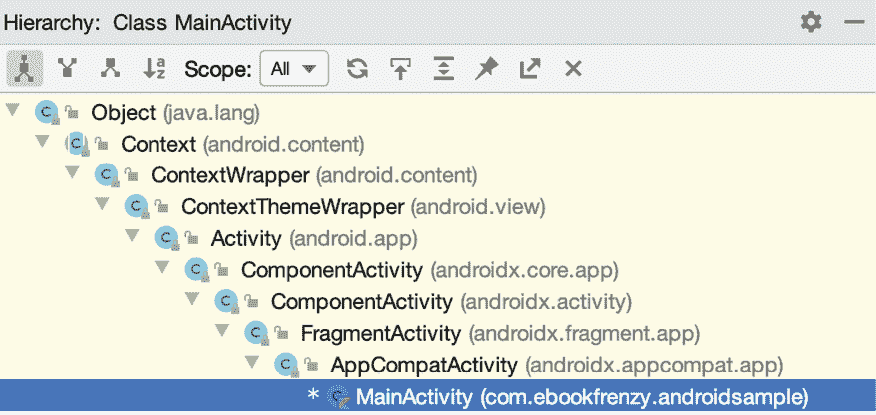

图 13-1

`Activity`和`Fragment`类包含一系列方法旨在由 Android 运行时调用以通知对象其状态正在发生更改。在本章中，我们将这些方法称为生命周期方法。Activity 或 Fragment 类只需要重写这些方法，并在其中实现必要的功能，以对状态更改做出相应反应。

其中一种方法命名为`onCreate()`。再次回到上面的代码段，我们可以看到该方法已经在`MainActivity`类中被我们重写并为我们实现了。在随后的章节中，我们将详细探索`onCreate()`以及`Activity`和`Fragment`类的其他生命周期方法。

### 13.3 动态状态 vs 持久化状态

生命周期管理的核心目标之一是确保活动的状态在适当的时间被保存和恢复。在此语境下，我们所说的状态是指当前活动中持有的数据以及用户界面的外观。例如，活动可能在内存中维护一个数据模型，该模型需要被保存到数据库、内容提供程序或文件中。这种状态信息因为从应用程序的一次调用到另一次调用持续存在，因此被称为**持久化状态**（persistent state）。

用户界面的外观（例如输入到文本框但尚未提交到应用程序内部数据模型的文本）被称为**动态状态**（dynamic state），因为它通常只在应用程序的单次调用期间保留（也称为用户界面状态或实例状态）。

理解这两种状态之间的差异非常重要，因为它们的保存方式以及保存的原因都是不同的。

保存持久化状态的目的是避免活动在后台被运行时系统杀死而导致的数据丢失。而，动态状态的保存和恢复的原因略为复杂。

例如，假设应用程序包含一个活动（我们将其称为`Activity A`），该活动包含一个文本框和一些单选按钮。在使用应用程序的过程中，用户在文本框中输入了一些文本并在单选按钮上进行了选择。然而，在执行保存这些更改的操作之前，用户切换到了另一个活动，导致`Activity A`被推入活动栈并置于后台。一段时间后，运行时系统确定内存不足，因此杀杀了`Activity A`以释放资源。然而，对于用户来说，`Activity A`仅仅是被置于后台，并准备好随时移动到前台。当`Activity A`返回前台时，用户理所当然地期望输入的文本和单选按钮的选择已被保留。然而，在这种情况下，将创建一个新的`Activity A`实例，如果动态状态没有被保存和恢复，之前的用户输入就会丢失。

因此，保存动态状态的主要目的是为了提供一种在前台和后台活动之间无缝切换的感知，无论活动实际上可能在用户不知情的情况下被杀死并重启。

保存持久化状态和动态状态的机制将在本章的后续章节中变得更加清晰。

### 13.4 Android 生命周期方法

正如之前解释过的，`Activity`和`Fragment`类包含许多生命周期方法，这些方法在实例状态发生时充当事件处理程序。Android `Activity`和`Fragment`类支持的主要方法如下：

- `onCreate(Bundle savedInstanceState)` – 当活动首次创建时调用的方法，是执行大多数初始化任务的理想位置。该方法接收一个以`Bundle`对象形式的参数，该对象可能包含来自活动先一次调用的动态状态信息（通常与用户界面的状态有关）。

- `onRestart()` – 当活动之前被运行时系统停止后、准备重启时调用。

- `onStart()` – 始终在调用`onCreate()`或`onRestart()`方法后立即调用，此方法向活动指示它即将对用户可见。如果活动移动到活动栈的顶端，此调用之后将调用`onResume()`；如果它被另一个活动推入栈中，则调用`onStop()`。

- `onResume()` – 表示活动现在处于活动栈的顶端，并且是用户当前正在交互的活动。

- `onPause()` – 表示上一个活动即将成为前台活动。此调用将根据活动是回到前台还是对用户不可见，随后调用`onResume()`或`onStop()`方法。可以在此方法中采取措施存储应用尚未保存的持久化状态信息。为了避免切换活动之间的延迟，应避免在此方法中执行耗时操作，如将数据存储到数据库或执行网络操作。此方法还应确保停止任何 CPU 密集型任务（如动画）。

- `onStop()` – 活动现在对用户不再可见。此之后可能出现两种场景：如果活动再次移动到前台，则调用`onRestart()`；如果活动正在终止，则调用`onDestroy()`。

- `onDestroy()` – 活动即将被销毁，可能是因为活动已完成任务并调用了`finish()`方法（自），也可能是运行时为了释放内存或由于配置更改（如设备方向改变）而正在终止它。需要注意的是，活动终止时并不总是会调用`onDestroy()`。

- `onConfigurationChanged()` – 当发生配置更改且活动已指示不需要重启时调用。该方法接收一个`Configuration`对象，概述了新的设备配置，然后由活动负责对更改做出反应。

以下生命周期方法仅适用于`Fragment`类：

- `onAttach()` - 当片段被分配给活动时调用。

- `onCreateView()` - 用于创建并返回片段的用户界面布局视图层次结构。

- `onViewCreated()` – 在`onCreateView()`返回后调用。

- `onViewRestored()` - 片段保存的视图层次结构已恢复。

除了上述生命周期方法外，还有两个专门用于保存和恢复活动动态状态的方法：

- `onRestoreInstanceState(Bundle savedInstanceState)` – 当活动从之前保存状态的状态调用重启时，在`onStart()`方法之后立即调用。与`onCreate()`类似，此方法接收一个包含之前状态数据的`Bundle`对象。此方法通常用于在`onCreate()`和`onStart()`完成活动初始化后恢复之前状态更为合理的情况。

- `onSaveInstanceState(Bundle outState)` – 在活动销毁之前调用，以便保存当前的动态状态（通常与用户界面有关）。该方法接收一个`Bundle`对象，状态应保存到其中，并在活动重启时，该对象随后通过`onCreate()`和`onRestoreInstanceState()`方法传递。请注意，此方法仅在运行时确定需要保存动态状态时才会被调用。

在重写上述方法时，必须记住，除了`onRestoreInstanceState()`和`onSaveInstanceState()`之外，方法实现必须包含对`super`类对应方法的调用。例如，以下方法重写了`onRestart()`方法，但也包含了对父类实例方法的调用：

```java
protected void onRestart() {
         super.onRestart();
}
```

```java
Log.i(TAG, "onRestart");
}
```

如果在重写的方法中未能调用此父类（super class），会导致运行时在执行期间抛出异常。虽然在`onRestoreInstanceState()`和`onSaveInstanceState()`方法中调用父类是可选的（例如，在实现自定义的保存和恢复行为时可以省略它们），但使用这些方法具有显著的好处，这一主题将在名为“保存和恢复 Android Activity 的状态”的章节中介绍。

## 13.5 生命周期周期 (Lifetimes)

最后一个要涵盖的话题涉及整个、可见和前台生命周期的大纲，activity 或 fragment 在执行期间会经过这些周期：

*   **整个生命周期 (Entire Lifetime)** – “整个生命周期”一词用于描述从初始调用`onCreate()`方法到对象终止前调用`onDestroy()`之间发生的所有活动。

*   **可见生命周期 (Visible Lifetime)** – 涵盖从调用`onStart()`到`onStop()`之间的执行期间。在此期间，activity 或 fragment 对用户可见，但可能不是用户当前正在交互的对象。

*   **前台生命周期 (Foreground Lifetime)** – 指在调用`onResume()`和`onPause()`方法之间的执行期间。

需要注意的是，一个 activity 或 fragment 在整个生命周期内可能会多次经过前台和可见生命周期。

生命周期和生命周期方法的概念在图 13-2 中所示：

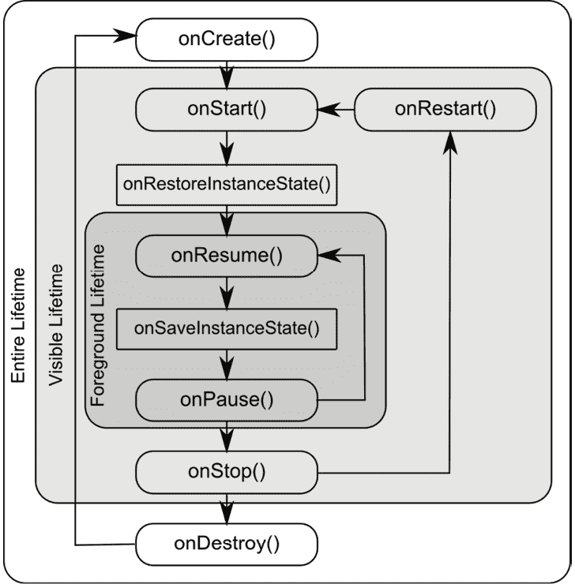

图 13-2

## 13.6 折叠屏设备与多恢复 (Foldable Devices and Multi-Resume)

正如之前讨论的，当 activity 移动到前台并是用户当前正在交互的 activity 时，它被认为处于恢复（resumed）状态。在标准设备上，一个应用在任何时间只能有一个 activity 处于恢复状态，所有其他 activity 可能都处于暂停或停止状态。

一段时间以来，Android 已经包含了多窗口支持，允许多个 activity 同时在分屏或自由窗口布局中出现。虽然该功能最初主要用于大屏幕平板电脑设备，但随着折叠屏设备的引入，该功能可能会变得更加流行。

在运行 Android 10 且启用了多窗口支持的设备上（大多数折叠屏也是如此），多个应用 activity 可能同时处于恢复状态（这种概念被称为“多恢复”），允许这些可见的 activity 在即使另一个 activity 当前拥有焦点的情况下继续运行（例如流媒体内容播放或更新视觉数据）。尽管多个 activity 可以处于恢复状态，但这些活动中只有一个会被认为是最顶层的恢复活动（换句话说，就是用户最近交互的那个 activity）。

activity 可以通过实现`onTopResumedActivityChanged()`回调方法来接收获得或丢失顶层恢复状态的通知。

## 13.7 禁用配置更改重启 (Disabling Configuration Change Restarts)

正如之前概述，activity 可以指明在某些配置更改发生时不重新启动。这是通过在项目清单文件（manifest file）的 activity 元素中添加`android:configChanges`指令实现的。例如，下面的清单文件片段表明，发生与方向或全局字体大小相关的配置更改时，不应重启该 activity：

```xml
<activity android:name=".MainActivity"
          android:configChanges="orientation|fontScale"
          android:label="@string/app_name">
```

## 13.8 生命周期周期方法的局限性 (Lifecycle Method Limitations)

正如本章开头提到的，生命周期方法已经使用了多年，直到最近，它们仍然处理 activity 和 fragment 生命周期周期状态变化的唯一机制。然而，这种方法也存在缺点。

生命周期方法的一个问题是，它们没有为 activity 或 fragment 提供一种简单的方法在应用执行的任何给定点发现其当前的生命周期状态。相反，对象需要在内部跟踪状态，或者等待下一次生命周期方法的调用。

此外，这些方法没有提供一种简单的方法让一个对象观察应用内其他对象的生命周期状态变化。这是一个严肃的考虑因素，因为应用中的许多其他对象都可能受到特定 activity 或 fragment 生命周期周期状态变化的影响。

生命周期方法仅在`Fragment`和`Activity`类的子类中可用。因此，无法构建真正感知生命周期（lifecycle aware）的自定义类。

最后，生命周期方法导致大多数生命周期处理代码都写在 activity 或 fragment 内部，这可能导致代码复杂且容易出错。理想情况下，这些代码大部分应该位于受状态更改影响的其他类中。例如，一个流视频的应用可能会包含一个专门设计用于管理输入流的类。如果应用需要在主 activity 停止时暂停流，那么相应的代码应该位于流类中，而不是主 activity 中。

所有这些以及更多问题通过使用感知生命周期组件（lifecycle-aware components）得到了解决，该主题将从名为“使用 Jetpack 构建现代 Android 应用架构”的章节开始。

## 13.9 总结

所有的 activity 都自`Activity`类，而该类又包含了许多生命周期方法，这些方法设计用于在 activity 状态更改时由运行时系统调用。同样，`Fragment`类也包含许多类似的方法。通过重写这些方法，activity 和 fragment 可以响应状态变化，并在必要时采取步骤保存并恢复 activity 以及应用程序当前的状态。生命周期状态可以被认为有两种形式。持久化状态是指在应用调用之间需要存储的数据（例如到文件或数据库）。而动态状态则与用户界面的当前显示有关。

此练习的第一步是创建一个新项目。首先启动 Android Studio，如有必要，使用`File -> Close Project`菜单选项关闭任何已打开的项目，以便显示欢迎界面。

在欢迎界面选择`New Project`选项，在弹出的新项目对话框中，点击`Next`按钮之前选择`Empty Views Activity`模板。

在`Name`字段中输入`StateChange`，并指定`com.ebookfrenzy.statechange`为包名。在点击`Finish`按钮之前，将`Minimum API level`（最低 API 级别）设置更改为`API 26`：`Android 8.0 (Oreo)`，并将`Language`（语言）菜单更改为`Java`。项目创建完成后，`StateChange`项目将列在 Android Studio 主窗口左侧的项目工具窗口中。按照节节 11.8 将项目迁移到 View Binding 中概述的步骤将项目转换为使用 view binding。

接要操作涉及设计 activity 的用户界面。它存储在一个名为`activity_main.xml`的文件中，该文件应该已经加载到布局编辑器工具中。如果没有，请在项目工具窗口中导航到它，它位于`app -> res -> layout`文件夹中。一旦找到，双击该文件即可将其加载到 Android Studio 布局编辑器工具中。


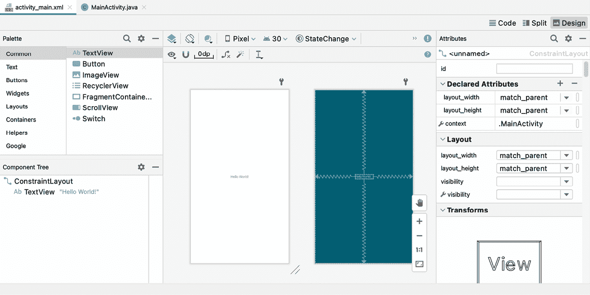

图 14-1

## 14.2 设计用户界面

当用户界面布局加载到布局编辑器工具后，现在是时候为示例应用程序设计用户界面了。用户界面设计中目前有一个“Hello World!”`TextView`，但实际上需要一个`EditText`。在布局编辑器画布上选择`TextView`对象并按下键盘上的`Delete`键将其从设计中删除。

从布局编辑器左侧的`Palette（调色板）`中选择`Text`类别，从文本组件列表中点击并拖动`Plain Text（纯文本）`组件到设备屏幕的可视表示上。将组件移动到显示中心，直到出现中心引导线，然后将其放置，使布局类似于图 14-2。

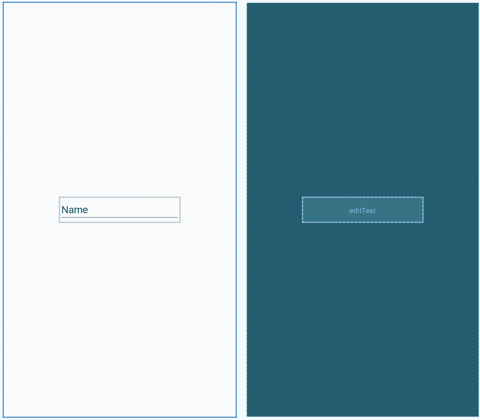

图 14-2

使用`EditText`小部件时，必须为视图指定输入类型。这简单地定义了用户将输入的文本或数据类型。例如，如果输入类型设置为`Phone（电话）`，则用户将被限制在视图中输入数字。或者，如果输入类型设置为`TextCapCharacters`，则输入将默认为大写字母。输入类型设置也可以组合。

对于此示例，我们将使用默认输入类型来支持通用文本输入。将来要选择不同的设置，请选择布局中的`EditText`小部件，并在`Attributes（属性）`工具窗口中找到`inputType`条目。接下来，点击当前设置左侧的标志图标以打开选项列表，如下方的图 14-3 所示。`Type（类型）`菜单提供了将输入限制为文本、数字、时间和电话号码的选项。`Variations（变体）`菜单为当前选的输入类型提供额外选项。例如，文本输入类型有一种变体，可以将电子邮件地址作为输入。

一旦选择了类型和变体，可以使用标志复选框列表进一步自定义输入类型：

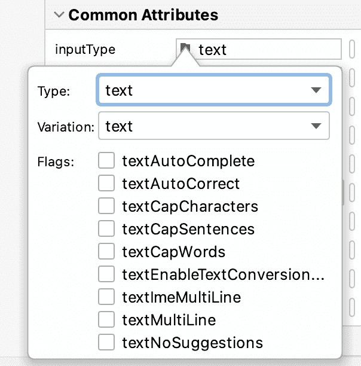

图 14-3

留在`Attributes（属性）`工具窗口中，将视图的`id`为`editText`，并点击生成对话框中的`Refactor（重构）`按钮。

默认情况下，`EditText`显示的文本为“Name”。在`Attributes（属性）`面板中，从`text`属性字段中删除此内容，使视图在布局中为空白。

在继续之前，点击布局编辑器工具栏上的`Infer Constraints（推断约束）`按钮以添加任何缺失的约束。

## 14.3 重写 Activity 生命周期方法

此时，项目包含一个名为`MainActivity`的单一 activity，它派自`Android AppCompatActivity`类。该 activity 的源代码包含在`MainActivity.java`文件中，该文件应该已经在编辑器会话中打开并在编辑器标签页栏由标签页表示。如果文件不再打开，请在项目工具窗口面板中（`app -> java -> com.ebookfrenzy.statechange -> MainActivity`）导航到它并双击它将文件加载到编辑器中。

到为止，activity 重写的唯一生命方法是`onCreate()`方法，该方法已实现为在设置 activity 的用户界面之前调用方法的父类实例。我们现在将修改此方法，使其在每次执行时都在 Android Studio Logcat 面板中输出诊断消息。为了实现这一点，我们将使用`Log`类，我们需要导入`android.util.Log`并声明一个标签，以便我们能够在日志输出中过滤这些消息：

```java
package com.ebookfrenzy.statechange;

import android.util.Log;
import androidx.annotation.NonNull;
import android.view.View;

public class MainActivity extends AppCompatActivity {
    private ActivityMainBinding binding;
    private static final String TAG = "StateChange";

    @Override
    protected void onCreate(Bundle savedInstanceState) {
        super.onCreate(savedInstanceState);
        binding = ActivityMainBinding.inflate(getLayoutInflater());
        View view = binding.getRoot();
        setContentView(view);
        Log.i(TAG, "onCreate");
    }
}
```

下一个任务是重写一些方法，每个方法包含一个日志调用。这些重写方法可以手动添加，也可以使用 Android Studio 代码基础中概述的`Alt-Insert`快捷键生成。注意`Log`调用仍然需要手动添加：

```java
@Override
protected void onStart() {
    super.onStart();
    Log.i(TAG, "onStart");
}

@Override
protected void onResume() {
    super.onResume();
    Log.i(TAG, "onResume");
}

@Override
protected void onPause() {
    super.onPause();
    Log.i(TAG, "onPause");
}

@Override
protected void onStop() {
    super.onStop();
    Log.i(TAG, "onStop");
}

@Override
protected void onRestart() {
    super.onRestart();
    Log.i(TAG, "onRestart");
}

@Override
protected void onDestroy() {
    super.onDestroy();
    Log.i(TAG, "onDestroy");
}

@Override
protected void onSaveInstanceState(@NonNull Bundle outState) {
    super.onSaveInstanceState(outState);
    Log.i(TAG, "onSaveInstanceState");
}

@Override
protected void onRestoreInstanceState(@NonNull Bundle savedInstanceState) {
    super.onRestoreInstanceState(savedInstanceState);
    Log.i(TAG, "onRestoreInstanceState");
}
```

## 14.4 过滤 Logcat 面板

添加到`MainActivity.java`中重写方法的代码目的是将日志信息输出到 Logcat 工具窗口。此输出可以配置为显示与设备或模拟器会话的所有事件，或限制为与当前选择应用程序相关的事件。输出也可以被进一步限制为仅匹配指定过滤器的日志事件。

当当前应用运行时，Logcat 工具窗口将如下方图 14-4 所示：

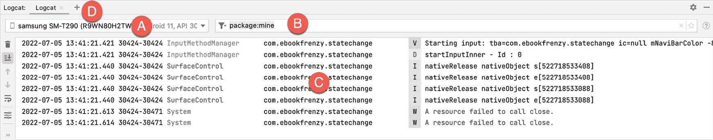

图 14-4

上图中标记为 A 的菜单允许你选择显示日志输出的设备或模拟器。此输出显示在标记为 C 的输出面板中。通过在标记为 B 的字段中输入选项，可以过滤日志输出。默认键设置`package:mine`将输出限制为由当前应用包生成的日志消息（在本例中为`com.ebookfrenzy.statechange`）。留空该字段将允许显示来自所选设备或模拟器的日志输出，包括操作系统生成的诊断消息。也可以组合多个键来进一步过滤输出。例如，我们可以如下配置 Logcat 面板，仅显示与我们的`StateChange`标签相关的消息：

```text
package:mine tag:StateChange
```

我们还可以通过在键值前加上减号（`-`）符号来排除某些输出。除了`StateChange`标签外，我们可能还有使用名为“OtherTag”的不同标签的诊断消息。为了过滤日志以排除此第二个标签的输出，我们可以输入以下键选项：

```text
package:mine tag:StateChange -tag:OtherTag
```

除了你自己的标签值外，还可以从 Android 内置的一系列预定义诊断标签中选择。当你在过滤字段中输入时，Logcat 将显示匹配标签的列表，如图 14-5 所示：

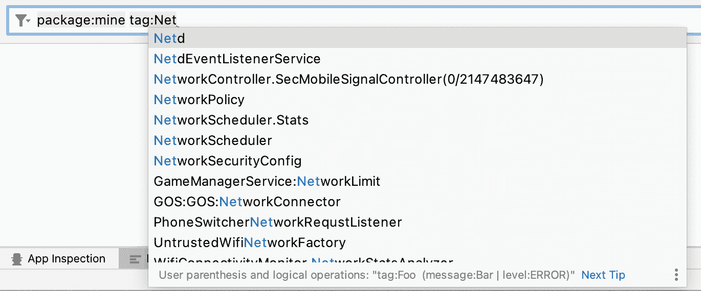

图 14-5

`level`键可用于根据严重程度控制显示哪些消息。要过滤掉错误消息以外的所有消息，将使用以下键：

```text
level:error
```

除了错误（error），Logcat 面板还支持`verbose`、`info`、`warn`和`assert`级别设置。

Logcat 还支持多个日志面板，每个面板都有自己的过滤设置。要添加另一个面板，请点击上方的图 14-4 中标记为 D 的`+`按钮。使用相应的标签在不同面板之间切换，或者通过右键点击当前显示的面板并选择`Split-Right`（向右拆分）或`Split-Down`（向下拆分）菜单选项来水平或垂直排列面板。要重命名面板，右键点击标签并选择`Rename Tab`（重命名标签）选项。在继续之前，关闭除一个外的 Logcat 面板并如下配置过滤器：

```text
package:mine tag:StateChange
```

### 14.5 运行应用程序

为了获得最佳结果，应在物理 Android 设备或模拟器上运行应用程序。在设备配置并连接到开发计算机后，点击 Android Studio 工具栏中绿色三角形表示的运行按钮，如下方的图 14-6 所示，选择`Run -> Run…`菜单选项或使用快捷键`Shift+F10`：

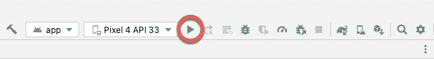

图 14-6

如果出现`Choose Device`对话框，请从中选择物理 Android 设备或模拟器（假设你尚未将其配置为默认目标）。在 Android Studio 构建应用并将其安装到设备后，它应该启动并在前台运行。

查看 Logcat 面板可以指示目前哪些方法已被触发了：

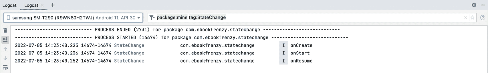

图 14-7

### 14.6 实验 Activity

随着诊断功能的正常工作，现在是时候通过运行应用程序来理解 Activity 生命周期的状态变化了。首先，考虑 Logcat 面板中的初始日志事件序列：

```text
onCreate
onStart
onResume
```

显然，初始状态变化与“理解 Android 应用和 Activity 生命周期”中概述的完全一致。但请注意，在这种情况下没有调用`onRestoreInstanceState()`，因为 Android 运行时检测到在这种情况下没有可以恢复的状态。

点击设备显示器底部状态栏上的`Home`图标，并注意日志中报告的方法调用序列如下：

```text
onPause
onStop
onSaveInstanceState
```

在这种情况下，运行时注意到该 activity 不再处于前台，对用户不可见并且已经停止了该 activity，但并没有没有该 activity 保存动态状态的机会。取决于运行时最终是销毁了该 activity 还是简单地重新启动了它，该 activity 将通过调用`onRestart()`通知其已重新启动，或者在用户返回该 activity 时再次经历创建序列。

如“理解 Android 应用和 Activity 生命周期”所述，activity 的销毁和重建可以通过对设备进行配置更改来触发，例如从竖屏旋转到横屏。要看到看到这一过程，只需在`StateChange`应用程序处于前台时旋转设备即可。使用模拟器时，可以使用模拟器工具栏上的旋转按钮来模拟设备旋转。为了完成旋转，可能还需要点击旋转按钮。它显示在如图 14-8 所示的设备或模拟器屏幕底部：

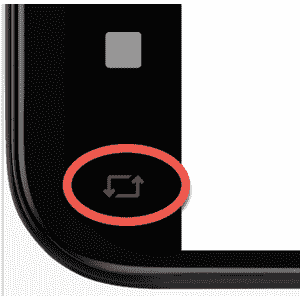

图 14-8

日志中产生的方法调用序列应如下：

```text
onPause
onStop
onSaveInstanceState
onDestroy
onCreate
onStart
onRestoreInstanceState
onResume
```

显然，运行时系统在销毁和重启之前给了 activity 保存状态的机会。

### 14.7 总结

“一图胜千言”的古语在学习新范式的示例中同样适用。在本章中，我们创建了一个示例应用程序，用于演示 activity 可能经过的不同生命状态。在本章的项目开发过程中，我们还查看了从 activity 内部生成日志信息的机制。

在下一章中，我们将扩展`StateChange`项目，演示如何保存和恢复 activity 的动态状态。

## 15. 保存和恢复 Android Activity 的状态

如果前面的几章达到了目标，现在应该更清楚在生命周期内的特定点保存和恢复用户界面状态的重要性。

在本章中，我们将扩展在 Android Activity 状态示例中创建的示例应用程序，演示当 activity 被运行时系统销毁和重建时涉及的步骤。

保存和恢复动态状态的关键组件涉及 Android SDK `Bundle`类的使用，该主题在本章中也会涵盖。

### 15.1 保存动态状态

在上一章中，`StateChange`示例程序的诊断输出显示，当运行该程序的设备旋转足够大以触发方向变化时，活动会经历多次状态更改。

再次启动`StateChange`应用程序，并在执行设备旋转之前向`EditText`字段中输入一些文本（在运行 Android 9 或更高版本的设备或模拟器上，可能需要点击状态栏中的旋转按钮来完成旋转）。旋转设备后，Logcat 窗口中应出现以下状态更改序列：

`onPause`、`onStop`、`onSaveInstanceState`、`onDestroy`、`onCreate`、`onStart`、`onRestoreInstanceState`、`onResume`

显而易见，这导致了 activity 被销毁并重建。检查运行中应用程序的用户界面发现，输入到`EditText`字段中的文本被保留了。鉴于 activity 被销毁并重建了，且我们没有添加任何特定代码来确保文本被保存和恢复，这种行为需要一些解释。

事实上，Android SDK 包含的大多数视图控件（widgets）已经实现了 activity 重启时自动保存和恢复状态所需的行为。启用此行为的唯一要求是 activity 中的`onSaveInstanceState()`和`onRestoreInstanceState()`重写方法要包含对父类等效方法的调用：

```java
@Override
protected void onSaveInstanceState(@NonNull Bundle outState) {
    super.onSaveInstanceState(outState);
}

@Override
protected void onRestoreInstanceState(@NonNull Bundle savedInstanceState) {
    super.onRestoreInstanceState(savedInstanceState);
}
```

可以通过 XML 布局文件通过将`android:saveEnabled`属性设置为`false`来禁用用户界面视图的自动状态保存。为了示例，我们将禁用用户界面布局中`EditText`视图的自动状态保存机制，然后在应用程序中添加代码来手动保存和恢复视图的状态。

为了配置`EditText`视图以便在 activity 重启时不保存和恢复状态，请编辑`activity_main.xml`文件，使视图条目内容如下（注意可以直接点击 Layout Editor 面板底部的 Text 选项卡来编辑 XML）：

```xml
<EditText
    android:id="@+id/editText"
    android:layout_width="wrap_content"
    android:layout_height="wrap_content"
    android:ems="10"
    android:inputType="text"
    android:saveEnabled="false"
    app:layout_constraintBottom_toBottomOf="parent"
    app:layout_constraintEnd_toEndOf="parent"
    app:layout_constraintStart_toStartOf="parent"
    app:layout_constraintTop_toTopOf="parent" />
```

做出更改后，运行应用程序，输入文本并旋转设备，以验证文本不再被保存和恢复。

### 15.3 Bundle 类

对于需要保存用户界面视图组件提供的默认功能之外的状态的情况，`Bundle`类提供了一个容器，使用键值对机制来存储数据。键的形式为字符串值，而与这些键关联可以是原始值或任何实现了`Parcelable`接口的对象的。许多类已经实现了`Parcelable`接口。自定义类通通过实现`Parcelable`接口中定义的一组方法来使其变为“可封包的”（parcelable），详情可以在 Android 文档中找到：


`https://developer.android.com/reference/android/os/Parcelable.html`

`Bundle` 类还包含一组方法，可用于获取和设置各种数据类型的键值对，包括原始类型（包括 `Boolean`、`char`、`double` 和 `float` 值）和对象（如 `Strings` 和 `CharSequenceences`）。

为了本示例，并且已经禁用了 `EditText` 视图的文本自动保存，我们需要确保用户输入到 `EditText` 字段的文本被保存到 `Bundle` 对象并随后恢复。这将作为如何在 Android 应用程序中手动保存和恢复状态的演示，分别使用 `Bundle` 类的 `putCharSequence()` 和 `getCharSequence()` 方法来实现。

## 15.4 保存状态

扩展 `StateChange` 应用程序的第一步是确保在 `MainActivity` 对应的 `onSaveInstanceState()` 方法中从 `EditText` 组件提取用户输入的文本，然后将其作为键值对保存到 `Bundle` 对象中。

要从 `EditText` 对象中提取文本，我们首先需要在用户界面中识别该对象。显然，这涉及到活动对应的 Java 代码（包含在 `MainActivity.java` 源代码文件中）与用户界面的 XML 表示（包含在 `activity_main.xml` 资源文件中）之间的桥。为了提取输入到 `EditText` 组件的文本，我们需要访问该用户界面对象。

用户界面中的每个组件都关联有一个唯一的标识符。默认情况下，Layout Editor 工具根据对象类型为新添加的组件构建 `id`。如果布局中包含多个相同类型的视图，则类型名后跟一个顺序数字（尽管开发者可以且应该将其更改为更具意义的内容）。正如在选择 `activity_main.xml` 时检查 Android Studio 主窗口内的 Component Tree 面板所示，`EditText` 组件被分配了 id：

`(image/as_4.1_state_change.jpg)` 图 15-1

我们现在可以通过对象的 `getText()` 方法获取 `editText` 包含的文本：

```java
CharSequence userText = binding.editText.getText();
```

最后，我们可以使用 `Bundle` 对象的 `putCharSequence()` 方法保存文本，传递键（可以是字符串值，在本实例中我们定义为“savedText”）和 `userText` 对象作为参数：

```java
outState.putCharSequence("savedText", userText);
```

将这一切整合在一起，`MainActivity.java` 文件中的 `onSaveInstanceState()` 方法如下：

```java
package com.ebookfrenzy.statechange;

...

public class MainActivity extends AppCompatActivity {

...

    @Override
    protected void onSaveInstanceState(@NonNull Bundle outState) {
        super.onSaveInstanceState(outState);
        Log.i(TAG, "onSaveInstanceState");
        CharSequence userText = binding.editText.getText();
        outState.putCharSequence("savedText", userText);
    }

...
}
```

## 15.5 恢复状态

现在已经采取了保存状态的步骤，下阶段是在需要时恢复它。保存的动态状态可以在传递 `Bundle` 对象作为参数生命周期方法中恢复。这让开发者可以选择使用 `onCreate()` 或 `onRestoreInstanceState()`。使用哪个方法取决于活动的性质。在活动初始化任务完成后最好恢复状态的情况下，`onRestoreInstanceState()` 方法通常更合适。为了本示例，我们将在 `onRestoreInstanceState()` 方法中添加代码，使用“savedText”键从 `Bundle` 中提取保存的状态。然后我们可以使用对象的 `setText()` 方法将文本显示在 `editText` 组件上：

```java
Log.i(TAG, "onRestoreInstanceState");

CharSequence userText =
    savedInstanceState.getCharSequence("savedText");

binding.editText.setText(userText);
}
```

## 15.6 测试应用程序

剩下的就是再次构建并运行 `StateChange` 应用程序。在运行并处于前台时，触摸 `EditText` 组件，并在将设备旋转到另一个方向之前输入一些文本。与之前文本更改会丢失不同，现在，得益于我们在本章中为 activity 添加的代码，新文本将保留在 `editText` 组件中。

在验证代码执行符合预期后，注释掉这两个方法中的 `super.onSaveInstanceState()` 和 `super.onRestoreInstanceState()` 调用，重新启动应用，并发现文本在设备旋转后仍然被保留。默认的保存和恢复系统本质上被自定义实现所取代，从而提供了一种在 activity 内部动态且有选择地保存和恢复状态的方法。

## 15.7 总结

在 Android 应用中保存和恢复动态状态只需在适当的生命周期方法中实现适当的代码。对于大多数用户界面视图，这些由 `Activity` 超类自动处理。在其他实例中，通常包括在 `onSaveInstanceState()` 方法中提取值和设置，并将数据以键值对的形式保存到运行时系统传递给 activity 的 `Bundle` 对象中。

可以在 activity 的 `onCreate()` 或 `onRestoreInstanceState()` 方法中从 `Bundle` 对象中提取值并根据存储的值更新 activity，从而恢复状态。

在本章中，我们使用了这些技术更新了 `StateChange` 项目，使 `Activity` 能够在 activity 的销毁及随后的重建过程中保留更改。

# 16 理解 Android 视图、视图组和布局（Layout）

除了可能收听流媒体音频外，用户与 Android 设备的交互本质上主要是视觉和触觉的。所有的交互都是通过设备上安装的应用程序的用户界面进行的，包括内置应用程序以及用户安装的任何第三方。因此，开发 Android 应用程序的关键要素涉及用户界面的设计和创建，这并不令人意外。

在本章中，将涵盖 Android 用户界面结构主题，并概述构成用户界面的不同元素；即 Views、View Groups 和 Layouts。

## 16.1 针对不同的 Android 设备进行设计

“Android 设备”一词涵盖了大量具有不同屏幕尺寸和分辨率的平板电脑和智能手机产品。因此，应用程序用户界面现在必须精心设计，以确保在尽可能广泛的显示尺寸上正确显示。其关键部分之一是确保用户界面布局在不同设备上运行时能够正确调整大小。这在很大程度上可以通过仔细规划和使用本章概述的布局管理器来实现。

同样重要的是，大多数基于 Android 的智能手机和平板电脑都可以用户以竖屏或横屏模式持有。设计良好的用户界面应该能够适应此类变化，并进行合理的布局调整以利用每种方向下的可用屏幕空间。

## 16.2 Views（视图）与 View Groups（视图组）

用户界面中的每个项都是 Android `View` 类的子类（准确来说是 `android.view.View`）。Android SDK 提供了一组预视图可用于构建用户界面。典型示例包括标准项，如 `Button`、`CheckBox`、`ProgressBar` 和 `TextView` 类。这些视图被称为控件（widgets）或组件。对于 SDK 提供的控件无法满足的需求，可以通过子类并扩展现有类来创建新视图，或者通过直接在 `View` 类之上构建创建一个全新的组件。

一个视图还可以由多个其他视图组成（也称为复合视图，composite view）。此类视图派自 Android `ViewGroup` 类（`android.view.ViewGroup`），而该类本身是 `View` 的子类。此类视图的一个示例是 `RadioGroup`，它旨在包含多个 `RadioButton` 对象，以便在任何时间只有一个可以处于“开启”状态。从结构上讲，复合视图由单个父视图（派自 `ViewGroup` 类，另称为容器视图或根元素）组成，该视图能够包含其他视图（称为子视图）。

另一类基于 `ViewGroup` 的容器视图是布局管理器（layout manager）。

## 16.3 Android 布局管理器（Layout Managers）

除了上一节讨论的控件式视图外，SDK 还包含了一组被称为布局（layouts）的视图。布局是容器视图（因此派自 `ViewGroup`），其设计的唯一目的是控制子视图在屏幕上的定位方式。

Android SDK 包含了以下可能在 Android 用户界面设计中使用的布局视图：

- `ConstraintLayout` – 引入自 Android 7，对于大多数布局需求，都建议使用此布局管理器。`ConstraintLayout` 允许通过分配给每个子视图的简单约束设置来定义布局中视图的位置和行为。这种布局的灵活性允许快速方便地创建复杂布局，而无需在其他布局类型内部进行嵌套，从而提升了布局性能。`ConstraintLayout` 也紧密集成到 Android Studio 布局编辑器工具中。除非另有说明，否则它是书中大多数示例的首选布局。

- `LinearLayout` – 根据所选的方向在单行或单列中排列子视图。可以在每个子视图上设置权重（weight）值，以指定该子视图相对于其他子视图应占据多少空间。

- `TableLayout` – 将子视图排列成行和列的网格格式。表格中的每行由一个 `TableRow` 对象表示，该对象反过来包含每个单元格的视图对象。

- `FrameLayout` – `FrameLayout` 的目的是分配屏幕区域，通常用于显示单个视图。如果添加了多个子视图，默认情况下它们将相互叠并位于布局区域的左上角。通过为每个子视图设置重力（gravity）值来实现单个子视图的替代定位。例如，在子视图上设置 `center_vertical` 重力将使其位于容器 `FrameLayout` 视图的垂直居中。

- `RelativeLayout` – `RelativeLayout` 允许通过指定子视图的对齐方式和边距，相对于彼此以及容器布局视图进行定位。例如，子视图 A 可以被配置为位于容器 `RelativeLayout` 视图的垂直和水平居中。另一方面，视图 B 可能被配置为在布局视图中水平居中，但在 View A 顶部上方 30 像素处，从而使其垂直位置相对于 View A 进行定位。`RelativeLayout` 管理器在设计必须适用于各种屏幕尺寸和方向的用户界面时可能特别有用。

- `AbsoluteLayout` – 允许在容器布局视图内通过特定的 X 和 Y 坐标对子视图进行。不建议使用此布局，因为它缺乏响应屏幕尺寸和方向变化的灵活性。

- `GridLayout` – `GridLayout` 实例被不可见的线条划分，形成一个包含行和列单元格的网格。子视图随后被放置在单元格中，并可以配置为在水平和垂直方向上跨越多个单元格，从而快速方便地实现各种布局选项。`GridLayout` 中组件之间的间隙可以通过在相邻单元格中放置一种名为 `Space` 的特殊类型视图来实现，也可以通过设置外边距参数来实现。

- `CoordinatorLayout` – `CoordinatorLayout` 随 Android 5.0 作为 Android Design Support Library 的一部分，专门用于协调应用程序屏幕顶部应用栏（app bar）与其他视图元素的外观行为。当使用 `Basic Views Activity` 模板创建新活动时，主布局中的父视图将使用 `CoordinatorLayout` 实例实现。该布局管理器将从标题为与悬浮操作按钮和 Snackbar 使用的章节开始进行更详细的介绍。

在考虑在 Android 应用程序的用户界面中使用布局时，值得记住，正如下一节将概述的，这些布局可以相互嵌套，以创建出几乎任何所需复杂程度的用户界面设计。

## 16.4 视图层次结构

用户界面中的每个视图都代表显示器上的矩形区域。视图负责在该矩形内绘制的内容，并响应发生在屏幕该区域的事件（例如触摸事件）。

用户界面屏幕由视图层次结构组成，其中根视图位于树的顶端，子视图位于下方的分支上。容器视图的子显示在其父视图之上，并被限制在父视图显示区域的边界内。例如，考虑图 16-1 所示的用户界面：

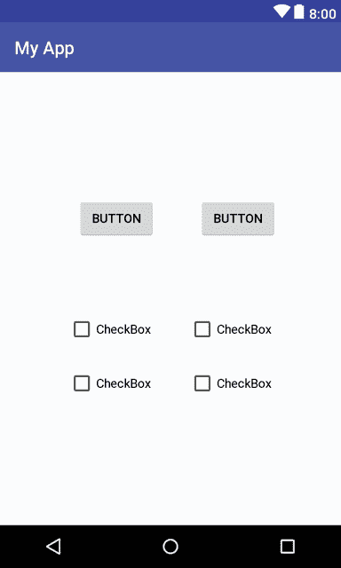

图 16-1

除了可见的按钮和复选框视图外，用户界面实际上还包含许多布局视图，它们控制着可见视图的位置。图 16-2 显示了用户界面的另一种视图，这次突出了布局视图与子视图之间的关系：

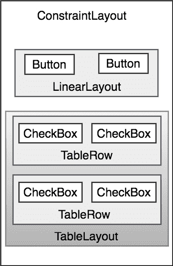

图 16-2

正如之前讨论的，用户界面是以视图层次结构的形式构建的，根视图位于顶部。既然如此，我们也可以通过图 16-3 所示的视图树形式将上述用户界面示例视觉视化：


图 16-3

视图层次结构图可能为图 16-1 所示的用户界面中构成的各种视图之间的关系提供了最清晰的概览。当用户界面显示给用户看时，Android 运行时会遍历视图层次结构，从根视图开始沿树向下移动，并渲染每个视图。

## 16.5 创建用户界面

在对视图、布局和视图层次结构的概念有了更清晰的理解后，接几章将重点关注为 Android 活动创建用户界面步骤。事实上，用户界面设计有三种不同的方法：使用 Android Studio 布局编辑器工具、编写 XML 布局资源文件或编写 Java 代码，这每种方法都将被涵盖。

## 16.6 总结

Android 应用程序用户界面屏幕中的每个元素都是视图，它们最终派生自 `android.view.View` 类。每个视图代表设备显示器上的矩形区域，既负责该矩形内显示的内容，又负责处理视图边界内的事件。多个视图可以组合成单个复合视图。复合视图中的视图是容器视图的子视图，容器视图通常是 `android.view.ViewGroup` 的子类（其本身 `android.view.View` 的子类）。用户界面由以后层次结构形式构建的视图组成。

Android SDK 包含了一系列预构建的视图，可用于创建用户界面。这些包括文本字段和按钮等基本组件，还包括一系列用于控制子视图位置的布局管理器。如果提供的视图不能满足特定需求，可以通过扩展或组合现有视图来创建自定义视图，或者通过派生 `android.view.View` 并创建一个全新的视图类。

用户界面可以使用 Android Studio 布局编辑器工具、编写 XML 布局资源文件或编写 Java 代码来创建。这些方法中的每一种都将在随后的章节中介绍。

# 17. Android Studio 布局编辑器工具指南

很难想象有一个不需要某种形式用户界面的 Android 应用程序概念。大多数 Android 设备配备了触摸屏和键盘（虚拟或物理），点击和滑动是用户与应用程序之间主要的交互形式。这些交互始终通过应用程序的用户界面进行。

一个设计良好且实现的用户界面是创建一个成功流行的 Android 应用程序的重要因素，它可以根据单个应用程序的设计需求从简单到极其复杂不等。无论复杂程度如何，Android Studio 布局编辑器工具都显著简化了设计和实现 Android 用户界面的任务。

## 17.1 Basic 与 Empty Views Activity 模板

正如“Android 应用程序剖析”章节概述，Android 应用程序由一个或多个活动组成。活动是一个独立的应用程序模块，通常直接对应单个用户界面屏幕。因此，当处理 Android Studio 布局时，我们总是在为一个活动编写布局。

在创建新的 Android Studio 项目时，有许多不同的模板可以作为主活动用户面的起点。这些模板中最基础的是 `Basic Views Activity` 和 `Empty Views Activity` 模板。尽管这些模板初看起来看起来相似，但它们之间实际上存在相当差异。要在布局编辑器中查看这些差异，请使用视图选项菜单启用“显示系统 UI”，如下方的图 17-1 所示：

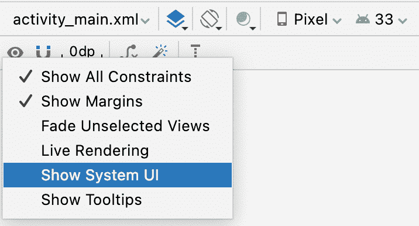

图 17-1

`Empty Views Activity` 模板创建一个布局文件，由一个 `ConstraintLayout` 管理器实例包含一个 `TextView` 对象组成，如图 17-2 所示：

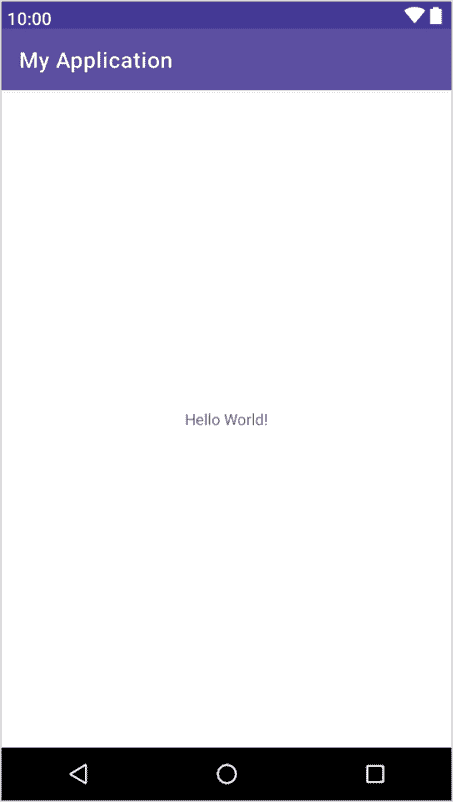

图 17-2

另一方面，`Basic Views Activity` 由多个布局文件组成。顶层布局文件以 `CoordinatorLayout` 作为根视图，一个可配置的应用栏（包含工具栏）出现在设备屏幕顶部（如图 17-3 中的 A 所示）和一个悬浮操作按钮（标记为 B 的电子邮件按钮）。除了这些项目，`activity_main.xml` 布局文件还引用了一个名为 `content_main.xml` 的第二个文件，该文件包含内容布局（标记为 C）：

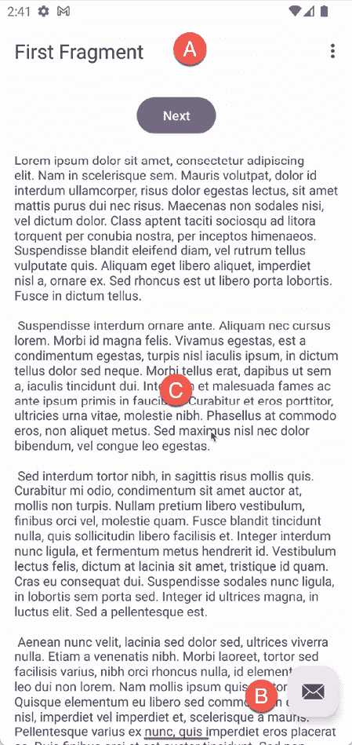

图 17-3


## Basic Views Activity（基础视图活动）

Basic Views Activity（基础视图活动）包含两个屏幕的布局，这两个屏幕都包含一个按钮和一个文本视图。此模板的目的是演示如何在应用内实现多个屏幕之间的导航。如果运行使用未修改的 Basic Views Activity 模板的程序，将显示这两个屏幕中的第一个（在图 17-4 中标记为 A）。点击 Next（下一步）按钮将导航到第二个屏幕 (B)，该屏幕反过来包含一个返回第一个屏幕的按钮：

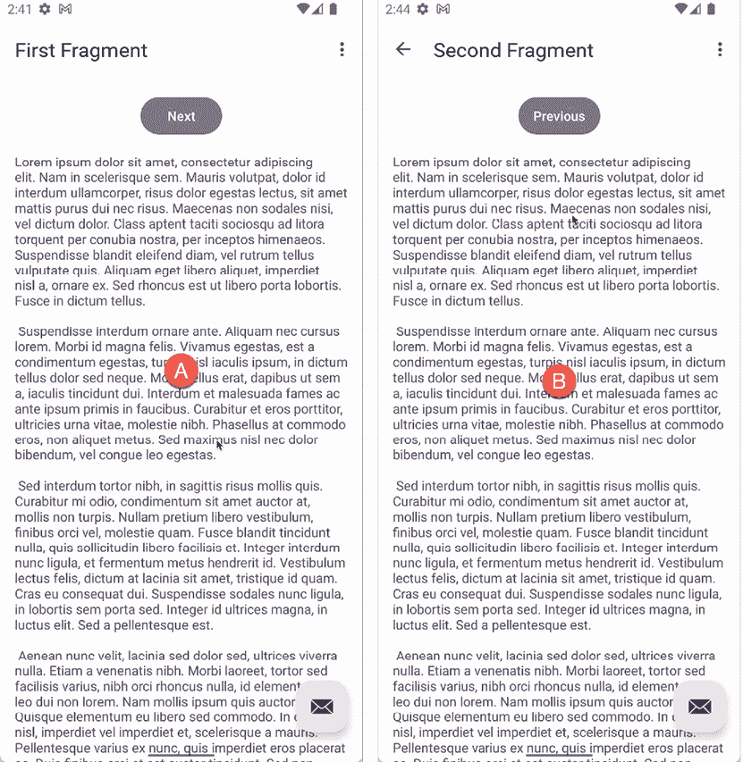

图 17-4

此应用的行为使用了两个被称为“片段”（fragments）和“导航”（navigation）的 Android 功能，这两个功能都将从标题为 “Android 片段简介” 和 “导航架构组件概览” 的章节开始逐一介绍。

`content_main.xml` 文件包含一种名为“导航宿主片段”（Navigation Host Fragment）的特殊片段，它允许根据 `res -> layout -> nav_graph.xml` 文件中配置的设置在视图中切换不同的内容。在 Basic Views Activity 模板的情况下，`nav_graph.xml` 文件配置为根据用户选择 Next（下一步）和 Previous（上一步）按钮，在 `fragment_first.xml` 和 `fragment_second.xml` 文件定义的用户界面布局之间进行切换。

显然，如果你在活动中既不需要浮动按钮（floating action button）不需要菜单，也不需要 `CoordinatorLayout` 提供的特殊应用栏行为（例如在某些滚动操作期间使应用栏和工具栏从视图中折叠的选项，该主题将在标题为 “与 AppBar 和折叠工具栏布局一起工作” 的章节中介绍过），那么 Empty Views Activity 模板是有用的。然而，Basic Views Activity 的用在于它默认提供了这些元素。事实上，使用 Basic Views Activity 模板创建一个新活动并删除不需要的元素，通常比使用 Empty Views Activity 模板并手动实现折叠工具栏、菜单或浮动按钮等行为要快得多。

然而，由于书中并非所有示例都需要 Basic Views Activity 模板的功能，因此本章的大多数示例将使用 Empty Views Activity 模板，除非示例需要 Basic Views Activity 模板提供的某项功能。

为了方便以后参考，如果你需要菜单但不需要浮动按钮，请使用 Basic Views Activity 并按照以下步骤删除浮动按钮：

1. 在 Project（项目）工具窗口的 `app -> res -> layout` 下，双击主 `activity_main.xml` 布局文件以将其加载到 Layout Editor（布局编辑器）中。布局加载到布局编辑器工具后，选择浮动按钮并按下键盘上的 Delete 键从布局中移除该对象。

2. 找到并编辑该活动的 Java 代码（位于 `app -> java -> <package name> -> <activity class name>` 下），并如下所示从 `onCreate` 方法中移除浮动按钮代码：

```java
@Override
protected void onCreate(Bundle savedInstanceState) {
    super.onCreate(savedInstanceState);
    binding = ActivityMainBinding.inflate(getLayoutInflater());
    setContentView(binding.getRoot());
    setSupportActionBar(binding.toolbar);
    NavController navController = Navigation.findNavController(this, R.id.nav_host_fragment_content_main);
    appBarConfiguration = new AppBarConfiguration.Builder(navController.getGraph()).build();
    NavigationUI.setupActionBarWithNavController(this, navController, appBarConfiguration);
    binding.fab.setOnClickListener(new View.OnClickListener() {
        @Override
        public void onClick(View view) {
            Snackbar.make(view, "Replace with your own action", Snackbar.LENGTH_LONG)
                .setAction("Action", null).show();
        }
    });
}
```

如果你需要浮动按钮但不需要菜单，请使用 Basic Views Activity 模板并按照以下步骤操作：

1. 编辑主活动类文件并删除 `onCreateOptionsMenu` 和 `onOptionsItemSelected` 方法。

2. 选择 Project 工具窗口中的 `res -> menu` 项，并按下键盘 Delete 键从项目中删除该文件夹和相应的菜单资源文件。

如果你需要使用 Basic Views Activity 模板但既不需要导航功能也不需要第二个内容片段，请遵循以下步骤：

1. 在 Project 工具窗口中，导航并双击 `app -> res -> navigation -> nav_graph.xml` 文件将其加载到导航编辑器中。

2. 在编辑器中，选择图面板中的 `SecondFragment` 条目并按下键盘 delete 键将其从图中移除。

3. 找到并删除 `SecondFragment.java`（`app -> java -> <package name> -> SecondFragment`）和 `fragment_second.xml`（`app -> res -> layout -> fragment_second.xml`）文件。

4. 最后的任务是从 `FirstFragment` 类中移除一些代码，使按钮不再导航到已不存在的第二个片段。找到 `FirstFragment.java` 并双击它，移除代码使其内容如下：

```java
public void onViewCreated(@NonNull View view, Bundle savedInstanceState) {
    super.onViewCreated(view, savedInstanceState);
    binding.buttonFirst.setOnClickListener(new View.OnClickListener() {
        @Override
        public void onClick(View view) {
            NavHostFragment.findNavController(FirstFragment.this)
                .navigate(R.id.action_FirstFragment_to_SecondFragment);
        }
    });
}
```

## 17.2 Android Studio 布局编辑器

正如前面的章节所示，布局编辑器工具提供了一个“所见即所得”（WYSIWYG）的环境，可以在其中从调色板中选择视图并放置在代表设备的画布上。一旦视图放置在画布上，就可以对其进行移动、删除和调整大小。此外，可以使用 Attributes（属性）工具窗口修改与所选视图相关的属性。

在底层，布局编辑器工具实际上构建了一个包含正在设计的用户界面定义的 XML 资源文件。因此，布局编辑器以三种不同的模式运行，称为 Design（设计）、Code（代码）和 Split（拆分）模式。

## 17.3 设计模式

在设计模式下，可以直接操作视图调色板和布局的图形表示来视觉化操作用户界面。图 17-5 突出了 Android Studio 布局编辑器工具在设计模式下的关键区域：

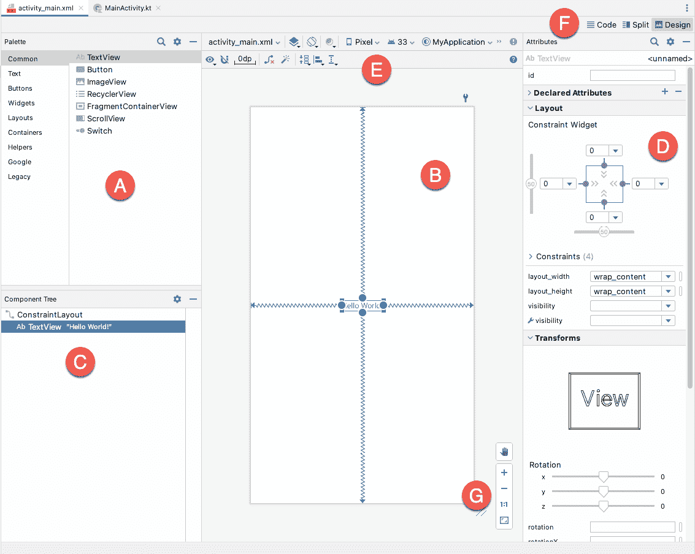

图 17-5

A – Palette（调色板）——调色板提供了 Android SDK 提供的系列视图组件。这些组件被分类以便导航。可以通过从调色板上拖拽视图组件并掉到布局上的理想位置向布局添加项。

B – Device Screen（设备屏幕）——设备屏幕提供了正在设计的的用户界面布局的视觉化“所见即所得”表示。该布局允许对设计进行直接操纵，允许视图被选择、删除、移动和调整大小。可以使用工具栏中的菜单随时更改布局表示的设备模型。

### C – 组件树

如上一章（“理解 Android View、ViewGroup 和 Layout”中标记为 A）列出了 Android SDK 支持的各种视图组件类别。当从列表中选择一个类别时，第二个面板（B）将更新，并显示属于该类别的组件列表：

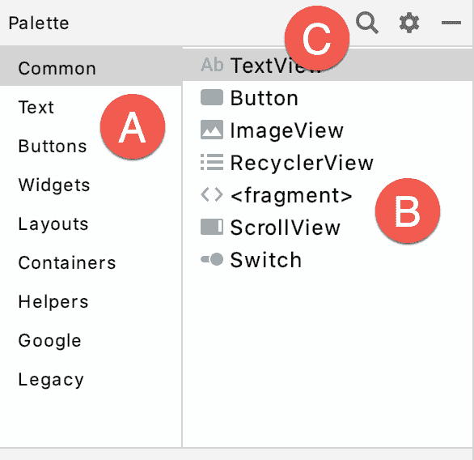

图 17-6

要将调色板中的组件添加到布局画布上，只需从组件列表或预览面板中选择该项，将其拖到画布上的所需位置并放开即可。

要在当前选定的类别中搜索特定组件，可以点击调色板工具栏上的搜索按钮（在图 17-6 上方标记为 C）并输入组件名称。随着字符的输入，匹配的结果将实时在组件列表面板中显示。如果你不确定组件所在的类别，只需在搜索操作之前或期间直接选择“所有结果”（All Results）类别即可。

## 17.5 设计模式和布局视图

默认情况下，布局编辑器将显示为设计（Design）模式，如上方图 17-5 所示。此模式提供了用户界面的视觉表示。可以通过点击图 17-7 所示的最右侧的模式切换控件，随时选择设计模式：

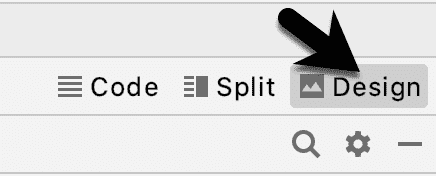

图 17-7

当布局编辑器工具处于设计模式时，可以通过两种不同的方式查看布局。上方图 17-5 中显示的视图是设计视图（Design view），显示了布局和小部件在运行应用中的外观。第二种模式被称为“蓝图视图”（Blueprint view），可以替代设计视图显示，也可以与设计视图同时显示。图 17-8 中显示的工具栏菜单提供了显示设计视图、蓝图视图或两种视图的选项。还有用于调整色盲的设置。第五种选项“强制刷新布局”（Force Refresh Layout）会导致布局重建并重绘。当布局进入意外状态或未能准确反映当前设计设置时，这非常有用：

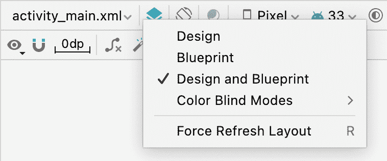

图 17-8

显示布局视图、设计视图或两者都取决于个人偏好。一种很好的方法是像图 17-9 所示从同时显示两者开始：

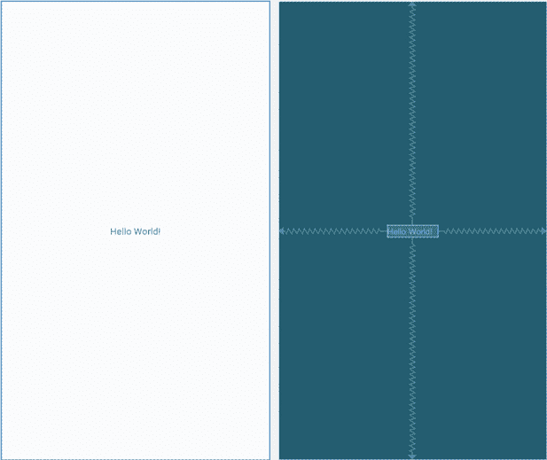

图 17-9

## 17.6 夜间模式

在设计工作期间以夜间模式查看布局，请选择下方图 17-10 所示的菜单并将设置更改为“夜间”（Night）：

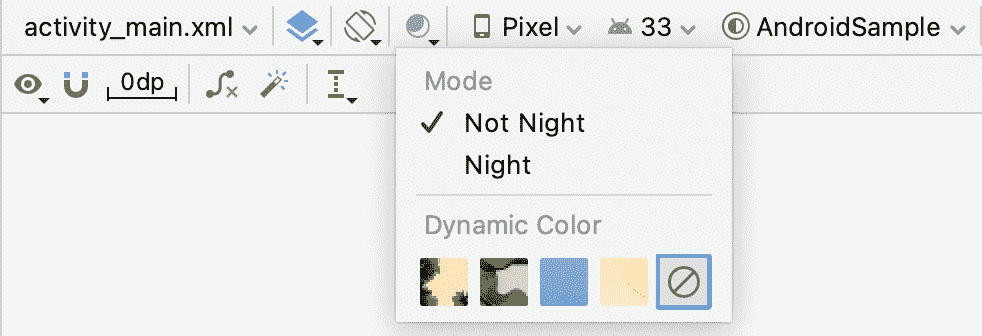

图 17-10

模式菜单还包括测试动态颜色的选项，该主题在“Material Design 3 主题和动态色彩教程”章节中介绍。

## 17.7 代码模式

在使用 Android Studio 布局编辑器工具时，重要的是记住它实际上做的只是提供了一种易于用户的方法来创建 XML 布局资源文件。在设计过程中的任何时候，只需点击布局编辑器工具面板右上角的 `Code` 按钮（如图 17-11 所示），即可查看并直接编辑底层 XML：

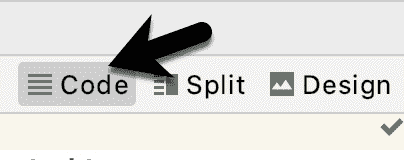

图 17-11

图 17-12 显示了 Android Studio 布局器的代码模式，允许通过修改 XML 来更改用户界面：


图 17-12

## 17.8 拆分模式

在拆分模式下，编辑器并排显示设计视图和代码视图，允许通过设计画布或直接修改 XML 来修改用户界面。要进入拆分模式，请点击图 17-13 所示的中间按钮：

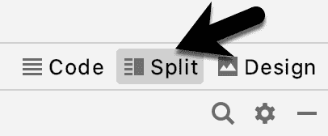

图 17-13

对 XML 的任何更改都会反映在设计画布上，反之亦然。图 17-14 显示了拆分模式下的编辑器：

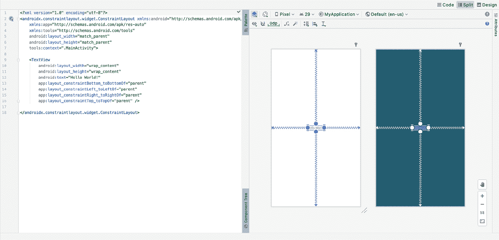

图 17-14

## 17.9 设置属性

属性面板提供了访问当前选中组件的所有可用设置。例如，图 17-15 显示了 `TextView` 组件的一些属性：

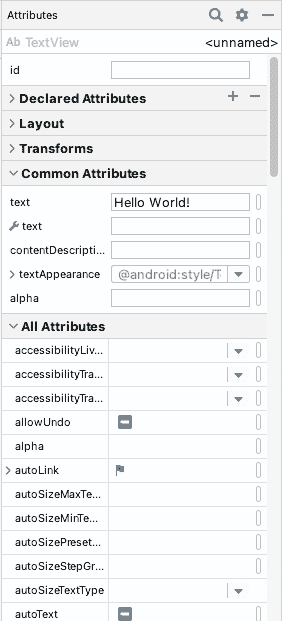

图 17-15

属性窗口分为以下部分：

- `id`：包含 id 属性，该属性定义了在应用程序源代码中引用当前选中对象的名称。

- `已声明属性`（Declared Attributes）：包含所有已赋值的属性。

- `布局`（Layout）：定义当前选中视图对象相对于屏幕以及布局中其他对象定位和大小的设置。

- `变换`（Transforms）：包含允许对选中对象进行旋转、缩放和偏移的控件。

- `常用属性`（Common Attributes）：对于当前选中的视图类经常需要更改的属性列表。

- `所有属性`（All Attributes）：当前选中对象所有可用属性的完整列表。

也可以通过选择属性窗口工具栏上的搜索按钮并输入属性名称来搜索特定属性。

某些属性在值字段的右侧有一个窄按钮。这表示可以使用 `Resources` 对话框来帮助选择合适的属性值。只需点击该按钮即可显示对话框。此按钮的外观会变化，以反映相应的属性值是存储在资源文件中还是硬编码的。如果值存储在资源文件中，则文本属性字段右侧的按钮将被填充，如如下方的图 17-16 所示，表示该值并非硬编码：

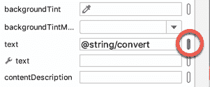

图 17-16

具有有限数量有效选项的属性将显示下拉菜单（图 17-17），并可从中进行选择。

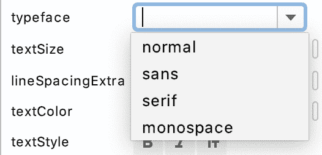

图 17-17

可以点击吸管图标（如上方图 17-16 中`backgroundTint` 字段所示）来显示颜色调色板。同样，当此位置出现标志图标时，点击它可以显示该属性可用的选项列表，而图像图标会打开资源管理器面板，允许为该属性选择图像和其他资源类型。

## 17.10 变换（Transforms）

属性工具窗口内的变换面板（图 17-18）提供了一组控件和属性，用于在旋转、透明度（用于视图的淡入和淡出）、缩放（大小）和平移（相对于当前位置的偏移）方面控制当前选中对象的视觉效果：

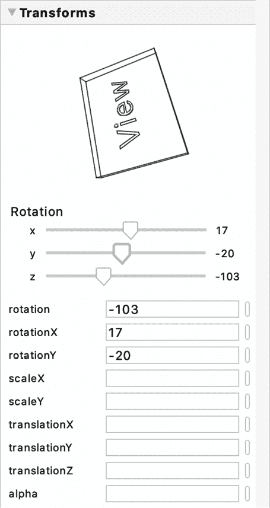

图 17-18

面板包含视图的视觉表示，该表示随属性的更改而更新。这些更改也会反映在布局画布内的视图上。

## 17.11 工具可见性切换（Tools Visibility Toggles）

在代码模式下查看 Android Studio XML 布局文件的内容时，你会发现定义视图外观和行为的许多属性以 `android:` 前缀开头。这表示属性设置在 `android` 命名空间内，并在应用运行时生效。例如，以下布局文件的摘段在 `Button` 视图上设置了各种属性：

```xml
<Button
    android:id="@+id/button"
    android:layout_width="wrap_content"
    android:layout_height="wrap_content"
    android:text="Button"
```

除了 `android` 命名空间外，Android Studio 还提供了一个 `tools` 命名空间。当在此命名空间内设置属性时，它们仅在布局编辑器预览中生效。在设计布局时，你可能会发现让 `EditText` 视图显示某些文本很有帮助，但在应用运行时需要视图为空。为了实现这一点，你可以如下所示使用 `tools` 命名空间设置视图的文本属性：

```xml
<EditText
    android:id="@+id/editTextTextPersonName"
    android:layout_width="wrap_content"
    android:layout_height="wrap_content"
    android:ems="10"
    android:inputType="textPersonName"
    tools:text="Sample Text"
```

此类工具属性通过在属性工具窗口中向带有扳手图标标记的属性字段输入值来设置，如下所示图 17-19：


图 17-19

工具属性对于在设计过程中更改视图的可见性特别有用。布局中可能包含一个视图，在应用运行时根据用户操作程序化地显示和隐藏。为了模拟视图的隐藏，可以在视图 XML 声明中添加以下工具属性：

```xml
tools:visibility="invisible"
```

使用 `invisible` 设置时，尽管视图不再可见，但它仍然存在于布局中，并占据其可见时相同的空间。要让布局的行为就像视图不再存在一样，应将可见性属性设置为 `gone`，如下：

```xml
tools:visibility="gone"
```

在上述两个示例中，可见性设置仅适用于布局编辑器，而对运行中的应用没有影响。要同时控制布局编辑器和运行中应用中的可见性，则应使用 `android` 命名空间设置相同的属性：


`android:visibility="gone"`

虽然这些可见性工具属性很有用，但手动编辑 XML 布局文件是一个繁琐的过程。为了方便更改这些设置，`Android Studio` 在布局编辑器的组件树（`Component Tree`）面板内提供了一组切换器。要访问这些控件，点击面板中对应视图右侧的边缘。例如，图 17-20 显示了名为 `myButton` 的 `Button` 视图的工具可见性切换控件：

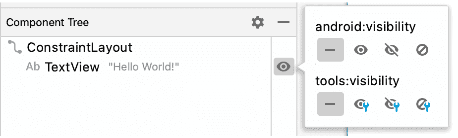

图 17-20

这些切换器控制 `android` 和 `tools` 命名空间下对应视图的可见性，并提供未设置（not set）、可见（visible）、不可见（invisible）和隐藏（gone）选项。当设置了冲突属性时（例如，`android` 命名空间切换设置为可见，而 `tools` 设置为不可见），`tools` 命名空间在布局预览中具有优先级。当做出切换选择时，`Android Studio` 会自动为 XML 元素添加相应的属性。

除了组件树中的可见性切换器外，布局编辑器还包含下方图 17-21 所示的工具可见性和位置切换按钮：


图 17-21

此按钮切换当前的工具可见性设置。例如，如果上述 `Button` 视图当前的工具属性设置为 `gone`，则切换此按钮将使其可见。这有助于在视图添加到或从布局移除时快速检查布局行为。此切换对于检查布局中的视图是否正确约束也非常有用，该主题将在 `Android Studio` 中使用 `ConstraintLayout` 指南章节中介绍。

## 17.12 转换视图 (Converting Views)

将布局中的视图转换为另一种类型（例如将 `TextView` 转换为 `EditText`）可以在 `Android Studio` 布局编辑器轻松完成，只需在屏幕布局或组件树窗口中右键点击视图并选择 `Convert view...` 选项（图 17-22）：

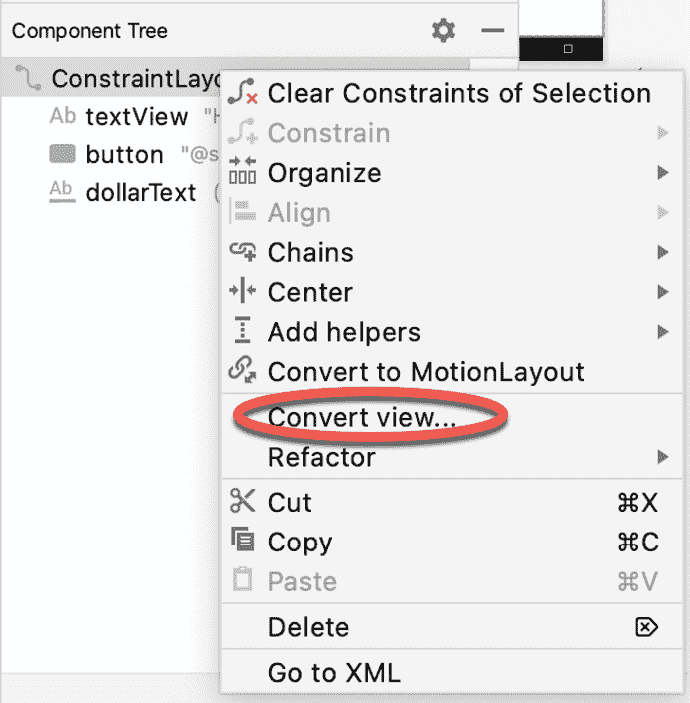

图 17-22

选中后，将出现一个对话框，列出该对象符合转换条件的兼容视图类型列表。图 17-23 示例显示了现有 `TextView` 视图可以转换的类型：

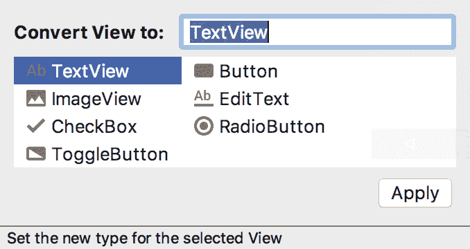

图 17-23

此技术也适用于将布局从一种类型转换为另一种（例如将 `ConstraintLayout` 转换为 `LinearLayout`）。

## 17.13 显示示例数据 (Displaying Sample Data)

在 `Android Studio` 中设计布局时，可能会出现一种情况：用户界面中要显示的内容在应用程序完成并运行之前无法可用。这有时会导致我们很难从布局编辑器中评估布局在应用运行时的显示效果。为了解决这个问题，布局编辑器允许指定样本数据，并用样本图像和数据填充布局编辑器中的视图。这些样本数据仅在布局编辑器中显示，在应用运行时不会显示。可以通过直接编辑布局的 XML，或者使用设计时助手工具进行可视化操作（通过在设计区域右键点击组件并选择 `Set Sample Data`（设置样本数据）菜单选项）来配置样本数据。设计时助手面板将为选定的视图项显示一系列预配置的样本数据选项，包括各种配置下的文本和图像组合。例如，图 17-24 显示了在选择在 `RecyclerView` 列表中显示样本数据时显示的样本数据选项：

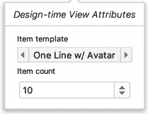

图 17-24

或者，也可以在布局设计过程中提供自定义的文本和图像进行显示。在布局编辑器中使用样本数据的示例包含在后面的章节 “布局编辑器样本数据教程” 中。由于样本数据是实现为 `tools` 属性的，预览中数据的可见性可以使用上方 图 17-21 中高亮显示的切换按钮按钮进行控制。

### 17.14 创建自定义设备定义

布局编辑器工具栏中的设备菜单（图 17-25）提供了一个预配置设备类型列表，选择这些类型后，它们将作为设备屏幕画布出现。除了预配置的设备类型外，之前在 `Android Studio` 环境中配置过的任何 `AVD` 实例也会列在列表中。要添加额外的设备配置，显示设备菜单，选择 `Add Device Definition`（添加设备定义）选项，并按照章节 “在 Android Studio 中创建 Android 虚拟设备 (AVD)” 中概述的步骤进行操作。

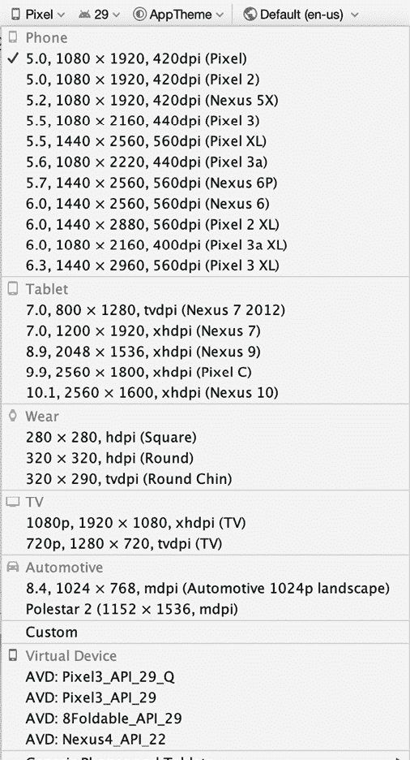

图 17-25

### 17.15 当前设备

作为设备选择菜单的替代方案，可以通过从设备菜单选择 `Custom`（自定义）选项，点击设备屏幕右下角的缩放句柄（图 17-26）并拖动以选择备用设备显示格式。随着屏幕缩放，将出现标记，指示可选择的各种尺寸选项和方向：

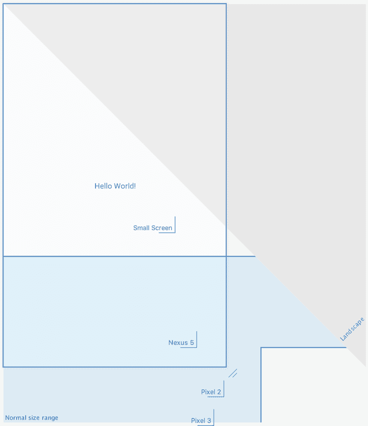

图 17-26

### 17.16 布局验证

布局验证选项允许在一系列 `Pixel` 尺寸的屏幕上同时预览用户界面布局。要访问布局验证工具窗口，可以点击 `Android Studio` 主窗口右侧边缘的标签，或者使用窗口左下角的 `Tool Window`（工具窗口）菜单。一旦加载，该面板将如 图 17-27 所示显示，在多个设备屏幕配置上渲染布局：


图 17-27

### 17.17 总结

开发 Android 应用程序的关键部分涉及创建用户界面。在 `Android Studio` 环境中，这是使用 `Layout Editor`（布局编辑器）工具实现的，它运行三种模式。在 `Design`（设计）模式下，从调板中选择视图组件并放置在代表 Android 设备屏幕的布局上，并使用属性列表进行配置。在 `Code`（代码）模式下，可以直接编辑表示用户界面布局的底层 `XML`。另一方面，`Split`（拆）模式允许通过可视化和直接编辑 `XML` 来同时创建和修改布局。这些模式结合在一起，提供了一个丰富且直观的用户界面设计环境。

布局验证面板允许在系列不同的设备屏幕尺寸上快速预览用户界面布局。

## 18. Android ConstraintLayout 指南

正如章节 “理解 Android 、视图组和布局” 中讨论的那样，Android 提供了许多布局管理器用于设计用户界面。从 Android 7 开始，Google 引入了一种布局，旨在解决旧布局管理器的许多缺点。这种名为 `ConstraintLayout` 的新布局将简单、表达且灵活的布局系统与 `Android Studio` 布局编辑器工具内置的强大功能相结合，以便创建响应式用户界面布局，这些布局能够自动适应不同的屏幕尺寸和设备方向的变化。

本章将概述 `ConstraintLayout` 的基本概念，而下一章将详细概述如何在 `Android Studio` 布局编辑器工具中使用 `ConstraintLayout` 创建基于约束的布局。

### 18.1 ConstraintLayout 如何工作

与所有其他布局一样，`ConstraintLayout` 负责管理其包含的视觉组件（也称为 `widgets`）的定位和尺寸调整行为。它是基于设置在每个子组件上的约束连接来此此的。

为了完全理解和使用 `ConstraintLayout`，理解以下关键概念至关重要：

- Constraints（约束）
- Margins（外边距）
- Opposing Constraints（对向约束）
- Constraint Bias（约束偏移）
- Chains（链）
- Chain Styles（链样式）
- Guidelines（指南）
- Groups（组）
- Barriers（屏障）
- Flow（流）

#### 18.1.1 约束 (Constraints)

约束是一组规则，规定了组件相对于其他组件、`ConstraintLayout` 侧边以及称为指南的特殊元素的对齐和距离。约束还决定了活动的用户界面布局在设备方向变化或在不同尺寸设备上显示时的响应。为了配置配置，组件必须具有足够的约束连接，以便 `ConstraintLayout` 布局引擎能够在和平垂直平面上解析其位置。

#### 18.1.2 外边距 (Margins)

外边距是指定固定距离的约束形式。考虑一个需要放置在设备屏幕右上角的 `Button` 对象。这可以通过从 `Button` 的顶部和右边缘连接到父 `ConstraintLayout` 的对应侧的外边距约束来实现，如图 18-1 所示：


图 18-1

如上图所示，每个约束连接都关联有一个外边距值，规定了组件距离父布局侧边的固定距离。在此配置下，无论屏幕尺寸或设备方向如何，`Button` 对象始终将距离父 `ConstraintLayout` 顶部和右边缘 20 和 15 个设备独立像素 (dp)，正如这两个约束连接指定的那样。

虽然上述配置在某些情况下是可以接受的，但它在允许 `ConstraintLayout` 布局引擎调整组件位置以响应设备旋转和支持不同屏幕方面没有提供任何灵活性。为了给布局添加这种响应性，有必要实现对向约束。

#### 18.1.3 对向约束 (Opposing Constraints)

在单个组件的同一轴上运行的两个约束被称为相反约束（opposing constraints）。换句话说，一个左右两侧都设置了约束的组件被认为具有水平相反约束。例如，图 18-2 展示了在之前的布局基础上添加了水平和垂直方向的相反约束：


图 18-2

这里需要理解的关键点是，一旦在特定轴上实施了相反约束，组件的定位将变为基于百分比而非坐标。例如，组件不再被固定在距离布局顶部 20dp 处，而是被放置在距离布局顶部 30% 的位置。在不同的方向以及在较大或较小的屏幕上运行时，`Button` 将始终处于相对于父布局尺寸的相同位置。

现在重要的是理解的是，图 18-2 所示的布局不仅使用了相反约束，还通过应用了约束偏置（constraint bias）实现的。

### 18.1.4 约束偏置 (Constraint Bias)

目前已经确定，`ConstraintLayout` 中的组件可能会受到相反约束连接的影响。默认情况下，相反约束是相等的，导致相应的组件在相反的轴上居中。例如，图 18-3 展示了一个使用相反的水平和垂直约束，在包含它的 `ConstraintLayout` 中居中的组件：


图 18-3

为了在存在相反约束的情况下允许调整组件的位置，`ConstraintLayout` 实现了一项名为约束偏置（constraint bias）的功能。约束偏置允许组件沿相反轴的定位根据指定的百分比向其中一个约束倾斜（产生偏置）。例如，图 18-4 显示了具有 75% 水平偏置和 10% 垂直偏置的之前的布局：


图 18-4

下一章题为在 `Android Studio` 中使用 `ConstraintLayout` 的指南，将更详细地涵盖这些概念，并解释这些功能如何集成到 `Android Studio` 布局编辑器工具中。然而，在此还需要涵盖 `ConstraintLayout` 类的其他领域。

#### 18.1.5 链 (Chains)

`ConstraintLayout` 链提供了一种将两个或多个组件的布局行为定义为一组的方法。链可以在垂直或水平轴上声明，并进行配置以定义链中组件的间距和大小。

当组件之间通过双向约束相互连接在一起时，它们就形成了链。例如，图 18-5 展示了三个以这种方式成链的组件：


图 18-5

链中的第一个元素是链头（chain head），它在垂直链中对应于顶部的组件，在水平链的情况下对应于最左侧的组件。整个链的布局行为主要通过设置链头组件上的属性来配置。

#### 18.1.6 链样式 (Chain Styles)

`ConstraintLayout` 链的布局行为由应用在链头组件上的链样式设置决定。`ConstraintLayout` 类目前支持以下链布局样式：

* **散布链 (Spread Chain)** – 链包含的组件均匀地分布在可用空间中。这是链的默认行为。


图 18-6

* **内部散布链 (Spread Inside Chain)** – 链包含的组件在链头和链中的最后一个组件之间均匀分布。头部和最后一个组件不包含在间距的分布中。


图 18-7

* **权重链 (Weighted Chain)** – 允许通过权重属性定义链中每个组件所占据的空间。


图 18-8

* **紧凑链 (Packed Chain)** – 构成链的组件紧凑在一起，没有任何间距。可以应用偏置来控制链相对于父容器的水平或垂直位置。


图 18-9

### 18.2 基线对齐 (Baseline Alignment)

到为止，本章只提到了相对于组件边缘的对齐约束（通常称为侧约束）。然而，一个常见的需求是让组件相对于其显示的内容进行对齐，而不是相对于组件本身的边界。为了满足这一需求，`ConstraintLayout` 提供了基线对齐支持。

例如，假设来自图 18-1 的理论布局需要将 `TextView` 组件位于 `Button` 左侧 40dp 处。在这种情况下，`TextView` 需要与 `Button` 视图基线对齐。这意味着 `Button` 内的文本需要与 `TextView` 内的文本在垂直方向对齐。此布局的额外约束需要像图 18-10 所示进行连接：


图 18-10

`TextView` 现在沿 `Button` 的基线进行垂直对齐，并在水平方向距离 `Button` 对象 40dp。

### 18.3 配置组件尺寸

控制组件尺寸是用户界面设计的关键元素。`ConstraintLayout` 提供了三个可以设置在单个组件上的选项以管理尺寸行为：

* **固定 (Fixed)** – 组件固定为指定的尺寸。
* **匹配约束 (Match Constraint)** – 允许由布局引擎调整大小以满足约束。也称为 `AnySize` 或 `MATCH_CONSTRAINT` 选项。
* **包裹内容 (Wrap Content)** – 组件的大小由其包含的内容（文本或图形）决定。

### 18.4 辅助线 (Guideline)

辅助线是 `ConstraintLayout` 中可用的特殊元素，为连接的约束提供了附加目标。可以在 `ConstraintLayout` 实例中添加多个辅助线，并可以配置为水平或垂直方向。一旦添加，就可以建立布局中的组件到辅助线的约束连接。这在多个组件需要沿某一轴对齐时特别有用。例如，在图 18-11 中，`ConstraintLayout` 中的三个 `Button` 对象沿垂直辅助线进行约束：


图 18-11

### 18.5 组 (Group)

`ConstraintLayout` 的此功能允许将组件放入逻辑组中，并作为一个整体控制这些组件的可见性。`Group` 本质上是布局其他组件的引用列表。一旦定义，更改组实例的可见性属性（可见、不可见或隐藏）将应用到所有组成成员。这使得通过更改单个属性来隐藏和显示多个组件变得简单。单个布局可以包含多个组，组件也可以属于多个组。如果组之间发生冲突，XML 文件中最后定义的组优先级更高。

### 18.6 屏障 (Barrier)

与指南（guidelines）类似，屏障（barriers）是虚拟视图，可用于约束布局内的视图。与指南一样，屏障可以是垂直的或水平的，并且一个或多个视图可以被约束在其上（为了避免混淆，这些视图被称为受约束视图）。然而，与在布局中保持固定位置的指南不同，屏障的位置是由一组所谓的参考视图（reference views）定义的。引入屏障是为了解决在某些情况下频繁发生的视图重叠问题。例如，考虑下方图 18-12 所示的布局：


图 18-12

上述布局需要注意的关键点是，`View 3` 的宽度设置为匹配约束模式（constraint mode），且该视图的左边缘连接到 `View 1` 的右边缘。按照目前的实现方式，增加 `View 1` 的宽度将产生预期的效果，即减少 `View 3` 的宽度：

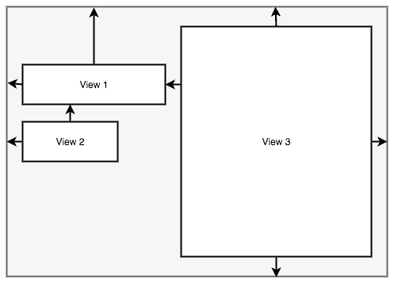

图 18-13

但是，如果不是 `View 1` 而是 `View 2` 的宽度增加了，就会出现问题：


图 18-14

显然，由于 `View 3` 仅受 `View 1` 约束，它不会为了适应 `View 2` 宽度的增加而导致视图重叠。

解决此问题的办法是添加垂直屏障，并将 `View 1` 和 `View 2` 分配为屏障的参考视图，以便它们控制屏障的位置。这样 `View 3` 的左边缘就会相对于屏障受到约束，使其成为受约束视图。

现在当 `View 1` 或 `View 2` 的宽度增加时，屏障将移动以适应两个视图中最宽的一个，导致 `View 3` 的宽度相对于新的屏障位置发生变化：


图 18-15

在使用屏障时，与单个屏障关联的参考视图和受约束视图的数量没有限制。

### 18.7 Flow 助手


`ConstraintLayout Flow`辅助工具允许视图组以流式网格布局样式显示。与`Group`助手一样，`Flow`包含了对其负责定位的视图的引用，并提供了多种配置选项，包括垂直和水平方向、换行行为（包括换行之前的最大控件数量）、间距和对齐属性。链（Chain）行为也可以应用于`Flow`布局，包括展开（spread）、内部展开（spread inside）和紧凑（packed）选项。

图 18-16 表示使用`Flow`助手实例在水平模式下且无换行设置的五个等大小按钮的布局：


图 18-16

图 18-17 显示了相同的按钮在水平流配置中的情况，并设置为每第三个控件后换行：


图 18-17

图 18-18 另一方面，显示了将换行设置为内部展开链的按钮（效果仅在第二行可见，因为第一行已满）。该配置还设置了`gap`属性以增加按钮之间的间距：


图 18-18

作为`Flow`助手灵活性的最终演示，图 18-19 显示了五个大小不一的按钮，配置为水平、紧凑链模式，并在每第三个控件后换行。此外，通过设置水平偏置（horizontal-bias）值为 1.0，网格内容已右对齐（该值为 0.0 将导致左对齐，而 0.5 将使网格内容居中对齐）：


图 18-19

### 18.8 比例

控件的尺寸可以使用比例设置（ratio settings）来定义。例如，可以使用比例设置对控件进行约束，使得无论任何缩放行为如何，宽度始终是高度尺寸的两倍。

### 18.9 ConstraintLayout 的优势

`ConstraintLayout`提供了足够的灵活性，使得可以在单个布局实例中实现旧布局的许多功能，而以前这可能需要嵌套多个布局。这样做的好处是避免了布局嵌套固有的问题，允许设计所谓的“扁平”或“浅层”布局层级，从而使布局变得不复杂，并提高了运行时用户界面的渲染性能。

`ConstraintLayout`的实现还考虑了解决当市面上广泛的 Android 设备屏幕尺寸问题。`ConstraintLayout`的灵活性使得设计能够响应并适应运行应用程序的设备的用户界面变得更容易。

最后，正如章节“在 Android Studio 中使用 ConstraintLayout 指南”中所示的那样，Android Studio 布局编辑器工具已专门针对基于`ConstraintLayout`的用户界面设计进行了增强。

### 18.10 ConstraintLayout 的可用性

尽管`ConstraintLayout`是从 Android 7 开始引入的，但它是作为独立的支持 SDK 库提供的，并兼容远到 API 级别 9 (Gingerbread) 的旧 Android 版本。这使得使用这种新布局的应用程序可以在运行旧版本 Android 的设备上运行。

### 18.11 总结

`ConstraintLayout`是随 Android 7 引入的布局管理器。它的设计旨在创建灵活的布局，以适应市面上许多 Android 设备的尺寸和方向。`ConstraintLayout`使用约束来控制控件相对于父级`ConstraintLayout`实例、指南、屏障以及布局中其他控件的对齐和定位。`ConstraintLayout`是新创建的 Android Studio 项目的默认布局，也是设计用户界面布局时的推荐选择。通过这种简单而灵活的布局管理方法，可以以惊人的便利实现复杂且响应式的用户界面。

## 19. 在 Android Studio 中使用 ConstraintLayout 指南

正如前面的章节中多次提到的，Google 对 Android Studio 布局编辑器工具进行了重大更改，其中许多更改仅是为了支持使用`ConstraintLayout`进行用户界面布局设计。既然上一章已经概述了`ConstraintLayout`的基本概念，本章将详细探讨这些概念，同时概述布局编辑器工具允许设计和实现基于`ConstraintLayout`的用户界面的方法。

### 19.1 设计视图和布局视图

章节“Android Studio 布局编辑器指南”解释了 Android Studio 布局编辑器工具提供了两种查看活动用户界面布局的方式，即设计视图（Design views）和布局视图（Layout views，也称为蓝图）。这些视图可以单独显示，也可以像图 19-1 所示并排显示：

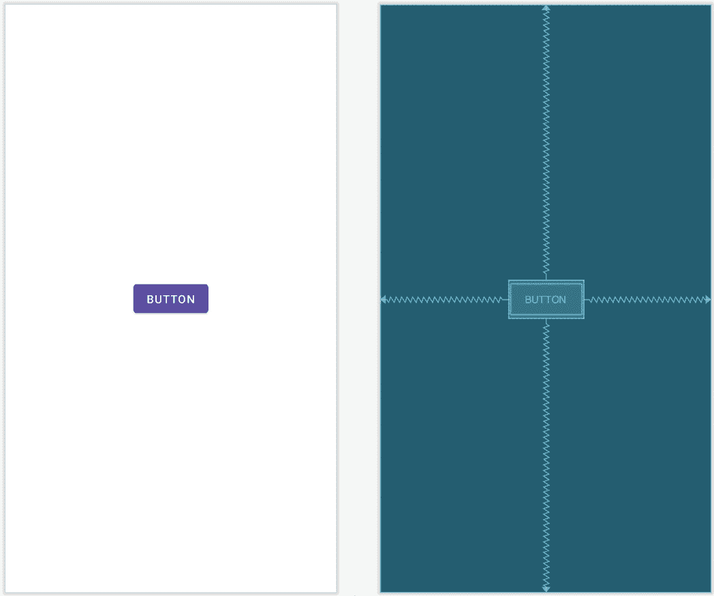

图 19-1

设计视图（Design view，位于上图左侧）展示了布局的“所见即所得”表示，其中布局的外观与其在运行应用程序中的显示一致。而布局视图（Layout view）则显示蓝图风格的视图，其中组件由阴影轮廓表示。如上方的图 19-1 所示，布局视图还会显示约束连接（在本例中，使用了用于将按钮居中布局的对向约束）。当选中布局中的特定组件或将鼠标指针悬停在设计区域上时，这些约束也会叠加在设计视图上，如图 19-2 所示：

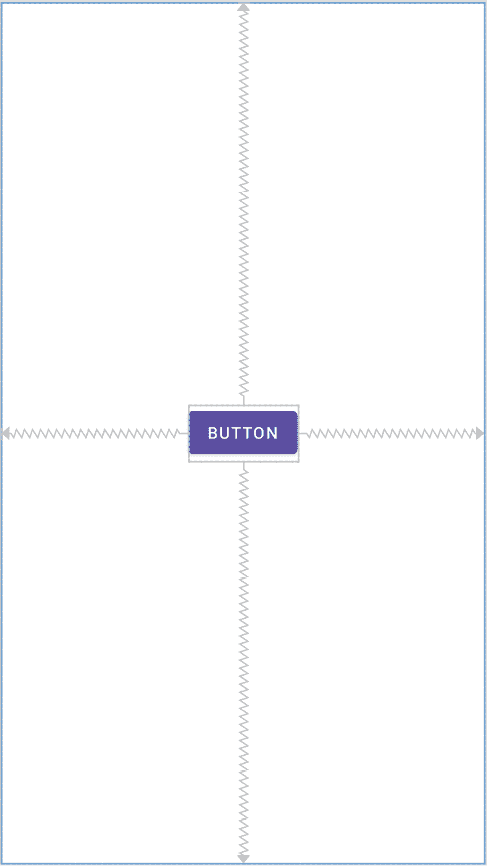

图 19-2

两种视图中约束连接的外观都可以通过图 19-3 所示的“视图选项”（View Options）菜单进行更改：

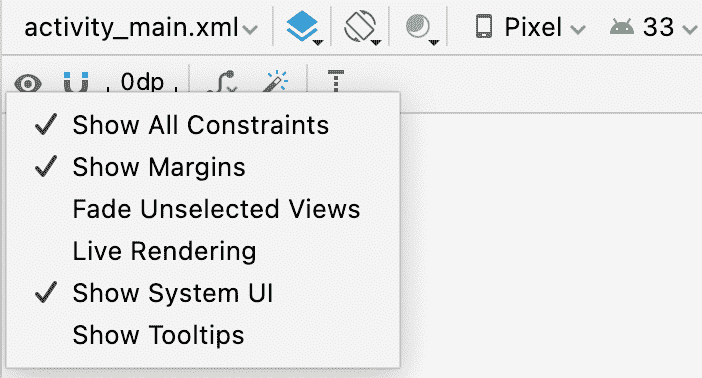

图 19-3

除了显示用户界面布局两种模式外，布局编辑器工具还提供了三种为特定布局设计建立所需约束的方法。

### 19.2 自动连接模式 (Autoconnect Mode)

自动连接，顾名思义，会在项目添加到布局中时自动建立约束连接。可以使用图 19-4 所示的工具栏按钮启用或禁用自动连接模式：

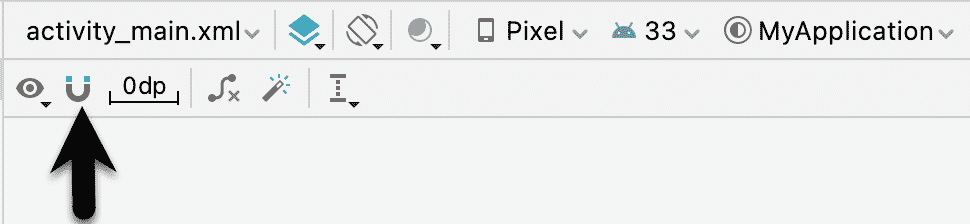

图 19-4

自动连接模式使用算法，根据组件的位置以及组件与父布局侧边和布局中其他元素的距离，来决定建立的最佳约束。如果任何自动约束连接未能提供预期的行为，可以按照本章稍后介绍的内容手动更改。

### 19.3 推断模式 (Inference Mode)

推断模式使用涉及算法和概率的启发式方法，在组件已添加到布局后自动实现约束连接。这种模式通常在关闭了自动连接功能且在没有任何约束连接的情况下将对象添加到布局时使用。这允许通过从调色板将对象拖放到布局画布上，并进行尺寸和位置更改直到布局符合要求，从而简单地设计布局。本质上涉及到在不担心约束的情况下“绘制”布局。推断模式也可以在设计过程中的任何时候使用，填充布局中缺失的约束。

点击推断约束按钮（图 19-5）时，约束会自动添加到布局中：

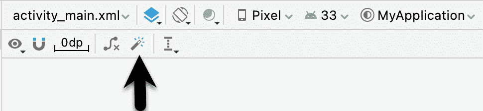

图 19-5

与自动连接模式一样，布局编辑器工具始终存在推断错误约束的可能性，尽管这些约束可以手动进行修改和修正。

### 19.4 手动操作约束 (Manipulating Constraints Manually)

实现约束连接的第三种方法是手动操作。这样做时，理解布局编辑器工具中组件周围出现的各种手柄将很有帮助。例如考虑图 19-6 所示的组件：

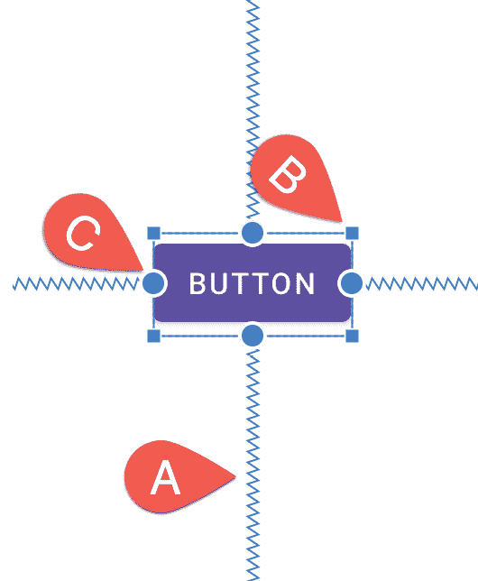

图 19-6

显然，弹簧状线条 (A) 代表了从组件侧边到目标已建立的约束连接。对象每个角的小正方形标记 (B) 是缩放手柄，点击并拖动时可用于缩放组件。位于组件每侧的小圆圈手柄 (C) 是侧边约束锚点。要创建约束连接，点击手柄并将生成的线条拖到要连接约束的元素（例如引导线或父布局的侧边或另一个组件的侧边），如图 19-7 所示。当连接到另一个组件的侧边时，只需将线条拖到该组件的侧边约束手柄，并在组件和手柄高亮时释放线条。

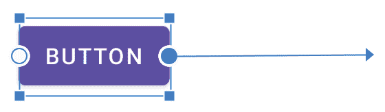

图 19-7

如果将约束线拖到组件并释放，但未附加到约束手柄，布局编辑器将显示一个菜单，其中列出了约束可以附加的侧边列表。在图 19-8 中，例如，约束可以附加到目标按钮组件的顶部或底部边缘：

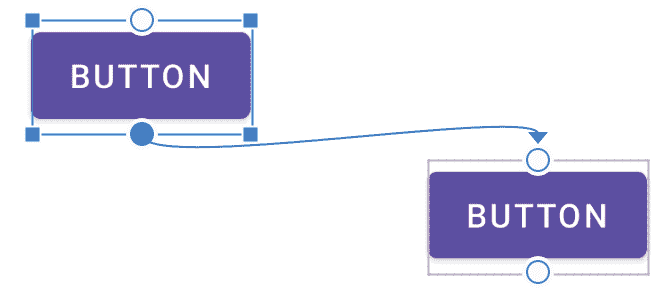

图 19-8

额外的标记指示了基线约束（baseline constraints）的锚点，其中组件内部的内容（而非外部边缘）被用作对齐点。要显示此标记，只需右键点击组件并选择“显示基线”（Show Baseline）菜单选项。从基线约束手柄建立约束连接，只需将鼠标指针悬停在手柄上直到其高亮，然后点击并拖动到目标（如图 19-9 所示的另一个组件的基线锚点）。

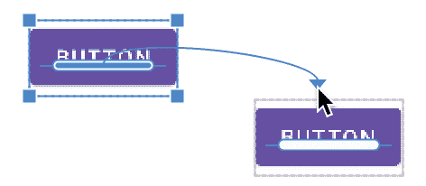

图 19-9

要隐藏基线锚点，再次右键点击组件并选择“隐藏基线”（Hide Baseline）选项。

### 19.5 在检查器中添加约束 (Adding Constraints in the Inspector)

也可以使用图 19-10 所示的属性窗口中的检查器（Inspector）面板向视图添加约束。中间的正方形代表当前选中的视图，周围的区域表示应用于视图对应侧边的约束：


图 19-10

视图侧边缺失约束由带有加号的蓝色圆圈的虚线表示（如上视图底部边缘所示）。要添加约束，只需点击此蓝色圆圈，布局编辑器将连接到它认为最合适的目标。

### 19.6 在属性窗口中查看约束 (Viewing Constraints in the Attributes Window)

可以通过显示属性窗口中的“约束”部分来查看配置在当前组件上的约束列表，如下方的图 19-11 所示：


图 19-11

点击列表中的约束将选中设计布局中的该约束。

### 19.7 删除约束 (Deleting Constraints)

要删除单个约束，只需在设计布局或属性窗口中选择该约束使其高亮（例如在图 19-12 中，选择了最右侧的约束），然后按下键盘删除键。该约束将从布局中移除。

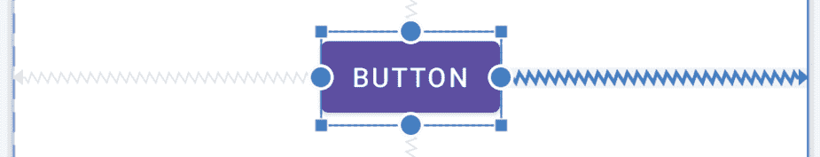

图 19-12

另一种选项是在按住 Ctrl（macOS 上为 Cmd）键并将鼠标指针悬停在约束锚点上，并在它变为红色后点击锚点：

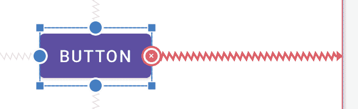

图 19-13

或者，通过右键点击组件并选择“清除选择约束”（Clear Constraints of Selection）菜单选项移除组件上的所有约束。要从布局中的每个组件中移除所有约束，请使用图 19-14 所示的工具栏按钮：

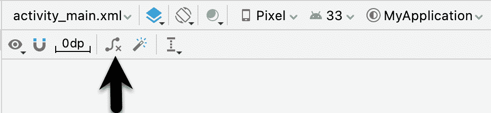

图 19-14

### 19.8 调整约束偏置 (Bias)

在上一节中，我们概述了使用偏置设置（bias）来让一个对立约束相对于另一个的概念。Android Studio 布局编辑器工具中的偏置通过`Attributes`工具窗口中的`Inspector`进行调整，并如图 19-15 所示。图中由箭头指示的两个滑块用于控制当前选中组件的垂直和水平对立约束的偏置。

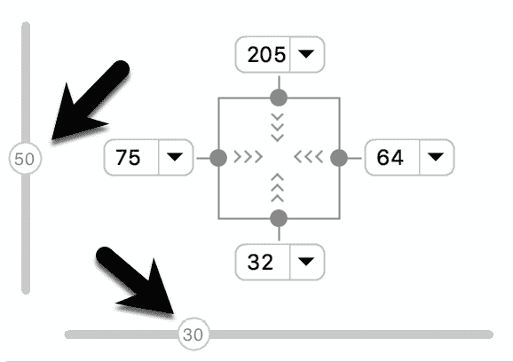

图 19-15

### 19.9 理解 ConstraintLayout 边距

约束可以与边距（margins）结合使用，以实现组件与其他元素（例如另一个组件、`guideline` 或父布局的边缘）之间的固定间隙。例如，考虑应用于图 19-16 中`Button`对象的水平约束：

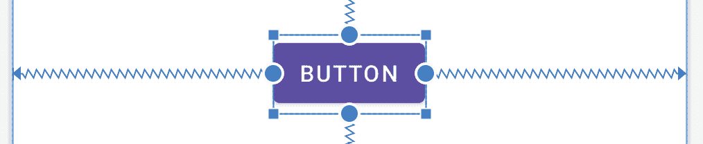

图 19-16

按照当前的配置，水平约束延伸到父`ConstraintLayout`的左右边缘。因此，组件具有对立的水平约束，这意味着`ConstraintLayout`布局引擎在运行时对组件的实际位置有一定的裁量权。这使得布局具有一定的活性，以适应不同的屏幕尺寸和设备方向。水平偏置设置还可以控制组件的位置直到布局的右侧。例如，图 19-17 显示了应用了 100% 水平偏置的同一个按钮：


图 19-17

`ConstraintLayout`边距可以出现在约束连接的末端，代表一个固定间隙，即使在调整偏置或响应活动其他部分的布局变化，组件也无法进入该间隙。在图 19-18 中，右侧约束现在包含一个`50dp`的边距，即使偏置仍设置为 100%，组件也无法移动到该区域。


图 19-18

组件上的现有边距值可以在`Inspector`中进行修改。如图 19-19 所示，正在使用下拉菜单将当前选中组件的右边距更改为`16dp`。或者，点击当前值也可以在字段中输入数字。


图 19-19

新约束的默认边距可以随时使用图 19-20 所示工具栏中高亮的选项进行更改：


图 19-20

### 19.10 对立约束和偏置的重要性

正如上一节讨论的，在使用`ConstraintLayout`时，对立约束、边距和偏置是 Android 响应式布局设计的基石。当组件被约束但没有对立约束连接时，这些约束本质上是边距约束。这在布局编辑器工具中通过实线并连带边距测量值在视觉上表示出来，如图 19-21 所示。


图 19-21

上述约束本质上将组件固定在那个位置。其结果是，如果设备旋转到横屏模式，组件将不再可见，因为垂直约束会将其推到设备屏幕的顶部之外（如图 19-22 所示）。如果应用程序运行在比设计过程中使用的屏幕更小的设备上，也会出现类似的问题。


图 19-22

当实现对立约束时，约束连接由像弹簧一样的锯齿线表示（使用弹簧的比喻是为了表示组件的位置没有固定在绝对的 X 和 Y 坐标上）：


图 19-23

在上述布局中，垂直和水平偏置设置已配置为：组件将始终位于距离父布局底部 90% 距离处以及距离左边缘 35% 距离处。因此，当旋转时，组件仍然可见，并且相对于屏幕尺寸位于相同的位置：


图 19-24

在设计响应式且适应良好的用户界面布局时，手动设计用户界面布局并对自动创建的约束进行修正时，同时考虑偏置和对立约束是非常重要的。

### 19.11 配置组件尺寸

`ConstraintLayout`中组件的内部尺寸也可以使用`Inspector`配置。正如上一节概述的，组件尺寸可以设置为`wrap content`、`fixed`或`match constraint`。当前选中组件的每个维度设置显示在`Inspector`中代表该组件的正方形内，如图 19-25 所示：


图 19-25

在上述图中，水平和垂直维度都设置为`wrap content`模式（由向内的箭头符号指示）。`Inspector`使用以下视觉指示来表示三种模式：

| 固定尺寸 (Fixed Size) |  |

| 匹配约束 (Match Constraint) |  |

| 内容内容 (Wrap Content) |  |

表 19-1

要更改当前设置，只需点击指示循环。当布局编辑器中视图的维度设置为`match constraint`时，视图相应的边将使用弹簧线而不是直线。例如，在图 19-26 中，仅视图的宽度被设置为`match constraint`：


图 19-26

此外，可以使用`Expand horizontally`和`Expand vertically`选项根据布局中的约束和其他组件在水平或垂直方向上扩展组件的尺寸。可以通过右键点击布局中的组件并从弹出菜单中选择`Organize`选项来访问它们（图 19-27）。使用时，当前选中的组件将在水平或垂直方向上增大以填充周围的空间。


图 19-27

### 19.12 设计时工具定位

Android Studio 布局编辑器指南章节介绍了`tools`命名空间的概念，并解释了如何使用它设置仅在布局编辑器内有效的可见性属性。在后台，Android Studio 还使用`tools`属性在没有约束的情况下保持组件的位置。例如，在禁用自动连接模式时将`Button`放入布局。虽然组件在预览画布中看起来位置正确，但在运行应用程序时，它将出现在屏幕的左上角。这是因为组件没有约束来告诉父`ConstraintLayout`将其放置在何处。

组件在布局编辑器中似乎位于正确位置的原因是，Android Studio 设置了绝对的 X 和 Y 定位工具级属性，以便在添加约束条件之前将其保持在正确位置。在 XML 布局文件中，其内容可能如下：

```
<Button
    android:layout_width="wrap_content"
    android:layout_height="wrap_content"
    android:text="Button"
    tools:layout_editor_absoluteX="100dp"
    tools:layout_editor_absoluteY="200dp" />
```


```xml
<Button
    android:id="@+id/button4"
    android:layout_width="wrap_content"
    android:layout_height="wrap_content"
    android:text="Button"
    tools:layout_editor_absoluteX="111dp"
    tools:layout_editor_absoluteY="88dp" />
```

一旦为组件添加了足够的约束，布局编辑器将移除这些工具级属性。一种快速识别哪些组件缺少约束的实用技巧（而无需等待应用运行）是点击图 19-28 中高亮显示的按钮，以切换工具栏位置的可视性。任何跳转到左上角的组件都是未经过完全约束的，它们正被临时的工具级绝对 X 和 Y 定位属性固定着。


图 19-28

### 19.13 添加辅助线

辅助线提供了可以锚定约束的额外元素。可以通过右键点击布局并选择“垂直辅助线”（`Vertical Guideline`）或“水平辅助线”（`Horizontal Guideline`）菜单选项，或者使用工具栏菜单选项，如图 19-29 所示：


图 19-29

或者，也可以从调色板（`Palette`）的“助手”（`Helpers`）部分拖拽水平和垂直辅助线，并将其放置在布局画布或“组件树”（`Component Tree`）面板上，如图 19-30 中的箭头所示：


图 19-30

一旦添加成功，辅助线将以虚线的形式显示在布局中，可以通过简单的点击并拖拽线条来移动。要建立到辅助线的约束连接，点击组件的约束句柄，并在释放之前拖动到辅助线。如图 19-31 所示：


图 19-31

或者，辅助线也可以作为父布局总宽度或高度的百分比进行定位。要在这三种模式之间切换，请选择辅助线并点击辅助线顶部或起始处的圆圈（取决于辅助线是垂直还是水平的）。例如，图 19-32 所示：


图 19-32

### 19.14 添加屏障

可以通过右键点击布局并在“添加助手”（`Add helpers`）菜单中选择“垂直屏障”（`Vertical Barrier`）或“水平屏障”（`Horizontal Barrier`）选项，或者使用如之前在图 19-29 所示的工具栏选项。如图 19-33 所示：


图 19-33

要将视图作为引用视图（换句话说，控制屏障位置的视图），只需将组件从“组件树”内部拖动到屏障项上。例如，图 19-34 所示：


图 19-34

添加引用视图后，需要配置屏障以指定屏障相对于这些视图的方向。这是屏障方向设置，当在“组件树”面板中选择屏障时，它在“属性”（`Attributes`）工具窗口中定义：


图 19-35

下图显示了一个包含屏障的布局，其中 `textView1` 和 `textView2` 作为引用视图，`textview3` 作为受约束的视图。由于屏障是从引用视图的末端向受约束视图推的，因此屏障方向已设置为 `end`：


图 19-36

### 19.15 添加组

要在布局中添加“组”（`Group`），右键点击布局并在“添加助手”菜单中选择“组”选项，或者使用之前在图 19-29 所示的工具栏选项。或者，在调色板的“助手”部分找到“组”项，并将其拖放到布局画布或“组件树”面板。要向组添加组件，请在“组件树”中选择它们并将其拖放到组项上。例如，图 19-37 显示将三个选中的组件添加到组中：


图 19-37

组引用的任何组件将以斜体显示在“组件树”中的组下方，如图 19-38 所示。要从组中移除组件，只需选择它并按：


图 19-38

一旦组件分配给组，使用属性工具窗口的“约束”（`Constraints`）部分修改可见性设置：


图 19-39

## 19.16 使用流助手

流（`Flow`）助手可以像之前一样通过菜单或调色板添加。与“组”助手一样（图 19-37），通过在“组件树”中拖拽组件到流实例来实现。添加流助手并为其分配组件后，在“组件树”中选择它，并使用属性窗口的“常用属性”（`Common Attributes`）部分配置流布局行为：


图 19-40

## 19.17 组件组的对齐与分布

当在布局中选择多个组件时，`Android Studio` 布局编辑器提供了一系列对齐和分布操作。只需按 `Shift` 点击参与操作的每个组件，右键点击布局并在“对齐”（`Align`）菜单显示的许多选项中进行选择：


图 19-41

如下所示图 19-42，这些选项也可以通过布局编辑器工具栏上的“对齐”按钮访问：


图 19-42

同样，“打包”（`Pack`）菜单（图 19-43）可用于共同重新定位选中的组件，使其在垂直或水平方向上紧凑排列。它通过更改组件的绝对 X 和 Y 坐标来实现，但不应用任何约束。相反，“打包”菜单中的两个分布选项会移动选中的组件，使其在垂直或水平轴上均匀分布，并在视图之间应用约束以保持这种间距。


图 19-43

### 19.18 将其他布局转换为 ConstraintLayout

对于使用一个或多个其他 `Android` 布局类（如 `RelativeLayout` 或 `LinearLayout`）的现有用户界面布局，`Layout Editor`（布局编辑器）工具提供了一个选项可以将用户界面转换为使用 `ConstraintLayout`。

当 `Layout Editor` 工具打开并处于 `Design`（设计）模式时，`Component Tree`（组件树）面板显示在 `Palette`（调色板）下方。要将布局转换为 `ConstraintLayout`，在 `Component Tree` 中找到它，右键点击它并选择 `Convert <current layout> to Constraint Layout`（将<当前布局>转换为 `Constraint Layout`）菜单选项：


图 19-44

选择此菜单选项后，`Android Studio` 将将选定的布局转换为 `ConstraintLayout` 并使用推理建立约束，以匹配原始布局类型的布局行为。

### 19.19 总结

重新设计的 `Layout Editor` 工具结合 `ConstraintLayout` 使得使用 `Android Studio` 设计复杂的用户界面布局成为一个相对快速且直观的过程。本章详细介绍了约束、边距和偏移（`bias`）的概念，同时探索了基于 `ConstraintLayout` 的设计如何集成到 `Layout Editor` 工具中。

# 20. 在 Android Studio 中使用 ConstraintLayout 链（Chains）和比例

之前的章节介绍了 `ConstraintLayout` 类的关键特性，并概述了在 `Android Studio Layout Editor` 中进行基于 `ConstraintLayout` 的用户界面设计的最佳实践。尽管在标题为 `Android ConstraintLayout` 指南的章节中概述了 `ConstraintLayout` 链和比例的概念，但我们尚未讨论如何在 `Layout Editor` 中利用这些功能。因此，本章的重点是提供在使用 `ConstraintLayout` 类时如何创建和管理链和比例的实际步骤。

### 20.1 创建链

链可以通过在 `Activity` 的 `XML` 布局资源文件中添加几行代码来实现，也可以通过使用 `Layout Editor` 中某些链特有的功能来实现。

考虑一个由三个 `Button` 组件组成的布局，这些组件被约束为定位在 `ConstraintLayout` 父布局的左上角、顶部中央和右上角，如图 20-1 所示：


图 20-1

为了表示此类布局，`XML` 资源布局文件可能包含以下按钮组件的条目：

```xml
<Button
    android:id="@+id/button1"
    android:layout_width="wrap_content"
    android:layout_height="wrap_content"
    android:layout_marginStart="8dp"
    android:layout_marginTop="16dp"
    android:text="Button"
    app:layout_constraintHorizontal_bias="0.5"
    app:layout_constraintStart_toStartOf="parent"
    app:layout_constraintTop_toTopOf="parent" />

<Button
    android:id="@+id/button2"
    android:layout_width="wrap_content"
    android:layout_height="wrap_content"
    android:layout_marginEnd="8dp"
    android:layout_marginStart="8dp"
    android:layout_marginTop="16dp"
    android:text="Button"
    app:layout_constraintHorizontal_bias="0.5"
    app:layout_constraintEnd_toStartOf="@+id/button3"
    app:layout_constraintStart_toEndOf="@+id/button1"
    app:layout_constraintTop_toTopOf="parent" />

<Button
    android:id="@+id/button3"
    android:layout_width="wrap_content"
    android:layout_height="wrap_content"
    android:layout_marginEnd="8dp"
    android:layout_marginTop="16dp"
    android:text="Button"
    app:layout_constraintHorizontal_bias="0.5"
    app:layout_constraintEnd_toEndOf="parent"
    app:layout_constraintTop_toTopOf="parent" />
```

按照目前的配置，没有双向约束来将这些组件分组成一条链。为了解决这个问题，需要从 `button1` 的右侧到 `button2` 的左侧添加额外的约束，并从 `button3` 的左侧到 `button2` 的右侧添加约束，如下所示：

```xml
<Button
    android:id="@+id/button1"
    android:layout_width="wrap_content"
    android:layout_height="wrap_content"
    android:layout_marginStart="8dp"
    android:layout_marginTop="16dp"
    android:text="Button"
    app:layout_constraintHorizontal_bias="0.5"
    app:layout_constraintStart_toStartOf="parent"
    app:layout_constraintTop_toTopOf="parent" />

<Button
    android:id="@+id/button2"
    android:layout_width="wrap_content"
    android:layout_height="wrap_content"
    android:layout_marginEnd="8dp"
    android:layout_marginStart="8dp"
    android:layout_marginTop="16dp"
    android:text="Button"
    app:layout_constraintHorizontal_bias="0.5"
    app:layout_constraintEnd_toStartOf="@+id/button3"
    app:layout_constraintStart_toEndOf="@+id/button1"
    app:layout_constraintTop_toTopOf="parent" />

<Button
    android:id="@+id/button3"
    android:layout_width="wrap_content"
    android:layout_height="wrap_content"
    android:layout_marginEnd="8dp"
    android:layout_marginTop="16dp"
    android:text="Button"
    app:layout_constraintHorizontal_bias="0.5"
    app:layout_constraintEnd_toEndOf="parent"
    app:layout_constraintTop_toTopOf="parent" />
```

通过这些更改，组件现在有了双向约束。这实际上构成了一个 `ConstraintLayout` 链，在 `Layout Editor` 中所示如下所示。请注意在此配置下链默认为散布样式。


图 20-2

链也可以通过右键点击视图并选择 `Chains -> Horizontal Chain`（水平链）或 `Chains -> Vertical Chain`（垂直链）来创建。

## 20.2 更改链样式

如果没有配置链样式，`ConstraintLayout` 将默认使用散布（`spread`）链样式。可以通过右键点击链中的任何组件并选择 `Chain Mode`（链模式）选项来更改样式。每点击一次菜单选项，样式就会在 `spread`（散布）、`spread inside`（内部散布）和 `packed`（聚集）之间切换。

或者，可以在 `Attributes` 窗口中展开 `layout_constraints` 属性，并根据链的方向更改 `horizontal_chainStyle` 或 `vertical_chainStyle` 属性：


图 20-3

## 20.3 内部散布链样式

图 20-4 说明了上述技术将链样式更改为内部散布链的效果：


图 20-4

## 20.4 聚集链样式

使用相同的技术，将链样式属性更改为 `packed` 会导致布局发生变化，如图 20-5 所示：


图 20-5

### 20.5 带偏移的聚集链

聚集链的位置可能会受到应用偏移值的影响。偏移可以是 `0.0` 到 `1.0` 之间的任何值，其中 `0.5` 代表父布局的中心。偏移通过选择链头组件并在 `Attributes` 面板中为 `layout_constraintHorizontal_bias` 或 `layout_constraintVertical_bias` 属性赋值来控制。图 20-6 显示了一个水平偏移设置为 `0.2` 的聚集链：


图 20-6

### 20.6 权重链

链（`chains`）的最后一个探索区域涉及对单个控件进行加权，以控制链中每个控件在可用空间中所占的比例。加权链仅可以使用散开链（`spread chain`）样式实现，并且链中任何需要响应权重（`weight`）属性的控件都必须将其相应的维度属性（垂直链为高度，水平链为宽度）配置为匹配约束模式（`match constraint` mode）。控件维度的匹配约束模式可以通过选择该控件、显示属性（`Attributes`）面板并将维度更改为 `match_constraint`（等同于 `0dp`）来配置。例如，在图 20-7 中，按钮的 `layout_width` 约束已设置为 `match_constraint`（`0dp`），这表示该控件的宽度将根据现行的约束设置来确定：


图 20-7

假设已选择散开链样式，并且三个按钮都已配置为宽度维度匹配约束，则链中的控件将等比例扩展以填充可用空间：


图 20-8

每个控件相对于链中其他控件所占的空间可以通过向控件添加权重属性（`weight properties`）来控制。图 20-9 显示了将 `button1` 的 `layout_constraintHorizontal_weight` 属性设置为 `4`，以及将 `button2` 和 `button3` 设置为 `2` 的效果：


图 20-9

由于这些权重值，`button1` 占据了空间的一半 (4/8)，而 `button2` 和 `button3` 各占据了空间的四分之一 (2/8)。

## 20.7 使用比例

`ConstraintLayout` 比例（`ratios`）允许控件的一个维度相对于该控件的另一个维度（也称为纵横比）进行尺寸调整。例如，可以将比例设置应用于 `ImageView`，以确保其宽度始终是高度的两倍。

维度比例约束通过将受约束维度设置为匹配约束模式，并将该控件上的 `layout_constraintDimensionRatio` 属性配置为所需的比例来实现。该比例值可以指定为浮点值或“宽:高”比例设置。例如，下面的 XML 代码段在 `ImageView` 控件上配置了 2:1 的比例：

```xml
<ImageView
    android:layout_width="0dp"
    android:layout_height="100dp"
    android:id="@+id/imageView"
    app:layout_constraintDimensionRatio="2:1" />
```

上面的示例演示了当仅设置一个维度为匹配约束时如何配置比例。当两个维度都设置为匹配约束模式时，也可以应用比例。这涉及到在指定比例前加上 `H` 或 `W`，以指示哪一个维度是相对于另一个维度受约束的。

例如，考虑以下针对 `ImageView` 对象的 XML 代码段：

```xml
<ImageView
    android:layout_width="0dp"
    android:layout_height="0dp"
    android:id="@+id/imageView"
    app:layout_constraintBottom_toBottomOf="parent"
    app:layout_constraintRight_toRightOf="parent"
    app:layout_constraintLeft_toLeftOf="parent"
    app:layout_constraintTop_toTopOf="parent"
    app:layout_constraintDimensionRatio="W,1:3" />
```

在上面的示例中，高度将根据应用于其上的约束来定义。在这种情况下，约束被配置为使其连接到父视图的顶部和底部，实质上是将控件拉伸以填充父视图的整个。另一方面，宽度维度被约束为 `ImageView` 高度的三分分之一。因此，无论布局显示在什么尺寸的屏幕或何种方向上，`ImageView` 的高度始终与父视图相同，而宽度为该高度的三分之一。

不需要手动编辑 XML 资源文件也可以实现相同的结果。每当控件维度设置为匹配约束模式时，属性面板的检查器（`Inspector`）区域就会出现一个比例控制切换按钮。例如，图 20-10 显示了按钮控件的布局宽度和高度属性分别设置为匹配约束模式和 `100dp`，并在控件尺寸预览中高亮了比例控制切换按钮：


图 20-10

默认情况下，比例尺寸控制是关闭的。点击该控制可以启用比例约束并显示一个可以更改比例的额外字段：


图 20-11

### 20.8 总结

链（`chains`）和比例（`ratios`）都是 `ConstraintLayout` 的强大功能，旨在为设计灵活且响应式的用户界面布局提供额外选项。正如本章所述，Android Studio 布局编辑器已经增强，以便在设计过程中更容易使用这些功能。

## 21. Studio 布局编辑器 ConstraintLayout 教程

到目前为止，为 Android 应用设计用户界面最简单且高效的方法是利用 Android Studio 布局编辑器工具。本章将提供如何使用这种方法创建基于 `ConstraintLayout` 的用户界概述。本章包含的练习也将作为从“空白骨” Android Studio 项目创建一个 Activity 的机会。

### 21.1 Studio 编辑器示例

示例阶段的第一步是创建一个新的 Android Studio 项目。首先启动 Android Studio 并通过 `File -> Close Project` 菜单关闭已打开的项目。

在欢迎屏幕上选择 `New Project`，选择 `Empty Views Activity` 模板并点击 `Next`。在 `Name` 字段中输入 `LayoutSample`，并指定包名为 `com.ebookzy.layoutsample`。在点击 `Finish` 按钮之前，将最小 API 级别设置为 `API 26: Android 8.0 (Oreo)`并将语言菜单设置为 `Java`。

### 21.2 准备布局编辑器环境

找到 `app -> res -> layout` 文件夹中的 `activity_main.xml` 布局文件并双击将其加载到布局编辑器工具中。由于本教程的目的是获得使用约束的经验，请使用工具栏上的按钮关闭自动连接（`Autoconnect`）功能。禁用后，该按钮将带有划线，如图 21-1 所示：


图 21-1

如果自动连接按钮右侧的默认边距值不是 `8dp`，请点击它并在生成的面板中选择 `8dp`。

在 Android Studio 中，显示 `Resource Manager` 工具窗口（`View -> Tool Windows -> Resource Manager`）。在操作系统的文件导航器中找到 `galaxy6s.png` ，并将其拖放到 `Resource Manager` 工具窗口中。在弹出的对话框中，点击 `Next` 然后点击 `Import` 按钮将图像添加到项目中。现在该图像应该出现在 `Resource Manager` 中，如下方的图 21-2 所示：


图 21-2

该图像也会出现在 `Project` 工具窗口的 `res -> drawables` 部分：


图 21-3

### 21.3 将组件添加到用户界面

从 `Common` 调色板类别中，将 `ImageView` 对象拖入到显示区域的中心。注意，会出现水平和垂直虚线，表示显示的中心轴。当对齐中心时，松开鼠标按钮将视图放置在目标位置。一旦放置在布局中，就会出现 `Resources` 对话框，请求视图视图显示的图像。在对话框顶部的搜索栏中输入“galaxy”以定位 `galaxysys6.png` 资源，如图 21-4 所示：


图 21-4

选择图像并点击 `OK` 将其分配给 `ImageView` 对象。如有必要，使用缩放手柄调整 `ImageView` 的大小并将其重新定位到布局的中心。此时，布局应与图 21-5 匹配：


图 21-5

从调色板的 `Common` 部分点击并拖动 `TextView` 对象，并将其位置设在 `ImageView` 上方，如图 21-6 所示。

使用 `Attributes` 面板，展开 `Common Attributes` 部分中的 `textAppearance` 属性项，将 `textSize` 属性更改为 `24sp`，将 `textAlignment` 设置为 `center`，并将文本改为“Samsung Galaxy S6”。


图 21-6

接下来，在布局底部添加三个 `Button` 组件，并将这些视图的文本属性设置为“Buy Now”、“Pricing”和“Details”。完成后的布局现在应与图 21-7 匹配：


图 21-7

此时，组件的约束条件还不足以让布局引擎能够在运行时对组件进行定位和调整大小。如果现在运行程序，所有组件都将位于在显示器的左上角。

将组件添加到布局后，使用 `Layout Editor` 工具栏上的设备旋转按钮（如图 21-8 中的箭头所示）来以横向模式查看用户界面：


图 21-8

缺少约束会导致布局无法适应设备方向的变化，导致内容偏离中心，并且图像部分以及三个按钮都位于屏幕的可视图之外。显然，仍然需要进行一些工作才能使其成为一个响应式用户界面。

### 21.4 添加约束

约束是创建能够适应设备方向变化和不同屏幕尺寸的布局的关键。首先将布局旋转回竖向模式，并选择位于 `ImageView` 之上的 `TextView` 组件。选中组件后，从 `TextView` 的左侧、右侧和顶部建立到父级 `ConstraintLayout` 对应侧边的约束，如图 21-9 所示。将顶部约束的间距设置为 `16`：


图 21-9

约束了 `TextView` 组件后，选择 `ImageView` 实例，并在左右两侧建立对立约束，每个约束都连接到父布局的相应侧边。接下来，从 `ImageView` 的顶部到 `TextView` 的底部建立约束连接，从 `ImageView` 的底部到中心 `Button` 组件的顶部建立约束。如有必要，点击并拖动 `ImageView` 使其仍保持在布局的垂直中心。

在仍选中 `ImageView` 的情况下，使用 `attributes` 面板中的 `Inspector` 将 `ImageView` 的顶部和底部外边距分别更改为 `24` 和 `8`，并将两个组件的高度和宽度维度属性均改为 `match_constraint`，以便组件能够调整大小以匹配约束。这些设置将允许布局引擎在需要时放大或缩小 `ImageView` 的尺寸以适应布局变化：


图 21-10

图 21-11 显示了目前 `ImageView` 相对于布局中其他元素实现的约束：


图 21-11

最后的任务是为三个 `Button` 组件添加约束。在本示例中，按钮将放置在链中。首先通过点击 `Layout Editor` 中如图 21-1 所示的按钮来开启 `Autoconnect`。

接下来，点击 `Buy Now` 按钮，然后 Shift 点击另外两个按钮以全选。右键点击 `Buy Now` 按钮并从弹出菜单中选择 `Chains -> Create Horizontal Chain` 。默认情况下，链将使用 `spread` 样式显示，这是本示例的行为。

最后，在 `Buy Now` 按钮与布局底部之间建立约束，边缘设置为 `8`。对剩余按钮重复此步骤。

完成这些步骤后，按钮应如图 21-12 所示所示所示：


图 21-12

### 21.5 测试布局

布局添加约束后，将屏幕旋转到横向，验证布局适应新的屏幕尺寸。

虽然 `Layout Editor` 工具提供了一个设计用户界面布局的实用视觉环境，但在测试方面，没有任何方法可以替代运行应用程序。在物理 Android 设备或模拟器会话上启动应用，并验证用户界面反映了在 `Layout Editor` 中创建的布局。例如，图 21-13 显示了横向模式下运行的应用：


图 21-13

用户界面设计现在已完成。设计更复杂的用户界面布局是上述步骤的延续。只需将视图拖放到显示器上，根据需要定位、约束并设置属性即可。

### 21.6 使用 Layout Inspector

可以随时使用 `Layout Inspector` 工具查看组成用户界面布局的组件层次结构。要访问此信息，应用必须在运行 Android API 29 或更高版本的设备或模拟器上运行。应用运行时，选择 `Tools -> Layout Inspector` 菜单选项，然后使用下方图 21-14 所示标记为 A 的菜单来选择要检查进程）。

一旦布局检查器加载，最左侧的面板 (B) 显示构成用户界面布局的组件层级结构。中间面板 (C) 显示布局设计的视觉化表示。点击视觉布局中的一个部件将使该项在层级列表中高亮显示，从而轻松找到视觉组件相对于整体布局层级结构的位置。

最后，最右侧的面板（在图 21-14 中标记为 D）包含当前选中组件的所有属性设置，允许对组件的内部配置进行深入分析。在适当的情况下，值单元格将包含一个指向项目源代码中属性设置位置的链接。


图 21-14

要以 3D 视图查看布局，请点击标记为 E 的按钮。这将显示层级结构的“爆炸”表示，以便对其进行旋转和检查。这对于识别被遮挡的视图等任务非常有用：


图 21-15

点击并拖动渲染内容进行三维旋转，使用上图箭头指示的滑块增加层之间的间距。再次点击标记为 E 的按钮返回 2D 视图。

### 21.7 总结

Android Studio 中的布局编辑器工具与 `ConstraintLayout` 类紧密集成。本章通过一个示例用户界面的创建，概述了如何使用布局编辑器工具通过添加部件和设置约束来实现基于 `ConstraintLayout` 的用户界面。本章还引入了实时布局检查器工具，该工具对于分析用户界面布局的结构组成非常有帮助。

## 22. Android Studio 中的手动设计 XML 布局

虽然使用 Android Studio 布局编辑器工具设计布局极大提高了效率，但仍然可以通过手动编辑底层 XML 来创建 XML 布局。本章将介绍 Android XML 布局文件格式的基础。

### 22.1 手动创建 XML 布局

XML 布局文件的结构实际上简单，遵循视图树的层级方法。XML 资源文件的第一行应当包含以下标准声明：

```xml
<?xml version="1.0" encoding="utf-8"?>
```

该声明之后应该是布局的根元素，通常是一个容器视图（例如布局管理器）。它由起始和结束标签表示，并包含任何需要在视图上设置的属性。例如，下面的 XML 声明将 `ConstraintLayout` 视图作为根元素，并设置 `match_parent` 属性使其填充设备显示的所有可用空间：

```xml
<?xml version="1.0" encoding="utf-8"?>

<androidx.constraintlayout.widget.ConstraintLayout
    xmlns:android="http://schemas.android.com/apk/res/android"
    xmlns:app="http://schemas.android.com/apk/res-auto"
    xmlns:tools="http://schemas.android.com/tools"
    android:layout_width="match_parent"
    android:layout_height="match_parent"
    android:paddingLeft="16dp"
    android:paddingRight="16dp"
    android:paddingTop="16dp"
    android:paddingBottom="16dp"
    tools:context=".MainActivity">

</androidx.constraintlayout.widget.ConstraintLayout>
```

注意，在上面的示例中，布局元素还在每个侧都配置了 16dp（密度无关像素）的内边距。Android 布局中的任何间距规范都必须使用以下单位之一：

- `in` – 英寸。
- `mm` – 毫米。
- `pt` – 磅（1/72 英寸）。
- `dp` – 密度无关像素。一种基于设备显示器相对于 160dpi 显示基线的物理密度的抽象测量单位。
- `sp` – 缩放无关像素。与 `dp` 类似，但根据用户的字体偏好进行缩放。
- `px` – 实际屏幕像素。不建议使用，因为不同的显示器每英寸像素数不同。优先使用 `dp` 而非此单位。

任何需要添加到 `ConstraintLayout` 父元素的子元素必须嵌套在起始和结束标签之间。在接下来的示例中，添加了一个 `Button` 部件作为 `ConstraintLayout` 的子元素：


## 22.1 手动 XML 与可视化布局设计概述

进入`/path/to/xxx`目录，找到`xxx.json`。

在表达式`cvar = avar + bvar`中，加法运算符（`+`）将`avar`与`bvar`相加，得到它们的和`cvar`。

在`List.of(arg0, arg1, arg2)`中，`List`接口的工厂方法`of()`接受一系列的元素，返回包含它们的只读列表。

之后我们这样调用`cmd`命令：`cmd arg0 arg1 arg2`。

```
if (condVar > someVal) {console.log("xxx")}
```

## 22.2 布局文件示例

### 22.2.1 基础布局

```xml
<?xml version="1.0" encoding="utf-8"?>

<androidx.constraintlayout.widget.ConstraintLayout
    xmlns:android="http://schemas.android.com/apk/res/android"
    xmlns:app="http://schemas.android.com/apk/res-auto"
    xmlns:tools="http://schemas.android.com/tools"
    android:layout_width="match_parent"
    android:layout_height="match_parent"
    tools:context=".MainActivity">
    <Button
        android:text="My Button"
        android:layout_width="wrap_content"
        android:layout_height="wrap_content"
        android:id="@+button" />
</androidx.constraintlayout.widget.ConstraintLayout>
```

目前，按钮没有任何连接。在运行时，按钮将出现在右上角（根据父元素分配的内边距缩进 16dp）。如果为按钮添加约束，它将居中显示：

```xml
<Button
    android:text="My Button"
    android:layout_width="wrap_content"
    android:layout_height="wrap_content"
    android:id="@+button"
    app:layout_constraintBottom="parent"
    app:layout_constraintEnd_toEndOf="parent"
    app:layout_constraintStart_toStartOf="parent"
    app:layout_constraintTop="parent" />
```

要在布局中添加第二个部件，只需将其嵌入`ConstraintLayout`的主体中。例如，下面的修改添加了一个`TextView`：

```xml
<?xml version="1.0" encoding="utf-8"?>
<androidx.constraintlayout.widget.ConstraintLayout
    xmlns:android="http://schemas.android.com/apk/res/android"
    xmlns:app="http://schemas.android.com/apk/res-auto"
    xmlns:tools="http://schemas.android.com/tools"
    android:layout_width="match_parent"
    android:layout_height="match_parent"
    android:paddingLeft="16dp"
    android:paddingTop="16dp"
    android:paddingRight="16dp"
    android:paddingBottom="16dp"
    tools:context=".MainActivity">
    <Button
        android:text="@string/button"
        android:layout_width="wrap_content"
        android:layout_height="wrap_content"
        android:id="@+button"
        app:layout_constraintBottom="parent"
        app:layout_constraintEnd_toEndOf="parent"
        app:layout_constraintStart_toStartOf="parent"
        app:layout_constraintTop_toTopOf="parent" />
    <TextView
        android:text="My Text"
        android:layout_width="wrap_content"
        android:layout_height="wrap_content"
        android:id="@+textView" />
</androidx.constraintlayout.widget.ConstraintLayout>
```

再次，新添加的`TextView`缺少约束会导致它在运行时出现在布局的左上角。下面的修改添加了与父布局连接的相反约束使部件水平居中，并添加了一个将`TextView`底部连接到`button`底部的约束：

```xml
<TextView
    android:text="My Text"
    android:layout_width="wrap_content"
    android:layout_height="wrap_content"
    android:id="@+id/textView"
    android:layout_marginTop="8dp"
    android:layout_marginBottom="8dp"
    app:layout_constraintBottom_toTopOf="@+id/button"
    app:layout_constraintEnd_toEndOf="parent"
    app:layout_constraintStart_toStartOf="parent"
    app:layout_constraintTop_toTopOf="parent" />
```

此外，请注意`Button`和`TextView`视图声明了几个属性。这两个视图都分配了 ID，并被配置为显示由名为`button_string`和`text_string`的字符串资源表示的字符串。此外，两个对象都声明了`wrap_content`高和`width`属性，以便它们的大小能够适应内容（在本例中，即字符串资源值所引用的文本）。

在设计模式下，通过`Layout Editor`的`Preview`面板查看，上述布局的渲染结果如图 22-1 所示：


图 22-1

## 22.3 手动 XML 与可视化布局设计

是手动编写 XML 还是在设计模式下使用`Layout Editor`工具，取决于个人偏好。然而，使用设计模式具有其优势。

首先，设计模式通常会更快，因为它避免了输入数行 XML 的必要性。此外，设计模式避免了学习`Android SDK`视图类各种属性值复杂细节的需要。与其不断参考`Android documentation`来寻找正确的关键字和值，大多数属性可以通过参考`Attributes`面板来找到。

抛开设计模式的所有优势不谈，重要的是，这两种用户界面设计方法绝不是互斥的。作为应用程序开发者，你很可能会在设计模式下创建用户界面，同时通过直接编辑生成的 XML 资源对设计进行微调和布局调整。毕竟，界面设计的两种视图在`Android Studio`环境中是并排显示的，这使得在 XML 和可视化布局之间进行无缝工作变得非常简单。

## 22.4 总结

`Android Studio Layout Editor`工具为设计用户界面提供了一种视觉上直观的方法。通过使用拖放范式结合一组属性编辑器，该工具为应用程序开发者带来了显著的生产力效益。

用户界面设计也可以通过手动编写 XML 布局资源文件来实现，其格式结构良好且易于理解。

`Layout Editor`工具生成 XML 资源文件这一事实意味着，这两种界面设计方法可以结合，为用户界面开发提供一种“两者兼顾”的方法。

## 23. 使用约束集管理约束

到本书为止，所有的用户界面设计任务都是使用`Android Studio Layout Editor`工具完成的，无论是文本模式还是设计模式。编写 XML 资源文件或使用`Android Studio Layout Editor`的替代方案是编写 Java 代码来直接创建、配置和操作组成`Android activity`用户界面的视图对象。在本章的上下文中，将在描述编写 Java 代码创建用户界面的优缺点之前，探索一些关键概念，例如视图属性以及布局约束的创建和管理。

在下一章中，将创建并使用示例项目，以演示这种 Android 用户界面创建方法中涉及的一些典型步骤。

### 23.1 Java 代码与 XML 布局文件

与编写 Java 代码相比，使用 XML 资源文件来设计用户界面具有许多关键优势。事实上，Google 在`Android documentation`中花费了大量精力来赞扬 XML 资源优于 Java 代码的优点。正如前一章所讨论的，XML 方法的一个关键优势包括能够使用`Android Studio Layout Editor`工具，该工具本身会生成 XML 资源。第二个优势是，一旦创建了应用程序，就可以通过简单修改 XML 文件来更改用户界面屏幕，从而避免了重新编译应用程序的必要性。此外，即使是手动编写 XML 布局，也可以使用`Android Studio Layout Editor`工具的预览功能对用户界面的外观获得即时反馈。为了测试 Java 创建的用户界面的外观，开发者不可避免地反复通过编写代码、编译和测试循环，以完成设计工作。

在 Java 代码创建布局的优势方面，Java 优于 XML 资源文件最显著的优势可能在处理动态用户界面时发挥作用。XML 资源文件在定义静态布局时本质上最有用，换句话说，即从一次活动调用到下一次调用不太可能发生显著变化的布局。而 Java 代码非常适合在运行时动态创建用户界面。这在用户界面可能受外部因素影响而在每次执行活动时显示得不同的情况下特别有用。

当需要在活动运行时对基于静态 XML 资源型的布局进行实时动态更改时，在 Java 代码中操作用户界面组件的知识也会有用。

最后，某些开发者简单地倾向于编写 Java 代码而不是使用布局工具和 XML，无论后者提供了哪些优势。

### 23.2 创建视图

如前所述，`Android SDK`包含一个视图类工具箱，旨在满足大多数基本的用户界面设计需求。在 Java 中创建视图仅仅是创建这些类的实例，并将与该视图关联的 activity 引用作为参数传递。

第一个视图（通常是容器视图，可以向其中添加额外的子视图）通过调用 activity 的`setContentView()`方法显示给用户。可以通过调用对象的`addView()`方法向根视图添加额外视图。

当使用 Java 代码操作包含在 XML 布局资源文件中的视图时，必须获取视图的 ID。在 Java 中创建的视图也遵循相同的规则。因此，必须对任何后续 Java 代码中需要某些类型访问的视图分配 ID。这是通过调用相关视图对象的`setId()`方法实现的。在随后的代码中，可以通过对象的`getId()`获取视图的 ID。

### 23.3 视图属性

每个视图类都关联有一系列属性。这些属性直接设置在视图实例上，并通常定义视图对象的外观或行为。属性的示例是`Button`对象上显示的文本，或`ConstraintLayout`视图的背景颜色。`Android SDK`中的每个视图类都有一组预定义的方法，允许用户设置和获取这些属性值。例如，`Button`类有一个`setText()`方法，可以在 Java 代码中调用并将按钮显示的文本设置为特定的字符串值。另一方面，`ConstraintLayout`对象的背景颜色可以通过调用对象的`setBackground()`方法来设置。

### 23.4 约束集

虽然属性设置是视图内部的并决定视图的外观和行为，但约束集用于控制视图相对于父视图和其他兄弟视图的外观。每个`ConstraintLayout`实例都关联有一组约束，定义了其子视图如何定位和约束。

在 Java 代码中处理约束集的关键是`ConstraintSet`类。该类包含一系列方法，允许执行诸如创建、配置和将约束应用于`ConstraintLayout`实例等任务。此外，`ConstraintLayout`实例的当前约束可以复制到`ConstraintSet`对象中，并用于将相同的应用于其他布局（可以对其进行修改或不修改）。

`ConstraintSet`实例的创建方式与其他任何 Java 对象都一样：

```java
ConstraintSet set = new ConstraintSet();
```

一旦创建了约束集，就可以在该实例上调用方法来执行各种任务。

#### 23.4.1 建立连接

`ConstraintSet`类的`connect()`方法用于在视图之间建立约束连接。以下代码配置了一个约束集，其中`Button`视图的左侧连接到`EditText`视图的右侧，并留有 70dp 的间距：

```java
set.connect(button1.getId(), ConstraintSet.LEFT,
           editText1.getId(), ConstraintSet.RIGHT, 70);
```

#### 23.4.2 将约束应用到布局

一旦配置了约束集，就必须将其应用于`ConstraintLayout`实例才能生效。通过调用`applyTo()`方法应用约束集，并传递要应用设置的布局对象的引用：

```java
set.applyTo(myLayout);
```

### 23.4.3 父布局约束连接

也可以通过引用`ConstraintSet.PARENT_ID`常量在子视图与其父布局`ConstraintLayout`之间建立连接。在下面的示例中，约束集被配置为将`Button`视图的顶部连接到父布局的顶部，留有 100dp 的间距：

```java
set.connect(button1.getId(), ConstraintSet.TOP,
           ConstraintSet.PARENT_ID, ConstraintSet.TOP, 100);
```

#### 23.4.4 尺寸约束

可以使用多个方法来控制视图的尺寸行为。例如，以下代码将`Button`视图的水平尺寸设置为`wrap_content`，并将`ImageView`实例的垂直尺寸设置为最大 250dp：

```java
set.constrainWidth(button1.getId(), ConstraintSet.WRAP_CONTENT);
set.constrainMaxHeight(imageView1.getId(), 250);
```

#### 23.4.5 约束偏置

正如[在 Android Studio 中使用 ConstraintLayout 指南]章节所述，当一个视图具有相反的约束时，它将沿约束轴（即水平或垂直方向）居中。这种居中可以通过沿特定的约束轴上应用偏置来调整。当使用 Android Studio 布局编辑器时，这可以通过属性（Attributes）工具窗口中的控件来实现。然而，在处理约束集工作时，可以使用`setHorizontalBias()`和`setVerticalBias()`方法添加偏置，引用视图 ID 和作为 0 到 1 之间的浮点值的偏置值。

例如，以下代码在应用 25% 的水平偏置之前，将`Button`的左侧和右侧约束到父布局的相应侧：

```java
set.connect(button1.getId(), ConstraintSet.LEFT,
           ConstraintSet.PARENT_ID, ConstraintSet.LEFT, 0);
set.connect(button1.getId(), ConstraintSet.RIGHT,
           ConstraintSet.PARENT_ID, ConstraintSet.RIGHT, 0);
set.setHorizontalBias(button1.getId(), 0.25f);
```

#### 23.4.6 对齐约束

也可以使用约束集应用对齐。Android Studio 布局编辑器中提供的全套对齐选项也可以通过约束集使用`centerVertically()`和`centerHorizontally()`方法配置，这两个方法都根据正在配置的对齐方式接受各种参数。此外，`center()`方法可用于在两个其他视图之间居中视图。

在下面的代码中，`button2`的位置设置使其与`button1`水平对齐：

```java
set.centerHorizontally(button2.getId(), button1.getId());
```

#### 23.4.7 复制和应用约束集

可以使用`clone()`方法将`ConstraintLayout`实例的当前约束集复制到约束集对象中。例如，以下代码将名为`myLayout`的`ConstraintLayout`实例的约束设置复制到约束集对象：

```java
set.clone(myLayout);
```

复制后，可以将约束集直接应用于另一个布局，或者像示例所示，在应用到第二个布局之前进行修改：

```java
ConstraintSet set = new ConstraintSet();
set.clone(myLayout);
set.constrainWidth(button1.getId(), ConstraintSet.WRAP_CONTENT);
set.applyTo(mySecondLayout);
```


### 23.4.8 ConstraintLayout 链（Chains）

可以使用`createHorizontalChain()`和`createVerticalChain()`在约束集中创建垂直和水平链。使用这些方法的语法如下：

```java
createHorizontalChain(int leftId, int leftSide, int rightId, ...)
```

根据上面的语法，以下示例创建了一个从`button1`开始到`button4`结束的水平链。这些视图之间是`button2`和`button3`，其权重设置为零：

```java
int[] chainViews = {button2.getId(), button3.getId()};
float[] chainWeights = {0, 0};
set.createHorizontalChain(button1.getId(), ConstraintSet.LEFT,
                         button4.getId(), ConstraintSet.RIGHT,
                         chainViews, chainWeights, ConstraintSet.SPREAD);
```

可以通过向`removeFromHorizontalChain()`或`removeFromVerticalChain()`方法传递视图 ID 来从链中移除视图。可以使用`addToHorizontalChain()`或`addToVerticalChain()`将视图添加到现有链中。在这两种情况下，方法都接收要插入新视图的两个视图 ID：

```java
set.addToHorizontalChain(newViewId, leftViewId, rightViewId);
```

### 23.4.9 线（Guidelines）

使用`create()`方法将线添加到约束集，然后使用`setGuidelineBegin()`、`setGuidelineEnd()`或`setGuidelinePercent()`方法定位。在下面的代码中，创建一个垂直线并将其位于父布局宽度的 50% 处。然后将按钮的左侧连接到该线，且没有间距：

```java
set.create(R.id.myGuideline, ConstraintSet.VERTICAL_GUIDLINE);
set.setGuidelinePercent(R.id.myGuideline, 0.5f);
set.connect(button.getId(), ConstraintSet.LEFT,
           R.id.myGuideline, ConstraintSet.RIGHT, 0);
set.applyTo(layout);
```

### 23.4.10 移除约束

可以使用`clear()`方法从约束集的视图移除约束，并传递视图 ID 和要移除约束的锚点：

```java
set.clear(button.getId(), ConstraintSet.LEFT);
```

同样，通过在`clear()`方法调用中仅引用视图即可移除该视图的所有约束：

```java
set.clear(button.getId());
```

### 23.4.11 缩放

可以使用`ConstraintSet`的`setScaleX()`和`setScaleY()`方法调整布局内视图的缩放，这些方法接收执行操作的视图以及表示比例的浮点值。在下面的代码中，按钮对象被缩放为原始宽度的两倍和高度一半：

```java
set.setScaleX(myButton.getId(), 2f);
set.setScaleY(myButton.getId(), 0.5f);
```

### 23.4.12 旋转

可以使用`setRotationX()`和`setRotationY()`方法分别在 X 轴或 Y 轴上旋转视图，这两个方法都必须传入要旋转视图的 ID 以及一个表示旋转角度的浮点数值。旋转发生的枢心点可以通过调用`setTransformPivot()`、`setTransformPivotX()`和`setTransformPivotY()`方法来定义。以下代码使用位于点 (500, 500) 的枢心点将按钮视图在 Y 轴上旋转 30 度：

```java
set.setTransformPivot(button.getId(), 500, 500);
set.setRotationY(button.getId(), 30);
set.applyTo(layout);
```

在涵盖了约束集理论和从 Java 代码创建用户界面的方法后，下一章将通过创建一个示例应用程序，其目标是将这些理论付诸实践。有关`ConstraintSet`类的更多细节，请参阅以下 URL 中的参考指南：

[`developer.android.com/reference/androidx/constraintlayout/widget/ConstraintSet`](https://developer.android.com/reference/androidx/constraintlayout/widget/ConstraintSet)

## 23.5 总结

作为编写 XML 布局资源文件或使用 Android Studio 布局编辑器工具的替代方案，Android 用户界面也可以在 Java 代码中动态创建。

在 Java 代码中创建布局包括创建视图类的实例并在这些对象上设置属性以定义所需的显示和行为。

视图相对于其`ConstraintLayout`父视图以及任何兄弟视图的定位和大小设置，是通过使用约束集来定义的。约束集由`ConstraintSet`类的实例表示，该实例一旦创建，就可以使用广泛的方法调用进行配置，以执行诸如建立约束连接、控制视图尺寸行为和创建链等任务。

在本章涵盖了`ConstraintSet`类的基础知识后，下一章将通过一个教程，将这些功能投入实际使用。

## 24. Android ConstraintSet 教程

上一章介绍了使用`ConstraintLayout`和`ConstraintSet`类在 Java 代码中创建和修改用户界面布局的基本概念。本章将采用这些概念，通过创建一个完全完全使用 Java 代码创建、且不使用 Android Studio 布局编辑器工具的示例布局，将它们付诸实践。

## 24.1 在 Android Studio 中创建示例项目

启动 Android Studio，并在欢迎屏幕上选择 New Project（新建项目）选项，在出现的新项目对话框中，选择 Empty Views Activity 模板，然后点击 Next（下一步）按钮。

在 Name 字段中输入`JavaLayout`，并指定`com.ebookfrenzy.javalayout`为包名。在点击 Finish（完成）按钮之前，将 Minimum API level 设置设置为`API 26`：`Android 8.0 (Oreo)`，并将 Language（语言）菜单设置为`Java`。

项目创建完成后，`MainActivity.java`文件应自动加载到编辑面板中。正如我们预期的那样，Android Studio 创建了一个模板活动并重写了`onCreate()`方法，为添加 Java 代码以创建用户界面提供了一个理想的位置。

## 24.2 向 Activity 添加视图

`onCreate()`方法目前设计为使用资源布局文件创建用户界面。因此，首先从该方法中删除此行代码：

```java
@Override
protected void onCreate(Bundle savedInstanceState) {
    super.onCreate(savedInstanceState);
    setContentView(R.layout.activity_main);
}
```

下一次修改是向活动添加一个带有单个`Button`视图子节点的`ConstraintLayout`对象。这涉及创建`ConstraintLayout`和`Button`类的新实例。然后需要将`Button`视图作为子视图添加到`ConstraintLayout`视图中，后者又通过调用活动实例的`setContentView()`方法显示：

```java
package com.ebookfrenzy.javalayout;

import androidx.appcompat.app.AppCompatActivity;
import android.os.Bundle;
import androidx.constraintlayout.widget.ConstraintLayout;
import android.widget.Button;
import android.widget.EditText;

public class MainActivity extends AppCompatActivity {
    @Override
    protected void onCreate(Bundle savedInstanceState) {
        super.onCreate(savedInstanceState);
        configureLayout();
    }

    private void configureLayout() {
        Button myButton = new Button(this);
        ConstraintLayout myLayout = new ConstraintLayout(this);
        myLayout.addView(myButton);
        setContentView(myLayout);
    }
}
```

当以此方式创建用户界面对象的新实例时，构造方法必须传入创建该对象的上下文（context），在本例中，即是当前活动。由于上述代码位于活动类内部，因此通过标准的`this`关键字引用上下文：

```java
Button myButton = new Button(this);
```

完成上述添加后，编译并运行应用程序（在物理设备或模拟器上）。启动后，可见的结果是在`ConstraintLayout`视图的左上角出现一个没有任何文本的按钮，如图 24-1 所示。

## 24.3 设置视图属性

为了本次练习，我们需要`ConstraintLayout`的背景为蓝色，并且`Button`显示为“Press Me”的文本。这两项任务都可以通过如下片段所示，在 Java 代码中对视图设置属性来实现。为了让按钮上的文本能够被地翻译到其他语言，将其作为资源添加。在项目窗口中，找到`app` -> `res` -> `values` -> `strings.xml`文件，并修改它以添加“Press Me”字符串：

```xml
<resources>
    <string name="app_name">JavaLayout</string>
    <string name="press_me">Press Me</string>
</resources>
```

虽然这是代码中直接引用字符串的推荐方法，但在本书的剩余部分中，许多代码示例将直接在代码中输入字符串：

`getString(R.string.press_me)`

创建字符串资源后，向`configureLayout()`方法添加代码以设置文本的颜色：

```java
import android.graphics.Color;

public class MainActivity extends AppCompatActivity {
    private void configureLayout() {
        Button myButton = new Button(this);
        myButton.setText(getString(R.string.press_me));
        myButton.setBackgroundColor(Color.YELLOW);
        ConstraintLayout myLayout = new ConstraintLayout(this);
        myLayout.setBackgroundColor(Color.BLUE);
        myLayout.addView(myButton);
        setContentView(myLayout);
    }
}
```

现在编译并运行应用程序，布局将反映属性设置，使得布局显示蓝色背景，按钮显示指定的文本。

## 24.4 创建视图 ID

布局完成后，将包含一个`Button`和一个`EditText`视图。在`ConstraintSet`类的方法引用这些视图之前，必须为它们分配唯一的视图 ID。此过程的第一步是创建一个包含这些 ID 值的新资源文件。

右键点击`app` -> `res` -> `values`文件夹，选择 New -> Values Resource File 选项，并将新资源文件命名为`id.xml`。创建资源文件后，编辑其内容如下：

```xml
<?xml version="1.0" encoding="utf-8"?>
<resources>
    <item name="myButton" type="id" />
    <item name="myEditText" type="id" />
</resources>
```

在教程的这一阶段，仅创建了`Button`，因此编辑`configureLayout()`方法为对象分配相应的`ID`：

```java
private void configureLayout() {
    Button myButton = new Button(this);
    myButton.setText(getString(R.string.press_me));
    myButton.setBackgroundColor(Color.YELLOW);
    myButton.setId(R.id.myButton);
}
```

## 24.5 配置约束集（Constraint Set）

在没有任何约束条件的情况下，`ConstraintLayout`视图将`Button`视图放置在显示器的左上角。要指示布局视图将按钮放置在另一个位置（在本例中为在水平和垂直方向上都居中），则需要创建一个`ConstraintSet`实例，使用适当的设置对其进行初始化，并将其应用于父布局。

对于此示例，需要对按钮进行配置，使其宽度和高度被限制为其所显示文本的大小，并使视图在父布局中居中。再次编辑`configureLayout()`方法以做出这些更改：

```java
import androidx.constraintlayout.widget.ConstraintSet;

private void configureLayout() {
    Button myButton = new Button(this);
    myButton.setText(getString(R.string.press_me));
    myButton.setBackgroundColor(Color.YELLOW);
    myButton.setId(R.id.myButton);
    ConstraintLayout myLayout = new ConstraintLayout(this);
    myLayout.setBackgroundColor(Color.BLUE);
    myLayout.addView(myButton);
    setContentView(myLayout);
    ConstraintSet set = new ConstraintSet();
    set.constrainHeight(myButton.getId(), ConstraintSet.WRAP_CONTENT);
    set.constrainWidth(myButton.getId(), ConstraintSet.WRAP_CONTENT);
    set.connect(myButton.getId(), ConstraintSet.START, ConstraintSet.PARENT_ID, ConstraintSet.START, 0);
    set.connect(myButton.getId(), ConstraintSet.END, ConstraintSet.PARENT_ID, ConstraintSet.END, 0);
    set.connect(myButton.getId(), ConstraintSet.TOP, ConstraintSet.PARENT_ID, ConstraintSet.TOP, 0);
    set.connect(myButton.getId(), ConstraintSet.BOTTOM, ConstraintSet.PARENT_ID, ConstraintSet.BOTTOM, 0);
    set.applyTo(myLayout);
}
```

配置好初始约束后，编译并运行应用程序，验证`Button`视图现在是否出现在布局的中心：


图 24-2

## 24.6 添加 EditText 视图

要添加到布局的下一个项是`EditText`视图。第一步是创建`EditText`对象，为其分配在`id.xml`资源文件中声明的`ID`，并将其添加到布局中。实现这些步骤的代码更改现在需要按照所示对`configureLayout()`方法进行修改：


```java
private void configureLayout() {
    Button myButton = new Button(this);
    myButton.setText(getString(R.string.press_me));
    myButton.setBackgroundColor(Color.YELLOW);
    myButton.setId(R.id.myButton);
    EditText myEditText = new EditText(this);
    myEditText.setId(R.id.myEditText);
    ConstraintLayout myLayout = new ConstraintLayout(this);
    myLayout.setBackgroundColor(Color.BLUE);
    myLayout.addView(myButton);
    myLayout.addView(myEditText);
    setContentView(myLayout);
}
```

`EditText` 控件的设计的大小取决于其显示的内容，在布局中水平居中，并放置在现有 `Button` 视图上方 70dp 处。向 `configureLayout()` 方法添加代码，使其内容如下：

```java
set.connect(myButton.getId(), ConstraintSet.START, ConstraintSet.PARENT_ID, ConstraintSet.START, 0);
set.connect(myButton.getId(), ConstraintSet.END, ConstraintSet.PARENT_ID, ConstraintSet.END, 0);
set.connect(myButton.getId(), ConstraintSet.TOP, ConstraintSet.PARENT_ID, ConstraintSet.TOP, 0);
set.connect(myButton.getId(), ConstraintSet.BOTTOM, ConstraintSet.PARENT_ID, ConstraintSet.BOTTOM, 0);
set.constrainHeight(myEditText.getId(), ConstraintSet.WRAP_CONTENT);
set.constrainWidth(myEditText.getId(), ConstraintSet.WRAP_CONTENT);
set.connect(myEditText.getId(), ConstraintSet.START, ConstraintSet.PARENT_ID, ConstraintSet.START, 0);
set.connect(myEditText.getId(), ConstraintSet.END, ConstraintSet.PARENT_ID, ConstraintSet.END, 0);
set.connect(myEditText.getId(), ConstraintSet.BOTTOM, myButton.getId(), ConstraintSet.TOP, 70);
set.applyTo(myLayout);
```

测试运行应用程序应显示 `EditText` 字段在按钮上方居中，并有 70dp 的间距。

## 24.7 将密度像素 (dp) 转换为像素 (px)

此练习中的下一项任务是将 `EditText` 视图的宽度设置为 200dp。正如“Android Studio 布局编辑器教程”章节中所述，在用户界面布局中设置尺寸和位置时，使用密度无关像素 (dp) 比使用像素 (px) 更好。因此，使用 dp 时需要在运行时将 dp 值转换为 px 值，并考虑屏幕密度。为了将 `EditText` 视图的宽度设置为 200dp，需要向类中添加以下代码：

```java
package com.ebookzy.javayout;

import android.content.res.Resources;
import android.util.TypedValue;

public class MainActivity extends AppCompatActivity {
    private int convertToPx(int value) {
        Resources r = getResources();
        return (int) TypedValue.applyDimension(TypedValue.COMPLEX_UNIT_DIP, value, r.getDisplayMetrics());
    }

    private void configureLayout() {
        Button myButton = new Button(this);
        myButton.setText(getString(R.string.press_me));
        myButton.setBackgroundColor(Color.YELLOW);
        myButton.setId(R.id.myButton);
        EditText myEditText = new EditText(this);
        myEditText.setId(R.id.myEditText);
        int px = convertToPx(200);
        myEditText.setWidth(px);
    }
}
```

再次编译并运行应用程序，注意 `EditText` 的宽度已如图 24-3 所示发生了变化：


图 24-3

## 24.8 总结

在本章中创建的示例 Activity 尽管背景颜色和视图类型不同，但与早的“Android Studio 中的手动 XML 布局设计”章节中创建的界面相似。尽管如此，本章至少应该让你意识到 Android Studio 布局编辑器工具和 XML 资源在很大程度上避免了开发者处理创建 Android 用户界面布局的复杂性。

然而，在某些情况下，使用 Java 创建用户界面是合理的，例如创建动态用户界面布局。

## 25. Android Studio Apply Changes 使用

在涵盖了使用 Android Studio 进行 Android 开发的一些基本概念后，现在是介绍 Apply Changes 功能的好时机。所有经验丰富的开发者都知道，等待应用程序编译和运行的每一秒都是更适合编写和优化代码的时间。

### 25.1 简介 Apply Changes

在 Android Studio 的早期版本中，每当需要测试对项目的更改时，Android Studio 都会重新编译代码、将其转换为 Dex 格式、生成 APK 包文件并将其安装到设备或模拟器上。完成这些步骤后，应用程序最终会启动并准备好进行测试。即使在快速的开发系统上，这个过程需要相当的时间才能完成。对于大型应用程序来说，此过程花费一分钟或更长的时间并不罕见。

相比之下，“应用更改”（Apply Changes）允许在项目中的许多代码和资源更改在应用程序运行于设备或模拟器会话期间，几乎瞬时反映到应用中。

举例来说，考虑一个正在 Android Studio 中开发的应用程序，该应用已在设备或模拟器上启动。如果对资源设置或方法内的代码进行了更改，“应用更改”将更新后的代码和资源推送到运行中的应用程序，并动态地“交换”这些更改。更改将反映在运行的应用程序中，而无需构建、部署和重新启动整个应用程序。在许多情况下，这使得可以在不使用“应用更改”所需的一短时间内完成这些更改。

### 25.2 理解应用更改选项

Android Studio 提供了三种在运行的应用程序上应用更改的，形式分别为 `Run App`（运行应用）、`Apply Changes`（应用更改）以及 `Restart Activity and Apply Code Changes`（重启活动 并应用代码更改）。这些选项可以总结如下：

- `Run App` - 停止当前运行的应用程序并重新启动。如果自上次启动以来项目未发生任何更改，此选项将只需重启应用程序。相反，如果项目已发生更改，Android Studio 将在启动之前重新构建并将应用程序安装到设备或模拟器上。

- `Apply Code Changes` - 当对项目进行的唯一更改涉及对现有方法体的修改，或者添加了新类或新方法时，可以使用此选项。选中后，更改将应用到运行的应用程序中，而无需重启应用程序或当前运行的 Activity。然而，当对布局文件等任何项目资源进行过更改时，无法使用此模式。其他限制还包括删除方法、更改方法签名、重命名类和其他结构性代码更改。当对项目清单（Manifest）进行更改时，也无法使用此选项。

- `Apply Changes and Restart Activity` - 选中后，此模式将动态应用项目内进行的任何代码或资源更改，并在不重新安装或重启应用程序的情况下重启 Activity。与 `Apply Code changes` 选项不同，当对项目的代码和资源进行更改时可以使用此选项，尽管仍然存在某些结构性代码更改和清单修改的限制。

### 25.3 使用应用更改

当项目已加载到 Android Studio 但尚未在设备或模拟器上运行时，可以使用工具栏上的运行按钮（在[图 25-1]中标记为 `A`）或调试按钮（标记为 `B`）照常启动它：


图 25-1

应用程序启动并运行后，运行按钮上的图标将发生变化，表示应用程序正在运行，并且 `Apply Changes and Restart Activity` 和 `Apply Code Changes` 按钮将如[图 25-2]所示被启用：


图 25-2

如果在选择其中一个“应用更改”按钮时无法应用更改，Android Studio 将显示一条指示失败的消息以及说明。例如，[图 25-3]显示了在对资源文件进行更改后选择 `Apply Code Changes` 选项时，Android Studio 显示的消息：


图 25-3

在这种情况下，解决方案是使用 `Apply Changes and Restart Activity` 选项（此处提供了链接）。同样，当尝试应用涉及添加或删除方法的更改时，将出现以下消息：


图 25-4

在这种情况下，唯一的选项是点击 `Run App` 按钮以重新安装并重启应用程序。作为在这些情况下手动选择正确选项的替代方案，可以配置 Android Studio 自动退回到执行 `Run App` 操作。

### 25.4 配置应用更改回退设置

应用更改的回退设置位于 Android Studio 的 Preferences（偏好）窗口，通过选择 `File -> Settings` 菜单项显示（macOS 上为 Android Studio Preferences`）。在 Preferences 对话框中，选择左侧面板中的 `Build, Execution, Deployment` 项，然后选择 `Deployment`，如[图 25-5]所示：


图 25-5

一旦启用了所需的选项，点击 `Apply` 然后点击 `OK` 按钮以提交更改并关闭对话框。在启用这些默认设置后，Android Studio 将将在时自动重新安装并重启应用程序。

### 25.5 应用更改教程

启动 Android Studio，从欢迎界面选择 `New Project`（新建项目）选项，并在生成的新项目对话框中，点击 `Next` 按钮之前选择 `Basic Views Activity` 模板。

在 `Name` 字段中输入 `ApplyChanges` 并指定 `com.ebookfrenzy.applychanges` 为包名。在点击 `Finish` 按钮之前，将 `Minimum API level` 设置为 `API 26: Android 8.0 (Oreo)`，并将 `Language` 菜单改为 `Java`。

### 25.6 使用应用更改

通过点击 `run` 按钮并选择模拟器或物理设备作为运行目标开始。点击 `run` 按钮后，跟踪示例应用程序出现在设备或模拟器所需的时间。

运行后，点击操作按钮（位于屏幕右下角的显示信封图标的按钮）。注意出现 `Snackbar` 实例显示文本“Replace with your own action”，如[图 25-6]所示：


图 25-6

一旦应用程序运行，应用更改按钮应已启用，表示某些项目更改可以在无需重新安装和重启应用程序的情况下应用。为了此效果，编辑 `MainActivity.java` 文件，找到 `onCreate` 方法并修改操作代码，以便在选择操作时显示不同的消息：

```java
binding.fab.setOnClickListener(new View.OnClickListener() {
    @Override
    public void onClick(View view) {
        Snackbar.make(view, "Apply Changes is Amazing!", Snackbar.LENGTH_LONG)
            .setAction("Action", null).show();
    }
});
```

实施代码更改后，点击 `Apply Code Changes` 按钮，注意几秒钟会出现一条指示应用程序已更新的消息。点击操作按钮，注意新消息现在显示在 `Snackbar` 中。

### 25.7 使用应用更改并重启活动

任何资源更改都将需要 `Apply Changes and Restart Activity` 选项。在 Android Studio 中选择 `app -> res -> layout -> fragment_first.xml` 布局文件。在布局编辑器工具处于 Design（设计）模式下，选择默认的 `TextView` 组件，并在属性工具窗口将 `text` 属性更改为“Hello Android”。

确保在点击“应用更改”（Apply Code Changes）按钮之前，已关闭上方“配置应用更改回退设置”中列出的回退选项。请注意，请求失败是因为此更改涉及项目资源。点击“应用更改并重启活动”（Apply Changes and Restart Activity）按钮，并验证活动已重启并在 `TextView` 控件上显示了新文本。

### 25.8 使用运行应用 (Run App)

如前所述，删除方法需要完全重新安装并重启运行中的应用程序。为了体验这一过程，请编辑 `MainActivity.java` 文件，并在 `onCreate` 方法之后添加如下新方法：

```java
public void demoMethod() {

}
```

使用“应用更改”按钮并确认更改在无需重新安装应用的情况下已应用。

接下来，删除该新方法并验证点击两个“应用更改”按钮中的任意一个都会导致请求失败。在此类更改后运行应用程序的唯一方法是点击“运行应用”（Run App）按钮。

### 25.9 总结

应用更改（Apply Changes）是 Android Studio 的一项功能，旨在显著加速开发应用时的代码、构建和运行周期。应用更改功能能够将更新推送到运行中的应用程序，在许多情况下无需重新安装甚至无需重启应用。根据应用于项目的修改的性质，应用更改提供了多种不同层次的支持。

## 26. Android 事件处理概述与示例

之前的章节已经涵盖了许多关于 Android 应用程序用户界面设计的内容。然而，一个尚未涵盖的领域涉及用户与用户界面的交互如何触发底层活动执行任务的方式。换句话说，我们从之前的章节中已经了如何创建一个包含按钮视图的用户界面，但不知道当用户触摸它时如何让应用程序内部发生变化。

因此，本章的主要目标是提供 Android 应用程序事件处理的概述，并结合一个基于 Android Studio 的示例项目。

### 26.1 理解 Android 事件

Android 中的事件可以采取多种形式，但通常是响应外部动作而产生的。常见的事件形式（特别是对于平板电脑和平手机等设备）涉及与触摸屏的某种形式交互。此类事件属于输入事件。

Android 框架维护了一个事件队列，事件在发生时会被放入队列中。然后按照先进先出（FIFO）的原则从队列中移除。对于触摸屏幕等输入事件，事件将传递给位于屏幕触摸发生位置的视图。除了事件通知外，视图还会接收到关于事件性质的一系列信息（取决于事件类型），例如用户指尖与屏幕之间接触点的坐标。


为了能够处理传递过的事件，视图必须配备一个事件监听器（event listener）。所有用户界面组件都派生自`View`类，该类包含一系列事件监听器接口，每个接口都包含一个回调方法的抽象声明。为了能够对特定类型的事件做出响应，视图必须注册相应的事件监听器并实现相应的回调。例如，如果按钮要响应点击事件（等同于用户触摸并释放按钮视图，就像点击物理按钮一样），它必须同时注册`View.onClickListener`事件监听器（通过调用目标视图的`setOnClickListener()`方法）并实现相应的`onClick()`回调方法。如果在屏幕按钮视图的位置检测到“点击”事件（原文：在屏幕按钮视图的位置处检测到“点击”事件），那么当该事件从事件队列中移除时，Android 框架将调用该视图的`onClick()`方法。当然，任何在响应按钮点击时应执行的任务或对其他方法的回调用用，都应该在`onClick()`回调方法的实现中完成。

## 26.2 使用 android:onClick 资源

在详细探索事件监听器之前，值得注意的是，当仅需要在用户“点击”用户界面中的按钮视图时调用回调方法时，提供了一个快捷方式。考虑一个用户界面界面布局，其中包含一个名为`button1`的按钮视图，要求是当用户触摸按钮时，调用在活动类中声明的名为`buttonClick()`方法。实现此行为只需要编写`buttonClick()`方法（该方法接收触发点击事件的视图引用作为参数），并在 XML 文件中的按钮视图声明中添加一行代码。例如：

```xml
<Button
    android:id="@+id/button1"
    android:layout_width="wrap_content"
    android:layout_height="wrap_content"
    android:onClick="buttonClick"
    android:text="Click me" />
```

这提供了一种捕获点击事件的简单方法。然而，它并没有事件处理程序（event handlers）所提供的系列选项，后者是本章其余部分的重点。正如后续章节将概述的，`onClick`属性在涉及片段（fragments）的布局中也有局限性。在 Android Studio 布局编辑器中工作时，当在设备屏幕布局中选择合适的视图类型时，可以在属性（Attributes）面板找到并配置`onClick`属性。

## 26.3 事件监听器与回调方法

在本章后面概述的示例活动中，将详细介绍注册事件监听器和实现回调方法的步骤。在此之前，值得花时间概述 Android 框架中可用的事件监听器以及每个监听器关联的回调方法。

- `onClickListener`：用于检测点击事件，即用户触摸并释放视图占据设备显示的区域。对应`onClick()`回调方法，该方法将接收事件的视图作为参数。

- `onLongClickListener`：用于检测用户在视图上保持触摸一段时间。对应`onLongClick()`回调方法，该方法将接收事件的视图作为参数。

- `onTouchListener`：用于检测与触摸屏的任何形式接触，包括单个或多次触摸以及手势动作。`onTouch()`回调的相关主题将在 Android 触摸和多点事件处理章节中进行详细介绍。回调方法将接收事件的视图和`MotionEvent`对象作为参数。

- `onCreateContextMenuListener`：监听由于长按产生的上下文菜单创建。对应`onCreateContextMenu()`回调方法。该回调接收菜单、接收事件的视图和一个菜单上下文对象。

- `onFocusChangeListener`：检测由于与轨迹球或导航键交互而导致焦点离开当前视图。对应`onFocusChange()`回调方法，该方法传递接收事件的视图和一个指示是否获得或丢失焦点的布尔值。

- `onKeyListener`：用于检测当视图拥有焦点时按了设备上的按键。对应`onKey()`回调方法。传递的参数包括接收事件的视图、按下物理键的`KeyCode`以及`KeyEvent`对象。

## 26.4 事件处理示例

在本章的剩余部分中，我们将完成一个 Android Studio 项目的学习，该项目旨在演示如何实现事件监听器以及相应的回调方法，以检测用户何时点击了按钮。回调方法中的代码将更新文本视图（TextView），以指示事件已处理。

从欢迎界面选择`New Project`（新建项目）选项，在出现的新项目对话框中，选择`Empty Views Activity`模板，然后点击`Next`（下一步）按钮。

在`Name`字段中输入`EventExample`，并将`com.ebookfrenzy.eventexample`指定为包名。点击`Finish`（完成）按钮之前，将`Minimum API level`（最低 API 级别）设置为`API 26: Android 8.0 (Oreo)`，并将`Language`语言菜单设置为`Java`。按照第 11.8 迁移项目到 View Binding 节概述的步骤，将项目转换为使用 view binding。

## 26.5 设计用户界面

示例中`MainActivity`类的用户界面布局由一个`ConstraintLayout`、一个`Button`和一个`TextView`组成，如图 26-1 所示。


图 26-1

找到并选择 Android Studio 创建的`activity_main.xml`文件（位于 Project 工具窗口的`app -> res -> layouts`下），并双击它将其加载到 Layout Editor 工具中。

确保已启用`Autoconnect`（自动连接），然后从调色板中拖入`Button`组件，并移动使其位于布局的水平中心且位于现有`TextView`组件的下方。当位置正确时，将组件释放到相应位置，以便自动连接系统添加相应的约束。

选择“Hello World!”`TextView`组件，并使用`Attributes`（属性）面板将`ID`设置为`statusText`。重复此步骤将`Button`组件的`ID`改为`myButton`。

通过点击布局编辑器工具栏上的`Infer Constraints`（推断约束）按钮添加任何缺失的约束。

在选中`Button`组件时，使用`Attributes`面板将`text`属性设置为`Press Me`。将按钮上的文本字符串提取到名为`press_me`的资源中。

现在用户界面布局完成后，下一步是注册事件监听器和回调方法。

## 26.6 事件监听器和回调方法

在本示例中，需要为`myButton`视图注册一个`onClickListener`。这通过调用按钮视图的`setOnClickListener()`方法实现，并将一个新的`onClickListener`对象作为参数传递，同时实现`onClick()`回调方法。由于此任务只需要在 Activity 创建时执行，因此良好的位置是`MainActivity`类的`onCreate()`方法。

如果`MainActivity.java`文件已在编辑器会话中打开，请点击编辑器面板中的标签页选择它。或者，在 Project 工具窗口中导航至（`app -> java -> com.ebookfrenzy.eventexample -> MainActivity`）找到它，并双击它将其加载到代码编辑器中。加载后，找到模板`onCreate()`方法并修改它，以获取按钮视图的引用、注册事件监听器并实现`onClick()`回调方法：

```java
package com.ebookfrenzy.eventexample;

import androidx.appcompat.app.AppCompatActivity;

import android.os.Bundle;

import android.view.View;

import android.widget.Button;

public class MainActivity extends AppCompatActivity {
    @Override
    protected void onCreate(Bundle savedInstanceState) {
        super.onCreate(savedInstanceState);
        binding = ActivityMainBinding.inflate(getLayoutInflater());
        View view = binding.getRoot();
        ContentView(view);
        binding.myButton.setOnClickListener(
            new Button.OnClickListener() {
                public void onClick(View v) {
                }
            }
        );
    }
}
```

上述代码现在已在按钮上注册了事件监听器并实现了`onClick()`方法。然而，如果此时运行应用程序，将没有任何指示表明安装在按钮上的事件监听器正在工作，因为目前`onClick()`方法体内部尚未实现任何代码。该示例的目标是在点击按钮时在`TextView`上显示一条消息，因此需要进行一些额外的更改：

```java
@Override
protected void onCreate(Bundle savedInstanceState) {
    super.onCreate(savedInstanceState);
    binding = ActivityMainBinding.inflate(getLayoutInflater());
    View view = binding.getRoot();
    ContentView(view);
    binding.myButton.setOnClickListener(
        new Button.OnClickListener() {
            public void onClick(View v) {
                binding.statusText.setText("Button clicked");
            }
        }
    );
}
```

通过在 AVD 模拟器或物理 Android 设备上编译并运行应用程序来完成教程的此阶段。触摸并释放按钮视图（即“点击”）时，文本视图应更改为显示“Button clicked”文本。

## 26.7 消费事件

在视图上检测标准点击（而非长按）是事件处理的一个非常简单的案例。示例现在将扩展为包含对长点击事件的检测，长点击事件在用户点击并按屏幕上的视图时发生，从而涵盖事件消费的主题。

考虑本章上节中`onClick()`方法的代码。该回调被声明为`void`，因此在执行后不会向框架返回值。

相反，分配给`onLongClickListener`的代码需要向 Android 框架返回`Boolean`值。此返回值的目的是向 Android 指示回调是否消费了事件。如果回调返回`true`值，事件将被框架丢弃。相反，如果回调返回`false`值，Android 框架将认为事件仍然有效，并随后将其传递给同一视图上注册的下一个匹配事件监听器。

与许多编程概念一样，这最好通过示例来演示。第一步是在示例 Activity 中为按钮视图添加长点击事件监听器和回调方法：

```java
@Override
protected void onCreate(Bundle savedInstanceState) {
..
    binding.myButton.setOnLongClickListener(
        new Button.OnLongClickListener() {
            public boolean onLongClick(View v) {
                binding.statusText.setText("Long button click");
                return true;
            }
        }
    );
}
```

显然，当检测到长点击时，`onLongClick()`回调方法将在文本视图上显示“Long button click”。然而，回调方法还返回了`true`值表示它已消费了事件。运行应用程序并按按按钮视图，直到文本视图出现“Long button click”。释放按钮时，文本视图继续显示“Long button click”文本，表明`onClick`监听器未被调用。

接下来，修改代码使`onLongClick`监听器现在返回`false`值：

```java
button.setOnLongClickListener(
    new Button.OnLongClickListener() {
        public boolean onLongClick(View v) {
            TextView myTextView = findViewById(R.id.myTextView);
            myTextView.setText("Long button click");
            return false;
        }
    }
);
```

再次编译并运行应用程序，并对按钮进行长按，直到出现长按消息。然而，在这次释放按钮时，请注意`onClick`监听器也会被触发，且文本将变为“Button clicked”。这是因为`onLongClick`监听器代码返回的`false`值指示 Android 框架该事件未被该方法消费，并且有权传递给该视图上注册的下一个监听器。在这种情况下，运行时确定按钮上的`onClickListener`同样对该类型的事件也感兴趣，并随后调用了`onClick`监听器代码。

## 26.8 总结

如果用户界面中包含的视图不对比用户交互做出任何响应，那么该用户界面几乎没有实际用处。Android 通过事件监听器和回调方法的概念弥补了用户界面与应用程序后端代码之间的差距。`View`类定义了一 set 事件监听器，这些监听器可以注册在视图对象上。每个事件监听器都关联有一个回调方法。

当用户界面中的视图上发生事件时，该事件会被放入事件队列，并由 Android 运行时按照先进先出的原则进行处理。如果发生事件的视图注册了与事件类型匹配的监听器，则会调用相应的回调方法。代码随后会在返回之前执行活动所需的任何任务。某些回调方法需要返回一个`Boolean`值，以指示该事件是需要传递给视图上注册的任何其他事件监听器，还是被系统丢弃。

在涵盖了事件处理的基础知识后，下一章将深入探讨触摸事件主题，特别强调多点触摸的处理。

## 27 Android 触摸与多点触摸事件处理

大多数基于 Android 的设备使用触摸屏作为用户与设备的主要接口。上一章介绍了屏幕上的触摸转换为运行中的 Android 应用程序内动作的机制。然而，触摸事件的处理远比对视图对象上的单指点击做出响应复杂得多。例如，大多数 Android 设备可以同时检测到多个触摸。触摸也不局限于设备显示器上的单点。当然，当用户在屏幕表面滑动一个或多个接触点时，触摸也可以是动态的。

应用程序还可以将触摸解释为一种手势。例如，水平滑动通常用于翻页电子书的页码，或者如何使用捏合动作来放大或缩小显示在屏幕上的图像。

本章将解释涉及运动的触摸处理，并探索拦截多个并发触摸的概念。识别不同手势的主题将在下一章介绍。

### 27.1 拦截触摸事件

视图对象可以通过注册`onTouchListener`事件监听器并实现相应的`onTouch()`回调方法来拦截触摸事件。例如，以下代码确保了名为`myLayout`的`ConstraintLayout`视图实例上的任何触摸都会导致调用`onTouch()`方法：

```java
binding.myLayout.setOnTouchListener(
    new ConstraintLayout.OnTouchListener() {
        public boolean onTouch(View v, MotionEvent m) {
            // 在此处执行任务
            return true;
        }
    }
);
```

如代码示例所示，`onTouch()`回调需要返回一个`Boolean`值，向 Android 运行时系统指示是否将事件传递到同一视图注册的其他事件监听器，或将其丢弃。该方法传递了触发事件的视图引用和一个类型为`MotionEvent`的对象。

### 27.2 MotionEvent 对象

传递给`onTouch()`回调方法的`MotionEvent`对象是获取事件信息的关键。对象包含的信息包括触摸在视图中的位置以及所执行的动作类型。`MotionEvent`对象也是处理多点触摸的关键。

### 27.3 理解触摸动作

触摸事件处理的一个重要方面是能够识别用户执行的动作类型。与事件关联的动作类型可以通过调用传递给`onTouch()`回调方法的`MotionEvent`对象的`getActionMasked()`方法来。当视图上的第一次触摸发生时，`MotionEvent`对象将包含动作类型`ACTION_DOWN`以及触摸的坐标。当该触摸从屏幕上抬起时，会生成一个`ACTION_UP`事件。在`ACTION_DOWN`和`ACTION_UP`事件之间的任何触摸运动都将由`ACTION_MOVE`事件表示。


当在视图上同时执行多个触摸时，这些触摸被称为指针（pointers）。在多点触摸场景中，指针分别以`ACTION_POINTER_DOWN`和`ACTION_POINTER_UP`类型的事件动作开始和结束。要识别触发事件的指针的索引，必须调用`MotionEvent`对象的`getActionIndex()`回调方法。

### 27.4 处理多点触摸

名为“Android 事件处理概述与示例”的章节开始在单次触摸的狭窄范围内探索事件处理。在实践中，大多数 Android 设备都具有响应多点触摸的能力（尽管重要的是注意，同时触摸的数量因设备而异）。

如前所述，在多点触摸情况下，每次触摸被 Android 框架认为是一个指针。每个指针反过来通过索引值被引用并分配一个 ID。当前指针的数量可以通过调用`getPointerCount()`方法获取。当前指针列表中特定索引处的指针 ID 可以通过调用`getPointerId()`方法获取。例如，以下代码获取指针计数以及索引为 0 的指针的 ID：

```java
public boolean onTouch(View v, MotionEvent m) {
    int pointerCount = m.getPointerCount();
    int pointerId = m.getPointerId(0);
    return true;
}
```

注意，当触发`onTouch`监听器时，指针计数始终大于或等于 1（因为必须发生至少一次触摸才会触发回调）。

视图上的触摸，特别是涉及屏幕运动的触摸，会在屏幕接触点抬起之前产生一系列事件。因此，应用程序可能需要在多个触摸事件期间跟踪单个触摸。虽然特定触摸手势的 ID 在后续事件之间不会改变，但重要的是，随着其他触摸事件的出现和消失，索引值会发生变化。因此，在多个事件中处理触摸手势时，使用 ID 值作为触摸引用以确保跟踪同一个触摸是关重要的。在调用需要索引的方法时，应通过调用`MotionEvent`对象的`findPointerIndex()`方法将触摸 ID 转换为相应的索引值。

### 27.5 多点触摸应用程序示例

在本章剩余部分将创建的示例应用程序将跟踪在布局视图上移动的最两个触摸手势。当每个触摸的事件触发时，每个触摸的坐标、索引和 ID 将显示在屏幕上。

从欢迎界面选择 New Project（新建项目）选项，在弹出的新项目对话框中，点击 Next（下一步）按钮之前，选择`Empty Views Activity`模板。

在 Name 字段中输入`MotionEvent`，并指定`com.ebookfrenzy.motionevent`为包名。在点击 Finish（完成）按钮之前，将 Minimum API level（最低 API 级别）设置为`API 26: Android 8.0 (Oreo)`，并将 Language（语言）菜单更改为`Java`。

按照第 11.8 将项目迁移到 View Binding 节所述，调整项目以使用 view binding。

## 27.6 设计 Activity 用户界面

应用程序唯一 Activity 的用户界面由包含两个`TextView`对象的`ConstraintLayout`视图组成。在 Project 工具窗口中，导航到`app` -> `res` -> `layout`，并双击`activity_main.xml`布局资源文件，以将其加载到 Android Studio 布局编辑器工具中。

选择并删除默认的“Hello World!”`TextView`控件，然后在启用 autoconnect（自动连接）的情况下，拖放一个新的`TextView`控件，使其水平居中，并放置在布局顶部边缘的`16dp`边距线上：


图 27-1

拖入第二个`TextView`控件，并对其进行定位和约束，使其与第一个控件的底部保持`32dp`的间距：


图 27-2

使用 Attributes（属性）工具窗口，将`TextView`控件的 ID 分别改为`textView1`和`textView2`。将控件上显示的文本更改为“Touch One Status”和“Touch Two Status”，并使用布局编辑器右上角的警告按钮将字符串提取到资源。

## 27.7 实现触摸事件监听器

为了接收触摸事件通知，必须在`MainActivity`Activity 类的`onCreate()`方法中对布局视图注册触摸监听器。从 Android Studio 编辑器面板选择`MainActivity.java`标签页以显示源码。在`onCreate()`方法中，添加代码来注册触摸监听器并实现代码，在此情况下，代码将调用名为`handleTouch()`的第二个方法，并向传递`MotionEvent`对象：

```java
package com.ebookfrenzy.motionevent;

import androidx.appcompat.app.AppCompatActivity;

import androidx.constraintlayout.widget.ConstraintLayout;

import android.os.Bundle;

import android.view.MotionEvent;
import android.view.View;

import com.ebookfrenzy.motionevent.databinding.ActivityMainBinding;

public class MainActivity extends AppCompatActivity {
    private ActivityMainBinding binding;

    @Override
    protected void onCreate(Bundle savedInstanceState) {
        super.onCreate(savedInstanceState);
        binding = ActivityMainBinding.inflate(getLayoutInflater());
        View view = binding.getRoot();
        setContentView(view);
        binding.activityMain.setOnTouchListener(
            new ConstraintLayout.OnTouchListener() {
                public boolean onTouch(View v, MotionEvent m) {
                    handleTouch(m);
                    return true;
                }
            }
        );
    }
}
```

当我们设计用户界面时，父`ConstraintLayout`没有分配一个允许我们通过 view binding 机制访问它的 ID。由于此布局组件是 UI 布局层次结构中的顶层组件，我们可以使用上述代码中的`root`绑定属性来引用它。

在测试应用程序之前的最后一个任务是实现由监听器调用的`handleTouch()`方法。该方法的代码如下：

```java
void handleTouch(MotionEvent m) {
    int pointerCount = m.getPointerCount();
    for (int i = 0; i < pointerCount; i++) {
        int x = (int) m.getX(i);
        int y = (int) m.getY(i);
        int id = m.getPointerId(i);
        int action = m.getActionMasked();
        int actionIndex = m.getActionIndex();
        String actionString;
        switch (action) {
            case MotionEvent.ACTION_DOWN:
                actionString = "DOWN";
                break;
            case MotionEvent.ACTION_UP:
                actionString = "UP";
                break;
            case MotionEvent.ACTION_POINTER_DOWN:
                actionString = "PNTR DOWN";
                break;
            case MotionEvent.ACTION_POINTER_UP:
                actionString = "PNTR UP";
                break;
            case MotionEvent.ACTION_MOVE:
                actionString = "MOVE";
                break;
            default:
                actionString = "";
        }
        String touchStatus = "Action: " + actionString + " Index: " + actionIndex + " ID: " + id + " X: " + x + " Y: " + y;
        if (id == 0) {
            binding.textView1.setText(touchStatus);
        } else {
            binding.textView2.setText(touchStatus);
        }
    }
}
```

在编译和运行应用程序之前，花时间过一遍这段代码，以突出正在执行的任务。

代码首先获取用户界面中两个`TextView`对象的引用，并识别视图上当前有多少个活跃指针：

```java
TextView textView1 = findViewById(R.id.textView1);
TextView textView2 = findViewById(R.id.textView2);
int pointerCount = m.getPointerCount();
```

接下来，使用`pointerCount`变量启动`for`循环，对每个活跃指针执行一组任务。循环的前几行获取指针的`X`和`Y`坐标以及相应的事件 ID、动作类型和索引。最后，声明一个字符串变量：

```java
for (int i = 0; i < pointerCount; i++) {
    int x = (int) m.getX(i);
    int y = (int) m.getY(i);
    int id = m.getPointerId(i);
    int action = m.getActionMasked();
    int actionIndex = m.getActionIndex();
    String actionString;
}
```

由于动作类型等于整数，使用`switch`语句将动作类型转换为更有意义的字符串，存储在之前声明的`actionString`变量中：

```java
switch (action) {
    case MotionEvent.ACTION_DOWN:
        actionString = "DOWN";
        break;
    case MotionEvent.ACTION_UP:
        actionString = "UP";
        break;
    case MotionEvent.ACTION_POINTER_DOWN:
        actionString = "PNTR DOWN";
        break;
    case MotionEvent.ACTION_POINTER_UP:
        actionString = "PNTR UP";
        break;
    case MotionEvent.ACTION_MOVE:
        actionString = "MOVE";
        break;
    default:
        actionString = "";
}
```

最后，使用`actionString`值、动作索引、触摸 ID 以及`X`和`Y`坐标构造字符串消息。然后使用`id`值来决定字符串应该显示在第一个还是第二个`TextView`对象上：

```java
String touchStatus = "Action: " + actionString + " Index: " + actionIndex + " ID: " + id + " X: " + x + " Y: " + y;
if (id == 0) {
    binding.textView1.setText(touchStatus);
} else {
    binding.textView2.setText(touchStatus);
}
```

## 2.8 运行示例应用程序

编译并运行应用程序，启动后，在屏幕上尝试单次和多点触摸，并观察文本视图如何更新以反映事件，如图 27-3 所示。在模拟器上运行时，可以通过按住`Ctrl`键（macOS 上为`Cmd`）并点击鼠标来模拟多点触摸（注意：如果模拟器在工具窗口中运行，模拟多点触摸可能无效）：


图 27-3

## 27.9 总结

Activity 通过注册`onTouchListener`事件监听器并实现`onTouch()`回调方法来接收触摸事件的通知。当 Android 运行时调用该方法时，会向其传递一个`MotionEvent`对象。该对象包含了有关触摸的信息，例如触摸事件的类型、触摸坐标以及当前与 View 接触的触摸计数。

当涉及多次触摸时，每个接触点被称为一个`pointer`（指针），每个指针都被分配了一个`index`（索引）和一个`ID`。虽然触摸的`index`可能会在事件之间发生变化，但`ID`在触摸结束之前保持不变。

本章将详细介绍如何创建一个 Android 应用程序示例，该程序旨在显示设备屏幕上多达两个同时触摸的坐标和动作类型。

在概述了通用触摸操作后，下一章（标题为 “使用 Android GestureDetector 类检测常见手势](#）将通过实现手势识别来进一步研究触摸屏幕事件的处理。

# 28 使用 Android GestureDetector 类检测常见手势

“手势”一词用于定义触摸屏与用户之间连续的交互序列。一个典型的手势开始于屏幕首次被触摸的点，结束于最后一个手指或指针设备离开显示表面时。如果被正确利用，手势可以实现为用户与应用程序之间的一种通信形式。用于翻阅电子书页码的滑动动作，或涉及两次触摸以放大或缩小图像的捏合动作，都是使用手势与应用程序进行交互的典型示例。

Android SDK 提供了在应用程序中检测常见手势和自定义手势的机制。常见手势包括诸如点击（tap）、双击、长按或沿水平方向或垂直方向的滑动动作（在 Android 术语中称为 fling，快速滑动）。

本章的目标是探索使用`GestureDetector`类来检测在 Android 设备屏幕上执行常见手势。下一章标题为 “在 Android 上实现自定义手势和捏合识别](#），将涵盖更复杂的自定义手势的检测，例如圆形运动和捏合动作。

## 28.1 实现常见手势检测

当用户与 Android 设备的屏幕交互时，系统会调用当前活动应用程序的`onTouchEvent()`方法，并传递包含用户与屏幕接触数据的`MotionEvent`对象。这些数据可以被解释，以识别屏幕上的动作是否匹配常见手势（如点击或滑动）。通过使用`GestureDetectorCompat`类，只需极少的编程工作即可实现。该类专门设计用于接收应用程序的运动事件信息，并根据检测到的常见手势类型（如果有）触发方法调用。

检测常见手势的基本步骤如下：

1. 声明一个实现了`GestureDetector.OnGestureListener`接口的类，包括所需的`onFling()`、`onDown()`、`onScroll()`、`onShowPress()`、`onSingleTapUp()`和`onLongPress()`回调方法。注意，这可以是全新的类，也可以是所属的 Activity 类。如果需要检测双击手势，类还必须实现`GestureDetector.OnDoubleTapListener`接口并包含相应的`onDoubleTap()`方法。

2. 创建`GestureDetectorCompat`实例，并将步骤 1 中创建的类实例作为参数传递。

3. 可选调用`GestureDetectorCompat`实例的`setOnDoubleTapListener()`方法，根据需要启用双击检测。

4. 在所属的 Activity 中实现`onTouchEvent()`回调方法，该方法反过来必须调用`GestureDetectorCompat`实例的`onTouchEvent()`方法，并将当前运动事件作为参数传递。


一旦实现，结果是应用程序中一组方法，当检测到特定类型的手势时将调用这些方法。可以实现这些方法内部的代码来执行响应手势需要执行的任何任务。

在本章的剩余部分中，我们将通过创建一个示例项目来将上述步骤付诸实践。

## 28.2 创建示例手势检测

该项目的目标是检测`GestureDetectorCompat`类支持的所有常见手势，并向用户显示检测到的手势类型。

```java
    public boolean onSingleTapUp(MotionEvent event) {
        binding.gestureStatusText.setText("onSingleTapUp");
        return true;
    }

    @Override
    public boolean onDoubleTap(MotionEvent event) {
        binding.gestureStatusText.setText("onDoubleTap");
        return true;
    }

    @Override
    public boolean onDoubleTapEvent(MotionEvent event) {
        binding.gestureStatusText.setText("onDoubleTapEvent");
        return true;
    }

    @Override
    public boolean onSingleTapConfirmed(MotionEvent event) {
        binding.gestureStatusText.setText("onSingleTapConfirmed");
        return true;
    }
}
```

注意，这些方法中的许多都返回了`true`。这向`Android Framework`表示事件已被该方法消费，不需要传递给堆栈中的下一个事件处理器。

## 28.4 创建 GestureDetectorCompat 实例

现在`activity`类已更新以实现相应的监听器接口，下一步是创建`GestureDetectorCompat`类的实例。由于这只需要在`activity`创建时执行一次，因此这段代码的最佳位置是`onCreate()`方法中。由于我们还想检测双击，代码还需要调用`GestureDetectorCompat`实例的`setOnDoubleTapListener()`方法：

```java
package com.ebookfrenzy.commongestures;

import androidx.core.view.GestureDetectorCompat;

public class MainActivity extends AppCompatActivity
        implements GestureDetector.OnGestureListener,
        GestureDetector.OnDoubleTapListener {

    private ActivityMainBinding binding;
    private GestureDetectorCompat gDetector;

    @Override
    protected void onCreate(Bundle savedInstanceState) {
        super.onCreate(savedInstanceState);
        binding = ActivityMainBinding.inflate(getLayoutInflater());
        View view = binding.getRoot();
        setContentView(view);
        this.gDetector = new GestureDetectorCompat(this,this);
        gDetector.setOnDoubleTapListener(this);
    }
}
```

## 28.5 实现 onTouchEvent() 方法

如果此时编译并运行应用程序，即使在设备显示屏上执行手势，也不会什么都不会发生。这是因为还没有添加代码来拦截触摸事件并将其传递给`GestureDetectorCompat`实例。为了实现这一点，有必要在`activity`类中重写`onTouchEvent()`方法并实现它，使其调用`GestureDetectorCompat`实例的`onTouchEvent()`方法。因此，在`MainActivity.java`文件中实现该方法，其内容如下：

```java
@Override
public boolean onTouchEvent(MotionEvent event) {
    this.gDetector.onTouchEvent(event);
    // 确保调用父类的实现
    return super.onTouchEvent(event);
}
```

### 28.6 测试应用程序

在物理 Android 设备或 AVD 模拟器上编译并运行应用程序。启动后，尝试滑动、按下、滚动动作以及双击和单击。注意，如图 28-1 所示，文本视图会更新以反映这些事件：


图 28-1

### 28.7 总结

用户与设备触摸屏之间的任何物理接触都可以被视为“手势”。由于缺乏传统计算机系统的物理键盘和鼠标指针，手势被广泛用作用户与应用程序之间的交互方法。虽然手势可以由几乎任何动作序列组成，但触摸屏设备用户已经熟悉了一套广泛使用的手势。通过利用`Android Gesture Detector`类，可以在应用程序中轻松地检测到许多所谓的“常用手势”。在本章中，我们已经从理论和实现两个方面概述了这一技术的使用。

# 29.6 创建手势文件

一旦`Gesture Builder Tool`加载，点击设备屏幕底部的`Create New Gesture`按钮，并如图 29-1 所示，在灰色画布上使用圆周运动“画出”一个手势。假设手势显示符合预期（用设备屏幕上的黄色线条表示），点击`save`按钮将手势添加到手势文件中，在提示输入名称时输入“Circle Gesture”：


图 29-1

手势保存保存后，`Gesture Builder Tool`将显示当前定义的句势列表，此时该列表将仅包含新创建的`Circle Gesture`手势。

# 29.7 创建示例项目

从欢迎界面选择`New Project`选项，在弹出的新项目对话框中，点击`Next`按钮之前选择`Empty Views Activity`模板。

在`Name`字段中输入`CustomGestures`，并指定`com.ebookfrenzy.customgestures`为包名。在点击`Finish`按钮之前，将`Minimum API level`设置为`API 26`：Android 8.0 (Oreo)，并将`Language`菜单更改为`Java`。按照 11.8 将项目迁移到 View Binding 节所述调整项目以使用 view binding。

# 29.8 从 SD 卡中提取手势文件

由于每个手势都是在`Gesture Builder`应用中创建的，它们会被添加到名为`gesture.txt`的文件中，该文件位于运行应用的模拟器或设备的存储中。但在此文件添加到 Android Studio 项目之前，必须将其从设备存储中复制并保存到本地文件系统中。最简单的方法是使用 Android Studio 的`Device File Explorer`工具窗口。通过`View -> Tool Windows -> Device File Explorer`菜单选项显示此工具。显示后，从下拉菜单中选择创建手势文件的设备或模拟器，然后导航到以下文件夹：

`/storage/emulated/0/Android/data/migueldp.runeforge/files/gestures.txt`

在该文件夹中找到`gesture.txt`文件，右键点击它，选择`Save As…`菜单选项并将文件保存到临时位置，命名为`gestures`。


图 29-2

一旦创建并从设备存储中提取了手势文件，它就可以作为资源文件添加到 Android Studio 项目中了。

# 29.9 将手势文件添加到项目

在 Android Studio Project 工具窗口中，找到并右键点击`res`文件夹（位于`app`下），从弹出的菜单中选择`New -> Directory`。在`New Directory`对话框中，输入`raw`作为文件夹名并按键盘回车键。使用适用于你操作系统类型的适当文件资源管理器工具，找到之前从设备存储中提取的`gestures`文件，并将其复制、粘贴到 Project 工具窗口中新的`raw`文件夹中。

# 29.10 设计用户界面

此示例应用需要一个用户界面，其中包含一个`ConstraintLayout`视图，在其上方覆盖了一个`GestureOverlayView`以拦截用户执行的任何手势。找到`app -> res -> layout -> activity_main.xml`文件，双击它将其加载到 Layout Editor 工具中，选择并删除默认的`TextView`小部件。

切换布局编辑器的 Code 模式并修改 XML 使其如下：

```xml
<?xml version="1.0" encoding="utf-8"?>
<androidx.constraintlayout.widget.ConstraintLayout
    xmlns:android="http://schemas.android.com/apk/res/android"
    xmlns:app="http://schemas.android.com/apk/res-auto"
    xmlns:tools="http://schemas.android.com/tools"
    android:layout_width="match_parent"
    android:layout_height="match_parent"
    tools:context=".MainActivity" >
    <android.gesture.GestureOverlayView
        android:id="@+id/gOverlay"
        android:layout_width="0dp"
        android:layout_height="0dp"
        app:layout_constraintBottom_toBottomOf="parent"
        app:layout_constraintEnd_toEndOf="parent"
        app:layout_constraintStart_toStartOf="parent"
        app:layout_constraintTop_toTopOf="parent" />
</androidx.constraintlayout.widget.ConstraintLayout>
```

# 29.11 加载手势文件

现在手势文件已添加到项目中，下一步是编写一些代码以便在活动启动时加载该文件。出于此而言，实现此目的的代码将如下所示添加到`MainActivity.java`源文件的`MainActivity`类中：

```java
package com.ebookfrenzy.customgestures;

import android.gesture.GestureLibrary;
import android.gesture.GestureOverlayView;
import android.gesture.GestureOverlayView.OnPerformedListener;

public class MainActivity extends AppCompatActivity implements OnPerformedListener {
    private ActivityMainBinding binding;
    private GestureLibrary gLibrary;

    @Override
    protected void onCreate(Bundle savedInstanceState) {
        super.onCreate(savedInstanceState);
        binding = ActivityMainBinding.inflate(getLayoutInflater());
        View view = binding.getRoot();
        setContentView(view);
        gestureSetup();
    }

    private void gestureSetup() {
        gLibrary = GestureLibrary.fromResource(this, R.raw.gestures);
        if (!gLibrary.load()) {
            finish();
        }
    }
}
```

除了一些必要的导入外，上述代码创建了一个`GestureLibrary`实例并将手势文件的内容加载其中。活动也已修改实现`OnPerformedListener`，这需要实现`onPerformed`回调（将在后续节中创建）。

# 29.12 注册监听器

为了让活动接收到用户执行手势的通知，需要在`GestureOverlayView`视图上注册`OnPerformedListener`事件，可以通过如下代码所示的{获取其引用：

```java
private void gestureSetup() {
    gLibrary = GestureLibrary.fromResource(this, R.raw.gestures);
    if (!gLibrary.load()) {
        finish();
    }
    GestureOverlayView gOverlay = findViewById(R.id.gOverlay);
    gOverlay.addOnPerformedListener(this);
}
```

# 29.13 实现 onPerformed 方法

在对应用程序进行首次运行之前，只需实现`onPerformed`回调方法。当`GestureOverlayView`实例上执行手势时，将调用该方法：

```java
package com.ebookfrenzy.customgestures;

import android.gesture.Prediction;
import android.widget.Toast;
import android.gesture.Gesture;
import java.util.ArrayList;

public class MainActivity extends AppCompatActivity implements OnPerformedListener {
    private GestureLibrary gLibrary;

    public void onPerformed(GestureOverlayView overlay, Gesture gesture) {
        ArrayList<Prediction> predictions = gLibrary.recognize(gesture);
        if (predictions.size() > 0 && predictions.get(0).score > 1.0) {
            String action = predictions.get(0).name;
            Toast.makeText(this, action, Toast.LENGTH_SHORT).show();
        }
    }

}
```

当 Android 运行时检测到`gesture overlay view`对象上的手势时，会调用`onGesturePerformed`方法。作为参数传递的是检测到手势的`GestureOverlayView`对象的引用，以及一个类型为`Gesture`的对象。`Gesture`类设计用于存储定义特定手势的信息（本质上是屏幕上一系列带时间的点，描述了构成手势的笔画路径）。

`Gesture`对象被传递给我们的`gLibrary`实例的`recognize()`方法，其目的是将当前手势与从手势文件中加载的每个手势进行比较。完成此任务后，`recognize()`方法返回一个`ArrayList`对象，其中包含每次比较结果的`Prediction`对象。该列表按照匹配程度从最好（位于数组位置 0 处）到最差进行排序。每个预测对象中包含了手势文件中对应的手势名称，以及一个指示其与当前手势匹配程度的预测评分。

因此，上述方法中的代码获取位置 0（最匹配项）的预测结果，确保其评分大于 1.0，然后显示一个`Toast`消息（一种设计用于向用户显示通知弹出窗口的 Android 类），显示匹配手势的名称。

### 29.14 测试应用程序


在模拟器或物理 Android 设备上构建并运行应用程序，并在屏幕上执行圆圈手势。执行后，应该出现一个包含检测到的手势名称的 toast 提示。请注意，当手势被识别时，它会在屏幕上用亮黄色线条勾勒出来，而覆盖层不确定的手势则显示为淡黄色线条。虽然这在开发期间很有用，但对于实际应用程序可能并不理想。显然，因此还有一些配置工作需要完成。

### 29.15 配置 `GestureOverlayView`

默认情况下，`GestureOverlayView` 配置为手势期间显示黄色线条。用于绘制已识别和未识别手势的颜色可以通过 `android:gestureColor` 和 `android:uncertainGestureColor` 属性定义。例如，要隐藏手势线条，请如下所示修改示例项目中的 `activity_main.xml` 文件：

```xml
<android.gesture.GestureOverlayView
    android:id="@+id/gOverlay"
    android:layout_width="0dp"
    android:layout_height="0dp"
    app:layout_constraintBottom_toBottomOf="parent"
    app:layout_constraintEnd_toEndOf="parent"
    app:layout_constraintStart_toStartOf="parent"
    app:layout_constraintTop_toTopOf="parent"
    android:gestureColor="#00000000"
    android:uncertainGestureColor="#00000000" />
```

重新运行应用程序后，手势现在应该是不可见的（因为它们被绘制在 `ConstraintLayout` 视图的白色背景上）。

### 29.16 拦截手势

如前所述，`GestureOverlayView` 是一个透明的覆盖层，可以置于其他视图之上。这引出了一个问题：当手势被识别后，由覆盖层拦截的事件是否应该传递给底层的视图？这通过 `GestureOverlayView` 实例的 `android:eventsInterceptionEnabled` 属性进行控制。当设置为 `true` 时，当识别出手势，手势事件不会传递给底层视图。当在可能配置为响应某些手势而滚动的视图上执行手势时，此设置可能特别有用。将此属性设置为 `true` 可以避免手势同时被解释为底层视图向特定方向滚动的指令。

### 29.17 检测缩放手势

在离开通用触摸处理和特别是手势识别之前，本章的最后一个主题是处理缩放手势（pinch gestures）。虽然可以使用本章之前节概述的步骤创建并检测各种手势，但实际上，使用目前讨论的技术无法检测缩放手势（即使用两个手指进行拉伸和捏合动作，通常用于缩放视图或图像）。

检测缩放手势的最简单方法是使用 Android 的 `ScaleGestureDetector` 类。通常来说，检测缩放手势涉及以下三个步骤：

1. 声明实现 `SimpleOnScaleGestureListener` 接口的新类，包括所需的 `onScale()`、`onScaleBegin()` 和 `onScaleEnd()` 回调方法。
2. 创建 `ScaleGestureDetector` 类实例，并将步骤 1 中创建的类实例作为参数传递。
3. 在封装的 Activity 中实现 `onTouchEvent()` 回调方法，该方法反调用 `ScaleGestureDetector` 类的 `onTouchEvent()` 方法。

在本章的剩余部分中，我们将创建一个示例，用于演示缩放手势识别的实现。

### 29.18 缩放手势示例项目

从欢迎屏幕选择“New Project”选项，在生成的新项目对话框中，点击“Next”按钮之前选择“Empty Views Activity”模板。

在 `Name` 字段中输入 `PinchExample` 并指定 `com.ebookfrenzy.pinchexample` 为包名。在点击“Finish”按钮之前，将最小 API 级别设置为 `API 26: Android 8.0 (Oreo)`，并将语言菜单设置为 `Java`。按照[11.8 Migrating a Project to View Binding]中的步骤将项目转换为使用 view binding。

在 `activity_main.xml` 文件中，选择默认的 `TextView` 对象并使用属性窗口将 ID 设置为 `myTextView`。在 Android Studio 中定位并加载 `MainActivity.java` 文件并如下修改：

```java
package com.ebookfrenzy.pinchexample;

import android.os.Bundle;
import android.view.MotionEvent;
import android.view.View;
import android.view.ScaleGestureDetector;
import androidx.appcompat.app.AppCompatActivity;
import com.ebookfrenzy.pinchexample.binding.ActivityMainBinding;

public class MainActivity extends AppCompatActivity {
    MainBinding binding;
    ScaleGestureDetector gestureDetector;

    @Override
    protected void onCreate(Bundle savedInstanceState) {
        super.onCreate(savedInstanceState);
        binding = ActivityMainBinding.inflate(getLayoutInflater());
        View view = binding.getRoot();
        setContentView(view);
        gestureDetector = new ScaleGestureDetector(this, new MyOnScaleListener());
    }

    @Override
    public boolean onTouchEvent(MotionEvent event) {
        gestureDetector.onTouchEvent(event);
        return true;
    }

    public class MyOnScaleListener extends ScaleGestureDetector.SimpleOnScaleGestureListener {
        @Override
        public boolean onScale(ScaleGestureDetector detector) {
            float scaleFactor = detector.getScaleFactor();
            if (scaleFactor > 1) {
                binding.myTextView.setText("Zooming In");
            } else {
                binding.myTextView.setText("Zooming Out");
            }
            return true;
        }

        @Override
        public boolean onScaleBegin(ScaleGestureDetector detector) {
            return true;
        }

        @Override
        public void onScaleEnd(ScaleGestureDetector detector) {
        }
    }
}
```

在 `onCreate()` 方法中，创建了一个新的 `ScaleGestureDetector` 实例，并将封装的引用以及我们新创建的 `MyOnScaleGestureListener` 类实例作为参数传递通过。最后，为 activity 实现了一个 `onTouchEvent()` 回调方法，该方法简单调用 `ScaleGestureDetector` 对象对应的 `onTouchEvent()` 方法，并将 `MotionEvent` 对象作为参数传递通过。

在模拟器或物理 Android 设备上编译并运行应用程序，然后在屏幕上执行收放手势，注意文本视图会根据捏放动作显示放大或缩出的消息。在模拟器的独立模式下，可以通过按住 `Ctrl` 键（macOS 为 `Cmd` 键）并点击拖动鼠标指针来模拟捏放手势，如图 29-3 所示：


图 29-3

## 29.19 总结

手势本质上是触摸屏幕接触点的运动，涉及一个或多个笔画，可以作为用户与应用程序之间的通信方法。Android 允许使用 `Gesture Builder` 应用来设计手势。一旦创建，手势就可以保存到手势文件中，并在应用程序运行时使用 `GestureLibrary` 加载到 activity 中。

通过在现有视图上叠加透明 `GestureOverlayView` 类的实例并实现 `OnGesturePerformedListener` 事件监听器，可以在显示区域检测手势。使用 `GestureLibrary` 可以生成用户执行的手势与存储在手势文件中的手势之间的匹配排名列表，并使用预测分数来判断手势是否足够匹配。

可以通过实现 `ScaleGestureDetector` 类来检测捏放手势，本章也提供了该类的示例。

## 30. Android Fragments 简介

随着你对本书章节的深入学习，你会越来越发现，Android 系统背后的许多设计概念其构想目标是促进构成应用程序的不同元素之间的复用和交互。本章将探索的一个领域就涉及 Fragment 的使用。

本章将概述 fragment 的基础知识，包括它们是什么以及如何在应用程序中创建和使用它们。下一章将通过一个教程展示在 Android Studio 中开发应用程序时 fragment 的实际应用，包括 fragment 之间通信的实现。

### 30.1 什么是 Fragment？

Fragment 是应用程序用户界面及其相应行为的一个自包含的、模块化的部分，可以嵌入到 activity 中。Fragments 可以在应用程序设计阶段组装以创建一个 activity，并在应用程序运行时添加到或从 activity 中移除，以创建动态变化的用户界面。

Fragments 只能作为 activity 的一部分使用，不能被实例化为独立的应用程序元素。尽管如此，一个 fragment 可以被认为是一个功能性的“子 activity”，其生命周期与完整的 activity 相似。

Fragments 以 XML 布局文件的形式存储，可以通过在 activity 的布局文件中放置适当的 `<fragment>` 元素，或者直接通过 activity 类实现中的代码将其添加到 activity 中。

### 30.2 创建 Fragment

构成 fragment 的两个组件是一个 XML 布局文件和一个对应的 Java 类。fragment 的 XML 布局文件采用的格式与任何其他 activity 布局的格式相同，可以包含布局管理器和视图的任何组合和复杂性。例如，下面的 XML 布局用于一个由 `ConstraintLayout` 组成的 fragment，该布局具有红色背景，并包含一个白色前色的单个 `TextView`：

```xml
<?xml version="1.0" encoding="utf-8"?>
<androidx.constraintlayout.widget.ConstraintLayout xmlns:android="http://schemas.android.com/apk/res/android"
    xmlns:app="http://schemas.android.com/apk/res-auto"
    xmlns:tools="http://schemas.android.com/tools"
    android:id="@+id/constraintLayout"
    android:layout_width="match_parent"
    android:layout_height="match_parent"
    android:background="@android:color/holo_red_dark"
    tools:context=".FragmentOne">
    <TextView
        android:id="@+id/textView1"
        android:layout_width="wrap_content"
        android:layout_height="wrap_content"
        android:text="My First Fragment"
        android:textAppearance="@style/TextAppearance.AppCompat.Large"
        android:textColor="@color/white"
        app:layout_constraintBottom_toBottomOf="parent"
        app:layout_constraintEnd_toEndOf="parent"
        app:layout_constraintStart_toStartOf="parent"
        app:layout_constraintTop_toTopOf="parent" />
</androidx.constraintlayout.widget.ConstraintLayout>
```

与布局对应的类必须是 `Fragment` 类的子类。该类至少应该重写 `onCreateView()` 方法，该方法负责加载 fragment。例如：

```java
package com.example.fragmentdemo;
import android.os.Bundle;
import android.view.LayoutInflater;
import android.view.View;
import android.view.ViewGroup;
import androidx.fragment.app.Fragment;

public class FragmentOne extends Fragment {
    @Override
    public View onCreateView(LayoutInflater inflater, ViewGroup container, Bundle savedInstanceState) {
        // Inflate the fragment
        binding = FragmentBinding.inflate(inflater, false);
        return binding.getRoot();
    }
}
```

除了 `onCreateView()` 方法外，该类还可以重写标准的生命周期方法。一旦创建了 fragment 布局和类，就可以在 activity 中使用了。

### 30.3 使用布局 XML 将 Fragment 添加 Activity

可以通过编写 Java 代码或将 fragment 嵌入 activity 的布局文件将其纳入 activity。无论使用哪种方法，在使用库兼容旧版本 Android 时，任何使用 fragments 的 activity 必须实现为 `FragmentActivity` 的子类，而不是 `AppCompatActivity` 类：

```java
package com.example.fragmentdemo;
import android.os.Bundle;
import androidx.fragment.app.FragmentActivity;

public class MainActivity extends FragmentActivity {
```

Fragments 使用 `FragmentContainerView` 类嵌入到 activity 布局文件中。下面的示例将本章上一节创建的 fragment 嵌入到 activity 中：


```xml
<?xml version="1.0" encoding="utf-8"?>
<androidx.constraintlayout.widget.ConstraintLayout xmlns:android="http://schemas.android.com/apk/res/android"
    xmlns:app="http://schemas.android.com/apk/res-auto"
    xmlns:tools="http://schemas.android.com/tools"
    android:layout_width="match_parent"
    android:layout_height="match_parent"
    tools:context=".MainActivity">
    <androidx.fragment.app.FragmentContainerView
        android:id="@+id/fragment2"
        android:name="com.ebookfrenzy.myfragmentdemo.FragmentOne"
        android:layout_width="0dp"
        android:layout_height="wrap_content"
        android:layout_marginStart="32dp"
        android:layout_marginEnd="32dp"
        app:layout_constraintBottom_toBottomOf="parent"
        app:layout_constraintEnd_toEndOf="parent"
        app:layout_constraintStart_toStartOf="parent"
        app:layout_constraintTop_toTopOf="parent"
        tools:layout="@layout/fragment_one" />
</androidx.constraintlayout.widget.ConstraintLayout>
```

`<fragment>` 元素的关键属性是 `android:name`（它必须引用与 fragment 关联的类）以及 `tools:layout`（它必须引用包含 fragment 布局的 XML 资源文件）。

一旦添加到 activity 的布局中，就可以在 Android Studio 布局编辑器工具中查看和操作 fragment。例如，图 30-1 显示了在 Android Studio 布局编辑器中嵌入 fragment 的上述布局：


图 30-1

## 30.4 在代码中添加和管理 Fragment

通过 activity 的 XML 布局文件添加 fragment 虽然方便，但代价是 activity 无法在运行时移除该 fragment。为了在运行时对 fragment 进行完全的动态控制，必须通过代码添加这些 activity。这样做的优点是，在应用程序运行期间，可以动态地添加、移除甚至让 fragment 之间相互替换。

当使用代码管理 fragment 时，fragment 本身仍然由一个 XML 布局文件和一个相应的类组成。区别在于宿主 activity 中操作 fragment 的方式。使用代码向 activity 添加 fragment 时，有一套标准的步骤序列：

1. 创建 fragment 类的实例。
2. 将任何额外的 intent 参数传递给该类实例。
3. 获取 fragment manager 实例的引用。
4. 调用 fragment manager 实例上的 `beginTransaction()` 方法。这会返回一个 fragment 事务实例。
5. 调用 fragment 事务实例的 `add()` 方法，将要包含 fragment 的视图的资源 ID 和 fragment 类实例作为参数传递。
6. 调用 fragment 事务的 `commit()` 方法。

例如，以下代码添加了一个由 `FragmentOne` 类定义的 fragment，使其显示在 ID 为 `LinearLayout1` 的容器视图中：

```java
FragmentOne firstFragment = new FragmentOne();
firstFragment.setArguments(getIntent().getExtras());
FragmentManager fragManager = getSupportFragmentManager();
FragmentTransaction transaction = fragManager.beginTransaction();
transaction.add(R.id.LinearLayout1, firstFragment);
transaction.commit();
```

为了清晰起见，上面的代码将每一步都分成了独立的语句。然而，最后四行可以缩写为单行代码：

```java
getSupportFragmentManager().beginTransaction()
        .add(R.id.LinearLayout1, firstFragment).commit();
```

一旦被添加到容器中，随后可以通过调用 fragment 事务实例的 `remove()` 方法来移除 fragment，调用时传递要移除的 fragment 实例的引用：

```java
transaction.remove(firstFragment);
```

同样，可以通过调用 fragment 事务实例的 `replace()` 方法用另一个 fragment 替换 fragment。该方法的参数是包含 fragment 的视图 ID 以及新 fragment 的实例。被替换的 fragment 也可以放在所谓的回退栈（back stack）中，这样当用户返回时可以快速恢复。这通过在调用 `commit()` 方法之前，调用 fragment 事务对象的 `addToBackStack()` 方法来实现：

```java
FragmentTwo secondFragment = new FragmentTwo();
transaction.replace(R.id.LinearLayout1, secondFragment);
transaction.addToBackStack(null);
transaction.commit();
```

## 30.5 处理 Fragment 事件

如前所述，fragment 非常像一个子 activity，拥有它自己的布局、类和生命周期。fragment 内部的视图组件（如按钮和文本框）能够像普通 activity 一样产生事件。这引发了一个问题：哪个类接收来自 fragment 中视图的事件？是 fragment 本身，还是嵌入 fragment 的 activity？这个问题的答案取决于事件处理程序的声明方式。

在标题为“Android 事件处理概述与示例”的章节中，讨论了两种处理事件的方法。第一种方法涉及在 activity 的代码中配置事件监听器和回调方法。例如：

```java
binding.button.setOnClickListener(
    new Button.OnClickListener() {
        public void onClick(View v) {
            // 当按钮被点击时
            // 要执行的代码
        }
    }
);
```

在拦截点击事件的情况下，第二种方法涉及在 XML 布局文件中设置 `android:onClick` 属性：

```xml
<Button
    android:id="@+id/button1"
    android:layout_width="wrap_content"
    android:layout_height="wrap_content"
    android:onClick="onClick"
    android:text="Click me" />
```

## 30.6 实现 Fragment 通信

一旦一个或多个 fragment 被嵌入 activity 中，很有可能需要在 fragment 与 activity 之间、以及 fragment 之间进行某种形式的通信。事实上，良好的实践规定 fragment 之间不直接相互通信。所有通信都应该通过封装它的 activity 进行。

为了让 activity 与 fragment 通信，activity 必须通过分配给它的 ID 来标识 fragment 对象。一旦获取了该引用，activity 就可以调用 fragment 的公共方法。

反向通信（从 fragment 到 activity）稍微复杂一些。首先，fragment 必须定义一个监听接口，然后在 activity 类中实现该接口。例如，以下代码在 fragment 类 `ToolbarFragment` 上声明了一个名为 `ToolbarListener` 的接口。代码还声明了一个变量，稍后将在其中存储 activity 的引用：

```java
public class ToolbarFragment extends Fragment {
    ToolbarListener activityCallback;

    public interface ToolbarListener {
        void onButtonClick(int position, String text);
    }
}
```

上述代码规定，任何实现 `ToolbarListener` 接口的类都必须实现回调方法 `onButtonClick`，该方法接收一个整数和一个字符串。

接下来，需要重写并实现 fragment 类的 `onAttach()` 方法。当 fragment 初始化并与 activity 关联时，Android 系统会自动调用此方法。该方法传递 fragment 所属 activity 的引用。该方法必须存储该 activity 的本地引用，并验证它是否实现了 `ToolbarListener` 接口：

```java
@Override
public void onAttach(Context context) {
    super.onAttach(context);
    try {
        activityCallback = (ToolbarListener) activity;
    } catch (ClassCastException e) {
        throw new ClassCastException(activity.toString() + " must implement ToolbarListener");
    }
}
```

执行此示例后，activity 的引用将存储在本地变量 `activityCallback` 中，如果该 activity 没有实现 `ToolbarListener` 接口，则会抛出异常。

下一步是在 fragment（片段）内部调用 activity（活动）的回调方法。何时以及如何发生这种情况完全取决于 fragment 需要访问 activity 的情况。例如，下面的代码在按钮被点击时调用 activity 上的回调方法：

```java
public void buttonClicked (View view) {
    activityCallback.onButtonClick(arg1, arg2);
}
```

剩下的工作是修改 activity 类，使其实现 `ToolbarListener` 接口。例如：

```java
public class MainActivity extends FragmentActivity
            implements ToolbarFragment.ToolbarListener {

    public void onButtonClick(String arg1, int arg2) {
        // 实现回调方法的代码
    }
}
```

从上述代码中我们可以看出，activity 声明了它实现了 `ToolbarFragment` 类的 `ToolbarListener` 接口，然后按照接口的要求实现了 `onButtonClick()` 方法。

### 30.7 总结

Fragment 为创建可重用的用户界面布局和应用程序行为模块提供了一种强大的机制，这些模块一旦创建，就可以嵌入到 activity 中。一个 fragment 由一个用户界面布局文件和一个类组成。可以通过将 fragment 添加到 activity 的布局文件中，或者通过编写代码在运行时管理 fragment，在 activity 中使用 fragment。在代码中添加到 activity 的 fragment 可以在运行时动态地删除和替换。fragment 之间的所有通信应该通过其所嵌入的 activity 进行。

在本章涵盖了 fragment 的基础知识后，下一章将通过一个教程来强化本章中概述的技巧。

## 31. 在 Android Studio 中使用 Fragments - 示例

如上一章所述，fragment 提供了一种创建可重用功能模块的便利机制，这些模块由用户界面部分和相应的行为组成。一旦创建，fragment 就可以嵌入到 activity 中。

在上一章探索了 fragment 的整体理论后，本章的目标是使用 Android Studio 创建一个示例 Android 应用程序，用于演示创建和使用 fragment 的实际步骤，并实现 activity 内部两个 fragment 之间的通信。

### 31.1 关于示例 Fragment 应用

在本章中创建的应用程序将由单个 activity 和两个 fragment 组成。第一个 fragment 的用户界面将包含一个工具栏，由 `EditText` 视图、`SeekBar` 和 `Button` 组成，所有内容包含在 `ConstraintLayout` 视图中。第二个 fragment 将仅包含一个 `TextView` 对象，同样包含在 `ConstraintLayout` 视图中。

这两个 fragment 将嵌入到应用程序的主 activity 中，并实现如下通信：当第一个 fragment 中的按钮被按下时，输入到 `EditText` 视图中的文本将显示在第二个 fragment 的 `TextView` 上，字体大小由第一个 fragment 中 `SeekBar` 的位置决定。

由于此应用程序旨在运行在较早版本的 Android 上，因此也有必要使用适当的 Android 支持库。

### 31.2 创建示例项目

从欢迎界面选择 `New Project` 选项，在生成的新项目对话框中，在点击 `Next` 按钮之前选择 `Empty Views Activity` 模板。

在 `Name` 字段中输入 `FragmentExample`，并指定包名为 `com.ebookfrenzy.fragmentexample`。在点击 `Finish` 按钮之前，将 Minimum API 级别设置改为 `API 26: Android 8.0 (Oreo)`，并将语言菜单更改为 `Java`。按照章节 [11.8 Migrating a Project to View Binding] 中列出的步骤，修改项目以使用 view binding。

返回 `Gradle Scripts -> build.gradle (Module :app)` 文件，并在 dependencies 部分添加以下指令（请注意现在可能有该库的更新版本）：

```gradle
implementation 'androidx.navigation:navigation-fragment:2.5.2'
```

### 31.3 创建第一个 Fragment 布局

下一步是为将在我们的 activity 中使用的第一个 fragment 创建用户界面。

此用户界面将由一个 XML 布局文件和一个 fragment 类组成。虽然可以手动添加，但让 Android Studio 为我们创建会更快。在项目工具窗口中，找到 `app -> java -> com.ebookfrenzy.fragmentexample` 条目并对其点击右键。从生成的菜单中，选择 `New -> Fragment -> Gallery...` 选项以显示图 31-1 所示的对话框：


图 31-1

在点击 `Next` 按钮之前选择 `Fragment (Blank)` 模板。在后续屏幕上，将 fragment 命名为 `ToolbarFragment`，布局文件名为 `fragment_toolbar`：


图 31-2

使用 Design 模式将 `fragment_toolbar.xml` 文件加载到布局编辑器中。接下来，在 Component Tree 面板中右键点击 `FrameLayout` 条目，选择 `Convert FrameLayout to ConstraintLayout` 菜单选项，并在确认对话框中接受默认设置。将 id 改为 `constraintLayout`。确保 Autoconnect 模式已启用，然后选择并删除默认的 `TextView`，并布局添加 `Plain Text`、`Seekbar` 和 `Button` 组件，使它们的位置与图 31-3 所示。最后，将视图 id 分别更改为 `editText1`、`seekBar1` 和 `button1`。


将按钮上的文本改为“Change Text”，将文本提取为名为`change_text`的字符串资源，并移除`EditText`视图中的`Name`文本。最后，将`SeekBar`的`layout_width`属性设置为`match_constraint`，并将左右边距设置为`16dp`。

使用`Infer constraints`按钮添加任何缺失约束，此时布局应与下图 31-3 所示：


图 31-3

### 31.4 将 Fragment 迁移到 View Binding

与`Empty Views Activity`模板一样，Android Studio 在向项目添加新 fragment 时不会启用 view binding 支持。因此，在继续教程的下一步之前，我们需要进行此迁移。首先编辑`ToolbarFragment.java`文件并导入 binding：

```java
import com.ebookfrenzy.fragmentexample.databinding.FragmentToolbarBinding;
```

接下来，找到`onCreateView()`方法并进行以下声明和更改（包括添加`onDestroyView()`方法以在 fragment 销毁时移除引用）：

```java
private FragmentToolbarBinding binding;

@Override
public View onCreateView(LayoutInflater inflater, ViewGroup container,
                         Bundle savedInstanceState) {
    // 膨胀 fragment 布局
    return inflater.inflate(R.layout.fragment_toolbar, container, false);
    binding = FragmentToolbarBinding.inflate(inflater, container, false);
    return binding.getRoot();
}

@Override
public void onDestroyView() {
    super.onDestroyView();
    binding = null;
}
```

完成这些更改后，fragment 可以使用 view binding。

### 31.5 添加第二个 Fragment

重复创建工具 fragment 的步骤，添加另一个命名为`TextFragment`的空 fragment，其布局文件名为`fragment_text`。再次将`FrameLayout`容器转换为`ConstraintLayout`（更改 id 为`constraintLayout2`）并移除默认的`TextView`。

从调色板拖入一个`TextView`小部件并将其放置在布局中心，使用`Infer`（推断）约束按钮添加任何缺失的约束。将`TextView`的`id`更改为`textView2`，将`text`设置为“Fragment Two”，并将`textAppearance`属性修改为`Large`。

完成后，布局应与图 31-4 所示所示匹配：


图 31-4

重复上一节中执行的步骤，将`TextFragment`类迁移为使用视图绑定（view binding），如下所示：

```java
import com.ebookfrenzy.fragmentexample.databinding.FragmentTextBinding;

private FragmentTextBinding binding;

@Override
public View onCreateView(LayoutInflater inflater, ViewGroup container,
                         Bundle savedInstanceState) {
    // 膨胀此 fragment 的布局
    return inflater.inflate(R.layout.fragment_text, container, false);
    binding = FragmentTextBinding.inflate(inflater, container, false);
    return binding.getRoot();
}

@Override
public void onDestroyView() {
    super.onDestroyView();
    binding = null;
}
```

### 31.6 将 Fragments 添加到 Activity

应用程序的主 activity 关联了一个名为`activity_main.xml`的 XML 布局文件。在本例中，碎片将使用该文件中的`<fragment>`元素添加到 activity 中。使用 Project 工具窗口，导航到`FragmentExample`项目的`app` -> `res` -> `layout`部分，并双击`activity_main.xml`文件以将其加载到 Android Studio 布局编辑器工具中。

在 Design 模式下的布局编辑器工具中，选择并删除布局中的默认`TextView`对象，string 在调色板中选择`Common`类别。从视图列表中拖出`FragmentContainerView`组件并将其拖动到布局上，使其水平居中，并使虚线出现表示顶部布局边距：


图 31-5

当将 fragment 释放到布局上时，会出现一个对话框，显示当前项目中可用的 Fragments 列表，如图 31-6 所示：


图 31-6

从列表中选择`ToolbarFragment`条目并点击 OK 按钮关闭 Fragments 对话框。添加完成后，点击布局编辑器右上角的红色警告按钮以显示 Problems 工具窗口。一条“未知 fragments”的消息将指示布局编辑器工具需要知道在预览会期间要显示哪个 fragment。选择“Unknown fragment”项，然后点击右侧面板中的`Pick Layout...`链接，如图 31-7 所示：


图 31-7

在结果弹出的对话框（图 31-8）中选择`fragment_toolbar`条目，然后点击 OK 按钮：


图 31-8

选中 fragment 后，将`layout_width`属性更改为`match_constraint`，使其占据屏幕全宽。从调色板点击并拖动另一个`FragmentContainerView`条目，并将其使其水平居中并位于第一个 fragment 底部下方。在提示时，在点击 OK 按钮之前从 fragment 对话框选择`TextFragment`条目。显示 Problems 工具窗口并重复之前的步骤，这次选择`fragment_text`布局。使用`Infer`约束按钮建立任何缺失的布局约束。

注意，碎片现在在布局中是可见的，如图 31-9 所示：


图 31-9

在继续下一步之前，选择布局中的`TextFragment`实例，并在 Attributes 工具窗口中将 fragment 的`ID`更改为`text_fragment`。

### 31.7 让 Toolbar Fragment 与 Activity 通信

当用户触碰 toolbar fragment 中的按钮时，fragment 类需要从`EditText`视图获取文本以及`SeekBar`的当前值，并将它们发送到 text fragment。正如[《Android Fragments 简介》](#Fragments.xhtml__idTextAnchor682)中所概述，碎片之间不应直接相互通信，而是应该使用它们嵌入的 activity 作为中介。

此过程的第一步是确保 toolbar fragment 响应按钮点击。我们还需要实现一些代码来跟踪`SeekBar`视图的值。为了本例，我们将在`ToolbarFragment`类中实现这些监听器。选择`ToolbarFragment.java`文件并对其进行修改，使其读取如下列表所示：

```java
package com.ebookfrenzy.fragmentexample;

import androidx.annotation.NonNull;
import androidx.annotation.Nullable;
import android.content.Context;
import android.widget.SeekBar;

public class ToolbarFragment extends Fragment implements SeekBar.OnChangeListener {
    private static int seekvalue = 10;
    private FragmentToolbarBinding binding;

    @Override
    public void onViewCreated(@NonNull view, @Nullable Bundle savedInstanceState) {
        super.onViewCreated(view, savedInstanceState);
        binding.setOnSeekBarChangeListener(this);
        binding.setOnClickListener(new View.OnClickListener() {
            public void onClick(View v) {
                buttonClicked(v);
            }
        });
    }

    public void buttonClicked(View view) {
    }

    @Override
    public void onProgressChanged(SeekBar seekBar, int progress, boolean fromUser) {
        seekvalue = progress;
    }

    @Override
    public void onStartTouch(SeekBar arg0) {}

    @Override
    public void onStopTouch(SeekBar arg0) {}
}
```

在继续之前，我们需要花时间解释上面的代码。首先，该类声明为实现`OnChangeListener`接口。这是因为用户界面包含一个`SeekBar`实例，fragment 需要在用户滑动时接收通知以更改字体。`OnChangeListener`接口的实现需要实现`onProgressChanged()`、`onStartTouch()`和`onStopTouch()`方法。这些方法已经实现，但只有`onProgressChanged()`方法实际任务，并将新值存储在名为`seekvalue`的变量中。在类开头还声明了一个变量用于存储`EditText`对象的引用。

添加了`onViewCreated()`方法为按钮设置`OnClickListener`，并配置为检测到点击事件时调用名为`buttonClicked()`方法。该方法也已实现，尽管此时它什么都不做。

此过程的下一阶段是设置监听器，允许 fragment 在按钮被点击时调用 activity。这遵循上一节中概述的机制：

```java
public class ToolbarFragment extends Fragment implements SeekBar.OnChangeListener {
    private static int seekvalue = 10;
    private FragmentToolbarBinding binding;
    ToolbarListener activityCallback;

    public interface ToolbarListener {
        public void onButtonClick(int position, String text);
    }

    @Override
    public void onAttach(Context context) {
        super.onAttach(context);
        try {
            activityCallback = (ToolbarListener) context;
        } catch (ClassCastException e) {
```

```java
throw new ClassCastException(context.toString()
        + " must implement ToolbarListener");
    }
}

public void buttonClicked (View view) {
    activityCallback.onButtonClick(seekvalue,
            binding.editText1.getText().toString());
}

}
```

上述实现将在用户点击按钮时，会调用属于 activity 类的名为`onButtonClick()`方法。因此，剩下的工作就是声明该 activity 类实现了新创建的`ToolbarListener`接口并实现`onButtonClick()`方法。

由于在较期的 Android 版本中使用了 Android Support Library 来支持 fragment，因此 activity 也需要更改为继承自`FragmentActivity`而不是`AppCompatActivity`。将这些要求结合起来，得到了修改后的`MainActivity.java`文件：

```java
package com.ebookfrenzy.fragmentexample;

import androidx.appcompat.app.AppCompatActivity;

import androidx.fragment.app.FragmentActivity;

import android.os.Bundle;

public class MainActivity extends FragmentActivity implements ToolbarFragment.ToolbarListener {

    public void onButtonClick(int fontsize, String text) {

    }
}
```

按照目前的代码更改，toolbar fragment 将检测到用户点击了按钮，并调用 activity 上的方法，传递`EditText`字段的内容和`SeekBar`视图的当前设置。现在 activity 的任务是与`Text Fragment`通信，并传递这些值，以便 fragment 相应地更新`TextView`对象。

### 31.8 让 Activity 与 Text Fragment 通信

正如[An Introduction to Android Fragments](#Fragments.xhtml__idTextAnchor682)中概述，activity 可以通过获取 fragment 类实例的引用，然后调用对象上的公共方法来与 fragment 通信。因此，在`TextFragment`类中，我们现在将实现一个名为`changeTextProperties()`的公共方法，该方法接受一个整数作为字体大小，以及一个字符串作为要显示的新文本。然后该方法将使用这些值来修改`TextView`对象。在 Android Studio 编辑面板中，找到并修改`TextFragment.java`文件以添加此新方法：

```java
package com.ebookfrenzy.fragmentexample;

public class TextFragment extends Fragment {

    public void changeTextProperties(int fontsize, String text)
    {
        binding.textView2.setTextSize(fontsize);
        binding.textView2.setText(text);
    }
}
```

当`TextFragment` fragment 被放置在 activity 的布局中，它被赋予了一个 ID`text_fragment`。使用此 ID，activity 现在可以获取 fragment 实例的引用，并调用对象上的`changeTextProperties()`方法。编辑`MainActivity.java`文件并如下修改`onButtonClick()`方法：


```java
public void onButtonClick(int fontsize, String text) {
    TextFragment textFragment =
    (TextFragment)
      getSupportFragmentManager().findFragmentById(R.id.text_fragment);
    textFragment.changeTextProperties(fontsize, text);
}
```

### 31.9 测试应用程序

现在该项目的编码工作已完成，最后一个剩下的任务是运行应用程序。当应用程序启动时，主 `activity` 将启动并转而创建并显示两个 `fragment`。当用户触摸 `toolbar fragment` 中的按钮时，`toolbar fragment` 将调用 `activity` 的 `onButtonClick()` 方法，并传递 `EditText` 视图的文本和 `SeekBar` 的当前值。随后 `activity` 将调用第二个 `fragment` 的 `changeTextProperties()` 方法，该方法将修改 `TextView` 以反映新的文本和字体大小：

![图 31-10]

### 31.10 总结

本章的目标是创建一个示例项目，专门用于演示在 Android 应用程序中使用 `fragment` 所涉及的步骤。涵盖的主题包括使用 Android Support Library 以兼容引入 `fragment` 之前的 Android 版本，在 `activity` 布局中包含 `fragment`，以及 `fragment` 间通信的实现。

## 32 结合 Jetpack 的现代 Android 应用程序架构

本章的目标是创建一个示例项目，专门用于演示在 Android 应用程序中使用 `fragment` 所涉及的步骤。涵盖的主题包括使用 Android Support Library 以兼容引入 `fragment` 之前的 Android 版本，在 `activity` 布局中包含 `fragment`，以及 `fragment` 间通信的实现。

### 结合 Jetpack 的现代 Android 应用程序架构

多年 years 多年来，Google 并没有推荐特定的构建应用方法，而是提供工具和开发工具包，让开发者自行决定什么方法对特定项目是有效的。这种情况在 2017 年随着架构组件的引入而发生了变化，这些组件在 2018 年发布时成为了 Jetpack 的一部分。

本章的目的是提供 Jetpack 概念、应用架构建议以及一些架构组件的概述。在涵盖基础知识后，将对这些主题进行详细介绍。

### 32.1 什么是 Android Jetpack？

Android Jetpack 由 Android Studio、架构组件和 Android Support Library 以及一组建议应用应该如何结构的指南组成。Android 架构组件的设计是为了在开发应用时更快、更容易地执行常见任务，同时符合关键指南。

虽然本书将涵盖所有的 Android 架构组件，但本章的目标是介绍关键的架构指南以及。

在强调这些年来受欢迎的其他技术的某些缺点时，Google 并没有完全谴责那些应用开发方法。

在继续之前，理解 Jetpack 应用开发方法并非强制性的是重要的。在强调某些缺点……

Google 似乎采取了这样的立场：虽然开发应用没有对错之分，但有一种的方法。

### 32.2 “旧”架构

在名为“在 Android Studio 中创建示例 Android 应用”（`#Sample_App.xhtml__idTextAnchor041`）的章节中创建了一个由单个 `activity` 组成的 Android 项目，包含了呈现和管理用户界面的所有代码以及应用的后端逻辑。在引入 Jetpack 之前，最常见的架构遵循这种范式，应用由多个 `activity`（应用中的每个屏幕一个）组成，每个 `activity` 类在某种程度上都混合了用户界面和后端代码。

这种方法导致了与应用周期相关的一系列问题（例如，用户每次旋转设备时 `activity` 被销毁并重建，导致未保存到某种持久化存储的应用数据丢失），以及诸如为访问的每个应用屏幕启动新 `activity` 的无效导航问题。

### 32.3 现代 Android 架构

在最基础层面，Google 现在提倡单 `activity` 应用，不同的屏幕在同一个 `activity` 中加载内容。

现代架构指南还建议将应用内的不同职责划分到完全独立的模块中（一个被称为“关注点分离”的概念）。这种方法的关键之一是 `ViewModel` 组件。

### 32.4 ViewModel 组件

`ViewModel` 的作用是将应用中与用户界面相关的数据模型和逻辑与负责实际显示、管理用户界面以及与操作系统交互的代码分离离开。按照这种方式设计时，应用将由一个或多个 UI 控制器（例如 `activity`）以及负责处理这些控制器所需数据的 `ViewModel` 实例组成。

实际上，`ViewModel` 仅知道数据模型和相应的逻辑。它对用户界面一无所知，并且不会尝试直接访问或响应与用户界面内视图相关的事件。当 UI 控制器需要数据进行显示时，它只需请求 `ViewModel` 提供。同样，当用户在用户界面内的视图中输入数据时，UI 控制器会将其传递给 `ViewModel` 进行处理。

这种职责分离解决了与 UI 控制器生命周期相关的问题。无论 UI 控制器在应用的生命周期内被重建多少次，`ViewModel` 实例都会保留在内存中，从而保持数据的一致性。例如，`activity` 使用的 `ViewModel` 将一直保留在内存中，直到该 `activity` 完全结束；在单 `Activity` 应用中，这意味着直到应用程序退出才会结束。


图 32-1

### 32.5 LiveData 组件

考虑一个显示实时数据（如金融股票当前价格）的应用。该应用可能会使用某种形式的股票价格网络服务，持续用最新信息更新 `ViewModel` 中的数据模型。显然，除非及时向用户显示这些数据，否则这些实时数据几乎毫无用处。UI 控制器只有两种方式可以确保在用户界面中显示最新数据。一种方案是控制器持续检查 `ViewModel` 以判断数据自上次显示以来是否发生了变化。然而，这种方法的问题在于效率低下。为了维持数据馈送的实时性，UI 控制器必须在循环中运行，不断检查数据是否变化。

更好的解决方案是让 UI 控制器在 `ViewModel` 中的特定数据项变化时接收通知。这通过使用 `LiveData` 组件实现。`LiveData` 是一个数据持有者，它允许一个值变为可观察的。简单来说，可观察对象具有在对其数据发生变化时通知其他对象的能力，从而解决了确保用户界面始终与 `ViewModel` 中的数据匹配的问题。

这意味着，例如，对 `ViewModel` 值感兴趣的 UI 控制器可以设置一个观察者，观察者会在该值变化时反过来接收通知。在我们假设的应用中，例如，股票价格将被封装在 `ViewModel` 中的 `LiveData` 对象中，UI 控制器为该值分配一个观察者，声明一个在值变化时要调用的方法。该方法在数据变化触发时，将从 `ViewModel` 读取更新后的值并使用它来更新用户界面。


图 32-2

`LiveData` 实例也可以被声明为可变的，允许观察实体更新 `LiveData` 对象中持有的底层值。例如，用户可能会在用户界面中输入一个需要覆盖存储在 `ViewModel` 中的值的值。

使用 `LiveData` 的另一个关键优势是它感知其观察者的生命周期状态。例如，如果一个 `activity` 包含一个 `LiveData` 观察者，相应的 `LiveData` 对象将知道 `activity` 生命周期状态何时何时变化并做出相应响应。如果 `activity` 暂停（可能是应用被置于后台），`LiveData` 对象将停止向观察者发送事件。如果 `activity` 刚刚启动或在暂停后恢复，`LiveData` 对象将向观察者发送一个 `LiveData` 事件，以便 `activity` 拥有最新的值。同样，`LiveData` 实例将知道 `activity` 已销毁并移除观察者以释放资源。

到目前为止，我们只讨论了 UI 控制器使用观察者。但在实践中，观察者可以在任何符合 Jetpack 生命周期管理方法的对象内部使用。

### 32.6 ViewModel 状态保存

Android 允许用户将活跃的应用置于后台，并在在设备上执行其他任务（包括运行其他应用）后返回该应用。当设备资源低缺时，操作系统将通过终止后台应用进程来纠正这一问题，从最久未使用的应用开始。然而，当用户返回被销毁的后台应用时，它应该处于与置于后台时相同的状态，无论它是否曾被销毁。在与 `ViewModel` 相关的数据方面，这可以通过 `ViewModel Saved State` 模块来实现。该模块允许将值存储在应用的保存状态中，并在系统启动的进程终止时恢复，该主题将在本章节后续标题为“Android ViewModel 保存状态教程”的章节中介绍。

### 32.7 LiveData 和数据绑定

Android Jetpack 包含了数据绑定库（Data Binding Library），它允许 `ViewModel` 中的数据直接映射到 XML 用户界面布局文件中的特定视图。在早先创建的 AndroidSample 项目中，必须编写代码来获取 `EditText` 和 `TextView` 视图的引用，并设置和获取文本属性以反映数据变化。数据绑定允许直接在 XML 布局文件中引用引用存储在 `ViewModel` 中的 `LiveData` 值，避免了编写代码来保持布局视图更新的需求。


图 32-3

数据绑定将在标题为“Android Jetpack 数据绑定概述”的章节开始进行更详细的介绍。

### 32.8 Android 生命周期

从 Android 组件创建到其销毁为止的时间被称为生命周期。在生命周期期间，组件会在不同的生命周期状态之间切换，通常受操作系统的控制并响应用户操作。例如，一个 `activity` 将从初始化状态开始，过渡到创建状态。一旦 `activity` 开始运行，它将切换到启动状态，从那里开始循环包括创建、启动、恢复和销毁在内的各种状态。

许多 Android 框架类和组件允许其他对象访问其当前状态。生命周期观察者也可以被使用，以便在另一个对象的生命周期状态变化时接收通知。这是 `ViewModel` 组件在后台使用的技术，用于识别观察者何时重启或被销毁。这种功能不仅限于 Android 框架和架构组件，也可以使用架构组件包含的一组生命周期组件构建到任何其他类中。

能够检测并响应其他对象生命周期状态变化的对象被称为生命周期感知（lifecycle-aware），而提供其生命周期状态的对象被称为生命周期所有者（lifecycle-owners）。生命周期将在标题为“使用 Android 生命周期感知组件”的章节中进行更详细的介绍。

### 32.9 仓库模块

如果一个 `ViewModel` 从一个或多个外部源（如数据库或网络服务）获取数据，那么将处理这些数据源的代码与 `ViewModel` 类分离开是非常重要的。毕竟，如果不这样做将违反关注点分离的原则。为了避免将此功能与 `ViewModel` 混合，Google 的架构指南建议将这些代码放置在独立的 `Repository`（仓库）模块中。

仓库（Repository）并不是 Android 架构组件，而是由应用开发者创建的 `Java` 类，负责与各种数据源建立接口。该类随后为 `ViewModel` 提供一个接口，允许数据存储在模型中。


图 32-4

### 32.10 总结

直直到最近，Google 倾向于不推荐任何构建 Android 应用的特定方法。随着 Android Jetpack 的推出，情况现在发生了变化。Android Jetpack 包含了一套工具、组件、库和架构指南。Google 现在建议将应用项目划分为不同的模块，每个模块负责一个特定的功能区域，即所谓的“关注点分离”。

特别是，指南建议将应用的视图数据模型与负责处理用户界面的代码分离。此外，负责从网络服务或数据库等数据源收集数据的代码应该构建在独立的仓库模块中，而不是与视图模型捆绑。

Android Jetpack 包含了 Android 架构组件，这些组件专门设计用于更容易开发符合推荐指南的应用程序。本章介绍了 `ViewModel`、`LiveData` 和 `Lifecycle` 组件。这些将从下一章开始进行更详细的介绍。本章未提到的其他架构组件将在书中后部分介绍。

## 33. Android ViewModel 教程

上一章引入了 Android Jetpack 的基本概念，并概述了现代 Android 应用架构的基础。Jetpack 定义了一系列建议，描述了 Android 应用项目应该如何构建，同时提供了一系列库和组件，使用户更容易符合这些指南，其目标是用更少的代码和更少的错误开发出可靠的应用。

为了帮助强化和澄清上一章提供的信息，本章将逐步演示创建一个使用 `ViewModel` 组件的示例应用项目。该示例将在下一章中通过包含 `LiveData` 和数据绑定（data binding）支持来进一步增强。

### 33.1 关于项目

在名为在 Android Studio 中创建示例 Android 应用的章节中，创建了一个名为 `AndroidSample` 的项目，应用的所有代码都捆绑在主 `Activity` 类文件中。在随后的章节中，创建并使用了 `AVD` 模拟器来运行该应用。在应用运行时，我们亲身经历了以这种方式开发应用时发生的问题：当 `TextView` 组件上显示的数据在设备旋转期间丢失了。

本章将实现同一个货币转换器应用，这次将使用 `ViewModel` 组件并遵循 Google 应用架构指南，以避免 `Activity` 生命周期复杂性。

### 33.2 创建 ViewModel 示例项目

在创建 `AndroidSample` 项目时，选择了 `Empty Views Activity` 模板作为项目基础。然而，对于此项目，将使用 `Basic Views Template` 模板。

从欢迎界面选择 `New Project` 选项，在生成的各种项目对话框中，点击 `Next` 按钮之前，选择 `Basic Views Activity` 模板。

在 `Name` 字段中输入 `ViewModelDemo` 并指定 `com.ebookfrenzy.viewmodeldemo` 为包名。在点击 `Finish` 按钮之前，将 `Minimum API` 级别设置更改为 `API 26: Android 8.0 (Oreo)`，并将 `Language` 菜单更改为 `Java`。

### 33.3 不需要的项目元素

正如“Android Studio 布局编辑器工具指南”所示概述，`Basic Views Activity` 模板包含了并非所有项目需要的特性。在将 `ViewModel` 添加到项目之前，我们首先需要按照如下移除导航功能、第二个内容片段和浮动操作按钮：

1. 在 Project 工具窗口中双击 `activity_main.xml` 布局文件，选择浮动操作按钮并按键盘删除键从布局中移除该对象。

2. 编辑 `MainActivity.java` 文件并从 `onCreate` 方法中移除浮动操作按钮代码，如下：

```java
@Override
protected void onCreate(Bundle savedInstanceState) {
    .
    .
    binding.fab.setOnClickListener(new View.OnClickListener() {
        @Override
        public void onClick(View view) {
            Snackbar.make(view, "Replace with your own action", Snackbar.LENGTH_LONG)
                .setAnchorView(R.id.fab)
                .setAction("Action", null).show();
        }
    });
}
```

3. 在 Project 工具窗口中，导航并双击 `app -> res -> navigation -> nav_graph.xml` 文件将其加载到导航编辑器中。

4. 在编辑器中，选择图面板中的 `SecondFragment` 条目，并按键盘删除键将其从图中移除。

5. 找到并删除 `SecondFragment.java` 和 `fragment_second.xml` 文件。

6. 最后一项任务是从 `FirstFragment` 类中移除一些代码，以便按钮在点击时不再导航到已不存在的第二个片段。编辑 `FirstFragment.java` 文件并移除 `onViewCreated` 方法中的代码，使其内容如下：


### 33.4 设计片段布局

下一步是设计片段的布局。首先，在`Project`工具窗口中找到`fragment_first.xml`文件并双击它将其加载到布局编辑器。一旦布局加载，选择并删除现有的`Button`、`TextView`和`ConstraintLayout`组件。接下来，在`Component Tree`面板中的`NestedScrollView`实例上右键点击，并如图 33-1](#ViewModel_Tutorial.xhtml__idTextAnchor741)所示选择`Convert NestedScrollView to ConstraintLayout`，并在生成的对话框中接受默认设置：


图 33-1

选择转换后的`ConstraintLayout`组件并使用属性窗口将`id`改为`constraintLayout`。

添加一个新的`TextView`，将其放在布局中央并将`id`改为`resultText`。接下来，从调色板拖入一个`Number (Decimal)`视图并将其放在现有`TextView`之上。在布局中选中视图参考属性窗口并将`id`改为`dollarText`。

将一个`Button`组件拖到布局中，使其位于`TextView`下方，并将文本属性更改为“Convert”。在按钮仍被选中时，将`id`属性改为`convertButton`。此时，布局应如图 33-2](#ViewModel_Tutorial.xhtml__idTextAnchor742)所示（注意这三个视图已使用垂直链进行约束）：


图 33-2

最后，点击布局编辑器右上角的警告图标，并将硬编码字符串转换为资源。

### 33.5 实现 View Model

在完成用户界面布局后，需要在 view model 中创建应用的数据模型。首先，在`Project`（项目）工具窗口中找到`com.ebookfrenzy.viewmodeldemo`条目，右键点击它并选择`New -> Java Class`菜单选项。将新类命名为`MainViewModel`并按下键盘回车键。编辑新类文件，使其内容如下：

```java
package com.ebookfrenzy.viewmodeldemo.ui.main;

import androidx.lifecycle.ViewModel;

public class MainViewModel extends ViewModel {

    private static final Float rate = 0.74F;

    private String dollarText = "";

    private Float result = 0F;

    public void setAmount(String value) {
        this.dollarText = value;
        result = Float.parseFloat(dollarText)*rate;
    }

    public Float getResult()
    {
        return result;
    }
}
```

该类声明了变量，用于存储当前的美元字符串值以及转换后的金额，并并提供了 getter 和 setter 方法来访问这些数据值。当调用时，`setAmount()`方法接收当前美元金额作为参数并将其存储在本地变量`dollarText`中。该美元字符串值被转换为浮点数，乘以一个虚构的汇率，并将生成的欧元数值存储在`result`变量中。另一方面，`getResult()`方法简单返回赋值给`result`变量的当前值。

### 33.6 将 Fragment 与 View Model 关联

显然，需要某种方式让 fragment 获取到`ViewModel`的引用，以便能够访问模型并观察数据变化。`Fragment`或`Activity`使用`ViewModelProvider`类的实例来维护其数据数据所赖的`ViewModels`的引用。

在`Fragment`内部使用`ViewModelProvider`类创建`ViewModelProvider`实例。当调用时，类初始化器将传入当前`Fragment`或`Activity`的引用，并返回如下`ViewModelProvider`实例：

```java
ViewModelProvider viewModelProvider = new ViewModelProvider(this);
```

一旦创建了`ViewModelProvider`实例，就可以使用索引值来请求特定的`ViewModel`类。提供程序随后将创建该`ViewModel`类的新实例，或者返回一个现有实例，例如：

```java
ViewModel viewModel = viewModelProvider.get(MainViewModel.class);
```

编辑`FirstFragment.java`文件并重写`onCreate()`方法以设置`ViewModelProvider`：

```java
.
.
import androidx.lifecycle.ViewModelProvider;
import androidx.annotation.Nullable;
.
.
public class FirstFragment extends Fragment {
    private MainViewModel viewModel;
.
.
  @Override
    public void onCreate(@Nullable Bundle savedInstanceState) {
        super.onCreate(savedInstanceState);
        viewModel = new ViewModelProvider(this).get(MainViewModel.class);
    }
.
.
```

由于现在可以访问模型视图，现在可以向`Fragment`中添加代码以开始处理数据模型。

### 33.7 修改 Fragment

现在需要更新 fragment 类以响应按钮点击并与存储在`ViewModel`中的数据值进行交互。该类还需要对用户界面布局中三个视图的引用，以便响应按钮点击、提取当前美元值并显示转换后的货币金额。

在标题为[在 Android Studio 中创建一个 Android 示例]的章节中，使用了`Button`控件的`onClick`属性来指定用户点击按钮时要调用的方法。遗憾的是，此属性只能调用`Activity`中的方法，而不能用于调用`Fragment`中的方法。为了克服这一局限性，我们需要向`Fragment`类添加一些代码，在按钮上设置`onClick`监听器。这可以在`FirstFragment.java`文件的`onViewCreated()`周期方法中实现，如下所示：

```java
.
.
public class MainFragment extends Fragment {
    private MainViewModel viewModel;
.
.
  @Override
    public void onViewCreated(@NonNull View view, @Nullable Bundle savedInstanceState) {
        super.onViewCreated(view, savedInstanceState);
        binding.convertButton.setOnClickListener(v -> {

        });
    }
.
.
}
```

添加监听器后，每当用户点击按钮时，`onClick()`方法中的任何代码都会被调用。

### 33.8 访问 ViewModel 数据

点击按钮时，`onClick()`方法需要从`EditText`视图读取当前值，确认该字段为空，然后调用`ViewModel`实例的`setAmount()`方法。随后，该方法需要调用`ViewModel`的`getResult()`方法并在`TextView`控件上显示转换后的值。

由于项目尚未未使用`LiveData`，因此每次创建`Fragment`时，都有必要从`ViewModel`获取最新的结果值。

留在`FirstFragment.java`文件中，在`onViewCreated()`方法中按如下实现这些需求：

```java
.
.
import java.util.Locale;
.
.
@Override
public void onViewCreated(@NonNull View view, @Nullable Bundle savedInstanceState) {
    super.onViewCreated(view, savedInstanceState);
    binding.resultText.setText(String.format(Locale.ENGLISH,"%.2f",
            viewModel.getResult()));
        binding.convertButton.setOnClickListener(v -> {
            if (!binding.dollarText.getText().toString().equals("")) {
                viewModel.setAmount(String.format(Locale.ENGLISH,"%s",
                        binding.dollarText.getText().toString()));
                binding.resultText.setText(String.format(Locale.ENGLISH,"%.2f",
                        viewModel.getResult()));
            } else {
                binding.resultText.setText("No Value");
            }
        });
}
```

### 33.9 测试项目

完成项目的此阶段后，在模拟器或物理设备上构建并运行应用，输入美元金额并点击转换按钮。转换后的金额应显示在`TextView`上，这意味着 UI 控制器和 ViewModel 的重构是有效的。

当运行原始 AndroidSample 应用时，旋转设备会导致显示在`resultText` TextView 控件上的值丢失。现在用 ViewModelDemo 应用重复此测试，并注意旋转后当前的欧元值仍然保留。这是因为当`Fragment`被销毁和重建时，`ViewModel`留在了内存中，并且每次`Fragment`启动时，`onViewCreated()`方法都会使用`ViewModel`的结果数据值更新`TextView`。

### 33.10 总结

在本章中，我们回顾了书中之前创建的 AndroidSample 项目，并创建了符合 Android Jetpack 架构指南的项目版本。示例项目还展示了使用 ViewModel 将数据处理与用户界面相关的代码分离。

本章将通过使用`LiveData`架构组件进一步增强应用设计。在本章为项目添加了`LiveData`支持后，接下来的章节（从“Android Jetpack Data Binding 概述”开始）将利用 Jetpack Data Binding 库从项目中消除更大量的代码。

### 34.1 LiveData - 回顾

`LiveData`之前在标题为使用 Jetpack 构建现代 Android 应用架构的章节中介绍过。如前所述，`LiveData`组件可以作为 ViewModel 内部数据值的包装器。一旦包含在`LiveData`实例中，这些变量就可以对应用内的其他对象变为可的（通常是 UI 控制器，如`Activities`和`Fragments`）。这允许 UI 控制器在底层`LiveData`值发生变化时接收通知。通过创建`Observer`类的实例并定义`onChange()`方法来设置观察者，该方法会在`LiveData`值变化时被调用。一旦创建了`Observer`实例，通过调用`LiveData`对象的`observe()`方法将其附加到`LiveData`对象上。

可以使用`MutableLiveData`类将 LiveData 实例声明为可变的，允许`ViewModel`和 UI 控制器对底层数据值进行更改。

### 34.2 将 LiveData 添加到 ViewModel

启动 Android Studio，打开上一节创建的`ViewModelDemo`项目，并打开`MainViewModel.java`文件，该文件目前的内容如下：

```java
package com.ebookfrenzy.viewmodeldemo;

import androidx.lifecycle.ViewModel;

public class MainViewModel extends ViewModel {

    private static final Float rate = 0.74F;

    private String dollarText = "";

    private Float result = 0F;

    public void setAmount(String value) {
        this.dollarText = value;
        result = Float.parseFloat(dollarText)*rate;
    }

    public Float getResult()
    {
        return result;
    }
}
```

本章此阶段的目标是将`result`变量封装在`MutableLiveData`实例中（该对象需要是可变的，以便在用户每次请求货币转换时都能更改值）。首先修改类，使其内容如下所示，注意在使用`LiveData`时需要导入额外的包：

```java
package com.ebookfrenzy.viewmodeldemo;

import androidx.lifecycle.MutableLiveData;
import androidx.lifecycle.ViewModel;

public class MainViewModel extends ViewModel {

    private static final Float rate = 0.74F;

    private String dollarText = "";

    private Float result = 0F;

    final private MutableLiveData<Float> result = new MutableLiveData<>();

    public void setAmount(String value) {
        this.dollarText = value;
        result = Float.parseFloat(dollarText)*rate;
    }

    public Float getResult()
    {
        return result;
    }
}
```

现在`result`变量已包含在可变的`LiveData`实例中，`setAmount()`和`getResult()`方法都都需要修改。在`setAmount()`方法中，不能再使用赋值运算符（`=`）为`result`变量赋值了。相反，必须调用`LiveData.setValue()`方法，并将新值作为参数传递。按照目前的实现，`getResult()`方法被声明为返回`Float`值，现在需要更改为返回`MutableLiveData`对象。完成这些剩余更改后得到如下类文件：


```java
package com.ebookfrenzy.viewmodeldemo;

import androidx.lifecycle.MutableLiveData;
import androidx.lifecycle.ViewModel;

public class MainViewModel extends ViewModel {

    private static final Float rate = 0.74F;

    private String dollarText = "";

    final private MutableLiveData<Float> result = new MutableLiveData<>();

    public void setAmount(String value) {
        this.dollarText = value;
        result = Float.parseFloat(dollarText)*rate;
        result.setValue(Float.parseFloat(dollarText)*rate);
    }

    public MutableLiveData<Float> getResult()
    {
        return result;
    }
}
```

## 34.3 实现观察者

现在转换结果已包含在 `LiveData` 实例中，下一步是在 UI 控制器中配置观察者，在本例中，UI 控制器是`FirstFragment`类。找到`FirstFragment.java`类（`app` -> `java` -> `<package name>` -> `FirstFragment`），双击将其加载到编辑器中，并修改`onViewCreated()`方法以创建一个名为`resultObserver`的新`Observer`：

```java
package com.ebookfrenzy.viewmodeldemo;

import androidx.lifecycle.Observer;

@Override
public void onViewCreated(@NonNull View view, @Nullable Bundle savedInstanceState) {
    super.onViewCreated(view, savedInstanceState);
    binding.resultText.setText(String.format(Locale.ENGLISH,"%.2f", viewModel.getResult()));
    final Observer<Float> resultObserver = new Observer<Float>() {
        @Override
        public void onChanged(@Nullable Float result) {
            binding.resultText.setText(String.format(Locale.ENGLISH, "%.2f", result));
        }
    };
}
```

`resultObserver`实例声明了`onChanged()`方法，该方法被调用时会接收当前值，然后将其转换为字符串并显示在`resultText`上。下一步是将观察者添加到`LiveData`对象中，可以通过调用`ViewModel`对象的`getResult()`方法获取其引用。由于更新`resultText`现在是`onChanged()`回调方法的职责，现在可以删除执行此任务的现有代码行：

```java
@Override
public void onViewCreated(@NonNull View view, @Nullable Bundle savedInstanceState) {
    super.onViewCreated(view, savedInstanceState);
    binding.resultText.setText(String.format(Locale.ENGLISH,"%.2f", viewModel.getResult()));
    final Observer<Float> resultObserver = new Observer<Float>() {
        @Override
        public void onChanged(@Nullable Float result) {
            binding.resultText.setText(String.format(Locale.ENGLISH, "%.2f", result));
        }
    };
    viewModel.getResult().observe(getViewLifecycleOwner(), resultObserver);
    binding.convertButton.setOnClickListener(v -> {
        if (!binding.dollarText.getText().toString().equals("")) {
            viewModel.setAmount(String.format(Locale.ENGLISH,"s", binding.dollarText.getText()));
            binding.resultText.setText(String.format(Locale.ENGLISH,"%.2f", viewModel.getResult()));
        } else {
            binding.resultText.setText("No Value");
        }
    });
}
```

编译并运行应用，在美元字段中输入一个值，点击转换按钮并验证转换后的欧元金额显示在`TextView`上。这证明了观察者收到了`result`值变化的通知，并调用了`onChanged()`方法来显示最新数据。

在上述`onViewCreated()`方法的实现中，注意每次调用该方法时显示当前结果的代码行已被删除。这最初是为了确保当`Fragment`因任何原因被重建时，显示的值不会丢失。由于`LiveData`监控其观察者的生命周期状态，这一步不再需要。当`LiveData`检测到 UI 控制器已重建时，它会自动触发任何关联的观察者并提供最新数据。通过在`TextView`对象显示欧元值时旋转设备来验证这一点，确认值不会丢失。

在继续后续章节之前，请关闭项目，复制`ViewModelDemo`项目文件夹并将其保存为`ViewModelDemo_LiveData`，以便稍后查看保存 ViewModel 状态时可以使用它。

## 34.4 总结

本章演示了如何使用 Android `LiveData`组件来确保显示给用户的数据的数据始终与存储在`ViewModel`中的数据一致。这一相对简单的过程包括将`ViewModel`数据值封装在`LiveData`对象中，并在 UI 控制器中设置一个订阅了该`LiveData`值的观察者。每当`LiveData`的值发生变化时，观察者就会收到通知，并调用`onChanged()`方法，传递更新后的值。

为项目添加`LiveData`支持在很大程度上简化了项目设计。通过使用数据绑定库（Data Binding Library），还可以实现额外且更重大的改进，相关细节将在下一章中介绍。

## 35 Android Jetpack Data Binding 概述

在题为使用 Jetpack 构建现代 Android 应用架构章节章节，我们引入了 Android 数据绑定（Data Binding）的概念，并简要解释了如何使用它在无需编写代码的情况下，将用户界面布局中的视图直接连接到应用中其他对象的方法和数据。本章将提供更多关于数据绑定的细节，重点解释数据绑定如何在 Android Studio 项目中实现。下一章的教程（“Android Jetpack 数据绑定教程”）将提供一个数据绑定的实际操作范例。

### 35.1 数据绑定概述

数据绑定支持由 Android Jetpack 数据绑定库提供，其主要目的是提供一种简单的方法，将用户界面布局中的视图与存储在应用代码中的数据（通常在`ViewModel`实例中）连接起来。数据绑定还提供了一种方便的方法，将用户界面控件（如`Button`组件）映射到其他对象（如 UI 控制器和`ViewModel`实例）中的事件和监听器方法。

数据绑定在结合`LiveData`组件使用时变得特别强大。例如，考虑绑定到`ViewModel`中`LiveData`变量的`EditText`视图。通过这种连接，ViewModel 中数据值的任何变化将自动显示在`EditText`视图中；当使用双向绑定时，输入到`EditText`中的任何数据将自动用于更新`LiveData`值。可能最令人印象的是，这一切除了初始化绑定所需的代码之外，不需要额外的代码。

传统上，将交互式视图（如`Button`组件）连接到 UI 控制器中的方法需要开发者编写代码来实现监听器方法，以便在点击按钮时调用它。数据绑定使得这变得非常简单，只需在布局 XML 文件的`Button`中引用要调用的方法即可。

### 35.2 数据绑定的关键组件

默认情况下，Android Studio 项目未配置数据绑定支持。事实上，在应用开始使用数据绑定之前，需要组合许多不同的元素。这些元素涉及项目构建配置、布局 XML 文件、数据绑定类以及数据绑定表达式语言的使用。虽然这初看起来看起来可能有些复杂，但分离开来，这些实际上是非常简单的步骤，一旦完成，在节省编码工作量方面是非常值得的。在本章的剩余部分，将详细介绍这些中的每一个元素。在涵盖这些基础知识后，下一章将通过一个详细的教程在实际操作中演示这些步骤。

#### 35.2.1 项目构建配置

在项目可以使用数据绑定之前，必须首先配置为使用 Android 数据绑定库，并启用对数据绑定类和绑定表达式语法的支持。幸运的是，这只需要在模块级`build.gradle`文件（位于项目工具窗口 Gradle Scripts 下列出的`build.gradle (Module: app)`）中添加几行即可。以下列出了启用了数据绑定的构建文件：

```gradle
android {
    buildFeatures {
        dataBinding = true
    }
}
```

#### 35.2.2 数据绑定布局文件

正如我们在之前的章节中所看到的，应用的界面通常包含在 XML 布局文件中。在这些布局文件中的视图利用数据绑定之前，必须先将布局文件转换为数据绑定布局文件。

正如书中前面提到的，XML 布局文件定义了布局中组件的层次结构，从顶层或根视图开始。根视图总是采用布局容器的形式，例如`ConstraintLayout`、`FrameLayout`或`LinearLayout`实例，如`ViewModelDemo`项目中的`fragment_main.xml`文件所示：

```xml
<?xml version="1.0" encoding="utf-8"?>
<androidx.constraintlayout.widget.ConstraintLayout
    xmlns:android="http://schemas.android.com/apk/res/android"
    xmlns:app="http://schemas.android.com/apk/res-auto"
    xmlns:tools="http://schemas.android.com/tools"
    android:id="@+id/main"
    android:layout_width="match_parent"
    android:layout_height="match_parent"
    tools:context=".ui.main.MainFragment">

</androidx.constraintlayout.widget.ConstraintLayout>
```

为了使用数据绑定，布局层次结构必须有一个布局组件作为根，该组件反过来成为当前视图的父级。对于上述情况，需要对现有布局进行如下更改：

```xml
<?xml version="1.0" encoding="utf-8"?>
<layout xmlns:app="http://schemas.android.com/apk/res-auto"
    xmlns:tools="http://schemas.android.com/tools"
    xmlns:android="http://schemas.android.com/apk/res/android">
    <androidx.constraintlayout.widget.ConstraintLayout
        xmlns:android="http://schemas.android.com/apk/res/android"
        xmlns:app="http://schemas.android.com/apk/res-auto"
        xmlns:tools="http://schemas.android.com/tools"
        android:id="@+id/main"
        android:layout_width="match_parent"
        android:layout_height="match_parent"
        tools:context=".ui.main.MainFragment">

    </androidx.constraintlayout.widget.ConstraintLayout>
</layout>
```

#### 35.2.3 布局文件`data`元素

数据绑定布局文件需要一种方法来声明要绑定项目中的类（例如`ViewModel`或 UI 控制器）。声明这些类后，布局文件还需要一个变量以便在绑定表达式中引用这些实例。

这是通过`data`元素实现的，示例所示：

```xml
<?xml version="1.0" encoding="utf-8"?>
<layout xmlns:app="http://schemas.android.com/apk/res-auto"
    xmlns:tools="http://schemas.android.com/tools"
    xmlns:android="http://schemas.android.com/apk/res/android">
    <data>
        <variable
            name="myViewModel"
            type="com.ebookfrenzy.myapp.ui.main.MainViewModel" />
    </data>
    <androidx.constraintlayout.widget.ConstraintLayout
        android:id="@+id/main"
        android:layout_width="match_parent"
        android:layout_height="match_parent"
        tools:context=".ui.main.MainFragment">

    </androidx.constraintlayout.widget.ConstraintLayout>
</layout>
```

上面的数据元素声明了一个类型为`MainViewModel`的名为`myViewModel`的新变量（注意，在声明变量时必须声明`MyViewModel`类的完整包名）。

`data`元素也可以导入其他类，这些类可以在布局文件的其他绑定表达式中被引用。例如，如果你有一个类，在将值显示给用户之前需要对该值调用某个方法，则可以如下所示导入该类：

```xml
<data>
    <import type="com.ebookfrenzy.MyFormattingTools" />
    <variable
        name="viewModel"
        type="com.ebookfrenzy.myapp.ui.main.MainViewModel" />
</data>
```

#### 35.2.4 绑定类 (Binding Classes)

对于绑定布局文件中`data`元素中引用的每个类，Android Studio 会自动生成一个对应的绑定类。该类是`AndroidDataBinding`类的子类，并根据布局文件名使用单词大写字母和添加`Binding`后缀进行命名。因此，名为`fragment_main.xml`的布局文件的绑定类将被命名为`FragmentMainBinding`。该绑定类包含了布局文件中指定的绑定，并将它们映射到绑定对象中的变量和方法。

尽管绑定类是自动生成的，但仍然需要编写代码来根据对应的数据绑定布局文件创建该类的实例。幸运的是，这可以通过使用`DataBindingUtil`类来实现。

`Activity`或`Fragment`的初始化代码通常会设置内容视图或“填充”（inflate）用户界面布局文件。这仅意味着代码打开布局文件、解析 XML 内存中创建并配置所有的视图对象。对于已有的`Activity`类，实现此目的的代码可以在`onCreate()`方法中找到，读取如下：

```java
setContentView(R.layout.activity_main);
```

对于`Fragment`，这发生在`onCreateView()`方法中：


```java
return inflater.inflate(R.layout.fragment_main, container, false);
```

在`Activity`类中创建绑定类实例，只需要如下所示修改此初始化代码：

```java
ActivityMainBinding binding;
binding = DataBindingUtil.setContentView(this, R.layout.activity_main, false);
```

对于`Fragment`，代码读取如下：

```java
FragmentMainBinding binding;
binding = DataBindingUtil.inflate(
    inflater, R.layout.fragment_main, container, false);
binding.setLifecycleOwner(this);
View view = binding.getRoot();
return view;
```

## 35.2.5 数据绑定变量配置 (Data Binding Variable Configuration)

如上述，数据绑定布局文件包含`data`元素，该元素包含`variable`元素，由变量名和要建立绑定的类类型。例如：

```xml
<data>
    <variable
        name="viewModel"
        type="com.ebookfrenzy.viewmodeldemo.ui.main.MainViewModel" />
    <variable
        name="uiController"
        type="com.ebookfrenzy.viewmodeldemo_databinding.ui.main.MainFragment" />
</data>
```

在上面的示例中，第一个变量知道它将绑定到类型为`MainViewModel`的`ViewModel`类实例，但尚未连接到实际的`MainViewModel`对象实例。这需要一个额外的步骤，将应用中使用的`MainViewModel`实例分配给布局文件中声明的变量。这是通过调用数据绑定实例的`setVariable()`方法实现的，该实例在上一章中已获取引用：

```java
MainViewModel mViewModel = new ViewModelProvider(this).get(MainViewModel.class);
binding.setVariable(viewModel, mViewModel);
```

上述`data`元素中的第二个变量以名为`MainFragment`的`Fragment`形式引用 UI 控制器类。在这种情况下，UI 控制器（无论是`Activity`还是`Fragment`）中的代码只需要如下赋值给变量：

```java
binding.setVariable(uiController, this);
```

## 35.2.6 绑定表达式（单向）(Binding Expressions (One-Way)

绑定表达式定义了特定视图与绑定对象交互的方式。例如，`Button`上的绑定表达式可能会声明响应点击时调用对象上的哪个方法。或者，绑定表达式可能会定义存储在`ViewModel`中的哪个数据值显示在`TextView`中，以及如何呈现和格式化。

绑定表达式使用声明式语言，允许在决定如何使用绑定数据时使用逻辑以及访问其他类和方法。表达式可以包含数学表达式、方法调用、字符串拼接、数组元素访问和比较操作。此外，默认导入所有标准 Java 库，因此 Java 中可以实现的许多功能也可以在绑定表达式中完成。正如讨论过的，`data`元素也可以用于导入自定义类以为表达式添加更多功能。

绑定表达式以`@`符号开头，后跟包含在花括号 (`{}`) 中的表达式。

例如，考虑一个包含名为`result`变量的`ViewModel`实例。假设该类已分配给布局文件中名为`viewModel`的变量。如果此值被存储为`String`，则`TextView`将如下：

```xml
<TextView
    android:id="@+id/resultText"
    android:layout_width="wrap_content"
    android:layout_height="wrap_content"
    android:text="@{viewModel.result}" />
```

在上面的 XML 中，`text`属性被设置为存储在`result` `LiveData`中的值。然而，考虑一下结果在模型中存储为`Float`值而不是`String`。如果是这样，上面的表达式将导致编译错误。为了解决此类问题，绑定表达式可以使用标准 Java 类来完成转换所需的步骤：

```xml
android:text="@{String.valueOf(viewModel.result)}"
```

在进行更改后运行应用时，需要注意 Android Studio 控制可能会出现以下警告：`warning: myViewModel.result.getValue() is a boxed field but needs to be unboxed to execute String.valueOf(viewModel.result())`。

为了避免此消息，如下所示将冲突的操作封装在`safeUnbox()`调用中：

```xml
android:text="@{String.valueOf(safeUnbox(viewModel.result))}"
```

也可以使用字符串拼接。例如，为了在结果字符串后包含"dollars"单词，将使用以下表达式：

```xml
android:text='@{String.valueOf(safeUnbox(viewModel.result)) + " dollars"}'
```

注意，由于附加的结果字符串被双引号包裹，因此表达式现在使用单引号封装以避免语法错误。

表达式语法还允许声明三元语句。在下面的表达式中，视图将结果值是否大于 10 显示不同的文本：

```xml
@{viewModel.result > 10 ? "Out of range" : "In range"}
```

表达式也可以被构造以访问数据数组中的特定元素：

```xml
@{viewModel.resultsArray[3]}
```

## 35.2.7 绑定表达式（双向）(Binding Expressions (Two-Way)）

目前涵盖的表达式类型被称为单向绑定。换句话说，布局会随着相应值的变化而不断更新，但从布局内部对值的更改不会更新存储的值。

另一方面，双向绑定允许数据模型响应布局的变化而进行更新。例如，可以将`EditText`视图配置为双向绑定，这样当用户输入不同的值时，该值将用于更新相应的数据模型值。声明双向表达式时，语法与单向表达式相似，不同在于它以`@=`开。例如：

```
android:text="@={myViewModel.result}"
```

## 35.2.8 事件和监听器绑定

绑定表达式还可以用于响应视图上的事件来触发方法调用。例如，`Button`视图可以配置为在点击时调用某个方法。在标题为在 Android Studio 中创建一个 Android 示例应用的章节中，例如按钮的`onClick`属性被配置为调用应用主 Activity 中名为`convertCurrency()`的方法。在 XML 文件中，其表示如下：

```
android:onClick="convertCurrency"
```

`convertCurrency()`方法按照以下行进行声明：

```java
public void convertCurrency(View view) {

.
.
```

注意，这种类型的方法调用始终会被传递事件发生视图的引用。在数据绑定中，可以使用以下表达式相同的效果（假设布局已绑定到一个变量名为`uiController`的类）：

```
android:onClick="@{uiController::convertCurrency}"
```

另一个选项（提供了向方法传递参数的能力）被称为监听器绑定。以下表达式使用这种方法在同一个`viewModel`实例上调用无参数的方法：

```
android:onClick='@{() -> myViewModel.methodOne()}'
```

以下表达式调用了一个需要三个参数的方法：

```
android:onClick='@{() -> myViewModel.methodTwo(viewModel.result, 10, "A String")}'
```

绑定表达式提供了一种丰富且灵活的语言，用于将用户界面视图绑定到其他对象的数据和方法，本章仅涵盖了最常见的用例。要学习更多关于绑定表达式的知识，请查看 Android 在线文档：

https://developer.android.com/topic/libraries/data-binding/expressions

## 35.3 总结

Android 数据绑定提供了一个系统，用于用户界面布局中的视图与应用架构内其他对象的数据和方法之间建立连接，无需编写代码。完成某些初始配置步骤后，数据绑定仅涉及在布局文件的视图元素中使用绑定表达式。这些绑定表达式可以是单向的或双向的，并且还可以用于绑定在响应用户界面按钮点击等事件时调用的方法。

# 36. Android Jetpack 数据绑定教程

到目前为止，我们在书中已经涵盖了现代 Android 应用架构的基本概念，并详细查看了`ViewModel`和`LiveData`组件。数据绑定的概念在上一章中也已涵盖，现在将在本章中使用它来进一步修改`ViewModelDemo`应用。

## 36.1 移除冗余代码

如果你还没有这样做，请复制`ViewModelDemo`项目文件夹并将其保存为`ViewModelDemo_LiveData`，以便在下一章中再次使用。复制完成后，打开原始的`ViewModelDemo`项目，准备实现数据绑定。

在`ViewModelDemo`应用中实现数据绑定之前，将通过删除项目内到本章结束时不再需要的所有代码，来演示数据绑定的威力。

启动 Android Studio，打开`ViewModelDemo`项目，编辑`FirstFragment.java`文件并按如下修改代码：

```java
package com.ebookfrenzy.viewmodeldemo;

.
.
import android.arch.lifecycle.Observer;
.
.
public class MainFragment extends Fragment {
    private MainViewModel viewModel;
.
.
    @Override
    public void onViewCreated(@NonNull View view,
                             @Nullable Bundle savedInstanceState) {
        super.onViewCreated(view, savedInstanceState);
        final Observer<Float> resultObserver = new Observer<Float>() {
            @Override
            public void onChanged(@Nullable final Float result) {
                binding.resultText.setText(String.format(Locale.ENGLISH,
                                            "%.2f", result));
            }
        };
        viewModel.getResult().observe(getViewLifecycleOwner(), resultObserver);
        binding.convertButton.setOnClickListener(v -> {
            if (!binding.dollarText.getText().equals("")) {
                viewModel.setAmount(String.format(Locale.ENGLISH,"%s",
                                   binding.dollarText.getText()));
            } else {
                binding.resultText.setText("No Value");
            }
        });
    }
.
```

接下来，编辑`MainViewModel.java`文件并继续按如下删除代码（同样注意`dollarText`到`LiveData`的转换）：

```java
package com.ebookfrenzy.viewmodeldemo;
import android.arch.lifecycle.MutableLiveData;
import android.arch.lifecycle.ViewModel;

public class MainViewModel extends ViewModel {
    private static final Float rate =0.7F;
    final MutableLiveData<String> dollarValue = new MutableLiveData<>();
    private String dollarText = "";
    final MutableLiveData<Float> result = new MutableLiveData<>();
    public void setAmount(String value) {
        this.dollarText = value;
        result.setValue(Float.valueOf(dollarText));
    }
    public MutableLiveData<Float> getResult() {
        return result;
    }
}
```

虽然我们在过程中添加一些额外的代码，但显然数据绑定显著减少了需要编写的代码。

## 36.2 启用数据绑定

使用数据绑定的第一步是在 Android Studio 项目中启用它。这需要在 Gradle Scripts -> `build.gradle`文件中添加新属性。

在`build.gradle`文件中添加以下元素以在项目中启用数据绑定：

```gradle
plugins {
    id 'com.android.application'
}

android {
...
    buildFeatures {
        viewBinding true
        dataBinding true
    }
.
}
```

添加该条目后，编辑器顶部会出现一个包含`Sync Now`链接的栏。点击它根据新的构建配置同步项目。

## 36.3 添加布局元素

正如 Android Jetpack 数据绑定概览所示，为了能够使用数据绑定，布局层次必须有一个布局组件作为根视图。这需要对`fragment_first.xml`布局文件（app -> res -> layout -> fragment_first.xml）进行以下更改。在布局编辑器中打开此文件，切换到 Code 模式并进行这些更改：

```xml
<?xml version="1.0" encoding="utf-8"?>
<layout xmlns:app="http://schemas.android.com/apk/res-auto"
    xmlns:tools="http://schemas.android.com/tools"
    xmlns:android="http://schemas.android.com/apk/res/android">
    <androidx.constraintlayout.widget.ConstraintLayout
        xmlns:android="http://schemas.android.com/apk/res/android"
        xmlns:app="http://schemas.android.com/apk/res-auto"
        xmlns:tools="http://schemas.android.com/tools"
        android:id="@+id/main"
        android:layout_width="match_parent"
        android:layout_height="match_parent"
        tools:context=".FirstFragment">

</androidx.constraintlayout.widget.ConstraintLayout>
</layout>
```

```xml
        </androidx.constraintlayout.widget.ConstraintLayout>
</layout>
```

完成这些更改后，切换回设计（Design）模式，注意新的根视图虽然在布局画布上不可见，但现在已列在组件树中，如图 36-1 所示：


图 36-1


编译并运行应用，验证布局元素的添加没有以任何方式更改用户界面外观。在构建项目时，你可能会遇到包含部分内容的错误：

```text
org.gradle.api.GradleException: 'compileDebugJavaWithJavac' task (current target is 1.8) and 'kaptGenerateStubsDebugKotlin' task (current target is 17)
```

由于 Android Studio 构建工具中的一个 bug，可以通过对`build.gradle`（Module: app）文件进行以下更改来解决：

```gradle
compileOptions {
    sourceCompatibility JavaVersion.VERSION_17
    targetCompatibility JavaVersion.VERSION_17
}

kotlinOptions {
    jvmTarget = '17'
}
```

#### 36.4 在布局文件中添加 data 元素

将布局文件转换为数据绑定布局文件的下一步是添加`data`元素。在本例中，布局将绑定到`MainViewModel`，因此请编辑`fragment_first.xml`文件并如下所示添加`data`元素：

```xml
<?xml version="1.0" encoding="utf-8"?>
<layout xmlns:app="http://schemas.android.com/apk/res-auto"
    xmlns:tools="http://schemas.android.com/tools"
    xmlns:android="http://schemas.android.com/apk/res/android">
    <data>
        <variable
            name="myViewModel"
            type="com.ebookfrenzy.viewmodeldemo.MainViewModel" />
    </data>
    <androidx.constraintlayout.widget.ConstraintLayout
        android:id="@+id/main"
        android:layout_width="match_parent"
        android:layout_height="match_parent"
        tools:context=".FirstFragment">
...
</layout>
```

再次编译并运行应用，确保这些更改生效。

#### 36.5 使用绑定类

下一步是修改`FirstFragment.java`文件中的代码以膨胀（inflate）数据绑定。实现这一点的方法是重写`onCreateView()`方法：

```java
import androidx.databinding.DataBindingUtil;
import com.ebookfrenzy.viewmodeldemo.R;

public class MainFragment extends Fragment {
    public View onCreateView(@NonNull LayoutInflater inflater, @Nullable ViewGroup container,
                                 @Nullable Bundle savedInstanceState) {
        binding = FragmentMainBinding.inflate(inflater, container, false);
        binding = DataBindingUtil.inflate(
                inflater, R.layout.fragment_first, container, false);
        binding.setLifecycleOwner(this);
        return binding.getRoot();
    }
}
```

旧代码简单地膨胀了`fragment_first.xml`布局文件（换句话说，创建了包含所有视图对象的布局），并返回根视图（顶层布局容器）的引用。数据绑定库包含一个工具类，它提供了一个特殊的膨胀方法，该方法在构建 UI 的同时，还会初始化并返回布局数据绑定类的实例。新代码调用此方法并将绑定类实例的引用存储在变量中：

```java
binding = DataBindingUtil.inflate(
            inflater, R.layout.fragment_first, container, false);
```

绑定对象只需要在 fragment 存在期间保留在内存中。为了确保在 fragment 消失时销毁实例，将当前 fragment 设为生命周期所有者（lifecycle owner）。

```java
binding.lifecycleOwner = this;
return binding.getRoot();
```

#### 36.6 将 ViewModel 实例赋值给数据绑定

此时，数据绑定已经知道它将绑定到类型为`MainViewModel`的类实例，但尚未连接到实际的`MainViewModel`对象。这需要额外的步骤，将应用内使用的`MainViewModel`实例赋值给布局文件中声明的`viewModel`变量。如下所示在`FirstFragment.java`中的`onViewCreated()`方法中添加此代码：

```java
import static com.ebookfrenzy.viewmodeldemo.BR.myViewModel;

@Override
public void onViewCreated(@NonNull View view, @Nullable Bundle savedInstanceState) {
    super.onViewCreated(view, savedInstanceState);
    binding.setVariable(myViewModel, viewModel);
}
```

如果 Android Studio 报告`myViewModel`未定义，请使用`Build -> Make Project`菜单重新构建项目以强制生成类。完成这些更改后，下一步开始向数据布局文件的视图中插入绑定表达式。

#### 36.7 添加绑定表达式

第一个绑定表达式将`resultText` `TextView`绑定到模型中的`result`值。编辑`fragment_first.xml`文件，找到`resultText`元素并修改`text`属性，使元素如下：

```xml
<TextView
    android:id="@+id/resultText"
    android:layout_width="wrap_content"
    android:layout_height="wrap_content"
    android:text="TextView"
    android:text='@{safebox(myViewModel.result) == 0.0 ? "Enter value" : String.valueOf(safebox(myViewModel.result)) + " euros"}'
    app:layout_toBottomOf="parent"
    app:layout_constraintEnd="parent"
    app:layout_constraintStart="parent"
    app:layout_constraintTop="parent" />
```

该表达式首先检查`result`值是否为 0，如果是，则提示输入值。然而，如果结果不为 0，则将值转换为字符串并拼接“euros”后显示给用户。`result`值只需要单向绑定，因为布局不需要更新`ViewModel`中的值。相反，`dollarValue` `EditText`需要双向绑定，以便数据模型可以使用用户输入的最新值，并在生命周期事件（如设备旋转）时在视图中重新显示当前值。`dollarText`元素现在应声明如下：

```xml
<EditText
    android:id="@+id/dollarText"
    android:layout_width="wrap_content"
    android:layout_height="wrap_content"
    android:layout_marginTop="96dp"
    android:ems="10"
    android:importantForAutofill="no"
    android:inputType="numberDecimal"
    android:text="@={myViewModel.dollarValue}"
    app:layout_constraintEnd="parent"
    app:layout_constraintHorizontal_bias="0.502"
    app:layout_constraintStart="parent"
    app:layout_constraintTop="parent" />
```

现在添加了这些初始绑定表达式，需要编写一个方法以便在用户点击`Button`组件时执行转换。

#### 36.8 添加转换方法

当点击`Convert`按钮时，它将调用`ViewModel`上的方法进行转换计算，并将欧元值放入`result` `LiveData`变量中。现在在`MainViewModel.java`文件中添加此方法：

```java
public class MainViewModel extends ViewModel {
    private static final Float usd_to_eu_rate = 0.74F;
    final public MutableLiveData<String> dollarValue = new MutableLiveData<>();
    final public MutableLiveData<Float> result = new MutableLiveData<>();
    public void convertValue() {
        if ((dollarValue.getValue() != null) &&
            (!dollarValue.getValue().equals("")) {
            result.setValue(Float.parseFloat(dollarValue.getValue()) * usd_to_eu_rate);
        } else {
            result.setValue(0F);
        }
    }
}
```

注意，在没有有效的美元数值的情况下，结果变量`LiveData`将被赋值为零值。这确保了赋值给`resultText` `TextView`的绑定表达式在用户未输入任何值时，会显示“Enter value”（输入值）消息。

#### 36.9 添加监听器绑定

测试项目之前的最后一步是在布局文件中的`Button`元素中添加监听器绑定表达式，以便在点击按钮时调用`convertValue()`方法。再次在代码模式下编辑`fragment_first.xml`文件，找到`convertButton`元素并如下所示添加`onClick`项：

```xml
<Button
    android:id="@+id/convertButton"
    android:layout_width="wrap_content"
    android:layout_height="wrap_content"
    android:onClick="@{() -> myViewModel.convertValue()}"
    android:text="@string/convert_text"
    app:layout_constraintBottom_toBottomOf="parent"
    app:layout_constraintEnd_toEndOf="parent"
    app:layout_constraintHorizontal_bias="0.5"
    app:layout_constraintStart_toStartOf="parent"
    app:layout_constraintTop_toBottomOf="@+id/resultText" />
```

#### 36.10 测试应用

编译并运行应用，测试在美元字段中输入数值并点击 Convert（转换）按钮后，`TextView`是否会显示正确的结果（带有“euros”（欧元）后缀），以及在美元字段为空时尝试转换，是否会显示“Enter value”提示。此外，验证用户界面中显示的信息在设备旋转后是否得以保留。

#### 36.11 总结

本章的主要目标是完成设置项目使用数据绑定的步骤，并演示单向、双向和监听器绑定表达式的使用。本章还提供了一个实用示例，展示了通过使用数据绑定结合`LiveData`将用户界面视图与应用的后端数据和逻辑连接，可以节省多少代码编写。

## 37. Android ViewModel 状态保存教程

应用状态的保存与恢复在于，当应用被置于后台后，从外观和行为上为用户提供连续性。用户已经习惯了可以在不同应用之间切换，并在返回原始应用时，发现它正处于切换之前的完全相同的状态。

正如标题为 Understanding Android Application and Activity Lifecycles 的章节所述，当用户将应用置于后台时，如果资源受限，该应用可能会被操作系统终止。当用户尝试将已终止的应用返回前台时，Android 会简单地在新进程中重新启动应用。由于这对用户来说是不可见的，因此应用有责任将自己恢复到最初置于后台时的相同状态，而不是以其“初始启动”状态呈现。对于基于`ViewModel`的应用，这种行为大部分可以通过`ViewModel` Saved State 模块来实现。

### 37.1 理解 ViewModel 状态保存

正如前面的章节所述，`ViewModel`为应用开发带来了许多好处，包括在设备旋转等配置更改时恢复 UI 状态。要查看其实效果，请运行`ViewModelDemo`应用（如果你尚未创建项目，请从 Android Studio 加载随书籍示例代码下载的`ViewModelDemo_LiveData`项目）。

运行后，输入一个美元数值并将其转换为欧元。在显示美元和欧元数值的情况下，旋转设备或模拟器，并注意到一旦应用对方向变化做出响应，两个值仍然可见。

遗憾的是，这种行为并不适用于后台应用进程的终止。在应用仍运行时，点击设备主页将`ViewModelDemo`应用置于后台，然后通过打开终端或命令提示符窗口并运行以下命令将其终止（其中`<package name>`是你创建项目时使用的名称，例如`com.ebookfrenzy.viewmodeldemo`）：

```bash
adb shell am kill <package name>
```

如果未找到`adb`命令，请参考标题为 Setting up an Android Studio Development Environment 的章节，了解设置 Android Studio 环境的步骤。

一旦应用被终止，返回设备或模拟器并从启动器中选择该应用（不要简单地在 Android Studio 内部重新运行应用）。一旦应用出现，它看起来就像刚刚启动的一样，之前的美元和欧元数值都丢失了。然而，从用户的角度来看，应用仅仅是从后台恢复的，本应该仍然包含原始数据。在这种情况下，应用未能提供用户对 Android 应用所预期的连续性。

### 37.2 实现 ViewModel 状态保存

`ViewModel` Saved State 库的引入使得基本的 ViewModel 状态保存成为可能。该库本质上扩展了`ViewModel`类，以支持在后台进程终止及随后的重启期间维护状态。

保存状态的关键是`SavedStateHandle`类，它用于保存和恢复 view model 实例的状态。`SavedStateHandle`对象包含一个键值映射，允许通过引用相应的键来保存和恢复数据值。

为了支持保存状态，需要声明一种不同的`ViewModel`子类，在这种情况下，它需要包含一个可以接收`SavedStateHandle`实例的构造函数。一旦声明，就可以通过创建时包含`SavedStateHandle`来创建此类类型的 ViewModel 实例。考虑以下标准 ViewModel 代码片段：

```java
package com.ebookfrenzy.viewmodeldemo.ui.main;

import androidx.lifecycle.ViewModel;
import androidx.lifecycle.MutableLiveData;

public class MainViewModel extends ViewModel {

}
```

创建此实例的代码可能如下所示：

```java
private MainViewModel mViewModel;
mViewModel = new ViewModelProvider(this).get(MainViewModel.class);
```

另一方面，设计用于支持状态保存的 ViewModel 子类需要如下：


```java
package com.ebookfrenzy.viewmodeldemo.ui.main;

import android.util.Log;
import androidx.lifecycle.ViewModel;
import androidx.lifecycle.MutableLiveData;
import androidx.lifecycle.SavedStateHandle;

public class MainViewModel extends ViewModel {
    private SavedStateHandle savedStateHandle;

    public MainViewModel(SavedStateHandle savedStateHandle) {
        this.savedStateHandle = savedStateHandle;
    }
}
```

创建上述 `ViewModel` 实例时，必须向 `ViewModelProvider` 类初始化器传递一个 `SavedStateFactory` 实例，如下：

```
SavedStateViewModelFactory factory = new SavedStateViewModelFactory(getActivity().getApplication(),this);
// 注意此处应使用 factory 创建 ViewModel
```

### 37.3 保存和恢复状态

可以通过将对象或值传递给 `SavedStateHandle` 实例的 `set()` 方法从 `ViewModel` 保存，并提供在执行检索时引用的键字符串：

```java
private static final String NAME_KEY = "Customer Name";
savedStateHandle.set(NAME_KEY, customerName);
```

在使用 `LiveData` 对象时，可以使用 `SavedStateHandle` 实例的 `getLiveData()` 方法恢复之前保存的值，再次引用相应的键：

```java
MutableLiveData<String> restoredName = savedStateHandle.getLiveData(NAME_KEY);
```

要恢复普通（非 `LiveData`）对象，只需使用 `SavedStateHandle` 的 `get()` 方法：

```java
String restoredName = savedStateHandle.get(NAME_KEY);
```

其他有用的 `SavedStateHandle` 方法包括：

- `contains(String key)` - 返回一个布尔值，表示保存的状态中是否包含指定键的值。

- `remove(String key)` - 从保存的状态中移除该值和键。返回被移除的值。

- `keys()` - 返回一个包含保存状态中所有键的字符串集合（`Set`）。

### 37.4 为 ViewModelDemo 项目添加保存状态支持

在掌握了 `ViewModel` 保存状态的节点知识后，可以扩展 `ViewModelDemo` 应用程序以包含此项支持。首先，将在 Android Jetpack LiveData 教程中创建的 `ViewModelDemo_LiveData` 项目加载到 Android Studio（示例代码下载中也有该项目的副本），打开 `build.gradle` (Module :app) 文件并添加 Saved State 库依赖（像往常一样，检查是否有更新版本的库）：

```
dependencies {
    implementation 'androidx.savedstate:savedstate:1.2.1'
    implementation 'androidx.lifecycle:lifecycle-viewmodel-savedstate:2.6.1}
}
```

接下来，修改 `MainViewModel.java` 文件，使构造函数接收并存储 `SavedStateHandle` 实例。同时，导入 `androidx.lifecycle.SavedStateHandle`，声明键字符串常量，并修改结果 `LiveData` 变量，以便现在从构造函数中的保存的状态中获取值：

```java
package com.ebookfrenzy.viewmodeldemo.ui.main;

import androidx.lifecycle.ViewModel;
import androidx.lifecycle.MutableLiveData;
import androidx.lifecycle.SavedStateHandle;

public class MainViewModel extends ViewModel {
    private static final String RESULT_KEY = "Euro Value";
    private static final Float rate = 0.74F;
    private String dollarText = "";

    final private SavedStateHandle savedStateHandle;
    final private MutableLiveData<Float> result = new MutableLiveData<>();

    public MainViewModel(SavedStateHandle savedStateHandle) {
        this.savedStateHandle = savedStateHandle;
        result = savedStateHandle.getLiveData(RESULT_KEY);
    }
}
```

继续留在 `MainViewModel.java` 文件中，修改 `setAmount()` 方法，以便在每次计算新的欧元金额时都包含保存结果值的代码：

```java
public void setAmount(String value) {
    this.dollarText = value;
    result.setValue(Float.valueOf(dollarText)* rate);
    Float convertedValue = Float.parseFloat(dollarText)* rate;
    result.setValue(convertedValue);
    savedStateHandle.set(RESULT_KEY, convertedValue);
}
```

完成对 `ViewModel` 的更改后，打开 `FirstFragment.java` 文件并进行以下更改，以便在 `ViewModel` 创建过程中包含一个 Saved State 工厂实例：

```java
import androidx.lifecycle.SavedStateViewModelFactory;

@Override
public void onCreate(@Nullable Bundle savedInstanceState) {
    super.onCreate(savedInstanceState);
    SavedStateViewModelFactory factory =
            new SavedStateViewModelFactory(
                getActivity().getApplication(),this);
    mViewModel = new ViewModelProvider(this, factory).get(MainViewModel.class);
    // TODO: Use the ViewModel
}
```

注意，上述代码中对 `ViewModelProvider` 调用的更改可能会导致 Android Studio 生成以下语法错误：

`Cannot resolve constructor 'ViewModelProvider(FirstFragment, SavedStateViewModelFactory)'`

此语法错误是错误的，可以忽略。应用程序仍然可以成功编译并运行。

完成更改后，构建并运行应用程序并执行货币转换。注意，构建可能会出现以下错误：

`Duplicate class kotlin.collections.jdk8.CollectionsJDK8Kt found in modules jetified-kotlin-stdlib-1.8.0`

要纠正此错误，编辑 `build.gradle` (Module: app) 文件，添加以下依赖，并同步且重建项目：

```
dependencies {
    implementation(platform('org.jetbrains.kotlin:kotlin-bom:1.8.0'))
}
```

当屏幕 UI 显示了美元和欧元值后，将应用程序置于后台，使用 `adb` 工具终止它，然后从设备或模拟器屏幕重新启动它。重启后，之前的货币金额应该仍然显示在 `TextView` 和 `EditText` 组件中，这证实状态已成功保存并恢复。

### 37.5 总结

设计良好的应用程序在从后台恢复时，应该始终向用户呈现相同的状态，无论在此期间包含应用程序的进程是否被操作系统终止。在处理 `ViewModels` 时，可以通过利用 `ViewModel` 保存状态模块来实现这一点。这涉及修改 `ViewModel` 构造函数以接收 `SavedStateHandle` 实例。一旦实现了这些步骤，应用程序将在后台被终止期间自动保存和恢复状态。

## 38 与生命周期感知组件一起工作

早之前标题为理解应用程序和 Activity 生命周期的章节描述了使用生命周期方法来跟踪生命周期状态。这些方法的主要问题之一是它们将处理更改的负担转嫁给了 UI 控制器。从表面上看，这似乎是逻辑上的方法，因为 UI 控制器毕竟是经历状态变化的对象。然而，事实是，通常受变化影响的代码始终位于应用程序中的其他类中。这导致 UI 控制器中出现了复杂的代码，需要响应变化来管理其他对象。显然，在遵循 Android 指南时，这是应该尽量避免的情况。

一种更清晰且符合逻辑的方法是让应用程序中的对象能够观察其他对象的生命周期，并负责根据变化采取任何操作。例如，负责跟踪用户位置的类可以观察 UI 控制器的生命周期，并在进入暂停状态时挂位置更新。当控制器进入恢复状态时，重新开始跟踪。这通过 Android 架构组件包中提供的 `Lifecycle` 类和接口得以实现。

本章将介绍为 Android 应用程序构建生命周期感知所需的术语和关键组件。

### 38.1 生命周期感知

如果一个对象能够检测并响应应用程序内其他对象生命周期状态的变化，则认为该对象是生命感知的。某些 Android 组件已经是生命感知的。也可以通过通过类实现 `LifecycleObserver` 接口将任何类配置为生命感知。

### 38.2 生命周期所有者

生命周期感知组件只能观察作为生命所有者的对象。生命所有者实现 `LifecycleOwner` 接口，并分配一个相应的 `Lifecycle` 对象，该对象负责存储组件的状态并向生命周期观察者提供状态信息。大多数 Android Framework 组件（如 activity 和 fragment 类）都是生命所有者。自定义类也可以通过使用 `LifecycleRegistry` 类并实现 `LifecycleObserver` 接口来配置为生命所有者。例如：

```java
public class SampleOwner implements LifecycleOwner {
    private LifecycleRegistry lifecycleRegistry;

    @Override
    protected void onCreate(Bundle savedInstanceState) {
}
```

```java
super.onCreate(savedInstanceState);

lifecycleRegistry = new LifecycleRegistry(this);

}

@NonNull
@Override
public Lifecycle getLifecycle() {
    return lifecycleRegistry;
}
}
```

除非生命周期所有者（lifecycle owner）是另一个生命感知组件的子类，否则该类需要通过调用 `LifecycleRegistry` 类的方法来触发生命周期状态的变化。可以使用 `markState()` 方法传递新的状态值来触发生命周期状态变化：

```java
public void resuming() {
    lifecycleRegistry.markState(Lifecycle.State.RESUMED);
}
```

上述调用将导致调用相应的事件处理器。或者，也可以调用 `LifecycleRegistry.handleLifecycleEvent()` 方法并传递要触发的生命周期事件（这将导致生命周期状态改变）。例如：

```java
lifecycleRegistry.handleLifecycleEvent(Lifecycle.Event.ON_START);
```

## 38.3 生命周期周期观察者 (Lifecycle Observers)

为了让生命感知组件能够观察生命周期所有者的状态，它必须实现 `DefaultLifecycleObserver` 接口，并重写它需要观察的任何生命周期变化事件的方法。

```java
public class SampleObserver implements DefaultLifecycleObserver {
    // 生命周期事件方法的重写写在这里
}
```

随后会创建此观察者类的实例，并将其添加到由 `Lifecycle` 对象维护的观察者列表中。

```java
getLifecycle().addObserver(new SampleObserver());
```

如果观察者不再需要跟踪生命周期状态，也可以在任何时候从 `Lifecycle` 对象中移除。

图 38-1 描述了提供生命周期感知能力的关键元素之间的关系：


图 38-1

## 38.4 生命周期周期状态与事件 (Lifecycle States and Events)

当生命周期所有者的状态发生变化时，分配的 `Lifecycle` 对象将更新为新状态。在任何时刻，生命周期所有者都处于以下五种状态之一：

- `Lifecycle.State.INITIALIZED`

- `Lifecycle.State.CREATED`

- `Lifecycle.State.STARTED`

- `Lifecycle.State.RESUMED`

- `Lifecycle.State.DESTROYED`

随着组件在不同状态之间转换，`Lifecycle` 对象将对已添加到列表的任何观察者触发事件。在生命周期观察者内部，可以重写以下事件方法方法：

- `onCreate()`

- `onResume()`

- `onPause()`

- `onStop()`

- `onStart()`

- `onDestroy()`

例如，以下代码重写了 `DefaultLifecycleObserver.onResume()` 方法：

```java
@Override
public void onResume(@NonNull LifecycleOwner owner) {
    // 执行响应 Resume 状态事件的任务
}
```

在图 38-2 中的流程图说明了生命周期所有者的状态变化序列，以及在每次状态转换之间将会在观察者上触发的生命周期事件：


图 38-2

## 38.5 总结 (Summary)

本章介绍了生命周期感知的基础知识，以及包含在 Android Jetpack 中的 Android `Lifecycle` 包的类和接口。该包包含许多用于创建生命周期所有者、生命周期观察者和生命感知组件的类和接口。生命周期所有者被分配了一个 `Lifecycle` 对象，该对象维护所有者的状态记录以及订阅观察者列表。当所有者的状态发生变化时，会通过生命周期事件方法通知观察者，以便其做出响应。

下一章将创建一个 Android Studio 项目，演示如何使用和创建生命感知组件，包括生命周期观察者和所有者的创建，以及对生命周期状态变化和事件的处理。

## 39. Android Jetpack 生命周期周期感知教程

上一章提供了生命周期感知的概述，并概述了在 Android 应用项目内实现此点的关键类和接口。本章将在此知识库的基础上，构建一个 Android Studio 项目，旨在突出实际运行中的生命周期感知。

### 39.1 创建示例生命周期项目

从欢迎界面选择 `New Project`（新建项目）快速启动选项，在生成的新项目对话框中，点击 `Next`（下一步）之前选择 `Empty Views Activity` 模板。

在 `Name`（名称）字段中输入 `LifecycleDemo` 并指定 `com.ebookfrenzy.lifecycledemo` 为包名。在点击 `Finish`（完成）之前，将 `Minimum API level`（最低 API 级别）设置更改为 `API 26: Android 8.0 (Oreo)`，并将 `Language`（语言）菜单更改为 `Java`。

### 39.2 创建生命周期观察者


如前所述，Activity 和 Fragment 已经实现了 `LifecycleOwner` 接口，并准备好被其他对象观察。为了在实践中看到这一点，教程的下一步是在项目中添加一个新类，该类能够观察 `MainActivity` 实例。

要添加新类，在 Project 工具窗口中右键点击 `app` -> `java` -> `com.ebookfrenzy.lifecycledemo`，并在生成的菜单中选择 `New` -> `Java Class...`。在 `New Class` 对话框中，将类命名为 `DemoObserver` 并按键盘 `Return` 创建 `DemoObserver.java` 文件。新文件应自动在编辑器中打开，其内容如下：

```java
package com.ebookfrenzy.lifecycledemo;

public class DemoObserver {

}
```

留在编辑器中，修改类文件以声明它将实现 `DefaultLifecycleObserver` 接口：

```java
package com.ebookfrenzy.lifecycledemo;

import androidx.lifecycle.DefaultLifecycleObserver;

public class DemoObserver implements DefaultLifecycleObserver {
```

下一步是重写 `DefaultLifecycleObserver` 类的方法。对于本示例而言，所有事件都将被处理，并在 `Logcat` 面板中输出事件类型。按照以下方式更新观察者类：

```java
package com.ebookfrenzy.lifecycledemo;

import android.util.Log;
import androidx.annotation.NonNull;
import androidx.lifecycle.LifecycleOwner;

public class DemoObserver implements DefaultLifecycleObserver {
    private String LOG_TAG = "DemoObserver";

    @Override
    public void onCreate(@NonNull LifecycleOwner owner) {
        Log.i(LOG_TAG, "onCreate");
    }

    @Override
    public void onResume(@NonNull LifecycleOwner owner) {
        Log.i(LOG_TAG, "onResume");
    }

    @Override
    public void onPause(@NonNull LifecycleOwner owner) {
        Log.i(LOG_TAG, "onPause");
    }

    @Override
    public void onStart(@NonNull LifecycleOwner owner) {
        Log.i(LOG_TAG, "onStart");
    }

    @Override
    public void onStop(@NonNull LifecycleOwner owner) {
        Log.i(LOG_TAG, "onStop");
    }

    @Override
    public void onDestroy(@NonNull LifecycleOwner owner) {
        Log.i(LOG_TAG, "onDestroy");
    }
}
```

## 39.3 添加观察者

完成 `DemoObserver` 类后，下一步是将其作为观察者添加到 `MainActivity` 类中。

观察者通过调用所有者 `Lifecycle` 对象的 `addObserver()` 方法进行添加，该对象的引用通过调用 `getLifecycle()` 方法获取。编辑 `MainActivity.java` 类文件并编辑 `onCreate()` 方法以添加观察者：

```java
...
import com.ebookfrenzy.lifecycledemo.DemoObserver;
...

@Override
public void onViewCreated(@NonNull View view, @Nullable Bundle savedInstanceState) {
    super.onViewCreated(view, savedInstanceState);
    getLifecycle().addObserver(new DemoObserver());
}
```

创建观察者类并添加到生命周期所有者后，应用程序已准备好进行测试。

由于 `DemoObserver` 类会将诊断信息输出到 `Logcat` 控制台，因此如果配置过滤器仅显示 `DemoObserver` 消息，将更容易看到输出。请按照之前在“通过示例说明 Android Activity 状态变化”中列出的步骤，显示 Logcat 面板并在过滤器字段中输入以下键：

```text
package:mine tag:DemoObserver
```

应用成功启动后，Logcat 输出应指示以下生命周期状态变化和事件：

- `onCreate`
- `onStart`
- `onResume`

在应用保持运行的同时，执行设备旋转以触发 activity 的销毁和重建，生成以下额外的输出：

- `onPause`
- `onStop`
- `onDestroy`
- `onCreate`
- `onStart`
- `onResume`

在移动到本章的下一节之前，请花些时间将应用的输出与上一章中图 38-2 的流程图进行对比。

## 39.5 创建生命周期 Owner

本章的最后一个任务是创建一个自定义的生命周期 owner 类，并演示如何在该类内部触发事件并修改生命周期状态。

在 Project 工具窗口中，右键点击应用 -> `java` -> `com.ebookfrenzy.lifecycledemo` 项，并选择 `New -> Java Class...` 菜单选项添加新类。在 `Create Class` 对话框中将类命名为 `DemoOwner`，然后按 `Return` 键。加载新的 `DemoOwner.java` 文件到代码编辑器后，对其进行如下修改：

```java
package com.ebookfrenzy.lifecycledemo;

import androidx.lifecycle.Lifecycle;

import androidx.lifecycle.LifecycleOwner;

import androidx.lifecycle.LifecycleRegistry;

import androidx.annotation.NonNull;

public class DemoOwner implements LifecycleOwner {

}
```

该类需要一个用自身引用初始化的 `LifecycleRegistry` 实例，以及一个配置为返回 `LifecycleRegistry` 实例的 `getLifecycle()` 方法。声明一个变量来存储 `LifecycleRegistry` 引用，一个构造函数来初始化 `LifecycleRegistry` 实例并添加 `getLifecycle()` 方法：

```java
public class DemoOwner implements LifecycleOwner {

    private final LifecycleRegistry lifecycleRegistry;

    public DemoOwner() {
        lifecycleRegistry = new LifecycleRegistry(this);
    }

    @NonNull
    @Override
    public Lifecycle getLifecycle() {
        return lifecycleRegistry;
    }
}
```

接下来，该类需要向注册表通知生命周期状态的变化。这可以通过 `LifecycleRegistry` 对象的 `markState()` 方法标记状态，也可以通过 `handleLifecycleEvent()` 方法触发生命周期事件来实现。在自定义类中，什么构成状态变化取决于类的用途。在本示例中，我们将添加一些方法，在调用它们时只需触发生命周期事件：

```java
...
private final LifecycleRegistry lifecycleRegistry;
...
    public void startOwner() {
        lifecycleRegistry.handleLifecycleEvent(Lifecycle.Event.ON_START);
    }

    public void stopOwner() {
        lifecycleRegistry.handleLifecycleEvent(Lifecycle.Event.ON_STOP);
    }

    @NonNull
    @Override
    public Lifecycle getLifecycle() {
        return lifecycleRegistry;
    }
...
```

`DemoOwner` 类中的最后一个更改是将 `DemoObserver` 类作为观察者添加。此调用通过向类中添加以下构造函数来实现：

```java
public DemoOwner() {
    lifecycleRegistry = new LifecycleRegistry(this);
    getLifecycle().addObserver(new DemoObserver());
}
```

将 `MainActivity.java` 文件加载到代码编辑器，找到 `onCreate()` 方法并添加代码创建 `DemoOwner` 类实例，并调用 `startOwner()` 和 `stopOwner()` 方法。请注意，添加 `DemoObserver` 作为观察者的调用已被移除。虽然单个观察者可以用于多个 owner，但在这种情况下移除是为了避免在 Logcat 工具窗口中产生重复且混淆的输出：

```java
...
import com.ebookfrenzy.lifecycledemo.DemoOwner;
...
private DemoOwner demoOwner;
...
@Override
public void onViewCreated(@NonNull View view, @Nullable Bundle savedInstanceState) {
    super.onViewCreated(view, savedInstanceState);
    demoOwner = new DemoOwner();
    demoOwner.startOwner();
    demoOwner.stopOwner();
    getLifecycle().addObserver(new DemoObserver());
}
```

## 39.6 测试自定义的生命周期 Owner

最后一次构建并运行应用，参考 Logcat 工具窗口并确认观察者按以下顺序检测到创建、启动和停止生命周期事件：

- `onCreate`
- `onStart`
- `onStop`

注意，尽管没有在 `DemoOwner` 中添加代码来手动执行此操作，“已创建”状态变化仍然被触发了。

### 39.7 总结

本章提供了在 Android 应用中实现生命周期感知所需步骤的实用演示。这包括生命周期观察者的创建以及生命周期 owner 设计和实现。

## 40. 导航组件（Navigation Component）概述

如今极少有 Android 应用仅由单个屏幕组成。事实上，大多数应用由多个屏幕组成，用户在这些屏幕之间进行导航。在 Android Jetpack 引入之前，应用内导航的实现很大程度上是一个手动过程，没有简单的方法查看复杂的导航路径。然而，随着支持 Android Studio 中导航图的导航架构的引入，这种情况得到了改善。

### 40.1 理解导航

每个应用都有一个主屏幕，该屏幕在应用启动并在任何启动屏出现后显示（启动屏是应用加载时临时显示的品牌界面）。从这个主屏幕开始，用户通常会执行任务导致其他屏幕的出现。这些屏幕通常以其他 activity 和 fragment 的形式存在。例如，一个消息应用可能有一个列出当前消息的主屏幕，用户从那里导航到另一个屏幕访问联系人列表或设置屏幕。联系人列表反过来允许用户导航到可以添加新用户或更新现有联系人的其他屏幕。在图中，应用的导航图可以像图 40-1 所示表示：


图 40-1

构成应用的每个屏幕（包括主屏幕）被称为目的地，通常是一个 fragment 或 activity。Android 导航架构使用导航栈（navigation stack）跟踪用户在应用内目的地之间的路径。当应用首次启动时，主屏幕是第一个放入栈的目的地并成为当前目的地。当用户导航到另一个目的地时，该屏幕成为当前目的地并推入主目的地之上。当用户导航到其他屏幕时，它们也会推入栈。例如，图 40-2 显示了假设消息应用在用户启动应用并导航到“添加联系人”屏幕后导航栈的当前状态：


图 40-2

当用户使用系统返回键导航回之前的屏幕时，每个目标都会从栈中弹出，直到主屏幕再次成为栈上的唯一目标。在图 40-3 中，用户从“添加联系人”屏幕导航了回来，这使得该屏幕从栈中弹出，并使“联系人列表”屏幕成为当前目标：


图 40-3

在目的地之间进行导航和管理导航栈的所有工作都由导航控制器处理，该控制器由 `NavController` 类表示。

使用 Navigation 架构组件向 Android 项目添加导航是一个简单的过程，涉及导航宿主、导航图、导航动作以及少量的代码编写，以获取导航控制器实例的引用并与其交互。

### 40.2 声明导航宿主

导航宿主仅仅是一个特殊的 fragment（`NavHostFragment`），它被嵌入到 activity 的用户界面布局中，作为用户将要导航的目的地的占位符。例如，图 40-4 显示了一个典型的 activity 屏幕，并突出了由导航宿主 fragment 表示的区域：


图 40-4

可以通过 Android Studio 布局编辑器从调色板的“容器”（Containers）部分拖放实例，将 `NavHostFragment` 放置到 activity 布局中，或者通过如下手动编辑 XML：

```xml
<?xml version="1.0" encoding="utf-8"?>
<FrameLayout xmlns:android="http://schemas.android.com/apk/res/android"
    xmlns:app="http://schemas.android.com/apk/res-auto"
    xmlns:tools="http://schemas.android.com/tools"
    android:id="@+id/container"
    android:layout_width="match_parent"
    android:layout_height="match_parent"
    tools:context=".MainActivity" >
    <androidx.fragment.app.FragmentContainerView
        android:id="@+id/demo_nav_host_fragment"
        android:name="androidx.navigation.fragment.NavHostFragment"
        android:layout_width="match_parent"
        android:layout_height="match_parent"
        app:defaultNavHost="true"
        app:navGraph="@navigation/navigation_graph" />
</FrameLayout>
```

上述导航宿主 fragment 元素中的注意事项是：`name` 属性对 `NavHostFragment` 的引用、将 `defaultNavHost` 设置为 `true` 以及将包含导航图的文件分配给 `navGraph` 属性。

当 activity 启动时，此导航宿主 fragment 将被导航图中指定的首页替换。当用户在应用屏幕间导航时，宿主 fragment 将被对应目的地的 fragment 替换。

### 40.3 导航图

导航图是一个 XML 文件，包含了应用导航中包含的目的地。除了这些目的地外，该文件还包含了定义目的地之间导航的导航动作，以及从一个目的地传递数据到另一个目的地的可选参数。Android Studio 包含一个导航图编辑器，可以使用它通过可视化或手动编辑 XML 来设计图并实现动作。

图 40-5 显示了设计模式下的 Android Studio 导航图编辑器：


图 40-5


目的地列表 (A) 提供了图中当前包含的所有目的地的列表。从列表中选择一个目的地将定位并选中图中的对应目的地（这对于在大型图中定位特定目的地特别有用）。导航图面板 (B) 包含每个目的地的对话框，显示了用户界面布局的表示。在此示例中，此图包含两个名为`mainFragment`和`secondFragment`的目的地。目的地之间的箭头 (C) 代表导航动作连接。通过将鼠标指针悬停在起点边缘直到出现一个圆圈，然后从圆圈点击并拖动到目的地来添加动作。属性面板 (D) 允许查看和修改当前选中目的地或动作连接的属性。在上面的图中，显示了动作的属性。通过点击标记为 E 的按钮并从菜单中选择选项来添加新目的地。可以选择添加现有的 fragment 或 activity 作为目的地，或创建新的空白 fragment 目的地。组件树面板 (F) 提供了导航图的层级概览。

可以通过将编辑器切换到代码模式来查看和修改导航图的底层 XML。以下 XML 列表代表了上方图 40-5 中所示目的地和动作连接的导航图：

```xml
<?xml version="1.0" encoding="utf-8"?>
<navigation xmlns:android="http://schemas.android.com/apk/res/android"
    xmlns:app="http://schemas.android.com/apk/res-auto"
    xmlns:tools="http://schemas.android.com/tools"
    android:id="@+id/navigation_graph"
    app:startDestination="@id/mainFragment">
    <fragment
        android:id="@+id/mainFragment"
        android:name="com.ebookfrenzy.navigationdemo.ui.main.MainFragment"
        android:label="fragment_main"
        tools:layout="@layout/fragment_main" >
        <action
            android:id="@+id/mainToSecond"
            app:destination="@id/secondFragment" />
    </fragment>
    <fragment
        android:id="@+id/secondFragment"
        android:name="com.ebookfrenzy.navigationdemo.SecondFragment"
        android:label="fragment_second"
        tools:layout="@layout/fragment_second" >
</navigation>
```

如有必要，导航图也可以拆分为多个文件以改进组织结构并促进重用。在这种结构下，嵌套图被嵌入到根图中。要创建嵌套图，只需 shift 点击要嵌套的目的地，在第一个目的地上右键并选择“移动到嵌套图 -> 新图”菜单选项。嵌套图将作为新节点出现。要访问嵌套图，只需双击嵌套图节点以加载图文件。

## 40.4 获取导航控制器

从一个目的地导航到另一个目的地通常响应应用内的某种事件，例如按钮点击。在触发导航动作之前，代码必须先获取控制器实例的引用。这需要调用`Navigation`或`NavHostFragment`类的`findNavController()`方法。例如，以下代码可以访问 activity 的控制器。注意，为了使代码工作，activity 必须包含导航宿主 fragment：

```java
NavController controller = Navigation.findNavController(activity, R.id.demo_nav_host_fragment);
```

在这种情况下，方法调用传递了 activity 的引用以及嵌入 activity 布局的`NavHostFragment`的 id。

或者，可以通过只需将该视图传递给方法来识别与任何视图关联导航控制器：

```java
NavController controller = Navigation.findNavController(binding.button);
```

最后一种选项通过调用`NavHostFragment`类的`findNavController()`方法并传递 fragment 的引用来查找 fragment 的导航控制器：

```java
NavController controller = NavHostFragment.findNavController(fragment);
```

## 40.5 触发导航动作

一旦找到导航控制器，就可以通过调用控制器的`navigate()`方法并传递要执行的操作的资源 ID 来触发导航动作。例如：

```
controller.navigate(R.id.goToContactsList);
```

当选中操作连接时，操作的 ID 在导航图编辑器的“属性（Attributes）”面板中定义。

## 40.6 传递参数

在导航动作期间，可以使用在导航图文件中声明的参数（arguments）将数据从一个目的地传递到另一个目的地。一个参数由名称、类型和一个可选的默认值组成，可以手动在 XML 中添加，也可以在图表内选择操作箭头或目的地时使用“属性（Attributes）”面板进行添加。例如，在图 40-6 中，声明了一个名为`contactsCount`的整数参数，其默认值为 0：


图 40-6

添加后，参数将放置在接收目的地的 XML 元素中，例如：

```xml
<fragment
    android:id="@+id/secondFragment"
    android:name="com.ebookfrenzy.navigationdemo.SecondFragment"
    android:label="fragment_second"
    tools:layout="@layout/fragment_second" >
    <argument
        android:name="contactsCount"
        android:defaultValue=0
        app:type="integer" />
</fragment>
```

导航架构组件提供了两种在目的地之间传递数据的技术。一种方法涉及将数据放入`Bundle`对象中，并在动作期间将其传递给目的地，然后在目的地处进行解包（unbundled）并提取参数。

这种特定方法的主要缺点是它不是“类型安全的（type safe）”。换句话说，如果接收方目的地对参数的处理类型与其声明的类型不同（例如将字符串视为整数），此错误将不会被编译器捕获，并可能在运行时引发问题。

更好的选择（也是本书采用的方法）是使用`safeargs`。`safeargs`是 Android Studio Gradle 构建系统的一个插件，它能够自动生成特殊类，允许以类型安全的方式传递参数。`safeargs`参数传递方法将在下一章中进行描述和演示（“Android Jetpack 导航组件教程”）。

## 40.7 总结

在 Android 应用用户界面的上下文中，“导航（Navigation）”一词指的是用户在不同屏幕之间来回移动。过去实现非常耗时且难以组织，现在 Android Studio 和导航架构组件使得在 Android 应用项目中实现和管理导航变得更容易。

应用中的不同屏幕被称为目的地（destination），通常由片段（fragments）或活动（activities）表示。所有应用都有一个主目的地（home destination），包括应用首次加载时显示的屏幕。该布局的内容区域被一个导航主机片段（navigation host fragment）取代，当用户导航应用时，它会与其他目的地片段切换。导航路径由导航图文件定义，该文件由目的地以及连接它们的操作以及在目的地之间传递的任何参数组成。导航由导航控制器（navigation controllers）处理，它们除了管理导航栈，还提供了从应用代码启动导航动作的方法。

## 41. Android Jetpack 导航组件教程

上一章描述了 Android Jetpack 导航组件以及它如何与 Android Studio 的导航绘图功能集成，从而为 Android 应用屏幕之间的导航提供了一种简单的方法。在本章中，将创建一个使用这些导航功能来实现包含多个屏幕的示例应用的 Android Studio 项目。除了演示 Android Studio 导航图编辑器的使用外，示例项目还将实现使用类型安全参数在源和目的地屏幕之间传递数据。

### 41.1 创建 NavigationDemo 项目

从欢迎界面选择“新建项目（New Project）”选项，在弹出的新项目对话框中，点击“下一步（Next）”按钮之前选择“Empty Views Activity”模板。

在“名称（Name）”字段输入`NavigationDemo`并指定`com.ebookfrenzy.navigationdemo`为包名。在点击“完成（Finish）”按钮之前，将“最小 API 级（Minimum API level）”设置为`API 26`：Android 8.0 (Oreo)，并将语言设置为`Java`。

### 41.2 在构建配置中添加导航

新的“Empty Views Activity”项目默认不会在构建文件中包含导航组件库。因此，在执行任何其他任务之前，第一步是修改应用级的`build.gradle`文件。在项目工具窗口中找到此文件（Gradle Scripts -> `build.gradle (Module :app)`），双击它加载到代码编辑器中，并修改`dependencies`部分以添加导航库。同时利用此机会为该模块启用视图绑定（view binding）：

```gradle
android {
    buildFeatures {
        viewBinding true
    }
}

...

dependencies {
    implementation 'androidx.navigation:navigation-fragment:2.5.3'
    implementation 'androidx.navigation:navigation-ui:2.5.3'
}
```

注意，自本书出版以来，这些库可能发布了更新版本。在文件中添加导航依赖后，点击“立即同步（Sync Now）”链接以重新同步构建配置。

### 41.3 创建导航图文件

在构建配置中添加导航库后，现在可以向项目添加导航图资源文件。如“导航组件概述所示，这是一个 XML 文件，包含了用户可以导航的片段和活动，以及执行跳转并在目的地之间传递的任何数据。

在工具窗口中，找到`res`文件夹（app -> res），右键点击它并选择“New->Android Resource File”选项：


图 41-1

选择菜单项后，将出现“资源文件”对话框。在此对话框中，将文件命名为`navigation_graph`，并将“资源类型（Resource type）”菜单改为`Navigation`（如图 41-2 所示），然后点击确定创建文件。


图 41-2

导航图资源文件添加到项目后，它将出现在主面板中，准备添加新目的地。将编辑器切换到“代码（Code）”模式，并在添加目的地之前查看图 XML：

```xml
<?xml version="1.0" encoding="utf-8"?>
<navigation xmlns:android="http://schemas.android.com/apk/res/android"
    xmlns:app="http://schemas.android.com/apk/res-auto"
    android:id="@+id/navigation_graph">
</navigation>
```

将编辑器切换回“设计（Design）”模式，注意“目的地（Destinations）”面板的“主机（Host）”部分显示项目中未检测到导航主机片段：


图 41-3

### 41.4 声明导航主机

在导航图中添加任何目的地之前，下一步是向项目添加导航主机片段。

对于此项目，导航主机片段将包含在主活动的用户界面布局中。首先，在项目工具窗口找到主活动布局文件（app -> res -> layout -> `activity_main.xml`），将其加载到布局编辑器中并删除默认的`TextView`组件。

在设计（Design）模式下使用布局编辑器，从调色板（Palette）的容器（Containers）部分拖入`NavHostFragment`元素，并将其放置在活动布局的容器区域，如图 41-4 所示：


图 41-4

在弹出的导航图（Navigation Graphs）对话框中，选择上一节中创建的`navigation_graph.xml`文件，并点击`OK`按钮。

在布局中选中新添加的`NavHostFragment`实例，使用属性（Attributes）工具窗口将元素的 ID 改为`demo_nav_host_fragment`，然后点击`Infer constraints`（推断约束）。

将布局编辑器切换到代码（Code）模式并检查 XML 文件。注意编辑器已正确配置了导航图属性以引用`navigation_graph.xml`文件，且`defaultNavHost`属性已设置为`true`：

```xml
<?xml version="1.0" encoding="utf-8"?>
<androidx.constraintlayout.widget.ConstraintLayout
xmlns:android="http://schemas.android.com/apk/res/android"
    xmlns:app="http://schemas.android.com/apk/res-auto"
    xmlns:tools="http://schemas.android.com/tools"
    android:layout_width="match_parent"
    android:layout_height="match_parent"
    tools:context=".MainActivity">
    <androidx.fragment.app.FragmentContainerView
        android:id="@+id/demo_nav_host_fragment"
        android:name="androidx.navigation.fragment.NavHostFragment"
        android:layout_width="409dp"
        android:layout_height="729dp"
        app:defaultNavHost="true"
        app:layout_constraintBottom_toBottomOf="parent"
        app:layout_constraintEnd_toEndOf="parent"
        app:layout_constraintStart_toStartOf="parent"
        app:layout_constraintTop_toTopOf="parent"
        app:navGraph="@navigation/navigation_graph" />
</androidx.constraintlayout.widget.ConstraintLayout>
```

返回`navigation_graph.xml`文件并确认已检测到`NavHostFragment`实例（更改生效之前，可能需要关闭并重新打开文件）：


图 41-5

### 41.5 添加导航目的地

继续留在导航图中，现在是时候添加第一个目的地了。点击图 41-6 所示的新目的地按钮来选择或创建目的地：


图 41-6

接下来，从菜单中选择`Create new destination`（创建新目的地）选项。在弹出的对话框中，选择`Fragment (Blank)`模板，将新 fragment 命名为`FirstFragment`，布局命名为`fragment_first`，然后点击`Finish`按钮。在项目重新构建的简短等待后，新 fragment 将作为目的地出现在图中，如图 41-7 所示：


图 41-7

位于目的地节点上方的房屋图标表示这是起始目的地（start destination）。这意味着当创建包含`NavHostFragment`的活动时，该目的地将是第一个显示的。要将起始目的地更改为另一个，请在图中选中该节点并点击工具栏上的房屋按钮。

通过将编辑器切换到代码模式检查导航图的 XML 内容：


在执行任何导航之前，图至少需要一个目的地。重复上述步骤，添加布局为`fragment_second`的`SecondFragment`，如图 41-8 所示：


图 41-8

### 41.6 设计目的地布局

在现在添加导航跳转操作之前，是为目的地添加一些用户界面组件的好时机。首先双击`firstFragment`使`fragment_first.xml`加载到编辑器，然后选中并删除默认的`TextView`。在组件树（Component Tree）中，右键点击`FrameLayout`条目并选择`Convert to ConstraintLayout`（转换为 ConstraintLayout）选项，接受默认设置：


图 41-9

使用属性（Attributes）窗口将`FrameLayout`的 ID 改为`constraintLayout`，然后将`Button`和`EditText`控件拖入布局中，使其看起来类似于图 41-10 所示：


图 41-10

一旦视图定位正确，点击`Infer constraints`按钮以添加约束。选中`EditText`视图，使用属性窗口删除默认的“Name”并将 ID 改为`userText`。

返回`navigation_graph.xml`并双击`SecondFragment`将`fragment_second`加载到编辑器。选中并删除`TextView`实例重复上述步骤将`FrameLayout`转换为`ConstraintLayout`，这次将 ID 改为`constraintLayout2`。接下来，在布局中心拖入一个新的`TextView`，点击`Infer constraints`按钮添加约束。选中新的`TextView`，使用属性面板将 ID 改为`argText`。

### 41.7 为导航图添加操作

现在两个目的地已添加到图中并设计了相应的用户界面，项目现在需要一种从第一个 fragment 跳转到第二个的方法。这将通过向图中添加操作来实现并在代码中引用它。

要建立以第一个 fragment 为起点、第二个 fragment 为目的地的操作连接，打开导航图并将鼠标指针悬停在`firstFragment`目的地右边缘的垂直中心，会出现圆圈，如图 41-11 所示：


图 41-11

点击圆圈并将生成的线条拖到`secondFragment`目的地：


图 41-12

释放线条以建立起点和目的地之间的操作连接，此时线条将变为箭头，如[图 41-13]所示：


图 41-13

随时可以通过选中操作连接并按下键盘 Delete 键将其删除。选中箭头后，检查属性工具窗口中的可用属性并将 ID 改为`mainToSecond`。这是代码中引用操作的 ID。将编辑器切换到代码模式，注意操作已包含在 XML 中：

```xml
<?xml version="1.0" encoding="utf-8"?>
<navigation xmlns:android="http://schemas.android.com/apk/res/android"
    xmlns:app="http://schemas.android.com/apk/res-auto"
    xmlns:tools="http://schemas.android.com/tools"
    android:id="@+id/navigation_graph">
```

```xml
<navigation app:startDestination="@id/firstFragment">
    <fragment
        android:id="@+id/firstFragment"
        android:name="com.ebookfrenzy.navigationdemo.FirstFragment"
        android:label="fragment_first"
        tools:layout="@layout/fragment_first" >
        <action
            android:id="@+id/mainToSecond"
            app:destination="@id/secondFragment" />
    </fragment>
    <fragment
        android:id="@+id/secondFragment"
        android:name="com.ebookfrenzy.navigationdemo.SecondFragment"
        android:label="fragment_second"
        tools:layout="@layout/fragment_second" />
</navigation>
```

## 41.8 实现 OnFragmentInteractionListener

在添加触发动作的代码之前，需要修改`MainActivity`类以实现`OnFragmentInteractionListener`接口。该接口是在导航图编辑器中创建空白 Fragment 时，在 Fragment 类内部生成的。为了符合该接口，activity 需要实现一个名为`onFragmentInteraction()`的方法，该方法用于实现 fragment 与 activity 之间的通信。

编辑`MainActivity.java`文件并将其修改如下：

```java
import android.net.Uri;

public class MainActivity extends AppCompatActivity implements SecondFragment.OnFragmentInteractionListener {
    @Override
    protected void onCreate(Bundle savedInstanceState) {
        super.onCreate(savedInstanceState);
        setContentView(R.layout.activity_main);
    }

    @Override
    public void onFragmentInteraction(Uri uri) {
    }
}
```

如果 Android Studio 报告`OnFragmentInteractionListener`未定义（某些 Android Studio 版本会自动添加它，而另一些则不会），请编辑`SecondFragment.java`文件并添加以下内容：

```java
import android.net.Uri;

public interface OnFragmentInteractionListener {
    // TODO: 更新参数类型和名称
    void onFragmentInteraction(Uri uri);
}
```

## 41.9 为目标 Fragment 添加 View Binding 支持

由于我们需要访问 fragment 布局中的某些视图，因此需要修改当前代码以启用 view binding 支持。首先编辑`FirstFragment.java`文件并进行以下更改：

```java
import com.ebookfrenzy.navigationdemo.databinding.FragmentFirstBinding;

public class FirstFragment extends Fragment {
    private FragmentFirstBinding binding;

    @Nullable
    @Override
    public View onCreateView(@NonNull LayoutInflater inflater, @Nullable ViewGroup container,
                             @Nullable Bundle savedInstanceState) {
        return inflater.inflate(R.layout.fragment_first, container, false);
        binding = FragmentFirstBinding.inflate(inflater, container, false);
        return binding.getRoot();
    }

    @Override
    public void onDestroyView() {
        super.onDestroyView();
        binding = null;
    }
}
```

对`SecondFragment.java`文件重复上述步骤，这次引用`FragmentSecondBinding`。

## 41.10 触发动作

现在动作已经添加到导航图中，下一步是在第一个 fragment 中添加一些代码，以便在点击`Button`（按钮）小部件时触发该动作。找到`FirstFragment.java`文件，将其加载到代码编辑器中并重写`onViewCreated()`方法，以获取按钮实例的引用，并配置`OnClickListener`实例，以便在用户点击按钮时调用：

```java
import androidx.annotation.NonNull;
import androidx.annotation.Nullable;
import android.widget.Button;
import androidx.navigation.Navigation;

public class FirstFragment extends Fragment {
    @Override
    public void onViewCreated(@NonNull View view, @Nullable Bundle savedInstanceState) {
        super.onViewCreated(view, savedInstanceState);
        binding.button.setOnClickListener(new View.OnClickListener() {
            @Override
            public void onClick(View view) {
                Navigation.findNavController(view).navigate(R.id.mainToSecond);
            }
        });
    }
}
```

上述代码获取了导航器的引用并在该实例上调用了`navigate()`方法，将动作的资源 ID 作为参数传递。编译并运行应用，验证点击第一个 fragment 中的按钮是否跳转到第二个 fragment。

作为这种设置监听器方法的替代方案，`Navigation`类还包含一个名为`createNavigateOnClickListener()`的方法，它提供了一种更高效的方法来设置监听器并导航到目标。因此，可以使用以下单行代码来启动跳转：

```java
binding.button.setOnClickListener(Navigation.createNavigateOnClickListener(R.id.mainToSecond, null));
```

## 41.11 使用 Safeargs 传递数据

下一个目标是将第一个 fragment 中`EditText`视图中输入的文本传递到第二个 fragment，并在那里显示在`TextView`小部件上。正如上一章所述，Android 导航组件支持两种传递数据的方法。本章将使用类型安全的参数传递。

使用`safeargs`的第一步向 Gradle 构建配置添加`safeargs`插件。使用 Project 工具窗口，找到并编辑项目级的`build.gradle`文件（Gradle Scripts -> `build.gradle (Project: NavigationDemo)`），按如下所示添加插件依赖（再次记住，现在可能有更更新的版本可用）：

```gradle
// 根级构建文件，可以在此处添加适用于所有子项目/模块的配置选项
buildscript {
    dependencies {
        classpath("androidx.navigation:navigation-safe-plugin:2.5.3")
    }
}

plugins {
}
```

接下来，编辑模块级的`build.gradle`文件（Gradle Scripts -> `build.gradle (Module :app)`），如下所示应用插件并同步项目：

```gradle
plugins {
    id 'com.android.application'
    id 'androidx.navigation.safeargs'
}

android {
}
```

下一步是定义目标接收的任何参数，在本例中是第二个 fragment。编辑导航图，选择`secondFragment`目标并在 Attributes 工具窗口中找到`Arguments`部分。点击 + 按钮（如图 41-14 所示）向目标添加新参数：


41-14

点击 + 按钮后会弹出一个对话框，需要在其中输入参数名称、类型和默认值。将参数命名为`message`，将类型设置为`String`，在默认值字段中输入`No Message`，然后点击 Add 按钮：


41-15

新配置的参数将出现在`navigation_graph.xml`文件的`secondFragment`元素中，如下：

```xml
<fragment
    android:id="@+id/secondFragment"
    android:name="com.ebookfrenzy.navigationdemo.SecondFragment"
    android:label="fragment_second"
    tools:layout="@layout/fragment_second" >
    <argument
        android:name="message"
        app:argType="string"
        android:defaultValue="No Message" />
</fragment>
```

当项目构建时，`safeargs`插件将生成以下额外的类，这些类可以在导航过程中传递和接收参数。

- `FirstFragmentDirections` - 此类表示导航动作的起点（使用导航起点的类名并在末尾添加“Directions”来命名），并提供对动作对象的访问。

- `ActionMainToSecond` - 表示执行转换的动作的类（根据导航图文件中分配给动作的 ID 命名，并带有前前缀“Action”）。该类为目标地上配置的每个参数都包含一个设置方法（setter method）。例如，由于第二个片段目标地包含一个名为`message`的参数，因此该类包含一个名为`setMessage()`的方法。一旦配置完成，该类的实例就会被传递给导航控制器的`navigate()`方法以导航到目标地。

- `SecondFragmentArgs` - 在目标片段中使用此类来访问从起点传回的参数（使用导航目的地的类名并在末尾添加“Args”来命名）。该类为每个传递到目的地的参数包含一个获取方法（getter method），例如`getMessage()`。

使用这些类，可以对`FirstFragment.java`文件中`onViewCreated()`方法内的`onClickListener`代码进行如下修改，以从`EditText`控件中提取当前文本，将其应用于动作并启动到第二个片段的转换：


`binding.button.setOnClickListener(view1 -> {
    FirstFragmentDirections.MainToSecond action =
            FirstFragmentDirections.mainToSecond();
    action.setMessage(binding.userText.getText().toString());
    Navigation.findNavController(view1).navigate(action);
});`

上述代码获取动作对象的引用，使用`setMessage()`方法设置消息参数字符串，然后调用导航控制器的`navigate()`方法并传递动作对象。如果 Android Studio 报告`FirstFragmentDirections`未定义，请使用`Build -> Make Project`菜单选项重新构建项目以生成该类。

只需要修改`SecondFragment.java`类文件，在导航执行后接收参数并将其显示在`TextView`控件上。对于此示例，将使用`onStart()`周期方法来添加实现这些任务的代码。编辑`SecondFragment.java`文件并添加此方法，使其读取如下：

```
@Override
public void onStart() {
    super.onStart();
    SecondFragmentArgs args = SecondFragmentArgs.fromBundle(getArguments());
    String message = args.getMessage();
    binding.argText.setText(message);
}
```

上述方法中的代码首先获取`TextView`控件的引用。接下来，调用`SecondFragmentArgs`类的`fromBundle()`方法从起点提取`SecondFragmentArgs`对象。由于此示例中的参数在`navigation_graph.xml`文件中名为`message`，因此在`args`对象上调用相应的`getMessage()`方法来获取字符串值。该字符串随后显示在`TextView`控件上。

编译并运行应用，在点击`Button`控件之前输入一些文本。当第二个片段目标出现时，`TextView`现在应该显示在第一个片段输入的文本，表明数据已在导航目的地之间成功传递。

### 41.12 总结

本章提供了如何使用 Navigation 架构组件结合 Android Studio 导航图编辑器实现 Android 应用程序导航的实用示例。涵盖的主题包括创建包含现有和新目标片段的导航图、在 Activity 布局中嵌入导航宿主片段、编写触发导航事件的代码，以及使用 Gradle`safeargs`插件在目的地之间传递参数。

## 42. MotionLayout 简介

`MotionLayout`类提供了一种为用户界面布局中的视图添加动画效果的简单方法。本章将首先概述`MotionLayout`并引入`MotionScenes`、`Transitions`和`Keyframes`的概念。在涵盖这些基础知识后，接下来的两章（标题为"Android MotionLayout 编辑器教程"和"MotionLayout KeyCycle 教程"）将通过创建示例项目，提供`MotionLayout`动画运行的更多细节和示例。

### 42.1 MotionLayout 概述

`MotionLayout`是一种布局容器，其主要目的是对布局内视图从一个状态到另一个状态的转换进行动画处理。例如，`MotionLayout`可以控制`ImageView`实例在指定时间内从屏幕左上角移动到右下角。除了视图的位置，其他属性的变化也可以进行动画处理，例如颜色、大小或旋转角度。这些状态变化还可以进行插值（使得视图在整个动画过程中移动、旋转并改变大小）。

使用`MotionLayout`的视图运动可以在两点之间沿直线执行，也可以实现为遵循位于起点和终点之间不同位置的中间点的路径。

`MotionLayout`还支持使用触摸和滑动来启动和控制动画。

`MotionLayout`动画完全声明在 XML 中，通常不需要编写任何代码。这些 XML 声明可以在 Android Studio 代码编辑器中手动实现、使用`MotionLayout`编辑器进行视觉化实现，或者结合使用这两种方法。

### 42.2 MotionLayout

在实现动画时，通常用于用户界面的`ConstraintLayout`容器必须先转换为`MotionLayout`实例（可以通过在布局编辑器中右键点击`ConstraintLayout`并选择`Convert to MotionLayout`菜单选项来实现）。`MotionLayout`还需要至少`2.0.0`版本的`ConstraintLayout`库。

意外，由于它是`ConstraintLayout`的子类，`MotionLayout`支持`ConstraintLayout`的所有布局功能。因此，在使用`MotionLayout`处理任何不需要动画的视图时，可以以完全相同的方式设计用户界面布局。

对于需要动画的视图，会声明两个`ConstraintSets`来定义视图在动画开始和结束时的外观和位置。`transition`声明定义了关键帧（keyframes），用于在这些开始和结束状态之间对目标视图应用额外效果，并带有用于启动和控制动画的点击和滑动处理器。

开始和结束的`ConstraintSets`以及转换都声明在`MotionScene`XML 文件中。

### 42.3 MotionScene

正如我们在前面的章节中看到的，XML 布局文件包含了配置呈现给用户的静态视图的外观和布局行为所需的必要信息，在使用`MotionLayout`时也是如此。对于非静态视图（换句话说，将进行动画处理的视图），这些视图仍然声明在布局文件中，但与视图相关的开始、结束和转换声明存储在单独的 XML 文件中，称为`MotionScene`文件（之所以这样命名是因为所有声明都定义在`MotionScene`元素中）。该文件被导入布局 XML 文件，并包含开始和结束的`ConstraintSet`对以及`Transition`声明。

以下列表显示了`MotionScene`文件的模板：

```xml
<?xml version="1.0" encoding="utf-8"?>
<MotionScene
    xmlns:android="http://schemas.android.com/apk/res/android"
    xmlns:motion="http://schemas.android.com/apk/res-auto">
    <Transition
      motion:constraintSetEnd="@+id/end"
      motion:constraintSetStart="@id/start"
      motion:duration="1000">
        <KeyFrameSet>
        </KeyFrameSet>
    </Transition>
    <ConstraintSet android:id="@+id/start">
    </ConstraintSet>
    <ConstraintSet android:id="@+id/end">
    </ConstraintSet>
</MotionScene>
```

在上述 XML 中，声明了命名为`start`和`end`的`ConstraintSets`（尽管可以使用任何名称），它们此时尚未包含任何约束元素（constraint elements）。`Transition`元素定义了这些`ConstraintSets`代表动画的起点和终点，并包含一个空的`KeyFrameSet`元素，准备填充额外的动画关键帧项。`Transition`元素还包含一个毫秒级持续时间属性，用于控制动画的运行时间。

`ConstraintSets`并不意味着视图的移动。例如，可以让起始集和结束集声明屏幕上的相同位置，然后使用过渡动画来化其他属性的变化，例如缩放和旋转角度。

## 42.4 配置 ConstraintSets

`MotionScene`文件中的`ConstraintSets`允许将整套`ConstraintLayout`设置应用于视图的定位、尺寸调整以及与父布局和其他其他视图的关系上。此外，在`ConstraintSet`声明中还可以包含以下属性：

- `alpha`

- `visibility`

- `elevation`

- `rotation`

- `rotationX`

- `rotationY`

- `translationX`

- `translationY`

- `translationZ`

- `scaleX`

- `scaleY`

例如，为了在动画期间将视图旋转 180°，可以在起始和结束约束中声明如下内容：

```xml
<ConstraintSet android:id="@+id/start">
    <Constraint
    .
    .
        motion:layout_constraintStart_toStartOf="parent"
        android:rotation="0">
    </Constraint>
</ConstraintSet>

<ConstraintSet android:id="@+id/end">
    <Constraint
    .
    .
        motion:layout_constraintBottom_toBottomOf="parent"
        android:rotation="180">
    </Constraint>
</ConstraintSet>
```

上述更改告诉`MotionLayout`视图将从 0° 开始，然后在动画期间旋转整个 180°，最后以倒置状态停止。

### 42.5 自定义属性

除了上述列出的标准属性外，还可以指定范围内的自定义属性（使用`CustomAttribute`声明）。事实上，视图类型上几乎任何可用属性都可以指定为自定义属性以便包含动画中。要识别属性名称，请从目标视图类的文档中查找 getter/setter 名称，删除`get/set`前缀并将剩余部分的第一个字母转换为小写。例如，在代码中更改`Button`视图的背景颜色时，我们可能如下所示调用`setBackgroundColor()`setter 方法：

```
myButton.setBackgroundColor(Color.RED)
```

在约束集或关键帧中设置此属性时，属性名称将为`backgroundColor`。除了属性名称外，还必须使用以下选项列表适当类型声明值：

- `motion:customBoolean` - 布尔属性值。

- `motion:customColorValue` - 颜色属性值。

- `motion:customDimension` - 维度属性值。

- `motion:customFloatValue` - 浮点属性值。

- `motion:customIntegerValue` - 整数属性值。

- `motion:customStringValue` - 字符串属性值。

例如，颜色设置需要使用`customColorValue`类型进行赋值：

```xml
<CustomAttribute
    motion:attributeName="backgroundColor"
    motion:customColorValue="#43CC76" />
```

例如，以下来自`MotionScene`文件的片段除了为视图声明了起始和结束约束外，还将背景颜色从绿色更改为红色：

```xml
.
.
    <ConstraintSet android:id="@+id/start">
        <Constraint
            android:layout_width="wrap_content"
            android:layout_height="wrap_content"
            motion:layout_absoluteX="21dp"
            android:id="button"
            motion:layout_topTopOf="parent"
            motion:layout_constraintStart_toStartOf="parent">
            <CustomAttribute
                motion:attributeName="backgroundColor"
                motion:customColorValue="#33CC33" />
        </Constraint>
    </ConstraintSet>
    <ConstraintSet android:id="@+id/end">
        <Constraint
            android:layout_width="wrap_content"
            android:layout_height="wrap_content"
            motion:layout_absoluteY="21dp"
            android:id="button"
            motion:layout_constraintBottom_toBottomOf="parent"
            motion:layout_constraintToEnd="parent">
            <CustomAttribute
                motion:attributeName="backgroundColor"
                motion:customColorValue="#F8A1F" />
        </Constraint>
    </ConstraintSet>
```

### 42.6 触发动画

如果没有某种形式的事件告诉`MotionLayout`开始动画，`MotionScene`文件中的任何设置都不会产生影响（视图将根据设置进行定位除外）。

动画可以配置为响应屏幕点击（`OnClick`）或滑动（`OnSwipe`）手势启动。`OnClick`处理器会导致动画启动并运行到完成，而`OnSwipe`则将同步动画沿时间线往回移动。`OnSwipe`还会响应屏幕上的"飞掷"（flinging）动作。`OnSwipe`处理器还提供了选项，用于配置动画如何响应不同方向以及滑动锚定在目标视图的哪侧。

`OnSwipe`和`OnClick`声明包含在`MotionScene`文件的`Transition`元素中。在这两种情况下，必须指定视图 ID。例如，要实现一个响应于锚定在名为`button`的视图底部的向下拖动的`OnSwipe`处理器，可以将以下 XML 放在`Transition`中：

```xml
.
.
<Transition
  motion:constraintSetEnd="@+id/end"
  motion:constraintSetStart="@id/start"
  motion:duration="1000">
    <KeyFrameSet>
    </KeyFrameSet>
    <OnSwipe
      motion:touchAnchorId="@+id/button"
      motion:dragDirection="dragDown"
      motion:touchAnchorSide="bottom" />
</Transition>
```

或者，为同一个按钮添加`OnClick`处理器：

```xml
<OnClick motion:targetId="@id/button"
    motion:clickAction="toggle" />
```

在上述示例中，动作已设置为`toggle`模式。该模式以及其他可用选项总结如下：

- `toggle` - 动画到对立状态。例如，如果视图当前处于过渡起点，它将过渡到终点，反之亦然。

- `jumpToStart` - 不使用动画直接切换到起始状态。

- `jumpToEnd` - 不使用动画直接切换到结束状态。

- `transitionToStart` - 动画过渡到起始状态。

- `transitionToEnd` - 动画过渡到结束状态。

### 42.7 弧形运动

默认情况下，视图位置的移动将在起点和终点之间沿直线移动。要将运动改为弧形路径，只需在起始约束中使用如下所示的`pathMotionArc`属性，并配置`startHorizontal`或`startVertical`设置来定义弧形是凹形还是凸形：


```xml
<ConstraintSet android:id="@+id/start">
    <Constraint
        android:layout_width="wrap_content"
        android:layout_height="wrap_content"
        motion:layout_editor_absoluteX="21dp"
        android:id="@+id/button"
        motion:layout_constraintTop_toTopOf="parent"
        motion:layout_constraintStart_toStartOf="parent"
        motion:pathMotionArc="startVertical" >
```

图 42-1 展示了 `startVertical` 和 `startHorizontal` 弧与默认直线运动的对比：


图 42-1

### 42.8 关键帧 (Keyframes)

目前为止概述的所有 `ConstraintSet` 属性仅适用于动画的起点和终点。换句话说，如果旋转属性在终点设置为 180°，则旋转将在动画开始时开始，并在到达终点时完成。因此，无法配置在动画进行到 50% 处达到完全 180°，然后在动画结束时旋转回原始朝向。幸运的是，使用关键帧（Keyframes）可以实现这种效果。

关键帧用于定义动画过程中的中间点，并在这些点发生状态变化。例如，可以声明关键帧，使得视图的背景颜色在动画进行 50% 处过渡到蓝色，75% 处变为绿色，并在动画结束时恢复原始颜色。关键帧实现在 `MotionScene` 文件的 `Transition` 中，并嵌入在 `KeyFrameSet` 元素中。

`MotionLayout` 支持多种类型的关键帧，总结如下：

#### 42.8.1 属性关键帧 (Attribute Keyframes)

属性关键帧（使用 `KeyAttribute` 声明）允许在动画时间轴的中间点更改视图属性。`KeyAttribute` 支持上述为 `ConstraintSets` 列出的相同 set 属性，并结合了指定更改在动画时间轴何处生效的能力。例如，以下关键帧声明将导致按钮在水平（`scaleX`）和垂直（`scaleY`）方向上逐渐增大，在时间轴 50% 处达到完全尺寸。对于时间轴的剩余部分，视图尺寸将缩小到原始尺寸：

```xml
<Transition
    motion:constraintSetEnd="@+id/end"
    motion:constraintSetStart="@id/start"
    motion:duration="1000">
    <KeyFrameSet>
        <KeyAttribute
            motion:motionTarget="@+id/button"
            motion:framePosition="50"
            android:scaleX="2.0" />
        <KeyAttribute
            motion:motionTarget="@+id/button"
            motion:framePosition="50"
            android:scaleY="2.0" />
    </KeyFrameSet>
```

#### 42.8.2 位置关键帧 (Position Keyframes)

位置关键帧（`KeyPosition`）用于修改视图在起点和终点之间移动时遵循的路径。通过在时间轴上的不同点放置关键位置，可以为动画应用几乎任何复杂程度路径。位置使用 `x` 和 `y` 坐标结合过渡时间轴中的对应点进行声明。这些坐标必须相对于以下坐标系之一声明：

- `parentRelative`：`x` 和 `y` 坐标相对于父容器，坐标以百分比表示（表示为 0.0 到 1.0 之间的值）：


图 42-2

- `deltaRelative`：`x` 和 `y` 坐标不是相对于父容器，而是相对于起点和终点。例如，起点为 (0, 0)，终点为 (1, 1)。请记住，`x` 和 `y` 坐标可以是负值：


图 42-3

- `pathRelative`：`x` 和 `y` 坐标相对于路径，其中起点和终点之间的直线作为 X 轴。再次，坐标以百分比表示（0.0 到 1.0）。这与 `deltaRelative` 类似，但考虑了路径的角度。


作为一个示例，以下 `ConstraintSets` 定义了屏幕两侧的起点和终点。默认情况下，使用这些点的视图将如图 42-5 所示沿直线移动：


然而，假设要求视图遵循类似于图 42-6 所示的路径：


为了实现这一点，可以在过渡中声明关键帧位置：

```xml
<KeyPosition
    motion:motionTarget="@+id/button"
    motion:framePosition="25"
    motion:keyType="pathRelative"
    motion:percentY="0.3"
    motion:percentX="0.25"/>
<KeyPosition
    motion:motionTarget="@+id/button"
    motion:framePosition="75"
    motion:keyType="pathRelative"
    motion:percentY="-0.3"
    motion:percentX="0.75"/>
```

上述元素在路径的 25% 和 75% 处创建了关键帧。第一个位置在 (0.25, 0.3)，第二个位置在 (0.75, -0.3)。这些位置帧可以在图 42-7 中可视化：


## 42.9 时间线性 (Time Linearity)

在没有任何设置的情况下，上述动画将以恒速执行。为了改变动画的速度（例如使其加速和减速），可以在 `ConstraintSet` 或 `Keyframe` 中使用 `transitionEasing` 属性。

对于复杂的缓动需求，线性可以通过在贝塞尔曲线上绘制点来定义，例如：

```xml
motion:layout_constraintBottom_toBottomOf="parent"
motion:transitionEasing="cubic(0.2, 0.7, 0.3, 1)"
```

如果你熟悉贝塞尔曲线，可以使用以下 URL 中的曲线生成器：https://cubic-bezier.com/

然而，对于大多数需求，可以使用内置的 `accelerate` 和 `decelerate` 值来指定缓动：

```xml
motion:layout_constraintBottom_toBottomOf="parent"
motion:transitionEasing="decelerate"
```

## 42.10 触发器 (KeyTrigger)

触发器关键帧（`KeyTrigger`）允许在动画到达时间轴内的指定帧位置时调用视图上的方法。这还考虑了动画的方向。例如，可以根据动画正向还是反向运行调用不同的方法。考虑一个在动画移动超过时间轴 20% 时变为可见的按钮。`KeyTrigger` 将在 `Transition` 元素的 `KeyFrameSet` 中如下使用 `onPositiveCross` 属性实现：

```xml
<KeyFrameSet>
    <KeyTrigger
        motion:framePosition="20"
        motion:onPositiveCross="show"
        motion:motionTarget="@id/button"/>
</KeyFrameSet>
```

同样，如果当动画反向并降至 10% 时需要隐藏同一个按钮，可以使用 `onNegativeCross` 属性添加第二个键触发器：

```xml
<KeyTrigger
      motion:framePosition="10"
      motion:onNegativeCross="show"
      motion:motionTarget="@id/button2"/>
```

如果动画使用的是切换动作（toggle action），则仅需使用 `onCross` 属性即可：

```xml
<KeyTrigger
      motion:framePosition="10"
      motion:onCross="show"
      motion:motionTarget="@id/button2"/>
```

## 42.11 循环（Cycle）与时间循环（Time Cycle）关键帧

虽然位置帧可以用于向动画添加中间状态，但如果需要大量重复的位置和变化，这将迅速变得非常复杂。对于需要以可预测的变化重复执行状态更改的情况，`MotionLayout` 包含了循环（Cycle）和时间循环（Time Cycle）关键帧，该主题将在题为“MotionLayout 循环教程的章节中进行详细介绍。

## 42.12 从代码启动动画

在本章目前为止，我们只查看了如何使用 `OnSwipe` 和 `OnClick` 程序来控制动画。也可以通过调用 `MotionLayout` 实例的方法从代码内部启动动画。例如，以下代码为名为 `motionLayout` 的布局运行耗时为 2000ms 的从开始到结束的过渡：

```java
motionLayout.setTransitionDuration(2000);
motionLayout.transitionToEnd();
```

在没有额外设置的情况下，动画使用的开始和结束状态将是 `MotionScene` 文件中 `Transition` 声明里定义的状态。要使用特定的开始和结束约束集，只需在调用 `MotionLayout` 实例的 `setTransition()` 方法时通过 id 引用它们：

```java
motionLayout.setTransition(R.id.myStart, R.id.myEnd);
motionLayout.transitionToEnd();
```

若要在动画运行时监控其状态，如下所示为 `MotionLayout` 实例添加过渡监听器：

```java
motionLayout.setTransitionListener(transitionListener);
MotionLayout.TransitionListener transitionListener =
             new MotionLayout.TransitionListener() {

    @Override
    public void onTransitionStarted(MotionLayout motionLayout,
                                     int startId, int endId) {
        // 当过渡开始时调用
    }
    @Override
    public void onTransitionChange(MotionLayout motionLayout, int startId,
                                     int endId, float progress) {
        // 每次属性变化时调用。跟踪进度值以找到当前位置
    }
    @Override
    public void onTransitionCompleted(MotionLayout motionLayout, int currentId) {
        // 当过渡完成时调用
    }
    @Override
    public void onTransitionTrigger(MotionLayout motionLayout, int triggerId,
                                     boolean positive, float progress) {
        // 当跨越触发关键帧阈值时调用
    }
};
```

## 42.13 总结

`MotionLayout` 是 `ConstraintLayout` 的子类，专门设计为用户界面布局中的视图添加动画效果。`MotionLayout` 通过对视图在由开始和结束约束集定义的两个状态之间的过渡动画来工作。利用关键帧可以在这些开始和结束点之间添加额外的动画效果。

动画可以通过 `OnClick` 或 `OnSwipe` 处理器触发，也可以通过调用 `MotionLayout` 实例的方法以编程方式触发。

## 43. Android MotionLayout 编辑器教程

现在已经涵盖了 `MotionLayout` 的基础知识，本章将提供一个在示例项目中尝试 `MotionLayout` 的机会。除了继续探索 `MotionLayout` 的主要功能，本章还将介绍 `MotionLayout` 编辑器，并探索如何使用它进行视觉化构建和修改。

### 43.1 创建 MotionLayout 项目

在欢迎屏幕上点击 `New Project`，并在项目对话框中选择 `Empty Views` 模板。在 `Name` 字段输入 `MotionLayout` 并指定 `com.examplezy.motionlayout` 为包名。在点击 `Finish` 按钮之前，将 `API level` 设置为 `26: Android 8.0 (Oreo)`，并将 `Language` 菜单设置为 `Java`。

### 43.2 从 ConstraintLayout 转换为 MotionLayout

一常地，Android Studio 会在 `activity_main.xml` 文件中放置一个 `ConstraintLayout` 容器。下一步是将此容器转换为 `MotionLayout`。在 `Component Tree` 中，右键点击 `ConstraintLayout` 项并选择 `Convert to MotionLayout` 选项。

### 43.3 配置开始和结束约束

当 `activity_main.xml` 文件加载到 `MotionLayout` 编辑器后，确保选中 `Motion Layout` 框（下方图 43-5 中标记为 E 的部分），然后在删除默认的 `TextView` 后，从调色板拖入 `Button` 视图到布局画布的左上角，如图 43-4 所示：

选中按钮后，使用 `Attributes` 工具窗口将 `id` 更改为 `myButton`。

如上一章所述，`MotionLayout` 动画主要是指定视图如何在两个状态之间进行转换的。因此，实现动画的第一步是指定定义这些状态的约束。在本例中，起点将是布局视图的顶部中央。要配置这些约束，请在编辑器窗口中选择起始约束集项（图 43-5 中的标记 A）：


图 43-5

选中起始框（start box）时，所有的约束和布局更改将应用于起始约束集。要返回整个布局的标准约束和属性，请点击 Motion Layout 框 (E)。

接下来，在 `ConstraintSet` 列表中选择 `myButton` 条目 (B)。注意，`Source` 列显示该按钮是根据布局文件中的约束进行定位的。相反，我们希望按钮根据起始约束集进行定位。在仍选中 `myButton` 条目的情况下，点击 `Edit` 按钮 (C) 并从菜单中选择 `Create Constraint`，之后按钮条目将指示视图将根据起始约束集进行定位：


图 43-6

起始约束集需要将按钮放置在布局顶部，带有 `8dp` 的偏移量并水平居中。在 `myButton` 仍选中的情况下，使用 `Attributes` 工具窗口对视图的顶部、左侧和右侧设置约束，如下：


图 43-7

选择结束约束集项（上述 图 43-5 中的标记 D），并重复这些步骤以创建一个新约束，这次将按钮放置在布局的水平中心，但距离布局底部边缘有 `8p` 的偏移量：


图 43-8

配置好起始和结束约束后，打开 `activity_main_scene.xml` 文件并注意约束已添加到到文件中：


```xml
<?xml version="1.0" encoding="utf-8"?>
<MotionScene
    xmlns:android="http://schemas.android.com/apk/res/android"
    xmlns:motion="http://schemas.android.com/apk/res-auto">

    <ConstraintSet android:id="@+id/start">
        <Constraint
            android:id="@+id/myButton"
            android:layout_width="wrap_content"
            android:layout_height="wrap_content"
            motion:layout_constraintTop_toTopOf="parent"
            android:layout_marginTop="8dp"
            motion:layout_constraintStart_toStartOf="parent"
            motion:layout_constraintEnd_toEndOf="parent" />
    </ConstraintSet>
    <ConstraintSet android:id="@+id/end">
        <Constraint
            android:id="@+id/myButton"
            android:layout_width="wrap_content"
            android:layout_height="wrap_content"
            motion:layout_editor_absoluteY="6dp"
            motion:layout_constraintStart_toStartOf="parent"
            motion:layout_constraintEnd_toEndOf="parent"
            motion:layout_constraintBottom_toBottomOf="parent"
            android:layout_marginBottom="8dp" />
    </ConstraintSet>
</MotionScene>
```

同时注意，`Transition` 元素已经预配置好，用于制作起点和终点之间的转换动画。

### 43.4 预览布局动画

要在不进行构建和运行的情况下预览动画，选择过渡连接箭头以显示时间轴：


图 43-9

当滑块移动 (B) 时，动画会随之移动 (C)。使用滑块 (D) 测试动画，可以向前播放、向后播放 (E) 或循环往复播放。

### 43.5 添加 OnClick 点击手势

到目前为止，示例项目仅在演示按钮视图从屏幕上一个位置到另一个位置的运动。尽管我们还没有添加启动方式，但在 MotionLayout 编辑器中仍然预览动画。

通过选择过渡箭头（上述 图 43-9 中的标记 A），在 Attributes 窗口中找到 `OnClick` 部分并点击 `+` 按钮：


图 43-10

在 `OnClick` 面板中会出现一个空行。对于属性名，输入 `targetId`，对于值字段输入按钮的 id（`@id/myButton`）。再次点击 `+` 按钮，这次在属性名中输入 `clickAction`。


图 43-11

对于此示例，选择 `toggle` 动作。一旦输入这些设置，它们应该与 图 43-12 所示的内容匹配：


图 43-12

再次打开 `activity_main_scene.xml` 文件，并查看 `Transition` 元素中定义的 `OnClick` 属性：

```xml
<Transition
    motion:constraintSetEnd="@+id/end"
    motion:constraintSetStart="@+id/start"
    motion:duration="1000">
    <KeyFrameSet>
    </KeyFrameSet>
    <OnClick
        motion:targetId="@+id/myButton"
        motion:clickAction="toggle" />
</Transition>
```

在设备或模拟器上编译并运行应用，确认点击按钮会导致它在 `MotionScene` 文件定义的起点和终点之间往返转换。

### 43.6 向过渡中添加属性关键帧

到目前为止，示例项目仅在演示按钮视图从屏幕上一个位置到另一个位置的运动。属性关键帧（`KeyAttribute`）提供了一种在过渡时间轴内指定其他属性更改生效的方法。例如，可以定义一个 `KeyAttribute`，使得在视图移动通过时间轴 30% 时，其尺寸已经增加了 50%。对于此示例，我们将在动画的中点添加一个旋转效果。

首先在 MotionLayout 编辑器中打开 `activity_main.xml` 文件，选择过渡箭头显示时间轴，然后点击 图 43-13 中高亮的按钮：


图 43-13

从菜单中，选择 `KeyAttribute` 选项：


图 43-14

一旦选中，将显示图 43-15 所示的对话框。在对话框中，确保已选择 ID 选项并引用了 `myButton`。在 position（位置）字段中，输入 50（这是一个百分比值，0 为起点，100 为终点）。最后在点击 Add（添加）按钮之前，从 Attribute 下拉菜单选择 rotation（旋转）项：


图 43-15

添加 `KeyAttribute` 后，时间轴中会出现一个该属性的行。点击该行将其高亮，然后点击行最左侧边缘的展开箭头以展开属性过渡图。注意，时间轴上会出现一个小的菱形标记（如下方图 43-16 所示），表示关键帧的位置。该图表表示了效果的线性程度。在这种情况下，按钮将稳定地旋转到指定的角度，在关键帧位置达到最大旋转。当按钮到达终点时，它将旋转回 0 度：


图 43-16

要更改 `KeyAttribute` 的属性，请在时间轴中选中，然后参考 Attributes（属性）工具窗口。在 `KeyAttribute` 面板中，将 rotation 属性更改为 360 度：


图 43-17

通过来移动滑块并观察按钮在布局画布的动画路径上旋转，来检查属性是否正常工作。参考 `activity_main_scene.xml` 文件，其现在的内容应如下：

```xml
<Transition
    motion:constraintSetEnd="@+id/end"
    motion:constraintSetStart="@id/start"
    motion:duration="1000">
    <KeyFrameSet>
        <KeyAttribute
            motion:motionTarget="@+id/myButton"
            motion:framePosition="50"
            android:rotation="360" />
    </KeyFrameSet>
    <OnClick motion:targetId="@id/myButton"
        motion:clickAction="toggle" />
</Transition>
```

测试动画，可以使用过渡滑块，或者通过编译并运行应用来验证按钮现在在动画期间会旋转。

### 43.7 向 Transition 添加 CustomAttribute

`KeyAttribute` 属性仅限于内置效果，如调整大小和旋转。通过声明 `CustomAttributes`（自定义属性）也可以实现额外的更改。与存储在 `Transition` 元素中的 `KeyAttributes` 不同，`CustomAttributes` 位于起始和结束约束集（constraint sets)。因此，这些属性只能声明在起点和终点处生效（也就是说，你无法在过渡时间轴的中间位置指定属性关键帧）。

在本示例中，我们将配置按钮使其颜色从红色逐渐变为绿色。首先，选择图 43-18 中标记为 A 的起始框，然后是 `myButton` 视图约束集 (B)：


图 43-18

参考 Attributes 工具窗口，点击下方高亮的 `CustomAttributes` 区域中的 + 按钮：


图 43-19

在弹出的对话框（图 43-20）中，将属性类型更改为 `Color`并在 Attribute Name（属性名称）字段中输入 `backgroundColor`。最后，将值设置为 `#F80A1F`：


图 43-20

点击 OK 提交更改，然后选择结束约束集（如上方图 43-18 中标记为 C），并重复步骤添加自定义属性，这次指定 `#33CC33` 为颜色的 RGB 值。

使用时间轴滑块或运行应用，确保按钮在动画期间改变了颜色。

这些 `CustomAttributes` 的添加将反映在 `activity_main_scene.xml` 文件中，如下：

```xml
<ConstraintSet id="@+id/start">
    <Constraint>
        <CustomAttribute
            motion:attributeName="backgroundColor"
            motion:customValue="#F80A1F" />
    </Constraint>
</ConstraintSet>
<ConstraintSet id="@+id/end">
    <Constraint>
        <CustomAttribute
            motion:attributeName="backgroundColor"
            motion:customValue="#33CC33" />
    </Constraint>
</ConstraintSet>
```

### 43.8 添加位置关键帧

本教程的最后一个任务是在动画路径上添加两个位置关键帧（`KeyPosition`），以为动画引入一些横向移动。在 MotionLayout 编辑器显示过渡时间轴的情况下，点击按钮以创建关键帧，如上方图 43-13 所示，并从下方图 43-21 所示的菜单中选择 `KeyPosition`：


图 43-21

在弹出的对话框中，按照图 43-22 所示设置属性：


图 43-22

点击 Add 按钮提交更改，然后重复上述步骤添加第二个位置关键帧，配置如下：

- Position（位置）：75

- Type（类型）：parentRelative

- PercentX：0.85

- PercentY：0.75

完成这些更改后，`activity_main_scene.xml` 中的 transition 元素将添加了以下关键帧项：

```xml
<KeyFrameSet>
    <KeyPosition
        motion:motionTarget="@+id/myButton"
        motion:framePosition="25"
        motion:keyPositionType="parentRelative"
        motion:percentX="0.15"
        motion:percentY="0.25" />
    <KeyPosition
        motion:motionTarget="@+id/myButton"
        motion:framePosition="75"
        motion:keyPositionType="parentRelative"
        motion:percentX="0.85"
        motion:percentY="0.75" />
</KeyFrameSet>
```

最后测试一次应用，验证按钮现在按照下方所示路径移动，同时保持旋转和颜色变化：


图 43-23

位置关键帧由预览画布中表示运动路径的虚线上菱形标记表示，如图 43-24 所示（如果标记可见，请确保在预览中选中了 `Button` 视图）：


图 43-24

要视觉调整关键帧的位置，只需点击标记并将其到新位置。随着标记移动，Motion Layout 编辑器将显示网格以及当前的 x 和 y 坐标：


图 43-25

### 43.9 总结

本章介绍了 Android Studio 内置的 MotionLayout 编辑器，并探索了如何在无需手动编写 XML 声明的情况下，使用它为 Android 应用的用户界面添加动画。本章涵盖的示例包括将 `ConstraintLayout` 容器转换为 `MotionLayout`、在 `MotionScene` 文件中创建起始和结束约束集以及过渡，以及添加 `OnClick`set。还涵盖了动画预览器、自定义属性和位置关键帧的使用。

### 44. 一个 MotionLayout KeyCycle 教程

前面的章节介绍并演示了如何使用 `MotionLayout` 容器结合 Android Studio MotionLayout 编辑器的功能，将动画集成到 Android 应用的用户界面中。标题为“MotionLayout 简介”的章节简要提到了循环关键帧（`KeyCycle`）和时间循环关键帧（`KeyTimeCycle`），并解释了可以如何使用这些关键帧来实现涉及大量重复状态变化的动画。

本章将详细介绍循环关键帧，然后演示如何在 Android Studio 和循环编辑器（Cycle Editor）的示例项目中使用它们。

### 44.1 循环关键帧概述

显然，位置关键帧可以用于在动画时间线上添加中间状态变化。虽然这对于少量的状态变化非常有效，但如果数量很大，实现起来就会非常繁琐。例如，为了让按钮在被点击时抖动 50 次以表示发生错误，将涉及手动创建 100 个位置关键帧来执行微小的顺时针和反时针旋转。同样，在视图跨越屏幕时实现跳动效果也是一项耗时的任务。

对于需要重复执行状态变化的情况，`MotionLayout` 包含了 `Cycle` 和 `Time Cycle` 关键帧。两者执行的任务相同，区别在于 `KeyCycle` 帧是基于动画路径中的帧位置，而 `KeyTimeCycles` 是基于基于每秒循环次数（`Hz`）的。

使用这些 `KeyCycle` 关键帧，动画时间线本质上被分为若干子部分（称为循环），每个子部分包含一个或多个波形，定义了视图属性在整个时间线上如何被修改。创建一个 `KeyCycle` 循环，需要以下信息：

- target view（目标视图）：要进行更改的视图 ID。

- `frame position`（帧位置）：循环开始的时间线位置。

- `wave period`（波周期）：循环中包含的波形数量。

- `attribute`（属性）：被波形修改的视图属性。

- `wave offset`（波形偏移）：从关键帧基准按指定量偏移循环。

- `wave shape`（波形形状）：波形的形状（`sin`、`cos`、`sawtooth`、`square`、`triangle`、`bounce` 或 `reverse sawtooth`）。

考虑以下循环关键帧集：


```xml
<KeyFrameSet>
    <KeyCycle
      motion:framePosition="0"
      motion:motionTarget="@+id/button"
      motion:wavePeriod="1"
      motion:waveOffset="0dp"
      motion:waveShape="sin"
      android:translationY="50dp"/>
    <KeyCycle
      motion:framePosition="25"
      motion:motionTarget="@+id/button"
      motion:wavePeriod="1"
      motion:waveOffset="0dp"
      motion:waveShape="sin"
      android:translationY="50dp"/>
    <KeyCycle
      motion:framePosition="50"
      motion:motionTarget="@+id/button"
      motion:wavePeriod="1"
      motion:waveOffset="0dp"
      motion:waveShape="sin"
      android:translationY="50dp"/>
    <KeyCycle
      motion:framePosition="75"
      motion:motionTarget="@+id/button"
      motion:wavePeriod="1"
      motion:waveOffset="0dp"
      motion:waveShape="sin"
      android:translationY="50dp"/>
    <KeyCycle
      motion:framePosition="100"
      motion:motionTarget="@+id/button"
      motion:wavePeriod="1"
      motion:waveOffset="0dp"
      motion:waveShape="sin"
      android:translationY="50dp"/>
</KeyFrameSet>
```

上述关键帧集将时间线划分为四个相等的循环。每个循环配置为包含一个 `sin` 波，该波调整按钮的 `translationY` 属性 `50dp`。执行时，此动画将导致按钮在范围内多次振荡。此关键帧集可以可视化如图 44-1 所示，其中五个点代表关键帧位置：


图 44-1

按照目前的实现方式，每个循环包含一个波。假设我们不需要这些均匀分布的波，而是在最后一个循环内需要四个波。这可以通过增加最后一个 `KeyCycle` 元素的 `wavePeriod` 属性来轻松实现：

```xml
<KeyCycle
  motion:framePosition="75"
  motion:motionTarget="@+id/button"
  motion:wavePeriod="4"
  motion:waveOffset="0dp"
  motion:waveShape="sin"
  android:translationY="50dp"/>
```

做出此更改后，关键帧集可以以波形形式渲染如下：


图 44-2

到目前为止，本章的示例一直使用 `sin` 波。事实上，在 `MotionLayout` 中使用循环关键帧时，有许多不同的波形可用。图 44-3 展示了将所有循环关键帧的 `waveShape` 属性更改为 `sawtooth`（锯齿波）的效果：


图 44-3

除了 `sin` 和 `sawtooth`，`MotionLayout` 还支持 `triangle`、`square`、`bounce` 和 `reverseSawtooth` 波形。在上面的示例中，每个循环都沿 Y 轴在相同范围内移动按钮。然而，假设我们需要第二个循环沿正 Y 轴方向移动按钮更远的距离。这涉及对第二个循环的 `waveOffset` 属性进行如下调整：

```xml
<KeyCycle
  motion:framePosition="25"
  motion:target="@+id/button"
  motion:wavePeriod="1"
  motion:waveOffset="100dp"
  motion:waveShape="sin"
  android:translationY="50dp"/>
```

通过做出此更改，我们得到了一个类似于图 44-4 的时间线：


图 44-4

现在在第二个循环期间，按钮的移动范围将在 Y 轴上的大约 0 到 `150dp` 之间。如果我们仍然需要范围的低端与其他波形匹配，我们可以在 `translationY` 值中添加 `100dp`：

```xml
<KeyCycle
  motion:framePosition="25"
  motion:target="@+id/button"
  motion:wavePeriod="1"
  motion:waveOffset="100dp"
  motion:waveShape="sin"
  android:translationY="150dp"/>
```

此更改现在给了我们下面的波形：


图 44-5

## 44.2 使用循环编辑器

虽然并不复杂，通过直接编辑 `MotionScene` 文件中的 XML `KeyCycle` 条目来获取所需的精确循环可能会花费时间。考虑到这一点，Google 的 Android 工程师开发了循环编辑器。这是一个尚未成为 Android Studio 的独立 Java 工具。循环编辑器允许您可视地设计和测试循环关键帧集。

循环编辑器以 Java 归档（`.jar`）的形式提供，需要在开发系统中安装 Java 运行时。安装 Java 的步骤取决于您的操作系统。

安装 Java 后，可以从以下 URL 下载 `CycleEditor.jar` 文件：

`https://github.com/googlesamples/android-ConstraintLayoutExamples/releases/download/1.0/CycleEditor.jar`

下载后，打开命令提示符或终端窗口，切换到 `jar` 文件所在目录并运行以下命令：

```bash
java -jar CycleEditor.jar
```

一旦工具加载，将出现图 44-6 所示的屏幕：


图 44-6

标记为 A 的面板显示了关键帧集的 XML，可以直接进行编辑，也可以使用 B 面板中的控件进行编辑。C 面板显示了波形的循环渲染情况。遗憾的是，在进行更改时，它不会实时重绘。相反，必须通过选择 `File` -> `parse xml` 菜单选项来刷新。标记为 D 的面板在点击 B 面板中的播放按钮时将显示循环动画的实时渲染。`Examples` 菜单提供了一个示例关键帧集集合，它们既可以用于学习，也可以作为你自定义动画的基础。

为了演示循环关键帧（Cycle Keyframe）和循环编辑器（Cycle Editor）的使用，本章剩余部分将创建一个实现基于 KeyCycle 动画效果的示例项目。

## 44.3 创建 KeyCycleDemo 项目

从欢迎界面选择 `New Project` 选项，在生成的新项目对话框中，点击 `Next` 按钮之前选择 `Empty Views Activity` 模板。

在 `Name` 字段中输入 `KeyCycleDemo`，并指定 `com.ebookfrenzy.keycycledemo` 为包名。在点击 `Finish` 按钮之前，将 `Minimum API level` 设置为 `API 26: Android 8.0 (O)`，并将 `Language` 菜单更改为 `Java`。

在 `Design` 模式下打开 `activity_main.xml` 文件，右键点击 `ConstraintLayout` 条目并选择 `Convert to MotionLayout` 菜单选项：


图 44-7

在做出选择后，点击确认对话框中的 `Convert` 按钮。

## 44.4 配置起始和结束约束

本教程的目标是制作按钮从设备屏幕一侧移动到另一侧的动画，包括使视图也沿 `Y-axis` 向上向下移动的 KeyCycle 效果。第一步是配置起始和结束约束。

将 `activity_main.xml` 文件加载到 `MotionLayout` 编辑器中，选择并删除默认的 `TextView` 组件。在从调色板中拖放 `Button` 视图之前，确保已选中 Motion Layout 框（在下方 [图 44-9] 中标记为 E），使其垂直方向上居中并位于布局画布的左边缘：


图 44-8

要配置起始点的约束，选择编辑器窗口中的 `start constraint set` 条目（在 [图 44-9] 中标记为 A）：


图 44-9

接下来，选择 `ConstraintSet` 列表中的按钮条目 (B)。在按钮条目仍被选中的情况下，点击 `edit` 按钮 (C) 并从菜单中选择 `Create Constraint`。

在按钮仍被选中的情况下，使用 `Attributes` 工具窗口为视图的顶部、左侧和底部设置约束如下：


图 44-10

选择 `end constraint set` 条目（在上方方的 [图 44-9] 中标记为 D），并重复步骤创建新约束，这次在按钮的顶部、底部和右边缘设置约束：


图 44-11

## 44.5 创建循环（Cycles）

下一步是使用循环编辑器为动画生成循环关键帧。在循环编辑器运行时，请参考下方 [图 44-12] 所示的控制面板：


图 44-12

使用标记为 A 的菜单，将要修改的属性从 `rotation` 为 `translationY`。

接下来，使用 `KeyCycle` 控制 (B) 选择 `cycle 0`，这样在面板其他处的更改将应用于第一个循环。将 `Period` 滑块移动到 `1`，并将 `translationY` 滑块移动到 `60`，如 [图 44-13] 所示（在移动滑块时，参考 XML 面板查看 `translationY` 值的精确设置）：


图 44-13

要在图中看到目前为止的更改，选择 `File` -> `Parse XML` 菜单选项。使用 [表 44-1] 中列出的值配置 `KeyFrames 1` 到 4 的设置（记住你已经配置了 `KeyCycle 0` 列中的设置）：

| | KeyCycle 0 | KeyCycle 1 | KeyCycle 2 | KeyCycle 3 | KeyCycle 4 |
| --- | --- | --- | --- | --- | --- |
| Position | 0 | 25 | 50 | 75 | 100 |
| Period | 1 | 2 | 3 | 2 | 1 |
| translationY | 60 | 60 | 150 | 60 | 60 |

表 44-1

完成这些更改后，关键帧集 XML 应该如下：

```xml
<KeySet>
  <KeyCycle
    motion:framePosition="0"
    motion:motionTarget="@+id/button"
    motion:wavePeriod="1"
    motion:waveOffset="0dp"
    motion:waveShape="sin"
    android:translationY="60dp"/>
  <KeyCycle
    motion:framePosition="25"
    motion:motionTarget="@+id/button"
    motion:wavePeriod="2"
    motion:waveOffset="0dp"
    motion:waveShape="sin"
    android:translationY="60dp"/>
  <KeyCycle
    motion:framePosition="50"
    motion:motionTarget="@+id/button"
    motion:wavePeriod="3"
    motion:waveOffset="0dp"
    motion:waveShape="sin"
    android:translationY="150dp"/>
  <KeyCycle
    motion:framePosition="75"
    motion:motionTarget="@+id/button"
    motion:wavePeriod="2"
    motion:waveOffset="0dp"
    motion:waveShape="sin"
    android:translationY="60dp"/>
  <KeyCycle
    motion:framePosition="100"
    motion:motionTarget="@+id/button"
    motion:wavePeriod="1"
    motion:waveOffset="0dp"
    motion:waveShape="sin"
    android:translationY="60dp"/>
</KeySet>
```

要查看图中目前为止的更改，选择 `File` -> `parse xml` 菜单选项以刷新波形，波形现在应该如 [图 44-14] 所示：


图 44-14

## 44.6 预览动画

现在可以在循环编辑器内部预览循环动画。点击播放按钮（在图 44-15 中标记为 A）启动动画。要将循环与水平移动相结合，将第二个菜单 (B) 从 `Stationary` 更改为 `West`。此外，花时间尝试 `time` 和 `linearity` 设置（C 和 D）。


图 44-15

## 44.7 将 KeySet 添加到 MotionScene

在循环编辑器中，突出显示并复制 XML 面板中的 `KeyCycle` 元素，将其 Android 到 `res -> xml -> activity_main_scene.xml` 文件的 `Transition` 部分，使其置于现有的 `KeySet` 标记之间。同样注意增加的时间设置以及用于启动动画的 `OnClick` 处理程序：

```xml
<Transition
    motion:constraintSetEnd="@+id/end"
    motion:constraintSetStart="@id/start"
    motion:duration="7000">
    <KeyFrameSet>
      <KeyCycle
        motion:framePosition="0"
        motion:motionTarget="@+id/button"
        motion:wavePeriod="1"
        motion:waveOffset="0dp"
        motion:waveShape="sin"
        android:translationY="60dp"/>
      <KeyCycle
        motion:framePosition="25"/>
    </KeyFrameSet>
    <OnClick motion:targetId="@id/button"
        motion:clickAction="toggle" />
</Transition>
```

在继续之前，检查每个目标属性是否正确声明。在编写时，循环编辑器使用的是过时的 `motion:target` 标签。例如：

`motion:target="@+id/button"`

需要对五个 `KeyCycle` 条目中的每一个进行更改，如下：

```
motion:motionTarget="@+id/button"
```

完成这些更改后，在设备或模拟器上编译并运行应用，点击按钮启动并查看动画。

注意，`KeyCycle` 波形形成也可以 Android Studio 的 `MotionLayout` 编辑器中查看，如下方的图 44-16 所示：


图 44-16


`KeyCycle` 帧集每个动画不限于一个。例如，向`activity_main_scene.xml`文件的`Transition`部分添加以下`KeyFrameSet`，为按钮移动时添加一些旋转效果：

```xml
<KeyFrameSet>
    <KeyCycle
        motion:framePosition="0"
        motion:motionTarget="@+id/button"
        motion:wavePeriod="1"
        motion:waveOffset="0dp"
        motion:waveShape="sin"
        android:translationY="60dp"
        android:rotation="45"/>
    <KeyCycle
        motion:framePosition="25"
        motion:motionTarget="@+id/button"
        motion:wavePeriod="2"
        motion:waveOffset="0dp"
        motion:waveShape="sin"
        android:translationY="60dp"
        android:rotation="80"/>
    <KeyCycle
        motion:framePosition="50"
        motion:motionTarget="@+id/button"
        motion:wavePeriod="3"
        motion:waveOffset="0dp"
        motion:waveShape="sin"
        android:translationY="150dp"
        android:rotation="45"/>
    <KeyCycle
        motion:framePosition="75"
        motion:motionTarget="@+id/button"
        motion:wavePeriod="2"
        motion:waveOffset="0dp"
        motion:waveShape="sin"
        android:translationY="60dp"
        android:rotation="80"/>
    <KeyCycle
        motion:framePosition="100"
        motion:motionTarget="@+id/button"
        motion:wavePeriod="1"
        motion:waveOffset="0dp"
        motion:waveShape="sin"
        android:translationY="60dp"
        android:rotation="45"/>
</KeyFrameSet>
```

### 44.8 总结

循环关键帧提供了一种实用的方法，用于构建涉及匹配波形模式的大数量状态变化的帧动画。如本章所述，通过使用`Cycle Editor`应用可以显著简化生成这些循环关键帧的过程。

## 45. 使用悬浮操作按钮和 Snackbar

本章的目标之一是概述`material design`（材料设计）的概念。`material design`最初作为 Android 5.0 的一部分引入，它是一套设计指南，规定了 Android 用户界面以及……

### 45.6 审查项目

由于选择了 Basic Views Activity 模板，该活动包含四个布局文件。`activity_main.xml`文件包含一个`CoordinatorLayout`管理器，其中包含应用栏（app bar）、Material `toolbar`和悬浮操作按钮的条目。

`content_main.xml`文件代表活动内容区域的布局，并包含一个`NavHostFragment`实例。该文件通过以下`include`指令嵌入到`activity_main.xml`文件：

```xml
<include layout="@layout/content_main" />
```

`activity_main.xml`文件中的悬浮操作按钮元素如下：

```xml
<com.google.android.material.floatingactionbutton.FloatingActionButton
    android:id="@+id/fab"
    android:layout_width="wrap_content"
    android:layout_height="wrap_content"
    android:layout_gravity="bottom|end"
    android:layout-marginEnd="@dimen/fab_margin"
    android:layout_marginBottom="16dp"
    app:srcCompat="@android:drawable/ic_dialog_email" />
```

这声明了按钮将出现在屏幕的右下角，边距由`values/dimens.xml`文件中的`fab_margin`标识表示（在这种情况下，它设置为 16dp）。XML进一步声明按钮的内部图标将采用标准 drawable 内置的电子邮件图标形式。

空白模板还配置了悬浮操作按钮，以便在用户点击时显示`Snackbar`实例。实现此功能的代码可以在`MainActivity.java`文件的`onCreate()`方法中找到，内容如下：

```java
binding.fab.setOnClickListener(new View.OnClickListener() {
    @Override
    public void onClick(View view) {
        Snackbar.make(view, "Replace with your own action", Snackbar.LENGTH_LONG)
                .setAction("Action", null).show();
    }
});
```

该代码通过视图绑定（view binding）访问悬浮操作按钮，并为其添加了一个`onClickListener`处理器，在按钮被点击时调用。此方法简单地显示了一个配置了消息但没有操作的`Snackbar`实例。

当项目编译并运行后，悬浮操作按钮将显示在屏幕底部，如 图 45-3 所示：


图 45-3

点击悬浮操作按钮将触发`onClickListener`处理器方法，导致`Snackbar`显示在屏幕底部：


图 45-4

### 45.7 移除导航功能

如 “Android Studio 布局编辑器工具指南” 所述，Basic Views Activity 模板包含多个片段（fragments）和按钮，用于在不同片段之间进行导航。对于本教程而言，这些功能是不必要的，而且如果不移除它们，稍后会产生问题。在继续教程之前，请按照以下方式修改项目：

1. 在 Project 工具窗口中，导航到并双击`app -> res -> navigation -> nav_graph.xml`文件，将其加载到导航编辑器中。

2. 在编辑器中，在组件树（Component Tree）面板中选择`SecondFragment`条目，并按键盘上的删除键将其从图中移除。

3. 定位并删除`SecondFragment.java`（`app -> java -> <package name> -> SecondFragment`）和`fragment_second.xml`（`app -> res -> layout -> fragment_second.xml`）文件。

4. 定位`FirstFragment.java`文件，双击它将其加载到编辑器中，并移除`onViewCreated()`方法中的代码，使其内容如下：

```java
binding.buttonFirst.setOnClickListener(new View.OnClickListener() {
    @Override
    public void onClick(View view) {
        NavHostFragment.findNavController(FirstFragment.this)
                .navigate(R.id.action_FirstFragment_to_SecondFragment);
    }
});
```

### 45.8 修改悬浮操作按钮

由于此示例的目标是配置悬浮操作按钮以向列表添加条目，目前按钮上显示的电子邮件图标需要更改为更能指示所执行操作的内容。用于按钮的图标名为`ic_add_entry.png`，可以在从以下 URL 下载的示例代码的`project_icons`文件夹中找到：

[`www.ebookfrenzy.com/retail/flamingojava/index.php`](https://www.ebookfrenzy.com/retail/flamingojava/index.php)

在操作系统的文件浏览器中找到此图像并复制图像文件。在 Project 工具窗口的`app -> res -> drawable`条目上点击右键，并从菜单中选择“粘贴”将文件添加到：


图 45-5

接下来，编辑`activity_main.xml`文件，并将图标源从`@android:drawable/ic_email`更改为`@drawable/ic_add_entry`，如下所示：

```xml
<com.google.android.material.floatingactionbutton.FloatingActionButton
    android:id="@+id/fab"
    android:layout_width="wrap_content"
    android:layout_height="wrap_content"
    android:layout_gravity="bottom|end"
    android:layout-marginEnd="@dimen/fab_margin"
    android:layout_marginBottom="16dp"
    app:srcCompat="@drawable/ic_add_entry" />
```

在布局预览中，按钮的图标已更改为加号。我们也可以通过向`OnClickListener`添加代码，让悬浮操作按钮在点击时执行任何操作。例如，`MainActivity.java`文件的以下更改会在每次点击按钮时调用名为`displayMessage()`的方法显示显示消息：

```java
import android.widget.Toast;

binding.fab.setOnClickListener(new View.OnClickListener() {
    @Override
    public void onClick(View view) {
        displayMessage("Fab clicked");
        Snackbar.make(view, "Replace with your own action", Snackbar.LENGTH_LONG)
                .setAction("Action", null).show();
    }
});

public void displayMessage(String message) {
    Toast.makeText(this,message,Toast.LENGTH_SHORT).show();
}
```

### 45.9 为 Snackbar 添加操作

也可以为`Snackbar`添加操作，在用户点击时执行特定任务。编辑`MainActivity.java`文件并修改`Snackbar`创建代码，添加一个标题为“My Action”的操作，并配置一个名为`actionOnClickListener`的监听器：

```java
binding.fab.setOnClickListener(new View.OnClickListener() {
    @Override
    public void onClick(View view) {
        Snackbar.make(view, "Replace with your own action", Snackbar.LENGTH_LONG)
                .setAction("My Action", actionOnClickListener).show();
    }
});
```

在`MainActivity.java`文件中添加监听处理器：

```java
View.OnClickListener actionOnClickListener = new View.OnClickListener() {
    @Override
    public void onClick(View view) {
        displayMessage("Action clicked");
        Snackbar.make(view, "Action Complete", Snackbar.LENGTH_LONG)
                .setAction("Action", null).show();
    }
};
```

运行应用并点击悬浮操作按钮，此时 get 消息和 Snackbar 都应该出现。当 Snackbar 显示时，点击 Snackbar 中的 My Action 按钮，验证 Snackbar 的文本变变为“Action Complete”：


图 45-6

### 45.10 总结

本章提供了 Material 设计、悬浮操作按钮和 Snackbar 的概览，并完成了一个使用这些功能的示例项目。

悬浮操作按钮和 Snackbar 都是 Android 应用用户界面实现中 Material 设计方法的一部分。悬浮操作按钮为突出 Android 应用特定屏幕内最常用的操作提供了一种方式。Snackbar 则为应用程序向用户展示信息并同时允许用户对其采取行动提供了一种方式。

# 46. 使用 TabLayout 组件创建标签页界面

上一章概述了 Android 材料设计（material design）的概念，并引入了设计支持库提供的两个组件：悬浮操作按钮（floating action button）和`Snackbar`。本章将演示如何使用设计库的另一个组件`TabLayout`，它可以与`ViewPager`类结合使用，在 Android Activity 中创建一个基于标签的界面。

### 46.1 ViewPager2 简介

虽然`ViewPager2`不属于设计支持库的一部分，但在与`TabLayout`组件配合使用实现标签页用户界面时，它是非常实用的伴侣类。`ViewPager2`的主要作用是允许用户翻阅不同的信息页面，每个页面通常由一个布局片段（fragment）表示。与`ViewPager2`关联的片段由`FragmentStateAdapter`类的实例管理。

至少分配给`ViewPager2`的 pager 适配器必须实现两个方法。第一个方法命名为`getItemCount()`，必须返回可向用户显示的页面片段总数。第二个方法`createFragment()`接收一个页码，并必须返回相应的准备好给用户显示的片段对象。

### 46.2 TabLayout 组件概述

正如之前讨论过的，`TabLayout`是作为材料设计引入的组件之一，并包含在设计支持库中。`TabLayout`的目的是向用户提供一行标签，可以通过选择这些标签来向用户显示不同的页面。标签可以是固定的，也可以是可滚的，用户可以向左或右滑动以查看比当前屏幕容纳更多的标签。标签上显示的信息可以是基于文本的、图像或文本与图像的组合。例如图 46-1 显示了一个包含四个显示图像的标签的 App 标签栏：


图 46-1

另一方面，图 46-2 显示了一个`TabLayout`配置，包含四个显示文本的标签，并采用可滚的配置：


图 46-2

本章的剩余部分将通过创建一个示例项目，演示如何将`TabLayout`组件与`ViewPager2`以及四个片段结合使用。

## 46.3 创建 TabLayoutDemo 项目

从欢迎界面选择 New Project 选项，在出现的新项目对话框中，选择 Basic Views Activity 模板，点击 Next 按钮。

在`Name`字段中输入`TabLayoutDemo`，并指定`com.ebookfrenzy.tablayoutdemo`为包名。在点击 Finish 按钮之前，将`Minimum API level`设置为`API 26`：Android 8.0 (Oreo)，并将`Language`菜单改为`Java`。


项目创建完成后，在 Layout Editor 工具中加载 `content_main.xml` 文件，选择 `NavHostFragment` 对象，然后将其删除。由于我们不会使用 Basic Views Activity 模板的导航功能，请编辑 `MainActivity.java` 文件并修改 `onCreate()` 方法以移除导航代码：

```java
@Override
protected void onCreate(Bundle savedInstanceState) {
    super.onCreate(savedInstanceState);
    binding = ActivityMainBinding.inflate(getLayoutInflater());
    setContentView(binding.getRoot());
    setSupportActionBar(binding.toolbar);
    NavController navController =
        Navigation.findNavController(this, R.id.nav_host_fragment_content_main);
    appBarConfiguration =
        new AppBarConfiguration.Builder(navController.getGraph()).build();
    NavigationUI.setupActionBarWithNavController(this, navController, appBarConfiguration);
    binding.fab.setOnClickListener(new View.OnClickListener() {
        @Override
        public void onClick(View view) {
            Snackbar.make(view, "Replace with your own action", Snackbar.LENGTH_LONG)
                     .setAction("Action", null).show();
        }
    });
}
```

最后，删除 `onSupportNavigateUp()` 方法：

```java
@Override
public boolean onSupportNavigateUp() {
    NavController navController = Navigation.findNavController(this, R.id.nav_host_fragment_content_main);
    return NavigationUI.navigateUp(navController, appBarConfiguration)
           || super.onSupportNavigateUp();
}
```

### 46.4 创建第一个片段

`TabLayout` 上的每个标签在选中时将显示不同的片段。在 Project 工具窗口中右键点击 `app -> java -> com.ebookfrenzy.tablayoutdemo` 条目，选择 `New -> Fragment -> Fragment (Blank)` 来创建第一个片段。在弹出的对话框中，在 `Fragment Name:` 字段中输入 `Tab1Fragment`，在 `Layout Name:` 字段中输入 `fragment_tab1`。


Fragment

编辑 `Tab1Fragment.java` 文件，如果 Android Studio 没有添加，请添加一个 `OnFragmentListener` 声明：

```java
import android.net.Uri;

public interface OnFragmentListener {
    void onFragmentInteraction(Uri uri);
}
```

在 Layout Editor 中加载新创建 `fragment_tab1.xml`（位于 `res -> layout` 下），右键点击 `FrameLayout` 条目并选择 `Convert FrameLayout` 菜单选项。在弹出的对话框中，点击 OK 之前确认所有选项均已选中。将布局的 `ID` 改为 `constraintLayout`。

一旦布局转换为 `ConstraintLayout`，删除 `TextView`。从 `Palette` 找到 `TextView` 小部件并将其拖放到布局中心。编辑对象的 `text` 属性为“Tab 1 Fragment”，提取字符串为名为 `tab_1_fragment` 的资源，然后点击 `Infer Constraints`。此时布局应与图 46-4 一致：


图 46-4

### 46.5 复制片段

目前项目包含了所需的片段。与其使用之前的步骤创建其余三个片段，不如复制第一个片段更快。每个片段由一个布局 XML 文件和一个 Java 类组成，两者都需要复制。

在 Project 工具窗口中右键点击 `fragment_tab1.xml` 文件并选择 `Copy` 选项。右键点击布局条目，这次选择 `Paste` 选项。在点击 OK 按钮之前，在对话框中将新布局文件命名为 `fragment_tab2.xml`。编辑新的 `fragment_tab2.xml` 文件并将 `TextView` 的文本更改为“Tab 2 Fragment”，按照相同步骤提取字符串为资源 `tab_2_fragment`。

要复制 `Tab1Fragment` 类文件，右键点击 `app -> java -> com.ebookfrenzy.tablayoutdemo` 下的类并选择 `Copy`。右键点击 `com.ebookfrenzy.tablayoutdemo` 条目并选择 `Paste`。在 Copy Class 对话框中，在 `New name:` 字段中输入 `Tab2Fragment` 并点击 OK。

编辑新的 `Tab2Fragment.java` 文件并修改 `createView()` 方法以加载 `fragment_tab2` 布局文件：

```java
@Override
public View onCreateView(LayoutInflater inflater, ViewGroup container, Bundle savedInstanceState) {
    // 加载此片段的布局
    return inflater.inflate(R.layout.fragment_tab2, container, false);
}
```

再次重复上述复制步骤两次，即可为剩余两个 fragment 创建布局和类文件。完成这些步骤后，项目结构应与图 46-5 一致：


图 46-5

### 46.6 添加 TabLayout 和 ViewPager2

现在 fragment 创建过程已完成，下一步是在主活动布局文件中添加 `TabLayout` 和 `ViewPager2`。编辑 `activity_main.xml` 文件，并按照下方 XML 列表所示添加这些元素。注意，`TabLayout` 组件嵌入到 `AppBarLayout` 元素中，而 `ViewPager2` 则放置在 `AppBarLayout` 之后：

```xml
<?xml version="1.0" encoding="utf-8"?>
<androidx.coordinatorlayout.widget.CoordinatorLayout xmlns:android="http://schemas.android.com/apk/res/android"
    xmlns:app="http://schemas.android.com/apk/res-auto"
    xmlns:tools="http://schemas.android.com/tools"
    android:layout_width="match_parent"
    android:layout_height="match_parent"
    tools:context=".MainActivity">
    <com.google.android.material.appbar.AppBarLayout
        android:layout_width="match_parent"
        android:layout_height="wrap_content"
        android:theme="@style/Theme.TabLayoutDemo.AppBarOverlay">
        <androidx.appcompat.widget.Toolbar
            android:id="@+id/toolbar"
            android:layout_width="match_parent"
            android:layout_height="?attr/actionBarSize"
            android:background="?attr/colorPrimary"
            app:popupTheme="@style/Theme.TabLayoutDemo.PopupOverlay" />
        <com.google.android.material.tabs.TabLayout
            android:id="@+id/tabLayout"
            android:layout_width="match_parent"
            android:layout_height="wrap_content"
            app:tabMode="fixed"
            app:tabGravity="fill"/>
    </com.google.android.material.appbar.AppBarLayout>
    <androidx.viewpager2.widget.ViewPager2
        android:id="@+id/view_pager"
        android:layout_width="match_parent"
        android:layout_height="match_parent"
        app:layout_behavior="@string/appbar_scrolling_view_behavior" />
    <include layout="@layout/content_main" />
    <com.google.android.material.floatingactionbutton.FloatingActionButton
        android:id="@+id/fab"
        android:layout_width="wrap_content"
        android:layout_height="wrap_content"
        android:layout_gravity="bottom|end"
        android:layout_marginEnd="@dimen/fab_margin"
        android:layout_marginBottom="16dp"
        app:srcCompat="@android:drawable/ic_dialog_email" />
</androidx.coordinatorlayout.widget.CoordinatorLayout>
```

### 46.6.1 创建 Pager Adapter

本示例将使用 `ViewPager2` 方法来处理分配给 `TabLayout` 标签的 fragment。在布局资源中添加 `ViewPager2` 后，需要向项目中添加一个子自 `FragmentStateAdapter` 的新类，用于管理用户选择标签项时显示的 fragment。

在 Project 窗口中右键点击 `com.ebookfrenzy.tablayoutdemo`，选择 `New` -> `Class` 选项向项目添加新类。在新建类对话框中，在 `Name:` 字段输入 `PagerAdapter`，在列表中选择 `Class` 项并按下回车键。编辑 `PagerAdapter.java` 文件，内容如下：

```java
package com.ebookfrenzy.tablayoutdemo;
import androidx.annotation.NonNull;
import androidx.fragment.app.*;
import androidx.viewpager2.adapter.FragmentStateAdapter;
public class TabPagerAdapter extends FragmentStateAdapter {
    int tabCount;
    public TabPagerAdapter(@NonNull FragmentActivity fragmentActivity, int numberOfTabs) {
        super(fragmentActivity);
        this.tabCount = numberOfTabs;
    }
    @NonNull
    @Override
    public Fragment createFragment(int position) {
        switch (position) {
            case 0:
                return Tab1Fragment();
            case 1:
                return Tab2Fragment();
            case 2:
                return Tab3Fragment();
            case 3:
                return Tab4Fragment();
            default:
                return null;
        }
    }
    @Override
    public int getItemCount() {
        return tabCount;
    }
}
```

该类声明为扩展 `FragmentStateAdapter` 类，并实现了一个构造函数，允许在创建实例时将所需的页数传递给类。当需要特定页面时将调用 `createFragment()` 方法。使用 `switch` 语句来识别请求的页码并返回相应的 fragment 实例。最后，`getItemCount()` 方法简单地返回对象实例时传递的计数值。

### 46.7 执行初始化任务

剩余任务涉及初始化 `TabLayout`、`ViewPager2` 和 `PagerAdapter` 实例，并声明主活动类实现四个 fragment 交互监听器。编辑 `MainActivity.java` 文件，内容如下：

```java
package com.ebookfrenzy.tablayoutdemo;
import android.net.Uri;
import com.google.android.material.tabs.TabLayoutMediator;
public class MainActivity extends AppCompatActivity implements
    Tab1Fragment.OnFragmentListener,
    Tab2Fragment.OnFragmentListener,
    Tab3Fragment.OnFragmentListener,
    Tab4Fragment.OnFragmentListener {
    @Override
    protected void onCreate(Bundle savedInstanceState) {
        super.onCreate(savedInstanceState);
        configureTabLayout();
    }
    private void configureTabLayout() {
        for (int i = 0; i < 4; i++) {
            tabLayout.addTab(tabLayout.newTab());
        }
        final TabPagerAdapter adapter = new TabPagerAdapter(
            this, tabLayout.getCount());
        viewPager.setAdapter(adapter);
        new TabLayoutMediator(tabLayout, viewPager,
            (tab, position) -> tab.setText("Tab " + (position + 1) + " Item")).attach();
    }
    @Override
    public void onFragmentInteraction(Uri uri) {
    }
}
```

代码通过以下方式创建四个标签并将它们添加到 `TabLayout`：


```java
for (int i = 0; i < 4; i++) {
    tabLayout.addTab(tabLayout.newTab());
}
```

接下来，创建 `PagerAdapter` 类的实例。注意，创建 `PagerAdapter` 实例的代码将分配给 `TabLayout` 组件的标签数量传递了进去。然后将 `PagerAdapter` 实例赋值为 `ViewPager2` 的适配器：

```java
final TabPagerAdapter adapter = new TabPagerAdapter(
    this, tabLayout.getCount());
viewPager.setAdapter(adapter);
```

最后，使用 `TabLayoutMediator` 类实例来连接 `TabLayout` 和 `ViewPager2` 对象：

```java
new TabLayoutMediator(tabLayout, viewPager,
    (tab, position) -> tab.setText("Tab " + (position + 1) + " Item")).attach();
```

该类确保 `TabLayout` 标签与当前 fragment 保持同步。该过程的一部分包括确保每个标签上显示正确的文本。在这种情况下，文本被配置为“`Tab <n> Item`”，其中 `<n>` 被当前选择标签的数字替换。

### 46.8 测试应用程序

编译并在设备或模拟器上运行程序，并确保选择标签会导致相应的 fragment 显示在屏幕的内容区域：


图 46-6

### 46.9 定制 `TabLayout`

此示例项目中的 `TabLayout` 使用固定模式（fixed mode）配置。这种模式适用于数量较少且标题较短的标签页。如图 46-7 所示，当使用固定模式时，标签页数量过多或标题较长会迅速成为问题：


图 46-7

为了力求将标签页适应到可用的显示宽度内，`TabLayout` 使用了多行文本。尽管如此，第二行明显被截断了，导致无法看到完整的标题。解决此问题的最佳方案是将 `TabLayout` 切换到可滚动模式（scrollable mode）。在此模式下，标题将以全长度单行格式显示，允许用户通过水平滑动来查看所有可用的项，如图 46-8 所示：


图 46-8

要将 `TabLayout` 切换到可滚动模式，只需将 `activity_main.xml` 布局资源文件中的 `app:tabMode` 属性从“fixed”改为“scrollable”：

```xml
<android.support.design.widget.TabLayout
    android:id="@+id/tabLayout"
    android:layout_width="match_parent"
    android:layout_height="wrap_content"
    app:tabMode="scrollable"
    app:tabGravity="fill"/>
</android.support.design.widget.AppBarLayout>
```

在固定模式下，可以配置 `TabLayout` 以控制标签项的显示方式，以占据屏幕上的可用空间。这是通过 `app:tabGravity` 属性控制的，其结果在较宽的器（如横屏模式下的平板电脑）上更为明显。例如，设置为“fill”时，项将均匀分布在 `TabLayout` 的宽度上，如图 46-9 所示：


图 46-9

将属性值更改为“center”会导致项相对于标签栏的中心进行对齐：


图 46-10

### 46.10 总结

`TabLayout` 是作为 Android Material 设计实现的一部分引入的组件之一。`TabLayout` 组件的目的是展示一系列标签项，当选择这些项时，向用户显示不同的内容。标签项可以显示文本、图像或两者的结合。与 `ViewPager2` 类和片段（fragments）结合时，可以很轻松地创建标签布局，每个标签项的选择都会显示不同的片段。

## 47. 使用 `RecyclerView` 和 `CardView` 控件

`RecyclerView` 和 `CardView` 控件协同工作，为用户提供可滚的信息列表，其中信息以单个卡片的形式呈现。在介绍示例项目的设计和实现之前，本章将涵盖这两个类的详细信息。

### 47.1 `RecyclerView` 概述

与标题为“悬浮操作按钮和 Snackbar”章节中概述的 `ListView` 类类似，`RecyclerView` 的目的是允许以可滚列表的形式向用户展示信息。然而，`RecyclerView` 比 `ListView` 提供了许多优势。特别地，`RecyclerView` 在管理组成列表的视图方面效率高得多，它实际上是在列表项滚动出屏幕时复用现有的列表项视图，而不是创建新的（因此命名为“recycler”，即回收器）。这既提高了性能，又减少了列表所消耗的资源，该功能在向用户展示大量数据时特别有益。

与 `ListView` 不同，`RecyclerView` 还提供了三种内置布局管理器的选择，用于控制列表项向用户呈现的方式：

- `LinearLayoutManager` – 列表项以水平或垂直滚动列表的形式呈现。


图 47-1

- `GridLayoutManager` – 列表项以网格形式呈现。当列表项大小一致时，使用此管理器最佳。


图 47-2

- `StaggeredGridLayoutManager` - 列表项以交错网格格式呈现。当列表项大小不一时，使用此管理器效果最佳。


图 47-3

对于这三个内置管理器都无法提供所需布局的情况，可以通过子类化 `RecyclerView.LayoutManager` 类来实现自定义的布局管理器。

在 `RecyclerView` 中显示的每个列表项都是作为 `ViewHolder` 类的实例创建的。`ViewHolder` 实例包含了 `RecyclerView` 显示列表项所需的所有内容，包括要显示的信息和用于显示项的视图布局。

与 `ListView` 一样，`RecyclerView` 依赖适配器（adapter）作为 `RecyclerView` 实例与要显示给用户的数据之间的中介。适配器被创建为 `RecyclerView.Adapter` 类的子类，并且至少必须实现以下方法，这些方法由分配给适配器的 `RecyclerView` 对象在不同时间点调用：

- `getItemCount()` – [方法描述]

- `onCreateViewHolder()` – 此方法创建并返回一个带有用于显示数据的视图的 `ViewHolder` 对象。该视图通常通过加载 XML 布局创建。

- `onBindViewHolder()` – 此方法接收由 `onCreateViewHolder()` 创建的 `ViewHolder` 对象以及指示即将显示的列表项的整数。`ViewHolder` 对象中包含了由 `onCreateViewHolder()` 分的布局。`onBindViewHolder()` 方法的职责是填充布局中的视图并将其返回给 `RecyclerView`。

向布局中添加 `RecyclerView` 只需将相应的元素添加到其所在的 Activity 内容文件中即可。例如：

```xml
<?xml version="1.0" encoding="utf-8"?>
<androidx.constraintlayout.widget.ConstraintLayout
    xmlns:android="http://schemas.android.com/apk/res/android"
    xmlns:app="http://schemas.android.com/apk/res-auto"
    xmlns:tools="http://schemas.android.com/tools"
    android:layout_width="match_parent"
    android:layout_height="match_parent"
    app:layout_behavior="@string/appbar_scrolling_view_behavior"
    tools:context=".MainActivity"
    tools:showIn="@layout/activity_demo">

    <androidx.recyclerview.widget.RecyclerView
        android:id="@+id/recycler_view"
        android:layout_width="0dp"
        android:layout_height="0dp"
        app:layout_constraintBottom_toBottomOf="parent"
        app:layout_constraintEnd_toEndOf="parent"
        app:layout_constraintStart_toStartOf="parent"
        app:layout_constraintTop_toTopOf="parent"
        tools:listItem="@layout/card_layout" />

</androidx.constraintlayout.widget.ConstraintLayout>
```

在上述示例中，`RecyclerView` 已嵌入主 Activity 布局文件的 `CoordinatorLayout` 中，并带有 `AppBar` 和 `Toolbar`。这提供了一些额外功能，例如当用户在 `RecyclerView` 内向上滚动时，配置 `Toolbar` 和 `AppBar` 滑出屏幕（该主题在“使用 AppBar 和折叠 Toolbar 布局的章节中有更详细的介绍）。

### 47.2 `CardView` 概述

`CardView` 类是一种界面视图，允许使用卡片隐喻来分组展示信息。卡片通常使用 `RecyclerView` 实例以列表形式呈现，并可以配置为显示阴影效果和圆角。例如，图 47-4 显示了三个 `CardView` 实例，它们被配置为显示一个包含 `ImageView` 和两个 `TextView` 的布局：


图 47-4

要用 `CardView` 实例呈现的用户界面布局定义在 XML 布局资源文件文件中，并在运行时加载到 `CardView` 中。`CardView` 布局可以包含任何复杂度的布局，可以使用 `RelativeLayout` 和 `LinearLayout` 等标准布局管理器。以下 XML 布局文件表示一个由 `RelativeLayout` 和单个 `ImageView` 组成的卡片视图布局。卡片被配置为提升以创建阴影效果，并带有圆角显示：

```xml
<?xml version="1.0" encoding="utf-8"?>
<androidx.cardview.widget.CardView
    xmlns:card_view="http://schemas.android.com/apk/res-auto"
    xmlns:android="http://schemas.android.com/apk/res/android"
    android:id="@+id/card_view"
    android:layout_width="match_parent"
    android:layout_height="wrap_content"
    android:layout_margin="5dp"
    card_view:cardCornerRadius="12dp"
    card_view:cardElevation="3dp"
    card_view:contentPadding="4dp">
    <RelativeLayout
        android:layout_width="match_parent"
        android:layout_height="wrap_content"
        android:padding="16dp" >
        <ImageView
            android:layout_width="100dp"
            android:layout_height="100dp"
            android:id="@+id/item_image"
            android:layout_alignParentLeft="true"
            android:layout_alignParentTop="true"
            android:layout_marginRight="16dp" />
    </RelativeLayout>
</androidx.cardview.widget.CardView>
```

当与 `RecyclerView` 结合创建一个可滚动的卡片列表时，复用器的 `onCreateViewHolder()` 方法会膨胀卡片的布局资源文件，将其分配给 `ViewHolder` 实例并返回给 `RecyclerView` 实例。

### 47.3 总结

本章介绍了 Android 的 `RecyclerView` 和 `CardView` 组件。`RecyclerView` 提供了一种资源高效的方式，用于在 Android 应用中显示可滚动的视图列表。当以卡片形式呈现组数据（例如名称和地址列表）时，`CardView` 非常有用。正如之前概述，并在下一章的教程中所演示的，`RecyclerView` 和 `CardView` 结合使用时特别有用。

## 48. Android `RecyclerView` 和 `CardView` 教程

在本章中，将创建一个示例项目，该项目将同时利用 `CardView` 和 `RecyclerView` 组件创建一个可滚动的卡片列表。完成后的应用将显示一个包含图像和文本的卡片列表。除了显示卡片列表外，项目还将实现为：选择卡片将向用户显示消息，指示用户点击了哪张卡片。

### 48.1 创建 `CardDemo` 项目

从欢迎界面选择“新项目”（New Project）选项，在生成的项目项目对话框中，点击“下一步”按钮之前选择“Basic Views Activity”模板。

在 `Name` 字段中输入 `CardDemo` 并指定 `com.ebookfrenzy.carddemo` 为包名。在点击“完成”按钮之前，将最小 API 级别设置为 `API 26: Android 8.0 (Oreo)`，并将语言设置为 `Java`。

### 48.2 修改 Basic Views Activity 项目

由于选择了 Basic Views Activity，布局中包含一个悬浮操作按钮，这对于本项目来说不是必需的。在布局编辑器中加载 `activity_main.xml` 布局文件，选择悬浮操作按钮并按键盘删除键将该对象从布局中删除。编辑 `MainActivity.java` 文件，如下所示从 `onCreate` 方法中删除悬浮操作按钮和导航器的代码：

```java
@Override
protected void onCreate(Bundle savedInstanceState) {
    super.onCreate(savedInstanceState);
    binding = ActivityMainBinding.inflate(getLayoutInflater());
    setContentView(binding.getRoot());
    setSupportActionBar(binding.toolbar);
    NavController navController = Navigation.findNavController(this, R.id.nav_host_content_main);
    appBarConfiguration = new AppBarConfiguration.Builder(navController.getGraph()).build();
    NavigationUI.setupActionBarNavController(this, navController, appBarConfiguration);
    binding.fab.setOnClickListener(new View.OnClickListener() {
        @Override
        public void onClick(View view) {
            Snackbar.make(view, "Replace with own action", Snackbar.LENGTH_LONG).setAction("Action", null).show();
        }
    });
}
```

同样，删除 `onSupportNavigateUp()` 方法，然后打开 `content_main.xml` 文件并从布局中删除 `nav_host_content_main` 对象，只保留 `ConstraintLayout`。

### 48.3 设计 `CardView` 布局


卡片内视图的布局将在单独的 XML 布局文件中定义。在 `Project` 窗口中，右键点击`app -> res -> layout`条目并选择`New -> Layout Resource File`。在新资源对话框中，在点击`OK`按钮之前，在`File name:`字段中输入`card_layout`并在`root element`字段中输入`androidx.cardview.widget.CardView`。

用布局编辑器加载`card_layout.xml`文件，切换到代码模式并修改布局如下：

```xml
<?xml version="1.0" encoding="utf-8"?>
<androidx.cardview.widget.CardView
    xmlns:android="http://schemas.android.com/apk/res/android"
    xmlns:app="http://schemas.android.com/apk/res-auto"
    android:layout_width="match_parent"
    android:layout_height="wrap_content"
    android:id="@+id/card_view"
    android:layout_margin="5dp"
    app:cardBackgroundColor="#81C784"
    app:cardCornerRadius="12dp"
    app:cardElevation="3dp"
    app:contentPadding="4dp" >
    <androidx.constraintlayout.widget.ConstraintLayout
        android:id="@+id/relativeLayout"
        android:layout_width="match_parent"
        android:layout_height="wrap_content"
        android:padding="16dp">
        <ImageView
            android:id="@+id/itemImage"
            android:layout_width="100dp"
            android:layout_height="100dp"
            app:layout_constraintLeft_toLeftOf="parent"
            app:layout_constraintStart_toStartOf="parent"
            app:layout_constraintTop_toTopOf="parent" />
        <TextView
            android:id="@+id/itemTitle"
            android:layout_width="236dp"
            android:layout_height="39dp"
            android:layout_marginStart="16dp"
            android:textSize="30sp"
            app:layout_constraintLeft_toRightOf="@+id/itemImage"
            app:layout_constraintStart_toEndOf="@+id/itemImage"
            app:layout_constraintTop_toTopOf="parent" />
        <TextView
            android:id="@+id/itemDetail"
            android:layout_width="236dp"
            android:layout_height="16dp"
            android:layout_marginStart="16dp"
            android:layout_marginTop="8dp"
            app:layout_constraintLeft_toRightOf="@+id/itemImage"
            app:layout_constraintStart_toEndOf="@+id/itemImage"
            app:layout_constraintTop_toBottomOf="@+id/itemTitle" />
    </androidx.constraintlayout.widget.ConstraintLayout>
</androidx.cardview.widget.CardView>
```

## 48.4 添加 RecyclerView

选择`content_main.xml`布局文件，并将调色板的`Containers`部分拖入一个`RecyclerView`对象到布局中，使其位于屏幕中心，此时它将自动调整大小以填充整个屏幕。使用`Infer`约束工具栏按钮为该视图添加任何缺失的布局约束。使用`Attributes`工具窗口将`RecyclerView`实例的 ID 更改为`recyclerView`，并将`layout_width`和`layout_height`属性更改为`match_constraint`。

## 48.5 添加图片文件

除了两个`TextView`之外，卡片布局还包含一个`ImageView`，Recycler 适配器已配置为在该显示图像。在测试项目之前，必须添加这些图像。项目将使用的图像命名为`android_image_<n>.jpg`，可以在以下 URL 提供的示例代码下载后的`project_icons`文件夹中找到：

[`www.ebookfrenzy.com/retail/flamingojava/index.php`](https://www.ebookfrenzy.com/retail/flamingojava/index.php)

在操作系统的文件导航器中找到这些图像，并选择复制这八张图像。在`Project`工具窗口中右键点击`app` -> `res` -> `drawable`项，并选择`Paste`将文件添加到文件夹中：


图 48-1

## 48.6 创建 RecyclerView 适配

如上一节所述，`RecyclerView`需要一个适配器来处理列表项的创建。在`Project`工具窗口中右键点击`app` -> `java` -> `com.ebookfrenzy.carddemo`项，并选择`New` -> `Java Class`选项将此新类添加到项目中。在新类对话框中，在`Name`字段中输入`RecyclerAdapter`，并在列表中选择`Class`，然后按键盘上的`Return`创建新的 Java 类文件。

编辑新的`RecyclerAdapter.java`文件以添加一些导入指令，并声明该类现在扩展`RecyclerView.Adapter`。与其创建一个单独的类来提供要显示的数据，不如向适配器添加一些基础数组，作为应用的数据：

```java
package com.ebookfrenzy.carddemo;

import android.view.LayoutInflater;
import android.view.View;
import android.view.ViewGroup;
import android.widget.ImageView;
import android.widget.TextView;
import androidx.annotation.NonNull;
import androidx.recyclerview.widget.RecyclerView;

public class RecyclerAdapter extends RecyclerView.Adapter<RecyclerAdapter.ViewHolder> {
    final private String[] titles = {"Chapter One",
                "Chapter Two",
                "Chapter Three",
                "Chapter Four",
                "Chapter Five",
                "Chapter Six",
                "Chapter Seven",
                "Chapter Eight"};
    final private String[] details = {"Item one details",
                "Item two details", "Item three details",
                "Item four details", "Item five details",
                "Item six details", "Item seven details",
                "Item eight details"};
    final private int[] images = { R.drawable.android_image_1,
                                   R.drawable.android_image_2,
                                   R.drawable.android_image_3,
                                   R.drawable.android_image_4,
                                   R.drawable.android_image_5,
                                   R.drawable.android_image_6,
                                   R.drawable.android_image_7,
                                   R.drawable.android_image_8 };
}
```

在`RecyclerAdapter`类中，我们现在需要配置`ViewHolder`类的实现以引用`card_layout.xml`中的视图元素。留在`RecyclerAdapter.java`文件中，按如下方式实现此类：

```java
public class RecyclerAdapter extends RecyclerView.Adapter<RecyclerAdapter.ViewHolder> {
    static class ViewHolder extends RecyclerView.ViewHolder {
        ImageView itemImage;
        TextView itemTitle;
        TextView itemDetail;
        ViewHolder(View itemView) {
            super(itemView);
            itemImage = itemView.findViewById(R.id.itemImage);
            itemTitle = itemView.findViewById(R.id.itemTitle);
            itemDetail = itemView.findViewById(R.id.itemDetail);
        }
    }
}
```

`ViewHolder`类包含一个`ImageView`和两个`TextView`变量，以及一个构造方法，该方法通过引用对`card_layout.xml`文件中视图项的引用来初始化这些变量。要添加到`RecyclerAdapter.java`文件的下一个项是`onCreateViewHolder()`方法的实现：

```java
@NonNull
@Override
public ViewHolder onCreateViewHolder(ViewGroup viewGroup, int i) {
    View v = LayoutInflater.from(viewGroup.getContext())
            .inflate(R.layout.card_layout, viewGroup, false);
    return new ViewHolder(v);
}
```

此方法将由`RecyclerView`调用以获取`ViewHolder`对象。它填充视图层级`card_layout.xml`文件，并创建一个带有视图层级的`ViewHolder`类实例，然后将其返回给`RecyclerView`。

`onBindViewHolder()`方法的目的是向`ViewHolder`对象中的视图层级填充要显示的数据。它接收一个`ViewHolder`对象和一个表示要显示的列表项的整数值。使用项编号作为索引进入数据数组。此数据随后通过`ViewHolder`构造方法创建的引用显示在布局上：

```java
@Override
public void onBindViewHolder(ViewHolder viewHolder, int i) {
    viewHolder.itemTitle.setText(titles[i]);
    viewHolder.itemDetail.setText(details[i]);
    viewHolder.itemImage.setImageResource(images[i]);
}
```

适配器的最后一个要求是`getItemCount()`方法的实现，在此情况下它返回`titles`数组的长度：

```java
@Override
public int getItemCount() {
    return titles.length;
}
```

## 48.7 初始化 RecyclerView 组件

此时项目包含`RecyclerView`实例、`CardView`实例的 XML 布局文件以及`RecyclerView`的适配器。测试之前的最后一步是使用布局管理器初始化`RecyclerView`，创建适配器实例并将其分配给`RecyclerView`对象。对于本示例，`RecyclerView`将配置为使用`LinearLayoutManager`布局选项。

这里有一个复杂之处，因为我们需要在`MainActivity`类中使用视图绑定访问`recyclerView`组件。问题是`recyclerView`包含在`content_main.xml`文件中，而该文件又包含在`activity_main.xml`中。为了能够进入`content_main.xml`文件，我们需要在包含时为其分配一个 ID。为此，编辑`activity_main.xml`文件并修改`include`元素，使其如下所示：

```xml
<include
    android:id="@+id/contentMain"
    layout="@layout/content_main" />
```

为包含的文件分配 ID 后，可以使用以下绑定访问`recyclerView`组件：

`binding.contentMain.recyclerView`

现在编辑`MainActivity.java`文件并修改`onCreate()`方法来实现初始化代码：

```java
package com.ebookfrenzy.carddemo;

import androidx.recyclerview.widget.LinearLayoutManager;
import androidx.recyclerview.widget.RecyclerView;

public class MainActivity extends AppCompatActivity {
    private RecyclerView recyclerView;
    private RecyclerView.LayoutManager layoutManager;
    private RecyclerView.Adapter adapter;

    @Override
    protected void onCreate(Bundle savedInstanceState) {
        super.onCreate(savedInstanceState);
        setSupportActionBar(toolbar);
        layoutManager = new LinearLayoutManager(this);
```

```java
binding.contentMain.recyclerView.setLayoutManager(layoutManager);
adapter = new RecyclerAdapter();
binding.contentMain.recyclerView.setAdapter(adapter);
}
```

## 48.8 测试应用程序

在物理设备或模拟器会话上编译并运行应用，滚动列表中的不同的卡片项：


图 48-2


### 48.9 响应卡片选择

此项目的最后一个阶段是使列表中的卡片变为可选择，这样点击卡片即可触发应用内部的事件。在本示例中，卡片将被配置为在用户点击时在屏幕上显示消息。为了响应点击，需要修改`ViewHolder`类，以便为每个项目视图分配一个`onClickListener`。编辑`RecyclerAdapter.java`文件并修改`ViewHolder`类声明，使其内容如下：

```java
import com.google.android.material.snackbar.Snackbar;

class ViewHolder extends RecyclerView.ViewHolder{
    ImageView itemImage;
    TextView itemTitle;
    TextView itemDetail;

    ViewHolder(View itemView) {
        super(itemView);
        itemImage = itemView.findViewById(R.id.item_image);
        itemTitle = itemView.findViewById(R.id.item_title);
        itemDetail = itemView.findViewById(R.id.item_detail);
        itemView.setOnClickListener(new View.OnClickListener() {
            @Override public void onClick(View v) {
            }
        });
    }
}
```

在`onClick`处理程序的体内部，现在可以添加代码来显示指示卡片已被点击的消息。由于点击后执行的操作可能取决于点击了哪张卡片，因此识别所选卡片也同样重要。此信息可以通过调用`RecyclerView.ViewHolder`类的`getAdapterPosition()`方法获取。在保持`RecyclerAdapter.java`文件不变，向`onClick`处理程序添加代码，使其内容如下：

```java
@override
public void onClick(View v) {
    int position = getAdapterPosition();
    Snackbar.make(v, "Click detected on item " + (position + 1),
            Snackbar.LENGTH_LONG)
            .setAction("Action", null).show();
}
});
```

最后一个任务是启用Android应用中点击项目时出现的Material Design波纹效果（ripple effect）。这仅涉及在`card_layout.xml`文件的`CardView`实例声明中添加一些属性，如下：

```xml
<?xml version="1.0" encoding="utf-8"?>
<androidx.cardview.widget.CardView
    xmlns:android="http://schemas.android.com/apk/res/android"
    xmlns:card_view="http://schemas.android.com/apk/res-auto"
    android:layout_width="match_parent"
    android:layout_height="match_parent"
    android:id="@+id/card_view"
    android:layout_margin="5dp"
    app:cardBackgroundColor="#81C784"
    app:cardCornerRadius="12dp"
    app:cardElevation="3dp"
    app:contentPadding="4dp"
    android:foreground="?selectableItemBackground"
    android:clickable="true" >
```

再次运行应用并验证点击列表中的卡片是否会同时触发接触处的标准波纹效果，以及显示报告所选项目编号的`Snackbar`。

### 48.10 总结

本章详细介绍了结合`CardView`和`RecyclerView`组件以显示可滚动卡片式项目列表的步骤。示例还涵盖了对列表项目的点击检测，包括识别所选项目以及在被点击的`CardView`实例上启用波纹效果视觉反馈。

## 49. 布局编辑器示例数据教程

在前章节中创建的`CardDemo`项目提供了如何使用布局编辑器设计用户界面的示例。长期以来，Android Studio布局编辑器一直提供了在不运行应用的情况下预览数据的功能。

### 49.1 向项目中添加示例数据

在布局设计阶段，可以为`RecyclerView`实例填充示例数据。要查看这些数据的运行效果，请将`content_main.xml`文件加载到布局编辑器。选择`RecyclerView`并选择`Sample Data`选项以显示设计时属性：


图 49-2

将模板更改为`Email`选项并将项目计数更改为`12`，注意`RecyclerView`发生了变化以显示数据：


图 49-3

这些模板对于无需额外工作即可进行设计非常有用。但是对于本示例，布局中使用示例数据。在`content_main.xml`文件仍加载的情况下，切换到Code模式并找到`RecyclerView`元素，其内容如下：

```xml
<androidx.recyclerview.widget.RecyclerView
    android:id="@+id/recyclerView"
    android:layout_width="0dp"
    android:layout_height="0dp"
    app:layout_constraintBottom_toBottomOf="parent"
    app:layout_constraintEnd_toEndOf="parent"
    app:layout_constraintStart_toStartOf="parent"
    app:layout_constraintTop_toTopOf="parent"
    tools:itemCount="12"
    tools:listitem="@layout/recycler_view_item" />
```

注意配置的两个特殊`tools`属性显示12个项目，每个项目使用名为`recycler_view_item`的文件中的布局。虽然这些设置的全部介绍不在本书范围内，但可以在以下URL找到每个设置的完整描述：

https://developer.android.com/studio/write/tool-attributes#toolssample_resources

上述的`recycler_view_item`文件是在选择示例数据模板时由布局编辑器自动生成的，可以在项目窗口中找到。切换回Design模式，选中`RecyclerView`，使用设计时视图属性面板将模板切换回默认设置。`recycler_view_item`文件将连同`content_main.xml`XML文件中的两个`tools`属性行一起从项目中移除。

要切换到使用卡片布局显示示例数据，请添加一个`listitem`属性以引用`card_layout.xml`文件。在布局中选中`RecyclerView`后，在`Attributes`工具窗口中搜索`listitem`属性，并在属性字段中输入如图 49-4 所示的`@layout/card_layout`：


图 49-4

注意，现在每个列表项上都显示了卡片布局，尽管没有任何图像且使用的是示例文本数据：


图 49-5

下一步是在卡片布局的视图中显示一些图像和不同的文本。这可以通过布局编辑器提供的模板示例数据形式实现，也可以专门为此项目添加自定义的示例数据。将`card_layout.xml`文件加载到布局编辑器中，选择`ImageView`并按本章早些所述显示设计时视图属性（Design-time View Attributes）面板。从`srcCompat`菜单中，选择如下文 图 49-6 所示的内置`backgrounds/scenic`图像集：


图 49-6

接下来，右键点击`itemTitle`TextView`对象，选择`Set Sample Data`（设置示例数据）菜单选项，并在设计时属性面板中选择`cities`文本选项。对`itemDetail`视图重复此步骤，这次选择`full_names`选项，如 图 49-7 所示：


图 49-7

在设计模式打开`content_main.xml`文件，注意`RecyclerView`现在正在使用内置图像和示例文本数据：


图 49-8

### 49.2 使用自定义示例数据

本章的最后一步是在布局编辑器中演示自定义示例数据和图像的使用。这需要创建一个示例数据目录并添加一些文本和图像文件。在`Project`工具窗口中，右键点击`app`条目并选择`New -> Sample Data Directory`（新建 示例数据目录）菜单选项，此时`Project`工具窗口中会出现一个名为`sampledata`的新目录。如果看不到新文件夹，请将`Project`工具窗口从`Android`模式切换到`Project`模式，并在`CardDemo -> app`下找到该文件夹，如 图 49-9 所示：


图 49-9

右键点击`sampledata`目录，创建一个名为`images`的子目录，并按照上一章概述的相同步骤将Android图像复制粘贴到新文件夹中。在`card_layout.xml`文件中再次显示`ImageView`的设计时视图属性面板，这次点击`Browse`（浏览）链接并在`Resources`对话框中选择新添加的Android图像（如果`images`文件夹未出现，请重新构建项目）：


图 49-10

再次右键点击`sampledata`目录，选择`New -> File`（新建 文件）选项，将文件命名为`chapters`并输入以下内容：

```
Chapter One
Chapter Two
Chapter Three
Chapter Four
Chapter Five
Chapter Six
Chapter Seven
Chapter Eight
```

接下来，创建一个名为`items`的第二个文本文件，内容如下：

```
Item one details
Item two details
Item three details
Item four details
Item five details
Item six details
Item seven details
Item eight details
```

创建示例数据文本文件后，只需在`card_layout.xml`文件的视图元素中按所示引用它们：

```xml
<TextView
    android:id="@+id/itemTitle"
    android:layout_width="236dp"
    android:layout_height="39dp"
    android:layout_marginStart="16dp"
    android:textSize="30sp"
    app:layout_constraintLeft_toRightOf="@+id/itemImage"
    app:layout_constraintStart_toEndOf="@+id/itemImage"
    app:layout_constraintTop_toTopOf="parent"
    tools:text="@sample/chapters" />
<TextView
    android:id="@+id/itemDetail"
    android:layout_width="236dp"
    android:layout_height="16dp"
    android:layout_marginStart="16dp"
    android:layout_marginTop="8dp"
    app:layout_constraintLeft_toRightOf="@+id/itemImage"
    app:layout_constraintStart_toEndOf="@+id/itemImage"
    app:layout_constraintTop_toBottomOf="@+id/itemTitle"
    tools:text="@sample/items" />
```

### 49.3 总结

本章演示了在布局编辑器中使用示例数据，以便更真实地呈现用户界面的外观。教程涵盖的步骤包括使用现有的示例数据模板以及集成示例数据。

## 50 使用AppBar和折叠工具栏布局

在本章中，我们将探索如何自定义Activity中的AppBar，并使其对其他视图中发生的滚动事件做出反应。通过结合`CoordinatorLayout`、`AppBarLayout`和`CollapsingToolbarLayout`，可以配置AppBar显示图像并执行淡入淡出动画。例如，可以配置列表的向上滚动使AppBar消失，并在向下滚动时重新出现。

从概述组成AppBar的元素开始，本章将将介绍各种AppBar配置的示例。

### 50.1 AppBar的结构

AppBar是应用程序运行时显示在屏幕顶部的区域，可以配置包含各种不同的项目，包括状态栏、工具栏、标签栏和灵活区域。例如，图 50-1 所示了一个包含状态栏、工具栏和标签栏的AppBar：


图 50-1

灵活区域可以使用空白背景色填充，也可以如 图 50-2 所示，显示在`ImageView`对象上的图像：


图 50-2

正如本章其余部分将演示的，如果Activity用户界面布局的主内容区域包含可滚动内容，可以配置AppBar的元素随屏幕内容的滚动而进行展开和收缩。

### 50.2 示例项目

为了本示例，将对在早前的章节Android RecyclerView和CardView教程”(#RecyclerView_Tutorial.xhtml__idTextAnchor980) 中创建的`CardDemo`项目进行修改。首先启动Android Studio并加载该项目。

项目加载后，运行应用程序并注意向上滚动列表时，工具栏如 [图 50-3 所示保持可见：


图 50-3

第一步是进行一些配置更改，使得工具栏在向上滚动时收起，在向下滚动时展开。

### 50.3 协调RecyclerView和Toolbar

将`activity_main.xml`文件加载到布局编辑器（Layout Editor）工具中，切换到代码（Code）模式并查看XML布局设计，其层级结构如图图 50-4 所示：


图 50-4

层级的顶层是`CoordinatorLayout`，顾其实名，它协调其包含的各种子视图元素之间的交互。例如，在“使用浮动按钮和Snackbar” 中提到的，当`Snackbar`出现时，`CoordinatorLayout`会自动将浮动按钮向上滑动以适应它的出现，然后在状态栏消失后将按钮移回。

`CoordinatorLayout`同样可以用于根据视图层级中某些视图的滚动动作，使应用栏的元素滑入或滑出视图。图 50-4 所示所示层级结构中的其中一个元素是`ConstraintLayout`。为了实现这种协调行为，必须在发生滚动的元素以及与滚动进行协调的元素上都设置属性。

在滚动元素上（在本例中为`RecyclerView`），必须将`android:layout_behavior`属性设置为`appbar_scrolling_view_behavior`。在`content_main.xml`文件中，找到顶层`ConstraintLayout`元素，并注意该属性已通过默认值设置：


进入`/path/to/xxx`目录，找到`xxx.json`。

在表达式`cvar = avar + bvar`中，加法运算符（`+`）将`avar`与`bvar`相加，得到它们的和`cvar`

在`List.of(arg0, arg1, arg2)`中，`List`接口的工厂方法`of()`接受一系列的元素，返回包含它们的只读列表。

之后我们这样调用`cmd`命令：`cmd arg0 arg1 arg2`。

```
if (condVar > someVal) {console.log("xxx")}
```

---

```xml
<androidx.constraintlayout.widget.ConstraintLayout
    xmlns:android="http://schemas.android.com/apk/res/android"
    xmlns:app="http://schemas.android.com/apk/res-auto"
    xmlns:tools="http://schemas.android.com/tools"
    android:layout_width="match_parent"
    android:layout_height="match_parent"
    app:layout_behavior="@string/appbar_scrolling_view_behavior" >
```

接下来，在布局编辑器中打开`activity_main.xml`文件，切换到代码模式并找到`AppBarLayout`元素。注意视图层级结构中`AppBarLayout`的唯一子元素是`Toolbar`。为了让工具栏对`RecyclerView`中发生的滚动事件做出反应，必须在该元素上设置`app:layout_scrollFlags`属性。分配给此属性的值取决于所需的交互性质，并且必须由以下一个或多个选项组成：

- `scroll`: 表示视图将滚动到屏幕外。如果不设置此项，视图在滚动事件期间将固定在屏幕顶部。

- `enterAlways`: 当与`scroll`选项配合使用时，向上滚动动作会导致视图收回。在此模式下，任何向下滚动动作都会导致视图重新出现。

- `enterAlwaysCollapsed`: 当在视图上设置此项时，在向下滚动动作达到列表限制之前，该视图将不会从折叠状态展开。如果设置了`minHeight`属性，视图将在初始滚动过程中出现，但仅到达到最小高度为止。随后它将保持在该高度，在到达列表顶部之前不会完全展开。注意，此选项仅在同时配合`enterAlways`和`scroll`选项时才有效。例如：

```xml
app:layout_scrollFlags="scroll|enterAlways|enterAlwaysCollapsed"
android:minHeight="20dp"
```

- `exitUntilCollapsed`: 设置后，视图在向上滚动期间将折叠，直到达到`minHeight`阈值，在该点，它将保持在该高度，直到滚动方向改变。

为了本例的目的，将对`Toolbar`上如下设置`scroll`和`enterAlways`选项：

```xml
<androidx.appcompat.widget.Toolbar
    android:id="@+id/toolbar"
    android:layout_width="match_parent"
    android:layout_height="?attr/actionBarSize"
    android:background="?attr/colorPrimary"
    app:popupTheme="@style/Theme.CardDemo.PopupOverlay"
    app:layout_scrollFlags="scroll|enterAlways" />
```

设置好相应的属性后，再次运行应用程序，并在`RecyclerView`列表中执行向上滚动动作。这应该导致工具栏收起并移出视图（图 50-5）。向下滚动动作应该导致工具栏重新出现。


图 50-5

### 50.4 引入折叠工具栏布局

`CollapsingToolbarLayout`容器通过提供更多选项以及对响应协调滚动动作的应用栏及其子元素折叠进行更深层次的控制，增强了标准工具栏的功能。`CollapsingToolbarLayout`类旨在作为`AppBarLayout`的子元素添加，并提供诸如当工具栏折叠和展开时自动调整工具栏标题字体大小等功能。`parallax`模式允许应用栏中的指定内容在折叠时从视图中淡出，而`pin`模式则允许应用栏的元素保持在固定位置。还有一个`scrim`选项用于指定工具栏在折叠期间过渡的颜色。

为了演示这些功能，`activity_main.xml`文件中的应用栏将修改为使用`CollapsingToolbarLayout`，并结合`ImageView`以演示`parallax`模式的效果。使用`CollapsingToolbarLayout`的新视图层级如图图 5-6 所示：


图 5-6

在布局编辑器中加载`activity_main.xml`文件并修改布局使其内容如下：

```xml
<?xml version="1.0" encoding="utf-8"?>
<androidx.coordinator.widget.CoordinatorLayout
    xmlns:android="http://schemas.android.com/apk/res/android"
    xmlns:app="http://schemas.android.com/apk/res-auto"
    xmlns:tools="http://schemas.android.com/tools"
    android:layout_width="match_parent"
    android:layout_height="match_parent"
    tools:context=".MainActivity">
    <com.google.material.appbar.AppBarLayout
        android:layout_width="match_parent"
        android:layout_height="wrap_content"
        android:theme="@style/Theme.CardDemo.Overlay">
        <com.google.material.appbar.CollapsingToolbarLayout
            android:id="@+id/collapsing_toolbar"
            android:layout_width="match_parent"
            android:layout_height="match_parent"
            app:layout_scrollFlags="scroll|enterAlways"
            android:fitsSystemWindows="true"
            app:expandedTitleMarginBottom="30dp"
            app:expandedTitleMarginStart="15dp"
            app:expandedTitleMarginEnd="64dp">
            <ImageView
                android:id="@+id/backdrop"
                android:layout_width="match_parent"
                android:layout_height="200dp"
                android:scaleType="centerCrop"
                android:fitsSystemWindows="true"
                app:layout_collapseMode="parallax"
                android:src="@drawable/appbar_image" />
            <androidx.appcompat.widget.Toolbar
                android:id="@+id/toolbar"
                android:layout_width="match_parent"
                android:layout_height="?attr/actionBarSize"
                android:background="?attr/colorPrimary"
                app:popupTheme="@style/Theme.CardDemo.PopupOverlay"
                app:layout_collapseMode="pin" />
        </com.google.material.appbar.CollapsingToolbarLayout>
    </com.google.material.appbar.AppBarLayout>
    <include
        android:id="@+id/contentMain"
        layout="@layout/content_main" />
</androidx.coordinator.widget.CoordinatorLayout>
```

```xml
</androidx.coordinatorlayout.widget.CoordinatorLayout>
```

除了向上述布局中添加新元素外，还移除了背景颜色属性设置。此更改的优点是提供了一个透明的工具栏，允许应用栏中显示更多的图像。

使用你操作系统的文件导航器，在书籍代码示例下载的`project_icons`文件夹中找到`appbar_image.jpg`文件并将其复制。在 Project 工具窗口中，右键点击`app` -> `res` -> `drawable`项，并在弹出的菜单中选择`Paste`（粘贴）。

运行时，应用栏的显示应如图 50-7 所示：


图 50-7

向上滚动列表将导致应用栏逐渐折叠。在收缩过程中，图像将淡变为由`scrim`属性定义的颜色，同时标题文本的字体大小会按相应的比例缩小，直到只剩下工具栏：


图 50-8

由于`activity_main.xml`文件中的工具栏元素配置为使用`pin`（固定）模式，因此在滚动动作的初始阶段，尽管灵活区域折叠，工具栏保持可见（如果继续向上滚动，工具栏也将移出视野）：

```xml
app:layout_collapseMode="pin"
```

如果将折叠模式设置为`parallax`（视差），则工具栏将随视图一起收回。

继续向上滚动将导致工具栏也折叠，只剩下状态栏可见：


图 50-9

由于`CollapsingToolbarLayout`元素的`scroll flags`属性包含了`enterAlways`选项，向下滚动将会导致应用栏再次展开。

要将工具栏固定在位置使其在向上滚动期间不再消失，请如下所示，将`activity_main.xml`文件中`CollapsingToolbarLayout`元素的`layout_scrollFlags`属性中的`enterAlways`替换为`exitUntilCollapsed`：

```xml
<com.google.android.material.appbar.CollapsingToolbarLayout
    android:id="@+id/collapsing_toolbar"
    android:layout_width="match_parent"
    android:layout_height="match_parent"
    app:layout_scrollFlags="scroll|exitUntilCollapsed"
    android:fitsSystemWindows="true"
    app:expandedTitleMarginBottom="30dp"
    app:expandedTitleMarginStart="15dp"
    app:expandedTitleMarginEnd="64dp">
```

### 50.5 修改标题和 Scrim 颜色

最后一个任务是编辑`MainActivity.java`文件并在`onCreate()`方法中添加一些代码，更改折叠布局管理器实例上的标题文本，并设置不同的`scrim`颜色（注意`scrim`颜色也可以在布局资源文件中设置）：

```java
package com.ebookfrenzy.carddemo;

.
.

import com.google.android.material.appbar.CollapsingToolbarLayout;
import android.graphics.Color;

.
.
.

    @Override
    protected void onCreate(Bundle savedInstanceState) {
        super.onCreate(savedInstanceState);
        binding = ActivityMainBinding.inflate(getLayoutInflater());
        setContentView(binding.getRoot());
        setSupportActionBar(binding.toolbar);
        binding.collapsingToolbar.setTitle("My Toolbar Title");
        binding.collapsingToolbar.setContentScrimColor(Color.GREEN);
        layoutManager = new LinearLayoutManager(this);
        binding.contentMain.recyclerView.setLayoutManager(layoutManager);
        adapter = new RecyclerAdapter();
        binding.contentMain.recyclerView.setAdapter(adapter);
    }
.
.
```

最后运行一次应用，并注意新标题出现在应用栏中，并且现在滚动时会导致工具栏在移出视野时过渡到绿色。

### 50.6 总结

出现在大多数 Android 应用顶部的应用栏可以由许多不同的元素组成，包括工具栏、标签页布局甚至图像视图。当嵌入在`CoordinatorLayout`父布局中时，可以使用许多不同的选项来控制应用栏响应活动主要内容滚动事件的行为。为了对这种行为进行更深入的控制，`CollapsingToolbarLayout`管理器针对应用栏内容相对于滚动活动的展开和收缩方式提供了一系列额外的控制级别。

## 51. Android Studio 主界面/详情流教程

本章将在介绍主界面/详情用户界面设计概念之前，详细探讨构成 Android Studio 包含的主界面/详情流模板的元素。随后将创建一个应用程序。

### 51.1 主界面/详情流 (Primary/Detail Flow)

主界面/详情流是一种界面设计，其中向用户显示项目列表（称为“主列表”）。从列表中选择一个项目后，与该项目相关的附加信息将在详情面板中呈现给用户。例如，一个电子邮件应用程序可能包含一个发件者地址和消息主题的主列表。选择某条消息后，邮件正文将出现在详情面板中。

在横屏模式的平板电脑尺寸 Android 设备上，主列表显示在屏幕左边缘的狭窄面板中。显示器的其余部分用于详情面板，这种布局被称为“双窗模式”。图 51-1 示例显示了双窗布局：


图 51-1

在较小的手机尺寸 Android 设备上，主列表占据整个屏幕，详情面板在从主列表选择后出现在另一个屏幕上。在这种模式下，详情屏幕包含一个返回主列表的操作项。图 51-2 示例说明了 4 英寸手机上同一项目的主、详情屏幕：


图 51-2

### 51.2 创建主界面/详情流 Activity

在本章的下一节中，将详细介绍主界面/详情流模板的元素。这通过在使用主界面/详情流模板创建项目来实现最佳实现。

从欢迎界面选择`New Project`选项，在生成的新项目对话框中选择`No Activity`模板，然后点击`Next`按钮。

在`Name`字段输入`PrimaryDetailFlow`并指定`com.ebookfrenzy.primarydetailflow`为包名。在点击`Finish`按钮之前，将`Minimum API`级别设置为`API 26: Android 8.0 (Oreo)`并将`Language`菜单改为`Java`。

### 51.3 添加主界面/详情流 Activity

在 Project 工具窗口中，右键点击`app` -> `java` -> `com.ebookfrenzy.primarydetailflow`项，并选择`New -> Activity -> Primary/Detail Views Flow`菜单选项。在新活动对话框中（图 51-3），在点击`Finish`按钮之前，请确保勾选了`Launcher Activity`复选框：


图 51-3

## 51.4 修改主界面/详情流模板


虽然主界面/详情流模板的结构最初看起来可能困惑，但正如将要所示，对于许多主界面/详情实现需求，模板提供的许多功能可以保持不变。

在本章的剩余部分中，将对`PrimaryDetailFlow`项目进行修改，使主列表显示网站名称列表，并将详情面板更改为包含一个`WebView`对象，而不是当前的`TextView`。当用户选择某个网站时，相应的网页将随之加载并显示在详情面板中。

## 51.5 修改内容模型

目前示例的内容由`PlaceholderContent`类文件定义。因此，首先请选择`PlaceholderContent.java`文件（位于Project工具窗口中的`app -> java -> com.ebookfrenzy.primarydetailflow -> placeholder`文件夹中）并查看代码。在文件的底部有一个名为`PlaceholderItem`的类声明，该类目前能够存储三个`String`对象（分别代表内容字符串、详情字符串）以及一个`ID`。相比之下，更新后的项目需要每个条目对象都包含一个`ID`字符串、一个网站名称字符串以及一个该网站对应的`URL`字符串。为了添加这些功能，请修改`PlaceholderItem`类，使其内容如下：

```java
public static class PlaceholderItem {
    public String id;
    public String website_name;
    public String website_url;
    public PlaceholderItem(String id, String website_name,
            String website_url)
    {
        this.id = id;
        this.website_name = website_name;
        this.website_url = website_url;
    }
    @Override
    public String toString() {
            return website_name;
    }
}
```

注意，封装的`PlaceholderContent`类目前包含一个`for`循环，通过多次调用名为`createPlaceholderItem()`和`makeDetails()`方法来添加25个条目。这部分代码将不再需要，应按照如下方式从类中删除：

```java
public static final Map<String, PlaceholderItem> ITEM_MAP = new HashMap<String, PlaceholderItem>();

private static final int COUNT = 25;

static {
    // 添加一些示例项。
    for (int i = 1; i <= COUNT; i++) {
        addItem(createPlaceholderItem(i));
    }
}

private static void addItem(PlaceholderItem item) {
    ITEMS.add(item);
    ITEM_MAP.put(item.id, item);
}

private static PlaceholderItem createPlaceholderItem(int position) {
    return new PlaceholderItem(String.valueOf(position), "Item " + position, makeDetails(position));
}

private static String makeDetails(int position) {
    StringBuilder builder = new StringBuilder();
    builder.append("Details about Item: ").append(position);
    for (int i = 0; i < position; i++) {
        builder.append("\nMore details information here.");
    }
    return builder.toString();
}
```

此代码需要修改，以使用所需的网站数据初始化数据模型：

```java
public static final Map<String, PlaceholderItem> ITEM_MAP =
        new HashMap<String, PlaceholderItem>();

static {
    // 添加 3 个示例项。
    addItem(new PlaceholderItem("1", "eBookFrenzy",
            "https://www.ebookfrenzy.com"));
    addItem(new PlaceholderItem("2", "Amazon",
            "https://www.amazon.com"));
    addItem(new PlaceholderItem("3", "New York Times",
            "https://www.nytimes.com"));
}
```

现在代码利用了修改后的`PlaceholderItem`类来存储每个条目的`ID`、网站名称和`URL`。

### 51.6 修改详情面板

详情面板（当用户从主列表中选择条目时显示的屏幕）的布局包含在`activity_item_detail.xml`文件中，该文件又包含一个`FrameLayout`实例，用于显示实际的详情面板。如果应用在单面板模式下显示，框架容器将显示在`fragment_item_detail.xml`中的布局，而多面板模式将显示`fragment_item_detail.xml`布局。

Android Studio提供的模板布局包含一个`CoordinatorLayout`布局，其中包含一个应用内栏（app bar）、工具栏（toolbar）、浮动操作按钮和一个文本视图（text view）。对于本示例，我们需要显示的是`WebView`，因此请打开此文件并删除布局中除`item_detail_container`以外的所有视图。执行此操作最简单的方法是在按下删除键之前，如所示在`Component Tree`中选择所有不需要的视图：

从`Palette`的`Widgets`部分拖一个`WebView`对象并将其放置到布局画布中心，并将`id`更改为`website_detail`。接下来，编辑`fragment_item_detail.xml`文件，在将`WebView`放到布局之前删除默认的`TextView`实例，再次将`id`更改为`website_detail`。这两个文件的布局现在应该如下。

## 51.7 修改 ItemFragment 类

此时，用户界面详情面板已经修改，但相应的Java类仍然设计为用于`TextView`对象而非`WebView`对象。通过双击Project工具窗口中的`ItemFragment.java`文件加载该类的源代码。为了加载与当前选中条目对应的网页，需要更改几行代码。完成此更改后，代码应如下：

```java
import android.webkit.WebResourceRequest;
import android.webkit.WebView;
import android.webkit.WebViewClient;

public class ItemDetailFragment extends Fragment {

    @Override
    public View onCreateView(LayoutInflater inflater, ViewGroup container,
            Bundle savedInstanceState) {
        binding = FragmentItemDetailBinding.inflate(inflater, container, false);
        View rootView = binding.getRoot();
        mToolbarLayout = rootView.findViewById(R.id.toolbar_layout);
        mTextView = binding.ItemDetail;
        updateContent();
        rootView.setOnDragListener(dragListener);
        return rootView;
    }

    private void updateContent() {
        if (mItem != null) {
            binding.websiteDetail.setWebViewClient(new WebViewClient() {
                @Override
                public boolean shouldOverrideUrlLoading(
                        WebView view, WebResourceRequest request) {
                    return super.shouldOverrideUrlLoading(
                            view, request);
                }
            });
            binding.websiteDetail.loadUrl(mItem.website_url);
        }
    }
}
```

在上述代码中，删除了对工具栏布局和详情元素的引用，这些元素已从`fragment_item_detail.xml`中移除。

接下来，修改`updateContent()`以访问`website_detail`（以前是`TextView`，现在是`WebView`）并从选中条目中提取URL。创建一个`WebViewClient`实例并分配`shouldOverrideUrlLoading`回调方法。实现该方法是为了强制系统使用`WebView`实例加载页面，而不是Chrome浏览器。

## 51.8 修改 ItemListFragment 类

还需要对`ItemListFragment.java`文件进行细微调整，以确保网站名称显示在主列表中。编辑此文件，找到`onBindViewHolder()`方法并修改`setText()`调用以引用网站名称如下：

```java
@Override
public void onBindViewHolder(final ViewHolder holder, int position) {
    holder.mIdView.setText(mValues.get(position).id);
    holder.mContentView.setText(mValues.get(position).website_name);
}
```

```java
ClipData.Item clipItem = new ClipData.Item(mValues.get(position).id);

ClipData dragData = new ClipData(
    ((PlaceholderContent.PlaceholderItem) v.getTag()).website_name,
    new String[]{ClipDescription.MIMETYPE_TEXT_PLAIN},
    clipItem
);
```

## 51.9 添加 Manifest 权限

最后一步是通过清单文件为应用程序添加互联网权限。这将允许`WebView`对象能够访问互联网并下载网页。在Project工具窗口中（app -> manifests）中导航并加载`AndroidManifest.xml`文件，然后双击它将其加载到编辑器中。加载后，在文件中添加适当的权限行：

```xml
<?xml version="1.0" encoding="utf-8"?>
<manifest xmlns:android="http://schemas.android.com/apk/res/android"
    package="com.ebookfrenzy.PrimaryDetailflow" >
    <uses-permission android:name="android.permission.INTERNET" />
    <application
        android:allowBackup="true"
```

### 51.10 运行应用程序

在配置适当的模拟器或连接的Android设备上编译并运行应用程序。根据显示器的大小，应用程序将以小屏模式或双窗模式显示。无论如何，主列表都应预先显示内容模型中定义的三个网站名称。选择一个项目将导致相应的网站出现在详情面板中，如图51-6中的双窗模式所示：


图 51-6

注意，构建可能会出现以下错误：

`Duplicate class kotlin.collections.jdk8.CollectionsJDK8Kt found in modules jetified-kotlin-stdlib-1.8.0`（等等，原文显示`found in modules jetified-kotlin-stdlib-1.8.0`）

要修复此错误，请编辑`build.gradle` (Module: app)文件，添加以下依赖项，并同步且重建项目：

```gradle
dependencies {
    implementation(platform('org.jetbrains.kotlin:kotlin-bom:1.8.0'))
}
```

## 51.11 总结

主/详情用户界面由一个主列表组成，当选择某个项时，详情面板会显示有关该选择的额外信息。主/详情流（Primary/Detail Flow）是Android Studio提供的一个模板，允许快速且方便地创建主/详情布局。正如本章所示，通过对默认模板文件进行细微修改，可以用极少的代码和设计工作实现广泛基于主/详情的功能。

## 52. Android 服务概览

Android `Service`类专门设计用于允许应用程序启动并执行后台任务。与广播接收器不同（广播接收器旨在快速执行任务后退出），服务被设计用于执行完成耗时较长的任务（例如通过互联网连接下载文件或向用户流式传输），但它们不需要用户界面。

在本章中，将概述可用的不同类型的服务，包括绑定服务（bound services）和意图服务（intent services）。介绍这些基础知识后，后续章节将介绍服务的运行示例。

### 52.1 Intent Service

如前所述，服务默认在与启动它的组件相同的主线程中运行。因此，服务需要执行的任何CPU密集型任务都应该在新线程中进行，从而避免影响调用应用程序的性能。

`JobIntentService`类是一个便利类（继承自`Service`类），它设置了一个工作线程来处理后台任务，并以异步方式处理每个请求。一旦服务处理了所有队列请求，它就会直接退出。使用`JobIntentService`类时，只需要实现`onHandleWork()`方法，其中包含为每个请求要执行的代码。

对于不需要同步处理请求的服务，`JobIntentService`是推荐选项。然而，需要同步处理请求的服务需要继承自`Service`类，并手动实现和管理线程，以高效地处理任何CPU密集型任务。

### 52.2 Bound Service

绑定服务允许启动组件与服务交互并从其接收结果。通过进程间通信（IPC）的实现，这种交互也可以跨进程边界进行。例如，一个`activity`可能会启动一个服务来处理音频播放。该`activity`可能包含一个用户界面，为用户提供暂停播放或跳到下一曲曲目的控件。同样，服务很可能需要向调用的`activity`通信信息，指示当前音频轨道已完成，并提供即将开始播放的下一曲目的详细信息。

组件（在此上下文中也称为客户端）通过调用`bindService()`方法启动并绑定到绑定服务。

（注：由于原文52.2节存在大量重复内容，已清理冗余块以确保核心内容清晰并保持必要的技术信息。）

### 52.3 服务的结构

如提到的，服务必须被创建为Android `Service`类（更具体说是`android.app.Service`）或其子类（例如`android.app.IntentService`）的子类。在继承过程中，取决于所创建服务的具体性质，必须重写以下一个或多个父类回调方法：

- `onStartCommand()` – 当另一个组件通过调用`startService()`方法启动服务时调用此方法。绑定服务不需要实现此方法。

- `onBind()` – 当组件绑定到服务时调用。在实现绑定服务时，此方法必须返回一个`IBinder`对象以促进与客户端的通信。

- `onCreate()` – 旨在执行初始化任务，此方法在调用`onStartCommand()`或第一次调用`onBind()`方法之前立即调用。

- `onDestroy()` – 在服务被销毁时调用。

- `onHandleWork()` – 仅适用于`JobIntentService`子类。此方法被调用以处理服务的逻辑。它在独立于主应用程序的线程中执行。


注意，`IntentService` 类包含了其对 `onStartCommand()` 和 `onBind()` 回调方法的实现，因此在子类中不需要重新实现这些方法。

## 52.4 控制已毁的服务的重启选项

`onStartCommand()` 回调方法需要返回一个整数值，以定义当服务被 Android 运行时系统销毁时应对服务执行什么操作。这些方法的可能的返回值如下：

- `START_NOT_STICKY` – 告诉系统，如果服务被销毁，除非有等待交付的意图（intent），否则不应重启服务。
- `START_STICKY` – 表示如果服务在 `onStartCommand()` 方法返回后被销毁，则应在销毁后尽快重启。如果没有等待交付的意图，则调用 `onStartCommand()` 回调方法并传入 `NULL` 意图值。服务销毁时正在处理的意图将被丢弃。
- `START_REDELIVER_INTENT` – 表示如果服务在从 `onStartCommand()` 回调方法返回后被销毁，则重启服务，并将当前意图重新传递给 `onStartCommand()` 方法，随后再传递任何等待中的意图。

## 52.5 在 Manifest 文件中声明服务

为了使服务可用，必须先在 manifest 文件中声明。这涉及在现有的 `<application>` 条目中嵌入一个配置相应的 `<service>` 元素。至少，`<service>` 元素必须包含一个声明服务类名的属性，如下 XML 片段所示：

```xml
<manifest>
    <application
        android:icon="@mipmap/ic_launcher"
        android:label="@string/app_name" >
      <activity
          android:label="@string/app_name"
          android:name=".MainActivity" >
          <intent-filter>
            <action android:name="android.intent.action.MAIN" />
            <category android:name="android.intent.category.LAUNCHER" />
          </intent-filter>
      </activity>
      <service android:name=".MyService">
      </service>
  </application>
</manifest>
```

默认情况下，服务被声明为公共，这意味着它们可以被其所在应用程序包之外的组件访问。要将服务设为私有，必须在 manifest 文件的 `<service>` 元素内将 `android:exported` 属性声明为 `false`。例如：

```xml
<service android:name="MyService"
         android:exported="false">
</service>
```

在使用 `JobIntentService` 时，manifest 服务声明还必须如下所示请求 `BIND_JOB_SERVICE` 权限：

```xml
<service
    android:name=".MyJobIntentService"
    android:permission="android.permission.BIND_JOB_SERVICE" />
```

如前所述，默认情况下服务在与调用组件相同的进程中运行。要强制服务运行在自己的进程中，请向 `<service>` 元素添加 `android:process` 属性，并声明一个以冒号（`:`）开头的进程名称：

```xml
<service android:name=".MyService"
    android:exported="false"
    android:process=":myprocess">
</service>
```

冒号前缀表示新进程是本地应用程序私有的。但是如果进程名称以小写字母而不是冒号开头，该进程将是全局的，供其他组件使用。

最后，通过使用与活动（activity）相同的意图过滤器机制，服务也可以向运行在设备上的其他应用程序发布其功能。关于意图过滤器的更多细节，请参阅标题为“Android 意图概述”的章节。

## 52.6 启动系统启动时运行的服务

鉴于服务的后台性质，在 Android 系统首次启动时需要启动某个服务并不罕见。这可以通过创建一个广播接收器（broadcast receiver），并配置意图过滤器以监听系统 `android.intent.action.BOOT_COMPLETED` 意图来实现。当检测到此类意图时，广播接收器只需调用必要的服务然后返回。注意，为了运行，此类广播接收器需要请求 `android.permission.RECEIVE_BOOT_COMPLETED` 权限。

## 52.7 总结

Android 服务是一种强大的机制，允许应用程序在后台执行任务。服务一旦启动，即使启动它的组件被销毁，它也会继续运行。

服务继承自 Android Service 类。绑定服务（Bound services）为其他组件提供了通信接口，并且通常会一直运行直到最后一个客户端从服务取消绑定为止。

默认情况下，服务在与调用应用程序相同的进程和线程中本地运行。远程服务（Remote services）可以通过对应用程序 manifest 文件中相应的 `<service>` 条目进行细小的配置更改来启动。

`IntentService` 类（本身是 Android Service 的子类）提供了一种方便的机制，用于在单独的工作线程中处理异步服务请求。

到本书的这个阶段，应该已经清楚 Android 应用程序由一个或多个活动组成。然而，一个尚未详细介绍的领域是一个活动如何触发另一个活动的机制。正如标题为“应用程序剖析”的章节中简述过的，这主要是通过使用意图（Intents）实现的。

# 53. 意图概述

本章的目标是以显式意图（explicit intents）和隐式意图（implicit intents）的形式提供意图概述，并介绍意图过滤器（intent filters）。

## 53.1 意图概述

意图（`android.content.Intent`）是一个活动可以启动另一个活动的消息系统。例如，一个活动可以发布一个意图来请求启动应用程序内的另一个活动。然而，意图还超越了这一概念，允许活动请求设备上任何已配置权限的适当注册的活动的服务。考虑一个应用程序中需要加载并向用户显示网页的活动。与其让应用程序包含一个第二个活动来执行此任务，代码可以只需向 Android 运行时发送一个意图，请求任何注册了显示网页能力的活动。运行时系统会将请求与设备上的可用活动进行匹配，并启动匹配的活动，或者在存在多个匹配的情况下允许用户决定使用哪个活动。

意图还允许将数据从发送活动传输到接收活动。在之前描述的场景中，发送活动需要将要显示的网页的 URL 发送给第二个活动。同样，接收活动也可以配置为完成所需任务后将数据返回给发送活动。

虽然在后面的章节中才会介绍，但值得强调的是除了启动活动外，意图还用于启动和通信服务以及广播接收器。

意图分为显式和隐式。

## 53.2 显式意图

显式意图（Explicit intent）通过引用目标 Activity 的组件名称（实际上是类名）来请求启动特定的 Activity。当发送 Activity 与目标 Activity 位于同一个应用程序时，这种方法最为常见（因为应用程序开发者知道该类名）。

显式意图是通过创建一个 `Intent` 类的实例发出的，并传入 Activity 的上下文（context）和要启动的 Activity 的组件名称。然后调用 `startActivity()` 方法并将 `intent` 对象作为参数传递。例如，以下代码段发布了一个启动类名为 `ActivityB` 的 Activity 的意图：

```java
Intent i = new Intent(this, ActivityB.class);
startActivity(i);
```

可以通过调用 `intent` 对象的 `putExtra()` 方法，在启动它之前将数据添加到 `intent` 对象中，从而将其传输到接收的 Activity。数据必须以键值对的形式添加。以下代码扩展了之前的示例，分别使用键 `myString` 和 `myInt` 向意图添加了字符串和整数（integer）值：

```java
Intent i = new Intent(this, ActivityB.class);
i.putExtra("myString", "This is a message for ActivityB");
i.putExtra("myInt", 100);
startActivity(i);
```

目标 Activity 作为 `Bundle` 对象的一部分接收数据，该对象可以通过调用 `getIntent().getExtras()` 获取。`Activity` 类的 `getIntent()` 方法返回启动 Activity 的意图，而 `Intent` 类的 `getExtras()` 方法返回一个包含数据的 `Bundle` 对象。例如，提取传递给 `ActivityB` 的数据值：

```java
Bundle extras = getIntent().getExtras();
if (extras != null) {
    String myString = extras.getString("myString");
    int myInt = extras.getInt("myInt");
}
```

当在同一个应用程序内使用意图启动其他 Activity 时，必须在应用程序清单文件（application manifest file）中列出这些 Activity。以下 `AndroidManifest.xml` 内容对于包含名为 `ActivityA` 和 `ActivityB` 的应用程序是配置正确的：

```xml
<?xml version="1.0" encoding="utf-8"?>
<manifest xmlns:android="http://schemas.android.com/apk/res/android"
    package="com.ebookfrenzy.intent1.intent1" >
    <application
        android:icon="@mipmap/ic_launcher"
        android:label="@string/app_name" >
        <activity
            android:label="@string/app_name"
            android:name="com.ebookfrenzy.intent1.intent1.ActivityA" >
            <intent-filter>
                <action android:name="android.intent.action.MAIN" />
                <category android:name="android.intent.category.LAUNCHER" />
            </intent-filter>
        </activity>
        <activity
            android:name="ActivityB"
            android:label="ActivityB" >
        </activity>
    </application>
</manifest>
```

## 53.3 从 Activity 返回数据

如上一节示例所示，虽然数据传输到了 `ActivityB`，但没有办法将数据返回给第一个 Activity（我们将其称为 `ActivityA`）。然而，可以通过将 `ActivityB` 启动为 `ActivityA` 的子 Activity（sub-activity）来实现。通过创建 `ActivityResultLauncher` 实例来启动一个 Activity 作为子 Activity。通过调用 `registerForActivityResult()` 方法创建 `ActivityResultLauncher` 实例，并以 lambda 形式传递一个回调处理程序。当子 Activity 返回时，该处理程序会被调用并传递返回的数据。一旦创建了 `ActivityResultLauncher` 实例，就可以带有 `intent` 参数调用来启动子 Activity。创建 `ActivityResultLauncher` 实例的代码通常如下：

```java
ActivityResultLauncher<Intent> startForResult = registerForActivityResult(
    new ActivityResultContracts.StartActivityForResult(),
    new ActivityResultCallback<ActivityResult>() {
        @Override
        public void onActivityResult(ActivityResult result) {
            if (result.getResultCode() == Activity.RESULT_OK) {
                Intent data = result.getData();
                // 处理返回数据的代码
            }
        }
    });
```

一旦启动器准备就绪，可以如下方式调用它并传递要启动的意图：

```java
Intent i = new Intent(this, ActivityB.class);
startForResult.launch(i);
```

要向父 Activity 返回数据，子 Activity 必须实现 `finish()` 方法，其目的是创建一个包含数据的新 `intent` 对象，然后调用封装 Activity 的 `setResult()` 方法，传递结果码和包含数据的意图。结果码通常为 `RESULT_OK` 或 `RESULT_ANCELED`，但也可以根据开发者的需求使用自定义值。如果子 Activity 崩溃，父 Activity 将接收到 `RESULT_ANCELED` 代码。例如，以下代码说明了典型的子 Activity `finish()` 方法代码：

```java
public void finish() {
    Intent data = new Intent();
    data.putExtra("returnString1", "Message to parent activity");
    setResult(RESULT_OK, data);
    super.finish();
}
```

## 53.4 隐式意图（Implicit Intents）

显式意图引用要启动的 Activity 的类名，而隐式意图通过指定要执行的操作（action）和接收 Activity 处理的数据类型来识别 Activity。例如，`ACTION_VIEW` 操作类型配合 `URI` 对象形式的网页 URL，将指示 Android 系统搜索并启动一个具备浏览能力的 Activity。以下隐式意图在 Android 设备上执行时，将导致指定的网页出现在浏览器 Activity 中：

```java
Intent intent = new Intent(Intent.ACTION_VIEW, Uri.parse("https://www.ebookfrenzy.com"));
startActivity(intent);
```

当上述隐式意图由 Activity 发布时，Android 系统将搜索设备上能够处理 http 方案数据的 Activity，这一过程被称为意图解析。在系统使用隐式意图启动 Activity 之前，该 Activity 必须经过验证或由用户启用。如果未满足这些条件之一，将无法启动该 Activity。在探索这两个选项之前，我们首先需要讨论意图过滤器（intent filters）。

## 53.5 使用意图过滤器

意图过滤器是 Activity 向 Android 意图解析过程宣告其支持的操作数据处理能力的机制。这些声明还包含了执行链接验证所需的设置。以下 `AndroidManifest.xml` 文件展示了名为 `MyWebView` 的应用中名为 `WebActivity` 的 Activity 的配置，其带有适当的意图过滤器：


```xml
<?xml version="1.0" encoding="utf-8"?>
<application
    android:allowBackup="true"
    android:icon="@mipmap/ic_launcher"
    android:label="@string/app_name"
    android:roundIcon="@mipmap/ic_launcher_round"
    android:supportsRtl="true"
    android:theme="@style/Theme.MyWebView">
    <activity
        android:name="WebActivity"
        android:exported="true">
        <intent-filter android:autoVerify="true">
            <action android:name="android.intent.action.VIEW" />
            <category android:name="android.intent.category.BROWSABLE" />
            <category android:name="android.intent.category.DEFAULT" />
            <data android:scheme="https" />
            <data android:host="www.ebookfrenzy.com"/>
        </intent-filter>
    </activity>
</application>
```

此清单文件配置了`WebActivity`活动，使其在响应来自另一个活动的隐式意图（implicit intent）时，如果意图包含`https://www.ebookfrenzy.com` URL，即可启动。例如，以下代码将启动`WebActivity`活动（假设用户已验证或启用了`MyWebView`应用的支持链接）：

```java
Intent intent = new Intent(Intent.ACTION_VIEW,
        Uri.parse("https://www.ebookfrenzy.com"));

startActivity(intent);
```

## 53.6 自动链接验证

在 Android 设备上使用网络链接启动活动被认为存在潜在的安全风险。为了最大限度地降低这种风险，用于启动意图的链接必须要么经过自动验证，要么由用户在设备上手动添加为支持链接。要启用自动验证，目标活动中相应的意图声明必须将`autoVerify`设置为`true`，如下所示：

```xml
<intent-filter android:autoVerify="true">
...
...
</intent-filter>
```

接下来，需要将链接 URL 与应用链接所依据的网站关联。通过创建一个名为`assetlinks.json`的数字资产链接文件并将其安装在网站的`.well-known`文件夹中来实现。

数字资产链接文件包含两个部分：一个关系声明，用于授予目标应用使用网站链接 URL 启动的权限；以及一个目标声明，用于声明配套应用的包名和对应该项目的 SHA-256 证书指纹。一个典型的资产链接文件内容可能如下：

```json
[{
  "relation": ["delegate_permission/common.handle_all_urls"],
  "target": {
    "namespace": "android_app",
    "package_name": "com.ebookfrenzy.mywebview",
    "sha256_cert_fingerprints": [
      "<此处填写证书指纹>"]
    ]
  }
}]
```

注意，您可以手动创建此文件，也可以使用此处 URL 提供的在线工具生成：

[`developers.google.com/digital-asset-links/tools/generator`](https://developers.google.com/digital-asset-links/tools/generator)

在处理 Android 开发时，`namespace`值始终设置为`"android_app"`，而`package_name`对应由意图启动的应用包名。最后，证书指纹是用于构建应用的哈希值。当您测试应用时，这将是包含在`debug.keystore`文件中的调试证书。Windows 系统上，Android Studio 将此文件存储在以下位置：

`\Users\<您的用户名>\.android\debug.keystore`

在 macOS 和 Linux 系统上，可以在以下位置找到文件：

`$HOME/.android/debug.keystore`

一旦找到该文件，可以通过在终端或命令提示符窗口中运行以下命令获取 SHA 256 指纹：

```bash
keytool -list -v -keystore <此处填写 debug.keystore 文件的路径>
```

当提示输入密码时，输入`"android"`，之后将出现包含 SHA 256 指纹的输出：

```
Certificate fingerprints:
SHA1: 11:E8:66:11:B6:94:3D:AA:7E:50:63:99:77:B8:6A:90:FF:B6:9C:6D
SHA256: 7F:EE:E3:C8:38:41:C3:EA:11:56:83:94:2A:4C:D2:EA:A0:69:F8:96:D1:17:77:02:46:EC:AD:6E:3C:64:A9:29
```

当您准备好构建应用的发布版本时，您需要确保将发布版的 SHA 256 指纹添加到资产文件中。有关生成发布版密钥库文件的详细信息请参阅名为[创建、测试和上传 Android App Bundle]的章节。一旦拥有了发布版密钥库文件，请对其运行上述`keytool`命令以获取指纹。

一旦您将数字资产文件放置在网站的正确位置，请在设备或模拟器上安装应用并等待 30 秒以进行链接验证。要检查验证状态，请在命令或终端提示符中运行以下命令：

```bash
adb shell pm get-app-links --user cur com.example.mywebview
```

输出结果应包含链接已验证的确认信息：

```
com.example.mywebview:
    ID: 0e399bca-bf58-4cfc-8c7b-d1a6c3b065ec
    Signatures: [7F:EE:E3:C8:38:41:C3:EA:11:56:83:94:2A:4C:D2:EA:A0:69:F8:96:D1:17:77:02:46:EC:AD:6E:3C:64:A9:29]
    Domain verification state:
      www.ebookfrenzy.com:
        User: 0
        Verification allowed: true
        Selection state:
        Disabled:
```

## 53.7 手动启用链接

在无法自动验证链接的情况下，唯一的选择是请求用户手动启用链接。这涉及启动“默认设置”界面，用户可以在那里启用链接。由于突然出现“默认设置”界面可能会让普通用户困惑，建议在启动设置之前显示说明性对话框。

为了为用户提供手动启用链接的选项，在尝试启动意图之前需要执行以下代码：

```java
// 此处为显示需要启用链接的对话框的代码
Intent intent = new Intent(Settings.ACTION_APP_OPEN_BY_DEFAULT_SETTINGS,
        Uri.parse("package:com.ebookfrenzy.mywebview"));
startActivity(intent);
```

上述示例代码将显示目标应用`MyWebView`的默认设置界面，用户可以在那里点击添加链接按钮。点击后，将弹出一个带有`intent`中链接的对话框。可以通过勾选框进行启用。

## 53.8 检查意图可用性

假设某个活动适用于特定的意图通常是不明智的，特别是因为缺少匹配的操作通常会导致应用程序崩溃。幸运的是，可以在将意图发送到运行时系统之前识别活动的可用性。可以使用以下方法识别特定意图类型的活动可用性：

```java
public static boolean isIntentAvailable(Context context, String action) {
    final PackageManager packageManager = context.getPackageManager();
    final Intent intent = new Intent(action);
    List<ResolveInfo> list =
            packageManager.queryIntentActivities(intent,
                PackageManager.MATCH_DEFAULT_ONLY);
    return list.size() > 0;
}
```

## 53.9 总结

意图（Intent）是一个 Android Activity 启动另一个 Activity 的消息机制。显式意图（Explicit intent）通过类名引用接收的 Activity 来引用要启动的特定 Activity。显式意图通常（但并非限于）用于启动同一应用程序内的 Activity。隐式意图（Implicit intent）指定要执行的操作和要处理的数据类型，并允许 Android 运行时找到匹配的 Activity 进行启动。隐式意图通常用于启动位于不同应用程序的 Activity。

在使用隐式意图时，安全限制要求在启动意图之前，包含意图目标 Activity 的应用必须经过自动验证或由用户手动启用。自动验证涉及在链接 URL 对应的网站上放置数字资产链接文件（Digital Assets Link file）。

Activity 可以通过键值对的形式将数据封装在`intent`对象中，并发送给接收 Activity。只有当 Activity 作为发送 Activity 的子 Activity 启动时，才能从其返回数据。

Activity 通过在应用程序清单文件（manifest file）中指定意图过滤器（intent-filters），向 Android 意图解析过程宣告功能。发送和接收 Activity 都必须请求适当权限以执行诸如访问设备联系人数据库或互联网等任务。

在介绍意图理论后，接下来的章节将通过在 Android Studio 中创建示例，将显式和隐式意图付诸实践。

## 54. Android 显式意图 – 实例

标题为“Android 意图概述”的章节涵盖了使用意图启动 Activity 的理论。本章通过创建一个示例应用程序将该理论付诸实践。

在本章创建的示例 Android Studio 项目将演示使用显式意图启动 Activity，包括发送和接收 Activity 之间的数据传输。下一章（Android 隐式意图 – 实例）将演示隐式意图的使用。

## 54.1 创建显式意图示例应用程序

从欢迎界面选择`New Project`选项，在生成的新项目对话框中，点击`Next`按钮之前选择`Empty Views Activity`模板。

在`Name`字段中输入`ExplicitIntent`，并指定`com.ebookfrenzy.explicitintent`为包名。在点击`Finish`按钮之前，将`Minimum API level`设置更改为`API 26: Android 8.0 (Oreo)`，并将`Language`菜单改为`Java`。按照节 11.8 将项目迁移到 View Binding 中列出的步骤，将项目转换为使用 view binding。

## 54.2 设计 MainActivity 的用户界面布局

`MainActivity`的用户界面将由一个`ConstraintLayout`视图组成，其中包含命名为`editText1`、`textView1`和`button1`的`EditText`（纯文本）、`TextView`和`Button`视图。使用`Project`工具窗口找到`MainActivity`的`activity_main.xml`资源文件（位于`app -> res -> layout`），并双击将其加载到 Android Studio 布局编辑器工具中。选择默认的“World!”`TextView`，使用`Attributes`窗口为其分配 ID `textView1`。从调色板拖入一个`Button`对象，使其水平居中并位于`TextView`下方。更改`text`属性显示为“Send”。配置`onClick`属性调用名为`sendText`的方法。接下来，添加一个`EditText`对象，使其水平居中并位于`TextView`上方。使用`Attributes`工具窗口将“Hello World!”`TextView`设置为`editText1`。布局完成后，点击`Infer constraints`按钮添加相应的约束：

图片 1（此处对应原文中的图片占位符）

最后，在布局编辑器的右上角点击`intent`，并将“Send Text”字符串提取为名为`send_text`的资源。布局完成后，用户界面应如图 54-2 所示：

图片 2

## 54.3 创建第二个 Activity 类

当点击“Send Text”按钮时，将发出`intent`请求启动一个可以响应的 Activity。因此，下一步是创建第二个 Activity。在`Project`工具窗口中右键点击`com.ebookfrenzy.explicitintent`包（位于`app -> java`），选择`New -> Activity -> Empty Views Activity`选项，如图 54-3 所示：

图片 3

在`Activity Name`字段中输入`SecondActivity`，并在`Title`字段中命名布局文件`activity_second`，将`Language`菜单改为`Java`。由于此 Activity 不会在应用程序启动时启动（而是通过`MainActivity`启动），在点击`Finish`按钮之前，确保禁用`Launcher Activity`选项。

## 54.4 设计 SecondActivity 的用户界面布局

第二个 Activity 的用户界面元素需要`EditText`、`TextView`和`Button`。根据这些要求，将`activity_second.xml`布局加载到编辑器并添加视图。在设计过程中，注意按钮的`onClick`属性已配置为调用`returnText`方法，`TextView`和`EditText`分别分配了 ID `textView2`和`editText2`。完成后，布局应如图 54-4 所示。注意按钮上的文本（Return）已提取为名为`return_text`的字符串。布局完成后，点击约束按钮添加：

图片 4

## 54.5 检查应用程序文件

为了`MainActivity`能够通过`intent`启动`Second`，`AndroidManifest.xml`文件中必须存在`SecondActivity`的条目。在`Project`窗口（`app -> manifests`）中找到该文件，双击将其加载到编辑器并验证 Android Studio 已自动添加了该 Activity 条目：

（此处为 XML 代码块，保持原样）

```xml
</application>

</manifest>
```

在清单文件中创建并列出第二个活动后，现在是时候在`MainActivity`类中编写代码来发布该意图（intent）了。

## 54.6 创建意图

`MainActivity`的目标是在用户点击“发送文本”（Send Text）按钮时创建并启动一个`intent`。在创建意图的过程中，用户输入到`EditText`视图中的问题字符串将以键值对的形式添加到`intent`对象中。在创建`MainActivity`的用户界面布局时，按钮对象已配置为在用户“点击”时调用名为`sendText()`的方法。现在需要将此方法添加到`MainActivity`类源文件`MainActivity.java`中，如下：

```java
package com.ebookfrenzy.explicitintent;

.

.

import android.content.Intent;

.

.

public class MainActivity extends AppCompatActivity {
.
.
    public void sendText(View view) {
        Intent i = new Intent(this, SecondActivity.class);
        String myString = binding.editText1.getText().toString();
        i.putExtra("qString", myString);
        startActivity(i);
    }
}
```


`sendText()`方法的代码遵循了“Android 意图概述”中概述的技术。首先，创建了一个新的`Intent`实例，并将当前活动和`SecondActivity`的类名作为参数传递。接下来，将输入`EditText`对象的文本以键值对的形式添加到`intent`对象中，并通过调用`startActivity()`启动该`intent`，并将`intent`对象作为参数传递。

编译并运行应用程序，点击“发送文本”按钮以启动`SecondActivity`。使用返回按钮（位于显示屏底部的工具栏中）或在较新的 Android 版本上从屏幕边缘向右滑动返回`MainActivity`屏幕。

## 54.7 提取意图数据

现在`SecondActivity`已经从`MainActivity`启动，下一步是提取`intent`中包含的`String`数据值，并将其赋值给`SecondActivity`用户界面中的`TextView`对象。这除了适配活动以使用视图绑定（view binding）之外，还需要在`SecondActivity.java`源文件的`onCreate()`方法中添加一些代码：

```java
package com.ebookfrenzy.explicitintent;

import androidx.appcompat.app.AppCompatActivity;
import android.os.Bundle;
import android.content.Intent;
import android.view.View;
import com.ebookfrenzy.explicitintent.databinding.ActivitySecondBinding;

public class SecondActivity extends AppCompatActivity {
    private ActivitySecondBinding binding;

    public void onCreate(Bundle savedInstanceState) {
        super.onCreate(savedInstanceState);
        setContentView(R.layout.SecondActivity);
        binding = ActivitySecondBinding.inflate(getLayoutInflater());
        View view = binding.getRoot();
        setContentView(view);
        Bundle extras = getIntent().getExtras();
        if (extras == null) {
            return;
        }
        String qString = extras.getString("qString");
        binding.textView2.setText(qString);
    }
}
```

在模拟器或物理 Android 设备上编译并运行应用程序。在点击“发送文本”按钮之前，在`MainActivity`的文本框中输入一些文本。现在消息应该出现在`SecondActivity`用户界面的`TextView`组件上。

## 54.8 作为子活动启动 SecondActivity

为了让`SecondActivity`能够向`MainActivity`返回数据，`SecondActivity`必须作为`MainActivity`的子活动启动。这意味着我们需要调用`registerForActivityResult()`并声明一个回调处理器，以便在`SecondActivity`返回时调用。此回调将提取`SecondActivity`返回的数据并将其显示在`textView1`上。

`registerForActivityResult()`的调用返回一个`ActivityResultLauncher`实例，可以在`sendText()`中调用它来启动意图。编辑`MainActivity.java`文件，使其如下：

```java
.
.
import android.app.Activity;
import androidx.activity.result.ActivityResult;
import androidx.activity.result.ActivityResultCallback;
import androidx.activity.result.ActivityResultLauncher;
import androidx.activity.result.contract.ActivityResultContracts;
.
.
public class MainActivity extends AppCompatActivity {
.
.
    ActivityResultLauncher<Intent> startForResult = registerForActivityResult(
            new ActivityResultContracts.StartActivityForResult(),
            new ActivityResultCallback<ActivityResult>() {
                @Override
                public void onActivityResult(ActivityResult result) {
                    if (result.getResultCode() == Activity.RESULT_OK) {
                        Intent data = result.getData();
                        String returnString = data.getExtras().getString("returnData");
                        binding.textView1.setText(returnString);
                    }
                }
            });

    public void sendText(View view) {
        Intent i = new Intent(this, SecondActivity.class);
        String myString = binding.editText1.getText().toString();
        i.putExtra("qString", myString);
        startActivity(i);
        startForResult.launch(i);
    }
}
.
```

## 54.9 从子活动返回数据

`SecondActivity`现在作为`MainActivity`的子活动启动，而`MainActivity`反之已被修改以处理来自`SecondActivity`的数据。只需修改`SecondActivity.java`以实现`finish()`方法并添加一个名为`returnText()`的方法。`finish()`方法在活动退出时触发（例如当用户选择返回按钮时）：

```java
public void returnText(View view) {
    finish();
}

@Override
public void finish() {
    Intent data = new Intent();
    String returnString = binding.editText2.getText().toString();
    data.putExtra("returnData", returnString);
    setResult(RESULT_OK, data);
    super.finish();
}
```

`finish()`方法创建一个新的`intent`，将返回数据作为键值对添加，然后调用`setResult()`方法，传递结果代码和`intent`对象。`returnText()`方法简单调用`finish()`方法。

打开`activity_second.xml`文件，选择按钮小部件，并配置`onClick`属性调用`returnText()`方法。

### 54.10 测试应用程序

编译并运行应用程序，在`MainActivity`的文本字段中输入问题并点击“发送文本”按钮。当`SecondActivity`出现时，向`EditText`视图输入文本并使用返回按钮或“返回文本”按钮返回`MainActivity`，响应应该出现在文本对象中。

### 54.11 总结

在上一节涵盖了意图的基础知识后，本章的目标是通过在 Android Studio 中创建一个应用程序项目，来演示显式意图的使用以及父活动与子活动之间数据传输的概念。

下一节将通过一个示例来演示隐式意图的用法。

## 55. Android 隐式意图 – 实例演示

在本章中，将在 Android Studio 中创建一个示例应用程序，设计用于演示隐式意图的实际实现。目标是创建并发送一个`intent`，请求加载并向用户显示特定网页的内容。由于示例应用程序本身不包含能够执行此任务的活动，将发布一个隐式`intent`，以便让 Android 意图解析算法识别并启动另一个应用程序中合适的活动。这最可能是 Android 操作系统自带的 Chrome 浏览器的活动。

在成功启动内置浏览器后，将创建一个新项目，该项目也将包含一个能够显示网页的活动。此项目将安装到设备或模拟器上，并用于演示隐式许可（implicit intents）和链接验证的使用。

## 55.1 创建 Android Studio 隐式许可示例项目

从欢迎界面选择`New Project`，在生成的新项目对话框中，点击`Next`按钮之前选择`Empty Views Activity`模板。

在`Name`字段中输入`ImplicitIntent`，并将包名指定为`com.ebookfrenzy.implicitintent`。由于示例将使用最新 Android 版本的功能，在点击`Finish`按钮之前，将`Minimum API level`设置为`API 31: Android 12.0 (S)`，并将`Language`菜单改为`Java`。

### 55.2 设计用户界面

`MainActivity`类的用户界面非常简单，仅由一个`ConstraintLayout`和两个`Button`对象组成。在 Project 工具窗口中找到`app -> res -> layout -> activity_main.xml`文件并双击它将其加载到 Layout Editor 工具中。

删除默认的`TextView`，开启`Autoconnect`模式，将`Button`控件放置在布局中，使其显示如下：


图 55-1

分别将按钮上的文本设置为`Show Web Page`和`Enable Links`，并将文本提取到字符串资源中。

依次选择每个`Button`并使用`Attributes`工具窗口配置`onClick`属性，以分别调用名为`showWebPage`和`enableLink`的方法。

## 55.3 创建隐式许可

如上所述，隐式许可将在名为`showWebPage()`的方法内部创建并发布，该方法随后需要在`MainActivity`类中实现，其代码位于`MainActivity.java`源文件中。在 Project 工具窗口中找到该文件并双击它将其加载到编辑面板中。加载后，修改代码添加`showWebPage()`和`enableLink()`方法以及一些必要的导入：

```java
package com.ebookfrenzy.implicitintent;

import androidx.appcompat.app.AppCompatActivity;

import android.os.Bundle;

import android.net.Uri;

import android.content.Intent;

import android.view.View;

public class MainActivity extends AppCompatActivity {
    @Override
    protected void onCreate(Bundle savedInstanceState) {
        super.onCreate(savedInstanceState);
        setContentView(R.layout.activity_implicit_intent);
    }

    public void showWebPage(View view) {
        Intent intent = new Intent(Intent.ACTION_VIEW,
                    Uri.parse("https://www.ebookfrenzy.com"));
        startActivity(intent);
    }

    public void enableLink(View view) {
    }
}
```

`showWebPage()`方法执行的任务实际上非常简单。首先，创建了一个新的`intent`对象。然而，代码并没有指定许可的类名，而是使用`ACTION_VIEW`选项指示了许可的性质（向用户显示某些内容）。许可对象还包含一个包含要显示的 URL 的`URI`。这告诉 Android 许可解析系统，该活动正在请求显示网页。然后通过调用`startActivity()`方法发布该许可。

在模拟器或物理 Android 设备上编译并运行应用程序，一旦运行，触摸`Show Web Page`按钮。触摸时，应该出现一个浏览器视图并加载由 URL 指定的网页。一个成功的隐式许可现在已执行。

## 55.4 添加第二个匹配的活动

本章的剩余部分将用于演示当设备上安装了多个符合隐式许可要求的活动时产生的效果。为了实现这一点，将创建第二个应用程序并安装到设备或模拟器上。首先在 Android Studio 中创建一个新项目，应用程序名称设置为`MyWebView`，使用与本章之前创建`ImplicitIntent`项目时相同的`SDK`配置选项，并再次选择`Empty Views Activity`。

如果你有一个可以用于托管数字资产链接（Digital Asset Links）文件的网站，并想尝试自动验证，则请在指定包名时使用您的网站 URL。例如，如果您的网站托管在`www.mycompany.com`，则包名需要设置如下：

`com.mycompany.mywebview`

如果您没有网站或不计划使用自动验证，请使用以下包名：

`com.ebookfrenzy.mywebview`

点击`Finish`创建项目，然后按照节 11.8 将项目迁移到 View Binding 中所述将项目转换为使用 view bindings。

## 55.5 为 UI 添加 Web View

`MyWebView`活动的用户界面将包含`WebView`实例。在 Project 工具窗口中，找到`activity_main.xml`文件并双击将其加载到 Layout Editor。在设计模式下，删除`TextView`控件。

从调板中将`WebView`对象拖到`ConstraintLayout`视图中，所示：


图 55-2

在继续之前，使用删除键从布局中移除。

## 55.6 获取许可 URL

当创建隐式许可对象以显示浏览器窗口时，要显示的网页 URL 将封装在许可对象的`Uri`中。`MainActivity`类中`onCreate()`方法的任务是从许可中提取此`Uri`，将其转换为 URL。为了实现此功能，修改`MainActivity.java`文件使其内容如下：


```java
package com.ebookfrenzy.mywebview;

import java.net.URL;
import android.net.Uri;
import android.content.Intent;
import android.webkit.WebView;

public class MainActivity extends AppCompatActivity {
    private ActivityMainBinding binding;

    @Override
    protected void onCreate(Bundle savedInstanceState) {
        handleIntent();
    }

    private void handleIntent() {
        Intent intent = getIntent();
        Uri data = intent.getData();
        URL url = null;
        try {
            url = new URL(data.getScheme(),
                    data.getHost(),
                    data.getPath());
        } catch (Exception e) {
            e.printStackTrace();
        }
        binding.webView1.loadUrl(url.toString());
    }
}
```

`MyWebView` 项目的编码部分现在已完成。只需修改清单文件。

## 55.7 修改 MyWebView 项目清单文件

在测试之前，必须对 `MyWebView` 清单文件进行若干更改。首先，该活动需要访问互联网的权限（因为它需要加载网页）。这通过在清单文件中添加适当的权限行来实现：

```xml
<uses-permission android:name="android.permission.INTERNET" />
```

此外，查看 `MyWebView` 项目中 `AndroidManifest.xml` 文件意图过滤器（intent filter）部分的内容，将发现以下设置：

```xml
<intent-filter>
    <action android:name="android.intent.action.MAIN" />
    <category android:name="android.intent.category.LAUNCHER" />
</intent-filter>
```

在上述 XML 中，`android.intent.action.MAIN` 表示该 activity 在没有任何数据输入的情况下启动时是应用程序的入口点。另一方面，`android.intent.category.LAUNCHER` 指令表示该 activity 应该列在设备的应用程序启动器屏幕中。

由于该 activity 不需要作为应用程序的入口启动，无法在没有数据输入（在此例中为 URL）的情况下运行，且不需要在启动器中出现，因此该 activity 的清单文件中不需要 `MAIN` 或 `LAUNCHER` 指令。

然而，`MainActivity` activity 的意图过滤器需要进行修改，以表明它能够处理针对 http 数据方案的 `ACTION_VIEW` 意图动作。

Android 还要求，任何能够处理隐式意图（implicit intents）且不包含 `MAIN` 和 `LAUNCHER` 条目的 activity，还必须在意图过滤器中包含所谓的可浏览（browsable）和默认（default）类别。因此，修改后的意图过滤器部分应如下，其中 `<website url>` 被替换为你的网站地址或 `www.ebookfrenzy.com`，取决于你在创建 `MyWebView` 项目时使用的包名：

```xml
<intent-filter android:autoVerify="true">
    <action android:name="android.intent.action.VIEW" />
    <category android:name="android.intent.category.BROWSABLE" />
    <category android:name="android.intent.category.DEFAULT" />
    <data android:scheme="https" />
    <data android:host="<website url>"/>
</intent-filter>
```

结合这些要求，得到了完整的 `AndroidManifest.xml` 文件：

```xml
<?xml version="1.0" encoding="utf-8"?>
<manifest xmlns:android="http://schemas.android.com/apk/res/android"
    package="com.ebookfrenzy.mywebview">
    <uses-permission android:name="android.permission.INTERNET" />
    <application
        android:allowBackup="true"
        android:icon="@mipmap/ic_launcher"
        android:label="@string/app_name"
        android:roundIcon="@mipmap/ic_launcher_round"
        android:supportsRtl="true"
        android:theme="@style/Theme.MyWebView">
        <activity
            android:name=".MainActivity"
            android:exported="true">
                <intent-filter android:autoVerify="true">
                    <action android:name="android.intent.action.VIEW" />
                    <category android:name="android.intent.category.BROWSABLE" />
                    <category android:name="android.intent.category.DEFAULT" />
                    <data android:scheme="https" />
                    <data android:host="<website url>"/>
                </intent-filter>
        </activity>
    </application>
</manifest>
```

通过双击项目窗口（Project tool window）中的文件名将 `AndroidManifest.xml` 文件加载到清单编辑器中。加载后，修改 XML 以匹配上述更改，记得输入正确的网站 URL。

对清单文件进行适当的修改后，新的 activity 已准备好安装到设备上。

## 55.8 在设备上安装 MyWebView 包

在 `MyWebView` 主 activity 可以作为隐式意图的接收者之前，它必须首先安装到设备上。这通过正常方式运行应用程序来实现。由于清单文件既不包含 `android.intent.action.MAIN` 也不包含 `android.intent.category.LAUNCHER` 设置，因此需要指示 Android Studio 安装但不启动应用。要配置此行为，请从工具栏中如图 55-3 所示，选择应用 -> `Edit configurations…`（编辑配置…）菜单：


图 55-3

在 Run/Debug Configurations（运行/调试配置）对话框中，将面板 Launch Options（启动选项）部分的 Launch 选项改为 `Nothing`，然后点击 Apply（应用）后点击 OK（确定）：


图 55-4

配置好此设置后，照常运行应用。注意，应用已安装到设备上，但尚未启动。

### 55.9 测试应用程序

安装 `MyWebView` 应用后，再次运行 `ImplicitIntent` 并点击 `Show Web Page`（显示网页）按钮。注意，网页仍然加载到 Chrome 浏览器中，而不是 `MyWebView` 应用的主 activity 中。这是因为 `MyWebView` activity 尚未通过验证或启用打开启动意图中包含的链接。要手动启用链接，需要在 `enableLink()` 方法中添加一些代码。

## 55.10 手动启用链接

在 `enableLink()` 方法中，我们现在需要创建并启动一个意图，以显示 `MyWebView` 应用的默认打开（Open by Default）设置屏幕。将 `MainActivity.java` 文件加载到代码编辑器并修改 `enableLink()` 方法如下所示，确保将 `<reverse domain>` 替换为 `com.ebookfrenzy` 或你的反向域名：

```java
import android.provider.Settings;
import android.net.Uri;

public void enableLink(View view) {
    Intent intent = new Intent(
            Settings.ACTION_APP_OPEN_BY_DEFAULT_SETTINGS,
            Uri.parse("package:<reverse domain>.mywebview"));
    startActivity(intent);
}
```

再次运行 `ImplicitIntent` 应用并点击 `Enable Link`（启用链接）按钮以显示默认打开屏幕：


图 55-5

点击 `Add Link`（添加链接）按钮（标记 A），勾选旁边的 URL，然后点击 `Add` 按钮：


图 55-6

确认链接现在显示为支持，然后点击返回箭头（如图 55-5 所示）返回 `ImplicitIntent` 应用。点击 `Open Web Page` 现在会将页面加载到 `MyWebView` 应用中，而不是 Chrome 浏览器：


图 55-7

## 55.11 自动链接验证

如果你在创建 `MyWebView` 项目时选择了你自己的网站 URL，现在可以采取自动链接验证的额外步骤。首先从目前测试的设备或模拟器上卸载 `MyWebView` 应用。在数字资产文件放置于网站后，我们将重新安装应用以触发验证过程。

按照标题为 Android Intents 概述的章节概述步骤，找到你的 `debug.keystore` 文件并使用 `keytool` 工具获取 SHA-256 证书指纹：

```bash
keytool -list -v -keystore <path to debug.keystore file here>
```

接下来，在浏览器中打开以下页面：

`https://developers.google.com/digital-asset-links/tools/generator`

页面加载后，在 `Hosting site domain` 字段输入你的网站 URL，`com.<domain here>.mywebview` 作为 `App` 包名，并将你的 SHA-256 指纹输入 `App package fingerprint (SHA256)` 字段：


图 55-8

点击 `Generate statement` 按钮显示生成的语句，将其放在名为 `assetlinks.json` 的文件中，位于 Web 服务器上的 `.well-known` 文件夹中。返回生成器页面并点击 `Test statement` 按钮以验证该文件有效且位置正确。

假设测试成功，我们现在可以尝试点击应用链接，在您的设备或模拟器上重新安装 `MyWebView` 应用，并使用 `Settings` 应用导航到 `MyWebView` 的 `Open by Default` 页面。该页面应该显示链接已验证：


图 55-9

再次运行 `ImplicitIntent` 应用，点击 `Open Web Page` 按钮，并验证页面内容出现在 `MyWebView` 应用中，而不是 `Chrome` 浏览器。

### 55.12 总结

隐式意图（Implicit intents）提供了一种机制，一个活动可以通过简单指定操作类型（以及可选的要执行该操作的数据）来请求另一个活动的服务。然而，要成为隐式意图的候选目标者，活动必须配置为能够从传入的意图对象中提取适当的数据，并包含在正确的清单文件（manifest file）中，包括适当权限和意图过滤器（intent filters）。包含目标活动的应用还必须通过 Digital Asset Links 文件进行验证，或者由用户手动启用。

在本章中，创建了一个示例来演示隐式意图的发送、能够处理此类意图的示例活动的创建以及链接验证过程。

## 56. Android 广播意图和广播接收器

除了提供启动应用活动的机制外，意图（intents）还用于向系统的其他组件广播系统级消息。这涉及广播意图（Broadcast Intents）和广播接收器（Broadcast Receivers）的实现，两者都是本章的主题。

### 56.1 广播意图概述

广播意图是 `Intent` 对象，通过调用 `Activity` 类的 `sendBroadcast()`、`sendStickyBroadcast()` 或 `sendOrderedBroadcast()` 方法进行广播（后者用于需要从广播获取结果的情况）。除了在应用组件之间提供消息传递和事件系统外，广播意图还被 Android 系统用于通知感兴趣的应用程序关键系统事件（例如外部电源或耳机的连接或断开）。

当创建一个广播意图时，除了可选的数据和类别字符串（category string）外，它必须包含一个操作字符串（action string）。与标准意图一样，数据使用意图对象的 `putExtra()` 方法结合键值对添加到广播意图中。可选的类别字符串可以通过调用 `addCategory()` 方法被分配给广播意图。

标识广播事件的操作字符串必须是唯一的，通常使用应用程序的包名语法。例如，以下代码段创建并发送了一个包含唯一操作字符串和数据的广播意图：

```java
Intent intent = new Intent();
intent.setAction("com.example.Broadcast");
intent.putExtra("MyData", 1000);
sendBroadcast(intent);
```

上述代码将在运行早于 Android 3.0 的设备上成功启动相应的广播接收器。然而，在较新的 Android 版本上，广播接收器将无法接收该意图。这是因为 Android 3.0 引入了启动控制安全措施，防止通过意图启动已停止应用的组件。如果一个应用刚刚安装且尚未启动过，或者被用户使用设备上的应用管理器手动停止，则该应用被认为处于停止状态。然而，为了解决这个问题，可以在发送意图之前添加一个标记，以指示允许该意图启动已停止应用的组件。该标记是 `FLAG_INCLUDE_STOPPED_PACKAGES`，并将按照下述代码片段的适配方式使用：

```java
Intent intent = new Intent();
intent.addFlags(Intent.FLAG_INCLUDE_STOPPED_PACKAGES);
intent.setAction("com.example.Broadcast");
intent.putExtra("MyData", 1000);
sendBroadcast(intent);
```

### 56.2 广播接收器概述

应用程序通过注册广播接收器来监听特定的广播意图。广播接收器通过扩展 `AndroidBroadcastReceiver` 类并重写 `onReceive()` 方法来实现。广播接收器随后可以注册在代码中（例如在活动内部），也可以注册在清单文件中。注册实现的一部分工作包括创建意图过滤器（intent filters），以指示接收器需要监听的特定广播意图。这是通过引用广播意图的操作字符串来实现的。当检测到匹配的广播时，广播接收器的 `onReceive()` 方法会被调用，此时该方法有 5 秒钟的时间在返回之前执行任何必要的任务。需要注意的是，广播接收器不需要一直运行。如果检测到匹配的意图，Android 运行时系统将在调用 `onReceive()` 方法之前自动启动广播接收器。

以下代码列出了一个广播接收器子类的模板：


```java
package com.example.broadcastdetector;

import android.content.BroadcastReceiver;
import android.content.Context;
import android.content.Intent;

public class MyReceiver extends BroadcastReceiver {
    public MyReceiver() {
    }

    @Override
    public void onReceive(Context context, Intent intent) {
        // 在此处实现检测到广播时
        // 时要执行的代码
    }
}
```

在清单文件中注册广播接收器时，必须为接收器添加一个`<receiver>`条目。

下面的清单文件示例注册了上述广播接收器：

```xml
<?xml version="1.0" encoding="utf-8"?>
<manifest xmlns:android="http://schemas.android.com/apk/res/android"
    package="com.example.broadcastdetector"
    android:versionCode="1"
    android:versionName="1.0" >

    <uses-sdk android:minSdkVersion="17" />

    <application
        android:icon="@mipmap/ic_launcher"
        android:label="@string/app_name" >

        <receiver android:name="MyReceiver" >

    </application>
</manifest>
```

在早于 Android 8.0 的版本上运行时，与接收器相关的意图过滤器可以放在清单文件的接收器元素中，如下所示：

```xml
<receiver android:name="MyReceiver" >
    <intent-filter>
        <action android:name="com.example.Broadcast" >
    </intent-filter>
</receiver>
```

在 Android 8.0 或更高版本上，必须使用`Activity`类的`registerReceiver()`方法配合适当配置的`IntentFilter`对象在代码中注册接收器：

```java
IntentFilter filter = new IntentFilter("com.example.Broadcast");
MyReceiver receiver = new MyReceiver();
registerReceiver(receiver, filter);
```

当代码中注册的广播接收器不再需要时，可以通过调用活动类的`unregisterReceiver()`方法进行注销，接收器对象的引用作为参数传递。例如，以下代码将注销上述广播接收器：

```java
unregisterReceiver(receiver);
```

记住，某些系统广播意图只有当接收器在代码中注册而非清单文件中注册时才能被检测到。可以在线查看 Android `Intent`类文档获取系统广播意图及相应要求的详细概述：

[`developer.android.com/reference/android/content/Intent`](https://developer.android.com/reference/android/content/Intent)

## 56.3 从广播中获取结果

当使用`sendBroadcast()`方法发送广播意图（`intent`）时，启动活动无法从接收该广播的广播接收器获取结果。如果需要返回值，则必须使用`sendOrderedBroadcast()`方法。当使用此方法发送广播意图时，它将按顺序传递给每个注册了感兴趣内容的广播接收器。

调用`sendOrderedBroadcast()`方法时带有多个参数，包括指向另一个广播接收器的引用（称为结果接收器），当所有其他广播接收器都处理完意图后将通知该接收器；同时还有一组数据引用，这些接收器可以将结果数据存放在其中。当所有广播接收器都获得了处理广播的机会后，结果接收器的`onReceive()`方法将被调用，并传入结果数据。

## 56.4 粘性广播意图（Sticky Broadcast Intents）

默认情况下，广播意图一旦发送并被任何感兴趣的广播接收器处理，就会消失。然而，可以将广播意图定义为“粘性”。粘性意图及其包含的数据在执行完成后仍保留在系统中。粘性广播意图中存储的数据可以通过调用`registerReceiver()`方法的返回值获取，使用通常的参数（广播接收器的引用和意图过滤器对象）。许多 Android 系统广播都是粘性的，一个典型的例子是与电池电量状态相关的广播。

可以通过调用`removeStickyBroadcast()`方法随时移除粘性广播，并将要移除的广播意图的引用作为参数传递。

## 56.5 广播意图示例

本章的剩余部分将详细介绍如何创建一个基于 Android Studio 的广播意图运行示例。在第一个实例中，将创建一个简单的应用程序用于发布自定义广播意图。随后将创建一个相应的广播接收器，当检测到广播时，它将在 Android 设备的屏幕上显示消息。最后，将修改广播接收器以检测系统系统的通知，即外部电源已从设备上断开。

## 56.6 创建示例应用程序

从欢迎界面选择`New Project`（新建项目）选项，在出现的新项目对话框中，点击`Next`（下一步）按钮之前选择`Empty Views Activity`模板。

在`Name`字段中输入`SendBroadcast`，并指定`com.ebookfrenzy.sendbroadcast`为包名。在点击`Finish`（完成）按钮之前，将`Minimum API level`（最低 API 级别）设置更改`API 26: Android 8.0 (Oreo)`，并将`Language`（语言）菜单更改为`Java`。

一旦创建新项目，在 Project 工具窗口的`app -> res -> layout`下找到并加载`activity_main.xml`布局文件，并在 Design 模式下的`Layout Editor`中将`TextView`对象替换为`Button`视图，并设置`text`属性显示为“Send Broadcast”。一旦设置了文本值，按照通常步骤将字符串提取到名为`send_broadcast`的资源中。

在布局中仍选中按钮的情况下，在 Attributes（属性）面板中找到`onClick`属性，并配置其调用名为`broadcastIntent`的方法。

## 56.7 创建并发送广播意图

在创建了`SendBroadcast`应用程序的框架后，现在是实现发送广播意图代码了。这涉及实现之前指定的作为用户界面`Button`视图`onClick`目标的`broadcastIntent()`方法。找到并双击`MainActivity.java`文件，并修改它以添加创建和发送广播意图的代码。修改后，该类的源代码应如下：

```java
package com.ebookfrenzy.sendbroadcast;

import androidx.appcompat.app.AppCompatActivity;
import android.os.Bundle;
import android.content.Intent;
import android.view.View;

public class MainActivity extends AppCompatActivity {

// ...

    public void broadcastIntent(View view)
    {
        Intent intent = new Intent();
        intent.setAction("com.ebookfrenzy.sendbroadcast");
        intent.addFlags(Intent.FLAG_INCLUDE_STOPPED_PACKAGES);
        sendBroadcast(intent);
    }
}
```

注意在此实例中意图的 action 字符串为`com.ebookfrenzy.sendbroadcast`。当在本章后续章节创建广播接收器类时，意图过滤器声明必须匹配此 action 字符串。

发送广播意图的应用程序创建此结束。剩下的就是构建一个匹配的广播接收器。

## 56.8 创建广播接收器

要创建广播接收器，需要创建一个自`BroadcastReceiver`父类的类的类。在 Project 工具窗口中，导航到`app -> java`并右键点击包名。从出现的菜单中选择`New -> Other -> Broadcast Receiver`菜单选项，将类命名为`MyReceiver`并确保选中`Exported`（导出）和`Enabled`（启用）选项。这些设置允许 Android 系统在需要时启动接收器，并确保该类可以接收设备上其他应用程序发送的消息。配置好类后，点击`Finish`。

一旦创建，Android Studio 将将新的`MyReceiver.java`类文件加载到编辑器中，其内容如下：

```java
package com.ebookfrenzy.sendbroadcast;

import android.content.BroadcastReceiver;
import android.content.Context;
import android.content.Intent;

public class MyReceiver extends BroadcastReceiver {

    @Override
    public void onReceive(Context context, Intent intent) {
        // TODO: This method is called when the BroadcastReceiver is receiving
        // an Intent broadcast.
        throw new UnsupportedException("Not implemented");
    }
}
```

代码所示，Android Studio 为新类生成了模板并为`onReceive()`方法生成了存根。需要对类进行一些更改以实现所需的功能。仍在`MyReceiver.java`文件中，修改代码使其如下：

```java
package com.ebookfrenzy.sendbroadcast;

import android.content.BroadcastReceiver;
import android.content.Context;
import android.content.Intent;
import android.widget.Toast;

public class MyReceiver extends BroadcastReceiver {

    @Override
    public void onReceive(Context context, Intent intent) {
        // TODO: This method is called when the BroadcastReceiver is receiving
        // an Intent broadcast.
        throw new UnsupportedException("Not implemented");
        Toast.makeText(context, "Broadcast Detected.", Toast.LENGTH_LONG).show();
    }
}
```

广播接收器的代码现在完成了。

## 56.9 注册广播接收器

项目需要公开广播接收器的存在，并必须包含意图过滤器以指定接收器感兴趣的广播意图。在上节创建`BroadcastReceiver`类时，Android Studio 已在清单文件中添加了`<receiver>`元素。剩下的就是在`MainActivity.java`文件中添加代码以创建意图过滤器并注册接收器：

```java
package com.ebookfrenzy.sendbroadcast;

// ...

import android.content.BroadcastReceiver;
import android.content.IntentFilter;
// ...

public class MainActivity extends AppCompatActivity {

    BroadcastReceiver receiver;

    @Override
    protected void onCreate(Bundle savedInstanceState) {
        super.onCreate(savedInstanceState);
        setContentView(R.layout.activity_main);
        configureReceiver();
    }

    private void configureReceiver() {
        IntentFilter filter = new IntentFilter();

        filter.addAction("com.ebookfrenzy.sendbroadcast");

        receiver = new MyReceiver();

        registerReceiver(receiver, filter);
    }
}
```

当不再需要时，注销广播接收器也是非常重要的：

```java
@Override
protected void onDestroy() {
    super.onDestroy();
    unregisterReceiver(receiver);
}
```

## 56.10 测试广播示例

要测试广播发送端和接收器，在设备或`AVD`上运行`SendBroadcast`应用并等待其出现在屏幕上。运行后，点击按钮，此时应该弹出一个显示“Broadcast Intent Detected”（检测到广播意图）的 toast 信息，持续几秒后消失。

## 56.11 监听系统广播

此示例的最后一个阶段是修改广播接收器的意图过滤器，以也监听当外部电源断开设备时广播的系统意图。该操作是`android.intent.action.ACTION_POWER_DISCONNECTED`。修改`MainActivity.java`文件中的`configureReceiver()`方法以添加此额外的过滤器：

```java
private void configureReceiver() {
    IntentFilter filter = new IntentFilter();
    filter.addAction("com.ebookfrenzy.sendbroadcast");
    filter.addAction(
            "android.intent.action.ACTION_POWER_DISCONNECTED");
    receiver = new MyReceiver();
    registerReceiver(receiver, filter);
}
```

由于`MyReceiver.java`文件中的`onReceive()`方法现在将监听两种类型的广播意图，因此最好修改代码，使当前意图的动作字符串也显示在 toast 信息中。该字符串可以通过调用作为参数传递给`onReceive()`方法的`intent`对象的`getAction()`方法获取：

```java
public void onReceive(Context context, Intent intent) {
    String message = "Broadcast intent detected "
                    + intent.getAction();
    Toast.makeText(context, message,
    Toast.LENGTH_LONG).show();
}
```

重新安装修改后的`SendBroadcast`包来测试接收器。在`SendBroadcast`应用中点击按钮现在应该会产生一个包含自定义动作字符串的新消息：

`Broadcast intent detected com.ebookfrenzy.sendbroadcast`

接下来，拔掉当前为 Android 设备供电的 USB 连接器，此时接收器将在 toast 信息中报告以下内容（在竖屏模式的设备上消息可能会被截断）。如果应用在模拟器上运行，请显示扩展控制，选择`Battery`选项并将`Charger`连接设置改为`None`。

`Broadcast intent detected android.intent.action.ACTION_POWER_DISCONNECTED`

为了避免在每次设备断开电源时都出现此消息，请在设备上启动`Settings`应用并选择`Apps`选项。从列表中选择`SendBroadcast`应用并点击`Uninstall`按钮。

## 56.12 总结


广播意图是一种机制，通过它`intent`可以发布供 Android 系统上的多个组件消费。广播通过注册`Broadcast Receiver`来检测，而接收器反过来被配置为监听匹配特定动作字符串的意图。通常情况下，广播接收器在检测到匹配的`intent`并被系统唤醒之前一直保持休眠状态。Android 系统也使用广播意图来发布事件通知，例如低电量警告或外部电源连接或断开。

本章在提供广播意图和接收器概述外，还通过了一个发送广播意图以及监听自定义和系统广播意图的广播接收器实现示例。

# 57 Android 本地绑定服务 – 示例

如上一章所述，绑定服务（Bound services）提供了一种实现 Android 服务与一个或多个客户端组件之间通信的机制。本章的目标是在“An Overview of Android Services”中提供的绑定服务概述的基础上，开始对本地绑定服务的示例实现进行构建。

## 57.1 理解绑定服务

提供绑定服务是为了允许应用程序在后台执行任务。多个客户端组件可以绑定到一个绑定服务上，并且一旦绑定，就可以使用多种不同的机制与该服务进行交互。

绑定服务作为`Android Service`类的子类被创建，并且至少必须实现`onBind()`方法。客户端组件通过调用`bindService()`方法绑定到服务。对绑定服务的第一个绑定请求将导致调用该服务的`onBind()`方法（随后的绑定请求不会触发`onBind()`调用）。想要绑定到服务的客户端还必须实现`ServiceConnection`子类，其中包含`onServiceConnected()`和`onServiceDisconnected()`方法，这些方法分别会在客户端-服务器连接建立或断开后被调用。在`onServiceConnected()`方法的情况下，将传递一个包含客户端所需信息的`IBinder`对象。

## 57.2 绑定服务的交互选项

实现客户端组件与绑定服务之间交互有两种推荐的机制。如果绑定服务是本地的，且与客户端组件属于同一个应用程序（也就是说，它在同一个进程中运行且对其他应用程序不可用），推荐的方法是创建一个`Binder`类的子类并扩展它以为服务提供接口。然后通过`onBind()`方法返回该`Binder`对象的实例，并随后供客户端直接访问服务中持有的方法和数据。

在绑定服务不是应用程序本地的情况下（也就是说，它在与客户端组件不同的进程中运行），最好使用`Messenger/Handler`实现交互。

在本章的剩余部分，将创建一个示例，旨在演示创建、启动和交互本地私有绑定服务的步骤。

## 57.3 本地绑定服务示例

在本章的剩余部分创建的示例应用程序将由单个 Activity 和绑定服务组成。绑定服务的目的是从系统获取当前时间，并将该信息返回给显示它的 Activity。绑定服务将是本地的，且与 Activity 属于同一个应用程序。

从欢迎屏幕上选择 New Project 选项，在出现的新项目对话框中，选择`Empty Views Activity`模板，然后点击`Next`按钮。

在`Name`字段中输入`LocalBound`并指定`com.ebookfrenzy.localbound`为包名。在点击`Finish`按钮之前，将`Minimum API`级别设置为`API 26: Android 8.0 (Oreo)`并将`Language`菜单改为`Java`。使用第 11.8 Migrating a Project to View Binding`节中的步骤将项目迁移到视图绑定。

项目创建后，下一步是添加一个作为绑定服务的新类。

要向项目添加新类，请在 Project 窗口中右键点击包名（位于`app -> java -> com.ebookfrenzy.localbound`下），并选择`New -> Service -> Service`菜单选项。指定`BoundService`为类名，并且在点击`Finish`创建类之前，确保同时勾选了`Exported`和`Enabled`选项。Android Studio 将将`BoundService.java`文件加载到编辑器中，其内容如下：

```java
package com.ebookfrenzy.localbound;

import android.app.Service;

import android.content.Intent;

import android.os.IBinder;

public class BoundService extends Service {
    public BoundService() {

    }

    @Override
    public IBinder onBind(Intent intent) {
        // TODO: Return the communication channel to the service.
        throw new UnsupportedOperationException("Not yet implemented");
    }
}
```

## 57.5 实现 Binder

如前所述，本地绑定服务可以通过向客户端传递一个配置适当的`Binder`对象来与绑定客户端进行通信。这是通过在绑定服务类内部创建一个`Binder`子类，并通过添加一个或多个可以被客户端调用的新方法来扩展它来实现的。在大多数情况下，这只需实现一个返回绑定服务实例引用的方法。有了该实例的引用，客户端就可以直接访问绑定服务的数据并调用其中的方法。

因此，为了本示例的目的，需要对上一节中创建的模板类`BoundService`进行一些更改。首先，需要声明一个`Binder`子类。该类将包含一个名为`getService()`的方法，该方法将简单返回当前服务对象实例的引用（由`this`关键字表示）。考虑到这些要求，编辑`BoundService.java`文件并对其修改如下：

```java
package com.ebookfrenzy.localbound;

import android.app.Service;

import android.content.Intent;

import android.os.IBinder;

import android.os.Binder;

public class BoundService extends Service {
    private final IBinder myBinder = new MyLocalBinder();

    public BoundService() {

    }

    @Override
    public IBinder onBind(Intent intent) {
        // TODO: Return the communication channel to the service.
        throw new UnsupportedOperationException("Not yet implemented");
    }

    public class MyLocalBinder extends Binder {
        BoundService getService() {
            return BoundService.this;
        }
    }
}
```

对类进行修改后，值得花一点时间回顾一下这里执行的步骤。首先，声明了一个`Binder`的新子类（命名为`MyLocalBinder`）。该类包含一个单一方法，唯一目的是返回`BoundService`类当前实例的引用。创建了`MyLocalBinder`类的新实例并将其赋值给`myBinder` `IBinder`引用（由于`Binder`是`IBinder`的子类，因此在此赋值中不存在类型不匹配）。

接下来，需要修改`onBind()`方法以返回`myBinder`对象的引用，并实现了一个新的公共方法，以便在被任何绑定到服务的客户端调用时返回当前时间：

```java
package com.ebookfrenzy.localbound;

import java.text.SimpleDateFormat;

import java.util.Date;

import java.util.Locale;

import android.app.Service;

import android.content.Intent;

import android.os.IBinder;

import android.os.Binder;

public class BoundService extends Service {
    private final IBinder myBinder = new MyLocalBinder();

    public BoundService() {

    }

    @Override
    public IBinder onBind(Intent intent) {
        return myBinder;
    }

    public String getCurrentTime() {
        SimpleDateFormat dateformat =
                new SimpleDateFormat("HH:mm:ss MM/dd/yyyy",
                        Locale.US);
        return (dateformat.format(new Date()));
    }
    public class MyLocalBinder extends Binder {
        BoundService getService() {
            return BoundService.this;
        }
    }
}
```

此时，绑定服务已完成，并准备好添加到清单文件中。在 Project 窗口中找到并双击 LocalBound 项目的`AndroidManifest.xml`文件，一旦加载到 Manifest 编辑器，验证 Android Studio 是否已为该服务添加了如下`<service>`条目：

```xml
<?xml version="1.0" encoding="utf-8"?>
<manifest xmlns:android="http://schemas.android.com/apk/res/android"
    package="com.ebookfrenzy.localbound.bound">
    <application
        android:allowBackup="true"
        android:icon="@mipmap/launcher"
        android:label="@string/app_name"
        android:theme="@style/AppTheme" >
        <service
            android:name=".BoundService"
            android:enabled="true"
            android:exported="true" >
        </service>
        <activity
            android:name=".MainActivity" >
            <intent-filter>
                <action android:name="android.intent.action.MAIN" />
                <category android:name="android.intent.category.LAUNCHER" />
            </intent-filter>
        </activity>
    </application>
</manifest>
```

下一阶段是在 activity 中实现必要的代码以绑定服务并调用`getCurrentTime()`方法。

## 57.6 将客户端绑定到服务

对于教程而言，客户端是运行中的`MainActivity`实例。如前所述，为了成功绑定服务并接收服务`onBind()`方法返回的`IBinder`对象，需要创建一个`ServiceConnection`子类并实现`onServiceConnected()`和`onServiceDisconnected()`回调方法。编辑`MainActivity.java`文件并对其修改如下：

```java
package com.ebookfrenzy.localbound;

import androidx.appcompat.app.AppCompatActivity;
import android.os.Bundle;
import android.os.IBinder;
import android.content.Context;
import android.content.Intent;
import android.content.ComponentName;
import android.content.ServiceConnection;
import com.ebookfrenzy.localbound.BoundService.MyLocalBinder;

public class MainActivity extends AppCompatActivity {
    BoundService myService;
    boolean isBound = false;

    @Override
    protected void onCreate(Bundle savedInstanceState) {
        super.onCreate(savedInstanceState);
        setContentView(R.layout.activity_main);
    }

    final private ServiceConnection myConnection = new ServiceConnection()
    {
        @Override
        public void onServiceConnected(ComponentName className,
                                        IBinder service) {
            MyLocalBinder binder = (MyLocalBinder) service;
            myService = binder.getService();
            isBound = true;
        }

        @Override
        public void onServiceDisconnected(ComponentName name) {
            isBound = false;
        }
    };
}
```

```java
setContentView(R.layout.activity_main);

Intent intent = new Intent(this, BoundService.class);

bindService(intent, myConnection, Context.BIND_AUTO_CREATE);

}
```

## 57.7 完成示例

剩下的工作是实现一种调用`getCurrentTime()`方法并将结果显示给用户的机制。按照现在的惯例，Android Studio 已经为该活动创建了一个`activity_main.xml`模板文件，其中仅包含一个`TextView`。将此文件加载到布局编辑器（Layout Editor）工具中，并在设计（Design）模式选择`TextView`组件并将 ID 更改为`myTextView`。在`TextView`之下添加一个`Button`视图，并将按钮文本更改为“Show Time”，将该文本提取为命名为`show_time`的字符串资源。完成这些更改后，布局的看起来应该类似于图 57-1 所示所示。如果缺少任何约束，请点击布局编辑器工具栏上的`Infer Constraints`（推断约束）按钮。


图 57-1

通过选择`Button`并配置`onClick`属性调用名为`showTime`的方法，以完成用户界面的设计。

最后，编辑`MainActivity.java`文件中的代码以实现`showTime()`方法。该方法简单地调用服务的`getCurrentTime()`方法（得益于`onServiceConnected()`方法，现在可以通过活动内部的`myService`引用调用它），并将生成的字符串赋值给`TextView`：


```java
package com.ebookfrenzy.localbound;

import android.widget.TextView;

import com.ebookfrenzy.localbound.BoundService.MyLocalBinder;

public class MainActivity extends AppCompatActivity {
    BoundService myService;

    boolean isBound = false;

    public void showTime(View view)
    {
        String currentTime = myService.getCurrentTime();
        TextView myTextView = findViewById(R.id.myTextView);
        myTextView.setText(currentTime);
    }
}
```

## 57.8 测试应用程序

在完成代码更改后，对应用程序进行测试运行。一旦可见，触摸按钮并注意文本视图更改为显示当前日期和时间。该示例已成功启动并绑定了一个服务，然后调用了该服务的方法来执行任务并将结果返回给活动。

## 57.9 总结

当绑定服务是本地的且对应用程序私有时，该应用程序内的组件就可以与服务进行交互，而无需诉助于进程间通信（`IPC`）。通俗地说，服务的 `onBind()` 方法返回一个 `IBinder` 对象，该对象包含指向正在运行的服务实例的引用。客户端组件实现一个 `ServiceConnection` 子类，其中包含回调方法，这些方法在服务连接和断开时被调用。前一个方法接收由 `onBind()` 方法返回的 `IBinder` 对象，允许调用服务中的公共方法。

在涵盖了本地绑定服务的实现后，下一章将重点关注使用 `IPC` 与远程绑定服务进行交互。

## 58. Android 远程绑定服务 – 实例示例

在关于 Android 服务的最后一章中，将开发一个示例应用程序，以演示使用 `messenger` 和 `handler` 配置来促进客户端与远程绑定服务之间的交互。

### 58.1 客户端到远程服务的通信

如上一章所述，客户端与本地服务之间的交互可以通过向客户端返回一个包含服务对象引用的 `IBinder` 对象来实现。然而，在远程服务的情况下，这种方法不起作用，因为远程服务运行在不同的进程中，因此无法从客户端直接访问。

在远程服务的情况下，必须创建一个 `Messenger` 和 `Handler` 配置，允许消息在客户端和服务之间跨进程边界进行传递。

具体而言，服务会创建一个 `Handler` 实例，该实例在从客户端接收到消息时会被调用。在初始化方面，`Handler` 的工作是创建一个 `Messenger` 对象，该对象反过来创建一个 `IBinder` 对象，并在 `onBind()` 方法中返回给客户端。客户端使用此 `IBinder` 对象来创建 `Messenger` 对象的实例，随后向服务处理程序发送消息。客户端每次发送一条消息时，处理器的 `handleMessage()` 方法就会被调用，并传递消息对象。

本章创建的示例将包含一个 `activity` 和一个运行在独立进程中的绑定服务。将使用 `Messenger/Handler` 机制向服务发送一个字符串，服务随后将在 `Logcat` 输出中显示该字符串。

### 58.2 创建示例应用程序

从欢迎屏幕选择 `New Project` 选项，在出现的新项目对话框中，在点击 `Next` 按钮之前选择 `Empty Views Activity` 模板。

在 `Name` 字段中输入 `RemoteBound` 并指定 `com.ebookfrenzy.remotebound` 为包名。在点击 `Finish` 按钮之前，将 Minimum `API` 级别设置为 `API 26`：`Android 8.0 (Oreo)`，并将语言菜单设置为 `Java`。

### 58.3 设计用户界面

在 `Project` 工具窗口中找到 `activity_main.xml` 文件并双击它将其加载到布局编辑器工具中。在布局编辑器的设计模式下，右键点击 `TextView`，选择 `Convert view...` 并点击。将按钮文本更改为“`Send Message`”，将其提取为命名为 `show_message` 的资源。最后，配置 `onClick` 属性调用名为 `sendMessage` 方法。

### 58.4 实现绑定服务

要实现此示例的远程服务，通过右键点击包名（位于 `app -> java` 下）向项目添加新类，选择 `New` -> `Service` 选项。指定 `RemoteService` 为类名，并在点击 `Finish` 之前确保勾选了 `Exported` 和 `Enabled` 选项。

下一步是为新服务实现处理器类。通过扩展 `Handler` 类并实现 `handleMessage()` 方法来实现。该方法会在从客户端接收到消息时被调用。它接收一个 `Message` 对象作为参数，包含客户端需要传递给服务的数据。在此实例中，这是一个包含要显示给用户的字符串的 `Bundle` 对象。实现后，`RemoteService.java` 文件中的修改类应如下：

```java
package com.ebookfrenzy.remotebound;

import android.app.Service;
import android.content.Intent;
import android.os.IBinder;
import android.os.Bundle;
import android.os.Handler;
import android.os.Looper;
import android.os.Message;
import android.os.Messenger;
import android.util.Log;

public class RemoteService extends Service {
    public RemoteService() {
    }

    static class IncomingHandler extends Handler {
        String TAG = "RemoteService";

        public IncomingHandler() {
            super(Looper.getMainLooper());
        }

        @Override
        public void handleMessage(Message msg) {
            Bundle data = msg.getData();
            String dataString = data.getString("MyString");
            Log.i(TAG, "Message = " + dataString);
        }
    }

    @Override
    public IBinder onBind(Intent intent) {
        // TODO: 向服务返回通信通道。
        throw new UnsupportedOperationException("Not yet implemented");
    }
}
```

一旦实现了 handler，在服务代码方面唯一的任务就是修改 `onBind()` 方法，使其返回一个包含 `Messenger` 对象的 `IBinder` 对象，而该对象反过来包含了对 handler 的引用：

```java
final Messenger myMessenger = new Messenger(new IncomingHandler());

@Override
public IBinder onBind(Intent intent) {
    return myMessenger.getBinder();
}
```

上述代码段的第一行创建了处理器类的实例，并将其传递给新 `Messenger` 对象的构造函数。在 `onBind()` 方法中，调用 `messenger` 对象的 `getBinder()` 方法来返回 messenger 的 `IBinder` 对象。

## 58.5 在 Manifest 文件中配置远程服务

为了准确描述客户端与远程服务之间的通信，有必要配置服务运行在与应用程序其他部分独立的进程中。这通过在清单文件中服务的 `<service>` 标签内添加 `android:process` 属性来实现。为了启动远程服务，还需要为服务提供一个意图过滤器（`intent filter`）。要实现此更改，请修改 `AndroidManifest.xml` 文件以添加所需的条目：

```xml
<?xml version="1.0" encoding="utf-8"?>
<manifest xmlns:android="http://schemas.android.com/apk/res/android"
    package="com.ebookfrenzy.remotebound" >
    <application
        android:allowBackup="true"
        android:icon="@mipmap/ic_launcher"
        android:label="@string/app_name"
        android:supportsRtl="true"
        android:theme="@style/AppTheme" >
        <service
            android:name=".RemoteService"
            android:enabled="true"
            android:exported="true"
            android:process=":my_process" >
        </service>
        <activity
            android:name=".MainActivity" >
            <intent-filter>
                <action android:name="android.intent.action.MAIN" />
                <category android:name="android.intent.category.LAUNCHER" />
            </intent-filter>
        </activity>
    </application>
</manifest>
```

### 58.6 启动并绑定远程服务

与本地绑定服务一样，客户端组件需要实现 `ServiceConnection` 类的实例，并包含 `onServiceConnected()` 和 `onServiceDisconnected()` 方法。此外，与本地服务相同，`onServiceConnected()` 方法将接收由远程服务 `onBind()` 方法返回的 `IBinder` 对象，该对象将用于向服务器 handler 发送消息。在本例中，客户端是 `MainActivity`，代码位于 `MainActivity.java`。加载此文件并进行修改，以添加 `ServiceConnection` 类以及一个用于存储接收到的 `Messenger` 对象引用的变量，以及一个指示连接是否建立的 `Boolean` 标志位：

```java
package com.ebookfrenzy.remotebound;

import androidx.appcompat.app.AppCompatActivity;
import android.os.Bundle;
import android.os.IBinder;
import android.os.Message;
import android.os.Messenger;
import android.os.RemoteException;
import android.content.ComponentName;
import android.content.Context;
import android.content.Intent;
import android.content.ServiceConnection;
import android.view.View;

public class MainActivity extends AppCompatActivity {
    Messenger myService = null;
    boolean isBound;

    @Override
    protected void onCreate(Bundle savedInstanceState) {
        super.onCreate(savedInstanceState);
        setContentView(R.layout.activity_main);
    }

    final ServiceConnection myConnection = new ServiceConnection() {
        public void onServiceConnected(ComponentName className, IBinder service) {
            myService = new Messenger(service);
            isBound = true;
        }
        public void onServiceDisconnected(ComponentName className) {
            myService = null;
            isBound = false;
        }
    };
```

接下来，需要添加一些代码来绑定到远程服务。这涉及到创建一个与清单文件中声明的服务的意图过滤器匹配的 `intent`，然后调用 `bindService()` 方法，并将 `intent` 和 `ServiceConnection` 实例的引用作为参数传递。为了本例，这段代码将在 activity 的 `onCreate()` 方法中实现：

```java
@Override
protected void onCreate(Bundle savedInstanceState) {
    super.onCreate(savedInstanceState);
    setContentView(R.layout.activity_main);
    Intent intent = new Intent(getApplicationContext(), RemoteService.class);
    bindService(intent, myConnection, Context.BIND_AUTO_CREATE);
}
```

### 58.7 向远程服务发送消息

在测试应用程序之前，剩下的工作是在 `MainActivity` 类中实现 `sendMessage()` 方法，该方法被配置为当用户触摸用户界面上的按钮时调用。此方法需要检查服务是否连接，创建一个包含服务器要显示的字符串的 `bundle` 对象，将其添加到 `Message` 对象中并发送到服务器：

```java
public void sendMessage(View view) {
    if (!isBound) return;
    Message msg = Message.obtain();
    Bundle bundle = new Bundle();
    bundle.putString("MyString", "Message Received");
    msg.setData(bundle);
    try {
        myService.send(msg);
    } catch (RemoteException e) {
        e.printStackTrace();
    }
}
```

完成代码更改后，编译并运行应用程序。加载后，打开 `Logcat` 窗口并在过滤器中输入：`package:mine tag:RemoteServer`

在 `Logcat` 窗口仍然可见的情况下，点击用户界面上的按钮，此时应该出现如下消息：

`Message = Message Received`

### 58.8 总结

在测试应用程序之前，剩下的工作是在 `MainActivity` 类中实现 `sendMessage()` 方法，该方法被配置为当用户触摸用户界面上的按钮时调用。本章涵盖了该技术的基本概念，并实现了一个演示在独立进程中运行的客户端与服务之间通信的示例。

## 59 Java 线程、Handler 和 Executor 概述

线程是任何多任务操作系统的基石，可以被视为运行在主进程中的微进程，其目的是允许应用程序中出现并行执行路径。在本章中，我们将探讨线程在 Android 开发中的重要性，并演示如何创建和管理它们。

### 59.1 主线程

当 Android 应用程序启动时，运行时系统会创建一个所有应用程序组件默认运行在其中的单线程。该线程通常被称为主线程。主线程的主要作用是处理用户界面，包括事件处理和与用户界面视图的交互。在应用程序内部启动的任何组件默认也会运行在主线程上。

### 59.2 线程处理器 (Thread Handlers)

显然，Android 开发的核心规则之一是绝不要在应用程序的主线程上执行耗时操作。第二条同样重要的规则是，在任何情况下，独立线程中的代码都绝不能直接更新用户界面的任何部分。


对用户界面的任何更改必须始终在主线程内进行。这是因为 Android UI 工具包不是线程安全的。在多个线程中尝试处理非线程安全的代码，通常会导致间歇性问题和不可预测的应用程序行为。

如果在线程中执行的代码需要与用户界面交互，它必须通过与主 UI 线程进行同步来实现。这通过在主线程中创建一个 `handler` 来实现，该 `handler` 随后接收来自另一个线程的消息并据此更新用户界面。

## 59.3 线程示例

本章的剩余部分将通过一些简单的示例，旨在对线程提供基础介绍。第一步将强调在主线程之外的独立线程中执行耗时任务的重要性。

启动 Android Studio，从欢迎界面选择 `New Project`（新建项目）选项，在生成的新项目对话框中，选择 `Empty Activity`（空活动）模板，然后点击 `Next`（下一步）按钮。

在 `Name`（名称）字段中输入 `ThreadExample`，指定 `com.ebookfrenzy.threadexample` 为包名。在点击 `Finish`（完成）按钮之前，将 `Minimum API level`（最低 API 级别）设置为 `API 26: Android 8.0 (Oreo)`，并将 `Language`（语言）菜单改为 `Java`。按照 11.8 将项目迁移到 View Binding 节中的步骤，将项目转换为使用 view binding。

## 59.4 构建应用

将项目的 `activity_main.xml` 文件加载到布局编辑器（Layout Editor）工具中。选择默认的 `TextView` 组件，并在属性工具窗口中将视图的 `ID` 更改为 `myTextView`。

在用户界面上添加一个 `Button` 视图，位置位于现有 `TextView` 对象正下方，如图图 59-1

图 59-1

接下来，将 `MainActivity.java` 文件加载到编辑面板，并为 `buttonClick()` 方法添加代码，该方法将在用户点击 `Button` 视图时调用。由于这里的目标是演示在主线程上执行耗时任务的问题，代码将简单的暂停 20 秒，然后在 `TextView` 对象上显示不同的文本：

```java
public void buttonClick(View view) {
    long endTime = System.currentTimeMillis() + 20 * 1000;
    while (System.currentTimeMillis() < endTime) {
        synchronized (this) {
            try {
                wait(endTime - System.currentTimeMillis());
            } catch (Exception e) {
            }
        }
    }
    binding.myTextView.setText("Button Pressed");
}
```

完成代码更改后，在物理设备或模拟器上运行应用程序。一旦应用程序运行，点击按钮，此时应用程序看起来像冻结了。例如，将无法第二次点击按钮，在某些情况下，操作系统将报告应用程序无响应，如图图 59-2

图 59-2

显然，`buttonClick()` 方法中任何需要时间完成的操作都应该在独立线程中执行。

## 59.5 创建新线程

要创建一个新线程，需要将要在在该线程中执行的代码放置在 `Runnable` 实例的 `run()` 方法中。然后需要创建一个新的 `Thread` 对象，并将 `Runnable` 实例的引用传递给构造函数。最后，需要调用线程对象的 `start()` 方法来启动线程运行。因此，为了在 `buttonClick()` 方法中执行任务，需要进行以下更改：

```java
public void buttonClick(View view) {
    Runnable runnable = new Runnable() {
        public void run() {
            long endTime = System.currentTimeMillis() + 20 * 1000;
            while (System.currentTimeMillis() < endTime) {
                synchronized (this) {
                    try {
                        wait(endTime - System.currentTimeMillis());
                    } catch (Exception e) {
                    }
                }
            }
        }
    };
    binding.myTextView.setText("Button Pressed");
    Thread myThread = new Thread(runnable);
    myThread.start();
}
```

事实上，如果需要，可以通过利用 Java 表达式来简化 `runnable` 的声明。进行此更改将导致以下声明：

```java
Runnable runnable = () -> {
    long endTime = System.currentTimeMillis() + 20 * 1000;
    while (System.currentTimeMillis() < endTime) {
        synchronized (this) {
            try {
                wait(endTime - System.currentTimeMillis());
            } catch (Exception e) {
            }
        }
    }
};
Thread myThread = new Thread(runnable);
myThread.start();
```

现在运行应用程序时，点击按钮将使延迟在新线程中执行，从而留主线程继续处理用户界面，包括响应额外的按钮点击。事实上，每次点击按钮都会创建一个新线程，允许任务并发执行。

仔细检查更新后的 `buttonClick()` 方法代码，会发现更新 `TextView` 的代码已被移除。如前所述，在主线程以外的线程更新用户界面元素违反了 Android 开发规则。因此，为了更新用户界面，有必要为线程实现一个 `Handler`。

## 59.6 实现线程处理器 (Thread Handler)

线程处理器在应用程序的主线程中实现，主要用于响应进程内其他线程发送的消息来对用户界面进行更新。

`Handler` 继承自 Android `Handler` 类，可以通过指定线程需要执行的 `Runnable` 或通过重写 `Handler` 子类中的 `handleMessage()` 回调方法来使用，后者会在线程向处理器发送消息时被调用。

为了本示例，实现一个 handler 在之前创建的线程内部更新用户界面。将 `MainActivity.java` 文件加载到 Android Studio 编辑器，并修改代码在活动中添加 `Handler` 实例：

```java
import android.os.Handler;
import android.os.Message;
import android.os.Looper;

public class MainActivity extends AppCompatActivity {
    Handler handler = new Handler(Looper.getMainLooper()) {
        @Override public void handleMessage(Message msg) {
            binding.myTextView.setText("Message Received");
        }
    };
}
```

上述代码更改声明了一个处理器，并在该处理器内部实现了 `handleMessage()` 回调，该回调会在线程向处理器发送消息时被调用。在此实例中，代码简单的在用户界面的 `TextView` 对象上显示字符串。

现在只需修改在 `buttonClick()` 方法中创建线程，在延迟完成后向 `handler` 发送消息：

```java
public void buttonClick(View view) {
    Runnable runnable = () -> {
        long endTime = System.currentTimeMillis() + 20 * 1000;
        while (System.currentTimeMillis() < endTime) {
            synchronized (this) {
                try {
                    wait(endTime - System.currentTimeMillis());
                } catch (Exception e) {
                }
            }
        }
        handler.sendEmptyMessage(0);
    };
    Thread myThread = new Thread(runnable);
    myThread.start();
}
```

请注意，唯一的更改是调用了 `handler` 的 `sendEmptyMessage()` 方法。由于 `handler` 目前没有对接收到的任何消息内容进行任何处理，因此向它发送了一个空消息对象。

编译并运行应用程序，在执行后点击按钮。在 20 秒延迟后，新文本将出现在用户界面的 `TextView` 对象中。

## 59.7 向 Handler 传递消息

虽然上一个示例触发了 `handleMessage()` handler 回调的调用，但它并没有利用消息对象向 `handler` 发送数据。在教程的这一阶段，将进一步修改示例，以便在线程和 `handler` 之间传递数据。首先，`buttonClick()` 方法中更新的线程将从系统获取字符串格式的日期和时间，并将该信息存储在 `Bundle` 对象中。然后将调用 `handler` 对象的 `obtainMessage()` 方法从消息池中获取消息对象。最后，在通过调用 `handler` 对象的 `sendMessage()` 方法发送之前，将 `bundle` 添加到消息对象中：

```java
public void buttonClick(View view) {
    Runnable runnable = () -> {
        long endTime = System.currentTimeMillis() + 20 * 1000;
        while (System.currentTimeMillis() < endTime) {
            synchronized (this) {
                try {
                    wait(endTime - System.currentTimeMillis());
                } catch (Exception e) {
                }
            }
        }
        Message msg = handler.obtainMessage();
        Bundle bundle = new Bundle();
        bundle.putString("myKey", "Thread Completed");
        msg.setData(bundle);
        handler.sendMessage(msg);
    };
    Thread myThread = new Thread(runnable);
    myThread.start();
}
```

接下来，更新 `handler` 的 `handleMessage()` 方法，从消息中的 `bundle` 对象中提取日期和时间字符串并将其显示在 `TextView` 对象上：

```java
Handler handler = new Handler(Looper.getMainLooper()) {
    @Override
    public void handleMessage(Message msg) {
        Bundle bundle = msg.getData();
        String string = bundle.getString("myKey");
        binding.myTextView.setText(string);
    }
};
```

最后，编译并运行应用程序，并测试点击按钮是否会在线程完成后在 `TextView` 对象上显示“Thread Complete”消息。

## 59.8 Java 并发

到本章为止，我们一直查看了直接创建和管理 Java 线程。虽然对于简单的多线程任务是可以接受的，但在处理涉及大量线程的复杂情况时，这可能是不够的。例如，启动和停止线程涉及系统开销。因此，创建和销毁大量线程的应用程序可能会面临性能下降的风险。基础线程 API 未提供调度、重复执行或从任务中返回结果的预构建选项。

通过使用 Java 并发框架（`java.util.concurrent` 的一部分）中的 `Executor` 类，可以克服直接处理线程的缺点。该框架允许创建活动线程池并管理任务如何分配给这些线程。这使得现有线程可以用于其他任务，而无需不断创建新线程。该框架还提供了额外功能，包括在任务完成后返回结果（称为 `Callable` 任务）、检查线程状态以及调度任务在超时后或按间隔运行。

## 59.9 处理任务

探索该框架的第一步是修改 `clicked()` 方法，使用并发 `Executor` 在单独线程中运行任务：

```java
import java.util.concurrent.ExecutorService;
import java.util.concurrent.Executors;

public void buttonClick(View view) {
    ExecutorService executor = Executors.newThreadExecutor();
    executor.submit(new Runnable() {
        public void run() {
            long endTime = System.currentTimeMillis() + 10 * 1000;
            while (System.currentTimeMillis() < endTime) {
                synchronized (this) {
                    try {
                        wait(endTime - System.currentTimeMillis());
                    } catch (Exception e) {
                    }
                }
            }
            Message msg = handler.obtainMessage();
            Bundle bundle = new Bundle();
            bundle.putString("myKey", "Button Pressed");
            msg.setData(bundle);
            handler.sendMessage(msg);
        }
    });
    executor.shutdown();
}
```

当执行上述代码时，超时将像以前一样在单独线程中执行。然而，所做的更改需要一些解释。首先，从 `Executors` 实例获取 `ExecutorService` 实例引用：

```java
ExecutorService executor = Executors.newThreadExecutor();
```

在这种情况下，请求了一个仅包含一个线程的池。可以通过以下方式请求指定数量线程的池：

```java
ExecutorService executor = Executors.newThreadPool(10);
```

接下来，通过 `executor` 实例的 `submit()` 方法在线程上启动一个 `Runnable` 任务：

```java
executor.submit(new Runnable() {
    public void run() {
        // ... code
    }
});
```

请注意，上面的声明可以通过将其转换为 lambda 表达式来简化：

```java
executor.submit(() -> {
    // ... code
});
```

当执行可调用任务时，它会返回一个 `Future` 实例，应用随后可以使用该实例在任务完成时获取结果。为了直观看到这一过程，首先编辑 `activity_main.xml` 文件，添加一个标签为“Status”的额外按钮，并将 `onClick` 属性配置为调用名为 `statusClick` 方法：


图 59-3


接下来，修改`buttonClick()`方法以执行一个`Callable`任务，该任务配置为通过`Future`变量返回`String`值：

```java
import java.util.concurrent.Callable;
import java.util.concurrent.Future;

public class MainActivity extends AppCompatActivity {
    Future<String> future;

    public void buttonClick(View view) {
        ExecutorService executor = Executors.newSingleThreadExecutor();
        future = executor.submit(new Callable<String>() {
            public String call() {
                long endTime = System.currentTimeMillis() + 10 * 1000;
                while (System.currentTimeMillis() < endTime) {
                    synchronized (this) {
                        try {
                            wait(endTime - System.currentTimeMillis());
                        } catch (Exception e) {
                        }
                    }
                }
                return("Task Completed");
            }
        });
        executor.shutdown();
    }
}
```

注意，除了导入`java.util.concurrent.Future`包并声明一个用于存储字符串值的`Future`变量外，对启动任务的方式也进行了一些更改：

```java
future = executor.submit(new Callable<String>() {
    public String call() {
```

这里的关键点是，我们现在不是向`executor`服务提交`Runnable`任务，而是传递一个`Callable`任务（声明返回`String`值）。同时请注意，任务的结果被赋值给`Future`变量。此外，使用了`call()`方法而不是之前提交`Runnable`任务时使用的`run()`方法。最后，添加了返回语句来返回字符串值：

```java
return("Task Completed")
```

## 59.12 处理 Future 结果

`buttonClick()`方法现在配置为启动一个`Callable`任务，并将返回值赋值给`Future`变量。应用现在需要知道任务何时完成以及结果何时可用。一种方案是调用`Future`变量的`get()`方法。由于该方法在执行失败或被中断时可能会抛出异常，必须在`try/catch`语句中执行：

```java
String result = null;
try {
    result = future.get();
} catch (ExecutionException | InterruptedException e) {
    e.printStackTrace();
}
```

遗憾的是，`get()`方法将阻塞当前线程直到线程中运行的任务完成，从而违背了最初在单独线程中运行任务的初衷。另一种方案是为`get()`方法提供一个超时时间，超时后它会将控制权返回给当前线程。例如，以下代码将导致`get()`调用在 3 秒后超时：

```java
result = future.get(3, TimeUnit.SECONDS);
```

然而，更好的替代方案是调用`isDone()`方法检查任务。要实现这种行为，将`statusClick()`添加到：

```java
import java.util.concurrent.ExecutionException;
import java.util.concurrent.Future;
import java.util.concurrent.TimeUnit;
import java.util.concurrent.TimeoutException;

public void statusClick(View view) {
    String result = null;
    try {
        result = future.get();
    } catch (ExecutionException | InterruptedException e) {
        e.printStackTrace();
    }
    if (future != null && future.isDone()) {
        myTextView.setText(result);
    } else {
        myTextView.setText("Waiting");
    }
}
```

## 59.13 调度任务

最后一个领域涉及使用`ExecutorService`调度任务。这涉及到在`ScheduledExecutorService`上调用`schedule()`方法。

```java
ScheduledExecutorService executor = Executors.newScheduledThreadPool(1);
Runnable task = () -> {
    // 执行任务的代码
};
ScheduledFuture<?> future = executor.schedule(task, 30, TimeUnit.SECONDS);
```

然而，对于在 Android 6.0 或更高版本上运行的应用程序，某些权限需要额外的步骤才能正常工作。我们将在下一章中遇到这些所谓的“危险”权限中的第一个。不过，在到达这一点之前，本章将概述在最新版本的 Android 上运行时请求此类权限时涉及的步骤。

### 60.1 理解普通权限和危险权限

Android 通过要求用户授予权限以允许应用执行某些任务来强制执行安全性。在 Android 6 引入之前，权限总是在应用安装到设备时请求的。例如，图 60-1 显示了在通过 Google Play 安装应用时寻求各种权限的典型界面。


图 60-1

对于许多类型的权限，这种场景对于 Android 6.0 或更高版本上的应用仍然适用。这些权限被称为**普通权限**（normal permissions），仍然需要在安装时由用户接受。第二类权限被称为**危险权限**（dangerous permissions），它们必须像普通权限一样在清单文件中声明，但在应用程序首次运行时也必须向用户请求。当发出此类请求时，它将以对话框的形式出现，如图 60-2 所示：


图 60-2

属于危险类别的权限完整列表包含表 60-1 中：

| 权限组 | 权限 |
| :--- | :--- |
| 日历 | `READ_CALENDAR` `WRITE_CALENDAR` |
| 相机 | `CAMERA` |
| 联系人 | `READ_CONTACTS` `WRITE_CONTACTS` `GET_ACCOUNTS` |
| 位置 | `ACCESS_FINE_LOCATION` `ACCESS_COARSE_LOCATION` |
| 麦克风 | `RECORD_AUDIO` |
| 通知 | `POST_NOTIFICATIONS` |
| 电话 | `READ_PHONE_STATE` `CALL_PHONE` `READ_CALL_LOG` `WRITE_CALL_LOG` `ADD_VOICEMAIL` `USE_SIP` `PROCESS_OUTGOING_CALLS` |
| 传感器 | `BODY_SENSORS` |
| 短 | `SEND_SMS` `RECEIVE_SMS` `READ_SMS` `RECEIVE_WAP_PUSH` `RECEIVE_MMS` |
| 存储 | `MANAGE_EXTERNAL_STORAGE` `READ_EXTERNAL_STORAGE` `WRITE_EXTERNAL_STORAGE` |

表 60-1

`MANAGE_EXTERNAL_STORAGE`权限允许应用访问设备外部存储上的所有文件，包括属于其他应用的文件。因此，只有当 Google 在审核过程中验证需要此级别的访问权限后，该权限才会对应用应用。在将应用提交到 Google Play 商店之前进行测试，可以执行以下`adb`命令来临时在测试设备上为应用启用访问：

```
adb shell appops set --uid <package name> MANAGE_EXTERNAL_STORAGE allow
```

可以通过以下方式禁用此模式：

```bash
adb shell appops set --uid <package name> MANAGE_EXTERNAL_STORAGE default
```

## 60.2 创建权限示例项目

从欢迎界面选择“New Project”（新建项目）选项，在出现的新项目对话框中，点击“Next”（下一步）按钮之前选择“Empty Views Activity”模板。

在`Name`字段中输入`PermissionDemo`，并指定`com.ebookfrenzy.permissiondemo`为包名。在点击“Finish”（完成）按钮之前，将 Minimum API level 设置更改为`API 26`：Android 8.0 (Oreo)，并将语言菜单设置为 Java。


### 60.3 检查权限

Android Support Library 包含许多可以在 Android 应用代码中查找和管理危险权限的方法。无论应用运行在哪个版本的 Android 上，都可以安全地进行这些 API 调用，但只有在 Android 6.0 或更高版本上执行时，才会执行有意义的任务。

在应用尝试使用需要危险权限批准的功能之前，无论之前是否授予了权限，代码都必须检查权限是否已授予。可以通过调用`ContextCompat`类的`checkSelfPermission()`方法来实现，并将当前 Activity 的引用和正在请求的权限作为参数传递。该方法将检查权限是否之前已授予，并返回与`PackageManager.PERMISSION_GRANTED`或`PackageManager.PERMISSION_DENIED`匹配的整数值。

在示例项目的`MainActivity.java`文件中，修改代码以检查是否已授予应用录制音频的权限：

```java
package com.ebookfrenzy.permissiondemoactivity;

import androidx.appcompat.app.AppCompatActivity;
import androidx.core.content.ContextCompat;
import androidx.annotation.NonNull;
import android.os.Bundle;
import android.Manifest;
import android.content.pm.PackageManager;
import android.util.Log;

public class MainActivity extends AppCompatActivity {
    private static final String TAG = "PermissionDemo";

    @Override
    protected void onCreate(Bundle savedInstanceState) {
        super.onCreate(savedInstanceState);
        setContentView(R.layout.activity_permission_demo);
        setupPermissions();
    }

    private void setupPermissions() {
        int permission = ContextCompat.checkSelfPermission(this,
                Manifest.permission.RECORD_AUDIO);

        if (permission != PackageManager.PERMISSION_GRANTED) {
            Log.i(TAG, "Permission to record denied");
        }
    }
```

编辑`AndroidManifest.xml`文件（位于 Project 窗口的`app -> manifests`下），添加以下行来请求录制权限：

```xml
<?xml version="1.0" encoding="utf-8"?>
<manifest xmlns:android="http://schemas.android.com/apk/res/android"
    package="com.ebookfrenzy.permissiondemo" >

    <uses-permission android:name="android.permission.RECORD_AUDIO" />

    <application
        android:allowBackup="true"
        android:icon="@mipmap/launcher"
        android:label="@string/app_name"
        android:supportsRtl="true"
        android:theme="@style/AppTheme" >
        <activity android:name=".MainActivity" >
            <intent-filter>
                <action android:name="android.intent.action.MAIN" />
                <category android:name="android.intent.category.LAUNCHER" />
            </intent-filter>
        </activity>
    </application>
</manifest>
```

在设备或模拟器上运行应用并打开 Logcat 窗口。注意，尽管权限已添加到文件中，仍会出现拒绝权限的消息。这是因为 Android 要求除了在文件中添加请求外，应用必须在运行时请求危险权限。

### 60.4 运行时请求权限

通过调用`ActivityCompat`类的`requestPermissions()`方法请求权限。调用此方法时，权限请求将异步处理并在完成后调用名为`onRequestPermissionsResult()`的方法。

`requestPermissions()`方法将当前 Activity 的引用、正在请求的权限标识符以及请求代码作为参数。请求代码可以是任意整数值，并将用于标识哪个请求触发了对`onRequestPermissionsResult()`方法的调用。修改`MainActivity.java`文件声明请求代码，并在权限检查失败时请求录制权限：

```java
import androidx.core.app.ActivityCompat;

...

public class MainActivity extends AppCompatActivity {
    private static final String TAG = "PermissionDemo";
    private static final int RECORD_REQUEST_CODE = 101;

...
    private void setupPermissions() {
        int permission = ContextCompat.checkSelfPermission(this,
                Manifest.permission.RECORD_AUDIO);

        if (permission != PackageManager.PERMISSION_GRANTED) {
```

```java
                Log.i(TAG, "Permission to record denied");

                makeRequest();

             }
    }

    protected void makeRequest() {
        ActivityCompat.requestPermissions(this,
                    new String[]{Manifest.permission.RECORD_AUDIO},
                    RECORD_REQUEST_CODE);
    }
}
```

接下来，实现`onRequestPermissionsResult()`方法，其内容如下：

```java
@Override
public void onRequestPermissionsResult(int requestCode,
            @NonNull String[] permissions, @NonNull int[] grantResults) {
    super.onRequestPermissionsResult(requestCode, permissions, grantResults);
    if (requestCode == RECORD_REQUEST_CODE) {
        if (grantResults.length == 0
                || grantResults[0] !=
                PackageManager.PERMISSION_GRANTED) {
            Log.i(TAG, "Permission has been denied by user");
        } else {
            Log.i(TAG, "Permission has been granted by user");
        }
    }
}
```

在模拟器器或设备上编译并运行应用程序，注意将会出现一个请求录音权限的对话框，如图 60-3 所示：


图 60-3

点击“在使用应用期间”（While using the app）按钮，并检查 Logcat 面板中出现了“用户已授予权限”（Permission has been granted by user）的消息。

一旦用户授予了请求的权限，在未来的应用程序调用中，`checkSelfPermission()`方法调用将返回`PERMISSION_GRANTED`，直到用户卸载并重新安装应用程序，或者在设置中更改了应用程序的权限。

### 60.5 为权限请求提供理由

从图 60-3 可以看出，用户有权拒绝所请求的权限。在这种情况下，除非用户在点击“拒绝”按钮之前选择了“不再提问”选项，否则应用程序在每次由用户启动时都会继续请求该权限。用户的反复拒绝可能表明用户不理解应用程序为什么需要该权限。因此，如果在发出请求时解释了需求的原因，用户更有可能授予权限。遗憾的是，无法更改请求对话框的内容以包含此类解释。

最好的做法是将解释包含在单独对话框中，该对话框可以在向用户展示请求对话框之前显示。这引出了何时显示此解释对话框的问题。Android 文建议仅在用户之前拒绝过权限时才显示解释对话框，并提供了一个方法来识别此类情况。

调用`ActivityCompat`类的`shouldShowRequestPermissionRationale()`方法，如果用户之前拒绝过对特定权限的请求，则将返回`true`；如果之前没有请求过，则返回`false`。在结果为`true`的情况下，应用程序应该显示一个包含需要权限理由的对话框，并且用户阅读并关闭对话框后，应重复权限请求。

要向示例应用程序中添加此功能，请修改`onCreate()`方法使其内容如下：

```java
import android.app.AlertDialog;

private void setupPermissions() {
    int permission = ContextCompat.checkSelfPermission(this,
            Manifest.permission.RECORD_AUDIO);
    if (permission != PackageManager.PERMISSION_GRANTED) {
        Log.i(TAG, "Permission to record denied");
        if (ActivityCompat.shouldShowRequestPermissionRationale(this,
                Manifest.permission.RECORD_AUDIO)) {
            AlertDialog.Builder builder = new AlertDialog.Builder(this)
                    .setTitle("Permission required")
                    .setMessage("Permission to access the microphone is required for this app.")
                    .setPositiveButton("OK", (dialog, id) -> {
                        ActivityCompat.requestPermissions(this,
                                new String[]{Manifest.permission.RECORD_AUDIO},
                                RECORD_REQUEST_CODE));
            AlertDialog dialog = builder.create();
            dialog.show();
        } else {
            makeRequest();
        }
    }
}
```

### 60.6 测试权限

在模拟器或设备上，注意会出现一个请求录音权限的对话框，如上所示。点击“在使用应用期间”（While using the app）按钮，并检查 Logcat 面板中出现了“用户已授予权限”（Permission has been granted by user）的消息。

一旦用户授予了请求的权限，在未来的应用程序调用中，`checkSelfPermission()`方法调用将返回`PERMISSION_GRANTED`，直到用户卸载并重新安装应用程序，或者在设置中更改了应用程序的权限。

### 60.7 总结

从图 60-3 可以看出，用户有权拒绝所请求的权限。在这种情况下，除非用户在点击“拒绝”按钮之前选择了“不再提问”选项，否则应用程序在每次由用户启动时都会继续请求该权限。用户的反复拒绝可能表明用户不理解应用程序为什么需要该权限。因此，如果在发出请求时解释了需求的原因，用户更有可能授予权限。遗憾的是，无法更改请求对话框的内容以包含此类解释。

最好的做法是将解释包含在单独对话框中，该对话框可以在向用户展示请求对话框之前显示。这引出了何时显示此解释对话框的问题。Android 文建议仅在用户之前拒绝过权限时才显示解释对话框，并提供了一个方法来识别此类情况。

调用`ActivityCompat`类的`shouldShowRequestPermissionRationale()`方法，如果用户之前拒绝过对特定权限的请求，则将返回`true`；如果之前没有请求过，则返回`false`。在结果为`true`的情况下，应用程序应该显示一个包含需要权限理由的对话框，并且用户阅读并关闭对话框后，应重复权限请求。

要查看通知，用户只需从状态栏开始向下划动，以拉下通知栏，如图 61-2 所示：


图 61-2

在运行 Android 8 或更高版本的设备上，长按应用启动器图标，将显示与该应用相关的任何待处理通知，如图 61-3 所示：


图 61-3

Android 8 及更高版本还支持通知点，当有通知等待用户查看时，该点会出现在应用启动器图标上。

典型的通知将简单地显示一条消息，并在点击时启动负责发布该通知的应用程序。通知还可能包含操作按钮，点击这些按钮可以执行对应应用程序的特定任务。例如，图 61-4 显示了一个包含两个操作按钮的通知，允许用户删除或保存收到的消息。


图 61-4

用户还可以在通知中输入内联文本回复并发送给应用，如下方的图 61-5 所示。这允许用户在无需将相应的应用程序调到前台的情况下响应通知。


图 61-5

本章的剩余部分将介绍创建和发布包含操作的简单通知的步骤。直接回复支持的主将在下一章节中介绍，该章节标题为“Android 直接回复通知教程”。

## 61.2 创建 NotifyDemo 项目

从欢迎界面选择`New Project`（新建项目）选项，在出现的新项目对话框中，点击`Next`（下一步）按钮之前，选择`Empty Views Activity`模板。

在`Name`字段中输入`NotifyDemo`，并指定`com.ebookfrenzy.notifydemo`为包名。在点击`Finish`（完成）按钮之前，将`Minimum API level`（最低 API 级别）设置更改为`API 33: Android 13 (Tiramisu)`，并将`Language`（语言）菜单更改为`Java`。

### 61.3 设计用户界面

主 Activity 将包含一个按钮，其目的是创建并发布意图（intent）。在`Layout Editor`（布局编辑器）工具找到并加载`activity_main.xml`文件，并删除默认的`TextView`组件。

在启用`Autoconnect`（自动连接）的情况下，从面板拖放一个`Button`（按钮）对象到布局画布的中心，如图 61-6 所示。

在布局中选中`Button`组件后，使用`Attributes`（属性）面板配置`onClick`属性，以调用名为`sendNotification`的方法。


图 61-6

选择`Button`组件，在`Attributes`工具窗口中将`text`属性更改为“Notify”，并将属性值提取到字符串资源。

### 61.4 创建第二个 Activity


为了本示例，应用将包含第二个 `Activity`，用户将从通知内部启动它。右键点击`app -> java`下的`com.ebookfrenzy.notifydemo`包名，选择`New -> Activity -> Empty Views Activity`菜单选项显示`New Android Activity`对话框以添加此新`Activity`。

在`Activity Name`字段中输入`ResultActivity`并将布局文件命名为`activity_result`。由于此`Activity`在应用程序启动时不会启动（它将通过通知内部的意图启动），因此在点击`Finish`按钮之前，确保禁用了`Launcher Activity`（启动器`Activity`）选项很重要。

打开第二个`Activity`的布局（`app -> res -> layout -> activity_result.xml`），并拖放一个`TextView`组件，使其位于布局中心。编辑`TextView`的`text`，使其显示为“Result Activity”，并将属性值提取到字符串资源。

### 61.5 创建通知通道

在应用发送通知之前，它必须先创建一个通知通道。通知通道由一个`ID`（用于在应用内唯一标识通道）、一个通道名称和一个通道描述（只有后两个会被用户看到）组成。通道的创建是通过配置`NotificationChannel`实例，然后将该对象传递给`NotificationManager`类的`createNotificationChannel()`方法实现的。

对于此示例，应用将包含一个名为“NotifyDemo News”的单一通知通道。编辑`MainActivity.java`文件并实现在应用启动时创建通道的代码：

```java
import android.app.NotificationManager;
import android.app.NotificationChannel;
import android.content.Context;
import android.graphics.Color;

public class MainActivity extends AppCompatActivity {
    NotificationManager notificationManager;

    @Override
    protected void onCreate(Bundle savedInstanceState) {
        super.onCreate(savedInstanceState);
        setContentView(R.layout.activity_main);
        notificationManager =
            (NotificationManager)
                getSystemService(Context.NOTIFICATION_SERVICE);
        createNotificationChannel("com.ebookfrenzy.notifydemo.news", "NotifyDemo News", "Example Channel");
    }

    protected void createNotificationChannel(String id, String name, String description) {
        int importance = NotificationManager.IMPORTANCE_LOW;
        NotificationChannel channel = new NotificationChannel(id, name, importance);
        channel.setDescription(description);
        channel.enableLights(true);
        channel.setLight(Color.RED);
        channel.enableVibration(true);
        channel.setVibrationPattern(new long[]{100, 200, 300, 400, 500, 400, 300, 200, 400});
        notificationManager.createNotificationChannel(channel);
    }
}
```

代码声明并初始化了一个`NotificationManager`实例，然后根据名称和描述创建一个低级别的通道（其他选项为高、最大、最小和无）。通道还添加了一系列可选设置，以自定义用户接收通知的方式。这些设置适用于发送到该通道的所有通知。最后，通过将通知通道对象传递给通知管理实例的方法来创建通道。

### 61.6 请求通知权限

在测试应用程序之前，必须在文件中请求适当的权限。具体而言，应用程序需要向用户发布通知的权限。在项目窗口中，找到并双击`AndroidManifest.xml`文件将其加载到编辑器，并修改 XML 添加该权限：

```xml
<?xml version="1.0" encoding="utf-8"?>
<manifest xmlns:android="http://schemas.android.com/apk/res/android"
    package="com.ebookfrenzy.audioapp" >

    <uses-permission android:name="android.permission.POST_NOTIFICATIONS" />

</manifest>
```

上述步骤对于确保用户在运行 Android 6.0 之前的版本设备上安装应用时启用通知权限是足够的。通知访问在 Android 中被归类为危险权限，因为它可能可能会损害用户的隐私。因此，为了让示例应用程序在 Android 6 或更高版本的设备上运行，需要添加代码在运行时专门请求权限。

编辑`MainActivity.java`文件，首先添加一些额外的导入指令和一个常量，用作所请求权限的请求标识码：

```java
import androidx.core.app.ActivityCompat;
import androidx.core.content.ContextCompat;
import androidx.annotation.NonNull;
import android.widget.Toast;
import android.Manifest;
import android.content.pm.PackageManager;

public class MainActivity extends AppCompatActivity {
    private static final int NOTICATION_REQUEST_CODE = 101;
}
```

接下来，需要在类中添加一个方法，其目的是将待请求的权限和对应的请求标识码作为参数传入。在`MainActivity.java`类文件中，按照如下方式实现该方法：

```java
protected void requestPermission(String permissionType, int requestCode) {
    int permission = ContextCompat.checkSelfPermission(this, permissionType);
    if (permission != PackageManager.PERMISSION_GRANTED) {
        ActivityCompat.requestPermissions(this, new String[]{permissionType}, requestCode);
    }
}
```

使用本书中“在 Android 中发起运行时权限请求”章节概述的步骤，上述方法在发起请求之前会验证指定的权限是否已经授予，并将标识码作为参数传递。

当请求被处理后，活动（`activity`）将调用`onRequestPermissionsResult()`方法，并传递标识码和请求结果。因此，下一步是在`MainActivity.java`文件按照如下方式实现此方法：

```java
@Override
public void onRequestPermissionsResult(int requestCode, @NonNull String[] permissions, @NonNull int[] grantResults) {
    super.onRequestPermissionsResult(requestCode, permissions, grantResults);
    if (requestCode == NOTIFICATION_REQUEST_CODE) {
        if (grantResults.length == 0 || grantResults[0] != PackageManager.PERMISSION_GRANTED) {
            Toast.makeText(this, "Notification permission required", Toast.LENGTH_LONG).show();
        }
    }
}
```

上述代码通过检查请求标识码来识别是哪一个权限请求返回了，然后再检查相应的权限是否已授予。如果权限被拒绝，将向用户显示一条消息，指示应用将无法运行且录制按钮将被禁用。

在测试应用之前，最后剩下的工作是在应用启动时调用新添加的`requestPermission()`方法。在`MainActivity.java`文件中，按照如下方式修改`onCreate()`方法：

```java
@Override
protected void onCreate(Bundle savedInstanceState) {
    super.onCreate(savedInstanceState);
    setContentView(R.layout.activity_main);
    requestPermission(Manifest.permission.POST_NOTIFICATIONS, NOTIFICATION_REQUEST_CODE);
}
```

代码更改完成后，在运行 Android 13 或更高版本的设备或模拟器上编译并运行应用。当图 61-7 所示的对话框出现时，点击“允许”按钮启用通知：


图 61-7

应用启动后，将其置于后台并打开“设置”应用。在设置中，选择“应用”，选择 NotifyDemo 项目，并在随后的屏幕上点击“通知”项。通知屏幕应该列出 NotifyDemo News 类别对用户处于激活状态：


图 61-8

在继续之前，确保已为该应用启用通知点。

虽然本示例不是强制要求的，但值得注意的是，可以通过调用通知管理器的`deleteNotificationChannel()`方法从应用内部删除通道，并传递要删除的通道 ID：

```java
String channelID = "com.ebookrenzy.notify.news";
notificationManager.deleteNotificationChannel(channelID);
```

### 6.7 创建并发布通知

通知使用`Notification.Builder`类创建，并且必须包含图标、标题和内容。打开`MainActivity.java`文件并按照如下方式实现`sendNotification()`方法以构建基础通知：

```java
import android.app.Notification;
import android.view.View;

public void sendNotification(View view) {
    String channelID = "com.ebookrenzy.notify.news";
    Notification notification = new Notification.Builder(MainActivity.this, channelID)
        .setContentTitle("Example Notification")
        .setContentText("This is an example notification.")
        .setSmallIcon(android.R.drawable.ic_dialog_info)
        .setChannelId(channelID)
        .build();
}
```

一旦构建了通知，需要使用`NotificationManager`实例的`notify()`方法进行发布。访问`NotificationManager`并发布通知的代码需要按照如下方式添加到`sendNotification()`方法中：

```java
protected void sendNotification(View view) {
    int notificationID = 101;
    String channelID = "com.ebookrenzy.notify.news";
    Notification notification = new Notification.Builder(MainActivity.this, channelID)
        .setContentTitle("New Message")
        .setContentText("You've received new messages.")
        .setSmallIcon(android.R.drawable.ic_dialog_info)
        .setChannelId(channelID)
        .build();
    notificationManager.notify(notificationID, notification);
}
```

注意，当发布通知时，它会被分配一个通知 ID。该 ID 是任意整数，并在以后更新通知时使用。

编译并运行应用，然后点击主活动上的按钮。当通知图标出现在状态栏中时，从状态栏向下滑动查看完整通知：


图 61-9

点击并按住通知以查看更多信息：


图 61-10

接下来，将应用置于后台，导航到显示所有应用启动图标的主屏幕，并注意到 NotifyDemo 图标上出现了一个通知点，如图 61-11 所示：


图 61-11

如果没有点，请检查设置应用中 NotifyDemo 的通知选项，以确认已按照本章之前的说明启用通知点。如果点仍出现，长按设备主屏幕的空白区域，从生成的菜单中选择“主屏幕设置”，并启用“通知点”选项。

长按启动图标将显示一个包含通知的弹出窗口：


图 61-12

如果一个应用有多个待处理通知，长按菜单框将包含通知数量（如上图所示）。此数字可以在构建通知时通过调用`setNumber()`方法在应用内部配置：

```java
Notification notification = new Notification.Builder(MainActivity.this, CHANNEL_ID)
    .setContentTitle("Example Notification")
    .setContentText("This is an example notification.")
    .setSmallIcon(android.R.drawable.ic_dialog_info)
    .setChannelId(CHANNEL_ID)
    .setNumber(10)
    .build();
```

按照目前的实现，无论从何处访问，点击通知都不会产生效果。下一步是配置通知，在点击时启动一个活动（`activity`）。

## 61.8 从通知启动活动

理想情况下，通知应该允许用户执行某种形式的操作，例如启动相应的应用程序，或者响应通知采取其他形式的操作。一个常见的需求是在用户点击通知时，简单地启动属于该应用程序的活动。

这种方法需要启动一个活动，并配置一个用于启动该活动的`Intent`。假设有一个应用程序包含一个名为`ResultActivity`的活动，则该 intent 的创建方式如下：

```java
Intent resultIntent = new Intent(this, ResultActivity.class);
```

然后，需要将此 intent 封装在一个`PendingIntent`实例中。`PendingIntent`对象的设计目的是允许将 intent 传递给其他应用程序，本质上是授予这些应用程序在未来某个时刻执行该 intent 的权限。在这种情况下，`PendingIntent`对象被用于为通知系统提供一种方法，在用户点击通知面板时启动`ResultActivity`活动：

```java
PendingIntent pendingIntent =
    PendingIntent.getActivity(
        this,
        0,
        resultIntent,
        PendingIntent.FLAG_IMMUTABLE
    );
```


剩下的工作是在构建通知过程中使用`setContentIntent()`方法分配`PendingIntent`对象。

将这些更改整合在一起，得到一个修改后的`sendNotification()`方法，内容如下：

```java
import android.app.PendingIntent;
import android.content.Intent;
import android.graphics.drawable.Icon;

protected void sendNotification(View view) {
    int notificationId = 101;
    Intent resultIntent = new Intent(this, ResultActivity.class);
    PendingIntent pendingIntent =
            PendingIntent.getActivity(
                this,
                0,
                resultIntent,
                PendingIntent.FLAG_IMMUTABLE
            );
    String CHANNEL_ID = "com.ebookfrenzy.notifydemo.news";
    Notification notification = new Notification.Builder(MainActivity.this,
                                                         CHANNEL_ID)
            .setContentTitle("Example Notification")
            .setContentText("This is an example notification.")
            .setSmallIcon(android.R.drawable.ic_dialog_info)
            .setChannelId(channelID)
            .setContentIntent(pendingIntent)
            .build();
    notificationManager.notify(notificationId, notification);
}
```

再次编译并运行应用程序，点击按钮并显示通知栏。然而，此时点击通知将导致`ResultActivity`启动。

## 61.9 为通知添加操作

向通知中添加交互性的另一种方法是创建操作（actions）。这些操作显示为通知消息下方的按钮，并程序设定为用户点击时触发特定的 intent。如果将以下代码添加到`sendNotification()`方法中，将添加一个标记为“Open”的按钮，在选中时会启动引用的 pending intent：

```java
final Icon icon = Icon.createWithResource(MainActivity.this,
    android.R.drawable.ic_dialog_info);
Notification.Action action =
    new Notification.Action.Builder(icon, "Open", pendingIntent)
    .build();
Notification notification = new Notification.Builder(MainActivity.this, CHANNEL_ID)
    .setContentTitle("Example Notification")
    .setContentText("This is an example notification.")
    .setSmallIcon(R.drawable.ic_info_2dp)
    .setChannelId(channelID)
    .setContentIntent(pendingIntent)
    .setActions(action)
    .build();
notificationManager.notify(notificationId, notification);
```

将上述代码添加到方法并运行应用程序。发布通知，并注意通知中出现的 Open 操作（取决于 Android 版本，可能需要向下划动通知面板才能显示 Open 操作）：

`image/as_notification_action.jpg`

图 61-13

点击该操作将触发 pending intend 并启动`ResultActivity`。

## 61.10 打包通知（Bundled Notifications）

如果应用程序倾向于经常发布通知，则可能存在这些通知会迅速占满状态栏和通知抽屉的危险，从而为用户提供欠佳的体验。这对于每当有突发新闻或新消息到达时就会发送通知的新类应用尤为如此。例如，考虑图 61-14 中的通知：

`image/as_3.2_unbundled_notifications.jpg`

图 61-14

现在想象一下如果收到了十条甚至二十条消息。为了避免这类问题，Android 允许将通知打包在一起。

要打包通知，每条通知都必须通过`setGroup()`方法指定属于同一个组，并且必须发布额外的通知并将其配置为摘要通知（summary notification）。例如，以下代码创建并发布了图 61-14 所示的三个通知，但将它们打包在同一个组中。代码还发布了一个通知作为摘要：

```java
final String GROUP_KEY_NOTIFY = "group_key_notify";
Notification.Builder builderSummary =
    new Notification.Builder(this, channelID)
        .setSmallIcon(android.R.drawable.ic_dialog_info)
        .setContentTitle("A Bundle Example")
        .setContentText("You have 3 new messages")
        .setGroup(GROUP_KEY_NOTIFY)
        .setGroupSummary(true);
Notification.Builder builder1 =
    new Notification.Builder(this, channelID)
        .setSmallIcon(android.R.drawable.ic_dialog_info)
        .setContentTitle("New Message")
        .setContentText("You have a new message from Kassidy")
        .setGroup(GROUP_KEY_NOTIFY);
Notification.Builder builder2 =
    new Notification.Builder(this, channelID)
        .setSmallIcon(android.R.drawable.ic_dialog_info)
        .setContentTitle("New Message")
        .setContentText("You have a new message from Caitlyn")
        .setGroup(GROUP_KEY_NOTIFY);
Notification.Builder builder3 =
    new Notification.Builder(this, channelID)
        .setSmallIcon(android.R.drawable.ic_dialog_info)
        .setContentTitle("New Message")
        .setContentText("You have a new message from Jason")
        .setGroup(GROUP_KEY_NOTIFY);

int notificationId0 = 100;
int notificationId1 = 101;
int notificationId2 = 102;
int notificationId3 = 103;
notificationManager.notify(notificationId1, builder1.build());
notificationManager.notify(notificationId2, builder2.build());
notificationManager.notify(notificationId3, builder3.build());
notificationManager.notify(notificationId0, builderSummary.build());
```

执行该代码时，尽管应用程序实际上发布了四条通知，状态栏中只会显示一个通知图标。在通知抽屉中，会显示一个摘要通知，列出了打包通知中每个通知的信息：

`image/Image2528.jpg`

图 61-15

进一步向下划动通知项，面板将展开并显示每个打包通知的详细信息：

`image/Image2536.jpg`

图 61-16

通知允许应用程序在未运行或当前处于后台时向用户传递消息。通知显示在状态栏和通知栏中。本地通知由正在运行的应用程序在设备上触发，而远程通知则由远程服务器启动并传递到设备。本地通知使用`NotificationCompat.Builder`类创建，并使用`NotificationManager`服务发布。

正如本章所示，可以通过使用操作（actions）、意图（intents）和`PendingIntent`类来配置通知为用户提供选项（例如启动活动或保存消息）。通知分组（Notification bundling）提供了一种将多个通知分组的机制，从而为发送大量通知的应用程序提供更好的体验。

# 62. Android 直接回复通知教程

直接回复（Direct reply）是 Android 7 中引入的一项功能，允许用户在通知中输入文本并发送到与通知关联的应用程序。这使用户无需启动应用内的活动即可回复通知中的消息。本章将基于上一章学到的知识，创建一个使用此通知特性的示例应用程序。

## 62.1 创建 DirectReply 项目

从欢迎界面选择`New Project`（新建项目）选项，在弹出的新项目对话框中，点击`Next`（下一步）按钮之前选择`Empty Views Activity`模板。

在`Name`（名称）字段中输入`DirectReply`并指定`com.ebookfrenzy.directreply`为包名。在点击`Finish`（完成）按钮之前，将`Minimum API level`（最低 API 级别）设置为`API 33: Android 13`，并将语言菜单设置为`Java`。按照第 11.8 迁移项目到 View Binding 部分列出的步骤修改项目以支持视图绑定。

### 62.2 设计用户界面

向布局工具加载`activity_main.xml`布局文件。在启用`Autoconnect`（自动连接）的情况下，在现有的“Hello World!”标签下方添加一个`Button`对象，如图 62-1 所示。在布局中选中`Button`部件，使用`Attributes`（属性）工具窗口将`onClick`属性设置为调用名为`sendNotification`的方法。如有必要，使用`Infer Constraints`（推断约束）按钮为布局添加任何缺失的约束。在继续之前，选择“Hello World!”`TextView`并将`id`属性更改为`textView`，并将按钮文本改为“Notify”。

`img/as_direct_reply_ui.jpg`

图 62-1

## 62.3 请求通知权限

在`Project`（项目）工具窗口中，找到并双击`AndroidManifest.xml`文件将其加载到编辑器中，并修改 XML 添加权限元素：

```xml
<?xml version="1.0" encoding="utf-8"?>
<manifest xmlns:android="http://schemas.android.com/apk/res/android"
    package="com.ebookfrenzy.audioapp" >
    <uses-permission android:name="android.permission.POST_NOTIFICATIONS" />
```

.

.

编辑`MainActivity.java`文件，首先添加一些额外的导入指令和常量，用作所请求权限的标识码：

```java
import androidx.annotation.NonNull;
import androidx.core.app.ActivityCompat;
import androidx.core.content.ContextCompat;
import android.widget.Toast;
import android.Manifest;
import android.content.pm.PackageManager;

public class MainActivity extends AppCompatActivity {
    private static final int NOTIFICATION_REQUEST_CODE = 1;
```

.  
.

接下来，需要向类中添加一个方法，其目的是将请求的权限和相应的标识码作为参数。留在`MainActivity.java`类中，按如下方式实现此方法：

```java
protected void requestPermission(String permissionType, int requestCode) {
    int permission = ContextCompat.checkSelfPermission(this, permissionType);
    if (permission != PackageManager.PERMISSION_GRANTED) {
        ActivityCompat.requestPermissions(this, new String[]{permissionType}, requestCode);
    }
}
```

当请求被处理后，活动（activity）将调用`onRequestPermissions()`方法，并传递标识码和结果。因此，下一步是在`MainActivity.java`文件中按如下方式实现此方法：

```java
@Override
public void onRequestPermissionsResult(int requestCode, @NonNull String[] permissions, @NonNull int[] grantResults) {
    super.onRequestPermissionsResult(requestCode, permissions, grantResults);
    if (requestCode == NOTIFICATION_REQUEST_CODE) {
        if (grantResults.length == 0 || grantResults[0] != PackageManager.PERMISSION_GRANTED) {
            Toast.makeText(this, "Notification required", Toast.LENGTH_LONG).show();
        }
    }
}
```

在测试应用程序之前，剩下的就是在应用程序启动时调用新添加的`requestPermission()`方法。留在`MainActivity.java`文件中，按如下方式修改`onCreate()`方法：

```java
@Override
protected void onCreate(Bundle savedInstanceState) {
    super.onCreate(savedInstanceState);
    binding = ActivityMainBinding.inflate(getLayoutInflater());
    View view = binding.getRoot();
    setContentView(view);
    requestPermission(Manifest.permission.POST_NOTIFICATIONS, NOTIFICATION_REQUEST_CODE);
}
```

## 62.4 创建通知通道

与上一章的示例一样，在发送通知之前必须创建一个通道。编辑`MainActivity.java`文件并按如下代码创建新通道：


```java
import android.app.NotificationChannel;
import android.app.NotificationManager;
import android.content.Context;
import android.graphics.Color;

public class MainActivity extends AppCompatActivity {
    private NotificationManager notificationManager;
    private final String channelID = "com.ebookfrenzy.directreply.news";

    @Override
    protected void onCreate(Bundle savedInstanceState) {
        notificationManager = (NotificationManager) getSystemService(Context.NOTIFICATION_SERVICE);
        createNotificationChannel(channelID, "DirectReply News", "Example News Channel");
    }

    protected void createNotificationChannel(String id, String name, String description) {
        int importance = NotificationManager.IMPORTANCE_HIGH;
        NotificationChannel channel = new NotificationChannel(id, name, importance);
        channel.setDescription(description);
        channel.enableLights(true);
        channel.setLightColor(Color.RED);
        channel.enableVibration(true);
        channel.setVibrationPattern(new long[]{100, 200, 300, 400, 500, 400, 300, 200, 400});
        notificationManager.createNotificationChannel(channel);
    }
}
```

## 62.5 构建 RemoteInput 对象

使得在通知中实现内联直接回复的关键元素是`RemoteInput`类。之前的章节介绍了`PendingIntent`类，并解释了它如何允许应用程序创建一个意图（intent），然后授予其他应用程序或服务从应用程序外部启动该意图的能力。在标题为“Android 通知教程”的章节中，创建了一个等待意图，允许从通知内部启动原始应用中的活动（activity）。`RemoteInput`类允许将用户输入请求与意图一起包含在`PendingIntent`对象中。当`PendingIntent`对象中的意图被触发时（例如启动一个活动），该活动也将接收到用户提供的任何输入内容。

在通知中实现直接回复的第一步是创建`RemoteInput`对象。这是通过使用`RemoteInput.Builder()`方法实现的。要构建`RemoteInput`对象，需要一个键值字符串（key string），用于从生成的意图中提取输入内容。该对象还需要一个标签字符串（label string），它将显示在通知的输入字段中。编辑`MainActivity.java`文件并开始实现`sendNotification()`方法。注意还添加了一些导入指令和变量，它们将在章节后续内容中使用：

```java
package com.ebookfrenzy.directreply;

import android.app.PendingIntent;
import android.app.RemoteInput;
import android.content.Intent;

public class MainActivity extends AppCompatActivity {
    private static final int notificationId = 101;
    private static final String KEY_TEXT_REPLY = "key_text_reply";
    private NotificationManager notificationManager;
    private static final String channelID =
                            "com.ebookfrenzy.directreply.news";

    public void sendNotification(View view) {
        String replyLabel = "Enter your reply here";
        RemoteInput remoteInput =
            new RemoteInput.Builder(KEY_TEXT_REPLY)
                .setLabel(replyLabel)
                .build();
    }
}
```

现在`RemoteInput`对象已经创建并用键和标签字符串初始化，它需要被放置在通知操作对象中。在执行该步骤之前，需要创建`PendingIntent`实例。

### 62.6 创建 PendingIntent

创建`PendingIntent`的步骤与“Android 通知教程”章节中的概述相同，不同在于意图将配置为启动`MainActivity`。在`MainActivity.java`文件中，添加以下代码来创建`PendingIntent`：

```java
public void sendNotification(View view) {
    String replyLabel = "Enter your reply here";
    RemoteInput remoteInput =
        new RemoteInput.Builder(KEY_TEXT_REPLY)
            .setLabel(replyLabel)
            .build();
    Intent resultIntent = new Intent(this, MainActivity.class);
    PendingIntent resultPendingIntent =
        PendingIntent.getActivity(
            this,
            0,
            resultIntent,
            PendingIntent.FLAG_MUTABLE
        );
}
```

### 62.7 创建回复操作

内联回复可以通过操作按钮在通知中访问。现在需要创建此操作，并为其配置图标、显示在按钮上的标签、`PendingIntent`对象以及`RemoteInput`对象。修改`sendNotification()`方法以添加创建此操作的代码：

```java
import android.graphics.drawable.Icon;
import android.app.Notification;

public void sendNotification(View view) {
    String replyLabel = "Enter your reply here";
    RemoteInput remoteInput =
        new RemoteInput.Builder(KEY_TEXT_REPLY)
            .setLabel(replyLabel)
            .build();
    Intent resultIntent = new Intent(this, MainActivity.class);
    PendingIntent resultPendingIntent =
        PendingIntent.getActivity(
            this,
            0,
            resultIntent,
            PendingIntent.FLAG_MUTABLE
        );
    final Icon icon = Icon.createWithResource(MainActivity.this,
        android.R.drawable.ic_dialog_info);
    Notification.Action replyAction =
        new Notification.Action.Builder(
            icon,
            "Reply", resultPendingIntent)
            .addRemoteInput(remoteInput)
            .build();
}
```

在教程的这一阶段，我们已经构建了`RemoteInput`、`PendingIntent`和`Notification.Action`对象并准备就绪。下一阶段是构建并发布通知：

```java
public void sendNotification(View view) {
    String replyLabel = "Enter your reply here";
    RemoteInput remoteInput =
        new RemoteInput.Builder(KEY_TEXT_REPLY)
            .setLabel(replyLabel)
            .build();
    Intent resultIntent = new Intent(this, MainActivity.class);
    PendingIntent resultPendingIntent =
        PendingIntent.getActivity(
            this,
            0,
            resultIntent,
            PendingIntent.FLAG_IMMUTABLE
        );
    final Icon icon = Icon.createWithResource(MainActivity.this,
        android.R.drawable.ic_dialog_info);
    Notification.Action replyAction =
        new Notification.Action.Builder(
            icon,
            "Reply", resultPendingIntent)
            .addRemoteInput(remoteInput)
            .build();
    Notification newMessageNotification =
        new Notification.Builder(this, channelID)
            .setColor(ContextCompat.getColor(this,
                android.R.color.holo_blue_dark))
            .setSmallIcon(android.R.drawable.ic_dialog_info)
            .setContentTitle("My Notification")
            .setContentText("This is a test message")
            .addAction(replyAction).build();
    NotificationManager notificationManager =
        (NotificationManager) getSystemService(Context.NOTIFICATION_SERVICE);
    notificationManager.notify(notificationId, newMessageNotification);
}
```

当用户输入文本并点击发送按钮时，`MainActivity`将通过`PendingIntent`对象中包含的 intent 启动。该 intent 中嵌入了用户通过通知输入的文本。在该 activity 的`onCreate()`方法中，调用`getIntent()`方法将返回启动该 activity 的 intent 副本。将其传递给`RemoteInput.getResultsFromIntent()`方法，反过来将返回一个包含回复文本的`Bundle`对象，该文本可以被提取并赋值给`TextView`控件。这导致`MainActivity.java`文件中的`onCreate()`方法被修改，其读取如下所示：

```java
@Override
protected void onCreate(Bundle savedInstanceState) {
    // ... 原有代码
    createNotificationChannel(channelID, "DirectReply News",
                              "Example News Channel");
    handleIntent();
}

private void handleIntent() {
    Intent intent = this.getIntent();
    Bundle remoteInput = RemoteInput.getResultsFromIntent(intent);
    if (remoteInput != null) {
        String inputString = remoteInput.getCharSequence(
                KEY_TEXT_REPLY).toString();
        binding.textView.setText(inputString);
    }
}
```

完成这些代码更改后，再次构建并运行应用。点击按钮发布通知，并在通知面板中输入并发送一些文本。注意，`MainActivity`中的`TextView`控件已更新以显示输入的内联文本。

## 62.9 更新通知

在通知中发送回复后，你可能会注意到通知面板中的进度指示器持续旋转，如图 62-4 所示：


图 62-4

通知显示此指示器是因为它正在等待 activity 的响应，以确认已接收发送的文本。执行此任务的推荐方法是用新消息更新通知，指示回复已接收并处理。由于原始通知在发布时已分配了 ID，可以再次使用它来执行更新。在`handleIntent()`方法中添加以下代码来执行此任务：

```java
private void handleIntent() {
    Intent intent = this.getIntent();
    Bundle remoteInput = RemoteInput.getResultsFromIntent(intent);
    if (remoteInput != null) {
        String inputString = remoteInput.getCharSequence(
                KEY_TEXT_REPLY).toString();
        binding.myTextView.setText(inputString);
        Notification repliedNotification =
                new Notification.Builder(this, channelID)
                        .setSmallIcon(
                            android.R.drawable.ic_dialog_info)
                        .setContentText("Reply received")
                        .build();
        notificationManager.notify(notificationId,
                repliedNotification);
    }
}
```

最后测试一次应用，并验证在发送内联回复文本后进度指示器消失，并且出现了一个新面板指示回复已接收：


图 62-5

## 62.10 总结

直接回复通知功能允许用户在通知内输入文本。

## 63. 可折叠设备与多窗口

直接回复通知功能允许用户在通知内输入文本。

### 63.1 可折叠屏与多窗口


多窗口支持最初在 Android 7 中引入。大多数手机设备上支持的分屏模式提供了一个分屏环境，其中两个 activity 并列显示或一个在上一个下方。提供了一个可移动的分割线，拖动它可以调整分配给每个屏幕的百分比：


图 63-1

自由形式模式在较大的屏幕上提供了一个窗口环境，与分屏模式的区别在于它允许每个 activity 出现在可调整大小的窗口中，并且不受限于同时两个 activity。例如，图 63-2 显示了处于自由形式模式下的设备：


图 63-2

画中画（Picture-in-picture）支持顾如名，允许视频播放在用户执行其他任务时在较小的窗口中继续，该主题将在题为 Android 画中画 的章节开始介绍。

### 63.2 使用可折叠模拟器

尽管在编写时，市场上还没有可以进行应用测试的可折叠设备，但 Android SDK 包含了可折叠模拟器。要创建可折叠模拟器，选择 Android Studio 的 `Tools -> AVD Manager` 菜单选项，点击 `Create Virtual Device` 按钮，并在硬件选择屏幕上从下方图 63-3 所示选择一个可折叠选项：


图 63-3

模拟器运行后，工具栏上会出现一个额外的按钮，允许模拟器在折叠和展开配置之间进行切换：


图 63-4

### 63.3 进入多窗口模式

可以通过显示概览（Overview）屏幕、长按工具栏中列出的应用应用图标，并选择如图 63-5 所示的分屏菜单选项来进入分屏模式：


图 63-5

进入分屏模式后，概览按钮将变为显示两个矩形（如图 63-6 中标记的 A 所示），当前 activity 将占据屏幕部分（B），概览屏幕将出现在屏幕相邻部分，允许选择第二个 activity 进行显示（C）。


图 63-6

一旦选择了第二个应用，屏幕将进行均匀平分，如上文 图 63-1 所示。

要退出分屏模式，只需将分隔两个活动的分隔线拖动到边缘，使其中一个活动占据整个屏幕，或者长按“概览”（Overview）按钮直到它恢复为单个正方形。

## 63.4 启用和使用自由窗口支持

尽管并非所有设备都正式支持此功能，但在大屏设备和模拟器上可以启用自由窗口多窗口模式。要启用此模式，请在模拟器运行或设备连接期间，运行以下 `adb` 命令：

```bash
adb shell settings put global enable_freeform_support 1
```

在进行此更改后，可能需要重启设备才能使设置生效。

启用后，在概览界面中长按应用图标时，会出现一个额外的选项，如图图 63-7 所示：


图 63-7

## 63.5 检查自由窗口支持

如本章前面的介绍，Google 将启用自由窗口多窗口模式的选择权交给了各个 Android 设备制造商。由于自由窗口仅在较大的设备上才有意义，因此无法保证在每个可能运行该应用的设备上都支持自由窗口。幸运的是，如果设备不支持自由窗口模式，系统会忽略所有针对自由窗口的方法和属性，因此使用它们不会导致应用在不支持自由窗口的设备上崩溃。然而，在某些情况下，检测设备是否支持自由窗口多窗口模式可能是很有用的。幸运的是，可以通过检查包管理器中的自由窗口管理功能来实现。以下代码示例检查了自由窗口多窗口支持，并根据测试结果返回布尔值：

```java
public Boolean checkFreeform() {
    return getPackageManager().hasSystemFeature(
            PackageManager.FEATURE_FREEFORM_WINDOW_MANAGEMENT);
}
```

## 63.6 在应用中启用多窗口支持

清单文件中的 `android:resizableActivity` 设置控制应用是否支持多窗口行为。该设置可以在应用级或单个活动级进行。例如，以下片段配置了名为 `MainActivity` 的活动以支持分屏和自由窗口多窗口模式：

```xml
<activity
    android:name=".MainActivity"
    android:resizeableActivity="true"
    android:label="@string/app_name"
    android:theme="@style/AppTheme.NoActionBar">
    <intent-filter>
        <action android:name="android.intent.action.MAIN" />
        <category android:name="android.intent.category.LAUNCHER" />
    </intent-filter>
</activity>
```

将该属性设置为 `false` 将防止活动在分屏或自由窗口模式下出现，且相应的按钮将不会出现在应用的概览菜单中。如果在分屏配置中选择一个禁用了多窗口支持的活动作为第二个活动，将显示一条消息，指示该应用可能不支持多窗口模式。

## 63.7 指定多窗口属性

`<layout>` 元素提供了许多属性，用于指定活动在多窗口模式下启动时的尺寸和位置。当活动在自由窗口模式下启动时，可以使用以下属性指定初始高度、宽度和位置：

- `android:defaultWidth` – 指定应用的默认宽度。

- `android:defaultHeight` – 指定应用的默认高度。

- `android:gravity` – 指定应用的初始位置（起始、结束、左、右、顶等）。

注意，上述属性仅在活动在自由窗口模式下显示时才生效。以下示例配置了活动在屏幕起始边缘顶部以特定的高度和宽度显示：

```xml
<activity android:name=".MainActivity ">
    <layout android:defaultHeight="350dp"
             android:defaultWidth="450dp"
             android:gravity="start|end" />
</activity>
```

可以使用以下 `<layout>` 属性来指定活动在分屏或自由窗口模式下可以缩小的最小宽度和高度：

- `android:minimalHeight` – 指定活动在分屏或自由窗口模式下可以缩减的最小高度。

- `android:minimalWidth` - 指定活动在分屏或自由窗口模式下可以缩减的最小宽度。

当用户将分屏分隔线滑出最小高度或宽度的边界时，系统将停止调整收缩活动的布局，并简单地裁剪用户界面为用户留出空间。以下清单片段实现了最小宽度和高度：

```xml
<activity android:name=".MainActivity ">
    <layout android:minimalHeight="400dp" android:minimalWidth="290dp" />
</activity>
```

## 63.8 在活动中检测多窗口模式

可能会出现这种情况：活动需要检测其当前是否正以多窗口模式显示给用户。可以通过调用 `Activity` 类的 `isInWindowMode()` 方法获取当前状态。调用该方法将根据活动是否全屏返回 true 或 false 值：

```java
if (isInWindowMode()) {
    // 正在多窗口模式运行
} else {
    // 不在多窗口模式
}
```

## 63.9 接收多窗口通知

如果活动重写了 `onWindowModeChanged()` 回调方法，它将接收进入或退出多窗口模式的通知。第一个参数在进入时为 true，退出时为 false。新的配置包含在第二个参数 `Configuration` 对象中：

```java
@Override
public void onWindowModeChanged(boolean isInWindowMode, Configuration newConfig) {
    super.onWindowModeChanged(isInWindowMode, newConfig);
    if (isInWindowMode) {
        // 进入了多窗口模式
    } else {
        // 退出多窗口模式
    }
}
```

如处理活动状态变化章节所述，Android 10 及更高版本允许多个活动同时处于恢复状态（也称为多恢复）。用户最近与之交互的活动被称为顶层恢复活动。为了跟踪活动获取和失去顶层恢复状态，可以在活动中实现 `onTopResumedActivityChanged()` 回调方法，例如：

```java
@Override
public void onTopResumedActivityChanged(boolean isTopResumedActivity) {
    super.onTopResumedActivityChanged(isTopResumedActivity);
    if (isTopResumedActivity) {
        // 现在是顶层恢复活动
    } else {
        // 不再是顶层恢复活动
    }
}
```

在某些运行 Android 9 的设备上，通过在应用清单文件中启用以下属性，可能也可以在应用中利用多恢复：

```xml
<meta-data
android:name="android.allow_multiple_resumed-activities" android:value="true" />
```

在本本书的“Android 显式意 – 工作示例”（#Explicit_Intents.xhtml__idTextAnchor1073）章节中，创建了一个示例应用，其中一个 activity 使用意来启动第二个 activity。默认情况下，通过意 启动的 activity 被认为与源 activity 位于同一个任务栈中。然而，通过在意中传递适当标志，可以将 activity 启动到一个新的任务栈。

在多窗口模式下，当一个 activity 在同一个任务栈内启动另一个 activity 时，新 activity 将替换分屏窗口或自由窗口窗口中的源 activity（用户通过返回键返回到原始 activity）。

然而，如果在分屏模式下启动到新的任务栈中，则第二个 activity 将出现在与原始 activity 相邻的窗口中，从而允许同时查看两个 activity。在自由窗口模式下，启动的 activity 将出现在一个与原始 activity 独立的窗口中。

要将 activity 启动到新的任务栈中，必须在启动意 之前在其上设置以下标志：

- `Intent.FLAG_ACTIVITY_LAUNCH_ADJACENT`

- `Intent.FLAG_ACTIVITY_MULTIPLE_TASK`

- `Intent.FLAG_ACTIVITY_NEW_TASK`

以下代码配置并启动了一个设计为在独立窗口中显示的第二个 activity：

```java
Intent i = new Intent(this, SecondActivity.class);

i.addFlags(Intent.FLAG_ACTIVITY_LAUNCH_ADJACENT|
           Intent.FLAG_ACTIVITY_MULTIPLE_TASK|
           Intent.FLAG_ACTIVITY_NEW_TASK);

startActivity(i);
```

### 63.11 配置自由窗口 activity 的大小和位置

默认情况下，在自由窗口模式下启动到不同任务栈的 activity 将位于屏幕中心，大小由系统决定。可以通过 `ActivityOptions` 类向意 传递启动边界设置来控制此窗口的位置和尺寸。此过程的第一步是创建一个 `Rect` 对象，该对象被配置为代表 activity 窗口的矩形的左侧 (X)、顶部 (Y)、右侧 (X) 和底部 (Y)坐标。例如，以下代码创建了一个 `Rect` 对象，其左上角位于坐标 (0, 0)，右下角位于 (100, 100)：

```java
Rect rect = new Rect(100, 800, 900, 700);
```

下一步是创建 `ActivityOptions` 类的基本实例，并通过 `setLaunchBounds()` 方法通过 `Rect` 设置进行初始化：

```java
ActivityOptions options = ActivityOptions.makeBasic();

ActivityOptions bounds = options.setLaunchBounds(rect);
```

最后，将 `ActivityOptions` 实例转换为 `Bundle` 对象，并与 `Intent` 对象一起传递给 `startActivity()` 方法：

```java
startActivity(i, bounds.toBundle());
```

结合这些步骤得到的代码序列如下：

```java
Intent i = new Intent(this, SecondActivity.class);

i.addFlags(Intent.FLAG_ACTIVITY_LAUNCH_ADJACENT|
           Intent.FLAG_ACTIVITY_MULTIPLE_TASK|
           Intent.FLAG_ACTIVITY_NEW_TASK);

Rect rect = new Rect(100, 800, 900, 700);

ActivityOptions options = ActivityOptions.makeBasic();

ActivityOptions bounds = options.setLaunchBounds(rect);

startActivity(i, bounds.toBundle());
```

当源 activity 处于自由窗口模式时，通过意启动第二个 activity，新 activity 窗口将根据 `Rect` 对象中定义的位置和尺寸出现。

### 63.12 总结

Android 7 引入了多窗口支持，该系统允许屏幕上任何时候都显示多个 activity。这一功能现在构成了为折叠设备提供支持的基础。多窗口支持三种模式：分屏、自由窗口和画中画。在分屏模式下，屏幕被水平或垂直分为两个窗格，每个窗格显示一个 activity。自由窗口模式仅在某些 Android 设备上支持，允许每个 activity 出现在独立的、可移动和可调整大小的窗口中。正如本章概述，Android SDK 中提供了许多方法和属性设置，用于检测、响应和控制应用内部的多窗口行为。

# 64. Android SQLite 数据库概述

不需要存储至少某些持久化数据的移动应用寥寥无几。数据库的使用大多数应用程序不可或缺的方面，从几乎完全由数据驱动的应用，到只需要存储诸如游戏当前得分等少量数据的应用。

考虑到典型的 Android 应用具有某种短暂的生命周期，持久化数据存储的重要性变得更加显而。由于 Android 运行时系统随时存在终止应用程序组件以释放资源的风险，为了避免数据丢失的全面数据存储策略是设计和实现任何应用开发策略的关键因素。

本章将提供 Android 操作系统自带的 SQLite 数据库管理系统的概述，并概述提供的 Android SDK 类，以便从 Android 应用内部实现基于 SQLite 的持久化数据库存储。然而，在深入 Android 开发背景下的 SQLite 具体细节之前，将对数据库和 SQL 进行简要概述。

### 64.1 理解数据库表

数据库表提供了数据库中最基础的数据结构级别。每个数据库可以包含多个表，每个表都设计用于持有特定类型的信息。例如，一个数据库可能包含一个客户表，其中每个客户的姓名、地址和电话号码。同一个数据库可能还包含一个产品表，用于存储带有关联产品代码的项目描述。

数据库中的每个表都分配有一个名称，该名称在相应数据库内必须唯一。表名一旦分配给某个数据库中的表，除非在另一个数据库的范围内，否则不能用于另一个表。

### 64.2 引入数据库模式

数据库模式 (Schemas) 定义了存储在数据库表中的数据的特征。例如，客户数据库表的表模式可能定义客户名称为长度不超过 20 个字符的字符串，客户电话号码为特定格式的数值数据字段。

模式还用于定义整个数据库的结构以及每个数据库包含的各种表之间的关系。

### 64.3 列和数据类型

在此阶段，将数据库表视类似于电子表格是有帮助的。每一列代表对应表中的一个数据字段。例如，表的姓名、地址和电话数据字段都是列。

每列反过来被定义为包含特定类型的数据。因此，设计用于存储数字的列将（定义为包含数值数据。

### 64.4 数据库行

保存到表的每条新记录都存储在行中。每行反过来由与所保存记录相关的列组成。

再次考虑本章早些描述的电子表格类比。客户表中的每个条目等同于电子表格中的行，每列包含每个客户的数据（姓名、地址、电话等）。当向表中添加新客户时，会创建一个新行，并将该客户的数据存储在新行的相应列中。

行有时也被称为记录 (records) 或条目 (entries)，这些术语通常可以互换。

### 64.5 引入主键

每个数据库表都应该包含一或多列，用于唯一标识表中的每一行。这在数据库术语中被称为**主键**（Primary Key）。例如，一个表可以使用银行账户号码作为主键。或者，客户表可以使用客户的社会安全号码作为主键。


主键允许数据库管理系统唯一地标识表中的特定行。没有主键，就无法检索或删除表中的特定行，因为无法确定选择的是正确的行。例如，假设存在一个表，将客户的姓氏定义为主键。想象一下，如果数据库中记录了多个姓为“Smith”（史密斯）的客户，可能会出现什么问题。如果没有某种保证的方法来唯一标识某特定行，就无法确保在任何给定时间访问的都是正确的数据。

主键可以由表中的单列组成，也可以由多列组成。要符合单列主键的条件，任何两行都不能包含相同的主键值。当使用多个列构造主键时，单个列的值不需要是唯一的，但所有列的值组合在一起必须是唯一的。

## 64.6 什么是 SQLite？

SQLite 是一种嵌入式关系型数据库管理系统（RDBMS）。大多数关系型数据库（Oracle、SQL Server 和 MySQL 是主要示例）都是独立的服务器进程，它们独立运行，并与需要数据库访问的应用程序协作。SQLite 被称为嵌入式，是因为它是以库的形式提供的，并链接到应用程序中。因此，没有后台运行的独立数据库服务器。所有的数据库操作都是通过调用 SQLite 库中包含的函数在应用程序内部处理的。

SQLite 的开发者已将该技术投入了公领域，因此它现在已成为广泛部署的数据库解决方案。

SQLite 使用 C 语言编写，因此 Android SDK 为底层数据库接口提供了一个基于 Java 的“封装器”（wrapper）。这本质上由了一组类组成，这些类可以在应用程序的 Java 或 Kotlin 代码中使用，创建并管理基于 SQLite 的数据库。

有关 SQLite 的更多信息，请参阅 [`www.sqlite.org`](http://www.sqlite.org)。

## 64.7 结构化查询语言 (SQL)

SQLite 数据库使用一种名为“结构化查询语言”（Structured Query Language）的高级语言访问数据。这通常缩写为 SQL，读作 "sequel"。SQL 是大多数关系型数据库管理系统使用的标准语言。SQLite 大多符合 SQL-92 标准。

SQL 本质上是一种非常简单且易用的语言，专门设计用于读取和写入数据库数据。由于 SQL 包含一组较少的关键字，因此可以快速学习。此外，大多数 DBMS 实现之间的 SQL 语法在很大程度上相同，因此在学习了某个系统的 SQL 后，你的技能很可能会转移到其他数据库管理系统。

虽然本章将使用一些基础的 SQL 语句，但对 SQL 的详细概述超出了本书的范围。然而，还有许多其他资源可以提供比我们在此章节中希望提供的详尽得多的 SQL 概述。

## 64.8 在 Android 虚拟设备 (AVD) 上尝试 SQLite

对于通常不熟悉数据库、特别是 SQLite 的读者来说，直接开始创建一个使用 SQLite 的 Android 应用程序可能看起来有些人生畏。幸运的是，Android 预装了 SQLite，包括一个交互式环境，可以从连接到运行中的 Android AVD 模拟器实例的 `adb` shell 会话中发布 SQL 命令。这既是学习 SQLite 和 SQL 的有用方法，也是识别运行在模拟器中的应用程序所创建的数据库问题的宝贵工具。

要启动交互式 SQLite 会话，首先要运行 AVD 会话。这可以通过 Android Studio 启动 Android 虚拟设备管理器（Tools -> AVD Manager），选择一个之前配置过的 AVD 并点击启动按钮来实现。

一旦 AVD 启动并运行，打开终端或命令提示符窗口，并使用 `adb` 命令行工具连接到模拟器（注意 `-e` 标志指示工具查找要连接的模拟器，而不是物理设备）：

```bash
adb –e shell
```

连接成功后，shell 环境将提供一个命令提示符，可以在其中输入命令。首先使用 `su` 命令获取超级用户权限：

```bash
Generic_x86:/ su
root@android:/ #
```

如果出现显示不允许超级用户权限的消息，可能是因为 AVD 实例包含了 Google Play 支持。要解决此问题，创建一个新的 AVD，并在“Choose a device definition”（选择设备定义）屏幕上，选择一个在“Play Store”列没有标记的设备。

存储在 SQLite 数据库中的数据实际上存储在运行应用程序的 Android 设备文件系统上的数据库文件中。默认情况下，这些数据库文件的文件系统路径如下：

`/data/data/<package name>/databases/<database filename>.db`

例如，如果包名为 `com.example.MyDBApp` 的应用程序创建一个名为 `mydatabase.db` 的数据库，则设备上的文件路径如下：

`/data/data/com.example.MyDBApp/databases/mydatabase.db`

因此，为了进行练习，请在 `adb` shell 中切换目录到 `/data/data` 并创建一个适用于 SQLite 实验的子目录层次结构：

```bash
cd /data/data
mkdir com.example.dbexample
cd com.example.dbexample
mkdir databases
cd databases
```

为数据库文件创建合适的位置后，按如下方式启动交互式 SQLite 工具：

```bash
root@android:/data/data/databases # sqlite3 ./mydatabase.db
sqlite3 ./mydatabase.db

SQLite version 3.8.10 2015-05-20 18:17:19
Enter ".help" for usage.
`sqlite>`
```

在 `sqlite>` 提示符下，可以输入命令执行诸如创建表、插入和检索数据等任务。例如，要创建一个包含名称和电话字段的新表，需要以下语句：

```sql
create table contacts (_id integer primary key autoincrement, name text, phone text);
```

注意表中的每一行都应该有一个唯一的主键。在上面的示例中，我们将 `_id` 字段指定为主键，并要求 SQLite 在每次添加行时增加数字。这是确保每行都有唯一主键的常用方法。在大多数其他平台上，主键的名称是任意的。但在 Android 的情况下，必须命名为 `_id` 才能使用所有的 Android 相关类访问数据库。其余字段每个声明为 text 类型。

要列出当前选择数据库中的表，使用 `.tables` 语句：

```sql
sqlite> .tables

contacts
```

向表中插入记录：

```sql
sqlite> insert into contacts (name, address, phone) values ("Bill Smith", "123 Main Street, California", "123-555-2323");

sqlite> insert into contacts (name, address, phone) values ("Mike Parks", "10 Upping Street, Idaho", "444-444-1212");
```

从表中检索所有行：

```sql
sqlite> select * from contacts;

1|Bill Smith|123 Main Street, California|123-555-2323

2|Mike Parks|10 Upping Street, Idaho|444-444-1212
```

提取符合特定标准的行：

```sql
sqlite> select * from contacts where name="Mike Parks";

2|Mike Parks|10 Upping Street, Idaho|444-444-1212
```

要退出 `sqlite3` 交互式环境：

```
sqlite3> .exit
```

在模拟器环境中运行 Android 应用程序时，任何数据库文件将根据之前讨论的路径约定在模拟器的文件系统上创建。这样做的好处是，你可以通过 `adb` 进行连接，导航到数据库文件所在，将其加载到 `sqlite3` 交互式工具中，并对数据进行操作，以识别应用程序代码中可能出现的问题。

同样重要的是，虽然可以通过 `adb shell` 连接到物理 Android 设备，但默认情况下，shell 并没有获得足够的权限来创建和管理 SQLite 数据库。因此，调试数据库问题的最佳实践是使用 AVD（Android 虚拟设备）会话。

# 64.9 Android Room 持久化库

如之前，SQLite 是用 C 语言编写的，而 Android 应用主要使用 Java 或 Kotlin 开发。在过去，为了弥补这种“语言鸿沟”，Android SDK 包含一组类，它们在 SQLite 数据库管理系统之上提供了一个层。尽管这些类在 SDK 中仍然可用，但使用它们仍然需要编写大量的代码，并且没有利用新的架构指南和诸如 `LiveData` 和生命周期管理等特性。为了解决这些缺点，Android Jetpack 架构组件包含了 `Room` 持久化库。该库在 SQLite 数据库系统之上提供了一个高级接口，能够以极少的代码在 Android 设备上本地存储数据，同时符合对现代应用程序架构的建议。

接下来的几章将提供使用 `Room` 持久化库进行 SQLite 数据库管理的概述和教程。

### 64.10 总结

SQLite 是一种轻量级、嵌入式的关系型数据库管理系统，作为 Android 框架的一部分，它为 Android 应用程序实现组织化的持久化数据存储提供了机制。与 `Room` 持久化库结合，Android 提供了一种从 Android 应用内部实现数据存储的现代方法。

本章的目标是提供 Android 应用程序开发背景下对通用数据库以及特别是 SQLite 的概述。接下来的章节将提供 `Room` 持久化库的概述，之后我们将完成一个示例应用程序的。

# 65. Android Room 持久化库

`Room` 持久化库包含在 Android 架构组件中，专门设计用于更更容易为 Android 应用程序添加数据库存储支持，且这种方式符合 Android 架构指南。在上一章涵盖了 SQLite 数据库的基础知识后，本章将探索基于 `Room` 的数据库管理的基本概念、协作在 Android 应用中实现 `Room` 支持的关键元素，以及这些元素在架构和编码方面是如何实现的。在涵盖这些主题后，接下来的两章将通过 `Room` 数据库项目的形式将这些理论付诸实践。

## 65.1 重温现代应用架构

标题为“使用 Jetpack 构建现代 Android 应用架构”的章节介绍了现代应用架构的概念，并强调了分离应用内不同职责区域的重要性。下图概述了典型 Android 应用程序的推荐架构：


图 65-1

由于该架构的前三个层次已在本书早期的章节中进行了详细介绍，现在是时候在 `Room` 持久化库的背景下探索仓库（repository）和数据库架构层级了。

## 65.2 Room 数据库持久化的关键元素

在章节稍后进行更详细讨论之前，首先值得总结使用 `Room` 持久化库操作 SQLite 数据库时涉及的关键元素：

### 65.2.1 仓库 (Repository)

如之前讨论的，仓库模块包含了直接处理应用所用所有数据源所需代码。这避免了 UI 控制器和 `ViewModel` 包含直接访问数据库或网络服务等源的代码。

### 65.2.2 Room 数据库

`Room` 数据库对象提供了对底层 SQLite 数据库的接口。它还为仓库提供了访问数据访问对象（`DAO`）的权限。应用程序应该只有一个 `Room` 数据库实例，该实例随后可以被用于访问多个数据库表。

### 65.2.3 数据访问对象 (DAO)

`DAO` 包含了仓库在 SQLite 数据库中插入、检索和删除数据所需的 SQL 语句。这些 SQL 语句被映射到方法上，然后从仓库内部调用这些方法来执行相应的查询。

### 65.2.4 实体 (Entities)

实体是定义数据库中表结构模式（schema）的类，它定义了表名、列名和数据类型，并标识哪一列是主键。除了声明表结构外，实体类还包含提供访问这些数据字段的 getter 和 setter 方法。由 `DAO` 响应 SQL 查询方法调用返回给仓库的数据将以这些实体类实例的形式存在。随后将调用 getter 方法从实体对象中提取数据。同样，当仓库需要向数据库写入新记录时，它会创建一个实体实例，通过 setter 调用在对象上配置值，然后调用 `DAO` 中声明的插入方法，传递要保存的实体实例。

### 65.2.5 SQLite 数据库

负责存储和提供数据的实际 SQLite 数据库。应用程序代码（包括仓库）不应直接访问此底层数据库。所有的数据库操作都通过 `Room` 数据库、`DAO` 和实体的组合完成。

图 65-2 中的架构图说明了这些元素交互以在 Android 应用中提供基于 `Room` 的数据库存储：


图 65-2

上述架构图中带编号的连接可以总结如下：

1. 仓库与 `Room` 数据库交互以获取数据库实例，该实例反过来用于获取 `DAO` 实例的引用。
2. 仓库创建实体实例并配置数据，然后将其传递给 `DAO` 用于搜索和插入操作。
3. 仓库调用 `DAO` 的方法，传递要插入数据库的实体，并在响应查询时接收实体实例。
4. 当 `DAO` 有结果返回给仓库时，它将这些结果封装成实体对象。
5. `DAO` 与 `Room` 数据库交互以启动数据库操作并处理结果。
6. `Room` 数据库处理与底层 SQLite 数据库的所有底层交互，提交查询并接收结果。

在涵盖了使用 `Room` 持久化库进行数据库访问的关键元素概述后，现在是时候详细探索实体、`DAO`、`Room` 数据库和仓库。

### 65.3 理解实体

每个数据库表都将关联一个实体类。该类定义了表的结构模式，形式为标准的 Java 类，并穿插了一些特殊的 Room 注解。一个声明要存储在数据库表中的示例 Java 类可能如下：

```java
public class Customer {

    private int id;

    private String name;

    private String address;

    public Customer(String name, String address) {

        this.id = id;

        this.name = name;

        this.address = address;

    }

    public int getId() {

        return this.id;

    }

    public String getName() {

        return this.name;

    }

    public int getAddress() {

        return this.address;

    }

    public void setId(int id) {

        this.id = id;

    }

    public void setName(String name) {

        this.name = name;

    }

    public void setAddress(int quantity) {

        this.address = address;

    }

}
```

按照目前的实现，上述代码声明了一个基础 Java 类，其中包含若干表示数据库表字段的变量以及一组 getter 和 setter 方法。然而，该类目前还不是实体（entity）。为了将此类转换为实体并使其能够在 SQL 语句中访问，需要按照如下所示添加 Room 注解：

```java
@Entity(tableName = "customers")

public class Customer {

    @PrimaryKey(autoGenerate = true)

    @NonNull

    @ColumnInfo(name = "customerId")

    private int id;

    @ColumnInfo(name = "customerName")

    private String name;

    private String address;

    public Customer(String name, String address) {

        this.id = id;

        this.name = name;

        this.address = address;

    }

    public int getId() {

        return this.id;

    }

    public String getName() {

        return this.name;

    }

    public int getAddress() {

        return this.address;

    }

    public void setId(@NonNull int id) {

        this.id = id;

    }

    public void setName(String name) {

        this.name = name;

    }

    public void setAddress(int quantity) {

        this.address = address;

    }

}
```


`this.address = address;`

`}`

`}`

上述注解首先声明了该 `class` 代表一个实体，并分配了名为“customers”的表。这是在 DAO SQL 语句中引用该表的名称：

`@Entity(tableName = "customers")`

每个数据库表都需要一个列来作为主键。在这种情况下，客户 `id` 被声明为主键。还添加了注解来分配一个用于在 SQL 查询中引用的列名，并指示该字段不能用于存储空值。最后，`id` 值被配置为自动生成。这意味着分配给新记录的 `id` 将由系统自动生成，以避免键冲突。

```
@PrimaryKey(autoGenerate = true)
@NonNull
@ColumnInfo(name = "customerId")
private int id;
```

客户名称字段也分配了一个列名。但请注意，`address` 字段没有分配列名。这意味着 `address` 数据仍将存储在数据库中，但不需要在 SQL 语句中引用它。如果实体中的某个字段不需要存储在数据库中，只需使用 `@Ignore` 注解即可：

```
@Ignore
private String myString;
```

最后，修改了 `id` 变量的 setter 方法以防止尝试分配空值：

```
public void setId(@NonNull int id) {
    this.id = id;
}
```

实体类中还可能包含注解，以便使用关系数据库中称为外键（foreign keys）的概念与其他实体建立关系。外键允许一个表引用另一个表的主键。例如，可以在名为 `Purchase` 的实体与我们现有的 `Customer` 实体之间建立如下关系：

```
@Entity(foreignKeys = {@ForeignKey(entity = Customer.class,
        parentColumns = "customerId",
        childColumns = "buyerId",
        onDelete = ForeignKey.CASCADE,
        onUpdate = ForeignKey.RESTRICT})
public class Purchase {
    @PrimaryKey(autoGenerate = true)
    @ColumnInfo(name = "purchaseId")
    private int purchaseId;
    @ColumnInfo(name = "buyerId")
    private int buyerId;
}
```

## 65.4 数据访问对象

数据访问对象（Data Access Object）提供了一种访问存储在 SQLite 中的数据的方法。第一步是创建接口并将其声明为 `@Dao` 注解：

```
@Dao
public interface CustomerDao {
}
```

接下来，添加包含 SQL 语句和对应方法名的条目。以下示例允许通过调用 `getAllCustomers()` 获取所有行数据：

```
@Dao
public interface CustomerDao {
    @Query("SELECT * FROM customers")
    LiveData<List<Customer>> getAllCustomers();
}
```

注意，`getAllCustomers()` 返回一个包含 `Customer` 实体的 `List` 对象。DAO 还使用了 `LiveData`，以便仓库（repository）能够观察数据库的变化。参数也可以传递给方法并在 SQL 语句中引用。考虑以下 DAO 声明，它搜索与客户名称匹配的数据库记录（请注意 `WHERE` 条件中引用的列是分配给实体类的名称）：`customerName`

可以使用 `@Insert` 方便注解声明一个基础的插入操作：

```
@Insert
void addCustomer(Customer customer);
```

这被称为方便注解，因为 Room 持久库可以推断传递给 `addCustomer()` 方法的 `Customer` 实体将插入数据库，而无需提供 SQL 语句。也可以在单个事务中插入多个数据库记录：

```
@Insert
public void insertCustomers(Customer... customers);
```

以下 DAO 声明删除所有匹配客户名称的记录：

```
@Query("DELETE FROM customers WHERE name = :name")
void deleteCustomer(String name);
```

作为使用 `@Query` 注解执行删除的替代方案，也可以使用 `@Delete` 方便注解。在示例中，传递给 `deleteCustomers()` 方法的所有 `Customer` 记录将从数据库中删除：

```
@Delete
public void deleteCustomers(Customer... customers);
```

`@Update` 方便注解在更新记录时提供类似的行为：

```
@Update
public void updateCustomers(Customer... customers);
```

此类数据库操作的 DAO 方法也可以声明返回一个 `int` 值，表示受事务影响的行数，例如：

```
@Delete
public int deleteCustomers(Customer... customers);
```

## 65.5 Room Database

Room 类通过扩展 `RoomDatabase` 类创建，它是 Android 系统内置 SQLite 数据库之上的层。该类负责创建并返回新的 Room 数据库实例，并提供与数据库关联的 DAO 实例的访问。

Room 持久库提供了用于创建数据库的构建器。每个 Android 应用应该只有一个 Room 数据库实例，因此最好在类中实现防御性代码以防止创建多个实例。

与示例客户表使用的 Room 数据库实现如下代码列表所示：

```
import android.content.Context;
```

```
import android.arch.persistence.room.Database;
import android.arch.persistence.room.Room;
import android.arch.persistence.room.RoomDatabase;

@Database(entities = {Customer.class}, version = 1)
public class CustomerRoomDatabase extends RoomDatabase {
    public abstract CustomerDao customerDao();
    private static CustomerRoomDatabase INSTANCE;
    static CustomerRoomDatabase getDatabase(final Context context) {
        if (INSTANCE == null) {
            synchronized (CustomerRoomDatabase.class) {
                if (INSTANCE == null) {
                    INSTANCE = Room.databaseBuilder(
                            context.getApplicationContext(),
                            CustomerRoomDatabase.class, "customer_database")
                            .build();
                }
            }
        }
        return INSTANCE;
    }
}
```

上述示例中需要注意的重要区域是类声明上方的注解（它声明了数据库要工作的实体）、检查类实例是否已经创建的代码，以及为实例分配名称 `customer_database` 的赋值。

## 65.6 仓库 (Repository)

仓库负责获取 Room 数据库实例，使用该实例访问相关的 DAO，然后调用 DAO 方法来执行数据库操作。一个用于与 Room 数据库工作的典型仓库构造函数可能如下：

```
public class CustomerRepository {
    private CustomerDao customerDao;
    private CustomerRoomDatabase db;
    public CustomerRepository(Application application) {
        db = CustomerRoomDatabase.getDatabase(application);
        customerDao = db.customerDao();
    }
}
```

一旦仓库获取了 DAO 的权限，它就可以调用数据访问方法。例如，以下代码调用了 `getAllCustomers()` DAO 方法：

```
private LiveData<List<Customer>> allCustomers;
allCustomers = customerDao.getAllCustomers();
```

在调用 DAO 方法时，需要注意的是，除非该方法返回 `LiveData` 实例（该实例会在单独的线程上自动运行查询），否则不能在应用的主线程上执行该操作。事实上，尝试这样做会导致应用崩溃，并输出以下诊断性信息：

`Cannot access database on the main thread since it may potentially lock the UI for a long period of time`

由于某些数据库事务可能需要更长时间才能完成，在单独线程上运行操作可以避免应用出现假死。正如题为 “Android Room 数据库和仓库教程” 的章节将所示，通过使用 Java 线程可以轻松解决这个问题（如需更多信息或关于使用线程的提醒，请参阅题为 “Java 线程、处理器 和执行器的基础概述” 的章节）。

## 65.7 内存数据库

本章概述的示例涉及了以数据库文件形式存在于 Android 设备持久化存储上的 SQLite 数据库。这确保了即使在应用进程终止后，数据仍然存在。

Room 数据库持久化库还支持内存数据库。这些数据库完全驻留在内存中，并在应用终止时丢失。使用内存数据库唯一需要的更改是调用 Room Database 类的 `Room.inMemoryDatabaseBuilder()` 方法而不是 `Room.databaseBuilder()`。以下代码显示了方法调用之间的区别（注意，内存数据库不需要数据库名称）：

```
// 创建一个基于文件存储的数据库
INSTANCE = Room.databaseBuilder(context.getApplicationContext(),
            CustomerRoomDatabase.class, "customer_database")
            .build();

// 创建一个内存数据库
INSTANCE = Room.inMemoryDatabaseBuilder(context.getApplicationContext(),
            CustomerRoomDatabase.class)
            .build();
```


### 65.8 数据库检查器（Database Inspector）

Android Studio 包含一个数据库检查器工具，允许如图 65-3 所示对运行应用相关的数据库进行查看、搜索和修改：


图 65-3

### 65.9 总结

Android Room 持久化库包含在 Architecture Components 中，并作为底层 SQLite 之上的抽象层。该库的设计旨在使其遵循 Android 指南的同时更容易处理数据库工作。本章介绍了构建 Room 项目相互交互的不同元素，包括实体、仓库、数据访问对象和注解。

在了解 SQLite、SQLite 和 Room 架构组件之后，下一步是创建一个将这些理论付诸实践的示例应用。由于示例的用户界面需要基于表单的布局，下一章题为“Android TableLayout 和 Row 教程”，它将稍微偏离核心主题，介绍 `TableLayout` 和 `Row` 视图的基础知识。

## 66. 一个 Android TableLayout 和 Row 教程

在开始本书的下一章“Android Room 数据库和仓库教程”的工作时，最初打算包含设计用户界面的步骤。然而，很快明显，实现用户界面的最佳方法是利用 `TableLayout` 和 `Row` 视图，而且这个主题值得作为一个独立的章节。因此，本章将专门关注下一章要完成的数据库应用程序的用户界面设计，并在此花一些时间介绍 Android 表布局的基本概念。

### 66.1 TableLayout 和 Row 布局视图

`TableLayout` 容器视图的目的是允许用户界面元素以行和列组成的表格格式组织在屏幕上。`TableLayout` 中的每一行都由一个 `TableRow` 实例占据，而 `TableRow` 继被划分为单元格，每个单元格包含一个子视图。

表格的列数由列数最多的行决定，默认情况下，每列的宽度由该列中最宽的单元格定义。列可以配置为可收缩或可扩展（或两者兼有），以便相对于父级 `TableLayout` 改变大小。此外，单个单元格可以配置为跨越多个列。

考虑图 66-1 所示的用户界面布局：


图 66-1

从布局的外观来看，很难识别设计界面时使用的 `TableLayout` 结构。然而，图 66-2 所示的层级树状结构变得更容易理解：


图 66-2

显然，该布局包含一个父 `LinearLayout` 视图，其中包含 `TableLayout`、`LinearLayout` 和 `RecyclerView` 子视图。`TableLayout` 包含三个 `TableRow` 子视图，代表表格中的三行。每个 `TableRow` 包含两个子视图，每个子视图代表表格列单元格的内容。`LinearLayout` 子视图包含三个 `Button` 子视图。

图 66-2 所示的布局正是下一章将完成的数据库示例所要求的精确布局。因此，本章的剩余部分将用于使用 Android Studio 布局编辑器（Layout Editor）工具逐步完成此用户界面的设计。

### 66.2 创建 Room 数据库项目

从欢迎界面选择 `New Project` 菜单选项，在出现的新项目对话框中，点击 `Next` 按钮之前选择 `Empty Views Activity` 模板。

在 `Name` 字段中输入 `RoomDemo`，并指定 `com.ebookfrenzy.roomdemo` 为包名。在点击 `Finish` 按钮之前，将 `Minimum API level` 设置为 `API 26: Android 8.0 (Oreo)`，并将 `Language` 菜单更改为 `Java`。

按照第 11.8 节“将项目迁移到 View Binding”列出的步骤将项目迁移到视图绑定（view binding）。

### 66.3 转换为 LinearLayout

在 Project 工具窗口（`app -> res -> layout`）中找到 `activity_main.xml` 文件并双击它，将其加载到布局编辑器工具中。默认情况下，Android Studio 使用 `ConstraintLayout` 作为用户界面的根布局元素。这需要被转换为垂直方向的 `LinearLayout`。在设计模式下使用布局编辑器工具，在组件树（Component Tree）面板中找到 `ConstraintLayout` 组件，右键点击它以显示如图 66-3 所示的菜单，并选择 `Convert view...` 选项：


图 66-3

在弹出的对话框（图 66-4）中，在点击 `Apply` 按钮之前选择转换为 `LinearLayout` 的选项：


图 66-4

默认情况下，布局编辑器已将 `ConstraintLayout` 转换为水平的 `LinearLayout`，因此在组件树窗口中选择布局组件，参考属性（Attributes）工具窗口并将 `orientation` 属性更改为垂直（vertical）：


图 66-5

转换完成后，选择并删除布局中的默认 `TextView` 控件。

### 66.4 向用户界面添加 TableLayout

继续留在 `activity_main.xml` 文件中并参考调色板（Palette）的 `Layouts` 类别，拖放一个 `TableLayout` 视图，使其置于 `LinearLayout` 画布区域的顶部。

一旦完成这些初始步骤，布局的组件树应该类似于图 66-6 所示。


图 66-6

显然，Android Studio 已自动为 `TableLayout` 添加了四个 `TableRow` 实例。由于此示例只需要三行，请选择并删除第四个 `TableRow` 实例。可以随时从调色板中拖动 `TableRow` 对象并将其放到组件树工具窗口中的 `TableLayout` 条目上，为 `TableLayout` 添加额外的行。

选中 `TableLayout` 后，使用属性工具窗口将 `layout_height` 属性更改为 `wrap_content`，并将 `layout_width` 更改为 `match_parent`。

### 66.5 配置 TableRows

在调色板的 `Text` 部分中，将两个 `TextView` 对象拖到组件树中最顶部的 `TableRow` 条目上（图 66-7）：


图 66-7

选择屏幕布局中最左侧的 `TextView`，并在属性工具窗口将 `text` 属性更改为“Product ID”。对最右侧的 `TextView` 重复此步骤，这次将文本更改为“Not assigned”并指定 `ID` 值为 `productID`。

将另一个 `TextView` 控件拖放到组件树中的第二个 `TableRow` 条目，并将视图上的文本更改为“Product Name”。在调色板中找到 `Plain Text` 对象并将其拖放，使其如图 66-8 所示置于组件树中 `Product Name` `TextView` 下方。接下来，从 `text` 属性中删除“Name”字符串并将 `ID` 设置为 `productName`。


图 66-8

将另一个 `TextView` 和一个 `Number (Decimal)` 文本字段拖到第三个 `TableRow` 上，使 `TextView` 在层级结构位于 `EditText` 之上。将 `TextView` 上的文本更改为 Product Quantity，并将 `EditText` 对象的 `ID` 设置为 `productQuantity`。如图 66-9 所示，通过 Shift 键选择布局中的所有控件，并在属性工具窗口将 `textSize` 属性设置为 `18sp`：


图 66-9

### 66.6 添加按钮栏

下一步是在父 `LinearLayout` 中添加一个水平 `LinearLayout` 视图，位于 `TableLayout` 视图的正下方。通过点击组件树中 `TableLayout` 条目左侧的展开箭头来折叠所有内容。从调色板的 `Layouts` 部分拖出一个 `LinearLayout (horizontal)` 实例，将其置于组件树中 `TableLayout` 条目的下方，并将 `layout_height` 属性更改为 `wrap_content`：


图 66-10

在新 `LinearLayout` 上拖入三个 `Button` 对象，并分别为每个按钮分配字符串资源：“Add”、“Find”和“Delete”。这种类型的按钮通常以无边界样式显示。对于每个按钮，使用属性工具窗口将 `style` 设置为 `Widget.AppCompat.Button.Borderless`，并将 `textColor` 属性设置为 `?attr/colorPrimary`。将按钮的 `ID` 分别更改为 `addButton`、`findButton` 和 `deleteButton`。


图 66-11

在组件树中选中新的水平 `LinearLayout` 视图，将 `gravity` 属性更改为 `center_horizontal`，以便按钮水平居中。在继续之前，确保将上述步骤添加的所有文本提取到字符串资源。

### 66.7 添加 RecyclerView

在组件树中，点击新添加的水平 `LinearLayout` 条目左侧的展开箭头以折叠所有内容。

从调色板的 `Containers` 部分拖入 `RecyclerView` 实例，并将其如图 66-12 所示置于按钮栏下方。注意确保 `RecyclerView` 是父垂直 `LinearLayout` 视图的直接子视图，而不是水平按钮栏 `LinearLayout` 的子视图。


图 66-12

在布局中选中 `RecyclerView` 后，将视图的 `ID` 更改为 `product_recycler`，并将 `layout_height` 属性设置为 `match_parent`。在继续之前，检查组件树面板中的布局层级结构是否符合所示：


图 66-13

### 66.8 调整布局边距

剩下的只需调整一些布局设置。首先点击“组件树（Component Tree）”面板中的第一个 `TableRow` 条目使其选中。按住键盘上的 `Cmd/Ctrl` 键，然后点击第二个和第三个 `TableRows`、水平 `LinearLayout` 以及 `RecyclerView`，以便选中所有五个项目。在“属性（Attributes）”面板中，找到 `layout_margin` 属性类别，找到后将其值更改为 `10dp`，如图 66-14 所示：


图 66-14

设置好边距后，用户界面应该如图 66-1 所示。

### 66.9 总结

Android `TableLayout` 容器视图提供了一种以行和列配置排列视图组件的方法。虽然 `TableLayout` 视图提供了整体容器，但每一行以及其中包含的单元格都是通过 `TableRow` 视图的实例实现的。在本章中，在 Android Studio 中使用 `TableLayout` 和 `TableRow` 容器设计了一个用户界面。下一章将为该用户界面添加功能，使用存储库（repository）和 Room 持久库来实现 SQLite 数据库功能。

## 67. Android Room 数据库和存储库教程

本章将“Android Room 持久库”章节中获得的知识与上一章创建的初始项目相结合，提供一个详细的教程，演示如何使用 Room 持久库实现基于 SQLite 的数据库存储。遵循 Android 架构指南，该项目将使用视图模型（view model）和存储库。该教程将利用“Android Room 持久库”中涵盖的所有元素，包括实体（entities）、数据访问对象（Data Access Object）、Room 数据库以及异步数据库查询。

### 67.1 关于 RoomDemo 项目

上一章中创建的用户界面布局是创建一个简单的库存管理应用的第一步，该应用旨在存储产品的名称和数量。完成后，该应用将提供添加、删除和搜索数据库条目的功能，同时显示当前存储在数据库中的所有产品的可滚动列表。当数据库条目被添加或删除时，此产品列表会自动更新。

### 67.2 修改构建配置

首先启动 Android Studio 并打开上一章开始的 `RoomDemo` 项目。在向项目添加任何新类之前，第一步是在构建配置中添加一些额外的库，包括 Room 持久库。找到并编辑模块级 `build.gradle` 文件（`app -> Gradle Scripts -> build.gradle (Module :app)`）并对其进行修改：

```gradle
dependencies {
    implementation 'androidx.recyclerview:recyclerview:1.3.0'
    implementation 'androidx.room:room-runtime:2.5.1'
    annotationProcessor 'androidx.room:room-compiler:2.5.1'
}
```

### 67.3 构建实体

该项目将从创建实体开始，实体定义了数据库表的结构。实体将包含一个用于产品 ID 的整数、一个用于存储产品名称的字符串列以及另一个存储数量的整数值。product id 列将作为主键并自动生成。表 67-1 总结了该实体的结构：

| 列 | 数据类型 |
| :--- | :--- |
| productid | Integer / Primary Key / 自动 Increment |
| productname | String |
| productquantity | Integer |

表 67-1

通过右键点击项目工具窗口中的 `app -> java -> com.ebookfrenzy.roomdemo` 条目并选择 `New -> Java Class` 菜单选项，为实体添加类文件。在新类对话框中，将类命名为 `Product`，选择列表中的 `Class` 项并按键盘回车键生成文件。

当 `Product.java` 文件在编辑器中打开时，将其修改为如下内容：

```java
package com.ebookfrenzy.roomdemo;

public class Product {
    private int id;

    private String name;

    private int quantity;

    public Product(String name, int quantity) {
        this.name = name;
        this.quantity = quantity;
    }

    public int getId() {
        return this.id;
    }

    public String getName() {
        return this.name;
    }

    public int getQuantity() {
        return this.quantity;
    }

    public void setId(int id) {
        this.id = id;
    }

    public void setName(String name) {
        this.name = name;
    }

    public void setQuantity(int quantity) {
        this.quantity = quantity;
    }
}
```

该类现在有了对应数据库表的变量以及相应的 getter 和 setter 方法。当然，在添加注解之前，该类还没有成为一个实体。在类文件仍然打开的情况下，为以下内容添加注解：

```java
package com.ebookfrenzy.roomdemo;

import androidx.room.ColumnInfo;
import androidx.room.Entity;
import androidx.room.PrimaryKey;

@Entity(tableName = "products")
public class Product {
    @PrimaryKey(autoGenerate = true)
    @ColumnInfo(name = "productId")
    private int id;

    @ColumnInfo(name = "productName")
    private String name;
```


```java
@ColumnInfo(name = "quantity")

private int quantity;

}
```

### 67.4 创建数据访问对象

定义好实体后，下一步是创建 DAO。再次引用项目工具窗口，右键点击 `app -> java -> com.ebookfrenzy.roomdemo` 条目并选择 `New -> Java Class` 选项。在新类对话框中，在 Name 字段中输入 `ProductDao` 并在列表中选择 `Interface`，如图 67-1 所示：


图 67-1

按回车键生成新接口，并在加载了 `ProductDao.java` 文件后进行以下更改：

```java
package com.ebookfrenzy.roomdemo;

import androidx.lifecycle.LiveData;
import androidx.room.Dao;
import androidx.room.Insert;
import androidx.room.Query;

import java.util.List;

@Dao
public interface ProductDao {

    @Insert
    void insertProduct(Product product);

    @Query("SELECT * FROM products WHERE productName = :name")
    List<Product> findProduct(String name);

    @Query("DELETE FROM products WHERE productName = :name")
    void deleteProduct(String name);

    @Query("SELECT * FROM products")
    LiveData<List<Product>> getAllProducts();
}
```

DAO 实现了从数据库中插入、查找和删除记录的方法。插入方法接收包含要存储数据的 `Product` 实体对象，而查找删除记录的方法接收包含产品名称的字符串。`getAllProducts()` 方法返回包含数据库中所有记录的 `LiveData` 对象。此方法将用于保持用户界面布局中的 `RecyclerView` 产品列表与数据库同步。

### 67.5 添加 Room 数据库

在向项目添加存储库之前，最后一项任务是实现 Room 数据库实例。向项目添加一个名为 `ProductRoomDatabase` 的新类，这次选择 `Class` 选项。

文件生成后，按照“Android Room 持久库”章节中概述的步骤对其进行修改。

```java
package com.ebookfrenzy.roomdemo;

import android.content.Context;

import androidx.room.Database;
import androidx.room.Room;
import androidx.room.RoomDatabase;

@Database(entities = {Product.class}, version = 1)
public abstract class ProductRoomDatabase extends RoomDatabase {

    public abstract ProductDao productDao();

    private static ProductRoomDatabase INSTANCE;

    static ProductRoomDatabase getDatabase(final Context context) {

        if (INSTANCE == null) {

            synchronized (ProductRoomDatabase.class) {

                INSTANCE =
                    Room.databaseBuilder(context.getApplicationContext(),
                                    ProductRoomDatabase.class,
                                    "product_database").build();
            }
        }

        return INSTANCE;
    }
}
```

## 67.6 添加仓库（Repository）

在项目中添加一个名为 `ProductRepository` 的新类，并选择 `Class` 选项。

仓库类将负责代表 `ViewModel` 与 `Room` 数据库进行交互，并需要提供使用 `DAO` 来插入、删除和查询产品记录的方法。除了 `getAllProducts()` DAO 方法（返回一个 `LiveData` 对象）外，这些数据库操作都需要在主线程的独立线程上执行。

在 `ProductRepository.java` 文件中，添加一个处理程序的代码，用于将搜索结果返回给仓库线程：

```java
package com.ebookfrenzy.roomdemo;

import android.os.Handler;
import android.os.Looper;
import android.os.Message;

import java.util.concurrent.ExecutorService;
import java.util.concurrent.Executors;

import androidx.lifecycle.MutableLiveData;

import java.util.List;

public class ProductRepository {

    private final MutableLiveData<List<Product>> searchResults =
            new MutableLiveData<>();

    private List<Product> results;

    Handler handler = new Handler(Looper.getMainLooper()) {

        @Override public void handleMessage(Message msg) {

            searchResults.setValue(results);
        }
    };
}
```

上述代码声明了一个名为 `searchResults` 的 `MutableLiveData` 变量，每当异步搜索任务完成时，搜索结果就会存储其中（在稍后的教程中，`ViewModel` 内部的观察者将监控此活动数据对象）。

仓库类现在需要提供一些可以供 `ViewModel` 调用以启动这些操作的方法。然而，为了实现这一点，仓库需要通过 `ProductRoomDatabase` 实例获取 `DAO`。为 `ProductRepository` 类添加一个构造方法来执行这些任务：

```java
import android.app.Application;

public class ProductRepository {

    private final MutableLiveData<List<Product>> searchResults =
            new MutableLiveData<>();

    private List<Product> results;

    private final ProductDao productDao;

    public ProductRepository(Application application) {

        ProductRoomDatabase db;

        db = ProductRoomDatabase.getDatabase(application);

        productDao = db.productDao();
    }
}
```

在存储了 `DAO` 引用后，可以按照以下方式将方法添加到 `ProductRepository` 类文件中：

```java
public void insertProduct(Product newproduct) {

    ExecutorService executor = Executors.newSingleThreadExecutor();

    executor.submit(() -> productDao.insertProduct(newproduct));

    executor.shutdown();
}

public void deleteProduct(String name) {

    ExecutorService executor = Executors.newSingleThreadExecutor();

    executor.submit(() -> productDao.delete(name));

    executor.shutdown();
}

public void findProduct(String name) {

    ExecutorService executor = Executors.newSingleThreadExecutor();

    executor.submit(() -> {

        results = productDao.findProduct(name);

        handler.sendEmptyMessage();
    });

    executor.shutdown();
}
```

在插入和删除的情况下，会创建并使用相应的 `new` 线程来执行操作。在 `findProduct` 的情况下，向 `handler` 发送了一条消息。

完成仓库还剩最后一个任务。用户界面中的 `RecyclerView` 需要保持更新。`DAO` 类已经包含一个方法可以选择所有记录并将其封装在 `LiveData` 中返回。一旦设置好，当发生变化时就可以更新 UI。在 `ProductRepository.java` 文件中，添加一个 `LiveData` 变量并在构造函数中调用 `getAllProducts()`：

```java
import androidx.lifecycle.LiveData;

public class ProductRepository {

    private final MutableLiveData<List<Product>> searchResults =
            new MutableLiveData<>();

    private List<Product> results;

    private final LiveData<List<Product>> allProducts;

    private final ProductDao productDao;

    public ProductRepository(Application application) {

        ProductRoomDatabase db;

        db = ProductRoomDatabase.getDatabase(application);

        productDao = db.productDao();

        allProducts = productDao.getAllProducts();
    }
}
```

为了完成仓库，添加 `ViewModel` 可以调用以获取 `allProducts` 和 `searchResults` 活动数据对象引用的方法：

```java
public LiveData<List<Product>> getAllProducts() {

    return allProducts;
}

public MutableLiveData<List<Product>> getSearchResults() {

    return searchResults;
}
```

### 67.7 添加 ViewModel

`ViewModel` 负责创建 `repository` 实例，并提供 UI 控制器可以利用的方法和 `LiveData` 对象，以保持用户界面与底层数据库同步。正如 `ProductRepository.java` 实现的，构造函数需要访问应用程序上下文。为了在 `ViewModel` 内部访问应用程序上下文以便传递给仓库，`ViewModel` 需要子类 `AndroidViewModel` 而不是 `ViewModel`。

首先，在 `Project` 工具窗口中找到 `com.ebookfrenzy.viewmodel` 条目，右键点击并选择 `New -> Java Class` 选项。接下来，将新类命名为 `MainViewModel` 并按回车键。最后，编辑新类文件将类扩展 `AndroidViewModel` 并实现默认构造函数：

```java
package com.ebookfrenzy.roomdemo.ui.main;

import android.app.Application;

import androidx.lifecycle.AndroidViewModel;
import androidx.lifecycle.LiveData;
import androidx.lifecycle.MutableLiveData;

import com.ebookfrenzy.roomdemo.Product;
import com.ebookfrenzy.roomdemo.ProductRepository;

import java.util.List;

public class MainViewModel extends AndroidViewModel {

    private final ProductRepository repository;

    private final LiveData<List<Product>> allProducts;

    private final MutableLiveData<List<Product>> searchResults;

    public MainViewModel(Application application) {

        super(application);

        repository = new ProductRepository(application);

        allProducts = repository.getAllProducts();

        searchResults = repository.getSearchResults();
    }
}
```

构造函数本质上创建了一个仓库实例，然后使用它获取结果和存活数据对象的引用，以便 UI 控制器可以观察到它们。现在 `ViewModel` 中剩下的工作是实现这些方法，这些方法将在 UI 控制器中响应按钮点击以及在 `LiveData` 对象上设置观察者时调用：

```java
MutableLiveData<List<Product>> getSearchResults() {

    return searchResults;
}

LiveData<List<Product>> getAllProducts() {

    return allProducts;
}

public void insertProduct(Product product) {

    repository.insertProduct(product);
}

public void findProduct(String name) {

    repository.findProduct(name);
}

public void deleteProduct(String name) {

    repository.deleteProduct(name);
}
```


### 67.8 创建产品项布局

数据库中每个产品的名称将显示在主用户界面的`RecyclerView`列表中。这需要一个包含`TextView`的布局资源文件，用于列表中的每一行。现在通过在Project工具窗口中右键点击`app` -> `res` -> `layout`项，并选择`New` -> `Layout Resource File`菜单来添加此文件。将文件命名为`product_list_item`，并在点击`OK`创建文件并加载到布局编辑器之前，将根元素更改为垂直`LinearLayout`。在布局编辑器的Design模式下，从调板中将`TextView`对象拖到布局中，它默认将显示在布局的顶部：


图 67-2

在布局中选中`TextView`，使用`Attributes`工具窗口将视图的`ID`设置为`product_row`并将`layout_height`设置为`30dp`。在Component Tree窗口中选择`LinearLayout`项，并将`layout_height`属性设置为`wrap_content`。

### 67.9 添加 RecyclerView 适配器

正如与`RecyclerView`和`CardView`组件一起工作章节详细概述的那样，`RecyclerView`实例需要一个适配器类来提供要显示的数据。现在通过在Project工具窗口中右键点击`app` -> `java` -> `com.ebookfrenzy.roomdemo`项，并选择`New` -> `Java Class`菜单。在对话框中，将类命名为`ProductListAdapter`并在列表中选择`Class`，然后按回车键。将生成的`ProductListAdapter.java`类加载到编辑器后，按如下方式实现该类：

```java
package com.ebookfrenzy.roomdemo.ui.main;

import android.view.LayoutInflater;
import android.view.View;
import android.view.ViewGroup;
import android.widget.TextView;
import com.ebookfrenzy.roomdemo.R;
import androidx.annotation.NonNull;
import androidx.recyclerview.widget.RecyclerView;
import com.ebookfrenzy.roomdemo.Product;
import java.util.List;

public class ProductListAdapter
      extends RecyclerView.Adapter<ProductListAdapter.ViewHolder> {

    private final int productItemLayout;
    private List<Product> productList;

    public ProductListAdapter(int layoutId) {
        productItemLayout = layoutId;
    }

    public void setProductList(List<Product> products) {
        productList = products;
        notifyDataSetChanged();
    }

    @Override
    public int getItemCount() {
        return productList == null ? 0 : productList.size();
    }

    @NonNull
    @Override
    public ViewHolder onCreateViewHolder(ViewGroup parent, int viewType) {
        View view = LayoutInflater.from(
                parent.getContext()).inflate(productItemLayout, parent, false);
        return new ViewHolder(view);
    }

    @Override
    public void onBindViewHolder(final ViewHolder holder, final int listPosition) {
        TextView item = holder.item;
        item.setText(productList.get(listPosition).getName());
    }

    static class ViewHolder extends RecyclerView.ViewHolder {
        TextView item;

        ViewHolder(View iteview) {
            super(iteview);
            item = iteview.findViewById(R.id.product_row);
        }
    }
}
```

### 67.10 准备主 Activity

最后一个需要修改的组件是`MainActivity`类，它需要在`Button`视图上配置监听器，并在`ViewModel`类中的存活数据对象上设置观察者。在添加此代码之前，需要进行一些准备工作以添加一些导入和变量。编辑`MainActivity.java`文件并进行如下修改：

```java
import androidx.lifecycle.ViewModelProvider;

public class MainActivity extends AppCompatActivity {

    private ActivityMainBinding binding;
    private MainViewModel viewModel;
    private ProductListAdapter adapter;

    @Override
    protected void onCreate(Bundle savedInstanceState) {
        super.onCreate(savedInstanceState);
        binding = ActivityMainBinding.inflate(getLayoutInflater());
        View view = binding.getRoot();
        setContentView(view);
        viewModel = new ViewModelProvider(this).get(MainViewModel.class);
        listener();
        observerSetup();
```

在代码的各个阶段，应用需要清除用户界面中显示的产品信息。为了避免重复，添加以下`clearFields()`函数：

```java
private void clearFields() {
    binding.productID.setText("");
    binding.productName.setText("");
    binding.productQuantity.setText("");
}
```

在构建应用之前，需要将从`onCreate()`调设置方法添加到类中。

### 67.11 添加监听器

主用户界面布局包含三个按钮，每个按钮在点击时都需要执行特定任务。编辑`MainActivity.java`文件并添加`listener()`方法：

```java
import com.ebookfrenzy.roomdemo.Product;

private void listener() {
    binding.addButton.setOnClickListener(view -> {
        String name = binding.productName.getText().toString();
        String quantity = binding.productQuantity.getText().toString();
        if (!name.equals("") && !quantity.equals("")) {
            Product product = new Product(name, Integer.parseInt(quantity));
            viewModel.insertProduct(product);
            clearFields();
        } else {
            binding.productID.setText("Incomplete information");
        }
    });

    binding.findButton.setOnClickListener(view -> {
        viewModel.findProduct(binding.productName.getText().toString());
    });

    binding.deleteButton.setOnClickListener(view -> {
        viewModel.deleteProduct(binding.productName.getText().toString());
        clearFields();
    });
}
```

`addButton`监听器执行了一些基础检查，确保用户输入了产品名称和数量，并使用这些数据创建一个新的`Product`对象（注意，数量字符串被转换为整数以匹配实体数据类型）。然后调用`ViewModel.insertProduct()`方法并传递`Product`对象，最后清除字段。

`findButton`和`deleteButton`监听器将产品名称传递给`ViewModel.findProduct()`或`deleteProduct()`方法。

### 67.12 添加 LiveData 观察者

用户界面现在需要添加观察者，以与`ViewModel`中的`searchResults`和`allProducts`存活数据对象保持同步。在`MainActivity.java`文件中，按如下实现`observerSetup`方法：

```java
import java.util.Locale;

private void observerSetup() {
    viewModel.getAllProducts().observe(this,
            products -> adapter.setProductList(products));
    viewModel.getSearchResults().observe(this,
        products -> {
            if (products.size() > 0) {
                binding.productID.setText(String.format(Locale.US, "%d",
                    products.get(0).getId()));
                binding.productName.setText(products.get(0).getName());
                binding.productQuantity.setText(
                    String.format(Locale.US, "%d",
                        products.get(0).getQuantity()));
            } else {
                binding.productID.setText("No Match");
            }
        });
}
```

“所有产品”观察者简单地将当前的产品列表传递给`RecyclerAdapter`的`setProductList()`方法，显示的列表将在此处更新。

“搜索结果”观察者检查数据库中是否至少找到一个匹配的结果，从列表中提取第一个匹配的`Product`实体对象，从对象中获取数据，在需要时进行转换并分配给布局中的`TextView`和`EditText`视图。如果产品搜索失败，将通过显示在产品ID`TextView`上的消息通知用户。

最后，输入现有产品的名称，将其从数据库中删除，并确认它已从`RecyclerView`产品列表中移除。

### 67.13 初始化 RecyclerView

添加最终设置方法以初始化和配置`RecyclerView`和适配器，如下：

```java
import androidx.recyclerview.widget.LinearLayoutManager;

private void recyclerSetup() {
    adapter = new ProductListAdapter(R.layout.product_list_item);
    binding.productRecycler.setLayoutManager(
        new LinearLayoutManager(getContext()));
    binding.productRecycler.setAdapter(adapter);
}
```

### 67.14 测试 RoomDemo App

在设备或模拟器上编译并运行应用，添加一些产品并确保它们自动出现在`RecyclerView`中。对现有产品进行搜索，并验证产品ID和数量字段是否相应更新。最后，输入现有产品的名称，将其从数据库中删除，并确认它已从`RecyclerView`产品列表中移除。

在构建项目时，你可能会遇到部分内容如下错误：

`org.gradle.api.GradleException: 'compileDebugJavaWithJavac' task (current target is 1.8) and 'kaptGenerateStubsDebugKotlin' task (current target is 17)`

由于Android Studio构建工具中的一个bug，可以通过对`build.gradle` (Module: app)文件进行以下更改来解决：

```gradle
compileOptions {
    sourceCompatibility JavaVersion.VERSION_17
    targetCompatibility JavaVersion.VERSION_17
}

kotlinOptions {
    jvmTarget = '17'
}
```


### 67.15 使用数据库检查器

如之前在“Android Room 持久库”中概述，可以使用`Database Inspector`工具进行检查。

### 67.16 总结

如之前在“Android Room 持久库”中概述，`Database Inspector`工具可用于检查数据库。

Android 包含一组 Intent，旨在将存储访问框架（Storage Access Framework）的功能集成到 Android 应用程序中。这些 Intent 向用户显示存储访问框架的选择器用户界面，并通过调用启动该 Intent 的 Activity 的`onActivityResult()`方法将交互结果返回给应用程序。当`onActivityResult()`方法被调用时，它将接收到所选文件的`Uri`以及一个指示操作是否成功与否的值。

存储访问框架 Intent 可总结如下：

- `ACTION_OPEN_DOCUMENT`：为用户提供访问选择器用户界面的权限，以便从设备上配置的文档提供者中选择文件。所选的文件将以`Uri`对象的格式传回应用程序。
- `ACTION_CREATE_DOCUMENT`：允许用户选择文档提供者、该提供者存储器上的位置以及新文件的文件名。一旦完成选择，存储访问框架将创建该文件，并将该文件的`Uri`返回给应用程序进行后续处理。

## 68.3 过滤选择器中的文件列表

在启动 Intent 时，选择器用户界面中列出的文件可以使用多种选项进行过滤。例如，请考虑以下用于配置`ACTION_OPEN_DOCUMENT` Intent 的代码：

```java
```


`Intent intent = new Intent(Intent.ACTION_OPEN_DOCUMENT);`

启动后，上述 `Intent` 将导致显示选择器用户界面，允许用户浏览并选择由可用文档提供者托管的任何文件。一旦用户选择了文件，应用程序将以`Uri`对象的形式获得该文件的引用。应用程序随后可以使用`openFileDescriptor(Uri, String)`方法打开该文件。然而，存在某种风险，并非所有文档提供者列出的文件都能通过这种方式打开。可以通过使用`CATEGORY_OPENABLE`选项修改`Intent`，从而在选择器中排除此类文件。例如：

```java
Intent intent = new Intent(Intent.ACTION_OPEN_DOCUMENT);
intent.addCategory(Intent.CATEGORY_OPENABLE);
```

现在当`Intent`显示时，无法使用`openFileDescriptor()`方法打开的文件将被列出，但用户无法选择它们。

另一种实用的过滤方法允许按文件类型来限制可供选择的文件。这涉及指定应用程序能够处理的文件类型。例如，一个图像编辑应用程序可能只想为用户提供从文档提供者选择图像文件的选项。这是通过配置`Intent`对象，指定用户可选的文件的 MIME 类型来实现的。例如，以下代码指定了仅图像文件适用于选择器中的选择：

```java
intent.addCategory(Intent.CATEGORY_OPENABLE);
intent.setType("image/*");
```

这可以进一步细化以限制选择 JPEG 图像：

```java
intent.setType("image/jpeg");
```

或者，一个音频播放器应用可能只能处理音频文件：

```java
intent.setType("audio/*");
```

音频应用可能会被进一步限制为仅支持播放基于 MP4 的音频文件：

```java
intent.setType("audio/mp4");
```

在使用存储访问框架工作时，可以使用广泛的 MIME 类型设置，其中更常见的可以在网上查找到：`https://en.wikipedia.org/wiki/Internet_media_type#List_of_common_media_types`

## 68.4 处理 Intent 结果

由于我们启动的是会返回结果的`Intent`，需要使用`registerForActivityResult()`方法（在标题为 Android Explicit Intents – A Worked Example 的章节中介绍）来创建一个启动器并声明一个处理返回数据的 lambda 表达式，例如：

```java
ActivityResultLauncher<Intent> startOpenForResult = registerForActivityResult(
    new ActivityResultContracts.StartActivityForResult(),
    new ActivityResultCallback<ActivityResult>() {
        @Override
        public void onActivityResult(ActivityResult result) {
            if (result.getResultCode() == Activity.RESULT_OK) {
                Intent data = result.getData();
                // 从 Uri 此处读取文件内容
            }
        }
    });
```

一旦声明，可以按照如下方式配置并启动`Intent`：

```java
Intent intent = new Intent(Intent.ACTION_OPEN_DOCUMENT);
intent.addCategory(Intent.CATEGORY_OPENABLE);
intent.setType("text/plain");
startOpenForResult.launch(intent);
```

### 68.5 读取文件内容

读取文档提供者托管的文件内容所需的确切步骤在很大程度上取决于文件的类型。例如，从文本文件中读取行的步骤与图像或音频文件的步骤不同。

通过从`Uri`对象中提取文件描述符，然后将图像解码为`BitmapFactory`实例，可以将图像文件分配给`Bitmap`对象。例如：

```java
ParcelFileDescriptor pFileDescriptor = getContentResolver().openFileDescriptor(uri, "r");
FileDescriptor fileDescriptor = pFileDescriptor.getFileDescriptor();
Bitmap image = BitmapFactory.decodeFileDescriptor(fileDescriptor);
pFileDescriptor.close();
myImageView.setImageBitmap(image);
```

注意，文件描述符是以“r”模式打开的。这表示该文件是为了读取而打开的。其他选项是用于写访问的“w”以及用于读写的“rwt”，其中文件中的现有内容会被新内容截断。

读取文本文件的内容需要稍多工作，并使用`InputStream`。例如，以下代码从文本文件中读取行：

```java
InputStream inputStream = getContentResolver().openInputStream(uri);
BufferedReader reader = new BufferedReader(new InputStreamReader(inputStream));
String readline;
while ((readline = reader.readLine()) != null) {
    // 对文件的每行进行操作
}
inputStream.close();
```

### 68.6 向文件写入内容

向文档提供者托管的打开文件写入内容与读取类似，区别是使用了输出流。例如，以下代码向指定的输出流写入文本：

```java
try {
    ParcelFileDescriptor pFileDescriptor = this.getContentResolver().openFileDescriptor(uri, "w");
    FileOutputStream fileOutputStream = new FileOutputStream(pFileDescriptor.getFileDescriptor());
    String textContent = "Sample text";
    fileOutputStream.write(textContent.getBytes());
    fileOutputStream.close();
    pFileDescriptor.close();
} catch (FileNotFoundException e) {
    e.printStackTrace();
} catch (IOException e) {
    e.printStackTrace();
}
```

### 68.7 删除文件

是否可以从存储器中删除文件取决于文件的文档提供者是否支持删除文件。假设允许删除，可以在指定的`Uri`上执行删除：

```java
if (DocumentsContract.deleteDocument(getContentResolver(), uri)) {
    // 删除成功
} else {
    // 删除失败
}
```

### 68.8 获取文件的持久访问权限

当应用通过`Storage Access Framework`访问文件时，该访问权限将一直有效，直到运行该应用的 Android 设备重启。可以通过“获取”`Uri`需的必要权限来获得对特定文件的持久访问权限。例如，以下代码为`fileUri` Uri 实例所引的文件持久化了读取和写入权限：

```java
final int takeFlags = intent.getFlags()
                & (Intent.FLAG_GRANT_READ_URI_PERMISSION
                | Intent.FLAG_GRANT_WRITE_URI_PERMISSION);
getContentResolver().takePersistableUriPermission(fileUri, takeFlags);
```

一旦应用获取了文件的权限，且假设`Uri`已被应用保存，那么在设备重启后，用户应该能够继续访问该文件，而无需用户从文件选择器界面重新选择文件。

如果在任何时候不再需要这些持久化权限，可以通过调用内容解析器的`releasePersistableUriPermission()`方法来释放它们：

```java
final int releaseFlags = intent.getFlags()
                & (Intent.FLAG_GRANT_READ_URI_PERMISSION
                | Intent.FLAG_GRANT_WRITE_URI_PERMISSION);
getContentResolver().releasePersistableUriPermission(fileUri, releaseFlags);
```

## 68. 总结

思考近年来对存储的感知发生了什么变化很有趣。“存储”一词曾是大容量内置硬盘的同义词，而现在它同样可能指代托管在云端并通过互联网连接访问的存储空间。随着资源受限、内部存储容量最小的“始终连接”移动设备的广泛普及，这种情况变得日益普遍。

`Android Storage Access Framework` 为用户和应用开发者提供了一种无缝访问存储在云端文件的简单机制。通过使用一组`Intent`以及用于选择文档提供程序和文件的内置用户界面，现在可以使用少量代码在 Android 应用中集成全面的云存储。

# 69. Android Storage Access Framework 示例

如前所述，`Storage Access Framework` 极大地简化了将云存储访问集成到 Android 应用中的过程。通过包含一个选择器用户界面和一组新的`Intent`，现在可以相对容易地在 Android 应用中构建对 `Google Drive` 和 `Box` 等文档提供程序上的文件访问。在前面的章节中介绍了 `Android Storage Access Framework` 的基础知识后，本章将通过创建一个示例应用，该应用使用 `Storage Access Framework` 来存储和管理文件。

## 69.1 关于 Storage Access Framework 示例

本章创建的 Android 应用将以原始文本编辑器的形式存在，旨在创建文本文件并远程存储到云存储服务中。在实践中，该示例适用于任何兼容 `Storage Access Framework` 的云端文档存储提供程序，但为了本示例的目的，假设使用了 `Google Drive`。

从功能角度来说，该应用将向用户展示一个多行文本视图，可以在其中输入和编辑文本，以及一组允许创建、打开和保存基于存储的文本文件的按钮。

## 69.2 创建 Storage Access Framework 示例

从欢迎界面选择 `New Project` 选项，在生成的新项目对话框中，点击 `Next` 按钮之前选择 `Empty Activity` 模板。

在 `Name` 字段中输入 `StorageDemo` 并指定 `com.ebookfrenzy.storagedemo` 为包名。在点击 `Finish` 按钮之前，将 `Minimum API level` 设置为 `API 26: Android 8.0 (Oreo)`，并将 `Language` 菜单更改为 `Java`。按照第 [11.8 Migrating a Project to View Binding] 部分的常规步骤为项目添加视图绑定支持。

### 69.3 设计用户界面

用户界面需要由三个 `Button` 视图和一个 `EditText` 视图组成。在 `Project` 工具窗口中，导航到 `app -> res -> layout` 的 `activity_main.xml` 布局文件并双击将其加载到 `Layout Editor` 工具中。在工具的 `Design` 模式下，选择并删除 `Hello World!` `TextView` 对象。

将 `Button` 组件拖动并放置在布局左左角，在放置组件之前出现左侧和顶部的虚线边距指南。放置第二个 `Button`，使中心和顶部的边距指南出现。第三个 `Button` 组件应放置在顶部和右侧的边距指南出现的位置。

将三个按钮的文本属性分别更改为 "New"、"Open" 和 "Save"。接下来，放置一个 `Plain Text` 组件，使其水平居中并位于中间 `Button` 下方，以便用户界面布局与 [图 69-1] 所示一致。使用 `Layout Editor` 工具栏中的 `Infer Constraints` 按钮添加任何缺失的约束。

选择布局中的 `Plain Text` 组件，删除当前的文本属性设置，使字段初始为空白，并将 `ID` 设置为 `fileText`。接下来，将字符串属性提取为命名为 `string`、`open_string` 和 `save_string` 的资源值。

图 69-1 使用 `Attributes` 工具窗口，配置 `Button` 组件上的 `onClick` 属性以分别调用名为 `newFile`、`openFile` 和 `saveFile` 方法。

### 69.4 添加启动器

按照 "Android Intents – Worked Example" 章节概述的步骤，我们需要开始注册 Activity 启动器以处理文件内容的创建、打开和保存。在 `MainActivity.java` 中，为三个操作中的每个操作添加一个启动器，如下：

```java
import androidx.activity.result.ActivityResult;
import androidx.activity.result.ActivityResultCallback;
import androidx.activity.result.ActivityResultLauncher;
import androidx.activity.result.ActivityResultContracts;
import android.app.Activity;
import android.content.Intent;
import android.net.Uri;
import java.io.IOException;

ActivityResultLauncher<Intent> startForResult =
    registerForActivityResult(
        new ActivityResultContracts.StartActivityForResult(),
        new ActivityResultCallback<ActivityResult>() {
            @Override
            public void onActivityResult(ActivityResult result) {
                if (result.getResultCode() == Activity.RESULT_OK) {
                    Intent data = result.getData();
                    if (data != null) {
                        Uri currentUri = data.getData();
                        try {
                            String content = readFileContent(currentUri);
                            binding.fileText.setText(content);
                        } catch (IOException e) {
                            // 在处处理错误
                        }
                    }
                }
            }
        });

ActivityResultLauncher<Intent> startSaveForResult =
    registerForActivityResult(
        new ActivityResultContracts.StartActivityForResult(),
        result -> {
            if (result.getResultCode() == Activity.RESULT_OK) {
                Intent data = result.getData();
                if (data != null) {


`Uri currentUri = data.getData();`

`try {`

```java
writeFileContent(currentUri);
} catch (IOException e) {
    // 在此处处理错误
}
```

`ActivityResultLauncher<Intent> startCreateForResult = registerForActivityResult(new ActivityResultContracts.StartActivityForResult(), new ActivityResultCallback<ActivityResult>() {`

```java
@Override
public void onActivityResult(ActivityResult result) {
    if (result.getResultCode() == Activity.RESULT_OK) {
        Intent data = result.getData();
        if (data != null) {
            binding.fileText.setText("");
        }
    }
}
```

### 69.5 创建新的存储文件

当选择“新建”按钮时，应用程序需要触发一个`ACTION_CREATE_DOCUMENT`意图，该配置用于创建一个纯文本 MIME 类型的文件。在设计用户界面时，“新建”按钮被配置为调用名为`newFile()`的方法。在该方法内部需要启动相应的意图。

在`MainActivity.java`文件中，按照如下方式实现此方法：

```java
package com.ebookfrenzy.storagedemo;

public class MainActivity extends AppCompatActivity {

// ...

public void newFile(View view) {
    Intent intent = new Intent(Intent.ACTION_CREATE_DOCUMENT);
    intent.addCategory(Intent.CATEGORY_OPENABLE);
    intent.setType("text/plain");
    intent.putExtra(Intent.EXTRA_TITLE, "newfile.txt");
    startCreateForResult.launch(intent);
}

// ...
```

此代码创建了一个新的`ACTION_CREATE_DOCUMENT`对象。随后对该意图进行配置，使得文件可以通过文件描述符打开（通过`Intent.CATEGORY_OPENABLE`设置）。接下来，代码指定要打开的文件应具有文本 MIME 类型，并提供了一个占位符文件名（用户可以在选择器中更改该文件名）。当执行此方法且意图完成后，将调用`startCreateForResult()`并传递新创建文档的`Uri`。

### 保存到存储文件

现在应用程序已经能够创建存储文件，下一步是添加将用户输入的任何文本保存到文件的功能。用户界面被配置为当用户选择“保存”按钮时，调用`saveFile()`方法。该方法将负责启动一个类型为`ACTION_OPEN_DOCUMENT`的新意图，这将导致选择器界面出现，以便用户可以选择存储文本的文件。由于我们只处理文本文件，该意图需要配置为将用户的选择范围限制为匹配`text/plain` MIME 类型的现有文件。在识别出`saveFile()`要执行的操作后，现在可以按照如下方式将其添加到`MainActivity.java`类中：

```java
public void saveFile(View view) {
    Intent intent = new Intent(Intent.ACTION_OPEN_DOCUMENT);
    intent.addCategory(Intent.CATEGORY_OPENABLE);
    intent.setType("text/plain");
    startForResult.launch(intent);
}
```

分配给`startForResult()`的 Lambda 表达式调用了名为`writeFileContent()`的方法，传递要写入文本的文件的`Uri`。在`MainActivity.java`文件中，现在按照如下代码实现此方法：

```java
package com.ebookfrenzy.storagedemo;

import java.io.FileOutputStream;
import android.os.ParcelFileDescriptor;

public class MainActivity extends AppCompatActivity {

// ...

private void writeFileContent(Uri uri) throws IOException {
    try {
        ParcelFileDescriptor pfd = this.getContentResolver().openFileDescriptor(uri, "w");
        FileOutputStream fileOutputStream = new FileOutputStream(pfd.getFileDescriptor());
        String textContent = binding.fileText.getText().toString();
        fileOutputStream.write(textContent.getBytes());
        fileOutputStream.close();
        pfd.close();
    } catch (IOException e) {
        e.printStackTrace();
    }
}
```

分配给`startForResult()`的 Lambda 表达式调用了名为`writeFileContent()`的方法，传递要写入文本的文件的`Uri`。（见上文代码）。

### 69.6 打开并读取文件

现在应用程序已经能够创建存储文件，下一步是添加将用户输入的任何文本保存到文件的功能。（注：此处原文内容与前文重复，已按逻辑整合）。

### 69.7 保存到文件

```java
package.ebookfrenzy.storagedemo;

import java.io.FileOutputStream;
import android.os.ParcelFileDescriptor;

public class MainActivity extends AppCompatActivity {

// ...

    private void writeFileContent(Uri uri) throws IOException {
        try {
            ParcelFileDescriptor pfd = this.getContentResolver().openFileDescriptor(uri, "w");
            FileOutputStream fileOutputStream = new FileOutputStream(pfd.getFileDescriptor());
            String textContent = binding.fileText.getText().toString();
            fileOutputStream.write(textContent.getBytes());
            fileOutputStream.close();
            pfd.close();
        } catch (IOException e) {
            e.printStackTrace();
        }
    }
}
```


（注：原文中存在大量重复代码和逻辑片段，译文已根据代码逻辑进行了对齐。）

点击上方高亮的菜单按钮并选择`Drive`选项，然后选择`My Drive`（我的云端硬盘），导航到 Google Drive 存储空间中的合适位置以保存文件。在选择器界面底部的文本字段中，选择`Save`（保存）选项之前，将名称从“newfile.txt”更改为合适的名称（但保留`.txt`扩展名）。


图 69-3

一旦创建新文件，应用程序应返回主活动，通知面板可能会出现显示“1 file uploaded”（已上传 1 个文件）的通知。


图 69-4

此时，你应该能够在浏览器窗口中登录你的 Google Drive 账号，并在请求的位置找到新创建的文件。如果文件丢失，请确保运行应用程序的 Android 设备已连接到互联网。你也可以通过运行 Google Drive 应用来验证设备对 Google Drive 的访问权限，许多 Android 设备默认安装了该应用，也可以从 Google Play 商店下载。

现在我们已经创建了一个文件，在点击`Save`按钮之前，向文本区域输入一些文本。从选择器中选择之前创建的文本文件并将内容保存到文件中。返回应用程序后，删除文本并选择`Open`按钮，再次选择你保存的文件。当控制权返回应用程序时，文本视图应该已填充文本文件的内容。

需要注意的是，如果 Android 设备缺乏活跃的互联网连接，`Storage Access Framework`（存储访问框架）会将存储文件缓存在本地。然而，一旦重新建立连接，任何缓存数据都将与远程存储服务同步。因此，作为应用程序的最终测试，在浏览器窗口中登录你的 Google Drive 账号，导航到保存的文件并点击它查看内容，如果一切正常，内容应包含应用程序保存的文本。

### 69.9 总结

本章完成了一个 Android Studio 应用程序的示例，该程序是一个非常基础的文本编辑器，设计用于使用基于云的存储，通过`Android Storage Access Framework`来创建、保存和打开文件。

## 70 使用 VideoView 和 MediaController 类在 Android 上进行视频播放

智能手机和平板电脑的主要用途之一是提供在线内容的访问。一种被广泛使用的内容形式（尤其是在平板设备上）是视频。

Android SDK 包含了两个类，使得在开发应用程序时在 Android 设备上实现视频播放变得极其简单。本章将提供这两个类——`VideoView`和`MediaController`——的概述，然后创建一个视频播放应用程序。

### 70.1 介绍 Android VideoView 类

到目前为止，在 Android 应用程序中显示视频简单的方法是使用`VideoView`类。这是一个视觉组件，当它被添加到活动的布局中时，它提供一个可以播放视频的表面。Android 目前支持以下视频格式：

- H.263
- H.264 AVC
- H.265 HEVC
- MPEG-4 SP
- VP8
- VP9

`VideoView`类有一系列可以调用的方法来管理视频播放。一些较常用的方法如下：

- `setVideoPath(String path)`–指定要播放的视频媒体的路径（字符串格式）。这可以是远程视频文件的 URL，也可以是设备本地视频文件。
- `setVideoUri(Uri uri)`–执行与`setVideoPath()`方法相同的任务，但接受`Uri`对象作为参数而不是字符串。
- `start()`–开始视频播放。
- `stopPlayback()`–停止视频播放。
- `pause()`–暂停视频播放。
- `isPlaying()`–返回一个布尔值，表示视频是否正在播放。
- `setOnPreparedListener(MediaPlayer.OnPreparedListener)`–允许在视频准备好播放时调用回调方法。
- `setOnErrorListener(MediaPlayer.OnErrorListener)`–允许在视频播放期间发生错误时调用回调方法。
- `setOnCompletionListener(MediaPlayer.OnCompletionListener)`–允许在视频结束时调用回调方法。
- `getDuration()`–返回视频持续时间。除非在`OnPreparedListener()`回调方法内部调用，否则通常会返回`-1`。
- `getCurrentPosition()`–返回表示当前播放位置的整数值。
- `setMediaController(MediaController)`–指定一个`MediaController`实例，允许向用户显示播放控制控件。

### 70.2 介绍 Android MediaController 类

如果仅使用`VideoView`类播放视频，用户将无法对播放进行任何控制，视频将一直运行到结束。这个问题可以通过向`VideoView`实例附加一个`MediaController`类的实例来解决。`MediaController`将提供一组控件，允许用户管理播放（例如暂停以及在视频时间轴上后退/向前查找）。

控件的位置通过将控制器实例锚定到用户界面布局中的特定视图来指定。一旦附加并锚定，控件将在播放开始时短暂出现，此后用户可以通过点击锚定该实例的视图在任何时间点恢复控件。

该类的一些关键方法如下：

- `setAnchorView(View view)`–指定控制器要锚定的`View`。这指定了控件在屏幕上的显示位置。
- `show()`–显示控件。
- `show(int timeout)`–按指定的时间（毫秒）显示控件。
- `hide()`–向用户隐藏控件。
- `isShowing()`–返回一个布尔值，表示控件当前是否可见。

### 70.3 创建视频播放示例

本章剩余部分将创建一个示例应用程序，使用`VideoView`和`MediaController`类播放 MPEG-4 文件。

在欢迎界面选择`New Project`选项，在新项目对话框中选择`Empty Views Activity`模板，然后点击`Next`按钮。

在`Name`字段中输入`VideoPlayer`，并指定包名为`com.ebookrenzy.videoplayer`。在点击`Finish`按钮之前，将`Minimum API level`设置为`API 26: Android 8.0 (Oreo)`并将`Language`设置为`Java`。

### 70.4 设计 VideoPlayer 布局

主活动的界面将仅由一个`VideoView`类实例组成。使用`Project`工具窗口找到`app -> res -> layout -> activity_main.xml`文件，双击打开，将`Layout Editor`工具切换到`Design`模式并删除默认的`TextView`组件。

从`Palette`面板的`Widgets`类别中将`VideoView`实例拖到布局中，使其填充可用画布区域，如图 70-1 所示。使用`Attributes`面板，将`layout_width`和`layout_height`属性分别更改为`match_constraint`和`wrap_content`。此外，移除连接`VideoView`底到`ConstraintLayout`底部的约束。最后，将组件的 ID 更改为`videoView1`。

### 70.5 下载视频文件

`VideoPlayer`应用将播放的视频是一个使用 MPEG-4 格式编码的短动画电影片段。使用网络浏览器导航到以下 URL 以播放视频：

[`www.ebookfrenzy.com/android_book/movie.mp4`](https://www.ebookfrenzy.com/android_book/movie.mp4)

在浏览器窗口内，右键点击视频播放区域，选择保存或下载视频到本地文件的选项，选择一个合适的临时文件系统位置，并将文件命名为`movie.mp4`。

在 Android Studio 中，在`Project`工具窗口中找到`res`文件夹，右键点击它并选择`New`（新建）->`Directory`（目录）菜单选项，在名称字段中输入`raw`然后按`Return`键。使用操作系统的文件系统导航器找到上述下载的`movie.mp4`文件并复制。返回 Android Studio，右键点击新创建的`raw`目录并选择`Paste`（粘贴）选项将视频文件复制到项目中。添加完成后，`raw`文件夹应与`Project`工具窗口中的图 70-2 相一致：


图 70-2

### 70.6 配置 VideoView

下一步是使用要播放视频的路径配置`VideoView`，然后开始播放。这在主活动初始化时执行，因此将`MainActivity.java`文件加载到编辑器并按照下面的代码列表进行修改：

```java
package com.ebookfrenzy.videoplayer;

import androidx.appcompat.app.AppCompatActivity;

import android.os.Bundle;

import android.net.Uri;

.

.

public class MainActivity extends AppCompatActivity {

    private ActivityMainBinding binding;

    @Override

    protected void onCreate(Bundle savedInstanceState) {

        super.onCreate(savedInstanceState);

        binding = ActivityMainBinding.inflate(getLayoutInflater());

        View view = binding.getRoot();

        setContentView(view);

        configureVideoView();

    }

    private void configureVideoView() {

        binding.videoView1.setVideoURI(Uri.parse("android.resource://"

                    + getPackageName() + "/" + R.raw.movie));

        binding.videoView1.start();

    }

}
```

这段代码的作用是获取布局中`VideoView`实例的引用，为其分配一个指向`raw`资源目录中电影文件的`URI`对象，然后开始播放视频。

通过在模拟器或物理 Android 设备上运行应用程序来测试它。应用程序启动后，在播放开始之前，视频内容缓冲可能会有短暂延迟（图 70-3）。


图 70-3

这展示了将视频播放集成到 Android 应用中是多么简单。在本示例中到为止的所有内容都是通过一个`VideoView`实例和三行代码实现的。

### 70.7 在 VideoView 中添加 MediaController

按照目前`VideoPlayer`应用的状态，用户没有方法控制播放。如前所述，可以使用`MediaController`类来实现。要为`VideoView`添加控制器，请再次修改`configureVideoView()`方法：

```java
package com.ebookfrenzy.videoplayer;

.

.

import android.widget.MediaController;

public class MainActivity extends AppCompatActivity {

    private ActivityMainBinding binding;

    private MediaController mediaController;

.

.

    private void configureVideoView() {

        binding.videoView1.setVideoURI(Uri.parse("android.resource://"

                    + getPackageName() + "/" + R.raw.movie));

        mediaController = new MediaController(this);

        mediaController.setAnchorView(binding.videoView1);

        binding.videoView1.setMediaController(mediaController);

        binding.videoView.start();

    }

}
```

当实现这些更改并启动应用程序时，点击`VideoView`画布将使媒体控件出现在视频播放上层。这些控件应该包含一个进度条，以及快进、倒退和播放/暂停按钮。当控件从视图中退去后，可以通过再次点击`VideoView`画布随时恢复。只需多加三行代码，我们的视频播放器现在就有了如图 70-4 所示的媒体控件。

### 70.8 设置 onPreparedListener

作为处理视频的最后一个示例，现在将扩展活动以演示`onPreparedListener`。在这种情况下，将实现一个监听器将视频时长输出到 Logcat：

```java
package com.ebookfrenzy.videoplayer;

import android.Log;

public class MainActivity extends AppCompatActivity {

    private ActivityMainBinding binding;

    private MediaController mediaController;

    String TAG = "VideoPlayer";

    private void configureVideoView() {

        binding.videoView1.setVideoURI(Uri.parse("android.resource://"

                    + getPackageName() + "/" + R.raw.movie));

        mediaController = new MediaController(this);

        mediaController.setAnchorView(binding.videoView1);

        binding.videoView1.setMediaController(mediaController);

        binding.videoView1.setOnPreparedListener(mp -> {

            mp.setLooping(true);

            Log.i(TAG, "Duration = " + binding.videoView1.getDuration());

        });

        binding.videoView.start();

    }

}
```


现在在视频播放开始之前，`Logcat`面板中将出现如下所示的消息：

```
2023-05-04 16:41:42.867 5723 VideoPlayer I Duration = 13504
```

### 70.9 总结

`Android`设备是交付内容的优秀平台，特别是视频媒体形式。如本章所述，`Android SDK`提供了两个类，即`VideoView`和`MediaController`，它们结合使得将视频播放集成到`Android`应用变得快速简单，通常只需要几行代码。

## 71 Android 画中画模式

在之前的章节中讨论`Android`多任务处理时，曾简单提到画中画（`PiP`）模式，但没有详细介绍。画中画模式主要用于视频播放，允许活动屏幕缩小并放置在屏幕上的任何位置。在这种状态下，活动继续运行，并且无论设备上运行其他哪些活动，该窗口都会保持可见。

本章将提供画中画模式的概述，并在下一章中为`VideoPlayer`项目添加画中画支持。

图 71-2 显示了被用户点击后的`PiP`模式窗口。在此模式下，窗口显示得更大，并在中心包含一个全屏操作按钮，点击该按钮会将窗口恢复到全屏模式；同时，右上角有一个退出按钮，用于关闭窗口并将应用程序置于后台。添加到`PiP`窗口的任何自定义操作也会在以此种模式显示时显示在屏幕上。在图 71-2 所示，`PiP`窗口包含了自定义的播放和暂停操作按钮：


图 71-2

本章的剩余部分将概述如何在`Android`应用程序内部启用和管理`PiP`模式。

### 71.2 启用画中画模式

`PiP`模式目前仅支持运行`API 26`：`Android 8.0`（`Oreo`）或更高版本的的设备。实现`PiP`模式的第一步是在项目的清单文件（`manifest`）中启用它。通过在每个需要`PiP`支持的`activity`元素中添加以下行，可以按`activity`配置`PiP`模式：

```xml
<activity android:name=".MyActivity"
    android:supportsPictureInPicture="true"
    android:configChanges=
        "screenSize|smallestScreenSize|screenLayout|orientation"
    <intent-filter>
        <action android:name="android.intent.action.MAIN" />
        <category android:name="android.intent.category.LAUNCHER" />
    </intent-filter>
</activity>
```

`android:supportsPictureInPicture`启用了该`activity`的`PiP`功能，而`android:configChanges`属性通知`Android`该活动能够处理布局配置更改。如果没有此设置，每当`activity`进入或退出`PiP`模式时，`activity`都会重启，导致在切换过程中视频从头开始重新播放。

### 71.3 配置画中画参数

`PiP`行为通过使用`PictureInPictureParams`类来定义，可以使用`Builder`类创建其实例，如下所示：

```java
PictureInPictureParams params =
    new PictureInPictureParams.Builder().build();
```

上述代码创建了一个带有定义特殊参数的默认`PictureInPictureParams`实例。也可以使用以下可选方法来自定义参数：

- `setActions()` – 用于定义在`activity`处于`PiP`模式时可以在`PiP`窗口内执行的操作。操作将在本章稍后的部分详细介绍。
- `setAspectRatio()` – 声明`PiP`窗口显示的首选宽高比。该方法接受一个包含高度/宽度/高度比例的`Rational`对象作为参数。
- `setSourceRectHint()` – 接收一个`Rect`对象作为参数，定义要在`PiP`窗口中显示的`activity`屏幕区域。

例如，下面的代码在`PictureInPictureParams`对象中配置了宽高比参数和操作参数。对于宽高比，它是使用`VideoView`实例的宽度和高度维度定义的：

```java
Rational rational = new Rational(videoView.getWidth(),
                                   videoView.getHeight());
PictureInPictureParams params =
    new PictureInPictureParams.Builder()
              .setAspectRatio(rational)
              .setActions(actions)
              .build();
```

一旦定义，可以随时使用`setPictureInPictureParams()`方法设置`PiP`参数，如下：

```java
setPictureInPictureParams(params);
```

在进入`PiP`模式时也可以指定参数。

### 71.4 进入画中画模式

通过调用`enterPictureInPictureMode()`方法并传递`PictureInPictureParams`对象可以将`activity`置画中画模式：

```java
enterPictureInPictureMode(params);
```

如果不需要参数，只需按照上一节所述创建一个默认的`PictureInPictureParams`对象。如果之前使用`setPictureInPictureParams()`方法设置了参数，这些参数将与调用`enterPictureInPictureMode()`方法时指定的参数合并使用。

### 71.5 检测画中画模式更改

当`activity`进入`PiP`模式时，隐藏任何不必要的视图以只显示视频是很重要的。当`activity`重新进入屏幕模式时，需要恢复任何隐藏的界面组件。这些和其他模式切换任务可以通过重写`onPictureInPictureChanged()`方法来完成。

```java
@Override
public void onPictureInPictureChanged(boolean isInPictureInMode) {
    super.onPictureInPictureChanged(isInPictureInMode);
    if (isInPictureInMode) {
        // 进入了画中画
    } else {
        // 进入了全屏
    }
}
```

### 71.6 添加画中画操作

当`PiP`窗口被用户点击时，画中画操作将作为图标出现。实现`PiP`是一个多步骤过程，从实现一种让`PiP`窗口通知`activity`已选择操作开始。这通过设置广播接收器（`broadcast receiver`）来实现。下面的代码片段演示了`Intent`、`PendingIntent`和`RemoteAction`对象的创建：

```java
final ArrayList<RemoteAction> actions = new ArrayList<>();
Intent actionIntent = new Intent("MY_ACTION");
final PendingIntent pendingIntent =
    PendingIntent.getBroadcast(MyActivity.this,
        REQUEST_CODE, actionIntent, FLAG_IMMUTABLE);
final Icon icon = Icon.createResource(MyActivity.this,
    R.drawable.action_icon);
RemoteAction remoteAction = new RemoteAction(icon,
    "My Action Title",
    "My Action Description",
    pendingIntent);
actions.add(remoteAction);
PictureInPictureParams params =
    new PictureInPictureParams.Builder()
              .setActions(actions)
              .build();
setPictureInPictureParams(params);
```

## 71.7 总结

画中画模式（`PiP mode`）是`Android 8.0`引入的一项多任务功能，专门设计用于允许用户在其他应用程序和活动执行任务时，视频仍能在小窗口中继续播放。在使用`PiP`模式之前，必须首先在清单文件中为支持`PiP`的`activity`启用它。

当用户点击`PiP`窗口时，`PiP`操作将以图标的形式覆盖在窗口上。当选中这些操作时，它们会触发活动（`activity`）内部的行为。`PiP`窗口通过广播接收器（`broadcast receivers`）和等待意图（`pending intents`）通知活动执行操作。

## 72. Android 画中画教程

接上一章节，本章将对现有的`VideoPlayer`项目进行增强，以添加画中画（`Picture-in-Picture`）支持，包括检测`PiP`模式的变化，以及添加一个用于显示当前正在运行视频信息的`PiP`动作。

## 72.1 在 Manifest 中添加画中画支持

在`Android`应用项目中添加`PiP`支持的第一步是在项目`Manifest`文件中启用它。打开`manifests -> AndroidManifest.xml`文件并修改`activity`元素以启用`PiP`支持：

```xml
<activity android:name=".MainActivity"
  android:supportsPictureInPicture="true"
  android:configChanges="screenSize|smallestScreenSize|screenLayout|orientation"
  android:exported="true">
    <intent-filter>
        <action android:name="android.intent.action.MAIN" />
        <category android:name="android.intent.category.LAUNCHER" />
    </intent-filter>
</activity>
```

### 72.2 添加画中画按钮

按照目前的设计，`VideoPlayer`活动的布局仅包含一个`VideoView`实例。现在将向布局中添加一个`Button`，用于切换到`PiP`模式。将`activity_main.xml`文件加载到布局编辑器中，从调色板中拖入一个`Button`对象到布局中，使其位置如图 72-1 所示。


图 72-1

更改按钮上的文本，使其显示为“Enter PiP Mode”（进入 PiP 模式），并将该字符串提取到名为`enter_pip_mode`的资源中。在继续下一步之前，将按钮的 ID 改为`pipButton`并配置`onClick`属性以调用名为`enterPipMode`的方法。

### 72.3 进入画中画模式

现在需要将`enterPipMode` `onClick`回调方法添加到`MainActivity.java`类文件中。找到该文件，在代码编辑器中打开它并添加此方法：

```java
import android.app.PictureInPictureParams;
import android.util.Rational;

public void enterPipMode(View view) {
    Rational rational = new Rational(binding.videoView1.getWidth(),
            binding.videoView1.getHeight());
    PictureInPictureParams params =
            new PictureInPictureParams.Builder()
                .setAspectRatio(rational)
                .build();
    binding.pipButton.setVisibility(View.INVISIBLE);
    binding.videoView1.setMediaController(null);
    enterPictureInPictureMode(params);
}
```

该方法首先获取`Button`视图的引用，然后创建一个包含`VideoView`宽度和高度的`Rational`对象。随后，使用`PictureInPictureParams` `Builder`创建一组画中画参数，并将`Rational`对象作为视频播放的宽高比传递。由于视频在`PiP`模式下不需要显示按钮，因此将其设置为不可见。视频播放控件也会被隐藏，以确保视频视图在`PiP`模式下不会被遮挡。

编译并在运行`Android`版本 8 或更高版本的设备或模拟器上运行应用，在点击`PiP`模式按钮之前等待视频开始播放。视频应该最小化并如图 72-2 所示出现在`PiP`窗口中。


图 72-2

虽然视频现在于`PiP`窗口中播放，但大部分视图被标准的`Android`栏（`action bar`）遮挡了。要移除它，需要更改活动主题样式。在`Android Studio`中，找到并编辑`app -> res -> values -> themes -> themes.xml`文件，修改`AppTheme`元素使用`NoActionBar`主题：

```xml
<resources xmlns:tools="http://schemas.android.com/tools">
    <!-- Base application theme. -->
    <style name="Theme.VideoPlayer" parent="Theme.MaterialComponents.DayNight.NoActionBar">
        <!-- Primary brand color. -->
        <item name="colorPrimary">@color/purple_500</item>
        <item name="colorPrimaryVariant">@color/purple_700</item>
    </style>
```

对`themes.xml (night)`资源重复此步骤。编译并运行应用，将视频切换到`PiP`模式，注意操作栏不再出现在窗口中：


图 72-3 点击`PiP`窗口，然后点击窗口中心出现的全屏标记。虽然活动返回了全屏模式，但注意按钮和媒体控件仍然保持隐藏状态。显然，需要在项目中添加一些代码来检测活动内何时发生了`PiP`模式切换。

### 72.4 检测画中画模式

正如上一章所述，`PiP`模式的变化是通过重写受影响活动中的`onPictureInModeChanged()`方法来检测的。在这种情况下，需要编写该方法，使其能够检测活动是正在进入还是退出`PiP`模式，并采取适当操作重新激活按钮和播放控件。在`MainActivity.java`文件中，添加此方法：

```java
@Override
public void onPictureInModeChanged(boolean isInPictureInMode) {
    super.onPictureInModeChanged(isInPictureInMode);
    if (isInPictureInMode) {
    } else {
        binding.pipButton.setVisibility(View.VISIBLE);
        binding.videoView1.setController(mediaController);
    }
}
```

当该方法被调用时，会传入一个指示活动是否处于`PiP`模式的布尔值。上述方法仅根据此值决定是否显示`PiP`按钮。

### 72.5 添加广播接收器

项目的最后一步是为`PiP`窗口添加一个动作。该动作的目的是显示包含当前播放视频名称`Toast`信息。这需要`PiP`窗口与活动之间的通信。实现此点的简单方法之一是在活动内部实现一个广播接收器（`broadcast receiver`），并使用等待意图（`pending intent`）从`PiP`窗口广播消息。这些步骤每次活动进入`PiP`模式时都需要执行，因此需要在`onPictureInModeChanged()`方法中添加代码。找到该方法，首先添加代码创建意图过滤器（`intent filter`）并初始化广播接收器：

```java
import android.content.BroadcastReceiver;
```


`import android.content.Context;`

`import android.content.IntentFilter;`

`import android.widget.Toast;`

`public class MainActivity extends AppCompatActivity {`

```
    private BroadcastReceiver receiver;

    @Override

    public void onPictureInModeChanged(boolean isInPictureInMode) {

        super.onPictureInModeChanged(isInPictureInMode);

        if (isInPictureInMode) {

            IntentFilter filter = new IntentFilter();

            filter.addAction("com.ebookfrenzy.videoplayer.VIDEO_INFO");

            receiver = new BroadcastReceiver() {

                @Override

                public void onReceive(Context context, Intent intent) {

                    Toast.makeText(context, "Favorite Home Movie Clips", Toast.LENGTH_LONG).show();

                }

            };

            registerReceiver(receiver, filter);

        } else {

            binding.pipButton.setVisibility(View.VISIBLE);

        }

    }

}
```

```
binding.videoView1.setMediaController(mediaController);

if (receiver != null) {

    unregisterReceiver(receiver);

}
```

## 72.6 添加 PiP 操作

在实现广播接收器后，下一步是创建一个`RemoteAction`对象，并配置一个图像来表示 PiP 窗口中的操作。为了本示例演示，将使用一个名为`ic_info_24dp.xml`的图像图标文件。该文件可以在下 URL 提供的源码下载包`project_icons`文件夹中找到：[`www.ebookfrenzy.com/retail/flamingojava/index.php`](https://www.ebookfrenzy.com/retail/flamingojava/index.php)

找到此图标文件并将其复制粘贴到 Project 工具窗口中的`app` -> `res` -> `drawables`文件夹中：


图 72-4

下一步是创建一个发送给广播接收器的`Intent`。然后，需要将此意图封装在`PendingIntent`对象中，以便在用户点击 PiP 窗口中的操作按钮时触发该意图。

编辑`MainActivity.java`文件，添加一个方法来创建`Intent`和`PendingIntent`对象，如下：

```java
import android.app.PendingIntent;

import static android.app.PendingIntent.FLAG_IMMUTABLE;

public class MainActivity extends AppCompatActivity {

    private static final int REQUEST_CODE = 101;

    private void createPipAction() {

        Intent actionIntent =

            new Intent("com.ebookfrenzy.videoplayer.VIDEO_INFO");

        final PendingIntent pendingIntent =

            PendingIntent.getBroadcast(MainActivity.this,

                REQUEST_CODE, actionIntent, FLAG_IMMUTABLE);

    }

}
```

现在`Intent`对象和包含它的`PendingIntent`实例都已创建，需要创建一个`RemoteAction`对象，其中包含要在 PiP 窗口中显示的图标以及`PendingIntent`对象。在`createPipAction()`方法中，按如下方式添加此代码：

```java
import android.app.RemoteAction;

import android.graphics.drawable.Icon;

import java.util.ArrayList;

private void createPipAction() {

    final ArrayList<RemoteAction> actions = new ArrayList<>();

    Intent actionIntent =

            new Intent("com.ebookfrenzy.videoplayer.VIDEO_INFO");

    final PendingIntent pendingIntent = PendingIntent.getBroadcast(

        MainActivity.this,

        REQUEST_CODE, actionIntent, FLAG_IMMUTABLE);

    final Icon icon =

            Icon.createWithResource(MainActivity.this,

                R.drawable.ic_info_24dp);

    RemoteAction remoteAction = new RemoteAction(icon, "Info",

        "Video Info", pendingIntent);

    actions.add(remoteAction);

}
```

现在需要创建一个包含该操作的`PictureInPictureParams`对象并应用参数，以便该操作显示在 PiP 窗口中：

```java
private void createPipAction() {

    final ArrayList<RemoteAction> actions = new ArrayList<>();

    Intent actionIntent =

        new Intent("com.ebookfrenzy.videoplayer.VIDEO_INFO");

    final PendingIntent pendingIntent = PendingIntent.getBroadcast(

        MainActivity.this,

        REQUEST_CODE, actionIntent, FLAG_IMMUTABLE);

    final Icon icon =

        Icon.createWithResource(MainActivity.this,

            R.drawable.ic_info_24dp);

    RemoteAction remoteAction = new RemoteAction(icon, "Info",

        "Video Info", pendingIntent);

    actions.add(remoteAction);

    PictureInPictureParams params =

        new PictureInPictureParams.Builder()

        .setActions(actions)

        .build();

    setPictureInPictureParams(params);

}
```

在测试操作之前的最后一个任务是当 activity 进入 PiP 模式时调用`createPipAction()`方法：

```java
@Override

public void onPictureInModeChanged(boolean isInPictureInMode) {

    super.onPictureInModeChanged(isInPictureInMode);

    registerReceiver(receiver, filter);

    createPipAction();

} else {

    binding.pipButton.setVisibility(View.VISIBLE);

    binding.videoView1.setMediaController(mediaController);

}
```

### 72.7 测试画中画操作

再次构建并运行应用，并将 activity 于 PiP 模式。点击 PiP 窗口，使新的操作按钮如图 72-5 所示：


图 72-5

点击操作按钮并等待 Toast 消息显示视频名称：


图 72-6

### 72.8 总结

本章演示了如何在 Android Studio 项目中添加画中画支持，包括启用和进入 PiP 模式以及实现 PiP 操作。这包括了使用广播接收器和待处理意图（pending intents）来实现 PiP 窗口与 activity 之间的通信。

## 73 使用 MediaPlayer 和 MediaRecorder 进行 Android 音频记录和播放

本章将提供`MediaRecorder`类的概述，并解释该类录制音频或视频的基础知识。还将介绍使用`MediaPlayer`类播放音频。我们将创建一个示例应用程序来演示这些技术。在处理音频和视频的同时，本章还将涉及将保存到 SD 卡的主题。

### 73.1 播放音频

在音频播放方面，大多数实现支持 AAC LC、HE-AACv1 (AAC+)、HE-AACv2 (增强 AAC+)、AMR-NB、AMR-WB、MP3、MIDI、Ogg Vorbis 以及 PCM/WAVE 格式。

音频播放可以使用`MediaPlayer`或`AudioTrack`类。`AudioTrack`是更高级的选项，它使用音频缓冲区并提供更大的控制。相比之下，`MediaPlayer`类提供了更简单的编程接口，满足大多数音频需求。

`MediaPlayer`类关联了一系列供应用程序调用以执行特定任务的方法。部分关键方法如下：

-   `create()` – 调用创建类的新实例，传递要播放音频的`Uri`。
-   `setDataSource()` – 设置要播放音频的源。
-   `prepare()` – 指令播放器准备开始播放。
-   `start()` – 开始播放。
-   `pause()` – 暂停播放。可以通过调用`resume()`方法恢复。
-   `stop()` – 停止播放。
-   `setVolume()` – 两个浮点数参数，指定左右通道的播放音量。
-   `resume()` – 恢复之前暂停的播放会话。
-   `reset()` – 重置媒体播放器实例的状态。本质上将实例置回未初始化状态。至少重置后的播放器需要重新设置数据源并调用`prepare()`方法。
-   `release()` – 当播放器实例不再需要时调用。此方法确保播放器持有的任何资源被释放。

在典型的实现中，应用程序将实例化`MediaPlayer`类实例，设置要播放音频的源，然后调用`prepare()`以及`start()`。例如：

```java
MediaPlayer mediaPlayer = new MediaPlayer();

mediaPlayer.setDataSource("https://www.yourcompany.com/myaudio.mp3");

mediaPlayer.prepare();

mediaPlayer.start();
```

### 73.2 使用 MediaRecorder 类录制音频和视频

与音频播放一样，可以使用多种不同的技术进行录制。一种选择是使用`MediaRecorder`类，它与`MediaPlayer`类一样，提供了许多用于录制音频的方法：

- `setAudioSource()` – 指定要录制的音频的源（通常对于设备麦克风，这通常是`MediaRecorder.AudioSource.MIC`）。
- `setVideoSource()` – 指定要录制的视频的源（例如`MediaRecorder.VideoSource.CAMERA`）。
- `setOutputFormat()` – 指定录制的音频或视频要存储的格式（例如`MediaRecorder.OutputFormat.AAC_ADTS`）。
- `setAudioEncoder()` – 指定用于录制音频的音频编码器（例如`MediaRecorder.AudioEncoder.AAC`）。
- `setOutputFile()` – 配置存储录制音频或视频的文件路径。
- `prepare()` – 准备`MediaRecorder`实例以开始录制。
- `start()` - 开始录制过程。
- `stop()` – 停止录制过程。一旦录制器停止，在重启之前需要完全重新配置和准备。
- `reset()` – 重置录制器。在重启之前，实例需要完全重新配置和准备。
- `release()` – 当录制器实例不再需要时应调用。此方法确保实例持有的所有资源都被释放。

使用该类的典型实现将设置源、输出和编码格式以及输出文件。然后将调用`prepare()`和`start()`方法。当录制结束时将调用`stop()`方法，然后是`reset()`方法。当应用程序不再需要录制器实例时，建议调用`release()`方法：

```java
MediaRecorder mediaRecorder = new MediaRecorder();

mediaRecorder.setAudioSource(MediaRecorder.AudioSource.MIC);

mediaRecorder.setOutputFormat(MediaRecorder.OutputFormat.AAC_ADTS);

mediaRecorder.setAudioEncoder(MediaRecorder.AudioEncoder.AAC);

mediaRecorder.setOutputFile(audioFilePath);

mediaRecorder.prepare();

mediaRecorder.start();

.

.

mediaRecorder.stop();

mediaRecorder.reset();

mediaRecorder.release();
```

要录制音频，应用程序的清单文件必须包含`android.permission.RECORD_AUDIO`权限：

```xml
<uses-permission android:name="android.permission.RECORD_AUDIO" />
```


正如标题为“在 Android 中请求运行时权限”的章节所述，访问麦克风属于危险权限范畴。因此，为了支持 Android 6，在应用程序启动时必须对麦克风访问进行特定请求，相关步骤将在本章稍后部分介绍。

## 73.3 关于示例项目

本章的剩余部分将介绍创建一个示例应用程序，该程序旨在演示如何使用`MediaPlayer`和`MediaRecorder`类在 Android 设备上实现音频的录制和播放。

在开发使用特定硬件功能的应用程序（麦克风就是一个例子）时，在应用程序代码中尝试访问它之前，检查该功能的可用性至关重要。因此，在本章中创建的应用程序还将包含检测设备上是否存在麦克风的代码。

完成后，该应用程序将提供一个非常简单的界面，允许用户录制和播放音频。录制的音频将需要存储在设备上的音频文件中。既然如此，本教程还将简要探索使用 SD 卡存储的机制。

## 73.4 创建 AudioApp 项目

从欢迎界面选择“New Project”（新建项目）选项，在弹出的新项目对话框中，点击“Next”（下一步）按钮之前选择“Empty Views Activity”模板。

在`Name`字段输入`AudioApp`，并指定`com.ebookfrenzy.audioapp`为包名。在点击“Finish”（完成）按钮之前，将 Minimum API level 设置更改为`API 31: Android 12.0`，并将语言菜单更改为`Java`。按照第 11.8 “将项目迁移到 View Binding”节列出的步骤为项目添加 view binding 支持。

### 73.5 设计用户界面

创建新项目后，从 Project 工具窗口中选择`activity_main.xml`文件，并在 Design（设计）模式下的 Layout Editor 工具中选择“Hello World!”`TextView`并将其从布局中删除。

将三个`Button`视图拖入布局中。按钮的位置对于本示例来说并不重要，但图 73-1 显示了一个使用垂直链的建议布局。

配置按钮显示读取 Play（播放）、Record（录制）和 Stop（停止）的字符串资源，并分别为它们赋予`playButton`、`recordButton`和`stopButton`视图 ID。

选择 Play 按钮，并在 Attributes（属性）面板中配置`onClick`属性，以便用户选择时调用名为`playAudio`的方法。重复这些步骤配置其余按钮分别调用名为`recordAudio`和`stopAudio`的方法。


图 73-1

## 73.6 检查麦克风可用性

在没有麦克风的设备上录制音频会导致 Android 系统抛出异常。因此，代码在进行此类尝试之前检查麦克风的存在至关重要。实现此有多种方法，包括检查设备的物理存在。一种更简单且可能在不同 Android 设备上可行的方法是询问 Android 系统是否安装了特定功能的包。这涉及创建一个`AndroidPackageManager`类的实例，然后调用对象的`hasFeature()`方法。`PackageManager.FEATURE_MICROPHONE`是我们关注的功能。

为了本示例，我们将创建一个方法`hasMicrophone()`，以便在检查麦克风是否存在时调用它。在 Project 窗口中，双击`MainActivity.java`文件并修改它以添加此方法：

```java
package com.ebookfrenzy.audioapp;

import android.content.pm.PackageManager;

public class MainActivity {

    protected boolean hasMicrophone() {

        PackageManager pmanager = this.getPackageManager();

        return pmanager.hasFeature(PackageManager.FEATURE_MICROPHONE);

    }

}
```

## 73.7 初始化 Activity

下一步是修改 activity 以执行若干初始化任务。保持在`MainActivity.java`文件中，按如下方式修改代码：

```java
package com.ebookfrenzy.audioapp;

// ... 代码省略 ...

```

```java
binding.stopButton.setEnabled(false);

}

File audioFile = new File(this.getFilesDir(), "myaudio.3gp");

audioFilePath = audioFile.getAbsolutePath();

}

}
```

新增的代码调用了`hasMicrophone()`方法来确定设备是否包含麦克风。如果不包含，所有按钮都将被禁用；否则仅禁用停止（Stop）和播放（Play）按钮。

下一行代码需要更详细的解释：

```java
File audioFile = new File(this.getFilesDir(), "myaudio.3gp");

audioFilePath = audioFile.getAbsolutePath();
```

这段代码在应用程序的内部存储中创建一个名为`myaudio.3gp`的新文件，用于存储录音。

### 73.8 实现`recordAudio()`方法

当用户触摸记录（Record）按钮时，将调用`recordAudio()`方法。该方法需要启用和禁用相应的按钮，并配置`MediaRecorder`实例，关于音频源信息、输出格式和编码以及存储音频的文件位置。最后，需要调用`MediaRecorder`对象的`prepare()`和`start()`方法。结合这些要求，在`MainActivity.java`文件中形成了以下方法实现：

```java
public void recordAudio (View view)

{

    isRecording = true;

    binding.stopButton.setEnabled(true);

    binding.playButton.setEnabled(false);

    binding.recordButton.setEnabled(false);

    try {

        mediaRecorder = new MediaRecorder(this);

        mediaRecorder.setAudioSource(MediaRecorder.AudioSource.MIC);

        mediaRecorder.setOutputFormat(

            MediaRecorder.OutputFormat.THREE_GPP);

        mediaRecorder.setOutputFile(audioFilePath);

        mediaRecorder.setAudioEncoder(MediaRecorder.AudioEncoder.AMR_NB);

        mediaRecorder.prepare();

    } catch (Exception e) {

        e.printStackTrace();

    }

    mediaRecorder.start();

}
```

### 73.9 实现`stopAudio()`方法

`stopAudio()`方法负责启用播放（Play）按钮，禁用停止（Stop）按钮，然后停止并重置`MediaRecorder`实例。实现此点的代码如下列表所示，并应添加到`MainActivity.java`文件中：

```java
public void stopAudio (View view)

{

    binding.stopButton.setEnabled(false);

    binding.playButton.setEnabled(true);

    if (isRecording)

    {

        binding.recordButton.setEnabled(false);

        mediaRecorder.stop();

        mediaRecorder.release();

        mediaRecorder = null;

        isRecording = false;

    } else {

        mediaPlayer.release();

        mediaPlayer = null;

        binding.recordButton.setEnabled(true);

    }

}
```

### 73.10 实现`playAudio()`方法

`playAudio()`方法将创建一个新的`MediaPlayer`实例，将位于 SD 卡上的音频文件指定为数据源，然后准备并开始播放：

```java
public void playAudio (View view) throws IOException

{

    binding.playButton.setEnabled(false);

    binding.recordButton.setEnabled(false);

    binding.stopButton.setEnabled(true);

    mediaPlayer = new MediaPlayer();

    mediaPlayer.setDataSource(audioFilePath);

    mediaPlayer.prepare();

    mediaPlayer.start();

}
```

### 73.11 配置并请求权限

在测试应用程序之前，必须在清单文件（manifest file）中请求适当的权限。具体来说，应用程序需要访问麦克风的权限。在 Project 工具窗口中，找到并双击`AndroidManifest.xml`文件将其加载到编辑器，并修改 XML 添加权限标签：

```xml
<?xml version="1.0" encoding="utf-8"?>

<manifest xmlns:android="http://schemas.android.com/apk/res/android"

    xmlns:tools="http://schemas.android.com/tools">

    <uses-permission android:name="android.permission.RECORD_AUDIO" />

<application
```

上述步骤将足以确保用户在运行 Android 6.0 之前的版本的设备上安装应用时，能够启用麦克风访问。麦克风访问在 Android 中被归类为危险权限，因为它赋予了应用程序损害用户隐私的可能。为了让示例程序在 Android 6 或更高版本的设备上运行，需要添加代码在运行时专门请求权限。编辑`MainActivity.java`文件，首先添加一些导入指令和常量，作为所请求权限的请求码：

```java
import androidx.core.app.ActivityCompat;

import androidx.core.content.ContextCompat;

import android.widget.Toast;

import android.Manifest;

public class MainActivity extends AppCompatActivity {

    private static final int RECORD_REQUEST_CODE = 10;
```

接下来，需要向类中添加一个方法，其目的是将请求的权限和相应的请求标识作为参数。继续留在`MainActivity.java`类中，如下实现该方法：

```java
protected void requestPermission(String permissionType, int requestCode) {

    int permission = ContextCompat.checkSelfPermission(this, permissionType);

    if (permission != PackageManager.PERMISSION_GRANTED) {

        ActivityCompat.requestPermissions(this, new String[]{permissionType}, requestCode);

    }

}
```

使用本书“在 Android 中运行时权限”章节概述的步骤，上述方法在进行请求之前会验证指定的权限是否已经授予，并传递标识码。

当请求处理后，将在 Activity 上调用`onRequestPermissionsResult()`，传递标识码和请求结果。因此下一步是在`MainActivity.java`文件中如下实现该方法：

```java
@Override

public void onRequestPermissionsResult(int requestCode, @NonNull String[] permissions, @NonNull int[] grantResults) {

    super.onRequestPermissionsResult(requestCode, permissions, grantResults);

    if (requestCode == RECORD_REQUEST_CODE) {

        if (grantResults.length == 0 || grantResults[0] != PackageManager.PERMISSION_GRANTED) {

            binding.recordButton.setEnabled(false);

            Toast.makeText(this, "Record permission required", Toast.LENGTH_LONG).show();

        }

    }

}
```

上述代码检查请求标识码以确定返回的是哪个权限请求，以及相应的权限。如果权限被拒绝，将向用户显示消息，指示应用无法运行并禁用记录按钮。

在测试应用之前最后剩下的是在应用启动时调用新增的麦克风访问`requestPermission()`方法。留在`MainActivity.java`文件中，如下修改`audioSetup()`方法：

```java
private void audioSetup(){

    binding.recordButton = findViewById(R.id.recordButton);

    binding.playButton = findViewById(R.id.playButton);

    binding.stopButton = findViewById(R.id.stopButton);

    if (!hasMicrophone())

    {

        stopButton.setEnabled(false);

        playButton.setEnabled(false);

        recordButton.setEnabled(false);

    } else {

        playButton.setEnabled(false);

        stopButton.setEnabled(false);

    }

    File audioFile = new File(this.getFilesDir(), "myaudio.3gp");

    audioFilePath = audioFile.getAbsolutePath();

    requestPermission(Manifest.permission.RECORD_AUDIO, RECORD_REQUEST_CODE);

}
```


在带有麦克风的 Android 设备上编译并运行应用程序，允许访问麦克风并点击 `Record`（录制）按钮。录制后，点击 `Stop`（停止）然后点击 `Play`（播放），此时录制的音频应通过设备扬声器播放。

### 73.13 总结

Android SDK 提供了多种实现音频录制的机制。本章介绍了其中两种，即 `MediaPlayer` 和 `MediaRecorder` 类。在涵盖使用这些技术的理论之后，本章详细介绍了如何创建一个示例应用程序，用于录制并回放音频。在 Android 中处理音频的过程中，本章还研究了在尝试录制音频之前，确保运行应用程序的设备具有麦克风的步骤。

## 74. 在 Android Studio 中使用 Google Maps Android API

当 Google 在许多年前决定引入地图服务时，很难说他们是否曾预见过会有可以集成到移动应用程序中的版本。当 2005 年最初的 Google Maps 的 Web 版本发布时，iPhone 尚未引发智能手机的革命，而开发 Android 操作系统的公司在六个月后才被 Google 收购。无论 Google 对 Google Maps 的未来有何愿景，值得注意的是，现在通过 Android 应用程序使用 Google Maps Android API 直接访问 Google Maps 的所有功能。

本章旨在概述 Google Maps 系统和 Google Maps Android API。本章将概述构成 API 的不同元素，详细说明配置用于 Google Maps 的开发环境的必要步骤，并通过一些代码示例演示 Google Maps Android 集成的基础知识。

### 74.1 Google Maps Android API 的元素

Google Maps Android API 由一组核心类组成，这些类组合在一起为 Android 应用程序提供制图功能。地图的关键元素如下：

- `GoogleMap` – Google Maps Android API 的主类。该类负责下载和显示地图瓦片，并显示和响应地图控件。`GoogleMap` 对象不是由应用程序直接创建的，而是在创建 `MapView` 或 `MapFragment` 实例时创建的。在应用程序代码中，可以通过调用 `MapView`、`MapFragment` 或 `SupportMapFragment` 实例的 `getMap()` 方法获取 `GoogleMap` 对象的引用。
- `MapView` - `View` 类的子类，该类提供了视图画布，`GoogleMap` 对象在其上绘制地图，允许将地图放置在 activity 的用户界面布局中。
- `SupportMapFragment` – `Fragment` 类的子类，该类允许将地图放置在 Android 布局中的 `Fragment` 中。
- `Marker` – `Marker` 类的作用允许在地图上标记位置。通过获取与地图关联的 `GoogleMap` 对象引用，然后调用该对象实例的 `addMarker()` 方法向地图添加标记。标记的位置通过 `Longitude`（经度）和 `Latitude`（纬度）定义。`Marker` 可以进行多种配置，包括指定标题、文本和图标。`Marker` 还可以设置为“可拖拽的”（draggable），允许用户将标记移动到地图上的不同位置。
- `Shapes` – 在地图上绘制线条和形状是通过使用 `Polyline`、`Polygon` 和 `Circle` 类实现的。
- `UiSettings` – `UiSettings` 类提供了从应用程序内部控制地图上出现的用户界面控件的功能。例如，使用该类，应用程序可以控制缩放、当前位置和罗盘控件是否显示在地图上。该类还可以用于配置地图识别哪些触摸屏手势。
- `My Location Layer` – 当启用时，`My Location Layer` 在地图上显示一个按钮，用户选择该按钮后，地图将中心定位到用户的当前地理位置。如果用户处于静止状态，该位置在地图上由蓝色标记表示。如果用户正在移动，该位置由一个指示用户行驶方向的箭头（chevron）表示。

熟悉 Google Maps Android API 的最佳方法是运行示例。本章的剩余部分将创建一个基于 Google Maps 的应用程序，同时突出 API 的关键领域。

### 74.2 创建 Google Maps 项目

从欢迎界面选择 `New Project`（新建项目）选项，在生成的新项目对话框中，点击 `Next`（下一步）按钮之前选择 `No Activity`（无活动）模板。

在 `Name` 字段输入 `MapDemo` 并指定 `com.ebookfrenzy.mapdemo` 为包名。在点击 `Finish`（完成）按钮之前，将 `Minimum API level`（最低 API 级别）设置改为 `API 26: Android 8.0 (Oreo)`，并将 `Language`（语言）菜单改为 `Java`。

接下来，在 `Project` 工具窗口中右键点击 `app` -> `java` -> `com.ebookfrenzy.mapdemo` 项，选择 `New -> Google -> Google Maps Views Activity` 菜单选项。最后，在 `New Android Activity` 对话框中勾选 `Launcher Activity` 复选框，然后点击 `Finish` 按钮：


图 74-1

### 74.3 创建 Google Cloud 结算账户

在使用 Google Map APIs 之前，你必须先创建一个 Google Cloud 结算账户（除非你已经有一个，如果是可以跳到下一节）。要执行此操作，打开浏览器并使用以下链接导航到 Google Cloud 控制台：

`https://console.cloud.google.com/`

接下来，点击控制台左上角的菜单按钮并选择 `Billing`（结算）项，如图 74-2 所示：


图 74-2

### 74.4 创建新的 Google Cloud 项目

下一步是创建一个与 `MapDemo` 应用程序关联的 Google Cloud 项目。要执行此操作，使用以下 URL 返回控制仪表板：

`https://console.cloud.com/home/dashboard`

在仪表板中，点击位于工具栏顶部的 `Select a project`（选择项目）按钮：


图 74-3

当项目选择对话框出现时，点击 `New Project`（新建项目）按钮（如图 74-4 所示）：


图 74-4

当新项目屏幕出现时，为项目提供名称。控制将在项目名称字段下方显示项目的默认 ID。如果你不喜欢默认 ID，点击 `Edit`（编辑）按钮进行更改：


图 74-5

点击 `Create`（创建）按钮，短暂暂停后，你将返回仪表板，新项目将列在那里。

### 74.5 启用 Google Maps SDK

既然我们已经创建了新的 Google Cloud 项目，下一步是允许项目使用 Google Maps SDK。要启用 Google Maps 支持，在 Google Cloud 控制台中选择你的项目，点击左上角的菜单按钮并选择 `Google Maps Platform` 项。然后，从生成的菜单中选择 `APIs` 选项，如图 74-6 所示：


图 74-6

在 `APIs` 屏幕上，点击 `Maps SDK for Android` 选项，并在生成的屏幕上点击 `Enable`（启用）按钮：


图 74-7

重复上述步骤以启用 `Geocoding API` 凭据，该凭据在本章后面的部分将会用到，以允许我们的应用显示用户的当前位置。

一旦你启用了项目的凭据，点击后退箭头返回产品详情页，为下一步做准备。

### 74.6 生成 Google Maps API 密钥

在应用程序使用 Google Maps Android SDK 之前，必须先配置 API 密钥，将其与启用了 Maps 的 Google Cloud 项目关联。要生成 API 密钥，选择 `Credentials`（凭据）菜单选项（在图 74-8 中标记为 A），然后点击 `Create Credentials`（创建凭据）按钮（B）：


图 74-8

凭据创建后，将弹出一个显示 API 密钥。在关闭 API 对话框之前复制密钥：


图 74-9

### 74.7 将 API 密钥添加到 Android Studio 项目中

现在我们已经生成了允许应用使用 Google Maps SDK 的 API 密钥，我们需要将其添加到项目中。返回 Android Studio，编辑 `manifests` -> `AndroidManifest.xml` 文件，并找到 API 密钥条目，其内容如下：

```xml
<meta-data
    android:name="com.google.android.geo.API_KEY"
    android:value="YOUR_API_KEY" />
```

删除显示 `YOUR_API_KEY` 的文本并将其替换为在 Google Play Console 中创建的 API 密钥。

接下来，编辑 `Gradle Scripts` -> `local.properties` 文件并添加如下所示的新行（用你的项目的 API 密钥替换 `YOUR_API_KEY`）：

```properties
MAPS_API_KEY=YOUR_API_KEY
```

### 74.8 测试应用程序

对应用程序进行测试运行以验证 API 密钥是否配置正确。假设配置正确，应用程序将运行并在屏幕上显示地图。

如果未显示地图，请检查以下区域：

- 如果应用程序运行在模拟器上，请确保模拟器运行的是包含 Google APIs 的 Android 版本。可以通过选择 `Tools` -> `Android` -> `AVD Manager` 菜单选项来更改 AVD 配置的操作系统，点击 `AVD` 操作列中的铅笔图标，然后点击当前 Android 版本旁边的 `Change…` 按钮。在系统镜像对话框中，选择包含 Google APIs 的目标。
- 检查 `Logcat` 输出，查看任何与 Google Maps API 认证问题相关的区域。这通常意味着 API 密钥输入错误。确保 `AndroidManifest.xml` 和 `local.properties` 文件中的 API 密钥与 Google Cloud 控制台中生成的密钥一致。
- 在 Google API 控制台中验证是否在凭据面板中启用了适用于 Android 的 `Maps SDK`。

### 74.9 理解地理编码（Geocoding）和反向地理编码（Reverse Geocoding）

如果不先介绍地理编码主题，就无法讨论地图和地理位置。地理编码可以描述为将基于文本的地理位置（如街道地址）转换为以经纬度表示的地理坐标。

可以使用 Android 的 `Geocoder` 类来实现地理编码。例如，可以向 `Geocoder` 实例传递一个表示位置的字符串（如城市名、街道地址或机场代码）。`Geocoder` 将尝试为该位置查找匹配项，并返回一个可能与位置字符串匹配的 `Address` 对象列表，并按匹配程度排序，最匹配的项位于列表的第 0 位。然后，可以从 `Address` 对象中提取各种信息，包括潜在匹配项的经度和纬度。

例如，以下代码请求位于华盛顿特区的国家航天博物馆的位置：

```java
import java.io.IOException;
import java.util.List;
import android.location.Address;
import android.location.Geocoder;

double latitude;
double longitude;
List<Address> geocodeMatches = null;

try {
    geocodeMatches =
        new Geocoder(this).getFromLocationName(
            "600 Independence Ave SW, Washington, DC 20560", 1);
} catch (IOException e) {
    // TODO Auto-generated catch block
    e.printStackTrace();
}

if (!geocodeMatches.isEmpty()) {
    latitude = geocodeMatches.get(0).getLatitude();
    longitude = geocodeMatches.get(0).getLongitude();
}
```

注意，值 `1` 被作为第二个参数传递给 `getFromLocationName()` 方法。这只是告诉 `Geocoder` 在数组中只返回一个结果。鉴于所提供地址的特殊性，应该只有一个潜在的匹配项。

上面的代码是正向地理编码的示例，坐标基于文本。反向地理编码顾如其名，涉及将坐标翻译为人类可读的字符串。请考虑以下代码：

```java
import java.io.IOException;
import java.util.List;
import android.location.Address;
import android.location.Geocoder;

List<Address> geocodeMatches = null;
String Address1;
String Address2;
String State;
String Country;

try {
    geocodeMatches =
        new Geocoder(this).getFromLocation(38.887425, -77.0200729, 1);
} catch (IOException e) {
    // TODO Auto-generated catch block
    e.printStackTrace();
}

if (!geocodeMatches.isEmpty()) {
    Address1 = geocodeMatches.get(0).getAddressLine(0);
    Address2 = geocodeMatches.get(0).getAddressLine(1);
    State = geocodeMatches.get(0).getAdminArea();
    Zipcode = geocodeMatches.get(0).getPostalCode();
    Country = geocodeMatches.get(0).getCountryName();
}
```

在这种情况下，`Geocoder` 对象通过 `getFromLocation()` 方法使用经纬度值初始化。再次请求单个结果。然后从生成的 `Address` 对象中提取文本的地址信息。需要注意的是，地理编码并非在 Android 设备上实际执行，而是在需要翻译时连接到的服务器上执行，并在完成后返回结果。因此，只有当设备连接网络时才能进行地理编码。

### 74.10 向应用程序添加地图

向应用程序添加地图的最简单方法。以下布局文件显示了在 Android Studio 创建的 `activity_maps.xml` 文件中添加的 `SupportMapFragment` 实例：

```xml
<fragment xmlns:android="http://schemas.android.com/apk/res/android"
    xmlns:tools="http://schemas.android.com/tools"
    android:layout_width="match_parent"
    android:layout_height="match_parent"
    android:id="@+id/map"
    tools:context=".MapsActivity"
    android:name="com.google.android.gms.maps.SupportMapFragment"/>
```

### 74.11 请求当前位置权限

正如“在 Android 中请求运行时权限”章节中所述，某些权限被认为是危险的，对于 Android 6.0 或更高版本需要特殊处理。一组权限允许应用程序识别用户的当前位置。编辑项目工具窗口中 `app -> manifests` 下的 `AndroidManifest.xml` 文件并添加以下权限行：

```xml
<uses-permission android:name="android.permission.ACCESS_FINE_LOCATION" />
<uses-permission android:name="android.permission.ACCESS_COARSE_LOCATION" />
```


这些设置将确保应用在旧版本的 Android 上安装时，能够为应用获取位置信息的权限。然而，为了支持 Android 6.0 或更高版本，我们需要在`MapsActivity.java`文件中添加一些代码以在运行时请求此权限。

首先，添加一些导入指令和一个作为权限请求代码的常量：

```java
package com.ebookfrenzy.mapdemo;

.

.

import androidx.annotation.NonNull;

import androidx.core.content.ContextCompat;

import androidx.core.app.ActivityCompat;

import android.Manifest;

import android.widget.Toast;

import android.content.pm.PackageManager;

.

.

public class MapsActivity extends FragmentActivity implements OnMapReadyCallback {

    private static final int LOCATION_REQUEST_CODE = 101;

    private GoogleMap mMap;

.

.

}
```

接下来，需要在类中添加一个方法来向用户请求指定的权限。在留在`MapsActivity.java`类文件中，按如下方式实现此方法：

```java
protected void requestPermission(String permissionType,

                                   int requestCode) {

    ActivityCompat.requestPermissions(this,

                new String[]{permissionType}, requestCode

    );

}
```

当用户对权限请求做出响应时，活动将调用`onRequestPermissionsResult()`方法。继续留在`MapsActivity.java`文件中，现在实现此方法，使其读取内容如下：

```java
@Override

public void onRequestPermissionsResult(int requestCode,

                                     @NonNull String[] permissions, @NonNull int[] grantResults) {

    super.onRequestPermissionsResult(requestCode, permissions, grantResults);

    if (requestCode == LOCATION_REQUEST_CODE) {

        if (grantResults.length == 0

                || grantResults[0] !=

                PackageManager.PERMISSION_GRANTED) {

            Toast.makeText(this,

                            "Unable to show location - permission required",

                            Toast.LENGTH_LONG).show();

        } else {

            SupportMapFragment mapFragment =

                    (SupportMapFragment) getSupportFragmentManager()

                                     .findFragmentById(R.id.map);

            mapFragment.getMapAsync(this);

        }

    }

}
```

如果用户没有授予权限，应用将显示一条消息，指示无法显示当前位置。相反，如果授予了权限，地图将刷新，为显示位置标记提供机会。

## 74.12 显示用户的当前位置

一旦授予了适当权限，就可以通过获取与显示的地图相关的`GoogleMap`对象引用，并调用该实例的`setMyLocationEnabled()`方法（传入`true`值），从而在地图上显示用户的当前位置。

当地图准备好显示时，将调用类的`onMapReady()`方法。当地图在上述`onRequestPermissionsResult()`方法中被刷新时，此方法也会被调用。默认情况下，Android Studio 已经实现了此方法并添加了一些代码，将地图对准澳大利亚，并在悉尼市上方放置一个标记。找到并编辑`MapsActivity.java`文件中的`onMapReady()`方法，以移除此模板代码，并添加代码在启用显示用户当前位置之前检查位置权限是否已授予。如果未授予权限，则将通过调用之前添加的`requestPermission()`方法向用户发出请求：

```java
@Override

public void onMapReady(GoogleMap googleMap) {

    mMap = googleMap;

    // 在悉尼添加一个标记并移动相机

    LatLng sydney = new LatLng(-34, 15);

    mMap.addMarker(new MarkerOptions().position(sydney).title("Marker in Sydney"));

    mMap.moveCamera(CameraUpdateFactory.LatLng(sydney));

    if (mMap != null) {

        int permission = ContextCompat.checkSelfPermission(this,

                        Manifest.permission.ACCESS_FINE_LOCATION);

        if (permission == PackageManager.PERMISSION_GRANTED) {

            mMap.setMyLocationEnabled(true);

        } else {

            requestPermission(Manifest.permission.ACCESS_FINE_LOCATION,

                              LOCATION_REQUEST_CODE);

        }

    }

}
```

现在运行应用时，将出现图 74-10 所示对话框，请求位置权限。如果授予了权限，地图上将出现一个蓝点表示设备的当前位置。


图 74-10

### 74.13 更改地图类型

可以通过调用相应`GoogleMap`对象的`setMapType()`方法来动态修改显示的地图类型，传入以下值之一：

- `GoogleMap.MAP_TYPE_NONE`：一个没有任何地图瓦片的空网格。
- `GoogleMap.MAP_TYPE_NORMAL`：由道路地图组成的标准视图。
- `GoogleMap.MAP_TYPE_SATELLITE`：显示地图区域的卫星图像。
- `GoogleMap.MAP_TYPE_HYBRID`：显示带有道路地图的卫星图像。
- `GoogleMap.MAP_TYPE_TERRAIN`：显示等高线和颜色等地形信息。

例如，对`onMapReady()`方法进行以下代码更改可以将地图切换到卫星模式：

```java
.

if (mMap != null) {

    int permission = ContextCompat.checkSelfPermission(

                    this, Manifest.permission.ACCESS_FINE_LOCATION);

    if (permission == PackageManager.PERMISSION_GRANTED) {

        mMap.setMyLocationEnabled(true);

    } else {

        requestPermission(Manifest.permission.ACCESS_FINE_LOCATION,

                          LOCATION_REQUEST_CODE);

    }

    mMap.setMapType(GoogleMap.MAP_TYPE_SATELLITE);

}

.
```

或者，可以在嵌入地图的 XML 布局文件中使用`map:mapType`属性指定地图类型，其值为`none`、`normal`、`hybrid`或`terrain`。例如：

```xml
<?xml version="1.0" encoding="utf-8"?>

<fragment xmlns:android="http://schemas.android.com/apk/res/android"

          xmlns:map="http://schemas.android.com/apk/res-auto"

          android:id="@+id/map"

          android:layout_width="match_parent"

          android:layout_height="match_parent"

          map:mapType="hybrid"

          android:name="com.google.android.gms.maps.SupportMapFragment"/>
```

## 74.14 向用户显示地图控件

Google Maps Android API 提供了若干可选显示的地图控件，包括缩放按钮、“我的位置”按钮和指南针。

可以通过编程或在 XML 资源文件中控制显示。要通过编程配置控件，必须获取与`GoogleMap`对象相关的`UiSettings`对象引用：

```java
import com.google.android.gms.maps.UiSettings;

.

.

UiSettings mapSettings;

mapSettings = mMap.getUiSettings();
```

缩放控件通过调用`UiSettings`对象的`setZoomControlsEnabled()`方法来启用或禁用。例如：

```java
mapSettings.setZoomControlsEnabled(true);
```

或者，可以在 XML 资源文件的地图元素中设置`map:uiZoomControls`属性：

```xml
map:uiZoomControls="false"
```

“我的位置”按钮只有在本章前面介绍的启用我的位置模式时才会出现。即使在这种模式下，也可以通过调用`UiSettings`实例的`setMyLocationButtonEnabled()`方法阻止按钮出现。

## 74.15 处理地图手势交互

Google Maps Android API 能够响应多种不同的用户交互。这些交互可用于更改显示的地图区域、缩放级别甚至视角角度（例如为某些城市显示地图区域的 3D 表示）。

### 74.15.1 地图缩放手势

可以使用与`GoogleMap`实例关联的`UiSettings`对象的`setZoomGesturesEnabled()`方法来启用或禁用与地图放大和缩小相关的手势。例如，以下代码禁用了示例地图的缩放手势：

```java
UiSettings mapSettings;

mapSettings = map.getUiSettings();

mapSettings.setZoomGesturesEnabled(false);
```

在 XML 资源文件中，也可以通过将`map:uiZoomGestures`属性设置为`true`或`false`来实现相同的效果。

当启用后，当用户在屏幕上进行捏合手势时，将会发生缩放。同样地，双击会放大，而双指轻点会缩小。另一方面，单指缩放手势是通过双击但不松开第二次点击，然后在屏幕上上下滑动手指来分别放大或缩小的。

### 74.15.2 地图滚动/平移手势

滚动或平移手势允许用户通过单指在屏幕上拖动地图来在地图上移动。可以通过调用`UiSettings`实例的`setScrollGesturesEnabled()`方法在代码中启用滚动手势：

```java
UiSettings mapSettings;

mapSettings = mMap.getUiSettings();

mapSettings.setScrollGesturesEnabled(true);
```

或者，可以在 XML 资源布局文件中使用`map:uiScrollGestures`属性启用地图实例上的滚动功能。

### 74.15.3 地图倾斜手势

倾斜手势允许用户通过在屏幕上放置两个手指并上下移动它们来调整倾斜角度，从而改变地图的投影角度。可以通过调用`UiSettings`实例的`setTiltGesturesEnabled()`方法启用或禁用倾斜手势，例如：

```java
UiSettings mapSettings;

mapSettings = mMap.getUiSettings();

mapSettings.setTiltGesturesEnabled(true);
```

倾斜手势也可以使用 XML 布局资源文件中的`map:uiTiltGestures`属性来启用或禁用。

### 74.15.4 地图旋转手势

通过在屏幕上放置两个手指并进行圆周运动，当启用地图旋转手势时，用户可以旋转地图的朝向。这种手势支持在代码中通过调用`UiSettings`实例的`setRotateGesturesEnabled()`方法启用或禁用，例如：

```java
UiSettings mapSettings;

mapSettings = mMap.getUiSettings();

mapSettings.setRotateGesturesEnabled(true);
```

旋转手势也可以使用 XML 布局资源文件中的`map:uiRotateGestures`属性来启用或禁用。

## 74.16 创建地图标记

标记（Markers）用于通知用户地图上的位置，其形式为标准图标或自定义图标。标记还可能包含标题和可选的文本（称为“摘要”/snippet），并可以配置为允许用户将它们拖动到地图上的不同位置。当用户点击标记时，将弹出一个信息窗口，显示有关标记位置的附加信息。

标记由`Marker`类的实例表示，并通过调用相应`GoogleMap`对象的`addMarker()`方法添加到地图上。作为此方法的参数传递的是`MarkerOptions`类实例，它包含了标记所需的各种选项，如标题和摘要文本。标记的位置通过指定`latitude`（纬度）和`longitude`（经度）值定义，这些值也包含在`MarkerOptions`实例中。例如，以下代码在地图特定位置添加了一个包含标题、摘要和位置的标记：

```java
import com.google.android.gms.maps.model.Marker;

import com.google.android.gms.maps.model.LatLng;

import com.google.android.gms.maps.model.MarkerOptions;

.

.

.

LatLng position = new LatLng(38.8874245, -77.0200729);

Marker museum = mMap.addMarker(new MarkerOptions()

                .position(position)

                .title("Museum")

                .snippet("National Air and Space Museum"));
```

执行上述代码将将标记指定的的位置，点击该位置时将显示一个包含标题和摘要的信息窗口，如图 74-11 所示：


图 74-11

## 74.17 控制地图相机

由于 Android 设备屏幕是平面的，而地球是球体，因此 Google Maps Android API 使用墨卡托投影在平面上表示地球。地图的默认视图呈现给用户，就像通过一个悬挂在地图上方并直接指向地图的摄像头一样。Google Maps Android API 允许在应用程序内部实时更改此摄像机的目标（target）、缩放（zoom）、方位（bearing）和倾斜（tilt）：

- **Target（目标）** – 地图在设备显示中的中心位置，以`longitude`和`latitude`指定。
- **Zoom（缩放）** – 摄像机的缩放级别。
- **Bearing（方位）** – 地图相对于北方的朝向（度数）。
- **Tilt（倾斜）** – 摄像机的倾斜角度。

```java
CameraPosition cameraPosition = new CameraPosition.Builder()

    .target(position)
```


.zoom(50)

.bearing(70)

.tilt(25)

.build();

`mMap.animateCamera(CameraUpdateFactory.newCameraPosition(cameraPosition));`

## 74.18 总结

本章概述了构成 Google Maps Android API 的关键类和方法，并概述了准备开发环境和应用程序项目以使用该 API 所需的步骤。

## 75. 使用 Android 打印框架进行打印

随着 Android 4.4 KitKat 的发布，从 Android 应用程序内部打印内容已成为可能。虽然后续章节将更详细地探讨为自己的应用程序添加打印支持的选项，但本章将重点关注 Android 中目前可用的各种打印选项以及启用这些选项的步骤。在涵盖了这些初始主题后，本章将概述 Android 开发者在为应用程序构建打印支持时，可以使用的各种打印功能。

### 75.1 Android 打印架构

Android 打印由打印框架（Printing framework）提供。简单来说，该框架由一个`打印管理器`（Print Manager）和若干打印服务插件（print service plugins）组成。`打印管理器`负责处理来自设备应用程序的打印请求，并与设备上安装的打印服务插件交互，从而确保打印请求得到执行。默认情况下，许多 Android 设备都安装了打印服务插件，以便使用 Google Cloud Print 和 Google Drive 服务进行打印。其他打印类型的打印服务插件（如果尚未安装）也可以从 Google Play 商店获取。目前可用 HP、爱普（Epson）、三星和佳能的打印服务插件，其他打印机制造商的插件未来很可能会发布，尽管 Google Cloud Print 服务插件也可以用于从 Android 设备打印到几乎任何类型和型号的打印机。出于本书的考虑，我们将使用 HP 打印服务插件作为参考示例。

### 75.2 打印服务插件

打印服务插件的目的是允许应用程序打印到通过局域无线网络或蓝牙对 Android 设备可见的兼容打印机。

通过加载 Google Play 应用并搜索“Print Service Plugin”（打印服务插件），可以验证 Android 设备上是否存在`打印服务插件`。一旦插件在 Play 商店列出，如果该插件尚未安装，可以通过点击`Install`（安装）按钮进行安装。例如，图 75-1 显示了 Google Play 中的 HP 打印服务插件。

打印服务插件会自动检测 Android 设备当前连接的网络上的兼容打印机，并在从应用程序打印时将它们列为选项。


### 75.3 Google Cloud Print

Google Cloud Print 是 Google 提供的一项服务，允许您从任何连接互联网的地方通过网络将内容打印到自己的打印机上。Google Cloud Print 支持以云就（Cloud Ready）和经典（Classic）打印机形式的设备和打印机型号。云就打印机内置了支持通过网页打印的技术。提供云就打印机的制造商包括百得（Brother）、佳能（Canon）、戴尔（Dell）、爱普（Epson）、HP、柯达（Kodak）和三星。要确定您的打印机是否既支持云就又受 Google Cloud Print 支持，请查看以下 URL 上的打印机列表：

[`www.google.com/cloudprint/learn/printers.html`](https://www.google.com/cloudprint/learn/printers.html)

对于经典非云就打印机，Google Cloud Print 通过在连接经典打印机的计算机系统上（直接连接或通过家庭或办公室网络连接）安装软件来提供云打印支持。

要设置 Google Cloud Print，请访问以下网页并使用登录 Android 设备时相同的 Google 账户 ID 登录：

[`www.google.com/cloudprint/learn/index.html`](https://www.google.com/cloudprint/learn/index.html)

一旦打印机添加到您的 Google Cloud Print 账户，当您在设备上的 Android 应用程序中打印时，它们将作为打印目标选项列出。

### 75.4 打印到 Google Drive

除了支持实体打印机，还可以将打印输出保存到您的 Google Drive 账户。从设备打印时，选择打印面板中的`Save to Google Drive`（保存到 Google Drive）选项。要打印的内容将被转换为 PDF 文件并保存到与设备上当前活跃 Google 账户 ID 关联的 Google Drive 云存储中。

### 75.5 保存为 PDF

Android 提供的最后一个打印选项允许将打印内容作为 PDF 文件本地保存到 Android 设备上。一旦选中此选项，系统将请求 PDF 文件的名称以及在设备上保存文档的位置。

`Save as PDF`（保存为 PDF）和 Google Drive 选项在测试自己的 Android 应用程序的打印功能时，对于节省纸张可能是非常有价值的。

### 75.6 从 Android 设备打印

Google 建议提供打印内容能力的应用程序通过将打印选项放在溢出菜单（Overflow menu）中。许多与 Android 捆定的应用程序现在都包含了“Print...”（打印……）菜单选项。例如，图 75-2 显示了在 Chrome 浏览器中通过选择“Share...”（分享……）选项访问打印选项：


一旦在应用程序中选择了打印选项，将出现标准的 Android 打印屏幕，显示要打印内容的预览，如图 75-3 所示：


点击屏幕顶部的面板将显示完整的打印选项：


Android 打印面板提供了纸张大小、颜色、方向和份数等常用的打印选项。点击当前打印机或 PDF 输出可以选择访问其他打印目标选项。

### 75.7 为 Android App 构建打印支持的选项

打印框架提供了多种在 Android 应用程序中整合打印支持的选项。这些选项可以分类如下：

#### 75.7.1 图像打印

正如名称所示，此选项允许在 Android 应用程序中整合图像打印。向应用程序添加此功能时，第一步是创建`PrintHelper`类的实例：

```java
PrintHelper imagePrinter = new PrintHelper(context);
```

接下来，通过调用`setScaleMode()`方法指定打印图像的缩放模式。选项如下：

- `SCALE_MODE_FIT` 图像将适应纸张大小，而不进行任何裁剪或更改比例。这通常会导致在一个维度上出现白边。
- `SCALE_MODE_FILL` 图像将填充纸张大小，必要时进行裁剪以避免打印输出中出现白边。

在没有设置缩放模式的情况下，系统将默认为`SCALE_MODE_FILL`。例如，以下代码为之前声明的`PrintHelper`实例设置缩放适应模式：

```java
imagePrinter.setScaleMode(PrintHelper.SCALE_MODE_FIT);
```

同样，也可以配置颜色模式，以指示打印输出是彩色还是黑白。这是通过向`PrintHelper`实例的`setColorMode()`方法传递以下选项之一来实现的：

* `COLOR_MODE_COLOR` – 表示以彩色打印图像。
* `COLOR_MODE_MONOCHROME` – 表示以黑白打印图像。

打印框架将默认使用彩色打印，除非按照如下方式指定了单色选项：

```java
imagePrinter.setColorMode(PrintHelper.COLOR_MODE_MONOCHROME);
```

完成打印操作仅需要一个要打印的图像，并调用`PrintHelper`实例的`printBitmap()`方法，该方法需要传递一个代表打印任务名称的字符串以及图像的引用（形式为`Bitmap`对象或指向图像的`Uri`引用）：

```java
Bitmap bitmap = BitmapFactory.decodeResource(getResources(), R.drawable.oceanscene);
imagePrinter.printBitmap("My Test Print Job", bitmap);
```

一旦启动打印任务，打印框架将显示打印对话框，并处理后续与用户的交互以及在用户选择的打印目标上打印图像。

#### 75.7.2 创建并打印 HTML 内容

Android 打印框架还提供了一种在应用程序内部打印基于 HTML 内容简单方法。这些内容可以是由网站上托管的页面 URL 引用的 HTML 内容，也可以是在应用程序内部动态创建的 HTML 内容。

为了启用 HTML 打印，`WebView`类已经过扩展，支持以极少的代码要求进行打印。

当动态创建 HTML 内容（而不是加载和打印现有的网页）时，该过程涉及创建一个`WebView`对象并与其关联一个`WebViewClient`实例。然后配置该 web view 客户端，在 HTML 加载到`WebView`完成后启动打印任务。在配置好 web view 客户端后，HTML 被加载到`WebView`中，此时就会触发打印过程。

例如，考虑以下代码：

```java
public void printContent()
{
    WebView webView = new WebView(this);
    webView.setWebViewClient(new WebViewClient() {
        public boolean shouldOverrideUrlLoading(WebView view, String url)
        {
            return false;
        }

        @Override
        public void onPageFinished(WebView view, String url) {
            createWebPrintJob(view);
            myWebView = null;
        }
    });

    String htmlDocument =
        "<html><body><h1>Android Print Test</h1><p>"
        + "This is some sample content.</p></body></html>";

    webView.loadDataWithBaseURL(null, htmlDocument, "text/HTML", "UTF-8", null);
    myWebView = webView;
}
```


该方法的代码首先声明了一个名为`myWebView`的变量，其中存储方法中创建的`WebView`实例的引用。在`printContent()`方法中，创建一个`WebView`类的实例，然后为其分配一个`WebViewClient`实例。一旦启动打印任务，打印框架将显示打印对话框，并处理后续与用户的交互以及在用户选择的打印目标上打印图像。

## 75.7.2 创建并打印 HTML 内容

Android 打印框架还提供了一种在应用程序内部打印基于 HTML 内容简单方法。这些内容可以是由网站上托管的页面 URL 引用的 HTML 内容，也可以是在应用程序内部动态创建的 HTML 内容。

为了启用 HTML 打印，`WebView`类已经过扩展，支持以极少的代码要求进行打印。

当动态创建 HTML 内容（而不是加载和打印现有的网页）时，该过程涉及创建一个`WebView`对象并与其关联一个`WebViewClient`实例。然后配置该 web view 客户端，在 HTML 加载到`WebView`完成后启动打印任务。在配置好 web view 客户端后，HTML 被加载到`WebView`中，此时就会触发打印过程。

例如，考虑以下代码：

```java
public void printContent()
{
    WebView webView = new WebView(this);
    webView.setWebViewClient(new WebViewClient() {
        public boolean shouldOverrideUrlLoading(WebView view, String url)
        {
            return false;
        }
        @Override
        public void onPageFinished(WebView view, String url) {
            createWebPrintJob(view);
            myWebView = null;
        }
    });
    String htmlDocument =
        "<html><body><h1>Android Print Test</h1><p>"
        + "This is some sample content.</p></body></html>";
    webView.loadDataWithBaseURL(null, htmlDocument, "text/HTML", "UTF-8", null);
    myWebView = webView;
}
```

该方法的代码首先声明了一个名为`myWebView`的变量，其中存储方法中创建的`WebView`实例的引用。在`printContent()`方法中，创建一个`WebView`类的实例，然后为其分配一个`WebViewClient`实例。一旦启动打印任务，打印框架将显示打印对话框，并处理后续与用户的交互以及在用户选择的打印目标上打印图像。

#### 75.7.3 打印网页

打印网页涉及的步骤与上述步骤相似，区别在于向 web view 传递要打印的网页 URL，而不是动态创建的 HTML，例如：

```java
myWebView.loadUrl("https://developer.android.com/index.html");
```


还需要注意的是，`WebViewClient` 配置只有在网页加载后立即自动打印时才是必要的。如果打印是由用户在页面加载后选择菜单选项启动的，则需要在应用程序代码中包含上述的 `createWebJob()` 方法中的代码。

#### 75.7.4 打印自定义文档

虽然打印框架引入的 HTML 和图像打印功能为从 Android 应用程序打印内容提供了简单路径，但显然这些选项对于更高级的打印需求来说过于简单。对于更复杂的打印任务，打印框架还提供了自定义文档打印支持。这允许将文本和图形的内容绘制到画布上然后打印。

这些步骤可以总结如下：

- 连接到 Android 打印管理器
- 创建一个子类自 `PrintDocumentAdapter` 类的自定义打印适配器
- 创建 `PdfDocument` 实例来表示文档页面
- 获取 `PdfDocument` 实例页面的引用，每个页面都关联着一个 `Canvas` 实例
- 在页面画布上绘制内容
- 通知打印框架文档已准备好打印

在上述步骤中概述的自定义打印适配器需要实现许多方法，Android 系统将在打印过程中调用这些方法以执行特定任务。其中最重要的是 `onLayout()` 方法，它负责根据用户对纸张尺寸或页面方向等设置的更改重新排列文档布局；以及 `onWrite()` 方法，它负责渲染待打印的页面。该主题将在标题为“Android 自定义文档打印指南”的章节中详细介绍。

### 75.8 总结

Android SDK 包含了从运行中的应用程序内部打印内容的能力。打印输出可以重定向到配置适当的打印机、本地 PDF 文件或通过 Google Drive 传输到云端。从 Android 应用开发者的角度来看，通过使用 `Printing framework`，可以在应用程序中使用这些功能。到目前为止，实现起来最容易的打印选项是涉及图像和 HTML 格式的内容。然而，更高级的打印可以使用该框架的自定义文档打印功能来实现。

## 76. 一个 Android HTML 和 Web 内容打印示例

如前一章节“使用 Android 打印框架进行打印”所述，Android 打印框架可以用于打印网页和动态创建的 HTML 内容。虽然这两种打印方法有许多相似之处，但也存在一些需要考虑的细微差别。本章将通过创建两个示例应用程序，为这两种打印选项提供清晰的说明。

### 76.1 创建 HTML 打印示例应用程序

从欢迎界面选择 `New Project`，在弹出的新项目对话框中，点击 `Next` 按钮之前选择 `Empty Views Activity` 模板。

在 `Name` 字段中输入 `HTMLPrint`，并指定 `com.ebookfrenzy.htmlprint` 为包名。在点击 `Finish` 按钮之前，将 `Minimum API level` 设置为 `API 26: Android 8.0 (Oreo)`，并将 `Language` 菜单设置为 `Java`。

### 76.2 打印动态 HTML 内容

本教程的第一阶段是向项目添加代码以创建一些 HTML 内容，并以打印作业的形式发送给 `Printing framework`。

首先，找到 `MainActivity.java` 文件（位于 `Project` 工具窗口的 `app` -> `java` -> `com.ebookfrenzy.htmlprint` 下）并将其加载到编辑面板。加载后，修改代码使其读取方式如下所示：

```java
package com.ebookfrenzy.htmlprint;

import androidx.appcompat.app.AppCompatActivity;

import android.os.Bundle;
import android.webkit.WebView;
import android.webkit.WebViewClient;
import android.webkit.WebResourceRequest;
import android.print.PrintAttributes;
import android.print.PrintDocumentAdapter;
import android.print.PrintManager;
import android.content.Context;

public class MainActivity extends AppCompatActivity {

    private WebView myWebView;

    @Override
    protected void onCreate(Bundle savedInstanceState) {
        super.onCreate(savedInstanceState);
        setContentView(R.layout.activity_htmlprint);
        printWebView();
    }

    private void printWebView() {
        WebView webView = new WebView(this);

        webView.setWebViewClient(new WebViewClient() {
            public boolean shouldOverrideUrlLoading(
                    WebView view,
                    WebResourceRequest request) {
                return false;
            }

            @Override
            public void onPageFinished(WebView view, String url) {
                createWebPrintJob(view);
                myWebView = null;
            }
        });

        String htmlDocument =
                "<html><body><h1>Android Test</h1><p>This is sample content.</p></body></html>";

        webView.loadDataWithBase(
                null,
                htmlDocument,
                "text/html",
                "UTF-8",
                null);

        myWebView = webView;
    }

    private void createWebPrintJob(WebView view) {
        PrintManager printManager =
                (PrintManager) this.getSystemService(Context.PRINT_SERVICE);

        PrintDocumentAdapter printAdapter =
                view.createPrintDocumentAdapter("MyDocument");

        String jobName = getString(R.string.app_name) + " Print Test";

        printManager.print(
                jobName,
                printAdapter,
                new PrintAttributes.Builder().build());
    }
}
```

（注：原文中的代码块乱码或不完整；上述逻辑根据提供的文本描述进行了重构）。

在上述步骤中概述的自定义打印适配器需要实现许多方法，Android 系统将在打印过程中调用这些方法以执行特定任务。其中最重要的是 `onLayout()` 方法，它负责根据用户对纸张尺寸或页面方向等设置的更改重新排列文档布局；以及 `onWrite()` 方法，它负责渲染待打印的页面。该主题将在标题为“Android 自定义文档打印指南”的章节中详细介绍。

提供的源文本在代码实现部分包含重复和乱码逻辑。我已经清理了散文，以符合指令中描述的逻辑流。

从欢迎屏幕选择 `New Project` 选项，在弹出的新项目对话框中，点击 `Next` 按钮之前选择 `Basic Views Activity` 模板。

在 `Name` 字段中输入 `WebPrint`，并指定 `com.ebookfrenzy.webprint` 为包名。在点击 `Finish` 按钮之前，将 `Minimum API level` 设置为 `API 26: Android 8.0 (Oreo)`，并将 `Language` 菜单更改为 `Java`。

## 76.4 移除浮动操作按钮

选择 `Basic Views Activity` 模板提供了上下文菜单和一个浮动操作按钮。由于应用程序不需要该浮动操作按钮，因此可以在继续操作之前将其移除。将 `activity_main.xml` 布局文件加载到 `Layout Editor`（布局编辑器）中，选择浮动操作按钮并按下键盘上的 `Delete` 键将该对象从布局中删除。编辑 `MainActivity.java` 文件，如下所示从 `onCreate` 方法中移除浮动操作按钮的代码：

```java
@Override
protected void onCreate(Bundle savedInstanceState) {
    super.onCreate(savedInstanceState);

    binding = ActivityMainBinding.inflate(getLayoutInflater());
    setContentView(binding.getRoot());
    setSupportActionBar(binding.toolbar);

    binding.fab.setOnClickListener(new View.OnClickListener() {
        @Override
        public void onClick(View view) {
            Snackbar.make(
                    view,
                    "Replace with your own action",
                    Snackbar.LENGTH_LONG)
                .setAction("Action", null)
                .show();
        }
    });
}
```

### 76.5 移除导航功能

正如“Android Studio 布局编辑器工具指南”中所概述，`Basic Views Activity` 模板包含多个片段（fragments）和按钮，用于在不同片段之间导航。对于本教程而言，这些功能是不必要的，如果不移除，稍后会导致问题。在继续教程之前，请按照以下方式修改项目：

1. 在 `Project` 工具窗口中，导航并双击 `app -> res -> navigation -> nav_graph.xml` 文件，将其加载到 `navigation editor`（导航编辑器）中。
2. 在编辑器中，选择图面板中的 `SecondFragment` 条，并按下键盘删除键将其从图中移除。
3. 找到并删除 `SecondFragment.java`（`app -> java -> <package name> -> SecondFragment`）和 `fragment_second.xml`（`app -> res -> layout -> fragment_second.xml`）文件。
4. 找到 `FirstFragment.java` 文件，双击它将其加载到编辑器，并从 `onViewCreated()` 方法中的代码，使其内容如下：

```java
public void onViewCreated(
        @NonNull View view,
        Bundle savedInstanceState) {

    super.onViewCreated(view, savedInstanceState);

    binding.buttonFirst.setOnClickListener(new View.OnClickListener() {
        @Override
        public void onClick(View view) {
            NavHostFragment.findNavController(FirstFragment.this)
                    .navigate(R.id.action_FirstFragment_to_SecondFragment);
        }
    });
}
```

5. 编辑 `MainActivity.java` 文件并移除以下导航代码：

```java
@Override
protected void onCreate(Bundle savedInstanceState) {
    super.onCreate(savedInstanceState);

    binding = ActivityMainBinding.inflate(getLayoutInflater());
    setContentView(binding.getRoot());
    setSupportActionBar(binding.toolbar);

    NavController navController =
            Navigation.findNavController(
                    this,
                    R.id.nav_host_fragment_content_main);

    appBarConfiguration = new AppBarConfiguration.Builder(
            navController.getGraph()).build();

    NavigationUI.setupActionBarWithNavController(
            this,
            navController,
            appBarConfiguration);
}

@Override
public boolean onSupportNavigateUp() {
    NavController navController =
            Navigation.findNavController(
                    this,
                    R.id.nav_host_fragment_content_main);

    return NavigationUI.navigateUp(
            navController,
            appBarConfiguration)
            || super.onSupportNavigateUp();
}
```

### 76.6 设计用户界面

如果 `content_main.xml` 布局资源尚未加载，请将其加载到 `Layout Editor`，并在 `Design` 模式下选择并删除 `nav_host_fragment_content_main` 对象。从调板的 `Widgets` 部分将 `WebView` 对象拖放到设备屏幕中心。点击 `Infer constraints`（推断约束）按钮，使用 `Attributes`（属性）工具将 `WebView` 的 `layout_width` 和 `layout_height` 属性更改为 `match constraint`，使其填充整个画布。选择新添加的 `WebView` 实例并将 `ID` 更改为 `myWebView`。

在继续本教程的下一步之前，需要向项目添加额外的权限，以允许 `WebView` 对象访问互联网并下载网页。在 `Project` 窗口中找到 `AndroidManifest.xml` 文件并双击将其加载到编辑面板以添加此权限。加载后，编辑 XML 内容添加所示的权限行：

```xml
<?xml version="1.0" encoding="utf-8"?>

<manifest xmlns:android="http://schemas.android.com/apk/res/android"
    package="com.ebookfrenzy.webprint">

    <uses-permission android:name="android.permission.INTERNET" />

    <application android:allowBackup="true">

</manifest>
```

图 76-2

## 76.7 从 `MainActivity` 访问 `WebView`

与“RecyclerView 和 CardView”章节中的项目一样，我们需要能够从 `MainActivity` 类通过视图绑定访问 `content_main.xml` 中的组件（本例中为 `myWebView`）。为了能访问 `content_main.xml` 中的视图，我们首先需要在包含处为其分配一个 `id`。编辑 `activity_main.xml` 文件，使 `include` 元素如下：

```xml
<include
    android:id="@+id/contentMain"
    layout="@layout/content_main" />
```

## 76.8 将网页加载到 `WebView`

在打印网页之前，需要将其加载 `WebView` 实例。对于本教程，这将通过调用 `WebView` 实例的 `loadUrl()` 方法来实现，该调用将放在命名为 `configureWebView()` 的方法中并在 `MainActivity` 类的 `onStart()` 方法中调用。因此，请修改 `MainActivity.java` 文件如下：

```java
package com.ebookfrenzy.webprint;
```


`import android.view.Menu;`

`import android.view.MenuItem;`

`import android.webkit.WebView;`

`import android.webkit.WebResourceRequest;`

```java
public class MainActivity extends AppCompatActivity {

    private WebView myWebView;

    @Override

    protected void onStart() {

        super.onStart();

        configureWebView();

    }

    private void configureWebView() {

        myWebView = findViewById(R.id.myWebView);

        myWebView.setWebViewClient(new WebViewClient()){

            @Override

            public boolean shouldOverrideUrlLoading(WebView view, WebResourceRequest request) {

                return super.shouldOverrideUrlLoading(view, request);

            }

        });

        myWebView.loadUrl("https://www.answertopia.com");

    }

}
```

## 76.9 添加打印菜单选项

现在可以使用“在 Android 上创建和管理溢出菜单”章节概述的技术将打印选项添加到溢出菜单中。第一个要求是用于标记菜单选项的字符串资源。在`Project`工具窗口中，找到`app -> res -> values -> strings.xml`文件，双击它将其加载到编辑器并修改它以添加新的字符串资源：

```xml

<resources>

    <string name="app_name">WebPrint</string>

</resources>

```

```xml

<resources>

    <string name="action_settings">Settings</string>

    <string name="print_string">Print</string>

</resources>

```

接下来，将应用 -> `res` -> `menu` -> `menu_main.xml`文件加载到菜单编辑器中，切换到代码模式并将`Settings`菜单选项替换为打印选项：

```xml

<menu xmlns:android="http://schemas.android.com/apk/res/android"

    xmlns:tools="http://schemas.android.com/tools"

    tools:context="com.ebookfrenzy.webprint.MainActivity">

    <item android:id="@+id/action_settings"

        android:title="@string/action_settings"

        android:orderInCategory="100"

        app:showAsAction="never" />

    <item

        android:id="@+id/action_print"

        android:orderInCategory="100"

        app:showAsAction="never"

        android:title="@string/print_string"/>

</menu>

```

配置菜单选项的最后剩余工作是修改`MainActivity.java`文件中的`onOptionsItemSelected()`处理方法：

```java

@Override

public boolean onOptionsItemSelected(MenuItem item) {

    int id = item.getItemId();

    if (id == R.id.action_print) {

        createWebPrintJob(myWebView);

        return true;

    }

    return super.onOptionsItemSelected(item);

}

```

在实现`onOptionsItemSelected()`方法后，当从溢出菜单中选择打印选项时，活动将调用名为`createWebPrintJob()`的方法。该方法的实现与之前的`HTMLPrint`项目中使用的相同，现在可以将其添加到`MainActivity.java`文件中，其内容如下：

```java

package com.ebookfrenzy.webprint;

import android.print.PrintAttributes;

import android.print.PrintDocumentAdapter;

import android.print.PrintManager;

import android.content.Context;

public class MainActivity extends AppCompatActivity {

    private WebView myWebView;

    private void createWebPrintJob(WebView webView) {

        PrintManager printManager = (PrintManager) this

                .getSystemService(Context.PRINT_SERVICE);

        PrintDocumentAdapter printAdapter =

                webView.createPrintDocumentAdapter("MyDocument");

        String jobName = getString(R.string.app_name) +

                    " Print Test";

        printManager.print(jobName, printAdapter,

                new PrintAttributes.Builder().build());

    }

}

```

代码更改完成后，在物理 Android 设备或运行 Android 版本 5.0 或更高版本的模拟器上运行应用程序。一旦成功启动，`WebView`应该是可见的并加载了指定的网页。页面加载后，从溢出菜单中选择打印选项，并使用生成的打印面板将网页打印到合适的目标。

### 76.10 总结

Android 打印框架包含了对`WebView`类的扩展，使得在 Android 应用程序内部打印基于 HTML 的内容成为可能。这些内容可以是应用程序在运行时动态创建的 HTML 形式，也可以是加载到`WebView`实例中的预存在网页。对于动态创建的 HTML，使用`WebViewClient`实例至关重要，以确保在 HTML 完全加载到`WebView`之前不开始打印。

## 77. Android 自定义文档打印指南

正如我们在前面的章节中所看到的，只要内容是图像或 HTML 标记形式，Android 打印框架就可以在应用程序中构建打印支持变得相对容易。更高级的打印需求可以通过打印框架的自定义文档打印功能来满足。

### 77.1 Android 自定义文档打印概述

简单来说，自定义文档打印使用画布（`canvases`）来表示要打印的文档页面。应用程序以形状、颜色、文本和图像将要打印的内容绘制在这些画布上。事实上，画布是由 Android `Canvas`类实例表示的，从而提供了对绘制 API 的访问。虽然这听起来很简单，但实际上有很多需要执行的步骤，可以总结如下：

- 通过子类`PrintDocumentAdapter`实现自定义打印适配器
- 获取`PrintManager`的引用
- 创建`PdfDocument`实例
- 以`PdfDocument.Page`实例的形式向`PdfDocument`中添加页面
- 获取与页面相关的`Canvas`对象的引用
- 在`Canvas`上绘制内容
- 将 PDF 文档写入打印框架提供的目标位置
- 通知打印框架文档已就绪

在本章中，将提供这些步骤的概述，随后将提供一个演示自定义打印实现的教程。

#### 77.1.1 自定义适配器

打印适配器的作用是为打印框架提供要打印的内容，并确保其根据用户的偏好（如纸张大小和方向）正确格式化。在打印 HTML 和图像时，大部分工作是由打印框架一部分提供的适配器完成的。例如，在打印网页时，当我们调用`WebView`实例的`createPrintDocumentAdapter()`时，会为我们创建一个打印适配器。

然而，在自定义文档打印的情况下，设计打印适配器并实现代码是应用程序开发者的责任。自定义打印适配器是通过子类`PrintDocumentAdapter`并覆盖该类中的一组回调方法创建的，这些方法将在打印过程的不同阶段被打印框架调用。这些回调方法可以总结为：

- `onStart()`：此方法在打印过程开始时被调用，以便应用程序代码有机会为创建打印作业执行任何必要的任务。（可选）
- `onLayout()`：此回调方法在调用`onStart()`之后以及每次用户更改打印设置时被调用。此方法应根据需要调整内容和布局。完成更改后，方法必须返回要打印的页数。（强制）
- `onWrite()`：此方法在每次调用`onLayout()`之后被调用，负责在要打印页面的画布上渲染内容。在其他参数中，此方法接收一个文件描述符，在渲染完成后必须将生成的 PDF 文档写入其中。然后会调用`onWriteFinished()`回调方法。（强制）
- `onFinish()`：这是一个可选方法，如果实现，它将在打印完成后由打印框架调用一次，从而为应用程序提供执行任何清理操作的机会。

## 77.2 准备自定义文档打印项目

从欢迎屏幕选择`New Project`选项，并在生成的新项目对话框中选择`Empty Views Activity`模板，然后点击`Next`按钮。

在`Name`字段中输入`CustomPrint`，并将`com.ebookfrenzy.customprint`指定为包名。在点击`Finish`（完成）按钮之前，将`Minimum API level`（最小 API）设置为`API 26: Android 8.0 (Oreo)`，并将`Language`（语言）菜单设置为`Java`。

将`activity_main.xml`布局文件加载到`Layout Editor`工具，并在`Design`模式下选择并删除“Hello World!”`TextView`对象。从调色板的`Form Widgets`部分拖入一个`Button`视图，并将其放置在布局视图的中心。选中`Button`视图后，将`text`属性更改为“Print Document”，并将该字符串提取到新资源中。完成后，用户界面布局应与图 77-1 所示所示匹配：


图 77-1

当在应用程序中选中按钮时，需要调用一个方法来启动文档打印过程。在`Attributes`（属性）工具窗口中，将`onClick`属性设置为调用名为`printDocument`的方法。

### 77.3 创建自定义打印适配器

在 Android 应用程序内部打印自定义文档涉及的大部分工作是自定义打印适配器的实现。本示例将需要一个实现了了`onLayout()`和`onWrite()`回调方法的打印适配器。在`MainActivity.java`文件中，添加此新类的模板，使其读取如下：

```java

package com.ebookfrenzy.customprint;

.

.

import android.os.CancellationSignal;

import android.os.ParcelFileDescriptor;

import android.print.PageRange;

import android.print.PrintAttributes;

import android.print.PrintDocumentAdapter;

import android.content.Context;

public class MainActivity extends AppCompatActivity {

    public static class MyPrintDocumentAdapter extends PrintDocumentAdapter

    {

        Context context;

        MyPrintDocumentAdapter(Context context)

        {

            this.context = context;

        }

        @Override

        public void onLayout(PrintAttributes oldAttributes,

                                     PrintAttributes newAttributes,

                                     CancellationSignal cancellationSignal,

                                     LayoutResultCallback callback,

                                     Bundle metadata) {

        }

        @Override

        public void onWrite(final PageRange[] pageRanges,

                                     final ParcelFileDescriptor destination,

                                     final CancellationSignal cancellationSignal,

                                     final WriteResultCallback callback) {

        }

    }

.

.

}

```

目前该新类的状态是它包含一个构造方法，该方法在创建类的新实例时会被调用。构造方法将调用传入的`context`作为参数，并对其进行存储，以便在后续两个方法中引用它。在建立类的大纲后，下一步是开始实现这两个方法，从`onLayout()`开始。

### 77.4 实现 onLayout() 回调

继续留在`MainActivity.java`文件中，开始添加`onLayout()`方法代码所需的导入语句：

```java

package com.ebookfrenzy.customprint;

.

.

import android.print.PrintDocumentInfo;

import android.print.PrintedPdfDocument;

import android.graphics.pdf.PdfDocument;

public class MainActivity extends AppCompatActivity {

.

}

```

接下来，修改`MyPrintDocumentAdapter`类以声明在`onLayout()`方法使用的变量：

```java

public static class MyPrintDocumentAdapter extends PrintDocumentAdapter

{

    Context context;

    int pageHeight;

    int pageWidth;

    PdfDocument myPdfDocument;

    int totalpages = 4;

.

}

```

注意，对于本示例而言，将打印一个四页文档。在更复杂的情况下，应用程序可能需要根据内容的数量、布局相对于用户的纸张尺寸和方向，动态计算需要打印的页数。声明变量后，按照以下代码大纲实现`onLayout()`方法：

```java

@Override

public void onLayout(PrintAttributes oldAttributes,

                                     PrintAttributes newAttributes,

                                     CancellationSignal cancellationSignal,

                                     LayoutResultCallback callback,

                                     Bundle metadata) {


`myPdfDocument = new PrintedPdfDocument(context, newAttributes);`

`pageHeight = newAttributes.getMediaSize().getHeightMils()/1000 * 72;`

`pageWidth = newAttributes.getMediaSize().getWidthMils()/1000 * 72;`

```java
if (cancellationSignal.isCanceled() ) {
    callback.onLayoutCancelled();
    return;
}

if (totalpages > 0) {
    PrintDocumentInfo.Builder = new PrintDocumentInfo
            .Builder("print_output.pdf").setContentType(
                PrintDocumentInfo.CONTENT_TYPE_DOCUMENT)
            .setPageCount(totalpages);
    PrintDocumentInfo info = builder.build();
    callback.onLayoutFinished(info, true);
} else {
    callback.onLayoutFailed("Page count is zero.");
}
```

显然，此方法执行了相当多的任务，每个任务都需要详细的解释。

首先，以`PdfDocument`类实例的形式创建一个新的 PDF 文档。当打印框架调用`onLayout()`方法时，传入的参数之一是`PrintAttributes`类型的对象，包含了用户为打印输出选择的纸张尺寸、分辨率和颜色设置详情。这些设置在创建 PDF 文档时会结合我们通过构造方法存储的`context`使用：

```java
myPdfDocument = new PrintedPdfDocument(context, newAttributes);
```

该方法随后使用`PrintAttributes`对象提取页的高度和宽度值。这些维度在对象中是以英寸千分之一的形式存储的。由于本示例中后续使用这些值的方法是以 1/72 英寸为单位，因此在存储之前对其进行了转换：

```java
pageHeight = newAttributes.getMediaSize().getHeightMils()/1000 * 72;
pageWidth = newAttributes.getMediaSize().getWidthMils()/1000 * 72;
```

虽然此示例没有使用颜色选择，但此属性可以通过调用`PrintAttributes`对象的`getColorMode()`方法获取，该方法将返回`COLOR_MODE_COLOR`或`COLOR_MODE_MONOCHROME`。

当`onLayout()`方法被调用时，会传递一个`LayoutResultCallback`类型的对象。该对象提供了一种通过一组方法向打印框架反馈状态信息的机制。例如，如果用户取消了打印过程，则会调用`onLayout()`方法。进程已取消的事通过`CancellationSignal`参数中的一个设置来指示。如果检测到取消，`onLayout()`方法必须调用`LayoutResultCallback`对象的`onLayoutCancelled()`方法，以通知打印框架已收到取消请求且布局任务已取消：

```java
if (cancellationSignal.isCanceled() ) {
    callback.onLayoutCancelled();
    return;
}
```

当布局工作完成后，需要调用`LayoutResultCallback`对象的`onLayoutFinished()`方法，并传入两个参数。第一个参数采用`PrintDocumentInfo`对象的形式，包含有关要打印文档的相关信息。这些信息包括用于 PDF 文档的名称、内容类型（在此例中是文档而非图像）以及页数。第二个参数是一个`Boolean`值，表示自上一次调用`onLayout()`方法以来，布局是否发生了变化：

```java
if (totalpages > 0) {
    PrintDocumentInfo.Builder builder = new PrintDocumentInfo
            .Builder("print_output.pdf")
            .setContentType(
                PrintDocumentInfo.CONTENT_TYPE_DOCUMENT)
            .setPageCount(totalpages);
    PrintDocumentInfo info = builder.build();
    callback.onLayoutFinished(info, true);
} else {
    callback.onLayoutFailed("Page count is zero.");
}
```

如果页数为 0，代码将通过调用`LayoutResultCallback`对象的`onLayoutFailed()`方法向打印框架（Printing framework）报告此失败。调用`onLayoutFinished()`方法则通知打印框架布局工作已完成，从而触发对`onWrite()`方法的调用。

## 77.5 实现 `onWrite()` 回调方法

`onWrite()`回调方法负责渲染文档页面，然后通知打印框架文档已准备好打印。完成后，`onWrite()`方法的实现如下：

```java
package com.ebookfrenzy.customprint;

import java.io.FileOutputStream;
import java.io.IOException;
.
.
import android.graphics.pdf.PdfDocument.PageInfo;
.
.
@Override
public void onWrite(final PageRange[] pageRanges,
                    final ParcelFileDescriptor destination,
                    final CancellationSignal cancellationSignal,
                    final WriteResultCallback callback) {

    for (int i = 0; i < totalpages; i++) {
        if (pageInRange(pageRanges, i)) {
            PageInfo newPage = new PageInfo.Builder(pageWidth,
                    pageHeight, i).create();
            PdfDocument.Page page =
                    myPdfDocument.startPage(newPage);

            if (cancellationSignal.isCanceled()) {
                callback.onWriteCancelled();
                myPdfDocument.close();
                myPdfDocument = null;
                return;
            }

            drawPage(page, i);
            myPdfDocument.finishPage(page);
        }
    }

    try {
        myPdfDocument.writeTo(new FileOutputStream(
                destination.getFileDescriptor()));
    } catch (IOException e) {
        callback.onWriteFailed(e.toString());
        return;
    } finally {
        myPdfDocument.close();
        myPdfDocument = null;
    }

    callback.onWriteFinished(pageRanges);
}
```

`onWrite()`方法开始后遍历文档中的每一页。然而，重要的是，用户可能并没有请求打印构成文档的所有页面。事实上，打印框架的界面面板提供了指定打印某些页面或页码范围的选项。图 77-2 显示了配置为打印文档第 1-4 页、第 9 页以及第 11-13 页的打印面板。


图 77-2

在将页面写入 PDF 文档时，`onWrite()`方法必须采取措施确保只打印用户指定的页面。为了实现这一点，打印框架会将一个`PageRange`对象数组作为参数传入，指示要打印的页面范围。在上面的`onWrite()`实现中，对每个页都会调用一个名为`pageInRange()`的方法，以验证该页是否在指定的范围内。`pageInRange()`方法的代码将在本章后部分实现。

```java
for (int i = 0; i < totalpages; i++) {
    if (pageInRange(pageRanges, i)) {
```

对于位于任何指定范围内的每一页，都会创建一个新的`PdfDocument.Page`对象。在创建新页面时，之前由`onLayout()`方法存储的高度和宽度值将作为参数传递，以便页面尺寸与用户选择的打印选项匹配：

```java
PageInfo newPage = new PageInfo.Builder(pageWidth, pageHeight, i).create();
PdfDocument.Page page = myPdfDocument.startPage(newPage);
```

与`onLayout()`方法一样，`onWrite()`方法需要响应取消请求。在这种情况下，代码在关闭并取消`myPdfDocument`变量的引用之前，会通知打印框架已执行取消操作：

```java
if (cancellationSignal.isCanceled()) {
    callback.onWriteCancelled();
    myPdfDocument.close();
    myPdfDocument = null;
    return;
}
```

只要打印过程没有取消，该方法就会调用一个方法在调用`myPdfDocument`对象的`finishPage()`方法之前在当前页面上绘制内容：

```java
drawPage(page, i);
myPdfDocument.finishPage(page);
```

`drawPage()`方法负责将内容绘制到页面，并在`onWrite()`方法完成后实现。

当所需的页面添加到 PDF 文档后，将使用作为`onWrite()`方法参数的文件描述符将文档写入目标。由于某种原因写入操作失败，该方法将通过调用`WriteResultCallback`对象的`onWriteFailed()`方法通知框架：

```java
try {
    myPdfDocument.writeTo(new FileOutputStream(
            destination.getFileDescriptor()));
} catch (IOException e) {
    callback.onWriteFailed(e.toString());
    return;
} finally {
    myPdfDocument.close();
    myPdfDocument = null;
}
```

最后，调用`WriteResultCallback`对象的`onWriteFinished()`方法通知打印框架文档已准备好打印。

### 77.6 检查页面在范围内

如前所述，当`onWrite()`被调用时，会传入一个`PageRange`对象数组，指示要打印的文档页面范围。`PageRange`类设计用于存储页范围的起始和结束页，这些可以通过类的`getStart()`和`getEnd()`方法访问。

在上一节中实现`onWrite()`方法时，调用了一个名为`pageInRange()`的方法，该方法接收`PageRange`对象数组和一个页码。`pageInRange()`方法的作用是识别指定的页码是否在指定的范围内，可以在`MainActivity.java`类中的`MyPrintDocumentAdapter`类中如下实现：

```java
public class MyPrintDocumentAdapter extends PrintDocumentAdapter {
.
.
    private boolean pageInRange(PageRange[] pageRanges, int page) {
        for (PageRange pageRange : pageRanges) {
            if ((page >= pageRange.getStart()) &&
                (page <= pageRange.getEnd())) {
                return true;
            }
        }
        return false;
    }
.
.
}
```

### 77.7 在页面画布上绘制内容

我们现在已经到了需要编写某些代码来在页面上绘制内容的阶段，以便它们准备好进行打印。所绘制的内容完全取决于特定的应用程序，并且仅限于`Android Canvas`类所能实现的功能。然而，为了本示例的目的，我们将在画布上绘制一些简单的文本和图形。

`onWrite()`方法被设计为调用名为`drawPage()`的方法，该方法接收两个参数：代表当前页面的`PdfDocument.Page`对象和一个表示页码的整数。在`MainActivity.java`文件中，该方法应该如下实现：

```java
package com.ebookfrenzy.customprint;
.
.
import android.graphics.Canvas;
import android.graphics.Color;
import android.graphics.Paint;

public class MainActivity extends AppCompatActivity {
.
.
    public static class MyPrintDocumentAdapter extends PrintDocumentAdapter
    {
.
.
        private void drawPage(PdfDocument.Page page, int pagenumber) {
            Canvas canvas = page.getCanvas();
            pagenumber++; // 确保页码从 1 开始
            int titleBaseLine = 72;
            int leftMargin = 54;
            Paint paint = new Paint();
            paint.setColor(Color.BLACK);
            paint.setTextSize(40);
            canvas.drawText(
                "Test Print Document Page " + pagenumber,
                leftMargin,
                titleBaseLine,
                paint);

            paint.setTextSize(14);
            canvas.drawText("This is some test content to verify that custom document printing works", leftMargin, titleBaseLine + 35, paint);

            if (pagenumber % 2 == 0)
                paint.setColor(Color.RED);
            else
                paint.setColor(Color.GREEN);

            PageInfo pageInfo = page.getInfo();
            canvas.drawCircle(
```


```java
                pageInfo.getPageWidth()/2,

                pageInfo.getPageHeight()/2,

                150,

                paint);

        }

.

}
```

代码中的页码计数从`0`开始。由于文档从第`1`页开始，该方法首先增加页码。然后获取与页面关联的`Canvas`对象的引用，并声明了一些边距和基线：

```java
Canvas canvas = page.getCanvas();

pagenumber++;

int titleBaseLine = 72;

int leftMargin = 54;
```

接下来，代码创建了用于绘制的`Paint`和`Color`对象，设置了字体大小并绘制了页面标题：

```java
Paint paint = new Paint();

paint.setColor(Color.BLACK);

paint.setTextSize(40);

canvas.drawText("Test Print Document Page " + pagenumber,

    leftMargin,

    titleBaseLine,

    paint);
```

然后缩小字体大小并在标题下方绘制了一些正文：

```java
paint.setTextSize(14);

canvas.drawText("This is some test content to verify that custom document printing works", leftMargin, titleBaseLine + 35, paint);
```

该方法执行的最后一个任务是绘制一个圆（偶数页为红色，奇数页为绿色）。在确定页面是奇是偶后，该方法获取页面的高度和宽度，然后使用这些信息将圆置于页面中心：

```java
if (pagenumber % 2 == 0)

    paint.setColor(Color.RED);

else

    paint.setColor(Color.GREEN);

PageInfo pageInfo = page.getInfo();

canvas.drawCircle(pageInfo.getPageWidth()/2,

    pageInfo.getPageHeight()/2,

    150,

    paint);
```

在`canvas`上绘制完成后，该方法将控制权交回`onWrite()`方法。

### 77.8 开始打印任务

当用户点击“Document”按钮时，将调用`printDocument()`事件处理器。在开始测试之前，剩下的工作是将此方法添加到`MainActivity.java`：

```java
package com.ebookfrenzy.customprint;

.

.

import android.print.PrintManager;

import android.view.View;

public class MainActivity extends AppCompatActivity {

    public void printDocument(View view) {

        PrintManager printManager = (PrintManager) this.getSystemService(Context.PRINT_SERVICE);

        String jobName = this.getString(R.string.app_name) + " Document";

        printManager.print(jobName, new MyPrintDocumentAdapter(this), null);

    }

}
```

### 77.9 测试应用程序

在运行`4.4`或更高版本的 Android 设备或模拟器上编译并运行应用程序。应用程序加载后，点击“Print Document”按钮启动打印任务，并为输出选择一个合适的目标（“保存为 PDF”选项是一个避免浪费纸张和墨水的有用选项）。

检查打印输出，它应该包含文本和图形的`4`个页面。例如，图 77-3](#Custom_Printing.xhtml__idAnchor1501) 显示了作为 PDF 文件查看并准备保存的文档四页。

尝试其他的打印配置选项，例如在打印面板中更改纸张大小、方向和页面设置。每项设置更改都应该反映在打印输出中，这表明自定义文档适配器正在正常运行。


图 77-3

### 77.10 总结

虽然自定义文档打印比 Android 打印框架的 HTML 和图像打印要复杂，但它为在 Android 应用程序内部打印复杂内容提供了极大的灵活性。实现自定义文档打印的大部分工作涉及创建一个自定义打印适配器类，使其不仅能在文档页面上绘制内容，还能在用户更改打印设置（如纸张大小和页面范围）时做出正确响应。

## 78. Android App Links 简介

随着技术的发展，网页和移动内容之间的传统界限正变得模糊。这一点在一个领域尤为明显：渐进式 Web 应用日益流行。

另一个趋势是让移动应用内部的内容可以通过网页搜索和 URL 链接被发现。在 Android 开发的背景下，App Links 功能专门设计用于让用户能够更容易发现并访问存储在 Android 应用程序中的内容，即使他们没有安装该应用程序。

应用链接（App link）是一种标准的 HTTP URL，旨在作为从外部源（如网站或应用）直接链接到应用内特定地点的便捷方式。应用链接（也称为深度链接`deep links`）主要用于鼓励用户与应用进行交互，并允许用户分享应用内容。

应用链接的实现是一个多步骤过程，涉及在项目清单（manifest）中添加意图过滤器（intent filters）、在关联的应用 activity 中实现链接处理代码，以及使用数字资产链接文件（digital asset links files）将应用与基于网络的内容进行关联。

这些步骤可以通过手动修改项目中的内容来完成，也可以使用 Android Studio App Links 助手自动完成。

本章的剩余部分将从项目需要进行的更改来概述应用链接的实现。下一章（“Android Studio App Links 教程”）将演示如何使用 App Links 助手来实现相同的结果。

## 78.2 App Link 图过滤器

应用链接 URL 需要映射到应用项目中的特定 activity。这通过向项目的`AndroidManifest.xml`文件中添加意图过滤器来实现，这些过滤器旨在响应`android.intent.action.VIEW`操作来启动 activity。意图过滤器声明在要启动的 activity 元素内部，并且必须包含概述应用链接 URL 的方案（scheme）、主机（host）和路径（path）的数据。例如，下面的清单片段声明了一个意图过滤器，当检测到匹配`http://www.example.com/welcome`的应用链接时启动名为`MyActivity`的 activity：

```xml
<activity android:name="com.ebookfrenzy.myapp.MyActivity">

    <intent-filter android:autoVerify="true">

        <action android:name="android.intent.action.VIEW" />

        <category android:name="android.intent.category.DEFAULT" />

        <category android:name="android.intent.category.BROWSABLE" />

        <data

            android:scheme="http"

            android:host="www.example.com"

            android:pathPrefix="/welcome" />

    </intent-filter>

</activity>
```

处理歧义意图过滤器的顺序可以使用意图过滤器标签的`order`属性指定，如下所示：

```xml
<application>

    <activity android:name=" com.ebookfrenzy.myapp.MyActivity">

        <intent-filter android:autoVerify="true" android:order="1">

.

.
```

意图过滤器将导致应用链接启动正确的 activity，但仍需要在目标 activity 中实现代码以恰当处理该意图。

## 78.3 处理 App Link 意图

在大多数情况下，启动的 activity 需要获取应用链接 URL 的访问权限，并根据 URL 的结构采取特定操作。继续上面的示例，当通过包含`/welcome/newuser`路径的 URL 启动时，activity 与通过路径设置为`/welcome/existinguser`的 URL 启动时可能显示不同的内容。

当 activity 由链接启动时，它会被接收传递一个意图对象，该对象包含了有关启动 activity 的操作的数据，包括一个包含应用链接 URL 的`Uri`对象。在 activity 的初始化阶段，可以添加如下代码来提取这些数据：

```java
Intent appLinkIntent = getIntent();

String appLinkAction = appLinkIntent.getAction();

Uri appLinkData = appLinkIntent.getData();
```

获取应用链接的`Uri`后，可以使用构成 URL 路径的各种组件对在 activity 内要执行的操作做出决策。在下面的代码示例中，URL 的最后一个组件用于识别是否应该为新用户或现有用户显示内容：

```java
String userType = appLinkData.getLastPathSegment();

if (userType.equals("newuser")) {

    // 显示新用户内容

} else {

    // 显示现有用户内容

}
```

### 78.4 将应用与网站关联

在应用链接生效之前，应用链接 URL 需要与该应用链接所在的网站进行关联。这通过创建一个名为`assetlinks.json`的数字资产链接文件并将其安装网站的`.well-known`文件夹中来实现。注意，数字资产链接仅适用于基于`https`的网站。

数字资产链接文件包含一个关系声明（relation statement），允许目标应用使用网站的链接 URL 启动，以及一个目标声明，声明了配套应用的包名和该项目的 SHA-256 证书指纹。例如，一个典型的资产链接文件可能如下：

```json
[{
    "relation": ["delegate_permission/common.handle_all_urls"],
    "target": {
        "namespace": "android_app",
        "package_name": "<app package name here>",
        "sha256_cert_fingerprints": ["<app certificate here"]
    }
}]
```


`assetlinks.json`文件可以包含多个资产链接，允许单个网站关联到多个应用。

## 78.5 总结

Android App Links 允许通过来自外部网站和应用的链接启动应用 activity。应用链接的实现结合了项目清单中的意图过滤器和启动 activity 中的意图处理代码。此外，通过使用数字链接文件，可以将应用链接使用的域名进行关联。一旦建立关联，当使用应用链接时，Android 不再需要要求用户选择目标应用。

## 79. Android Studio App Links 教程

本章的目标是对应用链接和 Android Studio App 助手提供实用演示。

本章将为现有应用添加应用链接支持，允许通过 URL 启动 activity。除了启动 activity 外，显示的内容将在路径中指定。

### 79.1 关于示例应用

本章使用的项目名为`AppLink`，是一个旨在让用户获取地标信息的基础应用。该应用通过内容提供者类访问 SQLite 数据库。该应用提供了一个包含伦敦景点记录的现有数据库。

在当前形式下，应用允许对现有记录进行搜索并添加新记录。项目由两个 activity 组成：`AppLinkActivity`和`LandmarkActivity`。`AppLinkActivity`是启动启动的主活动。该活动允许用户输入搜索标准并向数据库添加新记录。当搜索找到匹配记录时，启动`LandmarkActivity`并显示相关地标的信息。

本章的目标是增强应用以添加应用链接支持，以便可以使用 URL 在应用内显示特定的地标记录。

### 79.2 数据库模式

示例应用的数据包含在项目层级`app -> assets -> databases`中的`landmarks.db`文件中。数据库包含一个名为`locations`的表，其结构如表 79-1 所示：

| 列 | 类型 | 说明 |
| :--- | :--- | :--- |
| `_id` | String | 主索引，此列包含唯一标识数据库中地标的字符串。 |
| `title` | String | 地标名称（例如 London Bridge）。 |
| `description` | String | 地标描述。 |
| `personal` | Boolean | 表示记录是私人的还是公共。用户添加的所有记录值均设置为 true。随应用提供的现有记录设置为 false。 |

表 79-1

### 79.3 加载并运行项目

项目包含在示例源码下载包的`AppLinking`文件夹中，该包位于以下 URL：

[`www.ebookfrenzy.com/retail/flamingojava/index.php`](https://www.ebookfrenzy.com/retail/flamingojava/index.php)

找到文件夹后，在 Android Studio 中打开它，并在设备或模拟器上运行应用。一旦应用启动，将出现如下方图 79-1 所示的屏幕：


图 79-1

按照目前的实现方式，地标是使用位置 ID 进行定位的。默认数据库配置当前包含两个被 ID `londonbridge`和`toweroflondon`引用的记录。在 ID 字段中输入`londonbridge`并点击 Find（查找）按钮来测试搜索功能。当找到匹配的记录时，将启动第二个 Activity（`LandmarkActivity`）并传递要显示记录的信息。这些信息以添加到`Intent`对象的额外数据（extra data）形式存在。`LandmarkActivity`使用这些信息从数据库中提取记录，并使用图 79-2 所示的屏幕向用户显示。


图 79-2

## 79.4 添加 URL 映射

现在应用已经加载到 Android Studio 并经过测试，项目已准备好添加应用链接（app link）支持。目标是让`LandmarkActivity`屏幕在响应应用链接点击时启动并显示信息。这是通过将 URL 映射到`LandmarkActivity`实现的。在本例中，URL 的格式如下：

`http://<website domain>/landmarks/<landmarkId>`

完成所有步骤后，例如以下 URL 应该导致应用显示伦敦塔的信息：

`http://www.yourdomain.com/landmarks/toweroflondon`

要向项目添加 URL 映射，首先通过`Tools -> App Links Assistant`菜单选项打开 App Links Assistant（应用链接助手程序）。打开后，助手程序将如图 79-3 所示：


图 79-3

点击`Open URL Mapping Editor`开始将 URL 映射到活动。在映射屏幕中，点击`+`按钮（在图 79-4 中高亮）来添加新的 URL：


图 79-4

在`Add URL Mapping`对话框的`Host`字段中，输入你自己的网站的 URL。如果你没有自己的网站可用于本教程，仍然可以使用`http://www.example.com`遵循本章的大部分内容，但将无法测试需要数字资产链接文件（Digital Asset Links file）存在的功能。

下面的`Path`字段（在图 79-5 中标记为 B）是声明 URL 路径组件的地方。路径必须以`/`开头，因此在此字段中输入`/landmarks`。

`Path`菜单 (B) 提供了以下三个路径匹配选项：

- `path` – URL 必须与 URL 的路径组件完全匹配才能启动活动。例如，如果路径设置为`/landmarks`，则`http://www.example.com/landmarks`将被视为匹配。然而，`http://www.example.com/landmarks/londonbridge` URL 将不被视为匹配。
- `pathPrefix` – 指定的路径仅被视为前缀。在`/landmarks`组件之后可能包含额外的路径组件（例如`http://www.example.com/landmarks/londonbridge`仍被视为匹配）。
- `pathPattern` – 允许使用基本正则表达式和通配符形式的模式匹配来指定路径，例如`landmarks/*/[l-L]ondon/*`

由于此例中的路径是地标 ID 组件的前缀，请选择`pathPrefix`菜单选项。

最后，使用`Activity`菜单 (C) 选择`LandmarkActivity`作为响应应用链接启动的活动：


图 79-5

完成对话框中的设置后，点击`OK`按钮提交更改。在映射屏幕的`Check URL Mapping`字段中输入以下 URL（其中`<your domain>`设置为上方`Host`字段中指定的域名），检查 URL 格式是否正确并已分配给相应的活动：

`http://<your domain>/landmarks/toweroflondon`

如果映射配置正确，`LandmarkActivity`将列为映射的活动：


图 79-6

最新版本的 Android 要求对 HTTP 和 HTTPS 协议都声明应用链接（App Links），即使只使用了其中一种。因此，在继续下一步之前，请重复上述步骤将 HTTPS 版本的 URL 添加到列表中。

下一步也将在 App Links Assistant 的 URL 映射屏幕中执行，因此请保持该屏幕选中状态。

### 79.5 添加意图过滤器

如前一章所述，需要意图过滤器允许目标活动在响应应用链接点击时启动。事实上，当添加 URL 映射时，意图过滤器已自动添加到项目中。在 App Links Assistant 中选中映射，向下滚动屏幕直到看到意图过滤器。预览应包含`AndroidManifest.xml`：


图 79-7

虽然 App Links 为我们添加了意图过滤器，但它可能没有包含处理应用链接所需的`autoVerify`设置。打开`manifests -> AndroidManifest.xml`文件，并如下向两个意图过滤器添加此设置：

```
<intent-filter autoVerify="true">
    <data scheme="http" host="www.example.com" pathPrefix="/landmarks" />
</intent-filter>

<intent-filter autoVerify="true">
    <data scheme="https" host="www.example.com" pathPrefix="/landmarks" />
</intent-filter>
```

## 79.6 添加 Intent 处理代码

之前的步骤确保了根据格式正确的应用链接 URL 相应的活动。下一步是在`LandmarkActivity`类中处理 Intent，以便从数据库中提取记录并向用户显示。在修改`LandmarkActivity.java`文件中的代码之前，查看现有代码区域是值得的。在代码编辑器中打开`LandmarkActivity.java`文件，并找到`onCreate()`和`handleIntent()`方法，它们目前的内容如下：

```
@Override
protected void onCreate(Bundle savedInstanceState) {
    super.onCreate(savedInstanceState);
    binding = ActivityLandmarkBinding.inflate(getLayoutInflater());
    view = binding.getRoot();
    setContentView(view);
    handleIntent(getIntent());
}

private void handleIntent(Intent intent) {
    String landmarkId = intent.getStringExtra(AppLinkingActivity.LANDMARK_ID);
    displayLandmark(landmarkId);
}
```

在当前形式下，代码预期在`Intent`额外数据中找到地标 ID。由于活动现在也可以通过应用链接启动，因此需要更改代码以处理这两种情况。从删除`onCreate()`方法中对`handleIntent()`的调用开始：

要添加初始的应用链接（App link）意图处理代码，返回 App Links 助手面板并点击步骤 2 下列出的`Select Activity`按钮。在活动选择对话框中，点击`Insert Code`按钮之前，选择`LandmarkActivity`条目：


图 79-8

返回`LandmarkActivity.java`文件，注意以下代码已插入到`onCreate()`方法中（注意，如果 Android Studio 无法完成请求，您可以手动添加此代码）：

```java
// ATTENTION: This was auto-generated to handle app links.
Intent appLinkIntent = getIntent();
String appLinkAction = appLinkIntent.getAction();
Uri appLinkData = appLinkIntent.getData();
```

这段代码访问`Intent`对象并提取`Action`字符串和`Uri`。如果活动启动是应用链接的结果，则 action 字符串将被设置为`android.intent.action.VIEW`，这与添加到清单文件中意图过滤器（intent filter）中声明的 action 相匹配。相反，如果是通过主活动中`findLandmark()`方法中的标准意图启动代码启动的活动，则 action 字符串将为 null。通过检查赋值给 action 字符串的值，可以编写代码来识别活动启动的方式并采取适当的操作：

```java
.
.
import android.net.Uri;
.
.
@Override
protected void onCreate(Bundle savedInstanceState) {
    super.onCreate(savedInstanceState);
.
.
    // ATTENTION: This was auto-generated to handle app links.
    Intent appLinkIntent = getIntent();
    String appLinkAction = appLinkIntent.getAction();
    Uri appLinkData = appLinkIntent.getData();

    String landmarkId = appLinkData.getLastPathSegment();
    if (landmarkId != null) {
        displayLandmark(landmarkId);
    }
}
```

剩下的工作是在方法中添加一些额外的代码以识别应用链接 URL 路径中的最后一个组件，并在查询数据库时将其作为地标 ID：

```java
@Override
protected void onCreate(Bundle savedInstanceState) {
.
.
    // ATTENTION: This was auto-generated to handle app links.
    Intent appLinkIntent = getIntent();
    String appLinkAction = appLinkIntent.getAction();
    Uri appLinkData = appLinkIntent.getData();

    if (appLinkAction != null) {
        if (appLinkAction.equals("android.intent.action.VIEW")) {
            String landmarkId = appLinkData.getLastPathSegment();
            if (landmarkId != null) {
                displayLandmark(landmarkId);
            }
        }
    } else {
        handleIntent(appLinkIntent);
    }
}
```


如果 `action` 字符串不为 `null`，将进行检查验证它是否被设置为 `android.intent.action.VIEW`，然后提取 `Uri` 路径的最后一个组件。该组件将在进行数据库查询时作为地标 ID。相反，如果 `action` 字符串为 `null`，则调用现有的 `handleIntent()` 方法从意图数据中提取 ID。

### 79.7 测试应用

在设备或模拟器上运行应用，并确保仍然可以搜索示例地标。我们现在成功地为应用添加了应用链接支持。如果您为应用链接指定了自己的网站 URL，我们现在可以通过创建并安装数字资产链接文件（Digital Asset Links file）来更进一步。

### 79.8 创建数字资产链接文件

正如名为“Android 意图概述”的章节所述，为了完全支持应用链接，我们需要在链接中引用的网站上安装数字资产链接文件。首先按照“Android 意图概述”中列出的步骤找到您的 `debug.keystore` 文件并识别您的 SHA256 指纹。

接下来在网络浏览器中打开以下页面：

`https://developers.google.com/digital-asset-links/tools/generator`

页面加载后，在 `Hosting site domain` 字段中输入您的网站 URL，输入 `com.ebookfrenzy.applinking` 作为 App 包名，并将您的 SHA256 指纹输入到 `App package fingerprint (SHA256)` 字段中：


图 79-9

点击 `Generate` 按钮显示生成的语句，并将其放在名为 `assetlinks.json` 的文件中，位于 Web 服务器 `.well-known` 文件夹下。返回生成器页面并点击 `Test` 按钮验证文件是否位于正确位置。测试成功后，将出现类似下面的输出：


图 79-10

假设测试成功，我们现在准备好尝试应用链接了。

### 79.9 测试应用链接

返回 App Links 助手并点击 `Test` 按钮测试意图处理是否正常。当提示输入测试 URL 时，输入应在设备上启动（使用链接中用的域名）并显示有关伦敦桥（London Bridge）信息的 URL。

### 79.10 总结

本演示了在应用项目中实现应用链接支持的步骤。本章涵盖的内容包括 Android Studio 中的 App Link 助手、应用链接映射、意图过滤器、使用数字资产链接文件处理网站关联以及应用链接测试。

## 80. Android 生物识别认证教程

许多 Android 设备现在已内置触控传感器，用于识别用户并提供通过指纹识别访问设备和应用的功能。指纹识别当然是多种身份验证方法之一，包括密码、PIN 码以及最近的面部识别。

虽然目前市场上只有少数 Android 设备提供面部识别，但它可能会在不久的将来变得更加常见。为了应对这一点，Google 已开始从以指纹为中心的应用认证方法转向一种不那么特定的方法，称为生物识别。在 Android 8 的初始版本中，这些生物识别仅涵盖指纹认证，但随着 Android 操作系统和 SDK 的未来发布和更新，将会发生变化。

本章提供了生物识别的概述，以及一个演示实现生物识别方法的详细教程。

### 80.1 生物识别概述

在完成这些基础工作后，本章的剩余部分将在示例项目中实现基于指纹的生物识别认证。

### 80.2 创建生物识别项目

从欢迎界面选择 `New Project` 选项，在弹出的新项目对话框中，点击 `Next` 按钮之前，选择 `Empty Views Activity` 模板。

在 `Name` 字段中输入 `BiometricDemo`，并指定 `com.ebookfrenzy.biometricdemo` 为包名。在点击 `Finish` 按钮之前，将 `Minimum API level` 设置更改为 `API 29: Android (Q)`，并将 `Language` 菜单设置为 `Java`。

### 80.3 配置设备指纹认证

指纹认证仅适用于带有触摸传感器的设备，并且该设备已采取了相应的配置步骤来保护设备并录入至少一个指纹。有关配置模拟器会话以测试指纹认证的步骤，请参阅使用和配置 Android Studio AVD 模拟器章节。

若要在物理设备上配置指纹认证，首先打开 `Settings` 应用程序并选择 `Security` 选项。在 `Security` 设置屏幕内，选择 `Fingerprint` 选项。在弹出的信息屏幕上点击 `Next` 按钮进入 `Fingerprint` 设置屏幕。在启用指纹安全之前，必须配置一种备份锁屏解锁方法（例如 `PIN` 码）。如果锁屏尚未受保护，请按照步骤配置 `PIN`、`pattern` 或 `password` 安全。

锁屏受保护后，继续进入指纹检测屏幕，并在提示时触摸传感器（图 80-1），如果需要，重复此过程以添加额外的指纹。


图 80-1

### 80.4 在 Manifest 文件中添加生物识别权限

生物识别认证要求应用在项目清单文件中请求 `USE_BIOMETRIC` 权限。在 Android Studio 项目工具窗口中找到并编辑 `app -> manifests -> AndroidManifest.xml` 文件，如下所示添加权限请求：

```xml
<?xml version="1.0" encoding="utf-8"?>
<manifest xmlns:android="http://schemas.android.com/apk/res/android"
    package="com.ebookfrenzy.biometricdemo">
    <uses-permission
        android:name="android.permission.USE_BIOMETRIC" />
```

### 80.5 设计用户界面

为了保持示例尽可能简单，用户界面中的唯一视觉元素将是一个 `Button` 视图。找到并选择 `activity_main.xml` 布局资源文件，将其加载到 Layout Editor 工具中。

删除示例的 `TextView` 对象，从调色板的 `Common` 类别中拖放一个 `Button` 对象，并将其放置在布局画布的中心。使用 `Attributes` 工具窗口，将按钮的 `text` 属性更改为“Authenticate”，并将字符串提取到资源中。最后，配置 `onClick` 属性以调用名为 `authenticateUser` 的方法。

完成上述步骤后，布局应与图 80-2 所示：


图 80-2

### 80.6 添加 Toast 便利方法

在本示例代码的各个点，应用将设计为通过 `Toast` 消息向用户显示信息。为了避免多次重复相同的 `Toast` 代码，将在主 Activity 中添加一个名为 `notifyUser()` 的便利方法。该方法将接受单个 `String` 值并以 `Toast` 消息的形式显示给用户。现在编辑 `MainActivity.java` 文件并如下所示添加此方法：

```java
import android.widget.Toast;

private void notifyUser(String message) {
    Toast.makeText(this,
                  message,
                  Toast.LENGTH_LONG).show();
}
```

### 80.7 检查安全设置

在本章前面的部分，已采取步骤在要测试应用的设备或模拟器上配置了锁屏并注册了指纹。然而，重要的是是在应用中包含防御性代码，以确保在尝试请求指纹认证之前已满足这些要求。这些步骤将在 `MainActivity.java` 文件中的 `onCreate` 方法中执行，并利用 `Keyguard` 和 `PackageManager` 管理服务。请注意，还添加了代码来验证已为应用配置了 `USE_BIOMETRIC` 权限：

```java
package com.ebookfrenzy.biometricdemo;

import androidx.appcompat.app.AppCompatActivity;
import androidx.core.app.ActivityCompat;
import android.widget.Toast;
import android.Manifest;
import android.content.pm.PackageManager;
import android.app.KeyguardManager;

public class MainActivity extends AppCompatActivity {
    @Override
    protected void onCreate(Bundle savedInstanceState) {
        super.onCreate(savedInstanceState);
        setContentView(R.layout.activity_biometric_demo);
        checkBiometricSupport();
    }

    private void checkBiometricSupport() {
        KeyguardManager keyguardManager =
                    (KeyguardManager) getSystemService(KEYGUARD_SERVICE);
        if (!keyguardManager.isKeyguardSecure()) {
            notifyUser("Lock screen security not enabled in Settings");
        }
        if (ActivityCompat.checkSelfPermission(this,
                Manifest.permission.USE_BIOMETRIC) !=
                PackageManager.PERMISSION_GRANTED) {
            notifyUser("Fingerprint permission not enabled");
        }
    }
}
```

### 80.9 添加 CancellationSignal

一旦启动，生物识别身份验证过程将独立于应用程序执行。为了为应用程序提供取消操作的方法，需要创建一个 `CancellationSignal` 类的实例并将其传递给生物识别身份验证过程。随后可以使用此 `CancellationSignal` 实例在需要时取消该过程。取消信号实例可以配置一个监听器，该监听器会在取消完成后被调用。在活动类中添加一个新方法来配置并返回 `CancellationSignal` 对象，如下所示：

```java
import android.os.CancellationSignal;

private CancellationSignal cancellationSignal;

private CancellationSignal getCancellationSignal() {
    cancellationSignal = new CancellationSignal();
    cancellationSignal.setOnCancelListener(() ->
            notifyUser("Cancelled via signal"));
    return cancellationSignal;
}
```

### 80.10 启动生物识别提示

剩下的工作是在 `authenticateUser()` 方法中添加代码，创建并配置 `BiometricPrompt` 实例并启动身份验证。如下所示添加 `authenticateUser()` 方法：

```java
import android.view.View;

public void authenticateUser(View view) {
    BiometricPrompt biometricPrompt = new BiometricPrompt.Builder(this)
            .setTitle("Biometric Demo")
            .setSubtitle("Authentication is required to continue")
            .setDescription(
                "This app uses biometric authentication to protect your data.")
            .setNegativeButton("Cancel", this.getMainExecutor(),
                    (dialogInterface, i) ->
                            notifyUser("Authentication cancelled"))
            .build();
    biometricPrompt.authenticate(getCancellationSignal(), getMainExecutor(),
            getAuthenticationCallback());
}
```


`BiometricPrompt.Builder`类用于创建一个新的`BiometricPrompt`实例，并配置标题、副标题和描述文本，使其出现在提示对话框中。负按钮被配置为显示“Cancel”文本，并配置了一个在点击此按钮时显示消息的监听器。最后，调用`BiometricPrompt`实例的`authenticate()`方法，并传递`AuthenticationCallback`和`CancellationSignal`实例。生物识别提示还需要知道在哪个线程上执行身份验证。这是通过传递一个配置为所需线程的`Executor`对象定义的。在这种情况下，使用`getMainExecutor()`方法将一个主`Executor`对象传递给`BiometricPrompt`实例，以便身份验证过程在应用程序的主线程上进行。

## 80.11 测试项目

现在项目已完成，在物理 Android 设备或模拟器会话上运行应用程序，并点击 Authenticate 按钮显示如图 80-3 所示的`BiometricPrompt`对话框：


图 80-3

运行后，可以触摸指纹传感器或使用模拟器内的扩展控制面板来按照“使用和配置 Android Studio AVD 模拟器”章节概述的方法模拟指纹触摸。假设检测到已注册的指纹，提示对话框将返回主活动，此时将显示来自成功身份验证回调方法的 toast 消息。

再次点击 Authenticate 按钮，这次使用一个未注册的指纹尝试进行身份验证。此时，生物识别提示对话框将指示指纹未被识别：


图 80-4

点击生物识别提示对话框之外的区域来验证错误处理回调是否正常工作。提示对话框将消失，并显示带有以下消息的 toast 消息：

`Authentication error: Fingerprint operation cancelled by user.`

检查使用 Cancel 按钮取消提示对话框是否会触发“Authentication Canceled” toast 消息。最后，尝试使用未注册的指纹多次进行身份验证，并注意在尝试多次后，提示对话框会指示失败次数过多，在此之前无法进行后续尝试。

### 80.12 总结

本章概述了如何将生物识别身份验证集成到 Android 应用程序项目中。这涉及`BiometricPrompt`类的使用，该类一旦配置了适当的消息文本和回调，就能自动处理大部分的身份验证过程。

## 81. 创建、测试和上传 Android App Bundle

一旦 Android 应用程序的开发工作完成并在各种 Android 设备上通过了测试，下一步是准备将应用程序提交到 Google Play。然而，在进行提交之前，必须对应用程序进行发布打包并使用私钥签名。本章将介绍获取私钥、为项目准备 Android App Bundle 以及将其上传到 Google Play 的步骤。

### 81.1 发布准备过程

到本书此处为止，我们一直在以适用于测试和调试的模式构建应用程序项目。另一方面，构建通过 Google Play 向客户发布的应用程序包需要采取额外的步骤。第一个要求是应用程序必须以发布模式而非调试模式进行编译。其次，应用程序必须使用私钥签名，该私钥唯一标识你作为应用程序的开发者。最后，应用程序必须被打包成 Android App Bundle。

虽然这些任务都可以在 Android Studio 之外执行，但正如本章其余部分概述，使用 Android Studio 构建机制可以更轻松地完成。不过，首先进一步了解 Android Bundles 是重要的。

### 81.2 Android Bundles

当用户从 Google Play 安装应用时，该应用是以 APK 文件的形式下载的。该文件包含了在用户设备上安装和运行应用所需的所有内容。在 Android Studio 3.2 引入之前，开发者会使用 Android Studio 生成一个或多个 APK 文件并将其上传到 Google Play。为了支持多种设备类型、屏幕尺寸和语言，这可能需要为每个目标设备和语言创建并上传多个 APK 文件，或者生成一个包含所有不同配置资源和平台二进制文件的庞型通用 APK。

创建多个 APK 文件涉及大量工作，且每次需要更新应用时都必须重复，这给应用程序的发布过程带来了相当的时间开销。

通用 APK 方案虽然开发者的负担较小，但它导致了完全意想不到的问题。通过分析应用安装指标，Google 发现安装 APK 文件越大（导致下载时间变长和设备上的存储空间占用增加），应用获得的转化率就越低。事实上，Google 估算 APK 文件每增加 6MB，应用的转化率就会下降 1%。

Android App Bundles 解决了这两个问题，它为开发者提供了一种在 Android Studio 内部创建一个单一包，并让 Google Play 为每个单独支持的配置自动生成自定义 APK 文件的方法（这一概念被称为动态交付）。

Android 应用程序包（Android App Bundle）本质上是一个 ZIP 文件，其中包含了构建`APK`文件所需的所有文件，这些文件适用于应用项目内支持的设备和语言区域。例如，项目可能包含不同屏幕尺寸的资源和图像。当用户安装应用时，Google Play 会接收有关用户设备的信息，包括显示器、处理器架构和语言区域。利用这些信息，系统会将适当的预生成`APK`文件传输到用户的设备上。

动态交付（Dynamic Delivery）的另一个优势是能够将应用拆分为多个模块，称为动态功能模块（dynamic feature modules），每个模块包含应用中特定功能区域的代码和资源。每个动态功能模块都包含在一个与基础模块分离的`APK`文件中，并且只有在用户需要该功能时才会下载到设备上。动态交付和应用包还允许创建即时动态功能模块（instant dynamic feature modules），这些模块无需安装整个应用即可直接在设备上运行。这些主题将从题为“Android 动态功能模块概述”的章节开始详细介绍。

尽管目前仍然可以通过 Android Studio 生成`APK`文件，但应用包现在是上传应用到 Google Play 的推荐方式。

### 81.3 注册 Google Play 开发者控制台账户

提交应用的第一步是创建一个 Google Play 开发者控制台账户。为此，请访问[`play.google.com/apps/publish/signup/`](https://play.google.com/apps/publish/signup/)并按照说明完成注册过程。请注意，注册需要支付一次性 25 美元的费用。一旦应用上市，Google 将保留与应用相关的所有收入的 30%。账户创建后，可以通过[`play.google.com/console`](https://play.google.com/console)访问开发者控制台。

下一步是收集有关该应用的信息。为了将您的应用推向市场，需要以下信息：

- `Title`（标题）——应用标题。
- `Short Description`（短说明）——最多 80 个单词的应用描述。
- `Full Description`（完整说明）——最多 4000 个字的应用描述。
- `Screenshots`（截图）——最多 8 张应用运行截图（至少需要 2 张）。Google 建议提交在 7 寸或 10 英寸平板电脑上运行的应用截图。
- `Language`（语言）——应用语言（默认为美国英语）。
- `Promotional Text`（推广文本）——当您的应用出现在 Google Play 环境内的特殊推广功能时使用的文本。
- `Application Type`（应用类型）——您的应用被视为游戏还是应用程序。
- `Category`（类别）——最能描述您的应用的类别（例如金融、健康与健身、教育、体育等）。
- `Locations`（地区）——您希望应用可以购买的地理位置。
- `Contact Details`（联系方式）——用户联系您以获取应用相关支持的方法。选项包括网页、电子邮件和电话。
- `Pricing & Distribution`（定价与发布）——有关应用价格以及营销和销售地理位置的信息。

收集齐上述信息后，点击 Google Play Console 中的`Create app`（创建应用）按钮开始创建过程。

### 81.4 在控制台中配置应用

当首次点击`Create app`按钮时，将显示应用详情和声明屏幕，如下面的图 81-1 所示：


图 81-1

应用项目完全配置完成后，点击`Create app`按钮（如图中所示）以添加应用并显示仪表板屏幕。在仪表板中，找到`Initial setup`（初始设置）部分，并展开配置应用商店列表的步骤列表：


图 81-2

按照链接列表操作并为您的应用提供所需信息，并确保在每一步都保存更改。

### 81.5 启用 Google Play 应用签名

直到最近，Google Play 的上传是在 Android Studio 内部使用发布应用签名密钥进行签名的，然后上传到 Google Play 控制台。虽然此选项仍然可用，但现在推荐的文件上传方式是使用名为“Google Play 应用签名（Google Play App Signing）”的过程。对于新创建的应用，这涉及加入 Google Play 应用签名，然后生成一个上传密钥，用于在 Android Studio 中签名应用包文件。当上传 Android Studio 生成的应用包文件时，Google Play 控制台会移除上传密钥，然后使用安全存储在 Google Play 服务器内的应用签名密钥对文件进行签名。对于现有应用，需要额外的步骤来启用 Google Play 签名，将在本章结束介绍。

在 Google Play 控制台中，从`All Apps`（通过左侧导航面板顶部的选项访问）选择新添加的应用项目，展开`Setup`（设置）部分（在图 81-3 中标记为 A），并选择`App Signing`（应用签名）选项 (B)。


图 81-3

点击`Create release`（创建发布）按钮 (C) 加入 Google Play 应用签名。控制台现在准备好为您的应用创建第一个测试发布版本。在此之前，下一步是在 Android Studio 内部生成上传密钥。请保持当前 Google Play 屏幕打开，稍后我们将返回。

### 81.6 创建密钥库文件

要创建密钥库文件，选择 Android Studio `Build -> Generate Signed Bundle / APK…`菜单选项，显示如下图 81-4 所示的`Generate Signed Bundle or APK Wizard`：


图 81-4

在点击`Next`按钮之前，确保已选择`Android App Bundle`。

已有密钥库文件，在下一个屏幕上点击`Choose existing…`并选择文件。尚未创建密钥库文件，点击`Create new…`显示`New Key Store`对话框。点击`Key store path`字段右侧的按钮导航到文件系统的合适位置，为密钥库文件命名（例如`release.keystore.jks`）并点击`OK`按钮。

`New Key Store`对话框分为两个部分。顶部涉及密钥库文件。在此部分，输入强密码以保护密钥库文件，分别输入`Password`和`Confirm`字段。对话框的下部部分涉及存储在密钥库中的上传密钥。


图 81-5

在`New Key Store`对话框的`Key`部分，输入以下详细信息：

- 用于引用密钥的`alias`（别名）。这可以是任何字符序列，但系统仅使用前 8 个。
- 用于保护密钥的相应强密码。
- 密钥有效的年限（Google 建议有效期超过 25 年）。

此外，必须在剩余字段中至少提供一个字段的信息（例如，您的姓名或组织名称）。

输入信息后，点击`OK`按钮继续生成包。

### 81.7 创建 Android 应用程序包

下一步是指示 Android Studio 以发布（release）模式构建应用包（app bundle），然后使用新创建的私钥对其进行签名。此时，`Generate Signed Bundle or APK`对话框仍然显示，并且 keystore 路径、密码和密钥别名字段已填充了信息：


图 81-7

确保启用了`Export Encrypted Key`选项，并在假设其他设置正确的情况下，点击`Next`按钮进入应用包生成屏幕（见图 81-8）。在此屏幕中，检查`Destination Folder:`设置，以验证生成应用包文件的位置是否合适。如果偏好于其他位置，请点击文本框右侧的按钮并导航到所需的文件系统位置。


图 81-8

点击`Finish`按钮并等待`Gradle`系统构建应用包。构建完成后，将弹出一个对话框，提供在资源管理器窗口中打开包含应用包文件的文件夹，或将文件加载到`APK Analyzer`中的选项：


图 81-9

此时，应用已准备好提交到 Google Play。点击`locate`链接以打开文件系统浏览器窗口。除非指定了其他位置，否则该文件应名为`bundle.aab`并位于项目文件夹的`app/release`子目录下。

在此过程中生成的私钥应在以后签名和发布未来的应用时使用，因此，应将其保存在安全的地方并进行安全备份。

### 81.8 生成测试 APK 文件

此阶段的可选步骤是从应用包生成 APK 文件，并在设备或模拟器会话上安装并运行它们。Google 提供了一个名为`bundletool`的命令行工具，专门为此目的设计，可以从以下 URL 下载：

[`github.com/google/bundletool/releases`](https://github.com/google/bundletool/releases)

在编写时，`bundletool`以`.jar`文件的形式提供，可以如下所示从命令行执行（注意，版本号自本书出版以来可能已经更改）：

```bash
java -jar bundletool-all-0.9.0.jar
```

运行上述命令将列出工具中可用所有选项。要从应用包生成 APK 文件，使用`build-apks`选项。要生成可以安装到设备或模拟器上的 APK 文件，这些文件还需要经过签名。为了实现这一点，请包含`--ks`选项以指定在本节之前创建的 keystore 文件路径，以及`--ks-key-alias`选项以指定生成密钥时提供的别名。

最后，必须使用`--output`标志来指定生成 APK 文件的文件路径（称为`APK Set`）。该文件不能已存在，并且必须具有`.apks`文件扩展名。将这些要求结合起来，就形成了以下命令行（考虑到你的操作系统路径结构可能存在差异）：

```bash
java -jar bundletool-all-0.9.0.jar build-apks --bundle=/tmp/MyApps/app/release/bundle.aab --output=/tmp/MyApks.apks --ks=/MyKeys/release.keystore.jks --ks-key-alias=MyReleaseKey
```

当执行此命令时，在向指定的 APK Set 文件生成 APK 文件之前，将出现提示请求输入 keystore 密码。APK Set 文件只是一个包含从应用包生成的所有 APK 文件的 ZIP 包。

要向连接的设备或模拟器安装适当的 APK 文件，请使用类似下方的命令：

```bash
java -jar bundletool-all-0.9.0.jar install-apks --apks=/tmp/MyApks.apks
```

此命令将指示工具识别适用于连接设备的适当 APK 文件并安装它们，以便启动和测试应用。

还可以从 APK Set 中提取适用于连接设备的 APK 文件，而无需安装它们。此过程的第一步是按照如下所示方式获取连接设备的规范：

```bash
java -jar bundletool-all-0.9.0.jar get-device-spec --output=/tmp/device.json
```

上述命令将生成一个类似于下方的 JSON 文件：

```json
{
  "supportedAbis": ["x86"],
  "supportedLocales": ["en-US"],
  "screenDensity": 420,
  "sdkVersion": 27
}
```

接下来，使用此规范文件从 APK Set 中提取匹配的 APK 文件：

```bash
java -jar bundletool-all-0.9.0.jar extract-apks --apks=/tmp/MyApks.apks --output-dir=/tmp/nexus5_apks --device-spec=/tmp/device.json
```


执行时，通过`--output-dir`标志指定的目录将包含适用于指定设备配置的 APK 文件。

将 Android 应用推向市场的下一步是将其提交到 Google Play 开发者控制台，以便进行测试。

## 81.9 将应用包上传到 Google Play 开发者控制台

返回 Google Play 控制台并选择`Internal testing`选项（见图 81-10），位于`Testing`部分：


在生成的屏幕上，点击`Continue`按钮（标记为 A）以确认 Google Play 签名，然后将 Android Studio 生成的包文件拖放到投放点（B）：


上传完成后，向下滚动屏幕并输入发布名称和可选发行说明。发布名称可以是任何帮助你识别发布的信息，对用户不可见。应用包文件上传后，Google Play 将生成测试所需的所有 APK 文件。一旦生成 APK 文件，滚动到屏幕底部并点击`Save`按钮。

## 81.10 探索应用包

在审核屏幕上，点击包右侧的箭头，如图 81-12 所示：


在生成的面板中，点击`Explore bundle`链接加载应用包浏览器。它提供了有关应用包支持的 API 级别、屏幕布局和平台的摘要信息：


点击`Go to device catalog`链接将显示支持该 APK 文件的设备：


此时，应用已准备好测试，但在控制台中设置好测试者之前，无法发布。

## 81.11 管理测试者

如果应用仍处于内部测试、Alpha 或 Beta 测试阶段，可以通过在 Google Play 控制台中选择应用、点击导航面板中的`Internal testing`并选择`Testers`选项卡来指定授权的测试者列表。

要添加测试者，点击`Create email list`按钮，命名列表并手动或通过上传 CSV 指定测试用户的电子邮件地址。

现在可以从屏幕上复制`Join on the web`URL 并提供给测试用户，以便他们接受测试邀请并下载应用。

## 81.12 发布应用进行测试

现在已经创建了内部版本并添加了测试人员列表，应用已准备好进行测试发布。在“内部测试”（`Internal testing`）界面中，点击最近创建版本的`Edit`（编辑）按钮之前，先选择`Releases`（发布）标签页：


在审核界面上，滚动到最后并点击`Start rollout to Internal testing`（开始发布到内部测试）按钮。在版本处理的简短延迟后，应用即可供指定用户下载并进行测试。

## 81.13 上传新的 App Bundle 版本

为您的应用程序上传的第一个应用包（app bundle）文件的版本代码（version code）始终为`1`。如果尝试上传具有相同版本代码的包，控制台将通过以下错误拒绝该文件：

`You need to use a different version code for your APK because you already have one with version code 1.`

要解决这个问题，需要增加嵌入包文件中的版本代码。这是在项目的模块级`build.gradle`文件中完成的，如图 81-17 所示：


默认情况下，该文件的内容通常如下：

```gradle
plugins {
    id 'com.android.application'
}

android {
    namespace 'com.ebookfrenzy.androidsample'
    compileSdk 33

    defaultConfig {
        applicationId "com.ebookfrenzy.androidsample"
        minSdk 29
        targetSdk 33
        versionCode 1
        versionName "1.0"
    }
}
```

要更改版本代码，只需更改`versionCode`旁声明的数字。要同时更改显示给应用程序用户的版本号，请更改`versionName`字符串。例如：

```gradle
versionCode 2
versionName "2.0"
```

完成这些更改后，重新构建 APK 文件并再次执行上传。

## 81.14 分析 App Bundle 文件

Android Studio 提供了分析应用包内容的能力。要分析包文件，选择`Android Studio Build -> Analyze APK…`菜单选项，并导航到选择要查看的包文件。一旦加载到工具中，将显示包的原始大小和下载大小，以及包的文件结构列表，如图 81-18 所示：


选择`classes.dex`文件将在下方的面板中显示该文件的类结构。在此面板中，可以探索单个类的详细信息，一直到类方法的级别：


同样，在文件列表中选择资源或图像文件将在下方面板中显示文件内容。可以通过点击`Compare with previous APK…`（与之前的 APK 比较）按钮并选择第二个包文件来查看两个包文件的大小差异。

## 81.15 总结

一旦应用项目完成或准备好用户测试，就可以将其上传到 Google Play 控制台用于生产、内部、alpha 或 beta 测试。在上传应用之前，必须在控制台中创建一个应用条目，包括应用信息以及用于 Play Store 的截图。随后，将在 Android Studio 中生成一个发布版 Android App Bundle 文件并使用上传密钥进行签名。包文件上传后，Google Play 将移除上传密钥并将其替换为安全存储的应用签名密钥，应用即可发布。

可以随时通过将包文件加载到 Android Studio APK 分析器工具中查看包文件的内容。

# 82. Android 内购付费概述

在 Android 和 iOS 等操作系统的移动应用早期，最常见的盈利方式是收取下载和安装应用程序的前期费用。很快，另一种收入机会以在应用内嵌入广告的形式引入了。现在最常见且利润丰厚的选项可能是应用安装后向用户收取购买应用内物品的费用。这通常表现为访问游戏的更高等级、获取虚拟商品或货币，或者订阅数字版杂志或报纸的优质内容。

Google 通过 Google Play In-App Billing API 和 Play 控制台提供了对集成内购付费的支持。本章将提供内购付费的概述，并概述如何将内购付费集成到您的 Android 项目中。在探索这些主题后，下一章将引导您创建一个包含内购付费功能的示例应用。

## 82.1 为内购付费准备项目

在应用中构建内购付费需要 Google Play 开发者控制台账号，其细节在之前的“创建、测试和上传 Android App Bundle”章节中涵盖过。您还需要注册 Google 商家账户并配置您的付款设置。可以通过导航到 Play 控制台中的`Setup -> Payments profile`（设置 -> 付款资料）来找到这些设置。请注意，并非所有国家都提供商家注册。详细信息，请参考以下页面：

[`support.google.com/googleplay/android-developer/answer/930617`](https://support.google.com/googleplay/android-developer/answer/930617)

随后需要将应用应用到控制台并启用内购付费。然而，除非在`build.gradle`文件中添加了 Google Play 库，否则控制台将为应用激活内购付费：

```gradle
dependencies {
    implementation 'com.android.billing:client:<latest version>'
}
```

一旦修改了构建文件并上传了应用包，下一步是添加供用户购买的应用内产品或订阅。

## 82.2 创建应用内产品和订阅

产品和订阅是通过使用 Play 控制台导航面板中“Monetize”（变现）部分下的选项创建和管理的，如图 82-1 所示：


每个产品或订阅都需要 ID、标题、描述和价格信息。购买分为消耗性（用户每次都需要购买，例如游戏货币）、非消耗性（用户只需购买一次，例如内容访问）和订阅。消耗性和非消耗产品统称为管理产品。

订阅适用于销售需要定期更新的物品，例如新闻内容或应用的优质功能。在创建订阅时，会定义一个基础方案，指定价格、更新周期（每月、每年等）以及是否自动续订。还可以为用户提供折扣优惠并提供预购订阅的选项。

## 82.3 设置 Google Play Billing Library

可以使用`newBuilder()`方法创建`BillingClient`实例，并传入当前的活动（activity）或片段（fragment）上下文。然后通过`setListener()`方法将购买更新处理器分配给客户端：

```java
private final PurchasesUpdatedListener purchasesUpdatedListener =
    new PurchasesUpdatedListener() {
        @Override
        public void onPurchasesUpdated(BillingResult billingResult, List<Purchase> purchases) {
            if (billingResult.getResponseCode() == BillingClient.BillingResponseCode.OK && purchases != null) {
                // 购买成功
                for (Purchase purchase : purchases) {
                    // 处理购买
                }
            } else if (billingResult.getResponseCode() == BillingClient.BillingResponseCode.USER_CANCELED) {
                // 用户取消购买
            } else {
                // 在此处处理错误
            }
        }
    };

private BillingClient billingClient = BillingClient.newBuilder(context)
    .setListener(purchasesUpdatedListener)
    .enablePendingPurchases()
    .build();
```

## 82.4 连接到 Google Play Library

在成功创建`BillingClient`后，下一步是初始化与 Google Play Billing Library 的连接。要建立此连接，需要调用计单客户端实例的`startConnection()`方法。由于连接是异步进行的，因此需要实现一个`BillingClientStateListener`处理器以接收指示连接是否成功的回调。还应该添加代码来重写`onBillingServiceDisconnected()`方法。当与 Billing Library 的连接丢失时，会调用此方法，用于向用户报告问题并重试连接。

一旦完成设置和连接任务，`BillingClient`实例将调用`onBillingSetupFinished()`方法，该方法可以检查客户端是否就绪：

```java
billingClient.startConnection(new BillingClientStateListener() {
    @Override
    public void onBillingSetupFinished(@NonNull BillingResult billingResult) {
        if (billingResult.getResponseCode() == BillingClient.BillingResponseCode.OK) {
            // 连接成功
        } else {
            // 连接失败
        }
    }

    @Override
    public void onBillingServiceDisconnected() {
        // 现有连接丢失
    }
});
```

## 82.5 查询可用产品

一旦计单环境初始化并准备就绪，下一步就是请求可购买的产品或订阅的详情。这是通过调用`BillingClient`的`queryProductDetailsAsync()`方法实现的，并传入一个配置适当的`QueryDetailsParams`实例，其中包含产品 ID 和类型（订阅使用`ProductType.SUBS`，受管产品使用`ProductType.INAPP`）：

```java
QueryDetailsParams queryProductDetailsParams =
    QueryDetailsParams.newBuilder()
        .setProductList(
            ImmutableList.of(
                QueryDetailsParams.Product.newBuilder()
                    .setProductId("one_button_click")
                    .setProductType(BillingClient.ProductType.INAPP)
                    .build()
            )
        )
        .build();

billingClient.queryProductDetailsAsync(queryProductDetailsParams,
    new ProductDetailsListener() {
        public void onProductDetailsResponse(@NonNull BillingResult billingResult, @NonNull List<ProductDetails> productDetailsList) {
            if (!productDetailsList.isEmpty()) {
                // 处理匹配的产品列表
            } else {
                // 未找到产品
            }
        }
    }
);
```

`queryProductDetailsAsync()`方法传递了一个`ProductDetailsListener`处理器，该处理器反过来会被调用并接收一个包含匹配产品信息的`ProductDetail`对象列表。例如，我们可以调用这些对象的方法来获取诸如产品名称、标题、价格和优惠详情等信息。

## 82.6 启动购买流程

一旦用户查询并选择了要购买的产品或订阅，购买流程就可以启动了。我们通过调用`BillingClient`的`launchBillingFlow()`方法来实现，并将当前活动以及一个包含待购项目`ProductDetail`对象的`BillingFlowParams`实例作为参数。

```java
BillingFlowParams billingFlowParams =
    BillingFlowParams.newBuilder()
        .setProductDetailsParamsList(
            ImmutableList.of(
                BillingFlowParams.ProductDetailsParams.newBuilder()
                    .setProductDetails(productDetails)
                    .build()
            )
        )
        .build();

billingClient.launchBillingFlow(this, billingFlowParams);
```

购买操作的成功与失败将通过本章之前概述的`PurchasesUpdatedListener`处理器调用报告。

## 82.7 完成购买

当购买成功时，`PurchasesUpdatedListener`处理器将收到一个包含每个项目`Purchase`对象的列表。你可以如下所示调用`Purchase`实例的`getPurchaseState()`方法来验证项目是否已购买：

```java
if (purchase.getPurchaseState() == Purchase.PurchaseState.PURCHASED) {
    // 购买完成。
}
```


} else if (purchase.getPurchaseState() == Purchase.PurchaseState.PENDING) {

    // 支付仍在处理中

}

```
注意，只有在初始化期间调用了`enablePendingPurchases()`，你的应用才会支持待付款订单。待付款将一直保留直到用户完成支付。当非消耗性项目的购买完成后，需要对其进行确认（acknowledge），以防止向用户退款。这需要购买令牌，通过`Purchase`对象的`getPurchaseToken()`方法获取。该令牌用于结合`AcknowledgeResponseListener`处理器创建`AcknowledgeParams`实例。受管产品和订阅通过调用`BillingClient`的`acknowledge()`方法进行确认：

```java
AcknowledgeParams acknowledgePurchaseParams = AcknowledgeParams.newBuilder()
    .setPurchaseToken(purchase.getPurchaseToken())
    .build();

acknowledgeResponseListener acknowledgeResponseListener = new AcknowledgeResponseListener() {
    @Override
    public void onAcknowledgeResponse(@NonNull BillingResult billingResult) {
        billingClient.acknowledge(acknowledgePurchaseParams, acknowledgeResponseListener);
    }
};
```

对于消耗性购买，你需要在项目消耗后通知 Google Play，以便用户再次购买。这需要一个配置好的`ConsumeParams`实例（包含购买令牌）、一个`ConsumeResponseListener`以及对计单客户端`consumeAsync()`方法的调用：

```java
ConsumeParams consumeParams = ConsumeParams.newBuilder()
    .setPurchaseToken(purchase.getPurchaseToken())
    .build();

ConsumeResponseListener listener = new ConsumeResponseListener() {
    @Override
    public void onConsumeResponse(@NonNull BillingResult billingResult, @NonNull String purchaseToken) {
        if (billingResult.getResponseCode() == BillingClient.BillingResponseCode.OK) {
            // 消耗成功
        }
    }
};

// Purchase consumed successfully
billingClient.consumeAsync(consumeParams, listener);
```

## 82.8 查询之前的购买记录

在处理应用内购买时，检查用户是否已经购买过某个产品或订阅是一项常见需求。通过调用`BillingClient`实例的`queryPurchasesAsync()`方法并实现`PurchaseResponseListener`，可以生成用户购买的所有特定类型的项目列表。例如，以下代码获取了所有尚未被消费的购买项目列表：

```java
QueryPurchasesParams queryPurchasesParams =
    QueryPurchasesParams.newBuilder()
            .setProductType(BillingClient.ProductType.INAPP)
            .build();

billingClient.queryPurchasesAsync(queryPurchasesParams,
                new PurchasesResponseListener() {
    @Override
    public void onQueryPurchasesResponse(@NonNull BillingResult billingResult,
            @NonNull List<Purchase> list) {
        // 处理购买列表
    }
});
```

要获取活跃订阅的列表，请将`ProductType`值从`INAPP`更改为`SUBS`。

或者，要获取每个产品的最近购买记录列表，请调用`BillingClient`的`queryPurchaseHistoryAsync()`方法：

```java
QueryPurchaseHistoryParams queryPurchaseHistoryParams =
    QueryPurchaseHistoryParams.newBuilder()
            .setProductType(BillingClient.ProductType.INAPP)
            .build();

billingClient.queryPurchaseHistoryAsync(queryPurchaseHistoryParams,
    new PurchaseHistoryResponseListener() {
        @Override
        public void onPurchaseHistoryResponse(@NonNull BillingResult billingResult,
                @NonNull List<PurchaseHistoryRecord> list) {
            // 处理购买历史
        }
    });
```

### 82.9 总结

应用内购买提供了一种向用户销售虚拟产品和订阅来从 Android 应用内部产生收入的方法。在本章中，我们探索了托管产品和订阅，并解释了消费性产品与非消费性产品之间的区别。使用 Google Play 应用内购买库为应用添加应用内购买支持，这涉及创建和初始化结算客户端，并在其调用方法以执行购买、列出可用产品和消费现有购买等任务。下一章将包含一个教程，演示如何在 Android Studio 项目中添加应用内购买功能。

## 83. Android 应用内购买教程

在上一章中，我们探索了如何将应用内购买集成到 Android 项目中，并查看了一些可以在开发自己的项目时使用的代码示例。本章将通过创建一个示例项目将这些理论付诸实践，演示如何向 Android 应用中添加消费性应用内产品。教程还将展示如何在 Google Play 管理台中中添加和管理应用内产品，并解释如何启用测试支付，以便在测试期间无需花费真实资金即可进行购买。

### 83.1 关于应用内购买示例项目

该项目的简单概念是：在一个应用中，在点击按钮之前必须购买一个应用内产品。该应用内产品在每次点击按钮时都会被消费，因此用户每当想点击按钮时都需要重新购买该产品。在初始化时，应用将连接到应用商店，获取产品详情并显示产品名称。一旦应用确认该产品可用，将启用购买按钮，点击该按钮将进入购买流程。购买完成后，将启用第二个按钮，用户可以点击它并消费购买的项目。

### 83.2 创建 InAppPurchase 项目

此项练习的第一步是创建一个新项目。启动 Android Studio 并在欢迎界面上选择`New Project`选项。在新项目对话框中，点击`Next`按钮之前选择`Empty Views Activity`模板。

在`Name`字段中输入`InAppPurchase`，并指定在 Google Play 生态系统中唯一标识您的应用的包名（例如`com.<your company>.InAppPurchase`）。在点击`Finish`按钮之前，将`Minimum API level`设置为`API 26`：Android 8.0 (Oreo)，并将`Language`菜单设置为`Java`。项目创建后，请使用 [11.8 迁移项目到 View Binding] 节中概述的步骤将项目转换为使用 view binding。

### 83.3 向项目添加库

在我们开始编写代码之前，需要向项目构建配置添加一些库，包括标准的 Android 结算客户端库。在项目的后续部分，我们还需要使用`ImmutableList`类，它是 Google Guava Core Java 库的一部分。现在通过修改 Gradle Scripts ->`build.gradle` (Module: `InAppPurchase.app`) 文件并进行以下更改来添加这些库：

```gradle
dependencies {
    implementation 'com.android.billingclient:billing:5.2.0'
    implementation 'com.google.guava:guava:24.1-jre'
}
```

点击编辑器顶部的`Sync Now`以提交这些更改。

### 83.4 设计用户界面

用户界面将由现有的`TextView`和两个`Buttons`组成。在编辑器加载了`activity_main.xml`文件的情况下，将两个`Button`视图拖放到布局中，使一个在`TextView`上方，另一个在下方。选择`TextView`并将`id`更改为`statusText`。

点击工具栏上的`Clear Constraints`按钮并按住 Shift 点击选择所有视图。右键点击顶部的视图，并在父布局中选择`Center -> Horizontally`。再次重复此步骤，这次选择`Chains -> Vertical`。将顶部按钮的文本属性改为“Consume Purchase”，`id`设置为`consumeButton`。此外，配置`onClick`属性调用名为`consumePurchase`的方法。

选择底部按钮并重复上述步骤，这次将文本设置为“Buy Product”，`id`设置为`buyButton`，`onClick`回调设置为`makePurchase`。完成后，布局应与图 83-1 所示。


### 83.5 将应用添加到 Google Play Store

使用“创建、测试和上传 Android App Bundle”章节中概述的步骤，登录 Play Console，创建一个新应用并设置一个新的内部测试轨道，包含指定测试者的电子邮件地址。返回 Android Studio 为项目生成签名发布版 bundle。一旦生成了 bundle 文件，将其上传到内部测试轨道并进行发布。

现在应用已经在 Google Play Store 中占位，我们准备好为项目创建一个应用内产品了。

### 83.6 创建应用内产品

在 Play Console 中选中应用后，向下滚动左侧面板中的列表直到`Monetize`部分出现。在该部分，选择`Products`下的`In-app products`选项，如图 83-2 所示。


在应用内产品页面上，点击`Create product`按钮：


在新产品屏幕上，保存新产品之前输入以下信息：

- Product ID: `one_button_click`
- Name: `A Button Click`
- Description: `这是一个测试用的应用内产品，允许点击一次按钮。`
- 默认价格：设置为你偏好货币的最低可能价格。

## 83.7 启用许可测试人员

在测试应用内购买时，能够在不花费任何费用的情况下进行测试购买是非常用的。这可以通过为内部测试道的测试人员启用许可测试来实现。许可测试人员在购买时可以使用测试付款卡，这样他们就不会被收取费用。

在 Play Console 中，返回主屏幕并选择`Setup`（设置） ->`License testing`（许可测试）选项：


图 83-4

在许可测试界面中，添加已添加到内部测试道的测试人员，将`License response`（许可响应）设置改为`RESPOND_NORMALLY`并保存更改：


图 83-5

现在应用和应用内产品都已经在 Play Console 中设置完毕，我们可以开始向项目中添加代码了。

## 83.8 初始化 BillingClient

编辑`MainActivity.java`文件并进行以下更改以开始实现应用内购买功能：

```java
import androidx.annotation.NonNull;
import android.util.Log;
import com.android.billingclient.api.*;

public class MainActivity extends AppCompatActivity {

    private ActivityMainBinding binding;
    private BillingClient billingClient;
    private ProductDetails productDetails;
    private Purchase purchase;
    static final String TAG = "InAppPurchaseTag";

    @Override
    protected void onCreate(Bundle savedInstanceState) {
        super.onCreate(savedInstanceState);
        binding = ActivityMainBinding.inflate(getLayoutInflater());
        View view = binding.getRoot();
        setContentView(view);
        billingSetup();
    }

    private void billingSetup() {
        billingClient = BillingClient.newBuilder(this)
                    .setListener(purchasesUpdatedListener)
                    .enablePendingPurchases()
                    .build();

        billingClient.startConnection(new BillingClientStateListener() {
            @Override
            public void onBillingSetupFinished(
                        @NonNull BillingResult billingResult) {
                if (billingResult.getResponseCode() ==
                            BillingClient.BillingResponseCode.OK) {
                    Log.i(TAG, "OnBillingSetupFinish connected");
                    queryProduct();
                } else {
                    Log.i(TAG, "OnBillingSetupFinish failed");
                }
            }

            @Override
            public void onBillingServiceDisconnected() {
                Log.i(TAG, "OnBillingSetup connection lost");
            }
        });
    }
}
```


当应用启动时，`onCreate()` 方法现在会调用`billingSetup()`，该方法将创建一个新的 billing client 并尝试连接到 Google Play Billing Library。当连接尝试完成后，将调用`onBillingSetup()`监听器，并输出指示连接尝试成功或失败的 Logcat 消息。最后，我们实现了`onBillingServiceDisconnected()`回调，如果 Google Play Billing 连接丢失，该回调将被调用。如果连接成功，将调用名为`queryProduct()`的方法。此方法和分配给 billing client 的`purchasesListener`都需要添加。

### 83.9 查询产品

为了确保产品可以购买，我们需要创建一个包含在 Play Console 中指定的产品 ID 的`QueryDetailsParams`实例，并将其传递给 billing client 的`queryProductDetailsAsync()`方法。这还需要我们添加`onProductDetailsResponse()`回调，在其中我们将检查产品是否存在、提取产品名称并将其显示在 TextView 上。现在我们已经获得了产品详情，可以安全地启用购买按钮。在`MainActivity`文件中，添加`queryProduct()`方法，其内容如下：

```java
import com.google.common.collect.ImmutableList;
import java.util.List;

private void queryProduct() {
    QueryDetailsParams queryDetailsParams =
            QueryDetailsParams.newBuilder()
                    .setList(
                        ImmutableList.of(
                            QueryDetailsParams.Product.newBuilder()
                                .setProductId("one_button_click")
                                .setProductType(BillingClient.ProductType.INAPP)
                                .build()))
                    .build();

    billingClient.queryProductDetailsAsync(
            queryDetailsParams,
            new ProductDetailsResponseListener() {
                public void onProductDetailsResponse(
                        @NonNull BillingResult billingResult,
                        @NonNull List<ProductDetails> productDetailsList) {
                    if (!productDetailsList.isEmpty()) {
                        productDetails = productDetailsList.get(0);
                        runOnUiThread(() -> {
                            binding.buyButton.setEnabled(true);
                            binding.statusText.setText(productDetails.getName());
                        });
                    } else {
                        Log.i(TAG, "onProductDetailsResponse: No products");
                    }
                }
            });
}
```

这里使用的许多代码在上一章中应该很熟悉。监听器检查是否至少找到一个符合标准的产品。然后从第一个匹配的产品中提取`ProductDetails`对象，将其存储在`productDetails`变量中，并在 TextView 上显示产品名称。需要注意的是，当我们在状态 TextView 上显示产品名称时，我们是通过调用`runOnUiThread()`实现的。这是有的，因为监听器不是运行在主线程上的，因此无法直接对用户界面进行更改。`runOnUiThread()`方法提供了一种在主线程上执行代码的快速方便的方法，而无需使用协程（coroutines）。

## 83.10 启动购买流程

当用户点击购买按钮时，将调用名为`makePurchase()`的方法来启动购买过程。我们现在如下所示添加此方法：

```java
public void makePurchase(View view) {
    BillingFlowParams billingFlowParams =
            BillingFlowParams.newBuilder()
                    .setProductDetailsList(
                        ImmutableList.of(
                            BillingFlowParams.ProductDetailsParams.newBuilder()
                                .setProductDetails(productDetails)
                                .build())
                    )
                    .build();

    billingClient.launchBillingFlow(this, billingFlowParams);
}
```

### 83.11 处理购买更新

购买过程的结果将通过初始化阶段分配给 billing client 的`PurchaseUpdatedListener`报告给应用。现在如下添加此处理程序：

```java
private final PurchasesUpdatedListener purchasesUpdatedListener = new PurchasesUpdatedListener() {
    @Override
    public void onPurchasesUpdated(BillingResult billingResult,
                                   List<Purchase> purchases) {
        if (billingResult.getResponseCode() ==
                        BillingClient.BillingResponseCode.OK
                    && purchases != null) {
            for (Purchase purchase : purchases) {
                completePurchase(purchase);
            }
        } else if (billingResult.getResponseCode() ==
                        BillingClient.BillingResponseCode.USER_CANCELED) {
            Log.i(TAG, "onPurchasesUpdated: Purchase Canceled");
        } else {
            Log.i(TAG, "onPurchasesUpdated: Error");
        }
    }
};
```

如果用户取消购买或发生其他错误，处理程序将输出日志消息。然而，成功的购买将调用一个名为`completePurchase()`的方法，并向其传递当前的`Purchase`对象。按照下文概述添加此方法：

```java
private void completePurchase(Purchase item) {
    purchase = item;
    if (purchase.getPurchaseState() == Purchase.PurchaseState.PURCHASED)
        runOnUiThread(() -> {
            binding.consumeButton.setEnabled(true);
            binding.statusText.setText("Purchase Complete");
        });
}
```

此方法在验证产品确实已购买且付款尚未处于挂起状态之前存储购买记录。随后将启用“消耗”（consume）按钮并通知用户购买成功。

### 83.12 消耗产品

现在用户已经可以点击“消耗”按钮，下一步是确保产品已被消耗，这样在下次购买另一个按钮点击之前只能执行一次点击。这需要我们现在编写`consumePurchase()`方法：

```java
public void consumePurchase(View view) {
    ConsumeParams consumeParams =
            ConsumeParams.newBuilder()
                .setPurchaseToken(purchase.getPurchaseToken())
                .build();

    ConsumeResponseListener listener = new ConsumeResponseListener() {
        @Override
        public void onConsumeResponse(BillingResult billingResult,
                @NonNull String purchaseToken) {
            if (billingResult.getResponseCode() ==
                        BillingClient.BillingResponseCode.OK) {
                runOnUiThread(() -> {
                    binding.consumeButton.setEnabled(false);
                    binding.statusText.setText("Purchase consumed");
                });
            }
        }
    };

    billingClient.consumeAsync(consumeParams, listener);
}
```

此方法创建一个`ConsumeParams`实例并使用当前购买的购买令牌进行配置（令牌从之前在`completePurchase()`方法中保存的`Purchase`对象中获取）。它被传递给`consumePurchase()`方法，该方法在带有`IO`分发器的协程中启动。如果产品被成功消耗，将在主线程中执行代码以禁用消耗按钮并更新状态文本。

## 83.13 恢复之前的购买

通过到目前添加的代码，我们可以在单个会话中购买并消耗产品。如果我们进行购买并在消耗之前退出应用，目前该购买在应用重启时将会丢失。我们可以通过配置`QueryPurchasesParams`实例来搜索未消耗的应用内产品，并将其传递给结算客户端的`queryPurchasesAsync()`方法，同时带上监听器的引用，该监听器将在结果返回时被调用。在`MainActivity.java`文件中所示所示函数和监听器：

```java
private void reloadPurchase() {
    QueryPurchasesParams queryPurchasesParams = QueryPurchasesParams.newBuilder()
            .setProductType(BillingClient.ProductType.INAPP)
            .build();

    billingClient.queryPurchasesAsync(
        queryPurchasesParams,
        purchasesListener
    );
}

private final PurchasesListener purchasesListener = new PurchasesListener() {
    @Override
    public void onQueryasesResponse(@NonNull BillingResult billingResult,
            @NonNull List<Purchase> list) {
        if (!list.isEmpty()) {
            purchase = list.get(0);
            binding.consumeButton.setEnabled(true);
        } else {
            binding.consumeButton.setEnabled(false);
        }
    }
};
```

如果传递给监听器的购买列表不为空，则将列表中的第一个购买分配给`purchase`变量，并启用消耗按钮（在更完整的实现中，应该通过比较产品 ID 来检查这是否为正确的产品并处理返回多个购买的情况）。如果没有找到购买，则禁用消耗按钮，直到再次进行购买。剩下的工作工作是在结算设置期间如下所示调用我们的`reloadPurchase()`方法：

```java
private void billingSetup() {
// ...
    if (billingResult.getResponseCode() ==
                BillingClient.BillingResponseCode.OK) {
        Log.i(TAG, "OnSetupFinish connected");
        queryProduct();
        reloadPurchase();
    } else {
        Log.i(TAG, "OnSetupFinish failed");
    }
// ...
}
```

### 83.14 测试应用

在测试应用之前，我们需要将此最新版本上传到 Play Console。由于我们已经上传了版本 1，我们首先需要增加`build.gradle`（模块：`InAppPurchase.app`）文件中的版本号：

```gradle
// ...
defaultConfig {
    applicationId "com.ebookfrenzy.inapppurchase"
    minSdk 26
    targetSdk 32
    versionCode 2
    versionName "2.0"
}
// ...
```


同步构建配置，然后按照“创建、测试和上传 Android App Bundle”章节中的步骤生成新的应用 bundle，将其上传到内部测试轨道并将其发布给测试人员。接下来，使用内部测试链接，在登录了其中一个测试账户的设备或模拟器上安装应用。要找到测试链接，请在 Google Play Console 中选择应用，并在导航面板中选择“内部测试”（Internal testing）选项，然后选择“测试人员”（Testers）选项卡，如图 83-6 所示：


图 83-6

滚动到“测试人员如何加入您的测试”（How testers join your test）部分并点击链接：


图 83-7

在测试设备或模拟器上打开 Chrome 浏览器，输入链接并按照说明从 Play Store 安装应用。应用启动后，它应该在延迟后在 TextView 上显示产品名称。点击购买按钮将开始购买流程，如图 83-8 所示：


图 83-8

使用测试卡点击购买按钮，并等待消耗按钮启用。在点击此按钮之前，再次尝试购买产品并验证无法这样做，因为你已经拥有该产品。

点击消耗按钮并等待 TextView 上显示“已消耗”（Purchase consumed）消息。产品被消耗后，现在应该可以再次购买。再次进行购买，然后终止并重启应用。应用应该找到之前的未消耗购买并启用消耗按钮。

### 83.15 故障排除

如果在购买时遇到问题，请确保设备已连接到 Android Studio（通过 USB 线或 WiFi），并在 Logcat 面板中选择它。在 Logcat 搜索栏中输入 `InAppPurchaseTag` 并检查诊断输出，必要时在代码中添加额外的日志。关于失败的更多信息，一个实用的技巧是从 `BillingResult` 实例获取调试消息，例如：

```java
// ...

} else if (billingResult.getResponseCode() == BillingClient.BillingResponseCode.USER_CANCELED) {

    Log.i(TAG, "onPurchasesUpdated: Purchase Canceled");

} else {

    Log.i(TAG, billingResult.getDebugMessage());

}
```

注意，只要你不更改模块级 `build.gradle` 文件中的应用版本号，你现在现在应该可以直接在设备或模拟器上运行修改后的应用版本，而无需重新打包并上传到控制台。

如果没有列出测试付款卡，请确保设备上的用户账户已添加到许可测试人员列表（license testers list）中。如果应用正在实体设备上运行，请尝试在模拟器上运行。如果所有方法都失败了，你可以输入有效的支付方式进行测试购买，然后通过 Play Console 首页上的“订单管理”界面为自己退款。

### 83.16 总结

在本章中，我们创建了一个项目，演示了如何在 Android 应用中添加应用内商品。这包括在 Google Play Console 中创建产品，以及编写用于初始化和连接计费客户端的代码、查询可用产品，以及最后对产品进行购买和消耗。我们还解释了如何使用 Play Console 添加许可测试人员，以便在测试期间无需花费实际金钱即可进行购买。

# 84. Android 动态功能模块概述

如前一章所述，应用包（app bundles）和动态交付（dynamic delivery）的引入显著减少了用户在 Android 设备上安装应用时需要下载的包文件大小。虽然最初的目的是为每种可能的设备配置自动生成单独的包文件，但动态交付的另一个关键优势是可以将应用拆分为多个可以按需安装的动态功能模块（dynamic feature modules）。

在本章中，我们将开始探索动态功能模块的基本概念，为在下一章中进行详细的实践示例做准备。

## 84.1 动态功能模块概述

动态交付的主要目标是减少从应用商店安装应用所需的时间和带宽，同时确保应用在安装后仅占用最少的存储空间。

动态功能模块（也称为按需模块）允许将组成 Android 应用的不同功能封装到单独的模块中，这些模块在用户需要时才会被下载并安装到设备上。例如，一个应用可能包含新闻和讨论两项功能。在这种情况下，应用默认可能只安装新闻功能，并将讨论功能拆分为一个动态功能模块。当用户尝试访问讨论功能时，应用将从 Google Play 商店下载该功能模块并启动它。如果用户从未访问该功能，该模块将永远不会被安装，从而确保应用仅使用最少的存储空间。

使用动态功能模块的应用对模块的安装方式和时机具有完全控制权。事实上，应用还可以监控用户访问特定功能的频率，并临时移除任何不常使用的模块。

动态功能还可能被指定为“即时”（instant）模块。这取代了早期 Android 版本中的即时应用（Instant App）概念，并允许无需安装应用即可在设备上运行动态功能模块。这使得应用可以在 Google Play 商店中带有“立即试用”按钮出现，或者通过点击网络 URL 在设备上立即启动。

## 84.2 动态功能模块架构

Android 从设计初就考虑了模块化，特别是在 `Intents` 和 `Activities` 概念方面。动态功能将这种哲学推向了逻辑结论，允许应用在用户需要的时候仅安装用户需要的内容。鉴于这种能力的灵活性和强大，动态功能模块的实现相对简单。

简单来说，动态功能模块是使用分割 APK 文件（split APK files）构建的，这些文件允许多个 APK 文件组合在一起形成一个单一应用。

正如我们在“创建、测试和上传 Android 应用包”中所学习的那样，动态交付和应用包的工作原理是生成一个自定义的 APK 文件，该文件仅包含在特定设备配置上运行应用所需的字节码和资源。在这种情况下，应用仍然通过单个 APK 文件进行安装，尽管该文件是为用户的设备定制的。

相比之下，动态功能模块通过将应用拆分为多个称为分割 APK 文件的文件来工作。

当应用使用分割 APK 文件时，只有在首次下载应用时才会安装基础模块（base module）。基础模块通过可启动的活动（activity）作为进入应用的入口，并包含应用基础功能的字节码和资源，以及应用其他部分所需的配置和构建资源。例如，基础模块的清单（manifest）文件包含了与应用一起的任何动态功能模块的清单文件的合并。此外，所有动态功能模块的版本号由基础模块构建配置文件中的版本代码（version code）设置决定。

基础模块还包含应用包包含的动态功能模块列表，且所有动态功能模块必须在它们的构建配置中将基础模块列为依赖项。

每个动态功能以模块的形式存在，包含该特定功能的字节码、清单、资源和构建配置，以及该功能的任何其他资产（如图像或数据文件）。

当用户从应用商店请求安装应用时，商店将为该模块生成基础 APK 文件，该文件包含所有设备配置通用的字节码和资源，以及一组专门为用户设备配置的配置 APK 文件。同样，安装动态功能模块的请求将生成一个动态功能 APK 文件，以及相应的配置 APK 文件，如下方的图 84-1 所示：


图 84-1

### 84.3 创建动态功能模块

可以通过添加全新的新模块或迁移现有模块向项目添加动态功能模块。要添加新模块，只需选择 Android Studio 的 `File -> New -> New Module...` 菜单选项。在弹出的对话框中，根据要创建的动态功能类型，从左侧面板中选择`Dynamic Feature Module`或`Instant Dynamic Feature Module`选项：


图 84-2

选择合适的动态功能选项后，命名模块并更改最小 API 设置，使其与基础模块选择的 API 级别（如果这些版本不匹配，构建将失败）。

再次点击 Next 按钮配置按需选项：


图 84-3

当启用合用（Fusing）选项时，对于运行动态交付引入之前的旧版本 Android（Android 4.4 API 20 或更早）的设备，模块将与基础 APK 一起下载。模块标题字符串长度可达 50 个字符，Google Play 在消息和通知中向用户描述该功能时将使用它。

安装时间包含菜单提供了控制模块何时按需安装，而不是在用户设备上的首次安装时包含模块。菜单提供以下选项：

- 在安装时不包含模块（仅按需） - 无论设备配置和用户国家如何，模块在应用请求之前都不会被安装。
- 安装时包含模块 - 禁用所有设备和用户国家的按需动态安装。模块将在设备上安装应用时同时安装。
- **仅对具有指定功能的设备在安装时包含模块** - 对于符合指定标准的设备配置和用户国家，该模块将在安装时包含。所有其他国家和设备配置将使用动态按需安装。当选择此选项时，将出现额外选项，允许输入设备功能。例如，在图 84-4 中，该模块将在具有麦克风和指纹识别器的设备上安装时包含。在所有其他设备上，该模块将按需动态安装：


图 84-4

其他标准（如国家和 API 级别）必须在项目清单文件 (`AndroidManifest.xml`) 中声明。例如，以下条将禁用法国用户以及运行 Android 版本低于 API 21 的设备的动态按需功能安装：

```xml
<dist:conditions>

  <dist:user-countries dist:exclude="true">

    <dist:country dist:code="FR"/>

  </dist:user-countries>

  <dist:min-sdk dist:value="21"/>

</dist:conditions>
```

## 84.4 将现有模块转换为动态交付

如果一个应用包含一个非常适合动态交付的现有功能，则可以通过几个基本步骤将其转换为动态功能。例如，考虑以下项目结构：


图 84-5

在此项目中，`app` 模块将作为基础模块，而 `secondfeature` 模块是转换为动态功能模块的理想候选者。

要将应用内部的现有模块转换为动态功能模块，首先编辑模块层级的 `build.gradle` 文件（在上面的示例中为 `Gradle Scripts -> build.gradle (Module: secondfeature)`），并将其修改为使用 `com.android.dynamic-feature` 替 `com.android.application` 插件，同时更改依赖关系，使模块仅依赖于基础（`app`）模块。例如：

```gradle
apply plugin: 'com.android.application'

apply plugin: 'com.android.dynamic-feature'

.

.

dependencies {

    implementation fileTree(dir: 'libs', include: ['*.jar'])

    api 'androidx.appcompat:appcompat:1.6.0'

    api 'androidx.constraintlayout:constraintlayout:2.1.4'

    testImplementation 'junit:junit:4.13.2'

    androidTestImplementation 'androidx.test.ext:junit:1.1.5'

    androidTestImplementation 'androidx.test.espresso:espresso-core:3.5.1'

    implementation project(':app')

}
```

接下来，编辑该模块的 `AndroidManifest.xml` 文件并进行如下修改（注意在此示例中，这是一个按需模块，而不是即时模块）：

```xml
<?xml version="1.0" encoding="utf-8"?>

<manifest xmlns:android="http://schemas.android.com/apk/res/android"

    xmlns:dist="http://schemas.android.com/apk/distribution"

    package="com.ebookfrenzy.mymodule">

    <dist:module

        dist:instant="false"

        dist:onDemand="true"

        dist:title="@string/title_my_dynamic_feature">

        <dist:fusing dist:include="true" />

    </dist:module>

    <application

        android:allowBackup="true"

.

.
```

注意 `title` 属性引用了字符串资源，该资源也需要在 `strings.xml` 文件中声明。此属性强制要求使用字符串资源而非硬编码字符串。

接下来，需要修改基础模块的 `build.gradle` 文件（`build.gradle (Module: app)`），以引用动态功能模块并将 Play Core 库作为依赖项：

```gradle
apply plugin: 'com.android.application'

android {

    compileSdkVersion 29

.

.

    }

    dynamicFeatures = [":secondfeature"]

}

dependencies {

.

.

    api 'com.google.android.play:core:1.10.3'

.

.

}
```

最后，编辑基础模块的 `AndroidManifest.xml` 文件，将该模块声明为 `SplitCompatApplication` 的子类：

```xml
<?xml version="1.0" encoding="utf-8"?>

<manifest xmlns:android="http://schemas.android.com/apk/res/android"

    package="com.ebookfrenzy.mydemoapp">

    <application

        android:name="com.google.android.play.core.split.SplitCompatApplication"

        android:allowBackup="true"

.

.
```

## 84.5 使用动态功能模块

一旦应用项目添加了一个或多个动态功能，就需要编写代码来安装和管理这些模块。这将涉及诸许多任务，例如检查模块是否已安装、安装模块、跟踪安装进度以及删除不再需要的已安装模块。所有这些任务都是使用 Play Core 库提供的 API 完成的，大多数这些调用涉及 `SplitInstallManager` 实例的使用，该实例可以如下所示创建：

```java
private SplitInstallManager manager;

manager = SplitInstallFactory.create(this);
```

通常，在允许用户启动动态功能之前，第一步是检查相应的模块是否已安装。例如，以下代码获取已安装模块列表并检查特定模块是否安装：

```java
if (manager.getInstalledModules().contains("my_dynamic_feature")) {

    // 模块已安装

}
```

通过构建 `SplitInstallRequest` 对象并将其传递给 `SplitInstallManager` 实例的 `startInstall()` 方法，可以安装一个或多个模块：

```java
.

.

int mySessionID = 0;

.

.

SplitInstallRequest request =

    SplitInstallRequest.newBuilder()

        .addModule("my_dynamic_feature")

        .addModule("my_dynamic_feature2")

        .build();

manager.startInstall(request)

    .addOnSuccessListener(new OnSuccessListener<Integer>() {

        @Override

        public void onSuccess(Integer sessionId) {

            mySessionID = sessionId;

        }

    })

    .addOnFailureListener(new OnFailureListener() {

        @Override

        public void onFailure(Exception exception) {

        }

    });
```

当执行上述代码时，模块安装将立即开始。或者，可以通过将功能模块数组传递给 `deferredInstall()` 方法来执行延迟安装：


`manager.deferredInstall(Arrays.asList("my_dynamic_feature", "my_dynamic_feature2"))`;

延迟下载由操作系统决定在后台执行。

虽然无法跟踪延迟安装的状态，但可以通过向管理器添加监听器来跟踪非延迟安装：

```java
SplitInstallStateUpdatedListener listener =
    new SplitInstallStateUpdatedListener() {
        @Override
        public void onStateUpdate(SplitInstallSessionState state) {
            if (state.sessionId() == mySessionID) {
                switch (state.status()) {
                    case SplitInstallSessionStatus.REQUIRES_USER_CONFIRMATION:
                        // 大模块需要用户许可
                        break;
                    case SplitInstallSessionStatus.DOWNLOADING:
                        // 正在下载模块
                        break;
                    case SplitInstallSessionStatus.INSTALLING:
                        // 正在安装下载的模块
                        break;
                    case SplitInstallSessionStatus.DOWNLOADED:
                        // 模块下载完成
                        break;
                    case SplitInstallSessionStatus.INSTALLED:
                        // 模块已成功安装
                        break;
                    case SplitInstallSessionStatus.CANCELED:
                        // 用户取消了下载
                        break;
                    case SplitInstallSessionStatus.PENDING:
                        // 安装已延迟
                        break;
                    case SplitInstallSessionStatus.FAILED:
                        // The installation failed
                }
            }
        }
    };
```

一旦实现了监听器，就需要将其在`SplitInstallManager`实例上进行注册，并在不再需要时取消注册。

```java
manager.registerListener(listener);
```

`manager.unregisterListener(listener)`

## 84.6 处理大型动态特性模块

Android 动态交付系统在未先请求用户许可的情况下，不允许下载大小大于 10MB 的动态特性模块。当请求下载大型特性模块时，监听器会被调用并传入一个`REQUIRES_USER_CONFIRMATION`状态。此时，由 App 负责显示确认对话框，并可选地实现一个`onActivityResult()`处理方法，以识别用户是批准还是拒绝了下载。

```java
private static final int REQUEST_CODE = 101;
```

```java
SplitInstallStateUpdatedListener listener =
    new SplitInstallStateUpdatedListener() {
        @Override
        public void onStateUpdate(SplitInstallSessionState state) {
            if (state.sessionId() == mySessionID) {
                switch (state.status()) {
                    case SplitInstallSessionStatus.REQUIRES_USER_CONFIRMATION:
                        try {
                            manager.startConfirmationDialogForResult(state,
                                MainActivity.this, REQUEST_CODE);
                        } catch (IntentSender.SendIntentException ex) {
                            // Request failed
                        }
                        break;
                }
            }
        }
    };
```

上述代码启动了一个意图（intent），随后会显示内置的确认对话框。该意图将向`onActivityResult()`方法返回结果码，该方法可以如下实现：

```java
@Override
public void onActivityResult(int requestCode, int resultCode, Intent data) {
    if (requestCode == REQUEST_CODE) {
        if (resultCode == RESULT_OK) {
            // 用户批准安装
        } else {
            // 用户拒绝安装
        }
    }
}
```

如果用户批准了请求，动态特性模块将自动下载并安装。

## 84.7 总结

动态特性模块允许将 Android App 划分为独立的特性，这些特性在用户需要时按需下载。动态特性模块还可以被配置为即时特性（instant features）。即时特性无需在设备上安装 App 即可运行，用户可以通过应用商店页面上的“立即尝试”按钮或通过 Web URL 进行访问。

动态特性的实现涉及将 App 拆分为基础模块和一个或多个动态特性模块。可以在 Android Studio 中创建新的动态特性模块，并通过对项目进行少量更改将现有模块转换为动态特性模块。

一旦动态特性模块添加到 App 中，这些模块的下载和管理将由 App 通过 Play Core Library 中的`SplitInstall`类处理。

## 85. Android Studio 动态特性教程

在上一章涵盖了 Android 动态交付和动态特性的基本概念，本章将以示例项目的形式将这些理论付诸实践。在本章创建 App 将包含两个 Activity，第一个将作为 App 的基础模块，而第二个将指定为按需下载的动态特性。

### 85.1 创建 DynamicFeature

从欢迎界面选择 New Project（新建项目）选项，并在项目对话框中选择 Empty Views 模板。在 Name（名称）字段中输入`DynamicFeature`并指定一个包名。在点击 Finish（完成）按钮之前，将 Minimum API 设置更改为 API `26` (Oreo)，并将语言设置为 Java。

### 85.2 为项目添加动态特性支持

在开始实现 App 之前，需要对项目进行两个更改以添加对动态特性的支持。在 Android Studio 中，打开 App 级别的`build.gradle`文件，找到依赖部分并添加 Play Core Library：

```gradle
dependencies {
    implementation 'com.google.android.play:core:10.3'
}
```

一旦下载特性模块下载，在 App 重启之前 App 无法使用它。坦率地说，可以通过在项目中启用`SplitCompat`来避免这一缺陷。在`AndroidManifest.xml`中如下声明应用：

```xml
<?xml version="1.0" encoding="utf-8"?>
<manifest xmlns:android="http://schemas.android.com/apk/res/android"
    package="com.ebookrenzy.dynamicfeature">
    <application
        android:name="com.google.android.play.core.splitcompat.SplitCompat"
        android:allowBackup="true"
        android:icon="@mipmap/ic_launcher"
        android:label="@string/app_name"
        android:roundIcon="@mipmap/ic_launcher">
```

### 85.3 设计基础 Activity 用户界面

此时，项目包含一个 Activity，它将作为基础模块的入口点。该基础模块将负责请求、安装和管理动态特性模块。

为了演示动态特性的使用，基础 Activity 将由一系列按钮组成，这些按钮将允许安装、启动和移除动态特性模块。用户界面还将包含一个`TextView`对象用于显示与动态特性模块相关的状态信息。考虑到这些需求，将`activity_main.xml`布局文件加载到布局编辑器中，删除默认的`TextView`对象，并实现设计使其类似于下图 85-1 所示。


图 85-1

一旦定位了对象，选择 TextView 小部件并使用 Attributes（属性）工具窗口将`id`属性设置为`status_text`。开始应用布局约束：选择布局内的所有对象，右键点击 TextView 对象并从菜单中选择 Center -> Horizontally（水平居中）选项，从而将所有四个对象约束在屏幕的水平居中。

在所有对象仍被选中的情况下，再次右键点击 TextView，这次选择 Chains -> Vertical Chain（垂直链）菜单选项。在继续之前，将所有按钮字符串提取到资源中，并配置三个按钮分别调用`launchFeature`、`installFeature`和`deleteFeature`方法。

### 85.4 添加动态功能模块

要向项目添加动态功能模块，选择`File -> New -> New Module...`菜单选项，并在弹出的对话框中从左侧面板选择`Dynamic Feature`（动态功能）。在主面板中，将模块命名为`my_dynamic_feature`，并将最小 API 设置为`API 26: Android 8.0 (Oreo)`，以便与基础模块选择的 API 级别保持一致，如图 85-2 所示：


图 85-2

再次点击`Next`配置`On-Demand`（按需）选项，确保启用了`Fusing`（合并）选项。在`Module Title`字段中，输入文本“My Example Dynamic Feature”：


图 85-3

为了本示例，在点击`Finish`按钮提交更改并将动态功能模块添加到项目之前，请将`Install-time`（安装时）包含菜单设置为`Do not include module at install time (on-demand only)`。

### 85.5 审查动态功能模块

在继续后续步骤之前，值得花一些时间审查 Android Studio 对项目所所的更改。理解这些更改对于解决问题以及将现有 App 功能转换为动态功能时都非常有帮助。

首先参考`Project`（项目）工具窗口，那里将出现一个新条目，代表包含新动态功能模块的文件夹：


图 85-4

注意，该功能有自己的子结构，包括一个 manifest（清单）文件、一个可以添加代码和资源的包（package）以及一个`res`文件夹。打开并查看`AndroidManifest.xml`文件，它应该包含在功能创建过程中选择的属性设置，包括`on-demand`、`fusing`和`feature-title`值：

```xml
<manifest xmlns:android="http://schemas.android.com/apk/res/android"
    xmlns:dist="http://schemas.android.com/apk/distribution"
    package="com.ebookfrenzy.my_dynamic_feature">
    <dist:module
        dist:instant="false"
        dist:title="@string/title_my_dynamic_feature">
        <dist:delivery>
            <dist:on-demand />
        </dist:delivery>
        <dist:fusing dist:include="true" />
    </dist:module>
</manifest>
```

特别感兴趣的一点是，模块标题字符串被存储为字符串资源，而不是直接输入在 manifest 文件中。这是标题字符串的前提条件，可以在基础模块的`strings.xml`（`app -> res -> values -> strings.xml`）找到该资源并在必要时进行修改。

动态功能模块的构建配置可以在`Gradle Scripts -> build.gradle (Module: DynamicFeature.my_dynamic_feature)`文件找到，其内容如下：

```gradle
plugins {
    id 'com.android.dynamic-feature'
}

android {
    compileSdkVersion 33
}

dependencies {
    implementation project(":app")
}
```

该文件中的关键条目应用了`com.android.dynamic-feature`插件，这确保了该模块被视为动态功能，以及指示该功能依赖于基础（app）模块的实现行。

基础模块的`build.gradle`文件（`Gradle Scripts -> build.gradle (Module: DynamicFeature.app)`）也包含一个列出动态功能模块的新条目。在审查文件时，添加指令以启用视图绑定（view binding）支持：

```gradle
plugins {
    id 'com.android.application'
}

android {
    buildFeatures {
        viewBinding true
    }
    dynamicFeatures = [':my_dynamic_feature']
}
```

向项目添加任何额外的动态功能也需要在此处引用，例如：
`dynamicFeatures = [":my_dynamic_feature", ":my_second_feature", ...]`

## 85.6 添加动态功能 Activity

从上述图 85-4 所示的`Project`工具窗口可以看出，目前动态功能模块除了 manifest 文件之外几乎没有内容。下一步是向模块中添加一个 activity，以便该功能在从基础模块启动时能够执行实际操作。在`Project`工具窗口中，右键点击位于`my_dynamic_feature -> java`下的包名，选择`New -> Activity -> Empty Views Activity`菜单选项。将 activity 命名为`MyFeatureActivity`并启用`Generate Layout`选项，但在点击`Finish`按钮之前禁用`Launcher Activity`。


一旦 activity 添加到模块，编辑`AndroidManifest.xml`文件并进行修改以添加 intent filter（意图过滤器），这将允许基础模块启动该 activity（将`<com.company>`替换为使您的 App 在 Google 上保持唯一的唯一包名）：

```xml


`<?xml version="1.0" encoding="utf-8"?>`

`<manifest xmlns:android="http://schemas.android.com/apk/res/android"`

    `xmlns:dist="http://schemas.android.com/apk/distribution"`

    `package="com.ebookfrenzy.my_dynamic_feature">`

    `<dist:module`

        `dist:instant="false"`

        `dist:title="@string/title_my_dynamic_feature">`

        `<dist:delivery>`

            `<dist:on-demand />`

        `</dist:delivery>`

        `<dist:fusing dist:include="true" />`

    `</dist:module>`

    `<application>`

        `<activity android:name=".MyFeatureActivity"`

            `android:exported="true">`

            `<intent-filter>`

                `<action android:name="android.intent.action.VIEW" />`

                `<category android:name="android.intent.category.DEFAULT" />`

            `</intent-filter>`

        `</activity>`

    `</application>`

`</manifest>`

接下来，编辑 `build.gradle (Module: DynamicFeature.my_dynamic_feature)` 文件的 `dependencies` 部分以包含 Google Play 库：

```gradle
dependencies {
    implementation 'com.google.android.play:core:1.10.1'
}
```

为了能够在动态模块内部访问资源，需要在 `MyFeatureActivity` 内部调用 `SplitCompat.install()` 方法。编辑 `MainActivity.java` 文件并按 `onCreate()` 方法如下，包括添加视图绑定支持的更改：

```java
import android.view.View;
import com.google.android.play.core.splitcompat.SplitCompat;
import com.company.dynamicfeature.databinding.ActivityMainBinding;

public class MainActivity extends AppCompatActivity {

    private ActivityMainBinding binding;

    @Override
    protected void onCreate(Bundle savedInstanceState) {
        super.onCreate(savedInstanceState);
        setContentView(R.layout.activity_my_feature);
        SplitCompat.install(this);
        binding = ActivityMainBinding.inflate(getLayoutInflater());
        View view = binding.getRoot();
        setContentView(view);
    }
}
```

未执行此步骤通常会导致 App 在启动动态功能时崩溃，并出现类似的错误：
`AndroidRuntime: java.lang.RuntimeException: Unable to start activity ComponentInfo{com.ebookfrenzy.dynamicfeature/com.ebookfrenzy.my_dynamic_feature.MyFeatureActivity}: android.content.res.Resources$NotFoundException: Resource ID #0x80020000`

通过将 `activity_my_feature.xml` 文件加载到布局编辑器工具并添加显示文本“My Dynamic Feature Module”的 `TextView` 对象来完成该功能：


图 85-5

## 85.7 实现 launchIntent() 方法

当项目结构和用户界面设计完成后，现在是时候使用 Play Core 库开始动态功能模块了。第一步是实现 `launchFeature()` 方法，其目的是使用意图（intent）启动动态功能活动。然而，尝试在一个尚未安装的动态功能模块中启动会导致应用程序崩溃。因此，`launchFeature()` 方法需要包含一些防御性代码以确保动态功能已安装。为了实现这一点，我们需要创建一个 `SplitInstallManager` 类的实例，并调用该对象的 `getInstalledModules()` 方法来检查 `my_dynamic_feature` 模块是否已经安装。如果已安装，就可以安全地启动模块中包含的活动，否则需要在状态 `TextView` 上向用户显示消息。在 `MainActivity.java` 文件中，对该类进行以下更改：

```java
import android.content.Intent;
import com.google.android.play.core.splitinstall.SplitInstallManager;
import com.google.android.play.core.splitinstall.SplitInstallManagerFactory;

public class MainActivity extends AppCompatActivity {

    private ActivityMainBinding binding;
    private SplitInstallManager manager;

    @Override
    protected void onCreate(Bundle savedInstanceState) {
        super.onCreate(savedInstanceState);
        SplitCompat.install(this);
        binding = ActivityMainBinding.inflate(getLayoutInflater());
        View view = binding.getRoot();
        setContentView(view);
        manager = SplitInstallManagerFactory.create(this);
    }

    public void launchFeature(View view) {
        if (manager.getInstalledModules().contains("my_dynamic_feature")) {
            Intent i = new Intent(
                    "<com.yourcompany>.my_dynamic_feature.MyFeatureActivity");
            startActivity(i);
        } else {
            binding.statusText.setText("Feature not yet installed");
        }
    }
}
```

## 85.8 为测试上传 App Bundle

现在项目已准备好进行第一阶段测试。这涉及生成发布版 app bundle 并将其上传到 Google Play Console。实现这一点的步骤已在“创建、测试和上传 Android App Bundle”章节中列概述，但可以总结如下：

1. 登录 Google Play Console 并创建一个新应用程序。
2. 按照步骤配置应用的标题、描述、分类和图像资源（示例图像资源可以在随本书下载的示例代码的 `image_assets` 文件夹中找到）并保存草稿设置。此外，确保为该 bundle 启用 Google Play 应用签名。
3. 使用 Android Studio 中的 `Build -> Generate Signed App Bundle / APK...` 菜单生成一个签名的发布版 app bundle。
4. 在 Google Play Console 中，从左侧导航面板选择 `Testing -> Internal testing` 。
5. 在内部测试屏幕上，点击 `Create Release` 按钮并点击 `Continue` 以接受让 Google 管理密钥签名任务的选项。将上方生成的 app bundle 文件拖放到上传框中并点击 `Save`。
6. 切换到内部测试屏幕内的 `Testers` 标签页，并添加将用于在一个或多个物理设备上测试应用的账户邮箱地址。
7. 返回 `Releases` 标签页并点击 `Edit` 按钮。滚动到结果页底部并点击 `Review release` 按钮。
8. 在确认屏幕上，点击 `Start rollout to Internal testing` 按钮。应用程序将显示为 `Pending publication`（等待发布）。

一旦发布用于测试，将向所有内部测试轨道上的用户发送通知，要求他们加入应用的测试轨道。或者，复制 `Testers` 屏幕上列出的 URL 并发送给测试用户。一旦用户加入，将提供一个链接，在设备上打开将启动 Play Store 应用并打开图 85-6 所示的 DynamicFeature 应用的下载页：


图 85-6

点击按钮安装应用，然后打开它并点击 `Launch` 按钮。动态功能尚未安装的事实反映在状态文本中。

## 85.9 实现 installFeature() 方法

`installFeature()` 方法将为 `my_dynamic_feature` 模块创建一个 `SplitInstallRequest` 对象，然后使用 `SplitInstallManager` 实例启动安装过程。还将实现监听器以显示 `Toast` 消息，指示安装请求的状态。在 `MainActivity.java` 文件中，按如下添加 `installFeature()` 方法：

```java
import android.widget.Toast;
import com.google.android.play.core.install.SplitInstallRequest;
import com.google.android.play.core.tasks.OnFailureListener;
import com.google.android.play.core.tasks.SuccessListener;

public void installFeature(View view) {
    SplitInstallRequest request = SplitInstallRequest.newBuilder()
            .addModule("my_dynamic_feature")
            .build();

    manager.startInstall(request)
        .addOnSuccessListener(new OnSuccess<Integer>() {
            @Override
            public void onSuccess(Integer sessionId) {
                Toast.makeText(MainActivity.this, "Module installation started", Toast.LENGTH_SHORT).show();
            }
        })
        .addOnFailureListener(new OnFailureListener() {
            @Override
            public void onFailure(Exception exception) {
                Toast.makeText(MainActivity.this, "Module installation failed" + exception.toString(), Toast.LENGTH_SHORT).show();
            }
        });
}
```

修改 `build.gradle (Module: DynamicFeature.app)` 文件，增加 `versionCode` 和 `versionName` 值，以便新版本的 app bundle 能够进行测试：

```gradle
android {
    versionCode 2
    versionName "2.0"
}
```

重复此步骤，在 `build.gradle (Module: DynamicFeature.dynamic_feature)` 文件中声明匹配的版本号。生成包含更改的新 app bundle，然后返回 Google Play Console 中的应用 `Testing -> Internal testing` 页面，点击 `Create new release` 按钮，如下图 85-7 所示：


图 85-7

按照步骤上传新的 app bundle 并进行内部测试。在测试设备上，打开 Google Play Store 应用并确保 `Install` 按钮已变为 `Update` 按钮（如果没有，请关闭应用商店并在几分钟后重试）并更新到新版本。更新完成后，运行应用，点击 `Install Feature` 按钮并检查 `Toast` 消息以确保安装成功开始。当下载功能时，屏幕顶部的状态栏应短暂显示下载图标。下载完成后，点击 `Launch Feature` 按钮显示第二个活动。

如果安装失败或应用程序崩溃，通常可以从 LogCat 输出中识别原因。要查看此输出，将设备连接到开发计算机，打开终端或命令行提示窗口并执行以下命令：

```
adb logcat
```

此 `adb` 命令将实时显示 LogCat 输出，包括应用在遇到问题或崩溃时生成的任何异常或诊断错误。

## 85.10 添加更新监听器

为了更详细地跟踪动态功能模块的安装进度，可以向应用中添加 `SplitInstallStateUpdatedListener` 实例。由于可能同时安装多个功能模块，因此添加一些代码来跟踪分配给安装过程的会话 ID。首先添加一些导入项，在 `MainActivity.java` 文件中声明一个变量来存储当前的会话 ID，并修改 `installFeature()` 方法，以便在每次成功启动安装时存储会话 ID 并注册监听器：

```java
import com.google.android.play.core.splitinstall.SplitInstallSessionState;
import com.google.android.play.core.splitinstall.SplitInstallStateUpdatedListener;
import com.google.android.play.core.splitinstall.model.SplitInstallSessionStatus;
import java.util.Locale;

public class MainActivity extends AppCompatActivity {

    private ActivityMainBinding binding;
    private SplitInstallManager manager;
    private int mySessionId = 0;

    public void installFeature(View view) {
        manager.registerListener(listener);
        manager.startInstall(request)
            .addOnSuccessListener(new OnSuccessListener<Integer>() {
                @Override
                public void onSuccess(Integer sessionId) {
                    mySessionId = sessionId;
                    Toast.makeText(MainActivity.this,


"Module installation started",

`Toast.LENGTH_SHORT`).show();

}

})

}

}

```

接下来，实现监听器代码，其读取逻辑如下：

```java
SplitInstallStateUpdatedListener listener = new SplitInstallStateUpdatedListener() {

    @Override

    public void onStateUpdate(SplitInstallSessionState state) {

        if (state.sessionId() == mySessionId) {

            switch (state.status()) {

                case SplitInstallSessionStatus.DOWNLOADING:

                    long size = state.totalBytesToDownload();

                    long downloaded = state.bytesDownloaded();

                    binding.statusText.setText(String.format(Locale.getDefault(),

                            "%d of %d bytes downloaded.", downloaded, size));

                    break;

                case SplitInstallSessionStatus.INSTALLING:

                    binding.statusText.setText("Installing feature");

                    break;

                case SplitInstallSessionStatus.DOWNLOADED:

                    binding.statusText.setText("Download Complete");

                    break;

                case SplitInstallSessionStatus.INSTALLED:

                    binding.statusText.setText("Installed - Feature is ready");

                    break;

                case SplitInstallSessionStatus.CANCELED:

                    binding.statusText.setText("Installation cancelled");

                    break;

                case SplitInstallSessionStatus.PENDING:

                    binding.statusText.setText("Installation pending");

                    break;

                case SplitInstallSessionStatus.FAILED:

                    binding.statusText.setText("Installation Failed. Error code: " + state.errorCode());

                case SplitInstallSessionStatus.CANCELING:

                    binding.statusText.setText("Installation canceling");

                    break;

                case SplitInstallSessionStatus.REQUIRES_USER_CONFIRMATION:

                    binding.statusText.setText("User Confirmation Required");

                    break;

                case SplitInstallSessionStatus.UNKNOWN:

                    binding.statusText.setText("Unknown Status");

                    break;

            }

        }

    }

};
```

Android 应用的外观旨在符合 Material Design 定义的一系列指南。Material Design 由 Google 开发，旨在为不同的应用之间提供设计的一致性，同时允许应用开发者在颜色、字体和形状选择方面包含他们自己的品牌标识（这一概念被称为 **Material 主题**，Material theming）。除了设计指南之外，Material Design 还包含了一套 UI 组件，用于设计用户界面布局，我们在本书中已经一直在使用其中的许多组件。

在本章中，我们将概述主题化（theming）在 Android Studio 项目中是如何运作的，并探索如何修改为新项目提供的默认设计配置，以满足您的品牌需求。

## 86.1 Material Design 2 vs Material Design 3

在开始之前，重要的是，Google 正在从 Material Design 2 向 Material Design 3 过渡，并且 Android Studio Flamingo 是第一个默认使用 Material Design 3 的版本。Material Design 3 为 Material You 基础，这是 Android 12 中引入的一项功能，允许应用自动调整主题元素，以匹配用户在设备上配置的偏好。例如，Material Design 3 提供的动态颜色支持允许应用中使用的颜色自动适应以匹配用户的壁纸选择。

## 86.2 理解 Material Design 主题化

我们当然知道，Android 应用的用户界面是通过组装布局、文本字段和按钮等组件创建的。除非我们在 XML 布局资源文件中或通过编写代码显式地覆盖颜色属性，否则所有这些组件都使用默认颜色显示。这些默认颜色由项目的主题定义。主题由一组颜色槽（在 `themes.xml` 文件中声明）组成，这些槽被分配了颜色值（在 `colors.xml` 文件中声明）。每个 UI 组件在内部都被程序设定为使用主题颜色槽作为特定属性的默认颜色（例如 `Text` 小部件的前景和背景颜色）。因此，我们可以仅通过更改分配给特定主题槽的颜色，来更改应用的整个全局主题。当应用运行时，当渲染用户界面时，新的默认颜色将作为所有小部件的默认颜色。

### 86.3 Material Design 3 主题化

在探索 Material Design 3 之前，我们首先需要查看它如何在 Android Studio 项目中使用。应用程序项目使用的主题被声明为 `AndroidManifest.xml` 文件中 `application` 元素的属性，例如：

```xml
<?xml version="1.0" encoding="utf-8"?>
<manifest xmlns:android="http://schemas.android.com/apk/res/android"

    xmlns:tools="http://schemas.android.com/tools">

    <application

.

.

      android:supportsRtl="true"

      android:theme="@style/Theme.MyDemoApp"

      tools:targetApi="31">

      <activity

.

.
```

如之前讨论过的，与项目主题相关的所有文件都包含 `res -> values` 文件夹下的 `colors.xml` 和 `themes.xml` 文件中，如图 86-1](#Theming.xhtml__idTextAnchor1651)所示：


图 86-1

主题本身声明在位于 themes 文件夹的两个 `themes.xml` 文件中。这些资源文件声明了不同的调色板，包含 Material 主题颜色槽，用于设备处于亮色或深色（夜间）模式时。请注意，每个文件中的 `style name` 属性必须与 `AndroidManifest.xml` 文件中引用的名称匹配，例如：

```xml
<resources xmlns:tools="http://schemas.android.com/tools">

    <!-- Base application theme. -->

    <style name="Base.Theme.MyDemoApp" parent="Theme.Material3.DayNight.NoActionBar">

        <!-- 在此处自定义您的亮色主题。 -->

        <!-- <item name="colorPrimary">@color/my_light_primary</item> -->

    </style>

    <style name="Theme.MyDemoApp" parent="Base.Theme.MyDemoApp" />

</resources>
```

这些颜色槽（也称为颜色属性）被 Material 组件用于在屏幕上渲染时设置颜色。例如，`colorPrimary` 颜色槽被用作 `Material Button` 组件的背景颜色。

MD3 中的颜色槽被分组为 Primary（主）、Secondary（次）、Tertiary（三级）、Error（错误）、Background（背景）和 Surface（表面）。这些槽进一步分为由一个基础颜色和一个“在其之上”（on）基础颜色组成的对。这通常对应于 Material 组件的背景和前景颜色。

不同小部件用于着色的特定组会有不同。例如，`Material Button` 小部件将使用 `colorPrimary` 基础颜色作为背景颜色，并使用 `colorOnPrimary` 作为其内容（即它显示的文本或图标）。相反，`FloatingActionButton` 组件使用 `colorPrimaryContainer` 作为背景颜色，使用 `colorOnPrimaryContainer` 作为前景。通常可以通过更改主题文件中的颜色设置并查看布局编辑器中的渲染结果，快速识别特定小部件类型的正确组。

假设我们需要将 `colorPrimary` 更改为红色。我们通过向 `colors.xml` 文件添加红色的新条目来实现，然后将其分配给 `themes.xml` 文件中的 `colorPrimary` 槽。因此，MD3 主题中的 `colorPrimary` 槽读取如下：

```xml
<resources xmlns:tools="http://schemas.android.com/tools">

    <!-- Base application theme. -->

    <style name="Base.Theme.MyDemoApp" parent="Theme.Material3.DayNight.NoActionBar">

        <item name="colorPrimary">@color/my_light_primary</item>

    </style>

    <style name="Theme.MyDemoApp" parent="Base.Theme.MyDemoApp" />

</resources>
```

该颜色随后在 `colors.xml` 文件中声明：

```xml
<?xml version="1.0" encoding="utf-8"?>
<resources>

.

.

    <color name="my_light_primary">#FC005</color>
</resources>
```


### 86.4 构建自定义主题

如我们所述，实现主题的代码工作相对简单。然而，困难的部分通常是选择组成主题的组合颜色。幸运的是，Google 开发了一个工具可以轻松地为应用设计自定义主题。该工具被称为 Material Theme Builder，地址如下：

[`m3.material.io/theme-builder#/`](https://m3.material.io/theme-builder#/)custom

在自定义屏幕（图 86-2](#Theming.xhtml__idTextAnchor1653））上，通过点击颜色圆显示颜色选择框，为主颜色键（A）进行颜色选择。一旦选择了颜色，预览（B）将更改以反映所有 MD3 颜色槽的推荐颜色。此外，您可以通过点击相应的颜色圆来覆盖生成的 Secondary、Tertiary 和 Neutral 槽的颜色。

标记为 B 的区域显示了示例应用界面、亮色和深色配色方案图，以及根据您的颜色选择进行更新的小部件。由于面板比典型的浏览器窗口长，您必须向下滚动以查看所有信息。

要将主题整合到您的设计中，点击导出按钮（C）并选择 Android 查看（XML）选项。下载后，可以使用`colors.xml`和`themes.xml`文件来替换项目中的现有文件。请注意，导出的两个`themes.xml`文件中的主题名称需要更改以匹配您的项目。

### 86.5 总结

Material Design 提供了定义 Android 应用外观的指南和组件。通过设计指定显示应用时使用的颜色、字体和形状的主题，可以为应用应用个性的个性化的品牌化设计。Google 最近引入了 Material Design 3，它取代了 Material Design 2 并支持 Material You 的新功能，包括动态颜色。Google 还提供了 Material Theme Builder，用于设计您自己的主题，这减轻了选择互补主题颜色的任务负担。一旦使用此工具设计好主题，就可以导出相应的文件并在 Android Studio 项目中使用。

## 87. Material Design 3 主题化与动态颜色教程

本章将向你展示如何使用 Material Theme Builder 工具创建一个新的 Material Design 3 主题，并将其集成到 Android Studio 项目中。教程还将演示如何为应用添加对动态主题颜色的支持并进行测试。

## 87.1 创建 ThemeDemo 项目

在欢迎界面选择`New Project`（新建项目）选项，在弹出的新项目对话框中，点击`Next`（下一步）按钮之前选择`Empty Views Activity`模板。

在`Name`（名称）字段中输入`ThemeDemo`，并指定`com.ebookfrenzy.themedemo`为包名。在点击`Finish`（完成）按钮之前，将`Minimum API level`（最低 API 级别）设置为`API 26`：`Android 8.0 (Oreo)`，并将`Language`（语言）菜单更改为`Java`。

### 87.2 设计用户界面

主活动将由一个简单的布局组成，其中包含一些用户界面组件，让我们看到之后执行的主题工作效果。有关 MD3 组件的信息，请参考以下网页：

[`material.io/blog/migrating-material-3`](https://material.io/blog/migrating-material-3)

布局将在`activity_main.xml`文件中设计，该文件目前包含一个`Text view`（文本视图）。在布局编辑器中打开此文件，删除`Text view`，禁用`Autoconnect`（自动连接）模式（在 图 87-1 中标记为 A），并点击按钮清除布局中的所有约束（B）。


图 87-1

从`Palette`（调色板）的`Buttons`部分将`Chip`、`CheckBox`、`Switch`和`Button`视图拖放到布局画布上。接下来，将`FloatingActionButton`（悬浮操作按钮）拖到布局画布上，使其位于`Button`组件下方。当提示选择显示在`FloatingActionButton`上的图标时，从资源工具窗口选择`ic_lock_power_off`图标，如图图 87-2 所示：


图 87-2

将`Chip`组件的`text`属性更改为“This is my chip”，并将`chipIcon`属性设置为`@android:drawable/ic_btn_speak_now`，以便布局类似于图 87-3 左侧所示：


图 87-3

要设置图中蓝图视图所示的约束，选择所有组件，右键点击`Chip`视图，并在生成的菜单中选择`Chains -> Create Vertical Chain`（链 -> 创建垂直链）。重复此步骤，这次选择`Center -> Horizontally in Parent`（在父容器水平居中）菜单选项。

在设备或模拟器上编译并运行应用，验证用户界面是否与上方图 87-3 所示所示。下一步是创建一个自定义主题并应用到项目中。

### 87.3 构建新主题

首先打开浏览器窗口并导航到以下 URL 以访问构建工具：

[`m3.material.io/theme-builder#/custom`](https://m3.material.io/theme-builder#/custom)

加载构建器后，选择一张纸，然后点击屏幕顶部的`Custom`按钮，点击`Core Colors`（核心颜色）部分的`Primary`颜色圆形显示颜色选择器。从颜色选择器中任选一种颜色作为你主题的基础：


图 87-4

在`Your Theme`（您的主题）面板中检查颜色方案，并使用`Core colors`设置进行任何必要的颜色调整，直到你对颜色槽满意。主题准备好后，点击右上角的`Export`（导出）按钮并选择`Android Views (XML)`选项。在提示时，将文件保存到计算机文件系统中的合适位置。主题将保存为名为`material-theme.zip`的压缩文件。

使用适用于你操作系统的工具解压主题文件，该文件应包含一个名为`material-theme`的文件夹，其中包含以下文件夹和文件：

- `values/colors.xml` - 颜色定义。
- `values/themes.xml` - 亮模式的主题。
- `values-night/themes.xml` - 暗色模式的主题。

现在生成主题文件，需要将其集成到 Android Studio 项目中。

### 87.4 将主题添加到项目

在我们将新主题添加到项目之前，首先需要删除旧的主题文件。如果`Project`（项目）工具窗口处于`Project Files`（项目文件）模式，这样做更容易。要切换模式，使用`Project`工具窗口顶部的菜单如下所示：


图 87-5

在`Project Files`模式下，导航到`app -> src -> main -> res -> values`文件夹，选择并删除`colors.xml`和`themes.xml`文件。同样删除`values-night`文件夹中的`themes.xml`文件。打开操作系统的文件导航工具，找到新主题`values`文件夹中的`colors.xml`和`themes.xml`文件，将其复制到项目窗口中的`values`文件夹。

将项目窗口切换回 Android 模式，此时资源部分应与图 87-6 所示：


图 87-6

接下来，修改`themes.xml`文件以匹配当前项目：

```xml
<resources>
    <style name="Base.Theme.ThemeDemo" parent="Theme.Material3.Light.NoActionBar">
        <item name="colorPrimary">@color/md_theme_primary</item>
        <item name="colorOnPrimary">@color/md_theme_onPrimary</item>
    </style>
    <style name="Theme.ThemeDemo" parent="Base.Theme.ThemeDemo" />
</resources>
```

重复这些步骤对`themes.xml` (night) 文件进行相同的修改。

返回`activity_main.xml`文件或再次运行应用，确认用户界面现在使用自定义主题颜色渲染。

### 87.5 启用动态颜色支持

要测试动态颜色，需要在运行 Android 12 或更高版本的设备或模拟器上具有正确的壁纸设置。在设备或模拟器上，启动`Settings`（设置）应用并从列表中选择`Wallpaper & style`（壁纸与样式）。在壁纸设置屏幕上点击更改壁纸（在图 87-7 中标记为 A），并选择一张与你主题颜色显著不同的壁纸图像。选择后，将壁纸应用于主屏幕。

返回`Wallpaper & styles`屏幕，在从颜色方案按钮中选择选项之前，确保选中了`Wallpaper colors`（壁纸颜色）选项（B）。随着每个选项的点击，壁纸示例将随选择而发生变化（C）：


图 87-7

要启用动态颜色，我们需要调用`DynamicColors`类的`applyToActivitiesIfAvailable()`方法。为了为整个应用启用动态颜色支持，需要在自定义`Application`实例的`onCreate()`方法中调用此方法。首先，在项目的`app -> java -> com.ebookfrenzy.themedemo`目录下添加一个名为`ThemeDemoApplication.java`的新 Java 类文件，并对其进行如下修改如下：

```java
package com.ebookfrenzy.themedemo;

import android.app.Application;
import com.google.android.material.color.DynamicColors;

public class ThemeDemoApplication extends Application {
    @Override
    public void onCreate() {
        super.onCreate();
        DynamicColors.applyToActivitiesIfAvailable(this);
    }
}
```

创建自定义的`Application`类后，我们现在需要配置项目使用该类而不是默认的`Application`实例。要实现这一点，请编辑`AndroidManifest.xml`文件并添加一个引用新类的`android:name`元素：

```xml
<?xml version="1.0" encoding="utf-8"?>
<manifest xmlns:android="http://schemas.android.com/apk/res/android"
    package="com.ebookfrenzy.themedemo">
    <application
        android:name=".ThemeDemoApplication"
        android:allowBackup="true">
```

构建并运行应用，注意布局现在在使用与壁纸颜色匹配的主题。将`ThemeDemo`应用置于后台，返回`Wallpaper & styles`设置屏幕并选择不同的壁纸。再次将`ThemeDemo`应用带到前台，此时它将动态适应以匹配新的壁纸。

### 87.6 预览动态颜色

动态颜色行为也可以在 Android Studio 布局编辑器中预览。要尝试此操作，打开`activity_main.xml`文件，点击主题菜单，并像图 87-8 所示选择`More Themes`选项：


图 87-8

接下来，使用主题选择对话框中的搜索字段列出动态主题：


图 87-9

在点击`OK`按钮之前，选择`Material3.DynamicColors.DayNight`主题。返回布局编辑器后，选择`System UI Mode`菜单并像图 87-10 所示选择其中一个壁纸选项：


图 87-10

一旦选择了壁纸，布局中组件的颜色将随之发生变化。

### 87.7 总结

在本章中，我们利用`Material Theme Builder`设计了一个新主题，并解释了将生成的主题文件集成到 Android Studio 项目中的步骤。最后，本章演示了如何实现和使用`Material You`动态颜色功能。

## 88. Android Studio 中的 Gradle 概述

到为止，人们在大多数情况下认为 Android Studio 会采取必要的步骤来编译和运行所创建的应用项目。Android Studio 一直在后台使用一个名为`Gradle`的系统来实现这一点。

现在是时候查看如何使用`Gradle`来编译和打包应用项目中的各种元素，并开始探索在 Android Studio 中构建项目有更高级需求时如何配置此系统。

### 88.1 Gradle 概述

`Gradle`是一个自动化构建工具包，它允许通过一组构建配置文件来配置和管理项目的构建方式。这包括定义如何构建项目、项目成功构建需要满足哪些依赖，以及构建过程的最终结果（或结果）应该是什么。

`Gradle`的优势在于它为开发者提供的灵活性。`Gradle`系统是一个自包含的、基于命令的环境，可以通过插件集成到其他环境中。在 Android Studio Case 中，`Gradle`集成是通过命名恰当的`Android Studio Plugin`提供的。

尽管 Android Studio 插件允许在 Android Studio 内部启动和管理`Gradle`任务，但仍可以使用`Gradle`命令行封装构建基于 Android Studio 的项目，包括在未安装 Android Studio 的系统上。

构建项目的配置规则声明在基于`Groovy`编程语言的`Gradle`构建文件和脚本中。

### 88.2 Gradle 与 Android Studio

`Gradle`为构建 Android 项目带来了许多强大功能。一些关键功能如下：

#### 88.2.1 合理的默认值

`Gradle`实现了一种被称为“约定优于配置”（`convention over configuration`）的概念。这简单意味着`Gradle`有了一组预定义的合理默认配置设置，除非它们被构建文件中的设置覆盖，否则将使用它们。这意味着可以使用开发者所需的少配置执行构建。只有当默认配置不能满足您的构建需求时，才需要更改构建文件。

#### 88.2.2 依赖

`Gradle`功能的另一个关键领域是依赖。例如，考虑 Android Studio 项目中的一个模块，它触发一个意图来加载项目中的另一个模块。第一个模块实际上对第二个模块有依赖，因为如果找不到第二个模块，应用程序将无法构建。这种依赖可以在第一个模块的 Gradle 构建文件中声明，以便包含第二个模块。依赖的其他示例是项目编译和运行依赖的库和`JAR`文件。

`Gradle`依赖可以分为本地和远程。本地依赖引用执行构建的计算机系统本地文件系统中的项。远程依赖引用远程服务器（通常称为仓库）上的项。

Android Studio 项目使用另一个名为`Maven`的项目管理工具来处理远程依赖。如果在 Gradle 构建文件中使用 Maven 语法声明了远程依赖，则该依赖将从指定的仓库下载并包含在构建过程中。例如，以下依赖声明会将`AppCompat`库添加到项目中：

```
implementation 'androidx.appcompat:appcompat:1.6.0'
```


### 88.2.3 构建变体

除了依赖之外，`Gradle` 还为 Android 项目提供了构建变体支持。这允许从单个项目构建应用程序的多个变体。Android 运行在许多设备上，涵盖各种处理器类型和屏幕尺寸。为了针对尽可能广泛设备类型和尺寸，通常需要构建应用程序的多个变体（例如，一个用于手机界面，另一个用于平板电脑屏幕）。通过使用 `Gradle`，这在 Android Studio 中是可以实现的。

### 88.2.4 清单条目

每个 Android Studio 项目都关联有一个 `AndroidManifest.xml` 文件，包含有关应用的配置细节。可以在 `Gradle` 构建文件中指定许多清单条目，这些项会在构建项目时自动生成到清单文件中。此功能与构建变体功能互补，允许为每个构建变体配置不同的应用版本号、应用 ID 和 SDK 版本信息等元素。

### 88.2.5 APK 签名

标题为创建、测试和上传 Android App Bundle 的章节涵盖了如何使用 Android Studio 环境创建签名的发布版 APK 文件。此外，你也可以将通过 Android Studio 用户界面输入的签名信息包含在 `Gradle` 构建文件中，以便能够从命令行生成签名的 APK 文件。

### 88.2.6 ProGuard 支持

`ProGuard` 是 Android Studio 附带的一个工具，它可以优化、压缩和混淆 Java 字节码，使其更具高效性且更难被反向工程（反向工程是指他人通过分析编译后的 Java 字节码来识别应用程序逻辑的方法）。`Gradle` 构建文件提供了在构建应用时控制是否对该应用运行 `ProGuard` 的功能。

## 88.3 属性和设置 Gradle 构建文件

`gradle` 构建配置由一组配置、属性和设置文件组成。例如，`gradle.properties` 文件主要包含晦涩的设置，这些设置与 Java 虚拟机（`JVM`）使用的命令行标志、项目是否使用 `AndroidX` 库以及 `Kotlin` 编码风格支持有关。作为典型用户，你不太可能需要更改此文件中的任何设置。

另一方面，`settings.gradle` 文件定义了当构建系统需要下载和安装构建项目所需的任何额外库和插件时搜索哪些在线仓库，以及项目名称。典型的 `settings.gradle` 文件内容如下：

```gradle
pluginManagement {
    repositories {
        gradlePluginPortal()
        google()
        mavenCentral()
    }
}

dependencyResolutionManagement {
    repositoriesMode.set(RepositoriesMode.FAIL_ON_PROJECT_REPOS)
    repositories {
        google()
        mavenCentral()
    }
}

rootProject.name = "AndroidSample"

include ':app'
```

与 `gradle.properties` 文件一样，不太可能需要对此文件进行更改。

## 88.4 顶层 Gradle 构建文件

一个完整的 Android Studio 项目包含构建 Android 应用所需的所有内容，由模块、库、清单文件和 `Gradle` 构建文件组成。

每个项目包含一个顶层 `Gradle` 构建文件。该文件列为 `build.gradle`（项目：`<project name>`），可以在项目工具窗口中找到，如图 88-1 所示：


图 88-1

默认情况下，顶层 `Gradle` 构建文件的内容如下：

```gradle
// 顶层构建文件，你可以在此处添加适用于所有子项目/模块的配置选项。

plugins {
    id 'com.android.application' version '7.3.0' apply false
    id 'com.android.library' version '7.3.0' apply false
}

task clean(type: Delete) {
    delete rootProject.buildDir
}
```

目前，该文件仅的作用是声明使用 `jcenter` 仓库获取远程库，并且构建依赖于 Gradle 的 Android 插件。在大多数情况下，没有必要对此构建文件进行任何更改。

## 88.5 模块级 Gradle 构建文件

一个 Android Studio 应用项目由一个或多个模块组成。例如，有一个名为 `GradleDemo` 的假设应用项目，它分别包含两个名为 `Module1` 和 `Module2` 的模块。在这种情况下，每个模块都需要它们自己的 `Gradle` 构建文件。在项目结构方面，这些文件的位置如下：

- `Module1/build.gradle`
- `Module2/build.gradle`

默认情况下，`Module1/build.gradle` 文件将类似于下面的列表：

```gradle
plugins {
    id 'com.android.application'
}

android {
    buildFeatures {
        viewBinding true
    }

    namespace 'com.ebookfrenzy.fragmentexample'
    compileSdk 33

    defaultConfig {
        applicationId "com.ebookfrenzy.fragmentexample"
        minSdk 26
        targetSdk 33
        versionCode 1
        versionName "1.0"
        testInstrumentationRunner "androidx.test.runner.AndroidJUnitRunner"
    }

    buildTypes {
        release {
            minifyEnabled false
            proguardFiles getDefault('proguard-optimize.txt'), 'proguard-rules.pro'
        }
    }
}

compileOptions {
    sourceCompatibility JavaVersion.VERSION_1_8
    targetCompatibility JavaVersion.VERSION_1_8
}

dependencies {
    implementation 'androidx.appcompat:appcompat:1.6.0'
    implementation 'com.google.android.material:1.7.0'
    implementation 'androidx.constraintlayout:constraintlayout:2.1.4'
    testImplementation 'junit:4.13.2'
    androidTestImplementation 'androidx.test.ext:junit:1.1.5'
    androidTestImplementation 'androidx.test.espresso:espresso-core:3.5.0'
}
```

```gradle
storePassword "your keystore password here"

keyAlias "your key alias here"

keyPassword "your key password here"

}

}

buildTypes {

.

.

.

}
```

上面的示例将密钥密码信息直接嵌入到构建文件中。这种方法的替代方案是从系统环境变量提取这些值：

```gradle
signingConfigs {
    release {
        storeFile file("keystore.release")
        storePassword System.getenv("KEYSTOREPASSWD")
        keyAlias "your key alias here"
        keyPassword System.getenv("KEYPASSWD")
    }
}
```

另一种方法是配置构建文件，让 `Gradle` 在构建过程中提示输入密码：

```gradle
signingConfigs {
    release {
        storeFile file("keystore.release")
        storePassword System.console().readLine("\nEnter Keystore password: ")
        keyAlias "your key alias here"
        keyPassword System.console().readLIne("\nEnter Key password: ")
    }
}
```

## 88.7 从命令行运行 Gradle 任务

每个 Android Studio 项目都包含一个 Gradle 包装工具（wrapper），其目的是允许从命令行调用 Gradle 任务。该工具位于每个项目文件夹的根目录下。虽然该包装器在 Windows 系统上可以直接执行，但在 Linux 和 macOS 上使用之前，可能需要启用执行权限。要启用执行权限，请打开终端窗口，切换到需要该包装器的项目文件夹，并执行以下命令：

```bash
chmod +x gradlew
```

一旦文件具有执行权限，则需要将文件路径添加到你的 `$PATH` 环境变量中，或者在名称前加缀 `./` 来运行。例如：

```bash
./gradlew tasks
```

Gradle 将项目构建视为许多不同的任务。可以通过在项目目录内运行以下命令来获取当前项目可用任务的完整列表（如果是在 macOS 或 Linux 上运行，请记住在命令前加缀 `./`）：

```bash
gradlew tasks
```

要构建适用于设备或模拟器测试的项目调试发布版（debug release），请使用 `assembleDebug` 选项：

```bash
gradlew assembleDebug
```

或者，构建应用程序的发布版本（release version）：

```bash
gradlew assembleRelease
```


### 88.8 总结

在大多数情况下，Android Studio 在后台执行应用程序构建，无需开发人员干预。此构建过程使用 Gradle 系统处理，它是一个自动化构建工具包，允许通过一组构建配置文件对项目的构建方式进行配置和管理。虽然 Gradle 的默认行为可以满足许多基础项目构建需求，但对于更复杂的项目，配置构建过程的需求是不可避免的。本章概述了 Android Studio 项目背景下的 Gradle 构建系统和配置文件。

## 索引

### 符号
- `<application>` [428]
- `<fragment>` [239]
- `<fragment>` 元素 [239]
- `<receiver>` [462]
- `<service>` [428], [472], [479]
- 代码重格式 [73]
- `.well-known` 文件夹 [435], [458], [674]

### A
- `AbsoluteLayout` [120]
- `ACCESS_COARSE_LOCATION` 权限 [496]
- `ACCESS_FINE_LOCATION` 权限 [496]
- `acknowledgePurchase()` 方法 [713]
- `ACTION_CREATE_DOCUMENT` [588]
- `ACTION_CREATE_INTENT` [588]
- `ACTION_DOWN` [214]
- `ACTION_MOVE` [214]
- `ACTION_OPEN_DOCUMENT` intent [580]
- `ACTION_POINTER_DOWN` [214]
- `ACTION_POINTER_UP` [214]
- `ACTION_UP` [214]
- `ACTION_VIEW` [453]
- `Active / Running` 状态 [94]
- `Activity` [81], [97]
- 在 Java 中添加视图 [195]
- `class` [97]
- 创建 [14]
- 整个生命周期 [101]
- 前台生命周期 [101]
- 生命周期方法 [100]
- 生命周期 [91]
- 从返回数据 [432]
- 状态示例 [105]
- 状态变化 [97]
- 状态 [94]
- 可见生命周期 [101]
- `ActivityCompat` 类 [501]
- `Activity` 生命周期周期 [93]
- `Activity` 器 [80]
- `ActivityResultLauncher` [433]
- `Activity` 栈 [93]
- 实际屏幕像素 [186]
- `adb` 命令行工具 [57]
- 连接测试 [63]
- 设备配对 [61]
- 在 Android 设备上启用 [57]
- Linux 配置 [60]
- 列出设备 [57]
- macOS 配置 [58]
- 概述 [57]
- 重启服务器 [58]
- 测试连接 [63]
- WiFi 调试 [61]
- Windows 配置 [59]
- 无线调试 [61]
- 无线配对 [61]
- `addCategory()` 方法 [461]
- `addMarker()` 方法 [637]
- `addView()` 方法 [190]
- `ADD_VOICEMAIL` 权限 [496]

### B
- `android.app` [78]
- Android 组件 [257]
- `android.content` [78]
- `android.content.Intent` [431]
- `android.database` [78]
- Android 调试桥。参见 ADB
- Android 设计支持库 [367]
- Android 开发
  - 系统要求 [3]
- Android 设备
  - 针对不同设备的设计 [119]
- `android.graphics` [78]
- `android.hardware` [78]
- `android.intent.action` [467]
- `android.intent.action.BOOT_COMPLETED` [430]
- `android.intent.action.MAIN` [453]
- `android.intent.category.LAUNCHER` [453]
- Android 库 [78]
- `android.media` [79]
- Android 监控工具窗口 [32]
- Android 原生开发包 [79]
- `android.net` [79]
- `android.opengl` [79]
- `android.os` [79]
- `android.permission.RECORD_AUDIO` [615]
- `android.print` [79]
- Android 项目
  - 创建新的 [13]
- `android.provider` [79]
- Android SDK
  - 识别 [9]
  - Android SDK Manager [8], [10]
  - Android SDK 包
  - 版本要求 [8]
- Android SDK 工具
  - 命令行访问 [9]
  - Linux [11]
  - macOS [11]
  - Windows 7 [10]
  - Windows 8 [10]
- Android 软件栈 [77]
- Android 存储访问框架 [580]
- Android Studio
  - 更改主题 [54]
  - 下载 [3]
  - 编辑器窗口 [48]
  - 安装 [4]
  - Linux 安装 [5]
  - macOS 安装 [4]
  - 主窗口 [48]
  - 菜单栏 [48]
  - 导航栏 [48]
  - 项目工具窗口 [49]
  - 设置向导 [5]
  - 状态栏 [49]
  - 工具栏 [48]
  - 工具窗口栏 [50]
  - 工具窗口 [49]
  - 更新 [12]
  - 欢迎界面 [47]
  - Windows 安装 [4]
- `android.text` [79]
- `android.util` [79]
- `android.view` [79]
- `android.view.View` [122]
- `android.view.ViewGroup` [119], [122]
- Android 虚拟设备。参见 AVD
  - 概述 [27]
  - 虚拟机管理器 [27]
- `android.webkit` [79]
- `android.widget` [79]
- AndroidX 库 [768]
- API Key [627]
- APK 分析器 [706]
- APK 文件 [700]
  - 分拆 [730]
  - 分析 [706]
- APK 签名 [768]
- 向导对话框 [698]
- 现代应用架构 [257]
- `AppBar` 结构详解 [409]
- `appbar_scrolling_view` [411]
- App Bundles [695]
  - 创建 [700]
  - 概述 [695]
  - 修订 [705]
  - 上传 [702]
- `AppCompatActivity` 类 [98]
- 应用检查器 [51]
- 应用停止 [32]
- 应用上下文 [83]
- 应用框架 [79]
- 应用清单 [83]
- 应用资源 [83]
- 应用链接 (App Link)
  - 添加 Intent 过滤器 [682]
  - 助手 [677]
  - 数字资产链接文件 [674], 435
  - Intent Filter 处理 [682]
  - Intent Filter [673]
  - Intent 处理 [674]
  - 测试 [686]
  - 教程 [677]
  - URL 映射 [679]
- 应用链接助手 [677]
- 应用链接 [673]
  - 自动验证 [435]
  - autoVerify [435]
  - 手动启用 [437]
  - 概述 [673]
- 更改更改 [203]
- 应用更改并重启 Activity [203]
- 应用代码更改 [203]
- 备用设置 [205]
- 选项 [203]
- 运行应用 [203]
- 教程 [205]
- `applyToActivitiesIfAvailable()` 方法 [763]
- 组件 [257]
- ART [78]
- `assetlinks.json` [674], 435
- 属性关键帧 [334]
- 音
  - 支持的格式 [613]
  - 播放 [613]
  - 录制 [613]
- 自动连接模式 [152]
- 自动链接验证 [435], [457]
- autoVerify [435], [682]
- AVD
  - 冷启动 [42]
  - 命令行创建 27
  - 创建 27
  - 设备框架 35
  - 显示模式 44
  - 在工具窗口中启动 35
  - 概述 27
  - 快速启动 42
  - 可调整大小 44
  - 运行应用程序 30
  - 快照 41
  - 独立运行 33
  - 启动 29
  - 启动尺寸和方向 30

### C
- 后台进程 92
- 屏障 146
  - 添加 164
  - 约束视图 146
- Base APK 文件 730
- 基线对齐 145
- `beginTransaction()` 方法 240
- `BillingClient` 714
  - `acknowledgePurchase()` 方法 713
  - `consumeAsync()` 方法 713
  - `getPurchaseState()` 方法 713
  - 初始化 710, 720
  - `launchBillingFlow()` 方法 712
  - `queryProductDetailsAsync()` 方法 712
  - `queryPurchasesAsync()` 方法 714
  - `startConnection()` 方法 711
- `BillingResult` 727
  - `getDebugMessage()` 727
- 绑定表达式 281
  - 单向 281
  - 双向 282
- `BIND_JOB_SERVICE` 权限 429
- `bindService()` 方法 427, 469, 474
- 生物识别认证 687
  - 回调 691
  - 概述 687
  - 教程 687
- 生物识别提示 692
- `BitmapFactory` 581
- 空 Activity 14
- 空白模板 123
- 蓝图视图 151
- `BODY_SENSORS` 权限 496
- 书签 51
- 绑定的服务 427, 469
  - 添加到项目 470
  - 实现 Binder 470
  - 交互选项 469
- `BoundService` 类 471
- 广播 Intent 461
  - 示例 464
  - 概述 82, 461
  - 发送 464
  - 粘性 463
- 广播接收器 461
  - 添加到清单文件 466
  - 创建 464
  - 概述 82, 461
- `BroadcastReceiver` 类 462
  - 超类 461
- BufferedReader 对象 591
- 构建窗口 51
- 构建变体 51
  - 工具窗口 51
- Bundle 类 115
- 绑定的 51
- 绑定通知 496
- 日历 496
- `SelfPermission()` 方法 500
- CharSequence 623
- Circle 类 669
- 代码补全 68
- 代码编辑器 65
  - 代码补全 68
  - 代码生成 70
  - 代码格式化 73
  - 文档标签 65
  - 编辑区域 66
  - 标距区域 66
  - Live 模板 74
  - 拆分 67
  - 语句补全 69
  - 状态栏 67
- 代码生成 70
- 代码示例
  - 下载 1
- 冷启动 42
- CollapsingToolbarLayout
  - 示例 413
  - 介绍 412
  - 视差模式 412
  - 吸顶模式 412
  - 设置遮罩颜色 415
  - 设置标题 415
  - 使用图片 412
- Color 类 669
- COLOR_MODE_COLOR 644, 664
- `COLOR_MODE_MONOCHROME` [644], [664]
- `com.android.application` [733]
- `com.android.dynamic-feature` [733]
- 普通手势 [221]
  - 检测 [221]
- 组件树 [17]
- 配置 APK 文件 [730]
- 约束偏移 (Constraint Bias) [143]
  - 调整 [156]
- `ConstraintLayout`
  - 优势 [149]
  - 可用性 [150]
  - 障碍 [146]
  - 基线对齐 [145]
  - 链偏移 [172]
  - 链头 [144]
  - 链 [144]
  - 链样式 [144]
  - 约束偏移 [143]
  - 约束 [141]
  - 转换为 [168]
  - 转换为 MotionLayout [341]
  - 删除约束 [156]
  - 指南 [162]
  - 指南线 [146]
  - 手动约束操作 [153]
  - 外边距 [142], [157]
  - 对向约束 [142], [158]
  - 概述 [141]
  - 紧凑链 [145], [172]
  - 比例 [149], [173]
  - 扩散链 [144]
  - 内部扩散 [171]
  - 链内部分链 [144]
  - 教程 [177]
  - 在 Android Studio 中使用 [151]
  - 权重链 [144], [172]
  - 组件尺寸 [145], [160]
  - 小部件组对齐 [167]
- ConstraintLayout 链
  - 创建 [169]
  - 在布局编辑器中 [169]
- ConstraintLayout 链样式
  - 更改 [171]
- 约束
  - 删除 [156]
- `ConstraintSet`
  - `addToHorizontalChain()` 方法 [192]
  - `addToVerticalChain()` 方法 [192]
  - 对齐约束 [191]
  - 应用到布局 [190]
  - `applyTo()` 方法 [190]
  - `centerHorizontally()` 方法 [191]
  - `centerVertically()` 方法 [191]
  - 链 [191]
  - `clear()` 方法 [192]
  - `clone()` 方法 [191]
  - `connect()` 方法 [190]
  - 连接到父布局 [190]
  - 约束偏移 [191]
  - 复制约束 [191]
  - 创建 [190]
  - 连接 [190]
  - `createHorizontalChain()` 方法 [191]
  - `createVerticalChain()` 方法 [191]
  - 指南 [192]
  - `removeFromHorizontalChain()` 方法 [192]
  - `removeFromVerticalChain()` 方法 [192]
  - 移除约束 [192]
  - 旋转 [193]
  - 缩放 [192]
  - `setGuidelineBegin()` 方法 [192]
  - `setGuidelineEnd()` 方法 [192]
  - `setGuidelinePercent()` 方法 [192]
  - `setHorizonalBias()` 方法 [191]
  - `setRotationX()` 方法 [193]
  - `setRotationY()` 方法 [193]
  - `setScaleX()` 方法 [192]
  - `setScaleY()` 方法 [192]
  - `setTransformPivot()` 方法 [193]
  - `setTransformPivotX()` 方法 [193]
  - `setTransformPivotY()` 方法 [193]
  - `setVerticalBias()` 方法 [191]
  - 设置尺寸约束 [191]
  - 教程 [195]
  - 视图 ID [197]
- `ConstraintSet` 类 [189], [190]
- `ConstraintSet.PARENT_ID` [190]
- `ConstraintSets`
  - 约束集 [190]
  - 配置 [330]
- `consumeAsync()` 方法 [713]
- `ConsumeParams` [725]
- `ConsumeResponseListener` [713]
- 联系人权限 [496]
- 容器视图 [119]
- Content Provider [80]
  - 概述 [83]
- `Context` 类 [83]
- `CoordinatorLayout` [120], [409], [411]
- `createPrintDocumentAdapter()` 方法 [659]
- 自定义属性 [331]
- 自定义文档打印 [647], [659]
- 自定义手势
  - 识别 [227]
- 自定义打印适配器
  - 实现 [661]
- 自定义打印适配器 [659]
- 自定义主题
  - 构建 [757]
- 循环编辑器 [359]
- 循环关键帧 [339]
- 循环关键帧
  - 概述 [355]

### D
- 危险权限 [495]
  - 列表 [496]
- 暗色主题 [32]
  - 在设备上启用 [32]
- 数据访问对象 (DAO) [546]
- 数据访问对象 (DAO) [550]
- 数据库检查器 [553], [576]
  - 实时更新 [577]
  - SQL 查询 [577]
- 数据库行 [540]
- 数据库模式 [539]
- 数据库表 [539]
- 数据绑定
  - 绑定表达式 [281]
  - 数据绑定 [260]
  - 绑定类 [280]
  - 启用 [286]
  - 事件与监听器绑定 [282]
  - 关键组件 [277]
  - 概述 [277]
  - 教程 [285]
  - 使用 LiveData [260]
- DDMS [32]
- 调试
  - 在设备上启用 [57]
- `debug.keystore` 文件 [435], [457]
- `DefaultLifecycleObserver` [300], [303]
- `deltaRelative` [335]
- 无密度无关像素 [185]
- 无密度无关像素
  - 转换为像素 [200]
- 设备定义
  - 自定义 [137]
- 设备文件资源管理器 [51]
- 设备外框 [35]
- 设备管理器 [51]
- 设备镜像 [63]
  - 启用 [63]
- 设备配对 [61]
- 数字资产链接文件 [435], [674], 435
- 直接回复输入 [526]
- 直接回复通知 [519]
- 文档提供程序 [579]
- dp [185]
- 动态颜色
  - `applyToActivitiesIfAvailable()` 方法 [763]
  - 启用 [763]
  - 在 Android 中启用 [763]
- 动态交付 [732]
- 动态特性 APK [730]
- 动态特性模块
  - 架构 [729]
  - 概述 [729]
  - 移除 [753]
  - 教程 [739]
- 动态特性模块
  - 延迟安装 [735]
  - 大文件处理 [737]
  - 向项目添加动态特性支持 [739]
- 动态状态 [99]
  - 保存 [113]
- 空进程 [93]
- 空模板 [123]
- 模拟器 [51]
  - 电池 [40]
  - 蜂窝配置 [40]
  - 配置指纹 [42]
  - 方向键 [40]
  - 扩展控制选项 [39]
  - 扩展控制 [39]
  - 指纹 [40]
  - 位置配置 [40]
  - 手机设置 [40]
  - 可调整大小 [44]
  - 调整大小 [39]
  - 旋转 [38]
  - 屏幕录屏 [41]
  - 快照 [41]
  - 开始 [29]
  - 截屏 [38]
  - 工具栏 [37]
  - 工具栏选项 [37]
  - 工具窗口模式 [43]
  - 虚拟传感器 [41]
  - 缩放 [38]
- `enablePurchases()` 方法 [713]
- 启用 ADB 支持 [57]
- `ettings.gradle` 文件 [768]
- 事件处理 [207]
  - 示例 [208]
  - 事件监听器 [209]
  - 事件监听器 [208]
- 事件日志 [51]
- 事件
  - 消费 [211]
  - 意图 [82]
  - 显式意图 [431]
  - 显式意图 [431]
- 扩展控制选项 [39]

### F
- 工具窗口 [51]
- 文件
  - 切换 [66]
- `findPointerIndex()` 方法 [214]
- `findViewById()` [85]
- 指纹
  - 模拟 [42]
- 指纹识别
  - 设备配置 [688]
  - 权限 [688]
  - 实现步骤 [687]
- 指纹识别
  - 概述 [687]
  - 教程 [687]
- `FLAG_INCLUDE_STOPPED_PACKAGES` [461]
- 灵活区域 [409]
- 悬浮操作按钮 [14], [124], [367]
  - 更改外观 [371]
  - 边距 [368]
  - 概述 [367]
  - 移除 [125]
  - 尺寸 [368]
- 折叠屏 (Foldables) 531
- 前台进程 (Foreground Process) 92
- 正向地理编码 (Forward-geocoding) 630
- Fragment (碎片)
  - 创建 237
  - 事件处理 241
  - XML 文件 237, 238
- `FragmentActivity` 类 98
- Fragment 通信 242
- Fragments 237
  - 在代码中添加 240
  - 重复 378
  - 示例 245
  - 概述 237
- `FragmentStateAdapter` 类 381
- `FrameLayout` 120

### G
- `Geocoder` 类 629
- `Geocoder` 对象 631
- 地理编码 629
- 手势构建器应用程序 227
  - 构建与运行 228
- `GestureDetector` 类 221
- `GestureDetectorCompat` 224
  - 实例创建 224
- `GestureDetectorCompat` 类 221
- `GestureDetector.OnDoubleTapListener` 221, 222
- `GestureDetector.OnGestureListener` 222
- `GestureLibrary` 227
- `GestureLibrary` 类 227
- `GestureOverlayView` 227
  - 配置颜色 233
  - 配置多个笔画 233
- `GestureOverlayView` 类 227
- `GesturePerformedListener` 227
- 手势 (Gestures)
  - 拦截 233
- 手势文件 (Gestures File)
  - 创建 228
  - 从 SD 卡提取 229
  - 加载到应用 230
- `GET_ACCOUNTS` 权限 496
- `getAction()` 方法 467
- `getDebugMessage()` 727
- `getFromLocation()` 方法 631
- `getId()` 方法 190
- `getIntent()` 方法 432
- `getPointerCount()` 方法 214
- `getPointerId()` 方法 214
- `getPurchaseState()` 方法 713
- `getService()` 方法 474
- GNU/Linux 78
- Google Cloud
  - 账单账户 624
  - 控制台 624
  - 新项目 625
- Google Cloud Print 642
- Google Drive 580
  - 打印到 642
- `GoogleMap` 623
  - 地图类型 634
- `GoogleMap.MAP_TYPE_HYBRID` 634
- `GoogleMap.MAP_TYPE_NONE` 634
- `GoogleMap.MAP_TYPE_NORMAL` 634
- `GoogleMap.MAP_TYPE_SATELLITE` 634
- `GoogleMap.MAP_TYPE_TERRAIN` 634
- Google Maps API 623
  - 控制地图 637
  - 显示控件 635
  - 手势处理 635
  - 地图标记 (Markers) 637
  - 概述 623
- Google Maps SDK 623
  - API Key 627
  - 凭证 627
  - 启用 226
  - Android Maps 627
- Google Play Billing Library 709
- Google Play Console 718
  - 创建应用内产品 718
  - 测试人员 719
- Google Play Developer Console 696
- 转到行：列 67
- Gradle
  - APK 签名设置 772
  - 构建变体 (Build Variants) 768
  - 命令行任务 773
  - 依赖 767
  - Manifest 条目 768
  - 概述 767
  - 默认默认值 767
  - 工具窗口 51
- Gradle 构建文件
  - 顶级 769
- Gradle 构建文件
  - 模块级 770
- `gradle.properties` 文件 768
- `GridLayout` 120
- `GridLayoutManager` 387

### H
- `Handler` 类 478
- HP 打印服务插件 641
- HTML 打印 645
- HTML 打印
  - 示例 649

### I
- `IBinder` 427, 471
- `IBinder` 对象 469, 477, 479
- 图像打印 644
- 隐式 (implicit)
  - `intent` 82
  - 隐式意 431
- 隐式意 (Implicit Intent) 433
- 隐式意 (Implicit Intents)
  - 示例 449
  - 在... 185
- 应用内 (INAPP) 714
- 应用内产品 709
- 应用内购买 (In-App Purchasing) 717
  - `acknowledgePurchase()` 方法 713
  - `BillingClient` 710
  - `BillingResult` 727
  - `consumeAsync()` 方法 713
  - `ConsumeParams` 725
  - `ConsumeResponseListener` 713
  - 消耗购买 724
  - `enablePendingPurchases()` 方法 713
  - `getPurchaseState()` 方法 713
  - `launchBillingFlow()` 方法 712
  - 库 717
  - `newBuilder()` 方法 710
  - `onBillingServiceDisconnected()` 回调 722
  - `onBillingServiceDisconnected()` 方法 711
  - `onBillingSetupFinished()` 监听器 721
  - `onProductDetailsResponse()` 回调 722
  - 概述 709
  - 产品详情 712
  - 产品详情 723
  - 产品 709
  - 产品类型 714
  - `ProductType.INAPP` 714
  - `ProductType.SUBS` 714
  - 购买流程 723
  - 购买响应监听器 714
  - 购买更新监听器 713
  - 购买更新监听器 723
  - 购买更新 723
  - `queryProductDetailsAsync()` 722
  - `queryProductDetailsAsync()` 方法 712
  - `queryPurchasesAsync()` 725
  - `queryPurchasesAsync()` 方法 714
  - `runOnUiThread()` 723
  - `startConnection()` 方法 711
  - 订阅 709
  - 教程 717
- 内存数据库 553
- 快速动态功能模块 730
- Intent 82
  - 显式 82
  - 隐式 82
- Intent 可用性
  - 检查 438
- `Intent.CATEGORY_OPENABLE` 588
- intent 过滤器 431
- Intent 过滤器 434
  - 应用链接 673
- intent 解析解析 434
- Intents 431
  - ActivityResultLauncher 433
  - 概述 431
  - `registerForActivityResult()` 446
- Intent Service 427
- `IntentService` 类 427, 430
- Intent URL 452

### J
- Java Native Interface 79
- Jetpack 257
  - 概述 257
- JobIntentService 427
  - `BIND_JOB` 权限 429
  - `onHandle()` 方法 427

### K
- KeyAttribute 334
- 键盘快捷键 52
- `KeyCycle` 339, 355
  - Cycle 编辑器 359
  - 教程 355
- Keyframe 347
- Keyframes 334
- KeyFrameSet 364
- KeyPosition 335
  - deltaRelative 335
  - parentRelative 335
  - pathRelative 336
- Keystore 创建 698
- KeyTime 339, 355
- keytool 435
- KeyTrigger 338
- Killed 状态 94

### L
- `launchBillingFlow()` 方法 712
- `layout_collapseMode` 414
  - `pin` 414
- `layout_constraintimention` 174
- `layout_constraintHorizontal_bias` 172
- `layout_constraintVertical_bias` 172
- layout 编辑器
  - ConstraintLayout 链 169
- Layout 编辑器 16, 177
  - 自动连接模式 152
  - 代码模式 130
  - 组件树 128
  - 设计模式 127
  - 设备屏幕 128
  - 示例项目 177
  - 推理模式 153
  - 调色板 128
  - 属性面板 128
  - 示例数据 136
  - 设置属性 131
  - 工具栏 128
  - 用户界面设计 177
  - 视图转换 135
- Layout 编辑器
  - 更改方向 16
  - 概述 127
  - 器 52
- 布局管理器 119
- LayoutResultCallback 对象 665
- 布局 119
- `layout_scrollFlags`
  - enterAlwaysCollapsed 模式 411
  - enterAlways 模式 411
  - exitUntilCollapsed 模式 411
  - 滚动模式 411
- 布局验证 138
- libc 79
- 许可证测试器 719
- 生命周期
  - 感知性 299
  - 组件 260
  - 所有者 299
  - 状态和事件 301
  - 教程 303
- 生命周期知感知组件 299
- 生命周期方法 100
- 生命周期观察者 303
  - 创建 303
- 生命周期所有者
  - 创建 305
- 生命周期
  - 现代 [260]
- `LinearLayout` [120]
- `LinearLayoutManager` [387]
- `LinearLayoutManager` 布局 [396]
- Linux Kernel [78]
- 列出设备 [57]
- LiveData [258], [271]
  - 添加到 `ViewModel` [271]
  - 观察者 [273]
  - 教程 [271]
- Live Templates [74]
- Local Bound Service [469]
  - 示例 [469]
- Location Manager [80]
- Location permission [496]
- Logcat
  - 工具窗口 [52]
- LogCat
  - 启用 [109]

### M
- `MANAGE_EXTERNAL_STORAGE` [497]
  - `adb` 启用 [497]
  - 测试 [497]
- Manifest 文件
  - 权限 [453]
- Maps [623]
- MapView [623]
  - 添加到布局中 [631]
- Marker 类 [623]
- 主/详情流 (Master/Detail Flow)
  - 创建 [418]
  - 双窗模式 [417]
- `match_parent` 属性 [185]
- Material 设计 [367]
- Material Design 2 [755]
  - Material Design 2 Theming [755]
- Material Design 3 [755]
  - Material Theme Builder [757]
  - Material You [755]
- MediaController
  - 添加到 `VideoView` 实例 [597]
- MediaController 类 [594]
  - 方法 [594]
- MediaPlayer 类 [613]
  - 方法 [613]
- MediaRecorder 类 [613]
  - 方法 [614]
  - 录制音频 [614]
- 内存指示 [67]
- Messenger 对象 [479]
- 麦克风
  - 检查可用性 [616]
- Microphone permissions [496]
- mm [185]
- MotionEvent [213], [214], [235]
  - `getActionMasked()` [214]
- MotionLayout [329]
  - 弧形运动 [334]
  - Attribute Keyframes [334]
  - ConstraintSets [330]
  - 自定义属性 [350]
  - 自定义属性列表 [331]
  - Cycle Editor [359]
  - Cycle Keyframes [339]
  - Editor [341]
  - KeyAttribute [334]
  - Cycle [355]
  - Keyframes [334]
  - KeyFrameSet [364]
  - KeyPosition [335]
  - KeyTime [355]
  - KeyTrigger [338]
  - OnClick [333], [346]
  - OnSwipe [333]
  - 位置关键帧 [335]
  - 预览动画 [345]
  - 启动动画 [332]
  - 触发关键帧 [338]
  - 教程 [341]
- MotionScene
  - ConstraintSets [330]
  - 自定义属性 [331]
  - file [330]
  - transition [330]
- `moveCamera()` 方法 [638]
- 多设备
  - 在...上测试应用 [31]
- 多点触摸
  - 处理 [214]
- multi-resume [102]
- 多点触摸
  - 示例 [214]
- Multi-touch Event Handling [213]
- 多窗口
  - attributes [535]
- Multi-Window Mode
  - 检测 [536]
  - 进入 [533]
  - 启动活动到 [537]
- Multi-Window Notifications [536]
- 多窗口支持 [102]
- Multi-Window Support
  - 启用 [534]
- My Location Layer [624]

### N
- Navigation [309]
  - 添加目的地 [318]
  - 概述 [309]
  - 使用 `safeargs` 传递数据 [325]
  - 传递参数 [314]
  - `safeargs` [314]
  - 栈 [309]
  - 教程 [315]
- Navigation Action
  - 触发 [313]
- Navigation Architecture Component [309]
- Navigation Component
  - 教程 [315]
- Navigation Controller
  - 访问 [313]
- Navigation Graph [312], [316]
  - 添加动作 [321]
  - 创建一个 [316]
- Navigation Host [310]
  - 声明 [317]
- `newBuilder()` 方法 [710]
- normal permissions [495]
- 通知
  - 添加动作 [514]
  - 直接回复 [519]
  - 直接回复输入 [526]
  - 发布基础的 [510]
  - 从 [512] 启动活动
  - PendingIntent [522]
  - 回复操作 [524]
  - 更新直接回复 [527]
- 通知 [503]
  - 组的 [515]
  - 概览 [503]
- 通知管理器 [80]

### O
- 观察者
  - 实现 LiveData [273]
- `onAttach()` 方法 [242]
- `onBillingServiceDisconnected()` 回调 [722]
- `onBillingServiceDisconnected()` 方法 [711]
- `onBillingSetupFinished()` 监听器 [721]
- `onBind()` 方法 [428], [469], [477]
- `onBindViewHolder()` 方法 [395]
- OnClick [333]
- `onClickListener` [208], [209], [212]
- `onClick()` 方法 [207]
- `onCreateContextMenuListener` [208]
- `onCreate()` 方法 [92], [100], [428]
- `onCreateView()` 方法 [100]
- 按需模块 [729]
- `onDestroy()` 方法 [100], [428]
- `onDoubleTap()` 方法 [221]
- `onDown()` 方法 [221]
- `onFling()` 方法 [221]
- `onFocusChangeListener` [208]
- OnFragmentInteractionListener
  - 实现 [323]
- `onGesturePerformed()` 方法 [227]
- `onHandleWork()` 方法 [427], [428]
- `onKeyListener` [208]
- `onLayoutFailed()` 方法 [665]
- `onLayoutFinished()` 方法 [665]
- `onLongClickListener` [208], [211]
- `onLongClick()` 方法 [211]
- `onLongPress()` 方法 [221]
- `onMapReady()` 方法 [633]
- `onPageFinished()` 回调 [650]
- `onPause()` 方法 [100]
- `onProductDetailsResponse()` 回调 [722]
- `onReceive()` 方法 [92], [462], [463], [465]
- `onRequestPermissionsResult()` 方法 [499], 620, [508], [520]
- `onRestart()` 方法 [100]
- `onRestoreInstanceState()` 方法 [101]
- `onResume()` 方法 [92], [100]
- `onSaveInstanceState()` 方法 [101]
- `onScaleBegin()` 方法 [233]
- `onScaleEnd()` 方法 [233]
- `onScale()` 方法 [233]
- `onScroll()` 方法 [221]
- OnSeekBarChangeListener [252]
- `onServiceConnected()` 方法 [469], [473], [480]
- `onServiceDisconnected()` 方法 [469], [473], [480]
- `onShowPress()` 方法 [221]
- `onSingleTapUp()` 方法 [221]
- `onStartCommand()` 方法 [428]
- `onStart()` 方法 [100]
- `onStop()` 方法 [100]
- `onTouchEvent()` 方法 [221], [233]
- `onTouchListener` [208], [213]
- `onTouch()` 方法 [213]
- `onViewCreated()` 方法 [100]
- `onViewStatusRestored()` 方法 [100]
- `openFileDescriptor()` 方法 [580]
- OpenJDK [3]

### P
- 包资源管理器 [15]
- 包管理器 [80]
- PackageManager 类 [616]
  - `PackageManager.FEATURE_MICROPHONE` [616]
  - `PackageManager.PERMISSION_DENIED` [497]
  - `PackageManager.PERMISSION_GRANTED` [497]
- 包名 [14]
- 打包链 [145], [172]
- 页范围 [666], [667]
- Paint 类 [669]
- 父相对 [335]
- 父视图 [121]
- 路径相对 [336]
- 暂停状态 [94]
- PdfDocument [647]
  - PdfDocument.Page [659], [666]
- PendingIntent 类 [522]
- 权限
  - 检查 [497]
- 权限
  - 危险 [495]
  - 普通 [495]
- 持久状态 [99]
- 手机权限 [496]
- 选择器 [579]
- 捏放手势
  - 检测 [233]
  - 示例 [234]
  - 捏放手势识别 [227]
- Play Core 库 [735], [739]
- 多边形类 [623]
- 折线类 [623]
- 关键帧定位 [335]
- POST_NOTIFICATIONS 权限 [496], [520]
- PrintAttributes [664]
- PrintDocumentAdapter [647], [659]
- PrintDocumentInfo [664]
- 打印
  - 颜色 [644]
  - 黑白 [644]
  - 打印框架
    - 架构 [641]
    - 打印框架 [641]
  - 打印任务
    - 中 [670]
  - 打印管理器 [641]
    - PrintManager 服务 [651]
- 问题
  - 工具窗口 [52]
- PROCESS_OUTGOING_CALLS 权限 [496]
- 进程状态 [91]
- ProductDetail [712]
- ProductDetails [723]
- ProductType [714]
- 性能分析器
  - 工具窗口 [52]
- 进度条 [119]
- `proguard-rules.pro` 文件 [772]
- ProGuard 支持 [768]
- 项目
  - 工具窗口 [52]
  - 项目名称 [14]
  - 项目工具窗口 [15], [52]
- pt [185]
- PurchaseResponseListener [714]
- PurchasesUpdatedListener [713]
- PurchaseUpdatedListener [723]
- `putExtra()` 方法 [431], [461]
- px [186]

### Q
- `queryProductDetailsAsync()` [722]
- `queryProductDetailsAsync()` 方法 [712]
- `queryPurchaseHistoryAsync()` 方法 [714]
- `queryPurchasesAsync()` [725]
- `queryPurchasesAsync()` 方法 [714]
- 启动快照 [42]
- 快速文档 [72]

### R
- RadioButton [119]
- 比例 [173]
- READ_CALENDAR 权限 [496]
- READ_CALL_LOG 权限 [496]
- READ_CONTACTS 权限 [496]
- READ_EXTERNAL_STORAGE 权限 [497]
- READ_PHONE_STATE 权限 [496]
- READ_SMS 权限 [496]
- RECEIVE_MMS 权限 [496]
- RECEIVE_SMS 权限 [496]
- RECEIVE_WAP_PUSH 权限 [496]
- 最近文件导航 [53]
- RECORD_AUDIO 权限 [496]
- 录音
  - 权限 [615]
- RecyclerView [387]
  - 添加到布局文件 [388]
  - 示例 [391]
  - GridLayoutManager [387]
  - 初始化 [396]
  - LinearLayoutManager [387]
  - StaggeredGridLayoutManager [387]
- RecyclerView 适配器
  - 创建 [394]
- `RecyclerView.Adapter` [388], [394]
  - `getItemCount()` 方法 [388]
  - `onBindViewHolder()` 方法 [388]
  - `onCreateViewHolder()` 方法 [388]
- RecyclerView.ViewHolder
  - `getAdapterPosition()` 方法 [398]
- `registerForActivityResult()` 方法 [433], [446]
- `registerReceiver()` 方法 [463]
- RelativeLayout [120]
- 模式 [695]
- `releasePersistableUri()` 方法 [583]
- 释放准备 [695]
- 远程绑定服务 [477]
  - 客户端通信 [477]
  - 实现 [478]
  - 清单文件声明 [479]
- `RemoteInput.Builder()` 方法 [522]
- `RemoteInput` 对象 [522]
- 远程服务
  - 启动与绑定 [480]
  - 发送消息 [481]
- 仓库
  - 教程 [563]
- 仓库模块 [260]
- `requestPermissions()` 方法 [499]
- 可缩放模拟器 [44]
- 资源
  - 字符串创建 [19]
  - 资源文件 [21]
  - 资源管理 [91]
  - 资源管理器 [52], [80]
- 结果接收器 [463]
- 反向地理编码 [630]
- 反向地理编码 [629]
- Room
  - 数据访问对象 (DAO) [546]
  - 实体 [546], [547]
  - 内存数据库 [553]
  - Repository [546]
  - Room Database [546]
  - 教程 [563]
- Room 持久化 [545]
- Room 持久化库 [543], [545]
- 根元素 [119]
- 根视图 [121]
- 运行
  - 工具窗口 [52]
- 运行设备
  - 工具窗口 [63]
- `runOnUiThread()` [723]
- 运行时权限请求 [495]

### S
- safeargs [314], [325]
- 示例数据 [136], [401]
  - 教程 [401]
- 保存状态 259, 293
  - 库依赖 295
  - `SavedStateHandle` 294, 295
    - `contains()` 方法 295
    - `keys()` 方法 295
    - `remove()` 方法 295
  - Saved State 模块 293
  - `SavedStateViewModelFactory` 294
- `ScaleGestureDetector` 类 233
- 尺寸无关 185
- SDK 包 6
- 安全传输层 (SSL) 79
- `SeekBar` 245
- `sendBroadcast()` 方法 461, 463
- `sendOrderedBroadcast()` 方法 461, 463
- `SEND_SMS` 权限 496
- `sendStickyBroadcast()` 方法 461
- 传感器权限 496
- 服务 (Service)
  - 结构 428
    - 在系统启动时启动 430
    - manifest 文件条目 428
  - 概览 82
    - 在独立进程中运行 429
- `ServiceConnection` 类 480
- 服务进程 92
- 服务重启选项 428
- `setAudioEncoder()` 方法 614
- `setAudioSource()` 方法 614
- `setBackgroundColor()` 190
- `setCompassEnabled()` 方法 635
- `setContentView()` 方法 189, 195
- `setId()` 方法 190
- `setMyLocationButtonEnabled()` 方法 635
- `setOnClickListener()` 方法 207, 209
- `setOnDoubleTapListener()` 方法 221, 224
- `setOutputFile()` 方法 614
- `setOutputFormat()` 方法 614
- `setResult()` 方法 433
- `setRotateGesturesEnabled()` 方法 636
- `setScrollGesturesEnabled()` 方法 636
- `setText()` 方法 116
- `setTiltGesturesEnabled()` 方法 636
- `setTransition()` 339
- `setVideoSource()` 方法 614
- `setZoomControlsEnabled()` 方法 635, 636
- SHA-256 证书 435
- `shouldOverrideUrlLoading()` 方法 650
- `shouldShowRequestPermission()` 方法 501
- `SimpleOnScaleListener` 233
- `SimpleOnScaleListener` 类 235
- SMS 权限 496
- `Snackbar` 367, 368, 369
- `Snackbar` 的 368
- `emulator` 41
- sp 185
- Space 类 120
- split APK 文件 730
- SplitApplication 734
- SplitInstallManager 735
- Spread 链 144
- Spread 内部 171
- Spread 链 144
- SQL 540
- SQLite 539
  - AVD 命令行 541
  - Columns 和数据类型 539
  - overview 概览 540
  - Primary keys 主键 540
- StaggeredGridLayoutManager 387
- `startActivity()` 方法 431
- `startConnection()` 方法 711
- `startForeground()` 方法 92
- START_NOT_STICKY 428
- START_REDELIVER_INTENT 428
- START_STICKY 428
- 状态
  - 恢复 116
- 状态变化
  - 处理 95
- 完成 69
- 状态栏 409
- 状态栏小组件 67
  - 内存指示 67
- 持久广播广播 463
- 停止状态 94
- 存储访问框架 579
  - `ACTION_CREATE_DOCUMENT` 580
  - `ACTION_OPEN_DOCUMENT` 580
  - 删除文件 583
  - 示例 585
  - 文件创建 588
  - 文件过滤 580
  - 文件读取 581
  - 文件写入 582
  - 580
  - MIME 类型 581
  - 持久访问 583
  - 选择器 579
- 存储权限 497
- `StringBuilder` 对象 591
- `strings.xml` 文件 23

### T
- 标签栏 [409]
- TabLayout [375]
  - 添加到布局 [379]
  - app
    - tabGravity 属性 [384]
    - tabMode 属性 [384]
  - 示例 [376]
  - 固定模式 [383]
  - `getItemCount()` 方法 [375]
  - 概述 [375]
  - 可滚动模式 [384]
- TableLayout [120], [555]
- TableRow [555]
- 电话管理器 [80]
- 模板
  - blank vs. empty [123]
- 终端
  - 工具窗口 [52]
- 主题
  - 构建自定义 [757]
  - 主题化 [755]
  - Material Theme Builder [757]
  - 教程 [759]
- 时间循环关键帧 [339]
- TODO
  - 工具窗口 [52]
- 工具栏 [409]
- `ToolbarListener` [242]
- 工具
  - 布局 [239]
  - 工具窗口栏 [50]
  - 工具窗口 [49]
- 触摸动作 [214]
- 触摸事件监听
  - 实现 [215]
- 触摸事件
  - 拦截 [213]
  - 触摸处理 [213]

### U
- `UiSettings` 类 [623]
- `unbindService()` 方法 [427]
- `unregisterReceiver()` 方法 [463]
- URL 映射 [679]
- USB 连接问题
  - 解决 [60]
- `USE_BIOMETRIC` [688]
- 用户界面状态 [99]
- `USE_SIP` 权限 [496]

### V
- 视频播放 [593]
- `VideoView` 类 [593]
  - 方法 [593]
  - 支持的格式 [593]
- 视图绑定 [85]
  - 启用 [86]
  - 使用 [86]
- View 类
  - 设置属性 [196]
- 视图转换 [135]
- ViewGroup [119]
- View Groups [119]
- 视图层级 [121]
- `ViewHolder` 类 [388]
  - 示例实现 [395]
- ViewModel
  - 添加 LiveData [271]
  - 数据访问 [268]
  - Fragment 关联 [266]
  - 概述 [258]
  - 保存状态 [99]
  - Saved State [258], [293]
  - `ViewModelProvider` [263]
- `ViewPager` [375], [380]
  - 适配器 [380]
  - 添加到布局 [379]
  - 示例 [376]
- Views [119]
  - Java 创建 [189]
- 视图系统 [80]
- 虚拟设备配置 [28]
- 虚拟传感器 [41]
- 可见进程 [92]

### W
- `WebViewClient` [645], [650]
- WebView 视图 [451]
- 加权链 [144], [172]
- 欢迎界面 [47]
- 组件尺寸 [145]
- 组件组对齐 [167]
- 组件调板 [178]
- WiFi 调试 [61]
- 无线调试 [61]
- 无线配对 [61]
- wrap_content 属性 [187]
- `WRITE_CALENDAR` 权限 [496]
- `WRITE_CALL_LOG` 权限 [496]
- `WRITE_CONTACTS` 权限 [496]
- `WRITE_EXTERNAL_STORAGE` 权限 [497]

### X
- XML 布局文件
  - 手动创建 [185]
  - 对比 Java 代码 [189]

