# Android Studio Giraffe 核心：Java 版：使用 Android Studio 2022.3.1 和 Java 开发 Android 应用

## 目录

- 29.8 从 SD 卡中提取手势文件.................................................. 236
- 32.7 `LiveData` 与数据绑定............................................... 267
- 38.4 生命周期状态与事件........................................................................... 309
- 38.5 总结........................................................................................................... 310
- 52.3 服务的结构.................................................. 436
- 56.2 广播接收器概述 ................................................... 470
- 57.9 总结................................................................................................................ 483
- 58.8 总结................................................................................................................ 490

## 69. 一个 Android 存储访问框架示例 ................................................................593

- 69.2 创建存储访问框架示例..................................................................593
- 72.8 总结....................................................................................................620
- 74.15.3 地图倾斜手势...............................................................................643
- 74.16 创建地图标记（`Markers`）................................................................644
- 75.2 打印服务插件（`Print Service Plugins`）......................................................647
- 75.4 打印到 `Google Drive`.......................................................................648

## 76 一个 Android HTML 和 Web 内容打印示例..................................655

- 76.4 移除悬浮动作按钮 ................................................................ 658
- 76.5 移除导航功能.................................................................... 658
- 76.6 设计用户界面布局 ............................................................ 660
- 76.7 从主 `Activity` 访问 `WebView` ................................................ 660
- 76.8 将网页加载到 `WebView` 中 ...................................................... 661
- 76.9 添加打印菜单选项...................................................................... 662
- 77.10 总结 ..................................................................................................... 664

## 77. Android 自定义文档打印指南 ................................ 665

- 77.1 Android 自定义文档打印概述 ........................................ 665
- 77.1.1 自定义打印适配器（`Custom Print Adapters`）......................................................................... 665
- 77.2 创建自定义文档打印项目................................................. 666
- 77.3 创建自定义打印适配器.............................................................. 667
- 77.4 实现 `onLoad()` 回调方法.................................................. 668
- 77.5 实现 `onWrite()` 回调方法.................................................. 671
- 77.6 检查页面是否在范围内 ................................................................ 673
- 77.7 在页面画布上绘制内容........................................................ 674
- 77.8 启动打印任务 ....................................................................................... 676
- 77.9 测试应用程序............................................................................... 677
- 77.10 总结 ..................................................................................................... 677

## 78. Android App Links（应用链接）简介......................................................... 679

- 78.1 Android App Links 概述 ........................................ 679
- 78.2 App Link 意图过滤器（`Intent Filters`） ............................................................ 679
- 78.3 处理 App Link 意图............................................................... 680
- 78.4 将应用与网站关联.................................................... 680
- 78.5 总结 ...................................................................................... 681

## 79. Android Studio App Links 教程.................................. 683

- 79.1 关于示例应用 ............................................................ 683
- 79.2 数据库架构.................................................................. 683
- 79.3 加载并运行项目...................................................... 683
- 79.4 添加 URL 映射......................................................................... 685
- 79.5 添加意图过滤器（`Intent Filter`）.................................................. 688
- 79.6 添加意图处理代码....................................................... 689
- 79.7 测试应用........................................................................... 691
- 79.8 创建数字资产链接文件（`Digital Assets Links File`）.............................................. 691
- 79.9 测试 App Link...................................................................... 692
- 79.10 总结 ................................................................... 692

## 80. Android 生物识别认证教程...................... 693

- 80.1 生物识别认证概述....................................... 693
- 80.2 创建生物识别认证项目......................... 693
- 80.3 配置设备指纹认证.................. 694
- 80.4 在 `Manifest` 文件中添加生物识别权限................................ 694
- 80.5 设计用户界面........................................ 695
- 80.6 添加 `Toast` 便捷性方法.................................. 695
- 80.7 检查安全设置........................................ 696
- 80.8 配置认证回调......................... 697
- 80.9 添加取消信号（`CancellationSignal`）........................................ 698
- 80.10 启动生物识别提示（`Biometric Prompt`）......................... 698
- 80.11 测试项目............................................................................................... 699
- 80.12 总结............................................................................................................. 700

## 81. 创建、测试和上传 Android App Bundle（应用包） ................................................ 701

- 81.1 发行准备流程..................................................................... 701
- 81.2 Android App Bundles................................................................................................................ 702
- 81.3 注册 Google Play 开发者控制台账号....................................... 702
- 81.4 在控制台中配置应用............................................................................... 703
- 81.5 启用 Google Play 应用签名（`App Signing`）........................................................ 704
- 81.6 创建密钥库文件（`Keystore File`）........................................................................................................... 704
- 81.7 创建 Android App Bundle............................................................................................... 705
- 81.8 生成测试 APK 文件......................................................................................................... 707
- 81.9 将应用 Bundle 上传到 Google Play 开发者控制台............................................... 708
- 81.10 探索 App Bundle...................................................................................................... 709
- 81.11 管理测试人员...................................................................................................................... 710
- 81.12 发布应用进行测试................................................................................................ 710
- 81.13 上传新的 App Bundle 版本..................................................................................... 711
- 81.14 分析 App Bundles...................................................................................................... 712
- 81.15 总结.................................................................................................................................. 713

## 82. Android 内应用付费（In-App Billing）概述 ................................................... 715

- 82.1 为应用内购买准备项目.................................................. 715
- 82.2 创建内购产品和订阅....................................................... 715
- 82.3 计费客户端（`Billing Client`）初始化..................................................................... 716
- 82.4 连接到 Google Play 计费库（`Billing Library`）..................................................... 717


- 82.5 查询可用产品...................................................................................... 718
- 82.6 启动购买流程..................................................................................... 718
- 82.7 完成购买........................................................................................... 719
- 82.8 查询之前的购买............................................................................................... 720
- 82.9 总结.................................................................................................................................. 721

## 83. Android 应用内购买（In-App Purchasing）教程...................................................... 723

- 83.1 关于应用内购买示例项目....................................... 723
- 83.2 创建内购项目..................................................................... 723
- 83.3 向项目添加库........................................................................... 723
- 83.4 设计用户界面..................................................................................... 724
- 83.5 将应用发布到 Google Play 商店....................................................... 724
- 83.6 创建一个内购产品...................................................................................... 725
- 83.7 启用许可测试员（License Testers）............................................................................... 725
- 83.8 初始化计费客户端（Billing Client）..................................................................... 726
- 83.9 查询产品................................................................................................ 728
- 83.10 启动购买流程....................................................................... 729
- 83.11 处理购买更新...................................................................... 729
- 83.12 消耗产品（Consuming the Product）.............................................................................. 730
- 83.13 恢复之前的购买.................................................................................. 731
- 83.14 测试应用................................................................................................ 732
- 83.15 故障排除........................................................................................ 733
- 83.16 总结.................................................................................................................................. 734

## 84. 使用 Material Design 3 主题化 ........................ 735

- 84.1 Material Design 2 与 Material Design 3............................................... 735
- 84.2 理解 Material Design 主题 ................................................................ 735
- 84.3 Material Design 3 主题 ................................................................................ 735
- 84.4 构建自定义主题................................................................................................ 737
- 84.5 总结.......................................................................................................................... 738
- 85. Material Design 3 主题与动态色彩教程....................................................... 739
- 85.1 创建 `ThemeDemo` 项目 ................................................................... 739
- 85.3 设计用户界面 ....................................................................... 739
- 85.4 构建新主题....................................................................................................... 741
- 85.5 将主题添加到项目中 ................................................................................ 742
- 85.6 启用动态色彩支持.............................................................................. 743
- 85.7 预览动态色彩....................................................................................... 744
- 85.8 总结.......................................................................................................................... 745
- 86. Android Studio 中的 Gradle 概述 ........................................................ 747
- 86.1 Gradle 概述 ....................................................................... 747
- 86.2 Gradle 与 Android Studio ................................................................ 747
  - 86.2.1 合理的默认值 ................................................................................ 747
  - 86.2.2 依赖项........................................................................................... 747
  - 86.2.3 构建变体...................................................................................... 748
  - 86.2.4 Manifest 条目...................................................................................... 748
  - 86.2.5 APK 签名........................................................................................... 748
  - 86.2.6 ProGuard 支持................................................................................................ 748
- 86.3 属性与设置 Gradle 构建文件....................................................... 748
- 86.4 根级 Gradle 构建文件........................................................................ 749
- 86.5 模块级 Gradle 构建文件....................................................................... 750
- 86.6 在构建文件中配置签名设置.................................................. 752
- 86.7 从命令行运行 Gradle 任务 ................................................ 753
- 86.8 总结.......................................................................................................................... 754
- 索引 ........................................................................................................................... 755

# 第 1 章

## 1. 引言

本书已针对 Android Studio Giraffe 和新 UI 完全更新，旨在教你如何使用 Java 编程语言开发 Android 应用程序。

本书从基础知识开始，概述了如何设置 Android 开发和测试环境，随后对工具窗口、代码编辑器和布局编辑器工具等区域进行了概述。在介绍 Android 架构之后，将深入探讨使用 Android Studio 环境进行 Android 应用程序和用户界面的设计。

章节还涵盖了 Android 架构组件，包括视图（ViewModel）、生命周期管理、Room 数据库、数据库检查器（Database Inspector）、应用导航、活动数据（LiveData）和数据绑定。

同时也涵盖了意图（Intent）等高级主题，以及触摸处理、手势识别以及音频的录制和播放。本书版本还涵盖了打印、过渡和折叠设备支持。

还详细涵盖了 Material Design 的概念，包括悬浮操作按钮（FAB）、Snackbar、标签页界面、卡片视图（Card Views）、抽屉绘制和折叠工具栏。

此外详细涵盖了 Android Studio 和 Android 的其他功能，包括布局编辑器、`ConstraintLayout` 和 `ConstraintSet` 类、`MotionLayout` 编辑器、视图绑定、约束链、障碍（Barriers）和直接通知。

章节还涵盖了 Android Studio 的高级功能，如 App Links、Gradle 构建配置、应用内购买以及将应用提交到 Google Play 开发者控制台。

假设你已经有一定的 Java 编程经验，准备好下载 Android Studio 和 Android SDK，拥有 Windows、Mac 或 Linux 系统，并且对开发应用的想法就可以开始了。

### 1.1 下载代码示例

书中的示例的源代码和 Android Studio 项目文件可以在以下处下载：

`https://www.ebookfrenzy.com/retail/giraffeaffejava/index.php`

从代码示例加载项目到 Android Studio 的步骤如下：

1. 在“Welcome to Android Studio”对话框中，点击“Open”（打开）按钮。
2. 在项目选择对话框中，导航并选择包含要导入项目的文件夹，点击“OK”。

### 1.2 反馈

我们希望你对购买本书满意。如果你在书中发现任何错误，或有任何意见、问题或担忧，请通过 `feedback@ebookfrenzy.com` 与我们联系。

### 1.3 勘误

虽然我们尽力确保本书内容的准确性，但对于涵盖如此规模和复杂领域的书籍，难免会包含一些错误和遗漏。书中任何已知问题将在以下 URL 列出并提供解决方案：

`https://www.ebookfrenzy.com/errata/giraffejava.html`

如果你发现勘误列表中未列出的错误，请通过邮件向我们的技术支持团队反馈：`feedback@ebookfrenzy.com`。他们将为你提供帮助并努力解决你遇到的任何问题。

# 2. 设置 Android Studio 开发环境

在开始开发 Android 应用之前，第一步是配置计算机系统作为开发平台。这涉及安装 Android Studio 集成开发环境（IDE），包括 Android 开发工具包（SDK）和 OpenJDK 环境。

本章将涵盖在 Windows、macOS 和 Linux 系统上安装必要组件的步骤。

## 2.1 系统要求

Android 应用开发可以在以下类型的系统上进行：

- Windows 8/10/11 64 位
- 运行 Intel 或 Apple Silicon 的 macOS 10.14 或更高版本
- 配置 Intel i5 或更高处理器的 Chrome OS 设备
- `glibc` 版本 2.31 或更高版本的 Linux 系统
- 8GB 可用磁盘空间
- 最小分辨率 1280 x 800

## 2.2 下载 Android Studio 安装包

大多数 Android 应用开发工作将在 Android Studio 环境中进行。本书的内容和示例基于 Android Studio Giraffe 2022.3.1 以及 Android API 33 SDK (Tiramisu) 创建，这些在编写时是最新稳定版本。

然而，Android Studio 频繁更新，因此自本书出版后可能发布了新版本。

可以在主下载页面下载最新版本的 Android Studio，网址如下：

`https://developer.android.com/studio/index.html`

如果该页面提供了下载新版本 Android Studio 的说明，那么本书与软件之间可能存在差异。通过搜索“Android Studio Giraffe”可以找到下载旧版本的选项，以防这些差异成为问题。或者，访问以下网页在存档中查找 Android Studio Giraffe 2022.3.1：

`https://developer.android.com/studio/archive`

## 2.3 安装 Android Studio

下载完成后，安装 Android Studio 的具体步骤取决于执行安装的操作系统。

### 2.3.1 在 Windows 上安装

在 Windows 资源管理器中找到下载的 Android Studio 安装可执行文件（命名为 `android-studio-<version>-windows.exe`），并双击它开始安装过程。如果弹出用户帐户控制对话框，请点击“是”按钮。


当 Android Studio 安装向导出现时，依次通过各个界面配置安装，以满足你的需求，包括 Android Studio 的安装系统位置以及是否提供给其他系统用户使用。在提示选择要安装的组件时，确保勾选了 Android Studio 和 Android Virtual Device（安卓虚拟设备）选项。

虽然 Android Studio 在系统中的安装位置没有严格规定，但本书的其余部分将假设安装在`C:\Program Files\Android Studio`，并且 Android SDK 包已安装在用户的`AppData\Local\Android\sdk`子文件夹中。配置好选项后，点击“Install”（安装）按钮开始安装过程。

在带有开始菜单的 Windows 版本中，可以从安装期间添加的选项启动新安装的 Android Studio。可以通过导航到`bin`目录，右键点击`studio64`可执行文件，并选择“固定到任务栏”菜单（在 Windows 11 上，可以通过选择菜单中的“显示更多选项”找到它），以便方便访问。

### 2.3.2 在 macOS 上安装

macOS 版 Android Studio 以磁盘镜像（`.dmg`）文件的形式下载。下载好`android-studio-<version>-mac.dmg`后，在 Finder 窗口中找到它并双击打开，如图 2-1 所示：

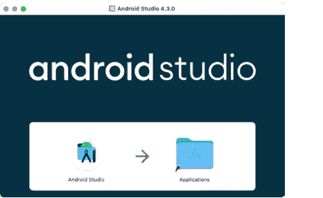

图 2-1

要安装该包，将 Android Studio 图标拖到“应用程序”（Applications）文件夹。Android Studio 包将安装到系统的应用程序文件夹中，过程通常需要几秒钟完成。

要启动 Android Studio，在 Finder 窗口的应用程序文件夹中找到可执行文件并双击它。

为了以后更方便地访问该工具，可以从 Finder 窗口将 Android Studio 图标拖到 Dock 栏。

### 2.3.3 在 Linux 上安装

下载 Android Studio 包后，打开终端窗口，切换目录到要安装 Android Studio 的位置，并执行以下命令：

```
tar xvfz /path/to package/android-studio-<version>-linux.tar.gz
```

注意，Android Studio 程序包将安装到名为`android-studio`的子目录下。因此，假设命令是在`/home/demo`中执行的，软件包将解压到`/home/demo/android-studio`。

要启动 Android Studio，打开终端窗口，切换到`android-studio/bin`子目录，并执行以下命令：

```
./studio.sh
```

## 2.4 Android Studio 安装向导

如果你之前安装过旧版本的 Android Studio，在首次启动此新版本时，可能会弹出一个对话框，提供从之前的 Android Studio 版本导入设置的选项。如果你有以前版本的设置并希望将其导入到上次的安装中，请选择相应的选项和位置。或者，指示你不需要导入任何之前的设置并点击“OK”按钮继续。

如果你是第一次安装 Android Studio，安装过程一旦开始后出现的初始对话框可能如图 2-2 所示：

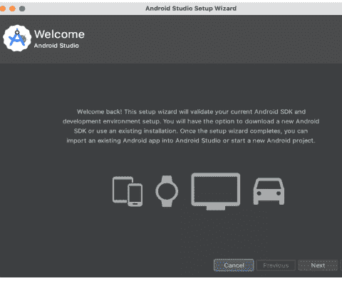

图 2-2

如果出现此对话框，点击“Next”（下一步）按钮显示“Install Type”（安装类型）界面（图 2-3）。在此界面上，点击 Next 之前选择“Standard”（标准）安装选项。

## 配置 Android Studio 开发环境

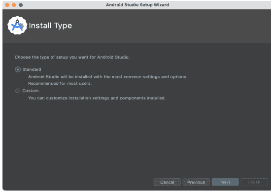

图 2-3

在“Select UI”（选择界面）界面上，根据你的喜好选择 Dark（深色）或 Light（浅色）主题。做出选择后，点击“Next”，并在“Verify Settings”（验证设置）界面中检查选项，然后进入“License Agreement”（许可协议）界面。选择每个类别并启用“Accept”（接受）复选框。最后，点击“Finish”（完成）按钮启动安装。

完成这些初始设置步骤后，点击“Finish”按钮显示使用所选 UI 主题的“Welcome to Android Studio”（欢迎使用 Android Studio）界面：

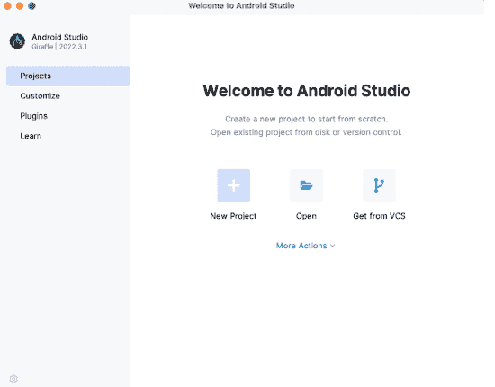

图 2-4

## 2.5 安装额外的 Android SDK 包

目前为止执行的操作安装了 Android Studio IDE 和当前默认的 Android SDK 包。在继续之前，值得花时间验证安装了哪些包，并安装任何缺失或更新的包。

## 配置 Android Studio 环境

此任务可以通过点击欢迎对话框中的“More Actions”（更多操作）并从下拉菜单中选择“SDK Manager”来完成。一旦调用，“Settings”（设置）对话框中的 Android SDK 就会出现，如图 2-5 所示：

Settings

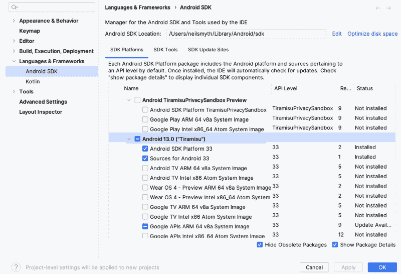

图 2-5

Google 的每个 Android Studio 版本都与 SDK 的最高支持应用程序编程接口（API）级别配对。在 Android Studio Giraffe 版本中，对应的是 Android Tiramisu (API Level 33)。可以通过以下链接确认此信息：

https://developer.android.com/studio/releases/api-level-support

首次安装 SDK 之后，可能只安装了最新支持版本的 Android SDK。要安装旧版本的 Android SDK，请选择对应版本的复选框并点击“Apply”（应用）按钮。本书的其余部分假设已安装 Android Tiramisu (API Level 33) SDK。

本书中的大多数示例将支持低至 Android 8.0 (Oreo) 的旧版本。这确保了你的应用可以在广泛的 Android 设备上运行。在版本列表中选择 Android 8.0 (Oreo) 边的复选框并点击“Apply”按钮。点击“OK”按钮安装 SDK。

可能还会列出可用更新。要访问有关待更新包的详细信息，请启用右下角的“Show Details”（显示详情）选项。这将显示如图 2-6 所示的信息：

| Name | API Level | Revision | Status |
| --- | --- | --- | --- |
| Android TV ARM 64 v8a System Image | 33 | 5 | Not installed |
| Android Intel x86 Atom System Image | 33 | 5 | Not installed |
| Google TV ARM 64 v8a System Image | 33 | 5 | Not installed |
| Google TV x86 Atom System Image | 33 | 5 | Not installed |
| Google APIs ARM 64 v8a System | 33 | 8 | Update Available: 9 |
| Google APIs Intel x86_64 System Image | 33 | 9 | Not installed |
| Google Play ARM 64 v8a System Image | 33 | 7 | Installed |

图 2-6

上图突出了可用更新。要安装更新，请启用项目名称左侧的复选框并点击“Apply”按钮。

除了 Android SDK 包外，还安装了几个用于构建 Android 应用程序的工具。你可以在 SDK 设置界面中选择如图 2-7 所示的 SDK 标签卡查看当前安装的包并检查更新：

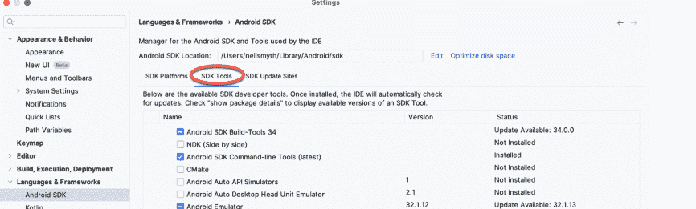

图 2-7

在“Android SDK Tools”（Android SDK 工具）界面内，确保以下软件包在“Status”（状态）中显示为 Installed（已安装）：

- Android SDK Build-tools
- Android Emulator
- Android SDK Platform-tools
- Google Play Services
- Intel x86 Emulator Accelerator (HAXM installer)
- Google USB Driver (仅限 Windows)

注意，基于 Apple 芯片的 Mac 无法安装 Intel x86 Emulator Accelerator (HAXM installer)。

如果上述任何包显示为 Not Installed（未安装）或需要更新，请选择这些包旁边的复选框并点击“Apply”按钮启动安装过程。安装完成后即可完成。

# 设置 Android Studio 开发环境

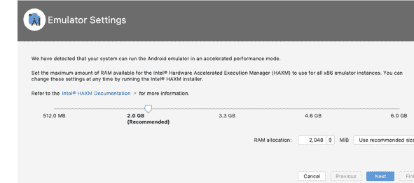

安装完成后，检查软件包列表并确保所选的软件包在“状态”（Status）列中显示为“已安装”（Installed）。如果有任何包显示为“未安装”（Not Installed），请确保已选中它们并点击“应用”（Apply）按钮。

## 2.6 安装 Android SDK 命令行工具

Android Studio 包含了一些允许从操作系统命令行执行某些任务的工具。要在您的系统中安装这些工具，请打开 SDK Manager，选择“SDK Tools”选项卡，并如图 2-9 所示找到“Android SDK Command-line Tools (latest)”。

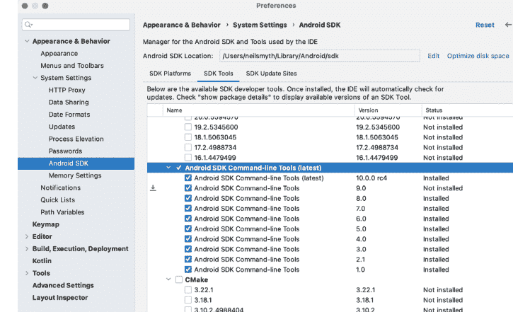

图 2-9

如果尚未安装命令行工具，请启用它并点击“Apply”，然后点击“OK”以完成安装。安装完成后，点击“Finish”并关闭 SDK Manager。

对于用于构建这些内容的操作系统，有必要将它们添加到 PATH 环境变量中。

# 设置 Android 开发环境

无论您使用何种操作系统，都需要配置 PATH 环境变量以包含以下路径（其中`<path_to_android_sdk_installation>`代表您安装 Android SDK 的文件位置）：

```
<path_to_android_sdk_installation>/sdk/cmdline-tools/latest/bin
<path_to_android_sdk_installation>/sdk/platform-tools
```

您可以通过启动 IDE 并更改设置面板顶部的位置来识别 SDK 的位置，如图 2-10 所示：

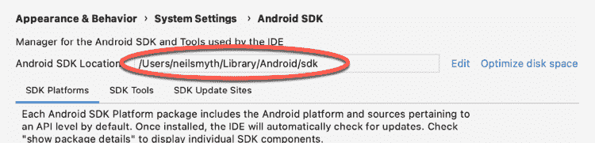

图 2-10

一旦确定了 SDK 的位置，将此添加到 PATH 变量的步骤取决于具体的操作系统：

### 2.6.1 Windows 8.1

1. 在开始屏幕上，将鼠标移动到屏幕右下角并搜索出现的菜单。在搜索框中输入“控制面板”。当控制面板图标出现在结果区域时，点击它以启动桌面。

2. 在控制面板中，使用菜单将显示更改为“大图标”。从图标列表中选择标记为“系统”的项。

3. 在“环境变量”对话框中，在“系统变量”中找到 PATH 变量，选择它并点击编辑...（Edit...）按钮。在对话框中使用新建（New）按钮向路径添加两个新条目。例如，在安装 Android SDK 之后，需要添加以下条目：

```
C:\Users\demo\AppData\Local\Android\Sdk\cmdline-tools\latest\bin
C:\Users\demo\AppData\Local\Android\Sdk\platform-tools
```

4. 点击每个对话框中的“确定”并关闭系统属性面板。

通过按下键盘上的 Windows + R 并在运行对话框中输入`cmd`来打开命令提示符窗口。在命令提示符窗口中输入：

```
echo %PATH%
```

返回的路径值应包含 Android SDK 工具文件夹的路径。通过尝试按如下方式运行 adb 工具来验证 platform-tools 值是否正确：

```
adb
```

执行时，该工具应输出命令行选项列表。

同样，通过尝试运行 Android Manager 命令行工具来检查工具路径（如果 avdmanager 工具报告 Java 问题，请担心，稍后会解决）：

```
avdmanager
```

如果其中一个或两个命令出现了类似以下所示的消息，很可能是向 Path 环境变量中附加了错误的路径：

`'adb' 不是内部或外部命令，可运行的程序或批文件。`

### 2.6.2 Windows 10

右键点击“开始”菜单，从出现的菜单中选择“设置”，并在查找设置文本字段中输入“编辑系统环境变量”。在“系统属性”对话框中，点击“环境变量...”按钮。按照 Windows 8.1 中列出的步骤从第 3 步开始。

### 2.6.3 Windows 11

右键点击任务栏上的“开始”图标，从出现的菜单中选择“设置”。当设置出现时，滚动类别列表并选择“关于”选项。在“关于”屏幕上，从“相关链接”部分选择“高级系统设置”。当“系统属性”窗口出现时，点击“环境变量...”按钮。按照 Windows 8.1 中列出的步骤从第 3 步开始。

### 2.6.4 Linux

此配置可以通过向家目录下的`.bashrc`文件中添加一行来实现（具体可能取决于所使用的特定 Linux 发行版）。假设 Android SDK 包安装在`/home/demo/android/sdk`，则`.bashrc`文件中的 export 语句如下：

```
export PATH=$home/demo/android/sdk/platform-tools:/home/demo/android/sdk/cmdline-tools/latest/bin:/home/demo/android-studio/bin:$PATH
```

注意还要将`android-studio/bin`命令添加到 PATH 变量中。这将允许无论在终端的哪个目录下，都可以执行`studio.sh`脚本。

### 2.6.5 macOS

可以使用多种技术来修改 macOS 上的`$PATH`变量。认为最干净的方法是在`/etc/paths.d`目录中创建一个新文件，其中包含要添加到`$PATH`的路径。假设 Android SDK 安装位置为`/Users/demo/Library/Android/sdk`，可以通过在`/etc/paths.d`目录中创建一个名为 android-sdk 的新文件并包含以下行来配置路径：

```
/Users/demo/Library/Android/sdk/cmdline-tools/latest/bin
/Users/demo/Library/Android/sdk/platform-tools
```

注意这是一个系统目录，创建文件时将需要使用`sudo`命令。例如：

```
sudo /etc/paths.d/android-sdk
```

## 2.7 Android Studio 内存管理

Android Studio 是一个具有许多后台进程的大型复杂应用程序。尽管 Android Studio 因性能并非尽佳而受到批评，但 Google 在最近的发布中已做出了重大改进，并在每个新版本中继续这样做。这些改进允许用户配置 Android Studio IDE 以及用于构建和运行应用程序的后台进程所使用的内存量。如果您在具有足够 RAM 的系统上运行 Android Studio 并增加这些值（此功能仅适用于具有 5GB 或更多内存的 64 位系统），并且发现 Android Studio 性能下降，那么尝试这些设置是值得的。Android Studio 可能会通过类似于图 2-11 所示的对话框通知您可以提高性能：

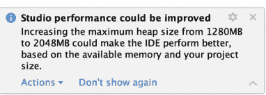

图 2-11

要查看并修改当前的内存配置，在 macOS 上选择 File -> Settings...，并在结果对话框中，通过左侧导航面板中的 Appearance & Behavior（外观与行为）下的 Memory Settings（内存设置）选项，如图 2-12 所示：

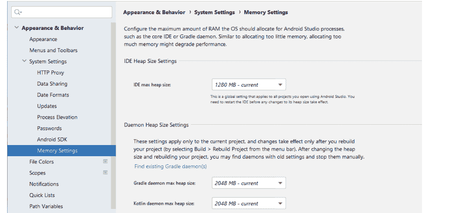

图 2-12

更改内存分配时，确保不要分配超过所需的内存，以便系统可以运行而不减慢其他进程。IDE 堆大小调整分配给 Android Studio 的内存，并适用于任何加载的项目。另一方面，当在 Android Studio 中构建和运行项目时，多个后台进程（称为守护进程）执行编译和运行应用的任务。在编译和运行大型项目时，可以通过调整守护堆设置来构建时间。与 IDE 堆设置不同，这些守护设置仅适用于当前项目，并且只有在打开项目时才能访问。要从打开的项目显示 SDK Manager，请使用主菜单中的 Tools -> SDK Manager... 选项。

## 2.9 总结

在开始开发 Android 应用程序之前，第一步是搭建一个合适的开发环境。这包括 Android SDK 和 Android Studio IDE（其中包含 OpenJDK 开发环境）。本章涵盖了在 Windows、macOS 和 Linux 上安装这些包所需的步骤。

# 第 3 章

## 3. 在 Android Studio 中创建一个示例 Android 应用程序


本书的前几个章节已经涵盖了使用 `Android Studio` 配置适用于 `Android` 应用程序环境所需的步骤。在进入更高级的主题之前，现在是验证所有所需的开发包是否已安装并运行良好的良好时机。实现这一目标的方法方法是创建一个 `Android` 应用程序并对其进行编译和运行。项目创建完成后，稍后的章节将探索 `Android` 模拟器以对应用程序进行测试运行。

## 3.1 关于项目

在本章中创建的项目是一个初级货币转换器（事实上它非常简单，只支持从美元转换为欧元，并使用估算的折算汇率进行转换）。该项目还将使用最基础的 `Android Studio` 项目模板之一。这种简单性能允许我们介绍 `Android` 应用开发的一些关键方面，而不会因为一次性引入过多的概念（例如推荐的应用程序架构和 `Android` 组件）让初学者感到无从从。请放心，在本章教程中，初始示例项目中所使用的技术和代码将在稍后进行更详细的介绍。

## 3.2 创建新的 Android 项目

应用程序开发过程的第一步是在 `Android Studio` 环境中创建一个新项目。因此，请先启动 `Android Studio`，如图 3-1 所示显示“Welcome to Android Studio”屏幕：

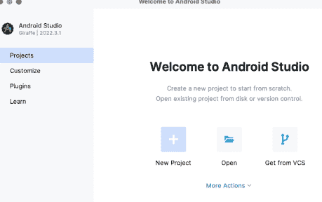

图 3-1

### 在 Android Studio 中创建示例应用

一旦出现此窗口，`Android Studio` 就已准备好创建新项目。要创建新项目，请点击 **New Project**（新建项目）选项以显示 **New Project** 向导的第一个屏幕。

## 3.3 创建 Activity

下一步是为应用程序创建初始 `Activity`（活动）的类型。提供了多种选项来为手机和平板、`Wear OS`、电视或汽车系统创建项目。在开发 `Android` 应用程序时有多种不同的 `Activity` 类型，其中许多将在后面的章节中进行详细介绍。对于本示例，从 `Templates`（模板）面板中选择 **Phone and Tablet**（手机和平板）选项，然后选择创建 **Empty Views Activity**（空视图 `Activity`）选项。`Empty Views Activity` 选项会创建一个包含单个 `TextView` 对象的模板接口。

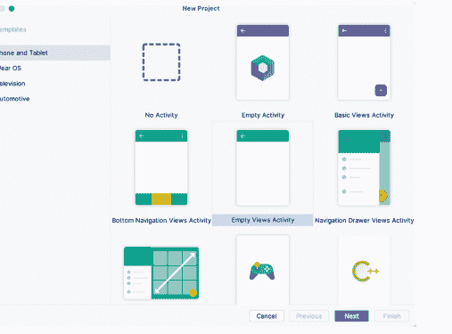

图 3-2

选中 **Empty Views Activity** 选项后，点击 **Next**（下一步）继续项目配置。

## 3.4 定义项目和 SDK 设置

在项目配置窗口（图 3-3）中，将 `Name`（名称）字段设置为 `AndroidSample`。应用程序名称是在 `Android Studio` 内部引用和标识应用程序的名称，而且如果完成的应用程序要在 `Google Play` 商店出售，它将是使用的名称。

`Package name`（包名）在 `Android` 应用程序生态系统中唯一标识该应用程序。虽然它可以设置为任何标识你应用程序的字符串，但传统上，它是基于你域名的反转 URL。例如，如果你的域名是`www.mycompany.com`，且应用程序命名为 `AndroidSample`，那么包名可以指定为：

```
com.mycompany.androidsample
```

如果你没有域名，可以在 `Domain name`（域名）字段中输入任何其他字符串，或者可以使用 `example` 进行测试，但在发布应用程序之前需要更改它：

```
com.example.androidsample
```

`Save location`（保存位置）设置默认在名为 `AndroidStudioProjectsProjects` 的文件夹中的某个位置，可以通过点击包含当前路径设置的文本字段右侧的图标进行更改。

将 `Minimum SDK`（最低 SDK）设置设置为 `API 26 (Oreo; Android 8.0)`。除非某个必要功能仅在较新版本中可用，否则书中创建的大多数项目将使用此最低 SDK。这里的目标是使用最新的 `Android SDK` 构建应用，同时保持与运行旧版本 `Android` 的设备的兼容性（在此情况下，低可到 `Android 8.0`）。`Minimum SDK` 设置下方的说明将概述目前运行你应用程序的 `Android` 设备的百分比。点击 `Help me choose`（在图 3-3 中高亮显示）以查看仍在使用的各种 `Android` 设备的完整细分：

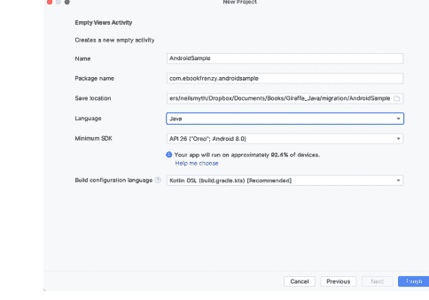

图 3-3

最后，将 `Language`（语言）更改为 `Java`，并选择 `Kotlin DSL (build.gradle.kts)` 作为构建配置，然后点击 **Finishing**（完成）创建项目。

## 3.5 启用新的 Android Studio UI

`Android Studio` 正在过渡到一个新的现代用户界面，这在 `Giraffe` 版本中默认未启用。如果你安装的 `Android Studio` 类似于下方的图 3-4，则你需要在继续之前启用新 UI：

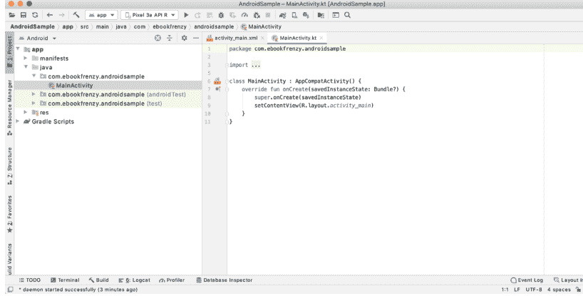

图 3-4

通过选择 `File -> Settings...`（文件 -> 设置...）菜单（`macOS` 上为 `Android Studio -> Settings...`）并选择左面板中 `Appearance and Behavior`（外观与行为）下的 `UI` 选项来启用 UI。在主面板中，开启 `Enable UI` 复选框，点击 **Apply**（应用），然后点击 **OK** 提交更改：

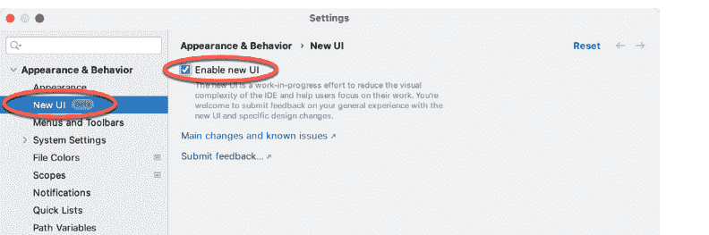

图 3-5

根据提示，重启 `Android Studio` 以激活新 UI。

## 3.6 修改示例应用程序

一旦 `Android Studio` 重启，主窗口将使用新 UI 重新出现并包含我们的 `AndroidSample` 项目，如图 3-6 所示：

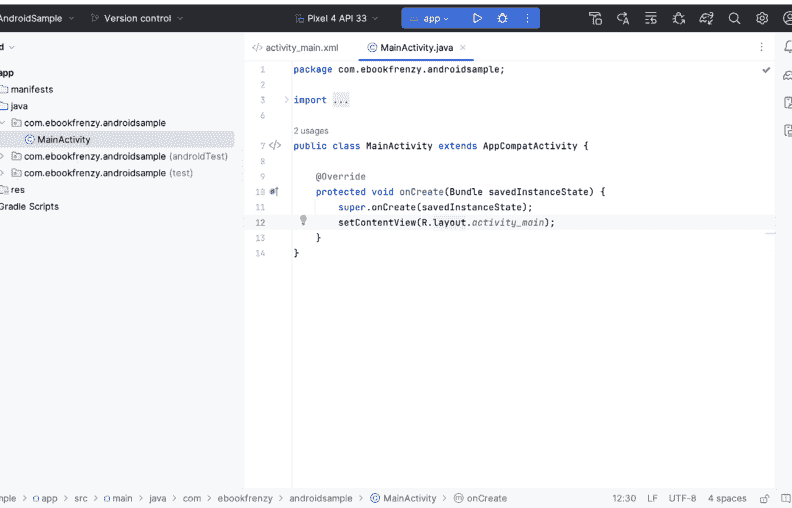

图 3-6

新创建的项目和相关文件的引用列在主项目窗口左侧的 `Project`（项目）工具窗口中。`Project` 工具具有多种显示信息的模式。默认情况下，此面板应处于 `Android` 模式。此设置由面板顶部的菜单控制，如图 3-7 中高亮所示。如果面板当前不在 `Android` 模式，请使用菜单切换模式：

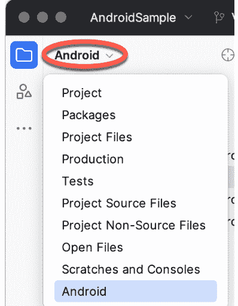

图 3-7

## 3.7 修改用户界面

我们 `Activity` 的用户界面设计存储在`activity_main.xml`文件中，该文件位于 `Project` 工具视图层级结构下的 `app -> res -> layout` 下。双击该文件将其加载到接口 `Layout Editor`（布局编辑器）工具中，该工具将出现在 `Android Studio` 主窗口的中心面板：

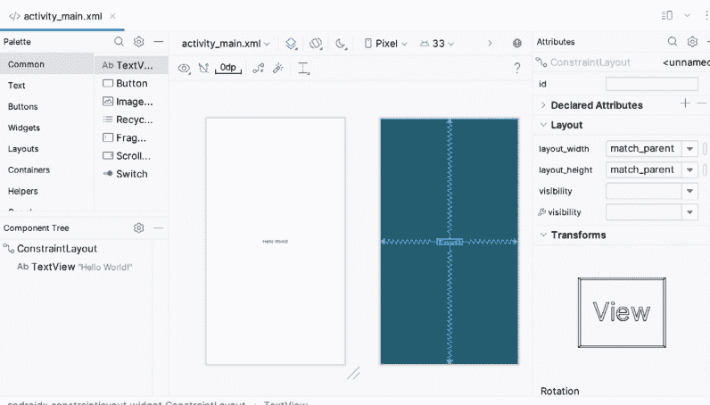

图 3-8

`Layout Editor` 窗口的工具栏中有一个菜单（在上面的图中当前设置为 `Pixel`），它反映在 `Layout Editor` 面板中设备的视觉表示上。点击此菜单可以使用一系列其他设备选项。

使用 `System UI` 模式为设备屏幕开启或关闭夜间模式（`Night mode`）。若要在设备表示的横屏和竖屏之间切换方向，请使用显示图标的下拉菜单。

正如我们所看到的，设备屏幕的内容布局已经包含一个显示“Hello World!”消息的表格。面板左侧运行着调色板（`palette`），包含不同类别的用户界面组件，这些组件可用于构建用户界面，例如按钮、标签和文本字段。然而，需要注意的是并不是所有的用户界面组件对用户都是可见的。其中一种布局类型支持多种布局，对视觉用户界面组件在屏幕上的定位和管理提供不同程度的控制。当前的设计是使用 `ConstraintLayout` 创建的。这从用户界面的视觉表示上很难看出，但可以通过查看 `Component tree`（组件树）面板中的信息来确认，该面板默认位于 `Layout Editor` 面板的左下角，如图 3-9 所示。

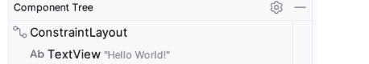

图 3-9

从组件层次结构可以看出，用户界面布局由一个 `ConstraintLayout` 和一个 `TextView` 子对象组成。

在继续之前，检查 `Layout Editor` 的 `Autoconnect`（自动连接）模式已启用。这意味着当组件添加到布局中时，`Layout Editor` 会自动添加约束，以确保组件在不同的屏幕尺寸和设备方向上正确放置（该主题将在后续章节中进行更详细介绍）。`Autoconnect` 按钮出现在 `Layout Editor` 工具栏中，用 U 形图标表示。当禁用时，图标上带有一条斜线（图 3-10）。如有必要，点击此按钮重新启用 `Autoconnect` 模式。

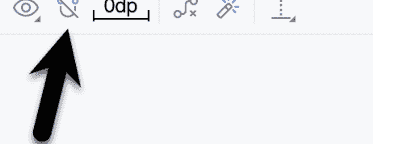

图 3-10

修改应用程序的下一步是向布局添加一些额外的组件，其中第一个将用于用户启动货币转换的按钮。

`Palette`（调色板）面板由两列组成，左列包含视图组件类别的列表。右列列出当前选中类别中的组件。例如，图 3-11 所示，在 `Buttons` 类别中选中了 `Button` 视图：

### 在 Android Studio 中创建一个 Android 示例

| 调色板 | |
| --- | --- |
| 通用 | `Button` |
| 文字 | `ImageButton` |
| | `ChipGroup` |
| 组件 | `Chip` |
| 布局 | `CheckBox` |
| 容器 | `RadioGroup` |
| 辅助工具 | `ToggleButton` |
| Google | `Switch` |
| 遗留 | `FloatingActionButton` |

图 3-11

从 `Buttons` 列表中点击并拖动 `Button` 对象，释放到用户界面设计的水平中心，使其位于现有 `TextView` 组件的下方：

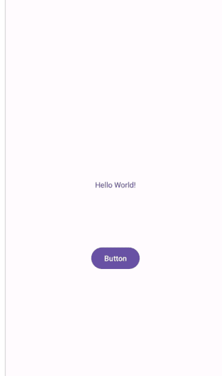

图 3-12

下一步是更改 `Button` 组件当前显示的文本。位于设计区域右侧的面板是属性面板（`Attributes` panel）。该面板显示了分配给布局中当前选中组件的属性。在该面板中，在通用属性（`Common Attributes`）部分找到 `text` 属性，并将当前值从 "Button" 更改为 "Convert"，如图 3-13 所示：

| strokeWidth | |
|---|---|
| cornerRadius | `@null` |
| rippleColor | `@color/m3_button_rip` |
| text | `Convert` |
| text | |

图 3-13

带有扳手图标的第二个文本属性允许设置属性，该属性仅在布局编辑器工具中显示，而在运行时不会显示。这对于在不反复运行应用的情况下，测试视觉组件和布局在不同设置下的行为非常有用。

以防自动连接（`Autoconnect`）系统未能设置所有布局连接，点击**推断约束**（`Infer Constraints`）按钮（图 3-14）为布局添加许多约束：

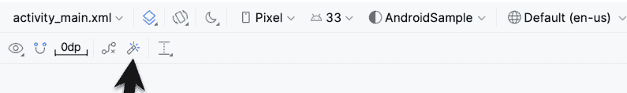

图 3-14

解释布局编辑器工具右上角的警告按钮很重要，如图 3-15 所示该警告指示布局可能存在问题。要查看任何问题的详情，请点击该按钮：

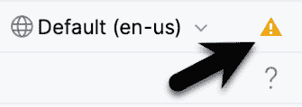

图 3-15

点击后，将出现**问题**（`Problems`）工具窗口（图 3-16），描述问题的性质：

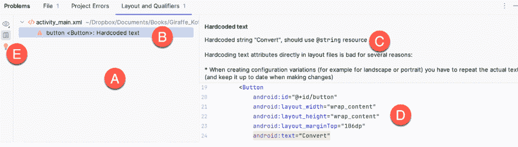

图 3-16

此工具分为两个面板。左侧面板（上图标记为 A）列出了在布局文件中检测的问题。在我们的示例中，列出了以下问题：

- `button <Button>`: 硬编码文本

当从列表中选中（B）时，右侧面板将更新以提供有关问题的更多细节（C）。在这种情况下，解释内容如下：

硬编码字符串 "Convert"，应使用 `@string` 资源

工具窗口包含预览（D），允许对布局文件进行手动修正。

此 `i18n` 消息告诉我们，项目未来的国际化方面可能存在一个潜在问题（"i18n" 以 "I" 开头，"internationalization" 以 "N" 结尾，中间有 18 个字母）。警告提醒我们，在开发 `Android` 应用时，应尽可能将字符串等属性和值存储为资源。这样做可以可以通过修改资源文件而不是更改源代码来更改应用程序的外。这在将用户界面翻译成不同的语言时可能特别有价值。如果用户界面的所有文本都包含在一个资源文件中，例如，可以将文件交给翻译人员，由他们执行翻译工作并返回翻译文件以便包含。这使得无需修改源代码即可针对多种语言。在这种情况下，我们将创建一个新资源 `convert_string` 并将其分配给字符串 "Convert"。

点击**快速修复**（`Quick Fixes`）按钮（E）并从菜单中选择**提取资源**（`Extract resource`）选项，如图 3-17 所示：

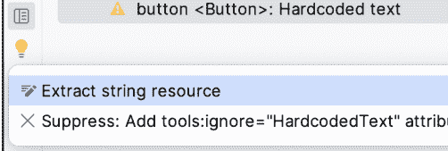

图 3-17

选择此选项后，将出现**提取资源**（`Extract Resource`）面板（图 3-18）。在该面板中，将资源名称字段更改为 `convert_string`，并在点击 **OK** 按钮之前将资源值设为 `Convert`：

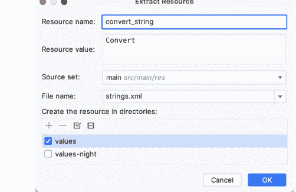

图 3-18

下一个要添加的组件是 `EditText` 组件，用户将在其中输入要转换的美元金额。从调色板面板中，选择 `Text` 类别并将 `Number (Decimal)` 组件拖动到布局中，使其水平居中并位于现有 `TextView` 组件的上方。选中组件后，使用属性窗口将 `hint` 属性设置为 "dollars"。通过点击图标并将字符串提取到资源名`dollars_hint`。

本章中编写的代码需要访问用户输入到 `EditText` 字段的美元值。它将通过引用布局中分配给组件的 `id` 来实现。可以在属性窗口内查看并更改分配给组件的 `id`，如图 19 所示：

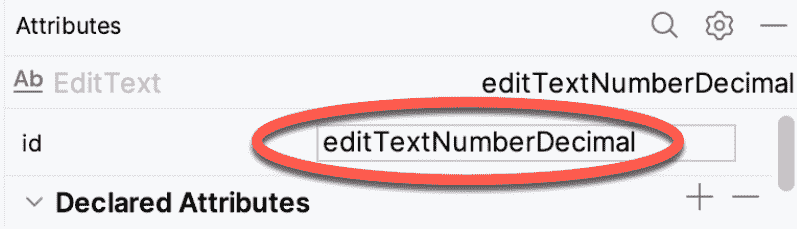

图 3-19

将 `id` 更改为 `editText` 并在重命名对话框中点击**重构**（`Refactor`）。这确保了项目其他任何引用都会自动更新。

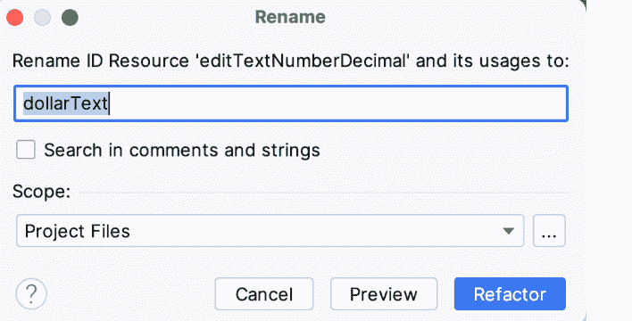

图 3-20

重复步骤将 `TextView` 的 `id` 设置为 `textView`。点击*Infer Constraints*（推断约束)按钮添加任何缺失的约束。此时，布局应该类似于图 21 所示：


图 3-21

## 3.8 审查布局和资源文件

在继续下一步之前，我们将查看布局和资源处理的一些内部方面。在上一节中，我们通过使用布局编辑器修改`activity_main.xml`文件更改了用户界面。事实上，你没有理由直接编辑 `XML`，在某些情况下，这可能比使用布局编辑器更快。

布局编辑器的右上角是 **Views** 按钮，图 3-22 中标记为 A：

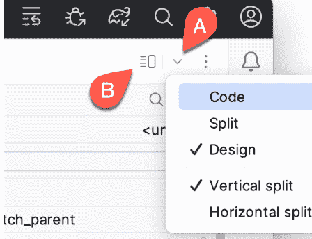

图 3-22

默认情况下，编辑器将处于`Design`（设计）模式，仅显示布局的视觉表示。在`Code`（代码）模式下，编辑器将显示布局的 `XML`，而在`Split`（拆分）模式下，同时显示布局和 `XML`，如图 3-23 所示：

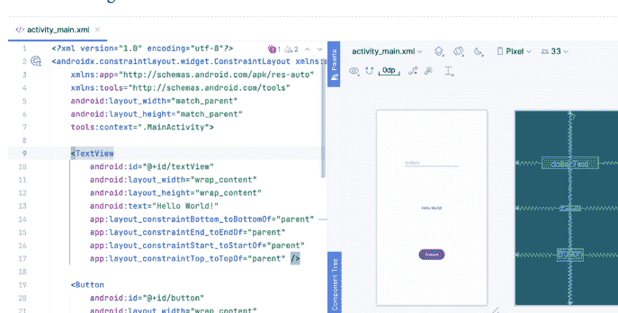

图 3-23

**Views** 模式左侧的按钮（图 3-22 中标记为 B）用于在 `Code` 和 `Split` 模式之间快速切换。

从 `XML` 文件的结构可以看出，用户界面由 `ConstraintLayout` 组件组成，该组件又是 `TextView` 和 `EditText` 对象的父级。我们还看到，例如，`Button` 的文本属性设置为使用其 `convert_string` 资源。对 `XML` 布局进行更改时，更改将反映在布局变化中。也可以从布局面板视觉上修改布局，更改将出现在 `XML` 列表中。我们可以看到这一点，切换到 `Split` 模式并修改 `XML` 布局，将 `ConstraintLayout` 的背景颜色更改为红色，如下：

```xml
<?xml version="1.0" encoding="utf-8"?>
<androidx.constraintlayout.widget.ConstraintLayout xmlns:android="http://schemas.android.com/apk/res/android"
xmlns:app="http://schemas.android.com/apk/res-auto"
xmlns:tools="http://schemas.android.com/tools"
android:layout_width="match_parent"
android:layout_height="match_parent"
tools:context=".MainActivity"
android:background="#ff2438"

</androidx.constraintlayout.widget.ConstraintLayout>
```


注意布局颜色会实时更改以匹配 XML 文件中的新设置。还要注意，在 XML 编辑器的左边距（也称为行标）中包含颜色方块的行旁边会出现一个小红色正方形。这是一个视觉提示，表示已属性已设置了颜色。点击红色正方形将显示颜色选择器，允许选择不同的颜色。

在继续之前，删除布局文件中的`background`属性，使背景恢复默认设置。

最后，使用 Project（项目）面板找到`app -> res -> values -> strings.xml`文件，并双击将其加载到编辑器中。该 XML 的内容如下：

```
<resources>
  <string name="app_name">AndroidSample</string>
  <string name="convert_string">Convert</string>
  <string name="dollars_hint">$dollars</string>
</resources>
```

为了演示操作效果，将当前分配给`convert_string`资源的字符串值更改为 "Convert to Euros"，然后通过选择编辑器面板中布局文件的标签页返回布局编辑器（Layout Editor）。注意，布局已经获取了该字符串的新资源值。

还有一种快速方法可以访问 XML 文件中引用的资源值。在拆分（Split）或代码（Code）模式下，使用布局编辑器工具，点击`@string/convert_string`属性设置使其处于高亮，然后在键盘上按下`Ctrl-B`（macOS 上为`Cmd-B`）。Android Studio 随后将打开`strings.xml`文件并带您到该资源定义所在的行。利用此机会将字符串资源恢复为原始的 "Convert" 文本，并为将在应用中引用的字符串资源添加以下额外条目：

```
<resources>
  <string name="convert_string">Convert</string>
  <string name="dollars_hint">$dollars</string>
  <string name="no_value_string">No Value=$</string>
</resources>
```

也可以通过点击编辑器窗口右上角的`Open editor`链接使用 Android Studio 的翻译编辑器（Translations Editor）来编辑资源字符串。将在 Android Studio 窗口的主面板中显示翻译编辑器：

在 Android Studio 中创建一个示例 Android 应用

`activity_main.xml`

翻译编辑器

+ 显示所有键 显示所有语言 ?

| 键 | 资源文件夹 | 不可翻译 | 默认值 |
| :--- | :--- | :--- | :--- |
| `app_name` | `app/src/main/res` | | AndroidSample |
| `convert_string` | `app/src/main/res` | | Convert |
| `dollars_hint` | `app/src/main/res` | | dollars |
| `no_value_string` | `app/src/main/res` | | No Value |

图 3-25

此编辑器允许编辑分配给资源键的字符串，并管理多种语言的翻译。

## 3.9 添加交互

此项目示例的最后一步是使应用具有交互性，当用户在`EditText`字段中输入美元金额并点击转换按钮时，转换后的欧元金额显示在`TextView`上。这涉及在`Button`视图上实现事件处理器。具体来说，需要配置`Button`，以便触发`onClick`事件时调用应用中的方法。事件处理可以通过多种方式实现，将在后文名为“Android 事件处理概述与示例”的章节介绍。返回布局编辑器的设计（Design）模式，选择布局编辑器中的`Button`控件，参考属性（Attributes）工具窗口，并指定名为`convertCurrency`的方法，如下所示：

- Common属性

```
@style/Widget.Material3.B
stateListAnimator @animator/m3_btn_list_ar
convertCurrency
elevation
```

图 3-26

接下来，双击 Project 工具中的`MainActivity.java`文件（`app -> java -> <package name> -> MainActivity`）加载代码编辑器，并将`convertCurrency`方法的代码添加到类中，如下所示，请注意还需要导入一些额外的 Android 包：`package com.ebookfrenzy.androidsample;`

```
import androidx.appcompat.app.AppCompatActivity;

import android.os.Bundle;
import android.view.View;
import android.widget.EditText;
import android.widget.TextView;
import java.util.Locale;

public class MainActivity extends AppCompatActivity {
    @Override
    protected void onCreate(Bundle savedInstanceState) {
        super.onCreate(savedInstanceState);
        setContentView(R.layout.activity_main);
    }

    public void convertCurrency(View view) {
        EditText dollarText = findViewById(R.id.dollarText);
        TextView textView = findViewById(R.id.textView);

        if (!dollarText.getText().toString().equals("")) {
            float dollarValue = Float.parseFloat(dollarText.getText().toString());
            float euroValue = dollarValue * 0.85F;
            textView.setText(String.format(Locale.ENGLISH, "%.2f", euroValue));
        } else {
            textView.setText(R.string.no_value_string);
        }
    }
}
```

该方法首先通过调用名为`findViewById`的方法并传递布局文件中分配的 ID来获取`EditText`和`TextView`对象的引用。然后检查用户是否输入了美元金额，如果是，则提取该值将其从 String 转换为浮点值并进行转换。结果显示在`TextView`上。

如果上述内容任何不清楚的地方，将在后续章节中详细介绍这些概念。使用`findViewById`从代码内部访问控件的主题，以及对称为视图绑定（view binding）的替代技术的介绍，将在“Android View Binding 概述”章节涵盖。

## 3.10 总结

虽然并不极端复杂，但设置 Android 环境涉及几个步骤。在进行一些测试后，运行一个示例以确保环境已安装并配置是值得的。在本章中，我们创建了一个示例应用，并使用 Android Studio 布局编辑器修改了用户界面布局。在此，我们探索了尽可能使用资源（特别是字符串值）的重要性，并简要提到了布局。接下来，我们查看了存储 Android 用户界面设计的底层 XML。

最后，为`Button`添加了`onClick`事件，该按钮连接到一个实现的方法，用于从`EditText`组件中提取用户输入，将其从美元转换为欧元，然后在`TextView`上显示结果。

由于应用已准备好进行测试，为测试目的设置模拟器的必要步骤将在下一章详细介绍。

## 4. 在 Android Studio 中创建 Android 虚拟设备 (AVD)

尽管 Android Studio 的预览面板允许我们查看正在设计的布局，但仍需要编译并运行整个应用以彻底测试其运行是否正常。Android 应用可以通过在物理设备上安装并运行它，或者在 Android 虚拟设备 (AVD) 模拟器中运行来进行测试。在使用 AVD 之前，必须先创建并配置它以匹配特定设备的规格。在本章中，我们将以 Pixel 4 手机作为示例创建一个这样的虚拟设备。

## 4.1 关于 Android 虚拟设备

AVD 是模拟器，允许在无需在物理设备上安装应用的情况下测试 Android 应用。AVD 可以配置为模拟各种硬件功能，包括屏幕尺寸、内存容量，以及是否存在摄像头、GPS 导航支持或加速度计等功能。多个模拟器模板作为 Android Studio 安装的一部分已安装，允许为各种设备配置 AVD。可以通过指定处理器类型、内存容量以及屏幕尺寸和像素密度等属性创建自定义配置以匹配任何物理 Android 设备。

AVD 会话可以独立窗口的形式出现，也可以嵌入在 Android Studio 窗口中。

新的 AVD 使用 Android 虚拟设备管理器进行创建和管理，它可以使用命令行模式，也可以使用更符合用户习惯的图形界面。要创建新的 AVD，第一步是启动 AVD 管理器。可以在 Android Studio 环境内通过点击右侧工具栏中的 Device 按钮来实现，如图 4-1 所示：

## 在 Android Studio 中创建 Android 虚拟设备 (AVD)

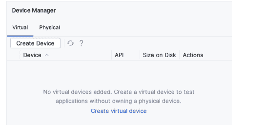

图 4-2

如果你是在计算机上首次安装 Android Studio（而不是升级现有的 Android Studio 安装程序），安装程序可能已经创建了一个可用的初始 AVD 实例，如图 4-3 所示：

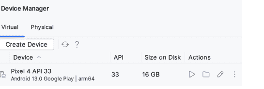

图 4-3

如果你的系统中没有此 AVD，你可以使用它来测试应用程序。如果没有创建任何 AVD，或者你想为不同类型的设备创建 AVD，请按照本章其余部分的步骤进行操作。

若要添加新的 AVD，请确保在点击 *Create device*（创建设备）按钮打开 *Virtual Device Configuration*（虚拟设备配置）对话框之前选中了 *Virtual*（虚拟）选项卡：

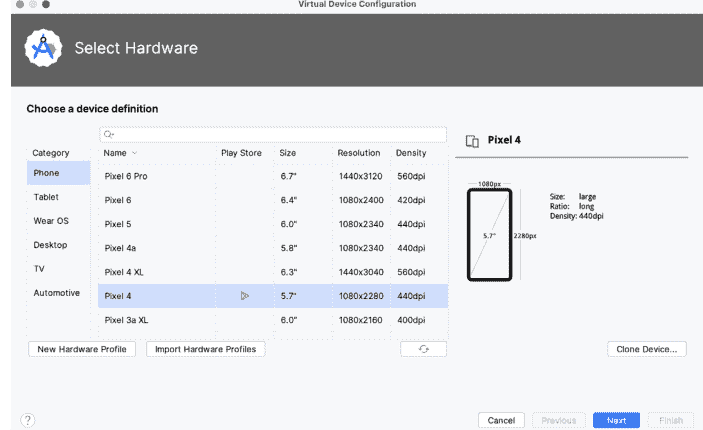

图 4-4

## 在 Android Studio 中创建 Android 虚拟设备 (AVD)

在对话框中，执行以下步骤创建一个兼容 Pixel 4 的模拟器：

- 1. 从 Category（类别）面板中选择 Phone（手机）选项以显示可用的 Android AVD 模板。
- 2. 选择 Pixel 4 设备选项并点击 Next（下一步）。
- 3. 在 System Image（系统映像）屏幕上，选择最新版本的 Android。如果系统尚未安装，将为 Release Name（发布名称）提供 Download（下载）链接。点击此链接在选择它之前下载并安装系统映像。如果镜像未列出，点击 x86 Images（如果你运行的是带有 Apple 芯片的 Mac，则点击 ARM images）Other images 选项卡查看列表。
- 4. 点击 Next 继续，并在 name 字段中输入描述性名称（例如 Pixel 4 API 33）或接受默认名称。
- 5. 点击 Finish（完成）创建 AVD。
- 6. 如果以后需要对 AVD 进行修改，请重新打开 Device Manager（设备管理器），从列表中选择 AVD，并点击 Actions（操作）列中的铅笔图标编辑设置。

## 4.2 启动模拟器

要测试新创建的 AVD 模拟器，请从 Device Manager 启动模拟器并点击启动按钮（Actions 列中的三角形）。模拟器将嵌入在 Android 主窗口中并开始启动过程。模拟器启动所需的时间取决于 AVD 的配置以及运行它的系统的配置：

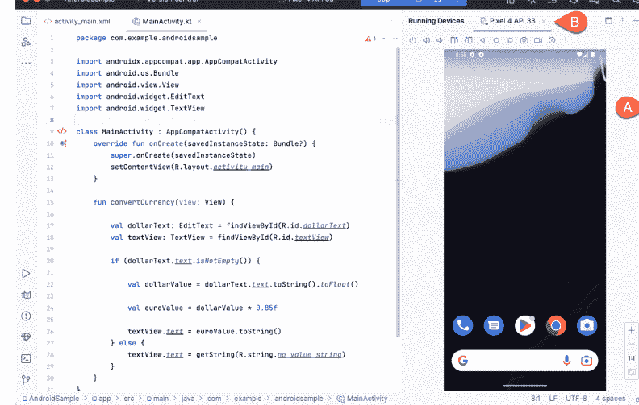

图 4-5

要显示和隐藏模拟器工具，请点击 Running Devices（运行中的设备）工具窗口（标记为 A）。点击标签页（B）旁边的 "x" 按钮退出模拟器。模拟器工具窗口可以容纳多个模拟器会话，每个会话由一个标签页表示。例如，图 4-6 显示了一个具有两个模拟器会话的工具窗口：

在 Android Studio 中创建 Android 虚拟设备 (AVD)


图 4-6

要切换会话，请点击相应的标签页。

虽然模拟器默认以竖屏方向显示，但此默认选项可以更改。在 Device Manager 中，选择新的 Pixel 4 条目，并点击设备行 Actions 列中的铅笔图标。在配置屏幕上，选择 Startup orientation（启动方向）部分并更改设置。然后重启模拟器以使更改生效。关于模拟器的更多细节将在下一章 *使用和配置 Android Studio AVD 模拟器* 中介绍。

为了在本章的下一节中节省时间，请在继续之前保持模拟器运行。

## 4.3 在 AVD 中运行应用程序

配置好 AVD 模拟器后，现在可以编译并运行之前章节创建的示例 AndroidSample 应用程序了。将 AndroidSample 项目加载到 Android Studio 后，确保设备菜单中显示新的 Pixel 4 AVD（图 4-7 中标记为 A），然后点击由三角形表示的运行按钮（B），选择 *Run -> Run 'app'* 菜单选项或使用键盘快捷键 *Ctrl-R*。

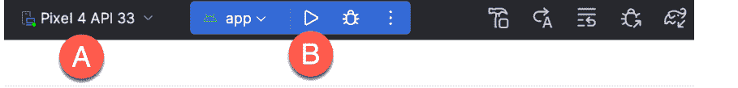

图 4-7

设备菜单 (A) 可用于选择不同的 AVD 实例或物理设备作为运行目标，也可以在多个设备上运行应用。该菜单提供了访问 Device Manager 以及设备连接配置和故障排除选项的接口。

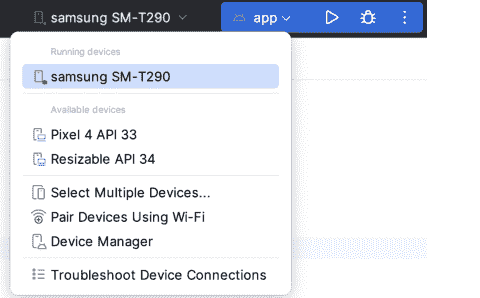

图 4-8

应用程序一旦安装并运行，第一个 fragment 的用户界面将出现在模拟器中（fragment 是 Android 项目中可重用的部分，通常由用户界面布局和一些代码组成，该主题将在后续题为 *Android Fragments 简介* 的章节中介绍）。

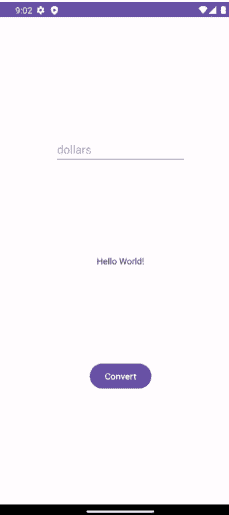

图 4-9

一旦进程开始，Run 工具窗口将出现。Run 工具窗口将显示应用程序已安装。

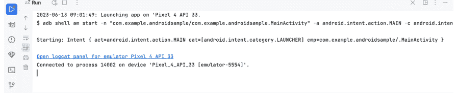

图 4-10

如果在此过程中遇到问题，Run 工具窗口将提供信息。假设应用程序加载并运行，我们已经验证环境已正确安装。

## 4.4 在多个设备上运行

图 4-8 所示的运行菜单包含一个在多个设备上运行应用的选项。在点击 Run 按钮之前，勾选目标模拟器旁边的复选框：

## 在 Android Studio 中创建 Android 虚拟设备 (AVD)

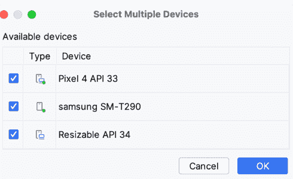

图 4-11

## 4.5 停止运行的应用程序

要停止运行的应用程序，点击位于主工具栏的停止按钮，如图 4-12 所示：

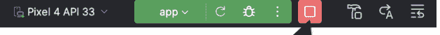

图 4-12

也可以使用 Run 工具窗口终止应用程序。通过显示 Run 工具窗口，点击图 4-13 中高亮的停止按钮：

```
2023-06-19 09:01:49: Launching app on 'Pixel 4 33'.
$ ad shell start -n "com.example.androidsample/com.example.samp

Starting: Intent {act=android.intent.action.MAIN cat=[android.intent.cate

Open logcat panel for emulator Pixel 4 33
Connected to process 14002 on device 'Pixel_4_API_33 [emulator-5554]',
```

图 13

## 4.6 支持深色主题

要测试启用深色主题时应用的行为，在模拟器中运行的 Android 实例打开打开 应用，选择 Display（显示）类别，并如图 4-14 所示启用 Dark theme（深色主题）选项：

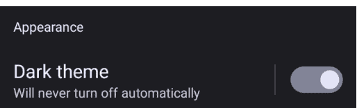

图 4-14

启用深色主题后，运行 AndroidSample 应用，并注意到它使用了深色主题，包括黑色背景和按钮上的紫色背景，如图 4-15 所示：

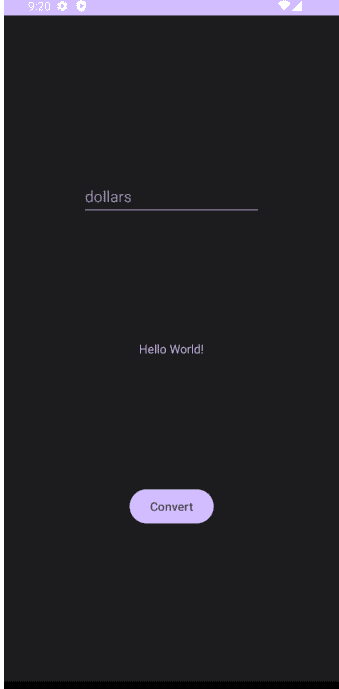

图 4-15

返回设置应用并关闭深色主题模式后再继续。

## 4.7 在独立窗口中运行模拟器


在本章为止，我们仅将模拟器作为嵌入在 Android Studio 主窗口中的工具。可以将模拟器配置为在 `Settings` 对话框的独立窗口中出现，可以通过点击 Android Studio 工具栏上的 `IDE and Project Settings` 按钮来实现，如图 4-16 高亮所示：

## 在 Android Studio 中创建 Android 虚拟设备 (AVD)

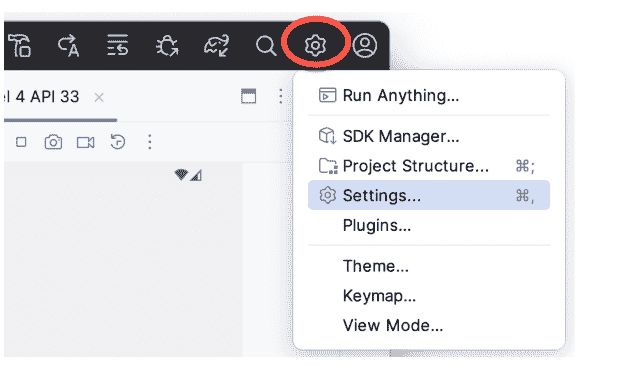

图 4-16

在 `Settings`（设置）对话框中，在侧边栏导航到 `Tools -> Emulator`，并禁用 `Launch in a tool`（在工具窗口中启动）选项：

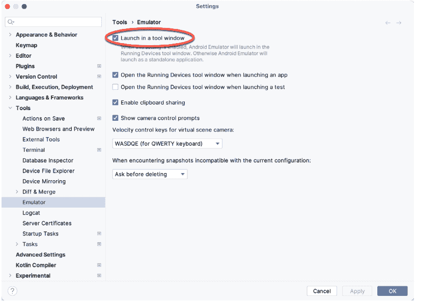

图 4-17

禁用该选项后，点击 `OK` 旁边的 `Apply`（应用）按钮以提交更改，然后点击上方图 4-5 中标记为 B 的标签页上的关闭按钮来退出当前的模拟器会话。

再次运行示例应用，此时模拟器将作为一个独立窗口出现，如下所示：

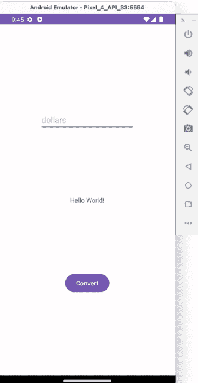

图 4-18

选择独立窗口模式还是工具窗口模式取决于个人喜好。如果你倾向于让模拟器在工具窗口中运行，请返回设置界面并重新启用 `Launch in a tool window` 选项。然而，在决定使用独立模式之前，请记住 `Running Devices`（运行设备）工具窗口也可以通过工具窗口的 `Options`（选项）菜单从主 Android Studio 窗口分离，该菜单可以通过点击图 4-19 所示的按钮来访问：

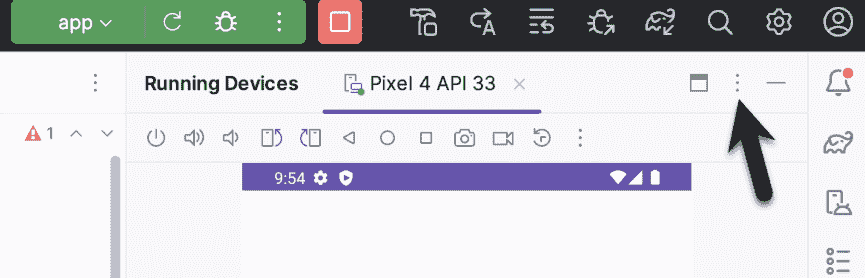

图 4-19

在 `Options` 菜单中，选择 `View Mode`（视图模式）-> `Float`（浮动），将工具窗口从 Android Studio 主窗口中分离：

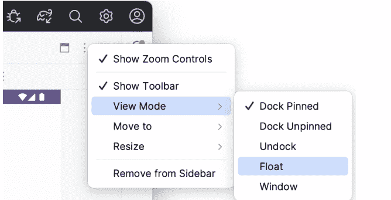

图 4-20

要重新停靠 `Running Devices` 工具窗口，请点击图 4-21 所示的 `Dock`（停靠）按钮：

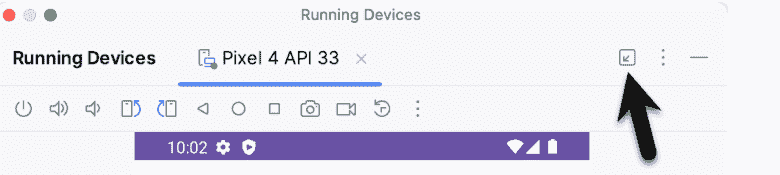

图 4-21

### 4.8 启用设备外框

模拟器可以配置为带有或不带设备外框显示。要更改此设置，请退出模拟器，打开 `Device Manager`（设备管理器），从列表中选择 AVD，并点击 `Actions`（操作）列中的铅笔图标。在设置界面中，找到并启用 `Enable Device Frame`（启用设备外框）选项：

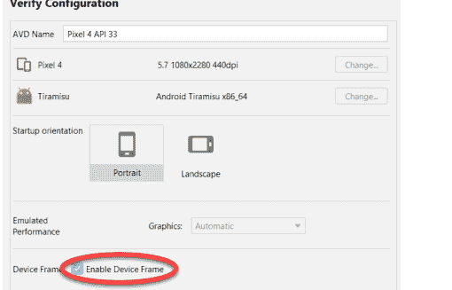

图 4-22

一旦启用设备外框，模拟器在下次启动时将如图 4-23 所示：


图 4-23

### 4.9 总结

典型的应用开发过程遵循编码、编译和在测试环境中运行的循环。Android 可以在实体 Android 设备或 Android 虚拟设备（AVD）模拟器上进行测试。AVD 使用 Android Studio `Device Manager` 工具创建和管理，该工具可以作为命令行工具或通过图形用户界面使用。在使用 AVD 模拟特定的 Android 设备模型时，虚拟设备应配置与实体设备匹配的硬件规格。

AVD 模拟器会话可以作为独立窗口显示，也可以嵌入到主 Android Studio 用户界面中。

## 5. 使用和配置 Android Studio AVD 模拟器

在下一章探索实体 Android 设备上的测试之前，本章将花一些时间提供 Android Studio AVD 模拟器的概述，并突出许多可用的配置功能，以便在独立模式和窗口模式下自定义环境。

### 5.1 模拟器环境

当在独立模式下启动时，模拟器在加载过程中会显示初始启动屏幕。加载完成后，会出现模拟器主窗口，其中包含所选设备类型的表示（以图 5-1 为例，这是一台 Pixel 4 设备）：


图 5-1

位于窗口右侧边缘的工具栏提供了模拟器控制和配置选项的快速访问。

### 5.2 模拟器工具栏选项

模拟器工具栏（图 5-2）提供了与模拟器环境外观和行为相关的系列选项。


图 5-2

工具栏中的每个按钮都关联有一个键盘快捷键，可以通过将鼠标指针悬停在按钮上并等待提示框出现，或者通过扩展控件的帮助选项来识别。

尽管工具栏中的许多选项是不言自明的，但为了保持完整性，将对每个选项进行介绍：

- **Exit / Minimize（退出/最小化）**：工具栏最顶部的 `x` 按钮选中后会退出模拟器会话，而 `−` 选项会最小化整个窗口。

- **Power（电源）**：电源按钮模拟实体设备上的按钮。点击并释放此按钮将锁定设备并关闭屏幕。长按此按钮将启动“关机”程序。

- **Volume Up / Down（音量增大/减小）**：两个按钮控制环境内的音频播放。

- **Rotate Left/Right（左旋/右旋）**：控制模拟器旋转。

- **Screenshot（截图）**：截取屏幕。

- **Back（返回）**：返回上一个界面。

- **Home（主页）**：回到主界面。

- **Overview（概览）**：打开最近任务列表。

- **Float（浮动）**：将窗口设置为浮动。

- **Dock（停靠）**：将窗口重新停靠。

- **Extended Controls（扩展控件）**：打开更多设置选项。

# 使用和配置 Android Studio AVD 模拟器

### 5.5.10 虚拟传感器

虚拟传感器允许加速度计和磁力计模拟设备物理运动的效果，例如旋转、移动以及俯仰、偏航和横滚的倾斜。

### 5.5.11 快照 (Snapshots)

快照包含当前运行的 AVD 会话状态，可以保存并快速恢复，从而轻松让模拟器返回到精确状态。快照将在本章后面的部分介绍。

### 5.5.12 录制与播放

允许将模拟器的屏幕和音频录制并保存为 WebM 或动画 GIF 格式。

### 5.5.13 Google Play

如果模拟器运行的是安装了 Google Play 的 Android 版本，此选项将显示当前的 Google Play 版本。它还提供了将模拟器更新到最新版本的选项。

### 5.5.14 设置

设置面板提供了一组配置选项。使用此面板为工具栏和扩展控制面板选择深色主题，指定保存截图的文件位置，配置 OpenGL 支持级别，并配置模拟器窗口显示在桌面其他窗口之上。

### 5.5.15 帮助

帮助屏幕包含三个子面板，分别包含键盘快捷键列表、访问模拟器在线文档、提交 Bug 和发送反馈的链接，以及模拟器版本信息。

### 5.6 使用快照

当模拟器首次启动时，它会执行冷启动，就像物理 Android 设备开电一样。由于需要加载操作系统并启动所有后台进程，此冷启动过程可能需要一些时间才能完成。为了避免每次启动模拟器都要经历此过程，系统被配置为每次退出时自动保存模拟器当前状态的快照（称为“快速启动快照”）。下次启动模拟器时，快速启动快照将加载到内存中，并从上次停止的地方继续执行，允许模拟器在冷启动所需时间的一小部分内完成重启。

扩展控制面板的快照可以在模拟器执行过程中的任何点存储额外的快照。这保存了整个模拟器的精确状态，允许模拟器恢复到拍摄快照时的精确时间点。从屏幕上，可以使用 `Take Snapshot` 按钮（图 5-4 中的标记 A）拍摄快照，从列表中选择 (B) 并点击位于屏幕底部的运行按钮 (C)。还提供了编辑 (D) 快照名称和描述以及删除 (E) 当前选择快照的选项：


图 5-4

你也可以通过主工具栏中的运行目标菜单进行选择，选择使用冷启动、最近的快速启动快照或之前的快照来启动模拟器，如图 5-5 所示：


图 5-5

### 5.7 配置指纹模拟

模拟器允许配置最多10 个模拟指纹，用于测试 Android 应用中的指纹身份验证。配置模拟指纹从启动模拟器、打开设置应用并选择安全（`Security`）选项开始。

在安全设置屏幕内，选择指纹（`Fingerprint`）选项。在弹出的信息屏幕上，点击 `Next` 按钮进入指纹设置屏幕。在启用指纹安全之前，必须配置备份屏幕解锁方法（如 PIN）。输入并确认合适的 PIN，并通过接受默认通知完成 PIN 输入过程。

继续后续后续屏幕，直到设置应用请求在传感器上指纹。此时，显示扩展控制对话框，在左侧面板中选择 `Finger` 类别，并确保主设置面板中选择了 `Finger 1`：


图 5-6

点击 `Touch Sensor` 按钮以模拟 `Finger 1` 触摸指纹传感器。模拟器将运行指纹的成功添加过程：


**指纹已添加 (Fingerprint added)**

现在你可以使用指纹来解锁手机或验证身份，例如在登录应用时。

图 5-7

如需添加额外的指纹，请点击 `Add Another` 按钮，并在再次点击 `Touch Sensor` 按钮之前，从扩展控制面板菜单中选择另一个手指。

### 5.8 嵌入工具窗口模式下的模拟器

正如上一章（“在 Android Studio 中创建 Android 虚拟设备 (AVD)”）所述，Android Studio 可以配置为在嵌入工具窗口中启动模拟器，这样它就不会出现在独立的窗口中。当在此模式下运行时，工具栏中将提供与独立模式下相同的控制按钮，如图 5-8 所示：


图 5-8

从左到右，这些按钮执行以下任务：

- 电源 (Power)

- 音量增大 (Volume Up)

- 音量减小 (Volume Down)

- 左旋转 (Rotate Left)

- 右旋转 (Rotate Right)

- 返回 (Back)

- 首页 (Home)

- 概览 (Overview)

- 截图 (Screenshot)

- 快照 (Snapshots)

- 扩展控制 (Extended Controls)

### 5.9 创建可调整大小的模拟器

除了配置特定设备、平板电脑尺寸的模拟器外，Android Studio 还提供了可调整大小的模拟器，允许你在它们之间切换。要创建可调整大小的模拟器，请使用设备管理器（`Device Manager`）并点击 `Create`。接下来，选择图 5-9 所示的 `Resizable` 设备，并按照通常步骤操作：


图 5-9

当你在工具窗口中运行应用时，工具栏中会出现 `Display mode`（显示模式）选项，如图 5-10 所示：


图 5-10

如果模拟器在独立模式下运行，可以在侧边工具栏中找到 `Display mode` 选项，如下所示：


图 5-11

### 5.10 总结

Android Studio 包含一个 Android 虚拟设备环境，旨在方便在无需在物理设备上运行的情况下测试应用程序。本章简要介绍了模拟器，并强调了可用于配置和自定义环境的关键功能。

# 第 6 章

# 6. Android Studio 用户界面概览

虽然人们可能急于着手运行上一章中的示例应用，但它涉及到 Android Studio 用户界面的某些方面，这些内容最好先进行描述。

Android Studio 是一个强大且功能丰富的开发环境，在很大程度上其用性是直观的。尽管如此，现在花时间熟悉 Android Studio 用户界面的布局和组织，将缩短本书后续章节的学习曲线。基于此，本章将提供 Android Studio 环境中各种区域和组件的概述。

### 6.1 欢迎界面

欢迎界面（图 6-1）在 Android Studio 运行且当前打开了项目时都会显示（可以通过选择 `File -> Close Project` 菜单选项随时关闭打开的项目）。如果 Android Studio 在项目仍处于打开状态之前退出，该工具在下次启动时将跳过欢迎界面，打开之前激活的项目。


图 6-1

除了最近的项目列表外，欢迎界面还提供了执行打开和创建项目等任务的选项，以及访问当前受版本控制的项目。此外，`Customize`（自定义）屏幕提供了更改 IDE 和编辑器主题及字体设置的选项。可以使用 `Plugins`（插件）选项查看、安装和管理 Android Studio 插件。

通过选择 `More Actions` 链接或使用图 6-2 所示的菜单，可以获得更多选项，当

# Android Studio 概览

最近项目列表取代了“更多操作”（`More Actions`）链接：


图 6-2

## 6.2 菜单栏

当创建新项目或打开现有项目时，将出现 Android Studio 主窗口。当同时打开多个项目时，每个项目将分配到自己的主窗口。窗口的精确配置取决于运行 Android Studio 的操作系统，以及项目上次打开时显示了哪些工具和面板。例如，菜单栏的外观会根据宿主操作系统而异。在 macOS 上，Android Studio 遵循将菜单栏置于桌面顶部的标准惯，如图 6-3 所示：


图 6-3

然而，当 Android Studio 在 Windows 或 Linux 上运行时，通过图 6-4 中高亮的按钮访问主菜单：


图 6-4

## 6.3 主窗口

一旦打开项目，Android Studio 主窗口通常类似于图 6-5 所示：

## Android 示例用户界面概览


图 6-5

主窗口的各种元素可以总结如下：

**A – 工具栏 (Toolbar)** 用于选择频繁执行的操作的快捷键列表。工具栏提供了快速访问一组特定菜单栏的通道。可以通过右键点击工具栏并选择“自定义工具栏...”（`Customize Toolbar...`）菜单选项来自定义工具栏。图 6-6 所示工具栏菜单提供了执行诸如创建和打开项目以及在打开多个项目时在窗口之间切换的方法：


图 6-6

**B – 导航栏 (Navigation Bar)** 导航栏为移动组成项目的文件和文件夹提供了方便的方法。点击导航栏中的元素将弹出一个菜单，列出该处的子文件夹和文件以供选择。同样，点击类名将显示列出该类包含方法的菜单：

# Android Studio 用户界面概览


图 6-7

从列表中选择一个方法将跳转到代码编辑器中的相应位置。你可以使用 `View -> Appearance -> Navigation Bar`（视图 -> 外观 -> 导航栏）菜单隐藏、显示和更改此栏的位置。

**C – 编辑器窗口 (Editor Window)** – 编辑器显示开发者正在处理的文件内容。当打开多个文件时，每个文件都由编辑器顶部边缘的标签表示，如图 6-8 所示


图 6-8

**D – 状态栏 (Status Bar)** – 状态栏显示有关项目和 Android Studio 活动的信息消息。悬停在状态栏条目上将显示该字段的描述。许多字段是交互式的，允许用户点击以执行任务或获取更详细的状态信息。


图 6-9

可以使用 `View -> Appearance -> Status Bar Widgets`（视图 -> 外观 -> 状态栏小部件）菜单更改状态栏显示的小部件。

**E – 项目工具窗口 (Project Tool Window)** – 项目工具窗口提供了项目文件结构的层次概述，允许导航到特定的文件和文件夹。可以使用工具栏以不同的方式显示项目。默认设置是 `Android` 视图，这是本书后续主要使用的模式。

项目工具窗口只是 Android Studio 环境中许多可用工具之一。

## 6.4 工具窗口

除了项目工具窗口外，Android Studio 还包含许多其他窗口，这些窗口在启用时会显示沿主窗口左右边缘出现的`工具窗口栏`（tool window bars），并包含显示和隐藏每个工具的按钮。图 6-10 显示了典型的工具窗口栏配置，尽管按钮及其位置可能会根据你的 Android Studio 安装而不同。


图 6-10


点击按钮将显示相应的工具窗口，再次点击将隐藏窗口。工具窗口栏中按钮的位置指示了窗口显示时将出现在窗口的一侧。可以通过点击并拖动按钮到其他工具窗口中的不同位置来更改这些位置。

`Android Studio`（A）提供了广泛的工具窗口，最常用的包括：

- **Project（项目）（A）** – 项目视图提供了构建项目的结构概述，允许在文件之间进行快速导航。通常，在项目视图中双击文件将导致文件加载到适当的编辑工具中。

- **Resource Manager（管理器）（B）** - 用于添加和管理项目中的资源和资产的工具，如图像、颜色和布局文件。

- **More Tool Windows（更多工具窗口）（C）** 显示包含当前未在工具栏显示的额外工具窗口的菜单。当从此菜单中选择工具窗口时，它将作为工具窗口栏中的按钮出现。

- **Run（运行）（D）** – 当应用程序正在运行时，运行工具窗口将可用，并提供运行结果视图以及停止或重启运行进程的选项。如果应用程序无法在设备或模拟器上安装和运行，此窗口通常提供有关该问题的诊断信息。

- **Logcat（E）** – `Logcat` 工具窗口提供了访问运行应用程序监控日志输出的功能。

- **Problems（问题）（F）** - 查看项目内所有错误或警告的中心位置。

- **App Quality Insights（应用质量分析）（G）** - 提供访问基于云的 `Firebase` 平台。

- **Terminal（终端）（H）** - 在 `Windows` 系统上这是命令提示符，而在 `Linux` 和 `macOS` 系统上，它以终端的形式存在。

- **Version Control（版本控制）（I）** - 此工具窗口用于项目文件受版本控制，允许访问 `Git` 仓库和代码更改历史。

- **Notifications（通知）（J）** - 此工具窗口显示有关项目的通知。

- **Gradle（K）** - `Gradle` 窗口提供了构成构建配置的 `Gradle` 任务视图。右键点击顶级 `Gradle` 并选择 `Open Config（打开配置）` 菜单将项目的构建文件加载到编辑器中。本书稍后将更详细地介绍 `Gradle`。

- **Device Manager（设备管理器）（L）** - 提供访问设备管理器工具窗口，可以在其中添加、删除物理设备连接和模拟器。

- **Running Devices（运行中的设备）（M）** - 如果启用了“在 `Android Studio` 中创建 `Android` 虚拟设备 (`AVD`)”章节概述的在工具窗口中运行模拟器的选项，则包含 `AVD` 模拟器。

- **App Inspection（应用检查）** - 提供访问数据库（`Database`）和后台任务（`Background Task`）检查器的权限。数据库检查允许你检查、查询和监控正在运行的应用。后台任务检查允许对使用 `WorkManager` 创建的后台任务进行监控和管理。

- **Bookmarks（书签）** - 书签工具提供了快速访问标记的文件和代码行。例如，在项目视图中右键点击某行可以访问“添加到书签”（`Add to Bookmarks`）菜单选项。同样，你可以通过将光标移动到该处并按下 `F11` 键（`macOS` 上为 `F3`）对源文件中的代码行添加书签。所有书签项都可以此工具窗口访问。

- **Build（构建）** - 构建窗口显示项目编译时的构建过程信息以及遇到的任何错误详细信息。

- **Build Variants（构建变体）** - 构建变体工具提供了为当前项目配置构建目标的快速方法（例如，针对应用程序或模块的不同调试和发布版本，或目标设备类别）。

- **Device File Explorer（设备文件浏览器）** - 通过 `View -> Tool Windows -> Device File Explorer` 菜单可用，此工具窗口直接访问连接的 `Android` 设备或模拟器的文件系统，允许浏览文件系统并将文件复制到本地文件系统。

- **Layout Inspector（布局检查器）** - 提供构成用户界面的组件层次结构的 3D 视图。

- **Structure（结构）** - 结构工具提供编辑器当前显示的源文件结构的高级概述。这些信息包括文件中类、方法和变量的列表。

# Android Studio 用户界面概览

- TODO - 如其名所示，这里提供了一个查看项目中尚未完成项的地方。`Android Studio` 通过扫描组成项目的源文件，查找匹配 `TODO` 模式的注释来编译此列表。可以通过打开 `Settings`（设置）对话框并导航到 *Editor.*（编辑器）列表下的 `TODO` 条目来查看和更改这些模式。

# 6.5 工具窗口菜单

每个工具在顶部边缘都有自己的工具栏。这些工具栏中的菜单按钮随工具而异，但所有窗口都包含一个 `Options`（选项）菜单（图 6-11 中标记为 A）：


图 6-11

`Options` 菜单允许更改窗口各个方面。图 6-12 显示了 `Project`（项目）工具窗口的 `Options` 菜单。例如，设置可以解锁窗口并使其浮动在 `Android Studio` 窗口之外，以及移动和调整工具面板的大小：


图 6-12

所有工具窗口在工具栏上还包含一个位于远右按钮（上方图 6-11 中标记为 B），提供了隐藏工具窗口视图的其他方法。可以通过点击窗口使其获得焦点，然后搜索术语（例如 `Project` 工具窗口中的文件名）来对工具窗口内的项目进行搜索。窗口工具栏中会出现一个搜索框，匹配搜索结果的项目将高亮显示。

# 6.6 Android Studio 快捷键

`Android Studio` 包含许多快捷键，以便在执行常用任务时节省时间。可以在 `Android Studio` 项目内部通过选择 `Help -> Keyboard Shortcuts PDF` 菜单选项查看并打印完整的快捷键列表。您也可以通过打开 `Settings` 对话框并点击 `Keymap`（键映射）条目来列出和修改快捷键，如图 6-13 所示：

# Android Studio 界面预览


图 6-13

# 6.7 Switcher（切换器）与最近文件导航

在 `Android Studio` 主窗口内导航的另一种机制是使用 `Switcher`。通过 `Ctrl-Tab` 快捷键访问，切换器会作为一个列出所有工具窗口和当前打开文件的面板出现（图 6-14）。


图 6-14

一旦显示，只要 `Ctrl` 键保持按下，`switcher` 就会保持可见。按住 `Ctrl` 键时反复点击 `Tab` 键可以在各种选择选项之间循环，而释放 `Ctrl` 键将保留当前高亮的项目并显示在主窗口中。

除了 `Switcher` 外，`Recent Files`（最近文件）面板提供了到最近打开文件的导航（图 6-15）。可以使用 `Ctrl-E` 快捷键（`macOS` 上为 `Cmd-E`）访问。一旦显示，可以使用鼠标指针选择选项，或使用箭头键滚动文件名和工具窗口选项。按下 `Enter` 键将选择当前高亮的项：

# Android Studio 用户界面概览


图 6-15

# 6.8 更改 Android Studio 主题

可以使用 `Settings` 对话框更改 `Android Studio` 环境的整体主题。一旦显示主题设置，在左面板中选择 `Appearance & Behavior`（外观与行为），然后选择 `Appearance`（外观）。然后在点击 `OK` 按钮之前更改 `Theme`（主题）菜单的设置。主题取决于平台，但通常包括 `Light`（浅色）、`IntelliJ`、`High Contrast`（高对比度）和 `Darcula` 等选项。图 6-16 显示了使用 `Dark`（黑暗）主题的窗口示例：


图 6-16

将 `Android Studio` 主题与系统的亮暗模式设置同步，请启用 `Sync with OS`（与操作系统同步）选项，并使用下拉菜单控制每个模式使用哪种主题：

# Android Studio 用户界面预览

`Appearance & Behavior` > `Appearance`

`Theme: Light` `Sync with OS`

获取更多主题

`Font: Inter` `Size:`

`Accessibility`（辅助功能）

- 支持屏幕阅读器（需要重启）

- `⊃` 和 `⌃` 将导航对话框中的 UI 控制，适用于切换编辑器标签或其他 IDE 上下文

- 使用对比度滚动条

- 为红绿色视觉缺陷调整颜色


# 6.9 总结

`Android Studio` 环境的主要元素由欢迎界面和主窗口组成。每个打开的项目都分配有一个主窗口，该窗口由菜单栏、工具栏、编辑和设计区域、状态栏和一组工具组成。工具窗口出现在主窗口的两侧。

`Android Studio` 中极少的操作是无法通过快捷键触发的。可以随时从主窗口访问 `Keymap`（键映射）。

# 7 在物理设备上测试 Android 应用

虽然使用 `Android` 虚拟设备（`AVD`）可以实现很多功能，但某些功能仅在物理设备可用。本章解释了如何使用 `ADB` 在物理设备上进行测试。

## 7.1 Android 桥 (ADB) 概述

`ADB` 的主要目的是促进开发系统与 `Android` 设备之间的交互。`ADB` 由客户端、服务器和守护进程组成。`ADB` 客户端可以有多种形式；例如，它在 `Android SDK platform-tools` 中提供。以下命令输出表示存在一个 `AVD`：

```
$ adb devices
List of devices attached
emulator-5554  device
```

服务器进程在后台运行，而守护进程在设备上运行。

## 7.2 在 Android 设备上启用 USB 调试

在 `ADB` 连接到设备之前，必须对其进行配置。在运行 `6.0` 或更高版本的 `Android` 上，实现此目的步骤如下：

1. 打开设备上的 `Settings` 应用并选择 `About` 选项（在某些 `Android` 版本中，位于 `Software information` 下）。

2. 在 `About` 界面，滚动到 `Build number`（版本号）字段（图 7-1）并点击七次，直到消息显示开发者模式已启用。

3. 返回设置界面，注意出现了一个名为 `Developer options`（开发者选项）的新选项（在较新版本的 `Android` 中，它列在 `System` 设置中）。选择此选项并在结果屏幕上找到如图 7-2 所示的 `USB调试` 选项：

| Wi-Fi MAC 地址 | 02:00:00:44:55:66 |
| 版本号 | PPP180412.012 |

图 7-1


图 7-2

4. 启用 `USB调试` 选项并在请求确认时点击 `Allow` 按钮。

现在设备已配置为接受通过 `USB` 连接来自开发系统的 `ADB` 调试连接。剩下的工作是配置开发系统在连接设备时检测设备。注意，对于 `macOS` 或 `Linux`，步骤会有不同，以下步骤假设 `Android SDK platform-tools` 目录已包含在系统 `PATH` 中。

## 7.2.1 macOS ADB 配置

要在 `macOS` 系统上配置 `ADB` 环境，使用 `USB` 线将设备连接到计算机，打开终端窗口，并执行以下命令重启 `adb` 服务器：

```
$ adb kill-server
$ adb start-server
* daemon 未运行。正在端口 5037 上启动它 *
* daemon 启动成功 *
```

一旦服务器成功运行，执行以下命令验证设备是否已被检测到：

```
$ adb devices
List of devices attached
74CE006600000001  offline
```

如果设备显示为 `offline`，请回到 `Android` 设备并检查图 7-3 所示的请求“允许 `USB` 调试”权限的对话框。在点击 `OK` 之前，勾选 `Always allow for this computer`（始终允许此计算机）旁边的复选框。

在实体 `Android` 设备上测试 `Android Studio` 应用

> 允许 `USB` 调试吗？

计算机的 `RSA` 指纹为：

`6E:BF:56:13:95:F8:9B:7E:12:CF:C5:67`

始终允许来自此计算机

图 7-3

现在重复执行 `adb devices` 命令现在应该会列出设备为可用：

```
List of devices attached
015d41d4454bf80c      device
```

如果设备未列出，请尝试注销并重新登录 `macOS` 桌面，如果问题仍然，请重启系统。

## 7.2.2 Windows ADB 配置

配置基于 `Windows` 的开发系统通过 `ADB` 连接到 `Android` 设备的第一步是在系统上安装正确的 `USB` 驱动程序。`USB` 驱动程序取决于 `Android` 设备的型号。如果你拥有 `Google` 设备（例如 `Pixel` 手机），则需要在你的 `Windows` 系统上安装并配置 `Google USB Driver` 程序包。实现此操作的详细步骤请见以下网页：

`https://developer.android.com/sdk/win-usb.html`

对于 `Google USB` 驱动程序不支持的 `Android` 设备，则需要下载设备制造商提供的驱动程序。你可以在此处获取驱动程序列表以及下载和安装信息：

`https://developer.android.com/tools/extras/oem-usb.html`

在安装驱动程序且设备被识别为正确的设备类型后，打开命令提示符并执行以下命令：

```
adb devices
```

该命令应该输出关于连接设备的信息，类似于所示：

```
List of devices attached
HT4CTJT01906          offline
```

如果设备被列为 `offline`（离线）或 `unauthorized`（未授权），请查看设备屏幕并检查是否有图 7-3 所示的请求允许 `USB` 调试的对话框。在点击确定之前，勾选“始终允许来自此计算机”选项旁边的复选框。重复 `adb devices` 命令现在应该列出设备为就绪：

```
List of devices attached
HT4CTJT01906          device
```

如果设备未列出，执行以下命令重启 `ADB` 服务器：

```
adb kill-server
adb start-server
```

如果设备仍然未列出，请尝试执行以下命令：

```
android update adb
```

注意，可能还需要重启系统。

## 7.2.3 Linux adb 配置

在本章中，我们将使用 `Ubuntu Linux` 作为参考示例，在 `Linux` 上配置 `adb` 以连接实体 `Android` 设备进行应用测试。

在 `Ubuntu Linux` 上进行物理测试需要安装名为 `android-tools-adb` 的包，这要求 `Android` 用户是 `plugdev` 组的成员。这是 `Ubuntu` 账户的默认权限，可以通过运行 `id` 命令进行验证。如果没有列出 `plugdev` 组，请运行以下命令将其该组：

```
sudo usermod -aG plugdev $LOGNAME
```

在满足组要求后，可以通过执行以下命令安装 `android-tools-adb` 包：

```
sudo apt-get install android-tools-adb
```

完成更改后，重启 `Ubuntu` 系统。系统重启后，打开终端窗口，启动 `adb` 服务器并检查连接的设备列表：

```
$ adb start-server
* daemon not running now on port 5037 *
* daemon started successfully *
$ adb devices
List of devices attached
015d4d4454bf80c        offline
```

如果设备被列为 `offline` 或 `unauthorized`，请查看 `Android` 设备并检查是否有图 7-3 所示的请求允许 `USB` 调试的对话框。

## 7.3 解决 USB 连接问题

如果你无法通过上述步骤成功连接到设备，请显示运行目标菜单（图 7-4）并选择“排除设备连接”（`Troubleshoot Device Connections`）选项：


图 7-4

连接助手将扫描设备并报告问题及可能的解决方案。

## 7.4 在 Android 设备上启用无线调试

按照上述 7.2 节的第 1 至 3 步，启用图 7-5 所示的“无线调试”选项：


图 7-5

接下来，点击上述“无线调试”项以显示图 7-6 所示的屏幕：


图 7-6

如果你的设备带有摄像头，请选择“通过二维码配对设备”，否则选择“通过配对码配对设备”。根据你的选择，设置将启动摄像头会话或显示配对码，如图 7-7 所示：


图 7-7

# 在实体 Android 设备上测试 Android Studio 应用


选择好选项后，返回 Android Studio 并选择图 7-8 所示的“配对设备”（Pair device）选项：


图 7-8

在设置中，选择图 7-9 所示的二维码或配对码：


图 7-9

按照图 7-10 所示扫描二维码或输入代码：


图 7-10

如果配对过程失败，请重启系统。

## 7.5 测试连接

假设`adb`配置已成功，下一步是在设备上运行应用程序。从图 7-11 所示的菜单中选择设备：


图 7-11

## 7.6 设备镜像

设备镜像（Device Mirroring）允许你在 Android Studio 内部查看实体设备界面，如图 7-12 所示：


图 7-12

## 7.7 总结

虽然 Android 模拟器提供了一个良好的测试环境，但必须记住，没有任何可以替代实体设备。在本章中，我们涵盖了 Linux、macOS 和基于 Windows 的平台的操作步骤。

# Android Studio 代码编辑器基础

构成编辑器的元素可以总结如下：

**A – 文档标签页**：Android Studio 可以随时打开多个文件进行编辑。每当打开一个文件，它都会分配一个文档标签页，在编辑器顶部边缘的标签栏中显示其名称。当空间不足以显示所有标签页时，标签栏的右角会出现一个小的下拉菜单。点击此菜单将弹出一个其他文件的列表。标签页中文件下方的红色波浪线表示该文件包含一个或多个错误，在项目编译和运行之前需要解决这些错误。

在文件之间切换只需点击相应的标签页或使用`Alt-Left`和`Alt-Right`键盘快捷键。也可以使用切换机制（通过`Ctrl-Tab`快捷键访问）在文件之间进行导航。

要将编辑器从主窗口中分离以便在单独窗口中显示，请点击标签页将其拖动到主窗口之外的桌面区域。要将编辑器返回主窗口，请点击分离编辑器窗口中的文件区域，将其拖动并释放到主窗口中的原始编辑器标签页。

**B – 编辑器区域**：标槽区域（gutter area）被编辑器用于显示信息图标和控件。该区域的一些典型项目包括调试标记、折叠和展开代码块的控件、书签、更改标记和行号。默认显示行号，但可以通过在标槽区域上单击右键并选择`Appearance -> Show Line Numbers`（外观 -> 显示行号）菜单选项来禁用。

**C – 代码结构位置**：编辑器底部的此栏显示光标相对于代码整体结构的位置。例如，下面的栏指示当前正在编辑`convertCurrency`方法，且该方法包含在`MainActivity`类中：


图 8-2

双击栏中的任意条目会将光标移动到代码文件中的相应位置。例如，双击`convertCurrency`条目会将光标移动到源代码中`convertCurrency`方法的顶部。同样，点击`MainActivity`条目将显示一个可选的代码导航点列表供选择：


图 8-3

**D – 编辑器区域**：我们查看用户、条目和编辑代码的主要区域。本章稍后的部分将详细介绍编辑区域的关键功能。

**E – 验证和标记侧边栏**：Android Studio 集成了一项名为“即时代码分析”的功能。这意味着当你输入代码时，编辑器会检查警告和语法错误。侧边栏顶部的指示器将实时更新，显示发现的错误和警告数量。点击此指示器将显示一个弹出窗口，其中包含编辑器代码中发现的问题摘要，如图 8-4 所示：

## Android 代码编辑器基础

```
1 error, 1 warning
Highlight: All Problems
```

图 8-4

使用向上和向下的箭头可以在代码中的错误位置之间移动。绿色勾号表示未检测到任何警告或错误。

侧边栏还会用相同的颜色编码标记检测到问题的位置。当代码行在编辑器区域中可见时，将鼠标指针悬停在标记上，编辑器将会显示一个包含问题描述的弹出窗口：`textView1`

```
Unresolved reference: textView
Create id view resource 'textView'...
```

图 8-5

当代码行当前超出编辑器可视区域时，将鼠标指针悬停在该代码行的标记上，将显示一个“透镜”（Lens）覆盖，覆盖问题所在的代码块（图 8-6），从而无需滚动到编辑器中的位置即可查看：

```java
20 EditText editText = findViewById(R.id.editText);
21 TextView textView = findViewById(R.id.textView); // Cannot resolve symbol 'textView'
22 
23 if (editText.getText().toString().equals("")) {
24 float doubleValue = Float.parseDouble(editText.getText().toString()); // Cannot resolve symbol 'doubleValue'
25 float euroValue = doubleValue * 0.850f;
26 textView.setText(String.format(Locale.ENGLISH, "%.2f", euroValue));
27 } else {
28 }
29 textView.setText("No value!");
```

图 8-6

值得注意的是，编辑透镜不仅限于侧边栏中的警告和错误。悬停在侧边栏的任何部分都会显示一个包含源文件中该位置代码的透镜。

**F – 状态栏**：虽然状态栏属于主窗口而非编辑器，但它包含有关当前活动编辑会话的信息。这些信息包括光标在行和字符中的当前位置，以及文件的编码格式（UTF-8、ASCII 等）。点击状态栏中的这些值可以更改设置。例如，点击行号会显示“转到行:列”对话框。使用`View -> Appearance -> Status Bar Widgets`（视图 -> 外观 -> 状态栏组件）菜单来添加和删除组件。例如，如果你在使用 Android Studio 时遇到问题，内存指示（Memory Indicator）是一个非常有用的组件。

在概述了 Android Studio 编辑器的组成元素后，本章的剩余部分将详细介绍环境的关键功能。

## 8.2 分屏 Android 编辑器

默认情况下，编辑器将显示选定文件内容的面板。在同时处理多个源文件时，将编辑器拆分为多个面板是一个非常有用的功能。要拆分编辑器，右键点击任何标签页并选择 Split Right（向右拆分）或 Down（向下拆分）选项。图 8-7 显示了如何将编辑器分为三个面板：

```xml
activity_main.xml    strings.xml
<?xml version="1.0" encoding="utf-8"?>
<ConstraintLayout xmlns:android="http://schemas.android.com/apk/res/android"
    xmlns:tools="http://schemas.android.com/tools"
    android:layout_width="match_parent"
    android:layout_height="match_parent"
    tools:context=".MainActivity">

    <TextView
        android:id="@+id/textView"
        android:layout_width="wrap_content"
        android:layout_height="wrap_content"
        android:text="Hello World"
        app:layout_constraintBottom_toBottomOf="parent"
        app:layout_constraintEnd_toEndOf="parent"
        app:layout_constraintStart_toStartOf="parent"
        app:layout_constraintTop_toTopOf="parent" />
</ConstraintLayout>
```

```kotlin
activity_main.xml    build.gradle (app)
<?xml version="1.0" encoding="utf-8"?>
You can use the Project Structure dialog... Open (Jet) Hide notification
plugins { // this:PluginDependenciesScope
    id("com.android.application")
}
android { // this:BaseModuleExtension
    namespace = "com.example.androidsample"
    compileSdk = 31
    defaultConfig { // this: defaultConfig
        applicationId = "com.example.androidsample"
        minSdk = 24
        versionName = "1.0"
    }
    testInstrumentationRunner = "android.test.runner"
}
buildTypes { // this:ApplicationBuildTypes
    release {
        minifyEnabled = false
        proguardFiles(getDefaultFiles('proguard-android-optimize.txt'),
            "proguard-rules.pro")
    }
}
compileOptions { // this: compileOptions
    sourceCompatibility = JavaVersion.VERSION_1_8
    targetCompatibility = JavaVersion.VERSION_1_8
}
dependencies { // this: DependencyHandlerScope
}
```

图 8-7

可以通过右键点击相应的标签页并选择 Change Splitter（更改拆分器）选项来更改拆分面板的方向。重复这些步骤可以取消单个面板，此时从菜单中选择 Unsplit（取消拆分）选项。可以通过右键点击任何标签页并选择 Unsplit All（取消所有拆分）来移动所有拆分面板。

## 8.3 代码补全

Android 编辑器拥有大量的 Java 编程语法和构成 Android SDK 的类的内置知识，同时也也对你自己的代码库有了解。在输入代码时，编辑器会扫描正在输入的内容，并在适当的情况下对构建语句或引用可能需要的内容提供建议。当编辑器检测到补全建议时，会出现一个包含建议列表的面板。在图 8-4 中，编辑器建议了可能的`String`定义的开头：

```java
public class MainActivity extends AppCompatActivity {

  String java.lang
  StrictMath java.lang
  StringBuffer java.lang
}
```

图 8-8

如果没有任何自动补全是正确的，请继续输入，编辑器将在适当的地方继续优化建议。要接受最顶部的建议，请按键盘上的 Enter 或 Tab 键。要选择不同的建议，请使用方向键在列表中上下移动，再次使用 Enter 或 Tab 键选择已高亮的项。

可以使用`Ctrl-Space`组合键序列手动调用补全建议。这在更改编辑器中的单词或声明时非常有用。当光标置于编辑器中的某个单词上时，该单词会自动高亮。按下`Ctrl-Space`将显示备选建议列表。按下 Tab 键可以将该单词替换为建议列表中的高亮项。

除了实时自动补全功能外，Android Studio 编辑器还智能补全（Smart Completion）系统。智能补全通过`Shift-Ctrl-Space`组合键序列调用，选中后将根据代码当前的上下文提供更详细的建议。再次按下`Shift-Ctrl-Space`序列将从更广泛的范围内提供更多建议。

代码补全对于程序员来说可能是个人喜好。为了承认这一点，Android Studio 对自动补全设置提供了高级别的控制。可以通过打开 Settings（设置）对话框并在设置中选择`Editor -> General -> Code Completion`来查看和修改，如图 8-9 所示：


图 8-9

75

## Android Studio 编辑器基础

## 8.4 语句补全

Android Studio 编辑器提供的另一种自动补全形式是语句补全。它可以自动填充方法和循环语句等项的括号和大大括号。语句补全通过`Shift-Ctrl-Enter`（macOS 上为`Shift-Cmd-Enter`）组合键序列调用。考虑以下代码：

```java
myMethod()
```

在编辑器中输入此代码后，触发语句补全将导致编辑器自动为方法添加大括号：

```java
myMethod() {

}
```

## 8.5 参数信息

还可以请求编辑器提供方法接受的参数信息。当光标位于方法调用的括号之间时，`Ctrl-P`（macOS 上为`Cmd-P`）组合键序列将显示该方法接受的参数，其中最可能的建议将加粗显示：


图 8-10

## 8.6 参数名提示

编辑器可以帮助在方法调用显示参数名提示。例如图 8-11，当导航到 Snackbar 类的`make()`和`setAction()`方法调用时，参数名可能会被高亮：

```java
binding.fab.setOnClickListener(new View.OnClickListener() {
  @Override
  public void onClick(View view) {
    displayMessage.make(view, text:"Replace with your own action", duration:LENGTH_LONG)
      .setAction("My Action", actionOnClickListener).show();
  }
});
```

图 8-11

此模式设置可以通过打开 Settings 对话框并在侧面板导航到`Editor -> Hints -> Java`来配置。在所选编程语言的滚动屏幕上开启或关闭参数名提示。要调整提示设置，点击`Exclude list...`链接并进行任何调整。

## 8.7 代码生成

除了在输入时完成代码外，编辑器在某些条件下还可以为你生成代码。当光标位于文件中需要生成代码的位置时，可以使用`Alt-Insert`（macOS 上为`Cmd-N`）快捷键访问图 8-12 所示的可用代码生成选项列表。


例如，考虑一种情况：我们希望在项目中的某个 Activity 被操作系统销毁时收到通知。正如本书后续章节概述的，这可以通过重写 Activity 类的`onStop()`生命周期方法来实现。要让 Android Studio 为此生成一个存根方法，请从代码生成列表中选择`Override Methods...`，并在生成的可用方法列表中选择`onStop()`方法：


选择要重写的方法后，点击 OK 将在 Java 源文件的当前光标位置生成该存根方法，如下：

```java
@Override
protected void stop() {
    super.stop();
}
```

## 8.8 代码折叠

一旦代码文件达到一定大小，即使是格式化最仔细、组织最好的代码也可能变得难以处理和难以导航。Android Studio 认为并不总是需要显示每个代码块的内容。使用 Android Studio 编辑器的代码折叠功能可以简化代码导航。代码折叠通过鼠标悬停在行槽（gutter）时出现在每个代码块开头的折叠箭头来控制。例如，图 8-14 显示了当前折叠方法的折叠箭头：

```java
@Override
public boolean onCreateOptionsMenu(Menu menu) {
    // 加载菜单；如果存在操作栏，则向其操作栏添加项。
    getInflater().inflate(R.menu.menu_main, menu);
    return true;
}
```

图 8-14

点击此标记将折叠语句，仅显示签名行，如图 8-15 所示：

```java
@Override
public boolean onCreateOptionsMenu(Menu menu) {...}
```

图 8-15


要展开代码部分，请点击行槽中的折叠箭头。可以使用`Ctrl-Shift-Plus`和`Ctrl-Shift-Minus`序列（macOS 上为`Cmd-Shift-Plus`和`Cmd-Shift-Minus`）折叠或展开文件中所有的代码块。

## Android Studio 代码编辑器基础

默认情况下，Android Studio 在打开源文件时会自动格式化代码。要配置发生这种情况的情况，请导航到 Settings 对话框中的`Editor -> General -> Code Folding`（图 8-17）：


图 8-17

## 8.9 文档查询

将光标置于需要文档的声明上并按下`Ctrl-Q`快捷键（macOS 上为`Ctrl-J`），可以访问上下文 Java 和 Android 文档。这将显示包含相关文档的弹出窗口。例如，图 8-18 显示了`AndroidFloatingActionButton`类的文档。

```
@Override
public boolean onCreateOptionsMenu(Menu menu) {
    // 加载 com.ebookfry.fabexample.MainActivity
    getLayoutInflater()
    public boolean onCreateOptionsMenu(Menu menu {
        return true;
    })
}
```

图 8-18

源自类：`android.app.Activity`初始化 Activity 的标准操作菜单的内容。您应该将菜单项放入菜单中。此仅在第一次显示操作菜单时被调用。要在每次显示菜单时更新菜单，请使用`onPrepareOptionsMenu()`。

## 8.10 代码重新格式化

通常情况下，Android 编辑器会根据缩进、间距以及语句和代码块的嵌套对输入代码自动格式化。在需要重新格式化代码行的情况下（一种常见情况，例如从网站剪粘贴代码时），编辑器提供了

## Android Studio 编辑器基础

源代码重格式化功能在选中后将自动格式化代码以匹配主流的代码风格。

按下键盘快捷键`Ctrl-Alt-L`（macOS 上为`Cmd-Opt-L`）可格式化源代码。要显示重格式化对话框 (8-19)，请使用`Ctrl-Alt-Shift-L`（macOS 上为`Cmd-Opt-Shift-L`)。此对话框提供了仅格式化所选代码、当前编辑器中活动源文件或仅格式化因源码控制更新而更改的代码选项：


图 8-19

可以通过打开 Settings（设置）对话框并在侧边面板选择 Code Style（代码样式）来更改代码代码范围，访问支持的编程和标记语言列表。选择一种语言将提供一系列格式化样式选项，所有选项都可以由 Android Studio 修改以匹配你偏好的代码样式。若要配置上述对话框中 Rearrange（重排）代码选项的设置，请展开 Code Style 部分，选择 Java，并从 Java 设置中选择 Arrangement（排版）选项卡。

## 8.11 查找示例代码

Android 编辑器提供了一种访问与代码列表中当前高亮项相关的示例代码的方法。此功能对于学习如何使用特定类或方法非常有帮助。要查找示例代码，可以在编辑器中高亮方法或类名，右键点击它并选择 Find Sample Code（查找示例代码）菜单。如果有示例代码，将出现 Find Sample Code 面板并列出匹配项。从示例中选择会将相应的代码加载到右侧面板。

## 8.12 实时模板 (Live Templates)

在编写代码时，你会发现某些频繁使用的结构。例如，一个常见需求是使用 Android Toast 类显示弹出消息。实时模板是一组常用结构，可以通过输入初始字符后跟一个特殊键（默认设置为 Tab 键）来向编辑器中插入模板代码。要体验这一效果，在编辑器中输入代码后按 Tab 键，Android Studio 将在光标位置插入以下代码以便编辑：

```
Toast.makeText(context, "", Toast.LENGTH_SHORT).show();
```

要列出并编辑现有模板、更改特殊键或添加你自己的模板，请打开 Settings 对话框，并在左侧导航面板的 Editor 部分选择 Live Templates：


图 8-20

使用上方图 8-20 中标记为 A 的按钮添加、删除、复制或重置模板。要修改模板，从列表 (B) 中选择它，并更改标记为 C 的面板中的设置。

## 8.13 总结

Android Studio 编辑器尽力减少编写代码所需的打字量，并使代码更易阅读和导航。本章涵盖了关键的编辑器功能，包括代码补全、代码生成、编辑器窗口拆、代码折叠、格式化、文档查询和实时模板。

## 9. Android 架构概览

到目前为止，本书已经采取了步骤来建立适用于使用 Android Studio 开发 Android 应用程序的环境。通过创建一个 Android Studio 项目，也迈出了应用开发过程的第一步。

然而，在深入研究 Android 应用程序开发的实践问题之前，理解 Android SDK 和通用 Android 开发的一些较为抽象的概念至关重要。现在清晰地理解这些概念将为进一步构建知识提供坚实的基础。

本章从 Android 架构的概览开始，并在接下来的几章中继续，目标是提供 Android 开发基础的详细概述。

### 9.1 Android 软件栈

Android 结构为一个软件栈，由应用程序、操作系统、运行时环境、中间件、和服务库组成。这种架构可以用视觉化表示，如图 9-1 所示。栈的每一层以及每层中的相应元素都紧密集成并经过仔细调整，以为移动设备提供最佳的应用开发和执行环境。本章的剩余部分将介绍 Android 栈的不同层，从底部的 Linux 内核开始。


图 9-1

### 9.2 Linux 内核

Linux 内核位于 Android 软件栈的底部，在设备硬件和 Android 软件栈上层之间提供抽象层。内核提供了抢占式多任务处理、底层核心服务（如内存、进程、电源管理）以及网络栈，并为设备显示、WiFi 和音频等硬件提供设备程序。

原始 Linux 内核是由 Linus Torvalds 于 1991 年开发的。它与 Richard Stallman 在自由软件基金会开发的一系列工具、实用程序和编译器相结合，创建了名为 GNU/Linux 的完整操作系统。各种发行版从这些基础上衍生出来，例如 Ubuntu 和 Red Hat Enterprise Linux。

然而，需要注意的是 Android 仅使用 Linux 内核。尽管如此，值得注意的是，该内核最初是为传统的桌面和服务器系统开发的。Linux 现在更多地部署在任务关键的服务器环境中。我们在 Android 软件栈的硬件中找到 Linux 内核，这证明了今天移动设备的强大以及 Linux 内核的效率和性能。

### 9.3 Android 运行时 – ART

当在 Android Studio 中构建应用时，它会被编译成中间字节码格式（DEX 格式）。当随后将应用程序加载到设备上时，Android 运行时 (ART) 使用称为“提前编译 (AOT) 编译”的过程将字节码翻译为设备处理器所需的原生指令。这种格式被称为可执行和链接格式 (ELF)。

随后每次启动应用程序时，都会运行 ELF 可执行文件，从而获得更快的应用性能和更电池寿命。

这与旧版 Android 实现中使用的即时 (JIT) 编译方法形成对比，在旧方法中，字节码每次启动应用程序时都在虚拟机 (VM) 内翻译。

### 9.4 Android 库

除了标准 Java 库（提供字符串处理、网络连接和文件操作等通用任务的支持），Android 环境还包含了 Android 库。这些是针对 Android 开发的一系列 Java 库。此类库的示例包括便于用户界面构建、图形绘制和数据库访问的库，以及应用程序框架库。

开发者可以使用的一些核心 Android 库摘要如下：

- `android.app`: 提供对应用模型的访问，是所有 Android 应用程序的基础。

- `android.content`: 应用程序与应用组件之间的内容访问、发布和消息传递。

- `android.database`: 用于访问内容提供程序发布的数据，包含 SQLite 数据库管理类。

- `android.graphics`: 底层 2D 图形 API，包括颜色、点、过滤器、矩形和画布。

- `android.hardware`: 提供了访问加速度计和光传感器等硬件的 API。

- `android.opengl`: 用于 OpenGL ES 3D 图形渲染 API 的 Java 接口。

## Android 架构概览

- `android.os`: 为应用程序提供访问标准操作系统服务的权限，包括消息、系统服务和进程间通信。

- `android.media`: 提供用于音频和视频播放的类。

- `android.net`: 一组提供网络栈访问权限的 API。包括`android.net.wifi`，它提供了对设备无线栈的访问。

- `android.print`: 包含一组类，允许从 Android 应用程序内部将内容发送到配置的打印机。

- `android.provider`: 一组便利类，提供访问标准 Android 内容提供者数据库（如由日历和联系人应用维护的数据库）。

- `android.text`: 用于在设备显示屏上渲染和操作文本。

- `android.util`: 一组工具类，用于执行字符串和数字转换、XML 处理和时间操作等任务。

- `android.view`: 应用用户界面的基础构建块。

- `android.widget`: 丰富的预构建用户界面组件集合，如按钮、标签、列表视图、布局管理器、单选按钮等。

- `android.webkit`: 一组类，允许在应用程序中构建网页浏览功能。

在涵盖了 Android 运行时基于 Java 的库之后，现在是将注意力转向 Android 软件栈这一层基于 C/C++ 的库了。

### 9.4 C/C++ 库

上一节提到的 Android 核心库是基于 Java 的，为 Android 开发者提供了主要的 API。需要注意的是，核心库并没有执行许多实际工作，事实上它们本质上是对一组基于 C/C++ 的库的 Java“封装”。例如，在调用时使用`android.opengl`库在设备显示器上绘制 3D 图形，该库最终会调用 OpenGL ES C++ 库，而该库又与底层 Linux 内核协作执行绘制任务。

引入 C++ 库是为了实现广泛且化的功能，包括 2D 和 3D 图形、安全套层 (SSL) 通信、SQLite 数据库管理、音频视频播放、位图和矢量字体渲染、显示系统和图形层管理以及标准 C (libc) 的实现。

在实践中，Android 开发者将仅通过 Java 库 API 访问这些库。如果需要直接访问这些库，可以使用 Android 原生开发包 (NDK)，其目的是通过 Java 原生接口 (JNI) 从 Java 代码调用非 Java 或 Kotlin 编程语言（如 C 和 C++）的原生方法。

### 9.5 应用程序框架

应用程序框架是一组服务，它们共同构成了 Android 应用程序运行和管理的环境。该框架实现了这样一个概念：Android 应用程序是由可重用、可交换和可替换的组件构建的。这一概念更进一步，应用程序还可以发布其能力以及任何其他应用程序可以发现并重用的相应数据。

## Android 架构概览

Android 框架包含以下关键服务：

- Activity Manager (Activity Manager): 控制应用程序生命周期和 Activity 栈的所有方面。

- 内容提供者 (Content Providers): 允许应用程序发布并与其他应用程序共享数据。

- 资源管理器 (Resource Manager): 提供对非代码嵌入资源的访问，如字符串、颜色设置和用户界面布局。

- 通知管理器 (Notifications Manager): 允许应用程序向用户显示警告和通知。

- 视图系统 (View System): 用于创建应用程序界面的可扩展视图集。

- 包管理器 (Package Manager): 应用程序查找设备上已安装的其他应用程序信息的系统。

- 电话管理器 (Telephony Manager): 为应用程序提供设备可用电话服务的信息，例如状态和订阅者信息。

- 位置管理器 (Location Manager): 提供对位置服务的访问，允许应用程序接收位置更改的更新。

### 9.6 应用程序

位于 Android 软件栈顶端的是应用程序。它们由特定的 Android 实现所提供的原生应用程序（例如网络浏览器和电子邮件应用程序）以及用户在购买设备后安装的第三方应用程序。

### 9.7 总结

良好的 Android 开发基础需要对 Android 的整体架构有理解。Android 的实现是一种软件架构，由 Linux 内核、运行时环境、相应的库、应用程序框架和一组应用程序组成。应用程序主要用 Java 或 Kotlin 编写，并在 Android Studio 环境中编译为字节码格式。当应用程序随后安装到设备上时，它会被 Android 运行时 (ART) 编译为 CPU 使用的原生格式。Android 架构的关键目标是性能和效率，既体现在应用程序执行中，也体现在应用程序设计的重用实现中。

## 10. Android 应用程序构造

无论你之前的编程经验是基于 Windows、macOS、Linux 甚至 iOS 的，Android 开发与你以前遇到过的任何事情都非常不同。

因此，本章的目标是提供对 Android 应用程序架构背后的高层概念的理解。通过这种方式，我们将详细探讨用于构建应用程序的各种组件，以及允许这些组件协作以创建一个连贯应用程序的机制。

### 10.1 Android Activity

熟悉 Java、Kotlin、C++ 或 C# 等面向对象编程语言的人熟悉将应用程序功能元素封装在类中的概念，将其实例化为对象并进行操作以创建应用程序。这仍然适用，因为 Android 应用程序是用 Java 和 Kotlin 编写的，然而，还将重用组件的概念到了更高的水平。

Android 应用程序是通过组合一个或多个称为 Activity 的组件创建的。Activity 是一个单一、独立的应用程序功能模块，通常直接对应于用户界面屏幕。例如，一个预约 Activity 可能会有一个显示当天预约情况的 Activity 屏幕。应用程序可能还会使用第二个 Activity，它由一个用户可以输入新条目的屏幕组成。

Activity 旨在设计为完全可重用和可交换的构建块，可以在不同的应用程序之间共享。现有的电子邮件应用程序可能包含一个用于编写和发送电子邮件消息的 Activity。开发者可能正在编写一个也需要发送电子邮件消息的应用程序。开发者无需为新应用专门开发一个邮件编写 Activity，而是可以使用现有电子邮件应用程序中的 Activity。

Activity 是作为 Android Activity 类的子类创建的，并且必须实现为与其他 Activity 独立。换句话说，共享的 Activity 不能依赖在程序流的已知点被调用（因为其他 Activity 可能会以意想不到的方式使用该 Activity），一个 Activity 不能直接调用另一个 Activity 的方法或访问其数据。相反，这通过 Intents 和 Content Providers 实现。

默认情况下，Activity 不能向调用它的 Activity 返回结果。如果需要此功能，则必须显式地启动为源 Activity 的子 Activity。

### 10.2 Android Fragment (片段)

如上所述，Activity 通常代表应用内部的单一用户界面屏幕。一种方法是使用单一的用户界面布局和一个相应的 Activity 类文件来构建 Activity。然而，另一种方法是将 Activity 拆分为不同的部分。每个部分都是一个 Fragment，它由用户界面布局的一部分以及与之匹配的类文件组成（声明为 Android Fragment 类的子类）。在这种情况下，Activity 变成一个容器，可以在其中嵌入一个或多个 Fragment。

Fragment 为每个用户界面屏幕由单独的 Activity 表示提供了一种高效的替代方案。相反，一个应用程序可以有一个 Activity，在 Fragment 之间切换，每个 Fragment 代表一个不同的应用。

# Android 应用的剖析

## 10.3 Android Intent（意图）

Intent 是允许一个 Activity 启动另一个 Activity 并实现构成应用程序的 Activity 之间流的机制。Intent 由要执行的操作以及（可选的）在该操作执行的数据组成。

Intent 可以是显式的（explicit）的，即通过类名引用 Activity 并发送给特定 Activity 的一个接收者；也可以是隐式的（implicit）的，通过声明要执行的操作类型或提供供该操作执行的特定类型数据来完成。在隐式 Intent 的情况下，Android 运行时将使用称为 *Intent 解析（Intent Resolution）* 的过程选择最符合 Intent 所述准标准的 Activity。

### 10.4 广播 Intent（Broadcast Intents）

另一种类型的 Intent 是广播 Intent（Broadcast Intent），它是一种发送到所有注册了“感兴趣”接收者（Receiver）的应用程序系统级 Intent。例如，Android 系统通常发送广播 Intent 来指示设备状态的变化，例如系统启动完成、外部电源连接到设备或屏幕开启或关闭。


广播 Intent 是正常的（异步的），因为它会在大致相同的时间发送给所有感兴趣的广播接收者，或者在可以处理时逐个发送给接收者，处理后终止或允许传递给下一个广播接收者。

## 10.5 广播接收者（Broadcast Receivers）

广播接收者是应用程序响应广播 Intent 的机制。广播接收者必须由应用程序注册，并配置有 Intent 过滤器（Intent Filter）以指示其感兴趣的广播类型。当广播一个匹配的 Intent 时，无论接收者当前运行的应用程序是否活跃，Android 运行时都会调用该接收者。接收者有 5 秒的时间来完成所需的任务（如启动 Service、更新数据或向（用户）发出通知），然后才能返回。广播接收者在后台运行，没有用户界面。

## 10.6 Android 服务（Services）

Android Service 是在后台运行且没有用户界面的进程。它们可以从 Activity、广播接收者或 Service 中启动和管理。对于应用程序需要继续执行任务但并不一定需要用户可见的用户界面的情况，Android Service 是理想的选择。Service 缺少用户界面，它们可以发出 Toast（在屏幕上显示且不中断运行中 Activity 的小通知），并且能够发出 Intent。

Android 运行时赋予 Service 比许多其他进程更高的优先级，只有当系统为了释放资源时它们会被终止。然而，如果运行时需要调用 Service，一旦获得足够的资源，它将自动重启。Service 可以通过调用`startForeground()`声明为前台（foreground），从而降低终止的风险。这仅建议用于终止会对用户体验不利的情况（例如，如果用户正在听由 Service 流的音频）。

如前提到的，Service 可能作为实际解决方案的示例场景：当应用程序不再活跃时仍继续播放的音频流，或者当股票达到指定价格时需要通知用户的股票跟踪应用程序。

## 10.7 内容提供者（Content Providers）

Content Provider 实现了一种在应用程序之间共享数据的机制。任何应用程序都可以通过实现 Content Provider 向其他应用程序提供对其底层数据的访问，包括添加、删除和查询数据的能力（受权限限制）。对数据的访问通过 Content Provider 定义的通用资源标识符（URI）提供。数据可以作为文件或整个 SQLite 数据库共享。

原生应用程序包含了标准的 Content Provider，允许应用程序访问联系人和媒体文件等数据。Android 系统上当前提供的 Content Provider 可以使用内容解析器（Content Resolver）定位。

## 10.8 应用程序清单（Application Manifest）

应用程序清单文件是连接构成应用程序各种元素的胶水。在这个基于 XML 的文件中，应用程序概述了构成完整应用程序的 Activity、Service、广播接收者、数据提供者和权限。

## 10.9 应用程序资源（Application Resources）

除了清单文件和包含字节码的 Dex 文件外，Android 应用程序包通常包含一组资源文件。这些文件包含了出现在用户界面中的资源，如字符串、图像、字体和颜色，以及用户界面布局的 XML 表示。默认情况下，文件存储在项目层次结构中的`/res`子目录中。

## 10.10 应用程序上下文（Application Context）

当应用程序被编译时，会创建一个名为`R`的类，其中包含对应用程序资源的引用。应用程序清单文件和这些资源结合创建了所谓的应用程序上下文（Application Context）。该上下文由 Android Context 类表示，可以在应用程序代码中使用它在运行时访问应用程序资源。此外，可以在应用程序上下文中调用广泛的方法来收集信息并在运行时更改应用程序的环境。

## 10.11 总结

许多不同的元素可以组合在一起创建一个 Android 应用程序。在本章中，我们提供了对 Activity、Fragment、Service、Intent 和广播接收者的高层次概述，并对清单文件和应用程序资源进行了概述。

通过以 Activity 和 Intent 的形式创建单个、独立的功能模块，并实现 Content Provider 以实现应用程序之间的数据共享，可以提高重用性和互操作性。

应用程序专注于用户与程序交互的领域（Activity 本质上等同于单个用户界面屏幕，由一个或多个 Fragment 组成），而后台处理通常由 Service 和广播接收者处理。

构成应用程序的组件由 Android 运行时在清单文件中概述，该文件与应用程序资源结合代表了应用程序的上下文。

本章涵盖了许多对普通开发者来说可能是新的内容。但请放心，在后续章节中将对这些概念进行广泛的探索和实际应用。

# 11. 视图绑定（View Binding）概述

开发 Android 应用的一个重要部分是代码与用户界面布局视图之间的交互。本章将介绍访问布局视图的选项，重点介绍视图绑定（View Binding）。在介绍视图绑定的基础后，本章将概述如何将 AndroidSample 项目转换为使用这种方法。

## 11.1 通过 ID 查找视图（Find View by Id）

正如“Android 应用剖析”章节所述，构成应用程序的所有资源都编译到名为`R`的类中。在这些资源中包含了定义视图的资源。`R`类中有一个布局子类，包含了构成用户界面的资源。大多数应用程序都需要代码与这些视图进行交互，例如从 EditText 读取值或更改 TextView 显示的内容。

在 Android Studio 3.6 之前，从代码中访问视图的最常用方法是使用`findViewById`根据其 ID 手动查找视图。例如：

```
TextView exampleView = findViewById(R.id.exampleView);
```

有了引用后，就可以访问视图的属性。例如：

```
exampleView.setText("Hello");
```

虽然通过 ID 查找仍然是一种可行的方法，但它也有其局限性，`findViewById()`主要缺点是可能会获取布局中未创建视图的引用，从而在尝试访问视图属性时导致空指针异常。

## 11.2 视图绑定（View Binding）

当在模块中启用绑定时，Android Studio 会为每个布局文件自动生成一个绑定类。可以使用该绑定类访问布局视图，而无需使用`findViewById()`。

Android Studio 生成的绑定类名称基于布局文件名转换为“驼峰命名法”并附加后缀。例如，对于`activity_main.xml`文件，绑定类将是`ActivityMainBinding`。

Android Studio Giraffe 在项目模板中使用视图绑定方面是不一致的。对于我们创建 AndroidSample 项目时使用的“空视图 Activity”模板没有使用视图绑定。相反，“基础视图 Activity”模板则使用了视图绑定。

# Android View Binding 概述

## 11.3 转换 AndroidSample 项目

在本章的剩余部分中，我们将通过将 AndroidSample 项目转换为使用 view binding 代替`findViewById()`，来练习迁移到视图绑定。

首先，启动 Android Studio 并打开在“在 Android Studio 中创建 Android 应用（Creating an Android App in Android Studio）”章节中创建的 AndroidSample 项目。

## 11.4 启用 View Binding

要使用 view binding，必须对每个模块的`build.gradle.kts`文件进行更改。在 AndroidSample 项目中，这需要对`Gradle Scripts -> (Module: app) app`进行微调。将此文件加载到编辑器，找到`android`部分并添加如下项以启用`viewBinding`属性：

```
plugins {
  id("com.android.application")
}

android {
  buildFeatures {
    viewBinding = true
  }
}
```

完成此更改后，点击编辑器面板顶部的`Sync Now`链接，然后使用`Build`菜单清理并重新构建项目以确保生成绑定类。下一步是在代码中使用该绑定类。

## 11.5 使用 View Binding

此过程的第一步是“膨胀（inflate）”视图绑定类以访问布局中的根视图。根视图将作为布局的内容视图。

执行这些任务的逻辑位置是在与布局相关的 activity 的`onCreate()`方法中。一个典型的`onCreate()`方法如下：

```
@Override
protected void onCreate(Bundle savedInstanceState) {
  super.onCreate(savedInstanceState);
  setContentView(R.layout.activity_main);
}
```

要切换到 view binding，必须导入绑定类并按如下方式修改类。注意，由于布局文件命名为`activity_main.xml`，我们可以确定 Android Studio 生成的绑定类将`MainActivityBinding`。注意，如果你在创建项目时使用了`com.example`以外的域名，则需要更改下面的`import`语句以反映这一点：

```
import android.widget.EditText;
import android.widget.TextView;
```

```
import com.example.androidsample.databinding.MainActivityBinding;
```

```
public class MainActivity extends AppCompatActivity {

    private MainActivityBinding binding;

    @Override
    protected void onCreate(Bundle savedInstanceState) {
        super.onCreate(savedInstanceState);
        setContentView(R.layout.activity_main);
        binding = MainActivityBinding.inflate(getLayoutInflater());
        View view = binding.getRoot();
        setContentView(view);
    }
```

现在我们已经有了绑定的引用，可以按如下方式通过访问视图：

```
public void convertCurrency(View view) {

    EditText editText = findViewById(R.id.dollarText);
    TextView textView = findViewById(R.id.textView);

    if (!editText.getText().toString().equals("")) {
        float dollarValue = Float.valueOf(
            binding.dollarText.getText().toString());
        float euroValue = dollarValue * 0.85F;
        binding.textView.setText(String.format(Locale.ENGLISH,"%.2f",
            euroValue));
    } else {
        binding.textView.setText(R.string.no_value_string);
    }
}
```

编译并运行应用，验证货币转换过程是否之前正常工作。

## 11.6 选择方案

尽管在 Empty Views 项目模板中没有采用 view binding，但 Google 强烈建议尽可能使用 view binding。在开发自己的项目时，应该使用 view binding。

## 11.7 书中示例中的 View Binding

本书中任何依赖未实现 view binding 的项目模板的章节都将首先进行迁移。你不需要在每次需要迁移时重复这些步骤，而是会回到这里刷新记忆（不用担心，几章节之后，必要的更改将变成习能成性）。为了帮助这一过程，下面的部分更简要地总结了迁移步骤。

## 11.8 将项目迁移到 View Binding

将项目模块转换为使用 view binding 的过程涉及以下步骤：

1. 在 Project 工具窗口中列出模块级 Gradle 脚本文件，路径为`Gradle Scripts -> build.gradle.kts (Module: :app)`，其中`<project name>`是项目名称（例如 AndroidSample）。

2. 找到文件的`android`部分并添加如下项以启用`viewBinding`属性：

```
android {

buildFeatures {
    viewBinding = true
}
```

3. 点击编辑器顶部的`Sync`链接，用这些新的构建设置重新同步项目。

4. 编辑`MainActivity.java`文件并将其修改为如下（其中`<reverse domain>`代表创建项目时使用的域名，`<project name>`替换为项目的小写名称，例如`androidisample`，`<binding name>`是对应布局资源文件的绑定名称（例如，`activity_main.xml`的绑定为`MainActivityBinding`）。

```
import android.view.View;
```

```
import android.<reverse domain>.<project name>.databinding.<binding name>;

public class MainActivity extends AppCompatActivity {

    private <binding name> binding;

    @Override
    protected void onCreate(Bundle savedInstanceState) {
        super.onCreate(savedInstanceState);
        setContentView(R.layout.activity_main);
        binding = <binding name>.inflate(getLayoutInflater());
        View view = binding.getRoot();
        setContentView(view);
    }
```

5. 通过项目对象的属性按名称访问视图。

## 11.9 总结

在 Android Studio 3.6 引入之前，从应用代码内部访问布局视图需要使用`findViewById()`方法。现在有了 view bindings 形式的替代方案。view bindings 由 Android Studio 为每个 XML 布局文件自动生成的类组成。这些类包含对对应布局中每个视图的绑定，提供了比`findViewById()`方法更选项。然而，从 Android Studio Giraffe 版本开始，某些项目模板中默认未启用 view bindings。需要额外的步骤来在每个项目模块中手动启用并配置支持。

# 12. 理解 Android 应用和 Activity 生命周期

在较早的章节中，我们学习了 Android 应用运行在进程中，并由活动、服务和广播接收器形式的多个组件组成。本章旨在通过查看 Android 运行系统中应用程序和活动的生命周期来扩展这些知识。

无论如今的移动设备与过去的桌面系统相比拥有多少内存和计算能力并被如何渲染，但请记住，根据现代桌面和笔记本电脑系统的标准，这些设备仍被认为是“资源受限”的，特别是在内存方面。因此，Android 系统的一项关键职责是确保这些有限资源得到有效管理，并确保操作系统和运行其上的应用程序始终对用户保持响应。为了实现这一点，Android 对运行应用程序的进程以及组成这些应用程序的各个组件的生命周期和状态拥有完全控制权。因此，开发 Android 应用的重要因素是理解 Android 的应用程序和活动管理模型，以及应用程序如何响应在其执行寿命期间可能被施加的状态变化。

## 12.1 Android 应用与资源管理

操作系统将每个运行的 Android 应用视为独立的进程。如果系统识别出设备上的资源达到容量，它将采取措施终止进程以释放内存。

在决定为了内存终止哪个进程时，系统会同时考虑所有运行进程的优先级和状态，结合这些特征创建 Google 所谓的“重要性层次结构”。进程会被终止，从最低优先级开始按层次向上移动，直到系统释放了足够的资源供运行。

## 12.2 Android 进程状态

进程托管应用程序，应用程序由组件组成。在 Android 系统中，进程的当前状态由其托管应用程序中排名最高的活动组件定义。如图 12-1 所示，进程在任何时候都可以处于以下五种状态之一：

# 理解 Android 应用与生命周期

| 进程 | 优先级 |
| :--- | :--- |
| 前台进程 (Foreground Process) | 最高优先级 |
| 可见进程 (Visible Process) | |
| 服务进程 (Service Process) | |
| 后台进程 (Background Process) | |


| 空进程 (Empty Process) | 最低优先级 |

图 12-1

### 12.2.1 前台进程

这些进程具有最高优先级。在任何时候，活跃的前台进程不太可能超过一两个，它们通常是系统最后终止的进程。进程必须满足以下一个或多个标准才能符合前台状态：

- 托管一个用户正在与之交互的 Activity（活动）。
- 托管与用户正在交互的 Activity 连接的 Service（服务）。
- 托管通过调用 `startForeground()` 表明终止会破坏用户体验的 Service。
- 托管正在执行其 `onCreate()`、`onResume()` 或 `onStart()` 回调函数的 Service。
- 托管正在执行其 `onReceive()` 方法的广播接收器（Broadcast Receiver）。

### 12.2.2 可见进程

包含一个对用户可见但并非用户正在与之交互的 Activity 的进程被归类为“可见进程”。这通常发生在进程中的某个 Activity 对用户可见，但另一个 Activity（例如部分屏幕或对话框）处于前台时。如果一个进程托管一个本身已绑定到可见或前台 Activity 的 Service，该进程也具备可见状态。

### 12.2.3 服务进程

包含一个已经启动且当前正在执行的 Service 的进程。

### 12.2.4 后台进程

包含一个或多个对用户不可见的 Activity，且没有托管任何符合*服务进程*状态的 Service 的进程。如果需要为更高优先级的进程释放额外内存，属于此类类别的进程面临极高的终止风险。Android 维护着一个后台进程的动态列表，按时间顺序终止进程，因此最久未处于前台的进程会被首先杀死。

### 12.2.5 空进程

空进程不再包含活跃的应用程序并被保留在内存中，准备作为新启动应用程序的宿主。这好比为了等乘客到达而保持公交车门开启且引擎运行。此类进程被认为具有最低优先级，是释放资源时最先杀死的。

## 12.3 进程间依赖

确定最高优先级进程比前一节概述的要复杂，因为进程往往是相互依赖的。因为在确定进程的优先级时，Android 系统还会考虑该进程是否正在唤醒另一个更高优先级的进程（或作为前台进程的内容提供者的服务）。根据基本规则，Android 文档规定，进程的排名永远不会低于它所服务的进程。

## 12.4 Activity 生命周期

正如我们之前所确定的，Android 进程的状态主要由其托管的 Activity 及其组成组件的状态决定。因此，理解这些 Activity 在执行生命周期内也会经历不同的状态转换至关重要。Activity 的当前状态是由它在所谓的 Activity 栈（Activity Stack）中的位置决定的。

## 12.5 Activity 栈

运行时为 Android 设备上运行的每个应用程序都维护一个 Activity 栈。当应用程序启动时，第一个启动的应用程序 Activity 被放置在栈上。当启动第二个 Activity 时，它被放置在栈顶，上一个 Activity 则被向下推。栈顶的 Activity 称为活跃（或运行）Activity。当 Activity 退出时，运行时会将其从栈中弹出，栈中紧邻其下方的 Activity 变为当前 Activity。例如，用户可能选择了屏幕上的“返回”按钮以返回上一个 Activity，这导致当前 Activity 从运行时系统中弹出并销毁。Android Activity 栈的视觉化表示如图 12-2 所示。

如图所示，新 Activity 在启动时会被推到栈顶。当前活跃的 Activity 位于栈顶，直到它被新的 Activity 推下栈，或者在它退出或用户导航到上一个 Activity 时从栈中弹出。如果资源变得受限，运行时将杀死 Activity，从栈底的 Activity 开始。

Activity 栈就是编程术语中所谓的“后进先出”（LIFO）栈，因为最后一个推入栈的项是第一个被弹出的项。


## 12.6 Activity 状态

在应用程序的执行过程中，Activity 可以处于以下几种状态之一：

- **活跃 / 运行 (Active / Running)** – 该 Activity 位于 Activity 栈的顶端，设备屏幕上的前台任务可见，拥有焦点，并且当前与用户交互。这是屏幕上或资源短缺时最不可能被终止的 Activity。
- **暂停 (Paused)** – 该 Activity 对用户可见但没有焦点（通常是因为当前 Activity 部分遮挡了该 Activity）。暂停的 Activity 保留在内存中，仍与窗口管理器连接，保留所有状态信息，并在移动到 Activity 栈顶时可以快速恢复到活跃状态。
- **停止 (Stopped)** – 该 Activity 对用户不可见（换句话说，它在设备显示器上被其他 Activity 遮挡）。与暂停的 Activity 类似，它们保留在内存中，仍与窗口管理器连接，保留所有状态信息，并在移动到 Activity 栈顶时可以快速恢复到活跃状态。
- **杀死 (Killed)** – 运行时系统已终止该 Activity 以释放内存。

## 12.7 配置更改

默认情况下，任何影响 Activity 外观的配置更改（例如在竖屏和横屏之间旋转设备，或更改系统设置）都会导致 Activity 被销毁并重建。然而，可以对 Activity 进行配置，使系统不会响应配置而重启它。

## 12.8 处理状态变化

从本章应该很清楚，应用程序会经历许多状态转换。在实践中，这些状态变化并非在没有通知的情况下发生的，在大多数情况下，应用程序都会收到运行时系统的更改通知，并获得采取相应行动的机会。这通常允许保存或恢复内部数据和用户界面状态，从而允许用户在应用程序之间切换，并至少提供多个应用程序正在运行的假象。

## 12.9 总结

移动设备通常被认为是资源受限的，特别是在内置内存容量方面。因此，Android 操作系统的一个主要职责是确保应用程序以及操作系统本身能够对用户保持响应能力。

应用程序托管在 Android 的进程中。每个应用程序反过来由 Activity 和 Service 形式的组件组成。

Android 运行时有权终止进程和单个 Activity 以释放内存。运行时系统在决定一个进程是否为终止的合适候选人时，会考虑进程状态。进程状态很大程度上取决于该进程托管的 Activity 的状态。

## 13. 处理 Android Activity 状态变化

根据“理解 Android 应用和 Activity 生命周期”一章中概述的信息，现在显而易见，组成应用程序的 Activity 和 Fragment 在应用的生命周期内会经过多种不同的状态。Android 运行时系统强制执行从一个状态到另一个状态的转换，因此这在很大程度上超出了 Activity 自身的控制。然而，这并不意味着应用无法对这些变化做出反应并采取适当的行动。

本章的主要目的是提供关于 Activity 如何被通知状态更改的高级概述，并概述建议保存或恢复状态信息的区域。在涵盖这些信息后，本章将简要介绍 Activity 的生命周期。

### 13.1 新旧生命周期处理技术的对比

直到最近，在任何应用中构建生命周期感知都有标准方法。这种方法在本章中会有介绍，涉及 Activity 或 Fragment 实例中的一组方法（每个生命周期状态对应一个），当该对象的生命周期状态发生变化时，操作系统会调用这些方法。这种方法自 Android 操作系统早期以来就一直没有变化，虽然在今天是一个稳定且可行的选项，但它也有一些局限性，将在本章的稍后部分进行解释。

随着 Jetpack 架构组件中生命周期类的引入，现在有了一种处理生命周期的新方法。这种现代的生命周期管理方法（结合 Jetpack 组件和架构指南）将在随后的章节中详细介绍。然而，出于几个原因，理解传统的生命周期方法是非常关键的。首先，作为一名 Android 开发者，你无法免受传统生命周期方法的接触，并且会使用其中一些。更重要的是，理解旧的处理生命周期的方法将为在书后部分学习新方法提供坚实的基础。

### 13.2 Activity 和 Fragment 类

在极少数情况下，应用程序的 Activity 和 Fragment 分别创建为 Android `AppCompatActivity` 和 `Fragment` 类的子类。

考虑“在 Android Studio 中创建示例 Android 应用”中的 `AndroidSample` 项目，该项目随后转换为视图绑定（view binding）。将此项目加载到 Android Studio 环境中并找到 `MainActivity.java` 文件（位于 `app -> java -> 你的 domain -> androidsample`）。找到文件后，双击它将其加载到编辑器中，其内容应该是：

```java
package com.example.androidsample;

import androidx.appcompat.app.AppCompatActivity;
import android.view.View;
import android.os.Bundle;

import java.util.Locale;
```

```java
import com.example.androidsample.databinding.ActivityMainBinding;

public class MainActivity extends AppCompatActivity {
    private ActivityMainBinding binding;

    @Override
    protected void onCreate(Bundle savedInstanceState) {
        super.onCreate(savedInstanceState);
        binding = ActivityMainBinding.inflate(getLayoutInflater());
        View view = binding.getRoot();
        setContentView(view);
    }

    public void convertCurrency(View view) {
        if (!binding.dollarText.getText().toString().equals("")) {
            float dollarValue = Float.parseFloat(binding.dollarText.getText().toString());
            float euroValue = dollarValue * 0.85F;
            binding.textView.setText(String.format(Locale.ENGLISH, "%.2f", euroValue));
        } else {
            binding.textView.setText(R.string.no_value_string);
        }
    }
}
```

当项目创建时，Android Studio 还显示创建了一个名为 `MainActivity.java` 的初始 Activity。如上述代码所示，`MainActivity` 是 `AppCompatActivity` 类的子类。

查看 `AppCompatActivity` 类的参考文档会发现，它本身也是 `Activity` 类的子类。可以在 Android Studio 编辑器中使用“层次结构”（Hierarchy）工具窗口来验证这一点。将 `MainActivity.java` 文件加载到编辑器后，点击类声明行中的 `AppCompatActivity` 并按下键盘快捷键 `Ctrl-H`。层次结构工具随后将会显示，显示所选类的类层次结构。如图 13-1 所示，`AppCompatActivity` 派生于 `FragmentActivity` 类，而 `FragmentActivity` 最终也是 `Activity` 类的子类：


图 13-1

Activity 和 Fragment 类包含了一系列在 Android 运行时状态发生变化时调用的方法。在本章中，我们将这些方法称为“生命周期方法”。Activity 或 Fragment 类需要*重写（override）*这些方法并实现必要的功能以响应状态变化。

其中一个方法是 `onCreate()`，再次回到代码框，我们可以看到该方法已经在 `MainActivity` 类中为我们重写并实现。在后面的章节中，我们将探索 `onCreate()` 以及 Activity 和 Fragment 类的其他相关生命周期方法。

### 13.3 动态状态 vs 持久化状态

生命周期管理的关键目标是确保 Activity 的状态在适当的时间被保存和恢复。当我们在此背景下讨论*状态（state）*时，我们指的是当前存在 Activity 中的数据以及用户界面的显示。例如，Activity 可能会在内存中维护一个数据模型，该模型需要保存到数据库、内容提供程序或文件。因为它从一次应用调用到另一次调用一直存在，这种状态被称为*持久化状态（persistent state）*。

用户界面的显示（例如输入到字段但未提交到应用内部数据模型中的文本）被称为*动态状态（dynamic state）*，因为它通常在应用的单次调用期间被保留（也称为*用户界面状态*或*实例状态*）。

理解这两种状态之间的差异非常重要，因为它们保存的方式以及保存的原因各不相同。

保存持久化状态的目的是避免 Activity 在后台时被运行时杀死可能导致的数据丢失。另一方面，动态状态的保存和恢复的原因略为复杂一些。

例如，一个 Activity（我们将其称为 `Activity A`）有一个文本字段和一些单选按钮。在使用 Activity 期间，用户在文本字段中输入了一些文本并在单选按钮上进行了选择。然而，在执行保存这些更改的操作之前，用户切换到了另一个 Activity，导致 `Activity A` 被推入 Activity 栈并置于后台。一段时间后，运行时断定内存不足并调用 `Activity A` 以释放资源。然而，就我们而言，`Activity A` 只是被置于后台和前台。当将 `Activity A` 回到前台时，用户会理所当然地输入的文本和按钮选择已被保留。因此，保存动态状态的主要目的是提供 Activity 之间无缝切换的感知，无论 Activity 是否可能在用户不知情的情况下被杀死并重启。

### 13.4 Android 生命周期周期方法

如前文所述，Activity 和 Fragment 类包含若干个在状态变化时被调用的生命周期方法。Android 支持的主要方法是：

- **`onCreate(Bundle savedInstanceState)`** - 首次创建 Activity 时调用，是执行大多数初始化任务的理想位置。该方法接收一个 `Bundle` 对象参数，其中可能包含之前应用调用用的动态状态（通常与用户界面相关）。
- **`onRestart()`** - Activity 被运行时停止后重新启动时调用。
- **`onStart()`** - 紧随 `onCreate()` 或 `onRestart()` 方法之后调用。此方法表示 Activity 将变得可见。如果 Activity 移动到栈顶，随后将调用 `onResume()`；如果被另一个 Activity 推入栈，则调用 `onStop()`。
- **`onResume()`** - 表示 Activity 现在处于 Activity 栈顶部，是用户正在交互的 Activity。
- **`onPause()`** - 表示上一个 Activity 将成为前台 Activity。根据 Activity 是移动到前台还是变为不可见，随后将调用 `onDestroy()` 或 `onStop()`。可以在此方法中采取步骤持久尚未保存的状态。为了避免切换 Activity 延迟，应避免在此方法中执行耗时操作，如存储到数据库或执行网络操作。还要推迟 CPU 密集型任务。
- **`onStop()`** - Activity 不对用户可见。随后的两种可能情况是：如果 Activity 回到前台则调用 `restart()`，如果终止则调用 `onDestroy()`。
- **`onDestroy()`** - Activity 将被销毁，可能是由于 Activity 完成了任务而自愿销毁，或者为了释放内存。需要注意的是，当 Activity 终止时并不总是调用 `onDestroy()`。
- **`onConfigurationChanged()`** - 当发生 Activity 已经指示其不重启的配置更改时调用。该方法传递一个 `Configuration` 对象，该对象概述了新的设备配置，响应该变化是 Activity 的责任。

以下生命周期方法仅适用于 Fragment 类：

- **`onAttach()`** - 当 Fragment 分配给 Activity 时调用。

# 处理 Android Activity 状态更改

- `onCreate` - 在创建并返回 fragment 的用户界面视图层次结构后调用。
- `onViewCreated` - 在 `onCreate` 返回后调用。
- `onStatusRestored` - fragment 保存的视图层级结构已恢复。

除了上述概述的生命周期方法外，还有两个专门用于保存和恢复 activity 动态状态的方法：


- `onRestoreInstanceState(Bundle savedInstanceState)` - 如果 activity 从之前的之前的调用中重启，则此方法会在调用`onCreate()`之后立即调用。与`onCreate()`一样，此方法会传递一个包含之前状态的`Bundle`对象。当在 activity 的`onCreate()`和`onStart()`执行完成初始化后，恢复之前的状态更具意义时，通常会使用此方法。

- `onSaveInstanceState(Bundle outState)` - 在 activity 被销毁之前调用，以便可以保存当前的动态状态（通常与用户界面相关）。该方法将状态传递到应保存的`Bundle`对象中，并在 activity 重启时随后通过`onCreate()`和`onRestoreInstanceState()`方法传递。注意，此方法仅在运行时断言需要保存动态状态时才会被调用。

在重写上述方法时，重要的是记住，除了`onRestoreInstanceState()`和父类方法外。例如，下面的方法重写了`onRestart()`方法，但也包含了对父类实例方法的调用：

```java
protected void onRestart() {
    super.onRestart();
    Log.i(TAG, "onRestart");
}
```

如果在重写`onRestoreInstanceState()`方法时未进行此父类调用，会导致运行时在执行期间抛出异常。虽然在`onRestoreInstanceState()`和`onSaveInstanceState()`方法中对父类的调用是可选的（例如，在实现自定义状态和恢复行为时可以省略），但使用它们有显著的益处，该主题将在“保存和恢复 Android Activity 状态”章节中进行介绍。

### 13.5 生命周期

最后一个要涵盖的主题涉及对 activity 或 fragment 在执行期间将经历的整个、可见和前台生命期的概述：

- **整个生命 (Entire Lifetime)** - “整个生命”一词用于描述从首次调用`onCreate()`到对象终止前调用`onDestroy()`之间发生的情况。

- **可见生命 (Visible Lifetime)** - 涵盖了调用`onStart()`和`onStop()`之间的执行期间。在此期间，activity 或 fragment 对用户是可见的，尽管它可能不是用户当前交互的对象。

- **前台生命 (Foreground Lifetime)** - 指在调用`onResume()`和`onPause()`方法之间的执行期间。

需要注意的是，activity 或 fragment 在整个生命周期内可能会多次经过前台和可见生命。

# 处理 Android Activity 状态更改

生命周期和生命周期方法的概念如图 13-2 所示：


图 13-2

### 13.6 折叠屏设备与多恢复

正如之前讨论的，当 activity 移动到前台并是用户当前交互的 activity 时，它被认为处于恢复状态。在标准设备上，应用在任何时间只能有一个处于恢复状态的 activity，而所有其他 activity 可能处于暂停或停止状态。

一段时间以来，Android 一直包含了多窗口支持，允许多个 activity 在分屏或自由配置中同时运行。虽然起初主要用于大屏平板设备，但随着折叠屏设备的引入，这一功能可能会变得更加流行。

在运行 Android 10 且启用多窗口支持的设备上（大多数折叠屏设备也是如此），多个 activity 可能同时处于恢复状态（这种概念被称为“多恢复”，multi-resume），允许所有可见的 activity 在另一个 activity 当前拥有焦点时继续运行（用于流媒体内容播放或更新视觉数据）。多个 activity 可以处于恢复状态，但其中只有一个 activity 将被视为最顶层的恢复 activity（换句话说，就是用户最近交互的 activity）。

通过实现`onTopResumedActivityChanged()`回调方法，activity 可以获得其获得或丢失最顶层恢复状态的通知。

### 13.7 禁用配置更改重启

如之前概述，activity 可以指明在发生某些配置更改时不重启。这是通过在项目清单文件（manifest）的 activity 元素中添加`android:configChanges`指令实现的。遵循清单文件示例，表示当发生与方向或设备大小、字体相关的配置更改时，不应重启 activity：

```xml
<activity android:name="MainActivity"
    android:configChanges="orientation|fontScale">
```

### 13.8 生命周期周期方法的局限性

正如本章开头讨论的，生命周期方法已经使用了多年，直到最近，它们仍然处理 activity 和 fragment 生命周期周期状态更改的唯一机制。然而，这种方法仍有改进空间。

生命周期方法的一个问题是，它们没有提供一种让 activity 或 fragment 在执行后的任何一点轻松发现其当前状态的方法。相反，对象必须在内部跟踪状态或等待下一个生命周期方法。

此外，这些方法没有提供一种简单的方法让一个对象观察应用内其他对象的生命周期状态。当 activity 或 fragment 的生命周期状态更改会影响应用内的许多其他对象时，这是一个严肃的考虑。

生命周期方法也适用于 Fragment 和 Activity 类的子类。因此，无法构建出真正感知生命周期（lifecycle aware）的自定义类。

最后，生命周期方法导致大多数生命周期处理代码都位于 activity 或 fragment 中，这可能导致代码复杂且易出错。理想情况下，这些代码应该位于受状态更改影响的其他类中。例如，一个流媒体视频的应用可能会包含一个专门设计用于管理输入流的类。如果应用在主 activity 停止时暂停，则执行该操作的代码应该位于流类中，而不是主 activity。

所有这些问题都可以通过生命周期感知组件（lifecycle-aware components）得到更好的解决，该主题将从名为“基于 Jetpack 的现代 Android 应用架构”的章节开始。

### 13.9 总结

所有 activity 都派自 Android Activity 类，该类反过来包含了几个生命周期方法，设计用于在 activity 状态更改时调用。同样，Fragment 类也包含几个类似的方法。通过重写这些方法，activity 和 fragment 可以对状态更改做出响应，并在必要采取措施保存并恢复 activity 以及应用程序当前的状态。生命周期状态是指在应用调用之间需要存储的数据（例如，到文件或数据库）。另一方面，动态状态与用户界面的当前外观有关。

尽管生命周期方法具有可以使用生命周期感知组件避免的局限性，但理解这些方法对于充分理解书中涵盖的生命周期管理新方法至关重要。

在本章中，我们强调了 activity 可用的生命周期方法，并涵盖了 activity 生命期的概念。在下一章（标题为“示例 Android Activity 状态更改”）中，我们将实现一个示例应用，将许多理论付诸实践。

## 14. 通过示例理解 Android Activity 状态变化

之前的章节详细讨论了组成 Android 应用程序的 Activity 的不同状态和生命周期。在本章中，我们将通过创建一个示例应用程序将处理 Activity 状态的理论付诸实践。该示例应用程序的目的是为 Activity 在 Android 运行时通过各种状态提供一个真实的演示。在下一章标题为“保存和恢复 Android Activity 状态”）中，在本章中构建的项目将得到扩展，以演示动态 Activity 状态的保存和恢复。

## 14.1 创建状态变化示例项目

此练习的第一步是创建一个新项目。启动 Android Studio，如果有必要，使用`File -> Close Project`菜单选项关闭任何当前打开的项目，以便显示欢迎界面。

从欢迎界面选择 New Project（新建项目），在弹出的项目对话框中，选择 Empty Views Activity 模板，点击 Next（下一步）。

在 Name（名称）字段中输入`StateChange`，并将`com.ebookfrenzy.statechange`设置为包名。在点击 Finish（完成）按钮之前，将 Minimum API level（最低 API 级别）设置为`API 26: Android 8.0 (Oreo)`，并将 Language（语言）菜单设置为`Java`。完成项目创建后，StateChange 项目应出现在 Android Studio 主窗口左侧的 Project 窗口中。使用第 11.8 节“迁移项目到 View Binding”中概述的步骤将项目转换为 view binding。

接下来的操作涉及此 Activity 用户界面的设计。它存储在名为`activity_main.xml`的文件中，该文件应该加载到 Layout（布局）编辑器中。如果没有，请在`app -> res -> layout`文件夹下的 Project 窗口中找到它。找到后，双击文件即可将其加载到 Android 布局编辑器。


图 14-1

## 14.2 设计用户界面

当用户界面布局加载到 Layout Editor 工具后，是时候为示例应用程序设计用户界面了。与用户界面设计中现有的“Hello World!”TextView 不同，该 Activity 需要一个 EditText 视图。在 Component Tree（组件树）面板中选择 TextView 对象，按下键盘上的 Delete 键将其从设计中删除。

从 Layout Editor 左侧的 Palette（调色板）中选择 Text（文本）类别，从组件列表中点击并拖动 Plain Text（文本）组件到布局画布上。将组件移动到显示中心，直到出现中心引导线，然后将其放置到位，使布局类似于图 14-2。


图 14-2

使用 EditText 小部件时，必须为视图指定 input type（输入类型）。这定义了用户将输入的文本或数据类型。例如，如果将输入类型设置为 Phone（电话），用户将受到限制在视图中输入数字。或者，如果将输入类型设置为 TextBoxCharacters（文本框字符），输入将默认为大写字母。输入类型设置也可以组合使用。

对于此示例，我们将使用默认输入类型来支持普通文本。将来要选择不同的设置，请选择布局中的 EditText 小部件并在 Attributes（属性）窗口中找到`inputType`条目。接下来，点击当前设置左侧的标志图标打开选项列表，如图 14-3 所示。Tool（工具）菜单提供了限制输入为文本、数字、日期和电话号码的选项。Variations（变体）菜单为当前选择的输入类型提供额外选项。例如，文本输入类型有一个用于将电子邮件地址作为输入的变体。

一旦选择了类型和变体，就可以使用复选框列表进一步自定义输入类型：


图 14-3

在 Attributes Attributes 工具中，将视图的 id 更改为`editText`，并点击弹出对话框中的 Refactor（重构）按钮。

默认情况下，`editText`显示内容为“Name”的文本。继续留在 Attributes 面板中，从`text`属性字段中删除此内容，使布局中的视图为空白。

在继续操作之前，点击布局编辑器工具栏中的`Infer Constraints`（推断约束）以添加任何缺失的约束。

## 14.3 重写 Activity 生命周期方法

此时，该项目包含一个名为`MainActivity`的单个 Activity，它派生自 Android AppCompatActivity 类。该 Activity 的源码包含在`MainActivity.java`文件中，该文件应在 Project 工具窗口的编辑器中打开，并在标签栏由标签表示（`app -> java -> com.ebookfrenzy.statechange -> MainActivity`），双击即可将文件加载到编辑器。

因此，唯一被重写的生命周期方法是`onCreate()`方法，该方法已实现，在为 Activity 设置用户界面之前调用父类的方法实例。我们现在将修改此方法，以便在每次执行时都向 Android Studio 的 Logcat 输出一条诊断消息。为了实现这一点，我们将使用`Log`类，这需要导入`android.util.Log`并声明一个 tag（标签），以便我们在日志中过滤这些消息。

```java
package com.ebookfrenzy.statechange;

import android.os.Bundle;
import android.util.Log;
import android.view.View;
import androidx.appcompat.app.AppCompatActivity;
import com.ebookfrenzy.statechange.databinding.ActivityMainBinding;

public class MainActivity extends AppCompatActivity {

    private static final String TAG = "StateChange";
    ActivityMainBinding binding;

    @Override
    protected void onCreate(Bundle savedInstanceState) {
        super.onCreate(savedInstanceState);
        binding = ActivityMainBinding.inflate(getLayoutInflater());
        View view = binding.getRoot();
        setContentView(view);

        Log.i(TAG, "onCreate");
    }
```

接下来的任务是重写更多方法，每个方法都包含相应的相应的日志。这些重写方法可以手动添加，也可以使用“Android Studio 编辑器基础”章节概述的 Alt-Insert 快捷键生成。请注意，如果方法是自动生成的，仍然需要添加 Log 调用：

```java
    @Override
    protected void onStart() {
        super.onStart();
        Log.i(TAG, "onStart");
    }

    @Override
    protected void onResume() {
        super.onResume();
        Log.i(TAG, "onResume");
    }

    @Override
    protected void onPause() {
        super.onPause();
        Log.i(TAG, "onPause");
    }

    @Override
    protected void onStop() {
        super.onStop();
        Log.i(TAG, "onStop");
    }

    @Override
    protected void onRestart() {
        super.onRestart();
        Log.i(TAG, "onRestart");
    }

    @Override
    protected void onDestroy() {
        super.onDestroy();
        Log.i(TAG, "onDestroy");
    }

    @Override
    protected void onSaveInstanceState(@NonNull Bundle outState) {
        super.onSaveInstanceState(outState);
        Log.i(TAG, "onSaveInstanceState");
    }

    @Override
    protected void onRestoreInstanceState(@NonNull Bundle savedInstanceState) {
        super.onRestoreInstanceState(savedInstanceState);
        Log.i(TAG, "onRestoreInstanceState");
    }
}
```

## 14.4 过滤 Logcat 面

在 MainActivity.java 重写方法中添加的代码的将日志信息输出到 Logcat 工具窗口，该窗口通过图 14-4 所示的按钮显示：


图 14-4

Logcat 工具窗口可以配置为显示与设备或模拟器会话的所有事件，也可以限制为与当前选择的应用程序相关的事件。输出也可以限制为仅匹配指定过滤器的日志事件。

当当前应用程序运行时，Logcat 工具窗口将如下方图 14-5 所示：

# 通过示例 Android Activity 状态变化


```
Logcat         +  D  package:mine B
Pixel 4 A33 (emulator-5554) Android 13
2023-08-15 10:04:50.588 6023 6052 D HotConnection com.example.statechange
2023-08-15 10:04:51.689 6023 6052 D gold-address-space com.example.statechange
2023-08-15 10:04:52.589 6023 6052 D gold-address-space com.example.statechange
2023-08-15 10:04:53.683 6023 6052 D com.example.statechange
2023-08-15 10:04:54.683 6023 6052 D HotConnection com.example.statechange
2023-08-15 10:04:55.754 6023 6052 D com.example.statechange
2023-08-15 10:41:19.013 6023 6038 System com.example.statechange
```

图 14-5

上图中标记为 A 的位置允许你选择用于日志输出的设备或模拟器。输出显示在标记为 C 的输出面板中。可以通过在标记为 B 的字段中输入选项来过滤日志输出。默认键 `package:mine` 将输出限制为由当前包（`com.example.statechange`）生成的日志消息。此过滤器将允许输出来自所选设备（要显示的设备或模拟器，包括操作系统生成的诊断消息）的日志。你也可以组合组合过滤器来过滤输出。例如，我们可以配置 `Logcat` 面板，仅显示与我们的 `StateChange` 标签相关的消息：

```
package:mine tag:StateChange
```

我们可以通过选择带有减号 (-) 的键来排除输出。在 `StateChange` 标签中，我们可能有由不同标签生成的诊断消息。为了过滤日志以排除第二个标签，我们可以输入以下键：

```
package:mine tag:StateChange -tag:OtherTag
```

除了你的标签值外，还可以从 Android 内置的预定义诊断标签列表中进行选择。当你向字段中输入内容时，`Logcat` 会显示标签列表，如图 14-6 所示：

```
package:mine tag:Net
(6023) for package
NetworkMonitor/100
NetworkRecognitionRr
urityConfig com
NetworkScheduler.ATC
NetworkScheduler.Stats
NetworkScheduler.TED
NetworkScheduler
NetworkSecurityConfig
NetworkStatusObservers
BugleNetwork
MobileNetworkUtils
EmPaidWifiNetworkFactory
ThreadLocalActivityManager
User permissions and local options: "tagFoo (message:Bar| level:ERROR)" Next
```

图 14-6

或者，使用 `Ctrl+Space` 访问过滤器建议完整列表。

`level` 键可以根据严重性控制显示哪些消息。要过滤掉以下键以外的所有消息，将使用：

```
level:error
```

除了 `error` 外，`Logcat` 还支持 `verbose`、`info`、`warn` 和 `assert` 级别设置。

`Logcat` 还支持多个日志面板，每个面板都有自己的过滤器设置。要添加另一个面板，点击图 14-5 中标记为 D 的 + 号。

使用相应的选项卡在不同面板之间切换，或者通过右键点击当前显示的面板并选择 `Split-Right`（向右拆分）或 `Split-Down`（向下拆分）菜单，水平水平或垂直排列面板。要重命名面板，右键点击标签并选择 `Rename`（重命名）选项卡。在继续之前，关闭所有 `Logcat` 面板并配置过滤器为

```
package:mine tag:StateChange
```

## 14.5 运行应用程序

为了获得最佳结果，应在物理 Android 设备或模拟器上运行应用程序。配置设备并连接到开发电脑后，点击 Android Studio 工具栏上的运行按钮，如图 14-7 所示：


图 14-7

如果出现“选择设备”对话框，请从中选择物理 Android 设备或模拟器（假设你尚未将其配置为默认目标）。在 Android Studio 构建并安装到设备上后，它应该启动并在前台运行。

查看 `Logcat` 面板应指示到为止哪些方法已被触发：


图 14-8

## 14.6 实验 Activity

有了诊断信息，现在是练习和理解 Activity 生命周期状态的时候了。首先，请考虑 `Logcat` 面板中的初始日志事件序列：

- `onCreate`

- `onStart`

- `onResume`

显然，初始状态变化与“理解 Android 应用程序和 Activity 生命周期”中概述的完全一致。但请注意，由于 Android 运行时检测到了它，因此没有调用 `onRestoreInstanceState()`。

# Android Activity 状态变化示例

在 `StateChange` 标签中，我们可能有由不同标签生成的诊断消息。为了过滤日志以排除第二个标签，我们可以输入以下键：

```
package:mine tag:StateChange -tag:OtherTag
```

除了你的标签值外，还可以从 Android 内置的预定义诊断标签列表中进行选择。`Logcat` 将会在你向字段中输入内容时显示一个标签列表，如图 14-6 所示：

...（文本根据页面继续）...

在继续之前，关闭所有 `Logcat` 面板并配置过滤器为 

```
package:mine tag:StateChange
```

## 14.5 运行应用程序

为了获得最佳结果，应在物理 Android 设备或模拟器上运行应用程序。配置设备并连接到开发电脑后，点击 Android Studio 工具栏上的运行按钮，如图 14-7 所示：


图 14-7

如果出现“选择设备”对话框，请从中选择物理 Android 设备或模拟器（假设你尚未将其配置为默认目标）。在 Android Studio 构建并安装到设备上后，它应该启动并在前台运行。

查看 `Logcat` 面板应指示到为止哪些方法已被触发：


图 14-8

## 14.6 实验 Activity

有了诊断信息，现在是练习和理解 Activity 生命周期状态的时候了。首先，请考虑 `Logcat` 面板中的初始日志事件序列：

- `onCreate`

- `onStart`

- `onResume`

显然，初始状态变化与“理解 Android 应用程序和 Activity 生命周期”中概述的完全一致。但请注意，由于 Android 运行时检测到了它，因此没有调用 `onRestoreInstanceState()`。

## 保存和恢复 Android Activity 的状态

事实上，Android SDK 包含的大多数视图已经实现了在 Activity 自动恢复时保存和恢复状态所需的行为。启用此功能的唯一要求是 Activity 中的 `onSaveInstanceState()` 和 `onRestoreInstanceState()` 覆盖方法包含对父类对应方法的调用。

```java
@Override
protected void onSaveInstanceState(@NonNull Bundle outState) {
    super.onSaveInstanceState(outState);
}
```

```java
@Override
protected void onRestoreInstanceState(@NonNull Bundle savedInstanceState) {
    super.onRestoreInstanceState(savedInstanceState);
}
```

用户界面的状态自动保存是在 XML 布局文件中通过将 `android:enabled` 属性设置为 `false` 来定义的。通过在 XML 布局文件中将 `android:savedEnabled` 设置为 `false` 可以关闭用户界面的自动保存。例如，我们将禁用用户布局中 `EditText` 的自动保存机制，并在应用程序中添加代码来保存和恢复视图的状态。

为了配置在 Activity 重启时不会保存和恢复的 `EditText` 视图，该项视图的 `activity_main.xml` 文件如下（注意，可以通过如“在 Android Studio 中创建示例应用”所述，将布局编辑器切换到代码模式来编辑 XML）。

```xml
<EditText
    android:id="@id/editText"
    android:layout_width="wrap_content"
    android:layout_height="wrap_content"
    android:inputType="text"
    android:savedEnabled="false"
    app:layout_constraintBottomToOf="parent"
    app:layout_constraintEndToEndOf="parent"
    app:layout_constraintStartToStartOf="parent"
    app:layout_constraintTopTopOf="parent" />
```

做出更改后，运行应用程序，旋转设备以验证状态不再被保存和恢复。

### Bundle 类

对于需要保存用户界面组件提供的默认功能之外状态的情况，`Bundle` 类提供了一个使用键值对机制的数据容器。键的形式为字符串，与这些键相对应的值可以是原始值或任何实现 Android `Parcelable` 接口的对象。许多类实际上实现了 `Parcelable` 接口。可以通过实现 `Parcelable` 接口中定义的一组方法来使自定义类变为“可序列化的”，详细信息可以在 Android 文档中找到：

https://developer.android.com/reference/android/os/Parcelable.html

`Bundle` 类还包含一组方法，可用于获取和设置各种数据类型的键值对，包括原始类型（`Boolean`、`char`、`double` 和 `float` 值）和对象（如 `Strings` 和 `CharSequences`）。

在本示例中，通过禁用用户在 `EditText` 字段中输入文本的自动保存，我们需要确保文本被保存到 `Bundle` 对象中并恢复。这将演示如何在 Android 应用程序中手动保存和恢复状态，并将分别使用 `Bundle` 类的 `putCharSequence()` 和 `getCharSequence()` 方法来实现。

## 保存状态

扩展 `StateChange` 应用程序的第一步是确保在 `MainActivity` Activity 的 `onSaveInstanceState()` 方法中从 `EditText` 组件中提取用户输入的文本，并作为键值对保存到 `Bundle` 中。

要从自己的对象中提取文本，必须首先识别用户界面中的该对象。显然，这涉及到桥接 Activity 的 Java 代码（包含在 `MainActivity.java` 源文件中）与用户界面的 XML 表示（包含在 `activity_main.xml` 资源文件中）之间的差距。当选中 `activity_main.xml` 文件时，布局编辑器会显示输入到 `EditText` 组件的文本，让我们能够访问该用户界面。

用户界面中的每个组件都关联有一个唯一标识符。通过声明它，布局编辑器会根据类型为新添加的组件构建 `id`。如果布局中包含多个相同类型的组件，则类型名称后面会跟一个顺序数字（尽管开发者可以并且应该将其更改为更有意义的内容）。正如通过在 Android Studio 窗口中显示 `activity_main.xml` 文件时检查 `Component Tree` 面板所示，`EditText` 组件被分配了 `id editText`：


图 15-1

我们现在可以通过对象的 `getText()` 方法获取 `EditText` 视图，该方法反过来返回当前文本：

```java
CharSequence userText = binding.editText.getText();
```

最后，我们可以使用 `Bundle` 对象的 `putCharSequence()` 方法保存文本，传递键（可以是任何字符串值，在本例中，我们将其命名为 "savedText"）和 `userText` 对象作为参数：

```java
outState.putCharSequence("savedText", userText);
```

将这一切结合起来，我们在 `MainActivity.java` 文件中得到了一个修改后的 `onSaveInstanceState()` 方法，如下：

```java
package com.ebookfrenzy.statechange;

public class MainActivity extends AppCompatActivity {

    @Override
    protected void onSaveInstanceState(@NonNull Bundle outState) {
        super.onSaveInstanceState(outState);
        Log.i(TAG, "onSaveInstanceState");

        CharSequence userText = binding.editText.getText();
        outState.putCharSequence("savedText", userText);
    }
}
```

现在已经了保存状态步骤，下一阶段是恢复它。

## 恢复状态

保存的状态可以在那些将 `Bundle` 对象作为参数的生命周期方法中恢复。这让开发者可以选择使用 `onCreate()` 或 `onRestoreInstanceState()`。使用哪种方法取决于 Activity 的性质。在 Activity 执行初始化任务后最适合恢复状态的情况下，`onRestoreInstanceState()` 方法通常更合适。在本示例中，我们将向 `onRestoreInstanceState()` 方法中添加代码，使用 "savedText" 键从 `Bundle` 中提取状态。然后我们可以使用对象的 `setText()` 方法将其显示在 `EditText` 组件上：

```java
@Override
protected void onRestoreInstanceState(@NonNull Bundle savedInstanceState) {
    super.onRestoreInstanceState(savedInstanceState);
    Log.i(TAG, "onRestoreInstanceState");

    CharSequence userText = savedInstanceState.getCharSequence("savedText");

    binding.editText.setText(userText);
}
```

## 测试应用程序

剩下的就是构建并运行 `StateChange` 应用程序。一旦运行并处于前台，点击 `EditText` 组件，在旋转设备到另一个方向之前输入一些内容。虽然以前更改会丢失，但得益于我们在本章添加的代码，新文本将保留在 `EditText` 组件中。

在验证代码按预期执行后，从这两个方法中注释掉 `super.onSaveInstanceState()` 和 `onRestoreInstanceState()` 调用，重新启动应用并注意在设备旋转后文本仍然被保留。默认的保存和恢复本质上被自定义实现所取代，提供了在 Activity 中动态选择和恢复状态的方法。

## 总结

在 Android 应用程序中动态状态的保存和恢复更多是在生命周期方法中实现适当的代码。对于大多数用户界面，这由 Activity 父类自动处理。在其他情况下，这通常包括在 `onSaveInstanceState()` 方法中提取值和设置，并将数据作为键值对保存到传递给运行时系统的 `Bundle` 中。

# 保存和恢复 Android Activity 状态

可以在 Activity 的 `onCreate()` 或 `onRestoreInstanceState()` 方法中恢复状态，通过从 `Bundle` 对象中提取值并根据存储的值更新 Activity。

在本章中，我们使用了这些技术来更新 `StateChange` 项目，以便 Activity 能够在 Activity 的销毁和随后的重建过程中保留更改：

## 16. 理解 Android Views、View Groups 和 Layouts


除了流媒体音频外，用户与 Android 设备的交互主要是视觉和触觉的。所有这些交互都是通过设备上安装的应用程序的用户界面完成的，包括内置应用程序和用户安装的任何第三方应用程序。因此，开发 Android 应用的一个关键要素涉及设计和创建用户界面，这并不令人感到意外。

本章涵盖了 Android 用户界面结构，包括可以组合以组成用户界面的元素概述：`Views`（视图）、`View Groups`（视图组）和 `Layouts`（布局）。

## 16.1 为不同的 Android 设备进行设计

“Android 设备”一词涵盖了许多不同尺寸和分辨率的平板电脑和手机产品。因此，现在必须仔细设计应用界面，以确保在尽可能广泛的显示尺寸上正确显示。其中的关键部分是确保用户界面在不同设备上运行时能够正确调整大小。这在很大程度上可以通过仔细的规划和使用本章概述的布局管理器来实现。

同样重要的是，要记住大多数基于 Android 的手机和平板电脑都可以让用户以竖屏和横屏模式手持。一个设计良好的用户界面应该能够适应变化，并做出合理的布局调整，以利用每种方向下的可用屏幕空间。

## 16.2 Views 和 View Groups

用户界面中的每一项都是 Android `View` 类的子类（准确来说，是 `android.view`）。Android SDK 提供了一系列预构建视图，可用于构建用户界面。典型示例包括标准项，如 `Button`、`CheckBox`、`ProgressBar` 和 `TextView` 类。这些视图也被称为控件（widgets）或组件（components）。对于 SDK 控件无法满足的需求，可以通过子类和扩展现有类来创建新视图，或者通过在 `View` 之上构建创建一个全新的组件。

视图也可以包含其他视图（也称为复合视图）。此类视图派自 `ViewGroup` 类（`android.view.ViewGroup`），而 `ViewGroup` 本身是 `View` 的子类。此类视图的一个示例是 `RadioGroup`，它旨在包含多个 `RadioButton` 对象，用户可以随时让其中一个处于“开启”位置。在结构方面，复合视图由单个父视图（派自 `ViewGroup` 类，其他称为容器或根元素）组成，它可以包含其他视图（称为子视图）。

另一类基于 `ViewGroup` 的容器视图是布局管理器（layout manager）。

## 16.3 Android 布局管理器

除了上一节讨论的控件式视图外，SDK 还包含了一组被称为布局（layouts）的视图。布局是容器视图（因此派自 `ViewGroup`），设计用于控制子视图在屏幕上的排列方式。

### 理解 Android Views、View Groups 和 Layouts

Android SDK 包含了以下可能在 Android 用户界面设计中使用的布局视图：

- **`ConstraintLayout`** – 引入于 Android 7 中，该布局管理器推荐用于大多数布局需求。`ConstraintLayout` 允许通过分配给每个视图的简单约束设置来定义布局中视图的位置和行为。该布局的灵活性允许快速方便地创建复杂布局，而无需在其他布局类型内部嵌套其他布局，从而提高了布局性能。`ConstraintLayout` 还与 Android Studio 编辑器紧密集成。除非另有说明，否则它是书中大多数示例的首选布局。

- **`LinearLayout`** – 根据所选的方向将视图排列在单行或单列中。可以在每个子视图上设置权重（weight）值，以指定该子视图相对于其他子视图应占据多少空间。

- **`TableView`** – 将视图排列成行列的网格格式。表格中的每行由一个 `Row` 对象表示，该对象又包含每个单元格的视图对象。

- **`FrameLayout`** – `Frame` 的目的是分配屏幕的一个区域，通常用于显示单个视图。如果允许多个子视图，它们将相互堆叠，并通过为每个视图设置重力（gravity）值来实现单个视图的行为。例如，在子视图上设置 `center_vertical` 重力将使其位于 `FrameLayout` 的垂直中心。

- **`RelativeLayout`** – 允许通过指定视图的对齐方式和边距，将视图彼此以及容器视图进行定位。例如，可以将子 A 配置为位于容器 `RelativeLayout` 视图的中心。相反，视图 B 可能也可以配置为在布局中水平居中，但位于 View A 顶部上方 30 像素处，从而使其垂直位置相对于 View A。在设计必须在各种屏幕尺寸和方向下运行的用户界面时，`TextInputLayout` 管理器会帮助。

- **`AbsoluteLayout`** – 允许在容器布局内的特定 X 和 Y 坐标处定位视图。不建议使用它，因为它缺乏响应屏幕尺寸和方向变化的灵活性。

- **`GridLayout`** – `GridLayout` 实例由不可见的线划分成包含行和列的网格。视图放置在单元格中，并可以配置为水平和垂直覆盖多个单元格，从而快速方便地实现广泛布局选项。`GridLayout` 中组件之间的间隔可以通过在相邻单元格中放置名为 `Space` 的特殊类型视图或设置边距参数来实现。

- **`CoordinatorLayout`** – 作为 Android 设计支持库的一部分引入，其设计旨在专门用于协调应用程序顶部应用栏与其他视图的显示和行为。当使用 Basic Views Activity 模板创建新 Activity 时，主布局中的父视图将使用 `CoordinatorLayout` 实现。该管理器将从“使用 Floating Action Button 和 Snackbar”章节开始进行更详细的介绍。

在考虑 Android 应用的用户界面布局时，值得记住，正如下一节概述，它们可以相互嵌套，以创建任何所需复杂程度的用户界面设计。

## 16.4 视图层次结构

用户界面中的每个视图代表显示器上的矩形区域。视图负责在该矩形内绘制的内容，并响应屏幕部分发生的事件（例如触摸事件）。

用户界面屏幕由视图层次结构组成，根视图位于树的顶部，子视图位于位于分支。容器视图的子视图显示在其父视图之上，并限制在父视图显示区域的边界内。例如，考虑图 16-1 所示的用户界面：


图 16-1

除了可见的按钮和复选框视图外，用户界面实际上还包含许多控制可见视图位置的布局视图。图 16-2 显示了用户界面的另一种视图，这次强调了布局视图与子视图之间的关系：


图 16-2

## 理解 Android 视图、分组和布局

如之前讨论过的，用户界面是以视图层级结构构建的，顶部有一个根视图。既然如此，我们也可以通过图 16-3 所示的视图树形式将上述用户界面示例视觉化：


图 16-3

视图层级图可能提供了构成图 16-1 中用户界面的各种视图之间关系最清晰的概述。当用户界面显示给用户时，Android 运行时会遍历视图层级，从根视图开始向下遍历树结构并渲染每个视图。

## 16.5 创建用户界面

在对视图、布局和视图层级概念有了更清晰的理解后，接下来的章节将专注于为 Android Activity 创建用户界面的步骤。事实上，用户界面设计有不同的方法：使用 Android Studio 布局编辑器、手动编写 XML 布局资源文件或编写 Java 代码，每种方法都将被介绍。

## 16.6 总结

Android 应用程序用户界面屏幕中的每个元素都是视图，最终派生自 `android.view` 类。每个视图代表设备显示器上的矩形区域，并负责矩形内显示的内容以及处理在视图边界发生的事件。可以通过创建一个单个复合视图来组合多个视图。复合视图中的视图是容器视图的子视图，容器视图通常是 `android.view.ViewGroup` 的子类（其本身又是 `android.view.View` 的子类）。用户界面是由层级结构形式构建的视图组成的。

Android SDK 包含一系列预构建的视图，可用于创建用户界面。这些包括文本视图和按钮等基本组件，以及一系列用于控制子视图定位的布局管理器。如果提供的视图不能满足特定需求，可以通过扩展或组合现有视图来创建自定义视图，或者通过派生 `android.view.View` 创建一个全新的视图类。

用户界面可以使用 Android Studio 布局编辑器、手动编写 XML 资源文件或编写 Java 代码来创建。这些方法中的每一种将在后续章节中进行介绍。

## 17. Android Studio 布局编辑器工具指南

想要出一个不需要某种形式用户界面的 Android 应用程序概念是挑战性的。大多数配备触摸屏和键盘（虚拟或物理）、以及点击和滑动操作的 Android 设备是用户与应用程序之间的主要交互方式。这些交互不可避免地通过应用程序的用户界面进行。

设计良好且实现的用户界面是创建一个成功且流行的 Android 应用程序的关键因素，它可以根据单个应用程序的设计需求从简单到复杂不等。无论复杂度如何，Android Studio 布局编辑器都显著简化了设计和实现 Android 界面的任务。

### 17.1 基础视图与空视图 Activity 模板

正如“Android 应用程序的结构”章节概述的那样，Android 应用程序包含一个或多个 Activity。Activity 是应用程序功能的独立模块，通常直接对应于单个用户界面屏幕。因此，在使用 Android Studio 布局编辑器时，我们始终在为 Activity 编写布局。

在创建新的 Android Studio 项目时，有多个模板可以作为主 Activity 用户界面的起点。最基础的模板是基础视图 Activity（Basic Views Activity）和空视图（Empty Views）模板。尽管它们乍看起来看起来相似，但这两个选项之间存在显著差异。要在布局编辑器中查看这些差异，请使用视图选项（View Options）菜单启用系统 UI，如图 17-1 所示：


图 17-1

空视图 Activity 模板创建一个单独布局文件，由一个包含 `TextView` 对象的 `ConstraintLayout` 布局器实例组成，如图 17-2 所示：

## Android Studio 布局编辑器指南


另一方面，基础视图 Activity 由多个布局文件组成。顶层布局文件具有 `CoordinatorLayout` 作为根视图、一个显示在设备屏幕顶部的可配置应用栏（包含工具栏，在图 17-3 中标记为 A）以及一个浮动按钮（事件标记为 B）。除了这些项目外，`activity_main.xml` 文件包含对名为 `content_main.xml` 的第二个文件的引用，该文件包含内容布局（标记为 C）：


图 17-3

基础视图 Activity 包含两个屏幕的布局，包含一个按钮和文本。此模板旨在演示如何在应用内的多个屏幕之间导航。如果运行使用基础视图 Activity 模板的未修改应用，将首先显示两个屏幕中的一个（在图 17-4 中标记为 A）。点击“下一步”（Next）按钮将导航到第二个屏幕（B），该屏幕包含一个返回第一个屏幕的按钮：

## Android Studio 布局工具指南

### 第一片段 (Fragment)

### 第二个片段 (Fragment)

Lorem ipsum dolor sit amet, adipisicing adipiscing elit. In hac mauris nisl nec, feeler mollis nulla non nisi. Maecenas non sodales, vel dictum eu nibh. Pellentesque vehicula done. Suspendisse blandit eleifend diam, vel luctus volutpat massa. Cras ultricies erat ut libero porta porta. Fuscus in dictum.

Lorem ipsum dolor sit amet, adipisicing adipiscing elit. In hac mauris nisl nec, feeler mollis nulla non nisi. Maecenas non sodales, vel dictum eu nibh. Pellentesque vehicula done. Suspendisse blandit eleifend diam, vel luctus volutpat massa. Cras ultricies erat ut libero porta porta. Fuscus in dictum.


Sed non tempor, nec sagittis mollis quis. Cras eu orci vel metus, quam. Fusce blandit tincidunt orci, in dui rutrum massa. Praecenas velit felis, a scislisque diam, scelerisque vehicula nibh, non nunc elit, non diam metus, interdum magna, sed non nec pellentesque.

Sed non tempor, nec sagittis mollis quis. Cras eu orci vel metus, quam. Fusce blandit tincidunt orci, in dui rutrum massa. Praecenas velit felis, a scislisque diam, scelerisque vehicula nibh, non nunc elit, non diam metus, interdum magna, sed non nec pellentesque.

## 图 1-4

这种方法使用了两个 Android 功能：片段（fragments）和导航，这些功能分别将在“Android 片段介绍”和“导航组件概述”章节中介绍。

`content_main.xml` 文件包含一个特殊的片段，被称为导航主机片段（Navigation Host Fragment），它可以根据 `res -> nav_graph.xml` 文件中的设置允许不同内容的显示和隐藏。对于基础 Activity 的情况，通过切换 `fragment_first.xml` 和 `fragment_second.xml` 文件中定义的用户界面布局来配置 `nav_graph` 文件。

如果你不需要浮动按钮，也不需要 `CoordinatorLayout` 提供的特殊应用行为（例如在滚动操作期间应用栏和工具栏折叠，该主题将在“使用 AppBar 和折叠工具栏布局”章节中介绍），则空视图 Activity 非常有用。然而，基础视图 Activity 很有用，因为它提供了这些元素。事实上，使用基础视图 Activity 模板创建新 Activity 并删除不需要的元素，比空视图 Activity 手动实现工具栏、菜单或浮动按钮要快得多。

由于本书中并非所有示例都需要基础视图 Activity 的功能，因此本章中的大多数示例将使用空视图 Activity，除非示例需要基础视图 Activity 提供的一个或其他功能。

为了以后参考，如果你需要菜单不需要浮动按钮，请使用基础视图 Activity 并按照以下步骤删除浮动按钮：

- 在项目窗口的 `res -> layout` 下双击主 `activity_main.xml` 布局文件，在布局编辑器中进行编辑。在布局编辑器工具的布局中，选择浮动按钮并按键盘 Delete 键从布局中删除元素。

- 定位并编辑 Activity 的 Java 代码（位于 `app -> java -> <package name> -> <activity class name>`），并从 `onCreate` 方法中删除浮动按钮代码如下所示：

# Android Studio 编辑器工具指南


```java
@Override
protected void onCreate(Bundle savedInstanceState) {
    super.onCreate(savedInstanceState);

    binding = ActivityMainBinding.inflate(getLayoutInflater());
    setContentView(binding.getRoot());

    setSupportActionBar(binding.toolbar);

    NavController navController = Navigation.findNavController(this, R.id.nav_host_fragment_content_main);
    appBarConfiguration = new AppBarConfiguration.Builder(navController).build();
    NavigationUI.setupActionBarWithNavController(this, navController, appBarConfiguration);

    binding.fab.setOnClickListener(new View.OnClickListener() {
        @Override
        public void onClick(View view) {
            Snackbar.make(view, "Replace with your action", Snackbar.LENGTH_LONG)
                .setAction("Action", null).show();
        }
    });
}
```

如果你需要一个悬浮按钮但不需要菜单，请使用 `BasicOptions` Activity 模板并遵循以下步骤：

1. 修改主 Activity 类文件，删除 `onCreateOptionsMenu` 和 `onItemSelectedSelected` 方法。

2. 在 `Project` 工具中选择 `res -> menu` 项，按下键盘上的 `Delete` 键从项目中删除该文件夹和相应的菜单资源。

3. 在 `Project` 工具中，导航并双击 `app -> res -> navigation -> nav_graph.xml` 文件，将其加载到导航编辑器中。

4. 在编辑器中，选择图中的 `SecondFragment` 条目，按下键盘上的 `delete` 键将其从图中移除。

5. 找到并删除 `SecondFragment.java`（`app -> java -> <package name> -> SecondFragment`）和 `fragment_second.xml`（`app -> res -> layout -> fragment_second.xml`）。

6. 最后一项任务是从 `FirstClass` 中删除一些代码，以便 `Button` 视图在被点击时不再导航到不存在的第二个 fragment。找到 `FirstFragment.java`，双击它加载到编辑器，并移除 `onCreateView()` 方法中的代码，使其变为：

```java
public void onCreateView(@NonNull View view, Bundle savedInstanceState) {
    super.onCreateView(view, savedInstanceState);
```

```java
binding.buttonFirst.setOnClickListener(new View.OnClickListener() {
    @Override
    public void onClick(View view) {
        NavHostFragment.findNavController(FirstFragment.id).navigate(R.id.action_FirstFragment_to_SecondFragment);
    }
});
```

## 17.2 Android Studio 布局编辑器

正如前面的章节所示，布局编辑器工具提供了一个“所见即所得”（WYSIWYG）的环境，在这一环境中，用户可以从调色板中选择视图，然后将其放置在代表 Android 设备显示的画布上。一旦视图放置在画布上，就可以对其进行移动、删除和调整大小（受父容器约束的限制）。此外，可以使用属性（`Attributes`）工具窗口修改与所选视图相关的各种属性。

在底层，布局编辑器会构建一个包含正在设计的用户界面定义的 XML 资源文件。因此，布局编辑器以三种不同的模式运行：设计（`Design`）、代码（`Code`）和拆分（`Split`）。

## 17.3 设计模式

在设计模式下，可以通过直接操作调色板和布局的图形表示来视觉化地用户界面。图 17-5 显示了 `Android Studio` 布局编辑器在设计模式下的关键区域：


图 17-5

Android Studio 布局编辑器指南

- A – 调色板（`Palette`） – 调色板提供了对 Android SDK 提供的系列视图组件的访问。这些组件被分类以便导航。可以通过从调色板拖入视图组件并将其掉到布局上的所需位置来向布局中添加项。

- B – 设备屏幕（`Device Screen`） – 设备屏幕提供了正在设计的用户界面的视觉化“所见即所得”表示。该布局通过允许选择、移动和调整视图的大小来允许直接的设计操作。可以使用工具栏中的菜单随时更改布局所代表的设备模型。

- C – 组件树（`Component Tree`） – 正如上一章（理解 Android 视图、视图组和布局）概述的，用户界面是使用分级结构构建的。组件树提供了用户界面设计层级的视觉概览。从组件树中选择元素将导致布局中相应的视图被选中。同样，从设备屏幕上选择视图将选中组件树层级中的该视图。

- D – 属性（`Attributes`） – 调色板中列出的所有组件都有一组相关的属性，可用于调整该视图的行为和外观。布局编辑器的属性面板提供了对布局中当前选中视图属性的访问，允许进行更改。

- E – 工具栏（`Toolbar`） – 布局编辑器工具栏提供了对广泛选项的快速访问，其他选项包括缩放设备屏幕布局、更改当前显示的设备模型、在竖屏和横屏之间旋转布局以及切换到另一个 Android SDK API 级别。工具栏还具有上下文相关的按钮，当设备屏幕上选择相关的视图类型时，这些按钮将会显示。

- F – 模式切换控制（`Mode Switching Controls`） – 这三个按钮提供了在这布局编辑器工具的设计、代码和拆分模式之间切换的方法。

- G – 缩放和平移控制（`Zoom and Pan Controls`） – 此控制允许您对设计画布进行缩放、抓取画布，并在放大时进行平移动以寻找被遮挡的区域。

## 17.4 调色板

布局编辑器组织为两个面板，以便于查找和预览用于添加到布局中的视图组件。类别面板（在图 17-6 中标记为 A）列出了 Android SDK 支持的不同类别的视图组件。当从列表中选择一个类别时，第二个面板（B）将更新以显示该类别下的组件列表：


图 17-6

Android Studio 布局编辑器指南

要从调色板将组件添加到画布上，请从组件列表或预览面板中选择该项，将其拖到画布上的所需位置并放置到位。

在所选类别内搜索特定组件可以通过点击调色板工具栏中的搜索按钮（上方图 17-6 中标记为 C）并输入组件名称来启动。随着字符的输入，匹配的结果将出现在组件列表中。如果您不确定组件的类别，请在搜索操作之前或期间期间选择“所有结果（`All Results`）”类别。

## 17.5 设计模式和布局视图

默认情况下，布局编辑器将显示设计模式，如上图 17-5 所示。此模式提供了用户界面的视觉表示。可以通过点击视图模式（`View Modes`）随时选择设计模式，如图 17-7 所示：


图 17-7

当布局编辑器工具处于设计模式时，可以用两种方式查看布局。图 17-5 中的视图是设计视图（`Design view`），显示了在运行的应用程序中显示的布局和小部件。另一种模式蓝图视图（`Blueprint view`）可以替代设计视图显示或与设计视图同时显示。图 17-8 中的工具栏菜单提供了显示设计视图、蓝图视图或两种视图的选项。还有可用的设置来调整色盲。第五个选项“刷新布局（`Refresh Layout`）”会导致布局重新构建并重绘。当布局进入意外状态或未能准确反映当前设计时，这非常有用：


图 17-8

Android Studio 布局编辑器指南

显示布局视图、设计视图或两者取决于个人喜好。一种好的方法是同时显示两者，如图 17-9 所示：


图 17-9

## 17.6 夜间模式

要在设计工作期间以夜间模式查看布局，请选择下方图 17-10 所示的菜单并将设置为*夜（`Night`）*：


图 17-10

模式菜单还包括测试动态颜色的选项，该主题在“`Material Design 3` 主和动态颜色教程”章节中有介绍。

## 17.7 代码模式

在使用 `Android Studio` 布局编辑器工具时，记住它只是为创建 XML 资源文件提供了一种用户友好的方法。在设计过程中，可以通过上方图 17-7 所示的视图模式菜单选择“代码（`Code`）”来查看并直接编辑底层 XML。

图 17-1 显示了代码模式下的 `Android Studio` 布局编辑器，允许通过修改 XML 对用户界面声明进行更改。

# Android Studio 布局编辑器指南

```xml
<xml version="1.0" encoding="utf-8"?>
<androidx.constraintlayout.widget.ConstraintLayout xmlns:android="http://schemas.android.com/apk/res/android"
    xmlns:app="http://schemas.android.com/apk/res-tools"
    android:layout_width="match_parent"
    android:layout_height="match_parent"
    tools:context="MainActivity">

    <TextView
        android:id="+id/textView"
        android:layout_width="wrap_content"
        android:layout_height="wrap_content"
        android:text="Hello World"
        app:layout_constraintBottom_toTopOf="parent"
        app:layout_constraintLeft_toStartOf="parent"
        app:layout_constraintRight_toRightOf="parent"
        app:layout_constraintTop_toTopOf="parent" />

</androidx.constraintlayout.widget.ConstraintLayout>
```

图 17-11

# 17.8 分屏模式 (`Split Mode`)

在分屏模式下，编辑器并排显示“设计 (`Design`)”和“代码 (`Code`)”视图，允许用户使用设计画布可视化地修改用户界面，并直接对 XML 声明进行更改。可以通过“视图 (`View`)”菜单或下方显示的“编辑器与预览 (`Editor and Preview`)”按钮来选择分屏模式：


图 17-12

对 XML 的任何更改都会反映在设计画布上，反之亦然。图 17-13 显示了分屏模式下的编辑器：

```xml
<xml version="1.0" encoding="utf-8"?>
<androidx.constraintlayout.widget.ConstraintLayout xmlns:android="http://schemas.android.com/apk/res/android"
    xmlns:app="http://schemas.android.com/apk/res-tools"
    android:layout_width="match_parent"
    android:layout_height="match_parent"
    tools:context="MainActivity">

    <TextView
        android:id="+id/textView"
        android:layout_width="wrap_content"
        android:layout_height="wrap_content"
        android:text="Hello World"
        app:layout_constraintBottom_toTopOf="parent"
        app:layout_constraintLeft_toStartOf="parent"
        app:layout_constraintRight_toRightOf="parent"
        app:layout_constraintTop_toTopOf="parent" />

</androidx.constraintlayout.widget.ConstraintLayout>
```


图 17-13

# Android Studio 布局编辑器工具指南

# 17.9 设置属性 (`Setting Attributes`)

属性 (`Attributes`) 面板提供了当前所选组件的所有可用设置访问。例如，图 17-14 显示了 `TextView` 组件的一些属性：


图 17-14

属性工具窗口分为以下几个部分：

- **`id`** - 包含 `id` 属性，它定义了在应用程序源代码中引用当前所选对象的名称。

- **已声明属性 (`Declared Attributes`)** - 包含所有已赋值的属性。

- **布局 (`Layout`)** - 定义当前所选对象相对于屏幕以及布局中其他对象的位置和大小的设置。

- **变换 (`Transforms`)** - 允许当前所选对象旋转、缩放和偏移的控件。

- **常用属性 (`Common Attributes`)** - 所选视图对象类可能需要更改的属性列表。

- **所有属性 (`All Attributes`)** - 当前所选对象所有可用属性的完整列表。

也可以通过点击属性窗口工具栏中的搜索按钮并输入属性名称来对属性进行搜索。

某些属性在值字段右侧有一个窄按钮。这表示可以使用“资源 (`Resources`)”对话框来帮助选择合适的属性值。点击该按钮可显示对话框。此按钮的出现反映了相应的属性值是存储在资源文件中还是硬编码的。如果值存储在资源文件中，属性字段右侧的按钮将填充，以指示该值不是硬编码的，如下方的图 17-15 所示：

# Android Studio 布局编辑器工具指南


图 17-15

具有有限数量有效选项的属性将显示下拉菜单（图 17-16），可以从中进行选择。


图 17-16

点击滴水图标可以显示颜色选择调色板。同样，当旗帜图标出现时，点击它可以显示该属性的可用列表；而当图像图标出现时，资源管理器面板允许为属性选择图像和其他资源类型。

# 17.10 变换 (`Transforms`)

属性窗口内的变换面板（图 17-17）提供了一组控件和属性，用于控制当前所选对象在旋转、透明度（用于视图的淡入淡出）、缩放（大小）和和平移（相对于当前位置的偏移）方面的视觉效果：


图 17-17

该面板包含视图的视觉表示，会随着属性的更改而更新。这些更改也会反映在布局画布的视图中。

# Android Studio 布局编辑器工具指南

# 17.11 工具可见性切换 (`Tools Visibility Toggles`)

在代码模式下查看 `Android Studio` 布局文件的内容时，你会注意到许多带有 `android:` 前缀的定义视图外观和行为的属性。这表示属性是设置在 `android` 命名空间内的，并会在应用程序运行时生效。例如，以下来自布局文件的摘录在 `Button` 上设置了多种属性：

```xml
<Button
    android:id="@id/button"
    android:layout_width="wrap_content"
    android:layout_height="wrap_content"
```


在代码模式下查看 Android Studio 布局文件内容时，你会注意到许多带有`android:`前缀的定义视图外观和行为的属性。这表示属性是设置在`android`命名空间内的，并会在应用程序运行时生效。例如，以下来自布局文件的摘录在`Button`上设置了多种属性：

```xml
<Button
    android:id="@id/button"
    android:layout_width="wrap_content"
    android:layout_height="wrap_content"
```

使用`tools:`命名空间设置属性在设计布局时，它们仅在布局编辑器中生效。在设计布局时，你可能会发现`tools:`命名空间对于`EditText`很有用。为了实现这一点，你可以如下所示设置`EditText`的属性：

```xml
<EditText
    android:id="@id/editText"
    android:layout_width="wrap_content"
    android:layout_height="wrap_content"
    android:ems="10"
    android:inputType="text"
    tools:text="Sample Text">
```

在属性窗口中，通过在属性字段右侧点击扳手图标来设置此类工具属性。图 17-8 显示了`string`的工具属性：


图 17-8

`tools`可见性属性对于设计过程中更改视图的可见性非常有用，取决于应用程序运行时。为了模拟隐藏视图，可以在 XML 声明中添加以下属性：`tools:visibility="invisible"`

虽然使用`invisible`设置时视图可能不可见，但它在布局中仍然占据空间。为了让布局表现得好像该视图不存在，应将可见性属性设置为：`tools:visibility="gone"`

上述两个`tools`可见性设置仅在布局编辑器中生效，对应用程序运行时没有影响。为了在布局编辑器和应用程序中控制可见性，应使用`android`命名空间设置：

# Android Studio 布局工具指南

`android:visibility="gone"`

虽然这些可见性工具属性很有用，但手动编辑 XML 布局文件是一个繁琐的过程。为了方便这些设置，Android Studio 在布局编辑器的组件树面板提供了一组切换。要访问这些控件，点击对应视图右侧的边缘。图 17-19 显示了名为`myButton`的按钮的可见性切换控件：


图 17-19

这些切换控制`android`和`tools`命名空间对应视图的可见性，并提供未设置、可见和隐藏选项。

将布局中的视图从一种类型转换为另一种类型（例如将`TextView`转换为`EditText`），可以在 Android Studio 布局编辑器中轻松完成，只需在屏幕布局或组件树窗口中右键点击视图，并选择“转换视图 (Convert view...)”菜单选项（图 17-21）：

# Android Studio 布局编辑器工具指南


图 17-21

一旦选中，将弹出一个对话框，其中列出了兼容的视图类型列表，选中的对象有资格转换为这些类型。例如，图 17-22 显示了现有`TextView`视图可以转换的类型：


图 17-22

这种技术对于将布局从一种类型转换为另一种类型（例如，将`ConstraintLayout`转换为`LinearLayout`）也很有帮助。

## 17.13 显示示例数据

在 Android Studio 中设计布局时，会出现一种情况：用户界面中要显示的内容在应用编译并运行之前无法可用。这有时会让人很难在布局编辑器内部评估布局在运行时的外观。为了解决这个问题，布局编辑器允许指定数据，从而在布局编辑器中填充示例图像和数据。这些示例数据仅在布局编辑器中显示，在应用运行时不会显示。可以直接编辑布局的 XML 来配置示例数据，也可以通过在设计区域右键点击组件并选择“设置示例数据”（Set Sample Data）菜单选项来使用设计助手。设计时助手面板将为所选的视图项显示一系列预配置的示例数据选项，包括各种配置下的文本和图像的组合。例如，图 17-23 显示了在选择`RecyclerView`列表显示示例数据时显示的示例数据选项：


图 17-23

或者，可以在布局设计过程中提供自定义的文本和图像进行显示。在布局编辑器中使用示例数据的示例包含在随后的章节“布局编辑器示例数据教程”中。由于该数据是作为`tools`属性形式实现的，预览中数据的可见性可以通过图 17-20 中高亮显示的的切换按钮进行控制。

## 17.14 创建自定义设备定义

布局编辑器工具栏中的设备（图 17-24）提供了一个预配置的设备类型列表，选中后将作为设备画布出现。除了预配置的设备类型外，任何在 Android Studio 环境中配置过的 AVD 都会列在菜单中。要添加额外的设备配置，选择设备菜单，选择“添加设备”（Add Device）选项并按照“在 Android Studio 中创建 Android 虚拟设备 (AVD)”章节中概述的步骤进行。


图 17-24

## 17.15 更改当前设备

作为设备选择菜单的替代方案，可以通过从设备菜单中选择“自定义”（Custom）选项，点击位于设备屏幕右下角的调整大小手柄（图 17-25），并拖动以选择另一种设备显示格式。随着屏幕调整大小，将出现标记，指示可选择的各种尺寸和方向：


图 17-25

## 17.16 布局验证

布局验证选项允许在系列 Pixel 尺寸的屏幕上同时查看用户界面。要访问布局验证工具窗口，点击 Android Studio 主窗口右边缘的标签页，或使用窗口左下角的工具窗口（Tool Window）菜单。加载后，面板将如图 17-26 所示，在多个设备屏幕配置上渲染布局：


图 17-26

## 17.17 总结

开发 Android 应用的关键部分涉及创建用户界面。这在 Android Studio 环境中通过布局编辑器工具完成，该工具以三种模式运行。**设计模式（Design mode）**从调色板选择视图组件，将其放置在代表 Android 设备屏幕的布局上，并使用属性列表进行配置。**代码模式（Code mode）**可以直接编辑代表用户界面布局的底层 XML。**拆模式（Split mode）**则允许同时通过视觉方式和直接编辑 XML 来创建和修改布局。这些模式相结合，提供了一个广泛且直观的用户设计环境。

布局验证面板允许在各种设备屏幕尺寸上快速预览用户界面布局。

## 18. Android ConstraintLayout 指南

正如“理解 Android 视图、视图组和布局”章节中所讨论的样，Android 提供了几种布局管理器来设计用户界面。随着 Android 7，Google 引入了一种解决旧版布局管理器许多缺点的布局。这种布局被称为`ConstraintLayout`，它将简单、具表现力的系统与 Android Studio 中置入的强大功能相结合，以创建适应不同尺寸的响应式布局。

本章将概述`ConstraintLayout`的基本概念，而下一章将详细概述如何在 Android 编辑器中创建基于约束的布局。

## 18.1 ConstraintLayout 如何工作

与所有其他布局一样，`ConstraintLayout`管理视觉组件（也称为小部件）的位置和大小。要充分理解并使用`ConstraintLayout`，领会以下关键概念至关重要：

- 约束（Constraints）
- 边距（Margins）
- 对立约束（Opposing Constraints）
- 约束偏移（Constraint Bias）
- 链（Chains）
- 链样式（Chain Styles）
- 指南线（Guidelines）
- 组（Groups）
- 屏障（Barriers）
- 流（Flow）

### 18.1.1 约束

约束是一组规则，规定了小部件相对于其他小部件、`ConstraintLayout`边缘以及称为指南线（guidelines）的特殊元素的对齐和距离方式。为了充分配置，小部件必须具有足够的约束连接，以便`ConstraintLayout`引擎能够在水平和垂直平面上解析其位置。

### 18.1.2 边距

边距是指定固定距离的约束形式。考虑一个需要放置在设备屏幕右上角的`Button`对象。这可以通过从`Button`的顶部和右边缘连接到父`ConstraintLayout`对应边的边距约束来实现，如图 18-1 所示：


如上图所示，每个约束连接都都关联一个边距值，规定了小部件距离父容器两个边的固定距离。在此配置下，无论屏幕大小或设备方向如何，`Button`对象始终距离父`ConstraintLayout`的顶部和右边缘分别为 20 和 15 独立像素 (dp)，正如这两个约束连接指定的那样。


虽然上述配置在某些情况下是可以接受的，但它没有提供足够的灵活性让`ConstraintLayout`引擎调整位置，以响应设备旋转并支持不同尺寸的屏幕。为布局添加这种响应能力，有必要实现对立约束。

### 18.1.3 对立约束

在单个小部件上沿同一轴运行的两个约束被认为是对立约束。换句话说，在左右两侧都有约束的小部件被认为具有水平对立约束。图 18-2 展示了在之前的布局中同时添加了水平和垂直对立约束：


这里需要理解的关键点是，一旦在特定轴上实现了对立约束（opposing constraints），组件的定位将基于百分比而非基于坐标。例如，组件不再被固定在距离布局顶部的 20dp 处，而是定位在顶部的 30% 处。在不同的方向以及在更大或更小的屏幕上运行时，按钮将始终处于布局尺寸的相同位置。

重要的是，要理解图 18-2 所示的布局不仅是通过对立约束实现的，还应用了约束偏置（constraint bias）。

### 18.1.4 约束偏置（Constraint Bias）

现在已经确定，`ConstraintLayout`中的组件可能会受到对立约束连接的影响。默认情况下，对立约束是相等的，导致组件在对立轴上居中。例如，图 18-3 显示了一个组件通过使用对立的水平和垂直约束在包含它的`ConstraintLayout`中居中：


图 18-3

为了允许在对立约束的情况下调整组件位置，`ConstraintLayout`实现了一个名为约束偏置的功能。约束偏置允许组件沿对立轴的定位根据指定的百分比偏向其中一个约束倾斜。例如，图 18-4 显示了之前的约束布局，其具有 75% 的水平偏置和 10% 的垂直偏置：


图 18-4

下一章标题为“在 Android Studio 中使用 ConstraintLayout 的指南”，它将更详细地阐述这些概念，并解释这些功能是如何集成到 Android Studio 布局编辑器中的。

### 18.1.5 链（Chains）

约束链（Constraint chains）提供了一种方法，可以将两个或多个组件的布局行为定义为一个组。链可以在垂直或水平轴上声明，并进行配置以定义链中组件的间距和大小。

当组件通过双向约束连接时，它们就形成了链。例如，图 18-5 描述了以这种方式成链的组件：

#### 双向约束


图 18-5

链中的第一个元素是链头（chain head），它在垂直链中翻译为顶部的组件，在水平链的情况下翻译为最左侧的组件。整个链的布局行为通过在链头组件上设置属性来正确配置。

### 18.1.6 链样式（Chain Styles）

`ConstraintLayout`链的布局行为由应用在链头组件上的链样式决定。`ConstraintLayout`类目前支持以下链布局样式：

- **散开链（Spread Chain）** – 链中的组件均匀地分布在可用空间内。这是链的默认行为。

  

  图 18-6

- **内部分散开链（Spread Inside Chain）** – 链中的组件均匀地分布在链头和最后一个组件之间。头部和最后一个组件不包含在间距分布中。

  

  图 18-7

- **权重链（Weighted Chain）** – 允许通过权重属性定义链中每个组件占据的空间。

  | 按钮 | 按钮 | 按钮 |
  |---|---|---|

  图 18-8

- **紧凑链（Packed Chain）** – 构成链的组件挤在一起，没有间距。可以应用偏置来控制链相对于父容器的水平或垂直定位。

  | 按钮 | 按钮 | 按钮 |
  |---|---|---|

  图 18-9

### 18.2 基线对齐（Baseline Alignment）

到目前为止，本章只提到了相对于组件侧边（sides）基线对齐的约束（通常称为侧边约束）。然而，一个常见的需求是让组件相对于其显示的内容对齐，而不是相对于组件本身的边界。为了解决这个问题，`ConstraintLayout`提供了基线对齐支持。

例如，假设图 18-1 之前的布局需要一个`TextView`组件位于`Button`左侧 40dp 处。在这种情况下，`TextView`需要与`Button`视图基线对齐。这意味着`Button`内的文本需要与`TextView`内的文本在垂直方向对齐。此布局的额外约束需要如图 18-10 所示进行连接：


图 18-10

`TextView`现在沿`Button`的基线垂直对齐，并距离`Button`对象的左边缘水平 40dp。

### 18.3 配置组件尺寸

控制组件的尺寸是用户界面设计过程中的关键要素。`ConstraintLayout`提供了三个可以在单个组件上设置的选项：

- **固定（Fixed）** – 组件具有固定尺寸。
- **匹配约束（Match Constraint）** – 允许组件通过满足约束来调整大小。
- **包裹内容（Wrap Content）** – 组件的大小由其内容决定。

### 18.4 引导线（Guideline）

引导线是`ConstraintLayout`中提供的特殊元素，可以作为约束的目标。多个引导线可以被添加到`ConstraintLayout`中，它们可以被配置为水平或垂直方向。一旦添加，就可以建立从组件的约束。这在多个组件沿某一轴对齐时特别有用。例如，在图 18-11 中，`ConstraintLayout`中的三个按钮对象沿垂直引导线对齐：


图 18-11

### 18.5 组（Group）

此功能允许组件放入逻辑组，并作为一个整体控制这些组件的可见性。`Group`是布局中其他组件的列表。一旦定义，更改组的可见性属性（显示、隐藏或消失）将应用到所有组成成员。这使得通过单个属性显示或隐藏多个组件变得简单。单个布局可以包含多个组，一个组件也可以属于多个组。如果组之间发生冲突，在 XML 文件中最后声明的组具有优先级。

### 18.6 屏障（Barrier）

屏障类似于引导线，是用于约束布局内视图的虚拟视图。像引导线一样，屏障可以是垂直或水平的，并且一个或多个视图可以约束它（为了避免混淆，这些被称为受约束视图）。

与引导线不同，引导线在布局中保持固定位置，而屏障的位置是由一组参考视图定义的。屏障的引入是为了解决经常涉及视图交叉的问题。例如，考虑下方图 18-12 所示的布局：


图 18-12

上述布局的要点是，`View 3`的宽度设置为匹配约束模式，并且该视图的左边缘连接到`View 1`的右边缘。按照目前的实现方式，增加`View 1`的宽度将产生缩小`View 3`宽度的预期效果：


图 18-13

然而，如果是`View 2`的宽度增加而不是`View 1`，就会出现问题：


图 18-14

由于`View 3`仅受`View 1`约束，它不会调整大小以适应`View 2`宽度的增加，导致视图发生重叠。

解决此问题的方法是添加一个垂直屏障（barrier），并将`View 1`和`View 2`设置为屏障的引用视图，以便它们控制屏障的位置。此时`View 3`的左边缘将相对于屏障进行约束，使其成为一个受约束视图。

现在，当`View 1`或`View 2`的宽度增加时，屏障将移动以适应两个视图中较宽的一个，从而导致`View 3`的宽度相对于新的屏障位置发生变化：


图 18-15

在使用屏障时，与单个屏障关联的引用视图和约束视图的数量没有限制。

### 18.7 Flow 辅助控件

`ConstraintLayout Flow`辅助控件允许组视图以流式网格布局方式显示。与`Group`辅助控件不同，`Flow`包含了对其负责定位的视图的引用，并提供了各种配置选项，包括垂直和水平方向、换行行为（包括换行前的最大组件数量）、间距和对齐属性。链行为也可以应用于`Flow`布局，包括扩展（spread）、内部扩展（spread inside）和打包（packed）选项。

图 18-16 表示了使用`Flow`辅助控件在水平模式下且无换行设置的五个等大小按钮的布局：

| 按钮 | 按钮 | 按钮 | 按钮 | 按钮 |
|---|---|---|---|---|

图 18-16

图 18-17 显示了相同按钮的水平流配置，并设置为每三个组件换行一次：


图 18-17

另一方面，图 18-18 显示了将换行设置为 spread inside 链模式的按钮（效果仅在第二行可见，因为第一行已满）。该配置还设置了`gap`属性以在按钮之间添加间距：


图 18-18

作为`Flow`辅助控件灵活性的最后演示，图 18-19 显示了五个不同大小的按钮，配置为水平打包链模式，并在每三个组件后换行。此外，通过设置水平偏置（horizontal-bias）值为 1.0，网格内容已右对齐（值 0.0 将导致左对齐，而 0.5 将使网格内容居中对齐）：


图 18-19

### 18.8 比例（Ratios）

组件的尺寸可以使用比例设置来定义。例如，可以使用比例设置约束组件，使得无论任何调整行为如何，宽度始终是高度尺寸的两倍。

### 18.9 `ConstraintLayout`的优势

`ConstraintLayout`提供的灵活性使得人们可以在单个实例实现许多外部布局的功能，而以前可能需要嵌套多个布局。这通过允许设计所谓的“扁平”或“浅层”布局层次结构，避免了布局嵌套固有的问题，从而导致更复杂的布局并提高运行时用户界面的渲染性能。

实现`ConstraintLayout`也是为了解决当今存在的各种 Android 设备屏幕尺寸。`ConstraintLayout`的灵活性使得设计能够响应并适应运行应用程序的设备的用户界面变得更容易。

最后，正如“在 Android Studio 中使用 ConstraintLayout 指南”章节中将演示的那样，Android Studio 布局编辑器已针对基于`ConstraintLayout`的用户界面设计进行了增强。

### 18.10 `ConstraintLayout`的可用性

尽管`ConstraintLayout`是随 Android 7 引入的，但它是作为独立的 Android SDK 支持库提供的，并兼容直到 API 9（Gingerbread）的较旧 Android 版本。这使得使用此布局的应用程序可以在运行旧版本 Android 的设备上运行。

### 18.11 总结

`ConstraintLayout`是随 Android 7 引入的布局管理器。它旨在简化创建灵活布局，以适应市场上许多 Android 设备的尺寸和方向。`ConstraintLayout`使用约束来控制组件相对于父`ConstraintLayout`实例、指南（guidelines）、屏障以及布局中其他组件的对齐和定位。`ConstraintLayout`是新创建 Android Studio 项目的默认布局，并在设计用户界面布局时推荐使用。这种简单而灵活的布局管理方法允许轻松实现复杂且响应式的用户界面。

## 19. 在 Android Studio 中使用 ConstraintLayout 的指南

正如前面的章节中多次提到的那样，Google 对 Android 布局编辑器工具进行了重大更改，其中许多更改仅是为了支持使用`ConstraintLayout`的用户界面布局设计。既然`ConstraintLayout`的基本概念已经在上一节中概述，本章将详细探讨这些概念，同时概述布局编辑器如何允许设计和实现基于`ConstraintLayout`的界面。

### 19.1 设计与布局视图

名为“Android Studio 布局编辑器工具指南”的章节解释了 Android 布局编辑器工具提供了两种查看 Activity 用户界面布局的方法。这些视图以设计（Design）和布局（Layout）的形式存在：


图 19-1

设计视图（左侧）提供了布局的“所见即所得”表示。另一方面，布局视图显示了一个蓝图，其中虚线轮廓表示组件。当选择特定组件或鼠标指针悬停在其上方时，这些约束也会叠加到设计视图上，如图 19-2 所示：


图 19-2

两种视图中约束连接的外观可以使用图 19-3 所示的视图选项（View Options）菜单进行更改：

- 显示所有约束（Show All Constraints）
- 显示边距（Show Margins）
- 淡化未选视图（Fade Unselected Views）
- 实时渲染（Live Rendering）
- 显示工具提示（Show Tooltips）

图 19-3

除了显示用户界面布局两种模式外，布局编辑器工具提供了三种建立约束的方法。

### 19.2 自动连接模式（Autoconnect Mode）

自动连接顾如其名，会在项目被添加到布局时自动建立约束连接。可以使用图 19-4 所示的布局工具栏开启或关闭自动连接模式：


图 19-4

自动连接模式使用算法根据组件的位置及其与父布局侧边以及其他元素的接近程度来决定要建立的最优约束。如果任何自动约束连接未能提供所需的行为，可以手动更改这些连接。

### 19.3 推断模式（Inference Mode）

推断模式使用涉及算法和概率的启发式方法，在组件已添加到布局时自动实现约束连接。这种模式通常在关闭自动连接功能且在没有任何约束的情况下将对象添加到布局时使用。这允许通过从调色板将对象拖放到布局画布上来设计布局，并映射尺寸和位置的变化，直到达到布局。本质上，这涉及到在不担心约束的情况下“绘制”布局。推断模式也可以在设计过程中用于填充布局中缺失的约束。

当点击推断约束按钮（图 19-5）时，会自动添加约束：


图 19-5

与自动连接模式一样，始终存在布局编辑器工具推断错误约束的可能性，尽管这些可以手动进行修改和修正。

### 19.4 手动操作约束

实现约束连接的第三种选择是手动实施。在这样做时，了解布局编辑器中组件周围出现的各种句柄将很有帮助。例如，考虑图 19-6 所示的组件：


图 19-6

弹簧状线条（A）代表了从组件侧边到目标已建立的约束连接。对象每个角上的小正方形标记（B）是缩放句柄，点击并拖动它们可以调整组件的大小。位于组件每个侧边的小圆形句柄（C）是侧边约束锚点。

要创建约束连接，点击句柄并将生成的线条拖动到要连接约束的元素（例如引导线或父布局的侧边或另一个组件的侧边），如图 19-7 所示。当连接到另一个组件的侧边时，将线条拖到该组件的侧边约束句柄，并在组件和句柄高亮时释放线条：


图 19-7

如果将约束线条拖动到组件并释放，但未附加到约束句柄，布局编辑器将显示一个包含可以附加约束的侧边列表的菜单。在图 19-8 中，约束可以附加到目标按钮组件的顶部或底部边缘：


图 19-8

另一个标记指示了基线约束（baseline constraints）的锚点，通过该点，组件内部的内容（而非边缘）被作为对齐点。要显示此标记，右键点击组件并选择“显示基线”（Show Baseline）菜单选项。

要从基线约束句柄建立约束连接，将鼠标指针悬停在句柄上直到其高亮，然后点击并拖动到目标（例如，另一个组件的基线锚点，如图 19-9 所示）。

160


图 19-9


要隐藏基线锚点，再次右键点击组件并选择“隐藏基线”（`Hide Baseline`）菜单选项。

## 19.5 在 Inspector 中添加约束

也可以通过 Android Studio 布局编辑器中属性（`Attributes`）工具窗口的 `Inspector` 面板向视图添加约束，如图 19-10 所示。中间的正方形代表当前中的视图，正方形周围的区域（如果有）则应用到视图对应的侧边：


图 19-10

视图侧边缺少约束由一条连接到带有加号的蓝色圆圈的虚线表示（上图中视图的底部边缘即如此）。要添加约束，点击此蓝色圆圈，布局编辑器将添加一个连接到它认为布局内最合适目标的约束。

## 19.6 在属性窗口中查看约束

可以通过显示属性工具窗口的约束（`Constraints`）部分来查看当前选中组件上配置的约束列表，如下方的图 19-11 所示：


图 19-11

点击列表中的约束将在设计布局中选中该约束。

## 19.7 删除约束

要删除单个约束，请在设计布局内或其高亮的属性工具窗口中选中该约束（例如，在图 19-12 中，选中了最右侧的约束），并按下键盘上的删除键。该约束将从布局中移除。


图 19-12

另一种选项是在按住`Ctrl`键（macOS 上为`Cmd`）的同时将鼠标指针悬停在约束锚点上，并在它变为红色后点击锚点：


图 19-13

或者，通过右键点击组件并选择“清除选中约束”（`Clear Constraints of Selection`）菜单选项移除该组件的所有约束。

要移除布局中每个组件的所有约束，请使用图 19-14 中高亮的工具栏：


图 19-14

## 19.8 调整约束偏置

上一章概述了使用偏置（`bias`）设置来偏于一个对立约束而非另一个约束的概念。Android Studio 布局编辑器工具中的偏置是通过属性窗口中的 `Inspector` 进行调整的，如图 19-15 所示。图中箭头指示的两个滑块用于控制当前选中组件的垂直和水平约束的偏置。


图 19-15

## 19.9 理解 ConstraintLayout 边距

约束可以配合边距（`margins`）使用，在组件与另一个元素（例如另一个组件、引导线或父布局的侧边）之间固定间隙。例如，考虑图 19-16 中`Button`对象的水平约束。


图 19-16

按照当前配置，水平约束延伸到父`ConstraintLayout`的左右边缘。因此，该组件具有对立的水平约束，这表明`ConstraintLayout`引擎在运行时对组件的实际位置具有一定的裁量权。这允许一定的灵活性以适应不同的屏幕尺寸和设备方向。水平偏置设置还控制组件直到方向右侧的位置。例如，图 19-17 显示了同一个按钮应用了 100% 的偏置：


图 19-17

`ConstraintLayout`边距可以出现在约束的末端，代表组件无法跨越的固定间隙。在图 19-18 中，右侧约束包含`50dp`的边距，尽管偏置设置为 100%。


图 19-18

现的边距值可以在`Inspector`中进行修改。如图 19-19 所示，使用下拉菜单将右侧边距更改为`16dp`。或者，点击当前值也可以在字段中输入数字。


图 19-19

新约束的默认边距可以通过图 19-20 高亮工具栏中的选项随时更改：

## 19.10 对立约束的重要性

正如上一章讨论过的，对立约束、边距和偏置是使用`ConstraintLayout`进行响应式布局设计的基石。当组件没有对立约束连接时，这些约束本质上是边距约束。这在布局编辑器中通过带有边距测量值的实线直观地表示，如图 19-21 所示。


上述约束将组件固定在该位置。结果是，当设备旋转到横屏模式时，由于垂直约束将其推出了屏幕顶部，组件将不再可见（如图 19-22 所示）。如果在比设计更小的屏幕上运行应用程序也会出现类似的问题。


当实现对立约束时，约束连接由弯折的弹簧状线条表示（弹簧的比喻旨在指示位置并非固定在绝对`X`和`Y`坐标上）：


在上述布局中，垂直和水平偏置设置已配置，使得组件始终位于距离底部 90% 处以及距离父布局左边缘 35% 处。因此，在旋转后，组件仍然可见，且相对于屏幕尺寸的位置保持相同。

# Android Studio 中 ConstraintLayout 的使用指南


图 19-24

在设计响应式和自适应的用户界面布局时，手动设计用户界面布局和修正自动创建的约束时，考虑偏移（`bias`）和对立约束（`opposing constraints`）是非常重要的。

## 19.11 配置组件尺寸

`ConstraintLayout`中组件内部尺寸可以使用检查器（`Inspector`）进行配置。如上一章所述，组件尺寸可以设置为包裹内容（`wrap content`）、固定（`fixed`）或匹配约束（`match constraint`）模式。当前所选组件上每个维的常用设置显示在检查器中代表组件的方框内，如图 19-25 所示：


图 19-25

上图将水平和垂直尺寸设置为包裹内容模式（由向内的箭头指示）。检查器使用以下视觉指示来表示三种维度模式：

| 模式 | 指示 |
|---|---|
| 固定尺寸（`Fixed Size`） | `▬▬` |
| 匹配约束（`Match Constraint`） | `⌇` |
| 包裹内容（`Wrap Content`） | `>>>` |

表 19-1

要更改当前设置，点击指示器可以在三个设置之间循环。

此外，可以使用水平扩展（`Expand Horizontally`）和垂直扩展（`Expand Vertically`）选项，将组件的大小扩展到约束和布局中其他组件允许的最大值。可以通过右键点击布局中的组件并从弹出的菜单中选择组织（`Organize`）选项来访问（图 19-26）。使用时，当前选择组件的大小将在水平或垂直方向上增大，以填充周围的可用空间。


## 19.12 设计时工具定位

“Android Studio 布局编辑器工具指南”章节介绍了`tools`命名空间的概念，以及如何使用它来查看仅在布局编辑器中生效的可见性属性。在后台，Android Studio 还会使用`tools`在将无约束的组件放在布局上时保持其位置。例如，想象在禁用自动连接（`autoconnectnect`）的情况下，在布局上放置一个`Button`。该组件在预览画布中似乎处于正确位置，当运行应用时，它将出现在屏幕的左上角。这是因为组件没有约束来在编辑器的正确位置填充`ConstraintLayout`父容器，因为 Android Studio 设置了绝对的`X`和`Y`定位工具，以便在添加约束之前将其保持在正确位置。

组件在布局编辑器中似乎处于正确位置，是因为 Android Studio 设置了绝对的`X`和`Y`定位工具以便在添加约束之前将其保持在正确位置。XML 布局文件的内容如下：

```
<Button
android:id="@id/button4"
android:layout_width="wrap_content"
android:layout_height="wrap_content"
android:text="Button"
tools:layout_editor_absoluteX="111dp"
tools:layout_editor_absoluteY="88dp" />
```

一旦为组件添加了约束，布局编辑器将移除这些属性。一种快速识别哪些组件缺少约束而无需等待应用运行的技巧，是点击图 19-27 中高亮的按钮以切换工具位置的可见性。任何跳转到左上角的组件都没有完全的约束，它们正通过临时的`tools`绝对`X`和`Y`定位属性保持位置。


图 19-27

## 19.13 添加指南线（Guidelines）

指南线提供了约束可以锚定的额外元素。可以通过右键点击布局并选择垂直指南线（`Vertical Guideline`）或水平指南线（`Horizontal Guideline`）菜单选项，或使用如 19-28 所示的工具栏菜单选项来添加指南线：


图 19-28

或者，可以从调色板（`Palette`）的辅助（`Helpers`）部分拖入水平垂直指南线，将其释放到布局画布或组件树（`Component Tree`）面板上，如图 19-29 中的箭头所示：


图 19-29

一旦添加，指南线将以虚线的形式显示在布局中，可以通过点击并拖动该线来移动它。要与指南线建立约束连接，点击组件的约束句柄并在释放前将其拖到指南线上。在图 19-30 中，两个`Button`的左侧通过约束连接到一条垂直指南线。

垂直指南线的位置可以指定为距离父布局左侧或右侧的绝对距离（水平指南线为顶部或底部）。例如，下图中的垂直指南线位于距离父布局左边缘`97dp`处：


图 19-30

或者，指南线可以定位为父布局总宽度或高度的百分比。要在这三种模式之间切换，选择指南线并点击指南线底部或末端的圆形（取决于指南线是垂直还是水平）。例如，图 19-31 显示了一个基于百分比定位的指南线：


图 19-31

## 19.14 添加屏障（Barriers）

可以通过右键点击布局并从添加辅助（`Add helpers`）菜单或工具栏菜单中选择垂直（`Vertical`）或水平（`Horizontal`）屏障选项来添加，如图 19-28 所示。或者，在调色板的辅助（`Helpers`）部分找到屏障类型，将其拖放到布局画布或组件树面板上。

一旦在布局中添加了屏障，它将作为组件树面板中的项显示：


图 19-32

要将视图作为参考视图（即控制屏障位置的视图）添加到屏障中，从组件树将组件拖到屏障项上。在图 19-33 中，名为`textView2`和`textView3`的组件被分配为屏障的参考视图：


图 19-33

添加参考视图后，需要配置屏障以指定其相对于这些视图的方向。当组件树中选择屏障并在属性窗口中定义屏障方向：


图 19-34

下图显示了一个包含屏障的布局，其中`textView1`和`textView2`作为参考视图，`textView3`作为约束视图。由于屏障从参考视图推向约束视图，因此屏障方向设置为：


图 19-35

## 19.15 添加组（Group）

要向布局添加组，请右键点击布局并在添加辅助（`Add helpers`）菜单中选择组（`Group`）选项，或使用图 19-28 中的工具栏菜单。或者，在调色板的辅助（`Helpers`）部分找到组项，将其拖放到布局画布或组件树面板。

要向组添加组件，在组件树中选择它们并将其放到组项上。例如，图 19-36 显示三个选中的组件被添加到组中：


图 19-36

组引用的任何组件将在组件树的组项下方以斜体显示，如图 19-37 所示。要从组中移除组件，选择它并按下键盘删除键：


图 19-37

# 在 Android Studio 中使用 ConstraintLayout 指南

一旦组件被分配到组，属性（`Attributes`）工具窗口中的约束（`Constraints`）部分将修改可见性设置：


图 19-38

## 19.16 使用 Flow 辅助器

可以使用之前提到的菜单或面板（`Palette`）添加`Flow`辅助器。与`Group`辅助器（图 19-36）一样，可以通过将组件树（`Component Tree`）中的组件拖到`Flow`实例来添加组件。在有了`Flow`条目并为其分配组件后，在组件树中选择它，并使用属性工具的通用属性（`Common Attributes`）部分配置流布局行为：


图 19-39

## 19.17 组件组对齐与分布

当布局中选中两个或多个组件时，Android Studio 布局编辑器提供了一系列对齐和分布操作。按住`Shift`点击要包含在操作中的每个组件，右键点击布局并从对齐（`Align`）菜单中显示的许多选项中进行选择：


如下图 19-41 所示，这些选项也可以通过布局编辑器工具栏上的对齐（`Align`）按钮访问：


同样，可以使用打包（`Pack`）菜单（图 19-42）集整体地重新定位选中的组件，使它们在垂直或水平方向上紧凑排列。它通过更改组件的绝对`x`和`y`坐标来实现，但不会应用任何约束。另一方面，`Pack`菜单中的两个分布选项会移动组件，使它们在垂直或水平轴上均匀间距，并在视图之间应用约束以维持这种间距。

## 19.18 将其他布局转换为 ConstraintLayout

对于使用一个或多个其他 Android 布局类（例如`RelativeLayout`或`LinearLayout`）的现有界面布局，布局编辑器提供了一个将用户界面转换为使用`ConstraintLayout`的选项。

当布局编辑器打开或处于设计模式时，面板会显示组件树面板。要将布局转换为`ConstraintLayout`，在组件树中找到它，右键点击它并选择`Convert <current layout> to Constraint Layout`（将<当前布局>转换为约束布局）菜单：


图 19-42

选择此菜单选项时，Android Studio 将将选中的布局转换为`ConstraintLayout`，并使用推理建立约束，以匹配原始布局类型的布局行为。

## 19.19 总结

重新设计的布局编辑器结合`ConstraintLayout`使得使用 Android Studio 设计复杂的用户界面布局成为一个相对快速且直观的过程。本章详细介绍了约束（`constraints`）、外边距（`margins`）和偏置（`bias`）的概念，同时探索了基于`ConstraintLayout`的设计如何集成到布局编辑器工具中。

图 19-43

## 20 在 Android Studio 中使用 ConstraintLayout 链和比例

之前的章节介绍了`ConstraintLayout`类的关键特性，并概述了 Android Studio 布局编辑器中基于`ConstraintLayout`的用户界面设计的最佳实践。虽然链（`Constraint chains`）和比例（`ratios`）的概念在“ConstraintLayout 指南”一章中已经过概述，但我们尚未讨论如何在布局编辑器中使用这些功能。因此，本章的重点是提供在使用`ConstraintLayout`类时创建和管理链的实际步骤。

## 20.1 创建链（Chain）

链可以通过在`Activity`的 XML 资源文件中添加几行代码或通过使用布局编辑器的特定链功能来实现。


考虑一个由三个`Button`组成的布局，它们被约束在`ConstraintLayout`父容器的左上角、顶部中央和右上角，如图 20-1 所示：


图 20-1

表示此类布局，XML 资源文件可能包含以下按钮组件的条目：

```
<Button
android:id="@+id/button1"
android:layout_width="wrap_content"
android:layout_height="wrap_content"
android:layout_marginStart="8dp"
android:layout_marginTop="16dp"
android:text="Button"
app:layout_constraintHorizontal_bias="0.5"
app:layout_constraintStartToStartOf="parent"
app:layout_constraintTopToTopOf="parent" />
```

```xml
<Button
android:id="@+id/button2"
android:layout_width="wrap_content"
android:layout_height="wrap_content"
android:layout_marginEnd="8dp"
android:layout_marginStart="8dp"
android:layout_marginTop="16dp"
android:text="Button"
app:layout_constraintHorizontal_bias="0.5"
app:layout_constraintToEndToStartOf="@id/button3"
app:layout_constraintStartToEndEndOf="@id/button1" />
```

```xml
<Button
android:id="@+id/button3"
android:layout_width="wrap_content"
android:layout_height="wrap_content"
android:layout_marginEnd="8dp"
android:layout_marginTop="16dp"
android:text="Button"
app:layout_constraintHorizontal_bias="0.5"
app:layout_constraintToEndOf="parent"
app:layout_constraintTopToTopOf="parent" />
```

如配置所示，并没有双向约束将这些组件组合在一起。要解决这个问题，需要从按钮 1 的右侧向按钮 2 的左侧添加约束，如下：

```xml
<Button
android:id="@+id/button1"
android:layout_width="wrap_content"
android:layout_height="wrap_content"
android:layout_marginStart="8dp"
android:layout_marginTop="16dp"
android:text="Button"
app:layout_constraintHorizontal_bias="0.5"
app:layout_constraintStartToStartOf="parent"
app:layout_constraintTopToTopOf="parent"
app:layout_constraintEndToStartOf="@id/button2" />
```

```xml
<Button
android:id="@+id/button2"
android:layout_width="wrap_content"
android:layout_height="wrap_content"
android:layout_marginEnd="8dp"
android:layout_marginStart="8dp"
android:layout_marginTop="16dp"
android:text="Button"
app:layout_constraintHorizontal_bias="0.5"
app:layout_constraintToEndToStartOf="@id/button3"
app:layout_constraintStartToEndEndOf="@id/button1" />
```

```xml
<Button
android:id="@+id/button3"
android:layout_width="wrap_content"
android:layout_height="wrap_content"
android:layout_marginEnd="8dp"
android:layout_marginTop="16dp"
android:text="Button"
app:layout_constraintHorizontal_bias="0.5"
app:layout_constraintToEndOf="parent"
app:layout_constraintStartStartEndOf="@id/button2" />
```

通过这些更改，组件现在具有了双向水平约束。这构成了`ConstraintLayout`链，在布局编辑器中通过链连接进行视觉化表示，如图 20-2 所示。


图 20-2

注意，在此配置下链默认设置为分散链样式。

也可以通过右键点击一个视图并选择`Chains -> Create Horizontal Chain`（创建水平链）或`Chains -> Create Vertical Chain`（创建垂直链）菜单来创建链。

## 20.2 更改链样式

如果没有配置链样式，约束将默认为分散链样式。可以通过右键点击链中的任何组件并选择`Cycle Chain Mode`（循环链模式）来更改链样式。每次点击菜单选项，样式会在分散（`spread`）、内部分散（`spread inside`）和打包（`packed`）设置之间切换。

或者，可以在属性工具窗口中指定样式，展开`layout_constraints`属性，并根据链的方向更改`horizontal_chain_style`或`vertical_chain_style`属性：

| layout_constraints |

| layout_constraintHorizontal_bias |

| layout_constraintHorizontal_chainStyle | spread_inside |

| layout_constraintHorizontal_weight | packed |

| | spread |

图 20-3

# 在 Android Studio 中使用 ConstraintLayout 链和比例

## 20.3 内部展开式链样式 (Spread Inside Chain)

图 20-4 展示了使用上述技术将链样式更改为内部展开式链样式后的效果：


图 20-4

## 20.4 紧凑链样式 (Packed Chain)

使用相同的技术，将链样式属性更改为紧凑（`packed`）会导致布局发生变化，如图 20-5 所示：


图 20-5

## 20.5 带有偏移的紧凑链 (Packed Chain Style with Bias)

紧凑链的位置可能会受到偏移值的影响。偏移值范围在 0.0 到 1.0 之间，其中 0.5 代表父布局的中心。偏移通过选择链头宽度并在属性面板（`Attributes`面板）中的`layout_constraintHorizontal_bias`或`layout_constraintVertical_bias`属性赋值来控制。图 20-6 显示了一个水平偏移设置为 0.2 的紧凑链：


图 20-6

## 20.6 权重链 (Weighted Chain)

链的最后一个区域是探索对单个控件设置权重，以控制每个控件在可用空间中所占的比例。权重链只能使用展开链样式实现，并且链中任何响应宽度属性的控件都必须将其相应的尺寸属性（垂直链为高度，水平链为宽度）配置为`match constraint`（匹配约束）。宽控件的匹配约束可以通过选择该控件、显示属性面板并将尺寸更改为`match_constraint`（等同于`0dp`）来配置。例如在图 20-7 中，按钮的`layout_width`约束已设置为`match_constraint` (`0dp`)，表示控件的宽度将根据现有的约束设置来确定：


图 20-7

假设已选择展开链样式且三个按钮都已配置为宽度设置为匹配约束，链中的控件将等宽扩展以填充可用空间：


图 20-8

每个控件相对于链中其他控件所占空间的多少，可以通过向控件添加权重属性来控制。图 20-9 显示了将两个`button1`的`layout_constraintHorizontal_weight`属性设置为 4，将两个`button2`和`button3`的设置为 2 的效果：


图 20-9

由于这些权重值，`button1`占据了半数的空间 (4/8)，而`button2`和`button3`分别占据了四分之一的空间 (2/8)。

## 20.7 使用比例 (Working With Ratios)

`ConstraintLayout`允许一个控件的尺寸相对于控件的另一个尺寸（也称为宽高比）进行设置。例如，可以将比例设置应用到`ImageView`上，以确保其宽度始终是高度的两倍。

## 在 Android Studio 中使用 ConstraintLayout 链和约束

尺寸比例约束是通过将受约束的维度设置为匹配约束模式（`match constraint`模式），并在该控件上将`layout_constraintDimensionRatio`属性配置为所需的比例来实现。该比例值可以指定为浮点数或“宽:高”比例设置。例如，下面的 XML 代码段在`ImageView`上配置了 2:1 的比例：

```
<ImageView
    android:layout_width="0dp"
    android:layout_height="100dp"
    android:id="@id/imageView"
    app:layout_constraintDimensionRatio="2:1" />
```

上面的示例演示了当一个维度被设置为匹配约束时如何配置比例。当两个维度都设置为匹配约束模式时，也可以应用比例。在`a`或`W`之前指定比例的维度指示了两个维度中的哪一个相对于另一个是受约束的。

考虑以下`ImageView`的 XML 代码段：

```
<ImageView
    android:layout_width="0dp"
    android:layout_height="0dp"
    android:id="@id/imageView"
    app:layout_constraintBottom_bottomOf="parent"
    app:layout_constraintRight_rightOf="parent"
    app:layout_constraintLeft_leftOf="parent"
    app:layout_constraintTop_topOf="parent"
    app:layout_constraintDimensionRatio="W,1:3" />
```

在上面的示例中，高度将受应用于其上的约束限制。在这种情况下，配置了约束使其附着在父布局的顶部和底部，实质上是拉伸控件以填充整个父布局的高度。另一方面，宽度维度被约束为`ImageView`高度的三分之一。因此，无论尺寸或方向如何，`ImageView`的宽度将始终是父布局的三分之一。

当一个维度被设置为匹配约束模式时，会在属性面板中显示比例控件。图 20-10 显示了按钮的宽度和高度分别设置为匹配约束和`100dp`，并突出了比例控件：


图 20-10

默认情况下，比例控制是关闭的。点击该控件将启用比例并显示可以更改比例的字段：


## 20.8 总结

链和比例是`ConstraintLayout`的强大功能，旨在为用户界面布局提供额外的选项。如本章所述，`Android Studio Layout Editor`已经过增强，以便在设计过程中使用这些功能。

# 21. Android Studio Layout Editor 教程

设计 Android 应用程序界面最简单且有效的方法是使用`Layout Editor`工具。本章将介绍如何使用这种方法创建基于`ConstraintLayout`的界面。本章包含的练习也将作为从“空白”Android 项目开始创建的机会。

在学习了`Layout Editor`的使用后，本章还将引入布局检查器（`Layout Inspector`）工具。

## 21.1 Android Studio Layout Editor 示例

此阶段的第一步是创建一个新项目。启动 Android Studio 并通过`File -> Close Project`关闭任何打开的项目。

在欢迎界面上选择`New Project`，选择`Empty Views Activity`模板并点击`Next`。在`Name`字段中输入`LayoutSample`，并在`package name`中指定`com.ebookrenzy.layouts`。在点击`Finish`按钮之前，将`Minimum API`更改为`API 26: Android 8.0 (Oreo)`，并将语言设置为`Java`。

## 21.2 准备 Layout Editor 环境

在`app -> res -> layout`文件夹中找到并双击`activity_main.xml`布局文件，将其加载到`Layout Editor`中。由于本教程旨在获得约束的使用经验，使用工具栏上的按钮关闭自动连接（`Autoconnect`）。禁用后按钮将显示一条删除线，如图 21-1 所示：


图 21-1

如果自动连接按钮右侧的默认边距值不是`8dp`，请点击它并从生成的面板中选择`8dp`。

用户界面设计还将使用`ImageView`对象来显示图像。在继续之前，应将此图像添加到项目中，以便在本章稍后使用。该文件名为`Galaxy523.webp`，可以在从以下 URL 下载的示例包的`project_icons`文件夹中找到：

`https://www.ebookfrenzy.com/retail/giraffejava/index.php`

# Android Studio 编辑器 ConstraintLayout 教程

在 Android Studio 中，显示资源管理器（`Resource Manager`）工具窗口（`View -> Tool Windows -> Resource Manager`）。在操作系统的文件系统导航器中找到`GalaxyS23.webp`，将其拖入到资源管理器工具窗口。在弹出的对话框中，点击“Next”（下一步），然后点击“Import”（导入）按钮，将图像添加到项目中。现在，图像显示在资源管理器中，如下方的 21-2 图所示：


图 21-2

该图像也将出现在`Project`（项目）工具窗口的`res -> drawables`部分：


图 21-3

## 21.3 将组件添加到用户界面

从`Common`（常用）调色板库中，将一个`ImageObject`拖入显示视图的中心。注意会出现水平和垂直虚线，这表示显示的中心轴。当居中对时，松开鼠标按钮将视图放置在指定位置。一旦放入布局中，就会出现`Resources`（资源）对话框，请求在视图中显示的图像。在对话框顶部的搜索栏中输入“galaxy”以定位`galaxyS6.png`资源，如图 21-4 所示。

# Android Studio 布局编辑器 Constraint 教程

### 选择资源


图 21-4

选择该图像并点击`OK`（确定）将其分配给`ImageView`对象。如有必要，使用调整大小手柄调整`ImageView`的尺寸，并将其重新置在布局的中心。此时，布局应与图 21-5 一致：


图 21-5

从调色板的`Common`部分点击并拖动`TextView`对象，并将其放置在`ImageView`上方，如图 21-6 所示。


使用`Attributes`（属性）面板，展开`Common Attributes`部分中的`textAppearance`属性项，将`textSize`属性更改为`24sp`，将`textAlign`设置为`center`（居中），并将文本改为“Samsung Galaxy S23”。

# Android Studio 布局编辑器 ConstraintLayout 教程


图 21-6

接下来，在布局底部添加三个`Button`组件，并将这些视图的文本属性设置为“Buy Now”（立即购买）、“Pricing”（定价）和“Details”（详情）。完成后的布局现在应与图 21-7 一致：


图 21-7

此时，组件的约束还不足以让布局引擎能够在运行时对组件进行定位和调整大小。如果现在运行应用，所有组件都将位于显示器的左上角。

将组件添加到布局后，使用布局编辑器工具栏中的设备旋转菜单（如图 21-8 中的箭头所示）在横向模式下查看用户界面：

```
activity_main.xml  Pixel  33
8dp  I
```

图 21-8

缺少约束会导致布局无法适应设备方向的变化，导致内容偏离中心，并且图像部分以及所有三个按钮都定位在屏幕的可视区域之外。要使其成为一个响应式用户界面，仍需进行一些工作。

## 21.4 添加约束

约束是创建适应设备方向变化和不同屏幕尺寸布局的关键。首先，将布局旋转到竖向模式，并选择`ImageView`的`TextView`组件框。选中组件后，从`TextView`的左侧、右侧和顶部建立到其父级`ConstraintLayout`对应侧边缘的约束，如图 21-9 所示。将顶部约束的间距设置为 16：


图 21-9

约束好`TextView`组件后，选择`ImageView`实例并在左右侧建立相反的约束，每个约束连接到父布局的对应侧边。接下来，从`ImageView`的顶部到`TextView`的底部以及从`ImageView`的底部到中心`Button`组件的顶部建立约束。如有必要，点击并拖动`ImageView`以保持在布局的垂直中心。

在仍选中`ImageView`的情况下，使用属性面板中的`Inspector`（检查器）将`ImageView`的顶部和底部边距分别更改 24 和 8，并将高度和宽度维度属性均改为`match_constraint`，以便组件能够调整大小以匹配约束。这些设置将允许布局引擎在需要时增大或缩小`ImageView`的尺寸以适应布局的变化：

# Android Studio 布局编辑器 ConstraintLayout 教程

### 组件


图 21-11 显示了`ImageView`相对于布局中其他元素当前实现的约束：


图 21-11

最后的任务是为三个`Button`组件添加约束。在本例中，按钮将以链（chain）的形式放置。首先通过点击图 21-1 中高亮的工具栏按钮，在布局编辑器中开启`Autoconnect`（自动连接）。

# Android Studio 布局编辑器 Constraint 教程

接下来，点击`Buy Now`按钮，然后按住`Shift`并点击另外两个按钮以选择所有三个。右键点击`Buy Now`按钮，从弹出的菜单中选择`Chains -> Create Horizontal Chain`（链 -> 创建水平链）选项。默认情况下，链将使用`spread`（散布）样式显示，这是本例的正确行为。

最后，在`Buy Now`按钮与布局底部建立约束。对剩余按钮重复此步骤。完成这些步骤后，如图 21-12 所示：


图 21-12

## 21.5 测试布局

虽然布局编辑器提供了设计用户界面的良好环境，但在测试方面，运行应用是必要的。在设备或模拟器上启动应用，验证用户界面是否反映了布局编辑器中创建的布局。例如，图 21-13 显示了横向下的运行应用：


图 21-13

用户界面设计现在完成。设计更复杂的用户界面是上述步骤的延续。根据需要将视图拖放到显示器、定位并设置属性。

## 21.6 使用 Layout Inspector

可以使用`Layout Inspector`工具查看。应用必须在设备或模拟器上运行才能访问此信息。一旦检查器加载，左侧面板 (A) 显示构成界面布局的组件层次结构。中间面板 (B) 视觉化表示布局设计。点击视觉布局中的组件会导致层次列表中的对应项高亮，从而轻松找到视觉组件在布局层次结构中的位置。

右侧面板（如图 21-14 中的 C 所示）包含选中组件的所有属性设置，允许对组件的内部配置进行深入分析。在适当的情况下，值单元格可以包含项目源代码中属性设置的链接。


图 21-14

要以 3D 视图布局，点击标记为 D 的按钮。这将显示层次结构的“爆炸式”表示，以便对其进行旋转和检查。这对于识别遮挡的视图等任务非常有用：


图 21-15

点击并拖动渲染图进行三维旋转，使用箭头指示的滑块增加层之间的间距。再次点击标记为 E 的按钮返回 2D 视图。

## 21.7 总结

`Android Studio`中的布局编辑器与`ConstraintLayout`类紧密集成。本章通过创建一个示例用户界面，概述了如何使用布局编辑器添加组件并设置约束，来实现基于约束的用户界面。本章还引入了`Live Layout Inspector`工具，它有助于分析用户界面布局的结构组成。

# 22. 在 Android Studio 中手动进行 XML 布局设计

虽然使用`Android Studio`布局编辑器设计布局极大地提高了效率，但仍然可以通过手动编辑底层 XML 来创建 XML 布局。本章将介绍 Android XML 布局格式的基础。

## 22.1 手动创建 XML 布局

XML 布局文件的结构非常直观，遵循树的层次结构方法。XML 资源文件的第一行理想情况下包含以下标准声明：

```xml
<?xml version="1.0" encoding="utf-8"?>
```

该声明之后应该是布局的根元素，通常是一个作为布局管理器的容器视图。这通过起始标签、结束标签以及需要位于视图上的属性来表示。例如，下面的 XML 将`ConstraintLayout`视图作为根元素，并设置了`match_parent`属性以填充设备显示的所有可用空间：

```xml
<?xml version="1.0" encoding="utf-8"?>
<androidx.constraint.widget.ConstraintLayout
xmlns:android="http://schemas.android.com/apk/res/android"
xmlns:app="http://schemas.android.com/apk/res-auto"
xmlns:tools="http://schemas.android.com/tools"
    android:layout_width="match_parent"
    android:layout_height="match_parent"
    android:paddingLeft="16dp"
    android:paddingRight="16dp"
    android:paddingTop="16dp"
    android:paddingBottom="16dp"
    tools:context=".MainActivity">
</androidx.constraint.widget.ConstraintLayout>
```

在示例中，布局元素还配置了每侧 16dp（密度无关像素）的内边距。Android 布局中的任何间距规范都必须使用以下测量单位之一：

- `in` - 英寸。
- `mm` – 毫米。
- `pt` – 磅（1/72 英寸）。
- `dp` – 密度无关像素。一种根据设备物理密度相对于 160dp 显示基准计算的抽象测量单位。
- `sp` – 缩放无关像素。与`dp`类似，但会根据用户的字体偏好进行缩放。
- `px` - 实际屏幕像素。不建议使用，因为不同的显示器每英寸像素不同。建议优先使用`dp`。

任何需要添加到`ConstraintLayout`父元素的子元素都必须嵌套在起始和结束标签之间。在接下来的示例中，添加了一个`Button`组件作为`ConstraintLayout`的子元素：

```xml
<?xml version="1.0" encoding="utf-8"?>
<androidx.constraintlayout.widget.ConstraintLayout
    xmlns:android="http://schemas.android.com/apk/res/android"
    xmlns:app="http://schemas.android.com/apk/res-auto"
    xmlns:tools="http://schemas.android.com/tools"
    android:layout_width="match_parent"
    android:layout_height="match_parent"
    tools:context=".MainActivity">

    <Button
        android:text="My Button"
        android:layout_width="wrap_content"
        android:layout_height="wrap_content"
        android:id="@id/button" />

</androidx.constraintlayout.widget.ConstraintLayout>
```

按照目前的实现，该按钮没有任何约束。在运行时，按钮将出现在屏幕的左上角（通过布局分配的 16dp 内边距缩进）。然而，如果在按钮两侧添加了对立的约束，它将出现在布局内部：

```xml
<Button
    android:text="My Button"
    android:layout_width="wrap_content"
    android:layout_height="wrap_content"
    android:id="@id/button"
    app:layout_constraintBottom_toBottomOf="parent"
    app:layout_constraintEnd_EndOf="parent"
    app:layout_constraintStart_toStartOf="parent"
    app:layout_constraintTop_toTopOf="parent" />
```

要向布局中添加第二个组件，请将其嵌入`ConstraintLayout`元素的体内部。例如，接下来的修改为布局添加了一个`TextView`宽：

```xml
<?xml version="1.0" encoding="utf-8"?>
<androidx.constraintlayout.widget.ConstraintLayout
    xmlns:android="http://schemas.android.com/apk/res/android"
    xmlns:app="http://schemas.android.com/apk/res-auto"
    xmlns:tools="http://schemas.android.com/tools"
    android:layout_width="match_parent"
    android:layout_height="match_parent"
    android:paddingLeft="16dp"
    android:paddingTop="16dp"
    android:paddingRight="16dp"
    android:paddingBottom="16dp"
    tools:context=".MainActivity">

<Button
    android:text="@string/button_string"
    android:layout_width="wrap_content"
    android:layout_height="wrap_content"
    android:id="@id/button"
    app:layout_constraintBottomToBottomOf="parent"
    app:layout_constraintEndToEnd="parent"
    app:layout_constraintStartToStartOf="parent"
    app:layout_constraintTopToOf="parent" />

<TextView
    android:text="My Text"
    android:layout_width="wrap_content"
    android:layout_height="wrap_content"
    android:id="@id/textView" />

</androidx.constraintlayout.widget.ConstraintLayout>
```

按照目前的实现，该按钮没有任何约束。在运行时，按钮将出现在屏幕的左上角（通过布局分配的 16dp 内边距缩进）。然而，如果在按钮两侧添加了对立的约束，它将出现在布局内部：

```xml
<Button
    android:text="My Button"
    android:layout_width="wrap_content"
    android:layout_height="wrap_content"
    android:id="@id/button"
    app:layout_constraintBottom_toBottomOf="parent"
    app:layout_constraintEnd_EndOf="parent"
    app:layout_constraintStart_toStartOf="parent"
    app:layout_constraintTop_toTopOf="parent" />
```

要向布局中添加第二个组件，请将其嵌入`ConstraintLayout`元素的体内部。例如，接下来的修改为布局添加了一个`TextView`宽：

```xml
<?xml version="1.0" encoding="utf-8"?>
<androidx.constraintlayout.widget.ConstraintLayout
    xmlns:android="http://schemas.android.com/apk/res/android"
    xmlns:app="http://schemas.android.com/apk/res-auto"
    xmlns:tools="http://schemas.android.com/tools"
    android:layout_width="match_parent"
    android:layout_height="match_parent"
    android:paddingLeft="16dp"
    android:paddingTop="16dp"
    android:paddingRight="16dp"
    android:paddingBottom="16dp"
    tools:context=".MainActivity">

<Button
    android:text="@string/button_string"
    android:layout_width="wrap_content"
    android:layout_height="wrap_content"
    android:id="@id/button"
    app:layout_constraintBottomToBottomOf="parent"
    app:layout_constraintEndToEnd="parent"
    app:layout_constraintStartToStartOf="parent"
    app:layout_constraintTopToOf="parent" />

<TextView
    android:text="My Text"
    android:layout_width="wrap_content"
    android:layout_height="wrap_content"
    android:id="@id/textView" />

</androidx.constraintlayout.widget.ConstraintLayout>
```

在示例中，布局元素还配置了每侧 16dp（密度无关像素）的内边距。Android 布局中的任何间距规范都必须使用以下测量单位之一：

- `in` - 英寸。
- `mm` – 毫米。
- `pt` – 磅（1/72 英寸）。


- `dp` – 密度无关像素。一种根据设备物理密度相对于 160dp 显示基准计算的抽象测量单位。
- `sp` – 缩放无关像素。与 `dp` 类似，但会根据用户的字体偏好进行缩放。
- `px` – 实际屏幕像素。不建议使用，因为不同的显示器每英寸像素不同。建议优先使用 `dp`。

任何需要添加到 `ConstraintLayout` 父元素的子元素都必须嵌套在起始和结束标签之间。在接下来的示例中，添加了一个 `Button` 组件作为 `ConstraintLayout` 的子元素：

```xml
<?xml version="1.0" encoding="utf-8"?>
<androidx.constraintlayout.widget.ConstraintLayout
    xmlns:android="http://schemas.android.com/apk/res/android"
    xmlns:app="http://schemas.android.com/apk/res-auto"
    xmlns:tools="http://schemas.android.com/tools"
    android:layout_width="match_parent"
    android:layout_height="match_parent"
    tools:context=".MainActivity">

    <Button
        android:text="My Button"
        android:layout_width="wrap_content"
        android:layout_height="wrap_content"
        android:id="@id/button" />

</androidx.constraintlayout.widget.ConstraintLayout>
```

按照目前的实现，该按钮没有任何约束。在运行时，按钮将出现在屏幕的左上角（通过布局分配的 16dp 内边距缩进）。然而，如果在按钮两侧添加了对立的约束，它将出现在布局内部：

```xml
<Button
    android:text="My Button"
    android:layout_width="wrap_content"
    android:layout_height="wrap_content"
    android:id="@id/button"
    app:layout_constraintBottom_toBottomOf="parent"
    app:layout_constraintEnd_EndOf="parent"
    app:layout_constraintStart_toStartOf="parent"
    app:layout_constraintTop_toTopOf="parent" />
```

要向布局中添加第二个组件，请将其嵌入 `ConstraintLayout` 元素的体内部。例如，接下来的修改为布局添加了一个 `TextView` 宽：

```xml
<?xml version="1.0" encoding="utf-8"?>
<androidx.constraintlayout.widget.ConstraintLayout
    xmlns:android="http://schemas.android.com/apk/res/android"
    xmlns:app="http://schemas.android.com/apk/res-auto"
    xmlns:tools="http://schemas.android.com/tools"
    android:layout_width="match_parent"
    android:layout_height="match_parent"
    android:paddingLeft="16dp"
    android:paddingTop="16dp"
    android:paddingRight="16dp"
    android:paddingBottom="16dp"
    tools:context=".MainActivity">

<Button
    android:text="@string/button_string"
    android:layout_width="wrap_content"
    android:layout_height="wrap_content"
    android:id="@id/button"
    app:layout_constraintBottomToBottomOf="parent"
    app:layout_constraintEndToEndOf="parent"
    app:layout_constraintStart_toStartOf="parent"
    app:layout_constraintTop_toOf="parent" />

<TextView
    android:text="My Text"
    android:layout_width="wrap_content"
    android:layout_height="wrap_content"
    android:id="@id/textView" />

</androidx.constraintlayout.widget.ConstraintLayout>
```

## 22.2 手动 XML 与可视化布局设计

手动编写 XML 还是使用布局编辑器取决于个人偏好。然而，使用设计模式具有其优势。

首先，设计模式通常会更快，因为它避免了输入 XML 行的需求。此外，设计模式避免了 Android 类中各种属性值的复杂性。不需要不断参考 Android 文档来查找正确的关键字和值，大多数属性可以通过属性（Attributes）面板找到。

## 22.3 总结

Android Studio 布局编辑器工具提供了一种视觉直观的方法来设计用户界面。通过拖放范式结合一组属性编辑器，该工具为应用程序开发者提供了显著的效率效益。

用户界面设计也可以通过手动编写 XML 资源文件来实现，其格式结构良好且易于理解。

布局编辑器工具生成 XML 资源文件的事实意味着，这两种界面设计方法可以结合起来，为用户界面开发提供一种“两兼顾”的方法。

# 23. 使用约束集管理约束

在本书到此处，所有的用户界面设计任务都是使用 Android Studio Layout Editor 工具完成的，无论是文本模式还是设计模式。编写 XML 资源文件或使用 Android Studio Layout Editor 的替代方案是编写 Java 代码直接创建、配置和操作组成 Android Activity 用户界面的视图对象。本章将在描述视图属性以及布局约束的创建和管理等关键概念之前，将探索使用 Java 代码创建用户界面的一些优点和缺点。

在下一章中，将创建并使用一个示例项目，以演示这种 Android 用户界面创建方法中涉及的一些典型步骤。

## 23.1 Java 代码与 XML 布局文件

使用 XML 资源文件设计用户界面比编写 Java 代码有许多优势。事实上，Google 在文档中花费了大量篇幅赞扬 XML 优于 Java 代码的优点。正如上一节所讨论的，XML 方法的一个关键优势是可以使用 Android Layout Editor 工具，它可以生成 XML。另一个优势是，一旦创建了应用程序，可以通过修改 XML 文件来更改用户界面，从而避免重新编译应用程序。此外，即使在编写 XML 布局，也可以通过 Android Layout Editor 工具的预览功能获取用户界面的外观反馈。而要测试 Java 创建的用户界面的外观，开发者不可避免地需要循环编写代码、编译并完成设计工作。

关于 Java 编码方法创建布局的优势，Java 优于 XML 资源文件的最显著优势在于处理动态用户界面。在定义静态布局时，XML 天生更有用，因为这些布局在每次调用之间不太发生显著变化。相反，Java 用于在运行时动态创建用户界面。当用户界面每次 Activity 执行时可能受外部因素影响时，这特别有用。

当需要在 Activity 运行时实时对基于静态 XML 资源的布局进行动态更改时，在 Java 代码中操作用户界面组件的知识也会有用。

最后，某些开发者倾向于编写 Java 代码而不是使用布局工具和 XML，无论后者提供了哪些优势。

## 23.2 创建视图

如前所述，Android SDK 包含了一个视图类工具箱，以满足大多数基本的用户界面设计需求。在 Java 中创建视图就是创建这些类的实例，并将其作为引用传递给该视图要观察的 Activity。

第一个视图（通常是一个可以添加额外子视图的容器视图）通过调用 `setContentView()` 方法显示给用户。可以通过调用对象的 `addView()` 方法向根视图添加额外的视图。

当使用 Java 操作 XML 布局文件中包含的视图时，必须获取视图的 ID。在 Java 中创建的视图也遵循相同的规则。因此，必须为后续 Java 代码需要某些类型访问的视图分配一个 ID。这是通过调用视图对象的 `setID()` 方法实现的。在随后的代码中，可以通过对象的 `getId()` 获取视图的 ID。

## 23.3 视图属性

每个视图都关联有一系列属性。这些属性设置直接设置在视图上，通常定义了视图对象将如何显示或行为。属性的示例包括在 `Button` 上显示的文本或 `ConstraintLayout` 的背景颜色。Android SDK 中的每个视图类都有一组预定义的方法，允许用户设置和获取这些属性值。例如，`Button` 类有一个 `setText()` 方法，可以在 Java 代码中调用它将按钮显示的文本设置为特定的字符串值。另一方面，`ConstraintLayout` 对象的背景颜色可以通过调用对象的 `setBackgroundColor()` 方法设置。

## 23.4 约束集

属性设置是视图内部的并决定了视图的外观和行为，但约束集控制了视图相对于其父视图和其他兄弟视图的外观。每个 `ConstraintLayout` 实例都关联一组约束，定义了子视图如何定位和受限。

在 Java 中使用约束集的关键是 `ConstraintSet` 类。该类包含一系列方法，允许对 `ConstraintLayout` 实例进行创建、填充和应用约束。此外，`ConstraintLayout` 实例的约束可以复制到 `ConstraintSet` 对象并应用到其他布局（或不进行任何修改）。

`ConstraintSet` 实例的创建就像创建任何 Java 对象一样：

```java
ConstraintSet set = new ConstraintSet();
```

一旦创建了集合，就可以在该实例调用方法来执行广泛的任务。

### 23.4.1 建立连接

`ConstraintSet` 类的 `connect()` 方法用于建立视图之间的约束连接。以下代码连接了一个约束集，其中 `Button` 的左侧连接到 `EditText` 视图的右侧，边距为 70dp：

```java
set.connect(button.getId(), ConstraintSet.LEFT,
      editText.getId(), ConstraintSet.RIGHT, 70);
```

### 23.4.2 将约束应用到布局

一旦配置了集合，必须将其应用到 `ConstraintLayout` 实例才能生效。约束集通过调用 `applyTo()` 方法应用，并传递要应用设置的布局对象的引用：

```java
set.applyTo(myTransform);
```

### 23.4.3 父约束连接

子视图与其父 `ConstraintLayout` 之间的连接也可以通过引用 `ConstraintSet.PARENT_ID` 常量建立。在下面的示例中，约束集被配置为将 `Button` 的顶部连接到父布局的顶部：

```java
set.connect(button.getId(), ConstraintSet.TOP, ConstraintSet.PARENT_ID, ConstraintSet.TOP, 100);
```

### 23.4.4 尺寸约束

有多种方法可以控制视图的大小。以下代码将 `Button` 的水平尺寸设置为 `wrapcontent`，并将 `ImageView` 的垂直尺寸设置为最大 250dp。

```java
setConstraintWidth(button.getId(), ConstraintSet.WRAP_CONTENT);
setConstraintHeight(image1.getId(), 250);
```

### 23.4.5 约束偏移

正如“在 Android Studio 中使用 ConstraintLayout”章节中所述（即水平或垂直），当一个视图具有对立的约束时，它将沿该轴居中。当使用 Android Studio Layout Editor 时，这种居中可以通过属性窗口进行编辑。然而，使用约束集时可以使用 `setHorizontalBias()` 和 `setVerticalBias()` 方法添加偏移，引用视图 ID 和 0 到 1 之间的浮点偏移。

以下代码显示了将 `Button` 的左侧和右侧连接到相应的边：

```java
set.connect(button.getId(), ConstraintSet.LEFT, ConstraintSet.PARENT_ID, ConstraintSet.LEFT, 0);
set.connect(button.getId(), ConstraintSet.RIGHT, ConstraintSet.PARENT_ID, ConstraintSet.RIGHT, 0);
set.setHorizontalBias(button.getId(), 0.25f);
```

### 23.4.6 对齐约束

对齐也可以使用约束集应用。Android Studio Layout Editor 中可用的完整对齐选项可以通过约束集通过 `vertically()` 和 `centerHorizontally()` 方法进行配置，这些方法根据配置的对齐方式接受不同的参数。此外，`center()` 方法可以在两个其他视图之间居中视图。

在下面的代码中，`button2` 的位置使其与 `button1` 水平对齐：

```java
set.centerHorizontally(button2.getId(), button1.getId());
```

### 23.4.7 复制并应用约束

`ConstraintLayout` 实例的当前集合可以使用 `clone()` 方法复制到约束集中。以下代码行将名为 `myLayout` 的 `ConstraintLayout` 的设置复制到约束集中：

```java
set.clone(myLayout);
```

一旦复制，可以将约束集应用到任何其他布局，或者像下面的示例所示，在应用到第二个布局之前进行修改：

```java
ConstraintSet set = new ConstraintSet();
set.clone(myLayout);
set.constraintWidth(button1.getId(), ConstraintSet.WRAP_CONTENT);
set.applyTo(mySecondLayout);
```

### 23.4.8 布局链

可以在约束集中通过 `createHorizontalChain()` 和 `createVerticalChain()` 方法创建垂直水平链。这些方法的语法如下：

```java
createHorizontalChain(int leftId, int leftSide, int rightId,
```

```java
int rightSide, int[] chainIds, float[] weights, int style;
```

根据上述语法，以下示例创建了一个从 `button1` 开始到 `button4` 结束的水平分布链。在视图中，`button2` 和 `button3` 的权重被设置为零：

```java
int[] chainViews = {button2.getId(), button3.getId()};
float[] chainWeights = {0, 0};
```

```java
set.createHorizontalChain(button1.getId(), ConstraintSet.LEFT,
button4.getId(), ConstraintSet.RIGHT,
chainViews, chainWeights,
ConstraintSet.CHAIN_SPREAD);
```

可以使用视图的 ID，通过 `removeFromHorizontalChain()` 或 `removeFromVerticalChain()` 方法将视图从链中移除。同样地，可以使用 `addToHorizontalChain()` 或 `addToVerticalChain()` 方法将视图添加到现有链中。在这两种情况下，该方法接收的参数是待插入新视图的相邻视图的 ID：

```java
set.addToHorizontalChain(newView, leftView, rightView);
```

### 23.4.9 指南

使用 `create()` 方法以及 `setGuidelineBegin()`、`setGuidelineEnd()` 或 `setGuidelinePercent()` 方法向约束集添加指南线。在以下代码中，垂直指南线位于父布局宽度的 50% 处。然后将按钮视图的左侧连接到该指南线，且没有边距：

```java
set.create(R.id.myGuideline, ConstraintSet.VERTICAL_GUIDELINE);
set.setGuidelinePercent(R.id.myGuideline, 0.5f);
```


```
set.connect(button.getId(), ConstraintSet.LEFT,
R.id.myGuideline, ConstraintSet.RIGHT, 0);
```

```
set.applyTo(layout);
```

## 23.4.10 移除约束

可以使用`clear()`方法从约束集中移除约束，通过传递视图 ID 和要移除该约束的锚点：

```
set.clear(button.getId(), ConstraintSet.LEFT);
```

同样，通过仅在`clear()`方法调用中引用视图，即可一次性移除该视图上的所有约束：

```
set.clear(button.getId());
```

## 23.4.11 缩放

可以使用`ConstraintSet`的`setScaleX()`和`setScaleY()`方法调整布局内视图的比例，这些方法接收要操作的视图以及一个表示比例的浮点值。在以下代码中，按钮对象被缩放为原始宽度的两倍和高度的一半：

```
set.setScaleX(button.getId(), 2f);
set.setScaleY(button.getId(), 0.5f);
```

## 23.4.12 旋转

可以使用`setRotationX()`和`setRotationY()`方法沿 X 轴或 Y 轴旋转视图，这两个方法都必须传递旋转视图的 ID 以及表示旋转角度的浮点值。旋转发生的中心点可以通过调用`setTransformPivot()`、`setTransformPivotX()`和`setTransformPivotY()`方法来定义。以下代码使用位于 500, 500 的中心点在 Y 轴上旋转按钮 30 度：

```
set.setTransformPivot(button.getId(), 500, 500);
set.setRotationY(button.getId(), 30);
set.applyTo(layout);
```

在涵盖了约束集的理论以及从 Java 代码内部创建用户界面的方法后，下一章将通过创建一个示例应用程序来将这些理论付诸实践。有关`ConstraintSet`类的更多细节，请参考以下 URL 中的参考指南：

https://developer.android.com/reference/android/constraintlayoutlayout/widget/ConstraintSet

# 23.5 总结

除了编写 XML 布局文件或使用 Android Studio 布局编辑器外，也可以在 Java 代码中动态创建 Android 用户界面。

在 Java 代码中创建布局包括创建视图实例，并在这些对象上设置属性以定义所需的外观和行为。约束集由`ConstraintSet`类的实例表示，创建后可以使用广泛的方法调用进行配置，以执行诸如建立约束连接、控制视图尺寸行为和链接视图等任务。

在本章涵盖了`ConstraintSet`类的基础知识后，下一章将通过一个教程将这些功能应用于实际中。

# 24. Android ConstraintSet 教程

上一章介绍了使用`ConstraintLayout`和`ConstraintSet`类在 Java 代码中创建和修改用户界面布局的基本概念。本章将通过创建一个完全在 Java 代码中创建且不使用 Android Studio 布局编辑器的示例布局将这些这些付诸实践。

## 24.1 在 Android Studio 中创建示例项目

启动 Android Studio，从欢迎界面选择“New Project”选项，在弹出的新项目对话框中选择“Empty Views Activity”模板，然后点击“Next”。

在 Name 字段中输入`JavaLayout`，并指定包名为`com.ebookfrenzy.javalayout`。在点击“Finish”按钮之前，将指定的 Minimum API 更改为`API 26: Android 8.0 (Oreo)`，并将 Language 菜单设置为`Java`。

项目创建完成后，`MainActivity.java`文件将自动加载到编辑面板中。正如我们预期的，Android Studio 创建了一个模板活动并重写了`onCreate()`方法，为在用户界面中添加 Java 代码提供了一个理想的位置。

## 24.2 在 Activity 中添加视图

`onCreate()`方法目前设计为使用资源布局文件作为用户界面。因此，首先从该方法中删除此行：

```java
@Override
protected void onCreate(Bundle savedInstanceState) {
    super.onCreate(savedInstanceState);
    setContentView(R.layout.activity_main);
}
```

修改是向活动添加一个包含单个`Button`子类的`ConstraintLayout`对象。这涉及创建`ConstraintLayout`和`Button`类的新实例。`Button`视图需要作为`ConstraintLayout`视图的子，而后者通过调用活动实例的`setContentView`方法显示：

```java
package com.ebookfrenzy.javalayout;

import androidx.appcompat.app.AppCompatActivity;

import android.os.Bundle;
import androidx.constraintlayout.widget.ConstraintLayout;
import android.widget.Button;
import android.widget.EditText;
```

```java
public class MainActivity extends AppCompatActivity {

  @Override
  protected void onCreate(Bundle savedInstanceState) {
    super.onCreate(savedInstanceState);
    configureLayout();
  }

  private void configureLayout() {
    Button myButton = new Button(this);
    ConstraintLayout myLayout = new ConstraintLayout(this);
    myLayout.addView(myButton);
    setContentView(myLayout);
  }
}
```

当以这种方式创建用户界面对象的新实例时，构造方法必须传递创建该对象的上下文（context），在本例中是当前活动。由于上述代码位于活动类内部，因此通过标准的`this`关键字引用上下文：

```
myButton = new Button (this);
```

完成上述添加后，编译并运行应用程序（在物理设备或模拟器上）。启动后，可见结果是在 ConstraintLayout 视图的左上角出现没有文本的按钮，如图 24-1 所示：


图 24-1

## 24.3 设置视图属性

对于这个练习，我们需要`ConstraintLayout`视图的背景为蓝色，`Button`视图在黄色背景上显示“Press Me”文本。这些任务可以通过如下代码片段所示，在代码中设置视图属性来实现。为了让按钮上的文本容易翻译到其他语言，将其作为字符串资源添加。在 Project 工具窗口中，找到`app -> res -> values -> strings.xml`文件并修改它以为“Press Me”字符串添加资源值：

```xml
<resources>
  <string name="app_name">ItemLayout</string>
  <string name="press_me">Press Me</string>
</resources>
```

虽然这是处理代码中直接引用字符串的推荐方式，但许多后续代码示例将直接将字符串输入代码中，以避免在书的后续章节中重复此步骤。

一旦字符串被存储为资源，就可以如下方式从代码内部访问它：

`getString(R.string.press_me);`

创建字符串资源后，向`configureLayout()`方法中添加代码以设置按钮文本和颜色属性：

```java
import android.graphics.Color;
```

```java
public class MainActivity extends AppCompatActivity {

    private void configureLayout() {
        Button myButton = new Button(this);
        myButton.setText(getString(R.string.press_me));
        myButton.setBackgroundColor(Color.YELLOW);

        ConstraintLayout myLayout = new ConstraintLayout(this);
        myLayout.setBackgroundColor(Color.BLUE);

        myLayout.addView(myButton);
        setContentView(myLayout);
    }
}
```

当应用程序编译并运行时，布局将反映属性设置，使得布局将显示蓝色背景，而按钮将在黄色背景上显示文本。

## 24.4 创建视图 ID

在布局时，它将包含一个 Button 和一个 EditText 视图。在这些视图被 ConstraintSet 类的方法引用之前，必须为它们分配唯一的 ID。此过程的第一步是创建一个包含这些 ID 值的新资源文件。

右键点击`app -> res -> values`文件夹，选择`New -> Values Resource File`菜单，并将新资源文件命名为`id.xml`。创建资源文件后，其内容如下：

```xml
<xml version="1.0" encoding="utf-8"?>
<resources>
    <item name="myButton" type="id" />
    <item name="myEditText" type="id" />
</resources>
```

在教程的这一阶段，仅创建了 Button，因此编辑`configureLayout()`方法为该对象分配相应的 ID：

```java
private void configureLayout() {
    Button myButton = new Button(this);
    myButton.setText(getString(R.string.press_me));
    myButton.setBackgroundColor(Color.YELLOW);
    myButton.setId(R.id.myButton);
}
```

## 24.5 配置约束集

在没有约束的情况下，ConstraintLayout 将 Button 视图放置在屏幕的左上角。为了指示布局视图将按钮放置在不同的位置（在本例中，水平和垂直方向居中），需要创建一个 ConstraintSet 实例，用适当的设置对其初始化，并将其应用于父布局。

对于此示例，需要对按钮进行配置，使其宽度和高度限制在它显示的文本大小，并在视图在父布局中居中。再次编辑`configureLayout()`方法以进行这些更改：

```java
import androidx.constraintlayout.widget.ConstraintSet;

private void configureLayout() {
    Button myButton = new Button(this);
    myButton.setText(getString(R.string.press_me));
    myButton.setBackgroundColor(Color.YELLOW);
    myButton.setId(R.id.myButton);

    ConstraintLayout myLayout = new ConstraintLayout(this);
    myLayout.setBackgroundColor(Color.BLUE);

    myLayout.addView(myButton);
    setContentView(myLayout);

    ConstraintSet set = new ConstraintSet();

    set.constHeight(myButton.getId(),
        ConstraintSet.WRAP_CONTENT);
    set.constWidth(myButton.getId(),
        ConstraintSet.WRAP_CONTENT);

    set.connect(myButton.getId(), ConstraintSet.START,
        ConstraintSet.PARENT_ID, ConstraintSet.START, 0);
    set.connect(myButton.getId(), ConstraintSet.END,
        ConstraintSet.PARENT_ID, ConstraintSet.END, 0);
    set.connect(myButton.getId(), ConstraintSet.TOP,
        ConstraintSet.PARENT_ID, ConstraintSet.TOP, 0);
    set.connect(myButton.getId(), ConstraintSet.BOTTOM,
        ConstraintSet.PARENT_ID, ConstraintSet.BOTTOM, 0);

    set.applyTo(myLayout);
}
```

配置好初始约束后，编译并运行应用程序，验证 Button 视图现在出现在布局的中心：


图 24-2

## 24.6 添加 EditText 视图

下一个要添加到布局中的项是 EditText 视图。第一步是创建 EditText 对象，分配`id.xml`资源文件中声明的 ID，并将其添加到布局中。实现这些步骤的代码需要对`configureLayout()`方法进行如下更改：


```java
private void configureLayout() {
  Button myButton = new Button(this);
  myButton.setText(getString(R.string.press_me));
  myButton.setBackgroundColor(Color.YELLOW);
  myButton.setId(R.id.myButton);

  EditText myEditText = new EditText(this);
  myEditText.setId(R.id.myEditText);

  ConstraintLayout myLayout = new ConstraintLayout(this);
  myLayout.setBackgroundColor(Color.BLUE);

  myLayout.addView(myButton);
  myLayout.addView(myEditText);
  setContentView(myLayout);

  ConstraintSet set = new ConstraintSet();

  set.constHeight(myButton.getId(),
      ConstraintSet.WRAP_CONTENT);
  set.constWidth(myButton.getId(),
      ConstraintSet.WRAP_CONTENT);
  set.constHeight(myEditText.getId(),
      ConstraintSet.WRAP_CONTENT);
  set.constWidth(myEditText.getId(),
      ConstraintSet.WRAP_CONTENT);

  set.connect(myButton.getId(), ConstraintSet.START,
      ConstraintSet.PARENT_ID, ConstraintSet.START, 0);
  set.connect(myButton.getId(), ConstraintSet.END,
      ConstraintSet.PARENT_ID, ConstraintSet.END, 0);
  set.connect(myButton.getId(), ConstraintSet.TOP,
      ConstraintSet.PARENT_ID, ConstraintSet.TOP, 0);
  set.connect(myButton.getId(), ConstraintSet.BOTTOM,
      ConstraintSet.PARENT_ID, ConstraintSet.BOTTOM, 0);

  set.connect(myEditText.getId(), ConstraintSet.START,
      ConstraintSet.PARENT_ID, ConstraintSet.START, 0);
  set.connect(myEditText.getId(), ConstraintSet.END,
      ConstraintSet.PARENT_ID, ConstraintSet.END, 0);
  set.connect(myEditText.getId(), ConstraintSet.TOP,
      myButton.getId(), ConstraintSet.BOTTOM, 0);

  set.applyTo(myLayout);
}
```

`EditText` 控件被设计为根据其显示的内容调整，在布局中水平居中，并位于 `Button` 视图上方 70dp 处。

## 24.7 将密度像素 (dp) 转换为像素 (px)

练习的下一个任务是将 `EditText` 的宽度设置为 200dp。正如“Android 布局教程”中所述，在用户界面布局中设置大小和位置时，使用密度无关像素 (dp) 比像素 (px) 好。要使用 dp 设置位置，需要根据设备密度将 dp 值转换为 px 值。为了定义 `EditText` 的宽度为 200dp，需要在类中添加以下代码：

```java
package com.ebookfzy.javayout;

import android.content.res.Resources;
import android.util.TypedValue;

public class MainActivity extends AppCompatActivity {

  private int convertToPx(int value) {
      Resources r = getResources();
      return (int) TypedValue.applyDimension(
          TypedValue.COMPLEX_UNIT_DIP, value,
          r.getDisplayMetrics());
  }

  private void configureLayout() {
    Button myButton = new Button(this);
    myButton.setText(getString(R.string.press_me));
    myButton.setBackgroundColor(Color.YELLOW);
    myButton.setId(R.id.myButton);

    EditText myEditText = new EditText(this);
    myEditText.setId(R.id.myEditText);

    int px = convertToPx(200);
    myEditText.setWidth(px);
  }
}
```

再次编译并运行应用程序，注意 `EditText` 视图的宽度已经更改，如图 24-3 所示：


图 24-3

## 24.8 总结

本章创建的示例 Activity（尽管背景颜色和视图类型不同）与早早的“Android Studio 中的手动 XML 布局设计”中创建的界面相似。即便如此，本章也应该让你意识到 Android Studio 布局编辑器工具和 XML 资源在很大程度上保护了开发者，免受创建 Android 用户界面布局的许多复杂性的影响。

# Android ConstraintSet 教程

然而，在某些情况下，使用 Java 创建用户界面是有意义的。例如，在创建动态用户界面布局时，这种方法最为有用。

## 25. Android Studio 中应用更改（Apply Changes）使用指南

现在已经涵盖了使用 Android Studio 进行 Android 开发的一些基本概念，现在是介绍 Android Studio “应用更改”功能的好时机了。正如所有经验丰富的开发者所知，等待应用编译和运行的每一秒都应该花在编写和精炼代码上。

### 25.1 介绍应用更改

在 Android Studio 的早期版本中，每次需要测试对项目的更改时，Android Studio 都会重新编译代码、将其转换为 Dex 格式、生成 APK 包并将其安装到设备或模拟器上。完成这些步骤后，应用才会启动并准备好测试。在快速的开发系统上，这个过程需要相当的时间才能完成。对于大型应用程序，此过程花费一分钟或更长时间并不罕见。

相比之下，“应用更改”允许在应用已经在设备或模拟器会话运行时，将项目中的许多代码和资源更改立即反映到应用中。

例如，考虑一个在 Android Studio 中开发并已经在设备或模拟器上启动的应用。如果对资源设置或方法中的代码进行了更改，“应用更改”将更新后的代码和资源推送到运行的应用中并动态地“交换”更改。更改将反映在运行的应用中，无需构建、部署和重启整个应用。这通常允许在没有“应用更改”的情况下短时间内完成更改测试。

### 25.2 理解应用更改选项

Android Studio 提供了三种对运行应用应用更改的选项，分别是运行应用（Run App）、应用更改（更改）并重启 Activity（Apply Changes and Restart Activity）以及应用代码更改（Apply Code Changes）。这些选项可以总结如下：

- 运行应用 (Run App)：停止当前运行的应用并重启它。如果自启动以来项目未发生任何更改，此选项将重启应用。相反，如果项目已发生更改，Android Studio 将在启动应用之前重新构建并将应用安装到设备或模拟器上。

- 应用代码更改 (Apply Code Changes)：当对项目的更改仅涉及现有方法体的修改，或者添加了新类或方法时可以使用。选中后，更改将应用到运行的应用中，而无需重启应用或当前运行的活动。然而，当对任何项目资源（如布局文件）进行更改时，无法使用此模式。其他限制还包括删除方法、更改方法签名、重命名类以及其他结构性代码更改。如果项目清单（Manifest）发生了更改，也无法使用此功能。

- 应用更改并重启 Activity (Apply Changes and Restart Activity)：选中后，此模式将动态应用项目内部的任何代码或资源更改，并重启活动，无需重新安装或重启应用。“应用代码更改”选项在对项目代码和资源进行更改时可以使用。然而，同样的、涉及某些结构性代码更改和清单修改的限制仍然适用。

### 25.3 使用应用更改

当项目已加载到 Android Studio 但尚未在设备或模拟器上运行时，可以使用工具栏上的常规运行按钮（图 25-1 中标记为 A）或调试按钮（B）启动：


图 25-1

在应用加载并运行后，将出现一个停止按钮（图 25-2 中标记为 A），并且*应用更改并重启 Activity (B)* 和*应用代码更改 (C)* 按钮将可用：


图 25-2

如果选择其中一个应用按钮后无法应用更改，Android Studio 将显示指示失败的消息和解释。例如，图 25-3 显示了在对资源文件进行更改后选择*应用代码更改*选项时，Android Studio 显示的消息：

> 更改未应用。修改资源需要重启活动。

> 应用更改并重启活动

图 25-3

在这种情况下，解决方案是使用*应用更改并重启 Activity*选项（已提供该链接）。同样地，当尝试应用涉及删除方法的更改时，会显示以下消息：

> 更改未应用。删除方法需要重启应用。

> 重新安装并重启应用

图 25-4

在这种情况下，唯一的选项是点击*运行应用*按钮重新安装并重启应用。作为手动选择正确选项的替代方案，Android Studio 也可以配置为自动回退到执行运行应用操作。

### 25.4 配置应用更改回退设置

应用更改的回退设置位于 Android Studio 设置（Settings）对话框中。在设置对话框中，选择左侧面板中的 Build, Execution, Deployment（构建、执行、部署），然后选择 Deployment（部署），如图25 所示：


图 25-5

一旦启用所需的选项，当无法应用更改时，应用将自动回退到执行运行应用操作。

## 26. Android 事件处理概述与示例

之前的章节已经涵盖了许多关于 Android 应用用户界面设计的内容。然而，一个尚未涵盖的领域是用户与用户界面的交互是如何触发底层 Activity 执行任务的。换句话说，从之前的章节中，我们知道如何创建一个包含按钮视图的用户界面，但并如何在用户触碰它时让应用程序内部发生某些操作。

因此，本章的首要目标是提供 Android 应用中事件处理的概述，并结合一个基于 Android Studio 的示例项目。

## 26.1 理解 Android 事件

Android 事件可以采取多种形式，并且通常是响应外部操作而生成的。最常见的事件形式（特别是对于平板电脑和智能手机等设备）涉及与触摸屏的某种交互。此类事件属于输入事件范畴。

Android 框架维护了一个事件队列，事件在发生时会被放入队列中。然后，事件按照先进先出（FIFO）的原则从队列中取出。对于输入事件（例如触摸屏幕），事件将传递给位于用户触摸位置的视图。除了事件通知外，视图还会接收到关于事件性质的一系列信息（取决于事件类型），例如用户指纹与屏幕之间接触点的坐标。

为了处理已传递的事件，视图必须拥有一个事件监听器。所有用户界面都派自 Android `View` 类，它包含一系列事件监听器接口，每个接口都包含一个回调方法的抽象声明。为了能够响应特定类型的事件，视图必须注册适当的事件监听器并实现相应的回调。例如，如果按钮要注册点击（等同于用户点击物理按钮时触摸并释放按钮视图），它必须注册 `View.OnClickListener` 事件监听器（通过调用目标的 `setOnClickListener()`）并实现相应的 `onClick` 回调方法。如果在按钮视图的屏幕上检测到“点击”事件，Android 框架会在该视图从事件队列中移除时调用该视图的 `onClick()` 方法。当然，任何响应按钮点击的任务或其他方法都应该在 `onClick()` 方法的实现体中执行。

## 26.2 使用 `android:onClick` 资源

在详细探索监听器之前，值得注意的是，当用户在用户界面上“点击”按钮视图并需要调用回调方法时，提供了一种快捷方法。考虑一个包含名为 `button1` 的按钮视图的用户界面布局，要求是用户触碰按钮时，调用 Activity 类中声明的名为 `onClick()` 的方法。实现此行为仅需编写 `onClick()` 方法（以触发点击事件的视图的引用作为参数），并在 XML 文件中按钮视图的声明中添加一行代码。例如：

```xml
<Button
    android:id="@id/button1"
    android:layout_width="wrap_content"
    android:layout_height="wrap_content"
    android:onClick="buttonClick"
    android:text="click me" />
```

这提供了一种点击事件的简单方法。然而，它没有提供事件处理器所提供的范围范围，而这是本章其余部分的主题。正如后续章节所述，`onClick` 属性在布局片段（fragments）中也有局限性。在 Android Studio 布局编辑器中工作时，当设备屏幕上选择合适的视图时，可以在属性（Attributes）面板中找到并配置 `onClick` 属性。

## 26.3 监听器与回调方法

在本章概述的示例 Activity 中，将详细介绍注册事件监听器和实现回调方法的步骤。在这样做之前，值得花时间概述 Android 框架中可用的事件监听器以及与每个监听器关联的回调方法。

-   **onClickListener** – 用于检测用户触摸并释放视图显示中由视图占据区域的点击事件。对应 `onClick()` 回调方法，该方法将接收事件的视图引用作为参数传递。

-   **onLongClickListener** – 用于检测用户长时间按住视图的情况。对应 `onLongClick()` 回调方法，该方法将接收事件的视图作为参数传递。

-   **onTouchListener** – 用于检测与触摸屏的任何接触，包括单次或多次触摸以及手势动作。与 `onTouch()` 相关，该主题将在“Android 触摸和多点事件处理”章节中进行详细介绍。回调方法将接收事件的视图和一个 `MotionEvent` 对象作为参数传递。

-   **onContextMenuListener** – 监听由于长按产生的上下文菜单的创建。对应 `onContextMenu()` 回调方法。回调接收菜单对象、接收事件的视图和一个菜单对象。

-   **onFocusChangeListener** – 检测由于与回退键或导航键的交互而导致焦点离开当前视图的情况。对应 `onFocus()` 回调方法，该方法传递接收事件的视图和一个指示焦点是获得还是丢失的布尔值。

-   **onKeyListener** – 用于检测设备在拥有焦点时按下的键。对应 `getKey()` 回调方法。它将接收事件的视图、按下的物理键的 `KeyError` 和 `KeyEvent` 对象作为参数传递。

## 26.4 事件处理示例

在本章的剩余部分，我们将创建一个 Android 项目，用于演示事件监听器和相应回调方法的实现，以检测用户何时点击了按钮。回调方法中的代码将更新文本以指示事件已通过处理。

从欢迎界面选择 *New Project*（新建项目）选项，在生成的新项目对话框中，在点击 Next（下一步）按钮之前，选择 *Empty Views Activity* 模板。

在 Name（名称）字段中输入 `EventExample`，并指定 `com.ebookfrenz.eventexample` 为包名。在点击 Finish（完成）按钮之前，将 Minimum API level（最低 API ）设置为 API 26: Android 8.0 (Oreo)，并将 Language（语言）菜单设置为 Java。按照第 11.8 节“迁移项目到 View Binding”中概述的步骤，将项目转换为 View Binding。

## 26.5 设计用户界面

本示例中 `MainActivity` 类的用户界面布局将由 `ConstraintLayout`、`Button` 和 `TextView` 组成，如 26-1 所示。


图 26-1


找到并选择 Android Studio 创建的`activity_main.xml`文件（位于 Project 窗口的`app -> res -> layouts`下），并双击它将其加载到布局编辑器中。

确保`Aut`（自动）已启用，然后从调色板拖入一个`Button`并移动它，使其位于布局水平中心并在现有`TextView`下方。当位置正确时，释放组件使其到位，以便自动连接系统添加适当的约束。

选择"Hello World!" `TextView`并使用属性面板将ID设置为`statusText`。重复此步骤将`Button`组件的ID为`myButton`。

通过点击布局工具栏上的`Infer Constraints`（推断约束）按钮添加任何缺失的连接。

选中`Button`组件后，使用属性面板将`text`属性设置为"Press Me"。将字符串提取为名为`press_me`的资源。

完成用户界面布局后，下一步是注册事件监听器和回调方法。这需要为`jButton`视图注册。这通过调用按钮视图的`setOnClickListener`方法并传递一个新的`OnClickListener`作为参数来实现。由于此任务只需要在Activity创建时执行一次，良好的位置是`MainActivity`类中的`onCreate`方法。

## Android 事件处理概述与示例

如果`MainActivity.java`文件已经在编辑器会话中打开，请点击编辑器面板中的标签页来选择它。或者，可以在项目（Project）工具窗口中通过导航到`app -> java -> com.ebookfrenzy.example -> MainActivity`找到它，并双击将其加载到编辑器代码中。找到后，使用模板中的`onCreate`方法并修改它以获取底部视图的引用、注册事件监听器并实现`onClick()`回调方法：

```java
package com.ebookfrenzy.eventexample;

import androidx.appcompat.app.AppCompatActivity;

import android.os.Bundle;
import android.view.View;
import android.widget.Button;

public class MainActivity extends AppCompatActivity {

    @Override
    protected void onCreate(Bundle savedInstanceState) {
        super.onCreate(savedInstanceState);
        binding = MainActivityBinding.inflate(getLayoutInflater());
        View view = binding.getRoot();
        setContentView(view);

        binding.myButton.setOnClickListener(
            new Button.OnClickListener() {
                public void onClick(View v) {
                }
            });
    }
}
```

上述代码已经在按钮上注册了事件监听器并实现了`onClick()`方法。然而，现在运行应用程序将没有任何迹象表明安装在按钮上的事件监听器正在工作，因为目前在`onClick()`回调方法的体内尚未实现任何代码。本示例的目标是在点击按钮时在`TextView`上显示一条消息，因此需要进行一些进一步更改：

```java
@Override
protected void onCreate(Bundle savedInstanceState) {
    super.onCreate(savedInstanceState);
    binding = MainActivityBinding.inflate(getLayoutInflater());
    View view = binding.getRoot();
    setContentView(view);
}
```

```java
binding.myButton.setOnClickListener(
  new Button.OnClickListener() {
    public void onClick(View v) {
      binding.statusText.setText("Button clicked");
    }
  }
);
```

通过在AVD模拟器或物理Android设备上编译并运行应用程序来完成本教程。通过触摸并释放按钮视图（即"点击"），文本视图应该改变并显示"Button clicked"文本。

## 消费事件

标准点击（相对于长点击）的检测是事件处理的一个简单案例。现在示例将扩展为包含对长点击事件的检测，长点击发生在用户点击并按住屏幕上的视图时，由此涵盖了事件消费的类型。

考虑上一节中`onClick()`方法的代码。该回调被声明为`void`，因此在执行完成后它不会向Android框架返回值。

另一方面，分配给`onLongClickListener`的代码需要向Android框架返回一个布尔值。该返回值的目的是告诉Android框架回调是否已经消费了该事件。如果回调返回`false`值，框架将丢弃该事件。另一方面，如果回调返回`true`值，Android框架将认为该事件仍然处于激活，并将其传递给在同一视图上注册的下一个事件监听器。

```java
@Override
protected void onCreate(Bundle savedInstanceState) {

  binding.myButton.setOnLongClickListener(
    new Button.OnLongClickListener() {
      public boolean onClickLong(View v) {
        binding.statusText.setText("Long button click");
        return true;
      }
    }
  );

}
```

正如许多编程概念一样，这通过示例演示得最好。第一步是为示例活动中的按钮视图添加长点击的事件监听器和回调方法：

当检测到长点击时，`onClick()`回调方法将在文本视图上显示"Long button click"。然而，该回调方法返回一个`true`值以表示它已经消费了该事件。运行应用程序并按住按钮视图，直到文本视图中出现"Long button click"文本。在释放按钮时，文本视图显示"Long button click"文本，表明`onClick`监听器代码未被调用。

接下来，修改代码使`OnClickListener`监听器现在返回一个`false`值：

```java
button.setOnClickListener(
    new Button.OnLongClickListener(View v) {
        TextView myTextView = findViewById(R.id.myTextView);
        myTextView.setText("Long button click");
        return false;
    }
);
```

再次编译并运行应用程序，并在按钮上进行长点击，直到出现长点击消息。然而，这次释放按钮后，注意`onClick`也被触发了，且文本变为"Button clicked"。这是因为`OnClickListener`代码返回的`false`值告诉Android框架该事件未被方法消费，有权传递给视图上注册的下一个监听器。在这种情况下，运行时组装了该类型按钮事件的`OnClickListener`，随后调用了`onClick`监听器代码。

## 总结

如果用户界面包含的视图不对用户交互做出任何响应，那么用户界面几乎毫无意义。Android通过事件监听器和回调方法的概念桥起了用户界面与应用程序后端代码之间的鸿沟。Android `View`类定义了一组可以注册在视图对象上的事件监听器。每个事件监听器还关联了一个回调方法。

## Android 触摸和多点处理

大多数基于Android的设备使用触摸屏作为用户与设备之间的主要接口。上一章介绍了屏幕上的触摸如何转化为动作。然而，触摸处理远比响应单个手指点击要复杂。大多数Android设备可以检测到多个触摸。触摸也不限于单点。当用户在表面上滑动更多接触点时，触摸可以是动态的。

应用程序还可以将触摸解释为手势。例如，水平滑动通常用于翻电子书的页码，或者捏合动作如何对图像显示进行缩放。

本章将解释涉及运动的触摸处理，并探索拦截多个触摸的概念。识别不同手势的主将在下一节介绍。

### 拦截触摸事件

视图对象可以通过注册`OnTouch`事件监听器并实现相应的`onTouch()`回调方法来拦截触摸事件。例如，以下代码确保了对名为`myLayout`的`ConstraintLayout`视图上的任何触摸都会调用`onTouch()`：

```java
binding.verticalLayout.setOnTouchListener(
    new ConstraintLayout.OnTouchListener() {
        public boolean onTouch(View v, MotionEvent m) {
            //在此处执行任务
            return true;
        }
    }
);
```

正如代码示例所示，`onTouch()`回调需要返回一个布尔值，指示Android运行时是将事件传递给同一视图上注册的其他事件监听器还是丢弃。该方法传递触发事件的视图引用和一个`MotionEvent`类型的对象。

## Motion 对象

传递给`onTouch()`回调方法的`MotionEvent`对象是获取事件信息的关键。对象中的信息包括触摸在视图中的位置以及执行的操作类型。`MotionEvent`对象也是处理多点触摸的关键。

## 理解触摸动作

触摸处理的一个重要方面是识别用户执行的动作类型。与事件相关的动作类型可以通过调用通过`onTouchEvent()`回调方法的`MotionEvent`对象的`getActionMasked()`方法来获取。当发生首次触摸时，`MotionEvent`将包含`ACTION_DOWN`动作类型以及触摸坐标。当手指从屏幕上抬起时，会生成`ACTION_UP`事件。在`ACTION_DOWN`和`ACTION_UP`事件之间的任何触摸移动都由`ACTION_MOVE`表示。

当在视图上同时进行多次触摸时，这些触摸被称为"指针"（pointers）。在多点触摸场景下，指针分别通过`ACTION_POINTER_DOWN`和`ACTION_POINTER_UP`事件开始和结束。要识别触发事件的指针索引，必须调用`MotionEvent`对象的`getPointerIndex()`回调方法。

## 处理多点触摸

标题为"Android 事件处理概述与示例"的章节涵盖了在单触摸事件狭窄范围内对事件处理的。在实践中，Android设备可以响应多个连续的触摸（尽管需要注意的是，根据设备不同可以检测到同时触摸的数量）。

如前所述，在多点触摸情况下，每次触摸都被Android框架视为一个指针。每个指针反过来通过索引值引用并被分配一个ID。当前指针的数量可以通过调用`MotionEvent`对象的`getPointerCount()`方法来获取。当前指针列表中特定索引的指针ID可以通过调用`getPointerId()`方法获取。例如，以下代码段获取了指针计数以及索引为0的指针的ID：

```java
public boolean onTap(View v, MotionEvent m) {
    int pointerCount = m.getPointerCount();
    int pointerId = m.getPointerId(0);
    return true;
}
```

注意，当`OnListener`触发时，指针计数将始终大于或等于1（必须发生至少一次触摸才会触发回调函数）。

视图上的触摸，特别是涉及跨屏幕移动的触摸，会在多点触摸事件之前生成一系列事件。如果某个特定触摸手势的ID在后续事件之间不会改变，请务必记住索引值会随着其他触摸的进入和离开而发生变化。在处理跨事件的触摸手势时，必须使用ID值作为引用以确保跟踪的是同一次触摸。在调用需要索引值的方法时，应通过调用`MotionEvent`对象的`findPointerIndex()`方法来获取。

## 多点触摸应用程序示例

在本章剩余部分创建的示例应用程序将跟踪跨布局视图移动的最多两个触摸手势。对于触发的每次触摸，每个触摸的坐标、索引和ID都将显示在屏幕上。

从欢迎界面选择"New Project"（新建项目）选项，在出现的新项目对话框中，点击"Next"按钮之前选择"Android Touch and Multi-touch Event Handling Empty Views Activity"模板。

在名称字段输入`MotionEvent`并指定`com.ebookfrenzy.motionevent`为包名。在点击"Finish"按钮之前，将"Minimum API level"更改为`API 26: Android 8.0 (Oreo)`，并将语言菜单更改为`Java`。

按照"Migrating a Project to View Binding"中的概述，将项目适配为视图绑定。

## 设计 Activity 用户界面

应用程序唯一Activity的界面由一个包含两个`TextView`对象的`ConstraintLayout`组成。在Project工具窗口中，导航到`app -> res -> layout`并双击`activity_main.xml`布局资源将其加载到Android Studio布局编辑器。

选择并删除"Hello World!" `TextView`小部件，然后在开启自动连接（autoconnect）的情况下，拖入一个新的`TextView`小部件，使其水平居中并位于布局顶部16dp的边距线上。


图 27-1

拖入第二个`TextView`小部件并对其进行定位和约束，使其与第一个组件之间保持32dp的间距：


图 27-2

使用Attributes（属性）窗口将`TextView`组件的ID分别更改为`textView1`和`textView2`。将组件上显示的文本更改为"Touch One Status"和"Touch Two Status"，并使用布局编辑器右上角的警告按钮将字符串提取到资源。

## 实现触摸事件监听器

为了接收事件通知，需要在`MainActivity`类的`onCreate()`方法中为布局视图注册触摸监听器。查看Android Studio面板中的`MainActivity.java`标签以显示源码。在`onCreate()`方法中，添加代码注册触摸监听器并实现代码，在此情况下是调用一个名为`handleTouch()`的第二个方法，并传递`MotionEvent`对象。


```java
package com.ebookfrenzy.motionevent;

import androidx.appcompat.app.AppCompatActivity;
import android.constraintlayout.widget.ConstraintLayout;
import android.os.Bundle;
import android.view.View;
import android.view.MotionEvent;
import com.ebookfrenzy.motionevent.databinding.ActivityMainBinding;

public class MainActivity extends AppCompatActivity {

    private ActivityMainBinding binding;

    @Override
    protected void onCreate(Bundle savedInstanceState) {
        super.onCreate(savedInstanceState);
        binding = ActivityMainBinding.inflate(getLayoutInflater());
        setContentView(binding.getRoot());

        binding.root.setOnTouchListener(new View.OnTouchListener() {
            @Override
            public boolean onTouch(View v, MotionEvent m) {
                return handleTouch(m);
            }
        });
    }

    private boolean handleTouch(MotionEvent m) {
        int pointerCount = m.getPointerCount();
        for (int i = 0; i < pointerCount; i++) {
            int x = (int) m.getX(i);
            int y = (int) m.getY(i);
            int id = m.getPointerId(i);
            int action = m.getActionMasked();
            int actionIndex = m.getActionIndex();
            String actionString;

            switch (action) {
                case MotionEvent.ACTION_DOWN:
                    actionString = "DOWN";
                    break;
                case MotionEvent.ACTION_UP:
                    actionString = "UP";
                    break;
                case MotionEvent.ACTION_POINTER_DOWN:
                    actionString = "PNTR DOWN";
                    break;
                case MotionEvent.ACTION_POINTER_UP:
                    actionString = "PNTR UP";
                    break;
                case MotionEvent.ACTION_MOVE:
                    actionString = "MOVE";
                    break;
                default:
                    actionString = "";
            }

            String touchStatus = "Action: " + actionString + " Index: " + actionIndex + " ID: " + id + " X: " + x + " Y: " + y;

            if (id == 0)
                binding.textView1.setText(touchStatus);
            else
                binding.textView2.setText(touchStatus);
        }
        return true;
    }
}
```

# Android 触摸与多点触摸处理

由于动作类型（action types）等于整数值，因此使用`switch`语句将动作类型转换为更有意义的字符串值，并存储在之前定义的`actionString`变量中：

```java
switch (action) {
    case MotionEvent.ACTION_DOWN:
        actionString = "DOWN";
        break;
    case MotionEvent.ACTION_UP:
        actionString = "UP";
        break;
    case MotionEvent.ACTION_POINTER_DOWN:
        actionString = "PNTR DOWN";
        break;
    case MotionEvent.ACTION_POINTER_UP:
        actionString = "PNTR UP";
        break;
    case MotionEvent.ACTION_MOVE:
        actionString = "MOVE";
        break;
    default:
        actionString = "";
}
```

最后，使用`actionString`值、动作索引、触摸 ID 以及 X 和 Y 坐标构建字符串消息。然后使用 ID 来决定该字符串应该显示在第一个或第二个`TextView`对象上：

```java
String touchStatus = "Action: " + actionString + " Index: " 
+ actionIndex + " ID: " + id + " X: " + x + " Y: " + y;
```

```java
if (id == 0) {
    binding.textView1.setText(touchStatus);
} else {
    binding.textView2.setText(touchStatus);
}
```

# 27.8 运行示例应用程序

编译并运行应用程序，一旦启动，尝试在屏幕上进行单点和多点触摸，并注意文本视图将如何更新以反映这些事件，如图 27-3 所示。在模拟器上运行时，可以通过按住 Ctrl 键（macOS 上为 Cmd 键）同时点击鼠标来模拟多点触摸（注意，如果模拟器在工具窗口中运行，则模拟多点触摸可能无效）。

# 27.9 总结

Activity 通过注册`OnTouchListener`监听并实现`onDestroy()`回调方法来接收触摸通知，当该方法被 Android 运行时调用时，会被传递一个`Motion`对象。该对象包含了有关触摸的信息，例如触摸事件的类型、触摸坐标以及当前与视图接触的触摸计数。

当涉及多点触摸时，每个接触点被称为一个指针（pointer），每个指针都分配有一个索引和一个 ID。虽然触摸的索引可能会在事件之间发生变化，但 ID 在触摸结束之前将保持不变。

本章已经演示了创建一个示例 Android 应用程序，该程序旨在显示设备屏幕上多达两个同时触摸的坐标和动作类型。

在涵盖了通用的触摸之后，下一章（标题为“使用 Android GestureDetector 类检测常见手势”）将通过手势识别进一步查看触摸屏事件的处理。

# 28. 使用 Android GestureDetector 类检测常见手势

“手势”（gesture）一词定义了与触摸屏和用户之间连续的交互序列。一个典型的手势开始于屏幕首次被触摸的点，结束于最后一个手指或指向设备离开显示表面。如果利用得当，可以通过实现手势来实现用户与应用程序之间的通信。滑动翻页电子书页面或涉及两次触摸以放大或缩小图像的捏合动作，都是手势如何与应用程序交互的主要示例。

Android SDK 提供了在应用程序中检测常见和自定义手势的机制。常见手势涉及此类交互，如点击（tap）、双击（double tap）、长按（long press）或水平/垂直方向的滑动动作（在 Android 术语中称为 fling）。

本章探讨了使用 Android `GestureDetector` 类检测在 Android 设备屏幕上执行的常见手势。下一章“在 Android 上实现自定义手势和捏合识别”将涵盖检测更复杂的自定义手势，如圆周运动和捏。

# 28.1 实现常见手势检测

当用户与 Android 设备的屏幕交互时，当前活动 Activity 的`onTouchEvent()`方法会被系统调用，并传递包含用户与屏幕接触数据的`MotionEvent`对象。这些数据可以被解释，用以识别屏幕上的动作是否匹配点击或滑动等常见手势。通过使用`AndroidGestureDetectorCompat`类，可以用极少的编程工作实现这一点。该类设计用于接收来自应用程序的动作事件信息，并根据检测到的手势类型（如果有）触发相应的方法。

检测常见手势的基本步骤为：

1. 声明一个实现`GestureDetector.OnGestureListener`接口的类，包括`onFlick()`、`onClick()`、`onScroll()`、`onPress()`和`onLongPress()`回调方法。注意，这可以是一个全新的类，也可以是一个嵌套的 Activity 类。如果需要双击检测，该类还必须实现`GestureDetector.OnDoubleTapListener`接口并包含相应的`onDoubleTap()`方法。

2. 创建`Android GestureDetectorCompat`类的实例，并将步骤 1 中创建的类实例作为参数传递。

3. 可调用`GestureDetectorCompat`实例的`setOnDoubleTapListener()`方法，根据需要启用双击检测。

4. 实现嵌套 Activity 的`onTouchEvent()`回调方法，该方法必须调用`GestureDetectorCompat`实例的`onTouchEvent()`方法，并将当前动作事件作为参数传递给该方法。

# 使用 Android GestureDetector 类检测常见手势

一旦实现，应用程序代码中将有一组方法，当检测到特定类型的手势时将调用这些方法。可以实现这些方法中的代码以执行响应相应手势所需的执行的任务。

在本章的剩余部分，我们将创建一个示例项目，以实践上述步骤。

# 28.2 创建示例手势检测项目

该项目旨在检测`GestureDetectorCompat`类支持的所有常见手势，并向用户显示状态信息以指示已检测到的手势类型。

从欢迎屏幕选择“New”选项，在新项目对话框中，点击“Next”按钮之前选择“Empty Views Activity”模板。

在 Name 字段中输入`CommonGestures`，并指定`com.ebookfrenzy`为包名。在点击“Finish”按钮之前，将 Minimum API level 更改为 26（Android 8.0, Oreo），并将 Language 菜单设置为 Java。

按照 11.8“将项目迁移到 View Binding”中的概述调整项目以使用 view binding。

项目创建后，在 Project 窗口中导航到`app -> res -> layout -> activity_main.xml`文件并双击它以打开 Layout Editor。

在 Layout Editor 中，选择“Hello, World!”Text 组件，在 Attributes 工具窗口中输入`gestureStatusText`作为 ID。将`textSize`设置为 20sp 并启用粗体`textStyle`：


# 28.3 实现监听器类

如前所述，有必要创建一个实现`GestureDetector.OnGestureListener`接口的类，如果需要双击检测，还需要实现`GestureDetector.OnDoubleClickListener`接口。虽然可以是一个全新的类，但在当前 Activity 类中实现也是完全有效的。我们将修改`MainActivity.java`文件来实现这些监听器接口。按如下所示修改 MainActivity：

```java
package com.ebookfrenzy.commongestures;

import android.view.GestureDetector;

public class MainActivity extends AppCompatActivity
        implements GestureDetector.OnGestureListener,
        GestureDetector.OnDoubleTapListener {
```

# 使用 Android GestureDetector 类检测常见手势

声明该类实现了监听器接口，要求在类中也实现对应的方法：

```java
@Override
public boolean onDown(MotionEvent event) {
    binding.gestureStatusText.setText("onDown");
    return true;
}

@Override
public boolean onFling(MotionEvent event1, MotionEvent event2,
    float velocityX, float velocityY) {
    binding.gestureStatusText.setText("onFling");
    return true;
}

@Override
public void onLongPress(MotionEvent event) {
    binding.gestureStatusText.setText("onLongPress");
}

@Override
public boolean onScroll(MotionEvent e1, MotionEvent e2,
    float distanceX, float distanceY) {
    binding.gestureStatusText.setText("onScroll");
    return true;
}

@Override
public void setShowPress(MotionEvent event) {
    binding.gestureStatusText.setText("onShowPress");
}

@Override
public boolean onSingleTapUp(MotionEvent event) {
    binding.gestureStatusText.setText("onSingleTapUp");
    return true;
}

@Override
public boolean onDoubleTap(MotionEvent event) {
    binding.gestureStatusText.setText("onDoubleTap");
    return true;
}

@Override
public boolean onDoubleTapEvent(MotionEvent event) {
    binding.gestureStatusText.setText("onDoubleTapEvent");
    return true;
}

@Override
public boolean onSingleTapConfirmed(MotionEvent event) {
    binding.gestureStatusText.setText("onSingleTapConfirmed");
    return true;
}
```


注意，这些方法中的许多方法都返回 `true`。这告诉 Android 框架该方法已处理了事件，不需要将其传递给栈中的下一个事件处理器。

## 28.4 创建 `GestureDetectorCompat` 实例

现在 activity 已经更新为实现监听器，下一步是创建一个 `GestureDetectorCompat` 类的实例。由于这只需要在 activity 创建后执行一次，因此此代码的最佳位置是位于 `onCreate()` 方法中。由于我们还想检测双击，代码还需要调用 `GestureDetectorCompat` 实例的 `setOnDoubleTapListener()` 方法：

```java
package com.ebookfrenzy.comongestures;

import androidx.core.view.GestureDetectorCompat;
```

```java
public class MainActivity extends AppCompatActivity
    implements GestureDetector.OnGestureListener,
    GestureDetector.OnDoubleTapListener {
```

## 使用 Android `GestureDetector` 类检测常见手势

```java
private MainActivityBinding binding;

private GestureDetectorCompat gDetector;
```

```java
@Override
protected void onCreate(Bundle savedInstanceState) {
    super.onCreate(savedInstanceState);
    binding = MainActivityBinding.inflate(getLayoutInflater());
    View view = binding.getRoot();
    setContentView(view);
```

```java
this.gDetector = new GestureDetectorCompat(this, this);
gDetector.setOnDoubleTapListener(this);
}
```

## 28.5 实现 `onTouchEvent()` 方法

如果此时编译应用程序，那么即使在设备显示上执行手势，也不会发生任何事情。这是因为还没有添加代码来拦截触摸事件并将其传递给 `GestureDetectorCompat` 实例。为了实现这一点，必须在 activity 类中重写 `onTouchEvent()` 方法，并使其调用 `GestureDetectorCompat` 实例的 `onTouchEvent()` 方法。因此，在 `MainActivity.java` 文件中实现此方法，代码如下：

```java
@Override
public boolean onTouchEvent(MotionEvent event) {
    this.gDetector.onTouchEvent(event);
    // 确保调用父类的实现
    return super.onTouchEvent(event);
}
```

## 28.6 测试应用程序

在物理 Android 设备或 AVD 模拟器上编译并运行应用程序。启动后，尝试滑动、按下、滚动动作以及双击和单击。注意，如图 28-2 所示，文本视图会更新以反映事件：

## 使用 Android `GestureDetector` 类检测常见手势


## 28.7 总结

用户与设备触摸屏器之间的任何物理接触都可以视为“手势”。由于缺乏传统计算机系统的物理键盘和鼠标指针，手势被广泛用作用户与应用程序之间交互的方法。虽然手势可以包含几乎任何动作序列，但有一套广泛使用的手势集，触摸设备的用户对这些非常熟悉。通过使用 Android `GestureDetector` 类，可以轻松地在应用程序中检测到这些所谓的“常见手势”。在本章中，我们从理论和通过示例项目实现两个方面概述了该技术的使用。

在本章涵盖了常见手势后，下一章将介绍更广泛的手势类型。

# 在 Android 上实现自定义手势和双缩指识别

较新版本的 Android 中。幸运的是，可以通过手势构建工具（Gesture Builder Tool）作为替代方案，可以通过以下 URL 从 Google Play 商店获取：

<https://play.google.com/store/apps/details?id=migueldp.runeforce>

## 29.6 创建手势文件

一旦加载了 Gesture Builder，点击设备屏幕底部的 `New Gesture`（新建手势）按钮，并在灰色画布上使用圆形运动“画出”一个手势，如图 29-1 所示。假设手势重新出现（用设备屏幕上的黄色线条表示），点击保存按钮将手势添加到手势文件中，在提示输入名称时输入“Circle Gesture”（圆形手势）：


图 29-1

保存手势后，Gesture Builder 工具将显示当前定义的手势列表，其中将仅包含新的 `Circle Gesture`。

## 29.7 创建示例项目

从欢迎屏幕选择 `New Project`（新建项目）对象，在新项目对话框中，点击 `Next`（下一步）之前选择 `Empty Views Activity`（空视图活动）模板。

在 `Name` 字段输入 `CustomGestures` 并指定 `com.ebookfrench.customgestures` 为包名。在点击 `Finish`（完成）按钮之前，将 `Minimum API level` 设置更改为 `API 26: Android 8.0 (Oreo)`，并将 `Language` 设置为 Java。按照第 11.8 节 `Migrating a Project to Binding`（迁移项目到 Binding）中的概述调整项目视图绑定。

## 29.8 从 SD 卡提取手势

由于每个手势都是使用 Gesture Builder 应用创建的，它们被添加到名为 `gesture.txt` 的文件中，位于运行该程序的模拟器或设备的存储中。然而，在将此文件添加到 Android Studio 项目之前，必须将其从设备存储中复制并保存到本地文件系统。使用 Android Studio File Explorer 工具最简单。通过 `View -> Tool Windows -> Device File Explorer` 菜单选项显示此工具。显示后，从下拉菜单中选择创建手势文件的设备或模拟器，导航文件系统到以下文件夹：

`/storage/emulated/0/Android/data/miguelp.runeforge/files/gestures.txt`

在此文件夹中找到 `gesture.txt` 文件，右键点击它，选择 `Save As...`（另存为...）菜单选项，并将文件保存到名为 `gestures` 的临时位置。


图 29-2

显示 `gesture.txt` 文件位置的 Device Explorer 截图。

| Name | Perm... | Date | Size |
|---|---|---|---|
| `com.google.android` | `drwxr-xr-x` | 2023-06-13 15:45 | 4 KB |
| `com.google.android.` | `drwxr-xr-x` | 2023-06-13 15:45 | 4 KB |
| `com.google.android.` | `drwxr-xr-x` | 2023-06-19 15:56 | 4 KB |
| `com.google.android` | `drwxr-xr-x` | 2023-06-13 15:44 | 4 KB |
| `miguelp.runeforge` | `drwxr-xr-x` | 2023-06-20 13:24 | 4 KB |
| `files` | `drwxr-xr-x` | 2023-06-20 13:25 | 4 KB |
| `> gestures.txt` | `-rw-rw-r--` | 2023-06-20 13:25 | 730 B |
| `.nomedia` | `-rw-rw-r--` | 2023-06-13 15:46 | 0 B |

一旦创建并从设备存储中提取出手势文件，就可以作为资源文件添加到 Android Studio 项目中。

## 29.9 将手势文件添加到项目

在 Android Project 工具窗口中，找到并右键点击 `res` 文件夹（位于 `app` 下），并从生成的菜单中选择 `New -> Directory`（新建目录）。输入 `raw` 作为文件夹名称并按回车。使用适用于你操作系统的适当文件管理器，复制之前从设备存储中提取的 `gestures` 文件，并将其粘贴到 Project 工具窗口中新的 `raw` 文件夹中。

## 29.10 设计用户界面

此示例需要一个由 `ConstraintLayout` 视图组成的用户界面，其上方叠加了一个 `GestureOverlay` 以拦截用户执行的任何手势。找到 `app -> res -> layout -> activity_main.xml`，双击将其加载到 Layout Editor 中，并选择默认的 `TextView` 控件。

切换到布局编辑器代码模式并修改 XML，使其如下：

```xml
<?xml version="1.0" encoding="utf-8"?>
<androidx.constraintlayout.widget.ConstraintLayout
    xmlns:android="http://schemas.android.com/apk/res/android"
    xmlns:app="http://schemas.android.com/apk/res-auto"
    xmlns:tools="http://schemas.android.com/tools"
    android:layout_width="match_parent"
    android:layout_height="match_parent"
    tools:context=".MainActivity" >

<android.gesture.GestureOverlayView
    android:id="@id/gestureOverlay"
    android:layout_width="0dp"
    android:layout_height="0dp"
    app:layout_constraintBottomToBottomOf="parent"
    app:layout_constraintToEndToEndOf="parent"
    app:layout_constraintStartToStartOf="parent"
    app:layout_constraintTopToTopOf="parent" />

</androidx.constraintlayout.widget.ConstraintLayout>
```

## 29.11 加载手势文件

现在手势文件已添加到项目中，下一步是编写代码在活动启动时加载该文件。对于此项目，实现此目的的代码将如下添加到 `MainActivity` 类中：

```java
package com.ebookfrenzy.customgestures;

import android.gesture.GestureLibraries;
import android.gesture.GestureLibrary;
import android.gesture.GestureOverlayView;

public class MainActivity extends AppCompatActivity implements OnGestureListener {

    private GestureLibrary library;
    private MainActivityBinding binding;

    @Override
    protected void onCreate(Bundle savedInstanceState) {
        super.onCreate(savedInstanceState);
        binding = MainActivityBinding.inflate(getLayoutInflater());
        setContentView(binding.getRoot());

        library = GestureLibraries.load(this, R.raw.gestures);
        binding.gestureOverlay.setOnGestureListener(this);
    }

    public void onGesture(GestureOverlay overlay, Gesture gesture) {
        ArrayList<Prediction> predictions = library.recognize(gesture);

        if (predictions.size() > 0 && predictions.get(0).score > 1.0) {
            String action = predictions.get(0).name);
            Toast.makeText(this, action, Toast.LENGTH_SHORT).show();
        }
    }
}
```

```xml
android:layout_width="0dp"
android:layout_height="0dp"
app:layout_constraintBottomToBottomOf="parent"
app:layout_constraintToEndOf="parent"
app:layout_constraintStart_toStartOf="parent"
app:layout_constraintTop_toTopOf="parent"
android:gestureColor="#00000000"
android:uncertainGestureColor="#00000000" />
```

重新运行应用程序时，手势应该是不可见的（因为它们被绘制在 `ConstraintLayout` 视图的白色背景上）。

## 29.16 拦截手势

如前所述，`GestureOverlayView` 是一个透明叠加层，可以放置在其他视图之上。这引出了问题：当识别出手势时，被手势叠加拦截的事件是否应该传递给底层视图？这由 `GestureOverlayView` 的 `android:events-Interception` 属性控制。当设置为 `true` 时，识别出手势时事件将不会传递给底层视图。当在可能配置为响应特定手势而滚动的视图上执行手势时，此设置尤为有用。将此属性设置为 `true` 可以避免手势被解释为底层视图向特定方向滚动的指令。

## 29.17 检测双缩放手势

在转向通用触摸处理和特定的手势识别之前，本章的最后一个主题是处理双缩放手势。虽然可以使用本章之前节概述的步骤创建并检测各种手势，但实际上，使用目前为止的技术无法检测双缩放手势（即两个手指进行拉伸和捏动作，从而放大或缩小视图或图像）。

检测双缩放手势的最简单方法是使用 Android `ScaleGestureDetector` 类。通常，检测手势涉及以下三个步骤：

1. 声明实现 `OnScaleGestureListener` 接口的新类，包括所需的 `onScale()`、`onBegin()` 和 `onScaleEnd()` 方法。
2. 创建 `ScaleGestureDetector` 类实例，并将步骤 1 中创建的类实例作为参数传递。
3. 在所属的 Activity 中实现 `onTouchEvent()` 回调方法，该方法转调用 `ScaleGestureDetector` 类的 `onTouch()` 方法。

在本章的剩余部分，我们将创建一个示例来演示双缩放识别的实现。

## 29.18 双缩放手势示例项目

从欢迎界面选择“New Project”，在新项目对话框中，点击“Next”按钮之前选择“Empty Views Activity”模板。

在 `Name` 字段中输入 `PinchExample` 并指定 `com.openbfrenzy.pinchexample` 为包名。在点击“Finish”按钮之前，将“Minimum API level”设置改为 `API 26: Android 8.0 (Oreo)`，并将“Language”菜单设置为 Java。按照 11.8“`Migrating a Project to View Binding`”中的步骤将项目转换为使用 view binding。

在 `activity_main.xml` 文件中，选择默认的 `TextView` 对象并使用 Attributes 属性窗口将 ID 设置为 `myTextView`。

在 Android Studio 编辑器中找到 `MainActivity.java` 文件并按如下方式修改文件：


```java
package com.openbfrenzy.pinchexample;

import android.view.MotionEvent;
import android.view.ScaleGestureDetector;
import android.view.ScaleGestureDetector.SimpleOnScaleGestureListener;
import android.view.View;

public class MainActivity extends AppCompatActivity {

    private MainActivityBinding binding;
    ScaleGestureDetector scaleGestureDetector;

    @Override
    protected void onCreate(Bundle savedInstanceState) {
        super.onCreate(savedInstanceState);
        binding = MainActivityBinding.inflate(getLayoutInflater());
        View view = binding.getRoot();
        setContentView(view);

        scaleGestureDetector = new ScaleGestureDetector(this, 
            new MyOnScaleGestureListener());
    }

    @Override
    public boolean onTouch(MotionEvent event) {
        scaleGestureDetector.onTouch(event);
        return true;
    }

    public class MyOnScaleGestureListener extends SimpleOnScaleGestureListener {

        @Override
        public boolean onScale(ScaleGestureDetector detector) {
            float scaleFactor = detector.getScaleFactor();
            if (scaleFactor > 1) {
                binding.myTextView.setText("Zooming In");
            } else {
                binding.myTextView.setText("Zooming Out");
            }
            return true;
        }

        @Override
        public boolean onScaleBegin(ScaleGestureDetector detector) {
            return true;
        }

        @Override
        public void onScaleEnd(ScaleGestureDetector detector) {
        }
    }
}
```

代码声明了一个名为`MyOnScaleGestureListener`的新类，继承了 Android 的`SimpleOnScaleListener`类。此接口要求实现三个方法（`onScale()`、`onScaleBegin()`和`onScaleEnd()`）。在此实例中，`onScale()`方法识别缩放因子并在文本视图上显示指示检测到的双缩放手势类型。

在`onCreate()`方法中，创建新的`ScaleGestureDetector`，并将所属 Activity 的引用以及我们新类的`MyOnScaleGestureListener`类实例作为参数传递。最后，为 Activity 实现了`onTouchEvent()`回调方法，该方法调用`ScaleGestureDetector`对象对应的`onTouch()`方法，并将`MotionEvent`作为参数传递。

在模拟器或物理 Android 设备上编译并运行应用程序，并在屏幕上执行捏放手势，注意文本视图会根据捏放动作显示放大或缩小消息。在模拟器中，可以通过按住 Ctrl（或 macOS 的 Cmd）键并点击和拖动鼠标指针来模拟双缩放手势，如图 29-3 所示：


图 29-3

## 29.19 总结

手势是触摸屏幕上接触点的运动，涉及一个或多个笔画，可以作为用户与应用程序之间的通信方法。Android 允许使用 Gesture Builder 应用程序设计手势。一旦创建，手势就可以保存到手势文件中，并在应用程序运行时使用`GestureLibrary`加载到 Activity 中。

通过将透明的`GestureOverlayView`类实例叠加在现有视图上并实现`OnGesturePerformedListener`监听器，可以在显示区域检测手势。使用`GestureLibrary`，可以生成用户执行的手势与存储在手势文件中的势之间的匹配排序列表，使用预测评分来判断手势是否密切匹配。

## 30. Fragment 简介

随着你对本书章节的深入，你会越来越明显，Android 系统背后的设计理念是为了促进构成应用程序的不同元素之间的复用和交互。本章将探讨的一个领域涉及 Fragment。

本章将概述 Fragment 的基础知识，包括它们是什么以及如何在应用程序中创建和使用它们。下一章将通过教程展示 Fragment 在开发应用程序时的实际应用，包括 Fragment 之间通信的实现。

### 30.1 什么是 Fragment？

Fragment 是应用程序界面及其相应行为的自包含、模块化部分，可以嵌入到 Activity 中。Fragment 可以在设计阶段组装创建 Activity，并在应用程序运行时添加到或从 Activity 中移除，以创建动态变化的界面。

Fragment 只能作为 Activity 的一部分，不能作为独立的应用程序元素。然而，Fragment 可以被视为具有类似于完整 Activity 生命周期的“子 Activity”。

Fragment 以 XML 布局文件的形式存储。可以通过在 Activity 的布局文件中放置适当的`<fragment>`元素或通过类代码将其添加到 Activity。

### 30.2 创建 Fragment

构成 Fragment 的两个组件是 XML 布局文件和 Java 代码。Fragment 的 XML 布局文件格式与任何 Activity 布局相同，可以包含任何组合的复杂布局和视图。例如，下面的布局是一个带有红色背景的 ConstraintLayout Fragment，其中包含一个白色前景的 TextView：

```xml
<TextView
    android:id="@id/textView"
    android:layout_width="wrap_content"
    android:layout_height="wrap_content"
    android:text="My First Fragment"
    android:textAppearance="@style/TextAppearance.AppCompat.Large"
    android:textColor="@color/white"
    app:layout_constraintBottom_bottomOf="parent"
    app:layout_constraintEnd_ToEnd="parent"
    app:layout_constraintStart_toStartOf="parent"
    app:layout_constraintTop_toTopOf="parent" />
</androidx.constraintlayout.widget.ConstraintLayout>
```

布局对应的类必须是 Android Fragment 类的子类。该类至少应该重写`onCreateView()`方法，该方法负责加载 fragment 布局。例如：

```java
package com.example.myfragmentdemo;

import android.os.Bundle;
import android.view.LayoutInflater;
import android.view.View;
import android.view.ViewGroup;
import androidx.fragment.app.Fragment;

public class FragmentOne extends Fragment {

    @Override
    public View onCreateView(LayoutInflater inflater,
        ViewGroup container,
        Bundle savedInstanceState) {
        // Inflate the layout for this fragment
        binding = FragmentTextBinding.inflate(inflater, container, false);
        return binding.getRoot();
    }

}
```

除了`onCreateView()`方法外，该类还可能重写生命周期方法。

一旦创建了 fragment 布局和类，fragment 就可以在应用程序活动中使用使用了。

### 30.3 使用布局 XML 文件向 Activity 添加 Fragment

可以通过编写 Java 代码或将 fragment 嵌入到 activity 布局文件中将其纳入活动中。无论采用哪种方法，需要注意的关键点是，当使用支持库来兼容旧版本的 Android 发布时，使用 fragment 的 activity 必须实现为`FragmentActivity`的子类，而不是`AppCompatActivity`类：

```java
package com.example.myfragmentdemo;

import android.os.Bundle;
import androidx.fragment.app.FragmentActivity;
import android.view.Menu;

public class MainActivity extends FragmentActivity {
```

Fragment 使用`FragmentContainer`类嵌入到 activity 布局文件中。以下示例将本章上一节创建的 fragment 嵌入到活动布局中：

```xml
<xml version="1.0" encoding="utf-8"?>
<androidx.constraintlayout.widget.ConstraintLayout
    xmlns:android="http://schemas.android.com/apk/res/android"
    xmlns:app="http://schemas.android.com/apk/res-auto"
    xmlns:tools="http://schemas.android.com/tools"
    android:layout_width="match_parent"
    android:layout_height="match_parent"
    tools:context=".MainActivity">

    <androidx.fragment.app.FragmentContainer
        android:id="@id/fragment2"
        android:name="com.ebookrenzy.myfragmentdemo.FragmentOne"
        android:layout_width="0dp"
        android:layout_height="wrap_content"
        android:layout_marginStart="32dp"
        android:layout_marginEnd="32dp"
        app:layout_constraintBottom_toBottomOf="parent"
        app:layout_constraintEnd_toEndOf="parent"
        app:layout_constraintStart_toStartOf="parent"
        app:layout_constraintTop_toTopOf="parent"
        tools:layout="@layout/fragment_one" />

</androidx.constraintlayout.widget.ConstraintLayout>
```

`<fragment>`元素中的关键属性是`android:name`（它必须引用与 fragment 关联的类）以及`tools:layout`（它必须引用包含 fragment 布局的 XML 资源文件）。

一旦添加到活动的布局，就可以在 Android Studio 布局编辑器工具中查看和操作 fragment。例如，图 30-1 显示了 Android Studio 布局编辑器中嵌入 fragment 的上述布局：

### 30.4 在代码中添加和管理 Fragment

通过 XML 布局文件向活动添加 fragment 的便利并不是以牺牲活动在运行时无法移除 fragment 为代价的。为了实现运行时对 fragment 的完全控制，必须通过代码添加这些活动。这样做的优点是，可以在应用程序运行时动态地添加、移除、甚至让它们相互替换。

当使用代码管理 fragment 时，fragment 仍然由一个 XML 布局文件和一个相应的类组成。区别在于宿主活动在操作 fragment 时。使用代码向活动添加 fragment 有有一套标准的步骤序列：

1. 创建 fragment 类的实例。
2. 将任何额外的 intent 参数传递给类实例。
3. 获取 fragment manager 实例的引用。
4. 在 fragment manager 实例上调用`beginTransaction()`方法。这返回一个 fragment 事务实例。
5. 调用 fragment 事务实例的`add()`方法，将包含 fragment 的视图资源 ID 和 fragment 类实例作为参数传递。
6. 调用 fragment 事务的`commit()`方法。

例如，以下代码添加了`FragmentOne`类定义的 fragment，使其显示在 ID 为`LinearLayout1`的容器视图中：

```java
FragmentOne firstFragment = new FragmentOne();
firstFragment.setArguments(getIntent().getExtras());

FragmentManager fragManager = getSupportFragmentManager();
FragmentTransaction transaction = fragManager.beginTransaction();
```


```java
transaction.add(R.id.LinearLayout1, firstFragment);
transaction.commit();
```

为了清晰起见，上述代码将每一步拆分为独立的语句。然而，最后四行可以缩写为单行代码：

```java
getFragmentManager().beginTransaction()
    .add(R.id.LinearLayout1, firstFragment).commit();
```

一旦添加到容器中，可以通过调用 fragment 事务实例的`remove()`方法来移除 fragment，传递要移除的 fragment 实例引用：

```java
transaction.remove(firstFragment);
```

同样，可以通过调用 fragment 事务实例的`replace()`方法替换一个 fragment。它接收的参数是包含 fragment 的视图 ID 和新 fragment 的实例。被替换的 fragment 也可以放在回栈（back stack）中，以便在用户返回时快速恢复。这是通过在调用`commit()`方法之前调用`addToStack()`方法实现的：

```java
FragmentTwo secondFragment = new FragmentTwo();
transaction.replace(R.id.LinearLayout1, secondFragment);
transaction.addToBackStack(null);
transaction.commit();
```

### 30.5 处理 Fragment 事件


如所述，`fragment`是一个具有其布局、类和生命周期的子活动。`fragment`内的视图组件（如按钮和文本视图）可以像普通活动一样生成事件。这引发了一个问题：哪个类接收来自`fragment`的事件，是`fragment`本身，还是嵌入它的活动？这个问题的答案取决于事件处理程序的声明方式。

在“Android 事件处理概述与示例”章节中，讨论了两种事件处理方法。第一种涉及在活动代码中配置事件监听器和回调方法。例如：

```
binding.button.setOnClickListener(
new Button.OnClickListener() {
    public void onClick(View v) {
        // 要执行的代码
        // 按钮被点击
    }
});
```

在拦截点击事件的情况下，第二种涉及在 XML 文件中设置`android:onClick`属性：

```xml
<Button
    android:id="@id/button1"
    android:layout_width="wrap_content"
    android:layout_height="wrap_content"
    android:onClick="onClick"
    android:text="Click me" />
```

`fragment`中视图生成的事件的通用规则是，如果事件监听器声明在

# Android Fragment 简介

在使用事件监听器和回调方法的`fragment`类中，事件将首先由`fragment`处理。然而，如果使用了`android:onClick`资源，事件将直接传递给包含该`fragment`的`activity`。

## 30.6 实现 Fragment 间的通信

当一个或多个`fragment`被嵌入到`activity`中时，很可能需要在`fragment`与`activity`之间、以及两个`fragment`之间进行某种形式的通信。良好的实践规定，`fragment`之间不应进行直接通信。所有通信都应该通过封装它的`activity`进行。

要与`fragment`通信，`activity`必须通过分配给它的 ID 来识别`fragment`对象。一旦获取该引用，`activity`就可以调用`fragment`对象的公共方法。

反方向的通信（从`fragment`到`activity`）稍微复杂一些。首先，`fragment`必须定义一个监听器接口，然后在`activity`类中实现该接口。例如，以下代码在名为`ToolbarFragment`的`fragment`上定义了一个`ToolbarListener`。该代码还声明了一个变量，用于存储对`activity`的引用：

```
public class ToolbarFragment extends Fragment {

    ToolbarListener activityCallback;

    public interface ToolbarListener {
        public void onButtonClick(int position, String text);
    }
}
```

上述代码规定，任何实现`ToolbarListener`接口的类都必须实现名为`onButtonClick`的回调方法，该方法接受一个整数和一个字符串作为参数。

接下来，需要重写并实现`fragment`类的`onAttach()`方法。当`fragment`初始化并与`activity`关联时，Android 系统会自动调用此方法。该方法会接收一个包含该`fragment`的`activity`引用。该方法必须存储该`activity`的本地引用，并验证它是否实现了`ToolbarListener`接口：

```
@Override
public void onAttach(Context context) {
    super.onAttach(context);

try {
        activityCallback = (ToolbarListener) activity();
    } catch (ClassCastException e) {
        throw new ClassCastException(activity.toString()
            + " must implement ToolbarListener");
    }
}
```

执行此示例后，`activity`的引用将存储在本地变量`activityCallback`中，如果该`activity`没有实现`ToolbarListener`接口，将抛出异常。

下一步是从`fragment`调用`activity`的回调方法。何时以及如何发生这种情况取决于`fragment`需要联系`activity`的情况。例如，以下代码在点击按钮时调用`activity`的回调方法：

```
public void buttonClicked(View view) {
    activityCallback.onButtonClick(arg1, arg2);
}
```

剩下的工作是修改`activity`类以实现`ToolbarListener`接口。例如：

```java
public class MainActivity extends FragmentActivity implements ToolbarFragment.ToolbarListener {

    public void onButtonClick(String arg1, int arg2) {
        // 实现回调方法的代码
    }
}
```

正如从上述代码中看到的，`activity`声明它实现了`ToolbarFragment`类的`ToolbarListener`接口，然后按照接口要求实现了`onClick()`方法。

## 30.7 总结

`Fragment`为创建可复用的用户界面布局模块和应用程序行为模块提供了一种强大的机制，这些模块一旦创建，就可以嵌入到`activity`中。一个`fragment`由一个用户界面布局文件和一个类组成。可以通过将`fragment`添加到用户的布局文件中或通过编写代码在运行时管理`fragment`，从而在`activity`中利用`fragment`。在代码中添加到`activity`的`fragment`可以在运行时动态地删除和替换。`fragment`之间的所有通信都应该通过嵌入它们的`activity`执行。

在本章涵盖了`fragment`的基础知识后，下一章将通过一个教程来强化在本章中概述的技术。

# 31. 在 Android Studio 中使用 Fragments - 示例

正如上一章所述，`fragment`为创建可复用的应用程序功能模块提供了一种方便的机制，这些模块由用户界面部分和相应的行为组成。一旦创建，`fragment`就可以嵌入到`activity`中。

在上一章探索了`fragment`的通用理论后，本章旨在使用 Android Studio 创建一个 Android 应用程序，演示创建和使用`fragment`的实际步骤，以及在`activity`内部实现一个`fragment`与另一个之间的通信。

## 31.1 关于示例 Fragment 应用

在本章创建的应用程序将由单个`activity`和两个`fragment`组成。第一个`fragment`的用户界面将包含一个由`EditText`视图、`SeekBar`和`Button`组成的工具，全部在一个`ConstraintLayout`视图中。第二个`fragment`将仅由一个`TextView`对象组成。

`fragment`将嵌入应用程序的主`activity`中，并实现如下通信：当第一个`fragment`中的按钮被按下时，输入到`EditText`中的文本将出现在第二个`fragment`的`TextView`上，字体大小由第一个`fragment`中`SeekBar`的位置决定。

由于此应用程序旨在用于较早版本的 Android，我们需要需要使用适当的 Android 支持库。

## 31.2 创建示例项目

从欢迎界面选择 **New Project**，在弹出的新项目对话框中选择 **Empty Views Activity** 模板然后点击 **Next**。

在 **Name** 字段中输入`FragmentExample`并指定`com.ebookfrenzy.fragmentexample`为包名。在点击 **Finish** 按钮之前，将 **Minimum API level** 设置为`API 26 (Android 8.0 Oreo)`，语言设置为`Java`。修改项目以使用`11.8 Migrating to View Binding`中的`fragment`绑定步骤。

返回`Gradle Scripts -> build.gradle.kts (Module :app)`文件，并在`dependencies`部分添加以下指令（请注意可能有更新版本的库可用）：

```
implementation 'androidx.navigation:navigation-fragment:2.5.2'
```

## 31.3 创建第一个 Fragment 布局

下一步是为`activity`中使用的第一个`fragment`创建用户界面。

用户界面将由一个 XML 布局文件和一个`fragment`类组成。虽然可以手动添加，但使用 Android Studio 为我们创建会更快。在项目工具窗口中，找到`app -> java -> com.ebookfrenzy.fragmentexample`项并右键点击。在弹出的菜单中，选择 **New -> Fragment -> Gallery...** 以显示图 31-1 所示的对话框：


图 31-1

点击 **Next** 按钮之前选择 **Fragment (Blank)** 模板。在随后的屏幕上，将`fragment`命名为`ToolbarFragment`，布局文件命名为`fragment_toolbar`：


图 31-2

使用 Design 模式将布局编辑器中加载`fragment_toolbar.xml`文件。接下来，在 Component Tree 面板中右键点击`ToolbarFragment`项并选择 **Convert Fragment to Layout** 菜单选项，在确认对话框中接受默认设置。将 id 改为`constraintLayout`。确保启用了 Autocomplete，然后选择并删除默认的`TextView`并添加`Plain Text`、`Seek`和`Button`组件，使它们的位置与图 31-3 所示。最后，将 ids 改为`editText1`、`seekBar1`和`button1`。

将按钮上的文本更改为 "Change Text"，将文本提取到名为`change_text`的字符串资源，并移除`EditText`视图中的 Name 文本。最后，设置`SeekBar`的`layout_width`属性并将左右边距设为`16dp`。

在 Android Studio 中使用 Fragment - 示例

使用约束约束（Infer constraints）工具栏按钮添加任何缺失的约束，此时布局应与图 31-3 所示：


图 31-3

## 31.4 将 Fragment 迁移到 View Binding

使用 Empty Views Activity 模板时，当向项目中添加新`fragment`时，Android Studio 不启用视图绑定（view binding）支持。因此，我们需要在继续教程的下一步之前执行此迁移。通过编辑`ToolbarFragment.java`文件并按照如下方式导入`fragment`的绑定：

```
import com.ebookfrenzy.fragmentexample.databinding.FragmentToolbarBinding;
```

接下来，找到`onCreate`方法并进行以下声明和更改（这包括添加`onDestroyView`方法以确保在`fragment`销毁时移除绑定引用）：

```
private FragmentToolbarBinding binding;

@Override
public View onCreateView(LayoutInflater inflater, ViewGroup container,
    Bundle savedInstanceState) {
    // 填充此 fragment 的布局
    binding = FragmentToolbarBinding.inflate(inflater, container, false);
    return binding.getRoot();
}
```

```java
@Override
public void onDestroyView() {
    super.onDestroyView();
    binding = null;
}
```

一旦完成这些更改，`fragment`就可以准备使用视图绑定。

在 Android Studio 中使用 Fragment - 示例

## 31.5 添加第二个 Fragment

重复创建工具栏`fragment`的步骤，添加另一个名为`TextFragment`的空`fragment`，其布局文件名为`fragment_text`。再次将`FrameLayout`容器转换为`ConstraintLayout`（更改`constraintLayout2`的 id）并移除默认的`TextView`。

从调色板（palette）中拖放`TextView`控件并将其放置在布局中心，使用约束约束（Infer constraints）添加任何缺失的约束。将`TextView`的 id 更改为`textView2`，将文本更改为“Fragment Two”，并修改`textSize`属性为`24sp`。

完成后，布局应与图 31-4 所示：


图 31-4

重复上一节执行的步骤，按照如下方式将`TextFragment`类迁移到使用视图绑定：

```
import com.ebookfrenzy.fragmentexample.databinding.FragmentTextBinding;

private FragmentTextBinding binding;

@Override
public void onCreate(LayoutInflater inflater, ViewGroup container,
    Bundle savedInstanceState) {
    // 填充此 fragment 的布局
    binding = FragmentTextBinding.inflate(inflater, container, false);
    return binding.getRoot();
}
```

```java
@Override
public void onDestroyView() {
    super.onDestroyView();
    binding = null;
}
```

## 31.6 将 Fragments 添加到 Activity

应用程序的主`activity`关联有一个 XML 布局文件`activity_main.xml`。对于此示例，`fragment`将使用该文件中的`<fragment>`元素添加到`activity`中。使用 Project 窗口，导航到`FragmentExample`项目的`app -> res -> layout`部分，并双击`activity_main.xml`文件将其加载到 Android Studio 布局编辑器中。

在 Design 模式的布局编辑器中，选择并删除布局中的默认`TextView`对象，并在调色板中选择 Common 类别。从虚线拖入`FragmentContainerView`组件并将其放置在布局中，使其水平居中，并设置顶部边距为：


当将`fragment`拖放到布局上时，会出现一个对话框，显示当前项目中可 Fragments 列表，如图 31-6 所示：


从列表中选择`ToolbarFragment`并点击 OK 关闭对话框。添加后，点击布局编辑器右上角的红色警告按钮显示 Problems 窗口。一条“unknown fragments”的消息将指示布局编辑器需要在预览期间知道要显示哪个`fragment`。选择 Unknown fragment 项，然后点击右侧面板中的 Pick Layout...，如图 31-7 所示：


在 Android Studio 中使用 Fragment - 示例

在结果对话框（图 31-8）中，选择`fragment_toolbar`条目并点击 OK：


图 31-8


选中`fragment`后，将`layout_width`属性更改为`match_constraint`，使其占据屏幕全宽。从调色板点击并拖动另一个`FragmentContainerView`，将其放置在水平居中并位于第一个`fragment`底部下方。在提示时，在点击`OK`之前从`fragment`对话框中选择`TextEntry`。显示`Problems`窗口并重复之前的步骤，这次选择`fragment_text`布局以建立任何布局约束。

注意`fragment`现在在布局中可见了，如图 31-9 所示：


在进入下一步之前，选择布局中的`TextFragment`实例，并在`Attributes`窗口中更改`fragment`的`id`。

## 31.7 让 Fragment 与 Activity 通信

当用户触摸按钮时，`fragment`需要从`SeekBar`中提取文本并将值发送给`activity`。正如“Introduction to Fragments”所示，`fragment`不直接相互通信，而是使用嵌入它们的`activity`作为中间人。

此过程的第一步是确保`toolbar`对按钮按钮。对于此示例，我们将在`ToolbarFragment.java`文件中实现这些监听器，使其读取如下：

```java
package com.ebookfrenzy.fragmentexample;

import android.content.Context;
import android.os.Bundle;
import android.view.View;
import android.widget.SeekBar;
import androidx.annotation.NonNull;
import androidx.fragment.app.Fragment;
import com.ebookfrenzy.fragmentexample.databinding.FragmentToolbarBinding;

public class ToolbarFragment extends Fragment
implements SeekBar.OnSeekChangeListener {

    private static int seekvalue = 10;
    private FragmentToolbarBinding binding;
    ToolbarListener activityCallback;

    public interface ToolbarListener {
        public void onButtonClick(int position, String text);
    }

    @Override
    public void onAttach(Context context) {
        super.onAttach(context);
        try {
            activityCallback = (ToolbarListener) context;
        } catch (ClassCastException e) {
            throw new ClassCastException(context.toString()
                    + " must implement ToolbarListener");
        }
    }

    @Override
    public void onCreate(Bundle savedInstanceState) {
        super.onCreate(savedInstanceState);
        binding = FragmentToolbarBinding.inflate(getLayoutInflater(), null, false);
        binding.seekBar1.setOnSeekChangeListener(this);
        binding.button1.setOnClickListener(new View.OnClickListener() {
            @Override
            public void onClick(View v) {
                buttonClicked(v);
            }
        });
    }

    public void buttonClicked(View view) {
        // 按钮点击实现
    }

    @Override
    public void onProgressChanged(SeekBar seekBar, int progress, boolean fromUser) {
        seekvalue = progress;
    }

    @Override
    public void onStartTrackingTouch(SeekBar seekBar) {
    }

    @Override
    public void onStopTrackingTouch(SeekBar seekBar) {
    }
}
```

# 在 Android Studio 中使用 Fragment - 示例

```
activityCallback.onClick(seekValue,
binding.editText.getText().toString());
```

上述实现将产生一个名为`onClick()`的方法，该方法属于用户点击按钮时的`activity`类。因此，剩下的工作就是声明`activity`类实现了新创建的`ToolbarListener`接口并实现`onClick()`方法。

由于早期的 Android 版本使用 Android Support Library 来支持`fragment`，`activity`还需要更改为继承自`FragmentActivity`而不是`AppCompatActivity`。将这些要求结合在一起得到了修改后的`MainActivity.java`文件：

```java
package com.ebookfrenzy.fragmentexample;

import android.appcompat.app.AppCompatActivity;
import android.fragment.app.FragmentActivity;
import android.os.Bundle;
```

```java
public class MainActivity extends FragmentActivity implements ToolbarListener {

public void onClick(int fontsize, String text) {

}
```

按照目前的代码更改，`toolbar` `fragment`将检测用户何时点击按钮，并调用`activity`上的方法，传递来自`EditText`字段的内容和`SeekBar`视图的当前设置。现在`activity`的任务是与`Text Fragment`通信，并传递这些值，以便`fragment`正确更新`TextView`对象。

# 31.8 让 Activity 与 Text Fragment 通信

正如《Android Fragment 简介》概述所示，`activity`可以获取`fragment`类实例的引用并调用该对象上的公共方法与`fragment`通信。因此，在`TextView`类中，我们现在实现一个名为`changeProperties()`的公共方法，该方法接收一个用于字体的整数和一个显示的新文本字符串。该方法将使用这些值来修改`TextView`对象。在 Android Studio 编辑面板中，找到并修改`TextFragment.java`文件以添加此方法：

```java
package com.ebookfrenzy.fragmentexample;

public class TextFragment extends Fragment {

public void changeTextProperties(int fontSize, String text)
{
    binding.textView2.setTextSize(fontSize);
    binding.textView2.setText(text);
}
}
```

当`TextFragment`放置在`activity`布局中，它被赋予了`text_fragment`的 ID。使用此 ID，`activity`现在可以拥有`fragment`实例的引用并在代码中调用`changeTextProperties()`方法。对`MainActivity.java`文件并修改`onDestroy()`方法如下：

```java
public void onClick(int fontSize, String text) {

    TextFragment textFragment = (TextFragment) getSupportFragmentManager().findFragmentById(R.id.text_fragment);

    textFragment.changeTextProperties(fontSize, text);
}
```

## 31.9 测试应用程序

现在项目的编码已完成，最后剩下的任务是运行应用程序。当应用程序启动时，主`activity`将启动，并创建创建显示两个`fragment`。当用户触摸`toolbar` `fragment`中的按钮时，`toolbar` `fragment`将调用`activity`的`onClick()`方法，并传递来自`EditText`视图的文本和`SeekBar`的当前值。然后`activity`将调用第二个`fragment`的`changeTextProperties()`方法，该方法将修改`TextView`以反映新的文本和字体大小：


图 31-10：Android Studio

## 31.10 总结

本章的目标是创建一个示例项目，以演示在 Android 应用程序中使用`fragment`的步骤。涵盖的主题包括使用 Android Support Library 以兼容引入`fragment`之前的 Android 版本，包括`activity`布局中的`fragment`，以及实现`fragment`之间的通信。

# 32. 使用 Jetpack 构建现代 Android App 架构

多年来，Google 并没有推荐构建 Android 应用的特定方法，而是提供工具和开发工具包，让开发者决定什么方法最适合特定的项目或个人编程风格。这种情况在 2017 年随着 Android 架构组件（Android Architecture Components）的引入发生了改变，这些组件在 2018 年发布时成为了 Jetpack 的一部分。

本章提供了 Jetpack 概念、Android 应用架构建议以及一些关键架构组件的概述。一旦涵盖了基础知识，将在后续章节中详细介绍这些主题，并通过实际示例进行演示。

### 32.1 什么是 Android Jetpack？

Android Jetpack 由 Android Studio、架构组件、Android Support Library 以及一组建议 Android App 应该结构的指南组成。Android 架构组件的设计是为了在开发 Android 应用时能够更快速、更方便地执行常见任务，同时符合架构指南的核心原则。

虽然本章将涵盖架构组件，但本节将重点关注关键架构指南以及 ViewModel、LiveData 和 Lifecycle 组件，以及 Data Binding 和 Repositories（仓库）。

在此之前，重要的是理解 Jetpack 开发方法是可选的。虽然它强调了多年来流行的其他技巧的某些缺点，但 Google 并没有止于谴责那些开发方法。Google 的立场是，开发应用没有正确或错误之分，只有推荐的方法。

### 32.2 “旧”架构

在名为《在 Android Studio 中创建示例应用》的章节中，创建了一个 Android 项目，该项目由单个`activity`组成，包含了用于展示和管理用户界面的所有代码以及其后端逻辑。在 Jetpack 引入之前，最常见的架构遵循这种范式，应用由多个`activity`（对应应用中的每个屏幕）组成，每个`activity`类都混合了用户界面和后端代码。

这种方法导致了与应用生命周期相关的一系列问题（例如，用户每次旋转设备，`activity`都会被销毁并重建，导致未保存到某种持久化存储的任何数据丢失），以及导航效率低下等问题（用户为每个应用屏幕都要启动一个新的`activity`）。

### 32.3 现代 Android 架构

在最基础的层，Google 提倡单`activity`应用，将不同的屏幕作为内容加载到同一个`activity`中。

现代架构指南还建议将应用中不同的职责区域划分到完全独立的模块（这种概念被称为“关注点分离”）。这种方法的关键之一是 ViewModel 组件。

### 32.4 ViewModel 组件

ViewModel 的目的是将应用中与用户界面相关的数据模型和逻辑，与负责显示和管理用户界面以及与操作系统交互的代码隔离开。当按这样设计时，应用将由一个或多个 UI 控制器（如`activity`）以及用于处理数据控制所需的 ViewModel 实例组成。

ViewModel 只属性数据模型和相应的逻辑。它对用户界面一无不知，也不尝试访问或响应与用户界面相关的事件。当 UI 控制器需要数据进行显示时，它请求 ViewModel 提供。同样，当用户在用户界面中输入数据时，UI 控制器将其传递给 ViewModel 进行处理。

这种职责分离解决了 UI 控制器生命周期相关的问题。无论 UI 控制器在应用生命周期内重建多频繁，ViewModel 实例都会保留在内存中，从而保持数据的一致性。例如，`activity`使用的 ViewModel 将保留在内存中，直到`activity`结束，而不是应用退出。


图 32-1

### 32.5 LiveData 组件

考虑一个显示实时数据的应用，例如金融股票的当前价格。应用可以使用股票价格服务持续用最新信息更新 ViewModel 内部的数据模型。这些实时数据只有在及时显示给用户时才有用。UI 控制器有两种方法可以确保数据显示在用户界面上。一种方案是控制器持续检查 ViewModel 以判断数据自上次显示以来是否发生了变化。然而，这种方法的问题可能是效率低下的。为了维护数据馈的实时性，UI 控制器需要在循环中运行，持续检查数据变化。

更好的解决方案是当 ViewModel 中的特定数据项更改时，让 UI 控制器接收通知。这通过使用 LiveData 组件实现。LiveData 是一个数据持有者，允许值变为可观察的。简单来说，观察者对象在其数据发生变化时可以通知其他对象，从而解决了确保用户界面始终与 ViewModel 中的数据匹配的问题。

这意味着，例如对 ViewModel 值感兴趣的 UI 控制器可以设置一个观察者，该观察者会在值变化时收到通知。在我们假设的应用程序中，例如，股票价格将

被封装在 ViewModel 中的 LiveData 对象中，UI 控制器将为该值分配一个观察者，声明一个在值变化时被调用的方法。当数据变化触发触发时，该方法将从 ViewModel 中读取更新后的值并使用它更新界面。

# 用户界面


图 32-2

LiveData 实例也可以被声明为可变的（mutable），允许观察者更新 LiveData 对象中持有的底层值。例如，用户可能会在用户界面中输入一个值，该值需要覆盖存储在 ViewModel 中的值。

使用 LiveData 的另一个关键优势是它能够感知观察者的生命周期状态。例如，如果一个`activity`包含一个 LiveData 观察者，那么对应的 LiveData 对象将知道`activity`生命周期状态何时变化，并做出相应响应。如果`activity`被暂停（可能是应用被置于后台），LiveData 对象将停止向观察者发送事件。假设`activity`刚刚启动或在之后恢复。在这种情况下，LiveData 对象将向观察者发送一个 LiveData 事件，以便`activity`拥有最新的值。同样，LiveData 实例将知道`activity`何时销并移除观察者以释放资源。

到目前为止，我们只讨论了 UI 控制器使用观察者。在实践中，观察者可以在任何符合 Jetpack 生命周期管理方法的对象中使用。

### 32.6 ViewModel 保存状态 (Saved State)

Android 允许用户将活跃的应用放入后台，并在执行设备上执行其他任务（包括其他应用）后返回。当设备运行内存不足时，操作系统将通过终止后台应用进程来纠正此问题，从最久未使用的进程开始。然而，当用户返回到已终止的后台应用时，它应该以其进入后台时的相同状态出现，无论它是否被终止。对于与 ViewModel 关联的数据，这可以使用 ViewModel Saved state 模块来实现。该模块允许将值存储在应用的保存状态中，并在系统启动的进程终止时进行恢复。此主题将在稍后的“Android ViewModel ViewModel Saved State 教程”中介绍。

### 32.7 LiveData 和数据绑定


Android Jetpack 包含了数据绑定库（Data Binding Library），它允许将 `ViewModel` 中的数据直接映射到 XML 用户界面布局中的特定视图。在之前创建的 `AndroidSample` 项目中，代码必须获取 `EditText` 和 `TextView` 视图的引用，并设置和获取文本属性，反映数据变化。数据绑定允许存储在 `ViewModel` 中的 `LiveData` 值直接在 XML 布局中被引用，从而避免了编写代码来更新布局视图的需求。

# 使用 Jetpack 构建现代 Android 应用架构


图 32-3

数据绑定将更详细地介绍，从“Android Jetpack 绑定概览”章节开始。

## 32.8 Android 生命周期（Lifecycles）

从一个 Android 组件被创建到它被销毁的时间持续被称为生命周期。在这个生命周期期间，组件将在不同的生命周期状态之间切换，通常在操作系统的控制下并响应用户操作。例如，一个 `activity` 将从初始化状态开始，然后过渡到创建状态。一旦 `activity` 运行，它将切换到启动状态，从那里它将循环经过各种状态，包括创建、启动、恢复和销毁。

许多框架类允许其他对象访问其当前状态。生命周期观察者（Lifecycle observers）也可以使用，以便当另一个对象的生命周期状态发生变化时，对象接收通知。`ViewModel` 在后台使用这种技术来识别观察者何时重启或被销毁。此功能不仅限于 Android 框架和架构组件。它也可以构建在使用架构组件包含的生命周期组件的其他类中。

能够检测并响应其他对象生命周期状态变化的对象被称为生命周期感知的（lifecycle-aware）。相比之下，提供其生命周期状态访问的对象被称为生命周期所有者（lifecycle owners）。标题为“与 Android 生命周期感知组件协作”的章节将更详细介绍生命周期。

## 32.9 仓库模块（Repository Modules）

如果 `ViewModel` 从一个或多个源（例如数据库或网络服务）获取数据，那么将处理这些数据源的代码与 `ViewModel` 类分离是非常重要的。毕竟，不这样做将违背关注点分离（separation of concerns）的原则。为了避免将此功能与 `ViewModel` 混合，Google 的架构指南建议将其放在单独的仓库（Repository）中。

仓库不是一种架构组件，而是由应用开发者创建的 Java 类，负责与各种数据源衔接。该类为 `ViewModel` 提供一个接口，允许数据存储在模型中。


## 32.10 总结

直到最近，Google 倾向于不推荐任何构建 Android 应用的特定方法。随着 Android Jetpack 的引入，这种情况现在发生了变化，Android Jetpack 由工具、组件、库和架构指南组成。Google 现在建议将应用项目划分为单独模块，每个模块负责特定的功能区域，即所谓的“关注点分离”。

特别是，指南建议将应用的数据模型与处理用户界面的代码分离。此外，负责从网络服务或数据库等数据源收集数据的代码应该构建在单独的仓库模块中，而不是与 `view model` 捆绑。Android Jetpack 包含了架构组件，旨在更容易开发符合指南的应用程序。本章介绍了 `ViewModel`、`LiveData` 和生命周期组件。这些将从下一章开始详细介绍。书中未提到的其他架构组件将在稍后介绍。

图 32-4

# 33. 一个 ViewModel 教程

上一章介绍了 Android Jetpack 的基本概念并概述了现代 Android 架构。Jetpack 定义了一套关于如何构建 Android 应用项目的建议，同时提供了一套库和组件，以便开发可靠的应用。为了强化并澄清上一章提供的信息，本章将逐步创建一个使用 `ViewModel` 组件的项目。下一章将通过包含 `LiveData` 和数据绑定进一步增强示例。

## 33.1 关于项目

在名为“在 Android Studio 中创建示例应用”的章节中，创建了 `AndroidSample`，应用的所有代码都封装在 `Main activity` 类中。在后续章节中，创建并使用了 `AVD` 模拟器来运行应用。当应用运行时，我们遇到了以这种方式开发应用时出现的问题，即设备旋转时 `TextView` 上显示的数据丢失。

本章将实现相同的货币转换器应用，使用 `ViewModel` 组件和 Google 应用架构指南来避免 Activity 生命周期复杂性。

```java
binding.fab.setOnClickListener(new View.OnClickListener() {
    @Override
    public void onClick(View view) {
        Snackbar.make(view, "Replace with your own action", Snackbar.LENGTH_LONG)
            .setAnchor(R.id.fab)
            .setAction("Action", null).show();
    }
}
```

- 3. 在 Project（项目）工具窗口中，导航并双击 `app -> res -> navigation -> nav_graph.xml` 文件将其加载到导航编辑器中。
- 4. 在编辑器中，选择图面板（graph panel）中的 `SecondFragment` 条目，并按下键盘键将其从图中移除。
- 5. 找到并删除 `SecondFragment.java` 和 `fragment_second.xml` 文件。
- 6. 最后一项任务是从 `FirstFragment` 类中移除一些代码，使 Button 视图在被点击时不再导航到已不存在的第二个 fragment。编辑 `FirstFragment.java` 文件并移除 `onViewCreated()` 方法中的代码，使其内容如下：

```java
public void onViewCreated(@NonNull View view, Bundle savedInstanceState) {
    super.onViewCreated(view, savedInstanceState);
}
```

```java
binding.buttonFirst.setOnClickListener(new View.OnClickListener() {
    @Override
    public void onClick(View view) {
        NavHostFragment.findNavController(FirstFragment.this)
            .navigate(R.id.action_FirstFragment_to_SecondFragment);
    }
}
```

## 33.4 设计 Fragment 布局

接一步是设计 fragment 的布局。首先，在 Project 工具窗口中找到 `fragment_first.xml` 文件并双击加载编辑器。加载完成后，选择并删除现有的 `Button`、`TextView` 和 `ConstraintLayout` 组件。接下来，在 Component Tree（组件树）面板中右键点击 `NestedScrollView` 实例，并如图 33-1 所示选择 `Convert NestedScrollView to ConstraintLayout` 菜单选项，并在生成的对话框中接受默认设置：


图 33-1

选择转换后的 `ConstraintLayout` 组件，并使用 Attributes（属性）窗口将 id 更改为 `constraintLayout`。

添加一个新的 `TextView`，将其放置在布局中心，并将 id 更改为 `resultText`。接下来，从调色板中拖入 `Number (Decimal)` 并将其放置在 `TextView` 上方。在布局中选中视图后，参考 Attributes 窗口并将 id 更改为 `dollarText`。

将一个 `Button` 拖到布局中并放置在 `TextView` 下方，并将 text 属性更改为“Convert”。在按钮仍被选中状态下，将 id 属性更改为 `convertButton`。此时，布局应该类似于图 33-2 所示（注意这三个视图已使用垂直链进行了约束）：


图 33-2

最后，点击布局编辑器右上角的警告图标，将硬编码字符串转换为资源。

## 33.5 实现 ViewModel

当用户界面布局完成后，需要在 `ViewModel` 中创建应用的数据模型。首先，在 Project 工具窗口中找到 `com.ebookfrenzy.viewmodellemo` 条目，右键点击它并选择 `New` -> `Java Class` 菜单选项。将新类命名为 `MainViewModel` 并按回车键。

key. 编辑新类文件使其内容如下：

```java
package com.ebookfrenzy.viewmodeldemo.ui.main;

import androidx.lifecycle.ViewModel;

public class ViewModel extends ViewModel {

    private static float rate = 0.74F;
    private String dollarText = "";
    private Float result = 0F;

    public void setAmount(String value) {
        this.dollarText = value;
        result = Float.parseFloat(dollarText)*rate;
    }

    public Float getResult() {
        return result;
    }
}
```

该类声明了变量来存储当前的美元字符串值和 `setAmount` 方法，并带有 getter 和 setter 方法来访问这些数据值。调用时，`setAmount()` 方法接收当前美元金额作为参数并将其存储在本地 `dollarText` 变量中。美元字符串被转换为浮点数，乘以一个虚构的汇率，生成的欧元值存储在 `result` 变量中。另一方面，`getResult()` 方法返回赋值给 `result` 变量的当前值。

## 33.6 将 Fragment 与 ViewModel 关联

需要某种方式让 Fragment 获取 `ViewModel` 的引用，以便访问模型并观察数据变化。Fragment 或 Activity 使用 `ViewModelProvider` 类的实例来维护其赖以获取数据的 `ViewModel`。

在 Fragment 内部使用 `ViewModel` 类创建 `ViewModelProvider`。当调用时，初始化器传入当前 Fragment 或 Activity 的引用并返回如下的 `ViewModelProvider`：

```java
ViewModelProvider viewModelProvider = new ViewModelProvider(this);
```

一旦创建了 `ViewModelProvider` 实例，可以使用索引值来请求特定的 `ViewModel` 类。提供程序将创建或返回一个现有实例，例如：

```java
ViewModel viewModel = viewModelProvider.get(ViewModel.class);
```

编辑 `FirstFragment.java` 文件并重写 `onCreate()` 如下：

```java
import androidx.lifecycle.ViewModelProvider;

public class FirstFragment extends Fragment {

    private MainViewModel viewModel;

    @Override
    public void onViewCreated(@NonNull View view, @Nullable savedInstanceState) {
        super.onViewCreated(view, savedInstanceState);
        viewModel = new ViewModelProvider(this).get(MainViewModel.class);
    }
}
```

## 33.7 修改 Fragment

当点击按钮时，`onClick()` 方法需要从 `EditText` 视图读取当前值，确认字段不为空，然后调用 `ViewModel` 的 `setAmount()` 方法。该方法会将转换后的金额显示在 `TextView` 上。

由于项目尚未使用 `LiveData`，因此每次创建 Fragment 时，都需要从 `ViewModel` 获取最新结果。

## 33.8 访问 ViewModel

```java
import java.util.Locale;

@Override
public void onViewCreated(@NonNull View view, @Nullable savedInstanceState) {
    super.onViewCreated(view, savedInstanceState);

    binding.resultText.setText(String.format(Locale.ENGLISH, "%.2f",
        viewModel.getResult()));

    binding.convertButton.setOnClickListener(v -> {
        if (binding.dollarText.getText().toString().equals("$")) {
            viewModel.setAmount(String.format(Locale.ENGLISH, "$%s",
                binding.dollarText.getText()));
            binding.resultText.setText(String.format(Locale.ENGLISH, "%.2f",
                viewModel.getResult()));
        } else {
            binding.resultText.setText("No Value");
        }
    });
}
```

## 33.9 测试项目

完成此开发阶段后，在模拟器或物理设备上构建并运行应用，输入美元金额并点击 Convert 按钮。转换后的金额应显示在 `TextView` 上，表明 UI 控制器和 `ViewModel` 的重构工作按预期运行。

虽然这是对原始 `AndroidSample` 应用程序的改进，但通过使用 `LiveData` 和数据绑定（data binding），可以更进一步地简化项目，这两者都是后续章节的主题。

## 33.10 总结

在本章中，我们重新回顾了书中之前创建的 `AndroidSample` 项目，并创建了一个新版本的项目，该项目的结构符合 Android Jetpack 架构指南。示例项目还演示了如何使用 `ViewModel` 将数据处理与用户界面相关的代码分离开。最后，本章展示了 `ViewModel` 方法如何避免处理 Fragment 和 Activity 生命周期时可能出现的问题。

# 第 34 章

## 34. Android Jetpack LiveData 教程

上一章开始构建一个符合推荐的 Jetpack 架构指南的应用。这些初始步骤涉及使用 `ViewModel` 实例为应用的用户界面实现数据模型。

本章将通过使用 `LiveData` 架构组件进一步增强应用设计。一旦在本章中为项目添加了 `LiveData` 支持，接下来的章节（从“Android Jetpack 数据绑定概览”开始）将使用 Jetpack Data Binding 库来从项目中进一步消除更多代码。

### 34.1 LiveData：回顾

`LiveData` 之前在“使用 Jetpack 构建现代 Android 应用架构”章节中介绍过。如所述，`LiveData` 可以作为 `ViewModel` 的封装。一旦包含在 `LiveData` 实例中，这些变量就会变成应用内其他对象（通常是 Activities 和 Fragments 等 UI 控制器）的可观察。这允许 UI 控制器在底层 `LiveData` 值变化时接收通知。通过创建 Observer 类的实例并定义 `onChange()` 方法（在 `LiveData` 值变化时被调用）来设置观察者。一旦创建了 Observer 实例，通过调用 `LiveData` 对象的 `observe()` 方法将其附加到 `LiveData` 上。

可以使用 `MutableLiveData` 类声明 `LiveData` 实例为变的，允许 `ViewModel` 和 UI 控制器更改底层值。

### 34.2 在 ViewModel 中添加 LiveData

启动 Android Studio，打开上一章创建的 `ViewModel` 项目，并打开 `MainViewModel.java` 文件，该文件目前的内容如下：


```java
package com.ebookfrenzy.viewmodel;

import androidx.lifecycle.ViewModel;

public class MainViewModel extends ViewModel {

    private static final Float rate = 0.74F;
    private String dollarText = "";
    private Float result = 0F;

    public void setAmount(String value) {
        this.dollarText = value;
        result = Float.parseFloat(dollarText)*rate;
    }

    public Float getResult() {
        return result;
    }
}
```

# 34. Android Jetpack LiveData 教程

本章的这一阶段旨在将`result`变量封装在`MutableLiveData`实例中（该对象需要是可变的，以便在用户每次请求货币转换时都能更改值）。从修改类开始，使其内容如下所示，注意需要使用 LiveData 导入额外的包：

```java
package com.ebookfrenzy.viewmodeldemo;

import androidx.lifecycle.MutableLiveData;
import androidx.lifecycle.ViewModel;

public class ViewModel extends ViewModel {

    private static final Float rate = 0.74F;
    private String dollarText = "";
    private Float result = 0F;
    final private MutableLiveData<Float> result = new MutableLiveData<>();

    public void setAmount(String value) {
        this.dollarText = value;
        result = Float.parseFloat(dollarText)*rate;
    }

    public Float getResult() {
        return result;
    }
}
```

现在`result`变量已包含在可变的 LiveData 实例中，必须修改`setCount()`和`getResult()`方法。在`setAmount()`方法中，不能再使用赋值运算符（`=`）给`result`变量赋值。相反，必须调用 LiveData 的`setValue`方法，并将新值作为参数传递。按照目前的实现，`getResult()`方法声明为返回一个值，必须更改为返回`MutableLiveData`对象。在以下文件`com.ebookfrenzy.viewmodeldemo`中进行这些更改：

```java
import androidx.lifecycle.MutableLiveData;
import androidx.lifecycle.ViewModel;

public class ViewModel extends ViewModel {

    private static final Float rate = 0.74F;
    private String dollarText = "";
    final private MutableLiveData<Float> result = new MutableLiveData<>();

    public void setAmount(String value) {
        this.dollarText = value;
        result = Float.parseFloat(dollarText)*rate;
        result.setFloat(Float.parseFloat(dollarText)*rate);
    }

    public MutableLiveData<Float> getResult() {
        return result;
    }
}
```

## 34.3 实现观察者

现在转换结果已包含在 LiveData 实例中，下一步是在 UI 控制器（即`FirstFragment`类）中配置观察者。找到`FirstFragment.java`类（`app -> java -> <package name> -> FirstFragment`），双击它加载到编辑器，并修改`onCreate`方法以创建一个名为`resultObserver`的新 Observer 实例：

```java
package com.ebookeezy.viewmodeldemo;

import androidx.lifecycle.Observer;

@Override
public void onCreate(@NonNull View view, @Nullable Bundle savedInstanceState) {
    super.onCreate(view, savedInstanceState);
    binding.resultText.setText(String.format(Locale.ENGLISH, "%.2f", viewModel.getResult()));

final Observer<Float> resultObserver = new Observer<Float>() {
    @Override
    public void onChanged(@Nullable Float result) {
        binding.resultText.setText(String.format(Locale.ENGLISH, "%.2f", result));
    }
};
```

`resultObserver`实例声明了`onChanged`方法，当它被调用时，会传入当前的结果值，并将其转换为字符串并显示在`resultText` TextView 对象上。下一步是将观察者添加到存活的 LiveData 对象中，该对象可以通过调用 ViewModel 对象的`getResult()`方法获取。由于更新`result` TextView 现在是`onChanged`回调方法的职责，因此可以执行此操作的现有代码行现在可以删除了：

```java
@Override
public void onCreate(@NonNull View view, @Nullable Bundle savedInstanceState) {

    super.onCreate(view, savedInstanceState);

    // binding.resultText.setText(String.format(Locale.ENGLISH,"%.2f",
    //     viewModel.getResult().));
}

final Observer<Float> resultObserver = new Observer<Float>() {
    @Override
    public void onChanged(@NonNull Float result) {
        binding.resultText.setText(String.format(Locale.ENGLISH,
            "%.2f", result));
    }
};

viewModel.getResult().observe(getLifecycleOwner(), resultObserver);

binding.convertButton.setOnClickListener(v -> {
    if (!binding.dollarText.getText().toString().equals("")) {
        viewModel.setAmount(String.format(Locale.ENGLISH,"%s",
            binding.dollarText.getText()));
        binding.resultText.setText(String.format(Locale.ENGLISH,"%.2f",
            viewModel.getResult()));
    } else {
        binding.resultText.setText("No Value");
    }
});
```

编译并运行应用，在美元字段中输入一个值，点击 Convert 按钮，验证转换后的欧元金额是否显示在 TextView 上。这证实了观察者收到了结果值变化的通知，并调用了`onChanged`方法来显示最新数据。

注意上述`onCreate()`方法的实现，在每次调用该方法时负责显示当前结果值的代码行已被删除。这行代码原本是为了确保如果 Fragment 因为任何原因被重建，显示的值也能被恢复。LiveData 会监控其观察者的生命周期，因此这一步不再需要了。当 LiveData 检测到 UI 控制器被重建时，它会自动触发任何相关的观察者并提供最新数据。通过在 TextView 对象上显示欧元时旋转设备并确认值没有丢失，可以验证这一点。

进入下一章之前，关闭项目，复制`ViewModelDemo`项目文件夹，并将其保存为`ViewModelDemo_LiveData`，以便稍后保存 ViewModel 状态时使用。

## 34.4 总结

本章演示了如何使用 Android LiveData 组件来确保显示给用户的数据始终与 ViewModel 中存储的数据匹配。这一相对简单的过程包括将 ViewModel 的数据值封装在 LiveData 对象中，并在 UI 控制器中设置一个订阅该 LiveData 值的观察者。每当 LiveData 值发生变化时，观察者就会收到通知，调用`onChanged()`方法并传递更新后的值。

在项目中添加 LiveData 支持在某种程度上简化了项目设计。使用 Data Binding 库（数据绑定库）还可以实现额外且重大的改进，细节将在下一章中介绍。

# 35. Android Jetpack Data Binding 概述

在名为“使用 Jetpack 构建现代应用架构”的章节中，我们介绍了 Android 数据绑定（Data Binding）的概念。我们解释了如何使用它直接将用户界面布局中的视图连接到存储在视图中的方法以及应用中其他对象中的数据，而无需编写代码。本章将提供关于数据绑定的更多细节，重点介绍如何在 Android 项目中实现数据绑定。下一章的教程（“Android Jetpack Data Binding 教程”）将提供数据绑定实际运行的示例。

## 35.1 Android Data Binding 概述

Android Jetpack Data Binding 库提供了数据绑定支持，主要提供了一种简单的方法，将用户界面布局中的视图连接到存储在应用中的数据（通常是 ViewModel 实例）。数据绑定还提供了一种方便的方法，将 UI 控制（如 Button 控件）映射到其他对象（如 UI 控制器和 ViewModel 实例）中的事件和监听器方法。

数据绑定在与 LiveData 组件结合使用时变得特别强大。例如，考虑一个使用数据绑定绑定到 ViewModel 中 LiveData 变量的 EditText。与此结合，ViewModel 中值的任何变化都将自动显示在 EditText 视图中，而当使用双向绑定时，输入到 EditText 中的任何数据将自动用于更新 LiveData 值。最令人印象深刻的是，除了初始设置绑定所需的代码外，不需要任何其他代码即可实现。

将交互式视图（如 Button）连接到 UI 控制器中的方法传统上需要开发者编写代码来实现监听器方法，以便在点击按钮时调用它。数据绑定使得这变得像在布局 XML 文件的 Button 元素中引用要调用的方法一样简单。

## 35.2 数据绑定的关键组件

Android Studio 项目默认未配置数据绑定。在应用可以使用数据绑定之前，必须组合几个元素。这些元素涉及项目配置、布局 XML 文件、数据类和数据绑定表达式语言。初看之下这可能看起来很复杂，但分开来看，它们是非常简单的步骤，一旦完成，在节省代码工作方面是非常值得的。每个元素将在本章的剩余部分详细介绍。在涵盖这些基础之后，下一章将通过详细的教程来演示这些步骤。

### 35.2.1 项目构建配置

在项目可以使用数据绑定之前，必须将其配置为使用 Android Data Binding 库，并启用对数据绑定类和语法的支持。坦来说，这只需要在模块级`build.gradle.kts`中添加几行代码即可（即项目工具窗口中 Gradle Scripts 下列出的`build.gradle.kts (Module: app)`中的文件）。以下列出了一个启用了数据绑定的部分构建文件：

```kotlin
android {
    buildFeatures {
        dataBinding = true
    }
}
```

### 35.2.2 数据绑定布局文件

正如我们在之前的章节中所看到的，应用的用户界面通常包含在 XML 布局文件中。在这些布局文件中的视图能够利用数据绑定之前，必须将布局文件转换为数据绑定布局文件。

正如书的前面提到的，XML 布局文件定义了布局中组件的层次结构，从顶层或根视图开始。这种根视图总是采用布局容器的形式，例如`ConstraintLayout`、`FrameLayout`或`LinearLayout`，如 ViewDemoProject 中的`fragment_main.xml`所示：

```xml
<?xml version="1.0" encoding="utf-8"?>
<androidx.constraintlayout.widget.ConstraintLayout
    xmlns:android="http://schemas.android.com/apk/res/android"
    xmlns:app="http://schemas.android.com/apk/res-auto"
    xmlns:tools="http://schemas.android.com/tools"
    android:id="@id/main"
    android:layout_width="match_parent"
    android:layout_height="match_parent"
    tools:context=".ui.MainActivityFragment">
</androidx.constraintlayout.widget.ConstraintLayout>
```

要使用数据绑定，布局层次结构必须有一个布局组件作为根视图，该组件反过来又变成了当前的根视图。

在上面的示例中，这需要对现有布局文件进行以下更改：

```xml
<?xml version="1.0" encoding="utf-8"?>
<layout xmlns:app="http://schemas.android.com/apk/res-auto"
    xmlns:tools="http://schemas.android.com/tools"
    xmlns:android="http://schemas.android.com/apk/res/android">

<androidx.constraintlayout.widget.ConstraintLayout
    xmlns:android="http://schemas.android.com/apk/res/android"
    xmlns:app="http://schemas.android.com/apk/res-auto"
    xmlns:tools="http://schemas.android.com/tools"
    android:id="@id/main"
    android:layout_width="match_parent"
    android:layout_height="match_parent"
    tools:context=".ui.main.MainFragment">

</androidx.constraintlayout.widget.ConstraintLayout>
</layout>
```

### 35.2.3 布局文件元素

数据绑定文件需要某种方式来声明项目中的类，布局中的视图将绑定到这些类（例如，ViewModel 或 UI 控制器）。在声明这些类后，布局需要一个变量名称以便在绑定表达式中引用这些实例。

这是通过`data`元素来实现的，示例所示：


```xml
<?xml version="1.0" encoding="utf-8"?>
<layout xmlns:app="http://schemas.android.com/apk/res-auto"
    xmlns:tools="http://schemas.android.com/tools"
    xmlns:android="http://schemas.android.com/apk/res/android">

<data>

    <variable
    name="viewModel"
    type="com.ebookfrenzy.app.ui.main.MainViewModel" />
</data>

<androidx.constraintlayout.widget.ConstraintLayout
    android:id="@id/main"
    android:layout_width="match_parent"
    android:layout_height="match_parent"
    tools:context=".ui.main.MainFragment">

</androidx.constraintlayout.widget.ConstraintLayout>
</layout>
```

上面的元素声明了一个名为`viewModel`的新变量（注意，在声明变量时，必须声明`ViewModel`类的完整包名）。

`data`元素可以导入在布局文件其他地方可能引用的类。例如，如果你有一个类，其中包含一个在值显示给用户之前需要调用的方法，则可以如下所示导入该类：

```xml
<data>
    <import type="com.ebookfrenzy.MyFormattingTools" />
    <variable
    name="viewModel"
    type="com.ebookfrenzy.app.ui.main.MainViewModel" />
</data>
```

## 35.2 绑定类

对于布局文件中`data`元素中定义的每个类，Android Studio都会自动生成一个`binding`类。这个作为`ViewDataBinding`类的子类将根据文件名并使用`Binding`后缀进行命名。因此，名为`fragment_main.xml`的布局文件的绑定类将是`MainBinding`。绑定类包含了布局中指定的绑定，并将它们映射到变量。

尽管绑定类是自动生成的，但必须编写代码来根据数据绑定布局文件创建该类的实例。坦来说，这可以通过`DataBindingUtil`类来实现。

Activity或Fragment的初始化代码将设置内容视图或“膨胀”（inflate）用户界面文件。这段代码打开布局文件，解析XML，并在内存中创建并配置所有视图对象。对于现有的Activity类，实现此目的的代码可以在`setContentView()`方法找到，读取如下：

在Fragment的情况下，这发生在`onCreateView()`方法中：

```java
return inflater.inflate(R.layout.fragment_main, container, false);
```

在Activity类中创建绑定类只需要按照如下方式修改此初始化代码：

```java
ActivityMainBinding binding;
```

```java
binding = DataBindingUtil.setContentView(this, R.layout.activity_main, false);
```

在Fragment的情况下，代码读取如下：

```java
FragmentMainBinding binding;
```

```java
binding = DataBindingUtil.inflate(inflater, R.layout.fragment_main, container, false);
```

```java
binding.setLifecycleOwner(this);
View view = binding.getRoot();
return view;
```

## 35.5 数据绑定变量配置

如上，数据绑定布局文件包含`variable`元素，由各种名称和要建立绑定的类类型组成。例如：

```xml
<data>
    <variable
    name="viewModel"
    type="com.ebookfrenzy.viewmodeldemo.ui.main.MainViewModel" />
    <variable
    name="uiController"
    type="com.ebookfrenzy.viewmodeldemo_databinding.ui.main.MainFragment" />
</data>
```

在上面的示例中，第一个变量知道它将绑定到类型为`MainViewModel`的ViewModel类实例，但尚未连接到实际的`MainViewModel`对象。这需要一个额外的步骤，将应用内部使用的`MainViewModel`实例赋值给布局文件中声明的变量。这是通过调用数据绑定的`setVariable()`方法实现的，我们在上一章中已经获取了该方法的引用：

```java
MainViewModel mViewModel = new ViewModelProvider(this).get(MainViewModel.class);
binding.setVariable(viewModel, mViewModel);
```

上述数据元素中的第二个变量指向名为`MainActivity`的Fragment形式的UI控制器。在这种情况下，UI控制器（无论是Activity还是Fragment）中的代码需要如下方式将其赋值给变量：

```java
binding.setVariable(uiController, this);
```

## 35.2.6 绑定表达式（单向）

绑定表达式定义了特定视图与绑定对象之间的交互方式。例如，Button上的绑定表达式可以声明调用对象上的哪个方法来响应点击。或者，绑定表达式可以定义ViewModel中存储的什么值显示在TextView中，以及如何进行展示和格式化。

绑定表达式使用声明性语言，允许访问其他类和方法以决定绑定数据状态。例如，表达式可以包含数学表达式、方法调用、字符串拼接、数组访问和比较操作。此外，所有标准Java库都会默认导入，因此在Java中可以实现的许多功能也可以在绑定表达式中完成。正如已经讨论过的，数据元素还可以用于导入自定义类以为表达式添加更多内容。

绑定表达式以一个`@`符号开头，随后是花括号（`{{}}`）中的表达式。

例如，考虑一个包含名为`result`变量的ViewModel实例。由于该类已分配给数据绑定布局文件中名为`viewModel`的变量，并且需要是一个`TextView`对象，以便视图始终显示最新的结果值。如果此值以`String`形式存储，它在布局文件中的声明如下：

```xml
<TextView
    android:id="@id/resultText"
    android:layout_width="wrap_content"
    android:layout_height="wrap_content"
    android:text="@{viewModel.result}"
    app:layout_constraintBottomToOf="parent"
    app:layout_constraintToEndOf="parent"
    app:layout_constraintStartToStartOf="parent"
    app:layout_constraintTopToOf="parent" />
```

在上面的示例中，文本被设置为`viewModel`对象中`LiveData`属性存储的值。

然而，假设`result`存储为`Float`值而不是`String`。在这种情况下，上面的表达式会导致编译错误。在`TextView`显示它之前，必须将`Float`值转换为字符串。为了解决此类问题，绑定表达式可以包含使用标准Java语言类完成转换的必要步骤：

```xml
android:text="@{String.valueOf(viewModel.result)}";
```

## Android Jetpack 数据绑定概览

在进行此更改后运行应用时，需要注意Android Studio控制台中可能会出现警告：

```
warning: viewModel.result.getValue() is a boxed field but needs to be un-boxed to execute String.valueOf(viewModel.result.getValue())
```

值可以是原始类型形式（如`boolean`，称为未拆箱），或者包装在Java对象中作为`Boolean`类型并允许引用该对象（即装箱）。拆箱过程涉及从对象中取出原始类型值。

为了避免这种情况，请如下所示将错误的操作封装在`safeUnbox()`调用中：

```xml
android:text="${String.valueOf(safeUnbox(viewModel.result))}"
```

也可以使用字符串拼接。例如，为了将"dollars"包含在结果字符串中，可以使用表达式：

```xml
android:text="${String.valueOf(safeUnbox(viewModel.result))} + " dollars"}"
```

注意，附加的结果字符串被包裹在双引号中，表达式现在被封装在单引号中以避免语法错误。

表达式语法还允许声明三元语句。在下面的表达式中，视图将根据结果是否大于10来显示文本：

```xml
@viewModel.result > 10 ? "Out of range" : "In range"
```

表达式还可以构造用于访问数据数组中的特定元素：

```xml
@{viewModel.resultsArray[3]}
```

## 35.2.7 绑定表达式（双向）

到目前为止涵盖的表达式类型被称为单向绑定。换句话说，当值变化时布局会更新，但布局不会从对象更新值。

另一方面，双向`EditText`处理响应布局变化而需要更新的数据。`EditText`可以配置为双向绑定，这样当用户输入不同的值时，该值将用于更新数据模型值。在声明双向表达式时，语法与单向表达式类似，但使用的是`@=`。例如：

```xml
android:text="@{viewModel.result}"
```

## 35.2.8 事件和监听器绑定

绑定表达式还可以响应视图上的事件触发方法调用。例如，`Button`视图可以配置为调用“在Android Studio中创建示例应用”章节中的方法，例如，按钮的`onClick`属性被配置为调用应用主Activity中名为`convertCurrency()`的方法。在XML文件中，这表示如下：

```xml
android:onClick="convertCurrency()",
```

`convertCurrency()`方法在以下行中声明：

```java
public void convertCurrency() {

}
```

注意，这种类型的方法调用始终会传递发生事件的视图引用。在数据绑定中，可以使用以下表达式实现相同的效果（假设布局已绑定到一个变量名为`uiController`的类）：

```xml
android:onClick='{uiController::convertCurrency}'
```

另一种选项（即提供了向方法传递参数的能力）被称为监听器绑定。以下表达式使用这种方法调用同一`viewModel`实例上的无参数方法：

```xml
android:onClick='@{} -> viewModel.methodOne()}'
```

下面的表达式调用了一个具有两个参数的方法：

```xml
android:onClick='@{} -> viewModel.methodTwo(viewModel.result, 10, "A String")}'
```

绑定表达式提供了一种丰富且灵活的语言，将用户界面视图绑定到其他对象的数据和方法。本章仅涵盖了最常见的情况。要了解更多绑定表达式，请查看在线Android文：

https://developer.android.com/topic/libraries/data-binding/expressions

## 35.3 总结

Android数据绑定提供了一个系统，可以在用户界面布局中的视图与应用架构中其他对象的数据和方法之间创建连接，而无需编写代码。完成一些初始配置步骤后，绑定表达式可以是单向绑定或双向绑定表达式，还可以在布局文件的视图元素中用于绑定方法，以响应用户界面中的按钮点击等事件。

## 36. Android Jetpack 数据绑定教程

到目前为止，本书已经涵盖了现代Android应用架构的基本概念，并更详细地了`ViewModel`和`LiveData`组件。数据绑定的概念在上一章中也讨论过，现在将在本章中用于修改`ViewModelDemo`应用。

### 36.1 冗余代码

如果需要，请复制`ViewModelDemo`项目文件夹并保存为`ViewModelDemo_LiveData`以供后续章节使用。完成后，打开原始的`ViewModelDemo`项目，准备实现数据绑定。

在`ViewModelDemo`应用中实现数据之前，通过删除项目结束时不再需要的代码来演示数据绑定的力量。

启动Android Studio，打开`ViewModelDemo`项目，编辑`FirstFragment.java`文件，并将代码修改如下：

```java
package com.ebookfrenzy.viewmodel;

import android.arch.lifecycle.Observer;

public class MainFragment extends Fragment {

    private MainViewModel viewModel;

    @Override
    public void onViewCreated(@NonNull Bundle savedInstanceState) {
        super.onViewCreated(view, savedInstanceState);

        final Observer<Float> resultObserver = new Observer<Float>() {
            @Override
            public void onChanged(@Nullable final Float result) {
                binding.resultText.setText(String.format(Locale.ENGLISH, "%.2f", result));
            }
        }
    }
}
```

# Android Jetpack Data Binding 教程

```java
viewModel.getResult().observe(getLifecycleOwner(), resultObserver);

binding.convertButton.setOnClickListener(v -> {
    if (!binding.dollarText.getText().toString().equals("")) {
        viewModel.setAmount(String.format(Locale.ENGLISH, "$%s",
            binding.dollarText.getText().toString()));
    } else {
        binding.dollarText.setText("No Value");
    }
});
```

接下来，编辑`ViewModel.java`文件并按照如下继续删除代码（注意将`dollarText`变量转换为`LiveData`）：

```java
package com.ebook.frenzy.viewmodeldemo;

import android.arch.lifecycle.MutableLiveData;
import android.arch.lifecycle.ViewModel;

public class ViewModel extends ViewModel {

    private static float rate = 0.74f;
    final public MutableLiveData<String> dollarValue = new MutableLiveData<>();
    private String dollarText = "";
    final public MutableLiveData<Float> result = new MutableLiveData<>();

    public void setAmount(String value) {
        this.dollarText = value;
        result.setValue(Float.valueOf(dollarText)*rate);
    }

    public MutableLiveData<Float> getResult() {
        return result;
    }
}
```

虽然在实现数据绑定时我们会增加几行代码，但数据绑定显著减少了需要编写的代码量。

## 36.2 启用数据绑定


使用数据绑定的第一步是在 Android Studio 项目中启用它。这涉及向`Gradle Scripts -> build.gradle.kts (Module :app)`文件添加一个新属性。

在`build.gradle.kts`文件中，添加以下元素以启用项目中的数据绑定：

```kotlin
plugins {
  id("com.android.application")
}

android {
  buildFeatures {
    viewBinding = true
    dataBinding = true
  }
}
```

一旦添加了该项，编辑器顶部将出现一个包含“Sync Now”（立即同步）链接的条。点击该链接以使用新的构建配置设置重新同步项目。

## 36.3 添加布局元素

正如“Android Jetpack Data Binding 概述”中所述，为了使用数据绑定，布局层级必须有一个布局组件作为根视图。这需要`fragment_first.xml`布局文件（`app -> res -> fragment_first.xml`）进行以下更改。在布局编辑器工具中打开此文件，切换到 Code 模式并进行这些更改：

```xml
<?xml version="1.0" encoding="utf-8"?>

<layout xmlns:app="http://schemas.android.com/apk/res-auto"
     xmlns:tools="http://schemas.android.com/tools"
     xmlns:android="http://schemas.android.com/apk/res/android">

    <androidx.constraintlayout.widget.ConstraintLayout
        xmlns:android="http://schemas.android.com/apk/res/android"
        xmlns:app="http://schemas.android.com/apk/res-auto"
        xmlns:tools="http://schemas.android.com/tools"
        android:id="@id/main"
        android:layout_width="match_parent"
        android:layout_height="match_parent"
        tools:context=".FirstFragment">

    </androidx.constraintlayout.widget.ConstraintLayout>
</layout>
```

完成这些更改后，切换回 Design 模式，注意新的根视图虽然在布局画布上不可见，但现在已列在组件树中，如图 36-1 所示：

## Android Jetpack Data Binding 教程


```xml
<layout>
  <constraintLayout>
    <EditText android:id="@+id/dollarText" />
    <TextView android:id="@+id/resultText" />
    <Button android:id="@+id/convertButton" android:text="@string/convert_string" />
  </constraintLayout>
</layout>
```

构建并运行应用，以验证布局元素没有更改用户界面外观。在构建项目时，你可能会遇到如下错误：

```
Duplicate class kotlin.collections.jdk8.CollectionsJDK8Kt found in modules kotlin-stdlib
```

此错误是由 Android Studio 构建工具链中的一个问题引起的，可以通过对`build.gradle.kts (Module: app)`文件进行以下更改来解决：

```kotlin
dependencies {
  implementation(platform("org.jetbrains.kotlin:kotlin-bom:1.8.0"))
}
```

## 36.4 向布局文件添加 data 元素

将布局文件转换为数据绑定文件的下一步是添加`data`元素。对于此示例，布局将绑定到`MainViewModel`，因此编辑`fragment_first.xml`文件按如下所示添加数据元素：

```xml
<?xml version="1.0" encoding="utf-8"?>

<layout xmlns:app="http://schemas.android.com/apk/res-auto"
     xmlns:tools="http://schemas.android.com/tools"
     xmlns:android="http://schemas.android.com/apk/res/android">

<data>
  <variable
    name="viewModel"
    type="com.ebook.frenzy.viewmodeldemo.MainViewModel" />
</data>

<androidx.constraintlayout.widget.ConstraintLayout
    android:id="@+id/main"
    android:layout_width="match_parent"
    android:layout_height="match_parent"
    tools:context=".FirstFragment">
```

```xml
</layout>
```

构建并重新运行应用，以确保这些更改生效。

## 36.5 使用绑定类工作

下一步是修改`FirstFragment.java`文件代码以加载（inflate）数据绑定。最佳实现方法是重写`onCreate()`方法：

```java
import androidx.databinding.DataBindingUtil
import com.ebook.frenzy.viewmodeldemo.R
```

```java
public class MainActivity extends Fragment {

    public View onCreateView(@NonNull LayoutInflater inflater, @Nullable ViewGroup container,
            @Nullable Bundle savedInstanceState) {
            // 使用 DataBindingUtil.inflate 代替标准的 inflate
            binding = DataBindingUtil.inflate(inflater, R.layout.fragment_first, container, false);
            binding.setLifecycleOwner(this);
            return binding.getRoot();
        }
}
```

旧代码加载了`fragment_first.xml`布局文件（换句话说，创建了所有视图对象的布局容器）并返回根视图（顶层布局容器）的引用。数据绑定库使用一个工具类提供了一个特殊的加载方法，除了构建 UI 之外，它还会初始化并返回布局数据绑定类的实例。新代码调用此方法并将绑定类实例的引用存储在：

```java
binding = DataBindingUtil.inflate(inflater, R.layout.fragment_first, container, false);
```

绑定对象必须在 fragment 存在期间保留在内存中。为了确保 fragment 消失，将当前 fragment 声明为绑定的生命周期所有者。

```java
binding.lifecycleOwner = this;
return binding.getRoot();
```

## 36.6 为 ViewModel 实例赋值

此时，数据绑定知道它将是一个`MainViewModel`类型的实例，但尚未连接到实际对象。将应用内的`MainViewModel`赋值给`viewModel`的额外步骤是将如下代码添加到`onViewCreated()`文件中：

```java
import static com.ebook.frenzy.viewmodeldemo.BR.viewModel;

@Override
public void onViewCreated(@NonNull View view, @Nullable Bundle savedInstanceState) {
    super.onViewCreated(view, savedInstanceState);
    binding.setVariable(viewModel, viewModel);
}
```

如果 Android Studio 报告`viewModel`未定义，使用`Build -> Make Project`选项重新构建项目以强制生成类。完成这些更改后，下一步是在数据绑定的元素中插入绑定表达式。

## 36.7 添加绑定表达式

第一个绑定将`resultText`绑定到结果视图。编辑`fragment_first.xml`文件，找到`resultText`元素，并修改`text`属性，使元素如下：

```xml
<TextView
    android:id="@+id/resultText"
    android:layout_width="wrap_content"
    android:layout_height="wrap_content"
    android:text="TextView"
    android:text="@{viewModel.result == 0.0 ? @"Enter value" : String.valueOf(viewModel.result) + @" euros"}"
    app:layout_constraintBottom_toBottomOf="parent"
    app:layout_constraintEnd_toEndOf="parent"
    app:layout_constraintStart_toStartOf="parent"
    app:layout_constraintTop_toTopOf="parent" />
```

结果值只需要单向绑定，因为布局不需要更新存储在 ViewModel 中的值。另一方面，美元 EditText 视图需要使用双向绑定，以便数据模型可以使用用户输入的最新值进行更新，并允许在生命周期事件（如设备旋转触发）的视图中重新显示当前值。`dollarText`元素现在应该声明如下：

```xml
<EditText
    android:id="@+id/dollarText"
    android:text="@={viewModel.dollarText}" />
```

## Android Jetpack 数据绑定教程

```
android:layout_width="wrap_content"
android:layout_height="wrap_content"
android:layout_marginTop="96dp"
android:ems="10"
android:importantForAutofill="no"
android:inputType="numberDecimal"
android:text="${viewModel.dollarValue}"
app:layout_constraintEnd_EndOf="parent"
app:layout_constraintHorizontalBias="0.502"
app:layout_constraintStart_toStartOf="parent"
app:layout_constraintTop_TopOf="parent" />
```

在添加了这些初始绑定表达式后，必须编写一个方法以便在用户点击 Button 控件时执行转换。

## 36.8 添加转换方法

当点击 Convert 按钮时，它将调用 ViewModel 上的方法来执行转换计算，并将值放入 result LiveData 变量中。该方法现在位于`ViewModel.java`文件中：

```java
public class ViewModel extends ViewModel {

    private static final Float _to_eu_rate = 0.74F;
    final public MutableLiveData<String> dollarValue = new MutableLiveData<>();
    final public MutableLiveData<Float> result = new MutableLiveData<>();

    public void convertValue() {
        if ((dollarValue.getValue() != null &&
            !dollarValue.getValue().equals("")) {
            result.setValue(Float.parseFloat(dollarValue.getValue()) * _to_eu_rate);
        } else {
            result.setValue(0F);
        }
    }
}
```

注意，在没有有效的美元数值的情况下，result LiveData 变量将被赋值为零。这确保了如果用户没有输入任何值，分配给 resultText TextView 的绑定表达式将显示“Enter value”消息。

## 36.9 添加监听绑定

在测试项目之前的最后一步是在布局文件的 Button 元素中添加监听绑定表达式，以便在点击按钮时调用`convertValue()`方法。在代码中编辑`fragment_first.xml`文件，找到`convertButton`元素，并如下所示添加`onClick`：

```xml
<Button
android:id="@id/convertButton"
android:layout_width="wrap_content"
android:layout_height="wrap_content"
android:onClick="@{() -> viewModel.convertValue()}"
android:text="@string/convert_text"
app:layout_constraintBottomBottomOf="parent"
app:layout_constraintToEndEndOf="parent"
app:layout_constraintHorizontal_bias="0.5"
app:layout_constraintStartToStartOf="parent"
android:layout_constraintTopToBottomOf="@id/resultText" />
```

## 36.10 测试应用

编译并运行应用，测试在美元字段中输入值并点击 Convert 按钮，查看结果是否显示在 TextView 上（带有“euros”后缀），以及当美元字段为空时尝试转换，是否会出现“Enter value”提示。此外，验证用户界面中显示的信息在设备旋转后是否仍然保留。

## 36.11 总结

本章的主要目标是完成设置使用数据绑定的项目步骤，并演示单向、双向和监听绑定表达式的使用。本章还提供了一个实用示例，说明了通过将数据绑定结合 LiveData 将用户界面视图与应用的后端数据和逻辑连接，可以节省多少代码编写。

## 37. Android ViewModel 保存教程

应用状态的保护和恢复是指在应用进入后台后，使其 UI 在外观和行为上具有连续性。用户期望能够从一个应用切换到另一个应用，并在返回原始应用时，发现它处于切换之前的精确状态。

正如“理解 Android 应用和 Activity 生命周期”章节中所概述的那样，当用户将应用置于后台时，如果资源受限，该应用就有被操作系统终止的可能。当用户尝试将已终止的应用返回前台时，Android 会在新进程中重新启动应用。由于这一切对用户是可见的，因此应用有责任将自己恢复到最初进入后台时的相同状态，而不是呈现出其“初始启动”状态。在基于 ViewModel 的应用中，这种行为大部分可以通过 ViewModel Saved State 模块来实现。

## 37.1 理解 ViewModel Saved State

正如前几章节所述，ViewModel 为应用开发带来了许多好处，包括在设备旋转等配置更改发生时恢复 UI 状态。要看到此效果，请运行`ViewModelDemo`（或者，如果你仍需要创建项目，请从书中附带的示例代码加载 Android Studio 中的`ViewModelDemo_LiveData`项目）。

运行后，输入一个美元值并转换为欧元。在同时显示美元和欧元值的情况下，旋转设备或模拟器，并注意在应用响应方向变化后，两个值仍然可见。

遗憾的是，这种行为并不延伸到后台进程的终止。在应用运行时，点击设备主页键将`ViewModelDemo`后台，然后通过打开终端窗口并运行以下命令来终止它（`<package name>`是你在创建项目时使用的名称，例如`com.examplebookfriday.viewmodeldemo`）：


```bash
adb shell am kill <package name>
```

如果未找到该应用，请参阅“设置 Android 开发环境”章节获取设置你的 Android 环境的步骤。

一旦应用被终止，返回设备或模拟器并从启动器选择该应用（不要从 Android Studio 重新运行应用）。该应用将像启动一样运行，并带有美元和欧元值。然而，从用户的角度来看，应用是从后台恢复的，并且应该包含原始数据。在这种情况下，应用未能提供用户对 Android 应用所期望的连续性。

## 37.2 实现 ViewModel Saved State

通过引入 ViewModel Saved State 库，可以基础的 ViewModel 状态保存。该库扩展了 `ViewModel` 类，以支持在后台进程终止及随后的重新启动期间维持状态。

## ViewModel Saved State 教程

保存状态的关键是`SavedStateHandle`类，它用于保存和恢复视图模型的状态。`SavedStateHandle`对象包含一个键值映射表，将要保存和恢复的数据值映射到相应的键。

为了支持状态，需要声明一种不同的 `ViewModel` 子类，在这种情况下，一个可以在创建时接收`SavedStateHandle`对象的构造函数。考虑以下来自标准 `ViewModel` 声明的代码片段：

```java
package com.ebookfrenzy.viewmodelldemo.ui.main;
```

```java
import androidx.lifecycle.ViewModel;
import androidx.lifecycle.MutableLiveData;
```

```java
public class MainViewModel extends ViewModel {
}
```

创建此类实例的代码可能如下所示：

```java
mViewModel = new ViewModelProvider(this).get(MainViewModel.class);
```

另一方面，设计用于支持状态的 `ViewModel` 子类需要如下声明：

```java
package com.ebookfrenzy.viewmodelldemo.ui.main;
```

```java
import android.util.Log;
import androidx.lifecycle.ViewModel;
import androidx.lifecycle.MutableLiveData;
import androidx.lifecycle.SavedStateHandle;
```

```java
public class MainViewModel extends ViewModel {
    private SavedStateHandle savedStateHandle;
    public MainViewModel(SavedStateHandle savedStateHandle) {
        this.savedStateHandle = savedStateHandle;
    }
}
```

当创建上述 `ViewModel` 的实例时，必须向`ViewModelProvider`类初始化器传递一个`SavedStateViewModelFactory`：

```java
SavedStateViewModelFactory factory =
    new SavedStateViewModelFactory(getActivity().getApplication(), this);
```

## Android ViewModel 保存状态教程

```java
mViewModel = new ViewModelProvider(this).get(MainViewModel.class);
```

## 37.3 保存和恢复状态

可以在 `ViewModel` 内部通过将对象传递给`SavedStateHandle`实例的`set()`方法进行保存，并提供在执行检索时引用的键字符串：

```java
private static final String NAME_KEY = "Customer Name";

savedStateHandle.set(NAME_KEY, customerName);
```

当配合`LiveData`对象时，可以使用`SavedStateHandle`实例的`getLiveData()`方法恢复之前保存的值，再次通过如下方式引用该键：

```java
MutableLiveData<String> restoredName = savedStateHandle.getLiveData(NAME_KEY);
```

要恢复普通（非 `LiveData`）对象，请使用`SavedStateHandle.get()`方法：

```java
String restoredName = savedStateHandle.get(NAME_KEY);
```

其他实用的`SavedState`方法还包括：

- `contains(String key)` - 返回一个布尔值，表示保存的状态是否包含指定键的值。
- `remove(String key)` - 从保存的状态中移除该值和键。返回被移除的值。
- `keys()` - 返回保存的状态中包含的所有键的字符串。

## 37.4 为 ViewModelDemo 项目添加保存状态支持

掌握了 `ViewModel` 保存状态的基础，可以扩展 ViewModelDemo 应用以包含此支持。通过在“An Android Jetpack LiveData Tutorial”中将 ViewModelDemo-LiveData 项目加载到 Android Studio（示例代码下载中也有该项目的副本），打开`build.gradle.kts (Module :app)`文件并添加 Saved State 库依赖（像既往一样检查是否有更近的版本）：

```kotlin
dependencies {

    implementation ("$androidx.savedstate:savedstate:1.2.1")
    implementation ("$androidx.lifecycle:lifecycle-viewmodel:2.6.1")
}
```

接下来，修改`MainViewModel.java`文件，使构造函数接受并保存`SavedStateHandle`实例。同时，导入`androidx.lifecycle.SavedStateHandle`，声明一个键字符串常量，并修改现在从构造函数中的保存状态中获取的结果 `LiveData` 变量：

```java
package com.ebookrenzy.viewmodeldemo.ui.main;

import androidx.lifecycle.ViewModel;
import androidx.lifecycle.MutableLiveData;
import androidx.lifecycle.SavedStateHandle;

public class MainViewModel extends ViewModel {

    private static final String RESULT_KEY = "Euro Value";
    private static final Float rate = 0.74F;
    private String dollarText = "";
    final private SavedStateHandle savedStateHandle;
    final private MutableLiveData<Float> result = new MutableLiveData<>();

    public MainViewModel(SavedStateHandle savedStateHandle) {
        this.savedStateHandle = savedStateHandle;
        result = savedStateHandle.getLiveData(RESULT_KEY);
    }

}
```

在`ViewModel.java`中继续修改`setAmount()`方法，包含代码以在每次计算欧元金额时保存该值：

```java
public void setAmount(String value) {
    this.dollarText = value;
    result.setValue(Float.valueOf(dollarText) * rate);
    Float convertedValue = Float.parseFloat(dollarText) * rate;
    result.setValue(convertedValue);
    savedStateHandle.set(RESULT_KEY, convertedValue);
}
```

对 `ViewModel` 进行更改后，打开`FirstFragment.java`文件并进行以下更改，以便在创建 `ViewModel` 期间包含`SavedStateFactory`实例：

```java
import androidx.lifecycle.SavedStateFactory;

@Override
public void onCreate(@Nullable Bundle savedInstanceState) {
    super.onCreate(savedInstanceState);

SavedStateViewModelFactory factory = 
    new SavedStateViewModelFactory(
        getActivity().getApplication(), this);

mViewModel = new ViewModelProvider(this, factory).get(MainViewModel.class);
// TODO: 使用 ViewModel
}
```

当屏幕 UI 填充了美元和欧元值后，将应用置于后台，使用 `adb` 工具终止它，然后从设备或模拟器屏幕重新启动它。重启后，之前的货币金额应该仍然显示在 `TextView` 或 `EditText` 组件中，这确认状态已成功保存并恢复。

### 37.5 总结

设计良好的应用程序在从后台恢复时，应该始终向用户呈现相同的状态，无论操作系统在此期间是否终止了包含应用的的进程。在处理 `ViewModel` 时，可以通过利用 ViewModel Saved State 模块来实现这一点。这涉及修改 `ViewModel` 构造函数以接受`SavedStateHandle`实例，反之，可以使用它通过一系列方法调用来保存和恢复数据值。当创建 `ViewModel` 实例时，必须传递一个`SavedStateViewModelFactory`。一旦实现了这些步骤，应用将在后台终止期间自动保存和恢复状态。

## 38. 与 Android 生命周期感知组件一起工作

早些章节“理解 Android 应用和 Activity 生命周期”描述了如何使用生命周期方法来跟踪作为 activity 或 fragment 的 UI 控制器内部生命周期状态的变化。这些方法的问题之一是，它们将处理生命周期变化的负担交给了 UI 控制器。从表面上看，这似乎是 UI 控制器的逻辑处理方法，毕竟它是正经历状态变化的对象。然而，事实是，通常受状态变化影响的代码实际上位于应用中的其他类中。这导致 UI 控制器中出现了复杂的代码，需要响应生命周期状态的变化来管理和操作其他对象。在遵循 Android 架构指南时，最好避免这种情况。

一种更清晰、更有逻辑的方法是让应用中的对象观察其他对象的生命周期状态，并负责根据变化采取任何必要的行动。例如，负责跟踪用户位置的类可以观察 UI 控制器的生命周期，并在控制器进入通过（passed）状态时挂起位置更新。当控制器进入恢复（resumed）状态时，重新开始跟踪。这通过 Android 架构随附的 Lifecycle 包提供的类和接口实现了。

本章将引入使能够将生命感知功能构建到 Android 应用中的术语和关键组件。

### 38.1 生命周期感知

如果一个对象能够检测并响应应用内其他对象生命周期状态的变化，则该对象是生命感知的。某些 Android 组件（以 `LiveData` 为例）已经是生命感知的。通过在类中实现`LifecycleObserver`接口，也可以将任何类配置为生命感知。

### 38.2 生命周期所有者

生命感知组件只能观察那些作为生命所有者的对象的状态。生命所有者实现`LifecycleOwner`接口，并分配一个伴侣`Lifecycle`对象，用于存储组件的当前状态并为生命周期观察者提供信息。大多数 Android Framework 组件（如 activity 和 fragment 类）都是生命所有者。可以使用`LifecycleRegistry`类并实现`LifecycleObserver`接口将自定义类配置为生命所有者。例如：

```java
public class SampleOwner implements LifecycleOwner {

    private LifecycleRegistry lifecycleRegistry;

    @Override
    protected void onCreate(Bundle savedInstanceState) {
        super.onCreate(savedInstanceState);
        lifecycleRegistry = new LifecycleRegistry(this);
    }

    @NonNull
    @Override
    public Lifecycle getLifecycle() {
        return lifecycleRegistry;
    }
}
```

除非生命所有者是另一个生命感知组件的子类，否则该类需要通过调用`LifecycleRegistry`类的方法来触发生命状态变化。可以使用`markState()`方法传递新值来触发生命状态变化：

```java
public void resuming() {
    lifecycleRegistry.markState(Lifecycle.State.RESUMED);
}
```

上述操作将导致相应的事件处理器。或者，可以调用`LifecycleRegistry handleLifecycleEvent()`方法和要触发的生命周期事件（这将导致生命状态改变）。例如：

```java
lifecycleRegistry.handleLifecycleEvent(Lifecycle.Event.ON_START);
```

### 38.3 生命周期观察者

为了观察生命所有者，生命感知组件必须实现`DefaultLifecycleObserver`接口，并重写它需要观察的任何生命周期事件方法。

```java
public class SampleObserver implements DefaultLifecycleObserver {
    // 生命周期事件方法重写在这里
}
```

创建此观察者类的实例，并将其添加到`Lifecycle`对象维护的观察者列表中。

```java
getLifecycle().addObserver(new SampleObserver());
```

如果观察者不再需要跟踪生命周期状态，可以随时从`Lifecycle`对象中移除。

图 38-1 展示了提供生命感知的关键元素之间的关系：


图 38-1

### 38.4 生命周期状态与事件

当生命周期所有者（lifecycle owner）的状态发生变化时，分配给它的 `Lifecycle` 对象将更新为新状态。在任何给定时刻，生命周期所有者将处于以下五个状态之一：

- `Lifecycle.State.INITIALIZED`
- `Lifecycle.State.CREATED`
- `Lifecycle.State.STARTED`
- `Lifecycle.State.RESUMED`
- `Lifecycle.State.DESTROYED`

当组件通过不同的状态转换时，`Lifecycle` 对象将向添加到列表中的任何观察者触发事件。在生命周期观察者可以重写以下事件方法：

- `onCreate()`
- `onResume()`
- `onPause()`
- `onStop()`
- `onStart()`
- `onDestroy()`

例如，以下代码重写了 `DefaultLifecycleObserver` 的 `onResume()` 方法：

```java
@Override
public void onResume(@NonNull LifecycleOwner owner) {
    // 执行响应 Resume 状态事件的任务
}
```

图 38-2 中的流程图说明了生命周期所有者的状态变化序列，以及在状态转换之间在观察者上触发的事件：


图 38-2

### 38.5 总结

本章介绍了生命周期感知的基础，以及包含在 Android Jetpack 中的 Android Lifecycle 包的类和接口。该包包含了用于创建生命周期所有者、观察者和生命周期感知组件的类和接口。生命周期所有者被分配了一个 `Lifecycle` 对象，该对象维护所有者的状态记录和订阅观察者列表。当所有者的状态发生变化时，通过生命周期事件方法通知观察者以响应这些变化。

下一章将创建一个 Android Studio 项目，演示如何使用和创建生命周期感知组件，包括创建生命周期观察者和所有者，以及处理生命周期状态变化和事件。


## 39. Android Jetpack 感知教程

上一章概述了生命周期感知，并列勒了在 Android 应用项目中实现此点的关键类和接口。本章将在此知识库的基础上，通过构建 Android Studio 项目来突出生命周期感知的实际应用。

### 39.1 创建示例生命周期项目

从欢迎界面选择“New Project”（新建项目）启动选项，在弹出的新项目对话框中，点击“Next”（下一步）按钮之前选择 `Empty Views Activity` 模板。

输入 `Lifecycle` 名称并指定 `com.ebookfrenzy.lifecycledemo` 为包名。在点击“Finish”（完成）按钮之前，将 `Minimum API level` 设置更改为 `API 26: Android 8.0 (Oreo)`，并将 `Language`（语言）菜单更改为 `Java`。

### 39.2 创建生命周期观察者

正如之前讨论的，`activities` 和 `fragments` 已经实现了 `LifecycleObserver` 接口，并准备好被其他对象观察。为了在实践中看到这一点，下一步是向项目添加一个名为 `MainActivity` 的新类。

要添加新类，在 `Project` 窗口中右键点击 `app -> java -> com.ebookfrenzy.lifecycledemo`，从 `New` 类对话框中选择 `New -> Java Class...`，在 `Create Class` 对框中将类命名为 `DemoObserver` 并按回车键创建 `DemoObserver.java` 文件。新文件应自动在编辑器中打开，其内容如下：

```java
package com.ebookfrenzy.lifecycledemo;
```

```java
public class DemoObserver {
}
```

留在编辑器中，修改类文件以声明它将实现 `DefaultLifecycleObserver` 接口：

```java
package com.ebookfrenzy.lifecycledemo;
```

```java
import android.lifecycle.DefaultLifecycleObserver;
```

```java
public class DemoObserver implements DefaultLifecycleObserver {
}
```

下一步是重写 `DefaultLifecycleObserver` 类的生命周期方法。例如，所有事件都将被处理，每个事件都会向 `Logcat` 面板输出消息显示事件类型。按照以下列表更新观察者类：

```java
package com.ebookfrenzy.lifecycledemo;

import android.util.Log;

import androidx.annotation.NonNull;

import androidx.lifecycle.LifecycleOwner;

public class DemoObserver implements DefaultLifecycleObserver {

    private String LOG_TAG = "DemoObserver";

    @Override
    public void onCreate(@NonNull LifecycleOwner owner) {
        Log.i(LOG_TAG, "onCreate");
    }

    @Override
    public void onResume(@NonNull LifecycleOwner owner) {
        Log.i(LOG_TAG, "onResume");
    }

    @Override
    public void onPause(@NonNull LifecycleOwner owner) {
        Log.i(LOG_TAG, "onPause");
    }

    @Override
    public void onStart(@NonNull LifecycleOwner owner) {
        Log.i(LOG_TAG, "onStart");
    }

    @Override
    public void onStop(@NonNull LifecycleOwner owner) {
        Log.i(LOG_TAG, "onStop");
    }

    @Override
    public void onDestroy(@NonNull LifecycleOwner owner) {
        Log.i(LOG_TAG, "onDestroy");
    }
}
```

完成 `DemoObserver` 类后，下一步是将其作为观察者添加到 `MainActivity` 类中。

### 39.3 添加观察者

通过调用生命周期所有者的 `Lifecycle` 对象的 `addObserver()` 方法来添加观察者，该引用通过调用 `getLifecycle()` 方法获取。编辑 `MainActivity.java` 类文件并编辑 `onCreate()` 方法以添加观察者：

```java
import com.ebookfrenzy.lifecycleledemo.DemoObserver;

@Override
public void onCreateView(@NonNull View view, @Nullable Bundle savedInstanceState) {
    super.onViewCreated(view, savedInstanceState);
    getLifecycle().addObserver(new DemoObserver());
}
```

创建观察者类并将其添加到生命周期所有者的 `Lifecycle` 对象后，应用已准备好测试。

### 39.4 测试观察者

由于 `DemoObserver` 向 `Logcat` 控制台输出诊断信息，如果配置了过滤器仅显示 `DemoObserver` 消息，将更容易看到输出。使用之前在“通过通过示例说明 Android Activity 状态变化”中列出的步骤，显示 `Logcat` 面板并在过滤器字段中输入以下按键：

```
package:mine tag:DemoObserver
```

成功启动应用后，`Logcat` 输出应指示以下生命周期状态变化和事件：

- `onCreate`
- `onStart`
- `onResume`

在应用仍运行时，执行设备旋转以触发 `activity` 的销毁和重建，生成以下额外输出：

- `onPause`
- `onStop`
- `onDestroy`
- `onCreate`
- `onStart`
- `onResume`

在移动到本章下一个章节之前，请花时间将应用程序的输出与上一章图 38-2 中的流程图进行比较。

### 39.5 创建生命周期所有者

本章的最后一个任务是创建一个自定义的生命周期所有者类，并演示如何从该类触发事件和修改生命周期状态。

在 `Project` 工具窗口中右键点击 `app -> java -> com.ebookfrenzy.lifecycleledemo` 条目，并选择 `New -> Java Class...` 菜单选项。在 `Create Class` 对话框中按下键盘键之前将类命名为 `DemoOwner`。将新的 `DemoOwner.java` 文件加载到代码编辑器后，对其进行如下修改：

```java
package.ebookfrenzy.lifecycle.demo;
```

```java
import androidx.lifecycle.Lifecycle;
import androidx.lifecycle.LifecycleOwner;
import androidx.lifecycle.LifecycleRegistry;
```

```java
import androidx.annotation.NonNull;
```

```java
public class DemoOwner implements LifecycleOwner {
}
```

该类需要一个带有自身引用的 `Lifecycle` 实例，以及一个配置为返回 `LifecycleRegistry` 实例的 `getLifecycle` 方法。声明一个存储 `LifecycleRegistry` 引用的变量，以及初始化 `LifecycleRegistry` 实例的构造函数，并添加 `getLifecycle()` 方法：

```java
public class DemoOwner implements LifecycleOwner {
    private final LifecycleRegistry lifecycleRegistry;

    public DemoOwner() {
        lifecycleRegistry = new LifecycleRegistry(this);
    }

    @NonNull
    @Override
    public Lifecycle getLifecycle() {
        return lifecycleRegistry;
    }
}
```

接下来，该类必须监控生命周期状态变化的注册。这可以通过 `LifecycleRegistry` 对象的 `markState()` 方法标记状态，或使用 `handleLifecycleEvent()` 方法触发生命周期事件来实现。自定义类中什么构成状态变化取决于类的目的。对于此示例，我们将添加一些在调用时触发生命周期事件的方法：

```java
private final LifecycleRegistry lifecycleRegistry;
```

```java
public void startOwner() {
    lifecycleRegistry.handleLifecycleEvent(Lifecycle.Event.ON_START);
}

public void stopOwner() {
    lifecycleRegistry.handleLifecycleEvent(Lifecycle.Event.ON_STOP);
}
```

# Android Jetpack 生命周期感知教程

```java
}

@NonNull
@Override
public Lifecycle getLifecycle() {
    return lifecycleRegistry;
}
```

`DemoOwner` 类中的最后一次更改是将 `DemoObserver` 类作为观察者添加。此调用通过向该类添加以下构造函数来实现：

```java
public DemoOwner() {
    lifecycleRegistry = new LifecycleRegistry(this);
    getLifecycle().addObserver(new DemoObserver());
}
```

将 `MainActivity.java` 加载到代码编辑器，找到 `onCreate()` 方法，并添加代码创建 `DemoOwner` 类的实例并调用 `startOwner()` 和 `stopOwner()` 方法。请注意，已经删除了将 `DemoObserver` 作为观察者的调用。虽然一个观察者可以用于多个所有者，但在此类中移除是为了避免在 `Logcat` 工具中产生重复且混淆的输出：

```java
import com.ebookfzy.lifecledemo.DemoOwner;

private DemoOwner demoOwner;

@Override
public void onViewCreated(@NonNull View view, @Nullable Bundle savedInstanceState) {
    super.onViewCreated(view, savedInstanceState);
    demoOwner = new DemoOwner();
    demoOwner.startOwner();
    demoOwner.stopOwner();
    getLifecycle().addObserver(new DemoObserver());
}
```

### 39.6 测试自定义生命周期所有者

最后一次构建并运行，返回 `Logcat` 工具窗口，确认观察者按照以下顺序检测到创建、启动和停止生命周期事件：

- `onCreate`
- `onStart`
- `onStop`

注意，尽管没有在 `DemoOwner` 类中添加代码来手动执行这些操作，但“已创建”（created）状态的变化仍被触发了。这些变化是在所有者实例首次创建以及处理 `ON_STOP` 事件时自动触发的。

### 39.7 总结

本章提供了在 Android 应用中实现生命周期感知的实操演示，包括创建生命周期观察者以及设计和实现基础的生命周期所有者类。

## 40. 导航架构组件概览

如今，很少有 Android 应用仅包含单个屏幕。事实上，大多数应用都包含多个屏幕，用户通过屏幕手势、按钮点击和菜单选择在这些屏幕之间进行导航。在 Android Jetpack 引入之前，在应用内实现导航在很大程度上是一个手动编码过程，没有简单的方法查看和组织可能复杂的导航路径。然而，随着 Android 导航架构组件的引入并结合 Android Studio 对导航图的支持，这种情况已得到了显著改善。

### 40.1 理解导航

每个应用都有一个在应用启动后、任何启动屏出现后显示的屏幕（启动屏是应用加载时临时显示的品牌界面）。用户通常从这个主屏幕执行任务，从而进入其他屏幕。这些屏幕将以应用内其他 `Activity`（活动）和 `Fragment`（片段）的形式存在。例如，消息应用可能有一个列出当前消息的主屏幕，用户可以从那里导航到另一个屏幕以访问联系人列表或设置屏幕。联系人列表屏幕可能会允许用户导航到其他屏幕，在其中可以添加新用户或更新现有联系人。从图形上来说，应用的导航图可以如图 40-1 所示：


图 40-1

构成应用的每个屏幕（包括主屏幕）都被称为“目的地”（destination），通常是一个 `Fragment` 或 `Activity`。Android 导航架构使用导航栈（navigation stack）来跟踪用户在应用内目的地之间的路径。当应用启动时，主屏幕是第一个被放入栈中的目的地，并成为当前目的地。当用户导航到另一个目的地时，该屏幕成为当前目的地并推入栈中。随着用户导航到其他屏幕，它们也会被推入栈中。例如，图 40-2 显示了假设的消息应用在用户启动应用并导航到“添加联系人”屏幕后，导航栈的当前状态：


当用户使用系统返回键再次通过屏幕返回时，每个目的地都会从栈中弹出，直到主屏幕再次成为栈上的唯一目的地。在图 40-3 中，用户已从“添加联系人”屏幕返回，将其从栈中弹出并使“联系人列表”屏幕成为当前目的地：


在目的地之间导航和管理导航栈的所有工作都由导航控制器处理，由 `NavController` 实例表示。

使用导航架构组件为 Android 项目添加导航是一个简单的过程，涉及导航宿主（navigation host）、导航图、导航动作以及少量的代码编写，以获取引用并与导航控制器交互。

### 40.2 声明导航宿主

导航宿主是一个嵌入到 `Activity` 用户界面中的特殊片段（`NavHostFragment`），作为用户将导航的目的地的占位符。图 40-4 显示了一个典型的 `Activity` 屏幕，并亮出了由导航宿主片段代表的区域：


`NavHostFragment` 可以放在 Android Studio 布局编辑器器的 `Activity` 布局中，方法是从调色板的“容器”部分拖放实例，或者通过如下方式手动编辑 XML：

```xml
<?xml version="1.0" encoding="utf-8"?>
<FrameLayout xmlns:android="http://schemas.android.com/apk/res/android"
    xmlns:app="http://schemas.android.com/apk/res/auto"
    xmlns:tools="http://schemas.android.com/tools"
    android:id="@id/container"
    android:layout_width="match_parent"
    android:layout_height="match_parent"
    android:context=".MainActivity">

<androidx.fragment.app.FragmentContainerView
    android:id="@id/demo_nav_host_fragment"
    android:name="androidx.navigation.fragment.NavHostFragment"
    android:layout_width="match_parent"
    android:layout_height="match_parent"
    app:defaultNavHost="true"
    app:navGraph="@navigation/navigation_graph" />
```


```
</FrameLayout>
```

上述导航宿主元素中的注意点是`name`中对`NavHostFragment`的引用、`defaultNavHost`设置为`true`以及将包含导航图的文件赋值给`navGraph`属性。

当`Activity`启动时，此导航片段将被导航图中指定的首页目的地所替换。当用户在应用屏幕间导航时，该片段将被对应目的地的相应片段所替换。

### 40.3 导航图

导航图是一个 XML 文件，包含了包含在应用导航中的目的地。除了这些目的地外，文件还包含了定义目的地之间导航的导航动作，以及从一个目的地传递数据到另一个目的地的可选参数。Android Studio 包含一个导航图编辑器，可用于设计图并实现动作，或者通过手动编辑 XML。

图 40-5 显示了设计模式下的 Android 导航图编辑器：


图 40-5

目的地 (A) 列出了图中的所有目的地。从列表中选择一个目的地将定位并选中图中的相应目的地（这对于大型图中定位特定内容非常有用）。导航图面板 (B) 包含每个目的地的对话框，代表用户界面布局。在示例中，图包含两个名为`mainFragment`和`secondFragment`的目的地。目的地之间的箭头 (C) 代表导航动作连接。添加动作的方法是将鼠标指针悬停在边缘起点直到出现圆圈，然后从圆圈拖到目的地。属性面板 (D) 允许查看和修改当前选中目的地或动作的属性。在上方，显示了动作的属性。通过点击标记 E 并从菜单中选择选项可以添加新目的地。可以选择添加现有的`Fragment`或`Activity`或创建空白目的地。组件树面板 (F) 提供了导航图的层级概述。

可以通过将编辑器切换到代码模式来查看和修改导航图的底层 XML。该 XML 列表表示图 40-5 所示的目的地动作连接：

```
<?xml version="1.0" encoding="utf-8"?>
<navigation xmlns:android="http://schemas.android.com/apk/res/android"
    xmlns:app="http://schemas.android.com/apk/res-auto"
    xmlns:tools="http://schemas.android.com/tools"
    android:id="@id/navigation_graph"
    app:startDestination="@id/mainFragment">
    <fragment
        android:id="@id/mainFragment"
```

# 导航架构组件概述

```
<fragment
    android:name="com.ebookfrenzy.navigationdemo.ui.main.MainFragment"
    android:label="fragment_main"
    tools:layout="@layout/fragment_main" >
    <action
        android:id="@id/slideTo"
        app:destination="@id/secondFragment" />
</fragment>

<fragment
    android:id="@id/secondFragment"
    android:name="com.ebookfrenzy.navigationdemo.SecondFragment"
    android:label="fragment_second"
    tools:layout="@layout/fragment_second" >
</fragment>
</navigation>
```

导航图可以拆分到多个文件中，以改进组织结构并促进重用。当以这种结构组织时，*嵌套图*会被嵌入到*根图*中。要创建一个嵌套图，右键点击第一个目标，并选择*移动到嵌套图*（Move to Nested Graph）-> *新建图*（New Graph）菜单选项。嵌套图随后将作为图中的新节点出现。双击嵌套图可将图文件加载到编辑器中以访问该嵌套图。

## 40.4 访问导航控制器

从一个目标导航到另一个目标通常是响应应用内的事件触发的，例如按钮点击或菜单选择。在触发导航动作之前，代码必须先获取导航控制器的实例引用。这需要调用`Navigation`或`NavHostFragment`类的`findNavController()`方法。以下代码可用于访问 activity 的导航控制器。注意，为了使代码生效，activity 必须包含导航片段：

```
NavController controller =
    Navigation.findNavController(activity, R.id.demo_nav_host_fragment);
```

在这种情况下，方法传递了 activity 的引用以及嵌入在 activity 布局中的`NavHostFragment`的 ID。

或者，可以通过将视图传递给该方法来识别与任何视图关联的导航控制器：

```
NavController controller = Navigation.findNavController(binding.button);
```

最后一种选项通过调用`NavHostFragment`类的`findNavController()`方法并传递片段的引用来查找片段的导航控制器：

```
NavController controller = NavHostFragment.findNavController(fragment);
```

## 40.5 触发导航动作

一旦找到导航控制器，就可以通过调用控制器的`navigate()`方法并传递要执行的动作的资源 ID来触发导航动作。例如：

```
controller.navigate(R.id.goToContactsList);
```

动作的 ID是在选择连接时在导航图的属性（Attributes）面板中定义的。

## 40.6 传递参数

在导航动作期间，可以使用图文件中声明的参数将数据从一个目标传递到另一个目标。参数由名称和一个可选的默认值组成，可以在图中手动添加默认值，也可以在图内选择动作或目标时使用属性面板添加。在图 40-6 中，声明了一个名为`contactsCount`的整数参数，其默认值为 0：


图 40-6

添加后，参数将放置在目标的get XML 元素中，例如：

```
<fragment
  android:id="@id/secondFragment"
  android:name="com.ebookfrenzy.navigationdemo.SecondFragment"
  android:label="fragment_second"
  tools:layout="@layout/fragment_second">
  <argument
    android:name="contactsCount"
    android:defaultValue=0
    app:type="integer" />
</fragment>
```

架构组件提供了两种在目标之间传递数据的技术。一种方法是将数据放入`Bundle`对象中，并在动作期间将其传递给目标，在目标中对其对其进行解包并提取参数。

这种特定方法的主要缺点是它不是“类型安全的”。换句话说，如果接收目标处理的参数类型与其声明的类型不同（例如，将字符串视为整数），编译器将不会通过编译，并在运行时引起问题。

更好的选择（本书也使用了这种方法）是 Safe Args 插件。Safe Args 是 Android Studio 构建系统的一个插件，它会生成特殊类，允许以类型安全的方式传递参数。参数的 Safe Args 方法将在下一章（“Android Jetpack 导航组件教程”）中进行描述和演示。

## 40.7 总结

在 Android 用户界面背景下的导航是指用户在不同屏幕之间来回移动的能力。实现它非常耗时且难以组织，Android Studio 和导航架构组件使得在 Android 应用项目中实现和管理导航变得更加容易。

应用中的不同屏幕被称为目标（destinations），通常由片段（fragments）或活动表示。所有应用都有一个目标，即应用首次加载时显示的屏幕。该布局的内容区域被导航宿主片段（navigation host fragment）取代，该片段与其他用户使用的目标进行切换。导航图定义的路径由目标、将它们连接在一起的动作以及在目标之间要传递的任何参数组成。导航由导航控制器处理，控制器除了管理导航栈外，还提供了从应用代码内部启动导航动作的方法。

## 41. Android Jetpack 导航组件教程

上一章描述了 Android Jetpack 导航组件以及它如何与 Android Studio 的导航绘图功能集成，以提供一种方便的导航方式。在本章中，一个新的 Android Studio 项目将使用这些功能来实现屏幕之间数据传递传递。

### 41.1 创建导航项目

从欢迎界面选择“新建项目”（New Project），并在项目对话框中选择“空视图”（Empty Views）模板。在“名称”（Name）字段中输入`NavigationDemo`，并指定`com.ebookfrenzy.navigationdemo`为包名。在点击“完成”（Finish）按钮之前，将最低 API 级别更改为 26：Android 8.0 (Oreo)，并将语言更改为 Java。

### 41.2 向构建配置中添加导航

新的视图项目默认不包含导航组件。在执行任何任务之前，第一步是修改`build.gradle`文件。在项目窗口中找到该文件，修改依赖部分以添加导航库：

```
buildFeatures {
    viewBinding = true
}

dependencies {
    implementation("androidx.navigation:navigation-fragment:2.6.0")
    implementation("androidx.navigation:navigation-ui:2.6.0")
    implementation(platform("org.jetbrains.kotlin:bom:1.8.0"))
}
```

注意，自本书发布后可能发布了这些库的新版本。添加依赖后，点击“立即同步”（Sync Now）链接以重新同步构建。

### 41.3 创建导航图资源文件

正如“导航组件概述”所述，配置了导航库后，该 XML 文件包含用户可以导航的片段和活动，以及连接它们的动作和在目标之间传递的任何数据。

在项目窗口中，找到`res`文件夹，右键点击它并选择“新建”（New）->“Android资源文件”（Android Resource File）：

```
res
  New
    Add C++ to Module
    Kotlin Class/File
    Android Resource File
    Android Resource Directory
```

图 41-1

选择菜单项后，将出现新资源文件对话框。在此对话框中，将文件名更改为`navigation_graph`，并将资源类型更改为 Navigation（如图 41-2 所示），然后点击确定创建文件。


图 41-2

导航图资源文件添加到项目后，它将出现在主面板中，准备好添加新目标。将编辑器切换到代码（Code）模式，在添加任何目标之前编辑图 XML：

```
<?xml version="1.0" encoding="utf-8"?>
<navigation xmlns:android="http://schemas.android.com/apk/res/android"
     xmlns:app="http://schemas.android.com/apk/res-auto"
     android:id="@id/navigation_graph">
</navigation>
```

切换回设计设计（Design）模式，注意目标（Destinations）面板中的主机（Host）部分显示项目中未检测到任何导航宿主片段。

# Android Jetpack Navigation 组件教程


图 41-3

在向导航图添加任何目的地之前，下一步是向项目添加一个导航宿主片段（navigation host fragment）。

### 41.4 声明导航宿主

对于本项目，导航宿主片段将包含在 activity 的用户界面布局中。首先，在 Project 窗口中（app -> res -> layout -> activity_main.xml）找到主 activity 布局文件，将其加载到布局编辑器，并删除默认的 TextView 组件。

在编辑器处于 Design模式时，从调色板（Palette）的 Containers 部分拖出一个 NavHostFragment 元素并将其放置到 activity 布局区域，如图 41-4 箭头所示：


图 41-4

在弹出的 Navigation Graphs 对话框中，选择上一节创建的 navigation_graph.xml 文件并点击 OK 按钮。

在布局中选中新添加的 NavHostFragment 实例，点击 Infer constraints（推断约束）按钮之前，使用 Attributes 窗口将元素的 ID 更改为 dev_nav_host_fragment。

将编辑器切换到 Code 模式并检查 XML 文件。注意编辑器已正确配置了 navigation graph 属性以引用 navigation_graph.xml 文件，且 defaultNavHost 属性设置为 true：

```
<xml version="1.0" encoding="utf-8"?>
<androidx.constraintlayout.widget.ConstraintLayout
    xmlns:android="http://schemas.android.com/apk/res/android"
    xmlns:app="http://schemas.android.com/apk/res-auto"
    xmlns:tools="http://schemas.android.com/tools"
    android:layout_width="match_parent"
    android:layout_height="match_parent"
    tools:context=".MainActivity">

    <androidx.fragment.app.FragmentContainerView
        android:id="@+id/dev_nav_host_fragment"
        android:name="android.navigation.fragment.NavHostFragment"
        android:layout_width="060dp"
        android:layout_height="729dp"
        app:defaultNavHost="true"
        app:layout_constraintBottom_toBottomOf="parent"
        app:layout_constraintEnd_toEndOf="parent"
        app:layout_constraintStart_toStartOf="parent"
        app:layout_constraintTop_toTopOf="parent"
        app:navGraph="@navigation/navigation_graph" />
</androidx.constraintlayout.widget.ConstraintLayout>
```


返回`navigation_graph.xml`文件并确认`NavHost`实例已被检测到（在更改显示之前，可能需要关闭并重新打开文件）：


图 41-5

### 41.5 添加导航目的地

留在导航图中，现在是添加第一个目的地了。点击图 41-6 所示的新目的地按钮来选择或创建目的地：


图 41-6

接下来，从菜单中选择`Create new destination`（创建新目的地）选项。在结果对话框中，选择`Fragment (Blank)`模板，在点击`Finish`按钮之前将新片段命名为`FirstFragment`，布局命名为`fragment_first`。等待项目重建片刻后，新片段将作为目的地出现在图中，如图 41-7 所示：


图 41-7

上方的图标表示这是起始目的地。在更改显示之前，需要为导航图中的另一个目的地。将编辑器切换到`Code`模式并查看`XML`文件：

```xml
<?xml version="1.0" encoding="utf-8"?>

<navigation xmlns:android="http://schemas.android.com/apk/res/android"

    xmlns:app="http://schemas.android.com/apk/res-auto"

    xmlns:tools="http://schemas.android.com/tools"

    android:id="@+id/navigation_graph"

    app:startDestination="@id/firstFragment">

  <fragment

      android:id="@+id/firstFragment"

      android:name="com.example.app.FirstFragment"

      android:label="First"

      tools:layout="@layout/fragment_first" />

</navigation>
```

### 41.6 设计片段布局

在添加片段之间的操作之前，现在是时候为片段添加一些用户界面了。双击`firstFragment`以加载`fragment_first.xml`。在`Component Tree`面板中，右键点击`FrameLayout`并转换为`ConstraintLayout`：


图 41-8


图 41-9

使用`Attributes`窗口将`ConstraintLayout`的`ID`更改为`constraintLayout`，然后拖入`Button`和`EditText`组件到布局中，如图 41-10 所示：


图 41-10

当视图位置正确后，点击工具栏上的`Infer constraints`按钮添加任何缺失的约束。选中`EditText`，使用`Attributes`窗口删除默认的`"Name"`文字并将其`ID`更改为`user`。返回导航图，双击`secondFragment`以加载`fragment_second.xml`。选中默认的`TextView`实例并重复上述步骤将`FrameLayout`转换为`ConstraintLayout`，将`id`更改为`constraintLayout2`。接下来，在布局中心拖入一个新的`TextView`并点击`Infer constraints`按钮添加任何缺失的约束。选中新的`TextView`，使用`Attributes`面板将`ID`更改为`argText`。

### 41.7 向导航图中添加操作

现在两个两个目的地并设计了相应的用户界面层，项目需要一种用户从第一个片段导航到第二个片段的方法。这将通过向图中添加操作来实现，操作可以在代码中引用：


图 41-11

点击圆圈并将生成的线条拖动到`secondFragment`目的地：


图 41-12

释放线条以建立源点和目的地之间的操作连接，此时线条将变为箭头，如图 41-13 所示：


图 41-13

操作连接可以通过选中它并按下`Delete`键来删除。选中箭头后，检查`Attributes`窗口中的属性并将`ID`更改为`mainToEnd`。这是代码中引用该操作的`ID`。

# Android Jetpack Navigation 组件入门教程

```xml
<fragment

    android:name="com.ebookfrenzy.navigationdemo.FirstFragment"

    android:label="fragment_first"

    tools:layout="@layout/fragment_first" >

    <action

        android:id="@id/mainToSecond"

        app:destination="@id/secondFragment" />

</fragment>

<fragment

    android:id="@id/secondFragment"

    android:name="com.ebookfrenzy.navigationdemo.SecondFragment"

    android:label="fragment_second"

    tools:layout="@layout/fragment_second" />

</fragment>

<navigation>
```

## 41.8 实现 OnFragmentInteractionListener

在添加触发操作（`action`）的代码之前，必须修改`MainActivity`类以实现`OnFragmentInteractionListener`。该接口是在导航图编辑器中创建空白`fragment`时随`Fragment`类一起生成的。为了符合该接口，`activity`需要一个名为`onFragmentInteraction()`的方法，以实现`fragment`与`activity`之间的通信。

编辑`MainActivity.java`文件并修改内容如下：

```java
import android.net.Uri;

public class MainActivity extends AppCompatActivity implements SecondFragment.OnFragmentInteractionListener {

    @Override

    protected void onCreate(Bundle savedInstanceState) {

        super.onCreate(savedInstanceState);

        setContentView(R.layout.activity_main);

    }

    @Override

    public void onFragmentInteraction(Uri uri) {

    }

}
```

如果`Android Studio`报告`OnFragmentInteractionListener`未定义（某些版本的`Android Studio`会自动添加，而另一些则不会），请编辑`SecondFragment.java`文件并添加以下内容：

```java
import android.net.Uri;

public interface OnFragmentInteractionListener {

  // TODO: 更新参数类型和名称

  void onFragmentInteraction(Uri uri);

}
```

## 41.9 为目标 Fragment 添加 View Binding 支持

由于我们将在访问`fragment`布局中的某些视图，必须修改当前代码以启用`view binding`支持。通过编辑`FirstFragment.java`文件并进行以下更改：

```java
import com.ebookfrenzy.navigationdemo.databinding.FragmentFirstBinding;

public class FirstFragment extends Fragment {

  private FragmentFirstBinding binding;

  @Nullable

  @Override

  public View onCreateView(@NonNull LayoutInflater inflater, @Nullable View container,

      @Nullable Bundle savedInstanceState) {

    binding = FragmentFirstBinding.inflate(inflater, container, false);

    return binding.getRoot();

  }

  @Override

  public void onDestroyView() {

    super.onDestroyView();

    binding = null;

  }

}
```

对`SecondFragment.java`文件重复上述步骤，引用`FragmentSecondBinding`。

### 41.10 触发操作

现在操作已添加到导航图中，下一步是在第一个`fragment`内部添加一些代码，以便在点击按钮时触发该操作。找到`FirstFragment.java`文件，将其加载到代码编辑器中，并重写`onViewCreated()`方法以获取按钮实例的引用以及用户点击按钮时调用的`onClickListener`实例：

```java
import android.annotation.NonNull;

import android.annotation.Nullable;

import android.widget.Button;

import androidx.navigation.Navigation;

public class FirstFragment extends Fragment {

    @Override

    public void onViewCreated(@NonNull View view,

            @Nullable Bundle savedInstanceState) {

        super.onViewCreated(view, savedInstanceState);

        binding.button.setOnClickListener(new View.OnClickListener() {

            @Override

            public void onClick(View view) {

                Navigation.findNavController(view).navigate(

                    R.id.mainToSecond);

            }

        });

    }

}
```

上述代码获取了导航控制器的引用，并在该实例上调用`navigate()`方法，将导航操作的资源`ID`作为参数传递。

编译并运行应用，验证点击第一个`fragment`中的按钮是否跳转到第二个`fragment`。

作为设置监听器的替代方案，`Navigation`类还包含一个名为`createNavigateOnClickListener()`的方法，它提供了一种更高效的方法设置监听器并导航到目标。使用以下单行代码即可实现相同的结果：
`binding.button.setOnClickListener(Navigation.createNavigateOnClickListener(R.id.mainToSecond, null));`

### 41.11 使用 Safargs 传递数据

下一个目标是将传递第一个`fragment`中的`EditText`视图，并将其显示在`TextView`视图中。正如上一章所述，`Android Navigation`组件支持两种传递数据的方法。我们将使用类型安全的参数传递。

使用`safargs`的第一步是在`Gradle`配置中添加`safargs`插件。使用`Project`工具窗口，找到并编辑项目级`build.gradle.kts`（`Gradle Scripts -> build.gradle.kts (Project Name)`），按如下所示添加插件依赖项（再次请注意，可能有更高版本可用）：

```kotlin
// 根级构建文件，可以在其中添加适用于所有子项目/模块的配置选项。

buildscript {

  dependencies {

    classpath("androidx.navigation:navigation-safe-args-gradle-plugin:2.6.0")

  }

}
```

接下来，编辑模块级`build.gradle.kts`文件（`Gradle Scripts -> build.gradle.kts (Module :app)`）以应用插件并重新同步项目：

```kotlin
plugins {

  id("com.android.application")

  id("androidx.navigation.safeargs")

}
```

下一步是定义目标地（在本例中为第二个`fragment`）接收的任何参数。编辑导航图，选择`secondFragment`目标，并在`Attributes`工具窗口中找到`Arguments`部分。点击`+`（如图 41-14 所示）向目标添加新参数：


图 41-14

点击`+`按钮后，将弹出一个对话框，其中输入参数名称、类型和默认值。将参数命名为`message`，类型设置为`String`，在默认值字段输入`No Message`，并点击`Add`按钮：


图 41-15

新配置的参数将如下出现在`navigation_graph.xml`文件的`SecondFragment`元素中：

```xml
<fragment

  android:id="@id/secondFragment"

  android:name="com.ebookfrenzy.navigationdemo.SecondFragment"

  android:label="fragment_second"

  tools:layout="@layout/fragment_second">

  <argument>

    android:name="message"

    app:argType="string"

    android:defaultValue="No Message" />

  </argument>

</fragment>
```

下一步是在`FirstFragment.java`文件中添加代码，从`EditText`视图中提取文本并在导航操作期间将其传递给第二个`fragment`。这将涉及使用`safargs`插件生成的某些特殊类。目前，导航包含了`FirstFragment`类、`SecondFragment`类、名为`mainToSecond`的导航操作以及名为`message`的参数。

当项目构建时，`safargs`插件将生成以下类，用于在导航期间传递和接收参数：

- **FirstDirections**：此类表示导航操作（使用源地类名并在加上`"Directions"`），并提供对操作对象的访问。
- **ActionMainToSecond**：代表执行转换的操作类（基于分配给导航图的`ID`命名，前缀为`"Action"`）。该类为目标上配置的每个参数包含一个`setter`方法。由于第二个`fragment`目标包含名为`message`的参数，此类包含`setMessage()`方法。一旦配置完成，此类的实例将被传递给导航控制器的`navigate()`方法以导航到目标。
- **SecondFragmentArgs**：在目标用于访问从源地传递的参数的类（使用导航目标类名并在结尾加上`"Args"`）。此类为传递给目标的每个参数包含一个方法（即`getMessage()`）。

使用这些类，`FirstFragment.java`文件中`onCreate`方法内的`onClickListener`代码可以对其修改以从`EditText`小件中提取文本，将其应用于操作并启动到第二个片段的过渡：


`binding.button.setOnClickListener(view -> {`

```
    FirstFragmentDirections.mainToSecond action =
        FirstFragmentDirections.mainToSecond();
    action.setMessage(binding.userText.getText().toString());
    Navigation.navController(view).navigate(action)
```

上述代码获取 `action` 对象的引用，通过 `setMessage()` 方法设置消息字符串，并调用导航控制器的 `navigate()` 方法传递 `action` 对象。如果 Android Studio 报告 `FirstFragmentDirections` 未定义，请使用 `Build -> Make Project` 菜单重新构建以生成该类。

剩下的工作是修改 `SecondFragment.java` 类文件，在导航执行后接收参数并将其显示在 `TextView` 小件上。例如，实现此任务的代码将通过 `onStart()` 生命周期方法添加。编辑 `SecondFragment.java` 文件并添加此方法，使其读取如下：

```
@Override
public void onStart() {
    super.onStart();
    SecondFragmentArgs args = SecondFragmentArgs.fromBundle(getArguments());
    String message = args.getMessage();
    binding.argText.setText(message);
}
```

上述方法中的代码首先获取 `TextView` 小件的引用。接下来调用 `SecondFragmentArgs` 类的 `bundle()` 方法从源处提取 `SecondFragmentArgs` 对象。由于示例在 `navigation_graph.xml` 文件中命名为 `message`，因此在 `args` 对象上调用相应的 `getMessage()` 方法获取字符串值。然后将其显示在 `TextView` 小件上。

编译并运行应用，在点击 `Button` 小件之前输入文本。当第二个片段出现时，`TextView` 应显示第一个片段中的文本，表明数据已在导航目的地之间成功传递。

### 41.2 总结

本章提供了一个使用 Navigation 组件和 Android Studio 导航图编辑器实现 Android 应用导航的实用示例。涵盖的主题包括创建包含现有和新目标目标片段的导航图、在 Activity 布局中嵌入导航宿主、编写触发导航事件的代码，以及使用安全插件在目的地之间传递参数。

# 第 42 章

## 42. MotionLayout 简介

`MotionLayout` 类为用户界面布局中的视图添加动画效果提供了一种简单的方法。本章将首先提供 `MotionLayout` 的概述，并引入 `MotionScenes`、`Transitions`（过渡）和 `Keyframes`（关键帧）的概念。涵盖这些基础之后，接下来的两个章节（“MotionLayout 编辑器教程”和“MotionLayout 周期教程”）将通过创建项目提供 MotionLayout 动画的更多细节和示例。

## 42.1 MotionLayout 概述

`MotionLayout` 是一种布局容器，其主要目的是使布局内视图从一个状态到另一个状态的过渡动画化。例如，`MotionLayout` 可以控制 `ImageView` 在指定时间内从屏幕左角移动到右下角。除了视图的位置外，其他属性也可以进行动画处理，例如颜色、大小或旋转角度。这些状态变化还可以进行插值（即视图在整个动画过程中移动、旋转和大小发生变化）。

使用 `MotionLayout` 的视图运动可以在两点之间沿直线执行，也可以遵循包含起始点和终点位置之间中间点的路径来实现。`MotionLayout` 还支持通过触摸和滑动来初始化和控制动画。

`MotionLayout` 动画完全在 XML 中声明，通常不需要编写代码。这些 XML 声明可以在 Android 代码编辑器中手动实现、使用 `MotionLayout` 编辑器实现，或结合这两种方法。

## 42.2 MotionLayout

在实现动画时，用户界面中常用的 `ConstraintLayout` 容器必须先转换为 `MotionLayout` 实例（此任务可以通过在编辑器中右键点击 `ConstraintLayout` 并使用 `Convert to MotionLayout` 选项完成）。`MotionLayout` 至少需要 2.0.0 版本的 `ConstraintLayout` 库。

无疑，作为 `ConstraintLayout` 的子类，`MotionLayout` 支持 `ConstraintLayout` 的所有布局功能。因此，对于不需要动画的视图，可以使用 `MotionLayout` 设计类似的用户布局。

对于需要动画的视图，会声明两个 `ConstraintSets`，定义视图在动画开始和结束时的外观和位置。`transition` 声明定义了关键帧，以便在这些开始和结束状态之间的目标视图应用额外效果，并控制滑动处理程序以启动和控制动画。

起始和结束的 `ConstraintSets` 以及 `transitions` 声明在 `MotionScene` 文件中。

## 42.3 MotionScene

正如我们在前面的章节中所看到的，XML 文件包含了配置呈现给用户的静态视图的外观和行为所需的信息，在使用 `MotionLayout` 时也是如此。对于非静态视图（即那些将进行动画处理的视图），这些视图仍然在布局文件中声明，但对这些视图的开始、结束和过渡声明存储在一个单独的 XML 文件中（之所以被称为“MotionScene”，是因为所有声明都定义在 `MotionScene` 元素内）。该文件被导入到布局 XML 文件中，包含起始和结束的 `Constraints` 以及 `Transition` 声明（单个文件可以包含多个 `ConstraintSet` 对和 `Transition` 声明，允许针对用户界面中的特定视图设置不同的动画）。

列表显示了 `MotionScene` 文件的模板：

```
在上面的 XML 中，声明了命名为 `start` 和 `end`（尽管可以使用任何名称）的 `ConstraintSets`，此时它们可以自由包含任何元素。`Transition` 元素定义了这些 `ConstraintSets` 代表动画的开始和结束点，并包含一个空的 `KeyFrameSet` 元素，以便填充额外的动画关键帧条目。`Transition` 元素还包含一个毫秒持续时间属性，用于控制动画的运行时间。
```

`ConstraintSets` 并不意味着它们自身的运动。可以让起始和结束集声明屏幕上的相同位置，并使用 `transition` 动画其他属性的变化，例如缩放和旋转角度。

`ConstraintSets` 并不意味着视图的运动。例如，可以让起始和结束集声明屏幕上的相同位置，并使用 `transition` 动画其他属性的变化，例如缩放和旋转角度。

## 42.4 配置 ConstraintSets

`MotionScene` 中的 `ConstraintSets` 允许查看关于定位、调整大小以及与父视图和其他视图关系的完整 `ConstraintLayout` 设置。此外，以下属性也可以包含在 `ConstraintSet` 声明中：

- `alpha`
- `visibility`
- `elevation`
- `rotation`
- `rotationX`
- `rotationY`
- `translationX`
- `translationY`
- `scaleX`
- `scaleY`

例如，为了在动画期间将视图旋转 180°，可以在起始和结束约束（constraints）中声明如下内容：

```
<ConstraintSet android:id="@id/start">
  <Constraint
    motion:layout_constraintStart_toStartOf="parent"
    android:rotation="0">
  </Constraint>
</ConstraintSet>

<ConstraintSet android:id="@id/end">
  <Constraint
    motion:layout_constraintBottom_toBottomOf="parent"
    android:rotation="180">
  </Constraint>
</ConstraintSet>
```

上述更改使 `MotionLayout` 中的视图从 0° 开始，然后在动画期间旋转整个 180°，最后以倒置状态停止。

## 42.5 自定义属性

除了上述列出的标准属性外，还可以指定范围内的自定义属性（使用 `CustomAttribute` 声明）。事实上，视图类型上的任何可用属性都可以指定为自定义属性以纳入动画。要识别属性名称，请从目标视图的文档查找 getter/setter 方法，删除 `get/set` 前缀，并将第一个字母转换为小写。例如，要在代码中更改 `Button` 视图的背景颜色，我们可能会调用 `setBgColor(Color.RED)`。

在约束集或框架中设置此属性时，属性名称将是 `backgroundColor`。除了属性名称外，还通过以下选项列表中的相应类型声明值：

- `motion:customBoolean` - Boolean 属性值。
- `motion:customColorValue` - 自定义颜色值。
- `motion:customDimension` - 维度属性值。
- `motion:customFloatValue` - 浮点属性值。
- `motion:customIntegerValue` - 整数属性值。
- `motion:customStringValue` - 字符串属性值。

例如，颜色设置需要使用 `customColorValue` 类型赋值：

```
<CustomAttribute
  motion:attributeName="backgroundColor"
  motion:customColorValue="#43CC76" />
```

例如，以下来自 MotionScene 文件的片段除了将背景颜色从绿色变为红色外，还为视图声明了起始和结束的约束（constraints）：

```
<ConstraintSet id="@id/start">
  <Constraint
    android:layout_width="wrap_content"
    android:layout_height="wrap_content"
    motion:layout_editor_absoluteX="21dp"
    android:id="@id/button"
    motion:layout_constraintTopToTopOf="parent"
    motion:layout_constraintStartToStartOf="parent" >
    <CustomAttribute
      motion:attributeName="backgroundColor"
      motion:customColorValue="#33CC33" />
  </Constraint>
</ConstraintSet>

<ConstraintSet id="@id/end">
  <Constraint
    android:layout_width="wrap_content"
    android:layout_height="wrap_content"
    motion:layout_editor_absoluteY="21dp"
    android:id="@id/button"
    motion:layout_constraintEndToEndOf="parent"
    motion:layout_constraintBottomToBottomOf="parent" >
    <CustomAttribute
      motion:attributeName="backgroundColor"
      motion:customColorValue="#F80A1F" />
  </Constraint>
</ConstraintSet>
```

## 42.6 触发动画

如果没有某些事件告诉 MotionLayout 启动动画，MotionScene 文件中的某项设置将影响布局（但视图将定位在 `ConstraintSet` 中的设置位置上）。

动画可以配置为响应单点击（`OnClick`）或滑动动作（`OnSwipe`）。手势处理程序负责动画的启动并运行直到完成，而 `OnSwipe` 则会同步动画，使其沿直线往回移动以匹配触摸操作。`OnSwipe` 处理器还会响应屏幕上的“飞掷”（fling）动作。

`OnSwipe` 处理器还提供了选项，用于配置动画对不同方向拖拽的反应，以及滑动锚定在目标视图的哪侧。这允许例如向左的运动使视图向相应方向移动，同时防止向上运动导致视图横向移动（当然，这是所需的行为）。

`OnSwipe` 和 `OnClick` 声明包含在 MotionScene 文件的 `Transition` 元素中。在这两种情况下，必须指定 `id`。例如，为了实现一个响应锚定在命名底部边缘的向下拖拽动作的 `OnSwipe` 处理器，可以将 XML 放在 `Transition` 元素中：

```
<Transition
  motion:constraintSetEnd="@id/end"
  motion:constraintSetStart="@id/start"
  motion:duration="1000">
  <KeyFrameSet>
    <OnSwipe
      motion:touchAnchorId="@id/button"
      motion:dragDirection="dragDown"
      motion:touchAnchorSide="bottom" />
  </KeyFrameSet>
</Transition>
```

或者，为同一个按钮添加 `OnClick` 处理器：

```
<OnClick motion:targetId="@id/button"
  motion:setAction="toggle" />
```

在上面的示例中，动作已设置为切换（toggle）模式。该模式和其他其他可用选项总结如下：

- **toggle** - 动画到相反状态。例如，如果视图当前处于过渡起始点，它将过渡到结束点，反之亦然。
- **jumpToStart** - 立即更改到起始状态，不带动画。
- **jumpToEnd** - 立即更改到结束状态，不带动画。
- **transitionToStart** - 带有动画过渡到起始状态。
- **transitionToEnd** - 带有动画过渡到结束状态。

## 42.7 弧形运动

默认情况下，视图位置的移动将在起点和终点之间沿直线通过。要将运动更改为弧形路径，请在起始约束中使用如下的 `pathMotionArc` 属性，并配置 `startHorizontal` 或 `startVertical` 设置来定义弧形是凹的凸凸：

```
<ConstraintSet android:id="@id/start">
  <Constraint
    android:layout_width="wrap_content"
    android:layout_height="wrap_content"
    motion:layout_editor_absoluteX="21dp"
    android:id="@id/button"
    motion:layout_constraintTop_topLeft="parent"
    motion:layout_constraintStart_toStartOf="parent"
    motion:pathMotionArc="startVertical" >


图 42-1 展示了`startVertical`和`startHorizontal`弧形与默认直线运动的对比：


图 42-1

## 42.8 关键帧 (Keyframes)

到目前为止概述的所有`ConstraintSet`属性仅适用于动画的起点和终点。换句话说，如果旋转属性被设置为终点为 180°，那么旋转将在动画开始时开始并在到达终点时完成。因此，无法配置旋转在动画进行到 50% 处达到完全 180°，然后在结束时旋转回原始方向。幸运的是，这种效果可以使用关键帧（Keyframes）实现。

关键帧用于定义动画过程中的中间点，在这些点发生状态变化。例如，可以声明视图的背景颜色在动画进行到 50% 处过渡为蓝色，在 75% 处为绿色，然后在动画结束时恢复原始颜色。关键帧实现在`MotionScene`文件的`Transition`元素中，嵌入到`KeyFrameSet`元素中。

MotionLayout支持几种类型的关键帧，总结如下：

### 42.8.1 属性关键帧 (Attribute Keyframes)

属性关键帧（使用`KeyAttribute`声明）允许在动画时间轴的中间点更改视图属性。`KeyAttribute`支持上述列出的`ConstraintSets`属性，并结合了指定更改在动画时间轴中何时生效的能力。例如，以下关键帧声明将逐渐导致视图在水平（X）和垂直（scaleY）方向上增加一倍尺寸，在时间轴 50% 处达到完全尺寸。在时间轴的剩余时间内，视图将缩小到其原始尺寸：

```xml
<Transition
    motion:constraintSetEnd="@id/end"
    motion:constraintSetStart="@id/start"
    motion:duration="1000">
<KeyFrameSet>
  <KeyAttribute
    motion:motionTarget="@id/button"
    motion:framePosition="50"
    android:scaleX="2.0" />
  <KeyAttribute
    motion:motionTarget="@id/button"
    motion:framePosition="50"
    android:scaleY="2.0" />
</KeyFrameSet>
```

### 42.8.2 位置关键帧 (Position Keyframes)

位置关键帧（`KeyPosition`）修改视图在起始和结束位置之间移动时遵循的路径。通过在时间轴上的不同点放置关键位置，可以为动画应用任何复杂程度的路径。位置使用`x`和`y`坐标结合过渡轴中的相应点来声明。这些坐标必须相对于以下坐标系之一声明：

- **parentRelative** - `x`和`y`坐标相对于指定坐标的父容器，以百分比形式指定（表示为 0.0 到 1.0 之间的值）：


图 42-2

- **deltaRelative** - `x`和`y`坐标不是相对于父容器，而是相对于起始和结束位置。例如，起点是 (0, 0)，终点 (1, 1)。请记住，`x`和`y`坐标可以是负值：


- **pathRelative** - `x`和`y`坐标相对于路径，其中起点和终点之间的直线作为图表的 X 轴。再次，坐标以百分比（0.0 到 1.0）表示。这与`deltaRelative`坐标空间相似，但考虑了路径的角度。再次，坐标可以是：


例如，以下`ConstraintSets`声明了设备屏幕两侧的起点和终点。由 344

默认情况下，使用这些点点的视图过渡将跨越屏幕直线移动，如图 42-5 所示：


图 42-5

然而，如果视图需要遵循类似于下方图 42-6 所示的路径：


图 42-6

为了实现这一点，可以像下文所示所示，在过渡（transition）中声明关键帧位置点（keyframe position points）：

```
<KeyPosition
motion:motionTarget="@+id/button"
motion:framePosition="25"
motion:keyPositionType="pathRelative"
motion:percentY="-0.3"
motion:percentX="0.25"/>
```

```
<KeyPosition
motion:motionTarget="@+id/button"
motion:framePosition="75"
motion:keyPositionType="pathRelative"
motion:percentY="-0.3"
motion:percentX="0.75"/>
```

上述元素使用`pathRelative`坐标系在路径的 25% 和 75% 处创建了关键帧位置点。第一个位置位于坐标 (0.25, 0.3)，第二个位置位于 (0.75, -0.3)。这些位置关键帧可以像下方图 42-7 所示可视化：

## LinearLayout 简介


## 42.9 时间线性 (Time Linearity)

在没有额外设置的情况下，上述动画将以恒定速度执行。要改变动画速度（例如，加速后减速），可以在`ConstraintSet`或`Keyframe`中使用过渡缓动属性 (`transitionEasing`)。

对于复杂的缓动需求，可以通过在三次贝塞尔曲线（cubic Bézier curve）上绘制点来定义线性度，例如：

```
motion:layout_constraintBottomToBottomOf="parent"
motion: transitionEasing="cubic(0.2, 0.7, 0.3, 1)"
android:rotation="360"
```

如果你不熟悉贝塞尔曲线，可以考虑使用以下 URL 中的在线曲线生成器：
https://cubic-bezier.com/

然而，对于大多数需求，可以使用内置的标准加速（accelerate）和减速（decelerate）值来指定缓动：

```
motion:layout_constraintBottomToBottomOf="parent"
motion: transitionEasing="decelerate"
android:rotation="360"
```

## 42.10 KeyTrigger (触发器)

触发关键帧 (`KeyTrigger`) 允许在动画到达动画时间轴内的特定帧位置时调用视图上的方法。这还考虑了动画的方向。例如，可以根据动画正向运行还是反向运行调用不同的方法。考虑一个按钮在动画移动超过时间轴的 20% 时变为可见。可以使用`onPositiveCross`属性如下在`Transition`元素的`KeyFrameSet`中实现`KeyTrigger`：

```
<KeyFrameSet>
  <KeyTrigger>
    motion:framePosition="20"
    motion:onPositiveCross="show"
    motion:motionTarget="@id/button"/>
  </KeyTrigger>
```

同样，如果动画反向运行并掉到 10% 以下时隐藏同一个按钮，可以使用`onNegativeCross`属性添加第二个触发器：

```
<KeyTrigger>
  motion:framePosition="10"
  motion:onNegativeCross="show"
  motion:motionTarget="@id/button2"/>
```

如果动画使用切切换动作（toggle action），请使用`onCross`属性：

```
<KeyTrigger>
  motion:framePosition="10"
  motion:onCross="show"
  motion:motionTarget="@id/button2"/>
```

## 42.11 循环与时间循环关键帧 (Cycle and Time Cycle Keyframes)

虽然位置关键帧可以用于向动画添加状态更改，但如果需要大量重复的位置和变化，这将很快变得非常麻烦。对于需要带有可预测的变化执行状态更改的情况，MotionLayout包含了`Cycle`和`Time Cycle`关键帧。标题为“A MotionLayout Key Tutorial”的章节将详细介绍此主题。

## 42.12 从代码启动动画

在本章中，我们只查看了使用`OnSwipe`和`OnClick`处理程序来控制动画。也可以通过调用`MotionLayout`实例上的方法从代码内部启动动画。例如，以下代码为名为`motionLayout`的布局以 2000ms 的持续时间从开始到结束运行过渡：

```
motionLayout.setTransitionDuration(2000);
motionLayout.transitionToEnd();
```

在没有持续时间设置的情况下，用于动画的开始和结束状态将在`MotionScene`文件的`Transition`声明中声明。要使用特定的开始和结束约束集，请在调用`MotionLayout`实例的`setTransition()`方法时通过 id 引用它们：

```
motionLayout.setTransition(R.id.myStart, R.id.myEnd);
motionLayout.transitionToEnd();
```

要在动画运行时监控其状态，请如下为`MotionLayout`添加一个过渡监听器（transition listener）：

## MotionLayout 简介

如下：

```
motionLayout.setTransitionListener(transitionListener);
MotionLayout.TransitionListener transitionListener =
    new MotionLayout.TransitionListener() {
    @Override
    public void onTransitionStarted(MotionLayout layout,
        int startID, int endID) {
        // 当过渡开始时调用
    }
    
    @Override
    public void onTransitionChange(MotionLayout layout, int startID,
        int endID, float progress) {
        // 每当进度发生变化时。跟踪进度值以查找
        // 当前位置
    }
    
    @Override
    public void onTransitionCompleted(MotionLayout layout, int currentID) {
        // 当过渡完成时调用
    }
    
    @Override
    public void onTransitionTrigger(MotionLayout layout, int triggerID,
        boolean positive, float progress) {
        // 当跨越触发帧阈值时调用
    }
};
```

## 总结

MotionLayout是`Constraint`的子类，专门用于为用户界面中的视图添加动画效果。MotionLayout通过动画化视图在由开始和结束约束集定义的两个状态之间的过渡来工作。可以使用关键帧在这些开始和结束点之间添加额外的动画效果。

动画可以通过`On`或`OnSwipe`处理程序触发，也可以通过`MotionLayout`实例的方法调用以编程方式触发。

## 43. Android MotionLayout 编辑器教程

现在已经涵盖了 MotionLayout 的基础知识，本章将提供在示例项目中尝试 MotionLayout 的机会。除了继续探索 MotionLayout 的主要功能外，本章还将介绍 MotionLayout 编辑器，并探索如何使用它可视化地构建和修改 MotionLayout 动画。

在本章创建的项目将使用开始和结束约束集、手势处理程序以及属性和位置关键帧。

## 43.1 创建 MotionLayoutDemo 项目

在欢迎屏幕上点击`New Project`按钮，并在生成的新项目对话框中点击`Next`按钮之前选择`Empty Views Activity`模板。

在`Name`字段中输入`MotionLayoutDemo`并指定`com.ebookfrenzy.motionlayoutdemo`为包名。在点击`Finish`按钮之前，将`Minimum API level`更改为`API 26: Android 8.0 (Oreo)`并将`Language`菜单设置为`Java`。

## 43.2 从 ConstraintLayout 到 MotionLayout 的转换

Android Studio 已经在`activity_main.xml`布局文件中放置了一个`ConstraintLayout`容器作为父视图。下一步是将此容器转换为`MotionLayout`实例。在`Component Tree`中，右键点击`ConstraintLayout`项并选择`Convert to MotionLayout`：


## Android MotionLayout 编辑器教程

选择后，点击确认对话框中的`Convert`按钮。转换完成后，MotionLayout 编辑器将出现在 Android Studio 主窗口中，如图 43-2 所示：


在转换过程中，Android Studio 将创建一个新的`res -> xml`文件夹并在其中放置一个名为`activity_main_scene.xml`的 MotionLayout 场景：


该文件包含一个顶级`MotionScene`，其中包含定义布局内动画的`ConstraintSet`和`Transition`。默认情况下，该文件将包含开始和结束约束集的空元素以及初始过渡：

```
<?xml version="1.0" encoding="utf-8"?>
<MotionScene
xmlns:android="http://schemas.android.com/apk/res/android"
xmlns:motion="http://schemas.android.com/apk/res-auto"
<Transition
  motion:constraintSetEnd="@id/end"
  motion:constraintSetStart="@id/start"
  motion:duration="1000">
```

```xml
<KeyFrameSet>
</KeyFrameSet>
</Transition>
<ConstraintSet android:id="@id/start">
</ConstraintSet>
<ConstraintSet android:id="@id/end">
</ConstraintSet>
<MotionScene
```


在 MotionLayout 编辑器中进行的任何更改都将存储在此文件中。同样，也可以直接编辑此文件，以便在 MotionLayout 编辑器之外实现和修改动画设置。

在本教程中，将主要使用 MotionLayout 编辑器界面来实现动画。然而，我们将在每个阶段回顾这些更改是如何反映在 MotionScene 文件中的。随着深入，你会发现 MotionScene 的 XML 语法简单且易于学习。

本教程的第一阶段将演示如何使用 MotionLayout 对 Button 对象进行动画处理，包括运动（包括路径的运动）、旋转和尺寸缩放。

# Android MotionLayout 编辑器教程

## 43.3 配置开始和结束约束

将`activity_main.xml`文件加载到 MotionLayout 编辑器后，请确保选中了 Motion Layout 框（在下方图 43-5 中标记为 E），在从调色板拖放并释放 Button 视图到布局画布左上角之前，先删除默认的 TextView（如图 43-4 所示）：


图 43-4

选中按钮后，使用 Attributes（属性）工具窗口将 id 更改为`myButton`。

如上一节概述所述，MotionLayout 动画本质上是指定视图如何在两个状态之间转换的实例。因此，实现动画的第一步是指定定义这些状态的约束。

对于此示例，起点将是布局视图的顶部中央。要配置这些约束，请在编辑器窗口中选择起始约束集项（在图 43-5 中标记为 A）：

当选中`start`（开始）框时，所有的约束和布局更改都将应用于起始点。若要返回到整个布局的标准约束和属性，请点击 Motion Layout 框（E）。

接下来，选择 ConstraintSet 列表中的`myButton`项（B）。注意，Source（源）列显示按钮是根据布局文件中定义的约束进行定位的。如果我们希望按钮根据起始约束集进行定位，在先选中按钮项的情况下，点击 Edit 按钮（C）并从菜单选择`Create Constraint`（创建约束），之后按钮项将指示视图将根据起始约束集进行定位：


图 43-6

起始约束集必须将按钮放置在布局的顶部，具有 8dp 的偏移并水平居中。选中`myButton`后，使用 Attributes 工具窗口对视图的顶部、左侧和右侧设置约束如下：


图 43-7

## Android 布局编辑器教程

选择结束约束项（在上方的图 43-5 中标记为 D），并重复步骤创建一个新约束，这次将按钮放置在布局的水平中央，并距离布局底部有 8dp 的偏移：


图 43-8

配置好开始和结束约束后，打开`activity_main_scene.xml`文件，并注意约束已添加到文件中：

```xml
<?xml version="1.0" encoding="utf-8"?>

<MotionScene
    xmlns:android="http://schemas.android.com/apk/res/android"
    xmlns:motion="http://schemas.android.com/apk/res-auto">

    <ConstraintSet android:id="@id/start">
        <Constraint
            android:id="@id/myButton"
            android:layout_width="wrap content"
            android:layout_height="wrap content"
            motion:layout_constraintTop_toTopOf="parent"
            android:layout_marginTop="8dp"
            motion:layout_constraintStart_StartOf="parent"
            motion:layout_constraintEnd_ToEnd="parent" />
    </ConstraintSet>

    <ConstraintSet android:id="@id/end">
        <Constraint
            android:id="@id/myButton"
            android:layout_width="wrap content"
            android:layout_height="wrap content"
            motion:layout_constraintStart_StartOf="parent"
            motion:layout_constraintEnd_ToEnd="parent"
            motion:layout_constraintBottom_toBottomOf="parent"
            android:layout_marginBottom="8dp" />
    </ConstraintSet>
```

```xml
</MotionScene>
```

同样注意，Transition 元素已经预配置为在 1000 毫秒内实现开始点和结束点之间的转换。虽然我们尚未添加操作来启动转换，但在 MotionLayout 编辑器内部预览动画仍然是可能的。

## 43.4 预览 MotionLayout 动画

要在不构建和运行应用的情况下预览动画，请选择 MotionLayout 编辑器中下方图 43-9 标记为 A 的过渡箭头。这将显示时间线面板（标记为 B）：


图 43-9

要测试动画，点击滑块（C）并沿时间线拖动。随着滑块移动，布局画布中的按钮将沿虚线路径（D）移动。使用工具栏按钮（E）执行完整动画，以不同的速度连续重复动画（正向、反向或来回切换）。

## 43.5 添加 OnClick 点击手势

虽然已经创建了一个简单的 MotionLayout 动画，但我们仍然需要在运行的应用程序内部启动动画。对于此示例，我们将配置动画在用户点击按钮时启动。在 MotionLayout 编辑器中，如果动画在循环设置下运行，请暂停时间线动画。接下来，选择过渡箭头（在上方图 43-9 中标记为 A），在 Attributes 工具窗口中找到 OnClick 属性部分，并点击下方图 43-10 所示的`+`号：


图 43-10

OnClick 面板的第一个属性将出现一个空行。对于属性名，输入`targetId`；对于值字段，输入按钮的 id（`@id/myButton`）。在下一行中，在属性名字段输入`app:clickAction`。在值字段中，点击向下箭头显示布局选项菜单：


图 43-11

对于此示例，选择`toggle action`（切换操作）。这将导致视图在点击时动画化到相反的位置。一旦输入了这些设置，它们应该与图 43-12 中的设置匹配：


图 43-12

再次打开`activity_main_scene.xml`文件并检查 Transition 项中定义的 OnClick 属性：

```xml
<Transition
    motion:constraintSet="@id/end"
    motion:constraintSetStart="@id/start"
    motion:duration="1000">

    <FrameSet>
    </FrameSet>

    <onClick
        motion:targetId="@id/myButton"
        motion:clickAction="Toggle" />
</Transition>
```

在设备或模拟器上编译并运行应用，以确认点击按钮会导致它在 MotionScene 文件中定义的开始和结束点之间来回转换。

## 43.6 为过渡中添加属性关键帧

到为止，示例项目仅演示了按钮视图从屏幕上一个位置到另一个位置的运动。属性关键帧（KeyAttribute）提供了一种方法，用于指定转换时间线内的点，使其他属性更改在该处生效。例如，可以定义一个 KeyAttribute，使得视图在移动转换的 30% 时，其尺寸必须增加了 50%。对于此示例，我们将在动画的中点添加一个旋转效果。

首先在 MotionLayout 编辑器中打开`activity_main.xml`文件，选择过渡连接以显示时间线，然后点击图 43-13 中高亮的按钮：


从菜单中选择 KeyAttribute 选项：


选中后，将出现图 43-15 所示的对话框。在对话框中，确保选中了 ID 选项并引用了按钮。在 position 字段中，输入 50（以百分比指定，0 是起点，100 是终点）。最后，在 Attribute 下拉菜单中选择 rotation 项，然后点击 Add 按钮。

## Android 布局编辑器教程


图 43-15

一旦添加了 KeyAttribute（关键属性），时间轴上就会出现对应该属性的行。点击该行以进行高亮显示，然后点击行最左侧的展开箭头以展开属性过渡图。注意，时间轴上会出现一个较小的菱形标记（如图 43-16 所示），它表示关键帧的位置。在这种情况下，按钮将平稳地旋转到指定的角度，并在关键帧位置达到最大旋转。随后，在到达终点时，按钮将返回到 0 度：


图 43-16

要更改 KeyAttribute 的属性，请在时间轴中选择它，然后参考属性（Attributes）工具窗口。在 KeyAttribute 面板中，将旋转（rotation）属性更改为 360 度：


图 43-17

## Android 布局编辑器教程

通过来回移动滑块并观察按钮在布局画布上遍历动画路径时的旋转情况来检查属性是否有效。参考`activity_main_scene.xml`文件，其内容应显示如下：

```xml
<Transition
    motion:constraintSetEnd="@id/end"
    motion:constraintSetStart="@id/start"
    motion:duration="1000">

    <KeyFrameSet>
        <KeyAttribute
            motion:motionTarget="@id/myButton"
            motion:framePosition="50"
            android:rotation="360" />
    </KeyFrameSet>

    <OnClick
        motion:target="@id/myButton"
        motion:clickAction="toggle" />
</Transition>
```

使用过渡滑块或编译运行应用来测试动画，并验证按钮在动画过程中正在旋转。

## 43.7 为过渡（Transition）添加自定义属性

KeyAttribute 属性仅限于缩放和旋转等内置效果。通过声明 CustomAttributes（自定义属性），也可以实现额外的更改。与存储在 Transition 元素中的 KeyAttributes 不同，CustomAttributes 位于起始和结束的约束集（start and end constraint sets）中。因此，这些属性只能声明为在起点和终点生效（换句话说，你无法在过渡时间轴中间的位置指定属性关键帧）。

在本示例中，我们将配置按钮使其颜色从红色逐渐变为绿色。首先选择图 43-18 中的起始框 A，然后选择按钮视图约束集（B）：


## Android 布局编辑器教程

参考属性工具窗口，点击下方所示 CustomAttributes 区域中的`+`按钮：


图 43-19

在弹出的对话框（图 43-20）中，将属性类型更改为 Color，并在 Attribute Name（属性名称）字段中输入`backgroundColor`。最后，将值设置为`#F80A1F`：


图 43-20

点击 OK 提交更改，选择结束约束集（在上述图 43-18 中标记为 C），并重复步骤添加自定义属性，这次将`#33CC33`指定为颜色的 RGB 值。

使用时间轴滑块或运行应用，确保按钮在动画期间更改了颜色。

这些 CustomAttributes 的添加将反映在`activity_main_scene.xml`文件中，如下：

```xml
<ConstraintSet android:id="@id/start">
    <Constraint>
        <CustomAttribute
            motion:attributeName="backgroundColor"
            motion:customColorValue="#F80A1F" />
    </Constraint>
</ConstraintSet>
```

```xml
<ConstraintSet android:id="@id/end">
    <Constraint>
        <CustomAttribute
            motion:attributeName="backgroundColor"
            motion:customColorValue="#33CC33" />
    </Constraint>
</ConstraintSet>
```

## 43.8 添加位置关键帧

本教程的最后一个任务是在动画路径上添加两个位置关键帧（KeyPosition），为动画引入一些横向移动。在 MotionLayout 编辑器的过渡时间轴中，点击按钮创建如上图 43-13 所示的关键帧，并从菜单中选择 KeyPosition 选项，如图 43-21 所示：


在弹出的对话框中，按照图 43-22 所示设置属性：


点击 Add 按钮提交更改，然后重复上述步骤添加配置如下的第二个位置关键帧：

- Position: 75
- Type: `parentRelative`
- PercentX: 0.85
- PercentY: 0.75

完成这些更改后，`activity_main_scene.xml`文件中的 transition 元素将添加了以下关键帧项：

```xml
<KeyFrameSet>
    <KeyPosition
        motion:motionTarget="@id/myButton"
        motion:framePosition="25"
        motion:keyPositionType="parentRelative"
        motion:percentX="0.15"
        motion:percentY="0.25" />

    <KeyPosition
        motion:motionTarget="@id/myButton"
        motion:framePosition="75"
        motion:keyPositionType="parentRelative"
        motion:percentX="0.85"
        motion:percentY="0.75" />
</KeyFrameSet>
```


最后一次应用，验证按钮在动画过程中按照所示路径旋转并改变颜色：


图 43-23

位置关键帧以菱形标记表示在预览路径的虚线上，如图 43-24 所示（如果标记可见，请确保在预览中选中了按钮视图）：


图 43-24

要在视觉上调整关键帧的位置，点击标记并将其拖到新位置。`MotionLayout`将显示当前的`x`和`y`坐标：


图 43-25

## 43.9 总结

本章介绍了`MotionLayout`编辑器，并探索了如何在不编写 XML 的情况下添加动画。本章涵盖的示例包括将`ConstraintLayout`转换为`MotionLayout`、在`MotionScene`文件中创建起始和结束约束集，以及添加自定义属性和位置关键帧。

## 44. MotionCycle 教程

之前的章节介绍并演示了使用`MotionLayout`容器将动画集成到 Android 应用界面的概念。之前的章节简要提到了循环（`KeyCycle`）和时间循环（`TimeCycle`）关键帧。本章将详细介绍循环关键帧，并在示例项目中制作它们。

### 44.1 循环关键帧概述

位置关键帧可以为时间轴添加中间状态。虽然这对于小数量的状态循环有效，但在实现大量循环时会非常麻烦。例如，为了让按钮在被点击时抖动 50 次以指示发生了错误，将手动创建 100 个位置关键帧。同样，在视图跨屏幕移动时实现弹性效果也将非常耗时。

对于需要重复执行状态更改的情况，`MotionLayout`包含了循环时间和关键帧。两者执行的任务相同，区别在于`Cycle`关键帧基于动画路径中的帧位置，而`TimeCycles`是基于时间的（每秒频率）。

使用这些`Cycle`帧，时间轴本质上被划分为子部分（称为循环），每个部分包含一个或多个定义如何修改视图属性的波。创建`KeyCycle`需要以下信息：

- `target view`：进行更改的视图 ID
- `frame position`：循环开始的时间轴位置
- `wave period`：循环中包含的波数
- `attribute`：被波修改的视图属性
- `wave offset`：从关键帧基准按指定量偏移循环
- `wave shape`：波的形状（`sin`、`cos`、锯齿、方形、三角形、弹性或反锯齿）

考虑以下关键帧集：

```xml
<KeyFrameSet>
  <KeyCycle
    motion:framePosition="0"
    motion:motionTarget="@id/button"
    motion:wavePeriod="1"
    motion:waveOffset="0dp"
    motion:waveShape="sin"
    android:translationY="50dp"/>
  <KeyCycle
    motion:framePosition="25"
    motion:motionTarget="@id/button"
    motion:wavePeriod="1"
    motion:waveOffset="0dp"
    motion:waveShape="sin"
    android:translationY="50dp"/>
  <KeyCycle
    motion:framePosition="50"
    motion:motionTarget="@id/button"
    motion:wavePeriod="1"
    motion:waveOffset="0dp"
    motion:waveShape="sin"
    android:translationY="50dp"/>
  <KeyCycle
    motion:framePosition="75"
    motion:motionTarget="@id/button"
    motion:wavePeriod="1"
    motion:waveOffset="0dp"
    motion:waveShape="sin"
    android:translationY="50dp"/>
  <KeyCycle
    motion:framePosition="100"
    motion:motionTarget="@id/button"
    motion:wavePeriod="1"
    motion:waveOffset="0dp"
    motion:waveShape="sin"
    android:translationY="50dp"/>
</KeyFrameSet>
```

上述关键帧集将时间线划分为四个等份的周期。每个周期都配置为包含一个正弦波形，该形状会将按钮的 `translationY` 属性调整 50dp。此动画执行时将导致按钮在指定范围内进行多次垂直振荡。此关键帧集可以可视化为如图 44-1 所示，其中五个点代表关键帧位置：


图 44-1

按照目前的实现方式，每个周期包含一个波形。假设我们需要在最后一个周期内包含四个波形，而不是这些均匀分布的波形。这可以通过如下增加最后一个 `KeyCycle` 元素的 `wavePeriod` 属性来轻松实现：

```xml
<KeyCycle
  motion:framePosition="75"
  motion:motionTarget="@id/button"
  motion:wavePeriod="4"
  motion:waveOffset="0dp"
  motion:waveShape="sin"
  android:translationY="50dp"/>
```

进行此更改后，帧集可以以波形形式渲染如下：


图 44-2

到目前为止，本章的示例一直使用正弦波。在`MotionLayout`中使用循环关键帧时，还有其他波形可用。例如，图 44-3 展示了将所有循环关键帧的 `waveShape` 属性更改为锯齿波形状的效果：


图 44-3

除了正弦波和锯齿波，`MotionLayout`还支持三角形、方形、弹跳波和反锯齿波波形。

在上面的示例中，每个周期都在沿 Y 轴的相同范围内移动按钮。然而，假设我们需要第二个周期沿正 Y 轴让按钮移动更远的距离。这涉及如下调整第二个周期的 `waveOffset` 属性：

```xml
<KeyCycle
  motion:framePosition="25"
  motion:motionTarget="@id/button"
  motion:wavePeriod="1"
  motion:waveOffset="100dp"
  motion:waveShape="sin"
  android:translationY="50dp"/>
```

通过此更改，我们得到了一个类似于图 44-4 的时间线：


图 44-4

现在，在第二个周期期间，按钮的移动范围将位于 Y 轴上大约 0 到 150dp 之间。如果我们仍然需要范围的下端与其他波形相匹配，我们当然可以为 `translationY` 值加上 100dp：

```xml
<KeyCycle
  motion:framePosition="25"
  motion:motionTarget="@id/button"
  motion:wavePeriod="1"
  motion:waveOffset="100dp"
  motion:waveShape="sin"
  android:translationY="150dp"/>
```

此更改现在为我们提供了以下波形：


图 44-5

## 44.2 使用 Cycle 编辑器

虽然并不复杂，但通过直接编辑`MotionScene`文件中的 XML `Cycle`条目来获取所需的精确配置可能需要一些时间。为此，Google 的 Android 工程师开发了这一尚未包含在 Android Studio 中的独立实用工具。`Cycle Editor`允许你可视化地设计和测试循环关键帧。

`Cycle Editor`是一个 Java 存档（jar），需要在你的开发系统中安装 Java 运行时。

一旦安装了 Java，可以从以下 URL 下载 `CycleEditor.jar` 文件：
`https://github.com/googamples/android-ConstraintLayoutExamples/releases/1.0/CycleEditor.jar`

下载后，打开命令提示符或终端，切换到`jar`文件所在的目录，并运行以下命令：

```bash
java -jar CycleEditor.jar
```

工具加载后，将出现图 44-6 所示的屏幕：


图 44-6

上述面板 A 显示了关键帧集的 XML，可以直接编辑，也可以使用面板 B 中的控制控件进行编辑。面板 C 显示波形形式渲染的循环。遗憾的是，这在进行更改时不会实时重绘。它必须通过选择`File -> Parse xml`选项来刷新。面板 D 显示了当点击面板 B 中的播放按钮时循环动画的实时渲染。示例提供了一系列关键帧集，既可以用于学习，也可以作为你动画的基础。

本章的剩余部分将创建一个实现基于`KeyCycle`动画效果的示例项目，并演示`KeyCycle`和`Cycle Editor`的用法。

## 44.3 创建 KeyCycleDemo 项目

从欢迎界面选择`New Project`（新建项目），在弹出的新项目对话框中，点击`Next`（下一步）按钮之前选择`Empty Views`模板。

在`Name`（名称）字段中输入`KeyCycleDemo`，并指定`com.ebookrenzy.keycyclecdemo`为包名。在点击`Finish`（完成）按钮之前，选择`Minimum API`级别为`API 26: Android 8.0 (Oreo)`，或在`Language`（语言）菜单中选择`Java`。

当编辑器处于`Design`模式并打开`activity_main.xml`文件时，右键点击`ConstraintLayout`条目并选择`Convert to MotionLayout`（转换为 MotionLayout）菜单：


图 44-7

做出选择后，点击确认对话框中的`Convert`（转换）按钮。

## 44.4 配置起始和结束约束

本教程旨在演示按钮从屏幕一侧移动到另一侧，包括导致视图沿 Y 轴移动的`KeyCycle`效果。第一步是配置起始和结束约束。

加载`activity_main.xml`文件后，在从调色板拖放`Button`之前，删除默认的`TextView`（如图 44-9 中标记为 E），使其沿左侧边缘垂直居中：


图 44-9

要配置起始点的约束，选择编辑器中的`start`条目（如图 44-9 中标记为 A）：


接下来，在`ConstraintList` (B) 中选择`button`条目。在按钮仍被选中的情况下，点击编辑按钮 (C) 并选择`Create Constraint`（创建约束）。

在按钮仍被选中的情况下，使用`Attributes`（属性）窗口如下设置顶部、左侧和底部约束：


> **注意**

选择`end`约束条目（如图 44-9 中标记为 D），并重复步骤创建新的约束，这次是对按钮的顶部、底部和右侧设置约束：


图 44-11

## 44.5 创建循环

下一步是使用`Cycle Editor`生成动画的循环关键帧。运行`Cycle Editor`时，参考图 44-12 所示的控制面板：


图 44-12

使用标记为 A 的菜单，将要修改的属性从`rotation`更改为`translationY`。

接下来，使用`Cycle`控制 (B) 选择周期 0，这样面板其他部分的更改将应用于第一个周期。将`Period`滑块移动到 1，并将`translationY`滑块移动到 60，如图 44-13 所示（在移动滑块时参考 XML 面板以查看`translationY`值的精确设置）：


图 44-13

选择`File -> Parse XML`菜单选项查看图表中的更改。使用表 44-1 中列出的值，配置`KeyFrames` 1 到 4 的设置（记住你已经配置了`KeyCycle 0`列中的设置）：

| KeyCycle 0 | KeyCycle 1 | KeyCycle 2 | KeyCycle 3 | KeyCycle 4 |
|---|---|---|---|---|
| Position | 0 | 25 | 50 | 75 | 100 |
| Period | 1 | 2 | 3 | 2 | 1 |
| translationY | 60 | 60 | 150 | 60 | 60 |

表 44-1

完成这些更改后，关键帧集 XML 应该如下：

```xml
<KeyFrameSet>
  <KeyCycle
    motion:framePosition="0"
    motion:motionTarget="@id/button"
    motion:wavePeriod="1"
    motion:waveOffset="0dp"
    motion:waveShape="sin"
    android:translationY="60dp"/>

  <KeyCycle
    motion:framePosition="25"
    motion:motionTarget="@id/button"
    motion:wavePeriod="2"
    motion:waveOffset="0dp"
    motion:waveShape="sin"
    android:translationY="60dp"/>

  <KeyCycle
    motion:framePosition="50"
    motion:motionTarget="@id/button"
    motion:wavePeriod="3"
    motion:waveOffset="0dp"
    motion:waveShape="sin"
    android:translationY="150dp"/>

  <KeyCycle
    motion:framePosition="75"
    motion:motionTarget="@id/button"
    motion:wavePeriod="2"
    motion:waveOffset="0dp"
    motion:waveShape="sin"
    android:translationY="60dp"/>

  <KeyCycle
    motion:framePosition="100"
    motion:motionTarget="@id/button"
    motion:wavePeriod="1"
    motion:waveOffset="0dp"
    motion:waveShape="sin"
    android:translationY="60dp"/>
</KeyFrameSet>
```

要查看带有新循环的图，请选择`File -> Parse XML`菜单选项以刷新波形模式，它现在应该如图 44-14 所示：


图 44-14

## 44.6 预览动画

现在可以从`Cycle Editor`工具内部查看循环动画了。点击播放按钮（图 44-15 中标记为 A）开始动画。要将循环与水平移动相结合，将第二个菜单 (B) 从`Stationary`（静态）更改为`West to East`（从西到东）。此外，花些时间尝试时间和线性设置（C 和 D）。


图 44-15

## 44.7 将 KeyFrameSet 添加到 MotionScene


在`Cycle Editor`中，仅从`XML`面板选中并复制`KeyCycle`元素，将它们粘贴到`Android Studio`中`res -> xml -> activity_main_scene.xml`文件的`Transition`部分，以便它们放置于现有的`KeyFrameSet`标记之间。还要注意增加的持续时间设置以及用于启动动画的`OnClickListener`：

```xml
<Transition
motion:constraintEnd="@id/end"
motion:constraintStart="@id/start"
motion:duration="7000"
<KeyCycle
motion:framePosition="0"
motion:motionTarget="@+id/button"
motion:wavePeriod="1"
motion:waveOffset="@0dp"
motion:waveShape="sin"
android:translationY="60dp"/>
```

## MotionLayoutKeyCycle 教程

```xml
<KeyCycle
motion:framePosition="25"
```

```xml
</KeyFrameSet>

<OnClick target="@id/button
motion:clickAction="toggle" />
```

在继续之前，检查每个目标属性是否已正确声明。在编写时，`Cycle Editor`中的`motion:target="@id/button"`

示例：

这需要对五个`KeyCycle`条目中的每一个进行更改，其内容如下：

`motion:motionTarget="@id/button"`

完成这些更改后，在设备或模拟器上编译并运行应用，点击按钮开始并查看动画。

注意，`KeyCycle`的波形形成也可以在`Android Studio MotionLayout`编辑器中查看，如图 44-16 所示：


图 44-16

`KeyCycle`帧集不限于每个动画一个。例如，向`activity_main_scene.xml`文件的`Transition`部分添加以下`KeyFrameSet`，以在按钮移动时为其添加一些旋转效果：

```xml
<KeyFrameSet>
<KeyCycle
motion:framePosition="0"
motion:motionTarget="@id/button"
motion:wavePeriod="1"
motion:waveOffset="0dp"
motion:waveShape="sin"
android:translationY="60dp"
motion:rotation="45"/>
```

```xml
<KeyCycle
motion:framePosition="25"
motion:motionTarget="@id/button"
```

```xml
motion:wavePeriod="2"
motion:waveOffset="0dp"
motion:waveShape="sin"
android:translationY="60dp"
motion:rotation="80"/>
```

```xml
<KeyCycle
motion:framePosition="50"
motion:motionTarget="@id/button"
motion:wavePeriod="3"
motion:waveOffset="0dp"
motion:waveShape="sin"
android:translationY="150dp"
motion:rotation="45"/>
```

```xml
<KeyCycle
motion:framePosition="75"
motion:motionTarget="@id/button"
motion:wavePeriod="2"
motion:waveOffset="0dp"
motion:waveShape="sin"
android:translationY="60dp"
motion:rotation="80"/>
```

```xml
<KeyCycle
motion:framePosition="100"
motion:motionTarget="@id/button"
motion:wavePeriod="1"
motion:waveOffset="0dp"
motion:waveShape="sin"
android:translationY="60dp"
motion:rotation="45"/>
</KeyFramesSet>
```

## 44.8 总结

循环关键帧提供了一种构建帧动画的有用方法，这种方法涉及可能匹配波形模式的大量状态更改。正如本章概述的，使用`Cycle Editor`应用程序可以极大简化这些循环关键帧的生成。

第 45 章

## 45. 使用浮动操作按钮和 Snackbar

本章的目标之一是提供`Material Design`（材料设计）概念的概述。`Material`设计最初作为`Android 5.0`的一部分引入，是一套设计指南，规定了`Android`用户界面以及运行在`Android`上的应用的外和行为。

作为实现`Material`设计概念的一部分，`Google`还引入了`Android Design Support Library`。该库包含多个组件，允许将`Material`设计的许多功能构建到`Android`应用中。这些组件中的两个——浮动操作按钮和`Snackbar`也将在本章中介绍，并在随后的章节中介绍许多其他组件。

### 45.1 设计库

`Material`设计原则定义了`Android`环境的整体外观。`Material`设计由`Google`的`Android`团队创建，规定了构成`Android`用户界面和运行在其上的应用的元素在行为、阴影、动画和样式方面以某种方式显示和运行。`Material`设计的一个原则是用户界面元素具有物理深度，并且感觉是由物理层构建的。例如，按钮通过阴影效果似乎悬浮在它所在的表面之上。按下按钮时，按钮会弯曲并提升，就像材料一样时。

`Material`设计规定了许多标准用户界面的布局和行为。一个关键示例是屏幕顶部的应用栏应该如何显示以及它相对于活动内容内滚动活动的行为。

`Material`设计涵盖了广泛的领域，从推荐的颜色样式到对象的动画处理。`Material`设计概念和指南的完整描述可以在以下链接在线找到，这是所有`Android`开发者的推荐阅读：

`https://material.io/design/introduction`

### 45.2 设计库

采用`Material`设计原则的`Android`应用所需的许多构建块包含在`Android Design Support Library`中。该库包含系列用户界面组件，可以包含在`Android`应用中以实现`Material`设计的外观、感觉和行为。该库中的两个组件——浮动操作按钮和`Snackbar`将在本章中介绍，而其他组件将在后续章节中介绍。

## 使用悬浮按钮（Floating Action Button）和 Snackbar


图 45-1

在使用悬浮按钮时，应遵循`Material Design`设计的若干规则。悬浮按钮必须是圆形的，尺寸可以是`56 x 56dp`（默认）或`40 x 40dp`（微型）。在手机和和平板设备上，按钮距离屏幕边缘至少为`16dp`。无论大小如何，按钮必须包含一个大小为`24x24dp`的内部图标，并且建议每个用户界面只保留一个悬浮按钮。

悬浮按钮在被触摸时可以播放动画或形变为其他项目。例如，悬浮按钮可以在点击时旋转，或形变为另一个元素，例如工具栏或列出相关操作的面板。

## 45.4 Snackbar

`Snackbar`组件提供了一种屏幕底部面板的形式向用户展示信息，如图 45-2 所示。`Snackbar`实例包含一条短文本消息和一个可选的操作按钮，用户点击该按钮将执行某项任务。一旦显示，`Snackbar`将自动超时，或由用户通过滑动操作手动移除。在`Snackbar`显示期间，应用将继续运行并正常响应用户交互。


图 45-2

在本章的剩余部分中，将创建一个使用悬浮按钮基础特征的示例应用程序。

## 45.5 创建示例项目

从欢迎界面选择`New Project`（新建项目）选项，在弹出的新项目对话框中，点击`Next`（下一步）之前选择`Basic Views`模板。

在`Name`字段中输入`FabExample`，并指定`com.ebookfrenzy.fabexample`为包名。在点击`Finish`（完成）按钮之前，将`Minimum API level`（最低 API 级别）设置为`API 26: Android 8.0 (Oreo)`，并将`Language`（语言）菜单设置为`java`。

## 45.6 审查项目

由于选择了`Basic Views`模板，该活动（activity）包含四个布局。`activity_main.xml`文件包含一个`CoordinatorLayout`，其中包含了应用栏、`Material`工具栏和悬浮按钮条目。

`content_main.xml`文件代表活动区域的布局和`NavHostFragment`实例。它通过以下指令嵌入在`activity_main.xml`文件中：

```xml
<include layout="layout/content_main" />
```

嵌入`activity_main.xml`文件中的悬浮按钮代码如下：

```xml
<com.google.android.material.floatingactionbutton.FloatingActionButton
    android:id="@id/fab_content"
    android:layout_width="wrap_content"
    android:layout_height="wrap_content"
    android:layout_gravity="bottom|end"
    android:layout_marginEnd="@dim/fab_margin"
    android:layout_marginBottom="16dp"
    app:srcCompat="@android:drawable/ic_dialog_email" />
```

这声明了按钮位于`fab_main xml`所表示的屏幕右下角（设置为`16dp`）。`XML`声明了按钮的内部图标采用标准的内置`drawable`图标。

空白模板还配置了悬浮按钮，以便在用户点击时显示`Snackbar`实例。此实现代码可以在`MainActivity.java`文件的`onCreate()`方法中找到：

```java
binding.fab.setOnClickListener(new View.OnClickListener() {
    @Override
    public void onClick(View view) {
        Snackbar.make(view, "Replace with your own action", Snackbar.LENGTH_LONG)
            .setAction("Action", null).show();
    }
});
```

该代码通过`binding`访问悬浮按钮，并添加了一个`OnClickListener`处理器，在点击按钮时被调用。此方法显示了一个配置了消息但没有操作的`Snackbar`。

当项目编译并运行时，悬浮按钮将出现在屏幕底部，如图 45-3 所示：


图 45-3

点击悬浮按钮将触发`onClickListener`处理器，导致`Snackbar`出现在屏幕底部：

## 45.7 移除导航功能

正如《Android Studio 布局编辑器工具指南》，`Basic Views`模板包含多个片段和按钮，用于在它们之间导航。这些功能对于本教程来说是不必要的，如果不移除，稍后会导致问题。在继续教程之前，请按以下方式修改项目：

1. 在`Project`工具中，导航并双击`app -> res -> navigation -> nav_graph.xml`文件，将其加载到导航编辑器中。

2. 选择编辑器中`Component Tree`（组件树）面板中的`SecondFragment`，按下键盘`delete`键将其从图中移除。

3. 找到并删除`SecondFragment.java`（`app -> java -> <package name> -> SecondFragment`）和`fragment_second.xml`（`app -> res -> layout -> fragment_second.xml`）文件。

4. 找到`FirstFragment.java`，双击它加载到编辑器，并从`onCreateView()`方法中删除代码，使其不再被添加到：

```java
binding.buttonFirst.setOnClickListener(new View.OnClickListener() { 
    @Override 
    public void onClick(View view) { 
        NavHostController.findNavController(view).navigate(R.id.action_FirstFragment_to_SecondFragment); 
    } 
} 
```

## 45.8 配置悬浮按钮

由于此操作示例的目标是配置悬浮按钮以向列表添加条目，因此需要将按钮上当前显示的项目更改为更能指示所执行操作的内容。用于按钮的图标名为`ic_add_entry.png`，可以在以下 URL 提供的示例代码`project_icons`文件夹中找到：

`https://www.ebookfrenzy.com/retail/giraffejava/index.php`

在操作系统的文件导航器中找到此图像并复制文件。在`Project`工具窗口中右键点击`app -> res -> drawable`，从菜单中选择`Copy Paste`（粘贴）将文件添加到文件夹：


图 45-5

接下来编辑`activity_main.xml`文件，将图标的源`@android:ic_dialog_email`更改为`@drawable/ic_add_entry`：

```xml
com.google.android.material.floatingactionbutton.FloatingActionButton
    android:id="@+id/fab"
    android:layout_width="wrap_content"
    android:layout_height="wrap_content"
    android:layout_gravity="bottom|end"
    android:layout_margin="@dimen/fab_margin"
    android:layout_marginBottom="16dp"
    app:src="@drawable/ic_add_entry"
```

在布局预览中，按钮的内部图标将更改为加号。

我们还可以通过向`OnClickListener`中添加代码，让悬浮按钮在点击时执行任何操作。例如，对`MainActivity.java`文件的以下更改会在每次点击按钮时调用名为`displayMessage()`的方法来显示`toast`消息：

```java
import android.widget.Toast;

binding.fab.setOnClickListener(new View.OnClickListener() {
    @Override
    public void onClick(View view) {
        displayMessage("Fab clicked");
        Snackbar.make(view, "Replace with your own action", Snackbar.LENGTH_LONG)
            .setAction("Action", null).show();
    }
});
```

```java
public void displayMessage(String message) {
    Toast.makeText(this,message,Toast.LENGTH_SHORT).show();
}
```

## 45.9 为 Snackbar 添加操作

`Snackbar`还可以添加一个操作（`Action`），该操作在用户点击时执行某个任务。编辑`MainActivity.java`文件并修改`Snackbar`代码，添加一个由名为`OnClickListener`的`OnClickListener`配置的`My Action`操作，该操作反过来会显示一个`toast`消息：


```java
binding.fab.setOnClickListener(new View.OnClickListener() {
    @Override
    public void onClick(View view) {
        Snackbar.make(view, "Replace with your own action", Snackbar.LENGTH_LONG)
            .setAction("My Action", onClickListener).show();
    }
});
```

在`MainActivity.java`文件中，添加监听器：

```java
View.OnClickListener onClickListener = new View.OnClickListener() {
    @Override
    public void onClick(View view) {
        displayMessage("Action clicked");
        Snackbar.make(view, "Action Complete", Snackbar.LENGTH_LONG)
            .setAction("Action", null).show();
    }
};
```

运行应用并点击悬浮动作按钮（FAB），此时由于`toast`消息和`Snackbar`都会出现。当`Snackbar`可见时，点击`Snackbar`中的`My`按钮，并验证`Snackbar`上的文本已更改为`"Action Complete"`：


图 45-6

## 45.10 总结

在介绍使用这些功能的示例之前，本章已经对材料设计（Material Design）、悬浮动作按钮和`Snackbar`提供了概述。

悬浮动作按钮和`Snackbar`是 Android 用户界面实现中材料设计方法的一部分。悬浮动作按钮提供了一种促进 Android 应用中特定屏幕内最常用操作的方法。`Snackbar`为应用程序提供了一种向用户展示信息并允许用户对其进行操作的方法。

# 46. 使用 TabLayout 组件创建标签页界面

上一章概述了 Android 中材料设计的概念。它引入了设计支持库提供的两个组件，即悬浮动作按钮和`Snackbar`。本章将演示如何使用设计库的另一个组件`TabLayout`，它可以与`ViewPager`类结合，在 Android Activity 中创建一个基于标签的界面。

## 46.1 ViewPager2 简介

虽然`ViewPager2`不属于设计支持库，但在与`TabLayout`组件配合使用时，它是实现标签页用户界面的一个有用类。`ViewPager2`的主要作用是允许用户翻阅不同的信息页，通常每个布局片段（`Fragment`）代表每一页。与`ViewPager2`关联片段由`FragmentStateAdapter`的实例管理。

至少，分配给`ViewPager2`的页面适配器必须实现两个方法。第一个方法`getCount()`必须返回要显示给用户的页面片段总数。第二个方法`createFragment()`接收一个页码，并必须返回准备好展示给用户的相应片段对象。

## 46.2 TabLayout 组件概述

如所述，`TabLayout`是材料设计中引入的组件之一，并包含在设计支持库中。`TabLayout`的目的是向用户提供一行标签（Tabs），可以通过选择这些标签来向用户显示不同的页面。标签可以是固定的，也可以是可滚动的，用户可以向左或右滑动以查看比当前屏幕容纳更多的标签。标签上显示的信息可以是文本、图像，或者文本与图像的组合。例如，图 46-1 显示了一个包含四个显示图像标签的应用的标签栏：


图 46-1

| CONTACTS | FAVORITES | RECENT | MESSAGES |
| :--- | :--- | :--- | :--- |

图 46-2

另一方面，图 46-2 显示了一个`TabLayout`配置，由四个以滚动配置显示文本的标签组成：

本章的剩余部分将通过创建一个示例项目，演示`TabLayout`组件与`ViewPager`以及四个片段配合使用。

## 46.3 创建 TabLayoutDemo

从欢迎界面选择`Project`选项，在弹出的新项目对话框中，点击`Next`按钮之前选择`Basic Views Activity`模板。

在`Name`字段中输入`TabLayoutDemo`，并指定`com.ebookfrenzy.tablayoutdemo`为包名。在点击`Finish`按钮之前，将`Minimum API level`设置更改为`API 26: Android 8.0 (Oreo)`，并将`Language`菜单设置为`Java`。

项目创建后，将`content_main.xml`文件加载到`Layout`编辑器中，选择`NavHostFragment`对象并删除。由于不使用`Basic Views Activity`模板的导航功能，编辑`MainActivity.java`文件并修改`onCreate`方法移除导航代码：

```java
@Override
protected void onCreate(Bundle savedInstanceState) {
    super.onCreate(savedInstanceState);

    binding = ActivityMainBinding.inflate(getLayoutInflater());
    setContentView(binding.getRoot());

    SupportActionBarActionBar(binding.toolbar);

    NavController navController = Navigation.findNavController(this, R.id.nav_host_fragment_content_main);
    appBarConfiguration = new AppBarConfiguration.Builder(navController.getGraph()).build();
    NavigationUI.setupActionBarWithNavController(this, navController, appBarConfiguration);

    binding.fab.setOnClickListener(new View.OnClickListener() {
        @Override
        public void onClick(View view) {
            Snackbar.make(view, "Replace with your own action", Snackbar.LENGTH_LONG)
                .setAction("Action", null).show();
        }
    });
}
```

最后，删除`onSupportNavigateUp()`方法：

```java
@Override
public boolean onSupportNavigateUp() {
    NavController navController = Navigation.findNavController(this, R.id.nav_host_fragment_content_main);
    return NavigationUI.navigateUp(navController, appBarConfiguration)
        || super.onSupportNavigateUp();
}
```

## 46.4 创建第一个片段

`TabLayout`上的每个标签在选中时都会显示不同的片段。在`Project`窗口中右键点击`app -> java -> com.efrenzy.tablayoutdemo`条目，选择`New -> Fragment -> Fragment (Blank)`选项创建第一个片段。在弹出的对话框中，在`Fragment Name`字段中输入`TabFragment`，在`Fragment Layout Name`处输入`fragment_tab`。点击`Finish`按钮创建新片段。


图 46-3

编辑`Tab1Fragment.java`文件，如果 Android Studio 没有自动添加，请按如下方式添加`OnFragmentInteractionListener`：

```java
import android.net.Uri;
```

```java
public interface OnFragmentInteractionListener {
    // TODO: Update argument type and name
    void onFragmentInteraction(Uri uri);
}
```

将新创建的`fragment_tab1.xml`文件（位于`app -> res -> layout`）加载到`Layout`编辑器中，在`Component Tree`面板的`FrameLayout`条目上右键点击，选择`Convert Frame to Constraint`。在弹出的对话框中，点击`OK`之前验证已选择所有转换选项。将布局的 ID 获取为`constraintLayout`。

一旦布局转换为`ConstraintLayout`，从布局中删除`TextView`。从`Palette`找到`TextView`小控件，并将其拖放到布局的中心位置。编辑对象的`text`属性，使其显示为`"Tab 1 Fragment"`，将字符串提取为命名为`tab_1_fragment`的资源，并点击`Infer Constraints`工具栏按钮。此时，布局应该应与图 46-4 一致：


## 46.5 复制片段

到目前，项目包含四个所需片段中的一个。与其使用前面的步骤创建其余三个片段，不如复制第一个片段来得。每个片段由一个布局 XML 文件和一个 Java 类文件组成，每个都需要复制。

在`Project`工具窗口中右键点击`fragment_tab1.xml`文件，并从弹出的菜单中选择`Copy`。右键点击布局条目，这次选择`Paste`选项。在弹出的对话框中点击`OK`按钮之前，将新布局文件命名为`fragment_tab2.xml`。编辑新的`fragment_tab2.xml`文件，并将`TextView`上的文本更改为`“Tab 2 Fragment”`，按照通常将字符串提取为命名为`tab_2_fragment`的资源。

要复制`TabFragment`类文件，右键点击`app -> java -> com.ebookrenzy.tablayoutdemo`下的类并选择`Copy`。右键点击`com.ebookrenzy.tablayoutdemo`条目并选择`Paste`。在`Copy`对话框中，在`New name:`字段中输入`Tab2Fragment`并点击`OK`。

编辑`Tab2Fragment.java`文件并修改`onCreateView`方法以加载`fragment_tab2`布局文件：

```java
@Override
public View onCreateView(LayoutInflater inflater, ViewGroup container, Bundle savedInstanceState) {
    // 载入此片段的布局
    return inflater.inflate(R.layout.fragment_tab2, container, false);
}
```

重复上述复制步骤两次，为其余两个片段创建片段布局和类文件。完成这些步骤后，项目结构应与图 46-5 一致：

# 使用 TabLayout 组件创建标签页界面


图 46-5

## 46.6 添加 TabLayout 和 ViewPager2

完成`fragment`的创建过程后，下一步是将`TabLayout`和`ViewPager2`添加到主 Activity 文件中。编辑`activity_main.xml`文件，并按照下方 XML 列表所示添加这些元素。请注意，当`ViewPager2`放置在`AppBarLayout`之后时，`TabLayout`组件会被嵌入到`AppBarLayout`元素中：

```xml
<?xml version="1.0" encoding="utf-8"?>
<androidx.coordinator.widget.CoordinatorLayout xmlns:android="http://schemas.android.com/apk/res/android"
    xmlns:app="http://schemas.android.com/apk/res-auto"
    xmlns:tools="http://schemas.android.com/tools"
    android:layout_width="match_parent"
    android:layout_height="match_parent"
    tools:context=".MainActivity">
```

```xml
<com.google.android.material.appbar.AppBarLayout
    android:layout_width="match_parent"
    android:layout_height="wrap_content"
    android:theme="@style/Theme.TabLayoutDemo.AppBarOverlay">
```

```xml
<androidx.appcompat.widget.Toolbar
    android:id="@id/toolbar"
    android:layout_width="match_parent"
    android:layout_height="?attr/actionBarSize">
```

```xml
android:background="@attr/colorPrimary"
app:popupTheme="@style/Theme.TabLayoutDemo.PopupOverlay" />

<com.google.android.material.tabs.TabLayout
    android:id="@id/tabLayout"
    android:layout_width="match_parent"
    android:layout_height="wrap_content"
    app:tabMode="fixed"
    app:tabGravity="fill" />

</com.google.android.material.appbar.AppBarLayout>
```

```xml
<androidx.viewpager2.widget.ViewPager2
    android:id="@id/pager"
    android:layout_width="match_parent"
    android:layout_height="match_parent"
    app:layout_behavior="@string/app_scrolling_view_behavior" />

<include layout="@layout/content_main" />
```

```xml
<com.google.android.material.floatingactionbutton.FloatingActionButton
    android:id="@id/fab"
    android:layout_width="wrap_content"
    android:layout_height="wrap_content"
    android:layout_gravity="bottom|end"
    android:marginStart="@dim/fab_margin"
    android:marginBottom="16dp"
    app:srcCompat="@drawable/ic_dialog_email" />

</androidx.coordinatorlayout.widget.CoordinatorLayout>
```

## 46.7 创建 Pager Adapter

本示例将使用`ViewPager2`的方法来处理`TabLayout`标签页对应的`fragment`。由于`ViewPager`已添加到布局资源中，需要添加一个子类`FragmentStateAdapter`的新类，用以管理在用户选择标签时显示的`fragment`。

在`Project`窗口中右键点击`com.ebookfrenzy.tablayoutdemo`，并选择`New -> Java Class`选项向项目添加新类。在类对话框中，在`Name`字段输入`TabPagerAdapter`，在列表中选择`Class`，然后按下键盘的回车键。

编辑`TabPagerAdapter.java`文件，使其显示如下：


```java
package com.ebookfrenzy.tablayoutdemo;

import androidx.annotation.NonNull;
import androidx.fragment.app.*;
import androidx.viewpager2.adapter.FragmentStateAdapter;
```

```java
public class TabPagerAdapter extends FragmentStateAdapter {

  int tabCount;

  public TabPagerAdapter(@NonNull FragmentActivity fragmentActivity, int numberOfTabs) {
    super(fragmentActivity);
    this.tabCount = numberOfTabs;
  }

  @NonNull
  @Override
  public Fragment createFragment(int position) {
    switch (position) {
      case 0:
        return new Tab1Fragment();
      case 1:
        return new Tab2Fragment();
      case 2:
        return new Tab3Fragment();
      case 3:
        return new Tab4Fragment();
      default:
        return null;
    }
  }

  @Override
  public int getItemCount() {
    return tabCount;
  }
}
```

该类声明为继承`FragmentAdapter`类，并实现了一个构造函数，允许在创建实例时将所需的页面数传递给该类。`createFragment()`方法会在需要特定页面时调用。使用`switch`语句来识别请求的页码并返回对应的`fragment`实例。最后，`getItemCount()`方法返回对象创建时传递的计数。

## 46.8 执行初始化任务

剩余任务涉及初始化`TabLayout`、`ViewPager2`和`TabPagerAdapter`实例，并将主`Activity`类声明为实现四个标签页的`fragment`交互监听器。编辑`MainActivity.java`文件，使其内容如下：

```java
package com.ebookfrenzy.tablayoutdemo;

import android.net.Uri;
```

```java
import com.android.material.tabs.TabLayoutMediator;

public class MainActivity extends AppCompatActivity implements
Tab1Fragment.OnFragmentInteractionListener,
Tab2Fragment.OnFragmentInteractionListener,
Tab3Fragment.OnFragmentInteractionListener,
Tab4Fragment.OnFragmentInteractionListener {

    @Override
    protected void onCreate(Bundle savedInstanceState) {

        configureTabLayout();
    }

    protected void configureTabLayout() {
        for (int i = 0; i < 4; i++) {
            binding.TabLayout.addTab(binding.TabLayout.newTab());
        }

        final TabPagerAdapter adapter = new TabPagerAdapter(
            (this, binding.TabLayout.getCount());
        binding.viewPager.setAdapter(adapter);

        new TabLayoutMediator(binding.TabLayout, binding.viewPager,
            (tab, position) -> tab.setText("Tab " + (position + 1) + " Item")).attach();
    }

    @Override
    public void onFragmentInteraction(Uri uri) {
}
}
```

代码首先通过如下方式创建四个标签并将添加到`TabLayout`实例中：

```java
for (int i = 0; i < 4; i++) {
    binding.TabLayout.addTab(binding.TabLayout.newTab());
}
```

接下来，创建一个`TabPagerAdapter`类的实例。注意分配给`TabLayout`组件的标签页数量。然后将`TabPagerAdapter`实例赋值为`ViewPager2`实例的适配器：

```java
final TabPagerAdapter adapter = new TabPagerAdapter
(this, binding.tabLayout.getTabCount());
binding.viewPager.setAdapter(adapter);
```

最后，使用`TabLayoutMediator`类实例连接`TabLayout`和`ViewPager2`：

```java
new TabLayoutMediator(binding.TabLayout, binding.viewPager,
    (tab, position) -> tab.setText("Tab " + (position + 1) + " Item")).attach();
```

该类确保`TabLayout`与选中的`fragment`同步。此过程涉及确保每个标签显示正确的文本。

## 46.9 测试应用程序

编译并在设备或模拟器上运行应用，选择标签会导致相应的`fragment`。


图 46-6

在构建项目时，你可能会遇到部分错误：

```
Duplicate class kotlin.collections.jdk8 found in modules kotlin-stdlib
```

此错误是由`Android Studio`工具链的`Bug`引起的，可以通过对`build.gradle.kts (Module: app)`文件进行以下更改来解决：

```kotlin
dependencies {
  implementation(platform("org.jetbrains.kotlin:kotlin-bom:1.8.0"))
}
```

## 46.10 定制 TabLayout

本示例中的`TabLayout`使用固定模式（fixed）配置。这种模式适用于数量较少且标题较短的标签。在使用固定模式时，更多的标签或更长的标题会迅速产生问题，如图 46-7 所示：


图 46-7

为了让标签适应显示宽度，`TabLayout`使用了多行文本。尽管如此，第二行仍被截断，无法看到完整标题。解决此问题的方案是将`TabLayout`切换到滚动模式（scrollable）。在这种模式下，标签以全长度单行格式显示，允许用户水平滚动查看项目，如图 46-8 所示：


图 46-8

要将`TabLayout`切换到滚动模式，请在`activity_main.xml`布局资源文件中将`app:tabMode`属性更改为`"scrollable"`：

```xml
<android.support.design.widget.TabLayout
    android:id="@id/tab"
    android:layout_width="match_parent"
    android:layout_height="wrap_content"
    app:tabMode="scrollable"
    app:tabGravity="fill"/>
</android.support.design.widget.AppBarLayout>
```

在固定模式下，可以配置`TabLayout`来控制标签项的显示方式，以占据屏幕上的可用空间。这是通过`app:tabGravity`控制的，其结果在平板电脑横屏等较宽的设备上非常明显。当设置为`"fill"`时，项将均匀分布在整个`TabLayout`的宽度上，如图 46-9 所示：


图 46-9

将属性值更改为`"center"`将导致项相对于标签栏的中心进行定位：


图 46-10

## 46.11 总结

`TabLayout`是`Android Material`设计实现引入的组件之一。`TabLayout`组件用于展示一系列标签项，当用户选中时显示不同的内容。标签项可以显示文本、图像或两者的结合。当与`ViewPager2`类和`fragment`结合时，可以相对容易地创建标签布局，每个标签项的选择都会显示不同的`fragment`。

## 47. 使用 RecyclerView 和 CardView 控件

`RecyclerView`和`CardView`控件共同工作，为用户提供可滚动的信息列表，其中信息以单个卡片的形式呈现。在介绍示例项目的设计和实现之前，本章将涵盖这两个类的详细信息。

### 47.1 RecyclerView 概述

与“使用悬浮操作按钮和 Snackbar”章节中概述的`ListView`类类似，`RecyclerView`的目的是允许以滚动列表的形式将信息呈现给用户。与`ListView`相比，`RecyclerView`具有多个优势。特别是，`RecyclerView`在管理组成列表的视图方面效率高得多，它会复用滚动出屏幕的列表项视图，而不是创建新视图（这就是“recycler”——回收器——名称的由来）。这提高了性能并减少了列表所使用的资源，这一特性在向用户展示大量数据时尤为有益。

与`ListView`不同，`RecyclerView`还提供了三种内置布局管理器供选择，用于控制列表项呈现给用户的方式：

- **LinearLayoutManager** – 列表项以水平或垂直滚动列表的形式呈现。


- **GridLayoutManager** – 列表项以网格格式呈现。当列表项大小一致时，使用此管理器效果最佳。


- **StaggerGridLayoutManager** – 列表项以交错网格格式呈现。当列表项大小不同时，使用此管理器效果最佳。


图 47-3

对于三种内置管理器都不能提供所需布局的情况，可以通过子类`RecyclerView.LayoutManager`类来实现自定义布局管理器。

`RecyclerView`中显示的每个列表项都是作为`ViewHolder`类的实例创建的。`ViewHolder`实例包含了`RecyclerView`显示列表项所需的所有内容，包括要显示的信息和用于显示项的视图。

与`ListView`类似，`RecyclerView`依赖适配器（adapter）作为`RecyclerView`实例与要显示给用户的数据之间的中介。适配器被创建为`RecyclerView.Adapter`类的子类，并且至少实现以下方法，这些方法将在分配给适配器的`RecyclerView`的多个不同时间点被调用：

- *getItemCount() – 此方法必须返回列表中要显示的项数。
- *onCreateViewHolder() – 此方法创建并返回一个`ViewHolder`对象，该对象使用用于显示数据的视图进行初始化。此视图通常通过加载（inflate）XML布局文件创建。
- *onBindViewHolder() – 此方法将由`onCreateViewHolder()`方法创建的`ViewHolder`对象与一个指示要显示的列表项的整数值传递。`ViewHolder`对象中包含了由`onCreateViewHolder()`方法分配的布局。`onBindViewHolder()`方法负责根据指定的项为布局中的视图填充图形，并将对象返回给`RecyclerView`，由后者将其呈现给用户。

在布局中添加`RecyclerView`只需向其所在的`Activity`的XML内容文件中添加相应的元素。例如：

```xml
<?xml version="1.0" encoding="utf-8"?>
<androidx.constraintlayout.layout.ConstraintLayout
xmlns:android="http://schemas.android.com/apk/res/android"
xmlns:app="http://schemas.android.com/apk/res-auto"
xmlns:tools="http://schemas.android.com/tools"
    android:layout_width="match_parent"
    android:layout_height="match_parent"
    app:layout_behavior="@string/appbar_scrolling_view_behavior"
    tools:context=".MainActivity"
    tools:showIn="@layout/activity_card_demo">
```

```xml
<androidx.recyclerview.widget.RecyclerView
    android:id="@id/recycler_view"
    android:layout_width="0dp"
    android:layout_height="0dp"
    app:layout_constraintEnd_EndOf="parent"
    app:layout_constraintStart_toStartOf="parent"
    app:layout_constraintTop_toTopOf="parent"
    tools:listItem="@layout/card_layout" />
```

```xml
<android.constraintlayout.widget.ConstraintLayout>
```

在上面的示例中，`RecyclerView`已嵌入到主`Activity`文件的`CoordinatorLayout`中，并带有`AppBar`和`Toolbar`。这提供了一些额外功能，例如配置`Toolbar`和`AppBar`在屏幕随`RecyclerView`向上滚动时进行滚动（该主题在“使用 AppBar 和折叠 Toolbar 层”章节中有更详细介绍）。

### 47.2 CardView 概述

`CardView`类是一种用户界面视图，允许使用卡片比喻分组呈现信息。它还可以配置阴影效果和圆角。例如，图 47-4 显示了三个`CardView`实例，配置为显示一个由`ImageView`和两个`View`组成的布局：


图 47-4

与`CardView`实例呈现的界面布局定义在XML布局资源文件中，并在运行时加载到`CardView`中。`CardView`可以包含任何复杂性的布局，并使用标准的布局管理器（如`RelativeLayout`和`LinearLayout`）。以下XML布局表示一个由`LinearLayout`和单个`ImageView`组成的卡片视图。该卡片配置为提升以创建阴影效果并带有圆角显示：


```xml
<?xml version="1.0" encoding="utf-8"?>
<androidx.cardview.CardView
xmlns:card_view="http://schemas.android.com/apk/res-auto"
xmlns:android="http://schemas.android.com/apk/res/android"
android:id="@+id/card_view"
android:layout_width="match_parent"
android:layout_height="wrap_content"
android:layout_margin="5dp"
card_view:cardCornerRadius="12dp"
card_view:cardElevation="3dp"
card_view:contentPadding="4dp">
```

```xml
<RelativeLayout
android:layout_width="match_parent"
android:layout_height="wrap_content"
android:padding="16dp" >
```

```xml
<ImageView
android:layout_width="100dp"
android:layout_height="100dp"
android:id="@+id/item_image"
android:layout_alignLeft="true"
android:layout_alignTop="true"
android:layout_marginRight="16dp" />
```

```xml
</RelativeLayout>
</androidx.cardview.widget.CardView>
```

当与`RecyclerView`结合创建可滚动的卡片列表时，滚动器的`onCreateViewHolder()`方法会加载卡片的布局资源文件，将其分配给`ViewHolder`并返回给`RecyclerView`实例。

## 47.3 总结

本章介绍了 Android `RecyclerView` 和 `CardView` 组件。`RecyclerView`提供了一种资源高效的方式，在 Android 应用中显示可滚动视图列表。当以卡片形式呈现一组数据（例如名称和地址列表）时，`CardView`非常有用。正如在下一章节教程中所概述和演示的，`RecyclerView`和`CardView`结合使用时特别有用。

## 48. Android RecyclerView CardView 教程

本章将创建一个示例项目，该项目同时使用`CardView`和`RecyclerView`组件创建一个可滚动的卡片列表。完成后的应用将显示一个包含图像和文本的卡片列表。除了显示卡片列表外，项目还将实现为：选择一个卡片将向用户显示消息，指示用户点击了哪张卡片。

## 48.1 创建 CardDemo 项目

从欢迎界面选择 New Project（新建项目）选项，在弹出的新项目对话框中，点击 Next（下一步）按钮之前，选择 Basic Activity 视图模板。

在 Name 字段中输入`CardDemo`，并指定`com.ebookrenzy.carddemo`为包名。在点击 Finish（完成）按钮之前，将 Minimum API 级别选择为`API 26: Android 8.0 (Oreo)`，并将 Language 菜单选择为`Java`。

## 48.2 修改 Basic Activity 项目

由于选择了 Basic Activity，布局包含一个浮动操作按钮（floating action button），该项目并不需要。将`MainActivity_main.xml`文件加载到 Layout Editor（布局编辑器）工具中，选择浮动按钮并按删除键将该对象从布局中移除。编辑`MainActivity.java`文件，按照所示代码从`onCreate`方法中移除浮动按钮和导航控制器：

```java
@Override
protected void onCreate(Bundle savedInstanceState) {
  super.onCreate(savedInstanceState);

  binding = ActivityMainBinding.inflate(getLayoutInflater());
  setContentView(binding.getRoot());
  setSupportActionBarActionBar(binding.toolbar);

  navController = Navigation.findNavController(this, R.id.nav_host_fragment_content_main);
  appBarConfiguration = new AppBarConfiguration.Builder(navController.graph()).build();
  NavigationUI.setupActionBarWithNavController(this, navController, appBarConfiguration);

  binding.fab.setOnClickListener(new View.OnClickListener() {
    @Override
    public void onClick(View view) {
      Snackbar.make(view, "Replace with your own action", Snackbar.LENGTH_LONG)
```

```java
    .setAction("Action", null).show();

}
}
```

此外，移除`getSupportNavigateUp()`方法，然后打开`content_main.xml`文件并删除布局中的`nav_host_fragment_content`对象，以便保留`ConstraintLayout`父布局。

## 48.3 设计 CardView 布局

卡片内包含的视图布局将在单独的 XML 布局文件中定义。在 Project 工具中，右键点击`app -> res -> layout`并选择 New -> Layout Resource File 菜单。在 New Resource 对话框中，在文件名输入`card_layout`：在点击 OK 按钮之前，将根元素改为`<androidx.cardview.widget.CardView>`。

将`card_layout.xml`文件加载到 Layout Editor，切换到 code 模式，并修改布局如下所示：

```xml
<?xml version="1.0" encoding="utf-8"?>
<androidx.cardview.widget.CardView
xmlns:android="http://schemas.android.com/apk/res/android"
xmlns:app="http://schemas.android.com/apk/res-auto"
android:layout_width="match_parent"
android:layout_height="wrap_content"
android:id="@id/card_view"
android:layout_margin="5dp"
app:cardBackgroundColor="#B0B3EF"
app:cardcornerRadius="12dp"
app:cardElevation="3dp"
app:contentPadding="4dp" >
```

```xml
<androidx.constraintlayout.widget.ConstraintLayout
android:id="@id/relativeLayout"
android:layout_width="match_parent"
android:layout_height="wrap_content"
android:padding="16dp" >
```

```xml
<ImageView
android:id="@id/itemImage"
android:layout_width="100dp"
android:layout_height="100dp"
app:layout_constraintLeft_toLeftOf="parent"
app:layout_constraintStart_StartOf="parent"
app:layout_constraintTop_TopOf="parent" />
```

```xml
<TextView
android:id="@id/itemTitle"
android:layout_width="236dp"
android:layout_height="39dp"
android:layout_marginStart="16dp"
android:textSize="30sp"
android:layout_constraintLeftToRightOf="@id/itemImage"
android:layout_constraintStartToEnd="@id/itemImage"
android:layout_constraintTopToOf="parent" />
```

```xml
<TextView
android:id="@id/itemDetail"
android:layout_width="236dp"
android:layout_height="16dp"
android:layout_marginStart="16dp"
android:layout_marginTop="0dp"
android:layout_constraintLeftToRightOf="@id/itemImage"
android:layout_constraintStartToEnd="@id/itemImage"
android:layout_constraintTopToBottom="@id/itemTitle" />
</androidx.cardview.widget.CardView>
```

## 48.4 添加 RecyclerView

选择`content_main.xml`布局文件，从调色板的 Containers 集合中将`RecyclerView`拖到布局中，使其位于屏幕中心，此时它将自动调整大小以填充整个屏幕。使用 Infer 工具按钮为该视图添加任何缺失的布局约束。使用 Attributes 工具窗口，将`RecyclerView`实例 ID 更改为`recyclerView`，并将`layout_width`和`height`属性更改为`match_constraint`。

### 48.5 添加图像文件

除了两个`TextView`之外，卡片布局还包含一个`ImageView`。卡片布局中的`ImageView`已经配置为显示图像。项目使用的图像位于`com.ebookrenzy.carddemo`项目的`drawable`文件夹中。找到以下图像：

| 文件名 |
| :--- |
| image_1.jpg |
| image_2.jpg |
| image_3.jpg |
| image_4.jpg |
| image_5.jpg |
| image_6.jpg |
| image_7.jpg |
| image_8.jpg |

# Android RecyclerView 和 CardView 教程

```java
viewHolder.item.setText(titles[i]);
viewHolder.itemDetail.setText(details[i]);
viewHolder.itemImage.setImageResource(images[i]);
```

适配器类的最后一个要求是实现`getItemCount()`方法，在这种情况下，它返回`titles`数组项目数量：

```java
@Override
public int getItemCount() {
    return titles.length;
}
```

## 48.7 初始化 RecyclerView 组件

到此时，项目包含一个`RecyclerView`实例、一个用于`CardView`实例的 XML 布局文件以及一个用于`RecyclerView`的适配器。在测试之前的最后一步是使用布局管理器（layout manager）初始化`RecyclerView`，创建适配器实例并将其分配给`RecyclerView`对象。为了本示例，`RecyclerView`将配置为使用`LinearLayout`布局选项。

这里有一点复杂之处，因为我们需要使用视图绑定（view binding）来从`MainActivity`类访问`recyclerView`组件。问题是`recyclerView`包含在`content_main.xml`布局文件中，而该文件又包含在`activity_main.xml`中。为了能够访问`content_main.xml`布局文件，我们必须在包含它的地方添加一个 id。要执行此操作，请编辑`activity_main.xml`文件并修改`include`元素如下：

```xml
<include
    android:id="@id/contentMain"
    layout="@layout/content_main" />
```

为包含的文件分配了 id 后，可以使用以下绑定访问`recyclerView`组件：
`binding.contentMain.recyclerView`

现在编辑`MainActivity.java`文件并修改`onCreate()`方法以实现初始化代码：

```java
package com.ebookfrenzy.carddememo;

import androidx.recyclerview.widget.LinearLayoutManager;
import androidx.recyclerview.widget.RecyclerView;

public class MainActivity extends AppCompatActivity {

    private RecyclerView recyclerView;
    private RecyclerView.LayoutManager locationManager;
    private RecyclerView.Adapter adapter;

    @Override
    protected void onCreate(Bundle savedInstanceState) {

        setSupportActionBar(toolbar);

        layoutManager = new LinearLayoutManager(this);
        binding.contentMain.recyclerView.setLayoutManager(layoutManager);

        adapter = new RecyclerViewAdapter();
        binding.contentMain.recyclerView.setAdapter(adapter);

    }
}
```

## 48.8 测试应用程序

在物理设备或模拟器会话上编译并运行应用，滚动列表中的不同的卡片项目：


图 48-2

构建项目时，你可能会遇到部分错误：
`Duplicate class kotlin.collections.jdk8.CollectionsJDK8Kt found in modules kotlin-stdlib`

此错误是由 Android Studio 构建链中的一个 引起的，可以通过对`build.gradle.kts (Module: app)`文件进行以下更改来解决：

```kotlin
dependencies {
  implementation(platform("org.jetbrains.kotlin:kotlin-bom:1.8.0"))
}
```

## 48.9 响应卡片选择

该项目的最后一个阶段是使列表中的卡片变为可选，这样点击卡片就会触发应用内的事件。在本示例中，卡片将被配置为在用户点击时在屏幕上显示消息。为了响应点击操作，需要修改`ViewHolder`类为每个项目分配一个监听器。编辑`RecyclerViewAdapter.java`文件并修改`ViewHolder`类声明，如下所示：

```java
import com.google.android.material.snackbar.Snackbar;

class ViewHolder extends RecyclerView.ViewHolder {

  ImageView itemImage;
  TextView itemTitle;
  TextView itemDetail;

  ViewHolder(View itemView) {
    super(itemView);

    itemImage = itemView.findViewById(R.id.item_image);
    itemTitle = itemView.findViewById(R.id.item_title);
    itemDetail = itemView.findViewById(R.id.item_detail);

    itemView.setOnClickListener(new View.OnClickListener() {


`@Override`

```java
public void onClick(View v) {

    int position = getAdapterPosition();

    Snackbar.make(v, "Click detected on item " + (position + 1),

        Snackbar.LENGTH_LONG)

    .setAction("Action").show();

}
```

在`onClick`处理程序的体内部，现在可以添加代码来显示指示卡片已被点击的消息。由于点击后执行的操作可能取决于点击了哪张卡片，因此识别所选的卡片也很重要。此信息可以通过调用`RecyclerView.ViewHolder`类的`getAdapterPosition()`方法获取。在`RecyclerViewAdapter.java`文件中，为`onClick`处理程序添加代码，如下所示：

最后一个任务是启用 Android 应用程序中点击项目时出现的设计的波纹效果（design ripple effect）。这涉及在`card_layout.xml`文件的`CardView`实例声明中添加如下某些属性：

```xml
<?xml version="1.0" encoding="utf-8"?>

<androidx.cardview.widget.CardView

    xmlns:android="http://schemas.android.com/apk/res/android"

    xmlns:app="http://schemas.android.com/apk/res-auto"

    android:layout_width="match_parent"

    android:layout_height="match_parent"

    android:id="@+id/card_view"

    android:layout_margin="5dp"

    app:cardBackgroundColor="#80B3BEF"

    app:cardCornerRadius="12dp"

    app:cardElevation="3dp"

    app:contentPadding="4dp"

    android:foreground="?selectableItemBackground"

    android:clickable="true" >
```

再次运行应用并验证点击列表中的卡片是否会触发接触点处更好的波纹效果，并出现报告所选项目编号的 Snackbar。

## 48.10 总结

本章介绍了结合`CardView`和`RecyclerView`组件以显示可滚动卡片式项目列表的步骤。示例还涵盖了对列表项目点击的检测，包括识别所选项目以及在被点击的`CardView`实例上启用波纹效果视觉反馈。

## 49. 布局编辑器示例数据教程

在上一章中创建的`CardDemo`项目提供了一个很好的示例，说明了在完成应用测试之前，很难从布局编辑器内部准确判断用户界面将是什么样。当用户界面中要显示的内容只有在用户安装并运行应用后才会生成或获取时，这个问题经常发生。

一段时间以来，Android Studio 布局编辑器一直提供了指定在布局设计时激活简单属性的功能。例如，可以将一个仅用于设计时的字符串资源分配给布局编辑器中的`TextView`，而该资源在应用运行时不会显示。随着 Android Studio 布局编辑器引入示例数据支持，这一功能得到了显著扩展，并在本章中用于改进`CardDemo`项目中布局编辑器的体验。

## 49.1 为项目添加示例数据

在用户界面布局的设计阶段，`RecyclerView`实例（图 49-1）与上一章末尾测试的运行应用相似：

| Item 0 |
| Item 1 |
| Item 2 |
| Item 3 |
| Item 4 |
| Item 5 |
| Item 6 |
| Item 7 |
| Item 8 |
| Item 9 |

图 49-1

在书中之前的“Modern Android App Architecture with Jetpack”章节中，示例数据卡片的概念可以在布局编辑器内部显示在`RecyclerView`中。为了演示示例数据的使用，将修改项目以便显示完全填充的卡片。在此之前，值得注意的是，布局编辑器有一系列预配置的示例数据模板，可以在设计界面时使用。要查看这些示例的效果，请将`content_main.xml`文件加载到布局编辑器并选择`RecyclerView`实例。右键点击`RecyclerView`并选择`Set Sample Data`菜单选项，以显示设计时视图属性（Design-time View Attributes）面板：

# 布局编辑器示例教程


图 49-2

将模板更改为“Email Client”（电子邮件客户端）并将项目计数更改为 12，注意`RecyclerView`发生了变化，显示来自模板的数据：


图 49-3

这些模板可以用于在无需任何额外工作的情况下显示示例数据，并提供足够完成布局设计的内容。在本示例中，将使用示例数据来显示`RecyclerView`中的卡片，正如它们在运行的应用中预期出现的那样。在`content_main.xml`文件仍加载在布局编辑器中的情况下，切换到 Code（代码）模式并找到`RecyclerView`元素，它显示如下：

```xml
<android.recyclerview.widget.RecyclerView

    android:id="@id/recyclerView"

    android:layout_width="0dp"

    android:layout_height="0dp"

    app:layout_constraintBottom_toBottom="parent"

    app:layout_constraintEnd_ToEnd="parent"

    app:layout_constraintStart_toStartOf="parent"

    app:layout_constraintTop_toTop="parent"

    tools:itemCount="12"

    tools:listitem="@layout/recycler_view_item" />
```

# 布局编辑器示例数据教程

注意当前配置的两个特殊工具属性，用于在列表中显示 12 个项目，每个项目都使用包含在`recycler_view_item.xml`文件中的布局。布局编辑器提供了一系列可以在布局文件中配置的布局选项。虽然涵盖所有这些设置超出了本书的范围，但在以下 URL 中可以找到每个设置的完整描述：

https://developer.android.com/studio/write/tool-attributes#toolsample_resources

上述的`recycler_view_item.xml`文件是在选择示例数据模板时由布局编辑器自动生成的，可以在 Project（项目）工具窗口中找到。

切换回 Design（设计）模式，并选中`RecyclerView`，使用 Design-time View Attributes（设计时视图属性）面板将模板切换回默认设置。`recycler_view_item.xml`将连同`content_main.xml`XML 文件中的两个 tools 属性行一起从项目中删除（如果 Android Studio 未能删除这些行，可以从 Code View（代码视图）中手动删除）。

要使用卡片布局进行示例数据显示，请添加`listitem`属性以引用`card_layout.xml`文件。在布局中选中`RecyclerView`后，在 Attributes（属性）工具窗口中搜索`listitem`属性，并在属性字段中输入`@layout/card_layout`，如图 49-4 所示：


图 49-4

注意，每个列表项现在都显示卡片布局，尽管没有任何图像，且使用的是示例文本数据：


图 49-5

下一步是在卡片布局的视图中显示一些图像和不同的文本。这既可以是布局编辑器提供的模板示例数据的形式，也可以是专门为此项目添加的自定义示例数据。将`card_layout.xml`文件加载到布局编辑器，选中`ImageView`并按照本章早期概述的方法显示 Design-time View Attributes。从`srcCompat`菜单中选择内置的 backgrounds/scenic（背景/风景）集，如图 49-6 所示：


图 49-6

接下来，右键点击`itemTitle`Text 对象，选择 Set Sample Data（设置示例数据）菜单选项，并在 Design-time属性面板中选择 cities（城市）文本选项。对`itemDetail`视图重复此步骤，选择如图 49-7 所示的 full_names（全名）选项：


图 49-7

在 Design 模式下打开`content_main.xml`文件，注意`RecyclerView`现在正在使用内置图像和示例文本数据：


图 49-8

# 49.2 使用自定义示例数据

本章的最后一步是演示如何在布局编辑器中使用自定义示例数据和图像。这需要创建一个示例数据目录并添加一些文本和图像文件。在 Project 工具窗口中，右键点击`app`条目并选择`New - Sample Data Directory`（新建 - 示例数据目录）菜单选项，此时 Project 工具窗口将出现一个名为`sampled`的新目录。如果新文件夹不可见，将 Project 工具窗口从 Android 切换到 Project 模式，并如图 49-9 所示在`CardDemo -> app`下找到文件夹：


图 49-9

右键点击`sampled`目录，创建一个名为`images`的目录，并使用上一章规定的相同步骤将 Android 图像复制粘贴到新文件夹中。在`card_layout.xml`文件中，再次编辑`ImageView`的 Design-time View Attributes 面板，这次在`Resources`（资源）对话框中点击并选择新添加的 Android 图像（如果`images`文件夹未出现，请尝试重建项目）：


图 49-10

再次右键点击`sampledata`目录，选择`New -> File`选项，将文件命名为`chapters`并输入以下内容：

- Chapter One
- Chapter Two
- Chapter Three
- Chapter Four
- Chapter Five
- Chapter Six
- Chapter Seven
- Chapter Eight

接下来，创建一个名为`items`的第二个文本文件，其内容如下：

- Item one details
- Item two details
- Item three details
- Item four details
- Item five details
- Item six details
- Item seven details
- Item eight details

创建了相同的数据文本文件后，剩下的就是如下所示在`card_layout.xml`文件的视图元素中引用它们：

```xml
<TextView

android:id="@+id/itemTitle"

android:layout_width="236dp"

android:layout_height="39dp"

android:layout_marginStart="16dp"

android:textSize="30sp"

app:layout_constraintLeft_toRightOf="@+id/itemTitle"

app:layout_constraintStartToEndOf="@id/itemImage"

app:layout_constraintTopToTopOf="parent"

tools:text="@sample/chapters" />
```

```xml
<TextView

android:id="@id/itemDetail"

android:layout_width="26dp"

android:layout_height="16dp"

android:layout_marginStart="8dp"

android:layout_constraintLeft_toRightOf="@id/itemImage"

app:layout_constraintStartToEndOf="@id/itemImage"

app:layout_constraintTopToBottomOf="@id/itemTitle"

tools:text="@sample/items" />
```

重新构建应用并返回`content_main.xml`文件中的布局设计，此时自定义示例数据和图像应该已显示在`RecyclerView`列表中：


图 49-11

与其使用两个独立的文本文件和对图像集的引用，另一种选项是在 JSON 文件中声明示例数据。例如：

```json
"myData": [

  {

    "chapter" : "Chapter One",

    "details": "Item one details",

    "image": "@sample/images"

  },

  {

    "chapter" : "Chapter Two",

    "details": "Item two details",

    "image": "@sample/images"

  }

]
```

假设上述内容包含在一个名为`chapterdata.json`的文件中，则示例数据将如下引用在视图元素中：

```xml
<ImageView tools:src="@sample/chapterdata.json/mydata/image" />

<TextView tools:text="@sample/chapterdata.json/mydata/chapter" />

<TextView tools:text="@sample/chapterdata.json/mydata/details" />
```


### 49.3 总结

本章演示了在布局编辑器中使用示例数据来提供用户界面的真实表示。本教程涵盖的步骤包括使用现有示例数据模板以及集成自定义示例数据。

# 第 50 章

# 50. 使用 `AppBar` 和折叠工具布局

在本章中，我们将探索如何自定义活动中的应用栏并使其对视图中的滚动事件做出响应。通过结合使用 `CoordinatorLayout`、`AppBarLayout` 和 `CollapsingToolbarLayout`，可以配置应用栏显示图像并淡入淡出。例如，对列表进行向上滚动可以配置为在执行向下滚动时 `appBar` 回收并重新出现。

从组成应用栏元素的概述开始，本章将通过一系列示例演示应用栏配置。

## 50.1 `AppBar` 的结构

应用栏是应用程序运行时显示顶部的区域，可以配置为包含各种项目，包括状态栏、工具栏、标签栏和灵活空间。例如，图 50-1 显示带有状态栏、工具栏和标签栏的应用栏。


图 50-1

空白背景颜色可以填充灵活空间区域，或者如图 50-2 所示，在 `ImageView` 对象上显示图像：


图 50-2

使用 `AppBar` 和折叠工具栏布局（`Collapsing Toolbar Layouts`）

## 50.2 示例项目

对于本示例，将对前面的章节“Android RecyclerView 和 CardView 教程”创建的 `CardDemo` 项目进行修改。启动 `Android Studio` 并加载此项目。

项目加载后，运行应用，并注意向上滚动列表时工具栏仍然保持可见，如图 50-3 所示：


图 50-3

第一步是更改配置，使工具栏在向上滚动过程中收起，并在向下滚动时展开。

## 50.3 协调 `RecyclerView` 和工具栏

将 `activity_main.xml` 文件加载到 `Layout Editor` 工具中，切换到 `Code` 模式，并查看 XML 布局设计，其层级结构由图 50-4 所示：


图 50-4

层级结构的顶层是 `CoordinatorLayout`，顾其名，它协调其包含的各种子视图元素之间的交互。例如在“使用悬操作按钮和 Snackbar”中强调的那样，`CoordinatorLayout` 会在 `Snackbar` 出现时自动将操作按钮向上滑动以容纳它的出现，然后在栏消失后将按钮移回。

`CoordinatorLayout` 同样可以用于根据视图层级中某些视图的滚动，使 `appBar` 的元素折叠并滑入或滑出视图。图 50-4 布局层级结构中的一个元素是 `ConstraintLayout`。为了实现这种折叠行为，必须在发生滚动的元素以及与滚动协调的元素上设置属性。

在滚动视图（在本例中 `RecyclerView`）上，必须将 `android:layout_behavior` 属性设置为 `appbar_scrolling_view_behavior`。在 `content_main.xml` 文件中，找到顶层的 `ConstraintLayout` 并注意该属性已设置：

```xml
<androidx.constraintlayout.widget.ConstraintLayout
    xmlns:android="http://schemas.android.com/res/android"
    xmlns:app="http://schemas.android.com/res/auto"
    xmlns:tools="http://schemas.android.com/tools"
    android:layout_width="match_parent"
    android:layout_height="match_parent"
    app:layout_behavior="string/appbar_scrolling_view_behavior">
```

接下来，在布局编辑器中打开 `activity_main.xml` 文件，切换到 `Code` 模式并找到 `AppBarLayout`。注意视图层级中的唯一元素。要让工具栏对 `RecyclerView` 中的滚动事件做出反应，必须在该元素上设置 `app:layout_scrollFlags` 属性。分配给此属性的值取决于所需的交互性质，并选择以下选项之一：

- `scroll` - 表示视图被滚动到屏幕外。如果不设置此项，视图在滚动事件期间将固定在顶部。
- `enterAlways` - 与 `scroll` 选项一起使用时，向上滚动将会导致视图收回。在此模式下的任何向下滚动都会导致视图重新出现。
- `enterAlwaysCollapsed` - 设置滚动滚动时，在向下滚动动作达到列表长度之前，视图不会从折叠状态展开。如果设置了 `minHeight` 属性，视图将在初始滚动期间出现，但仅到达到最小高度。它将保持在该高度，在到达列表顶部之前不会完全展开。注意，这仅在同时使用 `enterAlways` 和 `scroll` 选项时才有效。例如：

```xml
app:layout_scrollFlags="scroll|enterAlwaysCollapsed"
android:minHeight="20dp"
```

- `exitCollapsed` - 设置后，视图在向上滚动过程中将折叠，直到达到 `minHeight` 阈值。在该点上，它将保持在那里，直到滚动方向改变。

对于此示例，将在 `Toolbar` 上按如下设置 `scroll` 和 `enterAlways` 选项：

```xml
<com.google.android.material.appbar.MaterialToolbar
    android:id="@id/toolbar"
    android:layout_width="match_parent"
    android:layout_height="?attr/actionBarSize"
    app:layout_scrollFlags="scroll|enterAlways" />
```

使用相应的属性后，重新运行应用并在 `RecyclerView` 列表中执行向上滚动动作。这应该导致工具栏折叠出视图（图 50-5）。向下滚动动作应导致工具栏重新出现。


图 50-5

## 50.4 引入折叠工具栏布局

`CollapsingToolbar` 容器通过在响应协调滚动动作时对 `app bar` 及其子元素的折叠提供更广泛的选项和控制，增强了标准工具栏。`CollapsingToolbar` 类作为 `AppBarLayout` 的子元素引入。它提供了诸如功能，如当工具栏折叠和展开时自动调整工具栏标题的字体大小。视差模式（`parallax` mode）允许 `app bar` 中的指定内容在折叠时淡出，而固定模式（`pin` mode）则允许 `app bar` 的元素在收缩期间保持在固定位置。

还可以使用遮罩（`scrim`）来指定工具栏在折叠序列期间过渡的颜色。

为了看到这些功能的实际效果，将修改 `activity_main.xml` 文件包含的 `app bar`，使其使用 `CollapsingToolbarLayout` 类，并添加 `ImageView` 以更好地演示视差模式的效果。新的视图层级使用 `CollapsingToolbarLayout`，由图 50-6 所示：


图 50-6

将 `activity_main.xml` 文件加载到 `Layout Editor` 工具中并修改布局如下如下：

```xml
<?xml version="1.0" encoding="utf-8"?>
<androidx.coordinator.CoordinatorLayout xmlns:android="http://schemas.android.com/apk/res/android"
    xmlns:app="http://schemas.android.com/apk/res-auto"
    xmlns:tools="http://schemas.android.com/tools"
    android:layout_width="match_parent"
    android:layout_height="match_parent"
    android:fitsSystemWindows="true"
    tools:context=".MainActivity">

    <com.google.android.material.appbar.AppBarLayout
        android:layout_width="match_parent"
        android:layout_height="wrap_content"
        android:fitsSystemWindows="true">

        <com.google.android.material.appbar.CollapsingToolbar
            android:id="@id/collapsing_toolbar"
            android:layout_width="match_parent"
            android:layout_height="match_parent"
            app:layout_scrollFlags="scroll|enterAlways"
            android:fitsSystemWindows="true"
            app:expandedTitleMarginBottom="30dp"
            app:expandedTitleMarginStart="15dp"
            app:expandedTitleMarginEnd="64dp">

            <ImageView
                android:id="@id/backdrop"
                android:layout_width="match_parent"
                android:layout_height="200dp"
                android:scaleType="centerCrop"
                android:fitsSystemWindows="true"
                app:layout_collapseMode="parallax"
                android:src="@drawable/appbar_image" />

            <com.google.android.material.appbar.MaterialToolbar
                android:id="@id/toolbar"
                android:layout_width="match_parent"
                android:layout_height="?attr/actionBarSize"
                app:layout_scrollFlags="scroll|enterAlways"
                app:layout_collapseMode="pin" />

        </com.google.android.material.appbar.CollapsingToolbar>

    </com.google.android.material.appbar.AppBarLayout>

    <include
        android:id="@+id/contentMain"
        layout="@layout/content_main" />

</androidx.coordinator.CoordinatorLayout>
```

使用操作系统的文件系统，在书籍示例代码的 `project_icons` 文件夹中找到 `appbar.jpg` 文件并复制。在 `Project` 窗口中的 `app -> res -> drawable` 条目上点击右键，并从生成的菜单中选择粘贴。

运行时，`app bar` 应该如图 50-7 所示：


图 50-7

向上滚动列表会导致 `app bar` 逐渐折叠。在收缩期间，图像将淡出到 `scrim` 属性定义的颜色，同时标题文本字体以相应的速率减小，直到只有工具栏可见：


图 50-8

在滚动动作的初始阶段，工具栏保持可见（如果持续向上向上滚动，工具栏也将离开视图），因为灵活区域正在折叠，且 `activity_main.xml` 文件中的工具栏元素配置为使用 `pin`：
`app:layout_collapseMode="pin"`

如果将折叠模式设置为 `parallax`，则工具栏将与图像视图一起收回。

## 第二章

### 项目二详情

图 50-9

由于 `CollapsingToolbar` 元素的 `scrollFlags` 属性包含了 `enterAlways` 选项，向下滚动动作会导致工具栏再次展开。

若要固定工具栏使其在向上滚动动作期间不再消失在视图中，请按照所示操作，将 `activity_main.xml` 文件中 `CollapsingToolbar` 元素的 `layout_scrollFlags` 属性中的 `entersAlways` 替换为 `exitUntilCollapsed`：

```xml
<com.google.android.material.appbar.CollapsingToolbar
    android:id="@id/collapsing_toolbar"
    android:layout_width="match_parent"
    android:layout_height="match_parent"
    app:layout_scrollFlags="exitUntilCollapsed"
    android:fitsSystemWindows="true"
    app:expandedTitleMarginBottom="30dp"
    app:expandedTitleMarginStart="15dp"
    app:expandedTitleMarginEnd="64dp">
```

## 50.5 更改标题和遮罩颜色

作为最后一项任务，编辑 `Activity.java` 文件并在 `onCreate` 方法中添加代码，以更改折叠工具栏管理器实例上的标题文本，并设置不同的遮罩颜色（注意，遮罩颜色也可以在资源文件中设置）：

```java
package com.ebookfrenzy.carddemo;

import com.google.android.material.appbar.CollapsingToolbar;
import android.graphics.Color;

@Override
protected void onCreate(Bundle savedInstanceState) {
    super.onCreate(savedInstanceState);
    binding = ActivityMainBinding.inflate(getLayoutInflater());
    setContentView(binding.getRoot());
```

### 使用 `AppBar` 和折叠工具栏布局操作

```java
setSupportActionBarActionBar(binding.toolbar);
binding.collapsingToolbar.setTitle("My Toolbar Title");
binding.collapsingToolbar.setContentScrimColor(Color.GREEN);

layoutManager = new LinearLayoutManager(this);
binding.contentMain.recyclerView.setLayoutManager(layoutManager);

adapter = new RecyclerViewAdapter();
binding.contentMain.recyclerView.setAdapter(adapter);
}
```


最后运行一次应用，并注意新标题出现在应用栏中，且现在滚动会使工具栏在收回视图时过渡到绿色。

## 50.6 总结

大多数 Android 应用顶部的应用栏可以包含几个元素，包括工具栏、标签布局和图像视图。当嵌入在 `CoordinatorLayout` 父容器中时，有多种不同的选项可以控制应用栏响应活动主内容滚动事件的各个方面。为了对这种行为进行更强大的控制，`CollapsingToolbar` 管理器提供了一系列额外的控制级别，用于控制应用栏内容相对于滚动活动如何展开和收缩。

## 51. Android Studio 主/详情流教程

本章将在详细探索构成 Android Studio 包含的主/详情（Primary/Detail）模板的组成元素之前，先解释主/详情用户界面设计的概念。随后，将创建一个示例应用程序，演示修改模板以满足应用开发者特定需求所需的步骤。

### 51.1 主/详情流

主/详情流是一种界面设计概念，其向用户显示一个项目列表（称为主列表）。从列表中选择一个项目时，与该项目相关的附加信息将在详情窗格中呈现给用户。例如，电子邮件应用程序可能由一个接收消息的主列表组成，包含发件者地址和消息主题。选中一条消息后，邮件正文将出现在详情窗格中。

在横屏模式的平板 Android 设备屏幕上，主列表显示在屏幕左侧的窄面板中。屏幕的其余部分用于详情窗格，这种布局被称为双窗格模式（two-pane mode）。图 51-1 显示了主/详情双窗格布局，其中项目和项目内容显示在详情窗格中：


图 51-1

在较小的手机尺寸 Android 设备上，主列表占据整个屏幕，详情则出现在从主列表中进行选择后显示的独立屏幕上。在这种模式下，详情屏幕包含一个用于返回主列表的操作栏（action bar）。例如图 51-2 展示了 4 英寸屏幕上同一项目列表的主屏幕和详情屏幕：


图 51-2

### 51.2 创建主/详情流 Activity

在本章的下一节中，将详细介绍组成主/详情流模板的不同元素。实现这一点的最佳方法是在学习信息期间，使用"Primary/Detail Views"模板创建一个项目。该项目随后将作为章节末尾教程的基础。

从欢迎界面选择 `New` 选项，在弹出的新项目对话框中，在点击 `Next` 按钮之前选择 `No Activity` 模板。

在 `Name` 字段中输入`DetailFlow`，并指定`com.ebookfrenzy.primarydetailflow`为包名。在点击 `Finish` 按钮之前，将 `Minimum API level` 更改为`API 26: Android 8.0 (Oreo)`，并将 `Language` 菜单设置为`Java`。

### 51.3 添加主/详情流 Activity

在 `Project` 窗口中，右键点击 `app -> java -> com.ebookfrenzy.primarydetailflow`项，选择 `New -> Activity -> Primary/Detail Views` 菜单选项。在新活动对话框（图 51-3）中，在点击 `Finish` 按钮之前，确保启用 `Launcher Activity` 复选框：


图 51-3

### 51.4 修改主/详情流模板

虽然主/详情流模板的结构初看起来可能令人困惑，但事实证明，模板提供的大部分功能对于许多主/详情实现需求都可以保持不变。

在本章的剩余部分中，将修改 `PrimaryDetailFlow` 项目，使主列表显示网站名称列表，并将详情窗格更改为包含 `WebView` 而不是当前的 `TextView`。当用户选择一个网站时，相应的页面随后将在详情窗格中加载并显示。

### 51.5 更改内容模型

目前的示例由 `PlaceholderContent` 类定义。首先，选择 `PlaceholderContent.java` 文件（位于 `app -> java -> com.ebookfrenzy.primarydetailflow` 文件夹）并查看代码。文件底部有一个 `PlaceholderItem` 类的声明，该类目前能够存储三个表示内容、详情和 ID 的 `String` 对象。要添加这些功能，请修改 `PlaceholderItem` 类如下所示：

```java
public static class PlaceholderItem {

    public String id;

    public String website_name;

    public String website_url;

    public PlaceholderItem(String id, String website_name,

        String website_url)

    {

        this.id = id;

        this.website_name = website_name;

        this.website_url = website_url;

    }

    @Override

    public String toString() {

        return website_name;

    }

}
```

注意，封装 `PlaceholderContent` 类目前包含一个 `for` 循环，通过多次调用名为 `createPlaceholderItem()` 和 `makeDetails()` 的方法添加 25 项。这些代码中的大部分将不再需要，应从类中删除：

```java
public static final Map<String, PlaceholderItem> ITEM_MAP = new HashMap<String, PlaceholderItem>();
```

```java
private static final int COUNT = 25;

static {

    // 添加一些项。

    for (int i = 1; i <= COUNT; i++) {

        addItem(createPlaceholderItem(i));

    }

}
```

```java
private static void addItem(PlaceholderItem item) {

    ITEMS.add(item);

    ITEM_MAP.put(item.id, item);

}
```

```java
private static PlaceholderItem createPlaceholderItem(int position) {

    return new PlaceholderItem(String.valueOf(position), "Item " + position, makeDetails(position));

}
```

```java
private static String makeDetails(int position) {

    StringBuilder builder = new StringBuilder();

    builder.append("Details about: ").append(position);

    for (int i = 0; i < position; i++) {

        builder.append("\nMore details information here.");

    }

    return builder.toString();

}
```

此代码需要用所需数据初始化数据模型：

```java
public static final Map<String, PlaceholderItem> ITEM_MAP = new HashMap<String, PlaceholderItem>();

static {

    // 添加 3 个示例项。

    addItem(new PlaceholderItem("1", "EbookFrenzy",

        "https://www.ebookfrenzy.com"));

    addItem(new PlaceholderItem("2", "Amazon",

        "https://www.amazon.com"));

    addItem(new PlaceholderItem("3", "New York Times",

        "https://www.nytimes.com"));

}
```

现在代码利用 `PlaceholderItem` 类来存储每个项的 ID、网站名称和 URL。

## 51.6 修改详情窗格（Detail Pane）

详情窗格的布局（当用户从主列表中选择一个项时显示的屏幕）包含在 `activity_item_detail.xml` 文件中，该文件包含一个 `FrameLayout` 实例，用于显示实际的详情。如果应用以单窗格模式显示，容器将显示 `fragment_item_detail.xml` 文件中的布局内容；而多窗格模式将显示 `fragment_item_detail.xml (sw600dp)` 布局。

Android Studio 为 `fragment_item_detail.xml` 提供的模板包含一个 `Coordinator` 布局，其中包含一个应用栏（app bar）、工具栏（toolbar）、悬动按钮和一个文本视图（text view）。例如，我们只需要显示 `WebView`，因此打开它并删除布局中 `item_detail_container` 视图以外的所有视图。这样做最简单的方法是在点击删除键之前，在组件树（Component Tree）中如下所示选择所有不需要的视图：


图 51-4

从调色板（Palette）的部件（Widgets）部分拖出一个 `WebView` 对象并将其放置到布局画布的中心，并将 ID 更改为 `website_detail`。

接下来编辑 `fragment_item_detail.xml (sw600dp)` 文件，在将 `WebView` 拖放到布局之前删除默认的 `TextView` 实例，再次将 ID 更改为 `website_detail`。两者的布局现在应该类似于图 51-5：

# Android Studio 主列表/详情流教程


图 51-5

## 51.7 修改 ItemDetailFragment 类

此时，尽管用户界面窗格已经修改，但相应的 Java 类仍被设计为处理 `TextView` 对象而不是 `WebView`。通过双击项目工具窗口中的 `ItemDetailFragment.java` 文件来加载该类的源代码。

要仅加载与当前选中项对应的页面 URL，只需要更改几行代码。完成后，代码应如下所示：

```java
import android.webkit.WebResourceRequest;

import android.webkit.WebView;

import android.webkit.WebViewClient;
```

```java
public class ItemDetailFragment extends Fragment {

    @Override

    public View onCreateView(LayoutInflater inflater, ViewGroup container,

            Bundle savedInstanceState) {

        binding = FragmentItemDetailBinding.inflate(inflater, container, false);

        View rootView = binding.getRoot();

        mToolbarLayout = rootView.findViewById(R.id.toolbar_layout);

        mTextView = binding.itemDetail;

        updateContent();

        rootView.setOnDragListener(dragListener);

        return rootView;

    }

}
```

430

# Android Studio 主列表/详情流教程

```java
private void updateContent() {

  if (mItem != null) {

    binding.websiteDetail.setWebViewClient(new WebViewClient() {

      @Override

      public boolean shouldOverrideUrlLoading(

        WebView view, WebResourceRequest request) {

          return super.shouldOverrideUrlLoading(

            view, request);

        }

    });

    binding.websiteDetail.loadUrl(mItem.website_url);

  }

}
```

在上述代码中，对代码进行了更改以删除对工具栏布局和项详情元素的引用，这些元素之前已从 `fragment_item_detail.xml` 文件中删除了。

接下来，修改了 `updateContent()` 以访问 `website_detail` 视图（之前是 `TextView` 但现在是 `WebView`）并从选中的项中提取页面 URL。创建了 `WebView` 类的实例和 `shouldOverrideUrlLoading()` 回调方法。实现此方法是为了强制系统使用 `WebView` 实例加载页面，而不是 Chrome 浏览器。

## 51.8 修改 ListItemFragment 类

还需要对 `ListItemFragment.java` 文件进行细微更改，以确保网站名称显示在主列表中。编辑此文件，找到并修改 `setText()` 方法，以如下方式引用网站名称：

```java
@Override

public void onBindViewHolder(final ViewHolder holder, int position) {

  holder.mIdView.setText(mValues.get(position).id);

  holder.mContentView.setText(mValues.get(position).website_name);

// 识别内容的 id

ClipData.Item clipItem = new ClipData.Item(mValues.get(position).id);

ClipData dragData = new ClipData(

    ((PlaceholderContent.PlaceholderItem) v.getTag()).website_name,

    new String[][]{ClipDescription.MIMETYPE_TEXT_PLAIN},

    clipItem

);
```

431

Android Studio 主列表/详情流教程

## 51.9 添加 Manifest 权限

最后一步通过 manifest 文件为应用程序添加互联网权限。这将允许 `WebView` 对象访问互联网并下载网页。导航到项目窗口并找到 `AndroidManifest.xml` 文件（`app -> manifests`），双击将其加载到编辑器中。加载后，向其添加相应的权限行：

```xml
<?xml version="1.0" encoding="utf-8"?>

<manifest xmlns:android="http://schemas.android.com/apk/res/android"

    package="com.ebookfrenzy.PrimaryDetailflow">

  <uses-permission android:name="android.permission.INTERNET />

  <application

    android:allowBackup="true"
```

## 51.10 运行应用程序

在配置适当的模拟器或连接的 Android 设备上编译并运行应用程序。根据显示器的大小，应用程序将以小屏或双窗格模式显示。至于主列表，应该显示内容模型中定义的三个网站的名称。选择一个项将导致相应的网站出现在详情窗格中，如图 51-6 中的双窗格模式所示：


图 51-6

注意构建可能会出现以下错误：

```
Duplicate class kotlin.collections.jdk8.CollectionsJDK8Kt found in modules jetified-kotlin-stdlib-1.8.0
```

要修复此错误，编辑 `build.gradle (Module: app)` 文件，添加以下依赖项，并同步和重建项目：

```gradle
dependencies {
```


`implementation(platform('org.jetbrains.kotlin:kotlin-bom:1.8.0'))`

## 51.11 总结

主列表/详情用户界面由主项列表组成，当选择某个项时，会在详情窗格中显示关于该选择的额外信息。主/详情流（`Primary/Detail Flow`）是 Android Studio 提供的模板，允许快速且相对容易地创建主/详情布局。本章所示，通过对默认模板文件进行少量修改，就可以以极少的编码和设计实现广泛的功能。

## 52. Android 服务概述

`Service` 类的设计允许应用程序启动并执行后台任务。与广播接收器（旨在快速执行任务并退出）不同，`Service` 设计用于执行耗时较长的任务（例如下载文件或流媒体音乐）。本章将提供可用服务的概述，包括绑定服务（`bound services`）和意图服务（`intent services`）。

### 52.1 Intent Service

由于服务默认运行在启动它们的组件的主线程中。此外，任何由服务执行的 CPU 密集型任务应在新线程中进行。`IntentService` 是一个便利类（继承自 `Service`），它为处理任务设置了工作线程并异步处理每个请求。当服务处理完所有请求后，它就会退出。

### 52.2 Bound Service

绑定服务允许组件与服务交互并从中获取结果。这种交互也可以通过进程间通信（`IPC`）跨进程边界进行。例如，`Activity` 可能会启动一个处理音频播放的服务。`Activity` 将使用提供控制的界面来对服务暂停或跳到下一曲。同样，服务可能需要向 `Activity` 通信，以指示当前音频已结束并提供即将开始的下一曲的详情。组件（在此上下文中称为客户端）通过调用 `bindService()` 方法开始绑定服务。此外，多个组件可以同时绑定到一个服务。当客户端不再需要服务绑定时，应调用 `unbindService()` 方法。当最后一个客户端从服务解绑时，Android 运行时将终止该服务。绑定服务必须包含 `onBind()` 方法的实现，该方法在服务首次创建以及其他客户端绑定到运行中的服务时都会被调用。此方法的目的是返回一个类型为 `IBinder` 的绑定对象，其中包含客户端与服务通信所需的信息。

# Android Service 概述

它对客户端是私有的。本地通信可以通过扩展 `Binder` 类并从 `onBind()` 方法返回一个实例来实现。另一方面，进程间通信则需要 `Messenger` 和 `Handler` 的实现。两种方法的细节将在后续章节中介绍。

## 52.3 Service 的结构

如前所述，`Service` 必须创建为 Android `Service` 类的子类（具体来说是 `android.app.Service`）或其子类（例如 `android.app.IntentService`）。在子类化过程中，根据创建的 `Service` 具体性质，必须重写一个或多个父类回调函数：

- **`onStart()`**: 当另一个组件通过调用 `startService()` 方法启动服务时会调用此方法。对于绑定服务（`bound services`），不需要实现此方法。
- **`onBind()`**: 当组件通过调用 `bindService()` 方法绑定到服务时调用此方法。在实现绑定服务时，此方法必须返回一个 `IBinder` 对象，以便于与客户端通信。
- **`onCreate()`**: 旨在执行初始化任务，该方法在客户端调用 `onStartCommand()` 或第一次调用 `onBind()` 方法之前立即调用。
- **`onDestroy()`**: 在服务被销毁时调用此方法。
- **`onHandleWork()`**: 仅适用于 `JobIntent` 子类。此方法用于处理服务的逻辑。它在与主应用程序不同的独立线程中执行。

注意，`IntentService` 类包含了 `onStartCommand()` 和 `onBind()` 回调的自己的实现，这些在子类中不需要再实现。

## 52.4 控制被销毁服务的重启选项

`onStartCommand()` 回调方法要求返回一个整数值，以定义当 Android 运行时销毁服务时应该发生什么。这些方法的可能的返回值如下：

- **`START_NOT_STICKY`**: 告知系统，如果服务被销毁，除非有待交付的等待意图（`intents`），否则不应重启服务。
- **`START_STICKY`**: 表示如果销毁发生在 `onStartCommand()` 方法返回之后，应在销毁后尽快重启服务。如果没有等待交付的等待 `intent`，则将带有 `NULL` intent 调用 `onStartCommand()` 回调。服务被丢弃时正在处理的 `intent` 将被丢弃。
- **`START_REDELIVER_INTENT`**: 如果服务在从 `onStartCommand()` 回调方法返回后被销毁，应该重启服务并将当前的 `intent` 重新递送给 `onStartCommand()` 方法。

## 52.5 在清单文件中声明 Service

要使 `Service` 可用，必须首先在清单文件中声明。这涉及在现有的 `<application>` 条目中嵌入一个配置适当的 `<service>` 元素。至少，`<service>` 元素必须包含一个声明 `Service` 类名的属性，如下文所示的 XML 片段所示：

```xml
<application>
    android:icon="@mipmap/ic_launcher"
    android:label="@string/app_name"
    <activity>
        android:label="@string/app_name"
        android:name=".MainActivity"
        <intent-filter>
            <action android:name="android.intent.action.MAIN" />
            <category android:name="android.intent.category.LAUNCHER" />
        </intent-filter>
    </activity>
    <service android:name=".MyService">
    </service>
</application>
</manifest>
```

# Android Service 概述

默认情况下，`Service` 是公开的，因为它们可以被所在应用包之外的组件访问。要使 `Service` 变为私有，必须在清单文件的 `<service>` 元素中将 `android:exported` 属性声明为 `false`。例如：

```xml
<service android:name="MyService"
    android:exported="false">
</service>
```

在使用 `JobIntent` 时，清单 `Service` 声明还必须如下请求 `BIND_JOB_SERVICE` 权限：

```xml
<service android:name=".MyJobService"
    android:permission="android.permission.BIND_JOB_SERVICE" />
```

如前所述，`Service` 默认在与调用组件相同的进程中运行。要强制 `Service` 在其自己的进程中运行，请向 `<service>` 元素添加 `android:process` 属性，声明一个以冒号（`:`）开头的进程名：

```xml
<service android:name=".MyService"
    android:exported="false"
    android:process=":myprocess"
</service>
```

冒号前缀表示新进程对于本地应用程序是私有的。然而，如果进程名以小字母而不是冒号开头，则该进程将是全局的，并可供其他组件使用。

最后，使用与 `Activity` 相同的 `intent` 过滤器，`Service` 也可以向设备上运行的其他应用程序发布广告。更多关于 `intent` 过滤器的详情，请参考“Android Intent 概述”章节。

## 52.6 在系统启动时启动 Service

鉴于 `Service` 的后台性质，在 Android 系统启动时需要启动 `Service` 并不常见。这可以通过创建一个广播接收器（`broadcast receiver`）并配置针对系统 `android.intent.action.BOOT_COMPLETED` intent 的 `intent` 过滤器来实现。当检测到 `intent` 时，广播接收器将调用必要的 `Service` 然后返回。注意，为了正常工作，广播接收器必须请求 `android.permission.RECEIVE_BOOT_COMPLETED` 权限。

## 52.7 总结

Android `Service` 是一种强大的机制，允许应用程序在后台执行任务。`Service` 一旦启动，无论调用应用程序是否为前台任务，即使启动该服务的组件被销毁，它都会继续运行。

`Service` 派生自 Android `Service` 类。绑定服务为其他客户端组件提供了通信接口，并且通常一直运行到最后一个客户端从服务解绑为止。

默认情况下，`Service` 在与调用应用程序相同的进程和主线程中本地运行。因此，应该在 `Service` 中创建一个新线程来处理 CPU 密集型任务。通过对应用清单文件中对应的 `<service>` 条目进行细微配置更改，可以在单独进程中启动远程服务。

`IntentService` 类（Android `Service` 类的子类）提供了一种在单独工作线程中处理异步服务请求的方便机制。

# 53. Android Intent 概述

读到书的这一阶段，应该清楚 Android 应用程序包含一个或多个 `Activity` 等。然而，一个尚未详细介绍的领域是一个 `Activity` 如何触发另一个 `Activity` 启动的机制。正如“Android 应用程序结构”章节中简要概述的，这主要通过使用 `Intent` 实现。

在接下来的章节中基于 Android Studio 进行 `intent` 的示例实现之前，本章旨在以显式 `intent`（`explicit intents`）和隐式 `intent`（`implicit intents`）的形式提供 `intent` 的概述，并介绍 `intent` 过滤器（`intent filters`）。

### 53.1 Intent 概述

`Intent`（`android.Intent`）是 `Activity` 用此启动另一个 `Activity` 的消息系统。例如，`Activity` 可以发布一个 `intent` 来请求启动位于同一个应用程序内的另一个 `Activity`。`Intent` 还超越了这一概念，允许 `Activity` 请求设备上任何其他正确注册且配置了权限的 `Activity` 服务。例如，一个应用程序内的 `Activity` 需要加载并向用户显示一个网页。应用程序不需要包含第二个 `Activity` 来执行此任务，代码可以发送一个 `intent` 到 Android 运行时，请求任何匹配的 `Activity` 的服务，并启动匹配的 `Activity`，或者在存在多个匹配项时，允许用户决定使用哪个 `Activity`。

`Intent` 还允许数据从发送方 `Activity` 传输到接收方 `Activity`。在之前概述的场景中，示例 `Activity` 可能需要将要显示的网页 URL 发送到第二个 `Activity`。同样，接收方 `Activity` 可以配置为完成所需任务后向发送方 `Activity` 返回数据。

后续章节才会介绍，但值得强调，除了启动 `Activity` 外，`intent` 还用于启动并与 `Service` 和广播接收器通信。

`Intent` 分为显式或隐式。

## 53.2 显式 Intent

显式 `intent` 通过引用目标 `Activity` 的组件名称（即类名）请求启动特定的 `Activity`。这种方法在启动与发送 `Activity` 位于同一应用程序的 `Activity` 时常见（因为开发者已知类名）。

显式 `intent` 通过创建 `Intent` 类的实例来发布，传递要启动的 `Activity` 的上下文（`context`）组件名。然后调用 `startActivity()` 方法，并将 `intent` 对象作为参数传递。例如，以下代码段发布了启动类名为 `ActivityB` 的 `Activity` 的 `intent`：

```java
Intent i = new Intent(this, ActivityB.class);
startActivity(i);
```

可以在启动之前，通过 `intent` 对象的 `putExtra()` 方法将数据添加到 `intent` 对象中，从而传输到接收方 `Activity`。数据必须以键值对的形式添加。以下代码扩展了之前的示例，添加了键为 `"myString"` 和 `"myInt"` 的字符串和整数值：

# Android Intent 概述

分别向意图传递数据：

```java
Intent i = new Intent(this, ActivityB.class);
i.putExtra("putString", "This is a message for ActivityB");
i.putExtra("myInt", 100);
startActivity(i);
```

目标 `Activity` 作为 `Bundle` 对象的一部分接收数据，该对象可以通过调用 `getIntent().getExtras()` 获取。该类的 `getIntent()` 方法返回启动该 `Activity` 的意图，而 `getExtras()` 方法（属于 `Intent` 类）则返回一个包含数据的 `Bundle` 对象。例如，要提取传递给 `ActivityB` 的数据值：

```java
Bundle extras = getIntent();
if (extras != null) {
    String myString = extras.getString("putString");
    int myInt = extras.getInt("myInt");
}
```

当使用意图启动同一应用程序内的 `Activity`，这些 `Activity` 必须在应用程序清单文件（`manifest file`）中列出。以下 `AndroidManifest.xml` 内容为包含命名的 `ActivityA` 和 `ActivityB` 的应用程序进行了正确配置：

```xml
<?xml version="1.0" encoding="utf-8"?>
<manifest xmlns:android="http://schemas.android.com/apk/res/android" package="com.bookfrenz.intent.intl1">
  <application
    android:icon="@mipmap/ic_launcher"
    android:label="@string/app_name">
    <activity
      android:label="@string/app_name"
      android:name="com.bookfrenz.intent.intl.ActivityA">
      <intent-filter>
        <action android:name="android.intent.action.MAIN" />
        <category android:name="android.intent.category.LAUNCHER" />
      </intent-filter>
    </activity>
    <activity
      android:name="ActivityB"
      android:label="ActivityB">
    </activity>
  </application>
</manifest>
```

### 53.3 从 Activity 返回数据

如前节所示，虽然数据被传输到了 `ActivityB`，但没有方法将数据返回给第一个 `Activity`（我们称为 `ActivityA`）。这可以通过将 `ActivityB` 启动为 `ActivityA` 的子 `Activity`（`sub-activity`）来实现。通过创建 `ActivityLauncher` 实例来启动作为子 `Activity` 的 `Activity`。`ActivityLauncher` 实例是通过调用 `registerForResult()` 方法创建的，并以 lambda 表达式的形式传递回调处理程序。当子 `Activity` 返回时，该处理程序将被调用并返回数据。一旦创建了 `ActivityLauncher`，就可以带入意图参数来启动子 `Activity`。创建 `ActivityResultLauncher` 实例的代码通常如下：

```java
ActivityResultLauncher<Intent> startForResult = registerForActivityResult(
    new ActivityResultContracts.StartActivityForResult(),
    new ActivityResultCallback<ActivityResult>(){
        @Override
        public void onActivityResult(ActivityResult result) {
            if (result.getResultCode() == Activity.RESULT_OK) {
                Intent data = result.getData();
                // 处理返回数据的代码
            }
        }
    });
```


一旦启动器准备就绪，就可以按照如下方式调用它并传递要启动的意图：

```java
Intent i = new Intent(this, ActivityB.class);

startForResult.launch(i);
```

要向父级 Activity 返回数据，子 Activity 必须实现`finish()`方法，其目的是创建一个包含要返回数据的新 Intent 对象，然后调用所在 Activity 的`setResult()`方法，并传递结果代码和包含返回数据的 Intent。结果代码通常为`RESULT_OK`或`RESULT_CANCELED`，但也可以根据开发者的需求使用自定义值。如果子 Activity 崩溃，父级 Activity 将接收到`RESULT_CANCELED`代码。

例如，以下代码说明了典型的子 Activity `finish()`方法的代码：

```java
public void finish() {

    Intent data = new Intent();

    data.putExtra("returnString1", "Message to parent activity");

    setResult(RESULT_OK, data);

    super.finish();

}
```

## 5.3 隐式意图

与引用要启动的 Activity 类名的显式意图不同，隐式意图通过指定要执行的操作（action）和接收 Activity 要处理的数据类型来识别要启动的 Activity。例如，类型为`ACTION_VIEW`的操作配合 URI 对象中的网页 URL，将指示 Android 系统搜索并随后启动一个能够浏览器的 Activity。当此隐式意图在 Android 设备上执行时，将导致指定的网页出现在浏览器 Activity 中：

```java
Intent intent = new Intent(Intent.ACTION_VIEW);

Uri.parse("https://www.ebookfrenzy.com");

startActivity(intent);
```

当 Activity 发出隐式意图时，Android 系统将通过称为“意图解析”（intent resolution）的过程搜索设备上注册了处理 HTTP 数据的`ACTION_VIEW`的 Activity。在系统使用隐式意图启动 Activity 之前，用户必须验证或启用该 Activity。如果这两个条件都不满足，该 Activity 将不会被意图启动。在探索这两个选项之前，我们需要先谈论意图过滤器（intent filters）。

## 53.5 使用意图过滤器

意图过滤器是 Activity 向 Android 意图解析过程“宣告”其支持的操作和数据处理能力的机制。这些声明还包括执行链接验证过程所需的设置。以下 AndroidManifest.xml 列出了一个名为 WebView 的应用中名为 WebViewActivity 的 Activity 的配置，并具有适当配置的意图过滤器：

```xml
<?xml version="1.0" encoding="utf-8"?>

<application

    android:allowBackup="true"

    android:icon="@mipmap/ic_launcher"

    android:label="@string/app_name"

    android:roundIcon="@mipmap/ic_launcher_round"

    android:supportsRtl="true"

    android:theme="@style/Theme.MyWebView">

    <activity

        android:name="WebViewActivity"

        android:exported="true">

        <intent-filter android:autoVerify="true">

            <action android:name="android.intent.action.VIEW" />

            <category android:name="android.intent.category.BROWSABLE" />

            <category android:name="android.intent.category.DEFAULT" />

            <data android:scheme="https" />

            <data android:host="www.ebookfrenzy.com" />

        </intent-filter>

    </activity>

</application>
```

此清单配置了 WebView Activity，当意图包含`https://www.ebookfrenzy.com` URL 时，响应另一个 Activity 发出的隐式意图。例如，以下代码将启动 WebView Activity（假设 WebView 应用已被用户验证或启用作为支持链接）：

```java
Intent intent = new Intent(Intent.ACTION_VIEW,

Uri.parse("https://www.ebookfrenzy.com"));

startActivity(intent);
```

## 53.6 自动链接验证

使用链接在 Android 设备上启动 Activity 被认为存在潜在的安全风险。为了最小化这种风险，启动意图的链接必须被自动验证，或者由用户在设备上手动添加为支持链接。要启用自动验证，目标 Activity 中对应的意图声明必须设置`autoVerify="true"`，如下：

```xml
<intent-filter android:autoVerify="true">

</intent-filter>
```

接下来，链接 URL 必须与应用链接所在的网站关联。这是通过创建一个名为`assetlinks.json`的数字资产链接文件并将其安装`.well-known`文件夹实现的。数字资产链接文件包含一个关系声明，允许应用使用网站的 URL，以及一个声明包名和 sha256 证书的目标声明。典型的资产链接文件如下：

```json
{
  "relation": ["delegate_permission/handle_all_urls"],

  "target": {

    "namespace": "android_app",

    "package_name": "com.ebookfrenzy.webview",

    "sha256_cert_fingerprint": ["..."]

  }
}
```

注意，你可以手动创建此文件，也可以使用在线工具：https://developers.google.com/digital-asset-links/tools/generator

在处理 Android 时，`namespace`值始终设置为`android_app`，而包名则对应于要启动的应用。最后，证书指纹是构建应用的哈希值。当你测试应用时，它将在调试密钥库中。在 Windows 上，Android Studio 将其存储在：`Users\<您的用户名>\android\debug.keystore`

在 macOS 和 Linux 系统上，该文件位于：`$HOME/.android/debug.keystore`

获取证书后，可以在终端或提示符中运行以下命令获取 256 指纹：`keytool -list -v -keystore <debug.keystore 文件路径>`，之后将输出，包括 SHA256 证书：

证书指纹：

```
SHA256:7F:E2:B3:C8:39:41:C3:EA:11:56:93:2A:4C:D2:EA:A0:F8:B6:9C:6D:77:02:46:EC:AD:6C:34:A9:22
```

当你准备好构建应用发布版本时，必须确保在资产文件中包含 SHA256 指纹。生成发布密钥库文件的详情将在“创建、测试和上传 Android 应用包”章节中介绍。

# Android Intent 概述

以访问指纹。

一旦你将数字资产文件放置在网站的正确位置，请在设备或模拟器上安装应用，并等待 30 秒以验证链接。要检查验证状态，请命令行或终端提示符中运行以下命令：

```
adb shell pm get-app-links --user cur com.example.webview
```

输出结果应包含链接已验证的确认：
`com.example.webview`:

```
ID: 0e399bca-b5f8-4cfc-8c7b-d1a63b065ec

Signatures: [7F:EE:E3:C8:38:41:C3:EA:11:56:83:94:2A:C4:D2:EA:A0:69:F8:B6:96:D1:1

77:02:46:EC:AD:6E:3C:64:A9:29]
```

```
Domain verification state:

www.ebookfrenzy.com: verified

User 0:

  Verification link handling allowed: true

  Selection state:

  Disabled:

  www.ebookfrenzy.com
```

你也可以在设备或模拟器上的“设置”应用中通过以下步骤检查状态：

1. 启动“设置”应用。
2. 从主列表中选择“应用”。
3. 从已安装的应用列表中找到并选择你的应用。
4. 在你的应用设置页面上，选择*默认打开*（Open by Default）选项。

在你的应用设置页面上选择“默认打开”选项。一旦显示，该页面表示链接已验证，如图 53-1 所示：


图 53-1

要查看哪些链接已验证，点击上图箭头所示的信息按钮，以显示以下面板：


图 53-2

`assetlinks.json`文件可以包含多个数字资产链接，允许单个网站与多个应用关联。如果你无法使用自动链接验证，请向你的应用中添加代码以提示用户手动启用链接。

## 53.7 手动启用链接

在无法使用上述步骤自动验证链接的情况下，唯一的选项是请求用户手动启用应用链接。这涉及启动目标应用“设置”应用中的“默认打开”屏幕，用户可以在那里启用链接。

由于“默认打开”屏幕的突然出现可能会让普通用户感到困惑，建议在启动“设置”应用之前显示一个解释性对话框。

为了为用户提供手动启用链接的选项，在尝试启动 intent 之前需要执行以下代码：

```
// 此处编写代码以显示解释需要启用链接的对话框

Intent intent = new Intent(

    Settings.ACTION_APP_OPEN_BY_DEFAULT_SETTINGS,

    Uri.parse("package:com.ebookfrenzy.mywebview"));

startActivity(intent);
```

示例代码将显示我们目标应用 MyWebView 的“默认打开”设置屏幕，用户可以在那里点击“添加链接”按钮：

# 默认打开


图 53-3

点击后，将出现一个带有 intent 中传递的链接的初始化对话框。可以通过设置如图 53-4 所示的复选框来启用：


图 53-4

## 53.8 检查 Intent 可用性

通常假设某个 activity 对于特定的 intent 是可用的是不明智的，特别是因为缺少匹配的 action 通常会导致应用程序崩溃。幸运的是，可以在 intent 发送到运行时系统之前，识别某个 activity 对于特定 intent 的可用性。可以使用以下方法识别用于指定 intent action 类型的 activity 的可用性：

```
public static boolean isIntentAvailable(Context context, String action) {

    final PackageManager packageManager = context.getPackageManager();

    final Intent intent = new Intent(action);

    List<ResolveInfo> list =

packageManager.queryIntentActivities(intent,

PackageManager.MATCH_DEFAULT_ONLY);

return list.size() > 0;

}
```


### 53.9 总结

`Intent` 是一个 Android activity 启动另一个 activity 的消息机制。显式 intent（explicit intent）通过接收类名的 activity 来引用要启动的特定 activity。显式 intent 通常（但不仅限于）用于启动同一个应用程序内部的 activity。隐式 intent（implicit intent）指定了要执行的操作和要处理的数据类型，并让 Android 运行时找到匹配的 activity 来启动。隐式 intent 通常用于启动位于不同应用程序中的 activity。

在使用 intent 时，安全限制要求用户在启动 intent 之前，必须自动验证或手动启用包含该 intent 安全目标的应用。自动验证涉及在与链接 URL 对应的网站上放置数字资产链接文件（Digital Assets Link file）。

activity 可以通过将数据封装成键值对放入 intent 对象中，向接收 activity 发数据。只有当 activity 作为发送 activity 的子 activity 启动时，才能从其返回数据。

activity 通过在应用程序清单文件中指定 intent 过滤器（intent filters），向 Android intent 解析解析过程发布其能力。发送和接收 activity 也必须请求适当的权限以执行诸如访问设备联系人数据库或互联网的任务。

在涵盖了 intent 理论之后，接下来章节将在 Android Studio 中创建示例，将显式和隐式 intent 付诸实践。

# 54. Android 显式 Intent – 实例演示

名为“Android Intent 概述”章节涵盖了使用 intent 启动 activity 的理论。本章将通过创建一个示例应用程序将理论付诸实践。

在本章创建的示例 Studio 应用项目将演示如何使用显式 intent 启动 activity，包括在发送 activity 和接收 activity 之间传输数据。下一章（“Android 隐式 Intent – 实例演示”）将演示如何使用隐式 intent。

## 54.1 创建显式 Intent 示例应用

从欢迎界面选择“新建项目”（New Project）选项，并在生成的项目对话框中点击“下一步”（Next）之前选择“Empty Views Activity”模板。

在 Name 字段中输入`ExplicitIntent`并指定`com.ebookfrenzy.explicitintent`为包名。在点击“完成”（Finish）按钮之前，将最小 API 级别更改为 26：Android 8.0 (Oreo)，并将语言菜单更改为 Java。按照 11.8 迁移项目到 View Binding 的概述步骤，将项目转换为使用 view binding。

## 54.2 设计 MainActivity 的用户界面布局

`MainActivity`的用户界面将包含一个`ConstraintLayout`视图，其中包含`EditText`（纯文本）、`TextView`和`Button`（分别为`button1`）。使用 Project 窗口，找到`MainActivity`的`activity_main.xml`资源文件（位于 app -> res -> layout 下），并双击将其加载到 Android 布局编辑器中。选择默认的 "Hello" `TextView`，并使用 Attributes 窗口为其分配 ID `textView1`。

从调板中拖入一个`Button`对象，将其放置在水平居中的位置并位于`TextView`底部下方。将 text 属性更改为“Send Text”，并配置 onClick 属性以调用方法`sentText`。

接下来，添加一个 Plain Text 对象，使其水平居中并位于`EditText`顶部上方。使用 Attributes 窗口删除分配给该属性的 "Name" 字符串，并将 ID 设置为`editText1`。布局完成后，点击工具栏中的“约束约束”（In constraints）以添加适当的约束：


图 54-1

最后，点击布局编辑器窗口右上角的红色警告按钮，并使用生成的面板将 "Send Text" 字符串提取到名为`send_text`的资源中。布局完成后，用户界面应类似于图 54-2 所示：

# Android 显式意图（Explicit Intents）——实例演示


图 54-2

## 54.3 创建第二个 Activity 类

当用户点击“发送文本”（Send Text）按钮时，将发出一个意图请求启动第二个 Activity，用户可以在其中输入响应。下一步是创建第二个 Activity。在 Project 工具窗口中，右键点击`app -> java`下的`com.ebookfrenzy.explicitintent`包名，选择`New -> Activity -> Empty Views Activity`菜单选项，显示如图 54-3 所示的新 Android Activity 对话框：


图 54-3

在 Activity Name 和 Title 字段中输入`SecondActivity`，将布局文件命名为`activity_second`，并将 Language 菜单更改为 Java。由于此 Activity 不会在应用程序启动时启动（而是在点击按钮时由`MainActivity`通过意图启动），在点击 Finish 按钮之前，确保已禁用 Launcher Activity 选项。

## 54.4 为 SecondActivity 设计用户界面布局

第二个 Activity 用户界面所需的元素包括一个纯文本`EditText`、`TextView`和`Button`视图。考虑到这些要求，将`activity_second.xml`加载到 Layout Editor 工具中并添加这些视图。

在设计过程中，注意按钮视图上的`onClick`属性已配置为调用名为`returnText`的方法，且`TextView`和`EditText`视图分别被分配了 ID `textView2`和`editText2`。完成后，布局应类似于图 54-4。按钮上的文本（“Return Text”）已被提取到名为`return_text`的字符串资源。

布局完成后，点击 Infer constraints（推断约束）工具栏为布局添加必要的约束：


图 54-4

## 54.5 检查应用程序清单文件

为了让`MainActivity`能够使用意图启动`SecondActivity`，`AndroidManifest.xml`文件中需要存在`SecondActivity`条目。在 Project 工具（app -> manifests）中找到此文件，双击将其加载到编辑器，并验证 Android Studio 是否已自动添加了该条目：

```xml
<?xml version="1.0" encoding="utf-8"?>
<manifest xmlns:android="http://schemas.android.com/apk/res/android"
    xmlns:tools="http://schemas.android.com/tools">
    <application
        android:allowBackup="true"
        android:dataExtractionRules="@xml/data_extraction_rules"
        android:fullBackupContent="@xml/backup_rules"
        android:icon="@mipmap/ic_launcher"
        android:label="@string/app_name"
        android:roundIcon="@mipmap/ic_launcher_round"
        android:supportsRTL="true"
        android:theme="@style/Theme.ExplicitIntent"
        tools:targetApi="31">
        <activity
            android:name="SecondActivity"
            android:exported="false" />
        <activity
            android:name="MainActivity"
            android:exported="true">
            <intent-filter>
                <action android:name="android.intent.action.MAIN" />
                <category android:name="android.intent.category.LAUNCHER" />
            </intent-filter>
        </activity>
    </application>
</manifest>
```

第二个 Activity 创建并列在清单文件中，现在是时候在`MainActivity`类中编写代码来发出意图了。

## 54.6 创建意图

`MainActivity`的目标是在用户点击“发送文本”按钮时创建并启动一个意图。作为意图创建过程的一部分，用户输入`EditText`视图的字符串将以键值对的形式添加到意图对象中。当创建`MainActivity`的用户界面布局时，按钮对象已配置为在用户“点击”时调用名为`sendText()`的方法。需要将该方法如下添加到`MainActivity`类的`MainActivity.java`源文件中：

```java
package com.ebookfrenzy.explicitintent;

import android.content.Intent;

public class MainActivity extends AppCompatActivity {

    public void sendText(View view) {

        Intent i = new Intent(this, SecondActivity.class);

        String qString = binding.editText1.getText().toString();

        i.putExtra("qString", qString);

        startActivity(i);

    }

}
```

`sendText()`方法的代码遵循“Android 意图概述”中概述的技术。首先，创建一个新实例，并将当前 Activity 和`SecondActivity`的类名作为参数传递。输入`EditText`对象的文本以键值对的形式添加到意图对象中，并通过调用`startActivity()`启动意图，并将意图对象作为参数传递。

编译并运行应用程序，使用“发送文本”按钮启动`SecondActivity`。使用返回按钮（位于显示器底部工具栏中）或在较新的 Android 版本上从屏幕边缘向右滑动返回`MainActivity`界面。

## 54.7 提取意图数据

现在从`MainActivity`启动了`SecondActivity`，下一步是提取意图中包含的数据值，并将其赋值给`SecondActivity`用户界面中的`TextView`对象。这涉及在适配 Activity 以使用视图绑定之外，向`SecondActivity.java`源文件中的`SecondActivity`的`onCreate()`方法添加一些代码：

```java
package com.ebookfrenzy.explicitintent;

import androidx.appcompat.app.AppCompatActivity;
import android.os.Bundle;
import android.content.Intent;
import android.view.View;
import com.ebookfrenzy.explicitintent.databinding.ActivitySecondBinding;

public class SecondActivity extends AppCompatActivity {

    private ActivitySecondBinding binding;

    public void onCreate(Bundle savedInstanceState) {
        super.onCreate(savedInstanceState);
        setContentView(R.layout.SecondActivity);
        binding = ActivitySecondBinding.inflate(getLayoutInflater());
        View view = binding.getRoot();
        setContentView(view);

        Bundle extras = getIntent().getExtras();
        if (extras == null) {
            return;
        }
        String qString = extras.getString("qString");
        binding.textView2.setText(qString);
    }
}
```

在模拟器或物理设备上编译并运行应用程序。在点击“发送文本”按钮之前，在`MainActivity`的文本框中输入一些内容。现在消息应该出现在`SecondActivity`界面的`TextView`组件上。

## 54.8 作为子 Activity 的 SecondActivity

为了让`SecondActivity`能够向`MainActivity`返回数据，必须作为`MainActivity`的子 Activity 启动。这意味着我们需要调用`registerForForResult()`并声明一个回调处理器在`SecondActivity`返回时处理。该回调将提取`SecondActivity`返回的数据并显示在`TextView`上。

`registerForForResult()`调用返回一个`ActivityResultLauncher`，可以在`searchText()`中调用它以启动意图。编辑`MainActivity.java`文件如下：

# Android 显式意图 - 示例

```java
String myString = binding.editTxt1.getText().toString();
i.putExtra("qString", myString);
startActivity(i);
startForResult.launch(i);
}
```

## 54.9 从子 Activity 返回数据

`SecondActivity`现在作为`MainActivity`的子 Activity 启动，而`MainActivity`也经过过修改以处理来自`SecondActivity`的返回数据。剩下的只需修改`SecondActivity.java`以实现`finish()`方法并添加一个名为`returnText()`的方法。Activity 退出时会触发`finish()`（例如，当用户选择设备上的返回按钮时）：

```java
public void returnText(View view) {
    finish();
}

@Override
public void finish() {
    Intent data = new Intent();
    String returnString = binding.editTxt2.getText().toString();
    data.putExtra("returnData", returnString);
    setResult(RESULT_OK, data);
    super.finish();
}
```


`finish()` 方法创建一个新的意图（Intent），将数据以键值对的形式添加，然后调用 `setResult()` 方法并传递结果代码和意图对象。`returnText()` 方法调用了 `finish()` 方法。

打开 `activity_second.xml` 文件，选择按钮控件，并使用 `onClick` 属性调用 `returnText()` 方法。

## 54.10 测试应用程序

编译并运行应用程序，在 `MainActivity` 的文本字段中输入问题并点击“Send Text”按钮。当 `SecondActivity` 出现时，在 `EditText` 视图中输入文本并使用返回按钮或“Return Text”按钮返回 `MainActivity`，响应应该出现在文本视图对象中。

## 54.11 总结

在上一节涵盖了意图的基础知识后，本章的目标是在 `Android Studio` 中创建一个应用程序项目，以演示显式意图的使用，以及父 `Activity` 与子 `Activity` 之间数据传输的概念。

下一章将使用一个示例来演示隐式意图的操作。

# 55. Android 隐式意图 - 示例

本章将在 `Android Studio` 中创建一个示例应用程序，旨在演示隐式意图的实际实现。目标是创建并发送一个意图，请求加载并向用户显示特定网页的内容。由于示例程序本身不包含能够执行此操作的 `Activity`，将发布一个隐式意图，以便 `Android` 解析算法被调用，以从其他应用程序中识别并找到合适的 `Activity`。这可能是 `Android` 操作系统内置的 `Chrome` 浏览器的 `Activity`。

在成功启动内置浏览器后，将创建一个能够显示网页的 `Activity` 项目。该项目将被安装到设备或模拟器上，以演示隐式意图和链接验证。

## 55.1 创建 Android Studio 隐式意图示例项目

从欢迎界面上选择 `New Project` 选项，在出现的新项目对话框中，点击 `Next` 之前选择 `Empty Views Activity` 模板。

在 `Name` 字段中输入 `ImplicitIntent`，并指定 `com.ebookfrenzy.implicitintent` 为包名。由于此示例将使用仅适用于最新 `Android` 版本的功能，在点击 `Finish` 按钮之前，将 `Minimum API level` 设置为 `API 31: Android 12.0 (S)`，并将 `Language` 语言菜单更改为 `Java`。

## 55.2 设计用户界面

用户界面类非常简单，仅由一个 `ConstraintLayout` 和两个 `Button` 对象组成。在 `Project` 工具窗口中，找到 `app -> res -> layout -> activity_main.xml` 文件并双击将其加载到布局编辑器（`Layout Editor`）中。

删除默认的 `TextView`，并在启用 `Autoconnect`（自动连接）的情况下，在布局中放置 `Button` 控件，使其所示：


将按钮上的文本设置为 `Show Web Page` 和 `Enable Links`，并将文本提取到字符串资源中。

选择每个 `Button` 并使用 `Attributes` 窗口配置 `onClick` 属性，分别调用名为 `showWebPage` 和 `enableLink` 方法。

## 55.3 创建隐式意图

如所述，隐式意图将在名为 `showWebPage()` 的方法内部创建并发布，该方法需要在 `MainActivity` 类中实现，该类位于 `MainActivity.java` 源文件中。在 `Project` 工具窗口中找到它并双击进入编辑。加载后，修改代码以添加 `showWebPage()` 和 `enableLink()` 方法以及一些必要的 `import` 语句：

```java
package com.ebookrenzy.implicitintent;
```

```java
import androidx.appcompat.app.AppCompatActivity;
import android.os.Bundle;
import android.net.Uri;
import android.content.Intent;
import android.view.View;
```

```java
public class MainActivity extends AppCompatActivity {

    @Override
    protected void onCreate(Bundle savedInstanceState) {
        super.onCreate(savedInstanceState);
        setContentView(R.layout.activity_implicit_intent);
    }
}
```

```java
public void showWebPage(View view) {
    Intent intent = new Intent(Intent.ACTION_VIEW,
    Uri.parse("https://www.ebookrenzy.com"));
    startActivity(intent);
}
```

```java
public void enableLink(View view) {
}
```

`showWebPage()` 方法执行的任务非常简单。首先，创建一个新的意图对象。代码没有指定意图名称，而是使用 `ACTION_VIEW` 选项指示意图的性质（向用户显示某些内容）。意图还包含一个包含要显示的 `URL` 的 `URI`。这告诉 `Android` 意图解析系统该 `Activity` 正在请求显示网页。然后通过调用 `startActivity(intent)` 方法发布意图。

在模拟器或物理 `Android` 设备上编译并运行应用程序，运行后点击 `Show Web Page` 按钮。点击后，应该出现浏览器视图并加载 `URL` 指定的网页。一个成功的隐式意图现在已执行。

## 55.4 添加第二个匹配的 Activity

本章的剩余部分将演示设备上安装的多个符合隐式意图要求的 `Activity` 的效果。将在设备或模拟器上创建并安装第二个应用程序来实现这一点。通过在 `Android Studio` 中创建一个应用程序名为 `MyWebView` 的新项目，使用在本章早期创建 `ImplicitIntent` 项目时相同的 `SDK` 配置选项，并再次选择选择 `Empty Views Activity`。

如果你有一个托管 `Digital Assets Links` 文件的网站，并想尝试自动验证，请在你的网站 `URL` 中指定包名。例如，如果你的网站托管在 `www.mycompany.com`，则包名需要设置如下所示：

```
com.mycompany.webview
```

如果你没有网站或不计划使用自动验证，则以下是包名：

```
com.ebookrenzy.webview
```

点击 `Finish` 创建项目，按照第 11.8 节“迁移项目到 `View Binding`”所述将项目转换为视图绑定（`view bindings`）。

## 55.5 将 WebView 添加到 UI

新 `MyWebView` 项目包含的 `Activity` 用户界面将由一个 `Android WebView` 控件实例组成。在 `Project` 窗口中，找到 `activity_main.xml` 文件（该文件包含 `Activity` 的用户界面描述），双击将其加载到布局编辑器工具中。

在设计模式下的布局编辑器中，选择默认的 `TextView` 控件并使用键盘删除键将其从布局中移除。

从调板中拖放 `WebView` 对象到 `ConstraintLayout` 视图上，如图 55-2 所示：


在继续操作之前，将 `WebView` 实例的 ID 改为 `webView1` 并使用 `Infer constraints`（推断约束）按钮添加任何缺失的约束。

# 55.6 获取 Intent URL

当创建用于显示浏览器窗口的隐式意图（`implicit intent`）对象时，网页 `URL` 将封装在意图对象中的 `Uri` 中。`MainActivity` 类中的 `onCreate` 方法用于从意图对象中提取此内容，将其转换为 `URL` 字符串并赋值给 `WebView` 对象。要实现此功能，请修改 `MainActivity.java` 文件，内容如下：

```java
package com.ebookfrenzy.mywebview;

import java.net.URL;
import android.net.Uri;
import android.content.Intent;
import android.webkit.WebView;

public class MainActivity extends AppCompatActivity {

    private ActivityMainBinding binding;

    @Override
    protected void onCreate(Bundle savedInstanceState) {
        handleIntent();
    }

    private void handleIntent() {
        Intent intent = getIntent();
        Uri data = intent.getData();
        URL url = null;
        try {
            url = new URL(data.getScheme(),
                data.getHost(),
                data.getPath());
        } catch (Exception e) {
            e.printStackTrace();
        }
        binding.webview.loadUrl(url.toString());
    }
}
```

添加到 `onCreate()` 方法中的新代码执行了以下任务：

- 获取导致此活动启动的意图引用
- 从意图对象中提取 `Uri` 数据


- 将 `Uri` 数据转换为 `URL` 对象
- 将 `URL` 加载到 `WebView` 中，在此过程中将 `URL` 转换为字符串

`WebView` 项目的代码部分现在已完成。剩下的工作是修改清单文件（`manifest`）。

## 55.7 修改 MyWebView 项目清单文件

在测试 `WebView` 之前，必须对 `WebView` 清单进行多项更改。首先，活动需要请求访问互联网的权限（因为它需要加载网页）。这通过在清单文件中添加适当的权限行来实现：

```xml
<uses-permission android:name="android.permission.INTERNET" />
```

此外，检查 `WebView` 项目的 `AndroidManifest.xml` 文件中意图过滤器（`intent filter`）部分的内容，将发现以下设置：

```xml
<action android:name="android.intent.action.MAIN" />
<category android:name="android.intent.category.LAUNCHER" />
</intent-filter>
```

在上面的 `XML` 中，`android.intent.action.MAIN` 表示当在没有数据输入的情况下启动时，这是活动的入口——另一方面，`android.intent.category.LAUNCHER` 指令表示该活动应该列在设备的应用程序屏幕中。

由于该活动不需要作为应用程序的入口点启动，在没有数据输入（在这种情况下为 `URL`）的情况下无法运行，不需要在启动器中出现，因此该活动的清单文件中不需要 `MAIN` 或 `LAUNCHER` 指令。

`MainActivity` 活动的意图过滤器也需要修改，以指示它能够处理针对 `HTTP` 数据方案的 `HANDLING_ACTION` 视图意图。`Android` 还要求处理不包含 `MAIN` 和 `LAUNCHER` 条目的活动，必须在意向过滤器中包含可滚动（`scrollable`）和默认（`default`）类别。因此，修改后的意图过滤器应显示为：

```xml
<intent-filter android:autoVerify="true">
    <action android:name="android.intent.action.VIEW" />
    <category android:name="android.intent.category.BROWSABLE" />
    <category android:name="android.intent.category.DEFAULT" />
    <data android:scheme="https" />
    <data android:host="website" />
</intent-filter>
```

将 `<website url />` 替换为你的网站或 `ebookfrenzy.com` 的地址（取决于你创建 `MyWebView` 项目时使用的包名），将得到完整的 `AndroidManifest.xml` 文件：

```xml
<?xml version="1.0" encoding="utf-8"?>
<manifest xmlns:android="http://schemas.android.com/apk/res/android"
package="com.ebookfrenzy.mywebview">

    <uses-permission android:name="android.permission.INTERNET" />

    <application
        android:allowBackup="true"
        android:icon="@mipmap/ic_launcher"
        android:label="@string/app_name"
        android:roundIcon="@mipmap/ic_launcher_round"
        android:supportsRtl="true"
        android:theme="@style/Theme.WebView">

        <activity
            android:name=".MainActivity"
            android:exported="true">
            <intent-filter android:autoVerify="true">
                <action android:name="android.intent.action.VIEW" />
                <category android:name="android.intent.category.BROWSABLE" />
                <category android:name="android.intent.category.DEFAULT" />
                <data android:scheme="https" />
                <data android:host="website" />
            </intent-filter>
        </activity>
    </application>
</manifest>
```


通过双击`AndroidManifest.xml`文件加载编辑器，将这些要求整合在一起：

## 55.8 在设备上安装 MyWebView

在 WebView 活动可以作为意图的接收者之前，必须先将其安装到设备。这是通过正常运行应用程序来实现。由于清单文件中没有`android.intent.action.MAIN`或`android.intent.category.LAUNCHER`设置，Android Studio 被指示安装但不启动应用。要配置此行为，请选择工具栏上的应用 -> 编辑配置（Edit configurations），如图 55-3 所示。


在运行/调试配置对话框中，将 Launch 部分的 Launch 选项改为 Nothing，然后点击应用并确定：

启动选项


图 55-4

配置此设置后，正常运行应用。注意应用已安装但尚未启动。

## 55.9 测试应用程序

安装 WebView 应用后，运行 Intent 并点击显示网页。注意网页仍然加载在 Chrome 浏览器中，而不是 MyWebView 应用。这是因为 WebView 活动尚未被验证或启用打开链接。必须在`enableLink()`方法中添加代码来手动启用链接。

## 55.10 手动启用链接

在`enableLink()`方法中，我们需要创建并启动一个意来显示 WebView 应用的默认设置界面。加载`MainActivity.java`文件到代码编辑器中，并修改`enableLink()`方法如下，请确保将`<reverse domain>`替换为`ebookfrenzy`或你的域名，这取决于你创建 MyWebView 项目时选择的包名：

```java
import android.provider.Settings;

public void enableLink(View view) {
    Intent intent = new Intent(
        Settings.ACTION_OPEN_BY_DEFAULT_SETTINGS,
        Uri.parse("package:<reverse domain>.mywebview"));
    startActivity(intent);
}
```

重新运行 Intent 应用并点击启用链接按钮，显示 MyWebView 应用的默认设置界面：


图 55-5

点击添加链接按钮（上图 A），勾选你的 URL 旁的复选框，并点击添加按钮：


图 55-6

在返回 Intent 之前，确认该链接现在已被列为受支持，然后点击返回箭头（图 55-5 中的 B 位置）。点击打开网页现在应该会将页面加载到 MyWebView 应用中，而不是 Chrome 浏览器。

# Android 隐式 Intent – 实例演示


## 55.11 自动链接验证

如果你选择使用自己的网站 URL 作为 WebView 包名，现在可以采取额外步骤进行自动链接验证。首先从你进行测试的设备或模拟器上卸载 WebView 应用。在网站上放置数字资产链接（Digital Asset Links）文件后，我们将重新安装该应用以触发验证过程。

按照“Android Intent 概述”章节列出的步骤，找到你的`debug.keystore`文件，并使用`keytool`获取 SHA-256 指纹：

```
keytool -list -keystore <path to debug.keystore file here>
```

接下来，在浏览器中打开以下页面：

`https://developers.google.com/digital-asset-links/tools/generator`

页面加载后，在 Hosting site（托管站点）字段中输入你的网站 URL，将`com.<domain here>.mywebview`作为 App 包名，并将你的 SHA-256 指纹输入 App package fingerprint (SHA256) 字段：

### 语句列表生成器与测试器

在你的站点上生成并保存语句文件以启用应用链接（App Linking），或测试现有的语句文件。

| 字段 | 值 |
| :--- | :--- |
| 托管站点域名 | `www.yourcompany.com` |
| 应用包名 | `com.ebookfrenzy.mywebview` |
| 应用包指纹 (SHA256) | `78:EE:F3:C8:30:45:C1:EA:99:56:83:94:2A:4C:D2:EA:A0:69:88:96:D1:17:22:02:47:EC:AD:6E:3C:64:A9:29` |


图 55-8

点击 *Generate statement*（生成语句）按钮显示生成的语句，并将其放在名为`assetlinks.json`的文件中，存放在服务器上名为`.well-known`的文件夹中。返回生成器并点击 *Test statement*（测试语句）按钮，以验证文件是否有效且位置正确。

假设测试成功，我们就可以尝试链接了。在你的设备或模拟器上重新安装 WebView 应用，并使用设置页面导航到 MyWebView 的“默认打开”（Open by Default）页面。该页面应显示链接已验证：


图 55-9

再次运行 ImplicitIntent（隐式 Intent），点击 Open Web Page（打开网页）按钮，并验证页面内容出现在 MyWebView 应用中而非 Chrome 浏览器。

## 55.12 总结

隐式 Intent 提供了一种机制，一个 activity 可以通过指定操作类型以及（可选的）执行操作的数据来请求另一个 activity 的服务。然而，要成为隐式 Intent 的目标候选，activity 必须配置为从传入的 intent 对象中提取适当的数据，并包含在配置正确的 manifest 文件中（包括适当的权限和 intent 过滤器）。包含目标 activity 的应用还需要通过数字资产链接文件进行验证，或由用户手动启用。

在本章中，创建了一个示例来演示隐式 Intent 的发布、能够处理此类 intent 的示例 activity 的创建，以及链接验证过程。

## 56. Android 广播 Intent 与广播接收器

除了提供一种启动应用 activity 的机制外，intent 还用于向系统中的其他组件广播系统范围内的消息。这涉及广播 Intent（Broadcast Intents）和广播接收器（Broadcast Receivers）的实现，两者都是本章的主题。

### 56.1 广播 Intent 概述

广播 intent 是通过调用 Activity 类的`sendBroadcast()`、`sendStickyBroadcast()`和`sendOrderedBroadcast()`方法广播的 Intent 对象（后者在需要广播结果时使用）。除了在应用组件之间提供消息和事件系统外，intent 还用于通知感兴趣的应用程序关键系统事件（例如电源供应或耳机的连接或断开）。

当创建广播 intent 时，它必须包含一个操作字符串（action）、可选数据以及一个类别字符串（category）。对于标准 intent，数据使用 intent 对象的`putExtra()`方法中的键值对添加到 intent 中。可选的类别字符串可以通过调用`addCategory()`方法分配给广播 intent。

标识广播 intent 的操作字符串必须是唯一的，并且通常使用应用的包名语法。例如，下面的代码段创建并发送了一个广播 intent，包含唯一的操作字符串和数据：

```
intent = new Intent();
intent.setAction("com.example.Broadcast");
intent.putExtra("MyData", 1000);
sendBroadcast(intent);
```

上述代码将在 Android 3.0 之前的 Android 设备上成功启动相应的广播接收器。然而，在较新的 Android 版本中，广播接收器将无法接收到该 intent。这是因为 Android 3.0 引入了锁控制安全机制，防止通过 intent 启动停止的应用。如果一个应用刚刚安装且用户没有之前或手动启动过它，则该应用被认为处于停止状态。然而，为了解决这个问题，可以在发送 intent 之前添加一个标志以允许启动停止的应用组件。该标志是`FLAG_INCLUDE_STOPPED_PACKAGES`，使用如下代码所示：

```
intent = new Intent();
intent.addFlags(Intent.FLAG_INCLUDE_STOPPED_PACKAGES);
intent.setAction("com.example.Broadcast");
intent.putExtra("MyData", 1000);
sendBroadcast(intent);
```

### 56.2 广播接收器概述

应用程序通过注册广播接收器来监听特定的广播。广播接收器通过扩展 BroadcastReceiver 类并重写 onReceive 方法来实现。广播接收器可以使用代码（例如在 activity 内部）或 manifest 文件注册。注册实现涉及匹配接收器需要监听的特定广播的过滤器。这通过设置广播 intent 的字符串来实现。当检测到匹配的广播时，广播接收器的`onReceive()`方法会被调用，接收器有 5 秒时间来完成必要的任务。需要注意的是，广播接收器不需要持续运行。如果检测到匹配的 intent，Android 运行时会在调用`onReceive()`方法之前启动广播接收器。

下面的代码概述了一个模板 BroadcastReceiver 子类：

```java
package com.example.broadcastDetector;

import android.content.BroadcastReceiver;
import android.content.Context;
import android.content.Intent;

public class MyReceiver extends BroadcastReceiver {
    public MyReceiver() {
    }

    @Override
    public void onReceive(Context context, Intent intent) {
        // 在检测到广播时执行
        // 此的代码
    }
}
```

在 manifest 文件中注册广播接收器时，必须为接收器添加`<receiver>`条目。

下面的示例 manifest 文件注册了示例广播接收器：

```xml
<?xml version="1.0" encoding="utf-8"?>
<manifest xmlns:android="http://schemas.android.com/apk/res/android"
    package="com.example.broadcastDetector.broadcastDetector"
    android:versionCode="1"
    android:versionName="1.0">

    <application>
        <receiver android:name=".MyReceiver">
            <intent-filter>
                <action android:name="com.example.Broadcast" />
            </intent-filter>
        </receiver>
    </application>
</manifest>
```

# Android 广播 Intent 与广播接收器

## 56.5 广播 Intent 示例

本章的剩余部分将通过创建一个基于 Android Studio 的示例来演示广播 Intent。首先，将创建一个简单的应用程序来发出自定义广播 Intent。随后将创建一个相应的广播接收器，以便在检测到广播时在 Android 设备的屏幕上显示消息。最后，将修改广播接收器以检测系统发出的设备已断开连接通知。

## 56.6 创建示例应用程序

在欢迎界面选择 New Project（新建项目），在弹出的新项目对话框中选择 Empty Views 模板，然后点击 Next（下一步）。

在 Name 字段输入 SendBroadcast，并指定`com.ebookfrenzy.sendbroadcast`为包名。在点击 Finish（完成）按钮之前，将 Minimum API level 设置为 API 26: Android 8.0 (Oreo)，并将 Language 菜单选择 Java。

项目创建完成后，在 Project 窗口的 app -> res -> layout 路径找到并加载`activity_main.xml`布局文件，使用 Design 模式下的 Layout Editor，将 TextView 替换为 Button 视图，并设置其 text 属性显示为 "SendBroadcast"。设置文本值后，按照通常步骤将其提取到名为`send_broadcast`的资源中。

在布局中仍选中按钮的情况下，在 Attributes 面板中找到 onClick 属性并将其配置为调用名为`broadcastIntent`的方法。

## 56.7 创建并发送广播 Intent

在建立了 SendBroadcast 应用程序的框架后，现在是实现创建广播 Intent 的代码了。这涉及到实现之前指定的、作为用户界面 Button 视图 onClick 目标的`broadcastIntent()`方法。双击`MainActivity.java`文件并修改它以添加创建和发送广播 Intent 的代码。修改后，该类的源代码如下：

```java
package com.ebookfrenzy.sendbroadcast;

import androidx.appcompat.app.AppCompatActivity;
import android.os.Bundle;
import android.content.Intent;
import android.view.View;

public class MainActivity extends AppCompatActivity {
    public void broadcastIntent(View view) {
        Intent intent = new Intent();
        intent.setAction("com.ebookfrenzy.sendbroadcast");
        intent.addFlags(Intent.FLAG_INCLUDE_STOPPED_PACKAGES);
        sendBroadcast(intent);
    }
}
```

注意，在此例中，intent 的 action 字符串为`com.ebookfrenzy.sendbroadcast`。在本章后续章节中创建广播接收器类时，intent filter 声明必须匹配此 action。

到此结束发送广播 Intent 应用程序的创建。剩下的只需构建一个匹配的广播接收器。

## 56.8 创建广播接收器

要创建广播接收器，需要创建一个新类，该类继承自 BroadcastReceiver 超类。在 Project 工具中，导航到 app -> java 并右键点击包名。从弹出的菜单中选择 New -> Other -> Broadcast receiver，将类命名为 MyReceiver，并确保勾选了 Exported（导出）和 Enabled（启用）选项。这些设置允许 Android 系统在需要时启动接收器，并确保该类能够接收来自其他应用程序的消息。配置好后点击 Finish。

创建完成后，Android Studio 会自动将新的`MyReceiver.java`类加载到编辑器，其内容如下：

```java
package com.ebookfrenzy.sendbroadcast;

import android.content.BroadcastReceiver;
import android.content.Context;
import android.content.Intent;

public class MyReceiver extends BroadcastReceiver {
    @Override
    public void onReceive(Context context, Intent intent) {
        // TODO: 当 BroadcastReceiver 接收到
        // Intent 广播时，会调用此方法。
    }
}
```


`throw new UnsupportedOperationException("Not yet implemented");`

代码所示，Android Studio 为新类生成了模板以及`onReceive()`方法的存根方法。现在需要对类进行一些更改以实现所需的行为。在`MyReceiver.java`文件中，修改代码如下所示：

```java
package com.ebookfrenzy.sendbroadcast;

import android.content.BroadcastReceiver;
import android.content.Context;
import android.content.Intent;
import android.widget.Toast;

public class MyReceiver extends BroadcastReceiver {

    @Override
    public void onReceive(Context context, Intent intent) {
        // TODO: 当 BroadcastReceiver 接收到
        // Intent 广播时，会调用此方法。
        throw new UnsupportedOperationException("Not yet implemented");
    }

    Toast.makeText(context, "Broadcast Intent Detected.",
    Toast.LENGTH_LONG).show();
}
```

广播接收器的代码现在已完成。

## 56.9 注册广播接收器

项目需要感知广播接收器的存在，并必须包含一个 intent filter 来指定该接收器感兴趣的广播 Intent。广播Receiver 类已在上一节中创建，Android Studio 自动在 manifest 中添加了`<receiver>`元素。剩下的是在`MainActivity.java`文件中添加代码以创建 intent filter 并注册接收器：

```java
package com.ebookfrenzy.sendbroadcast;

import android.content.BroadcastReceiver;
import android.content.IntentFilter;

public class MainActivity extends AppCompatActivity {

  BroadcastReceiver receiver;

  @Override
  protected void onCreate(Bundle savedInstanceState) {
    super.onCreate(savedInstanceState);
    setContentView(R.layout.activity_main);
    configureReceiver();
  }

  private void configureReceiver() {
    IntentFilter filter = new IntentFilter();
    filter.addAction("com.ebookfrenzy.sendbroadcast");
    receiver = new MyReceiver();
    registerReceiver(receiver, filter);
  }
}
```

（注：此处根据原文代码片段逻辑进行了对齐调整，以符合 Android 开发的逻辑完整性）

在不再需要时，注销广播接收器也是重要的：

```java
@Override
protected void onDestroy() {
  super.onDestroy();
  unregisterReceiver(receiver);
}
```

## 56.10 测试广播示例

要测试发送端和接收器，在设备或 AVD 上运行`SendBroadcast`应用并等待其出现。运行后，点击按钮，显示 "Broadcast Intent Detected." 的 toast 消息将弹出几秒钟后消失。

## 56.11 监听系统广播

本示例的最后一个阶段是修改广播接收器的 intent filter，以监听设备已断开连接的系统 intent。该 action 为`android.intent.POWER_DISCONNECTED`。修改`MainActivity.java`中的`configureReceiver()`方法添加以下 intent：

```java
private void configureReceiver() {
    IntentFilter filter = new IntentFilter();
    filter.addAction("com.ebookfrenzy.sendbroadcast");
    filter.addAction("android.intent.POWER_DISCONNECTED");
    receiver = new MyReceiver();
    registerReceiver(receiver, filter);
}
```

通过重新安装修改后的`SendBroadcast`包来测试接收器。在`SendBroadcast`应用程序中点击按钮应显示包含自定义 action 字符串的新消息：

Broadcast intent detected com.ebookfrenzy.sendbroadcast

接下来，移除当前为 Android 设备供电 USB 连接器，此时接收器应在 toast 消息中报告以下内容（在竖屏模式下消息可能会被截断）。如果应用运行在模拟器上，显示扩展控制，选择 Battery 选项并将 Charger 设置为 None。

Broadcast intent detected android.intent.POWER_DISCONNECTED

为了避免每当设备断开电源时都出现此消息，启动 Settings 应用并选择 Apps 选项。从列表中选择`SendBroadcast`应用并点击 Uninstall 按钮。

## 56.12 总结

广播意图（Broadcast intents）是一种用于 Android 系统上多个组件消费意图的机制。通过注册广播接收器（Broadcast Receiver）来检测广播，该接收器被配置为监听匹配特定动作字符串的意图。通常情况下，广播接收器保持休眠状态，直到系统检测到匹配的意图时将其唤醒。Android 系统还使用广播意图来发布事件通知，例如低电量警告或设备外部电源的连接与断开。

本章不仅提供了广播意图和接收器的概述，还通过示例了如何发送广播意图以及实现广播接收器来监听自定义和系统广播广播。

## 57. Android 绑定服务 – 实例示例

如上一章所述，绑定服务（Bound services）为实现 Android 服务与一个或多个客户端组件之间的通信提供了机制。本章在“Android 服务概述”中提供的绑定服务概述的基础上，开始对本地服务的实例实现。

### 57.1 理解绑定服务

提供绑定服务是为了允许应用程序在后台执行任务。多个客户端组件可以绑定到一个绑定服务，并且一旦绑定，即可使用各种机制与该服务进行交互。

绑定服务作为 Android Service 类的子类被创建，并且至少实现`onBind()`方法。客户端组件通过调用`bindService()`方法绑定到服务。对绑定服务的首次绑定请求将导致调用该服务的`onBind()`方法（随后的绑定请求不会触发`onBind()`）。想要绑定到服务的客户端必须实现一个包含`onConnected()`和`onDisconnected()`方法的`ServiceConnection`接口，这两个方法将分别在客户端-服务器连接建立或断开时被调用。在`onConnected()`的情况下，这将是一个`Binder`对象，其中包含了客户端与服务进行交互所需的信息。

## 57.2 绑定服务交互选项

实现客户端组件与绑定服务之间交互有两种两种推荐的机制。假设该绑定服务是本地的，且与客户端组件属于同一个应用程序（换句话说，它在同一个进程中运行，对其他应用程序不可用）。在这种情况下，推荐的方法是创建一个 `Binder` 类的子类并扩展它，以为服务提供接口。该 `Binder` 的实例将由`onBind()`方法返回，并随后被客户端组件用于访问服务目录中的方法和数据。

当绑定服务不是应用程序本地的时（换句话说，它在与客户端组件不同的进程中运行），最佳实践是使用 `Messenger/Handler` 实现。

在本章的剩余部分中，将创建一个示例来演示创建、启动以及与本地私有服务交互的涉及的步骤。

## 57.3 本地绑定服务示例

本章剩余部分中的示例应用将包含一个活动（activity）和一个绑定服务。绑定服务的目的是从系统获取当前时间并将该信息返回给活动，由活动显示给用户。该绑定服务将是与活动处于同一应用程序的本地私有服务。

从欢迎屏幕上选择 New Project 选项，在生成的新项目对话框中，点击 Next 之前选择 Empty Views 模板。

在 Name 字段中输入 `LocalBound`，并指定`com.ebookfrenzy.localbound`为程序包名（package name）。

点击 Finish 按钮，将 Minimum API level 设置更改为`API 26: Android 8.0 (Oreo)`，并将 Language 菜单设置为 `Java`。使用 11.8 迁移项目到 View Binding 节中的步骤将项目迁移到 view binding。

项目创建完成后，下一步是添加一个新类作为绑定服务。

## 57.4 向项目添加绑定服务

要向项目添加新类，在 Project 工具窗口中右键点击程序包名（`app -> java -> com.ebookfrenzy.localbound`），并选择 New -> Service -> Service 菜单。指定 `BoundService` 为类名，并在点击 Finish 创建类之前，确保选中了 Exported 和 Enabled 选项。Android Studio 将将`BoundService.java`文件加载到编辑器中，其内容如下：

```java
package com.ebookfrenzy.localbound;

import android.app.Service;
import android.content.Intent;
import android.os.IBinder;

public class BoundService extends Service {

    public BoundService() {
    }

    @Override
    public IBinder onBind(Intent intent) {
        // TODO: Return the communication channel to the service.
        throw new UnsupportedOperationException("Not yet implemented");
    }
}
```

## 57.5 实现 Binder

如前所述，本地绑定服务可以通过通过向客户端传递一个配置恰当的 `Binder` 对象来与绑定客户端进行通信。这是通过在绑定服务类内部创建一个 `Binder` 子类，并通过添加一个或多个客户端可以调用的新方法来扩展它来实现。这通常涉及实现一个返回绑定服务实例引用的方法。有了该实例的引用，客户端可以直接访问绑定服务内部的数据并调用方法。

对于此示例，需要对模板 `BoundService` 类进行一些更改。在 `BoundService` 类中，需要声明一个 `Binder` 子类。该类将包含一个返回`BoundService`实例的方法，供任何绑定服务的客户端使用。对于`com.ebookfrenzy.localbound`，编辑`BoundService.java`文件，内容如下：

```java
package com.ebookfrenzy.localbound;

import android.app.Service;
import android.content.Intent;
import android.os.IBinder;

public class BoundService extends Service {

    public BoundService() {
    }

    @Override
    public IBinder onBind(Intent intent) {
        // TODO: Return the communication channel to the service.
        throw new UnsupportedOperationException("Not yet implemented");
    }
}
```

对类进行修改后，值得回顾一下这里执行的步骤。首先，声明一个名为 `MyBinder` 的 `Binder` 子类。该类包含一个返回`BoundService`实例的方法，供任何绑定服务的客户端调用。通过 `this` 关键字表示当前服务实例。编辑`BoundService.java`文件，内容如下：

```java
package com.ebookfrenzy.localbound;

import android.app.Service;
import android.content.Intent;
import android.os.IBinder;

public class BoundService extends Service {

    private final IBinder myBinder = new MyBinder();

    public BoundService() {
    }

    @Override
    public IBinder onBind(Intent intent) {
        return myBinder;
    }

    public String getCurrentTime() {
        SimpleDateFormat dateFormat =
            new SimpleDateFormat("HH:mm:ss MM/dd/yyyy",
            Locale.US);
        return (dateFormat.format(new Date()));
    }

    public class MyBinder extends Binder {
        BoundService getService() {
            return BoundService.this;
        }
    }
}
```

此时，绑定服务已经完成，并准备好添加到项目文件中。在 Project 工具窗口中找到并双击`AndroidManifest.xml`文件，一旦加载到 Manifest 编辑器，验证 Android Studio 是否已为该服务添加了`<service>`条目，如下：

```xml
<?xml version="1.0" encoding="utf-8"?>
<manifest xmlns:android="http://schemas.android.com/apk/res/android"
package="com.ebookfrenzy.localbound.localbound">

<application
    android:allowBackup="true"
    android:icon="@mipmap/ic_launcher"
    android:label="@string/app_name"
    android:theme="@style/AppTheme">

    <service
        android:name="BoundService"
        android:enabled="true"
        android:exported="true" >
    </service>

    <activity
        android:name="MainActivity" >
        <intent-filter>
            <action android:name="android.intent.action.MAIN" />
            <category android:name="android.intent.category.LAUNCHER" />
        </intent-filter>
    </activity>

</application>
</manifest>
```

## 57.6 将客户端绑定到服务

对于本教程而言，客户端是运行应用程序的 `MainActivity` 实例。如前所述，要成功绑定到服务并接收服务`onBind()`方法返回的`IBinder`对象，必须创建一个`ServiceConnection`子类并实现`onConnected()`和`onDisconnected()`回调。编辑`MainActivity.java`文件并修改如下：

```java
package com.ebookfrenzy.localbound;
```


```java
import androidx.appcompat.app.AppCompatActivity;
import android.os.Bundle;
import android.os.IBinder;
import android.content.Context;
import android.content.Intent;
import android.content.ComponentName;
import android.content.ServiceConnection;
import com.ebookfrenzy.localbound.BoundService.MyLocalBinder;
```

```java
public class MainActivity extends AppCompatActivity {

    BoundService myService;
    boolean isBound = false;

    @Override
    protected void onCreate(Bundle savedInstanceState) {
        super.onCreate(savedInstanceState);
        setContentView(R.layout.activity_main);
    }

    final private ServiceConnection myConnection = new ServiceConnection() {

        @Override
        public void onConnected(ComponentName className, IBinder service) {
            MyLocalBinder binder = (MyLocalBinder) service;
            myService = binder.getService();
            isBound = true;
        }

        @Override
        public void onDisconnected(ComponentName name) {
            isBound = false;
        }
    };
}
```

# Android 本地绑定服务 – 实例详解

当客户端成功绑定到服务时，将调用 `onServiceConnected()` 方法。该方法通过参数接收服务 `onBind()` 方法返回的 `IBinder` 对象。该参数被强制转换为 `MyLocalBinder` 对象。通过调用绑定器的 `getService()` 方法获取服务实例的引用，然后将该引用赋值给 `myService`。一个布尔标志位表示连接已成功建立。

当连接结束时，会调用 `onServiceDisconnected()` 方法并将布尔标志位设置为 `false`。

在建立连接后，下一步是修改 Activity 以绑定到服务。这涉及创建一个 `Intent` 并调用 `bindService()` 方法，这些操作可以在 Activity 的 `onCreate()` 方法中执行：

```java
@Override
public void onCreate(Bundle savedInstanceState) {
    super.onCreate(savedInstanceState);
    setContentView(R.layout.activity_main);
    Intent intent = new Intent(this, BoundService.class);
    bindService(intent, myConnection, Context.BIND_AUTO_CREATE);
}
```

## 57.7 完成示例

最后剩下的工作是添加一种机制来调用 `getCurrentTime()` 方法并将结果显示给用户。按照现在的习惯，Android Studio 会为该 Activity 创建一个 `activity_main.xml` 模板文件，其中包含一个 `TextView`。将此文件加载到布局编辑器中，使用设计模式（Design Mode）选择 `TextView` 组件并将 ID 更改为 `myTextView`。在 `TextView` 下方添加一个 `Button`，并将按钮文本更改为 "Show Time"，将其提取为名为 `show_time` 的字符串资源。完成这些更改后，布局应该类似于图 57-1 所示。如果缺少任何约束，点击布局工具栏中的“内约束”（In Constraints）按钮。


通过选择 `Button` 并配置 `onClick` 属性调用名为 `showTime` 的方法来完成用户界面设计。

最后，编辑 `MainActivity.java` 文件代码实现 `showTime()` 方法。该方法调用服务的 `getCurrentTime()` 方法（得益 `onServiceConnected()` 方法，现在可以通过 Activity 内部的 `myService` 引用访问），并将字符串赋值给 `TextView`：

```java
package com.ebookfrenzy.localbound;
import android.widget.TextView;
import android.view.View;
import com.ebookfrenzy.localbound.BoundService.MyLocalBinder;

public class MainActivity extends AppCompatActivity {
    BoundService myService;
    boolean isBound = false;

    public void showTime(View view) {
        String currentTime = myService.getCurrentTime();
        TextView myTextView = findViewById(R.id.myTextView);
        myTextView.setText(currentTime);
    }
}
```

## 57.8 测试应用程序

完成代码更改后，对应用程序进行测试运行。一旦可见，点击按钮并注意文本视图更改为显示当前日期和时间。该示例已成功启动并绑定到服务，然后调用服务的方法来执行任务，并将结果返回给 Activity。

## 57.9 总结

当服务是本地的且对应用程序是私有的时，应用程序内的组件可以无需借助进程间通信（IPC）与服务进行交互。总的来说，服务的 `onBind()` 方法返回一个包含指向运行实例引用的 `IBinder` 对象。客户端组件实现一个 `ServiceConnection` 子类，其中包含在服务连接和断开时被调用的回调方法。前一个方法接收由 `onBind()` 方法返回的 `IBinder` 对象，从而允许调用服务中的公共方法。

在涵盖了本地服务的实现后，下一章将重点介绍使用 IPC 与远程绑定服务进行交互。

# 58. Android 远程绑定服务 – 实例详解

在专门用于 Android 服务的最后一个章节中，将开发一个示例应用程序来演示使用 messenger 和 handler 配置与远程绑定服务进行交互。

## 58.1 客户端到服务的通信

如上一章所述，客户端与本地服务的交互可以通过向客户端返回一个包含指向服务的引用的 `IBinder` 对象来实现。然而，在远程服务的情况下，这种方法不起，因为远程服务运行在不同的进程中，因此无法从客户端直接访问。

对于远程服务，必须创建 `Messenger` 和 `Handler` 配置，允许在客户端和服务边界之间传递消息。

具体而言，服务创建一个在接收到消息时被调用的 `Handler` 实例。在初始化方面，`Handler` 的职责是创建 `Messenger` 对象，进而由 `onBind()` 方法返回 `IBinder` 对象。客户端使用此 `IBinder` 对象创建 `Messenger` 实例，随后发送消息。每当客户端发送消息时，handler 的 `sendMessage()` 方法会被调用并传递消息对象。

此处创建的示例将包含运行在单独进程中的 Activity 和服务。`Messenger`/`Handler` 机制会将字符串发送到服务，显示在 `Logcat` 输出中。

## 58.2 创建示例应用程序

在欢迎屏幕上选择 `New Project`，在生成的新项目中选择 `Empty Views Template` 后点击 `Next`。

在 `Name` 字段中输入 `RemoteBound`，并在 `package name` 中指定 `com.ebookrenzy.remotound`。在点击 `Finish` 按钮之前，将 `Minimum API level` 更改为 `API 26: Android 8.0 (Oreo)`，并将 `Language` 菜单更改为 `Java`。

## 58.3 设计用户界面

在 `Project` 工具中找到 `activity_main.xml` 文件并双击将其打开到布局编辑器中。在布局编辑器的设计模式下，右键点击默认的 `TextView` 实例，选择 `Convert...` 菜单选项，从对话框中选择 `Button` 并点击 `Apply`。更改按钮的 `text` 属性为 "Send Message"，并将字符串提取为名为 `sent_message` 的新资源。

最后，配置 `onClick` 属性调用名为 `sendMessage` 的方法。

## 58.4 实现远程绑定服务

为了为示例实现远程绑定服务，通过右键点击项目工具窗口中的包名（位于 `app -> java` 下）向项目添加新类，并选择 `New -> Service ->` 服务菜单。将 `RemoteService` 指定为类名，并确保在点击完成创建类之前，同时勾选了“导出”（`Exported`）和“已启用”（`Enabled`）选项。

下一步是为新服务实现处理程序。这是通过扩展 `Handler` 类并实现 `handleMessage(Message)` 方法来实现的。当从客户端接收到消息时，将调用此方法。消息将作为参数传递，包含客户端需要传递给服务的任何数据。这将是一个 `Bundle` 对象，其中包含一个要显示给用户的字符串。实现此后，`RemoteService.java` 文件中修改后的类应如下所示：

```java
package com.ebookfrenzy.remotebound;
```

```java
import android.app.Service;
import android.content.Intent;
import android.os.IBinder;
import android.os.Bundle;
import android.os.Handler;
import android.os.Looper;
import android.os.Message;
import android.os.Messenger;
import android.util.Log;
```

```java
public class RemoteService extends Service {
    public RemoteService() {
    }

    static class IncomingHandler extends Handler {
        String TAG = "RemoteService";

        public IncomingHandler() {
            super(Looper.getMainLooper());
        }

        @Override
        public void handleMessage(Message msg) {
            Bundle data = msg.getData();
            String dataString = data.getString("MyString");
            Log.i(TAG, "Message = " + dataString);
        }
    }

    @Override
    public IBinder onBind(Intent intent) {
        // TODO: 返回指向服务的通信通道。
        throw new UnsupportedOperationException("Not yet implemented");
    }
}
```

实现处理程序后，服务代码中唯一剩余的任务是修改 `onBind()` 方法，使其返回一个包含 `Messenger` 对象的 `IBinder` 对象，而该 `Messenger` 对象又包含对处理器的引用：

```java
final Messenger myMessenger = new Messenger(new IncomingHandler());

@Override
public IBinder onBind(Intent intent) {
    return myMessenger.getBinder();
}
```

上述代码的第一行创建了我们处理类的新实例，并将其传递给新 `Messenger` 对象的构造函数。在 `onBind()` 方法中，通过调用 messenger 对象的 `getBinder()` 方法来返回 messenger 的 `IBinder` 对象。

## 58.5 在 Manifest 中配置远程服务

为了准确描绘客户端与远程服务之间的通信，有必要配置服务使其与应用程序的其他部分分离运行。这是通过在清单文件的 `<service>` 标签内添加 `android:process` 属性来实现的。要启动远程服务，还需要为服务提供意图过滤器（`intent filter`）。要实现这一点，请修改 `AndroidManifest.xml` 文件添加以下内容：

```xml
<?xml version="1.0" encoding="utf-8"?>
<manifest xmlns:android="http://schemas.android.com/apk/res/android"
          package="com.examplefrenzy.remotebound">
</manifest>
```

```xml
<application
    android:allowBackup="true"
    android:icon="@mipmap/ic_launcher"
    android:label="@string/app_name"
    android:supportsRtl="true"
    android:theme="@style/AppTheme" >
    <service
        android:name=".RemoteService"
        android:enabled="true"
        android:exported="true"
        android:process=":my_process" />
</application>
```

```xml
<activity
    android:name=".MainActivity">
    <intent-filter>
        <action android:name="android.intent.action.MAIN" />
        <category android:name="android.intent.category.LAUNCHER" />
    </intent-filter>
</activity>
</application>
</manifest>
```

# 58.6 链接并绑定远程服务

与本地服务一样，客户端组件需要实现 `ServiceConnection` 实例，并包含 `onServiceConnected()` 和 `onServiceDisconnected()` 方法。同样，与本地服务相同，`onServiceConnected()` 方法将传递远程服务 `onBind()` 方法返回的 `IBinder`，该对象将用于向服务器处理器发送消息。在本例中，客户端是 `MainActivity`，其变量的代码加载在 `MainActivity.java` 中。加载此文件并修改，以添加 `ServiceConnection` 类以及存储接收到的 `Messenger` 对象的变量，以及一个指示连接是否建立的布尔标志位：

```java
package com.ebookfrenzy.remotebound;

import androidx.appcompat.app.AppCompatActivity;
import android.os.Bundle;
import android.os.IBinder;
import android.os.Message;
import android.os.Messenger;
import android.os.RemoteException;
import android.content.ComponentName;
import android.content.Context;
import android.content.Intent;
import android.content.ServiceConnection;
```


```
import android.view.View;

public class MainActivity extends AppCompatActivity {

    Messenger myService = null;

    boolean isBound;

    @Override

    protected void onCreate(Bundle savedInstanceState) {

        super.onCreate(savedInstanceState);

        setContentView(R.layout.activity_main);

    }

    final private ServiceConnection myConnection = 

        new ServiceConnection() {

            public void onServiceConnected(ComponentName className,

                IBinder service) {

                myService = new Messenger(service);

                isBound = true;

            public void onServiceDisconnected(ComponentName className) {

                myService = null;

                isBound = false;

            }

        };
```

接下来，必须添加一些代码来绑定到远程服务。这涉及创建一个与清单文件中声明的服务的意图过滤器匹配的意图（`intent`），并调用`bindService()`方法，将意图和`ServiceConnection`实例引用作为参数。对于此示例，这段代码将实现在 Activity 的`onCreate()`方法中：

```java
@Override

protected void onCreate(Bundle savedInstanceState) {

    super.onCreate(savedInstanceState);

    setContentView(R.layout.activity_main);

    Intent intent = new Intent(getApplicationContext(), RemoteService.class);

    bindService(intent, myConnection, Context.BIND_AUTO_CREATE);

}
```

## 58.7 向远程服务发送消息

在测试应用程序之前，最后剩下的工作是实现`MainActivity`类中的`sendMessage()`方法，该方法被配置为用户触摸用户界面上的按钮时调用。该方法被配置为用户触摸用户界面上的按钮时调用。方法需要检查是否连接：

```java
public void sendMessage(View view) {
    if (!isBound) return;

    Message msg = Message.obtain();

    Bundle bundle = new Bundle();
    bundle.putString("MyString", "Message Received");

    msg.setData(bundle);

    try {
        myService.send(msg);
    } catch (RemoteException e) {
        e.printStackTrace();
    }
}
```

## Android 绑定服务 – 实例示例

完成上述代码后，打开 Logcat 窗口，并在过滤器中输入：

```
RemoteService
```

当 Logcat 窗口仍然可见时，点击按钮，应该出现：

```
Message Received
```

# 58.8 总结

为了准确描述客户端与远程服务之间的通信，有必要配置服务使其与应用程序的其他部分运行。本章介绍了该技术背后的基本概念，并提供了一个演示客户端与服务的示例，在每个进程中运行。

# 59. 线程、处理程序和执行器的基本概述

线程是任何多任务系统的基石，可以被视为运行中的微进程。在本章中，我们将探讨线程在 Android 开发中的重要性，并演示如何创建和管理它们。

## 59.1 应用程序主线程

当 Android 应用程序启动时，运行时系统会创建一个所有组件默认运行的线程。此线程通常被称为主线程。主线程的主要作用是处理用户界面的事件处理和交互。应用程序中启动的任何组件默认都在主线程运行。任何使用主线程执行耗时任务的应用程序组件会导致整个应用程序锁定，直到任务完成。这通常会导致操作系统向用户显示“应用程序无响应”警告。这显然不是理想的行为。通过简单将任务在独立线程中执行可以避免这种情况。

## 59.2 线程处理程序

显然，Android 开发的关键规则之一是在应用程序主线程上不要执行耗时操作。同样重要的是是，独立线程中的代码绝不能直接更新用户界面的任何部分。原因是 Android UI 工具包不是线程安全的。从多个线程操作非线程代码会导致间歇性问题和不可预测的行为。

如果执行在线程的代码需要与用户界面交互，它必须与主 UI 线程同步。这是通过在主线程中创建一个处理器来实现，后者接收另一个线程的消息并更新用户界面。

## 59.3 线程示例

本章的剩余部分将通过引入简单的示例来提供有关线程的基本介绍。第一步将强调在主线程之外执行耗时任务的重要性。

启动 Android Studio，从欢迎屏幕选择 New Project，并在出现的新项目对话框中选择 Empty Activity 模板，然后点击 Next。

在 Name 字段输入 ThreadExample，并指定 com.ebookrenzy.threadexample 为包名。在点击 Finish 按钮之前，将 Minimum API 更改为 API 26: Android 8.0 (Oreo)，并将 Language 更改为 Java。按照第 11.8 节步骤将项目转换为使用 view binding。

## Java 线程、处理器和执行器基础概述

将项目迁移到数据绑定（View Binding）。

## 59.4 构建应用

将项目的`activity_main.xml`文件加载到布局编辑器工具中。选择默认的`TextView`组件，并在属性工具栏窗口中更改`myTextView`的 ID。

如图 59-1 所示，在现有`TextView`对象正下方添加一个`Button`。添加按钮后，点击工具栏上的“推断约束”（Infer Constraints）按钮以添加缺失的约束。

将文本更改为“Press Me”，并将字符串提取为名为`press_me`的资源。在布局中仍选中按钮的情况下，找到`onClick`属性并输入`buttonClick`作为方法名。


图 59-1

接下来，将`MainActivity.java`文件加载到编辑面板，并为`handleClick()`方法添加代码，该方法将在用户点击按钮时调用。由于此处的目标是演示在主线程上执行耗时任务的问题，代码将简单的暂停 20 秒，然后在`TextView`对象上显示不同的文本：

```java
public void handleClick(View view) {

    long endTime = System.currentTimeMillis() + 20 * 1000;
    while (System.currentTimeMillis() < endTime) {
        synchronized (this) {
            try {
                wait(endTime - System.currentTimeMillis());
            } catch (Exception e) {
            }
        }
    }
    binding.myTextView.setText("Button Pressed");
}
```

完成代码更改后，在物理设备或模拟器上运行应用程序。应用程序运行后，点击按钮，此时应用程序将看起来冻结了。例如，无法第二次点击按钮，在某些情况下，操作系统将报告应用程序无响应，如图 59-2 所示。


图 59-2

显然，`handleClick()`方法中任何需要时间完成的操作都需要在独立的线程中执行。

## 59.5 创建新线程

要创建一个新线程，需要将在该线程中执行的代码放置在`Runnable`实例的`run()`方法中。需要创建一个对象，并将`Runnable`实例的引用传递给构造函数。最后，需要调用线程对象的`start()`方法来启动线程运行。在`handleClick()`方法中执行任务时需要进行以下更改：

```java
public void handleClick(View view) {
    Runnable runnable = new Runnable() {
        public void run() {
            long endTime = System.currentTimeMillis() + 20 * 1000;
            while (System.currentTimeMillis() < endTime) {
                synchronized (this) {
                    try {
                        wait(endTime - System.currentTimeMillis());
                    } catch (Exception e) {
                    }
                }
            }
            binding.myTextView.setText("Button Pressed");
        }
    };

    Thread myThread = new Thread(runnable);
    myThread.start();
}
```

事实上，如果需要，可以使用 Java Lambda 表达式来简化`runnable`的声明。进行此更改将导致如下声明：

```java
Runnable runnable = () -> {
    long endTime = System.currentTimeMillis() + 20 * 1000;
    while (System.currentTimeMillis() < endTime) {
        synchronized (this) {
            try {
                wait(endTime - System.currentTimeMillis());
            } catch (Exception e) {
            }
        }
    }
    binding.myTextView.setText("Button Pressed");
};

Thread myThread = new Thread(runnable);
myThread.start();
```

现在当应用程序运行时，点击按钮会导致延迟在新线程中执行，从而让主线程继续处理用户界面，包括响应对额外按钮点击的响应。每次触摸按钮时，都会创建一个新线程，允许任务并发执行多次。

仔细检查`onClick()`方法的更新代码将会发现更新`TextView`的代码已被移除。如前所述，从其他线程内部更新用户界面元素违反了 Android 开发的一项关键规则。因此，为了更新用户界面，必须为线程实现一个`Handler`（处理器）。

## 59.6 实现线程处理器（Handler）

`Handler`在应用程序的主线程中实现，主要用于响应来自进程内运行的其他线程的消息对用户界面进行更新。

`Handler`继承自 Android `Handler`类，可以通过指定要执行的`Runnable`来使用，或者通过重写`Handler`子类中的`handleMessage()`回调方法来使用，当线程向处理器发送消息时，该方法会被调用。

为了本示例，将实现一个处理器以从之前创建的线程更新用户界面。将`MainActivity.java`文件加载到 Android Studio 编辑器中并修改代码，向活动添加一个`Handler`实例：

```java
import android.os.Handler;
import android.os.Message;
import android.os.Looper;

public class MainActivity extends AppCompatActivity {

    Handler handler = new Handler(Looper.getMainLooper()) {
        @Override public void handleMessage(Message msg) {
            binding.myTextView.setText("Message Received");
        }
    }
```

上述代码声明了一个处理器并实现了`handleMessage()`回调，该回调将在线程发送消息时被调用。现在剩下唯一要做的工作是修改`handleClick()`方法以发送一个空消息：

```java
public void handleClick(View view) {
    Runnable runnable = () -> {
        long endTime = System.currentTimeMillis() + 20 * 1000;
        while (System.currentTimeMillis() < endTime) {
            synchronized (this) {
                try {
                    wait(endTime - System.currentTimeMillis());
                } catch (Exception e) {
                }
            }
        }
        handler.sendMessage(0);
    };

    Thread myThread = new Thread(runnable);
    myThread.start();
}
```

请注意，所做的更改仅仅调用了`sendMessage()`。由于处理器目前没有对收到的任何消息内容执行任何操作，请编译并运行应用程序，一旦执行，点击按钮。在 20 秒延迟后，文本将会出现。

## Java 线程、处理器和执行器基础概述

## 59.7 向处理器传递消息

虽然之前的示例触发了`handleMessage()`调用，但它没有利用消息对象传递数据。在教程的此阶段，将进一步修改示例以便在线程和处理器之间传递数据。`handleClick()`方法中的第一个更新将从系统获取格式化的日期和时间并存储在`Bundle`中。然后将该`Bundle`传递给处理器的`handleMessage()`方法以获取消息。最后，在通过处理器的`sendMessage()`调用发送之前，将`Bundle`添加到消息对象中：

```java
public void handleClick(View view) {
    Runnable runnable = () -> {
        long endTime = System.currentTimeMillis() + 20 * 1000;
        while (System.currentTimeMillis() < endTime) {
            synchronized (this) {
                try {
                    wait(endTime - System.currentTimeMillis());
                } catch (Exception e) {
                }
            }
        }
        Message msg = handler.obtainMessage();
        Bundle bundle = new Bundle();
        bundle.putString("my", "Thread Completed");
        msg.setData(bundle);
        handler.sendMessage(msg);
    };

    Thread myThread = new Thread(runnable);
    myThread.start();
}
```

接下来，更新处理器的`handleMessage()`方法，从消息的包中提取日期时间字符串并显示在`TextView`对象上：


```java
Handler handler = new Handler(Looper.getMainLooper()) {
    @Override
    public void handleMessage(Message msg) {
        Bundle bundle = msg.getData();
        String string = bundle.getString("my");
        binding.textView.setText(string);
    }
}
```

最后，编译并运行应用程序，测试点击按钮现在是否会在线程完成后显示“Thread Completed”消息。

## 59.8 Java Executor 并发

到目前为止我们只查看了直接创建和管理 Java 线程。虽然对于简单的多线程任务是可以的，但在处理复杂情况时这可能被证明是不够的。

涉及大量线程。例如，启动和停止线程会有系统开销。因此，创建和销毁大量线程的应用程序面临性能下降的风险。基础线程 API 未提供用于调度、重复执行或从任务返回结果的预构建选项。

直接与线程操作的缺点可以通过使用 Java 并发框架中的`Executor`类（属于`java.util.concurrent`包）来克服。该框架允许创建一组活跃的线程池，并管理任务如何分配给这些线程。这使得现有线程可以重用于其他任务，而无需不断创建新线程。

该框架还提供了额外的功能，包括在任务完成后返回结果的能力（称为`Callable`任务）、检查任务状态以及在超时后或按重复间隔调度任务。

### 59.9 使用 Runnable 任务

探索此框架的第一步是修改`buttonClicked()`方法，使用并发框架`Executor`在单独线程中运行任务：

```java
import java.util.concurrent.ExecutorService
import java.util.concurrent.Executors;
```

```java
public void buttonClick(View view) {

    ExecutorService executor = Executors.newSingleThreadExecutor();

    executor.submit(new Runnable() {
        public void run() {
            long endTime = System.currentTimeMillis() + 10 * 1000;
            while (System.currentTimeMillis() < endTime) {
                synchronized (this) {
                    try {
                        wait(endTime - System.currentTimeMillis());
                    } catch (Exception e) {
                    }
                }
            }
            Message msg = handler.obtainMessage();
            Bundle bundle = new Bundle();
            bundle.putString("My", "Button Pressed");
            msg.setData(bundle);
            handler.sendMessage(msg);
        }
    });

    executor.shutdown();
}
```

### Java 线程、Handlers 和 Executors 的基本概述

当执行上述代码时，超时将像以前一样在单独线程上执行。然而，对方法进行的更改需要一些解释。首先，从`ExecutorService`实例获取`ExecutorService`实例的引用：

```java
ExecutorService executor = Executors.newSingleThreadExecutor();
```

在这种情况下，请求了一个仅包含一个线程的池。可以通过以下方式请求具有指定数量线程的池：

```java
ExecutorService executor = Executors.newFixedThreadPool(10);
```

接下来，通过调用执行器实例的`submit()`方法将`Runnable`任务转换为 lambda 表达式，从而启动该任务：

```java
executor.submit(new Runnable() {
    public void run() {
        long endTime = System.currentTimeMillis() + 20 * 1000;
    }
});
```

注意，上面的声明可以通过将其转换为 lambda 来简化：

```java
executor.submit(() -> {
    long endTime = System.currentTimeMillis() + 20 * 1000;
});
```

从这一点开始，任务将一直运行直到完成。然而，一旦完成，执行器服务将继续运行。如果你不再需要该服务，应该将其关闭它。

### 59.10 关闭 Executor 服务

`ExecutorService`提供的启动关闭的技巧较少。要通知服务在当前运行的任务完成后自动关闭，应如下所示调用`shutdown()`方法：

```java
executor.shutdown();
```

另一方面，调用`shutdownNow()`方法会停止在服务上运行的所有任务，并取消对等待中任务的处理：

```java
executor.shutdownNow();
```

### 59.11 使用 Callable 任务和 Future

如前所述，`ExecutorService`支持调用“Callable”任务，该任务能够在任务完成后返回结果。运行在单独线程上的任务通常预计需要一些时间才能完成（否则它们从根本就不需要在一个单独线程中运行）。这提出了一个如何将结果返回给启动任务的线程代码的问题。这是通过使用`Future`值类型实现的，它代表在未来某个点将提供的值。

当执行`callable`任务时，它会返回一个`Future`实例，应用程序可以使用它在任务完成后获取结果。要查看此操作，首先编辑`activity_main.xml`文件，添加一个标记为“Status”的额外按钮，并将`onClick`属性配置为调用名为`statusClick`的方法：

### Java 线程、Handlers 和 Executors 的基本概述


图 59-3

接下来，修改`buttonClick()`方法以执行配置为通过`Future`变量返回 String 值的`Callable`任务：

```java
import java.util.concurrent.Callable;
import java.util.concurrent.Future;
```

```java
public class MainActivity extends AppCompatActivity {

    Future<String> future;

    public void buttonClick(View view) {

        ExecutorService executor = Executors.newSingleThreadExecutor();

        future = executor.submit(new Callable<String>() {
            public String call() {
                long endTime = System.currentTimeMillis() + 10 * 1000;
                while (System.currentTimeMillis() < endTime) {
                    synchronized (this) {
                        try {
                            wait(endTime - System.currentTimeMillis());
                        } catch (Exception e) {
```

```java
                }
                return("Task Completed");
            }
        });
executor.shutdown();
```

注意，除了导入`java.util.concurrent.Future`包并声明一个用于存储字符串的`Future`变量外，对启动任务的方式进行了一些更改：

```java
future = executor.submit(new Callable<String>() { 
  public String call() {
```

关键点是，我们现在不是向执行器服务声明`Runnable`任务，而是传递`Callable`任务（声明为返回字符串值）。注意任务的结果被赋值给`Future`变量。此外，使用`call()`来执行之前提交`Runnable`任务时使用的`run()`方法。最后，添加了`return`语句来返回字符串值：

```java
return("Task Completed");
```

## 59.12 处理 Future 结果

`buttonClick()`方法现在配置为处理`Callable`任务，并将返回值赋值给`Future`变量。应用程序现在需要知道任务何时完成以及结果可用。一种方法是调用`Future`变量的`get()`方法。由于该方法在执行失败或被中断时可能会抛出异常，因此必须如下所示在 try/catch 语句中执行：

```java
String result = null;
```

```java
try {
  result = future.get();
} catch (ExecutionException | InterruptedException e) {
  e.printStackTrace();
}
```

遗憾的是，`get()`方法将阻塞当前线程，直到线程中运行的任务完成，这违背了它的初衷。另一种选择是为`get()`方法提供超时时间，超时后它会将控制权返回给当前线程。例如，下面的代码将使用`get()`调用在3秒后超时：

```java
result = future.get(3, TimeUnit.SECONDS);
```

更好的替代方案是调用`Future`实例的`isDone()`方法来检查线程状态，仅在任务完成后调用`get()`方法。要实现此行为，请在`MainActivity.java`文件中所示添加`statusClick()`方法：

```java
import java.util.concurrent.ExecutionException;
import java.util.concurrent.TimeUnit;
import java.util.concurrent.TimeoutException;
```

### Java 线程、处理器和执行器的概述

```java
public void statusClick(View view) {
    if ((future != null && future.isDone()) {
        String result = null;
        try {
            result = future.get(3, TimeUnit.SECONDS);
        } catch (ExecutionException | InterruptedException e) {
            e.printStackTrace();
        }
        binding.myTextView.setText(result);
    } else {
        binding.myTextView.setText("Waiting");
    }
}
```

完成这些更改后，运行应用并点击“Press Me”按钮。在任务运行时，点击“Status”按钮。只要任务仍在运行，TextView 中就会显示“Waiting”消息。然而，一旦任务完成，`isDone()`方法将返回 true 值，`get()`方法将被调用，任务返回的字符串（“Task Complete”）将显示在 TextView 上。

## 59.13 任务调度

最后一个涵盖的内容涉及使用`ExecutorService`来调度任务执行。这涉及到使用`ScheduledExecutorService`实例，在该实例上`schedule()`方法需要传递一个与时间延迟一起执行的`Runnable`。`schedule()`调用将返回一个`ScheduledFuture`实例，该实例可以用于标识任务启动前的剩余时间。

例如，下面的代码调度了一个在 30 秒后运行的任务，并处理了剩余的延迟时间：

```java
ScheduledExecutorService executor = Executors.newScheduledThreadPool(1);

Runnable task = () -> {
    // 在此处执行任务代码
};
```

```java
ScheduledFuture<?> future = executor.schedule(task, 30, TimeUnit.SECONDS);
long delayRemaining = future.getDelay(TimeUnit.SECONDS);
```

同样，`ScheduledExecutorService`也可以在初始延迟后以固定间隔重复执行任务。例如，下面的代码会导致任务在初始 30 秒延迟后，每隔 10 秒执行一次：

```java
executor.scheduleAtFixedRate(task, 30, 10, TimeUnit.SECONDS);
```

`scheduleAtFixedRate()`方法无论之前调度的任务是否已完成，都会启动任务的下一个实例。要指定任务执行结束与下一次执行开始之间的固定时间间隔，请使用`scheduleWithFixedDelay()`方法。在下面的示例中，第一个任务调度在 0 秒延迟后执行，随后的每次执行在上一个任务完成 10 秒后进行：

```java
executor.scheduleWithFixedDelay(task, 0, 10, TimeUnit.SECONDS);
```

## 59.14 总结

本章的目标是提供 Android 应用中线程的概述。当应用首次在进程中启动时，运行时系统创建一个主线程，随后所有的应用组件默认都在该线程中运行。主线程的主要作用是处理用户界面，因此在该线程中执行的任何耗时任务都会导致应用看起来卡死。因此，将可能需要时间完成的任务启动在单独的线程中是非常关重要的。

由于 Android 用户界面工具包不是线程安全的，因此不应在主线程以外的任何线程中更改用户界面。可以通过在主线程中创建一个 handler 来实现用户界面更改，并从其他非主线程向其发送消息。

线程可以直接创建，也可以使用使用 Java 并发框架的执行器服务（executor services）。对于更复杂的线程需求，该框架提供了线程池的自动管理、任务结果的返回以及执行调度。

## 60. 在 Android 中请求运行时权限

在前面的章节中创建的许多示例项目中，已对`AndroidManifest.xml`文件进行了修改，以请求应用执行特定任务的权限。例如，在某些情况下，请求了互联网访问权限以允许应用下载和显示网页。在此之前的每种情况下，只需在文件中添加请求，应用即可获得用户授予执行指定任务的权限。

然而，对于某些权限，应用在 Android 6.0 或更高版本上运行时，需要额外的步骤才能正常工作。这些所谓的“危险”权限中的将在将在章遇到。然而，在到达这一点之前，本章将概述在最新版本的 Android 上运行时请求此类权限涉及的步骤。

### 60.1 理解普通权限和危险权限

Android 通过要求用户授予应用执行某些任务的权限来强制安全性。在 Android 6 引入之前，在应用安装到设备时总是会请求权限。例如，图 60-1 显示了通过 Google Play 安装应用时请求各种权限的典型屏幕。


图 60-1

对于许多类型的权限，这种场景仍然适用于 Android 6.0 或更高版本上的应用。这些权限被称为“普通权限”，在安装点仍需由用户接受。第二类权限被称为“危险权限”，必须以与普通相同的方式在清单文件中声明，但必须在应用程序首次启动时也向用户请求。当进行此类请求时，它将以对话框的形式出现，如图 60-2 所示：


图 60-2

属于危险类别的权限完整列表包含表 60-1 中：

| 权限组 | 权限 |
| --- | --- |
| Calendar | `READ_CALENDAR`, `WRITE_CALENDAR` |
| Camera | `CAMERA` |
| Contacts | `READ_CONTACTS`, `WRITE_CONTACTS`, `GET_ACCOUNTS` |


| Location | `ACCESS_FINE_LOCATION`, `ACCESS_COARSE_LOCATION` |
|---------|-----------------------------------------------|
| Microphone | `RECORD_AUDIO` |
| Notifications | `POST_NOTIFICATIONS` |
| Phone | `READ_PHONE_STATE`, `CALL_PHONE`, `READ_CALL_LOG`, `WRITE_CALL_LOG`, `ADD_VOICEMAIL`, `USE_SIP`, `PROCESS_OUTGOING_CALLS` |
| Sensors | `BODY_SENSORS` |
| SMS | `SEND_SMS`, `RECEIVE_SMS`, `READ_SMS`, `RECEIVE_WAP_PUSH`, `RECEIVE_MMS` |
| Storage | `MANAGE_EXTERNAL_STORAGE` |
| | `READ_EXTERNAL_STORAGE`, `WRITE_EXTERNAL_STORAGE` |

表 60-1

`MANAGE_EXTERNAL_STORAGE` 权限允许应用访问设备外部存储上的所有文件，包括属于其他应用的文件。因此，只有当 Google 在审核过程中确认需要这种级别的访问时，才会为您的应用启用权限。在将应用提交到 Google Play 商店之前进行测试，可以执行 `adb` 命令在测试设备上启用应用的访问权限：

```bash
adb shell apps set --uid <package> MANAGE_EXTERNAL_STORAGE allow
```

可以通过以下方式关闭模式：

```bash
adb shell apps set --uid <package> MANAGE_EXTERNAL_STORAGE default
```

## 60.2 创建权限示例项目

从欢迎界面选择“New Project”，在弹出的新项目对话框中，点击“Next”按钮之前选择“Empty Views Activity”。在“Name”中输入“Demo”，并指定 `com.ebookfrenzy.permissiondemo` 为包名。在点击“Finish”按钮之前，将“Minimum API level”设置为 API 26: Android 8.0 (Oreo)，并将“Language”菜单选为 Java。

## 60.3 检查权限

Android Support Library 包含多个方法，用于在 Android 应用代码中保护和管理危险权限。这些 API 无论应用运行的 Android 版本如何都可以安全调用，但在 Android 6.0 或更高版本上执行时才会产生实际作用。

在尝试使用需要批准危险权限的功能之前，无论之前是否授予权限，代码必须检查权限是否已授予。可以通过调用 `ContextClass` 的 `checkSelfPermission(Permission)` 方法来实现，并传入当前和请求权限的引用。该方法将检查权限是否已被授予，并返回匹配 `PackageManager.PERMISSION_GRANTED` 或 `PackageManager.PERMISSION_DENIED` 的整数值。

在示例的 `MainActivity.java` 文件中，修改代码以检查应用是否已授予录音权限：

```java
public class MainActivity extends AppCompatActivity {
    private static final String TAG = "PermissionDemo";

    @Override
    protected void onCreate(Bundle savedInstanceState) {
        super.onCreate(savedInstanceState);
        setContentView(R.layout.activity_permission_demo);
        setupPermissions();
    }
}
```

```java
private void setupPermissions() {
    int permission = ContextCompat.checkSelfPermission(this,
        Manifest.permission.RECORD_AUDIO);
    if (permission != PackageManager.PERMISSION_GRANTED) {
        Log.i(TAG, "Permission to reject denied");
    }
}
```

在 Project 工具窗口下的 `app -> manifests` 中修改 `AndroidManifest.xml` 文件，并添加以下行来请求权限：

```xml
<?xml version="1.0" encoding="utf-8"?>
<manifest xmlns:android="http://schemas.android.com/apk/res/android"
    package="com.ebookfrenzy.permissiondememoactivity">
    <uses-permission android:name="android.permission.RECORD_AUDIO" />
    <application
        android:allowBackup="true"
        android:icon="@mipmap/ic_launcher"
        android:label="@string/app_name"
        android:supportsRtl="true"
        android:theme="@style/AppTheme">
        <activity android:name=".MainActivity">
            <intent-filter>
                <action android:name="android.intent.action.MAIN" />
                <category android:name="android.intent.category.LAUNCHER" />
            </intent-filter>
        </activity>
    </application>
</manifest>
```

# 在 Android 中请求运行时权限

在设备或模拟器上运行应用并打开 Logcat 工具。请注意，即使权限已添加到 manifest 文件中，仍然显示“权限被拒绝”的消息。这是因为 Android 要求除了在 manifest 文件添加请求外，应用还必须在运行时请求危险权限。

## 60.4 在运行时请求权限

通过调用 `ActivityCompat` 类的 `requestPermissions()` 方法来请求权限。当调用此方法时，权限请求将以异步方式处理，并在任务完成后将调用一个名为 `onRequestPermissionsResult()` 的方法。

`requestPermissions()` 方法接受的参数是当前 activity 的引用、请求权限的标识符以及一个请求代码。请求代码可以是任意整数值，并将用于标识是哪个请求触发了 `onRequestPermissionsResult()` 方法的调用。修改 `MainActivity.java` 文件以声明请求代码，并在检查失败时请求权限：

```java
import androidx.core.app.AppCompat;

public class MainActivity extends AppCompatActivity {
    private static final String TAG = "PermissionDemo";
    private static final int RECORD_REQUEST_CODE = 101;

    @Override
    private void setupPermissions() {
        int permission = ContextCompat.checkSelfPermission(this,
            Manifest.permission.RECORD_AUDIO);
        if (permission != PackageManager.PERMISSION_GRANTED) {
            Log.i(TAG, "Permission to record denied");
            makeRequest();
        }
    }

    protected void makeRequest() {
        ActivityCompat.requestPermissions(this,
            new String[] {Manifest.permission.RECORD_AUDIO},
            RECORD_REQUEST_CODE);
    }
}
```

接下来，实现 `onRequestPermissionsResult()` 方法，其内容如下：

```java
@Override
public void onRequestPermissionsResult(int requestCode,
@NonNull String[] permissions, @NonNull[] grantResults) {
    super.onRequestPermissionResult(requestCode, permissions, grantResults);
    if (requestCode == RECORD_REQUEST_CODE) {
        if (grantResults.length == 0
            || grantResults[0] !=
                PackageManager.PERMISSION_GRANTED) {
            Log.i(TAG, "Permission has been denied by user");
        } else {
            Log.i(TAG, "Permission has been granted by user");
        }
    }
}
```

在模拟器或设备上编译并运行应用，注意到如图 60-3 所示，出现了一个请求录音权限的对话框：


点击*While using the app*（在使用应用期间）按钮并检查 Logcat 是否出现了“Permission has been granted by user”消息。

一旦用户授予了请求的权限，`checkSelfPermission()` 方法在后续的应用调用中将返回 `PERMISSION_GRANTED` 结果，直到用户卸载并重新安装应用，或者在设置中更改了该应用的权限。

## 60.5 为权限请求提供理由

从图 60-3 可以看出用户可以拒绝请求。在这种情况下，如果用户在点击“拒绝”（Deny）按钮之前选择“不再再次”（Never again）选项，应用每次都会继续请求权限。用户的反复拒绝可能表明用户不理解为什么应用需要该权限。因此，如果在发出请求时解释需要权限的原因，用户可能更容易授予权限。遗憾的是，无法更改请求对话框的内容来包含此类解释。

最好的做法是将解释包含在一个独立的对话框中，该对话框可以在向用户展示请求对话框之前显示。这就产生了何时显示此解释对话框的问题。Android 文档建议仅在用户之前拒绝过权限时显示解释对话框，并提供了一个方法来识别何时情况。

调用 `ActivityCompat` 的 `shouldRequestPermissionRationale()` 方法，如果用户之前拒绝过对指定权限的请求，则返回 `true`；如果之前未进行过请求，则返回 `false`。如果结果为 `true`，应用应该显示一个包含权限理由的对话框，一旦用户阅读并关闭了对话框，就应该重复权限请求。

要向示例应用中添加此功能，请修改 `onCreate()` 方法，使其内容如下：

```java
import android.app.AlertDialog;
```

```java
private void setUpPermissions() {
    int permission = ContextCompat.checkSelfPermission(this,
        Manifest.permission.RECORD_AUDIO);
    if (permission != PackageManager.PERMISSION_GRANTED) {
        Log.i(TAG, "Permission to denied");
        if (ActivityCompat.shouldRequestPermissionRationale(this,
            Manifest.permission.RECORD_AUDIO)) {
            AlertDialog.Builder builder =
                new AlertDialog.Builder(this);
            builder.setMessage("此应用需要访问麦克风以录音")
                .setTitle("需要权限");
            builder.setPositiveButton("OK",
                (dialog, id) -> makeRequest());
            AlertDialog dialog = builder.create();
            dialog.show();
        } else {
            makeRequest();
        }
    }
}
```


该方法现在还会识别是否需要显示理由。如果用户之前拒绝过请求，将显示一个包含理由和 OK 按钮的对话框，并在点击按钮时配置为调用`makeRequest()`。如果之前未进行过请求，代码将直接进入权限权限。

## 60.6 测试权限应用

在正在测试的设备或模拟器上，启动设置应用，选择应用选项，然后滚动选择`PermissionDemo`应用。在应用设置界面上点击卸载按钮删除应用。

重新运行应用，当权限请求对话框出现时点击“不允许”（Don't allow）。停止并重启应用，验证理由对话框是否出现。点击 OK，并在权限请求对话框出现时点击“在使用应用期间”。

返回设置应用，选择应用选项，再次从列表中选择`PermissionDemo`应用。一旦列出应用设置，检查权限部分是否列出了麦克风权限。

返回设置应用，选择应用选项，再次从列表中选择`PermissionDemo`应用。一旦列出应用设置，检查权限部分是否列出了麦克风权限：


图 60-4

## 60.7 总结

在引入 Android 6.0 之前，请求访问某些功能权限的唯一必要步骤是在应用程序 manifest 文件中添加相应的行。用户随后在安装应用时会被提示批准权限。对于大多数权限来说仍然如此，但一组被认为危险的权限除外。被认为危险的权限通常具有允许应用违反用户隐私的潜力，例如允许访问麦克风、联系人列表或外部存储。

正如本章所述，基于 Android 6 或更高版本的应用现在必须在应用启动时向用户请求危险权限批准，并在 manifest 文件中包含权限请求。

# 61. Android 通知教程

通知提供了一种让应用程序在未运行或当前处于后台时向用户传递消息的方式。例如，消息类应用可能会通知用户收到来自联系人的一条新消息。通知可以分为本地通知和远程通知。本地通知是由运行该设备上的应用程序本身触发的。相反，远程通知由远程服务器启动并递送到设备上供用户显示。

通知显示在从屏幕状态栏向下拉出的通知栏中，每条通知都可以包含某些操作，例如打开发送该通知的应用程序的按钮。Android 还支持直接回复（Direct Reply）通知，此项功能允许用户直接在通知面板中输入并提交对通知的回复。

本章将概述在 Android 应用程序中实现本地通知的实现方法。下一章（“Android 直接回复通知教程”）将介绍直接回复通知的实现。

### 61.1 通知概述

当在 Android 设备上启动通知时，它会以图标的形式显示在状态栏中。例如，图 61-1 显示了包含多个图标的状态栏：


图 61-1

要查看通知，用户需要从状态栏开始向下做滑动动作以拉下通知栏，如图 61-2 所示：


图 61-2

在运行 Android 8 或更高版本的设备上，长按应用程序启动器图标将显示与该程序关联的所有待处理通知，如图 61-3 所示：


图 61-3

Android 8 及更高版本还支持当通知等待用户查看时，显示在应用程序启动器图标上。

典型的通知会显示一条消息，并在点击时启动负责发布该通知的应用程序。通知还可能包含操作按钮，点击这些按钮时会执行与相应应用程序特定的特定任务。例如，图 61-4 显示了一个包含两个操作按钮的通知，允许用户删除或保存收到的消息：


图 61-4

用户还可能在通知中输入内联回复并发送给应用程序，如图 61-5 所示。这种方式允许用户在不将相应程序调至的情况下对通知做出回复：


```
Enter your reply here
```

图 61-5

本章的剩余部分将介绍创建和发布一个包含操作的简单通知。直接回复支持的主将在题为“Android 直接回复通知教程”的下一章中介绍。

### 61.2 创建 NotifyDemo 项目

从欢迎界面选择 New Project（新建项目）选项，在弹出的新项目对话框中，点击 New（新建）按钮之前选择 Empty Views Activity（空视图活动）模板。

在 Name（名称）字段中输入`NotifyDemo`，并选择`com.ebookfrenzy.notifydemo`作为包名。在点击 Finish（完成）按钮之前，将 Minimum API level（最低 API 级别）设置改为 API 33: Android 13 (Tiramisu)，并将 Language（语言）菜单设置为 Java。

### 61.3 设计用户界面

主活动将包含单个按钮，其目的是创建并发布一个意（intent）。找到并加载`activity_main.xml`文件到 Layout Editor（布局编辑器）中，并删除默认的 TextView 小部件。

在启用 Autocon（自动约束）的情况下，从面板中拖放 Button 对象到布局画布的中心，如图 61-6 所示。

在布局中选中 Button 后，使用 Attributes（属性）面板配置 onClick 属性以调用名为`sendNotification`的方法。


选择 Button 小部件，在 Attributes 工具窗口中将 text 属性更改为“Notify”，并将属性值提取为字符串资源。

### 61.4 创建第二个活动

在此示例中，应用程序将包含第二个活动，该活动由用户在通知中右键启动。通过选择 app -> java 下的`com.ebookfrenzy.notifydemo`包名，并选择 New -> Activity -> Empty Views Activity 菜单显示 New Android Activity 对话框向项目中添加此活动。

在 Activity name 字段中输入`ResultActivity`，布局文件`activity_result`。由于此活动在应用程序启动时不会启动（它将通过通知内部的意启动），因此在点击 Finish 按钮之前确保 Launcher（启动器）选项已禁用是非常重要的。

打开第二个活动的布局（app -> res -> activity_result.xml），并拖放一个 TextView 小部件使其位于布局中心。编辑文本使其显示为“Result”，并将属性值提取为字符串资源。

### 61.5 创建通道

在应用程序发送通知之前，它必须创建一个通道。通知通道由一个唯一标识应用程序内通知的 ID、一个通道名称和一个描述组成。通道是在应用程序启动时通过配置`NotificationChannel`（通知通道）实例来创建的：

```java
import android.app.NotificationChannel;
import android.app.NotificationManager;
import android.content.Context;
import android.graphics.Color;
import android.os.Bundle;

public class MainActivity extends AppCompatActivity {

    NotificationManager notificationManager;

    @Override
    protected void onCreate(Bundle savedInstanceState) {
        super.onCreate(savedInstanceState);
        setContentView(R.layout.activity_main);

        notificationManager = (NotificationManager) getSystemService(Context.NOTIFICATION_SERVICE);
        createChannel("com.ebookfrenzy.notifydemo", "Notify Demo", "Example Channel");
    }

    protected void createChannel(String id, String name, String description) {
        int importance = NotificationManager.IMPORTANCE_LOW;
        NotificationChannel channel = new NotificationChannel(id, name, importance);
        channel.setDescription(description);
        channel.enableLights(true);
        channel.setLightColor(Color.RED);
        channel.enableVibration(true);
        channel.setVibrationPattern(new long[]{100, 200, 300, 400, 500, 300, 200, 400});
        notificationManager.createChannel(channel);
    }
}
```

## 请求通知权限

在测试应用程序之前，必须在文件中请求相应的权限。具体而言，应用程序需要向用户发布通知的权限。在 Project 窗口中，找到并双击`AndroidManifest.xml`文件加载它并修改 XML 添加权限：

```xml
<?xml version="1.0" encoding="utf-8"?>
<manifest xmlns:android="http://schemas.android.com/apk/res/android"
    package="com.ebookfrenzy.notifydemo">

    <uses-permission android:name="android.permission.POST_NOTIFICATIONS" />
</manifest>
```

上述步骤将确保用户在运行 Android 6.0 或更高版本的设备上安装应用程序时启用通知权限。通知访问在 Android 中被归类危险权限，因为它允许应用程序可能损害用户的隐私。为了让示例应用程序在 Android 6 或更高设备上运行，必须添加运行时请求权限的代码。

```java
import androidx.core.app.AppCompatCompat;
import androidx.core.content.ContextCompat;
import android.annotation.NonNull;
import android.widget.Toast;
import android.Manifest;
import android.content.pm.PackageManager;
```

# Android 通知教程

```java
private static final int NOTIFICATION_REQUEST_CODE = 101;
```

接下来，需要向类中添加一个方法，其目的是接收要请求的权限参数和相应的请求标识码。继续留在`MainActivity.java`类文件中，其实现如下：

```java
protected void requestPermission(String permissionType, int requestCode) {
    int permission = AppCompat.checkSelfPermission(this,
        permissionType);

    if (permission != PackageManager.PERMISSION_GRANTED) {
        ActivityCompat.requestPermissions(this,
            new String[] {permissionType},
            requestCode);
    }
}
```

使用本书书中“在 Android 中进行运行时请求”章节中概述的步骤，上述方法在发出请求之前验证指定的权限是否已经授予，并将标识码作为参数传递。

当请求被处理后，活动（activity）将调用`onRequestPermissionsResult()`方法，并传递标识码和请求结果。下一步是在`MainActivity.java`文件中按如下方式实现：

```java
@Override
public void onRequestPermissionsResult(int requestCode,
    @NonNull String[] permissions, @NonNull int[] grantResults) {
    super.onRequestPermissionsResult(requestCode, permissions, grantResults);

    if (requestCode == NOTIFICATION_REQUEST_CODE) {
        if (grantResults.length == 0
            || grantResults[0] != PackageManager.PERMISSION_GRANTED) {
            Toast.makeText(this,
                "Notification permission required",
                Toast.LENGTH_LONG).show();
        }
    }
}
```

上述代码通过检查请求标识符，在检查相应的权限是否授予之前，识别是哪个权限请求已返回。如果权限被拒绝，将向用户显示一条消息，指示应用将无法运行且返回按钮将被禁用。

在测试应用之前，剩下的工作是在应用启动时调用新添加的`requestPermission()`方法。在`MainActivity.java`文件中，按如下方式修改`onCreate()`方法：

```java
@Override
protected void onCreate(Bundle savedInstanceState) {
  super.onCreate(savedInstanceState);
  setContentView(R.layout.activity_main);

  requestPermission(Manifest.permission.POST_NOTIFICATIONS,
  NOTIFICATION_REQUEST_CODE);
```

代码更改完成后，在运行 Android 13 或更高版本的设备或模拟器上运行应用。当图 61-7 所示对话框出现时，点击“允许”按钮以启用通知：


图 61-7

启动应用后，将其置于后台并打开“设置”应用。在设置中，选择“应用”选项，选择`NotifyDemo`项目，然后在后续屏幕上点击“通知”项。通知屏幕应该列出`NotifyDemo News`类型对用户处于激活状态：

# NotifyDemo


图 61-8

在继续之前，确保已为该应用启用通知点。

虽然本示例并非强制要求，但值得注意的是，可以通过通知管理器的`deleteNotificationChannel()`方法从应用内部删除通道，并传递要删除通道的 ID：

```java
String channelID = "com.ebookfrenzy.notifydemo.news";
notificationManager.deleteNotificationChannel(channelID);
```

# 6.1 创建并发布通知

通知是使用`Notification.Builder`创建的，必须包含图标、标题和内容。打开`MainActivity.java`文件并按如下方式实现`sendNotification`方法以构建基础通知：

```java
import android.app.Notification;
import android.view.View;

public void sendNotification(View view) {
    String channelID = "com.ebookfrenzy.notifydemo.news";

    Notification notification = 
    new Notification.Builder(MainActivity.this,
    channelID)
    .setTitle("Example Notification")
    .setContentText("This is an example notification.")
    .setSmallIcon(android.R.drawable.ic_dialog_info)
    .setChannelId(channelID)
    .build();
}
```


一旦构建了通知，就需要使用`NotificationManager`实例的`notify()`方法进行发布。访问`NotificationManager`并发布通知的代码需要按如下方式添加到`sendNotification()`方法中：

```java
protected void sendNotification(View view) {

    int notificationID = 101;

    String channelID = "com.ebookfrenzy.notifydemo.news";

    Notification notification = 

    new Notification.Builder(MainActivity.this,

    channelID)

    .setTitle("New Message")

    .setContentText("You've received new messages.")

    .setSmallIcon(android.R.drawable.ic_dialog_info)

    .setChannelId(channelID)

    .build();

    notificationManager.notify(notificationID, notification);

}
```

注意，当发布通知时，它会被分配一个通知 ID。这可以是任何整数，并在稍后更新通知时使用。

编译并运行应用，点击主活动上的按钮。当通知出现在状态栏中时，从状态栏向下拖动以查看完整通知：

> Example Notification
> This is an example notification.

图 61-9

点击并长按通知以查看更多信息：


图 61-10

接下来，将应用置于后台，导航到显示所有应用启动图标的主屏幕，并注意 NotifyDemo 启动图标上出现了一个通知点，如图 61-11 中的箭头所示：


图 61-11

如果该点不存在，请检查“设置”应用中 NotifyDemo 的通知选项，以确认是否已启用通知点（正如本章前面概述的那样）。如果点没有出现，长按设备主屏幕的空白区域，从弹出的菜单中选择“主设置”选项，并启用“通知点”选项。

长按启动图标将显示一个包含通知的弹出窗口：


图 61-12

如果应用有多个待处理通知，长按弹出菜单将包含通知计数（如上图所示）。这可以在应用内部通过在构建通知时调用`setNumber()`方法进行配置：

```java
Notification notification = new Notification.Builder(MainActivity.this, CHANNEL_ID)

  .setContentTitle("Example Notification")

  .setContentText("This is an example notification.")

  .setSmallIcon(android.R.drawable.ic_dialog_info)

  .setChannelId(CHANNEL_ID)

  .setNumber(10)

  .build();
```

按照目前的实现，点击通知没有任何效果。下一步是配置通知在点击时启动活动。

## 6.8 从通知启动活动

通知应该允许用户执行某些操作，例如启动相应的应用程序或响应通知采取其他操作。一个常见需求是在用户点击通知时启动属于该应用的活动。

这种方法需要启动一个活动并配置一个启动该活动的 Intent。假设应用包含任何活动结果的活动，Intent 的创建方式如下：

```java
Intent resultIntent = new Intent(this, ResultActivity.class);
```

该 Intent 需要被封装在`PendingIntent`实例中。`PendingIntent`对象旨在将 Intent 传递给其他应用程序，本质上授予了这些应用程序执行在未来的某个时刻触发意。在这种情况下，`PendingIntent`对象被用于为通知系统提供一个任务，当用户点击通知面板时启动`ResultActivity`：

```java
PendingIntent pendingIntent =

PendingIntent.getActivity(

this,

0,

resultIntent,

PendingIntent.FLAG_IMMUTABLE

);
```

剩下的工作是在构建构建过程中使用`setContentIntent()`方法分配`PendingIntent`对象。

将这些更改整合在一起就得到了修改后的`sendNotification()`方法，其内容如下：

```java
import android.app.PendingIntent;

import android.content.Intent;

import android.graphics.drawable.Icon;
```

```java
protected void sendNotification(View view) {

    int notificationID = 101;

    Intent resultIntent = new Intent(this, ResultActivity.class);

    PendingIntent pendingIntent =

    PendingIntent.getActivity(

    this,

    0,

    resultIntent,

    PendingIntent.FLAG_IMMUTABLE

    );

    String CHANNEL_ID = "com.ebookfrenzy.notifydememo.news";

    Notification notification = new Notification.Builder(MainActivity.this,

    CHANNEL_ID)

    .setContentTitle("Example Notification")

    .setContentText("This is an example notification.")

    .setSmallIcon(android.R.drawable.ic_dialog_info)

    .setChannelId(channelID)

    .setContentIntent(pendingIntent)

    .build();

    notificationManager.notify(notificationId, notification);

}
```

编译并重新运行应用，点击按钮并显示通知栏。然而，此时点击通知将导致启动`ResultActivity`。

## 61.9 为通知添加操作

添加交互性的另一种方法是创建操作（actions）。这些操作显示为通知消息下方的按钮，并被程序为在用户点击时触发特定的意图（intent）。在`sendNotification()`方法中添加以下代码将添加一个标记为“打开”（Open）的操作，选中时将启动引用的意图：

```java
final Icon icon = Icon.createWithResource(MainActivity.this,

                                            android.drawable.ic_dialog_info);

Notification.Action action =

    new Notification.Action.Builder(icon, "Open", pendingIntent)

    .build();

Notification notification = new Notification.Builder(MainActivity.this, CHANNEL_ID)

    .setContentTitle("Example Notification")

    .setContentText("This is an example notification")

    .setSmallIcon(R.drawable.ic_info_24dp)

    .setChannelID(channelID)

    .setContentIntent(pendingIntent)

    .setActions(action)

    .build();

notificationManager.notify(notificationId, notification);
```

将上述代码添加到方法中并运行应用。观察通知，并注意通知中出现的“打开”操作（取决于 Android 版本，可能需要向下划动通知面板以显示“打开”操作）：


图 61-13

点击该操作将触发`pending intent`并启动`ResultActivity`。

## 61.10 捆绑通知（Bundled Notifications）

如果一个应用倾向于定期发布通知，可能会存在这些通知迅速占满状态栏和通知栏的危险，从而给用户带来不佳的体验。对于新闻或消息应用来说尤为，它们会在每次突发新闻或收到联系人的新消息时发送通知。例如，考虑图 61-14：


图 61-14

想象一下收到了十条甚至七条新消息。为了避免这个问题，Android 允许将通知捆成组。

要捆绑通知，必须通过`setGroup()`方法指定每个通知属于同一个组，并且必须发布并配置额外的通知作为摘要通知（summary notification）。以下代码创建并发布了图 61-14所示的三个通知，并将它们捆绑到同一个组。代码还发布了一个作为摘要的通知：

```java
final String GROUP_KEY_NOTIFY = "group_key_notify";
```

```java
Notification.Builder builderSummary =

    new Notification.Builder(this, channelID)

    .setSmallIcon(android.R.drawable.ic_dialog_info)

    .setContentTitle("A Bundle Example")

    .setContentText("You have 3 new messages")

    .setGroup(GROUP_KEY_NOTIFY)

    .setSummary(true);
```

```java
Notification.Builder builder1 =

    new Notification.Builder(this, channelID)

    .setSmallIcon(android.R.drawable.ic_dialog_info)

    .setContentTitle("New Message")

    .setContentText("You have a new message from Cassidy")

    .setGroup(GROUP_KEY_NOTIFY);
```

```java
Notification.Builder builder2 =

    new Notification.Builder(this, channelID)

    .setSmallIcon(android.R.drawable.ic_dialog_info)

    .setContentTitle("New Message")

    .setContentText("You have a new message from Caitlyn")

    .setGroup(GROUP_KEY_NOTIFY);
```

```java
Notification.Builder builder3 =

    new Notification.Builder(this, channelID)

    .setSmallIcon(android.R.drawable.ic_dialog_info)

    .setContentTitle("New Message")

    .setContentText("You have a new message from Jason")

    .setGroup(GROUP_KEY_NOTIFY);
```

```java
int notificationId = 100;

int notification1 = 101;

int notification2 = 102;

int notification3 = 103;

notificationManager.notify(notification1, builder1.build());

notificationManager.notify(notification2, builder2.build());

notificationManager.notify(notification3, builder3.build());

notificationManager.notify(notification0, builderSummary.build());
```

当代码执行时，状态栏中会出现一个通知图标，尽管应用发布了四个通知。在通知栏中，显示了一个列出信息的单个摘要通知：


图 61-15

进一步向下拉通知可以展开面板，显示每个捆绑通知的详情：


图 61-16

## 61.11 总结

通知提供了一种在应用未运行或处于后台时向用户传递消息的方式。通知显示在状态栏和通知栏中。本地通知由设备触发，而远程通知由服务器启动并传递到设备。本地通知使用`NotificationCompat.Builder`创建并使用`NotificationManager`发布。在本章中，可以使用操作、意图和`PendingIntent`类配置通知以提供选项（例如启动活动或保存消息）。通知捆绑为发布多个通知的应用提供了一种机制。

# 62. Android 通知教程

直接回复是一种允许用户在通知中输入文本并发送到关联应用的 Android 功能。这允许用户在不启动应用活动的情况下回复消息。本章将基于上一章的知识，创建一个使用此通知功能的示例应用。

### 62.1 创建 DirectReply 项目

在欢迎界面选择 New Project，在结果出现的新项目对话框中选择 Empty Views Activity 模板，然后点击 Next 按钮。

输入 DirectReply 并指定`com.renzy.directreply`为包名。在点击 Finish 按钮之前，将 Minimum API 级别更改为 API 33: Android 13，并将 Language 菜单改为 Java。按照 11.8 中概述的步骤修改项目以支持视图绑定。

### 62.2 设计用户界面

加载`activity_main.xml`布局文件到布局。在启用 Autoconnect 的情况下，在 "Hello World!" 标签下方添加 Button 对象，如图 62-1 所示。在布局中选中 Button 小部件，使用 Attributes 工具窗口将`onClick`属性设置为调用名为`sendNotification`方法。如有必要，使用 Infer Constraints 按钮为布局添加任何缺失的约束。在继续之前，使用 "Hello World!" TextView，将 id 更改为`textView`，并将按钮文本修改为 "Notify":


图 62-1

# Android 直接回复通知教程

### 62.3 请求通知权限

在 Project 工具窗口中，找到并双击`AndroidManifest.xml`文件将其加载到编辑器，并修改 XML 以添加权限元素：

```xml
<?xml version="1.0" encoding="utf-8"?>

<manifest xmlns:android="http://schemas.android.com/apk/res/android" package="com.ebookfrenz.audioapp">

  <uses-permission android:name="android.permission.POST_NOTIFICATIONS" />
```

编辑`MainActivity.java`文件，添加一些额外的导入指令和一个常量，用作请求权限的请求识别码：

```java
import androidx.annotation.NonNull;

import androidx.core.app.AppCompat;

import androidx.core.content.ContextCompat;

import android.widget.Toast;

import android.Manifest;
```


```java
import android.content.pm.PackageManager;

public class MainActivity extends AppCompatActivity {

private static final int NOTIFICATION_REQUEST_CODE = 101;
}
```

接下来，需要在类中添加一个方法，该方法的作用是接收请求权限的参数以及相应的请求识别码。在`MainActivity.java`类文件中，按照如下方式实现：

```java
protected void requestPermission(String permissionType, int requestCode) {

  int permission = ContextCompat.checkSelfPermission(this,

    permissionType);

  if (permission != PackageManager.PERMISSION_GRANTED) {

    AppCompat.requestPermissions(this,

      new String[]{permissionType}, requestCode);

  }

}
```

当请求被处理后，活动上将调用`onRequestResults()`方法，并传递识别码和请求结果。因此，下一步是在`MainActivity.java`文件中如下实现该方法：

```java
@Override

public void onRequestPermissionsResult(int requestCode,

@NonNull String permissions, @NonNull int[] grantResults) {

  super.onRequestPermissionsResult(requestCode, permissions, grantResults);

  if (requestCode == NOTIFICATION_REQUEST_CODE) {

    if (grantResults.length == 0

    || grantResults[0] !=

    PackageManager.PERMISSION_GRANTED) {

      Toast.makeText(this,

        "Notification permission required",

        Toast.LENGTH_LONG).show();

    }

  }

}
```

测试应用时，剩下的工作是在应用启动时调用新添加的`requestPermission()`方法。在`MainActivity.java`文件中，修改`onCreate()`方法如下：

```java
@Override

protected void onCreate(Bundle savedInstanceState) {

  super.onCreate(savedInstanceState);

  binding = ActivityMainBinding.inflate(getLayoutInflater());

  View view = binding.getRoot();

  setContentView(view);

  requestPermission(Manifest.permission.POST_NOTIFICATIONS,

    NOTIFICATION_REQUEST_CODE);

}
```

### 62.4 创建通知通道

与之前的示例相同，在发送通知之前必须创建一个通道。编辑`MainActivity.java`文件并添加代码来创建一个新通道，如下：

```java
import android.app.NotificationChannel;

import android.app.NotificationManager;

import android.content.Context;

import android.graphics.Color;

public class MainActivity extends AppCompatActivity {

private NotificationManager notificationManager;

private final String channelID = "com.ebookfrenzy.directreply.news";

@Override

protected void onCreate(Bundle savedInstanceState) {

  notificationManager =

    (NotificationManager) getSystemService(Context.NOTIFICATION_SERVICE);

  createNotificationChannel(channelID,

    "DirectReply News", "Example News Channel");

}

protected void createNotificationChannel(String id,

  String name, String description) {

  int importance = NotificationManager.IMPORTANCE_HIGH;

  NotificationChannel channel =

    new NotificationChannel(id, name, importance);

  channel.setDescription(description);

  channel.enableLights(true);

  channel.setColor(Color.RED);

  channel.enableVibration(true);

  channel.setVibrationPattern(new long[]{100, 200, 300, 400, 500, 400, 300, 200, 400});

  notificationManager.createNotificationChannel(channel);

}

}
```

### 62.5 构建 `RemoteInput` 对象

使通知内行文本直接回复成为的关键元素是`RemoteInput`类。之前的章节介绍了`PendingIntent`类，并解释了它如何允许一个应用程序创建一个意，然后授予其他应用程序或服务从原始应用启动该意的能力。在本章“Android 通知教程”中，创建了一个待处理意，允许从通知启动原始应用中的一个活动。`RemoteInput`类允许将用户输入请求随意包含在`PendingIntent`对象中。当`PendingIntent`对象中的意被触发时（例如启动活动），该活动也会接收用户的输入。

在通知中实现直接回复的第一步是创建`RemoteInput`对象。这是通过使用`RemoteInput.Builder`方法实现的。要构建`RemoteInput`对象，需要一个键，用于从生成的意中检索输入。该对象还需要一个标签，将用于通知的文本字段中。编辑`MainActivity.java`文件并添加`sendNotification()`方法。注意添加了一些导入指令和变量，这些变量将在章节后续内容中中使用：

```java
package com.ebookfrenzy.directreply;

import android.app.PendingIntent;

import android.app.RemoteInput;

import android.content.Intent;

public class MainActivity extends AppCompatActivity {

    private static final int notificationId = 101;

    private static final String KEY_TEXT_REPLY = "key_text_reply";

    private NotificationManager notificationManager;

    private static final String channelID = "com.ebookfrenzy.directreply.news";

    public void sendNotification(View view) {

        String replyLabel = "Enter your reply";

        RemoteInput remoteInput = new RemoteInput.Builder(KEY_TEXT_REPLY).setLabel(replyLabel).build();

    }

}
```

现在`RemoteInput`对象已经创建并使用键和标签字符串初始化，它需要被放在通知操作中。但在执行该步骤之前，需要创建`PendingIntent`实例。

### 62.6 创建 `PendingIntent`

创建`PendingIntent`的步骤与“Android 通知教程”章节中的概述相同，java 文件中添加创建`PendingIntent`的代码。在`MainActivity`中：

```java
public void sendNotification(View view) {

    String replyLabel = "Enter your reply";

    RemoteInput remoteInput = new RemoteInput.Builder(KEY_TEXT_REPLY).setLabel(replyLabel).build();

    Intent resultIntent = new Intent(this, MainActivity.class);

    PendingIntent resultPendingIntent =

        PendingIntent.getActivity(

            this,

            0,

            resultIntent,

            PendingIntent.FLAG_MUTABLE

        );

}
```

### 62.7 创建回复操作

行内回复将通过操作按钮在通知中访问。此操作需要创建并配置图标、按钮显示的标签、`PendingIntent`对象以及`RemoteInput`对象。修改`sendNotification()`方法以添加创建此操作的代码：

```java
import android.graphics.drawable.Icon;

import android.app.Notification;

public void sendNotification(View view) {

    String replyLabel = "Enter your reply";

    RemoteInput remoteInput =

        new RemoteInput.Builder(KEY_TEXT_REPLY)

            .setLabel(replyLabel)

            .build();

    Final Icon icon =

        Icon.createWithResource(MainActivity.this,

            android.R.drawable.ic_dialog_info);

    Notification.Action replyAction =
```

# Android 直接回复通知教程

```java
new Notification.Action.Builder(

    icon,

    "Reply", resultPendingIntent

    .addRemoteInput(remoteInput)

    .build());
```

在教程的这一阶段，我们已经构建了`RemoteInput`、`PendingIntent`和`Notification Action`对象，并准备好使用。下一个阶段是构建通知并发布它：

```java
public void sendNotification(View view) {

    String replyLabel = "在此输入您的回复";

    RemoteInput remoteInput = 

        new RemoteInput.Builder(KEY_TEXT_REPLY)

            .setLabel(replyLabel)

            .build();

    Intent resultIntent = new Intent(this, MainActivity.class);

    PendingIntent resultPendingIntent =

        PendingIntent.getActivity(

            this,

            0,

            resultIntent,

            PendingIntent.FLAG_IMMUTABLE

        );
```

```java
final Icon icon = 

Icon.createWithResource(MainActivity.this,

android.R.drawable.ic_dialog_info);
```

```java
Notification.Action replyAction =

    new Notification.Action.Builder(

    icon,

    "Reply", resultPendingIntent

    .addRemoteInput(remoteInput)

    .build());
```

```java
Notification newMessageNotification =

    new Notification.Builder(this, channelID)

        .setColor(ContextCompat.getColor(this,

            android.R.color.holo_blue_dark))

        .setSmallIcon(

            android.R.drawable.ic_dialog_info);
```

```java
.setContentTitle("我的通知")

.setContentView("这是一条测试消息")

.addAction(replyAction).build();
```

```java
NotificationManager notificationManager =

    (NotificationManager)

    getSystemService(Context.NOTIFICATION_SERVICE);

notificationManager.notify(notificationId,

    newMessageNotification);

}
```

完成更改后，编译并运行应用，允许通知，然后点击按钮即可成功发布通知：当查看通知栏时，通知应该如图 62-2 所示：


图 62-2

点击“回复”操作按钮，会出现文本输入框，并显示创建`RemoteInput`对象时嵌入的回复标签。


图 62-3

输入一些文本并点击输入字段末端的发送箭头按钮。

## 62.8 接收直接回复输入

现在通知已成功向用户请求输入，应用需要对该输入进行处理。本教程的目标是让用户在通知中输入的文本显示在用户界面的`TextView`控件上。

当用户输入文本并点击发送按钮时，`MainActivity`通过`PendingIntent`对象中的`intent`启动。该`intent`中包含了用户通过通知输入的文本。在 activity 的`onCreate()`方法中，调用`getIntent()`方法将返回启动该 activity 的 intent 副本。将其传递给`RemoteInput.getResultsIntent()`方法，反会返回一个包含回复文本的`Bundle`，可以从该`Bundle`中提取文本并赋值给`TextView`控件。这导致`MainActivity.java`文件中的`onCreate()`方法被修改，内容如下：

```java
@Override

protected void onCreate(Bundle savedInstanceState) {

    createNotificationChannel(channelID, "DirectReply News",

        Example News Channel");

    handleIntent();

}

private void handleIntent() {

    Intent intent = this.getIntent();

    Bundle remoteInput = RemoteInput.getResultsFromIntent(intent);

    if (remoteInput != null) {

        String inputString = remoteInput.getCharSequence(KEY_TEXT_REPLY).toString();
```


```java
binding.textView.setText(inputString);
```

完成这些代码更改后再次运行应用。点击按钮发布通知，并从通知面板输入并发送一些文本。注意 `MainActivity` 中的 `TextView` 控件已更新，显示了所输入的内联文本。

## 62.9 更新通知

在通知中发送回复后，你可能会注意到进度指示器在通知面板中继续旋转，如图 62-4 所示：


图 62-4

通知显示此指示器是因为它正在等待 activity 的响应，以确认收到发送的文本。执行此任务的推荐方法是使用新消息更新通知，指示回复已收到并处理。由于原始通知在使用时已分配了 ID，因此可以再次执行更新。在`handleIntent()`方法中添加以下代码来执行此任务：

```java
private void handleIntent() {
    Intent intent = this.getIntent();

    Bundle remoteInput = RemoteInput.getResultsFromIntent(intent);

    if (remoteInput != null) {
        String inputString = remoteInput.getCharSequence(
            KEY_TEXT_REPLY).toString();

        binding.textView.setText(inputString);

        Notification repliedNotification =
            new Notification.Builder(this, channelID)
                .setSmallIcon(
                    android.R.drawable.ic_dialog_info))
                .setContentTitle("Reply")
                .build();

        notificationManager.notify(
            notificationId,
            repliedNotification);
    }
}
```

最后测试应用，验证在发送回复后进度指示器是否消失。

## 62.10 总结

直接回复功能允许用户在通知中输入文本，并通过 intent 传递到 activity。直接回复通过 `RemoteInput` 类实现，该类可以嵌入在通知中。在使用直接回复时，重要的是让 `NotificationManager` 知道已收到回复。实现此点的最佳方法是使用发布时提供的通知 ID 更新通知。图 62-1 显示了处于分屏模式的设备：


# 63. 折叠屏设备与多窗口支持

折叠屏设备无论我们是否准备好都会到来（在第一代 Galaxy Fold 的情况下，甚至在设备本身发布之前）。为这一新类设备做准备，重要的是意识到采取的一些额外步骤，以确保你的应用在折叠屏上运行良好。

幸运的是，支持折叠屏的行为已经以多窗口支持的形式存在于 Android 中了。

## 63.1 折叠屏与多窗口支持

当应用在折叠屏设备上运行时，它可能会与其他应用共享屏幕并遇到重大的配置更改（例如当用户折叠或展开显示器时屏幕尺寸的变化）。如果你的应用设计为处理设备方向更改，那么它可能也能处理屏幕折叠带来的更改，尽管建议进行彻底测试。

多窗口支持最初在 Android 7 中引入。与之前的 Android 版本不同，Android 7 的多窗口支持允许屏幕上同时显示多个 activity。

Android 多窗口支持提供了三种窗口形式。分屏模式适用于大多数手机、折叠屏和平板，提供了一个分屏环境，其中两个 activity 并排或上下排列。它提供了一个可移动的分割线，用户可以通过拖动它调整分配给每个 activity 的屏幕百分比。

自由模式在较大屏幕设备上提供了窗口化环境，目前由设备制造商决定开启。自由模式与分屏模式的区别在于，它允许每个 activity 显示在独立的、可调整的窗口中，并且不限于同时显示两个 activity。图 63-2 显示了处于自由模式的设备，计算器和另一个应用显示在独立的窗口中：


图 63-2

画中画支持（Picture-in-picture）顾其实名，允许视频在用户执行其他任务时在较小的窗口中继续播放，该主题将在“Android中画模式”章节中介绍。

### 63.2 使用折叠屏模拟器

尽管在编写时，市场上还没有可用于应用测试的折叠屏设备，但 Android SDK 包含了折叠屏模拟器。要创建一个折叠屏模拟器，选择 Android Studio Tools -> AVR Manager 菜单，点击 Create Virtual Device 按钮，并在硬件选择屏幕上，从下方图 63-3 所示选择其中一个 Foldable 选项：


图 63-3

在选择折叠选项后，继续创建过程，选择 Android 10 API 29 或更高版本作为系统镜像。

一旦模拟器运行，工具栏中会出现一个额外的按钮，允许模拟器在折叠和展开配置之间切换：


图 63-4

### 63.3 进入多窗口模式

可以通过显示总览（Overview）屏幕、长按列表应用工具栏中的应用图标，并选择如图 63-5 所示的分屏（Split screen）菜单选项来进入分屏模式：


图 63-5

一旦进入分屏模式，总览按钮将变为显示两个矩形（在图 63-6 中标记为 A），当前活动将填充屏幕部分（B），而总览屏幕将出现在屏幕的相邻部分，允许选择第二个活动（C）：


图 63-6

一旦选择了第二个应用，屏幕将如上文图 63-1 所示对半分割。

要退出分屏模式，只需将两个活动的分割线拖到远端边缘，使只有一个活动填充屏幕，或者长按总览按钮直到它恢复为正方形。

## 63.4 启用并使用自由窗口支持

虽然在所有设备上都未获得官方支持，但在大屏模拟器和设备上可以启用自由窗口多窗口模式。要启用此模式，在模拟器运行且设备连接时，运行以下 `adb` 命令：

```shell
adb shell settings put global enable_freeform_support 1
```

在进行此更改后，可能需要重启设备设置才会生效。

一旦启用，当在总览屏幕中长按应用图标时，会出现一个额外的选项，如图 63-7 所示：


## 63.5 检查自由窗口支持

如本章前面所述，Google 将是否启用自由窗口多窗口模式的选择交给了各个 Android 设备制造商。由于自由窗口仅在较大的设备上才有意义，因此无法保证在可能运行它的每个设备上都能使用自由窗口。幸运的是，如果设备未激活自由窗口模式，系统将忽略所有自由窗口特定的方法和属性，因此这些不会导致应用在非自由窗口设备上崩溃。

然而，某些情况下，检测设备是否支持自由窗口多窗口模式可能是很有用的。幸运的是，可以通过检查包管理器中的自由窗口窗口管理功能来实现。下面的代码示例检查自由窗口多窗口支持并根据测试结果返回布尔值：

```java
public Boolean Freeform() {
    return getPackageManager().hasSystemFeature(
        PackageManager.FEATURE_FREEFORM_WINDOW_MANAGEMENT);
}
```

## 63.6 在应用中启用多窗口支持

`android:resizable` 清单文件设置控制应用是否支持多窗口行为。这可以在应用级或单个活动级进行。例如，以下片段配置了名为 `MainActivity` 的活动同时支持分屏和自由窗口多窗口模式：

```xml
<activity
    android:name=".MainActivity"
    android:resizableActivity="true"
    android:label="@string/app_name"
    android:theme="@style/AppTheme.NoActionBar">

    <intent-filter>
        <action android:name="android.intent.action.MAIN" />
        <category android:name="android.intent.category.LAUNCHER" />
    </intent-filter>
</activity>
```

设置该属性允许活动在多窗口模式下调整大小。如果该属性设置为 `false`，则分屏模式将不支持该活动。

## 63.7 指定多窗口属性

当活动处于多窗口模式时，你可以指定它占据的最小宽高。这些通过清单中的 `minimalWidth` 和 `minimalHeight` 属性定义：

- `minimalWidth`：活动可以缩小的最小宽度。
- `minimalHeight`：活动可以缩小的最小高度。
- `gravity`：活动在分屏模式下的对齐方式。

示例：

```xml
<activity
    android:name=".MainActivity"
    android:minimalWidth="300dp"
    android:minimalHeight="400dp"
    android:gravity="start">
</activity>
```

## 63.8 在应用中检测多窗口模式

当活动需要检测其是否正以多窗口模式显示时，可以通过调用 `Activity` 类的 `isInWindowMode()` 方法来实现：

```java
if (isInWindowMode()) {
    // 在多窗口模式下运行
} else {
    // 不在多窗口模式
}
```

## 63.9 接收多窗口通知

如果活动覆盖了 `onMultiWindowChanged()` 回调方法，将接收进入或退出多窗口模式的通知。传递给方法的第一个参数在进入多窗口模式时为 `true`，退出时为 `false`。新的配置设置包含在作为第二个参数的 `Configuration` 对象中：

```java
@Override
public void onMultiWindowChanged(
        boolean isInWindowMode,
        Configuration newConfig) {

    super.onMultiWindowChanged(isInWindowMode, newConfig);

    if (isInWindowMode) {
        // 进入了多窗口模式
    } else {
        // 退出多窗口模式
    }
}
```

正如“处理 Android 活动状态变化”章节中所述，Android 10 及更高版本允许多个活动同时处于恢复状态。与用户最近交互的活动被称为顶层恢复活动。为了跟踪活动获得和失去恢复状态的过程，可以在活动中实现 `onTopResumedActivityChanged()` 回调方法，例如：

```java
@Override
public void onTopResumedActivityChanged(
        boolean isTopResumedActivity) {

    super.onTopResumedActivityChanged(isTopResumedActivity);

    if (isTopResumedActivity) {
        // 活动现在是顶层恢复活动
    } else {
        // 活动不再是顶层恢复活动
    }
}
```

在某些运行 Android 9 的设备上，可以通过在应用清单文件中启用该属性来利用应用的多恢复（multi-resume）功能：

```xml
<meta-data
    android:name="android.allow_multiple_resumed_activities"
    android:value="true" />
```

## 63.10 在多窗口模式下启动 Activity

在本章的“Android Intents – 实例演示”中，创建了一个通过 intent 想要启动第二个 Activity 的应用。默认情况下，通过 intent 启动的 Activity 被认为与源 Activity 位于同一个任务栈中。然而，通过向 intent 传递相应的标志（flags），可以将 Activity 启动到新的任务栈中。

当多窗口模式下的 Activity 在同一任务内启动另一个 Activity 时，新 Activity 将替换分屏或自由窗口中的原始 Activity（用户可以通过返回键回到原始 Activity）。

当在分屏模式下启动到新任务拆分中时，第二个 Activity 将出现在原始 Activity 相邻的窗口中，从而允许同时查看两个 Activity。在自由模式下，启动的 Activity 将出现在与原始 Activity 独立的窗口中。

要将 Activity 启动到新的任务栈中，必须在启动前为 intent 设置标志：

- `Intent.FLAG_ACTIVITY_LAUNCH_ADJACENT`
- `Intent.FLAG_ACTIVITY_MULTIPLE_TASK`
- `Intent.FLAG_ACTIVITY_NEW_TASK`

以下代码配置并启动了设计在独立窗口中的第二个 Activity：

```java
Intent i = new Intent(this, SecondActivity.class);

i.addFlags(
    Intent.FLAG_ACTIVITY_LAUNCH_ADJACENT
    | Intent.FLAG_ACTIVITY_MULTIPLE_TASK
    | Intent.FLAG_ACTIVITY_NEW_TASK);

startActivity(i);
```

## 63.11 配置 Activity 大小和位置

默认情况下，自由模式下启动到不同任务栈的 Activity 位置由系统决定。通过 `ActivityOptions` 类向 intent 传递边界（bounds），此过程的第一步是创建一个 `Rect` 对象，配置活动窗口的左（X）、上（Y）、右（X）和下（Y）。以下代码示例创建了一个 `Rect` 对象，其左上角位于（0, 0），右下角位于（100, 100）：

```java
Rect rect = new Rect(100, 800, 900, 700);
```

下一步是创建 `ActivityOptions` 的基本实例，并通过 `setBounds()` 方法使用 `Rect` 初始化它：

```java
ActivityOptions options = ActivityOptions.makeBasic();

options.setBounds(rect);
```

最后，将 `ActivityOptions` 实例转换为 `Bundle` 对象并传递给 `startActivity()` 方法：

```java
startActivity(i, bounds.toBundle());
```

结合这些步骤得到的代码序列如下：

```java
Intent i = new Intent(this, SecondActivity.class);

i.addFlags(
    Intent.FLAG_ACTIVITY_LAUNCH_ADJACENT
    | Intent.FLAG_ACTIVITY_MULTIPLE_TASK
    | Intent.FLAG_ACTIVITY_NEW_TASK);
```

```java
Rect rect = new Rect(100, 800, 900, 700);
```

```java
ActivityOptions options = ActivityOptions.makeBasic();

options.setBounds(rect);
```

```java
startActivity(i, bounds.toBundle());
```


当intent启动第二个Activity且该Activity处于自由模式时，新Activity将根据`Rect`对象中定义的位置和尺寸出现。

## 63.12 总结

Android 7引入了多窗口支持，使得屏幕上可以同时显示多个Activity。多窗口支持提供了三种模式：分屏、自由模式和画中画。在分屏模式下，屏幕被水平或垂直拆分为两个窗格。在自由模式下，某些Android设备允许每个Activity出现在独立的、可调整大小的窗口中。本章介绍了Android SDK中提供的属性，用于检测和控制多窗口行为。

## 64. SQLite概览

对于大多数需要存储持久化数据的移动应用来说，数据库是一个至关重要的方面。在考虑典型的Android应用生命周期时，持久化数据的重要性变得更加明显。为了避免数据丢失，在设计和实现任何开发策略时，数据库管理系统是一个关键因素。本章将涵盖Android操作系统中的SQLite数据库管理系统。

在深入探讨SQLite的细节之前，我们先对数据库进行一个简要概述。

### 64.1 什么是SQLite？

SQLite是一个嵌入式关系型数据库管理系统（RDBMS）。大多数关系型数据库（如Oracle、SQL Server、MySQL等示例）都是独立运行的服务器，并与需要数据库访问的应用程序协作。SQLite之被称为嵌入式，是因为它是以链接到应用程序的库的形式提供的。因此，后台没有运行独立的数据库服务器。所有的数据库操作都通过调用SQLite库中的函数在应用程序内部处理。

## 64.2 引入数据库模式（Schema）

主键允许数据库管理系统唯一标识一行。如果没有主键，将无法检索或删除特定的行，因为无法确定选中了哪一行。假设有一个表中以客户的姓（`lastName`）作为主键，如果数据库中记录了多个姓“Smith”的客户，将会产生问题。在没有某种可靠方法来识别特定行的情况下，确保始终访问正确数据将是不可能的。

## 64.3 列和数据类型

主键允许数据库管理系统唯一标识一行。如果没有主键，将无法检索或删除特定的行，因为无法确定选中了哪一行。假设有一个表中以客户的姓（`lastName`）作为主键，如果数据库中记录了多个姓“Smith”的客户，将会产生问题。在没有某种可靠方法来识别特定行的情况下，确保始终访问正确数据将是不可能的。

## 64.4 数据库行

主键允许数据库管理系统唯一标识一行。如果没有主键，将无法检索或删除特定的行，因为无法确定选中了哪一行。假设有一个表中以客户的姓（`lastName`）作为主键，如果数据库中记录了多个姓“Smith”的客户，将会产生问题。在没有某种可靠方法来识别特定行的情况下，确保始终访问正确数据将是不可能的。

## 64.5 引入主键

主键允许数据库管理系统唯一标识一行。如果没有主键，将无法检索或删除特定的行，因为无法确定选中了哪一行。假设有一个表中以客户的姓（`lastName`）作为主键，如果数据库中记录了多个姓“Smith”的客户，将会产生问题。在没有某种可靠方法来识别特定行的情况下，确保始终访问正确数据将是不可能的。

## 64.6 结构化查询语言（SQL）

在SQLite数据库中使用一种名为结构化查询语言的高级语言来访问数据。这通常缩写为SQL，读作sequel。SQL是大多数关系型数据库管理系统使用的标准语言。SQLite符合SQL-92标准。

## SQLite 数据库概述

SQL是一种直观且易于使用的语言，专门为读取和写入数据库数据而设计。SQL包含一组少量关键字，可以快速学习。此外，不同数据库管理系统（DBMS）实现之间的SQL语法在很大程度上是相同的，学习了一个系统的SQL后，你的技能可能会迁移到其他数据库管理系统。

虽然本章将使用基础的SQL语句，但对SQL的详细概述超出了本书的范围。然而，许多其他资源提供了比我们能在单个章节中希望提供的更好的SQL概览。

## 64.8 在Android虚拟设备（AVD）上尝试SQLite

对于不熟悉数据库和SQLite的读者来说，直接上手使用SQL的Android应用程序可能会让他们望而生畏。幸运的是，Android预装了SQLite，包括一个交互式环境，允许从连接到运行中的Android AVD模拟器实例的`adb shell`发送SQL命令。这是学习SQL的一种实用方法，也是通过在模拟器中运行应用程序来识别数据库问题的无价工具。

要启动交互式SQLite会话，首先从运行AVD会话开始。这可以在Android Studio中通过启动Android设备管理器（Tools -> AVD Manager）、选择之前配置过的AVD并点击启动按钮来实现。

一旦AVD启动，运行终端或命令提示符窗口，并使用`adb`命令行工具连接到模拟器（注意`-e`标志指示工具查找要连接的模拟器，而不是物理设备）：

```
adb -e shell
```

一旦连接成功，shell环境将提供一个命令提示符，可以在其中输入命令。通过`su`命令获取超级权限（root权限）：

```bash
Generic_x86/: su
root@android:/ #
```

如果消息显示不允许超级权限，则该AVD实例可能包含Google Play支持。要解决这个问题，请创建一个新的AVD，并在“选择设备定义”（Choose device definition）屏幕上，选择一个“Play Store”列中没有标记的设备。

SQLite数据库中的数据存储在运行应用程序的Android设备的文件系统数据上。默认情况下，这些数据库的文件系统路径如下：`/data/<package name>/databases/<database filename>.db`

例如，如果一个包名为`com.example.MyDBApp`的应用程序创建一个名为`mydb.db`的数据库，我们要读取的文件路径为：`/data/data/com.example.MyDBApp/databases/mydatabase.db`

对于此练习，在`adb shell`中切换目录到`/data/data`并创建一个适用于某些SQLite实验的子目录结构：

```bash
cd /data/data
mkdir com.example.dbexample
cd com.example.dbexample
mkdir databases
cd databases
```

在为数据库文件创建合适的位置后，通过以下命令启动交互式SQLite工具：`root@android:/data/data/databases # sqlite3 ./mydatabase.db`

## Android SQLite数据库概述

```bash
sqlite3 ./mydatabase.db
SQLite version 3.8.10.2 2015-05-20 18:17:19
Enter ".help" for usage hints.
sqlite>
```

在`<sqlite>`提示符下，可以输入命令来执行任务，如创建表、插入和检索数据。例如，要在我们的数据库中创建一个具有ID、名称、地址和电话号码字段的新表，需要以下语句：

```sql
create table contacts (_id integer primary key autoincrement, name text, address, phone text);
```

注意，表中的每行都应该有一个该行唯一的主键。在上面的示例中，我们将ID指定为主键，声明为整数类型（integer），并要求SQLite在添加新行时自动增加数字。这是确保每行都有唯一主键的常用方法。在许多平台上，主键的名称是任意的。在Android的情况下，键必须命名为`_id`，以便使用所有Android数据库相关类完全访问数据库。其余字段每个都声明为文本类型（text）。

若要列出当前数据库中的表，请使用`.tables`语句：

```sql
sqlite> .tables
contacts
```

向表中插入记录：

```sql
sqlite> insert into contacts (name, address, phone) values ("Bill Smith", "123 Main Street, California", "123-555-2332")
sqlite> insert into contacts (name, address, phone) values ("Mike Parks", "10 Upping Street, Idaho", "444-444-1212");
```

从表中检索所有行：

```sql
sqlite> select * from contacts;
1|Bill Smith|123 Main Street, California|123-555-2322
2|Mike Parks|10 Upping Street, Idaho|444-444-1212
```

提取符合特定标准的行：

```sql
sqlite> select * from contacts where name="Mike Parks";
2|Mike Parks|10 Upping Street, Idaho|444-444-1212
```

退出sqlite交互式环境：

```bash
sqlite> .exit
```

在模拟器环境中运行Android应用程序时，任何数据库文件都将使用之前讨论的路径在模拟器文件系统中创建。这样做的好处是，你可以通过`adb`连接，导航到数据库文件位置，将其加载到`sqlite3`交互式工具中，并对数据进行操作，以识别应用程序代码中可能发生的问题。

需要注意的是，虽然通过`adb shell`连接到物理设备是可能的，但shell默认未获得创建和管理数据库的权限。

## 64.9 Android持化库

如前所述，SQLite是C语言编写的，而Android应用主要使用Java或Kotlin开发。为了弥补这种“语言差异”，过去Android SDK提供了一系列位于SQLite之上的类，但使用这些类仍然需要编写大量代码，并且没有利用LiveData和生命周期等新特性。Android Architecture Components包含了Room来解决这些缺点。

## 64.10 总结

SQLite是一种轻量级嵌入式数据库管理系统，包含在Android框架中，并为组织数据存储提供了机制。与Room持化库结合时，Android提供了一种现代化的数据存储方式。

本章概述了通用数据库，特别是针对Android开发的SQLite。接下来的章节将提供Room持化库的概述，随后我们将通过一个示例进行操作。

## 65. Android持化库

Room持化库包含在Android Architecture Components中，旨在以符合Android架构指南的方式为Android应用添加数据库支持。在上一章涵盖了SQLite数据库基础后，本章将探索Room数据库管理的基本概念、在Android应用中实现Room的关键元素，以及这些元素如何在架构和代码中实现。涵盖这些主题后，接两个章节将通过一个示例项目将理论付诸实践。

### 65.1 回顾现代应用架构

标题使用Jetpack的章节介绍了现代应用架构的概念，并强调了应用内职责分离的重要性。图65-1所示的图概述了典型Android应用的架构：


图65-1

本书之前的章节已详细涵盖了该架构的前三个层次，现在是可以在Room持化库的背景下探索存储和数据库架构层了。

### 65.2 Room数据库持久化的关键元素

在稍后详细讨论之前，首先值得总结使用Room持化库处理SQLite数据库涉及的关键元素：

## Android Room持久库

## 65.2.1 仓库（Repository）

如前所述，仓库模块包含了App直接处理所有数据源所需的代码。这避免了UI控制器和ViewModel包含直接访问数据库或Web服务等源的代码。

## 65.2.2 Room数据库

Room数据库对象提供了底层SQLite数据库的接口。它还为仓库提供了访问数据访问对象（DAO）的权限。应用应该只有一个Room数据库实例，该实例可以用于访问多个表。

## 65.2.3 数据访问对象（DAO）

DAO包含了仓库在SQLite数据库中执行插入、检索和删除数据所需的SQL语句。这些SQL语句被映射到方法，然后从仓库内部调用这些方法来执行相应的查询。

## 65.2.4 实体（Entities）

实体是定义数据库中表结构的类，它定义了表名、列名和数据类型，并标识哪一列为主键。除了声明表结构外，实体类还包含getter和setter方法，用于访问这些数据字段。DAO响应SQL查询调用返回给仓库的数据将被映射为实体类的实例。同样，当仓库需要向数据库写入新记录时，它会创建一个实体对象，通过setter调用配置对象上的值，然后调用DAO中声明的方法，传递要保存的实体实例。

## 65.2.5 SQLite数据库

SQLite数据库负责存储和提供对数据的访问。应用代码（包括仓库）永远不应直接访问此底层数据库。所有的数据库操作都是通过结合Room数据库、DAO和实体来完成的。

图65-2中的架构图说明了这些不同元素如何交互以在Android应用中提供基于Room的数据库存储：


图65-2

上述架构图中的编号连接可以总结如下：

- 1. 仓库与Room数据库交互以获取数据库实例，反之获取DAO实例的引用。
- 2. 仓库在将实体传递给DAO用于搜索和插入操作之前，创建实体并为其配置数据。
- 3. 仓库调用DAO的方法并传递要插入数据库的实体，同时接收作为查询响应的实体实例。
- 4. 当DAO有结果返回给仓库时，它将其封装成实体对象。
- 5. DAO与Room数据库交互以启动DAO操作并处理结果。
- 6. Room数据库处理所有与底层SQLite数据库的底层交互，提交查询并接收结果。

在涵盖了使用Room持久库进行数据库访问的关键元素的基本概述后，是时候更详细探索实体、DAO、Room数据库和仓库了。

## 65.3 理解实体

每个数据库表都将关联一个实体类。该类定义了表的结构，其形式为标准的Java类，并在其中穿插了一些特殊的Room注解。一个声明要在数据库表内存储数据的Java类示例如下：

```java
public class Customer {

  private int id;

  private String name;

  private String address;

  public Customer(String name, String address) {

    this.id = id;

    this.name = name;

    this.address = address;

  }

  public int getId() {

    return this.id;

  }

  public String getName() {

    return this.name;

  }

  public String getAddress() {

    return this.address;

  }

  public void setId(int id) {

    this.id = id;

  }

}
```

```java
public void setName(String name) {

    this.name = name;

}
```

```java
public void setAddress(String address) {

    this.address = address;

}
```

按照实现方式，上述代码声明了一个基础Java类，包含若干个表示数据库表字段的变量以及一组getter和setter方法。然而，该类还不是一个实体。要使该类成为实体并使其在SQL语句中访问，需要如下所示添加Room注解：

```java
@Entity(table="customers")
public class Customer {
```

```java
@PrimaryKey(autoGenerate = true)
@NonNull
@ColumnInfo(name = "customerId")
private int id;
```

```java
@ColumnInfo(name = "customerName")
private String name;
```

```java
private String address;
```

```java
public Customer(String name, String address) {

    this.id = id;

    this.name = name;

    this.address = address;

}
```

```java
public int getId() {

    return this.id;

}
```

```java
public String getName() {

    return this.name;

}
```


```java
public String getAddress() {
    return this.address;
}
```

```java
public void setId(@NonNull int id) {
    this.id = id;
}
```

```java
public void setName(String name) {
    this.name = name;
}
```

```java
public void setAddress(String address) {
    this.address = address;
}
```

上述注解首先声明该类代表一个实体，并分配了一个名为 `"customers"` 的表名。每个数据库表都需要一个列作为主键。在此处，`id` 被声明为主键。注解还添加了指示 `id` 自动生成。该系统会自动生成 `id` 以避免键冲突：

```java
@PrimaryKey(autoGenerate = true)
@NonNull
@ColumnInfo(name = "customerId")
private int id;
```

为 `name` 字段分配了列名。然而，`address` 字段没有分配列名。如果实体中的某个字段不需要存储在数据库中，请使用 `@Ignore` 注解：

```java
@Ignore
private String address;
```

最后，`id` 的 setter 被修改以防止空值：

```java
public void setId(@NonNull int id) {
    this.id = id;
}
```

## 65.4 数据访问对象

数据访问对象允许访问存储在 SQLite 数据库中的数据。DAO 被声明为标准的 Java 接口，并带有将特定 SQL 语句映射到仓库可以调用的方法的注解。第一步是创建接口并使用 `@Dao` 注解将其声明为 DAO：

```java
@Dao
public interface CustomerDao {
}
```

接下来，添加由 SQL 语句和相应方法组成的条目。下面的声明允许通过调用 `getAllCustomers()` 方法检索 `customers` 表中的所有行：

```java
@Dao
public interface CustomerDao {
    @Query("SELECT * FROM customers")
    LiveData<List<Customer>> getAllCustomers();
}
```

`getAllCustomers()` 方法返回一个包含从数据库表中检索的每条记录的 `Customer` 实体的列表。DAO 还使用 `LiveData`，以便仓库可以观察数据库的变化。

参数可以传递给方法并在相应的 SQL 语句中引用。考虑以下 DAO 声明，搜索匹配客户名称的数据库记录（注意 `WHERE` 条件中的列名与实体类中的列名相同）：

```java
@Query("SELECT * FROM customers WHERE name = :customerName")
List<Customer> findCustomer(String customerName);
```

在此示例中，方法传递一个字符串值，该值通过在变量名前前加冒号（`:`）包含在 SQL 语句中。

基础插入操作可以如下使用 `@Insert` 方便注解声明：

```java
@Insert
void addCustomer(Customer customer);
```

这被称为一种方便注解，因为 Room 持久库可以推断出 `Customer` 传递给 `addCustomer()` 方法的实体将被插入数据库中，而无需提供 SQL 插入语句。也可以在单个事务中插入多条数据库记录，如下：

```java
@Insert
public void insertCustomers(Customer... customers);
```

以下 DAO 声明删除所有与提供的客户名称匹配的记录：

```java
@Query("DELETE FROM customers WHERE name = :name")
void deleteCustomer(String name);
```

作为执行删除操作的 `@Query` 注解替代方案，也可以使用 `@Delete` 注解。在下面，所有与传递给 `deleteCustomers()` 方法的实体集匹配的 `Customer` 记录将从数据库中删除：

```java
@Delete
public void deleteCustomers(Customer... customers);
```

`@Update` 注解在更新记录时提供类似的行为：

```java
@Update
public void updateCustomers(Customer... customers);
```

这些类型数据库操作的 DAO 方法也可以被声明为返回一个 `int` 值，表示受事务影响的行数，例如：

```java
@Delete
public int deleteCustomers(Customer... customers);
```

## 65.5 Room 数据库

Room 类是通过扩展 Room 类创建的，它作为嵌入 Android 操作系统中的实际 SQLite 数据库之上的层。该类负责创建并返回一个新的 Room 数据库实例，并提供对数据库关联实例的访问。

Room 持久库提供了一个用于创建数据库实例的构建器。每个 Android 应用应该只有一个 Room 数据库实例，因此最好在类内部实现防御性代码，以防止创建多个实例。

下面的代码列表列出了用于示例客户表的 Room 数据库实现示例：

```java
import android.content.Context;
import android.arch.persistence.room.Database;
import android.arch.persistence.room.Room;
import android.arch.persistence.room.RoomDatabase;
```

```java
@Database(entities = {Customer.class}, version = 1)
public class CustomerRoomDatabase extends RoomDatabase {
```

```java
public abstract CustomerDao customerDao();

private static CustomerRoomDatabase INSTANCE;
```

```java
static CustomerRoomDatabase getDatabase(final Context context) {
    if (INSTANCE == null) {
```

```java
synchronized (CustomerRoomDatabase.class) {
    if (INSTANCE == null) {
        INSTANCE = Room.databaseBuilder(
            context.getApplicationContext(),
            CustomerRoomDatabase.class, "customer_database"
        ).build();
    }
    return INSTANCE;
}
```

上述示例中的重要区域是：类声明上方声明数据库工作所需实体的注解、检查类实例是否已创建的代码，以及为实例分配名称 `"customer_database"`。

## 65.6 仓库库（Repository）

仓库库负责获取 Room 数据库实例，使用该实例访问关联的 DAO，然后调用 DAO 执行数据库操作。仓库库与 Room 数据库协作的典型构造函数可能如下：

```java
public class CustomerRepository {

    private CustomerDao customerDao;
    private CustomerRoomDatabase db;

    public CustomerRepository(Application application) {
        db = CustomerRoomDatabase.getDatabase(application);
        customerDao = db.customerDao();
    }
}
```

一旦仓库库可以访问 DAO，就可以调用数据访问方法。例如，以下是 `getAllCustomers()` DAO 方法：

```java
LiveData<List<Customer>> allCustomers =
    customerDao.getAllCustomers();
```

在调用 DAO 时，需要注意的是该方法返回一个 `LiveData` 实例（它会在单独线程上运行），不能在应用的主线程上执行该操作。尝试这样做会导致崩溃并输出以下诊断信息：

```text
Cannot access database on the main thread since it may potentially lock the UI for a long period of time
```

由于某些事务完成需要较长时间，在单独线程上运行操作可以避免应用看起来假死。正如在“Android 数据库和仓库库教程”章节中将演示的，这个问题可以通过使用 Java 线程轻松解决（如需更多信息或关于如何使用线程的提醒，请参阅“Java 线程基础概述”章节）。

## 65.7 内存数据库

本章列出的示例使用以 Android 设备持久化存储上的数据库文件存在的 SQLite 数据库。这确保了即使在应用进程终止后数据仍然存在。

Room 持久库还支持内存数据库。这些数据库完全驻留在内存中，并在应用终止时丢失。使用内存数据库的唯一变化是使用 Room 类的 `Room.inMemoryDatabaseBuilder()` 方法代替 `Room.databaseBuilder()`。以下代码显示了方法调用之间的区别（注意内存数据库不需要名称）：

```java
// 创建基于文件存储的数据库
INSTANCE = Room.databaseBuilder(
    context.getContext(),
    CustomerRoomDatabase.class, "customer_database"
).build();
```

```java
// 创建内存数据库
INSTANCE = Room.inMemoryDatabaseBuilder(
    context.getContext(),
    CustomerRoomDatabase.class
).build();
```

## 65.8 数据库检查器（Database Inspector）

Android Studio 包含一个数据库检查器窗口，允许查看、搜索和修改正在运行的 Room 数据库，如图 65-3 所示：


图 65-3

数据库检查将在“Android 数据库和仓库库”章节中介绍。

## 65.9 总结

Room 持久库与 Android 架构组件打包在一起，作为底层数据库的抽象层。Room 的设计是为了在遵循指南的同时更容易操作数据库。本章介绍了在 Android 项目中交互的元素，包括实体、仓库、数据访问对象、注解和 Room 实例。

在了解 SQLite 和 Room 的基础知识后，下一步是创建一个理论付诸实践的示例应用。由于示例的用户界面需要表单形式的布局，下一章节“TableLayout 教程”将稍微偏离核心主题，介绍表格布局的基础知识。

# 66. Android TableLayout 教程

`TableLayout` 容器允许用户界面元素以由行和列组成的表格格式组织在屏幕上。`TableLayout` 内部每一行由一个 `TableRow` 实例占据，`TableRow` 又被划分为单元格，每个单元格包含一个子元素（可以是包含多个子元素的容器）。

表格的列数由列数最多的行决定，默认情况下，每列的宽度由该列中最宽的单元格定义。列可以配置为可收缩的或（两者）相对于父 `TableLayout` 改变大小。此外，单个单元格可以配置为跨多列。

考虑图 66-1 所示的用户界面布局：

| Product ID | Not Assigned |
|---|---|
| Product Name | |
| Product Quantity | |
| ADD | FIND |
| DELETE | |
| Item 0 | |
| Item 1 | |
| Item 2 | |
| Item 3 | |
| Item 4 | |
| Item 5 | |
| Item 6 | |
| Item 7 | |
| Item 8 | |
| Item 9 | |

图 66-1

## Android TableLayout 和 TableRow 教程

从布局的视觉外观来看，很难识别出用于界面设计的 `TableLayout` 结构。然而，图 66-2 所示的层级树使得结构变得稍微容易理解。


图 66-2

该布局包含一个作为父级的 `LinearLayout` 视图，其带有 `TableLayout`、`LinearLayout` 和 `RecyclerView` 子项。`TableLayout` 包含三个 `TableRow` 子项，代表表格中的行。`TableRow` 包含两个子视图，每个代表一个数据列的内容。`LinearLayout` 视图包含三个 `Button`（按钮）子项。

图 66-2 所示的布局是下一章节将完成的数据库示例所使用的精确布局。因此，本章的剩余部分将用于使用 Android Studio 的 Layout Editor（布局编辑器）工具逐步完成该用户界面的设计。

## 66.2 创建 Room 数据库项目

在欢迎界面选择“New Project”（新建项目）菜单选项，在弹出的新项目对话框中，点击“Next”（下一步）按钮之前选择“Empty Activity”模板。

在 Name（名称）字段中输入 `RoomDemo` 并指定 `com.ebookrenzy.roomdemo` 为包名。在点击“Finish”（完成）按钮之前，将 Minimum API level（最低 API 级别）设置为 `API 26: Android 8.0 (Oreo)`，并将 Language（语言）菜单设置为 Java。

按照第 11.8 节“Migrating to a View Binding”（迁移到 View Binding）概述的步骤迁移到项目绑定。

## 66.3 LinearLayout

在 Project 工具（`app -> res -> layout`）中找到 `activity_main.xml` 文件，并双击它加载 Layout Editor 工具。默认情况下，Android Studio 使用 `ConstraintLayout` 作为用户界面的根元素。这需要被转换为垂直方向的 `LinearLayout`。

在 Design（设计）模式下使用 Layout Editor 工具，在 Component Tree（组件树）面板中找到 `ConstraintLayout` 组件，右键点击它显示菜单，并选择 Convert view...（转换视图...）选项：


图 66-3

在弹出的对话框（图 66-4）中，点击 Apply（应用）按钮之前，选择转换为 `LinearLayout` 的选项：


图 66-4

默认情况下，布局编辑器会将 Constraint 转换为水平的 `LinearLayout`，因此请在 Component Tree 窗口中选择布局组件，参考 Attributes（属性）工具窗口，并将 `orientation`（方向）属性更改为 `vertical`（垂直）：


图 66-5

转换完成后，选择并从布局中删除默认的 `TextView` 小部件。

## 66.4 向用户界面中添加 TableLayout

继续留在 `activity_main.xml` 文件中，并参考 Palette（调色板）中的 Layouts（布局）类别，绘制一个 `TableView` 并将其放置在 `LinearLayout` 画布区域的顶部。

完成这些初始步骤后，布局的 Component Tree 类似于图 66-6 所示。


图 66-6

Android Studio 已自动为 `TableLayout` 添加了 `TableRow` 实例。由于此示例只需要三行，请选择并删除第四个 `TableRow` 实例。可以随时从调色板拖入 `TableRow` 并释放到 Component Tree 窗口中的 `TableLayout` 条目上，以向 `TableLayout` 添加额外的行。

选中 `TableLayout`，使用 Attributes 窗口将 `layout_height` 属性更改为 `wrap_content`，并将 `layout_width` 更改为 `match_parent`。

## 66.5 配置 TableRows

在调色板的 Text 部分中，将两个 `TextView` 对象拖到 Component Tree 中最顶部的 `TableRow` 条目上（图 66-7）：


图 66-7


选择屏幕布局中最左侧的`TextView`，并在`Attributes`窗口中将`text`属性更改为“Product ID”。对右侧的`TextView`重复此步骤，将`text`更改为“Not assigned”并分配ID值`productID`。

将另一个`TextView`拖放到`Component Tree`中的第二个`TableRow`条目上，并将视图上的文本更改为“Product Name”。在调色板中找到`Plain Text`（纯文本）对象，并将其拖动到`Component Tree`中`Product Name TextView`的下方，如图66-8所示。接下来，从`text`属性中删除“Name”字符串，并将ID设置为`productName`。

| TableRow |
| :--- |
| Ab textView3 "@string/product_name" |
| Ab productName (Plain Text) |
| TableRow |

图 66-8

将另一个`TextView`和一个`Number (Decimal) Text Field`拖放到第三个`TableRow`条目上，使层级结构中的`TextView`位于`EditText`之上。将`TextView`文本更改为“Product Quantity”，并将`EditText`对象的ID更改为`productQuantity`。

按住Shift点击选择布局中的小部件（如图66-9所示），并使用`Attributes`工具将所有对象的`textSize`设置为18sp：

| Product ID | Not assigned |
| :--- |
| Product Name | productName |
| Product Quantity | productQuantity |

图 66-9

## 66.6 为布局添加按钮栏

下一步是向布局添加一个水平的`LinearLayout`。首先，点击`Component Tree`中`TableLayout`条目左侧的折叠箭头，使`TableRows`折叠。从`Layouts`部分拖入一个`LinearLayout (horizontal)`实例，放置在`Component Tree`中`TableLayout`条目的下方，并将`layout_height`属性更改为`wrap_content`：

| Component Tree |
| :--- |
| LinearLayout (vertical) |
| TableLayout |
| LinearLayout (horizontal) |

图 10

向新的`LinearLayout`拖入三个`Button`对象，并分别为它们分配“Add”、“Find”和“Delete”字符串资源。此按钮栏应显示为`borderless`样式。使用`Attributes`窗口将样式更改为`borderless`，并将`textColor`更改为`@attr/colorPrimary`。将ID分别设置为`addButton`、`findButton`和`deleteButton`。

| id | style |
| :--- | :--- |
| addButton | borderless |
| findButton | borderless |
| deleteButton | borderless |
| text | Add |
| text | Find |
| text | Delete |

图 11

选中新的`LinearLayout`，将`gravity`属性更改为`center_horizontal`，使按钮水平居中。在继续之前，将上述文本提取到字符串资源。

## 66.7 添加 RecyclerView

在`Component Tree`中，点击新添加的`LinearLayout`条目左侧的箭头找到所有子项。从`Palette`的`Containers`部分将`RecyclerView`实例拖到按钮栏下方，如图66-12所示。确保`RecyclerView`是父级`LinearLayout`的直接子，而不是水平按钮栏的子。


图 66-12

选中布局中的`RecyclerView`，将视图的ID更改为`product_recycler`，并将`layout_height`属性设置为`match_parent`。在继续之前，检查`Component Tree`中的布局层级是否符合下图：


图 66-13

## 66.8 调整布局边距

最后只需调整某些布局。点击`Component Tree`中的第一个`TableRow`条目以选中它。按住键盘上的`Cmd/Ctrl`键并点击第二、第三行、水平`LinearLayout`以及`RecyclerView`，使所有五个项目都已选中。在`Attributes`面板中，找到`layout_margin`属性类别，找到后将值更改为10dp，如图66-14所示：

| TableRow |
| :--- |
| TableRow |
| TableRow |
| TableRow |
| LinearLayout (horizontal) |
| RecyclerView |

图 66-14

## 67. Android Room 数据库与存储库教程

本章将结合“Android Room 持久化库”中学到的知识以及上一章创建的初始项目，提供一个详细的教程，演示如何使用Room持久化库实现基于SQLite的数据库存储。遵循Android架构指南，该项目将使用`ViewModel`和`Repository`（存储库/Repository）。本教程将使用“Android Room 持久化库”中涵盖的所有元素，包括实体（Entity）、数据访问对象（DAO）、Room数据库以及异步查询。

## 67.1 关于 RoomDemo 项目

上一章中创建的用户界面是创建一个简单库存应用的第一步，用于存储产品名称和数量。完成后，该应用将提供添加、删除和搜索数据库条目的功能，同时显示当前数据库中存储的所有产品的滚动列表。当数据库条目被添加或删除时，此产品列表会自动更新。

### 67.2 修改构建配置

启动`Android Studio`并打开上一章开始的`RoomDemo`项目。在向项目添加任何新类之前，第一步是在构建配置中添加一些额外的库，包括Room持久化库。找到并编辑项目级的`build.gradle.kts`文件（`app -> Gradle Scripts -> build.gradle.kts (Project :RoomDemo)`）如下：

接下来，对模块级的`build.gradle.kts`文件（`app -> Gradle Scripts -> build.gradle (Module : app)`）进行以下更改：

```
implementation("android.recyclerview:recyclerview:1.3.0")
implementation("android.room:room-runtime:2.5.2")
annotationProcessor("androidx.room:room-compiler:2.5.2")
```

## 67.3 构建实体 (Entity)

该项目将从创建定义数据库表结构的实体开始。该实体将包含一个用于产品ID的整数、一个用于存储产品名称的字符串列以及另一个用于存储数量的整数值。

实体将包含一个用于产品ID的整数、一个用于存储产品名称的字符串列以及另一个用于存储数量的整数值。产品ID将主键并自动生成。表67-1总结了实体的结构：

| 列名 | 数据类型 |
| :--- | :--- |
| productid | Integer / 主键 / 递增 |
| productName | String |
| productquantity | Integer |

表 67-1

在`Project`窗口中右键点击`app -> java -> com.ebookfrenzy.roomdemo`，选择`New -> Java Class`菜单选项以为实体添加一个类文件。在新对话框中，将类命名为`Product`，在列表中选择`Class`，并按键盘回车键生成文件。

当`Product.java`文件在编辑器中打开时，对其进行修改使其内容如下：

```
package com.ebookfrenzy.roomdemo;

public class Product {

    private int id;
    private String name;
    private int quantity;

    public Product(String name, int quantity) {
        this.name = name;
        this.quantity = quantity;
    }

    public int getId() {
        return this.id;
    }

    public String getName() {
        return this.name;
    }

    public int getQuantity() {
        return this.quantity;
    }

    public void setId(int id) {
        this.id = id;
    }

    public void setName(String name) {
        this.name = name;
    }

    public void setQuantity(int quantity) {
        this.quantity = quantity;
    }
}
```

该类现在有了数据库表列对应的变量以及相应的`getter`和`setter`方法。当然，在类被注解之前，它不会成为一个实体。在编辑器中保持类文件打开的情况下，添加注解和相应的导入语句：

```
package com.ebookfrenzy.roomdemo;

import androidx.room.ColumnInfo;
import androidx.room.Entity;
import androidx.room.PrimaryKey;
```

```
@Entity(tableName = "products")
public class Product {

    @PrimaryKey(autoGenerate = true)
    @ColumnInfo(name = "productId")
    private int id;

    @ColumnInfo(name = "productName")
    private String name;
    private int quantity;
}
```

这些注解声明此实体对应名为`products`的表，并为`id`和`name`变量分配了列名。`id`列也被配置为主键并自动生成。由于在SQL查询中不需要引用`quantity`列，因此没有为`quantity`变量分配列名。

## 67.4 创建数据对象 (DAO)

定义实体后，下一步是创建DAO接口。再次参考`Project`工具窗口，右键点击`app -> java -> com.ebookfrenzy.roomdemo`并选择`New -> Java Class`菜单选项。在新类对话框中，在`Name`字段中输入`ProductDao`，并如图67-1所示从列表中选择`Interface`（此处为高亮状态）：


图 67-1

按下回车键生成新接口，并在`ProductDao.java`文件加载到代码编辑器后，进行以下更改：

```
package com.ebookfrenzy.roomdemo;

import androidx.lifecycle.LiveData;
import androidx.room.Dao;
import androidx.room.Insert;
import androidx.room.Query;

import java.util.List;

@Dao
public interface ProductDao {

    @Insert
    void insertProduct(Product product);

    @Query("SELECT * FROM products WHERE productName = :name")
    List<Product> findProduct(String name);

    @Query("DELETE FROM products WHERE productName = :name")
    void deleteProduct(String name);

    @Query("SELECT * FROM products")
    LiveData<List<Product>> getAllProducts();
}
```

DAO实现了插入、查找和删除数据库记录的方法。插入方法传递要存储的实体，而查找和删除方法传递执行操作的名称。`getAllProducts()`方法返回包含所有记录的`LiveData`对象。这将用于使界面`RecyclerView`列表与数据库同步。

### 67.5 添加数据库

添加项目前的最后一个任务是实现Room数据库实例。向项目添加名为`ProductRoomDatabase`的新类，这次选择`Class`选项。

文件生成后，按照“Android Room 持久化库”章节中的步骤对其进行修改：

```
package com.ebookfrenzy.roomdemo;

import android.content.Context;

import androidx.room.Database;
import androidx.room.Room;
import androidx.room.RoomDatabase;

@Database(entities = {Product.class}, version = 1)
public abstract class ProductRoomDatabase extends RoomDatabase {
    public abstract ProductDao productDao();
    private static ProductRoomDatabase INSTANCE;

    static ProductRoomDatabase getDatabase(final Context context) {
        if (INSTANCE == null) {
            synchronized (ProductRoomDatabase.class) {
                INSTANCE = Room.databaseBuilder(context.getApplicationContext(), ProductRoomDatabase.class, "product_database").build();
            }
        }
        return INSTANCE;
    }
}
```

## 67.6 添加存储库 (Repository)

向项目添加新类`ProductRepository`，选择`Class`选项。

`Repository`将代表`ViewModel`与Room数据库交互。它必须提供使用DAO插入、删除和查询产品记录的方法。除了`getAll()`方法（返回`LiveData`对象）外，这些数据库操作必须在主线程之外的线程中执行。

在`ProductRepository.java`文件中，添加一个`handler`类将搜索结果返回给线程线程：

```
package com.ebookfrenzy.roomdemo;

import android.os.Handler;
import android.os.Looper;
import android.os.Message;

import java.util.concurrent.ExecutorService;
import java.util.concurrent.Executors;
```

## Android Room 数据库与仓库教程

```java
import androidx.lifecycle.MutableLiveData;
import java.util.List;

public class ProductRepository {
    private final MutableLiveData<List<Product>> searchResults = new MutableLiveData<>();
    private List<Product> results;

    Handler handler = new Handler(Looper.getMainLooper()) {
        @Override
        public void handleMessage(Message msg) {
            searchResults.setValue(results);
        }
    }
}
```

上述代码声明了一个名为`searchResults`的`MutableLiveData`，当异步搜索任务完成时，搜索结果将存储在其中（在教程的稍后部分中，`ViewModel`内部的观察者将监控此活动数据）。


仓库类现在必须提供一些 `ViewModel` 可以调用的方法来启动这些操作。然而，仓库通过 `ProductDatabase` 实例获取 DAO 引用来实现此操作。为 `ProductRepository` 类添加一个构造函数方法来执行这些任务：

```java
import android.app.Application;

public class ProductRepository {
    private final MutableLiveData<List<Product>> searchResults = new MutableLiveData<>();
    private List<Product> results;
    private final ProductDao productDao;

    public ProductRepository(Application application) {
        ProductRoomDatabase db;
        db = ProductRoomDatabase.getDatabase(application);
        productDao = db.productDao();
    }
}
```

在存储 DAO 引用后，应将以下方法添加到 `ProductRepository` 类文件中：

```java
public void insertProduct(Product newproduct) {
    ExecutorService executor = Executors.newSingleThreadExecutor();
    executor.submit(() -> productDao.insertProduct(newproduct));
    executor.shutdown();
}

public void deleteProduct(String name) {
    ExecutorService executor = Executors.newSingleThreadExecutor();
    executor.submit(() -> productDao.deleteProduct(name));
    executor.shutdown();
}

public void findProduct(String name) {
    ExecutorService executor = Executors.newSingleThreadExecutor();
    executor.submit(() -> {
        results = productDao.findProduct(name);
        handler.sendEmptyMessage(0);
    });
    executor.shutdown();
}
```

在插入和删除方法中，创建了适当的新线程来执行相应的数据库操作。在 `findProduct()` 方法中，会向 `handler` 发送一条消息，指示有新结果可用。

完成仓库类还剩最后一项任务。用户界面布局中的 `RecyclerView` 必须与数据库中存储的当前产品列表同步。`ProductDao` 类包含一个名为 `getAllProducts()` 的方法，该方法使用 SQL 查询选择所有数据库记录，并将它们封装在 `LiveData` 对象中返回。仓库需要在初始化时调用此方法，并将结果存储在 `ViewModel` 可以观察的 `LiveData` 对象中。一旦设置完成，每当数据库表发生变化时，UI 控制器都会收到通知，`RecyclerView` 将更新为最新的产品。

在 `ProductRepository.java` 文件中，添加一个 `LiveData` 变量并在构造函数中调用 DAO 的 `getAllProducts()` 方法：

```java
import android.lifecycle.LiveData;

public class ProductRepository {
    private final MutableLiveData<List<Product>> searchResults = new MutableLiveData<>();
    private List<Product> results;
    private final LiveData<List<Product>> allProducts;
    private final ProductDao productDao;

    public ProductRepository(Application application) {
        ProductRoomDatabase db = ProductRoomDatabase.getDatabase(application);
        productDao = db.productDao();
        allProducts = productDao.getAllProducts();
    }
}
```

为了完成仓库，添加 `ViewModel` 可以调用以获取 `allProducts` 和 `searchResults` 活动对象引用的方法：

```java
public LiveData<List<Product>> getAllProducts() {
    return allProducts;
}

public MutableLiveData<List<Product>> searchResults() {
    return searchResults;
}
```

## 添加 ViewModel

`ViewModel` 负责创建仓库的实例，并提供 UI 控制器使用的方法和 `LiveData` 对象，以保持用户界面与底层数据库同步。正如在 `ProductRepository.java` 中实现的，仓库构造函数需要访问应用程序上下文以获取 Room 数据库实例。为了让 `ViewModel` 能够访问应用程序上下文以便将其传递给仓库，`ViewModel` 需要子类 `AndroidViewModel` 而不是 `ViewModel`。

在 Project 窗口中找到 `com.ebookfrenzy.viewmodel`，右键点击它并选择 New-> Java Class 菜单。接下来，将新类命名为 `MainViewModel` 并按回车。最后，创建新类以扩展 `AndroidViewModel` 并实现默认构造函数：

```java
package com.ebookfrenzy.roomdemo.ui.main;

import android.app.Application;
import androidx.lifecycle.AndroidViewModel;
import androidx.lifecycle.LiveData;
import androidx.lifecycle.MutableLiveData;
import com.ebookfrenzy.roomdemo.Product;
import com.ebookfrenzy.roomdemo.Repository;
import java.util.List;

public class MainViewModel extends AndroidViewModel {
    final private ProductRepository repository;
    final private LiveData<List<Product>> allProducts;
    final private MutableLiveData<List<Product>> searchResults;

    public MainViewModel(Application application) {
        super(application);
        repository = new ProductRepository(application);
        allProducts = repository.getAllProducts();
        searchResults = repository.searchResults();
    }
}
```

## 产品项目布局

每个产品的名称将显示在 `RecyclerView` 中。这一个包含每行 `TextView` 的布局文件。现在通过右键点击 `app -> res -> layout` 并选择 New-> Layout File 来添加此项。将文件命名为 `product_item` 并将根元素更改为垂直的 `LinearLayout`。

在编辑器的 Design 模式下，默认会出现一个 `TextView`。选择 `TextView` 并使用属性窗口将视图的 ID 设置为 `product_row`。选择组件树中的 `LinearLayout` 项，并将高度设置为 `wrap_content`。

## 添加 RecyclerView 适配器

正如在“使用 RecyclerView 和 CardView 组件”章节中详细概述的那样，`RecyclerView` 实例需要一个适配器来提供显示的数据。通过点击 Project 窗口中的 `app -> java -> com.ebookfrenzy.roomdemo` 项并选择 New-> Java Class 菜单来添加此类。在对话框中，将类命名为 `ProductAdapter` 并从列表中选择 Class。

```java
@Override
public void onBindViewHolder(final ViewHolder holder, final int listPosition) {
    TextView item = holder.item;
    item.setText(productList.get(listPosition).getName());
}
```

```java
static class ViewHolder extends RecyclerView.ViewHolder {
    TextView item;
    ViewHolder(View itemView) {
        super(itemView);
        item = itemView.findViewById(R.id.product_row);
    }
}
```

## 准备 MainActivity

最后一个需要修改的组件是 `MainActivity` 类，它需要针对 `ViewModel` 类中的 `liveData` 对象在 `Button` 视图上配置监听器。在添加这些代码之前，必须进行一些准备工作以添加导入和变量。编辑 `MainActivity.java` 文件并修改如下：

```java
import androidx.lifecycle.ViewModelProvider;

public class MainActivity extends AppCompatActivity {

    private ActivityMainBindingBinding binding;
    private MainViewModel viewModel;
    private ProductListAdapter adapter;

    @Override
    protected void onCreate(Bundle savedInstanceState) {
        super.onCreate(savedInstanceState);
        binding = ActivityMainBinding.inflate(getLayoutInflater());
        View view = binding.getRoot();
        setContentView(view);
        viewModel = new ViewModelProvider(this).get(MainViewModel.class);

        listenerSetup();
        observerSetup();
        recyclerViewSetup();
    }
}
```

在代码的不同阶段，应用需要清除在用户界面上显示的产品信息。为了避免代码重复，使用以下 `clearFields()` 方便函数：

```java
private void clearFields() {
    binding.productID.setText("");
    binding.productName.setText("");
    binding.productQuantity.setText("");
}
```

在构建和测试应用之前，需要将从 `onCreate()` 方法中调用的三个设置方法添加到类中。

### 添加按钮监听器

主 fragment 的用户界面布局包含三个按钮，每个按钮在用户点击时都需要执行特定的特定任务。编辑 `MainActivity.java` 文件并添加 `listenerSetup()` 方法：

```java
import com.ebookfrenzy.roomdemo.Product;

private void listenerSetup() {
    binding.addButton.setOnClickListener(view -> {
        String name = binding.productName.getText().toString();
        String quantity = binding.productQuantity.getText().toString();

        if (!name.equals("") && !quantity.equals("")) {
            Product product = new Product(name,
                Integer.parseInt(quantity));
            viewFields.insertProduct(product);
            clearFields();
        } else {
            binding.productID.setText("Incomplete information");
        }
    });

    binding.findButton.setOnClickListener(view ->
        viewModel.findProduct(binding.productName.getText().toString())
    );

    binding.deleteButton.setOnClickListener(view -> {
        viewModel.deleteProduct(binding.productName.getText().toString());
        clearFields();
    });
}
```

`addButton` 监听器执行一些基础验证，确保用户已输入产品名称和数量，并使用这些数据创建一个新的 `Product` 实体对象（注意查询字符串被转换为整数以匹配实体数据类型）。在清除字段之前，会调用 `ViewModel` 的 `insertProduct()` 方法并传递 `Product` 对象。

`findButton` 和 `deleteButton` 监听器将名称传递给 `ViewModel` 的 `findProduct()` 或 `deleteProduct()` 方法。

### 添加 LiveData 观察者

用户界面需要添加观察者，以便与 `ViewModel` 中的 `searchResults` 和 `allProducts` 数据对象保持同步。在 `MainActivity.java` 文件中，如下实现观察者设置方法：

```java
import java.util.Locale;

private void observerSetup() {
    viewModel.getAllProducts().observe(this,
        products -> adapter.setProductList(products));

    viewModel.getSearchResults().observe(this,
        products -> {
            if (products.size() > 0) {
                binding.productID.setText(String.format(Locale.US, "%d",
                    products.get(0).getId()));
                binding.productName.setText(products.get(0).getName());
                binding.productQuantity.setText(
                    String.format(Locale.US, "%d",
                    products.get(0).getQuantity()));
            } else {
                binding.productID.setText("No Match");
            }
        });
}
```

“所有产品”观察者将当前的产品列表传递给 `RecyclerView` 的 `setProductList()` 方法，显示的列表将在该处更新。


“搜索结果”观察者检查数据库中是否至少找到一个匹配的结果，从列表中提取第一个匹配的`Product`实体对象，获取对象数据，在需要时进行转换，并将其分配给布局中的`TextView`和`EditText`视图。如果产品搜索失败，将通过产品 ID `TextView`上显示的消息通知用户。

## 67.13 初始化 RecyclerView

添加最后的设置方法来初始化并配置 RecyclerView 和适配器：

```java
import androidx.recyclerview.widget.LinearLayoutManager;
```

```java
private void recyclerViewSetup() {
    adapter = new ProductListAdapter(R.layout.product_list_item);
    binding.productRecyclerView.setLayoutManager(
        new LinearLayoutManager(getContext()));
    binding.productRecyclerView.setAdapter(adapter);
}
```

### 67.14 测试 RoomDemo 应用

在设备或模拟器上编译运行应用，添加一些产品，确保它们会自动出现在 RecyclerView 中。对一个现有产品进行搜索，验证 ID 和数量字段相应更新。最后，输入一个现有产品的名称，从数据库中删除它，并确认它已从 RecyclerView 中移除。

### 67.15 使用数据库检查器

正如在“Android Room Persistence库”中所述，可以使用数据库检查器检查运行应用的 Room 数据库内容并进行微调。为 RoomDemo 添加一些记录后，使用`View -> Tool Windows -> App Inspection`选项显示数据库检查器：

在检查器中，从图 67-3 所示的 A 处选择应用：


图 67-3

在数据库面板 (B) 中，双击 products 表格以查看存储在数据库中的表行。启用 Live updates (C)，然后使用运行的应用添加更多记录。

# Android Room 数据库与仓库教程

注意数据库检查器会实时更新表格 (D) 以反映更改。

关闭 Live updates 使表格不再是只读的，双击表格行的值，并在按下键盘回车键之前更改该值。返回查询应用并搜索该产品，以确认在检查器中进行的更改已保存到数据库中。

最后，点击查询按钮（如图 67-4 所示的箭头所示）显示新的查询标签页 (A)，确保选择了`product_database` (B)，在查询文本框中输入 SQL 语句 (C) 并点击运行按钮 (D)：


图 67-4

行列表应反映 SQL 查询 (E)。

## 67.16 总结

本章演示了使用 Room 持久化库在 SQLite 数据库中存储数据。完成的项目使用了仓库（Repository）将 ViewModel 与所有数据库操作分离。它演示了实体、DAO 和 Room 数据库实例的创建，包括在执行某些数据库操作时使用异步任务。

## 68. 使用 Android 存储访问框架访问云存储

近年来，远程存储服务（又称为“云存储”）在存储用户文件和数据方面被广泛采用。驱动这一增长的因素有两个关键。首先，大多数移动设备都提供持续、高速的互联网连接，这使得数据传输既快速又廉价。第二个因素是，相对于传统的计算机系统（如台式机和笔记本电脑），这些移动设备在内部存储资源方面受到了限制。例如，一个高规格的 Android 平板通常带有 128Gb 的存储容量。与配备 750Gb 硬盘驱动器的中端笔记本系统相比，对文件的无缝远程存储已成为许多移动应用的需求。

为了应对这一事实，Google 在 Android 4.4 SDK 中引入了存储访问框架（Storage Access Framework）。本章将通过对存储访问框架进行高层概述，为下一章更侧重于细节的教程——*一个 Android 存储访问框架示例*做好准备。

### 68.1 存储访问框架

从用户的角度来看，存储访问框架提供了一个直观的用户界面，允许用户在 Android 应用程序内部浏览、选择、删除和创建由存储服务（也称为*文档提供者*）托管的文件。使用此浏览界面（也称为*选择器*），用户可以从，浏览其文档提供者托管的文件（如文档、音频、图像和视频）。例如，图 68-1 显示了选择器界面显示由文档提供者服务托管的文件集合：


图 68-1

### 使用 Android 存储框架访问云存储

文档提供者可以从基于云的服务到运行在与客户端应用程序同一台设备上的本地文档提供者不等。在编写本文时，兼容存储访问框架的最著名的文档提供者是 Box，而意乎情的是，还有 Google Drive。其他云存储提供商和开发者可能很快就会为 Android 存储访问框架提供服务。

除了基于云的文档提供者外，选择器还提供了对设备内部存储的访问，为应用程序用户提供系列文件存储选项。

通过一组 Intent，Android 开发者只需几行代码即可将这些存储能力集成到应用程序中。从开发者的角度来看，存储访问框架的一个特别引人注目的方面是，用户选择的底层文档提供者对应用程序是透明的。一旦在应用程序中实现了该功能，它就可以与所有文档提供者工作，无需修改代码。

### 68.2 使用存储访问框架

Android 包含一组 Intent，用于将存储访问框架的功能集成到 Android 应用程序中。这些 Intent 向用户显示存储访问选择器用户界面，并通过调用启动 Intent 的 activity 的`onActivityResult()`方法将 Intent 的结果返回给应用程序。当调用`onActivityResult()`方法时，它将接收到所选文件的 Uri，以及一个指示操作成功或结果的值。

存储访问框架的 Intent 可以总结如下：

- **ACTION_OPEN_DOCUMENT** – 为用户提供访问选择器界面，以便从设备上配置的文档提供者中选择文件。所选的文件以 Uri 的形式返回给应用程序。

- **ACTION_CREATE_DOCUMENT** – 允许用户选择文档提供者、该提供者存储上的位置以及一个新文件的文件名。一旦存储访问框架创建了该文件，该文件的 Uri 就会返回给应用程序进行进一步处理。

## 68.3 过滤选择器文件列表

当启动 Intent 时，选择器界面中列出的文件可以使用各种选项进行过滤。考虑以下配置`ACTION_OPEN_DOCUMENT` Intent 的代码：

```
Intent intent = new Intent(Intent.ACTION_OPEN_DOCUMENT);
```

启动时，上述 Intent 将调用并显示选择器用户界面，允许用户浏览和选择由可用文档提供者托管的任何文件。一旦用户选择了某个文件，将以 Uri 的形式提供该文件的引用。应用程序随后可以使用`openDescriptor(Uri, String)`方法。然而，存在一种风险，即并非所有文档提供者列出的文件都能通过这种方式打开。可以通过使用`CATEGORY_OPENABLE`选项修改 Intent，从而在选择器中排除此类文件。例如：

```
Intent intent = new Intent(Intent.ACTION_OPEN_DOCUMENT);
intent.addCategory(Intent.CATEGORY_OPENABLE);
```

当 Intent 不显示时，无法使用`openDescriptor()`方法打开的文件将被列出，但不会被用户选择。

另一种方法是按文件类型限制可供选择的文件。这涉及指定应用程序要处理的文件类型。例如，一个图像编辑应用程序可能只想为用户提供从文档提供者中选择图像文件的选项。

这是通过配置 Intent 对象使其用户选择的文件的 MIME 类型来实现的。例如，以下代码指定选择器中仅适合选择图像文件：

```
intent.addCategory(Intent.CATEGORY_OPENABLE);
```

```
intent.setType("image/*");
```

这可以进一步精炼以将选择限制为 JPEG 图像：

```
intent.setType("image/jpeg");
```

或者，音频播放器可能只能处理音频文件：

```
intent.setType("audio/*");
```

## 68.4 处理 Intent 结果

由于启动 Intent 会返回结果，需要使用`registerActivityResult()`：

```
ActivityResultLauncher<Intent> startActivity = registerActivityResult(new ActivityResultContracts.StartForResult(), new ActivityResultCallback() {
    @Override
    public void onActivityResult(ActivityResult result) {
        if (result.getCode() == RESULT_OK) {
            Intent data = result.getData();
            // 读取读取内容
        }
    }
});
```

一旦声明，可以如下所示配置并启动 Intent：

```
intent = new Intent(Intent.ACTION_OPEN_DOCUMENT);
intent.addCategory(Intent.CATEGORY_OPENABLE);
intent.setType("text/plain");
startForResult(intent);
```

### 68.5 读取文件内容

读取文档提供者托管的文件内容的具体步骤取决于文件的类型。例如，读取文本文件的步骤与读取图像或音频文件的步骤不同。

通过从 Uri 对象提取文件描述符并解码图像，可以将图像分配给 Bitmap。例如：

```
ParcelFileDescriptor pFileDescriptor = getContentResolver().openFileDescriptor(uri, "r");
FileDescriptor fileDescriptor = pFileDescriptor.getFileDescriptor();
Bitmap image = BitmapFactory.decodeFile(fileDescriptor);
pFileDescriptor.close();
myImageView.setImageBitmap(image);
```

注意文件描述符以 "r" 模式打开。这表示为了读取打开文件。其他选项还有用于写访问的 "w" 以及用于读写访问的 "rw"。

读取文本文件的内容稍微需要更多工作并使用`InputStream`对象。以下代码从文本文件中读取行：

```
InputStream inputStream = getContentResolver().openStream(uri);
BufferedReader reader = new BufferedReader(new InputStreamReader(inputStream));
String line;
while ((line = reader.readLine()) != null) {
    // 对文件中的每行进行操作
}
inputStream.close();
```

### 68.6 写入文件

向文档提供者打开的文件写入与读取类似，不同之处使用的是输出流而不是输入流。例如，以下代码向指定 Uri 引引的存储文件输出写入文本：

```
try {
    ParcelFileDescriptor pFileDescriptor = this.getContentResolver().openFileDescriptor(uri, "w");
    FileOutputStream outputStream = new FileOutputStream(pFileDescriptor.getFileDescriptor());
    String textContent = "一些示例文本";
    outputStream.write(textContent.getBytes());
    outputStream.close();
    pFileDescriptor.close();
} catch (FileNotFoundException e) {
    e.printStackTrace();
} catch (IOException e) {
    e.printStackTrace();
}
```

## 使用 Android 存储访问框架访问云存储

首先，从 Uri 中提取文件描述符，这次将请求目标文件的权限。随后使用该文件描述符来获取文件输出流的引用。在关闭文件描述符和输出流之前，将内容（在本例中为某些文本）写入输出流。

## 68.7 删除文件

是否可以从存储器中删除文件，取决于该文件的文档是否支持删除文件。在允许删除的情况下，可以在指定的 Uri 上执行操作：

```java
if (DocumentsContract.deleteDocument(getContentResolver(), uri))
    // 删除成功
else
    // 删除失败
```

## 68.8 获取文件的持久化访问

当应用程序通过存储访问框架（Storage Access Framework）获取文件访问时，该访问将一直有效，直到运行应用程序的 Android 设备重启。可以通过“获取” Uri 所需的权限来获得对特定文件的持久化访问。例如，以下代码为`fileUri`实例所引的文件了持久化的读取和写入权限：

```java
int takeFlags = intent.getFlags()
& (Intent.FLAG_GRANT_READ_URI_PERMISSION)
| Intent.FLAG_GRANT_WRITE_URI_PERMISSION;
```

```java
getContentResolver().takePersistableUriPermission(fileUri, takeFlags);
```

一旦应用程序获取了文件的权限，并且假设该 Uri 已被应用程序保存，用户应该能够在设备重启后继续访问该文件，而无需从选择器界面重新选择文件。

如果在以后任何时候不再需要这些持久化权限，可以通过调用内容解析器的`releasePersistableUriPermission()`方法来释放它们：

```java
int releaseFlags = intent.getFlags()
& (Intent.FLAG_GRANT_READ_URI_PERMISSION)
| Intent.FLAG_GRANT_WRITE_URI_PERMISSION;
```

```java
getContentResolver().releasePersistableUriPermission(fileUri, releaseFlags);
```

## 68.9 总结

考虑近年来人们对“存储”的感知发生的变化是非常有趣的。“存储”一词曾与大容量硬盘驱动器同义，而现在它同样可能指托管在云端的远程空间，并通过互联网连接进行访问。随着资源受限、内部存储容量极小的“始终连接”型移动设备的广泛普及，这种情况变得日益普遍。

Android 存储访问框架为用户和应用程序提供了一种简单的机制，可以无缝访问云存储的文件。通过使用一组 Intent 和用于选择文档提供者的内置接口，可以以极少的代码将全面的云存储集成到 Android 应用程序中。

## 69. Android 存储访问框架示例

如前所述，存储访问框架极极简化了将云云存储访问集成到 Android 应用程序中的过程。通过包含选择器用户界面和一组新的 Intent，现在可以轻松地将对 Google Drive 和 Box 等文档提供者上存储文件的访问构建到 Android 应用程序中。在上一章介绍了 Android 存储访问框架的基础知识后，本章将创建一个使用存储访问框架来存储和管理文件的示例应用程序。

### 69.1 关于存储访问框架

在本章创建的 Android 应用程序将以原始文本编辑器的形式存在，旨在向云存储服务创建并存储文本文件。在实践中，示例将与任何兼容存储访问框架的云文档存储提供器配合，为了本示例，将使用 Google Drive。

从功能角度来看，应用程序将为用户提供一个多行视图，可以在其中输入文本，并带一组允许创建、打开和保存基于存储的文本文件的按钮。

### 69.2 创建存储访问框架示例

从欢迎屏幕上选择“New Project”对象，在新项目对话框中选择“Empty Activity”模板，然后点击“Next”。

在“Name”字段中输入`StorageDemo`并指定`com.ebookrenzy.storagedemo`为包名。在点击“Finish”按钮之前，将 Minimum API level 设置更改为`API 26: 8.0 (Android)`，并将 Language 菜单更改为`Java`。按照 11.8“将项目迁移到 View Binding”中的常规步骤为项目添加绑定。

### 69.3 设计用户界面

界面将由三个 Button 视图和一个 EditText 视图组成。在 Project 工具窗口中，导航到`app -> res -> layout`下的`activity_main.xml`布局文件，并双击加载到 Layout 编辑器中。在 Design 模式工具下，选择并创建`Hello!` TextView 对象。


在布局的左上角拖动并放置一个`Button`，在放置组件之前，左侧和虚线边距指南线都会出现。放置第二个`Button`，使中心和顶部边距指南线出现。然后放置第三个`Button`组件，使顶部和右侧边距指南线出现。

将三个按钮的属性更改为“New”、“Open”和“Save”。接下来，放置一个`Plain Text`组件，使其水平居中并位于中心`Button`下方，使用户界面布局如图 69-1 所示。使用`Layout`编辑器中的“Infer Constraints”按钮添加任何缺失的约束。

选择布局中的`Plain Text`，删除当前的文本属性设置（使字段最初为空），并将 ID 设置为`fileText`。接下来，将字符串属性分别提取到并命名为`string`、`open_string`和`save_string`的资源值。

# Android 存储访问框架示例

## 69.5 创建新的存储文件

当选择“New”（新建）按钮时，应用程序需要触发一个配置为`ACTION_CREATE_DOCUMENT`的意图，用以创建一个纯文本 MIME 类型的文件。在设计用户界面时，“New”按钮被配置为调用`newFile()`方法。在该方法内部需要启动相应的意图。

留在`MainActivity.java`文件中，如下所示实现该方法：

```java
package com.ebookfrenzy.storagedemo;

public class MainActivity extends AppCompatActivity {

    public void newFile(View view) {
        Intent intent = new Intent(Intent.ACTION_CREATE_DOCUMENT);

        intent.addCategory(Intent.CATEGORY_OPENABLE);
        intent.setType("text/plain");
        intent.putExtra(Intent.EXTRA_TITLE, "newfile.txt");

        startActivityForResult(intent);
    }

}
```

此代码创建了一个`ACTION_CREATE_INTENT`对象。随后对该意图进行配置，以便仅返回可以使用文件符打开的文件（通过`Intent.CATEGORY_OPENABLE`设置）。

接下来，代码指定了要打开的文件为纯文本 MIME 类型，并提供了一个占位文件名（用户可以在选择器界面中更改该文件名）。

当执行此方法且意图完成了分配的任务时，将调用`startActivityForResult()`lambda 表达式并解析新创建文档的`Uri`。

## 69.6 保存到存储文件

现在应用程序已经能够创建新的基于存储的文件，下一步是添加保存用户输入的任何文本的能力。用户界面配置为：当用户选择“Save”（保存）按钮时，调用`saveFile()`方法。该方法将负责启动一种新类型的意图`ACTION_OPEN_DOCUMENT`，这将导致选择器界面的出现，以便用户从中选择要存储的文件。由于我们只处理纯文本文件，该意图需要配置为：将用户的选择选项限制为匹配`text/plain` MIME 类型的现有文件。在确定了`saveFile()`方法要执行的操作后，现在可以如下所示将其添加到`MainActivity.java`类文件中：

```java
public void saveFile(View view) {
    Intent intent = new Intent(Intent.ACTION_OPEN_DOCUMENT);
    intent.addCategory(Intent.CATEGORY_OPEN_DOCUMENT);
    intent.setType("text/plain");

    startSaveForResult.launch(intent);
}
```

分配给`startSaveForResult()`的 lambda 表达式调用了一个名为`writeFileContent()`的方法，并了要写入文件的`Uri`。留在`MainActivity.java`文件中，实现该方法使其读取如下：

```java
package com.ebookfrenzy.storagedemo;

import java.io.FileOutputStream;
import android.os.ParcelFileDescriptor;
import android.net.Uri;
import java.io.IOException; // 修复了包名的拼写错误

public class MainActivity extends AppCompatActivity {

    private void writeFileContent(Uri uri) throws IOException {
        try {
            ParcelFileDescriptor pfd =
                this.getContentResolver().
                openFileDescriptor(uri, "w");

            FileOutputStream outputStream =
                new FileOutputStream(
                    pfd.getFileDescriptor()));

            String textContent =
                binding.textField.getText().toString();

            outputStream.write(textContent.getBytes());

            outputStream.close();
            pfd.close();
        } catch (IOException e) {
            e.printStackTrace();
        }
    }
}
```

该方法首先从用户选择的文件`Uri`中获取并打开文件符。由于代码需要向文件写入，因此文件符以写入模式（"w"）打开。随后，使用该文件符作为创建输出流的基础，使应用程序能够写入文件。

用户输入的文本从`editText`对象中提取，并在文件符和流关闭之前写入输出流。代码还被添加用于处理在文件写入过程中可能遇到的任何`IO`异常。

## 69.7 打开并读取存储文件

在拥有了创建和保存文本文件的代码后，最后一个任务是添加从存储中打开和读取文件的功能：这将涉及使用`readFile()`点击事件处理方法进行写入，并实现其启动一个`ACTION_OPEN_DOCUMENT`意图：

```java
public void readFile(View view)
{
    Intent intent = new Intent(Intent.ACTION_OPEN_DOCUMENT);
    intent.addCategory(Intent.CATEGORY_OPENABLE);
    intent.setType("text/plain");
    startForResult.launch(intent);
}
```

下一个任务是实现由`startOpenForResult()`lambda 表达式调用的`readFileContent()`方法：

```java
package com.ebookfrenzy.storagedemo;

import java.io.BufferedReader;
import java.io.InputStream;
import java.io.InputStreamReader;
import java.io.IOException;
import android.net.Uri;

public class MainActivity extends AppCompatActivity {

    private String readFileContent(Uri uri) throws IOException {
        InputStream inputStream = getContentResolver().openInputStream(uri);
        BufferedReader reader = new BufferedReader(new InputStreamReader(inputStream));
        StringBuilder builder = new StringBuilder();
        String currentline;
        while ((currentline = reader.readLine()) != null) {
            builder.append(currentline).append("\n");
        }
        inputStream.close();
        return builder.toString();
    }
}
```

该方法首先从用户选择的文件`Uri`中获取并打开文件符。由于代码需要向文件写入，文件符以写入模式（"w"）打开。随后，使用该文件符作为创建输出流的基础，使应用程序能够写入文件。

用户输入的文本从`editText`对象中提取，并在文件符和流关闭之前写入输出流。代码还被添加用于处理在文件写入过程中可能遇到的任何`IO`异常。

## 69.8 测试存储应用程序

编码阶段完成后，应用程序已准备好进行测试。编译并运行应用程序，选择“New”按钮。存储访问框架随后会显示下载界面，如下所示：点击上方高亮的菜单按钮并选择“Drive”选项，然后选择“My Drive”，并导航到您 Google Drive 上的合适位置以保存文件。在选择器界面底部的文本框中，将文件名从“newfile.txt”更改为合适的名称（但保留 .txt 扩展名），选择“Save”（保存）选项。一旦创建了新文件，应用程序应该返回主活动，通知面板可能会出现一条显示为“1 个已的文件”的通知。此时，应该可以在浏览器窗口中登录您的 Google Drive 账户，并在请求的位置找到新创建的文件。

## 69.9 总结

本章通过了一个 Android Studio 应用程序示例，该程序是一个非常基础的文本编辑器，旨在使用 Android 存储访问框架利用云存储来创建、保存和打开文件。

## 70. 使用 VideoView 和 MediaController 类在 Android 上进行视频播放

智能手机和平板电脑的主要用途之一是访问在线内容。视频是一种广泛使用的关键内容形式，特别是在平板设备上。

Android SDK 包含了两个类，它们在开发应用程序时可以让在 Android 设备上实现视频播放变得极其简单。本章将概述这两个类——`VideoView`和`MediaController`，并教你如何创建一个视频播放应用程序。

### 70.1 介绍 Android VideoView 类

在 Android 应用中显示视频最简单的方法是使用`VideoView`类。当此视觉组件被添加到 activity 的布局中时，它提供了一个可以在其中播放视频的表面。Android 目前支持以下视频格式：

- H.263
- H.264 AVC
- H.265 HEVC
- MPEG-4 SP
- VP8
- VP9

`VideoView`类拥有许多可以调用的用于管理视频播放的方法。以下是一些常用的方法：

- `setVideoPath(String path)` – 指定要播放的视频媒体路径（字符串形式的）。这可以是远程视频 URL，也可以是设备上的本地文件。
- `setVideoUri(Uri uri)` – 执行与`setVideoPath()`方法相同的任务，但接受一个`Uri`对象作为字符串参数。
- `start()` – 开始视频播放。
- `stopPlayback()` – 停止视频播放。
- `pause()` – 暂停视频播放。
- `isPlaying()` – 返回一个布尔值，表示视频是否正在播放。
- `setOnPreparedListener(MediaPlayer.OnPreparedListener)` –允许在视频准备好播放时调用回调方法。
- `setOnErrorListener(MediaPlayer.OnErrorListener)` -允许在视频播放期间发生错误时调用回调方法。
- `setOnCompletionListener(MediaPlayer.OnCompletionListener)` -允许在视频结束时调用回调方法。
- `getDuration()` - 返回视频持续时间。除非从`PreparedListener()`方法内部调用，否则通常会返回 -1。
- `getCurrentPosition()` - 返回一个表示当前播放位置的整数值。
- `setMediaController(MediaController)` - 指定一个`MediaController`实例，允许用户显示播放控件。

### 70.2 介绍 Android MediaPlayer 类

如果使用`VideoView`类播放视频，用户将无法对播放进行控制，视频将一直运行到结束。通过在`VideoView`实例上挂载`MediaController`实例，可以解决这个问题。`MediaPlayer`将提供一组控件，允许用户管理播放（例如暂停以及在视频时间轴上后退/快进）。

控件的位置通过将控制器实例锚定到用户界面中的特定视图（View）来指定。一旦挂载并锚定，控件在播放开始时会短暂出现，随后用户可以通过点击实例锚定的视图在任何时间点恢复控件。

该类的一些关键方法如下：

- `setAnchor(View view)` - 指定控制器锚定的视图。这指定了控件在屏幕上的位置。
- `show()` - 显示控件。
- `show(int timeout)` - 控件在指定的持续时间（毫秒）内显示。
- `hide()` - 向用户隐藏控件。
- `isShowing()` - 返回一个布尔值，表示控件当前是否对用户可见。

### 70.3 创建视频播放示例

本章的剩余部分将创建一个使用`VideoView`和相关类播放 MPEG-4 视频文件的示例应用程序。

从欢迎界面选择“New Project”（新建项目），在新建项目对话框中，点击“Next”（下一步）按钮之前选择“Empty Activity”（空活动）模板。

在“Name”字段中输入`VideoPlayer`，并指定`com.ebookfree.videoplayer`为包名。在点击“Finish”（完成）按钮之前，将“Minimum API level”设置改为`API 33: Android 13 (Tiramisu)`，并将语言菜单设置为`Java`。参考“11.8 Migrating a Project to View Binding”中的步骤为项目启用视图绑定。

### 70.4 设计 VideoPlayer 布局

主 activity 的用户界面将仅包含一个`VideoView`类实例。使用 Project 工具窗口找到`res -> layout -> activity_main.xml`文件，双击它，将 Layout Editor（布局编辑器）切换到 Design（设计）模式，并删除默认的`TextView`小部件。

从 Widgets Palette（部件调板）面板，拖放一个`VideoView`实例到布局中以填充可用的画布区域，如图 70-1 所示。使用 Attributes（属性）面板，将`layout_width`和`layout_height`属性分别更改为`match_constraint`和`wrap_content`。此外，移除连接`VideoView`底部到父`ConstraintLayout`底部的约束。最后，将组件的 ID 更改为`videoView1`。


图 70-1

### 70.5 下载视频文件

VideoPlayer 应用播放的视频是用 MPEG-4 格式编码的短动画电影。使用网络浏览器，导航到以下 URL 播放视频：

`https://www.ebookrenzy.com/android_book/demo.mp4`

留在浏览器窗口内，右键点击，导航到以下 URL 播放视频：

`https://www.ebookrenzy.com/android_book/demo.mp4`

留在浏览器窗口内，右键点击，导航到以下 URL 播放视频：

`https://www.ebookrenzy.com/android_book/demo.mp4`

留在浏览器窗口内，右键点击，导航到以下 URL 播放视频：

`https://www.ebookrenzy.com/android_book/demo.mp4`

留在浏览器窗口内，右键点击，导航到以下 URL 播放视频：

`https://www.ebookrenzy.com/android_book/demo.mp4`

留在浏览器窗口内，右键点击，导航到以下 URL 播放视频：

`https://www.ebookrenzy.com/android_book/demo.mp4`

留在浏览器窗口内，右键点击，导航到以下 URL 播放视频：

`https://www.ebookrenzy.com/android_book/demo.mp4`


留在浏览器窗口内，右键点击，导航到以下 URL 播放视频：

`https://www.ebookrenzy.com/android_book/demo.mp4`

留在浏览器窗口内，右键点击，导航到以下 URL 播放视频：

`https://www.ebookrenzy.com/android_book/demo.mp4`

留在浏览器窗口内，右键点击，导航到以下 URL 播放视频：

`https://www.ebookrenzy.com/android_book/demo.mp4`

留在浏览器窗口内，右键点击，导航到以下 URL 播放视频：

`https://www.ebookrenzy.com/android_book/demo.mp4`

留在浏览器窗口内，右键点击，导航到以下 URL 播放视频：

`https://www.ebookrenzy.com/android_book/demo.mp4`

留在浏览器窗口内，右键点击，导航到以下 URL 播放视频：

`https://www.ebookrenzy.com/android_book/demo.mp4`

留在浏览器窗口内，右键点击，导航到以下 URL 播放视频：

`https://www.ebookrenzy.com/android_book/demo.mp4`

留在浏览器窗口内，右键点击，导航到以下 URL 播放视频：

`https://www.ebookrenzy.com/android_book/demo.mp4`

留在浏览器窗口内，右键点击，导航到以下 URL 播放视频：

`https://www.ebookrenzy.com/android_book/demo.mp4`

留在浏览器窗口内，右键点击，导航到以下 URL 播放视频：

`https://www.ebookrenzy.com/android_book/demo.mp4`

留在浏览器窗口内，右键点击，导航到以下 URL 播放视频：

`https://www.ebookrenzy.com/android_book/demo.mp4`

留在浏览器窗口内，右键点击，导航到以下 URL 播放视频：

`https://www.ebookrenzy.com/android_book/demo.mp4`

留在浏览器窗口内，右键点击，导航到以下 URL 播放视频：

`https://www.ebookrenzy.com/android_book/demo.mp4`

留在浏览器窗口内，右键点击，导航到以下 URL 播放视频：

`https://www.ebookrenzy.com/android_book/demo.mp4`

留在浏览器窗口内，右键点击，导航到以下 URL 播放视频：

`https://www.ebookrenzy.com/android_book/demo.mp4`

留在浏览器窗口内，右键点击，导航到以下 URL 播放视频：

`https://www.ebookrenzy.com/android_book/demo.mp4`

留在浏览器窗口内，右键点击，导航到以下 URL 播放视频：

`https://www.ebookrenzy.com/android_book/demo.mp4`

留在浏览器窗口内，右键点击，导航到以下 URL 播放视频：

`https://www.ebookrenzy.com/android_book/demo.mp4`

留在浏览器窗口内，右键点击，导航到以下 URL 播放视频：

`https://www.ebookrenzy.com/android_book/demo.mp4`

留在浏览器窗口内，右键点击，导航到以下 URL 播放视频：

`https://www.ebookrenzy.com/android_book/demo.mp4`

留在浏览器窗口内，右键点击，导航到以下 URL 播放视频：

`https://www.ebookrenzy.com/android_book/demo.mp4`

留在浏览器窗口内，右键点击，导航到以下 URL 播放视频：

`https://www.ebookrenzy.com/android_book/demo.mp4`

留在浏览器窗口内，右键点击，导航到以下 URL 播放视频：

`https://www.ebookrenzy.com/android_book/demo.mp4`

留在浏览器窗口内，右键点击，导航到以下 URL 播放视频：

`https://www.ebookrenzy.com/android_book/demo.mp4`

留在浏览器窗口内，右键点击，导航到以下 URL 播放视频：

`https://www.ebookrenzy.com/android_book/demo.mp4`

留在浏览器窗口内，右键点击，导航到以下 URL 播放视频：

`https://www.ebookrenzy.com/android_book/demo.mp4`

留在浏览器窗口内，右键点击，导航到以下 URL 播放视频：

`https://www.ebookrenzy.com/android_book/demo.mp4`

留在浏览器窗口内，右键点击，导航到以下 URL 播放视频：

`https://www.ebookrenzy.com/android_book/demo.mp4`

留在浏览器窗口内，右键点击，导航到以下 URL 播放视频：

`https://www.ebookrenzy.com/android_book/demo.mp4`

留在浏览器窗口内，右键点击，导航到以下 URL 播放视频：

`https://www.ebookrenzy.com/android_book/demo.mp4`

留在浏览器窗口内，右键点击，导航到以下 URL 播放视频：

`https://www.ebookrenzy.com/android_book/demo.mp4`

留在浏览器窗口内，右键点击，导航到以下 URL 播放视频：

`https://www.ebookrenzy.com/android_book/demo.mp4`

留在浏览器窗口内，右键点击，导航到以下 URL 播放视频：

`https://www.ebookrenzy.com/android_book/demo.mp4`

留在浏览器窗口内，右键点击，导航到以下 URL 播放视频：

`https://www.ebookrenzy.com/android_book/demo.mp4`

留在浏览器窗口内，右键点击，导航到以下 URL 播放视频：

`https://www.ebookrenzy.com/android_book/demo.mp4`

留在浏览器窗口内，右键点击，导航到以下 URL 播放视频：

`https://www.ebookrenzy.com/android_book/demo.mp4`

留在浏览器窗口内，右键点击，导航到以下 URL 播放视频：

`https://www.ebookrenzy.com/android_book/demo.mp4`

留在浏览器窗口内，右键点击，导航到以下 URL 播放视频：

`https://www.ebookrenzy.com/android_book/demo.mp4`

留在浏览器窗口内，右键点击，导航到以下 URL 播放视频：

`https://www.ebookrenzy.com/android_book/demo.mp4`

留在浏览器窗口内，右键点击，导航到以下 URL 播放视频：

`https://www.ebookrenzy.com/android_book/demo.mp4`

留在浏览器窗口内，右键点击，导航到以下 URL 播放视频：

`https://www.ebookrenzy.com/android_book/demo.mp4`

留在浏览器窗口内，右键点击，导航到以下 URL 播放视频：

`https://www.ebookrenzy.com/android_book/demo.mp4`

留在浏览器窗口内，右键点击，导航到以下 URL 播放视频：

`https://www.ebookrenzy.com/android_book/demo.mp4`

留在浏览器窗口内，右键点击，导航到以下 URL 播放视频：

`https://www.ebookrenzy.com/android_book/demo.mp4`

留在浏览器窗口内，右键点击，导航到以下 URL 播放视频：

`https://www.ebookrenzy.com/android_book/demo.mp4`

### 70.6 配置 VideoView

后续步骤是配置 `VideoView` 然后开始播放。当主 activity 初始化后执行这些操作，如图 70-3 所示。在模拟器或物理设备上测试应用程序：

```java
package com.ebookrenzy.videoplayer;

import android.os.Bundle;
import android.net.Uri;
import androidx.appcompat.app.AppCompatActivity;
import com.ebookrenzy.videoplayer.databinding.MainActivityBinding;

public class MainActivity extends AppCompatActivity {

    private MainActivityBinding binding;

    @Override
    protected void onCreate(Bundle savedInstanceState) {
        super.onCreate(savedInstanceState);
        binding = MainActivityBinding.inflate(getLayoutInflater());
        setContentView(binding.getRoot());

        binding.videoView.setURI(Uri.parse("android.resource://"
                + getPackageName() + "/" + R.raw.demo));

        binding.videoView.start();
    }
}
```


图 70-3

使用 `VideoView` 和 `MediaController` 类在 Android 上进行视频播放

### 70.8 设置 onPreparedListener

作为处理视频媒体的最后一个示例，该 Activity 将进一步扩展，以演示配置监听器的机制。在这种情况下，将实现一个监听器，将视频时长作为消息在 Android Studio Logcat 面板中输出。该监听器还将配置视频播放为持续循环。

```java
package com.ebookfrenzy.videoplayer;

import android.util.Log;

public class MainActivity extends AppCompatActivity {

    private ActivityMainBinding binding;
    private MediaController mediaController;
    String TAG = "VideoPlayer";

    private void configureVideoView() {
        binding.videoView.setVideoURI(Uri.parse("android:resource://" + getPackageName() + "/raw/demo"));

        MediaController mediaController = new MediaController(this);
        mediaController.setAnchorView(binding.videoView);
        binding.videoView.setMediaPlayer(mediaController);
        binding.videoView.setOnPreparedListener(mp -> (
            mp.setLooping(true);
            Log.i(TAG, "Duration = " + binding.videoView.getDuration());
        });
        binding.videoView.start();
    }
}
```

现在在播放开始之前，Android Studio Logcat 面板将出现类似下面的消息，视频将在播放结束后重启：

`2023-06-27 09:25:41.313 3050-3050 VideoPlayer com.ebookfrenzy.videoplayer`

`Duration = 25365`

## 70.9 总结

Android 设备是向用户交付内容的优秀平台，特别是视频媒体形式。如章所述，Android SDK 提供了两个类，即 `VideoView` 和 `MediaController`，它们使得将视频播放集成到 Android 应用中变得快速简单，只需几行 Java 代码。

## 71. Android 画中画模式（PiP Mode）

在之前的章节中涵盖 Android 的多任务处理时，简要提到了画中画（PiP）模式，但没有进行详细介绍。PiP 模式主要为视频播放设计，允许 Activity 屏幕缩小尺寸并放置在屏幕上的任何位置， Activity 会继续运行，无论设备上运行着任何其他活动，窗口都保持可见。在这种状态下，它允许用户例如在执行检查电子邮件或处理电子表格等任务时继续观看视频播放。

本章将提供画中画的概述，在下一章中为 VideoPlayer 项目添加画中画支持之前。

### 71.1 画中画功能

正如本章后部分解释和下一章演示的那样，Activity 是通过运行中应用内部的 API 调用进入 PiP 模式的。进入 PiP 模式时，可以指定配置选项，以控制 PiP 窗口的宽高比，并定义要包含的 Activity 区域。图 71-1 显示了 PiP 模式下的视频播放 Activity：


图 71-1

图 71-2 显示了用户点击窗口后的 PiP 模式窗口。在此模式下，窗口看起来变得更大，并在中心包含一个全屏 Activity，点击该 Activity 会将窗口恢复为全屏模式，右上角有一个退出按钮，用于关闭窗口并将应用置于后台。在此模式下显示时，添加到 PiP 窗口的任何自定义操作将出现在屏幕上。在图 71-2 中，PiP 窗口包含了自定义的播放和暂停操作按钮：


图 71-2

本章的剩余部分将概述如何在 Android 应用内部启用和管理 PiP 模式。

### 71.2 启用画中画模式

PiP 模式目前仅支持运行 API 26：Android 8.0 (Oreo) 或更高版本的设备上。实现 PiP 的第一步是在项目的 manifest 文件中启用它。通过向每个需要 PiP 支持的 activity 元素添加以下行，可以按 Activity 配置 PiP 模式：

```xml
<activity android:name="MainActivity"
  android:supportsPictureInPicture="true"
  android:configChanges
      "screenSize|smallestScreenSize|screenLayout|orientation">
  <intent-filter>
    <action android:name="android.intent.action.MAIN" />
    <category android:name="android.intent.category.LAUNCHER" />
  </intent-filter>
</activity>
```

`android:supportsPictureInPicture` 启用了该 Activity 的 PiP，而 `android:configChanges` 属性通知 Activity 可以处理布局变化。通过设置此项，每次 Activity 进出 PiP 模式时，Activity 都将重新启动，导致在转换期间从视频开始重新播放。

### 71.3 配置画中画参数

PiP 行为通过使用 `PictureInPictureParams` 类定义，可以使用 Builder 类创建实例如下：

```java
PictureInPictureParams params =
new PictureInPictureParams.Builder().build();
```

上述代码创建了一个定义了特殊参数的默认 PictureInPicture 实例。可以使用以下可选方法来自定义参数：

- **setActions()** – 用于定义在 Activity 处于 PiP 模式时可以在 PiP 窗口内执行的操作。将在本章后部分详细介绍操作。

- **setAspectRatio()** – 声明 PiP 窗口外观的首选宽高比。此方法接受一个包含高宽/高比例的 `Rational` 对象作为参数。

- **sourceRectHint** — 接受一个 `Rect` 对象，定义 PiP 窗口内显示的 Activity 屏幕区域。

例如，以下代码在 `PictureInPicture` 对象中配置了宽高比和操作参数。在宽高比的情况下，它是使用 `VideoView` 实例的宽度和高度定义的：

```java
Rational rational = new Rational(videoView.getWidth(),
videoView.getHeight());
```


```java
PictureInPictureParams params =
new PictureInPictureParams.Builder()
.setAspectRatio(rational)
.setActions(actions)
.build();
```

一旦定义，可以使用`setPictureInPictureParams()`方法随时设置 PiP 参数如下：

`setPictureInPictureParams(params);`

在进入 PiP 模式时也可以指定参数。

### 71.4 进入画中画模式

通过调用`enterPictureInMode()`方法并传递`PictureInPictureParams`对象将 Activity 画中画模式：

`enterPictureInMode(params);`

如果不需要参数，请按照上一节所述创建一个默认的`PictureInPictureParams`对象。如果之前使用`setPictureInPictureParams()`方法设置了参数，则这些参数将与调用`enterPictureInMode()`方法时指定的参数合并。

### 71.5 检测画中画模式的变化

当 Activity 进入 PiP 模式时，隐藏不需要的视图，使得只有视频播放在 PiP 窗口内可见。当 Activity 重新进入全屏模式时，必须恢复隐藏的用户界面组件。这些以及其他应用特定的任务可以通过重写`onPictureInPictureModeChanged()`方法来完成。添加 Activity 后，每次 Activity 在 PiP 和全屏模式之间切换时，都会调用此方法，并传递一个布尔值表示 Activity 当前是否处于 PiP 模式：

```java
@Override
public void onPictureInPictureModeChanged(
boolean isPictureInPictureMode) {

    super.onPictureInPictureModeChanged(isPictureInPictureMode);
}
```

```java
if (isPictureInPictureMode) {
    // Activity 进入画中画模式
} else {
    // Activity 进入全屏模式
}
```

### 71.6 添加画中画操作

当用户点击 PiP 窗口时，画中画操作会以图标的形式显示在窗口内。实现 PiP 操作是一个多步骤的过程，首先要实现一种让 PiP 窗口通知 activity 已选择某个操作的方法。这是通过在 activity 中注册一个广播接收器（broadcast receiver），然后在 PiP 操作中创建一个 intent 实现的，该 intent 随后被配置为向接收器监听器广播一个 intent。intent 中存储的数据可用于识别所执行的操作，并在 activity 中采取必要的操作。

PiP 操作使用`RemoteAction`实例声明，并使用图标、标题、描述和`PendingIntent`对象进行初始化。一旦创建了一个或多个操作，它们就会添加到`ArrayList`中，并在构建`PictureInParams`对象时将其传递给`setActions()`方法。

以下代码段演示了`Intent`、`PendingIntent`和`RemoteAction`对象的创建，以及应用于 PiP 设置的`PictureInParams`实例：

```java
final ArrayList<RemoteAction> actions = new ArrayList<>();

Intent actionIntent = new Intent("MY_PIP_ACTION");

final PendingIntent pendingIntent = new
    PendingIntent.getBroadcast(MyActivity.this,
    REQUEST_CODE, actionIntent, FLAG_IMMUTABLE);

final Icon icon = Icon.createWithResource(MyActivity.this,
    R.drawable.action_icon);

RemoteAction remoteAction = new RemoteAction(icon,
    "My Action Title",
    "My Action Description",
    pendingIntent);

actions.add(remoteAction);

PictureInPictureParams params = new PictureInPictureParams.Builder()
    .setActions(actions)
    .build();
```

## 71.7 总结

画中画（Picture-in-picture）是 Android 8.0 引入的一种多任务功能，专门用于允许用户在其他应用和活动中执行任务时继续在小窗口中播放视频。使用 PiP 模式必须首先在 manifest 文件为支持 PiP 的活动启用它。

PiP 行为使用`PictureInPictureParams`类的实例进行配置，并通过从 activity 调用`enterPictureMode()`方法来启动。在 PiP 模式下，应该只显示视频播放，这要求在选择全屏模式之前隐藏任何其他用户元素，并且可以通过重写`onPictureInPictureModeChanged()`方法来执行与其他模式切换相关的任务。

PiP 操作在用户点击 PiP 窗口时以图标形式覆盖在窗口上。当被选中时，这些操作会触发 activity 内部的行为。PiP 窗口使用广播接收器和 pending intents 来通知 activity 操作发生。

## 72. Android 画中画教程

接上一章，本章将采用现有的 VideoPlayer 项目并对其进行增强以添加画中画支持，包括检测 PiP 模式变化以及添加一个用于显示当前运行视频信息的 PiP 操作。

### 72.1 在 Manifest 中添加画中画支持

在 Android 应用中添加 PiP 支持的第一步是在 manifest 文件中启用它。打开 manifests -> `AndroidManifest.xml` 文件并修改 activity 元素以启用 PiP 支持：

```xml
<activity
  android:name=".MainActivity"
  android:supportsPictureInPicture="true"
  android:configChanges="screenSize|smallestScreenSize|screenLayout|orientation"
  android:exported="true">
  <intent-filter>
    <action android:name="android.intent.action.MAIN" />
    <category android:name="android.intent.category.LAUNCHER" />
  </intent-filter>
</activity>
```

### 72.2 添加画中画按钮

按照目前的设计，VideoPlayer activity 的布局仅包含一个`VideoView`实例。现在向布局中添加一个按钮以切换到 PiP 模式。将`activity_main.xml`文件加载到布局中，从调色板拖入一个`Button`对象到布局中，使其位置如图 72-1 所示：


图 72-1

将按钮文本改为"Enter PiP Mode"，并将字符串提取到名为`enter_pip_mode`的资源。在继续下一步之前，将按钮的 ID 改为`pipButton`并配置`onClick`属性调用名为`enterPiPMode`的方法。

### 72.3 进入画中画模式

必须在`MainActivity.java`类文件中添加`enterPipModeOnClick`回调方法。找到该文件，在代码编辑器中打开它并按如下方式添加：

```java
import android.app.PictureInPictureParams;
import android.util.Rational;

public void enterPipMode(View view) {
    Rational rational = new Rational(binding.videoView1.getWidth(),
        binding.videoView1.getHeight());

    PictureInPictureParams params =
        new PictureInPictureParams.Builder()
            .setAspectRatio(rational)
            .build();

    binding.pipButton.setVisibility(View.VISIBLE);
    binding.videoView1.setMediaController(null);
    enterPictureInPictureMode(params);
}
```

该方法首先获取`Button`的引用。方法检查宽度和高度。然后使用`PictureInParams Builder`创建一组画中画参数，并将`Rational`对象作为长宽比传入。视频播放应当缩小并显示在 PiP 窗口中。在设备或模拟器上编译并运行应用，如下所示：


图 72-2

### 72.4 检测画中画变化

正如上一章所述，PIP 模式的变化是通过重写 activity 的`onPictureInPictureModeChanged()`方法检测的。在这种情况下，必须编写该方法来检测 activity 是正在进入还是退出 PIP 模式，并激活或重新激活 PIP 按钮和播放控件。在`MainActivity.java`文件中，添加此方法：

```java
@Override
public void onPictureInPictureModeChanged(boolean isInPictureInMode) {
    super.onPictureInPictureModeChanged(isInPictureInMode);

    if (isInPictureInMode) {

    } else {
        binding.pipButton.setVisibility(View.VISIBLE);
        binding.videoView.setMediaController(mediaController);
    }
}
```

当调用该方法时，会传入一个布尔值表示 activity 现在是否处于 PIP 模式。上述方法中的代码检查此值以决定是否显示 PIP 按钮以及重新激活播放控件。

### 72.5 添加广播接收器

项目的最后一步是为 PIP 窗口添加一个操作。该操作的目的是显示一个包含当前播放视频名称的 Toast 消息。这需要在 PIP 窗口和 activity 之间进行通信。实现此目的简单方法之一是在 activity 中实现广播接收器，并使用 pending intent 从 PIP 窗口向 activity 广播消息。每次 activity 进入 PIP 模式时都必须执行这些步骤，因此需要在`onPictureInPictureModeChanged()`方法中添加代码。找到该方法并开始添加一些代码来创建意过滤器并初始化广播接收器：

```java
import android.content.BroadcastReceiver;
import android.content.Context;
import android.content.Intent;
import android.content.IntentFilter;
import android.widget.Toast;

public class MainActivity extends AppCompatActivity {

    private BroadcastReceiver receiver;
```

# Android 画中画模式教程

```java
@Override
public void onPictureInPictureModeChanged(
    boolean isPictureInPictureMode) {
    super.onPictureInPictureModeChanged(isPictureInPictureMode);
}

if (isPictureInPictureMode) {
    IntentFilter filter = new IntentFilter();
    filter.addAction(
        "com.ebookfrenzy.videoplayer.VIDEO_INFO");

    BroadcastReceiver receiver = new BroadcastReceiver() {
        @Override
        public void onReceive(Context context,
            Intent intent) {
            Toast.makeText(context,
                "Favorite Home Movie Clips",
                Toast.LENGTH_LONG).show();
        }
    };

    registerReceiver(receiver, filter, Context.RECEIVER_EXPORTED);
} else {
    binding.pipButton.setVisibility(View.VISIBLE);
    binding.viewModel.setMediaController(mediaController);

    if (receiver != null) {
        unregisterReceiver(receiver);
    }
}
```

# 72.6 添加 PiP 动作

在实现广播接收器后，下一步是创建一个配置了图像的`RemoteAction`对象，以便在 PiP 窗口内注册动作。

在本例中将使用名为`ic_info_24dp.xml`的图标文件。可以在以下 URL 下载的源码项目的`project_icons`文件夹中找到此文件：

```
https://www.ebookfrenzy.com/giraffefejava/index.php
```

找到此图标文件，并将其复制粘贴到 Project 工具窗口中的`app -> res -> drawables`文件夹下：


图 72-3

下一步是创建一个将广播给接收器的 Intent。此意图需要被封装在`PendingIntent`对象中，允许在用户点击 PiP 窗口中的动作按钮时以后触发该意图。

编辑`MainActivity.java`文件，添加一个方法来创建 Intent 和`PendingIntent`对象：

```java
import android.app.PendingIntent;
import static android.app.PendingIntent.FLAG_IMMUTABLE;

public class MainActivity extends AppCompatActivity {

    private static final int REQUEST_CODE = 101;

    private void createPipAction() {
        Intent actionIntent =
            new Intent("com.ebookbookfrenzy.videoplayer.VIDEO_INFO");

        final PendingIntent pendingIntent =
            PendingIntent.getBroadcast(MainActivity.this,
                REQUEST_CODE, actionIntent, FLAG_IMMUTABLE);
    }
}
```

现在 Intent 和包含它的`PendingIntent`实例都已创建，接下来需要创建一个`RemoteAction`对象，其中包含显示在 PiP 窗口中的图标和`PendingIntent`对象。继续在`createPipAction()`方法中，添加以下代码：

```java
import android.app.RemoteAction;
import android.graphics.drawable.Icon;
```


进入`/path/to/xxx`目录，找到`xxx.json`。

在表达式`cvar = avar + bvar`中，加法运算符（`+`）将`avar`与`bvar`相加，得到它们的和`cvar`。

在`List.of(arg0, arg1, arg2)`中，`List`接口的工厂方法`of()`接受一系列的元素，返回包含它们的只读列表。

之后我们这样调用`cmd`命令：`cmd arg0 arg1 arg2`。

```
if (condVar > someVal) {console.log("xxx")}
```
[/content]

[content]
```java
import java.util.ArrayList;

private void createPipPipAction() {
    final ArrayList<RemoteAction> actions = new ArrayList<>();
    Intent actionIntent =
        new Intent("com.ebookfrenzy.videoplayer.VIDEO_INFO");
    final PendingIntent pendingIntent = PendingIntent.getBroadcast(
        MainActivity.this,
        REQUEST_CODE, actionIntent, FLAG_IMMUTABLE);
    final Icon icon =
        Icon.createWithResource(MainActivity.this,
        R.drawable.ic_info_24dp);
    RemoteAction remoteAction = new RemoteAction(icon, "Info",
        "Video Info", pendingIntent);
    actions.add(remoteAction);
}
```

现在需要创建一个包含所需动作的`PictureInPictureParams`对象并应用这些参数，以便动作显示在 PiP 窗口中：

```java
private void createPipAction() {
    final ArrayList<RemoteAction> actions = new ArrayList<>();
    Intent actionIntent =
        new Intent("com.ebookfrenzy.videoplayer.VIDEO_INFO");
    final PendingIntent pendingIntent =
        PendingIntent.getBroadcast(MainActivity.this,
        REQUEST_CODE, actionIntent, FLAG_IMMUTABLE);
    final Icon icon =
        Icon.createWithResource(MainActivity.this,
        R.drawable.ic_info_24dp);
    RemoteAction remoteAction = new RemoteAction(icon, "Info",
        "Video Info", pendingIntent);
    actions.add(remoteAction);

    PictureInPictureParams params =
            new PictureInPictureParams.Builder()
            .setActions(actions)
            .build();

    setPictureInPictureParams(params);
}
```

在测试动作之前的最后一个任务是在活动进入 PiP 模式时调用`createPipAction()`方法：

```java
@Override
public void onPictureInPictureModeChanged(boolean isInPictureInPictureMode) {
    super.onPictureInPictureModeChanged(isInPictureInPictureMode);
    if (isInPictureInPictureMode) {
        registerReceiver(receiver, filter);
        createPipAction();
    } else {
        binding.pipButton.setVisibility(View.VISIBLE);
        binding.viewModel.setMediaController(mediaController);
    }
}
```

## 72.7 测试 PiP 动作

重新运行应用并将活动置于 PiP 模式。点击 PiP 窗口使动作出现，如图 72-4 所示：


图 72-4

## 72.8 总结

本章演示了如何在 Android 应用中添加画中画支持，包括启用进入 PiP 模式以及实现动作。这包含了使用广播接收器和等待意图进行通信。

## 73. 使用 MediaPlayer 进行音频录制和播放

本节将提供`MediaPlayer`类的概述并说明如何使用该类录制音频。涵盖使用`MediaPlayer`播放音频。在基础的基础上，将创建一个应用程序来演示这些技术。除了查看音频外，还将涉及保存文件到 SD 卡。

### 73.1 播放音频

在音频播放方面，大多数 Android 实现支持 AAC、MP3、MIDI、Ogg Vorbis 和 PCM 格式。

音频播放可以使用`MediaPlayer`或`AudioTrack`类来实现。`AudioTrack`是更高级的选项，它使用缓冲区并对音频提供更大的控制。相比之下，`MediaPlayer`类提供了更简单的音频播放编程接口，能够满足大多数需求。

`MediaPlayer`类有一系列关联的方法用于执行特定任务。该类的一些关键方法如下：

- `create()`: 调用以创建类的新实例，传递要播放音频的`Uri`。
- `setDataSource()`: 设置播放音频的数据源。
- `prepare()`: 指令播放器准备开始播放。
- `start()`: 开始播放。
- `pause()`: 暂停播放。可以通过调用`resume()`方法恢复播放。
- `stop()`: 停止播放。
- `setVolume()`: 接收两个浮点参数，指定左、右通道的播放音量。
- `resume()`: 恢复之前暂停的播放会话。
- `reset()`: 重置媒体播放器实例的状态。本质上是将实例置回未初始化状态。至少，重置后的播放器需要重新设置数据源并调用`prepare()`方法。
- `release()`: 在播放器实例不再需要时调用。此方法确保播放器持有的任何资源都被释放。

在典型的实现中，应用程序将实例化`MediaPlayer`类，并设置源

## 使用 MediaPlayer 和 MediaRecorder 进行 Android 音频录制和播放

设置音频，然后调用`prepare()`接着调用`start()`。

```java
MediaPlayer mediaPlayer = new MediaPlayer();

mediaPlayer.setDataSource("https://www.yourcompany.com/mudio.mp3");
mediaPlayer.prepare();
mediaPlayer.start();
```

### 73.2 使用 MediaRecorder 类录制音视频

与播放一样，录制可以使用几种不同的技术。一种方案是使用`MediaRecorder`类，它与`MediaPlayer`类一样提供了几个用于录制音频的方法：

- `setAudioSource()` - 指定要录制的音频源（通常对于设备麦克风将是`MediaRecorder.AudioSource.MIC`）。
- `setVideoSource()` - 指定要录制的视频源（例如`MediaRecorder.VideoSource.CAMERA`）。
- `setOutputFormat()` - 指定录制的音频或视频存储格式（例如`MediaRecorder.OutputFormat.AAC_ADTS`）。
- `setAudioEncoder()` - 指定录制音频的编码器（例如`MediaRecorder.AudioEncoder.AAC`）。
- `setOutputFile()` - 配置录制的音频或视频存储的文件路径。
- `prepare()` - 准备`MediaRecorder`实例以开始录制。
- `start()` - 开始录制过程。
- `stop()` - 停止录制过程。一旦录制机停止，在重启之前必须完全重新配置并准备。
- `reset()` - 重置录制机。实例在重启之前需要完全重新配置并准备。
- `release()` - 当录制机实例不再需要时应调用此方法。此方法确保实例持有的所有资源被释放。

使用该类的典型实现将提供源、输出、编码格式和输出文件。将会调用`prepare()`和`start()`方法。当录制结束时将调用`stop()`方法，随后调用`reset()`方法。当应用不再需要录制机实例时，建议调用`release()`方法：

```java
MediaRecorder mediaRecorder = new MediaRecorder();

mediaRecorder.setAudioSource(MediaRecorder.AudioSource.MIC);
mediaRecorder.setOutputFormat(MediaRecorder.OutputFormat.AAC_ADTS);
mediaRecorder.setAudioEncoder(MediaRecorder.AudioEncoder.AAC);
mediaRecorder.setOutputFile(audioPath);

mediaRecorder.prepare();
mediaRecorder.start();
```

```java
mediaRecorder.stop();
mediaRecorder.reset();
mediaRecorder.release();
```

要录制音频，应用程序清单文件必须包含`android.permission.RECORD_AUDIO`权限：

<uses-permission android:name="android.permission.RECORD_AUDIO" />

正如名为“在 Android 中进行运行时请求”的章节概述的，访问麦克风属于危险权限范畴。为了支持 Android 6，在应用程序启动时必须对麦克风访问提出特定请求，其步骤将在本章稍后部分介绍。

### 73.3 关于示例项目

本章的剩余部分将创建一个示例应用程序，演示如何使用`MediaRecorder`类在 Android 设备上实现音频的录制和播放。

在开发使用特定硬件功能的应用程序（麦克风就是一个例子）时，在应用程序代码中尝试访问它之前检查该功能的可用性非常重要。因此，本章创建的应用程序还将包含检测设备上是否存在麦克风的代码。

完成后，该应用程序将提供一个简单的界面，允许用户录制和播放音频。录录的音频将存储在设备上的音频文件中。既然如此，本教程还将探索使用 SD 卡存储的机制。

### 73.4 创建 AudioApp 项目

从欢迎界面选择 New Project（新建项目），在弹出的新项目对话框中，点击 Next 按钮之前选择 Empty Views Template（空视图模板）。

在 Name 字段中输入`AudioApp`并指定`com.ebookfrenz.audioapp`为包名。在点击 Finish 按钮之前，将 Minimum API level 更改为`API 31: Android 12.0`，并将 Language 菜单改为`Java`。按照 11.8 迁移项目到 View Binding 中概述的步骤为项目添加 view binding 支持。

### 73.5 设计用户界面

项目创建后，从 Project 工具窗口中选择`activity_main.xml`文件，并在设计模式下的 Layout Editor 工具中选择“Hello World! TextView”并将其删除。

向布局中拖放两个 Buttons（按钮）。按钮的位置对于本示例来说并不首重要，尽管图 73-1 显示了使用垂直链的建议布局。

配置按钮以显示读取“Play”（播放）、“Record”（录制）和“Stop”（停止）的字符串资源，并分别赋予它们视图 ID`playButton`、`recordButton`和`stopButton`。

选择 Play 按钮，并在 Attributes 面板中配置`onClick`属性，以便用户选择时调用名为`playAudio`的方法。重复这些步骤配置其余按钮分别调用名为`recordAudio`和`stopAudio`的方法。

# 使用 MediaPlayer 和 MediaRecorder 进行 Android 音频录制和播放


图 73-1

### 73.6 检查麦克风可用性

在没有麦克风的设备上尝试录音会导致 Android 系统抛出异常。因此，在进行此类尝试之前检查麦克风的存在至关重要。有几种方法可以实现，包括检查设备物理是否存在。另一种更可能在不同 Android 设备上生效的方法是询问 Android 系统是否安装了某个功能。这涉及到创建一个`PackageManager`类的实例，然后检查对象的`hasFeature()`方法。`PackageManager.FEATURE_MICROPHONE`是我们关注的功能。对于本示例，我们将创建一个`hasMicrophone()`方法，用于检查麦克风的存在。在 Project 工具窗口中，定位并双击`MainActivity.java`文件进行修改以添加此方法：

```java
package com.ebookfzy.audioapp;

import android.content.pm.PackageManager;

public class MainActivity extends AppCompatActivity {

    protected boolean hasMicrophone() {
        PackageManager pmanager = this.getPackageManager();
        return pmanager.hasSystemFeature(
            PackageManager.FEATURE_MICROPHONE);
    }
}
```

### 73.7 初始化 Activity

下一步修改 Activity 执行初始化任务。在 MainActivity java 文件中，如下修改代码：

```java
package com.ebookfzy.audio;

import java.io.File;
import java.io.IOException;

import androidx.annotation.NonNull;
import android.media.MediaRecorder;
import android.os.Environment;
import android.media.MediaPlayer;

public class MainActivity extends AppCompatBinding {

    private static MediaRecorder mediaRecorder;
    private static MediaPlayer mediaPlayer;

    private static String audioFilePath;
    private boolean isRecording = false;

    @Override
    protected void onCreate(Bundle savedInstanceState) {
        super.onCreate(savedInstanceState);
        binding = MainActivityBinding.inflate(getLayoutInflater());
        View view = binding.getRoot();
        setContentView(view);
        audioSetup();
    }

    private void audioSetup() {
        if (!hasMicrophone()) {
            binding.stopButton.setEnabled(false);
            binding.playButton.setEnabled(false);
            binding.recordButton.setEnabled(false);
        } else {
            binding.playButton.setEnabled(false);
            binding.stopButton.setEnabled(false);
        }
    }

    File audioFile = new File(this.getFilesDir(), "myaudio.3gp");
    audioFilePath = audioFile.getAbsolutePath();
}
```

添加的代码调用`hasMicrophone()`方法来判断设备是否包含麦克风。如果没有，则所有按钮将被禁用；否则，停止（Stop）和播放（Play）按钮将被禁用。

下一行代码需要稍微解释：


```
File audioFile = new File(this.getFilesDir(), "myaudio.3gp");
audioFilePath = audioFile.getAbsolutePath();
```

这段代码在应用的内部存储中创建一个名为 `myaudio.3gp` 的新文件，用于存储录制的音频。

## 73.8 实现 recordAudio 方法

当用户触摸记录（Record）按钮时，将调用 `recordAudio()` 方法。该方法需要开启关闭相应的按钮，并配置 `MediaRecorder` 实例，设置音频源信息、输出格式和编码以及存储音频的文件位置。最后，需要调用 `MediaRecorder` 对象的 `prepare()` 和 `start()` 方法。结合这些要求，在 `MainActivity.java` 文件中实现了以下方法：

```
public void recordAudio (View view)
{
isRecording = true;
binding.stopButton.setEnabled(true);
binding.playButton.setEnabled(false);
binding.recordButton.setEnabled(false);

try {
mediaRecorder = new MediaRecorder(this);
mediaRecorder.setDataSource(MediaRecorder.AudioSource.MIC);
mediaRecorder.setOutputFormat(
MediaRecorder.OutputFormat.THREE_GPP);
mediaRecorder.setOutputFile(audioFilePath);
mediaRecorder.setAudioEncoder(MediaRecorder.AudioEncoder.AMR_NB);
mediaRecorder.prepare();
} catch (Exception e) {
e.printStackTrace();
}
mediaRecorder.start();
}
```

## 73.9 实现 stopAudio 方法

`stopAudio()` 方法启用播放按钮，关闭停止按钮，并停止且重置 `MediaRecorder` 实例。实现这些功能的代码如下列表所示读取，并应添加到 `MainActivity.java` 文件中：

```
public void stopAudio (View view)
{
binding.stopButton.setEnabled(false);
binding.playButton.setEnabled(true);
```

```
if (isRecording)
{
    binding.recordButton.setEnabled(false);
    mediaRecorder.stop();
    mediaRecorder.release();
    mediaRecorder = null;
    isRecording = false;
} else {
    mediaPlayer.release();
    mediaPlayer = null;
    binding.recordButton.setEnabled(true);
}
```

## 73.10 实现 playAudio() 方法

`playAudio()` 将创建一个新的 `MediaPlayer` 实例，将位于 SD 卡上的音频文件指定为数据源，然后准备并开始播放：

```
public void playAudio (View view) throws IOException
{
    binding.playButton.setEnabled(false);
    binding.recordButton.setEnabled(false);
    binding.stopButton.setEnabled(true);

    mediaPlayer = new MediaPlayer();
    mediaPlayer.setDataSource(audioPath);
    mediaPlayer.prepare();
    mediaPlayer.start();
}
```

### 73.11 配置和请求权限

在测试应用程序之前，必须在清单文件中请求权限。应用程序需要访问麦克风的权限。在 Project 工具窗口中，找到并双击 `AndroidManifest.xml` 文件将其加载到编辑器中，并修改 XML 添加权限：

```xml
<?xml version="1.0" encoding="utf-8"?>
<manifest xmlns:android="http://schemas.android.com/apk/res/android"
    xmlns:tools="http://schemas.android.com/tools">

    <uses-permission android:name="android.permission.RECORD_AUDIO" />

    <application>
```

## 使用 MediaRecorder 进行 Android 音频录制和播放

对于运行 Android 6.0 之前版本的设备，上述步骤足以确保应用安装时获得麦克风访问权限。麦克风访问在 Android 中被归类为危险权限，因为它允许应用损害用户的隐私。为了让应用程序在 Android 6.0 或更高设备上运行，需要在运行时添加代码来请求权限。

编辑 `MainActivity.java` 文件，首先添加一些额外的导入指令和一个常量，作为所请求权限的标识码：

```
import androidx.core.app.ActivityCompat;
import androidx.core.content.ContextCompat;
import android.widget.Toast;
import android.Manifest;

public class MainActivity extends AppCompatActivity {
    private static final int RECORD_REQUEST_CODE = 101;
```

接下来，需要在类中添加一个方法，其目的是将要请求的权限和相应的请求标识码作为参数。在 `MainActivity.java` 类文件中，按如下实现：

```
protected void requestPermission(String permissionType, int requestCode) {
    int permission = ContextCompat.checkSelfPermission(this,
        permissionType);

    if (permission != PackageManager.PERMISSION_GRANTED) {
        ContextCompat.requestPermissions(this,
            new String[] {permissionType}, requestCode);
    }
}
```

使用本书中“在 Android 中进行运行时权限请求”章节概述的步骤，上述方法在发出请求之前验证指定的权限是否已授予，并将标识码作为参数传递。

当请求被处理后，活动上将调用 `onRequestPermissionsResult()` 方法，传递标识码和请求结果。下一步是在 `MainActivity.java` 文件中按如下实现：

```
@Override
public void onRequestPermissionsResult(int requestCode,
    @NonNull String[] permissions, @NonNull int[] grantResults) {
    super.onRequestPermissionsResult(requestCode, permissions, grantResults);
```

```
if (requestCode == RECORD_REQUEST_CODE) {
    if (grantResults.length == 0
    || grantResults[0] !=
    PackageManager.PERMISSION_GRANTED) {
        binding.recordButton.setEnabled(false);
    }
```

```
Toast.makeText(this,
    "Record permission required",
    Toast.LENGTH_LONG).show();
}
```

上述代码检查请求标识符以识别是哪个权限返回了结果，然后再检查相应的权限是否已授予。如果权限被拒绝，将向用户显示消息，指示应用程序将无法运行且记录按钮将被禁用。

在测试应用之前，最后剩下的工作是确认应用启动时用于麦克风访问的新添加的 `requestPermission()` 方法。在 `MainActivity.java` 文件中，按如下修改 `audioSetup()` 方法：

```
private void audioSetup() {
    binding.recordButton = findViewById(R.id.recordButton);
    binding.playButton = findViewById(R.id.playButton);
    stopButton = findViewById(R.id.stopButton);
}
```

```
if (!hasMicrophone()) {
    stopButton.setEnabled(false);
    playButton.setEnabled(false);
    recordButton.setEnabled(false);
} else {
    playButton.setEnabled(false);
    stopButton.setEnabled(false);
}
```

```
File audioFile = new File(this.getFilesDir(), "myaudio.3gp");
audioFilePath = audioFile.getAbsolutePath();
```

```
requestPermission(Manifest.permission.RECORD_AUDIO,
    RECORD_REQUEST_CODE);
```

## 73.12 测试应用程序

在带有麦克风的 Android 设备上编译并运行应用，允许麦克风访问并点击记录按钮。录制后，触摸停止然后播放。此时，录制的音频应该通过设备扬声器播放。

## 73.13 总结

Android SDK 提供了多种实现音频录制和播放的机制。本章介绍了其中两种：`MediaPlayer` 和 `MediaRecorder` 类。在涵盖了这些技术的理论之后，本章通过创建一个用于录制和播放音频的示例应用程序。在 Android 中处理音频时，本章还查看了在尝试录制音频之前确保运行应用程序的设备具有麦克风的步骤。

## 74. 在 Android Studio 中使用 Google Maps Android API

当 Google 在多年前推出地图服务时，很难说他们是否已经预料到会有一个版本可以集成到移动应用程序中。当2005年，最终被称为 Google Maps 的第一个 Web 版本问世时，iPhone 尚未引发智能手机革命，而 Google 在六个月后才收购了那家开发 Android 操作系统的公司。无论 Google 对 Google Maps 的未来有何抱负，考虑到现在可以通过 Android 应用程序直接通过 Google Maps Android API 访问 Google Maps 的所有功能，这仍然是令人惊叹的。

本章旨在提供 Google Maps 系统和 Google Maps Android API 的概述。本章将概述组成 API 的不同元素，详细介绍配置开发环境以用于 Google Maps 的步骤，然后通过一些代码示例演示 Google Maps Android 集成的基础知识。

## 74.1 Google Maps Android API 的元素

Google Maps Android API 由一组核心类组成，这些类结合在一起为应用程序提供地图功能。地图的关键元素如下：

- **GoogleMap** - Google Maps Android API 的主类。该类负责下载和显示地图瓦片，并显示和管理控件。`GoogleMap` 对象不是由应用程序直接创建的，而是在创建 `MapView` 或 `MapFragment` 实例时创建的。在应用程序代码中，可以通过调用 `MapView`、`MapFragment` 或 `SupportMapFragment` 的 `getMap()` 方法获取 `GoogleMap` 对象的引用。

- **MapView** - `View` 类的子类，该类提供了画布，`GoogleMap` 对象在上面绘制地图，允许将地图放置在 Activity 的用户界面布局中。

- **SupportMapFragment** - `Fragment` 类的子类，该类允许将地图放在 Android 的 Fragment 中。

- **Marker**（标记）- Marker 的作用是允许在地图上标记位置。通过获取与地图关联的 `GoogleMap` 对象引用，然后调用该对象实例的 `addMarker()` 方法即可将标记添加到地图。标记的位置由经度和纬度定义。Marker 可以以多种方式进行配置，包括指定类型、文本和图标。Marker 还可以是"可拖拽的"（draggable），允许用户将标记移动到地图上的不同位置。

- **Shapes**（形状）- 使用 `Polyline`、`Polygon` 和 `Circle` 类在地图上绘制线条和形状。

- **UiSettings** - `UiSettings` 自定义出现在地图上的哪些控件。例如，使用 `UiSettings`，应用程序可以控制缩放、当前位置和控件是否显示在地图上。该类还可以配置地图识别的触摸屏手势。

- **My Location Layer**（我的位置层）- 启用后，位置层会在地图上显示一个按钮，用户选择后，地图将中心置于用户当前的地理位置。如果用户静止，蓝色标记代表地图上的此位置。如果用户正在移动，该位置将由一个指示用户旅行方向的箭头（chevron）表示。

熟悉 Google Maps Android API 的最佳方法是运行一个示例。本章的剩余部分将创建一个基于 Google Maps 的应用程序，同时突出 API 的关键区域。

### 74.2 创建 Google Maps 项目

从欢迎界面选择 New project（新建项目），并在生成的新项目中点击 Next（下一步）之前，选择 No Activity（无活动）模板。

在 Name（名称）字段中输入 `MapDemo`，并指定 `com.ebookfrenzyp.mapdemo` 为包名。在点击 Finish（完成）之前，将 Minimum API level（最低 API 级别）更改为 26：Android 8.0 (Oreo)，并将 Language（语言）菜单设置为 Java。

接下来，在 Project 窗口中右键点击 `app` -> `java` -> `com.ebookfrenz.mapdemo`，然后选择 New -> Google -> Google Maps Views 菜单选项。最后，在点击 Finish 之前，在 New Activity 对话中启用 Launcher Activity（启动活动）复选框：


图 74-1

## 74.3 创建 Google Cloud 结算账户

在使用 Google Map APIs 之前，你必须创建一个 Google Cloud 结算账户（如果你已经有一个，可以跳到下一节）。要执行此操作，请打开浏览器并使用以下链接导航到 Google Cloud 控制台：

https://console.cloud.com/

接下来，点击控制台左上角的按钮，并如图 74-2 所示选择 Billing（结算）条目：


图 74-2

在 Billing 页面上，选择添加新结算账户的选项，然后按照步骤开始免费试用。你必须提供信用卡来开设账户，但在免费试用结束且未经你同意的情况下，Google 不会收取费用。

## 74.4 创建新的 Google Cloud 项目

下一步是创建一个与 `MapDemo` 应用关联的 Google Cloud 项目。要执行此操作，请使用以下 URL 返回 Google Cloud 仪表板：

https://console.cloud.google.com/home/dashboard

在仪表板中，选择位于顶部工具栏的 Select Project（选择项目）按钮：


图 74-3

当项目选择对话框出现时，点击 New Project（新建项目）按钮（如图 74-4 所示）：


图 74-4

当新项目屏幕出现时，为项目提供一个名称。控制台将在项目名称下方显示项目的默认 ID。如果你不喜欢默认 ID，点击 Edit（编辑）按钮更改它：


图 74-5

点击 Create（创建）按钮，稍作暂停后，你将返回仪表板，你的新项目将列在其中。

### 74.5 启用 Google Maps SDK


现在我们已经创建了 Google Cloud 项目，下一步是使用 Google Maps SDK。要启用 Google Maps，请在 Google Cloud 控制台中选择你的项目，点击左上角的按钮，并选择 `Maps` 条目。然后，从生成的菜单中选择 `APIs` 选项，如图 74-6 所示：


在 `APIs` 屏幕上，点击 `Maps SDK for Android` 选项，在生成的屏幕上，为你的原生 Android 应用点击 `Enable`（启用）按钮。


重复上述步骤以启用 `Geocoding API`（地理编码 API），本章稍后需要它来允许我们的应用显示用户的当前位置。一旦启用了项目的凭据，点击返回箭头返回详情页，准备进行下一步。

## 74.6 生成 Google Maps API 密钥

在应用程序使用 Google Maps SDK 之前，必须配置 API 密钥以便与启用了地图功能的 Google Cloud 项目运行。要生成 API 密钥，选择 `Credentials`（凭据）菜单选项（如图 74-8 所示的 A），点击 `Create Credentials`（创建凭据）按钮（B）：


凭据创建后，将显示 API 密钥的对话框：通过 `key=API_KEY` 使用

| 你的密钥 |
| :--- |
| AIZaSy0IV |

> 此密钥已限制。为了防止未经授权的使用，我们建议限制 API 密钥的使用方式。了解更多

## 74.7 将 Google Maps API 密钥添加到 Android 项目

应用程序可以使用 Google Maps SDK 之前，必须配置 API 密钥以便与启用了地图功能的 Google Cloud 项目运行。既然我们生成了密钥，返回 Android，编辑`manifests` -> `AndroidManifest.xml`文件并添加以下内容：

```xml
<meta-data android:name="com.google.android.geo.API_KEY" android:value="YOUR_KEY" />
```

将`YOUR_KEY`替换为密钥。接下来，编辑`Gradle Scripts` -> `local.properties`文件并添加新行（用项目 API 密钥替换`MAPS_API_KEY=YOUR_KEY`）：

## 74.8 测试应用程序

运行测试以验证 API 密钥配置正确。如果配置正确，应用程序将运行并在屏幕上显示地图。

如果地图未显示，检查以下区域：

- 如果应用程序运行在模拟器上，请确保模拟器运行支持 Google APIs 的 Android 版本。可以通过选择`Tools` -> `Android` -> `AVD Manager`更改 AVD 配置，点击 Android 版本旁边的`Change...`按钮。选择一个包含 Google APIs 的目标。

- 检查 `Logcat` 查看任何与 Google Maps 身份验证相关的问题。通常意味着 API 密钥输入错误。确保`AndroidManifest.xml`和`local.properties`中的 API 密钥与在 Google Cloud 控制台中生成的密钥一致。

## 74.9 理解地理编码和反向地理编码

在讨论地图和地理位置时，无法避开这一主题。地理编码是将基于文本的位置（如街道地址）转换为以经度和纬度表示的地理坐标。

地理编码可以使用`Geocoder`类来实现。例如，可以向`Geocoder`类实例传递一个表示位置的字符串，例如城市名称、街道地址或邮政编码。`Geocoder`将尝试查找该位置并返回一个可能匹配该项的`Address`对象列表。

位置字符串，按匹配程度排序，列表中的 0 是最接近的匹配项。可以从`Address`对象中提取多种信息，包括潜在匹配项的经度和纬度。

例如，以下代码请求位于华盛顿特区的国家航空与太空博物馆的位置：

```java
import java.io.IOException;
import java.util.List;

import android.location.Address;
import android.location.Geocoder;

double latitude;
double longitude;

List<Address> geocodeMatches = null;

try {
    geocodeMatches = new Geocoder(this).getFromLocationName(
        "600 Independence Ave SW, Washington, DC 20560", 1);
} catch (IOException e) {
    // TODO Auto-generated catch block
    e.printStackTrace();
}
```

```java
if (!geocodeMatches.isEmpty()) {
    latitude = geocodeMatches.get(0).getLatitude();
    longitude = geocodeMatches.get(0).getLongitude();
}
```

值`1`作为第二个参数传递给`getLocationName()`方法。它告诉`Geocoder`在数组中仅返回一个结果。鉴于提供的地址具有特定性，应该只有一个潜在的匹配项。然而，对于模糊的位置名称，可能需要请求潜在匹配项并允许用户选择正确的。

上述代码是正向地理编码（forward-geocoding）的示例，即根据文本位置描述计算坐标。反向地理编码（reverse-geocoding）顾其实名，是将地理坐标转换为人类可读的地址字符串。例如，考虑以下代码：

```java
import java.io.IOException;
import java.util.List;

import android.location.Address;
import android.location.Geocoder;
```

# 在 Android Studio 中使用 Google Maps Android API

```java
List<Address> geocodeMatches = null;
String Address1;
String Address2;
String State;
String Zipcode;
String Country;
```

```java
try {
    geocodeMatches = new Geocoder(this).getFromLocation(38.8874245, -77.0200729, 1);
} catch (IOException e) {
    // TODO Auto-generated catch block
    e.printStackTrace();
}
```

```java
if (!geocodeMatches.isEmpty()) {
    Address1 = geocodeMatches.get(0).getAddressLine(0);
    Address2 = geocodeMatches.get(0).getAddressLine(1);
    State = geocodeMatches.get(0).getAdminArea();
    Zipcode = geocodeMatches.get(0).getPostalCode();
    Country = geocodeMatches.get(0).getCountryName();
}
```

`Geocoder`对象通过`getFrom()`方法使用经度和纬度值初始化。再次，仅返回单个匹配结果。从生成的`Address`对象中提取基于文本地址。

地理编码不是在 Android 设备上执行的，而是在请求翻译时设备连接的服务器上执行，并在设备具有活动互联网连接时返回结果。

## 74.10 为应用程序添加地图

向应用程序添加地图最简单的方法是在 activity 的用户界面 XML 文件中指定。以下示例布局显示了由 Android Studio 创建的`activity_maps.xml`文件添加的`SupportMapFragment`实例：

```xml
<fragment xmlns:android="http://schemas.android.com/apk/res/android"
    xmlns:tools="http://schemas.android.com/tools"
    android:layout_width="match_parent"
    android:layout_height="match_parent"
    android:id="@+id/map"
    tools:context="MapsActivity"
    android:name="com.google.android.gms.maps.SupportMapFragment"/>
```

# 74.11 请求当前位置权限

正如“在 Android 中进行运行时请求”章节概述的那样，某些权限被认为是危险的，对于 Android 6.0 或更高版本需要特殊处理。某些权限允许应用程序识别用户的当前位置。编辑位于项目窗口 -> manifests 下的`AndroidManifest.xml`文件并添加以下权限行：

```xml
<uses-permission android:name="android.permission.ACCESS_FINE_LOCATION" />
```

```xml
<uses-permission android:name="android.permission.ACCESS_COARSE_LOCATION" />
```

这些设置将确保安装在旧版本的 Android 上提供位置信息。为了支持 Android 6.0 或更高版本，我们需要在`MapsActivity.java`文件中添加代码在运行时请求此权限。

通过添加一些导入指令和一个作为权限请求的常量开始：

```java
package com.ebookfzy.mapdemo;

import androidx.annotation.NonNull;
import androidx.core.content.ContextCompat;
import androidx.core.app.AppCompat;
import android.Manifest;
import android.widget.Toast;
import android.content.pm.PackageManager;
```

```java
public class MapsActivity extends FragmentActivity {
```

```java
private static final int LOCATION_REQUEST_CODE = 101;
private GoogleMap mMap;
```

接下来，必须向类添加一个方法向用户请求特定权限。在`MapsActivity.java`类中实现该方法：

```java
protected void requestPermission(String permissionType, int requestCode) {

    AppCompat.requestPermissions(this, new String[]{permissionType}, requestCode);
}
```

当用户响应权限请求时，activity 的`onRequestPermissionsResult()`方法将被调用。在`MapsActivity.java`文件中实现此方法：

```java
@Override
public void onRequestPermissionsResult(int requestCode, @NonNull String[] permissions, @NonNull int[] grantResults) {
    super.onRequestPermissionsResult(requestCode, permissions, grantResults);

    if (requestCode == LOCATION_REQUEST_CODE) {
      if (grantResults.length == 0 || grantResults[0] != PackageManager.PERMISSION_GRANTED) {
          Toast.makeText(this, "Unable to show location permission", Toast.LENGTH_LONG).show();
      } else {
          SupportMapFragment mapFragment = (SupportMapFragment) getSupportFragmentManager().findFragmentById(R.id.map);
          mapFragment.getMapAsync(this);
      }
    }
}
```

如果用户未授予权限，应用程序将显示无法显示位置的消息。另一方面，权限授予，地图将刷新以显示位置标记。

# 74.12 显示用户的当前位置

一旦授予权限，就可以通过获取显示地图的`GoogleMap`对象引用并调用实例的`setMyLocationEnabled(boolean)`方法传递 true 值在地图上显示用户的当前位置。

当地图准备好显示时，activity 的`onMapReady()`方法会被调用。当上面的`onRequestPermissionsResult`方法刷新地图时，也会调用此方法。默认情况下，Android Studio 实现了此方法并在地图上添加了在悉尼上方放置标记的代码。复制并编辑`MapsActivity.java`文件中的`onMapReady()`方法以移除此模板代码并添加在启用用户当前位置之前检查已授予权限的代码。如果没有授予权限，则通过调用`requestPermissions()`方法向用户请求：

```java
@Override
public void onMapReady(GoogleMap googleMap) {
  // // 在悉尼添加标记并移动相机
  LatLng sydney = new LatLng(-34, 151);
  mMap.addMarker(new MarkerOptions().position(sydney).title("Marker in Sydney"));
  mMap.moveCamera(CameraUpdateFactory.newLatLng(sydney));

  if (mMap == null) {
    int permission = ContextCompat.checkSelfPermission(this,
      Manifest.permission.ACCESS_FINE_LOCATION);

    if (permission == PackageManager.PERMISSION_GRANTED) {
        mMap.setMyLocationEnabled(true);
    } else {
        requestPermission(
            Manifest.permission.ACCESS_FINE_LOCATION,
            LOCATION_REQUEST_CODE
        );
    }
  }
}
```

现在运行应用程序时，将出现图 74-10 所示的对话框请求位置权限。如果授予了权限，地图上将出现一个蓝点指示设备的位置。


# 74.13 修改地图类型

通过对相应的`GoogleMap`对象调用`setMapType()`方法并传递以下值之一可以动态显示地图类型：

- `GoogleMap.MAP_TYPE_NONE` - 不显示任何地图瓦片的空网格。
- `GoogleMap.MAP_TYPE_NORMAL` - 由经典道路地图组成标准视图。
- `GoogleMap.MAP_TYPE_SATELLITE` - 显示区域的卫星图像。
- `GoogleMap.MAP_TYPE_HYBRID` - 显示叠加了道路地图的卫星图像。
- `GoogleMap.MAP_TYPE_TERRAIN` - 显示地形信息，如等高线和

```java
int permission = ContextCompat.checkSelfPermission(
    this, Manifest.permission.ACCESS_FINE_LOCATION);
```

```java
if (permission == PackageManager.PERMISSION_GRANTED) {
    mMap.setMyLocationEnabled(true);
} else {
    requestPermission(Manifest.permission.ACCESS_FINE_LOCATION,
    LOCATION_REQUEST_CODE);
}
```

```java
mMap.setMapType(GoogleMap.MAP_TYPE_SATELLITE);
```

或者，也可以在嵌入地图的 XML 文件通过`map:maptype`属性指定地图类型，其值为`none`、`normal`、`hybrid`、`satellite`或`terrain`。例如：

```xml


```xml
<?xml version="1.0" encoding="utf-8"?>
<fragment xmlns:android="http://schemas.android.com/apk/res/android"
    xmlns:map="http://schemas.android.com/apk/res-auto"
    android:id="id_parent"
    android:layout_width="match_parent"
    android:layout_height="match_parent"
    map:mapType="hybrid"
    android:name="com.google.android.gms.maps.SupportMapFragment"/>
```

## 74.14 向用户显示地图控件

Google Maps Android API 提供了多种控件，可以显示给用户，包括缩放、“我的位置”按钮和指南针。

缩放和指南针控件可以通过程序化方式显示，也可以通过 XML 布局资源中的地图元素显示。要通过程序化配置控件，必须获取与 `GoogleMap` 对象关联的 `UiSettings` 对象引用：

```java
import com.google.android.gms.maps.UiSettings;
```

```java
UiSettings mapSettings = new UiSettings();

mapSettings = mMap.getUiSettings();
```

通过调用 `UiSettings` 对象的 `setZoomControlsEnabled()` 方法开启或关闭缩放控件。例如：

```java
mapSettings.setZoomControlsEnabled(true);
```

或者，可以在 XML 资源文件的地图元素中设置 `map:uiZoomControls` 属性：

```xml
map:uiZoomControls="false"
```

指南针可以通过调用 `UiSettings` 实例的 `setCompassEnabled()` 方法或通过 XML 资源使用 `map:uiCompass` 属性来显示。请注意，指南针图标仅在地图倾斜或旋转默认方向时才会出现。

正如本章前面提到的，“我的位置”按钮仅在启用“我的位置”模式时才会出现。可以通过调用 `setMyLocationButtonEnabled()` 防止该按钮在此种模式下显示。

## 74.15 处理地图手势交互

Google Maps Android API 可以响应各种用户交互。这些交互可用于更改显示的地图区域、缩放级别以及视角角度（例如，为某些城市显示地图区域的 3D 表示）。

### 74.15.1 地图缩放手势

可以使用与 `GoogleMap` 实例关联的 `UiSettings` 对象的 `setZoomGesturesEnabled()` 方法开启或关闭地图缩放手势的支持。例如，以下代码关闭了我们示例中的缩放手势：

```java
UiSettings mapSettings;

mapSettings = map.getUiSettings();

mapSettings.setZoomGesturesEnabled(false);
```

在 XML 资源文件中设置 `map:uiZoomGestures` 属性为 `true` 或 `false` 也可以实现相同的结果。

启用后，当用户在屏幕上进行捏合手势时，将发生缩放。同样，双击会放大，而双指轻点会缩小。另一方面，单指缩放手势是通过双击两次不松手，并在屏幕上上下滑动手指分别进行放大和缩小实现的。

### 74.15.2 地图滚动/平移手势

滚动或平移手势允许用户通过单指拖动屏幕来移动地图。可以通过调用 `UiSettings` 实例的 `setScrollGesturesEnabled()` 方法在代码中启用手势：

```java
UiSettings mapSettings;

mapSettings = map.getUiSettings();

mapSettings.setScrollGesturesEnabled(true);
```

或者，可以在 XML 资源文件中使用 `map:uiScrollGestures` 属性启用地图实例的滚动。

### 74.15.3 地图倾斜手势

倾斜手势允许用户通过在屏幕上放置两个手指并上下移动来调整地图的投影角度。可以通过 `UiSettings` 实例的 `setTiltGesturesEnabled()` 方法开启或关闭倾斜手势，例如：

```java
UiSettings mapSettings;

mapSettings = map.getUiSettings();

mapSettings.setTiltGesturesEnabled(true);
```

也可以在 XML 资源文件中使用 `map:uiTiltGestures` 属性开启或关闭倾斜手势。

### 74.15.4 地图旋转手势

当启用地图旋转手势时，用户可以通过在屏幕上放置两个手指并进行圆周运动来旋转地图的方向。这种支持在代码中通过调用 `UiSettings` 实例的 `setRotateGesturesEnabled()` 方法开启，例如：

```java
UiSettings mapSettings;

mapSettings = mMap.getUiSettings();

mapSettings.setRotateGesturesEnabled(true);
```

也可以在 XML 布局资源文件中使用 `map:uiRotateGestures` 属性开启或关闭旋转手势。

## 74.16 创建标记

标记用于通知用户地图上的位置，以标准或自定义图标的形式存在。

# 在 Android Studio 中使用 Google Maps Android API

```java
private static final LatLng position =
    new LatLng(38.874245, -77.0220292);
```

```java
mMap.moveCamera(CameraPositionFactory.newLatLngZoom(position, 10));
```

最后，代码示例使用 `CameraPosition.Builder` 创建了一个具有目标、缩放、偏向和倾斜更改的 `CameraPosition` 对象。然后通过动画将此更改应用到摄像头：

```java
import com.google.android.gms.maps.model.CameraPosition;
import com.google.android.gms.maps.CameraUpdateFactory;
```

```java
CameraPosition cameraPosition = new CameraPosition.Builder()
    .target(position)
    .zoom(50)
    .bearing(70)
    .tilt(25)
    .build();
```

```java
mMap.animateCamera(CameraUpdateFactory.newCameraPosition(
    cameraPosition));
```

## 74.18 总结

本章概述了构成 Google Maps Android API 的关键类和方法，并概述了如何准备开发环境以及应用程序以使用该 API。

# 使用 Android 打印框架打印

Android 打印框架用于从 Android 应用程序打印内容。虽然后续章节将详细探讨为应用程序添加打印支持的选项，但本章将重点关注 Android 中现有的各种打印选项以及启用它们的步骤。本章将提供 Android 开发者在应用程序中构建打印支持的各种功能概述。

## 75.1 Android 打印架构

打印框架。从基本术语来说，该框架由一个 Print Manager 和若干打印服务插件组成。Print Manager 负责处理来自应用程序的打印请求，并与设备上安装的打印服务插件交互，以确保请求得到实现。默认情况下，许多 Android 设备都安装了用于 Google Cloud Print 和 Google Drive 服务的打印服务插件。其他类型的打印服务插件也可以从 Google 商店获取。打印服务插件目前适用于 HP、Epson 和 Canon 打印机，其他打印机的插件可能会发布。然而，Google Cloud 服务插件可以从 Android 打印到任何类型和模型。本书将使用 HP 打印服务作为示例。

## 75.2 打印服务插件

打印服务插件的目的是让应用程序能够通过局域网或蓝牙打印到 Android 设备可见的兼容打印机。Android 设备上打印服务插件的存在可以通过加载 Google Play 应用并搜索“Print Service”来验证。一旦插件出现在 Play 商店列表中，如果尚未安装，可以通过点击“安装”按钮进行安装。打印服务插件将自动检测 Android 设备当前连接的兼容打印机，并在应用程序打印时列出这些选项。

# 使用 Android 打印框架打印


图 75-1

### 75.3 Google Cloud Print

Google Cloud Print 是 Google 提供的一种允许你在没有互联网连接的情况下通过网络将内容打印到打印机的服务。Google Cloud Print 支持许多设备和打印机模型。云打印机内置了通过网络打印的技术。生产云打印机的制造商包括 Brother、Canon、Dell、Epson、HP 和 Samsung。要识别你的打印机是否支持云打印并被 Google Cloud 支持，请查看以下 URL 中的打印机列表：

<https://www.google.com/cloudprint/learn/printers.html>

对于非云打印机的情况，Google Cloud Print 通过在连接打印机的计算机系统（直接连接或通过家庭/办公室网络连接）上安装软件来提供云打印支持。要设置 Google Cloud Print，请访问以下网页并使用登录 Android 设备时相同的 Google 账号：

<https://www.google.com/cloudprint/learn/index.html>

一旦打印机添加到你的 Google Cloud Print 账户，它们将作为打印目标列出。

### 75.4 打印到 Google Drive

除了物理打印机外，还可以保存到 Google Drive。打印时，选择 Google Drive 选项。Android 面板提供了纸张大小等标准打印选项。

### 75.5 另存为 PDF

另存为 PDF 允许保存文档。除非指定，否则打印框架将默认使用彩色打印。

### 75.6 从 Android 设备打印

Google 建议应用程序可以通过菜单打印。图 75-2 显示应用程序中的打印选项：


图 75-2

一旦从应用程序内部选择了打印选项，Android 屏幕将显示要打印内容的预览，如图 75-3 所示：


图 75-3

点击屏幕顶部的面板将显示完整的打印选项范围：


图 75-4

## 75.7 为应用构建打印支持的选项

打印框架为在 Android 应用程序中集成打印支持提供了多种选项。这些选项分类：

### 75.7.1 图像打印

如所示，此选项允许将图像打印集成到 Android 应用程序中。在应用程序添加此功能时，第一步是创建 `PrintHelper` 类的新实例：

```java
PrintHelper imagePrinter = new PrintHelper(context);
```

接下来，可以通过调用 `PrintHelper` 实例的 `setScaleMode()` 方法指定图像的缩放。选项如下：

- `SCALE_MODE_FIT`：图像将缩放以适应纸张尺寸，且不进行裁剪或更改纵横比。这通常会导致一个维度上出现空白。
- `SCALE_MODE_FILL`：图像将缩放以填充纸张尺寸，并在必要时进行裁剪以避免打印输出中出现空白。

在没有设置缩放模式的情况下，系统将默认使用 `SCALE_MODE_FILL`。以下代码在之前声明的 `PrintHelper` 实例上设置缩放模式：

```java
imagePrinter.setScaleMode(PrintHelper.SCALE_MODE_FIT);
```

同样，也可以配置颜色以指示输出是彩色还是黑白。通过向 `PrintHelper` 实例的 `setColorMode()` 方法传递以下选项来实现：

- `COLOR_MODE_COLOR`：表示图像以彩色打印。
- `COLOR_MODE_MONOCHROME`：表示图像将以黑白打印。

除非指定单色选项，打印框架将默认使用彩色打印。

# 使用 Android 打印框架打印

```java
imagePrinter.setColorMode(PrintHelper.COLOR_MODE_MONOCHROME);
```

完成打印操作仅需要待打印的图像，并调用 `PrintHelper` 实例的 `printBitmap` 方法，同时传递一个代表分配给打印任务名称的字符串以及图片的引用（格式为 `Bitmap` 对象或图片的 `Uri` 引用）：

```java
Bitmap bitmap = BitmapFactory.decodeResource(getResources(), R.drawable.oceans);

imagePrinter.printBitmap("My Test Print Job", bitmap);
```

一旦任务开始，打印框架将显示打印对话框，并处理后续与用户的交互以及在用户选择的打印目标上打印图像。

### 75.7.2 创建并打印 HTML 内容

Android 打印框架为在应用程序内打印基于 HTML 的内容提供了一种简单的方法。这种内容可以是由托管在网站上的页面 URL 引用的 HTML 内容，也可以是在应用程序内部内部动态创建的 HTML 内容。

为了启用 HTML，`WebView` 类已经过扩展，以支持在极少代码的情况下进行打印。

在动态创建 HTML 内容时（与加载和打印现有网页相比），该过程涉及创建一个 `WebView` 对象并将其与一个 `WebView` 实例关联。配置 Web 客户端在 HTML 加载到 `WebView` 后启动打印任务。在配置好 Web 客户端后，HTML 被加载到 `WebView` 中，并触发该过程。

参考示例代码：

```java
public void printContent() {
    WebView webView = new WebView(this);

    webView.setWebViewClient(new WebViewClient() {
        public boolean shouldOverrideUrlLoading(WebView view, String url) {
            return false;
        }

        @Override
        public void onPageFinished(WebView view, String url) {
            createWebPrintJob(view);
            myWebView = null;
        }
    });

    String htmlDocument = "<html><body><h1>Android Print Test</h1><p>"
        + "This is some sample content.</p></body></html>";

    webView.loadDataWithBaseURL(
        null,
        htmlDocument,
        "text/HTML",
        "UTF-8",
        null
    );

    myWebView = webView;
}
```

该方法中的代码首先声明了一个名为 `myWebView` 的变量，其中将存储已创建的 `WebView` 实例引用。在 `printContent()` 方法中，创建了一个 `WebView` 类的实例并为其分配了一个 `WebViewClient` 实例。

分配给 web 对象的 `WebView` 配置为指示 HTML 内容的加载由 `WebView` 实例处理（通过从 `shouldOverrideURLLoading()` 方法返回 `false`）。更重要的是，声明并实现了一个 `onPageFinished()` 处理器来调用 `createPrint()` 方法。当所有 HTML 内容加载到 web 视图时，`onPageFinished()` 回调方法将被自动调用，确保在内容准备绪之前不会开始打印。

接下来，使用 HTML 创建一个字符串作为内容。然后将其加载到 web 视图中。一旦 HTML 加载，`onPageFinished()` 方法将触发。最后，该字符串存储了 web 对象的引用。如果没有这一步，运行时系统极可能会认为应用程序不再需要该 web 对象并释放其内存（Java 术语中称为“垃圾回收”），导致打印在完成前终止。

此示例中剩下的工作是按照如下方式实现 `createPrintJob()` 方法：

```java
private void createPrintJob(WebView webView) {
```

```java
PrintManager printManager = (PrintManager) this
    .getSystemService(Context.PRINT_SERVICE);
```


`PrintDocumentAdapter printAdapter = webView.createPrintDocumentAdapter("MyDocument")`

`String jobName = getString(R.string.app_name) + " Document";`

`PrintJob printJob = printManager.print(jobName, printAdapter, new PrintAttributes.Builder().build());`

该方法获取 `PrintManager` 服务的引用，并指示 web 视图创建一个打印适配器。创建一个新字符串来存储打印任务名称（在这种情况下，它是基于应用程序名称和“Document”一词）。

最后，通过调用打印器的 `print()` 方法启动打印任务，传递任务名称、打印适配器以及一组默认打印属性。如果需要，可以自定义属性以指定分辨率（每英寸点数）、边距和颜色选项。

### 打印网页

打印网页的步骤与上述概述的相似，不同之处在于打印的是网页的 web 视图而不是动态创建的 HTML，例如：`myWebView.loadUrl("https://developer.android.com/google/index.html");`

同样重要的是，只有当网页在加载后立即自动打印时，才需要配置 `WebViewClient`。如果打印是通过页面加载后选择菜单选项启动的，则仅需要在应用程序代码中包含上述 `createWebPrintJob()` 方法中的代码。下一章“HTML 和内容打印示例”将介绍这一点。

### 打印自定义文档

虽然通过 HTML 打印功能可以以相对简单的方式在应用程序内打印，但自定义文档打印是一个复杂的任务。打印框架允许在画布上绘制文本和图形并进行打印。对于自定义打印，这些步骤可以总结如下：

- 连接到打印机
- 创建继承自 `PrintDocumentAdapter` 类的自定义适配器
- 为文档创建一个 `PdfDocument` 实例
- 在该实例上关联一个 `Canvas` 实例
- 在画布上绘制内容
- 通知打印框架文档已准备就绪

上述自定义打印适配器必须实现几个 Android 系统在打印期间调用的方法。其中最重要的 `onLayout()` 方法，负责响应用户设置（如纸张大小）重新调整布局，以及 `onWrite()` 方法，负责渲染要打印的内容。《自定义文档打印》章节将详细介绍这一主题。

### 总结

Android SDK 可以从运行中的应用程序中打印内容。打印输出可以定向到配置适当的打印机、本地 PDF 文件或通过 Google Drive 传输到云端。对于 Android 开发人员来说，通过使用打印框架可以在应用程序中使用这些功能。到目前为止，易实现的打印选项是涉及图像和 HTML 内容的。然而，更高级的打印可以使用自定义文档来实现。

## Android HTML 和 Web 内容打印示例

```java
super.onCreate(savedInstanceState);
setContentView(R.layout.activity_htmlprint);
printWebView();

private void printWebView() {
    WebView webView = new WebView(this);
    webView.setWebViewClient(new WebViewClient() {
        public boolean shouldOverrideUrlLoading(WebResourceRequest request) {
            return false;
        }

        @Override
        public void onFinished(WebView view, String url) {
            createWebPrintJob(view);
            myWebView = null;
        }
    });

    String htmlDocument = "<html><body><h1>Android Print Test</h1>" + " <p>This is some sample content.</p></body></html>";
    webView.loadDataBaseURL(null, htmlDocument, "text/HTML", "UTF-8", null);
    myWebView = webView;
}
```

代码首先声明了一个名为 `myWebView` 的变量，用于存储用于打印操作的 `WebView` 实例引用。`printWebView()` 方法创建一个 `WebView` 类的实例来分配一个 `WebView` 实例。

分配给 web 对象的 `WebViewClient` 配置为指示 HTML 内容将由该 web 实例处理（通过从 `shouldOverrideUrlLoading()` 方法返回 `false`）。更重要的是，声明并实现了一个 `onFinished()` 处理器来调用 `createWebPrintJob()` 方法。当所有 HTML 内容加载到视图中时，`onFinished()` 方法将被自动调用。正如前一节所述，在动态创建 HTML 内容时，这是必须的，以确保只有在内容完全加载到 `WebView` 之后才启动任务。

接下来，创建一个包含 HTML 的 `String` 对象以提供内容，并随后将其加载到 web view 中。当 HTML 加载时，将触发 `onFinished()` 回调方法。最后，该方法将 web 对象的引用存储在之前声明的 `myWebView` 变量中。如果没有此步骤，Java 运行时系统可能会认为应用程序不再需要该

## Android HTML 和 Web 内容打印示例

此示例中剩下的工作是实现 `createWebPrintJob()` 方法，该方法目前配置为由 `onPageFinished()` 回调方法调用。因此，在 `MainActivity.java` 文件中实现此方法，使其返回如下：

```java
private void createWebPrintJob(WebView webView) {
    PrintManager printManager = (PrintManager) this
        .getSystemService(Context.PRINT_SERVICE);
    PrintDocumentAdapter printAdapter =
        webView.createPrintDocumentAdapter("MyDocument");
    String jobName = getString(R.string.app_name) + " Print Test";
    printManager.print(jobName, printAdapter,
        new PrintAttributes.Builder().build());
}
```

此方法获取 `PrintManager` 服务的引用，并指示 web view 实例创建一个打印适配器。创建一个新字符串来存储打印任务的名称（在此情况下，基于应用程序名称和“Print Test”字样）。

最后，通过调用打印管理器的 `print()` 方法启动打印任务，传递任务名称、打印适配器和一组默认打印属性。

在运行 Android 5.0 或更高版本的设备或模拟器上编译并运行该应用程序。一旦启动，会出现标准的 Android 打印预览页面，如图 76-1 所示。


图 76-1

## Android HTML & Web 内容打印示例

如果你配置了物理打印机、保存到 Google Drive 或选择保存为 PDF 文件，则可以进行打印。一旦启动打印任务，请在所选目标设备上检查生成的输出。请注意，使用“保存为 PDF”选项时，系统会请求 PDF 文件的名称和位置。Downloads 文件夹是一个很好的选择，可以通过选择设备上其他应用图标中的 Downloads 图标（在 Android 8 中重命名为 Files）来查看其内容。

### 创建网页打印示例

在本章创建的第二个示例应用程序将为用户提供一个溢出菜单，用于打印当前在 `WebView` 中显示的网页。

从欢迎屏幕选择“New Project”（新项目），在结果出现的新项目对话框中，点击“Next”（下一步）之前选择“Basic Views”模板。

在 Name 字段中输入 `WebPrint`，并指定 `com.ebookfrenzy.webprint` 为包名。点击“Finish”（完成）按钮后，将 Minimum API level（最低 API 级别）更改为 API 26: Android 8.0 (Oreo)，并将 Language（语言）菜单更改为 Java。

### 移除悬浮动作按钮

选择 Basic Views 模板提供了上下文菜单和一个悬浮动作按钮。由于应用程序不需要悬浮动作按钮，可以在继续之前将其。将 `activity_main.xml` 布局加载到 Layout Editor 中，选择悬浮动作按钮并按 Delete 键从图层移除该对象。编辑 `MainActivity.java` 文件并从 `onCreate` 方法中移除悬浮动作按钮代码如下：

```java
@Override
protected void onCreate(Bundle savedInstanceState) {
    super.onCreate(savedInstanceState);
    binding = ActivityMainBinding.inflate(getInflater());
    setContentView(binding.getRoot());
    setSupportActionBar(binding.toolbar);
    binding.fab.setOnClickListener(new View.OnClickListener() {
        @Override
        public void onClick(View view) {
            Snackbar.make(view, "Replace with your own action",
                Snackbar.LENGTH_LONG)
                .setAction("Action", null).show();
        }
    });
}
```

### 移除导航功能

正如《Android Studio Layout Editor 工具指南》概述，Basic Views 模板包含多个 fragment 和按钮，用于在不同 fragment 之间导航。这些功能对于本教程来说是不必要的，如果不移除，稍后将会产生问题。在继续教程之前，按照如下方式修改项目：

- 在 Project 工具窗口中，导航到并双击 `app -> res -> navigation -> nav.xml` 文件将其加载到导航编辑器中。
- 在编辑器中，在图面板中选择 `SecondFragment` 条目，并按删除 键从图中移除它。
- 找到并删除 `SecondFragment.java` (app -> java -> <package name> -> SecondFragment) 和 `fragment_second.xml` (app -> res -> fragment_second.xml) 文件。
- 找到 `FirstFragment.java` 文件，双击将其加载到编辑器，并移除 `onCreate()` 方法中读取的如下代码：

```java
public void onCreate(@NonNull View view, Bundle savedInstanceState) {
    super.onCreate(view, savedInstanceState);
    binding.buttonFirst.setOnClickListener(new View.OnClickListener() {
        @Override
        public void onClick(View view) {
            NavHostFragment.findNavController(FirstFragment.this)
                .navigate(R.id.action_FirstFragment_to_SecondFragment);
        }
    });
}
```

- 编辑 `MainActivity.java` 文件并移除以下导航代码：

```java
@Override
protected void onCreate(Bundle savedInstanceState) {
    super.onCreate(savedInstanceState);
    binding = ActivityMainBinding.inflate(getLayoutInflater());
    setContentView(binding.getRoot());
    setSupportActionBar(binding.toolbar);
    NavController navController = Navigation.findNavController(this, R.id.nav_host_fragment_main);
    AppBarConfiguration appBarConfiguration = new AppBarConfiguration.Builder(
        navController.getGraph()).build();
    NavigationUI.setupActionBarWithNavController(this, navController);
}

@Override
public boolean onSupportUp() {
    NavController navController = Navigation.findNavController(this, R.id.nav_host_fragment_main);
    return NavigationUI.navigateUp(navController, appBarConfiguration);
}
```

## Android HTML 和 Web 内容打印示例

### 设计用户界面

如果尚未加载，将 `content_main.xml` 布局资源文件加载到 Layout Editor，并在 Design 模式下选择并删除 `nav_host_fragment`。从调板的 Widgets 部分将一个 WebView 对象拖到设备屏幕中心。点击 Infer constraints 按钮，并使用 Attributes 工具将 `WebView` 的 `layout_width` 和 `layout_height` 属性更改为 match constraint 以填充整个画布，如图 76-2 所示。

选择新添加的 WebView 实例并将 ID 改为 `myWebView`。

在继续教程的下一步之前，必须向项目添加额外的权限以允许 WebView 对象访问 Internet。通过在 Project 工具窗口中找到 AndroidManifest.xml 文件并双击将其加载到编辑面板来添加此权限。加载后，编辑 XML 内容添加适当的权限行，如下所示：

```xml
<?xml version="1.0" encoding="utf-8"?>
<manifest xmlns:android="http://schemas.android.com/apk/res/android"
package="com.ebookfrenzy.webprint">
  <uses-permission android:name="android.permission.INTERNET" />
  <application
    android:allowBackup="true">
</manifest>
```


图 76-2

### 在主 Activity 中访问 WebView

正如标题为“Android RecyclerView and CardView Tutorial”章节中的项目一样，我们需要能够使用 view binding 从 MainActivity 类访问包含在 `content_main.xml` 文件中的组件（在此处为 myWebView）。要访问 `content_main.xml` 文件中的视图，我们再次需要在包含处分配一个 id。编辑 `activity_main.xml` 文件并修改 include 元素使其读取如下：

```xml
<include
    android:id="@id/contentMain"
    layout="@layout/content_main" />
```


## 76.8 将网页加载到 WebView 中

在打印网页之前，必须将其加载到 WebView 实例中。在本教程中，这将通过调用 WebView 实例的 `loadUrl()` 方法完成，该调用将放置在名为 `configureWebView()` 的方法中，并在 `MainActivity` 类的 `onStart()` 方法中调用。因此，编辑 `MainActivity.java` 文件并进行如下修改：

```java
package com.ebookfrenzy.webprint;

import android.view.Menu;
import android.view.MenuItem;
import android.webkit.WebView;
import android.webkit.WebViewClient;
import android.webkit.WebResourceRequest;

public class MainActivity extends AppCompatActivity {

    private WebView myWeb;

    @Override
    protected void onStart() {
        super.onStart();
        configureWebView();
    }

    private void configureWebView() {
        myWebView = findViewById(R.id.myWebView);

        myWebView.setWebViewClient(new WebViewClient() {
            @Override
            public boolean shouldOverrideUrlLoading(WebView view, WebResourceRequest request) {
                return super.shouldOverrideUrlLoading(view, request);
            }
        });

        myWebView.loadUrl("https://www.answertopia.com");
    }
}
```

## 76.9 添加打印菜单选项

现在将使用“在 Android 上创建和管理溢出菜单”章节中概述的技术，将打印网页的选项添加到溢出菜单（Overflow menu）中。第一个要求是一个用于标记菜单选项的字符串资源。在 Project（项目）工具中，找到 `app -> res -> values -> strings.xml` 文件，双击它加载编辑器，并将其添加到新的字符串资源：

```xml
<resources>
  <string name="app_name">WebPrint</string>
  <string name="action_settings">Settings</string>
  <string name="print_string">Print</string>
</resources>
```

接下来，将 `app -> res -> menu -> main.xml` 文件加载到菜单编辑器中，切换到 Code 模式，并将 Settings 菜单替换为新的打印选项：

```xml
<menu xmlns:android="http://schemas.android.com/apk/res/android"
    xmlns:tools="http://schemas.android.com/tools"
    tools:context="com.ebookrenzy.webprint.MainActivity">

    <item
        android:id="@id/action_settings"
        android:title="@string/action_settings"
        android:orderIn="100"
        app:showAsAction="never" />

    <item
        android:id="@id/action_print"
        android:orderIn="100"
        app:showAsAction="never"
        android:title="@string/print_string"/>
</menu>
```

配置菜单选项的剩余工作是修改 `MainActivity.java` 文件中的 `onItemSelected()` 处理器：

```java
@Override
public boolean onItemSelected(MenuItem item) {
    int id = item.getItemId();

    if (id == R.id.action_print) {
        createWebPrintJob(myWebView);
        return true;
    }

    return super.onItemSelected(item);
}
```

## 一个 Android HTML 和 Web 内容打印示例

实现 `onOptionsItemSelected` 方法后，当从溢出菜单选择打印选项时，活动将调用名为 `createWebPrintJob()` 的方法。该方法在之前的 HTMLPrint 任务中使用的实现现在可以添加到 `MainActivity.java` 文件中，其内容与如下所示：

```java
package com.ebookrenzy.webprint;

import android.print.PrintAttributes;
import android.print.PrintDocumentAdapter;
import android.print.PrintManager;
import android.content.Context;

public class MainActivity extends AppCompatActivity {

    private WebView myWeb;

    private void createWebPrintJob(WebView webView) {
        PrintManager printManager = (PrintManager) this
            .getSystemService(Context.PRINT_SERVICE);

        PrintDocumentAdapter printAdapter =
            webView.createPrintDocumentAdapter("MyDocument");

        String jobName = getString(R.string.app_name) +
            " Print Test";

        printManager.print(jobName, printAdapter,
            new PrintAttributes.Builder().build());
    }
}
```

代码更改完成后，在物理 Android 设备或模拟器上运行应用程序。一旦成功启动，WebView 应该可见并加载了指定的网页。一旦页面加载完成，从溢出菜单中选择打印（Print）选项，并生成的打印面板将网页打印到合适的目标。

在构建项目时，你可能会遇到部分内容如下的错误：

```text
Duplicate class kotlin.collections.jdk8.CollectionsJDK8K found in modules
kotlin-stdlib
```

通过对 `build.gradle.kts (Module: app)` 文件进行以下更改可以解决此错误：

```kotlin
dependencies {
  implementation(platform("org.jetbrains.kotlin:kotlin-bom:1.8.0"))
}
```


## 76.10 总结

Android 打印框架包含了`WebView`类的扩展，允许在 Android 应用程序内部打印基于 HTML 的内容。这些内容可以是应用程序在运行时动态创建的 HTML，也可以是加载到`WebView`实例中的预有网页。对于动态创建的 HTML，使用`WebViewClient`实例至关重要，以确保在 HTML 完全加载之前不会开始打印。

## 一个 Android HTML 和 Web 内容打印示例

Android 打印框架包含了`WebView`类的扩展，允许在 Android 应用程序内部打印基于 HTML 的内容。这些内容可以是应用程序在运行时动态创建的 HTML，也可以是加载到`WebView`实例中的预有网页。对于动态创建的 HTML，使用`WebViewClient`实例至关重要，以确保在 HTML 完全加载之前不会开始打印。

Android 打印框架包含了`WebView`类的扩展，允许在 Android 应用程序内部打印基于 HTML 的内容。这些内容可以是应用程序在运行时动态创建的 HTML，也可以是加载到`WebView`实例中的预有网页。对于动态创建的 HTML，使用`WebViewClient`实例至关重要，以确保在 HTML 完全加载之前不会开始打印。

Android 打印框架包含了`WebView`类的扩展，允许在 Android 应用程序内部打印基于 HTML 的内容。这些内容可以是应用程序在运行时动态创建的 HTML，也可以是加载到`WebView`实例中的预有网页。对于动态创建的 HTML，使用`WebViewClient`实例至关重要，以确保在 HTML 完全加载之前不会开始打印。

Android 打印框架包含了`WebView`类的扩展，允许在 Android 应用程序内部打印基于 HTML 的内容。这些内容可以是应用程序在运行时动态创建的 HTML，也可以是加载到`WebView`实例中的预有网页。对于动态创建的 HTML，使用`WebViewClient`实例至关重要，以确保在 HTML 完全加载之前不会开始打印。

Android 打印框架包含了`WebView`类的扩展，允许在 Android 应用程序内部打印基于 HTML 的内容。这些内容可以是应用程序在运行时动态创建的 HTML，也可以是加载到`WebView`实例中的预有网页。对于动态创建的 HTML，使用`WebViewClient`实例至关重要，以确保在 HTML 完全加载之前不会开始打印。

Android 打印框架包含了`WebView`类的扩展，允许在 Android 应用程序内部打印基于 HTML 的内容。这些内容可以是应用程序在运行时动态创建的 HTML，也可以是加载到`WebView`实例中的预有网页。对于动态创建的 HTML，使用`WebViewClient`实例至关重要，以确保在 HTML 完全加载之前不会开始打印。

Android 打印框架包含了`WebView`类的扩展，允许在 Android 应用程序内部打印基于 HTML 的内容。这些内容可以是应用程序在运行时动态创建的 HTML，也可以是加载到`WebView`实例中的预有网页。对于动态创建的 HTML，使用`WebViewClient`实例至关重要，以确保在 HTML 完全加载之前不会开始打印。

## 打印指南

Android 打印框架包含了`WebView`类的扩展，允许在 Android 应用程序内部打印基于 HTML 的内容。这些内容可以是应用程序在运行时动态创建的 HTML，也可以是加载到`WebView`实例中的预有网页。对于动态创建的 HTML，使用`WebViewClient`实例至关重要，以确保在 HTML 完全加载之前不会开始打印。

## 打印指南

Android 打印框架包含了`WebView`类的扩展，允许在 Android 应用程序内部打印基于 HTML 的内容。这些内容可以是应用程序在运行时动态创建的 HTML，也可以是加载到`WebView`实例中的预有网页。对于动态创建的 HTML，使用`WebViewClient`实例至关重要，以确保在 HTML 完全加载之前不会开始打印。

## 打印指南

Android 打印框架包含了`WebView`类的扩展，允许在 Android 应用程序内部打印基于 HTML 的内容。这些内容可以是应用程序在运行时动态创建的 HTML，也可以是加载到`WebView`实例中的预有网页。对于动态创建的 HTML，使用`WebViewClient`实例至关重要，以确保在 HTML 完全加载之前不会开始打印。

## 打印指南

Android 打印框架包含了`WebView`类的扩展，允许在 Android 应用程序内部打印基于 HTML 的内容。这些内容可以是应用程序在运行时动态创建的 HTML，也可以是加载到`WebView`实例中的预有网页。对于动态创建的 HTML，使用`WebViewClient`实例至关重要，以确保在 HTML 完全加载之前不会开始打印。

## 打印指南

Android 打印框架包含了`WebView`类的扩展，允许在 Android 应用程序内部打印基于 HTML 的内容。这些内容可以是应用程序在运行时动态创建的 HTML，也可以是加载到`WebView`实例中的预有网页。对于动态创建的 HTML，使用`WebViewClient`实例至关重要，以确保在 HTML 完全加载之前不会开始打印。

## 打印指南

Android 打印框架包含了`WebView`类的扩展，允许在 Android 应用程序内部打印基于 HTML 的内容。这些内容可以是应用程序在运行时动态创建的 HTML，也可以是加载到`WebView`实例中的预有网页。对于动态创建的 HTML，使用`WebViewClient`实例至关重要，以确保在 HTML 完全加载之前不会开始打印。

## 打印指南

Android 打印框架包含了`WebView`类的扩展，允许在 Android 应用程序内部打印基于 HTML 的内容。这些内容可以是应用程序在运行时动态创建的 HTML，也可以是加载到`WebView`实例中的预有网页。对于动态创建的 HTML，使用`WebViewClient`实例至关重要，以确保在 HTML 完全加载之前不会开始打印。

## 打印指南

Android 打印框架包含了`WebView`类的扩展，允许在 Android 应用程序内部打印基于 HTML 的内容。这些内容可以是应用程序在运行时动态创建的 HTML，也可以是加载到`WebView`实例中的预有网页。对于动态创建的 HTML，使用`WebViewClient`实例至关重要，以确保在 HTML 完全加载之前不会开始打印。

## 打印指南

Android 打印框架包含了`WebView`类的扩展，允许在 Android 应用程序内部打印基于 HTML 的内容。这些内容可以是应用程序在运行时动态创建的 HTML，也可以是加载到`WebView`实例中的预有网页。对于动态创建的 HTML，使用`WebViewClient`实例至关重要，以确保在 HTML 完全加载之前不会开始打印。

## 打印指南

Android 打印框架包含了`WebView`类的扩展，允许在 Android 应用程序内部打印基于 HTML 的内容。这些内容可以是应用程序在运行时动态创建的 HTML，也可以是加载到`WebView`实例中的预有网页。对于动态创建的 HTML，使用`WebViewClient`实例至关重要，以确保在 HTML 完全加载之前不会开始打印。

## 打印指南

Android 打印框架包含了`WebView`类的扩展，允许在 Android 应用程序内部打印基于 HTML 的内容。这些内容可以是应用程序在运行时动态创建的 HTML，也可以是加载到`WebView`实例中的预有网页。对于动态创建的 HTML，使用`WebViewClient`实例至关重要，以确保在 HTML 完全加载之前不会开始打印。

### 77.1 Android 自定义文档打印概览

Android 打印框架包含了`WebView`类的扩展，允许在 Android 应用程序内部打印基于 HTML 的内容。这些内容可以是应用程序在运行时动态创建的 HTML，也可以是加载到`WebView`实例中的预有网页。对于动态创建的 HTML，使用`WebViewClient`实例至关重要，以确保在 HTML 完全加载之前不会开始打印。

## 打印指南

Android 打印框架包含了`WebView`类的扩展，允许在 Android 应用程序内部打印基于 HTML 的内容。这些内容可以是应用程序在运行时动态创建的 HTML，也可以是加载到`WebView`实例中的预有网页。对于动态创建的 HTML，使用`WebViewClient`实例至关重要，以确保在 HTML 完全加载之前不会开始打印。

### 77.1 Android 自定义文档打印概览

简单来说，自定义文档打印使用画布（canvases）来表示要打印的内容。这些画布是`Canvas`类的实例，提供了丰富的选项。虽然这听起来很简单，但需要执行某些步骤来实现这一点，可以概述如下：

- 通过继承`PrintDocumentAdapter`实现文档适配器。
- 获取`PrintManager`的引用。
- 使用`PdfDocument`创建页面。
- 获取`Canvas`对象引用。
- 在画布上绘制内容。
- 通过`Printing framework`输出文档。
- 通知`Printing framework`文档已就绪。

### 77.1 适配器

打印适配器的作用是为打印框架提供要打印的内容，并确保其格式正确。在自定义打印的情况下，由应用程序开发者继承`PrintAdapter`并实现绘制代码。大部分工作由打印框架提供的适配器完成。这些回调方法概述如下：

- `onStart()`：打印过程开始时调用，以便应用程序执行必要的任务。
- `onLayout()`：在调用`onStart()`之后以及用户更改打印设置（如方向、页面大小）时调用。该方法应调整内容和布局。更改完成后，方法必须返回要打印的页面数。
- `onWrite()`：在每次调用`onLayout()`之后调用，负责在画布上渲染内容。其他方法之外，该方法提供文件描述符，必须其中写入生成的 PDF 文档。
- `onFinish()`：可选方法，如果实现，将在打印过程完成后由打印框架调用一次，从而为应用程序提供任何清理操作的机会。

### 77.2 准备自定义文档打印项目

在欢迎屏幕上选择新项目，并在生成的新项目对话框中选择`Empty Views Activity`模板，然后点击 Next 按钮。

在 Name 字段中输入`CustomPrint`并指定`com.ebookrenzy.customprint`为包名。在点击 Finish 按钮之前，将 Minimum API level 设置为`API 26: Android 8.0 (Oreo)`，并将 Language 菜单设置为日语。

当在应用程序选择按钮时，将需要调用一个方法来启动文档打印过程。在属性工具窗口中保持，将`onClick`属性设置为调用名为`printDocument`的方法。

### 77.3 创建自定义打印适配器

在 Android 应用程序内部打印自定义文档时，大部分工作都涉及自定义打印适配器的实现。此示例将需要一个实现了`onLayout()`和`onWrite()`回调方法的打印适配器。在`MainActivity.java`文件中，添加此新类的模板，使其读取内容如下：

```java
package com.ebookfrenzy.customprint;
```

```java
import android.os.CancellationSignal;
import android.os.ParcelFileDescriptor;
import android.print.PageRange;
import android.print.PrintAttributes;
import android.print.PrintDocumentAdapter;
import android.content.Context;
```

```java
public class MainActivity extends AppCompatActivity {

    public static class MyPrintDocumentAdapter extends PrintDocumentAdapter {

    Context context;

    MyPrintDocumentAdapter(Context context) {

        this.context = context;

    }

}
```

```java
@Override

public void onLayout(PrintAttributes oldAttributes,

PrintAttributes newAttributes,

CancellationSignal cancellationSignal,

LayoutResultCallback callback,

Bundle metadata) {
```

```java
@Override

public void onWrite(final PageRange[] pageRanges,

final ParcelFileDescriptor destination,

final CancellationSignal cancellationSignal,

final WriteResultCallback callback) { 

 }
```

目前该类的现状是，它包含一个在创建新类实例时调用的构造方法。构造方法接受调用 Activity 的上下文（context）作为参数，该参数会被存储起来，以便稍后在两个回调方法中引用。

有了上述定义的类结构，下一步工作是实现这两个回调方法，从`onLayout()`开始。

### 77.4 实现 onLayout 回调方法

继续留在`MainActivity.java`文件中，开始添加`onLayout()`方法代码所需的某些导入指令：

```java
package com.ebookfrenzy.customprint;

import android.print.PrintDocumentInfo;
import android.print.pdf.PrintedPdfDocument;
import android.graphics.pdf.PdfDocument;
```

```java
public class MainActivity extends AppCompatActivity {

 }
```

接下来，修改`MyPrintDocumentAdapter`类，声明在`onLayout()`方法中使用的变量：

```java
public static class MyPrintDocumentAdapter extends PrintDocumentAdapter {

    Context context;

    int pageHeight;

    int pageWidth;

    PdfDocument myPdfDocument;

    int totalpages = 4;

}
```

注意，对于此示例，将打印一个四页的文档。在更复杂的情况下，应用程序可能需要根据文档的数量和布局，结合用户对页面大小和页面方向的选择，来动态计算需要打印的页数。

声明变量后，我们按照下面的代码列表实现`onLayout()`方法：

```java
@Override

public void onLayout(PrintAttributes oldAttributes, 

    PrintAttributes newAttributes,

    CancellationSignal cancellationSignal,

    LayoutResultCallback callback,

    Bundle metadata) {

    PdfDocument myPdfDocument = new PrintedPdfDocument(context, newAttributes);

    int pageHeight = Objects.requireNonNull(newAttributes.getMediaSize()).getHeightMils()/1000 * 72;

    int pageWidth = newAttributes.getMediaSize().getWidthMils()/1000 * 72;

    if (cancellationSignal.isCanceled()) {

        callback.onLayoutCancelled();

        return;

    }

    if (totalpages > 0) {

        PrintDocumentInfo.Builder builder = new PrintDocumentInfo

            .Builder("print_output.pdf").setContentType(
```


`PrintDocumentInfo.CONTENT_TYPE_DOCUMENT`)

`.setPageCount(totalpages);`

`PrintDocumentInfo info = builder.build();`

`callback.onLayoutFinished(info, true);`

} else {

`callback.onLayoutFailed("Page count is zero.");`

}

}

# Android 自定义文档打印指南

```java
callback.onWriteFailed(e.toString());
return;
} finally {
    myPdfDocument.close();
    myPdfDocument = null;
}
callback.onWriteFinished(pageRanges);
```

`onWrite()` 方法从循环文档中的每一页开始。然而，需要考虑的是用户可能请求只打印文档中的某些页面。打印框架的用户界面面板提供了指定要打印特定页面或页面范围的选项。例如，图 77-2 显示了配置为打印文档的第 1-4 页、第 9 页以及第 11-13 页的打印面板。


图 77-2

在将页面写入 PDF 文档时，`onWrite()` 方法必须采取措施，确保只打印用户指定的页面。为了实现这一点，打印框架会将一个 `ArrayRange` 对象作为参数传递进来，指示要打印的页面范围。在上面的 `onWrite()` 实现中，会为每一页调用 `pageRange()` 方法，以验证该页是否在指定的范围内。`pageRange()` 方法的代码将在在本章后后实现。

```java
for (int i = 0; i < totalpages; i++) {
    if (pageInRange(pageRanges, i)) {
    }
}
```

对于指定范围内的每一页，都会创建一个新的 `PdfDocument` 对象。在创建新页面时，预先由 `onLayout()` 方法存储的高度和宽度值将作为参数传递，以便页面大小与用户选择的选项匹配：

```java
PageInfo newPage = new PageInfo.Builder(pageWidth, height, i).create();
PdfDocument.Page page = myPdfDocument.startPage(newPage);
```

与 `onLayout()` 一样，`onWrite()` 方法需要响应取消请求。在这种情况下，代码会在关闭并取消 `myPdfDocument` 变量引用之前通知打印框架已执行取消操作：

```java
if (cancellationSignal.isCanceled()) {
    callback.onWriteCancelled();
    myPdfDocument.close();
    myPdfDocument = null;
    return;
}
```

只要进程没有被取消，该方法就会调用 `myPdfDocument` 对象上的 `finishPage()` 方法之前，调用一个方法在当前页面上绘制内容。

```java
drawPage(page, i);
myPdfDocument.finishPage(page);
```

`draw()` 方法负责将内容绘制到页面上，并在 `onWrite()` 方法完成后实现。当所需的页面数已添加到 PDF 文档后，将使用文件描述符将其写入目标流，该描述符是作为参数传递给 `onWrite()` 方法的。由于任何原因写入操作失败，该方法通过调用 `WriteCallback` 对象的 `onWriteFailed()` 方法通知框架（该对象也作为参数传递给 `onWrite()`）。

```java
try {
    myPdfDocument.write(new FileOutputStream(destination.getFileDescriptor()));
} catch (IOException e) {
    callback.onWriteFailed(e.toString());
    return;
} finally {
    myPdfDocument.close();
    myPdfDocument = null;
}
```

调用 `WriteResultsCallback` 对象的 `onWriteFinish()` 方法，以通知打印框架文档已准备好打印。

## 77.6 检查页是否在范围内

如前所述，当调用 `onWrite()` 方法时，会传递一个 `PageRange` 对象的数组，指示文档内打印的范围。`PageRange` 类设计用于存储页面范围的起始页和结束页，这可以通过该类的 `getStart()` 和 `getEnd()` 方法进行访问。

在上一节实现的 `onWrite()` 方法中，调用了一个名为 `pageInRange()` 的方法，该方法接收 `PageRange` 对象的数组和一个页码作为参数。`pageInRange()` 方法的作用是识别指定的页码是否在指定的范围内，并在 `MainActivity.java` 类的 `MyPrintDocumentAdapter` 类中如下如下实现：

```java
public class MyPrintDocumentAdapter extends PrintDocumentAdapter {
    private boolean pageInRange(PageRange[] pageRanges, int page) {
        for (PageRange pageRange : pageRanges) {
            if ((page >= pageRange.getStart()) && (page <= pageRange.getEnd())) {
                return true;
            }
        }
        return false;
    }
}
```

## 77.7 在页面画布上绘制内容

我们已经到了需要编写某些代码在页面上绘制内容以便其准备好打印的程度。所绘制的内容完全取决于应用程序，并仅限于 Android `Canvas` 类能够实现的功能。在示例中，将在画布上绘制一些简单的文本和图形。

`onCreate()` 方法被设计为调用 `drawPage()` 方法，该方法接收代表当前页面的 `PdfDocument.Page` 对象和一个代表页码的整数。在 `MainActivity.java` 文件中，该方法应该如下实现：

```java
package com.ebookfrenzy.customprint;

import android.graphics.Canvas;
import android.graphics.Color;
import android.graphics.Paint;

public class MainActivity extends AppCompatActivity {
    public static class MyPrintDocumentAdapter extends PrintDocumentAdapter {
        private void drawPage(PdfDocument.Page page, int i) {
            Canvas canvas = page.getCanvas();
            pagenumber++;
            int titleBaseline = 72;
            int leftMargin = 54;
            Paint paint = new Paint();
            paint.setColor(Color.BLACK);
            paint.setTextSize(40);
            canvas.drawText("Test Document Page " + i, leftMargin, titleBaseline, paint);
            paint.setTextSize(14);
            canvas.drawText("This is test content to verify that custom printing works", leftMargin, titleBaseline + 35, paint);
            if (i % 2 == 0) {
                paint.setColor(Color.RED);
            } else {
                paint.setColor(Color.GREEN);
            }
            PageInfo pageInfo = page.getInfo();
            canvas.drawCircle(pageInfo.getWidth()/2, pageInfo.getHeight()/2, 150, paint);
        }
    }
}
```

## 77.8 启动打印作业

当用户点击“打印文档”按钮时，将调用 `printDocument()onClick` 事件处理方法。现在在开始测试之前，剩下的工作是将此方法添加到 `MainActivity` java 文件中，特别注意确保它放置在 `MyPrintDocumentAdapter` 类之外：

```java
import android.print.PrintManager;
import android.view.View;

public void printDocument(View view) {
    PrintManager printManager = (PrintManager) this
        .getSystemService(Context.PRINT_SERVICE);
    String jobName = this.getString(R.string.app_name) + " Document";
    printManager.print(jobName, new MyPrintDocumentAdapter(this), null);
}
```

Android 自定义文档打印指南

该方法在创建新的 `String` 对象作为打印任务名称之前，获取运行在设备上的打印管理器（Print Manager）服务的引用。最后，调用打印管理器的 `print()` 方法来启动打印任务，并传递任务名称以及我们自定义打印文档适配器类的实例。

## 77.9 测试应用程序

在 Android 设备或模拟器上编译并运行该应用程序。当应用程序加载完成后：

检查打印输出，输出应该包含 4 页，包括文本和图形。例如，图 77-3 显示了作为 PDF 文件查看的四页文档，准备好保存在设备上。


图 77-3

尝试其他打印配置选项，例如在打印面板中更改纸张大小、方向和页面设置。打印输出应反映每项设置的变化，表明自定义打印文档适配器运行正常。

## 77.10 总结

虽然自定义文档打印比 Android 打印框架的 HTML 和图像打印选项实现起来更复杂，但它为在 Android 应用中打印复杂内容提供了极大的灵活性。实现自定义文档打印的大部分工作涉及创建一个自定义 `Print Adapter` 类，该类不仅要在文档页面上绘制内容，还要在用户更改打印设置（如页面大小和打印页面范围）时做出正确响应。

## 78. Android App 链接（App Links）简介

随着技术的演进，网页内容与移动内容之间的传统区别开始模糊。这一点特别明显的一个领域是 Web 应用的日益普及，这些应用中的 App 链接看起来和行为上与传统的移动应用非常相似。

另一个趋势是通过网络搜索和 URL 链接使移动应用中的内容变得可发现。在 Android 应用开发背景下，App Links 功能旨在让用户更容易地发现和访问存储在 Android 应用程序中的内容，即使用户没有安装该应用。

### 78.1 Android App 链接概述

App 链接是一个 HTTP URL，可以从像网站或应用这样的外部源轻松地链接到你应用程序中的特定位置。App 链接（也称为深度链接 deep links）主要用于鼓励用户与应用交互，并允许用户共享应用内容。

App 链接的实现是一个多步骤过程，涉及向项目添加意图过滤器（intent filters）、在关联的应用 activity 中实现链接处理代码，以及使用数字资产链接文件（digital asset links files）将你的应用与 Web 内容关联起来。

这些步骤可以通过修改项目内容手动完成，也可以使用 Android Studio App Links 助手自动完成。

本章的剩余部分将通过对项目必须进行的更改概述 App 链接的实现。下一章（“Android Studio App Links 教程”）将演示如何使用 App Links 助手来实现相同的效果。

### 78.2 App 链接意图过滤器

App 链接 URL 需要映射到你应用项目中的特定 activity。这是通过向 `AndroidManifest.xml` 文件中添加意图过滤器实现的，这些过滤器设计用于响应 `intent.action.VIEW` 动作启动 activity。意图过滤器声明在要启动的 activity 元素内，并且必须包含数据大纲（data outline）、scheme、主机（host）以及 App 链接 URL 的部分。例如，下面的清单片段声明了一个意图过滤器，当检测到匹配 `http://www.example.com/welcome` 的 App 链接时启动名为 `MyActivity` 的 activity：

```xml
<activity android:name="com.ebookfrenzy.myapp.MyActivity">
    <intent-filter android:autoVerify="true">
        <action android:name="android.intent.VIEW" />
        <category android:name="android.intent.category.DEFAULT" />
        <category android:name="android.intent.category.BROWSABLE" />
    </intent-filter>
</activity>
```

```xml
<data>
    android:scheme="http"
    android:host="www.example.com"
    android:pathPrefix="/welcome" />
</intent-filter>
</activity>
<application>
    <activity android:name="com.ebookfrenzy.myapp.MainActivity">
        <intent-filter android:autoVerify="true" android:order="1">
```

处理歧义意图过滤器的顺序可以使用意图过滤器的 `order` 属性进行指定，如下所示：

## 78.3 处理 App 链接意图

在大多数情况下，启动的 activity 需要获取访问 App 链接，并根据 URL 的结构采取特定行动。继续上面的示例，当通过包含 `/welcome/newuser` 路径的 URL 启动时，activity 将明智地显示不同的内容，这与路径设置为 `/extinguisher` 的 URL 则不同。

当链接启动 activity 时，会传递一个关于启动该 activity 的动作的意图数据，其中包含包含 App 链接 URL 的 `Uri` 对象。在 activity 的初始化阶段，可以添加代码来提取这些数据，如下：

```java
Intent appLinkIntent = getIntent();
String appLinkData = appLinkIntent.getData();
Uri appLinkData = appLinkIntent.getData();
```

拥有了 App 链接的 Uri，可以使用构成 URL 路径的各种组件来决定在 activity 内执行的操作。在接下来的示例中，使用 URL 的组件来识别是否应该为新用户或现有用户显示内容。

```java
String userType = appLinkData.getLastPathSegment();
```

```java
if (user.equals("newuser")) {
    // 显示新用户内容
} else {
    // 显示现有用户内容
}
```

## 78.4 关联 App 链接

一个 App 链接 URL 需要映射到你应用项目中的特定 activity。这是通过向 `AndroidManifest.xml` 文件中添加意图过滤器实现的，这些过滤器设计用于响应 `intent.action.VIEW` 动作启动 activity。意图过滤器声明在要启动的 activity 元素内，并且必须包含数据大纲、scheme、主机以及 App 链接 URL 的部分。例如，下面的清单片段声明了一个意图过滤器，当检测到匹配 `http://www.example.com/welcome` 的 App 链接时启动名为 `MyActivity` 的 activity：


`<activity android:name="com.ebookfrenzy.myapp.MyActivity">`

```
<intent-filter android:autoVerify="true">
    <action android:name="android.intent.VIEW" />
    <category android:name="android.intent.category.DEFAULT" />
    <category android:name="android.intent.category.BROWSABLE" />
</intent-filter>
```

```
<data>
    android:scheme="http"
    android:host="www.example.com"
    android:pathPrefix="/welcome" />
</intent-filter>
</activity>
```

```
<application>
    <activity android:name="com.ebookfrenzy.myapp.MainActivity">
        <intent-filter android:autoVerify="true" android:order="1">
```

## 78.5 总结

在 App 链接工作之前，必须将域名关联应用。这是通过在网站的 `.well-known` 文件夹中创建一个名为 `assetlinks.json` 的数字资产链接实现的。这种关联仅适用于 HTTPS 网站。一个典型的资产链接文件如下：

```json
{
  "relation": ["delegate_permission/all"],
  "target": {
    "package_name": "<package name>",
    "sha256_fingerprints": ["<app certificate>"]
  }
}
```

## 79. Android Studio App Links 教程

本章旨在对 App links 和 Android Studio App Links 助手进行实用演示。

本章将为现有应用添加链接支持，允许通过 URL 启动 activity。除了启动 activity 外，显示的内容将由路径进行指定。

### 79.1 关于示例应用

本章使用的项目名为 `AppLinking`，是一个允许用户查找地点的基础设计。该应用通过标准提供程序访问 SQLite 数据库。应用拥有包含伦敦热门景点的现有数据库。除了数据库条目外，应用还允许用户添加和删除景点描述。

目前，应用允许搜索现有记录并删除记录。

项目由两个 activity 组成：`AppLinkingActivity` 和 `LandmarkActivity`。`AppLinkingActivity` 是启动时启动的主活动。该活动允许用户输入搜索标准并将记录添加到数据库。当搜索找到匹配记录时，`LandmarkActivity` 将启动并显示相关地点的信息。

### 79.2 数据库架构

示例应用的数据包含在 `app -> assets -> databases` 文件夹下的 `landmarks.db` 文件中。数据库包含一个名为 `locations` 的表，其结构如表 79-1 所示：

| 列 | 类型 | 描述 |
|---|---|---|
| `_id` | String | 主索引，此列包含唯一标识数据库中地点的值。 |
| `title` | String | Landmark 名称（例如，伦敦桥）。 |
| `description` | String | 地点的描述。 |
| `personal` | Boolean | 表示记录是私人的还是公共的。用户添加的所有记录此值都设置为 `true`。数据库提供的现有记录设置为 `false`。 |

表 79-1

### 79.3 加载并运行项目

该项目包含位于以下 URL 的示例源代码下载中的 `AppLinking` 文件夹中：

# Android Studio App Links 教程

`https://www.ebookfrenzy.com/retail/giraffejava/index.php`

找到文件夹后，在 Android Studio 中打开它，并在设备或模拟器上运行应用。一旦应用启动，将显示图 79-1 所示的屏幕：


图 79-1

如果出现 `kotlin.collections.jdk8.CollectionsDK8Kt` 错误，请对 `build.gradle (Module: app)` 文件进行以下更改，同步项目并重试：

```
dependencies {
    implementation(platform("org.jetbrains.kotlin:kotlin-bom:1.8.0"))
}
```

按照目前的实现方式，地标是通过位置的 ID 进行定位的。默认数据库配置当前包含两个由 ID `londonbridge` 和 `toweroflondonon` 引用的记录。在 ID 字段中输入 `londonbridge` 并点击 Find 按钮来测试搜索功能。当找到匹配的记录时，将启动第二个 Activity（`LandmarkActivity`）并传递有关要显示记录的信息。这些信息以添加到 Intent 对象的额外数据形式存在。`LandmarkActivity` 使用这些信息从数据库中提取记录，并使用图 79-2 所示的屏幕向用户显示。


图 79-2

## 79.4 添加 URL 映射

现在应用已经加载到 Android Studio 并通过了测试，我们可以添加 app link 支持。目标是让 `LandmarkActivity` 屏幕在响应 app link 点击时能够启动并显示信息。这是通过将 URL 映射到 `LandmarkActivity` 实现的。在本示例中，URL 的格式如下：`http://<website domain>/landmarks/<landmarkId>`

在完成所有步骤后，例如以下 URL 应该导致应用显示伦敦塔的信息：`http://www.yourdomain.com/landmarks/toweroflondon`

要向项目添加 URL 映射，首先通过 `Tools -> App Links Assistant` 菜单选项打开 App Links 助手。打开后，助手将如图 79-3 所示：


图 79-3

点击 **Open URL Mapping Editor** 按钮将 URL 映射到活动。在映射屏幕中，点击 **+** 按钮（如图 79-4 所示）添加新 URL：


图 79-4

在 Add URL Mapping 的 Host 字段中，输入你在线网站的 URL。如果你有一个用于本教程的网站，你仍然可以使用 `http://www.example.com` 遵循本章的大部分内容，但无法测试需要存在 Digital Assets（数字资产）链接的功能。

Path 字段（在图 79-5 中标记为 B）是声明 URL 路径组件的地方。路径必须以 `/` 开头，请在此字段中输入 `/landmarks`。

菜单 (B) 提供了以下三个路径匹配选项：

- **path** – URL 必须与 URL 的路径组件完全匹配才能启动活动。例如，如果路径设置为 `/landmarks`，则 `http://www.example.com/landmarks` 被视为匹配。然而，`http://www.example.com/landmarks/londonbridge` URL 将不被视为匹配。
- **pathPrefix** – 前缀仅被视为前缀。在 `/landmarks` 组件之后可以包含额外的路径组件（例如 `http://www.example.com/landmarks/londonbridge` 仍然将是匹配）。
- **pathPattern** – 允许使用基本正则表达式和通配符形式的模式匹配来指定路径，例如 `/landmarks/*/[I-Z]-london/*`。

由于示例中的路径是地标 ID 组件的前缀，请选择 `pathPrefix` 选项。

最后，使用 Activity 菜单 (C) 选择 `LandmarkActivity` 作为响应 app link 启动的活动：


图 79-5

完成对话框中的设置后，点击 OK 提交更改。通过在映射屏幕的 Check URL Mapping 字段中输入 URL（其中 `<your domain>` 设置为上方 Host 字段中指定的域名），检查 URL 格式是否正确并分配给相应的活动：

```
http://<your domain>/landmarks/toweroflondon
```

如果映射配置正确，`LandmarkActivity` 将列为映射的活动：


图 79-6

最新版本要求为 HTTP 和 HTTPS 协议声明 App Links，即使只使用了其中一种。因此，在继续下一步之前，重复上述步骤将 HTTPS 版本的 URL 添加到列表中。

下一步将在 App Links 助手的 URL 映射屏幕中进行，因此请保持屏幕选中状态。

## 79.5 添加 Intent Filter

如前一节所述，需要 intent filter 来响应 app link 启动目标活动。事实上，当添加 URL 映射时，intent filter 已自动添加到清单文件中。在 App Links 助手中选了 URL 映射，向下滚动直到看到 intent filter 部分。视图应显示包含新添加过滤器的 `AndroidManifest.xml` 文件：

Preview

```
<intent-filter>
  <action android:name="android.intent.action.VIEW" />
  <category android:name="android.intent.category.DEFAULT" />
  <category android:name="android.intent.category.BROWSABLE" />
  <data android:scheme="http" />
  <data android:scheme="https" />
  <data android:host="www.example.com" />
  <data android:pathPrefix="/landmarks" />
</intent-filter>
```

## 79.6 添加处理代码

之前的步骤确保了响应正确的链接时启动正确的活动。下一步是在 `LandmarkActivity` 类中处理 intent，以便从数据库中提取记录并向用户显示。在修改现有代码之前，打开 `LandmarkActivity.java` 文件，回顾一下现有代码是有值得的。在代码编辑器中打开 `LandmarkActivity` 文件并找到 `onCreate()` 和 `handleIntent()` 方法，它们目前如下：

```java
@Override
protected void onCreate(Bundle savedInstanceState) {
    super.onCreate(savedInstanceState);
    binding = ActivityLandmarkBinding.inflate(getLayoutInflater());
    View view = binding.getRoot();
    setContentView(view);
    handleIntent(getIntent());
}

private void handleIntent(Intent intent) {
    String landmarkId =
    intent.getStringExtraExtra(AppLinkingActivity.LANDMARK_ID);
    displayLandmark(landmarkId);
}
```

在目前的格式下，代码期望在 Intent bundle 的额外数据中找到地标 ID。由于现在可以通过 app link 启动活动，必须更改 `handleIntent()` 以处理这两种情况。首先从删除 `onCreate()` 方法中的 `handleIntent()` 调用开始：

```java
@Override
protected void onCreate(Bundle savedInstanceState) {
    super.onCreate(savedInstanceState);
    binding = ActivityLandmarkBinding.inflate(getLayoutInflater());
    View view = binding.getRoot();
    setContentView(view);
}
```

# Android Studio App Links 教程


返回 `LandmarkActivity.java` 文件，并注意以下代码已插入到 `onCreate` 方法中（注意，如果 Android Studio 无法完成请求，你可以手动添加这些代码）：

```java
// ATTENTION: this was auto-generated to handle app links.
Intent appLinkIntent = getIntent();
String appLinkAction = appLinkIntent.getAction();
Uri appLinkData = appLinkIntent.getData();
```

这段代码插入了 Intent 对象并提取 action 和字符串。如果活动是从应用链接（app link）启动的，则 action 字符串将被设置为 `android.intent.action.VIEW`，这与添加到清单文件中意图过滤器（intent filter）中声明的 action 相匹配。相反，如果活动是通过主 Activity 中 `findLandmark()` 方法中的标准启动启动代码启动的，则 action 字符串将为 `null`。检查赋值给 action 字符串的值，可以编写代码来识别 的启动方式并采取相应的行动：

```java
import android.net.Uri;

@Override
protected void onCreate(Bundle savedInstanceStateState) {
    super.create(savedInstanceStateState);
```

```java
// ATTENTION: this was auto-generated to handle app links.
Intent appLinkIntent = getIntent();
String appLinkAction = appLinkIntent.getAction();
Uri appLinkData = appLinkIntent.getData();
```

```java
String landmarkId = appLinkData.getLastSegment();
if (landmarkId != null) {
    displayLandmark(landmarkId);
}
```

剩下的工作是在方法中添加一些额外的代码以识别应用链接 URL 路径中的最后一个组件，并在查询数据库时将其用作地标 ID：

```java
@Override
protected void onCreate(Bundle savedInstanceState) {
    // ATTENTION: This was auto-generated to handle app links.
    Intent appIntent = getIntent();
    String appLinkAction = appIntent.getAction();
    Uri appLinkData = appIntent.getData();

    if (appLinkAction != null) {
        if (appLinkAction.equals("android.intent.action.VIEW")) {
            String landmarkId = appLinkData.getLastPathSegment();
            if (landmarkId != null) {
                displayLandmark(landmarkId);
            }
        }
    } else {
        handleIntent(appIntent);
    }
}
```

如果 action 字符串不为空，则会在提取 Uri 路径的最后一个组件之前进行检查，验证其被设置为 `android.intent.action.VIEW`。该组件将在执行数据库查询时作为地标 ID。相反，如果 action 字符串为 `null`，则调用现有的 `handleIntent()` 方法从 intent 数据中提取 ID。

## 79.7 测试应用


在设备或模拟器上运行应用，并确保仍然可以搜索示例地标。我们现在已成功为应用添加了应用链接支持。如果你为应用指定了自己的网站 URL，我们现在可以按照步骤逐步创建并安装数字资产链接文件。

## 79.8 创建数字资产链接文件

正如“Android Intent 概述”章节概述的，为了完全支持应用链接，我们需要在应用链接引用的网站上安装数字资产链接文件。首先，按照“Android Intent 概述”中列出的步骤找到你的`debug.keystore`文件并识别你的 SHA256 指纹。

接下来，在浏览器中打开以下页面：

```
https://developers.google.com/digital-asset-links/tools/generator
```

页面加载后，将你的网站 URL 输入到`Hosting domain`字段，将`com.ebookfrenzy.applinking`作为`App package name`，并将你的 SHA256 指纹输入到`App package fingerprint (SHA256)`字段：

### 声明列表生成器和测试器

在你的站点上生成并保存声明文件以启用应用链接，或测试现有的声明文件。

| 字段 | 值 |
| :--- | :--- |
| 域名 | `www.yourcompany.com` |
| 应用包名 | `com.ebookrenzy.applinking` |
| 应用包指纹 (SHA256) | `78:EE:F3:C8:30:F4:C1:EA:99:56:83:94:2A:EA:06:89:96:D1:17:22:04:EC:AD:6E:3C:64:A9:29` |

生成声明或测试声明

图 79-9

点击`Generate statement`显示生成的声明，并将其放在服务器上`well-known`文件夹中名为`assetlinks.json`的文件中。返回生成器并点击`Test statement`按钮验证链接位置是否正确。将出现类似下面的测试输出：

> Success! Host www.answertopia.com grant deep linking to com.ebookrenzy.applinking.

图 79-10

假设测试成功，我们现在准备好尝试应用链接了。

## 79.9 测试应用链接

返回 App Links Assistant 面板并点击`Test App Links`按钮，测试 intent 处理是否正常。当提示输入测试 URL 时，输入 URL（使用应用链接映射中引用的域名）点击`Test App`按钮：


图 79-11

点击按钮后，活动应该在设备上启动并显示关于的信息。

### 79.10 总结

本章演示了在应用项目中实现应用链接的步骤、使用 Android Studio 中的应用链接助手、应用链接映射、意图过滤器、使用数字链接文件进行关联以及应用链接测试。

## 80. Android 生物识别教程

现在许多 Android 设备内置了触摸传感器，用于识别用户并访问设备功能，例如使用指纹识别。指纹识别只是身份验证方法之一，还有密码、PIN 以及最近的人脸识别。

尽管目前只有少数 Android 设备提供人脸识别，但未来可能会变得更加普遍。由于此，Google 开始从以指纹为中心的应用认证方法转向更通用的生物识别方法。

本章提供了生物识别的概述，并通过一个详细的逐步教程演示了在 Android 项目中实现生物识别的方法。

### 80.2 创建生物识别项目

在欢迎屏幕上选择`New Project`，在项目对话框中选择`Empty Views Activity`模板，然后点击`Next`按钮。

在`Name`字段输入`BiometricDemo`并指定`com.ebookfrenzy.biometricdemo`为包名。在点击`Finish`按钮之前，将`Minimum API level`设置为`API 29: Android (Q)`，并将`Language`菜单改为`Java`。

## Android 生物识别认证教程

### 80.3 配置设备指纹认证

指纹认证仅适用于具有触摸传感器的设备，并且这些设备已采取适当的配置步骤以确保安全并录入了至少一个指纹。有关配置模拟器以测试指纹认证的步骤，请参阅“使用和配置 Android Studio AVD 模拟器”章节。

通过打开“设置”应用并选择“安全”选项在物理设备上配置指纹认证。在安全设置屏幕内，选择“指纹”选项。在弹出的信息屏幕上点击“下一步”按钮进入指纹设置。在启用指纹安全之前，必须配置备用锁屏解锁方法（如 PIN）。如果锁屏未加密，请按照步骤配置 PIN、图案或密码安全。

锁屏加密完成后，继续进入指纹检测屏幕，并在提示时触摸传感器（图 80-1），重复此过程以添加更多指纹。


图 80-1

### 80.4 向 Manifest 文件添加生物识别权限

生物识别认证要求应用在 manifest 文件中使用`USE_BIOMETRIC`权限。在 Android Studio 项目窗口中，找到并编辑`app -> manifests -> AndroidManifest.xml`文件以添加如下权限：

```xml
<?xml version="1.0" encoding="utf-8"?>
<manifest xmlns:android="http://schemas.android.com/apk/res/android"
    package="com.ebookeezy.biometricdemo">

  <uses-permission
      android:name="android.permission.USE_BIOMETRIC" />
```

### 80.5 设计用户界面

为了保持示例尽可能简单，用户界面中唯一的视觉元素将是一个`Button`视图。找到并选择`activity_main.xml`资源文件，将其加载到布局编辑器工具中。

删除`TextView`对象，从调色板的`Common`（常用）类别拖放一个`Button`对象并将其放置在布局画布的中心。使用“属性”窗口将按钮的`text`属性更改为“Authenticate”，并将字符串提取到资源中。最后，配置`onClick`属性以调用名为`authenticateUser`的方法。

完成上述步骤后，布局应与图 80-2 所示：


图 80-2

### 80.6 添加 Toast 方便方法

在本示例代码的各个部分，应用将设计为通过 Toast 消息向用户显示信息。为了避免多次重复相同的 Toast 代码，将在主 Activity 中添加一个名为`notifyUser()`的方便方法。该方法将接受单个`String`值并作为 Toast 消息显示给用户。现在编辑`MainActivity.java`文件并按所示添加此方法：

```java
import android.widget.Toast;
```

```java
private void notifyUser(String message) {
    Toast.makeText(this, message, Toast.LENGTH_LONG).show();
}
```

### 80.7 检查安全设置

在本章前面的部分，已经概述了在测试应用的设备或模拟器上配置锁屏并注册指纹的步骤。然而，在应用中包含防御性代码以确保在请求指纹认证之前满足这些要求是非常重要的。这些步骤将在`MainActivity.java`的`onCreate`方法中执行，使用`Keyguard`和`PackageManager`服务。注意，还添加了代码来验证应用是否配置了`USE_BIOMETRIC`权限：

```java
package com.ebookfrenzy.biometricdemo;
```

```java
import androidx.appcompat.app.AppCompatActivity;
import androidx.core.app.ActivityCompat;
import android.widget.Toast;
import android.Manifest;
import android.content.pm.PackageManager;
import android.app.KeyguardManager;
import android.os.Bundle;

public class MainActivity extends AppCompatActivity {

    @Override
    protected void onCreate(Bundle savedInstanceState) {
        super.onCreate(savedInstanceState);
        setContentView(R.layout.activity_biometric_demo);
        checkBiometricSupport();
    }

    private void checkBiometricSupport() {

        KeyguardManager keyguardManager = (KeyguardManager) getSystemService(KEYGUARD_SERVICE);

        if (!keyguardManager.isKeyguardSecure()) {
            notifyUser("Lock screen security not enabled in Settings");
        }

        if (ActivityCompat.checkSelfPermission(this, Manifest.permission.USE_BIOMETRIC) != PackageManager.PERMISSION_GRANTED) {
            notifyUser("Fingerprint authentication permission not enabled");
        }
    }
}
```

上述代码更改首先使用`Keyguard`管理器来验证是否已配置锁屏解锁方法（换句话说，可以使用 PIN 或其他认证方法作为指纹认证的替代方案来解锁屏幕）。如果锁屏未加密，代码将向用户报告问题并从方法返回。

然后，该方法会检查用户是否已为应用启用了生物识别认证权限，然后使用包管理器验证设备上是否可以使用指纹认证。

### 80.8 配置认证回调

当配置生物识别提示对话框时，需要为其分配一组认证回调，用于通知应用认证过程的成功或失败。这些方法需要被封装在`BiometricPrompt.AuthenticationCallback`类实例中。在`MainActivity.java`文件中，添加一个方法来创建并返回该类的实例，实现如下：

```java
import android.hardware.biometrics.BiometricPrompt;

private BiometricPrompt.AuthenticationCallback getAuthenticationCallback() {

    return new BiometricPrompt.AuthenticationCallback() {
        @Override
        public void onAuthenticationError(int errorCode, CharSequence errString) {
            notifyUser("Authentication error: " + errString);
            super.onAuthenticationError(errorCode, errString);
        }

        @Override
        public void onAuthenticationHelp(int helpCode, CharSequence helpString) {
            super.onAuthenticationHelp(helpCode, helpString);
        }

        @Override
        public void onAuthenticationFailed() {
            super.onAuthenticationFailed();
        }

        @Override
        public void onAuthenticationSucceeded(BiometricPrompt.AuthenticationResult result) {
            notifyUser("Authentication Succeeded");
            super.onAuthenticationSucceeded(result);
        }
    };
}
```

### 80.9 添加取消信号

一旦启动，生物识别过程将独立执行。为了给应用提供取消操作的方法，创建一个`CancellationSignal`类实例并将其传递给生物识别过程。随后可以使用`CancellationSignal`实例来取消过程。取消信号实例可以配置监听器，该监听器将在取消完成时调用。在类中添加一个新方法，按所示配置并返回`CancellationSignal`对象：

```java
import android.os.CancellationSignal;

private CancellationSignal cancellationSignal;

private CancellationSignal getCancellationSignal() {
    cancellationSignal = new CancellationSignal();
    cancellationSignal.setOnCancelListener(() ->
        notifyUser("Cancelled via signal"));
    return cancellationSignal;
}
```

### 80.10 启动生物识别提示

只需添加`authenticateUser()`方法来创建并配置`BiometricPrompt`实例并启动认证。按所示添加`authenticateUser()`方法：

```java
import android.view.View;

public void authenticateUser(View view) {
    BiometricPrompt biometricPrompt = new BiometricPrompt.Builder(
            this, getMainExecutor(), getAuthenticationCallback())
        .setTitle("Biometric Demo")
        .setSubtitle("Authentication is required to continue")
        .setDescription("此应用使用生物身份识别来保护您的数据。")
        .setNegativeButton("Cancel", getMainExecutor(),
            (dialogInterface, i) ->
                notifyUser("Authentication cancelled"))
        .build();

    biometricPrompt.authenticate(getCancellationSignal());
}
```

`BiometricPrompt.Builder`类创建一个新的`BiometricPrompt`实例，该实例配置了显示在对话框中的标题、副标题和描述文本。负按钮被配置为显示“Cancel”（取消）的文本，并配置了一个监听器在点击此按钮时显示消息。最后，调用`BiometricPrompt`实例的`authenticate()`方法并传入`CancellationSignal`。生物识别提示程序还需要知道在哪个线程上执行身份验证。这通过将所需的`Executor`对象传递给`Builder`构造函数来定义。在这种情况下，使用`getMainExecutor()`方法向`BiometricPrompt`实例传递一个`Executor`对象，以便身份验证过程在应用的主线程上进行。

### 80.11 测试项目

项目完成后，在物理 Android 设备或模拟器会话上运行应用，并点击`Authenticate`（验证）按钮以显示图 80-3 所示的`BiometricPrompt`对话框：

#### 生物识别演示

需要身份验证以继续

此应用使用生物身份识别来保护您的数据。


触摸指纹传感器


图 80-3

运行后，可以触摸指纹传感器或使用模拟器内的扩展控制面板来按照“使用和配置 Android Studio AVD 模拟器”章节概述的那样模拟指纹。假设检测到已注册的指纹，提示对话框将返回主活动，此时将出现来自成功身份验证回调方法的 toast 消息。

再次点击`Authenticate`按钮，使用未注册的指纹尝试身份验证。这次，生物识别提示对话框将指示指纹未被识别：

#### 生物识别演示

需要身份验证以继续

此应用使用生物身份识别来保护您的数据。


图 80-4

点击生物识别提示对话框之外的活动来验证错误处理回调是否正常。提示对话框将消失，并出现带有以下消息的 toast 消息：

```
错误：用户取消了指纹操作。
```

检查使用 `Cancel` 按钮取消提示是否会触发“Authentication Canceled”（身份验证取消）toast 消息。最后，尝试使用未注册的指纹多次身份验证，并注意在尝试几次后，提示对话框将指示发生了过多失败，在此之前无法进行后续尝试。

### 80.12 总结

本章概述了如何将生物身份识别集成到 Android 应用项目中。这涉及使用 `BiometricPrompt` 类，一旦配置了适当的消息文本和回调，该类会自动处理身份验证过程的大部分内容。

## 81. 创建、测试和上传 Android App Bundle

一旦 Android 应用的开发工作完成并在各种 Android 设备上通过测试，下一步就是为提交到 Google Play 准备应用。然而，应用必须为发布进行打包并使用私钥进行签名。本章将介绍获取私钥、为项目准备 Android App Bundle 并将其上传到 Google Play 的过程。

### 81.1 发布准备过程

在本书到此为止，我们一直在以适用于测试和调试的模式构建应用项目。然而，构建通过 Google Play 向客户发布的应用包需要额外的步骤。首要要求是以发布模式而非调试模式编译应用程序。其次，应用必须使用唯一标识你作为应用开发者的私钥进行签名。最后，应用必须被打包成一个 Android App Bundle。

虽然这些任务可以在 Android Studio 环境外执行，但正如本章其余部分概述，使用 Android 构建机制可以更容易完成。首先，重要的是要更多了解 Android App Bundles。

### 81.2 Android App Bundles

当用户从 Google Play 安装应用时，应用将以 APK 文件的形式下载。该文件包含了在用户设备上安装和运行应用所需的所有内容。在 Android Studio 3.2 引入之前，开发者使用 Android Studio 生成一个或多个 APK 文件并将其上传到 Google Play。支持多种设备类型、屏幕尺寸和语言需要为每个目标设备和语言创建并上传多个自定义的 APK 文件，或者生成一个包含所有不同配置资源和平台的通用 APK。

创建多个 APK 文件涉及大量工作，且每次更新应用时都必须重复，这给应用发布过程造成了相当大的负担。

使用 APK 选项创建 APK 文件涉及在每次需要更新应用时必须重复的大量工作，虽然减轻了开发者的负担，但导致了一个完全出意之外的问题。

通用 APK 解决了这个问题。通过分析应用安装指标，Google 发现安装 APK 文件越大（导致下载时间变长和存储空间占用增加），应用收到的转化就越少。转化率计算方式为在 Google Play 上查看应用后完成应用的用户的用户占百分比。Google 估计，APK 尺寸每增加 6MB，应用的转化率就会下降 1%。

Android App Bundles 通过允许开发者创建一个单一包并让 Google Play 自动生成 APK 文件来解决这些问题。

App Bundle 是一个包含构建 APK 所需的所有文件的 Zip 文件。Dynamic Delivery 的额外优势是可以将应用拆分为多个模块（称为动态功能模块），每个模块包含特定区域的资源。

### 81.3 注册 Google Play 开发者控制台账户

应用提交过程的第一步是创建 Google Play 开发者控制台账户。请访问 `https://play.google.com/apps/signup/` 并按照说明完成注册。注意，需要支付一次性 25 美元的费用。一旦应用开始销售，Google 将保留所有相关收入的 30%。创建帐户后，可以通过 `https://play.google.com/console` 进入开发者。

下一步是收集有关应用的信息。为了将您的应用推向市场，需要以下信息：

- **标题**：应用的标题。
- **短描述**：最多 80 个字的应用描述。
- **完整描述**：最多 4000 个字的应用描述。
- **截图**：最多 8 张应用运行截图（至少两张）。Google 建议提交 7 英寸或 10 英寸平板上运行的截图。
- **语言**：应用的语言（默认为英语）。
- **宣传文本**：当应用出现在 Google Play 环境内的特殊功能时使用的文本。
- **应用类型**：您的应用被视为游戏还是应用程序。
- **类别**：最符合您的应用的类别（例如：金融、健康与健身、教育、运动等）。
- **位置**：您希望您的应用可购买的地理位置。
- **联系详情**：用户与您联系以获取应用支持的方法。包括网页、电子邮件和电话。
- **定价与分发**：应用价格的信息以及进行营销和销售的地理位置。

收集了上述信息后，点击 Google Play Console 内的“创建应用”按钮开始。

### 81.4 在控制台中配置应用

当首次点击“创建应用”（`Create app`）时，将出现应用详情和声明屏幕，如图 81-1 所示：


图 81-1

一旦应用入口完全完成，点击“创建应用”按钮（如上图高亮所示）来添加应用并显示仪表板屏幕。在仪表板中，找到“初始设置”（`Initial setup`）部分并展开步骤列表以配置应用商店列表：

### 初始设置

### 几个步骤

提供有关您的应用的信息并设置您的应用商店列表：

- 应用访问权限 (`App access`)
- 广告 (`Ads`)
- 内容分级 (`Content rating`)
- 目标群体 (`Target audience`)

管理您的应用组织和展示：

- 选择应用类别并提供联系详情
- 设置您的商店列表

图 81-2

按照链接列表并为您的应用提供所需的信息，确保在每一步都保存更改。

### 81.5 启用 Google Play 应用签名

直到最近，Google Play 上传是通过 Android Studio 内部的发布签名密钥签名，然后上传到 Google Play 控制台。虽然此选项仍然可用，但推荐的文件上传方式是使用 Google Play 签名过程。对于新创建的应用，这涉及加入 Google Play 应用签名并在 Android Studio 内部生成上传密钥来签名应用 bundle。当由 Android Studio 生成的应用 bundle 文件时，Google Play 控制台会移除上传密钥并使用安全存储在 Google Play 服务器中的应用密钥对文件进行签名。对于现有应用，需要额外的步骤来启用 Google Play 签名，将在本文末尾介绍。

在 Google Play 控制台中，从“所有应用”（`All Apps`）屏幕选择新创建的应用入口（通过左侧导航面板顶部的选项访问），展开“设置”（`Setup`）部分（图 81-3 中标记为 A），并选择“应用签名”选项（B）。


图 81-3

点击“创建发布”（`Create release`）按钮（C）加入 Google Play 应用签名。控制台现在已准备好为您的应用创建第一个测试发布。然而，在此之前，下一步是在 Android Studio 内部生成上传密钥。这是生成签名应用 bundle 过程的一部分。请保持当前 Google Play 控制台屏幕加载在浏览器中，因为我们将在本章返回此处。

### 81.6 创建密钥库文件 (Keystore)

要创建密钥库，选择 Android Studio 的 `Build -> Generate Signed Bundle / APK...` 菜单选项显示“生成签名 Bundle 或 APK”向导，如图 81-4 所示：


图 81-4

在点击“下一步”（`Next`）按钮之前，确保已选择“Android 应用包”（`Android App Bundle`）。

如果您有现有的密钥库文件，点击下一个屏幕上的 `Choose...`（选择...）按钮并选择该文件。如果您尚未创建密钥库文件，点击 `Create new...`（创建新...）按钮以显示“新密钥库”（`New Key Store`）对话框（图 81-5）。点击密钥路径字段的按钮并导航到文件系统上的位置，为密钥库文件输入名称（例如，`release.keystore.jks`）并点击 `OK` 按钮。

“新密钥库”对话框分为两个部分。上部分与密钥库文件有关。在此部分，在 `Password`（密码）和 `Confirm`（确认）字段中输入强密码以保护密钥库文件。对话框的下部分与存储在密钥库文件中的内容有关。


在“新密钥库”对话框的 `Key`（密钥）部分，输入以下详细信息：

- 引用密钥的别名。这可以是任何字符序列，尽管系统仅使用第一个。
- 用于保护密钥的足够强密码。
- 密钥有效的年数（Google 建议有效期超过 25 年）。

此外，必须为剩余字段中的至少一个提供信息（例如，您的姓和名或组织名称）。

输入信息后，点击 `OK` 按钮创建构建。

### 81.7 创建 Android App Bundle

下一步是指示 Android Studio 在发布模式下构建应用 bundle 文件，并使用新创建的私钥对其进行签名。此时，“生成签名 Bundle 或 APK”对话框应仍显示，且密钥库路径、密码和密钥别名字段已填充了信息。


图 81-6

确保已启用“导出的密钥”（`Exported Key`）选项，并在假设其他设置正确的情况下，点击“下一步”按钮继续进行应用 bundle 的生成（图 81-7）。在此屏幕中，检查“目标文件夹”（`Destination Folder`）设置，以验证生成应用 bundle 的位置可以接受。如果偏好其他位置，点击按钮并指定位置。

### 81.8 生成 APK

执行以下命令以生成 APK：

```
bundletool build-apks --bundle=/path/to/your/app.aab --output-dir=/path/to/output
```

执行该命令后，`--output-dir` 标志指定的目录将包含指定设备配置的正确 APK 文件。

将 Android 应用推向市场的下一步是将其提交到 Google Play 开发者控制台或进行测试。

### 81.9 将 App Bundle 上传到 Google Play 开发者控制台

返回 Google Play Console，在导航面板的“测试”（`Testing`）部分选择“内部测试”（`Internal testing`）选项（图 81-9 中标记为 A），点击“创建新发布”（`Create new release`）按钮 (B)：


图 81-9

在出现的屏幕上，点击“继续”（`Continue`）按钮（下方标记为 A）确认使用 Google Play 应用签名，然后将 Android Studio 生成的 bundle 文件拖入到上传投放点 (B)：

### Google Play 应用签名


### App bundles 和 APK


图 81-10

上传完成后，向下滚动屏幕并输入发布名称和可选的发布说明。发布名称可以是任何你用于识别该发布版本的信息，且对用户不可见。

在应用 bundle 文件上传后，Google Play 将生成所有必要的 APK 文件以供测试。一旦 APK 文件生成完成，滚动到屏幕底部并点击“保存”（`Save`）按钮。保存设置后，点击“审核发布”（`Review release`）按钮。

### 81.10 探索 App Bundle

在审核屏幕上，如图 81-11 所示，点击已上传 bundle 右侧的箭头：

### 新的 app bundles 和 APK

| 文件类型 | 版本 | API 级别 | 目标 SDK | 屏幕布局 | APIs | 所需功能 |
|---|---|---|---|---|---|---|
| Android App Bundle | 1 (1.0) | 29+ | 29 | 4 | 全部 | 1 |

### 发布说明

图 81-11

在弹出的面板中，点击“探索 bundle”（`Explore bundle`）链接以加载应用 bundle 资源管理器。这提供了与 bundle 支持的 API 级别、屏幕布局和平台的摘要信息：

| 详情 | |
|---|---|
| 发布 | 1 个发布 [查看] |
| 支持的 Android 设备 | 1,298 [前往设备目录] |
| 本地化 | 85 种本地化 [查看] |
| 权限 | `android.permission.USE_BIOMETRIC` |
| 特性 | `android.hardware.faketouch` |
| 屏幕布局 | small, normal, large, xlarge |
| 原生平台 | 无限制 |
| API 级别 | 29+ |
| 目标 SDK | 29 |
| OpenGL ES 版本 | 0.0+ |
| OpenGL 纹理 | 不需要纹理 |

图 81-12

点击“前往设备目录”（`Go to device catalog`）链接将显示该 APK 文件支持的设备：

### 设备目录

查看并管理与你的应用兼容的设备。显示更多


图 81-13

目前，应用已准备好测试，但只有在控制台中设置了某些测试人员后才能发布。

### 81.11 管理测试人员

如果应用仍处于内部、Alpha 或 Beta 测试阶段，可以通过在 Google Play 控制台中选择该应用、点击导航面板中的“内部测试”，并选择“测试人员”（`Testers`）选项卡来指定已授权的测试人员列表，如图 81-14 所示：


图 81-14


要添加测试人员，点击“创建电子邮件列表”（Create email list）按钮，为列表命名，并手动或通过上传 CSV 文件指定测试用户的电子邮件地址。

可以从屏幕上复制“通过 URL 加入”（Join on URL）并提供给测试人员，以便他们接受测试邀请并下载应用。

## 81.12 推送应用进行测试

现在已经创建了内部发布并添加了测试人员列表，应用已准备好推送到测试。在留在“内部测试”屏幕中，点击最近创建发布的“编辑”（Edit）按钮之前，先选择“发布”（Releases）选项卡：

### 发布

用于测试的首次发布

草稿


图 81-15

在审核屏幕上，滚动到最后并点击*开始发布到内部测试*（Start rollout to Internal testing）按钮。在发布处理的短暂延迟后，应用将由指定用户下载并测试。

## 81.13 上传新的 App Bundle 版本

为你的应用上传的第一个应用 bundle 文件版本号总是 1。如果尝试上传另一个具有相同版本代码的 bundle 文件，控制台将通过以下错误拒绝文件：

你需要为 APK 使用*不同的版本代码*（different version code），因为你已经有一个版本代码为 1 的文件了。

要解决这个问题，需要增加 bundle 文件中嵌入的版本代码。这在项目的*模块*级`build.gradle.kts`文件中进行，如图 81-16 高亮显示所示：


图 81-16

该文件通常读取如下：

```kotlin
plugins {
    id("com.android.application")
}

android {
    namespace = "com.ebookfrenzy.biometricdemo"
    compileSdk = 33

    defaultConfig {
        applicationId = "com.ebookfrenzy.biometricdemo"
        minSdk = 29
        targetSdk = 33
        versionCode = 2
        versionName = "2.0"
    }
}
```

### 81.14 分析 App Bundle

在对应用进行更改后，Android Studio 提供了分析的能力。要分析 bundle，选择 Build -> Analyze APK... 如图 81-17 所示：


图 81-17

在分析面板中，bundle 的内容可以随时加载并查看。如图 81-18 所示：


图 81-18

### 81.15 总结

一旦应用完成或准备好测试，就可以将其上传到 Google Play 控制台，包括关于。Android App Bundle 生成并使用签名密钥签名，应用已准备好。

## 82. Android 内购概述

在 Android 和 iOS 等操作系统的早期，获取收入的最常见方法是在下载和安装应用时收取费用。很快介绍了另一种收入机会是在应用中嵌入广告。最常见且利润丰厚的选项是在安装应用后购买项目。

Google 通过 Google Play 内购 API 和 Play 控制台支持集成内购。本章将提供内购的概述以及如何将内购集成到你的 Android 项目中。在探索这些主题后，下一章将引导你创建一个包含内购的示例。

## 82.1 为项目准备内购

在应用中构建内购需要 Google Play 开发者控制台账号，其细节在之前的“创建、测试和上传 Android App Bundle”中涵盖。你必须注册一个 Google 商户账户。这些设置可以通过导航 Play Console 中的 Setup -> Payments profile 找到。请注意商户注册并非所有国家均可用。详情，请参考以下页面：

https://support.google.com/googleplay/android-developer/answer/9306917

应用必须上传到控制台并启用内购。然而，除非在模块级`build.gradle.kts`文件中添加了 Google Play Billing Library，否则控制台不会为应用激活内购支持：

```kotlin
implementation("com.android.billingclient:billing:<latest version>")
```

## 82.2 创建应用产品和订阅

产品和订阅通过 Play Console 导航面板中 Monetize 部分列出的选项进行创建和管理，如图 82-1 高亮所示：

# Android 应用内付费概述

## 变现 (Monetize)

- 产品
    - 应用定价
    - 应用内商品
    - 订阅
- 促销代码

图 82-1

每个产品或订阅都需要一个 ID、标题、描述和价格信息。购买项目分为消耗性（用户在每次需要时都会购买该商品，例如游戏中的虚拟货币）、非消耗性（用户仅需购买一次，例如访问内容）和订阅制。消耗性与非消耗性产品统称为托管产品。

订阅适用于销售需要定期续订的商品，例如访问新闻内容或高级功能。在创建订阅时，基础方案指定了价格、续订周期（每月、每年等）以及订阅是否自动续订。还可以为用户提供折扣优惠和预订阅选项。

### 82.3 BillingClient 初始化

您的应用与 Google Play 付费库之间的通信由`BillingClient`处理。此外，`BillingClient`包含一组可以调用的方法用于执行同步和异步计费相关活动。当`BillingClient`初始化时，它将获得一个`PurchasesUpdated`回调处理程序的引用。客户端将调用此处理程序来通知您的应用任何购买活动的结果。为了避免重复，建议每个应用只保留`BillingClient`实例。

可以使用`newList()`创建`BillingClient`实例，并传入当前的 activity 或 fragment 上下文。使用`setListener()`方法将更新处理器分配给客户端：

```java
private final PurchasesUpdatedListener purchasesUpdatedListener =
    new PurchasesUpdatedListener() {

    @Override
    public void onPurchasesUpdated(BillingResult billingResult,
        List<Purchases> purchases) {

        if (billingResult.getResponseCode() ==
            BillingClient.ResponseCode.OK && purchases != null) {

            // 购买成功
            for (Purchase purchase : purchases) {
                // 处理购买
            }
        } else if (billingResult.getResponseCode() ==
            BillingClient.ResponseCode.USER_CANCELED) {

            // 用户取消购买
        } else {
            //在此处处理错误
        }
    }
};
```

```java
private BillingClient billingClient = BillingClient.newBuilder(context)
    .setListener(purchasesUpdatedListener)
    .enablePendingPurchases()
    .build();
```

## 82.4 连接到 Google Play 付费库

成功创建`BillingClient`后，下一步是初始化与到 Google Play 付费库的连接。必须调用`startConnection()`方法……由于是异步执行的，必须实现`BillingClientStateListener`以接收指示连接是否成功的回调。还应添加代码重写`onBillingServiceDisconnected()`方法。当与付费库的连接丢失时，会调用此方法，用于向用户报告问题并重试连接。

一旦设置和连接任务完成，`BillingClient`实例将调用`onBillingSetupFinished(result)`方法，该方法用于检查连接是否就绪：

```java
billingClient.startConnection(new BillingClientStateListener() {

    @Override
    public void onBillingSetupFinished(
        @NonNull BillingResult billingResult) {

        if (billingResult.getResponseCode() ==
            BillingClient.ResponseCode.OK) {

            // 连接成功
        } else {
            // 连接失败
        }
    }

    @Override
    public void onBillingServiceDisconnected() {
        // 现有连接丢失
    }
});
```

# Android 应用内付费概述

### 82.5 查询可用产品

一旦计费环境初始化并准备就绪，下一步就是请求可购买的产品或订阅的详情。这是通过调用`BillingClient`的`queryProductDetailsAsync()`方法实现的，并传入一个配置适当的`QueryProductDetails`实例，该实例包含产品 ID 和类型（订阅使用`ProductType.SUBS`，托管产品使用`ProductType.INAPP`）：

```java
QueryProductDetailsParams queryProductDetailsParams =
    QueryProductDetailsParams.newBuilder()
        .setProductList(of(
            QueryProductDetailsParams.Product.newBuilder()
                .setProductID("one_button_click")
                .setType(BillingClient.ProductType.INAPP)
                .build())
        ))
        .build();
```

```java
billingClient.queryProductDetailsAsync(queryProductDetailsParams,
    new ProductDetailsResponseListener() {

        public void onProductDetailsResponse(
            @NonNull BillingResult result,
            @NonNull List<ProductDetails> productDetailsList) {

            if (!productDetailsList.isEmpty()) {
                // 处理匹配的产品列表
            } else {
                // 未找到匹配的产品
            }
        }
    });
```

`queryProductDetailsAsync()`方法被传递一个`ProductDetailsResponseListener`处理程序，该处理器会被调用并传入一个包含产品信息的`ProductDetails`对象列表。例如，我们可以调用这些对象的方法来获取如产品名称、标题、描述、价格和优惠等信息。

## 82.6 启动购买流程

一旦用户查询并选择了某个产品或订阅进行购买，购买流程就可以启动了。我们通过调用`BillingClient`的`launchBillingFlow()`方法来实现，并传入当前参数以及一个配置了所购商品`ProductDetail`的`BillingFlowParams`实例。

```java
BillingFlowParams billingFlowParams =
    BillingFlowParams.newBuilder()
        .setProductDetailsList(of(
            BillingFlowParams.ProductDetailsParams.newBuilder()
                .setProductDetails(productDetails)
                .build()
        ))
        .build();
```

```java
billingClient.launchBillingFlow(this, billingFlowParams);
```

购买操作的成功与否将通过本节概述的`PurchasesListener`处理程序报告。

## 82.7 完成购买

当购买成功时，`UpdatedListener`处理程序将收到一个包含每个项目`Purchase`对象的列表。你可以如下所示调用购买的`getPurchaseState()`方法来验证购买是否已确认：

```java
if (purchase.getPurchaseState() == PurchaseState.PURCHASED) {
    // 购买完成
} else if (purchase.getPurchaseState() == PurchaseState.PENDING) {
    // 支付仍在处理中
}
```

注意，只有在初始化期间调用`enablePendingPurchases()`方法时才支持支持购买。待处理购买将一直保留，直到用户完成支付流程。

当非消耗性项目的购买完成后，必须对其进行确认（acknowledge），以防止向用户退款。这需要项目的购买令牌，通过调用对象的`getPurchaseToken()`方法获取。该令牌用于创建`AcknowledgePurchaseParams`实例和`AcknowledgePurchaseResponseListener`处理程序。托管购买和订阅通过调用`BillingClient`的`acknowledgePurchase()`方法进行确认：

```java
AcknowledgePurchaseParams acknowledgePurchaseParams =
    AcknowledgePurchaseParams.newBuilder()
        .setPurchaseToken(purchase.getPurchaseToken())
        .build();
```

```java
AcknowledgePurchaseResponseListener acknowledgePurchaseResponseListener =
    new AcknowledgePurchaseResponseListener() {

    @Override
    public void onAcknowledgeResult(@NonNull BillingResult billingResult) {
        billingClient.acknowledgePurchase(
            acknowledgePurchaseParams,
            acknowledgePurchaseResponseListener
        );
    }
};
```

对于消耗性商品，你需要在商品被消耗后通知 Google，以便用户可以再次购买。

# Android 应用内购买概览

```java
consumeParams = 
    consumeParams.newBuilder()
        .setPurchaseToken(purchase.getPurchaseToken())
        .build();
```

```java
ConsumeListener listener = new ConsumeResponseListener() {

    @Override
    public void onConsumeResponse(BillingResult billingResult,
        @NonNull String purchaseToken) {

        if (billingResult.getResponseCode() ==
            BillingClient.BillingResponse.OK) {

            // 购买消耗成功
        }
    }
};
```

```java
billingClient.consumeAsync(consumeParams, listener);
```


# 82.8 查询之前的购买记录

在处理应用内购买时，检查用户是否已经购买了某个产品或订阅是一项常见需求。通过调用 `BillingClient` 实例的 `queryPurchasesAsync()` 方法并实现 `PurchaseRequestListener`，可以生成用户对特定类型的所有之前的购买列表。例如，以下代码获取了所有尚未被消耗的先前购买项目列表：

```
queryPurchasesParams queryPurchasesParams =
    queryPurchasesParams.newBuilder()
        .setProductType(BillingClient.ProductType.INAPP)
        .build();
```

```
billingClient.queryPurchasesAsync(queryPurchasesParams,
    @Override
    public void onQueryPurchasesResponse(PurchasesResponse response, @NonNull BillingResult billingResult,
        @NonNull List<Purchase> list) {
        // 处理购买列表
    }
});
```

要获取活跃订阅的列表，请将 `ProductType` 值从 `INAPP` 改为 `SUBS`。

或者，要获取每个产品最近的购买列表，请调用 `BillingClient` 的 `queryPurchaseHistoryAsync()` 方法：

```
queryPurchaseHistoryParams queryPurchaseHistoryParams =
    queryPurchaseHistoryParams.newBuilder()
        .setProductType(BillingClient.ProductType.INAPP)
        .build();
```

```
billingClient.queryPurchaseHistoryAsync(queryPurchaseHistoryParams,
new PurchaseHistoryResponseListener() {
    @Override
    public void onPurchaseHistoryResponse(@NonNull BillingResult billingResult,
                                            @NonNull List<PurchaseHistoryRecord> list) {
        // 处理购买历史
    }
});
```

## 82.9 总结

应用内购买提供了一种通过向用户出售虚拟产品和订阅从 Android 应用内部产生收入的方法。本章探讨了托管产品和订阅，并解释了消耗性产品与非消耗性产品之间的区别。使用 Google Play 应用内购买库为应用添加应用内购买支持。这涉及创建并初始化计费客户端（billing client），并对其调用方法以执行执行购买、列出可用产品和消耗现有购买等任务。下一章将包含一个教程，演示如何向 Android Studio 项目中添加应用内购买。

# 第 83 章

# 83. Android 应用内购买教程

在上一章中，我们探索了如何将应用内购买集成到 Android 项目中，并查看了在开发自己的项目时可以使用代码示例。本章将通过创建一个示例项目将这些理论付诸实践，演示如何向 Android 应用中添加消耗性应用内产品。该教程将展示如何在 Google Play 控制台中添加和管理应用内产品，并解释如何在测试期间启用购买测试支付，而无需花费真实资金。

### 83.1 创建应用内购买项目

该项目背后的简单概念是：在点击按钮之前，必须购买一个应用内产品。每次点击按钮时，产品都会被消耗，要求用户每次想点击按钮时都重新购买该产品。在初始化时，应用将连接到应用商店，获取产品详情并显示产品名称。一旦应用有了可用产品，购买按钮将启用，点击后将进入购买流程。购买完成后，第二个按钮将启用，用户可以点击它并消耗购买的内容。

### 83.2 创建 InAppPurchase 项目

此项练习的第一步是创建一个新项目。启动 Android Studio 并在欢迎界面选择 `New Project` 选项。在点击 `Next` 之前，在新项目中选择 `Empty Views` 模板。

在 `Name` 字段中输入 `InAppPurchase`，并指定在 Google Play 生态系统中唯一标识您的应用的包名（例如 `com.<company>.InAppPurchase`）。在点击 `Finish` 按钮之前，将 `Minimum API level` 设置为 `API 26: Android 8.0 (Oreo)`，并将 `Language` 设置为 `Java`。项目创建完成后，按照 `11.8 迁移项目到 View Binding` 中概述的步骤将项目转换为 view binding。

### 83.3 向项目添加库

在编写代码之前，必须向项目构建配置添加一些库，包括标准的 Android 计费客户端库。在项目的后期，我们还需要使用来自 Google Guava Core Java 库的 `ImmutableList` 类。现在通过修改 `Gradle Scripts -> build.gradle.kts (Module: app)` 文件进行以下更改来添加这些库：

```
dependencies {
    implementation ("com.android.billingclient:billing:6.0.1")
    implementation ("com.google.guava:guava:24.1-jre")
    implementation ("com.google.guava:guava:27.0.1-android")
}
```

# Android 应用内购买教程

点击编辑器面板顶部 `Sync Now` 以提交这些更改。

### 83.4 设计用户界面

用户界面将由现有的 `TextView` 和两个 `Button` 组成。在编辑器中加载 `activity_main.xml` 文件后，将两个 `Button` 拖入布局中，使其一个位于 `TextView` 之上，另一个位于下方。选择 `TextView` 并设置 ID 为 `statusText`。

点击工具栏上的 `Clear Constraints`，然后选择三个视图。右键点击顶部的按钮并选择 `Center -> Horizontally in Parent`。再次重复此操作，选择 `Chains -> Vertical`。将顶部按钮的文本更改为“Consume Purchase”，ID 为 `consumeButton`。

将底部的按钮设置为“Buy Product”，ID 为 `buyButton`。完成后，布局应如图 83-1 所示：


### 83.5 将应用添加到 Google 商店

按照“创建、测试和上传 Android Bundle”章节中概述的步骤，登录 Google Play Console，创建一个新应用并设置内部轨道，包括指定测试者的电子邮件地址。返回 Android Studio 生成发布版 Bundle。一旦生成文件，将其上传到内部轨道。

现在应用已进入商店，我们可以创建应用内产品。

### 83.6 创建应用内产品

在 Play Console 中选中应用，向下滚动左侧列表直到出现 `Monetize` 部分。在此部分中，选择 `Products` 下的 `In-app products` 选项，如图 83-2 所示：


图 83-2

在应用内产品页面上，点击 `Create product` 按钮：

# 应用内产品

在您的应用中销售一次性付费的产品，例如道具或访问高级内容。显示更多

| 按名称或 ID 搜索产品 | 导入导出 | 创建产品 |
| 产品名称 | 产品 ID | 价格 | 最后更新 | 状态 |
| 无结果 | | | |

图 83-3

在新产品屏幕上，在保存新产品之前输入以下信息：

- **Product ID:** `one_button_click`
- **Name:** A Button Click
- **Description:** 这是一个测试应用内产品，允许点击一次。
- **Default price:** 设置为您首选货币的最低可能价格。

# 83.7 启用许可测试者

在测试应用内购买时，在不花费任何资金的情况下测试产品是非常有用的。这可以通过为内部轨道测试者启用许可测试来实现。许可测试者在进行购买时可以使用支付卡，这样他们就不会被扣费。

在 Play Console 中，返回主屏幕并选择 `Setup -> License testing` 选项。

# Android 内应用购买教程

- 邮件列表
- 定价模板
- 游戏项目
- 许可测试
- 付款资料

图 83-4

在许可测试界面中，添加为内部轨道（internal track）添加的测试人员，将许可响应设置设置为 `RESPOND_NORMALLY`，并保存更改：

## 许可测试

测试您的许可验证和内应用计费集成。显示更多

| 添加测试人员 | user1@example.com,user2@example.com |
|---|---|
| 添加 1 个或多个电子邮件地址，用逗号分隔。按回车键添加。地址必须与 Google 账户关联。 | |
| 许可测试人员 | |
| 许可响应 | RESPOND_NORMALLY |

图 83-5

现在，应用和内应用产品已在 Play Console 中设置完毕，我们可以向项目中添加代码了。

## 83.8 初始化计费客户端

编辑 `MainActivity.java` 文件并进行以下更改以开始实现内应用购买功能：

```java
import androidx.annotation.NonNull;
import android.util.Log;
import com.android.billingclient.api.*;

public class MainActivity extends AppCompatActivity {

    private MainActivityBinding binding;
    private BillingClient billingClient;
    private ProductDetails productDetails;
    private Purchase purchase;

    static final String TAG = "InAppPurchaseTag";

    @Override
    protected void onCreate(Bundle savedInstanceState) {
        super.onCreate(savedInstanceState);
        binding = MainActivityBinding.inflate(getInflater());
        View view = binding.getRoot();
        setContentView(view);
        billingSetup();
    }
```

```java
private void billingSetup() {
    billingClient = BillingClient.newBuilder(this)
        .setListener(purchasesUpdatedListener)
        .enablePendingPurchases()
        .build();
}
```

```java
billingClient.startConnection(new BillingClientStateListener() {
    @Override
    public void onBillingSetupFinished(@NonNull BillingResult billingResult) {
        if (billingResult.getResponseCode() == BillingClient.BillingResponseCode.OK) {
            Log.i(TAG, "OnBillingSetupFinish connected");
            queryProduct();
        } else {
            Log.i(TAG, "OnBillingSetupFinish failed");
        }
    }

    @Override
    public void onBillingServiceDisconnected() {
        Log.i(TAG, "OnBillingSetupFinish connection lost");
    }
});
```

当应用启动时，`onCreate()` 方法会调用 `billingSetup()`，它将创建一个新的计费客户端实例并尝试连接到 Google Play Billing Library。连接尝试完成后，将调用 `onBillingSetupFinished()` 监听器，并在 Logcat 输出连接尝试的成功或失败。我们还实现了 `onBillingServiceDisconnected()` 回调，如果丢失了 Google Play Billing Library，该回调将被调用。

如果连接成功，将调用 `queryProduct()`。必须添加此方法以及分配给计费客户端的 `purchasesUpdatedListener`。

### 83.9 查询产品

为了使产品可以购买，我们需要创建一个 `QueryProductDetailsParams` 实例，并配置在 Play Console 中指定的产品 ID，然后将其传递给计费客户端的 `queryProductDetailsAsync()` 方法。这要求我们添加 `onProductDetailsResponse()` 回调方法，在其中我们检查产品是否存在，提取产品名称并将其显示在状态 `TextView` 上。现在我们已经获取了产品详情，可以安全地启用购买按钮。在 `MainActivity.file` 中，添加 `queryProduct()` 方法，其内容如下：

```java
import com.google.common.collect.ImmutableList;
import java.util.List;

private void queryProduct() {
    QueryProductDetailsParams queryProductDetailsParams =
        QueryProductDetailsParams.newBuilder()
            .setProductList(
                ImmutableList.of(
                    QueryProductDetailsParams.Product.newBuilder()
                        .setProductId("one_button_click")
                        .setProductType(
                            BillingClient.ProductType.INAPP))
                        .build()))
            .build();

    billingClient.queryProductDetailsAsync(
        queryProductDetailsParams,
        new ProductDetailsResponseListener() {
            public void onProductDetailsResponse(
                @NonNull BillingResult result,
                @NonNull List<ProductDetails> productDetailsList) {
            if (!productDetailsList.isEmpty()) {
                productDetails = productDetailsList.get(0);
                runOnUiThread(() -> {
                    binding.buyButton.setEnabled(true);
                    binding.statusText.setText(productDetails.getName());
                });
            } else {
                Log.i(TAG, "onProductDetailsResponse: No products");
            }
        });
}
```


这里使用的许多代码在上一章中应该是很熟悉的。监听器代码检查是否至少有一个产品符合查询标准。从第一个产品中提取`ProductDetails`对象，将其存储在`productDetails`变量中，并将产品名称属性显示在`TextView`上。

需要注意的一点是当我们在状态`TextView`上显示产品名称时，是通过调用`runOnUiThread()`实现的。这是因为监听器不是在主线程上运行，因此无法安全地更改用户界面。`runOnUiThread()`方法提供了一种在不使用协程的情况下在主线程上执行代码的快速方便的方法。

## 83.10 启动购买流程

当用户点击按钮时，将调用`makePurchase()`来启动购买过程。现在按照如下方式添加方法：

```java
public void makePurchase(View view) {

    BillingFlowParams billingParams =

        BillingFlowParams.newBuilder()

            .setProductDetailsList(ImmutableList.of(

                BillingFlowParams.ProductDetailsParams.newBuilder()

                    .setProductDetails(productDetails)

                    .build()))

            .build();

    billingClient.launchBillingFlow(this, billingParams);

}
```

## 83.11 处理购买更新

购买过程的结果通过初始化期间分配给计费客户端的`PurchasesUpdatedListener`向应用报告。添加如下处理程序：

```java
private final PurchasesUpdatedListener purchasesUpdatedListener = new PurchasesUpdatedListener() {

    @Override

    public void onPurchasesUpdated(BillingResult billingResult,

            List<Purchase> purchases) {

        if (billingResult.getResponseCode() ==

            BillingClient.BillingResponseCode.OK

            && purchases != null) {

            for (Purchase purchase : purchases) {

                completePurchase(purchase);

            }

        } else if (billingResult.getResponseCode() ==

            BillingClient.BillingResponseCode.USER_CANCELED) {

            Log.i(TAG, "onPurchasesUpdated: Purchase Canceled");

        } else {

            Log.i(TAG, "onPurchasesUpdated: Error");

        }

    }

};
```

如果用户取消购买或发生其他错误，处理程序将输出日志消息。然而，购买成功将调用`completePurchase()`方法，该方法接收`Purchase`对象。按照下所示添加此方法：

```java
private void completePurchase(Purchase item) {

    purchase = item;

    if (purchase.getPurchaseState() == Purchase.PurchaseState.PURCHASED)

        runOnUiThread(() -> {

            binding.consumeButton.setEnabled(true);

            binding.statusText.setText("Purchase Complete");

        });

}
```

## 83.12 消耗产品

现在用户可以点击“消耗”按钮，下一步是确保产品已被消耗，以便在点击另一个按钮之前只能执行一次点击。这需要我们编写`consumePurchase(Purchase)`方法：

```java
public void consumePurchase(View view) {

    ConsumeParams consumeParams = 

        ConsumeParams.newBuilder()

            .setPurchaseToken(purchase.getPurchaseToken())

            .build();

    ConsumeResponseListener listener = new ConsumeResponseListener() {

        @Override

        public void onConsumeResponse(BillingResult billingResult) {

            // Implementation for consume response

        }

    };

    billingClient.consume(consumeParams, listener);

}
```

# Android 内应用购买教程

```java
@NonNull String purchaseToken) {

    if (billingResult.getResponseCode() ==

        BillingClient.BillingResponse.OK) {

        runUiThread(() -> {

            binding.consumeButton.setEnabled(false);

            binding.statusText.setText("购买已消耗");

        });

    }

}

billingClient.consumeAsync(consumeParams, listener);
```

此方法创建了一个`ConsumeParams`实例，并使用当前购买的购买令牌（从之前在`completePurchase()`方法中保存的`Purchase`对象中获取）对其进行配置。该实例随后被传递给`consumePurchase()`方法，该方法在协程中使用`IO`调度器进行启动。如果产品被成功消耗，代码将在主线程中执行，以禁用消耗按钮、启用购买按钮并更新状态文本。

## 83.13 恢复之前的购买

通过目前为止的代码，我们可以在单次会话中购买并消费产品。如果我们在购买后但在消费前退出了应用，那么在重启应用时购买记录将会丢失。我们可以通过查询`QueryPurchasesParams`实例来查找未消耗的内应用产品，并将其传递给`billingClient`的`queryPurchasesAsync()`方法，同时带上监听器引用，该监听器将在重启时调用。在`MainActivity.java`文件中添加以下新函数和监听器：

```java
private void reloadPurchase() {

    QueryPurchasesParams queryPurchasesParams = QueryPurchasesParams.newBuilder()

        .setProductType(BillingClient.ProductType.INAPP)

        .build();

    billingClient.queryPurchasesAsync(

        queryPurchasesParams,

        purchasesListener

    );

}
```

```java
private final PurchasesResponseListener purchasesListener = new

PurchasesResponseListener() {

    @Override

    public void onQueryPurchasesResponse(@NonNull BillingResult billingResult,

        @NonNull List<Purchase> list) {

        if (!list.isEmpty()) {

            purchase = list.get(0);

            binding.consumeButton.setEnabled(true);

        } else {

            binding.consumeButton.setEnabled(false);

        }

    }

}
```

如果传递给监听器的购买列表不为空，则将列表中的第一个购买分配给`purchase`变量，并启用消耗按钮（在更完整的实现中，应该添加代码通过比较产品 ID 来检查这是否是正确的产品，并处理多个购买返回）。如果没有进行购买，则消耗按钮将保持禁用，直到再次进行购买。剩下的工作是在计费设置过程中按所示调用我们的`reloadPurchase()`方法：

```java
private void billingSetup() {

  if (billingResult.getResponseCode() ==

      BillingClient.BillingStatusCode.OK) {

      Log.i(TAG, "OnBillingSetupFinish connected");

      queryProduct();

      reloadPurchase();

  } else {

    Log.i(TAG, "OnBillingSetupFinish failed");

  }

}
```

## 83.14 测试应用

在测试应用之前，我们需要将此最新版本上传到 Play Console。由于我们已经上传了版本 1，我们需要在`build.gradle.kts`(Module: app) 文件中增加版本号：

```kotlin
defaultConfig {

  applicationId "com.ebookfrenzy.inapppurchase"

  minSdkVersion 26

  targetSdk 32

  versionCode 2

  versionName "2.0"

}
```

同步构建配置，然后按照“创建、测试和上传 Android Bundle”章节中的步骤生成新的应用 Bundle，将其上传到内部测试轨道，并分发给测试人员。接下来，使用内部测试链接，在登录了测试账户的设备或模拟器上安装应用。要找到测试链接，请在 Google Play Console 中选择应用，并在导航面板中选择“内部测试 (Internal testing)”，然后选择“测试人员 (Testers)”选项卡，如图 83-6 所示：

### 测试人员

- 版本发布 (Releases)
- 测试人员 (Testers)
- 开放测试 (Open testing)
- 封闭测试 (Closed testing)
- 内部测试 (Internal testing)
- 预注册 (Pre-registration)

最多有 100 名测试人员加入你的内部测试。你可以选择超过 100 个

| 测试人员 | | 列表名称 |

图 83-6

滚动到屏幕的“测试人员如何加入你的测试”部分并点击*复制链接 (Copy link)*：

## 测试人员如何加入你的测试

在网页加入

测试人员可以在网页上加入你的测试


图 83-7

在测试设备或模拟器上打开 Chrome 浏览器，输入测试链接并按照指示从 Play Store 安装应用。应用启动后，经过短暂延迟，它应该会在`TextView`上显示产品名称。点击购买按钮将开始购买流程，如图 83-8 所示：


图 83-8

点击购买按钮使用测试卡完成购买，并等待“消耗购买 (Consume Purchase)”按钮启用。在点击此之前，尝试再次购买该产品并验证这是不可行的，因为你已经拥有该产品。

点击消耗按钮并等待`TextView`上出现“购买已消耗”消息。产品被消耗后，现在应该可以再次购买它。再次进行购买，然后...

## 83.15 排除故障

在测试应用之前，我们需要将此最新版本上传到 Play Console。由于我们已经上传了版本 1，我们需要在`build.gradle.kts`(Module: app) 文件中增加版本号：

```kotlin
defaultConfig {

  applicationId "com.ebookfrenzy.inapppurchase"

  minSdkVersion 26

  targetSdk 32

  versionCode 2

  versionName "2.0"

}
```


同步构建配置，然后按照“创建、测试和上传 Android Bundle”章节中的步骤生成新的应用 Bundle，将其上传到内部测试轨道，并分发给测试人员。接下来，使用内部测试链接，在登录了测试账户的设备或模拟器上安装应用。要找到测试链接，请在 Google Play Console 中选择应用，并在导航面板中选择“内部测试 (Internal testing)”，然后选择“测试人员 (Testers)”选项卡，如图 83-6 所示：

### 测试人员

- 版本发布 (Releases)
- 测试人员 (Testers)
- 开放测试 (Open testing)
- 封闭测试 (Closed testing)
- 内部测试 (Internal testing)
- 预注册 (Pre-registration)

最多有 100 名测试人员加入你的内部测试。你可以选择超过 100 个

| 测试人员 | | 列表名称 |

图 83-6

滚动到屏幕的“测试人员如何加入你的测试”部分并点击*复制链接 (Copy link)*：

## 测试人员如何加入你的测试

在网页加入

测试人员可以在网页上加入你的测试


图 83-7

在测试设备或模拟器上打开 Chrome 浏览器，输入测试链接并按照指示从 Play Store 安装应用。应用启动后，经过短暂延迟，它应该会在`TextView`上显示产品名称。点击购买按钮将开始购买流程，如图 83-8 所示：


图 83-8

点击购买按钮使用测试卡完成购买，并等待“消耗购买 (Consume Purchase)”按钮启用。在点击此之前，尝试再次购买该产品并验证这是不可行的，因为你已经拥有该产品。

点击消耗按钮并等待`TextView`上出现“购买已消耗”消息。产品被消耗后，现在应该可以再次购买它。再次进行购买，然后...

## 83.16 总结

在本章中，我们创建了一个项目，演示了如何在应用中添加主题。这包括在 Play Console 中创建产品以及初始化计费客户端、查询产品。我们还解释了如何通过 Play Console 使用主题进行测试。

## 84. 使用 Material Design 3 主题

Android 应用的外观旨在符合 Material Design 定义的。Google 开发 Material Design 是为了在不同应用之间提供设计的一致性，同时允许开发者在颜色、字体和形状选择方面包含自己的品牌（这一概念被称为 Material Design）。除了设计指南外，Material Design 还包含了一套 UI 组件，我们在书中已经使用了其中的许多。

本章将概述主题在 Android 项目中的工作原理，并探索如何修改新创建项目的默认配置以满足需求。

### 84.1 Material Design 2 与 Material Design 3

在开始之前，重要的是要注意 Google 正在从 Material 2 过渡到 Material 3，并且 Android Studio 默认使用 Material 3。Material 3 为 Material You 提供了基础，这是 Android 12 引入的一项功能，允许应用根据用户在设备上的设置自动调整主题元素。Material Design 3 提供的动态颜色允许应用使用的颜色自动适应壁纸选择。

### 84.2 理解 Material Design 主题

我们知道 Android 应用界面是通过组合布局、文本字段和按钮创建的。除非我们在 XML 布局中覆盖颜色或通过编写代码，否则这些组件使用默认颜色。项目主题定义了这些颜色。主题由一组颜色槽（在`themes.xml`文件中声明）组成，这些槽被分配了颜色值（在`colors.xml`文件中声明）。每个 UI 组件都被为使用颜色槽作为默认颜色（例如 Text 组件的前后颜色）。因此，我们可以通过更改分配的主题颜色来更改应用的全局主题。当应用运行时，在渲染用户界面时将使用新的默认颜色。

### 84.3 Material Design 3 主题

在探索 Material Design 3 之前，我们必须考虑它在 Android Studio 项目中的应用。应用程序使用的主题是声明在`AndroidManifest.xml`文件中`application`元素的属性上的，例如：

```xml
<?xml version="1.0" encoding="utf-8"?>
<manifest xmlns:android="http://schemas.android.com/apk/res/android"
     xmlns:tools="http://schemas.android.com/tools">
  <application
```

## 使用 Material Design 3 主题

```xml
android:supportsRtl="true"
android:theme="@style/Theme.MyDemoApp"
tools:targetApi="31">
<activity>
```

如之前讨论过的，所有与项目主题相关的文件都包含在`res/values`文件夹下的`colors.xml`和`themes.xml`文件中，如图 84-1 所示：


图 84-1

主题本身位于`themes`文件夹下的`themes.xml`文件。这些资源文件声明了不同的调色板，包含了设备在亮色或深色（夜间）模式下使用的 Material 颜色槽。注意，每个文件中的样式名称必须与`AndroidManifest.xml`文件中声明的内容匹配，例如：

```xml
<resources xmlns:tools="http://schemas.android.com/tools">
  <!-- Base application -->
  <style name="Base.Theme.MyDemoApp" parent="Theme.Material3.Day.NoActionBar">
    <!-- Customize your light theme here -->
    <item name="colorPrimary">@color/my_light_primary</item>
  </style>
```

```xml
<style name="Theme.MyDemoApp" parent="Base.Theme.MyDemoApp" />
</resources>
```

这些颜色槽（也称为*颜色属性*）用于 Material 组件在屏幕上渲染时设置颜色。例如，`colorPrimary`槽被用作 Material Button 组件的背景颜色。

MD3 中的颜色槽分为 Primary（主）、Secondary（次要）、Tertiary（三级）、Error（错误）、Background（背景）和 Surface（表面）。这些槽进一步划分为由基础颜色和“on”基础颜色组成的部分。这通常对应于 Material 组件的背景颜色和前景颜色。

## 使用 Material Design 3 主题

用于着色的特定分组在组件之间会有不同。例如，Material Button 将使用`colorPrimary`基色作为背景色，并使用`colorOnPrimary`作为其内容（即它显示的文本或图标）。另一方面，FloatingActionButton 使用`colorPrimaryContainer`作为背景颜色，使用`colorOnPrimaryContainer`作为前景颜色。通过更改主题文件中的配色方案并在布局编辑器中查看渲染结果，可以轻松识别特定类型的正确分组。

假设我们需要将`colorPrimary`改为红色。我们通过在`colors.xml`文件中为红色添加新条目，然后将其添加到`themes.xml`文件的`colorPrimary`中。因此，MD3 主题中的`colorPrimary`槽读取如下：

```xml
<resources xmlns="http://schemas.android.com/tools">
  <!-- Base application -->
  <style name="Base.Theme.MyDemoApp" parent="Theme.Material3.DayNight.NoActionBar">
    <item name="colorPrimary">@color/my_bright_primary</item>
  </style>
  <style name="Theme.MyDemoApp" parent="Base.Theme.MyDemoApp" />
</resources>
```

该颜色在`colors.xml`文件中声明：

```xml
<?xml version="1.0" encoding="utf-8"?>
<resources>
  <color name="my_bright_primary">#FC0505</color>
</resources>
```

### 84.4 构建自定义主题

如我们所见，实现主题的代码相对简单。困难的部分通常是选择颜色来组成主题。幸运的是，Google 开发了一个工具，可以很轻松地为您的应用设计自定义颜色。该工具称为 Material Theme Builder（Material 主题构建），地址如下：

https://m3.material.io/theme-builder/#custom

在自定义屏幕（图 84-2）上，点击颜色圆圈显示颜色选择对话框，为主色 (A) 进行颜色选择。一旦选择了颜色，预览 (B) 将发生变化，以反映所有 MD3 颜色槽的推荐颜色，并附有示例应用界面和组件。此外，您可以通过点击相应的配色方案显示颜色选择，来覆盖 Secondary、Tertiary 和 Neutral 槽的生成颜色。

标记为 B 的区域显示示例应用界面、亮色和深色配色方案图以及更新以预览您的颜色选择的组件。由于面板比典型的浏览器长，您必须向下滚动查看所有信息。

要将主题整合到设计中，点击导出按钮 (C) 并选择 Android (XML) 选项。下载后，可以使用`colors.xml`和`themes.xml`文件替换项目中的现有文件。注意，导出的`themes.xml`文件中的名称必须更改以匹配您的项目。

## 使用 Material Design 3 主题


## 84.5 总结

Material Design 提供了定义 Android 应用外观的指南和组件。通过设计指定显示应用时使用的颜色、字体和形状的主题，可以为应用应用个人品牌化设计。Google 最近引入了 Material Design 3，它取代了 Material Design 2 并支持 Material You 的新功能（包括动态颜色）。Google 还提供了 Material Theme Builder 来设计您自己的主题，这减轻了选择互补主题颜色的任务。一旦使用该工具设计了主题，就可以导出相应的文件并在 Android 项目中使用它们。

## Material Design 3 主题与动态颜色

本章将向您展示如何使用 Theme Builder 创建 Material Design 3 主题，并将其集成到 Android 项目中。

### 85.1 创建项目

首先打开 Android Studio 并创建一个新项目（New Project）。选择 Empty Views Activity。在 Name 字段中输入`ThemeDemo`，在 package name 中输入`com.example.themedemo`。在点击 Next 之前，指定 Minimum API level 为 API 26 (Oreo)。

### 85.2 设计用户界面

主活动将包含一个简单的布局。有关 MD3 组件的信息，请参考以下网页：https://material.io/blog/migrating-material-3

布局将在`activity_main.xml`中设计，该文件目前包含一个`TextView`。打开此文件，删除`TextView`，并向布局中添加一个`FloatingActionButton`（在图 85-1 中标记为 A）。


从 Palette（调色板）部分将`CheckBox`、`Switch`和`Button`视图拖到布局中。接下来，将`FloatingActionButton`拖到如图 85-2 所示的位置：


图 85-2

将`Chip`的文本属性更改为“This is my theme”，并将图标属性设置为`@android:drawable/ic_power_off`，使布局类似于图 85-3：


图 85-3

要设置约束，选择所有组件，在`Chip`上点击右键，从弹出菜单中选择 Chains -> Create Vertical（垂直）。重复此步骤，在 Pageset中选择 Center -> Horizontally（水平）。

编译并在设备或模拟器上运行应用，验证界面是否匹配。下一步是创建自定义主题并将其应用于项目。

### 85.4 构建新主题

首先打开浏览器窗口并导航到以下 URL 以访问构建工具：

https://m3.material.io/theme-builder/#custom

加载构建器后，选择一个调，然后点击屏幕顶部的 Custom 按钮，接着点击颜色选择器中的 Primary 颜色显示颜色选择器。从颜色选择器中为您的主题选择任何颜色：


图 85-4

在 Your Theme 面板中查看配色方案，并颜色槽进行任何必要的颜色调整。一旦对颜色满意且主题已就绪，点击右上角的 Export 按钮并选择 Android Views (XML) 选项。在提示时，将文件保存到计算机文件系统上的合适位置。该文件将保存为压缩文件`material-theme.zip`。

# Material Design 3 主题与动态颜色教程

现在主题文件已经生成了，需要将它们集成到 Android Studio 项目中。

## 85.5 将主题添加到项目

在将新主题添加到项目之前，我们首先需要移除旧的主题文件。如果 Project（项目）工具窗口处于“Project Files（项目文件）”模式，操作会更简单。要进行切换，请使用 Project 工具窗口顶部的菜单（如下所示），并选择“Project Files”选项：


在启用 Project Files 模式后，导航到`app -> src -> main -> res -> values`文件夹并选择`colors.xml`和`themes.xml`文件。同时，删除`values-night`文件夹下的`themes.xml`文件。

打开操作系统的文件导航工具，找到新 Material 主题中`values-night`文件夹下的`colors.xml`和`themes.xml`文件，并将它们粘贴到 Project 工具窗口中的`values`文件夹内。重复此步骤，复制`values-night`文件夹中的`themes.xml`文件，这次将其粘贴到`values-night`文件夹中。

将 Project 工具切换回 Android 模式，此时资源文件部分应与图 85-6 一致：


接下来，修改`themes.xml`文件以匹配当前项目，如下：

```xml
<resources>
  <style name="Base.Theme.ThemeDemo" parent="Theme.Material13.Light.NoActionBar">
    <item name="colorPrimary">@color/md_theme_light_primary</item>
    <item name="colorOnPrimary">@color/md_theme_light_onPrimary</item>
  </style>
  <style name="Theme.ThemeDemo" parent="Base.Theme.ThemeDemo" />
</resources>
```


重复这些步骤，对`themes.xml (night)`文件进行相同的修改。

返回`activity_main.xml`文件或重新运行应用，以确认用户界面已使用自定义主题渲染。

## 85.6 启用动态颜色支持

该应用需要在运行 Android 12 或更高版本且带有壁纸设置的设备或模拟器上运行，以测试动态颜色。在设备或模拟器上启动 Settings 应用并选择 Wallpaper & style（壁纸与样式）。在壁纸设置屏幕上，点击更改壁纸选项（如图 85-7 中的 A 所示），并选择一张与你的主题颜色差异显著的壁纸图像。选择后，将壁纸分配到主屏幕。

返回 Wallpaper & style 屏幕，在从颜色方案按钮（C）选择选项之前，确保已选中 Wallpaper colors（壁纸颜色）选项（B）。每点击一个选项，壁纸示例都会发生变化以反映选择结果：


图 85-7

要启用动态颜色，我们需要调用`DynamicColors`类的`applyToAvailable()`方法。若要为整个应用启用动态颜色支持，需要在自定义 Application 实例的`onCreate()`方法中调用此方法。通过在`app -> java -> com.ebookfrenzy.themedemo`下向项目添加新的 Java 类`ThemeDemoApplication.java`，并将其修改为：

```
package com.ebookfrenzy.themedemo;

import android.app.Application;

import com.google.android.material.color.DynamicColors;

public class ThemeDemoApplication extends Application {

    @Override

    public void onCreate() {

        super.onCreate();

        DynamicColors.applyToActivitiesIfAvailable(this);

    }

}
```

创建自定义 Application 类后，我们必须配置项目使用该类而不是默认 Application 实例。要做到这一点，编辑`AndroidManifest.xml`文件并添加引用新类的`android:name`元素：

```
<?xml version="1.0" encoding="utf-8"?>
<manifest xmlns:android="http://schemas.android.com/apk/res/android"

    package="com.ebookfrenz.themedemo">

<application

    android:name=".ThemeDemoApplication"

    android:allowBackup="true">
```

构建并运行应用，注意布局使用了与壁纸颜色匹配的主题。将 ThemeDemo 应用置于后台，返回 Wallpaper & style 设置屏幕并选择不同的壁纸。再次将 ThemeDemo 应用带到前台。此时，它将动态调整以匹配新的壁纸。

## 85.7 预览动态颜色

动态颜色行为可以在 Android Studio 布局编辑器中进行预览。要尝试此操作，打开`activity_main.xml`文件，点击主题菜单，并选择 More Themes（更多主题）选项，如图 85-8 所示：


接下来，使用主题选择对话框中的搜索字段列出动态主题：


图 85-9

在点击 OK 按钮之前，选择`Material3.DynamicColors.DayNight`主题。返回布局编辑器，选择 System UI Mode（系统 UI 模式）菜单，并选择图 85-10 中高亮显示的壁纸选项之一：


图 85-10

一旦选择了壁纸，布局中组件的颜色将随之发生变化。

## 85.8 总结

在本章中，我们使用 Material Theme Builder 设计了一个新主题，并解释了将生成的主题文件集成到 Android Studio 项目中的步骤。最后，本章演示了如何实现和使用 Material You 动态颜色功能。

## 86. Android Studio 中的 Gradle 概述

到目前为止，人们一直认为 Android Studio 会采取必要的步骤来编译和运行所创建的应用项目。Android Studio 一直通过一个名为 *Gradle* 的系统在后台完成这些工作。

现在是时候查看如何使用 Gradle 来编译和打包 Android 项目的各种元素，并开始探索当在 Android Studio 中构建项目有更高级的需求时，如何配置该系统。

### 86.1 Gradle 概述

Gradle 是一种自动化构建工具包，允许通过配置文件来管理构建的 Android 项目。通过该工具可以定义如何构建项目、构建需要哪些依赖以及构建过程的终点（结果）。

Gradle 的强大之处在于它为开发者提供的灵活性。Gradle 系统是一个自包含的基于命令行的环境，可以通过插件集成到其他环境中。在 Android Studio 的情况下，通过专门的插件提供了 Gradle 集成。

虽然 Android Studio 插件允许在内部启动和管理 Gradle，但仍然可以使用命令行封装来构建基于 Android Studio 的项目。

构建项目的配置规则声明在基于 Groovy 编程语言的 Gradle 构建文件和脚本中。

### 86.2 Gradle 与 Android Studio

Gradle 为构建 Android 应用带来了许多强大功能。一些关键功能如下：

#### 86.2.1 合理默认值

Gradle 实现了一种“约定优于配置”（convention over configuration）的概念。这意味着 Gradle 有一组预定义的合理配置设置，除非在构建文件中指定，否则将使用它们。这意味着开发者可以使用最少的配置完成构建。只有当默认配置不满足需求时，才需要对构建文件进行更改。

## Android Studio 中的 Gradle 概述

Gradle 依赖可以分为本地或远程。本地依赖引用的是执行构建的计算机系统本地文件系统上的项。远程依赖指的是存在于远程服务器（通常称为仓库）上的项。

Android Studio 项目中的远程依赖是通过另一个名为 Maven 的项目管理工具来处理的。如果在 Gradle 构建文件中使用 Maven 语法声明了远程依赖，则该依赖项将自动从指定的仓库下载并包含在构建过程中。例如，下面的依赖项声明了从 Google 仓库中将`AppCompat`库添加到项目中的：

```
implementation("android.support:appcompat:1.6.1")
```

## 86.2.3 构建变体 (Build Variants)

除了依赖项外，Gradle 还为 Android Studio 项目提供了构建变体支持。这允许从单个项目构建应用程序的多个变体。Android 运行在许多设备上，涵盖了各种处理器类型和尺寸。为了尽可能针对广泛的设备类型和尺寸，必须构建应用程序的多个变体（例如，为手机使用一个用户界面，为平板大小的屏幕使用另一个）。通过使用 Gradle，这在 Android Studio 中现在可以实现了。

## 86.2.4 Manifest 条目 (Manifest Entries)

每个 Android Studio 项目都有一个`AndroidManifest.xml`文件，其中包含应用程序的配置详情。在 Gradle 构建文件中可以指定多个 manifest 条目，这些条目会在项目构建时自动生成到 manifest 文件。此功能实现了构建变体特性，允许为每个构建变体配置不同的应用程序版本号、应用程序 ID 和 SDK 版本信息等元素。

## 86.2.5 APK 签名 (APK Signing)

“创建、测试和上传 Android App Bundle”章节涵盖了如何使用 Android Studio 环境创建签名的发布版 APK（signed release APK）文件。你也可以将通过 Android Studio 用户界面输入的信息包含在 Gradle 构建文件中，以便从命令行生成签名的 APK 文件。

## 86.2.6 ProGuard 支持

ProGuard 是 Android Studio 自带的一个工具，它可以优化、压缩和混淆 Java 代码，使其更容易且更难被进行反向工程（反向工程是指通过分析编译后的 java 代码来识别应用程序逻辑的方法）。Gradle 构建文件允许你在构建应用程序时控制是否对其应用运行 ProGuard。

## 86.3 属性与设置 Gradle 构建文件

gradle 构建配置由配置、属性和设置文件组成。例如，`gradle.properties`文件包含许多与 Java 虚拟机（JVM）使用的命令行标志相关的设置，以及是否使用 AndroidX 库和 Kotlin 编码风格。作为典型用户，你可能不需要更改该文件中的任何设置。

另一方面，`settings.gradle.kts`文件定义了当构建系统需要下载和安装构建项目所需的额外库和插件时，应该搜索哪些在线仓库，以及项目名称。一个典型的`settings.gradle.kts`文件如下：

```
pluginManagement {

    repositories {

        google()

        mavenCentral()

    }

}

dependencyResolutionManagement {

  repositoriesMode.set(RepositoriesMode.FAIL_ON_PROJECT_REPOS)

  repositories {

    google()

    mavenCentral()

  }

}

rootProject.name = "ThemeDemo"

include(":app")
```

与`gradle.properties`文件一样，可能不需要对此文件进行更改。

## 86.4 顶层 Gradle 构建文件

一个完整的 Android 项目包含构建 Android 应用程序所需的所有内容，由模块、库、manifest 文件和 Gradle 构建文件组成。

每个项目都包含一个顶层 Gradle 构建文件。该文件列为`build.gradle.kts (Project: <project name>)`，可以在项目工具窗口中找到，如图 86-1 所示：

图 86-1

默认情况下，顶层 Gradle 构建文件的内容如下：

```
// 顶层构建文件，你可以在此处添加适用于所有子项目/模块的配置选项。

plugins {

  id("com.android.application") version "8.1.0-rc01" apply false

}
```

目前，该文件仅声明了使用`jcenter`仓库获取远程库，并且构建依赖于 Gradle 的 Android 插件。在大多数情况下，对此构建文件进行任何更改都是必要的。

## 86.5 模块级 Gradle 构建文件

Android 应用程序项目由一个或多个模块组成。例如，有一个名为`GradleDemo`的假设应用程序项目，它分别包含`Module1`和`Module2`模块。在这种情况下，每个模块都需要它们自己的 Gradle 构建文件。在项目结构中，它们的位置如下：

- `Module1/build.gradle.kts`
- `Module2/build.gradle.kts`

默认情况下，Module1`build.gradle.kts`文件将类似于下面的列表：

```
plugins {

  id("com.android.application")

}

android {

  namespace = "com.example.gradleamples"

  compileSdk = 33

  defaultConfig {

    applicationId = "com.example.gradleamples"

    minSdk = 26

    targetSdk = 33

    versionCode = 1

    versionName = "1.0"

    testInstrumentationRunner = "androidx.test.runner.AndroidJUnitRunner"

  }

  buildTypes {

    release {

      isMinifyEnabled = false

      proguardFiles(

        getDefaultProguardFile("proguard-android-optimize.txt"),

        "proguard-rules.pro"

      )

    }

  }

  compileOptions {

    sourceCompatibility = JavaVersion.VERSION_1_8

    targetCompatibility = JavaVersion.VERSION_1_8

  }

}

dependencies {

  implementation("androidx.appcompat:appcompat:1.6.1")

  implementation("com.google.android.material:material:1.9.0")

  implementation("androidx.constraintlayout:constraintlayout:2.1.4")

  testImplementation("junit:junit:4.13.2")

  androidTestImplementation("android.test.ext:junit:1.1.5")

  androidTestImplementation("android.test.ext:espresso-core:3.5.1")

}
```

从文件内容可见，构建文件首先声明使用 Gradle 插件。`android`部分声明了命名空间，然后说明了构建时使用的 SDK 版本。

`defaultConfig`部分声明的项定义了构建期间生成到模块`AndroidManifest.xml`文件中的元素。这些设置可以在构建文件中修改，它们取自创建模块时 Android Studio 中的设置：

```
defaultConfig {

  applicationId = "com.example.gradleamples"

  minSdk = 26

  targetSdk = 33

  versionCode = 1

  versionName = "1.0"

  testInstrumentationRunner = "androidx.test.runner.AndroidJUnitRunner"

  }
```

`buildTypes`部分包含了在构建发布版应用程序时是否以及如何运行 ProGuard 的指令：

```
  buildTypes {

    release {

      isMinifyEnabled = false

      proguardFiles(

        getDefaultProguardFile("proguard-android-optimize.txt"),

        "proguard-rules.pro"

      )

    }

  }
```

按照目前的配置，构建 Module1 时不会运行 ProGuard。要启用 ProGuard，必须将`minify`条目从`false`改为`true`。`proguard-rules.pro`文件位于模块目录中。

由于此文件中没有定义`debugType`，将使用默认值（不带 ProGuard，使用调试密钥签名，并启用调试符号）。

模块文件中还可以包含一个名为`productFlavors`的额外部分，以便创建多个构建变体。接下来，包含了指令以指定构建项目时使用的 Java 编译器版本。

```
buildTypes {

  .

  .

}
```

上述示例将关键密码信息直接嵌入到构建文件中。这种方法的另一种替代方案是从系统环境变量中提取这些值：

```
signingConfigs {

  storeFile file("keystore.release")

  storePassword System.getenv("KEYPASSWORD")

  keyAlias "your key alias here"

  keyPassword System.getenv("KEYPASSWORD")

}
```

另一种方法是配置构建文件，让 Gradle 在构建过程中提示用户输入密码：

```
signingConfigs {

  storeFile file("keystore.release")

  storePassword System.console().readline("\nEnter Keystore password: ")

  keyAlias "your key alias here"
```


```text
keyPassword System.console().readline("\nEnter Key password: ")

}
```

# 86.7 从命令行运行 Gradle 任务

每个 Android 项目都包含一个 Gradle Wrapper，用于从命令行调用 Gradle 任务。该工具位于每个项目文件夹的根目录下。虽然此包装器在 Windows 系统上可以执行，但在 Linux 和 macOS 上使用之前可能需要赋予其执行权限。要启用执行，请打开终端窗口，进入到需要该包装器的项目文件夹，并执行以下命令：

```bash
chmod +x gradlew
```

一旦文件具有执行权限，则需要将该文件的路径添加到你的`$PATH`环境变量中，或者在名称前加上缀`./`。例如：

```bash
./gradlew tasks
```

Gradle 将项目构建视为几个不同的任务。可以通过在项目目录下运行以下命令来获取当前项目可用任务的完整列表（如果在 macOS 或 Linux 上，请记住在命令前加上缀`../`）：

```bash
gradlew tasks
```

要构建适用于设备或模拟器测试的项目调试发布版本，请使用`assembleDebug`选项：

```bash
gradlew assembleDebug
```

# Android Studio 中 Gradle 概述

或者，要构建应用程序的发布版本：

```bash
gradlew assembleRelease
```


# 86.8 总结

在大多数情况下，Android Studio 在后台执行应用程序构建，无需开发人员干预。此构建过程使用 Gradle 系统处理，Gradle 是一个自动化构建工具包，旨在通过一组构建配置文件来配置和管理项目的构建方式。虽然 Gradle 的默认行为对于满足许多基础项目构建需求，但对于更复杂的项目，配置构建过程的需求是不可避免的。本章概述了 Android Studio 项目背景下的 Gradle 构建系统和配置文件。

# 索引

# 符号

- `<application>` 436
- `<fragment>` 247
- `<fragment>` 元素 247
- `<receiver>` 470
- `<service>` 436, 480, 487
- 代码重格式化 79
- 常用文件夹 443, 466, 680

# A

- `AbsoluteLayout` 126
- `ACCESS_COARSE_LOCATION` 权限 504
- `ACCESS_FINE_LOCATION` 权限 504
- `acknowledgePurchase()` 方法 719
- `ACTION_CREATE_DOCUMENT` 596
- `ACTION_CREATE_INTENT` 222
- `ACTION_DOWN` 222
- `ACTION_MOVE` 222
- `ACTION_OPEN_DOCUMENT` intent 588
- `ACTION_POINTER_DOWN` 222
- `ACTION_POINTER_UP` 222
- `ACTION_VIEW` 461
- 激活/运行状态 100
- `Activity` 87, 103
  - 在 Java 代码中添加视图 203
  - 类 103
  - 创建 16
  - 整个生命周期 107
  - 前台生命周期 107
  - 生命周期方法 106
  - 生命周期 97
  - 从 288 返回数据
  - 状态更改示例 111
  - 状态更改 103
  - 状态 100
  - 可见生命周期 107
- `Activity` 生命周期 99
- `Activity`管理器 (`Activity Manager`) 86
- `ActivityResultLauncher` 441
- `Activity` 栈 99
- 实际屏幕像素 194
- `adb`
  - 命令行工具 63
  - 连接测试 69
  - 设备配对 67
  - 在 Android 设备上启用 63
  - Linux 配置 66
  - 列出设备 63
  - macOS 配置 64
  - 概述 63
  - 重启服务器 64
  - 测试连接 69
  - WiFi 调试 67
  - Windows 配置 65
  - 无线调试 67
  - 无线配对 67
- `addCategory()` 方法 469
- `addMarker()` 方法 644
- `addView()` 方法 197
- `ADD_VOICEMAIL` 权限 504
- `android`
  - 导出 (`exported`) 437
  - 手势颜色 240
  - `layout_behavior` 属性 419
  - `onClick` 249
  -  437, 487
  - 不确定手势生命周期 240

# Android

- `Activity` 87
- 架构 83
- 事件 215
- `intent` 88
- `onClick` Resource 215
- 运行时 84
- Android 存储访问框架 (`Android Storage Access Framework`) 588
- SDK 包 6
- Android Studio 
  - `android.app` 84
  - 更改主题 61
- Android 架构组件 (`Android Architecture Components`) 265
  - 下载 3
- `android.content` 84
  - 编辑窗口 56
- `android.content.Intent` 439
  - 安装 4
- `android.database` 84
- Android 调试桥接 (ADB)。参见 ADB。
  - macOS 安装 4
- Android 开发
  - 导航栏 55
  - 系统要求 3
  - 项目窗口 56
  - 设置向导 5
  - 为不同的 125 设计
  - 状态栏 56
- `android.graphics` 84
- `android.hardware` 84
- `android.intent.action.BOOT_COMPLETED` 437
  - 更新 12
- `android.intent.action.MAIN` 461
- `android.intent.category.LAUNCHER` 461
- Windows 安装 64
- `android.text` 85
- `android.media` 85
- `android.util` 85
- `android.view.View` 128
- Android Monitor 窗口 36
- Android 开发 85
- Android Native 工具包 (`Android Native Kit`) 85
- `android.view.ViewGroup` 125, 128
- `android.net` 85
- `android.opengl` 84
- `android.os` 85
- `android.permission.RECORD_AUDIO` 323
- `android.webkit` 85
- `android.widget` 85
- Android 库 74
  - 创建新 15
- API Key 635
- `android.provider` 85
- APK 分析器 712
- Android SDK  705
- Android SDK Manager 8, 10
- APK 分析 712
- Android SDK 包 748
- APK 签名版本要求 82
- APK 向导对话框 704
- 应用架构
  - 命令行访问 9
  - 现代 265
  - Linux 11
  - macOS 11
- 解剖结构 417
  - Windows 7
- `appbar_scrolling_view_behavior` 419
  - Windows 8
- App 束 (`App Bundles`) 701
- Android 软件栈 83
- AVD
  - 创建 705
- `autoVerify` 443, 688
  - 概述 701
  - 修订 711
  - 冷启动 48
  - 上传 708
  - 命令行创建

- `Activity` 87
- 架构 83
- 事件 215
- `intent` 88
- `onClick` Resource 215
- 运行时 84
- Android 存储访问框架 588
- SDK 包 6
- Android Studio 
  - `android.app` 84
  - 更改主题 61
- Android 架构组件 265
  - 下载 3
- `android.content` 84
  - 编辑窗口 56
- `android.content.Intent` 439
  - 安装 4
- `android.database` 84
- Android 调试桥接 (ADB)。参见 ADB。
  - macOS 安装 4
- Android 开发
  - 导航栏 55
  - 系统要求 3
  - 项目窗口 56
  - 设置向导 5
  - 为不同的 125 设计
  - 状态栏 56
- `android.graphics` 84
- `android.hardware` 84
- `android.intent.action.BOOT_COMPLETED` 437
  - 更新 12
- `android.intent.action.MAIN` 461
- `android.intent.category.LAUNCHER` 461
- Windows 安装 64
- `android.text` 85
- `android.media` 85
- `android.util` 85
- `android.view.View` 128
- Android Monitor 窗口 36
- Android 开发 85
- Android Native 工具包 (`Android Native Kit`) 85
- `android.view.ViewGroup` 125, 128
- `android.net` 85
- `android.opengl` 84
- `android.os` 85
- `android.permission.RECORD_AUDIO` 323
- `android.webkit` 85
- `android.widget` 85
- Android 库 74
  - 创建新 15
- API Key 635
- `android.provider` 85
- APK 分析器 712
- Android SDK  705
- Android SDK Manager 8, 10
- APK 分析 712
- Android SDK 包 748
- APK 签名版本要求 82
- APK 向导对话框 704
- 应用架构
  - 命令行访问 9
  - 现代 265
  - Linux 11
  - macOS 11
- 解剖结构 417
  - Windows 7
- `appbar_scrolling_view_behavior` 419
  - Windows 8
- App 束 (`App Bundles`) 701
- Android 软件栈 83
- AVD
  - 创建 705
- `autoVerify` 443, 688
  - 概述 701
  - 修订 711
  - 冷启动 48
  - 上传 708
  - 命令行创建

## 常用手势

## 索引

- 检测 (`detection`) 229
- `ConstraintSet`
  - 组件树 (`Component tree`) 200
  - `addToHorizontalChain(method)` 200
  - 约束偏移 (`Constraint Bias`) 149
  - `addToVerticalChain(method)` 200
  - 调整 (`adjusting`) 163
  - 对齐约束 (`alignment constraints`) 199
- `ConstraintLayout`
  - 应用到布局 (`apply to layout`) 198
  -  155
  - `applyTo(method)` 198
  - 可用性 (`Availability`) 156
  - `centerHorizontally(method)` 199
  - 障碍 (`Barriers`) 152
  - `centerVertically(method)` 199
  - 基线对齐 (`Baseline Alignment`) 151
  - 链 (`chains`) 199
  - 链偏移 (`chain bias`) 180
  - `clear(method)` 200
  - 链头 (`chain head`) 150
  - `clone(method)` 199
  - 链 (`chains`) 150
  - `connect(method)` 198
  - 链样式 (`chain styles`) 150
  - 连接父视图 (`connect to parent`) 198
  - 约束偏移 (`Constraint Bias`) 149
  - 约束偏移 (`constraint bias`) 198
  - 约束 (`Constraints`) 147
  - 复制约束 (`copying constraints`) 199
  - 转换为 (`conversion to`) 175
  - 创建 (`create`) 198
  - 转换为 `MotionLayout` (`convert to MotionLayout`) 349
  - 创建连接 (`create connection`) 198
  - 删除约束 (`deleting constraints`) 162
  - `createHorizontalChain(method)` 199
  - 辅助线 (`guidelines`) 169
  - `createVerticalChain(method)` 199
  - 辅助线 (`Guidelines`) 152
  - 辅助线 (`guidelines`) 200
  - 手动约束操作 (`manual constraint manipulation`) 359
  - 从水平链中移除 (`removeFromHorizontalChain(method)`) 200
  - 边距 (`Margins`) 148, 163
  - 从垂直链中移除 (`removeFromVerticalChain(method)`) 200
  - 对抗约束 (`Opposing Constraints`) 148, 165
  - 约束 (`removing constraints`) 200
  - 概述 (`overview of`) 147
  - 旋转 (`rotation`) 201
  - 紧凑链 (`Packed chain`) 151, 180
  - 缩放 (`scaling`) 200
  - 比例 (`ratios`) 155, 181
  - `setGuidelineBegin(method)` 200
  - 散开链 (`Spread chain`) 150
  - `setGuidelineEnd(method)` 200
  - 内部散开 (`Spread inside`) 150
  - `setGuidelinePercent(method)` 200
  - 教程 (`tutorial`) 185
  - `setHorizontalBias` 199
  - 在 Android Studio 中使用 (`using in Android Studio`) 157
  - `setRotationX(method)` 201
  - 权重维度 (`Weighted Dimensions`) 150, 180
  - `setRotationY(method)` 201
  - 组件尺寸 (`Widget Dimensions`) 151, 167
  - `setScale(method)` 200
  - 控件组对齐 (`Widget Group Alignment`) 171
  - `setScaleY(method)` 200
- `ConstraintLayout` 链
  - `setTransformPivot(method)` 201
  - 的创建 (`creation of`) 177
  - `setTransformPivotY(method)` 201
  - 在布局编辑器中 (`in layout editor`) 177
  - `setVerticalBias(method)` 199
- `ConstraintLayout` 链样式
  - 尺寸约束 (`sizing constraints`) 199
  - 更改 (`changing`) 179
  - 教程 (`tutorial`) 203
- 约束 (`Constraints`)
  - 视图 ID (`view IDs`) 205
  - 删除 (`deleting`) 162
- `ConstraintSet` 类 197, 198
- 约束集 (`Constraint Sets`) 198

## 索引

- `ConstraintSets`
  - 配置 (`configuring`) 338
- `consumeAsync()` 方法 719
- `ConsumeParams` 731
- `ConsumeResponseListener` 719
- 联系联系人权限 (`Contacts permissions`) 504
- 容器视图 (`container view`) 125
- 内容提供 (`Content Provider`) 86
  - 概述 (`overview`) 89
- `Context` 类 (`Context class`) 89
- `CoordinatorLayout` 126, 419
- `createPrintDocument(Adapter())` 方法 665
- 自定义属性 (`Custom Attribute`) 339
- 自定义文档打印 (`Custom Document Printing`) 653, 665
- 自定义手势识别 (`Custom Gesture recognition`) 235
- 自定义打印适配器实现 (`Custom Print Adapter implementation`) 667
- 自定义打印适配器 (`Custom Print Adapters`) 665
- 自定义主题构建 (`Custom Theme building`) 737
- 循环编辑器 (`Cycle Editor`) 367
- 循环关键帧 (`Cycle Keyframe`) 347
- 循环关键帧 (`Cycle Keyframes`)
  - 概述 (`overview`) 363
- 绑定类 (`binding classes`) 288
  - 启用 (`enabling`) 294
  - 事件和监听器绑定 (`event and listener binding`) 290
  - 关键组件 (`key components`) 285
  - 概述 (`overview`) 285
  - 教程 (`tutorial`) 293
- 结合 `LiveData` (`with LiveData`) 267
- DDMS 36
- 调试 (`Debugging`)
  - 在设备上启用 (`enabling on device`) 63
- `debug.keystore` 文件 443, 465
- `DefaultLifecycleObserver` 308, 311
- 相对偏移 (`deltaRelative`) 343
- 密度无关像素 (`Density-independent pixels`) 193
- 密度无关像素 (`Density Independent Pixels`)
  - 转换为像素 (`converting to pixels`) 208
- 设备定义 (`Device Definition`)
  - 自定义 (`custom`) 143
- 设备文件管理器 (`Device File Explorer`) 58
- 设备框架 (`device frame`) 40
- 设备镜像 (`Device Mirroring`) 69
  - 启用 (`enabling`) 69
- 设备配对 (`device pairing`) 67
- 数字资产链接文件 (`Digital Asset Links file`) 680, 443, 443
- 直接回复输入 (`Direct Reply Input`) 534
- 文档提供者 (`document provider`) 587
- `dp` 193

## D

- 危险权限 (`dangerous permissions`)
  - 列表 (`list of` 504
- 深色主题 (`Dark Theme`) 36
  - 在对象上启用 (`enable on object`) 36
- 数据访问对象 (`DAO`) 554
- 数据访问对象 (`DAO`) 558
- 数据库检查器 (`Database Inspector`) 561, 584
  - 实时更新 (`live updates`) 585
  - SQL 查询 (`SQL query`) 585
- 数据库行 (`Database Rows`) 548
- 数据库架构 (`Database Schema`) 547
- 数据库表 (`Database Tables`) 547
- 数据绑定 (`Data binding`)
  - 绑定表达式 (`binding expressions`) 289
- 数据绑定 (`Data Binding`) 267

## E

- 空进程 (`Empty Process`) 99
- 空模板 (`Empty template`) 129
- 模拟器 (`Emulator`)
  - 电池 (`battery`) 46
  - 移动网络配置 (`cellular configuration`) 46
  - 配置指纹 (`configuring fingerprints`) 48
  - 方向键 (`directional pad`) 46
  - 扩展控制选项 (`extended control options`) 45
  - 扩展控制 (`Extended controls`) 45
  - 指纹 (`fingerprint`) 46
  - 位置配置 (`location configuration`) 46
  - 手机设置 (`phone settings`) 46
  - 可调整大小 (`Resizable`) 50
  - 调整大小 (`resize`) 45
  - 旋转 (`rotate`) 44
  - 屏幕录制 (`Screen Record`) 47
  - 捕照 (`Snapshots`) 47
  - 开始 (`starting`) 33
  - 截图 (`take screenshot`) 44
  - 工具栏 (`toolbar`) 43
  - 工具栏选项 (`toolbar options`) 43
  - 工具窗口模式 (`tool window mode`) 50
  - 虚拟传感器 (`Virtual Sensors`) 47
  - 缩放 (`zoom`) 44
- `enablePendingPurchases()` 方法 719
- 启用 ADB 支持 (`enabling ADB support`) 63
- `settings.gradle` 文件 748
- 事件处理器 (`Event Handler`) 215
  - 示例 (`example`) 216
- 事件监听器 (`Event Listener`) 217
- 事件监听器 (`Event Listeners`) 216
- 事件 (`Events`)
  - 消费 (`consuming`) 219
- 显式 (`explicit`)
  - 意图 (`intent`) 88
- 显式意图 (`explicit intent`) 439
- 显式意图 (`Explicit Intent`) 439
- 扩展控制 (`Extended Control`)
  - 选项 (`options`) 45
- 实现步骤 (`steps to implement`) 693
- 指纹认证 (`Fingerprint`)
  - 概述 (`overview`) 693
  - 教程 (`tutorial`) 619
- 停止包 (`FLAG_STOPPED_PACKAGES`) 469
- 灵活区域 (`flexible space`) 417
- 悬浮按钮 (`floating action button`) 16, 130
  - 更改外观 (`changing appearance of`) 378
  - 边距 (`margins`) 376
  - 移除 (`removing`) 131
  - 尺寸 (`sizes`) 376
- 可折叠设备 (`Foldable Devices`) 108
  - 多重恢复 (`multi-resume`) 108
- 可折叠模拟器 (`Foldable Emulator`) 540
- 可折叠 (`Foldables`) 539
- 前台进程 (`Foreground Process`) 98
- 前向编码 (`Forward-geocoding`) 637
- 碎片 (`Fragment`)
  - 创建 (`creation`) 245
  - 事件处理 (`event handling`) 249
  - XML 文件 246
- `FragmentActivity` 类 104
- 碎片通信 (`Fragment Communication`) 250
- 碎片 (`Fragments`) 245
  - 在代码中添加 (`adding in code`) 248
  - 重复 (`duplicating`) 386
  - 示例 (`example`) 253
  - 概述 (`overview`) 245
- `FragmentState` 类 389
- `FrameLayout` 126

## F

- 文件 (`Files`)
  - 之间切换 (`switching between`) 72
- `findPointerIndex()` 方法 222
- `findViewById()` 91
- 指纹 (`Fingerprint`)
  - 模拟 (`emulation`) 48
- 指纹认证 (`Fingerprint authentication`)
  - 设备配置 (`d device configuration`) 694
  - 权限 (`permission`) 694

## G

- 理编码对象 (`Geocoder object`) 638
- 地理编码 (`Geocoding`) 636
- 构造器应用 (`Builder Application`) 235
  - 构建和运行 (`building and running`) 235
- `GestureDetector` 类 229
- `GestureDetectorCompat` 232
  - 实例创建 (`instance creation`) 232
- `GestureDetectorCompat` 类 229
- `GestureDetector.OnTapListener` 229, 230
- `GestureDetector.OnGestureListener` 230
- 手势库 (`GestureLibrary`) 235
- `GestureOverlayView` 235
  - 配置颜色 (`configuring color`) 240
  - 配置多个笔画 (`configuring multiple strokes`) 240
- `GestureOverlay` 类 235
- 手势监听 (`GesturePerformedListener`) 235
- 手势 (`Gestures`)
  - 拦截 (`interception of`) 241
- 手势文件 (`Gestures File`)
  - 创建 (`creation`) 236
  - 从 SD 卡提取 (`extract from SD card`) 236
  - 加载到应用 (`loading into application`) 238
- `GET_ACCOUNTS` 权限 504
- `getAction()` 方法 475
- 调试消息 (`debugMessage()`) 733
- `getFromLocation()` 方法 638
- `getId()` 方法 198
- `Intent()` 方法 440
- `getPointerCount()` 方法 222
- `getPointerId()` 方法 222
- `purchaseState()` 方法 719
- `getService()` 方法 482
- GNU/Linux 84
- Google Cloud
  - 结算账户 (`billing account`) 633
  - 新项目 (`new project`) 633
- Google Cloud Print 648
- Google Drive 588
  - 打印到 (`printing to`) 648
- `GoogleMap` 531
  - 地图类型 (`map types`) 441
- `GoogleMap.MAP_TYPE_HYBRID` 441
- `GoogleMap.MAP_TYPE_NONE` 441
- `GoogleMap.MAP_TYPE_SITE` 441
- `GoogleMap.MAP_TYPE_TERRAIN` 441
- `GoogleMap` 631
  - 控制地图 (`Controlling the Map`) 445
  - 显示控件 (`displaying controls`) 442
  - 地图标记 (`Map Markers`) 644
  - 概述 (`overview`) 631
  - 地图 SDK 631
  - API 密钥 635
  - 凭据 (`Credentials`) 635
  - 启用 (`enabling`) 634
  - Android Maps 635
- Google Play App 704
- Google Play Console 702
  - 创建应用内产品 (`Creating an in-app product`) 724
  - 测试人员 (`Testers`) 725
- Google Play 开发者控制 700
  - APK 签名 (`APK signing`) 752
- Gradle 设置 (`Gradle settings`) 754
  - 构建变体 (`Build Variants`) 748
  - 命令行任务 (`command line tasks`) 753
  - 依赖 (`depend`) 747
  - Manifest 条目 (`Manifest Entries`) 747
  - 概述 (`overview`) 747
  - 默认值 (`sensible defaults`) 747
- Gradle 构建
  - 顶层 (`top level`) 749
- Gradle 构建文件
  - 模块级 (`module level`) 750
- `gradle.properties` 文件 748
- `GridLayout` 126
- `GridLayoutManager` 395

## H

- `Handler` 类 486
- HP 打印服务647
- HTML 打印 651
- HTML 打印 655

## I

- `IBinder` 435
- `IBinder` 对象 477
- 图片打印 (`Image Printing`) 650
- 隐式 (`implicit`) 88
- 隐式意图 (`implicit intent`) 439
- 隐式意图 (`Implicit Intent`) 441
- 隐式意图 (`Implicit Intents`)
  - 示例 (`example`) 457

## 索引

- 重要性层次 (`importance hierarchy`)
- 重要性层次 (`importance hierarchy`) 97
- 显式 (`explicit`) 88
- 在中 (`in`) 193
- 隐式 (`implicit`) 88
- `INAPP` 720
- 意图可用性 (`Intent Availability`)
  - 检查 (`checking for`) 446
- 应用内产品 (`In-App Products`) 715
- `Intent.CATEGORY_ENABLE` 596
- 应用内购买 (`In-App Purchasing`) 723
- 意图过滤器 (`Intent Filters`) 442
- `acknowledgePurchase()` 方法 719
- 应用链接 (`App Link`) 679
- `BillingClient` 716
- 结算结果 (`BillingResult`) 733
- 结果结果 (`ActivityResult`) 441
- `consumeAsync()` 方法 719
- 概述 (`overview`) 439
- `ConsumerParams` 731
- `registerForActivityResult()` 454
- `ConsumerResponseListener` 719
- 意图服务 (`Intent Service`) 450
- 消费购买 (`ConsumingPurchases`) 730
- 意图 URL (`Intent URL`) 460
- `enablePendingPurchases()` 方法 719

## J

- `getPurchaseState()` 方法 719
- Java Native Interface (`Java Native Interface`) 85
- `launchBillingFlow()` 方法 718
- Jetpack 265
  - 库 (`Libraries`) 723
  - 概述 (`overview`) 265
- `newBuilder()` 方法 716
- `JobIntentService` 435
  - `onBillingServiceDisconnected()` 回调 728
  - `BIND_JOB_SERVICE` 权限 437
  - `onBillingServiceDisconnected()` 方法 717
  - `onHandleWork()` 方法 435
  - `onBillingSetupFinished()` 监听器 728

## K

- `onProductDetailsResponse()` 回调 728
- 键属性 (`KeyAttribute`) 342
  - 概述 (`Overview`) 715
- 快捷键 (`Keyboard Shortcuts`) 59
- 产品详情 (`ProductDetail`) 718
- 键循环 (`KeyCycle`) 363
- 产品详情 (`ProductDetails`) 729
  - 循环编辑器 (`Cycle Editor`) 367
  - 产品 (`products`) 715
  - 教程 (`tutorial`) 363
  - 产品类型 (`ProductType`) 720
- 关键帧 (`Keyframe`) 356
  - `ProductType.INAPP` 720
- 关键帧 (`Keyframes`) 342
  - `ProductType.SUBS` 720
- 标记集 (`KeyFlagSet`) 372
  - 产品流 (`Product Flow`) 729
- 键位置 (`KeyPosition`) 343
  - 购买响应监听 (`PurchaseResponseListener`) 720
- 相对偏移 (`deltaRelative`) 343
  - 购买更新监听器 (`PurchasesUpdatedListener`) 729
- 父级偏移 (`parentRelative`) 344
  - 购买更新监听器 (`PurchaseUpdatedListener`) 729
- 路径偏移 (`pathRelative`) 344
  - 购买更新 (`purchase updates`) 729
- 密钥文件 (`Keystore File`)
  - `queryProductDetailsAsync()` 728
  - 创建 (`creation`) 704
  - `queryProductDetailsAsync()` 方法 718
- 键时间循环 (`KeyTimeCycle`) 363
  - `queryPurchasesAsync()` 731
- `keytool` 443
  - `queryPurchasesAsync()` 方法 720
- 键触发 (`KeyTrigger`) 346
  - `runOnUIThread()` 729
- K 状态 100
  - 订阅 (`subscriptions`) 715

# 目录

## L

- 组件 (`components`) 268
- `launchBillingFlow()` 方法 718
- 所有者 (`owners`) 307
- `layout_collapseMode`
- 状态与事件 (`states and events`) 309
-  311
  - 视差 (`parallax`) 422
- 生命周期感知组件 (`Lifecycle-Aware Components`) 707
  - `pin` 422
- 生命周期方法 (`Lifecycle Methods`) 106
- `layout_constraintDimensionRatio` 182
  - 生命周期观察者 (`Lifecycle Observer`) 621
- `layout_constraintHorizontal_bias` 180
  - 创建一个 311
- `layout_constraintVertical_bias` 180
  - 生命周期所有者 (`Lifecycle Owner`)
- 布局编辑器 (`layout editor`)
  - 创建一个 313
  - 约束布局组件 (`ConstraintLayout champs`) 177
- 布局编辑器 (`Layout Editor`) 19, 185
  - 生命周期 (`Lifycles`)
    - 自动连接模式 (`Autoconnect Mode`) 159
    - 现代 (`modern`) 268
    - 代码模式 (`code mode`) 136
    - 线性布局 (`LinearLayout`) 126
    - 组件树 (`Component Tree`) 134
    - 线性布局管理器 (`LinearLayoutManager`) 395
    - 设计模式 (`design mode`) 133
    - 线性布局管理器 (`LinearLayoutManager`) 404
    - 设备屏幕 (`device screen`) 134
    - Linux 内核 (`Linux Kernel`) 84
    - 示例项目 (`example project`) 185
    - 列表 (`list`) 623
    - 推断模式 (`Inference Mode`) 159
    - 实时数据 (`LiveData`) 266, 279
    - 调色板 (`palette`) 134
      - 添加到 `ViewModel` 279
      - 属性面板 (`properties panel`) 134
      - 观察者 (`observer`) 281
      - 示例数据 (`Sample Data`) 142
      - 教程 (`tutorial`) 279
    - 设置属性 (`Setting Properties`) 138
    - 实时模板 (`Live Templates`) 80
    - 工具栏 (`toolbar`) 134
    - 本地绑定服务 (`Local Bound Service`) 477
    - 用户界面设计 (`user interface design`) 185
      - 示例 (`example`) 477
    - 视图转换 (`view conversion`) 141
    - 位置管理器 (`Location Manager`) 86
- 布局编辑器工具 (`Layout Editor Tool`)
  - 位置权限 (`Location permission`) 504
  - 更改方向 (`changing orientation`) 220
- Logcat
  - 概览 (`overview`) 133
  - 工具窗口 (`tool window`) 577
- 布局检查器 (`Layout Inspector`) 58
- LogCat
  - 布局管理器 (`Layout Managers`) 125
  - 启用 (`enabling`) 115
- 布局结果回调对象 (`LayoutResultCallback object`) 670

## M

- 布局 (`Layouts`) 125
- `MANAGE_EXTERNAL_STORAGE` 505
- `layout_scrollFlags`
  - 启用 `adb` (`adb enabling`) 505
  - 始终折叠模式 (`enterAlwaysCollapsed mode`) 419
  - 测试 (`testing`) 505
  - 始终折叠模式 (`enterAlways mode`) 419
- 清单文件 (`Manifest File`)
  - 直到折叠退出模式 (`exitUntilCollapsed mode`) 419
  - 权限 (`permissions`) 461
  - 滚动模式 (`scroll mode`) 419
- 地图 (`Maps`) 631
  - 布局验证 (`Layout Validation`) 144
- `libc` 85
  - 地图视图 (`MapView`) 631
  - 许可测试人员 (`License Testers`) 725
    - 创建 (`creation`) 426
    - 滑动时 (`OnSwipe`) 341
    - 双窗格模式 (`two pane mode`) 425
    - 概览 (`overview`) 337
    - `match_parent` 属性 (`match_parent properties`) 193
    - 关键帧位置 (`Position Keyframes`) 343
- Material 设计 (`Material design`) 375
  - 预览动画 (`previewing animation`) 354
- Material 设计 2 (`Material Design 2`) 735
  - 触发关键帧 (`Trigger Keyframe`) 349
- Material 设计 3 (`Material Design 3`) 735
  - 教程 (`Tutorial`) 349
- Material 主题生成器 (`Material Theme Builder`) 737
  - 运动场景 (`MotionScene`)
- Material You 735
  - 约束集 (`ConstraintSets`) 338
- 媒体控制器 (`MediaController`)
  - 自定义属性 (`Custom Attributes`) 339
  - 添加到 `VideoView` 实例 (`adding to VideoView instance`) 605
  - 文件 (`file`) 338
  - `MediaController` 类 (`MediaController class`) 602
  - 概览 (`overview`) 337
  - 方法 (`methods`) 602
  - 过渡 (`transition`) 338
- `MediaPlayer` 类 (`MediaPlayer class`) 621
  - 移动相机() 方法 (`moveCamera() method`) 645
  - 方法 (`methods`) 621
- 多设备设备 (`multiple devices`)
  - 媒体录制机类 (`MediaRecorder class`) 621
    - 方法 (`methods`) 622
  - 在 35 上测试应用 (`testing app on 35`)
- 多点触摸 (`Multiple Touches`)
  - 录制音频 (`recording audio`) 622
  - 处理 (`handling`) 222
- 内存指示 (`Memory Indicator`) 73
  - 多恢复 (`ulti-resume`) 108
- `Messenger` 对象 (`Messenger object`) 487
  - 示例 (`example`) 222
- 麦风 (`Microphone`)
  - 多点触摸事件处理 (`Multi-touch Event Handling`) 221
  - 检查可用性 (`checking for availability`) 624
- 多窗口 (`Multi-Window`)
  - 麦风权限 (`Microphone permissions`) 504
  - 属性 (`attributes`) 543
- `mm` 193
  - 多窗口模式 (`Multi-Window Mode`)
    - 运动事件 (`MotionEvent`), 221, 222, 243
    - 探测 (`detecting`) 544
    - `getActionMasked()` 222
    - 进入 (`entering`) 541
    - 启动活动进入 (`launching activity into`) 545
    - 弧形运动 (`arc motion`) 342
    - 多窗口通知 (`Multi-Window Notifications`) 544
    - 属性关键帧 (`Attribute Keyframes`) 342
    - 多窗口支持 (`multi-window support`) 108
    - 约束集 (`ConstraintSets`) 338
    - 多窗口支持 (`Multi-Window Support`)
      - 自定义属性 (`Custom Attribute`) 358
      - 启用 (`enabling`) 542
      - 自定义属性 (`Custom Attribute`) 339
    - 我的位置层 (`My Location Layer`) 631
    - 循环编辑器 (`Cycle Editor`) 367
    - 编辑器 (`Editor`) 349

## N

- 关键属性 (`KeyAttribute`) 342
- 导航 (`Navigation`) 317
  - 关键帧循环 (`KeyCycle`) 363
  - 添加目的地 (`adding destinations`) 362
  - 关键帧 (`Keyframes`) 342
  - 概览 (`overview`) 317
  - 关键帧集 (`KeyFrameSet`) 372
  - 使用 `safeargs` 传递数据 (`pass data with safeargs`) 333
  - 关键帧位置 (`KeyPosition`) 343
  - 传递参数 (`passing arguments`) 322
  - 关键帧循环 (`KeyCycle`) 363
  - 栈 (`stack`) 317
  - 关键触发器 (`KeyTrigger`) 346
  - 教程 (`tutorial`) 323
  - 点击 (`OnClick`) 341, 354
- 在 `onDoubleTap()` 方法上触发 321 (`triggering 321 onDoubleTap() method`) 229
- 导航架构组件 (`Navigation Architecture Component`) 317 `onDown(method)` 229
- 导航组件 (`Navigation Component`) `onFling(method)` 229
  - 教程 (`tutorial`) 323 `onFocusChangeListener` 216
- 导航控制器 (`Navigation Controller`) `onFragmentInteractionListener` 331
  - 访问 (`accessing`) 321 `onGesturePerformed(method)` 235
- 导航图 (`Navigation Graph`) 320, 324 `onHandleWork(method)` 436
  - 添加动作 (`adding actions`) 329 `onKeyListener` 216
  - 创建一个 (`creating a`) 324 `onLayoutFailed(method)` 670
- 导航主机 (`Navigation Host`) 318 `onLayoutFinished(method)` 671
  - 声明 (`declaring`) 325 `onLongClickListener(method)` 219
- 新构建 (`newBuilder(method)`) 716 `onLongPress(method)` 229
- 正常权限 (`normal permissions`) 503 `onMapReady(method)` 640
- 通知 (`Notification`) `onPageFinished(method)` callback 556
  - 添加动作 (`adding actions`) 522 `onPause(method)` 106
  - 直接回复输入 (`Direct Reply Input`) 534 `onProductDetails(Response)` callback 728
  - 发放一个基础 (`issuing a basic`) 518 `onReceive(method)` 98, 470, 473
  - 从一个启动活动 (`launch activity from a`) 520 `onRequestPermissionsResult(result)` method 507, 628, 516, 528
  - 等待输入 (`PendingInput`) 530 `onRestart(method)` 106
  - 回复动作 (`Reply Action`) 532 `onRestoreInstanceState(method)` 107
  - 更新直接回复 (`updating direct reply`) 535 `onResume(method)` 98, 106
- 通知 (`Notifications`) `onSaveInstanceState(method)` 107
  - 捆绑 (`bundled`) 523 概览 (`overview`) 511
- 通知管理器 (`Notifications Manager`) 226
- 观察者 (`Observer`)
  - 实现一个 `LiveData` (`implementing a LiveData`) 281
- 附加 (`onAttach(method)`) 250
- 计费服务离开 (`onBillingServiceDisconnected(method)`) 477, 481, 488
- 计费服务离开 (`onBillingServiceDisconnected(method)`) 477, 481, 488
- 计费设置完成 (`onBillingSetupFinished(method)`) callback 728
- 绑定 (`onBind(method)`) 436, 477
- 视图持有者 (`onViewViewHolder(method)`) 216
- 视图持有者 (`onViewViewHolder(method)`) 403
- 点击 (`onClick(method)`) 341
- 点击监听器 (`onClick(method)`) 216
- 点击监听器 (`onClick(method)`) 215
- 点击监听器 (`onClick(method)`) 221
- 上下文 (`onContext(method)`) 316
- 创建 (`onCreate(method)`) 98, 106, 436
- 创建 (`onCreate(method)`) 107
- 创建 (`onCreate(method)`) 107
- 销毁 (`onDestroy(method)`) 106

## O

- 布局 (`Layouts`) 125
- `MANAGE_EXTERNAL_STORAGE` 505
- `layout_scrollFlags`
  - 启用 `adb` (`adb enabling`) 505
  - 始终折叠模式 (`enterAlwaysCollapsed mode`) 419
  - 测试 (`testing`) 505
  - 始终折叠模式 (`enterAlways mode`) 419
- 清单文件 (`Manifest File`)
  - 直到折叠退出模式 (`exitUntilCollapsed mode`) 419
  - 权限 (`permissions`) 461
  - 滚动模式 (`scroll mode`) 419
- 地图 (`Maps`) 631
  - 布局验证 (`Layout Validation`) 144
- `libc` 85
  - 地图视图 (`MapView`) 631
  - 许可测试人员 (`License Testers`) 725
    - 创建 (`creation`) 426
    - 滑动时 (`OnSwipe`) 341
    - 双窗格模式 (`two pane mode`) 425
    - 概览 (`overview`) 337
    - `match_parent` 属性 (`match_parent properties`) 193
    - 关键帧位置 (`Position Keyframes`) 343
- Material 设计 (`Material design`) 375
  - 预览动画 (`previewing animation`) 354
- Material 设计 2 (`Material Design 2`) 735
  - 触发关键帧 (`Trigger Keyframe`) 349
- Material 设计 3 (`Material Design 3`) 735
  - 教程 (`Tutorial`) 349
- Material 主题生成器 (`Material Theme Builder`) 737
  - 运动场景 (`MotionScene`)
- Material You 735
  - 约束集 (`ConstraintSets`) 338
- 媒体控制器 (`MediaController`)
  - 自定义属性 (`Custom Attributes`) 339
  - 添加到 `VideoView` 实例 (`adding to VideoView instance`) 605
  - 文件 (`file`) 338
  - `MediaController` 类 (`MediaController class`) 602
  - 概览 (`overview`) 337
  - 方法 (`methods`) 602
  - 过渡 (`transition`) 338
- `MediaPlayer` 类 (`MediaPlayer class`) 621
  - 移动相机() 方法 (`moveCamera() method`) 645
  - 方法 (`methods`) 621
- 多设备设备 (`multiple devices`)
  - 媒体录制机类 (`MediaRecorder class`) 621
    - 方法 (`methods`) 622
  - 在 35 上测试应用 (`testing app on 35`)
- 多点触摸 (`Multiple Touches`)
  - 录制音频 (`recording audio`) 622
  - 处理 (`handling`) 222
- 内存指示 (`Memory Indicator`) 73
  - 多恢复 (`multi-resume`) 108
- `Messenger` 对象 (`Messenger object`) 487
  - 示例 (`example`) 222
- 麦风 (`Microphone`)
  - 多点触摸事件处理 (`Multi-touch Event Handling`) 221
  - 检查可用性 (`checking for availability`) 624
- 多窗口 (`Multi-Window`)
  - 麦风权限 (`Microphone permissions`) 504
  - 属性 (`attributes`) 543
- `mm` 193
  - 多窗口模式 (`Multi-Window Mode`)
    - 运动事件 (`MotionEvent`), 221, 222, 243
    - 探测 (`detecting`) 544
    - `getActionMasked()` 222
    - 进入 (`entering`) 541
    - 启动活动进入 (`launching activity into`) 545
    - 弧形运动 (`arc motion`) 342
    - 多窗口通知 (`Multi-Window Notifications`) 544
    - 属性关键帧 (`Attribute Keyframes`) 342
    - 多窗口支持 (`multi-window support`) 108
    - 约束集 (`ConstraintSets`) 338
    - 多窗口支持 (`Multi-Window Support`)
      - 自定义属性 (`Custom Attribute`) 358
      - 启用 (`enabling`) 542
      - 自定义属性 (`Custom Attribute`) 339
    - 我的位置层 (`My Location Layer`) 631
    - 循环编辑器 (`Cycle Editor`) 367
    - 编辑器 (`Editor`) 349

## P

- 布局 (`Layouts`) 125
- `MANAGE_EXTERNAL_STORAGE` 505
- `layout_scrollFlags`
  - 启用 `adb` (`adb enabling`) 505
  - 始终折叠模式 (`enterAlwaysCollapsed mode`) 419
  - 测试 (`testing`) 505
  - 始终折叠模式 (`enterAlways mode`) 419
- 清单文件 (`Manifest File`)
  - 直到折叠退出模式 (`exitUntilCollapsed mode`) 419
  - 权限 (`permissions`) 461
  - 滚动模式 (`scroll mode`) 419
- 地图 (`Maps`) 631
  - 布局验证 (`Layout Validation`) 144
- `libc` 85
  - 地图视图 (`MapView`) 631
  - 许可测试人员 (`License Testers`) 725
    - 创建 (`creation`) 426
    - 滑动时 (`OnSwipe`) 341
    - 双窗格模式 (`two pane mode`) 425
    - 概览 (`overview`) 337
    - `match_parent` 属性 (`match_parent properties`) 193
    - 关键帧位置 (`Position Keyframes`) 343
- Material 设计 (`Material design`) 375
  - 预览动画 (`previewing animation`) 354
- Material 设计 2 (`Material Design 2`) 735
  - 触发关键帧 (`Trigger Keyframe`) 349
- Material 设计 3 (`Material Design 3`) 735
  - 教程 (`Tutorial`) 349
- Material 主题生成器 (`Material Theme Builder`) 737
  - 运动场景 (`MotionScene`)
- Material You 735
  - 约束集 (`ConstraintSets`) 338
- 媒体控制器 (`MediaController`)
  - 自定义属性 (`Custom Attributes`) 339
  - 添加到 `VideoView` 实例 (`adding to VideoView instance`) 605
  - 文件 (`file`) 338
  - `MediaController` 类 (`MediaController class`) 602
  - 概览 (`overview`) 337
  - 方法 (`methods`) 602
  - 过渡 (`transition`) 338
- `MediaPlayer` 类 (`MediaPlayer class`) 621
  - 移动相机() 方法 (`moveCamera() method`) 645
  - 方法 (`methods`) 621
- 多设备设备 (`multiple devices`)
  - 媒体录制机类 (`MediaRecorder class`) 621
    - 方法 (`methods`) 622
  - 在 35 上测试应用 (`testing app on 35`)
- 多点触摸 (`Multiple Touches`)
  - 录制音频 (`recording audio`) 622
  - 处理 (`handling`) 222
- 内存指示 (`Memory Indicator`) 73
  - 多恢复 (`multi-resume`) 108
- `Messenger` 对象 (`Messenger object`) 487
  - 示例 (`example`) 222
- 麦风 (`Microphone`)
  - 多点触摸事件处理 (`Multi-touch Event Handling`) 221
  - 检查可用性 (`checking for availability`) 624
- 多窗口 (`Multi-Window`)
  - 麦风权限 (`Microphone permissions`) 504
  - 属性 (`attributes`) 543
- `mm` 193
  - 多窗口模式 (`Multi-Window Mode`)
    - 运动事件 (`MotionEvent`), 221, 222, 243
    - 探测 (`detecting`) 544
    - `getActionMasked()` 222
    - 进入 (`entering`) 541
    - 启动活动进入 (`launching activity into`) 545
    - 弧形运动 (`arc motion`) 342
    - 多窗口通知 (`Multi-Window Notifications`) 544
    - 属性关键帧 (`Attribute Keyframes`) 342
    - 多窗口支持 (`multi-window support`) 108
    - 约束集 (`ConstraintSets`) 338
    - 多窗口支持 (`Multi-Window Support`)
      - 自定义属性 (`Custom Attribute`) 358
      - 启用 (`enabling`) 542
      - 自定义属性 (`Custom Attribute`) 339
    - 我的位置层 (`My Location Layer`) 631
    - 循环编辑器 (`Cycle Editor`) 367
    - 编辑器 (`Editor`) 349

## Q

- 快速文档 (`Quick Documentation`) 79
- 照照 (`quicksnapshot`) 48
- `queryDetails(728)` 
- `queryDetailsAsync(method)` 718
- `queryDetailsAsync(method)` 720
- `queryHistoryAsync(method)` 720
- `queryPurchasesAsync(method)` 720
- `POST_NOTIFICATIONS` 权限 504, 528

## R

- 单选框 (`RadioButton`) 125
- 比例 (`ratios`) 181
- 颜色 (`color`) 650
- 架构 (`architecture`) 647
- 架构 (`architecture`) 647
- 框架 (`framework`) 647
- 打印任务 (`Print Job`) 767
- 字符串创建 (`string creation`) 23
- 资源文件 (`Resource File`) 25
- 资源管理 (`Resource Management`) 97
- 资源管理器 (`Resource Manager`) 57
- 结果接收者 (`result receiver`) 471
- 最近文件 (`Recent Files`) Navigation 60
- 反向地理 (`Reverse-geoding`) 637
- 反向地理位置 (`Reverse Geoding`) 636
- 录制音频 (`Recording Audio`)
  - 权限 (`permission`) 623
- 数据访问对象 (`DAO`) 554
- 列表 (`RecyclerView`) 395
  - 实体 (`entities`) 554, 555
  - 添加到布局文件 (`adding to layout file`) 396
  - 内存数据库 (`In-Memory Database`) 561
  - 网格布局管理器 (`GridLayoutManager`) 395
  - 仓库 (`Repository`) 554
  - 初始化 (`initializing`) 404
  - `Room` 数据库 (`Room Database`) 554
  - 线性布局管理器 (`LinearLayoutManager`) 395
  - 教程 (`tutorial`) 571
  - 瀑布网格布局管理器 (`StaggeredGridLayout`) 395
- `Room` 数据库持久化 (`Room Persistence`) 554
- `Room` 持久化库 (`Room Persistence Library`) 550, 553
- 根元素 (`root element`) 125
- 列表适配器 (`RecyclerView.Adapter`), 396, 402
  - 获取项 (`item() method`) 396
  - 绑定视图持有者 (`onBindViewHolder() method`) 396
  - 创建视图持有者 (`onCreateViewHolder() method`) 396
  - 在主线程运行 (`runOnUiThread()`) 729
  - 适配器位置 (`adapterPosition() method`) 406
- `safeargets`
- 示例数据 (`sample Data`) 142, 409
- 相对布局 (`RelativeLayout`) 126
  - 教程 (`tutorial`) 409
- 持久化权限 (`releasePersistablePermission() method`) 591
- 发布准备 (`Release Preparation`) 701
  - 库依赖 (`library dependencies`) 303
- 远程绑定服务 (`Remote Bound Service`) 485
  - 保存状态句柄 (`SavedStateHandle`) 302, 303
  - 客户端通信 (`client communication`) 485
  - 包含 (`contains() method`) 303
  - 移除 (`remove() method`) 303
- 远程输入构建器 (`RemoteInput.Builder() method`) 530
- 远程输入对象 (`RemoteInput Object`) 530
- 保存状态模块 (`Saved State Module`) 301
- 保存状态视图模型工厂 (`SavedStateViewModelFactory`) 302
- 远程服务 (`Remote Service`)
  - 缩放检测器 (`ScaleDetector class`) 241
  - 启动与绑定 (`launching and binding`) 488
  - 缩放无关 (`Scale-independent`) 127
- SDK 软件包 (`SDK Packages`) 6
  - 发送消息 (`sending a message`) 489
- 可调整大小模拟器 (`Resizable Emulator`) 505
- 安全密钥层 (`Secure Secrets Layer`) (`SSL`) 85

# 索引

- `sendOrderedBroadcast()` method 469, 471
- `SEND_SMS` 权限 504
- `sendStickyBroadcast()` method 469
- 传感器权限 504
- Service (服务)
  - `atomy` 436
  - 在系统启动时启动 437
  - `manifest` 文件项 436
  - 概述 88
  - 在独立进程中运行 437
- `ServiceConnection` 类 488
  - Service 重启选项 436
- `setAudioEncoder()` method 622
- `setAudioSource()` method 622
- `setBackgroundColor()` 198
- `setCompassEnabled()` method 642
- `setContentView()` method 197, 203
- `setId()` method 198
- `setMyLocationButtonEnabled()` method 643
- `setOnClickListener()` method 215, 217
- `setOnDoubleTapListener()` method 229, 232
- `setOutputFile()` method 622
- `setOutputFormat()` method 622
- `setResult()` method 441
- `setRotateGesturesEnabled()` method 643
- `setScrollGesturesEnabled()` method 643
- `setText()` method 122
- `setTiltGesturesEnabled()` method 643
- `settings.gradle.kts` 文件 748
- `setTransition()` 347
- `setVideoSource()` method 622
- `setZoomControlsEnabled()` method 642, 643
- SHA-256 证书指纹 443
- `shouldOverrideUrlLoading()` method 656
- `SimpleOnScaleGestureListener` 241
- `SimpleOnScaleGestureListener` 类 243
- SMS 权限 504
- `Snackbar` 375, 376, 377
- 快照 (`Snapshots`)
  - 模拟器 47
  - `sp` 193
- 扩散布链 (`Spread chain`) 150
- 内部扩散 (`Spread inside`) 180
- 内部扩散链 (`Spread inside chain`) 150
- SQL 548
- SQLite 547
  - AVD 命令行使用 549
  - 列与数据类型 547
    - 概述 548
    - 主键 548
- `StaggeredGridLayoutManager` 395
- `startActivity()` method 439
- `startForeground()` method 98
- `START_NOT_STICKY` 436
- `START_REDELIVER_INTENT` 436
- `START_STICKY` 436
- 状态 (`State`)
  - 恢复 122
- 状态变化 (`State Change`)
  - 处理 101
- 语句完成 (`Statement Completion`) 76
- 状态栏组件 (`Status Bar Widgets`) 73
  - 内存指示 73
- 粘性广播 (`Sticky Broadcast Intents`) 471
- 停止状态 (`Stopped state`) 100
- 存储访问框架 (`Storage Access Framework`) 587
  - `ACTION_CREATE_DOCUMENT` 588
  - `ACTION_OPEN_DOCUMENT` 588
  - 删除文件 591
  - 示例 593
  - 创建文件 596
  - 文件过滤 588
  - 文件读取 589
  - 文件写入 590
  - intents 588
  - MIME 类型 589
  - 持久化访问 591
  - 选择器 (`picker`) 587
- 存储权限 505
- `StringBuilder` 对象 599
- `strings.xml` 文件 27
- 结构 (`Structure`)
  - 工具窗口 588
- 结构化查询语言 (`Structured Query Language`) 548
- 拦截 (`intercepting`) 221
- 结构工具窗口 58
- 触摸处理 221
- `SUBS` 720

# U

- 订阅 (`subscriptions`) 715
- `UiSettings` 类 631
- `SupportMapFragment` 类 631
- `unbindService()` method 435
- 切换器 (`Switcher`) 60
- `unregisterReceiver()` method 471
- 系统广播 (`System Broadcasts`) 475
- 上传密钥 704
- 系统要求 3
- URL 映射 685

# T

- USB 连接问题
- `TabLayout`
  - 解决 66
  - 添加到布局 387
- `USE_BIOMETRIC` 694
  - 应用程序
    - 用户界面状态 105
  - `tabGravity` 属性 393
  - `USE_SIP` 权限 504
  - `tabMode` 属性 392

# V

- 示例 384
- 视频播放 (`Video Playback`) 601
  - 固定模式 392
- `View` 类 601
  - `getItemCount()` method 383
  - methods 601
  - 概述 383
  - 支持的格式 603
- `TableLayout` 126, 563
  - view 绑定
  - `TableRow` 563
    - 启用 92
    - 使用 92
- 电话管理器 (`Telephony Manager`) 86
- 模板 (`Templates`)
- `View` 类
  - `blank` vs. `empty` 129
  - 设置属性 204
  - view 转换 141
  - 工具窗口 58
- `ViewGroup` 125
- 主题 (`Theme`)
  - `View Groups` 125
  - 构建自定义主题 737
  - `View` 层次结构 127
  - 主题化 (`Theming`) 735
  - `ViewHolder` 类 396
  - 教程 739
  - 示例实现 403
- 时间周期关键帧 (`Time Cycle Keyframes`) 227
- `ViewModel`
  - 添加 `LiveData` 279
  - 数据访问 276
  - 保存状态 301
- `ToolbarListener` 250
- 工具 (`tools`)
  - 保存状态 267, 301
  - 布局 247
  - 示例 384
- Views (视图) 125
  - Java 创建 197
- View 系统 (`View System`) 86
- 虚拟设备配置对话框 32
- 虚拟传感器 47
- 可见进程 (`Visible Process`) 98
- `WebViewClient` 651, 656
- `WebView` view 459
- 权重链 (`Weighted chain`) 150, 180
- 欢迎界面 53
- 组件尺寸 151
- 组件组对齐 173
- 组件调板 (`Widgets palette`) 186
- WiFi 调试 67
- 无线调试 67
- 无线配对 67
- `wrap_CALENDAR` 属性 195
- `WRITE_CALENDAR` 权限 504
- `WRITE_CALL_LOG` 权限 504
- `WRITE_CONTACTS` 权限 504
- `WRITE_EXTERNAL_STORAGE` 权限 504

# X

- XML 布局文件
  - 手动创建 193
  - vs. Java 代码 197

