# Android Studio Hedgehog 必备：Java 版：使用 Android Studio 2023.1.1 和 Java 开发 Android 应用


## 4.9 总结

典型的应用程序开发过程遵循测试环境中的编码、编译和运行周期。Android 可以在物理 Android 设备或 Android 虚拟设备（`AVD`）模拟器上进行测试。`AVD` 使用 Android Studio `Device Manager` 工具创建和管理，该工具可以作为命令行工具使用，也可以通过图形用户界面使用。在创建 `AVD` 以模拟特定的 Android 设备型号时，虚拟设备的硬件规格应与物理设备匹配。

`AVD` 模拟器会话可以以独立窗口的形式显示，也可以嵌入到 Android Studio 用户界面中。

## 5. 使用和配置 Android Studio AVD 模拟器

在下一章探索在物理 Android 设备上测试之前，本章将花费一些时间提供 Android Studio `AVD` 模拟器的概述，并重点介绍许多可在独立模式和工具窗口模式下自定义环境的配置功能。

### 5.1 模拟器环境

在独立模式下启动时，模拟器在加载过程中会显示初始启动屏幕。加载完成后，出现模拟器主窗口，其中包含所选设备类型的表示（对于图 5-1，这是一个 `Pixel 4` 设备）：

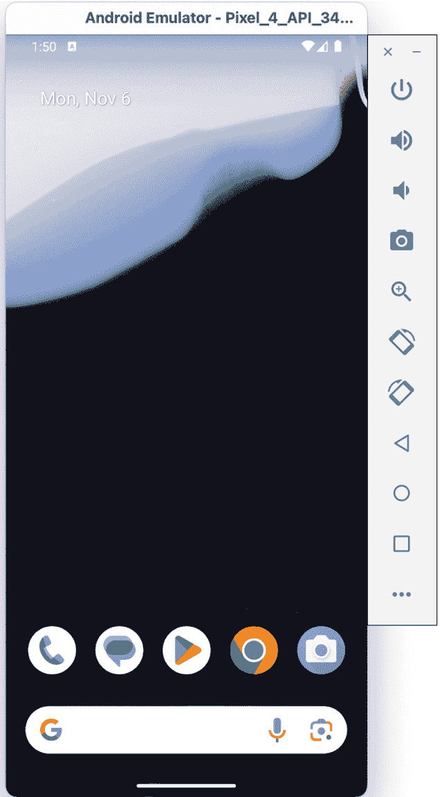

图 5-1

位于窗口右侧边缘的工具栏提供了对模拟器控制和配置选项的快速访问。

### 5.2 模拟器工具栏选项

模拟器工具栏（图 5-2）提供了与外观和行为相关的系列选项的访问。

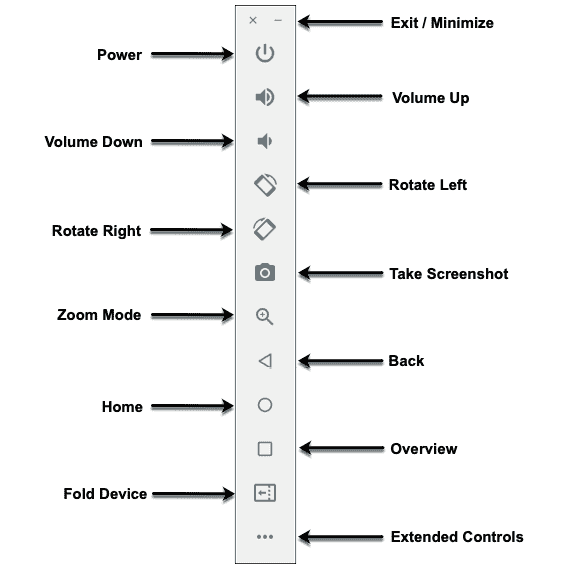

图 5-2

工具栏中的每个按钮都有关联的快捷键，可以通过鼠标悬停在按钮上等待提示框出现来识别。

虽然工具栏中的许多选项一言易懂，但为了完整起见，将对其进行介绍：

- `Exit / Minimize`：工具栏顶部的 `x` 按钮退出模拟器会话，而 `-` 选项将窗口最小化。
- `Power`：`Power` 按钮模拟设备上的电源按钮。点击并释放此按钮将锁定设备并关闭屏幕。按住此按钮将启动关机请求。
- `Volume Up / Down`：控制模拟器内播放音量的两个按钮。
- `Rotate Left/Right`：在竖屏和横屏之间旋转模拟设备。
- `Take Screenshot`：对设备屏幕内容截图。捕捉的存储在扩展控制面板的 `Settings` 屏幕指定的路径。
- `Zoom Mode`：此按钮进入和退出缩放模式，其细节将在本章介绍。
- `Back`：执行标准的 Android“返回”导航以返回上一个屏幕。
- `Home`：显示设备主屏幕。
- `Overview`：模拟标准的 Android“概述”导航，显示设备上正在运行的应用。
- `Fold Device`：模拟折叠设备的折叠和展开。此选项在模拟器运行折叠设备系统镜像时可用。
- `Extended Controls`：显示扩展控制面板，允许配置模拟位置和电话活动、电池强度、蜂窝网络类型和指纹识别等选项。

### 5.3 在缩放模式下工作

位于模拟器工具栏的缩放按钮进入和退出缩放模式。当缩放模式激活时，工具栏按钮处于按下状态，鼠标指针悬停在设备屏幕上时显示为放大镜。点击左鼠标键将使显示相对于屏幕选点进行放大，重复点击将增加缩放级别。相反，点击右鼠标键将降低缩放级别。切换按钮会将显示恢复到默认大小。

在缩放模式下，点击并拖动将定义一个矩形区域，释放鼠标按钮后视图将缩放到该区域。

在缩放模式下，可以使用模拟器窗口内的水平和垂直滚动条移动屏幕的可视区域。

### 5.4 调整模拟器窗口

模拟器窗口的大小（以及设备相应的表示）可以通过启用缩放模式，并在窗口的任何角或侧边上点击并拖拽来随时更改。

## 5.5 扩展控制选项

扩展控制工具栏按钮会显示如图 5-3 所示的面板。默认情况下，将显示位置设置。从左侧面板选择不同的类别，将显示相应的一组控件：


图 5-3

### 5.5.1 位置

位置控制允许以十进制或六十进制坐标将模拟的位置信息发送到模拟器。位置信息可以是单个位置的形式，也可以是代表设备移动的点序列，后者通过 GPS 交换格式（`GPX`）或 Keyhole 标记语言（`KML`）格式的文件提供。或者，可以使用集成的 Google Maps 面板视觉化地选择单点或旅行路线。

### 5.5.2 显示

除了模拟器屏幕内显示的主显示外，`Displays` 选项允许在同一个 Android 实例中运行额外的显示器。这对于测试适用于如 Microsoft Surface Duo 等双屏设备的应用非常有用。这些额外的屏幕可以配置为任何所需的尺寸，并与主屏幕一起出现在模拟器窗口中。

### 5.5.3 蜂窝

可以在蜂窝设置屏幕内更改模拟的蜂窝连接类型。提供了用于模拟不同网络类型（`CSM`、`EDGE`、`HSDPA` 等）以及一系列语音和数据场景，例如漫游和拒绝访问。

### 5.5.4 电池

在扩展控制屏幕的面板上可以模拟各种电池状态和充电条件，包括电池电量、电池健康状况以及是否连接了 AC 充电器。

### 5.5.5 摄像头

当摄像头激活时，模拟器会模拟 3D 场景。这表现为虚拟建筑内部，在模拟器中录制视频或拍照之前，可以通过按住 `Option` 键（Windows 上为 `Alt`）同时使用鼠标指针和键盘键在此进行导航。此扩展配置选项允许上传不同的图像显示在虚拟环境中。

### 5.5.6 电话

电话扩展控制在模拟器中提供了两个简单但实用的模拟。第一个选项模拟来自指定电话号码的入电。这在测试应用如何处理高级中断时特别有用。

第二个选项允许在模拟器会话中模拟接收短信。与现实世界一样，这些消息会出现在 `Message` 应用中，并触发模拟器内的标准通知。

### 5.5.7 方向键

方向键（`D-Pad`）是内置于 Android 设备或外部连接（如游戏控制器）的另一组控件，提供方向控制（左、右、上、下）。方向键设置允许在模拟器中模拟 `D-Pad` 交互。

### 5.5.8 麦克风

麦克风设置允许启用麦克风并模拟虚拟耳机和麦克风连接。还提供了一个启动模拟器上 `Voice Assistant` 的按钮。

### 5.5.9 指纹

许多 Android 设备现在内置指纹检测硬件。`AVD` 模拟器使得无需在带有指纹传感器的物理设备上测试应用即可测试指纹身份验证。模拟器内配置指纹测试的细节将在本章后续部分介绍。

### 5.5.10 虚拟传感器

`virtual sensors` 选项允许模拟 `accelerometer`（加速度计）和 `magnetometer`（磁力计），以模拟设备的物理运动效果，例如通过 `yaw`、`pitch` 和 `roll` 设置模拟旋转、移动和倾斜。

### 5.5.11 快照

快照包含当前运行的 `AVD` 会话的状态，可进行保存并快速恢复，使模拟器轻松返回到精确状态。快照将在本章后续部分介绍。

### 5.5.12 录制与播放

允许对模拟器屏幕和音频以 `WebM` 或动画 `GIF` 格式进行录制并保存。

### 5.5.13 Google Play

如果模拟器运行的是安装了 `Google Play Services` 的 Android 版本，此选项将显示当前的 `Google Play` 版本。它还提供了将模拟器更新到最新版本的选项。

### 5.5.14 设置

设置面板提供了一组配置选项。使用此面板为工具栏和扩展控制面板选择较深的主题，指定保存截图的文件系统位置，配置 `OpenGL` 支持级别，并配置模拟器窗口显示在桌面其他窗口之上。

### 5.5.15 帮助

`Help` 屏幕包含三个子面板，包含键盘快捷键列表、访问模拟器在线文档的链接、报告 Bug 和发送反馈，以及模拟器版本信息。

## 5.6 使用快照

当模拟器首次启动时，它会执行冷启动，就像物理 Android 设备上电一样。冷启动过程可能需要一些时间完成，因为操作系统需要加载且所有后台进程都要启动。为了避免每次启动模拟器都必须经过此过程，系统配置为每次退出时自动保存模拟器当前状态的快照（称为快速启动快照）。下次启动模拟器时，快速启动快照将加载到内存中并从上次中断的地方恢复，允许模拟器快速启动。

扩展控制面板的 `Snapshots` 屏幕可以在模拟器执行期间的任何点存储额外的快照。这保存了整个模拟器的状态，允许模拟器恢复到拍摄快照的确切状态。在屏幕内可以使用 `Take Snapshot` 按钮（如图 5-4 中标记 `A`）拍摄快照。要恢复现有的快照，从列表中选择它（`B`）并点击屏幕底部的运行按钮（`C`）。还提供了编辑（`D`）快照名称和描述以及删除（`E`）当前选择快照的选项：

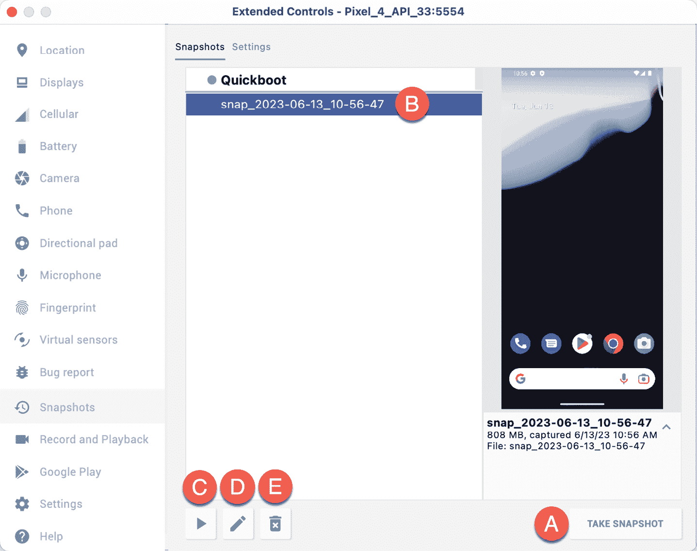

图 5-4

你还可以通过主工具栏中的运行目标菜单中选择使用冷启动、最近的快速启动快照或之前的快照来启动模拟器，如图 5-5 所示：

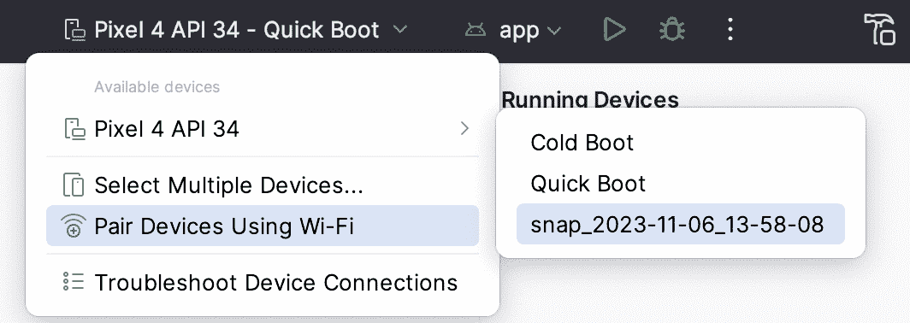

图 5-5

## 5.7 配置指纹模拟

模拟器允许配置并使用最多 10 个模拟指纹来测试 Android 应用中的指纹身份验证。配置模拟指纹从启动模拟器、打开 `Settings` 应用并选择 `Security` 选项开始。

在 `Security` 设置屏幕内，选择 `fingerprint` 选项。在随后的信息屏幕上，点击 `Next` 进入指纹设置屏幕。在启用指纹安全之前，必须配置备份屏幕解锁方法（如 `PIN`）。输入并确认一个合适的 `PIN`，并通过接受默认通知选项来完成 PIN 输入过程。

继续后续屏幕，直到 `Settings` 应用要求在传感器上放置指纹。此时，显示扩展控制对话框，在左侧面板中选择 `Fingerprint` 类别，并确保主设置面板选择了 `Finger 1`。

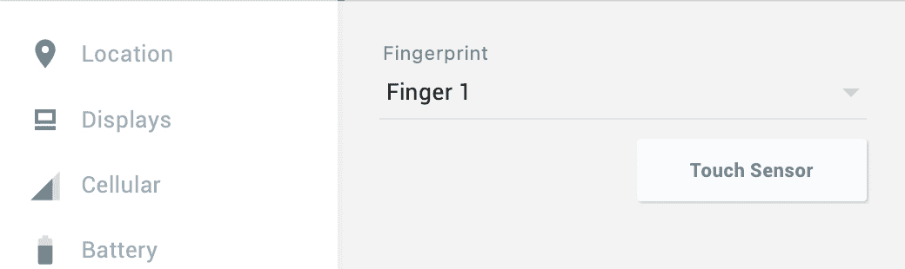

图 5-6

点击 `Touch Sensor` 按钮模拟 `Finger 1` 触摸指纹识别器。模拟器将报告指纹添加成功：

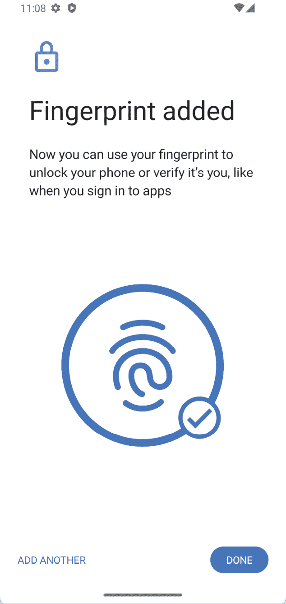

图 5-7

要添加额外的指纹，请点击 `Add Another` 按钮，并在再次点击 `Touch Sensor` 按钮之前，从扩展控制面板菜单中选择另一只手指。

## 5.8 工具窗口模式下的模拟器

正如前一章“在 Android Studio 中创建 Android 虚拟设备（`AVD`）”所述，Android Studio 可以配置为在嵌入式工具窗口中启动模拟器，这样它就不会出现在独立的窗口中。当在此模式下运行时，工具栏中将提供与独立模式中相同的控件，如图 5-8 所示。

图 5-8

从左到右，这些按钮执行以下任务（细节与独立模式一致）：

- 电源
- 音量增大
- 音量减小
- 左旋转
- 右旋转
- 返回
- 主页
- 概览
- 截图
- 快照
- 扩展控制

## 5.9 创建可调整大小的模拟器

除了配置为匹配特定 Android 设备模型的模拟器外，Android Studio 还提供了一个可调整大小的 `AVD`，允许你在手机、平板和折叠屏设备尺寸之间切换。要创建一个可调整大小的模拟器，打开 `Device Manager` 并点击 `+` 工具栏按钮。接下来，选择如图 5-9 所示的 `Resizable` 设备定义，并按照通常步骤创建新的 `AVD`：


图 5-9

当你在工具窗口内的新模拟器上运行应用时，工具栏中会出现 `Display mode`，允许你在模拟器配置之间切换，如图 5-10 所示：

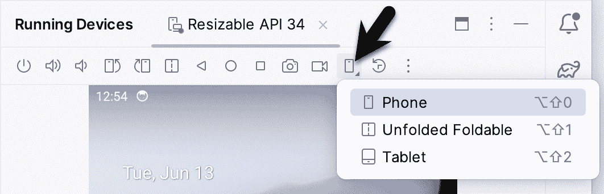

图 5-10

如果模拟器在独立模式下运行，可以在侧边工具栏中找到 `Display mode` 选项，如下：

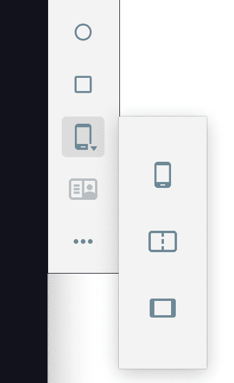

图 5-11

## 5.10 总结

Android Studio 包含一个 `Android Virtual Device` 模拟器环境，旨在使其在不于物理 Android 设备上运行的情况下更容易测试应用程序。本章对模拟器进行了简要介绍，并强调了用于配置和自定义环境以模拟不同测试条件的关键功能。

## 6. Android Studio 用户界面导览

虽然人们可能急于运行在前一章中创建的示例应用，但它涉及 Android Studio 用户界面的某些方面，这些内容最好先进行描述。

Android Studio 是一个强大且功能丰富的开发环境，在很大程度上用起来是直观的。尽管如此，现在花时间熟悉 Android Studio 用户界面的布局和组织结构，将缩短书中后续章节的学习曲线。基于此，本章将提供 Android Studio 环境中各个区域和组件的概述。

### 6.1 欢迎屏幕

欢迎屏幕（图 6-1）在 Android Studio 运行且当前没有打开任何项目时显示（可以通过选择 `File -> Close Project` 菜单选项随时关闭打开的项目）。如果是在项目仍打开时退出了 Android Studio，该工具在下次启动时将跳过欢迎屏幕，自动打开之前活跃的项目。

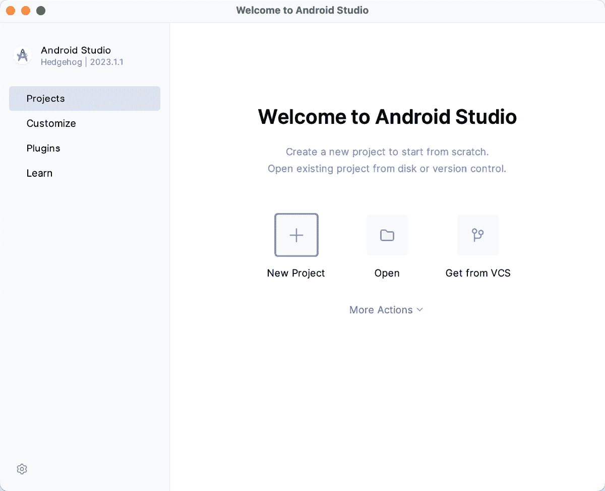

图 6-1

除了最近项目列表外，欢迎屏幕还提供了执行如打开和创建项目等任务的选项，并可以访问当前受版本控制的项目。此外，`Customize` 屏幕提供了更改 `IDE` 和编辑器使用的主题和字体设置的选项。可以使用 `Plugins` 选项查看、安装和管理 Android Studio 插件。

通过选择 `More Actions` 链接，或在最近项目列表中替代 `More Actions` 链接时使用图 6-2 所示的菜单，可以获得更多选项：

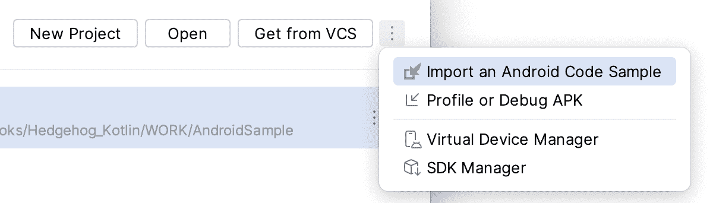

图 6-2

### 6.2 菜单栏

当创建新项目或打开现有项目时，Android Studio 主窗口将出现。当同时打开多个项目时，每个项目都将分配自己的主窗口。窗口的精确配置取决于 Android Studio 运行的操作系统，以及上次打开项目时显示了哪些工具和面板。例如，主菜单栏的外观将根据主机操作系统而不同。在 macOS 上，Android Studio 遵循将菜单栏放置在桌面顶的标准惯例，如图 6-3 所示：

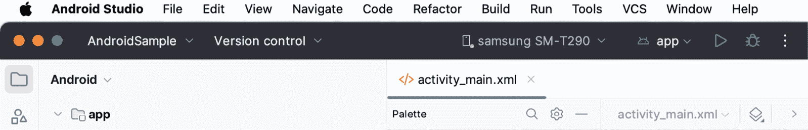

图 6-3

然而，当 Android Studio 在 Windows 或 Linux 上运行时，通过图 6-4 所示的高亮按钮访问主菜单：

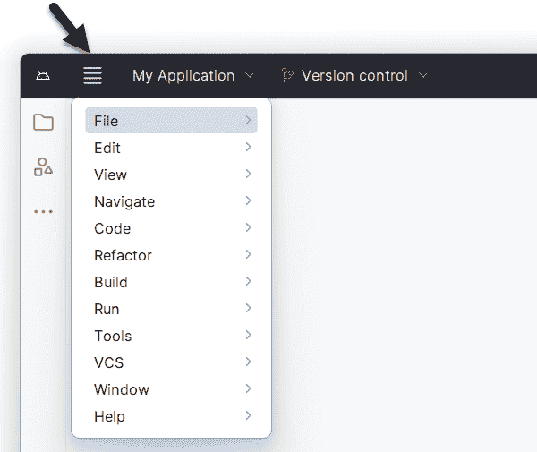

图 6-4

### 6.3 主窗口

一旦打开项目，Android Studio 主窗口通常类似于图 6-5 所示：

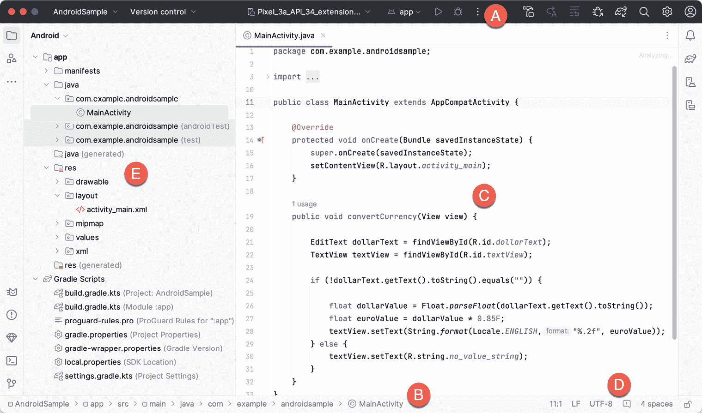

图 6-5

主窗口的各种元素可以总结如下：

**A – 工具栏**：频繁操作的快捷键选择。工具栏按钮提供了对一组菜单操作的快速访问。可以通过右键点击工具栏并选择 `Customize Toolbar…` 选项来自定义工具栏。图 6-6 所示的工具栏菜单提供了执行创建和打开项目以及在多个项目打开时切换的便捷方法：

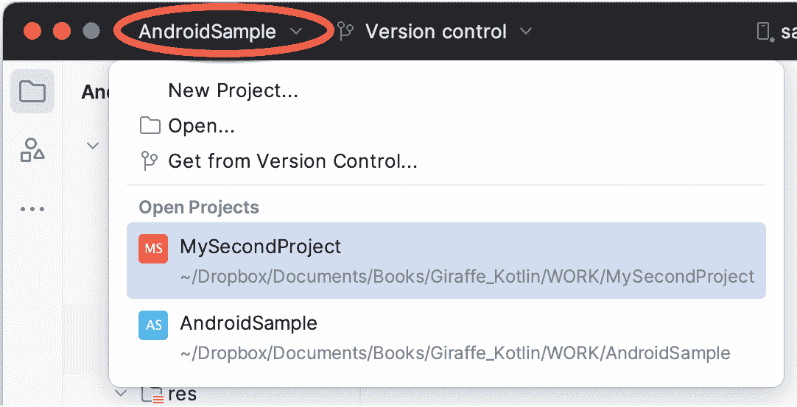

图 6-6

**B – 导航栏**：导航栏提供了在项目文件和文件夹之间移动的便捷方法。点击导航栏中的元素将弹出该位置的子文件夹和文件列表供选择。同样，点击类名将显示包含在该类的方法列表：

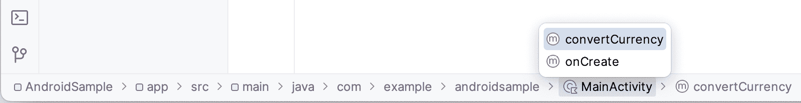

图 6-7

从列表中选择方法将进入代码编辑器的相应位置。可以使用 `View -> Appearance -> Navigation Bar` 菜单选项隐藏、显示和更改此栏的位置。

**C – 编辑器窗口**：编辑器窗口显示开发者正在处理的文件内容。当打开多个文件时，每个文件由编辑器顶部的标签表示，如图 6-8 所示：

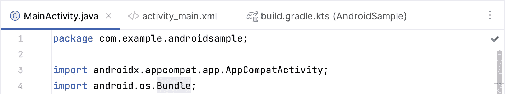

图 6-8

**D – 状态栏**：状态栏显示关于项目和 Android Studio 活动的信息消息。悬停在状态栏项目上将显示该字段的描述。许多字段是交互式的，允许用户点击以执行任务或获取更详细的状态信息。

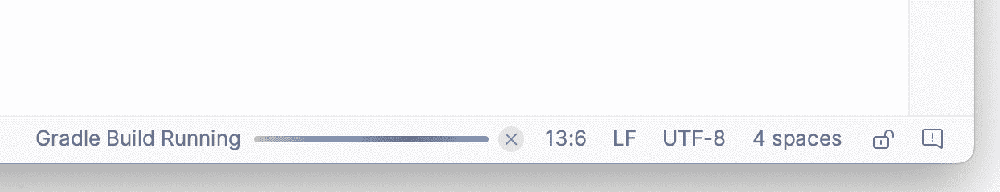

图 6-9

可以使用 `View -> Appearance -> Status Bar Widgets` 更改状态栏中显示的小部件。

**E – 项目工具窗口（Project Tool Window）**：项目工具窗口提供了项目文件结构的层次结构概述，允许对特定文件和文件夹进行导航。工具栏用于以不同的方式显示项目。默认设置是 `Android` 视图，这是本书后续内容主要使用的模式。

项目工具窗口只是 Android Studio 环境中许多可用工具之一。

## 6.4 工具窗口（Tool Windows）

除了项目视图工具窗口外，Android Studio 还包含许多其他窗口，这些窗口在启用时会显示为沿主窗口左侧和右侧出现的工具窗口栏，其中包含用于显示和隐藏每个工具窗口的按钮。图 6-10 显示了典型的工具窗口栏配置，尽管按钮及其位置可能会根据你安装的 Android Studio 而有所不同。

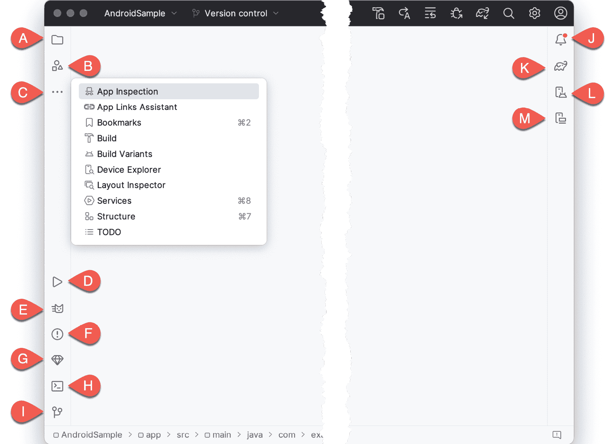

图 6-10

点击按钮将显示相应的工具窗口，再次点击则会隐藏窗口。按钮在工具窗口栏中的位置表示窗口在显示时将出现在窗口的哪侧。可以通过点击并拖动按钮到其他窗口工具栏的不同位置来更改这些位置。

Android Studio 提供了广泛的工具窗口，最常用的如下：

- **Project 项目（A）**：项目视图提供了构成项目的文件结构概述，允许在文件之间快速导航。通常情况下，在项目视图中双击文件将导致该文件加载到适当的编辑工具中。


## 6.4 工具窗口

* **Resource Manager 资源 (B)** - 用于项目内添加和管理资源与资产的工具，例如图像、颜色和布局文件。

* **More hơn 工具窗口 (C)** - 显示包含当前未在工具窗口栏中显示的附加工具窗口的菜单。从此菜单中选择工具窗口后，它将作为工具窗口栏中的按钮出现。

* **Run 运行 (D)** – 当应用程序运行时，运行工具窗口将可用，并提供运行结果视图以及停止或重启运行进程的选项。如果应用程序在设备或模拟器上安装和运行失败，此窗口通常会提供有关该问题的诊断信息。

* **Logcat (E)** – `Logcat` 工具窗口提供了访问运行应用程序的监控日志输出，以及对应用程序进行截图、视频以及停止和重启进程的选项。

* **Problems 问题 (F)** - 查看项目内所有当前错误或警告的中心位置。双击问题列表中的项将带你进入问题所在的文件和位置。

* **App Quality Insights 应用质量洞察 (G)** - 提供对基于云的 Firebase 应用质量和崩溃分析平台的访问。

* **Terminal 终端 (H)** – 提供对运行 Android Studio 的系统的终端窗口。在 Windows 系统上，这是命令提示符界面，而在 Linux 和 macOS 系统上，它以终端提示符的形式存在。

* **Version Control 版本控制 (I)** - 当项目文件受版本控制时使用此工具窗口，允许访问`Git`仓库和代码更改历史。

* **Notifications 通知 (J)** - 当项目文件受版本控制时使用此工具窗口，允许访问`Git`仓库和代码更改历史。

* **Gradle (K)** – `Gradle` 工具窗口提供了构成项目构建配置的 `Gradle` 任务视图。该窗口列出了将项目各种元素编译为可执行应用程序的涉及的任务。右键点击顶级 `Gradle` 任务并选择 `Open Gradle Config` 菜单选项，可以将当前项目的 `Gradle` 构建文件加载到编辑器中。本书稍后将更详细介绍 `Gradle`。

* **Device Manager 设备管理器 (L)** - 提供对设备管理器工具窗口的访问，可以在其中添加、删除和管理物理 Android 设备连接和模拟器。

* **Running Devices 运行中的设备 (M)** - 如果启用了在 Android Studio 中创建 Android 虚拟设备 (AVD)章节所述在工具窗口中运行模拟器的选项，则包含 AVD 模拟器。

* **App Inspection 应用检查** - 提供对数据库和后台任务检查器的访问。`Database Inspector` 允许你在运行时检查、查询和修改应用程序的数据库。`Background Task Inspector` 允许对使用 `WorkManager` 创建的后台工作任务进行监控和管理。

* **Bookmarks 书签** – 书签工具窗口提供了快速访问已标记的文件和代码行。例如，在项目视图中右键点击文件可以访问 `Add to Bookmarks` 选项。同样，你可以通过将光标移动到该行并按下 `F11` 键（macOS 上为 `F3`）对源文件中的代码行签名。所有书签项都可以此工具窗口访问。

* **Build 构建** - 构建工具窗口显示项目编译和打包过程中的构建信息，以及遇到的任何错误详细信息。

* **Build Variants 构建变体** – 构建变体工具窗口为当前应用程序项目配置不同的构建目标提供了快速方法（例如，针对应用程序调试和发布版本的不同构建，或针对不同设备类别的多个构建）。

* **Device File Explorer 设备文件浏览器** - 通过 `View -> Tool Windows -> Device File Explorer` 菜单可用，此工具窗口提供对当前连接的 Android 设备或模拟器文件系统的直接访问，允许浏览系统并将文件复制到本地文件系统。

* **Layout Inspector 布局检查** - 提供构成用户界面布局的组件层次结构的视觉 3D 渲染。

* **Structure 结构** – 结构工具提供当前显示的源文件结构的高级视图。这些信息包括类、方法和变量列表。从结构列表中选择项将带你进入该位置。

* **TODO 待办事项** – 正如所示，此工具提供了查看项目中待完成事项的地方。Android Studio 通过扫描项目源文件查找匹配 `TODO` 模式的注释来编译此列表。可以通过打开对话框并导航到 `Editor` 下的 `TODO` 来查看和更改这些模式。

## 6.5 工具窗口菜单 (Tool Window Menus)

每个工具窗口在顶部都有自己的工具栏。这些工具栏中的菜单按钮随工具而异，但所有工具窗口都包含一个选项菜单（如图 6-11 中的 A 所示）：

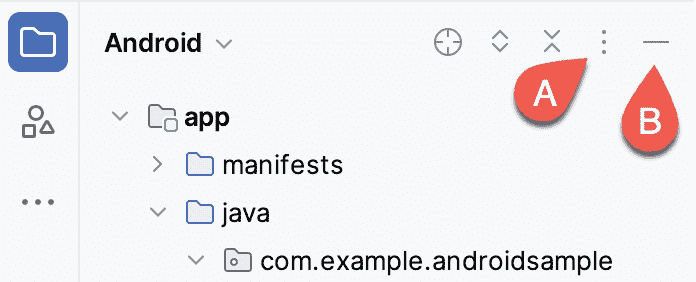

图 6-11

选项允许更改窗口的各个方面。例如，图 6-12](#Guided_Tour.xhtml__idTextAnchor177)显示了项目工具窗口的选项菜单。可以使用设置，例如取消固定窗口并允许其在 Android Studio 主窗口边界之外浮动，以及移动和调整工具面板的大小：

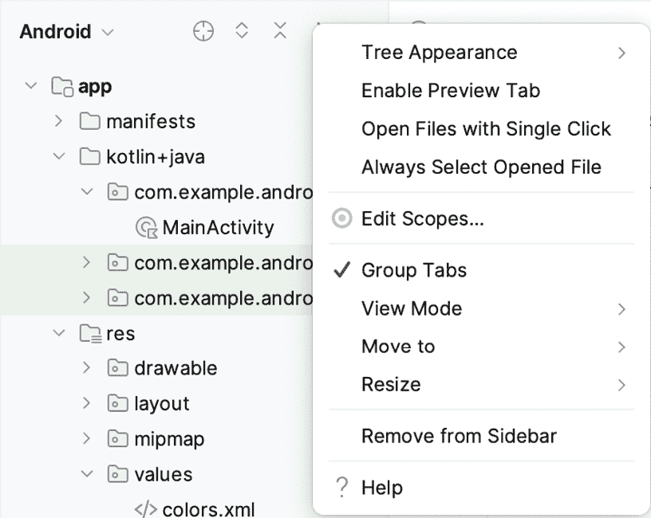

图 6-12

所有工具窗口在工具栏的最右侧还有一个按钮（如图 6-11 中的 B 所示），提供了隐藏工具窗口的另一种方法可以通过让该窗口获取焦点（点击它）然后输入搜索词（例如项目工具窗口中的文件名）来对工具窗口内的项进行搜索。搜索框将出现在窗口的工具栏中，并高亮匹配搜索的项。

## 6.6 Android Studio 快捷键 (Android Studio Keyboard Shortcuts)

Android Studio 包含了许多快捷键，以便在执行常用任务时节省时间。您可以通过在 Android Studio 项目窗口中选择 `Help -> Keyboard Shortcuts PDF` 菜单选项来查看并打印完整的快捷键映射列表。您也可以通过打开 `Settings` 对话框并点击 `Keymap` 项来列出和修改快捷键，如下方的 图 6-13 所示：


图 6-13

## 6.7 切换器（Switcher）与最近文件导航

在 Android Studio 主窗口中进行导航的另一个有用机制是使用切换器（Switcher）。通过 `Ctrl-Tab` 快捷键访问切换器，它将以面板的形式出现，列出所有工具窗口和当前打开的文件（图 6-14）。


图 6-14

一旦显示，只要 `Ctrl` 键一直保持按下状态，切换器就会保持可见。在按住 `Ctrl` 键的同时反复点击 `Tab` 键可以在各种选择选项之间循环，而释放 `Ctrl` 键则可以选择当前高亮的项并在主窗口中显示。

除了切换器之外，最近文件（Recent Files）面板还提供了对最近打开的文件的导航（图 6-15）。可以使用 `Ctrl-E` 快捷键（macOS 上为 `Cmd-E`）访问此面板。一旦显示，可以使用鼠标指针选择选项，或者使用键盘方向键滚动浏览文件名和工具窗口选项。按下 `Enter` 键将选择当前高亮的项：

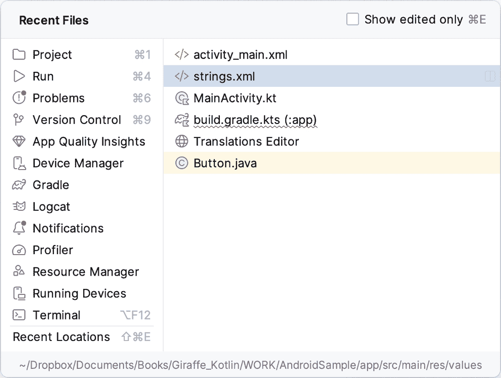

图 6-15

## 6.8 更改 Android Studio 主题

可以使用 `Settings` 对话框更改 Android Studio 环境的整体主题。一旦显示了设置对话框，在左侧面板中选择 `Appearance & Behavior` 选项，然后选择 `Appearance`。接着，在点击 `OK` 按钮之前更改 `Theme` 菜单的设置。可用主题取决于平台，但通常包括 Light（浅色）、IntelliJ、Windows、High Contrast（高对比度）和 Darcula 等选项。图 6-16 显示了已选择 Dark（深色）主题的主窗口示例：

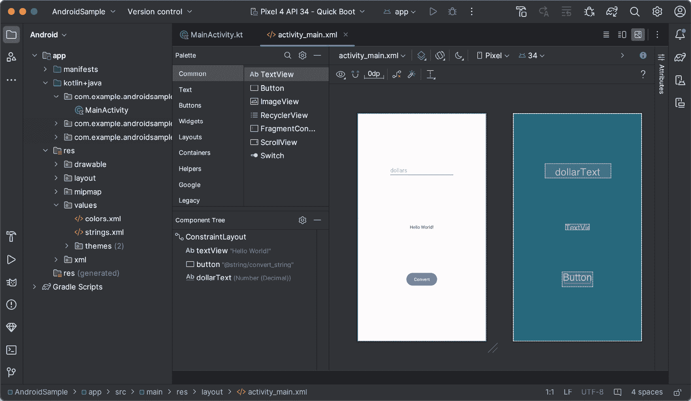

图 6-16

要将 Android Studio 主题与操作系统的明暗模式设置同步，请启用 `Sync with OS` 选项并使用下拉菜单控制每个模式下使用哪个主题：

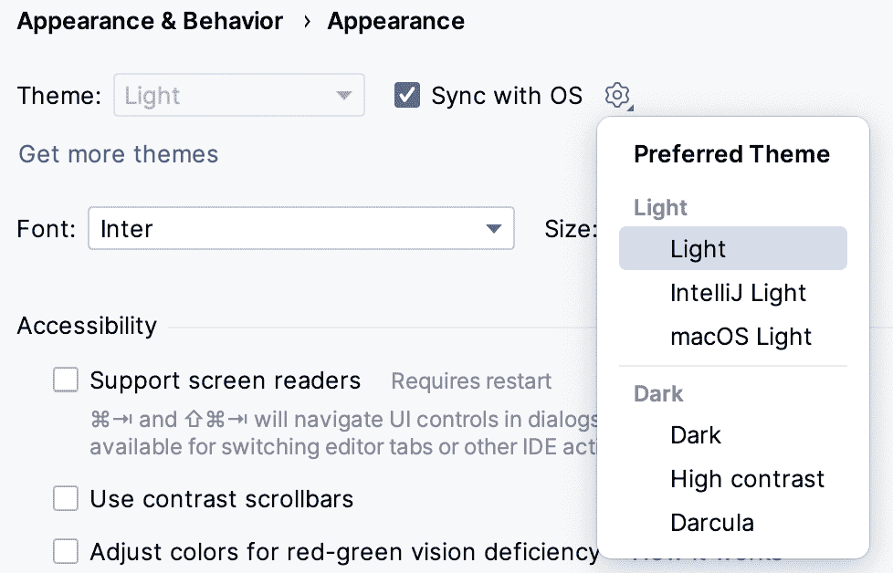

图 6-17

## 6.9 总结

Android Studio 环境的主要元素包括欢迎界面和主窗口。每个打开的项目都分配有自己的主窗口，该窗口反过来由菜单栏、工具栏、编辑和设计区域、状态栏以及一组工具窗口组成。工具窗口位于主窗口的侧侧。

Android Studio 中有极少的操作无法通过快捷键触发。可以随时从 Android Studio 主窗口中访问默认快捷键的键映射。

## 7. 在物理 Android 设备上测试 Android Studio 应用

虽然使用 Android 虚拟设备 (AVD) 测试应用程序可以实现许多功能，但在物理 Android 设备上进行真实的应用测试是不可替代的，而且某些 Android 功能仅在物理 Android 设备上可用。

与 AVD 实例和连接的 Android 设备之间的通信由 Android 调试桥接 (ADB) 处理。本章解释了如何在基于 macOS、Windows 和 Linux 的系统中配置 `adb` 环境，以便在 Android 设备上进行应用测试。

### 7.1 Android 调试桥接 (ADB) 概述

ADB 的主要目的是促进开发系统（在此例中 Android Studio）与 AVD 模拟器以及 Android 设备之间的交互，以便运行和调试应用程序。ADB 允许您通过 WiFi 或 USB 线连接到设备。

ADB 由客户端、运行在开发系统后台的服务器进程，以及一个运行在 AVD 或真实 Android 设备（如手机和平板电脑）上的守护后台进程组成。

ADB 客户端有多种形式。例如，在 Android SDK 的 `platform-tools` 子目录下提供了一个名为 `adb` 的命令行工具作为客户端。同样，Android Studio 也有一个内置的客户端。

可以使用 `adb` 命令行工具执行多种任务。例如，可以使用 `devices` 命令行参数列出活跃的虚拟或物理设备。以下命令输出表示系统上存在一个 AVD，但没有物理设备：

```bash
$ adb devices
List of devices attached
emulator-5554 device
```

### 7.2 在 Android 设备上启用 USB 调试 ADB

在 ADB 连接到 Android 设备之前，该设备必须配置为允许连接。在运行 Android 6.0 或更高版本的手机和平板设备上，实现此目的的步骤如下：

1. 打开设备上的 `Settings` 应用并选择 `About tablet`关于平板电脑）或 `About phone`关于手机）选项（在某些 Android 版本中，可以在 `Settings` 应用的 `System` 页面找到）。

2. 在关于屏幕上，向下滚动到 `Build number`版本号）字段（图 7-1）并点击七次，直到消息显示开发者模式已启用。如果关于屏幕上没有列出 `Build number`，它可能位于 `Software information（软件信息）`下。或者展开 `Advanced（高级）`部分。


3. 返回到设置主屏幕，注意出现了 `Developer options（开发者选项）`（在较新的 Android 版本中，此选项位于 `System` 设置中）。选择此选项，并在生成的屏幕上找到图 7-2 所示的 `USB debugging（USB 调试）`选项：


4. 启用 `USB debugging` 选项，并在请求权限时点击 `Allow（允许）`按钮。

现在设备已配置为接受来自 `adb` 的连接。剩下的工作是配置开发系统在设备连接时检测它。虽然这是一个简单的过程，但步骤取决于开发系统运行的是 Windows、macOS 还是 Linux。以下步骤假设 Android SDK `platform-tools` 目录已包含在操作系统的 `PATH`环境变量中，如设置 Android Studio 开发环境章节所示。

#### 7.2.1 macOS ADB 配置

要在 macOS 系统上配置 ADB 环境，使用 USB 线将设备连接到电脑，打开终端窗口并执行以下命令重启 `adb` 服务器：

```bash
$ adb kill-server
$ adb start-server
* daemon not running. starting it now on port 5037 *
* daemon started successfully *
```

一旦服务器成功运行，执行以下命令以验证设备是否已检测：

```bash
$ adb devices
List of devices attached
74CE000600000001 offline
```

如果设备显示为 offline（离线），前往 Android 设备并检查图 7-3 所示的对话框，请求允许 USB 调试。在点击 OK 之前，勾选 Always allow from this computer（始终允许此计算机）旁边的复选框。


图 7-3

重复 `adb devices` 命令现在应该列出设备为可用：

```
List of devices attached
015d41d4454bf80c device
```

如果设备未列出，尝试注销并重新登录 macOS 桌面，如果问题仍然存在，请重启系统。

### 7.2.2 基于 Windows 的 ADB 配置

配置基于 Windows 的开发系统以使用 `ADB` 连接到 Android 设备的第一步是在系统上安装相应的 USB 驱动程序。需要安装的 USB 驱动程序取决于 Android 设备的型号。如果你拥有 Google 设备（例如 Pixel 手机），则有必要在 Windows 系统上安装并配置 Google USB 驱动程序包。实现此操作的详细步骤请参见下方网页：

[developer.android.com/sdk/win-usb.html](https://developer.android.com/sdk/win-usb.html)

对于[Google USB 驱动](https://developer.android.com/sdk/win-usb.html)不支持的 Android 设备，则需要下载由设备制造商提供的驱动程序。可以在以下在线获取驱动程序列表以及下载和安装信息：

[developer.android.com/tools/extras/oem-usb.html](https://developer.android.com/tools/extras/oem-usb.html)

在安装驱动程序且设备现已识别为正确的设备类型后，打开命令提示符窗口并执行以下命令：

```bash
adb devices
```

该命令应输出与如下类似的连接设备信息：

```
List of devices attached
HT4CTJT01906 offline
```

如果设备被列为 `offline` 或 `unauthorized`，请查看设备显示并检查是否显示寻求允许 USB 调试权限的对话框。在点击确定 之前，勾选“始终允许此计算机调试”选项旁边的复选框。再次执行 `adb devices` 命令现在应该会将设备列为已就绪：

```
List of devices attached
HT4CTJT01906 device
```

如果设备未列出，请执行以下命令重启 `ADB` 服务：

```bash
adb kill-server
adb start-server
```

如果设备仍然未列出，请尝试执行以下命令：

```bash
android update adb
```

注意，可能还需要需要重启系统。

#### 7.2.3 Linux ADB 配置

在本章中，我们将再次使用 Ubuntu Linux 作为参考示例，在 Linux 上配置 `adb` 以连接到物理 Android 设备进行应用测试。

在 Ubuntu Linux 上进行物理设备测试需要安装名为 `android-tools-adb` 的包，这反过来要求 Android Studio 用户必须是 `plugdev` 组的成员。这是大多数 Ubuntu 版本用户账户的默认设置，可以通过运行 `id` 命令进行验证。如果未列出 `plugdev` 组，请运行以下命令将您的账户添加到该组：

```bash
sudo usermod -aG plugdev $LOGNAME
```

在满足组成员身份要求后，可以通过执行以下命令安装 `android-tools-adb` 包：

```bash
sudo apt-get install android-tools-adb
```

完成上述更改后，重启 Ubuntu 系统。系统重启后，打开终端窗口，启动 `adb` 服务，并检查已连接的设备列表：

```bash
$ adb start-server
* daemon not running. starting it now on port 5037 *
* daemon started successfully *
$ adb devices
List of devices attached
015d41d4454bf80c offline
```

如果设备被列为 `offline` 或 `unauthorized`，请前往 Android 设备并检查寻求寻求允许 USB 调试权限的对话框。

## 7.3 解决 USB 连接问题

如果你无法通过上述步骤成功连接到设备，请显示运行目标菜单并选择“故障排除设备连接”（Troubleshoot Device Connections）选项：


连接助手将扫描设备并报告问题及解决方案。

## 7.4 在 Android 设备上启用无线调试

遵循上述 7.2 节的第 1 至第 3 步，这次启用如下所示的无线调试选项：

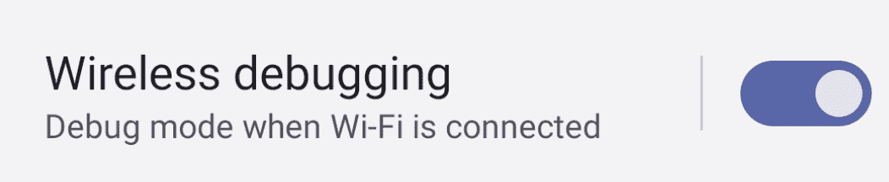

图 7-5

接下来，点击上述无线调试条目以显示如下所示屏幕：

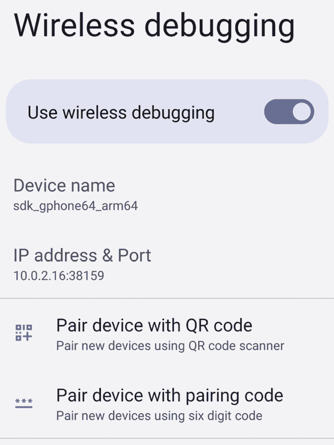

图 7-6

如果你的设备带有摄像头，选择“通过 QR 代码配对设备”，否则选择“通过配对码配对设备”。根据你的选择，设置应用将启动摄像头会话或显示配对码，如下所示：

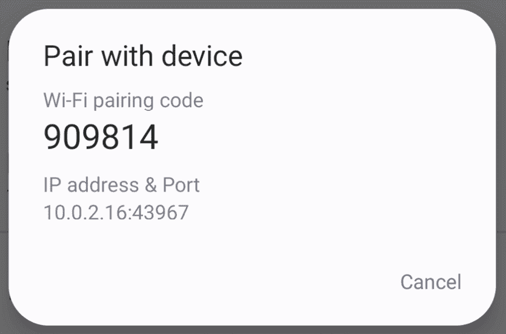

图 7-7

选择选项后，返回 Android Studio，从运行目标菜单中选择“通过 WiFi 配对设备”选项，如下所示：

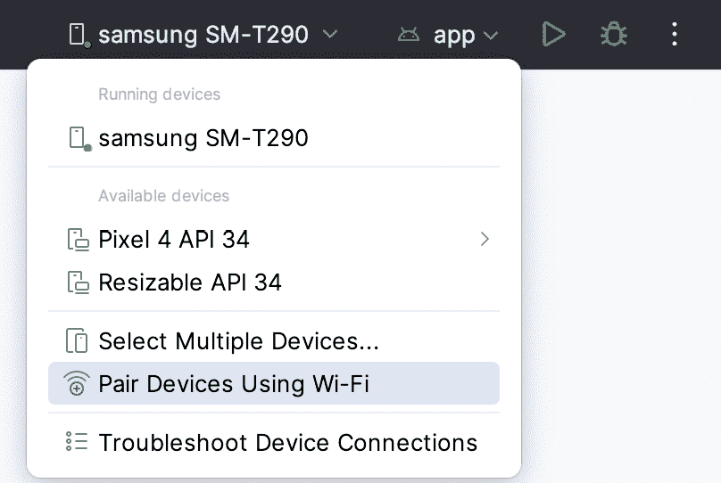

图 7-8

在配对对话框中，根据你之前在设备设置应用中的选择，选择“通过 QR 代码配对”或“通过配对码配对”：

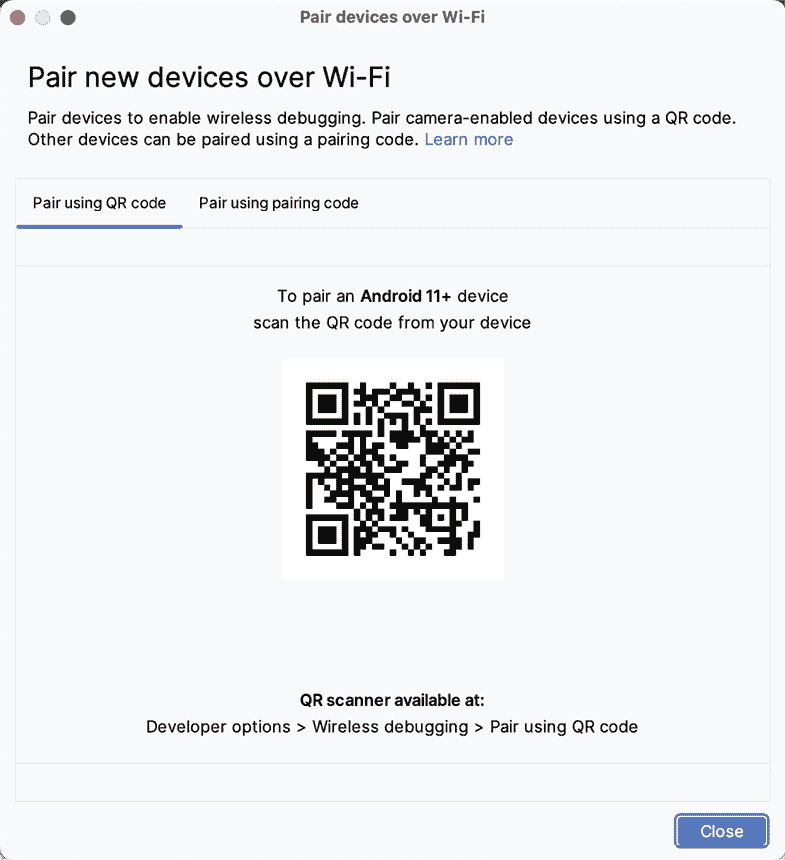

图 7-9

使用 Android 设备扫描 QR 代码，或将设备屏幕上显示的配对码输入 Android Studio 对话框中以完成配对过程：

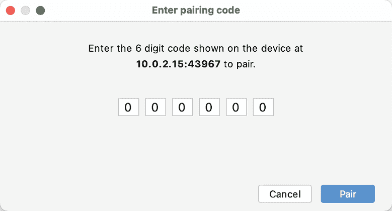

图 7-10

如果配对过程失败，请尝试重启开发系统和 Android 设备。

## 7.5 测试 ADB 连接

假设在所选平台上已成功配置`adb`，下一步是尝试运行测试应用程序。启动 Android Studio，打开项目，并验证设备是否出现在如下所示的设备列表中：

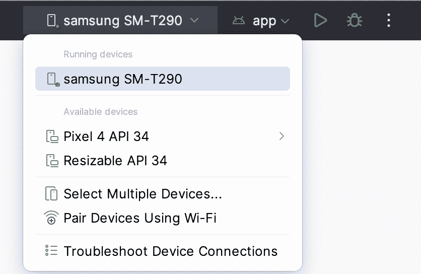

图 7-11

从列表中选择设备并点击运行按钮。

## 7.6 设备镜像

设备镜像允许你在物理设备上运行应用，同时在 Android Studio 中显示屏幕。换句话说，尽管你的应用运行在物理设备上，但它会像 AVD 实例一样显示在 Android Studio 中。

将设备连接到 Android Studio 后，显示运行设备窗口并点击设备设置链接显示设置对话框。在设置对话框中，启用物理 Android 设备镜像并点击确定。下次运行应用时，Android Studio 将在运行设备窗口中镜像物理设备的显示。

## 7.7 总结

虽然 Android 虚拟机模拟器提供了一个极的测试环境，但记住，确保应用程序在物理 Android 设备上正确运行没有真正的替代品。

然而，默认情况下，Android Studio 环境未配置为将 Android 设备作为目标测试设备。因此，必须执行某些步骤，通过 USB 线缆或 WiFi 网络从 Android Studio 开发环境将应用程序加载到 Android 设备。

## 8. Android Studio 代码编辑器基础

为 Android 开发应用涉及大量的编程工作，根据定义，这涉及输入、审查和修改代码行。不出所料，开发者在使用 Android Studio 的大部分时间内通常都在编辑器窗口内编辑代码。

现代代码编辑器必须远超输入、删除、剪切和粘贴等基础功能。今天，代码编辑器的实用性通常由以下因素衡量：它在多大程度上减少了程序员的输入量、在大源文件中导航的便利性，以及编辑器在代码编写时实时检测并高亮编程错误的能力。正如本章所示，这些只是 Android Studio 编辑器出色的少数领域之一。

本章并非对 Android Studio 编辑器功能的详尽概述，而是旨在提供该工具关键功能的指南。经验丰富的程序员会发现，其中某些功能是目前大多数代码编辑器所共的，而许多功能则是该编辑环境所特有的。

### 8.1 Android Studio 编辑器

当选择 Java、Kotlin、XML 或其他文本文件进行编辑时，Android Studio 编辑器出现在主窗口的中心。例如，图 8-1 显示了一个加载了 Java 源代码文件的典型编辑器界面：

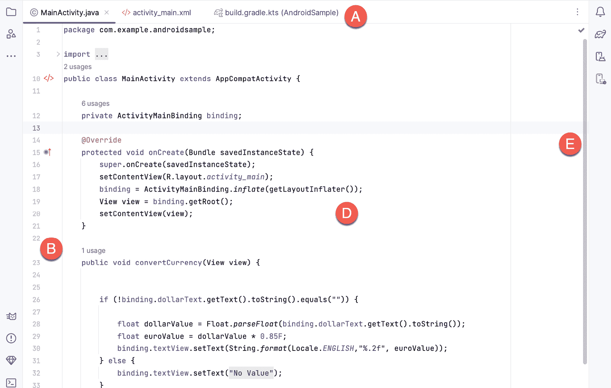

图 8-1

构成编辑器窗口的元素可以总结如下：

#### A – 文档标签 (Document Tabs)

Android Studio 可以随时打开多个文件进行编辑。每打开一个文件，它都会被分配一个文档标签，在编辑器窗口顶部边缘的标签栏中显示文件名。当空间不足以显示所有标签时，标签栏的最右侧会出现一个小的下拉菜单。点击此菜单将弹出其他已打开的文件列表。标签中文件名下方的红色波浪线表示该文件中的代码包含一个或多个错误，这些错误在编译和运行项目之前需要被解决。

在文件之间切换只需点击相应的标签或使用`Alt-Left`和`Alt-Right`键盘快捷键。文件之间的导航可以使用切换器（Switcher）机制（通过`Ctrl-Tab`键盘快捷键访问）进行。

要将编辑器面板从 Android Studio 主窗口分离并使其在单独窗口中显示，请点击标签并将其拖到主窗口之外的桌面区域。要将编辑器返回主窗口，请点击分离的编辑器窗口中的文件标签，并将其拖放到主窗口的原始编辑器标签栏上。

#### B – 编辑器行槽区域 (Editor Gutter Area)

行槽区域用于编辑器显示信息图标和控件。行槽区域的一些典型项目包括调试断点标记、折叠和展开代码块的控件、书签、更改标记和行号。行号默认开启，但可以通过右行槽右右键并选择`Appearance -> Show Line Numbers`菜单选项来禁用。

#### C – 代码结构位置 (Code Structure Location)

编辑器底部的此栏显示光标当前位置及其与代码整体结构的关系。例如，在下面的图中，该栏指示当前正在编辑`convertCurrency`方法，且该方法包含在`MainActivity`类中：


图 8-2

双击栏内的任意元素将把光标移动到代码文件中的相应位置。例如，双击`convertCurrency`条目将把光标移动到源代码中`convertCurrency`方法的顶部。同样，点击`MainActivity`条目将显示一个可选择的代码导航点列表：


图 8-3

#### D – 编辑器区域 (The Editor Area)

用户在此处查看、输入和编辑代码的主区域。本章随后的章节将详细介绍编辑区域的关键功能。

#### E – 验证与标记侧边栏 (The Validation and Marker Sidebar)

Android Studio 集成了一个名为“即时代码分析”（on-the-fly code analysis）的功能。这意味着当你编写代码时，编辑器会分析代码以检查警告和语法错误。验证侧边栏顶部的指示器将实时更新，显示添加代码时的错误和警告数量。点击此指示器将显示一个弹出窗口，其中包含编辑器代码问题的摘要，如图 8-4 所示：

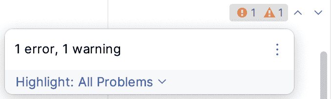

图 8-4

向上和向下箭头可以在代码中的错误位置之间移动。绿色勾号表示未检测到任何警告或错误。

侧边栏还使用相同的颜色编码在检测到问题的位置显示标记。当编辑器区域可见某行代码时，将鼠标指针悬停在标记上，将显示一个包含问题描述的弹出窗口：


图 8-5

当某行代码滚动出编辑器的可视区域时，将鼠标指针悬停在该代码标记的标记上，将显示一个“透镜”（lens）覆盖层，包含问题所在的代码块（图 8-6），从而无需滚动到编辑器的该位置即可查看：

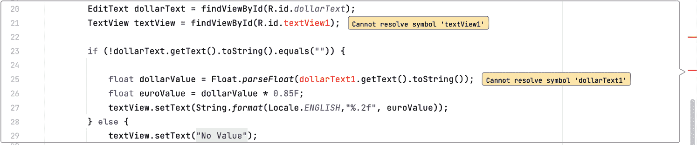

图 8-6

值得注意的是，透镜覆盖层不仅限于侧边栏中的警告和错误。悬停在侧边栏的任何部分都会导致出现一个透镜，其中包含源文件中该处的代码。

#### F – 状态栏 (The Status Bar)

虽然状态栏是主窗口的一部分，而不是编辑器本身，但它确实包含了一些关于当前活动编辑会话的信息。这些信息包括光标在行和字符上的当前位置以及文件的编码格式（UTF-8、ASCII 等）。点击状态栏中的这些值可以更改相应的设置。例如，点击行号会显示`Go to Line:Column`对话框。使用`View -> Appearance -> Status Bar Widgets`选项可以添加和删除部件。例如，如果你遇到 Android Studio 的性能问题，`Memory Indicator`内存指示器）是一个非常有用的部件。在提供了 Android Studio 编辑器元素概述后，本章的剩余部分将详细探讨编辑环境的关键功能。

### 8.2 分割编辑器窗口

默认情况下，编辑器将显示当前选中文件的单个面板。在同时处理多个源文件时，一个实用的功能是将编辑器拆分成多个窗格。要拆分编辑器，右键点击编辑器窗口中的文件标签并选择`Split Right`向右拆分）或`Split Down`向下拆分）菜单选项。例如图 8-7 显示了拆分器的用法，编辑器被拆分为三个面板：


图 8-7

随时可以通过右键点击相应的标签并选择`Change Splitter Orientation`菜单选项来更改拆分面板的方向。重复这些步骤可以取消拆分面板，此时从菜单中选择`Unsplit`选项。可以通过右键点击任何标签并选择`Unsplit All`选项来移除所有拆分面板。

窗口拆分可用于显示不同的文件，也可为同一个文件提供多个窗口，允许并发查看和编辑同一文件的不同区域。

### 8.3 代码补全

Android Studio 编辑器内置了大量 Java 编程语法以及构成 Android SDK 的类和方法的知识，同时也包含了对你自己的代码库的了解。在输入代码时，编辑器会扫描输入的内容，并在适当的情况下就完成某个语句或引用可能需要的内容提供建议。当编辑器检测到补全建议时，会出现一个包含建议列表的面板。例如，在图 8-8 中，编辑器正在为`String`声明的开头提供可能的选项：


图 8-8

如果没有自动补全建议是正确的，请继续输入，编辑器将在适当的情况下继续精炼建议。要采纳最顶部的建议，请按键盘上的`Enter`或`Tab`键。要选择不同的建议，请使用方向键在列表中上下移动，再次使用`Enter`或`Tab`键选择高亮显示的项。

可以使用`Ctrl-Space`键盘组合键手动调用补全建议。这在更改编辑器中的单词或声明时非常有用。当光标置于编辑器中的某个单词上时，该单词将自动高亮。按下`Ctrl-Space`将显示一组备选建议。按下`Tab`键可以将当前单词替换为建议列表中的高亮项。

除了实时自动补全功能，Android Studio 编辑器还提供了智能补全（Smart Completion）系统。智能补全使用`Shift-Ctrl-Space`键盘组合键调用，选中后根据代码当前的上下文提供更详细的建议。再次按下`Shift-Ctrl-Space`快捷键将从更广泛的范围内提供更多建议。

对于许多程序员来说，代码补全可能取决于个人喜好。针对这一事实，Android Studio 对自动补全设置提供了高程度的控制。可以通过打开`Settings`对话框并在设置面板中选择`Editor` -> `General` -> `Code Completion`来查看和修改这些设置，如图 8-9 所示：

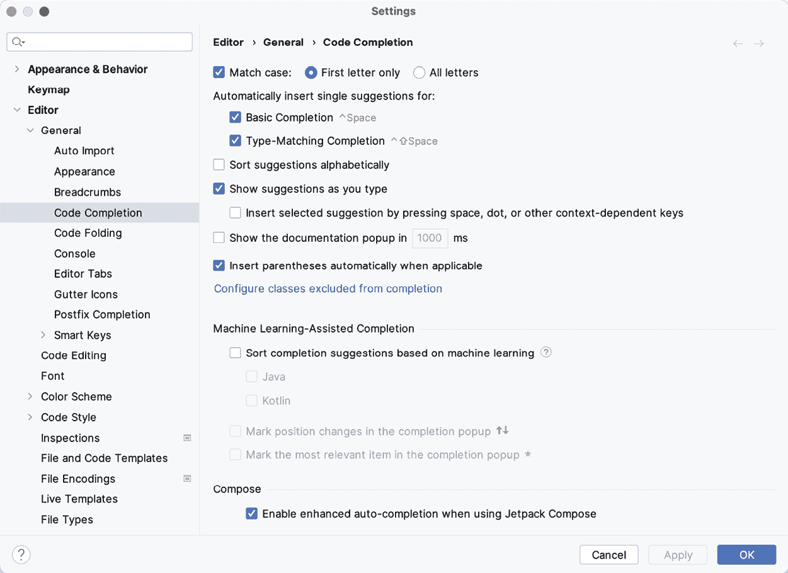

图 8-9

### 8.4 语句补全

Android Studio 编辑器提供的另一种自动补全形式是语句补全。它可以自动填充方法和循环语句等项的括号和大括号。语句补全使用`Shift-Ctrl-Enter`（macOS 上为`Shift-Cmd-Enter`）键盘组合键调用。考虑以下代码：

```java
myMethod()
```

在编辑器中输入此代码后，触发语句补全会导致编辑器自动为方法添加大括号：

```java
myMethod() {

}
```

### 8.5 参数信息

还可以请求编辑器提供关于方法接受的参数参数的信息。当光标置于方法调用括号之间时，`Ctrl-P`（macOS 上为`Cmd-P`）键盘组合键将显示该方法接受的参数，并将最可能的建议用**加粗**显示：


图 8-10

### 8.6 参数名提示

代码编辑器可以配置为在方法调用内部显示参数提示。例如，图 8-11 高亮了`Snackbar`类中`make()`和`setAction()`方法调用中的参数提示：


图 8-11

此模式的设置可以通过打开`Settings`对话框并导航到侧边栏的`Editor` -> `Inlay Hints` -> `Java`来配置。在结果屏幕上开启或关闭可选编程语言的`Parameter names`选项。调整提示设置请点击`Exclude list...`链接并进行任何调整。

### 8.7 代码生成

除了在输入时补全代码外，编辑器在某些条件下还可以为你生成代码。当光标位于文件中需要生成代码的位置时，可以使用`Alt-Insert`（macOS 上为`Cmd-N`）键盘快捷键访问图 8-12 中所示的可用代码生成选项列表。


图 8-12

例如，考虑一种情况：我们希望在项目中的`Activity`准备被操作系统销毁时收到通知。正如本书后后的章节所概述的那样，这可以通过重写`Activity`超类的`onStop()`生命周期方法来实现。若要让 Android Studio 为此生成一个存根方法，请从代码生成列表中选择`Override Methods…`选项，并从可用方法列表中选择`onStop()`方法：


图 8-13

选择要重写的方法后，点击`OK`将在 Java 源文件的当前光标位置生成该存根方法，如下：

```java
@Override
protected void onStop() {
    super.onStop();
}
```

### 8.8 代码折叠

一旦源代码达到一定大小，即使是格式最整齐、组织最好的代码也可能变得难以处理和难以导航。Android Studio 认为并不总是需要让每个代码块的内容可见。使用 Android Studio 编辑器的代码折叠功能可以让导航变得更容易。代码折叠通过鼠标指针悬停在源文件每个代码块开头的时出现的折叠箭头进行控制。例如，图 8-14 高亮了一个未折叠方法定义的折叠箭头：


图 8-14

点击此标记将折叠语句，使仅签名行可见，如图 8-15 所示：


图 8-15

要展开折叠的代码，请点击编辑器中的折叠箭头。若要在不展开的情况下查看隐藏代码，请将鼠标悬停在`{…}`指示上，如图 8-16 所示。编辑器随后显示包含折叠代码的覆盖层：

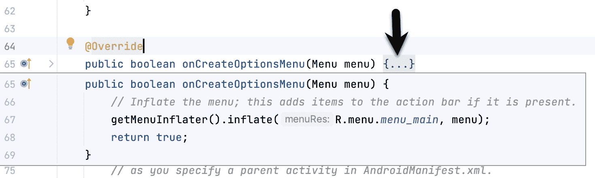

图 8-16

可以使用`Ctrl-Shift-Plus`和`Ctrl-Shift-Minus`键盘组合键折叠或展开文件中所有的代码块（macOS 为`Cmd-Shift-Plus`和`Cmd-Shift-Minus`）。

默认情况下，Android Studio 编辑器会在打开源文件时自动折叠某些代码。要配置发生这种情况的，请在`Settings`对话框中导航到`Editor` -> `General` -> `Code Folding`项（图 8-17）：

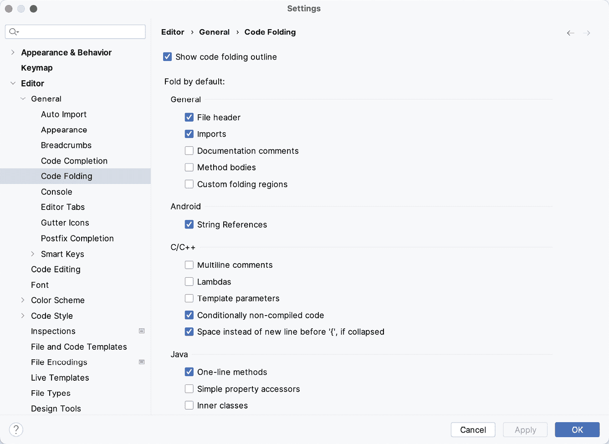

图 8-17

### 8.9 快速文档查询

通过将光标置于所需文档的声明上并按下`Ctrl-Q`快捷键（macOS 上为`Ctrl-J`），可以访问与上下文相关的 Java 和 Android 文档。这将显示一个包含该项相关参考文档的弹出窗口。例如，图 8-18 显示了 Android `FloatingActionButton`类的文档：

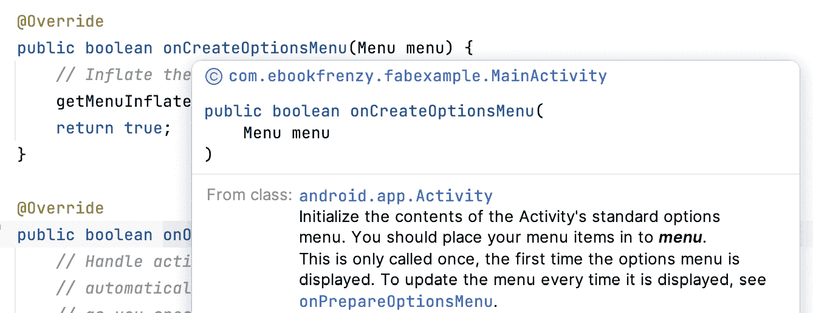

图 8-18

### 8.10 代码格式化

通常情况下，Android Studio 编辑器会在添加语句和代码块时，自动对缩进、间距和嵌套进行代码格式化。在需要重新格式化代码的情况下（这是很常见的情况，例如从网站复制并粘贴示例代码时），编辑器提供了源代码重格式功能，选择该功能后，它将自动重格式代码以匹配当前流行的代码风格。

按下`Ctrl-Alt-L`（macOS 上为`Cmd-Opt-L`）快捷键组合可以重格式源代码。要显示“重格式代码”对话框（图 8-19），请使用`Ctrl-Alt-Shift-L`（macOS 上为`Cmd-Opt-Shift-L`）。该对话框提供了仅重格式当前选中的代码、编辑器中活动的整个源文件或仅重格式由于源码控制更新而更改的代码选项：

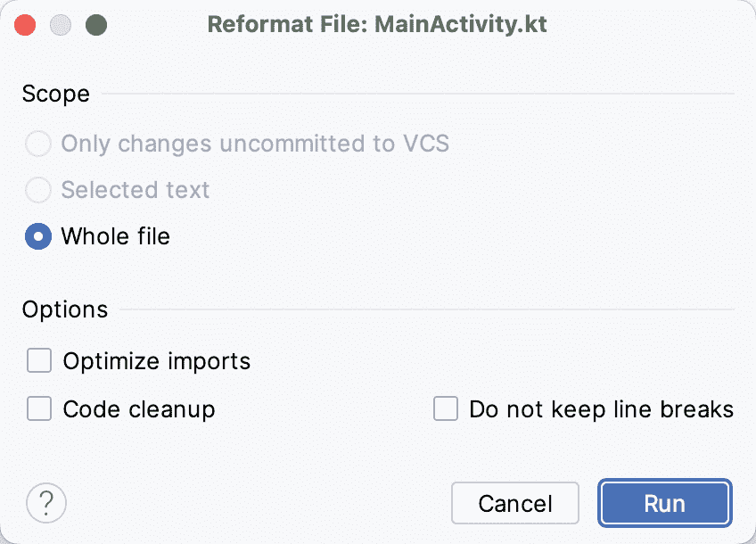

图 8-19


可以通过打开 `Settings`（设置）对话框并在侧边面板中选择 `Code Style`（代码样式）来更改完整的代码样式偏好，这将访问支持的编程语言和标记语言列表。选择一种语言将提供大量的格式样式选项，所有选项都可以从 Android Studio 默认值修改以匹配你偏好的代码风格。例如，要配置上述对话框中 `Rearrange`（重排）代码选项的设置，请展开 `Code Style` 部分，选择 `Java`，并在 `Java` 设置中选择 `Arrangement`（排列）选项卡。

### 8.11 查找示例代码

Android Studio 编辑器提供了访问与代码列表中高亮条目相关的示例代码的方法。这对于学习如何使用特定的 `Android` 类或方法非常有帮助。要查找示例代码，可以在编辑器中高亮方法或类名，右键点击它，并选择 `Find Sample Code`（查找示例代码）菜单选项。如果有示例代码，将出现 `Find Sample Code` 面并列出匹配的示例列表。从列表中选择一个示例会将相应的代码加载到右侧面板。

### 8.12 Live Templates（实时模板）

在编写 Android 代码时，你会发现有一些常用的常用结构。例如，一个常见的需求是使用 `Android Toast` 类向用户显示弹出消息。`Live Templates` 是常用代码结构的集合，可以通过输入初始字符后跟一个特殊键（默认设置为 `Tab` 键）向编辑器中插入模板代码。要体验这一操作，请在代码编辑器中输入 `toast` 后按 `Tab` 键，Android Studio 将在光标位置插入以下代码以供编辑：

```java
Toast.makeText("", "", Toast.LENGTH_SHORT).show();
```

要列出并编辑现有模板、更改特殊键或添加自己的模板，请打开 `Settings` 对话框，并在左侧导航面板的 `Editor` 部分选择 `Live Templates`：

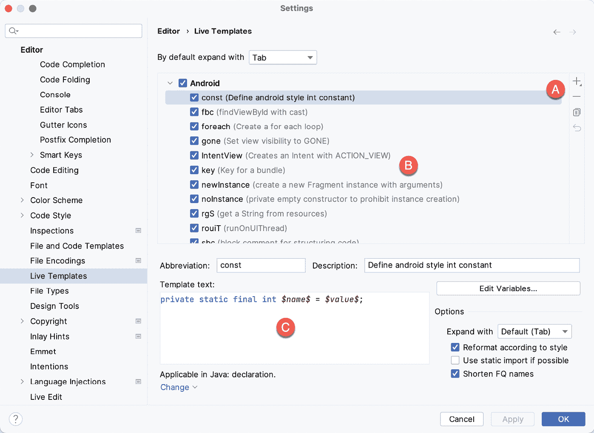

图 8-20

使用上方 图 8-20 中标记为 `A` 的按钮进行添加、删除、复制或重置模板。要修改模板，从列表中选择它 (B) 并更改标记为 `C` 的面板中的设置。

### 8.13 总结

Android Studio 编辑器尽力减少编写代码所需的打字量，并使代码更易阅读和导航。本章涵盖了关键编辑器功能，包括代码补全、代码生成、编辑器窗口拆分、代码折叠、重格式、文档查询和实时模板。

## 9. Android 架构概述

到目前为止，本书已经采取了步骤来建立适用于使用 Android Studio 开发 Android 应用的环境。通过创建 Android Studio 应用项目，也迈向了应用开发过程的第一步。

然而，在深入研究 Android 应用开发的实际问题之前，理解 `Android SDK` 以及通用的 Android 开发的一些更抽象的概念至关重要。现在清晰地理解这些概念将为构建进一步的知识提供坚实的基础。

本章从 Android 架构的概述开始，并在本书后的几章节中继续，目标是提供 Android 开发基础知识的详细概述。

## 9.1 Android 软件栈

Android 结构化为一个软件栈，由应用程序、操作系统、运行时环境、中间件、服务和库组成。这种架构可以通过视觉方式最好地表示，如 图 9-1 所示。栈的每一层以及每层中相应的元素都是紧密集成并经过调优的，为移动设备提供最佳的应用开发和执行环境。本章的其余部分将介绍 Android 栈的不同层，从底部的 `Linux Kernel` 开始。

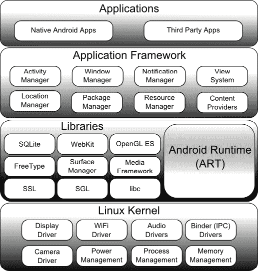

图 9-1

## 9.2 Linux 内核

`Linux Kernel` 位于 Android 软件栈的底部，在设备硬件和 Android 软件栈上层之间提供了抽象。内核提供了抢占式多任务处理、底层核心系统服务（如内存、进程和电源管理），以及针对显示器、WiFi 和音频等硬件的网络栈和设备驱动。

原始 Linux 内核是由 Linus Torvalds 在 1991 年开发的。它与 Richard Stallman 在自由软件基金会开发的一系列工具、实用程序和编译器结合起来，创建了一个名为 `GNU/Linux` 的完整操作系统。各种 Linux 发行版都是从这些基础衍生而来的，例如 `Ubuntu` 和 `Red Hat Enterprise Linux`。

然而，重要的是 Android 只使用了 `Linux 内核`。尽管如此，值得注意的是，Linux 内核最初是为桌面和服务器计算机系统设计的。事实上，Linux 现在在关键任务服务器环境中的部署最广泛。正是由于移动设备的强大以及 Linux 内核的效率和性能，我们发现这种软件位于 Android 软件栈的核心。

## 9.3 Android 运行时 – ART

当 Android 应用在 Android Studio 中构建时，它被编译为中间字节码格式（DEX 格式）。当应用随后加载到设备时，Android 运行时 (ART) 使用称为预前编译 (AOT) 的过程将字节码翻译为设备处理器所需的原生指令。这种格式被称为可执行可链接格式 (ELF)。

随后每次启动应用时都会运行 ELF 可执行版本，从而获得更快的性能并延长电池寿命。这与旧版 Android 中使用的即时编译 (JIT) 方法形成对比，后者在每次启动应用时在虚拟机 (VM) 中翻译字节码。

## 9.4 Android 库

除了标准的 Java 开发库（为字符串处理、网络和文件操作等通用任务提供支持）之外，Android 开发环境还包含 Android 库。这些是用于 Android 开发的 Java 库。此类类别的库包括应用框架库，以及促进用户界面构建、图形绘制和数据库访问的库。

Android 开发可以使用的一些核心 Android 库摘要如下：

- `android.app` – 提供对应用模型的访问，是所有 Android 应用的基石。

- `android.content` – 促进应用程序与应用程序组件之间内容的访问、发布和传递。

- `android.database` – 用于访问内容提供程序（content providers）发布的数据，包含 SQLite 数据库管理类。

- `android.graphics` – 一个低层 2D 图形绘制 API，包括颜色、点、过滤器、矩形和画布。

- `android.hardware` – 提供一个用于访问加速度计和光线传感器等硬件的 API。

- `android.opengl` – 用于访问 OpenGL ES 3D 图形渲染 API 的 Java 接口。

- `android.os` – 为应用程序提供标准操作系统服务的访问，包括消息、系统服务和进程间通信。

- `android.media` – 提供用于音频和视频播放的类。

- `android.net` – 一组提供网络栈访问的 API。包括 `android.net.wifi`，它提供了对设备无线网络栈的访问。

- `android.print` – 包含一组类，允许从 Android 内部将内容发送到已配置的打印机。

- `android.provider` – 一组便利类，提供对标准的 Android 内容提供程序数据库的访问，例如由日和联系人应用维护的数据库。

- `android.text` – 用于在设备显示上渲染和操作文本。

- `android.util` – 一组工具类，用于执行字符串和数字转换、XML 处理以及日期处理等任务。

- `android.view` – 应用程序用户界面的基础构建模块。

- `android.widget` - 丰富的预构建用户界面组件集合，如按钮、标签、列表视图、布局管理器、单选按钮等。

- `android.webkit` – 一组旨在允许在应用程序中构建网络浏览访问能力的类。

在涵盖了 Android 运行时基于 Java 的库之后，现在是时候让我们关注 Android 软件栈这一层中基于 C/C++ 的库了。

#### 9.4.1 C/C++ 库

前一节概述的 Android 运行时核心库是基于 Java 的，为 Android 开发者提供了主要的 API。然而，需要注意的是，这些核心库并没有执行大部分实际工作，事实上，它们本质上是对一组 C/C++ 库的 Java "包装器"（wrappers）。例如，当调用 `android.opengl` 库在设备显示屏上绘制 3D 图形时，该库最终会调用 OpenGL ES C++ 库，而该库又与底层 Linux 内核协作执行绘制任务。

包含 C/C++ 库是为了满足广泛且多样的功能，包括 2D 和 3D 图形绘制、安全套接层 (SSL) 通信、SQLite 数据库管理、音频视频播放、位图和矢量字体渲染、显示子系统和图形层管理以及标准 C 系统库 (`libc`) 的实现。

在实践中，典型的 Android 开发者将仅通过 Java 的 Android 核心库 API 访问这些库。如果需要直接访问这些库，可以使用 Android Native 开发包 (`NDK`) 实现，其目的是通过 Java Native Interface (`JNI`) 在 Java 代码中调用非 Java 或 Kotlin 编程语言（如 C 和 C++）的原生方法。

## 9.5 框架

应用程序框架是一组服务，共同构成了 Android 应用程序运行和管理的环境。该框架实现了这样一个概念：Android 应用程序是由复用、可交换和可替换的组件构建的。这一概念更进一步，应用程序还可以发布其功能以及任何相关数据，以便其他应用程序可以发现并复用它们。

Android 框架包含以下关键服务：

- Activity 管理器（Activity Manager） – 控制应用程序生命周期和 Activity 栈的所有方面。

- 内容提供程序（Content Providers） – 允许应用程序与其他应用程序共享数据。

- 资源管理器（Resource Manager） – 提供非代码嵌入资源的访问，如字符串、颜色设置和用户界面布局。

- 通知管理器（Notifications Manager） – 允许应用程序向用户显示警告和通知。

- 视图系统（View System） – 用于创建应用程序用户界面的扩展视图集。

- 包管理器（Package Manager） – 查找设备上已安装的其他应用程序信息的系统。

- 电话管理器（Telephony Manager） – 为应用程序提供设备可用电话服务的信息，例如状态和订阅者信息。

- 位置管理器（Location Manager） – 提供位置服务的访问，允许应用程序接收位置变化的更新。

## 9.6 应用程序

应用程序位于 Android 软件栈的顶部。它们由特定的 Android 实现提供的原生应用程序（例如网络浏览器和电子邮件应用）以及用户在购买设备后安装的第三方应用程序组成。

## 9.7 总结

良好的 Android 开发基础需要理解 Android 的整体架构。Android 被实现为一种软件栈架构，由 Linux 内核、运行时环境、相应的库、应用程序框架和一组应用程序组成。应用程序主要用 Java 或 Kotlin 编写，并在 Android Studio 构建环境中被编译为字节码格式。当应用程序随后安装到设备上时，这些字节码会由 Android 运行时 (`ART`) 编译为 CPU 使用的原生格式。Android 架构的关键目标是性能和效率，既体现在应用程序执行中，也体现在应用程序设计的复用中。

## 10. Android 应用程序剖析

无论你之前的编程经验是基于 Windows、macOS、Linux 甚至 iOS 的，Android 开发很有可能与你以前遇到的任何事物都大不相同。

因此，本章的目标是帮助你理解 Android 应用程序架构背后的高级概念。通过这种方式，我们将详细探索用于构建应用程序的各种组件，以及允许这些组件协同工作以创建一个统一应用程序的机制。

### 10.1 Android Activity

熟悉 Java、Kotlin、C++ 或 C# 等面向对象语言的人会熟悉这种概念：将应用程序功能的元素封装在类中，然后将其实例化为对象并进行操作以创建应用程序。对于使用 Java 和 Kotlin 编写的 Android 应用程序来说，事实依然如此。然而，Android 将组件组件的概念推向了更高的层次。

Android 应用程序是由一个或多个称为 Activity 的组件创建的。Activity 是一个独立的应用程序功能模块，通常直接对应于单个用户界面屏幕及其相应的功能。例如，一个预约应用程序可能有一个显示当天预约的 Activity 屏幕。该应用程序还可能使用另一个 Activity，它由一个用户可以输入新预约的屏幕组成。

Activity（活动）被设计为完全可重用且可交换的区块，可以在不同的应用程序之间共享。现有的电子邮件应用程序可能包含一个用于编写和发送电子邮件消息的 Activity。开发者可能正在编写一个也需要发送电子邮件消息的应用程序。开发者无需为新应用程序专门开发一个邮件编写 Activity，而是可以直接使用现有电子邮件应用程序中的 Activity。

Activity 是作为 `Android Activity` 类的子类创建的，并且必须实现为完全独立于应用程序中的其他 Activity。换句话说，共享的 Activity 不能依赖于在程序流的已知某一点被调用（因为其他应用程序可能会以意想不到的方式使用该 Activity），而且一个 Activity 不能直接调用另一个 Activity 的方法或访问其实例数据。相反，这通过 `Intents`（意图）和 `Content Providers`（内容提供者）来实现。

默认情况下，Activity 不能向调用它的 Activity 返回结果。如果需要此功能，则必须显式地作为源 Activity 的子 Activity 启动该 Activity。

## 10.2 Android Fragments（片段）

如上所述，一个 Activity 通常代表应用内部的单个用户界面屏幕。一种方案是使用单个用户界面布局和一个对应的 Activity 类文件来构建 Activity。然而，更好的替代方案是将 Activity 拆分为不同的部分。每个部分都是一个 Fragment（片段），由用户界面布局的一部分和一个匹配的类文件（声明为 `Android Fragment` 类的子类）组成。在这种情况下，Activity 变成一个容器，可以在其中嵌入一个或多个 Fragment。

Fragment 提供了一种高效的替代方案，无需为每个用户界面屏幕都表示一个独立的 Activity。相反，应用可以拥有一个 Activity，在不同的片段之间切换，每个片段代表不同的应用屏幕。

## 10.3 Android Intents（Android 意图）

`Intents` 是一个 Activity 启动另一个 Activity 并实现组成应用程序的 Activity 执行流的机制。`Intents` 由一个对要执行的操作的描述以及可选的要在其上执行的数据组成。

`Intents` 可以是显式的（explicit），即通过类名引用 Activity 来请求启动特定的 Activity；也可以是隐式的（implicit），即通过陈明要执行的操作类型或提供要在其上执行操作的特定类型的数据。在隐式意图的情况下，Android 运行时将使用称为 `Intent Resolution`（意图解析）的过程，选择最符合 `Intent` 所述标准的 Activity 进行启动。

## 10.4 Broadcast Intents（广播意图）

另一种 `Intent` 类型是 `Broadcast Intent`（广播意图），它是向所有注册了"感兴趣"`Broadcast Receiver`（广播接收器）的应用程序发送的系统级意图。例如，Android 系统通常发送 `Broadcast Intents` 来指示设备状态的变化，例如系统启动完成、外部电源连接到设备或屏幕开启关闭。

`Broadcast Intent` 可以是正式的（异步的），即它在大约相同的时间发送给所有感兴趣的 `Broadcast Receiver`；也可以是有序的，即它一次发送给一个接收器，由接收器进行处理，然后要么终止，要么允许传递给下一个 `Broadcast Receiver`。

## 10.5 Broadcast Receivers（广播接收器）

`Broadcast Receivers` 是应用程序响应 `Broadcast Intents` 的机制。`Broadcast Receiver` 必须由应用程序注册并配置 `Intent Filter`（意图过滤器），以指示其感兴趣的广播类型。当广播一个匹配的意图时，无论注册该接收器的应用程序当前是否正在运行，Android 运行时都会调用该接收器。接收器随后有 5 秒钟来完成所需的任务（例如启动 `Service`、更新数据或向用户发出通知），然后返回。`Broadcast Receivers` 在后台运行，没有用户界面。

## 10.6 Android Services（Android 服务）

`Android Services` 是在后台运行且没有用户界面的进程。它们可以从 Activity、`Broadcast Receivers` 或其他 `Services` 启动和管理。`Android Services` 适用于应用程序需要继续执行任务但不一定需要用户可见用户界面的情况。虽然 `Services` 缺乏用户界面，但它们仍然可以使用通知和 Toasts（在屏幕上显示且不中断当前可见 Activity 的小型通知消息）来通知用户事件，并且能够发出 `Intents`。

Android 运行时赋予 `Services` 高于许多其他进程的优先级，系统只在最后情况下才会将其终止以释放资源。然而，如果运行时需要杀死一个 `Service`，它将在一旦可用资源时自动重启。`Service` 可以通过声明自己为需要在前台运行来降低被终止的风险。这是通过调用 `startForeground()` 实现的。这仅建议用于终止会对用户体验不利的情况（例如，如果用户正在听由 `Service` 流出的音频）。


`Service` 可能作为实际解决方案的示例场景包括：如之前提到的，当应用程序不再处于活动状态时应继续播放的音频流，或者当股票达到指定价格时需要通知用户的股票跟踪应用程序。

## 10.7 Content Providers（内容提供者）

`Content Providers` 实现了一种在应用程序之间共享数据的机制。任何应用程序都可以通过实现 `Content Provider` 为其他应用程序提供访问其底层数据的权限，包括添加、删除和查询数据的能力（取决于权限）。对数据的访问通过由 `Content Provider` 定义的通用资源标识符（`URI`）提供。数据可以以文件或整个 `SQLite database` 的形式共享。

原生 Android 应用包含几个标准的 `Content Providers`，允许应用程序访问联系人和媒体文件等数据。Android 系统上当前可用的 `Content Providers` 可以使用 `Content Resolver`（内容解析器）定位。

## 10.8 Application Manifest（应用清单）

`Application Manifest` 文件是将应用程序的各种元素整合在一起的胶水。在这个基于 XML 的文件中，应用程序概述了组成完整应用程序的活动、服务、广播接收器、数据提供者和权限。

## 10.9 Application Resources（应用资源）

除了清单文件和包含字节码的 `Dex` 文件外，Android 应用程序包通常包含一组资源文件。这些文件包含显示用户界面的字符串、图像、字体和颜色，以及用户界面布局的 XML 表示。这些文件默认存储在应用程序项目层次结构的`/res`子目录下。

## 10.10 Application Context（应用上下文）

当应用程序编译时，会创建一个名为 `R` 的类，包含应用资源的引用。应用清单文件和这些资源创建了所谓的 `Application Context`。该上下文由 `Android Context` 类表示，可以在应用程序代码中使用并在运行时访问应用资源。此外，可以在上下文上调用广泛的方法来获取信息并在运行时更改应用程序的环境。

## 10.11 Summary（总结）

可以将许多不同的元素组合在一起创建一个 Android 应用程序。在本章中，我们提供了 `Activities`、`Fragments`、`Services`、`Intents` 和 `Broadcast Receivers` 的高级概述，以及对清单文件（manifest file）和应用资源的概述。

通过以活动和意图的形式创建独立的独立功能模块，可以最大限度地提高重用性和互操作性，同时通过实现`content providers`来实现应用之间的数据共享。

虽然 `activities` 专注于用户与应用程序交互的区域（一个活动本质等同于单个用户界面屏幕，通常由一个或多个 `fragments` 组成），但后台处理通常由 `Services` 和 `Broadcast Receivers` 处理。

构成应用程序的组件在清单文件中为 Android 运行时系统列出，该文件结合应用资源共同代表了应用程序的 `context`。

本章涵盖了许多对普通开发者来说可能是新的内容。不过，请放心，在随后的章节中将对这些概念进行深入的探索和实际应用，以确保为构建自己的应用程序打下坚实的知识基础。

## 11. Android View Binding 概述

开发 Android 应用的一个重要部分涉及代码与构成用户界面布局的视图之间的交互。本章将介绍在代码中访问布局视图的选项，重点强调名为 `view binding` 的选项。在涵盖了 view binding 的基础之后，本章将概述如何将 `AndroidSample` 项目转换为使用这种方法。

## 11.1 通过 Id 查找视图

正如“Android 应用程序剖析”章节中所述，构成应用程序的所有资源都被编译成一个名为 `R` 的类。在这些资源中包含了定义布局的资源。`R` 类中有一个名为 `layout` 的子类，它包含了布局资源，包括构成用户界面的视图。大多数应用都需要实现代码与这些视图之间的交互，例如，当读取输入到 `EditText` 视图中的值或更改在 `TextView` 上显示的内容时。

在 Android Studio 3.6 引入之前，从应用代码内部访问视图的最常用选项是编写代码通过 `findViewById()` 方法根据 id 手动查找视图。例如：

```java
TextView exampleView = findViewById(R.id.exampleView);
```

获取引用后，就可以访问视图的属性了。例如：

```java
exampleView.setText("Hello");
```

虽然通过 id 查找视图仍然是一个可行选项，但它具有一些局限性，`findViewById()` 最显著的缺点是可能会获取到一个尚未在布局中创建的视图引用，导致在尝试访问视图属性时出现空指针异常。

从 Android Studio 3.6 开始，已经有了以 `view binding` 形式提供的另一种从应用代码访问视图的替代方法。

## 11.2 View Binding

当应用模块中启用 `view binding` 时，Android Studio 会为每个布局文件自动生成一个绑定类（binding class）。在代码内部可以使用此绑定类访问布局视图，而无需使用 `findViewById()`。

Android Studio 生成的绑定类名称基于布局文件名转换为所谓的“驼峰命名法”，并在结尾附加“Binding”单词。例如，对于 `activity_main.xml` 文件，绑定类将被称为 `ActivityMainBinding`。

Android Studio Hedgehog 在项目模板中使用 view bindings 的做法并不一致。例如，我们在创建 `AndroidSample` 项目时使用的 Empty Views Activity 模板没有使用 view bindings。另一方面，Basic Views Activity 模板是使用 `view binding` 实现的。如果你使用不使用 `view binding` 的模板，了解如何将其添加到你的项目中将非常重要。

## 11.3 转换 AndroidSample 项目

在本章的剩余部分中，我们将通过将 `AndroidSample` 项目转换为使用 view binding 代替 `findViewById()` 来练习迁移到 view bindings。

首先启动 Android Studio 并打开在在 Android Studio 中创建示例 Android 应用章节中创建的 `AndroidSample` 项目。

## 11.4 启用 View Binding

要使用 `view binding`，必须对需要 view binding 的每个模块的 `build.gradle.kts` 文件进行更改。对于 `AndroidSample` 项目，这将对 Gradle Scripts -> `build.gradle.kts (Module: app)` 文件进行微调。将此文件加载到编辑器，找到 `android` 部分并添加以下项以启用 `viewBinding` 属性：

```kotlin
plugins {
    id("com.android.application")
}

android {
    buildFeatures {
        viewBinding = true
    }
}
```

完成此更改后，点击编辑器面板顶部的 `Sync Now` 链接，然后使用 Build 菜单清理并重新构建项目，以确保生成绑定类。下一步是在代码中使用绑定类。

## 11.5 使用 View Binding

此过程的第一步是“膨胀”（inflate）view binding 类以访问布局内的根视图。该根视图将用作布局的内容视图。

执行这些任务的逻辑位置是在与布局相关的活动的 `onCreate()` 方法中。一个典型的 `onCreate()` 方法读取如下：

```java
@Override
protected void onCreate(Bundle savedInstanceState) {
    super.onCreate(savedInstanceState);
    setContentView(R.layout.activity_main);
}
```

要切换到使用 view binding，需要导入视图绑定类并如下所示修改类。注意，由于布局名为 `activity_main`，我们可以推断 Android Studio 生成的绑定类将是 `ActivityMainBinding`。注意如果在创建项目时使用了 `com.example` 以外的域名，下面的导入语句需要更改：

```java
import android.widget.EditText;
import android.widget.TextView;
import com.example.androidsample.databinding.ActivityMainBinding;

public class MainActivity extends AppCompatActivity {
    private ActivityMainBinding binding;

    @Override
    protected void onCreate(Bundle savedInstanceState) {
        super.onCreate(savedInstanceState);
        setContentView(R.layout.activity_main);
        binding = ActivityMainBinding.inflate(getLayoutInflater());
        View view = binding.getRoot();
        setContentView(view);
    }

    // 现在我们有了绑定的引用，可以按名称访问视图：
    public void convertCurrency(View view) {
        EditText dollarText = findViewById(R.id.dollarText);
        TextView textView = findViewById(R.id.textView);
        if (!binding.dollarText.getText().toString().equals("")) {
            Float dollarValue = Float.valueOf(binding.dollarText.getText().toString());
            Float euroValue = dollarValue * 0.85F;
            binding.textView.setText(String.format(Locale.ENGLISH,"%.2f", euroValue));
        } else {
            binding.textView.setText(R.string.no_value_string);
        }
    }
}
```

## 11.6 选择选项

尽管在 Empty Views Activity 项目模板中没有采用 view bindings，Google 强烈建议尽可能使用 view binding。因此，在开发自己的项目时应使用 view binding。

## 11.7 书中示例中的 View Binding

本书中任何依赖未实现视图绑定（view binding）项目模板的章节都将首先进行迁移。然而，为了避免在每次需要迁移时都重复这些步骤，这些章节将引导你回到此处复习记忆（别担心，在过了几个章节之后，必要的更改将变成你的本能）。为了帮助这一过程，接下来的部分更简要地总结了迁移步骤。

## 11.8 将项目迁移到视图绑定

将项目模块转换为使用视图绑定的过程涉及以下步骤：

1. 在 Project 工具窗口中找到列出的模块级 Gradle 构建脚本文件，路径为 `Gradle Scripts -> build.gradle.kts (Module :app)`，其中 `<project name>` 是项目名称（例如 `AndroidSample`）。

2. 找到文件中的 `android` 部分，并添加如下条目以启用 `viewBinding` 属性：

```kotlin
android {
    buildFeatures {
        viewBinding = true
    }
}
```

3. 点击编辑器顶部的 `Sync Now` 链接，使用这些新的构建设置重新同步项目。

4. 编辑 `MainActivity.java` 文件并将其修改为如下内容（其中 `<reverse domain>` 代表创建项目时使用的域名，`<project name>` 替换为项目的小写名称，例如 `androidsample`），`<binding name>` 是对应布局资源文件的绑定类名称（例如，`activity_main.xml` 的绑定为 `ActivityMainBinding`）。

```java
import android.view.View;
import android.<reverse domain>.<project name>.databinding.<binding name>;

public class MainActivity extends AppCompatActivity {
    private <binding name> binding;

    @Override
    protected void onCreate(Bundle savedInstanceState) {
        super.onCreate(savedInstanceState);
        setContentView(R.layout.activity_main);
        binding = <binding name>.inflate(getLayoutInflater());
        View view = binding.getRoot();
        setContentView(view);
    }
}
```

5. 通过 `binding` 对象的属性名称访问视图。

## 11.9 总结

在 Android Studio 3.6 引入之前，在 App 代码中访问布局视图需要使用 `findViewById()` 方法。现在有了可用视图绑定这种形式的替代方案。视图绑定由 Android Studio 为每个 XML 布局文件自动生成的类组成。这些类包含了对对应布局中每个视图的绑定，提供了比 `findViewById()` 方法更安全的选项。然而，从 Android Studio Hedgehog 版本开始，某些项目模板默认未启用视图绑定。需要额外的步骤来手动在每个项目模块中启用并配置支持。

## 12 理解 Android 应用程序和 Activity 生命周期

在早的章节中，我们学习了 Android 应用程序运行在进程中，并以 Activity、Service 和广播接收器的形式组成多个组件。本章旨在通过查看 Android 运行时系统内应用程序和 Activity 的生命周期来扩展这些知识。

无论当今移动设备与过去的桌面系统相比拥有多少内存和计算能力并被如何宣扬，但重要的是记住，根据现代桌面和笔记本电脑系统的标准，这些设备仍然被认为是“资源受限的”，特别是在内存方面。因此，Android 系统的核心职责之一是确保有效管理这些有限资源，并确保操作系统和运行其上的应用程序始终对用户保持响应。为了实现这一点，Android 对运行应用程序的进程以及组成这些应用程序的各个组件的生命周期和状态拥有完全控制权。因此，开发 Android 应用的重要因素是理解 Android 的应用程序和 Activity 生命周期管理模型，以及应用程序如何响应在其执行生命周期内可能对其施加的状态变化。

### 12.1 Android 应用程序与资源管理

操作系统将每个运行的 Android 应用程序视为独立的进程。如果系统识别到设备上的资源达到容量，它将采取措施终止进程以释放内存。

在决定终止哪个进程以释放内存时，系统会同时考虑所有当前运行进程的优先级和状态，结合这些因素创建 Google 所说的“重要性层次结构”（importance hierarchy）。然后进程会被终止，从最低优先级开始按层次向上移动，直到为系统释放了足够的资源。

### 12.2 Android 进程状态

进程托管应用程序，应用程序由组件组成。在 Android 系统中，进程的当前状态由其所托管应用程序中排名最高的活动组件定义。如图 12-1 所示，进程在任何时刻都可以处于以下五种状态之一：


图 12-1

#### 12.2.1 前台进程

这些进程被赋予最高优先级。在任何时刻，活跃的前台进程可能只有一个或两个，它们通常是系统最后终止的。一个进程必须满足以下一个或多个标准才能获得前台状态资格：

* 托管一个用户当前正在交互的 Activity。

* 托管一个与用户正在交互的 Activity 连接的 Service。

* 托管一个通过调用 `startForeground()` 指明终止将破坏用户体验的 Service。

* 托管一个正在执行 `onCreate()`、`onResume()` 或 `onStart()` 回调的 Service。

* 托管一个正在执行其 `onReceive()` 方法的广播接收器（Broadcast Receiver）。

#### 12.2.2 可见进程


包含对用户可见但不是用户正在交互的 Activity 的进程被归类为“可见进程”。这通常发生在进程中的某个 Activity 对用户可见，但另一个 Activity（如部分屏幕或对话框）处于前台时。如果一个进程托管的 Service 本身绑定到一个可见或前台 Activity，那么该进程也具备可见状态的资格。

#### 12.2.3 Service 进程

包含已启动并正在执行的 Service 的进程。

#### 12.2.4 后台进程

包含一个或多个当前对用户不可见的 Activity，且未托管符合 Service 进程状态的 Service 的进程。落入此类别的进程如果需要为高优先级进程释放额外内存，则面临极高的终止风险。Android 维护着后台进程动态列表，按时间顺序终止进程，使得最久处于前台的进程首先被杀死。

#### 12.2.5 空进程

空进程不再包含活动应用程序，并保留在内存中，准备好作为新启动应用程序的宿主。这比在预计乘客到达时保持车门开启并引擎运转更合理。此类进程被认为优先级最低，是释放资源时最先杀死的。

### 12.3 进程间依赖关系

确定最高优先级进程比前一节描述的要复杂，因为进程之间往往存在相互依赖关系。因此，在确定进程的优先级时，Android 系统还会考虑该进程是否以某种方式为另一个高优先级进程提供服务（例如作为前台进程的内容提供者的服务进程）。根据基本规则，Android 文档指出，进程的排名永远不会低于它当前正在服务的另一个进程。

### 12.4 Activity 生命周期

正如我们之前所确定的，Android 进程的状态主要由其宿主应用程序的 Activity 和组件的状态决定。因此，重要的一点是，这些 Activity 在应用程序的执行生命周期内也会经历不同的状态。Activity 的当前状态部分取决于它在所谓的 `Activity Stack`（Activity 栈）中的位置。

### 12.5 Activity 栈

运行时系统为运行在 Android 设备上的每个应用程序都维护一个 `Activity Stack`。当应用程序启动时，首先启动的应用程序中的 Activity 会被放入栈中。当启动第二个 Activity 时，它被放置在栈顶，而上一个 Activity 则被向下推。栈顶的 Activity 被称为活跃（或运行中）Activity。

当活跃 Activity 退出时，运行时会将其从栈中弹出，位于栈中紧邻下方的 Activity 变为当前活跃 Activity。例如，栈顶的 Activity 退出可能是因为它负责的任务已经完成了。或者，用户可能选择了屏幕上的“返回”按钮以回到上一个 Activity，导致当前 Activity 被运行时系统从栈中弹出并销毁。Android `Activity Stack` 的视觉化表示见图 12-2。

如图所示，新的 Activity 在启动时会被推入栈顶。当前活跃 Activity 一直位于栈顶，直到它被新的 Activity 推入栈下方，或者在它退出或用户导航到上一个 Activity 时被从栈中弹出。如果资源变得紧张，运行时将杀死 Activity，从栈底的 Activity 开始。

`Activity Stack` 就是编程术语中所指的“后进先出”（LIFO）栈，因为最后一个推入栈的项是第一个被弹出的。


图 12-2

## 12.6 Activity 状态

在应用程序的执行过程中，Activity 可以处于以下几种状态之一：

- 活跃 / 运行中（Active / Running）– Activity 位于 `Activity Stack` 栈顶，是设备屏幕上可见的前台任务，拥有焦点，并且正在与用户交互。在资源不足的情况下，这种 Activity 最不容易被终止。

- 已暂停（Paused）– Activity 对用户可见，但目前没有焦点（通常是因为当前活跃的 Activity 部分遮挡了该 Activity）。暂停的 Activity 保留在内存中，保持与窗口管理器连接，保留所有状态信息，并在移动到 `Activity Stack` 栈顶时可以快速恢复到活跃状态。

- 已停止（Stopped）– Activity 当前对用户不可见（换句话说，它在设备显示上被其他 Activity 遮挡）。与暂停的 Activity 一样，它保留所有的状态和成员信息，但在低内存情况下终止风险更高。

- 已杀死（Killed）– 运行时系统已终止该 Activity 以释放内存，它不再存在于 `Activity Stack` 中。如果应用程序需要，则必须重启此类 Activity。

## 12.7 配置更改

到本章为止，我们已经了解了 Android Activity 状态变化的两种原因，即 Activity 在前台和后台之间的移动，以及运行时系统终止 Activity 以释放内存。事实上，还有第三种情况会导致 Activity 的状态发生剧变，即涉及设备配置的更改。

默认情况下，任何影响 Activity 外观的配置更改（例如在竖屏和横屏之间旋转设备或更改系统字体设置）都会导致 Activity 被销毁并重建。这背后的原因是此类更改会影响用户界面布局等资源，而销毁并重建受影响的 Activity 是 Activity 响应配置更改的最快方式。然而，也可以配置 Activity，使系统不会响应特定的配置更改而重启它。

## 12.8 处理状态变化

从本章可以清楚地看出，应用程序以及根据定义包含在其中的组件在其整个生命周期内将经历许多状态的转换。尤为重要的事实是，这些状态变化（包括完全终止在内）是 Android 运行时根据用户操作和设备资源的可用性强加给应用程序的。

但在实践中，这些状态变化并非在完全没有通知的情况下强加的，在大多数情况下，应用程序将收到运行时系统关于更改的通知，并获得相应反应的机会。这通常涉及保存或恢复内部数据结构和用户界面状态，从而允许用户在应用程序之间无缝切换，并至少提供多个应用程序并发运行的假象。

Android 提供了两种处理应用内对象生命周期状态变化的方法。一种涉及响应操作系统的状态更改方法调用，将在下一章“处理 Android Activity 状态更改”中详细介绍。

Google 推荐的这种方法涉及 Jetpack Android 架构组件包含的生命周期类，这些组件在“使用 Jetpack 构建现代 Android 架构”中介绍，并在名为“使用 Android 生命周期感知组件”的章节中进行更详细的解释。

### 12.9 总结

移动设备通常被认为资源受限，特别是在内置内存容量方面。因此，Android 操作系统的首要任务之一是确保应用程序以及整个操作系统保持响应。

应用程序托管在 Android 的进程中。每个应用程序又由 Activity 和 Service 形式的组件组成。

# 13. 处理 Android Activity 状态更改

根据“理解 Android 应用程序和 Activity 生命周期”章节中概述的信息，现在显而易见，组成应用程序的 Activity 和 Fragment 在应用程序生命周期内会经历各种不同的状态。Android 运行时系统强制从一个状态到另一个状态的转换，因此在很大程度上不受 Activity 自身的控制。然而，这并不意味着应用无法对这些变化做出反应并采取适当行动。

本章的主要目标是概述 Activity 如何接收状态更改的通知，并概述建议保存或恢复状态信息的区域。在涵盖这些信息后，本书将简要介绍 Activity 的生命周期。

## 13.1 新旧生命周期技术

直到最近，一直有一种在应用中构建生命周期感知的标准方法。这种方法在本章中介绍，涉及在 Activity 或 Fragment 实例中实现一组方法（每个生命周期状态对应一个），操作系统当这些对象的生命周期状态发生时会调用这些方法。这种方法自 Android 操作系统早期以来一直没有变化，虽然在今天仍然是一个可行选项，但它确实存在一些局限性，我们将在本书的稍后部分解释。

随着 Jetpack Android 架构组件引入了生命周期类，现在有了更好的生命周期处理方法。这种现代的生命周期管理方法（结合 Jetpack 组件和架构指南）将在后面的章节中进行详细介绍。然而，由于几个原因，理解传统的生命周期方法仍然至关重要。

首先，作为 Android 开发人员，你无法完全隔离开传统的生命周期方法，并且仍然会使用其中。更重要的是，理解处理生命周期的旧方法将为以后书中学习新方法提供坚实的基础。

## 13.2 Activity 和 Fragment 类

在少数例外情况下，应用程序的 Activity 和 Fragment 分别作为 Android `AppCompatActivity` 类和 `Fragment` 类的子类创建。

例如，考虑在 Android Studio 中创建示例 Android 应用并转换为视图绑定（view binding）的 `AndroidSample` 项目。将此项目加载到 Android Studio 环境中并找到 `MainActivity.java` 文件（位于 `app -> java -> <your domain> -> androidsample`）。找到文件后，双击将其加载到编辑器中，其内容如下：

```java
package com.example.androidsample;

import androidx.appcompat.app.AppCompatActivity;

import android.view.View;

import android.os.Bundle;

import java.util.Locale;

import com.example.androidsample.databinding.ActivityMainBinding;

public class MainActivity extends AppCompatActivity {

    private ActivityMainBinding binding;

    @Override
    protected void onCreate(Bundle savedInstanceState) {
        super.onCreate(savedInstanceState);
        binding = ActivityMainBinding.inflate(getLayoutInflater());
        View view = binding.getRoot();
        setContentView(view);
    }

    public void convertCurrency(View view) {
        if (!binding.dollarText.getText().toString().equals("")) {
            float dollarValue = Float.parseFloat(
                    binding.dollarText.getText().toString());
            float euroValue = dollarValue * 0.85F;
            binding.textView.setText(
                    String.format(Locale.ENGLISH,"%.2f", euroValue));
        } else {
            binding.textView.setText(R.string.no_value_string);
        }
    }
}
```

在创建项目时，我们指示 Android Studio 同时也创建一个名为 `MainActivity.java` 的初始 Activity。如上面的代码所示，`MainActivity` 类是 `AppCompatActivity` 类的子类。

查看 `AppCompatActivity` 类的参考文档会发现它本身也是 `Activity` 类的子类。在 Android Studio 编辑器中使用层次结构（Hierarchy）工具窗口可以验证这一点。将 `MainActivity.java` 文件加载到编辑器中后，点击类声明行中的 `AppCompatActivity` 并按下键盘快捷键 `Ctrl-H`。随后将出现层次结构工具窗口，显示所选类的类层次结构。如图 13-1 所示，`AppCompatActivity` 是继承自 `Activity` 类的子类：


图 13-1

Activity 和 Fragment 类包含一系列方法，旨在由 Android 运行时调用，以便在对象状态更改时通知该对象。在本章中，我们将这些方法称为生命周期方法。其中一个方法命名为 `onCreate()`。再次回到上面的代码，我们可以看到此方法已经被重写。

## 13.3 动态状态 vs. 持久化状态

生命周期管理的关键目标是确保 Activity 的状态在适当的时间被保存和恢复。当我们在此语境下讨论状态时，指的是 Activity 当前持有的数据以及用户界面的显示。例如，Activity 可能会在内存中维护一个数据模型，该模型需要保存到数据库、内容提供程序或文件。因为它从应用程序的一次调用持续到另一次调用，因此这种状态信息被称为持久化状态（persistent state）。

用户界面的显示（例如输入到字段但尚未提交到应用程序数据模型的文本）被称为动态状态（dynamic state），因为它通常只在应用程序的单次调用期间保留（也称为界面状态或实例状态）。

理解这两种状态之间的差异非常重要，因为它们保存的方式以及保存的原因有所不同。保存持久化状态的目的是避免 Activity 在后台被杀死而导致的数据丢失。另一方面，动态状态的保存和恢复的原因略为复杂。

例如，假设一个应用程序包含一个 Activity（我们称为 Activity A），该 Activity 包含一个文本框和一些单选按钮。在使用程序期间，用户在文本框中输入了一些文本并在单选按钮上做了选择。然而，在执行这些更改的操作之前，用户切换到了另一个 Activity，导致 Activity A 被推入 Activity 栈并置于后台。

一段时间后，运行时系统确定内存不足并杀死 Activity A 以释放资源。然而，从用户的角度来看，Activity A 被放在了后台，并且可以随时移动到前台。当返回 Activity A 到前台时，用户会合理预期输入的文本和单选按钮的选择已被保留。然而，在这种情况下，将创建一个 Activity A 的新实例，如果动态状态没有被保存和恢复，之前的用户输入将会丢失。

因此，保存动态状态的主要目的是为了提供前台和后台活动之间无缝切换的感知，无论活动是否可能在用户不知情的情况下被杀死并重启。

保存持久化状态和动态状态的机制在本章的后续章节中将变得更加清晰。

## 13.4 Android 生命周期方法

如前所述，`Activity` 和 `Fragment` 类包含几个生命周期方法，这些方法在实例状态发生变化时作为事件处理器。Android `Activity` 和 `Fragment` 类支持的主要方法如下：

- `onCreate(Bundle savedInstanceState)` – 当活动首次创建时调用的方法，是执行大多数初始化任务的理想位置。该方法接收一个 `Bundle` 对象形式的参数，该对象可能包含来自活动之前调用的动态状态信息（通常与用户界面状态有关）。

- `onRestart()` – 当活动之前被运行时系统停止后，准备重启时调用。

- `onStart()` – 始终在调用 `onCreate()` 或 `onRestart()` 方法后立即调用。此方法指示活动它即将对用户可见。如果活动移动到活动堆栈的顶端，则此调用之后将调用 `onResume()`；如果它被另一个活动推到堆栈下方，则将调用 `onStop()`。

- `onResume()` – 指示活动现在处于活动堆栈的顶端，并且是用户当前交互的活动。

- `onPause()` – 指示上一个活动即将成为前台活动。此调用之后将调用 `onResume()` 或 `onStop()` 方法，取决于活动是返回前台还是对用户不可见。在此方法中可以采取措施存储尚未由应用保存的持久化状态信息。为了避免活动之间切换的延迟，应该避免在此方法内执行耗时的操作，例如将数据存储到数据库或执行网络操作。此方法还应该确保任何 CPU 密集型任务（如动画）已停止。

- `onStop()` – 活动不再对用户可见。此调用后的两种可能场景是：如果活动再次回到前台，则调用 `onRestart()`；如果活动被终止，则调用 `onDestroy()`。

- `onDestroy()` – 活动即将被销毁，可能是因为活动完成任务并调用了 `finish()` 方法，也可能是因为运行时终止它以释放内存或由于配置更改（例如设备方向发生变化）。需要注意的是，当活动终止时并不总是会调用 `onDestroy()`。

- `onConfigurationChanged()` – 当发生配置更改且活动已指示不要重启时调用。该方法接收一个 `Configuration` 对象，概述了新的设备配置，然后由活动负责对该更改做出反应。

以下生命周期方法仅适用于 `Fragment` 类：

- `onAttach()` – 当 fragment 分配给活动时调用。

- `onCreateView()` – 调用以创建并返回 fragment 的用户界面布局视图层级结构。

- `onViewCreated()` – 在 `onCreateView()` 返回后调用。

- `onViewStatusRestored()` – fragment 保存的视图层级结构已恢复。

除了列出的生命周期方法外，还有两个方法专门用于保存和恢复活动的动态状态：


- `onRestoreInstanceState(Bundle savedInstanceState)` – 如果活动是从之前保存了状态的调用重启的，则该方法在调用 `onStart()` 方法后立即调用。与 `onCreate()` 类似，此方法传递一个包含之前状态数据的 `Bundle` 对象。当在 `onCreate()` 和 `onStart()` 中完成活动初始化后，恢复之前的状态更有意义时，通常会使用此方法。
- `onSaveInstanceState(Bundle outState)` – 在活动销毁之前调用，以便保存当前的动态状态（通常与用户界面有关）。该方法传递一个应将状态保存其中的 `Bundle` 对象，该状态随后将在活动重启时被传递给 `onCreate()` 和 `onRestoreInstanceState()` 方法。请注意，只有当运行时确定需要保存动态状态时，才会调用此方法。

在重写上述方法时，务必记住，除了 `onRestoreInstanceState()` 和 `onSaveInstanceState()` 之外，方法实现必须包含对父类中对应方法的调用。例如，下面的方法重写了 `onRestart()` 方法，但也包含了对父类实例该方法的调用：

```java
protected void onRestart() {
    super.onRestart();
    Log.i(TAG, "onRestart");
}
```

在方法重写中未进行此父类调用会导致运行时在执行期间抛出异常。虽然在 `onRestoreInstanceState()` 和 `onSaveInstanceState()` 方法中对父类的调用是可选的（例如，在实现自定义保存和恢复行为时可以省略它们），但使用它们有显著的收益，这一主题将在题为“保存和恢复 Android 活动的状态”的章节中介绍。

## 13.5 生命周期

涵盖的最后一个主题涉及活动或 fragment 在执行期间将经历的整个、可见和前台生命期的概述：

- **整个生命（Entire Lifetime）** – “整个生命”一词用于描述从首次调用 `onCreate()` 方法到对象终止前调用 `onDestroy()` 发生的一切。
- **可见生命（Visible Lifetime）** – 涵盖调用 `onStart()` 和 `onStop()` 之间的执行期间。在此期间，活动或 fragment 对用户可见，尽管它可能不是用户当前交互的对象。
- **前台生命（Foreground Lifetime）** – 指调用 `onResume()` 和 `onPause()` 方法之间的执行期间。

需要注意的是，在整个生命期间，活动或 fragment 可能会多次经过前台和可见生命。

生命和生命周期方法的概念如图 13-2 所示：

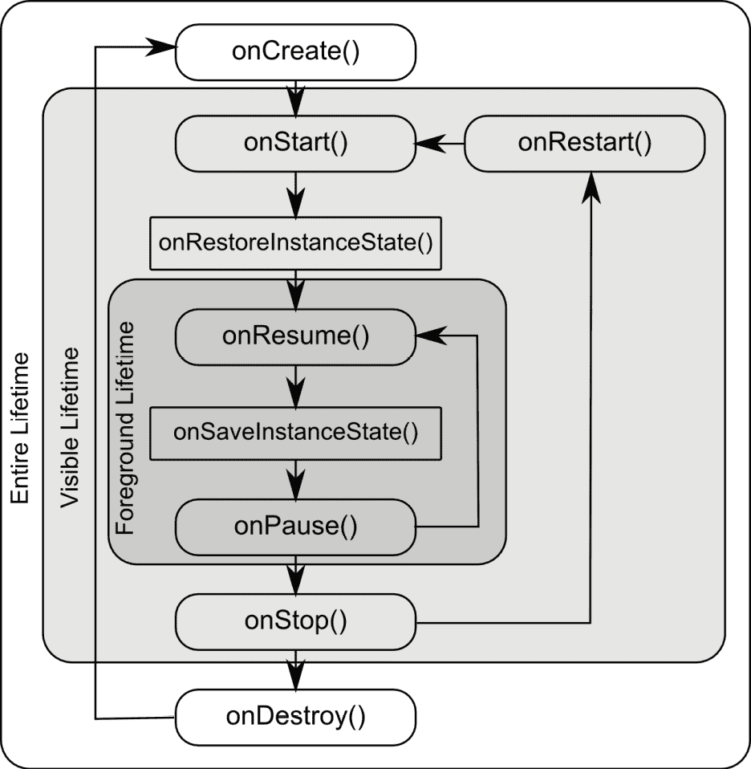

图 13-2

## 13.6 折叠屏设备与多恢复

如前所述，当活动移动到前台并是用户当前交互的活动时，该活动被认为处于恢复状态。在标准设备上，应用任何时候只能有一个活动处于恢复状态，而所有其他活动可能处于暂停或停止状态。

长期以来，Android 一直包含了多窗口支持，允许多个活动在分屏或自由形式配置中同时出现。虽然最初主要用于大屏幕平板设备，但随着折叠屏设备的推出，这一功能可能会更加流行。

在运行 Android 10 且启用多窗口支持的设备上（大多数折叠屏设备也是如此），多个应用活动（activity）可以同时处于恢复（resumed）状态（这种概念被称为多重恢复），使得可见的活动能够继续运行（例如，播放流媒体内容或更新视觉数据），即使当前有另一个活动获取了焦点。虽然可以有多个活动处于恢复状态，但其中只有一个活动将被视为顶层恢复活动（换句话说，就是用户最近交互的那个活动）。

通过实现 `onTopResumedActivityChanged()` 回调方法，活动可以获取其已获得或丢失顶层恢复状态的通知。

## 13.7 禁用配置更改重启

如前所述，活动可以指示在某些配置更改发生时不重新重启。这是通过在项目清单文件中的 `activity` 元素中添加 `android:configChanges` 指令来实现。例如，下面的清单文件片段表明，当发生与方向或全设备字体大小相关的配置更改时，不应重启该活动：

```xml
<activity android:name=".MainActivity"
          android:configChanges="orientation|fontScale"
          android:label="@string/app_name">
```

## 13.8 生命周期方法的局限性

正如本章开头所讨论的，生命周期方法已经使用了多年，直到最近，它们仍然处理活动和 fragment 生命周期周期状态变化的唯一机制。然而，这种方法仍有改进空间。

生命周期方法的一个问题是，它们没有提供一种简单的方法让活动或 fragment 在应用执行过程中的任何时刻发现其当前的生命周期状态。相反，对象必须在内部跟踪状态，或者等待下一次生命周期方法的调用。

此外，这些方法没有提供一种简单的方法让一个对象观察应用内其他对象的生命周期状态变化。这是一个严重的考虑因素，因为给定活动或 fragment 的生命周期状态变化可能会影响应用内的许多其他对象。

生命周期方法仅适用于 `Fragment` 和 `Activity` 类的子类。因此，无法构建真正感知生命周期的自定义类。

最后，生命周期方法导致大多数生命周期处理代码被写在活动或 fragment 内部，这可能导致代码复杂且易出错。理想情况下，这些代码大部分应该位于受状态更改影响的其他类中。例如，一个流媒体视频的应用可能会包含一个专门设计用于管理输入流的类。如果应用需要在主活动停止时暂停流，那么相应的代码应该位于流类中，而不是主活动中。

所有这些以及其他问题都可以使用生命周期感知组件来解决，该主题将在题为“使用 Jetpack 构建现代 Android 应用架构”的章节开始介绍。

## 13.9 总结

所有活动都派自 `Activity` 类，而该类反过来包含了若干生命周期方法，这些方法设计用于运行时系统在活动状态更改时进行调用。同样，`Fragment` 类也包含了若干类似的方法。通过重写这些方法，活动和 fragment 可以响应状态变化，并在必要时采取步骤保存并恢复活动及应用程序当前状态。生命周期状态可以被认为有两种形式。持久状态是指在应用调用之间需要存储的数据（例如，存储到文件或数据库中）。而动态状态则涉及用户界面的当前显示。

尽管生命周期方法具有一些可以使用生命周期感知组件避免的局限性，但理解这些方法对于充分理解书中后面介绍的生命周期管理新方法至关重要。

在本章中，我们强调了活动可用的生命周期方法，并涵盖了活动生命周期的概念。在下一章中，题为“通过示例了解 Android 活动状态变化”，我们将实现一个示例应用，将这些许多理论付诸实践。

# 14. 通过示例了解 Android 活动状态变化

之前的章节详细讨论了构成 Android 应用的活动的不同状态和生命周期。在本章中，我们将通过创建一个示例应用，将处理活动状态变化的理论付诸实践。该示例应用的目的是为活动在 Android 运行时中通过各种状态的过程提供一个真实世界的演示。在下一章中，题为“保存和恢复 Android 活动的状态”中，本章中构建的示例项目将得到扩展，以演示动态活动状态的保存和恢复。

## 14.1 创建状态更改示例项目

此练习的第一步是创建一个新项目。启动 Android Studio，并在必要时使用 `File -> Close Project` 菜单选项关闭任何当前打开的项目，以便显示欢迎界面。

从欢迎界面选择 `New Project` 选项，在弹出的新项目对话框中，点击 `Next` 按钮之前选择 `Empty Views Activity` 模板。

在 `Name` 字段中输入 `StateChange`，并指定 `com.ebookfrenzy.statechange` 为包名。在点击 `Finish` 按钮之前，将 Minimum API level 设置为 `API 26: Android 8.0 (Oreo)`，并将语言菜单设置为 `Java`。完成项目创建过程后，`StateChange` 项目应列在 Android Studio 主窗口左侧的 Project 工具窗口中。使用第 11.8 节“将项目迁移到 View Binding”中概述的步骤将项目转换为视图绑定。

接下来的操作涉及活动用户界面的设计。它存储在名为 `activity_main.xml` 的文件中，该文件应该已经加载到 Layout 编辑器中。如果没有，请在 Project 工具窗口中导航到它，可以在 `app -> res -> layout` 文件夹找到它。找到后，双击该文件将其加载到 Android Studio Layout 编辑器中。

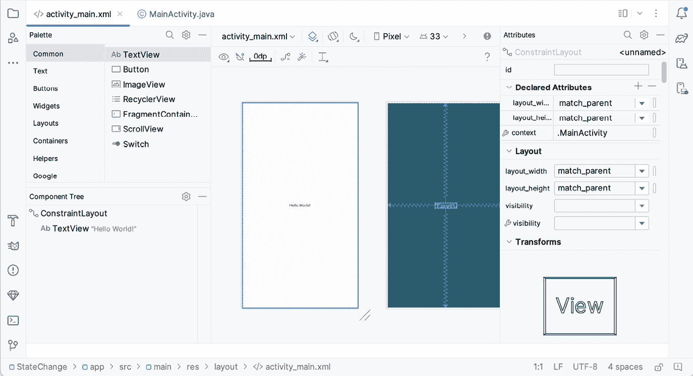

图 14-1

## 14.2 设计用户界面

用户界面布局加载到 Layout 编辑器后，是时候为示例应用设计用户界面了。对于当前用户界面设计中的“Hello World!” `TextView`，活动需要一个 `EditText` 视图。在 Component Tree 面板中选择 `TextView` 对象并按键盘上的 `Delete` 键将其从设计中删除。

从 Layout 编辑器左侧的 `Palette` 中，选择 `Text` 类别，并从文本列表中点击并拖动 `Plain Text` 组件到布局画布上。将组件移动到屏幕中心使中心指南线出现，并将其放置到位，使布局类似于图 14-2 所示。

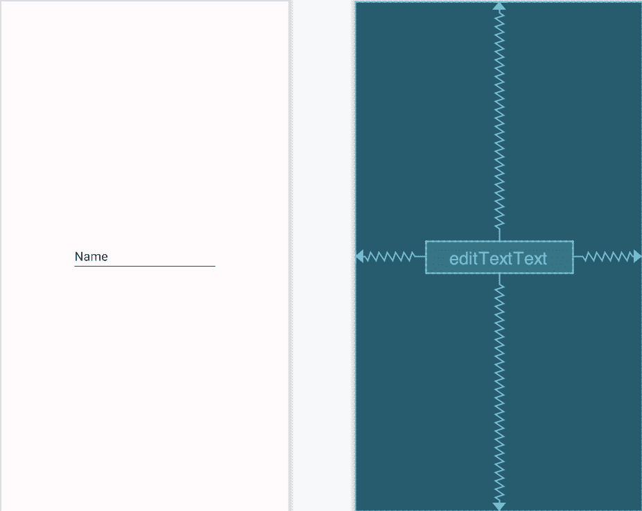

图 14-2

在使用 `EditText` 部件时，必须为该视图指定输入类型（input type）。这定义了用户将输入的文本或数据类型。例如，如果输入类型设置为 `Phone`，用户将仅限制在视图中输入数字。或者，如果将输入类型设置为 `TextCapCharacters`，输入将默认为大写字母。输入类型设置还可以组合使用。

在本例中，我们将使用默认输入类型来支持普通文本输入。如果将来想选择不同的设置，请在布局中选择 `EditText` 部件，并在属性（Attributes）工具窗口中找到 `inputType` 条目。接下来，点击当前设置左侧的旗帜图标打开选项列表，如下方的图 14-3 所示。`Type` 菜单提供了将输入限制为文本、数字、日期时间以及电话号码的选项。`Variations` 菜单为当前选的输入类型提供额外的选项。例如，文本输入类型有一种变体，可将电子邮件地址作为输入。

一旦选择了类型和变体，可以使用旗帜复选框列表进一步自定义输入类型：


图 14-3

留在属性工具窗口中，将视图的 `id` 更改为 `editText`，并点击弹出对话框中的 `Refactor`（重构）按钮。

默认情况下，`EditText` 显示文本为“Name”。继续留在属性面板中，删除 `text` 属性字段中的此内容，使布局中的视图为空。

在继续之前，点击布局编辑器工具栏上的 `Infer Constraints`（推断约束）按钮以添加任何缺失的约束。

## 14.3 重写 Activity 生命周期方法

### 重写 `onCreate()` 方法

此时，项目包含一个名为 `MainActivity` 的 Activity，它派自 Android 的 `AppCompatActivity` 类。该 Activity 的源代码包含在 `MainActivity.java` 文件中，该文件已经在编辑器会话中打开，并在编辑器标签栏中以标签页表示。如果文件未打开，请在项目工具窗口面板中导航到它（`app -> java -> com.ebookfrenzy.statechange -> MainActivity`）并双击它将文件加载到编辑器。

到为止，Activity 重写的唯一生命周期方法是 `onCreate()` 方法，该方法已实现为在设置 Activity 的用户界面之前调用其父类的实例方法。现在我们将修改此方法，以便在每次执行时都在 Android Studio 的 Logcat 面板中输出一条诊断消息。为此，我们将使用 `Log` 类，这需要导入 `android.util.Log` 并声明一个标签（tag），以便我们能够在日志输出中过滤这些消息：

```java
package com.ebookfrenzy.statechange;

.

import android.util.Log;

import androidx.annotation.NonNull;
import android.view.View;

public class MainActivity extends AppCompatActivity {

    private ActivityMainBinding binding;

    private static final String TAG = "StateChange";

    @Override
    protected void onCreate(Bundle savedInstanceState) {
        super.onCreate(savedInstanceState);
        binding = ActivityMainBinding.inflate(getLayoutInflater());
        View view = binding.getRoot();
        setContentView(view);
        Log.i(TAG, "onCreate");
    }
}
```

### 添加额外的生命周期方法

接下来的任务是重写更多方法，每个方法都包含相应的日志调用。这些重写方法可以手动添加，也可以使用 `Alt-Insert` 快捷键生成，正如章节“Android Studio 代码编辑器基础”概述的那样。请注意，如果方法是自动生成的，仍然需要手动添加 `Log` 调用：

```java
@Override
protected void onStart() {
    super.onStart();
    Log.i(TAG, "onStart");
}

@Override
protected void onResume() {
    super.onResume();
    Log.i(TAG, "onResume");
}

@Override
protected void onPause() {
    super.onPause();
    Log.i(TAG, "onPause");
}

@Override
protected void onStop() {
    super.onStop();
    Log.i(TAG, "onStop");
}

@Override
protected void onRestart() {
    super.onRestart();
    Log.i(TAG, "onRestart");
}

@Override
protected void onDestroy() {
    super.onDestroy();
    Log.i(TAG, "onDestroy");
}

@Override
protected void onSaveInstanceState(@NonNull Bundle outState) {
    super.onSaveInstanceState(outState);
    Log.i(TAG, "onSaveInstanceState");
}

@Override
protected void onRestoreInstanceState(@NonNull Bundle savedInstanceState) {
    super.onRestoreInstanceState(savedInstanceState);
    Log.i(TAG, "onRestoreInstanceState");
}
```

## 14.4 过滤 Logcat 面板

添加到 `MainActivity.java` 中的代码目的是将日志输出到 Logcat 面板，该面板显示在图 14-4 中：

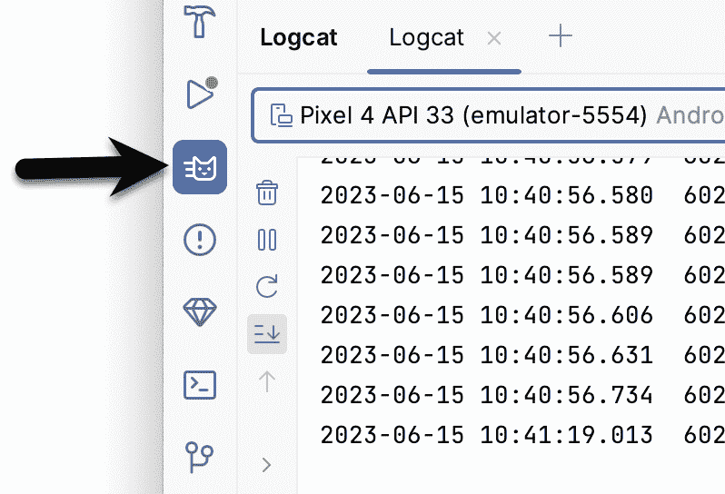

图 14-4

Logcat 工具窗口可以配置为显示来自设备或模拟器的所有事件，或限制为与当前应用相关的事件。如图 14-5 所示：


图 14-5

默认键设置 `package:mine` 将输出限制为当前应用（在本例中为 `com.ebookfrenzy.statechange`）。留空此字段将允许显示操作系统的日志输出。键也可以组合使用以进一步过滤输出。例如，我们可以配置 Logcat 面板仅显示与 `StateChange` 标签相关的消息：`package:mine tag:StateChange`。

可以通过在键前面加上减号（`-`）来排除输出。除了 `StateChange` 标签，我们可能还有使用另一个标签的诊断消息。为了过滤日志以排除第二个标签，我们可以输入以下选项：`package:mine tag:StateChange -tag:OtherTag`。

除了自定义的标签值，还可以从 Android 内置的定义标签范围内选择。当你在过滤器字段中输入时，Logcat 将显示匹配标签列表，如图 14-6 所示：

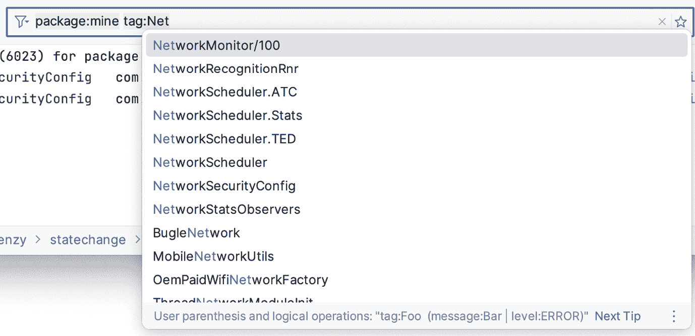

图 14-6

或者，使用 `Ctrl-Space` 获取完整的过滤建议列表。


`level`键可以根据严重性控制显示的消息。为了过滤掉错误以外的所有消息，将使用以下键：`level:error`。除了错误之外，`Logcat`面板还支持`verbose`（详细）、`info`（信息）、`warn`（警告）和`assert`（断言）级别设置。

`Logcat`还支持多个日志面板，每个面板都有自己的过滤设置。要添加另一个面板，点击上方图 14-5 中标记为 D 的`+`按钮。使用相应的标签在不同面板之间切换，或者通过右键点击当前显示的面板并选择`Split-Right`（向右拆分）或`Split-Down`（向下拆分）菜单来水平或垂直排列面板。要重命名面板，右键点击标签并选择`Rename Tab`（重命名标签）选项。在继续之前，关闭除一个以外的所有`Logcat`面板，并按配置配置：`package:mine tag:StateChange`。

## 14.5 运行应用程序

为了获得最佳结果，应用程序应运行在物理 Android 设备或模拟器上。在配置好设备并连接到开发计算机后，点击 Android Studio 工具栏上的运行按钮，如下方的图 14-7 所示：

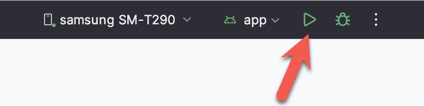

图 14-7

如果出现了“选择设备”对话框，请从中选择物理 Android 设备或模拟器（假设你尚未将其配置为默认目标）。在 Android Studio 构建应用程序并将其安装到设备上后，它应该启动并在前台运行。

检查`Logcat`面板可以显示到目前为止哪些方法被触发了：

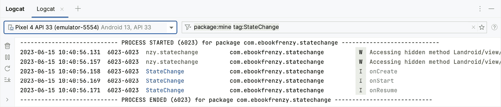

图 14-8

## 14.6 实验 Activity

既然诊断功能已工作正常，现在是时候运行应用程序以理解 Activity 的生命周期状态变化了。首先，考虑`Logcat`面板中初始的日志事件序列：

```
onCreate
onStart
onResume
```

显然，初始状态变化与“理解 Android 应用和 Activity 生命周期”中概述的完全相同。但注意，并没有调用`onRestoreInstanceState()`，因为 Android 运行时检测到在这种没有需要恢复的状态。

点击设备屏幕底部状态栏上的 Home 图标，并注意日志中报告的方法调用序列如下：

```
onPause
onStop
onSaveInstanceState
```

在这种情况下，运行时注意到 Activity 不再处于前台，对用户不可见，并且已停止该 Activity，但并不是没有提供 Activity 保存动态状态的机会。取决于运行时最终是销毁了 Activity 还是重新启动了它，Activity 将通过调用`onRestart()`被通知其已重新启动，或者在用户返回 Activity 时再次经历创建序列。

正如“理解 Android 应用和 Activity 生命周期”概述的，Activity 的销毁和重建可以通过对设备进行配置更改来触发，例如从竖屏旋转到横屏。要查看此操作过程，请在`StateChange`应用程序处于前台时旋转设备。使用模拟器时，可以使用模拟器工具栏上的旋转按钮模拟设备旋转。为了完成旋转，可能还需要点击旋转按钮。它出现在设备或模拟器屏幕的底部，如图 14-9 所示：


图 14-9

日志中产生的方法调用序列如下：

```
onPause
onStop
onSaveInstanceState
onDestroy
onCreate
onStart
onRestoreInstanceState
onResume
```

显然，运行时系统允许 Activity 在被销毁和重启之前保存状态。

### 14.7 总结

“画画胜千言”的格言在学习新编程范式的示例中同样适用。在本章中，我们创建了一个示例 Android 应用程序，演示 Activity 可能会经过的不同生命周期状态。在开发本章项目中，我们还查看了从 Activity 内部生成诊断日志信息的机制。

在下一章中，我们将扩展`StateChange`示例项目，演示如何保存和恢复 Activity 的动态状态。

## 15. 保存和恢复 Android Activity 的状态

如果前面的几章已经实现了目标，那么现在对于在 Activity 生命周期的特定点保存和恢复用户界面状态的重要性应该变得更加清晰了。

在本章中，我们将扩展在“通过示例理解 Activity 状态变化”中创建的示例应用程序，演示运行时系统销毁和重建 Activity 时涉及保存和恢复状态的步骤。

恢复动态状态的关键组件涉及使用 Android SDK 中的`Bundle`类，这个主题在本章也会涵盖。

## 15.1 保存动态状态

正如我们所学的，Activity 可以通过运行时调用其实现的`onSaveInstanceState()`方法来保存动态状态信息。作为方法的参数传递的是`Bundle`对象的引用，该方法必须从中存储任何需要保存的动态数据。随后，`Bundle`对象由运行时代表 Activity 进行存储，并在它们被调用时，作为参数传递给 Activity 的`onCreate()`和`onRestoreInstanceState()`方法。然后可以从这些方法内部的`Bundle`对象中检索数据并用于恢复 Activity 的状态。

## 15.2 用户界面状态的默认保存

在上章中，`StateChange`示例应用程序的诊断输出显示，当运行它的设备旋转得足够大以触发方向变化时，Activity 会经历几次状态变化。

再次启动`StateChange`应用程序，在执行设备旋转之前，向`EditText`字段输入一些文本（在运行 Android 9 或更高版本的设备或模拟器上，可能需要点击状态栏中的旋转按钮来完成旋转）。旋转设备后，`Logcat`窗口会出现以下状态变化序列：

```
onPause
onStop
onSaveInstanceState
onDestroy
onCreate
onStart
onRestoreInstanceState
onResume
```

显然，这导致了 Activity 的销毁和重建。然而，检查运行应用程序的用户界面会发现输入`EditText`字段的文本已被保留。鉴于 Activity 被销毁并重建，且我们没有添加任何确保文本已保存的代码，这种行为需要一些解释。

事实上，Android SDK 包含的大多数控件已经实现了 Activity 重新启动时保存和恢复状态所需的行为。启用此行为的唯一是 Activity 中的`onSaveInstanceState()`和`onRestoreInstanceState()`重写方法包含调用父类的同名方法：

```java
@Override
protected void onSaveInstanceState(@NonNull Bundle outState) {
    super.onSaveInstanceState(outState);
}

@Override
protected void onRestoreInstanceState(@NonNull Bundle savedInstanceState) {
    super.onRestoreInstanceState(savedInstanceState);
}
```

可以通过在 XML 布局文件中将`saveEnabled`属性设置为`false`来禁用用户界面状态的自动保存。可以通过在 XML 布局文件中将`saveEnabled`属性设置为`false`来关闭用户界面视图的自动状态保存。在本示例中，我们将禁用用户界面布局中`EditText`视图的自动保存机制，然后在应用程序中添加代码来手动保存和恢复视图状态。

为了配置`EditText`视图使其在 Activity 重新启动时不保存状态，编辑`activity_main.xml`文件使该视图条目如下（注意可以按照“在 Android Studio 中创建 Android 应用”中概述的方法，将布局编辑器切换到代码视图来编辑 XML）：

```xml
<EditText
    android:id="@+id/editText"
    android:layout_width="wrap_content"
    android:layout_height="wrap_content"
    android:ems="10"
    android:inputType="text"
    android:saveEnabled="false"
    app:layout_constraintBottom_toBottomOf="parent" />
```

```xml
app:layout_constraintEnd_toEndOf="parent"
app:layout_constraintStart_toStartOf="parent"
app:layout_constraintTop_toTopOf="parent" />
```

完成更改后，运行应用程序，输入文本并旋转设备，以验证文本不再被保存和恢复。

### 15.3 Bundle 类

对于需要在用户界面视图组件提供的默认功能之外保存状态的情况，`Bundle`类提供了一个使用键值对机制来存储数据的容器。键的形式为字符串值，而与这些键关联的值可以是原始值（primitive value），也可以任何实现 Android `Parcelable`接口的对象。许多类已经实现了`Parcelable`接口。可以通过实现`Parcelable`接口中定义方法集来使自定义类变为“可序列化（parcelable）”，细节可以在 Android 文档中找到：[`developer.android.com/reference/android/os/Parcelable.html`](https://developer.android.com/reference/android/os/Parcelable.html)

`Bundle`类还包含一组方法，用于为各种数据类型获取和设置键值对，包括原始类型（包括`Boolean`、`char`、`double`和`float`值）和对象（如`String`和`CharSequence`）。

在本例中，由于禁用了`EditText`视图的文本自动保存功能，我们需要确保用户输入`EditText`字段的文本被保存到`Bundle`对象并随后恢复。这将演示如何在 Android 应用程序中手动保存和恢复状态，并将分别使用`Bundle`类的`putCharSequence()`和`getCharSequence()`方法来实现。

### 15.4 保存状态

扩展 StateChange 应用的第一步是确保在`MainActivity`Activity 的`onSaveInstanceState()`方法中从`EditText`组件提取用户输入的文本，然后将其作为键值对保存到`Bundle`对象中。

要从`EditText`对象中提取文本，我们必须首先在用户界面中识别该对象。显然，这涉及到 Activity 的 Java 代码（包含在`MainActivity.java`源文件中）与用户界面 XML 表示（包含在`activity_main.xml`资源文件中）之间的桥接。为了提取输入到`EditText`组件的文本，我们需要获得该用户界面对象的访问权限。

用户界面中的每个组件都关联有一个唯一的标识符。默认情况下，布局编辑器工具根据对象类型为新添加的组件构建`id`。如果布局中包含多个相同类型的视图，则类型名后面会跟一个顺序数字（尽管开发者可以并且应该将其更改为更具意义的内容）。正如在选择`activity_main.xml`文件并显示布局编辑器工具时通过检查 Android Studio 主窗口中的组件树（Component Tree）面板所示，`EditText`组件被分配了`id editText`：

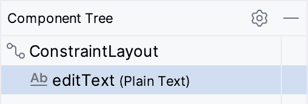

图 15-1

我们现在可以通过对象的`getText()`方法获取`editText`视图包含的文本，该方法会返回当前文本：

```java
CharSequence userText = binding.editText.getText();
```

最后，我们可以使用`Bundle`对象的`putCharSequence()`方法保存文本，将键（可以是任何字符串值，但在本例中，我们将声明为“savedText”）和`userText`对象作为参数传递：

```java
outState.putCharSequence("savedText", userText);
```

将这一切整合在一起，我们在`MainActivity.java`文件中得到了修改后的`onSaveInstanceState()`方法，其内容如下：

```java
package com.ebookfrenzy.statechange;

.
.

public class MainActivity extends AppCompatActivity {

.
.
.
    protected void onSaveInstanceState(@NonNull Bundle outState) {
        super.onSaveInstanceState(outState);
        Log.i(TAG, "onSaveInstanceState");
        CharSequence userText = binding.editText.getText();
        outState.putCharSequence("savedText", userText);
    }
.
.
```

现在已经了保存状态的步骤，下一阶段是在需要时恢复它。

### 15.5 恢复状态

保存的动态状态可以在传递`Bundle`对象作为参数的生命周期方法中恢复。这让开发者可以选择`onCreate()`或`onRestoreInstanceState()`。使用哪种方法取决于 Activity 的性质。在 Activity 执行初始化任务后最适合恢复的情况下，`onRestoreInstanceState()`方法通常更合适。在本例中，我们将在`onRestoreInstanceState()`方法中添加代码，使用 “savedText” 键从`Bundle`中提取保存的状态。然后我们可以使用对象的`setText()`方法在`editText`组件上显示文本：

```java
@Override
protected void onRestoreInstanceState(@NonNull Bundle savedInstanceState) {
    super.onRestoreInstanceState(savedInstanceState);
    Log.i(TAG, "onRestoreInstanceState");
    CharSequence userText = savedInstanceState.getCharSequence("savedText");
    binding.editText.setText(userText);
}
```


### 15.6 测试应用程序

剩下的工作就是再次构建并运行`StateChange`。一旦运行并处于前台，触碰`EditText`组件并在旋转设备到另一个方向之前输入一些文本。之前文本更改会丢失，但现在得益于我们添加到`Activity`中的代码，文本保留在了`editText`组件中。

### 15.7 总结

`Android`应用中动态状态的保存和恢复是在适当的生命周期方法中实现的。对于大多数用户界面视图，这由`Activity`类自动处理。在其他情况下，这通常包括在`onSaveInstanceState()`方法中提取值和设置，并将作为键值对保存到传递给`Activity`的`Bundle`对象中。

可以通过`Activity`的`onCreate()`或`onRestoreInstanceState()`方法从`Bundle`对象提取值并更新`Activity`来恢复状态。

在本章中，我们通过这些技术更新了`StateChange`项目，使其能够在`Activity`销毁并随后重建时保留更改。

# 16 理解 Android 视图、视图组和布局

除了听流媒体音频外，用户与Android设备的交互主要是视觉和触觉的。所有这些交互都发生在设备上安装应用程序的用户界面上，包括内置应用程序和用户安装的任何第三方应用程序。因此，开发Android应用的一个关键要素涉及设计和创建用户界面，并不意外。

本章涵盖了Android用户界面结构，包括组成用户界面的元素概述：视图（`Views`）、视图组（`View Groups`）和布局（`Layouts`）。

## 16.1 为不同的 Android 设备设计

“Android设备”一词涵盖了许多具有不同屏幕尺寸和分辨率的平板电脑和智能手机产品。因此，应用程序界面现在必须经过仔细设计，以确保在尽可能广泛的显示尺寸上正确呈现。其中的一个关键部分是确保用户界面布局在不同设备上运行时能够正确地重新调整大小。这在很大程度上可以通过细致的规划以及使用本章概述的布局管理器来实现。

同样重要的是要记住，大多数基于Android的智能手机和平板电脑都可以以竖屏和横屏两种方向供用户使用。良好的用户界面应该能够适应这些变化，并进行合理的布局调整，以利用每种方向下的可用屏幕空间。

### 16.2 视图 (Views) 与视图组 (View Groups)

用户界面中的每个项目都是`Android View`类的子类（准确来说是`android.view.View`）。`Android SDK`提供了一组预构建的视图，用于构建用户界面。典型示例包括标准项，如`Button`、`Checkbox`、`ProgressBar`和`TextView`类。这些视图也被称为控件（widgets）或组件（components）。对于`SDK`提供的控件无法满足的需求，可以通过子类和扩展现有类来创建新视图，或者通过直接在`View`类之上构建全新的组件。

视图还可以包含多个其他视图（否则称为复合视图）。此类视图派生自`Android ViewGroup`类（`android.view.ViewGroup`），而该类本身是`View`的子类。这种视图的一个示例是`RadioGroup`，它旨在包含多个`RadioButton`对象，使得在任何时间只有一个对象处于“开启”状态。从结构上来说，复合视图由单个父视图（派自`ViewGroup`类，通常称为容器视图或根元素）组成，该视图能够包含其他视图（称为子视图）。

另一类基于`ViewGroup`的容器视图是布局管理器。

### 16.3 Android 布局管理器 (Android Layout Managers)

除了上一节讨论的控件样式视图外，SDK还包含了一组被称为布局（layouts）的视图。布局是容器视图（因此派生自`ViewGroup`），设计用于控制子视图在屏幕上的定位方式。

`Android SDK`包含了以下可能在Android用户界面设计中使用的布局视图：

- `ConstraintLayout` – 这种布局管理器在Android 7中引入，推荐用于大多数布局需求。`ConstraintLayout`允许通过为每个子视图分配简单的约束设置来定义布局中视图的位置和行为。该布局的灵活性允许快速轻松地创建复杂布局，而无需在内部相互嵌套其他布局类型，从而提高了布局性能。`ConstraintLayout`也紧密集成到`Android Studio`布局编辑器工具中。除非另有说明，否则它是书中大多数示例的首选布局。

- `LinearLayout` – 根据所选的方向将子视图排列在单行或单列中。可以在每个子视图上设置权重（weight）值，以指定该子视图相对于其他子视图应占据布局空间的比例。

- `TableLayout` – 将子视图排列为行和列的网格格式。表格中的每一行由一个`TableRow`对象子项表示，该子项又包含每个单元格的视图对象。

- `FrameLayout` – `FrameLayout`的目的是分配屏幕的一个区域，通常用于显示单个视图。如果添加了多个子视图，默认情况下它们将相互堆叠并定位在布局区域的左上角。通过为每个子视图设置重力（gravity）值可以实现单个子视图的交替定位。例如，在子视图上设置`center_vertical`重力值将使其位于包含它的`FrameLayout`视图的垂直中心。

- `RelativeLayout` – `RelativeLayout`允许通过对子视图指定对齐方式和边距，使子视图相对于彼此以及容器布局视图进行定位。例如，可以将子`View A`配置为位于容器`RelativeLayout`视图的垂直和水平中心。相反，视图`B`也可以配置为在布局视图内水平居中，但位于`View A`顶上方30像素处，从而使其相对于`View A`的垂直位置。在设计必须在各种屏幕尺寸和方向上运行的用户界面时，`RelativeLayout`管理器非常有帮助。

- `AbsoluteLayout` – 允许将子视图定位在容器布局视图内特定的X和Y坐标上。不建议使用这种布局，因为它缺乏响应屏幕尺寸和方向变化的灵活性。

- `GridLayout` – `GridLayout`实例由不可见的线划分，形成一个包含行和列单元格的网格。子视图被放置在单元格中，并可以配置为水平和垂直覆盖多个单元格，从而能够快速轻松地实现广泛的布局选项。`GridLayout`组件之间的间隔可以通过在相邻单元格中放置一种名为`Space`的特殊类型视图或设置边距参数来实现。

- `CoordinatorLayout` – `CoordinatorLayout`作为Android Design Support Library的随Android 5.0引入，专门设计用于协调应用程序屏幕顶部应用栏（app bar）与其他视图元素的外观和行为。当使用`Basic Views Activity`模板创建新活动时，主布局中的父视图将使用`CoordinatorLayout`实例实现。该布局管理器将从“使用FloatingActionButton和Snackbar”一章开始进行更详细介绍。

在考虑Android应用程序的用户界面布局时，值得记住，正如下一节所述，这些布局可以相互嵌套，以创建任何所需程度的用户界面设计。

### 16.4 视图层次结构 (The View Hierarchy)

用户界面中的每个视图代表显示器的矩形区域。视图负责在该矩形内绘制内容并响应屏幕该区域的事件（如触摸事件）。

用户界面屏幕由视图层次结构组成，其中根视图位于顶部，子视图位于下方。容器视图的子视图位于父视图之上，并被限制在父视图的显示边界内。例如，考虑图16-1所示的用户界面：

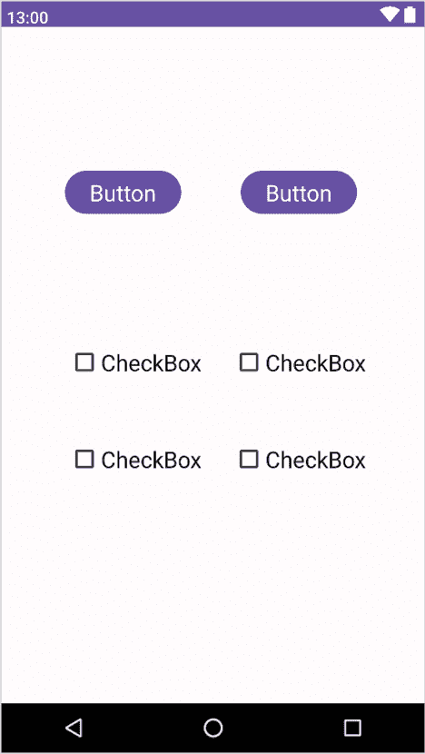

图 16-1

视图层级图可能最清晰地概述了构成用户界面的各种视图之间的关系，具体可见图16-1。当用户界面显示给用户时，`Android`运行时会遍历视图层级，从根视图开始沿树形结构向下遍历，并渲染每一个视图。

## 16.5 创建用户界面

在对视图（views）、布局（layouts）和视图层级概念有了更清晰的理解之后，后续章节将重点介绍为Android `Activity`创建用户界面的步骤。事实上，用户界面设计有三种不同的方法：使用`Android Studio Layout Editor`工具、手动编写XML布局资源文件或编写Java代码，每种方法都将得到涵盖。

### 16.6 总结

Android应用用户界面屏幕中的每个元素都是视图，它们最终都派自`android.view.View`类。每个视图代表设备显示器上的矩形区域，负责在该矩形内显示的内容，并处理在该视图范围内发生的事件。多个视图可以组合创建一个单个复合视图（composite view）。复合视图中的视图是容器视图（container view）的子视图，容器视图通常是`android.view.ViewGroup`的子类（其本身又是`android.view.View`的子类）。用户界面是由视图层级形式构建的视图组成的。

Android SDK包含了一系列预构建的视图，可用于创建用户界面。这些包括文本字段和按钮等基本组件，以及用于控制子视图定位的一系列布局管理器。如果提供的视图不能满足特定需求，可以通过扩展或组合现有视图来创建自定义视图，也可以通过派生`android.view.View`并创建一个全新的视图类。

用户界面可以使用`Android Studio Layout Editor`工具、手动编写XML布局资源文件或编写Java代码来创建。这些方法中的每一种都将在后续章节中进行介绍。

## 17. Android Studio Layout Editor 工具指南

很难想象出一个不需要某种形式用户界面的Android应用概念。大多数Android设备都配备了触摸屏和键盘（虚拟或物理），点击和滑动是用户与应用程序之间主要的交互方式。这些交互不可避免地通过应用程序的用户界面进行。

良好的设计和实现的用户界面是创建一个成功且流行的Android应用的关键因素，根据单个应用程序的设计需求，它可以从简单到高度复杂不等。无论复杂程度如何，Android Studio Layout Editor工具都显著简化设计和实现Android用户界面的任务。

### 17.1 基础与空视图 Activity 模板

如“Android应用的剖析”章节概述的，Android应用由一个或多个`Activity`组成。`Activity`是应用程序功能的独立模块，通常直接对应于单个用户界面屏幕。因此，当使用`Android Studio Layout Editor`时，我们总是在为`Activity`编写布局。

在创建新的`Android Studio`项目时，有多个模板可以作为主`Activity`用户界面的起点。最基础的模板是`Basic Views Activity`和`Empty Views Activity`模板。尽管它们初看起来看起来相似，但这两个选项之间存在显著差异。要在布局编辑器中查看这些差异，请使用`View Options`（视图选项）菜单启用`Show System UI`（显示系统界面），如下方的图17-1：

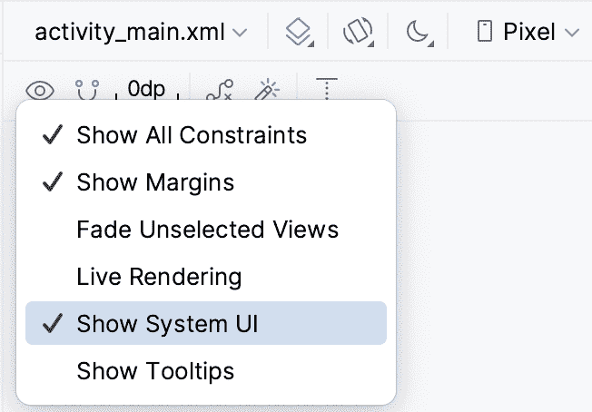

图 17-1

`Empty Views Activity`模板创建一个单一布局文件，由一个包含`TextView`对象的`ConstraintLayout`实例组成，如图17-2所示：


图 17-2

另一方面，`Basic Views Activity`包含多个布局文件。顶层布局文件具有`CoordinatorLayout`作为根视图、一个显示在设备屏幕顶部的可配置应用栏（包含工具栏，在图17-3中标记为A）以及一个浮动操作按钮（标记为B的电子邮件按钮）。除了这些项目，`activity_main.xml`布局文件还包含指向名为`content_main.xml`第二文件的引用，该文件包含内容布局（标记为C）：


图 17-3

`Basic Views Activity`包含两个屏幕的布局，包含一个按钮和一个文本视图。该模板旨在演示如何在应用的多个屏幕之间实现导航。如果运行一个使用`Basic Views Activity`模板且未修改过的应用，将显示这两个屏幕中的第一个（在图17-4中标记为A）。按下`Next`（下一个）按钮将导航到第二个屏幕（B），该屏幕反过来包含一个返回到第一个屏幕的按钮：


图 17-4

此应用行为使用了称为`fragments`（片段）和`navigation`（导航）的两个Android功能，将分别从“Android Fragment简介”和“导航架构组件概述”章节开始介绍。

`content_main.xml`文件包含一个特殊的片段，被称为`Navigation Host Fragment`（导航主机片段），它允许根据`res -> layout -> nav_graph.xml`中的设置切换内容。在`Basic Views Activity`的情况下，`nav_graph.xml`文件配置为根据用户选择`Next`和`Previous`按钮在`fragment_first.xml`和`fragment_second.xml`定义的布局之间切换。

如果你的`Activity`既不需要浮动操作按钮也不需要菜单，不需要`CoordinatorLayout`提供的特殊应用栏行为（例如在某些滚动操作期间让应用栏和工具栏折叠的选项，该主题在“使用AppBar和折叠工具栏布局”章节中介绍），那么`Empty Views Activity`模板很有用。然而，`Basic Views Activity`很有用，因为它默认提供了这些元素。事实上，使用`Basic Views Activity`模板创建新`Activity`并删除不需要的元素，通常比使用`Empty Views Activity`模板并手动实现折叠工具栏、菜单或浮动操作按钮要快得多。

然而，由于书中并非所有示例都需要`Basic Views Activity`模板的功能，因此本章的大多数示例将使用`Empty Views Activity`模板，除非示例需要`Basic Views Activity`模板提供的一个或多个功能。

为了以后参考，如果你需要菜单但不需要浮动操作按钮，请使用`Basic Views Activity`并按照以下步骤删除浮动操作按钮：

1. 在项目工具窗口的`app -> res -> layout`下双击主`activity_main.xml`布局文件，将其加载到`Layout Editor`中。在布局加载到`Layout Editor`工具后，选择浮动操作按钮并按键盘`Delete`键从布局中移除该对象。

2. 找到并编辑`Activity`的Java代码（位于`app` -> `java` -> `<package name>` -> `<activity class name>`），并按照如下方式从`onCreate`方法中删除焦点操作按钮代码：

```java
@Override
protected void onCreate(Bundle savedInstanceState) {
    super.onCreate(savedInstanceState);
    binding = ActivityMainBinding.inflate(getLayoutInflater());
    setContentView(binding.getRoot());
    setSupportActionBar(binding.toolbar);
    NavController navController = Navigation.findNavController(this, R.id.nav_host_fragment_content_main);
    appBarConfiguration = new AppBarConfiguration.Builder(navController.getGraph()).build();
    NavigationUI.setupActionBarWithNavController(this, navController, appBarConfiguration);
    binding.fab.setOnClickListener(new View.OnClickListener() {
        @Override
        public void onClick(View view) {
            Snackbar.make(view, "Replace with your own action", Snackbar.LENGTH_LONG)
                    .setAction("Action", null).show();
        }
    });
}
```


如果你需要悬浮操作按钮但不需要菜单，请使用 `Basic Views Activity` 模板并遵循以下步骤：

1. 编辑主类文件并删除 `onCreateOptionsMenu` 和 `onOptionsItemSelected` 方法。
2. 在 `Project` 工具窗口中选择 `res -> menu item`，并按键盘上的 `Delete` 键从项目中删除该文件夹及相应的菜单资源文件。

如果你需要使用 `Basic Views Activity` 模板，但既不需要导航功能也不需要第二个片段，请遵循以下步骤：

1. 在 `Project` 工具窗口中，导航并双击 `app -> res -> navigation -> nav_graph.xml` 文件，将其加载到导航编辑器中。
2. 在编辑器中，在图表面板中选择 `SecondFragment` 项，按键盘 `Delete` 键将其从图中删除。
3. 找到并删除 `SecondFragment.java`（`app -> java -> <package name> -> SecondFragment`）和 `fragment_second.xml`（`app -> res -> layout -> fragment_second.xml`）文件。
4. 最后一个任务是从 `FirstFragment` 类中移除一些代码，以便点击 `Button` 视图不再导航到已不存在的第二个片段。找到 `FirstFragment.java` 文件，双击将其加载到编辑器中，并移除 `onViewCreated()` 方法中的代码，使其如下：

```java
public void onViewCreated(@NonNull View view, Bundle savedInstanceState) {
    super.onViewCreated(view, savedInstanceState);

    binding.buttonFirst.setOnClickListener(new View.OnClickListener() {
        @Override
        public void onClick(View view) {
            NavHostFragment.findNavController(FirstFragment.this)
                    .navigate(R.id.action_FirstFragment_to_SecondFragment);
        }
    });
}
```

### 17.2 Android Studio 布局编辑器

如前面的章节所示，布局编辑器工具提供了一个“所见即所得”（WYSIWYG）的环境，在该环境中，可以从调板中选择视图并将其放置在代表 Android 设备显示的画布上。一旦视图放置在画布上，就可以对其进行移动、删除和调整大小（受父视图约束的限制）。此外，可以使用 `Attributes` 工具窗口修改与所选视图相关的各种属性。

在底层，布局编辑器工具会构建一个包含正在设计的用户界面定义的 XML 资源文件。因此，布局编辑器工具以三种不同的模式运行：设计（Design）、代码（Code）和拆（Split）。

### 17.3 设计模式

在设计模式下，用户可以通过直接操作视图调板和布局的图形表示来视觉化操作用户界面。图 17-5 突出了 Android Studio 布局编辑器在设计模式下的关键区域：


图 17-5

**A – 调板（Palette）** – 调板提供了对 Android SDK 提供的视图组件的访问。这些组件被分类以便于导航。可以通过从调板中拖拽视图组件并将其放置到布局上的所需位置向布局中添加项。

**B – 设备屏幕（Device Screen）** – 设备屏幕提供了设计过程中用户界面布局的视觉“所见即所得”表示。该布局允许通过选择、删除和调整视图的大小来实现直接的设计操作。可以使用工具栏随时更改设备模型。

**C – 组件树（Component Tree）** – 如上一章所述（“理解视图和布局”），用户界面是使用层级结构构建的。组件树提供了用户界面的视觉概述。从组件树中选择元素将选择布局中相应的视图。同样，从设备屏幕上选择视图将会在组件树中选中它。

**D – 属性（Attributes）** – 调板中列出的所有组件都带有一组属性，这些属性可用于调整所选视图的行为和外观。

**E – 工具栏（Toolbar）** – 布局编辑器工具栏提供了对广泛选项的快速访问，包括：放大和缩小设备屏幕布局、在竖屏和横屏之间旋转布局，以及切换到不同的 Android SDK 级别。工具栏还有敏感按钮。

**F – 模式切换控制（Mode Switching Controls）** – 这三个按钮提供了在设计、代码和拆模式之间来回切换。

**G – 缩放和平移控制（Zoom and Pan Controls）** – 此控制面板允许你对设计画布进行缩放、抓取画布并在放大时寻找被遮挡的区域。

### 17.4 调板（Palette）

布局编辑器的调板分为两个面板，旨在便于查找和预览要添加到布局的视图组件。类别面板（图 17-6 中的 A）列出了 Android SDK 支持的不同视图组件类别。当列表中选择一个类别时，第二个面板（B）将更新并显示该类的组件列表：


图 17-6

要从调板将组件添加到画布上，从组件列表或预览面板中选择该项，将其拖到画布上的所需位置并释放。

在所选类别内搜索特定组件可以通过点击调板工具栏上的搜索按钮（图 17-6 中的 C）并输入组件名称。随着字符的输入，匹配的结果将出现在组件列表中。如果不确定组件的类别，请在搜索操作之前或期间选择所有结果（All Results）类别。

### 17.5 设计模式与布局视图

布局编辑器默认以设计模式出现，如图 17-5 中的 C 按钮来选择设计模式：


图 17-7

当 `Layout Editor` 工具处于 `Design`（设计）模式时，可以通过多种方式查看布局。上方图 17-5 所示的视图为 `Design` 视图，它显示了布局和控件在运行的应用程序中显示的样式。另一种模式 `Blueprint`（蓝图）视图可以替代 `Design` 视图或与 `Design` 视图同时显示。图 17-8 中的工具栏菜单提供了显示 `Design`、`Blueprint` 或两者的视图的选项。还提供了用于调整色盲的设置。第五种选项 `Force Refresh Layout`（强制刷新布局）会导致布局重新构建并重绘。当布局进入意外状态或未能准确反映当前设计设置时，此功能非常有用：


Figure 17-8

显示布局视图、设计视图还是两者都取决于个人喜好。一种好的方法是如图 17-9 所示同时显示两者：


Figure 17-9

### 17.6 夜间模式

在设计工作期间以夜间模式查看布局，请选择下方图 17-10 所示的菜单，并将设置更改为 `Night`（夜间）：


Figure 17-10

模式菜单还包括测试动态颜色的选项，该主题在“Material Design 3 主题与动态颜色教程”章节中有所介绍。

### 17.7 代码模式

在使用 `Android Studio Layout Editor` 工具时，必须记住它所做的只是提供了一种易用的方法来创建 `XML` 布局资源文件。在设计过程中，通过选择上方图 17-7 中标记为 `A` 的按钮，可以查看并直接编辑底层的 `XML`。

图 17-11 显示了 `Code` 模式下的 `Android Studio Layout Editor` 工具，允许通过修改 `XML` 来更改用户界面声明：


Figure 17-11

### 17.8 Split 模式

在 `Split`（分屏）模式下，编辑器并排显示 `Design` 和 `Code` 视图，允许使用设计画布可视化地修改用户界面，并直接对 `XML` 声明进行更改。使用上方图 17-7 中标记为 `B` 的按钮选择 `Split` 模式。

对 `XML` 的任何更改都会自动反映在设计画布上，反之亦然。图 17-12 显示了 `Split` 模式下的编辑器：


Figure 17-12

### 17.9 设置属性

`Attributes`（属性）面板提供了对当前选中组件所有可用设置的访问。例如，图 17-13 显示了 `TextView` 控件的某些属性：


Figure 17-13

`Attributes` 工具窗口分为以下不同部分：

- `id` - 包含 `id` 属性，定义了在应用程序源码中引用当前选中对象时的名称。
- `Declared Attributes`（已声明属性） - 包含所有已赋值的属性。
- `Layout`（布局） - 定义当前选中视图对象相对于屏幕和其他布局中对象的定位和大小的设置。
- `Transforms`（变换） - 允许当前选中对象旋转、缩放和偏移的控件。
- `Common Attributes`（常用属性） - 当前选中视图对象类通常需要更改的属性列表。
- `All Attributes`（所有属性） - 当前选中对象所有可用属性的完整列表。

也可以通过选择 `attributes` 工具窗口工具栏中的搜索按钮并输入属性名称来搜索特定属性。

某些属性在值字段右侧有一个窄按钮。这表示可以使用 `Resources`（资源）对话框来帮助选择合适的属性值。

要显示对话框，请点击按钮。该按钮的外观将反映相应的属性值是存储在资源文件中还是硬编码的。如果值存储在资源文件中，则 `text` 属性字段右侧的按钮将填充，以指示该值不是硬编码的，如下方的图 17-14 所示：


Figure 17-14

具有有限有效选项的属性将呈现一个下拉菜单（图 17-15），可以从中进行选择。


Figure 17-15

可以点击滴管图标显示颜色选择调板。同样，当出现标志图标时，点击它可以打开资源选择面板。

### 17.10 变换

图 17-16 所示的 `Attributes` 工具窗口中的 `transforms` 面板提供一组控件和属性，用于设置 `rotation`（旋转）、`alpha`（用于淡入淡出）、`scale`（缩放）以及 `translation`（偏移）：


Figure 17-16

该面板包含视图的视觉表示，当属性更改时，它随之更新。

### 17.11 工具可见性切换

在 `Code` 模式下查看 `Android` 布局文件时，你会发现定义视图外观和行为的许多属性以 `android:` 开头。这表示属性设置在 `android` 命名空间内，并在应用程序运行时生效。例如，以下布局摘录为 `Button` 设置了各种属性：

```xml
<Button
    android:id="@+id/button"
    android:layout_width="wrap_content"
    layout_height="wrap_content"
    android:text="Button"
```

除了 `android` 命名空间外，Android 还提供了 `tools` 命名空间。当属性设置在此命名空间时，它们仅在布局编辑器中生效。在设计布局时，你可能会发现 `EditText` 视图显示某些文本，但在运行时要求视图为空。为了实现这一点，你将使用 `tools` 命名空间设置视图的 `text` 属性：

```xml
<EditText
    android:id="@+id/editTextTextPersonName"
    android:layout_width="wrap_content"
    android:layout_height="wrap_content"
    android:ems="10"
    android:inputType="textPersonName"
    tools:text="Sample Text"
```

此类工具属性通过在 `Attributes` 工具窗口中标记有扳手图标的属性字段中输入值来设置，如图 17-17 所示：


Figure 17-17

工具属性对于设计过程中更改视图的可见性非常有用。布局可能包含在运行时根据用户操作动态显示和隐藏的视图。为了模拟隐藏视图，可以在视图的 XML 声明中添加以下工具属性：

```xml
tools:visibility="invisible"
```

虽然在使用 `invisible` 设置时视图不再可见，但它仍然存在于布局中，并占据它可见时所占的空间。为了让布局表现得好像视图不再存在，应将 `visibility` 属性设置为 `gone`：

```xml
tools:visibility="gone"
```


在上述两个示例中，可见性设置仅适用于布局编辑器，而对运行中的 App 产生影响。要同时控制布局编辑器和运行中 App 的可见性，需要使用 `android` 命名空间设置相同的属性：

`android:visibility="gone"`

虽然这些可见性工具属性非常有用，但手动编辑 XML 布局文件是一个繁琐的过程。为了方便更改这些设置，Android Studio 在布局编辑器的“组件树（Component Tree）”面板中提供了一组开关。要访问这些控件，请点击面板中对应视图右侧的边距区域。例如，图 17-18 显示了名为 `myButton` 的 `Button` 视图的工具可见性开关：


图 17-18

这些开关控制 `android` 和 `tools` 命名空间对应视图的可见性，并提供 `not set`（未设置）、`visible`（可见）、`invisible`（隐藏）和 `gone`（移除）选项。当设置了冲突的属性时（例如将 `android` 命名空间开关设置为 `visible`，而 `tools` 值设置为 `invisible`），在布局预览中，`tools` 命名空间具有优先级。一旦选择了开关选项，Android Studio 会自动在布局文件的 XML 视图元素中添加相应的属性。

除了组件树面板中的可见性开关外，布局编辑器还包含了工具可见性和位置切换按钮，如在下方图 17-19 中高亮显示所示：


图 17-19

此按钮可切换当前的工具可见性设置。例如，如果上方所示的 `Button` 视图当前将 `tools` 可见性属性设置为 `gone`，则切换此按钮将使其变为 `visible`。这使得在视图添加到布局或从布局中移除时能够快速检查布局行为。该开关对于检查布局中的视图是否正确约束也非常有用，该主题在“在 Android Studio 中使用 ConstraintLayout 指南”章节中会有介绍。

### 17.12 转换视图

在布局中将视图从一种类型转换为另一种类型（例如将 `TextView` 转换为 `EditText`），可以在 Android Studio 布局编辑器中轻松完成，只需在屏幕布局或组件树窗口中右键点击视图，并选择 `Convert view...`（转换视图...）菜单选项（图 17-20）：


图 17-20

选中后，将弹出一个对话框，其中包含所选对象可以转换的兼容视图类型列表。例如，图 17-21 显示了现有 `TextView` 视图可以转换的类型：


图 17-21

这种技术对于将布局从一种类型转换为另一种类型也有帮助（例如将 `ConstraintLayout` 转换为 `LinearLayout`）。

### 17.13 显示示例数据

在 Android Studio 中设计布局时，可能会出现这样的情况：用户界面中要显示的内容在 App 完成并运行之前是不可用的。这有时会导致很难从布局编辑器内部评估布局在 App 运行时的外观。为了解决这个问题，布局编辑器允许指定示例数据，这将用示例图像和数据填充布局编辑器中的视图。这些示例数据仅在布局编辑器中显示，在 App 运行时不会显示。可以通过直接编辑布局的 XML 或视觉化使用设计时助手（在设计区域右键点击小部件并选择 `Set Sample Data`（设置示例数据）菜单选项）来配置示例数据。设计时助手面板将为所选视图项显示一系列预配置的示例数据选项，包括各种配置的文本和图像组合。例如，图 17-22 显示了选择在 `RecyclerView` 列表中显示示例数据时显示的示例选项：


图 17-22

或者，也可以在布局设计过程中提供自定义文本和图像进行显示。在布局编辑器中使用示例数据的示例包含在随后的章节“布局编辑器示例数据教程”中。由于示例数据是通过 `tools` 属性实现的，可以使用上方图 17-19 中高亮显示的切换按钮来控制预览中数据的可见性。

### 17.14 创建自定义设备定义

布局编辑器工具栏中的设备菜单（图 17-23）提供了预配置的设备类型列表，选择后它们将作为设备屏幕画布出现。除了预配置的设备类型，之前在 Android Studio 环境中配置的任何 `AVD` 实例也将列在菜单中。要添加额外的设备配置，显示设备菜单，选择 `Add Device Definition`（添加设备定义）选项并按照“在 Android Studio 中创建 Android 虚拟设备 (AVD)”章节概述的步骤操作。


图 17-23

### 17.15 更改当前设备

作为设备选择的另一种方式，可以通过从设备菜单中选择 `Custom`（自定义）选项，点击位于设备右下角的调整手柄（图 17-24），并拖动来选择另一种设备格式。随着屏幕缩放，将出现指示可用尺寸和方向的标记：


图 17-24

### 17.16 布局验证

布局验证选项允许在范围内 Pixel 尺寸屏幕上同时预览用户界面布局。可以点击 Android Studio 主窗口右边缘的标签或使用窗口左下角的工具窗口（Tool Window）菜单。加载后，面板将如图 17-25 所示显示，在多个设备屏幕配置上渲染布局：


图 17-25

### 17.17 总结

开发 Android 应用的关键部分是创建用户界面。这是在 Android Studio 环境中使用布局编辑器工具完成的，该工具以三种模式运行。在设计（Design）模式下，从调色板中选择组件并放置在代表 Android 设备屏幕的布局上，使用属性进行配置。在代码（Code）模式下，可以直接编辑代表用户界面的底层 XML。分割（Split）模式则允许通过视觉和直接编辑 XML 来创建和修改布局。这些模式结合提供了一个广泛且直观的用户界面设计环境。

## 18. 在 Android Studio 中使用 ConstraintLayout 指南

正如“理解 Android View、视图组和布局”章节中所讨论的，Android 提供了多种布局管理器来设计用户界面。在 Android 7 中，Google 引入了一种解决了旧版布局管理器许多缺点的布局。这种布局被称为 `ConstraintLayout`，它将一种简单、具表现力且灵活的布局系统，与 Android Studio 布局编辑器工具内置的强大功能相结合，以简化创建响应式用户界面布局，这些布局可以自动适应不同的屏幕尺寸和设备方向的变化。

本章将概述 `ConstraintLayout` 的基本概念，而下一章将详细介绍如何在 Android Studio 布局编辑器工具中使用 `ConstraintLayout` 创建基于约束的布局。

### 18.1 ConstraintLayout 的工作原理

与所有其他布局一样，`ConstraintLayout` 管理其包含的视觉组件（也称为控件）的定位和尺寸行为。它是根据设置在每个子控件上的约束连接来完成此操作的。

要完全理解并使用 `ConstraintLayout`，掌握以下关键概念至关重要：

- `Constraints`（约束）
- `Margins`（外边距）
- `Opposing Constraints`（对立约束）
- `Constraint Bias`（约束偏移）
- `Chains`（链）
- `Chain Styles`（链样式）
- `Guidelines`（指南线）
- `Groups`（组）
- `Barriers`（障碍）
- `Flow`（流）

#### 18.1.1 Constraints

`Constraints` 是一组规则，规定了控件相对于其他控件、容器 `ConstraintLayout` 边缘以及称为指南线的特殊元素的对齐和间距。约束还决定了 Activity 的用户界面布局如何响应设备方向的变化或在不同屏幕尺寸的设备上显示的情况。为了进行适当配置，控件必须具有足够的约束连接，以便其位置由 `ConstraintLayout` 布局引擎在水平和垂直平面上进行解析。

#### 18.1.2 Margins

外边距（margin）是指定固定距离的约束形式。考虑一个需要放置在设备屏幕右上角的 `Button` 对象。这可以通过实现从 `Button` 顶部和右边缘的边缘约束，并连接到父 `ConstraintLayout` 的对应侧来实现，如图 18-1 所示：


图 18-1

如上图所示，这些约束连接中的每一个都关联了一个外边距值，规定了控件距离父布局两侧的固定距离。在此配置下，无论屏幕尺寸或设备方向如何，`Button` 对象将始终根据两个约束连接的指定，距离父 `ConstraintLayout` 的顶部和右边缘分别为 20 和 15 设备独立像素 (dp)，正如这两个约束连接所决定的。

虽然上述配置在某些情况下是可以接受的，但它并没有在允许 `ConstraintLayout` 布局引擎调整控件位置以响应设备旋转以及支持不同尺寸的屏幕方面提供任何灵活性。为了给布局中添加这种响应性，必须实现对立约束。

#### 18.1.3 Opposing Constraints

在单个控件上沿同一轴运行的两个约束被认为是对立约束。换句话说，左侧和右侧都有约束的控件被认为具有水平对立约束。例如，图 18-2 展示了在之前的布局中添加水平和垂直对立约束：


图 18-2

这里需要理解的关键点是，一旦在特定轴上实现了对立约束，控件的定位将变为基于百分比而非坐标。例如，控件不再被固定在布局顶部的 20dp 处，而是位于距离顶部 30% 的位置。在不同的方向以及在较大或较小的屏幕上运行时，控件将始终位于布局顶部的 30% 处，而不是 20dp。

虽然上述配置在某些情况下是可以接受的，但它并没有在允许 `ConstraintLayout` 布局引擎调整控件位置以响应设备旋转以及支持不同尺寸的屏幕方面提供任何灵活性。为了给布局中添加这种响应性，必须实现对立约束。

#### 18.1.3 Opposing Constraints

在单个控件上沿同一轴运行的两个约束被认为是对立约束。换句话说，一个在左侧和右侧都有约束的控件被认为具有水平对立约束。

，注：例如，图 18-2 展示了在之前的布局中添加了水平和垂直对立约束：


图 18-2

这里需要理解的关键点是，一旦在特定轴上实现了对立约束，控件的定位将变为基于百分比而非坐标。例如，控件不再被固定在布局顶部的 20dp 处，而是位于距离顶部 30% 的位置。在不同的方向以及在较大或较小的屏幕上运行时，控件将始终位于布局顶部的 30% 处，而不是 20dp。

*(注：原文中 18.1.3 标题重复，此处译文按原文结构保留。)*

#### 18.1.4 Constraint Bias

已经确定，`ConstraintLayout` 中的控件可以受到对立约束的约束，并受偏移的影响。例如，控件不再被固定在布局顶部的 20dp 处，而是位于距离顶部 30% 的位置。在不同的方向以及在较大或较小的屏幕上运行时，控件将始终位于布局顶部的 30% 处，而不是 20dp。

*(注：原文此处存在逻辑重复或排版错误，译文忠实反映原文。)*

#### 18.1.4 Constraint Bias

已经确定，`ConstraintLayout` 中的控件可以受到对立约束的约束，并受偏移的影响。例如，控件不再被固定在布局顶部的 20dp 处，而是位于距离顶部 30% 的位置。

为了在对立约束的情况下调整控件的位置，`ConstraintLayout` 引入了一种名为约束偏移的功能。约束偏移允许沿轴按指定的百分比进行偏移。例如，图 18-4 显示了具有 75% 水平偏移和 10% 垂直偏移的布局：


图 18-4

#### 18.1.5 Chains

`ConstraintLayout` 链提供将多个控件的布局行为定义为一组的方法。链可以在垂直或水平轴上声明，并配置链中控件的间距和大小。

控件通过双向约束连接时即形成链。例如，图 18-5 展示了三个这样成链的控件：


图 18-5

链中的第一个元素是链头，在垂直链中对应顶部控件，在水平链的情况下对应最左侧控件。整个链的布局行为主要通过在链头控件上设置属性来配置。

#### 18.1.6 Chain Styles

`ConstraintLayout` 链的布局行为由应用于链头控件的链样式设置决定。`ConstraintLayout` 类支持以下链布局样式：

- **Spread Chain（散布链）**：链中的控件在可用空间内均匀分布。这是链的默认行为。


图 18-6

- **Spread Inside Chain（内部散布链）**：链中的控件在链头和最后一个控件之间均匀分布。包含在间距分布中。


图 18-7

- **Weighted Chain（权重链）**：允许通过权重属性定义链中每个控件占据的空间。


图 18-8

- **Packed Chain（紧凑链）**：构成链的控件聚集在一起，没有间距。可以应用偏移来控制链相对于父容器的水平或垂直位置。


图 18-9

下一章名为“在 Android Studio 中使用 ConstraintLayout”将详细介绍这些概念，并解释这些功能是如何集成到 Android Studio 布局编辑器中的。在此之前，还需要涵盖 `ConstraintLayout` 类的其他领域。

### 18.2 Baseline Alignment

到目前为止，本章仅提到了相对于组件侧边进行对齐的约束（通常称为侧边约束）。然而，一个常见的需求是让组件相对于其显示的内容对齐，而不是相对于组件本身的边界。为了满足这一需求，`ConstraintLayout` 提供了基线对齐（baseline alignment）支持。

例如，假设之前图 18-1 中的理论布局需要将 `TextView` 组件放置在 `Button` 左侧 40dp 处。在这种情况下，`TextView` 需要与 `Button` 视图基线对齐。这意味着 `Button` 内部的文本需要与 `TextView` 内部的文本在垂直方向上对齐。该布局的额外约束需要如图 18-10 所示进行连接：


图 18-10

现在 `TextView` 沿 `Button` 的基线进行垂直对齐，并在水平方向上距离 `Button` 对象的左边缘 40dp。

### 18.3 配置组件尺寸

控制组件的尺寸是用户界面设计过程中的关键要素。`ConstraintLayout` 提供了三个可以设置在单个组件上的选项，以管理尺寸行为。这些设置针对高度和宽度维度进行单独配置：

*   `Fixed`（固定）——组件固定为指定的尺寸。
*   `Match Constraint`（匹配约束）——允许布局引擎调整组件大小以满足现有的约束。也称为 `AnySize` 或 `MATCH_CONSTRAINT` 选项。
*   `Wrap Content`（环绕内容）——组件的大小由其内容（即文本或图形）决定。

### 18.4 Guideline 辅助组件

指南线（Guidelines）是 `ConstraintLayout` 中可用的特殊元素，它们提供了一个可以连接约束的额外目标。可以在 `ConstraintLayout` 实例中添加多个指南线，这些指南线可以进一步配置为水平或垂直方向。一旦添加，就可以建立布局中的组件到指南线的约束连接。这在多个组件必须沿某一轴对齐时特别有用。例如，在图 18-11 中，包含在 `ConstraintLayout` 中的三个 `Button` 对象沿一条垂直指南线进行约束：


图 18-11

### 18.5 Group 辅助组件

`ConstraintLayout` 的这一功能允许将组件放入逻辑组中，并作为一个单一实体控制这些组件的可见性。`Group` 是布局中其他组件的引用列表。一旦定义，更改 `Group` 实例的可见性属性（`visible`、`invisible` 或 `gone`）将该更改应用到所有组员。这使得通过单个属性的更改来隐藏和显示多个组件变得简单。一个布局可以包含多个组，一个组件也可以属于多个组。如果组之间发生冲突，XML 文件中最后声明的组具有优先级。

### 18.6 Barrier 辅助组件

屏障（Barriers）类似于指南线，它们是用于约束布局内视图的虚拟视图。与指南线一样，屏障可以是垂直的或水平的，并且可以将一个或多个视图被约束在它上面（为了避免混淆，这些称为受约束视图）。然而，与指南线在布局中保持固定位置不同，屏障的位置是由一组所谓的参考视图定义的。引入屏障是为了解决某些频繁发生的视图重叠问题。例如，考虑下方图 18-12 所示的布局：


图 18-12

上述布局需要注意的关键点是 `View 3` 的宽度被设置为匹配约束模式，且视图的左边缘连接到 `View 1` 的右边缘。按照目前的实现，增加 `View 1` 的宽度将产生缩小 `View 3` 宽度的预期效果：


图 18-13

但是，如果增加的是 `View 2` 的宽度而不是 `View 1` 就会出现问题：


图 18-14

由于 `View 3` 仅受 `View 1` 约束，它不会调整大小以适应 `View 2` 宽度的增加，导致视图重叠。

解决此问题的方法是添加一个垂直屏障并将 `View 1` 和 `View 2` 分配为屏障的参考视图，以便它们控制屏障的位置。`View 3` 的左边缘将相对于屏障进行约束，使其成为受约束视图。

现在，当 `View 1` 或 `View 2` 的任一宽度增加时，屏障将移动以适应两个视图中最宽的一个，导致 `View 3` 的宽度相对于新的屏障位置发生变化：


图 18-15

在使用屏障时，与单个屏障关联的参考视图和约束视图的数量没有限制。

### 18.7 Flow 辅助组件

`ConstraintLayout` Flow 辅助组件允许视图组以流式网格布局显示。与 `Group` 辅助组件一样，`Flow` 包含了对其负责定位的视图的引用，并提供了配置选项，包括垂直和水平方向、换行行为（包括换行前的组件数量）、间距和对齐属性。链行为也可以应用于 `Flow` 布局，包括 spread、spread inside 和 packed 选项。

图 18-16 代表了水平模式且无换行的 `Flow` 实例的等尺寸按钮布局：


图 18-16

图 18-17 显示了相同的按钮，配置为每三个组件换行一次：


图 18-17

图 18-18 则显示了使用 spread inside 模式的按钮（效果仅在第二行可见，因为第一行是满的）。该配置还设置了 `gap` 属性以添加按钮之间的间距：


图 18-18

作为 `Flow` 辅助组件灵活性的最后一个演示，图 18-19 显示了不同尺寸的按钮在水平 packed 链模式下，每三个组件换行一次。此外，通过设置 `horizontal-bias` 值为 `1.0` 使网格内容右对齐（值为 `0.0` 将导致左对齐，而 `0.5` 将使网格内容居中）：


图 18-19

### 18.8 比例

组件的尺寸可以使用比例设置来定义。例如，可以使用比例设置约束组件，使得无论缩放行为如何，宽度始终是高度的两倍。

### 18.9 ConstraintLayout 的优势

`ConstraintLayout` 提供的灵活性允许使用单个布局实例实现许多旧布局的特性，而以前可能需要嵌套多个布局。通过允许设计所谓的“扁平”或“浅层”布局结构，可以避免布局嵌套固有的问题，既减少了布局的复杂性，又提高了运行时的用户界面渲染性能。

`ConstraintLayout` 也是为了解决当今存在的各种 Android 设备屏幕尺寸而实现的。`ConstraintLayout` 的灵活性使得设计能够响应并适应运行应用程序设备的用户界面变得更加容易。

最后，正如“Android Studio 中使用 ConstraintLayout 指南”章节所示的那样，`Android Studio Layout Editor` 工具已专门针对基于 `ConstraintLayout` 的用户界面设计进行了增强。

### 18.10 ConstraintLayout 的可用性

尽管 `ConstraintLayout` 是随 Android 7 引入的，但它是作为一个相对于主 `Android SDK` 的独立支持库提供的，并且兼容追溯到 `API Level 9`（Gingerbread）的更旧 Android 版本。这使得使用此布局的应用程序可以在运行旧版本 Android 的设备上运行。

### 18.11 总结

`ConstraintLayout` 是随 Android 7 引入的布局管理器。它旨在简化创建灵活的布局，以适应市场上多种 Android 设备的尺寸和方向。`ConstraintLayout` 使用约束条件来控制控件相对于父 `ConstraintLayout` 实例、指南（guidelines）、屏障（barriers）以及布局中其他控件的对齐和定位。`ConstraintLayout` 是新创建的 `Android Studio` 项目的默认布局，并在设计用户界面布局时推荐使用。这种简单而灵活的布局管理方法允许复杂且响应式的用户界面被轻松实现。

## 19. Android Studio 中使用 ConstraintLayout 指南

正如前面的章节中多次提到的，Google 已经对 `Android Studio Layout Editor` 工具进行了重大更改，其中许多更改仅是为了支持使用 `ConstraintLayout` 的用户界面布局设计。既然上一章已经概述了 `ConstraintLayout` 的基本概念，本章将更详细地探讨这些概念，同时概述 `Layout Editor` 工具如何设计和实现基于 `ConstraintLayout` 的用户界面。

### 19.1 设计与布局视图

标题为“Android Studio Layout Editor 工具指南”的章节解释了 `Android Studio Layout Editor` 工具提供了两种方式来查看 `activity` 的用户界面布局，即 `Design`（设计）视图和 `Layout`（布局）视图（也称为蓝图视图）。这些布局视图可以单独显示，也可以像图 19-1 所示那样同时显示：


图 19-1

`Design` 视图（位于上图左侧）提供了布局的“所见即所得”表示，其中布局以其在运行应用程序中的形式呈现。另一方面，`Layout` 视图显示的是蓝图风格的视图，其中阴影轮廓表示控件。如上方的图 19-1 所示，两个视图可以并排显示。

图 19-2

两个视图中约束连接的显示方式可以使用图 19-3 中高亮显示的工具栏按钮进行切换：


图 19-3

除了显示用户界面布局的两种模式外，`Layout Editor` 工具提供了三种建立特定布局设计所需约束的方法。

### 19.2 自动连接模式（Autoconnect Mode）

自动连接（Autoconnect）顾名思义，在项添加到布局时会自动建立约束连接。可以使用图 19-4 所示的工具栏按钮开启或关闭 `Autoconnect` 模式：


图 19-4

`Autoconnect` 模式使用算法根据控件的位置以及控件与父布局侧边和其他元素的距离来决定建立最佳约束。如果任何自动约束连接未能提供预期的行为，可以手动对它们进行更改，正如本章稍后部分概述的那样。

### 19.3 推断模式（Inference Mode）

推断模式使用涉及算法和概率的启发式方法，在控件已添加到布局后自动实现约束连接。这种模式通常在关闭 `Autoconnect` 功能且在没有任何约束连接的情况下将对象添加到布局时使用。这允许通过从调色板将对象拖放到布局画布上，并不断更改尺寸和位置，直到布局符合要求来设计布局。本质上，这涉及“绘制”布局而不必担心约束。推断模式也可以在设计过程中用于填充布局中缺失的约束。

当点击 `Infer constraints`（推断约束）按钮（图 19-5）时，约束会自动添加到布局中：


图 19-5

与 `Autoconnect` 模式一样，`Layout Editor` 工具始终存在推断错误约束的可能性，尽管这些约束可以手动修改和纠正。

### 19.4 手动操作约束

实现约束连接的第三种选择是手动进行。这样做时，理解 `Layout Editor` 中控件周围出现的各种手柄将会有帮助。例如考虑图 19-6 所示的控件：


图 19-6

类似弹簧的线条（A）代表从控件侧到目标的已建立约束连接。对象每个角的小方形标记（B）是调整尺寸的手柄，点击并拖动即可调整控件。位于控件每侧的小圆形手柄（C）是侧约束锚点。要创建约束连接，点击手柄并将生成的线拖到要连接的元素（例如指南、父布局侧边或其他控件），如图 19-7 所示：


图 19-7

如果约束线拖到控件但未连接到约束手柄，布局编辑器将显示一个可以附加约束的侧列表。例如，在图 19-8 中，约束可以连接到目标按钮的顶部或底部边缘：


图 19-8

额外的标记指示基准约束的锚点，使用控件内部的内容（而非边缘）作为对齐点。要显示此标记，右键点击控件并选择 `Show Baseline`（显示基准）菜单选项。要从基准约束手柄建立连接，将鼠标指针悬停在柄上直到其高亮，然后点击并拖到目标（例如另一个控件的基准锚点，如图 19-9 所示）：


图 19-9

要隐藏基准锚点，再次右键点击控件并选择 `Hide Baseline`（隐藏基准）菜单选项。

### 19.5 在检查器中添加约束

也可以通过属性（Attributes）工具窗口中的检查器（Inspector）面板，为 Android Studio 布局编辑器工具中的视图添加约束（Constraints），如图 19-10 所示。中间的正方形表示当前选中的视图，正方形周围的区域则表示应用于视图对应侧的约束（如果存在的话）：


图 19-10

视图某侧缺少约束时，其表现为一条指向包含加号的蓝色圆圈的虚线（如上图中视图底部边缘的情况所示）。要添加约束，点击此蓝色圆圈，布局编辑器将添加一个连接到其认为的布局内最合适目标的目标的约束。

### 19.6 在属性窗口中查看约束

通过显示属性（Attributes）工具窗口中的约束（Constraints）部分，可以查看当前选中的小部件上配置的约束列表，如下文所示图 19-11 所示：


图 19-11

点击列表中的约束将在设计布局中选中该约束。

### 19.7 删除约束

要删除单个约束，请在设计布局或属性（Attributes）工具窗口中选择该约束使其高亮（例如，在图 19-12 中，选中了最右侧的约束），然后按下键盘上的删除（delete）键。该约束将从布局中移除。


图 19-12

另一种选项是在按住 `Ctrl` 键（macOS 上为 `Cmd`）的同时将鼠标指针悬停在约束锚点（constraint anchor）上，并在其变为红色后点击锚点：


图 19-13

或者，通过右键点击小部件并选择“清除选择约束”（Clear Constraints of Selection）菜单选项来移除该小部件的所有约束。

要移除布局中每个小部件的所有约束，请使用图 19-14 中高亮显示的工具栏按钮：


图 19-14

### 19.8 调整约束偏置

上一章概述了使用偏置（bias）设置来倾向于某一个对立约束而非另一个的概念。Android Studio 布局编辑器工具中的偏置是通过属性（Attributes）工具窗口中的检查器（Inspector）调整的，如图 19-15 所示。图中箭头指示的两个滑块用于控制当前选中小部件的垂直和水平方向对立约束的偏置。


图 19-15

### 19.9 理解 ConstraintLayout 边距

约束可以配合边距（margins）使用，以便实现部件与其他元素（如另一个小部件、引导线或父布局的侧边）之间的固定间隙。例如，考虑应用于图 19-16 中 `Button` 对象的水平约束：


图 19-16

按照目前的配置，水平约束延伸到父 `ConstraintLayout` 的左右边缘。因此，该小部件具有对立的水平约束，这表明 `ConstraintLayout` 布局引擎在运行时对小部件的实际位置具有一定的裁量权。这使得布局具有一定的灵活性，以适应不同的屏幕尺寸和设备方向。水平偏置设置还可以控制小部件的位置一直到达布局的右侧。例如，图 19-17 显示了应用了 100% 水平偏置的同一个按钮：


图 19-17

`ConstraintLayout` 边距可能会出现在约束连接的末端，代表一个固定间隙，即使在调整偏置或响应活动其他部分的布局变化时，部件也无法移动到间隙内。在图 19-18 中，右侧约束现在包含一个 50dp 的边距，即使偏置仍设置为 100%，部件也无法移动到该区域。


图 19-18

小部件上的现有边距值可以在检查器（Inspector）中进行修改。如图 19-19 所示，正在使用下拉菜单将当前选中小部件的右侧边距更改为 16dp。或者，点击当前值也可以在字段中输入数字。


图 19-19

新约束的默认边距可以随时使用图 19-20 中高亮显示的工具栏选项进行更改：


图 19-20

### 19.10 对立约束和偏置的重要性

正如上一章中所讨论的，对立约束、边距和偏置是使用 `ConstraintLayout` 设计响应式布局的基石。当小部件在没有对立约束的情况下约束时，这些约束在视觉上通过带有边距测量值的实线表示，如图 19-21 所示：


图 19-21

上述约束固定了部件的位置。结果是，当设备旋转到横屏模式时，小部件将不再可见，因为垂直约束将其推出了设备边缘（如图 19-22 所示）。如果在一个比设计时更小的屏幕上运行应用程序，也会出现类似的问题。


图 19-22

实施对立约束时，约束连接由波动的弹簧线表示（弹簧的比喻旨在指示位置没有固定在绝对 X 和 Y 坐标上）：


图 19-23

在上述布局中，垂直和水平偏置设置已配置为使小部件始终位于距离底部 90% 和距离左侧边缘 35% 的位置。因此，旋转后，小部件仍然可见，并相对于屏幕尺寸保持相同的位置：


图 19-24

在手动设计用户界面布局和纠正自动创建的约束时，理解这一点对于设计响应式和适应性的用户界面布局是非常重要的。

### 19.11 配置小部件尺寸

`ConstraintLayout` 内部的小部件尺寸也可以通过检查器（Inspector）进行配置。正如上一章概述，小部件尺寸可以设置为封装内容（wrap content）、固定（fixed）或匹配约束（match constraint）模式。当前选中小部件每个维度的现有设置显示在检查器中代表部件的正方形内，如图 19-25 所示：


图 19-25

上图将水平和垂直维度设置为封装内容模式（由向内的箭头符号表示）。

| 固定尺寸 |  |
| 匹配约束 |  |
| 包装内容 |  |

表 19-1

要更改当前设置，点击指示器可以在三个设置之间循环。

此外，可以使用 `Expand Horizontally`（水平扩展）和 `Expand Vertically`（垂直扩展）选项将组件的大小水平或垂直扩展到布局中约束和其他组件允许的最大范围。可以通过右键点击布局中的组件并从弹出的菜单中选择 `Organize`（组织）选项来访问（参见图 19-26）。使用时，当前选中的组件将在水平或垂直方向上增大以填充其周围的可用空间。


图 19-26

### 19.12 设计时工具定位

标题为 Android Studio 布局编辑器工具指南的章节介绍了 `tools` 命名空间的概念，并解释了如何使用它设置仅在布局编辑器中生效的可见性属性。在后台，Android Studio 还使用 `tools` 属性在无约束的情况下放置于布局上时将组件保持在位置。例如，想象在禁用自动连接模式时将一个 `Button` 放到布局中。虽然该组件在预览画布上似乎处于正确位置，但在运行应用程序时，它将出现在屏幕的左上角。这是因为组件没有约束来告诉 `ConstraintLayout` 父布局应该将其放置在何处。

该组件在布局编辑器中似乎位于正确位置，是因为 Android Studio 设置了绝对的 `X` 和 `Y` 定位工具 `tools` 属性，以便在添加约束之前将其保持在正确位置。在 XML 布局文件中，其内容可能如下：

```xml
<Button
    android:layout_width="wrap_content"
    android:layout_height="wrap_content"
    android:text="Button"
    tools:layout_editor_absoluteX="150dp"
    tools:layout_editor_absoluteY="200dp" />
```


```xml
<Button
    android:id="@+id/button4"
    android:layout_width="wrap_content"
    android:layout_height="wrap_content"
    android:text="Button"
    tools:layout_editor_absoluteX="111dp"
    tools:layout_editor_absoluteY="88dp" />
```

一旦为组件添加了足够的约束，布局编辑器将移除这些 `tools` 属性。一种快速识别哪些组件缺少约束而无需等待应用程序运行的实用技巧，是点击图 19-27 中高亮显示的按钮，以切换 `tools` 位置的可视性。任何跳转到左上角的组件都是未完全约束的，它们正通过临时的 `tools` 绝对 `X` 和 `Y` 定位属性固定位置。


图 19-27

### 19.13 添加辅助线

辅助线提供了可以用于锚定约束的额外元素。可以通过右键点击布局并选择 `Vertical Guideline`（垂直辅助线）或 `Horizontal Guideline`（水平辅助线）菜单选项，或者使用如图 19-28 所示的工具栏菜单选项来添加辅助线：


图 19-28

或者，可以从 `Palette`（调色板）的 `Helpers`（辅助工具）部分拖动水平和垂直辅助线到布局画布或 `Component Tree`（组件树）面板上，如图 19-29。

图 19-29

一旦添加，辅助线将以虚线出现在布局中，可以通过点击并拖动线条来移动。要建立到辅助线的约束连接，点击组件的约束处理器并在释放之前将其拖到辅助线。在图 19-30 中，两个 `Buttons` 的左侧通过约束连接到一条垂直辅助线。

垂直辅助线的位置可以指定距离父布局左侧或右侧的绝对距离（水平辅助线为顶部或底部）。例如，下图中的垂直辅助线位于父布局左边缘的 `97dp` 处：


图 19-30

或者，辅助线也可以定位为父布局总宽度或高度的百分比。要在这三种模式之间切换，选择辅助线并点击辅助线底部或末端的圆（取决于辅助线是垂直还是水平的）。例如，图 19-31。

图 19-31

### 19.14 添加屏障

可以通过右键点击布局并在 `Add helpers`（添加辅助工具）菜单中选择 `Vertical`（垂直屏障）或 `Horizontal Barrier`（水平屏障）选项，或使用工具栏菜单选项来添加屏障，如图 19-28。

图 19-32

要添加作为参考视图（即控制屏障位置的视图），从 `Component Tree` 中将组件拖到屏障项上。在图 19-33 中，名为 `textView2` 和 `textView3` 的组件已被分配为屏障的引用：


图 19-33

添加参考视图后，需要配置屏障以指定相对于这些视图的方向。这是在 `Component Tree` 中选择屏障时在 `Attributes` 工具窗口定义的屏障方向设置：


图 19-34

下图显示了一个包含屏障的布局，`textView1` 和 `textView2` 作为参考视图，`textview3` 作为约束视图。由于屏障从参考视图末端指向约束视图，屏障方向已设置为 `end`：


图 19-35

### 19.15 添加组

要向布局添加 `Group`（组），右键点击布局并在 `Add helpers` 菜单中选择 `Group` 选项，或使用如图 19-28 所示的工具栏菜单选项。或者，在 `Palette` 的 `Helpers` 部分找到 `Group` 项，将其拖放到布局画布或 `Component Tree` 面板上。

要向组添加组件，在 `Component Tree` 中选择它们并将其拖放到 `Group` 项上（由于原文未提供具体的拖拽操作描述，但上下文描述为在 `Component Tree` 中操作，此处保持翻译逻辑一致）。

例如，图 19-36 显示了三个选中的组件被添加到组中：


图 19-36

被组引用的任何组件都将在 `Component Tree` 中的组项下方以斜体形式显示，如图 19-37 所示。要从组中移除组件，选择它并按键盘删除键：


图 19-37

一旦组件被分配给组，使用 `Attributes` 工具窗口中的 `Constraints` 部分来修改可见性设置：


图 19-38

### 19.16 添加 Flow 辅助工具

`Flow` 辅助工具可以使用菜单或 `Palette`（调色板）添加，如之前提到的其他辅助工具所示。与 `Group` 辅助工具（图 19-36）类似，通过在 `Component Tree`（组件树）中将控件拖到 `Flow` 条目上添加到 `Flow` 实例。添加 `Flow` 辅助工具并为其分配控件后，在 `Component Tree` 中选中它，并使用 `Attribute` 工具窗口的 `Common Attributes`（通用属性）部分配置流布局行为：


图 19-39

### 19.17 组对齐与分布

Android Studio 布局编辑器工具提供了在选择两个或多个控件时可以执行的一系列对齐和分布操作。按住 Shift 点击要包含在操作中的每个控件，右键点击布局，并从 `Align`（对齐）菜单中显示的许多选项中进行选择：


图 19-40

如下所示的图 19-41，这些选项也可以通过 `Layout Editor`（布局编辑器）工具栏上的 `Align` 按钮访问：


图 19-41

同样，`Pack`（打包）菜单（图 19-42）可以用于共同重新定位所选控件，使它们在垂直或水平方向上紧密排列在一起。它通过更改控件的绝对 `x` 和 `y` 坐标来实现这一点，但不会应用任何约束。另一方面，`Pack` 菜单中的两个分布选项会移动所选控件，使其在垂直或水平轴上均匀间距分布，并在视图之间应用约束以保持这种间距：


图 19-42

### 19.18 将其他布局转换为 ConstraintLayout

对于使用一个或多个其他 Android 布局类（如 `RelativeLayout` 或 `LinearLayout`）的现有用户界面布局，布局编辑器工具提供了一个将用户界面转换为使用 `ConstraintLayout` 的选项。

当布局编辑器打开并处于 `Design`（设计）模式时，`Component Tree` 面板显示在 `Palette` 下方。要将布局转换为 `ConstraintLayout`，在 `Component Tree` 中找到它，右键点击它并选择 `Convert <current layout> to Constraint Layout` 选项：


图 19-43

选择此菜单选项后，Android Studio 将将选定的布局转换为 `ConstraintLayout`，并使用推理建立设计以匹配原始布局类型行为的约束。

### 19.19 总结

重新设计的布局编辑器工具结合 `ConstraintLayout`，使用 Android Studio 设计复杂的用户界面布局成为一个相对快速且直观的过程。本章详细介绍了约束（constraints）、边距（margins）和偏置（bias）的概念，同时探索了基于 `ConstraintLayout` 的设计如何集成到布局编辑器工具中。

# 20 在 Android Studio 中处理 ConstraintLayout 链和比例

之前的章节介绍了 `ConstraintLayout` 类的关键特性，并概述了在 Android Studio 布局编辑器中基于 `ConstraintLayout` 的用户界面设计的最佳实践。尽管在“Android ConstraintLayout 指南”章节中已经概述了 `ConstraintLayout` 链和比例的概念，但我们尚未讨论如何在布局编辑器中使用这些功能。因此，本章的重点是提供在使用 `ConstraintLayout` 类时创建和管理链和比例的实际步骤。

### 20.1 创建链 (Chain)

链可以通过向 Activity 的 XML 布局资源文件添加几行代码，或使用布局编辑器的某些链特有功能来实现。

考虑一个包含三个 `Button` 控件的布局，这些控件被约束在 `ConstraintLayout` 父布局的左上角、顶部中央和右上，如图 20-1 所示：


图 20-1

为了表示此类布局，XML 资源布局文件可能包含以下按钮控件的条目：

```xml
<Button
    android:id="@+id/button1"
    android:layout_width="wrap_content"
    android:layout_height="wrap_content"
    android:layout_marginStart="8dp"
    android:layout_marginTop="16dp"
    android:text="Button"
    app:layout_constraintHorizontal_bias="0.5"
    app:layout_constraintStart_toStartOf="parent"
    app:layout_constraintTop_toTopOf="parent" />

<Button
    android:id="@+id/button2"
    android:layout_width="wrap_content"
    android:layout_height="wrap_content"
    android:layout_marginEnd="8dp"
    android:layout_marginStart="8dp"
    android:layout_marginTop="16dp"
    android:text="Button"
    app:layout_constraintEnd_toStartOf="button3"
    app:layout_constraintStart_toEndOf="button1"
    app:layout_constraintTop_toTopOf="parent" />

<Button
    android:id="@+id/button3"
    android:layout_width="wrap_content"
    android:layout_height="wrap_content"
    android:layout_marginEnd="8dp"
    android:layout_marginTop="16dp"
    android:text="Button"
    app:layout_constraintEnd_toEndOf="parent"
    app:layout_constraintTop_toTopOf="parent" />
```

目前的配置配置没有双向约束将这些控件组合成一条链。为了解决这个问题，需要添加从 `button1` 右侧到 `button2` 左侧，以及从 `button3` 左侧到 `button2` 右侧的约束，如下所示：

```xml
<Button
    android:id="@+id/button1"
    android:layout_width="wrap_content"
    android:layout_height="wrap_content"
    android:layout_marginStart="8dp"
    android:layout_marginTop="16dp"
    android:text="Button"
    app:layout_constraintHorizontal_bias="0.5"
    app:layout_constraintStart_toStartOf="parent"
    app:layout_constraintTop_toTopOf="parent"
    app:layout_constraintEnd_toStartOf="button2" />

<Button
    android:id="@+id/button2"
    android:layout_width="wrap_content"
    android:layout_height="wrap_content"
    android:layout_marginEnd="8dp"
    android:layout_marginStart="8dp"
    android:layout_marginTop="16dp"
    android:text="Button"
    app:layout_constraintHorizontal_bias="0.5"
    app:layout_constraintEnd_toStartOf="button3"
    app:layout_constraintStart_toEndOf="button1"
    app:layout_constraintTop_toTopOf="parent" />

<Button
    android:id="@+id/button3"
    android:layout_width="wrap_content"
    android:layout_height="wrap_content"
    android:layout_marginEnd="8dp"
    android:layout_marginTop="16dp"
    android:text="Button"
    app:layout_constraintHorizontal_bias="0.5"
    app:layout_constraintEnd_toEndOf="parent"
    app:layout_constraintStart_toEndOf="button2"
    app:layout_constraintTop_toTopOf="parent" />
```


通过这些更改，控件现在已配置了双向水平约束。这构成了一个`ConstraintLayout`链，在布局编辑器中通过链连接进行视觉化表示，如下图 20-2 所示。注意，在此配置下，链默认使用了扩散链（spread chain）样式。


图 20-2

也可以通过右键点击一个视图并选择`Chains -> Create Horizontal Chain`（创建水平链）或`Chains -> Create Vertical Chain`（创建垂直链）菜单选项来创建链。

## 20.2 更改链样式

如果没有配置链样式，`ConstraintLayout`将默认使用散布（spread）链样式。可以通过右键点击链中的任何小部件并选择`Cycle Chain Mode`（循环链模式）菜单选项来更改链样式。每点击一次该菜单选项，样式就会按照散布（spread）、内散布（spread inside）和聚集（packed）的顺序切换到另一种设置。

或者，可以在属性（Attributes）工具窗口中指定样式，展开`layout_constraints`属性，并根据链的方向更改`horizontal_chainStyle`或`vertical_chainStyle`属性：


图 20-3

## 20.3 内散布链样式

图 20-4 展示了使用上述技术将链样式更改为内散布链样式的效果：


图 20-4

## 20.4 聚集链样式

使用相同的技术，将链样式属性更改为`packed`会导致布局发生变化，如图 20-5 所示：


图 20-5

## 20.5 带有偏置的聚集链

聚集链的位置可能会受到偏置（bias）值的影响。偏置可以在 0.0 到 1.0 之间，0.5 代表父容器的中心。可以通过选择链头小部件并在属性面板的`layout_constraintHorizontal_bias`或`layout_constraintVertical_bias`属性中赋值来控制偏置。图 20-6 显示了一个水平偏置设为 0.2 的聚集链：


图 20-6

## 20.6 权重链

最后一个需要探索的链区域涉及对单个小部件进行权重，以控制链中每个小部件在可用空间中所占空间。权重链只能使用散布链样式实现，并且链中任何响应权重属性的小部件都必须将其相应的维度属性（垂直链为高度，水平链为宽度）配置为匹配约束（match constraint）模式。小部件维度的匹配约束模式可以通过选择小部件、显示属性面板并将维度更改为`match_constraint`（等同于 0dp）来配置。例如，在图 20-7 中，按钮的`layout_width`约束设置为`match_constraint` (0dp)，表示小部件的宽度将根据现行的约束设置来确定：


图 20-7

假设已选择散布链样式且所有三个按钮都配置为宽度维度设置为匹配约束，则链中的小部件将等宽扩展以填满可用空间：


图 20-8

每个小部件相对于链中其他小部件所占空间的大小可以通过向小部件添加权重属性来控制。图 20-9 显示了在`button1`上将`layout_constraintHorizontal_weight`属性设为 4，在`button2`和`button3`上设为 2 的效果：


图 20-9

由于这些权重值，`button1`占据了一半的空间 (4/8)，而`button2`和`button3`各占据空间的四分之一 (2/8)。

## 20.7 使用比例

`ConstraintLayout`比例允许一个小部件的维度相对于该小部件的另一个维度进行调整（也称为宽高比）。例如，可以对`ImageView`应用宽高比设置，以确保其宽度始终是高度的两倍。

维度比例约束通过将受约束的维度设置为匹配约束模式，并在该小部件上将`layout_constraintDimensionRatio`属性配置所需的比例来配置。例如，以下 XML 代码段为`ImageView`小部件配置了 2:1 的比例：

```xml
<ImageView
    android:layout_width="0dp"
    android:layout_height="100dp"
    android:id="@+id/imageView"
    app:layout_constraintDimensionRatio="2:1" />
```

上面的示例演示了当仅设置一个维度为匹配约束时如何配置比例。当两个维度都设置为匹配约束模式时，也可以应用比例。这涉及指定比例并在前面加上`H`或`W`，以指示哪一个维度是相对于另一个维度受约束的。

例如，考虑以下`ImageView`对象的 XML 代码段：

```xml
<ImageView
    android:layout_width="0dp"
    android:layout_height="0dp"
    android:id="@+id/imageView"
    app:layout_constraintBottom_toBottomOf="parent"
    app:layout_constraintRight_toRight="parent"
    app:layout_constraintLeft_toLeft="parent"
    app:layout_constraintTop_toTopOf="parent"
    app:layout_constraintDimensionRatio="W:3" />
```

在上面的示例中，高度将根据所应用的约束来定义。在这种情况下，约束已配置为附加父容器的顶部和底部，从而将小部件拉伸到整个父容器的高度。另一方面，宽度维度被约束为高度的三分之一。

因此，无论布局在什么尺寸或方向下显示，`ImageView`的高度始终与父相同，宽度为高度的三分之一。

## 20.8 总结

链和比例是`ConstraintLayout`类的强大功能，旨在为 Android 应用设计灵活且响应的用户界面提供额外的选项。如本章所述，`Android Studio Layout Editor`已经增强，以便在用户界面设计过程中更容易使用这些功能。

## 21. ConstraintLayout 教程

设计 Android 应用用户界面的简单且有效的方法是使用`Android Studio Layout Editor`工具。本章将概述如何使用这种方法创建用户界面。本章中包含的练习也将作为一个机会，概述如何从一个“空白”的`Android Studio`项目开始创建一个活动。

## 21.1 Android Studio Layout Editor 工具示例

此示例阶段的第一步创建一个新的`Android Studio`项目。启动`Android Studio`并通过选择`File -> Close Project`菜单选项关闭之前打开的项目。

从欢迎界面选择`New Project`选项，选择`Empty Views Activity`模板，并点击`Next`。在`Name`字段中输入`LayoutSample`并指定`com.ebookfrenzy.layoutsample`为包名。在点击`Finish`按钮之前，将`Minimum API level`设置为`API 26`：`Android 8.0 (Oreo)`，并将`Language`菜单设置为`Java`。

## 21.2 准备布局编辑器环境

在`app` -> `res` -> `layout`文件夹中找到并双击`activity_main.xml`布局文件，将其加载到`Layout Editor`工具中。由于本教程旨在获得使用约束的经验，请使用位于`Layout Editor`工具栏上的按钮关闭`Autoconnect`功能。禁用后，按钮上将出现一条删除线，如 图 21-1 所示：


图 21-1

如果`Autoconnect`按钮右侧的默认边距值未设置为`8dp`，请点击并在生成的面板中选择`8dp`。

用户界面设计还将使用`ImageView`对象来显示图像。在继续之前，应将此图像添加到项目中，以便稍后在章节中使用。该文件名为`GalaxyS23.webp`，可以在从以下 URL 下载的示例代码`project_icons`文件夹中找到：

[`www.payloadbooks.com/product/hedgehogjava`](https://www.payloadbooks.com/product/hedgehogjava%20)

在`Android Studio`中，显示`Resource Manager`工具窗口（`View` -> `Tool Windows` -> `Resource Manager`）。在操作系统的文件系统导航器中找到`GalaxyS23.webp`图像，并将其拖入`Resource Manager`工具窗口。在弹出的对话框中，点击`Next`，然后点击`Import`按钮，将图像添加到项目中。现在，图像应该出现在`Resource Manager`中，如下方的 图 21-2 所示：


图 21-2

图像还会出现在`Project`工具窗口的`res` -> `drawables`部分：


图 21-3

## 21.3 向用户界面添加控件

从`Common`调色板类别中，将`ImageView`对象拖到显示视图的中心。注意，此时会出现水平和垂直虚线，表示显示的中心轴。当居中后，释放鼠标按钮将视图放置在指定位置。一旦放置在布局中，将出现`Resources`对话框，请求在视图中显示的图像。在对话框顶部的搜索栏中，输入“galaxy”以定位`galaxysys6.png`资源，如 图 21-4 所示：


图 21-4

选择该图像并点击`OK`将其分配给`ImageView`对象。如有必要，使用调整大小柄调整`ImageView`的尺寸，并将其重新置于布局的中心。此时，布局应与 图 21-5 匹配：


图 21-5

从调色板的`Common`部分点击并拖动`TextView`对象，并将其置于显示在`ImageView`上方，如 图 21-6 所示。

使用`Attributes`面板，展开`Common Attributes`部分中的`textAppearance`属性项，将`textSize`属性更改`24sp`，将`textAlignment`设置为居中，并将文本改为“Samsung Galaxy S23”。


图 21-6

接下来，在布局底部添加三个`Button`控件，并将这些视图的文本属性设置为“Buy Now”、“Pricing”和“Details”。完成后的布局现在应与 图 21-7 匹配：


图 21-7

此时，控件的约束尚不够充分，导致布局引擎无法运行时对控件进行定位和调整大小。如果现在运行应用，所有控件都将位于显示器的左上角。

将控件添加到布局后，使用位于`Layout Editor`工具栏上的设备旋转菜单（如 图 21-8 中的箭头所示）在横向取下下查看用户界面：


图 21-8

缺少约束会导致布局无法适应设备方向的变化，导致内容偏离中心，并且图像的一部分以及所有三个按钮都位于屏幕可视区域之外。要使此成为响应式用户界面，还需要做一些工作。

## 21.4 添加约束

约束是创建适应设备方向变化的布局的关键。首先，将布局恢复为竖向模式并选择`ImageView`之上的`TextView`。在选中控件后，将`TextView`的左侧和右侧约束到父布局的两侧，如 图 21-9 所示。将顶部的约束设置为`16`：


图 21-9

对`TextView`完成约束后，选择`ImageView`并在其左侧和右侧建立到布局两侧约束。接下来，将`ImageView`的顶部约束到`TextView`的底部，并将底部约束到中间`Button`控件的顶部。如有必要，点击并拖动`ImageView`以保持在布局的垂直中心。

在仍选中`ImageView`时，使用属性面板中的`Inspector`将`ImageView`的顶部和底部边距分别更改`24`和`8`，并将控件的高度和宽度属性均改为`match_constraint`。这些设置将允许布局引擎在需要时增大或缩小`ImageView`的尺寸：


图 21-10

图 21-11 显示相对于布局其他元素实现的约束：


图 21-11

最后的任务是为三个`Button`控件添加约束。在本例中，这些按钮将以链的形式放置。首先通过点击 图 21-1 所示的工具栏按钮开启`Autoconnect`。

接下来，点击`Buy Now`按钮，然后按`Shift`点击另外两个按钮以选中所有按钮。右键点击`Buy Now`按钮并在生成的菜单中选择`Chains` -> `Create Horizontal Chain`选项。默认情况下，链将使用分布样式显示，这是本例的的行为。

最后，在`Buy Now`按钮底部与布局底部建立约束，边距为`8`。对剩余按钮重复此步骤。

完成这些步骤后，按钮应如 图 21-12 所示受到约束：


图 21-12

## 21.5 测试布局

为布局添加约束后，将屏幕旋转为横向，并验证布局是否适应新的屏幕尺寸。

虽然`Layout Editor`工具为设计用户界面布局提供了一个良好的视觉环境，但在涉及测试时，没有任何可以替代对运行中的应用进行测试。请在物理 Android 设备或模拟器会话上启动应用，并验证用户界面是否反映了在`Layout Editor`中创建的布局。例如图 21-13 显示了横屏模式下运行的应用：


图 21-13

用户界面设计现在已完成。设计更复杂的用户界面布局是上述步骤的延续。将视图拖放到显示器上，根据需要进行定位、约束，并设置属性。

## 21.6 使用 Layout Inspector

可以使用`Layout Inspector`工具查看组成用户界面布局的组件层级结构。应用必须在运行 Android API 29 或更高版本的设备或模拟器上运行才能访问此信息。应用运行后，选择`Tools -> Layout Inspector`菜单选项，然后使用标记为 A 的菜单项（见下方图 21-14）显示组成用户界面布局的组件层级结构。中间面板 (B) 可视化地表示布局设计。点击视觉布局中的小部件会导致该项在层级列表中突出显示，从而轻松找到视觉组件相对于整个布局层级结构的位置。

最右侧的面板（在图 21-14 中标记为 C）包含当前所选组件的所有属性设置，允许对组件的内部配置进行深层分析。在适当的情况下，值单元格将包含一个指向项目源代码中属性设置位置的链接。


图 21-14

要以 3D 视图查看布局，点击标记为 D 的按钮。这将显示层级结构的“爆炸式”表示，以便进行旋转和检查。这对于识别遮挡的视图等任务非常有用：


图 21-15

点击并拖动渲染内容以进行三维旋转，使用上方箭头指示的滑块来增加层之间的间距。再次点击标记为 E 的按钮返回 2D 视图。

## 21.7 总结

`Android Studio`中的`Layout Editor`工具与`ConstraintLayout`类紧密集成。本章通过创建一个示例用户界面，概述了如何使用`Layout Editor`工具添加小部件并设置约束来实现基于`ConstraintLayout`的用户界面。本章还引入了`Live Layout Inspector`工具，它对于分析用户界面布局的结构组成非常有用。

## 22. 在 Android Studio 中手动设计 XML 布局

虽然使用`Android Studio Layout Editor`工具设计布局极大提高了效率，但仍然可以通过手动编辑底层 XML 创建 XML 布局。本章将介绍 Android XML 布局文件格式的基础。

## 22.1 手动创建 XML 布局

XML 布局文件的结构非常简单，遵循视图树的层级方法。XML 资源文件的第一行理想情况下应包含以下标准声明：

```xml


`<?xml version="1.0" encoding="utf-8"?>` 该声明之后应当是布局的根元素，通常是一个容器视图，例如布局管理器。这由起始标签和结束标签以及任何需要在视图上设置的属性表示。例如，下面的 XML 将 `ConstraintLayout` 视图声明为根元素，并设置 `match_parent` 属性，使其填充设备显示器的可用空间：

```xml
<?xml version="1.0" encoding="utf-8"?>

<androidx.constraintlayout.widget.ConstraintLayout
    xmlns:android="http://schemas.android.com/apk/res/android"
    xmlns:app="http://schemas.android.com/apk/res-auto"
    xmlns:tools="http://schemas.android.com/tools"
    android:layout_width="match_parent"
    android:layout_height="match_parent"
    android:paddingLeft="16dp"
    android:paddingRight="16dp"
    android:paddingTop="16dp"
    android:paddingBottom="16dp"
    tools:context=".MainActivity">
</androidx.constraintlayout.widget.ConstraintLayout>
```

在上面的示例中，布局元素在每个侧都配置了 16dp（密度无关像素）的内边距。Android 布局中的任何间距规范必须使用以下测量单位之一：

- `in` – 英寸。
- `mm` – 毫米。
- `pt` – 磅（1/72 英寸）。
- `dp` – 密度无关像素。一种基于设备显示器物理密度相对于 160dpi 显示基准的抽象测量单位。
- `sp` – 比例无关像素。与 `dp` 类似，但根据用户的字体偏好进行缩放。
- `px` – 实际屏幕像素。不建议使用，因为不同的显示每英寸像素不同。建议使用 `dp` 而非此单位。

任何需要添加到 `ConstraintLayout` 的子元素必须嵌套在起始标签和结束标签之间。在下面的示例中，一个 `Button` 被作为 `ConstraintLayout` 的子元素：

```xml
<?xml version="1.0" encoding="utf-8"?>

<androidx.constraintlayout.widget.ConstraintLayout
    xmlns:android="http://schemas.android.com/apk/res/android"
    xmlns:app="http://schemas.android.com/apk/res-auto"
    xmlns:tools="http://schemas.android.com/tools"
    android:layout_width="match_parent"
    android:layout_height="match_parent"
    tools:context=".MainActivity">

    <Button
        text="My Button"
        android:layout_width="wrap_content"
        android:layout_height="wrap_content" />
</androidx.constraintlayout.widget.ConstraintLayout>
```

按照目前的实现，按钮没有任何连接。在运行时，按钮将出现在屏幕左上角（根据父元素的内边距缩进 16dp）。如果为按钮两侧添加了相反的约束，它将居中于布局：

```xml
<Button
    text="My Button"
    android:layout_width="wrap_content"
    android:layout_height="wrap_content"
    android:id="@+id/button"
    app:layout_constraintBottom_toBottomOf="parent"
    app:layout_constraintEnd_toEndOf="parent"
    app:layout_constraintStart_toStartOf="parent"
    app:layout_constraintTop_toTopOf="parent" />
```

要在布局中添加第二个小部件，请将其嵌入 `ConstraintLayout` 元素的体内。例如，下面的修改在布局中添加了一个 `TextView`：

```xml
<?xml version="1.0" encoding="utf-8"?>

<androidx.constraintlayout.widget.ConstraintLayout
    xmlns:android="http://schemas.android.com/apk/res/android"
    xmlns:app="http://schemas.android.com/apk/res-auto"
    xmlns:tools="http://schemas.android.com/tools"
    android:layout_width="match_parent"
    android:layout_height="match_parent"
    android:paddingLeft="16dp"
    android:paddingTop="16dp"
    android:paddingRight="16dp"
    android:paddingBottom="16dp"
    tools:context=".MainActivity">

    <Button
        text="@string/button_string"
        android:layout_width="wrap_content"
        android:layout_height="wrap_content"
        android:id="@+id/button"
        app:layout_constraintBottom_toBottomOf="parent"
        app:layout_constraintEnd_toEndOf="parent"
        app:layout_constraintStart_toStartOf="parent"
        app:layout_constraintTop_toTopOf="parent" />

    <TextView
        android:text="My Text" />
</androidx.constraintlayout.widget.ConstraintLayout>
```

```xml
android:layout_width="wrap_content"
android:layout_height="wrap_content"
android:id="@+id/textView" />
</androidx.constraintlayout.widget.ConstraintLayout>
```

再次，新添加的 `TextView` 缺少约束将导致它在运行时出现在布局的左上角。以下修改添加了与父布局连接的相对约束，以便使组件在水平方向居中，同时添加了一个将 `TextView` 底部连接到按钮顶部的约束：

```xml
<TextView
    android:text="My Text"
    android:layout_width="wrap_content"
    android:layout_height="wrap_content"
    android:id="@+id/textView"
    android:layout_marginTop="8dp"
    android:layout_marginBottom="8dp"
    app:layout_constraintBottom_toTopOf="@+id/button"
    app:layout_constraintEnd_toEndOf="parent"
    app:layout_constraintStart_toStartOf="parent"
    app:layout_constraintTop_toTopOf="parent" />
```

此外，请注意 `Button` 和 `TextView` 视图声明了多个属性。这两个视图都被分配了 ID，并配置为显示由名为 `button_string` 和 `text_string` 的字符串资源表示的字符串。此外，两个对象都声明了 `wrap_content` 高和宽属性，以便它们的大小能够适应内容（在本情况下，即字符串资源值引用的文本）。

在设计模式下的 `Layout Editor` 预览面板中查看，上述布局将如图 22-1 所示：


图 22-1

## 22.2 手动 XML 与视觉化布局设计

手动编写 XML 还是使用设计模式下的 `Layout Editor` 工具取决于个人喜好。然而，使用设计模式具有优势。

首先，设计模式通常会更快，因为避免了输入 XML 代码的需要。此外，设计模式避免了学习 `Android SDK` 视图类各种属性值的复杂之处。不需要不断查阅 Android 文档来查找正确的关键字和值，大多数属性可以通过参考 `Attributes` 面板找到。

抛开设计模式的所有优势不谈，重要的是要记住用户界面设计的这两种方法绝不是互斥的。作为应用程序开发人员，你可能会在设计模式下创建用户界面，同时通过直接编辑生成的 XML 资源对设计进行微调和布局调整。界面设计的两种视图在 `Android Studio` 环境中并排显示，使得在 XML 和视觉布局之间进行无缝工作变得简单。

### 22.3 总结

`Android Studio Layout Editor` 工具为设计用户界面提供了一种视觉上直观的方法。通过使用拖放范式结合一组属性编辑器，该工具为应用程序开发人员提供了巨大的生产力优势。

用户界面设计也可以通过手动编写 XML 布局资源文件来实现，其格式良好且易于理解。

`Layout Editor` 工具生成 XML 资源文件的事实意味着，这两种界面设计方法可以结合起来，为用户界面开发提供一种“兼顾优点的”方法。

## 23. 使用约束集管理约束

到本书为止，所有的用户界面设计任务都是使用 `Android Studio Layout Editor` 工具完成的，无论是使用文本模式还是设计模式。编写 XML 资源文件或使用 `Android Studio Layout Editor` 的替代方案是编写 Java 代码来直接创建、配置和操作构成 Android `activity` 用户界面的视图对象。本章将在描述编写 Java 代码创建用户界面的优缺点之前，将探索视图属性以及布局约束的创建和管理等关键概念。

在下一章中，将创建并使用一个示例项目，以演示这种方法创建 Android 用户界面涉及的一些典型步骤。

### 23.1 Java 代码与 XML 布局文件

使用 XML 资源文件来设计用户界面比编写 Java 代码具有许多优势。事实上，Google 在 Android 文档中耗费了大量精力来赞扬 XML 资源优于 Java 代码的优点。正如上一章所讨论的，XML 方法的一个关键优势是使用 `Android Studio Layout Editor` 工具，它可以生成 XML 资源。第二个优势是，一旦创建了应用程序，就可以通过修改 XML 文件来对用户界面屏幕进行更改，从而避免重新编译应用程序。此外，即使是手动编写 XML 布局，也可以使用 `Android Studio Layout Editor` 工具的预览功能获取用户界面外观的即时反馈。为了测试 Java 创建的用户界面的外观，开发者不可避免地将循环编写代码、编译和测试，以完成设计工作。

关于 Java 编码方法创建布局的优势，Java 相比 XML 资源文件的最显著优势是在处理动态用户界面时发挥作用。XML 资源文件在定义静态布局时本质上最有用，这些布局不太从一次 activity 的调用到下一次发生显著变化。另一方面，Java 代码非常适合在运行时动态创建用户界面。当用户界面可能受外部因素影响每次执行 activity 时显示得不同时，这特别有用。

当必须在 activity 运行时实时对基于 XML 的静态布局进行动态更改时，在 Java 代码中操作用户界面组件的知识也很有用。

最后，一些开发者倾向于编写 Java 代码而不是使用布局工具和 XML，无论后者提供了哪些优势。

### 23.2 创建视图

正如之前提到的，`Android SDK` 包含一个类工具箱以满足大多数基础用户界面设计需求。在 Java 中创建视图是实例化这些类的问题，并作为参数传递与该视图关联的 activity 引用。

第一个视图（通常是一个可以添加子视图的容器视图）通过调用 activity 的 `setContentView()` 方法显示给用户。额外的视图可以通过调用对象的 `addView()` 方法添加到根视图中。

当使用 Java 代码操作位于 XML 布局资源文件视图时，需要获取视图的 ID。对于在 Java 中创建的视图，规则同样适用。因此，对于任何后续 Java 代码需要某些类型访问的视图，都需要分配一个 ID。这是通过调用视图对象的 `setId()` 方法实现的。在随后的代码中，可以通过对象的 `getId()` 方法获取视图的 ID。

### 23.3 视图属性

每个视图类（view class）都有一系列属性。这些属性设置直接作用在视图实例上，通常定义了视图对象的外观或行为。属性的示例包括显示在 `Button` 对象上的文本或 `ConstraintLayout` 视图的背景颜色。Android SDK 中的每个视图类都有一组预定义的方法，允许用户设置和获取这些属性值。例如，`Button` 类有一个 `setText()` 方法，可以在 Java 代码中调用该方法将按钮上显示的文本设置为特定的字符串值。另一方面，`ConstraintLayout` 对象的背景颜色可以通过调用对象的 `setBackground()` 方法来设置。

### 23.4 约束集 (Constraint Sets)

虽然属性设置是视图内部的并决定了视图的外观和行为，但约束集（constraint sets）控制了视图相对于父视图和其他兄弟视图的显示方式。每个 `ConstraintLayout` 实例都关联一组约束，定义了其子视图的定位和约束方式。

在 Java 代码中处理约束集的关键是 `ConstraintSet` 类。该类包含一系列方法，允许执行创建、配置和将约束应用到 `ConstraintLayout` 实例等任务。此外，`ConstraintLayout` 实例的当前约束可以复制到 `ConstraintSet` 对象中，并应用到其他布局（可以进行修改）。

`ConstraintSet` 实例的创建就像创建任何其他 Java 对象一样：

```java
ConstraintSet set = new ConstraintSet();
```

一旦创建了约束集，就可以在该实例上调用方法来执行广泛的任务。

### 23.4.1 建立连接

`ConstraintSet` 类的 `connect()` 方法用于建立视图之间的约束连接。以下代码配置了一个约束集，其中 `Button` 视图的左侧连接到 `EditText` 视图的右侧，并留有 70dp 的间距：

```java
set.connect(button1.getId(), ConstraintSet.LEFT,
              editText1.getId(), ConstraintSet.RIGHT, 70);
```

### 23.4.2 将约束应用于布局

一旦配置了约束集，必须将其应用到 `ConstraintLayout` 实例才能生效。通过调用 `applyTo()` 方法应用约束集，并传递应用设置的布局对象的引用：

```java
set.applyTo(myLayout);
```

### 23.4.3 父布局约束连接

子视图与其父 `ConstraintLayout` 之间的连接也可以通过引用 `ConstraintSet.PARENT_ID` 常量建立。在下面的示例中，约束集被配置为将 `Button` 视图的顶部连接到父布局的顶部，并留有 100dp 的间距：

```java
set.connect(button1.getId(), ConstraintSet.TOP,
              ConstraintSet.PARENT_ID, ConstraintSet.TOP, 100);
```

### 23.4.4 尺寸约束

有多种方法可以控制视图的尺寸行为。例如，以下代码将 `Button` 视图的水平尺寸设置为 `wrap_content`，并将 `ImageView` 实例的垂直尺寸设置为最大 250dp：

```java
set.constrainWidth(button1.getId(), ConstraintSet.WRAP_CONTENT);
set.constrainMaxHeight(imageView1.getId(), 250);
```


### 23.4.5 约束偏移 (Constraint Bias)

正如“Android Studio 中使用 ConstraintLayout 的指南”章节中所述，当一个视图具有相反的约束时，它将沿约束轴居中显示（即水平或垂直方向）。这种居中位置可以通过在特定的约束轴上应用偏移来调整。在使用 Android Studio 布局编辑器时，这是通过 `Attributes` 工具窗口中的控件来实现的。然而，在处理约束集时，可以使用`setHorizontalBias()`和`setVerticalBias()`方法添加偏移，引用视图 ID 并将偏移作为 0 到 1 之间的浮点数值。

例如，以下代码在应用 25% 的水平偏移之前，先将`Button`的左侧和右侧约束到父布局相应的侧边：

```java
set.connect(button1.getId(), ConstraintSet.LEFT,
              ConstraintSet.PARENT_ID, ConstraintSet.LEFT, 0);
set.connect(button1.getId(), ConstraintSet.RIGHT,
              ConstraintSet.PARENT_ID, ConstraintSet.RIGHT, 0);
set.setHorizontalBias(button1.getId(), 0.25f);
```

### 23.4.6 对齐约束

也可以使用约束集来应用对齐。Android Studio 布局编辑器中提供的完整对齐选项也可以通过约束集使用`centerVertically()`和`centerHorizontally()`方法进行配置，这两个方法都会根据配置的对齐方式接受不同的参数。此外，`center()`方法可以将视图在两个视图之间居中。

在下面的代码中，`button2`的位置设置使其与`button1`在水平上对齐：

```java
set.centerHorizontally(button2.getId(), button1.getId());
```

### 23.4.7 复制和应用约束集

可以使用`clone()`方法将`ConstraintLayout`实例的当前约束集复制到`ConstraintSet`对象中。例如，以下代码将名为`myLayout`的`ConstraintLayout`实例的设置复制到约束集中：

```java
set.clone(myLayout);
```

复制后，可以将约束集应用到另一个布局，或者像下面的示例所示，在应用到第二个布局之前进行修改：

```java
ConstraintSet set = new ConstraintSet();
set.clone(myLayout);
set.constrainWidth(button1.getId(), ConstraintSet.WRAP_CONTENT);
set.applyTo(layout);
```

### 23.4.8 约束链 (Constraint Chains)

在约束集中还可以使用`createHorizontalChain()`和`createVerticalChain()`方法创建垂直和水平链。使用这些方法的语法如下：

`createHorizontalChain(int leftId, int leftSide, int rightId, int rightSide, int[] chainIds, float[] weights, int style)`

根据上述语法，下面的示例创建了一个从`button1`开始并到`button4`结束的水平链。这些视图之间是`button2`和`button3`，权重设置为零：

```java
int[] chainViews = {button2.getId(), button3.getId()};
float[] chainWeights = {0, 0};
set.createHorizontalChain(button1.getId(), ConstraintSet.LEFT,
                          button4.getId(), ConstraintSet.RIGHT,
                          chainViews, chainWeights, ConstraintSet.SPREAD);
```

可以通过`removeFromHorizontalChain()`或`removeFromVerticalChain()`方法传递要移除的视图 ID 将从链中移除。可以使用`addToHorizontalChain()`或`addToVerticalChain()`方法将视图添加到现有链中。在这两种情况下，方法都接收要插入新视图的两个视图 ID 作为参数：

```java
set.addToHorizontalChain(newViewId, leftViewId, rightViewId);
```

### 23.4.9 引导线 (Guidelines)

使用`create()`方法将引导添加到约束集中，并使用`setGuidelineBegin()`、`setGuidelineEnd()`或`setGuidelinePercent()`方法进行定位。在下面的代码中，创建一个垂直引导线并位于布局宽度的 50% 处。然后将`button`视图的左侧连接到该引导线，不留间距：

```java
set.create(R.id.myGuideline, ConstraintSet.VERTICAL_GUIDELINE);
set.setGuidelinePercent(R.id.myGuideline, 0.5f);
set.connect(button.getId(), ConstraintSet.LEFT,
              R.id.myGuideline, ConstraintSet.RIGHT, 0);
set.applyTo(layout);
```

### 23.4.10 移除约束

可以使用`clear()`方法从约束集的视图中移除约束，传递视图 ID 和要移除约束的锚点作为参数：

```java
set.clear(button.getId(), ConstraintSet.LEFT);
```

同样，可以通过在`clear()`方法调用中仅引用该视图，一次性移除该视图的所有约束：

```java
set.clear(button.getId());
```

### 23.4.11 缩放

布局内视图的缩放可以使用`ConstraintSet`的`setScaleX()`和`setScaleY()`方法进行调整，这些方法的参数是执行操作的视图以及一个表示缩放的浮点值。在下面的代码中，按钮对象被缩放为原始宽度的两倍和高度的高度：

```java
set.setScaleX(myButton.getId(), 2f);
set.setScaleY(myButton.getId(), 0.5f);
```

### 23.4.12 旋转

可以使用`setRotationX()`和`setRotationY()`方法分别沿 X 轴或 Y 轴旋转视图，这两个方法都必须传递要旋转视图的 ID 和表示旋转角度的浮点值。旋转发生的中心点可以通过调用`setTransformPivot()`、`setTransformPivotX()`和`setTransformPivotY()`方法来定义。以下代码使用位于点 (500, 500) 的中心点将按钮视图沿 Y 轴旋转 30 度：

```java
set.setTransformPivot(button.getId(), 500, 500);
set.setRotationY(button.getId(), 30);
set.applyTo(layout);
```

在涵盖了从 Java 代码创建约束集的用户界面理论后，下一章将通过创建一个示例应用程序来将这些理论付诸实践。有关`ConstraintSet`类的更多细节，请参阅以下 URL 中的参考指南：

[`developer.android.com/reference/androidx/constraintlayout/widget/ConstraintSet`](https://developer.android.com/reference/androidx/constraintlayout/widget/ConstraintSet)

### 23.5 总结

作为编写 XML 布局资源文件或使用 Android Studio 布局编辑器工具的替代方案，Android 用户界面也可以 Java 代码中动态创建。

在 Java 代码中创建布局包括创建视图类的实例，并在这些对象上设置属性以定义所需的显示和行为。

视图相对于其`ConstraintLayout`父视图以及任何兄弟视图的定位和大小是通过约束集定义的。约束集由`ConstraintSet`类的实例表示，一旦创建，就可以使用广泛的方法调用进行配置，以执行诸如建立约束连接、控制视图大小行为和创建链等任务。

在本章涵盖了`ConstraintSet`类的基础知识后，下一章将通过一个教程将这些功能应用于实际用途。

# 24. Android ConstraintSet 教程

上一章介绍了在 Java 代码中使用`ConstraintLayout`和`ConstraintSet`类创建和修改用户界面布局的基本概念。本章将通过创建一个完全使用 Java 代码创建且不使用 Android Studio 布局编辑器工具的示例布局，将这些概念付诸实践。

## 24.1 在 Android Studio 中创建示例项目

启动 Android Studio 并在欢迎界面选择“New Project”选项，在出现的新项目对话框中，选择“Empty Views Activity”模板，然后点击“Next”按钮。

在“Name”字段中输入`JavaLayout`，并指定`com.ebookfrenzy.javalayout`为包名。在点击“Finish”按钮之前，将 Minimum API level 设置更改为 API 26: Android 8.0 (Oreo)，并将 Language 菜单设置为 Java。

项目创建后，`MainActivity.java`文件将自动加载到编辑面板中。正如我们预期的，Android Studio 创建了一个模板 Activity 并重写了`onCreate()`方法，为添加 Java 代码以创建用户界面提供了一个理想位置。

## 24.2 向 Activity 添加视图

`onCreate()`方法目前设计为使用资源布局文件来构建用户界面。因此，首先从该方法中删除此行：

```java
@Override
protected void onCreate(Bundle savedInstanceState) {
    super.onCreate(savedInstanceState);
    setContentView(R.layout.activity_main);
}
```

下一次修改是向 Activity 添加一个包含单个`Button`视图子元素的`ConstraintLayout`对象。这涉及创建`ConstraintLayout`和`Button`类的新实例。然后需要将`Button`视图作为子视图添加到`ConstraintLayout`视图中，而后者通过调用 Activity 实例的`setContentView()`方法进行显示：

```java
package com.ebookfrenzy.javalayout;

import androidx.appcompat.app.AppCompatActivity;
import android.os.Bundle;
import androidx.constraintlayout.widget.ConstraintLayout;
import android.widget.Button;
import android.widget.EditText;

public class MainActivity extends AppCompatActivity {

    @Override
    protected void onCreate(Bundle savedInstanceState) {
        super.onCreate(savedInstanceState);
        configureLayout();
    }

    private void configureLayout() {
        Button myButton = new Button(this);
        ConstraintLayout myLayout = new ConstraintLayout(this);
        myLayout.addView(myButton);
        setContentView(myLayout);
    }
}
```

## 24.3 设置视图属性

对于这次练习，我们需要`ConstraintLayout`视图的背景为蓝色，并且`Button`视图显示为“Press Me”的文本。这些任务可以通过如下文片段所示，在 Java 代码中为视图设置属性来实现。为了让按钮上的文本能够轻松翻译成其他语言，它将作为字符串资源添加。在 Project 窗口中，找到`app` -> `values` -> `strings.xml`文件并修改它以为“Press Me”字符串添加资源值：

```xml
<resources>
    <string name="app_name">JavaLayout</string>
    <string name="press_me">Press Me</string>
</resources>
```

虽然这是处理代码中直接引用字符串的推荐方式，但许多后续代码示例将直接在代码中输入字符串以避免重复此步骤。一旦字符串被存储为资源，就可以如下方式从代码内部访问它：`getString(R.string.press_me);`。

创建字符串资源后，在`configureLayout()`方法中添加代码设置按钮文本和颜色属性：

```java
import android.graphics.Color;

public class MainActivity extends AppCompatActivity {

    private void configureLayout() {
        Button myButton = new Button(this);
        myButton.setText(getString(R.string.press_me));
        myButton.setBackgroundColor(Color.YELLOW);

        ConstraintLayout myLayout = new ConstraintLayout(this);
        myLayout.setBackgroundColor(Color.BLUE);
        myLayout.addView(myButton);
        setContentView(myLayout);
    }
}
```

当应用程序编译并运行时，布局将反映属性设置，使得布局呈现蓝色背景，按钮在黄色背景上显示分配的文本。

## 24.4 创建视图 ID

当布局完成后，它将包含一个`Button`和一个`EditText`视图。在`ConstraintSet`类的方法中引用这些视图之前，必须为它们分配唯一的视图 ID。此过程的第一步是创建一个包含这些 ID 值的新资源文件。

右键点击`app` -> `res` -> `values`文件夹，选择`New` -> `Values Resource File`菜单选项，并将新资源文件命名为`id.xml`。创建资源文件后，对其进行编辑如下：

```xml
<?xml version="1.0" encoding="utf-8"?>
<resources>
    <item name="myButton" type="id" />
    <item name="myEditText" type="id" />
</resources>
```

在教程的这一阶段，仅创建了`Button`，因此编辑`configureLayout()`方法将相应的 ID 分配给对象：

```java
private void configureLayout() {
    Button myButton = new Button(this);
    myButton.setText(getString(R.string.press_me));
    myButton.setBackgroundColor(Color.YELLOW);
    myButton.setId(R.id.myButton);
}
```

## 24.5 配置约束集

在没有约束的情况下，`ConstraintLayout`视图将`Button`视图位于屏幕的左上角。为了指示布局视图将按钮放置在不同的位置（在这种情况下是水平和垂直居中），有必要创建一个`ConstraintSet`实例，使用适当设置对其进行初始化并将其应用于父布局。

对于此示例，需要配置按钮，使其宽度和高度限制为其显示的文本大小，并将视图在父布局中居中。再次编辑`configureLayout()`方法以进行这些更改：

```java
import androidx.constraintlayout.widget.ConstraintSet;


`private void configureLayout()` {

    `Button myButton = new Button(this)`;

    `myButton.setText(getString(R.string.press_me))`;

    `myButton.setBackgroundColor(Color.YELLOW)`;

    `myButton.setId(R.id.myButton)`;

    `ConstraintLayout myLayout = new ConstraintLayout(this)`;

    `myLayout.setBackgroundColor(Color.BLUE)`;

    `myLayout.addView(myButton)`;

    `setContentView(myLayout)`;

    `ConstraintSet set = new ConstraintSet()`;

    `set.constrainHeight(myButton.getId(), ConstraintSet.WRAP_CONTENT)`;

    `set.constrainWidth(myButton.getId(), ConstraintSet.WRAP_CONTENT)`;

    `set.connect(myButton.getId(), ConstraintSet.START, ConstraintSet.PARENT_ID, ConstraintSet.START, 0)`;

    `set.connect(myButton.getId(), ConstraintSet.END, ConstraintSet.PARENT_ID, ConstraintSet.END, 0)`;

    `set.connect(myButton.getId(), ConstraintSet.TOP, ConstraintSet.PARENT_ID, ConstraintSet.TOP, 0)`;

    `set.connect(myButton.getId(), ConstraintSet.BOTTOM, ConstraintSet.PARENT_ID, ConstraintSet.BOTTOM, 0)`;

    `set.applyTo(myLayout)`;

}

配置好初始约束后，编译并运行应用程序，验证 `Button` 视图现在是否出现在布局中心：


图 24-2

## 24.6 添加 EditText 视图

下一个要添加到布局的项是 `EditText` 视图。第一步是创建 `EditText` 对象，分配在 `id.xml` 资源文件中声明的 ID，并将其添加到布局中。实现这些步骤的代码更改现在需要对 `configureLayout()` 方法进行如下：

```java
private void configureLayout() {

    Button myButton = new Button(this);

    myButton.setText(getString(R.string.press_me));

    myButton.setBackgroundColor(Color.YELLOW);

    myButton.setId(R.id.myButton);

    EditText myEditText = new EditText(this);

    myEditText.setId(R.id.myEditText);

    ConstraintLayout myLayout = new ConstraintLayout(this);

    myLayout.setBackgroundColor(Color.BLUE);

    myLayout.addView(myButton);

    myLayout.addView(myEditText);

    setContentView(myLayout);

}
```

`EditText` 小部件的大小应根据显示的内容调整，在布局中水平居中，并位于现有 `Button` 上方 70dp 处。在 `configureLayout()` 方法中添加代码，使其内容如下：

```java
set.connect(myButton.getId(), ConstraintSet.START, ConstraintSet.PARENT_ID, ConstraintSet.START, 0);

set.connect(myButton.getId(), ConstraintSet.END, ConstraintSet.PARENT_ID, ConstraintSet.END, 0);

set.connect(myButton.getId(), ConstraintSet.TOP, ConstraintSet.PARENT_ID, ConstraintSet.TOP, 0);

set.connect(myButton.getId(), ConstraintSet.BOTTOM, ConstraintSet.PARENT_ID, ConstraintSet.BOTTOM, 0);

set.constrainHeight(myEditText.getId(), ConstraintSet.WRAP_CONTENT);

set.constrainWidth(myEditText.getId(), ConstraintSet.WRAP_CONTENT);

set.connect(myEditText.getId(), ConstraintSet.START, ConstraintSet.PARENT_ID, ConstraintSet.START, 0);

set.connect(myEditText.getId(), ConstraintSet.END, ConstraintSet.PARENT_ID, ConstraintSet.END, 0);

set.connect(myEditText.getId(), ConstraintSet.BOTTOM, myButton.getId(), ConstraintSet.TOP, 70);

set.applyTo(myLayout);
```

测试应用程序应显示 `EditText` 位于按钮上方，间距为 70dp。

## 24.7 将密度无关像素 (dp) 转换为像素 (px)

此练习的下一个任务是将 `EditText` 视图的宽度设置为 200dp。正如在 Android Studio 布局编辑器约束布局章节概述的，在用户界面布局中设置大小和位置时，最好使用 `dp` 而不是 `px`，以考虑屏幕密度。因此，为了将 `EditText` 视图的宽度设置为 200dp，需要向类中添加以下代码：

```java
package com.ebookrenzy.javalayout;

import android.content.res.Resources;

import android.util.TypedValue;

public class MainActivity extends AppCompatActivity {

    private int convertToPx(int value) {

        Resources r = getResources();

        return (int) TypedValue.applyDimension(TypedValue.COMPLEX_UNIT_DIP, value, r.getDisplayMetrics());

    }

    private void configureLayout() {

        Button myButton = new Button(this);

        myButton.setText(getString(R.string.press_me));

        myButton.setBackgroundColor(Color.YELLOW);

        myButton.setId(R.id.myButton);

        EditText myEditText = new EditText(this);

        myEditText.setId(R.id.myEditText);

        int px = convertToPx(200);

        myEditText.setWidth(px);

    }

}
```

再次编译并运行应用程序，注意 `EditText` 视图的宽度已经发生了变化，如图 24-3（ConstraintSet.xhtml__idAnchor608）所示：


图 24-3

### 24.8 总结

在本章创建的示例 Activity（背景颜色和视图类型除外）与早之前在 Android Studio 中手动设计 XML 布局章节中创建的界面相似。尽管如此，本章应该让大家意识到 Android Studio 布局编辑器工具和 XML 资源在很大程度上保护了开发者，免受复杂的 Android 用户界面布局。

然而，在某些情况下，使用 Java 创建用户界面是合理的。例如，这种方法在创建动态用户界面布局时最有用。

## 25. Android Studio 中使用 Apply Changes 的指南

既然已经涵盖了使用 Android Studio 进行 Android 开发的一些基本概念，现在是介绍 Android Studio 的“应用更改”（Apply Changes）功能的好时了。正如所有经验丰富的开发者所知，等待应用编译和运行的每一秒钟都应该用于编写和优化代码。

## 25.1 介绍应用更改

在 Android Studio 的早期版本中，每次需要测试项目的更改时，Android Studio 都会重新编译代码、将其转换为 Dex 格式、生成 APK 包文件，并将其安装到设备或模拟器上。完成这些步骤后，应用才会启动并准备好测试。即使在快速的开发系统上，这个过程也需要相当的时间。对于大型应用程序，此过程花费一分钟或更多并不罕见。

相比之下，“应用更改”允许项目中的许多代码和资源更改在应用于设备或模拟器会话运行时，几乎瞬间反映到应用中。

例如，考虑一个正在 Android Studio 中开发并已在设备或模拟器上启动的应用。如果对资源设置或方法内的代码进行了更改，“应用更改”将更新后的代码和资源推送到运行中的应用，并动态地“交换”更改。随后，更改将反映在运行中的应用中，而无需构建、部署和重新启动整个应用。这通常允许在无需“应用更改”的情况下在极短时间内测试更改。

## 25.2 理解应用更改选项

Android Studio 提供了三种对运行应用应用更改的选项，形式分别为运行应用（Run App）、应用更改（Apply Changes）以及重启 Activity 并应用代码更改（Restart Activity and Apply Code Changes）。这些选项可以总结如下：

*   **运行应用** - 停止当前运行的应用并重启它。如果自上次启动以来项目未发生任何更改，此选项将重启应用。相反，如果项目发生了更改，Android Studio 将在启动应用之前重新构建并将应用安装到设备或模拟器上。
*   **应用代码更改** - 当对项目的唯一更改涉及对现有方法体的修改，或者添加了新类或新方法时，可以使用此选项。选中后，更改将应用到运行中的应用，而无需重启应用或当前运行的 Activity。然而，当对任何项目资源（如布局文件）进行更改时无法使用此模式。其他限制还包括删除方法、更改方法签名、重命名类以及其他结构代码更改。如果对项目清单（Manifest）进行了更改，也无法使用此选项。
*   **应用更改并重启 Activity** - 选中后，此模式将动态应用项目内对任何代码或资源的更改，并在不重新安装或重启应用的情况下重启 Activity。与“应用代码更改”选项不同，当对项目代码和资源进行更改时可以使用它。然而，涉及某些结构代码更改和清单修改的限制仍然适用。

## 25.3 使用应用更改

当项目已加载到 Android Studio 但尚未在设备或模拟器上运行时，可以使用工具栏上的运行（在图 25-1 中标记为 A）或调试（B）按钮按 usual 启动：

```

```
图 25-1

在应用启动并运行后，将一个停止按钮（在图 25-2 中标记为 A），并且“应用更改并重启 Activity”（B）和“应用代码更改”（C）按钮将可用：

```

```
图 25-2

如果在选择其中一个“应用更改”按钮后无法应用更改，Android Studio 将显示一条指示失败的消息和解释。例如，图 25-3 显示了在对资源文件进行更改后选择“应用代码更改”选项时由 Android Studio 显示的消息：

```

```
图 25-3

在这种情况下，解决方案是使用“应用更改并重启 Activity”选项（该选项提供了一个链接）。同样，当尝试应用涉及删除方法的更改时，将出现以下消息：

```

```
图 25-4

在这种情况下，唯一的选项是点击“运行应用”按钮以重新安装并重启应用。作为手动选择正确选项的备选方案，可以配置 Android Studio 以时自动回退到执行“运行应用”操作。

## 25.4 配置应用更改回退设置

“应用更改”的回退设置位于 Android Studio 设置（Settings）对话框中。在设置对话框中，在左侧面板中选择 `Build, Execution, Deployment`（构建、执行、部署），然后选择 `Deployment`（部署），如图 25-5 所示：

```

```
图 25-5

启用所需的选项后，点击 Apply（应用），然后点击 OK 按钮提交更改并关闭对话框。启用这些默认设置后，Android Studio 将需要自动重新安装并重启应用。

## 25.5 应用更改教程

启动 Android Studio，从欢迎界面选择“新建项目”（New Project）选项，并在生成的新项目对话框中点击“下一步”（Next）按钮之前，选择“Basic Views Activity”模板。

在 `Name`（名称）字段中输入 `ApplyChanges`，并指定包名为 `com.ebookrenzy.applychanges`。在点击完成（Finish）按钮之前，将`Minimum API level`（最低 API 级别）改为`API 26: Android 8.0 (Oreo)`并将`Language`（语言）菜单改为 Java。

## 25.6 使用应用更改

通过点击运行按钮并选择模拟器或物理设备作为运行目标开始。在点击运行按钮后，跟踪示例应用出现的时间。

运行后，“应用更改”按钮应已启用，表明某些项目更改可以在无需重新安装和重启应用的情况下应用。为了演示，点击操作按钮（屏幕右下角显示信封图标的按钮）。注意出现 `Snackbar` 实例，显示文本为“Replace with your own action”，如图 25-6 所示：

```

```
图 25-6

编辑 `MainActivity.java` 文件，找到 `onCreate` 方法并修改操作代码，以便选择操作按钮时显示不同的消息：

```java
binding.fab.setOnClickListener(new View.OnClickListener() {

    @Override

    public void onClick(View view) {

        Snackbar.make(view, "Apply Changes is Amazing!", Snackbar.LENGTH_LONG)

            .setAction("Action", null).show();

    }

});
```

实现代码更改后，点击“应用代码更改”按钮，注意几秒钟内出现消息显示应用已更新。点击操作按钮，注意新消息现在显示在 Snackbar 中。

## 25.7 使用应用更改并重启 Activity

任何资源更改都要求使用“应用更改并重启 Activity”选项。在 Android Studio 中，选择 `app -> res -> layout -> fragment_first.xml` 布局文件。在布局编辑器工具的 Design 模式下，选择默认的 `TextView` 组件，并在属性工具窗口将 `text` 属性更改为“Hello Android”。

在点击“应用代码更改”（Apply Code Changes）按钮之前，请确保上方“配置应用更改回退设置”中列出的回退选项已关闭。请注意，请求失败是因为此更改涉及项目资源。点击“应用更改并重启”（Apply Changes and Restart）按钮，验证活动已重启并在 `TextView` 组件上显示新文本。

### 25.8 使用运行应用

如前所述，移除方法需要完全重新安装并重启正在运行的应用程序。要体验这一点，请编辑 `MainActivity.java` 文件，并在 `onCreate` 方法之后添加如下新方法：

```java
public void demoMethod() {

}
```


使用“应用代码更改”按钮并确认更改在不重新安装应用的情况下已应用。

接下来，删除该新方法并验证点击两个“应用更改”按钮中的任意一个会导致请求失败。在此类更改后运行应用的唯一方法是点击“运行应用”（`Run App`）按钮。

## 25.9 总结

应用更改是 `Android Studio` 的一项功能，旨在显著加速应用开发时的代码、构建和运行周期。在许多情况下，应用更改功能可以在不重新安装或重启应用的情况下将更新推送到运行中的应用程序。根据应用于项目的修改的性质，应用更改提供了几种不同层次的支持。

## 26. Android 事件处理概述与示例

之前的章节中已经涵盖了许多关于 Android 应用用户界面设计的内容。然而，一个尚未涵盖的领域涉及用户与用户界面的交互如何触发底层活动执行任务。换句话说，从之前的章节中，我们知道如何创建一个包含按钮视图的用户界面，但不知道当用户触摸它时如何让应用程序内部发生某些事情。

因此，本章的主要目标是提供 Android 应用事件处理的概述，并结合一个基于 `Android Studio` 的示例项目。

### 26.1 理解 Android 事件

Android 事件可以有多种形式，但通常是响应外部动作而生成的。常见的事件形式（特别是对于平板和智能手机等设备）涉及与触摸屏的某种交互。此类事件属于输入事件范畴。

Android 框架维护着一个事件队列，事件在发生时被放入队列。然后，事件按照先进先出（FIFO）的从队列中移除。对于输入事件（例如触摸屏幕），事件将传递给位于屏幕触摸位置的视图。除了事件通知外，视图还会接收到有关事件性质的一系列信息（取决于事件类型），例如用户手指与屏幕之间接触点的坐标。

为了处理已传递的事件，视图必须就绪一个事件监听器。所有用户界面组件都派生自`View`类包含了一系列事件监听器接口，每个接口都包含一个回调方法的抽象声明。为了能够响应特定类型的事件，视图必须注册相应的事件监听器并实现相应的回调。例如，如果按钮要响应点击事件（等同于用户触摸并松开按钮视图，就像点击物理按钮一样），它必须同时注册`View.OnClickListener`事件监听器（通过调用目标视图的`setOnClickListener()`方法）并实现相应的`onClick()`回调方法。如果在按钮视图位置的屏幕上检测到“点击”事件，当该事件从事件队列中移除时，Android 框架将调用该视图的`onClick()`方法。当然，在`onClick()`回调方法的实现中，应该执行任何响应按钮点击而进行调用的任务或其他方法。

### 26.2 使用 android:onClick 资源

在更详细地探索事件监听器之前，值得注意的是，当只需要在用户“点击”用户界面上的按钮视图时调用回调方法，可以使用一种快捷方法。考虑一个包含名为`button1`的按钮视图的用户界面布局，其要求是当用户触摸按钮时，调用活动类中声明的`buttonClick()`方法。实现此行为只需要编写`buttonClick()`方法（该方法的参数是触发点击事件的视图的引用），并在 XML 文件中的按钮视图声明中添加一行。例如：

```xml
<Button

    android:id="@+id/button1"

    android:layout_width="wrap_content"

    android:layout_height="wrap_content"

    android:onClick="buttonClick"

    android:text="Click me" />
```

这提供了一种捕获点击事件的简单方法。然而，它没有提供事件处理程序提供的系列选项，而这是本章其余部分的主题。正如后续章节所述，`onClick`属性在涉及 fragment 的布局中也有局限性。在 `Android Studio` 布局编辑器中工作时，当设备屏幕布局中选择了合适的视图类型时，可以在属性面板（`Attributes` panel）中找到并配置`onClick`属性。

#### 26.3 事件监听器与回调方法

在本章稍后概述的示例活动中，将详细介绍注册事件监听器和实现回调方法的步骤。在在此之前，值得花一些时间概述 Android 框架中提供的事件监听器以及与每个监听器相关的回调方法。

- `onClickListener`: 用于检测点击式事件，即用户触摸然后释放由视图占据的设备区域。对应`onClick()`回调方法，该方法将接收事件的视图作为参数传递。
- `onLongClickListener`: 用于检测用户在视图上保持触摸一段时间。对应`onLongClick()`回调方法，该方法将接收事件的视图作为参数传递。
- `onTouchListener`: 用于检测与触摸屏幕的任何接触，包括单次或多次触摸以及手势动作。对应`onTouch()`回调的主题将在 Android 触摸和多点事件处理章节中进行详细介绍。回调方法将接收事件的视图和`MotionEvent`对象作为参数传递。
- `onCreateContextMenuListener`: 监听由于长按创建上下文菜单。对应`onCreateContextMenu()`回调方法。回调接收菜单、接收事件的视图和一个菜单上下文对象。
- `onFocusChangeListener`: 检测由于与轨迹球或导航键交互导致焦点移出当前视图。对应`onFocusChange()`回调方法，该方法将接收事件的视图和一个布尔值，以指示是否获得或丢失焦点。
- `onKeyListener`: 用于检测当视图拥有焦点时按上的设备键。对应`onKey()`回调方法。它将接收事件的视图、按下的物理键的`KeyCode`以及一个`KeyEvent`对象作为参数传递。

### 26.4 事件处理示例

在本章的剩余部分中，我们将创建一个`Android Studio`项目，用于演示实现事件监听器和相应的回调方法，以检测用户何时点击了按钮。回调方法中的代码将更新文本视图（text view），以指示事件已处理。

从欢迎界面选择`New Project`，在弹出的新项目对话框中，点击`Next`按钮之前选择`Empty Views Activity`模板。

在`Name`字段中输入`EventExample`并指定`com.ebookfrenzy.eventexample`为包名。在点击`Finish`按钮之前，将`Minimum API level`设置更改为`API 26: Android 8.0 (Oreo)`，并将`Language`菜单更改为`Java`。按照第 11.8 Migrating a Project to View Binding 节概述的步骤，将项目转换为使用 view binding。

### 26.5 设计用户界面

本示例中`MainActivity`类的用户界面布局将由一个`ConstraintLayout`、一个`Button`和一个`TextView`组成，如图图 26-1 所示。


图 26-1

找到并选择`Android Studio`创建的`activity_main.xml`文件（位于 Project 工具窗口的`app -> res -> layouts`路径下），并双击将其加载到`Layout Editor`工具中。

确保已启用`Autoconnect`（自动连接），然后从调色板拖入一个`Button`组件，并使其位于布局的水平居中，且位于现有`TextView`组件的下方。当位置正确时，将组件释放到该位置，以便`autoconnect`系统添加相应的约束条件。

选择“Hello World!”`TextView`组件，并使用`Attributes`面板将`ID`设置为`statusText`。重复此步骤将`Button`组件的`ID`更改为`myButton`。

点击布局编辑器工具栏中的`Infer Constraints`（推断约束）按钮以添加任何缺失的约束。

在选中`Button`组件的情况下，使用`Attributes`面板将`text`属性设置为`Press Me`。将按钮上的文本字符串提取到名为`press_me`的资源中。

完成界面布局后，下一步是注册事件监听器和回调方法。

### 26.6 事件监听器和回调方法

对于本示例，需要为`myButton`视图注册一个`onClickListener`。这通过调用按钮视图的`setOnClickListener()`方法、传递一个新的`OnClickListener`对象作为参数，并实现`onClick()`回调方法来实现。由于此任务只需要在活动创建时执行，因此良好的位置是`MainActivity`类的`onCreate()`方法。

如果`MainActivity.java`文件已在编辑器会话中打开，请通过点击编辑器面板中的标签页选择它。或者，在 Project 工具窗口中导航到`(app -> kotlin+java -> com.ebookfrenzy.eventexample -> MainActivity)`找到它，并双击将其加载到代码编辑器中。一旦加载，找到模板方法`onCreate()`方法并对其进行修改，以获取按钮视图的引用、注册事件监听器并实现`onClick()`回调方法：

```java
package com.ebookfrenzy.eventexample;

import androidx.appcompat.app.AppCompatActivity;

import android.os.Bundle;

import android.view.View;

import android.widget.Button;

public class MainActivity extends AppCompatActivity {

    @Override

    protected void onCreate(Bundle savedInstanceState) {

        super.onCreate(savedInstanceState);

        binding = ActivityMainBinding.inflate(getLayoutInflater());

        View view = binding.getRoot();

        setContentView(view);

        binding.myButton.setOnClickListener(

            new Button.OnClickListener() {

                public void onClick(View v) {

                }

            }

        );

    }

.
}
```

上述代码已经在按钮上注册了事件监听器并实现了`onClick()`方法。然而，如果此时运行应用程序，将没有迹象表明安装在按钮上的事件监听器正在工作，因为目前`onClick()`回调方法的体内部尚未实现任何代码。该示例的目标是在点击按钮时在`TextView`上显示一条消息，因此需要进行一些进一步的代码更改：

```java
@Override

protected void onCreate(Bundle savedInstanceState) {

    super.onCreate(savedInstanceState);

    binding = ActivityMainBinding.inflate(getLayoutInflater());

    View view = binding.getRoot();

    setContentView(view);

    binding.myButton.setOnClickListener(

        new Button.OnClickListener() {

            public void onClick(View v) {

                binding.statusText.setText("Button clicked");

            }

        }

    );

}
```

### 26.7 消费事件

检测视图上的标准点击（与长按相反）是一个简单的情况。现在示例将扩展以包含长按，长按是在用户点击并按住视图时发生。

考虑上一个节中的`onClick()`方法。它被声明为`void`，因此不向框架返回值。相反，`onClickListener`需要向 Android 框架返回一个`Boolean`。此返回值的目的是告诉 Android 运行时回调是否消费了该事件。如果回调返回`true`，框架将丢弃该事件。反之，如果回调返回`false`，Android 框架将认为事件仍然有效，并将其传递给同一视图上的下一个监听器。

与许多编程概念一样，通过示例进行演示最佳。第一步是为按钮添加长按的事件监听器和回调方法：

```java
@Override

protected void onCreate(Bundle savedInstanceState) {

// ...

}
```

（等等，让我重新格式“消费事件”部分的特定块）：

```java
binding.myButton.setOnLongClickListener(new Button.OnClickListener() {

    public boolean onLongClick(View v) {

        binding.statusText.setText("Long click");

        return true;

    }

});
```

当检测到长按时，`onLongClick()`回调方法将在文本视图上显示“Long click”。然而，注意回调方法返回`true`值表示它已消费了事件。运行应用程序并按住按钮视图，直到文本视图出现“Long click”文本。释放按钮时，文本视图显示“Long click”文本，表明`onClick`监听器代码未调用。

接下来，修改代码使`onLongClickListener`现在返回`false`值：

```java
button.setOnLongClickListener(new Button.OnLongClickListener() {

    public boolean onLongClick(View v) {

        TextView myTextView = findViewById(R.id.myTextView);

        myTextView.setText("Long button click");

        return false;

    }

});
```

再次编译并运行应用程序，对按钮进行长按，直到出现长按消息。然而，这次松开按钮时，请注意`onClick`监听器也被触发了，且文本变为“Button clicked”。这是因为`onLongClick`监听器代码返回的`false`值指示 Android 框架该事件未被该方法消费，并有权传递给该视图上注册注册的下一个监听器。在这种情况下，运行时确定按钮上的`onClickListener`也对此类类型的事件感兴趣，并随后调用了`onClick`监听器代码。

### 26.8 总结

如果用户界面所包含的视图（views）不对用户交互做出任何响应，那么该用户界面的实用价值就很小。Android 通过事件监听器和回调方法的概念桥接了用户界面与应用程序后端代码之间的鸿沟。`View`类定义了一 set 事件监听器，这些监听器可以注册在视图对象上。每个事件监听器都关联着一个回调方法。

当事件在用户界面的视图上发生时，该事件会被放入事件队列，并由 Android 运行时按照先进先出的原则进行处理。如果发生事件的视图注册了与该事件类型匹配的监听器，就会调用相应的回调方法。该代码会在返回之前执行活动 所需的任何任务。某些回调方法要求返回一个`Boolean`值，以指示该事件需要传递给注册在视图上的其他事件监听器，还是由系统丢弃。

既然已经涵盖了事件处理的基础知识，下一章将探索触摸事件，特别强调对多点触摸的处理。

## 27 Android 触摸和多点触摸事件处理

大多数基于 Android 的设备使用触摸屏作为用户与设备之间的主要接口。上一章介绍了屏幕上的触摸如何转换为运行中的 Android 应用程序中的动作。然而，触摸事件的处理远不止于对视图对象上的单指点击做出响应。例如，大多数 Android 设备可以同时检测到多个触摸。触摸也不局限于设备显示器上的一点。当用户在屏幕表面滑动一个或多个接触点（contact points）时，触摸可以是动态的。

应用程序还可以将触摸解释为手势（gesture）。例如，水平滑动通常用于翻页电子书的页码，或者捏合动作（pinching motion）如何对屏幕显示的图像进行放大或缩小。

本章将解释涉及运动的触摸处理，并探索拦截多个并发触摸的概念。识别不同手势的主题将在下一章中介绍。

### 27.1 拦截触摸事件

视图对象可以通过注册`onTouchListener`事件监听器并实现相应的`onTouch()`回调方法来拦截触摸事件。例如，以下代码确保了名为`myLayout`的`ConstraintLayout`视图实例上的任何触摸都会导致调用`onTouch()`方法：

```java
binding.myLayout.setOnTouchListener(

    new ConstraintLayout.OnTouchListener() {

        public boolean onTouch(View v, MotionEvent m) {

            // 在此处执行任务

            return true;

        }

    }

);
```


如代码示例所示，`onTouch()` 回调要求返回一个 `Boolean` 值，指示 Android 运行时系统该事件应该传递给注册在同一视图上的其他事件监听器，还是丢弃。该方法被传递了触发事件的视图引用和一个类型为 `MotionEvent` 的对象。

## 27.2 MotionEvent 对象

传递 `onTouch()` 回调方法的 `MotionEvent` 对象是获取事件信息的关键。对象中的信息包括触摸在视图中的位置以及执行的动作类型。`MotionEvent` 对象也是处理多点触摸的关键。

## 27.3 理解触摸动作

触摸事件处理的一个重要方面是识别用户执行的动作类型。可以通过调用传递给 `onTouch()` 回调方法的 `MotionEvent` 对象的 `getActionMasked()` 方法获取与事件相关的动作类型。当视图上发生第一次触摸时，`MotionEvent` 对象将包含动作类型 `ACTION_DOWN` 以及触摸的坐标。当该触摸从屏幕上抬起时，会生成一个 `ACTION_UP` 事件。在 `ACTION_DOWN` 和 `ACTION_UP` 事件之间的任何触摸运动都将由 `ACTION_MOVE` 事件表示。

当在视图上同时进行多个触摸时，这些触摸被称为指针（pointers）。在多点触摸场景中，指针分别以类型为 `ACTION_POINTER_DOWN` 和 `ACTION_POINTER_UP` 的事件动作开始和结束。要识别触发事件的指针索引，必须调用 `MotionEvent` 对象的 `getActionIndex()` 回调方法。

## 27.4 处理多点触摸

标题为“事件处理概述与示例”的章节开始在单点触摸事件的狭窄背景下探索事件处理。在实践中，大多数 Android 设备都可以响应多点触摸（尽管需要注意的是，同时触摸的数量随设备而异）。

如之前所述，多点触摸情况下的每次触摸都被 Android 框架视为一个指针。每个指针又通过一个索引值被引用并分配一个 ID。当前的指针数量可以通过调用 `getPointerCount()` 方法获取。在列表中特定索引处的指针 ID 可以通过调用 `getPointerId()` 获取。例如，以下代码获取指针计数以及索引为 0 处的 ID：

```
public boolean onTouch(View v, MotionEvent m) {
    int pointerCount = m.getPointerCount();
    int pointerId = m.getPointerId(0);
    return true;
}
```

注意，当 `onTouch` 监听器被触发时，指针计数始终大于或等于 1（因为必须发生过一次触摸才会触发回调）。

在视图上的触摸，特别是涉及跨屏幕运动的触摸，会在接触点抬起之前产生一系列事件。应用程序可能需要在多个触摸事件期间跟踪单个触摸。虽然特定触摸手势的 ID 在事件之间不会改变，但请记住，索引值会随着其他触摸事件的出现和消失而改变。在多个事件中处理触摸手势时，必须使用 ID 值作为触摸引用，以确保跟踪的是同一个触摸。当调用需要索引值的方法时，应通过调用 `MotionEvent` 对象的 `findPointerIndex()` 方法将 ID 转换为相应的索引值。

## 27.5 多点触摸示例应用程序

在本章剩余部分中创建的示例应用程序将跟踪跨布局视图移动的最两个触摸手势。当每个触摸的事件触发时，每个触摸的坐标、索引和 ID 将显示在屏幕上。

从欢迎界面选择 **New Project** 选项，在弹出的新项目对话框中，在点击 `Next` 按钮之前，选择 `Empty Views Activity` 模板。

在 `Name` 字段中输入 `MotionEvent`，并指定 `com.ebookfrenzy.motionevent` 为包名。在点击 `Finish` 按钮之前，将 `Minimum API level` 设置为 `API 26: Android 8.0 (Oreo)`，并将 `Language` 菜单更改为 `Java`。

按照 11.8 Migrating a Project to View Binding 部分所述，调整项目以使用 view binding。

## 27.6 设计 Activity 的用户界面

应用程序唯一 Activity 的用户界面将由一个包含两个 `TextView` 对象的 `ConstraintLayout` 视图组成。在 `Project` 工具窗口中，导航到 `app` -> `res` -> `layout`，并双击 `activity_main.xml` 布局资源文件以将其加载到 Android Studio 布局编辑器工具中。

选择并删除默认的“Hello World!” `TextView` 小部件，然后在启用自动连接（autoconnect）的情况下，拖放一个新的 `TextView` 小部件，使其水平居中，并放置在布局顶部边缘的 `16dp` 边距线上：


图 27-1

拖入第二个 `TextView` 小部件，并对其进行定位和约束，使其与第一个组件的底部保持 `32dp` 的间距：


图 27-2

使用 `Attributes` 工具窗口，将 `TextView` 小部件的 ID 分别更改为 `textView1` 和 `textView2`。将组件上显示的文本更改为“Touch One Status”和“Touch Two Status”，并使用布局右上角的警告按钮将字符串提取到资源文件中。

## 27.7 实现触摸事件监听

为了接收触摸事件通知，有必要在 `MainActivity` Activity 类的 `onCreate()` 方法中为布局视图注册触摸监听器。从 Android Studio 编辑器面板中选择 `MainActivity.java` 标签以显示源码。在 `onCreate()` 方法中，添加代码来注册触摸监听器并实现代码，在此情况下，代码将调用一个名为 `handleTouch()` 的第二个方法，并传递 `MotionEvent` 对象：

```java
package com.ebookfrenzy.motionevent;

import androidx.appcompat.app.AppCompatActivity;
import androidx.constraintlayout.widget.ConstraintLayout;
import android.os.Bundle;
import android.view.MotionEvent;
import android.view.View;
import com.ebookfrenzy.motionevent.databinding.ActivityMainBinding;

public class MainActivity extends AppCompatActivity {

    private ActivityMainBinding binding;

    @Override
    protected void onCreate(Bundle savedInstanceState) {
        super.onCreate(savedInstanceState);
        binding = ActivityMainBinding.inflate(getLayoutInflater());
        View view = binding.getRoot();
        setContentView(view);

        binding.activityMain.setOnTouchListener(
            new ConstraintLayout.OnTouchListener() {
                public boolean onTouch(View v, MotionEvent m) {
                    handleTouch(m);
                    return true;
                }
            }
        );
    }
}
```

当我们设计用户界面时，父 `ConstraintLayout` 没有分配允许我们通过 view binding 机制访问它的 ID。由于此布局组件是 UI 布局层次结构中的顶层组件，我们能够使用上述代码中的 `root` 绑定属性引用它。

在测试应用程序之前，最后的任务是实现监听器调用的 `handleTouch()` 方法。该方法的代码如下：

```java
void handleTouch(MotionEvent m) {
    int pointerCount = m.getPointerCount();

    for (int i = 0; i < pointerCount; i++) {
        int x = (int) m.getX(i);
        int y = (int) m.getY(i);
        int id = m.getPointerId(i);
        int action = m.getActionMasked();
        int actionIndex = m.getActionIndex();
        String actionString;

        switch (action) {
            case MotionEvent.ACTION_DOWN:
                actionString = "DOWN";
                break;
            case MotionEvent.ACTION_UP:
                actionString = "UP";
                break;
            case MotionEvent.ACTION_POINTER_DOWN:
                actionString = "PNTR DOWN";
                break;
            case MotionEvent.ACTION_POINTER_UP:
                actionString = "PNTR UP";
                break;
            case MotionEvent.ACTION_MOVE:
                actionString = "MOVE";
                break;
            default:
                actionString = "";
        }

        String touchStatus = "Action: " + actionString + " Index: " + actionIndex + " ID: " + id + " X: " + x + " Y: " + y;

        if (id == 0) {
            binding.textView1.setText(touchStatus);
        } else {
            binding.textView2.setText(touchStatus);
        }
    }
}
```

在编译和运行应用程序之前，值得花时间系统地梳理这段代码，以强调所执行的任务。

代码首先获取用户界面中两个 `TextView` 对象的引用，并识别视图上当前有多少活跃指针：

```java
TextView textView1 = findViewById(R.id.textView1);
TextView textView2 = findViewById(R.id.textView2);
int pointerCount = m.getPointerCount();
```

接下来，`pointerCount` 变量启动了一个 `for` 循环，为每个活跃指针执行任务。循环的前几行获取触摸的 `X` 和 `Y` 坐标，以及相应的事件 ID、动作类型和动作索引。最后，声明了一个字符串变量：

```java
for (int i = 0; i < pointerCount; i++) {
    int x = (int) m.getX(i);
    int y = (int) m.getY(i);
    int id = m.getPointerId(i);
    int action = m.getActionMasked();
    int actionIndex = m.getActionIndex();
    String actionString;
}
```

由于动作类型等于整数值，使用了 `switch` 语句将动作类型转换为更有意义的字符串值，并将其存储在 `actionString` 变量中：

```java
switch (action) {
    case MotionEvent.ACTION_DOWN:
        actionString = "DOWN";
        break;
    case MotionEvent.ACTION_UP:
        actionString = "UP";
        break;
    case MotionEvent.ACTION_POINTER_DOWN:
        actionString = "PNTR DOWN";
        break;
    case MotionEvent.ACTION_POINTER_UP:
        actionString = "PNTR UP";
        break;
    case MotionEvent.ACTION_MOVE:
        actionString = "MOVE";
        break;
    default:
        actionString = "";
}
```

最后，使用 `actionString` 值、动作索引、触摸 ID 以及 `X` 和 `Y` 坐标构建字符串消息。然后使用 `id` 值来决定字符串应该显示在第一个或第二个 `TextView` 对象上：

```java
String touchStatus = "Action: " + actionString + " Index: " + actionIndex + " ID: " + id + " X: " + x + " Y: " + y;

if (id == 0) {
    binding.textView1.setText(touchStatus);
} else {
    binding.textView2.setText(touchStatus);
}
```


### 27.8 运行示例应用程序

编译并运行应用程序，一旦启动，在屏幕上进行单次和多点触摸实验，并注意视图的更新以反映事件，如`图 27-3`所示。在模拟器上运行时，可以通过按住`Ctrl`键（macOS 上为`Cmd`）同时点击鼠标来模拟多点触摸（注意，如果模拟器在工具窗口中运行，模拟多点触摸可能无效）：

```

```

`图 27-3`

### 27.9 总结

`Activity`通过注册`onTouchListener`事件监听器并实现`onTouch()`回调方法来接收触摸事件通知。当该方法被 Android 运行时调用时，会传递一个`MotionEvent`对象。该对象包含了有关触摸的信息，例如触摸事件的类型、触摸坐标以及当前与 view 接触的触摸次数。

当涉及多次触摸时，每个接触点被称为一个`pointer`，每个点被分配了一个索引（index）和一个`ID`。虽然触摸的索引可能会在不同事件之间发生变化，但`ID`在触摸结束之前将保持不变。

本章已经通过创建一个示例 Android 应用程序完成，该程序旨在显示设备屏幕上多达两个同时触摸的坐标和动作类型。

在概述了通用触摸操作后，下一章（标题为“使用 Android Gesture Detector 类检测常用手势”）将通过手势识别进一步研究触摸屏事件处理。

# 28. 使用 Android Gesture Detector 类检测常用手势

“手势”一词定义了触摸屏与用户之间连续的交互序列。一个典型的手势开始于屏幕首次触摸的点，结束于最后一个手指或指向设备离开显示表面。如果利用得当，可以实现手势在用户与应用程序之间的通信。用于电子书翻的滑动动作，以及涉及两次触摸以放大或缩小图像的捏合动作，都是手势如何与应用程序交互的绝佳示例。

Android SDK 提供了在应用程序内检测常用和自定义手势的机制。常用手势涉及此类交互，如点击（tap）、双击（double tap）、长按（long press）或水平或垂直方向的滑动动作（在 Android 术中称为 fling）。

本章探讨了使用`GestureDetector`类检测在 Android 设备屏幕上执行常用手势。下一章“在 Android 上实现自定义手势和捏合识别”将涵盖检测更复杂的自定义手势，例如圆形运动和捏合。

## 28.1 实现常用手势检测

当用户与 Android 设备的屏幕交互时，系统会调用当前活动应用程序的`onTouchEvent()`方法，并传递包含用户接触屏幕数据的`MotionEvent`对象。这些数据可以被解释，以识别屏幕上的动作是否匹配点击或滑动等常用手势。通过使用`GestureDetectorCompat`类，可以用极少的编程工作实现这一点。该类设计用于接收应用程序的运动事件信息，并根据检测到的（如果有）常用手势的类型触发方法调用。

检测常用手势的基本步骤如下：

1. 声明实现`GestureDetector.OnGestureListener`接口的类，包括所需的`onFling()`、`onDown()`、`onScroll()`、`onShowPress()`、`onSingleTapUp()`和`onLongPress()`回调方法。注意，这可以是一个全新的类，也可以是一个内部 activity 类。如果需要双击手势检测，该类还必须实现`GestureDetector.OnDoubleTapListener`接口并包含相应的`onDoubleTap()`方法。

2. 创建`GestureDetectorCompat`实例，并将步骤 1 中创建的类实例作为参数传递。

3. 根据需要可选调用`GestureDetectorCompat`实例的`setOnDoubleTapListener()`方法启用双击检测。

4. 在封装的 activity 中实现`onTouchEvent()`回调方法，该方法必须调用`GestureDetectorCompat`实例的`onTouchEvent()`方法，并将当前的运动事件对象作为参数传递。

一旦实现，结果是应用程序代码中的一组方法，当检测到特定类型的手势时，这些方法将被调用。随后可以实现这些方法中的代码，以执行响应相应手势需要执行的任何任务。

在本章的剩余部分，我们将创建一个示例项目，将上述步骤付诸实践。

## 28.2 创建示例手势检测项目

该项目旨在检测`GestureDetectorCompat`类目前支持的全范围常用手势，并向用户显示状态信息以指示检测到的手势类型。

从欢迎界面选择 New Project 选项，在生成的新项目对话框中，在点击 Next 按钮之前选择 Empty Views Activity 模板。

在 Name 字段中输入`CommonGestures`，并指定`com.ebookfrenzy.commongestures`为包名。在点击 Finish 按钮之前，将 Minimum API level 设置更改为`API 26`：Android 8.0 (Oreo)，并将 Language 菜单设置为 Java。

按照第 11.8 节“Migrating a Project to View Binding”所述概述调整项目以使用 view binding。

一旦创建了新项目，在 Project 工具窗口中导航到`app -> res -> layout -> activity_main.xml`文件并双击它将其加载到 Layout Editor 工具中。

在 Layout Editor 工具中，选择“Hello, World!”`TextView`组件，并在 Attributes 工具窗口中输入`gestureStatusText`作为 ID。最后，将`textSize`设置为`20sp`并启用加粗的`textStyle`：

```

```

`图 28-1`

### 28.3 实现监听器类

如前所述，有创建一个实现`GestureDetector.OnGestureListener`接口的类，如果需要双击检测，还需要实现`GestureDetector.OnDoubleTapListener`接口。虽然这可以是一个全新的类，但在当前 activity 类中实现它也是完全有效的。因此，我们将修改`MainActivity`类为此示例实现这些监听器接口。编辑`MainActivity.java`文件使其内容如下：

```java
package com.ebookfrenzy.commongestures;

import android.view.GestureDetector;

public class MainActivity extends AppCompatActivity implements GestureDetector.OnGestureListener, GestureDetector.OnDoubleTapListener {

}
```

声明该类实现了监听器要求在类中实现相应的方法：

```java
package com.ebookfrenzy.commongestures;

import android.view.MotionEvent;

public class MainActivity extends AppCompatActivity implements GestureDetector.OnGestureListener, GestureDetector.OnDoubleTapListener {

    @Override
    public boolean onDown(MotionEvent event) {
        binding.gestureStatusText.setText("onDown");
        return true;
    }

    @Override
    public boolean onFling(MotionEvent event1, MotionEvent event2, float velocityX, float velocityY) {
        binding.gestureStatusText.setText("onFling");
        return true;
    }

    @Override
    public void onLongPress(MotionEvent event) {
        binding.gestureStatusText.setText("onLongPress");
    }

    @Override
    public boolean onScroll(MotionEvent e1, MotionEvent e2, float distanceX, float distanceY) {
        binding.gestureStatusText.setText("onScroll");
        return true;
    }

    @Override
    public void onShowPress(MotionEvent event) {
        binding.gestureStatusText.setText("onShowPress");
    }

    @Override
    public boolean onSingleTapUp(MotionEvent event) {
        binding.gestureStatusText.setText("onSingleTapUp");
        return true;
    }

    @Override
    public boolean onDoubleTap(MotionEvent event) {
        binding.gestureStatusText.setText("onDoubleTap");
        return true;
    }

    @Override
    public boolean onDoubleTapEvent(MotionEvent event) {
        binding.gestureStatusText.setText("onDoubleTapEvent");
        return true;
    }

    @Override
    public boolean onSingleTapConfirmed(MotionEvent event) {
        binding.gestureStatusText.setText("onSingleTapConfirmed");
        return true;
    }
}
```

注意，这些方法中的许多返回`true`。这向 Android 框架表明该方法已消费了事件，不需要将其传递给栈中的下一个事件处理程序。

### 28.4 创建 GestureDetectorCompat 实例

现在 activity 类已更新以实现这些监听器接口，下一步是创建`GestureDetectorCompat`类的实例。由于这只需要在 activity 创建时执行一次，因此这段代码的最佳位置是`onCreate()`方法。由于我们还想检测双击，因此代码还需要调用`GestureDetectorCompat`实例的`setOnDoubleTapListener()`方法：

```java
package com.ebookfrenzy.commongestures;

import androidx.core.view.GestureDetectorCompat;

public class MainActivity extends AppCompatActivity
        implements GestureDetector.OnGestureListener,
        GestureDetector.OnDoubleTapListener {

    private ActivityMainBinding binding;
    private GestureDetectorCompat gDetector;

    @Override
    protected void onCreate(Bundle savedInstanceState) {
        super.onCreate(savedInstanceState);
        binding = ActivityMainBinding.inflate(getLayoutInflater());
        View view = binding.getRoot();
        setContentView(view);

        this.gDetector = new GestureDetectorCompat(this,this);
        gDetector.setOnDoubleTapListener(this);
    }
}
```

### 28.5 实现 onTouchEvent() 方法

如果此时编译并运行应用程序，即使在设备屏幕上执行手势，也不会发生任何事情。这是因为还没有添加代码来拦截触摸事件将其传递给`GestureDetectorCompat`实例。为了实现这一目标，需要在 activity 类中重写`onTouchEvent()`方法并对其进行实现，使其调用`GestureDetectorCompat`实例的`onTouchEvent()`方法。因此，留在`MainActivity.java`文件中，实现该方法并使其读取如下：

```java
@Override
public boolean onTouchEvent(MotionEvent event) {
    this.gDetector.onTouchEvent(event);
    // 确保调用父类的实现
    return super.onTouchEvent(event);
}
```


### 28.6 测试应用程序

在物理 Android 设备或 AVD 模拟器上上编译并运行应用程序。启动后，尝试滑动、按下、滚动动作以及双击和单击。请注意，如图 28-2 所示，文本框会更新以反映事件：


图 28-2

### 28.7 总结

用户与设备触摸屏器之间的任何物理接触都可以被视为“手势”。由于缺乏传统计算机系统的物理键盘和鼠标指针，手势被广泛用作用户与应用程序之间的交互方法。虽然手势可以由任何序列的动作组成，但有一组广泛使用的手势，触摸屏设备的用户对此非常熟悉。这些所谓的“常用手势”中的某些，可以通过 Android 手势检测器类在应用程序内轻松检测。在本章中，从理论和示例项目实现方面概述了该技术的使用。在本章涵盖了常用手势之后，下一章将介绍检测更广泛的手势类型，包括设计和检测自定义手势的能力。

## 29. 在 Android 上实现自定义手势和缩放识别

上一章涵盖了在 Android 应用程序内部对所谓的“常用手势”的检测。然而，在实践中，手势完全可能涉及 Android 设备屏幕上几乎任何序列的触摸动作。考虑到这一点，Android SDK 允许应用程序开发者定义几乎任何性质的自定义手势，并在用户执行时触发事件。这是一个多阶段的过程，其细节是本章的主题。

### 29.1 Android Gesture Builder 应用程序

Android SDK 允许开发者设计自定义手势，并将其存储在与 Android 应用程序包捆绑的手势文件中。这些自定义手势文件可以使用 Gesture Builder 应用程序轻松创建。创建手势文件涉及在物理设备或模拟器上启动 Gesture Builder 应用程序，并“绘制”应用程序需要检测的手势。一旦设计好手势，就可以下载包含手势数据的文件并添加到应用程序项目中。在应用程序代码中，该文件被加载到 `GestureLibrary` 类的实例中，可以用于搜索用户在设备屏幕上执行的任何手势的匹配。

### 29.2 GestureOverlayView 类

为了方便在应用程序内检测手势，Android SDK 提供了 `GestureOverlayView` 类。这个透明视图可以放在用户界面的其他视图之上以检测手势。

### 29.3 检测手势

通过加载使用 Gesture Builder 创建的手势文件，然后在 `GestureOverlayView` 实例上注册 `GesturePerformedListener` 事件监听器来检测手势。然后声明封装类实现 `OnPerformedListener` 接口以及该接口所需的 `onGesturePerformed` 回调方法。如果监听器检测到手势，Android 运行时系统将触发 `onGesturePerformed` 回调方法的。

### 29.4 识别特定手势

当检测到手势时，会调用 `onGesturePerformed` 回调方法，并传递检测手势的 `GestureOverlayView` 对象引用以及包含手势信息的 `Gesture` 对象。

通过访问 `Gesture` 对象，`GestureLibrary`可以将检测到的手势与之前加载到应用程序的手势文件中的手势进行比较。`GestureLibrary` 通过为每个手势计算预测分数来报告用户执行的手势与手势文件条目的匹配概率。1.0 或更高的预测分数通常被接受为文件中对手势与用户在设备屏幕上执行的手势之间的良好匹配。

### 29.5 安装并运行 Gesture Builder 应用程序

创建手势文件的简单方法是使用允许捕获并保存手势动作的应用程序。虽然 Google 曾提供过此用途的应用程序，但对较新 Android 版本的维护不足。幸运的是，有一种 Gesture Builder Tool 应用程序替代方案，该程序可以通过 Google Play Store 中的以下 URL 获取：

[`play.google.com/store/apps/details?id=migueldp.runeforge`](https://play.google.com/store/apps/details?id=migueldp.runeforge)

### 29.6 创建手势文件

一旦 Gesture Builder Tool 加载，点击设备屏幕底部的 `Create New Gesture` 按钮，并在灰色画布上使用圆形运动“画出”手势，如 [图 29-1] 所示。假设手势按要求显示（由设备屏幕上的黄色线条表示），点击 `save` 按钮将该手势添加到手势文件中，在提示输入名称时输入“Circle Gesture”：


图 29-1

手势保存后，Gesture Builder Tool 将显示当前定义的手势列表，该列表将仅包含新创建的 Circle Gesture。

### 29.7 创建示例项目

从欢迎界面选择 `New Project` 选项，在弹出的新项目对话框中，点击 `Next` 按钮之前选择 `Empty Views Activity` 模板。

在 `Name` 字段中输入 `CustomGestures`，并指定包名为为 `com.ebookfrenzy.customgestures`。在点击 `Finish` 按钮之前，将 `Minimum API level` 设置为 `API 26`：`Android 8.0 (Oreo)`，并将 `Language` 菜单更改为 `Java`。按照 [11.8 Migrating a Project to View Binding] 节中的概述调整项目以使用 view binding。

### 29.8 从 SD 卡提取手势文件

由于每个手势都是在 Gesture Builder 应用中创建的，它们会被添加到一个名为 `gesture.txt` 的文件中，该文件位于运行应用的模拟器或设备的存储空间中。然而，在将此文件添加到 Android Studio 项目之前，必须将其从设备存储中拷贝并保存到本地文件系统。使用 Android Studio 的 `Device File Explorer` 工具窗口最容易实现。通过 `View -> Tool Windows -> Device File Explorer` 菜单选项显示此工具。显示后，从下拉菜单选择创建手势文件的设备或模拟器，然后导航到以下文件夹：

`/storage/emulated/0/Android/data/migueldp.runeforge/files/gestures.txt`

在此文件夹中找到 `gesture.txt` 文件，右键点击它，选择 `Save As…` 菜单选项，并将文件保存到临时位置，命名为 `gestures`。


图 29-2

一旦手势文件创建并从设备存储中拉取，就可以作为资源文件添加到 Android Studio 项目中。

### 29.9 将手势文件添加到项目

在 Android Studio Project 工具窗口中，找到并右键点击 `res` 文件夹（位于 `app` 下），从弹出的菜单中选择 `New -> Directory`。在 `New Directory` 对话框中，输入 `raw` 作为文件夹名称并按键盘回车键。使用适用于你操作系统类型的适当文件资源管理器工具，找到之前从设备存储中拉取的 `gestures` 文件，将其复制并粘贴到 Project 工具窗口中新的 `raw` 文件夹。

### 29.10 设计用户界面

此示例应用需要一个由 `ConstraintLayout` 视图组成的用户界面，并在其上叠加一个 `GestureOverlayView` 以拦截用户执行的任何手势。找到 `app -> res -> layout -> activity_main.xml` 文件，双击它将其加载到 Layout Editor 工具中，选择并删除默认的 `TextView` 组件。

切换到布局编辑器的 Code 模式并修改 XML，使其读取内容如下：

```xml
<?xml version="1.0" encoding="utf-8"?>

<androidx.constraintlayout.widget.ConstraintLayout

    xmlns:android="http://schemas.android.com/apk/res/android"

    xmlns:app="http://schemas.android.com/apk/res-auto"

    xmlns:tools="http://schemas.android.com/tools"

    android:layout_width="match_parent"

    android:layout_height="match_parent"

    tools:context=".MainActivity" >

    <android.gesture.GestureOverlayView

        android:id="@+id/gOverlay"

        android:layout_width="0dp"

        android:layout_height="0dp"

        app:layout_constraintBottom_toBottomOf="parent"

        app:layout_constraintEnd_toEndOf="parent"

        app:layout_constraintStart_toStartOf="parent"

        app:layout_constraintTop_toTopOf="parent" />

</androidx.constraintlayout.widget.ConstraintLayout>
```

### 29.11 加载手势文件

现在手势文件已添加到项目中，下一步是编写代码在 activity 启动时加载该文件。对于此项目，实现此目的的代码将如下添加到 `MainActivity` 类中：

```java
package com.ebookfrenzy.customgestures;

.

.

import android.gesture.GestureLibraries;

import android.gesture.GestureLibrary;

import android.gesture.GestureOverlayView;

import android.gesture.GestureOverlayView.OnGesturePerformed;

public class MainActivity extends AppCompatActivity implements OnGesturePerformed {

    privateMainBinding binding;

    private GestureLibrary gLibrary;

    @Override

    protected void onCreate(Bundle savedInstanceState) {

        super.onCreate(savedInstanceState);

        binding = ActivityMainBinding.inflate(getLayoutInflater());

        View view = binding.getRoot();

        setContentView(view);

        setup();

    }

    private void setup() {

        gLibrary = GestureLibraries.fromResource(this, R.raw.gestures);

    }
```

除了必要的 import 语句外，上述代码还创建了一个 `GestureLibrary` 实例并将手势文件的内容加载其中。activity 已修改为实现 `OnGesturePerformed`，这需要添加 `onGesturePerformed` 方法。

### 29.12 注册监听器

为了让 activity 接收用户执行手势的通知，必须在 `gOverlay` 上注册 `OnGesturePerformed` 事件监听器，可以通过以下片段概述的方法获取其引用：

```java
private void setup() {

    gLibrary = GestureLibraries.fromResource(this, R.raw.gestures);

    if (!gLibrary.load()) {

        finish();

    }

    GestureOverlayView gOverlay = findViewById(R.id.gOverlay);

    gOverlay.addOnGestureListener(this);

}
```

### 29.13 实现 onGesturePerformed 方法

在首次运行应用程序之前，只需实现 `onGesturePerformed` 回调方法。该方法在 `GestureOverlayView` 实例上执行手势时会被调用：

```java
    public void onGesturePerformed(GestureOverlayView overlay, Gesture gesture) {

        ArrayList<Prediction> predictions = gLibrary.recognize(gesture);

        if (predictions.size() > 0 && predictions.get(0).score > 1.0) {

            String action = predictions.get(0).name;

            Toast.makeText(this, action, Toast.LENGTH_SHORT).show();

        }

    }
}
```

当 Android 运行时在手势叠加视图对象上检测到手势时，会调用 `onGesturePerformed` 方法。作为参数传递的是检测到手势的那个 `GestureOverlayView` 对象的引用，以及一个类型为 `Gesture` 的对象。`Gesture` 类用于存储定义特定手势的信息（本质上是屏幕上的一系列带时间的点，描绘了构成手势的笔画路径）。

`Gesture` 对象被传递给我们 `gLibrary` 实例的 `recognize()` 方法，以便将当前手势与从手势文件中加载的每个手势进行比较。一旦任务完成，`recognize()` 方法将返回一个 `ArrayList` 对象，其中包含针对每次比较执行的 `Prediction` 对象。该列表按照从最匹配（位于数组位置 0）到最不匹配的顺序进行排序。每个预测对象中包含了手势文件中对应手势的名称，以及一个指示其与当前手势匹配程度的预测评分。

因此，上述方法中的代码获取位置 0 处的预测（最匹配的项），确保其得分大于 1.0，然后显示一个 `Toast` 消息（一种用于向用户显示通知弹窗的 Android 类），显示匹配手势的名称。

### 29.14 测试应用程序

在模拟器或物理 Android 设备上构建并运行该应用程序，并在屏幕上执行圆形手势。执行后，应该出现包含检测到的手势名称的吐司通知。请注意，当手势被识别时，它会在屏幕上用亮黄色线条勾勒出来，而叠加层不确定的手势则显示为淡黄色线条。虽然这在开发期间很有用，但对于实际应用来说可能并不理想。因此，还需要一些配置工作需要完成。

### 29.15 配置 GestureOverlayView

默认情况下，`GestureOverlayView` 配置为在手势期间显示黄色线条。可以通过 `android:gestureColor` 和 `android:uncertainGestureColor` 属性定义绘制识别和未识别手势的颜色。例如，要隐藏手势线条，请如下所示修改示例项目中的 `activity_main.xml` 文件：

```xml
<android.gesture.GestureOverlayView

    android:id="@+id/gOverlay"

    android:layout_width="0dp"

    android:layout_height="0dp"

    app:layout_constraintBottom_toBottomOf="parent"

    app:layout_constraintEnd_toEndOf="parent"

    app:layout_constraintStart_toStartOf="parent"

    app:layout_constraintTop_toTopOf="parent"

    android:gestureColor="#00000000"

    android:uncertainGestureColor="#00000000" />
```


重新运行应用程序后，手势现在应该是不可见的（因为它们被绘制在`ConstraintLayout`视图的白色背景上）。

### 29.16 拦截手势

如前所述，`GestureOverlayView`是一个透明的叠加层，可以放置在其他视图之上。这引出了问题：当手势被识别时，手势叠加层拦截的事件是否应该传递给底层视图？这通过`GestureOverlayView`实例的`android:eventsInterceptionEnabled`属性控制。当设置为`true`时，当识别出手势时，手势事件不会传递给底层视图。当手势在可能配置为响应某些手势而滚动的视图上执行时，此设置可能特别有用。将此属性设置为`true`可以避免手势也被解释为底层视图向特定方向滚动的指令。

### 29.17 检测缩放手势

在离开通用触摸处理和特别是手势识别之前，本章的最后一个主题是处理缩放手势。虽然可以使用本章之前分节中概述的步骤创建并检测各种手势，但实际上，使用目前为止讨论的技术无法检测缩放手势（即使用两个手指进行拉伸和捏合动作，通常用于放大或缩小视图或图像）。

检测缩放手势最简单的方法是使用Android的`ScaleGestureDetector`类。来说，检测缩放手势涉及以下三个步骤：

1. 声明实现`SimpleOnScaleGestureListener`接口的新类，包括所需的`onScale()`、`onScaleBegin()`和`onScaleEnd()`回调方法。
2. 创建`ScaleGestureDetector`类的实例，并将步骤1中创建的类实例作为参数传递。
3. 在封装的Activity中实现`onTouchEvent()`回调方法，该方法反过来调用`ScaleGestureDetector`类的`onTouchEvent()`方法。

在本章的剩余部分，我们将创建一个演示缩放手势识别实现的示例。

### 29.18 缩放手势示例项目

从欢迎屏幕选择New Project（新建项目）选项，在出现的新项目对话框中，点击Next按钮之前选择Empty Views Activity模板。

在Name字段输入`PinchExample`并指定`com.ebookfrenzy.pinchexample`为包名。在点击Finish按钮之前，将Minimum API level设置为`API 26: Android 8.0 (Oreo)`，并将Language菜单设置为`Java`。按照[11.8 Migrating a Project to View Binding]中的步骤将项目转换为使用view binding。

在`activity_main.xml`文件中，选择默认的`TextView`对象并使用Attributes工具窗口将ID设置为`myTextView`。找到并加载`MainActivity.java`文件到Android Studio并对文件进行如下修改：

在`onCreate()`方法中，创建了一个新的`ScaleGestureDetector`实例，传递了外部Activity的引用以及新创建的`MyOnScaleGestureListener`实例作为参数。最后，为Activity实现了`onTouch()`回调方法，调用`ScaleGestureDetector`对象的`onTouchEvent()`方法。

在模拟器或物理设备上编译并运行应用程序，并在屏幕上执行缩放手势，视图根据缩放动作显示放大或缩小。缩放手势可以通过按住`Ctrl`（或macOS的`Cmd`）键并拖动鼠标指针在模拟器中模拟，如图29-3

图29-3

### 29.1 总结

手势是用户在屏幕上的运动，涉及一次或多次触碰。Android允许使用`Builder`设计手势。一旦创建，手势可以保存到布局文件中并在运行时加载到Activity中。

通过叠加现有视图的`OverlayView`实例实现`OnGestureListener`事件监听器，可以检测手势。使用`GestureDetector`类，根据用户执行的手势生成匹配的列表，用以判断手势是否足够。

## 30. Android Fragment简介

随着对本书章节的深入学习，你将发现Android系统的许多设计理念是为了促进应用程序中不同元素之间的复用和交互。这样一个领域涉及使用Fragment。

本章将概述Fragment的基础，包括它们是什么以及如何在应用程序中创建和使用。下一章将通过在Android Studio中开发应用程序来展示Fragment的实际运行效果。

### 30.1 什么是Fragment？

Fragment是应用程序用户界面中自包含的模块化部分及其相应的行为，可以嵌入到Activity中。Fragment可以在设计阶段组装，并在运行时添加到或从Activity中移除，以创建动态的用户界面。

Fragment只能作为Activity的一部分，不能作为独立的元素实例化。然而，Fragment可以被视为具有与Activity相似生命周期的功能性子Activity。

Fragment以XML布局文件的形式存储。它们可以通过在Activity的布局文件中放置适当的`<fragment>`元素或者通过Activity类中的代码添加到Activity。

### 30.2 创建Fragment

构成Fragment的两个组件是一个XML布局文件和一个对应的Java类。Fragment的XML布局文件格式与任何Activity布局相同，可以包含任何组合的布局管理器和视图。例如，以下XML布局用于Fragment由一个红色背景的`ConstraintLayout`组成，其中包含一个白色前景的`TextView`：

```xml
<?xml version="1.0" encoding="utf-8"?>
<androidx.constraintlayout.widget.ConstraintLayout
    xmlns:android="http://schemas.android.com/apk/res/android"
    xmlns:app="http://schemas.android.com/apk/res-auto"
    xmlns:tools="http://schemas.android.com/tools"
    android:id="@+id/constraintLayout"
    android:layout_width="match_parent"
    android:layout_height="match_parent"
    android:background="@android:color/holo_red_dark"
    tools:context=".FragmentOne">

    <TextView
        android:id="@+id/textView1"
        android:layout_width="wrap_content"
        android:layout_height="wrap_content"
        android:text="My First Fragment"
        android:textAppearance="@style/TextAppearance.AppCompat.Large"
        android:textColor="@color/white"
        app:layout_constraintBottom_toBottomOf="parent"
        app:layout_constraintEnd_toEndOf="parent"
        app:layout_constraintStart_toStartOf="parent"
        app:layout_constraintTop_toTopOf="parent" />
</androidx.constraintlayout.widget.ConstraintLayout>
```

与布局对应的类必须是`Fragment`类的子类。该类至少应该重写`onCreateView()`方法，该方法负责加载Fragment。例如：

```java
package com.example.fragmentdemo;

import android.os.Bundle;
import android.view.LayoutInflater;
import android.view.View;
import android.view.ViewGroup;
import androidx.fragment.app.Fragment;

public class FragmentOne extends Fragment {
    @Override
    public View onCreateView(LayoutInflater inflater, ViewGroup container, Bundle savedInstanceState) {
        // 加载此 fragment 的布局
        binding = FragmentBinding.inflate(inflater, container, false);
        return binding.getRoot();
    }
}
```

除了`onCreateView()`方法外，该类还可以重写标准的生命周期方法。一旦创建了Fragment布局和类，Fragment就可以准备在Activity中使用了。

### 30.3 使用布局文件向Activity添加Fragment

可以通过编写Java代码或将Fragment嵌入Activity的布局文件将其纳入Activity中。无论使用哪种方法，需要注意的关键点是，当为旧版本支持库时，任何使用Fragment的Activity必须实现为`FragmentActivity`的子类，而不是`AppCompatActivity`类：

```java
package com.example.fragmentdemo;

import android.os.Bundle;
import androidx.fragment.app.FragmentActivity;

public class MainActivity extends FragmentActivity {
}
```

Fragment使用`FragmentContainerView`类嵌入布局文件中。以下布局将本章上一节创建的Fragment嵌入到Activity中：

```xml
<?xml version="1.0" encoding="utf-8"?>
<androidx.constraintlayout.widget.ConstraintLayout
    xmlns:android="http://schemas.android.com/apk/res/android"
    xmlns:app="http://schemas.android.com/apk/res-auto"
    xmlns:tools="http://schemas.android.com/tools"
    android:layout_width="match_parent"
    android:layout_height="match_parent"
    tools:context=".MainActivity">

    <androidx.fragment.app.FragmentContainerView
        android:id="@+id/fragment2"
        android:name="com.ebookfrenzy.myfragmentdemo.FragmentOne"
        android:layout_width="0dp"
        android:layout_height="wrap_content"
        android:layout_marginStart="32dp"
        android:layout_marginEnd="32dp"
        app:layout_constraintBottom_toBottomOf="parent"
        app:layout_constraintEnd_toEndOf="parent"
        app:layout_constraintStart_toStartOf="parent"
        app:layout_constraintTop_toTopOf="parent"
        tools:layout="@layout/fragment_one" />
</androidx.constraintlayout.widget.ConstraintLayout>
```

`<fragment>`元素的关键属性是`android:name`（必须引用与fragment关联的类）和`tools:layout`（必须引用包含fragment布局的XML资源文件）。

一旦添加到activity的布局，就可以在Android Studio Layout Editor工具中查看和操作fragment。例如，图30-1显示了在Android Studio Layout Editor中嵌入fragment的上述布局：


图30-1

### 30.4 在代码中添加和管理Fragment

通过activity的XML布局文件添加fragment虽然非常方便，但代价是activity在在运行时无法移除fragment。为了实现在运行时对fragment进行完全动态控制，必须通过代码添加这些activity。这样做的好处是，可以在应用程序运行时动态地添加、删除fragment，甚至让它们动态地相互替换。

使用代码管理fragment时，fragment仍然由一个XML布局文件和一个相应的类组成。区别在于在宿主activity中操作fragment。使用代码向activity添加fragment有有一套标准的步骤序列：

1. 创建fragment类的实例。
2. 将任何额外的intent参数传递给该类实例。
3. 获取fragment manager实例的引用。
4. 调用fragment manager实例上的`beginTransaction()`方法。这会返回一个fragment transaction实例。
5. 调用fragment transaction实例的`add()`方法，将要包含fragment的视图的资源ID和fragment类实例作为参数传递。
6. 调用fragment transaction的`commit()`方法。

例如，下面的代码添加了一个由`FragmentOne`类定义的fragment，使其显示在ID为`LinearLayout1`的容器视图中：

```
FragmentOne firstFragment = new FragmentOne();
firstFragment.setArguments(getIntent().getExtras());
FragmentManager fragManager = getSupportFragmentManager();
FragmentTransaction transaction = fragManager.beginTransaction();
transaction.add(R.id.LinearLayout1, firstFragment);
transaction.commit();
```

上述代码为了清晰起见，将每个步骤拆分为单独语句。然而，最后四行可以简写为一行代码，如下：

```
getSupportFragmentManager().beginTransaction()
        .add(R.id.LinearLayout1, firstFragment).commit();
```

一旦添加到容器中，随后可以通过调用fragment transaction实例的`remove()`方法来移除，并传递要移除的fragment实例引用：

```
transaction.remove(firstFragment);
```

同样，可以通过调用fragment transaction实例的`replace()`方法用一个fragment替换另一个。该方法的参数是包含fragment的视图ID和新fragment的实例。被替换的fragment也可以放在所谓的返回栈（back stack）中，以便在用户导航返回时可以快速恢复。这是通过在调用`commit()`方法之前调用fragment transaction对象的`addToBackStack()`方法实现的：

```
FragmentTwo secondFragment = new FragmentTwo();
transaction.replace(R.id.LinearLayout1, secondFragment);
transaction.addToBackStack(null);
transaction.commit();
```


### 30.5 处理 Fragment 事件

如前所述，fragment 就像一个具有布局、类和生命周期的子 activity。fragment 内部视图组件（如按钮和文本视图）可以像普通 activity 一样生成事件。这产生了一个问题：哪个类接收来自 fragment 中视图的事件？是 fragment 自身，还是嵌入 fragment 的 activity？这个问题的答案取决于事件处理器是如何声明的。

在题为“Android 事件处理概述与示例”的章节中讨论了两种处理事件的方法。第一种方法是在 activity 代码中配置事件监听器和回调方法。例如：

```java
binding.button.setOnClickListener(
    new Button.OnClickListener() {
        public void onClick(View v) {
            // 当点击按钮时
            // 执行的代码
        }
    }
);
```

在拦截点击事件的情况下，第二种方法是在 XML 布局文件中设置`android:onClick`属性：

```xml
<Button
    android:id="@+id/button1"
    android:layout_width="wrap_content"
    android:layout_height="wrap_content"
    android:onClick="onClick"
    android:text="Click me" />
```

fragment 中视图生成的事件的通用规则是：如果事件监听器声明在 fragment 中，则事件将由 fragment 处理。然而，如果使用了`android:onClick`，事件将传递给 activity。

### 30.6 实现 Fragment 间通信

一旦一个或多个 fragment 被嵌入到 activity 中，那么 fragment 与 activity 之间以及 fragment 之间很有可能需要某种形式的通信。良好的实践要求 fragment 之间不要相互通信。所有通信都应该通过封装的 activity 进行。

要与 fragment 通信，activity 必须通过分配给它的 ID 来识别 fragment 对象。一旦获取此引用，activity 就可以调用 fragment 的公共方法。

反方向的通信（从 fragment 到 activity）稍微复杂一些。首先，fragment 必须定义一个监听器接口，然后在 activity 类中实现该接口。例如，下面的代码在名为`ToolbarFragment`的 fragment 中声明了一个监听器接口。代码还声明了一个稍后存储 activity 引用的变量：

```java
public class ToolbarFragment extends Fragment {
    ToolbarListener activityCallback;

    public interface ToolbarListener {
        void onButtonClick(int position, String text);
    }
}
```

上述代码规定，实现`ToolbarListener`接口的类必须实现一个名为`onButtonClick`的回调方法，该方法接受一个整数和一个字符串。

接下来，需要重写并实现 fragment 类的`onAttach()`方法。当 fragment 初始化并与 activity 关联时，Android 系统会自动调用该方法。该方法传递包含 fragment 的 activity 引用。该方法必须存储该 activity 的本地引用，并验证它实现了`ToolbarListener`接口：

```java
@Override
public void onAttach(Context context) {
    super.onAttach(context);
    try {
        activityCallback = (ToolbarListener) activity;
    } catch (ClassCastException e) {
        throw new ClassCastException(activity.toString() + " must implement ToolbarListener");
    }
}
```

执行此示例后，activity 的引用将存储在本地`activityCallback`变量中，如果 activity 没有实现`ToolbarListener`接口，将抛出异常。

下一步是在 fragment 内部调用 activity 的回调方法。何时以及如何发生完全取决于 fragment 需要联系 activity 的情况。

```java
public void buttonClicked (View view) {
    activityCallback.onButtonClick(arg1, arg2);
}
```

剩下的只需修改 activity 类以实现`ToolbarListener`接口。例如：

```java
public class MainActivity extends FragmentActivity
        implements ToolbarFragment.ToolbarListener {
    public void onButtonClick(String arg1, int arg2) {
        // 实现回调方法的代码
    }
}
```

从上面的代码中我们可以看到，activity 声明它实现了`ToolbarFragment`类的`ToolbarListener`接口，然后按照接口的要求实现了`onButtonClick()`方法。

### 30.7 总结

Fragment（片段）为创建可重用的用户界面布局和应用程序行为模块提供了一种强大的机制，一旦创建，就可以嵌入到 activity 中。一个 fragment 由一个用户界面布局文件和一个类组成。可以通过将 fragment 添加到 activity 的布局文件中或编写代码在运行时管理 fragment，从而在 activity 中使用它们。通过代码添加到 activity 中的 fragment 可以在运行时动态地删除和替换。fragment 之间的所有通信都应该通过嵌入它们的 activity 进行。

在本章涵盖了 fragment 的基础知识后，下一章将通过一个教程来加强本章中概述的技巧。

## 31. 在 Android Studio 中使用 Fragments - 示例

如上一章所述，fragment 为创建可重用的应用程序功能模块提供了一种方便的机制，这些模块由用户界面部分和相应的行为组成。一旦创建，fragment 就可以嵌入到 activity 中。

在上一章探索了 fragment 的通用理论后，本章旨在使用 Android Studio 创建一个示例 Android 应用程序，用于演示创建和使用 fragment 的实际步骤，以及在 activity 内部实现 fragment 彼此之间的通信。

### 31.1 关于示例 Fragment 应用程序

在本章创建的应用程序将由一个 activity 和两个 fragment 组成。第一个 fragment 的界面将包含一个工具栏，由`EditText`视图、`SeekBar`和`Button`组成，所有这些都包含在一个`ConstraintLayout`视图中。第二个 fragment 将仅由`ConstraintLayout`视图中的一个`TextView`对象组成。

这两个 fragment 将嵌入应用程序的主 activity 中，并实现如下通信：当按下第一个 fragment 中的按钮时，输入到`EditText`视图中的文本将显示在第二个 fragment 的`TextView`上，字体大小由第一个 fragment 中`SeekBar`的位置决定。

由于此应用程序旨在较早版本的 Android 版本上运行，我们需要使用相应的 Android 支持库。

### 31.2 创建示例项目

从欢迎界面选择`New Project`选项，在出现的新项目对话框中，点击`Next`按钮之前选择`Empty Views Activity`模板。

在`Name`字段中输入`FragmentExample`，并指定`com.ebookfrenzy.fragmentexample`为包名。在点击`Finish`按钮之前，将`Minimum API level`设置更改为`API 26: Android 8.0 (Oreo)`，并将`Language`菜单改为`Java`。按照 11.8 Migrating a Project to View Binding 中概述的步骤修改项目以使用 view binding。

返回`Gradle Scripts` -> `build.gradle.kts (Module :app)`文件，并在 dependencies 部分添加以下指令（请注意，现在可能有更新版本的库）：

```gradle
implementation 'androidx.navigation:navigation-fragment:2.7.5'
```

### 31.3 创建第一个 Fragment 布局

下一步是为我们 activity 中使用的第一个 fragment 创建用户界面。

该用户界面将由一个 XML 布局文件和一个 fragment 类组成。虽然可以手动添加它们，但让 Android Studio 为我们创建它们更快。在项目工具窗口中，找到`app` -> `java` -> `com.ebookfrenzy.fragmentexample`项并对其右键点击。从弹出的菜单中，选择`New` -> `Fragment` -> `Gallery...`选项以显示下方 图 31-1 所示的对话框：


图 31-1

在点击`Next`按钮之前选择`Fragment (Blank)`模板。在随后的屏幕上，将 fragment 命名为`ToolbarFragment`，布局文件名为`fragment_toolbar`：


图 31-2

使用`Design`模式将`fragment_toolbar.xml`文件加载到布局编辑器中。接下来，在`Component Tree`面板上右键点击`FrameLayout`项并选择`Convert FrameLayout to ConstraintLayout`选项，在确认对话框中接受默认设置。将`id`更改为`constraintLayout`。确保启用`Autoconnect`模式，然后选择并删除默认的`TextView`，并布局添加`Plain Text`、`Seekbar`和`Button`控件，以便它们的位置与 图 31-3 所示。最后，将视图 id 分别更改为`editText1`、`seekBar1`和`button1`。

将按钮上的文字改为“Change Text”，提取文本到名为`change_text`的字符串资源，并移除`EditText`视图中的`Name`文本。最后，将`Seekbar`的`layout_width`属性设置为`match_constraint`，并设置边距为`16dp`（根据上下文推断的边距设置）。

使用工具栏约束按钮添加任何缺失的约束，此时布局应与下方 图 31-3 所示：


图 31-3

### 31.4 将 Fragment 迁移到 View Binding

与`Empty Views Activity`模板一样，Android Studio 在添加新 fragment 时不会启用视图支持。因此，在继续教程的下一步之前，我们需要执行此迁移。首先编辑`ToolbarFragment.java`文件并如下导入 fragment 的绑定：

```java
import com.ebookfrenzy.fragmentexample.databinding.FragmentToolbarBinding;
```

接下来，找到`onCreateView()`方法并进行以下声明和更改（包括添加`onDestroyView()`方法以在 fragment 销毁时移除引用）：

```java
private FragmentToolbarBinding binding;

@Override
public View onCreateView(LayoutInflater inflater, ViewGroup container, Bundle savedInstanceState) {
    // 加载 fragment 布局
    return inflater.inflate(R.layout.fragment_toolbar, container, false);
    binding = FragmentToolbarBinding.inflate(inflater, container, false);
    return binding.getRoot();
}

@Override
public void onDestroyView() {
    super.onDestroyView();
    binding = null;
}
```

完成这些更改后，该 fragment 就可以使用 view binding 了。

### 31.5 添加第二个 Fragment

重复创建工具栏 fragment 的步骤，添加另一个名为`TextFragment`的空 fragment，布局文件名为`fragment_text`。再次将`FrameLayout`容器转换为`ConstraintLayout`（将`id`更改为`constraintLayout2`）并删除默认的`TextView`。

从调色板拖放一个`TextView`控件并放置在布局中心，使用约束按钮添加任何缺失的约束。将`TextView`的`id`更改为`textView2`，文本改为“Fragment Two”，并修改`textSize`属性为`24sp`。

完成后，布局应与下方 图 31-4 所示：


图 31-4

重复上一节执行的步骤，将`TextFragment`类迁移为使用视图绑定（view binding）：

```java
import com.ebookfrenzy.fragmentexample.databinding.FragmentTextBinding;

private FragmentTextBinding binding;

@Override
public View onCreateView(LayoutInflater inflater, ViewGroup container,
                         Bundle savedInstanceState) {
    // 展开此 fragment 的布局
    return inflater.inflate(R.layout.fragment_text, container, false);
    binding = FragmentTextBinding.inflate(inflater, container, false);
    return binding.getRoot();
}

@Override
public void onDestroyView() {
    super.onDestroyView();
    binding = null;
}
```


### 31.6 将 Fragments 添加到 Activity

应用程序的主 Activity 有一个名为 `activity_main.xml` 的 XML 布局文件。在本例中，片段将使用该文件中的 `<fragment>` 元素添加到 activity 中。使用 Project（项目）窗口，导航到 `FragmentExample` 项目的 `app` -> `res` -> `layout` 部分，并双击 `activity_main.xml` 文件将其加载到 Android Studio 布局编辑器（Layout Editor）工具中。

在 Design（设计）模式下的布局编辑器工具中，选择并删除布局中的默认 `TextView` 对象，然后在调板中选择 `Common` 类别。从视图列表中拖入 `FragmentContainerView` 组件并将其释放到布局上，使其水平居中并放置在虚线出现的位置，表示顶部布局边距：


图 31-5

将片段释放到布局上时，会弹出一个对话框，显示当前项目中可用的 Fragments 列表，如图 31-6 所示：


图 31-6

从列表中选择 `ToolbarFragment` 条目并点击 OK 关闭 Fragments 对话框。添加完成后，点击布局编辑器右上角的红色警告按钮以显示 Problems（问题）工具窗口。“unknown fragments”（未知片段）消息将表示布局编辑器工具需要知道在预览期间显示哪个片段。选择“Unknown fragment”项，然后点击右侧面板中的 `Pick Layout...` 链接，如图 31-7 所示：


图 31-7

在弹出的对话框（图 31-8）中，选择 `fragment_toolbar` 条目，然后点击 OK：


图 31-8

选中片段后，将 `layout_width` 属性更改为 `match_constraint`，使其占据整个屏幕宽度。从调板中点击并拖入另一个 `FragmentContainerView` 条目，并将其水平居中并位于第一个片段底部边缘下方。在提示时，在点击 OK 之前从片段对话框中选择 `TextFragment` 条目。显示 Problems 工具窗口并重复之前的步骤，这次选择 `fragment_text` 布局。使用 Infer constraints（推断约束）按钮建立任何缺失的布局约束。

注意，片段现在在布局中可见了，如图 31-9 所示：


图 31-9

在继续下一步之前，选择布局中的 `TextFragment` 实例，并在 Attributes（属性）工具窗口将片段的 ID 更改为 `text_fragment`。

### 31.7 让 Toolbar Fragment 与 Activity 通信

当用户触摸 toolbar fragment 中的按钮时，片段类需要从 `EditText` 视图提取文本和 `SeekBar` 的当前值，并将它们发送到文本片段。如“Android Fragments 简介”所述，片段之间不应直接通信，而应使用嵌入它们的 activity 作为中间媒介。

此过程的第一步是确保 toolbar fragment 对点击按钮有响应。我们还需要实现一些代码来跟踪 `SeekBar` 视图的值。对于此示例，我们将在 `ToolbarFragment` 类中实现这些监听器。选择 `ToolbarFragment.java` 文件并进行修改如下列表所示：

```java
package com.ebookfrenzy.fragmentexample;

import androidx.annotation.NonNull;
import androidx.annotation.Nullable;

import android.content.Context;
import android.widget.SeekBar;

public class ToolbarFragment extends Fragment implements
                                SeekBar.OnSeekBarChangeListener {

    private static int seekvalue = 10;

    @Override
    public void onViewCreated(@NonNull View view,
                             @Nullable Bundle savedInstanceState) {

        super.onViewCreated(view, savedInstanceState);

        binding.seekBar1.setOnSeekBarChangeListener(this);

        binding.button1.setOnClickListener(new View.OnClickListener() {

            public void onClick(View v) {
                buttonClicked(v);
            }

        });
    }

    public void buttonClicked (View view) {
    }

    @Override
    public void onProgressChanged(SeekBar seekBar, int progress,
                                  boolean fromUser) {

        seekvalue = progress;
    }

    @Override
    public void onStartTouch(SeekBar arg0) {
    }

    @Override
    public void onStopTouch(SeekBar arg0) {
    }
}
```

在继续之前，我们需要花时间解释上面的代码。首先，该类被声明实现了 `OnSeekBarChangeListener` 接口。这是因为用户界面包含一个 `SeekBar` 实例，并且片段需要在用户滑动轨道时接收通知以更改字体大小。`OnSeekBarChangeListener` 接口的实现要求 `onProgressChanged()`、`onStartTouch()` 和 `onStopTouch()` 方法。这些方法已经实现，但只有 `onProgressChanged()` 方法执行任务，在此情况下是将新值存储在类开头声明的名为 `seekvalue` 的变量中。还声明了一个用于存储 `EditText` 对象的引用变量。

此过程的下一阶段是设置监听器，允许片段在点击按钮时调用 activity。这遵循了上一节概述的机制：

```java
public class ToolbarFragment extends Fragment
    implements SeekBar.OnSeekBarChangeListener {

    private static int seekvalue = 10;

    private FragmentToolbarBinding binding;

    ToolbarListener activityCallback;

    public interface ToolbarListener {

        public void onButtonClick(int position, String text);
    }

    @Override
    public void onAttach(Context context) {

        super.onAttach(context);

        try {
            activityCallback = (ToolbarListener) context;

        } catch (ClassCastException e) {

            throw new ClassCastException(context.toString()
                + " must implement ToolbarListener");
        }
    }

    public void buttonClicked (View view) {

        activityCallback.onButtonClick(seekvalue,
            binding.editText1.getText().toString());
    }
}
```

上述实现将导致当用户点击按钮时，属于 activity 类的名为 `onButtonClick()` 的方法被调用。因此，剩下的工作仅仅是声明该 activity 类实现了新创建的 `ToolbarListener` 接口，并实现 `onButtonClick()` 方法。

由于在早期的 Android 版本中使用了 Android Support Library 来支持 fragment，因此 activity 也需要更改为继承 `FragmentActivity` 而不是 `AppCompatActivity`。结合这些要求，得到了如下修改的 `MainActivity.java` 文件：

```java
package com.ebookfrenzy.fragmentexample;

import androidx.appcompat.app.AppCompatActivity;
import androidx.fragment.app.FragmentActivity;

import android.os.Bundle;

public class MainActivity extends FragmentActivity implements ToolbarFragment.ToolbarListener {

.
.

    public void onButtonClick(int fontsize, String text) {

    }
}
```

按照目前的代码更改，工具栏碎片（toolbar fragment）将检测用户何时点击按钮，并调用 activity 上的方法，同时传递 `EditText` 字段的内容和 `SeekBar` 视图的当前设置。现在 activity 的任务是与“文本碎片”（Text Fragment）进行通信并传递这些值，以便碎片能够相应更新 `TextView` 对象。

### 31.8 让 Activity 与文本碎片通信

正如“Android Fragments 简介”所概述的那样，activity 可以获取碎片类实例的引用并调用该对象上的公共方法与碎片进行通信。因此，在 `TextFragment` 类中，我们现在实现一个名为 `changeTextProperties()` 的公共方法，该方法接受一个字体大小整数和一个显示的新文本字符串作为参数。该方法将使用这些值来修改 `TextView` 对象。在 Android Studio 编辑面板中，找到并修改 `TextFragment.java` 文件以添加此新方法：

```java
package com.ebookfrenzy.fragmentexample;

.
.

public class TextFragment extends Fragment {

.
.

    public void changeTextProperties(int fontsize, String text)
    {
        binding.textView2.setTextSize(fontsize);
        binding.textView2.setText(text);
    }
}
```

当 `TextFragment` 碎片放置在 activity 的布局中，它被赋予了一个 ID：`text_fragment`。使用这个 ID，activity 现在可以获取碎片实例的引用并调用对象上的 `changeTextProperties()` 方法。编辑 `MainActivity.java` 文件并如下修改 `onButtonClick()` 方法：

```java
public void onButtonClick(int fontsize, String text) {

    TextFragment textFragment =
    (TextFragment)
      getSupportFragmentManager().findFragmentById(R.id.text_fragment);

    textFragment.changeTextProperties(fontsize, text);
}
```


### 31.9 测试应用程序

该项目的编码工作现在已经完成，最后一个剩余任务是运行应用程序。当应用程序启动时，主 activity 将启动，并创建显示两个碎片。当用户触摸工具栏碎片中的按钮时，工具栏碎片将调用 activity 的 `onButtonClick()` 方法，并传递来自 `EditText` 视图的文本和 `SeekBar` 的当前值。activity 将调用第二个碎片的 `changeTextProperties()` 方法，该方法将修改 `TextView` 以反映新的文本和字体大小：


图 31-10

### 31.10 总结

本章的目标是通过创建一个示例项目，演示在 Android 应用程序中使用碎片时涉及的步骤。涵盖的主题包括使用 Android Support Library 以兼容在引入碎片之前的 Android 版本，包括在 activity 布局中的碎片，以及实现碎片间的通信。

# 32. 使用 Jetpack 构建现代 Android 应用架构

多年来，Google 并没有推荐构建 Android 应用程序的特定方法，而是提供工具和开发工具包，让开发者决定哪种方法对特定项目或个人编程风格最有效。这种情况在 2017 年随着 Android 架构组件（Android Architecture Components）的引入发生了改变，这些组件在 2018 年发布时成为了 Android Jetpack 的一部分。

本章提供了 Jetpack 概念、Android 应用架构建议以及一些关键架构组件的概述。在涵盖基础知识后，这些主题将在后续章节中进行详细介绍，并通过实际示例进行演示。

## 32.1 什么是 Android Jetpack？

Android Jetpack 由 Android Studio、Android 架构组件、Android Support Library 以及一组建议 Android 应用如何构建结构的指南组成。Android 架构组件的设计旨在让开发 Android 应用时能够更快、更容易地执行常用任务，同时符合架构指南的核心原则。

虽然本书将涵盖所有的 Android 架构组件，但本章将重点介绍关键架构指南以及 `ViewModel`、`LiveData` 和 `Lifecycle` 组件，同时引入数据绑定（Data Binding）和存储库（Repositories）。

在继续之前，重要的是理解 Jetpack 应用开发方法是可选的。虽然它突出了几年多年来广受欢迎的其它技术的某些缺点，但 Google 并没有完全谴责那些应用开发方法。Google 的立场是，虽然开发应用没有绝对的对错之分，但存在一种推荐的方法。

## 32.2 “旧”架构

在名为“在 Android Studio 中创建示例 Android 应用程序”（`#Sample_App.xhtml__idTextAnchor040`）的章节中，创建了一个包含单个 activity 的 Android 项目，该 activity 包含了所有呈现和管理用户界面的代码以及应用程序的后端逻辑。

在 Jetpack 引入之前，最常见的架构遵循这种范式，即应用程序由多个 activity（每个应用内的每个屏幕对应一个）组成，每个 activity 类在某种程度上都混合了用户界面和后端代码。

这种方法导致了一系列与应用生命周期相关的问题（例如，当用户每次旋转设备时，activity 都会被销毁并重建，导致未保存到某种持久化存储中的任何应用数据丢失），以及诸如导航效率低下等问题（为用户访问的每个应用屏幕启动新的 activity）。

## 32.3 现代 Android 架构

在最基础的层，Google 现在提倡单 activity 应用程序，不同的屏幕作为内容加载在同一个 activity 中。

现代架构指南还建议将应用程序内部不同职责的划分到完全独立的模块中（一个被称为“关注点分离”的概念）。这种方法的关键之一是 `ViewModel` 组件。

## 32.4 ViewModel 组件

`ViewModel` 的目的是将应用程序与用户界面相关的数据模型和逻辑与负责显示、管理用户界面以及与操作系统交互的代码隔离开。当以这种方式设计时，应用程序将由一个或多个 UI 控制器（如 activity）以及负责处理这些控制器所需数据的 `ViewModel` 实例组成。

`ViewModel` 只负责数据模型和相应的逻辑。它对用户界面一无所知，也不会尝试直接访问或响应与用户界面内视图相关的事件。当 UI 控制器需要数据进行显示时，它会请求 `ViewModel` 提供。同样，当用户在用户界面的视图中输入数据时，UI 控制器会将其传递给 `ViewModel` 进行处理。

这种职责分离解决了与 UI 控制器生命周期相关的问题。无论 UI 控制器在应用的生命周期内被重建了多频繁，`ViewModel` 实例都会保留在内存中，从而保持数据的一致性。例如，activity 使用的 `ViewModel` 将一直保留在内存中，直到 activity 结束；在单活动应用中，这意味着直到应用退出时才会结束。


图 32-1

## 32.5 LiveData 组件

考虑一个显示实时数据的应用，例如金融股票的当前价格。该应用可以使用股票价格 Web 服务来持续更新 `ViewModel` 中的数据模型，以包含最新的信息。这些实时数据只有在被及时显示给用户时才有意义。UI 控制器只有两种方式可以确保在用户界面中显示最新数据。一种方案是控制器持续检查 `ViewModel`，以确定数据自上次显示以来是否发生了变化。然而，这种方法的问题是它可能不够高效。为了保持数据馈的实时性，UI 控制器必须运行在一个循环中，持续检查数据变化。

更好的解决方案是让 UI 控制器在 `ViewModel` 中的某个特定数据项发生变化时接收到通知。这通过使用 `LiveData` 组件实现。`LiveData` 是一个数据持有者，允许一个值变为可观测的。简单来说，可观察对象可以在其数据发生变化时通知其他对象，从而解决确保用户界面始终与 `ViewModel` 中的数据匹配的问题。

这意味着，例如，对 `ViewModel` 值感兴趣的 UI 控制器可以设置一个观察者，该观察者反将在值变化时接收通知。例如，在我们假设的应用中，股票价格将被封装在 `ViewModel` 内部的 `LiveData` 对象中，UI 控制器为该值分配一个观察者，声明一个在值变化时调用的方法。当数据变化触发触发时，该方法将从 `ViewModel` 读取更新后的值并使用它来更新用户界面。


图 32-2

`LiveData` 实例也可以被声明为可变的，允许观察实体更新 `LiveData` 对象中持有的底层值。例如，用户可能会在用户界面中输入一个需要覆盖存储在 `ViewModel` 中的存储值的值。

使用 `LiveData` 的另一个关键优势是它可以感知观察者的生命周期状态。例如，如果一个 activity 包含一个 `LiveData` 观察者，相应的 `LiveData` 对象将知道 activity 生命周期状态的变化，并做出相应响应。如果 activity 被暂停（可能应用被放入后台），`LiveData` 对象将停止向观察者发送事件。假设 activity 刚刚启动或在暂停后恢复。在这种情况下，`LiveData` 对象将向观察者发送一个 `LiveData` 事件，以便 activity 拥有最新的值。同样，`LiveData` 实例将知道 activity 被销毁并移除观察者以释放资源。

到目前为止，我们只讨论了 UI 控制器使用观察者。在实践中，观察者可以在任何符合 Jetpack 生命周期管理方法的对象内部使用。

## 32.6 ViewModel 保存状态

Android 允许用户将活动应用置于后台，并在设备上执行其他任务（包括运行其他应用）后返回该应用。当设备资源不足时，操作系统将通过终止后台应用进程来纠正这一点，从最久未使用的应用开始。然而，当用户返回被销毁的后台应用时，它应该以与其被放入后台时相同的状态出现，无论它是否被销毁。在与 `ViewModel` 相关的数据方面，可以使用 `ViewModel Saved State`（ViewModel 保存状态）模块来实现。该模块允许将值存储在应用的保存状态中并在发生系统启动的进程终止时恢复。此主题将在稍后的“Android ViewModel 保存状态教程”章节中介绍。

## 32.7 LiveData 和数据绑定

Android Jetpack 包含了数据绑定库（Data Binding Library），它允许 `ViewModel` 中的数据直接映射到 XML 用户界面布局文件中的特定视图。在之前创建的 AndroidSample 项目中，必须编写代码来获取 `EditText` 和 `TextView` 视图的引用，并设置和获取文本属性以反映数据变化。数据绑定允许存储在 `ViewModel` 中的 `LiveData` 值在 XML 布局文件中被直接引用，避免了编写代码来保持布局视图更新的需求。


图 32-3

数据绑定将更详细地介绍，从“Android Jetpack 数据绑定概述”章节开始。

## 32.8 Android 生命周期

从 Android 组件创建到其被销毁的时间段被称为生命周期。在生命周期期间，组件将在不同的生命周期状态之间切换，通常在操作系统的控制下并响应用户操作。例如，一个 activity 将初始化状态开始，然后过渡到创建状态。一旦 activity 运行，它将切换到启动状态，从那里它将循环各种状态，包括创建、启动、恢复和销毁。

许多 Android 框架类和组件允许其他对象访问其当前状态。也可以使用生命周期观察者，以便在另一个对象的生命周期状态变化时接收通知。`ViewModel` 组件在后台使用这种技术来识别观察者何时已重启或被销毁。这种功能不仅限于 Android 框架和架构组件。它也可以使用架构组件包含的一组生命周期组件构建任何其他类。

能够检测并响应其他对象生命周期变化的对象被称为生命周期感知（lifecycle-aware）。相反，提供其生命周期状态访问的对象被称为生命周期所有者（lifecycle owners）。“与 Android 生命周期感知组件协作”

图 32-4

## 32.10 总结

直到最近，Google 倾向于不推荐任何特定的 Android 应用结构方法。随着 Android Jetpack 的引入，这种情况现在发生了变化。Android Jetpack 由工具、组件、库和架构指南组成。Google 现在建议将项目划分为不同的模块，每个模块负责特定的功能区域，即“关注点分离”（separation of concerns）。

特别是，指南建议将应用的视图数据模型（view data model）与处理用户界面的代码分离。此外，从网络服务或数据库等数据源收集数据的代码应该在独立的仓库（repository）模块中，而不是与视图模型捆绑。

Android Jetpack 包含了 Android 架构组件（Android Architecture Components），旨在更容易开发符合推荐指南的应用程序。本章介绍了 `ViewModel`、`LiveData` 和 `Lifecycle` 组件。从下一章开始，将详细介绍这些组件。本章中未提到的其他架构组件将在书中后后部分介绍。

## 33. Android ViewModel 教程

上一章介绍了 Android Jetpack 的基本概念，并概述了现代 Android 应用架构的基础。Jetpack 定义了一系列建议，描述了 Android 应用项目应该如何构建，同时提供了一系列库和组件，使用户能够更容易遵循这些指南，以更少的代码和更少的错误开发出可靠的应用。

为了帮助强化和澄清上一章提供的信息，本章将逐步演示创建一个使用 `ViewModel` 组件的示例应用项目。下一章将通过包含 `LiveData` 和数据绑定支持进一步增强此示例。

### 33.1 关于项目

在标题为在 Android Studio 中创建示例 Android 应用的章节中，创建了一个名为 `AndroidSample` 的项目，其中应用的所有代码都捆绑在主 `Activity` 类文件中。在接下来的章节中，创建并使用了 AVD 模拟器来运行该应用。在应用运行时，我们亲身体验了这种方式开发应用时出现的问题：当 `TextView` 组件上显示的数据在设备旋转期间丢失时。

本章将使用 `ViewModel` 组件实现相同的货币转换应用，并遵循 Google 应用架构指南，以避免 `Activity` 生命周期带来的复杂性。

### 33.2 创建 ViewModel 示例项目

在创建 `AndroidSample` 项目时，选择了 `Empty Views Activity` 模板作为项目基础。然而，本项目将使用 `Basic Views Template` 模板。

从欢迎界面选择 `New Project` 选项，在生成的新项目对话框中，点击 `Next` 按钮之前选择 `Basic Views Activity` 模板。

在 `Name` 字段中输入 `ViewModelDemo`，并指定 `com.ebookfrenzy.viewmodeldemo` 为包名。在点击 `Finish` 按钮之前，将 `Minimum API` 级设置为 `API 26: Android 8.0 (Oreo)`，并将 `Language` 菜单设置为 `Java`。

### 33.3 移除不需要的项目元素

正如 Android Studio 布局编辑器工具指南所示，`Basic Views Activity` 模板包含了并非所有项目都需要的功能。在将 `ViewModel` 添加到项目之前，我们首先需要按照如下方式移除导航、第二个内容碎片（fragment）和浮动操作按钮（floating action button）：

1. 在 Project 工具窗口中双击 `activity_main.xml` 布局文件，选择浮动操作按钮，并按键盘删除键从布局中移除该对象。
2. 编辑 `MainActivity.java` 文件，从 `onCreate` 方法中删除浮动操作按钮代码如下：

```java
@Override
protected void onCreate(Bundle savedInstanceState) {
    .
    .
    binding.fab.setOnClickListener(new View.OnClickListener() {
        @Override
        public void onClick(View view) {
            Snackbar.make(view, "Replace with your own action", Snackbar.LENGTH_LONG)
                .setAnchorView(R.id.fab)
                .setAction("Action", null).show();
        }
    });
}
```

3. 在 Project 工具窗口中，导航并双击 `app -> res -> navigation -> nav_graph.xml` 文件，将其加载到导航编辑器中。
4. 在编辑器中，选择图面板中的 `SecondFragment` 项，按键盘删除键将其从图中移除。
5. 找到并删除 `SecondFragment.java` 和 `fragment_second.xml` 文件。
6. 最后一个任务是从 `FirstFragment` 类中移除一些代码，以便 `Button` 视图在点击时不再导航到已不存在的第二个碎片。编辑 `FirstFragment.java` 文件并移除 `onViewCreated()` 方法中的代码，使其读取内容如下：

```java
public void onViewCreated(@NonNull View view, Bundle savedInstanceState) {
    super.onViewCreated(view, savedInstanceState);

    binding.buttonFirst.setOnClickListener(new View.OnClickListener() {
        @Override
        public void onClick(View view) {
            NavHostFragment.findNavController(FirstFragment.this)
                .navigate(R.id.action_FirstFragment_to_SecondFragment);
        }
    });
}
```


## 33.4 设计 Fragment 布局

下一步是设计碎片的布局。首先，在 `Project` 窗口中找到`fragment_first.xml`并双击将其加载到布局编辑器。一旦布局加载，选择并删除`Button`、`TextView`和`ConstraintLayout`组件。接下来，右键点击`NestedScrollView`实例并选择`Convert to ConstraintLayout`，如图 3-1](#ViewModel_Tutorial.xhtml__idTextAnchor757)所示，并在对话框中接受默认设置：

(Figure 3-1)

选择转换后的`ConstraintLayout`组件并使用属性窗口将`id`更改为`constraintLayout`。添加一个新的`TextView`，将其放置在布局中心，并将`id`更改为`resultText`。接下来，从调色板拖入`Number (Decimal)`视图并将其放在现有`TextView`上方。选中视图后，参考属性窗口并将`id`更改为`dollarText`。将一个`Button`组件拖到布局中，放在`TextView`下方，并将`text`属性更改为“Convert”。在选中按钮时，将`id`属性更改为`convertButton`。此时，布局应类似于所示（注意三个视图使用了垂直链约束）：

最后，点击布局编辑器右上角的警告图标，将硬编码字符串转换为资源。

### 33.5 实现 ViewModel

用户界面布局完成后，需要在`ViewModel`中创建应用的数据模型。首先在`Project`工具窗口中找到`com.ebookfrenzy.viewmodeldemo`项，右键点击并选择`New -> Java Class`选项。将新类命名为`MainViewModel`并按回车键。编辑新类文件如下：

```java
package com.ebookfrenzy.viewmodeldemo.ui.main;

import androidx.lifecycle.ViewModel;

public class MainViewModel extends ViewModel {

    private static final Float rate = 0.74F;

    private String dollarText = "";

    private Float result = 0F;

    public void setAmount(String value) {

        this.dollarText = value;

        result = Float.parseFloat(dollarText)*rate;

    }

    public Float getResult()

    {

        return result;

    }

}
```

该类声明了变量用于存储当前的美元字符串值以及转换后的金额，并提供了获取（`getter`）和设置（`setter`）方法来访问这些数据值。调用`setAmount()`方法时，它会将当前的美元金额作为参数并存储在局部变量`dollarText`中。美元字符串值被转换为浮点数，乘以一个虚拟的汇率，并将生成的欧元值被存储在`result`变量中。另一方面，`getResult()`方法则返回赋值给`result`变量的当前值。

## 33.6 将 Fragment 与 ViewModel 关联

`Fragment`需要某种方式来获取`ViewModel`的引用，以便访问模型并观察数据变化。`Fragment`或`Activity`通过`ViewModelProvider`类的实例来维护其所赖以获取数据的`ViewModels`引用。

在`Fragment`内部使用`ViewModelProvider`类创建`ViewModelProvider`实例。调用该类时，类初始化器会接收一个当前`Fragment`或`Activity`的引用，并如下所示返回一个`ViewModelProvider`实例：

```java
ViewModelProvider viewModelProvider = new ViewModelProvider(this);
```

一旦创建了`ViewModelProvider`实例，就可以使用索引值来请求特定的`ViewModel`类。提供程序随后将创建该`ViewModel`类的新实例，或者返回一个已存在的实例，例如：

```java
ViewModel viewModel = viewModelProvider.get(MainViewModel.class);
```

编辑`FirstFragment.java`文件并重写`onCreate()`方法以设置`ViewModelProvider`：

```java
import androidx.lifecycle.ViewModelProvider;

import androidx.annotation.Nullable;

public class FirstFragment extends Fragment {

    private MainViewModel viewModel;

    @Override

    public void onCreate(@Nullable Bundle savedInstanceState) {

        super.onCreate(savedInstanceState);

        viewModel = new ViewModelProvider(this).get(MainViewModel.class);

    }

}
```

获取模型视图访问后，现在可以向`Fragment`中添加代码以开始处理数据模型。

### 33.7 修改 Fragment

需要更新`Fragment`类以响应按钮点击并与存储在`ViewModel`中的数据值进行交互。该类还需要用户界面布局中三个视图的引用，以便以响应按钮点击、提取当前的美元值并显示转换后的货币金额。

在标题为 ["在 Android Studio 中创建一个 Android 示例应用”(#Sample_App.xhtml__idTextAnchor040) 的章节中，`Button`组件的`onClick`属性用于指定点击按钮时调用的方法。遗憾的是，此属性只能调用`Activity`的方法，而不能用于调用`Fragment`中的方法。为了克服这一局限性，我们必须向`Fragment`类添加一些代码，在按钮上设置`onClick`监听器。如下所示，这可以在`FirstFragment.java`文件的`onViewCreated()`生命周期方法中实现：

```java
public class MainFragment extends Fragment {

    private MainViewModel viewModel;

    @Override

    public void onViewCreated(@NonNull View view, @Nullable Bundle savedInstanceState) {

        super.onViewCreated(view, savedInstanceState);

        binding.convertButton.setOnClickListener(v -> {

        });

    }

}
```

添加监听器后，放置在`onClick()`方法中的任何代码都会会在用户点击按钮时被调用。

## 33.8 访问 ViewModel 数据

点击按钮时，`onClick()`方法需要从`EditText`视图读取当前值，确认该字段不为空，然后调用`ViewModel`实例的`setAmount()`方法。该方法随后需要调用`ViewModel`的`getResult()`方法并在`TextView`组件上显示转换后的值。

由于项目尚未未使用`LiveData`，因此在每次创建`Fragment`时，也有必要从`ViewModel`获取最新的结果值。

在`FirstFragment.java`文件中，在`onViewCreated()`方法中按如下实现这些需求：

```java
import java.util.Locale;

@Override

public void onViewCreated(@NonNull View view, @Nullable Bundle savedInstanceState) {

    super.onViewCreated(view, savedInstanceState);

    binding.resultText.setText(String.format(Locale.ENGLISH,"%.2f",

            viewModel.getResult()));

    binding.convertButton.setOnClickListener(v -> {

        if (!binding.dollarText.getText().toString().equals("")) {

            viewModel.setAmount(String.format(Locale.ENGLISH,"%s",

                    binding.dollarText.getText().toString()));

        } else {

            binding.resultText.setText("No Value");

        }

    });

}
```

## 33.9 测试项目

完成此项目阶段后，在模拟器或物理设备上构建并运行应用，输入美元值并点击`Convert`按钮。转换后的金额应该出现在`TextView`上，表明`ViewModel`结构化正在正常工作。

当运行原始的`AndroidSample`应用时，旋转设备会导致显示在`resultText` TextView上的值丢失。现在使用`ViewModel`应用重复此测试，并注意当前的欧元值被保留了。这是因为当`Fragment`被销毁时，`ViewModel`仍然留在内存中，并且在`onViewCreated()`方法中添加了代码来更新`TextView`。

虽然这对原始的`AndroidSample`应用有所改进，但使用`LiveData`和数据绑定可以做更多事情，这两者都是后续章节的主题。

## 33.10 总结

在本章中，我们回顾了书中之前创建的`AndroidSample`项目，并创建了符合 Jetpack 架构指南的新版本项目。示例项目还演示了使用`ViewModel`将数据处理与用户界面代码分离。最后，章节展示了`ViewModel`方法如何解决`Fragment`和`Activity`的生命周期问题。

## 34 Android Jetpack LiveData 教程

上一章节开始构建符合推荐的 Jetpack 架构指南的应用。这些初始步骤涉及在`ViewModel`实例中实现应用界面的数据模型。

本章将使用`LiveData`架构组件进一步增强应用设计。在本章为项目添加`LiveData`支持后，后续章节（从“Android Jetpack 数据绑定概述”开始）将使用 Jetpack Data Binding 库从项目中消除更多代码。

### 34.1 LiveData 回顾

`LiveData`之前在 ["Jetpack 现代 Android 应用架构”(#Modern_App_Architecture_Jetpack.xhtml__idTextAnchor732)介绍过。如前所述，`LiveData`组件可以作为视图模型内部数据值的封装。一旦包含在`LiveData`实例中，这些变量对于应用内的其他对象（通常是`Activity`和`Fragment`等 UI 控制器）即可可见。这允许 UI 控制器在底层值每次变化时接收通知。通过创建`Observer`类的实例并定义在`LiveData`值变化时调用的`onChange()`方法可以设置观察者。一旦创建了`Observer`实例，通过调用`LiveData`对象的`observe()`方法将其附加到`LiveData`对象上。

`LiveData`实例可以使用`MutableLiveData`类声明为可变，允许`ViewModel`和 UI 控制器都可以更改底层数据值。

### 34.2 向 ViewModel 中添加 LiveData

启动`Android Studio`，打开上一章节创建的`ViewModelDemo`项目，并打开`MainViewModel.java`文件，该文件目前的内容如下：

```java
package com.ebookfrenzy.viewmodeldemo;

import androidx.lifecycle.ViewModel;

public class MainViewModel extends ViewModel {

    private static final Float rate = 0.74F;

    private String dollarText = "";

    private Float result = 0F;

    public void setAmount(String value) {

        this.dollarText = value;

        result = Float.parseFloat(dollarText)*rate;

    }

    public Float getResult()

    {

        return result;

    }

}
```

本章的这一阶段旨在将`result`变量封装在`MutableLiveData`实例中（该对象需要是可变的，以便在用户每次请求货币转换时都能更改值）。首先修改该类使其现在的内容如下，注意在使用`LiveData`时需要导入额外的包：

```java
package com.ebookfrenzy.viewmodeldemo;

import androidx.lifecycle.MutableLiveData;

import androidx.lifecycle.ViewModel;

public class MainViewModel extends ViewModel {

    private static final Float rate = 0.74F;

    private String dollarText = "";

    private Float result = 0F;

    final private MutableLiveData<Float> result = new MutableLiveData<>();

    public void setAmount(String value) {

        this.dollarText = value;

        result = Float.parseFloat(dollarText)*rate;

    }

    public Float getResult()

    {

        return result;

    }

}
```

既然`result`变量已包含在可变的`LiveData`实例中，必须修改`setAmount()`和`getResult()`方法。在`setAmount()`方法中，不能再使用赋值运算符`=`直接向`result`变量赋值了。相反，必须调用`LiveData.setValue()`方法并将新值作为参数传递。按照目前的实现，`getResult()`方法声明为返回`Float`值，必须更改为返回`MutableLiveData`对象。

这些剩余更改后的类文件如下：

```java
package com.ebookfrenzy.viewmodeldemo;

import androidx.lifecycle.MutableLiveData;

import androidx.lifecycle.ViewModel;

public class MainViewModel extends ViewModel {

    private static final Float rate = 0.74F;

    private String dollarText = "";

    final private MutableLiveData<Float> result = new MutableLiveData<>();

    public void setAmount(String value) {

        this.dollarText = value;

        result = Float.parseFloat(dollarText)*rate;

    }

    public MutableLiveData<Float> getResult()

    {

        return result;

}

```

## 34.3 实现观察者 (Observer)

现在转换结果包含在`LiveData`实例中，下一步是在 UI 控制器中配置观察者，在本例中，该控制器是`FirstFragment`类。找到`FirstFragment.java`类，双击它将其加载到编辑器，并修改`onViewCreated()`方法创建一个名为`resultObserver`的新`Observer`实例：


进入`/path/to/xxx`目录，找到`xxx.json`。

在表达式`cvar = avar + bvar`中，加法运算符（`+`）将`avar`与`bvar`相加，得到它们的和`cvar`。

在`List.of(arg0, arg1, arg2)`中，`List`接口的工厂方法`of()`接受一系列的元素，返回包含它们的只读列表。

之后我们这样调用`cmd`命令：`cmd arg0 arg1 arg2`。

```
if (condVar > someVal) {console.log("xxx")}
```

---

```java
package com.ebookfrenzy.viewmodeldemo;

import androidx.lifecycle.Observer;

@Override

public void onViewCreated(NonNull View view, @Nullable Bundle savedInstanceState) {

    super.onViewCreated(view, savedInstanceState);

    final Observer<Float> resultObserver = new Observer<Float>() {

        @Override

        public void onChanged(Float result) {

            binding.resultText.setText(String.format(Locale.ENGLISH, "%.2f", result));

        }

    };

    // ... 后续代码 ...

}
```

`resultObserver` 实例声明了`onChanged()`方法，当它被调用时，会传入当前值，然后将其显示在`TextView`上。下一步是将观察者添加到`LiveData`对象中，该引用可以通过调用`getResult()`方法获取。由于更新`TextView`现在是`onChanged()`回调的职责，现有的代码行可以删除了。

在标题为“使用 Jetpack 构建现代 Android 应用架构”的章节，我们引入了 Android 数据绑定（Data Binding）的概念。我们解释了如何使用它将用户界面布局中的视图直接连接到应用中其他对象所在的方法和数据，而无需编写代码。本章将提供更多关于数据绑定的详细信息，重点强调数据绑定如何在 Android Studio 项目中实现。下一章的教程（Android Jetpack 数据绑定教程）将提供一个数据绑定实际运行的实用示例。

## 35.1 数据绑定概述

Android Jetpack Data Binding 库提供了数据绑定支持，主要提供了一种简单的方法，将用户界面布局中的视图与存储在应用代码中的数据（通常在`ViewModel`实例中）连接。数据绑定还提供了一种方便的方法，将用户界面控件（如`Button`控件）映射到其他对象（如 UI 控制器和`ViewModel`实例）中的事件和监听方法。

当数据绑定与`LiveData`组件结合使用时，会变得格外强大。例如，考虑一个使用数据绑定到`ViewModel`中`LiveData`变量的`EditText`视图。通过这种方式连接后，`ViewModel`中数据值的任何更改将自动显示在`EditText`视图中；当使用双向绑定时，输入到`EditText`中的任何数据都将自动用于更新`LiveData`值。可能最令人印象深刻的是，这可以在除初始设置绑定所需的代码之外完全实现。

传统上，将交互式视图（如`Button`控件）连接到 UI 控制器中的方法需要开发者编写代码来实现监听器方法，以便在点击按钮时调用它。数据绑定使得这变得非常简单，只需在布局 XML 文件的`Button`元素中引用要调用的方法即可。

## 35.2 数据绑定的关键组件

Android Studio 项目默认并没有配置数据绑定的支持。在应用开始使用数据绑定之前，必须组合几个元素。这些涉及项目构建配置、布局 XML 文件、数据绑定类以及数据绑定表达式语言的使用。虽然初看起来可能看起来复杂，但分离开来看，这些都是非常简单的步骤，一旦完成，在节省编码工作方面是非常值得的。本章的剩余部分将详细介绍每个元素。在介绍这些基础之后，下一章将通过详细的教程演示这些步骤。

### 35.2.1 项目构建配置

在项目可以使用数据绑定之前，必须配置为使用 Android Data Binding 库，并启用对数据绑定类和绑定语法的支持。坦率地说，这只需在模块级`build.gradle.kts`文件中添加几行代码即可（即项目工具窗口 Gradle Scripts 下列出的`build.gradle.kts (Module: app)`的那一个）。以下列出了一个启用了数据绑定的部分构建文件：

```kotlin
android {

    buildFeatures {

        dataBinding = true

    }

}
```

### 35.2.2 数据绑定布局文件

正如我们在之前的章节中所看到的，应用的用户界面通常包含在 XML 布局文件中。在这些布局文件中的视图能够利用数据绑定之前，必须将布局文件转换为数据绑定布局文件。

正如书前面概述的，XML 布局文件定义了布局中组件的层级结构，从顶层或根视图开始。通常情况下，这个根视图采用布局容器的形式，例如`ConstraintLayout`、`FrameLayout`或`LinearLayout`实例，正如`ViewModelDemo`项目中的`fragment_main.xml`文件所示：

```xml
<?xml version="1.0" encoding="utf-8"?>
<androidx.constraintlayout.widget.ConstraintLayout
    xmlns:android="http://schemas.android.com/apk/res/android"
    xmlns:app="http://schemas.android.com/apk/res-auto"
    xmlns:tools="http://schemas.android.com/tools"
    android:id="@+id/main"
    android:layout_width="match_parent"
    android:layout_height="match_parent"
    tools:context=".ui.main.MainFragment">
</androidx.constraintlayout.widget.ConstraintLayout>
```

要使用数据绑定，布局层级必须有一个布局组件作为根视图，该组件反过来成为当前根视图的父级。

在上面的示例中，这意味着对现有的布局文件进行以下更改：

```xml
<?xml version="1.0" encoding="utf-8"?>
<layout xmlns:app="http://schemas.android.com/apk/res-auto"
    xmlns:tools="http://schemas.android.com/tools"
    xmlns:android="http://schemas.android.com/apk/res/android">

    <androidx.constraintlayout.widget.ConstraintLayout
        xmlns:android="http://schemas.android.com/apk/res/android"
        xmlns:app="http://schemas.android.com/apk/res-auto"
        xmlns:tools="http://schemas.android.com/tools"
        android:id="@+id/main"
        android:layout_width="match_parent"
        android:layout_height="match_parent"
        tools:context=".ui.main.MainFragment">
    </androidx.constraintlayout.widget.ConstraintLayout>
</layout>
```

### 35.2.3 布局文件数据

数据绑定布局文件需要某种方式来声明绑定的类（例如`ViewModel`或 UI 控制器）。在声明这些类后，布局文件需要一个变量在绑定表达式中引用这些实例。

这是通过`data`元素实现的示例所示：

```xml
<?xml version="1.0" encoding="utf-8"?>
<layout xmlns:app="http://schemas.android.com/apk/res-auto"
    xmlns:tools="http://schemas.android.com/tools"
    xmlns:android="http://schemas.android.com/apk/res/android">

    <data>
        <variable
            name="myViewModel"
            type="com.ebookfrenzy.myapp.ui.main.MainViewModel" />
    </data>

    <androidx.constraintlayout.widget.ConstraintLayout
        android:id="@+id/main"
        android:layout_width="match_parent"
        android:layout_height="match_parent"
        tools:context=".ui.main.MainFragment">
    </androidx.constraintlayout.widget.ConstraintLayout>
</layout>
```

上面的`data`元素声明了一个类型为`MainViewModel`的新变量`myViewModel`（注意声明变量时需要使用`MainViewModel`类的完整包名）。

`data`元素还可以导入其他类，这些类可以在布局文件的其他地方被引用。例如，如果你有一个类，在值显示给用户之前需要对其调用某个方法，可以如下方式导入该类：

```xml
<data>
    <import type="com.ebookfrenzy.MyFormattingTools" />
    <variable
        name="viewModel"
        type="com.ebookfrenzy.myapp.ui.main.MainViewModel" />
</data>
```

### 35.2.4 绑定类

对于数据绑定布局文件`data`元素中引用的每个类，Android Studio 都会自动生成相应的绑定类。该`AndroidDataBinding`类的子类将根据布局文件名命名，使用单词首字母大写并加上`Binding`后缀。因此，名为`fragment_main.xml`的布局文件的绑定类将命名为`FragmentMainBinding`。绑定类包含了布局文件中指定的绑定，并将它们映射到绑定对象中的变量和方法。

虽然绑定类是自动生成的，但必须编写代码根据相应的数据绑定布局文件来创建该类的实例。幸运的是，可以通过使用`DataBindingUtil`类来实现这一点。

`Activity`或`Fragment`的初始化代码通常会设置内容视图或“充胀”（inflate）用户界面布局文件。这意味着代码会打开布局文件、解析 XML 并在内存中创建并配置所有的视图对象。对于现有的`Activity`类，实现此点的代码可以在`onCreate()`方法中找到，其内容如下：

```java
setContentView(R.layout.activity_main);
```

对于`Fragment`，这发生在`onCreateView()`方法中：

```java
return inflater.inflate(R.layout.fragment_main, container, false);
```

在`Activity`类中创建绑定类实例，只需要按照如下方式修改此初始化代码：

```java
ActivityMainBinding binding;
binding = DataBindingUtil.setContentView(this, R.layout.activity_main, false);
```

对于`Fragment`，代码内容如下：

```java
FragmentMainBinding binding;
binding = DataBindingUtil.inflate(
      inflater, R.layout.fragment_main, container, false);
binding.setLifecycleOwner(this);
View view = binding.getRoot();
return view;
```

### 35.2.5 数据绑定变量配置

如上所述，数据绑定布局文件包含`data`元素，该元素包含变量元素，由变量名和要建立绑定的类类型组成。例如：

```xml
<data>
    <variable
        name="viewModel"
        type="com.ebookfrenzy.viewmodeldemo.ui.main.MainViewModel" />
    <variable
        name="uiController"
        type="com.ebookfrenzy.viewmodeldemo_databinding.ui.main.MainFragment" />
</data>
```

在上面的示例中，第一个变量知道它将绑定到类型为`MainViewModel`的`ViewModel`类实例，但尚未连接到实际的`MainViewModel`对象实例。这需要一个额外的步骤，将应用内部使用的`MainViewModel`实例分配给布局文件中声明的变量。这是通过调用数据绑定实例的`setVariable()`方法实现的，该实例的引用在上一章中已获得：

```java
MainViewModel mViewModel = new ViewModelProvider(this).get(MainViewModel.class);
binding.setVariable(viewModel, mViewModel);
```

上述`data`元素中的第二个变量引用了名为`MainFragment`的`Fragment` own UI 控制器类。在这种情况下，UI 控制器（无论是`Activity`还是`Fragment`）中的代码需要如下所示将自身赋值给变量：

```java
binding.setVariable(uiController, this);
```

### 35.2.6 绑定表达式（单向）

绑定表达式定义了特定视图与绑定对象交互的方式。例如，`Button`上的绑定表达式可能会声明响应点击时调用对象上的哪个方法。或者，绑定表达式可能会定义存储在`ViewModel`中的哪个数据值显示在`TextView`中，以及如何进行展示和格式化。

绑定表达式使用声明式语言，允许通过逻辑以及对其他类和方法的访问来决定绑定数据的使用。例如，表达式可以包含数学表达式、方法调用、字符串拼接、数组元素访问和比较操作。此外，所有标准的 Java 语言库都会默认导入，因此在 Java 中可以实现的许多功能在绑定表达式中也可以完成。正如已经讨论过的，`data`元素也可以用于导入自定义类以为表达式添加更多功能。

绑定表达式以`@`符号开头，后跟用花括号`{}`包的表达式。

例如，考虑一个包含名为`result`变量的`ViewModel`实例。假设该类已分配给数据绑定布局文件中名为`viewModel`的变量，并需要绑定到`TextView`对象，以便该视图始终显示最新的结果值。如果此值被存储为`String`对象，则在布局文件中的声明如下：

```xml
<TextView
    android:id="@+id/resultText"
    android:layout_width="wrap_content"
    android:layout_height="wrap_content"
    android:text="@{viewModel.result}"
    app:layout_constraintBottom_toBottomOf="parent"
    app:layout_constraintEnd_toEndOf="parent"
    app:layout_constraintStart_toStartOf="parent"
    app:layout_constraintTop_toTopOf="parent" />
```

在上面的 XML 中，`text`属性被设置为存储在`viewModel`对象的`result` `LiveData`属性中的值。

然而，考虑`result`在模型中被存储为`Float`值而不是`String`。如果是这样，上面的表达式将导致编译错误。显然，在`TextView`显示它之前，必须将`Float`值转换为字符串。为了解决此类问题，绑定表达式可以包含使用标准 Java 语言类完成转换的必要步骤。

---

`convertCurrency()`方法按照以下代码进行声明：

```java
public void convertCurrency(View view) {
.
.
}
```


请注意，这种类型的方法调用始终会被传递发生事件的`view`引用。在数据绑定中，可以使用以下表达式相同的效果（假设布局已绑定到一个变量名为`uiController`的类上）：

```
android:onClick="@{uiController::convertCurrency}"
```

另一个选项，并且由于该选项提供了向方法传递参数的能力，被称为“监听器绑定”（listener binding）。以下表达式使用这种方法在同一个`viewModel`实例上调用一个不带参数的方法：

```
android:onClick='@{() -> myViewModel.methodOne()}'
```

以下表达式调用了一个期望三个参数的方法：

```
android:onClick='@{() -> myViewModel.methodTwo(viewModel.result, 10, "A String")}'
```

绑定表达式提供了一种丰富且灵活的语言，用于将用户界面视图绑定到其他对象的数据和方法。本章仅涵盖了最常见的用例。要了解更多关于绑定表达式的信息，请查阅 Android 在线文档：

https://developer.android.com/topic/libraries/data-binding/expressions

### 35.3 总结

Android 数据绑定提供了一种系统，可以在无需编写代码的情况下，在用户界面布局中的视图与应用架构内其他对象的数据和方法之间建立连接。一旦完成了初始配置步骤，数据绑定就涉及在布局文件的视图元素中使用绑定表达式。这些绑定表达式可以是单向的，也可以是双向的，还可以用于绑定在响应用户界面按钮点击等事件时调用的方法。

### 36. Android Jetpack 数据绑定教程

到本书为止，我们已经涵盖了现代 Android 应用架构的基本概念，并详细地查看了`ViewModel`和`LiveData`组件。数据绑定的概念在上一章中也介绍过，现在将在本章中使用它来进一步修改`ViewModelDemo`应用。

#### 36.1 移除冗余代码

如果你仍然需要，请复制`ViewModelDemo`项目文件夹并将其保存为`ViewModelDemo_LiveData`以供下一使用。复制完成后，打开原始的`ViewModelDemo`项目，准备实现数据绑定。

在`ViewModelDemo`应用中实现数据绑定之前，将通过删除项目中所有在在本章结束时不再需要的代码来演示数据绑定的威力。

启动 Android Studio，打开`ViewModelDemo`项目，编辑`FirstFragment.java`文件，并修改代码如下：

```java
package com.ebookfrenzy.viewmodeldemo;

.

.

import android.arch.lifecycle.Observer;

.

.

public class MainFragment extends Fragment {

    private MainViewModel viewModel;

.

.

    @Override

    public void onViewCreated(@NonNull View view,

                             @Nullable Bundle savedInstanceState) {

        super.onViewCreated(view, savedInstanceState);

        final Observer<Float> resultObserver = new Observer<Float>() {

            @Override

            public void onChanged(@Nullable final Float result) {

                binding.resultText.setText(String.format(Locale.ENGLISH,

                        "%.2f", result));

            }

        };

        viewModel.getResult().observe(getViewLifecycleOwner(), resultObserver);

        binding.convertButton.setOnClickListener(v -> {

            if (!binding.dollarText.getText().toString().equals("")) {

                viewModel.setAmount(String.format(Locale.ENGLISH,"%s",

                        binding.dollarText.getText()));

            } else {

                binding.resultText.setText("No Value");

            }

        });

    }

.

.

}
```

接下来，编辑`MainViewModel.java`文件并继续删除代码如下（同时注意`dollarText`转换为`LiveData`）：

```java
package com.ebookfrenzy.viewdemo;

import android.arch.lifecycle.MutableLiveData;

import android.arch.lifecycle.ViewModel;

public class MainViewModel extends ViewModel {

    private static final rate = 0.7F;

    final MutableLiveData<String> dollarValue = new MutableLiveData<>();

    private String dollarText = "";

    final MutableLiveData<Float> result = new MutableLiveData<>();

    public void setAmount(String value) {

        this.dollarText = value;

        result.setValue(Float.valueOf(dollarText));

    }

    public MutableLiveData<Float> getResult() {

        return result;

    }

}
```

虽然我们在实现数据绑定时会添加几行代码，但数据绑定显著减少了需要编写的代码。

#### 36.2 启用数据绑定

使用数据绑定的第一步是在 Android 项目中启用它。这涉及向`Gradle Scripts -> build.gradle.kts (:app)`文件添加新属性。在`build.gradle.kts`文件中，添加以下元素以启用项目的数据绑定：

```kotlin
plugins {

    id("com.android.application")

}

android {

.

.

    buildFeatures {

        viewBinding = true

        dataBinding = true

    }

.

}
```

一旦添加了条目，编辑器屏幕顶部会出现一个包含`Sync Now`链接的栏。点击此链接用新的构建配置重新同步项目。

#### 36.3 添加布局元素

如“Android Jetpack 数据绑定概览”所述，布局层级必须有一个`layout`组件作为根视图才能使用数据绑定。这需要对`fragment_first.xml`布局文件（`app -> res -> layout -> fragment_first.xml`）进行以下更改。在布局编辑器中打开此文件，切换到 Code 并进行这些更改：

```xml
<?xml version="1.0" encoding="utf-8"?>

<layout xmlns:app="http://schemas.android.com/apk/res-auto"

    xmlns:tools="http://schemas.android.com/tools"

    xmlns:android="http://schemas.android.com/apk/res/android">

    <androidx.constraintlayout.widget.ConstraintLayout

        xmlns:android="http://schemas.android.com/apk/res/android"

        xmlns:app="http://schemas.android.com/apk/res-auto"

        xmlns:tools="http://schemas.android.com/tools"

        android:id="@+id/main"

        android:layout_width="match_parent"

        android:layout_height="match_parent"

        tools:context=".FirstFragment">

.

.

    </androidx.constraintlayout.widget.ConstraintLayout>

</layout>
```

完成这些更改后，切换回 Design ，注意新的根视图虽然在布局画布上可见，但现在列在组件树中，如图 36-1 所示：


图 36-1

编译并运行应用以验证添加布局元素没有更改用户界面外观。

#### 36.4 在布局文件中添加数据元素

将布局文件转换为数据绑定布局文件的下一步是添加`data`元素。在示例中，布局将绑定到`MainViewModel`，因此编辑`fragment_first.xml`文件添加如下数据元素：

```xml
<?xml version="1.0" encoding="utf-8"?>

<layout xmlns:app="http://schemas.android.com/apk/res-auto"

    xmlns:tools="http://schemas.android.com/tools"

    xmlns:android="http://schemas.android.com/apk/res/android">

    <data>

        <variable

            name="myViewModel"

            type="com.ebookfrenzy.viewmodeldemo.MainViewModel" />

    </data>

    <androidx.constraintlayout.widget.ConstraintLayout

        android:id="@+id/main"

        android:layout_width="match_parent"

        android:layout_height="match_parent"

        tools:context=".FirstFragment">

    </androidx.constraintlayout.widget.ConstraintLayout>

</layout>
```

构建并重新运行应用以确保这些更改生效。

## 36.5 使用 Binding 类

下一步是修改`FirstFragment.java`文件代码以膨胀数据绑定（data binding）。最佳方法是重写`onCreateView()`方法：

```java
import androidx.databinding.DataBindingUtil;

import com.ebookfrenzy.viewmodeldemo.R;

public class MainFragment extends Fragment {

    public View onCreateView(@NonNull LayoutInflater inflater, @Nullable ViewGroup container,

                            @Nullable Bundle savedInstanceState) {

        binding = FragmentMainBinding.inflate(inflater, container, false);

        binding = DataBindingUtil.inflate(

                inflater, R.layout.fragment_first, container, false);

        binding.setLifecycleOwner(this);

        return binding.getRoot();

    }

}
```

旧代码膨胀了`fragment_first.xml`布局文件（换句话说，创建了包含所有视图对象的布局），并返回根视图的引用（顶层布局容器）。Data Binding Library 包含一个工具类，它提供了一个特殊的膨胀方法，该方法在构建 UI 之外，还会初始化并返回布局数据绑定类的实例。新代码调用此方法并将绑定类实例的引用存储在变量中：

```java
binding = DataBindingUtil.inflate(

        inflater, R.layout.fragment_first, container, false);
```

绑定对象必须在 fragment 存在期间保留在内存中。为了确保在 fragment 消失时销毁实例，将当前 fragment 声明为绑定对象的生命周期所有者（lifecycle owner）。

```java
binding.lifecycleOwner = this;

return binding.getRoot;
```

## 36.6 将 ViewModel 实例分配给数据绑定变量

此时，数据绑定已经知道它将绑定到类型为`MainViewModel`的类实例，但尚未连接到实际的`MainViewModel`对象。这需要额外的步骤，将应用内部使用的`MainViewModel`实例赋值给布局文件中声明的`viewModel`变量。如下所示将此代码添加到`FirstFragment.java`文件的`onViewCreated()`方法中：

```java
import static com.ebookfrenzy.viewmodeldemo.BR.myViewModel;

@Override

public void onViewCreated(@NonNull View view, @Nullable Bundle savedInstanceState) {

    super.onViewCreated(view, savedInstanceState);

    binding.setVariable(myViewModel, viewModel);

}
```

如果 Android Studio 报告`myViewModel`未定义，请使用`Build -> Make Project`菜单重新构建项目以强制生成类。完成这些更改后，下一步是在数据绑定布局文件的视图元素中插入一些绑定表达式。

### 36.7 添加绑定表达式

第一个绑定表达式将将`resultText` TextView 绑定到模型视图中的结果值。编辑`fragment_first.xml`文件，找到`resultText`元素，并修改 text 属性，使元素显示如下：

```xml
<TextView

    android:id="@+id/resultText"

    android:layout_width="wrap_content"

    android:layout_height="wrap_content"

    android:text="TextView"

    android:text='@{safeUnbox(myViewModel.result) == 0.0 ? "Enter value" : String.valueOf(safeUnbox(myViewModel.result)) + " euros"}'

    app:layout_constraintBottom_toBottomOf="parent"

    app:layout_constraintEnd_toEndOf="parent"

    app:layout_constraintStart_toStartOf="parent"

    app:layout_constraintTop_toTopOf="parent" />
```


该表达式首先检查结果值当前是否为零，如果是，则显示一条指示用户输入值的消息。然而，如果结果不为零，则将该值转换为字符串并与 `euros` 一词拼接，然后显示给用户。

结果值只需要单向绑定（`one-way binding`），因为布局永远不需要更新 `ViewModel` 中存储的值。相反，`dollarValue` `EditText` 视图需要使用双向绑定（`two-way binding`），以便根据用户输入的最新值更新数据模型，并在发生如设备旋转触发的生命周期事件时允许在视图中重新显示当前值。`dollarText` 元素现在应该声明如下：

```xml
<EditText
    android:id="@+id/dollarText"
    android:layout_width="wrap_content"
    android:layout_height="wrap_content"
    android:layout_marginTop="9dp"
    android:ems="10"
    android:importantForAutill="no"
    android:inputType="number"
    android:text="@={myViewModel.dollarValue}"
    app:layout_constraintEnd_toEndOf="parent"
    app:layout_Horizontal_bias="0.5"
    app:layout_constraintStart_toStartOf="parent"
    app:layout_constraintTop_toTopOf="parent" />
```

现在已经了这些绑定表达式，必须编写一个方法来执行转换。

### 36.8 添加转换方法

当点击按钮时，它将调用 `ViewModel` 上的方法。在 `MainViewModel.java` 中添加此方法：

```java
public class MainViewModel extends ViewModel {
    private static Float usd_to_rate = 0.74;
    final MutableLiveData<String> dollarValue = new MutableLiveData<>();
    final MutableLiveData<Float> result = new MutableLiveData<>();

    public void convertValue() {
        if (dollarValue.getValue() != null && !dollarValue.getValue().equals("")) {
            result.setValue(Float.parseFloat(dollarValue.getValue()) * usd_to_rate);
        } else {
            result.setValue(0F);
        }
    }
}
```

注意，在没有美元值的情况下，为 `result` `LiveData` 分配零值。这确保了分配给 `resultText` 的绑定表达式在没有输入时会显示消息。

### 36.9 添加监听器绑定

测试项目之前的最后一步是对布局文件中的 `Button` 添加监听器表达式以调用 `convertValue()` 方法。再次以代码模式编辑 `fragment_first.xml` 文件，找到 `convertButton` 元素，并添加如下 `onClick` 项：

```xml
<Button
    android:id="@+id/convertButton"
    android:layout_width="wrap_content"
    android:layout_height="wrap_content"
    android:onClick="@() -> myViewModel.convertValue()}"
    android:text="@string/convert_text"
    app:layout_constraintBottom_toBottomOf="parent"
    app:layout_constraintEnd_toEndOf="parent"
    app:layout_constraintHorizontal_bias="0.5"
    app:layout_constraintStart_toStartOf="parent"
    app:layout_constraintTop_toBottomOf="@+id/resultText" />
```

### 36.10 测试应用

编译并运行应用，测试在美元字段中输入值并点击转换按钮是否会在 `TextView` 中显示正确的结果（连带 `euros` 后缀），以及在美元字段为空时尝试转换是否会显示 `Enter value` 提示。此外，验证在设备旋转时用户界面显示的信息是否得以保留。

### 36.11 总结

本章的主要目标是完成设置项目使用数据绑定的步骤，并演示单向、双向和监听器绑定表达式的使用。本章还提供了一个实用的示例，说明了在结合 `LiveData` 连接用户界面视图与应用的后端数据和逻辑时，可以节省多少代码编写。

37\. 一个 Android ViewModel 保存状态教程

应用状态的保存与恢复是为了让用户在应用进入后台后，在外观和行为上能够获得连续性。用户期望能够在不同应用之间进行切换，并在返回原始应用时，发现它正处于切换前的完全相同的状态。

正如“理解 Android 应用和 Activity 周期”章节中概述的那样，当用户将应用置于后台时，如果资源受限，该应用将符合操作系统终止的条件。当用户尝试将已终止的应用返回到前台时，Android 会在一个新的进程中重新启动该应用。由于这一切对用户来说是不可见的，因此应用有责任将自己恢复到最初置于后台时处于相同状态，而不是以其“初始启动”状态呈现。对于基于 `ViewModel` 的应用，这种行为的很大一部分可以通过使用 `ViewModel Saved State` 模块来实现。

## 37.1 理解 ViewModel 状态保存

如前面的章节所述，`ViewModel` 为应用开发带来了许多益处，包括在设备旋转等配置更改时恢复 UI 状态。要查看其操作效果，请运行 `ViewModelDemo` 应用（或者，如果你仍需要创建项目，请从随书下载的示例代码中加载 Android Studio 的 `ViewModelDemo_LiveData` 项目）。

运行后，输入一个美元数值并转换为欧元。在同时显示美元和欧元值的情况下，旋转设备或模拟器，并注意在应用响应方向变化后，这两个值仍然可见。

遗憾的是，这种行为并不延伸到后台应用进程的终止上。在应用仍在运行的情况下，点击设备主页按钮将 `ViewModelDemo` 应用置于后台，然后通过打开终端工具窗口并运行以下命令来终止它（其中 `<package name>` 是您创建项目时使用的名称，例如 `com.ebookfrenzy.viewmodeldemo`）：

```bash
adb shell am kill <package name>
```

如果未找到 `adb` 命令，请参考“设置 Android Studio 开发环境”章节以获取设置 Android Studio 环境的步骤。

一旦应用被终止，返回设备或模拟器并从启动器中选择该应用（不要在 Android Studio 内部重新运行应用）。一旦应用出现，它的表现就像刚刚启动一样，最后的美元值和欧元值丢失了。然而，从用户的角度来看，应用是从后台恢复的，本应该仍包含原始数据。在这种情况下，应用未能提供用户对 Android 应用所期望的连续性。

## 37.2 实现 ViewModel 状态保存

基础的 `ViewModel` 状态保存通过引入 `ViewModel Saved State` 库成为可能。该库扩展了 `ViewModel` 类，以支持在后台进程终止及随后的重新启动期间维护状态。

保存状态的关键是 `SavedStateHandle` 类，它用于保存和恢复 `ViewModel` 实例的状态。`SavedStateHandle` 对象包含一个键值映射，允许通过引用相应的键来保存和恢复数据值。

为了支持状态保存，需要声明一种不同的 `ViewModel` 子类，在这种情况下，它包含一个可以接收 `SavedStateHandle` 实例的构造函数。一旦声明，可以通过在创建时包含一个 `SavedStateViewModelFactory` 对象来创建此类类型的 `ViewModel` 实例。考虑以下来自标准 `ViewModel` 声明的代码片段：

```java
package com.ebookfrenzy.viewmodeldemo.ui.main;

import androidx.lifecycle.ViewModel;
import androidx.lifecycle.MutableLiveData;

public class MainViewModel extends ViewModel {
    // 类体
}
```

创建此类类实例的代码可能类似于于：

```java
private MainViewModel mViewModel;
mViewModel = new ViewModelProvider(this).get(MainViewModel.class);
```

为了支持状态保存，需要声明一种不同的 `ViewModel` 子类，在这种情况下，它包含一个可以接收 `SavedStateHandle` 实例的构造函数。一旦声明，可以通过在创建时包含一个 `SavedStateViewModelFactory` 对象来创建此类类型的 `ViewModel` 实例。考虑以下示例：

```java
package com.ebookfrenzy.viewmodeldemo.ui.main;

import androidx.lifecycle.ViewModel;
import androidx.lifecycle.MutableLiveData;
import androidx.lifecycle.SavedStateHandle;

public class MainViewModel extends ViewModel {
    private static final String RESULT_KEY = "Euro Value";
    private static final Float rate = 0.74F;
    private String dollarText = "";

    private final SavedStateHandle savedStateHandle;
    private final MutableLiveData<Float> result = new MutableLiveData<>();

    public MainViewModel(SavedStateHandle savedStateHandle) {
        this.savedStateHandle = savedStateHandle;
        result = savedStateHandle.getLiveData(RESULT_KEY);
    }
}
```


```java
package com.ebookfrenzy.viewmodeldemo.ui.main;

import androidx.lifecycle.ViewModel;
import androidx.lifecycle.MutableLiveData;
import androidx.lifecycle.SavedStateHandle;

public class MainViewModel extends ViewModel {
    private SavedStateHandle savedStateHandle;

    public MainViewModel(SavedStateHandle savedStateHandle) {
        this.savedStateHandle = savedStateHandle;
    }
}
```

在`MainViewModel.java`文件中，修改`setAmount()`方法，包含代码以在每次计算新的欧元金额时都保存结果值：

```java
public void setAmount(String value) {
    this.dollarText = value;
    result.setValue(Float.valueOf(dollarText)* rate);
    Float convertedValue = Float.parseFloat(dollarText)* rate;
    result.setValue(convertedValue);
    savedStateHandle.set(RESULT_KEY, convertedValue);
}
```

完成`ViewModel`的更改后，打开`FirstFragment.java`文件并进行以下更改，以便在创建`ViewModel`过程中包含一个`Saved State factory`实例：

```java
import androidx.lifecycle.SavedStateViewModelFactory;

@Override
public void onCreate(@Nullable Bundle savedInstanceState) {
    super.onCreate(savedInstanceState);
    SavedStateViewModelFactory factory =
            new SavedStateViewModelFactory(
                    getActivity().getApplication(),this);
    mViewModel = new ViewModelProvider(this, factory).get(MainViewModel.class);
    // TODO: Use the ViewModel
}
```

当屏幕 UI 填充了美元和欧元值后，将应用置于后台，使用`adb`工具终止它，然后从设备或模拟器屏幕上重新启动。重启后，之前的货币金额仍然显示在`TextView`和`EditText`组件中，这确认状态已成功保存并恢复。

## 37.5 总结

一个良好的应用程序在从后台返回前台时，应该始终向用户呈现相同的状态，无论操作系统在此期间是否终止了包含该应用的进程。在处理`ViewModels`时，可以通过利用`ViewModel Saved State`模块来实现这一点。这涉及修改`ViewModel`构造函数以接受一个`SavedStateHandle`实例，该实例反过来可以通过一系列方法调用来保存和恢复数据值。当创建`ViewModel`实例时，必须传递一个`SavedStateViewModelFactory`实例。一旦实现了这些步骤，应用在后台被终止时将自动保存和恢复状态。

## 38. 与 Android 生命周期周期感知组件一起工作

前面的章节、“理解 Android 应用和 Activity 生命周期”](#Activity_Lifecycle.xhtml__idTextAnchor296) 描述了如何使用生命周期方法来跟踪 UI 控制器（如 activity 或 fragment）内的生命周期状态变化。这些方法的主要问题之一是它们将处理生命周期变化的负担交给了 UI 控制器。从表面上看，这似乎是逻辑方法，因为 UI 控制器终究是经历状态更改的对象。然而，事实是，受状态更改影响的代码通常位于应用中的其他类中。这导致 UI 控制器中出现了复杂的代码，这些需要根据生命周期状态的变化来管理和操作其他对象。在遵循 Android 架构准则时，最好避免这种情况。

一种更清晰、更符合逻辑的方法是让应用中的对象能够观察其他对象的生命周期状态，并负责根据变化采取任何必要的行动。例如，负责跟踪用户位置的类可以观察 UI 控制器的生命周期状态，并在控制器进入暂停状态时挂起位置更新。当控制器进入恢复状态时，重新开始跟踪。这通过 Android 架构组件包含的`Lifecycle`包所提供的类和接口得以实现。

本章将引入使能够将生命周期感知构建到 Android 应用中的术语和关键组件。

### 38.1 生命周期感知

如果一个对象能够检测并响应应用内其他对象生命周期状态的变化，则称该对象是生命周期感知的。某些 Android 组件（`LiveData` 是一个很好的例子）已经是生命周期感知的。通过在类中实现`LifecycleObserver`接口，也可以将任何类配置为生命周期感知。

### 38.2 生命周期所有者

生命周期感知组件只能观察作为生命所有者（lifecycle owners）的对象的状态。生命所有者实现`LifecycleOwner`接口，并分配一个伴侣`Lifecycle`对象，负责存储组件的当前状态并向生命周期观察者提供状态信息。大多数标准的 Android Framework 组件（如 activity 和 fragment 类）都是生命周期所有者。自定义类也可以使用`LifecycleRegistry`类并实现`LifecycleObserver`接口来配置为生命周期所有者。例如：

```java
public class SampleOwner implements LifecycleOwner {
    private LifecycleRegistry lifecycleRegistry;
    @Override
    protected void onCreate(Bundle savedInstanceState) {
        super.onCreate(savedInstanceState);
        lifecycleRegistry = new LifecycleRegistry(this);
    }
    @NonNull
    @Override
    public Lifecycle getLifecycle() {
        return lifecycleRegistry;
    }
}
```

除非生命所有者是另一个生命周期感知组件的子类，否则该类需要通过调用`LifecycleRegistry`的方法来触发生命周期状态变化。`markState()`方法可用于通过新的状态值触发生命周期状态传递：

```java
public void resuming() {
    lifecycleRegistry.markState(Lifecycle.State.RESUMED);
}
```

上述调用也将导致调用相应的事件处理程序。或者，可以调用`LifecycleRegistry handleLifecycleEvent()`方法并传递要触发的生命周期事件（这将同样导致生命周期状态的变化）。例如：

`lifecycleRegistry.handleLifecycleEvent(Lifecycle.ON_START)`

### 38.3 生命周期观察者

为了观察生命所有者的状态，生命周期感知组件必须实现`DefaultLifecycleObserver`接口，并覆盖其需要观察的任何生命周期更改的方法。

```java
public class SampleObserver implements DefaultLifecycleObserver
```

然后创建此观察类的实例并将其添加到`Lifecycle`对象维护的观察者列表中。

`getLifecycle().addObserver(new SampleObserver())`

当观察者不再需要跟踪生命周期状态时，可以从`Lifecycle`对象中移除。

图 38-1 展示了提供生命周期感知的关键元素之间的关系：


图 38-1

### 3.4 生命周期状态与事件

当生命所有者的状态更改时，分配的`Lifecycle`对象将更新为新状态。在任何时刻，生命所有者都处于以下五个状态之一：

- `Lifecycle.State.INITIALIZED`
- `Lifecycle.State.CREATED`
- `Lifecycle.State.STARTED`
- `Lifecycle.State.RESUMED`
- `Lifecycle.State.DESTROYED`

当组件转换不同状态时，`Lifecycle`对象将对任何添加的观察者触发事件。生命周期观察者内部可以覆盖以下事件方法：

- `onCreate()`
- `onResume()`
- `onPause()`
- `onStop()`
- `onStart()`
- `onDestroy()`

例如，以下代码覆盖了`DefaultLifecycleObserver onResume()`方法：

```java
@Override
public void onResume(@NonNull LifecycleOwner owner) {
    //  Resume 状态事件执行任务
}
```

图 38-2 中的流程图说明了生命所有者的状态更改序列，以及在每个状态转换之间将在观察者上触发的生命周期事件：


图 38-2

### 38.5 总结

本章介绍了生命周期感知的基础知识，以及 Android Jetpack 包含的 Android Lifecycle 包中的类和接口。该包包含了若干用于创建生命周期所有者（lifecycle owners）、观察者和生命周期感知组件的类和接口。生命周期所有者被分配了一个`Lifecycle`对象，该对象维护所有者的状态记录以及订阅的观察者列表。当所有者的状态发生变化时，观察者通过生命周期事件方法接收通知以响应这些变化。

下一章将创建一个 Android Studio 项目，演示如何使用和创建生命周期感知组件，包括生命周期观察者和所有者的创建，以及对生命周期状态更改和事件的处理。

# 39. Android Jetpack 生命周期周期感知教程

上一节节提供了生命周期感知的概述，并概述了在 Android 应用项目中实现此点的关键类和接口。本章将在此知识基础的基础上，通过构建一个 Android Studio 项目来突出生命周期感知的实际应用。

### 39.1 创建示例生命周期项目

从欢迎界面选择`New Project`快速启动选项，在生成的新项目对话框中，在点击`Next`按钮之前选择`Empty Views Activity`模板。

在`Name`字段中输入`LifecycleDemo`，并指定`com.ebookfrenzy.lifecycledemo`为包名。在点击`Finish`按钮之前，将`Minimum API level`设置更改为`API 26: Android 8.0 (Oreo)`，并将语言菜单设置为`Java`。

### 39.2 创建生命周期观察者

如前所述，activity 和 fragment 已经实现了`LifecycleOwner`接口，并准备好被其他对象观察。为了在实践中看到这一点，教程的下一步是向项目中添加一个新类，该类能够观察`MainActivity`实例。

要添加新类，在 Project 工具窗口中右键点击`app` -> `java` -> `com.ebookfrenzy.lifecycledemo`，并在生成的菜单中选择`New` -> `Java Class...`。在 New Class 对话框中，将类命名为`DemoObserver`并按键盘 Return 键创建`DemoObserver.java`文件。新文件应自动在编辑器中打开，其内容如下：

```java
package com.ebookfrenzy.lifecycledemo;

public class DemoObserver {

}
```

留在编辑器中，修改类文件以声明它将实现`DefaultLifecycleObserver`接口：

```java
package com.ebookfrenzy.lifecycledemo;

import androidx.lifecycle.DefaultLifecycleObserver;

public class DemoObserver implements DefaultLifecycleObserver {

}
```

下一步是重写`DefaultLifecycleObserver`类的生命周期方法。对于此示例，所有事件将被处理，每个事件都会向 Logcat 面板输出消息显示事件类型。按照以下列表更新观察者类：

```java
package com.ebookfrenzy.lifecycledemo;

import android.util.Log;
import androidx.annotation.NonNull;
import androidx.lifecycle.LifecycleOwner;

...

public class DemoObserver implements DefaultLifecycleObserver {
    private String LOG_TAG = "DemoObserver";

    @Override
    public void onCreate(@NonNull LifecycleOwner owner) {
        Log.i(LOG_TAG, "onCreate");
    }

    @Override
    public void onResume(@NonNull LifecycleOwner owner) {
        Log.i(LOG_TAG, "onResume");
    }

    @Override
    public void onPause(@NonNull LifecycleOwner owner) {
        Log.i(LOG_TAG, "onPause");
    }

    @Override
    public void onStart(@NonNull LifecycleOwner owner) {
        Log.i(LOG_TAG, "onStart");
    }

    @Override
    public void onStop(@NonNull LifecycleOwner owner) {
        Log.i(LOG_TAG, "onStop");
    }

    @Override
    public void onDestroy(@NonNull LifecycleOwner owner) {
        Log.i(LOG_TAG, "onDestroy");
    }
}
```

完成`DemoObserver`类后，下一步是将其作为观察者添加到`MainActivity`类。

### 39.3 添加观察者

观察者通过调用所有者`Lifecycle`对象的`addObserver()`方法添加到生命周期所有者，该对象的引用是通过调用`getLifecycle()`方法获得的。编辑`MainActivity.java`类文件并编辑`onCreate()`方法以添加观察者：

```java
...
import com.ebookfrenzy.lifecycledemo.DemoObserver;
...

@Override
public void onViewCreated(@NonNull View view, @Nullable Bundle savedInstanceState) {
    super.onViewCreated(view, savedInstanceState);
    getLifecycle().addObserver(new DemoObserver());
}
```

创建观察者并添加到生命周期后，应用已准备就绪。

### 39.4 测试观察者

由于`DemoObserver`类向 Logcat 输出诊断信息，如果配置了过滤器仅显示`DemoObserver`，则将更容易看到输出。使用先述说明的步骤，显示 Logcat 面板并输入以下键：`tag:DemoObserver`。

成功启动应用后，输出应指示：

`onCreate`
`onStart`
`onResume`

在应用仍运行时，执行设备旋转以触发 activity 的销毁和重建，生成以下输出：

`onPause`
`onStop`
`onDestroy`
`onCreate`
`onStart`
`onResume`

在移动到本章的下一节之前，花时间将输出与图 38 中的流程图进行对比。

### 39.5 创建生命周期所有者


本章的最后一个任务是创建一个自定义生命周期所有者，并演示如何触发事件和修改生命周期状态。通过 `Project` 工具窗口中右键点击 `app` -> `java` -> `com.ebookfrenzy.lifecycledemo` 并选择 `New` -> `Java Class...` 来添加新类。在按 `Return` 键之前将类命名为 `DemoOwner`。将 `DemoOwner.java` 文件加载到编辑器后，将其修改如下：

```java
package com.ebookfrenzy.lifecycledemo;

import androidx.lifecycle.Lifecycle;
import androidx.lifecycle.LifecycleOwner;
import androidx.lifecycle.LifecycleRegistry;
import androidx.annotation.NonNull;

public class DemoOwner implements LifecycleOwner {

}
```

该类需要一个带有自身引用的 `LifecycleRegistry` 实例，以及一个返回该 `LifecycleRegistry` 实例的 `getLifecycle()` 方法。声明变量来存储 `LifecycleRegistry` 引用并使用构造函数初始化它：

```java
public class DemoOwner implements LifecycleOwner {
    private final LifecycleRegistry lifecycleRegistry;

    public DemoOwner() {
        lifecycleRegistry = new LifecycleRegistry(this);
    }

    @NonNull
    @Override
    public Lifecycle getLifecycle() {
        return lifecycleRegistry;
    }
}
```

接下来，类必须通知注册表生命周期状态更改。这可以通过使用 `LifecycleRegistry` 对象的 `markState()` 方法标记状态，或者使用 `handleLifecycleEvent()` 方法触发生命周期事件来实现。自定义类内部什么构成状态更改取决于类的目的。对于此示例，我们将添加一些在调用时触发生命周期事件的方法：

```java
public void startOwner() {
    lifecycleRegistry.handleLifecycleEvent(Lifecycle.Event.ON_START);
}

public void stopOwner() {
    lifecycleRegistry.handleLifecycleEvent(Lifecycle.Event.ON_STOP);
}
```

`DemoOwner` 类中的最后一次更改是添加 `DemoObserver` 类作为观察者。此调用通过在类构造函数中添加以下内容来实现：

```java
public DemoOwner() {
    lifecycleRegistry = new LifecycleRegistry(this);
    getLifecycle().addObserver(new DemoObserver());
}
```

将 `MainActivity.java` 文件加载到代码编辑器，找到 `onCreate()` 方法，并添加代码来创建 `DemoOwner` 类的实例并调用 `startOwner()` 和 `stopOwner()` 方法。请注意，添加 `DemoObserver` 作为观察者的调用已被移除。虽然一个观察者可以与多个所有者配合，但在本例中移除是为了避免在 `Logcat` 工具窗口中出现重复且混乱的输出：

```java
import com.ebookfrenzy.lifecycledemo.DemoOwner;

private DemoOwner demoOwner;

@Override
public void onViewCreated(@NonNull View view, @Nullable Bundle savedInstanceState) {
    super.onViewCreated(view, savedInstanceState);
    demoOwner = new DemoOwner();
    demoOwner.startOwner();
    demoOwner.stopOwner();
    getLifecycle().addObserver(new DemoObserver());
}
```

### 39.6 测试自定义生命周期所有者

最后一次构建并运行应用，参考 `Logcat` 工具窗口，并确认观察者按照以下顺序检测到创建、开始和停止生命周期事件：

- `onCreate`
- `onStart`
- `onStop`

注意，尽管没有在 `DemoOwner` 类中添加代码来手动执行此操作，“已创建”状态的变化也被触发了。这些变化是在所有者实例首次创建以及处理 `ON_STOP` 事件时自动触发的。

### 39.7 总结

本章提供了在 Android 应用中实现生命周期感知的实用演示，包括创建生命周期观察者以及设计和实现一个基础生命周期所有者类。

# 40. 导航架构组件概述

如今很少有 Android 应用仅由单个屏幕组成。事实上，大多数应用由多个屏幕组成，用户通过屏幕手势、按钮点击和菜单选择在这些屏幕之间进行导航。在 Android Jetpack 引入之前，在应用内实现导航很大程度上是一个手动编码过程，没有简单的方法来查看和组织可能复杂的导航路径。然而，随着 Android 导航架构组件的引入以及 Android Studio 中对导航图的支持，这种情况得到了显著的改善。

### 40.1 理解导航

每个应用都有一个主屏幕，它在应用启动且任何启动屏显示后出现（启动屏是应用在加载时临时显示的应用品牌屏幕）。用户通常会从此主屏幕执行任务，从而导致其他屏幕的出现。这些屏幕通常以应用内其他 `Activity` 和 `Fragment` 的形式存在。例如，消息应用可能有一个列出当前消息的主屏幕，用户可以从该屏幕导航到另一个屏幕以访问联系人列表或设置屏幕。联系人列表屏幕可能会允许用户导航到其他屏幕，在这些屏幕中可以添加新用户或更新现有联系人。从图形上看，应用的导航图可以如图 40-1 所示：


图 40-1

构成应用的每个屏幕（包括主屏幕）被称为“目的地”（destination），通常是一个 `Fragment` 或 `Activity`。Android 导航架构使用导航栈来跟踪用户在应用内目的地之间的路径。当应用首次启动时，主屏幕是第一个被放入栈中的目的地，并成为当前目的地。当用户导航到另一个目的地时，该屏幕将成为当前目的地，并推入栈中主目的地之上。随着用户导航到其他屏幕，它们也会被推入栈中。例如，图 40-2 显示了假设的消息应用在用户启动并导航到“添加联系人”屏幕后导航栈的当前状态：


图 40-2

当用户使用系统返回键在屏幕间返回导航时，每个目的地都会从栈中弹出，直到主屏幕再次成为栈上的唯一目的地。在图 40-3 中，用户从“添加联系人”屏幕返回，将其从栈中弹出并使“联系人列表”屏幕成为当前目的地：


图 40-3

在目的地之间导航和管理导航栈的所有工作都由导航控制器处理，由 `NavController` 类表示。

使用导航架构组件为 Android 项目添加导航是一个直接的过程，涉及导航宿（navigation host）、导航图（navigation graph）、导航动作（navigation actions）以及用于获取导航控制器实例交互的少量代码。

### 40.2 声明导航宿

导航宿是一个特殊的 `Fragment`（`NavHostFragment`），嵌入到 `Activity` 的用户界面布局中，作为用户将导航的目的地的占位符。例如，图 40-4 显示了一个典型的 `Activity` 屏幕，并突出了由导航宿 `Fragment` 表示的区域：


图 40-4

`NavHostFragment` 可以放入 Android Studio 编辑器中的 `Activity` 布局中，方法是从调色板中拖放实例，或者通过手动编辑 XML：

```xml
<?xml version="1.0" encoding="utf-8"?>
<FrameLayout xmlns:android="http://schemas.android.com/apk/res/android"
    xmlns:app="http://schemas.android.com/apk/res-auto"
    xmlns:tools="http://schemas.android.com/tools"
    android:id="@+id/container"
    android:layout_width="match_parent"
    android:layout_height="match_parent"
    tools:context=".MainActivity" >

    <androidx.fragment.app.FragmentContainerView
        android:id="@+id/demo_host_fragment"
        android:name="androidx.navigation.fragment.NavHostFragment"
        android:layout_width="match_parent"
        android:layout_height="match_parent"
        app:defaultNavHost="true"
        app:navGraph="@navigation/navigation_graph" />

</FrameLayout>
```

上述导航宿元素的要点是 `name` 属性对 `NavHostFragment` 的引用、将 `defaultNavHost` 设置为 `true` 以及将包含导航图的文件分配给 `navGraph` 属性。

当 `Activity` 启动时，此导航宿将被图中指定的首页目的地替换。当用户在应用屏幕间导航时，宿 `Fragment` 将替换为对应目的地的 `Fragment`。

### 40.3 导航图

导航图是一个包含应用导航中所有目的地的 XML 文件。除了这些目的地，文件还包含了定义目的地之间导航的动作，以及从一个目的地向另一个目的地传递数据的可选参数。Android Studio 包含一个导航图编辑器，可以使用可视化方式或通过手动编辑 XML 来设计图并实现动作。图 40-5 显示了设计模式下的 Android Studio 导航图编辑器：


图 40-5

目的地列表 (A) 列出了图中的所有目的地。从列表中选择一个目的地将定位并选中图中对应的目的地（这对于在大型图表中定位特定目的地特别有用）。导航图面板 (B) 包含每个目的地的对话框，每个对话框代表一个用户界面布局。在示例中，此图包含两个名为 `mainFragment` 和 `secondFragment` 的目的地。目的地之间的箭头 (C) 代表导航动作连接。通过将鼠标指针悬停在起点的边缘上直到出现圆圈，然后从圆圈点击并拖动到目的地即可添加动作。属性面板 (D) 允许查看和修改当前选中目的地或动作连接的属性。在上面的图中，显示了动作的属性。通过点击标记为 E 的按钮并从菜单中选择选项可以添加新目的地。可用选项包括添加现有的 `fragment` 或 `activity` 作为目的地，或者创建新的空白 `fragment` 目的地。组件树面板 (F) 提供了导航图的分级概览。

通过将编辑器切换到代码模式，可以查看和修改导航图的底层 XML。接下来的 XML 列表表示了上方 图 40-5 中所示目的地和动作连接的导航图：

```xml
<?xml version="1.0" encoding="utf-8"?>
<navigation xmlns:android="http://schemas.android.com/apk/res/android"
    xmlns:app="http://schemas.android.com/apk/res-auto"
    xmlns:tools="http://schemas.android.com/tools"
    android:id="@+id/navigation_graph"
    app:startDestination="@id/mainFragment">
    <fragment
        android:id="@+id/mainFragment"
        android:name="com.ebookfrenzy.navigationdemo.ui.main.MainFragment"
        android:label="fragment_main"
        tools:layout="@layout/fragment_main" >
        <action
            android:id="@+id/mainToSecond"
            app:destination="@id/secondFragment" />
    </fragment>
    <fragment
        android:id="@+id/secondFragment"
        android:name="com.ebookfrenzy.navigationdemo.SecondFragment"
        android:label="fragment_second"
        tools:layout="@layout/fragment_second" >
    </fragment>
</navigation>
```

导航图也可以拆分为多个文件，以改进组织结构并促进重用。当以这种方式构建时，嵌套图会被嵌入到根图中。要创建嵌套图，按住 `Shift` 点击要嵌套的目的，在第一个目的地上点击右键并选择 `Move to Nested Graph -> New Graph`（移动到嵌套图 -> 新图）菜单选项。嵌套图将作为图中的新节点出现。双击嵌套图节点可将图文件加载到编辑器中以访问嵌套图。

## 40.4 访问导航控制器

从一个目的地导航到另一个目的地通常是为了响应应用内的事件，例如按钮点击或菜单选择。在触发导航动作之前，代码必须先获取导航控制器实例的引用。这需要调用 `Navigation` 或 `NavHostFragment` 类的 `findNavController()` 方法。例如，可以使用以下代码访问 `activity` 的导航控制器。注意，为了使代码工作，`activity` 必须包含一个导航宿 `fragment`：

```java
NavController controller = Navigation.findNavController(activity, R.id.demo_nav_host_fragment);
```

在这种情况下，向方法传递了 `activity` 的引用以及嵌入在 `activity` 布局中的 `NavHostFragment` 的 id。

或者，也可以通过将视图传递给方法来识别与任何视图关联的导航控制器：

```java
NavController controller = Navigation.findNavController(binding.button);
```

最后一个选项是通过调用 `NavHostFragment` 类的 `findNavController()` 方法并传递 `fragment` 的引用来查找 `fragment` 的导航控制器：

```java
NavController controller = NavHostFragment.findNavController(fragment);
```

### 40.5 触发导航动作

一旦找到导航控制器，通过调用控制器的 `navigate()` 方法并传递要执行动作的资源 id 即可触发导航动作。例如：

```java
controller.navigate(R.id.goToContactsList);
```

当选中动作连接时，动作的 id 在导航图编辑器的属性面板中定义。

### 40.6 传递参数

在导航动作期间，可以使用导航图文件中定义的参数将数据从一个目的地传递到另一个目的地。参数由名称、类型和可选的默认值组成，可以在 XML 中手动添加，也可以在选中目的地时使用属性面板添加。例如，在 图 40-6 中，声明了一个名为 `contactsCount` 的整数参数，默认值为 0：


图 40-6

添加添加后，参数被放置在接收目的地的 XML 元素中，例如：


```xml
<fragment
    android:id="@+id/secondFragment"
    android:name="com.ebookfrenzy.navigationdemo.SecondFragment"
    android:label="fragment_second"
    tools:layout="@layout/fragment_second" >
    <argument
        android:name="contactsCount"
        android:defaultValue="0"
        app:type="integer" />
</fragment>
```

导航组件提供了两种在目的地之间传递数据的技术。一种方法涉及将数据放入`Bundle`对象中，并在动作期间将其传递给目的地，然后在该处进行解包并提取参数。

这种特定方法的主要缺点是它不是类型安全的。换句话说，如果接收目的地对参数的处理类型与其声明的类型不同（例如将字符串视为整数），这种错误将不会被编译器捕获，并会在运行时引起问题。

更好的选择（也是本书中使用的）是`safargs`。`safargs`是一个Android Gradle构建系统插件，它会自动生成特殊类，允许以类型安全的方式传递参数。下一章将描述并演示`safargs`参数传递方法。

## 40.7 总结

Android应用用户界面背景下的导航是指用户在不同屏幕之间来回移动的能力。曾经实现非常耗时且难以组织，现在Android Studio和导航组件使得在Android项目中实现和管理导航变得更加容易。

上一章描述了Android Jetpack Navigation组件以及它如何与Android Studio的导航图表功能集成，从而为实现Android应用屏幕之间的导航提供了一种简单的方法。在本章中，将创建一个新的Android Studio项目，该项目将使用这些导航功能来实现一个包含多个屏幕的示例应用。除了演示Android Studio导航图表编辑器的用法外，示例项目还将实现使用类型安全参数在源屏幕和目标屏幕之间传递数据。

## 41.1 创建NavigationDemo项目

从欢迎界面选择`New Project`选项，在弹出的新项目对话框中，在点击`Next`按钮之前，选择`Empty Views Activity`模板。

在`Name`字段中输入`NavigationDemo`，并指定`com.ebookfrenzy.navigationdemo`为包名。在点击`Finish`按钮之前，将`Minimum API level`设置为`API 26: Android 8.0 (Oreo)`，并将`Language`菜单更改为`Java`。

### 41.2 在构建配置中添加导航

新的`Empty Views Activity`项目默认不会在构建文件中包含Navigation组件库。因此，在执行任何其他任务之前，第一步是修改`app`级`build.gradle.kts`文件。在Project工具窗口中（Gradle Scripts -> `build.gradle.kts (Module :app)`）找到该文件，双击将其加载到代码编辑器，并修改`dependencies`部分以添加导航库。此外，借此机会启用此模块的视图绑定（view binding）：

```kotlin
android {
    buildFeatures {
        viewBinding = true
    }
}

dependencies {
    implementation ("androidx.navigation:navigation-fragment:2.7.5")
    implementation ("androidx.navigation:navigation-ui:2.7.5")
}
```

注意，自本书出版以来，可能发布了这些库的新版本。在文件中添加导航依赖后，点击`Sync Now`链接重新同步项目的构建配置。

### 41.3 创建导航图资源文件

在构建配置中添加导航库后，现在可以向项目中添加导航图资源文件。正如#导航架构组件概述中所示，这是一个XML文件，包含了用户可以进行导航的fragment和activity，以及执行转换的动作和在目标之间传递的任何数据。

在Project工具窗口中，找到`res`文件夹（app -> res），右键点击它，选择`New -> Android Resource File`菜单选项：


图 41-1

选择菜单项后，将出现`New Resource File`对话框。在该框中，将文件命名为`navigation_graph`，并将`Resource type`菜单更改为`Navigation`（如#图 41-2所示），然后点击`OK`。请注意，`Navigation`资源类型只有在项目中正确配置了导航库后才会出现在资源类型菜单中。

图 41-2

导航图资源文件添加到项目后，它将出现在主面板中，准备添加新目标。将编辑器切换到`Code`模式，并在添加任何目标之前检查图表的XML：

```xml
<?xml version="1.0" encoding="utf-8"?>
<navigation xmlns:android="http://schemas.android.com/apk/res/android"
    xmlns:app="http://schemas.android.com/apk/res-auto"
    android:id="@+id/navigation_graph">
</navigation>
```

在编辑器内切换回`Design`模式，注意`Destinations`面板的`Host`部分表明项目中未检测到导航主机fragment（navigation host fragments）：


图 41-3

在向导航图添加任何目标之前，下一步是向项目添加一个导航主机fragment。

### 41.4 声明导航主机

对于此项目，导航主机fragment将包含在主activity的用户界面布局中。首先，在Project工具窗口中找到主活动布局文件（`app -> res -> layout -> activity_main.xml`），将其加载到布局编辑器中，并删除默认的`TextView`组件。

在布局编辑器处于`Design`模式时，从`Palette`的`Containers`部分拖入`NavHostFragment`元素，并放置到活动布局的容器区域，如#图 41-4中的箭头所示：


图 41-4

从弹出的`Navigation Graphs`对话框中选择上一节创建的`navigation_graph.xml`文件，并点击`OK`按钮。

在布局中选中新添加的`NavHostFragment`实例，使用`Attributes`工具窗口将元素的ID更改为`demo_nav_host_fragment`，然后点击`Infer constraints`按钮。

将布局编辑器切换到`Code`模式并检查XML文件。注意编辑器已正确配置了`navigation graph`属性以引用`navigation_graph.xml`文件，且`defaultNavHost`属性已设置为`true`：

```xml
<?xml version="1.0" encoding="utf-8"?>
<androidx.constraintlayout.widget.ConstraintLayout
xmlns:android="http://schemas.android.com/apk/res/android"
    xmlns:app="http://schemas.android.com/apk/res-auto"
    xmlns:tools="http://schemas.android.com/tools"
    android:layout_width="match_parent"
    android:layout_height="match_parent"
    tools:context=".MainActivity">

    <androidx.fragment.app.FragmentContainerView
        android:id="@+id/demo_nav_host_fragment"
        android:name="androidx.navigation.fragment.NavHostFragment"
        android:layout_width="409dp"
        android:layout_height="729dp"
        app:defaultNavHost="true"
        app:layout_constraintBottom_toBottomOf="parent"
        app:layout_constraintEnd_toEndOf="parent"
        app:layout_constraintStart_toStartOf="parent"
        app:layout_constraintTop_toTopOf="parent"
        app:navGraph="@navigation/navigation_graph" />

</androidx.constraintlayout.widget.ConstraintLayout>
```

返回`navigation_graph.xml`文件，确认已检测到`NavHostFragment`实例（可能需要关闭并重新打开文件）：


图 41-5

### 41.5 添加导航目标

留在导航图中，现在是添加第一个目标了。点击#图 41-6中显示的加号按钮：

图 41-6

接下来，从菜单中选择`Create new destination`选项。在对话框中，选择`Fragment (Blank)`模板，在点击`Finish`按钮之前将新fragment命名为`FirstFragment`并将布局命名为`fragment_first`。项目重新构建后，新fragment将作为目标出现在图中，如#图 41-7所示：

图 41-7

节点上方的小图标表示它是起始目标。这意味着当创建`NavHostFragment`活动时，该目标将第一个显示。要将起始目标更改为另一个，请选择图中该节点并点击工具栏上的主按钮。

通过将编辑器切换到`Code`模式来检查导航图的XML内容：

```xml
<?xml version="1.0" encoding="utf-8"?>
<navigation xmlns:android="http://schemas.android.com/apk/res/android"
    xmlns:app="http://schemas.android.com/apk/res-auto"
    xmlns:tools="http://schemas.android.com/tools"
    android:id="@+id/navigation_graph"
    app:startDestination="@id/firstFragment">

    <fragment
        android:id="@+id/firstFragment"
        android:name="com.ebookfrenzy.navigationdemo.FirstFragment"
        android:label="fragment_first"
        tools:layout="@layout/fragment_first" />
</navigation>
```

在执行任何导航之前，图中至少还需要另外一个目标。重复上述步骤，添加一个名为`SecondFragment`且布局文件名为`fragment_second`的片段。新片段将作为图中的另一个目标出现，如图 41-8所示：


图 41-8

### 41.6 设计目标片段的布局

在添加用于在目标之间进行导航的动作（actions）之前，现在是为图中的两个目标片段添加一些用户界面组件的好时机。首先，双击`firstFragment`目标，使`fragment_first.xml`文件加载到布局编辑器，然后选择并删除默认的`TextView`实例。在组件树（Component Tree）面板中，右键点击`FrameLayout`条目并选择`Convert from FrameLayout to ConstraintLayout`选项，在弹出的对话框中接受默认设置：


图 41-9

使用属性（Attributes）工具窗口，将`ConstraintLayout`的ID更改为`constraintLayout`，然后将`Button`和`Plain Text EditText`控件拖到布局中，使其看起来像下方图 41-10所示：


图 41-10

一旦视图位置正确，点击工具栏上的`Infer constraints`（推断约束）按钮，为布局添加任何缺失的约束。选择`EditText`视图并使用属性工具窗口删除默认的“Name”文本，并将控件的ID更改为`userText`。接下来，将按钮的文本属性更改为“Navigate”（导航），并将其提取为字符串资源。

返回`navigation_graph.xml`文件并双击`secondFragment`目标，将`fragment_second.xml`文件加载到布局编辑器。选择并删除默认的`TextView`实例，重复上述步骤将`FrameLayout`转换为`ConstraintLayout`，并将id更改为`constraintLayout2`。接下来，拖入一个新的`TextView`控件将其放置在布局中心，并点击`Infer constraints`按钮添加任何缺失的约束。选中新的`TextView`后，使用属性面板将ID更改为`argText`。

### 41.7 为导航图添加动作

现在两个目标都已添加到图中，并且设计了相应的用户界面布局，项目需要一种方法让用户从第一个片段导航到第二个片段。这将通过向图中添加一个动作来实现，然后可以在应用代码中引用该动作。

要建立一个以第一个片段为起点、第二个片段为目的的动作连接，请打开导航图并将鼠标指针悬停在`firstFragment`目标右侧边缘的垂直中心，此时会出现一个圆圈，如图 41-11所示：


图 41-11

点击圆圈并将生成的线条拖到`secondFragment`目标：


图 41-12

释放线条以建立起点和目的地之间的动作连接，此时线条将变为箭头，如图 41-13所示：


图 41-13

可以随时通过选中动作连接并按下键盘上的`Delete`键来删除它。选中箭头后，检查属性工具窗口中可用的属性并将ID更改为`mainToSecond`。这是代码中引用该动作的ID。将编辑器切换到代码模式，注意该动作现在包含在XML中：


```xml
<?xml version="1.0" encoding="utf-8"?>
<navigation xmlns:android="http://schemas.android.com/apk/res/android"
    xmlns:app="http://schemas.android.com/apk/res-auto"
    xmlns:tools="http://schemas.android.com/tools"
    android:id="@+id/navigation_graph"
    app:startDestination="@id/firstFragment">
    <fragment
        android:id="@+id/firstFragment"
        android:name="com.ebookfrenzy.navigationdemo.FirstFragment"
        android:label="fragment_first"
        tools:layout="@layout/fragment_first" >
        <action
            android:id="@+id/mainToSecond"
            app:destination="@id/secondFragment" />
    </fragment>
    <fragment
        android:id="@+id/secondFragment"
        android:name="com.ebookfrenzy.navigationdemo.SecondFragment"
        android:label="fragment_second"
        tools:layout="@layout/fragment_second" />
</navigation>
```

### 41.8 实现 `OnFragmentListener`

在添加触发动作的代码之前，`MainActivity` 必须实现 `OnFragmentListener`。该接口是在创建片段类时生成的。为了符合该接口，活动需要一个名为 `onFragmentInteraction()` 的方法来实现片段与活动之间的通信。编辑 `MainActivity.java` 文件，使其如下：

```java
import android.net.Uri;

public class MainActivity extends AppCompatActivity implements SecondFragment.OnFragmentListener {
    @Override
    protected void onCreate(Bundle savedInstanceState) {
        super.onCreate(savedInstanceState);
        setContentView(R.layout.activity_main);
    }

    @Override
    public void onFragmentInteraction(Uri uri) {
    }
}
```

如果 Android Studio 报告 `OnFragmentListener` 未定义（某些版本会自动添加，其他则不会），请编辑 `SecondFragment.java` 文件并添加以下内容：

```java
import android.net.Uri;

public interface OnFragmentListener {
    // TODO: 更新参数类型和名称
    void onFragmentInteraction(Uri uri);
}
```

### 41.9 为片段添加视图支持

由于我们需要访问布局中的某些视图，必须修改代码以启用视图绑定（view binding）。首先编辑 `FirstFragment.java` 文件并进行以下更改：

```java
import com.ebookfrenzy.navigationdemo.databinding.FragmentFirstBinding;

public class FirstFragment extends Fragment {
    private FragmentFirstBinding binding;

    @Nullable
    @Override
    public View onCreateView(@NonNull LayoutInflater inflater, @Nullable ViewGroup container, @Nullable Bundle savedInstanceState) {
        return inflater.inflate(R.layout.fragment_first, container, false);
        binding = FragmentFirstBinding.inflate(inflater, container, false);
        return binding.getRoot();
    }

    @Override
    public void onDestroyView() {
        super.onDestroyView();
        binding = null;
    }
}
```

对 `SecondFragment.java` 文件重复上述步骤，引用 `FragmentSecondBinding`。

### 41.10 触发动作

现在动作已添加到导航图中，下一步是在第一个片段中添加一些代码，以便在点击 `Button` 控件时触发动作。找到 `FirstFragment.java` 文件，将其加载到代码编辑器，并重写 `onViewCreated()` 方法以获取按钮实例的引用，并配置 `OnClickListener` 实例，以便在用户点击按钮时调用：

```java
import androidx.annotation.NonNull;
import androidx.annotation.Nullable;

import android.widget.Button;
```

```java
import androidx.navigation.Navigation;

public class FirstFragment extends Fragment {

    @Override
    public void onViewCreated(@NonNull View view,
                             @Nullable Bundle savedInstanceState) {
        super.onViewCreated(view, savedInstanceState);
        binding.button.setOnClickListener(new View.OnClickListener() {
            @Override
            public void onClick(View view) {
                Navigation.findNavController(view).navigate(
                        R.id.mainToSecond);
            }
        });
    }
}
```

上述代码获取了导航控制器（navigation controller）的引用，并在实例上调用了 `navigate()` 方法，将导航动作的资源 ID 作为参数传递。

编译并运行应用，验证点击第一个片段（fragment）中的按钮会跳转到第二个片段。

作为设置监听器方法的替代方案，`Navigation` 类还包含一个名为 `createNavigateOnClickListener()` 的方法，它提供了一种更高效的方法来设置监听器并跳转到目的地。因此，可以使用以下单行代码启动跳转：

```java
binding.button.setOnClickListener(Navigation.createNavigateOnClickListener(
        R.id.mainToSecond, null));
```

### 41.11 使用 `Safeargs` 传递数据

下一个目标是将第一个片段中 `EditText` 视图输入的文本传递到第二个片段，并在第二个片段中在 `TextView` 控件上显示。如上一章所述，Android Navigation 组件支持两种传递数据的方法。本章将使用类型安全的参数传递。

使用 `safeargs` 的第一步是在 Gradle 构建配置中添加 `safeargs` 插件。使用 Project（项目）工具窗口，找到并编辑项目层级的 `build.gradle.kts` 文件（Gradle Scripts -> `build.gradle.kts (Project: NavigationDemo)`），按如下方式添加插件依赖（再次提醒，请注意现在可能有更更新的版本）：

```kotlin
// 顶层构建文件，您可以在其中添加对所有子项目/模块通用的配置选项。

buildscript {
    dependencies {
        classpath("androidx.navigation:navigation-safe-args-gradle-plugin:2.7.5")
    }
}

plugins {
}
```

接下来，编辑模块级的 `build.gradle.kts` 文件（Gradle Scripts -> `build.gradle.kts (Module :app)`），按如下方式应用插件并重新同步项目：

```kotlin
plugins {
    id("com.android.application")
    id ("androidx.navigation.safeargs")
}

android {
}
```

下一步是定义目的地接收的任何参数，在本例中，为第二个片段。编辑导航图，选择 `secondFragment` 目的地，并在 Attributes（属性）工具窗口中找到 `Arguments` 部分。点击 `+` 按钮（在图 41-14 中突出显示）为目的地添加新参数：


图 41-14

点击 `+` 按钮后，会弹出一个对话框，需要在其中输入参数名称、类型和默认值。将参数命名为 `message`，将类型设置为 `String`，在默认值字段中输入 `No Message`，并点击 `Add` 按钮：


图 41-15

新配置的参数将出现在 `navigation_graph.xml` 文件的 `secondFragment` 元素中，如下：

```xml
<fragment
    android:id="@+id/secondFragment"
    android:name="com.ebookfrenzy.navigationdemo.SecondFragment"
    android:label="fragment_second"
    tools:layout="@layout/fragment_second" >
    <argument
        android:name="message"
        app:argType="string"
        android.defaultValue="No Message" />
</fragment>
```

下一步是在 `FirstFragment.java` 文件中添加代码，以从 `EditText` 视图中提取文本并在导航动作期间将其传递给第二个片段。这将涉及使用一些由 `safeargs` 插件自动生成的特殊导航类。目前，导航涉及 `FirstFragment` 类、`SecondFragment` 类、名为 `mainToSecond` 的导航动作以及名为 `message` 的参数。

当项目被构建时，`safeargs` 插件将生成以下额外的类，用于在导航期间传递和接收参数。

- `FirstFragmentDirections` - 此类表示导航动作的起点（使用导航源类名并在末尾加上“Directions”来命名），并提供对动作对象的访问。
- `ActionMainToSecond` - 表示执行跳转的动作的类（根据导航图文件中分配给动作的 ID 命名，前缀为“Action”）。
- `SecondFragmentArgs` - 用于在目的地访问从起点传递的参数的类（使用目的地的类名并在末尾加上“Args”来命名）。该类为每个参数包含一个 getter 方法。

使用这些类，可以对 `FirstFragment.java` 中 `onViewCreated()` 方法内的 `OnClickListener` 代码进行修改：

```java
binding.button.setOnClickListener(view1 -> {
    FirstFragmentDirections.MainToSecond action = FirstFragmentDirections.mainToSecond();
    action.setMessage(binding.userText.getText().toString());
    Navigation.findNavController(view1).navigate(action);
});
```

上述代码获取了动作对象的引用，使用 `setMessage()` 方法设置消息字符串，然后调用导航控制器的 `navigate()` 方法并传递动作对象。如果 Android Studio 报告 `FirstFragmentDirections` 未定义，使用 `Build -> Make Project` 选项重新构建。

剩下的工作是修改 `SecondFragment.java` 类文件，以便在执行跳转后接收参数并在 `TextView` 控件上显示它。在本例中，实现这些任务的代码将添加到 `onStart()` 生命周期方法中。编辑 `SecondFragment.java` 文件并添加该方法，其内容如下：

```java
@Override
public void onStart() {
    super.onStart();
    SecondFragmentArgs args = SecondFragmentArgs.fromBundle(getArguments());
    String message = args.getMessage();
    binding.argText.setText(message);
}
```

上述方法首先获取 `TextView` 控件的引用。接下来，调用 `SecondFragmentArgs` 类的 `fromBundle()` 方法提取从起点传递的 `SecondFragmentArgs` 对象。由于示例中的参数在 `navigation_graph.xml` 文件中命名为 `message`，因此对 `args` 对象调用相应的 `getMessage()` 方法获取字符串值。并将该字符串显示在 `TextView` 控件上。

编译并运行应用，并在点击 `Button` 控件之前输入文本。当第二个片段目的地出现时，`TextView` 应显示第一个片段中输入的文本，这表明数据已成功在导航目的地之间传递。

### 41.12 总结

本章提供了一个示例，展示了如何使用 Navigation Architecture Component 和 Android Studio 导航图编辑器实现 Android 应用导航。涵盖的主题包括：创建一个包含现有和新目的地片段（destination fragments）的导航图、在 Activity 布局中嵌入导航主机片段（host fragment）、编写触发导航事件的代码，以及使用 `safeargs` 插件在目的地之间传递参数。

## 42. MotionLayout 简介

`MotionLayout` 类为用户界面布局中的视图添加动画效果提供了一种简单的方法。本章将首先概述 `MotionLayout`，并介绍 `MotionScenes`（动效场景）、`Transitions`（过渡）和 `Keyframes`（关键帧）的概念。在介绍这些基础之后，接下来的两个章节（标题分别为 Android MotionLayout 教程 和 MotionLayout KeyCycle 教程）将通过创建示例项目，提供 `MotionLayout` 动画的更多细节和示例。

### 42.1 MotionLayout 概述

`MotionLayout` 是一个布局容器，其主要目的是使布局内视图从一个状态到另一个状态的过渡变为动画。例如，`MotionLayout` 可以使 `ImageView` 实例在指定时间内从屏幕的左上角移动到右下角。除了视图的位置，其他属性的变化也可以变为动画，例如颜色、大小或旋转角度。这些状态变化也可以进行插值（使得视图在整个动画过程中移动、旋转并改变大小）。

使用 `MotionLayout` 的视图运动可以在两点之间沿直线执行，也可以实现为遵循由起点和终点之间不同位置中间点的路径。`MotionLayout` 还支持使用触摸和滑动来启动和控制动画。

`MotionLayout` 动画完全在 XML 中声明，通常不需要编写代码。这些 XML 声明可以在 Android Studio 代码编辑器中手动实现、使用 `MotionLayout` 编辑器进行视觉化实现，或者结合这两种方法使用。

### 42.2 MotionLayout


在实现动画时，用户界面中常用的`ConstraintLayout`容器必须先转换为`MotionLayout`实例（可以通过在布局编辑器中右键点击`ConstraintLayout`并选择`Convert to MotionLayout`菜单项来实现）。`MotionLayout`还需要`ConstraintLayout`库的 2.0.0 以上版本。

意不意外，由于它是`ConstraintLayout`的子类，`MotionLayout`支持`ConstraintLayout`的所有布局功能。因此，当对不需要动画的视图使用`MotionLayout`时，可以同样设计用户界面布局。

对于需要动画的视图，会声明两个`ConstraintSets`，用于定义视图在动画开始和结束时的外观和位置。过渡（`transition`）声明定义了关键帧，用于在这些起结束状态之间对目标视图应用额外效果，以及用于启动和控制动画的点击和滑动处理程序。

开始和结束的`ConstraintSets`以及过渡均在`MotionScene` XML 文件中声明。

## 42.3 MotionScene

正如我们在前面的章节中看到的，XML 布局文件包含了配置呈现给用户的静态视图外观和布局行为所需的信息，在使用`MotionLayout`时也是如此。对于非静态视图（换句话说，将被动画化的视图），这些视图仍然声明在布局文件中，但与这些视图相关的开始、结束和过渡声明存储在一个独立的 XML 文件中，称为`MotionScene`文件（之所以命名是因为所有声明都定义在`MotionScene`元素内）。该文件被导入到布局 XML 文件中，包含开始和结束的`ConstraintSets`以及`Transition`声明（一个文件可以包含多个`ConstraintSet`对和`Transition`声明，允许将不同的动画针对用户界面布局中的特定视图）。

以下列表显示了`MotionScene`文件的模板：

```xml
<?xml version="1.0" encoding="utf-8"?>
<MotionScene
    xmlns:android="http://schemas.android.com/apk/res/android"
    xmlns:motion="http://schemas.android.com/apk/res-auto">
    <Transition
        motion:constraintSetEnd="@+id/end"
        motion:constraintSetStart="@id/start"
        motion:duration="1000">
        <KeyFrameSet>
        </KeyFrameSet>
    </Transition>
    <ConstraintSet android:id="@+id/start">
    </ConstraintSet>
    <ConstraintSet android:id="@+id/end">
    </ConstraintSet>
</MotionScene>
```

在上述 XML 中，声明了名为`start`和`end`的`ConstraintSets`（尽管可以使用任何名称），它们此时尚未包含任何约束元素。`Transition`元素定义这些`ConstraintSets`代表动画的开始和结束点，并包含一个空的`KeyFrameSet`元素，准备填充额外的动画关键帧条目。`Transition`元素还包含一个毫秒持续时间属性，用于控制动画的运行时间。

`ConstraintSets`并不意味着视图的运动。可以使开始和结束集声明屏幕上的相同位置，然后使用过渡来动画其他属性的变化，例如缩放和旋转角度。

## 42.4 配置 ConstraintSets

`MotionScene`文件中的`ConstraintSets`允许将全套`ConstraintLayout`设置应用于视图的定位、尺寸和与父视图的关系。此外，在`ConstraintSet`中还可以包含以下属性：

- `alpha`
- `visibility`
- `elevation`
- `rotation`
- `rotationX`
- `rotationY`
- `translationX`
- `translationY`
- `translationZ`
- `scaleX`
- `scaleY`

例如，为了在动画期间旋转视图 180°，可以在开始和结束约束中声明以下内容：

```xml
<ConstraintSet android:id="@+id/start">
    <Constraint
        motion:layout_constraintStart_toStart="parent"
        android:rotation="0">
    </Constraint>
</ConstraintSet>

<ConstraintSet android:id="@+id/end">
    <Constraint
        motion:layout_constraintBottom_toBottomOf="parent"
        android:rotation="180">
    </Constraint>
</ConstraintSet>
```

上述更改告诉`MotionLayout`视图从 0° 开始，然后在动画过程中旋转完整的 180°，最后倒置停止。

## 42.5 自定义属性

除了列出的标准属性外，还可以指定一系列自定义属性（使用`CustomAttribute`声明）。事实上，视图类型上可用的几乎任何属性都可以作为自定义属性包含在动画中。要标识属性名称，请从目标视图类的文档中找到 getter/setter 名称，删除 get/set 前缀并将剩余的第一个字母小写。例如，在代码中更改`Button`视图的背景颜色时，我们如下调用`setBackgroundColor()`设置方法：

```kotlin
myButton.setBackgroundColor(Color.RED)
```

在约束集或关键帧中设置此属性时，属性名称将为`backgroundColor`。除了属性名称外，还必须使用以下列表中的适当类型来声明值：

- `motion:customBoolean` - 布尔属性值。
- `motion:customColorValue` - 颜色属性值。
- `motion:customDimension` - 维度属性值。
- `motion:customFloatValue` - 浮点数属性值。
- `motion:customIntegerValue` - 整数属性值。
- `motion:customStringValue` - 字符串属性值。

例如，颜色设置需要使用`motion:customColorValue`类型进行赋值：

```xml
<CustomAttribute
    motion:attributeName="backgroundColor"
    motion:customColorValue="#43CC76" />
```

例如，以下来自`MotionScene`文件的片段除了将背景颜色从绿色改为红色外，还为视图声明了起始和结束约束：

```xml
<ConstraintSet android:id="@+id/start">
    <Constraint
        android:layout_width="wrap_content"
        android:layout_height="wrap_content"
        motion:layout_editor_absoluteX="21dp"
        android:id="@+id/button"
        motion:layout_constraintTop_toTopOf="parent"
        motion:layout_constraintStart_toStartOf="parent" >
        <CustomAttribute
            motion:attributeName="backgroundColor"
            motion:customColorValue="#33CC33" />
    </Constraint>
</ConstraintSet>

<ConstraintSet android:id="@+id/end">
    <Constraint
        android:layout_width="wrap_content"
        android:layout_height="wrap_content"
        motion:layout_editor_absoluteY="21dp"
        android:id="@+id/button"
        motion:layout_constraintEnd_toEndOf="parent"
        motion:layout_constraintBottom_toBottomOf="parent" >
        <CustomAttribute
            motion:attributeName="backgroundColor"
            motion:customColorValue="#F80A1F" />
    </Constraint>
</ConstraintSet>
```

## 42.6 触发动画

如果没有某些事件告诉`MotionLayout`开始动画，`MotionScene`文件中的任何设置都将不影响布局（视图将根据起始`ConstraintSet`中的设置进行定位除外）。

动画可以配置为响应屏幕点击（`OnClick`）或滑动（`OnSwipe`）手势开始。`OnClick`处理器会使动画开始并运行直到完成，而`OnSwipe`则将同步动画沿时间轴来回移动，以匹配触摸动作。`OnSwipe`处理器还会响应屏幕上的“飞掷”（flinging）动作。`OnSwipe`处理器还提供了选项，用于配置动画如何响应不同方向的拖拽，以及滑动锚定的目标视图的哪侧。这允许例如，向左的拖拽动作使视图向相应方向移动，同时防止向上运动导致视图向侧移动（除非这确实是所需的行为）。

`OnSwipe`和`OnClick`声明包含在`MotionScene`文件的`Transition`元素中。两种情况下，都必须指定视图 ID。例如，要实现一个响应锚定在名为`button`的视图底部的向下拖拽动作的`OnSwipe`处理器，可以将以下 XML 放在`Transition`元素中：

```xml
<Transition
    motion:constraintSetEnd="@+id/end"
    motion:constraintSetStart="@+id/start"
    motion:duration="1000">
    <KeyFrameSet></KeyFrameSet>
    <OnSwipe
        motion:touchAnchorId="@+id/button"
        motion:dragDirection="dragDown"
        motion:touchAnchorSide="bottom" />
</Transition>
```

或者，为同一个按钮添加一个`OnClick`处理器：

```xml
<OnClick motion:targetId="@+id/button" motion:clickAction="toggle" />
```

在上面的示例中，动作已被设置为`toggle`模式。该模式和其他其他可用选项可以总结如下：

- `toggle`: 动画到相反状态。例如，如果视图当前处于过渡点，它将过渡到终点，反之亦然。
- `jumpToStart`: 立即更改到起始状态，不带动画。
- `jumpToEnd`: 立即更改到结束状态，不带动画。
- `transitionToStart`: 带有动画过渡到起始状态。
- `transitionToEnd`: 带有动画过渡到结束状态。

## 42.7 弧线运动

默认情况下，视图位置的移动将在起点和终点之间沿直线通过。要将运动改为弧线路径，请在起始约束中使用所示的`motion:pathMotionArc`属性，并配置`startHorizontal`或`startVertical`来定义弧线是凹的还是凸的：

```xml
<ConstraintSet android:id="@+id/start">
    <Constraint
        android:layout_width="wrap_content"
        android:layout_height="wrap_content"
        motion:layout_editor_absoluteX="21dp"
        android:id="@+id/button"
        motion:layout_constraintTop_toTopOf="parent"
        motion:layout_constraintStart_toStartOf="parent"
        motion:pathMotionArc="startVertical" >
</ConstraintSet>
```

图 42-1 展示了`startVertical`和`startHorizontal`弧线与默认直线的对比。

## 42.8 关键帧 (Keyframes)

为止概述的所有`ConstraintSet`属性仅适用于动画的起点和终点。换句话说，如果将旋转属性设置为 180°，则旋转将在动画开始时开始并在到达终点时完成。因此，无法配置旋转在动画进行 50% 处达到完全 180°，然后在结束时旋转回原始方向。幸运的是，这种效果可以使用关键帧实现。

关键帧用于定义动画过程中发生状态变化的中间点。例如，可以声明关键帧，使视图的背景颜色在动画的 50% 处变为蓝色，在 75% 处变为绿色，然后在动画结束时恢复原始颜色。关键帧实现在`MotionScene`文件的`Transition`元素中，嵌入在`KeyFrameSet`元素中。

`MotionLayout`支持多种关键帧，总结如下：

### 42.8.1 属性关键帧

属性关键帧（使用`KeyAttribute`）允许在动画时间轴的中间点更改视图属性。`KeyAttribute`支持上述`ConstraintSets`列出的属性，并能够指定更改在动画时间轴何时生效。例如，以下关键帧声明将逐渐导致按钮视图水平（`scaleX`）和垂直（`scaleY`）方向尺寸翻倍，在时间轴 50% 处达到最大尺寸。在时间轴的剩余时间内，视图将缩小到原始尺寸：

```xml
<Transition
    motion:constraintSetEnd="@+id/end"
    motion:constraintSetStart="@+id/start"
    motion:duration="1000">
    <KeyFrameSet>
        <KeyAttribute
            motion:motionTarget="@+id/button"
            motion:framePosition="50"
            android:scaleX="2.0" />
        <KeyAttribute
            motion:motionTarget="@+id/button"
            motion:framePosition="50"
            android:scaleY="2.0" />
    </KeyFrameSet>
</Transition>
```

- `parentRelative` - x 和 y 坐标相对于指定坐标的父容器，坐标以百分比表示（表现为 0.0 到 1.0 之间的值）：


图 42-2

- `deltaRelative` - x 和 y 坐标不再相对于父容器，而是相对于起点和终点。例如，起点为 (0, 0)，终点为 (1, 1)。注意 x 和 y 坐标可以是负值：


图 42-3

- `pathRelative` - x 和 y 坐标相对于路径，起点和终点之间的直线作为图表的 X 轴。再次，坐标以百分比（0.0 到 1.0）表示。这与`deltaRelative`坐标系相似，但它考虑了路径的角。同样，坐标可能为负值：


图 42-4

例如，以下`ConstraintSets`声明了设备屏幕两侧的起点和终点。默认情况下，使用这些点的视图过渡将跨屏幕直线移动，如图图 42-5 所示：


图 42-5

然而，假设视图需要遵循类似于下方图 42-6 所示的路径：


图 42-6

为了实现这一点，可以在过渡（`transition`）中如下声明关键帧位置点：


```xml
<KeyPosition
    motion:motionTarget="@+id/button"
    motion:framePosition="25"
    motion:keyPositionType="pathRelative"
    motion:percentY="0.3"
    motion:percentX="0.25"/>

<KeyPosition
    motion:motionTarget="@+id/button"
    motion:framePosition="75"
    motion:keyPositionType="pathRelative"
    motion:percentY="-0.3"
    motion:percentX="0.75"/>
```

上述元素使用`pathRelative`坐标系在路径 25% 和 75% 处创建了关键帧位置点。第一个位置位于坐标 `(0.25, 0.3)`，第二个位置位于 `(0.75, -0.3)`。这些位置关键帧可以可视化如下方的图 42-7 所示：


图 42-7

## 42.9 时间线性度

在没有额外设置的情况下，上述动画将以恒定速度执行。要改变动画速度（例如，使其先加速后减速），可以在`ConstraintSet`或`Keyframe`中使用过渡缓动属性（`transitionEasing`）。

对于复杂的缓动需求，可以通过在三次贝塞尔曲线上绘制点点来定义线性度，例如：

```xml
motion:layout_constraintBottom_toBottomOf="parent"
motion:transitionEasing="cubic(0.2, 0.7, 0.3, 1)"
android:rotation="360"
```

如果你不熟悉贝塞尔曲线，可以考虑使用以下 URL 上的在线曲线生成器：[`cubic-bezier.com/`](https://cubic-bezier.com/)

但对于大多数需求，可以使用内置的标准加速（accelerate）和减速（decelerate）值指定缓动：

```xml
motion:layout_constraintBottom_toBottomOf="parent"
motion:transitionEasing="decelerate"
android:rotation="360"
```

## 42.10 KeyTrigger

触发器关键帧（`KeyTrigger`）允许在动画到达动画时间线内指定的帧位置时，调用视图上的方法。这还考虑了动画的方向。例如，根据动画正向还是反向运行，可以调用不同的方法。考虑一个当动画移动超过时间线 20% 时变为可见的按钮。`KeyTrigger`将在`Transition`元素的`KeyFrameSet`中如下所示使用`onPositiveCross`属性实现：

```xml
<KeyFrameSet>
    <KeyTrigger
        motion:framePosition="20"
        motion:onPositiveCross="show"
        motion:motionTarget="@id/button"/>
</KeyFrameSet>
```

同样，如果同一个按钮在动画反向并降至 10% 以下时隐藏，可以使用`onNegativeCross`属性添加第二个触发器：

```xml
<KeyTrigger
    motion:framePosition="10"
    motion:onNegativeCross="show"
    motion:motionTarget="@id/button2"/>
```

如果动画使用切换操作（toggle action），请使用`onCross`属性：

```xml
<KeyTrigger
    motion:framePosition="10"
    motion:onCross="show"
    motion:motionTarget="@id/button"/>
```

## 42.11 循环（Cycle）与时间（Time）

虽然位置关键帧可以向动画中添加中间变化，但如果需要实现大量位置，这将很快变得繁琐。对于需要重复执行状态更改的情况，`MotionLayout`包含了循环（Cycle）和时间（Time）关键帧。`MotionLayout`教程将详细讨论这一主题。

## 42.12 从代码启动动画

到目前，我们只查看了如何使用`OnSwipe`和`OnClick`控制动画。也可以通过调用`MotionLayout`实例的方法从内部启动动画。以下代码示例为名为`motionLayout`的布局运行持续时间为 2000ms 的过渡：

```java
motionLayout.setTransition(2000);
motionLayout.ToEnd();
```

在没有额外设置的情况下，动画使用的起点和终点状态将是文件中定义的。要使用特定的起点和终点约束集，通过调用`MotionLayout`实例的`setTransition`方法引用：

```java
motionLayout.setTransition(R.id.myStart, R.id.myEnd);
motionLayout.ToEnd();
```

要在动画运行时监控其状态，如下为`MotionLayout`实例添加过渡监听器：

```java
MotionLayout.TransitionListener transitionListener = new MotionLayout.TransitionListener() {
    @Override
    public void onTransitionStarted(MotionLayout motionLayout, int startId, int endId) {
        // 过渡开始时调用
    }

    @Override
    public void onTransitionChange(MotionLayout motionLayout, int startId, int endId, float progress) {
        // 属性变化时调用。跟踪进度值以查找
// 当前位置
    }

    @Override
    public void onTransitionCompleted(MotionLayout motionLayout, int currentId) {
        // 过渡完成时调用
    }

    @Override
    public void onTransitionTrigger(MotionLayout motionLayout, int triggerId, boolean positive, float progress) {
        // 越过触发关键帧阈值时调用
    }
};

motionLayout.setTransitionListener(transitionListener);
```

## 42.13 总结

`MotionLayout`是`ConstraintLayout`的子类，专门设计为用户界面布局中的视图添加动画效果。`MotionLayout`通过在起点和终点约束集定义的两个状态之间进行工作。

动画可以通过`OnClick`或`OnSwipe`处理器触发，也可以通过调用`MotionLayout`实例的方法从代码启动。

## 43. 一个 Android MotionLayout 编辑教程

现在已经涵盖了`MotionLayout`的基础知识，本章将提供一个在示例项目中尝试`MotionLayout`的机会。除了继续探索`MotionLayout`的主要功能外，本章还将介绍`MotionLayout`编辑器，并探索如何通过可视化方式构建和修改`MotionLayout`动画。

在本章创建的项目将使用起始和结束`ConstraintSets`、手势处理器以及属性（`Attribute`）和位置关键帧（`Position Keyframes`）。

### 43.1 创建 MotionLayoutDemo 项目

点击欢迎界面上的`New Project`按钮，在出现的新项目对话框中选择`Empty Views Activity`模板，然后点击`Next`按钮。

在`Name`字段中输入`MotionLayoutDemo`，并指定`com.ebookfrenzy.motionlayoutdemo`为包名。在点击`Finish`按钮之前，将`Minimum API level`设置为`API 26: Android 8.0 (Oreo)`，并将`Language`菜单设置为`Java`。

### 43.2 将 ConstraintLayout 转换为 MotionLayout

Android Studio 已在`activity_main.xml`布局文件中放置了一个`ConstraintLayout`容器作为父视图。下一步是将该容器转换为`MotionLayout`实例。在`Component Tree`中，右键点击`ConstraintLayout`条目并选择`Convert to MotionLayout`菜单选项：


图 43-1

做出选择后，点击确认对话框中的`Convert`按钮。一旦转换完成，`MotionLayout`编辑器将出现在 Android Studio 主窗口中，如 图 43-2 所示：


图 43-2

作为转换过程的一部分，Android Studio 将创建一个名为`res -> xml`的新文件夹，并在其中放置一个名为`activity_main_scene.xml`的`MotionLayout`场景文件：


图 43-3

该文件包含一个顶层`MotionScene`元素，其中包含了`ConstraintSet`和`Transition`条目，这些条目将定义主布局中的动画。默认情况下，该文件将包含起始和结束约束集的空元素以及一个初始过渡：

```xml
<?xml version="1.0" encoding="utf-8"?>

<MotionScene
    xmlns:android="http://schemas.android.com/apk/res/android"
    xmlns:motion="http://schemas.android.com/apk/res-auto">
    <Transition
        motion:constraintSetEnd="@+id/end"
        motion:constraintSetStart="@id/start"
        motion:duration="1000">
        <KeyFrameSet>
        </KeyFrameSet>
    </Transition>
    <ConstraintSet android:id="@+id/start">
    </ConstraintSet>
    <ConstraintSet android:id="@+id/end">
    </ConstraintSet>
</MotionScene>
```

在`MotionLayout`编辑器中进行的任何更改都将存储在此文件中。同样，也可以直接编辑此文件，以在在`MotionLayout`编辑器之外实现和修改动画设置。

在本教程中，动画将主要通过`MotionLayout`编辑器界面来实现。然而，我们将在每个阶段回顾这些更改是如何反映在底层`MotionScene`文件中的。随着章节的进行，你会发现`MotionScene`的 XML 语法简单且易于学习。

本教程的第一阶段将演示如何使用`MotionLayout`对`Button`对象进行动画处理，包括运动（包括遵循路径）、旋转和缩放。

### 43.3 配置起始和结束约束

当`activity_main.xml`文件加载到`MotionLayout`编辑器后，确保选中了 Motion Layout 框（在下方 图 43-5 中标记为 E），然后在删除默认的`TextView`之前，从调色板拖放`Button`视图到布局画布的左上角，如 图 43-4 所示：


图 43-4

选中按钮后，使用`Attributes`工具窗口将`id`更改为`myButton`。

如上一章所述，`MotionLayout`动画本质上指定视图如何在两个状态之间进行过渡的案例。因此，实现动画的第一步是指定定义这些状态的约束。

对于此示例，起始点将是布局视图的顶部中央。为了配置这些约束，选择编辑器窗口中的`start`约束集条目（在 图 43-5 中标记为 A）：


图 43-5

当选中起始框时，所有的约束和布局更改将应用于起始点约束集。要返回整个布局的标准约束和属性，请点击 Motion Layout 框 (E)。

接下来，在`ConstraintSet`列表中选择`myButton`条目 (B)。注意，`Source`列显示按钮是根据布局文件中的约束进行定位的。相反，我们希望按钮根据约束进行定位。在`myButton`条目仍被选中的情况下，点击`Edit` (C) 并从菜单中选择`Constraint`，之后按钮条目将指示它是基于约束定位的：


图 43-6

起始约束集必须将按钮置于布局顶部，带有`8dp`偏移并水平居中。选中`myButton`后，使用`Attributes`工具窗口对`left`和`right`侧设置约束：


图 43-7

选择结束条目（在 图 43-5 中标记为 D），并重复步骤创建新约束，这次将按钮放置在布局底部带有`8dp`偏移：


图 43-8

配置好`start`和`end`约束后，打开`activity_main_scene.xml`文件，注意约束已添加到文件中：

```xml
<?xml version="1.0" encoding="utf-8"?>
<MotionScene
    xmlns:android="http://schemas.android.com/apk/res/android"
    xmlns:motion="http://schemas.android.com/apk/res-auto">
    <ConstraintSet android:id="@+id/start">
        <Constraint
            android:id="@+id/myButton"
            android:layout_width="wrap_content"
            android:layout_height="wrap_content"
            android:layout_marginTop="8dp"
            motion:layout_constraintTopTopOf="parent"
            motion:layout_constraintStart_toStartOf="parent"
            motion:layout_constraintEnd_toEndOf="parent" />
    </ConstraintSet>
    <ConstraintSet android:id="@+id/end">
        <Constraint
            android:id="@+id/myButton"
            android:layout_width="wrap_content"
            android:layout_height="wrap_content"
            android:layout_marginBottom="8dp"
            motion:layout_constraintStart_toStartOf="parent"
            motion:layout_constraintEnd_toEndOf="parent"
            motion:layout_constraintBottom_toBottomOf="parent" />
    </ConstraintSet>
</MotionScene>
```

注意`Transition`元素已经预配置为 1000 毫秒内动画起始和结束点之间的过渡。尽管我们尚未添加触发过渡的动作，但在`MotionLayout`编辑器中预览动画仍然是可能的。

### 43.4 预览 MotionLayout 动画

要在不构建和运行应用程序的情况下预览动画，请选择`MotionLayout`编辑器中下方 图 43-9 标记为 A 的过渡箭头。这将显示动画时间线面板（标记为 B）：


图 43-9

要测试动画，请点击滑块 (C) 并沿着时间轴拖动。随着滑块移动，布局画布中的按钮将沿着虚线路径 (D) 移动。使用工具栏按钮 (E) 执行完整动画，以便以不同的速度持续重复动画（向前、向后或来回切换）。


### 43.5 添加 `OnClick` 点击手势

尽管已经创建了一个简单的 `MotionLayout` 动画过渡，但我们仍然需要一种方法在运行中的 App 内部启动动画。这可以通过分配点击或滑动处理器来实现。在本例中，我们将配置动画在用户点击按钮时启动。在 `MotionLayout` 编辑器中，如果动画在循环设置下运行，请先暂停时间轴动画。接下来，选择过渡箭头（如上方图 43-9 中标记的 A），在属性（Attributes）工具窗口中找到 `OnClick` 属性区域，并点击下方图 43-10 中箭头所示的 `+` 按钮：


图 43-10

`OnClick` 面板中会出现一个第一个属性的空行。对于属性名，输入 `targetId`；对于值字段，输入按钮的 id（`@id/myButton`）。在下一个空行中，在属性名字段输入 `app:clickAction`。在值字段中，点击向下箭头显示有效选项菜单：


图 43-11

对于此示例，选择切换（toggle）切换操作。这将导致视图在被点击时动画到相反的位置。一旦输入了这些设置，它们应该与图 43-12 所示的内容匹配：


图 43-12

再次打开 `activity_main_scene.xml` 文件，并检查 `Transition` 条目中定义的 `OnClick` 属性：

```xml
<Transition
    motion:constraintSetEnd="@+id/end"
    motion:constraintSetStart="@id/start"
    motion:duration="1000">
    <KeyFrameSet>
    </KeyFrameSet>
    <OnClick motion:targetId="@id/myButton"
        motion:clickAction="toggle" />
</Transition>
```

在设备或模拟器上编译并运行 App，确认点击按钮会导致它在 `MotionScene` 文件定义的起始点和终点之间来回切换。

### 43.6 在过渡中添加属性关键帧

到目前为止，示例项目仅演示了按钮视图从屏幕上一个位置移动到另一个位置的运动。属性关键帧（`KeyAttribute`）提供了一种方法，用于指定过渡时间轴中的点，使其他属性的变化在该点生效。例如，可以定义一个 `KeyAttribute`，使得视图在移动通过时间轴 30% 时，其尺寸已经增加了 50%。在本例中，我们将在动画的中点处添加一个旋转效果。

首先，在 `MotionLayout` 编辑器中打开 `activity_main.xml` 文件，选择过渡连接箭头以显示时间轴，然后点击图 43-13 中高亮的按钮：


图 43-13

从菜单中，选择 `KeyAttribute` 选项：


图 43-14

一旦选中，将弹出图 43-15 所示的对话框。在对话框中，确保选择了 `ID` 选项并引用了 `myButton`。在位置字段中，输入 `50`（以百分比指定，0 是起点，100 是终点）。最后，在点击 `Add` 按钮之前，从属性下拉菜单中选择旋转（rotation）项：


图 43-15

添加 `KeyAttribute` 后，时间轴中会出现一个该属性的行。点击该行将其高亮，然后点击行最左侧边缘的展开箭头以展开属性过渡图。注意，时间轴上出现了一个小的菱形标记（如下方图 43-16 所示），表示关键帧的位置。图表表示效果的线性。在这种情况下，按钮将稳稳地旋转到指定的角度，并在关键帧位置达到最大旋转。当到达终点时，按钮将旋转回 0 度：


图 43-16

要更改 `KeyAttribute` 的属性，在时间轴中选择它，然后参考属性（Attributes）窗口。在 `KeyAttribute` 面板中，将旋转改为 `360`：


图 43-17

通过来回拖动滑块并观察按钮旋转来检查属性是否生效。查看 `activity_main_scene.xml`，它应如下：

```xml
<Transition
    motion:constraintSetEnd="@+id/end"
    motion:constraintSetStart="@id/start"
    motion:duration="1000">
    <KeyFrameSet>
        <KeyAttribute
            motion:targetId="@id/myButton"
            motion:frame="50"
            motion:rotation="360" />
    </KeyFrameSet>
    <OnClick motion:targetId="@id/myButton"
        motion:clickAction="toggle" />
</Transition>
```

使用滑块或运行 App 来测试动画。

### 43.7 为 `Transition` 添加 `CustomAttribute`

`KeyAttribute` 属性限于缩放和旋转等内置效果。通过声明 `CustomAttributes` 可以实现额外的更改。与存储在 `Transition` 元素中的 `KeyAttributes` 不同，`CustomAttributes` 位于开始结束约束集中。因此，这些属性只能在起点终点声明（也就是说，你不能在过渡中间指定属性关键帧）。

在本例中，我们将配置按钮颜色从红色变为绿色。首先选择图 43-18 中标记为 A 的起始框，然后是 `myButton` 约束集（B）：


图 43-18

参考属性窗口，点击下方高亮的 `CustomAttributes` 区域中的 `+` 按钮：


图 43-19

在生成的对话框（图 43-20）中，将属性类型更改为 `Color` 并在名称字段输入 `backgroundColor`。最后，将值设置为 `#F80A1F`：


图 43-20

点击 OK 更改，然后选择上方图 43-18 中标记为 C 的结束约束集，重复步骤添加自定义属性，这次指定 `#33CC33` 为颜色的 RGB 值。

使用时间轴滑块或运行 App，确保按钮在动画期间颜色变化。这些 `CustomAttributes` 的添加将反映在 `activity_main_scene.xml` 文件中如下：

```xml
<ConstraintSet android="@+id/start">
    <Constraint android="@+id/myButton">
        <CustomAttribute
            motion:attributeName="backgroundColor"
            motion:customColorValue="#F80A1F" />
    </Constraint>
</ConstraintSet>
<ConstraintSet android="@+id/end">
    <Constraint android="@+id/myButton">
        <CustomAttribute
            motion:attributeName="backgroundColor"
            motion:customColorValue="#33CC33" />
    </Constraint>
</ConstraintSet>
```

```xml
<motion:attributeName="backgroundColor"
      motion:customColorValue="#33CC33" />
</Constraint>
</ConstraintSet>
```

### 43.8 添加位置关键帧

本教程的终极任务是向动画路径添加两个位置关键帧（`KeyPosition`），以为动画引入一些横向移动。在 `MotionLayout` 编辑器中可见过渡时间轴的情况下，点击上方图 43-13 所示的按钮来创建关键帧，并从菜单中选择 `KeyPosition` 选项，如下方的图 43-21 所示：


图 43-21

在弹出的对话框中，按照图 43-22 所示设置属性：


图 43-22

点击 `Add` 按钮提交更改，然后重复上述步骤添加一个配置如下的第二个位置关键帧：

- `Position`: 75
- `Type`: `parentRelative`
- `PercentX`: 0.85
- `PercentY`: 0.75

完成这些更改后，`activity_main_scene.xml` 文件中的过渡元素将添加了以下关键帧项：

```xml
<KeyFrameSet>
  <KeyPosition
      motion:motionTarget="@+id/myButton"
      motion:framePosition="25"
      motion:keyPositionType="parentRelative"
      motion:percentX="0.15"
      motion:percentY="0.25" />
  <KeyPosition
      motion:motionTarget="@+id/myButton"
      motion:framePosition="75"
      motion:keyPositionType="parentRelative"
      motion:percentX="0.85"
      motion:percentY="0.75" />
</KeyFrameSet>
```

最后一次测试应用，验证按钮现在是否遵循下方所示的路径，同时保持旋转并改变颜色：


图 43-23

位置关键帧由预览画布中代表运动路径的虚线上的菱形标记表示，如图 43-24 所示。如果标记不可见，请确保在预览中选中了 `Button` 视图：


图 43-24

要从视觉上调整关键帧的位置，点击标记并将其拖到新位置。随着标记的移动，`MotionLayout` 编辑器将显示网格以及当前的 `x` 和 `y` 坐标：


图 43-25

### 43.9 总结

本章介绍了 Android Studio 内置的 `MotionLayout` 编辑器，并探索了如何使用它在无需手动编写 XML 声明的情况下为 Android 应用程序的用户界面添加动画。本章涵盖的示例包括将 `ConstraintLayout` 容器转换为 `MotionLayout`、在 `MotionScene` 文件中创建起始和结束约束集及过渡，以及添加 `OnClick` 处理程序。此外还涵盖了动画预览器、自定义属性和位置关键帧。

## 44. `MotionLayout` 循环教程

之前的章节介绍并演示了如何使用 `MotionLayout` 容器结合 Android Studio `MotionLayout` 编辑器的功能，将动画集成到 Android 应用程序用户界面的概念。标题为“MotionLayout 简介”的章节简要提到了循环（`KeyCycle`）和时间循环（`KeyTimeCycle`）关键帧，并解释了如何使用它们来实现涉及大量重复状态变化的动画。

本章将更详细地介绍循环关键帧，然后演示如何使用 Android Studio 和 `Cycle Editor` 在示例项目中创建它们。

### 44.1 循环关键帧概述

位置关键帧可以为动画时间轴添加中间状态变化。虽然这对于少数量的状态变化效果良好，但要大量实现将非常繁琐。例如，为了让按钮在点击时抖动 50 次以表示发生错误，将涉及手动创建 100 个位置关键帧来执行微小的顺时针和逆时针旋转。同样，在视图跨越屏幕时实现弹跳效果也将同样耗时。

对于需要重复执行状态变化的情况，`MotionLayout` 包含了 `Cycle` 和 `Time Cycle` 关键帧。两者执行相同的任务，区别在于 `KeyCycle` 帧基于动画路径中的帧位置，而 `KeyTimeCycles` 是基于每秒循环次数（`Hz`）的时间基的。

使用这些 `KeyCycle` 帧，动画时间轴本质上被分为子部分（称为循环），包含一个或多个波形，定义了视图的属性在整个时间轴上如何被修改。创建 `KeyCycle` 循环时需要以下信息：

- `target view`: 将进行更改的视图的 ID。
- `frame position`: 循环开始的时间轴位置。
- `wave period`: 循环中包含的波形数量。
- `attribute`: 被波形修改的视图属性。
- `wave offset`: 相对于关键帧的偏移量。
- `wave shape`: 波形的形状（`sin`、`cos`、`sawtooth`、`triangle`）。

考虑以下循环关键帧集：

```xml
<KeyFrameSet>
  <KeyCycle
      motion:framePosition="0"
      motion:motionTarget="@+id/button"
      motion:wavePeriod="1"
      motion:waveOffset="0dp"
      motion:waveShape="sin"
      android:translationY="50dp" />
  <KeyCycle
      motion:framePosition="25"
      motion:motionTarget="@+id/button"
      motion:wavePeriod="1"
      motion:waveOffset="0dp"
      motion:waveShape="sin"
      android:translationY="50dp" />
  <KeyCycle
      motion:framePosition="50"
      motion:motionTarget="@+id/button"
      motion:wavePeriod="1"
      motion:waveOffset="0dp"
      motion:waveShape="sin"
      android:translationY="50dp" />
  <KeyCycle
      motion:framePosition="75"
      motion:motionTarget="@+id/button"
      motion:wavePeriod="1"
      motion:waveOffset="0dp"
      motion:waveShape="sin"
      android:translationY="50dp" />
  <KeyCycle
      motion:framePosition="100"
      motion:motionTarget="@+id/button"
      motion:wavePeriod="1"
      motion:waveOffset="0dp"
      motion:waveShape="sin"
      android:translationY="50dp" />
</KeyFrameSet>
```

上述关键帧集将时间轴分为四个相等的循环。每个循环都配置为包含一个 `sin` 波形，调整按钮 50dp 的 `translationY` 属性。执行时，此动画将导致按钮在指定范围内多次波动。此关键帧集可以如图 44-1 所示进行可视化，其中五个点代表关键帧位置：


图 44-1

目前的实现每个循环包含一个波形。假设我们需要在最后一个循环中包含四个波形，而不是这些均匀分布的波形。可以通过如下增加最后一个 `KeyCycle` 元素的 `wavePeriod` 属性来轻松实现：

```xml
<KeyCycle
    motion:framePosition="75"
    motion:motionTarget="@+id/button"
    motion:wavePeriod="4"
    motion:waveOffset="0dp"
    motion:waveShape="sin"
    android:translationY="50dp" />
```

做出此更改后，帧集可以如下图所示以波形形式渲染：


## Figure 44-2

到目前为止，本章的示例一直使用的是正弦波。在`MotionLayout`中处理周期关键帧（`cycle keyframes`）时，还有其他几种波形可用。例如，图 44-3 展示了将所有周期关键帧的`waveShape`属性更改为锯齿波的效果：


图 44-3

除了正弦波和锯齿波，`MotionLayout`还支持三角形、方形、弹性波（`bounce`）和`reverseSawtooth`（反锯齿波）波形。

在上面的示例中，每个周期都在 Y 轴的相同范围内移动按钮。然而，假设我们需要第二个周期沿正 Y 轴移动按钮的距离更远。这涉及按照如下方式调整第二个周期的`waveOffset`属性：

```xml
<KeyCycle
      motion:framePosition="25"
      motion:target="@+id/button"
      motion:wavePeriod="1"
      motion:waveOffset="100dp"
      motion:waveShape="sin"
      android:translationY="50dp"/>
```

通过此更改，我们得到了一个类似于 图 44-4 的时间线：


图 44-4

按钮在第二个周期期间的移动范围现在是 Y 轴上的大约 0 到 150dp 之间。如果仍然需要范围的下端与其他波形保持一致，我们当然可以为`translationY`值增加 100dp：

```xml
<KeyCycle
      motion:framePosition="25"
      motion:target="@+id/button"
      motion:wavePeriod="1"
      motion:waveOffset="100dp"
      motion:waveShape="sin"
      android:translationY="150dp"/>
```

此更改现在为我们提供了如下的波形：


图 44-5

## 44.2 使用周期编辑器

尽管并不特别复杂，但通过直接编辑`MotionScene`文件中的 XML`KeyCycle`条目来获取所需的精确周期配置可能花费一些时间。为此，Google 的 Android 工程师开发了`Cycle Editor`（周期编辑器）。这个独立的 Java 工具尚未成为 Android Studio 的一部分。`Cycle Editor`允许你可视化地设计和测试周期关键帧集。

`Cycle Editor`工具是一个 Java 归文件（`.jar`），需要在你的开发系统中安装 Java 运行环境。

一旦安装了 Java，可以从以下 URL 下载`CycleEditor.jar`文件：

https://github.com/googlesamples/android-ConstraintLayoutExamples/releases/download/1.0/CycleEditor.jar

下载完成后，打开命令提示符或终端窗口，切换到`jar`文件所在的目录，并运行以下命令：

```bash
java -jar CycleEditor.jar
```

工具加载后，将显示 图 44-6 所示的屏幕：


图 44-6

上图中标记为 A 的面板显示了关键帧集的 XML，可以直接编辑，也可以使用面板 B 中的控制控件进行编辑。面板 C 显示波形形式的周期渲染。遗憾的是，这在进行更改时不会实时重绘。相反，必须通过选择`File -> parse xml`菜单选项来刷新。当点击面板 B 中的播放按钮时，标记为 D 的面板将显示周期动画的实时渲染。`Examples`菜单提供了一组示例关键帧集，这些示例集既可以用于学习，也可以作为你自己动画的基础。

本章的剩余部分将创建一个示例项目，实现一个基于`KeyCycle`的动画效果，以演示`Cycle Keyframe`和`Cycle Editor`的用法。

## 44.3 创建 KeyCycleDemo 项目

从欢迎界面选择`New Project`（新建项目）选项，在弹出的新项目对话框中，点击`Next`按钮之前选择`Empty Views Activity`模板。

在`Name`字段中输入`KeyCycleDemo`，并指定`com.ebookfrenzy.keycycledemo`为包名。在点击`Finish`按钮之前，将`Minimum API level`设置为`API 26: Android 8.0 (Oreo)`，并将`Language`菜单设置为`Java`。

在`Design`模式下使用布局编辑器并打开`activity_main.xml`文件时，右键点击`ConstraintLayout`条目，并选择`Convert to MotionLayout`菜单选项：


图 44-7

## 44.4 配置起始和约束

本教程旨在实现按钮从一侧到另一侧的移动动画，包括导致视图沿 Y 轴上下移动的`KeyCycle`效果。第一步是配置起始和结束。

将`activity_main.xml`文件加载到`MotionLayout`编辑器中后，删除`TextView`。从调板中拖入一个`Button`，使其位于左边缘：


图 44-8

要配置起始，选择 图 44-9 中标记为`start`的约束：


图 44-9

接下来，在`ConstraintSet`中选择`button`条目。选中条目后，点击 (C) 创建一个新的约束：

```xml
<KeyCycle
      motion:framePosition="0"
      motion:target="@+id/button"
      motion:wavePeriod="1"
      motion:waveOffset="0dp"
      motion:waveShape="sin"
      android:translationY="0dp"/>
```

使用属性窗口设置顶部、左侧和底部约束：


图 44-10

选择 图 44-11 中标记为`end`的约束：


图 44-11

重复这些步骤创建一个新的约束，这次是针对顶部、底部和右侧边缘：

```xml
<KeyCycle
      motion:framePosition="100"
      motion:target="@+id/button"
      motion:wavePeriod="1"
      motion:waveOffset="0dp"
      motion:waveShape="sin"
      android:translationY="150dp"/>
```

## 44.5 创建周期

下一步是使用`Cycle Editor`为动画生成关键帧。当`Cycle Editor`运行时，参考 图 44-12 所示的控制面板：


图 44-12

使用标记为 A 的菜单，将要修改的属性从`rotation`更改`translationY`。

接下来使用`Cycle`控件 (B) 选择周期`0`，这样面板中的其他更改将应用于第一个周期。将`Period`滑块移动到`1`，并将`translationY`滑块移动到`60`，如 图 44-13 所示（参考 XML 面板查看精确的`translationY`值）：


图 44-13

选择`File -> Parse XML`菜单选项查看图中的更改。使用 表 44-1 中列出的值，配置关键帧 1 到 4 的设置（记住你已经配置了`KeyCycle 0`列的设置）：

| | KeyCycle 0 | KeyCycle 1 | KeyCycle 2 | KeyCycle 3 | KeyCycle 4 |

| --- | --- | --- | --- | --- | --- |

| Position | 0 | 25 | 50 | 75 | 100 |

| Period | 1 | 2 | 3 | 2 | 1 |

| translationY | 60 | 60 | 150 | 60 | 60 |

完成这些更改后，关键帧集的 XML 应该如下：

```xml
<KeyFrameSet>
    <KeyCycle
      motion:framePosition="0"
      motion:target="@+id/button"
      motion:wavePeriod="1"
      motion:waveOffset="0dp"
      motion:waveShape="sin"/>
    ...
</KeyFrameSet>
```

```xml
    android:translationY="60dp"/>

    <KeyCycle
        motion:framePosition="25"
        motion:motionTarget="@+id/button"
        motion:wavePeriod="2"
        motion:waveOffset="0dp"
        motion:waveShape="sin"
        android:translationY="60dp"/>
    <KeyCycle
        motion:framePosition="50"
        motion:motionTarget="@+id/button"
        motion:wavePeriod="3"
        motion:waveOffset="0dp"
        motion:waveShape="sin"
        android:translationY="150dp"/>
    <KeyCycle
        motion:framePosition="75"
        motion:motionTarget="@+id/button"
        motion:wavePeriod="2"
        motion:waveOffset="0dp"
        motion:waveShape="sin"
        android:translationY="60dp"/>
    <KeyCycle
        motion:framePosition="100"
        motion:motionTarget="@+id/button"
        motion:wavePeriod="1"
        motion:waveOffset="0dp"
        motion:waveShape="sin"
        android:translationY="60dp"/>
</KeyFrameSet>
```

要查看带有新循环的图形，请选择`File -> Parse XML`菜单选项以刷新波形图，它现在应该如[图 44-14]所示所示。


图 44-14

### 44.6 预览动画

现在可以从循环编辑器（`Cycle Editor`）工具内部预览基于循环的动画。点击播放按钮（在[图 44-15]中标记为 A）启动动画。将循环与水平移动相结合，将第二个菜单（B）从静态（`Stationary`）更改为从到东（`West to East`）。此外，花些时间尝试时间和线性度设置（C 和 D）。


图 44-15

### 44.7 将 KeyFrameSet 添加到 MotionScene

在循环编辑器中，仅从 XML 面板选中并复制`KeyCycle`元素，将其粘贴到 Android Studio 中`res -> xml -> activity_main_scene.xml`文件的 Transition 部分，使其置于现有的`KeyFrameSet`标记之间。还要注意增加的持续时间设置以及用于启动动画的`OnClick`处理器：

```xml
<Transition
    motion:constraintSetEnd="@+id/end"
    motion:constraintSetStart="@id/start"
    motion:duration="7000">
    <KeyFrameSet>
        <KeyCycle
            motion:framePosition="0"
            motion:motionTarget="@+id/button"
            motion:wavePeriod="1"
            motion:waveOffset="0dp"
            motion:waveShape="sin"
            android:translationY="60dp"/>
        <KeyCycle
            motion:framePosition="25"
.
.
    </KeyFrameSet>
    <OnClick motion:target="@id/button" motion:click="toggle" />
```

在继续之前，请检查每个目标是否已正确声明。在编写时，循环编辑器仍使用过时的`motion:target`标签。例如：`motion:target="@+id/button"`需要为五个`KeyCycle`条目中的每一个进行更改为：`motion:motionTarget="@+id/button"`。

完成这些更改后，在设备或模拟器上编译并运行应用，点击按钮启动动画。请注意，`KeyCycle`的波形形成也可以 Android Studio Motion 编辑器中查看，如图 4-16 所示：


图 44-16

`KeyCycle`帧集并不限于每个动画只有一个。例如，将以下`KeyFrameSet`添加到`activity_main_scene.xml`文件的 Transition 部分，以便为按钮在移动时添加一些旋转效果：


```xml
<KeyFrameSet>
    <KeyCycle
        motion:framePosition="0"
        motion:motionTarget="@+id/button"
        motion:wavePeriod="1"
        motion:waveOffset="0dp"
        motion:waveShape="sin"
        android:translationY="60dp"
        android:rotation="45"/>
    <KeyCycle
        motion:framePosition="25"
        motion:motionTarget="@+id/button"
        motion:wavePeriod="2"
        motion:waveOffset="0dp"
        motion:waveShape="sin"
        android:translationY="60dp"
        android:rotation="80"/>
    <KeyCycle
        motion:framePosition="50"
        motion:motionTarget="@+id/button"
        motion:wavePeriod="3"
        motion:waveOffset="0dp"
        motion:waveShape="sin"
        android:translationY="150dp"
        android:rotation="45"/>
    <KeyCycle
        motion:framePosition="75"
        motion:motionTarget="@+id/button"
        motion:wavePeriod="2"
        motion:waveOffset="0dp"
        motion:waveShape="sin"
        android:translationY="60dp"
        android:rotation="80"/>
    <KeyCycle
        motion:framePosition="100"
        motion:motionTarget="@+id/button"
        motion:wavePeriod="1"
        motion:waveOffset="0dp"
        motion:waveShape="sin"
        android:translationY="60dp"
        android:rotation="45"/>
</KeyFrameSet>
```

### 44.8 总结

循环帧提供了一种构建帧动画的实用方法，涉及匹配波形的大量状态更改。正如本章概述的，使用循环编辑器应用程序可以显著简化生成这些循环帧的过程。

# 45. 使用悬浮操作按钮和 Snackbar

本章的目标之一是提供材料设计（Material Design）概念的概述。材料设计最初作为 Android 5.0 的一部分引入，是一套设计指南，规定了 Android 用户界面以及运行在其上的应用的外观和行为。

### 45.1 材料设计

材料设计的原理定义了 Android 环境的整体外观。材料设计由 Google 的 Android 团队，并规定构成 Android 用户界面和运行在其上的应用中的元素在行为、阴影、动画和样式方面以特定方式显示和运行。材料设计的一个原则是用户界面的元素看起来具有物理深度，并且感觉物品是用物理材料层构建的。例如，按钮通过阴影效果看起来似乎悬浮在它所在布局的表面之上。按下按钮时，按钮会弯曲并抬起，仿佛是由薄材料制成的，释放时会产生涟漪。

材料设计还规定了许多标准用户界面元素的布局和行为。一个关键示例是位于屏幕顶部的应用栏（App Bar）应该外观，以及它相对于活动主要内容内的滚动活动应该如何表现。

作为实现材料设计概念的一部分，Google 还引入了 Android 支持库（Support Library）。该库包含多个组件，允许将材料设计的许多功能构建到 Android 应用中。这些组件中的两个悬浮操作按钮（Floating Action Button）和 Snackbar 将在本章中介绍，并在随后的章节中介绍许多其他组件。

实现采用 Material 设计原则的 Android 应用所需的许多构建模块包含在 Android Design Support Library 中。该库包含了一系列用户界面组件，这些组件可以包含在 Android 应用中，以实现 Material 设计的大部分外观、感觉和行为。库中的两个组件——悬浮按钮（FAB）和 Snackbar 将在本章中介绍，其他组件将在后面的章节中介绍。

## 45.3 悬浮按钮 (FAB)

悬浮按钮看起来悬浮在应用程序用户界面的上方。它通常用于促进用户界面屏幕中最常见的操作。可以将悬浮按钮放置在屏幕上，允许用户向联系人列表添加条目或在应用内发送电子邮件。例如，图 45-1 显示了允许在标准 Android 联系人应用中添加新联系人的悬浮按钮：


图 45-1

在使用悬浮按钮时，应遵循若干规则以符合 Material 设计指南。悬浮按钮必须是圆形的，尺寸可以是`56 x 56dp`（默认）或`40 x 40dp`（微型）。按钮在手机上距离屏幕边缘至少`16dp`，在桌面设备和平和平板设备上至少`24dp`。无论尺寸如何，按钮内部必须包含一个大小为`24x24dp`的图标，并且建议每个用户界面屏幕只有一个悬浮按钮。

悬浮按钮可以带有动画，或者设计为在触摸时变形为其他项目。例如，悬浮按钮在点击时可以旋转，或变形为另一个元素，例如工具栏或列出相关操作的面板。

## 45.4 Snackbar

Snackbar 组件提供以屏幕底部面板的形式向用户展示信息的方法，如图 45-2 所示。Snackbar 实例包含一条简短的文本消息和一个可选的操作按钮，用户点击该按钮时将执行某项任务。一旦显示，Snackbar 将自动超时消失，也可以由用户通过滑动操作手动移除。在 Snackbar 显示期间，应用将继续正常运行并响应用户交互。


图 45-2

在本章的剩余部分中，将创建一个示例应用程序，使用悬浮按钮和 Snackbar 的基本功能向项目列表添加条目。

## 45.5 创建示例项目

从欢迎屏幕选择“New Project”（新建项目）选项，在出现的新项目对话框中，点击“Next”（下一步）按钮之前选择“Basic Views Activity”模板。

在`Name`字段中输入`FabExample`并指定`com.ebookfrenzy.fabexample`为包名。在点击“Finish”（完成）按钮之前，将 Minimum API 级别设置设置为`API 26`：Android 8.0 (Oreo)，并将语言菜单设置为`Java`。

## 45.6 审查项目

由于选择了 Basic Views Activity 模板，该 activity 包含四个布局文件。`activity_main.xml`文件由一个`CoordinatorLayout`布局组成，该管理器包含应用栏、Material 工具栏和悬浮按钮的条目。

`content_main.xml`文件代表 activity 内容区域的布局，包含一个`NavHostFragment`实例。该文件通过以下包含指令嵌入到`activity_main.xml`文件中：

```xml
<include layout="@layout/content_main" />
```

`activity_main.xml`文件中的悬浮按钮元素读取如下：

```xml
<com.google.android.material.floatingactionbutton.FloatingActionButton
    android:id="@+id/fab"
    android:layout_width="wrap_content"
    android:layout_height="wrap_content"
    android:layout_gravity="bottom|end"
    android:layout_marginEnd="@dimen/fab_margin"
    android:layout_marginBottom="16dp"
    app:srcCompat="@android:drawable/ic_dialog_email" />
```

这声明按钮将出现在屏幕右下角，边距由`values/dimens.xml`文件中的`fab_margin`标识表示（在这种情况下，它设置为`16dp`）。XML 进一步声明按钮的内部图标将采用标准内置 drawable 电子邮件图标的形式。

空白模板还配置了悬浮按钮，在用户点击时显示 Snackbar 实例。实现此功能的代码可以在`MainActivity.java`文件的`onCreate()`方法中找到，读取如下：

```java
binding.fab.setOnClickListener(new View.OnClickListener() {
    @Override
    public void onClick(View view) {
        Snackbar.make(view, "Replace with your own action", Snackbar.LENGTH_LONG)
                .setAction("Action", null).show();
    }
});
```

该代码通过 view 绑定访问悬浮按钮，并添加了一个`onClickListener`处理器，在按钮被点击时调用。此方法显示一个配置了消息但没有操作的 Snackbar 实例。当项目编译并运行时，悬浮按钮将出现在底部，如图 45-3 所示：


图 45-3

点击悬浮按钮将触发`onClickListener`方法，导致 Snackbar 出现在底部：


图 45-4

## 45.7 移除导航功能

如 Android Studio 布局编辑器所述，Basic Views Activity 模板包含多个在 fragment 之间导航的按钮。这些功能对于本教程是不需要的，如果不移除将会导致问题。在继续教程之前，按照以下步骤修改项目：

1. 在项目工具窗口中，导航并双击`app -> res -> navigation -> nav_graph.xml`文件将其加载到编辑器。

2. 在组件树面板中选择`SecondFragment`项并按下键盘删除键从图中移除。

3. 定位并删除`SecondFragment.java`（`app -> java -> <package name> -> SecondFragment`）和`fragment_second.xml`（`app -> res -> layout -> fragment_second.xml`）文件。

4. 定位`FirstFragment.java`文件，双击将其加载到编辑器，并从`onViewCreated()`方法中移除代码，如下：

```java
binding.buttonFirst.setOnClickListener(new View.OnClickListener() {
    @Override
    public void onClick(View view) {
        NavHostFragment.findNavController(FirstFragment.this)
            .navigate(R.id.action_FirstFragment_to_SecondFragment);
    }
});
```

## 45.8 修改悬浮按钮

由于此示例的目标是配置悬浮按钮向列表添加条目，因此按钮上显示的电子邮件图标需要更改为更符合所执行操作的图标。用于按钮的图标名为`ic_add_entry.png`，可以在从以下 URL 下载的示例代码`project_icons`文件夹中找到：

[`www.payloadbooks.com/product/hedgehogjava`](https://www.payloadbooks.com/product/hedgehogjava)

在操作系统的文件导航器中找到此图像并复制图像文件。在项目工具窗口的`app -> res -> drawable`项上右键点击并从菜单中选择“粘贴”，将文件添加到文件夹中：


图 45-5

接下来，编辑`activity_main.xml`文件并将图标源从`@android:drawable/ic_dialog_email`更改为`@drawable/ic_add_entry`如下：

```xml
<com.google.android.material.floatingactionbutton.FloatingActionButton
    android:id="@+id/fab"
    android:layout_width="wrap_content"
    android:layout_height="wrap_content"
    android:layout_gravity="bottom|end"
    android:layout_margin="@dimen/fab_margin"
    android:layout_marginBottom="16dp"
    app:srcCompat="@drawable/ic_add_entry" />
```

在布局预览中，按钮内部的图标将变为加号。

我们还可以通过向`OnClickListener`添加代码，让悬浮操作按钮在点击时执行几乎任何操作。例如，对`MainActivity.java`文件进行以下更改，每次点击按钮时都会调用名为`displayMessage()`方法来显示 toast 消息：

```java
import android.widget.Toast;

binding.fab.setOnClickListener(new View.OnClickListener() {
    @Override
    public void onClick(View view) {
        displayMessage("Fab clicked");
        Snackbar.make(view, "Replace with your own action", Snackbar.LENGTH_LONG)
                 .setAction("Action", null).show();
    }
});

public void displayMessage(String message) {
    Toast.makeText(this,message,Toast.LENGTH_SHORT).show();
}
```

### 45.9 为 Snackbar 添加操作

也可以向`Snackbar`添加一个操作，该操作会在用户轻触时执行某项任务。编辑`MainActivity.java`文件并修改`Snackbar`的创建代码，添加一个标题为“My Action”的操作，并配置一个名为`actionOnClickListener`的`OnClickListener`，该监听器反过来会显示 toast 消息：

```java
binding.fab.setOnClickListener(new View.OnClickListener() {
    @Override
    public void onClick(View view) {
        Snackbar.make(view, "Replace with your own action", Snackbar.LENGTH_LONG)
                 .setAction("My Action", actionOnClickListener).show();
    }
});
```

在`MainActivity.java`文件中，添加监听器处理器：

```java
View.OnClickListener actionOnClickListener = new View.OnClickListener() {
    @Override
    public void onClick(View view) {
        displayMessage("Action clicked");
        Snackbar.make(view, "Action Complete", Snackbar.LENGTH_LONG)
                 .setAction("Action", null).show();
    }
};
```

运行应用并点击悬浮操作按钮，此时 toast 消息和`Snackbar`应该都会出现。当`Snackbar`可见时，点击`Snackbar`中的“My Action”按钮，并验证`Snackbar`上的文字已变为“Action Complete”：


图 45-6

### 45.10 总结

在学习这些功能的示例项目之前，本章提供了物化设计（Material Design）、悬浮操作按钮和`Snackbar`的总体概述。


悬浮操作按钮和`Snackbar`是 Android 物化设计界面实现方法的一部分。悬浮操作按钮提供了一种在 Android 应用程序特定屏幕内推广最常用操作的方法。`Snackbar`则提供了一种应用程序向用户展示信息并允许用户对其操作的方法。

## 46. 使用 TabLayout 组件创建标签页界面

上一章概述了 Android 中物化设计的概念。它引入了设计支持库提供的两个组件，形式为悬浮操作按钮和`Snackbar`。本章将演示如何使用设计库的另一个组件`TabLayout`，它可以与`ViewPager`类结合使用，在 Android Activity 中创建一个基于标签页的界面。

### 46.1 ViewPager2 简介

虽然`ViewPager2`不属于设计支持库，但在与`TabLayout`组件配合使用实现标签页用户界面时，它是一个非常有用的辅助类。`ViewPager2`的主要作用是允许用户翻阅不同的信息页，其中布局片段（fragment）通常代表每一页。与`ViewPager2`关联的片段由`FragmentStateAdapter`类的实例管理。

至少，分配给`ViewPager2`的页面适配器（adapter）必须实现两个方法。第一个名为`getItemCount()`，必须返回要向用户显示的页面片段总数。第二个方法`createFragment()`接收一个页码，并必须返回准备呈现给用户的相应片段对象。

### 46.2 TabLayout 组件概述

正如之前提到的，`TabLayout`是物化设计引入的组件之一，并包含在设计支持库中。`TabLayout`的目的是向用户展示一组标签，可以通过选择这些标签来显示不同的页面。标签可以是固定的，也可以是滚动的，用户可以向左或向右滑动以查看当前屏幕上未显示的内容。标签上显示的信息可以是文本、图像或文本与图像的组合。

本章剩余部分将通过创建一个示例项目来演示`TabLayout`组件与`ViewPager2`结合使用。

### 46.3 创建 TabLayout

从欢迎界面选择 New Project（新建项目），在新项目对话框中选择 Basic Activity 模板。在 Name 字段中输入`TabLayoutDemo`，并指定`com.ebookfrenzy.tablayoutdemo`为包名。在点击 Finish（完成）按钮之前，将 Minimum API 设置更改为 API 26: Android 8.0 (Oreo)，并将 Language 设置为 Java。

项目创建完成后，在布局编辑器中加载`content_main.xml`文件，选择`HostFragment`对象，然后将其删除。由于我们将不会使用 Basic Activity 的导航功能，编辑`MainActivity.java`文件并修改`onCreate()`方法以移除导航代码：

```java
@Override
protected void onCreate(Bundle savedInstanceState) {
    super.onCreate(savedInstanceState);
    binding = ActivityMainBinding.inflate(getLayoutInflater());
    setContentView(binding.getRoot());
    setSupportActionBar(binding.toolbar);
    NavController navController = Navigation.findNavController(this, R.id.nav_host_fragment_content_main);
    appBarConfiguration = new AppBarConfiguration.Builder(navController.getGraph()).build();
    NavigationUI.setupActionBarWithNavController(this, navController);
    binding.fab.setOnClickListener(new View.OnClickListener() {
        @Override
        public void onClick(View view) {
            Snackbar.make(view, "Replace with your own action", Snackbar.LENGTH_LONG)
                 .setAction("Action", null).show();
        }
    });
}
```

最后，删除`onSupportNavigateUp()`方法：

```java
@Override
public boolean onSupportNavigateUp() {
    NavController navController = Navigation.findNavController(this, R.id.nav_host_fragment_content_main);
    return NavigationUI.navigateUp(navController, appBarConfiguration) || super.onSupportNavigateUp();
}
```

### 46.4 创建第一个片段

`TabLayout`上的每个标签在选中时都会显示不同的片段。通过右键点击项目窗口中的`app -> java -> com.ebookfrenzy.tablayoutdemo`项并选择 New -> Fragment -> Fragment (Blank) 选项，创建这些片段中的第一个。在出的对话框中，在 Fragment Name 字段中输入`Tab1Fragment`，在 Fragment Layout Name 字段中输入`fragment_tab1`。点击 Finish 按钮创建新片段：


图 46-3

编辑`Tab1Fragment.java`文件，如果 Android Studio 没有自动添加，请按照如下所示添加`OnFragmentInteractionListener`接口声明：

```java
import android.net.Uri;

public interface OnFragmentInteractionListener {
    // TODO: Update argument type and name
    void onFragmentInteraction(Uri uri);
}
```

将新创建的`fragment_tab1.xml`文件（位于`app` -> `res` -> `layout`下）加载到布局编辑器（Layout Editor）工具，在组件树（Component Tree）面板中右键点击`FrameLayout`条目，并选择`Convert FrameLayout to ConstraintLayout`菜单。在弹出的对话框中，点击`OK`之前确认已勾选所有转换选项。将布局的 ID 更改为`constraintLayout`。

一旦布局转换为`ConstraintLayout`，从布局中删除`TextView`。从调色板（Palette）中找到`TextView`控件，将其拖动到布局的中心位置。编辑对象的文本（text）属性使其显示为“Tab 1 Fragment”，将字符串提取为命名为`tab_1_fragment`的资源，然后点击工具栏上的`Infer Constraints`推理约束）按钮。此时，布局应该与图 46-4 一致：


图 46-4

## 46.5 复制 Fragment

到目前为止，项目包含了四个所需的 Fragment 之一。复制第一个 Fragment 会比使用之前的步骤创建剩余三个 Fragment 要快。每个 Fragment 都由一个布局 XML 文件和一个 Java 类文件组成，每个文件都需要复制。

在项目（Project）工具窗口中右键点击`fragment_tab1.xml`文件，并从弹出的菜单中选择`Copy`复制）选项。右键点击布局条目，这次选择`Paste`粘贴）选项。在弹出的对话框中点击`OK`按钮之前，将新布局文件命名为`fragment_tab2.xml`。编辑新的`fragment_tab2.xml`文件，将`TextView`上的文本更改为“Tab 2 Fragment”，按照通常步骤将字符串提取为命名为`tab_2_fragment`的资源。

要复制`Tab1Fragment`类文件，右键点击`app` -> `java` -> `com.ebookfrenzy.tablayoutdemo`下列出的类并选择`Copy`。右键点击`com.ebookfrenzy.tablayoutdemo`条目并选择`Paste`。在`Copy Class`对话框中，在`New name:`字段输入`Tab2Fragment`并点击`OK`。

编辑新的`Tab2Fragment.java`文件并修改`onCreateView()`方法以加载`fragment_tab2`布局文件：

```java
@Override
public View onCreateView(LayoutInflater inflater, ViewGroup container,
                         Bundle savedInstanceState) {
    // Inflate the layout for this fragment
    return inflater.inflate(R.layout.fragment_tab2, container, false);
}
```

重复执行上述复制步骤两次，为剩余的两个 Fragment 创建布局和类文件。完成这些步骤后，项目结构应与图 46-5 一致：


图 46-5

## 46.6 添加 TabLayout 和 ViewPager2

现在 Fragment 的创建过程已经完成，下一步是向主活动布局文件添加`TabLayout`和`ViewPager2`。编辑`activity_main.xml`文件并按照以下 XML 列表所示添加这些元素。注意`TabLayout`组件嵌入在`AppBarLayout`元素中，而`ViewPager2`放置在`AppBarLayout`之后：

```xml
<?xml version="1.0" encoding="utf-8"?>
<androidx.coordinatorlayout.widget.CoordinatorLayout xmlns:android="http://schemas.android.com/apk/res/android"
    xmlns:app="http://schemas.android.com/apk/res-auto"
    xmlns:tools="http://schemas.android.com/tools"
    android:layout_width="match_parent"
    android:layout_height="match_parent"
    tools:context=".MainActivity">

    <com.google.android.material.appbar.AppBarLayout
        android:layout_width="match_parent"
        android:layout_height="wrap_content">

        <androidx.appcompat.widget.Toolbar
            android:id="@+id/toolbar"
            android:layout_width="match_parent"
            android:layout_height="?attr/actionBarSize"
            android:background="?attr/colorPrimary" />

        <com.google.android.material.tabs.TabLayout
            android:id="@+id/tabLayout"
            android:layout_width="match_parent"
            android:layout_height="wrap_content"
            app:tabMode="fixed" />

    </com.google.android.material.appbar.AppBarLayout>

    <androidx.viewpager2.widget.ViewPager2
        android:id="@+id/view_pager"
        android:layout_width="match_parent"
        android:layout_height="match_parent"
        app:layout_behavior="@string/appbar_scrolling_behavior" />

    <com.google.android.material.floatingactionbutton.FloatingActionButton
        android:id="@+id/fab"
        android:layout_width="wrap_content"
        android:layout_height="wrap_content"
        android:layout_gravity="bottom|end"
        android:layout_margin="16dp"
        app:srcCompat="@android:drawable/ic_dialog_email" />

</androidx.coordinatorlayout.widget.CoordinatorLayout>
```

### 创建 Adapter

本示例将使用`ViewPager2`方法来处理分配给`TabLayout`的 Fragment，需要在项目中添加子自`FragmentStateAdapter`的类来管理用户选择标签项时显示的 Fragment。

在项目窗口中右键点击`com.ebookfrenzy.tablayoutdemo`条目并选择`New -> Java Class`get。在新类对话框中，在`Name:`字段输入`TabPagerAdapter`，选择列表中的`Class`项并按`Return`键。

编辑`TabPagerAdapter.java`文件使其内容如下：

```java
package com.ebookfrenzy.tablayoutdemo;

import androidx.annotation.NonNull;
import androidx.fragment.app.*;
import androidx.viewpager2.adapter.FragmentStateAdapter;

public class TabPagerAdapter extends FragmentStateAdapter {
    int tabCount;
    public TabPagerAdapter(@NonNull FragmentActivity fragmentActivity, int numberOfTabs) {
        super(fragmentActivity);
        this.tabCount = numberOfTabs;
    }

    @NonNull
    @Override
    public Fragment createFragment(int position) {
        switch (position) {
            case 0:
                return new Tab1Fragment();
            case 1:
                return new Tab2Fragment();
            case 2:
                return new Tab3Fragment();
            case 3:
                return new Tab4Fragment();
            default:
                return null;
        }
    }

    @Override
    public int getItemCount() {
        return tabCount;
    }
}
```

### 46.7 执行初始化任务

剩余的任务涉及初始化`TabLayout`、`ViewPager2`和`TabPagerAdapter`实例，并声明主活动类实现四个标签 Fragment 的交互监听器。编辑`MainActivity.java`文件使其内容如下：

```java
package com.ebookfrenzy.tablayoutdemo;
```


```java
import android.net.Uri;

import com.google.android.material.tabs.TabLayoutMediator;

public class MainActivity extends AppCompatActivity implements
    Tab1Fragment.OnFragmentInteractionListener,
    Tab2Fragment.OnFragmentInteractionListener,
    Tab3Fragment.OnFragmentInteractionListener,
    Tab4Fragment.OnFragmentInteractionListener {

    @Override
    protected void onCreate(Bundle savedInstanceState) {
        configureTabLayout();
    }

    protected void configureTabLayout() {
        for (int i = 0; i < 4; i++) {
            binding.tabLayout.addTab(binding.tabLayout.newTab());
        }
        final TabPagerAdapter adapter = new TabPagerAdapter
                (this, binding.tabLayout.getTabCount());
        binding.viewPager.setAdapter(adapter);
        new TabLayoutMediator(binding.tabLayout, binding.viewPager,
                (tab, position) -> tab.setText("Tab " + (position + 1) + " Item")).attach();
    }

    @Override
    public void onFragmentInteraction(Uri uri) {

    }
}
```

代码首先创建了四个标签，并将它们如下添加到`TabLayout`实例中：

```java
for (int i = 0; i < 4; i++) {
    binding.tabLayout.addTab(binding.tabLayout.newTab());
}
```

接下来，创建`TabPagerAdapter`类的实例。请注意，创建`TabPagerAdapter`实例的代码传递了分配给`TabLayout`组件的标签数量。然后，将`TabPagerAdapter`实例赋值为`ViewPager2`实例的适配器：

```java
final TabPagerAdapter adapter = new TabPagerAdapter
        (this, binding.tabLayout.getTabCount());
binding.viewPager.setAdapter(adapter);
```

最后，使用`TabLayoutMediator`类的实例来连接`TabLayout`和`ViewPager2`对象：

```java
new TabLayoutMediator(binding.tabLayout, binding.viewPager,
        (tab, position) -> tab.setText("Tab " + (position + 1) + " Item")).attach();
```

该类确保`TabLayout`标签与当前选中的 fragment 保持同步。此过程涉及确保在每个标签上显示正确的文本。在这种情况下，文本被配置为读取“Tab <n> Item”，其中 <n> 被替换为当前选中标签的数字。

## 46.8 测试应用程序

在设备或模拟器上编译并运行该应用，确保选择一个标签会导致相应的 fragment 出现在屏幕的内容区域：


图 46-6

## 46.9 自定义 TabLayout

此示例项目中的`TabLayout`是使用固定模式（fixed mode）配置的。这种模式适用于数量有限且标题较短的标签。在使用固定模式时，标签数量更多或标题较长可能会迅速变成问题，正如图 46-7 所示：


图 46-7

为了使标签适应可用的显示宽度，`TabLayout`使用了多行文本。尽管如此，第二行仍然仍被截断了，导致无法看到完整标题。解决此问题的最佳方案是将`TabLayout`切换到可滚动模式（scrollable mode）。在这种模式下，标题将以全长度、单行格式出现，允许用户通过滑动水平滚动可用项目，正如图 46-8 所示：


图 46-8

要将`TabLayout`切换到可滚动模式，将`activity_main.xml`布局资源文件中的`app:tabMode`属性从“fixed”更改为“scrollable”

```xml
<android.support.design.widget.TabLayout
    android:id="@+id/tabLayout"
    android:layout_width="match_parent"
    android:layout_height="wrap_content"
    app:tabMode="scrollable"
    app:tabGravity="fill"/>
</android.support.design.widget.AppBarLayout>
```

在固定模式下，可以配置`TabLayout`来控制标签项的显示方式，以占据屏幕上的可用空间。这是通过`app:tabGravity`属性控制的，其结果在更宽的显示器（如横屏模式下的平板电脑）上更为明显。例如，设置为“fill”时，项将均匀分布整个`TabLayout`的宽度，如图 46-9 所示：


图 46-9

将属性值更改为“center”将导致项相对于标签栏的中心进行定位：


图 46-10

## 46.10 总结

`TabLayout`是 material design 引入的组件之一。`TabLayout`的目的是在选中时展示一系列标签项。与`ViewPager2`和 fragment 结合时，可以相对容易地创建标签布局。

# 47. 使用 RecyclerView 和 CardView

`RecyclerView`和`CardView`控件共同工作，以卡片的形式提供可滚动的信息列表。这两个类的详细信息都将在本章中介绍。

## 47.1 RecyclerView 概述

正如使用浮动按钮和 Snackbar 中概述`ListView`类一样，`RecyclerView`的目的是允许信息以滚动列表的形式呈现给用户。然而，`RecyclerView`比`ListView`具有若干优势。特别是`RecyclerView`在管理视图方面更为高效，它会在视图离开屏幕时复用现有视图而不是创建新视图（这就是“回收”的由来）。这提高了性能并减少了列表使用的资源。

与`ListView`不同，`RecyclerView`还提供了三种内置布局管理器来控制如何向用户呈现列表项：

- `LinearLayoutManager`：列表项以水平或垂直列表的形式呈现。


图 47-1

- `GridLayoutManager`：项以网格格式呈现。这种管理器适用于列表项大小相同的情况。


图 47-2

- `StaggeredGridLayoutManager`：项以交错网格格式呈现。这种管理器适用于列表项大小不一的情况。


图 47-3

对于内置管理器无法提供所需布局的情况，可以通过子类`RecyclerView.LayoutManager`类来实现自定义布局管理器。

`RecyclerView`中显示的每个列表项都是作为`ViewHolder`类实例创建的。`ViewHolder`实例包含了`RecyclerView`显示列表项所需的所有内容，包括显示的信息和用于显示项的视图布局。

与`ListView`一，`RecyclerView`依赖于适配器来作为`RecyclerView`实例与要向用户显示的数据之间的中间人。适配器作为`RecyclerView.Adapter`类的子类创建，并至少必须实现以下方法，这些方法由分配给适配器的`RecyclerView`对象在不同点调用：

- `getItemCount()`：此方法必须返回列表中要显示的项的数量。

- `onCreateViewHolder()`：此方法创建并返回一个带有用于显示数据的视图的`ViewHolder`对象。该视图通常通过加载 XML 布局文件创建。

- `onBindViewHolder()`：此方法接收由`onCreateViewHolder()`方法创建的`ViewHolder`对象，以及一个表示即将显示的列表项的整数值。`ViewHolder`对象中包含了由`onCreateViewHolder()`方法分配的布局。`onBindViewHolder()`方法负责将与指定项对应的文本和图形填充到布局中的视图中，并将该对象返回给`RecyclerView`，由其将其呈现给用户。

在布局中添加`RecyclerView`只需要在显示该组件的 activity 的 XML 内容布局文件中添加相应的元素即可。例如：

```xml
<?xml version="1.0" encoding="utf-8"?>
<androidx.constraintlayout.widget.ConstraintLayout
    xmlns:android="http://schemas.android.com/apk/res/android"
    xmlns:app="http://schemas.android.com/apk/res-auto"
    xmlns:tools="http://schemas.android.com/tools"
    android:layout_width="match_parent"
    android:layout_height="match_parent"
    app:layout_behavior="@string/appbar_scrolling_view_behavior"
    tools:context=".MainActivity"
    tools:showIn="@layout/activity_card_demo">

    <androidx.recyclerview.widget.RecyclerView
        android:id="@+id/recycler_view"
        android:layout_width="0dp"
        android:layout_height="0dp"
        app:layout_constraintBottom_toBottomOf="parent"
        app:layout_constraintEnd_toEndOf="parent"
        app:layout_constraintStart_toStartOf="parent"
        app:layout_constraintTop_toTopOf="parent"
        tools:listItem="@layout/card_layout" />
</androidx.constraintlayout.widget.ConstraintLayout>
```

在上面的示例中，`RecyclerView`已嵌入到主 activity 布局文件的`CoordinatorLayout`中，并带有`AppBar`和`Toolbar`。这提供了一些额外功能，例如配置`Toolbar`和`AppBar`，当用户在`RecyclerView`中向上滚动时，它们滑出屏幕（该主题在与 AppBar 和 Collapsing Toolbar Layout 工作显示了三个`CardView`实例，配置为显示一个由`ImageView`和两个`TextView`组成的布局：


图 47-4

与`CardView`实例一起呈现的用户界面布局定义在 XML 布局资源文件中，并在运行时加载到`CardView`中。`CardView`布局可以使用标准布局管理器（如`RelativeLayout`和`LinearLayout`）包含任何复杂性的布局。下面的 XML 布局文件表示了一个由`RelativeLayout`和单个`ImageView`组成的卡片视图布局。卡片被配置为提升以创建阴影效果，并带有圆角显示：

```xml
<?xml version="1.0" encoding="utf-8"?>
<androidx.cardview.widget.CardView
    xmlns:card_view="http://schemas.android.com/apk/res-auto"
    xmlns:android="http://schemas.android.com/apk/res/android"
    android:id="@+id/card_view"
    android:layout_width="match_parent"
    android:layout_height="wrap_content"
    android:layout_margin="5dp"
    card_view:cardCornerRadius="12dp"
    card_view:cardElevation="3dp"
    card_view:contentPadding="4dp">
    <RelativeLayout
        android:layout_width="match_parent"
        android:layout_height="wrap_content">
        <ImageView
            android:id="@+id/image"
            android:layout_width="match_parent"
            android:layout_height="200dp"
            android:scaleType="centerCrop" />
    </RelativeLayout>
</androidx.cardview.widget.CardView>
```

与`RecyclerView`结合，`onCreateViewHolder()`方法填充布局，将其分配给`ViewHolder`并返回给`RecyclerView`。

## 47.3 总结

本章介绍了`RecyclerView`和`CardView`。`RecyclerView`提供了一种高效的列表显示方式。`CardView`对于以卡片形式呈现数据非常有用。

# 48. RecyclerView 教程

本章将创建一个同时使用`CardView`和`RecyclerView`来创建滚动列表的示例。

## 48.1 创建 CardDemo 项目

从欢迎屏幕选择 New Project，在新项目对话框中选择 Basic Views Activity 模板。在 Name 字段中输入`CardDemo`并指定包名为`com.ebookzy.carddemo`。在点击 Finish 按钮之前，将 Minimum API 设置为 API 26: Android 8.0 (Oreo)，并将语言设置为 Java。

## 48.2 修改项目

由于选择了 Basic Views Activity，布局包含一个项目所需的悬浮按钮。在 Layout Editor 中加载`activity_main.xml`布局文件，选择悬浮按钮并按删除键将其从布局移除。编辑`MainActivity.java`，并如下所示从`onCreate`方法中移除悬浮按钮和导航代码：


```java
@Override
protected void onCreate(Bundle savedInstanceState) {
    super.onCreate(savedInstanceState);
    binding = ActivityMainBinding.inflate(getLayoutInflater());
    setContentView(binding.getRoot());
    setSupportActionBar(binding.toolbar);
    NavController navController = Navigation.findNavController(this, R.id.nav_host_content_main);
    appBarConfiguration = new AppBarConfiguration.Builder(navController.getGraph()).build();
    NavigationUI.setupActionBarWithNavController(this, navController, appBarConfiguration);
    binding.fab.setOnClickListener(new View.OnClickListener() {
        @Override
        public void onClick(View view) {
            Snackbar.make(view, "替换为你自己的操作", Snackbar.LENGTH_LONG)
                .setAction("Action", null).show();
        }
    });
}
```

此外，移除`onSupportNavigateUp()`方法，然后打开`content_main.xml`文件并从布局中删除`nav_host_content_main`对象，只保留`ConstraintLayout`。

### 48.3 设计 `CardView` 布局

卡片包含的视图布局将在独立的 XML 布局文件中定义。在 Project 工具窗口，右键点击`app -> res -> layout`项并选择 New -> Layout Resource File 菜单选项。在新 Resource 对话框中，在 File name 字段中输入`card_layout`，并在 root element 字段中输入`androidx.cardview.widget.CardView`，然后点击 OK 按钮。

将`card_layout.xml`文件加载到 Layout Editor 工具，切换到 Code 模式，并修改布局使其如下：

```xml
<?xml version="1.0" encoding="utf-8"?>
<androidx.cardview.widget.CardView
    xmlns:android="http://schemas.android.com/apk/res/android"
    xmlns:app="http://schemas.android.com/apk/res-auto"
    android:layout_width="match_parent"
    android:layout_height="wrap_content"
    android:id="@+id/card_view"
    android:layout_margin="5dp"
    app:cardBackgroundColor="#80B3EF"
    app:cardCornerRadius="12dp"
    app:cardElevation="3dp"
    app:contentPadding="4dp" >
    <androidx.constraintlayout.widget.ConstraintLayout
        android:id="@+id/relativeLayout"
        android:layout_width="match_parent"
        android:layout_height="wrap_content"
        android:padding="16dp">
        <ImageView
            android:id="@+id/itemImage"
            android:layout_width="100dp"
            android:layout_height="100dp"
            app:layout_constraintLeft_toLeftOf="parent"
            app:layout_constraintStart_toStartOf="parent"
            app:layout_constraintTop_toTopOf="parent" />
        <TextView
            android:id="@+id/itemTitle"
            android:layout_width="236dp"
            android:layout_height="39dp"
            android:layout_marginStart="16dp"
            android:textSize="30sp"
            app:layout_constraintLeft_toRightOf="@+id/itemImage"
            app:layout_constraintStart_toEndOf="@+id/itemImage"
            app:layout_constraintTop_toTopOf="parent" />
        <TextView
            android:id="@+id/itemDetail"
            android:layout_width="236dp"
            android:layout_height="16dp"
            android:layout_marginStart="16dp"
            android:layout_marginTop="8dp"
            app:layout_constraintLeft_toRightOf="@+id/itemImage"
            app:layout_constraintStart_toEndOf="@+id/itemImage"
            app:layout_constraintTop_toBottomOf="@+id/itemTitle" />
    </androidx.constraintlayout.widget.ConstraintLayout>
</androidx.cardview.widget.CardView>
```

### 48.4 添加 `RecyclerView`

选择`content_main.xml`布局文件，从调色板的`Containers`部分将`RecyclerView`对象拖到布局中，使其位于屏幕中心，此时它将自动调整大小以填充整个屏幕。使用`Infer constraints`（推断约束）按钮添加任何缺失的布局约束。使用`Attributes`窗口，将`RecyclerView`实例`ID`更改为`recyclerView`，并将`layout_width`和`layout_height`属性更改为`match_constraint`。

### 48.5 添加图像文件

除了两个`TextView`外，卡片布局还包含一个`ImageView`，已配置`Recycler adapter`以显示图像。在项目项目之前，必须添加这些图像。项目将使用的图像命名为`android_image_<n>.jpg`，可以在以下地址提供的示例代码`project_icons`文件夹中找到：https://www.payloadbooks.com/product/hedgehog

在您的操作系统的文件管理器中找到这些图像并复制这八张图片。在项目窗口中右键点击`app -> res -> drawable`项，并选择`Paste`将文件添加到文件夹：`card_demo_images.jpg`（图 48-1）。

### 48.6 创建 `RecyclerView` 适配器

如上一章所述，`RecyclerView`需要一个适配器来处理列表项的创建。在项目窗口中右键点击`app -> java -> com.ebookfzy.carddemo`项，选择`New -> Java Class`选项向项目添加此新类。在新类对话框中，在`Name`字段输入`RecyclerAdapter`，并在列表中选择`Class`，然后按回车键创建新的 Java 文件。

编辑新的`RecyclerAdapter.java`文件以添加一些导入指令并声明该类自`RecyclerView.Adapter`。与其创建一个单独的类来提供要显示的数据，不如在适配器中添加一些基础数组作为应用的数据：

```java
package com.ebookfzy.carddemo;

import android.view.LayoutInflater;
import android.view.View;
import android.view.ViewGroup;
import android.widget.ImageView;
import android.widget.TextView;
import androidx.annotation.NonNull;
import androidx.recyclerview.widget.RecyclerView;

public class RecyclerAdapter extends RecyclerView.Adapter<RecyclerAdapter.ViewHolder> {
    final String[] titles = {"Chapter One", "Chapter Two", "Chapter Three", "Chapter Four", "Chapter Five", "Chapter Six", "Chapter Seven", "Chapter Eight"};
    final String[] details = {"Item one details", "Item two details", "Item three details", "Item four details", "Item five details", "Item six details", "Item seven details", "Item eight details"};
    final int[] images = { R.drawable.android_image_1, R.drawable.android_image_2, R.drawable.android_image_3, R.drawable.android_image_4, R.drawable.android_image_5, R.drawable.android_image_6, R.drawable.android_image_7, R.drawable.android_image_8 };
```

`ViewHolder`类包含一个`ImageView`和两个`TextView`变量，以及一个将这些变量初始化为`card_layout.xml`中引用的构造方法：

```java
static class ViewHolder extends RecyclerView.ViewHolder {
    ImageView itemImage;
    TextView itemTitle;
    TextView itemDetail;

    ViewHolder(View itemView) {
        super(itemView);
        itemImage = itemView.findViewById(R.id.itemImage);
        itemTitle = itemView.findViewById(R.id.itemTitle);
        itemDetail = itemView.findViewById(R.id.itemDetail);
    }
}
```

`onCreateViewHolder`方法的实现是需要添加到`RecyclerAdapter.java`中的下一个项：

```java
@NonNull
@Override
public ViewHolder onCreateViewHolder(ViewGroup viewGroup, int i) {
    View v = LayoutInflater.from(viewGroup.getContext()).inflate(R.layout.card_layout, viewGroup, false);
    return new ViewHolder(v);
}
```

此方法由`RecyclerView`调用以获取`ViewHolder`对象。它填充布局文件`card_layout.xml`并创建一个已初始化的`ViewHolder`类实例，然后将其返回给`RecyclerView`。

`onBindViewHolder`方法的目的是为`ViewHolder`对象中的布局层次填充要显示的数据。它接收一个`ViewHolder`对象和一个指示要显示的列表项的整数值。现在应该添加此方法，使用项目编号作为数据数组的索引。然后使用`ViewHolder`类构造方法中创建的引用在布局上显示这些数据：

```java
@Override
public void onBindViewHolder(ViewHolder viewHolder, int i) {
    viewHolder.itemTitle.setText(titles[i]);
    viewHolder.itemDetail.setText(details[i]);
    viewHolder.itemImage.setImageResource(images[i]);
}
```

适配器的最后一个要求是实现`getItemCount`方法，在当前情况下，它返回`titles`数组的大小：

```java
@Override
public int getItemCount() {
    return titles.length;
}
```

```java
return titles.length;

}
```

### 48.7 初始化 `RecyclerView` 组件

此时，项目包含一个`RecyclerView`实例、用于`CardView`实例的 XML 布局文件以及一个`RecyclerView`适配器（adapter）。在测试目前进度之前，最后一步是使用`layout manager`初始化`RecyclerView`，创建`adapter`实例并将该实例分配给`RecyclerView`对象。为了本示例，`RecyclerView`将配置为使用`LinearLayoutManager`布局选项。

这里有一点小复杂之处，因为我们需要能够使用视图绑定（view binding）从`MainActivity`类内部访问`recyclerView`组件。问题是`recyclerView`包含在`content_main.xml`布局文件中，而该文件又包含在`activity_main.xml`文件中。为了能够访问`content_main.xml`文件，我们需要在包含它时为其分配一个`id`。要执行此操作，请编辑`activity_main.xml`文件并修改`include`元素，使其如下所示：

```xml
<include
    android:id="@+id/contentMain"
    layout="@layout/content_main" />
```

为被包含的文件分配了`id`后，可以使用以下绑定访问`recyclerView`组件：

`binding.contentMain.recyclerView`

现在编辑`MainActivity.java`文件并修改`onCreate()`方法以实现初始化代码：


```java
package com.ebookfrenzy.carddemo;

import androidx.recyclerview.widget.LinearLayoutManager;
import androidx.recyclerview.widget.RecyclerView;

public class MainActivity extends AppCompatActivity {
    private RecyclerView recyclerView;
    private RecyclerView.LayoutManager layoutManager;
    private RecyclerView.Adapter adapter;

    @Override
    protected void onCreate(Bundle savedInstanceState) {
        setSupportActionBar(toolbar);
        layoutManager = new LinearLayoutManager(this);
        binding.contentMain.recyclerView.setLayoutManager(layoutManager);
        adapter = new RecyclerAdapter();
        binding.contentMain.recyclerView.setAdapter(adapter);
    }
}
```

## 48.8 测试应用程序

在物理设备或模拟器上编译并运行应用，然后滚动列表中的不同卡片项目：


图 48-2

## 48.9 响应卡片选择

该项目的最后阶段是使列表中的卡片变为可选，这样点击卡片时就会触发应用内的事件。对于此示例，卡片将被配置为在用户点击时在显示器上显示消息。为了响应点击，需要修改`ViewHolder`类，在每个项目视图上分配一个`OnClickListener`。编辑`RecyclerAdapter.java`文件并修改`ViewHolder`类声明，使其如下所示：

```java
import com.google.android.material.snackbar.Snackbar;

class ViewHolder extends RecyclerView.ViewHolder {
    ImageView itemImage;
    TextView itemTitle;
    TextView itemDetail;

    ViewHolder(View itemView) {
        super(itemView);
        itemImage = itemView.findViewById(R.id.item_image);
        itemTitle = itemView.findViewById(R.id.item_title);
        itemDetail = itemView.findViewById(R.id.item_detail);
        itemView.setOnClickListener(new View.OnClickListener() {
            @Override
            public void onClick(View v) {
            }
        });
    }
}
```

现在可以在`onClick`处理程序体中添加代码，以显示指示卡片已被点击的消息。鉴于点击后执行的操作可能取决于点击了哪张卡片，因此识别选定的卡片也很重要。此信息可以通过调用`RecyclerView.ViewHolder`类的`getAdapterPosition()`方法获取。在`RecyclerAdapter.java`文件中，向`onClick`处理程序中添加代码，使其如下所示：

```java
@override
public void onClick(View v) {
    int position = getAdapterPosition();
    Snackbar.make(v, "Click detected on item " + position, Snackbar.LENGTH_LONG).show();
}
```

最后一个任务是在项目项被点击时启用 Material Design 的波纹效果（ripple effect）。这涉及在布局的`CardView`中添加一些属性：

```xml
<?xml version="1.0" encoding="utf-8"?>
<androidx.cardview.widget.CardView
    xmlns:android="http://schemas.android.com/apk/res/android"
    xmlns:app="http://schemas.android.com/apk/res-auto"
    android:id="@+id/card_view"
    android:layout_width="match_parent"
    android:layout_height="wrap_content"
    android:clickable="true"
    android:foreground="?attr/selectableItemBackground"
    app:cardBackgroundColor="#FFFFFF"
    app:cardRadius="12dp"
    app:cardElevation="3dp">
```

## 48.10 总结

本章详细介绍了结合`CardView`和`RecyclerView`组件以显示可滚动卡片式项目列表的步骤。示例还涵盖了对列表项的点击检测，包括识别选中的项目以及启用波纹效果的视觉反馈。

## 49. 布局编辑器示例教程

上一章中创建的 CardDemo 项目提供了一个很好的例子，说明了在测试完成的应用之前，从布局编辑器内部准确评估用户界面将如何显示将是多么困难的。

从过去一段时间以来，Android Studio 布局编辑器一直提供了指定简单属性的能力，这些属性仅在设计布局时有效。例如，可以将一个仅在设计时使用的字符串资源分配给布局编辑器中的`TextView`，但它在应用运行时不会显示。随着布局编辑器中引入了样本数据支持，此功能得到了显著扩展，并将用于本章以改进布局编辑器的体验。

### 49.1 为项目添加样本数据

在用户界面布局的设计阶段，`RecyclerView`实例（图 49-1）与上一章末尾测试的运行应用几乎没有相似。为了演示样本数据的使用，现在将修改项目，使得完全填充的卡片出现在布局编辑器内部的`RecyclerView`中。但在在此之前，值得注意的是布局编辑器拥有一组预配置的样本数据模板，可以在设计用户界面时使用。要查看其中一些示例，请将`content_main.xml`布局文件加载到布局编辑器并选择`RecyclerView`实例。右键点击`RecyclerView`并选择`Set Sample Data`菜单选项以显示设计时视图属性面板：


图 49-2

将模板更改为 Email Client 并将计数更改为 12，注意`RecyclerView`变化以显示来自模板的数据：


图 49-3

这些模板可以用于在无需任何额外工作的情况下显示示例数据，并且通常提供足够完成布局设计的信息。然而，在本示例中，将使用示例数据来显示`RecyclerView`中的卡片，就像它们在运行应用程序中预期出现的一样。在布局编辑器仍加载`content_main.xml`文件的情况下，切换到代码（Code）模式并找到`RecyclerView`元素，其内容如下：

```xml
<androidx.recyclerview.widget.RecyclerView
    android:id="@+id/recyclerView"
    android:layout_width="0dp"
    android:layout_height="0dp"
    app:layout_constraintBottom_toBottomOf="parent"
    app:layout_constraintEnd_toEndOf="parent"
    app:layout_constraintStart_toStartOf="parent"
    app:layout_constraintTop_toTopOf="parent"
    tools:itemCount="12"
    tools:listitem="@layout/recycler_view_item" />
```

注意当前配置的两个特殊`tools`属性，用于在列表中显示 12 个项目，每个项目都使用名为`recycler_view_item.xml`的文件中的布局。布局编辑器提供了一系列可以在布局文件中配置的`tools`选项。虽然涵盖所有这些设置超出了本书的范围，但每个设置的完整描述可以在以下 URL 找到：

https://developer.android.com/studio/write/tool-attributes#toolssample_resources

上述引用的`recycler_view_item.xml`文件是在选择示例数据模板时由布局编辑器自动生成的，可以在项目（Project）工具窗口中找到。

切换回设计（Design）模式，在选中`RecyclerView`后，使用设计时视图属性（Design-time View Attributes）面板将模板切换回默认设置。`recycler_view_item.xml`文件将从项目中被删除，同时`content_main.xml`XML文件中的两个`tools`属性行也随之删除（如果 Android Studio 未能自动删除这些行，则可以从代码视图中手动删除）。

要切换到使用卡片布局显示示例数据，请添加`listitem`属性以引用`card_layout.xml`文件。在布局中选中`RecyclerView`后，在属性（Attributes）工具窗口中搜索`listitem`属性，并在属性字段中输入如图 49-4 所示的`@layout/card_layout`：


图 49-4

注意每个列表项现在都显示了卡片布局，尽管没有任何图像且使用的是示例文本数据：


图 49-5

下一步是在卡片布局的视图中显示一些图像和不同的文本。这既可以是布局编辑器提供的模板示例数据，也可以是专门为此项目添加的自定义示例数据。将`card_layout.xml`文件加载到布局编辑器中，选中`ImageView`并按照本章前面的介绍显示设计时视图属性面板。从`srcCompat`菜单中，选择下方图 49-6 所示的内置背景/风景图集：


图 49-6

接下来，右键点击`itemTitle` `TextView`对象，选择“设置示例数据”（Set Sample Data）菜单选项，并在设计属性面板中选择`cities`文本选项。对`itemDetail`视图重复此步骤，这次选择如图 49-7 所示的`full_names`选项：


图 49-7

在设计模式下打开`content_main.xml`文件，注意`RecyclerView`现在正在使用内置图像和示例文本数据：


图 49-8

## 49.2 使用自定义示例数据

本章的最后一步是演示如何在布局编辑器中使用自定义示例数据图像。这需要创建一个示例数据目录并添加一些文本和图像文件。在项目（Project）工具窗口中，右键点击`app`目录并选择“新建  Sample 数据目录”（New -> Sample Data Directory）菜单选项，此时项目工具窗口中将出现名为`sampledata`的新目录。如果看不到新文件夹，将项目工具窗口从 Android 模式切换到 Project 模式，并在图 49-9 所示的`CardDemo -> app`下找到文件夹：


图 49-9

右键点击`sampledata`目录，创建一个名为`images`的目录，并按照上一章概述的步骤将 Android 图像复制并粘贴到新文件夹中。在`card_layout.xml`文件中再次显示`ImageView`的设计视图属性面板，这次点击“浏览”（Browse）链接并在资源（Resources）对话框中选择新添加的 Android 图像（如果文件夹未出现，请尝试重建项目）：


图 49-10

再次右键点击`sampledata`目录，选择“新建 文件”（New -> File）选项，将文件命名为`chapters`并输入以下内容：

```text
Chapter One
Chapter Two
Chapter Three
Chapter Four
Chapter Five
Chapter Six
Chapter Seven
```

接下来，创建第二个文本文件`items`，内容如下：

```text
Item details
Item two details
Item three details
Item four details
Item five details
Item six details
Item seven
```

有了示例数据文件后，剩下的就是在`card_layout.xml`中引用它们如下：

```xml
<TextView
    android:id="@+id/itemTitle"
    android:layout_width="236dp"
    android:layout_height="39dp"
    android:layout_marginStart="16dp"
    android:textSize="30sp"
    app:layout_constraintLeft_rightOf="@+id/image"
    app:layout_constraintStart_toEndOf="parent"
    app:layout_constraintTop_toTopOf="parent"
    tools:text="@sample/chapters" />

<TextView
    android:id="@+id/itemDetail"
    android:layout_width="236dp"
    android:layout_height="16dp"
    android:layout_marginStart="16dp"
    android:layout_marginTop="8dp"
    app:layout_constraintLeft_rightOf="@+id/image"
    app:layout_constraintStart_toEndOf="parent"
    app:layout_constraintTop_toBottomOf="@+id/itemTitle"
    tools:text="@sample/items" />
```

重建应用程序并返回`content_main.xml`文件中的布局设计，自定义示例数据和图像现在应该显示了：


图 49-11

与其使用两个文本文件和图像集引用，另一种选项是在 JSON 文件中声明示例数据。例如：

```json
{
  "mydata": [
    {
      "chapter": "Chapter One",
      "details": "Item one details",
      "image": "@sample/images"
    },
    {
      "chapter": "Chapter Two",
      "details": "Item two details",
      "image": "@sample/images"
    }
  ]
}
```

假设上述内容位于名为`chapterdata.json`的文件中，则在视图 XML 元素中引用方式如下：

```xml
<ImageView
    tools:src="@sample/chapterdata.json/mydata/image" />

<TextView
    tools:text="@sample/chapterdata.json/mydata/chapter" />

<TextView
    tools:text="@sample/chapterdata.json/mydata/details" />
```

### 49.3 总结

本章演示了如何在布局编辑器中使用示例数据，以提供用户界面在运行时更真实的表示。本教程涵盖的步骤包括使用预存的示例数据模板以及集成自定义示例数据。

## 50. 使用 AppBar 和折叠工具栏布局


在本章中，我们将探索如何自定义 `Activity` 布局中的应用栏（app bar），并使其对其他屏幕视图中发生的滚动事件做出响应。通过结合 `CoordinatorLayout` 与 `AppBarLayout` 和 `CollapsingToolbarLayout` 容器，可以配置应用栏显示图像并实现视图的淡入淡出动画。例如，可以配置列表的向上滚动动作，使得应用栏在向上滚动时从视图中消失，而在执行向下滚动时重新出现。

本章将从概述构成应用栏的元素开始，介绍各种应用栏配置的示例。

# 50.1 AppBar 的结构剖析

应用栏是应用运行时显示在屏幕顶部的区域，它可以配置为包含各种项目，包括状态栏、工具栏（`toolbar`）、标签栏（tab bar）和柔性空间区域。例如，图 50-1 显示了一个包含状态栏、工具栏和标签栏的应用栏：


图 50-1

可以使用空白的背景色填充柔性空间区域，或者如图 50-2 所示，在 `ImageView` 对象上显示图像：


图 50-2

正如本章后续部分将演示的，如果 `Activity` 用户界面布局的主内容区域包含可滚动的内容，则可以配置应用栏元素，随着屏幕内容的滚动而进行展开和收缩。

### 50.2 示例项目

对于此示例，将对前面的章节创建的 `CardDemo` 项目进行修改，该项目名为“Android RecyclerView 和 CardView 教程”。首先，启动 `Android Studio` 并加载此项目。

项目加载后，运行应用并注意：当向上滚动列表时，工具栏保持可见，如图 50-3 所示：


图 50-3

第一步是更改配置，使工具栏在向上滚动运动期间收缩，并在向下滚动时展开。

# 50.3 协调 RecyclerView 和工具栏

将 `activity_main.xml` 文件加载到布局编辑器工具中，切换到 Code 模式，并查看 XML 布局设计，其层级结构由图 50-4 中的图表示：


图 50-4

层级结构的顶层是 `CoordinatorLayout`，正如其所示，它协调其包含的各种子视图元素之间的交互。例如，在“使用浮动按钮和 Snackbar”中强调的，`CoordinatorLayout` 会自动将浮动按钮向上滑动，以适应 `Snackbar` 的出现，然后在状态栏消失后将按钮移回。

`CoordinatorLayout` 同样可以用于根据层级结构中某些视图的滚动动作，导致应用栏元素滑入或滑出视图。图 50-4 所示的布局层级结构中的其中一个元素是 `ConstraintLayout`。要实现这种协调行为，必须在发生滚动的元素以及需要与滚动进行协调的元素上设置属性。

在滚动元素（在本例中为 `RecyclerView`）上，必须将 `android:layout_behavior` 属性设置为 `appbar_scrolling_view_behavior`。在 `content_main.xml` 文件中，找到顶层 `ConstraintLayout` 元素并注意该属性已默认设置：

```xml
<androidx.constraintlayout.widget.ConstraintLayout
    xmlns:android="http://schemas.android.com/apk/res/android"
    xmlns:app="http://schemas.android.com/apk/res-auto"
    xmlns:tools="http://schemas.android.com/tools"
    android:layout_width="match_parent"
    android:layout_height="match_parent"
    app:layout_behavior="@string/appbar_scrolling_view_behavior" >
```

接下来，在布局编辑器中打开 `activity_main.xml` 文件，切换到 Code 模式，并找到 `AppBarLayout` 元素。注意视图层级中 `AppBarLayout` 的唯一子元素是 `Toolbar`。为了使工具栏对 `RecyclerView` 中发生的滚动事件做出响应，必须在该元素上设置 `app:layout_scrollFlags` 属性。赋给此属性的值取决于所需的交互性质，并且由以下一个或多个部分组成：

- `scroll` – 表示视图将滚动到屏幕外。如果不设置此项，在滚动事件期间，视图将固定在屏幕顶部。
- `enterAlways` – 当与 `scroll` 选项配合使用时，向上滚动运动会导致视图收回。在此模式下，任何向下滚动运动都会导致视图重新出现。
- `enterAlwaysCollapsed` – 设置在视图上时，该视图在向下滚动运动达到列表限制之前将不会从收起状态展开。如果设置了 `minHeight` 属性，视图将在初始滚动期间出现，但仅到达到最小高度为止。随后它将保持在那里。
- `exitUntilCollapsed` – 设置后，视图将在向上滚动运动期间收缩，直到达到 `minHeight` 阈值。此时，它将保持该高度，直到滚动方向改变。注意此选项仅在同时使用 `enterAlways` 和 `scroll` 选项时有效。例如：

```xml
app:layout_scrollFlags="scroll|enterAlwaysCollapsed"
android:minHeight="20dp"
```

对于此示例，在 `Toolbar` 上设置 `scroll` 和 `enterAlways` 选项如下：

```xml
<com.google.android.material.appbar.MaterialToolbar
    android:id="@+id/toolbar"
    android:layout_width="match_parent"
    android:layout_height="?attr/actionBarSize"
    app:layout_scrollFlags="scroll|enterAlways" />
```

设置好属性后，重新运行应用并在 `RecyclerView` 中进行向上滚动。这将导致工具栏消失（图 50-5）。向下滚动运动将使工具栏重新出现。


图 50-5

# 50.4 引入折叠工具栏布局

`CollapsingToolbarLayout` 容器通过为应用栏及其折叠提供更多选项和控制，增强了标准工具栏。`CollapsingToolbarLayout` 类旨在作为 `AppBarLayout` 的子添加。它提供了诸如在工具栏收缩和展开时自动调整标题字体大小的功能。视差模式（`parallax` mode）允许应用栏中的指定内容在收缩时消失，而固定模式（pin mode）则允许应用栏元素在收缩期间保持在固定位置。

还可以使用 `scrim` 选项来指定工具栏在折叠序列期间过渡的颜色。

为了演示这些功能，将修改 `activity_main.xml` 文件中的应用栏，使用 `CollapsingToolbarLayout` 类，并添加一个 `ImageView` 以更好地演示视差模式。使用 `CollapsingToolbarLayout` 的新视图层级结构由图 50-6 中的图表示：


图 50-6

将 `activity_main.xml` 文件加载到布局编辑器的 Code 模式中，并修改布局使其内容如下：

```xml
<?xml version="1.0" encoding="utf-8"?>
<androidx.coordinatorlayout.widget.CoordinatorLayout xmlns:android="http://schemas.android.com/apk/res/android"
```

```xml
<xmlns:app="http://schemas.android.com/apk/res-auto"
    xmlns:tools="http://schemas.android.com/tools"
    android:layout_width="match_parent"
    android:layout_height="match_parent"
    android:fitsSystemWindows="true"
    tools:context=".MainActivity">
    <com.google.android.material.appbar.AppBarLayout
        android:layout_width="match_parent"
        android:layout_height="wrap_content"
        android:fitsSystemWindows="true">
        <com.google.android.material.appbar.CollapsingToolbarLayout
            android:id="@+id/collapsing_toolbar"
            android:layout_width="match_parent"
            android:layout_height="match_parent"
            app:layout_scrollFlags="scroll|enterAlways"
            android:fitsSystemWindows="true"
            app:expandedTitleMarginBottom="30dp"
            app:expandedTitleMarginStart="15dp"
            app:expandedTitleMarginEnd="64dp">
            <ImageView
                android:id="@+id/backdrop"
                android:layout_width="match_parent"
                android:layout_height="200dp"
                android:scaleType="centerCrop"
                android:fitsSystemWindows="true"
                app:layout_collapseMode="parallax"
                android:src="@drawable/appbar_image" />
            <com.google.android.material.appbar.MaterialToolbar
                android:id="@+id/toolbar"
                android:layout_width="match_parent"
                android:layout_height="?attr/actionBarSize"
                app:layout_scrollFlags="scroll|enterAlways"
                app:layout_collapseMode="pin" />
        </com.google.android.material.appbar.CollapsingToolbarLayout>
    </com.google.android.material.appbar.AppBarLayout>
    <include
        android:id="@+id/contentMain"
        layout="@layout/content_main" />
</androidx.coordinatorlayout.widget.CoordinatorLayout>
```

使用你操作系统的文件导航器，在书籍代码示例下载的 `project_icons` 文件夹中找到 `appbar_image.jpg` 图片文件并复制。在 Project 窗口中右键点击 `app -> res -> drawable` 项并选择“粘贴”。

运行应用时，标题栏应如图 50-7 所示：


图 50-7

向上滚动列表将导致标题栏折叠。在收缩过程中，图像将淡变为由 `scrim` 属性定义的颜色，同时标题字体大小会按相应的比例缩小，直到只显示工具栏：


图 50-8

工具栏在滚动动作的初始阶段保持可见（如果继续向上滚动动作，工具栏也会移出视图），这是因为 `activity_main.xml` 文件中的工具栏元素被配置为使用 `app:layout_collapseMode="pin"`。如果将折叠模式设置为 `parallax`，工具栏将随图像一起收回。继续向上滚动动作将导致工具栏也折叠，只留下状态栏可见：


图 50-9

由于 `CollapsingToolbarLayout` 元素的 `scroll flags` 属性包含了 `enterAlways` 选项，向下滚动动作将导致标题栏再次展开。要固定工具栏使其在向上滚动过程中不再移出视图，请将 `activity_main.xml` 文件中 `CollapsingToolbarLayout` 元素的 `layout_scrollFlags` 属性中的 `enterAlways` 替换为 `exitUntilCollapsed`，如下：

```xml
<com.google.android.material.appbar.CollapsingToolbarLayout
    android:id="@+id/collapsing_toolbar"
    android:layout_width="match_parent"
    android:layout_height="match_parent"
    app:layout_scrollFlags="scroll|exitUntilCollapsed"
    android:fitsSystemWindows="true"
    app:expandedTitleMarginBottom="30dp"
    app:expandedTitleMarginStart="15dp"
    app:expandedTitleMarginEnd="64dp">
```

## 50.5 更改标题和 scrim 颜色

作为最后一个任务，编辑 `MainActivity.java` 文件并在 `onCreate()` 方法中添加一些代码，以更改折叠布局实例上的标题文本，并设置不同的 `scrim` 颜色（注意 `scrim` 颜色也可以在布局资源文件中设置）：

```java
package com.ebookrenzy.carddemo;

import com.google.android.material.appbar.CollapsingToolbarLayout;
import android.graphics.Color;

@Override
protected void onCreate(Bundle savedInstanceState) {
    super.onCreate(savedInstanceState);
    binding = ActivityMainBinding.inflate(getLayoutInflater());
    setContentView(binding.getRoot());
    setSupportActionBar(binding.toolbar);
    binding.collapsingToolbar.setTitle("My Toolbar Title");
    binding.collapsingToolbar.setContentScrimColor(Color.GREEN);
    layoutManager = new LinearLayoutManager(this);
    binding.contentMain.recyclerView.setLayoutManager(layoutManager);
    adapter = new RecyclerAdapter();
    binding.contentMain.recyclerView.setAdapter(adapter);
}
```

最后运行一次应用，并注意新标题出现在标题栏中，并且现在滚动会导致工具栏在退出时变为绿色。

### 50.6 总结

大多数应用顶部的标题栏可以由多个元素组成，包括工具栏、标签布局和图像视图。当嵌入 `CoordinatorLayout` 父布局时，有多种不同的选项可以控制标题栏对内容滚动事件的行为。为了对这种行为进行更好的控制，`CollapsingToolbarLayout` 布局提供了更多的标题栏内容相对于滚动的展开和收缩。

## 51. Android Studio Primary/Detail Flow 教程

本章将在介绍 Primary/Detail 界面设计概念之前，详细探讨组成 Primary/Detail Flow 的元素。随后将创建一个示例应用程序，演示修改模板以满足开发人员特定需求的步骤。

### 51.1 什么是 Primary/Detail Flow


主/详情流是一种界面设计概念，其中项目列表（称为主列表）显示给用户。当从列表中选择某项时，与该项目相关的更多信息将在详情格中呈现给用户。例如，电子邮件应用程序可能由一个包含发送者地址和消息主题的接收消息主列表组成。从主列表中选择一条消息后，邮件正文将显示在详情格中。

在横屏模式的平板电脑设备屏幕上，主列表显示在屏幕左侧的窄面板中。屏幕其余部分留给详情格，这种布局被称为双窗模式。图 51-1 展示了主/详情双窗布局，主列表列出了项目，并在详情格中显示项目一的内容：


图 51-1

在较小的手机尺寸 Android 设备上，主列表占据整个屏幕，详情格在从主列表做出选择后在另一个单独屏幕上出现。在这种模式下，详情屏幕包含一个返回主列表的操作条项。图 51-2 例如说明了在 4 英寸手机屏幕上同一项目列表的主屏幕和详情屏幕：


图 51-2

### 51.2 创建 Primary/Detail Flow Activity

在本章的下一节中，将详细介绍组成主/详情流（Primary/Detail Flow）模板的不同元素。实现这一点的最佳方法是使用 `Primary/Detail Views Flow` 模板创建一个项目，并在学习信息时使用它。该项目将作为本章最后教程的基础。

从欢迎屏幕选择 `New Project` 选项，在弹出的新项目对话框中，点击 `Next` 按钮之前选择 `No Activity` 模板。

在 `Name` 字段中输入 `PrimaryDetailFlow`，并指定 `com.ebookfrenzy.primarydetailflow` 为包名。在点击 `Finish` 按钮之前，将 `Minimum API level` 设置为 `API 26: Android 8.0 (Oreo)`，并将 `Language` 菜单设置为 `Java`。

### 51.3 添加主/详情流 Activity

在 Project（项目）窗口中，右键点击 `app` -> `java` -> `com.ebookfrenzy.primarydetailflow` 条目，并选择 `New -> Activity -> Primary/Detail Views Flow` 菜单选项。在新 Activity 对话框（图 51-3）中，在点击 `Finish` 按钮之前，确保启用 `Launcher Activity` 复选框：


图 51-3

### 51.4 修改主/详情流模板

虽然 `Primary/Detail Flow` 模板的结构初看起来可能很困惑，但正如将会所示，对于许多主/详情实现需求，该模板提供的许多功能可以保持不变。

在本章的剩余部分中，将对 `PrimaryDetailFlow` 项目进行修改，使主列表显示网站名称列表，并将详情面板更改为包含一个 `WebView` 对象而不是当前的 `TextView`。当用户选择一个网站时，相应的网页随后将在详情面板中加载并显示。

### 51.5 更改内容模型

目前示例的内容由 `PlaceholderContent` 类文件定义。因此，首先选择 `PlaceholderContent.java` 文件（位于 Project 窗口中 `app` -> `java` -> `com.ebookfrenzy.primarydetailflow` -> `placeholder` 文件夹）并查看代码。文件底部声明了一个名为 `PlaceholderItem` 的类，该类目前能够存储三个 `String` 对象（代表内容和详情字符串）和一个 `ID`。另一方面，更新后的项目需要每个项目对象包含一个 `ID` 字符串、一个网站名称字符串以及一个相应的网站 URL 字符串。为了添加这些功能，请修改 `PlaceholderItem` 类，使其内容如下：

```java
public static class PlaceholderItem {

    public String id;

    public String website_name;

    public String website_url;

    public PlaceholderItem(String id, String website_name,
            String website_url)
    {
        this.id = id;
        this.website_name = website_name;
        this.website_url = website_url;
    }

    @Override
    public String toString() {
            return website_name;
    }
}
```

注意，封装类 `PlaceholderContent` 目前包含一个 `for` 循环，通过多次调用名为 `createPlaceholderItem()` 和 `makeDetails()` 的方法添加 25 个项目。这些代码的大部分将不再需要，并应如下所示从类中删除：

```java
public static final Map<String, PlaceholderItem> ITEM_MAP = new HashMap<String, PlaceholderItem>();

private static final int COUNT = 25;

static {
    // Add some sample items.
    for (int i = 1; i <= COUNT; i++) {
        addItem(createPlaceholderItem(i));
    }
}

private static void addItem(PlaceholderItem item) {
    ITEMS.add(item);
    ITEM_MAP.put(item.id, item);
}

private static PlaceholderItem createPlaceholderItem(int position) {
    return new PlaceholderItem(String.valueOf(position), "Item " + position, makeDetails(position));
}

private static String makeDetails(int position) {
    StringBuilder builder = new StringBuilder();
    builder.append("Details about Item: ").append(position);
    for (int i = 0; i < position; i++) {
        builder.append("\nMore details information here.");
    }
    return builder.toString();
}
```

此代码需要修改以用所需的网站数据初始化数据模型：

```java
public static final Map<String, PlaceholderItem> ITEM_MAP =
        new HashMap<String, PlaceholderItem>();

static {
    // Add 3 sample items.
    addItem(new PlaceholderItem("1", "Payload Publishing",
            "https://www.payloadbooks.com"));
    addItem(new PlaceholderItem("2", "Amazon",
            "https://amazon.com"));
    addItem(new PlaceholderItem("3", "New York Times",
            "https://nytimes.com"));
}
```

代码现在利用 `PlaceholderItem` 来存储 ID 和名称。

### 51.6 更改详情面板

详情面板的布局（当用户从主列表中选择项目时显示的屏幕）包含在 `activity_item.xml` 文件中，该文件又包含一个用于显示实际内容的 `FrameView` 实例。如果应用处于单面板模式，该框架将显示 `fragment_item.xml` 文件；而在多面板模式下，它将显示 `fragment_item.xml` (600dp)。Android 提供的 `fragment_item.xml` 模板包含一个 `Coordinator` 布局，其中有一个 app bar、浮动按钮和文本视图。对于本示例，我们需要显示 `WebView`，因此打开此文件并删除 `item_container` 以外的所有视图。最简单的方法是在如下所示的 `Component Tree` 中选择不需要的视图：


从 `Palette` 拖入 `WebView` 对象并将其放置在布局中心，将 `id` 更改为 `website_detail`。接下来编辑 `fragment_item.xml` (600dp)，在将 `WebView` 拖入布局之前删除默认的 `TextView`，再次将 `id` 更改为 `website_detail`。这两个文件的布局现在应该像图 51-5 所示：


图 51-5

### 51.7 修改 ItemDetailFragment 类

此时用户界面已经修改，但对应的 Java 类仍为 `TextView` 设计。通过双击 Project 窗口中的 `ItemDetailFragment.java`加载该类的源码。

为了加载当前选中项目对应的网页，需要更改几行代码。完成更改后，代码应如下：

```java
import android.webkit.ResourceRequest;
import android.webkit.WebView;
import android.webkit.WebViewClient;

public class ItemDetailFragment extends Fragment {

    @Override
    public View onCreateView(LayoutInflater inflater, ViewGroup container,
            Bundle savedInstanceState) {
        binding = FragmentItemDetailBinding.inflate(inflater, container, false);
        View rootView = binding.getRoot();
        mToolbarLayout = rootView.findViewById(R.id.toolbar_layout);
        mTextView = binding.ItemDetail;
        updateContent();
        rootView.setOnDragListener(dragListener);
        return rootView;
    }

    private void updateContent() {
        if (mItem != null) {
            binding.websiteDetail.setWebViewClient(new WebViewClient(){
                @Override
                public boolean shouldOverrideUrlLoading(
```

```java
WebView view, WebResourceRequest request) {
    return super.shouldOverrideUrlLoading(
        view, request);
}
});
binding.websiteDetail.loadUrl(mItem.website_url);
}
}
}
```

在上述代码中，删除了对工具栏布局和项目详情文本元素的引用，这些元素之前已从 `fragment_item_detail.xml` 文件中移除。

接下来，修改了 `updateContent()` 以访问 `website_detail` 视图（它之前是 `TextView`，现在是 `WebView`），并从所选项目中提取网站 URL。创建了 `WebViewClient` 类的实例，并为其分配了 `shouldOverrideUrlLoading()` 回调方法。该方法的实现是为了强制系统使用 `WebView` 实例来加载页面，而不是使用 Chrome 浏览器。

### 51.8 修改 `ItemListFragment` 类

还需要对 `ItemListFragment.java` 文件进行细微更改，以确保网站名称出现在主列表中。编辑此文件，定位到 `onBindViewHolder()` 方法，并修改 `setText()` 方法调用，如下所示引用网站名称：

```java
@Override
public void onBindViewHolder(final ViewHolder holder, int position) {
    holder.mIdView.setText(mValues.get(position).id);
    holder.mContentView.setText(mValues.get(position).website_name);
}
```

```java
// 获取内容的 id
ClipData.Item clipItem = new ClipData.Item(mValues.get(position).id);
ClipData dragData = new ClipData(
    ((PlaceholderContent.PlaceholderItem) v.getTag()).website_name,
    new String[]{ClipDescription.MIMETYPE_TEXT_PLAIN},
    clipItem
);
```

### 51.9 添加 Manifest 权限

最后一步是通过 manifest 文件为应用程序添加互联网权限。这将允许 `WebView` 对象访问互联网并下载网页。导航到 Project 工具窗口中的（app -> manifests），并加载 `AndroidManifest.xml` 文件，双击它将其加载到编辑器中。加载后，向文件中添加相应的权限行：

```xml
<?xml version="1.0" encoding="utf-8"?>
<manifest xmlns:android="http://schemas.android.com/apk/res/android"
    package="com.ebookfrenzy.PrimaryDetailflow" >
    <uses-permission android:name="android.permission.INTERNET" />
    <application
        android:allowBackup="true"
```

### 51.10 运行应用程序

在配置适当的模拟器或连接的 Android 设备上编译并运行应用程序。根据显示屏的大小，应用程序将以小屏或双窗格模式出现。无论如何，主列表都应该预先显示内容模型中定义的三个网站名称。选择一个项目将导致相应的网站出现在详情窗格中，如双窗格模式下的图 51-6 所示：


图 51-6

### 51.11 总结

主/详情用户界面由一个主列表组成，当选择某个项目时，会在详情窗格中显示关于该选择的附加信息。主/详情流（Primary/Detail Flow）是 Android Studio 提供的一个模板，允许快速且相对轻松地创建主/详情布局。本章所示，通过对默认模板文件进行细微修改，可以用极少的代码和设计工作实现广泛基于主/详情的功能。

## 52. Android 服务概述

Android `Service` 类旨在允许应用程序启动并执行后台任务。与旨在快速执行任务后退出的广播接收器（broadcast receivers）不同，服务的设计是为了执行需要较长时间才能完成的任务（例如通过互联网连接下载文件或向用户流式音乐），但这些任务不需要用户界面。

本章将提供可用服务的概述，包括绑定服务（bound services）和启动服务（intent services）。在涵盖这些基础之后，后续章节将介绍一些服务的运行示例。

### 52.1 Intent Service

如前所述，服务默认在启动它的组件所在的同一个主线程中运行。因此，任何需要服务执行的 CPU 密集型任务都应该在一个新的线程中进行，从而避免对调用应用程序性能产生影响。

`JobIntentService` 类是一个便利类（继承自 `Service` 类），它设置了一个工作线程来处理后台任务，并异步处理每个请求。一旦服务处理了所有队列中的请求，它就会退出。使用 `JobIntentService` 类时，只需要实现 `onHandleWork()` 方法，其中包含每个请求要执行的代码。

对于不需要同步处理请求的服务，`JobIntentService` 是推荐的选项。然而，需要同步处理请求的服务将需要继承自 `Service` 类。

### 52.2 Bound Service


绑定服务（bound service）允许启动的组件与服务交互并接收其返回的结果。这种交互也可以通过实现进程间通信（interprocess communication）跨进程边界进行。例如，一个 activity 可以启动一个服务来处理播放。该 activity 可能会包含一个用户界面，为用户提供暂停播放或跳到下一曲的控制。同样，服务可能需要向 activity 通信信息，以指示当前轨道已结束，并提供即将开始的下一曲的详细信息。

组件（在此背景称为客户端）通过调用`bindService()`启动并绑定绑定服务。同样，多个组件可以同时绑定到某个服务。当客户端不再需要服务绑定时，应该调用`unbindService()`方法。当最后一个绑定客户端从服务上取消绑定时，Android 运行时系统将终止该服务。需要注意的是，绑定服务也可以通过调用`startService()`启动。一旦启动，组件就可以通过`bindService()`调用绑定到它。

绑定服务必须包含`onBind()`方法的实现，该方法在服务首次创建以及其他客户端随后绑定到正在运行的服务时都会调用。该方法的目的是向绑定客户端返回一个`IBinder`类型的对象，其中包含客户端与服务通信所需的信息。

### 52.3 服务的结构

正如前面提到的，服务必须作为 Android `Service`类（更具体地说是`android.app.Service`）或其子类（例如`android.app.IntentService`）的子类来创建。在子类过程中，根据所创建服务的具体性质，必须重写以下父类回调方法中的一个或多个：

- `onStartCommand()` – 当另一个组件通过调用`startService()`方法启动服务时，调用此方法。对于绑定服务（bound services），不需要实现此方法。

- `onBind()` – 当组件通过调用`bindService()`方法绑定到服务时，调用此方法。在实现绑定服务时，此方法必须返回一个`IBinder`对象，以便与客户端进行通信。

- `onCreate()` – 意用于执行初始化任务的地方，此方法在调用`onStartCommand()`或首次调用`onBind()`方法之前立即调用。

- `onDestroy()` – 当服务被销毁时调用此方法。

- `onHandleWork()` – 仅适用于`JobIntentService`子类。调用此方法来处理服务的业务逻辑。它在与主应用程序不同的独立线程中执行。

注意，`IntentService`类包含了其对`onStartCommand()`和`onBind()`回调方法的实现，因此在子类中不需要实现这些方法。

## 52.4 控制已销毁服务的重启选项

`onStartCommand()`回调方法要求返回一个整数值，以定义当 Android 运行时系统销毁该服务时应该采取何种操作。这些方法的可能返回值如下：

- `START_NOT_STICKY` – 告知系统，如果服务被销毁，则不应重启，除非有等待交付的意图（intents）。

- `START_STICKY` – 表示如果服务在`onStartCommand()`方法返回后被销毁，则应在销毁后尽快重启。如果没有等待交付的意图，则使用`NULL`意图值调用`onStartCommand()`回调方法。服务销毁时正在处理的意图将被丢弃。

- `START_REDELIVER_INTENT` – 表示如果服务从`onStartCommand()`回调方法返回后被销毁，则应重启服务并将当前意图重新投递给`onStartCommand()`方法，随后是任何待处理的意图。

## 52.5 在清单文件中声明服务

要使服务可用，必须首先在清单文件（manifest file）中声明。这涉及到在现有的`<application>`条中嵌入一个配置适当的`<service>`元素。`<service>`元素至少包含一个声明服务类名的属性，如下 XML 片段所示：

```xml
<application
    android:icon="@mipmap/ic_launcher"
    android:label="@string/app_name" >
    <activity
        android:label="@string/app_name"
        android:name=".MainActivity" >
        <intent-filter>
            <action android:name="android.intent.action.MAIN" />
            <category android:name="android.intent.category.LAUNCHER" />
        </intent-filter>
    </activity>
    <service android:name=".MyService">
    </service>
</application>
</manifest>
```

默认情况下，服务是公开的，因为它们可以被所在应用程序包之外的组件访问。要将服务设置为私有，必须在清单文件的`<service>`元素中将`android:exported`属性声明为`false`。例如：

```xml
<service android:name="MyService"
             android:exported="false">
</service>
```

在使用`JobIntentService`时，清单中的服务声明还必须如下所示请求`BIND_JOB_SERVICE`权限：

```xml
<service
    android:name=".MyJobIntentService"
    android:permission="android.permission.BIND_JOB_SERVICE" />
```

如前所述，服务默认在与调用组件相同的进程中运行。要强制服务运行在自己的进程中，请向`<service>`元素添加一个`android:process`属性，并声明一个以冒号（`:`）开头的进程名称：

```xml
<service android:name=".MyService"
    android:exported="false"
    android:process=":myprocess">
</service>
```

冒号前缀表示新进程对本地应用程序是私有的。然而，如果进程名以小写字母而不是冒号开头，则该进程将是全局的，供其他组件使用。

最后，通过与 Activity 相同的意图过滤器机制，服务还可以向设备上运行的其他应用程序发布功能。有关意图过滤器的更多细节，请参考[意图概览](Overview of Intents）章节。

## 52.6 启动时运行的服务

鉴于服务的后台性质，在 Android 系统首次启动时需要启动服务并不罕见。可以通过创建一个带有意图过滤器的广播接收器来监听`android.intent.action.BOOT_COMPLETED`来实现这一点。注意，为了运行，此类广播接收器必须请求`BOOT_COMPLETED`权限。

## 52.7 总结

Android 服务是一种强大的机制，允许应用程序在后台执行任务。服务一旦启动，无论调用它的应用程序是否处于前台任务，即使启动服务的组件被销毁，它都将继续运行。

服务继承自`Service`类。绑定服务为其他客户端提供了通信接口，并且通常一直运行到最后一个客户端从服务解绑为止。

默认情况下，服务在与调用应用程序相同的进程和主线程中本地运行。因此，应该在服务内部创建一个新线程来处理 CPU 密集型任务。通过对应用程序清单文件中相应的`<service>`条目进行细小的配置更改，可以在单独进程中启动远程服务。

`IntentService`类（`Service`类的子类）提供了一种在独立工作线程中处理异步服务请求的便利机制。

## 53. Android 意图概览

到本书的现在，应该清楚 Android 应用程序包含一个或多个 Activity 等。然而，一个尚未详细介绍的领域是一个 Activity 触发另一个 Activity 启动的机制。正如在[Android 应用程序剖析]章节中简述的那样，这主要通过意图（Intents）来实现。

### 53.1 意图概览

意图（`android.content.Intent`）是一个 Activity 启动另一个 Activity 的消息系统。例如，Activity 可以发布意图来请求启动同一应用程序中的另一个 Activity。意图还超越了这一概念，允许 Activity 请求设备上任何适当注册且配置了权限的 Activity 的服务。考虑一个例子，应用程序中包含一个需要加载并向用户显示网页的 Activity。与其让应用程序包含一个第二个 Activity 来执行此任务，代码可以向 Android 运行时发送一个意图，请求任何注册了显示网页能力的 Activity 的服务。运行时系统会将请求与设备上的可用 Activity 进行匹配，并启动匹配的 Activity，或者在存在多个匹配项的情况下允许用户决定使用哪个 Activity。

意图（Intent）还允许数据从发送活动传输到接收方活动。例如，在之前描述的场景中，发送活动需要将要显示的网页 URL 发送给第二个活动。同样，接收活动也可以配置为在完成所需任务后将数据返回给发送活动。

虽然在后面的章节中才会介绍，但值得强调的是，除了启动活动外，意图还用于启动并与服务（services）以及广播接收器（broadcast receivers）进行通信。

意图被分为显式意图（explicit intents）和隐式意图（implicit intents）。

### 53.2 显式意图 (Explicit Intents)

显式意图通过引用目标活动的组件名称（即类名）来请求启动特定的活动。当启动与发送活动位于同一个应用程序中的活动时，这种方法最为常见（因为开发者知道类名）。

显式意图通过创建`Intent`类的实例来发出，并传入活动上下文（activity context）和要启动的活动的组件名称。然后调用`startActivity()`方法，并将`intent`对象作为参数传递。例如，以下代码段发布了一个启动类名为`ActivityB`活动的意图：

```
Intent i = new Intent(this, ActivityB.class);
startActivity(i);
```

在通过调用`intent`对象的`putExtra()`方法启动之前，可以将数据添加到`intent`对象中传输到接收活动。数据必须以键值对的形式添加。以下代码扩展了之前的示例，向意图中分别添加了键为`"myString"`和`"myInt"`的字符串和整数值：

```java
Intent i = new Intent(this, ActivityB.class);
i.putExtra("myString", "This is a message for ActivityB");
i.putExtra("myInt", 100);
startActivity(i);
```

目标活动作为`Bundle`对象的一部分接收数据，可以通过调用`getIntent().getExtras()`获取该对象。`Activity`类的`getIntent()`方法返回启动该活动的意图，而`Intent`类的`getExtras()`方法返回一个包含数据的`Bundle`对象。例如，要提取传递给`ActivityB`的数据值：

```java
Bundle extras = getIntent().getExtras();
if (extras != null) {
    String myString = extras.getString("myString");
    int myInt = extras.getInt("myInt");
}
```

当使用意图在同一应用程序内启动其他活动时，这些活动必须列在应用程序清单文件（application manifest）中。以下`AndroidManifest.xml`内容正确配置了一个包含名为`ActivityA`和`ActivityB`活动的应用程序：

```xml
<?xml version="1.0" encoding="utf-8"?>
<manifest xmlns:android="http://schemas.android.com/apk/res/android"
    package="com.ebookfrenzy.intent1.intent1" >
    <application
        android:icon="@mipmap/ic_launcher"
        android:label="@string/app_name" >
        <activity
            android:label="@string/app_name"
            android:name="com.ebookfrenzy.intent1.intent1.ActivityA" >
            <intent-filter>
                <action android:name="android.intent.action.MAIN" />
                <category android:name="android.intent.category.LAUNCHER" />
            </intent-filter>
        </activity>
        <activity
            android:name="ActivityB"
            android:label="ActivityB" >
        </activity>
    </application>
</manifest>
```

### 53.3 从活动返回数据

正如上一节的示例所示，虽然数据传输到了`ActivityB`，但没有办法将数据返回给第一个活动（我们称之为`ActivityA`）。然而，这可以通过将`ActivityB`作为`ActivityA`的子活动（sub-activity）来实现。通过创建`ActivityResultLauncher`实例来启动子活动。通过调用`registerForActivityResult()`方法创建该实例，并以 lambda 的形式传递回调处理器。当子活动返回时，该处理器将被调用并传递返回的数据。一旦创建了`ActivityResultLauncher`实例，就可以带有`intent`参数调用它来启动子活动。创建`ActivityResultLauncher`实例的代码通常如下：

```java
ActivityResultLauncher<Intent> startForResult = registerForActivityResult(
    new ActivityResultContracts.StartActivity(),
    new ActivityResultCallback() {
        @Override
        public void onActivityResult(ActivityResult result) {
            if (result.getResultCode() == Activity.RESULT_OK) {
                Intent data = result.getData();
                // 处理返回数据的代码
            }
        }
    });
```

一旦启动器准备就绪，就可以调用它并传递`intent`：

```java
Intent i = new Intent(this, ActivityB.class);
startForResult.launch(i);
```

要向父活动返回数据，子活动必须实现`finish()`方法，其目的是创建一个包含数据的新`intent`，然后调用活动的`setResult()`方法。结果代码通常为`RESULT_OK`或`RESULT_CANCELED`，但也可以根据开发者的需求使用自定义值。以下代码示例展示了一个典型的子活动`finish()`方法：

```java
public void finish() {
    Intent data = new Intent();
    data.putExtra("returnString", "Message to parent");
    setResult(RESULT_OK, data);
    super.finish();
}
```

### 53.4 隐式意图 (Implicit Intents)

与引用要启动活动类名的显式意图不同，隐式意图通过指定要执行的操作和接收活动处理的数据类型来标识要启动的活动。例如，`ACTION_VIEW`操作类型配合`URI`对象形式的网页 URL，将指示 Android 系统搜索并启动支持浏览器的活动。以下隐式意图在 Android 设备上执行时会导致指定的网页在浏览器中显示：

```java
Intent intent = new Intent(Intent.ACTION_VIEW, Uri.parse("https://www.ebookfrenzy.com"));
startActivity(intent);
```


当活动发出上述隐式意图时，Android 系统将搜索设备上注册了处理 `ACTION_VIEW` 请求的活动。在使用隐式意图启动活动之前，用户必须验证或启用该活动。如果未满足这些条件之一，意图将无法启动活动。在探索这两个选项之前，我们首先需要讨论意图过滤器（intent filters）。

### 53.5 使用意图过滤器（Intent Filters）

意图过滤器是活动向 Android 解析过程宣告其支持的操作和数据处理能力的机制。这些声明还包含了链接验证过程所需的设置。以下`AndroidManifest.xml`文件展示了名为`MyWebView`的应用程序中名为`WebActivity`的活动的配置，其包含了配置正确的意图过滤器：

```xml
<?xml version="1.0" encoding="utf-8"?>
<application
    android:allowBackup="true"
    android:icon="@mipmap/ic_launcher"
    android:label="@string/app_name"
    android:roundIcon="@mipmap/ic_launcher_round"
    android:supportsRtl="true"
    android:theme="@style/Theme.MyWebView">
    <activity android:name="WebActivity">
        <intent-filter>
            <action android:name="android.intent.action.VIEW" />
            <data android:scheme="https" android:host="www.ebookfrenzy.com" />
        </intent-filter>
    </activity>
</application>
```

```xml
<android:exported="true">
    <intent-filter android:autoVerify="true">
        <action android:name="android.intent.action.VIEW" />
        <category android:name="android.intent.category.BROWSABLE" />
        <category android:name="android.intent.category.DEFAULT" />
        <data android:scheme="https" />
        <data android:host="www.ebookfrenzy.com"/>
    </intent-filter>
</activity>
</application>
</manifest>
```

此清单文件配置了`WebActivity`活动，使其在意图包含`https://www.ebookfrenzy.com` URL时，能够响应来自另一个活动的隐式意图并被启动。例如，以下代码将启动`WebActivity`模块（假设`MyWebView`应用已通过用户验证或启用作为支持链接）：

```java
Intent intent = new Intent(Intent.ACTION_VIEW,
        Uri.parse("https://www.ebookfrenzy.com"));
startActivity(intent);
```

### 53.6 自动链接验证

使用网页链接在 Android 设备上启动活动被认为存在潜在的安全风险。为了降低这种风险，用于启动意图的链接必须是经过自动验证的，或者由用户在设备上手动添加为支持链接。要启用自动验证，目标活动中对应的意图声明必须将`autoVerify`设置为`true`，如下所示：

```xml
<intent-filter android:autoVerify="true">
    .
</intent-filter>
```

接下来，链接 URL 必须与应用链接所基于的网站相关。这是通过创建一个名为`assetlinks.json`的数字资产链接文件并将其安装在网站的`.well-known`文件夹中实现的。

数字资产链接文件包含一个关系声明（relation statement），允许目标应用使用网站的链接 URL 启动；以及一个目标声明（target statement），声明了配套应用的包名和该项目的 SHA-256 证书指纹。一个典型的资产链接文件内容可能如下：

```json
[{
  "relation": ["delegate_permission/common.handle_all_urls"],
  "target": {
    "namespace": "android_app",
    "package_name": "com.ebookfrenzy.mywebview",
    "sha256_cert_fingerprints":
    ["<your certificate fingerprint here>"]
  }
}]
```

注意，你可以手动创建此文件，也可以使用以下 URL 提供的在线工具生成它：`https://developers.google.com/digital-asset-links/tools/generator`

在开发 Android 应用时，`namespace`值始终设置为"android_app"，而包名则对应于由意图启动的应用包。最后，证书指纹是用于构建应用的哈希值。当你测试应用时，它将是包含`debug.keystore`文件中的调试证书。在 Windows 系统上，Android Studio 将此文件存储在以下位置：

`\Users\<your user name>\.android\debug.keystore`

在 macOS 和 Linux 系统上，可以在此处找到文件：

`$HOME/.android/debug.keystore`

一旦找到该文件，可以在终端或命令提示符窗口中运行以下命令获取 SHA 256 指纹：

```bash
keytool -list -v -keystore <path to debug.keystore file here>
```

当提示输入密码时，输入"android"，随后将出现输出，包括 SHA 256 指纹：

```text
Certificate fingerprints:
SHA1: 11:E8:66:11:B6:94:3D:AA:7E:50:63:99:77:B8:6A:90:FF:B6:9C:6D
SHA256: 7F:EE:E3:C8:38:41:C3:EA:11:56:83:94:2A:4C:D2:EA:A0:69:F8:96:D1:17:77:02:46:EC:AD:6E:3C:64:A9:29
```

当你准备好构建应用的发布版时，必须确保将发布版的 SHA256 指纹添加到资产文件中。关于生成发布版密钥库文件的详情请参阅"创建、测试和上传 Android Bundle"章节。一旦拥有了发布版密钥库文件，运行上述`keytool`命令以获取指纹。

一旦你将数字资产文件放置在网站的正确位置，在设备上安装应用并等待 30 秒让链接通过验证。要检查验证状态，在终端运行以下命令：

```bash
adb shell pm get-app-links --user 0 com.example.mywebview
```

输出结果应包含链接已验证的确认：

```text
com.example.mywebview:
  ID: e399bca-bf58-4cfc-d1a6b0ec
  Signatures: [7F:EE:E3:C8:38:41:C3:EA:11:56:83:94:2A:4C:D2:EA:A0:69:F8:96:D1:17:77:02:46:EC:AD:6E:3C:64:A9:29
```

### 53.7 手动启用链接

当无法通过上述步骤自动验证链接时，唯一的选项是请求用户手动启用应用。这涉及启动目标应用的"默认设置"界面。

由于突然出现"默认设置"界面可能会让普通用户感到困惑，建议在启动设置应用之前显示解释性对话框。为了给用户提供手动启用链接的选项，在尝试启动意图之前执行以下代码：

```java
// 此处为显示需要启用链接的对话框
Intent intent = new Intent(Settings.ACTION_APP_OPEN_BY_DEFAULT_SETTINGS,
    Uri.parse("package:com.ebookfrenzy.mywebview"));
startActivity(intent);
```

### 53.8 检查意图可用性

假设某个活动适用于特定的意图通常是不明智的，因为缺少匹配项通常会导致应用程序崩溃。幸运的是，在将意图发送到运行时之前，可以识别其可用性。可以使用以下方法来识别特定`intent`动作类型的活动可用性：

```java
public static boolean isIntentAvailable(Context context, String action) {
    final PackageManager packageManager = context.getPackageManager();
    final Intent intent = new Intent(action);
    List<ResolveInfo> list =
        packageManager.queryIntentActivities(intent,
            PackageManager.MATCH_DEFAULT_ONLY);
}
```

```java
return list.size() > 0;
}


### 53.9 总结

意（`Intent`）是一个 `Android Activity` 启动另一个 `Activity` 的消息机制。显式意（`Explicit intent`）通过类名引用接收 `Activity` 来引用要启动的特定 `Activity`。显式意通常（但不仅限于）用于启动同一个应用程序内的 `Activity`。隐式意（`Implicit intent`）指定要执行的操作和要处理的数据类型，并允许 `Android` 运行时找到匹配的 `Activity` 进行启动。隐式意通常用于启动位于不同应用程序的 `Activity`。

在处理隐式意时，安全限制要求用户在启动意之前，自动验证或手动启用包含意图目标 `Activity` 的应用程序。自动验证涉及在与链接 `URL` 对应的网站上放置 `Digital Assets Link` 数字资产链接链接文件。

`Activity` 可以将数据作为键值对封装在 `intent` 对象中，从而将数据发送给接收 `Activity`。只有当 `Activity` 作为发送方 `Activity` 的子 `Activity`（`sub-activity`）启动时，才能从该 `Activity` 返回数据。

`Activity` 通过在应用程序清单文件中指定意过滤器（`intent filters`），向 `Android` 意图解析过程声明其功能。发送和接收 `Activity` 也必须请求适当的权限来执行任务，如访问设备联系人数据库或互联网。

在涵盖意的理论之后，接下来的几章将在 `Android Studio` 中创建一些示例，将显式意和隐式意投入实践。

## 54. `Android` 显式意 – 实例演示

标题为[“`Android` 意图概览”]的章节涵盖了使用意图启动 `Activity` 的理论。本章将通过创建一个示例应用程序将该理论付诸实践。

在本章创建的示例 `Android Studio` 应用程序项目将演示使用显式意启动 `Activity`，包括在发送和接收 `Activity` 之间传输数据。下一章（[`Android` 隐式意 – 实例演示]）将演示如何使用隐式意。

### 54.1 创建显式意示例应用程序

从欢迎界面选择 `New Project` 选项，在出现的新项目对话框中，点击 `Next` 按钮之前选择 `Empty Views Activity` 模板。

在 `Name` 字段中输入 `ExplicitIntent`，并指定 `com.ebookfrenzy.explicitintent` 为包名。在点击 `Finish` 按钮之前，将 `Minimum API` 级别设置为 `API 26: Android 8.0 (Oreo)`，并将 `Language` 菜单改为 `Java`。按照章节 [11.8 迁移项目到 View Binding] 中列出的步骤，将项目转换为使用 `view binding`。

### 54.2 设计 `MainActivity` 的用户界面布局

`MainActivity` 的用户界面将由一个 `ConstraintLayout` 视图组成，其中包含 `EditText`（纯文本）、`TextView` 和分别名为 `editText1`、`textView1` 和 `button1` 的 `Button` 视图。使用 `Project` 工具窗口找到 `MainActivity` 的 `activity_main.xml` 资源文件（位于 `app -> res -> layout` 下），并双击将其加载到 `Android Studio` 布局编辑器工具中。选择默认的“Hello World!” `TextView` 并使用 `Attributes` 工具窗口为其分配 ID `textView1`。

从调色板中拖入 `Button` 对象，将其放置在水平居中，并位于 `TextView` 底部边缘下方。将 `text` 属性更改为“Send Text”，并配置 `onClick` 属性调用名为 `sendText()` 的方法。

接下来，添加一个水平居中并位于 `TextView` 顶部边缘方的 `Plain Text` 对象。使用 `Attributes` 工具窗口移除分配给 `text` 属性的“Name”字符串，并将 ID 设置为 `editText1`。布局完成后，点击工具栏上的 `Infer constraints` 按钮以添加适当约束：


图 54-1

最后，点击布局编辑器窗口右上角的红色警告按钮，并使用生成的面板将“Send Text”字符串提取到名为 `send_text` 的资源中。一旦布局完成，用户界面应该类似于图 54-2 所示：


图 54-2

### 54.3 创建第二个 `Activity` 类

当用户触摸“Send Text”按钮时，将发出一个 `intent`，请求启动第二个 `Activity`，用户可以在其中输入响应。因此，下一步是创建第二个 `Activity`。在 `Project` 工具窗口中，右键点击位于 `app -> java` 的 `com.ebookfrenzy.explicitintent` 包名，并选择 `New -> Activity -> Empty Views Activity` 菜单选项，显示如图 54-3 所示的新 `Android Activity` 对话：


图 54-3

在 `Activity Name` 和 `Title` 字段中输入 `SecondActivity`，将布局文件命名为 `activity_second`，并将 `Language` 菜单改为 `Java`。由于此 `Activity` 不会在应用程序启动时启动（它将在点击按钮时通过 `MainActivity` 的 `intent` 启动），在点击 `Finish` 按钮之前确保禁用 `Launcher Activity` 选项。

### 54.4 设计 `SecondActivity` 的用户界面布局

第二个 `Activity` 用户界面需要的 `Plain Text EditText`、`TextView` 和 `Button`。考虑到这些要求，将 `activity_second.xml` 布局加载到布局编辑器中并添加视图。

在设计过程中，注意按钮视图上的 `onClick` 属性已配置为调用名为 `returnText()` 的方法，`TextView` 和 `EditText` 视图分别分配了 ID `textView2` 和 `editText2`。完成后，布局应类似于图 4。注意按钮上的文本（Return Text）已提取到名为 `return_text` 的字符串。

布局完成后，点击 `Infer constraints` 按钮添加约束：


图 5-4

## 4.5 检查应用程序清单

为了 `MainActivity` 能够使用 `intent` 启动 `SecondActivity`，`AndroidManifest.xml` 文件必须存在 `SecondActivity` 的项。在 `Project` 窗口（`app -> manifests`）找到此文件，双击将其加载到编辑器中，并验证 `Android Studio` 已自动添加该 `Activity` 的项：

```xml
<?xml version="1.0" encoding="utf-8"?>
<manifest xmlns:android="http://schemas.android.com/apk/res/android"
    xmlns:tools="http://schemas.android.com/tools">
    <application
        android:allowBackup="true"
        android:dataExtractionRules="@xml/data_extraction_rules"
        android:fullBackupContent="@xml/backup_rules"
        android:icon="@mipmap/ic_launcher"
        android:label="@string/app_name"
        android:roundIcon="@mipmap/ic_launcher_round"
        android:supportsRtl="true"
        android:theme="@style/Theme.ExplicitIntent"
        tools:targetApi="31">
        <activity
            android:name=".SecondActivity"
            android:exported="false" />
        <activity
            android:name=".MainActivity"
            android:exported="true">
            <intent-filter>
                <action android:name="android.intent.action.MAIN" />
                <category android:name="android.intent.category.LAUNCHER" />
            </intent-filter>
        </activity>
    </application>
</manifest>
```

在清单文件中创建并列出第二个活动后，现在是时候在 `MainActivity` 类中编写代码来发出意（`intent`）了。

### 54.6 创建意（`Intent`）

`MainActivity` 的目标是在用户点击“Send Text”按钮时创建并启动一个意。作为意创建过程的一部分，用户在 `EditText` 视图中输入的字符串将以键值对的形式添加到 `intent` 对象中。在创建 `MainActivity` 的用户界面布局时，按钮对象已配置为在被用户“点击”时调用名为 `sendText()` 的方法。现在需要按照如下方式将此方法添加到 `MainActivity` 类源文件 `MainActivity.java` 中：

```java
package com.ebookfrenzy.explicitintent;
.
.
import android.content.Intent;
.
.
public class MainActivity extends AppCompatActivity {
.
.
    public void sendText(View view) {
        Intent i = new Intent(this, SecondActivity.class);
        String myString = binding.editText1.getText().toString();
        i.putExtra("qString", myString);
        startActivity(i);
    }
}
```

`sendText()` 方法的代码遵循了“`Android` 意概述”中概述的技术。首先，创建一个新的 `Intent` 实例，并将当前活动和 `SecondActivity` 的类名作为参数传递。接下来，将输入 `EditText` 对象的文本以键值对的形式添加到 `intent` 对象中，并通过调用 `startActivity()` 启动意，并将 `intent` 对象作为参数传递。

编译并运行应用程序，点击“Send Text”按钮启动 `SecondActivity`。使用返回按钮（位于显示器底部的工具栏中）或在较新的 `Android` 版本上从屏幕边缘向右滑动返回 `MainActivity` 屏幕。

### 54.7 提取意数据

现在 `SecondActivity` 已经从 `MainActivity` 启动，下一步是提取 `intent` 中包含的 `String` 数据值，并将其赋值给 `SecondActivity` 用户界面中的 `TextView` 对象。这涉及到在 `SecondActivity.java` 源文件中 `SecondActivity` 的 `onCreate()` 方法中添加一些代码，并且调整活动以使用视图绑定（`view binding`）：

```java
package com.ebookfrenzy.explicitintent;

import androidx.appcompat.app.AppCompatActivity;
import android.os.Bundle;
import android.content.Intent;
import android.view.View;
import com.ebookfrenzy.explicitintent.databinding.ActivitySecondBinding;

public class SecondActivity extends AppCompatActivity {
    private ActivitySecondBinding binding;

    public void onCreate(Bundle savedInstanceState) {
        super.onCreate(savedInstanceState);
        setContentView(R.layout.SecondActivity);
        binding = ActivitySecondBinding.inflate(getLayoutInflater());
        View view = binding.getRoot();
        setContentView(view);

        Bundle extras = getIntent().getExtras();
        if (extras == null) {
            return;
        }
        String qString = extras.getString("qString");
        binding.textView2.setText(qString);
    }
}
```

在模拟器或物理 `Android` 设备上编译并运行应用程序。在点击“Send Text”按钮之前，在 `MainActivity` 的文本框中输入一些文本。消息现在应该出现在 `SecondActivity` 用户界面的 `TextView` 组件上。

### 54.8 将 `SecondActivity` 作为子活动（`Sub-Activity`）启动

为了让 `SecondActivity` 能够向 `MainActivity` 返回数据，必须将 `SecondActivity` 作为 `MainActivity` 的子活动启动。这意味着我们需要调用 `registerForActivityResult()` 并声明一个在 `SecondActivity` 返回时调用的回调处理器。此回调将提取 `SecondActivity` 返回的数据并显示在 `textView1` 上。

对 `registerForActivityResult()` 的调用返回一个 `ActivityResultLauncher` 实例，可以在 `sendText()` 内部调用启动意。编辑 `MainActivity.java` 文件，使其内容如下：

```java
.
.
import android.app.Activity;
import androidx.activity.result.ActivityResult;
import androidx.activity.result.ActivityResultCallback;
import androidx.activity.result.ActivityResultLauncher;
import androidx.activity.result.contract.ActivityResultContracts;
.
.
public class MainActivity extends AppCompatActivity {
.
.
    ActivityResultLauncher<Intent> startForResult = registerForActivityResult(
            new ActivityResultContracts.StartActivityForResult(),
            new ActivityResultCallback<ActivityResult>() {
                @Override
                public void onActivityResult(ActivityResult result) {
                    if (result.getResultCode() == Activity.RESULT_OK) {
                        Intent data = result.getData();
                        String returnString = data.getExtras().getString("returnData");
                        binding.textView1.setText(returnString);
                    }
                }
            });
```


### 54.9 从子活动返回数据

`SecondActivity` 现在作为 `MainActivity` 的子活动启动，而 `MainActivity` 反之已被修改以处理从 `SecondActivity` 返回的数据。剩下的工作是修改`SecondActivity.java`以实现`finish()`方法并添加名为`returnText()`的方法。`finish()`方法在活动退出时触发（例如当用户选择设备上的返回按钮时）：

```java
public void returnText(View view) {
    finish();
}

@Override
public void finish() {
    Intent data = new Intent();
    String returnString = binding.editText2.getText().toString();
    data.putExtra("returnData", returnString);
    setResult(RESULT_OK, data);
    super.finish();
}
```

`finish()`方法创建一个新的`intent`，将返回数据作为键值对添加，然后调用`setResult()`方法并传递结果代码和`intent`对象。`returnText()`方法调用`finish()`方法。打开`activity_second.xml`文件，选择按钮控件，并配置`onClick`属性以调用`returnText()`方法。

### 54.10 测试应用程序

编译并运行应用程序，在`MainActivity`的文本字段输入一个问题，并点击“Send Text”按钮。当`SecondActivity`出现时，在`EditText`视图中输入文本，并使用返回按钮或“Return Text”按钮返回`MainActivity`，响应应该出现在`TextView`对象中。

### 54.11 总结

在上一节中学习了意（intent）的基础知识后，本章的目标是通过在 Android Studio 中创建一个应用程序项目，来演示显式意的使用，以及父活动与子活动之间数据传输的概念。

下一节将通过示例演示隐式意的操作。

## 55. Android 隐式意 – 实例演示

本章将在 Android Studio 中创建一个示例应用程序，用于演示隐式意的实际应用。目标是创建并发送一个意，请求加载并显示特定网页的内容。由于示例应用程序本身不包含能够执行此任务的活动，将发出一个隐式意，以便让 Android 意解析算法识别并启动另一个应用程序中的合适活动。这可能是 Android 操作系统附带的 Chrome 浏览器的活动。

在成功启动内置浏览器后，将创建一个能够显示网页的 Activity 新项目。该项目将安装到设备或模拟器上，以演示隐式意图（implicit intents）和链接验证。

### 55.1 创建 Android Studio 隐式意图示例项目

从欢迎界面选择`New Project`选项，在弹出的新项目对话框中选择`Empty Views Activity`模板，然后点击`Next`按钮。

在`Name`字段中输入`ImplicitIntent`，并指定`com.ebookfrenzy.implicitintent`为包名。由于此示例将使用仅适用于最新 Android 中的功能，在点击`Finish`按钮之前，请将`Minimum API level`设置为`API 31: Android 12.0 (S)`，并将`Language`菜单更改为`Java`。

### 55.2 设计用户界面

`MainActivity`类的用户界面非常简单，由一个`ConstraintLayout`和两个`Button`对象组成。在`Project`工具窗口中，找到`app -> res -> layout -> activity_main.xml`文件并双击将其加载到`Layout Editor`工具中。

删除默认的`TextView`，并在启用`Autoconnect`模式的情况下，将`Button`控件放置在布局中，使其显示如下：


图 55-1

将按钮上的文本设置为`Show Web Page`和`Enable Links`，并将文本提取到字符串资源。

选择每个`Button`并使用`Attributes`工具窗口配置`onClick`属性，分别调用名为`showWebPage`和`enableLink`的方法。

### 55.3 创建隐式意图

如上所述，隐式意图将在名为`showWebPage()`的方法内部创建并发出，该方法随后需要在`MainActivity`类中实现，其代码位于`MainActivity.java`源文件中。在`Project`工具窗口中找到该文件并双击将其加载到编辑面板。加载后，修改代码添加`showWebPage()`和`enableLink()`方法以及一些必要的导入语句：

```java
package com.ebookfrenzy.implicitintent;

import androidx.appcompat.app.AppCompatActivity;
import android.os.Bundle;
import android.net.Uri;
import android.content.Intent;
import android.view.View;

public class MainActivity extends AppCompatActivity {
    @Override
    protected void onCreate(Bundle savedInstanceState) {
        super.onCreate(savedInstanceState);
        setContentView(R.layout.activity_implicit_intent);
    }

    public void showWebPage(View view) {
        Intent intent = new Intent(Intent.ACTION_VIEW,
                    Uri.parse("https://www.ebookfrenzy.com"));
        startActivity(intent);
    }

    public void enableLink(View view) {
    }
}
```

`showWebPage()`方法执行的任务非常简单。首先，创建了一个新的意图对象。然而，代码并没有指定意图的类名，而是使用`ACTION_VIEW`选项指示了意图的性质（向用户显示某些内容）。意图对象还包含一个包含要显示的 URL 的`URI`。这告诉 Android 意图解析系统该 Activity 正在请求显示网页。然后通过调用`startActivity()`方法发出意图。

在模拟器或物理 Android 设备上编译并运行应用程序，运行后，点击`Show Web Page`按钮。点击后，应该出现一个浏览器视图并加载 URL 指定的网页。此时，一个成功的隐式意图已经执行完毕。

### 55.4 添加第二个匹配的 Activity

本章的剩余部分将演示设备上安装了多个符合隐式意图要求的 Activity 时的效果。将在设备或模拟器上创建并安装第二个应用程序来实现此目标。首先在 Android Studio 中创建一个新项目，应用程序名称设置为`MyWebView`，使用与本章较早时候创建`ImplicitIntent`项目时相同的 SDK 配置选项，并再次选择`Empty Views Activity`。

如果你有一个托管`Digital Asset Links`文件的网站，并想尝试自动验证，请在指定包名时使用你的网站 URL。例如，如果你的网站托管在`www.mycompany.com`，则包名需要按如下方式设置：

`com.mycompany.mywebview`

如果你没有网站或不打算使用自动验证，请使用以下包名：

`com.ebookfrenzy.mywebview`

点击`Finish`创建项目，然后按照章节 11.8 Migrating a Project to View Binding 中的概述将项目转换为使用 view bindings。

### 55.5 将 WebView 添加到 UI

新`MyWebView`项目中包含的唯一 Activity 的用户界面将包含一个`Android WebView`控件实例。在`Project`工具窗口中，找到`activity_main.xml`文件（它包含 Activity 的用户界面描述），双击将其加载到`Layout Editor`工具中。

在设计模式下的`Layout Editor`工具中，选择默认的`TextView`控件并使用键盘删除键从布局中移除。

从调色板将`WebView`对象拖放到现有的`ConstraintLayout`上，如图 55-2 所示：


图 55-2

在继续之前，将`WebView`的 ID 改为`webView1`。

### 55.6 获取 Intent

当创建显示浏览器窗口的隐式意图时，网页将被封装在意图中。`MainActivity`类的任务是从意图中提取此`Uri`，将其转换为`URL`并赋值给`WebView`。为了实现这一点，修改`MainActivity.java`文件使其如下：

```java
package com.ebookfrenzy.mywebview;

import java.net.URL;
import android.net.Uri;
import android.content.Intent;
import android.webkit.WebView;

public class MainActivity extends AppCompatActivity {
    private ActivityMainBinding binding;

    @Override
    protected void onCreate(Bundle savedInstanceState) {
        handleIntent();
    }

    private void handleIntent() {
        Intent intent = getIntent();
        Uri data = intent.getData();
        URL url = null;
        try {
            url = new URL(data.getScheme(), data.getHost(), data.getPath());
        } catch (Exception e) {
            e.printStackTrace();
        }
        binding.webView1.loadUrl(url.toString());
    }
}
```

添加到`onCreate()`方法的新代码执行了以下操作：

- 获取触发此 Activity 的意图引用
- 从意图中提取`Uri`数据
- 将`Uri`数据转换为`URL`对象
- 将 URL 加载到 web view，在此过程中将 URL 转换为`String`

### 55.7 修改 MyWebView 项目清单文件

在测试之前，必须对`MyWebView`清单文件进行多处更改。首先，该 Activity 需要访问互联网的权限（因为它将需要加载网页）。这通过在清单文件中添加相应的权限行来实现：

```xml
<uses-permission android:name="android.permission.INTERNET" />
```

此外，检查`MyWebView`项目`AndroidManifest.xml`文件中`intent-filter`部分的内容，将显示以下设置：

```xml
<intent-filter>
    <action android:name="android.intent.action.MAIN" />
</intent-filter>
```

```xml
<category android:name="android.intent.category.LAUNCHER" />
</intent-filter>
```

在上述 XML 中，`android.intent.action.MAIN`条目表示该活动在无数据输入启动时是应用程序的入口点——而`android.intent.category.LAUNCHER`指令则表示该活动应该列在设备的应用程序启动器屏幕上。

由于该活动不需要作为应用程序的入口点启动，无法在没有数据输入（在此例中为`URL`）的情况下运行，不需要显示在启动器中，因此在清单文件（manifest file）中不需要为此活动配置`MAIN`或`LAUNCHER`指令。

然而，需要修改`MainActivity`对应的意图过滤器（intent filter），以表明它能够处理 HTTP 数据方案的`ACTION_VIEW`意图操作。

Android 还要求，处理不包含`MAIN`和`LAUNCHER`条目的隐式意图的活动必须在意图过滤器中包含所谓的`BROWSABLE`和`DEFAULT`类别。因此，修改后的意图过滤器部分应如下所示，其中`<website url>`应替换为你的网站地址或`www.ebookfrenzy.com`，取决于你在创建`MyWebView`项目时使用的包名：

```xml
<intent-filter android:autoVerify="true">
    <action android:name="android.intent.action.VIEW" />
    <category android:name="android.intent.category.BROWSABLE" />
    <category android:name="android.intent.category.DEFAULT" />
    <data android:scheme="https" />
    <data android:host="<website url>"/>
</intent-filter>
```

汇总这些要求后得到了如下完整的`AndroidManifest.xml`文件：

```xml
<?xml version="1.0" encoding="utf-8"?>
<manifest xmlns:android="http://schemas.android.com/apk/res/android"
    package="com.ebookfrenzy.mywebview">

    <uses-permission android:name="android.permission.INTERNET" />

    <application
        android:allowBackup="true"
        android:icon="@mipmap/ic_launcher"
        android:label="@string/app_name"
        android:roundIcon="@mipmap/ic_launcher_round"
        android:supportsRtl="true"
        android:theme="@style/Theme.MyWebView">
        <activity
            android:name=".MainActivity"
            android:exported="true">
            <intent-filter android:autoVerify="true">
                <action android:name="android.intent.action.VIEW" />
                <category android:name="android.intent.category.BROWSABLE" />
                <category android:name="android.intent.category.DEFAULT" />
                <data android:scheme="https" />
                <data android:host="<website url>"/>
            </intent-filter>
        </activity>
    </application>
</manifest>
```


</application>

</manifest>

```

通过双击 `Project` 工具窗口中的文件名，将 `AndroidManifest.xml` 文件加载到清单编辑器中。加载后，修改 `XML` 以匹配上述更改，并记得输入正确的网站 `URL`。

在对清单文件进行恰当的修改后，新活动已准备好安装到设备上。

## 55.8 在设备上安装 `MyWebView` 包

在 `MyWebView` 主活动可以作为隐式意图的接收者之前，它必须先安装到设备上。这是通过正常方式运行应用程序来实现的。由于清单文件中不包含 `android.intent.action.MAIN` 包含 `android.intent.category.LAUNCHER` 设置，必须指示 `Android Studio` 只安装但不启动。要配置此项设置，请从工具栏中选择 `Edit` 菜单。

## 55.9 测试应用程序

通过双击 `Project` 工具窗口中的文件名，将 `AndroidManifest.xml` 文件加载到清单编辑器中。加载后，修改 `XML` 以匹配上述更改，并记得输入正确的网站 `URL`。

在对清单文件进行恰当的修改后，新活动已准备好安装到设备上。

## 55.10 手动启用链接

在 `AndroidManifest.xml` 文件中，修改 `MainActivity` 活动对应的意图过滤器，以表明它能够处理 `HTTP` 数据方案的 `ACTION_VIEW` 意图操作。将 `<website url>` 替换为你的网站地址或 `www.ebookfrenzy.com`。

```xml
<intent-filter android:autoVerify="true">
    <action android:name="android.intent.action.VIEW" />
    <category android:name="android.intent.category.BROWSABLE" />
    <category android:name="android.intent.category.DEFAULT" />
    <data android:scheme="https" />
    <data android:host="<website url>" />
</intent-filter>
```

## 55.11 自动链接验证

如果你在创建 `MyWebView` 包名时使用了你自己的网站 `URL`，现在可以执行自动验证的额外步骤了。首先从设备或模拟器上卸载 `MyWebView` 应用。在网站上放置 `Digital Links` 文件后，我们将重新安装应用以触发验证过程。

## 55.12 总结

隐式意图（`Implicit intents`）提供了一种机制，一个活动可以通过指定操作类型以及可选的执行该操作所需的数据，来请求另一个服务的服务。然而，要成为隐式意图的目标候选者，活动必须配置为从传入的意图对象中提取适当的数据，并包含在配置正确的清单文件中，包括适当的权限和意图过滤器。包含目标活动的应用程序还必须通过数字资产链接（`Digital Asset Links`）文件进行验证，或者由用户手动启用。

在本章中，创建了一个示例来演示如何发送隐式意图、创建一个能够处理此类意图的示例活动，以及链接验证过程。

## 56. Android 广播意图与广播接收器

意图（`intents`）除了提供启动应用程序机制外，还用于向系统的其他组件广播系统范围的消息。这涉及到广播意图（`Broadcast Intents`）和广播接收器（`Broadcast Receivers`）的实现，两者都是本章的主题。

### 56.1 广播意图概述

广播意图是 `Intent` 对象，通过调用 `Activity` 类的 `sendBroadcast()`、`sendStickyBroadcast()` 或 `sendOrderedBroadcast()` 方法进行广播（后者在需要广播结果时使用）。除了在应用程序组件之间提供消息和事件系统外，广播意图还被 Android 系统用于通知感兴趣的应用程序关键系统事件（例如外部电源或耳机的连接或断开连接）。

当创建一个广播意图时，它必须包含一个操作字符串（`action string`）、可选数据和一个类别字符串（`category string`）。与标准意图一样，数据是使用意图对象的 `putExtra()` 方法结合键值对被添加到广播意图中的。可选的类别字符串可以通过调用 `addCategory()` 方法分配给广播意图。

标识广播事件的操作字符串必须是唯一的，并且通常使用应用程序的包名语法。例如，以下代码段创建并发送了一个广播意图，包括一个唯一的操作字符串和数据：

```java
Intent intent = new Intent();
intent.setAction("com.example.Broadcast");
intent.putExtra("MyData", 1000);
sendBroadcast(intent);
```

上述代码将在 Android 3.0 之前的 Android 设备上成功启动相应的广播接收器。然而，在较新版本的 Android 中，广播接收器将无法接收到该意图。这是因为 Android 3.0 引入了启动控制安全措施，防止通过意图启动已停止应用程序的组件。如果应用程序刚刚安装且尚未启动过，或者被用户使用设备上的应用程序管理器手动停止，则该应用程序被认为处于停止状态。但为了解决这个问题，可以在发送意图之前为其添加一个标记，以指示允许该意图启动停止应用程序的组件。该标记是 `FLAG_INCLUDE_STOPPED_PACKAGES`，并将按照此处对之前代码段的适配进行使用：

```java
Intent intent = new Intent();
intent.addFlags(Intent.FLAG_INCLUDE_STOPPED_PACKAGES);
intent.setAction("com.example.Broadcast");
intent.putExtra("MyData", 1000);
sendBroadcast(intent);
```

### 56.2 广播接收器概述

应用程序通过注册广播接收器来监听特定的广播意图。广播接收器是通过扩展 `Android BroadcastReceiver` 类并重写 `onReceive()` 方法来实现的。广播接收器可以在代码中（例如，在活动内）或清单文件中注册。注册实现的一部分包括创建意图过滤器（`intent filters`），以指示接收器需要监听的特定广播意图。这是通过引用广播意图的操作字符串来实现的。当检测到匹配的广播时，会调用广播接收器的 `onReceive()` 方法，此时该方法有 5 秒钟在返回之前执行任何必要的任务。需要注意的是，广播接收器不需要持续运行。如果检测到匹配的意图，Android 运行时系统会在调用 `onReceive()` 方法之前自动启动广播接收器。

以下代码概述了一个广播接收器子类的模板：

```java
package com.example.broadcastdetector;

import android.content.BroadcastReceiver;
import android.content.Context;
import android.content.Intent;

public class MyReceiver extends BroadcastReceiver {

    public MyReceiver() {
    }

    @Override
    public void onReceive(Context context, Intent intent) {
        // 在此处实现当检测到
        // 广播时要执行的代码
    }
}
```

在清单文件中注册广播接收器时，必须为该接收器添加 `<receiver>` 条目。

以下示例清单文件注册了上述示例广播接收器：

```xml
<?xml version="1.0" encoding="utf-8"?>
<manifest xmlns:android="http://schemas.android.com/apk/res/android"
    package="com.example.broadcastdetector.broadcastdetector"
    android:versionCode="1"
    android:versionName="1.0" >
    <uses-sdk android:minSdkVersion="17" />
    <application
        android:icon="@mipmap/ic_launcher"
        android:label="@string/app_name" >
        <receiver android:name="MyReceiver" >
        </receiver>
    </application>
</manifest>
```

在 Android 8.0 之前的 Android 版本上运行时，与接收器关联的意图过滤器可以放在清单文件的接收器元素中，如下：

```xml
<receiver android:name="MyReceiver" >
    <intent-filter>
        <action android:name="com.example.Broadcast" >
        </action>
    </intent-filter>
</receiver>
```

在 Android 8.0 或更高版本上，必须在代码中使用 `Activity` 类的 `registerReceiver()` 方法结合适当配置的 `IntentFilter` 对象来注册接收器：

```java
IntentFilter filter = new IntentFilter("com.example.Broadcast");
MyReceiver receiver = new MyReceiver();
registerReceiver(receiver, filter);
```

当代码中注册的广播接收器不再需要时，可以通过调用活动类的 `unregisterReceiver()` 方法来取消注册，并传递接收器对象的引用作为参数。例如，以下代码将注销上述广播接收器：

```java
unregisterReceiver(receiver);
```

需要记住，某些系统广播意图只有当接收器在代码中而不是在清单文件中注册时才能被检测到。可以在在线查看 `Intent` 类文档以获取系统广播意图和相应要求的详细概述：

`https://developer.android.com/reference/android/content/Intent`

## 56.3 获取广播结果

当使用 `sendBroadcast()` 方法发送广播意图时，启动活动无法从任何获取广播的广播接收器接收结果。如果需要返回结果，则必须使用 `sendOrderedBroadcast()` 方法。当使用此方法发送广播意图时，它将按顺序传递给每个感兴趣的广播接收器。

`sendOrderedBroadcast()` 方法接收几个参数，其中包含一个指向另一个广播接收器的引用（称为结果接收器），当所有其他广播接收器都处理了意图后，将通知该接收器，以及一组数据引用，这些接收器可以将结果数据放入这些引用中。当所有广播接收器都获得了机会处理广播时，结果接收器的 `onReceive()` 方法将被调用并传递结果数据。

## 56.4 粘性广播意图 (Sticky Broadcast Intents)

默认情况下，广播意图在发送并被感兴趣的接收器处理后就会消失。然而，可以将广播意图定义为“粘性”。粘性意图及其包含的数据在执行完成后仍保留在系统中。粘性广播意图中存储的数据可以通过调用 `registerReceiver()` 方法的返回值获取，该方法使用常用的参数（广播接收器引用和意图过滤器对象）。许多 Android 系统广播都是粘性的，一个典型的例子是与电量状态状态的广播。

可以通过调用 `removeStickyBroadcast()` 方法随时移除粘性广播，并将要移除的广播意图引用作为参数传递。

## 56.5 广播意图示例

本章的剩余部分将通过实现一个基于 Android Studio 的广播意图运行示例。在第一个实例中，将创建一个简单的应用程序来发出自定义广播意图。随后将创建一个相应的广播接收器，在检测到广播时在 Android 设备的显示屏上显示消息。最后，将修改广播接收器以检测系统发出的设备外部电源已断开的通知。

## 56.6 创建示例应用程序

从欢迎屏幕上选择“New Project”（新建项目）选项，在弹出的新项目对话框中，点击“Next”（下一步）按钮之前选择“Empty Views Activity”模板。

在 `Name` 字段中输入 `SendBroadcast`，并指定 `com.ebookfrenzy.sendbroadcast` 为包名。在点击“Finish”（完成）按钮之前，将 `Minimum API level` 设置更改为 `API 26: Android 8.0 (Oreo)`，并将 `Language`（语言）菜单设置为 `Java`。

一旦创建了新项目，在 `Project` 工具窗口的 `app -> res -> layout` 下找到并加载 `activity_main.xml` 布局文件，并在 `Design` 模式下使用 `Layout Editor` 工具，将 `TextView` 对象替换为 `Button` 视图，并设置文本属性使其显示为“Send Broadcast”。设置文本值后，按照通常步骤将字符串提取为名为 `send_broadcast` 的资源。

在布局中仍选中按钮的情况下，在 `Attributes`（属性）面板中找到 `onClick` 属性并将其配置为调用名为 `broadcastIntent` 的方法。

## 56.7 创建并发送广播意图

创建 `SendBroadcast` 应用程序的框架后，现在是实现发送广播意图代码了。这涉及之前指定的 `broadcastIntent()` 方法，该方法是用户界面中 `Button` 视图的 `onClick` 目标。找到并双击 `MainActivity.java` 文件，修改它以添加创建和发送广播意图的代码。修改后，该类的源代码应如下：

```java
package com.ebookfrenzy.sendbroadcast;

import androidx.appcompat.app.AppCompatActivity;
import android.os.Bundle;
import android.content.Intent;
import android.view.View;

public class MainActivity extends AppCompatActivity {

    ...

    public void broadcastIntent(View view) {
        Intent intent = new Intent();
        intent.setAction("com.ebookfrenzy.sendbroadcast");
        intent.addFlags(Intent.FLAG_INCLUDE_STOPPED_PACKAGES);
        sendBroadcast(intent);
    }
}
```

注意，在此实例中，意图的 `action` 字符串为 `com.ebookfrenzy.sendbroadcast`。在本章后面的章节中创建广播接收器类时，意图过滤器声明必须匹配此 `action` 字符串。

发送广播意图的应用程序创建此结束。剩下的就是构建一个匹配的广播接收器。

## 56.8 创建广播接收器

要创建广播接收器，需要创建一个子自 `BroadcastReceiver` 父类的新类。在 `Project` 工具窗口中，导航到 `app -> java` 并右键点击包名。从弹出的菜单中选择 `New -> Other -> Broadcast Receiver` 选项，将类命名为 `MyReceiver`，并确保选择了 `Exported`（导出）和 `Enabled`（启用）选项。这些设置允许 Android 系统在需要时启动接收器，并确保该类能够接收其他应用程序发送的消息。配置好类后，点击 `Finish`。

一旦创建，`Android Studio` 将自动将新的 `MyReceiver.java` 类文件加载到编辑器中，其内容如下：

```java
package com.ebookfrenzy.sendbroadcast;

import android.content.BroadcastReceiver;
import android.content.Context;
import android.content.Intent;

public class MyReceiver extends BroadcastReceiver {

    @Override
    public void onReceive(Context context, Intent intent) {
        // TODO: 当 BroadcastReceiver 接收到
        // Intent 广播时会调用此方法。
        throw new UnsupportedOperationException("Not yet implemented");
    }
}
```

如代码所示，`Android Studio` 生成了类的模板和 `onReceive()` 方法的存根。需要对类进行一些更改以实现所需的行为。因此，留在 `MyReceiver.java` 文件中，修改代码如下：


导入`android.content.BroadcastReceiver`、`android.content.Context`、`android.content.Intent`和`android.widget.Toast`包。

```java
public class MyReceiver extends BroadcastReceiver {

    @Override
    public void onReceive(Context context, Intent intent) {
        // TODO: 当 BroadcastReceiver 接收到
        // Intent 广播时会调用此方法。
        throw new UnsupportedOperationException("Not yet implemented");
        Toast.makeText(context, "Broadcast Detected.", Toast.LENGTH_LONG).show();
    }
}
```

广播接收器的代码现在完成了。

## 56.9 注册广播接收器

项目需要公示广播接收器的存在，并必须包含一个意图过滤器来指定接收器感兴趣的广播意图。在上一节创建 `BroadcastReceiver` 类时，Android Studio 自动在清单文件中添加了 `<receiver>` 元素。因此，剩下的就是在`MainActivity.java`文件中添加代码以创建意图过滤器并注册接收器：

```java
package com.ebookfrenzy.sendbroadcast;

import android.content.BroadcastReceiver;
import android.content.IntentFilter;
...

public class MainActivity extends AppCompatActivity {

    BroadcastReceiver receiver;

    @Override
    protected void onCreate(Bundle savedInstanceState) {
        super.onCreate(savedInstanceState);
        setContentView(R.layout.activity_main);
        configureReceiver();
    }

    private void configureReceiver() {
        IntentFilter filter = new IntentFilter();
        filter.addAction("com.ebookfrenzy.sendbroadcast");
        receiver = new MyReceiver();
        registerReceiver(receiver, filter);
    }
...
}
```

```java
@Override
protected void onDestroy() {
    super.onDestroy();
    unregisterReceiver(receiver);
}
```

## 56.10 测试广播示例

要测试广播发送者和接收者，请在设备或 AVD 上运行`SendBroadcast`应用并等待其显示在屏幕上。一旦运行，点击按钮，此时应该弹出“Broadcast Intent Detected.”的 toast 消息，持续几秒钟后消失。

## 56.11 监听系统广播

此示例的最后一个阶段是修改广播接收器的意图过滤器（intent filter），以监听当外部电源从设备断开时广播系统意图。该操作是`android.intent.action.ACTION_POWER_DISCONNECTED`。修改`MainActivity.java`文件中的`configureReceiver()`方法以添加此过滤器：

```java
private void configureReceiver() {
    IntentFilter filter = new IntentFilter();
    filter.addAction("com.ebookfrenzy.sendbroadcast");
    filter.addAction(
            "android.intent.action.ACTION_POWER_DISCONNECTED");
    receiver = new MyReceiver();
    registerReceiver(receiver, filter);
}
```

由于`MyReceiver.java`文件中的`onReceive()`方法现在将监听两种类型的广播意图，因此值得修改代码，使当前意图的动作字符串也显示在 toast 消息中。该字符串可以通过调用作为`onReceive()`方法参数的 intent 对象的`getAction()`方法获取：

```java
public void onReceive(Context context, Intent intent) {
    String message = "Broadcast intent detected "
                      + intent.getAction();
    Toast.makeText(context, message,
            Toast.LENGTH_LONG).show();
}
```

通过重新安装修改后的`SendBroadcast`包来测试接收器。在`SendBroadcast`应用中点击按钮现在应该产生一个包含自定义动作字符串的新消息：

```
Broadcast intent detected com.ebookfrenzy.sendbroadcast
```

接下来，移除当前为 Android 设备供电 USB 连接器，此时接收器应该在 toast 消息中报告以下内容（在竖屏设备上，消息可能会被截断）。如果应用在模拟器上运行，请显示扩展控制，选择 Battery 选项并将 Charger 连接设置设置为 None。

```
Broadcast intent detected android.intent.action.ACTION_POWER_DISCONNECTED
```

为了避免每次设备断开电源时都出现此消息，请启动 Settings（设置）应用并选择 Apps 选项。从结果列表中选择`SendBroadcast`应用并点击 Uninstall（卸载）按钮。

### 56.12 总结

广播意图（Broadcast intents）是一种机制，可以发布意图供 Android 系统上的多个组件消费。通过注册广播接收器（Broadcast Receiver）检测广播，接收器被配置为监听匹配特定动作字符串的意图。通常情况下，广播接收器保持休眠状态，直到检测到匹配的意图时由系统唤醒。Android 系统还使用广播意图来发布事件通知，例如低电警告或外部电源与设备的连接或断开。

本章除了提供广播意图和接收器的概述外，还通过发送广播意图并实现广播接收器的示例，来监听自定义和系统广播意图。

## 57. Android 本地绑定服务 – 示例

正如前一节所述，绑定服务（Bound services）提供了一种实现 Android 服务与一个或多个客户端组件之间通信的机制。本章在“Android 服务概览”中提供的绑定服务概述的基础上，开始本地绑定服务的示例实现。

### 57.1 理解绑定服务

提供绑定服务是为了允许应用程序在后台执行任务。多个客户端组件可以绑定到一个绑定服务，并在绑定后使用各种机制与该服务进行交互。

绑定服务作为`Android Service`类的子类被创建，并且至少必须实现`onBind()`方法。客户端组件通过调用`bindService()`方法绑定到服务。对绑定服务的首次绑定请求将导致调用该服务的`onBind()`方法（随后的绑定请求不会触发`onBind()`调用）。想要绑定到服务的客户端还必须实现一个`ServiceConnection`子类，该子类包含`onServiceConnected()`和`onServiceDisconnected()`方法，这些方法分别在客户端-服务器连接建立或断开后被调用。在`onServiceConnected()`方法中，将传递一个`IBinder`对象，该对象包含了客户端与服务交互所需的信息。

### 57.2 绑定服务交互选项

存在两种推荐的实现客户端组件与绑定服务之间交互的机制。假设该绑定服务是本地的，并且与客户端组件属于同一个应用程序（私有的，换句话说，它在同一个进程中运行，对其他应用程序中的组件不可用）。在这种情况下，推荐的方法是创建一个`Binder`类的子类并扩展它以为服务提供接口。该`Binder`对象的实例由`onBind()`方法返回，随后被客户端组件用于直接访问服务中持有的方法和数据。

当绑定服务不是应用程序的本地服务时（换句话说，它在与客户端组件不同的进程中运行），最佳交互方式是使用`Messenger/Handler`实现。在本章的剩余部分中，将创建一个示例来演示创建、启动和与本地绑定服务交互的涉及步骤。

### 57.3 绑定服务示例

在本章剩余部分创建的示例应用将由单个 activity 和一个绑定服务组成。绑定服务的目的是从系统获取当前时间并将该信息返回给 activity，并在其中显示。该绑定服务将是本地的且对同一应用程序私有。

从欢迎界面选择 New Project 选项，在新项目对话框中，选择 Empty Views Activity 模板然后点击 Next 按钮。

在 Name 字段输入`LocalBound`，指定`com.ebookfrenzy.localbound`为包名。在点击 Finish 按钮之前，将 Minimum API level 改为`API 26: Android 8.0 (Oreo)`并将 Language 菜单改为 Java。使用 11.8 迁移项目到视图绑定中的步骤将项目迁移到视图绑定。

项目创建完成后，下一步是添加一个新类作为绑定服务。

### 57.4 为项目添加绑定服务

要在项目中添加新类，请在 Project 工具窗口中右键点击包名（位于 app -> java -> com.ebookfrenzy.localbound），选择 New -> Service -> Service 选项。指定 `BoundService` 为类名，并在点击 Finish 创建类之前，确保勾选了 Exported 和 Enabled 选项。Android Studio 将将`BoundService.java`文件加载到编辑器中，其内容如下：

```java
package com.ebookfrenzy.localbound;

import android.app.Service;
import android.content.Intent;
import android.os.IBinder;

public class BoundService extends Service {

    public BoundService() {
    }

    @Override
    public IBinder onBind(Intent intent) {
        // TODO: 返回到服务的通信通道。
        throw new UnsupportedOperationException("Not yet implemented");
    }
}
```

### 57.5 实现 Binder

如前所述，本地绑定服务可以通过向客户端传递配置适当的`Binder`对象来与客户端进行通信。这是通过在绑定服务类内部创建一个`Binder`子类，并通添加一个或多个客户端可以调用的新方法来扩展来实现的。这通常涉及实现一个返回绑定服务实例引用的方法。有了该实例的引用，客户端就可以访问绑定服务中的数据并调用其中的方法。

对于此示例，需要对前一节中创建的`BoundService`类模板进行一些更改。首先，需要声明一个`Binder`子类。该类将包含一个名为`getService()`的方法，该方法将返回当前服务对象实例的引用（由`this`关键字表示）。考虑到这些要求，编辑`BoundService.java`文件并进行如下修改：

```java
package com.ebookfrenzy.localbound;

import android.app.Service;
import android.content.Intent;
import android.os.IBinder;
import android.os.Binder;

public class BoundService extends Service {

    private final IBinder myBinder = new MyLocalBinder();

    public BoundService() {
    }

    @Override
    public IBinder onBind(Intent intent) {
        // TODO: Return the communication channel to the service.
        throw new UnsupportedOperationException("Not yet implemented");
    }

    public class MyLocalBinder extends Binder {
        BoundService getService() {
            return BoundService.this;
        }
    }
}
```

对类进行更改后，值得花一点时间回顾一下这里执行的步骤。首先，声明了一个`Binder`的新子类（命名为`MyLocalBinder`）。该类包含一个返回`BoundService`类当前实例引用的方法。创建`MyLocalBinder`类的的新实例并将其赋值给`myBinder` `IBinder`引用（由于`Binder`是`IBinder`的子类，因此在此赋值中不存在类型匹配）。

接下来，需要修改`onBind()`方法以返回`myBinder`对象的引用，并实现一个新的公共方法，以便在任何绑定到服务的客户端调用时返回当前时间：

```java
package com.ebookfrenzy.localbound;

import java.text.SimpleDateFormat;
import java.util.Date;
import java.util.Locale;
import android.app.Service;
import android.content.Intent;
import android.os.IBinder;
import android.os.Binder;

public class BoundService extends Service {

    private final IBinder myBinder = new MyLocalBinder();

    public BoundService() {
    }

    @Override
    public IBinder onBind(Intent intent) {
        return myBinder;
    }

    public String getCurrentTime() {
        SimpleDateFormat dateformat =
                new SimpleDateFormat("HH:mm:ss MM/dd/yyyy",
                        Locale.US);
        return (dateformat.format(new Date()));
    }

    public class MyLocalBinder extends Binder {
        BoundService getService() {
            return BoundService.this;
        }
    }
}
```

此时，绑定服务已完成，并已准备好添加到项目清单文件中。在 Project 工具窗口中找到并双击`LocalBound`项目的`AndroidManifest.xml`文件，一旦加载到 Manifest 编辑器，请验证 Android Studio 是否已如下添加了服务的`<service>`条目：

```xml
<?xml version="1.0" encoding="utf-8"?>
<manifest xmlns:android="http://schemas.android.com/apk/res/android"
    package="com.ebookfrenzy.localbound.localbound" >

    <application
        android:allowBackup="true"
        android:icon="@mipmap/ic_launcher"
        android:label="@string/app_name"
        android:theme="@style/App" >

        <service
            android:name=".BoundService"


```xml
android:enabled="true"
android:exported="true">
</service>

<activity
    android:name=".MainActivity">
    <intent-filter>
        <action android:name="android.intent.action.MAIN" />
        <category android:name="android.intent.category.LAUNCHER" />
    </intent-filter>
</activity>

</application>
</manifest>
```

下一阶段是在 activity 中编写代码以绑定服务并调用`getCurrentTime()`方法。

### 57.6 将客户端绑定到服务

在本教程中，客户端是运行应用程序的`MainActivity`实例。如前所述，为了成功绑定到服务并接收服务`onBind()`方法返回的`IBinder`对象，必须创建一个`ServiceConnection`子类并实现`onServiceConnected()`和`onServiceDisconnected()`回调方法。编辑`MainActivity.java`文件并进行如下修改：

```java
package com.ebookfrenzy.localbound;

import androidx.appcompat.app.AppCompatActivity;

import android.os.Bundle;
import android.os.IBinder;
import android.content.Context;
import android.content.Intent;
import android.content.ComponentName;
import android.content.ServiceConnection;

import com.ebookfrenzy.localbound.BoundService.MyLocalBinder;

public class MainActivity extends AppCompatActivity {

    BoundService myService;
    boolean isBound = false;

    @Override
    protected void onCreate(Bundle savedInstanceState) {
        super.onCreate(savedInstanceState);
        setContentView(R.layout.activity_main);
    }

    final private ServiceConnection myConnection = new ServiceConnection() {

        @Override
        public void onServiceConnected(ComponentName className, IBinder service) {
            MyLocalBinder binder = (MyLocalBinder) service;
            myService = binder.getService();
            isBound = true;
        }

        @Override
        public void onServiceDisconnected(ComponentName name) {
            isBound = false;
        }
    };
}
```

### 57.7 完成示例

剩下的工作是添加一种调用`getCurrentTime()`方法并将结果显示给用户的机制。按照习惯，Android Studio 会为 activity 创建一个仅包含`TextView`的模板`activity_main.xml`文件。将此文件加载到布局编辑器中，使用设计模式选择`TextView`组件并将 ID 改为`myTextView`。在`TextView`下方添加`Button`视图，并将按钮上的文本改为“Show Time”，将文本提取到名为`show_time`的字符串资源中。完成这些更改后，当客户端成功绑定到服务时，方法将作为参数接收服务`onBind()`方法返回的`IBinder`对象。该参数被强制转换为`MyLocalBinder`类型对象。然后调用 binder 对象的`getService()`方法以获取服务的实例引用，该引用随后赋值给`myService`。一个布尔标志表示连接已成功建立。

当连接结束时，调用`onServiceDisconnected()`方法并将布尔标志设为 false。

建立连接后，下一步是修改 activity 以绑定服务。这涉及创建一个`intent`并调用`bindService()`方法，这可以在 activity 的`onCreate()`方法中执行：

```java
@Override
public void onCreate(Bundle savedInstanceState) {
    super.onCreate(savedInstanceState);
    setContentView(R.layout.activity_main);

    Intent intent = new Intent(this, BoundService.class);
    bindService(intent, myConnection, Context.BIND_AUTO_CREATE);
}
```

通过选择`Button`并配置`onClick`属性调用名为`showTime`的方法来完成用户界面设计。

最后，编辑`MainActivity.java`文件代码以实现`showTime()`方法。该方法调用服务的`getCurrentTime()`方法（得益于`onServiceConnected()`方法，现在可以通过`myService`引用从 activity 访问它），并将结果字符串赋值给`TextView`：

```java
package com.ebookfrenzy.localbound;

.
.

import android.widget.TextView;

import com.ebookfrenzy.localbound.BoundService.MyLocalBinder;

public class MainActivity extends AppCompatActivity {

    BoundService myService;
    boolean isBound = false;

    public void showTime(View view) {
        String currentTime = myService.getCurrentTime();
        TextView myTextView = findViewById(R.id.myTextView);
        myTextView.setText(currentTime);
    }

.
.
}
```

## 57.8 测试应用程序

代码更改完成后，对应用程序进行测试运行。一旦可见，触摸按钮并注意文本视图更改为显示当前的日期和时间。该示例已成功启动并绑定到一个服务，然后调用该服务的方法来执行任务，并将结果返回给活动。

## 57.9 总结

当绑定的服务是本地且对某个应用程序私有的时，该应用程序中的组件可以无需借助进程间通信（IPC）即可与服务进行交互。通常情况下，服务的`onBind()`方法返回一个`IBinder`对象，该对象包含指向运行中的服务实例的引用。客户端组件实现`ServiceConnection`子类，其中包含在服务连接和断开连接时调用的回调方法。前一个方法将接收由`onBind()`方法返回的`IBinder`对象，允许调用服务中的公共方法。

在涵盖了本地绑定服务的实现后，下一章将重点关注如何使用 IPC 与远程绑定服务进行交互。

## 58. Android 远程绑定服务 – 实例示例

在专门用于 Android 服务的最后一个章节中，将开发一个示例应用程序，以演示使用`messenger`和`handler`配置来促进客户端与远程绑定服务之间的交互。

### 58.1 客户端到远程服务的通信

如上一章所述，客户端与本地服务之间的交互可以通过向客户端返回包含服务对象引用的`IBinder`对象来实现。然而，对于远程服务而言，这种方法不可行，因为远程服务运行在不同的进程中，因此无法从客户端直接访问。

在远程服务的情况下，必须创建一个`Messenger`和`Handler`配置，允许消息跨越客户端和服务之间的进程边界进行传递。

具体而言，服务会创建一个`Handler`实例，当接收到客户端的消息时将调用它。在初始化方面，`Handler`的职责是创建一个`Messenger`对象，该对象反过来创建一个`IBinder`对象并在`onBind()`方法中返回给客户端。客户端使用此`IBinder`对象创建`Messenger`对象的实例，随后向服务处理器发送消息。客户端每发送一条消息，处理器的`handleMessage()`方法就会被调用一次，并传递`message`对象。

本章创建的示例将包含一个在单独进程中运行的 activity 和绑定服务。`Messenger/Handler`机制将向服务发送字符串，该字符串将显示在`Logcat`输出中。

### 58.2 创建示例应用程序

在欢迎界面上选择`New Project`选项，在出现的新项目对话框中，点击`Next`按钮之前选择`Empty Views Activity`模板。

在`Name`字段中输入`RemoteBound`并指定`com.ebookfrenzy.remotebound`为包名。在点击`Finish`按钮之前，将 Minimum API level 设置更改为`API 26`：Android 8.0 (Oreo)，并将语言菜单设置为`Java`。

### 58.3 设计用户界面

在 Project 工具窗口中找到`activity_main.xml`文件并双击它将其加载到 Layout Editor 工具中。在 Design 模式的 Layout Editor 工具下，右键点击默认的`TextView`实例，选择`Convert view...`菜单选项，从弹出的对话框中选择`Button`视图并点击`Apply`。将按钮的文本属性更改为“Send Message”，并将字符串提取到名为`send_message`的新资源中。

最后，配置`onClick`属性调用名为`sendMessage`的方法。

### 58.4 实现远程绑定服务

要实现此示例的远程绑定服务，在 Project 工具窗口中右键点击包名（位于`app -> java`下），并选择`New -> Service -> Service`菜单选项来向项目添加新类。指定`RemoteService`为类名，并在点击`Finish`创建类之前确保勾选了`Exported`和`Enabled`选项。

下一步是为新服务实现处理器类。这通过扩展`Handler`类并实现`handleMessage()`方法来实现。该方法将在接收到来自客户端的消息时被调用。它将接收一个`Message`对象作为参数，其中包含客户端需要传递给服务的任何数据。在本例中，这将是一个包含要显示给用户的字符串的`Bundle`对象。实现后，`RemoteService.java`文件中的修改后的类如下：

```java
package com.ebookfrenzy.remotebound;

import android.app.Service;
import android.content.Intent;
import android.os.IBinder;
import android.os.Bundle;
import android.os.Handler;
import android.os.Looper;
import android.os.Message;
import android.os.Messenger;
import android.util.Log;

public class RemoteService extends Service {

    public RemoteService() {
    }

    static class IncomingHandler extends Handler {

        String TAG = "RemoteService";

        public IncomingHandler() {
            super(Looper.getMainLooper());
        }

        @Override
        public void handleMessage(Message msg) {
            Bundle data = msg.getData();
            String dataString = data.getString("MyString");

            Log.i(TAG, "Message = " + dataString);
        }
    }

    @Override
    public IBinder onBind(Intent intent) {
        // TODO: 返回服务的通信通道
        throw new UnsupportedOperationException("Not yet implemented");
    }
}
```

实现处理器后，服务代码方面剩余的任务是修改`onBind()`方法，使其返回一个包含`Messenger`对象的`IBinder`对象，该对象反过来包含对处理器的引用：

```java
final Messenger myMessenger = new Messenger(new IncomingHandler());

@Override
public IBinder onBind(Intent intent) {
    return myMessenger.getBinder();
}
```

### 58.5 在 Manifest 文件中配置远程服务

为了准确描绘客户端与远程服务之间的通信，有必要配置该服务使其与应用程序的其他部分分离开运行。这通过在清单文件中`<service>`标签内为服务添加`android:process`属性来实现。为了启动远程服务，还需要为该服务提供一个意图过滤器（intent filter）。要实现此更改，请修改`AndroidManifest.xml`文件添加所需的条目：

```xml
<?xml version="1.0" encoding="utf-8"?>

<manifest xmlns:android="http://schemas.android.com/apk/res/android"
    package="com.ebookfrenzy.remotebound">

    <application
        android:allowBackup="true"
        android:icon="@mipmap/ic_launcher"
        android:label="@string/app_name"
        android:supportsRtl="true"
        android:theme="@style/AppTheme">

        <service
            android:name=".RemoteService"
            android:enabled="true"
            android:exported="true"
            android:process=":my_process">
        </service>

        <activity
            android:name=".MainActivity">
            <intent-filter>
                <action android:name="android.intent.action.MAIN" />
                <category android:name="android.intent.category.LAUNCHER" />
            </intent-filter>
        </activity>

    </application>
</manifest>
```


## 58.6 启动并绑定到远程服务

与本地绑定服务一样，客户端组件需要实现`ServiceConnection`类的实例，并包含`onServiceConnected()`和`onServiceDisconnected()`方法。同样，与本地服务相同，`onServiceConnected()`方法将接收由远程服务的`onBind()`方法返回的`IBinder`对象，该对象将用于向服务器处理程序发送消息。在本例中，客户端是`MainActivity`，其代码位于`MainActivity.java`中。加载此文件并进行修改，添加`ServiceConnection`类，以及一个用于存储接收到的`Messenger`对象引用的变量，连同一个指示连接是否建立的`Boolean`标志位：

```java
package com.ebookfrenzy.remotebound;

import androidx.appcompat.app.AppCompatActivity;

import android.os.Bundle;

import android.os.IBinder;

import android.os.Message;

import android.os.Messenger;

import android.os.RemoteException;

import android.content.ComponentName;

import android.content.Context;

import android.content.Intent;

import android.content.ServiceConnection;

import android.view.View;

public class MainActivity extends AppCompatActivity {

    Messenger myService = null;

    boolean isBound;

    @Override

    protected void onCreate(Bundle savedInstanceState) {

        super.onCreate(savedInstanceState);

        setContentView(R.layout.activity_main);

    }

    final private ServiceConnection myConnection =

            new ServiceConnection() {

                public void onServiceConnected(

                            ComponentName className,

                            IBinder service) {

                    myService = new Messenger(service);

                    isBound = true;

                }

                public void onServiceDisconnected(

                            ComponentName className) {

                    myService = null;

                    isBound = false;

                }

            };

}
```

接下来，必须添加一些代码来绑定到远程服务。这涉及创建一个与清单文件中声明的服务的意图过滤器相匹配的意图（intent），并调用`bindService()`方法，将意图和`ServiceConnection`实例引用作为参数提供。对于此示例，代码将在Activity的`onCreate()`方法中实现：

```java
@Override

protected void onCreate(Bundle savedInstanceState) {

    super.onCreate(savedInstanceState);

    setContentView(R.layout.activity_main);

    Intent intent = new Intent(getApplicationContext(), RemoteService.class);

    bindService(intent, myConnection, Context.BIND_AUTO_CREATE);

}
```

## 58.7 向远程服务发送消息

在测试应用程序之前，剩下的工作是在`MainActivity`类中实现`sendMessage()`方法，该方法被配置为在用户触摸界面上的按钮时调用。此方法需要检查服务是否已连接，创建一个包含由服务器显示的的字符串的`bundle`对象，将其添加到`Message`对象中，并发送到服务器：

```java
public void sendMessage(View view) {

    if (!isBound) return;

    Message msg = Message.obtain();

    Bundle bundle = new Bundle();

    bundle.putString("MyString", "Message Received");

    msg.setData(bundle);

    try {

        myService.send(msg);

    } catch (RemoteException e) {

        e.printStackTrace();

    }

}
```

代码更改完成后，编译并运行应用程序。加载后，打开`Logcat`工具窗口并在过滤器字段中输入以下内容：

`package:mine tag:RemoteService`

在保持`Logcat`工具窗口可见的情况下，点击用户界面上的按钮，此时日志消息应如下所示：

`Message = Message Received`

### 58.8 总结

为了实现客户端与远程绑定服务之间的交互，应用程序必须实现一个处理器/消息通信框架。该技术背后的基本概念在本章中已经涵盖，并包含了用于演示客户端与绑定服务之间通信的示例应用程序实现。

## 59. Java 线程、处理器和执行器概述

线程是多任务操作系统的基石，可以被认为是运行在进程中的微进程，其目的是实现应用程序的并行执行。在本章中，我们将探讨线程在Android开发中的应用，并演示如何创建和管理它们。

### 59.1 主线程

当Android应用程序启动时，运行时系统会创建一个所有组件默认运行在其中的单线程。该线程通常被称为主线程。主线程的主要作用是处理用户界面的事件和交互。应用程序中启动的任何额外组件默认也会运行在主线程上。

应用程序中任何使用主线程执行耗时任务的组件都会导致整个应用程序看起来被锁定，直到任务完成。这通常会导致操作系统向用户显示“应用程序无响应”的警告。显然，这并不是任何应用程序期望的行为。这可以通过将将要执行的任务启动在单独线程中来避免，从而让主线程不受干扰地继续处理其他任务。

如果线程中执行的代码需要与用户界面交互，它必须通过与主UI线程进行同步来实现。这是通过在主线程中创建一个处理器（handler）实现的，由该处理器接收来自另一个线程的消息并相应地更新用户界面。

### 59.3 线程示例

本章的剩余部分将通过一些简单的示例，旨在对线程提供基础介绍。第一步将强调在主线程之外的线程中执行耗时任务的重要性。

启动Android Studio，在欢迎界面选择`New Project`选项，在弹出的新项目对话框中，点击`Next`按钮之前选择`Empty Activity`模板。

在`Name`字段中输入`ThreadExample`，并指定`com.ebookfrenzy.threadexample`为包名。在点击`Finish`按钮之前，将`Minimum API level`设置为`API 26: Android 8.0 (Oreo)`，并将`Language`菜单设置为`Java`。按照第11.8 Migrating a Project to View Binding节中的步骤，将项目转换为使用view binding。

### 59.4 构建应用

将项目的`activity_main.xml`文件加载到`Layout Editor`工具中。选择默认的`TextView`组件，并在`Properties`工具窗口中将视图的`ID`改为`myTextView`。

在用户界面上添加一个`Button`视图，直接位于现有`TextView`对象下方，如图图59-1所示。添加按钮后，点击工具栏上的`Infer Constraints`按钮以添加缺失的约束。

将文本改为“Press Me”，并将字符串提取为名为`press_me`的资源。在布局中仍选中按钮视图的情况下，找到`onClick`属性并输入`buttonClick`作为方法名。


图59-1

接下来，将`MainActivity.java`文件加载到编辑面板，并为`buttonClick()`方法添加代码，该方法将在用户点击`Button`视图时被调用。由于这里的目标是演示在主线程上执行耗时任务的问题，代码将在`TextView`对象上显示不同文本之前简单的暂停20秒：

```java
public void buttonClick(View view) {

    long endTime = System.currentTimeMillis() + 20 * 1000;

    while (System.currentTimeMillis() < endTime) {

        synchronized (this) {

            try {

                wait(endTime - System.currentTimeMillis());

            } catch (Exception e) {

            }

        }

    }

    binding.myTextView.setText("Button Pressed");

}
```

完成代码更改后，在物理设备或模拟器上运行应用程序。一旦应用程序运行，点击按钮，应用程序将会冻结。例如，无法再次点击按钮，在某些情况下，操作系统将报告应用程序无响应，如图图59-2所示。


图59-2

显然，`buttonClick()`方法中任何需要时间完成的操作都需要在独立的线程中执行。

### 59.5 创建新线程

要创建一个新线程，需要将要在该线程中执行的代码放置在`Runnable`实例的`run()`方法中。然后需要创建一个新的`Thread`对象，并将`Runnable`实例的引用传递给构造函数。最后，需要调用线程对象的`start()`方法来启动线程。因此，为了执行`buttonClick()`方法中的任务，需要进行以下更改：

```java
public void buttonClick(View view) {

    Runnable runnable = new Runnable() {

        public void run() {

            long endTime = System.currentTimeMillis() + 20 * 1000;

            while (System.currentTimeMillis() < endTime) {

                synchronized (this) {

                    try {

                        wait(endTime - System.currentTimeMillis());

                    } catch (Exception e) {

                    }

                }

            }

        }

        binding.myTextView.setText("Button Pressed");

    };

    Thread myThread = new Thread(runnable);

    myThread.start();

}
```

事实上，如果需要，可以使用lambda表达式简化`runnable`的声明。进行此更改将产生以下结果：

```java
Runnable runnable = () -> {

    long endTime = System.currentTimeMillis() + 20 * 1000;

    while (System.currentTimeMillis() < endTime) {

        synchronized (this) {

            try {

                wait(endTime - System.currentTimeMillis());

            } catch (Exception e) {

            }

        }

    }

};

Thread myThread = new Thread(runnable);

myThread.start();
```

现在运行应用程序时，点击按钮会导致延迟在新线程中执行，从而让主线程能够继续处理用户界面，包括响应额外的按钮按键。事实上，每次触摸按钮时都会创建一个新线程，允许任务执行多次。

仔细检查`buttonClick()`方法的更新后的代码将会发现更新`TextView`的代码已被移除。正如之前提到的，从主线程以外的线程更新用户界面元素违反了Android开发的一项关键规则。因此，为了更新用户界面，有必要为该线程实现一个`Handler`。

### 59.6 实现线程处理器

线程处理器在应用程序的主线程中实现，主要用于响应由应用程序进程内运行的其他线程发送的消息来更新用户界面。

Handlers继承自Android的`Handler`类，可以通过指定在线程需要时执行的`Runnable`，或者通过重写`Handler`子类中的`handleMessage()`回调方法来使用，当线程向处理器发送消息时将调用该方法。

为了本示例，将实现一个处理器从之前创建的线程内部更新用户界面。将`MainActivity.java`文件加载到Android Studio编辑器中并修改代码，向activity添加一个`Handler`实例：

```java
import android.os.Handler;

import android.os.Message;

import android.os.Looper;

public class MainActivity extends AppCompatActivity {

    Handler handler = new Handler(Looper.getMainLooper()) {

        @Override public void handleMessage(Message msg) {

            binding.myTextView.setText("Message Received");

        }

    };

}
```

上述代码更改声明了一个处理器并在处理器内部实现了`handleMessage()`回调，当线程向处理器发送消息时将调用它。在此实例中，代码简单地在用户界面的`TextView`对象上显示一个字符串。

现在只需修改`buttonClick()`方法中创建的线程，在延迟完成后向处理器发送消息：

```java
public void buttonClick(View view) {

    Runnable runnable = () -> {

        long endTime = System.currentTimeMillis() + 20 * 1000;

        while (System.currentTimeMillis() < endTime) {

            synchronized (this) {

                try {

                    wait(endTime - System.currentTimeMillis());

                } catch (Exception e) {

                }

            }

        }

        handler.sendEmptyMessage(0);

    };

    Thread myThread = new Thread(runnable);

    myThread.start();

}
```


请注意，唯一的更改是调用了`handler`的`sendEmptyMessage()`方法。由于`handler`目前没有对接收到的任何消息内容进行任何处理，因此向它发送了一个空消息对象。

编译并运行应用程序，执行后点击按钮。等待 20 秒后，新文本将出现在用户界面的`TextView`对象中。

## 59.7 向 Handler 传递消息

虽然上一个示例触发了对`handleMessage()` handler回调的调用，但它并没有利用消息对象向`handler`发送数据。在教程的这一阶段，示例将进一步修改，以便在线程和`handler`之间传递数据。首先，`buttonClick()`方法中更新后的线程将从系统获取字符串格式的日期和时间，并将该信息存储在`Bundle`对象中。然后调用`handler`对象的`obtainMessage()`方法从消息池中获取一个消息对象。最后，在通过调用`handler`对象的`sendMessage()`方法发送之前，将`bundle`添加到消息对象中：

```java
public void buttonClick(View view) {

    Runnable runnable = () -> {

        long endTime = System.currentTimeMillis() + 20 * 1000;

        while (System.currentTimeMillis() < endTime) {

            synchronized (this) {

                try {

                    wait(endTime - System.currentTimeMillis());

                } catch (Exception e) {

                }

            }

        }

        Message msg = handler.obtainMessage();

        Bundle bundle = new Bundle();

        bundle.putString("myKey", "Thread Completed");

        msg.setData(bundle);

        handler.sendMessage(msg);

    };

    Thread myThread = new Thread(runnable);

    myThread.start();

}
```

接下来，更新`handler`的`handleMessage()`方法，从消息中的`bundle`对象中提取日期时间字符串并将其显示在`TextView`对象上：

```java
Handler handler = new Handler(Looper.getMainLooper()) {

    @Override

    public void handleMessage(Message msg) {

        Bundle bundle = msg.getData();

        String string = bundle.getString("myKey");

        binding.myTextView.setText(string);

    }

};
```

最后，编译并运行应用程序，并测试点击按钮后在线程结束后是否会在`TextView`对象上显示“Thread Complete”消息。

## 59.8 Java Executor 并发

到本章为止，我们专门查看了直接创建和管理 Java 线程。虽然对于简单的多线程任务是可以接受的，但在处理涉及大量线程的复杂情况时，这可能证明是不够的。例如，启动和停止线程涉及系统开销。因此，创建和销毁大量线程的应用程序面临性能下降的风险。基础线程 API 也没有提供用于调度或重复任务执行、或从任务返回结果的预构建选项。

通过使用 Java 并发框架（`java.util.concurrent`包的一部分）的`Executor`类可以克服直接处理线程的缺点。该框架允许创建活动线程池并管理如何将任务分配给这些线程。这使得现有线程可以重用于其他任务，而无需不断创建新线程。

该框架还提供了额外功能，包括在任务完成后返回结果的能力（称为`Callable`任务）、检查线程状态以及调度任务在超时后或按重复的时间运行。

## 59.9 与 Runnable 任务工作

探索此框架的第一步是修改`buttonClicked()`方法，使用并发框架`Executor`在单独线程中运行任务：

```java
.

.

import java.util.concurrent.ExecutorService;

import java.util.concurrent.Executors;

.

.

    public void buttonClick(View view) {

        ExecutorService executor = Executors.newThreadExecutor();

        executor.submit(new Runnable() {

            public void run() {

                long endTime = System.currentTimeMillis() + 10 * 1000;

                while (System.currentTimeMillis() < endTime) {

                    synchronized (this) {

                        try {

                            wait(endTime - System.currentTimeMillis());

                        } catch (Exception e) {

                        }

                    }

                }

                Message msg = handler.obtainMessage();

                Bundle bundle = new Bundle();

                bundle.putString("myKey", "Button Pressed");

                msg.setData(bundle);

                handler.sendMessage(msg);

            }

        });

        executor.shutdown();

    }

.

.
```

当执行上述代码时，超时将像之前一样在单独线程上执行。然而，对方法所做的更改需要一些解释。首先，是从系统`Executors`实例获取`ExecutorService`实例引用：

```java
ExecutorService executor = Executors.newSingleThreadExecutor();
```

在这种情况下，请求了一个只包含一个线程的池。可以通过以下方式请求具有指定数量线程的池：

```java
ExecutorService executor = Executors.newFixedThreadPool(10);
```

接下来，通过调用执行服务实例的`submit()`方法在线程上启动一个`Runnable`任务：

```java
executor.submit(new Runnable(){

    public void run(){

        long endTime = System.currentTimeMillis() + 20 * 1000;

.

.
```

注意，上面的声明可以通过转换为 lambda 表达式来简化：

```java
executor.submit(() -> {

    long endTime = System.currentTimeMillis() + 1000;

.

.
```

从现在开始，任务将运行到完成。然而，在任务完成后，执行服务将继续运行。如果你不再需要该服务，应该将其关闭。

## 59.10 关闭 Executor 服务

`ExecutorService`提供了几种启动关闭的技术。要通知服务在当前运行的任务完成后自动关闭，应如下调用`shutdown()`方法：

```java
executor.shutdown();
```

另一方面，调用`shutdownNow()`方法会停止服务上运行的所有任务并取消等待处理的任务：

```java
executor.shutdownNow();
```

## 59.11 与 Callable 任务和 Future 工作

如前所述，`ExecutorService`支持任务完成后返回结果的所谓“Callable”任务。在单独线程上运行的任务通常需要一些时间才能完成（否则它们根本不需要在单独线程上运行）。这提出了结果如何返回到启动任务的线程的问题。这是通过使用`Future`类型实现的，它代表在未来某个时刻提供的值。

当执行可调用任务时，它会返回一个`Future`实例，随后应用程序可以使用它在任务完成后获取结果。为了演示此功能，首先编辑`activity_main.xml`文件以添加一个标记为“Status”的按钮，并将`onClick`属性配置为调用名为`statusClick`方法：


图 59-3

接下来，修改`buttonClick()`方法以执行`Callable`任务，通过`Future`变量返回字符串值：

```java
.

.

import java.util.concurrent.Callable;

import java.util.concurrent.Future;

.

.

public class MainActivity extends AppCompatActivity {

    Future<String> future;

.

.

    public void buttonClick(View view) {

        ExecutorService executor = Executors.newSingleThreadExecutor();

        future = executor.submit(new Callable<String>() {

            @Override

            public String call() throws Exception {

                long endTime = System.currentTimeMillis() + 20 * 1000;

                while (System.currentTimeMillis() < endTime) {

                    synchronized (MainActivity.this) {

                        try {

                            wait(endTime - System.currentTimeMillis());

                        } catch (Exception e) {

                        }

                    }

                }

                return "Thread Complete";

            }

        });

    }

    public void statusClick(View view) {

        try {

            String result = future.get();

            binding.myTextView.setText(result);

        } catch (Exception e) {

            e.printStackTrace();

        }

    }

}
```

```java
future = executor.submit(new Callable<String>() {

    public String call() {

        long endTime = System.currentTimeMillis() + 10 * 1000;

        while (System.currentTimeMillis() < endTime) {

            synchronized (this) {

                try {

                    wait(endTime - System.currentTimeMillis());

                } catch (Exception e) {

                }

            }

        }

        return("Task Completed");

    }

});

executor.shutdown();
```

请注意，除了导入`java.util.concurrent.Future`包并声明一个存储字符串值的`Future`变量外，启动任务的方式也发生了一些变化：

```java
future = executor.submit(new Callable<String>() {

    public String call() {

}
```

这里的关键点是，我们不再向执行器服务提交`Runnable`任务，而是传递了一个`Callable`任务（声明返回`String`值）。同时请注意，任务的结果被赋值给`Future`变量。此外，在提交`Runnable`任务时使用的`run()`方法现在被替换为`call()`方法。最后，添加了返回语句来返回一个字符串值：

```java
return("Task Completed")
```

# 59.12 处理 Future 结果

`buttonClick()`方法现在配置为启动一个`Callable`任务，并将返回值赋值给`Future`变量。应用程序现在需要知道任务何时完成以及结果何时可用。一种方案是调用`Future`变量的`get()`方法。由于该方法在执行失败或被中断时可能会抛出异常，因此必须在`try/catch`语句中执行：

```java
String result = null;

try {

    result = future.get();

} catch (ExecutionException | InterruptedException e) {

    e.printStackTrace();

}
```

遗憾的是，`get()`方法会阻塞当前线程，直到线程中运行的任务完成，从而违背了最初在单独线程中运行任务的初衷。另一种方案是为`get()`方法提供超时时间，到期后会将控制权交还当前线程。例如，以下代码将导致`get()`调用在 3 秒后超时：

```java
result = future.get(3, TimeUnit.SECONDS);
```

更好的替代方案是调用`Future`实例的`isDone()`方法来检查线程状态，并且在任务完成后再调用`get()`方法。要实现这一行为，请在`MainActivity.java`文件中添加如下`statusClick()`方法：

```java
import java.util.concurrent.ExecutionException;

import java.util.concurrent.TimeUnit;

import java.util.concurrent.TimeoutException;

public void statusClick(View view) {

    if ((future != null && future.isDone()) {

        String result = null;

        try {

            result = future.get(3, TimeUnit.SECONDS);

        } catch (ExecutionException | InterruptedException e) {

            e.printStackTrace();

        }

    }

}
```


对于许多类型的权限，这种场景仍然适用于 Android 6.0 或更高版本上的应用。这些权限被称为“普通权限”（`normal permissions`），仍然要求在安装时由用户接受。第二类权限被称为“危险权限”（`dangerous permissions`），它们也必须像普通权限一样在清单文件（`manifest file`）中声明，但在应用程序首次启动时也必须向用户请求。当发出此类请求时，它将以对话框的形式出现，如图 60-2 所示：


图 60-2

属于危险类别的权限完整列表包含表 60-1 中：

| 权限组 | 权限 |
| :--- | :--- |
| 日历 (Calendar) | `READ_CALENDAR`, `WRITE_CALENDAR` |
| 摄像头 (Camera) | `CAMERA` |
| 联系人 (Contacts) | `READ_CONTACTS`, `WRITE_CONTACTS`, `GET_ACCOUNTS` |
| 位置 (Location) | `ACCESS_FINE_LOCATION`, `ACCESS_COARSE_LOCATION` |
| 麦风 (Microphone) | `RECORD_AUDIO` |
| 通知 (Notifications) | `POST_NOTIFICATIONS` |
| 电话 (Phone) | `READ_PHONE_STATE`, `CALL_PHONE`, `READ_CALL_LOG`, `WRITE_CALL_LOG`, `ADD_VOICEMAIL`, `USE_SIP`, `PROCESS_OUTGOING_CALLS` |
| 传感器 (Sensors) | `BODY_SENSORS` |
| 短信 (SMS) | `SEND_SMS`, `RECEIVE_SMS`, `READ_SMS`, `RECEIVE_WAP_PUSH`, `RECEIVE_MMS` |
| 存储 (Storage) | `MANAGE_EXTERNAL_STORAGE`, `READ_EXTERNAL_STORAGE`, `WRITE_EXTERNAL_STORAGE` |

表 60-1

`MANAGE_EXTERNAL_STORAGE`权限允许应用访问设备外部存储上的所有文件，包括属于其他应用的文件。因此，只有当 Google 在审核过程中验证需要此级别的访问权限时，该权限才会为您的应用启用。在将应用提交到 Google Play 商店之前，可以执行以下 `adb` 命令来在测试设备上临时启用应用的访问：

```bash
adb shell appops set --uid <package name> MANAGE_EXTERNAL_STORAGE allow
```

此模式可以通过以下方式关闭：

```bash
adb shell appops set --uid <package name> MANAGE_EXTERNAL_STORAGE default
```

## 60.2 创建权限示例项目

从欢迎界面选择“新建项目”（New Project）选项，在出现的新项目对话框中，点击“下一步”（Next）按钮之前选择“Empty Views Activity”模板。

在 `Name` 字段中输入 `PermissionDemo` 并指定 `com.ebookfrenzy.permissiondemo` 为包名。在点击完成（Finish）按钮之前，将最低 API 级别（`Minimum API level`）设置为 `API 26`：`Android 8.0 (Oreo)`，并将语言（`Language`）菜单设置为 `Java`。

## 60.3 检查权限

`Android Support Library` 包含几种用于在 Android 应用代码中查找和管理危险的方法。无论应用运行的 Android 版本如何，这些 API 调用都是安全的，但只有在 Android 6.0 或更高版本上执行时才会执行有意义的任务。

在应用尝试使用需要危险权限批准的功能之前，无论之前是否授予了权限，代码必须检查权限是否已授予。可以通过调用 `ContextCompat` 类的 `checkSelfPermission()` 方法来实现，并将当前活动的引用和请求的权限作为参数传递。该方法将检查权限是否之前已授予，并返回与 `PackageManager.PERMISSION_GRANTED` 或 `PackageManager.PERMISSION_DENIED` 匹配的整数值。

在示例项目的 `MainActivity.java` 文件中，修改代码以检查是否已授予了应用录音的权限：

```java
package com.ebookfrenzy.permissiondemoactivity;

import androidx.appcompat.app.AppCompatActivity;
import androidx.core.content.ContextCompat;
import androidx.annotation.NonNull;
import android.os.Bundle;
import android.Manifest;
import android.content.pm.PackageManager;
import android.util.Log;

public class MainActivity extends AppCompatActivity {

    private static final String TAG = "PermissionDemo";

    @Override
    protected void onCreate(Bundle savedInstanceState) {
        super.onCreate(savedInstanceState);
        setContentView(R.layout.activity_permission_demo);
        setupPermissions();
    }

    private void setupPermissions() {
        int permission = ContextCompat.checkSelfPermission(this,
                Manifest.permission.RECORD_AUDIO);
        if (permission != PackageManager.PERMISSION_GRANTED) {
            Log.i(TAG, "Permission to record denied");
        }
    }
}
```

编辑 `AndroidManifest.xml` 文件（位于 Project 工具窗口的 `app` -> `manifests` 下），并添加一行代码来请求录音权限，如下：

```xml
<?xml version="1.0" encoding="utf-8"?>
<manifest xmlns:android="http://schemas.android.com/apk/res/android"
    package="com.ebookfrenzy.permissiondemo">

    <uses-permission android:name="android.permission.RECORD_AUDIO" />
    <application
        android:allowBackup="true"
        android:icon="@mipmap/launcher"
        android:label="@string/app_name"
        android:supportsRtl="true"
        android:theme="@style/AppTheme">
        <activity android:name=".MainActivity">
            <intent-filter>
                <action android:name="android.intent.action.MAIN" />
                <category android:name="android.intent.category.LAUNCHER" />
            </intent-filter>
        </activity>
    </application>
</manifest>
```

在设备或模拟器上运行应用并打开 `Logcat` 窗口。注意，尽管权限已添加到清单文件中，但仍出现了权限被拒绝的消息。这是因为 Android 要求除了向清单文件添加请求之外，应用还必须在运行时请求危险权限。

## 60.4 在运行时请求权限

权限请求是通过调用 `ActivityCompat` 类的 `requestPermissions()` 方法发出的。当调用此方法时，权限请求将进行异步处理，并在任务完成后将调用一个名为 `onRequestPermissionsResult()` 的方法。

`requestPermissions()` 方法的参数是当前活动的引用、请求权限的标识符和一个请求代码。请求代码可以是任意整数值，并将用于识别是哪个请求触发了对 `onRequestPermissionsResult()` 方法的调用。修改 `MainActivity.java` 文件以声明请求代码，并在检查失败时请求录音权限：

```java
import androidx.core.app.ActivityCompat;

public class MainActivity extends AppCompatActivity {

    private static final String TAG = "PermissionDemo";
    private static final int RECORD_REQUEST_CODE = 101;

    @Override
    private void setupPermissions() {
        int permission = ContextCompat.checkSelfPermission(this,
                Manifest.permission.RECORD_AUDIO);
        if (permission != PackageManager.PERMISSION_GRANTED) {
            Log.i(TAG, "Permission to record denied");
            makeRequest();
        }
    }

    protected void makeRequest() {
        ActivityCompat.requestPermissions(this,
                new String[]{Manifest.permission.RECORD_AUDIO},
                RECORD_REQUEST_CODE);
    }
}
```

接下来，实现 `onRequestPermissionsResult()` 方法，内容如下：

```java
@Override
public void onRequestPermissionsResult(int requestCode,
        @NonNull String[] permissions, @NonNull int[] grantResults) {
    super.onRequestPermissionsResult(requestCode, permissions, grantResults);
    if (requestCode == RECORD_REQUEST_CODE) {
        if (grantResults.length == 0
                || grantResults[0] != PackageManager.PERMISSION_GRANTED) {
            Log.i(TAG, "Permission has been denied by user");
        } else {
            Log.i(TAG, "Permission has been granted by user");
        }
    }
}
```

在模拟器或设备上编译并运行应用，注意会出现如图 60-3 所示的请求录音权限的对话框：


图 60-3

点击`While using the app`（在使用应用期间）按钮，检查 `Logcat` 面板中出现了“`Permission has been granted by user`”消息。

一旦用户授予了请求的权限，在随后的应用调用中，`checkSelfPermission()` 方法将返回 `PERMISSION_GRANTED` 结果，直到用户卸载并重新安装应用，或者在设置中更改了该应用的权限。

## 60.5 为权限请求提供理由

如图 60-3 所示，用户可以拒绝请求的权限。在这种情况下，用户每次启动应用时，应用都会继续请求该权限，除非用户在点击“拒绝”按钮之前选择了“不再询问”选项。用户反复拒绝可能表明用户不理解为什么应用需要该权限。因此，如果在请求时解释需求的原因，用户可能更容易授予权限。遗憾的是，无法更改请求对话框的内容来包含此类解释。

最好将解释包含在一个独立的对话框中，该对话框可以在请求对话框呈现给用户之前显示。这产生了一个何时显示此解释对话框的问题。Android 文档建议，只有在用户之前拒绝过权限时才显示解释对话框，并提供了一个方法来识别何时出现这种情况。

调用 `ActivityCompat` 类的 `shouldShowRequestPermissionRationale()` 方法，如果用户之前拒绝过对特定权限的请求，则返回 `true` 结果；如果之前未请求请求，则返回 `false`。在结果为 `true` 的情况下，应用应该显示一个包含权限理由的对话框，一旦用户阅读并关闭了对话框，就应该重复权限请求。

要向示例应用中添加此功能，请修改 `onCreate()` 方法如下所示：

```java
import android.app.AlertDialog;

private void setupPermissions() {
    int permission = ContextCompat.checkSelfPermission(this,
            Manifest.permission.RECORD_AUDIO);
    if (permission != PackageManager.PERMISSION_GRANTED) {
        Log.i(TAG, "Permission to record denied");
        if (ActivityCompat.shouldShowRequestPermissionRationale(this,
                Manifest.permission.RECORD_AUDIO)) {
            AlertDialog.Builder builder =
                    new AlertDialog.Builder(this);
            builder.setMessage("Permission to access the microphone is required for this app to record audio.")
                    .setTitle("Permission required");
            builder.setPositiveButton("OK",
                    (dialog, id) -> makeRequest());
            AlertDialog dialog = builder.create();
            dialog.show();
        } else {
            makeRequest();
        }
    }
}
```


该方法仍然检查权限是否已授予，但现在还会识别是否需要显示理由。如果用户之前拒绝了请求，则会显示一个包含解释和 `OK` 按钮的对话框，并在按钮上配置了监听器，在点击按钮时调用 `makeRequest()` 方法。如果之前未请求过，代码将直接跳转到请求权限。

## 60.6 测试权限应用

在执行测试的设备或模拟器会话上，启动设置应用，选择应用选项，滚动并选择 `PermissionDemo` 应用。在应用设置屏幕上，点击卸载按钮移除应用。

重新运行应用，当权限请求对话框出现时点击“不允许”（`Don’t allow`）按钮。停止并重启应用，验证理由对话框是否出现。点击 `OK` 按钮，当权限请求对话框出现时点击 `While using the app` 按钮。

## 60.7 总结

在 Android 6 引入之前，应用请求某些功能的唯一步骤是在清单文件中添加一行代码。用户在安装应用时会被提示批准权限。对于大多数权限来说情况仍然如此，但一组被认为是“危险”的权限除外。被认为危险的权限可能允许应用违反用户隐私，例如访问麦克风、联系人或外部存储。

正如本章概述的，基于 Android 6 或更高版本的应用现在必须向用户请求危险权限，并在清单文件中包含该权限请求。

## 61. Android 通知教程

通知提供了一种在应用未运行或处于后台时向用户传达消息的方式。例如，消息应用可能会通知用户有新消息到达。通知可以分为本地通知和远程通知。本地通知由运行在设备上的应用本身触发。另一方面，远程通知由远程服务器启动并投递到设备进行展示。

本章概述了在 Android 应用中实现本地通知的方法。下一章（`Android 直接回复教程`）将涵盖直接回复通知的实现。

### 61.1 通知概述

当 Android 设备启动通知时，它会显示为状态栏中的图标。例如，图 61-1 显示了一个带有若干个通知图标的状态栏：


图 61-1

要查看通知，用户需要从状态栏开始向下滑动以拉下通知抽屉，如图 61-2 所示：


图 61-2

在运行 Android 8 或更高版本的设备上，长按应用启动器图标将显示与应用相关的任何待处理通知，如图 61-3 所示：


图 61-3

Android 8 及更高版本还支持通知点，当有通知等待用户查看时，该点出现在应用启动器图标上。

典型的通知会显示一条消息，并在被点击时启动负责发布该通知的应用程序。通知还可能包含操作按钮，点击这些按钮可以执行对应应用的特定任务。例如，图 61-4 显示了一个包含两个操作按钮的通知，允许用户删除或保存收到的消息：


图 61-4

用户还可以在通知中输入内联文本回复并将其发送到应用程序，如下文的图 61-5 所示。这允许用户在不将相应的应用程序推至前台的情况下，对通知做出响应：


图 61-5

本章的剩余部分将介绍如何创建和发布一个包含操作的简单通知。直接回复支持的主将在下一节——标题为 `Android 直接回复通知教程` 的章节中介绍。

## 61.2 创建 NotifyDemo 项目

从欢迎界面选择“新建项目”（`New Project`）选项，在出现的新项目对话框中，点击“下一步”（`Next`）之前选择“空视图活动”（`Empty Views Activity`）模板。

在 `Name` 字段中输入 `NotifyDemo` 并指定 `com.ebookfrenzy.notifydemo` 为包名。在点击“完成”（`Finish`）按钮之前，将最低 API 级别设置设置为 `API 33: Android 13 (Tiramisu)`，并将语言菜单更改为 `Java`。

### 61.3 设计用户界面

主活动（`MainActivity`）将包含一个按钮，其目的是创建并发布意图（`intent`）。找到并加载 `activity_main.xml` 文件到布局编辑器（`Layout Editor`）工具中，并删除默认的 `TextView` 组件。

在启用自动连接（`Autoconnect`）的情况下，如图 61-6 所示，从面板中拖放一个 `Button` 对象到布局画布的中心。

在布局中选中 `Button` 件后，使用属性面板（`Attributes panel`）配置 `onClick` 属性，以调用名为 `sendNotification` 的方法。


图 61-6

选中 `Button` 组件，将属性工具窗口中的 `text` 属性更改为“Notify”，并将该属性值提取到字符串资源。

### 61.4 创建第二个活动

在此示例中，应用程序将包含第二个活动，该活动将由用户从通知内部启动。通过右键点击 `app -> java` 下的 `com.ebookfrenzy.notifydemo` 包名，并选择 `New -> Activity -> Empty Views Activity` 菜单选项来显示新建 Android 活动对话框，将此新活动添加到项目中。

在 `Activity Name` 字段中输入 `ResultActivity`，并将布局文件命名为 `activity_result`。由于此活动不会在应用程序启动时启动（它将通过通知内部的意图启动），因此在点击“完成”按钮之前，必须确保禁用了“启动器活动”（`Launcher Activity`）选项。

打开第二个活动的布局（`app -> res -> layout -> activity_result.xml`），并拖放一个 `TextView` 组件，使其位于布局中心。编辑 `TextView` 的文本，使其显示为“Result Activity”，并将该属性值提取到字符串资源。

## 61.5 创建通知通道

在应用程序发送通知之前，它必须创建一个通知通道。通知通道由一个唯一标识应用内通道的 ID、一个通道名称和一个通道描述组成（只有后两个对用户可见）。通道是通过配置 `NotificationChannel` 实例，然后将该对象传递给 `NotificationManager` 类的 `createNotificationChannel()` 方法创建的。对于此示例，应用程序将包含一个名为“NotifyDemo News”的单一通知通道。编辑 `MainActivity.java` 文件并实现在应用启动时创建通道的代码：

```java
import android.app.NotificationManager;
import android.app.NotificationChannel;
import android.content.Context;
import android.graphics.Color;

public class MainActivity extends AppCompatActivity {
    NotificationManager notificationManager;

    @Override
    protected void onCreate(Bundle savedInstanceState) {
        super.onCreate(savedInstanceState);
        setContentView(R.layout.activity_main);

        notificationManager =
            (NotificationManager)
                getSystemService(Context.NOTIFICATION_SERVICE);

        createNotificationChannel(
            "com.ebookfrenzy.notifydemo.news",
            "NotifyDemo News",
            "Example News Channel");
    }

    protected void createNotificationChannel(String id, String name, String description) {
        int importance = NotificationManager.IMPORTANCE_LOW;
        NotificationChannel channel = new NotificationChannel(id, name, importance);
        channel.setDescription(description);
        channel.enableLights(true);
        channel.setLight(Color.RED);
        channel.enableVibration(true);
        channel.setVibrationPattern(new long[]{100, 200, 300, 400, 500, 400});
        notificationManager.createNotificationChannel(channel);
    }
}
```

该代码声明并初始化了一个 `NotificationManager` 实例，然后使用名称和描述创建了一个低重要性（其他选项为高、最高、无）的新通道。通道中还添加了一系列可选设置，以自定义如何提醒用户通知到达。这些设置适用于发送到该通道的所有通知。最后，通过将通道对象传递给 `createNotificationChannel()` 方法创建通道。

## 61.6 请求通知权限

在测试应用程序之前，必须在文件中请求相应的权限。具体而言，应用程序需要发布通知权限。在项目窗口中，找到并双击 `AndroidManifest.xml` 文件将其加载到编辑器，并修改 XML 添加权限：

```xml
<?xml version="1.0" encoding="utf-8"?>
<manifest xmlns:android="http://schemas.android.com/apk/res/android"
    package="com.ebookfrenzy.audioapp">
    <uses-permission android:name="android.permission.POST_NOTIFICATIONS" />
</manifest>
```

上述步骤将确保用户在运行 Android 6.0 之前的版本的设备上安装应用时启用通知权限。通知访问被 Android 分类为危险权限，因为它可能会损害用户的隐私。为了让示例应用在 Android 6 或更高版本的设备上运行，必须添加运行时请求权限的代码。

编辑 `MainActivity.java` 文件，首先添加一些额外的导入指令和一个作为请求标识代码的常量：

```java
import androidx.core.app.ActivityCompat;
import androidx.core.content.ContextCompat;
import androidx.annotation.NonNull;
import android.widget.Toast;
import android.Manifest;
import android.content.pm.PackageManager;

public class MainActivity extends AppCompatActivity {
    private static final int NOTICATION_REQUEST_CODE = 101;
}
```

接下来，需要向类中添加一个方法，其目的是以要请求的权限和对应的请求标识码作为参数。继续处理 `MainActivity.java` 类，按如下方式实现此方法：

```java
protected void requestPermission(String permissionType, int requestCode) {
    int permission = ContextCompat.checkSelfPermission(this, permissionType);

    if (permission != PackageManager.PERMISSION_GRANTED) {
        ActivityCompat.requestPermissions(this,
                new String[]{permissionType}, requestCode);
    }
}
```

通过本书书中“在 Android 中请求运行时权限”章节概述的步骤，上述方法在发出请求之前会验证指定的权限是否已经获得授予，并将识别码作为参数传递。

当请求被处理后，活动上将调用 `onRequestPermissionsResult()` 方法，并传递识别码和请求结果。因此，下一步是在 `MainActivity.java` 文件中如下所示实现该方法：

```java
@Override
public void onRequestPermissionsResult(int requestCode,
            @NonNull String[] permissions, @NonNull int[] grantResults) {
    super.onRequestPermissionsResult(requestCode, permissions, grantResults);

    if (requestCode == NOTIFICATION_REQUEST_CODE) {
        if (grantResults.length == 0
                || grantResults[0] !=
                PackageManager.PERMISSION_GRANTED) {
            Toast.makeText(this,
                    "Notification permission required",
                    Toast.LENGTH_LONG).show();
        }
    }
}
```

上述代码通过检查请求识别码来识别是哪个权限请求已返回，然后再检查相应的权限是否已被授予。如果权限被拒绝，将向用户显示一条消息，指示应用将无法运行且记录按钮将被禁用。

在测试应用之前，最后剩下的工作是在应用启动时调用新添加的 `requestPermission()` 方法。在 `MainActivity.java` 文件中，按如下修改 `onCreate()` 方法：

```java
@Override
protected void onCreate(Bundle savedInstanceState) {
    super.onCreate(savedInstanceState);
    setContentView(R.layout.activity_main);

    requestPermission(Manifest.permission.POST_NOTIFICATIONS,
            NOTIFICATION_REQUEST_CODE);
}
```

代码更改完成后，在运行 Android 13 或更高版本的设备或模拟器上编译并运行应用。当图 61-7 中所示对话框出现时，点击允许（`Allow`）按钮以启用通知：


图 61-7

启动应用后，将其置于后台并打开“设置”应用。在“设置”应用中，选择“应用”选项，选择 `NotifyDemo` 项目，然后在随后的屏幕上点击“通知”项。通知屏幕应该列出 `NotifyDemo` 新分类对用户处于激活状态：


图 61-8

在继续之前，确保已为该应用启用通知点。

虽然这不是本示例的强制要求，但值得注意的是，可以通过调用管理器的 `deleteNotificationChannel()` 方法从应用内部删除通道，并传递要删除的通道 ID：

```java
String channelID = "com.ebookfrenzy.notifydemo.news";
notificationManager.deleteNotificationChannel(channelID);
```

## 61.7 创建并发布通知

通知使用 `Notification.Builder` 类创建，并且必须包含图标、标题和内容。打开 `MainActivity.java` 文件并如下所示实现 `sendNotification()` 方法以构建基础通知：

```java
import android.app.Notification;
import android.view.View;

public void sendNotification(View view) {
    String channelID = "com.ebookfrenzy.notifydemo.news";
    Notification notification =
            new Notification.Builder(MainActivity.this, channelID)
            .setContentTitle("Example Notification")
            .setContentText("This is an example notification.")
            .setSmallIcon(android.R.drawable.ic_dialog_info)
```


进入`/path/to/xxx`目录，找到`xxx.json`。

在表达式`cvar = avar + bvar`中，加法运算符（`+`）将`avar`与`bvar`相加，得到它们的和`cvar`。

在`List.of(arg0, arg1, arg2)`中，`List`接口的工厂方法`of()`接受一系列的元素，返回包含它们的只读列表。

之后我们这样调用`cmd`命令：`cmd arg0 arg1 arg2`。

```
if (condVar > someVal) {console.log("xxx")}
```

---

`.setChannelId(channelID)`和`.build()`。

一旦构建了通知，就需要使用`NotificationManager`的`notify()`方法进行发布。访问`NotificationManager`并发布通知的代码需要如下添加到`sendNotification()`方法中：

```java
protected void sendNotification(View view) {

    int notificationID = 101;

    String channelID = "com.ebookfrenzy.demo.news";

    Notification notification =

            new Notification.Builder(MainActivity.this, channelID)

            .setContentTitle("New Message")

            .setContentText("You've received new messages.")

            .setSmallIcon(android.R.drawable.ic_dialog_info)

            .setChannelId(channelID)

            .build();

    notificationManager.notify(notificationID, notification);

}
```

注意，当发布通知时，它会被分配一个通知 ID。这可以是任何整数，并可以在更新通知时使用。编译并运行应用，点击主活动上的按钮。当通知图标出现在状态栏中时，从状态栏向下触摸并滑动以查看完整通知：


图 61-9

长按通知以查看更多信息：


图 61-10

接下来，将应用置于后台，导航到显示所有应用启动图标的主屏幕，并注意 NotifyDemo 图标上出现了一个通知点，如图 61-11 中的箭头所示：


图 61-11

在继续之前，确保已为该应用启用了通知点。

如果没有显示点，请在“设置”应用中检查 NotifyDemo 的通知选项以确认已启用通知点，如前文所述。如果点仍然没有，长按设备主屏幕空白区域，从结果菜单中选择“桌面设置”选项，并启用“通知”选项。

长按启动图标将显示一个包含通知的弹出窗口：


图 61-12

如果一个应用有多个待处理通知，长按菜单弹出窗口将包含通知数量（如上所示）。此数字可以在应用内部通过构建构建时调用`setNumber()`方法进行配置：

```java
Notification notification = new Notification.Builder(MainActivity.this, CHANNEL_ID)

    .setContentTitle("Example Notification")

    .setContentText("This is an example notification.")

    .setSmallIcon(android.R.drawable.ic_dialog_info)

    .setChannelId(CHANNEL_ID)

    .setNumber(10)

    .build();
```

按照目前的实现，无论在何处访问，点击通知都没有反应。下一步是配置通知以便在点击时启动活动。

### 61.8 从通知启动活动

通知应该允许用户执行某些操作，例如启动相应的应用或响应通知采取其他行动。常见需求是在用户点击通知时启动属于该应用的活动。

这种方法需要启动一个活动并配置一个启动该活动的`Intent`。假设应用有一个名为`ResultActivity`的活动，则如下创建意图：

```java
Intent resultIntent = new Intent(this, ResultActivity.class);
```

随后，该 intent 需要被封装在一个`PendingIntent`实例中。`PendingIntent`对象的设计允许将 intent 传递给其他应用程序，本质上授予这些应用程序在未来某个时刻执行该 intent 的权限。在这种情况下，`PendingIntent`对象被用于为通知系统提供一种方法，在用户点击通知面板时启动`ResultActivity`活动：

```java
PendingIntent pendingIntent =

    PendingIntent.getActivity(

    this,

    0,

    resultIntent,

    PendingIntent.FLAG_IMMUTABLE

);
```

剩下的工作是在通知构建过程中，使用`setContentIntent()`方法分配`PendingIntent`对象。

将这些更改整合在一起，得到了一个修改后的`sendNotification()`方法，其内容如下：

```java
.

.

import android.app.PendingIntent;

import android.content.Intent;

import android.graphics.drawable.Icon;

.

.

protected void sendNotification(View view) {

    int notificationId = 101;

    Intent resultIntent = new Intent(this, ResultActivity.class);

    PendingIntent pendingIntent =

            PendingIntent.getActivity(

                    this,

                    0,

                    resultIntent,

                    PendingIntent.FLAG_IMMUTABLE

            );

    String CHANNEL_ID = "com.ebookfrenzy.notifydemo.news";

    Notification notification = new Notification.Builder(MainActivity.this,

                                                        CHANNEL_ID)

            .setContentTitle("Example Notification")

            .setContentText("This is an example notification.")

            .setSmallIcon(android.R.drawable.ic_dialog_info)

            .setChannelId(channelID)

            .setContentIntent(pendingIntent)

            .build();

    notificationManager.notify(notificationId, notification);

}
```

编译并重新运行应用，点击按钮并显示通知栏。这一次，点击通知将导致`ResultActivity`启动。

## 61.9 为通知添加操作

为通知添加交互性的另一种方法是创建操作（actions）。这些操作显示为通知消息下按钮，并被设置为在用户点击时触发特定的 intent。如果将以下代码添加到`sendNotification()`方法中，将添加一个标记为“Open”的操作按钮，在选中时会启动引用的 pending intent：

```java
final Icon icon = Icon.createWithResource(MainActivity.this,

        android.R.drawable.ic_dialog_info);

Notification.Action action =

        new Notification.Action.Builder(icon, "Open", pendingIntent)

            .build();

Notification notification = new Notification.Builder(MainActivity.this, CHANNEL_ID)

        .setContentTitle("Example Notification")

        .setContentText("This is an example notification.")

        .setSmallIcon(R.drawable.ic_info_2dp)

        .setChannelId(channelID)

        .setContentIntent(pendingIntent)

        .setActions(action)

        .build();

notificationManager.notify(notificationId, notification);
```

将上述代码添加到方法中并运行应用。发布通知并注意 Open 操作的出现（取决于 Android 版本，可能需要向下拉通知面板才能显示 Open 操作）：


**图 61-13**

点击该操作将触发 pending intent 并启动`ResultActivity`。

### 61.10 捆绑通知（Bundled Notifications）

如果一个应用程序经常发布通知，可能会导致这些通知迅速填满状态栏和通知栏，从而给用户带来不佳的体验。对于每当有突发新闻或新消息到达就发送通知的新闻或消息应用来说，尤为如此。例如，考虑图中的：


现在想象一下，如果收到了十条甚至二十条消息。为了避免这个问题，Android 允许将通知捆绑成组。要捆绑通知，必须通过`setGroup()`方法指定每个通知属于同一个组，并且必须发布并配置额外的通知作为摘要通知（summary notification）。例如，以下代码创建并发布了图 61-14 所示的三个通知，但将它们捆绑到了同一个组中。代码还发布了一个通知作为摘要：

```java
final String GROUP_KEY_NOTIFY = "group_key_notify";

Notification.Builder builderSummary =

    new Notification.Builder(this, channelID)

        .setSmallIcon(android.R.drawable.ic_dialog_info)

        .setContentTitle("A Bundle Example")

        .setContentText("You have 3 new messages")

        .setGroup(GROUP_KEY_NOTIFY)

        .setGroupSummary(true);

Notification.Builder builder1 =

    new Notification.Builder(this, channelID)

        .setSmallIcon(android.R.drawable.ic_dialog_info)

        .setContentTitle("New Message")

        .setContentText("You have a new message from Kassidy")

        .setGroup(GROUP_KEY_NOTIFY);

Notification.Builder builder2 =

    new Notification.Builder(this, channelID)

        .setSmallIcon(android.R.drawable.ic_dialog_info)

        .setContentTitle("New Message")

        .setContentText("You have a new message from Caitlyn")

        .setGroup(GROUP_KEY_NOTIFY);

Notification.Builder builder3 =

    new Notification.Builder(this, channelID)

            .setSmallIcon(android.R.drawable.ic_dialog_info)

            .setContentTitle("New Message")

            .setContentText("You have a new message from Jason")

            .setGroup(GROUP_KEY_NOTIFY);

int notificationId0 = 100;

int notificationId1 = 101;

int notificationId2 = 102;

int notificationId3 = 103;

notificationManager.notify(notificationId1, builder1.build());

notificationManager.notify(notificationId2, builder2.build());

notificationManager.notify(notificationId3, builder3.build());

notificationManager.notify(notificationId0, builderSummary.build());
```

当代码执行时，即使应用程序发布了四个通知，状态栏中也只会显示一个通知图标。在通知栏中，会显示单个摘要通知，列出每个捆绑通知的信息：


**图 61-15**

进一步向下拉动通知条目，面板将展开并显示每个捆绑通知的详情：


**图 61-16**

直接回复（Direct reply）是 Android 的一项功能，允许用户在通知中输入文本并将其发送到与通知关联的应用程序。这使用户无需启动应用内的活动（activity）即可直接在通知中回复消息。本章将基于上一章学到的知识，创建一个使用此通知功能的示例应用。

### 62.1 创建 DirectReply 项目

从欢迎界面中选择`New Project`选项，在弹出的新项目对话框中，点击`Next`按钮之前，选择`Empty Views Activity`模板。

在`Name`字段中输入`DirectReply`，并指定`com.ebookfrenzy.directreply`为包名。在点击`Finish`按钮之前，将`Minimum API level`设置为`API 33`（Android 13），并将`Language`菜单更改为`Java`。按照节 11.8 Migrating a Project to View Binding 中概述的步骤修改项目以支持视图绑定。

### 62.2 设计用户界面

将`activity_main.xml`布局文件加载到布局工具中。启用`Autoconnect`后，在现有的“Hello World!”标签下方添加一个`Button`对象，如图 62-1 所示。在布局中选中`Button`组件后，使用`Attributes`工具窗口将`onClick`属性设置为调用名为`sendNotification`的方法。如有，使用`Infer Constraints`按钮为布局添加任何缺失的约束。在继续之前，选择“Hello World!”`TextView`，将`id`属性更改为`textView`，并将按钮上的文本修改为“Notify”：


图 62-1

## 62.3 请求通知权限

在`Project`工具窗口中找到并双击`AndroidManifest.xml`文件，将其加载到编辑器中并修改 XML 以添加`permission`元素：

```xml
<?xml version="1.0" encoding="utf-8"?>

<manifest xmlns:android="http://schemas.android.com/apk/res/android"

    package="com.ebookfrenzy.audioapp" >

    <uses-permission android:name="android.permission.POST_NOTIFICATIONS" />

</manifest>
```

编辑`MainActivity.java`文件，首先添加一些额外的导入指令和一个常量，用作所请求权限的标识码：

```java
import androidx.annotation.NonNull;

import androidx.core.app.ActivityCompat;
```


`import androidx.core.content.ContextCompat;`

`import android.widget.Toast;`

`import android.Manifest;`

`import android.content.pm.PackageManager;`

```
public class MainActivity extends AppCompatActivity {

    private static final int NOTIFICATION_REQUEST_CODE = 101;

}
```

接下来，需要向类中添加一个方法，其目的是将要请求的权限和对应的请求标识码作为参数。留在`MainActivity.java`类文件中，按照如下方式实现该方法：

```java
protected void requestPermission(String permissionType, int requestCode) {

    int permission = ContextCompat.checkSelfPermission(this, permissionType);

    if (permission != PackageManager.PERMISSION_GRANTED) {

        ActivityCompat.requestPermissions(this, new String[]{permissionType}, requestCode);

    }

}
```

当请求被处理后，活动将调用`onRequestPermissionsResult()`方法，并传递标识码和请求结果。因此，下一步是在`MainActivity.java`文件中按如下方式实现此方法：

```java
@Override

public void onRequestPermissionsResult(int requestCode,

        @NonNull String[] permissions, @NonNull int[] grantResults) {

    super.onRequestPermissionsResult(requestCode, permissions, grantResults);

    if (requestCode == NOTIFICATION_REQUEST_CODE) {

        if (grantResults.length == 0 || grantResults[0] != PackageManager.PERMISSION_GRANTED) {

            Toast.makeText(this, "Notification permission required", Toast.LENGTH_LONG).show();

        }

    }

}
```

在测试应用之前，剩下的工作是在应用启动时调用新添加的`requestPermission()`方法。留在`MainActivity.java`文件中，按如下方式修改`onCreate()`方法：

```java
@Override

protected void onCreate(Bundle savedInstanceState) {

    super.onCreate(savedInstanceState);

    binding = ActivityMainBinding.inflate(getLayoutInflater());

    View view = binding.getRoot();

    setContentView(view);

    requestPermission(Manifest.permission.POST_NOTIFICATIONS, NOTIFICATION_REQUEST_CODE);

}
```

## 62.4 创建通知通道

与上一章的示例一样，在发送通知之前必须创建一个通道。编辑`MainActivity.java`文件并添加代码来创建一个新通道如下：

```java
import android.app.NotificationChannel;

import android.app.NotificationManager;

import android.content.Context;

import android.graphics.Color;

public class MainActivity extends AppCompatActivity {

    private NotificationManager notificationManager;

    private final String channelID = "com.ebookfrenzy.directreply.news";

    @Override

    protected void onCreate(Bundle savedInstanceState) {

        notificationManager = (NotificationManager) getSystemService(Context.NOTIFICATION_SERVICE);

        createNotificationChannel(channelID, "DirectReply News", "Example Channel");

    }

    protected void createNotificationChannel(String id, String name, String description) {

        int importance = NotificationManager.IMPORTANCE_HIGH;

        NotificationChannel channel = new NotificationChannel(id, name, importance);

        channel.setDescription(description);

        channel.enableLights(true);

        channel.setLightColor(Color.RED);

        channel.enableVibration(true);

        channel.setVibrationPattern(new long[]{100, 200, 300, 400, 500, 400, 300, 200, 400});

        notificationManager.createChannel(channel);

    }

}
```

### 62.5 构建 RemoteInput 对象

使通知内联直接回复成为的关键元素是`RemoteInput`类。之前的章节介绍了`PendingIntent`类，并解释了它如何允许一个应用程序创建一个意，然后授予其他应用程序和服务从外部启动该意的能力。在名为 Android Notifications Tutorial 的章节中，创建了一个等待许可，允许从通知内部启动应用中的活动。`RemoteInput`类允许将用户输入请求包含在`PendingIntent`对象中。当`PendingIntent`对象中的意被触发时（例如启动活动），该活动也将接收用户提供的任何输入。

在通知中实现直接回复的第一步是创建`RemoteInput`对象。这是通过`RemoteInput.Builder()`方法实现的。为了构建`RemoteInput`对象，需要一个键字符串，用于从结果意中提取输入。该对象还需要一个标签字符串，显示在通知的输入字段中。编辑`MainActivity.java`文件并添加`sendNotification()`方法。同时注意添加了一些将在章节后续中将使用的导入指令和变量：

```java
package com.ebookfrenzy.directreply;

import android.app.PendingIntent;

import android.app.RemoteInput;

import android.content.Intent;

public class MainActivity extends AppCompatActivity {

    private static final int notificationId = 101;

}
```

```java
    private static final String KEY_TEXT_REPLY = "key_text_reply";

    private NotificationManager notificationManager;

    private static final String channelID = "com.ebookfrenzy.directreply.news";

    public void sendNotification(View view) {

        String replyLabel = "Enter your reply here";

        RemoteInput remoteInput =

                new RemoteInput.Builder(KEY_TEXT_REPLY)

                    .setLabel(replyLabel)

                    .build();

    }
```

现在，`RemoteInput`对象已经使用键和标签字符串完成了创建并初始化，它需要被放置在通知操作对象中。在执行该步骤之前，需要创建`PendingIntent`实例。

### 62.6 创建 PendingIntent

创建`PendingIntent`的步骤与 "Android 通知入门教程"章节中概述的步骤相同，不同在于意图将配置为启动`MainActivity`。留在`MainActivity.java`文件中，添加以下代码来创建`PendingIntent`：

```java
public void sendNotification(View view) {

    String replyLabel = "Enter your reply here";

    RemoteInput remoteInput =

            new RemoteInput.Builder(KEY_TEXT_REPLY)

                    .setLabel(replyLabel)

                    .build();

    Intent resultIntent = new Intent(this, MainActivity.class);

    PendingIntent resultPendingIntent =

            PendingIntent.getActivity(

                    this,

                    0,

                    resultIntent,

                    PendingIntent.FLAG_MUTABLE

            );

}
```

### 62.7 创建回复操作

内联回复将通过操作按钮在通知中访问。该操作需要被创建，并配置图标、显示在按钮上的标签、`PendingIntent`对象以及`RemoteInput`对象。修改`sendNotification()`方法以添加创建此操作的代码：

```java
import android.graphics.drawable.Icon;

import android.app.Notification;

public void sendNotification(View view) {

    String replyLabel = "Enter your reply here";

    RemoteInput remoteInput =

            new RemoteInput.Builder(KEY_TEXT_REPLY)

                    .setLabel(replyLabel)

                    .build();

    Intent resultIntent = new Intent(this, MainActivity.class);

    PendingIntent resultPendingIntent =

            PendingIntent.getActivity(

                    this,

                    0,

                    resultIntent,

                    PendingIntent.FLAG_MUTABLE

            );

    final Icon icon =

            Icon.createWithResource(MainActivity.this,

            android.R.drawable.ic_dialog_info);

    Notification.Action replyAction =

            new Notification.Action.Builder(

                    icon,

                    "Reply", resultPendingIntent)

                    .addRemoteInput(remoteInput)

                    .build();

}
```

在教程的这一阶段，我们已经构建并准备好使用的`RemoteInput`、`PendingIntent`和`Notification`对象。下一阶段是构建并发布通知：

```java
public void sendNotification(View view) {

    String replyLabel = "Enter your reply here";

    RemoteInput remoteInput =

            new RemoteInput.Builder(KEY_TEXT_REPLY)

            .setLabel(replyLabel)

            .build();

    Intent resultIntent = new Intent(this, MainActivity.class);

    PendingIntent resultPendingIntent =

            PendingIntent.getActivity(

                this,

                0,

                resultIntent,

                PendingIntent.FLAG_IMMUTABLE

            );

    final Icon icon =

        Icon.createWithResource(MainActivity.this,

        android.R.drawable.ic_dialog_info);

    Notification.Action replyAction =

            new Notification.Action.Builder(

                icon,

                "Reply", resultPendingIntent)

            .addRemoteInput(remoteInput)

            .build();

    Notification newMessageNotification =

        new Notification.Builder(this, channelID)

        .setColor(ContextCompat.getColor(this,

            android.R.color.holo_blue_dark))

        .setSmallIcon(

            android.R.drawable.ic_dialog_info)

        .setContentTitle("My Notification")

        .setContentText("This is a test message")

        .addAction(replyAction).build();

    NotificationManager notificationManager =

        (NotificationManager)

        getSystemService(Context.NOTIFICATION_SERVICE);

    notificationManager.notify(notificationId,

        newMessageNotification);

}
```


完成更改后，编译并运行应用，允许通知，并测试点击按钮是否会发布通知。查看通知栏时，通知应如图 62-2 所示：


图 62-2

点击“回复”（Reply）操作按钮，出现文本输入字段，并显示创建`RemoteInput`对象时嵌入的回复标签。


图 62-3

输入一些文本并点击输入字段末端的发送箭头。

## 62.8 接收直接回复

现在通知成功向用户获取输入，应用需要对该输入进行处理。本教程的目标是将用户在通知中输入的文本显示在活动用户界面的`TextView`组件上。

当用户输入文本并点击发送按钮时，`MainActivity`通过`PendingIntent`对象中的`intent`启动。该意图中包含了用户通过通知输入的文本。在`onCreate()`方法中，调用`getIntent()`方法将返回启动该活动的`intent`副本。将其传递给`RemoteInput.getResultsFromIntent()`方法反而会返回一个包含回复文本的`Bundle`对象，该对象可以被提取并分配给`TextView`组件。这导致`MainActivity.java`文件中的`onCreate()`方法修改如下：

```java
@Override
protected void onCreate(Bundle savedInstanceState) {
    createNotificationChannel(channelID, "DirectReply News",
            Example News Channel);
    handleIntent();
}

private void handleIntent() {
    Intent intent = this.getIntent();
    Bundle remoteInput = RemoteInput.getResultsFromIntent(intent);
    if (remoteInput != null) {
        String inputString = remoteInput.getCharSequence(
                KEY_TEXT_REPLY).toString();
        binding.textView.setText(inputString);
    }
}
```

在进行这些代码更改后，再次构建并运行应用。点击按钮发布通知，并在通知栏内输入并发送一些文本。注意`MainActivity`中的`TextView`组件已更新，以显示所输入的内联文本。

## 62.9 更新通知

在通知中发送回复后，你可能会注意到通知栏中的进度指示器仍在旋转，如图 62-4 所示：


图 62-4

通知显示此指示器，是因为它正在等待活动确认接收已发送文本的响应。执行此任务的推荐方法是使用新消息更新通知，指示回复已收到并已处理。由于原始通知在发布时已分配了一个 ID，因此可以再次使用它来执行更新。将以下代码添加到`handleIntent()`方法中以执行此任务：

```java
private void handleIntent() {
    Intent intent = this.getIntent();
    Bundle remoteInput = RemoteInput.getResultsFromIntent(intent);
    if (remoteInput != null) {
        String inputString = remoteInput.getCharSequence(
                KEY_TEXT_REPLY).toString();
        binding.myTextView.setText(inputString);
        Notification repliedNotification =
                new Notification.Builder(this, channelID)
                        .setSmallIcon(
                                    android.R.drawable.ic_dialog_info)
                        .setContentText("Reply received")
                        .build();
        notificationManager.notify(notificationId,
                repliedNotification);
    }
}
```

最后测试一次应用程序，验证在行内回复文本发送后进度指示器会消失，并且会出现新面板，表示回复已收到：


图 62-5

## 62.10 总结

直接回复通知功能允许用户在通知内输入文本，并通过`intent`传递给相应应用程序的活动。直接回复通过`RemoteInput`类实现，该类的实例可以嵌入到操作（action）中并与通知打包。在处理直接回复通知时，让`NotificationManager`服务知道回复已收到并处理是非常关重要的。实现这一目标的最佳方法是使用首次发布通知时提供的`notification ID`来更新通知消息。

# 63 折叠屏设备与多窗口支持

无论我们是否准备好，折叠屏设备都会到来（对于第一代三星 Galaxy Fold 来说，可能在设备本身准备好之前就出现了）。为了给这一新类设备做准备，注意一些需要采取的额外步骤，以确保您的应用在折叠屏设备上运行时运行正常。

幸运的是，支持折叠屏设备的大部分行为已经以多窗口支持的形式存在 Android 中。

## 63.1 折叠屏与多窗口支持

当应用在折叠屏设备上运行时，它可能会与其他应用共享屏幕，并遇到重大的配置更改（例如当用户折叠或展开显示器时屏幕尺寸发生的变化）。如果您的应用已经设计为可以处理设备方向的变化，那么它很可能也能处理由屏幕折叠引起的变化，尽管建议进行彻底测试。

多窗口支持最初是在 Android 7 中引入的。与之前的 Android 版本不同，Android 7 中的多窗口支持允许在设备屏幕上同时显示多个活动。

Android 中的多窗口支持提供了三种不同形式的窗口支持。分屏模式适用于大多数手机、折叠屏设备和平板设备，它提供了一个分屏环境，其中两个活动并排或上下堆叠显示。它提供了一个可移动的分隔符，用户拖动它时可以调整分配给每个相邻活动的屏幕百分比：


图 63-1

自由窗口模式（Freeform mode）为大屏幕设备提供了一个窗口化环境，目前由设备制造商决定启用。自由窗口与分屏模式的不同之处在于，它允许每个活动出现在独立的、可调整大小的窗口中，并且限制同时显示两个活动。例如，图 63-2 显示了一个处于自由窗口模式的设备，计算器和另一个应用在单独窗口中显示：


图 63-2

画中画（Picture-in-picture）支持顾如其义，允许视频在用户执行其他任务时在较小的窗口中播放，将在“Android 画中画”部分介绍。

## 63.2 使用折叠屏模拟器

尽管在编写时市场上还没有可以进行测试的折叠屏设备，但 Android SDK 包含了折叠屏模拟器。创建折叠屏模拟器，选择 Android Studio -> AVD Manager 菜单，点击 Create Device 按钮，并在硬件选择屏幕上，如图 63-3 所示选择一个 Foldable 选项：


图 63-3

选择折叠屏后，继续创建过程，选择 Android 10 或更高版本作为系统镜像。一旦模拟器启动，工具栏上将出现一个额外的按钮，允许模拟器在折叠和展开配置之间切换：


图 63-4

## 63.3 进入多窗口模式

可以通过显示概览（Overview）屏幕、长按工具栏中的应用图标并按图 63-5 所示选择分屏菜单选项来进入分屏模式：


图 63-5

进入分屏模式后，概览按钮将变为两个矩形（如图 63-6 中标记为 A），当前活动将占据屏幕的一部分 (B)，概览屏幕将出现在屏幕的相邻部分，允许选择第二个活动进行显示 (C)：


图 63-6

一旦选择了第二个应用，屏幕将如上文图 63-1 所示被平分。要退出分屏模式，只需将分离两个活动的分隔符拖到边缘，使一个活动占据整个屏幕，或者长按概览按钮直到它恢复为单个正方形。

## 63.4 启用并使用自由窗口支持

虽然在所有设备上都得到正式支持，但在大屏幕设备和模拟器上启用自由窗口多窗口模式是可能的。要启用此模式，在模拟器运行时或设备连接时运行以下`adb`命令：

```
adb shell settings put global enable_freeform_support 1
```

进行此更改后，可能需要重启设备使设置生效。

如本章早期概述，Google 将是否启用自由窗口多窗口模式（freeform multi-window mode）的选择交给了各个 Android 设备制造商。由于自由窗口仅在较大的设备上使用才有意义，因此无法保证每个可能运行应用程序的设备上都支持自由窗口模式。幸运的是，如果设备不支持自由窗口模式，系统将忽略所有与自由窗口特定的方法和属性，因此使用这些内容不会导致应用在不支持自由窗口的设备上崩溃。然而，可能会出现需要检测设备是否支持自由窗口多窗口模式的情况。幸运的是，可以通过检查包管理器（package manager）中的自由窗口管理功能来实现。下面的代码示例检查了自由窗口多窗口的支持，并根据测试结果返回`Boolean`值：

```java
public Boolean checkFreeform() {
    return getPackageManager().hasSystemFeature(
            PackageManager.FEATURE_FREEFORM_WINDOW_MANAGEMENT);
}
```

## 63.6 在 App 中启用多窗口支持

`android:resizableActivity`清单文件设置控制应用是否支持多窗口行为。此设置可以在应用程序级或单个 Activity 级进行。例如，下面的代码片段配置了名为`MainActivity`的 Activity 同时支持分屏和自由窗口多窗口模式：

```xml
<activity
    android:name=".MainActivity"
    android:resizeableActivity="true"
    android:label="@string/app_name"
    android:theme="@style/AppTheme.NoActionBar">
    <intent-filter>
        <action android:name="android.intent.action.MAIN" />
        <category android:name="android.intent.category.LAUNCHER" />
    </intent-filter>
</activity>
```

将该属性设置为`false`将防止该 Activity 在分屏或自由窗口模式下出现，且对应的按钮将出现在应用的概览（Overview）菜单中。在分屏配置中选择一个已禁用多窗口支持的 Activity 作为第二个 Activity，将显示一条消息，指示该应用可能不支持多窗口模式。

## 63.7 指定多窗口属性

`<layout>`元素提供了许多属性，用于指定 Activity 在以多窗口模式启动启动时的尺寸和位置。当 Activity 在自由窗口模式下启动时，其初始高度、宽度和位置可以使用以下属性指定：

- `android:defaultWidth` – 指定 Activity 的默认宽度。
- `android:defaultHeight` – 指定 Activity 的默认高度。
- `android:gravity` – 指定 Activity 的初始位置（start、end、left、right、top 等）。

注意，上述属性仅在 Activity 在自由窗口模式下显示时才生效。下面的示例配置了 Activity 在屏幕起始边缘的顶部以特定的高度和宽度显示：

```xml
<activity android:name=".MainActivity ">
    <layout android:defaultHeight="350dp"
             android:defaultWidth="450dp"
             android:gravity="start|end" />
</activity>
```

可以使用以下`<layout>`属性来指定 Activity 在分屏视图或自由窗口模式下可以缩小的最小宽度和高度：

- `android:minimalHeight` – 指定 Activity 在分屏或自由窗口模式下可以缩减的最小高度。
- `android:minimalWidth` - 指定 Activity 在分屏或自由窗口模式下可以缩减的最小宽度。

当用户将分屏分割线滑出最小高度或宽度边界时，系统将停止调整收缩中 Activity 的布局，并简单地裁剪用户界面以为相邻的 Activity 留出空间。

下面的清单文件片段为 Activity 实现了最小宽度和高度属性：

```xml
<activity android:name=".MainActivity ">
    <layout android:minimalHeight="400dp"
             android:minimalWidth="290dp" />
</activity>
```

## 63.8 在 Activity 中检测多窗口模式

可能会出现 Activity 需要检测其当前是否正以多窗口模式显示给用户的情况。可以通过调用`Activity`类的`isInMultiWindowMode()`方法获取当前状态。调用此方法时，根据 Activity 当前是否处于全屏状态返回`true`或`false`值：

```java
if (this.isInMultiWindowMode()) {
    // Activity 运行在多窗口模式
} else {
    // Activity 不处于多窗口模式
}
```

## 63.9 接收多窗口通知

如果 Activity 重写了`onMultiWindowModeChanged()`回调方法，将接收进入或退出多窗口模式的通知。传递给方法的第一个参数在进入多窗口模式时为`true`，在 Activity 退出该模式时为`false`。新的配置设置包含在作为第二个参数传递的`Configuration`对象中：

```java
@Override
public void onMultiWindowModeChanged(boolean isInMultiWindowMode, Configuration newConfig) {
    super.onMultiWindowModeChanged(isInMultiWindowMode, newConfig);
    if (isInMultiWindowMode) {
        // Activity 进入了多窗口模式
    } else {
        // Activity 退出了多窗口模式
    }
}
```

由于 Android 10 及更高版本允许多个 Activity 处于恢复状态（也称为多恢复，multi-resume），用户最近交互的 Activity 被称为顶层恢复 Activity（topmost resumed activity）。为了跟踪 Activity 获取或丢失顶层状态，可以在 Activity 中实现`onTopResumedChanged()`回调方法，例如：

```java
@Override
public void onTopResumedChanged(boolean isTopResumedActivity) {
    super.onTopResumedChanged(isTopResumedActivity);
    // 注意：此处原文代码逻辑可能为示意，
    // 实际开发中方法名和参数需根据具体 API 定义调整。
}
```

在某些运行 Android 9 的设备上，通过在应用清单文件中启用以下属性，也可能在应用中利用多恢复：

```xml
<meta-data android:name="android.allow_resumed_activities" android:value="true" />


## 63.10 在多窗口模式下启动 Activity

在本书的“显式 Intent 实例演示”章节中，创建了一个示例应用，其中 Activity 使用 Intent 启动另一个 Activity。默认情况下，通过 Intent 启动的 Activity 被认为位于源 Activity 同一任务栈中。然而，通过 Intent 传递相应的标记可以将 Activity 启动到新的任务栈。

当多窗口模式下的 Activity 在同一任务栈中启动另一个 Activity 时，新 Activity 将替换分屏或自由窗口中的源 Activity（用户通过返回键回到原始 Activity）。

然而，在分屏模式下启动新的任务栈时，第二个 Activity 将出现在原始 Activity 相邻的窗口中，允许同时查看两个 Activity。自由窗口模式下，启动的 Activity 将出现在原始 Activity 独立的窗口中。

要将 Activity 启动到新的任务栈，必须启动 Intent 前设置以下标记：

- `Intent.FLAG_ACTIVITY_LAUNCH_ADJACENT`
- `Intent.FLAG_ACTIVITY_MULTIPLE_TASK`
- `Intent.FLAG_ACTIVITY_NEW_TASK`

下面的代码示例配置并启动了设计在独立窗口中显示的第二个 Activity：

```java
Intent i = new Intent(this, SecondActivity.class);

i.addFlags(Intent.FLAG_ACTIVITY_LAUNCH_ADJACENT|
           Intent.FLAG_ACTIVITY_MULTIPLE_TASK|
           Intent.FLAG_ACTIVITY_NEW_TASK);

startActivity(i);
```

## 63.11 配置自由窗口活动的大小和位置

默认情况下，在自由窗口（freeform）模式下启动到不同任务栈的活动将将置于屏幕中心，其大小由系统决定。通过通过 `ActivityOptions` 类向 `intent` 传递启动边界（launch bounds）设置，可以控制此窗口的位置和尺寸。此过程的第一步是创建一个 `Rect` 对象，并配置代表活动窗口的矩形的左（`X`）、顶（`Y`）、右（`X`）和底（`Y`）坐标。例如，以下代码创建了一个 `Rect` 对象，其左上角位于坐标 `(0, 0)`，右下角位于 `(100, 100)`：

```java
Rect rect = new Rect(100, 800, 900, 700);
```

下一步是创建 `ActivityOptions` 类的基本实例，并通过 `setLaunchBounds()` 方法通过 `Rect` 设置对其初始化：

```java
ActivityOptions options = ActivityOptions.makeBasic();

ActivityOptions bounds = options.setLaunchBounds(rect);
```

最后，将 `ActivityOptions` 实例转换为 `Bundle` 对象，并连同 `Intent` 对象一起传递给 `startActivity()` 方法：

```java
startActivity(i, bounds.toBundle());
```

结合这些步骤，代码序列如下：

```java
Intent i = new Intent(this, SecondActivity.class);

i.addFlags(Intent.FLAG_ACTIVITY_LAUNCH_ADJACENT|
           Intent.FLAG_ACTIVITY_MULTIPLE_TASK|
           Intent.FLAG_ACTIVITY_NEW_TASK);

Rect rect = new Rect(100, 800, 900, 700);

ActivityOptions options = ActivityOptions.makeBasic();

ActivityOptions bounds = options.setLaunchBounds(rect);

startActivity(i, bounds.toBundle());
```

当源活动处于自由窗口模式时，通过 `intent` 启动第二个活动，新活动窗口将以 `Rect` 对象中定义的位置和尺寸出现。

## 63.12 总结

Android 7 引入了多窗口支持，这种系统允许在任何时候在屏幕上显示多个活动。此功能现在构成了为折叠设备提供支持的基础。多窗口支持提供的三种模式是分屏（split-screen）、自由窗口（freeform）和画中画（picture-in-picture）。在分屏模式下，屏幕水平或垂直分为两个窗格，每个窗格显示一个活动。自由窗口模式仅支持某些 Android 设备，允许每个活动出现在独立的、可移动且可调整大小的窗口中。如本章概述，Android SDK 提供了许多方法和属性设置，用于检测、响应和控制应用内部的多窗口行为。

## 64. Android SQLite 数据库概述

不需要存储至少一些持久数据的移动应用寥寥无几。数据库的使用是大多数应用程序的一个要素，范围从几乎完全由数据驱动的应用到需要存储少量数据（如当前的游戏得分）的应用。

在考虑到典型的 Android 应用的瞬时生命周期时，持久数据存储的重要性变得更加明显。由于 Android 运行时系统始终存在终止应用组件以释放资源的风险，因此一个全面的数据存储策略以避免数据丢失是设计和实现任何应用的关键因素。

本章将提供 SQLite 和数据库表的概述。

### 64.1 理解数据库表

数据库表（Database Tables）提供了最基础的结构。每个表可以包含数据。例如，一个表可能包含客户信息。

### 64.2 引入数据库模式

模式（Schemas）定义了数据的特征。例如，模式可以定义一个长度不超过 20 个字符的字符串。

### 64.3 列和数据类型

在此阶段，将数据库视为类似于电子表格是有帮助的。每一列代表一个数据字段。每列定义了一个特定的类型。

### 64.4 数据库行

保存到表的每个新记录都存储在行中。再次考虑电子表格类比。客户表中的每个条目都相当于电子表格中的行。

### 64.5 引入主键

每个数据库表都应该包含一个或多个列，用于唯一标识表中的每一行。这在数据库术语中被称为主键（Primary Key）。主键允许数据库管理系统唯一地识别表中的特定行。

### 64.6 SQLite 数据库

SQLite 是一种嵌入式关系型数据库管理系统（RDBMS）。大多数关系型数据库（以 `Oracle`、`SQL Server` 和 `MySQL` 为例）都是独立运行的服务器进程，与需要数据库访问的应用程序协作。SQLite 被称为嵌入式，是因为它以库的形式提供并链接到应用程序中。因此，后台没有运行一个独立的数据库服务器。所有的数据库操作都是通过调用 SQLite 库中的函数在应用程序内部进行处理的。

SQLite 的开发者已将该技术投入了公有领域，因此它现在已成为广泛部署的数据库解决方案。

SQLite 使用 `C` 语言编写，因此 Android SDK 在底层数据库接口之上提供了一个基于 Java 的“封装”。它由许多类组成，可以在应用程序的 `Java` 或 `Kotlin` 代码中使用这些类来创建和管理基于 SQLite 的数据库。

有关关于 SQLite 的更多信息，请参考 [`www.sqlite.org`](https://www.sqlite.org)。

### 64.7 结构化查询语言（SQL）

SQLite 数据库使用一种名为结构化查询语言的高级语言来访问数据。这通常缩写为 `SQL`，读作 `sequel`。`SQL` 是大多数关系型数据库管理系统使用的标准语言。SQLite 大多数符合 `SQL-92` 标准。

`SQL` 是一种直观且易于使用的语言，专门设计用于读写数据库数据。由于 `SQL` 包含了一组较小的关键字，因此可以快速学习。此外，大多数 DBMS 实现之间的 `SQL` 语法在很大程度上是相同，因此在学习了某个系统的 `SQL` 后，你的技能很可能会迁移到其他数据库管理系统。

虽然本章将使用一些基本的 `SQL` 语句，但对 `SQL` 的详细概述超出了本书的范围。然而，许多其他资源提供了比我们在这里单个章节中能提供的详尽得多的 `SQL` 概述。

### 64.8 在 Android 虚拟设备（AVD）上尝试 SQLite

对于对数据库和 `SQLite` 不熟悉的读者来说，直接开始创建一个使用 `SQLite` 的 Android 应用程序可能看起来望而却步。幸运的是，Android 预装了 `SQLite`，包括一个交互式环境，可以在连接到运行中的 Android `AVD` 模拟器实例的 `adb shell` 会话中发布 `SQL` 命令。这是学习 `SQLite` 和 `SQL` 的实用方法，也是识别运行在模拟器中的应用程序创建的数据库问题的价值工具。

要启动交互式 `SQLite` 会话，首先运行 `AVD` 会话。这可以在 Android Studio 中通过启动 Android 虚拟机管理器（`Tools` -> `AVD Manager`）、选择一个之前配置过的 `AVD` 并点击启动按钮来实现。

一旦 `AVD` 启动，打开 `Terminal` 或 `Command-Prompt` 窗口并使用 `adb` 命令行工具连接到模拟器（注意 `-e` 标志指示工具查找要连接的模拟器，而不是物理设备）：

```bash
adb –e shell
```

连接后，shell 环境将提供一个可以输入命令的命令提示符（command prompt）。首先使用 `su` 命令获取超级用户权限：

```bash
Generic_x86:/ su
root@android:/ #
```

如果消息显示不允许超级用户权限，则 `AVD` 实例可能包含 Google Play 支持。要解决这个问题，请创建一个新的 `AVD`，并在“选择设备定义”屏幕上选择一个“Play Store”列中没有标记的设备。

`SQLite` 数据库中的数据存储在运行应用程序的 Android 设备的文件系统的数据库文件中。默认情况下，这些数据库文件的文件系统路径如下：

`/data/data/<package name>/databases/<database filename>.db`

例如，如果包名为 `com.example.MyDBApp` 的应用程序创建了一个名为 `mydatabase.db` 的数据库，则设备上的文件路径将如下：

`/data/data/com.example.MyDBApp/databases/mydatabase.db`

因此，在 `adb shell` 中切换目录到 `/data/data` 并创建一个适用于某些 `SQLite` 实验的子目录层次结构：

```bash
cd /data/data

mkdir com.example.dbexample

cd com.example.dbexample

mkdir databases

cd databases
```

为数据库文件创建合适的位置后，按如下方式启动交互式 `SQLite` 工具：

```bash
root@android:/data/data/databases # sqlite3 ./mydatabase.db

sqlite3 ./mydatabase.db

SQLite version 3.8.10.2 2015-05-20 18:17:19

Enter ".help" for usage hints.

sqlite>
```

在 `sqlite>` 提示符下，可以输入命令来执行创建表、插入和检索数据等任务。例如，要在我们的数据库中创建一个包含存储 ID、名称、地址和电话字段的新表，需要以下语句：

```sql
create table contacts (_id integer primary key autoincrement, name text, address text, phone text);
```

注意，表中的每一行都应该有一个对该行唯一的主键。在上面的示例中，我们将 `ID` 字段指定为主键，将其声明为 `integer` 类型，并要求 `SQLite` 在每次添加新行时自动增加该数字。这是确保每行都有一个唯一主键的常用方法。在大多数其他平台上，主键名称的选择是任意的。但在 Android 的情况下，为了能够使用所有 Android 相关的类访问数据库，主键必须命名为 `_id`。其余字段每个都声明为 `text` 类型。

要列出当前数据库中的表，使用 `.tables` 语句：

```sql
sqlite> .tables

contacts
```

向表中插入记录：

```sql
sqlite> insert into contacts (name, address, phone) values ("Bill Smith", "123 Main Street, California", "123-555-2323");

sqlite> insert into contacts (name, address, phone) values ("Mike Parks", "10 Upping Street, Idaho", "444-444-1212");
```

从表中检索所有行：

```sql
sqlite> select * from contacts;

1|Bill Smith|123 Main Street, California|123-555-2323

2|Mike Parks|10 Upping Street, Idaho|444-444-1212
```

提取符合特定标准的行：

```sql
sqlite> select * from contacts where name="Mike Parks";

2|Mike Parks|10 Upping Street, Idaho|444-444-1212
```

退出 `sqlite3` 交互式环境：

```sql
sqlite> .exit
```


### 64.9 Android Room 持久化库

如前所述，SQLite 是 C 语言编写的，而 Android 应用主要使用 Java 或 Kotlin 开发。为了弥补过去的这种“语言鸿沟”，Android SDK 包含了一组类，它们在 SQLite 数据库管理系统之上提供了一个层。尽管这些类在 SDK 中已可用，但使用它们仍然需要编写大量的代码，并且没有利用 `LiveData` 和生命周期管理等新的架构指南和特性。Android Jetpack 架构组件包含了 Room 持久化库来解决这些缺点。该库在 SQLite 数据库系统之上提供了一个高层接口，使得能够以极少的代码在 Android 设备上进行本地数据存储，同时符合现代应用架构的建议。

接下来的几章将提供使用 Room 持久化库进行 SQLite 数据库管理的概述和教程。

### 64.10 总结

SQLite 是一种轻量级的嵌入式关系型数据库管理系统，包含在 Android 框架中，为 Android 应用提供了组织的持久化数据存储机制。与 Room 持久化库结合使用，Android 提供了一种从应用内部实现数据存储的现代方法。

本章概述了 Android 应用开发背景下的通用数据库，特别是 SQLite。接下来的章节将提供 Room 持久化库的概述，之后我们将完成示例应用的创建。

## 65. Android Room 持久化库

Room 持久化库包含在 Android 架构组件中，旨在以符合 Android 架构指南的方式为 Android 应用更容易添加数据库存储支持。在上一章涵盖了 SQLite 数据库基础的基础上，本章将探索基于 Room 的数据库管理背后的基本概念、协作在 Android 应用中实现 Room 支持的关键元素，以及这些元素在架构和编码方面是如何实现的。在涵盖这些主题后，接下来的两章将通过示例 Room 数据库项目将这些理论付诸实践。

### 65.1 回顾现代应用架构

标题为“使用 Jetpack 构建现代 Android 应用架构”的章节介绍了现代应用架构的概念，并强调了分离应用内不同责任区域的重要性。图 65-1 中插示的图表概述了典型 Android 应用的推荐架构：


图 65-1

由于本书的前几章节已详细介绍了该架构的前三个层次，现在是可以在 Room 持久化库的背景下探索仓库（`Repository`）和数据库架构层了。

### 65.2 Room 数据库持久化的关键元素

在章节后面详细介绍之前，首先值得总结使用 Room 持久化库处理 SQLite 数据库时涉及的关键元素：

### 65.2.1 仓库 (Repository)

如前所述，仓库模块包含了直接处理应用所用所有数据源所需代码。这避免了 UI 控制器和 `ViewModel` 需要包含直接访问数据库或网络服务的代码。

### 65.2.2 Room 数据库

`Room Database` 对象提供了访问底层 SQLite 数据库的接口。它还为仓库提供了访问数据访问对象（`DAO`）的权限。应用应该只有一个 `Room Database` 实例，该实例可以用于访问多个数据库表。

### 65.2.3 数据访问对象 (DAO)

`DAO` 包含了仓库在 SQLite 数据库中插入、检索和删除数据所需的 SQL 语句。这些 SQL 语句被映射到方法，然后从仓库内部调用这些方法来执行相应的查询。

### 65.2.4 实体 (Entities)

实体是定义数据库中表结构的类，它定义了表名、列名和数据类型，并标识哪一列是主键。除了声明表结构外，实体类还包含提供对这些数据字段访问的 getter 和 setter 方法。`DAO` 响应 SQL 查询方法调用返回给仓库的数据将以这些实体类实例的形式存在。然后将调用 getter 方法从实体对象中提取数据。同样，当仓库需要向数据库写入新记录时，它会创建一个实体实例，通过 setter 调用在对象上配置值，然后调用 `DAO` 中声明的 `insert` 方法，并传递要保存的实体实例。

### 65.2.5 SQLite 数据库

SQLite 数据库负责存储和提供数据的访问。应用代码（包括仓库）永远不应直接访问此底层数据库。所有的数据库操作都是通过 `Room Database`、`DAO` 和实体的组合完成的。

图 65-2 中的架构图说明了这些不同元素如何交互以在 Android 应用中提供基于 Room 的数据库存储：


图 65-2

上述架构图中的带编号连接可以总结如下：

1. 仓库与 `Room Database` 交互以获取数据库实例，该实例反过来用于获取 `DAO` 实例的引用。
2. 仓库创建实体实例并使用数据配置它们，然后将它们传递给 `DAO` 用于搜索和插入操作。
3. 仓库调用 `DAO` 上的方法并传递要插入数据库的实体，并在响应搜索查询时接收实体实例。
4. 当 `DAO` 有结果要返回给仓库时，它将结果封装成实体对象。
5. `DAO` 与 `Room Database` 交互以启动数据库操作并处理结果。
6. `Room Database` 处理与底层 SQLite 数据库的所有低级交互，提交查询并接收结果。

在涵盖了使用 Room 持久库访问数据库的基本元素概述后，是时候详细探索实体、`DAO` 和 `Room Database` 了。

### 65.3 理解实体

每个数据库表都有与其关联的实体类。该类定义了表结构，并呈现为一个插有 Room 注解的 Java 类。一个声明存储在数据库中的示例 Java 类可能如下：

```java
public class Customer {

    private int id;

    private String name;

    private string address;

    public Customer(String name, String address) {

        this.id = id;

        this.name = name;

        this.address = address;

    }

    public int getId() {

        return this.id;

    }

    public String getName() {

        return this.name;

    }

    public int getAddress() {

        return this.address;

    }

    public void setId(int id) {

        this.id = id;

    }

    public void setName(String name) {

        this.name = name;

    }

    public void setAddress(int quantity) {

        this.address = address;

    }

}
```

按照目前的实现，上述代码声明了一个基础 Java 类，包含几个表示数据库表字段的变量以及一组 getter 和 setter 方法。然而，该类尚未成为实体。要使此类变为实体并使其在 SQL 语句中可用，需要添加一些 Room 注解：

```java
@Entity(tableName = "customers")
```

```java
public class Customer {

    @PrimaryKey(autoGenerate = true)

    @NonNull

    @ColumnInfo(name = "customerId")

    private int id;

    @ColumnInfo(name = "customerName")

    private String name;

    private String address;

    public Customer(String name, String address) {

        this.id = id;

        this.name = name;

        this.address = address;

    }

    public int getId() {

        return this.id;

    }

    public String getName() {

        return this.name;

    }

    public String getAddress() {

        return this.address;

    }

    public void setId(@NonNull int id) {

        this.id = id;

    }

    public void setName(String name) {

        this.name = name;

    }

    public void setAddress(int quantity) {

        this.address = address;

    }

}
```

上述注解首先声明该类表示一个实体，并分配了一个名为“customers”的表名。在 DAO SQL 语句中，将通过此名称引用该表：

`@Entity(tableName = "customers")`

每个数据库表都需要一列作为主键。在这种情况下，customer id 被声明为主键。还添加了注解来指定在 SQL 查询中引用的列名，并指明该字段不能存储空值。最后，`id` 值被配置为自动生成。这意味着系统会自动为新记录生成分配 `id`，以避免键冲突：

`@PrimaryKey(autoGenerate = true)`
`@NonNull`
`@ColumnInfo(name = "customerId")`
`private int id;`

customer name 字段也分配了一个列名。但请注意，address 字段没有分配列名。这意味着 address 数据仍将存储在数据库中，但在 SQL 语句中不需要引用。如果实体中的某个字段不需要存储在数据库中，请使用 `@Ignore` 注解：

`@Ignore`
`private String myString;`

最后，对 `id` 变量的设置方法（setter method）进行了修改，以防止尝试分配空值：

```java
public void setId(@NonNull int id) {

    this.id = id;

}
```

实体类中也可以包含注解，以使用关系型数据库中称为“外键”（foreign keys）的概念来与其他实体建立关系。外键允许一个表引用另一个表中的主键。例如，可以在名为 `Purchase` 的实体与我们现有的 `Customer` 实体之间建立如下关系：

```java
@Entity(foreignKeys = {@ForeignKey(entity = Customer.class,

        parentColumns = "customerId",

        childColumns = "buyerId",

        onDelete = ForeignKey.CASCADE,

        onUpdate = ForeignKey.RESTRICT})

public class Purchase {

    @PrimaryKey(autoGenerate = true)

    @ColumnInfo(name = "purchaseId")

    private int purchaseId;

    @ColumnInfo(name = "buyerId")

    private int buyerId;

}
```

注意，外键声明还指定了当父级记录被删除或更新时执行的操作。可用选项有 `CASCADE`、`NO_ACTION`、`RESTRICT`、`SET_DEFAULT` 和 `SET_NULL`。

### 65.4 数据访问对象 (Data Access Objects)

数据访问对象（DAO）允许访问存储在 SQLite 数据库中的数据。DAO 被声明为一个标准的 Java 接口，带有额外的注解，将特定的 SQL 语句映射到存储库（repository）调用的方法。

第一步是创建接口并使用 `@Dao` 注解将其声明为 DAO：

```java
@Dao

public interface CustomerDao {

}
```

接下来，添加包含 SQL 语句和对应方法名的条目。例如，下面的声明允许通过调用名为 `getAllCustomers()` 的方法来检索 `customers` 表中的所有行：

```java
@Dao

public interface CustomerDao {

    @Query("SELECT * FROM customers")

    LiveData<Customer> getAllCustomers();

}
```

`getAllCustomers()` 方法为每条记录返回一个 `LiveData<Customer>`。

### 65.5 Room 数据库

Room 数据库通过扩展 `RoomDatabase` 类创建，作为 SQLite 数据库之上的一个层。该类负责创建新的数据库实例并提供对关联 `DAO` 实例的访问。Room 持久库提供了一个用于创建实例的构建器（builder）。每个 Android 应用程序应该只有一个 Room 实例，因此最好在类内部实现防御性代码以防止创建多个实例。以下代码概述了用于客户表的示例 Room 实现：

```java
import android.content.Context;

import android.arch.persistence.room.Database;

import android.arch.persistence.room.Room;

import android.arch.persistence.room.RoomDatabase;

@Database(entities = {Customer.class}, version = 1)

public class CustomerRoomDatabase extends RoomDatabase {

    public abstract CustomerDao customerDao();

    private static CustomerRoomDatabase INSTANCE;

    static CustomerRoomDatabase getDatabase(final Context context) {

        if (INSTANCE == null) {

            synchronized (CustomerRoomDatabase.class) {

                if (INSTANCE == null) {

                    INSTANCE = Room.databaseBuilder(

                            context.getApplicationContext(),

                            CustomerRoomDatabase.class, "customer_database")

                            .build();

                }

            }

        }

        return INSTANCE;

    }

}
```

上述示例中需要注意的重要区域包括：类声明上方用于声明数据库操作实体（entities）的注解、用于检查类实例是否已经创建的代码，以及为该实例分配名称 `customer_database` 的操作。

### 65.6 仓库 (Repository)

仓库负责获取 `Room Database` 实例，使用该实例访问关联的 `DAO`，然后调用 `DAO` 方法来执行数据库操作。一个设计用于与 `Room Database` 工作的典型仓库构造函数可能如下：

```java
public class CustomerRepository {

    private CustomerDao customerDao;

    private CustomerRoomDatabase db;

    public CustomerRepository(Application application) {

        db = CustomerRoomDatabase.getDatabase(application);

        customerDao = db.customerDao();

    }

}
```

一旦仓库可以访问 `DAO`，它就可以调用数据访问方法。例如，下面的代码调用了 `DAO` 的 `getAllCustomers()` 方法：

```java
private LiveData<List<Customer>> allCustomers;

allCustomers = customerDao.getAllCustomers();
```


在调用`DAO`方法时，需要注意的是，除非方法返回`LiveData`实例（它会自动在单独线程上运行查询），否则无法在应用的主线程上执行操作。尝试这样做会导致应用崩溃，并输出以下诊断信息：

`Cannot access database on the main thread since it may potentially lock the UI for a long period of time`

由于某些数据库事务可能需要较长时间才能完成，在单独线程上运行操作可以避免应用出现假死。正如名为“#Android Room 数据库和仓库教程”的章节中所示，这个问题可以通过使用 Java 线程轻松解决（如需更多信息或关于如何使用线程的提醒，请参阅名为“#Java 线程、Handlers 和 Executors 概述”的章节）。

### 65.7 内存数据库 (In-Memory Databases)

本章概述的示例使用了`SQLite`数据库，它以数据库文件的形式存在于 Android 设备的持久存储中。这确保了即使在应用进程终止后数据依然存在。

`Room`数据库持久化库也支持内存数据库。这些数据库完全留在内存中，并在应用终止时丢失。与内存数据库工作所需的唯一更改是调用`Room Database`类的`Room.inMemoryDatabaseBuilder()`方法，而不是`Room.databaseBuilder()`。下面的代码显示了方法调用之间的区别（注意内存数据库不需要数据库名称）：

```java
// 创建一个基于文件存储的数据库
INSTANCE = Room.databaseBuilder(context.getApplicationContext(),
                               CustomerRoomDatabase.class, "customer_database")
                               .build();

// 创建一个内存数据库
INSTANCE = Room.inMemoryDatabaseBuilder(context.getApplicationContext(),
                               CustomerRoomDatabase.class)
                               .build();
```

### 65.8 数据库检查器 (Database Inspector)

Android Studio 包含一个`Database Inspector`工具窗口，允许查看、搜索和修改与运行应用关联的`Room`数据库，如图图 65-3 所示：


图 65-3

`Database Inspector`将在“Android Room 数据库和仓库教程”章节中介绍。

### 65.9 总结

Android`Room`持久化库随 Android 架构组件一起发布，作为低级`SQLite`数据库之上的抽象层。该库的设计旨在使其符合 Android 架构指南的同时，更容易与数据库交互。本章介绍了在 Android 应用 项目中构建基于 Room 的数据库存储的相互作用元素，包括实体（entities）、仓库（repositories）、数据访问对象（DAOs）、注解以及`Room Database`实例。

在涵盖了`SQLite`和`Room`架构组件的基础知识后，下一步是创建一个将这些理论付诸的示例应用。由于示例应用的用户界面需要基于表单的布局，名为“#Android TableLayout 和 TableRow 教程”的章节将稍微偏离核心主题，介绍`TableLayout`和`TableRow`视图的基础。

## 66. Android TableLayout 和 TableRow 教程

在开始编写本书的下一章（“#Android Room 数据库和仓库教程”）时，最初打算包含设计用户界面的步骤。然而，很快明显，实现用户界面的最佳方式是使用`TableLayout`和`TableRow`视图。

### 66.1 TableLayout 和 TableRow 视图

`TableLayout`容器视图允许用户界面元素以由行和列组成的表格格式在屏幕上进行组织。`TableLayout`中的每一行由一个`TableRow`占据，而`TableRow`又被划分为多个单元格，每个单元格包含一个子视图。

表格中的列数由列数最多的一行决定，默认情况下，每列的宽度由该列中最宽的单元格定义。列可以配置为可收缩或可伸展（或两者兼有），以便它们相对于父容器的大小发生变化。此外，单个单元格可以配置为跨越多个列。

考虑图 66-1 所示的用户界面布局：


图 66-1

从布局的视觉上看，很难识别用于设计界面的`TableLayout`结构。然而，图 66-2 所示的层级树使得结构变得更容易理解：


图 66-2

该布局包含一个父`LinearLayout`视图以及`TableLayout`、`LinearLayout`和`RecyclerView`子视图。`TableLayout`包含三个`TableRow`子，代表表格中的三行。`TableRows`包含两个子视图，每个代表列单元格的内容。`LinearLayout`子视图包含三个`Button`子。

图 66-2 所示的布局是下一章完成的数据库示例所需的精确布局。因此，本章的剩余部分将使用 Android Studio 布局编辑器逐步完成该用户界的设计。

## 66.2 创建 Room 数据库项目

从欢迎界面上选择`New Project`菜单选项，并在生成的新项目对话框中选择`Empty Views Activity`模板，然后点击`Next`按钮。

在 Name 字段输入`RoomDemo`，并包名为`com.ebookfrenzy.roomdemo`。在点击`Finish`按钮之前，将 Minimum API level 设置为`API 26: Android 8.0 (Oreo)`，并将 Language 菜单更改为`Java`。

按照节 #11.8 将项目迁移到视图绑定 中概述的步骤将项目迁移到视图绑定。

### 66.3 转换为 LinearLayout

在项目（Project）工具窗口（`app -> res -> layout`）中找到`activity_main.xml`文件并双击将其加载到布局编辑器（Layout Editor）工具中。默认情况下，Android Studio 使用`ConstraintLayout`作为用户界面的根布局元素。这需要将其转换为垂直方向的`LinearLayout`。

在设计（Design）模式下的布局编辑器工具中，在组件树（Component Tree）面板中找到`ConstraintLayout`组件，右键点击它显示如图 66-3 所示的菜单，并选择`Convert view...`转换视图...）选项：


图 66-3

在弹出的对话框（图 66-4）中，点击`Apply`应用）按钮之前，先选择转换为`LinearLayout`的选项：


图 66-4

默认情况下，布局编辑器会将`ConstraintLayout`转换为水平方向的`LinearLayout`，因此要在组件树窗口中选择布局组件，参考属性（Attributes）工具窗口，并将`orientation`方向属性更改为垂直（vertical）：


图 66-5

转换完成后，选择并删除布局中默认的`TextView`小部件。

## 66.4 在用户界面中添加 TableLayout

继续留在`activity_main.xml`文件中，参考调色板（Palette）中的布局（Layouts）类别，拖入一个`TableLayout`视图并将其放置在`LinearLayout`画布区域的顶部。

完成这些初始步骤后，布局的组件树应该看起来如图 66-6 所示。


图 66-6

Android Studio 自动为`TableLayout`添加了四个`TableRow`实例。由于此示例只需要三行，请选择并删除第四个`TableRow`实例。可以随时从调色板中拖入`TableRow`对象并将其释放到组件树工具窗口中的`TableLayout`条目上，向`TableLayout`添加额外的行。

选中`TableLayout`，使用属性工具窗口将`layout_height`属性更改为`wrap_content`，并将`layout_width`更改为`match_parent`。

## 66.5 配置 TableRows

从调色板的文本（Text）部分，将两个`TextView`对象拖到组件树中最顶部的`TableRow`条目上（图 66-7）：


图 66-7

选择屏幕布局中最左侧的`TextView`，并在属性工具窗口中将`text`属性更改为“Product ID”。对右侧的`TextView`重复此步骤，将文本更改为“Not assigned”并指定`ID`值为`productID`。

将另一个`TextView`小部件拖到组件树中的第二个`TableRow`条目上，并将视图上的文本更改为“Product Name”。在调色板中找到`Plain Text`（纯文本）对象，并将其拖放到放置在组件树中 Product Name`TextView`的下方，如图 66-8 所示。接下来，从`text`属性中删除“Name”字符串，并将`ID`设置为`productName`。


图 66-8

将另一个`TextView`和一个`Number (Decimal)`（数字（小数））文本字段拖到第三个`TableRow`，使`TextView`在层次结构中位于`EditText`上方。将`TextView`上的文本更改为“Product Quantity”，并将`EditText`对象的`ID`设置为`productQuantity`。

按住 Shift 并点击选择布局中的所有小部件，如下方的图 66-9 所示，并使用属性工具窗口将所有对象的`textSize`属性设置为 18sp：


图 66-9

## 66.6 向布局中添加按钮栏

下一步是向父`LinearLayout`视图添加一个水平`LinearLayout (Horizontal)`视图，放置在`TableLayout`视图的正下方。首先点击组件树中`TableLayout`条目左侧的小展开箭头，使`TableRows`折叠并隐藏视图。从布局编辑器调色板的布局（Layouts）部分拖入一个水平`LinearLayout (horizontal)`实例，将其释放到组件树面板中`TableLayout`条目的正下方，并将`layout_height`属性更改为`wrap_content`：


图 66-10

将三个`Button`对象拖到新的`LinearLayout`中，并为每个按钮分配分别读取为“Add”（添加）、“Find”（查找）和“Delete”（删除）的字符串资源。此类类型的按钮栏布局中的按钮通常应显示为无边框样式（borderless）。使用每个按钮的属性工具窗口将样式设置更改为`Widget.AppCompat.Button.Borderless`，并将`textColor`属性设置为`?attr/colorPrimary`。将按钮的`ID`分别更改为`addButton`、`findButton`和`deleteButton`。


图 66-11

在组件树中选中新的水平`LinearLayout`，将`gravity`属性更改为`center_horizontal`，以便按钮水平方向居中。在继续之前，将上述步骤添加的所有`text`属性提取到字符串资源。

## 66.7 添加 RecyclerView

在组件树中，点击新添加的`LinearLayout`条目左侧的箭头以折叠所有子项。

从调色板的容器（Containers）部分将一个`RecyclerView`实例拖到组件树中，将其放置在按钮栏`LinearLayout`下方，如图 66-12 所示。确保`RecyclerView`是作为父`LinearLayout`的直接子添加的，而不是作为按钮栏`LinearLayout`的子。


图 66-12

在布局中选中`RecyclerView`，将视图的`ID`设置为`product_recycler`并设置为`match_parent`。在继续之前，检查布局的层次结构是否如如下所示：


图 66-13

## 66.8 调整布局间距

剩下的工作是调整一些布局设置。首先点击组件树面板中的第一个`TableRow`条目使其选中。按住键盘上的 Cmd/Ctrl 键并点击第二个和第三个`TableRow`、水平`LinearLayout`以及`RecyclerView`，使所有五个项目都被选中。在属性面板中，找到`layout_margin`属性类别，一旦找到，将值更改为 10dp，如图 66-14 所示：


图 66-14

设置间距后，用户界面应如图 66-1 所示。

## 66.9 总结

Android`TableLayout`容器视图提供了一种以行列配置排列视图组件的方法。虽然`TableLayout`视图提供了整体容器，但每行及其包含的单元是通过`TableRow`实例实现的。在本章中，使用`TableLayout`和`TableRow`容器设计了用户界面。下一章将为此用户界面添加功能，使用存储库（Repository）和 Room 持久库来实现 SQLite 数据库功能。

## 67. Android Room 数据库和存储库教程

本章将结合 "Android Room 持久化库"中获得的知识以及上一章创建的初始项目，提供一个详细的教程，演示如何使用 Room 持久化库实现基于 SQLite 的数据库存储。遵循 Android 架构指南，该项目将使用视图（ViewModel）和仓库（Repository）。本教程将使用 "Android Room 持久化库" 中涵盖的所有元素，包括实体（Entity）、数据访问对象（DAO）、Room 数据库以及异步数据库查询。

### 67.1 关于 RoomDemo 项目

上一章中创建的用户界面布局是创建一个简单的库存管理应用的第一的第一步，该应用用于存储产品名称和数量。完成后，该应用将提供添加、删除和搜索数据库条目的功能，同时显示当前存储在数据库中的所有产品的可滚动列表。当数据库条目添加或删除时，此产品列表将自动更新。

### 67.2 修改构建配置

启动 Android Studio 并打开上一章开始的`RoomDemo`项目。在向项目添加任何新类之前，第一步是向构建配置添加一些额外的库，包括 Room 持久化库。找到并编辑项目级`build.gradle.kts`文件（`app -> Gradle Scripts -> build.gradle.kts (Project :RoomDemo)`），如下如下：

接下来，对模块级`build.gradle.kts`文件（`app -> Gradle Scripts -> build.gradle.kts (Module :app)`）进行以下更改：

```kotlin
dependencies {
    implementation("androidx.recyclerview:recyclerview:1.3.2")
    implementation("androidx.room:room-runtime:2.6.0")
    annotationProcessor("androidx.room:room-compiler:2.6.0")
}
```

### 67.3 构建实体

该项目将从创建定义数据库表结构的实体开始。该实体将包含一个用于产品 ID 的整数、一个用于存储产品名称的字符串列以及另一个用于存储数量的整数值。

该实体将包含一个用于产品 ID 的整数、一个用于存储产品名称的字符串列以及另一个用于存储数量的整数值。`productid`列将作为主键并自动生成。表 67-1 总结了实体的结构：

| 列 | 数据类型 |
| :--- | :--- |
| productid | Integer / 主键 / 自动递增 |
| productname | String |
| productquantity | Integer |

表 67-1

通过右键点击 Project 工具窗口中的`app -> java -> com.ebookfrenzy.roomdemo`项并选择`New -> Java Class`菜单选项，为实体添加一个类文件。在新建类对话框中，将类命名为`Product`，选择列表中的`Class`项，并按键盘回车键生成文件。

当`Product.java`文件在编辑器中打开时，对其进行修改使其内容如下：

```java
package com.ebookfrenzy.roomdemo;
```


```java
public class Product {

    private int id;

    private String name;

    private int quantity;

    public Product(String name, int quantity) {

        this.name = name;

        this.quantity = quantity;

    }

    public int getId() {

        return this.id;

    }

    public String getName() {

        return this.name;

    }

    public int getQuantity() {

        return this.quantity;

    }

    public void setId(int id) {

        this.id = id;

    }

    public void setName(String name) {

        this.name = name;

    }

    public void setQuantity(int quantity) {

        this.quantity = quantity;

    }

}
```

该类现在具有数据库列的变量以及对应的 getter（`get`）和 setter（`set`）方法。在进行注解之前，该类尚未成为实体。当该类文件仍在编辑器中打开时，添加以下注解和相应的 import 语句：

```java
package com.ebookfrenzy.roomdemo;

import androidx.room.ColumnInfo;

import androidx.room.Entity;

import androidx.room.PrimaryKey;

@Entity(tableName = "products")

public class Product {

    @PrimaryKey(autoGenerate = true)

    @ColumnInfo(name = "productId")

    private int id;

}
```

这些注解声明了这是一个名为 `products` 的实体，并为变量配置了列名。`id` 列被配置为主键并自动自动生成。

## 67.4 创建数据访问对象

定义实体后，下一步是创建 DAO。引用 Project 工具窗口，右键点击 `app -> java -> com.ebookfrenzy.roomdemo` 并选择 `New -> Java Class` 选项。在对话框中输入 `ProductDao` 并选择 `Interface`（图 67-1）。按回车键生成 `ProductDao.java` 并进行以下更改：

```java
package com.ebookfrenzy.roomdemo;

import androidx.lifecycle.LiveData;

import androidx.room.Dao;

import androidx.room.Insert;

import androidx.room.Query;

import java.util.List;

@Dao

public interface ProductDao {

    @Insert

    void insert(Product product);

    @Query("SELECT * FROM products WHERE productName = :name")

    List<Product> find(String name);

    @Query("DELETE FROM products WHERE productName = :name")

    void delete(String name);

    @Query("SELECT * FROM products")

    LiveData<List<Product>> getAllProducts();

}
```

该 DAO 实现了插入、查找和删除数据库记录的方法。`insert` 方法接收要存储的 `Product` 对象，而 `find` 和 `delete` 方法接收用于执行操作的字符串。`getAllProducts()` 方法返回包含所有记录的 `LiveData` 对象。此方法将用于保持界面中的 `RecyclerView` 列表与数据库同步。

## 67.5 添加 Room 数据库

向项目添加仓库之前的最后一个任务是实现 Room 数据库实例。向项目添加一个名为 `ProductDatabase` 的新类。在文件生成后，按照“Android Room 持久化库”章节概述的步骤对其进行修改：

```java
package com.ebookfrenzy.roomdemo;

import android.content.Context;

import androidx.room.Database;

import androidx.room.Room;

import androidx.room.RoomDatabase;

@Database(entities = {Product.class}, version = 1)

public abstract class ProductDatabase extends RoomDatabase {

    public abstract ProductDao productDao();

    private static ProductDatabase INSTANCE;

    static ProductDatabase getDatabase(final Context context) {

        if (INSTANCE == null) {

            synchronized (ProductDatabase.class) {

                INSTANCE = Room.databaseBuilder(context.getApplicationContext(),

                        ProductDatabase.class, "product_database").build();

            }

        }

        return INSTANCE;

    }

}
```

## 67.6 添加仓库

向项目添加一个名为 `ProductRepository` 的新类。

`repository` 类将负责代表 `ViewModel` 与 `Room` 数据库进行交互。它必须提供使用 `DAO` 来插入、删除和查询产品记录的方法。除了 `getAllProducts()` DAO 方法（其返回一个 `LiveData` 对象）外，这些数据库操作必须在与主线程分离的线程中执行。

继续在 `ProductRepository.java` 文件中，添加一个处理程序的代码，将搜索结果返回给仓库线程：

```java
package com.ebookfrenzy.roomdemo;

import android.os.Handler;

import android.os.Looper;

import android.os.Message;

import java.util.concurrent.ExecutorService;

import java.util.concurrent.Executors;

import androidx.lifecycle.MutableLiveData;

import java.util.List;

public class ProductRepository {

    private final MutableLiveData<List<Product>> searchResults = new MutableLiveData<>();

    private List<Product> results;

    Handler handler = new Handler(Looper.getMainLooper()) {

        @Override public void handleMessage(Message msg) {

            searchResults.setValue(results);

        }

    };

}
```

上述代码声明了一个名为 `searchResults` 的 `MutableLiveData` 变量，每当异步搜索任务完成时，结果就会存储其中（在随后的教程中，`ViewModel` 内部的观察者将监控此实时数据对象）。

仓库类现在必须提供一些 `ViewModel` 可以调用以启动这些操作。然而然而仓库需要通过 `ProductRoomDatabase` 实例获取 `DAO` 引用来实现。为 `ProductRepository` 类添加一个构造方法来执行这些任务：

```java
import android.app.Application;

public class ProductRepository {

    private final MutableLiveData<List<Product>> searchResults = new MutableLiveData<>();

    private List<Product> results;

    private final ProductDao productDao;

    public ProductRepository(Application application) {

        ProductRoomDatabase db;

        db = ProductRoomDatabase.getDatabase(application);

        productDao = db.productDao();

    }

}
```

在存储了 `DAO` 引用后，可以按照以下方式将方法添加到 `ProductRepository` 类文件中：

```java
public void insertProduct(Product newproduct) {

    ExecutorService executor = Executors.newSingleThreadExecutor();

    executor.submit(() -> productDao.insertProduct(newproduct));

    executor.shutdown();

}

public void deleteProduct(String name) {

    ExecutorService executor = Executors.newSingleThreadExecutor();

    executor.submit(() -> productDao.deleteProduct(name));

    executor.shutdown();

}

public void findProduct(String name) {

    ExecutorService executor = Executors.newSingleThreadExecutor();

    executor.submit(() -> {

        results = productDao.findProduct(name);

        handler.sendEmptyMessage(0);

    });

    executor.shutdown();

}
```

在插入和删除方法中，创建并使用了适当的新线程来执行相应的数据库操作。在 `findProduct()` 方法中，会向 `handler` 发送消息，指示有新结果可用。

完成仓库类还剩最后一个任务。用户界面布局中的 `RecyclerView` 必须与数据库中存储的当前产品列表同步。`ProductDao` 类已经包含一个名为 `getAllProducts()` 的方法，该方法使用 SQL 查询选择所有数据库记录并将它们封装在 `LiveData` 对象中返回。仓库需要在初始化时调用此方法，并将结果存储在一个可以被 `ViewModel` 以及 UI 控制器观察的 `LiveData` 对象中。一旦设置好，每当数据库表发生变化时，UI 控制器观察者将收到通知，`RecyclerView` 就可以更新最新的产品列表。继续在 `ProductRepository.java` 文件中，在构造函数中添加一个 `LiveData` 变量并调用 DAO 的 `getAllProducts()` 方法：

```java
import androidx.lifecycle.LiveData;

public class ProductRepository {

    private final MutableLiveData<List<Product>> searchResults = new MutableLiveData<>();

    private List<Product> results;

    private final LiveData<List<Product>> allProducts;

    private final ProductDao productDao;

    public ProductRepository(Application application) {

        ProductRoomDatabase db;

        db = ProductRoomDatabase.getDatabase(application);

        productDao = db.productDao();

        allProducts = productDao.getAllProducts();

    }

}
```

为了完成仓库，添加 `ViewModel` 可以调用以获取 `allProducts` 和 `searchResults` 实时对象引用的方法：

```java
LiveData<List<Product>> getAllProducts() {

    return allProducts;

}

MutableLiveData<List<Product>> getSearchResults() {

    return searchResults;

}
```

### 67.7 添加 ViewModel

`ViewModel` 负责创建仓库的实例，并提供 UI 控制器可以利用的方法和 `LiveData` 对象，以保持用户界面与数据库同步。正如在 `ProductRepository.java` 中实现的那样，仓库构造函数需要访问应用上下文以获取 Room 实例。为了在 `ViewModel` 中访问应用上下文，它需要子类 `AndroidViewModel` 而不是 `ViewModel`。

首先在 Project 窗口中找到 `com.ebookfrenzy.viewmodel` 条目，右键点击它并选择 `New -> Java Class` 菜单选项。接下来，将新类命名为 `MainViewModel` 并按回车键。最后，编辑新文件将类改为扩展 `AndroidViewModel` 并实现默认构造函数：

```java
package com.ebookfrenzy.viewdemo.main;

import android.app.Application;

import androidx.lifecycle.AndroidViewModel;

import androidx.lifecycle.LiveData;

import androidx.lifecycle.MutableLiveData;

import com.ebookfrenzy.roomdemo.Product;

import com.ebookfrenzy.roomdemo.ProductRepository;

import java.util.List;

public class MainViewModel extends AndroidViewModel {

    final ProductRepository repository;

    final LiveData<List<Product>> allProducts;

    final MutableLiveData<List<Product>> searchResults;

    public MainViewModel (Application application) {

        super(application);

        repository = new ProductRepository(application);

        allProducts = repository.getAllProducts();

        searchResults = repository.getSearchResults();

    }

}
```

构造函数创建了一个仓库实例，然后使用它获取结果和 `LiveData` 数据对象的引用，以便 UI 控制器可以观察它们。现在 `ViewModel` 中剩下的所有工作是实现 UI 控制器内部响应按钮点击以及在设置 `LiveData` 对象观察者时调用的方法：

```java
MutableLiveData<List<Product>> getSearchResults() {

    return searchResults;

}

LiveData<List<Product>> getAllProducts() {
```


`return allProducts;`

```
public void insertProduct(Product product) {
    repository.insertProduct(product);
}

public void findProduct(String name) {
    repository.findProduct(name);
}

public void deleteProduct(String name) {
    repository.deleteProduct(name);
}
```

## 67.8 创建产品项布局

数据库中的每个产品名称将出现在主用户界面的`RecyclerView`列表中。这需要一个布局资源文件，其中列表的每一行都包含一个`TextView`。现在在 Project 工具窗口中右键点击`app` -> `res` -> `layout`项，并选择`New` -> `Layout Resource File`菜单选项添加此文件。将文件命名为`product_list_item`，并在点击`OK`创建文件并将其加载到布局编辑器之前，将根元素更改为垂直`LinearLayout`。在布局编辑器的 Design（设计）模式下，从调色板中将`TextView`对象拖动到布局中，它将默认显示在布局的顶部：


图 67-2

在布局中选中`TextView`后，使用 Attributes（属性）工具窗口将视图的 ID 设置为`product_row`，并将`layout_height`设置为`30dp`。在 Component Tree（组件树）窗口中选择`LinearLayout`条目，并将`layout_height`属性设置为`wrap_content`。

### 67.9 添加 RecyclerView 适配器

正如 Working with the RecyclerView and CardView Widgets 章节中详细概述的那样，`RecyclerView`实例需要一个适配器类来提供要显示的数据。在 Project 工具窗口中右键点击`app` -> `java` -> `com.ebookfrenzy.roomdemo`项，并选择`New` -> `Java Class`菜单添加此类。在对话框中，将类命名为`ProductListAdapter`，并在列表中选择`Class`，然后按下键盘上的回车键。将生成的`ProductListAdapter.java`类加载到编辑器中，按如下方式实现该类：

```java
package com.ebookfrenzy.roomdemo.ui.main;

import android.view.LayoutInflater;
import android.view.View;
import android.view.ViewGroup;
import android.widget.TextView;

import com.ebookfrenzy.roomdemo.R;

import androidx.annotation.NonNull;
import androidx.recyclerview.widget.RecyclerView;
import com.ebookfrenzy.roomdemo.Product;
import java.util.List;

public class ProductListAdapter extends RecyclerView.Adapter<ProductListAdapter.ViewHolder> {

    private final int productItemLayout;
    private List<Product> productList;

    public ProductListAdapter(int layoutId) {
        productItemLayout = layoutId;
    }

    public void setProductList(List<Product> products) {
        productList = products;
        notifyDataSetChanged();
    }

    @Override
    public int getItemCount() {
        return productList == null ? 0 : productList.size();
    }

    @NonNull
    @Override
    public ViewHolder onCreateViewHolder(ViewGroup parent, int viewType) {
        View view = LayoutInflater.from(parent.getContext()).inflate(productItemLayout, parent, false);
        return new ViewHolder(view);
    }

    @Override
    public void onBindViewHolder(final ViewHolder holder, final int listPosition) {
        TextView item = holder.item;
        item.setText(productList.get(listPosition).getName());
    }

    static class ViewHolder extends RecyclerView.ViewHolder {
        TextView item;

        ViewHolder(View iteview) {
            super(iteview);
            item = iteview.findViewById(R.id.product_row);
        }
    }
}
```

### 67.10 准备 MainActivity

最后一个需要修改的组件是`MainActivity`类，它需要为`Button`视图配置监听器并为`ViewModel`类中的 live 数据对象配置观察者。在添加这些代码之前，必须进行一些准备工作以添加导入导入和变量。编辑`MainActivity.java`文件并进行如下修改：

```java
import androidx.lifecycle.ViewModelProvider;

public class MainActivity extends AppCompatActivity {

    private ActivityMainBinding binding;
    private MainViewModel viewModel;
    private ProductListAdapter adapter;

    @Override
    protected void onCreate(Bundle savedInstanceState) {
        super.onCreate(savedInstanceState);
        binding = ActivityMainBinding.inflate(getLayoutInflater());
        View view = binding.getRoot();
        setContentView(view);

        viewModel = new ViewModelProvider(this).get(MainViewModel.class);
        listenerSetup();
        observerSetup();
        recyclerViewSetup();
    }
```

在代码的不同阶段，应用程序需要清除用户界面中显示的产品信息。为了避免重复，请添加以下`clearFields()`函数：

```java
private void clearFields() {
    binding.productID.setText("");
    binding.productName.setText("");
    binding.productQuantity.setText("");
}
```

在应用构建和测试之前，需要将从`onCreate()`方法调用的三个方法添加到类中。

### 67.1 添加按钮监听器

主 fragment 的用户界面布局包含三个按钮，每个按钮在用户点击时都需要执行特定的任务。编辑`MainActivity.java`文件并添加`listenerSetup()`方法：

```java
import com.ebookfrenzy.roomdemo.Product;

private void listenerSetup() {
    binding.addButton.setOnClickListener(view -> {
        String name = binding.productName.getText().toString();
        String quantity = binding.productQuantity.getText().toString();

        if (!name.equals("") && !quantity.equals("")) {
            Product product = new Product(name, Integer.parseInt(quantity));
            viewModel.insertProduct(product);
            clearFields();
        } else {
            binding.productID.setText("Incomplete information");
        }
    });

    binding.findButton.setOnClickListener(view ->
        viewModel.findProduct(binding.productName.getText().toString())
    );

    binding.deleteButton.setOnClickListener(view -> {
        viewModel.deleteProduct(binding.productName.getText().toString());
        clearFields();
    });
}
```

`addButton`监听器执行一些基础验证，确保用户输入了名称和数量，并使用这些数据创建一个新的`Product`实体（注意数量字符串被转换为整数以匹配实体类型）。然后调用`ViewModel.insertProduct()`方法并传入`Product`对象，最后清除字段。

`findButton`和`deleteButton`监听器将产品名称传递给`ViewModel.findProduct()`或`deleteProduct()`方法。

### 67.12 添加 LiveData 观察者

用户界面现在需要添加观察者以与`ViewModel`中的`searchResults`和`allProducts` live 数据对象保持同步。在`MainActivity.java`文件中，按如下方式实现`observerSetup()`方法：

```java
import java.util.Locale;

private void observerSetup() {
    viewModel.getAllProducts().observe(this, products ->
        adapter.setProductList(products));

    viewModel.getSearchResults().observe(this, products -> {
        if (products.size() > 0) {
            binding.productID.setText(String.format(Locale.US, "%d", products.get(0).getId()));
            binding.productName.setText(products.get(0).getName());
            binding.productQuantity.setText(String.format(Locale.US, "%d", products.get(0).getQuantity()));
        } else {
            binding.productID.setText("No Match");
        }
    });
}
```

“所有产品”观察者将当前的产品列表传递给`RecyclerViewAdapter`的`setProductList()`方法，从而更新显示的列表。

“搜索结果”观察者会检查数据库中至少是否存在一个匹配的结果，从列表中提取第一个匹配的`Product`实体对象，从对象中获取数据，在必要时进行转换，并将其分配给布局中的`TextView`和`EditText`视图。如果产品搜索失败，将通过显示在产品 ID `TextView`上的消息通知用户。

### 67.13 初始化 RecyclerView

添加以下最终设置方法来初始化和配置`RecyclerView`适配器：

```java
import androidx.recyclerview.widget.LinearLayoutManager;

private void recyclerSetup() {
    adapter = new ProductListAdapter(R.layout.product_list_item);
    binding.productRecycler.setLayoutManager(
                new LinearLayoutManager(getContext()));
    binding.productRecycler.setAdapter(adapter);
}
```


### 67.14 测试 RoomDemo 应用

在设备或模拟器上编译并运行应用，添加一些产品，并确保它们自动显示在`RecyclerView`中。对现有产品进行搜索，并验证产品 ID 和数量字段是否随之更新。最后，输入现有产品的名称，将其从数据库中删除，并确认它已从`RecyclerView`产品列表中移除。

### 67.15 使用数据库检查器

正如之前在“Android Room 持久库”中概述的，可以使用`Database Inspector`工具检查与运行应用应用相关的`Room`数据库的内容，并执行细微的数据更改。在使用`RoomDemo`应用添加一些数据库记录后，通过`View -> Tool Windows -> App Inspection`菜单选项显示`Database Inspector`工具：

在检查器窗口内部，从下方图 67-3 中标记为 A 的菜单中选择正在运行的应用：


图 67-3

在`Databases`面板 (B) 中，双击`products`表以查看当前存储在数据库中的表行。启用 Live updates（实时更新）选项 (C)，然后使用运行的应用向数据库添加更多记录。注意，`Database Inspector`会实时更新表数据 (D) 以反映更改。

关闭 Live updates 以使表格不再是只读的，双击某表行的数量单元格，并在按下键盘`Enter`键之前更改值。返回运行的应用并搜索该产品，以确认在检查器中对数量的更改已保存到数据库表中。

最后，点击表查询按钮（如文文图 67-4 中的箭头所示）以显示新的查询标签页 (A)，确保选择了`product_database` (B)，并在查询文本字段 (C) 中输入 SQL 语句并点击`Run`按钮 (D)：


图 67-4

行列表应会更新以反映 SQL 查询 (E) 的结果。

### 67.16 总结

本章演示了如何使用`Room`持久库在`SQLite`数据库中存储数据。完成的项目使用了存储库（repository）将`ViewModel`与所有数据库操作分离。它还演示了实体、`DAO`和`room`数据库实例的创建，包括在执行某些数据库操作时使用异步任务。

# 68. 使用 Android 存储访问框架访问云存储

近年来，远程存储服务（又称为“云存储”）在存储用户文件和数据方面被广泛采用。推动这一增长有两个关键因素。因素是，大多数移动设备现在都提供持续、高速的互联网连接，从而使数据传输变得快速且廉价。第二个因素是，与传统的计算机系统（如台式机和笔记本电脑）相比，这些移动设备在内部存储资源受到限制。例如，今天高规格的 Android 平板通常配备 128Gb 的存储容量。与带有 750Gb 硬盘的中端笔记本电脑系统相比，对文件进行无缝远程存储是今天许多移动应用的关键需求。

为了承认这一事实，Google 将`Storage Access Framework`（存储访问框架）作为 Android 4.4`SDK`的一部分引入。本章将提供存储访问框架的高级概述，为下一章更详细的教程做准备，该章节标题为“Android 存储访问框架示例。

### 68.1 存储访问框架

从用户的角度来看，`Storage Access Framework`提供了一个直观的用户界面，允许用户在 Android 应用程序内部浏览、选择、删除和创建由存储服务（也称为文档提供程序）托管的文件。使用此浏览界面（也称为选择器），用户可以例如浏览他们所选文档提供程序托管的文件（如文档、音频、图像和视频）。例如，图 68-1 显示了选择器用户界面显示了由文档提供程序服务托管的文件集合：


图 68-1

文档提供者可以从云端服务到运行在客户端应用程序同一台设备上的本地文档提供者不等。在编写本文时，兼容`Storage Access Framework`的最著名的文档提供者是`Box`和，意料之中的`Google Drive`。其他云存储提供者和应用程序开发者很快就会提供符合`Storage Access Framework`的服务。

除了云端文档提供者外，选择器还可以访问设备的内部存储，为应用程序提供一系列文件选项。

通过一组`Intents`，Android 开发者只需几行代码即可将这些存储功能整合到应用程序中。对于开发者来说，`Storage Access Framework`特别吸引人的方面是，用户选择的底层文档提供程序对应用程序是完全透明的。一旦在应用程序中使用框架实现了存储功能，它就可以与任何文档提供者协同工作。

### 68.2 使用存储访问框架

Android 包含了一组`Intents`，用于将`Storage Access Framework`的功能集成到 Android 应用程序中。这些意向用户显示`Storage Access Framework`选择器用户界面，并通过调用启动意向的`onActivityResult()`方法将交互结果返回给应用程序。当调用`onActivityResult()`方法时，将传递所选文件的`Uri`以及操作成功或失败的值。

`Storage Access Framework`总结如下：

- `ACTION_OPEN_DOCUMENT`：为用户提供选择器用户界面，以便从配置的文档提供程序中选择文件。所选文件以`Uri`对象的格式返回应用程序。
- `ACTION_CREATE_DOCUMENT`：允许用户选择文档提供者、该提供器存储上的位置以及新文件的文件名。一旦选择，文件将由`Storage Access Framework`创建并将文件的`Uri`返回给应用程序进行进一步处理。

### 68.3 过滤选择器文件列表

在启动 intent 时选择器用户界面中列出的文件可以使用多种选项进行过滤。考虑例如，配置`ACTION_OPEN_DOCUMENT` intent 的代码：

```java
Intent intent = new Intent(Intent.ACTION_OPEN_DOCUMENT);
```

启动时，上述 intent 将导致显示文件选择器界面，允许用户浏览并选择由可用文档提供程序托管的任何文件。一旦用户选择了文件，应用程序将以`Uri`对象的形式获得该文件的引用。应用程序随后可以使用`openFileDescriptor(Uri, String)`方法打开该文件。然而，存在某种风险，即并非文档提供程序列出的所有文件都能通过这种方式打开。可以通过使用`CATEGORY_OPENABLE`选项修改 intent，从而在选择器中排除此类文件。例如：

```java
Intent intent = new Intent(Intent.ACTION_OPEN_DOCUMENT);
intent.addCategory(Intent.CATEGORY_OPENABLE);
```

现在显示 intent 时，无法使用`openFileDescriptor()`方法打开的文件将列出，但用户无法选择它们。

另一种实用的过滤方法允许根据文件类型限制可供选择的文件。这涉及指定应用程序能够处理的文件类型。例如，图像编辑应用程序可能只想为用户提供从文档提供程序中选择图像文件的选项。这是通过配置 intent 对象，指定用户可选的文件的 MIME 类型来实现的。例如，以下代码指定了只有图像文件适用于选择器选择：

```java
intent.addCategory(Intent.CATEGORY_OPENABLE);
intent.setType("image/*");
```

这可以进一步精炼以限制选择 JPEG 图像：

```java
intent.setType("image/jpeg");
```

或者，音频播放器应用可能只能处理音频文件：

```java
intent.setType("audio/*");
```

该音频应用可能进一步限制为仅支持播放 MP4 格式的音频文件：

```java
intent.setType("audio/mp4");
```

在使用存储访问框架（Storage Access Framework）时，可以使用广泛的 MIME 类型设置，其中更常见的可以在网上找到列表：

https://en.wikipedia.org/wiki/Internet_media_type#List_of_common_media_types

### 68.4 处理 Intent 结果

由于我们正在启动将返回结果的 intent，需要使用`registerForActivityResult()`方法（在“Android 显式 Intent – 示例”章节中介绍）来创建一个启动器并声明一个 lambda 表达式来处理返回的数据，例如：

```java
ActivityResultLauncher<Intent> startOpenForResult = registerForActivityResult(
    new ActivityResultContracts.StartActivityForResult(),
    new ActivityResultCallback<ActivityResult>() {
        @Override
        public void onActivityResult(ActivityResult result) {
            if (result.getResultCode() == Activity.RESULT_OK) {
                Intent data = result.getData();

                // 在此处从 Uri 读取文件内容
            }
        }
    });
```

一旦声明，可以如下所示配置并启动 intent：

```java
Intent intent = new Intent(Intent.ACTION_OPEN_DOCUMENT);
intent.addCategory(Intent.CATEGORY_OPENABLE);
intent.setType("text/plain");
startOpenForResult.launch(intent);
```

### 68.5 读取文件内容

读取文档提供程序托管的文件内容所需的具体步骤在很大程度上取决于文件的类型。例如，从文本文件中读取行的步骤与图像或音频文件的步骤不同。

可以通过从`Uri`对象中提取文件描述符，然后将图像解码为`BitmapFactory`实例，将图像文件赋值给`Bitmap`对象。例如：

```java
ParcelFileDescriptor pFileDescriptor =
    getContentResolver().openFileDescriptor(uri, "r");

FileDescriptor fileDescriptor = pFileDescriptor.getFileDescriptor();
Bitmap image = BitmapFactory.decodeFileDescriptor(fileDescriptor);

pFileDescriptor.close();
myImageView.setImageBitmap(image);
```

注意，文件描述符是以“r”模式打开的。这表示文件将以读取模式打开。其他选项是“w”用于写入访问，“rwt”用于读写访问，其中文件中的现有内容将被新内容截断。

读取文本文件的内容需要稍多工作，并使用`InputStream`对象。例如，以下代码从文本文件中读取行：

```java
InputStream inputStream = getContentResolver().openInputStream(uri);
BufferedReader reader = new BufferedReader(new InputStreamReader(inputStream));

String readline;

while ((readline = reader.readLine()) != null) {
    // 对行进行某些操作
}

inputStream.close();
```

### 68.6 将内容写入文件

写入文档提供程序托管的打开文件与读取相似，不同之处使用的是输出流而不是输入流。例如，以下代码向输出流写入文本：

```java
try {
    ParcelFileDescriptor pFileDescriptor =
        getContentResolver().openFileDescriptor(uri, "w");

    FileOutputStream fileOutputStream =
        new FileOutputStream(pFileDescriptor.getFileDescriptor());

    String textContent = "Some text";

    fileOutputStream.write(textContent.getBytes());
    fileOutputStream.close();
    pFileDescriptor.close();

} catch (FileNotFoundException e) {
    e.printStackTrace();

} catch (IOException e) {
    e.printStackTrace();
}
```

首先，从`Uri`中提取文件描述符，这次请求对目标文件的写入权限。随后使用文件描述符获取文件输出流的引用。在关闭文件描述符和输出流之前，将内容（示例中为文本）写入输出流。

### 68.7 删除文件

是否可以从存储删除删除删除文件文件支持删除。假设允许删除，可以在指定的`Uri`上执行操作：

```java
if (DocumentsContract.deleteDocument(getContentResolver(), uri)) {
    // 删除成功
} else {
    // 删除失败
}
```

### 68.8 获取持久访问

当应用程序通过存储访问框架获取文件访问时，该访问将一直有效，直到运行应用程序的 Android 设备重启。可以通过“获取”`Uri`的必要权限来获取特定文件的持久访问。例如，以下代码为`fileUri`实例持久化读写权限：

```java
final int takeFlags = intent.getFlags()
    & (Intent.FLAG_GRANT_READ_URI_PERMISSION
    | Intent.FLAG_GRANT_WRITE_URI_PERMISSION);

getContentResolver().takePersistableUriPermission(fileUri, takeFlags);
```

一旦应用程序获取了文件的权限，并且应用程序保存了`Uri`，用户在设备重启后应该能够继续访问文件，而无需从选择器界面重新选择文件。

如果在任何时间不再需要持久化权限，可以通过调用内容解析器的`releasePersistableUriPermission()`方法释放它们：

```java
final int releaseFlags = intent.getFlags()
    & (Intent.FLAG_GRANT_READ_URI_PERMISSION
    | Intent.FLAG_GRANT_WRITE_URI_PERMISSION);

getContentResolver().releasePersistableUriPermission(fileUri, releaseFlags);
```


### 68.9 总结

思考近年来人们对“存储”的认知发生了怎样的变化很有趣。“存储”一词曾与大容量内置硬盘驱动器同义，但现在它同样可能指代远程托管在云端并通过互联网连接访问的存储空间。随着资源受限的“始终连接型”移动设备的广泛采用，这种情况正变得日益普遍。

Android 存储访问框架（Storage Access Framework）为用户和应用程序开发者提供了一种简单的机制，可以无缝访问存储在云端的文件。通过使用一组意图（intents）以及用于选择文档提供者和文件的内置用户界面，现在可以使用少量代码将全面的云存储集成到 Android 应用中。

# 69 Android 存储访问框架示例

如前所述，存储访问框架极大地简化了将云存储访问集成到 Android 应用程序的过程。通过一个选择器用户界面和一组新意图，现在可以相对容易在 Android 应用程序中构建对 Google Drive 和 Box 等文档提供程序存储文件的访问。

在上一节介绍了 Android 存储访问框架的基础知识后，本章将演示创建一个示例应用程序，该程序使用存储访问框架来存储和管理文件。

## 69.1 关于存储访问框架示例

在本章创建的 Android 应用程序将作为一个原始文本编辑器的形式，旨在创建并将文本文件远程存储到云存储服务中。在实践中，该示例将与任何兼容存储访问框架的云文档存储提供程序配合，但为了本示例的目的，假设使用 Google Drive。

在功能方面，该应用程序将为用户提供一个多行文本视图，可以在其中输入和编辑文本，并带一组允许创建、打开和保存基于存储的文本文件的按钮。

## 69.2 创建存储访问框架示例

从欢迎界面选择“New Project”（新建项目）选项，在出现的新项目对话框中，选择“Empty Views Activity”模板，然后点击“Next”（下一步）按钮。

在 Name（名称）字段中输入 `StorageDemo`，并指定 `com.ebookfrenzy.storagedemo` 为包名。在点击“Finish”（完成）按钮之前，将 Minimum API level（最低 API 级别）设置改为 `API 26: Android 8.0 (Oreo)`，并将语言菜单设置为 `Java`。

按照 11.8 将项目迁移到 View Binding 节中的常规步骤，为项目添加 view binding 支持。

### 69.3 设计用户界面

用户界面需要由三个 `Button` 视图和一个 `EditText` 视图组成。在 Project 工具窗口中，导航到位于 `app -> res -> layout` 的 `activity_main.xml` 布局文件，并双击将其加载到 Layout Editor 工具中。在工具的 Design（设计）模式下，选择并删除 Hello World! `TextView` 对象。

在布局的左上角拖动并放置一个 `Button` 组件，以便在放置组件之前出现左侧和顶部的虚线边距指南（margin guidelines）。放置第二个 `Button`，使中心和顶部的边距指南出现。然后放置第三个 `Button` 组件，使顶部和右侧的边距指南出现。

将三个按钮的文本属性分别改为“New”、“Open”和“Save”。接下来，放置一个 Plain Text（纯文本）组件，使其水平居中并位于中心按钮下方，以便用户界面的布局与 图 69-1 所示。使用 Layout Editor 工具栏中的 `Infer Constraints`（推约束约束）按钮添加任何的约束。

选择布局中的 Plain Text 组件，删除当前的文本属性设置，使字段初始为空，并将 ID 设置为 `fileText`。接下来，将字符串属性提取为命名为 `string`、`open_string` 和 `save_string` 的资源值。


图 69-1

使用 Attributes（属性）工具窗口，配置 `Button` 组件上的 `onClick` 属性，分别调用名为 `newFile`、`openFile` 和 `saveFile` 方法。

## 69.4 添加 Activity 启动器

按照 Android 显式意图 – 实例示例章节概述的步骤，我们需要开始注册 activity 启动器（launchers）来处理文件内容的创建、打开和保存。

在 `MainActivity.java` 文件中，如下为三个操作中的每一个添加一个启动器：

```java
import androidx.activity.result.ActivityResult;
import androidx.activity.result.ActivityResultCallback;
import androidx.activity.result.ActivityResultLauncher;
import androidx.activity.result.contract.ActivityResultContracts;
import android.app.Activity;
import android.content.Intent;
import android.net.Uri;
import java.io.IOException;

ActivityResultLauncher<Intent> startOpenForResult =
    registerForActivityResult(
        new ActivityResultContracts.StartActivityForResult(),
        new ActivityResultCallback<ActivityResult>() {
            @Override
            public void onActivityResult(ActivityResult result) {
                if (result.getResultCode() == Activity.RESULT_OK) {
                    Intent data = result.getData();
                    if (data != null) {
                        Uri currentUri = data.getData();
                        try {
                            String content = readFileContent(currentUri);
                            binding.fileText.setText(content);
                        } catch (IOException e) {
                            // Handle error
                        }
                    }
                }
            }
        }
    );

ActivityResultLauncher<Intent> startSaveForResult =
    registerForActivityResult(
        new ActivityResultContracts.StartActivityForResult(),
        result -> {
            if (result.getResultCode() == Activity.RESULT_OK) {
                Intent data = result.getData();
                if (data != null) {
                    Uri currentUri = data.getData();
                    try {
                        writeFileContent(currentUri);
                    } catch (IOException e) {
                        // Handle error
                    }
                }
            }
        }
    );

ActivityResultLauncher<Intent> startCreateForResult =
    registerForActivityResult(
        new ActivityResultContracts.StartActivityForResult(),
        new ActivityResultCallback<ActivityResult>() {
            @Override
            public void onActivityResult(ActivityResult result) {
                if (result.getResultCode() == Activity.RESULT_OK) {
                    Intent data = result.getData();
                    if (data != null) {
                        binding.fileText.setText("");
                    }
                }
            }
        }
    );
```

### 69.5 创建新的存储文件

当选择 New 按钮时，应用程序需要触发一个配置为创建纯文本 MIME 类型文件的 `ACTION_CREATE_DOCUMENT` 意图。在设计用户界面时，New 按钮被配置为调用名为 `newFile()` 的方法。正是在这个方法中需要启动相应的意图。

继续留在 `MainActivity.java` 文件中，按如下实现此方法：

```java
package com.ebookfrenzy.storagedemo;

public class MainActivity extends AppCompatActivity {
.
.
    public void newFile(View view)
    {
        Intent intent = new Intent(Intent.ACTION_CREATE_DOCUMENT);
        intent.addCategory(Intent.CATEGORY_OPENABLE);
        intent.setType("text/plain");
        intent.putExtra(Intent.EXTRA_TITLE, "newfile.txt");
        startCreateForResult.launch(intent);
    }
.
.
}
```

这段代码创建了一个新的 `ACTION_CREATE_INTENT` `Intent` 对象。随后对该 intent 进行了配置，使得只有可以使用文件描述符打开的文件会被返回（通过 `Intent.CATEGORY_OPENABLE` 类别设置）。

接下来，代码指定了要打开的文件具有纯文本 MIME 类型，并提供了一个占位符文件名（用户可以在选择器界面中更改该文件名）。

当执行此方法且该 intent 完成了分配的任务时，将调用 `startCreateForResult()` lambda 表达式，并传入新创建的的的 `Uri`。

## 69.6 保存到存储文件

现在应用程序已经能够创建新的存储型文件，下一步是添加将用户输入的任何文本保存到文件的功能。用户界面配置为在用户选择保存（Save）按钮时调用 `saveFile()` 方法。该方法将负责启动一个类型为 `ACTION_OPEN_DOCUMENT` 的新 intent，这将显示选择器用户界面，使用户从中选择要存储文本的文件。

由于我们只处理纯文本文件，因此需要对 intent 进行配置，将用户的选项限制为与 `text/plain` MIME 类型匹配的现有文件。在确定了 `saveFile()` 方法要执行的操作后，现在可以按照如下所示将其添加到 `MainActivity.java` 类文件中：

```java
public void saveFile(View view)
{
    Intent intent = new Intent(Intent.ACTION_OPEN_DOCUMENT);
    intent.addCategory(Intent.CATEGORY_OPENABLE);
    intent.setType("text/plain");
    startSaveForResult.launch(intent);
}
```

分配给 `startSaveForResult()` 的 lambda 调用了名为 `writeFileContent()` 的方法，并传递了要写入文本的文件 `Uri`。

继续留在 `MainActivity.java` 文件中，现在实现此方法，使其读取内容如下：

```java
package com.ebookfrenzy.storagedemo;

import java.io.FileOutputStream;
import android.os.ParcelFileDescriptor;

public class MainActivity extends AppCompatActivity {
.
.
    private void writeFileContent(Uri uri) throws IOException
    {
        try{
            ParcelFileDescriptor pfd =
                    this.getContentResolver().
                            openFileDescriptor(uri, "w");
            FileOutputStream fileOutputStream =
                    new FileOutputStream(
                            pfd.getFileDescriptor());
            String textContent =
                    binding.fileText.getText().toString();
            fileOutputStream.write(textContent.getBytes());
            fileOutputStream.close();
            pfd.close();
        } catch (IOException e) {
            e.printStackTrace();
        }
    }
.
}
```

该方法首先从用户选择的文件 `Uri` 中获取并打开文件描述符。由于代码需要写入文件，因此描述符以写入模式（“w”）打开。随后，使用该文件描述符作为创建输出流的基础，从而应用程序能够写入文件。用户输入的文本从编辑对象中提取，并在文件描述符和流关闭之前写入输出流。代码中还添加了处理文件写入期间任何 IO 异常的代码。

## 69.7 打开并读取存储文件

编写完创建和保存文件的代码后，最后的任务是添加从存储中打开和读取文件的功能。这将涉及编写 `openFile()` `onClick` 事件处理器并实现它，以便启动一个 `ACTION_OPEN_DOCUMENT` intent：

```java
public void openFile(View view)
{
    Intent intent = new Intent(Intent.ACTION_OPEN_DOCUMENT);
    intent.addCategory(Intent.CATEGORY_OPENABLE);
    intent.setType("text/plain");
    startOpenForResult.launch(intent);
}
```

下一个任务是实现由 `startOpenForResult()` lambda 用的 `readFileContent()` 方法：

```java
package com.ebookfrenzy.storagedemo;
.
.
import java.io.BufferedReader;
import java.io.InputStream;
import java.io.InputStreamReader;
.
.
public class MainActivity extends AppCompatActivity {
.
.
    private String readFileContent(Uri uri) throws IOException {
        InputStream inputStream =
                getContentResolver().openInputStream(uri);
        BufferedReader reader =
                new BufferedReader(new InputStreamReader(
```


该方法首先提取所选文本文件的描述符并将其打开以便读取。随后打开与 `Uri` 关联的输入流并作为 `BufferedReader` 实例的输入源。

文件中的每一行都被读取并存储在 `StringBuilder` 对象中。一旦读取完所有行，输入流和文件描述符都会被关闭。

## 69.8 测试存储应用程序

编码阶段完成后，应用程序已准备好测试。编译并运行应用程序，选择新建（New）按钮。存储访问框架随后会显示如图 69-2 所示的下载界面。

需要注意的是，如果 Android 设备缺乏活跃的互联网连接，`Storage Access Framework` 将在本地缓存存储文件。然而，一旦重新连接，任何缓存数据都将与远程存储服务同步。因此，作为应用程序的最终测试，请在浏览器窗口登录您的 Google Drive 账号，导航到保存的文件并点击它查看内容，如果一切顺利，该内容应包含应用程序保存的文本。

### 69.9 总结

本章讲解了如何创建一个 Android Studio 应用程序示例，该程序是一个非常基础的文本编辑器，旨在使用云存储通过 `Android Storage Access Framework` 来创建、保存和打开文件。

# 70. 使用 VideoView 和 MediaController 类在 Android 上进行视频播放

智能手机和平板电脑的主要用途之一是提供在线内容的访问。视频是一种广泛使用的关键内容形式，特别是在平板设备上。

Android SDK 包含了两个类，它们在开发应用程序时使得在 Android 设备上实现视频播放变得极其简单。本章将概述这两个类——`VideoView` 和 `MediaController`，并创建一个视频播放应用程序。

## 70.1 介绍 Android VideoView 类

在 Android 应用程序中显示视频的最简单方法是使用 `VideoView` 类。当此视觉组件被添加到 activity 的布局时，它提供了一个可以播放视频的表面。Android 目前支持以下视频格式：

• H.263
• H.264 AVC
• H.265 HEVC
• MPEG-4 SP
• VP8
• VP9

`VideoView` 类拥有许多可以调用来管理视频播放的方法。一些常用的方法如下：

• `setVideoPath(String path)` – 指定要播放的视频媒体路径（字符串格式）。这可以是远程视频文件的 URL，也可以是设备本地的视频文件。
• `setVideoUri(Uri uri)` – 执行与 `setVideoPath()` 方法相同的任务，但它接受 `Uri` 对象作为参数而不是字符串。
• `start()` – 开始视频播放。
• `stopPlayback()` – 停止视频播放。
• `pause()` – 暂停视频播放。
• `isPlaying()` – 返回一个布尔值，指示视频是否正在播放。
• `setOnPreparedListener(MediaPlayer.OnPreparedListener)` – 允许在视频准备好播放时调用回调方法。
• `setOnErrorListener(MediaPlayer.OnErrorListener)` - 允许在视频播放期间发生错误时调用回调方法。
• `setOnCompletionListener(MediaPlayer.OnCompletionListener)` - 允许在视频结束时调用回调方法。
• `getDuration()` – 返回视频的时长。除非从 `OnPreparedListener()` 回调方法内部调用，否则通常会返回 -1。
• `getCurrentPosition()` – 返回一个指示当前播放位置的整数值。
• `setMediaController(MediaController)` – 指定一个 `MediaController` 实例，允许向用户显示播放控制控件。

## 70.2 介绍 Android MediaController 类

如果使用 `VideoView` 类播放视频，用户将无法对播放进行任何控制，视频将一直运行到结束。这个问题可以通过将 `MediaController` 类的实例挂载到 `VideoView` 实例上来解决。`MediaController` 将提供一组控制控件，允许用户管理播放（例如暂停以及在视频时间轴上后退/快进）。

控制控件的位置通过将控制器实例锚定到用户界面布局中的特定视图来指定。一旦挂载并锚定，控件在播放开始时会短暂出现，随后用户可以通过点击实例所锚定的视图来随时恢复它们。

该类的一些关键方法如下：

• `setAnchorView(View view)` – 指定控制器将锚定的视图。这指定了控件在屏幕上的位置。
• `show()` – 显示控件。
• `show(int timeout)` – 控件在指定时间（毫秒）内显示。
• `hide()` – 向用户隐藏控制器。
• `isShowing()` – 返回一个布尔值，指示控件当前是否对用户可见。

## 70.3 创建视频播放示例

本章的剩余部分将创建一个示例应用程序，该程序使用 `VideoView` 和 `MediaController` 类播放 MPEG-4 视频文件。

从欢迎界面选择“New Project（新建项目）”选项，在出现的新项目对话框中，点击“Next（下一步）”按钮之前选择“Empty Views Activity”模板。

在“Name（名称）”字段输入 `VideoPlayer` 并指定 `com.ebookfrenzy.videoplayer` 为包名。在点击“Finish（完成）”按钮之前，将最小 API 级别设置为 `API 33: Android 13 (Tiramisu)`，并将语言菜单更改为 `Java`。使用第 11.8 Migrating a Project to View Binding 节中的步骤为项目启用视图绑定。

## 70.4 设计 VideoPlayer 布局

主 activity 的用户界面将仅由 `VideoView` 类的实例组成。使用 Project 工具窗口找到 `app -> res -> layout -> activity_main.xml` 文件，双击它，将 Layout Editor 工具切换到 Design（设计）模式，并删除默认的 `TextView` 小部件。

从 Palette 面板的 Widgets 类别中，将 `VideoView` 实例拖放到布局上以填充可用的画布区域，如图 70-1 所示。使用 Attributes 面板将 `layout_width` 和 `layout_height` 属性分别更改为 `match_constraint` 和 `wrap_content`。同时也将 `VideoView` 的底部连接到 `ConstraintLayout` 的底部。最后，将组件的 ID 改为 `videoView1`。


图 70-1

### 70.5 下载视频文件

`VideoPlayer` 应用程序播放的视频是用 MPEG-4 格式编码的短动画。使用网络浏览器导航到以下 URL 以播放视频：

https://www.ebookfrenzy.com/android/demo.mp4

留在浏览器窗口中，右键点击视频，选择保存视频到本地文件，并选择合适的文件系统位置，命名为 `demo.mp4`。

在 Android Studio 中，在 Project 工具窗口找到 `res` 文件夹，右键点击它，选择 `New -> Directory`，并在按下回车键之前输入 `raw`。使用操作系统的文件导航器找到上面的 `demo.mp4` 文件并复制。返回 Android Studio，右键点击新创建的 `raw` 目录并选择 `Paste` 以将文件复制到项目中。添加后，`raw` 文件夹应如 Project 工具窗口中的图 70-2 所示：


图 70-2

### 70.6 配置 VideoView

下一步是为 `VideoView` 配置要播放的视频路径并开始播放。这将在主 activity 初始化时执行，因此加载 `MainActivity.java` 文件到编辑器并按照列出的进行修改：

```java
package com.ebookfrenzy.videoplayer;

import androidx.appcompat.app.AppCompatActivity;

import android.os.Bundle;

import android.net.Uri;

...

public class MainActivity extends AppCompatActivity {

    private ActivityMainBinding binding;

    @Override

    protected void onCreate(Bundle savedInstanceState) {

        super.onCreate(savedInstanceState);

        binding = ActivityMainBinding.inflate(getLayoutInflater());

        View view = binding.getRoot();

    }

}
```

```java
        setContentView(view);

        configureVideoView();

    }

    private void configureVideoView() {

        binding.videoView1.setVideoURI(Uri.parse("android.resource://"

                + getPackageName() + "/" + R.raw.demo));

        binding.videoView1.start();

    }

}
```

这段代码获取布局中 `VideoView` 实例的引用，为其分配一个指向 `raw` 资源目录中电影文件的 `Uri` 对象，然后开始播放视频。

通过在模拟器或物理 Android 设备上运行该应用程序来测试。应用程序启动后，在视频播放开始之前，视频内容缓冲时可能会有短暂的延迟（见图 70-3）。


图 70-3

这展示了将视频播放集成到 Android 应用中是多么简单。示例中的所有内容都是通过一个 `VideoView` 实例和三行代码实现的。

## 70.7 在 VideoView 中添加 MediaController

按照 `VideoPlayer` 应用目前的状态，用户还无法控制播放。如之前所述，这可以通过 `MediaController` 类来实现。要为 `VideoView` 添加控制器，请再次修改 `configureVideoView()` 方法：

```java
package com.ebookfrenzy.videoplayer;

.

.

import android.widget.MediaController;

public class MainActivity extends AppCompatActivity {

    private ActivityMainBinding binding;

    private MediaController mediaController;

.

.

    private void configureVideoView() {

        binding.videoView1.setVideoURI(Uri.parse("android.resource://"

                + getPackageName() + "/" + R.raw.demo));

        mediaController = new MediaController(this);

        mediaController.setAnchorView(binding.videoView1);

        binding.videoView1.setMediaController(mediaController);

        binding.videoView.start();

    }

}
```

当实现这些更改并启动应用程序时，点击 `VideoView` 画布将使媒体控件出现在视频播放上层。这些控件应包含一个 `SeekBar`（进度条）以及快进、倒退和播放/暂停按钮。当控件从视图中消失后，可以随时再次点击 `VideoView` 画布来恢复。只需多写三行代码，我们的视频播放应用现在就有了媒体控件，如图 70-4 所示：


图 70-4

## 70.8 设置 onPreparedListener

作为处理视频媒体的最后一个示例，该 Activity 将进一步扩展，以演示配置监听器的机制。在这种情况下，将实现一个监听器，用于将视频时长作为消息在 Android Studio Logcat 面板中输出。该监听器还将配置视频连续循环播放：

```java
package com.ebookfrenzy.videoplayer;

.

.

import android.util.Log;

public class MainActivity extends AppCompatActivity {

    private ActivityMainBinding binding;

    private MediaController mediaController;

    String TAG = "VideoPlayer";

    private void configureVideoView() {

        binding.videoView1.setVideoURI(Uri.parse("android.resource://"

                + getPackageName() + "/" + R.raw.demo));

        MediaController mediaController = new

                    MediaController(this);

        mediaController.setAnchorView(binding.videoView1);

        binding.videoView1.setMediaController(mediaController);

        binding.videoView1.setOnPreparedListener(mp -> {

            mp.setLooping(true);

            Log.i(TAG, "Duration: " + mp.getDuration());

        });

        binding.videoView1.start();

    }

}
```

### 70.9 总结

Android 是内容分发的极佳平台，特别是视频播放。如本章所示，Android 提供了 `VideoView` 和 `MediaController` 两个类，它们使得集成变得简单，通常只需要几行代码。

# 71 画中画 (Picture-in-Picture)

在 Android 中进行多任务处理时，简单提到了画中画（PiP），但未详细介绍。本章将提供 PiP 模式的概述。

### 71.1 画中画功能

如后文所述，Activity 会进入 PiP 模式。例如，图 71-1 展示了视频播放：


图 71-1

图 71-2 显示了用户点击后的 PiP 窗口：


图 71-2

### 71.2 启用画中画模式

PiP 模式目前仅支持运行 `API 26：Android 8.0 (Oreo)` 或更高版本的设备。实现 PiP 模式的第一步是在项目的 manifest 文件中启用它。PiP 模式通过向每个需要 PiP 支持的 Activity 添加以下行来按 Activity 进行配置：

```xml
<activity android:name=".MyActivity"

    android:supportsPictureInPicture="true"

    android:configChanges="screenSize|smallestScreenSize|screenLayout|orientation">

    <intent-filter>

        <action android:name="android.intent.action.MAIN" />

        <category android:name="android.intent.category.LAUNCHER" />

    </intent-filter>

</activity>
```


`android:supportsPictureInPicture`项启用了 Activity 的 PiP 功能，而`android:configChanges`属性通知 Android 该 Activity 可以处理配置更改。如果没有此设置，每次 Activity 进入或退出 PiP 模式时，Activity 都会重新启动，导致视频在切换期间从头开始播放。

### 71.3 配置画中画参数

PiP 行为通过使用`PictureInPictureParams`类定义，可以使用`Builder`类如下创建其实例：

```java
PictureInPictureParams params = new PictureInPictureParams.Builder().build();
```

上述代码创建了一个具有定义特殊参数的默认`PictureInPictureParams`实例。也可以使用以下可选方法调用来自定义参数：

- `setActions()` – 用于定义当活动处于 PiP 模式时可以在 PiP 窗口中执行的操作。这些操作将在本章稍后部分进行详细介绍。
- `setAspectRatio()` – 声明 PiP 窗口显示的首选纵宽比。该方法接受一个包含高度/宽度比例的`Rational`对象作为参数。
- `setSourceRectHint()` – 接收一个`Rect`对象作为参数，定义在 PiP 窗口中显示的活动屏幕区域。

例如，以下代码在`PictureInPictureParams`对象中配置了纵宽比和操作参数。在纵宽比的情况下，它是使用`VideoView`实例的宽度和高度维度定义的：

```java
Rational rational = new Rational(videoView.getWidth(),
                               videoView.getHeight());

PictureInPictureParams params =
    new PictureInPictureParams.Builder()
             .setAspectRatio(rational)
             .setActions(actions)
             .build();
```

一旦定义，可以使用如下方式通过`setPictureInPictureParams()`方法随时设置 PiP 参数：

```java
setPictureInPictureParams(params);
```

在进入 PiP 模式时也可以指定参数。

## 71.4 进入画中画模式

通过调用`enterPictureInPictureMode()`方法并传递`PictureInPictureParams`对象，可以将活动置于画中画模式：

```java
enterPictureInPictureMode(params);
```

如果不需要参数，请按照上一个节所述的方法创建一个默认的`PictureInPictureParams`对象。如果之前已使用`setPictureInPictureParams()`方法设置了参数，则这些参数将与`enterPictureInPictureMode()`方法调用时指定的参数相结合。

## 71.5 检测画中画模式的变化

当活动进入 PiP 模式时，隐藏不需要的视图是重要的，这样 PiP 窗口内就只可见视频播放。当活动重新进入全屏模式时，必须恢复被隐藏的用户界面组件。这些以及其他特定于应用程序的任务可以通过重写`onPictureInPictureModeChanged()`方法来实现。当该方法添加到活动后，每当活动在 PiP 和全屏模式之间切换时，都会调用该方法，并传递一个指示活动当前处于 PiP 模式的`Boolean`值：

```java
@Override
public void onPictureInPictureModeChanged(
             boolean isInPictureInPictureMode) {
    super.onPictureInPictureModeChanged(isInPictureInPictureMode);

    if (isInPictureInPictureMode) {
        // Activity 进入画中画模式
    } else {
        // Activity 进入全屏模式
    }
}
```

## 71.6 添加画中画操作

画中画操作会在用户点击 PiP 窗口时以图标形式显示在窗口内。实现 PiP 操作是一个多步骤过程，首先要实现一种让 PiP 窗口通知活动已选择操作的方法。这通过在活动中设置广播接收器（broadcast receiver），然后在 PiP 操作中创建一个`pendingIntent`来，该`pendingIntent`又被配置为广播接收器正在监听的意图（intent）。当意图触发广播接收器时，意图中存储的数据可用于识别执行的操作，并在活动中采取必要的行动。

PiP 操作使用`RemoteAction`实例声明，并用图标、标题、描述和`PendingIntent`对象初始化。一旦创建了一个或多个操作，它们会被添加到`ArrayList`中，并在构建`PictureInPictureParams`对象时传递给`setActions()`方法。

以下代码片段演示了`Intent`、`PendingIntent`和`RemoteAction`对象的创建，并在构建`PictureInPictureParams`对象时使用：

```java
final ArrayList<RemoteAction> actions = new ArrayList<>();

Intent actionIntent = new Intent("MY_ACTION");

final PendingIntent pendingIntent = PendingIntent.getBroadcast(MyActivity.this, REQUEST_CODE, actionIntent, FLAG_IMMUTABLE);

final icon = Icon.createResource(MyActivity.this, R.drawable.action);

RemoteAction remoteAction = new RemoteAction(icon, "My Action Title", "My Action Description", pendingIntent);

actions.add(remoteAction);

PictureInPictureParams params =
    new PictureInPictureParams.Builder()
             .setActions(actions)
             .build();
```

### 71.7 总结

画中画模式是引入的一项多任务功能，专门设计在执行其他应用程序任务时继续视频播放。在可以使用 PiP 模式之前，必须先在清单文件中启用。PiP 模式的行为使用`PictureInPictureParams`实例进行配置，并通过调用`enterPictureInPictureMode()`启动。在 PiP 模式下，视频播放应该是唯一的，这需要隐藏其他用户界面元素。本章使用了广播接收器和等待队列通知活动。

## 72. Android 画中画教程

遵循前面的章节，本章将对现有的 VideoPlayer 项目进行增强，添加画中画支持，包括检测 PiP 模式变化以及添加关于当前运行视频的操作。

### 72.1 在清单中添加画中画支持

为 Android 应用添加 PiP 支持的第一步是在项目清单中启用它。打开 `manifests -> AndroidManifest.xml` 文件并修改 activity 元素以启用 PiP 支持：

```xml
<activity
    android:name=".MainActivity"
    android:supportsPictureInPicture="true"
    android:configChanges="screenSize|smallestScreenSize|screenLayout|orientation"
    android:exported="true">
    <intent-filter>
        <action android:name="android.intent.action.MAIN" />
        <category android:name="android.intent.category.LAUNCHER" />
    </intent-filter>
</activity>
```

### 72.2 添加画中画按钮

按照目前的的设计，VideoPlayer 活动的布局仅包含一个`VideoView`实例。现在将添加按钮以切换到 PiP 模式。加载`activity_main.xml`文件到布局编辑器，并将调色板拖入`Button`对象到布局中，位置如图 72-1 所示。

将按钮文本更改为“Enter PiP Mode”，并将其提取为名为`enter_pip_mode`的资源。在继续之前，将按钮的 ID 改为`pipButton`，并配置`onClick`属性调用方法`enterPipMode`。

### 72.3 进入画中画模式

现在必须将`enterPipMode` onClick 回调方法添加到`MainActivity.java`类文件中。找到该文件并在代码编辑器中打开它，然后如下所示添加此方法：

```java
import android.app.PictureInPictureParams;
import android.util.Rational;

public void enterPipMode(View view) {
    Rational rational = new Rational(binding.videoView1.getWidth(),
            binding.videoView1.getHeight());

    PictureInPictureParams params =
            new PictureInPictureParams.Builder()
                    .setAspectRatio(rational)
                    .build();

    binding.pipButton.setVisibility(View.INVISIBLE);
    binding.videoView1.setMediaController(null);

    enterPictureInPictureMode(params);
}
```

该方法首先获取`Button`视图的引用，然后创建一个包含`VideoView`宽度高度的`Rational`对象。接着使用`PictureInPictureParams` Builder 创建一组画中画参数，并将`Rational`对象作为视频播放的宽高比例传递。由于视频在 PiP 模式下不需要显示按钮，因此将其设置为不可见。视频播放控件也会被隐藏，这样视频视图在 PiP 模式下就不会被遮挡。

在运行 Android 版本 8 或更高版本的设备或模拟器上编译并运行应用，并在视频开始前点击 PiP 模式按钮。视频播放将最小化并如所示显示在 PiP 窗口中：


图 72-2

点击 PiP 窗口，然后点击窗口中心出现的全屏模式标记。虽然 activity 回到了全屏模式，但按钮和媒体播放控件仍然保持隐藏状态。

显然，必须向项目中添加一些代码来检测 activity 发生 PiP 模式变化的情况。

## 72.4 检测画中画模式变化

如上一节所述，通过重写受影响 activity 内部`onPictureInPictureModeChanged()`方法可以检测 PiP 模式的变化。在这种情况下，必须编写该方法来检测 activity 是正在进入还是退出 PiP 模式，并采取适当的操作重新激活 PiP 按钮和播放控件。留在`MainActivity.java`文件中，现在添加此方法：

```java
@Override
public void onPictureInPictureModeChanged(boolean isInPictureInPictureMode) {
    super.onPictureInPictureModeChanged(isInPictureInPictureMode);

    if (isInPictureInPictureMode) {
    } else {
        binding.pipButton.setVisibility(View.VISIBLE);
        binding.videoView1.setMediaController(mediaController);
    }
}
```

当调用该方法时，它会传入一个`Boolean`值，指示 activity 现在是否处于 PiP 模式。上述方法中的代码检查此值，以决定是否显示 PiP 按钮并重新激活播放控件。

### 72.5 添加广播接收器

项目的最后一步是为 PiP 窗口添加一个动作。该动作的目的是显示一个包含当前播放视频名称的`Toast`消息。这需要在 PiP 窗口和 activity 之间进行通信。实现此点的最简单方法之一是在 activity 内部实现`broadcastReceiver`，并使用`pending intent`从 PiP 窗口向 activity 广播消息。每次 activity 进入 PiP 模式时必须执行这些步骤，因此必须在`onPictureInPictureModeChanged()`方法中添加代码。现在找到该方法，并开始添加代码以创建`intent filter`并初始化`broadcast receiver`：

```java
import android.content.BroadcastReceiver;
import android.content.Context;
import android.content.Intent;
import android.content.IntentFilter;
import android.widget.Toast;

public class MainActivity extends AppCompatActivity {

    private BroadcastReceiver receiver;

    @Override
    public void onPictureInPictureModeChanged(boolean isInPictureInPictureMode) {
        super.onPictureInPictureModeChanged(isInPictureInPictureMode);

        if (isInPictureInPictureMode) {
            IntentFilter filter = new IntentFilter();
            filter.addAction("com.ebookfrenzy.videoplayer.VIDEO_INFO");

            receiver = new BroadcastReceiver() {
                @Override
                public void onReceive(Context context, Intent intent) {
                    Toast.makeText(context, "Favorite Movie", Toast.LENGTH_LONG).show();
                }
            };

            registerReceiver(receiver, filter, Context.RECEIVER_EXPORTED);
        } else {
            binding.pipButton.setVisibility(View.VISIBLE);
            binding.videoView1.setMediaController(mediaController);

            if (receiver != null) {
                unregisterReceiver(receiver);
            }
        }
    }
}
```


## 72.6 添加 PiP 动作

实现广播接收器后，下一步是创建一个配置有图像的 `RemoteAction` 对象，用以表示 PiP 窗口中的动作。对于此示例，将使用名为 `ic_info_24dp.xml` 的图像文件。该文件可以在从以下 URL 下载的源码压缩包的 `project_icons` 文件夹中找到：https://www.payloadbooks.com/product/hedgehogjava

找到此图标文件并将其复制粘贴到项目窗口 `app -> res -> drawables` 文件夹中：


图 72-3

下一步创建一个发送广播接收器的 `Intent`。然后，该意图需要被封装在 `PendingIntent` 对象中，以便在用户点击 PiP 窗口中的按钮时触发该意图。编辑 `MainActivity.java` 文件，添加一个创建 `Intent` 和 `PendingIntent` 对象的方法：

```java
import android.app.PendingIntent;

import static android.app.PendingIntent.FLAG_IMMUTABLE;

public class MainActivity extends AppCompatActivity {

    private static final int REQUEST_CODE = 101;

    private void createPipAction() {

        Intent actionIntent = new Intent("com.ebookfrenzy.videoplayer.VIDEO_INFO");

        final PendingIntent pendingIntent = PendingIntent.getBroadcast(MainActivity.this,

                REQUEST_CODE, actionIntent, FLAG_IMMUTABLE);

    }

}
```

现在 `Intent` 对象和包含它的 `PendingIntent` 实例已经创建，需要创建一个 `RemoteAction` 对象，包含显示在 PiP 窗口中的图标以及 `PendingIntent` 对象。留在 `createPipAction()` 方法中，添加以下代码：

```java
import android.app.RemoteAction;

import android.graphics.drawable.Icon;

import java.util.ArrayList;

private void createPipAction() {

    ArrayList<RemoteAction> actions = new ArrayList<>();

    Intent actionIntent = new Intent("com.ebookfrenzy.videoplayer.VIDEO_INFO");

    final PendingIntent pendingIntent = PendingIntent.getBroadcast(MainActivity.this,

            REQUEST_CODE, actionIntent, FLAG_IMMUTABLE);

    final Icon icon = Icon.createWithResource(MainActivity.this, R.drawable.ic_info_24dp);

    RemoteAction remoteAction = new RemoteAction(icon, "Info", "Video Info", pendingIntent);

    actions.add(remoteAction);

}
```

现在需要创建一个包含该动作的 `PictureInPictureParams` 对象并应用这些参数，以便该动作在 PiP 窗口中显示：

```java
private void createPipAction() {

    ArrayList<RemoteAction> actions = new ArrayList<>();

    Intent actionIntent = new Intent("com.ebookfrenzy.videoplayer.VIDEO_INFO");

}
```

```java
final PendingIntent pendingIntent =

    PendingIntent.getBroadcast(MainActivity.this,

        REQUEST_CODE, actionIntent, FLAG_IMMUTABLE);

final Icon icon =

    Icon.createWithResource(MainActivity.this,

        R.drawable.ic_info_24dp);

RemoteAction remoteAction = new RemoteAction(icon, "Info",

    "Video Info", pendingIntent);

actions.add(remoteAction);

PictureInPictureParams params =

    new PictureInPictureParams.Builder()

        .setActions(actions)

        .build();

setPictureInPictureParams(params);
```

在测试操作之前的最后一个任务是在 Activity 进入 PiP 模式时，调用 `createPipAction()` 方法：

```java
@Override

public void onPictureInPictureModeChanged(boolean isInPictureInPictureMode) {

    super.onPictureInPictureModeChanged(isInPictureInPictureMode);

.

.

    registerReceiver(receiver, filter);

    createPipAction();

} else {

    binding.pipButton.setVisibility(View.VISIBLE);

    binding.videoView1.setMediaController(mediaController);

.

.

}
```

## 72.7 测试画中画操作

重新运行应用并将 Activity 置于 PiP 模式。点击 PiP 窗口，使新的操作按钮出现，如图图 72-4 所示：


图 72-4

点击操作按钮并等待 Toast 消息出现，显示视频名称：


图 72-5

## 72.8 总结

本章演示了如何在 Android Studio 应用项目添加添加画中画（PiP）支持，包括启用和进入 PiP 模式以及实现 PiP 操作。这包括使用广播接收器（broadcast receiver）和等待意图（pending intents）来实现 PiP 窗口与 Activity 之间的通信。

# 73 使用 MediaPlayer 和 MediaRecorder 进行 Android 音频录制和播放

本章将概述 `MediaRecorder` 类，并解释如何使用该类录制音频或视频。还将涵盖使用 `MediaPlayer` 类播放音频的内容。在介绍基础知识后，将创建一个示例应用来演示这些技术。除了处理音频和视频，本章还将涉及将文件保存到 SD 卡。

## 73.1 播放音频

在音频播放方面，大多数 Android 的实现支持 AAC LC/LTP、`HE-AACv1`（AAC+）、`HE-AACv2`（增强 AAC+）、`AMR-NB`、`AMR-WB`、`MP3`、`MIDI`、`Ogg Vorbis` 以及 `PCM/WAVE` 格式。

可以使用 `MediaPlayer` 或 `AudioTrack` 类执行音频播放。`AudioTrack` 是更高级的选项，它使用流音频缓冲区并对音频提供更大的控制。而 `MediaPlayer` 类提供了更简单的编程接口来实现音频播放，能够满足大多数音频需求。

`MediaPlayer` 类关联了一系列方法，应用程序可以通过这些方法来执行特定任务。该类一些关键方法的子集如下：

- `create()` – 调用以创建类的新实例，并传递要播放音频的 `Uri`。
- `setDataSource()` – 设置音频播放的源。
- `prepare()` – 指令播放器准备好开始播放。
- `start()` – 开始播放。
- `pause()` – 暂停播放。可以通过调用 `resume()` 方法恢复播放。
- `stop()` – 停止播放。
- `setVolume()` – 接受两个浮点参数，指定左右声道的音量。
- `resume()` – 恢复之前暂停的播放。
- `reset()` – 重置播放器状态。
- `release()` – 释放播放器使用的资源。

## 73.2 使用 MediaRecorder 录制音频和视频

与音频播放一样，录制可以使用不同的技术完成。一种方案是使用 `MediaRecorder` 类，它像 `MediaPlayer` 类一样提供了一些用于录制的方法：

- `setAudioSource()` – 指定要录制的音频源。
- `setVideoSource()` – 指定要录制的视频源。
- `setOutputFormat()` – 指定录制的音频或视频存储的格式。
- `setAudioEncoder()` – 指定录制音频的编码器。
- `setOutputFile()` – 配置录制音频或视频存储的文件路径。
- `prepare()` – 准备 `MediaRecorder` 实例以开始。
- `start()` – 开始录制过程。
- `stop()` – 停止录制过程。录制器停止后，重新启动前必须重新配置并准备。
- `reset()` – 重置录制器。重新启动前需要重新配置并准备。
- `release()` – 在不再需要录制器实例时调用。此方法确保实例持有的所有资源被释放。

## 73.3 关于示例项目

本章剩余部分将创建一个示例应用，演示如何使用 `MediaPlayer` 和 `MediaRecorder` 类在 Android 设备上实现音频的录制和播放。

在开发使用特定硬件功能的应用（例如麦克风）时，在应用程序代码访问它之前检查该功能的可用性是重要的。因此，本章创建的应用还将包含检测设备是否存在麦克风的代码。

完成后，此应用程序将提供一个简单的界面，允许用户录制和播放音频。录制的音频将存储在设备上的音频文件中。尽管如此，本教程还将简要探索使用 SD 卡存储的机制。

## 73.4 创建 AudioApp 项目

从欢迎界面选择 New Project（新建项目）选项，在弹出的新项目对话框中，点击 Next（下一步）按钮之前，选择 Empty Views Activity 模板。

在 Name（名称）字段中输入 `AudioApp`，并指定 `com.ebookfrenzy.audioapp` 为包名。在点击 Finish（完成）按钮之前，将 Minimum API level 设置为 `API 31: Android 12.0`，并将 Language（语言）菜单更改为 `Java`。按照章节 11.8 将项目迁移到 View Binding 中概述的步骤为项目添加 view binding（视图绑定）支持。

## 73.5 设计用户界面

创建新项目后，从 Project 工具窗口选择 `activity_main.xml` 文件，并在 Design（设计）模式下使用 Layout Editor（布局编辑器）工具，选择“Hello World!”TextView 并将其从布局中删除。

将三个 `Button` 视图拖放到布局中。按钮的定位对于本示例来说至关重要，但图 73-1 显示了使用垂直链的建议布局。

配置按钮以显示读取为 Play（播放）、Record（录制）和 Stop（停止）的字符串资源，并分别为它们赋予 `playButton`、`recordButton` 和 `stopButton` 视图 ID。

选择 Play 按钮，并在 Attributes（属性）面板中，配置 `onClick` 属性，以便在用户选择时调用名为 `playAudio` 的方法。重复这些步骤，配置其余按钮分别调用名为 `recordAudio` 和 `stopAudio` 的方法。


图 73-1

## 73.6 检查麦克风可用性

在没有麦克风的设备上尝试录音会导致 Android 系统抛出异常。因此，在进行此类尝试之前，代码检查麦克风的存在至关重要。实现这一点有多种方法，包括检查设备的物理存在。一种更简单且更有可能在不同 Android 设备上运行的方法是询问 Android 系统是否安装了针对特定功能的包。这涉及创建一个 `PackageManager` 类的实例，然后调用该对象的 `hasSystemFeature()` 方法。在这种情况下，`PackageManager.FEATURE_MICROPHONE` 是我们关注的功能。

对于此示例，我们将创建一个名为 `hasMicrophone()` 的方法，可以调用它来检查麦克风的存在。在 Project 工具窗口中，找到并双击 `MainActivity.java` 文件并对其进行修改以添加此方法：

```java
package com.ebookfrenzy.audioapp;

.

.

import android.content.pm.PackageManager;

.

.

public class MainActivity extends AppCompatActivity {

.

.

    protected boolean hasMicrophone() {

        PackageManager pmanager = this.getPackageManager();

        return pmanager.hasSystemFeature(

                PackageManager.FEATURE_MICROPHONE);

    }

}
```

## 73.7 初始化 Activity

下一步是修改 activity 以执行若干初始化任务。留在 `MainActivity.java` 文件中，按如下方式修改代码：

```java
package com.ebookfrenzy.audioapp;

import java.io.File;

import java.io.IOException;

import androidx.annotation.NonNull;

import android.media.MediaRecorder;

import android.os.Environment;

import android.media.MediaPlayer; 

.

.

public class MainActivity extends AppCompatActivity {

    private ActivityMainBinding binding;

    private static MediaRecorder mediaRecorder;

    private static MediaPlayer mediaPlayer;

    private static String audioFilePath;

    private boolean isRecording = false;

    @Override

    protected void onCreate(Bundle savedInstanceState) {

        super.onCreate(savedInstanceState);

        binding = ActivityMainBinding.inflate(getLayoutInflater());

        View view = binding.getRoot();

        setContentView(view);

        audioSetup();

    }

    private void audioSetup()

    {

        if (!hasMicrophone())

        {

            binding.stopButton.setEnabled(false);

            binding.playButton.setEnabled(false);

            binding.recordButton.setEnabled(false);

        } else {

            binding.playButton.setEnabled(false);

            binding.stopButton.setEnabled(false);

        }

        File audioFile = new File(this.getFilesDir(), "audio.3gp");

        audioFilePath = audioFile.getAbsolutePath();

    }

.

.
```


添加的代码调用了`hasMicrophone()`方法来确定设备是否包含麦克风。如果没有，则所有按钮都被禁用；否则，只有`Stop`和`Play`按钮被禁用。下一行代码需要稍微的解释：

`File audioFile = new File(this.getFilesDir(), "audio.3gp");`
`audioFilePath = audioFile.getAbsolutePath();`

此代码在应用内部存储中创建一个名为`myaudio.3gp`的新文件以存储音频。

## 73.8 实现`recordAudio()`方法

当用户触摸`Record`按钮时将调用`recordAudio()`方法。此方法需要开启关闭相应的按钮，并配置`MediaRecorder`实例，提供有关音频源、输出格式以及存储音频的文件位置的信息。最后，需要调用`MediaRecorder`对象的`prepare()`和`start()`方法。这些要求产生了`MainActivity.java`文件中的以下方法：

```java
public void recordAudio (View view)
{
    isRecording = true;
    binding.stopButton.setEnabled(true);
    binding.playButton.setEnabled(false);
    binding.recordButton.setEnabled(false);
    try {
        mediaRecorder = new MediaRecorder(this);
        mediaRecorder.setAudioSource(MediaRecorder.AudioSource.MIC);
        mediaRecorder.setOutputFormat(MediaRecorder.OutputFormat.THREE_GPP);
        mediaRecorder.setOutputFile(audioFilePath);
        mediaRecorder.setAudioEncoder(MediaRecorder.AudioEncoder.AMR_NB);
        mediaRecorder.prepare();
    } catch (Exception e) {
        e.printStackTrace();
    }
    mediaRecorder.start();
}
```

## 73.9 实现`stopAudio()`方法

`stopAudio()`方法启用`Play`按钮，关闭`Stop`按钮，然后停止并重置`MediaRecorder`实例。实现此点的代码所示，并应添加到`MainActivity.java`文件中：

```java
public void stopAudio (View view)
{
    binding.stopButton.setEnabled(false);
    binding.playButton.setEnabled(true);
    if (isRecording)
    {
        binding.recordButton.setEnabled(false);
        mediaRecorder.stop();
        mediaRecorder.release();
        mediaRecorder = null;
        isRecording = false;
    } else {
        mediaPlayer.release();
        mediaPlayer = null;
        binding.recordButton.setEnabled(true);
    }
}
```

## 73.10 实现`playAudio()`方法

`playAudio()`方法将创建一个新的`MediaPlayer`实例，将位于SD卡上的音频文件指定为数据源，然后准备并开始播放：

```java
public void playAudio (View view) throws IOException
{
    binding.playButton.setEnabled(false);
    binding.recordButton.setEnabled(false);
    binding.stopButton.setEnabled(true);
    mediaPlayer = new MediaPlayer();
    mediaPlayer.setDataSource(audioFilePath);
    mediaPlayer.prepare();
    mediaPlayer.start();
}
```

## 73.11 配置和请求权限

在测试应用程序之前，必须在应用程序的清单文件中请求适当的权限。具体而言，应用程序将需要访问麦克风的权限。在`Project`工具窗口中，找到并双击`AndroidManifest.xml`文件将其加载到编辑器中，并修改XML添加权限标签：

```xml
<?xml version="1.0" encoding="utf-8"?>
<manifest xmlns:android="http://schemas.android.com/apk/res/android"
    xmlns:tools="http://schemas.android.com/tools">
    <uses-permission android:name="android.permission.RECORD_AUDIO" />
    <application
...
```

上述步骤将足以确保当应用安装在运行Android 6.0之前的版本的Android设备上时，用户会启用麦克风访问权限。在Android中，麦克风访问被归类为“危险权限”，因为它允许应用程序损害用户的隐私。为了让示例应用程序在Android 6或更高版本的设备上运行，需要添加代码以便在应用运行时请求权限。

编辑`MainActivity.java`文件，首先添加一些额外的导入直接指令和一个常量，用作所请求权限的请求标识码：

```java
...
import androidx.core.app.ActivityCompat;
import androidx.core.content.ContextCompat;
import android.widget.Toast;
import android.Manifest;
...
public class MainActivity extends AppCompatActivity {
    private static final int RECORD_REQUEST_CODE = 101;
...
```

接下来，需要在类中添加一个方法，其目的是将要请求的权限和相应的请求标识码作为参数。在`MainActivity.java`类文件中，如下所示实现该方法：

```java
protected void requestPermission(String permissionType, int requestCode) {
    int permission = ContextCompat.checkSelfPermission(this,
            permissionType);
    if (permission != PackageManager.PERMISSION_GRANTED) {
        ActivityCompat.requestPermissions(this,
                new String[]{permissionType}, requestCode
        );
    }
}
```

使用本书中“在Android中进行运行时权限请求”章节概述的步骤，上述方法会在发出请求之前验证指定的权限是否已经授予，并将标识码作为参数传递。

当请求处理完成后，将调用活动上的`onRequestPermissionsResult()`方法，并传递标识码和请求结果。因此，下一步是在`MainActivity.java`文件中如下实现此方法：

```java
@Override
public void onRequestPermissionsResult(int requestCode,
        @NonNull String[] permissions, @NonNull int[] grantResults) {
    super.onRequestPermissionsResult(requestCode, permissions, grantResults);
    if (requestCode == RECORD_REQUEST_CODE) {
        if (grantResults.length == 0
                || grantResults[0] !=
                PackageManager.PERMISSION_GRANTED) {
            binding.recordButton.setEnabled(false);
            Toast.makeText(this,
                    "Record permission required",
                    Toast.LENGTH_LONG).show();
        }
    }
}
```

上述代码检查请求标识码，以识别哪个权限请求已返回，然后再检查相应的权限是否已授予。如果权限被拒绝，将向用户显示消息，指示应用程序将无法运行且录制按钮将被禁用。

在测试应用之前，剩下的工作是在应用启动时调用新添加的麦克风访问`requestPermission()`方法。在`MainActivity.java`文件中，如下修改`audioSetup()`方法：

```java
private void audioSetup(){
    binding.recordButton = findViewById(R.id.recordButton);
    binding.playButton = findViewById(R.id.playButton);
    binding.stopButton = findViewById(R.id.stopButton);
    if (!hasMicrophone()){
        binding.recordButton.setEnabled(false);
        binding.playButton.setEnabled(false);
        binding.stopButton.setEnabled(false);
    }
}
```


### 73.12 测试应用程序

在带有麦克风的 Android 设备上编译并运行应用程序，允许麦克风访问，并点击 Record（录制）按钮。录制后，触摸 Stop（停止）。

### 73.13 总结

Android SDK 提供了几种实现音频的机制。本章查看了其中两种：MediaPlayer 和 MediaRecorder 类。在涵盖了这些技术的理论后，本章通过创建一个示例应用程序来演示录制和回回放。在 Android 中处理音频时，本章还涉及了确保运行应用程序的设备具有麦克风的步骤。

### 74. 在 Android Studio 中使用 Google Maps Android API

当 Google 在许多年前推出地图服务时，很难说他们是否曾预见到过会有可以集成到移动应用程序中的版本。当最终成为 Google Maps 的第一个 Web 版本在 2005 年推出时，iPhone 尚未引发智能手机革命，而 Google 在几个月后才收购了开发 Android 操作系统的公司。无论 Google 对 Google Maps 的未来有什么抱负，考虑到现在可以通过 Android 应用程序直接访问 Google Maps 的所有功能，这是非常了不起的。

本章旨在提供 Google Maps 系统和 Google Maps Android API 的概述。本章将提供组成 API 的不同元素的概述，详细说明配置开发环境以用于 Google Maps 的必要步骤，然后通过一些代码示例演示 Google Maps 集成的一些基础知识。

### 74.1 Google Maps Android API 的元素

Google Maps Android API 由一组核心类组成，这些类组合为 Android 应用程序提供地图功能。地图的关键元素如下：

- `GoogleMap`: Google Maps Android API 的主类。该类负责下载和显示地图瓦片，以及显示和响应地图控件。`GoogleMap` 对象不是由应用程序直接创建的，而是在创建 `MapView` 或 `MapFragment` 实例时创建的。应用程序代码中，可以通过调用 `MapView`、`MapFragment` 或 `SupportFragment` 实例的 `getMap()` 方法获取 `GoogleMap` 对象的引用。
- `MapView`: `View` 类的子类，该类提供了一个画布，`GoogleMap` 对象在上面绘制地图，从而允许将地图放置在活动的用户界面布局中。
- `SupportFragment`: `Fragment` 类的子类，该类允许在 Android 布局的 Fragment 中放置地图。
- **Marker（标记）** – `Marker` 类的目的是允许在地图上标记位置。通过获取与地图关联的 `GoogleMap` 对象引用，然后调用该对象实例的 `addMarker()` 方法即可将标记添加到地图。标记的位置通过 `Longitude`（经度）和 `Latitude`（纬度）定义。标记可以通过多种方式配置，包括指定标题、文本和图标。标记还可以设置为“可拖拽”，允许用户将标记移动到地图上的不同位置。
- **Shapes（形状）** – 使用 `Polyline`（折线）、`Polygon`（多边形）和 `Circle`（圆形）类可以在地图上绘制线条和形状。
- **UiSettings** – `UiSettings` 类自定义地图上显示的控件。例如，使用 `UiSettings`，应用程序可以控制地图上是否显示缩放、当前位置和指南针控件。该类还可以配置地图识别哪些触摸屏手势。
- **My Location Layer（我的位置层）** – 启用后，我的位置层会在地图上显示一个按钮，用户选择该按钮时，地图将中心到用户的当前地理位置。如果用户处于静止状态，蓝色标记将代表地图上的此位置。如果用户正在移动，则用一个指示用户行驶方向的箭头表示该位置。

熟悉 Google Maps Android API 的最佳方法是运行一个示例。本章的其余部分将创建一个基于 Google Maps 的应用程序，同时突出 API 的关键领域。

### 74.2 创建 Google Maps 项目

从欢迎界面选择 `New Project`（新建项目）选项，在弹出的新项目对话框中选择 `No Activity`（无活动）模板，然后点击 `Next`（下一步）按钮。

在 `Name` 字段输入 `MapDemo` 并指定 `com.ebookfrenzy.mapdemo` 为包名。在点击 `Finish`（完成）按钮之前，将 `Minimum API level`（最低 API 级别）设置为 `API 26`：`Android 8.0 (Oreo)`，并将 `Language`（语言）菜单设置为 `Java`。

接下来，在 Project 工具窗口中右键点击 `app` -> `java` -> `com.ebookfrenzy.mapdemo` 项，选择 `New` -> `Google` -> `Google Maps Views Activity` 菜单选项。最后，在 New Android Activity 对话框中点击 `Finish` 按钮之前，勾选 `Launcher Activity` 复选框：


图 74-1

### 74.3 创建 Google Cloud 结算账户

在使用 Google Map APIs 之前，你必须创建一个 Google Cloud 结算账户（如果你已经有一个，可以跳到下一节）。要执行此操作，打开浏览器并使用以下链接导航到 Google Cloud 控制台：

`https://console.cloud.google.com/`

接下来，点击控制台页面左上角的菜单按钮，并如下图 74-2 所示所示 `Billing`（结算）项：


图 74-2

在 `Billing` 页面上，选择添加新结算账户的选项，然后按照步骤开始免费试用。你必须提供信用卡开启账户，但在未经你同意的情况下，免费试用结束后 Google 不会收取费用。

### 74.4 创建新的 Google Cloud 项目

下一步是创建一个与 `MapDemo` 应用程序关联的 Google Cloud 项目。要执行此操作，使用以下 URL 返回 Google Cloud 控制台仪表板：

`https://console.cloud.google.com/home/dashboard`

在仪表板中，点击顶部工具栏上的 `Select a project`（选择项目）按钮：


图 74-3

当项目选择对话框出现时，点击 `New Project`（新建项目）按钮（如图 74-4 所示）：


图 74-4

当新项目屏幕出现时，为项目提供一个名称。控制台将在项目名称字段下方显示项目的默认 `id`。如果你不喜欢默认的 `id`，点击 `Edit`（编辑）按钮进行更改它：


图 74-5

点击 `Create`（创建）按钮，稍作暂停后，你将返回仪表板，你的新项目将列在其中。

### 74.5 启用 Google Maps SDK

现在我们已经创建了新的 Google Cloud 项目，下一步是允许项目使用 Google Maps SDK。要启用 Google Maps 支持，在 Google Cloud 控制台中选择你的项目，点击左上角的菜单按钮，并选择 `Google Maps Platform` 项。然后，从生成的菜单中选择如图 74-6 所示的 `APIs` 选项：


图 74-6

在 `APIs` 屏幕上，点击 `Maps SDK for Android` 选项，并在生成的屏幕上点击 `Enable`（启用）按钮：


图 74-7

重复上述步骤以启用 `Geocoding API`（地理编码 API）凭据，本章稍后需要它来允许我们的应用程序显示用户的当前位置。

一旦启用了项目的项目的凭据，点击返回箭头返回产品详情页，准备进行下一步。

### 74.6 生成 Google Maps API 密钥

在应用程序可以使用 Google Maps SDK 之前，必须配置 API 密钥以与 Google Cloud 项目关联。要生成 API 密钥，选择 `Credentials`（凭据）菜单（如图 74-8 所示的 A），然后点击 `Create Credentials`（创建凭据）按钮（B）：


图 74-8

凭据创建后，将显示 API 密钥的对话框：


图 74-9

### 74.7 为 Android 添加 API 密钥

现在我们已经了允许应用程序使用 Google Maps SDK 的 API 密钥，必须将其添加到项目中。返回 Android Studio，编辑 `manifests` -> `AndroidManifest.xml` 文件并找到 API 密钥项，其内容如下：

```xml
<meta-data
    android:name="com.google.geo.API_KEY"
    android:value="YOUR_API_KEY" />
```

删除 `YOUR_API_KEY` 并替换为密钥。

接下来，编辑 `Gradle Scripts` -> `local.properties` 文件，添加如下的一行（用你的 API 密钥替换 `YOUR_API_KEY`）：

```properties
MAPS_API_KEY=YOUR_API_KEY
```

### 74.8 测试应用程序

运行应用程序以验证密钥配置是否正确。如果配置正确，应用程序将运行并在屏幕上显示地图。

如果未显示地图，请检查以下区域：

- 如果应用程序运行在模拟器上，请确保模拟器运行包含 Google APIs。可以通过选择 `Tools` -> `Android` -> `AVD Manager` 菜单选项更改操作系统，点击 AVD Actions 列中的笔图标，然后点击当前 Android 版本旁 `Change…` 按钮。在系统映像对话框中选择包含 Google APIs 的目标。
- 检查 `Logcat` 输出是否有任何与 Google Maps API 身份验证相关的问题。通常意味着密钥输入错误。确保 `AndroidManifest.xml` 和 `local.properties` 文件中的 API 密钥与在控制台中生成的密钥一致。

### 74.9 理解地理编码和反向地理编码

在讨论地图和地理位置之前，必须先涵盖地理编码（Geocoding）主题。地理编码是将基于文本的地理位置（例如街道地址）转换为以经度和纬度表示的地理坐标。

可以使用 Android 的 `Geocoder` 类来实现地理编码。例如，可以向 `Geocoder` 类的实例传递一个表示位置的字符串，例如城市名称、街道地址或机场代码。`Geocoder` 将尝试查找与该位置匹配的项，并返回一个可能匹配该位置字符串的 `Address` 对象列表，这些对象按匹配程度排序，其中最匹配的项位于列表的索引 0。随后可以从这些 `Address` 对象中提取各种信息，包括潜在匹配项的经度和纬度。

例如，以下代码请求位于华盛顿特区的国家航空航天博物馆的位置：

```java
import java.io.IOException;
import java.util.List;
import android.location.Address;
import android.location.Geocoder;

double latitude;
double longitude;
List<Address> geocodeMatches = null;

try {
    geocodeMatches =
        new Geocoder(this).getFromLocationName(
            "600 Independence Ave SW, Washington, DC 20560", 1);
} catch (IOException e) {
    // TODO Auto-generated catch block
    e.printStackTrace();
}

if (!geocodeMatches.isEmpty()) {
    latitude = geocodeMatches.get(0).getLatitude();
    longitude = geocodeMatches.get(0).getLongitude();
}
```

注意，值 `1` 作为第二个参数传递给 `getFromLocationName()` 方法的。这告诉 `Geocoder` 在数组中仅返回一个结果。鉴于提供的地址具有特定性，应该只有一个潜在的匹配项。然而，对于更模糊的位置名称，可能需要请求更多的潜在匹配项并允许用户选择正确的项。

上述代码是正向编码的示例，其坐标是基于文本位置描述计算的。反向编码顾名思义，是将地理坐标翻译为人类可读的地址字符串。例如，考虑以下代码：

```java
import java.io.IOException;
import java.util.List;
import android.location.Address;
import android.location.Geocoder;

List<Address> geocodeMatches = null;
String Address1;
String Address2;
String State;
String Zipcode;
String Country;

try {
    geocodeMatches =
        new Geocoder(this).getFromLocation(38.8874245, -77.0200729, 1);
} catch (IOException e) {
    // TODO Auto-generated catch block
    e.printStackTrace();
}

if (!geocodeMatches.isEmpty()) {
    Address1 = geocodeMatches.get(0).getAddressLine(0);
    Address2 = geocodeMatches.get(0).getAddressLine(1);
    State = geocodeMatches.get(0).getAdminArea();
    Zipcode = geocodeMatches.get(0).getPostalCode();
    Country = geocodeMatches.get(0).getCountryName();
}
```

`Geocoder` 对象通过 `getFromLocation()` 方法使用经度和纬度值进行初始化。再次，仅请求单个匹配结果。然后从生成的 `Address` 对象中提取基于的地址信息。

地理编码并不是在 Android 设备上执行的，而是在需要翻译时设备到的服务器上执行，并在翻译完成后返回结果。只有当设备具有活跃的互联网连接时才能进行地理编码。

### 74.10 为应用程序添加地图

向应用程序添加地图最简单的方法是在 activity 的用户界面布局 XML 文件中指定它。以下布局文件显示了由 Android Studio 创建的 `activity_maps.xml` 文件添加的 `SupportMapFragment` 实例：

```xml
<fragment xmlns:android="http://schemas.android.com/apk/res/android"
    xmlns:tools="http://schemas.android.com/tools"
    android:layout_width="match_parent"
    android:layout_height="match_parent"
    android:id="@+id/map"
    tools:context=".MapsActivity"
    android:name="com.google.android.gms.maps.SupportMapFragment"/>
```

### 74.11 请求当前位置权限

正如“在 Android 中请求运行时权限”章节中所述，某些权限是危险的，并且对于 Android 6.0 或更高版本需要特殊处理。一组权限允许应用程序识别用户的位置。编辑 `AndroidManifest.xml` 文件并添加以下行：

```xml
<uses-permission android:name="android.permission.FINE_LOCATION" />
<uses-permission android:name="android.permission.COARSE_LOCATION" />
```

这些设置确保了在旧版本上应用可以提供位置。然而，为了支持 Android 6.0 或更高版本，我们需要在 `MapsActivity.java` 中添加一些代码在运行时请求此权限。首先添加导入项和常量：

```java
package com.demo;

import androidx.annotation.NonNull;
import androidx.core.content.ContextCompat;
```


```java
import androidx.core.app.ActivityCompat;

import android.Manifest;

import android.widget.Toast;

import android.content.pm;

public class MapsActivity extends FragmentActivity implements OnMapReadyCallback {

    static final int LOCATION_REQUEST_CODE = 1;

    private GoogleMap mMap;

}
```

接下来，必须在类中添加一个方法向用户请求权限。在`MapsActivity.java`文件中，实现此代码：

```java
protected void requestPermission(String permissionType, int requestCode) {
    ActivityCompat.requestPermissions(this, new String[]{permissionType}, requestCode);
}
```

当用户响应权限请求时，将在 activity 上调用`onRequestPermissionsResult()`。在`MapsActivity.java`中实现该方法，内容如下：

```java
@Override
public void onRequestPermissionsResult(int requestCode, @NonNull String[] permissions, @NonNull int[] grantResults) {
    super.onRequestPermissionsResult(requestCode, permissions, grantResults);

    if (requestCode == LOCATION_REQUEST_CODE) {
        if (grantResults.length == 0 || grantResults[0] != PackageManager.PERMISSION_GRANTED) {
            Toast.makeText(this, "Unable to show location - permission required", Toast.LENGTH_LONG).show();
        } else {
            SupportMapFragment mapFragment = (SupportMapFragment) getSupportFragmentManager()
                .findFragmentById(R.id.map);

            mapFragment.getMapAsync(this);
        }
    }
}
```

如果用户没有授予权限，应用将显示无法显示位置的消息。相反，如果授予了权限，地图将刷新以提供显示位置标记的机会。

### 74.12 显示用户的当前位置

一旦获得了适当权限，可以通过获取与显示的地图相关的`GoogleMap`对象引用并调用该实例的`setMyLocationEnabled()`方法（传递`true`值），在地图上显示用户的当前位置。

当地图准备就绪显示时，activity 的`onMapReady()`方法会被调用。当地图在上面的`onRequestPermissionsResult()`方法中刷新时，此方法也会被调用。默认情况下，Android Studio 已经实现了此方法并添加了一些代码，将地图对准澳大利亚，并在悉尼市放置了一个标记。在`MapsActivity.java`文件中找到并编辑`onMapReady()`方法，移除此模板代码，并添加代码在启用显示用户当前位置之前检查是否授予位置权限。如果未授予权限，将通过调用之前添加的`requestPermission()`方法向用户请求：

```java
@Override
public void onMapReady(GoogleMap googleMap) {
    mMap = googleMap;

    // 在悉德尼添加一个标记并移动相机
    LatLng sydney = new LatLng(-34, 151);

    mMap.addMarker(new MarkerOptions().position(sydney).title("Marker in Sydney"));
    mMap.moveCamera(CameraUpdateFactory.newLatLng(sydney));

    if (mMap != null) {
        int permission = ContextCompat.checkSelfPermission(
                this, Manifest.permission.ACCESS_FINE_LOCATION);

        if (permission == PackageManager.PERMISSION_GRANTED) {
            mMap.setMyLocationEnabled(true);
        } else {
            requestPermission(
                    Manifest.permission.ACCESS_FINE_LOCATION,
                    LOCATION_REQUEST_CODE);
        }
    }
}
```

现在运行应用，将弹出图 74-10 所示的对话框请求位置权限。如果授予了权限，地图上将出现一个蓝点表示设备的位置。


图 74-10

### 74.13 更改地图类型

可以通过调用相应`GoogleMap`对象的`setMapType()`方法并传递以下值之一来动态修改显示的地图类型：

- `GoogleMap.MAP_TYPE_NONE` – 一个不显示任何地图瓦片的空白网格。
- `GoogleMap.MAP_TYPE_NORMAL` – 由经典道路地图组成的标准视图。
- `GoogleMap.MAP_TYPE_SATELLITE` – 显示地图区域的卫星图像。
- `GoogleMap.MAP_TYPE_HYBRID` – 在卫星图像上叠加道路地图。
- `GoogleMap.MAP_TYPE_TERRAIN` – 显示等高线和颜色等地形信息。

例如，对`onMapReady()`方法进行以下代码更改可以将地图切换到卫星模式：

```java
if (mMap != null) {
    int permission = ContextCompat.checkSelfPermission(
            this, Manifest.permission.ACCESS_FINE_LOCATION);

    if (permission == PackageManager.PERMISSION_GRANTED) {
        mMap.setMyLocationEnabled(true);
    } else {
        requestPermission(Manifest.permission.ACCESS_FINE_LOCATION,
                LOCATION_REQUEST_CODE);
    }

    mMap.setMapType(GoogleMap.MAP_TYPE_SATELLITE);
}
```

或者，可以在嵌入地图的 XML 布局文件中通过`map:mapType`属性结合 none、normal、hybrid、satellite 或 terrain 值来指定地图类型。例如：

```xml
<?xml version="1.0" encoding="utf-8"?>

<fragment xmlns:android="http://schemas.android.com/apk/res/android"
          xmlns:map="http://schemas.android.com/apk/res-auto"
          android:id="@+id/map"
          android:layout_width="match_parent"
          android:layout_height="match_parent"
          map:mapType="normal"/>
```

### 74.14 向用户显示地图控件

Google Maps API 提供了多个可以启用或禁用的控件，例如缩放按钮、罗针和“我的位置”按钮。这些控件通过从`GoogleMap`实例获取的`UiSettings`对象进行。

```java
UiSettings uiSettings = mMap.getUiSettings();

uiSettings.setZoomControls(true);
uiSettings.setCompassEnabled(true);
uiSettings.MyLocationButtonEnabled(true);
```

或者，这些控件可以在 XML 布局文件中配置：

```xml
<fragment xmlns:android="http://schemas.android.com/apk/res/android"
          xmlns:map="http://schemas.android.com/apk/res-auto"
          android:id="@+id/map"
          android:layout_width="match_parent"
          android:layout_height="match_parent"
          map:mapType="normal"
          map:zoomControls="true"
          map:compassEnabled="true"
          map:MyLocationButton="true"/>
```

### 74.15 处理地图手势

Google Maps API 可以响应各种用户交互，如缩放、滚动、倾斜和旋转。

#### 74.15.1 缩放手势

可以使用`UiSettings`实例的`setZoomGestures()`方法启用与放大和缩小相关的手势支持：

```java
UiSettings uiSettings = mMap.getUiSettings();

uiSettings.setZoomGestures(true);
```

在 XML 资源文件中，通过设置`map:zoomGestures`属性也可以实现相同的效果。启用后，用户在屏幕上进行捏合手势时会发生缩放。同样，双击会放大，而双指轻击会缩小。

#### 74.15.2 滚动/平移手势

滚动或平移手势允许用户通过单指拖动地图在地图上移动。这些可以通过`setScrollGestures()`方法启用：

```java
UiSettings uiSettings = mMap.getUiSettings();

uiSettings.setScrollGestures(true);
```

或者，可以在 XML 布局文件中使用`map:scrollGestures`属性启用地图的滚动。

#### 74.15.3 倾斜手势

倾斜手势允许用户通过将两个指放在屏幕上上下移动来倾斜地图的投影角度。可以通过`UiSettings`实例的`setTiltGestures()`方法开启或关闭：

```java
UiSettings uiSettings = mMap.getUiSettings();

uiSettings.setTiltGestures(true);
```

也可以在 XML 布局资源文件中使用`map:tiltGestures`属性开启或关闭倾斜功能。

#### 74.15.4 地图旋转手势

当启用地图旋转手势时，用户通过将两个指放在屏幕上并进行旋转运动可以旋转地图的方向。这种支持在代码中通过`setRotateGestures()`方法开启或关闭：

```java
UiSettings uiSettings = mMap.getUiSettings();

uiSettings.setRotateGestures(true);
```

## 74.16 创建地图标记

标记（Markers）用于向用户标识地图上的位置，其形式可以是标准图标或自定义图标。标记还可以包含一个标题和可选文本（称为片段，snippet），并可以配置为允许用户拖动到地图上的不同位置。当用户点击标记时，将会出现信息窗口（info window），显示关于标记位置的额外信息。

标记由`Marker`类的实例表示，并通过调用相应`GoogleMap`对象的`addMarker()`方法添加到地图上。该方法接收一个`MarkerOptions`类的实例，包含了标记所需的各种选项（如标题和片段文本），并作为参数传递给该方法。标记的位置通过指定纬度和经度值来定义，这些值也包含在`MarkerOptions`实例中。例如，以下代码在地图的特定位置添加了一个标记，包括标题、片段和位置：

```java
import com.google.android.gms.maps.model.Marker;
import com.google.android.gms.maps.model.LatLng;
import com.google.android.gms.maps.model.MarkerOptions;

LatLng position = new LatLng(38.8874245, -77.0200729);

Marker museum = mMap.addMarker(new MarkerOptions()
                .position(position)
                .title("Museum")
                .snippet("National Air and Space Museum"));
```

执行上述代码后将标记指定的位置，点击该位置时将显示一个包含标题和片段的信息窗口，如图 74-11 所示：


图 74-11

## 74.17 控制地图相机

由于 Android 设备的屏幕是平面的，而地球是球体，Google Maps Android API 使用墨卡托投影在平面上表示地球。地图的默认视图呈现给用户，就像通过一个悬挂在地图上方并直接指向地图的相机一样。Google Maps Android API 允许在内部实时更改摄像机的目标（target）、缩放（zoom）、方位角（bearing）和倾斜（tilt）：

- `Target` – 地图在设备显示器内的中心位置，通过经纬度指定。
- `Zoom` – 以级别单位指定的相机缩放级别。将缩放级别增加 1.0 会使显示的地图宽度增加一倍。
- `Tilt` – 相机的视角角度，指定为跨越可视地图区域正上方弧线上的位置，从弧顶开始以度测量（弧顶是弧的底点，即相机直接指向地图的位置）。
- `Bearing` – 地图的方向，以度表示，从北方向开始顺时针方向测量。

相机的更改通过创建一个具有适当设置的`CameraUpdate`类实例来实现。`CameraUpdate`实例是通过调用`CameraUpdateFactory`类的方法创建的。一旦创建了`CameraUpdate`实例，就可以通过调用`GoogleMap`实例的`moveCamera()`方法将其应用到地图。为了在相机变化时获得平滑的动画效果，可以调用`animateCamera()`方法代替`moveCamera()`。

`CameraUpdateFactory`方法的摘要如下：

- `CameraUpdateFactory.zoomIn()` – 提供一个放大一级的`CameraUpdate`实例。
- `CameraUpdateFactory.zoomOut()` – 提供一个缩小一级的`CameraUpdate`实例。
- `CameraUpdateFactory.zoomTo(float)` – 生成一个将缩放级别更改为指定值的`CameraUpdate`实例。
- `CameraUpdateFactory.zoomBy(float)` – 提供一个按指定量增加或减少缩放层级的`CameraUpdate`实例。
- `CameraUpdateFactory.zoomBy(float, Point)` – 创建一个按指定值增加或减少缩放级别的`CameraUpdate`实例。
- `CameraUpdateFactory.newLatLng(LatLng)` – 创建一个更改相机目标经纬度的`CameraUpdate`实例。
- `CameraUpdateFactory.newLatLngZoom(LatLng, float)` – 生成一个更改相机纬度、经度和缩放的`CameraUpdate`实例。
- `CameraUpdateFactory.newCameraPosition(CameraPosition)` – 返回一个将相机移动到指定位置的`CameraUpdate`实例。可以使用`CameraPosition.Builder()`获取`CameraPosition`实例。

例如，以下代码使用动画将相机放大了一级：

```java
mMap.animateCamera(CameraUpdateFactory.zoomIn());
```


另一方面，以下代码将相机移动到新位置，并将缩放级别调整为 10，且不使用动画：

```java
private static final LatLng position =
    new LatLng(38.8874245, -77.0200729);
mMap.moveCamera(CameraUpdateFactory.newLatLngZoom(position, 10));
```

最后，下一个代码示例使用`CameraPosition.Builder()`创建了一个具有目标、缩放、方位角和倾斜更改的`CameraPosition`对象。然后使用动画将此更改应用到相机：

```java
import com.google.android.gms.maps.model.CameraPosition;

CameraPosition position = new CameraPosition.Builder()
        .build();
mMap.animateCamera(CameraUpdateFactory.newCameraPosition(position));
```

### 74.18 总结

本章概述了构成 Google Maps Android API 的类和方法方法并概述了如何准备开发环境和应用程序项目以使用该 API。

## 75 使用 Android 框架打印

Android 框架用于打印内容。虽然后续章节将详细讨论为应用程序添加打印的选项，但本章将关注 Android 目前提供的各种选项。

### 75.1 Android 打印架构

Android 框架提供了打印功能。简单来说，该框架由一个打印管理器（Print Manager）和若干打印服务插件（print service plugins）组成。

打印管理器负责处理来自设备的打印请求，并与安装的打印服务插件交互，从而确保请求得到执行。

### 75.2 打印服务插件

打印服务插件的作用是允许应用程序打印到通过局域无线网络或蓝牙对 Android 设备可见的打印机。可以通过加载 Google Play 应用并搜索“Print Service Plugin”来验证 Android 设备上是否存在打印服务插件。例如，图 75-1 显示了 Google Play 中的 HP 打印服务插件。


图 75-1

## 75.3 Google Cloud Print

Google Cloud Print 是 Google 提供的一项服务，让您能够在任何连接到互联网的地方通过网络将内容打印到打印机上。Google Cloud Print 支持“云就绪”（Cloud Ready）和“经典型”（Classic）打印机的多种设备型号。云就绪打印机内置了通过网络打印的技术。提供云就绪打印机的制造商包括 Brother、Canon、Dell、Epson、HP、Kodak 和 Samsung。如需确认您的打印机是否同时支持云就绪并受 Google Cloud Print 支持，请查看以下 URL 中的打印机列表：

https://www.google.com/cloudprint/learn/printers.html

对于经典的非云就绪打印机，Google Cloud Print 通过在连接经典打印机的计算机系统（直接连接或通过家庭或办公室网络）上安装软件来实现云打印支持。

要设置 Google Cloud Print，请访问以下网页并使用登录 Android 设备时相同的 Google 账号登录：

https://www.google.com/cloudprint/learn/index.html

一旦打印机添加到您的 Google Cloud Print 账户，当您从 Android 应用程序打印时，它们将作为打印目标选项列出。

### 75.4 打印到 Google Drive

除了支持物理打印机，还可以将打印输出保存到您的 Google Drive 账户。从设备打印时，在打印面板中选择“保存到 Google Drive”选项。待打印的内容将被转换为 PDF 文件，并保存到与设备上当前活跃 Google 账号关联的 Google Drive 云存储中。

### 75.5 保存为 PDF

Android 提供的最后一个打印选项允许将打印内容以 PDF 文件的格式本地保存到 Android 设备。一旦选择此选项，系统将要求为 PDF 文件命名并指定文档保存的设备位置。

在测试自己的 Android 应用程序打印功能时，“保存为 PDF”和 Google Drive 选项在节约纸张方面极具价值。

### 75.6 从 Android 设备打印

Google 建议能够打印内容的应用程序将打印选项放在溢出菜单（Overflow menu）中。许多与 Android 捆绑的应用现在都包含了“打印……”菜单选项。例如，图 75-2 显示了通过选择 Chrome 浏览器应用程序溢出菜单中的“共享……”选项来访问打印选项：


图 75-2

一旦在应用程序内选择了打印选项，将标准的 Android 打印屏幕，显示待打印内容的预览，如图 75-3 所示：


图 75-3

点击屏幕顶部的面板将显示完整的打印选项：


图 75-4

Android 打印面板提供标准的打印选项，如纸张大小、颜色、方向和副本数量。可以通过点击当前打印机或 PDF 输出选择来访问其他打印目标选项。

## 75.7 在 Android 应用中构建打印支持的选项

打印框架（Printing framework）为在 Android 中集成打印支持提供了多种选项。这些选项可以分类如下：

### 75.7.1 图像打印

顾如名，该选项允许将图像打印集成到 Android 应用中。在应用中添加此功能时，第一步是创建`PrintHelper`类的一个新实例：

```java
PrintHelper imagePrinter = new PrintHelper(context);
```

接下来，可以通过调用`PrintHelper`实例的`setScaleMode()`方法指定打印图像的缩放模式。选项如下：

- `SCALE_MODE_FIT` – 图像将缩放以适应纸张大小，而不进行裁剪或更改宽高比例。这通常会导致在一个维度上出现留白。
- `SCALE_MODE_FILL` – 图像将缩放以填充纸张大小，并在必要时进行裁剪，以避免打印输出中出现留白。

如果不设置缩放模式，系统将默认使用`SCALE_MODE_FILL`。例如，以下代码将之前声明的`PrintHelper`实例的缩放模式设置为适应模式：

```java
imagePrinter.setScaleMode(PrintHelper.SCALE_MODE_FIT);
```

同样，也可以配置颜色模式以指示打印输出是彩色还是黑白。这是通过向`PrintHelper`实例的`setColorMode()`方法传递以下选项之一实现的：

- `COLOR_MODE_COLOR` – 表示图像将以彩色打印。
- `COLOR_MODE_MONOCHROME` – 表示图像将以黑白打印。

除非按如下指定单色选项，否则打印框架将默认彩色打印：

```java
imagePrinter.setColorMode(PrintHelper.COLOR_MODE_MONOCHROME);
```

完成打印操作仅需要要打印的图像并调用`PrintHelper`实例的`printBitmap()`方法，该方法需要传递一个代表分配打印任务名称的字符串以及图像的引用（以`Bitmap`对象或`Uri`引用的形式）：

```java
Bitmap bitmap = BitmapFactory.decodeResource(getResources(), ...);
imagePrinter.printBitmap("Test Job", bitmap);
```

一旦启动打印任务，框架将显示对话框并处理与用户的交互以及在目标上的打印。

### 75.7.2 创建并打印 HTML

Android 打印框架还为在应用内打印 HTML 内容提供了方便的方法。这些内容可以是托管在网站上的页面 URL，也可以是可以在应用程序内动态创建的 HTML。要启用 HTML 打印（而不是加载现有页面），过程涉及创建`WebView`对象并为其关联`WebViewClient`。

例如，考虑以下代码：

```java
public void printContent() {
    WebView webView = new WebView(this);
    webView.setWebViewClient(new WebViewClient() {
        @Override
        public boolean shouldOverrideLoading(WebView view, String url) {
            return false;
        }
        @Override
        public void onPageFinished(WebView view, String url) {
            createWebPrintJob(view);
            myWebView = null;
        }
    });
    String htmlDocument = "<html><body><h1>Android Print Test</h1><p>" + "This is some sample content.</p></body></html>";
    webView.loadDataWithBaseURL(null, htmlDocument, "text/HTML", "UTF-8", null);
    myWebView = webView;
}
```

此方法中的代码首先声明了一个名为`myWebView`的变量，其中将存储在方法中创建的`WebView`实例的引用。在`printContent()`方法中，创建了一个`WebView`类的实例，并为其分配了一个`WebViewClient`实例。

分配给 web 对象的`WebViewClient`被配置为指示 HTML 内容的加载将由`WebView`实例处理（通过从`shouldOverrideUrlLoading()`方法返回`false`）。更重要的是，声明并实现了一个`onPageFinished()`处理器方法，用于调用`createWebPrintJob()`方法。当所有 HTML 内容加载到 web 视图时，`onPageFinished()`回调方法将被自动调用。这确保了在内容就绪之前不会启动打印任务，从而确保所有内容都能被打印。

接下来，将创建一个包含某些 HTML 的字符串作为内容。然后将其加载到 web 视图中。一旦 HTML 加载，`onPageFinished()`方法将触发触发。最后，该方法存储了对 web 对象的引用。如果没有这一至关重要的步骤，Java 运行时系统极可能会认为应用程序不再需要该 web 对象并将其丢弃以释放内存（Java 术语中称为垃圾回收），导致打印任务在完成之前就终止。

此示例中剩下的工作是按如下实现`createWebPrintJob()`方法：

```java
private void createWebPrintJob(WebView webView) {
    PrintManager printManager = (PrintManager) this
            .getSystemService(Context.PRINT_SERVICE);
    PrintDocumentAdapter printAdapter =
            webView.createPrintDocumentAdapter("MyDocument");
    String jobName = getString(R.string.app_name) + " Document";
    PrintJob printJob = printManager.print(jobName, printAdapter,
            new PrintAttributes.Builder().build());
}
```

此方法获取`PrintManager`服务的引用，并指令 web 视图实例创建一个打印适配器。创建一个新字符串来存储打印任务的名称（在这种情况下，它是基于应用程序名称和“Document”一词）。

最后，通过调用打印管理器的`print()`方法启动打印任务，传递任务名称、打印适配器和一组默认打印属性。如果需要，可以对打印属性进行自定义，以指定分辨率（每英寸点数）、边距和颜色选项。

### 75.7.3 打印网页

打印网页的步骤与上述概述的步骤相似，区别在于向 web 视图传递要打印网页的 URL 而不是动态创建的 HTML，例如：

```java
myWebView.loadUrl("https://developer.android.com/google/index.html");
```

同样重要的是，只有当网页在加载后需要自动打印时，才需要配置`WebViewClient`。如果打印是由用户在页面加载后选择菜单选项来启动的，则只需要在应用程序代码中包含上述`createWebPrintJob()`方法中的代码即可。下一章[“Android HTML 和 Web 内容打印示例”(#HTML_Printing.xhtml__idTextAnchor1483)将演示此类场景。

### 75.7.4 打印自定义文档

虽然打印框架引入的 HTML 和 Web 打印功能为从 Android 应用程序内部打印内容提供了方便路径，但显而易见，这些选项对于更高级的打印需求来说过于简单了。打印框架还为更复杂的打印任务提供了自定义文档打印支持。这允许将文本和图形形式的内容绘制到画布上然后进行打印。

与相对容易实现的 HTML 和图像打印不同，自定义文档打印是一个更复杂、多阶段的过程，将在本书的[“Android 自定义文档打印指南”(#Custom_Printing.xhtml__idTextAnchor1502)]章节中进行概述。这些步骤可以总结如下：

* 连接到 Android 打印管理器
* 创建一个继承自`PrintDocumentAdapter`类的自定义打印适配器
* 创建一个`PdfDocument`实例来表示文档页面
* 获取`PdfDocument`实例页面的引用，每个页面都关联一个`Canvas`实例
* 在页面画布上绘制内容
* 通知打印框架文档已准备好打印

上述步骤概述的自定义打印适配器必须实现几个 Android 系统在打印期间进行调用以执行特定任务的方法。其中最重要的是`onLayout()`方法，它负责根据用户更改如纸张大小或页面方向等设置来重新安排文档布局；以及`onWrite()`方法，它负责渲染待打印的页面。题为[“Android 自定义文档打印指南”(#Custom_Printing.xhtml__idTextAnchor1502)]的章节将详细介绍主题。

### 75.8 总结

Android SDK 可以从运行中的应用程序内部打印内容。打印输出可以定向到配置适当的打印机、本地 PDF 文件或通过 Google Drive 到云端。从 Android 应用程序开发者的角度来看，可以通过打印框架在应用程序中使用这些功能。到目前为止，最容易实现的打印选项是涉及图像和 HTML 格式的内容。然而，更高级的打印可以使用该框架的自定义文档打印功能实现。

### 76. Android HTML 和 Web 内容打印示例

正如上一章（题为[“使用 Android 打印框架打印”(#Printing.xhtml__idTextAnchor1464)]）所述，Android 打印框架可以打印网页，也可以打印动态创建的 HTML 内容。虽然这两种打印方法有许多相似之处，但也存在需要考虑的细微差异。本章将通过创建示例应用程序来阐明这两个选项。

### 76.1 创建 HTML 打印应用程序

在欢迎屏幕上选择 New Project，在出现的新项目对话框中，点击 Next 按钮之前选择 Empty Views Template。

在 Name 字段中输入`HTMLPrint`并指定`com.ebookfzy.htmlprint`为包名。在点击 Finish 按钮之前，将 Minimum API level 设置为 API 26: Android 8.0 (Oreo)，并将 Language 菜单更改为 Java。

#### 76.2 打印动态内容

本教程的第一阶段是向项目添加代码以创建某些 HTML 内容并将其作为打印任务发送到打印框架。

首先定位`MainActivity.java`文件（位于项目窗口的`app` -> `java` -> `com.ebookfzy.htmlprint`下），并将其加载到编辑面板。加载后，修改代码如下列表所示：

```java
public boolean shouldOverrideUrlLoading(WebView view, WebResourceRequest request) {
    return false;
}
@Override
public void onPageFinished(WebView view, String url) {
    createWebPrintJob(view);
    myWebView = null;
}
});
String htmlDocument =
"<<html><body><h1>Android Print Test</h1><p>"
```


```java
+ "This is some sample content.</p></body></html>";

webView.loadDataWithBaseURL(null, htmlDocument,

    "text/HTML", "UTF-8", null);

myWebView = webView;

}
```

代码更改从声明一个名为`myWebView`的变量开始，该变量将存储用于打印操作的`WebView`实例引用。在`printWebView()`方法中，创建了一个`WebView`类实例，并为其分配了一个`WebViewClient`实例。

分配给`web view`对象的`WebViewClient`被配置为指示 HTML 内容的加载将由`WebView`实例处理（通过从`shouldOverrideUrlLoading()`方法返回`false`）。更重要的是，声明并实现了一个`onPageFinished()`处理方法，用于调用`createWebPrintJob()`方法。当所有 HTML 内容加载到`web view`后，`onPageFinished()`方法将被自动调用。正如上一节所述，在打印动态创建的 HTML 内容时，这一步是必要的，以确保打印任务在内容完全加载到`WebView`后才启动。

接下来，创建一个包含某些 HTML 的`String`对象作为内容，并随后将其加载到`web view`中。一旦 HTML 加载，`onPageFinished()`回调方法将触发。最后，该方法将`web view`对象的引用存储在之前声明的`myWebView`变量中。如果没有这一关键步骤，Java 运行时系统可能会认为应用程序不再需要该`web view`对象并丢弃它以释放内存，导致打印任务在完成之前终止。

此示例中剩下的只需实现`createWebPrintJob()`方法，该方法目前配置为由`onPageFinished()`回调方法调用。因此，在`MainActivity.java`文件中实现此方法，使其内容如下：

```java
private void createWebPrintJob(WebView webView) {

    PrintManager printManager = (PrintManager) this

        .getSystemService(Context.PRINT_SERVICE);

    PrintDocumentAdapter printAdapter =

        webView.createPrintDocumentAdapter("MyDocument");

    String jobName = getString(R.string.app_name) + " Print Test";

    printManager.print(jobName, printAdapter,

        new PrintAttributes.Builder().build());

}
```

此方法获取`PrintManager`服务的引用，并指示`web view`实例创建一个打印适配器。创建一个新字符串来存储打印任务名称（在此情况下，基于应用名称和“Print Test”字样）。最后，通过调用打印管理器的`print()`方法启动打印任务，传递任务名称、适配器和默认属性。在运行 Android 5.0 或更高版本的设备或模拟器上编译并运行应用程序。启动后，将出现如图 76-1 所示的标准 Android 打印页面。

如果你有物理打印机，可以打印到保存到 Google Drive，或者选择保存为 PDF 文件。一旦启动打印任务，请在目标位置检查生成的输出。注意，使用“保存为 PDF”选项时，系统会请求 PDF 文件的文件和位置。`Downloads`文件夹是一个很好的选择，可以通过选择设备上其他图标中的`Downloads`图标（在 Android 8 上重命名为`Files`）来查看其内容。

### 76.3 创建网页打印

本章创建的第二个示例将为用户提供一个溢出菜单，用于打印当前在`WebView`实例中显示的网页。从欢迎屏幕选择`New Project`选项，在生成的项目对话框中，在点击`Next`按钮之前选择`Basic Views Activity`模板。在`Name`字段中输入`WebPrint`，并指定`com.renzy.webprint`为包名。在点击`Finish`按钮之前，将`Minimum API`级别更改为 API 26: Android 8.0 (Oreo)，并将语言设置为 Java。

### 76.4 移除悬浮操作按钮

选择`Basic Views Activity`模板提供了一个菜单和一个悬浮操作按钮。由于应用程序不需要悬浮操作按钮，可以在继续之前将其移除。将`activity_main.xml`布局加载到布局编辑器中，选择悬浮操作按钮并按`Delete`键从布局中移除该对象。编辑`MainActivity.java`文件，从`onCreate`方法中移除悬浮操作按钮代码，如下所示：

```java
@Override

protected void onCreate(Bundle savedInstanceState) {

    super.onCreate(savedInstanceState);

    binding = ActivityMainBinding.inflate(getLayoutInflater());

    setContentView(binding.getRoot());

    binding.fab.setOnClickListener(new View.OnClickListener() {

        @Override

        public void onClick(View view) {

            Snackbar.make(view, "Replace with own action", Snackbar.LENGTH_LONG)

                .setAction("Action", null).show();

        }

    });

}
```

### 76.5 移除导航功能

如“Android Studio 布局编辑器工具指南”概述，`Basic Views Activity`模板包含多个 fragment 和按钮，用于在 fragment 之间进行导航。这些功能对于本教程来说是不必要的，如果不移除，稍后会导致问题。在继续教程之前，按照以下方式修改项目：

1. 在`Project`工具窗口中，导航并双击`app -> res -> navigation -> nav_graph.xml`文件将其加载到导航编辑器中。
2. 在编辑器中，选择图面板中的`SecondFragment`条目并按键盘`Delete`键将其从图中移除。
3. 找到并删除`SecondFragment.java`（`app -> java -> <package name> -> SecondFragment`）和`fragment_second.xml`（`app -> res -> layout -> fragment_second.xml`）文件。
4. 找到`FirstFragment.java`文件，双击将其加载到编辑器中，并移除`onViewCreated()`方法中的代码，使其如下：

```java
public void onViewCreated(@NonNull View view, Bundle savedInstanceState) {

    super.onViewCreated(view, savedInstanceState);

    binding.buttonFirst.setOnClickListener(new View.OnClickListener() {

        @Override

        public void onClick(View view) {

            NavHostFragment.findNavController(FirstFragment.this)

                .navigate(R.id.action_FirstFragment_to_SecondFragment);

        }

    });

}
```

5. 编辑`MainActivity.java`文件并移除以下导航代码：

```java
@Override

protected void onCreate(Bundle savedInstanceState) {

    super.onCreate(savedInstanceState);

    binding = ActivityMainBinding.inflate(getLayoutInflater());

    setContentView(binding.getRoot());

    setSupportActionBar(binding.toolbar);

    NavController navController =

        Navigation.findNavController(this, R.id.nav_host_fragment_content_main);

    appBarConfiguration = new AppBarConfiguration.Builder(

        navController.getGraph()).build();

    NavigationUI.setupActionBarWithNavController(this, navController,

        appBarConfiguration);

}
```

```java
public boolean onSupportNavigateUp() {

    NavController navController = Navigation.findNavController(this,

            R.id.nav_host_fragment_content_main);

    return NavigationUI.navigateUp(navController, appBarConfiguration)

            || super.onSupportNavigateUp();

}
```

### 76.6 设计用户界面布局

如果尚未加载`content_main.xml`布局资源文件，将其加载到布局编辑器（Layout Editor）工具，并在设计（Design）模式下，选择并删除`nav_host_fragment_content_main`对象。从调面板的部件（Widgets）部分，将`WebView`对象拖入到设备屏幕布局的中心。点击推断约束（Infer constraints）工具栏按钮，并使用属性（Attributes）工具窗口，更改`WebView`的`layout_width`和`layout_height`属性，使其与约束匹配，从而填满整个布局画布，如下方的图 76-2 所示。

选择新添加的`WebView`实例，并将视图的 ID 更改为`myWebView`。

在继续此教程的下一步之前，必须向项目添加额外的权限，以允许`WebView`对象访问互联网并下载用于打印的网页。在项目（Project）工具窗口中找到`AndroidManifest.xml`文件并双击它将其加载到编辑面板。加载后，编辑 XML 内容以添加适当的权限行，如下列表所示：

```xml
<?xml version="1.0" encoding="utf-8"?>

<manifest xmlns:android="http://schemas.android.com/apk/res/android"

    package="com.ebookfrenzy.webprint" >

    <uses-permission android:name="android.permission.INTERNET" />

    <application

        android:allowBackup="true"

.

.

</manifest>
```


图 76-2

### 76.7 从主 Activity 访问 WebView

与“Android RecyclerView 和 CardView 教程”章节中的项目一样，我们需要能够使用视图绑定（view binding）从`MainActivity`类内部访问`content_main.xml`文件中的组件（在此情况下为`myWebView`）。要访问`content_main.xml`文件中的视图，我们需要需要在包含时为其分配一个 ID。编辑`activity_main.xml`文件并修改`include`元素，如下所示：

```xml
.

.

<include

    android:id="@+id/contentMain"

    layout="@layout/content_main" />

.

.
```

### 76.8 将网页加载到 WebView

在打印网页之前，必须先将其加载到`WebView`实例中。在本教程中，这将通过调用`WebView`实例的`loadUrl()`方法来实现，该方法将置于名为`configureWebView()`方法中，并在`MainActivity`类的`onStart()`方法内部调用。因此，编辑`MainActivity.java`文件并将其修改如下：

```java
package com.ebookfrenzy.webprint;

.

.

import android.view.Menu;

import android.view.MenuItem;

import android.webkit.WebView;

import android.webkit.WebViewClient;

import android.webkit.WebResourceRequest;

public class MainActivity extends AppCompatActivity {

    private WebView myWebView;

.

.

    @Override

    protected void onStart() {

        super.onStart();

        configureWebView();

    }

    private void configureWebView() {

        myWebView = findViewById(R.id.myWebView);

        myWebView.setWebViewClient(new WebViewClient(){

            @Override

            public boolean shouldOverrideUrlLoading(

                    WebView view, WebResourceRequest request) {

                return super.shouldOverrideUrlLoading(

                        view, request);

            }

        });

        myWebView.loadUrl("https://www.payloadbooks.com");

    }

.

}
```

### 76.9 添加打印菜单

现在将使用“在 Android 上创建和管理菜单”章节中概述的技术将打印网页的选项添加到溢出菜单（Overflow menu）中。第一个要求是用于标记菜单的字符串资源。在项目（Project）工具窗口中，找到`app -> res -> strings.xml`，双击将其加载到编辑器，并修改它以添加字符串资源：

```xml
<resources>

    <string name="app_name">WebPrint</string>

    <string name="action_settings">Settings</string>

    <string name="print_string">Print</string>

.
</resources>
```

接下来，将`app -> res -> menu -> menu_main.xml`加载到菜单编辑器，切换到代码（Code）模式，并将`Settings`菜单替换为`print`选项：

```xml
<menu xmlns:android="http://schemas.android.com/apk/res/android"

    xmlns:tools="http://schemas.android.com/tools"

    tools:context="com.ebookfrenzy.webprint.MainActivity" >

    <item

        android:id="@+id/action_settings"

        android:title="@string/action_settings"

        android:priority="100"

        app:showAsAction="never" />

    <item

        android:id="@+id/print_option"

        android:title="@string/print_string"
```


### 76.6 设计用户界面布局

如果尚未加载`content_main.xml`布局资源文件，将其加载到布局编辑器（Layout Editor）工具，并在设计（Design）模式下，选择并删除`nav_host_fragment_content_main`对象。从面板的部件（Widgets）部分，将一个`WebView`对象拖入到设备屏幕布局的中心。点击推断约束（Infer constraints）工具栏按钮，并使用属性（Attributes）工具窗口，更改`WebView`的`layout_width`和`layout_height`属性，使其与约束匹配，从而填满整个布局画布，如下方的图 76-2 所示。

选择新添加的`WebView`实例，并将视图的 ID 更改为`myWebView`。

在继续此教程的下一步之前，必须向项目添加额外的权限，以允许`WebView`对象访问互联网并下载用于打印的网页。在项目（Project）工具窗口中找到`AndroidManifest.xml`文件并双击它将其加载到编辑面板。加载后，编辑 XML 内容以添加适当的权限行，如下列表所示：

```xml
<?xml version="1.0" encoding="utf-8"?>

<manifest xmlns:android="http://schemas.android.com/apk/res/android"

    package="com.ebookfrenzy.webprint">

    <uses-permission android:name="android.permission.INTERNET" />

    <application

        android:allowBackup="true"

.

.

</manifest>
```


图 76-2

### 76.7 从主 Activity 访问 WebView

与标题为“Android RecyclerView 和 CardView 教程”的章节中的项目一样，我们需要能够使用视图绑定（view binding）从`MainActivity`类内部访问`content_main.xml`文件中的组件（在此情况下为`myWebView`）。要访问`content_main.xml`文件中的视图，我们仍然需要在包含时为其分配一个 ID。编辑`activity_main.xml`文件并修改`include`元素，如下所示：

```xml
.

.

<include

    android:id="@+id/contentMain"

    layout="@layout/content_main" />

.

.
```

### 76.8 将网页加载到 WebView

在打印网页之前，必须先将其加载到`WebView`实例中。在本教程中，这将通过调用`WebView`实例的`loadUrl()`方法来实现，该方法将置于名为`configureWebView()`方法中，并在`MainActivity`类的`onStart()`方法内部调用。因此，编辑`MainActivity.java`文件并将其修改如下：

```java
package com.ebookfrenzy.webprint;

.

.

import android.view.Menu;

import android.view.MenuItem;

import android.webkit.WebView;

import android.webkit.WebViewClient;

import android.webkit.WebResourceRequest;

public class MainActivity extends AppCompatActivity {

    private WebView myWebView;

.

.

    @Override

    protected void onStart() {

        super.onStart();

        configureWebView();

    }

    private void configureWebView() {

        myWebView = findViewById(R.id.myWebView);

        myWebView.setWebViewClient(new WebViewClient() {

            @Override

            public boolean shouldOverrideUrlLoading(

                    WebView view, WebResourceRequest request) {

                return super.shouldOverrideUrlLoading(

                        view, request);

            }

        });

        myWebView.loadUrl("https://www.payloadbooks.com");

    }

.

}
```

### 76.9 添加打印菜单

现在将使用“在 Android 上创建和管理菜单”章节中概述的技术，将打印网页的选项添加到溢出菜单中。第一个要求是用于标记菜单的字符串资源。在项目（Project）工具窗口中，找到`app -> res -> strings.xml`，双击它将其加载到编辑器，并修改它以添加字符串资源：

```xml
<resources>

    <string name="app_name">WebPrint</string>

    <string name="action_settings">Settings</string>

    <string name="print_string">Print</string>

.

</resources>
```

接下来，将`app -> res -> menu -> menu_main.xml`加载到菜单编辑器，切换到代码（Code）模式，并将`Settings`菜单替换为`print`选项：

```xml
<menu xmlns:android="http://schemas.android.com/apk/res/android"

    xmlns:tools="http://schemas.android.com/tools"

    tools:context="com.ebookfrenzy.webprint.MainActivity">

    <item

        android:id="@+id/action_settings"

        android:title="@string/action_settings"

        android:priority="100"

        app:showAsAction="never" />

    <item

        android:id="@+id/print_option"

        android:title="@string/print_string"

        android:priority="100"

        app:showAsAction="never" />

</menu>
```

以下为原文中可见的 XML 片段：

```xml
<item

    android:id="@+id/print_option"

    android:title="@string/print_string"

    android:priority="100"

    app:showAsAction="never" />

</menu>
```

以下为原文中可见的 XML 结构：

```xml
<menu xmlns:android="http://schemas.android.com/apk/res/android"

    xmlns:tools="http://schemas.android.com/tools"

    tools:context="com.ebookfrenzy.webprint.MainActivity">

    <item

        android:id="@+id/action_settings"

        android:title="@string/action_settings"

        android:priority="100"

        app:showAsAction="never" />

    <item

        android:id="@+id/print_option"

        android:title="@string/print_string"

        android:priority="100"

        app:showAsAction="never" />

</menu>
```


`myWebView.setWebViewClient(new WebViewClient(){`

```
@Override
public boolean shouldOverrideUrlLoading(
        WebView view, WebResourceRequest request) {
    return super.shouldOverrideUrlLoading(
            view, request);
}
```

`});`

`myWebView.loadUrl("https://www.payloadbooks.com");`

## 76.9 添加打印菜单

现在将使用“在 Android 上创建和管理菜单”章节中概述的技术将打印网页的选项添加到溢出菜单中。第一个要求是用于标记菜单的字符串资源。在项目（Project）工具窗口中，找到`app -> res -> strings.xml`，双击它将其加载到编辑器，并修改它以添加字符串资源：

```xml
<resources>
    <string name="app_name">WebPrint</string>
    <string name="action_settings">Settings</string>
    <string name="print_string">Print</string>
</resources>
```

接下来，将`app -> res -> menu -> menu_main.xml`加载到菜单编辑器，切换到代码（Code）模式，并将`Settings`菜单替换为`print`选项：

```xml
<menu xmlns:android="http://schemas.android.com/apk/res/android"
    xmlns:tools="http://schemas.android.com/tools"
    tools:context="com.ebookfrenzy.webprint.MainActivity" >
    <item
        android:id="@+id/action_settings"
        android:title="@string/action_settings"
        android:priority="100"
        app:showAsAction="never" />
    <item
        android:id="@+id/print_option"
        android:title="@string/print_string"
        android:priority="100"
        app:showAsAction="never" />
</menu>
```

*(注：原文提供的文本在 76.9 处有截断，我已根据常见结构翻译了可见部分。)*

简单来说，自定义文档打印使用画布（canvas）来表示要打印的文档页面。应用程序将待打印的内容以形状、颜色、文本和图像的形式绘制在这些画布上。画布由 Android `Canvas`类的实例表示，提供了丰富的绘图选项。一旦所有页面绘制完成，文档就会被打印。

虽然这听起来很简单，但为了实现这一过程需要执行一些步骤，这些步骤可以总结如下：

*   实现一个子自`PrintDocumentAdapter`类的自定义打印适配器。
*   获取`Print Manager Service`（打印服务）的引用。
*   创建一个`PdfDocument`类的实例来存储文档页面。
*   以`PdfDocument.Page`实例的形式将页面添加到`PdfDocument`中。
*   获取与文档页面相关的`Canvas`对象的引用。
*   在画布上绘制内容。
*   将 PDF 文档写入打印框架提供的目标输出流。
*   通知打印框架文档已准备好打印。

本章将提供这些步骤的概述，随后将提供一个详细的教程，旨在演示如何在 Android 应用程序中实现自定义文档打印。

### 77.1.1 自定义打印适配器

打印适配器的作用是为打印框架提供待打印的内容，并确保其根据用户的偏好进行正确格式化（考虑纸张大小和页面方向等因素）。

这大部分工作是由 Android 打印框架提供的打印适配器完成的，这些适配器专为打印 HTML 和图像等这些特定的打印任务设计。例如，在打印网页时，当调用`WebView`类实例的`createPrintDocumentAdapter()`方法时，系统会为我们创建一个打印适配器。

然而，在自定义文档打印的情况下，由应用程序开发人员设计打印适配器并实现绘制和格式化内容的代码以准备打印工作。

自定义打印适配器通过子类`PrintDocumentAdapter`类并重写该类中的一组回调方法来创建，这些方法会在打印过程的各个阶段由打印框架调用。这些回调方法可以总结如下：

*   `onStart()` – 该方法在打印过程开始时被调用，提供它的目的是让应用程序代码执行任何必要的任务以创建打印作业。在`PrintDocumentAdapter`子类中实现此方法是可选的。
*   `onLayout()` – 该回调方法在调用`onStart()`方法后被调用，并且每当用户更改打印设置（如更改方向、纸张大小或颜色设置）时都会再次调用。此方法应调整内容和布局以适应这些更改。一旦完成这些更改，该方法必须返回要打印的页面数。在`PrintDocumentAdapter`子类中实现`onLayout()`方法是强制的。
*   `onWrite()` – 该方法在每次调用`onLayout()`后被调用，负责在待打印页面的画布上渲染内容。在其他参数中，此方法还接收一个文件描述符，渲染完成后必须将生成的 PDF 文档写入该描述符。随后，将调用`onWriteFinished()`回调方法，并传递一个包含待打印页面范围信息的参数。在`PrintDocumentAdapter`子类中实现`onWrite()`方法是强制的。
*   `onFinish()` – 一个可选方法，如果实现，它将在打印过程完成时由打印框架调用一次，从而为应用程序提供执行任何必要的清理操作的机会。

### 77.2 准备自定义文档打印项目

从欢迎界面选择`New Project`（新建项目）选项，在出现的新项目对话框中，点击`Next`（下一步）按钮之前选择`Empty Views Activity`（空视图 Activity）模板。

在`Name`字段中输入`CustomPrint`，并指定包名为`com.ebookfrenzy.customprint`。在点击`Finish`（完成）按钮之前，将 Minimum API level 设置更改为`API 26`: Android 8.0 (Oreo)，并将语言菜单设置为 Java。

将`activity_main.xml`布局文件加载到 Layout Editor 工具中，并在 Design（设计）模式下，选择并删除“Hello World!”`TextView`对象。从调色板的 Common（常用）部分拖入一个`Button`视图，并将其放置在布局视图的中心。选中`Button`视图后，将 text 属性改为“Print Document”，并将字符串提取到新资源中。完成后，用户界面布局应与图 77-1 所示所示。

当在应用程序中选择按钮时，需要调用一个方法来启动文档打印过程。留在 Attributes（属性）工具窗口中，将`onClick`属性设置为调用名为`printDocument`的方法。


图 77-1

### 77.3 创建自定义打印适配器

在 Android 应用程序内部打印自定义文档涉及的大部分工作涉及自定义打印适配器的实现。此示例需要一个实现了`onLayout()`和`onWrite()`回调方法的打印适配器。在`MainActivity.java`文件中，添加此新类的模板，使其内容如下：

```java
package com.ebookfrenzy.customprint;

import android.os.Bundle;
import android.os.CancellationSignal;
import android.os.ParcelFileDescriptor;
import android.print.PageRange;
import android.print.PrintAttributes;
import android.print.PrintDocumentAdapter;
import android.content.Context;

public class MainActivity extends AppCompatActivity {

    public static class MyPrintDocumentAdapter extends PrintDocumentAdapter
    {
        Context context;

        MyPrintDocumentAdapter(Context context)
        {
            context = context;
        }

        @Override
        public void onLayout(PrintAttributes oldAttributes,
            PrintAttributes newAttributes,
            CancellationSignal cancellationSignal,
            LayoutResultCallback callback,
            Bundle metadata) {
        }

        @Override
        public void onWrite(PageRange[] pageRanges,
            ParcelFileDescriptor destination,
            CancellationSignal cancellationSignal,
            WriteResultCallback callback) {
        }
    }
}
```

按照该类目前的状态，它包含一个在创建新类实例时被调用的构造方法。该构造函数接受调用 activity 的 context 作为参数，然后将其存储，以便在随后的两个回调方法中引用它。

建立好类大纲后，下一步是实现两个回调方法，从`onLayout()`开始。

### 77.4 实现 onLayout() 回调方法

留在`MainActivity.java`文件中，开始添加`onLayout()`方法中的代码所需的某些导入指令：

```java
package com.ebookfrenzy.customprint;

import android.os.Bundle;
import android.os.CancellationSignal;
import android.os.ParcelFileDescriptor;
import android.print.PageRange;
import android.print.PrintAttributes;
import android.print.PrintDocumentAdapter;
import android.content.Context;
import android.print.PrintDocumentInfo;
import android.print.pdf.PrintedPdfDocument;
import android.graphics.pdf.PdfDocument;

public class MainActivity extends AppCompatActivity {
    // ...
}
```

接下来，修改`MyPrintDocumentAdapter`类以声明在`onLayout()`方法中使用的变量：

```java
public static class MyPrintDocumentAdapter extends PrintDocumentAdapter
{
    Context context;
    int pageHeight;
    int pageWidth;
    PdfDocument myPdfDocument;
    int totalpages = 4;
    // ...
}
```

注意，在本示例中，将打印一个四页的文档。在更复杂的情况下，应用程序可能需要根据内容的数量以及布局，相对于用户选择的纸张尺寸和页面方向动态动态计算需要打印的页数。

在声明变量后，请按照以下代码列表实现`onLayout()`方法：

```java
@Override
public void onLayout(PrintAttributes oldAttributes,
                    PrintAttributes newAttributes,
                    CancellationSignal cancellationSignal,
                    LayoutResultCallback callback,
                    Bundle metadata) {

    myPdfDocument = new PrintedPdfDocument(context, newAttributes);

    pageHeight =
            Objects.requireNonNull(
                newAttributes.getMediaSize()).getHeightMils()/1000 * 72;

    pageWidth =
            newAttributes.getMediaSize().getWidthMils()/1000 * 72;

    if (cancellationSignal.isCanceled() ) {
        callback.onLayoutCancelled();
        return;
    }

    if (totalpages > 0) {
        PrintDocumentInfo.Builder builder = new PrintDocumentInfo
            .Builder("print_output.pdf").setContentType(
                PrintDocumentInfo.CONTENT_TYPE_DOCUMENT)
            .setPageCount(totalpages);
        PrintDocumentInfo info = builder.build();
        callback.onLayoutFinished(info, true);
    } else {
        callback.onLayoutFailed("Page count is zero.");
    }
}
```

该方法执行了相当多的任务，每个任务都需要详细的解释。

首先，创建一个`PdfDocument`类的实例，作为新的 PDF 文档。当打印框架调用`onLayout()`方法时，传入的参数之一是`PrintAttributes`类型的对象，它包含了用户为打印输出选择的纸张尺寸、分辨率和颜色设置的详细信息。在创建 PDF 文档时，会使用这些设置以及构造方法之前为存储的活动上下文（context）：

```java
myPdfDocument = new PrintedPdfDocument(context, newAttributes);
```

然后，该方法使用`PrintAttributes`对象提取文档页的高度和宽度值。这些维度以英寸千分之一为单位存储在对象中。由于本示例稍后使用这些值的方法是以 1/72 英寸为单位运行的，因此这些数字在存储之前会被转换：

```java
pageHeight = newAttributes.getMediaSize().getHeightMils()/1000 * 72;
pageWidth = newAttributes.getMediaSize().getWidthMils()/1000 * 72;
```

虽然此示例没有使用用户的颜色选择，但可以通过调用`PrintAttributes`对象的`getColorMode()`方法获取此属性，该方法将返回`COLOR_MODE_COLOR`或`COLOR_MODE_MONOCHROME`之一的值。

当调用`onLayout()`方法时，会传入一个`LayoutResultCallback`类型的对象。该对象提供了一种通过一组方法向打印框架反馈状态信息的方法。例如，如果用户取消打印，将调用`onLayout()`方法。进程已取消的事实通过`CancellationSignal`参数中的设置来指示。如果检测到取消，`onLayout()`方法必须调用`LayoutResultCallback`对象的`onLayoutCancelled()`方法，以通知打印框架已收到取消请求且布局任务已取消：

```java
if (cancellationSignal.isCanceled() ) {
    callback.onLayoutCancelled();
    return;
}
```


当布局工作完成后，该方法要求调用`LayoutResultCallback`对象的`onLayoutFinished()`方法，并传入两个参数。第一个参数是`PrintDocumentInfo`对象，包含有关打印文档的信息。这些信息由PDF文档的名称、内容类型（在此情况下是文档而非图像）以及页数组成。第二个参数是一个`Boolean`值，表示自上一次调用`onLayout()`方法以来布局是否发生了变化：

```
if (totalPages > 0) {
    PrintDocumentInfo.Builder builder = new PrintDocumentInfo
        .Builder("print_output.pdf")
        .setContentType(
            PrintDocumentInfo.CONTENT_TYPE_DOCUMENT)
        .setPageCount(totalPages);
    PrintDocumentInfo info = builder.build();
    callback.onLayoutFinished(info, true);
} else {
    callback.onLayoutFailed("Page count is zero.");
}
```

如果页数为零，代码将通过调用`LayoutResultCallback`对象的`onLayoutFailed()`方法向打印框架报告此失败。调用`onLayoutFinished()`方法通知打印框架布局工作已完成，从而触发对`onWrite()`方法的调用。

## 7.5 实现`onWrite()`回调方法

`onWrite()`回调方法负责渲染文档的页面，然后通知打印框架文档已准备好打印。完成后，`onWrite()`方法实现如下：

```
package com.ebookrenzy.customprint;

import java.io.FileOutputStream;
import java.io.IOException;
import android.graphics.pdf.PdfDocument.PageInfo;

@Override
public void onWrite(final PageRange[] pageRanges,
                    final FileDescriptor destination,
                    final CancellationSignal cancellationSignal,
                    final WriteResultCallback callback) {
    for (int i = 0; i < totalPages; i++) {
        if (pageInRange(pageRanges, i)) {
            PageInfo newPage = new PageInfo.Builder(pageWidth,
                pageHeight, i).create();
            PdfDocument.Page page = myPdfDocument.startPage(newPage);
            if (cancellationSignal.isCanceled()) {
                callback.onWriteCancelled();
                myPdfDocument.close();
                myPdfDocument = null;
                return;
            }
            drawPage(page, i);
            myPdfDocument.finishPage(page);
        }
    }
    try {
        myPdfDocument.write(new FileOutputStream(destination.getFileDescriptor()));
    } catch (IOException e) {
        callback.onWriteFailed(e.toString());
        return;
    } finally {
        myPdfDocument.close();
        myPdfDocument = null;
    }
    callback.onWriteFinished(pageRanges);
}
```

对于位于任何指定范围内的每一页，都会创建一个新的`PdfDocument.Page`对象。在创建新页面时，之前由`onLayout()`方法存储的高度和宽度值将作为参数传递，以便使页面大小与用户选择的打印选项匹配：

```
PageInfo newPage = new PageInfo.Builder(pageWidth, pageHeight, i).create();
PdfDocument.Page page = myPdfDocument.startPage(newPage);
```

与`onLayout()`方法一样，`onWrite()`方法也需要响应取消请求。在这种情况下，代码在关闭并取消引用`myPdfDocument`变量之前，会通知打印框架取消已执行：

```
if (cancellationSignal.isCanceled()) {
    callback.onWriteCancelled();
    myPdfDocument.close();
    myPdfDocument = null;
    return;
}
```

只要打印过程没有被取消，该方法在调用`myPdfDocument`对象的`finishedPage()`方法之前，会调用一个方法在当前页面上绘制内容：

```
drawPage(page, i);
myPdfDocument.finishPage(page);
```

`drawPage()`方法负责将内容绘制到页面上，并将在`onWrite()`方法完成后完成实现。

当所需的页面数已添加到PDF文档后，文档将使用文件描述符写入目标流，该描述符是作为参数传递给`onWrite()`方法的。如果由于任何原因写入操作失败，方法将通过调用`WriteResultCallback`对象的`onWriteFailed()`方法通知框架（该对象也作为参数传递给`onWrite()`方法）。

```
try {
    myPdfDocument.writeTo(new FileOutputStream(
            destination.getFileDescriptor()));
} catch (IOException e) {
    callback.onWriteFailed(e.toString());
    return;
} finally {
    myPdfDocument.close();
    myPdfDocument = null;
}
```

最后，将调用`WriteResultsCallback`对象的`onWriteFinish()`方法，通知打印框架文档已准备好打印。

## 77.6 检查页面是否在范围内

如前所述，当调用`onWrite()`方法时，会传递它一个`PageRange`对象数组，指示文档中要打印的页面范围。`PageRange`类用于存储页面范围的起始和结束页，反之，可以通过该类的`getStart()`和`getEnd()`方法访问。

在上一节中实现`onWrite()`方法时，调用了一个名为`pageInRange()`的方法，该方法接受一个`PageRange`对象数组和一个页码作为参数。`pageInRange()`方法的作用是识别指定的页码是否在指定的范围内，它并可以在`MainActivity.java`类的`MyPrintDocumentAdapter`类中如下实现：

```
public class MyPrintDocumentAdapter extends PrintDocumentAdapter {
    // ...
    private boolean pageInRange(PageRange[] pageRanges, int page) {
        for (PageRange pageRange : pageRanges) {
            if ((page >= pageRange.getStart()) &&
                (page <= pageRange.getEnd()))
                return true;
        }
        return false;
    }
    // ...
}
```

## 77.7 在页面画布上绘制内容

我们现在已经到了需要编写代码在页面上绘制内容的阶段，以便它们准备好进行打印。所绘制的内容完全取决于应用程序，仅限于使用Android `Canvas`类可以实现的功能。然而，在本示例中，将在画布上绘制一些简单的文本和图形。

`onWrite()`方法被设计为调用名为`drawPage()`的方法，该方法接受代表当前页面的`PdfDocument.Page`对象和一个代表页码的整数作为参数。在`MainActivity.java`文件中，该方法应该如下实现：

```
package com.ebookrenzy.customprint;

import android.graphics.Canvas;
import android.graphics.Color;
import android.graphics.Paint;

public class MainActivity extends AppCompatActivity {
    public class MyPrintDocumentAdapter extends PrintDocumentAdapter {
        private void drawPage(PdfDocument.Page page, int pagenumber) {
            Canvas canvas = page.getCanvas();
            pagenumber++; // 让页码从 1 开始
            int titleBaseLine = 2;
            int leftMargin = 5;
            Paint paint = new Paint();
            paint.setColor(Color.BLACK);
            paint.setTextSize(40);
            canvas.drawText("Test Document Page " + pagenumber, leftMargin, titleBaseLine, paint);
            paint.setTextSize(14);
            canvas.drawText("This is some test content to verify that custom document printing works", leftMargin, titleBaseLine + 35, paint);
            if (pagenumber % 2 == 0)
                paint.setColor(Color.RED);
            else
                paint.setColor(Color.GREEN);
            PageInfo pageInfo = page.getInfo();
            canvas.drawCircle(pageInfo.getPageWidth()/2, pageInfo.getPageHeight()/2, 150, paint);
        }
    }
}
```

代码中的页码从0开始。由于文档从第1页开始，该方法首先增加页码。然后获取与页面相关的`Canvas`对象的引用，并声明了一些边距值：

```
Canvas canvas = page.getCanvas();
pagenumber++;
int titleBaseLine = 72;
int leftMargin = 54;
```

接下来，代码创建`Paint`和`Color`对象用于绘制，设置字体大小并绘制包含当前页码的标题：

```
Paint paint = new Paint();
paint.setColor(Color.BLACK);
paint.setTextSize(40);
canvas.drawText("Test Document Page " + pagenumber, leftMargin, titleBaseLine, paint);
```

然后缩小字体大小，并在标题下方绘制一些正文：

```
paint.setTextSize(14);
canvas.drawText("This is some test content to verify that custom document printing works", leftMargin, titleBaseLine + 35, paint);
```

该方法的最后一个任务是绘制一个圆（偶数页红色，奇数页绿色）。在确定页面奇偶性后，该方法获取页面的高度和宽度，然后使用这些信息将圆置于页面中心：

```
if (pagenumber % 2 == 0)
    paint.setColor(Color.RED);
else
    paint.setColor(Color.GREEN);
PageInfo pageInfo = page.getInfo();
canvas.drawCircle(pageInfo.getPageWidth()/2, pageInfo.getPageHeight()/2, 150, paint);
```

绘制完成后，方法将控制权返回给`onWrite()`方法。完成`drawPage()`方法后，`MyPrintDocumentAdapter`类现在已经完成。

## 77.8 启动打印作业

当用户触摸“打印文档”按钮时，将调用`printDocument()` onClick事件处理方法。因此，在开始测试之前，剩余的工作是将此方法添加到`MainActivity.java`文件中，特别注意确保将其放置在`MyPrintDocumentAdapter`类之外：

```
import android.print.PrintManager;
```

```
import android.view.View;

public class MainActivity extends AppCompatActivity {
    public void printDocument(View view) {
        PrintManager printManager = (PrintManager) this
                .getSystemService(Context.PRINT_SERVICE);
        String jobName = this.getString(R.string.app_name) +
                        " Document";
        printManager.print(jobName, new
                MyPrintDocumentAdapter(this),
                null);
    }
}
```


该方法在创建一个新的`String`对象作为打印任务的名称之前，获取设备上运行的`PrintManager`（打印管理器）服务的引用。最后，调用`PrintManager`的`print()`方法来启动打印任务，并传递`jobName`和我们自定义打印文档适配器类的实例。

## 77.9 测试应用程序

在 Android 设备或模拟器上编译并运行应用程序。当应用程序加载后，点击“打印文档（Print Document）”按钮启动打印任务，并为输出选择合适的目标（“保存为 PDF”选项有助于避免浪费纸和打印机墨水）。

检查打印输出结果，它应该包含 4 个页面，包括文本和图形。例如，图 77-3 显示了作为`PDF`文件准备好在设备上保存的文档四页。

尝试其他的打印配置选项，例如在打印面板中更改纸张大小、方向和页面设置。打印输出应反映每个设置的变化，这表明自定义打印文档适配器运行正常。


图 77-3

## 77.10 总结

尽管实现比 Android 打印框架的 HTML 和图像打印选项复杂，但自定义文档打印为在 Android 应用中打印复杂内容提供了极大的灵活性。实现自定义文档打印的大部分工作涉及创建一个自定义`PrintAdapter`（打印适配器）类，该类不仅在文档页面上绘制内容，而且在用户更改打印设置（如页面大小和打印范围）时做出正确响应。

## 78. Android App Links 简介

随着技术的演进，Web 内容与移动内容之间的传统区别开始模糊。这一点特别突出的一个领域是渐进式 Web 应用（PWA）的日益流行，这些 Web 应用的外观和行为与传统的移动应用非常相似。

另一个趋势是可以通过 Web 搜索和 URL 链接发现移动应用中的内容。在 Android 应用开发语境下，`AppLinks`功能旨在让用户更轻松地发现和访问存储在 Android 应用中的内容，即使用户没有安装该应用也是如此。

### 78.1 Android App Links 概述

App link（应用链接）是一个标准的`HTTP URL`，是从外部源（如网站或应用）直接链接到应用中特定位置的简单方法。App links（也称为深度链接 deep links）主要用于鼓励用户与应用交互并允许用户分享应用内容。

App link 的实现是一个多步骤过程，涉及向项目清单（manifest）中添加`intent filters`（意图过滤器）、在关联的应用 Activity 中实现链接处理代码，以及使用数字资产链接文件（digital asset links files）将应用与基于 Web 的内容关联起来。

这些步骤可以通过修改项目来手动完成，也可以使用 Android Studio App Links 助手自动完成。

本章的剩余部分将从项目必须进行的更改来概述 app links 的实现。下一章（“Android Studio App Links 教程”）将演示如何使用 App Links 助手来实现相同的结果。

### 78.2 App Link Intent 过滤器

App link URL 需要映射到应用项目中的特定 Activity。这是通过向项目的`AndroidManifest.xml`文件中添加`intent filters`实现的，这些过滤器旨在响应`android.intent.action.VIEW`动作以启动 Activity。意图过滤器声明在要启动的 Activity 元素内，并且必须包含概述 app link URL 方案（scheme）、主机（host）和路径（path）的数据。例如，下面的清单片段声明了一个意图过滤器，当检测到匹配`http://www.example.com/welcome`的 app link 时启动名为`MyActivity`的 Activity：

```xml
<activity android:name="com.ebookfrenzy.myapp.MyActivity">

    <intent-filter android:autoVerify="true">

        <action android:name="android.intent.action.VIEW" />

        <category android:name="android.intent.category.DEFAULT" />

        <category android:name="android.intent.category.BROWSABLE" />

        <data android:scheme="http" android:host="www.example.com" android:pathPrefix="/welcome" />

    </intent-filter>

</activity>
```

处理歧义意图过滤器的顺序可以使用意图过滤器的`order`属性指定，如下所示：

```xml
<application>

<activity android:name="com.ebookfrenzy.myapp.MyActivity">

    <intent-filter android:autoVerify="true" order="1">
```

意图过滤器会导致 app link 启动 Activity，但仍必须在目标端添加代码来处理该意图（intent）。

### 78.3 处理 App Link 意图

在大多数情况下，启动的 Activity 需要获取 app link 的权限，并根据 URL 的结构采取特定行动。接上上面的示例，当通过包含`/welcome/newuser`路径的 URL 启动时，Activity 显示的内容可能与路径设置为`/welcome/existinguser`时不同。

当链接启动 Activity 时，它会接收一个包含启动动作数据的`intent`对象，其中包含 app link 的`Uri`对象。在 Activity 的初始化阶段，可以添加以下代码提取这些数据：

```java
Intent appLinkIntent = getIntent();

String appLinkAction = appLinkIntent.getAction();

Uri appLinkData = appLinkIntent.getData();
```

获取 app link 的`Uri`后，可以使用构成 URL 的各个部分来决定执行的操作。在下面的示例中，URL 的最后一个部分被用于识别为新用户还是现有用户显示内容：

```java
String userType = appLinkData.getLastPathSegment();

if (userType.equals("newuser")) {

    // 显示新用户内容

} else {

    // 显示现有用户内容

}
```

### 78.4 将应用关联网站

在 app link 起作用之前，必须将 app link URL 与其所在的网站关联。这是通过创建一个名为`assetlinks.json`的数字资产链接文件并将其安装在网站的`.well-known`中实现的。注意，数字资产链接适用于基于`HTTPS`的网站。

数字资产链接文件包含一个`relation`声明（授予目标应用使用网站链接 URL 的权限）以及一个`target`声明（声明关联应用的包名和 SHA-256 证书指纹）。一个典型的资源链接文件可能如下：

```json
[{

  "relation": ["delegate_permission/common.handle_all_urls"],

  "target" : {

    "namespace": "android_app",

    "package_name": "<app package name here>",

    "sha256_cert_fingerprints": ["<app certificate here>"]

  }

}]
```

`assetlinks.json`文件可以包含多个数字资产链接，允许单个网站与多个关联应用关联起来。

### 78.5 总结

Android App Links 允许通过来自外部网站和其他应用程序的 URL 链接启动应用活动。App links 是通过项目清单文件中的意图过滤器（intent filters）以及启动活动中的意图处理代码来实现的。通过数字资产链接（Digital Asset Links）文件，还可以将 app link 中使用的域名与相应的网站关联。一旦建立关联，当使用 app link 时，Android 将不再需要询问用户选择目标应用。

## 79. Android Studio App Links 教程

本章将提供 Android app links 和 Android Studio App Link 助手（App Link Assistant）的实际演示。本章将为现有的 Android 应用添加应用链接支持，允许通过 app link URL 启动活动。除了启动活动外，显示的内容将在 URL 的路径中指定。

### 79.1 关于示例应用

本章使用的项目名为`AppLinking`，这是一个允许用户查找伦敦地标信息的基础应用。该应用使用通过标准 Android 内容提供者类（content provider class）访问的`SQLite`数据库。应用有一个现有的数据库，包含伦敦一些热门旅游景点的记录。除了现有的数据库条目外，应用还允许用户添加和删除地标描述。

目前，该应用允许对现有记录进行搜索，并添加和删除新记录。

项目由两个名为`AppLinkingActivity`和`LandmarkActivity`的活动组成。`AppLinkingActivity`是应用启动时启动的主活动。该活动允许用户输入搜索标准并向数据库添加记录。当搜索找到匹配的记录时，`LandmarkActivity`会启动并显示相关地标的信息。本章将增强该应用以支持应用链接，以便可以使用 URL 在应用内显示特定的地标记录。

### 79.2 数据库架构

示例应用的数据包含在项目层次结构中`app -> assets -> databases`文件夹下的名为`landmarks.db`的文件中。数据库包含一个名为`locations`的表，其结构如表 79-1 所示：

| 列 | 类型 | 描述 |
| :--- | :--- | :--- |
| `_id` | String | 主索引，此列包含唯一标识数据库中地标的字符串值。 |
| `title` | String | 地标的名称（例如，伦敦桥）。 |
| `description` | String | 地标的描述。 |
| `personal` | Boolean | 表示记录是私人的还是公共的。对于用户添加的所有记录，此值被设置为 true。数据库提供的现有记录被设置为 false。 |

表 79-1

### 79.3 加载并运行项目

项目包含位于以下 URL 的示例源码下载压缩包的`AppLinking`文件夹中：

[`www.payloadbooks.com/product/hedgehogjava`](https://www.payloadbooks.com/product/hedgehogjava)

找到文件夹后，在 Android Studio 中打开它，并在设备或模拟器上运行应用。一旦应用启动，将出现下方图 79-1 所示的屏幕：


图 79-1

按照目前的实现方式，地标是使用位置 ID 定位的。默认数据库配置当前包含两个由 ID `londonbridge`和`toweroflondon`引用的记录。通过在 ID 字段中输入`londonbridge`并点击 Find（查找）按钮来测试搜索功能。当找到匹配的记录时，第二个活动（`LandmarkActivity`）会被启动，并传递有关要显示的记录的信息。这些信息以添加到`Intent`对象的额外数据的形式存在。`LandmarkActivity`使用这些信息从数据库中提取记录，并使用图 79-2 所示的屏幕显示给用户：


图 79-2

## 79.4 添加 URL 映射

现在应用已经加载到 Android Studio 并经过了测试，我们可以添加应用链接支持。目标是让`LandmarkActivity`屏幕响应 app link 的点击并启动并显示信息。这是通过将 URL 映射到`LandmarkActivity`实现的对于此示例，URL 的格式如下：

`http://<website domain>/landmarks/<landmarkId>`

在完成所有步骤后，例如以下 URL 将导致应用显示有关伦敦塔的信息：

`http://www.yourdomain.com/landmarks/toweroflondon`

要向项目添加 URL 映射，首先通过`Tools -> App Links Assistant`菜单选项打开 App Links 助手。打开后，助手将如图 79-3 所示：


图 79-3

接下来，点击`Create Applink`按钮显示下方所示面板：


图 79-4

点击`Open URL Mapping Editor`按钮将 URL 映射到活动。在映射屏幕中，点击`+`按钮（如图 79-5 所示高亮）添加新的 URL：


图 79-5

在`Add URL Mapping`对话框的`Host`字段中，输入你自己的网站的 URL。如果你没有可用于此教程的网站，仍然可以遵循大部分内容。

`Path`字段（在下方图 79-6 中标记为 B）是声明 URL 路径组件的地方。路径必须以`/`开，因此在此字段中输入`/landmarks`。`Path`菜单提供了以下路径匹配选项：

- `path`：必须精确匹配 URL 的路径部分以启动活动。例如，如果路径设置为`/landmarks`，则`http://www.example.com/landmarks`被视为匹配。然而，`http://www.example.com/landmarks/londonbridge`将不被视为匹配。
- `pathPrefix`：指定的路径仅被视为前缀。在`/landmarks`之后可以包含额外的路径组件（例如，`http://www.example.com/landmarks/londonbridge`将视为匹配）。
- `pathPattern`：允许使用基本正则表达式和通配符形式的模式指定路径，例如`landmarks/*[l-L]ondon/*`。

由于示例中的路径是地标 ID 前缀，请选择`pathPrefix`菜单选项。最后，使用`Activity`菜单（C）选择`LandmarkActivity`作为响应应用链接的活动：


图 79-6

完成对话框中的设置后，点击`OK`按钮提交更改。通过在映射屏幕的`Check URL Mapping`字段中输入以下 URL（将`<your domain>`设置为上方`Host`字段指定的域名），检查 URL 是否格式正确并分配给相应的活动：

`http://<your domain>/landmarks/toweroflondon`

如果映射正确，`LandmarkActivity`将列为映射的活动：


图 79-7

最新版本的 Android 要求为 HTTP 和 HTTPS 协议都声明 App Links，即使只使用其中一种。因此，在继续下一步之前，重复上述步骤向列表添加 HTTPS 版本的 URL。下一步也将将在该助手的 URL 映射屏幕中执行，因此请保持屏幕处于选中状态。

## 79.5 添加意图过滤器

如上一章所述，需要一个意图过滤器（intent filter）来响应应用链接的点击并启动目标活动。实际上，当添加 URL 映射时，意图过滤器会自动添加到项目清单文件（manifest）。在 App Links 助手（App Links Assistant）的 URL 映射列表中选择了 URL 映射后，向下滚动屏幕，直到意图过滤器预览（Preview）部分进入视野。预览内容应包含修改后的`AndroidManifest.xml`文件，其中包含了新添加的意图过滤器：


图 79-8

尽管 App Links 助手已经为我们添加了意图过滤器，但它可能没有包含处理应用链接时所需的`autoVerify`设置。打开`manifests -> AndroidManifest.xml`文件，并如下所示将此设置添加到两个意图过滤器中：

```xml
<intent-filter android:autoVerify="true">

.

.

    <data android:scheme="http" />

    <data android:host="www.example.com" />

    <data android:pathPrefix="/landmarks" />

</intent-filter>

<intent-filter android:autoVerify="true">

.

.

    <data android:scheme="https" />

    <data android:host="www.example.com" />

    <data android:pathPrefix="/landmarks" />

</intent-filter>
```


`<data android:pathPrefix="/landmarks" />`

`</intent-filter>`

### 79.6 添加意图处理代码

到目前为止采取的步骤确保了在响应格式化正确的应用链接 URL 时会启动正确的活动。下一步是在`LandmarkActivity`类中处理意图（intent），以便从数据库中提取正确的记录并显示给用户。在对`LandmarkActivity.java`文件中的代码进行任何更改之前，值得检查现有代码的一些区域。在代码编辑器中打开`LandmarkActivity.java`文件，找到`onCreate()`和`handleIntent()`方法，它们目前读取的内容应该如下：

```java
@Override
protected void onCreate(Bundle savedInstanceState) {
    super.onCreate(savedInstanceState);
    binding = ActivityLandmarkBinding.inflate(getLayoutInflater());
    View view = binding.getRoot();
    setContentView(view);
    handleIntent(getIntent());
}

private void handleIntent(Intent intent) {
    String landmarkId =
        intent.getStringExtra(AppLinkingActivity.LANDMARK_ID);
    displayLandmark(landmarkId);
}
```

在当前形式下，代码期望在 Intent 包的额外数据（extra data）中找到地标 ID。由于活动现在可以通过应用链接启动，因此必须更改此代码以处理两种情况。首先删除`onCreate()`方法中对`handleIntent()`的调用：

```java
@Override
protected void onCreate(Bundle savedInstanceState) {
    super.onCreate(savedInstanceState);
    binding = ActivityLandmarkBinding.inflate(getLayoutInflater());
    View view = binding.getRoot();
    setContentView(view);
    handleIntent(getIntent());
}
```

要添加初始的应用链接意图处理代码，返回 App Links 助手面板，并点击第 2 步列出的“选择活动（Select Activity）”按钮。在活动选择对话框中，点击“插入代码（Insert Code）”按钮之前选择`LandmarkActivity`条目：


图 79-9

返回`LandmarkActivity.java`文件，注意以下代码已插入到`onCreate()`方法中（注意，如果 Android Studio 无法完成请求，您可以手动添加此代码）：

```java
// 注意：这是自动生成的，用于处理应用链接。
Intent appLinkIntent = getIntent();
String appLinkAction = appLinkIntent.getAction();
Uri appLinkData = appLinkIntent.getData();
```

此代码访问 Intent 对象并提取`Action`字符串和`Uri`。如果活动启动源于应用链接，则 action 字符串将设置为`android.intent.action.VIEW`，这与添加到清单文件的意图过滤器中声明的 action 相匹配。相反，如果活动是由主活动`findLandmark()`方法中的标准意图启动代码启动的，则 action 字符串将为`null`。通过检查赋值给 action 字符串的值，可以编写代码识别活动是如何启动的并采取适当的操作：

```java
.
.
import android.net.Uri;
.
.
@Override
protected void onCreate(Bundle savedInstanceState) {
    super.onCreate(savedInstanceState);
.
.
    // 注意：这是自动生成的，用于处理应用链接。
    Intent appLinkIntent = getIntent();
    String appLinkAction = appLinkIntent.getAction();
    Uri appLinkData = appLinkIntent.getData();
    String landmarkId = appLinkData.getLastPathSegment();
    if (landmarkId != null) {
        displayLandmark(landmarkId);
    }
}
```

剩下的只是向方法添加一些额外代码以识别应用链接 URL 路径中的最后一个组件，并在查询数据库时将其作为地标 ID：

```java
@Override
protected void onCreate(Bundle savedInstanceState) {
.
.
    // 注意：这是自动生成的，用于处理应用链接。
    Intent appLinkIntent = getIntent();
    String appLinkAction = appLinkIntent.getAction();
    Uri appLinkData = appLinkIntent.getData();
    if (appLinkAction != null) {
        if (appLinkAction.equals("android.intent.action.VIEW")) {
            String landmarkId = appLinkData.getLastPathSegment();
            if (landmarkId != null) {
                displayLandmark(landmarkId);
            }
        }
    } else {
        handleIntent(appLinkIntent);
    }
}
```

### 79.7 测试应用

在设备或模拟器上运行应用，确保仍然可以搜索地标。我们现在已成功为应用添加了链接支持。

### 79.8 创建数字资产链接文件

正如“意图概述”章节所述，为了完全支持应用链接，我们需要在网站上安装数字资产链接文件。首先按照“意图概述”中列出的步骤找到`debug.keystore`文件并识别您的 SHA256 指纹。

接下来，在浏览器中打开以下页面：[`developers.google.com/digital-asset-links/tools/generator`](https://developers.google.com/digital-asset-links/tools/generator)

页面加载后，在托管站点域名（Hosting site domain）字段中输入您的网站 URL，输入`com.ebookfrenzy.applinking`作为应用包名，并将您的 SHA256 指纹输入到应用包指纹（SHA256）字段中：


图 79-10

点击“生成（Generate）”按钮以显示生成的语句，并将其命名为`assetlinks.json`的文件放在 Web 服务器上名为`.well-known`的文件夹中。返回生成器页面并点击“测试（Test）”按钮以验证文件位置正确。如果测试成功，将出现类似下面的输出：


图 79-11

### 79.9 测试应用链接

假设测试成功，我们现在准备好尝试应用链接。返回 App Links 助手面板并点击“测试应用链接（Test App Links）”按钮。在提示输入测试 URL 时，输入`londonbridge`地标 ID 的 URL（使用应用链接映射中引用的域名），然后点击“运行测试（Run Test）”按钮：


图 79-12

一旦点击按钮，`Landmark`应用程序应在设备或模拟器上启动，并显示关于伦敦桥的信息。

### 79.10 总结

本章演示了在 Android 应用项目中实现 App Link 支持的步骤，包括在 Android Studio 中使用 App Link 助手、App Link URL 映射、意图过滤器（intent filters）、使用数字资产链接（Digital Asset Links）文件项处理网站关联，以及 App Link 测试。

# 80. Android 生物识别认证教程

触摸传感器现在已已内置于许多 Android 设备中，用于识别用户并提供设备和应用功能的访问，例如使用指纹识别的应用内支付选项。指纹识别仅是多种认证方法之一，还包括密码、`PIN`以及最近推出的面部识别。

尽管目前市场上只有少数 Android 设备提供面部识别，但这在未来可能会变得更加常见。考虑到这一点，Google 已经开始从以指纹为中心的应用添加身份验证的方法转向一种更具通用性的方法，称为“生物识别认证”。

本章提供了生物识别认证的概述，并提供了一个详细的循步渐进教程，演示了在 Android 应用项目内实现生物识别认证的实用方法。

### 80.1 生物识别认证概述

关键生物识别认证组件是`BiometricPrompt`类。该类执行了许多在早期 Android 版本中必须通过编写代码完成的工作，包括显示标准对话框引导用户完成认证过程、执行认证以及将结果报告给应用。该类还处理了过度失败的认证尝试，并在用户重试之前强制执行超时。

`BiometricPrompt`类包含一个伴随类`Builder`，可以使用它可以配置并创建`BiometricPrompt`实例，包括定义显示在生物识别认证框中的文本，以及对对话框中出现的取消按钮（也称为否定按钮）进行自定义。

`BiometricPrompt`实例还分配了一组认证回调，这些回调将被调用以为应用提供认证操作的结果。`CancellationSignal`实例也允许应用在认证进行过程中取消认证。

在涵盖这些基础之后，本章的其余部分将在示例项目中实现基于指纹的生物识别认证。

## 80.2 创建生物识别认证项目

从欢迎界面选择`New Project`选项，在出现的新项目对话框中，点击`Next`按钮之前选择`Empty Views Activity`模板。

在`Name`字段中输入`BiometricDemo`并指定`com.ebookfrenzy.biometricdemo`为包名。在点击`Finish`按钮之前，将`Minimum API level`设置为`API 29: Android (Q)`，并将`Language`菜单设置为`Java`。

## 80.3 配置设备指纹认证

指纹认证仅适用于带有触摸器的设备，并且已采取适当的配置步骤来保护设备并录入至少一个指纹。有关配置模拟器会话测试指纹认证的步骤，请参考章节 “Using and Configuring the Android Studio AVD Emulator”。

通过打开`Settings`应用并选择`Security`选项在物理设备上配置指纹认证。在`Security`设置屏幕中，选择`Fingerprint`选项。点击信息屏幕上的`Next`按钮进入指纹设置屏幕。在启用指纹安全之前，必须配置备份锁屏幕解锁方法（例如`PIN`）。如果锁屏幕未加保护，请按照步骤配置`PIN`、`pattern`或`password`安全。

锁屏幕安全保护后，进入指纹检测屏幕并在提示时触摸传感器 (图 80-1)，如有需要重复此过程添加更多指纹。


图 80-1

### 80.4 向文件中添加生物识别权限

生物识别认证要求应用在项目清单文件中请求`USE_BIOMETRIC`权限。在 Android Studio 项目工具窗口中，找到并编辑`app -> manifests -> AndroidManifest.xml`文件，按如下方式添加权限请求：

```xml
<?xml version="1.0" encoding="utf-8"?>
<manifest xmlns:android="http://schemas.android.com/apk/res/android"
    package="com.ebookfrenzy.biometricdemo">
    <uses-permission
        android:name="android.permission.USE_BIOMETRIC" />
</manifest>
```

### 80.5 设计用户界面

为了使示例尽可能简单，用户界面中唯一的视觉元素将是一个`Button`视图。找到并选择`activity_main.xml`布局资源文件将其加载到`Layout Editor`工具中。

删除示例`TextView`对象，从调色板的`Common`类别拖放一个`Button`对象并将其放置在布局画布的中心。使用`Attributes`工具窗口将按钮上的`text`属性更改为“Authenticate”并将字符串提取到资源。最后，配置`onClick`属性以调用名为`authenticateUser`的方法。

完成上述步骤后，布局应与图 80-2 所示：


图 80-2

## 80.6 添加 Toast 便利方法

在示例代码的各个点，应用都将被设计为通过`Toast`消息向用户显示信息。与其多次重复相同的`Toast`代码，将在主活动中添加一个名为`notifyUser()`的便利方法。该方法将接受单个`String`值并作为`Toast`消息显示给用户。现在编辑`MainActivity.java`文件并添加该方法：

```java
import android.widget.Toast;

private void notifyUser(String message) {
    Toast.makeText(this, message, Toast.LENGTH_LONG).show();
}
```

### 80.7 检查安全设置

在本章早期，已对测试应用的设备或模拟器配置了锁屏幕并注册了指纹。然而，在尝试请求指纹认证之前，在应用中包含防御性代码以确保满足这些要求是重要的。这些步骤将在`MainActivity.java`文件的`onCreate`方法中使用`Keyguard`和`PackageManager`管理服务执行。注意已添加代码验证验证配置了`USE_BIOMETRIC`权限：

```java
package com.ebookfrenzy.biometricdemo;

import androidx.appcompat.app.AppCompatActivity;
import androidx.core.app.ActivityCompat;
import android.widget.Toast;
import android.Manifest;
import android.content.pm.PackageManager;
import android.app.KeyguardManager;

public class MainActivity extends AppCompatActivity {

    @Override
    protected void onCreate(Bundle savedInstanceState) {
        super.onCreate(savedInstanceState);
        setContentView(R.layout.activity_biometric_demo);
        checkBiometricSupport();
    }

    private void checkBiometricSupport() {
        KeyguardManager keyguardManager = (KeyguardManager) getSystemService(KEYGUARD_SERVICE);
        if (!keyguardManager.isKeyguardSecure()) {
            notifyUser("Lock screen security not enabled in Settings");
        }
    }
}
```

```java
if (ActivityCompat.checkSelfPermission(this,
        Manifest.permission.USE_BIOMETRIC) !=
        PackageManager.PERMISSION_GRANTED) {
    notifyUser("Fingerprint authentication permission not enabled");
}
}


上述代码更改首先通过使用`Keyguard`管理器来验证是否已配置备用屏幕解锁方法（换句话说，可以使用`own`或其他身份验证方法作为指纹认证的替代方案来解锁屏幕）。如果锁屏未加密，代码将向用户报告此问题并从该方法返回。

随后，该方法会在使用`package manager`验证设备是否支持指纹识别之前，先检查用户是否已为该应用启用了生物识别权限。

## 80.8 配置身份验证回调

在配置生物识别提示对话框时，需要分配一组身份验证回调方法，通过这些方法可以通知应用身份验证过程的成功或失败。这些方法需要封装在`BiometricPrompt.AuthenticationCallback`类实例中。在`MainActivity.java`文件中，添加一个方法来创建并返回该类的实例，并实现相应的方法：

```java
import android.hardware.biometrics.BiometricPrompt;

private BiometricPrompt.AuthenticationCallback getAuthenticationCallback() {

    return new BiometricPrompt.AuthenticationCallback() {

        @Override
        public void onAuthenticationError(int errorCode,
                CharSequence errString) {

            notifyUser("Authentication error: " + errString);
            super.onAuthenticationError(errorCode, errString);
        }

        @Override
        public void onAuthenticationHelp(int helpCode,
                CharSequence helpString) {

            super.onAuthenticationHelp(helpCode, helpString);
        }

        @Override
        public void onAuthenticationFailed() {

            super.onAuthenticationFailed();
        }

        @Override
        public void onAuthenticationSucceeded(
                BiometricPrompt.AuthenticationResult result) {

            notifyUser("Authentication Succeeded");
            super.onAuthenticationSucceeded(result);
        }
    };
}
```

到本书为止，我们一直在以适用于测试和调试的模式构建应用程序项目。另一方面，要构建一个通过 Google Play 发布给客户的应用程序包，还需要额外的步骤。第一个要求是以发布模式（release mode）而非调试模式（debug mode）编译应用程序。其次，必须使用私钥对应用程序进行签名，该密钥将唯一标识你作为应用程序的开发者。最后，必须将应用程序打包成 Android App Bundle（应用束）。

虽然这些任务可以在 Android Studio 环境之外完成，但正如本章后续内容所述，使用 Android Studio 的构建机制可以更方便地完成这些操作。不过，首先深入了解 Android App Bundles 是重要的。

## 81.2 Android App Bundles

当用户从 Google Play 安装应用时，该应用是以`APK`文件的形式下载的。该文件包含了在用户设备上安装和运行应用所需的所有内容。在`Android Studio 3.2`引入之前，开发者会使用 Android Studio 生成一个或多个`APK`文件并将其上传到 Google Play。支持多种设备类型、屏幕尺寸和语言区域需要为每个目标设备和语言创建并上传多个自定义的`APK`文件，或者生成一个包含所有不同配置资源和平台二进制文件的单包通用`APK`。

创建多个`APK`文件涉及大量工作，且在每次更新应用时都必须重复，这给应用发布过程带来了巨大的时间开销。

通用`APK`选项虽然减轻了开发者的负担，但导致了一个完全意料之外的问题。通过分析应用安装指标，Google 发现安装`APK`文件越大（导致下载时间变长和存储占用增加），应用收到的转化频次就越少。转化率的计算方式为：在 Google Play 上查看该应用后完成安装的用户所占的百分比。Google 估计，`APK`文件大小每增加 6MB，应用的转化率就会下降 1%。

Android App Bundles 解决了这些问题，它允许开发者在 Android Studio 内部创建一个单一包，并让 Google Play 为每个单独支持的配置自动生成自定义的`APK`文件（这一概念被称为“动态交付” Dynamic Delivery）。

Android App Bundle 是一个`ZIP`文件，包含了为应用项目内已支持的设备和语言区域构建`APK`文件所需的所有文件。例如，项目可能包含针对不同屏幕尺寸的资源和图像。当用户安装应用时，Google Play 会接收有关设备的信息，包括显示屏、处理器架构和语言区域。利用这些信息，适当的预生成`APK`文件将传输到用户的设备上。

动态交付的额外优势是将应用拆分为多个模块，称为“动态功能模块”，每个模块包含应用内特定功能区域的代码和资源。每个动态功能模块都包含在与基础模块分离的独立`APK`文件中，并且仅在用户需要该功能时才下载到设备。动态交付和应用束还允许创建“即时动态功能模块”，这种模块无需安装整个应用即可在设备上立即运行。

尽管仍然可以从 Android Studio 生成`APK`文件，但应用束现在是向 Google Play 上传应用的推荐方式。

## 81.3 注册 Google Play 开发者控制台账户

应用提交过程的第一步是创建一个 Google Play 开发者控制台账户。为此，访问`https://play.google.com/apps/publish/signup/`并按照说明完成注册过程。请注意，注册需要支付一次性的 25 美元费用。一旦应用上市，Google 将保留与应用相关的所有收入的 30%。创建账户后，可以通过`https://play.google.com/console`访问开发者控制台。

下一步是收集有关应用的信息。为了将你的应用推向市场，需要以下信息：

- 标题 – 应用的标题。
- 简短 – 最多 80 个单词的应用描述。
- 完整说明 – 最多 4000 个字的应用描述。
- 截图 – 最多 8 张应用运行的截图（至少需要两张）。Google 建议提交在 7 英寸或 10 英寸平板电脑上运行的应用截图。
- 语言 – 应用的语言（默认为美国英语）。
- 推广文本 – 当你的应用出现在 Google Play 环境内的特殊促销活动时将使用的文本。
- 应用类型 – 你的应用被视为游戏还是应用程序。
- 类别 – 最能描述你应用的类别（例如：金融、健康与健身、教育、体育等）。
- 地区 – 你希望你的应用在哪些地理位置开放购买。
- 联系方式 – 用户可以通过哪些方式联系你获取应用相关的支持。选项包括网页、电子邮件和电话。
- 定价与分发 – 有关应用价格以及要在哪些地理位置营销和销售的信息。

收集上述信息后，点击 Google Play Console 内的`Create app`按钮开始创建过程。

### 81.4 在控制台中配置应用

当首次点击`Create app`按钮时，将出现应用详情和声明屏幕，如图 81-1 所示：

```

```
图 81-1

一旦完全配置应用条目，点击`Create app`按钮（如上图高亮所示）添加应用并显示仪表板屏幕。在仪表板中，找到`Initial setup`部分并展开配置应用商店列表的步骤列表：

```

```
图 81-2

逐步完成列表中的链接并为你的应用提供所需信息，确保在每一步都保存更改。

## 81.5 启用 Google Play 应用签名

直到最近，Google Play 的上传是在 Android Studio 内部使用发布应用签名密钥进行签名，然后上传到 Google Play 控制台。虽然该选项可用，但推荐的上传方式是使用名为“Google Play 应用签名”的过程。对于新创建的应用，这涉及启用 Google Play 应用签名并生成一个上传密钥以在 Android Studio 内部签名应用束文件。当上传 Android Studio 生成的应用束文件时，Google Play 控制台将移除上传密钥并使用安全存储在 Google Play 服务器中的应用签名密钥对文件进行签名。对于现有应用，启用 Google Play 签名还需要额外的步骤，将在章末尾介绍。

点击“创建发布”按钮 (C) 以启用 Google Play 应用签名。现在控制台已准备好为您的应用创建第一个测试版本。然而，在此之前，下一步是从 Android Studio 内部生成上传密钥。这是生成签名应用包（app bundle）过程的一部分。请保持当前 Google Play Console 页面加载，因为我们将在本章节稍后返回此处。

### 81.6 创建密钥库文件 (Keystore)

要创建密钥库文件，选择 Android Studio 中的`Build` -> `Generate Signed Bundle / APK…`菜单选项，显示如图 81-4 所示的`Generate Signed Bundle or APK Wizard`对话框：

```

```
图 81-4

在点击`Next`按钮之前，确认已选择`Android App Bundle`选项。

如果您已有现发布密钥库文件，点击下一个屏幕上的`Choose existing…`按钮，导航并选择该文件。如果您尚未创建密钥库文件，点击`Create new…`按钮显示`New Key Store`对话框（图 81-5）。点击`Key store path`字段右侧的按钮，导航到文件系统中合适的位置，为密钥库文件命名（例如`release.keystore.jks`）并点击`OK`按钮。

`New Key Store`对话框分为两个部分。顶部部分与密钥库文件相关。在此部分中，在`Password`和`Confirm`字段中输入一个强密码以保护密钥库文件。对话框的下部部分与存储在密钥库文件中的上传密钥相关。

```

```
图 81-5

在`New Key Store`对话框的`Key`部分，输入以下详细信息：

• 引用密钥的别名（alias）。这可以是任何字符序列，尽管系统仅使用前八位。
• 用于保护密钥的足够强力的密码。
• 密钥的有效期年数（Google 建议有效期超过 25 年）。

此外，必须为剩余字段中的至少一个提供信息（例如，您的姓和名或组织名称）。

信息输入完成后，点击`OK`按钮创建应用包。

### 81.7 创建 Android 应用包

下一步是指示 Android Studio 以发布模式构建应用包文件，并使用新创建的私钥对其进行签名。此时，`Generate Signed Bundle or APK`对话框应仍显示状态，且密钥库路径、密码和密钥别名字段已填充信息：

```

```
图 81-6

确保已启用`Export Encrypted Key`选项，并在假设其他设置正确的情况下，点击`Next`按钮进入应用包生成屏幕（图 81-7）。在此屏幕中，检查`Destination Folder:`设置，以验证生成应用包文件所在的位置是否可以接受。如果偏于使用其他位置，点击文本字段右侧的按钮，并导航到所需的文件系统位置。

```

```
图 81-7

点击`Finish`按钮并等待`Gradle`系统构建应用包。一旦构建完成，将出现一个对话框，提供在资源管理器窗口中打开包含应用包文件的文件夹或将文件加载到`APK Analyzer`中的选项：

```

```
图 81-8

此时，应用已准备好提交到 Google Play。点击`locate`链接打开文件浏览器窗口。除非指定了其他位置，否则文件应命名为`bundle.aab`，并位于项目文件夹的`app/release`子目录下。

在此过程中生成的私钥应在签名和发布未来应用时使用，因此应将其保存在安全的地方并进行安全备份。

### 81.8 生成测试 APK 文件

此阶段的可选步骤是从应用包生成 APK 文件，并将它们安装和运行在设备或模拟器会话上。Google 提供了一个名为`bundletool`的命令行工具，该工具专门为此目的而设计，可以从以下 URL 下载：

[`github.com/google/bundletool/releases`](https://github.com/google/bundletool/releases)

在编写本文时，`bundletool`以`.jar`文件的形式提供，可以如下所示从命令行执行（请注意版本号自本书出版以来可能已经发生变化）：

```bash
java -jar bundletool-all-0.9.0.jar
```

运行上述命令将列出工具中所有可用选项。要从应用包生成 APK 文件，使用`build-apks`选项。文件还需要签名，以生成可以安装到设备或模拟器上的 APK 文件。为了实现这一点，请包含`--ks`选项指定在本章之前创建的密钥库文件路径，以及`--ks-key-alias`选项指定生成密钥时提供的别名。

最后，必须使用`--output`标志来指定生成 APK 文件的文件路径（称为 APK Set）。该文件不能已存在，并且必须具有`.apks`文件扩展名。综合这些要求，得出以下命令行（考虑到您的操作系统路径结构的可能差异）：

```bash
java -jar bundletool-all-0.9.0.jar build-apks --bundle=path/to/bundle.aab --output=path/to/output.apks --ks=path/to/keystore.jks --ks-key-alias=yourAlias
```

当执行此命令时，会在生成 APK 文件到指定的 APK Set 文件之前弹出提示，请求密钥库密码。APK Set 是一个包含从应用包生成的所有 APK 文件的 ZIP 文件。

要将适当的文件安装到连接设备上，请使用类似下面的命令：

```bash
java -jar bundletool-all-0.9.0.jar install-apks --apks=path/to/output.apks
```

此命令将指示工具识别适用于连接设备的适当 APK 文件并安装它们，以便启动和测试应用。

也可以从 APK Set 中提取 APK 文件而不安装它们。此过程的第一步是按如下方式获取连接设备的规范：

```bash
java -jar bundletool-all-0.9.0.jar get-device-spec --output=path/to/device.json
```

上述命令将生成一个类似的 JSON 文件：

```json
{
  "supportedAbis": ["x86"],
  "supportedLocales": ["en-US"],
  "screenDensity": 420,
  "sdkVersion": 27
}
```

接下来，使用此规范文件从 APK Set 中提取匹配的 APK 文件：

```bash
java -jar bundletool-all-0.9.0.jar extract-apks --apks=path/to/output.apks --output-dir=path/to/dir --device-spec=path/to/device.json
```


执行后，通过`--output-dir`指定的目录将包含 APK 文件。

### 81.9 将应用包上传到 Google Play Developer Console

将 Android 应用推向市场的下一步将其提交到 Google Play Developer Console 以进行测试。

返回 Google Play Console，并在导航面板的`Testing`部分选择`Internal testing`选项（如图 81-9 所示 A），然后点击`Create new release`按钮 (B)：


图 81-9

在生成的屏幕上，点击`Continue`按钮（下所示 A）以确认使用 Google Play 应用签名，然后将 Android Studio 生成的应用包文件拖放到上传落点 (B)：


图 81-10

上传完成后，向下滚动屏幕，并输入发布名称和可选的发布说明。发布名称可以是任何帮助您识别该版本的信息，且对用户不可见。

在应用包文件上传后，Google Play 将生成所有必要的`APK`文件以供测试。一旦`APK`文件生成完毕，滚动到屏幕底部并点击“保存（Save）”按钮。保存设置后，点击“审核发布（Review release）”按钮。

## 81.10 探索 App Bundle

在审核屏幕上，如图 81-11 所示，点击已上传包右侧的箭头：


图 81-11

在弹出的面板中，点击`探索包（Explore bundle）`链接以加载应用包探索器。这提供了与应用包相关的 API 级别、屏幕布局和支持的平台等摘要信息：


图 81-12

点击`前往设备目录（Go to device catalog）`链接将显示该`APK`文件支持的设备：


图 81-13

目前，该应用已准备好进行测试，但只有在控制台中设置了某些测试人员后才能进行发布。

## 81.11 管理测试人员

如果应用仍处于内部（Internal）、Alpha 或 Beta 测试阶段，可以通过以下步骤指定授权测试人员：在 Google Play 控制台中选择该应用，点击导航面板中的“内部测试（Internal testing）”，并如图 81-14 所示选择“测试人员（Testers）”标签：


图 81-14

要添加测试人员，点击“创建电子邮件列表（Create email list）”按钮，为列表命名，并手动指定测试用户的电子邮件地址或上传`CSV`文件。

现在可以从屏幕复制“网页加入（Join on the web）” URL 并提供给测试人员，以便他们接受测试邀请并下载应用。

## 81.12 发布应用进行测试

现在已经创建了内部发布并添加了测试人员列表，应用已准备好发布进行测试。留在内部测试屏幕中，在点击最近创建的版本的“编辑（Edit）”按钮之前，选择“发布（Releases）”标签：


图 81-15

在审核屏幕上，滚动到最后并点击“开始发布到内部测试（Start rollout to Internal testing）”按钮。在发布处理稍作延迟后，应用即可供指定用户下载和测试。

## 81.13 上传新的 App Bundle 版本

为您应用程序上传的第一个应用包文件版本号始终为`1`。如果尝试上传具有相同版本号的另一个包文件，控制台将带有以下错误拒绝该文件：

`您需要为你的 APK 使用不同的版本号，因为您已经有一个版本号为 1 的版本了。`

要解决这个问题，需要增加嵌入包文件中的版本号。这在项目的模块级`build.gradle.kts`文件中进行，如如图 81-16 中高亮所示：


图 81-16

该文件通常如下：

```kotlin

plugins {

    id("com.android.application")

}

android {

    namespace = "com.ebookfrenzy.biometricdemo"

    compileSdk = 34

    defaultConfig {

        applicationId = "com.ebookfrenzy.biometricdemo"

        minSdk = 33

        targetSdk = 34

        versionCode = 1

        versionName = "1.0"

    }

}

```

要更改版本号，请更改`versionCode`声明的数字。要同时更改显示给应用程序用户的版本号，请更改`versionName`字符串。例如：

```kotlin

versionCode 2

versionName "2.0"

```

进行这些更改后，重新构建`APK`文件并再次上传。

## 81.14 分析 App Bundle 文件

Android Studio 提供了分析应用包内容的内容。要分析包文件，选择 Android Studio 的`Build -> Analyze APK…`菜单选项，导航并选择要审核的包文件。一旦加载到工具中，将显示包的原始大小和下载大小，以及包的文件结构列表，如图 81-17 所示：


图 81-17

选择`classes.dex`文件将在下面板中显示该文件的类结构。


图 81-18

同样，选择资源或图像文件将在面板中显示内容。可以通过点击`与之前的 APK 比较（Compare with previous APK）`来查看包文件之间的差异。

## 81.15 总结

当应用项目完成或准备好测试后，可以将其上传到 Google Play 并发布到生产、内部或 Beta 测试。在上传应用之前，必须在控制台中创建应用条目，并应用信息。发布版包将在 Android Studio 中生成并签名。

一旦修改了构建文件并将应用包上传到控制台，下一步是为用户添加所需的应用内商品或订阅。

## 82.2 创建应用内商品和订阅

商品和订阅是通过使用 Play Console 导航面板中`Monetize`（变现）部分列出的选项来创建和管理的，如下方的图 82-1 所示：


图 82-1

每个商品或订阅都需要一个 ID、标题、描述和价格信息。购买分为三类：消耗性（用户在每次需要时都必须购买，例如游戏中的虚拟货币）、非消耗性（用户仅需购买一次，例如内容访问）和订阅制。消耗性和非消耗性产品统称为受管理商品。

订阅适用于销售需要定期续订的商品，例如新闻内容访问或应用的高级功能。在创建订阅时，基础方案指定了价格、续订周期（每月、每年等）以及订阅是否自动续订。还可以为用户提供折扣优惠和预购订阅的选项。

### 82.3 Billing Client 初始化

应用与 Google Play Billing Library 之间的通信由`BillingClient`实例处理。此外，`BillingClient`包含一组可以调用的方法，用于执行同步和异步结算相关活动。当初始化结算客户端时，需要为它提供一个`PurchasesUpdatedListener`回调处理程序的引用。客户端将调用此处理程序来通知应用任何购买活动的结果。为了避免重复通知，建议每个应用仅一个`BillingClient`实例。

可以使用`newBuilder()`方法创建`BillingClient`实例，并传入当前的 activity 或 fragment 上文。然后通过`setListener()`方法将购买更新处理器分配给客户端：

```java

private final PurchasesUpdatedListener purchasesUpdatedListener =

    new PurchasesUpdatedListener() {

        @Override

        public void onPurchasesUpdated(BillingResult billingResult,

                                       List<Purchase> purchases) {

            if (billingResult.getResponseCode() ==

                BillingClient.BillingResponseCode.OK

                && purchases != null) {

                // 购买成功

                for (Purchase purchase : purchases) {

                    // 处理购买

                }

            } else if (billingResult.getResponseCode() ==

                BillingClient.BillingResponseCode.USER_CANCELED) {

                // 用户取消购买

            } else {

                //在此处处理错误

            }

        }

    };

private BillingClient billingClient = BillingClient.newBuilder(context)

    .setListener(purchasesUpdatedListener)

    .enablePendingPurchases()

    .build();

```

### 82.4 连接到 Google Play Billing Library

在成功创建结算客户端后，下一步是初始化与 Google Play Billing Library 的连接。必须调用结算客户端实例的`startConnection()`方法来建立此连接。由于连接是异步执行的，必须实现`BillingClientStateListener`以接收指示连接是否成功的回调。还应该添加代码来重写`onBillingServiceDisconnected()`方法。当与 Billing Library 的连接丢失时会调用此方法，用于向用户报告问题并重试连接。

一旦设置和连接任务完成，`BillingClient`实例将调用`onBillingFinished()`方法，该方法可以检查客户端是否就绪：

```java

billingClient.startConnection(new BillingClientStateListener() {

    @Override

    public void onBillingSetup(@NonNull BillingResult billingResult) {

        if (billingResult.getResponseCode() == BillingClient.BillingResponseCode.OK) {

            // 连接成功

        } else {

            // 连接失败

        }

    }

    @Override

    public void onBillingServiceDisconnected() {

        // 连接丢失

    }

});

```

### 82.5 查询可用商品

一旦结算环境初始化并就绪，下一步是请求可购买的商品或订阅的详情。这是通过调用`BillingClient`的`queryProductDetails()`方法实现的，并传入一个配置适当的`QueryDetailsParams`实例，该实例包含商品 ID 和类型（订阅使用`ProductType.SUBS`，受管理商品使用`ProductType.INAPP`）：

```java

QueryDetailsParams queryProductDetailsParams =

    QueryDetailsParams.newBuilder()

        .setProductList(

            ImmutableList.of(

                QueryDetailsParams.Product.newBuilder()

                    .setProductId("one_button_click")

                    .setProductType(BillingClient.ProductType.INAPP)

                    .build()))

        .build();

billingClient.queryProductDetailsAsync(queryProductDetailsParams,

    new ProductDetailsResponseListener() {

        @Override

        public void onProductDetailsResponse(@NonNull BillingResult billingResult,

                                            @NonNull List<ProductDetails> productDetailsList) {

            if (!productDetailsList.isEmpty()) {

                // 处理匹配的商品列表

            } else {

                // 未找到匹配的商品

            }

        }

    });

```

`queryProductDetailsAsync()`方法接收一个`ProductDetailsResponseListener`处理器，该处理器会被调用并传入一个包含匹配商品信息的`ProductDetail`对象列表。例如，我们可以调用这些对象的方法来获取商品名称、标题、描述、价格和优惠信息。

### 82.6 启动购买流程

一旦用户查询并选择了某个商品或订阅，购买流程就可以启动。我们通过调用`BillingClient`的`launchBillingFlow()`方法来实现，传入当前 activity 和一个使用所购商品`ProductDetail`对象配置的`BillingFlowParams`实例。

```java

BillingFlowParams billingFlowParams =

    BillingFlowParams.newBuilder()

        .setProductDetailsParamsList(

            ImmutableList.of(

                BillingFlowParams.ProductDetailsParams.newBuilder()

                    .setProductDetails(productDetails)

                    .build()))

        )

        .build();

billingClient.launchBillingFlow(this, billingFlowParams);

```

购买操作的成功或失败将通过在本章前面概述的`PurchasesUpdatedListener`回调处理器报告。

### 82.7 完成购买

当购买成功时，`PurchasesUpdatedListener`处理器将收到一个包含每个商品`Purchase`对象的列表。你可以通过调用`Purchase`实例的`getPurchaseState()`方法来验证商品是否已购买：

```java

if (purchase.getPurchaseState() == Purchase.PurchaseState.PURCHASED) {

    // 购买完成。

} else if (purchase.getPurchaseState() == Purchase.PurchaseState.PENDING) {

    // 支付处理中

}

```

请注意，只有在初始化期间调用了`enablePendingPurchases()`方法，你的应用才会支持待付款购买。待付款购买将一直保持该状态，直到用户完成支付流程。

当非消耗性物品购买完成后，必须对其进行确认，以防止向用户退款。这需要物品的购买令牌（purchase token），该令牌可以通过调用`Purchase`对象的`getPurchaseToken()`方法获取。此令牌用于创建`AcknowledgePurchaseParams`实例和`AcknowledgePurchaseResponseListener`处理器。托管商品购买和订阅通过如下方式调用`BillingClient`的`acknowledgePurchase()`方法进行确认：

```java


`AcknowledgePurchaseParams acknowledgePurchaseParams = AcknowledgePurchaseParams.newBuilder().setPurchaseToken(purchase.getPurchaseToken()).build();`

`AcknowledgePurchaseResponseListener acknowledgePurchaseResponseListener = new AcknowledgePurchaseResponseListener() { @Override public void onAcknowledgePurchaseResponse(@NonNull BillingResult billingResult) { billingClient.acknowledgePurchase(acknowledgePurchaseParams, acknowledgePurchaseResponseListener); } };`

对于消耗性购买，你需要在物品被消耗后通知 Google Play，以便用户可以再次购买。这需要一个包含购买令牌的已配置 `ConsumeParams` 实例、一个 `ConsumeResponseListener` 以及调用结算客户端的 `consumeAsync()` 方法：

```java
ConsumeParams consumeParams = ConsumeParams.newBuilder().setPurchaseToken(purchase.getPurchaseToken()).build();
ConsumeResponseListener listener = new ConsumeResponseListener() {
    @Override
    public void onConsumeResponse(BillingResult billingResult, @NonNull String purchaseToken) {
        if (billingResult.getResponseCode() == BillingClient.BillingResponseCode.OK) {
            // 购买消耗成功
        }
    }
};
billingClient.consumeAsync(consumeParams, listener);
```

## 82.8 查询之前的购买

在处理应用内购买时，检查用户是否已经购买了商品或订阅是一个常见需求。通过调用`BillingClient`实例的`queryPurchasesAsync()`方法并实现`PurchaseResponseListener`，可以生成用户特定类型的所有之前的购买列表。例如，以下代码获取了所有尚未消耗的先前购买物品列表：

```java
QueryPurchasesParams queryPurchasesParams = QueryPurchasesParams.newBuilder().setProductType(BillingClient.ProductType.INAPP).build();
billingClient.queryPurchasesAsync(queryPurchasesParams, new PurchasesResponseListener() {
    @Override
    public void onQueryPurchasesResponse(@NonNull BillingResult billingResult, @NonNull List<Purchase> list) {
        // 处理列表
    }
});
```

要获取活跃订阅的列表，请将`ProductType`值更改为`SUBS`。或者，要获取最新购买列表，请调用`queryPurchasesAsync()`：

```java
QueryPurchasesParams queryPurchasesParams = QueryPurchasesParams.newBuilder().setProductType(BillingClient.ProductType.INAPP).build();
billingClient.queryPurchasesAsync(queryPurchasesParams, new PurchasesResponseListener() {
    @Override
    public void onQueryPurchasesResponse(@NonNull BillingResult billingResult, @NonNull List<Purchase> list) {
        // 处理列表
    }
});
```

## 82.9 总结

应用内购买通过销售订阅提供从应用内部产生收入的方式。本章探讨了托管商品和订阅，并解释了消耗性与非消耗性商品之间的区别。下一章将展示如何在测试期间启用购买。

# 83. Android 购买教程

在上一章中，我们探索了如何将应用内购买集成到项目中，并查看了一些代码示例。本章将通过创建一个演示如何添加消耗性购买的示例，将这些理论付诸实践。

## 83.1 关于应用内购买项目

该项目的简单概念是：在一个应用程序中，启用按钮之前必须购买应用内商品。该应用内商品在每次点击按钮时都会被消耗。在初始化时，应用将连接到应用商店，获取商品详情并显示商品名称。随后按钮将被启用。

## 83.2 创建 InAppPurchase 项目

此练习的第一步是创建一个新项目。启动 Android Studio 并在欢迎界面上选择“New Project”（新建项目）。在新项目对话框中选择“Empty Views Activity”模板。

在“Name”字段中输入`InAppPurchase`，并指定一个在 Google Play 生态系统中唯一标识您的应用的包名（例如，`com.<your company>.InAppPurchase`）。在点击“Finish”（完成）按钮之前，将 Minimum API level（最低 API 级别）设置为 API 26：Android 8.0 (Oreo)，并将语言菜单更改为 Java。项目创建完成后，使用 view binding（视图绑定）将项目转换为未使用。

## 83.3 向项目添加库

在编写代码之前，必须将某些库添加到项目构建配置中，包括标准的 Android 结算客户端库。在项目的后续，我们还需要使用 Google Guava Core Java 库中的`ImmutableList`类。现在通过修改`build.gradle.kts (Module: app)`文件并进行以下更改来添加这些库：

```kotlin
dependencies {
    implementation ("com.android.billingclient:billing:6.0.1")
    implementation ("com.google.guava:guava:24.1-jre")
    implementation ("com.google.guava:guava:27.0.1-android")
}
```

点击编辑器面板顶部 Sync Now（立即同步）链接以提交这些更改。

## 83.4 设计用户界面

用户界面将由现有`TextView`和两个按钮组成。在编辑器中加载`activity_main.xml`文件后，将两个 Button 视图拖放到布局中，使其一个位于`TextView`上方，另一个位于下方。选择`TextView`并将 id 属性更改为`statusText`。

点击工具栏中的`Clear all Constraints`按钮，并按住 Shift 键选择三个视图。在最顶部的 Button 视图上点击右键，选择`Center -> Horizontally in Parent`菜单选项。再次重复此步骤，选择`Chains -> Create Vertical Chain`。修改顶部按钮的文本属性使其显示为“Consume Purchase”，并将`id`设置为`consumeButton`。同时，配置`onClick`属性以调用名为`consumePurchase`的方法。

选择底部的按钮并重复上述步骤，将文本设置为“Buy Product”，将`id`设置为`buyButton`，并将`onClick`回调设为`makePurchase`。完成后，布局应与图 83-1 所示所示：


图 83-1

## 83.5 将应用添加到 Google Play 商店

按照“创建、测试和上传 Android App Bundle”章节中概述的步骤，登录 Play Console，创建一个新应用，并设置一个新的内部测试轨道，包括指定测试人员的电子邮件地址。返回 Android Studio 并为项目生成一个签名的发布版应用包（release app bundle）。生成文件后，将其上传到内部测试轨道并发布进行测试。

现在应用已经在 Google Play 商店中，我们准备好为该项目创建一个应用内商品了。

## 83.6 创建应用内商品

在 Play Console 中选中应用，向下滚动左侧面板中的选项列表，直到出现`Monetize`（变现）部分。在该部分内，选择 Products 下的`In-app products`选项，如图 83-2 所示：


图 83-2

在`In-app products`页面上，点击`Create product`按钮：


图 83-3

在新产品屏幕上，在保存新产品之前输入以下信息：

- 产品 ID：`one_button_click`
- 名称：`A Button Click`
- 描述：`This is a test in-app product that allows a button to be clicked once.`
- 默认价格：设置为您常用货币的最低价格。

## 83.7 启用许可测试人员

在测试应用内购买时，可以在不花费任何资金的情况下进行测试购买是非常有用的。这可以通过为内部轨道测试人员启用许可测试来实现。许可测试人员在购买时可以使用测试付款卡，这样他们就不会被收费。

在 Play Console 中，返回主屏幕并选择`Setup -> License testing`选项：


图 83-4

在许可测试屏幕内，添加为内部测试轨道添加的测试人员，将`License response`设置更改为`RESPOND_NORMALLY`并保存更改：


图 83-5

现在应用和应用内商品已在 Play Console 中设置完毕，我们可以为项目添加代码了。

## 83.8 初始化 Billing Client

编辑`MainActivity.java`文件并进行以下更改以开始实现应用内购买功能：

```java
import androidx.annotation.NonNull;
import android.util.Log;
import com.android.billingclient.api.*;

public class MainActivity extends AppCompatActivity {
    private ActivityMainBinding binding;
    private BillingClient billingClient;
    private ProductDetails productDetails;
    private Purchase purchase;
    static final String TAG = "InAppPurchaseTag";

    @Override
    protected void onCreate(Bundle savedInstanceState) {
        super.onCreate(savedInstanceState);
        binding = ActivityMainBinding.inflate(getLayoutInflater());
        View view = binding.getRoot();
        setContentView(view);
        billingSetup();
    }

    private void billingSetup() {
        billingClient = BillingClient.newBuilder(this)
                    .setListener(purchasesUpdatedListener)
                    .enablePendingPurchases()
                    .build();
        billingClient.startConnection(new BillingClientStateListener() {
            @Override
            public void onBillingFinished(@NonNull BillingResult billingResult) {
                if (billingResult.getResponseCode() == BillingClient.ResponseCode.OK) {
                    Log.i(TAG, "OnSetupFinish connected");
                    queryProduct();
                } else {
                    Log.i(TAG, "OnSetupFinish failed");
                }
            }

            @Override
            public void onBillingServiceDisconnected() {
                Log.i(TAG, "OnSetupFinish connection lost");
            }
        });
    }
}
```

当应用启动时，`onCreate()`方法现在将调用`billingSetup()`，该方法反过来创建一个新的 billing client 实例并尝试连接到 Google Play Billing Library。连接尝试完成后，将调用`onBillingFinished()`监听器并输出指示连接成功或失败的 Logcat 消息。最后，我们还实现了`onBillingServiceDisconnected()`回调，如果 Google Play Billing 连接丢失，该回调将被调用。

如果连接成功，则会调用`queryProduct()`。必须添加此方法以及分配给 billing client 的`purchasesUpdatedListener`。

## 83.9 查询商品

为了确保商品可以购买，我们需要创建一个`QueryProductDetailsParams`实例，并配置在 Play Console 中指定的商品 ID，然后将其传递给 billing client 的`queryProductDetailsAsync()`方法。这将要求我们添加`onProductDetails()`回调方法，在该方法检查产品是否存在、提取产品名称并在状态`TextView`上显示它。现在我们已获得商品详情，还可以安全地启用购买按钮。在`MainActivity`文件中，添加`queryProduct()`方法，其内容如下：

```java
import com.google.common.collect.ImmutableList;
import java.util.List;

private void queryProduct() {


```java
QueryProductDetailsParams queryProductDetailsParams =
    QueryProductDetailsParams.newBuilder()
        .setProductList(
            ImmutableList.of(
                QueryProductDetailsParams.Product.newBuilder()
                    .setProductId("one_button_click")
                    .setProductType(BillingClient.ProductType.APP)
                    .build()))
        .build();

billingClient.queryProductDetailsAsync(
    queryProductDetailsParams,
    new ProductDetailsListener() {
        @Override
        public void onProductDetails(
                @NonNull BillingResult billingResult,
                @NonNull List<ProductDetails> productDetailsList) {

            if (!productDetailsList.isEmpty()) {
                productDetails = productDetailsList.get(0);

                runOnUiThread(() -> {
                    binding.buyButton.setEnabled(true);
                    binding.statusText.setText(productDetails.getName());
                });
            } else {
                Log.i(TAG, "onProductDetails: No products");
            }
        }
    });
}
```

此处使用的许多代码在上一章中应该已经很熟悉。监听器代码检查至少有一个产品符合查询条件。然后从第一个匹配的产品中提取 `ProductDetails` 对象，将其存储在 `productDetails` 变量中，并在 `TextView` 上显示产品名称属性。

需要注意的一点是，当我们在状态 `TextView` 上显示产品名称时，是通过调用 `runOnUiThread()` 实现的。这是必要的，因为监听器运行在主线程之外，因此无法安全地直接更改用户界面。`runOnUiThread()` 方法提供了一种不使用协程的情况下在主线程执行代码的快速方便的方法。

### 83.10 启动购买流程

当用户点击购买按钮时，将调用 `makePurchase()` 来启动购买过程。我们现在可以如下添加此方法：

```java
public void makePurchase(View view) {
    BillingFlowParams billingFlowParams =
        BillingFlowParams.newBuilder()
            .setProductDetailsParamsList(
                ImmutableList.of(
                    BillingFlowParams.ProductDetailsParams.newBuilder()
                        .setProductDetails(productDetails)
                        .build()))
            .build();

    billingClient.launchBillingFlow(this, billingFlowParams);
}
```

### 83.11 处理购买更新

购买过程的结果将通过在初始化阶段分配给 `billing client` 的 `PurchaseUpdatedListener` 报告给应用。现在如下添加此处理器：

```java
private final PurchasesUpdatedListener purchasesUpdatedListener =
    new PurchasesUpdatedListener() {
        @Override
        public void onPurchasesUpdated(
                BillingResult billingResult,
                List<Purchase> purchases) {

            if (billingResult.getResponseCode() ==
                        BillingClient.BillingResponseCode.OK
                    && purchases != null) {

                for (Purchase purchase : purchases) {
                    completePurchase(purchase);
                }
            } else if (billingResult.getResponseCode() ==
                       BillingClient.BillingResponseCode.USER_CANCELED) {

                Log.i(TAG, "onPurchasesUpdated: Purchase Canceled");
            } else {
                Log.i(TAG, "onPurchasesUpdated: Error");
            }
        }
    };
```

如果用户取消购买或发生其他错误，处理器将输出日志消息。然而，成功的购买会导致调用 `completePurchase()` 方法，该方法会通过当前的 `Purchase` 对象。如下所示添加此方法：

```java
private void completePurchase(Purchase item) {
    purchase = item;

    if (purchase.getPurchaseState() == Purchase.PurchaseState.PURCHASED) {
        runOnUiThread(() -> {
            binding.consumeButton.setEnabled(true);
            binding.statusText.setText("Purchase Complete");
        });
    }
}
```

此方法在验证产品已购买且支付仍处于待处理状态之前存储了购买信息。启用“消耗”按钮，并通知用户购买成功。购买按钮也会被禁用，以防止用户在消耗之前进行重复购买。

### 83.12 消耗产品

现在用户可以点击“消耗”按钮了，下一步是确保产品已通过消耗，这样在购买另一个按钮之前只能执行一次点击。这要求我们现在编写 `consumePurchase()` 方法：

```java
public void consumePurchase(View view) {
    ConsumeParams consumeParams =
        ConsumeParams.newBuilder()
            .setPurchaseToken(purchase.getPurchaseToken())
            .build();

    ConsumeResponseListener listener = new ConsumeResponseListener() {
        @Override
        public void onConsumeResponse(
                BillingResult billingResult,
                @NonNull String purchaseToken) {

            if (billingResult.getResponseCode() ==
                BillingClient.BillingResponseCode.OK) {

                runOnUiThread(() -> {
                    binding.consumeButton.setEnabled(false);
                    binding.statusText.setText("Purchase consumed");
                });
            }
        }
    };

    billingClient.consumeAsync(consumeParams, listener);
}
```

此方法创建一个 `ConsumeParams` 实例并使用当前购买的购买令牌（从之前在 `completePurchase()` 方法中保存的 `Purchase` 对象获取）对其配置。它被传递给 `consumePurchase()` 方法，该方法在协程中使用 `IO` 调度器启动。如果成功消耗产品，将在主线程中执行代码以禁用消耗按钮、启用购买按钮并更新状态文本。

### 83.13 恢复之前的购买

到目前为止添加的代码允许我们可以在单个会话中购买并消耗产品。如果在购买并在消耗之前退出应用，那么当应用重启时，购买将会丢失。我们可以通过配置 `QueryPurchasesParams` 实例来搜索未消耗的应用内产品，并连同带有结果的监听器引用一起传递给 `billing client` 的 `queryPurchasesAsync()` 方法来解决这个问题。如下在 `MainActivity.java` 文件中添加新函数和监听器：

```java
private void reloadPurchase() {
    QueryPurchasesParams queryPurchasesParams =
        QueryPurchasesParams.newBuilder()
            .setProductType(BillingClient.ProductType.INAPP)
            .build();

    billingClient.queryPurchasesAsync(
        queryPurchasesParams,
        purchasesListener);
}

private final PurchasesResponseListener purchasesListener =
    new PurchasesResponseListener() {
        @Override
        public void onPurchasesResponse(
                @NonNull BillingResult billingResult,
                @NonNull List<Purchase> list) {

            if (!list.isEmpty()) {
                purchase = list.get(0);
                binding.consumeButton.setEnabled(true);
            } else {
                binding.consumeButton.setEnabled(false);
            }
        }
    };
```

如果传递给监听器的购买列表为空，则将列表中的第一个购买赋值给 `purchase` 变量并启用消耗按钮（在更完整的实现中，应该添加代码通过比较 ID 来检查这是一个正确的产品并处理多个购买返回）。如果没有找到购买，则禁用消耗按钮直到再次购买。剩下的是在计单设置期间调用我们新的 `reloadPurchase()` 方法：

```java
private void billingSetup() {
    if (billingResult.getResponseCode() ==
        BillingClient.BillingResponseCode.OK) {

        Log.i(TAG, "OnBillingSetup connected");

        queryProduct();
        reloadPurchase();
    } else {
        Log.i(TAG, "OnBillingSetup failed");
    }
}
```

### 83.14 测试应用

在测试应用之前，我们需要将最新版本上传到 Play Console。由于我们已经上传了版本 1，我们需要在 `build.gradle.kts`（Module: app）文件中增加版本号：

```kotlin
defaultConfig {
    applicationId = "com.ebookfrenzy.inapppurchase"
    minSdk = 26
    targetSdk = 32
}

versionCode = 2
versionName = "2.0"
```

同步构建配置，然后按照“创建、测试和上传 Android App Bundle”章节中的步骤生成新的应用 bundle，将其上传到内部测试轨道，并将其发布给测试人员。接下来，使用内部测试链接，在登录了其中一个测试账户的设备或模拟器上安装应用。要找到测试链接，请在 Google Play Console 中选择该应用，并在导航面板中选择 `Internal testing`（内部测试）选项，然后选择 `Testers`（测试人员）标签页，如图 83-6 所示：


图 83-6

滚动到屏幕上的“How testers join your test”（测试人员如何加入您的测试）部分并点击 `Copy link`（复制链接）：


图 83-7

在测试设备或模拟器上打开 `Chrome` 浏览器，输入测试链接，并按照指令从 Play Store 安装应用。应用启动后，经过短暂延迟，它应该会在 `TextView` 上显示产品名称。点击购买按钮将开始购买流程，如图 83-8 所示：


图 83-8

点击购买按钮使用测试卡完成购买，并等待 `Consume Purchase`（消费购买）按钮启用。在点击此按钮之前，尝试再次购买该产品，并验证无法再次购买，因为你已经拥有了该产品。

点击 `Consume Purchase` 按钮并等待 `TextView` 上出现“Purchase consumed”（购买已消费）消息。产品被消费后，现在应该可以再次购买它。再次进行购买，然后终止并重启应用。应用应该能够找到之前的未消费购买记录，并启用消费按钮。

### 83.15 故障排除

如果您在购买过程中遇到问题，请确保设备已通过 USB 线或 WiFi 连接到 `Android Studio`，并在 `Logcat` 面板中选择它。在 `Logcat` 栏中输入 `InAppPurchaseTag` 并检查诊断输出，必要时在代码中添加额外的 `Log` 调用。关于失败的更多信息，一个实用的技巧是从 `BillingResult` 实例中访问调试消息，例如：

```java
} else if (billingResult.getResponseCode()
           == BillingClient.BillingResponseCode.USER_CANCELED) {

    Log.i(TAG, "onPurchasesUpdated: Purchase Canceled");
} else {
    Log.i(TAG, billingResult.getDebugMessage());
}
```


注意，只要您保持模块级`build.gradle.kts`文件中的应用版本号不变，您现在应该就可以直接在设备或模拟器上运行修改后的应用版本，而无需重新打包并上传到控制台。

如果没有列出测试支付卡，请确保设备用户账户已添加到许可测试人员列表（license testers list）中。如果应用运行在物理设备上，请尝试在模拟器上运行。如果所有方法都失败，您可以输入有效的支付方式进行测试购买，然后通过从 Play Console 首页访问的`Order Management`（订单管理）屏幕退款。

### 83.6 总结

在本章节中，我们创建了一个演示如何在 Android 应用中添加应用内产品的项目。这包括在 Google Play Console 中创建产品，以及编写初始化并连接到计费客户端、查询可用产品、购买和消费产品的代码。我们还解释了如何使用 Play Console 添加许可测试人员，以便在测试期间在不花费资金的情况下进行购买。

## 84. 在 Android 上创建和管理溢出菜单

书中尚未涵盖的用户界面设计领域之一是 Android 应用程序内部的菜单概念。菜单提供了一种机制，可以在用户界面布局中存在的视图组件之外，为用户提供额外的选择。虽然 Android 应用开发者可以使用多种不同的菜单系统，但本章将重点关注更常用的溢出菜单（Overflow menu）。本章将涵盖如何通过 XML 手动创建菜单以及如何使用`Android Studio Layout Editor`工具可视化地创建菜单。

### 84.1 溢出菜单

溢出菜单（也称为选项菜单）是用户可以通过设备显示器访问的菜单，允许开发者包含包含应用程序界面界面之外的其他应用程序选项。溢出菜单的位置取决于设备上运行的 Android 版本。从 Android 4.0 及更高版本开始，溢出菜单按钮位于操作工具栏的右上角（图 84-1），由三个正方形组成的堆叠表示：


图 84-1

### 84.2 创建溢出菜单

菜单中的项可以在 XML 文件中声明，然后根据需要进行膨胀并显示给用户。这涉及使用`<menu>`元素，其中为每个菜单项包含一个`<item>`子元素。例如，下面的 XML 定义了一个由两个与颜色选择相关的菜单项组成的菜单：

```xml
<menu xmlns:android="http://schemas.android.com/apk/res/android"
    xmlns:app="http://schemas.android.com/apk/res-auto"
    xmlns:tools="http://schemas.android.com/tools"
    tools:context=".MainActivity">
    <item
        android:id="@+id/menu_red"
        android:title="@string/red"/>
    <item
        android:priority="1"/>
    <item
        android:id="@+id/menu_green"
        android:title="@string/green"/>
</menu>
```

在上面的 XML 中，`android:priority`属性决定了菜单项在菜单显示时的出现顺序。另一方面，`app:showAsAction`属性控制项作为操作工具栏项出现的条件。例如，如果设置为`ifRoom`，则当空间足够时，项将出现在工具栏中。图 84-2 显示了对项设置此属性的效果：


图 84-2

应谨慎使用此属性，以避免工具栏过于拥挤。

默认情况下，Android Studio 在创建新项目时创建一个菜单 XML 文件。该文件位于`app -> res -> menu`文件夹，并包含一个名为“Settings”（设置）的单个菜单项：

```xml
<menu xmlns:android="http://schemas.android.com/apk/res/android"
    xmlns:app="http://schemas.android.com/apk/res-auto"
    xmlns:tools="http://schemas.android.com/tools"
    tools:context=".MainActivity">
    <item
        android:id="@+id/action_settings"
        android:priority="100"
        app:showAsAction="never"
        android:title="@string/action_settings" />
</menu>
```

此菜单已配置为当用户在用户界面上选择溢出菜单时显示，因此只需根据需要对其进行修改。

### 84.3 显示溢出菜单

溢出菜单是通过重写相应 Activity 的`onCreateOptionsMenu()`方法并膨胀菜单 XML 文件创建的。例如，以下代码创建了名为`menu_main`的菜单 XML 文件中的菜单：

```java
@Override
public boolean onCreateOptionsMenu(Menu menu) {
    getMenuInflater().inflate(R.menu.menu_main, menu);
    return true;
}
```

与菜单 XML 文件一样，Android Studio 在新创建 Android 应用项目的主 Activity 中已经重写了此方法。如果 Activity 中不需要溢出菜单，请删除或注释掉该方法。

### 84.4 响应菜单项选择

一旦实现了菜单，问题就随之而来：应用程序如何在用户选择菜单项时接收通知？Activity 接收菜单选择通知唯一需要的就是重写`onOptionsItemSelected()`方法。传递给此方法的参数是所选菜单项的引用。随后，可以在该项上调用`getItemId()`方法来获取 ID，该 ID 进而可以用来识别选中了哪一个项。例如：

```java
@Override
public boolean onOptionsItemSelected(MenuItem item) {
    if (id == R.id.menu_red) {
        // 选中了红色项
    } else if (id == R.id.menu_green) {
        // 选中了绿色项
    } else {
        return super.onOptionsItemSelected(item);
    }
    return(true);
}
```

## 84.5 创建可检查项组

除了配置独立的菜单项外，还可以创建菜单项组。这在创建可检查菜单项时特别有用，因为在任何时候，你从多个选项中只能选择一个。通过将菜单项封装在`<group>`标签中，可以将它们分配到一个组。使用`android:checkableBehavior`属性将组声明为可检查，将其值设置为`single`、`all`或`none`。以下 XML 声明两个菜单项组成一个组，在任何给定时间只能选择其中一个：

```xml
<menu xmlns:android="http://schemas.android.com/apk/res/android"
    xmlns:app="http://schemas.android.com/apk/res-auto">
    <group android:checkableBehavior="single">
        <item
            android:id="@+id/menu_red"
            android:title="@string/red_string"/>
        <item
            android:id="@+id/menu_green"
            android:title="@string/green_string"/>
    </group>
</menu>
```

当菜单组被配置为可检查时，菜单中的项旁边会出现一个小圆圈，如图图 84-3 所示。需要注意的是，该指示器的设置和取消设置不会自动发生。因此，检查和取消勾选菜单项是应用程序的责任。


图 84-3

继续本章之前使用的颜色示例，其实现方式如下：

```java
@Override
public boolean onOptionsItemSelected(MenuItem item) {
    if (id == R.id.menu_red) {
        item.setChecked(!item.isChecked())
        mainLayout.setBackgroundColor(android.graphics.Color.RED);
    } else if (id == R.id.menu_green) {
        item.setChecked(!item.isChecked());
        mainLayout.setBackgroundColor(android.graphics.Color.GREEN);
    } else {
        return super.onOptionsItemSelected(item);
    }
    return(true);
}
```

## 84.6 菜单与 Android Studio 菜单编辑器

Android Studio 允许通过简单将菜单资源文件加载到菜单编辑器工具中、从调板中拖放菜单元素并设置属性，来视觉化设计菜单。这极大地简化了菜单设计过程，但重要的是，仍然需要在`onOptionsItemSelected()`方法中编写代码来实现菜单行为。

要视觉化设计菜单，请找到菜单资源文件并双击它将其加载到菜单编辑器工具中。例如，图 84-4 显示了在设计模式下加载到菜单编辑器的基础 Activity 菜单资源文件：


图 84-4

调板 (A) 包含可以添加到设计区域 (C) 菜单中的项。组件树 (B) 是识别菜单层级结构的有用工具。属性面板 (D) 包含了当前选中项的一部分常用属性。

通过将对象拖放到设计区域，可以向菜单添加新元素。在与布局编辑器一起工作时，有时将项拖到树上会更简单。尽管菜单编辑器提供了一种视觉化方法，但底层的菜单仍然以 XML 格式存储，可以进行手动查看和编辑。

### 84.7 创建项目

要查看菜单的运行情况，点击`New Project`按钮并选择`Basic Activity`模板。指定包名`com.ebookrenzy.menueample`和 API 级别为`26` (Oreo)。

### 84.8 设计菜单

在 Project 工具中，导航到`app` -> `res` -> `menu.xml`并双击它将其加载到菜单编辑器。切换到 Design 模式并删除默认项。

从调板中拖入一个`<group>`到布局画布上。虽然组已经添加，但请参考组件树并将`checkable`属性设置为`single`，以便在任何时候只能选择一个菜单项。

接下来，从调板将`<item>`元素拖到组中。选择第一个项并使用属性面板将标题更改为 "Red"，ID 改为`menu_red`。对剩余菜单项重复这些步骤，将标题设置为 "Green" 和 "Blue"，并设置相应的 ID`menu_green`、`menu_yellow`和`menu_blue`。

完成这些步骤后，菜单布局应与图 84-10 所示。将布局编辑器工具切换到 代码模式并检查菜单的 XML 表示，它应该与以下匹配：

```xml
<menu xmlns:android="http://schemas.android.com/apk/res/android"
    xmlns:app="http://schemas.android.com/apk/res-auto"
    xmlns:tools="http://schemas.android.com/tools"
    tools:context="com.ebookrenzy.menueample.MainActivity">
    <group android:checkableBehavior="single">
        <item android:title="@string/red_string" android:id="@+id/menu_red"/>
        <item android:title="@string/green_string" android:id="@+id/menu_green"/>
        <item android:title="@string/yellow_string" android:id="@+id/menu_yellow"/>
        <item android:title="@string/blue_string" android:id="@+id/menu_blue"/>
    </group>
</menu>
```

## 84.9 修改`onOptionsItemSelected()`方法

当从菜单中选择项目时，应用程序 activity 中重写的`onOptionsItemSelected()`方法会被调用。该方法的作用是识别选择了哪一个项目，并将布局视图的背景颜色更改为相应的颜色。找到并双击`app` -> `java` -> `com.ebookfrenzy.menuexample` -> `MainActivity`文件，并按所示修改该方法：

```java
package com.ebookfrenzy.menuexample;
.
.
import androidx.constraintlayout.widget.ConstraintLayout;
public class MainActivity extends AppCompatActivity {
.
.
    public boolean onOptionsItemSelected(MenuItem item) {
        int id = item.getItemId();
        ConstraintLayout mainLayout =
                findViewById(R.id.layoutView);
        if (id == R.id.menu_red) {
            item.setChecked(!item.isChecked());
            mainLayout.setBackgroundColor(android.graphics.Color.RED);
        } else if (id == R.id.menu_green) {
            item.setChecked(!item.isChecked());
            mainLayout.setBackgroundColor(android.graphics.Color.GREEN);
        } else if (id == R.id.menu_yellow) {
            item.setChecked(!item.isChecked());
            mainLayout.setBackgroundColor(android.graphics.Color.YELLOW);
        } else if (id == R.id.menu_blue) {
            item.setChecked(!item.isChecked());
            mainLayout.setBackgroundColor(android.graphics.Color.BLUE);
        } else {
            return super.onOptionsItemSelected(item);
        }
        return(true);
    }
.
.
```


### 84.10 测试应用程序

在模拟器或物理 Android 设备上构建并运行该应用程序。使用溢出菜单（`overflow menu`）选择菜单项目，并验证布局背景颜色是否发生了相应的变化。请注意，当前选中的颜色将作为菜单中的选中项显示：


图 84-11

### 84.11 总结

Android 溢出菜单可以通过运行中应用屏幕顶部操作工具栏（`actions toolbar`）的最右侧访问。该菜单为应用程序向用户提供额外选项提供了位置。

菜单的结构最易在 XML 文件中定义，而应用程序 activity 通过重写和实现 `onOptionsItemSelected()` 方法来接收菜单项选择的通知。

## 85 使用 Material Design 3 主题

Android 应用程序的外观旨在符合 Material Design 定义的一系列指南。Google 开发 Material Design 是为了在不同应用程序之间提供设计的一致性，同时允许应用开发者在颜色、排版和形状选择方面包含自己的品牌标识（这一概念被称为 Material 主题，`Material theming`）。除了设计指南外，Material Design 还包含了一套用于设计用户界面布局的 UI 组件，其中许多我们在本书中都使用过。

本章将概述主题化在 Android Studio 项目中如何工作，并探索如何修改为新创建的项目提供的默认设计配置以满足你的品牌需求。

### 85.1 Material Design 2 与 Material Design 3

在开始之前，重要的是 Google 正在从 Material Design 2 过渡到 Material Design 3，并且 Android Studio Hedgehog 项目默认使用 Material Design 3。Material Design 3 为 Material You 提供了基础，这是 Android 12 中引入的一项功能，允许应用程序自动调整主题元素，以适应用户在设备上配置的偏好。例如，Material Design 3 提供的动态颜色支持允许应用使用的颜色自动适应以匹配用户的壁纸选择。

### 85.2 理解 Material Design 主题

我们知道 Android 应用的用户界面是通过组装布局、文本字段和按钮等组件创建的。除非我们专门在 XML 布局资源文件中重写颜色属性或通过编写代码，否则这些组件将使用默认颜色显示。

### 85.3 Material Design 3 主题

在探索 Material Design 3 之前，我们必须考虑在 Android Studio 中如何使用它。主题声明为 `AndroidManifest.xml` 文件中的属性，例如：

```xml
<?xml version="1.0" encoding="utf-8"?>
<manifest xmlns:android="http://schemas.android.com/apk/res/android">
    <application
        android:theme="@style/Theme.MyApp"
        android:supportsRtl="true">
        ...
    </application>
</manifest>
```

如前所述，主题包含位于 `values` 文件夹下的 `themes.xml` 文件中。这些文件定义了设备处于亮色或深色（夜间）模式时的颜色调色板。注意每个文件中的样式名称必须与 `AndroidManifest.xml` 中引用的名称匹配，例如：

```xml
<resources xmlns:tools="http://schemas.android.com/tools">
    <!-- 基础应用主题。 -->
    <style name="Base.Theme.MyApp" parent="Theme.Material3.DayNight.NoActionBar">
        <!-- 在此处自定义你的亮色主题。 -->
        <item name="colorPrimary">@color/my_light_primary</item>
    </style>
    <style name="Theme.MyApp" parent="Base.Theme.MyApp" />
</resources>
```

这些颜色槽（也称为颜色属性）被 Material 组件用于在屏幕上渲染时设置颜色。例如，`colorPrimary` 颜色槽被用作 Material Button 组件的背景颜色。

MD3 中的颜色槽分组为 Primary（主）、Secondary（次要）、Tertiary（三级）、Error（错误）、Background（背景）和 Surface（表面）。这些槽被进一步划分为由基础颜色和“on”基础颜色组成的对。这通常对应于 Material 组件的背景颜色和前景颜色。

用于着色的特定分组在不同组件之间会有差异。例如，Material Button 组件将使用 `colorPrimary` 基础颜色作为背景颜色，使用 `colorOnPrimary` 作为其内容（即它显示的文本或图标）。相反，`FloatingActionButton` 组件使用 `colorPrimaryContainer` 作为背景颜色，使用 `colorOnPrimaryContainer` 作为前景。特定组件类型所需的正确分组通常可以通过更改主题文件中的颜色设置并查看布局编辑器中的渲染结果快速识别。

假设我们需要将 `colorPrimary` 改为红色。我们通过在 `colors.xml` 文件中为红色添加新条目，然后将其分配给 `themes.xml` 文件中的 `colorPrimary` 槽来实现。因此，MD 主题夜间模式下的 `colorPrimary` 槽如下：

```xml
<resources xmlns:tools="http://schemas.android.com/tools">
    <!-- 基础应用主题。 -->
    <style name="Base.Theme.MyApp" parent="Theme.Material3.DayNight.NoActionBar">
        <item name="colorPrimary">@color/my_bright_primary</item>
    </style>
    <style name="Theme.MyDemoApp" parent="Base.Theme.MyDemoApp" />
</resources>
```

该颜色随后在 `colors.xml` 文件中声明：

```xml
<?xml version="1.0" encoding="utf-8"?>
<resources>
    <color name="my_bright_primary">#FC0505</color>
</resources>
```

### 85.4 构建自定义主题

如我们所见，实现主题的编码工作相对简单。然而，困难之处通常是选择互补色来构建主题。幸运的是，Google 开发了一个工具，可以轻松地为你的应用程序设计自定义颜色主题。该工具被称为 `Material Theme Builder`（Material 主题构建器），可以在此处访问：

[`m3.material.io/theme-builder#/dynamiccustom`](https://m3.material.io/theme-builder#/dynamiccustom)

在自定义屏幕（图 85-2）上，通过点击颜色圆显示颜色选择对话框，为主色键值 (A) 进行颜色选择。一旦选择了颜色，预览 (B) 将发生更改，以反映适用于所有 MD3 颜色槽的推荐颜色，并附带示例应用程序界面和控件。此外，你可以通过点击相应的颜色圆显示颜色选择对话框，来覆盖二级（Secondary）、三级（Tertiary）和中性（Neutral）槽的生成的颜色。

标记为 B 的区域显示了示例应用程序界面、亮色和深色配色方案图表以及更新以预览你的颜色选择的控件。由于面板比典型的浏览器窗口长，你必须向下滚动以查看所有信息。

要将主题整合到你的设计中，点击 `Export`（导出）按钮 (C) 并选择 `Android View (XML)` 选项。下载后，可以使用 `colors.xml` 和 `themes.xml` 文件替换项目中的现有文件。注意，两个导出的 `themes.xml` 文件中的主题名称必须更改以匹配你的项目。


图 85-2

### 85.5 总结

Material Design 提供了定义 Android 应用程序外观的指南和组件。通过设计指定显示应用程序时所用颜色、字体和形状的主题，可以为应用程序应用个性化品牌。Google 最近引入了 Material Design 3，它取代了 Material Design 2 并支持 Material You 的新功能，包括动态颜色。Google 还提供了 `Material Theme Builder` 供你设计自己的主题，这减轻了选择互补主题颜色的任务。一旦使用此工具设计了主题，就可以导出相应的文件并在 Android Studio 项目中使用。

# 86. Material Design 3 主题与动态颜色教程

本章将向你展示如何使用 `Material Theme Builder` 工具创建一个新的 Material Design 3 主题，并将其集成到 Android Studio 项目中。教程还将演示如何为应用程序添加支持并测试动态主题颜色支持。

## 86.1 创建 ThemeDemo 项目

从欢迎屏幕上选择 `New Project`（新建项目）选项，在生成的新项目对话框中，在点击 `Next`（下一步）按钮之前，选择 `Empty Views Activity` 模板。

在 `Name`（名称）字段中输入 `ThemeDemo`，并指定 `com.ebookfrenzy.themedemo` 为包名。在点击 `Finish`（完成）按钮之前，将 `Minimum API level`（最低 API 级别）设置为 `API 26: Android 8.0 (Oreo)`，并将 `Language`（语言）菜单改为 `Java`。

### 86.2 设计用户界面

主 Activity 将包含一个简单的布局，其中一些用户界面组件将使我们能够看到在本章之后执行的主题工作的效果。有关 MD3 组件的信息，请参考以下网页：

[`material.io/blog/migrating-material-3`](https://material.io/blog/migrating-material-3)

布局将在 `activity_main.xml` 文件中设计，该文件目前包含单个 `Text` 视图。在布局编辑器中打开此文件，删除 `Text` 视图，关闭 `Autoconnect`（自动连接）模式（在 图 86-1 中标记为 A），并点击按钮清除布局中的所有约束 (B)。


图 86-1

从 `Palette`（调色板）的 `Buttons` 部分将 `Chip`、`CheckBox`、`Switch` 和 `Button` 视图拖到布局画布上。接下来，将 `FloatingActionButton` 拖到布局画布上将其放置在 `Button` 组件下方。当提示选择显示在 `FloatingActionButton` 上的图标时，从资源工具窗口选择 `ic_lock_power_off` 图标，如 图 86-2 所示：


图 86-2

将 `Chip` 控件的 `text` 属性更改为“This is my chip”，并将 `chipIcon` 属性设置为 `@android:drawable/ic_btn_speak_now`，以便布局看起来像 图 86-3 左侧所示：


图 86-3

要设置约束，选择所有组件，右键点击并选择 `Chains -> Vertical`（垂直链）。重复此步骤，这次选择 `Chains -> Horizontal`（水平链）。

### 86.3 构建新主题

首先打开浏览器窗口并导航到以下 URL 以访问工具：

[`m3.material.io/theme-builder#/custom`](https://m3.material.io/theme-builder#/custom)

一旦加载构建器，选择屏幕顶部的 `wallpaper` 后的 `Custom` 按钮，然后点击 `Core` 部分中的主颜色圆以显示颜色选择器。从颜色选择器中选择任何颜色作为你主题的基础：


图 86-4

在 `Your Theme` 面板中查看配色方案，并在对颜色槽满意。完成后，点击右上角的 `Export` 按钮并选择 `Android View (XML)` 选项。在提示时，将文件保存到计算机上的合适位置。主题将保存为名为 `material-theme.zip` 的压缩文件。

使用适用于操作系统的工具解压主题，它应包含以下文件夹和文件：

- `values/colors.xml` - 颜色定义。
- `values/themes.xml` - 亮色模式主题。
- `values-night/themes.xml` - 深色模式主题。

## 86.4 将主题添加到项目

在将新主题添加到项目之前，我们需要先删除旧的主题文件。如果 `Project` 工具窗口处于 `Project Files` 模式，这将更容易。要切换模式，使用下所示工具窗口顶部的菜单并选择 `Project Files` 选项：


图 86-5

在选择 `Project Files` 模式后，导航到 `app -> src -> main -> res -> values` 文件夹，选择并删除 `colors.xml` 和 `themes.xml` 文件。还要删除 `values-night` 文件夹中的 `themes.xml` 文件。

打开操作系统的文件导航工具，找到新 `material-theme` 中 `values` 文件夹下的 `colors.xml` 和 `themes.xml` 文件，将其并粘贴到 `Project` 工具窗口中的 `values` 文件夹。重复此步骤复制 `values-night` 文件夹中的 `themes.xml` 文件，这次将其粘贴到 `values-night` 文件夹中。

将 `Project` 工具窗口切换回 `Android` 模式，此时值资源文件部分应匹配 图 86-6：


图 86-6

接下来，修改 `themes.xml` 文件以匹配当前项目如下：

```xml
<resources>
    <style name="Base.Theme.ThemeDemo" parent="Theme.Material3.Light.NoActionBar">
        <item name="colorPrimary">@color/md_theme_light_primary</item>
        <item name="colorOnPrimary">@color/md_theme_light_onPrimary</item>
    </style>
    <style name="Theme.ThemeDemo" parent="Base.Theme.ThemeDemo" />
</resources>
```

重复这些步骤，对 `themes.xml (night)` 文件进行相同的修改。

返回 `activity_main.xml` 文件或重新运行应用，以确认用户界面是否已使用自定义主题颜色渲染。

## 86.5 启用动态颜色支持

为了测试动态颜色，应用需要在运行 Android 12 或更高版本的设备或模拟器上运行，并配置了正确的壁纸设置。在设备或模拟器上，启动 `Settings`（设置）应用，并从选项列表中选择 `Wallpaper & style`（壁纸与样式）。在壁纸设置屏幕上，点击更改壁纸选项（在图 86-7 中标记为 A），并选择一张与你的主题颜色显著不同的壁纸图像。一旦选择，将该壁纸分配到主屏幕。

返回 `Wallpaper & styles` 屏幕，在从颜色方案按钮（C）选择选项之前，确保已选中 `Wallpaper colors`（壁纸颜色）选项（B）。每点击一个选项，壁纸示例都会发生变化以反映选择：


图 86-7

要启用动态颜色，我们需要调用 `DynamicColors` 类的 `applyToActivitiesIfAvailable()` 方法。为了为整个应用启用动态颜色支持，需要在自定义 `Application` 实例的 `onCreate()` 方法中调用它。首先，在项目的 `app -> java -> com.ebookfrenzy.themedemo` 下添加一个名为 `ThemeDemoApplication.java` 的新 Java 类文件，并对其进行修改如下：

```java
package com.ebookfrenzy.themedemo;

import android.app.Application;
import com.google.android.material.color.DynamicColors;
```


```java
public class ThemeDemoApplication extends Application {

    @Override

    public void onCreate() {

        super.onCreate();

        DynamicColors.applyToActivitiesIfAvailable(this);

    }

}
```

创建自定义的 `Application` 类后，我们必须配置项目使用该类而不是默认的 `Application` 实例。要此操作，编辑 `AndroidManifest.xml` 文件并添加一个引用新类的 `android:name` 元素：

```xml
<?xml version="1.0" encoding="utf-8"?>

<manifest xmlns:android="http://schemas.android.com/apk/res/android"

    package="com.ebookfrenzy.themedemo">

    <application

        android:name=".ThemeDemoApplication"

        android:allowBackup="true">
```

构建并运行应用，注意布局使用了与壁纸颜色匹配的主题。将 `ThemeDemo` 应用置于后台，返回 `Wallpaper & styles` 设置屏幕，并选择不同的壁纸。再次将 `ThemeDemo` 应用带到前台。此时，它将已经动态适应以匹配新的壁纸。

## 86.6 预览动态颜色

动态颜色行为也可以在 Android Studio 布局编辑器中预览。要尝试此操作，打开 `activity_main.xml` 文件，点击主题菜单，并选择 `More Themes`（更多主题）选项，如图 86-8 所示：


图 86-8

接下来，使用主题选择对话框中的搜索字段列出动态主题：


图 86-9

在点击 `OK` 按钮之前，选择 `Material3.DynamicColors.DayNight` 主题。返回布局编辑器后，选择 `System UI Mode`（系统 UI 模式）菜单，并如图 86-10 所示选择一个壁纸选项：


图 86-10

一旦选了壁纸，布局中组件的颜色将随之改变。

### 86.7 总结

在本章中，我们使用 Material Theme Builder 设计了一个新主题，并解释了将生成的主题文件集成到 Android Studio 项目中的步骤。最后，章节演示如何实现和使用 Material You 动态颜色功能。

## 87. Android Studio 中的 Gradle 概述

到目前为止，人们一直认为 Android Studio 会采取必要的步骤来编译和运行所创建的应用项目。Android Studio 一直通过一个名为 `Gradle` 的系统在后台实现这一点。

现在是时候查看如何使用 `Gradle` 来编译和打包应用项目，并开始探索更高级的需求了。

### 87.1 Gradle 概述

`Gradle` 是一个自动化构建工具包，它允许通过一组构建文件来配置项目的构建方式。这包括定义项目将如何构建、需要满足哪些依赖项以及构建过程的最终结果是什么。

Android Studio 项目使用另一个名为 `Maven` 的项目管理工具来处理远程依赖。如果在 `Gradle` 构建文件中使用 `Maven` 语法声明了远程依赖，则该依赖将自动从指定的仓库下载并包含在构建过程中。例如，下面的依赖声明会将 `AppCompat` 库从 `Google` 仓库添加到项目中：

```kotlin
implementation("androidx.appcompat:appcompat:1.6.1")
```

### 87.2.3 构建变体（Build Variants）

除了依赖之外，`Gradle` 还为 Android Studio 项目提供了构建变体支持。这允许从单个项目构建应用程序的多个变。Android 运行在许多不同的设备上，涵盖了各种处理器类型和屏幕尺寸。为了尽可能针对广泛设备类型和尺寸，通常需要构建应用程序的多个变体（例如，一个适用于手机的用户界面，另一个适用于平板电脑屏幕）。通过使用 `Gradle`，这在 Android Studio 中是可以实现的。

### 87.2.4 Manifest 条目（Manifest Entries）

每个 Android Studio 项目都关联着一个 `AndroidManifest.xml` 文件，其中包含了应用程序的配置详情。在 `Gradle` 构建文件中可以指定多个 manifest 条目，这些条目在项目构建时会自动生成到 manifest 文件中。此功能补充了构建变体功能，允许为每个构建变体配置不同的应用程序版本号、应用 ID 和 SDK 版本信息等元素。

### 87.2.5 APK 签名（APK Signing）

章节“创建、测试和上传 Android App Bundle”涵盖了如何使用 Android Studio 环境创建带签名的发布版 APK 文件。也可以将通过 Android Studio 用户界面输入的签名信息包含在 `Gradle` 构建文件中，以便从命令行生成带签名的 APK 文件。

### 87.2.6 ProGuard 支持

`ProGuard` 是 Android Studio 自带的一个工具，它可以优化、压缩和混淆 Java 字节码，使其更高效且更难被反向工程（反向工程是指通过分析编译后的 Java 字节码来识别应用程序逻辑的方法）。`Gradle` 构建文件允许你控制在构建应用程序时是否对你的应用运行 `ProGuard`。

## 87.3 属性与设置 Gradle 构建文件

`Gradle` 构建配置由配置、属性和设置文件组成。例如，`gradle.properties` 文件主要包含与 Java 虚拟机（`JVM`）使用的命令行标志相关的晦涩设置、项目是否使用 `AndroidX` 库以及对 Kotlin 编码风格的支持。作为典型用户，你可能不需要更改此文件中的任何设置。

相反，`settings.gradle.kts` 文件定义了当构建系统需要下载和安装构建项目所需的任何额外库和插件时，应该搜索哪些在线仓库。一个典型的 `settings.gradle.kts` 文件如下：

```kotlin
pluginManagement {

    repositories {

        google()

        mavenCentral()

        gradlePluginPortal()

    }

}

dependencyResolutionManagement {

    repositoriesMode.set(RepositoriesMode.FAIL_ON_PROJECT_REPOS)

    repositories {

        google()

        mavenCentral()

    }

}

rootProject.name = "ThemeDemo"

include(":app")
```

与 `gradle.properties` 文件一样，可能不需要对此文件进行更改。

## 87.4 顶层 Gradle 构建文件

一个完整的 Android Studio 项目包含构建 Android 应用程序所需的所有内容，由模块、库、manifest 文件和 `Gradle` 构建文件组成。

每个项目包含一个顶层 `Gradle` 构建文件。该文件列为 `build.gradle.kts`（Project: `<project name>`），可以在项目工具窗口中找到，如图 87-1 所示：


图 87-1

默认情况下，顶层 `Gradle` 构建文件的内容如下：

```kotlin
// 顶层构建文件，可以在其中添加适用于所有子项目/模块的通用配置选项。

plugins {

    id("com.android.application") version "8.2.0" apply false

}
```

目前，该文件仅声明了将使用 `jcenter` 仓库获取远程库，并且构建依赖于 `Gradle` 的 Android 插件。在大多数情况下，对此构建文件进行任何更改都是没有必要的。

## 87.5 模块级 Gradle 构建文件

Android Studio 应用程序项目由一个或多个模块组成。例如，名为 `GradleDemo` 的假设应用程序项目，它包含名为 `Module1` 和 `Module2` 的模块。在这种情况下，每个模块都需要自己的 `Gradle` 构建文件。在项目结构方面，它们的位置如下：

- `Module1/build.gradle.kts`
- `Module2/build.gradle.kts`

默认情况下，`Module1` 的 `build.gradle.kts` 文件将类似于列表所示：

```kotlin
plugins {

    id("com.android.application")

}

android {

    namespace = "com.example.gradlesample"

    compileSdk = 34

    defaultConfig {

        applicationId = "com.example.gradlesample"

        minSdk = 26

        targetSdk = 34

        versionCode = 1

        versionName = "1.0"

        testInstrumentationRunner = "androidx.test.AndroidJUnitRunner"

    }

    buildTypes {

        release {

            isMinifyEnabled = false

            proguardFiles(

                ProguardFile("proguard-android-optimize.txt"),

                "proguard-rules.pro"

            )

        }

    }

    compileOptions {

        sourceCompatibility = JavaVersion.VERSION_8

        targetCompatibility = JavaVersion.VERSION_8

    }

}

dependencies {

    implementation("androidx.appcompat:appcompat:1.6.1")

    implementation("com.google.android.material:material:10.0")

    implementation("androidx.constraintlayout:constraintlayout:2.1.4")

    testImplementation("junit:junit:4.13.2")

    androidTestImplementation("androidx.test.ext:junit:1.1.5")

    androidTestImplementation("androidx.test.espresso:espresso-core:3.5.1")

}
```

从文件内容可见，构建文件首先声明使用插件：

```kotlin
plugins {

    id("com.android.application")

}
```

文件的 `android` 部分声明了项目命名空间，然后说明了构建 `Module1` 时使用的 SDK 版本：

```kotlin
android {

    namespace = "com.example.gradlesample"

    compileSdk = 34
```

`defaultConfig` 部分声明的项定义了构建期间生成到模块 `AndroidManifest.xml` 中的元素。这些设置可以在构建文件中修改，它们取自最初创建模块时在 Android Studio 中输入的设置：

```kotlin
defaultConfig {

    applicationId = "com.example.gradlesample"

    minSdk = 26

    targetSdk = 34

    versionCode = 1

    versionName = "1.0"

    testInstrumentationRunner = "androidx.test.AndroidJUnitRunner"

}
```

`buildTypes` 部分包含了在构建应用程序发布版 APK 时是否以及如何运行 `ProGuard` 的指令：

```kotlin
buildTypes {

    release {

        isMinifyEnabled = false

        proguardFiles(

            ProguardFile("proguard-android-optimize.txt"),

            "proguard-rules.pro"

        )

    }

}
```

按照当前的配置，构建 `Module1` 时不会运行 `ProGuard`。要启用 `ProGuard`，必须将 `minify` 项从 `false` 更改为 `true`。可以在项目的模块目录中找到 `proguard-rules.pro` 文件。对该文件所做的更改将覆盖 `proguard-android.txt` 文件中的默认设置，该文件位于 Android SDK 安装目录下的 `sdk/tools/proguard` 路径。

由于此文件中没有声明调试 `buildType`，因此将使用默认设置（不带 ProGuard 构建，使用调试密钥签名，并启用调试符号）。

在模块构建文件中，还可能包含一个名为 `productFlavors` 的额外部分，以便能够创建多个构建变体。

接下来，包含了一些指令，用于指定构建项目时使用的 Java 编译器版本：

```kotlin
compileOptions {

    sourceCompatibility JavaVersion.VERSION_1_8

    targetCompatibility JavaVersion.VERSION_1_8

}
```

最后，`dependencies` 部分列出了模块所依赖的任何本地和远程依赖。上述示例文件中的依赖行指定了需要从 Android 仓库中包含的 Android 库：

```kotlin
dependencies {

    implementation("androidx.appcompat:appcompat:1.6.1")

    implementation("com.google.android.material:material:1.10.0")

}
```

注意，依赖声明包含了版本号，用于指示应该包含哪个版本的库。

## 87.6 在构建文件中配置签名设置

本书本书的“创建、测试和上传 Android App Bundle”章节涵盖了使用 Android Studio 用户界面设置密钥和生成签名发布版 APK 文件的步骤。这些设置也可以在 `build.gradle.kts` 文件的 `signingConfigs` 部分中进行声明。例如：

```kotlin
defaultConfig {

}

signingConfigs {

    release {

        storeFile file("keystore.release")

        storePassword "your keystore password here"

        keyAlias "your key alias here"

        keyPassword "your key password here"

    }

}

buildTypes {

}
```

上述示例将密钥密码信息直接嵌入到构建文件中。这种方法的另一种替代方案是从系统环境变量中提取这些值：

```kotlin
signingConfigs {

    release {

        storeFile file("keystore.release")

        storePassword System.getenv("KEYSTOREPASSWD")

        keyAlias "your key alias here"

        keyPassword System.getenv("KEYPASSWD")

    }

}
```

另一种方法是配置构建文件，使得 `Gradle` 在构建过程中提示输入密码：

```kotlin
signingConfigs {

    release {

        storeFile file("keystore.release")

        storePassword System.console().readLine("\nEnter Keystore password: ")

        keyAlias "your key alias here"

        keyPassword System.console().readLIne("\nEnter Key password: ")
```


## 87.7 从命令行运行 Gradle

每个 Android Studio 项目都包含一个 Gradle 包装工具，用于从命令行调用 `Gradle` 任务。该工具位于每个项目文件夹的根目录下。虽然该包装器在 Windows 系统上可以执行，但在 Linux 和 macOS 上可能需要先启用执行权限才能使用。要启用执行权限，请打开终端窗口，切换到需要该包装器的项目文件夹，并执行以下命令：

```bash
chmod +x gradlew
```

一旦文件具有了执行权限，则需要将该文件的位置添加到你的 `$PATH` 环境变量中，或者在名称名前加上 `./` 才能运行。例如：

```bash
./gradlew tasks
```

`Gradle` 将项目构建视为几个不同的任务。通过在项目目录下运行以下命令，可以获取当前项目可用任务的完整列表（如果是在 macOS 或 Linux 上运行，请记住在命令前加上 `./`）：

```bash
gradlew tasks
```

要构建适用于设备或模拟器测试的调试发布版项目，请使用：

```bash
gradlew assembleDebug
```

或者，构建一个发布版本：

```bash
gradlew assembleRelease
```


### 87.8 总结

在大多数情况下，`Android Studio` 会无需任何干预即可处理构建。

## 设备配对 [67]

## 在 Android 设备上启用 [63]

## Linux 配置 [66]

## 列出设备 [63]

## macOS 配置 [64]

## 概述 [63]

## 重启服务器 [64]

## 测试连接 [69]

# WiFi 调试 [67]

# Windows 配置 [65]

## 无线调试 [67]

## 无线配对 [67]

## `addCategory()` 方法 [467]

## `addMarker()` 方法 [642]

## `addView()` 方法 [197]

## `ADD_VOICEMAIL` 权限 [502]

## android

- `checkableBehavior` [735]
- `exported` [435]
- `gestureColor` [240]
- `layout_behavior` 属性 [417]
- `onClick` [249]
- `⋮` [734]
- `process` [435], [485]
- `uncertainGestureColor` [240]

## Android

### Activity [87]

- 架构 [83]
- 事件 [215]
- Intent [88]
- `onClick` [215]
- 运行时 [84]

### SDK 包 [6]

- `android.app` [84]
- Android 架构组件 [265]
- `android.content` [84]
- `android.content.Intent` [437]
- `android.database` [84]
- Android 调试桥接。参见 ADB

### Android 开发

- 系统要求 [3]

### Android 设备

- 针对不同设备的设计 [125]
- `android.graphics` [84]
- `android.hardware` [84]
- `android.intent.action` [473]
- `android.intent.action.BOOT_COMPLETED` [435]
- `android.intent.action.MAIN` [459]
- `android.intent.category.LAUNCHER` [459]

### Android 库 [84]

- `android.media` [85]
- Android 监控工具窗口 [36]
- Android 原生开发包 [85]
- `android.net` [85]
- `android.opengl` [84]
- `android.os` [85]
- `android.permission.RECORD_AUDIO` [621]
- `android.print` [85]

### Android 项目

- 创建新的 [15]
- `android.provider` [85]

### Android SDK 路径

- 识别 [10]
- Android SDK Manager [8], [10]

### Android SDK 包

- 版本要求 [8]

### Android SDK 工具

- 命令行访问 [9]
- Linux [11]
- macOS [11]
- Windows 7 [10]
- Windows 8 [10]

### Android 软件栈 [83]

### Android 存储框架

### Android Studio

- 更改主题 [61]
- 下载 [3]
- 编辑器窗口 [56]
- 安装 [4]
- Linux 安装 [5]
- macOS 安装 [4]
- 导航栏 [55]
- 项目工具窗口 [56]
- 安装向导 [5]
- 状态栏 [56]
- 工具栏 [55]
- 工具窗口栏 [56]
- 工具窗口 [56]
- 更新 [12]
- 欢迎界面 [53]
- Windows 安装 [4]
- `android.text` [85]
- `android.util` [85]
- `android.view` [85]
- `android.view.View` [28]
- `android.view.ViewGroup` [125], [128]

### Android 虚拟设备。参见 AVD

- 概述 [31]
- Android 虚拟设备管理器 [31]
- `android.webkit` [85]
- `android.widget` [85]

### AndroidX 库 [756]

- API Key [633]
- APK 分析器 [710]
- APK 文件 [703]

### APK 文件

- 分析 [710]
- APK 签名 [756]
- APK 向导对话框 [702]

## app

- `showAsAction` [734]

## App 架构

- 现代 [265]

### AppBar

- 结构 [415]
- `appbar_scrolling_view_behavior` [417]

### App Bundles [699]

- 创建 [703]
- 概述 [699]
- 修订 [709]
- 上传 [706]
- `AppCompatActivity` 类 [104]
- App 检查器 [57]

### Application

- 停止 [36]
- 应用上下文 [89]
- 应用框架 [85]
- 应用清单 [89]
- 应用资源 [89]

### App Link

- 添加 Intent Filter [686]
- 数字资产链接文件 [678], 441
- Intent 过滤器处理 [687]
- Intent Filters [677]
- Intent 处理 [678]
- 测试 [690]
- URL 映射 [683]

## 应用链接

- 自动验证
- `autoVerify`
- 概述

## 瞬时运行

- 应用更改
- 应用更改并重启活动
- 应用代码更改
- 备用设置
- 选项
- 运行应用
- 教程

## 主题教程

- `applyToActivitiesIfAvailable()` 方法

## 架构组件

- ART
- `assetlinks.json`

## 音频

- 音频
- 支持的格式
- 音频播放
- 音频录制

## Studio 中的 Constraint Layout

- 自动连接模式

# 自动链接验证

- `autoVerify`

## AVD

- 冷启动
- 命令行创建
- 创建
- 设备外框
- 显示模式
- 在工具窗口中启动
- 概述
- 快速启动
- 可调整大小
- 运行应用程序
- 快照
- 独立运行
- 启动
- 启动尺寸和方向

## B

## 后台进程

## 障碍

- 添加
- 受限制的视图

## 基线对齐

- `beginTransaction()` 方法

## 应用内概述

- `BillingClient`
- `acknowledgePurchase()` 方法
- `consumeAsync()` 方法
- `getPurchaseState()` 方法
- 初始化
- `launchBillingFlow()` 方法
- `queryProductDetailsAsync()` 方法
- `queryPurchasesAsync()` 方法

## 应用内教程

- `BillingResult`
- `getDebugMessage()`

## 数据绑定

- 绑定表达式
- 单向
- 双向

## 已启动服务

- `BIND_JOB_SERVICE` 权限
- `bindService()` 方法

## 生物识别认证

- 回调
- 概述
- 教程

## 生物识别提示

- `BitmapFactory`
- 黑色活动
- 空白模板
- 蓝图视图
- `BODY_SENSORS` 权限
- `Bound Service` 添加到项目
- 实现 `Binder`
- 交互选项
- `BoundService` 类

## 广播意图

- `Broadcast Intent`
- 示例
- 概述
- 发送
- 粘性

## 广播接收器

- 添加到清单文件
- 创建
- 概述
- `BroadcastReceiver` 类
- `BroadcastReceiver` 父类

## 云存储教程

- `BufferedReader` 对象

## 构建

- 构建工具窗口
- 构建变体
- 工具窗口
- `Bundle` 类
- 捆绑通知

## C

- 日历权限
- `CALL_PHONE` 权限
- `CAMERA` 权限
- 摄像头权限

## CameraUpdateFactory

- 方法
- `CancellationSignal`
- `Canvas` 类

## CardView

- 布局文件
- 响应选择的选择
- `CardView` 类

## 云存储

- `CATEGORY_OPENABLE`

# C/C++ 库

## Constraint Layout

- 链偏置
- 链头
- 链

## 链

- 创建

## 链样式

- 更改
- 链样式

## CheckBox

- `checkSelfPermission()` 方法

## Circle 类

## 代码补全

## 代码编辑器

- 基础
- 代码补全
- 代码生成
- 代码格式化
- 文档标签页

## 编辑器

- 编辑区域 [72]
- 标号区域 [72]
- 实时模板 [80]
- 分屏 [74]
- 语句完成 [76]
- 状态栏 [73]
- 代码生成 [77]
- 代码格式化 [79]

## 代码示例

- 下载 [1]
- 冷启动 [48]

## CollapsingToolbarLayout

- 示例 [418]
- 介绍 [418]
- 视差模式 [418]
- 固定模式 [418]
- 设置遮罩颜色 [421]
- 设置标题 [421]
- 带有图片 [418]

## 颜色

- 颜色类 [673]
- `COLOR_MODE_COLOR` [648], [668]
- `COLOR_MODE_MONOCHROME` [648], [668]

## 普通手势

- 检测 [229]

## 组件树 [20]

## ConstraintLayout

- 约束偏移 [149]
- 调整 [163]
- 优势 [155]
- 可用性 [156]
- 障碍 [152]
- 基线对齐 [151]
- 链偏移 [180]
- 链头 [150]
- 链 [150]
- 链样式 [150]
- 约束偏移 [149]
- 约束 [147]
- 转换为 [175]
- 转换为 MotionLayout [349]
- 删除约束 [162]
- 引导 [169]
- Guidelines [152]
- 手动约束操作 [159]
- 外边距 [148], [163]
- 对抗约束 [148], [165]
- 概述 [147]
- 紧凑链 [151], [180]
- 比例 [155], [181]
- 散开链 [150]
- 内部散开 [180]
- 链内部散开 [150]
- 教程 [185]
- 在 Android Studio 中使用 [157]
- 权重链 [150], [180]
- 控件尺寸 [151], [167]
- 控件组 [173]
- ConstraintLayout 的链 [177]
- 在布局编辑器中 [177]
- ConstraintLayout 链更改 [179]
- 删除 [162]
- `addToHorizontalChain()` 方法 [200]
- `addToVerticalChain()` 方法 [200]
- 对齐约束 [199]
- 应用到布局 [198]
- `applyTo()` 方法 [198]
- `centerHorizontally()` 方法 [199]
- `centerVertically()` 方法 [199]
- 链 [199]
- `clear()` 方法 [200]
- `clone()` 方法 [199]
- `connect()` 方法 [198]
- 连接到父布局 [198]
- 约束偏移 [199]
- 复制约束 [199]
- 创建 [198]
- 创建连接 [198]
- `createHorizontalChain()` 方法 [199]
- `createVerticalChain()` 方法 [199]
- 引导 [200]
- `removeFromHorizontalChain()` 方法 [200]
- `removeFromVerticalChain()` 方法 [200]
- 移除约束 [200]
- 旋转 [201]
- 缩放 [200]
- `setGuidelineBegin()` 方法 [200]
- `setGuidelineEnd()` 方法 [200]
- `setGuidelinePercent()` 方法 [200]
- `setHorizonalBias()` 方法 [199]
- `setRotationX()` 方法 [201]
- `setRotationY()` 方法 [201]
- `setScaleX()` 方法 [200]
- `setScaleY()` 方法 [200]
- `setTransformPivot()` 方法 [201]
- `setTransformPivotX()` 方法 [201]
- `setTransformPivotY()` 方法 [201]
- `setVerticalBias()` 方法 [199]
- 尺寸约束 [199]
- 教程 [203]
- 视图 ID [205]

## ConstraintSet

- `ConstraintSet` 类 [197], [198]
- 约束集 [198]

## ConstraintSets

- 配置 [338]
- `consumeAsync()` 方法 [717]
- `ConsumeParams` [729]
- `ConsumeResponseListener` [717]
- 联系人权限 [502]
- 容器视图 [125]
- 内容 Provider [86]
- 概述 [89]
- `Context` 类 [89]
- `CoordinatorLayout` [126], [417]
- `createPrintDocumentAdapter()` 方法 [663]

## 自定义属性 339

## 自定义文档打印 651, 663

## 自定义手势识别 235

## 自定义打印适配器实现 665

## 自定义打印适配器 663

## 自定义主题构建 745

## 循环编辑器 367

## 循环关键帧 347

## 循环关键帧

## 概述 363

## D

## 危险权限

- 502 列表

## 暗色主题 36

- 在设备上启用 36

## 数据访问对象 (DAO) 552

## 数据访问对象 (DAO) 556

## 数据库检查器 559, 582

- 实时更新 583
- SQL 查询 583

## 数据库行 546

## 数据库 Schema 545

## 数据库表 545

## 数据绑定

## 绑定表达式 289

## 数据绑定 267

- 绑定类 288
- 启用 294
- 事件和监听器绑定 290
- 关键组件 285
- 概述 285
- 教程 293
- LiveData 267

## DDMS 36

## 调试

- 在设备上启用 63
- `debug.keystore` 文件 441, 464
- `DefaultLifecycleObserver` 308, 311
- `deltaRelative` 344
- 密度无关像素 193

## 密度无关像素

- 转换为像素 208

## 设备定义

- 自定义 143
- 设备文件管理器 58
- 设备框架 40
- 设备镜像 69
- 启用 69
- 设备配对 67
- 数字资产链接文件 678, 441, 441

## 直接回复输入 532

- 文档提供程序 585
- dp 193

## 动态颜色

- `applyToActivitiesIfAvailable()` 方法 751
- 在 Android 中启用 751

## 动态状态 105

- 保存 119

## E

## 空闲进程 99

## 空闲模板 129

## 模拟器

- 电池 46
- 蜂窝网络配置 46
- 配置指纹 48
- 方向方向板 46
- 扩展控制选项 45
- 扩展控制 45
- 指纹 46
- 配置 46
- 手机设置 46
- 可调整 50
- 调整 45
- 旋转 44
- 屏幕记录 47
- 快照 47
- 33
- 截图 44
- 工具栏 43
- 工具工具栏选项 43
- 工具窗口模式 49
- 虚拟传感器 47
- 缩放 44
- `enablePendingPurchases()` 方法 717
- 启用 ADB 63
- `ettings.gradle` 文件 756

## 事件处理 215

- 示例 216
- 事件监听器 217
- 事件监听器 216

## 事件

- 消费 219
- 显式意图 88
- 显式意图 437
- 显式意图 437

## 扩展控制

- 选项 45

## F

## 文件

- 切换 72
- `findPointerIndex()` 方法 222
- `findViewById()` 91

## 指纹

- 模拟 48

## 指纹识别

- 设备配置 692
- 权限 692
- 实现步骤 691

## 指纹识别

- 概述 691
- 教程 691
- `FLAG_INCLUDE_STOPPED_PACKAGES` 467
- 灵活空间区域 415
- 浮动操作按钮 16, 130
- 更改外观 378
- 间边距 376
- 移除 131
- 尺寸 376

## 折叠屏设备 108

- 多次恢复 108

## 折叠屏模拟器 538

## 折叠屏 537

## 前台进程 98

## 正向地理编码 635

## Fragment

- 创建 245
- 事件处理 249
- XML 文件 246
- `FragmentActivity` 类 104

## Fragment 间通信 250

## Fragments 245

# 添加代码 [248]

## 复制 [384]

## 示例 [253]

# 概述 [245]

# `FragmentStateAdapter` 类 [387]

# `FrameLayout` [126]

## G

# `Geocoder` 对象 [636]

## 地理编码 [634]

# 手势构建应用程序 [235]

## 构建与运行 [235]

# `GestureDetector` 类 [229]

# `GestureDetectorCompat` [232]

## 实例创建 [232]

# `GestureDetectorCompat` 类 [229]

# `GestureDetector.OnDoubleTapListener` [229, 230]

# `GestureDetector.OnGestureListener` [230]

# `GestureLibrary` [235]

# `GestureOverlayView` [235]

## 配置颜色 [240]

# 配置多笔画 [240]

# `GestureOverlayView` 类 [235]

# `GesturePerformedListener` [235]

# 手势

## 拦截 [241]

# 手势文件

## 创建 [236]

## 从 SD 卡提取 [236]

## 加载到应用程序 [238]

# `GET_ACCOUNTS` 权限 [502]

# `getAction()` 方法 [473]

# `getDebugMessage()` [731]

# `getFromLocation()` 方法 [636]

# `getId()` 方法 [198]

# `getIntent()` 方法 [438]

# `getItemId()` 方法 [735]

# `getPointerCount()` 方法 [222]

# `getPointerId()` 方法 [222]

# `getPurchaseState()` 方法 [717]

# `getService()` 方法 [480]

## GNU/Linux [84]

## Google Cloud

## 账账户 [630]

## 新项目 [631]

## Google Cloud Print [646]

## Google Drive [586]

## 打印到 [646]

# `GoogleMap` [629]

## 地图类型 [639]

# `GoogleMap.MAP_TYPE_HYBRID` [639]

# `GoogleMap.MAP_TYPE_NONE` [639]

# `GoogleMap.MAP_TYPE_NORMAL` [639]

# `GoogleMap.MAP_TYPE_SATELLITE` [639]

# `GoogleMap.MAP_TYPE_TERRAIN` [639]

# Google Maps Android API [629]

## 控制地图 [643]

## 显示控件 [640]

## 地图标记 [642]

## 概述 [629]

## Google Maps SDK [629]

## API Key [633]

## 凭据 [633]

## 启用 [632]

## Android Maps SDK [633]

## Google Play 应用签名 [702]

## Google Play Console [722]

## 创建应用内产品 [722]

## 测试人员 [723]

## Google Play 开发者控制 [700]

## Gradle

## APK 设置 [760]

## 构建变体 [756]

## 命令行任务 [761]

## 依赖 [755]

## Manifest 条目 [756]

## 概述 [755]

## 默认值 [755]

## Gradle 构建文件

## 顶层 [757]

## Module 级 Gradle 文件 [758]

# `gradle.properties` 文件 [756]

# `GridLayout` [126]

# `GridLayoutManager` [393]

## H

# `Handler` 类 [484]

## HP 打印服务插件 [645]

## HTML 打印 [649]

## HTML 打印示例 [653]

## I

# `IBinder` [433, 477]

# `IBinder` 对象 [475, 485]

## 打印 [648]

## 隐式意图 [88]

## 隐式意图 [437]

## 隐式意图 [439]

## 隐式意图

## 示例 [455]

## 优先级层次 [97]

## 在中 [193]

## INAPP [718]

## 应用内产品 [713]

## 应用内购买 [721]

# `acknowledgePurchase()` 方法 [717]

# `BillingClient` [714]

# `BillingResult` [731]

# `consumeAsync()` 方法 [717]

# `ConsumeParams` [729]

# `ConsumeResponseListener` [717]

## 消耗购买 [728]

# `enablePendingPurchases()` 方法 [717]

# `getPurchaseState()` 方法 [717]

# `launchBillingFlow()` 方法 [716]

## 库 [721]

# `newBuilder()` 方法 [714]

# `onBillingServiceDisconnected()` 回调 [726]

# `onBillingServiceDisconnected()` 方法 [715]

# `onBillingSetupFinished()` 监听器 [726]

# `onProductDetailsResponse()` 回调 [726]

## 概述 [713]

## 产品详情 [716]

## 产品详情 [727]

## 购买流程 [727]

`PurchaseResponseListener` [718]

`PurchasesUpdatedListener` [717]

`PurchaseUpdatedListener` [727]

购买更新 [727]

`queryProductDetailsAsync()` [726]

`queryProductDetailsAsync()` 方法 [716]

`queryPurchasesAsync()` [729]

`queryPurchasesAsync()` 方法 [718]

`runOnUiThread()` [727]

订阅 [713]

教程 [721]

## 内存数据库 [559]

## Intent (意图) [88]

`explicit` [88]

`implicit` [88]

## Intent 可用性

检查 [444]

`Intent.CATEGORY_OPENABLE` [594]

## Intent 过滤器 [440]

## 应用链接 (App Link) [677]

# 意图 (Intents) [437]

`ActivityResultLauncher` [439]

概览 [437]

`registerForActivityResult()` [452]

## Intent 服务 [433]

## Intent URL [458]

## J

# Java Native 接口 (Java Native Interface) [85]

## Jetpack [265]

概览 [265]

## JobIntentService [433]

`BIND_JOB_SERVICE` 权限 [435]

`onHandleWork()` 方法 [433]

## K

`KeyAttribute` [342]

## 键盘快捷键 [59]

## 关键循环 (KeyCycle) [363]

## 循环编辑器 [367]

教程 [363]

`Keyframe` [356]

`Keyframes` [342]

`KeyFrameSet` [372]

`KeyPosition` [343]

`deltaRelative` [344]

`parentRelative` [343]

`pathRelative` [344]

# 库文件 (Keystore File)

创建 [702]

`KeyTimeCycle` [363]

`keytool` [441]

`KeyTrigger` [346]

# 杀死状态 (Killed state) [100]

## L

`launchBillingFlow()` 方法 [716]

## layout_collapseMode

`parallax` [420]

`pin` [420]

`layout_constraintDimentionRatio` [182]

`layout_constraintHorizontal_bias` [180]

`layout_constraintVertical_bias` [180]

## 布局编辑器

`ConstraintLayout` 链 [177]

`Layout Editor` [19], [185]

`Autoconnect Mode` (自动连接模式) [159]

`code mode` (代码模式) [136]

`Component Tree` (组件树) [134]

`design mode` (设计模式) [133]

`device screen` (设备屏幕) [134]

`example project` (示例项目) [185]

`Inference Mode` (推理模式) [159]

`palette` (调板) [134]

`properties panel` (属性面板) [134]

`Sample Data` (示例数据) [2]

`Setting Properties` (设置属性) [137]

`toolbar` (工具栏) [134]

`user interface design` (用户界面设计) [185]

`view conversion` (视图转换) [141]

## 布局编辑器工具

更改方向 [20]

`overview` (概览) [133]

`Layout Inspector` (布局检查器) [58]

`Layout Managers` (布局管理器) [125]

`LayoutResultCallback` 对象 [668]

`Layouts` (布局) [125]

## layout_scrollFlags

`enterAlways mode` (始终进入模式) [417]

`enterAlways mode` (始终进入模式) [417]

`exitUntilCollapsed mode` (折叠直到退出模式) [417]

`scroll mode` (滚动模式) [417]

# 布局验证 [144]

# libc [85]

许可证测试员 (License Testers) [723]

## 生命周期 (Lifecycle)

感知性 [307]

`components` (组件) [268]

`owners` (所有者) [307]

`states and events` (状态与事件) [309]

教程 [311]

## 生命周期感知组件 (Lifecycle-Aware Components) [307]

## 生命周期方法 [106]

`Lifecycle Observer` (生命观察者) [311]

正在创建一个 [311]

## 生命周期所有者 (Lifecycle Owner)

正在创建一个 [313]

## 生命周期周期 (Lifecycles)

现代的 [268]

`LinearLayout` [126]

`LinearLayoutManager` [393]

`LinearLayoutManager layout` [402]

## Linux 内核 (Linux Kernel) [84]

列出设备 [63]

`LiveData` [266], [279]

添加到 ViewModel [279]

`observer` (观察者) [281]

教程 [279]

# 模板 (Live Templates) [80]

# 本地绑定服务 (Local Bound Service) [475]

示例 [475]

# 位置管理器 (Location Manager) [86]

位置权限 [502]

# Logcat

工具窗口 [57]

# LogCat

启用 [115]

## M

`MANAGE_EXTERNAL_STORAGE` [503]

`adb` 启用 [503]

测试 [503]

## Manifest 文件 (Manifest File)

权限 [459]

## 地图 (Maps) [629]

`MapView` [629]

## 添加到布局 [636]

# Marker 类 [629]

# 主界面/详情流

- 创建 [424]
- 双窗格模式 [423]

## match_parent 属性 [193]

## Material 设计 [375]

## Material Design 2 [743]

- Material Design 2 主题 [743]

## Material Design 3 [743]

- Material Theme Builder [745]
- Material You [743]

## MediaController

- 添加到 VideoView 实例 [603]
- MediaController 类 [600]
- 方法 [600]

## MediaPlayer 类 [619]

- 方法 [619]

## MediaRecorder 类 [619]

- 方法 [620]
- 录制音频 [620]

## 内存指示器 [73]

## 菜单编辑器 [736]

- 菜单项选择 [734]
- 菜单 [733]
- 菜单编辑器 [736]

## Messenger 对象 [485]

## 麦克风

- 检查可用性 [622]
- 麦克风权限 [502]

## mm [193]

## MotionEvent [221], [222], [243]

- `getActionMasked()` [222]

## MotionLayout [337]

- 弧运动 [342]
- 属性关键帧 [342]
- ConstraintSets [338]
- 自定义属性 [358]
- 自定义属性 [339]
- 循环编辑器 [367]
- 编辑器 [349]
- KeyAttribute [342]
- KeyCycle [363]
- 关键帧 [342]
- KeyFrameSet [372]
- KeyPosition [343]
- KeyTimeCycle [363]
- KeyTrigger [346]
- OnClick [341], [354]
- OnSwipe [341]
- 概述 [337]
- 关键帧位置 [343]
- 预览动画 [354]
- 触发关键帧 [346]
- 教程 [349]

## MotionScene

- ConstraintSets [338]
- 自定义属性 [339]
- 文件 [338]
- 概述 [337]
- 转换 [338]
- `moveCamera()` 方法 [643]

## 多设备

- 在...上测试应用 [354]

## 多点触摸

- 处理 [222]
- 多恢复 [108]
- 示例 [222]
- 多点触摸事件处理 [221]

## 多窗口

- 属性 [541]

## 多窗口模式

- 检测 [542]
- 进入 [539]
- 启动 Activity 到 [543]

## 多窗口通知 [542]

- 多窗口支持 [108]
- 启用 [540]

## 我的位置层 [629]

## 导航 [317]

- 添加目的地 [326]
- 概述 [317]
- 使用 `safargs` 传递数据 [333]
- 传递参数 [322]
- 栈 [317]
- 教程 [323]

## 导航动作

- 触发 [321]

## 导航架构组件 [317]

## 导航组件

- 教程 [323]

## 导航控制器

- 访问 [321]
- 导航图 [320], [324]
- 添加动作 [329]
- 创建一个 [324]
- 导航 Host [318]
- 声明 [325]
- `newBuilder()` 方法 [714]
- 正常权限 [501]

## 通知

- 添加动作 [520]
- 直接回复输入 [532]
- 一个基础的 [516]
- 从...启动 Activity [518]
- `PendingIntent` [528]
- 回复动作 [530]
- 更新直接回复 [533]

## 通知

- 组合 [521]
- 概述 [509]
- 通知管理器 [86]

## 观察者

- 实现 LiveData [281]
- `onAttach()` 方法 [250]
- `onBillingServiceDisconnected()` 回调 [726]
- `onBillingServiceDisconnected()` 方法 [715]
- `onBillingSetupFinished()` 监听器 [726]
- `onBind()` 方法 [434], [475]
- `onBindViewHolder()` 方法 [401]
- OnClick [341]
- `onClickListener` [216], [217], [220]
- `onClick()` 方法 [215]
- `onCreateContextMenuListener` [216]
- `onCreate()` 方法 [98], [106], [434]
- `onCreateOptionsMenu()` 方法 [734]
- `onCreateView()` 方法 [107]
- `onDestroy()` 方法 [106], [434]
- `onDoubleTap()` 方法 [229]
- `onDown()` 方法 [229]
- `onFling()` 方法 [229]
- `onFocusChangeListener` [216]
- `OnFragmentInteractionListener`
- `implementation` [331]
- `onGesturePerformed()` 方法 [235]
- `onHandleWork()` 方法 [434]
- `onKeyListener` [216]
- `onLayoutFailed()` 方法 [668]
- `onLayoutFinished()` 方法 [669]
- `onLongClickListener` [216]
- `onLongClick()` 方法 [219]
- `onLongPress()` 方法 [229]
- `onMapReady()` 方法 [638]
- `onOptionsItemSelected()` 方法 [735]
- `onOptionsItemsSelected()` 方法 [739]
- `onPageFinished()` 回调 [654]
- `onPause()` 方法 [106]
- `onProductDetailsResponse()` 回调 [726]
- `onReceive()` 方法 [98], [468], [469], [471]
- `onRequestPermissionsResult()` 方法 [505], [626], [514], [526]
- `onRestart()` 方法 [106]
- `onRestoreInstanceState()` 方法 [107]
- `onResume()` 方法 [98], [106]
- `onSaveInstanceState()` 方法 [107]
- `onScaleBegin()` 方法 [241]
- `onScaleEnd()` 方法 [241]
- `onScale()` 方法 [241]
- `onScroll()` 方法 [229]
- `OnSeekBarChangeListener` [260]
- `onServiceConnected()` 方法 [475], [479], [486]
- `onServiceDisconnected()` 方法 [475], [479], [486]
- `onShowPress()` 方法 [229]
- `onSingleTapUp()` 方法 [229]
- `onStartCommand()` 方法 [434]
- `onStart()` 方法 [106]
- `onStop()` 方法 [106]
- `onTouchEvent()` 方法 [229], [241]
- `onTouchListener` [216]
- `onTouch()` 方法 [221]
- `onViewCreated()` 方法 [107]
- `onViewRestored()` 方法 [107]
- `openFile()` 方法 [586]
- `OpenJDK` [2]
- `Overflow Menu` [733]
- `creation` [733]
- `displaying` [734]
- `overview` [733]
- `XML file` [733]
- `Checkable Item` [735]
- `Package Explorer` [18]
- `Package Manager` [86]
- `PackageManager` 类 [622]
- `PackageManager.FEATURE_MICROPHONE` [622]
- `PackageManager.PERMISSION_DENIED` [503]
- `PackageManager.PERMISSION_GRANTED` [503]
- `Package Name` [16]
- `Packed chain` [151], [180]
- `PageRange` [670], [671]
- `Paint` 类 [673]
- `parentRelative` [343]
- `parent view` [127]
- `pathRelative` [344]
- `Paused state` [100]
- `PdfDocument` [651]
- `PdfDocument.Page` [663], [670]
- `PendingIntent` 类 [528]
- `Permission`
- `checking for` [503]
- `permissions`
- `normal` [501]
- `Persistent State` [105]
- `Phone permissions` [502]
- `picker` [585]
- `Pinch Gesture`
- `detection` [241]
- `example` [241]
- `Pinch Gesture Recognition` [235]
- `Position Keyframes` [343]
- `POST_NOTIFICATIONS` 权限 [502], [526]
- `PrintAttributes` [668]
- `PrintDocumentAdapter` [651], [663]
- `Printing`
- `color` [648]
- `monochrome` [648]
- `Printing framework`
- `architecture` [645]
- `Printing Framework` [645]
- `Print Job`
- `starting` [674]
- `PrintManager service` [655]
- `Problems`
- `tool window` [58]
- `process`
- `priority` [97]
- `state` [97]
- `PROCESS_OUTGOING_CALLS` 权限 [502]
- `Process States` [97]
- `ProductDetail` [716]
- `ProductDetails` [727]
- `ProductType` [718]
- `Profiler`
- `tool window` [58]
- `ProgressBar` [125]
- `proguard-rules.pro` 文件 [760]
- `ProGuard Support` [756]

## 项目名称 16

## 项目工具窗口 18, 57

## pt 193

## PurchaseResponseListener 718

## PurchasesUpdatedListener 717

# PurchaseUpdatedListener 727

# `putExtra()` 方法 437, 467

## px 194

## Q

# `queryProductDetailsAsync()` 726

# `queryProductDetailsAsync()` 方法 716

# `queryPurchaseHistoryAsync()` 方法 718

# `queryPurchasesAsync()` 729

# `queryPurchasesAsync()` 方法 718

## quickboot 快照 48

## 快速文档 79

## R

# `RadioButton` 125

## 比例 181

# `READ_CALENDAR` 权限 502

# `READ_CALL_LOG` 权限 502

# `READ_CONTACTS` 权限 502

# `READ_EXTERNAL_STORAGE` 权限 503

# `READ_PHONE_STATE` 权限 502

# `READ_SMS` 权限 502

# `RECEIVE_MMS` 权限 502

# `RECEIVE_SMS` 权限 502

# `RECEIVE_WAP_PUSH` 权限 502

## 最近文件导航 60

# `RECORD_AUDIO` 权限 502

## 录制音频

## 权限 621

# `RecyclerView` 393

## 添加到布局文件 394

# `GridLayoutManager` 393

## 初始化 402

# `LinearLayoutManager` 393

# `StaggeredGridLayoutManager` 393

## RecyclerView 适配器

## 创建 400

# `RecyclerView.Adapter` 394, 400

# `getItemCount()` 方法 394

# `onBindViewHolder()` 方法 394

# `onCreateViewHolder()` 方法 394

# `RecyclerView.ViewHolder`

# `getAdapterPosition()` 方法 404

# `registerForActivityResult()` 方法 438, 452

# `registerReceiver()` 方法 469

# `RelativeLayout` 126

# `releasePersistableUriPermission()` 方法 589

## 释放准备 699

## 远程绑定服务 483

## 客户端 483

## 实现 483

## manifest 文件声明 485

# `RemoteInput()` 方法 528

# `RemoteInput` 对象 528

## 远程服务 483

## 发送消息 487

## 仓库 569

# 仓库模块 268

# 可缩放模拟器 50

# 资源 23

# 资源 25

# 资源管理 97

# 结果接收器 469

# 逆地理编码 635

# 逆地理编码 634

# Room 数据 (`DAO`) 552

# Room 实体 552, 553

# Room 数据库 552

# Room 569

# Room 持久化 551

# Room 持久化 551

# 根元素 125

# 根视图 126

# 根窗口 60

# 工具窗口 18, 57

# 工具窗口 60

# 工具窗口 57

# 运行设备 57

# 示例数据 142

# 示例数据 407

# 教程 407

# 缩放无关 194

# 缩放手势检测器类 241

# SDK 包 6

# 安全套接 (SSL) 85

# SeekBar 253

# 保存状态 302

# SavedStateHandle 302

# SavedStateFactory 302

# SavedState 模块 301

# 发送短信权限 502

# 传感器权限 502

### `setAudioEncoder()` 方法 620

### `setAudioSource()` 方法 620

### `setBackgroundColor()` 198

### `setCompassEnabled()` 方法 640

### `setContentView()` 方法 197, 203

### `setId()` 方法 198

### `setMyLocationButtonEnabled()` 方法 641

### `setOnClickListener()` 方法 215, 217

### `setOnDoubleTapListener()` 方法 229, 232

### `setOutputFile()` 方法 620

### `setOutputFormat()` 方法 620

### `setResult()` 方法 439

### `setRotateGesturesEnabled()` 方法 641

### `setScrollGesturesEnabled()` 方法 641

### `setText()` 方法 122

### `setTiltGesturesEnabled()` 方法 641

### `settings.gradle.kts` 文件 756

### `setTransition()` 347

### `setVideoSource()` 方法 620

### `setZoomControlsEnabled()` 方法 640, 641

### SHA-256 证书指纹 441

### `shouldOverrideUrlLoading()` 方法 654

### `SimpleOnScaleGestureListener` 241

### `SimpleOnScaleGestureListener` 类 243

### SMS 权限 502

### `Snackbar` 375, 376, 377

### 快照

- `emulator` 47
- `sp` 193
- 扩散链 (Spread chain) 150
- 内部扩散 (Spread inside) 180
- 链内扩散 (Spread inside chain) 150
- `SQL` 546
- `SQLite` 545
- `AVD` 命令行用法 547
- 列和数据类型 545
- 概述 546
- 主键 546
- `StaggeredGridLayoutManager` 393
- `startActivity()` 方法 437
- `startForeground()` 方法 98
- `START_NOT_STICKY` 434
- `START_REDELIVER_INTENT` 434
- `START_STICKY` 434

### 状态

- 恢复 122

### 状态改变

- 处理 101

### 语句完成 76

### 状态栏 73

### 内存指示 73

### 粘性广播 469

- 停止状态 100

### 存储访问 585

- `ACTION_CREATE_DOCUMENT` 586
- `ACTION_OPEN_DOCUMENT` 586
- 删除文件 589
- 示例 591
- 文件创建 594
- 文件过滤 586
- 文件读取 587
- 文件写入 588
- 意图 586

### MIME 类型 587

- 持久访问 589
- 选择器 585
- 存储权限 503
- `StringBuilder` 对象 597
- `strings.xml` 文件 27

### 结构

- 工具窗口 58
- 结构化语言 546
- 结构工具窗口 58
- `SUBS` 718
- 订阅 713
- `SupportMapFragment` 类 629
- 切换器 60
- 系统广播 473
- 系统要求 3

### T

### TabLayout

- 添加到布局 385
- `tabGravity` 属性 390
- `tabMode` 属性 390
- 示例 382
- 固定模式 389
- `getItemCount()` 方法 381
- 概述 381
- `TableLayout` 126, 561
- `TableRow` 561

### 电话管理器 86

### 模板

- 空 vs 空 129

### 终端

- 工具窗口 58

### 主题

- 构建自定义主题 745
- 主题 743
- 教程 747

### 时间周期关键帧 347

### TODO

- 工具窗口 59
- `ToolbarListener` 250

### tools

- 布局 247
- 工具窗口栏 56
- 工具窗口 56

### 触摸动作 222

### 触摸事件监听器

- 实现 223

### 触摸事件

- 拦截 221
- 触摸处理 221

### U

- `UiSettings` 类 629
- `unbindService()` 方法 433
- `unregisterReceiver()` 方法 469
- 上传密钥 702
- URL 映射 683

### USB 连接问题

- 解决 66
- `USE_BIOMETRIC` 692
- 用户界面状态 105
- `USE_SIP` 权限 502

### V

### 视频播放 599

- `VideoView` 类 599
- 方法 599
- 支持的格式 599

# View Binding (视图绑定)

- 启用
- 使用

# View 类

- 设置属性
- 视图转换

# ViewGroup

- View 组
- 视图层级结构

# RecyclerView

- ViewHolder 类
- 示例实现

# ViewModel

- 添加 LiveData
- 数据访问
- 概述
- 保存状态
- Saved State
- 教程
- ViewModelProvider
- ViewModel Saved State

# ViewPager

- 添加到布局
- 示例

# Views (视图)

- Java 创建

# View System (视图系统)

- 虚拟设备配置框
- 虚拟传感器
- 可见进程

# W

- WebViewClient
- WebView 视图
- 加权链 (Weighted chain)
- 欢迎界面
- Widget 尺寸
- Widget 组对齐
- Widget 工具面板
- WiFi 调试
- 无线调试
- 无线配对
- `wrap_content` 属性
- `WRITE_CALENDAR` 权限
- `WRITE_CALL_LOG` 权限
- `WRITE_CONTACTS` 权限
- `WRITE_EXTERNAL_STORAGE` 权限

# X

## XML 布局文件

- 手动创建
- 对比 Java 代码

