# Android Studio Hedgehog 核心指南 - Java 版


## 25. 在 Android Studio 中使用应用更改 (Apply Changes) 的指南

## 83. Android 内应用购买教程

- 83.7 启用许可测试人员 (License Testers)
- 83.14 测试应用

## 85. 使用 Material Design 3 主题

- 85.4 构建自定义主题
- 85.5 总结

- 86.4 将主题添加到项目
- 86.5 启用动态颜色支持
- 86.6 预览动态颜色
- 86.7 总结

## 87. Android Studio 中的 Gradle 概述

- 87.1 Gradle 概述
- 87.2 Gradle 与 Android Studio
  - 87.2.1 默认的默认值
  - 87.2.2 依赖项
  - 87.2.3 Android 变体 (Variants)
  - 87.2.4 Manifestset
  - 87.2.5 Android 签名
  - 87.2.6 顶层 (Top-level)
  - 87.2.7 模块级 (Module Level)
  - 87.2.8 命令行
- 87.9 总结

# 索引

## 1. 引言

### 1.1 下载代码示例

### 1.2 反馈

### 1.3 错误说明

## 2. 设置 Android Studio 开发环境

### 2.1 系统要求

### 2.2 下载 Android Studio 安装包

开发 Android 应用的大部分工作将使用 Android Studio 环境完成。书中的内容和示例是基于 Android Studio Hedgehog 2023.1.1 并使用 Android API 34 SDK (UpsideDownCake) 创建的，在编写本文时，这些都是最新的稳定版本。

然而，Android Studio 频繁更新，因此自本书出版以来，可能已经发布了更更新版本。

可以从主下载页面下载最新版本的 Android Studio，该 URL 如下：

`https://developer.android.com/studio/index.html`

如果此页面提供了下载更高版本 Android Studio 的说明，那么本书与软件之间可能存在差异。如果这些差异成为问题，在网络上搜索“Android Studio Hedgehog”应该会提供下载旧版本的选项。或者，访问该网页在存档中查找 Android Studio Hedgehog 2023.1.1：

`https://developer.android.com/studio/archive`

### 2.3 安装 Android Studio

一旦下载，安装 Android Studio 的具体步骤取决于执行安装的操作系统。

#### 2.3.1 在 Windows 上安装

在 Windows 资源管理器窗口中找到下载的 Android Studio 安装可执行文件（命名为 `android-studio-<version>-windows.exe`），并双击它开始安装过程，如果出现用户帐户控制对话框，请点击“是”按钮。

一旦出现 Android Studio 设置向导，按照各个屏幕进行配置安装，以满足你的需求，包括 Android Studio 应安装的文件系统位置，以及是否应供其他系统用户使用。在提示选择要安装的组件时，确保选中了 Android Studio 和 Android Virtual Device（Android 虚拟设备）选项。

虽然 Android Studio 应该安装在系统的哪个位置没有严格规定，但本书的其余部分将假设安装在 `C:\Program Files\Android\Android Studio`，并且 Android SDK 程序包已安装在用户的 `AppData\Local\Android\sdk` 子文件夹中。配置好选项后，点击“安装”按钮开始安装过程。

在带有开始菜单的 Windows 版本上，可以从安装期间添加到该菜单的条目启动新安装的 Android Studio。可以通过导航到 `Android Studio\bin` 目录，右键点击 `studio64` 可执行文件并选择“固定到任务栏”选项将其固定到任务栏，以便于访问（在 Windows 11 上，可以通过选择菜单中的“显示更多选项”找到此选项）。

#### 2.3.2 在 macOS 上安装

macOS 版 Android Studio 以磁盘映像 (.dmg) 文件的形式下载。一旦下载了 `android-studio-<version>-mac.dmg` 文件，在 Finder 窗口中找到它并双击打开它，如图 2-1 所示：

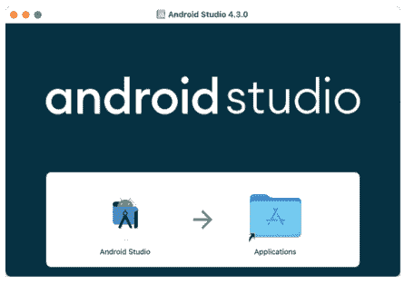

图 2-1

要安装该包，将 Android Studio 图标拖到“应用程序”（Applications）文件夹。Android Studio 包将安装到系统的应用程序文件夹中，此过程通常需要几秒钟完成。

启动 Android Studio，使用 Finder 窗口在应用程序文件夹中找到可执行文件并双击它。

为了以后更方便地访问该工具，从 Finder 窗口将 Android Studio 图标拖到 dock 程序坞上。

#### 2.3.3 在 Linux 上安装

下载 Linux 版 Android Studio 包后，打开终端窗口，切换到要安装 Android Studio 的目录，并执行以下命令：

```
tar xvf /<path to package>/android-studio-<version>-linux.tar.gz
```

注意，Android Studio 包将安装到名为 `android-studio` 的子目录中。因此，假设上述命令在 `/home/demo` 中执行，软件将解压到 `/home/demo/android-studio`。

启动 Android Studio，打开终端窗口，切换到 `android-studio/bin` 子目录，并执行以下命令：

```
./studio.sh
```

### 2.4 Android Studio 设置向导

如果你之前安装过早期版本的 Android Studio，在首次启动此新版本时，可能会出现对话框，提供从之前的 Android Studio 版本导入设置的选项。如果你有以前版本的设置并想将其导入到最新安装中，请选择相应的选项和位置。或者，指示不需要导入任何之前的设置并点击“确定”按钮继续。

如果你是第一次安装 Android Studio，安装过程开始后出现的初始对话框将类似于图 2-2 所示：

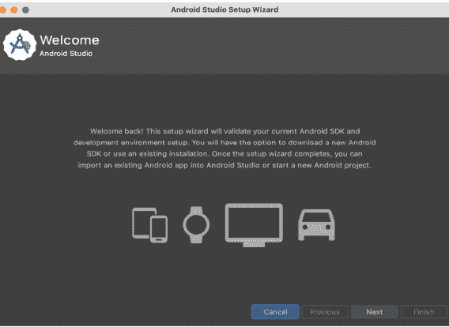

图 2-2

如果出现此对话框，点击“下一步”按钮显示“安装类型”屏幕（图 2-3）。在此屏幕上，在点击“下一步”之前选择“标准”安装选项。

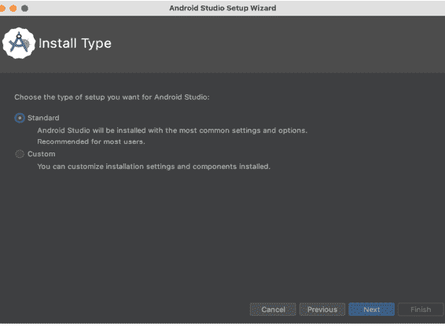

图 2-3

在“选择 UI 主题”屏幕上，根据喜好选择 Darcula 或 Light 主题。选择后，点击“下一步”，并在“验证设置”屏幕上检查选项，然后进入“许可协议”屏幕。选择每个许可类别并启用“接受”复选框。最后，点击“完成”按钮启动安装。

### 2.5 安装额外的 SDK 程序包

除了 Android SDK 包外，还安装了几个用于构建 Android 应用程序的工具。要查看当前安装的包并检查更新，请留在 SDK 设置界面，并如图 2-7 所示选择 SDK 标签。

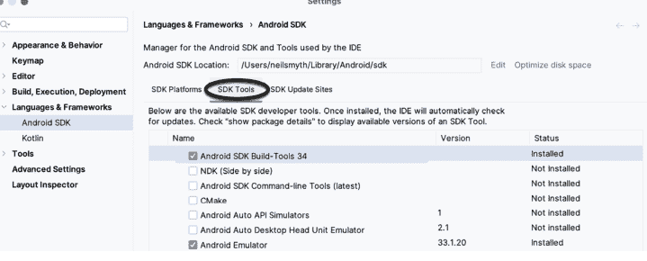

图 2-7

在 Android SDK Tools 界面中，确保以下包在 Status（状态）列显示为 *Installed*（已安装）：

- Android SDK Build-tools
- Android Emulator
- Android SDK Platform-tools
- Google Play Services
- Intel x86 Emulator Accelerator (HAXM installer)
- Google USB Driver (Windows only)
- Layout Inspector image server for API 31-34

注意：Intel x86 Emulator Accelerator (HAXM installer) 无法安装在基于 Apple 芯片的 Mac 上。

如果上述任何包显示为 *Not Installed*（未安装）或需要更新，请勾选这些包旁边的复选框并点击 Apply（应用）按钮启动安装过程。如果出现 HAX 模拟器设置对话框，请选择推荐的内存分配：

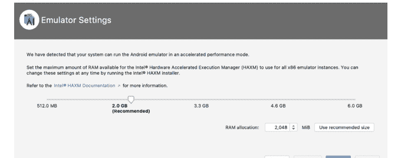

图 2-8

安装完成后，检查包列表并确保选定的包在 Status 列显示为 *Installed*。如果任何包显示为 *Not installed*，请确保它们已被选中并再次点击 Apply 按钮。

### 2.6 安装 Android SDK 命令行工具

Android Studio 包含了允许从操作系统命令行执行某些任务的工具。要在您的系统上安装这些工具，请打开 SDK Manager，选择 SDK Tools 标签，并找到图 2-9 所示的 *Android SDK Command-line Tools (latest)* 包：

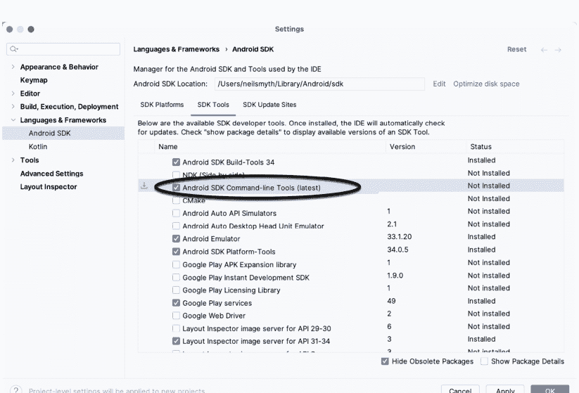

如果命令行工具包尚未安装，请启用它并点击 Apply，然后点击 OK 完成安装。安装完成后，点击 Finish 并关闭 SDK Manager 对话框。

为了让您正在开发的操作系统能够找到这些工具，有必要将它们添加到系统的 PATH 环境变量中。

无论使用何种操作系统，您都需要配置 PATH 环境变量包含以下路径（其中 `<path_to_android_sdk_installation>` 代表您安装 Android SDK 的文件系统位置）：


- `<path_to_android_sdk_installation>/sdk/cmdline-tools/latest/bin`
- `<path_to_android_sdk_installation>/sdk/platform-tools`

您可以通过启动 SDK Manager 并参考设置面板顶部的 **Android SDK Location:** 字段来识别 SDK 在系统上的位置，如图 2-10 所示：

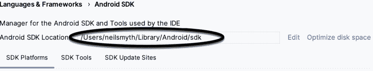

图 2-10

一旦确定了 SDK 的位置，将此添加到 `PATH` 变量的步骤取决于具体的操作系统：

### 2.6.1 Windows 8.1

1. 在开始屏幕上，将鼠标移动到屏幕右下角并从弹出的菜单中选择搜索（Search）。在搜索框中输入 `Control Panel`（控制面板）。当控制面板图标出现在结果区域时，点击它在桌面上启动该工具。

2. 在控制面板中，使用类别（Category）菜单将显示更改为图标（Large Icons）。从图标列表中选择标记为 System（系统）的项。

3. 在环境变量（Environment Variables）对话框中，在系统变量列表中找到 `Path` 变量，选择它并点击 Edit...（编辑）。使用编辑对话框中的 New（新建）按钮向路径添加两个新项。例如，假设 Android SDK 安装在 `C:\Users\demo\AppData\Local\Android\Sdk`，需要添加以下项：

   `C:\Users\demo\AppData\Local\Android\Sdk\cmdline-tools\latest\bin`

   `C:\Users\demo\AppData\Local\Android\Sdk\platform-tools`

4. 点击每个对话框中的 OK 并关闭系统属性控制面板。

按下 `Windows + R` 运行对话框中输入 `cmd` 打开命令提示符窗口。在命令提示符窗口中输入：

```
echo %Path%
```

返回的路径变量值应包含 Android SDK 平台工具文件夹的路径。通过尝试如下运行 `adb` 工具来验证 `platform-tools` 值是否正确：

```bash
adb
```

执行该工具时，它应该输出命令行选项列表。

同样，通过尝试运行 AVD Manager 命令行工具来检查 `tools` 路径设置（如果 `avdmanager` 工具报告 Java 问题请担心，稍后会解决）：

```bash
avdmanager
```

如果其中一个或两个命令出现类似下面的消息，很可能是向 `Path` 环境变量中添加了错误的路径：

`'adb' is not recognized as an internal or external command, operable program or file.`

### 2.6.2 Windows 10

右键点击开始菜单，从弹出的菜单中选择搜索（Search）。在搜索字段中输入“编辑系统环境变量”。在系统属性对话框中，点击环境变量（Environment Variables）按钮。

### 2.6.3 Windows 11

右键点击任务栏上的开始图标并选择搜索（Search）。输入“高级系统设置”。在设置窗口中，点击环境变量（Environment Variables）按钮。

### 2.6.4 Linux

可以通过向主目录下的 `.bashrc` 文件添加命令在 Linux 上实现此配置（具体细节取决于特定的 Linux 发行版）。假设 Android SDK 安装在 `/Android/sdk`，则 `.bashrc` 中的 `export` 行内容如下：

```bash
export PATH=$PATH:/Android/sdk/platform-tools:/Android/sdk/cmdline-tools/latest/bin:/android-studio/bin own
```

另注意，上述命令将 `android-studio/bin` 目录添加到 `PATH` 中。这将使得无论当前目录如何，都可以执行 `studio.sh` 脚本。

### 2.6.5 macOS

可以使用多种技术来修改 macOS 上的 `PATH` 环境变量。认为最干净的方法是在 `/etc/paths.d` 目录下创建一个新文件，其中包含要添加到 `$PATH` 的路径。假设 Android SDK 路径为 `/Users/demo/Library/Android/sdk`，可以通过在 `/etc/paths.d` 目录中创建一个名为 `android-sdk` 的新文件来配置路径，内容如下：

```
/Users/demo/Library/Android/sdk/cmdline-tools/latest/bin
/Users/demo/Library/Android/sdk/platform-tools
```

注意这是一个系统目录，创建文件时需要使用 `sudo` 命令。例如：

```bash
sudo vi /etc/paths.d/android-sdk
```

### 2.7 Android Studio 内存管理

Android Studio 是一个大型且复杂的应用程序，具有许多后台进程。尽管 Android Studio 过去被批评过性能不佳，但 Google 在最近的发布中进行了重大的性能改进，并在每个新版本中持续改进。这些改进允许用户配置 Android Studio 以及构建和运行应用所需的后台进程的内存。这使得软件能够利用大内存系统的优势。

如果您在具有足够空闲内存增加这些值的系统上运行 Android Studio（此功能仅适用于具有 5GB 或更多内存的 64 位系统），并发现 Android Studio 性能出现下降，那么值得尝试这些内存设置。Android Studio 还可能通知您：

可以通过类似于所示的对话框提高性能：

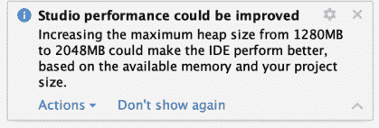

图 2-11

要查看并修改当前内存配置，请选择 `File -> Settings...` 主菜单选项（macOS 上为 `Android Studio -> Settings...`），在弹出的对话框中，选择左侧导航面板中的 Appearance & Behavior（外观与行为），然后选择 System Settings（系统设置）下的 Memory Settings（内存设置）选项，如下图 2-12 所示：

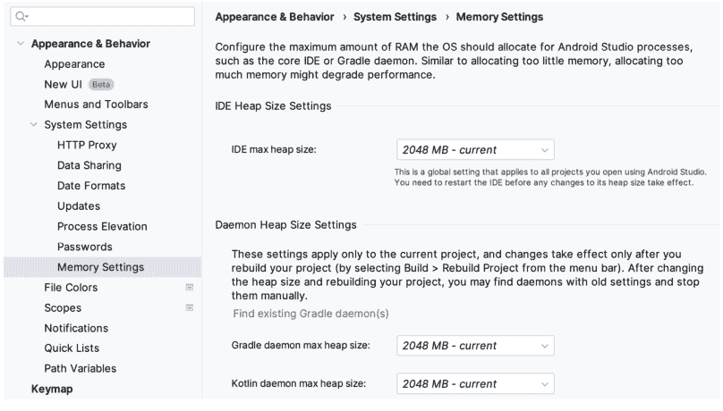

图 2-12

在更改内存分配时，务必不要分配超过必要的内存，也不要超过系统在不影响其他进程的情况下所承受的内存。

IDE 堆大小设置调整分配给 Android Studio 的内存，且无论当前加载什么项目都生效。另一方面，当从 Android Studio 内部构建和运行项目时，会有几个后台进程（称为守护进程）执行编译和运行应用的任务。在编译和运行大型复杂项目时，可以通过调整守护进程堆设置改进构建时间。与 IDE 堆设置不同，这些守护进程设置仅适用于当前项目，且只有在 Android Studio 中打开项目时才能访问。要从打开的项目内部显示 SDK Manager，请从主菜单选择 `Tools -> SDK Manager...` 菜单选项。

### 2.8 更新 Android Studio 和 SDK

Android Studio 和 Android SDK 会不定期地发布新版本。新版本的 SDK 使用 Android SDK Manager 安装。当有更新可安装时，Android Studio 通常会通知你。

要手动检查 Android Studio 更新，请使用 Android Studio 主窗口中的 `Help -> Check for Updates...` 菜单选项（macOS 上为 `Android Studio -> Check for Updates...`）。

### 2.9 总结

在开始开发基于 Android 的应用程序之前，第一步是搭建合适的开发环境。这包括 Android SDK 和 Android Studio IDE（还包含 OpenJDK 开发环境）。本章涵盖了在 Windows、macOS 和 Linux 上安装这些软件包的必要步骤。

## 3. 在 Android Studio 中创建一个示例 Android 应用

本书的前几章节已经解释了如何使用 Android Studio IDE 配置适用于开发 Android 应用程序的环境。在转向稍高级的主题之前，现在是验证所有所需的开发包已安装并运行正常的好机。实现这一目标的最佳方法是创建一个 Android 应用程序并编译运行它。本章将涵盖如何使用 Android Studio 创建 Android 应用程序项目。项目完成后，后续章节将探索使用 Android 模拟器环境对应用程序进行测试运行。

### 3.1 关于项目

在本章创建的项目是一个基础的货币汇率转换器（事实上，它非常简单，只负责从美元转换为欧元，并使用估算汇率进行转换）。该项目还将使用最基础的 Android Studio 项目模板之一。这种简单性允许我们在不让初学者感到负担的情况下，一次引入 Android 应用开发的一些关键方面，例如推荐的应用程序架构和 Android 架构组件。在遵循本章的教程时，请放心，初始示例项目中所使用的技术和代码将在后的部分进行更详细的介绍。

### 3.2 创建新的 Android 项目

应用程序开发过程的第一步是在 Android Studio 环境中创建一个新项目。因此，首先启动 Android Studio，使其出现如图 3-1 所示的“Welcome to Android Studio”屏幕：

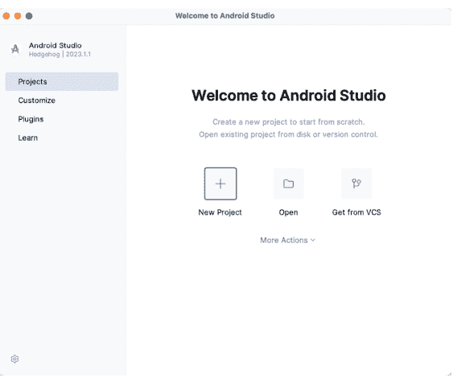

图 3-1

一旦此窗口出现，Android Studio 就已准备好创建新项目。要创建新项目，点击 `New Project` 选项以显示新项目向导的第一个屏幕。

### 3.3 创建 Activity

下一步是定义为应用程序创建的初始 Activity 类型。可以选择为手机和平板板、Wear OS、电视或汽车创建项目。在开发 Android 应用程序时，有一多种 Activity 类型可用，其中许多将在后面的章节中进行详细介绍。然而，对于本示例，请从 Templates 面板中选择 Phone and Tablet 选项，然后选择创建 Empty Views Activity 的选项。Empty Views Activity 选项会创建一个由单个 `TextView` 对象组成的模板用户界面。

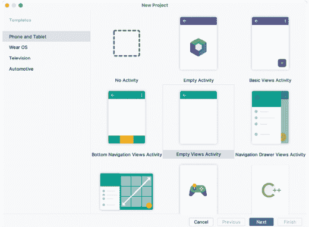

图 3-2

选中 Empty Views Activity 后，点击 Next 继续项目配置。

### 3.4 定义项目和 SDK 设置

在项目配置窗口（图 3-3）中，将 Name 字段设置为 `AndroidSample`。应用程序名称是应用程序在 Android Studio 内部被引用和标识的名称，如果完成的应用程序要在 Google Play 商店出售，也将将使用该名称。

Package name（包名）在 Android 应用程序生态系统中唯一标识应用程序。虽然它可以设置为任何能唯一标识你应用的字符串，但传统上它是基于你域名的反转 URL，后跟应用程序名称。例如，如果你的域名是 `www.mycompany.com`，且应用程序命名为 `AndroidSample`，那么包名可能指定为：`com.mycompany.androidsample`

如果你没有域名，可以在 Domain 字段中输入任何其他字符串，但在发布应用程序之前需要更改：`com.example.androidsample`

Save location（保存位置）设置将默认位于你家目录下的 `AndroidStudioProjects` 中的某个位置，可以通过点击文本字段右侧的文件夹图标进行更改。

将 minimum SDK 设置为 API 26 (Oreo; Android 8.0)。除非某个必要功能仅在较新版本中可用，否则书中创建的大多数项目将使用此最小 SDK。这里的目标是使用最新的 Android SDK 构建应用，同时保留与运行旧版本设备的兼容性（在此情况下，最可追溯到 Android 8.0）。Minimum SDK 设置下方的文本将概述目前运行该应用程序的 Android 设备百分比。点击按钮（在图 3-3 中高亮显示）查看仍在使用的各种 Android 版本的完整细分：

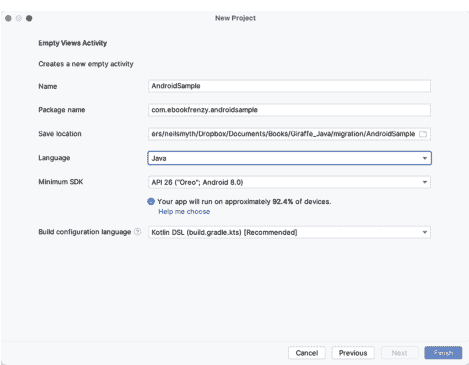

图 3-3

最后，在点击 Finish 创建项目之前，将 Language 菜单更改为 Java 并选择 Kotlin DSL (build.gradle.kts) 作为构建配置语言。

### 3.5 启用新的 Android Studio UI

Android Studio 正在过渡到全新的现代界面，该界面在 Hedgehog 版本中默认未启用。如果你安装的 Android Studio 类似于下面的图 3-4，那么你需要在继续之前启用新 UI：

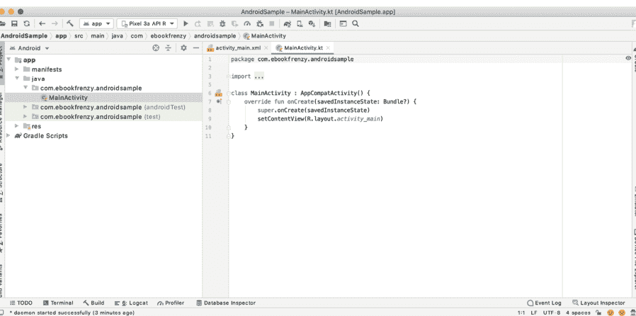

图 3-4

在 (macOS) 上选择 `File -> Settings...` 菜单选项（`Android Studio -> Settings...`），并在左侧面板的 Appearance and Behavior 下选择 New UI 选项来启用新 UI。在主面板中，勾选 Enable new UI 复选框，点击 Apply，然后点击 OK 提交更改：

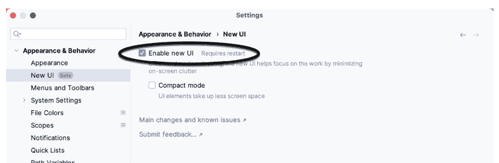

图 3-5

在提示时，重启 Android Studio 以激活新的用户界面。

### 3.6 修改示例应用程序

Android Studio 重启后，主窗口将使用新的 UI 重新出现并包含图 3-6 所示的 `AndroidSample` 项目：

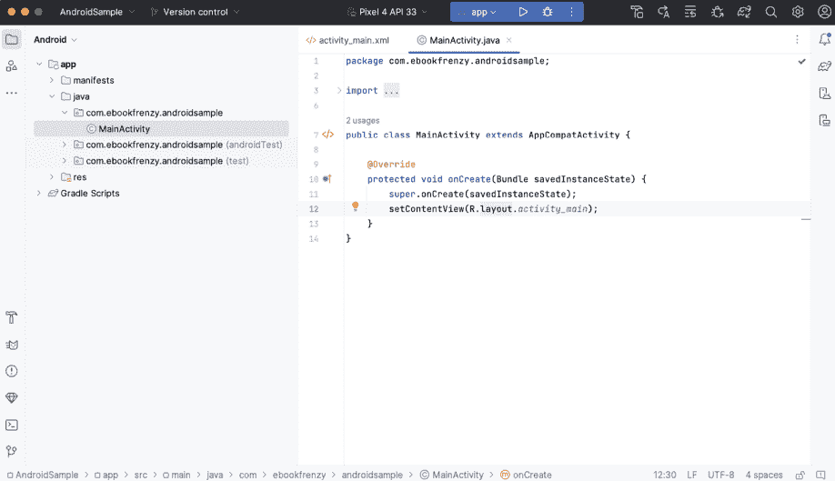

图 3-6

新创建的项目和对相关文件的引用列在主项目窗口左侧的 Project（项目）工具窗口中。Project 工具窗口有多种可以显示信息的模式。默认情况下，此面板应该是 Android 模式。此设置由面板顶部的菜单控制，如图 3-7 所示。如果该面板当前不是 Android 模式，请使用菜单切换模式：

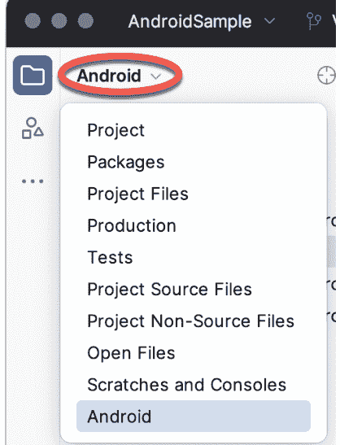

图 3-7

### 3.7 修改用户界面

我们 Activity 的用户界面设计存储在一个名为 `activity_main.xml` 的文件中，该文件位于 Project 工具窗口文件层次结构下的 `app -> res -> layout` 中。在 Project 工具窗口中找到文件后，双击文件将其加载到用户界面 Layout Editor（布局编辑器）工具中，该工具将出现在 Android Studio 主窗口的中间面板：

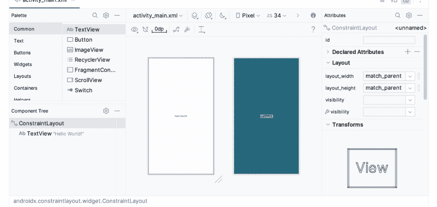

图 3-8

在界面顶部工具栏上有一个菜单（在上面的图中设置为 Pixel），它反映在 Layout Editor 面板中设备的视觉化表示上。点击此菜单可以使用一系列其他设备选项。

使用 System UI Mode（系统 UI 模式）按钮 ( ) 为设备屏幕布局开启或关闭夜间模式。要在设备表示的横屏和竖屏之间切换方向，请使用显示 ( ) 图标的下拉菜单。

正如我们在设备屏幕上看到的，内容布局已经包含一个显示“Hello World!”消息的标签。面板左侧是调色板（Palette），包含了不同类别的用户界面组件，这些组件可用于构建用户界面，例如按钮、标签和文本字段。但需要注意的是，并不是所有的用户界面组件对用户可见的。其中一类就是布局（layouts）。Android 支持多种布局，为视觉用户界面组件在屏幕上的定位和管理提供不同层次的控制。虽然从用户界面的视觉表示很难看出，但当前设计是使用 Constraint（约束）创建的。这可以通过查看 Component Tree（组件树）面板中的信息来确认，该面板默认位于 Layout Editor 面板的左下角，如图 3-9 所示：

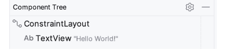

图 3-9

从组件树层级结构可以看出，用户界面布局由一个 `ConstraintLayout` 父对象和一个 `TextView` 子对象组成。

在继续之前，检查 Layout Editor 的 Autoconnect（自动连接）模式是否已启用。这意味着当组件被添加到布局中时，Layout Editor 将自动添加约束，以确保组件在不同的屏幕尺寸和设备方向上正确定位（该主题将在后续章节中进行更详细的介绍）。Autoconnect 按钮出现在 Layout Editor 工具栏中，用一个 U 形图标表示。当被禁用时，图标上会出现一条对角线（图 3-10）。如有必要，点击此按钮重新启用 Autoconnect 模式。

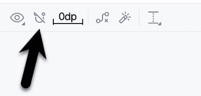

图 3-10

修改应用程序的下一步是向布局添加一些额外的组件，其中第一个是用户点击以启动货币转换的 Button。

Palette（调色板）面板由两列组成，左列包含视图组件类别列表。右列列出当前选择类别包含的组件。在图 3-11 中，当前在 Buttons 类别中选中了 Button 视图：

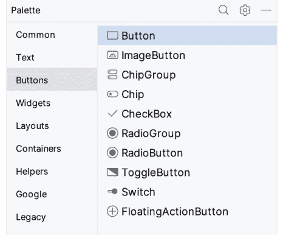

图 3-11

从 Buttons 列表中点击并拖动 `Button` 对象，将其释放到用户界面设计的水平中心，使其位于现有的 `TextView` 组件下方。


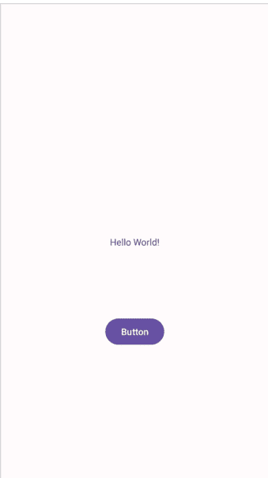

图 3-12

下一步是更改 `Button` 组件当前显示的文本。位于设计区域右侧的面板是 Attributes（属性）面板。该面板显示分配给布局中选中组件的属性。在此面板中，在 Common Attributes（常用属性）部分找到 `text` 属性，并将当前值从“Button”更改为“Convert”，如图 3-13 所示：

```text
strokeWidth
cornerRadius @null
rippleColor @color/color
```

现有的 `TextView` 组件。选中该组件后，使用“属性（Attributes）”工具窗口将 `hint` 属性设置为“dollars”。点击警告图标并将字符串提取为名为 `dollars_hint` 的资源。

在本章稍后编写的代码将需要访问用户在 `EditText` 字段中输入的美元金额值。它将通过引用用户界面布局中分配给组件的 `id` 来实现。在布局中选中组件时，可以在“属性”工具窗口查看并更改 Android Studio 为组件分配的默认 `id`，如图 3-19 所示。

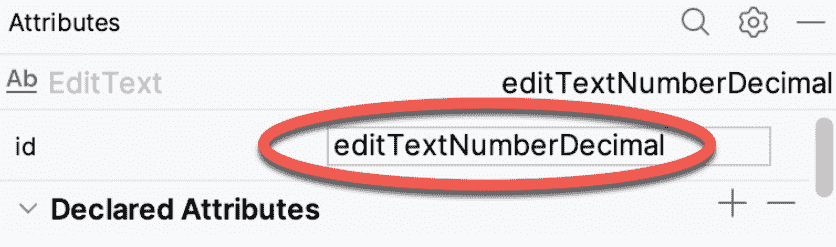

图 3-19

将 `id` 改为 `dollarText`，并在重命名（Rename）对话框中点击“重构（Refactor）”按钮。这将确保项目其他处对旧 `id` 的任何引用都会更新为使用新 `id`：

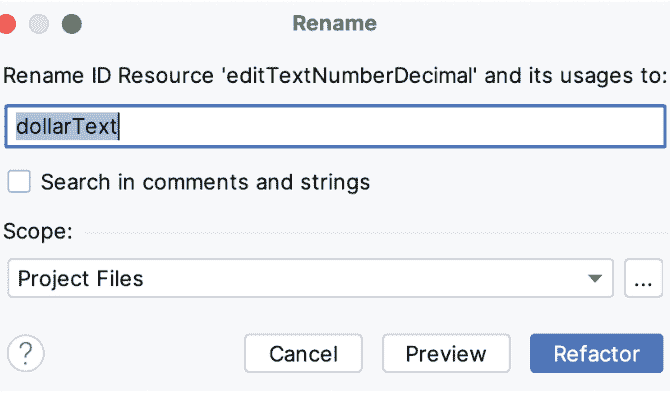

图 3-20

如有必要，重复上述步骤将 `TextView` 组件的 `id` 设置为 `textView`。

点击“推断约束（Infer Constraints）”按钮添加任何缺失的布局约束。此时，布局应该类似于[图 3-21]()所示。

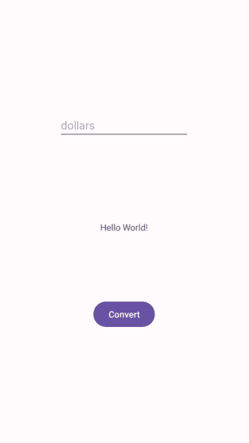

图 3-21

### 3.8 检查布局和资源文件

在继续下一步之前，我们将查看用户界面设计和资源处理的一些内部方面。在上一节中，我们使用布局编辑器（Layout Editor）工具通过修改 `activity_main.xml` 文件来更改用户界面。事实上，布局编辑器所做的只是提供了一种易于编辑文件底层 XML 内容的方法。在实践中，没有理由不直接修改 XML 来更改用户界面，而且在某些情况下，这实际上比使用布局编辑器工具更快。在布局编辑器面板的右上角有视图模式（View Modes）按钮，在下方图 3-22 中标记为 A 到 C：

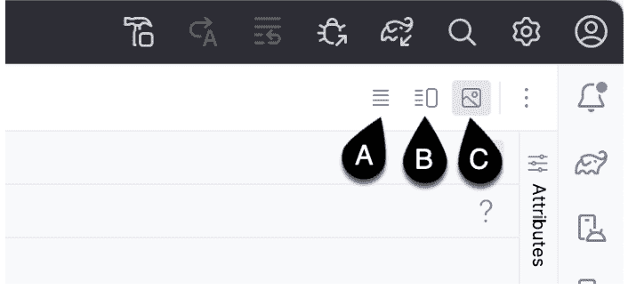

图 3-22

默认情况下，编辑器将处于设计（Design）模式（按钮 C），此时仅显示布局的视觉表示。在代码（Code）模式下，编辑器将显示布局的 XML；而在拆分（Split）模式下，将同时显示布局和 XML，如图 3-23 所示：

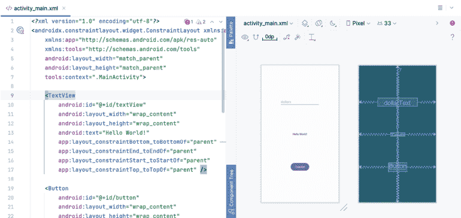

图 3-23

视图模式按钮左侧的按钮（在上述图 3-22 中标记为 B）用于快速在代码模式和拆分模式之间切换。

从 XML 文件的结构可以看出，用户界面由 `ConstraintLayout` 组件组成，该组件又是 `TextView`、`Button` 和 `EditText` 对象的父级。我们还可以看到，例如 `Button` 的 `text` 属性被设置为我们的 `convert_string` 资源。尽管复杂性和内容有所不同，但所有用户界面布局都是这种层次化的、基于 XML 的结构。

当对 XML 布局进行更改时，这些更改将反映在布局画布上。也可以在布局面板内部修改布局，更改将出现在 XML 列表中。要查看操作效果，切换到拆分模式并修改 XML 布局，将 `ConstraintLayout` 的背景颜色更改为红色，如下：

```xml
<?xml version="1.0" encoding="utf-8"?>
<androidx.constraintlayoutlayout.widget.ConstraintLayout
xmlns:android="http://schemas.android.com/apk/res/android"
xmlns:app="http://schemas.android.com/apk/res-auto"
xmlns:tools="http://schemas.android.com/tools"
android:layout_width="match_parent"
android:layout_height="match_parent"
tools:context=".MainActivity"
android:background="#ff2438">

.
.

</androidx.constraintlayoutlayout.widget.ConstraintLayout>
```

注意布局颜色会实时更改以匹配 XML 文件中的新设置。同时注意，在 XML 编辑器的左边距（也称为行槽）中，包含颜色设置的行旁边会出现一个红色小方块。这是属性上设置了红色的视觉提示。点击红色方块将显示颜色选择器，允许选择不同的颜色：

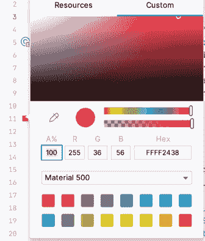

图 3-24

在继续之前，删除布局文件中的背景属性，以便背景恢复到默认设置。

最后，使用项目（Project）面板找到 `app -> res -> values -> strings.xml` 文件并双击它将其加载到编辑器中。目前，XML 的内容如下：

```xml
<resources>
  <string name="app_name">AndroidSample</string>
  <string name="convert_string">Convert</string>
  <string name="dollars_hint">dollars</string>
</resources>
```

为了演示资源的实际作用，将当前分配给 `convert_string` 资源的字符串值更改为“Convert to Euros”，然后通过选择编辑器面板中的布局文件标签页返回布局编辑器。注意布局已经获取了该字符串的新资源值。

另一种快速访问 XML 文件中引用的资源值的方法：在拆分或代码模式下的布局编辑器工具中，点击 `@string/convert_string` 属性设置使其高亮，然后按键盘上按下 `Ctrl-B`（macOS 上为 `Cmd-B`）。Android Studio 随后会打开 `strings.xml` 文件并将您带到该文件中声明此资源的行。利用此机会将字符串资源还原为原始的“Convert”文本，并添加以下额外的字符串资源项，该资源将在应用程序代码中被引用：

```xml
<resources>
  <string name="app_name">AndroidSample</string>
  <string name="convert_string">Convert</string>
  <string name="dollars_hint">dollars</string>
  <string name="no_value">No Value</string>
</resources>
```

也可以通过点击窗口右上角的“打开编辑器（Open editor）”链接使用 Android Studio 翻译编辑器编辑资源字符串。这将主面板显示翻译编辑器：

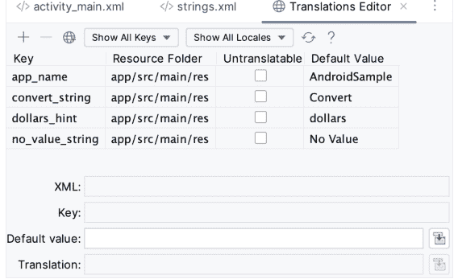

图 3-25

此编辑器允许编辑分配给资源键的字符串并管理多种语言的翻译。

### 3.9 添加交互

此示例项目的最后一步是使应用程序具有交互性，当用户在字段中输入美元金额并点击转换按钮时，转换后的欧元金额显示在 `TextView` 上。这涉及对 `Button` 组件实现事件处理。具体来说，需要配置按钮在触发点击事件时调用代码中的方法。事件处理可以通过多种方式实现，并在“Android 事件处理概述与示例”章节中介绍。返回布局编辑器到设计模式，在布局编辑器中选择按钮组件，引用“属性”工具窗口，并指定如下所示的 `convertCurrency` 方法：

| 常用属性 | |
| :--- | :--- |
| `style` | `@style/Material3.B` |
| `stateListAnimator` | `@animator/m3_btn_state_list_ar` |
| `onClick` | `convertCurrency` |
| `elevation` | |

图 3-26

接下来，在项目工具窗口中（`app -> java -> <package name> -> MainActivity`）双击 `MainActivity.java` 文件将其加载到代码编辑器中，并在类文件中添加 `convertCurrency` 方法的代码，使其内容如下，注意还需要导入一些额外的 Android 包：

```java
package com.ebookrenzy.androidsample;

import androidx.appcompat.app.AppCompatActivity;

import android.os.Bundle;
import android.view.View;
import android.widget.EditText;
import android.widget.TextView;
import java.util.Locale;

public class MainActivity extends AppCompatActivity {

    @Override
    protected void onCreate(Bundle savedInstanceState) {
        super.onCreate(savedInstanceState);
        setContentView(R.layout.activity_main);
    }

    public void convertCurrency(View view) {
        EditText dollarText = findViewById(R.id.dollarText);
        TextView textView = findViewById(R.id.textView);

        if (!dollarText.getText().toString().equals("")) {
            float dollarValue =
                    Float.parseFloat(dollarText.getText().toString());
            float euroValue = dollarValue * 0.85F;
            textView.setText(String.format(Locale.ENGLISH, "%.2f", euroValue));
        } else {
            textView.setText(R.string.no_value_string);
        }
    }
}
```

该方法首先通过调用名为 `findViewById` 的方法并传递布局文件中分配的 ID，获取 `EditText` 和 `TextView` 对象的引用。然后进行检查以确保用户已输入了美元金额，如果是，则提取该值，将其从 `String` 转换为浮点值，并转换为欧元。最后，将结果显示在 `TextView` 控件上。

如果上述任何内容不清楚，请放心，在后面的章节中将更详细地介绍这些概念。特别是使用 `findViewById` 从代码内部访问控件的主题，以及对被称为“视图绑定（view binding）”的替代技术的介绍，将在名为“Android 视图绑定概述”的章节中介绍。

### 3.10 总结

虽然并不极端复杂，但设置 Android 开发环境涉及多个步骤。在完成这些步骤后，值得运行一个示例以确保环境已正确安装和配置。在本章中，我们创建了一个示例应用程序，然后使用 Android Studio 布局编辑器工具修改了用户界面布局。在此过程中，我们探索了尽可能使用资源（特别是字符串值）的重要性，并简要接触了布局。接下来，我们查看了用于存储 Android 应用程序用户界面设计的底层 XML。

最后，在 `Button` 上添加了一个 `onClick` 事件，该事件连接到一个已实现的方法，用于从 `EditText` 组件中提取用户输入，将其从美元转换为欧元，然后在 `TextView` 上显示结果。

应用已准备好进行测试，为测试目的设置模拟器所需的步骤将在下一章节中详细介绍。

## 4. 在 Android Studio 中创建 Android 虚拟设备（AVD）

尽管 Android Studio 的预览面板允许我们看到正在设计的布局，但仍需要编译并运行整个应用以彻底测试其是否运行正常。Android 应用程序可以通过在物理设备或 Android 虚拟设备（AVD）模拟器环境中安装并运行来进行测试。在使用 AVD 之前，必须先创建并配置它以匹配特定设备模型的规格。在本章中，我们将以 Pixel 4 手机作为参考示例创建一个这样的虚拟设备。

### 4.1 关于 Android 虚拟设备

AVD 是模拟器，允许在无需将应用程序安装到物理 Android 设备上的情况下测试 Android 应用程序。AVD 可以配置为模拟各种硬件功能，包括屏幕尺寸、内存容量以及是否存在摄像头、GPS 导航支持或加速度计等功能。Android Studio 标准安装的一部分安装了几个模拟器模板，允许为各种设备配置 AVD。可以通过指定处理器类型、内存容量以及屏幕尺寸和像素密度等属性，来创建自定义配置以匹配任何物理 Android 设备。

AVD 会话可以单独窗口的形式出现，也可以嵌入在 Android Studio 窗口中。

新的 AVD 使用 Android 虚拟设备管理器（Android Virtual Device Manager）创建和管理，该管理器可以在命令行模式或更用户友好的图形用户界面中使用。创建新 AVD 的第一步是启动 AVD 管理器。可以在 Android Studio 环境内通过点击右侧工具窗口栏中的设备管理器（Device Manager）按钮来实现，如图 4-1 所示：

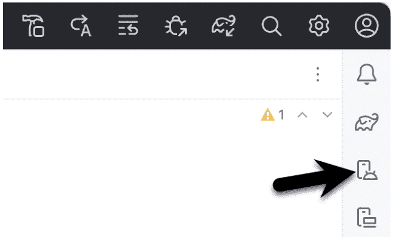

图 4-1

打开后，管理器将以工具窗口的形式出现，如图 4-2 所示：

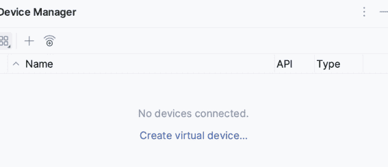

图 4-2

如果你是在计算机上首次安装 Android Studio（而不是升级现有的 Android Studio 安装），安装程序可能已经创建了一个可用的初始 AVD 实例，如[图 4-3](#)所示：

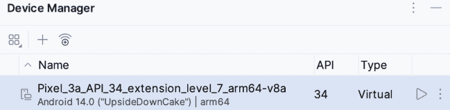

图 4-3

如果你的系统中存在此 AVD，你可以使用它来测试应用。如果没有创建 AVD，或者你想为不同的设备类型创建 AVD，请按照本章其余部分的步骤进行。

要添加新的 AVD，请点击设备管理器工具栏上的“Create virtual device...”链接或“+”按钮，打开“Virtual Device Configuration”（虚拟设备配置）对话框。

#### 虚拟设备配置

#### 选择硬件

选择设备定义

| 类别 | 名称 | Play Store | 尺寸 | 分辨率 | 密度 |
| --- | --- | --- | --- | --- | --- |
| 手机 | Pixel 6 Pro |  | 6.7' | 1440x3120 | 560dpi |
| 平板电脑 | Pixel 6 |  | 6.4' | 1080x2400 | 420dpi |
| Wear OS | Pixel 5 |  | 6.0' | 1080x2340 | 440dpi |
| 桌面 | Pixel 4a |  | 5.8' | 1080x2340 | 440dpi |
| 汽车 | Pixel 4 |  | 5.7' | 1440x2160 | 560dpi |
| 电视 | Pixel 4 XL |  | 6.3' | 1080x2400 | 420dpi |
| 手机 | Pixel 4 |  | 5.8' | 1080x2340 | 440dpi |

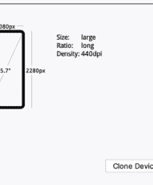

导入硬件配置

图 4-4

在对话框中，执行以下步骤创建兼容 Pixel 4 的模拟器：

1. 从 Category 面板选择 Phone。
2. 选择 Pixel 4 设备并点击 Next。
3. 在 System Image 屏幕上选择最新的 Android 版本。如果尚未安装系统镜像，旁边会有 Download 链接。点击此链接下载系统镜像。
4. 点击 Next。
5. 在 `name` 字段输入描述性名称（例如 Pixel 4 API 34）。
6. 点击 Finish 创建 AVD。
7. 如果以后需要对 AVD 进行修改，请重新打开 Device Manager，选择 AVD 并点击 Actions 列中的铅笔图标进行设置。

### 4.2 启动模拟器

要测试新创建的 AVD 模拟器，从 Device Manager 中选择模拟器并点击启动按钮（Actions 列中的三角形）。模拟器将嵌入 Android Studio 主窗口并开始启动过程。模拟器启动的时间取决于 AVD 及其运行的系统的配置。


```
import android.appcompat.app.AppCompatActivity
import android.os.Bundle
import android.view.View
import android.widget.EditText

class MainActivity : AppCompatActivity() {
    override fun onCreate(savedInstanceState: Bundle?) {
        super.onCreate(savedInstanceState)
        setContentView(R.layout.activity_main)
    }

    fun convertCurrency(view: View) {
        val editText = findViewById(R.id.editText)
        val textView = findViewById(R.id.textView)
        if (editText.text.isNotEmpty()) {
            val dollarValue = editText.text.toString()
            textView.text = $dollarValue
        }
    }
}
```

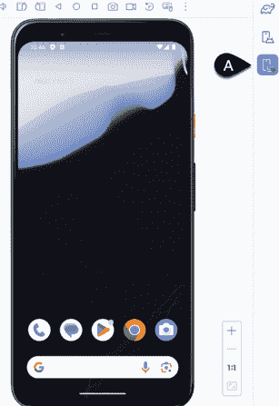

图 4-5

要隐藏和显示模拟器工具窗口，点击 `Running Devices` 工具窗口按钮（如上方标记的 A）。点击标签旁边的“x”关闭按钮（B）退出模拟器。模拟器工具窗口可以容纳多个模拟器会话，每个会话由一个标签表示。[图 4-6](#)例如显示了一个包含两个模拟器会话的工具窗口。

要切换会话，请点击相应的标签。

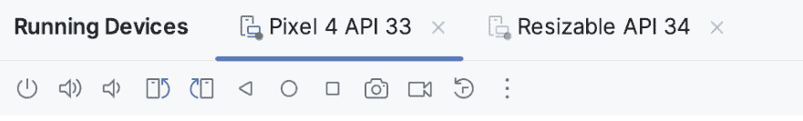

## 图 4-6

尽管模拟器可能默认出现在纵向（portrait orientation），此项及其他默认选项都可以更改。在设备管理器（Device Manager）中，选择新的 Pixel 4 条，并点击设备行操作（Actions）列中的铅图标。在配置屏幕中，找到启动方向（Startup orientation）部分并更改方向设置。退出并重启模拟器会话以查看更改效果。关于模拟器的更多详细信息将在下一章“使用和配置 Android Studio AVD 模拟器”中介绍。

为了在本章的下一节节省时间，请在继续之前保持模拟器运行。

### 4.3 在 AVD 中运行应用程序

配置好 AVD 模拟器后，之前创建的示例`AndroidSample`现在就可以编译并运行了。将`AndroidSample`项目加载到 Android Studio 后，确保新创建的 Pixel 4 AVD 显示在设备菜单中（见下方图 4-7 中的标记 A），然后点击点击由三角形表示的运行按钮 (B)，或者选择 `Run -> Run 'app'` 菜单选项，或使用键盘快捷键 `Ctrl-R`：

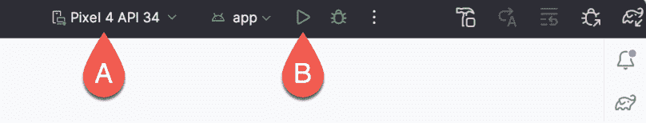

图 4-7

设备菜单 (A) 可用于选择不同的 AVD 实例或物理设备作为运行目标，也可以在多个设备上运行应用。该菜单还提供了访问设备管理器以及设备连接配置和故障排除选项的入口：

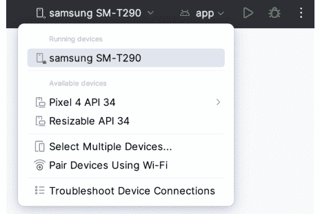

图 4-8

一旦应用程序安装并运行，第一个片段（fragment）的用户界面将出现在模拟器中（片段是 Android 项目中一个可重用的部分，通常由用户界面布局和一些代码组成，该主题将在本章名为“Android 片段简介”的章节中介绍）：

## 图 4-9

一旦运行过程开始，运行（Run）工具窗口将会出现。当应用程序安装并启动时，运行工具窗口将显示诊断信息。图 4-10 显示了典型成功启动应用程序的运行工具窗口输出：

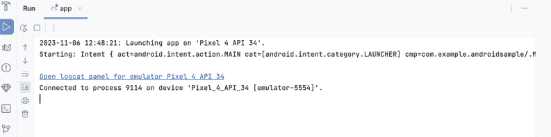

## 图 4-10

如果在启动过程中遇到问题，运行工具窗口将提供信息帮助隔离问题原因。

假设应用程序加载到模拟器并按预期运行，我们已安全地验证了 Android 开发环境已正确安装和配置。在应用运行时，尝试进行货币转换以验证应用是否按预期工作。

### 4.4 在多个设备上运行

图 4-8 所示的运行目标菜单包含一个在多个模拟器和设备上并行运行应用的选项。选择此选项时，将显示图 4-11 所示的对话框，提供系统上配置的 AVD 列表以及任何连接的物理设备。在点击运行按钮之前，启用目标模拟器或设备旁边的复选框：

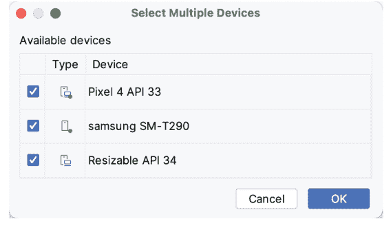

图 4-11

点击运行按钮后，`Android Studio` 将在所选模拟器和设备上启动应用。

### 4.5 停止正在运行的应用程序

要停止正在运行的应用程序，点击主工具栏上的停止按钮，如图 4-12 所示：

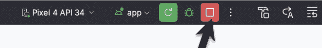

## 图 4-12

应用程序也可以通过运行工具窗口终止。首先使用应用运行时变为可窗口按钮显示*运行（Run）*工具窗口。一旦运行工具窗口出现，点击下方图 4-13 所示的高亮停止按钮：

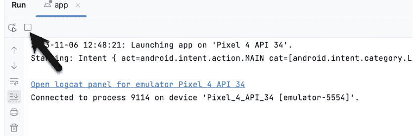

## 图 4-13

### 4.6 支持深色主题

要测试应用在启用深色主题时的行为，请模拟器中运行的 Android 实例打开设置应用，选择“显示（Display）”类别，并如图 4-14 所示启用“深色主题（Dark theme）”选项：

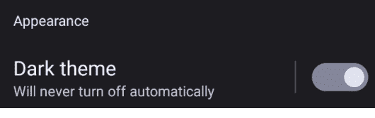

## 图 4-14

启用深色主题后，运行`AndroidSample`应用，并注意它以深色主题显示，包括黑色背景和按钮上的紫色背景颜色，如图 4-15 所示：

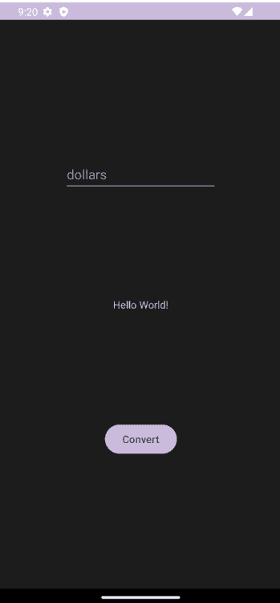

## 图 4-15

在继续之前，返回设置应用并关闭深色主题模式。

### 4.7 在单独窗口中运行模拟器

到本章为止，我们仅将模拟器作为嵌入主 Studio 窗口的工具使用。通过点击图 4-16 所示的设置按钮，可以将模拟器配置为独立窗口显示：

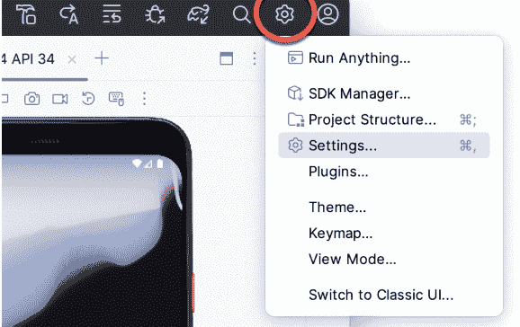

图 4-16

在设置对话框中，导航到 `Tools -> Emulator` 并禁用“在窗口中启动（Launch in window）”选项：

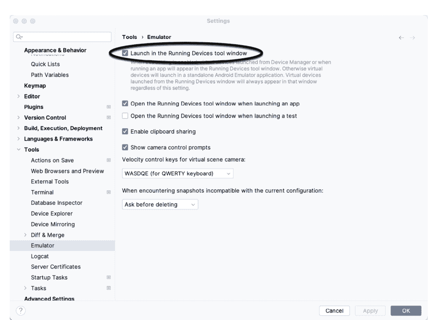

## 图 4-17

禁用选项后，点击 `Apply` 后按 `OK` 提交更改，然后退出模拟器。再次运行应用，此时模拟器将作为一个单独窗口出现，如下所示：

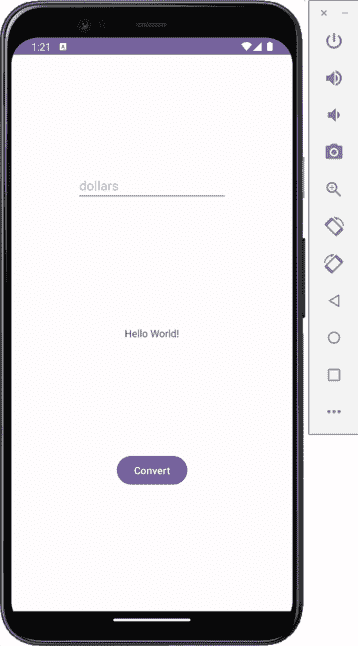

选择独立模式取决于个人喜好。然而，如果你喜欢工具窗口，请记住通过点击图 4-19 所示的按钮也可以将模拟器从 Android Studio 窗口分离：


## 图 4-19

从菜单中选择 `View -> Float` 来分离工具窗口：

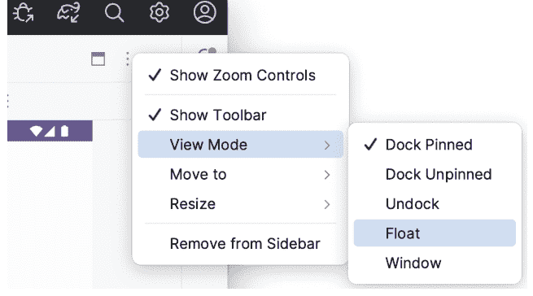

## 图 4-20

要重新固定工具窗口，点击图 4-21 所示的 `Dock` 按钮：

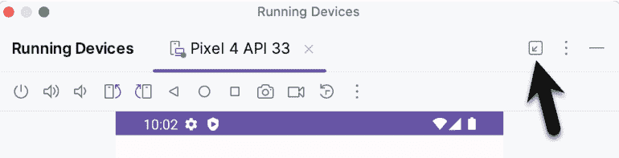

图 4-21

### 4.8 移除设备框

模拟器可以配置为带有或不带设备框。要更改，退出模拟器，打开设备管理器，选择 AVD，并点击图 4-22 所示的选项：

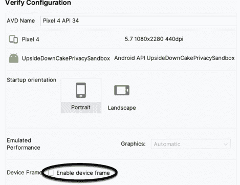

图 4-22

选择编辑选项，并在屏幕上关闭“启用设备框（Enable device frame）”，然后点击 `Finish`：


## 图 4-23

一旦禁用了设备框，下次启动模拟器时将如图 4-24 所示：


## 图 4-24

### 4.9 总结

典型的应用程序开发过程遵循编码、编译和运行循环。Android 应用程序可以在物理 Android 设备或 Android 虚拟设备（AVD）模拟器上进行测试。AVD 使用 Android 设备管理器进行创建和管理，该工具可以通过命令行或图形用户界面使用。

## 5. 使用和配置 Android Studio AVD 模拟器

在下一章探索物理 Android 设备之前，本章将花一些时间提供 Android Studio AVD 模拟器的概述，并突出介绍独立窗口和工具窗口模式下可用的许多配置功能。

### 5.1 模拟器环境

当以独立模式启动时，模拟器在加载过程中会显示初始启动屏幕。加载完成后，将主模拟器窗口，包含所选设备类型的表示（如图 5-1 所示），这是一个 Pixel 4 设备：

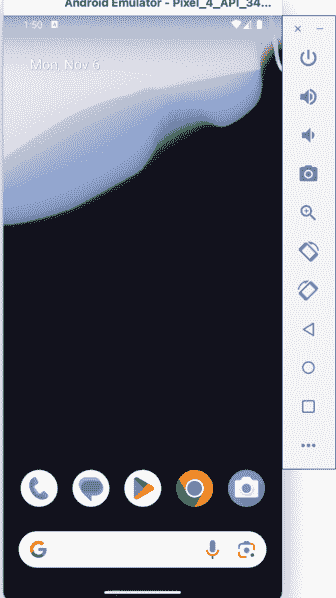

## 图 5-1

位于窗口右边缘的工具栏提供了快速访问模拟器控制和配置选项的通道。

### 5.2 模拟器工具栏选项

模拟器工具栏（图 5-2）提供了与模拟器环境外观和行为相关的系列选项。

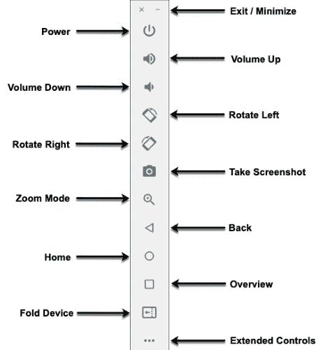

## 图 5-2

工具栏中的每个按钮都关联有一个键盘快捷键，可以通过将鼠标指针悬停在按钮上等待工具提示出现，或者通过扩展控制面板的帮助选项来识别。

尽管工具栏中的许多选项是自言自懂的，但为了完整起见，我们将对每个选项进行介绍：

- **退出 / 最小化** – 工具栏最顶部的“x”按钮在选中时会退出模拟器会话，而“-”选项则会最小化整个窗口。

- **电源** – 电源按钮模拟物理 Android 设备上的电源按钮。点击并释放此按钮将锁定设备并关闭屏幕。长按此按钮将启动设备的“关机”请求序列。

- **音量增大/减小** – 两个控制模拟器环境内播放音频音量的按钮。

- **左转/右转** – 在模拟的设备竖屏和横屏方向之间旋转。

- **截图** – 截取设备屏幕显示内容的屏幕。捕获的图像存储在扩展控制面板设置屏幕指定的位置，本文将在本章稍后部分进行概述。

- **缩放模式** – 此按钮用于在缩放模式之间切换，其细节将在本章稍后部分介绍。

- **返回** – 执行标准的 Android“返回”导航以返回上一个屏幕。

- **主页** – 显示设备的主屏幕。

- **概览** – 模拟标准的 Android“概览”导航，该功能会显示设备上正在运行的应用。

- **折叠设备** – 模拟折叠屏设备的折叠和展开。此选项仅在模拟器运行折叠设备系统镜像时才可用。

- **扩展控制** - 显示扩展控制面板，允许配置如模拟位置和电话活动、电池强度、蜂窝网络类型和指纹识别等选项。

### 5.3 在缩放模式下工作

位于模拟器工具栏的缩放按钮用于在缩放模式之间切换。当缩放模式激活时，工具栏按钮处于按下状态，且鼠标指针悬停在设备屏幕上时显示为放大镜。点击左键将导致显示相对于屏幕上的选定点进行放大，重复点击将增加缩放级别。相反，点击右键将降低缩放级别。关闭缩放按钮将显示恢复到默认大小。

在缩放模式下，点击并拖动将定义一个矩形区域，释放鼠标按钮后视图将缩放至该区域。

在缩放模式下，可以使用模拟器窗口内的水平和垂直滚动条对屏幕可见区域进行移动。

### 5.4 调整模拟器窗口大小

模拟器窗口的大小（以及设备相应的表示）可以通过启用缩放模式并在窗口的任何角或边上点击并拖动来随时更改。

### 5.5 扩展控制选项

扩展控制工具栏按钮显示图 5-3 所示的面板。默认情况下将显示位置设置。从左侧面板中选择不同的类别将显示相应的控件组：


## 图 5-3

### 5.5.1 位置

位置控制允许以十进制或六十进制坐标将模拟位置信息发送到模拟器。位置信息可以是单个位置的形式，也可以代表设备移动的点序列，后者通过 GPS 交换 (GPX) 或 `Keyhole` 标记语言 (KML) 格式的文件提供。或者，可以使用集成的 `Google Maps` 面板视觉化地选择单点或旅行路线。

### 5.5.2 显示

除了模拟器屏幕内显示的主显示器外，“显示”选项允许在同一个 Android 实例中运行额外的显示器。这对于测试如 Microsoft Surface Duo 等双屏设备的应用非常有用。这些额外的屏幕可以配置为任何所需的尺寸，并与主屏幕一起在同一个模拟器窗口中显示。

### 5.5.3 蜂窝

可以在蜂窝设置屏幕内更改正在模拟的蜂窝连接类型。除了模拟不同的网络类型（CSM、EDGE、HSDPA 等）外，还可以模拟各种语音和数据场景，如漫游和拒绝访问。

### 5.5.4 电池

可以在扩展控制屏幕的此面板上模拟各种电池状态和充电条件，包括电池电量、电池健康以及当前是否连接了交流充电器。

### 5.5.5 摄像头

当摄像头激活时，模拟器会模拟 3D 场景。这表现为虚拟建筑的内部，在模拟器内录制视频或拍照之前，可以通过在使用鼠标指针和键盘时按住 `Option` 键（Windows 上的 `Alt` 键）在其中导航。此扩展配置选项允许上传不同的图像以显示在虚拟环境中。

### 5.5.6 电话

电话扩展控制在模拟器中提供了两个简单但实用的模拟。第一个选项模拟来自指定电话号码的入电。这在测试应用如何处理高级中断时特别有用。

第二个选项允许在模拟器会话中模拟接收短信。与现实世界一样，这些消息会出现在消息应用中，并触发模拟器内的标准通知。

### 5.5.7 方向键

方向键（D-Pad）是内置在 Android 设备中或外部连接（如游戏控制器）的一组额外控件，提供方向控制（左、右、上、下）。方向键设置允许在模拟器内模拟 D-Pad 交互。

### 5.5.8 麦克风

麦克风设置允许启用麦克风并模拟虚拟耳机和麦克风连接。还提供了一个按钮启动模拟器上的语音助手。

### 5.5.9 指纹

许多 Android 设备现在配备了内置指纹检测硬件。AVD 模拟器使得测试指纹认证成为可能，无需带有指纹传感器的物理设备上测试应用。在模拟器内配置指纹测试的细节将在本章稍后部分介绍。

### 5.5.10 虚拟传感器

虚拟传感器选项允许模拟加速度计和磁力计，以模拟设备的物理运动，如旋转、移动以及通过航向、俯仰和横滚进行的倾斜。

### 5.5.11 快照

快照包含当前运行 AVD 会话的状态，可以保存并快速恢复，使模拟器轻松返回到精确状态。快照将在本章稍后介绍。

### 5.5.12 录制与播放

允许对模拟器屏幕和音频进行录制并保存为 WebM 或动态 GIF 格式。

### 5.5.13 Google Play

如果模拟器运行安装了 Google 服务的 Android 版本，此选项将显示 `Google Play` 版本。它还提供了更新模拟器到最新版本的选项。

### 5.5.14 设置

设置面板提供了一组配置选项。使用此面板为工具栏和扩展控制面板选择较深色的主题，指定截图保存的文件系统位置，配置 `OpenGL` 支持级别，并配置模拟器窗口位于桌面上其他窗口之上。

### 5.5.15 帮助

帮助屏幕包含三个子面板，包含快捷键列表、访问模拟器在线文档和报告错误并发送反馈的链接以及模拟器版本信息。

### 5.6 使用快照

当模拟器首次启动时，它会执行*冷启动*，就像物理 Android 设备开机一样。这种冷启动过程需要一些时间才能完成，因为操作系统正在加载，所有后台进程正在启动。为了避免每次启动模拟器时都经历这一过程，系统被配置为每次退出时自动保存模拟器当前状态的快照（称为快速启动快照）。下次启动模拟器时，快速启动快照将加载到内存中，并从上次离开的地方继续执行，允许模拟器所需的时间仅为冷启动完成时间的一小部分。

扩展控制面板的“快照”（Snapshots）屏幕可以在模拟器运行过程中的任何时候存储额外的快照。这保存了整个模拟器的精确状态，允许模拟器恢复到拍摄快照时的精确时间点。在器屏幕中，可以使用“拍摄快照”（Take Snapshot）按钮（图 5-4 中的标记 A）拍摄快照。要恢复现有快照，请从列表 (B) 中选择它，并点击屏幕底部的运行按钮 (C)。还提供了编辑 (D) 快照名称和描述，以及删除 (E) 当前选中快照的选项：


## 图 5-4

你还可以通过主工具栏中的运行目标菜单中进行选择，决定使用冷启动、最近的快速启动快照或之前的快照来启动模拟器，如图 5-5 所示：


## 图 5-5

## 5.7 配置指纹模拟

模拟器允许配置多达 10 个模拟指纹，用于测试 Android 应用中的指纹认证。配置模拟指纹的第一步是启动模拟器、打开“设置”（Settings）应用并选择“安全”（Security）选项。

在安全设置屏幕中，选择“指纹”（fingerprint）选项。在生成的屏幕上，点击“下一步”（Next）按钮进入指纹设置屏幕。在启用指纹安全之前，必须配置备份屏幕解锁方法（如 PIN）。输入并确认合适的 PIN，并通过接受默认通知选项来完成 PIN 输入过程。


继续后续屏幕，直到“设置”应用请求在传感器上指纹。此时，显示扩展控制对话框，在左侧面板中选择“指纹”类别，并确保主设置面板中选择了“指纹 1”（Finger 1）：


图 5-6

点击“触摸传感器”（Touch Sensor）按钮模拟指纹 1 触摸指纹传感器。模拟器将报告指纹添加成功：

# 指纹已添加

现在你可以使用指纹解锁手机或验证身份，例如在登录应用时。


图 5-7

要添加更多指纹，请点击“添加另一个”（Add Another）按钮，并在再次点击“触摸传感器”按钮之前，从扩展控制面板菜单中选择另一个手指。

## 5.8 工具窗口模式下的模拟器

正如上一章（“在 Android Studio 中创建 Android 虚拟设备 (AVD)”）所述，Android Studio 可以配置为在嵌入式工具窗口中启动模拟器，这样它就不会出现在独立的窗口中。当在此模式下运行时，工具栏中将提供与独立模式下相同的控制控件，如图 5-8 所示：


图 5-8

从左到右，这些按钮执行以下任务（细节与独立模式的一致）：

- 电源（Power）
- 音量增大（Volume Up）
- 音量减小（Volume Down）
- 向左旋转（Rotate Left）
- 向右旋转（Rotate Right）
- 返回（Back）
- 主页（Home）
- 概览（Overview）
- 截图（Screenshot）
- 快照（Snapshots）
- 扩展控制（Extended Controls）

## 5.9 创建可调整大小的模拟器

除了配置匹配特定 Android 设备型号的模拟器外，Android Studio 还提供了一种可调整大小的 AVD，允许你在平板电脑和折叠屏设备尺寸之间切换。要创建一个可调整大小的模拟器，打开“设备管理器”（Device Manager）并点击“+”工具栏按钮。接下来，选择图 5-9 所示的可调整大小的设备定义，并按照通常步骤创建新的 AVD：


图 5-9

在工具窗口内的新模拟器上运行应用时，工具栏中会出现“显示模式”（Display mode）选项，允许你在模拟器配置之间切换，如图 5-10 所示：


图 5-10

如果模拟器在独立模式下运行，可以在侧边工具栏找到“显示模式”选项，如下所示：


### 5.10 总结

Android Studio 包含一个 Android 虚拟设备模拟器环境，旨在让无需在物理 Android 设备上运行即可轻松测试应用程序。本章对模拟器进行了简要介绍，并强调了用于配置和自定义环境以模拟不同测试条件的关键功能。

## 6. Android Studio 用户界面概览

虽然急于运行上一章创建的示例应用很诱人，但它涉及使用 Android Studio 用户界面的某些方面，这些内容最好预先进行描述。

Android Studio 是一个强大且功能丰富的开发环境，在很大程度上用起来是直观的。尽管如此，现在花时间熟悉 Android Studio 用户界面的布局和组织，将缩短书中后续章节的学习曲线。基于此，本章将提供 Android Studio 环境各个区域和组件的概述。

### 6.1 欢迎界面

欢迎界面（图 6-1）在 Android Studio 运行但没有打开项目时显示（可以通过选择“文件 -> 关闭项目”选项随时关闭已打开的项目）。如果 Android Studio 在打开项目时之前退出，则该工具在下次启动时将跳过欢迎界面，自动打开之前活跃的项目。


图 6-1

除了最近的项目列表，欢迎界面还提供了执行打开和创建项目等任务的操作，以及访问版本控制的项目。此外，“自定义”（Customize）屏幕提供了更改 IDE 和编辑器使用的的主题和字体设置选项。可以使用“插件”（Plugins）选项查看、安装和管理 Android 插件。

通过选择“更多操作”（More Actions）链接或在项目列表替换该链接时使用图 6-2 所示的菜单可以使用其他选项：

### 6.2 菜单栏

创建新项目或打开现有项目时会出现 Android Studio 窗口。打开多个项目时，每个项目将有自己的主窗口。窗口的精确配置取决于运行 Android Studio 的操作系统以及上次打开项目时显示了哪些工具和面板。例如，主菜单栏的外观取决于主机操作系统。在 macOS 上，Android Studio 遵循将主栏放置在桌面顶部的标准做法，如图 6-3 所示：


图 6-3

然而，当 Android Studio 在 Windows 或 Linux 上运行时，可以通过图 6-4 中高亮的按钮访问主菜单：


图 6-4

### 6.3 主窗口

一旦打开项目，Android Studio 主窗口通常类似于图 6-5 所示：


图 6-5

主窗口的各种元素可以总结如下：

#### A - 工具栏 (Toolbar)

一组常用操作的快捷键选择。工具栏按钮提供了快速访问一组特定菜单的操作。可以通过在工具栏上点击右键并选择“自定义工具栏...”（Customize Toolbar...）菜单选项来自定义工具栏。图 6-6 显示的工具栏提供了一种方便的方法来执行创建和打开项目以及在打开多个项目时切换窗口等任务：


图 6-6

#### B - 导航栏 (Navigation Bar)

导航栏为构成项目的文件和文件夹之间的移动提供了方便的方法。点击导航栏中的元素将展开菜单，列出该位置的子文件夹和文件以供选择。同样，点击类名将显示包含在该类中的方法列表：


图 6-7

从列表中选择一个方法将跳转到代码编辑器中的相应位置。你可以使用 View -> Appearance -> Navigation Bar（视图 -> 外观 -> 导航栏）菜单选项隐藏、显示和更改此栏的位置。

#### C - 编辑窗口 (Editor Window)

编辑器窗口显示开发者正在工作的文件。当打开多个文件时，每个文件都由编辑器顶部的标签表示，如图 6-8 所示：


图 6-8

#### D - 状态栏 (Status Bar)

状态栏显示有关项目和 Android Studio 活动的提示消息。悬停在字段项上将显示该字段的描述。许多字段是交互式的，允许用户点击以执行任务或获取更详细的状态信息。

图 6-9

可以使用 View -> Appearance -> Status Bar Widgets（视图 -> 外观 -> 状态栏组件）菜单更改状态栏中显示的组件。

#### E - 项目工具窗口 (Project Tool Window)

项目工具窗口提供了项目文件结构的层次结构概述，允许对特定文件和文件夹进行导航。可以使用工具栏以几种不同的方式显示项目。默认设置是 Android 视图，这是本书其余部分主要使用的模式。

项目工具窗口只是 Android Studio 环境中众多工具之一。

### 6.4 工具窗口 (The Tool Windows)

除了项目工具窗口外，Android Studio 还包含许多其他窗口，启用这些窗口时，会显示沿主窗口左右边缘分布的*工具窗口栏*（tool window bars），并包含用于显示和隐藏每个工具窗口的按钮。图 6-10 显示了典型的工具窗口栏配置，尽管按钮及其位置可能会根据你的 Android Studio 安装情况而不同。


点击按钮将显示相应的工具窗口，再次点击将隐藏该窗口。工具窗口栏中按钮的位置表示窗口在显示时将出现在窗口的哪侧。可以通过点击并拖动按钮到其他窗口工具栏的不同位置来更改这些位置。

Android Studio 提供了各种工具窗口，最常用的如下：

- **Project (A) - 项目** - 项目视图提供了构成项目的文件结构概述，允许在文件之间快速导航。通常情况下，在项目视图中双击文件将导致该文件加载到相应的编辑工具中。
- **Resource Manager (B) - 资源管理器** - 用于在项目内添加和管理资源和资产，如图像、颜色和布局文件。
- **More Tool Windows (C) - 更多工具窗口** - 显示包含当前未在工具窗口栏中显示的额外工具窗口的菜单。从菜单中选择工具窗口时，它将作为按钮出现在工具窗口栏中。
- **Run (D) - 运行** - 当应用程序运行时，运行工具窗口将可用，并提供运行结果以及停止或重启正在运行进程的选项。如果应用程序在设备或模拟器上安装和运行失败，此窗口通常会提供有关问题的诊断信息。
- **Logcat (E) - Logcat** - Logcat 工具窗口提供了访问运行应用程序监控日志输出的，以及拍摄应用程序截图、视频以及停止和重启进程的选项。
- **Problems (F) - 问题** - 查看项目内所有当前错误或警告的中心位置。双击问题列表中的项将带你转到问题所在的文件和位置。
- **App Quality Insights (G) - 应用质量洞察** - 提供访问云端 Firebase 应用质量和崩溃分析平台。
- **Terminal (H) - 终端** - 提供访问运行 Android Studio 的系统上的终端窗口。在 Windows 系统上，这是命令提示符界面，而在 Linux 和 macOS 系统上，它以终端提示符的形式存在。
- **Version Control (I) - 版本控制** - 项目文件受源代码版本控制时使用此工具窗口，允许访问 Git 仓库和代码更改历史。
- **Notifications (J) - 通知** - 项目文件受源代码版本控制时使用此工具窗口。
- **Gradle (K) - Gradle** - Gradle 工具窗口提供了编译项目涉及的任务视图。
- **Device Manager (L) - 设备管理器** - 提供访问设备管理界面，可以在其中添加、删除和管理物理设备连接和模拟器。
- **Running Devices (M) - 运行中的设备** - 如果启用了选项，则包含 AVD 模拟器。
- **App Inspection - 应用检查** - 提供访问数据库和后台任务检查器。
- **Bookmarks - 书签** - 书签工具窗口提供了快速访问已书签的文件和代码行。
- **Build - 构建** - 构建工具窗口显示项目在编译和打包时的构建过程信息。
- **Build Variants - 构建变体** - 构建变体工具窗口提供了一种为当前应用程序配置不同构建目标的快速方法。
- **Device File Explorer - 设备文件浏览器** - 直接访问当前连接的设备或模拟器的文件系统。
- **Layout Inspector - 布局检查器** - 提供构成用户界面布局的组件结构的视觉 3D 渲染。
- **Structure - 结构** - 结构工具提供编辑器当前显示的源文件结构的高级视图。
- **TODO** - 如名称所示，此工具提供了一个查看项目中尚未完成项的地方。

### 6.5 工具窗口菜单 (The Tool Window Menus)

每个工具窗口在顶部边缘都有自己的工具栏。

这些工具栏中的菜单按钮随工具的不同而异，但所有工具窗口都包含一个“选项”（Options）菜单（如图 6-11 所示，在图 6-11 中标记为 A）：


图 6-11

选项菜单允许更改窗口的各个方面。例如，图 6-12 显示了项目（Project）工具窗口的选项菜单。例如，某些设置可以将窗口取消固定（undock）并允许其浮在 Android Studio 主窗口边界之外，还可以移动和调整工具面板的大小：


图 6-12

所有工具窗口的工具栏右侧还包含一个按钮（在上面的图 6-11 中标记为 B），提供了隐藏工具窗口的额外方法。可以通过点击窗口使其获得焦点，然后输入搜索词（例如项目工具窗口中的文件名），对工具窗口内的项目进行搜索。搜索框将出现在窗口的工具栏中，匹配搜索结果的项目将高亮显示。

### 6.6 Android Studio 快捷键

Android Studio 包含许多快捷键，以便在执行常用任务时节省时间。可以通过选择 Help（帮助）-> Keyboard Shortcuts（快捷键）PDF 菜单选项，在 Android Studio 项目中查看并打印完整的快捷键映射列表。您也可以通过打开 Settings（设置）对话框并点击 Keymap（键映射）项来列出并修改快捷键，如下图 6-13 所示：


图 6-13

### 6.7 切换器和最近文件导航

另一种使用 Switcher（切换器）在 Android Studio 最小窗口内进行导航的有用机制。通过 Ctrl-Tab 快捷键访问，切换器会作为一个面板出现，列出所有工具窗口和当前打开的文件（图 6-14）。


图 6-14

一旦显示，只要按住 Ctrl 键，Switcher 就会保持可见。按住 Ctrl 的同时反复点击 Tab 键可以在不同的选择选项之间循环，释放 Ctrl 键则会选择当前高亮的项并在主窗口中显示。

除了 Switcher 之外，Recent Files（最近文件）面板提供了到最近打开文件的导航（图 6-15）。可以使用 Ctrl-E 快捷键（macOS 上为 Cmd-E）访问。一旦显示，可以使用鼠标指针选择选项，或使用键盘箭头键滚动文件名和工具窗口选项。按下 Enter（回车）键将选择当前高亮的项：


图 6-15

### 6.8 更改 Android Studio 主题

可以使用 Settings 对话框更改 Android Studio 环境的主题。一旦显示设置对话框，在左侧面板中选择 Appearance & Behavior（外观与行为），然后选择 Appearance（外观）。随后在点击 OK 按钮之前更改 Theme（主题）菜单的设置。可用的主题取决于平台，但通常包括 Light（浅色）、IntelliJ、Windows、High Contrast（高对比度）和 Darcula 等选项。图 6-16 显示了选择了 Dark（深色）主题的主窗口示例。

图 6-16

要将 Android Studio 主题与操作系统的暗模式设置同步，请启用 Sync with OS（与操作系统同步）选项，并使用下拉菜单控制每种模式使用什么主题：


图 6-17

### 6.9 总结

Android Studio 环境的主要元素包括欢迎界面和主窗口。每个打开的项目都有自己的主窗口，主窗口又由菜单栏、工具栏、编辑和设计区域、状态栏以及工具窗口集合组成。工具窗口出现在主窗口的侧边。

Android Studio 中有极少的操作无法通过快捷键触发。可以随时从 Android Studio 主窗口内访问默认快捷键的键映射。

## 7. 在物理 Android 设备上测试 Android Studio 应用

虽然使用 Android 虚拟设备 (AVD) 测试应用程序可以实现很多，但在物理 Android 设备上进行真实的应用测试是不可替代的，某些 Android 功能仅在物理设备上可用。

与 AVD 实例和连接的 Android 设备之间的通信由 Android Debug Bridge (ADB) 处理。本章将解释如何在基于 macOS、Windows 和 Linux 的系统上配置 ADB 环境，以便在 Android 设备上进行应用测试。

### 7.1 Android Debug Bridge (ADB) 概述

ADB 的主要目的是促进开发系统（Android Studio）与 AVD 模拟器以及 Android 设备之间的交互，以运行和调试应用程序。ADB 允许您通过 WiFi 或 USB 线连接到设备。

ADB 由客户端、一个在开发系统后台运行的服务器进程以及一个运行在 AVD 或真实 Android 设备（如手机和平板）上的守护程序后台进程组成。

ADB 客户端有多种形式。例如，在 Android SDK platform-tools 子目录下提供了一个名为 `adb` 的命令行工具作为客户端。同样，Android Studio 也有内置的客户端。


可以使用`adb`命令行工具执行各种任务。例如，使用`devices`命令行参数可以列出活跃的虚拟或物理设备。以下命令输出表示系统中存在一个 AVD 但没有物理设备：

```
$ adb devices
```

```
List of devices attached
emulator-5554 device
```

## 7.2 在 Android 设备上启用 USB 调试 ADB

在 ADB 连接到 Android 设备之前，该设备必须配置允许连接。在运行 Android 6.0 或更高版本的手机和平板设备上，实现此目的步骤如下：

1. 打开设备上的`Settings`应用并选择`About tablet`（关于平板）或`About phone`（关于手机）选项（某些 Android 版本）。

2. 在`About`屏幕上，向下滚动到`Build number`（版本号）字段（图 7-1）并点击七次，直到消息显示开发者模式已启用。如果`About`屏幕上没有列出`Build number`，则可以通过`Software information`（软件信息）选项可用。或者，如果可用，展开列表中的`Advanced`（高级）部分。

3. 返回主`Settings`屏幕，将出现一个名为`Developer options`（开发者选项）的新选项（在较新的 Android 版本中，此选项列在`System`设置屏幕上）。选择此选项，并在结果屏幕上找到图 7-2 所示的`USB debugging`（USB 调试）选项：


图 7-1


图 7-2

4. 启用`USB debugging`选项并在请求确认时点击`Allow`（允许）按钮。

设备现在已配置为接受来自开发系统 ADB 的调试连接。剩下的只需配置开发系统以便在连接设备时检测设备。虽然这是一个相对简单的过程，但步骤取决于开发系统运行的是 Windows、macOS 还是 Linux。注意，以下步骤假设 Android SDK `platform-tools`目录已包含操作系统的`PATH`环境变量，正如“设置 Android Studio 开发环境”章节中所述。

### 7.2.1 macOS ADB 配置

要在 macOS 系统上配置 ADB 环境，使用 USB 线将设备连接到计算机，打开终端窗口，并执行以下命令重启 ADB 服务器：

```
$ adb kill-server
```

```
$ adb start-server
```

```
+ *daemon not running. starting it now on port 5037 *
+ * daemon started successfully *
```

服务器成功启动后，执行以下命令以验证设备是否已检测到：

```
$ adb devices
```

```
List of devices attached
74CE000600000001 offline
```

如果设备显示为`offline`，前往 Android 设备并检查图 7-3 所示的请求允许 USB 调试的对话框。勾选`Always allow from this computer`（始终允许此计算机）选项旁边的复选框之前

点击确定。


图 7-3

再次执行`adb devices`命令现在应该列出设备为可用状态：

```
List of devices attached
015d41d4454bf80c device
```

如果设备未列出，尝试注销并重新登录 macOS 桌面，如果问题仍然，请重启系统。

### 7.2.2 Windows ADB 配置

配置基于 Windows 开发系统使用 ADB 连接到 Android 设备的第一步是在系统上安装相应的 USB 驱动程序。要安装的 USB 驱动取决于 Android 设备的型号。如果你有 Google 设备（如 Pixel 手机），则需要在你的 Windows 系统上安装并配置`Google USB Driver`程序包。实现此目的的详细步骤在以下网页上概述：

`https://developer.android.com/sdk/win-usb.html`

对于 Google USB 驱动不支持的 Android 设备，需要下载由设备制造商提供的驱动程序。可以在网上获取驱动程序列表以及下载和安装信息：

`https://developer.android.com/tools/extras/oem-usb.html`

安装驱动程序且设备被识别为正确的设备类型后，打开命令提示窗口并执行以下命令：

```
adb devices
```

该命令应该输出关于已连接设备的信息，如下所示：

```
List of devices attached
HT4CTJT01906 offline
```

如果设备被列为`offline`（离线）或`unauthorized`（未授权），请查看设备屏幕并检查图 7-3 所示的寻求允许 USB 调试对话框。在点击确定之前，勾选“始终允许此计算机”旁边的复选框。再次执行`adb devices`命令现在应该列出设备为准备就绪：

```
List of devices attached
HT4CTJT01906 device
```

如果设备未列出，执行以下命令重启 ADB 服务器：

```
adb kill-server
```

```
adb start-server
```

如果设备仍然未列出，尝试执行以下命令：

```
android update adb
```

请注意，可能也需要重启系统。

### 7.2.3 Linux adb 配置

在本章中，我们将再次使用 Ubuntu Linux 作为参考示例，在 Linux 上配置`adb`以连接到物理 Android 设备进行应用测试。

在 Ubuntu Linux 上进行物理设备测试需要安装名为`android-tools-adb`的包，这反过来要求 Android Studio 用户是`plugdev`组的成员。这是 Ubuntu 版本中用户账户的默认设置，可以通过运行`id`命令进行验证。如果未列出`plugdev`组，运行以下命令将你的账户添加到该组：

```
sudo usermod -aG plugdev $LOGNAME
```

在满足组身份要求后，可以通过执行以下命令安装`android-tools-adb`包：

```
sudo apt-get install android-tools-adb
```

完成上述更改后，重启 Ubuntu 系统。系统重启后，打开终端窗口，启动`adb`服务器，并检查已连接的设备列表：

```
$ adb start-server
+ * daemon not running. starting it now on port 5037 *
+ * daemon started successfully *
```

```
$ adb devices
```

```
List of devices attached
015d41d4454bf80c offline
```

如果设备被列为`offline`或`unauthorized`，请前往 Android 设备并检查图 7-3 所示的寻求允许 USB 调试的对话框。

## 7.3 解决 USB 连接问题

如果你无法通过上述步骤成功连接到设备，请显示运行目标菜单（图 7-4）并选择“协助设备连接”（Troubleshoot Device Connections）选项：


图 7-4

连接助手将扫描设备并报告问题和可能的解决方案。

## 7.4 在 Android 设备上启用无线调试

按照上述 7.2 节的第 1 到第 3 步操作，这次启用图 7-5 所示的“无线调试”选项：


图 7-5

接下来，点击上述“无线调试”条以显示图 7-6 所示的屏幕：


图 7-6

如果你的设备带有摄像头，选择“使用 QR 代码配对设备”，否则选择“使用配对码配对设备”。根据你的选择，设置应用将启动摄像头会话或显示配对码，如图 7-7 所示：


图 7-7

选择选项后，返回 Android Studio，从运行目标菜单中选择图 7-8 所示的“使用 WiFi 配对设备”选项：


图 7-8

在配对对话框中，根据你之前在设备设置应用中的选择，选择“使用 QR 代码配对”或“使用配对码配对”：


图 7-9

使用 Android 设备扫描 QR 代码或将设备屏幕上显示的配对码输入 Android Studio 对话框（图 7-10）以完成配对过程：


图 7-10

如果配对过程失败，尝试重启两个开发系统。

## 7.5 测试 adb 连接

假设`adb`配置已成功，下一步是在设备上测试在“创建 Android 应用”中创建的应用。启动 Android Studio，打开项目，并验证设备是否如图 7-11 所示出现在选择菜单中：


图 7-11

从列表中选择设备并点击运行以安装应用。

### 7.6 设备镜像

设备镜像允许你在物理设备上运行应用，同时在“运行设备”工具窗口中查看显示。也就是说，尽管你的应用运行在物理设备上，但它在 Android Studio 中的显示方式与 AVD 实例相同。将设备连接到 Android Studio，显示运行设备

### 7.7 总结

虽然 Android 虚拟机模拟器提供了一个良好的测试环境，但记住没有真正的替代品可以确保应用程序在物理设备上正确运行。但默认情况下，Android Studio 环境未配置为将 Android 设备视为目标设备。因此，需要执行某些步骤，通过 USB 线或 WiFi 网络从 Android Studio 直接将应用加载到 Android 设备。在本章中，我们涵盖了适用于 Linux、macOS 和基于 Windows 平台的步骤。

## 8. Android Studio 代码编辑器基础

开发 Android 应用涉及大量的编程工作，根据定义，这涉及输入、审查和修改代码行。意料之中，开发者花费在 Android Studio 大大部分时间将在编辑器窗口内编辑代码。

现代代码编辑器必须远远超出输入、删除、剪切和粘贴的基本功能。今天，代码编辑器的用性通常通过以下因素来衡量：它减少了程序员所需的输入量、在大型源代码文件中导航的便利性，以及编辑器在编写代码时实时检测并突出编程错误的能力。正如本章将而易见的，这些只是 Android Studio 编辑器出色的少数领域之一。

虽然本章并不是 Android Studio 编辑器功能的详尽概述，但旨在提供该工具关键功能的指南。丰富的程序员会发现，这些功能中的某些在今天大多数代码编辑器中是通用的，而许多是该编辑环境所独有的。

### 8.1 Android Studio 编辑器

当打开 Java、Kotlin、XML 或其他文本文件时，Android Studio 编辑器出现在主窗口的中心

例如，图 8-1 显示了一个加载了 Java 源代码文件的典型编辑器会话：


图 8-1

构成编辑器窗口的元素可以总结如下：

- **A - 文档标签 (Document Tabs)** - Android Studio 可以同时持有多个文件进行编辑。每当打开一个文件时，它会被分配一个文档标签，在编辑器窗口顶部的标签栏中显示文件名。当空间不足以显示所有标签时，标签栏的最右侧会出现一个很小的下拉菜单。点击此菜单将列出其他打开的文件列表。标签中文件名下方的红色波浪线表示该文件中的代码包含一个或多个错误，在项目编译和运行之前需要处理这些错误。

在文件之间切换只需点击相应的标签，或使用`Alt-Left`和`Alt-Right`快捷键即可。也可以使用切换器（Switcher）机制（通过`Ctrl-Tab`快捷键访问）进行文件间的导航。

若要将编辑器面板从 Android Studio 窗口中分离并显示在单独窗口中，请点击标签并将其拖到桌面主窗口之外的区域。要将编辑器返回主窗口，请点击分离编辑器窗口中的文件标签，并将其拖放到主窗口的原始编辑器标签栏上。

- **B - 编辑器行距区域 (Editor Gutter Area)** - 行距区域被编辑器用于显示信息图标和控件。该区域内的一些典型项目包括调试断点标记、折叠和展开代码块的控件、书签、更改标记和行号。行号默认开启，但可以通过右键点击行距区域并选择`Appearance -> Show Line Numbers`（外观 -> 显示行号）菜单选项来禁用。

- **C - 代码结构位置 (Code Structure Location)** - 编辑器底部的此栏显示光标相对于代码整体结构的当前位置。在接下来的图中，该栏显示正在编辑`convertCurrency`方法，且该方法位于`MainActivity`类中：


图 8-2

双击栏内的元素将光标标到代码文件中的对应位置。例如，双击`convertCurrency`条目将把光标移动到源代码中`convertCurrency`方法的顶部。同样，点击`MainActivity`条目将显示一个可供选择的代码导航点列表：


图 8-3

- **D - 编辑器区域 (Editor Area)** - 用户查看、输入和编辑代码的主要区域。本章的后续章节将详细介绍编辑区域的关键功能。

- **E - 验证与标记侧边栏 (Validation and Marker Sidebar)** - Android Studio 整合“即时代码分析”功能。这意味着当您打字时，编辑器会分析代码以检查警告和语法错误。验证侧边栏部的指示器将实时更新，显示随着代码添加而发现的错误和警告数量。点击此指示器将显示弹出窗口，其中包含编辑器中代码问题的摘要，如图 8-4 所示：


图 8-4

向上和向下箭头可以在代码中的错误位置之间移动。绿色勾号表示未检测到警告或错误。

侧边栏还会使用相同的颜色编码在检测到问题的位置显示标记。当代码行在编辑器区域可见时，将鼠标指针悬停在标记上将显示一个包含问题描述的弹出窗口：


图 8-5

值得注意的是，透镜覆盖不仅限于侧边栏中的警告和错误。悬停在滚动出编辑器视图区域的代码行标记上，将显示一个覆盖问题所在代码块的透镜（图 8-6），允许无需滚动到编辑器中的该位置即可进行查看：

```
EditText dollarText = findViewById(R.id.dollarText); // cannot resolve symbol 'dollarText'
TextView textView = findViewById(R.id.textView);
if (dollarText.toString().equals("$")) {
    float dollarValue = Float.parseFloat(dollarText.getText().toString()); // cannot resolve symbol 'dollarText'
    textView.setText(String.format(Locale.ENGLISH, "$%.2f", dollarValue));
}
textView.setText("$\ + dollarValue");
```

图 8-6

还需要注意，透镜覆盖不仅限于侧边栏中的警告和错误。悬停在侧边栏的任何部分都会出现一个透镜，其中包含源文件中该处的代码。

- **F - 状态栏 (Status Bar)** - 虽然状态栏是主窗口的一部分而非编辑器，但它确实包含有关当前活动编辑会话的信息。这些信息包括光标在行和字符方面的当前位置以及文件的编码格式（UTF-8、ASCII 等）。点击状态栏中的这些值可以更改相应的设置。例如，点击行号会显示“跳转到行:列”对话框。使用`View -> Appearance -> Status Bar Widgets`（视图 -> 外观 -> 状态栏组件）选项来添加和删除组件。例如，如果您遇到 Android Studio 的性能问题，内存指示（Memory Indicator）是一个非常有用的组件。

在概述了构成 Android Studio 编辑器的元素后，本章剩余部分将更详细地探讨编辑环境的关键功能。

## 8.2 分拆编辑器窗口

默认情况下，编辑器窗口将显示单个面板，显示当前选中文件的内容。在同时处理多个源文件时，一个实用的功能是将编辑器拆分为多个窗格。要拆分编辑器，右键点击编辑器窗口内的标签并选择`Split Right`（向右拆分）或`Split Down`（向下拆分）菜单选项。例如图 8-7 显示了拆分器的用法，编辑器被拆分为三个窗格：


# 图 8-7

可以通过右键点击相应的标签并选择 `Change Splitter Orientation`（更改拆分器方向）随时更改拆分面板的方向。重复这些步骤可以取消单个面板的拆分，此时选择 `Unsplit`（取消拆）。可以通过右键点击任何标签并选择 `Unsplit All`（全部取消拆）菜单选项移除所有拆分面板。窗口拆分可用于显示不同的文件或为同一个文件提供多个窗口。

## 8.3 代码补全

Android Studio 编辑器对 Java 编程语法以及构成 Android SDK 的类和方法有大量的内置知识，同时也对您自己的代码库有了解。随着代码的输入，编辑器会扫描输入内容，并在适当的情况下，针对完成语句或引用可能需要的内容提供建议。当编辑器检测到补全建议时，将出现一个包含建议列表的面板。例如，图 8-8 所示，编辑器正在为 `String` 声明的开头提供可能的结果（注：此处原文代码包含特殊符号）：

```java
public class MainActivity extends AppCompatActivity {
  Stri
  © String java.lang
  © StrictMath java.lang
  © StringBuffer java.lang
}
```

图 8-8

如果没有任何自动补全建议是正确的，请继续输入，编辑器将在适当的情况下继续完善建议。要接受最顶部的建议，请按键盘上的 `Enter` 或 `Tab` 键。要选择不同的建议，使用方向键在列表中上下移动，再次使用 `Enter` 或 `Tab` 键选择高亮项。

可以使用 `Ctrl-Space` 快捷键序列手动调用补全建议。这在编辑器中更改单词或声明时非常有用。当光标位于编辑器中的单词上时，该单词将自动高亮。按 `Ctrl-Space` 将显示备建议列表。按 `Tab` 键用建议列表中的高亮项替换当前单词。

除了实时自动补全功能外，Android Studio 编辑器还提供了智能补全（Smart Completion）系统。智能补全通过 `Shift-Ctrl-Space` 快捷键调用，选中后将根据代码的当前上下文提供更详细的建议。

第二次输入将从更广泛的可能性提供更多建议。

代码补全对许多程序员来说可能取决于个人喜好。为了承认这一事实，Android Studio 对自动补全设置提供了高级别的控制。可以通过打开 Settings（设置）对话框并在设置面板中选择 Editor（编辑器）-> General（通用）-> Code Completion（代码补全）来查看和修改这些设置，如图 8-9 所示：


图 8-9 语句完成

Android Studio 编辑器提供的另一种自动补全形式是语句完成。它可以自动填充方法和循环语句等项目的括号和大括号。使用 `Shift-Ctrl-Enter`（macOS 键盘序列为 `Shift-Cmd-Enter`）调用语句完成。例如，考虑以下代码：

```java
myMethod()
```

在编辑器中输入此代码后，触发语句完成将导致编辑器为该方法添加大括号：

```java
myMethod() {
}
```

## 8.5 参数信息

还可以要求编辑器提供方法接受的参数信息。将光标置于方法调用的括号之间，按下 `Ctrl-P`（macOS 为 `Cmd-P`）键盘序列将显示该方法已知接受的参数，并将最可能的建议以粗体显示：

| 参数信息 |
| --- |
| `String format, Object... args` |
| `Locale I, String format, Object... args` |

```text
no usages
String myButtonText = mystring.format()
```

图 8-10

## 8.6 参数名提示

代码编辑器可以配置为在方法调用中显示参数名提示。例如，图 8-11 高亮了 `Snackbar` 类中 `make()` 和 `setAction()` 方法调用中的参数名提示：

```java
binding.fab.setOnClickListener(new View.OnClickListener() {
    @Override
    public void onClick(View view) {
        displayMessage("Clicked");
        Snackbar.make(view, "Replace with your own action", duration.LENGTH_LONG)
            .setAction("My Action", actionOnClickListener).show();
    }
});
```

图 8-11

此模式的设置可以通过打开 Settings 对话框并导航到侧面板中的 Editor（编辑器）-> Inlay Hints（内嵌提示）-> Java 来配置。在生成的屏幕上开启或关闭可选编程语言的 Parameter names（参数名）选项。要调整提示设置，点击 Exclude list...（排除列表）链接并进行任何调整。

## 8.7 代码生成

除了输入代码时进行完成外，编辑器在某些条件下还会为您生成代码。当光标位于文件中需要生成代码的位置时，可以使用 `Alt-Insert`（macOS 为 `Cmd-N`）快捷键访问图 8-12 所示的可用代码生成选项列表。


图 8-12

例如，考虑这种情况：我们希望在项目中的 Activity 准备被操作系统销毁时收到通知。正如本书后面的章节所概述的，这可以通过重写 Activity 超类的 `onStop()` 生命周期方法来实现。若要让 Android Studio 为此生成存根方法，请从代码生成列表中选择 Override Methods...（重写方法）选项，并在生成的可用方法列表中选择 `onStop()` 方法。

### 重写/实现成员


图 8-13

选择要重写的方法后，点击 OK 将在 Java 源文件的当前光标位置生成如下所示的存根方法：

```java
@Override
protected void onDestroy() {
    super.onDestroy();
}
```

## 8.8 代码折叠

一旦源代码文件达到一定大小，即使是格式化最仔细、组织最良好的代码也可能变得难以处理和导航。Android Studio 认为，并不总是需要每个代码块的内容始终可见。通过使用 Android Studio 编辑器的代码折叠功能可以使代码导航变得更容易。代码折叠通过鼠标指针悬停在源代码槽（gutter）区域时出现在每个代码块开头的折叠箭头来控制。例如，图 8-14 高亮了当前未折叠的方法声明折叠箭头：

```java
@Override
public boolean onCreateOptionsMenu(Menu menu) {
    // Inflate the menu; this adds items to the action bar if it is present.
    getLayoutInflater().inflate(R.menu.menu_main, menu);
    return true;
}
```

图 8-14

点击此标记将折叠语句，使只显示签名行可见，如图 8-15 所示：

```java
@Override
public boolean onCreateOptionsMenu(Menu menu) {...}
```

图 8-15

要展开已折叠的代码段，请点击编辑器槽中的折叠箭头。要在不展开的情况下查看隐藏代码，将鼠标指针悬停在“{...}”指示器上，如图 8-16 所示。

```java
@Override
public boolean onCreateOptionsMenu(Menu menu) {
    // Inflate the menu; this adds items to the action bar if it is present.
    getLayoutInflater().inflate(R.menu.menu_main, menu);
    return true;
}
```

图 8-16

要展开已折叠的代码段，请点击编辑器槽中的折叠箭头。要在不展开的情况下查看隐藏代码，将鼠标指针悬停在“{...}”指示器上，如图 8-16 所示。

默认情况下，Android Studio 编辑器会在打开文件时自动折叠某些代码。要配置发生这种情况的情况，请导航到 Settings 对话框中的 Editor（编辑器）-> General（通用）-> Code Folding（代码折叠）：


图 8-17

## 8.9 快速查找

通过将光标放在需要文档的声明上并按下 `Ctrl-Q` 快捷键（macOS 为 `Ctrl-j`），可以访问上下文相关的 Java 和 Android 文档。这将显示包含该项目相关文档的弹出窗口。例如，图 8-18 显示了 `FloatingActionButton` 类的文档：

```java
@Override
public boolean onCreateOptionsMenu(Menu menu) {
    // Inlate the com.ebookrenzy.fab.MainActivity
    getLayoutInflater().inflate(R.menu.menu_main, menu);
    return true;
}

@Override
public boolean onPrepareOptionsMenu() {
    // Handle activity results
    // Initialize the contents of the Android's standard options
    // This is only called once, the first time the options menu is displayed. To update the menu every time it is displayed, use
    onPrepareOptionsMenu().
}
```

## 8.10 代码格式化

通常情况下，Android Studio 编辑器会在添加代码时自动在缩进、间距和语句嵌套方面对代码进行格式化。需要重新格式化代码行的情况下（这是一个很常见的情况，例如从网站复制并粘贴代码时），编辑器提供了源代码重新格式化功能，选择后，它将自动格式化代码以匹配主流的代码风格。

按下 `Ctrl-Alt-L`（macOS 为 `Cmd-Opt-L`）快捷键序列来格式化源代码。要显示 Reformat Code（格式化代码）对话框（图 8-19），请使用 `Ctrl-Alt-Shift-L`（macOS 为 `Cmd-Opt-Shift-L`）。此对话框提供了仅格式化当前选定代码、编辑器中活动的整个源文件或仅由于源码控制更新而更改的代码的选项：


图 8-19

完整的代码样式偏好范围可以通过打开 Settings 对话框并在侧面板中选择 Code Style（代码样式）来访问支持的编程和标记语言列表。选择一种语言将提供大量的格式化选项，所有选项都可以从 Android Studio 默认值修改以匹配您的偏好代码风格。例如，配置上述对话框中 Rearrange code（重新排列代码）选项的设置，展开 Code Style 部分，选择 Java 选项，并从 Java 设置中选择 Arrangement 标签。

## 8.11 查找示例代码

Android Studio 编辑器提供了一种访问与代码列表中当前高亮项相关的示例代码的方法。此功能对于学习如何使用特定的 Android 类或方法非常有帮助。要查找示例代码，请在编辑器中高亮方法或类名，右键点击它，并选择 Find Sample Code 菜单选项。如果有可用的示例代码，将出现 Find Sample Code 面并列出匹配的示例。从列表中选择一个示例会将相应的代码加载到右侧面板。

## 8.12 实时模板（Live Templates）

在编写 Android 代码时，你会发现有一些经常使用的常用结构。例如，一个常见的需求是使用 Android `Toast` 类向用户显示弹出消息。实时模板（Live templates）是常用代码结构的集合，可以通过在编辑器中输入初始字符，然后按特殊键（默认设置为 `Tab` 键）来插入模板代码。要体验这一效果，在代码编辑器中输入 `toast`，然后按 `Tab` 键，Android Studio 将在光标位置插入以下代码以供编辑：

```java
Toast.makeText("", Toast.LENGTH_SHORT).show();
```

要列出并编辑现有模板、更改特殊键或添加自己的模板，请打开 Settings 对话框并在左侧导航面板的 Editor 部分选择 Live Templates：


图 8-20

使用上方图 8-20 中标记为 A 的按钮添加、删除、复制或重置模板。要修改模板，从列表中选择 B，并更改标记为 C 的面板中的设置。

## 8.13 总结

Android Studio 编辑器尽力减少编写代码所需的输入，并使代码更容易阅读和导航。本章涵盖了关键编辑器功能，包括代码补全、代码生成、编辑器窗口分割、代码折叠、重格式化、文档查询和实时模板。

# 9. Android 架构概述

到目前为止，本书已经采取步骤来建立适用于使用 Android Studio 开发 Android 应用的环境。通过创建 Android 应用项目，也迈出了应用开发过程的第一步。

然而，在进一步研究 Android 应用开发的实际问题之前，必须理解 Android SDK 以及通用的 Android 开发的一些更抽象的概念。现在清晰理解这些概念将为进一步构建知识奠下坚实的基础。

本章从 Android 架构的概述开始，并在本书的后续几章中继续，目标是提供 Android 开发基础的详细概述。

## 9.1 Android 软件栈

Android 结构化为一个软件栈，由应用程序、操作系统、运行时环境、中间件、服务和库组成。这种架构可以通过视觉方式最好地表示，如图 9-1 所示。栈的每一层以及每层中的相应元素都紧密集成并经过仔细调整，以为移动设备提供最佳的应用开发和执行环境。本章的剩余部分将介绍 Android 栈的不同层，从底部的 Linux 内核开始。

| 层级 | 组件 1 | 组件 2 | 组件 3 |
| --- | --- | --- | --- |
| Applications |  |  |  |
|  | Native Android Apps | Third Party Apps |  |
| Application Framework |  |  |  |
|  | Activity Manager | Window Manager | Notification Manager |
|  | View System |  |  |
|  | Location Manager | Package Manager | Resource Manager |
|  | Content Providers | Libraries |  |
|  | SQLite | WebKit | OpenGLES |
| Android Runtime（ART） | FreeType | Surface |  |
|  | Media Framework | SSL | SGL |
|  | libc | Linux Kernel |  |
|  | Display Driver | WiFi | Audio |
|  | Binder（IPC） | Camera Driver | Power Management |
|  | Process Management | Memory Management |  |

图 9-1

## 9.2 Linux 内核

Linux 内核位于 Android 软件栈的底部，在设备硬件和 Android 栈上层之间提供了抽象层。内核提供了抢占式多任务处理、底层核心系统服务（如内存、进程和电源管理），以及用于设备显示、WiFi 和音频等硬件的网络栈和设备驱动程序。

原始 Linux 内核由 Linus Torvalds 于 1991 年开发。它与 Richard Stallman 在自由软件基金会开发的一系列工具、实用程序和编译器相结合，创建了一个名为 GNU/Linux 的完整操作系统。各种各样的 Linux 发行版都是从这些基础衍生而来的，例如 Ubuntu 和 Red Hat Enterprise Linux。

然而，值得注意的是，Android 仅使用 Linux 内核。尽管如此，值得注意的是，Linux 内核最初是为传统的桌面和服务器计算机系统设计的。事实上，Linux 现在最广泛地部署在任务关键的企业环境中。我们发现该软件位于 Android 软件栈的核心，这证明了当今移动设备的强大性以及 Linux 内核的效率和性能。

## 9.3 Android 运行时 - ART

当在 Android Studio 中构建 Android 应用时，它会被编译为一种中间字节码格式（DEX 格式）。当应用程序随后加载到设备时，Android 运行时（ART）使用称为“预编译”（Ahead-of-Time，AOT）的过程将字节码翻译为设备处理器所需的原生指令。这种格式被称为可执行和链接格式（ELF）。每当随后加载应用程序时都会运行 ELF 版本，从而获得更快的应用性能和更好的电池续航。这与旧版 Android 实现中使用的即时编译（JIT）方法形成对比，后者中字节码是在每次启动应用程序时在虚拟机（VM）中翻译的。

## 9.4 Android 库


除了一组标准的 Java 库（提供字符串处理、网络连接和文件操作等通用任务的支持）外，Android 开发环境还包含 Android 库。这些是专门 Android 开发的 Java 库。此类库的示例包括应用程序框架库，以及促进界面构建、图形绘制和数据库访问的库。

Android 开发者可用的一些核心 Android 库总结如下：

- `android.app`：提供对应用模型的访问，是所有 Android 应用的基石。
- `android.content`：方便应用程序和应用组件之间的内容访问、发布和消息传递。
- `android.database`：用于访问内容提供者发布的数据，包含 SQLite 数据库管理类。
- `android.graphics`：一种底层 2D 图形 API，包括颜色、点、过滤器、矩形和画布。
- `android.hardware`：提供了一个用于访问加速度计和光传感器等硬件的 API。
- `android.opengl`：OpenGL ES 3D 图形渲染 API 的 Java 接口。
- `android.os`：为应用程序提供标准操作系统服务的访问，包括消息、系统服务和进程间通信。
- `android.media`：提供用于音频视频播放的类。
- `android.net`：提供访问网络栈的一组 API。包括 `android.net.wifi`，它提供对设备无线栈的访问。
- `android.print`：包括一组类，允许从 Android 内部将内容发送到已配置的打印机。
- `android.provider`：一组便利类，提供对标准 Android 内容数据库的访问，如日历和联系人应用程序维护的数据库。
- `android.text`：用于在设备显示上渲染和处理文本。
- `android.util`：用于执行任务的一组工具类，例如字符串和数字转换、XML 处理以及日期时间操作。
- `android.view`：应用用户界面的基础构建模块。
- `android.widget`：预构建用户界面组件的丰富集合，如按钮、标签、列表视图、布局管理器、单选按钮等。
- `android.webkit`：一组旨在允许在应用程序中构建网络浏览能力的类。

在涵盖了 Android 运行时中基于 Java 的库之后，现在是我们将注意力转向 Android 软件栈这一层中基于 C/C++ 的库了。

### C/C++ 库

前一节概述的 Android 运行时核心库是基于 Java 的，为 Android 开发者提供了主要的 API。然而，重要的是，核心库并没有执行大量的实际工作，事实上它们本质上是对一组基于 C/C++ 的库的 Java “封装”。例如，在调用`android.opengl`库在设备显示器上绘制 3D 图形时，该库最终会调用 OpenGL ES C++ 库，而后者会与底层的 Linux 内核协作执行绘制任务。

包含 C/C++ 库是为了满足广泛且多样化的功能，包括 2D 和 3D 图形绘制、安全套接层 (SSL) 通信、SQLite 数据库管理、音频视频播放、位图和矢量字体渲染、显示系统和图形层管理以及标准 C 系统库 (libc) 的实现。

在实践中，典型的 Android 开发者将仅通过 Java 的 Android 核心库 API 访问这些库。如果需要直接访问这些库，可以使用 Android Native Development Kit (NDK)，其目的是通过 Java Native Interface (JNI) 从 Java 代码调用非 Java 或 Kotlin 编程语言（如 C 和 C++）的原生方法。

### 框架

应用程序框架是一组服务，共同组 Android 应用程序运行和管理的环境。该框架实现了这样一个概念：Android 应用程序是由复用、可交换和可替换的组件构建的。这一概念进一步，应用程序还可以发布其功能以及任何相关数据，以便其他应用程序可以找到并重用它们。

Android 框架包含以下关键服务：

- Activity Manager（活动管理器）—— 控制应用程序生命周期和活动栈的所有方面。
- Content Providers（内容提供者）——允许应用程序与其他应用程序发布并共享数据。
- Resource Manager（资源管理器）—— 提供对非代码嵌入式资源的访问，如字符串、颜色设置和用户界面布局。
- Notifications Manager（通知管理器）——允许应用程序向用户显示警告和通知。
- View System（视图系统）——一组用于创建应用程序用户界面的可扩展视图。
- Package Manager（包管理器）——应用程序通过该系统可以查找设备上当前安装的其他应用程序的信息。
- Telephony Manager（电话管理器）——向应用程序提供有关设备上可用电话服务的信息，例如状态和订阅者信息。
- Location Manager（位置管理器）——提供位置服务的访问，允许应用程序接收位置更改的更新。

### 应用程序

位于 Android 软件栈顶端的是应用程序。这些程序由特定 Android 实现提供的原生应用程序（例如网络浏览器和电子邮件应用程序）以及用户在购买设备后安装的第三方应用程序组成。

### 总结

良好的 Android 开发知识基础需要理解 Android 的整体架构。Android 被实现为一种软件栈架构，由 Linux 内核、运行时环境、相应的库、应用程序框架和一组应用程序组成。应用程序主要用 Java 或 Kotlin 编写，并在 Android Studio 构建环境中编译成字节码格式。当应用程序随后安装到设备上时，这些字节码将由 Android 运行时 (ART) 编译为 CPU 使用的原生格式。Android 架构的关键目标是性能和效率，涵盖了应用程序执行以及应用程序设计中复用的实现方面。

## Android 应用程序的剖析

无论你之前的编程经验如何（无论是基于 Windows、macOS、Linux 甚至 iOS），Android 开发很有可能与你以前遇到过的任何东西都不同。

因此，本章的目标是提供对 Android 应用程序架构背后的高层概念的理解。在此，我们将详细探索用于构建应用程序的各种组件，以及允许这些组件协同工作以创建一个统一应用程序的机制。

### Android Activities（活动）

熟悉 Java、Kotlin、C++ 或 C# 等面向对象编程语言的人会熟悉将应用程序功能元素封装在类中的概念，然后将其实例化为对象并进行操作以创建应用程序。这仍然适用，因为 Android 应用程序是用 Java 和 Kotlin 编写的。然而，Android 还将复用组件的概念推到了更高的水平。

Android 应用程序是通过组合一个或多个被称为 Activity 的组件创建的。Activity 是一个单一、独立的应用程序功能模块，通常直接对应于单个用户界面及其相应的功能。例如，一个预约应用程序可能有一个 Activity 屏幕，显示当天设置的预约。该预约应用程序可能还会使用第二个 Activity，由一个用户可以在其中输入新预约的屏幕组成。

Activity 旨在成为完全复用且可交换的构建模块，可以在不同的应用程序之间共享。一个现有的电子邮件应用程序可能包含一个用于编写和发送电子邮件消息的 Activity。开发者可能正在编写一个也需要发送电子邮件消息的应用程序。开发者无需为新应用程序专门开发一个邮件编写 Activity，而是可以使用现有电子邮件应用程序中的 Activity。

Activity 是作为 Android `Activity` 类的子类创建的，并且必须实现为完全独立于应用程序中的其他 Activity。换句话说，一个共享的 Activity 不能依赖于在程序流的已知点被调用（因为其他应用程序可能会以意料之外的方式使用该 Activity），而且一个 Activity 无法直接调用另一个 Activity 的方法或访问其实例数据。相反，这是通过使用 `Intents`（意图）和 `Content Providers`（内容提供者）来实现的。

默认情况下，Activity 无法将结果返回给调用它的 Activity。如果需要此项功能，则必须显式地启动该 Activity 作为源 Activity 的子 Activity。

### Android Fragments（片段）

如上所述，Activity 通常代表应用中的单个用户界面屏幕。一种方案是使用单个用户界面布局和一个相应的 Activity 类文件来构建该 Activity。然而，更好的替代方案是将 Activity 拆分为不同的部分。每个部分是一个 Fragment，由用户界面布局的一部分和匹配的类文件（声明为 Android `Fragment` 类的子类）组成。在这种情况下，Activity 变成了一个嵌入一个或多个 Fragment 的容器。

Fragment 为每个用户界面屏幕由单独 Activity 表示提供了一种高效的替代方案。相反，应用程序可以在单个 Activity 之间切换 Fragment，每个 Fragment 代表不同的应用屏幕。

### Android Intents（意图）

Intent 是一个 Activity 启动另一个 Activity 并实现组成应用程序的 Activity 流的机制。Intent 由对要执行的操作的描述以及可选的要在其上执行的数据组成。

Intent 可以是显式的，即请求启动一个通过引用类名指定特定的 Activity，或通过声明要执行的操作类型或提供要执行操作的特定类型数据来隐式指定。在隐式意图的情况下，Android 运行时将使用一个称为意图解析（Intent Resolution）的过程，选择与 Intent 指定标准最匹配的 Activity 来启动。

### 广播 Intent (Broadcast Intents)

另一种类型的 Intent 是广播 Intent，它是一种发送到所有注册了“感兴趣”广播接收器（Broadcast Receiver）的系统级 Intent。例如，Android 系统通常会发送广播 Intent 来指示设备状态的变化，例如系统启动完成、外部电源连接到设备或屏幕开启或关闭。

广播 Intent 可以是普通（异步的），即它在基本相同的时间内发送给所有感兴趣的广播接收器；也可以是有序的，即它一次发送给一个接收器，由接收器进行处理，然后将其终止或允许传递给下一个广播接收器。

### 广播接收器 (Broadcast Receivers)

广播接收器是应用程序响应广播 Intent 的机制。广播接收器必须由应用程序注册，并配置 Intent 过滤器（Intent Filter）以指明它感兴趣的广播类型。当匹配的意图广播时，无论注册该接收器的应用程序当前是否运行，Android 运行时都会调用该接收器。接收器随后有 5 秒钟来完成所需的任务（如启动 Service、更新数据或向用户发出通知），然后返回。广播接收器在后台运行，且没有用户界面。

### Android 服务 (Android Services)

Android 服务是在后台运行且没有用户界面的进程。它们可以从 Activity、广播接收器或其他 Service 中启动并管理。对于应用程序需要继续执行任务但不一定需要用户可见用户界面的情况，Android 服务是理想的选择。虽然 Service 缺乏用户界面，但它们仍然可以使用通知（notifications）和吐司（出现在屏幕上但不中断当前可见 Activity 的小型通知消息）来通知用户事件，并能够发布 Intent。

Android 运行时赋予 Service 的优先级高于许多其他进程，系统只有在为了释放资源时才会作为最后手段将其终止。然而，如果运行时需要杀死 Service，一旦有了足够的资源，它将自动重启。Service 可以通过声明自己需要在以前台运行（foreground）来降低被终止的风险。这是通过调用`startForeground()`实现的。这仅建议用于终止会对用户体验产生不利的情况（例如，如果用户正在听由 Service 流的音频）。

Service 可能作为实际解决方案的示例情况包括（如之前提到的）：当应用程序不再活动时应继续播放的音频流，或者当股票达到指定价格时需要通知用户的股票跟踪应用程序。

### 内容提供者 (Content Providers)

Content Provider 实现了一种应用程序之间数据共享的机制。任何应用程序都可以通过实现 Content Provider 向其他应用程序提供对其底层数据的访问，包括添加、删除和查询数据的能力（受权限限制）。对数据的访问通过 Content Provider 定义的通用资源标识符（URI）提供。数据可以以文件或整个 SQLite 数据库的形式共享。

原生 Android 应用程序包含了几个标准 Content Provider，允许应用程序访问联系人和媒体文件等数据。Android 系统上当前提供的 Content Provider 可以使用内容解析器（Content Resolver）定位。

### 应用程序清单 (The Application Manifest)

应用程序清单文件是将组成应用程序的各种元素结合的胶水。在这个基于 XML 的文件中，应用程序概述了组成完整应用程序 Activity、服务、广播接收器、数据提供者和权限。

### 应用程序资源 (Application Resources)

除了清单文件和包含字节码的 Dex 文件外，Android 应用程序包通常包含一组资源文件。这些文件包含了用户界面中资源，如字符串、图像、字体和颜色，以及用户界面布局的 XML 表示。这些文件默认存储在应用程序项目层次结构的`/res`子目录中。

### 应用程序上下文 (Application Context)

当应用程序被编译时，会创建一个名为`R`的类，其中包含对应用程序资源的引用。应用程序清单文件和这些资源结合了所谓的**应用程序上下文（Application Context）**。该上下文由 Android `Context` 类表示，可以在应用程序代码中使用它在运行时访问应用程序资源。此外，可以在应用程序的上下文上调用广泛的方法来收集信息并在运行时更改应用程序的环境。

### 总结 (Summary)

许多不同的元素可以组合在一起创建一个 Android 应用程序。在本章中，我们提供了对 Activity、Fragment、Service、Intent 和广播接收器的高级概述，并对清单文件和应用程序资源进行了概述。

通过以 Activity 和 Intent 的形式创建单个、独立的功能模块，并实现 Content Provider 以实现应用程序之间的数据共享，可以最大限度地促进复用互操作性。

虽然 Activity 专注于用户与应用程序交互的区域（一个 Activity 基本等同于单个用户界面屏幕，通常由一个或多个 Fragment 组成），但后台处理通常由 Service 和广播接收器处理。

构成应用程序的组件在清单文件中为 Android 运行时进行了概述，结合应用程序的资源代表了应用程序的上下文。

本章涵盖了许多对普通开发者来说可能是新的内容。然而，请放心，后续章节将对对这些概念进行广泛的探索和实际应用，以确保构建您自己的应用程序拥有坚实的知识基础。

## Android 视图绑定概述 (An Overview of Android View Binding)

开发 Android 应用的一个重要部分是代码与构成用户界面布局的视图之间的交互。本章将查看在代码中访问布局视图的选项，强调一种名为视图绑定（view binding）的选项。在涵盖视图绑定的基础之后，本章将概述如何将 Android 示例项目转换为使用这种方法。

### 通过 ID 查找视图 (Find View by Id)

正如“Android 应用程序剖析”章节概述的，组成应用程序的所有资源都被编译到名为`R`的类中。在这些资源中包含了定义布局的资源。在`R`类中有一个子类`layout`，它包含布局资源，包括构成用户界面的视图。大多数应用都需要实现代码与这些视图之间的交互，例如，当读取输入到`EditText`视图中的值或更改`TextView`显示的内容时。

在 Android Studio 3.6 引入之前，从应用代码内部访问视图的最常见选项是编写代码通过`findViewById()`方法根据其 ID 手动查找视图。例如：`TextView exampleView = findViewById(R.id.exampleView);`

获取引用后，就可以访问视图的属性。例如：

```
exampleView.setText("Hello");
```

虽然通过 ID 查找视图仍然是一个可行选项，但它存在一些局限性，`findViewById()`最显著的缺点是可能会获取到一个尚未在布局中创建的视图引用，导致在尝试访问视图属性时抛出空指针异常。

从 Android Studio 3.6 开始，已经可以通过“视图绑定”（view binding）的形式提供从应用代码中访问视图的替代方法。

### 视图绑定

当在应用模块中启用视图绑定时，Android Studio 会为每个布局文件自动生成一个绑定类。代码内部可以使用此绑定类访问布局视图，而无需使用`findViewById()`。

Android Studio 生成的绑定类名称基于布局文件名，将其转换为所谓的“驼峰命名法”（camel case），并在末尾添加“Binding”单词。例如，对于`activity_main.xml`文件，绑定类将命名为`MainActivityMainBinding`。


Android Studio Hedgehog 在项目模板中使用视图绑定方面并不一致。例如，我们在创建 AndroidSample 项目时使用的 Empty Views Activity 模板没有使用视图绑定。然而，Basic Views Activity 模板是使用视图绑定实现的。如果你使用的是没有使用视图绑定的模板，那么了解如何将其添加到你的项目中是非常重要的。

## 11.3 转换 AndroidSample 项目

在本章的剩余部分中，我们将通过将 AndroidSample 项目转换为使用视图绑定代替`findViewById()`，来练习迁移到视图绑定。

首先，启动 Android Studio 并打开在“在 Android Studio 中创建示例 Android 应用”章节中创建的 AndroidSample 项目。

## 11.4 启用视图绑定

要使用视图绑定，必须先对每个需要视图绑定的模块的`build.gradle.kts`文件进行一些更改。对于 AndroidSample 项目，这需要对`Gradle Scripts -> build.gradle.kts (Module: app)`文件进行微调。将此文件加载到编辑器中，找到`android`部分，并按如下所示为`viewBinding`属性添加条目：

```kotlin
plugins {
    id("com.android.application")
}
```

```kotlin
android {
    buildFeatures {
        viewBinding = true
    }
}
```

完成此更改后，点击编辑器面板顶部的`Sync Now`链接，然后使用`Build`菜单清理并重新构建项目，以确保绑定类已生成。下一步是在代码中使用绑定类。

## 11.5 使用视图绑定

此过程的第一步是“膨胀”（inflate）视图绑定类以访问布局内的根视图。该根视图将作为布局的内容视图。

执行这些任务的逻辑位置是在与布局相关的 Activity 的`onCreate()`方法中。一个典型的`onCreate()`方法如下：

```java
@Override
protected void onCreate(Bundle savedInstanceState) {
    super.onCreate(savedInstanceState);
    setContentView(R.layout.activity_main);
}
```

要切换到使用视图绑定，需要导入绑定类并按如下所示修改该类。请注意，由于布局文件名为`activity_main.xml`，我们可以推断 Android Studio 生成的绑定类命名为`ActivityMainBinding`。注意，如果你在创建项目时使用了`com.example`以外的域名，则下面的导入语句需要更改以反映这一点：

```java
import android.widget.EditText;
import android.widget.TextView;
```

```java
import com.example.androidsample.databinding.ActivityMainBinding;
```

```java
public class MainActivity extends AppCompatActivity {
    private ActivityMainBinding binding;

    @Override
    protected void onCreate(Bundle savedInstanceState) {
        super.onCreate(savedInstanceState);

        setContentView(R.layout.activity_main);

        binding = ActivityMainBinding.inflate(getLayoutInflater());

        View view = binding.getRoot();

        setContentView(view);
    }
}
```

现在我们已经有了绑定的引用，可以如下方式通过名称访问视图：

```java
public void convertCurrency(View view) {
    EditText dollarText = findViewById(R.id.dollarText);

    TextView textView = findViewById(R.id.textView);

    if (!binding.dollarText.getText().toString().equals("")) {
        Float dollarValue = Float.valueOf(
            binding.dollarText.getText().toString()
        );

        Float euroValue = dollarValue * 0.85F;

        binding.textView.setText(
            String.format(Locale.ENGLISH, "%.2f", euroValue)
        );
    } else {
        binding.textView.setText(R.string.no_value_string);
    }
}
```

编译并运行应用，验证货币转换过程是否像以前一样正常工作。

## 11.6 选择选项

尽管在 Empty Views Activity 项目模板中未采用视图绑定，但 Google 强烈建议尽可能使用视图绑定。因此，在开发自己的项目时，应该使用视图绑定。

## 11.7 书中示例中的视图绑定

书中任何依赖于未实现视图绑定项目模板的章节都将首先进行迁移。然而，而不是每次需要迁移时都重复步骤，这些章节将引导你回到这里复习记忆（别担心，在几个章节之后，必要的更改将变成本能）。为了帮助这一过程，接下来的部分更简洁地总结了迁移步骤。

## 11.8 将项目迁移到视图绑定

将项目模块转换为使用视图绑定的过程涉及以下步骤：

1. 编辑 Project 窗口中列出的模块级 Gradle 脚本：`Gradle Scripts -> build.gradle.kts (Module :app)`，其中`<project-name>`是项目名称（例如 AndroidSample）。
2. 找到文件的`android`部分，并按如下所示添加条目以启用`viewBinding`属性：

```kotlin
android {
    buildFeatures {
        viewBinding = true
    }
}
```

3. 点击编辑器顶部的`Sync Now`链接，用这些构建设置重新同步项目。
4. 编辑`MainActivity.java`文件并将其修改为如下所示（其中`<reverse domain>`表示创建项目时使用的域名，`<project name>`替换为项目的小写名称，例如`androidsample`，而`<binding name>`是对应布局文件的绑定名称（例如，`activity_main.xml`的绑定为`MainActivityMainBinding`）。

```java
import android.view.View;

import com.<reverse domain>.<project name>.databinding.<binding name>;
```

```java
public class MainActivity extends AppCompatActivity {
    private <binding name> binding;

    @Override
    protected void onCreate(Bundle savedInstanceState) {
        super.onCreate(savedInstanceState);

        setContentView(R.layout.activity_main);

        binding = <binding name>.inflate(getLayoutInflater());

        View view = binding.getRoot();

        setContentView(view);
    }
}
```


- 5. 通过绑定对象的属性按名称访问视图。

### 11.9 总结

在 Android Studio 3.6 引入之前，从应用代码内部访问布局视图需要使用`findViewById()`方法。现在有了视图绑定形式的替代方法。视图绑定由 Android Studio 为每个 XML 布局文件自动生成的类组成。这些类包含对对应布局中每个视图的绑定，提供了比`findViewById()`方法更安全的选项。然而，从 Android Studio Hedgehog 开始，某些项目模板默认未启用视图绑定。需要手动在每个项目模块中启用并配置支持。

## 12. 理解 Android 应用和 Activity 的生命周期

在前面的章节中，我们学习了 Android 应用运行在进程中，并由活动（activities）、服务（services）和广播接收器（broadcast receivers）等多个组件组成。本章旨在通过查看 Android 运行时应用程序和 Activity 的生命周期来扩展这些知识。

无论如今移动设备与过去的桌面系统相比，在内存和计算能力上有有多大的提升，但务要记住，根据现代桌面和笔记本电脑系统的标准，这些设备仍被认为是“资源受限”的，特别是在内存方面。因此，Android 系统的一项核心职责是确保这些有限资源得到有效管理，并确保操作系统以及运行在其上的应用程序始终对用户保持响应。为了实现这一点，Android 对运行应用程序的进程以及组成这些应用程序的各个组件的生命周期和状态拥有完全控制权。

因此，开发 Android 应用的一个重要因素是理解 Android 的应用程序和 Activity 生命周期周期管理模型，以及应用程序如何响应在其执行生命周期内可能施加的状态变化。

### 11.1 Android 应用程序与资源管理

操作系统将每个运行的应用程序视为一个独立的进程。如果系统发现设备上的资源已达到容量，它将采取措施终止进程以释放内存。

在决定终止哪个进程以释放内存时，系统会同时考虑所有当前运行进程的优先级和状态，结合这些因素创建 Google 所谓的“重要性层次”（importance hierarchy）。然后系统将终止进程，从最低优先级开始按层级向上处理，直到释放出足够的资源供系统运行。

### 12.2 Android 进程状态

进程托管着应用程序，而应用程序由组件组成。在 Android 系统中，进程的当前状态由其托管的应用程序中排名最高的活动组件定义。如图 12-1 所示，进程在任何时刻都可以处于以下五种状态之一：

| 前台进程 | 最高优先级 |
| --- | --- |
| 可见进程 | |
| 服务进程 | |
| 后台进程 | |
| 空白进程 | 最低优先级 |

图 12-1

### 12.2.1 前台进程

这些进程被分配了最高级别的优先级。在任何时刻，活跃的前台进程不太可能超过一个或两个，它们通常是系统最后被终止的。一个进程必须满足以下一个或多个标准才能获得前台状态：

- *托管一个用户正在交互的 Activity。*
- *托管一个与用户正在交互的 Activity 连接的 Service。*
- *托管一个通过调用`startForeground()`表示终止将破坏用户体验的 Service。*
- *托管正在执行其`onCreate()`、`onResume()`或`onStart()`回调的 Service。*
- *托管一个正在执行其`onReceive()`方法的广播 Receiver。*

### 12.2.2 可见进程

包含一个对用户可见但不是用户正在交互的 Activity 的进程被归类为“可见进程”。通常当进程中的某个 Activity 对用户可见，但另一个 Activity（例如部分屏幕或对话框）处于前台时，就是这种情况。如果一个进程托管一个本身绑定到可见或前台 Activity 的 Service，该进程也具备可见状态资格。

### 12.2.3 服务进程

包含已启动且正在执行的 Service 的进程。

### 12.2.4 后台进程

包含一个或多个当前对用户不可见的 Activity，且未托管符合服务进程状态的 Service 的进程。如果需要为更高优先级的进程释放额外内存，属于此类别的进程面临很高的终止风险。Android 维护一个后台进程的动态列表，按时间顺序终止进程，因此最久未处于前台的进程会被优先杀死。

### 12.2.5 空白进程

空白进程不再包含活跃的应用程序，但保留在内存中，准备作为新启动应用程序的托管者。这比比在等乘客到达时保持公交门开启并引擎运转。此类进程被认为优先级最低，是释放资源时最先被杀死的。

### 12.3 进程间依赖

确定最高优先级进程比前一节描述的要复杂，因为进程之间通常是相互依赖的。因此，在确定进程的优先级时，Android 系统还会考虑该进程是否以某种方式为另一个更高更高的进程提供服务（例如，作为前台进程的内容提供者的服务进程）。根据基本规则，Android 文档规定，进程的排名永远不会低于它当前正在服务的另一个进程。

### 12.4 Activity 生命周期

正如我们之前确定的，Android 进程的状态主要由构成其托管应用程序的 Activity 和组件的状态决定。因此，理解这些 Activity 在应用程序的执行生命周期内也会转换不同的状态至关重要。Activity 的当前状态部分取决于它在所谓的“Activity 栈”（Activity Stack）中的位置。

### 12.5 Activity 栈

运行时系统为运行在 Android 设备上的每个应用程序维护一个 *Activity 栈*。当应用程序启动时，第一个启动的应用程序的 Activity 会被放置在栈中。当启动第二个 Activity 时，它被放置在栈顶，而先前的 Activity 被*推（pushed）*向下。栈顶的 Activity 称为*活跃（或运行中）* Activity。当活跃 Activity 退出时，运行时会将其从栈中*弹出（popped）*，栈中紧邻下方的 Activity 变为当前活跃 Activity。例如，栈顶的 Activity 可能会因为它负责的任务已完成而退出。或者，用户可能可能了屏幕上的“返回”按钮以回到上一个 Activity，导致当前 Activity 被运行时系统从栈中弹出并销毁。Android Activity 栈的视觉表示如图 12-2 所示。

如图所示，新的 Activity 在启动时会被推入栈顶。当前活跃的 Activity 位于栈顶，直到它被新的 Activity 推下，或者在它退出或用户导航到上一个 Activity 时从栈中弹出。如果资源变得受限，运行时将杀死 Activity，从栈底开始。

Activity 栈就是编程术语中所说的“后进先出”（LIFO）栈，因为最后一个被推入栈的项是第一个被弹出的项。

(img/bdd3d5972c54abf45d9f1990ec26f13_221_0.png)

图 12-2

### 12.6 Activity 状态

Activity 在其执行过程中可以处于几种状态之一：

- **活跃 / 运行中（Active / Running）** – 该 Activity 位于 Activity 栈顶端，是设备屏幕上可见的前台任务，拥有焦点，并且正在与用户交互。在资源短缺的情况下，它是最被终止的 Activity。
- **暂停（Paused）** - 该 Activity 对用户可见，但当前没有焦点（通常是因为活跃的 Activity 部分遮挡了该 Activity）。暂停的 Activity 保留在内存中，保持连接到窗口管理器，保留所有状态信息，并在移动到 Activity 栈顶端时可以快速恢复到活跃状态。
- **停止（Stopped）** - 该 Activity 当前对用户不可见（换句话说，它被显示器上的其他 Activity 遮挡）。与暂停的 Activity 一样，它保留所有状态和成员信息，但在低内存情况下面临更高的终止风险。
- **已杀死（Killed）** - 运行时系统已终止该 Activity 以释放内存，不再存在于 Activity 栈中。如果应用程序需要，此类 Activity 必须重启。

### 12.7 配置变更

到本章为止，我们查看了导致 Android Activity 状态变化的两个原因，即 Activity 在前台和后台之间的移动，以及运行时对 Activity 的终止。

释放内存的系统。事实上，还有第三种 activity 状态会发生剧烈变化的情况，即涉及设备配置的更改。

默认情况下，任何影响 activity 外观配置更改（例如在竖屏和横屏模式之间旋转设备方向，或更改系统字体设置）都会导致 activity 被销毁并重建。其后的逻辑是，此类更改会影响用户界面布局等资源，而销毁并重建受影响的 activity 是 activity 响应配置更改的最快方式。然而，也可以配置 activity，让系统在响应特定的配置更改时不重启它。

### 12.8 处理状态变化

从本章可以清楚地看出，应用程序以及根据定义，其中包含的组件在整个生命周期内会经历许多状态的转换。特别重要的一点是，这些状态变化（包括完全终止在内）是 Android 运行时根据用户操作和设备上资源的可用性施加给应用程序的。

但在实践中，这些状态变化并非完全在毫无预警的情况下发生，在大多数情况下，应用程序会收到运行时系统的变更通知，并获得做出相应反应的机会。这通常涉及保存或恢复内部数据结构和用户界面状态，从而允许用户在应用程序之间无缝切换，并至少提供多个应用程序并发运行的假象。

Android 提供了两种处理应用内对象生命周期状态变化的方法。一种涉及响应操作系统的状态变化调用，将在下一章“处理 Android Activity 状态变化”中进行详细介绍。

Google 推荐的新方法涉及与 Jetpack Android 架构组件中包含的生命周期类，这些类在“使用 Jetpack 构建现代 Android 应用架构”中介绍，并在标题为“使用 Android 生命周期感知组件”的章节中进行了更详细的解释。

### 12.9 总结

移动设备通常被认为是资源受限的，特别是在内置内存容量方面。因此，Android 操作系统的主要职责之一是确保应用程序（以及操作系统本身）对用户保持响应。

应用程序托管在 Android 的进程中。每个应用程序反过来由 activity 和 Service 形式的组件组成。

Android 运行时系统有权终止进程和单个 activity 以释放内存。运行时系统在决定一个进程是否为终止的候选者时会考虑进程状态。进程的状态很大程度上取决于该进程托管的 activity 的状态。

本章的核心信息是，应用程序在执行生命周期内会移动各种状态，并且对其在 Android 运行时环境中的命运几乎没有控制权。那些不与用户直接交互的进程和 activity 被运行时系统终止的风险更高。因此，Android 应用开发的一个基本要素是应用程序具备响应操作系统状态变化通知的能力。

## 13. 处理 Android Activity 状态变化

根据“理解 Android 应用程序和 Activity 生命周期”章节中概述的信息，现在显而易见，组成应用程序的 activity 和 fragment 在应用程序的生命周期内通过各种不同的状态。Android 运行时系统强制从一个状态到另一个状态的更改，因此这很大程度上不受 activity 自身的控制。然而，这并不意味着应用不能对这些变化做出反应并采取行动。

本章的主要目的是提供关于 activity 如何被状态变化的概述，并概述建议保存或恢复状态信息的区域。在涵盖这些信息后，本章将简要提到 activity 的生命周期。

### 13.1 新旧生命周期技术

直到最近，一直有一种在应用中构建生命周期感知的标准方法。这种方法在本章中进行介绍，涉及在 activity 或 fragment 实例中实现一组方法（每个生命周期状态对应一个），操作系统在该对象的生命周期状态发生变化时调用这些方法。自 Android 操作系统早期以来，这种方法一直没有改变，虽然在今天仍然是一个可行的选项，但它确实有一些局限性，将在本章稍后部分解释。

随着 Jetpack Android 架构组件引入了生命周期类，现在有了更好的生命周期处理方法。这种现代的生命周期管理方法（结合 Jetpack 组件和架构指南）将在随后的章节中详细介绍。然而，出于几个原因，理解传统的生命周期方法仍然至关重要。首先，作为一名 Android 开发人员，你无法完全隔离开传统的生命周期方法，并且仍会使用其中一些。更重要的是，理解处理生命周期的旧方法将为在书中后面学习新方法提供坚实的基础。

### 13.2 Activity 和 Fragment 类

在极少数例外，应用程序的 activity 和 fragment 分别创建为 Android AppCompatActivity 类和 Fragment 类的类。

例如，考虑在“在 Android Studio 中创建 Android 示例”中创建随后转换为 view binding 的 AndroidSample 项目。将此项目加载到 Android Studio 环境中并找到`MainActivity.java`文件（位于`app -> java -> <domain> -> androidsample`）。找到文件后，双击将其加载到编辑器中，其内容如下：

```
package com.example.androidsample;

import androidx.appcompat.app.AppCompatActivity;

import android.view.View;

import android.os.Bundle;

import java.util.Locale;

import com.example.androidsample.databinding.ActivityMainBinding;

public class MainActivity extends AppCompatActivity {

    private ActivityMainBinding binding;

    @Override

    protected void onCreate(Bundle savedInstanceState) {
```

```
        super.onCreate(savedInstanceState);

        binding = ActivityMainBinding.inflate(getLayoutInflater());

        View view = binding.getRoot();
```

```
        setContentView(view);

}

public void convertCurrency(View view) {

    if (!binding.dollarText.getText().toString().equals("")) {

        float dollarValue = Float.parseFloat(

            binding.dollarText.getText().toString());

        float euroValue = dollarValue * 0.85F;

        binding.textView.setText(

            String.format(Locale.ENGLISH, "%.2f",

            euroValue));

    } else {

        binding.textView.setText(R.string.no_value_string);

    }

}
```


在创建项目时，我们指示 Android Studio 也创建一个名为`MainActivity.java`的初始 activity。如上述代码所示，`MainActivity`类是`AppCompatActivity`类的子类。

查看`AppCompatActivity`类的参考文档会发现它本身也是`Activity`类的子类。可以在 Android Studio 编辑器中使用 Hierarchy（层次结构）工具窗口来验证这一点。将`MainActivity.java`文件加载到编辑器中后，点击类声明行中的`AppCompatActivity`并按下键盘快捷键`Ctrl-H`。层次结构窗口随后会出现，显示所选类的类层次结构。如图 13-1 所示，`AppCompatActivity`继承自`FragmentActivity`类，而`FragmentActivity`最终也是`Activity`类的子类：


图 13-1

Activity 和 Fragment 类包含一系列旨在由 Android 运行时调用的方法，在对象状态发生变化时通知对象。activity 或 fragment 类需要重写这些方法并实现必要的功能以对状态变化做出相应响应。

其中一种方法命名为`onCreate()`。再次回到上面的代码段，我们可以看到该方法已经在`MainActivity`类中为我们进行了重写和实现。在随后的章节中，我们将探索`onCreate()`以及 Activity 和 Fragment 类其他相关的生命周期方法。

### 13.3 动态状态 vs 持久化状态

生命周期管理的核心目标是确保在适当的时间保存并恢复 Activity 的状态。在此语境下讨论*状态*时，指的是当前 Activity 中持有的数据以及用户界面的外观。例如，Activity 可能在内存中维护一个数据模型，该模型需要保存到数据库、内容提供程序或文件中。由于它从应用程序的一次调用到另一次调用都持续存在，因此这种状态信息被称为*持久化状态*。

用户界面的外观（例如输入到字段中但尚未提交到应用程序内部数据模型的文本）被称为*动态状态*，因为它们通常只在应用程序的单次调用期间保留（也称为*用户界面状态*或*实例状态*）。

理解这两种状态之间的区别非常重要，因为它们的保存方式以及保存的原因各不相同。

保存持久化状态的目的是避免 Activity 在后台被运行时系统杀死而可能导致的数据丢失。另一方面，动态状态的保存和恢复的原因略为复杂。

例如，假设一个应用程序包含一个 Activity（我们称为 Activity A），该 Activity 包含一个文本字段和一些单选按钮。在使用程序的过程中，用户在文本字段中输入了一些文本并在单选按钮上进行了选择。然而，在执行保存这些更改的操作之前，用户切换到了另一个 Activity，导致 Activity A 被推入 Activity 栈并置于后台。一段时间后，运行时系统确定内存不足并杀死了 Activity A 以释放资源。但是，从用户的角度来看，Activity A 被置在后台，并准备好随时移动到前台。当将 Activity A 回到前台时，用户理所地预期输入的文本和单选按钮的选择已被保留。然而，在这种情况下，将创建一个新的 Activity A 实例，如果动态状态没有被保存和恢复，之前的用户输入就会丢失。

因此，保存动态状态的主要目的是为了提供一种在前台和后台 Activity 之间无缝切换的感知，无论 Activity 是否可能在用户不知情的情况下被杀死并重启。

保存持久化状态和动态状态的机制在本章的后续章节中变得更加清晰。

### 13.4 Android 生命周期周期方法

如前所述，Activity 和 Fragment 类包含几个生命周期方法，这些方法在实例状态变化时作为事件处理程序。Android Activity 和 Fragment 类支持的主要方法如下：

- **onCreate(savedInstanceState)** - 在 Activity 首次创建时调用的方法，是执行大多数初始化任务的理想位置。该方法接收一个 Bundle 对象形式的参数，该对象可能包含来自 Activity 之前调用的动态状态信息（通常与用户界面的状态有关）。
- **onResume()** - 在 Activity 之前被运行时系统停止后准备重启时调用。
- **onStart()** 始终在调用`onCreate()`或`onRestart()`方法后立即调用。此方法指示 Activity 它即将对用户可见。如果 Activity 移动到 Activity 栈的顶端，将将调用`onResume()`；如果它被另一个 Activity 推入栈，则调用`onStop()`。
- **onResume()** - 表示 Activity 现在位于 Activity 栈的顶端，并且是用户当前正在交互的 Activity。
- **onPause()** - 表示之前的 Activity 即将成为前台 Activity。此调用将根据 Activity 回到前台还是对用户不可见，随后调用`onResume()`或`onStop()`方法。可以在此方法中采取步骤存储尚未被应用保存的*持久化状态*信息。为了避免切换 Activity 之间的延迟，应避免在此方法中执行耗时操作，如将数据存储到数据库或执行网络操作。此方法还应该停止任何 CPU 密集型任务（如动画）。
- **onStop()** - Activity 不再对用户可见。此调用后的两种可能场景：如果 Activity 再次移动到前台则调用`onRestart()`，如果 Activity 终止则调用`onDestroy()`。
- **onDestroy()** - Activity 即将销毁，可能是因为 Activity 完成任务并调用了`finish()`方法，可能是运行时为了释放内存或由于配置更改（如设备方向改变）而终止它。需要注意的是，Activity 终止时并不总是会调用`onDestroy()`。
- **onConfigurations()** - 当发生配置更改且 Activity 已指示不进行重启时调用。该方法接收一个概述新设备配置的 Configuration 对象，然后由 Activity 负责对更改做出反应。

以下生命周期方法仅适用于 Fragment 类：

- **onAttach()** - 当 fragment 分配给 Activity 时调用。
- **onCreateView()** - 用于创建并返回 fragment 的用户界面布局层次结构。
- **onViewCreated()** - 在`onCreateView()`返回后调用。
- **onViewStateRestored()** - fragment 保存的视图层次结构已恢复。

除了上述列出的生命周期方法外，还有专门用于保存和恢复 Activity **动态**状态的方法：

- **onRestoreInstanceState(Bundle savedInstanceState)** - 如果 Activity 从之前保存了状态的调用重启，则该方法在调用`onStart()`方法后立即调用。与`onCreate()`一样，此方法传递一个包含之前状态数据的 Bundle 对象。通常在`onCreate()`和`onStart()`中完成 Activity 初始化后，恢复之前的状态更有意义时，使用此方法。
- **onSaveInstanceState(Bundle outState)** - 在 Activity 销毁之前调用，以便保存当前的动态状态（通常与用户界面有关）。该方法接收一个应将状态保存其中的 Bundle 对象，该状态随后在 Activity 重启时将通过`onCreate()`和`onRestoreInstanceState()`方法传递。注意，此方法仅在运行时确定需要保存动态状态时才会被调用。

在重写上述方法时，重要的是记住，除了`onRestoreInstanceState()`和`onSaveInstanceState()`之外，方法实现必须包含对父类中相应方法的调用。例如，以下方法重写了`onRestart()`方法，但也包含了对父类实例方法的调用：

```
protected void onRestart() {

    super.onRestart();

}
```

```
Log.i(TAG, "onRestart");
```

在方法重写中未能调用此父类方法会导致运行时在执行期间抛出异常。虽然在`onRestoreInstanceState()`和`onSaveInstanceState()`方法中调用父类是可选的（例如，在实现自定义保存和恢复行为时可以省略它们），但使用它们有许多益处，这一主题将在题为"保存和恢复 Android Activity 状态"的章节中介绍。

### 13.5 生命周期

最后一个要介绍的主题涉及 activity 或 fragment 在执行过程中将经历的整个、可见的和前台的生命周期的概述：

- **整个生命周期 (Entire Lifetime)** - "整个生命周期"一术语用于描述从初始调用`onCreate()`方法到对象终止前调用`onDestroy()`之间发生的一切。

- **可见生命周期 (Visible Lifetime)** - 涵盖调用`onStart()`和`onStop()`之间的执行期间。在此期间，activity 或 fragment 对用户可见的，尽管它可能不是用户当前正在交互的对象。

- **前台生命周期 (Foreground Lifetime)** - 指调用`onResume()`和`onPause()`方法之间的执行期间。

需要注意的是，activity 或 fragment 在整个生命周期期间可能会多次经过前台和可见生命周期。

生命周期和生命周期方法的概念如图 13-2 所示：


图 13-2

### 13.6 折叠设备与多重恢复 (Multi-Resume)

如之前讨论过的，当 activity 移动到前台并是用户当前正在交互的 activity 时，它被认为处于恢复（resumed）状态。在标准设备上，应用在任何时候只能有一个 activity 处于恢复状态，所有其他 activity 都可能处于暂停或停止状态。

从很段时间以来，Android 一直包含了多窗口支持，允许多个 activity 同时出现在分屏或自由窗格配置中。虽然该功能最初主要用于大屏幕平板电脑设备，但随着折叠设备的引入，该功能可能会变得更加流行。

在运行 Android 10 且启用了多窗口支持的设备上（大多数折叠设备也将如此），多个应用 activity 可能同时处于恢复状态（这一概念被称为多重恢复），这允许这些 activity 在即使另一个 activity 当前拥有焦点时也能继续运行（例如流媒体内容或更新视觉数据）。尽管可能有多个 activity 处于恢复状态，但这些活动中只有一个会被视为最顶层的恢复状态的 activity（换句话说，就是用户最近交互的 activity）。

activity 可以通过实现`onTopResumedActivityChanged()`回调方法来获取其获得或丢失顶层状态的通知。

### 13.7 禁用配置更改重启

如之前概述的，activity 可以指示其在某些配置更改发生时不重启。这是通过在项目清单文件中的 activity 元素中添加`android:configChanges`指令来实现的。例如，下面的清单文件片段表示 activity 更改不应重启，或者发生与方向或设备全局字体大小相关的配置更改事件时不应重启：

```xml
<activity android:name=".MainActivity"

    android:configChanges="orientation|fontScale"

    android:label="@app_name">
```


### 13.8 生命周期方法的局限性

正如本章开头提到的，生命周期方法已经使用了多年，直到最近，它们仍然是处理`Activity`和`Fragment`生命周期状态更改的唯一机制。然而，这种方法存在改进空间。

生命周期方法的一个问题是，它们没有为`Activity`或`Fragment`在应用执行期间的任何一点提供简单的发现当前生命周期状态的方法。相反，对象必须在内部跟踪状态，或者等待下次生命周期方法的调用。

此外，这些方法没有提供简单的方法让一个对象观察应用内其他对象的生命周期状态变化。这是一个严肃的问题，因为给定`Activity`或`Fragment`的生命周期状态变化可能会影响应用内的许多其他对象。

生命周期方法仅适用于`Fragment`和`Activity`类的子类。因此，无法构建出真正感知生命周期（lifecycle aware）的自定义类。

最后，生命周期方法导致大多数生命周期处理代码被写在`Activity`或`Fragment`内部，这可能导致复杂且易出错的代码。理想情况下，这些代码大部分应该存在于受状态更改影响的其他类中。例如，一个流媒体视频的应用可能包含一个专门设计用于管理输入流的类。如果应用需要在主`Activity`停止时暂停流，执行该操作的代码应该位于流类中，而不是主`Activity`。

所有这些及其他问题通过使用生命周期感知组件（lifecycle aware components）得以解决，该主题将从题为“使用 Jetpack 的现代 Android 应用架构”的章节开始介绍。

### 13.9 总结

所有的`Activity`都派自 Android `Activity`类，该类反过来包含了几个生命周期方法，这些方法设计用于在对象状态变化时由运行时调用。同样，`Fragment`类也包含了类似的方法。通过重写这些方法，`Activity`和`Fragment`可以响应状态变化，并在必要时采取措施保存和恢复当前状态。生命周期状态可以认为有两种形式。持久状态是指应用调用之间需要存储的数据（例如到文件或数据库）。而动态状态则是用户界面的当前外观。

尽管生命周期方法存在可以使用生命周期组件避免的局限性，但理解这些方法对于充分理解书中后续介绍的生命周期管理方法至关重要。

## 14. Activity 状态更改示例

之前的章节详细讨论了构成 Android 应用的不同状态和生命周期。在本章中，我们将通过创建一个示例应用，将处理状态更改的理论付诸实践。该示例应用的目的是为`Activity`在经过各种状态时提供真实的演示。在下一章“保存和恢复 Android Activity 状态”中，将对本章构建的示例项目进行扩展，以演示动态`Activity`状态的保存和恢复。

### 14.1 创建状态更改示例项目

本练习的第一步是创建一个新项目。启动 Android Studio，如有必要，使用`File -> Close Project`选项关闭当前打开的项目以便显示欢迎界面。

在欢迎界面上选择`New Project`，并在出现的新项目对话框中选择`Empty Views Activity`模板，然后点击`Next`按钮。

在`Name`字段输入`State Change`并指定`com.ebookfrenzy.statechange`为包名。在点击`Finish`按钮之前，将`Minimum API level`设置为`API 26: Android 8.0 (Oreo)`，并将`Language`菜单改为`Java`。完成项目创建过程后，`StateChange`项目应该列在 Android Studio 主窗口左侧的`Project`工具窗口中。请按照第 11.8 节“迁移项目到 View Binding”中概述的步骤，将项目转换为使用 view binding。

下一步操作是设计`Activity`的用户界面。它存储在名为`activity_main.xml`的文件中，该文件应该加载到`Layout Editor`工具窗口中，你可以在`app -> res -> layout`文件夹中找到它。找到后，双击该文件将将其加载到 Android Studio Layout Editor。


图 14-1

### 14.2 设计用户界面

当用户界面布局加载到`Layout Editor`工具中后，是时候为示例应用程序设计用户界面了。用户界面设计中目前有一个“Hello World!” `TextView`，但`Activity`需要一个`EditText`视图。在`Component Tree`面板中选择`TextView`对象，并按键盘上的`Delete`键将其从设计中移除。

从`Layout Editor`左侧的`Palette`中选择`Text`类别，并在文本组件列表中点击并拖动`Plain Text`组件到布局画布上。将组件移动到显示中心，直到出现中心引导线，然后将其放置到位，使布局类似于图 14-2 所示。


图 14-2

使用`EditText`小部件时，有必要为视图指定输入类型（input type）。这定义了用户将输入的文本或数据类型。例如，如果将输入类型设为`Phone`，则用户将被限制只能向视图中输入数字。或者，如果将输入类型设为`TextCapCharacters`，则输入将默认为大写字母。输入类型设置也可以组合。

对于此示例，我们将使用默认输入类型来支持通用文本输入。将来要选择不同的设置，请选择布局中的`EditText`小部件，并在`Attributes`工具窗口中找到`inputType`条目。接下来，点击当前设置左侧的标志图标打开选项列表，如下方的图 14-3 所示。`Type`菜单提供了将输入限制为文本、数字、日期时间和手机号码的选项。`Variations`菜单为当前选择的输入类型提供了额外选项。例如，文本输入类型有一个适用于电子邮件地址的变体。

一旦选了类型和变体，可以使用标志复选框列表进一步自定义输入类型：


图 14-3

在`Attributes`工具窗口中，将视图的`id`更改为`editText`，并点击弹出的对话框中的`Refactor`按钮。

默认情况下，`EditText`显示的文本为“Name”。仍留在`Attributes`面板中，从`text`属性字段中删除此内容，使视图在布局中保持空白。

在继续之前，点击布局编辑器工具栏上的`Infer Constraints`按钮以添加任何缺失的约束。

### 14.3 重写 Activity 生命周期方法

此时，项目包含一个名为`MainActivity`的单条`Activity`，它派生自 Android `AppCompatActivity`类。该`Activity`的源代码包含在`MainActivity.java`文件中，该文件应该已经在编辑器会话中打开，并在编辑器标签栏中标签页显示。如果文件未打开，请在`Project`工具窗口中导航到它（`app -> java -> com.ebookfrenzy.statechange -> MainActivity`）并双击它将文件加载到编辑器。

到目前为止，`Activity`重写的唯一生命周期方法是`onCreate()`方法，该方法已实现，在设置`Activity`的用户界面之前调用父类的方法实例。我们现在将修改此方法，以便在每次执行时在 Android Studio 的`Logcat`面板中输出诊断消息。为此，我们将使用`Log`类，这要求我们导入`android.util.Log`并声明一个 tag，以便我们在日志输出中过滤这些消息：

```java
package com.ebookfrenzy.statechange;

import android.util.Log;

import androidx.annotation.NonNull;

import android.view.View;
```

```java
public class MainActivity extends AppCompatActivity {

    private ActivityMainBinding binding;

    private static final String TAG = "StateChange";

    @Override
    protected void onCreate(Bundle savedInstanceState) {
        super.onCreate(savedInstanceState);
        binding = MainActivityBinding.inflate(getLayoutInflater());
        View view = binding.getRoot();
        setContentView(view);
        Log.i(TAG, "onCreate");
    }
}
```

下一个任务是重写更多方法，每个方法都包含相应的日志调用。这些重写方法可以手动添加，也可以使用“Android Studio 代码编辑器基础”章节中概述的`Alt-Insert`快捷键生成。注意，如果方法是自动生成的，仍然需要手动添加`Log`调用：

```java
@Override
protected void onCreate() {
    super.onStart();
}
```

```java
@Override
protected void onStart() {
    super.onStart();
    Log.i(TAG, "onStart");
}

@Override
protected void onResume() {
    super.onResume();
    Log.i(TAG, "onResume");
}

@Override
protected void onPause() {
    super.onPause();
    Log.i(TAG, "onPause");
}

@Override
protected void onStop() {
    super.onStop();
    Log.i(TAG, "onStop");
}

@Override
protected void onRestart() {
    super.onRestart();
    Log.i(TAG, "onRestart");
}

@Override
protected void onDestroy() {
    super.onDestroy();
    Log.i(TAG, "onDestroy");
}

@Override
protected void onSaveInstanceState(Bundle outState) {
    super.onSaveInstanceState(outState);
    Log.i(TAG, "onSaveInstanceState");
}
```

### 14.4 过滤 Logcat 面板

添加到`MainActivity.java`的代码目的是将日志信息输出到`Logcat`窗口，如图 14-4 所示：


图 14-4

`Logcat`工具窗口可以配置为显示与设备或模拟器相关的所有事件，或限制为与当前应用相关的事件。当当前应用运行时显示时，`Logcat`窗口将如下方的图 14-5 所示：

| | | | |
|---|---|---|---|
| 2023-06-15 10:48:56.589 | 6023-062 | Connection | com.ebookfrenzy.statechange |
| 2023-06-15 10:48:56.589 | 6023-062 | goldfish-address-space | com.ebookfrenzy.statechange |
| 2023-06-15 10:48:56.638 | 6023-062 | goless | com.ebookfrenzy.statechange |
| 2023-06-15 10:48:56.734 | 6023-062 | Connection | com.ebookfrenzy.statechange |
| 2023-06-15 10:48:17.013 | 6023-0668 | System | com.ebookfrenzy.statechange |

图 14-5

上图中标记为 A 的菜单允许你选择显示日志输出的设备或模拟器。此输出显示在标记为 C 的输出面板中。可以通过在标记为 B 的字段中输入选项来过滤日志输出。默认键设置`package:mine`将输出限制为由当前应用包（在此例中为`com.ebookfrenzy.statechange`）生成的日志消息。留此字段为空将允许显示所选设备或模拟器的日志输出。也可以组合键来进一步过滤输出。例如，我们可以如下配置`Logcat`面板，仅显示与我们的`StateChange` tag 关联的消息：

```
package:mine tag:StateChange
```

我们可以通过在键值前加上减号 (-) 来进行排除。除了`StateChange` tag 之外，我们可能还有使用不同 tag 的诊断消息。为了过滤日志以排除此第二个 tag 的输出，我们可以输入以下键选项：

```
package:mine tag:StateChange -tag:OtherTag
```

除了自定义标签值外，还可以从 Android 内置的一系列预定义诊断标签中选择。当你输入过滤器内容时，`Logcat`会显示匹配的标签列表，如图 14-6 所示：


图 14-6

或者，使用`Ctrl-Space`访问完整的过滤建议列表。

`level`键可以根据严重性控制显示哪些消息。若要过滤掉错误消息以外的所有消息，可以使用以下键：

```
level:error
```

除了`error`之外，`Logcat`面板还支持`verbose`、`info`、`warn`和`assert`级别设置。

`Logcat`还支持多个日志面板，每个面板都有自己的过滤设置。若要添加另一个面板，请点击上方图 14-5 中标记为 D 的 + 按钮。使用相应的标签在不同面板之间切换，或者通过右键点击当前显示的面板并选择`Split-Right`（向右拆）或`Split-Down`（向下拆）菜单选项来水平或垂直排列面板。若要重命名面板，右键点击标签并选择`Rename Tab`（重命名标签）选项。在继续之前，关闭除一个以外的所有`Logcat`面板并按如下配置过滤器：

```
package:mine tag:StateChange
```

### 14.5 运行应用程序

为了获得最佳结果，应用程序应在物理 Android 设备或模拟器上运行。配置设备并连接到开发电脑后，点击下方图 14-7 所示 Android Studio 工具栏中的运行按钮：


图 14-7

如果出现了`Choose Device`对话框，请从中选择物理 Android 设备或模拟器（假设你尚未将其配置为默认目标）。在 Android Studio 构建应用程序并将其安装到设备上后，它应该启动并在前台运行。

检查`Logcat`面板可以指示哪些方法到目前为止已触发：


图 14-8

### 14.6 Activity 实验

诊断功能正常后，是时候运行应用程序以理解`Activity`生命周期状态变化了。首先，考虑`Logcat`面板中的初始日志事件序列：

- `onCreate`
- `onStart`
- `onResume`

显然，初始状态变化与[理解 Android 应用程序和 Activity 生命周期]中概述的完全一致。但请注意，并没有调用`onRestoreInstanceState()`，因为 Android 运行时检测到在这种情况下没有需要恢复的状态。

点击设备显示屏上底部状态栏上的`Home`图标，并注意日志中报告的方法调用序列如下：

- `onPause`
- `onStop`
- `onSaveInstanceState`

在这种情况下，运行时注意到`Activity`不再处于前台，对用户不可见，并且已停止该活动，但并不是没有为`Activity`提供保存动态状态的机会。取决于运行时销毁了`Activity`还是重启了它，`Activity`将通过调用`onRestart()`被通知其已重启，或者在用户返回`Activity`时再次经历创建序列。

正如“理解 Android 应用程序和 Activity 生命周期”中所概述的，`Activity`的销毁和重建可以通过对设备进行配置更改来触发，例如从竖屏旋转到横屏。要看到这一过程，请在`StateChange`应用程序处于前台时旋转设备。使用模拟器时，可以使用工具栏上的旋转按钮来模拟设备旋转。为了完成旋转，可能还需要点击旋转按钮。这出现在设备或模拟器屏幕的底部，如图 14-9 所示：


图 14-9

日志中产生的方法调用序列应该如下：

```
onPause
onStop
onSaveInstanceState
onDestroy
onCreate
onStart
onRestoreInstanceState
onResume
```


显然，运行时系统允许 activity 在被销毁和重启之前保存状态。

### 14.7 总结

“一画胜千言”这句谚语在学习新编程范式的示例中同样适用。在本章中，我们创建了一个 Android 应用程序示例，以演示 activity 可能会经历的各种生命周期状态。在开发项目期间，我们还查看了从 activity 内部生成诊断日志信息的机制。

在下一章中，我们将扩展 `StateChange` 示例项目，演示如何保存和恢复 activity 的动态状态。

## 15. 保存和恢复 Android Activity 状态

如果前面的几章已经实现了目标，那么现在在 activity 生命周期内的特定点保存和恢复用户界面状态的重要性应该变得更加清晰。

在本章中，我们将扩展在“通过示例理解 Android Activity 状态变化”中创建的示例应用程序，演示运行时系统销毁和重建 activity 时保存和恢复状态的步骤。保存和恢复状态的关键组件涉及使用 Android `Bundle` 类，该主题在本章中也会涵盖。

### 15.1 保存动态状态

正如我们所学的，activity 可以通过运行时调用`onSaveInstanceState()`方法来保存动态状态。作为方法的参数传递的是`Bundle`对象的引用，该方法必须在其中存储任何需要保存的数据。该`Bundle`对象由运行时代表 activity 进行存储，并在随后调用 activity 的`onCreate()`和`onRestoreInstanceState()`方法时作为参数传递给它们。

### 15.2 用户界面状态的默认保存

在前章中，`StateChange`应用程序的诊断输出显示，当运行它的设备发生旋转时，activity 会经历几次状态变化。再次启动`StateChange`应用程序，并在执行设备旋转之前在`EditText`字段输入一些文本（在运行 Android 9 或更高版本的设备或模拟器上，可能需要点击状态栏中的旋转按钮完成旋转）。旋转设备后，`Logcat`窗口应出现以下状态变化序列：

- `onPause`
- `onStop`
- `onSaveInstanceState`
- `onDestroy`
- `onCreate`
- `onStart`
- `onRestoreInstanceState`
- `onResume`

显然，这导致了 activity 的销毁和重建。然而，检查运行应用程序的用户界面应该显示输入`EditText`字段的文本已被保留。由于 activity 被销毁并重建且我们没有添加任何特定代码来确保文本被保存和恢复，这种行为需要一些解释。

事实上，Android SDK 包含的大视图控件已经实现了 activity 自动重启时保存和恢复状态所需的行为。启用此行为的唯一要求是 activity 中的`onSaveInstanceState()`和`onRestoreInstanceState()`重写方法包含对父类对应方法的调用：

```java
@Override
protected void onSaveInstanceState(@NonNull Bundle outState) {
    super.onSaveInstanceState(outState);
}
```

```java
@Override
protected void onRestoreInstanceState(@NonNull Bundle savedInstanceState) {
    super.onRestoreInstanceState(savedInstanceState);
}
```

用户界面视图的自动保存状态可以通过在 XML 布局文件中设置`android:saveEnabled`属性为`false`来禁用。在本示例中，我们将禁用用户界面布局中`EditText`视图的自动保存机制，并在应用程序中添加代码来手动保存和恢复视图的状态。

为了配置`EditText`视图以便在 activity 重启时保存并恢复状态，请编辑`activity_main.xml`文件，使该视图的条目如下（注意，可以通过如“在 Android Studio 中创建 Android 示例应用程序”中所述的方法，将布局编辑器切换到代码视图来编辑 XML）：

```xml
<EditText
    android:id="@+id/editText"
    android:layout_width="wrap_content"
    android:layout_height="wrap_content"
    android:inputType="text"
    android:saveEnabled="false"
    app:layout_constraintBottom_toTopOf="parent"
    app:layout_constraintEnd_ToEndOf="parent"
    app:layout_constraintStart_toStartOf="parent"
    app:layout_constraintTop_toTopOf="parent" />
```

进行更改后，运行应用程序，输入文本并旋转设备，以验证文本不再被保存和恢复。

### 15.3 Bundle 类

对于需要保存到用户界面视图组件提供的默认功能之外的情况，`Bundle`类提供了一个容器，使用键值对机制存储数据。键（keys）的形式为字符串值，而与这些键关联的值（values）可以是原始值或实现 Android `Parcelable` 接口的任何对象。许多类已经实现了`Parcelable`接口。可以通过`Parcelable`接口定义的方法集来使自定义类变为“可序列化的”（parcelable），详情可以在`Parcelable`文档中找到：

<https://developer.android.com/reference/android/os/Parcelable.html>

`Bundle`类还包含一组方法，可用于获取和设置各种数据类型的键值对，包括原始类型（包括布尔、字符、双精度型和 float 值）和对象（如`String`和`CharSequence`）。

在本示例中，在禁用了`EditText`视图文本的自动保存后，我们需要确保用户输入`EditText`字段的文本被保存到`Bundle`对象中并在随后恢复。这将演示如何在 Android 应用程序中手动保存和恢复状态，并将分别通过`Bundle`类的`putCharSequence()`和`getCharSequence()`方法实现。

## 15.4 保存状态

扩展`StateChange`应用程序的第一步是确保在`MainActivity` activity 的`onSaveInstanceState()`方法中从`EditText`组件中提取用户输入的文本，然后以键值对的形式保存到`Bundle`对象中。

要从`EditText`对象中提取文本，我们必须首先在用户界面中标识该对象。显然，这涉及连接 activity 的 Java 代码（包含在`MainActivity.java`源文件中）与用户界面的 XML 表示（包含在`activity_main.xml`资源文件）之间的差距。为了提取输入到`EditText`组件的文本，我们需要获得该用户界面对象的访问。

用户界面中的每个组件都关联有一个唯一的标识符。默认情况下，布局编辑器工具根据对象类型为新添加的组件构建`id`。如果布局中包含多个相同类型的视图，则类型名称后面会跟一个顺序数字（尽管开发者可以且应该将其更改为更具意义的内容）。正如在 Android Studio 主窗口中选择`activity_main.xml`文件并显示布局编辑器工具时检查组件树（Component Tree）面板所示，`EditText`组件被分配了 id 为`editText`：

<figure>
  
  <figcaption>图 15-1</figcaption>
</figure>

我们现在可以通过对象的`getText()`方法获取`editText`视图包含的文本，该方法随后返回当前文本：

```java
CharSequence user = binding.editText.getText();
```

最后，我们可以使用`Bundle`对象的`putCharSequence()`方法保存文本，传递键（这可以是任何字符串值，在本例中，我们将其声明为“savedText”）和用户对象作为参数：

```java
outState.putCharSequence("savedText", userText);
```

将这一切整合在一起，我们在`MainActivity.java`中得到了一个修改后的`onSaveInstanceState()`方法，内容如下：

```java
package com.ebookfrenzy.statechange;

public class MainActivity extends AppCompatActivity {

    protected void onSaveInstanceState(@NonNull Bundle outState) {
        super.onSaveInstanceState(outState);
        Log.i(TAG, "onSaveInstanceState");
        CharSequence userText = binding.editText.getText();
        outState.putCharSequence("savedText", userText);
    }
}
```

现在已经完成了保存状态的步骤，下一阶段是在需要时恢复它。

## 15.5 恢复状态

保存的动态状态可以在将`Bundle`对象作为参数传递的生命周期方法中恢复。这让开发者可以选择使用`onCreate()`或`onRestoreInstanceState()`。使用哪种方法取决于 activity 的性质。在状态在 activity 执行初始化任务后最适合恢复的情况下，通常`onRestoreInstanceState()`方法更合适。在本示例中，我们将使用`onRestoreInstanceState()`方法使用“savedText”键从`Bundle`中提取状态：

```java
@Override
protected void onRestoreInstanceState(@NonNull Bundle savedInstanceState) {
    super.onRestoreInstanceState(savedInstanceState);
    Log.i(TAG, "onRestoreInstanceState");
    CharSequence userText = savedInstanceState.getCharSequence("savedText");
    binding.editText.setText(userText);
}
```


## 15.6 测试应用程序

剩下的只是再次构建并运行应用程序。运行后处于前台，触摸 `EditText` 组件并输入一些文本，然后旋转设备。之前文本更改会丢失，现在由于我们添加的代码，文本已被保留。在验证代码符合预期后，你可以注释掉自定义的状态保存方法。

### 15.7 总结

在 Android 应用程序中保存和恢复动态状态是通过传递 `Bundle` 对象作为参数的生命周期方法实现的。对于大多数用户界面视图，这由父类处理。在其他情况下，这通常包括在 `onSaveInstanceState()` 方法中提取值并作为键值对保存到传递给 activity 的 `Bundle` 对象中。

状态可以在 activity 的 `onCreate()` 或 `onRestoreInstanceState()` 方法中恢复，通过从 `Bundle` 对象提取值并更新 activity。在本章中，我们使用这些技术更新了 StateChange 项目，使其能够保留更改。

## 16. 理解视图、视图组和布局

除了听流音频外，用户与 Android 设备的交互主要是视觉和触感的。所有这些交互都发生在设备上应用程序的用户界面，包括内置应用程序和用户安装的任何第三方应用程序。因此，开发 Android 应用程序的一个关键元素涉及设计和创建用户界面这并不意外。本章涵盖了 Android 用户界面结构，包括组成用户界面的元素概述：视图、视图组和布局。

### 16.1 为不同的 Android 设备设计

“Android 设备”一词涵盖了许多具有不同屏幕尺寸和分辨率的平板电脑和平手机。因此，应用程序用户界面现在必须仔细设计，以确保在尽可能广泛的范围内正确显示。关键部分之一是确保用户界面布局在不同设备上运行时能够正确调整大小。这在很大程度上可以通过仔细的规划和使用本章概述的布局管理器来实现。

同样重要的是记住，大多数 Android 智能手机和平平板电脑都可以以两种方式持有：竖向和横向方向。一个良好的用户界面应该能够适应这些变化，并进行合理的布局调整以利用每种方向下的可用屏幕空间。

### 16.2 视图与视图组（View Groups）

用户界面中的每个项目都是 Android View 类的子类（准确来说是 `android.view.View`）。Android SDK 提供了一组预构建的视图，用于构建用户界面。典型示例包括 `Button`、`CheckBox`、`ProgressBar` 和 `TextView` 类等标准项。这些视图也被称为控件（widgets）或组件。对于 SDK 提供的控件无法满足的需求，可以通过子类和扩展现有类来创建新视图，或者直接在 `View` 类之上构建完全全新的组件。

视图还可以包含多个其他视图（也称为复合视图）。此类视图派生自 Android `ViewGroup` 类（`android.view.ViewGroup`），而该类本身是 `View` 的子类。这种视图的一个示例是 `RadioGroup`，它旨在包含多个 `RadioButton` 对象，且任何时间仅有一个对象处于“开启”状态。从结构上看，复合视图由单个父视图（派生自 `ViewGroup` 类，也称为容器视图或根元素）组成，它能够包含其他视图（称为子视图）。

另一类基于 `ViewGroup` 的容器视图是布局管理器。

### 16.3 Android 布局管理器（Layout Managers）

除了上一节讨论的控件式视图外，SDK 还包含一组被称为布局（layouts）的视图。布局是容器视图（因此派生自 `ViewGroup`），用于控制子视图在屏幕上的定位方式。

Android SDK 包含了以下可能在 Android 用户界面设计中使用的布局视图：

- `ConstraintLayout`：这种布局管理器在 Android 7 中引入，被推荐用于大多数布局需求。`ConstraintLayout` 允许通过为每个子视图分配简单的约束设置，来定义布局中视图的位置和行为。该布局的灵活性允许快速、简便地创建复杂布局，而无需在内部嵌套其他布局类型，从而提高了布局性能。`ConstraintLayout` 同样紧密集成到 Android Studio 的布局编辑器工具中。除非另有说明，它是书中大多数示例的首选布局。

- `LinearLayout`：根据所选的方向将子视图放置在单行或单列中。可以在每个子视图上设置权重（weight）值，以指定该子视图相对于其他子视图占据布局空间的比例。

- `TableLayout`：将子视图排列为行和列的网格格式。表格中的每一行由一个 `TableRow` 对象子表示，而该对象又包含每个单元格的视图对象。

- `FrameLayout`：`FrameLayout` 的目的是分配屏幕区域，通常用于显示单个视图。如果添加了多个子视图，它们默认将堆叠显示，并位于布局区域的左上角。通过为每个子视图设置重力（gravity）值可以实现单个子视图的交定位。例如，在子视图上设置 `center_vertical` 重力值将使其位于包含性 `FrameLayout` 视图的垂直中心。

- `RelativeLayout`：`RelativeLayout` 允许通过指定子视图的对齐方式和间距，使子视图彼此以及相对于容器布局视图进行定位。例如，可以将 `View A` 配置为位于包含性 `RelativeLayout` 视图的中心。另一方面，`View B` 也可以被配置在布局视图中水平居中，但位于 `View A` 顶部上方 30 像素处，从而使其垂直位置相对于 `View A`。在设计必须适用于各种屏幕尺寸和方向的用户界面时，`RelativeLayout` 管理器会非常有帮助。

- `AbsoluteLayout`：允许子视图放置在容器布局视图内特定的 X 和 Y 坐标上。不建议使用这种布局，因为它缺乏响应屏幕尺寸和方向变化的灵活性。

- `GridLayout`：`GridLayout` 实例由不可见的线划分，形成一个包含行和列单元格的网格。子视图被放置在单元格中，并可以配置为水平或垂直跨越多个单元格，从而快速简单地实现各种布局选项。`GridLayout` 中组件之间的间隔可以通过在相邻单元格中放置名为 `Space` 的特殊类型视图或设置边距参数来实现。

- `CoordinatorLayout`：作为 Android 5.0 中 Android 设计支持库的一部分引入，`CoordinatorLayout` 专门用于协调应用程序屏幕顶部应用栏（app bar）与其他视图元素的外观和行为。当使用 Basic Views Activity 模板创建新活动时，主布局中的父视图将使用 `CoordinatorLayout` 实例实现。该布局管理器将更详细地介绍，从“使用浮动操作按钮和 Snackbar”章节开始。

在考虑 Android 应用程序的用户界面布局时，值得记住，正如下一节所述，这些布局可以相互嵌套，以创建几乎任何所需复杂程度的用户界面设计。

### 16.4 视图层次结构（The View Hierarchy）

用户界面中的每个视图代表显示器上的矩形区域。视图负责在该矩形内绘制的内容，并响应屏幕该部分的事件（例如触摸事件）。

用户界面屏幕由视图层次结构组成，其中根（root）视图位于树的顶部，子视图位于其父视图之上，并被限制在父视图显示区域的边界内。例如，考虑图 1 所示的用户界面。

可以使用 Android Studio Layout Editor 工具、手动编写 XML 布局资源文件或编写 Java 代码来创建用户界面。接下来的章节将介绍这些方法中的每一种。

## 17. Android Studio Layout Editor 工具指南

想要出一个不需要某种用户界面的 Android 应用程序概念是具有挑战性的。大多数 Android 设备都配备了触摸屏和键盘（虚拟或物理），点击和滑动是用户与应用程序之间主要的交互。这些交互不可避免地通过应用程序的用户界面进行。

良好的设计和实现的用户界面是创建一个成功且流行的 Android 应用程序的关键因素，它可以根据单个应用程序的设计需求从简单到极其复杂不等。无论复杂程度如何，Android Studio Layout Editor 工具都显著简化了设计和实现 Android 用户界面的任务。

### 17.1 Basic 与 Empty Views Activity 模板

正如“Android 应用程序剖析”章节概述的，Android 应用程序由一个或多个 Activity 组成。Activity 是应用程序功能的一个独立模块，通常直接对应于单个用户界面屏幕。因此，当使用 Android Studio Layout Editor 时，我们始终是在为 Activity 编写布局。

在创建新的 Android Studio 项目时，有多个模板可以作为主 Activity 用户界面的起点。最基础的模板是 Basic Activity 模板和 Empty Views Activity 模板。尽管它们初看起来相似，但这两个选项之间存在显著差异。要在布局编辑器中查看这些差异，请使用 View Options 菜单启用 Show System UI（显示系统 UI），如下图 17-1 所示：


图 17-1

Empty Views Activity 模板创建一个单一布局文件，由一个 `ConstraintLayout` 管理器实例组成，其中包含一个 `TextView` 对象，如图 17-2 所示：


图 17-2

另一方面，Basic Views Activity 包含多个布局文件。顶层布局文件具有作为根视图 `CoordinatorLayout`、一个出现在设备屏幕顶部的可配置应用栏（包含一个 toolbar，如图 17-3 中的 A 所示）以及一个浮动操作按钮（标记为 B 的邮件按钮）。

这些项目外，`activity_main.xml` 布局文件包含指向名为 `content_main.xml` 第二文件的引用，该文件包含内容布局（标记为 C）：


图 17-3

Basic Views Activity 包含两个屏幕的布局，包含一个按钮和一个文本视图。此模板旨在演示如何在应用程序内的多个屏幕之间实现导航。如果运行一个使用 Basic Views Activity 模板的未修改应用程序，将出现这两个屏幕中的第一个（如图 17-4 中的 A 所示）。点击 Next（下一步）按钮将导航到第二个屏幕（B），该屏幕反过来包含一个返回第一个屏幕的按钮：


图 17-4

此应用行为使用了名为 fragments（片段）和 navigation（导航）的 Android 特性，这些将在名为“Android Fragment 简介”和“导航架构组件概述”的章节中分别介绍。

`content_main.xml` 文件包含一个特殊的片段，称为 Navigation Host Fragment（导航主机片段），它允许根据 `res -> layout -> nav_graph.xml` 文件中的设置切换不同内容的进出。在 Basic Views Activity 模板的情况下，`nav_graph.xml` 文件被配置为根据用户选择 Next（下一步）和 Previous（上一个）按钮在 `fragment_first.xml` 和 `fragment_second.xml` 文件定义的用户界面布局之间切换。

如果 Activity 中既不需要浮动操作按钮也不需要菜单，不需要 `CoordinatorLayout` 提供的特殊应用栏行为（例如在某些滚动操作期间使应用栏和工具栏折叠的选项，该主题在“使用 AppBar 和折叠 Toolbar 布局”章节中介绍），那么 Empty Views Activity 模板将会很有用。然而，Basic Views Activity 很有帮助，因为它默认提供了这些元素。事实上，使用 Basic Views Activity 模板创建一个新 Activity 并删除你不需要的元素，通常比使用 Empty Views Activity 模板并手动实现折叠工具栏、菜单或浮动操作按钮等行为要快得多。

由于本书中并非所有示例都需要 Basic Views Activity 模板的功能，因此本章中的大多数示例将使用 Empty Views Activity 模板，除非示例需要 Basic Views Activity 模板提供的某项功能。

为了以后参考，如果你需要一个菜单但不需要浮动操作按钮，请使用 Basic Views Activity 并按照以下步骤删除浮动操作按钮：

1. 在 Project 工具窗口中，双击 `app -> res -> layout` 下的主 `activity_main.xml` 布局文件，以将其加载到 Layout Editor 中。加载布局后，选择浮动操作按钮并按下键盘上的 delete 键将其从布局中删除。
2. 找到并编辑 Activity 的 Java 代码（位于 `app -> java -> <package name> -> <activity name>` 下），并如下所示从 `onCreate()` 方法中移除浮动操作按钮：

```java
@Override
protected void onCreate(Bundle savedInstanceState) {
    super.onCreate(savedInstanceState);

    binding = ActivityMainBinding.inflate(getLayoutInflater());
    setContentView(binding.getRoot());

    setSupportActionBar(binding.toolbar);

    NavController navController = Navigation.findNavController(
        this,
        R.id.nav_host_fragment_content_main
    );

    appBarConfiguration =
        new AppBarConfiguration.Builder(navController.getGraph()).build();

    NavigationUI.setupActionBarWithNavController(
        this,
        navController,
        appBarConfiguration
    );

    binding.fab.setOnClickListener(new View.OnClickListener() {
        @Override
        public void onClick(View view) {
            Snackbar.make(
                view,
                "Replace with your action",
                Snackbar.LENGTH_LONG
            ).setAction("Action", null).show();
        }
    });
}
```

如果你需要浮动操作按钮但不需要菜单，请使用 Basic Views Activity 并按照以下步骤操作：

1. 编辑 Activity 类文件并删除 `onCreateOptionsMenu()` 和 `onItemSelectedSelected()` 方法。
2. 在 Project 工具窗口中选择 `res -> menu` 项，按下键盘上的 delete 键从项目中移除文件夹和相应的菜单资源文件。

如果你需要使用 Basic Views Activity 模板但既不需要导航功能也不需要第二个内容片段，请遵循以下步骤：

1. 在 Project 窗口中，导航并双击 `app -> res -> navigation -> nav_graph.xml` 文件，将其加载到导航编辑器中。
2. 在编辑器中，选择图面板中的 `SecondFragment` 条目，按下键盘上的 delete 键将其从图中移除。
3. 找到并删除 `SecondFragment.java`（`app -> java -> <package name> -> SecondFragment`）和 `fragment_second.xml`（`app -> res -> layout -> fragment_second.xml`）文件。
4. 最后一项任务是从 `FirstFragment` 类中移除一些代码，以便 Button 视图在点击时不再导航到已不存在的第二个片段。找到 `FirstFragment.java` 文件，双击将其加载到编辑器中，并移除 `onCreateView()` 方法中的代码，使其如下：

```java
public void onCreateView(@NonNull View view, Bundle savedInstanceState) {
```

```java
super.onViewCreated(view, savedInstanceState);
```

```java
binding.buttonFirst.setOnClickListener(new View.OnClickListener() {
    @Override
    public void onClick(View view) {
        NavHostFragment.findNavController(FragmentManager.this)
            .navigate(R.id.action_FirstFragment_to_SecondFragment);
    }
});
```


### 17.2 Android Studio 布局编辑器

如前面的章节所示，布局编辑器（Layout Editor）工具提供了一个“所见即所得”（WYSIWYG）的环境，在该环境中，可以从调板中选择视图，然后将其放置在代表 Android 设备显示的画布上。一旦视图放置在画布上，就可以对其进行移动、删除和调整大小（受父视图约束的限制）。此外，可以使用属性（Attributes）工具窗口修改与所选视图相关的各种属性。

在底层，布局编辑器工具会构建一个 XML 资源文件，其中包含了正在设计的用户界面的定义。因此，布局编辑器以三种不同的模式运行：设计（Design）、代码（Code）和拆（Split）。

### 17.3 设计模式

在设计模式下，用户可以通过直接操作视图调板和布局的图形表示来对用户界面进行可视化操作。图 17-5 显示了 Android Studio 布局编辑器工具在设计模式下的关键区域：


图 17-5

- **A - 调板 (Palette)** - 调板提供了 Android SDK 提供的视图组件。这些组件被分为若干类以便于导航。可以通过从调板中拖拽视图组件并将其掉到布局所需的位置来向布局中添加项。
- **B - 设备屏幕 (Device Screen)** - 设备屏幕提供了正在设计的用户界面布局的视觉化“所见即所得”表示。该布局允许通过选择、删除、移动和调整视图的大小来允许直接的设计操作。可以使用工具栏中的菜单随时更改布局所表示的设备模型。
- **C - 组件树 (Component Tree)** - 正如上一章（“理解 Android 视图、视图组和布局”）概述，用户界面是使用分级结构构建的。组件树提供了用户界面设计层级的视觉概览。从组件树中选择元素将导致布局中相应的视图被选中。同样，从设备屏幕布局中选择视图将选中组件树层级中的该视图。
- **D - 属性 (Attributes)** - 调板中列出的所有组件视图都关联有一组属性，这些属性可以调整该视图的行为和外观。布局编辑器的属性面板提供了对布局中当前选择视图属性的访问，从而进行更改。
- **E - 工具栏 (Toolbar)** - 布局编辑器工具栏提供了各种选项的快速访问，包括但不限于缩放设备屏幕布局、更改当前显示的设备模型、在手机屏和横屏之间旋转布局，以及切换到不同的 Android SDK API 级别。工具栏还有一组相关的按钮，当在设备屏幕布局中选择相关的视图类型时，这些按钮将会。
- **F - 模式切换控制 (Mode Switching Controls)** - 这三个按钮提供了在布局编辑器工具的设计、代码和拆模式之间来回切换的方法。
- **G - 缩放和平移控制 (Zoom and Pan Controls)** - 此控制面板允许你对设计画布进行缩放、抓取画布并在放大时移动以找到被遮挡的区域。

### 17.4 调板

布局编辑器调板组织为两个面板，旨在方便查找和预览要添加到布局设计中的视图组件。类别面板（在图 17-6 中标记为 A）列出了 Android SDK 支持的各种视图组件类别。当从列表中选择一个类别时，第二个面板（B）将更新并显示属于该类别的组件列表：


图 17-6

要从调板将组件添加到布局画布上，请从组件列表或预览面板中选择该项，将其拖动到画布上的所需位置，并将其到位。

可以通过点击调板工具栏上的搜索按钮（在图 17-6 中标记为 C）并输入组件名称，在所选类别内对特定组件进行搜索。随着字符输入，匹配的结果将出现在组件列表面板中。如果不确定组件的类别，可以在搜索操作之前或期间选择“所有结果”（All Results）类别。

### 17.5 设计模式与布局视图

布局编辑器默认以设计模式出现，如上方的图 17-5 所示。此模式提供了用户界面的视觉表示。可以通过点击图 17-7 中标记为 C 的按钮来选择设计模式：


图 17-7

当布局编辑器工具处于设计模式时，可以通过两种方式查看布局。上方图 17-5 显示的视图是设计视图，显示了布局和控件将出现的样子。

### 17.7 代码模式

在使用 Android Studio 编辑器工具时，重要的是它所做的只是为创建 XML 资源文件提供了一种对易于用户的方法。在设计过程中，可以通过选择图 17-7 中标记为 A 的按钮来查看并直接编辑底层 XML。

图 17-11 显示了代码模式下的 Android Studio 布局编辑器，允许对用户界面进行更改。

### 17.8 拆模式

在拆模式下，编辑器并排显示设计视图和代码视图，允许使用设计画布可视化修改用户界面，并直接对 XML 声明做出更改。使用标记为图 17-7 的按钮选择拆模式。

对 XML 的任何更改都会反映在设计画布上。图 17-12 显示了拆模式下的编辑器：


图 17-7


图 17-12

### 17.9 设置属性

属性面板提供了对当前选择组件的所有可用设置的访问。例如，图 17-13 显示了 `TextView` 控件的一些属性。


图 17-13

属性工具窗口分为以下不同的部分。

- **id** - 包含 `id` 属性，该属性定义了应用程序源代码中引用当前选择对象的名称。
- **已声明属性 (Declared Attributes)** - 包含所有已赋值值的属性。
- **布局 (Layout)** - 定义当前选择的设置

视图对象相对于屏幕和布局中的其他对象进行定位和尺寸设置。

- **变换 (Transforms)** - 包含允许对当前选择对象进行旋转、缩放和偏移的控件。
- **常用属性 (Common Attributes)** - 对于当前选择的视图对象，通常需要更改的属性列表。
- **所有属性 (All Attributes)** - 当前选择对象所有可用属性的完整列表。

可以通过选择属性工具窗口工具栏中的搜索按钮并输入属性名称来搜索特定属性。

某些属性在值字段右侧有一个窄按钮。这表示可以使用“资源 (Resources)”对话框来帮助选择合适的属性值。点击该按钮可显示对话框。该按钮的外观会变化，以反映相应的属性值是存储在资源文件中还是硬编码的。如果值存储在资源文件中，文本属性字段右侧的按钮将填充，以指示该值不是硬编码的，如下图 17-14 所示：


具有有限有效选项的属性会显示下拉菜单（图 17-15），可以从中进行选择。


图 17-15

点击吸管图标可以显示颜色选择调板。同样，当旗帜图标出现时，点击它可以显示该属性的选项列表，而图像图标会打开资源管理器面板，允许为属性选择图像和其他资源类型。

### 17.10 变换 (Transforms)

属性工具窗口内的变换面板（图 17-16）提供了一组控件和属性，用于控制当前选择对象在旋转、透明度（用于视图的淡入淡出）、缩放（尺寸）和平移（与当前位置的偏移）方面的视觉效果：


图 17-16

面板包含视图的可视表示，它会随着属性的更改而更新。这些更改也会反映在布局画布的视图中。

### 17.11 工具可见性切换 (Tools Visibility Toggles)

在代码模式下审查看 Android Studio XML 布局文件的内容时，你会发现许多定义视图外观和行为的属性以 `android` 前缀开头。这表示属性是在 `android` 命名空间内设置的，并在应用运行时生效。以下布局文件的摘录在 `Button` 视图上设置了各种属性：

```xml
<Button
    android:id="@id/button"
    android:layout_width="wrap_content"
    android:layout_height="wrap_content"
    android:text="Button" />
```

除了 `android` 命名空间外，Android Studio 还提供了 `tools` 命名空间。当在该命名空间设置属性时，它们仅在布局编辑器预览中生效。在设计布局时，你可能会发现需要 `EditText` 视图显示某些文本，但在应用运行时视图为空。为了实现这一点，你将使用 `tools` 命名空间如下设置视图的文本属性：

```xml
<EditText
    android:id="@id/editEditTextPersonName"
    android:layout_width="wrap_content"
    android:layout_height="wrap_content"
    android:ems="10"
    android:inputType="textPersonName"
    tools:text="Sample Text" />
```

此类工具属性通过在带有扳手图标标记的属性字段中输入值来于属性工具窗口中设置，如图 17-17 所示：


图 17-17

工具属性对于在设计过程中更改视图的可见性特别有用。布局可能包含一个视图，根据用户操作在视图应用运行时程序化地显示和隐藏。为了模拟视图的隐藏，可以在视图 XML 声明中添加以下工具属性：

```xml
tools:visibility="invisible"
```

尽管使用 `invisible` 设置后视图将不再可见，但它仍然存在于布局中，并占据它可见时所占的空间。要让布局表现得视图不再存在一样，应将可见性属性设置为 `gone`，如下：

```xml
tools:visibility="gone"
```

在上述两个示例中，可见性设置仅适用于布局编辑器，对运行中的应用没有影响。要控制布局编辑器和运行中应用中的可见性，应使用 `android` 命名空间设置相同的属性：

```xml
android:visibility="gone"
```


虽然这些可见性工具属性很有用，但必须手动编辑 XML 布局文件是一个繁琐的过程。为了方便更改这些设置，Android Studio 在布局编辑器的组件树（Component Tree）面板中提供了一组切换开关。要访问这些控件，点击面板中对应视图右侧的边距。例如，图 17-18 显示了`Button`的工具控件：


# 图 17-18

这些切换开关控制视图的可见性。虽然这些可见性工具属性很有用，但手动编辑 XML 布局文件是一个繁琐的过程。为了方便更改这些设置，Android Studio 在布局编辑器的组件树面板中提供了一组切换开关。要访问这些控件，点击面板中对应视图右侧的边距。例如，图 17-18 显示了`Button`的工具控件：

在布局设计过程中显示。关于在布局编辑器中使用示例数据的示例包含在后续标题为“布局编辑器示例数据教程”的章节中。由于示例数据是作为工具属性实现的，可以使用上方图 17-19 中突出显示的切换按钮来控制数据在预览中的可见性。

## 17.14 创建自定义设备定义

布局编辑器工具栏中的设备菜单（图 17-23）提供了预配置的设备类型列表，选择这些类型后，它们将作为设备屏幕画布出现。此外，之前在 Android Studio 环境中配置的任何 AVD 实例也将列在菜单中。要添加额外的设备配置，请显示设备菜单，选择添加设备定义（Add Device Definition）选项，并按照“在 Android Studio 中创建 Android 虚拟设备 (AVD)”章节中的步骤进行操作。


## 17.15 更改当前设备

作为设备菜单的替代方案，可以通过从设备菜单中选择`Custom`（自定义）选项、点击位于设备屏幕右下角的缩放手柄（图 17-24），并拖动以选择另一种设备显示格式来更改当前设备格式。随着屏幕调整大小，将出现标记，指示可选择的各种尺寸选项和方向：


## 17.16 布局验证

布局验证选项允许用户在系列 Pixel 尺寸的屏幕上同时预览用户界面布局。要访问布局验证工具窗口，请点击 Android Studio 主窗口右边缘的标签页，或使用窗口左下角的工具窗口（Tool Window）菜单。加载后，该面板将如图 17-25 所示出现，在多个设备屏幕配置上渲染布局：


## 17.17 总结

开发 Android 应用程序的关键部分之一是创建用户界面。这是在 Android Studio 环境中使用布局编辑器工具完成的，该工具有三种模式。在设计（Design）模式下，从调板中选择视图组件，将其放置在代表 Android 设备屏幕的布局上，并使用属性列表进行配置。代表用户界面布局的底层 XML 可以在代码（Code）模式下直接编辑。另一方面，分割（Split）模式允许通过视觉方式和直接编辑 XML 来创建和修改布局。这些模式结合在一起提供了一个丰富且直观的用户界面设计环境。

布局验证面板允许在各种设备屏幕尺寸上快速预览用户界面布局。

# 18. Android ConstraintLayout 指南

正如“理解 Android View、视图组和布局”章节中所讨论的，Android 提供了多种布局管理器来设计用户界面。在 Android 7 中，Google 引入了一种解决旧版布局管理器许多短板的布局。这种布局被称为`ConstraintLayout`，它将简单、具有表现力且灵活的布局系统与 Android Studio 布局编辑器工具中内置的强大功能相结合，以简化创建响应式用户界面布局，这些布局能够自动适应不同的屏幕尺寸和设备方向的变化。

本章将概述`ConstraintLayout`的基本概念，下一章将详细概述如何在 Android Studio 布局编辑器工具中使用`ConstraintLayout`创建基于约束的布局。

## 18.1 ConstraintLayout 如何工作

与其他所有布局一样，`ConstraintLayout`管理其包含的视觉组件（也称为小部件）的位置和大小调整行为。它是根据设置在每个子小部件上的约束连接来做到此的。

为了完全理解和使用`ConstraintLayout`，理解以下关键概念至关重要：

- 约束 (Constraints)
- 边距 (Margins)
- 对抗约束 (Opposing Constraints)
- 约束偏移 (Constraint Bias)
- 链 (Chains)
- 链样式 (Chain Styles)
- 引导 (Guidelines)
- 组 (Groups)
- 屏障 (Barriers)
- 流 (Flow)

### 18.1.1 约束

约束是规定组件相对于其他组件、包含`ConstraintLayout`的边缘以及称为指南的特殊元素的对齐和距离的规则集。约束还决定了 Activity 的用户界面布局如何响应设备方向的变化或在不同屏幕尺寸的设备上显示时的变化。为了充分配置，组件必须具有足够的约束连接，以便其位置可以被`ConstraintLayout`布局引擎在水平和垂直平面上解析。

### 18.1.2 边距

边距是指定固定距离的约束形式。考虑一个需要放置在设备屏幕右上角的`Button`对象。这可以通过实现从`Button`顶部和右边缘的边距约束，并将其连接到父`ConstraintLayout`的对应侧来实现，如图 18-1 所示：


如图所示，每个这些约束连接都关联一个边距值，指定组件距离父布局两个边缘的固定距离。在这种配置下，无论屏幕尺寸或设备方向如何，`Button`将始终距离父布局顶部和右侧 20 和 15 个设备无关像素（dp）。

虽然上述配置在某些情况下是可以接受的，但它并没有为让布局引擎响应旋转以及适应不同尺寸屏幕提供任何灵活性。为了给布局添加这种响应性，必须实现对抗约束。

### 18.1.3 对抗约束

在单个小部件上沿同一轴线运行的两个约束被认为是对抗约束。换句话说，在左右两侧都有约束的小部件被认为具有水平对抗约束。图 18-2 示例了在之前的布局中添加水平和垂直对抗约束：


图 18-2

这里需要理解的关键点是，一旦在特定轴上实现了对抗约束，组件的位置将基于百分比而非坐标。例如，不再固定在布局顶部的 20dp，而是现在位于顶部的 30% 处。在不同的方向以及在更大或更小的屏幕上运行时，`Button`将始终位于父布局尺寸的相同位置。

### 18.1.4 约束偏移

现在已经确定`ConstraintLayout`中的小部件可能会受到对抗连接的影响。默认情况下，对抗约束是相等的，导致相应的组件在对抗轴上居中。图 18-3 显示了一个使用水平和垂直约束在包含它的`ConstraintLayout`中居中的组件：


图 18-3

为了允许在对抗约束的情况下调整组件的位置，`ConstraintLayout`实现了一项名为约束偏移的功能。约束偏移允许小部件沿对抗轴的放置位置根据指定的百分比向其中一个约束进行偏移。图 18-4 显示了之前的约束具有 75% 水平偏移和 10% 垂直偏移的布局：


图 18-14

下一章题为《Android Studio 中的 ConstraintLayout 使用指南》，将更详细地介绍这些概念，并解释这些功能是如何集成到 Android Studio 布局编辑器工具中的。然而，在此还需要涵盖`ConstraintLayout`类的其他一些领域。

### 18.1.5 链 (Chains)

`ConstraintLayout`链提供了一种方法，可以将两个或多个控件的布局行为定义为一个组。链可以在垂直轴或水平轴上声明，并对其进行配置以定义链中控件的间距和尺寸。

当控件通过双向约束连接时，它们就构成了链。例如，图 18-5 展示了以这种方式链接的三个控件：


图 18-5

链中的第一个元素是“链头”（chain head），它在垂直链中对应顶部的控件，在水平链中则对应最左侧的控件。整个链的布局行为主要通过在链头控件上设置属性来配置。

### 18.1.6 链样式 (Chain Styles)

`ConstraintLayout`链的布局行为由应用在链头控件上的链样式决定。`ConstraintLayout`类目前支持以下链布局样式：

- *散布链 (Spread Chain)* - 链中的控件均匀分布在所有可用空间内。这是链的默认行为。


图 18-6

- *内内散布链 (Spread Inside Chain)* - 链中的控件均匀地分布在链头和最后一个控件之间。链头和最后一个控件不包含在间距的分布中。

```
Button    Button    Button
```

图 18-7

- 权重链 (Weighted Chain) - 允许通过权重属性定义链中每个控件所占的空间。

```
Button    Button    Button
```

图 18-8

- 紧凑链 (Packed Chain) - 构成链的控件紧凑排列在一起，没有间距。可以应用偏移（bias）来控制链相对于父容器的水平或垂直位置。

```
Button    Button    Button
```


图 18-9

### 18.2 基线对齐 (Baseline Alignment)

到目前为止，本章只提到了相对于控件边缘进行对齐的约束（通常称为侧边约束）。然而，一个常见的需求是让控件相对于其显示的内容进行对齐，而不是相对于控件本身的边界。为了满足这一需求，`ConstraintLayout` 提供了基线对齐支持。

例如，假设图 18-1 中之前的理论布局要求将 `TextView` 控件位于 `Button` 左侧 40dp 处。在这种情况下，`TextView` 需要与 `Button` 视图基线对齐。这意味着 `Button` 中的文本需要与 `TextView` 内的文本在垂直方向上对齐。此布局的额外约束需要如图 18-10 所示进行连接：


图 18-10

现在 `TextView` 沿 `Button` 的基线垂直对齐，并位于 `Button` 对象左边缘水平方向 40dp 处。

### 18.3 配置控件尺寸

控制控件的尺寸是用户界面设计过程的关键元素。`ConstraintLayout` 提供了可以在设置单个控件上的三个文本选项来管理尺寸行为。这些设置针对高度和宽度进行单独配置：

- *固定 (Fixed)* - 控件固定为指定的尺寸。
- *匹配约束 (Match Constraint)* - 允许布局引擎调整控件的大小以满足现有的约束。也称为 `AnySize` 或 `MATCH_CONSTRAINT` 选项。
- *包裹内容 (Wrap Content)* - 控件的大小由其内容（即文本或图形）决定。

### 18.4 引导线助手 (Guideline Helper)

引导线是 `ConstraintLayout` 中提供的特殊元素，为约束的连接提供了额外的目标。可以在 `ConstraintLayout` 实例中添加多个引导线，这些引导线可以配置为水平或垂直方向。一旦添加，就可以从布局中的控件到引导线建立约束连接。这在多个控件必须沿某个轴对齐时特别有用。例如，在图 18-11 中，包含在 `ConstraintLayout` 中的三个 `Button` 对象沿一条垂直引导线进行约束。

### 18.5 分组助手 (Group Helper)

`ConstraintLayout` 的此功能允许将控件置于逻辑组中，并作为一个单一实体控制这些控件的可见性。`Group` 是布局中其他控件的引用列表。一旦定义，更改组实例的可见性属性（可见、不可见或隐藏）将此更改应用到所有组成员。这使得可以通过更改单个属性来隐藏和显示多个控件。单个布局可以包含多个组，一个控件可以属于多个组。如果发生冲突，则最后一个组具有优先级。

### 18.6 屏障助手 (Barrier Helper)

与引导线一样，屏障（`barriers`）是用于约束重叠视图的虚拟视图。与引导线保持在固定位置不同，屏障的位置是由一组参考视图定义的。例如，考虑图 18-12 所示的布局：


图 18-12

上述布局注意的关键点是 `View 3` 的宽度设置为匹配约束，且左边缘连接到 `View 1`。然而，如果 `View 2` 的宽度增加就会出现问题。解决此问题的方法是添加一个垂直屏障并将 `View 1` 和 `View 2` 分配为屏障的参考视图，以便它们控制屏障的位置。`View 3` 的左边缘将相对于屏障进行约束。现在，当 `View 1` 或 `View 2` 的任一宽度增加时，屏障将移动以适应两个视图中最宽的一个，导致 `View 3` 的宽度相对于新位置发生变化：


图 18-13

由于 `View 3` 仅受限于 `View 1`，它不会为了适应宽度的增加而调整大小。

### 18.7 流布局助手 (Flow Helper)

`ConstraintLayout` `Flow` 助手允许组视图以流式网格布局显示。与 `Group` 助手一样，`Flow` 包含了对其负责定位的视图的引用，并提供了各种配置选项，包括垂直和水平方向、换行行为（包括换行前的最大控件数量）、间距和对齐属性。链行为也可以应用于 `Flow` 布局，包括散布、内内散布和紧凑选项。

图 18-14 表示使用 `Flow` 实例在水平模式且无换行设置的五个等大小按钮的布局：


图 18-14

图 18-15 显示了相同的按钮在水平流配置中的情况，换行设置为每第三个控件后换一次：


图 18-15

另一方面，图 18-16 显示了将换行设置为使用内内散布的链模式的按钮（其效果仅在第二行可见，因为第一行是满的）。该配置还设置了 `gap` 属性以在按钮之间添加间距：


图 18-18

作为 `Flow` 辅助组件灵活性的最终演示，图 18-19 显示了五个大小不同的按钮，它们被配置为水平紧凑模式，并在每第三个组件后进行换行。此外，通过设置水平偏置（`horizontal-bias`）值为 1.0，网格内容已右对齐（值为 0.0 会导致左对齐，而 0.5 则将使网格内容居中对齐）：


图 18-19

### 18.8 比例

组件的尺寸可以使用比例设置来定义。例如，可以使用比例设置来约束组件，使得无论发生何种调整行为，其宽度始终是高度的两倍。

### 18.9 ConstraintLayout 的优势

`ConstraintLayout` 提供了极高的灵活性，使得可以在单个布局实例中实现许多旧版布局的功能，而以前可能需要嵌套多个布局。这通过允许设计“扁平”或“浅层”的布局层级，避免了布局嵌套固有的问题，从而减少了布局的复杂性，并提高了运行时用户界面的渲染性能。

引入 `ConstraintLayout` 也为了解决当今各种 Android 设备屏幕尺寸广泛的问题。`ConstraintLayout` 的灵活性使得设计能够响应并适应运行应用程序的设备的用户界面变得更加容易。

最后，正如《在 Android Studio 中使用 ConstraintLayout 指南》章节将演示的那样，Android Studio 布局编辑器工具已针对基于 `ConstraintLayout` 的用户界面设计进行了增强。

### 18.10 ConstraintLayout 的可用性

尽管 `ConstraintLayout` 随 Android 7 引入，但它是作为独立的支持库提供的，并兼容直到 API 9 (Gingerbread) 的旧版本 Android 系统。这使得使用此布局的应用程序可以在运行旧版本 Android 的设备上运行。

### 18.11 总结

`ConstraintLayout` 是随 Android 7 引入的布局管理器。它的设计旨在创建灵活的布局，以适应市场上许多 Android 设备的尺寸和方向。`ConstraintLayout` 使用约束来控制组件相对于父 `ConstraintLayout` 实例、指南（`guidelines`）、栅栏（`barriers`）以及布局中其他组件的对齐和定位。`ConstraintLayout` 是新建的 Android Studio 项目的默认布局，并在设计用户界面布局时推荐使用。这种简单而灵活的布局管理方法允许轻松实现复杂且响应式的用户界面。

## 19. 在 Android Studio 中使用 ConstraintLayout 指南

正如在前面的章节中多次提到的那样，Google 对 Android Studio 布局编辑器工具进行了重大更改，其中许多更改专门是为了支持使用 `ConstraintLayout` 设计用户界面布局。既然上一章已经概述了 `ConstraintLayout` 的基本概念，本章将更详细地探讨这些概念，同时概述布局编辑器工具如何允许设计和实现基于 `ConstraintLayout` 的用户界面。

### 19.1 设计与布局视图

《Android Studio 布局编辑器工具指南》章节解释了 Android Studio 布局工具提供了两种方式以设计（Design）和布局（Layout，也称为蓝图）视图的形式查看 Activity 的界面布局。这些布局视图可以单独显示，也可以像图 19-1 那样并排显示：


图 19-1

设计视图（位于上图左侧）呈现了布局的“所见即所得”表示，其中布局的外观与其在运行中的一致。另一方面，布局视图显示蓝图风格的视图，其中阴影轮廓表示组件。如上图 19-1 所示，布局视图还显示了约束连接（在这种情况下，是用于将按钮在布局中居中的对向约束）。当选择布局中的特定组件或鼠标指针悬停在设计区域上时，这些约束也会叠加在设计视图上，如图 19-2 所示：

图 19-2

两种视图中约束连接的显示可以使用图 19-3 所示的视图选项（View Options）菜单更改：

```
activity_main.xml

Show All Constraints
Show Margins
Fade Unselected Views
Live Rendering
Show System UI
Show Tooltips
```


# 图 19-3

除了显示用户界面布局的两种模式外，布局编辑器工具提供了三种方法来建立特定布局设计所需的约束。

## 19.2 自动连接模式

自动连接（`Autoconnect`）顾如其名，在项添加到布局中时会自动建立约束连接。可以使用图 19-4 所示的工具栏按钮开启或关闭自动连接模式：


# 图 19-4

自动连接模式使用算法根据组件的位置以及与父布局侧边和其他元素的远近来决定建立的最优约束。如果任何自动约束连接未能提供预期的行为，可以像本章稍后概述那样进行手动修改。

## 19.3 推断模式

推断模式（`Inference mode`）使用涉及算法和概率的启发式方法，在组件已添加到布局中后自动实现约束连接。这种模式通常在自动连接功能被关闭且对象在没有任何约束连接的情况下被添加到布局时使用。这允许通过从调色板画布上拖放对象并更改尺寸和位置来设计布局，直到布局符合要求为止。本质上，这涉及在不担心约束的情况下“涂画”布局。推断模式也可以在设计过程中用于填充布局中缺失的约束。

当点击推断约束按钮（图 19-5）时，约束会自动添加到布局中：


图 19-5

与自动连接模式一样，布局编辑器工具始终可能推断错误的约束，尽管这些约束可以被修改和修正。

## 19.4 手动操作约束

实现约束的第三种选择是手动进行。这样做时，理解布局编辑器工具中组件周围出现的各种句柄将帮助。例如，考虑图 19-6 所示的组件：


图 19-6

弹簧状线条 (A) 代表从组件侧边到目标的已建立的约束连接。对象每个角上的小正方形标记 (B) 是缩放手柄，点击并拖动时用于调整组件尺寸。位于组件每个侧边的小圆句柄 (C) 是侧边约束锚点。要创建约束连接，点击句柄并将生成的线条拖到要连接约束的元素上（例如指南、父布局侧边或另一个组件），如图 19-7 所示。当连接到另一个组件的侧边时，将线条拖到该组件的侧边约束手柄，并在组件和手柄被高亮时释放线条：


图 19-7

如果将约束线拖到组件并释放但未连接到约束手柄，布局编辑器将显示一个包含可以附加的侧边列表的菜单。例如，在图 19-8 中，该约束可以附加到目标按钮组件的顶部或底部：


图 19-8

额外的标记指示了基线约束的锚点，使用组件内部的内容（而非外部边缘）作为对齐点。要显示此标记，右键点击组件并选择显示基线（`Show Baseline`）菜单选项。从基线约束句柄建立约束连接，将鼠标指针悬停在句柄上直到其高亮，然后点击并拖到目标（例如另一个组件的基线锚点，如图 19-9 所示）。


图 19-9

要隐藏基准锚点，请再次右键点击小部件并选择隐藏基准（`Hide Baseline`）菜单选项。

## 19.5 在检查器中添加约束

也可以通过 `Android Studio` 布局编辑器工具中属性（`Attributes`）工具窗口的检查器（`Inspector`）面板向视图中添加约束，如图 19-10 所示。中间的正方形表示当前选中的视图，正方形周围的区域表示应用到视图相应侧边的约束（如果有的话）：


# 图 19-10

视图的侧面缺少约束由一条指向包含加号的蓝色圆圈的虚线表示（如上图中的视图底部所示）。要添加约束，点击此蓝色圆圈，布局编辑器将添加一个连接到它认为的布局中最合适目标的约束。

## 19.6 在属性窗口中查看约束

通过显示属性工具窗口的约束（`Constraints`）部分，可以查看当前选中小部件上配置的约束列表，如下图 19-11 所示：

# 图 19-11

点击列表中的约束将在设计布局中选中该约束。

## 19.7 删除约束

要删除单个约束，请在设计布局或属性工具窗口中选择该约束使其高亮（例如，在图 19-12 中，选中了最右侧的约束），然后按下键盘上的删除键。该约束将从布局中移除。


# 图 19-12

另一种选项是在按住 `macOS` 的 `Ctrl`（`Cmd`）键的同时将鼠标指针悬停在约束锚点上，并在锚点变为红色后点击该锚点：


图 19-13

或者，通过右键点击小部件并选择清除选择约束（`Clear Constraints of Selection`）菜单选项来移除该小部件的所有约束。

要移除布局中每个小部件的所有约束，请使用图 19-14 中显示的工具栏按钮：


图 19-14

## 19.8 调整约束偏移

上一章概述了使用偏移（`bias`）设置来偏于某一个约束而非另一个约束的概念。`Android Studio` 布局编辑器中的偏移通过位于属性工具窗口的检查器进行调整，如图 19-15 所示。图中由箭头指示的两个滑块用于控制当前选中小部件的垂直和水平对立约束的偏移。


图 19-15

## 19.9 理解约束边距

约束可以配合边距（`margins`）使用，一个小部件与其他元素（例如另一个小部件、引导线或父布局的侧边）之间的固定间隙。例如，考虑图 19-16 中应用于 `Button` 对象的水平约束：


图 19-16

按照目前的配置，水平约束运行到父 `ConstraintLayout` 的左、右边缘。因此，该小部件具有对立的水平约束，这意味着 `ConstraintLayout` 布局引擎对运行时小部件的实际位置具有裁量权。这使得布局具有灵活性，以适应不同的屏幕和设备方向。水平偏移设置也可以控制小部件的位置，直到布局的右侧。例如，图 19-17 显示了同一个按钮应用了 100% 的水平偏移：


图 19-17

`ConstraintLayout` 边距出现在约束连接的末端，代表一个固定间隙，即使在调整偏移或响应活动其他部分的布局变化时，小部件也无法进入该间隙。图 19-18，右侧约束现在包含 50dp 的边距，即使偏移仍设为 100%，小部件也无法移动到该区域。


图 19-18

小部件上现有的边距值可以在检查器中进行修改。如图 19-19 所示，正在使用下拉菜单将当前选中小部件的右边距更改为 16dp。或者，点击当前值也允许在字段中输入数字。


图 19-19

新约束的默认边距可以随时使用图 19-20 中显示的工具栏选项进行更改：


图 19-20

## 19.10 对立约束和偏移的重要性

正如上一章所讨论，在使用 `ConstraintLayout` 时，对立约束、边距和偏移构成了 `Android` 响应式布局设计的基石。当小部件在没有对立约束连接的情况下被约束时，这些约束本质上是边距约束。这在在布局编辑器工具中通过带有边距测量值的实线直线在直观上表示出来，如图 19-21 所示：


图 19-21

上述约束将小部件固定在该位置。结果是，如果设备旋转到横屏方向，小部件将不再可见，因为垂直约束将其推出了设备屏幕的顶部（如图 19-22 所示）。如果应用程序在比设计过程中屏幕更小的设备上运行，也会出现类似的问题。


图 19-22

当实现对立约束时，约束连接由弹簧状线条表示（弹簧比喻旨在表示小部件的位置不是固定的）：


图 19-23

在上述布局中，垂直和水平偏移设置已配置为，小部件将始终位于距离底部 90% 和距离左侧 35% 的位置。因此，在旋转后，小部件仍然可见，并且相对于屏幕尺寸位于相同的位置：


图 19-24

在设计响应式和自适应的用户界面布局时，手动设计用户界面时，考虑偏移和对立约束是非常重要的。

## 19.11 配置小部件尺寸

`ConstraintLayout` 内小部件的内部维度也可以通过检查器进行配置。如上一章概述，小部件尺寸可以设置为包裹内容（`wrap content`）、固定（`fixed`）或匹配约束（`match constraint`）。当前选中小部件上每个维度的流行设置在检查器中代表小部件的正方形内，如图 19-25 所示：


# 图 19-25

上述图将水平和垂直维度设置为包裹内容（由向内的箭头指示）。该检查器使用以下视觉指示来表示三种维度模式：

| | |
|---|---|
| 固定大小 |  |
| 匹配约束 |  |
| 包裹内容 |  |

# 表 19-1

要更改当前设置，点击指示器以循环切换三种设置。

此外，可以使用水平扩展（`Expand Horizontally`）和垂直扩展（`Expand Vertically`）选项，根据约束和布局中其他小部件的限制来扩展小部件的大小。可以通过在布局中右键点击小部件并从生成的菜单中选择组织（`Organize`）选项来访问。（图 19-26）。使用时，当前选中的组件将在水平或垂直方向上增大尺寸，以填充周围的可用空间。


图 19-26

## 19.12 设计时工具定位

名为`Android Studio 布局编辑器指南`章节引入了 `tools` 命名空间的概念，并解释了如何使用它来设置仅在布局编辑器中生效可见性属性。在后台，`Android Studio` 还会使用 `tools` 属性在组件放置于布局中且没有约束时将其保持在位置。例如，想象在禁用自动布局模式（`autocon mode`）时将一个 `Button` 放置到布局中。虽然该组件在预览画布上似乎处于正确位置，但运行应用时，它将出现在屏幕的左上角。这是因为该组件没有约束来告诉 `ConstraintLayout` 父布局应该将其放置在何处。

组件在布局编辑器中似乎位于正确位置，是因为 `Android Studio` 设置了绝对 `X` 和 `Y` 定位的 `tools` 属性，以便在添加约束之前将其保持在正确位置。在 `XML` 布局文件中，代码可能如下：

```
<Button
    android:id="@id/button4"
    android:layout_width="wrap_content"
    android:layout_height="wrap_content"
    android:text="Button"
    tools:layout_editor_absoluteX="111dp"
    tools:layout_editor_absoluteY="88dp" />
```


一旦为组件添加了足够的约束，布局编辑器将移除这些`tools`属性。一种快速识别哪些组件缺少约束（而无需等待应用运行）的实用技巧是：点击在图 19-27 中高亮显示的按钮来切换`tools`的可见性。任何跳转到左上角的组件都是未被完全约束的，它们正通过临时的`tools`绝对 X 和 Y 定位属性被固定在位置。


图 19-27

### 19.13 添加辅助线（Guidelines）

辅助线提供了约束可以锚定的额外元素。可以通过右键点击布局并选择“垂直辅助线”（Vertical Guideline）或“水平辅助线”（Horizontal Guideline）菜单选项，或者使用如图 19-28 所示的工具栏菜单来添加辅助线：


图 19-28

或者，从调色板（Palette）的辅助工具（Helpers）部分拖动水平和垂直辅助线，并将其释放到布局画布或如图 19-29 箭头所示的组件树（Component Tree）面板中：


图 19-29

添加后，辅助线将以虚线的形式出现在布局中，可以通过点击并拖动该线来移动。要建立组件的约束处理器，请在释放前将其拖动到辅助线上。在图 19-30 中，两个`Button`的左侧通过约束连接到一条垂直辅助线。

垂直辅助线的位置可以指定为距离父布局左侧或右侧的绝对距离（水平辅助线则为距离顶部或底部）。例如，下图中的垂直辅助线位于距离父布局左边缘 97dp 处：


或者，辅助线也可以相对于父布局总宽度或高度的百分比进行定位。要在这三种模式之间切换，选择辅助线并点击辅助线底部或末端的圆（取决于辅助线是垂直还是水平）。例如，图 19-31 显示了基于百分比定位的辅助线：


图 19-31

### 19.14 添加屏障（Barriers）

可以通过右键点击布局并从添加辅助工具（Add helpers）菜单中选择垂直屏障（Vertical Barrier）或水平屏障（Horizontal Barrier）选项，或者使用工具栏菜单选项，如图 19-28 所示。另一种方法是在调色板的辅助工具部分找到屏障类型，并将其拖放到布局画布或组件树面板中。

一旦在布局中添加了屏障，它将作为组件树面板中的条目出现：


图 19-32

要将视图作为引用视图（即控制屏障位置的视图），请将组件拖动到组件树条目上。例如，图 19-33 中，名为`textView2`和`textView3`的组件已被分配为屏障的引用组件：


图 19-33

添加引用视图后，需要配置屏障以指定屏障相对于这些视图的方向。这是屏障方向设置，当在组件树面板中选择屏障时，在属性（Attributes）工具窗口中定义：


图 19-34

下图显示了一个包含屏障的布局，其中`textView1`和`textView2`作为引用视图，`textView3`作为受约束视图。由于屏障从引用视图的末端向受约束视图推，因此屏障方向已设置为`end`：


图 19-35

### 19.15 添加组（Group）

要向布局中添加组，右键点击布局并从添加辅助工具菜单中选择“组”（Group）选项，或使用图 19-28 所示的工具栏菜单。或者，在调色板的辅助工具部分找到组项，并将其拖放到布局画布或组件树面板中。要向组添加组件，请在组件树中选择它们并将它们拖动到组条目上。例如，图 19-36 显示添加了三个组件：


图 19-36

组引用的任何组件将以斜体显示在组条目下方，如图 19-37 所示。要从组中移除组件，选择它并按删除键：


图 19-37

一旦组分配了组件，使用属性窗口的约束（Constraints）部分修改可见性设置：


图 19-38

流（Flow）辅助工具可以通过菜单或调色板添加，如之前其他辅助工具所示。与组工具一样（图 19-36），通过在组件树中将组件拖动到流实例来添加。添加流辅助工具并分配组件后，在组件树中选择它，并使用属性窗口的常用属性（Common Attributes）部分配置流布局：

| Common Attributes | |
|---|---|
| orientation | horizontal |
| flow_wrapMode | chain |
| flow_maxElementsWrap | 3 |
| Horizontal | |
| flow_horizontalAlign | |
| flow_horizontalGap | |
| flow_horizontalBias | |
| flow_horizontalStyle | ↔ ↔ ↔ |
| Vertical | |
| flow_verticalAlign | 0 0 Ab |
| flow_verticalGap | |
| flow_verticalBias | |
| flow_verticalStyle | ↕ ↕ ↕ |

图 19-39

### 19.17 组件组对齐与分布

Android Studio 布局编辑器工具提供了在布局中选择两个或多个组件时可以执行的对齐和分布操作。按 Shift 点击要包含操作的每个组件，右键点击布局并从对齐菜单中显示的许多选项中进行选择：


图 19-40

如图 19-41 所示，这些选项也可以通过布局编辑器工具栏上的对齐按钮访问：


图 19-41

同样，打包（Pack）菜单（图 19-42）可以用于将所选组件共同重新定位，使它们在垂直或水平方向上紧凑地排列在一起。这是通过更改组件的绝对 x 和 y 坐标来实现的，但不会应用任何约束条件。另一方面，Pack（打包）菜单中的两个分布选项会移动所选组件，使它们在垂直或水平轴上均匀间隔分布，并在视图之间应用约束条件以保持这种间距：


图 19-42

对于使用一或多个其他 Android 布局类（如`RelativeLayout`或`LinearLayout`）的现有界面布局，布局编辑器工具提供了一个将界面转换为使用`ConstraintLayout`的选项。

当布局编辑器工具打开并处于设计模式时，组件树（Component Tree）面板显示在调色板（Palette）下方。要将布局转换为`ConstraintLayout`，请在组件树中找到它，右键点击它，并选择*Convert <current layout> to Constraint Layout*（将<当前布局>转换为约束布局）菜单选项：


图 19-43

选择此菜单选项时会将所选布局转换为`ConstraintLayout`，并使用推断建立约束，以匹配原始布局类型的布局行为。

### 19.19 总结

重新设计的布局编辑器工具结合`ConstraintLayout`，使得在 Android Studio 中设计复杂的 Android 界面布局成为一个相对快速且直观的过程。本章详细介绍了约束（constraints）、外边距（margins）和偏移（bias）的概念，同时也探索了基于`ConstraintLayout`的设计是如何集成到布局编辑器工具中的。

## 20. 在 Android Studio 中使用 ConstraintLayout 链和比例

之前的章节介绍了`ConstraintLayout`类的关键特性，并概述了在 Android Studio 编辑器中基于`ConstraintLayout`的用户界面设计的最佳实践。虽然在名为“Android ConstraintLayout 指南”的章节中概述了`ConstraintLayout`链（chains）和比例的概念，但我们尚未讨论如何在布局编辑器中使用这些功能。因此，本章的重点是提供在使用`ConstraintLayout`类时创建和管理链与比例的实用步骤。

### 20.1 创建链

链可以通过向 activity 的 XML 布局资源文件添加几行代码，或者通过布局编辑器的某些链特有功能来实现。

考虑一个由三个`Button`组件组成的布局，这些组件被约束定位在`ConstraintLayout`父布局的左上角、顶部中央和右上，如图 20-1 所示：


为了表示此类布局，XML 资源布局文件可能包含以下按钮组件的条目：

```xml
<Button
    android:id="@id/button1"
    android:layout_width="wrap_content"
    android:layout_height="wrap_content"
    android:layout_marginStart="8dp"
    android:layout_marginTop="16dp"
    android:text="Button"
    app:layout_constraintHorizontal_bias="0.5"
    app:layout_constraintStart_toStartOf="parent"
    app:layout_constraintTop_toTopOf="parent" />
```

```xml
<Button
    android:id="@id/button2"
    android:layout_width="wrap_content"
    android:layout_height="wrap_content"
    android:layout_marginEnd="8dp"
    android:layout_marginStart="8dp"
    android:layout_marginTop="16dp"
    android:text="Button"
    app:layout_constraintHorizontal_bias="0.5"
    app:layout_constraintEnd_toStartOf="@id/button3"
    app:layout_constraintStart_ToEndOf="@id/button1"
    app:layout_constraintTop_toTopOf="parent" />
```

```xml
<Button
    android:id="@id/button3"
    android:layout_width="wrap_content"
    android:layout_height="wrap_content"
    android:layout_marginEnd="8dp"
    android:layout_marginTop="16dp"
    android:text="Button"
    app:layout_constraintHorizontal_bias="0.5"
    app:layout_constraintEndToEndOf="parent"
    app:layout_constraintTop_toTopOf="parent" />
```

按照目前的配置，没有双向约束将这些组件分组成一条链。为了解决这个问题，需要从`button1`的右侧到`button2`的左侧添加额外的约束，从`button3`的左侧到`button2`的右侧添加约束，如下：

```xml
<Button
    android:id="@id/button1"
    android:layout_width="wrap_content"
    android:layout_height="wrap_content"
    android:layout_marginStart="8dp"
    android:layout_marginTop="16dp"
    android:text="Button"
    app:layout_constraintHorizontal_bias="0.5"
    app:layout_constraintStart_toStartOf="parent"
    app:layout_constraintTop_toTopOf="parent"
    app:layout_constraintEnd_toStartOf="@id/button2"/>
```

```xml
<Button
    android:id="@id/button2"
    android:layout_width="wrap_content"
    android:layout_height="wrap_content"
    android:layout_marginEnd="8dp"
    android:layout_marginStart="8dp"
    android:layout_marginTop="16dp"
    android:text="Button"
    app:layout_constraintHorizontal_bias="0.5"
    app:layout_constraintEnd_toStartOf="@id/button3"
    app:layout_constraintStart_toEndOf="@id/button1"
    app:layout_constraintTop_toTopOf="parent" />
```

```xml
<Button
    android:id="@id/button3"
    android:layout_width="wrap_content"
    android:layout_height="wrap_content"
    android:layout_marginEnd="8dp"
    android:layout_marginTop="16dp"
    android:text="Button"
    app:layout_constraintHorizontal_bias="0.5"
    app:layout_constraintEnd_ToEnd="parent"
    app:layout_constraintTop_toTopOf="parent"
    app:layout_constraintStart_ToEnd="@id/button2" />
```


通过这些更改，组件现在配置了双向水平约束。这构成了一个`ConstraintLayout`链，在布局编辑器中通过链连接视觉化表示，如下方的图 20-2 所示。注意，在此配置下，链默认设置为散布链（spread chain）。


图 20-2

链也可以通过右键点击一个视图并选择`Horizontal Chain`（水平链）或`Vertical Chain`（垂直链）来创建。

### 20.2 更改链样式

如果没有配置链样式，`ConstraintLayout`将默认使用散布链样式。可以通过右键点击链中的任何组件并选择`Style`选项来更改链样式。每点击一次菜单选项，样式就会切换到另一种设置：散布（spread）、内部（inside）或排列（packed）。

或者，可以在属性窗口中指定样式，展开约束属性并更改`horizontalChainStyle`或`verticalChainStyle`，取决于链的方向：


图 20-3

### 20.3 散布链样式

图 20-4 展示了使用上述技术将链样式更改为内部（inside）的效果：


图 20-4

### 20.4 排列链样式

使用相同的技术，将链样式更改为排列（packed）会导致布局发生变化，如图 20-5 所示：


图 20-5

### 20.5 带有偏移的排列链样式

链的位置可能会受到偏移（bias）值的影响。偏移值可以在`0.0`到`1.0`之间，`0.5`代表父布局的中心。通过选择链头组件并在属性面板的`layout_constraintHorizontal_bias`或`layout_constraintVertical_bias`属性上赋值来控制偏移。图 20-6 显示了一个水平偏移设置为`0.2`的排列链：


图 20-6

### 20.6 加权链

链的最后一个领域涉及对单个组件进行加权，以控制每个组件在可用空间内占据的空间。加权链仅可以使用散布链样式，并且链中任何响应权重属性的组件都必须将其相应的维度属性（垂直链为高度，水平链为宽度）配置为匹配约束（match constraint）模式。组件维度的匹配约束可以通过选择组件、显示属性面板并将维度更改为`match_constraint`（等同于`0dp`）来配置。例如，在图 20-7 中，按钮的`layout_width`约束设置为`match_constraint (0dp)`，表示组件宽度将根据现行的约束设置来确定。


图 20-7

假设已选择扩展链（spread chain）样式，并且所有三个按钮都已配置，使得宽度维度设置为匹配约束，则链中的部件（widgets）将等宽扩展以填充可用空间：


图 20-8

每个部件相对于链中其他部件所占的空间大小可以通过向部件添加权重（weight）属性来控制。图 20-9 显示了将`button1`的`layout_constraintHorizontal_weight`属性设置为`4`，将`button2`和`button3`分设置为`2`的效果：


图 20-9

由于这些权重值的影响，`button1`占据了空间的一半 (4/8)，而`button2`和`button3`各占据了空间的四分之一 (2/8)。

### 20.7 使用比例

`ConstraintLayout`比例允许一个部件的维度相对于该部件的另一个维度进行调整（也称为纵横比）。例如，可以将宽高比例设置应用到`ImageView`上，以确保其宽度始终是高度的两倍。

维度比例约束通过将受约束的维度设置为“匹配约束”（match constraint）模式，并配置该部件上的`layout_constraintDimensionRatio`属性为所需的比例来配置。该比例值可以指定为浮点值或“宽:高”的比例设置。例如，下面的`XML`代码段在`ImageView`部件上配置了`2:1`的比例：

```xml
<ImageView

    android:layout_width="0dp"

    android:layout_height="100dp"

    android:id="@id/imageView"

    app:layout_constraintDimensionRatio="2:1" />
```

上面的示例演示了当仅设置一个维度为匹配约束时如何配置比例。当两个维度都设置为匹配约束模式时，也可以应用比例。这涉及指定比例并在前面加上`H`或`W`，以指示哪一个维度是相对于另一个维度进行受约束的。

例如，考虑以下针对`ImageView`对象的`XML`代码段：

```xml
<ImageView

android:layout_width="0dp"

android:layout_height="0dp"

android:id="@id/imageView"

app:layout_constraintBottom_toBottomOf="parent"

app:layout_constraintRight_toRightOf="parent"

app:layout_constraintLeft_toLeftOf="parent"

app:layout_constraintTop_toTopOf="parent"

app:layout_constraintDimensionRatio="W,1:3" />
```


在上面的示例中，高度将根据应用于其上的约束来定义。在这种情况下，约束已配置为使之附加到父视图的顶部和底部，实质上拉伸部件以填充父视图的高度。另一方面，宽度维度被约束为 `ImageView` 高度的三分之一。因此，无论布局显示在什么尺寸的屏幕或方向上，`ImageView` 的高度始终与父视图相同，而宽度为该高度的三分之一。

在不手动编辑 XML 资源文件的情况下也可以相同的结果。每当部件维度设置为匹配约束模式时，属性面板的检查器区域就会出现一个比例控制开关。例如，图 20-10 显示了按钮部件的布局宽度和高度属性分别匹配约束和 `100dp`，并在部件尺寸预览中高亮显示了比例控制开关：


图 20-10

默认情况下，比例尺寸控制开关是关闭的。点击该控件可以启用比例约束，并显示一个可以更改比例的额外字段：


### 20.8 总结

链（chains）和比例（ratios）都是 `ConstraintLayout` 类的强大功能，旨在为 Android 应用程序中设计灵活且响应式的用户界面布局提供额外的选项。正如本章概述，Android Studio 布局编辑器已经过增强，以便在用户界面设计过程中更容易地使用这些功能。

图 20-11

## 21. Android Studio 布局编辑器 ConstraintLayout 教程

为 Android 应用程序设计用户界面最简单且高效的方法是使用 Android Studio 布局编辑器工具。本章将概述如何使用这种方法创建基于 `ConstraintLayout` 的用户界面。本章包含的练习也将用于概述从一个“空骨架” Android Studio 项目开始创建一个活动（activity）。

在涵盖 Android Studio 布局编辑器的使用后，本章还将介绍 `Layout Inspector`（布局检查器）工具。

### 21.1 Android Studio 布局编辑器工具示例

此示例阶段的第一步是创建一个新的 Android Studio 项目。启动 Android Studio，通过选择 `File -> Close Project` 菜单选项关闭之前打开的项目。

从欢迎界面选择 `New Project` 选项，选择 `Empty Views Activity` 模板，并点击 `Next`。在 `Name` 字段中输入 `LayoutSample` 并指定 `com.ebookfrenzy.layoutsample` 为包名。在点击 `Finish` 按钮之前，将 `Minimum API level` 设置为 `API 26: Android 8.0 (Oreo)`，并将 `Language` 菜单改为 `Java`。

### 21.2 准备布局编辑器环境

在 `app -> res -> layout` 文件夹中找到并双击 `activity_main.xml` 布局文件，将其加载到布局编辑器工具中。由于此教程旨在获得使用约束的经验，请使用布局编辑器工具栏上的按钮关闭 `Autoconnect`（自动连接）功能。一旦禁用，该按钮将带有一划线，如图 21-1 所示：


图 21-1

如果 `Autoconnect` 按钮右侧的默认边距值未设置为 `8dp`，请点击并在生成的面板选择 `8dp`。

用户界面设计还将使用 `ImageView` 对象来显示图像。在继续之前，应该将此图像添加到项目中，以供后文使用。此文件名为 `Galaxy23.webp`，可以从以下 URL 的示例代码中找到：

`https://www.payloadbooks.com/product/hedgehog`

在 Android Studio 中，显示 `Resource Manager` 窗口（`View -> Tool Windows -> Resource Manager`）。在文件系统中找到 `Galaxy23.webp` 图像并拖放到 `Resource Manager` 工具窗口。在生成的对话框中，点击 `Next`，然后点击 `Import` 按钮，将图像添加到项目中。现在图像应该出现在 `Resource Manager` 中，如下图 21-2 所示：


图 21-2

图像也会出现在 `Project` 工具窗口的 `res -> drawables` 部分中：


图 21-3

### 21.3 向用户界面添加部件

从 `Common` 分类中将 `ImageView` 部件拖到显示视图的中心。注意会出现水平和垂直虚线，表示显示的中心轴。当居中时，释放鼠标按钮将视图放置到位。一旦放置在布局中，将出现 `Resources` 对话框，寻找要在视图中显示的图像。在对话框顶部的搜索栏中输入“galaxy”以找到 `galaxy6.png` 资源，如图 21-4 所示：


图 21-4

选择图像并点击 `OK` 将分配给 `ImageView` 部件。如有必要，使用缩放句柄调整 `ImageView` 的大小，并重新定位到布局中心。此时，布局应匹配图 21-5：


图 21-5

从调板的 `Common` 部分点击并拖动 `TextView` 对象，并放置在 `ImageView` 上方，如图 21-6 所示。

使用属性面板，展开 `Common Attributes` 部分中的 `textAppearance` 属性条目，将 `textSize` 属性更改为 `24sp`，将 `textAlignment` 设置为居中，并将 `text` 改为“Samsung Galaxy S23”。


图 21-6

接下来，在布局的底部添加三个 `Button` 控件，并将这些视图的文本属性设置为“Buy Now”（立即购买）、“Pricing”（定价）和“Details”（详情）。完成后的布局现在应该与图 21-7 匹配：


图 21-7

此时，控件的约束尚不足，导致布局引擎无法运行时对控件进行定位和调整大小。如果应用程序现在运行，所有控件都将定位在显示器的左上角。

在向布局中添加控件后，使用布局编辑器工具栏中的设备旋转菜单（如[图 21-8](#）中箭头所示）来查看横向方向下的用户界面：


图 21-8

由于缺少约束，布局无法适应设备方向的变化，导致内容未居中，且部分图像以及三个按钮都位于屏幕的可视区域之外。要使其成为一个响应式用户界面，还需要进行一些工作。

### 21.4 添加约束

约束是创建适应设备方向变化和不同屏幕尺寸布局的关键。首先，将布局旋转回竖向方向，并选择 `ImageView` 上方的 `TextView` 控件。选中控件后，从 `TextView` 的左侧、右侧和顶侧建立到父级 `ConstraintLayout` 对应侧的约束，如图 21-9 所示。将顶部约束的间距设置为 `16`：


图 21-9

在约束 `TextView` 控件后，选择 `ImageView` 实例并在左右两侧建立对立的约束，每个约束都连接到父布局的对应侧。接下来，建立从 `ImageView` 顶部到 `TextView` 底部，以及从 `ImageView` 底部到中心 `Button` 控件顶部的约束连接。如有必要，点击并拖动 `ImageView` 以保持在布局的垂直中心。

在保持选中 `ImageView` 的情况下，使用属性面板中的 `Inspector`（检查器）将 `ImageView` 的顶部和底部边缘分别改为 `24` 和 `8`，并将控件的高度和宽度维度属性均更改为 `match_constraint`，以便控件调整大小以匹配约束。这些设置将允许布局引擎在需要时放大或缩小 `ImageView` 的尺寸以适应布局变化：

`Constraint Widget`


图 21-10

图 21-11 显示了 `ImageView` 相对于布局中其他元素实现的约束：


图 21-11

最后的任务是为三个 `Button` 控件添加约束。在本示例中，按钮将放在一个链（chain）中。首先，点击图 21-1 中高亮的工具栏按钮，开启布局编辑器的自动连接（`Autoconnect`）。

接下来，点击 `Buy Now` 按钮，然后 `shift`-点击其他两个按钮以选中所有三个。右键点击 `Buy Now` 按钮，从生成的菜单中选择 `Chains -> Create Horizontal Chain`（链 -> 创建水平链）。默认情况下，链将使用展开样式（spread style）显示，这是本示例的行为。

最后，在 `Buy` 按钮底部和布局底部之间建立一个间距为 `8` 的约束。对剩余按钮重复此步骤。

完成这些步骤后，按钮应如图 21-12 所示被约束：


图 21-12

## 21.5 测试布局

在布局中添加约束后，将屏幕旋转到横向方向，并验证布局是否适应新的屏幕尺寸。

虽然布局编辑器工具提供了一个设计用户界面布局的良好视觉环境，但在测试方面，运行应用程序测试是不可替代的。在物理 Android 设备或模拟器会话上启动应用程序，验证用户界面是否反映了在布局编辑器中创建的布局。例如，图 21-13 显示了横向运行的应用程序：


图 21-13

用户界面设计现在完成。设计更复杂的用户界面布局是上述步骤的延续。将视图拖放到显示器上，根据需要进行定位、约束并设置属性。

## 21.6 使用布局检查（Layout Inspector）

组成用户界面布局的组件层级结构可以使用 `Layout Inspector` 工具查看。应用程序必须在运行 Android `API 29` 或更高版本的设备或模拟器上运行才能访问此信息。一旦程序运行，选择 `Tools -> Layout Inspector` 菜单选项，然后使用下方图 21-14 中标记为 A 的菜单选择要检查的进程。

一旦检查器加载，最左侧的面板（A）显示构成用户界面布局的组件层级结构。中间面板（B）视觉化地表示布局设计。点击视觉布局中的控件会导致该项在层级列表中高亮显示，从而轻松找到视觉组件相对于整体布局层级结构的位置。

最右侧的面板（在图 21-14 中标记为 C）包含当前选中组件的所有属性设置，允许对组件的内部配置进行深入分析。在适当的情况下，值单元格将包含一个指向项目源代码中属性设置位置的链接。


图 21-14

要以 3D 视图查看布局，点击标记为 D 的按钮。这将显示层级结构的“爆炸”表示，以便对其进行旋转和检查。这对于识别被遮挡的视图等任务非常有用：


图 21-15

点击并拖动渲染图在三维空间内旋转，使用上方箭头指示的滑块增加层与层之间的间距。再次点击标记为 E 的按钮返回 2D 视图。

### 21.7 总结

Android Studio 中的布局编辑器工具与 `ConstraintLayout` 类紧密集成。本章通过创建一个示例用户界面，概述了如何使用布局编辑器工具添加控件并设置约束来实现一个基于 `ConstraintLayout` 的用户界面。本章还引入了 `Live Layout Inspector` 工具，该工具对于分析用户界面布局的结构组成非常有用。

## 22 在 Android Studio 中手动设计 XML 布局

虽然使用 Android Studio 布局编辑器工具设计布局大大提高了效率，但仍然可以通过手动编辑底层 XML 来创建 XML 布局。本章将介绍 Android XML 布局格式的基础。

### 22.1 手动创建 XML 布局

XML 布局文件的结构非常直观，遵循视图树的分层方法。XML 资源文件的第一行理想情况下包含标准声明：

```xml
<?xml version="1.0" encoding="utf-8"?>
```

声明之后应该是布局的根元素，通常是一个容器视图，例如布局管理器。这通过闭合标签以及需要在视图上设置的任何属性来表示。例如，以下 XML 将 `ConstraintLayout` 视图声明为根元素，并声明了 `match_parent` 属性，使其填充设备的所有可用空间：

```xml
<?xml version="1.0" encoding="utf-8"?>

<android.constraintlayoutlayout.widget.ConstraintLayout
    xmlns:android="http://schemas.android.com/apk/res/android"
    xmlns:app="http://schemas.android.com/apk/res-auto"
    xmlns:tools="http://schemas.android.com/tools"
    android:layout_width="match_parent"
    android:layout_height="match_parent"
    android:paddingLeft="16dp"
    android:paddingRight="16dp"
    android:paddingTop="16dp"
    android:paddingBottom="16dp"
    tools:context=".MainActivity">

</androidx.constraintlayout.widget.ConstraintLayout>
```

在上面的示例中，布局元素在每个侧都配置了 `16dp`（密度无关像素）的内边距。Android 布局中的任何间距规范都必须使用以下测量单位之一：

- `in` - 英寸。
- `mm` - 毫米。
- `pt` - 磅（1/72 英寸）。
- `dp` - 密度无关像素。这是一种根据设备显示器相对于 160dpi 显示基准的物理密度的抽象测量单位。
- `sp` - 缩放无关像素。与 `dp` 类似，但会根据用户的字体偏好进行缩放。
- `px` - 屏幕像素。不建议使用此单位，因为不同的显示器每英寸像素数不同。应优先使用 `dp`。

任何需要添加到 `ConstraintLayout` 父布局的子元素必须嵌套在起始标签和结束标签之间。在接下来的示例中，已添加了一个 `Button` 控件作为 `ConstraintLayout` 的子元素：

```xml
<?xml version="1.0" encoding="utf-8"?>

<androidx.constraintlayout.widget.ConstraintLayout
    xmlns:android="http://schemas.android.com/apk/res/android"
    xmlns:app="http://schemas.android.com/apk/res-auto"
    xmlns:tools="http://schemas.android.com/tools"
    android:layout_width="match_parent"
    android:layout_height="match_parent"
    tools:context=".MainActivity">

    <Button
        android:text="My Button"
        android:layout_width="wrap_content"
        android:layout_height="wrap_content"
        android:id="@id/button" />

</androidx.constraintlayout.widget.ConstraintLayout>
```

（等待，我修正了上面的标签）

按照目前的实现，该按钮没有任何约束连接。因此，在运行时，按钮将出现在屏幕的左上角（尽管由于父布局分配的内边距而缩进了 `16dp`）。然而，如果在按钮侧侧添加了相对的约束，它将会在布局居中显示：

```xml
<Button
    android:text="My Button"
    android:layout_width="wrap_content"
    android:layout_height="wrap_content"
    android:id="@id/button"
    app:layout_constraintBottomToBottomOf="parent"
    app:layout_constraintEndToEndOf="parent"
    app:layout_constraintStartToStartOf="parent"
    app:layout_constraintTopToTopOf="parent" />
```

要向布局中添加第二个控件，请将其嵌入 `ConstraintLayout` 元素的体内部。例如，下面的修改为布局中添加了一个 `TextView` 控件：

```xml
<?xml version="1.0" encoding="utf-8"?>
```


`<androidx.constraintlayout.widget.ConstraintLayout`

```
    xmlns:android="http://schemas.android.com/apk/res/android"
    xmlns:app="http://schemas.android.com/apk/res-auto"
    xmlns:tools="http://schemas.android.com/tools"
    android:layout_width="match_parent"
    android:layout_height="match_parent"
    android:paddingLeft="16dp"
    android:paddingTop="16dp"
    android:paddingRight="16dp"
    android:paddingBottom="16dp"
    tools:context=".MainActivity">
```

```
<Button
    android:text="@string/button_string"
    android:layout_width="wrap_content"
    android:layout_height="wrap_content"
    android:id="@id/button"
    app:layout_constraintBottom_toBottomOf="parent"
    app:layout_constraintEnd_ToEndOf="parent"
    app:layout_constraintStart_toStartOf="parent"
    app:layout_constraintTop_toTopOf="parent" />
```

```
<TextView
    android:text="My Text"
    android:layout_width="wrap_content"
    android:layout_height="wrap_content"
    android:id="@id/textView" />
```

`</androidx.constraintlayout.widget.ConstraintLayout>`

同样，新添加的 `TextView` 缺少约束会导致它在运行时出现在布局的左上角。下面的修改添加了与父布局连接的相对约束以使控件水平居中，同时添加了一个将 `TextView` 底部连接到按钮顶部的约束：

```xml
<TextView
    android:text="My Text"
    android:layout_width="wrap_content"
    android:layout_height="wrap_content"
    android:id="@id/textView"
    android:layout_marginTop="8dp"
    android:layout_marginBottom="8dp"
    app:layout_constraintBottom_toTopOf="@id/button"
    app:layout_constraintEndToEndOf="parent"
    app:layout_constraintStart_toStartOf="parent"
    app:layout_constraintTop_TopOf="parent" />
```

此外，注意 `Button` 和 `TextView` 视图声明了多个属性。这两个视图都分配了 ID，并配置为显示由名为 `button_string` 和 `text_string` 的字符串资源表示的文本。此外，两个对象都声明了 `wrap_content` 高宽属性，以便它们的大小能够适应内容（在此情况下，为字符串资源值引用的文本）。

在布局编辑器设计模式的预览面板中查看，上述布局将如图 22-1 所示：


## 图 22-1

## 22.2 手写 XML 与视觉布局设计

手动编写 XML 还是使用设计模式下的布局编辑器工具取决于个人偏好。然而，使用设计模式具有其优势。

首先，设计模式通常会更快，因为它避免了输入 XML 行的需求。此外，设计模式避免了学习 Android SDK 视图类各种属性值的复杂性的需要。与其不断查阅 Android 文档来寻找正确的关键字和值，大多数属性可以通过参考属性面板（Attributes panel）来找到。

抛开设计模式的所有优势不谈，重要的是，用户界面设计的这两种方法绝不是互斥的。作为应用程序开发者，你可能会在设计模式下创建用户界面，同时通过直接编辑生成的 XML 资源对设计进行微调和布局调整。界面设计的这两种视图在 Android Studio 环境中并排显示，使得在 XML 和视觉布局之间进行无缝工作变得非常容易。

### 22.3 总结

Android Studio 布局编辑器工具为设计用户界面提供了一种视觉直观的方法。通过拖放式范式结合一组属性编辑器，该工具为应用程序开发者带来了巨大的生产力效益。

用户界面设计也可以通过手动编写 XML 布局资源文件来实现，其格式结构良好且易于理解。

布局编辑器工具生成 XML 资源文件的事实意味着这两种界面设计方法可以结合起来，为用户界面开发提供一种"兼顾两者"的方法。

## 23 使用约束集管理约束

到本书为止，所有的用户界面设计任务都是使用 Android Studio 布局编辑器工具完成的，无论是文本模式还是设计模式。编写 XML 资源文件或使用 Android Studio 布局编辑器的替代方案是编写 Java 代码来直接创建、配置和操作组成 Android Activity 用户界面的视图对象。在本章描述视图属性以及约束的创建和管理等关键概念之前，将探索编写 Java 代码创建用户界面的优缺点。

在下一章中，将创建并使用示例项目，以演示这种 Android 用户界面创建方法的某些典型步骤。

## 23.1 Java 代码与 XML 布局文件

使用 XML 资源文件设计用户界面而不是编写 Java 代码有几个优势。事实上，Google 在 Android 文档中花了大量篇幅赞扬 XML 资源优于 Java 代码的优点。正如上一章讨论过的，XML 方法的一个关键优势是使用 Android Studio 布局编辑器工具，它会生成 XML 资源。另一个优势是一旦创建应用程序，就可以通过修改 XML 文件来更改用户界面屏幕，从而避免重新编译整个应用程序。此外，即使在编写 XML 布局时，也可以使用 Android Studio 布局编辑器工具的预览功能获取用户界面外观的即时反馈。为了测试由 Java 创建的用户界面，开发者不可避免地需要循环编写代码、编译和测试，以完成设计工作。

关于使用 Java 代码方法创建布局的优势，Java 优于 XML 资源文件最显著的优势在于处理动态用户界面时。XML 资源文件在定义静态布局时非常有用，静态布局在每次活动调用之间不太可能发生显著变化。相反，Java 代码非常适合在运行时动态创建用户界面。当用户界面受外部因素影响、每次执行活动时显示可能不同时，这种方法尤为有用。

当必须在活动运行时对基于静态 XML 资源的布局进行实时动态更改时，在 Java 代码中操作用户界面组件的知识也会有用。

最后，无论后期方法提供哪些优势，某些开发者更倾向于编写 Java 代码而不是使用布局工具和 XML。

## 23.2 创建视图 (Views)

如所述，Android SDK 包含一个视图类工具箱，以满足大多数基础用户界面设计需求。在 Java 中创建视图就是创建这些类的实例，并向与该视图关联的活动传递参数引用。

第一个视图（通常是一个可以添加额外子视图的容器视图）通过调用活动方法 `setContentView()` 显示给用户。可以通过调用对象的 `addView()` 方法向根视图添加额外的视图。

当使用 Java 代码操作 XML 布局文件中包含的视图时，有必要获取视图的 ID。对于在 Java 中创建的视图也遵循相同的规则。因此，对于在后续 Java 代码中需要某些类型访问的任何视图，必须为其分配一个 ID。这是通过调用相关视图对象的 `setId()` 方法实现的。在随后的代码中，可以通过对象的 `getId()` 方法获取视图的 ID。

## 23.3 视图属性 (View Attributes)

每个视图类都关联有一系列*属性*。这些属性设置直接设置在视图实例上，通常定义了视图对象将如何外观或如何行为。属性的示例包括显示在 `Button` 对象上的文本，或者 `ConstraintLayout` 视图的背景颜色。Android SDK 中的每个视图类都拥有一组预定义的方法，允许用户设置和获取属性值。例如，`Button` 类有一个 `setText()` 方法，可以在 Java 代码中调用该方法，将按钮上显示的文本设置为特定的字符串值。另一方面，可以通过调用对象的 `BackgroundColor()` 方法设置 `ConstraintLayout` 对象的背景颜色。

### 23.4 约束集 (Constraint Sets)

虽然属性设置是视图对象的内部设置并决定了视图的外观和行为，但约束集控制了视图相对于父视图和其他兄弟视图的显示方式。每个 `ConstraintLayout` 实例都关联一组约束，定义了其子视图如何定位和受限。

在 Java 代码中处理约束集的关键是 `ConstraintSet` 类。该类包含一系列方法，允许执行如创建、配置和将约束应用到 `ConstraintLayout` 实例等任务。此外，`ConstraintLayout` 实例的当前约束可以复制到 `ConstraintSet` 对象中并应用到其他布局（无论是否经过修改）。

`ConstraintSet` 实例的创建方式就像创建任何其他 Java 对象一样：

```java
ConstraintSet set = new ConstraintSet();
```

一旦创建了约束集，就可以在该实例上调用方法来执行广泛的任务。

### 23.4.1 建立连接

`ConstraintSet` 类的 `connect()` 方法用于在视图之间建立约束连接。下述代码配置了一个约束集，其中 `Button` 视图的左侧连接到 `EditText` 视图的右侧，且间距为 70dp：

```java
set.connect(button1.getId(), ConstraintSet.LEFT,
edit1.getId(), ConstraintSet.RIGHT, 70);
```

### 23.4.2 将约束应用到布局

一旦配置了约束集，必须将其应用到 `ConstraintLayout` 实例才能生效。约束集通过调用 `applyTo()` 方法应用，并传递要应用设置的布局对象的引用：

```java
set.applyTo(myLayout);
```

### 23.4.3 父级约束连接

子视图与其父 `ConstraintLayout` 之间的连接也可以通过引用 `ConstraintSet.PARENT_ID` 常量建立。在下面的示例中，配置约束集为将 `Button` 视图的顶部连接到父布局的顶部，间距为 100dp：

```java
set.connect(button1.getId(), ConstraintSet.TOP,
ConstraintSet.PARENT_ID, ConstraintSet.TOP,
100);
```

### 23.4.4 尺寸约束

有多种方法可以控制视图的尺寸行为。例如，下述代码将 `Button` 视图的水平尺寸设置为 `wrap_content`，并将 `ImageView` 实例的垂直尺寸设置为最大 250dp。

```java
set.constrainWidth(button1.getId(),
ConstraintSet.WRAP_CONTENT);
set.constrainMaxHeight(imageView1.getId(), 250);
```

### 23.4.5 约束偏置 (Constraint Bias)

正如《在 Android Studio 中使用 ConstraintLayout 指南》章节概述，当视图具有相反的约束时，它将沿着约束轴（即水平或垂直）居中。这种居中可以通过在特定的约束轴上应用偏置来调整。当使用 Android Studio 布局编辑器时，这是通过 Attributes 工具窗口中的控件实现的。在处理约束集时，可以使用 `setHorizontalBias()` 和 `setVerticalBias()` 方法添加偏置，引用视图 ID 和作为 0 到 1 之间的浮点值的偏置。

例如，下述代码在应用 25% 的水平偏置之前，将 `Button` 的左侧和右侧约束到父布局的相应侧：

```java
set.connect(button1.getId(), ConstraintSet.LEFT,
ConstraintSet.PARENT_ID, ConstraintSet.LEFT,
0);
set.connect(button1.getId(), ConstraintSet.RIGHT,
ConstraintSet.PARENT_ID, ConstraintSet.RIGHT,
0);
set.setHorizontalBias(button1.getId(), 0.25f);
```

### 23.4.6 对齐约束

对齐也可以使用约束集应用。Android Studio 布局编辑器中提供的完整对齐选项也可以通过约束集通过 `centerVertically()` 方法进行配置，这些方法所需的参数取决于对齐方式。此外，`center()` 方法可将视图在两个视图之间居中。

在下面的代码中，`button2` 的位置使其与 `button1` 水平对齐：

```java
set.centerHorizontally(button2.getId(), button1.getId());
```

### 23.4.7 复制和应用约束集

`ConstraintLayout` 实例的当前约束可以使用 `clone()` 方法复制到 `ConstraintSet` 对象中。例如，下述代码行从名为 `myLayout` 的 `ConstraintLayout` 实例复制约束设置：`set.clone(myLayout);`。

复制后，可以将约束集直接应用到另一个布局，或者像下面的示例所示，在应用到第二个布局之前进行修改：

```java
ConstraintSet set = new ConstraintSet();
set.clone(myLayout);
set.constWidth(button1.getId(), ConstraintSet.WRAP_CONTENT);
set.applyTo(mySecondLayout);
```

### 23.4.8 ConstraintLayout 链 (Chains)

垂直和水平链也可以使用 `createHorizontalChain()` 和 `createVerticalChain()` 方法在约束集内部创建。使用这些方法的语法如下：

```java
createHorizontalChain(int leftId, int leftSide, int rightId,
rightSide, int[] chainIds, float[] weights, int style);
```

根据上述语法，下面的示例创建了一个从 `button1` 开始到 `button4` 的水平分布链。这些视图之间是 `button2` 和 `button3`，它们的权重都设置为零：

```java
int[] chainViews = {button2.getId(), button3.getId()};
float[] chainWeights = {0, 0};
```

```java
set.createHorizontalChain(button1.getId(),
ConstraintSet.LEFT,
button4.getId(), ConstraintSet.RIGHT,
chainViews, chainWeights,
ConstraintSet.CHAIN_SPREAD);
```

可以通过将要移除的视图 ID 传递给 `removeFromHorizontalChain()` 或 `removeFromVerticalChain()` 方法来从链中移除视图。可以使用 `addToHorizontalChain()` 或 `addToVerticalChain()` 方法将视图添加到现有的链中。在这两种情况下，方法接收的参数是新视图要插入的视图之间的 ID，如下所示：

```java
set.addToHorizontalChain(newViewId, leftViewId, rightViewId);
```

## 23.4.9 get

使用 `create()` 方法将引导线添加到约束集中，然后使用 `setGuidelineBegin()`、`setGuidelineEnd()` 或 `setGuidelinePercent()` 方法对其进行定位。在以下代码中，创建了一个垂直引导线，并将其放置在父布局宽度的 50% 处。然后将按钮视图的左侧无边距地连接到引导线：

```java
set.create(R.id.myGuideline,
ConstraintSet.VERTICAL_GUIDELINE);
set.setGuidelinePercent(R.id.myGuideline, 0.5f);
```

```java
set.connect(button.getId(), ConstraintSet.LEFT,
R.id.myGuideline, ConstraintSet.RIGHT, 0);
```

```java
set.applyTo(layout);
```


### 23.4.10 移除约束

可以使用`clear()`方法从约束集的视图移除约束，并将视图 ID 和要移除约束的锚点作为参数传递：

```
set.clear(button.getId(), ConstraintSet.LEFT);
```

同样，通过在`clear()`方法调用中仅引用视图，就可以一次性移除该视图上的所有约束：

```
set.clear(button.getId());
```

### 23.4.11 缩放

可以使用`ConstraintSet`的`setScaleX()`和`setScaleY()`方法调整布局内视图的缩放，这些方法接收操作目标视图以及表示缩放比例的浮点值。在以下代码中，按钮对象被缩放为原始宽度的两倍和高度一半：

```
set.setScaleX(myButton.getId(), 2f);
set.setScaleY(myButton.getId(), 0.5f);
```

### 23.4.12 旋转

可以使用`setRotationX()`和`setRotationY()`方法分别在 X 或 Y 轴上旋转视图，这两个方法都必须传递要旋转视图的 ID 和表示旋转角度的浮点值。旋转发生的中心点可以通过调用`setTransformPivot()`、`setTransformPivotX()`和`setTransformPivotY()`方法来定义。以下代码使用位于点 500, 500 的中心点在 Y 轴上旋转按钮视图 30 度：

```
set.setTransformPivot(button.getId(), 500, 500);
set.setRotationY(button.getId(), 30);
set.applyTo(layout);
```

在涵盖了从 Java 代码创建约束集和用户界面的理论后，下一章将通过创建一个示例应用程序来将这些理论付诸实践。有关`ConstraintSet`类的更多细节，请参阅以下 URL 中的参考指南：

`https://developer.android.com/reference/androidx/constraintlayoutlayout/widget/ConstraintSet`

### 23.5 总结

作为编写 XML 布局资源文件或使用 Android Studio 编辑器工具的替代方案，Android 用户界面也可以在 Java 代码中动态创建。

在 Java 代码中创建布局包括创建视图类的实例并在这些对象上设置属性以定义所需的视觉效果和行为。

视图相对于其`ConstraintLayout`父视图以及任何兄弟视图的定位和大小是通过约束集定义的。约束集由`ConstraintSet`类的实例表示，一旦创建，就可以使用广泛的方法调用进行配置，以执行如建立约束连接、控制视图大小行为和创建链等任务。

在本章涵盖了`ConstraintSet`类的基础知识后，下一章将通过一个教程将这些功能投入应用。

## 24. Android ConstraintSet 教程

上一章介绍了使用`ConstraintLayout`和`ConstraintSet`类在 Java 代码中创建和修改用户界面布局的基本概念。本章将通过创建一个完全使用 Java 代码创建且不使用 Android Studio 编辑器工具的示例布局，将这些概念付诸实践。

### 24.1 在 Android Studio 中创建示例项目

启动 Android Studio 并在欢迎界面选择“New Project”选项，在新项目对话框中，点击“Next”按钮之前选择“Empty Views Activity”模板。

在“Name”字段中输入 Java 并指定`com.ebookfrenzy.javalayout`为包名。在点击“Finish”按钮之前，将`Minimum API level`设置为 API 26: Android 8.0 (Oreo)，并将`Language`菜单更改为 Java。

项目创建完成后，`MainActivity.java`文件应自动加载到编辑面板。正如我们预期的，Android Studio 创建了一个模板活动并重写了`onCreate()`方法，为添加 Java 代码以创建用户界面提供了一个理想的位置。

### 24.2 向 Activity 中添加视图

`onCreate()`方法目前设计为使用资源布局文件作为用户界面。因此，首先从该方法中删除此行：

```
@Override
protected void onCreate(Bundle savedInstanceState) {
    super.onCreate(savedInstanceState);
    setContentView(R.layout.activity_main);
}
```

下一个修改是向活动添加一个包含单个`Button`视图子元素的`ConstraintLayout`对象。这涉及创建`ConstraintLayout`和`Button`类的新实例。然后需要将`Button`视图作为子视图添加到`ConstraintLayout`视图中，随后通过调用活动实例的`setContentView()`方法显示：

```
package com.ebookfrenzy.javalayout;

import androidx.appcompat.app.AppCompatActivity;
import android.os.Bundle;
import androidx.constraintlayoutlayout.widget.ConstraintLayout;
import android.widget.Button;
import android.widget.EditText;

public class MainActivity extends AppCompatActivity {
    @Override
    protected void onCreate(Bundle savedInstanceState) {
        super.onCreate(savedInstanceState);
        configureLayout();
    }

    private void configureLayout() {
        Button myButton = new Button(this);
        ConstraintLayout myLayout = new ConstraintLayout(this);
        myLayout.addView(myButton);
        setContentView(myLayout);
    }
}
```

以这种方式创建用户界面对象的新实例时，构造函数方法必须传递创建该对象的上下文，在本例中，上下文是当前活动。由于上述代码位于类内部，通过标准的*this*关键字引用上下文：

```
Button myButton = new Button(this);
```

完成上述添加后，编译并运行应用程序（在物理设备或模拟器上）。启动后，可见结果是在`ConstraintLayout`视图的左上角有一个没有文本的按钮，如图 24-1 所示：


图 24-1

### 24.3 设置视图属性

对于此练习，我们需要将`ConstraintLayout`视图的背景设置为蓝色，并让`Button`视图在黄色背景上显示文本“Press Me”。这些任务可以通过如下代码片段所示，在 Java 代码中设置视图属性来实现。为了让按钮上的文本能够轻松翻译到其他语言，将其作为字符串资源添加。在 Project 工具窗口中，找到`app -> res -> values -> strings.xml`文件并进行修改以添加一个“Press Me”字符串的资源值：

```
<resources>
    <string name="app_name">JavaLayout</string>
    <string name="press_me">Press Me</string>
</resources>
```

虽然这是处理代码中直接引用字符串的推荐方法，但后续的许多代码示例将直接将字符串输入代码，以避免在书的其余部分重复此步骤。

一旦字符串存储为资源，就可以按照如下方式从代码内部访问：

```
getString(R.string.press_me);
```

创建字符串资源后，在`configureLayout()`方法中添加代码以设置按钮文本和颜色属性：

```
import android.graphics.Color;

public class MainActivity extends AppCompatActivity {
    private void configureLayout() {
        Button myButton = new Button(this);
        myButton.setText(getString(R.string.press_me));
        myButton.setBackgroundColor(Color.YELLOW);
        ConstraintLayout myLayout = new ConstraintLayout(this);
        myLayout.setBackgroundColor(Color.BLUE);
        myLayout.addView(myButton);
        setContentView(myLayout);
    }
}
```

当应用程序编译并运行时，布局将反映属性设置，使得布局将以蓝色背景显示，而按钮将在黄色背景上显示指定的文本。

### 24.4 创建视图 ID

当布局完成后，它将包含一个`Button`和一个`EditText`视图。在`ConstraintSet`类的方法引用这些视图之前，必须为它们分配唯一的视图 ID。此过程的第一步是创建一个包含这些 ID 值的新资源文件。

右键点击 `app -> res -> values` 文件夹，选择“New -> Values Resource File”（新建 -> 资源文件）菜单选项，并将新资源文件命名为`id.xml`。创建资源文件后，对其进行编辑：

```
<?xml version="1.0" encoding="utf-8"?>
<resources>
    <item name="myButton" type="id" />
    <item name="myEditText" type="id" />
</resources>
```

在教程的此时，仅创建了`Button`，因此编辑`configureLayout()`方法将相应的 ID 分配给对象：

```
private void configureLayout() {
    Button myBuilder = new Button(this);
    myButton.setText(getString(R.string.press_me));
    myButton.setBackgroundColor(Color.YELLOW);
    myButton.setId(R.id.myButton);
}
```

### 24.5 配置约束集

如果没有约束，`ConstraintLayout`视图将`Button`视图放置在显示器的左上角。为了指示布局视图将按钮放置在不同的位置（在本例中为水平和垂直居中），有必要创建一个`ConstraintSet`实例，使用适当设置对其进行初始化并将其应用于父布局。

对于此示例，需要配置按钮，使其宽度和高度受限于其显示的文本大小，并将视图在父布局中居中。再次编辑`configureLayout()`方法以做出这些更改：

```
import androidx.constraintlayout.layout.widget.ConstraintSet;

private void configureLayout() {
    Button myButton = new Button(this);
    myButton.setText(getString(R.string.press_me));
    myButton.setBackgroundColor(Color.YELLOW);
    myButton.setId(R.id.myButton);
    ConstraintLayout myLayout = new ConstraintLayout(this);
    myLayout.setBackgroundColor(Color.BLUE);
    myLayout.addView(myButton);
    setContentView(myLayout);

    ConstraintSet set = new ConstraintSet();
    set.constrainHeight(myButton.getId(), ConstraintSet.WRAP_CONTENT);
    set.constrainWidth(myButton.getId(), ConstraintSet.WRAP_CONTENT);
    set.connect(myButton.getId(), ConstraintSet.START, ConstraintSet.PARENT_ID, ConstraintSet.START, 0);
    set.connect(myButton.getId(), ConstraintSet.END, ConstraintSet.PARENT_ID, ConstraintSet.END, 0);
    set.connect(myButton.getId(), ConstraintSet.TOP, ConstraintSet.PARENT_ID, ConstraintSet.TOP, 0);
    set.connect(myButton.getId(), ConstraintSet.BOTTOM, ConstraintSet.PARENT_ID, ConstraintSet.BOTTOM, 0);
    set.applyTo(myLayout);
}
```

配置好初始约束后，编译并运行应用程序，验证`Button`视图现在是否出现在布局的中心：


图 24-2

### 24.6 添加 EditText 视图

布局中下一个添加的项目是`EditText`视图。第一步是创建`EditText`对象，按照`id.xml`资源文件中的声明分配 ID 并将其添加到布局中。现在实现这些步骤的代码更改需要对`configureLayout()`方法进行如下修改：

```
private void configureLayout() {
    Button myButton = new Button(this);
    myButton.setText(getString(R.string.press_me));
    myButton.setBackgroundColor(Color.YELLOW);
    myButton.setId(R.id.myButton);

    EditText myEditText = new EditText(this);
    myEditText.setId(R.id.myEditText);

    ConstraintLayout myLayout = new ConstraintLayout(this);
    myLayout.setBackgroundColor(Color.BLUE);
    myLayout.addView(myButton);
    myLayout.addView(myEditText);
    setContentView(myLayout);
}
```

`EditText`小部件的设计取决于其显示的内容，在布局中水平居中，并位于现有`Button`视图上方 70dp 处。在`configureLayout()`方法中添加代码，使其如下：

```
set.connect(myButton.getId(), ConstraintSet.START, ConstraintSet.PARENT_ID, ConstraintSet.START, 0);
set.connect(myButton.getId(), ConstraintSet.END, ConstraintSet.PARENT_ID, ConstraintSet.END, 0);
set.connect(myButton.getId(), ConstraintSet.TOP, ConstraintSet.PARENT_ID, ConstraintSet.TOP, 0);
set.connect(myButton.getId(), ConstraintSet.BOTTOM, ConstraintSet.PARENT_ID, ConstraintSet.BOTTOM, 0);

set.constrainHeight(myEditText.getId(), ConstraintSet.WRAP_CONTENT);
set.constrainWidth(myEditText.getId(), ConstraintSet.WRAP_CONTENT);
```


`set.connect(myEditText.getId(), ConstraintSet.START, ConstraintSet.PARENT_ID, ConstraintSet.START, 0);`

`set.connect(myEditText.getId(), ConstraintSet.END, ConstraintSet.PARENT_ID, ConstraintSet.END, 0);`

`set.connect(myEditText.getId(), ConstraintSet.BOTTOM, myButton.getId(), ConstraintSet.TOP, 70);`

`set.applyTo(myLayout);`

测试应用程序应显示 `EditText` 字段位于按钮上方，间距为 70dp。

## 24.7 将密度无关像素 (dp) 转换为像素 (px)

此练习的下一个任务是将 `EditText` 视图的宽度设置为 200dp。正如“Android Studio 编辑器教程”章节中所述，在设置用户界面布局的大小时，最好使用密度无关像素 (dp) 而不是像素 (px)。因此，为了将 `EditText` 视图的宽度设置为 200dp，需要在运行时根据显示器密度进行转换：

```java
package com.ebookfrenzy.javalayout;

import android.content.res.Resources;
import android.util.TypedValue;

public class MainActivity extends AppCompatActivity {

    private int convertToPx(int value) {
        Resources r = getResources();
        return (int) TypedValue.applyDimension(
            TypedValue.COMPLEX_UNIT_DIP, value,
            r.getDisplayMetrics());
    }

    private void configureLayout() {
        Button myButton = new Button(this);
        myButton.setText(getString(R.string.press_me));
        myButton.setBackgroundColor(Color.YELLOW);
        myButton.setId(R.id.myButton);

        EditText myEditText = new EditText(this);
        myEditText.setId(R.id.myEditText);
        int px = convertToPx(200);
        myEditText.setWidth(px);
    }
}
```

再次编译并运行应用程序，注意 `EditText` 视图的宽度已经改变，如图 24-3 所示：


图 24-3

## 24.8 总结

在本章中创建的示例 Activity 与早期“Android Studio 中手动设计 XML 布局”章节中创建的界面具有相似性（尽管背景颜色和视图类型有所不同）。无论如何，本章至少应该提供感谢 Android Studio 布局编辑器工具和 XML 资源能够让开发者免受创建 Android 用户界面布局时许多复杂性的影响。

然而，在某些情况下，在 Java 中创建用户界面是有意义的。例如，这种方法在创建动态用户界面布局时最为有用。

## 25. Android Studio Apply Changes 使用指南

既然我们已经涵盖了使用 Android Studio 进行 Android 开发的一些基本概念，现在是介绍 Android Studio Apply Changes（应用更改）功能的好时机。正如所有经验开发者所知，等待应用编译和运行的每一秒钟都应该用于编写和完善代码。

## 25.1 介绍 Apply Changes

在 Android Studio 的早期版本中，每当需要测试项目的更改时，Android Studio 都会重新编译代码、转换为 Dex 格式、生成 APK 包文件，并将其安装到设备或模拟器上。完成这些步骤后，应用才会启动并准备好测试。即使在快速的开发系统上，这个过程也需要相当的时间才能完成。对于大型应用程序，此过程花费分钟甚至更长时间并不常见。

相比之下，Apply Changes 允许在应用已经在设备或模拟器会话运行时，将项目中的许多代码和资源更改即时反映到应用中。

例如，考虑一个在 Android Studio 中开发已经在设备或模拟器上启动的应用。如果对资源设置或方法内的代码进行了更改，Apply Changes 将更新后的代码和资源推送到运行的应用中并动态地“交换”更改。更改随后将反映在运行的应用中，而无需构建、部署和重新启动整个应用。这通常允许在没有 Apply Changes 的极短时间内测试更改。

## 25.2 理解 Apply Changes 选项

Android Studio 提供了三种对运行应用应用更改的选项，分别是 Run App（运行应用）、Apply Changes（应用更改）以及 Restart Activity（重启 Activity）和 Apply Code Changes（重启并应用代码更改）。这些选项可以总结如下：

- Run App - 停止当前运行的应用并重启它。如果自上次启动以来项目未发生任何更改，此选项将重启应用。相反，如果项目发生了更改，Android Studio 将在启动应用之前重新构建并重新安装到设备或模拟器上。

- Apply Code Changes - 当项目的更改仅涉及现有方法体的修改，或者添加了新类或新方法时，可以使用此选项。选中后，更改将应用到运行的应用中，而无需重启应用或当前运行的 Activity。然而，当对项目任何资源（如布局文件）进行更改时，无法使用此模式。其他限制还包括删除方法、更改方法签名、重命名类以及其他结构性代码更改。如果项目清单（Manifest）发生了更改，也无法使用此选项。

- Apply Changes and Restart Activity - 选中后，此模式将动态应用项目内的任何代码或资源更改，并在不重新安装或重启应用的情况下重启 Activity。与 Apply Changes 选项不同，项目代码和资源发生更改时可以使用此选项。但是，仍然存在某些结构性代码更改和清单修改的限制。

## 25.3 使用 Apply Changes

当项目加载到 Android Studio 但尚未在设备或模拟器上运行时，可以像往一样使用工具栏上的运行（图 25-1 中标记为 A）或调试（B）按钮来启动它：


图 25-1

应用启动并运行后，将出现停止按钮（图 25-2 中标记为 A），并且 Apply Changes and Restart Activity（B）和 Apply Code Changes（C）按钮将可用：

图 25-2

如果选择其中 Apply Changes 按钮后无法应用更改，Android Studio 将显示一条指示失败的消息和解释。例如，图 25-3 显示了在对资源文件进行更改后选择 Apply Code Changes 选项时 Android Studio 显示的消息：

> 更改未应用。修改资源需要重启 Activity。
> 应用并重启 Activity

图 25-3

在这种情况下，解决方案是使用 Apply Changes and Restart Activity 选项（已提供链接）。同样，当尝试应用涉及删除方法的更改时，将出现以下消息：

> 更改未应用。删除方法需要重启应用。
> 重新安装并重启应用

图 25-4

在这种情况下，唯一的部署选项是点击 Run App 按钮重新安装并重启应用。作为手动选择正确选项的替代方案，Android Studio 可以配置为自动退回到执行 Run App 操作。

## 25.4 配置 Apply Changes 回退设置

Apply Changes 回退设置位于 Android Studio 对话框中。在 Settings（设置）对话框中，在左侧面板中选择 Build, Execution, Deployment（构建、执行、部署），然后选择 Deployment（部署），如图 25-5 所示：


图 25-5

启用所需的选项后，点击 Apply，点击 OK 按钮提交更改并关闭对话框。启用这些默认设置后，Android Studio 将需要需要重新安装并重启应用。

## 25.5 Apply Changes 教程

启动 Android Studio，从欢迎界面选择 New Project（新建项目），并在生成的新项目对话框中点击 Next 按钮之前选择 Basic Views Activity 模板。

在 Name 字段输入 ApplyChanges 并指定 com.ebookfrenzy.applychanges 为包名。在点击 Finish 按钮之前，将 Minimum API level 设置更改为 API 26：Android 8.0 (Oreo)，并将 Language 菜单改为 Java。

## 25.6 使用 Apply Code Changes

点击运行按钮并选择模拟器或物理设备作为运行目标。点击运行按钮后，跟踪示例应用在设备或模拟器上出现之前的时间。

运行后，点击操作按钮（屏幕右下角显示信封图标的按钮）。注意出现了一个 Snackbar 实例，显示有“Replace with your own action”的文本，如图 25-6 所示：


图 25-6

应用运行时，Apply Changes 按钮已启用，表明某些项目更改可以在不重新安装和重启应用的情况下应用。

要查看此效果，编辑 MainActivity.java 文件，找到 onCreate 方法并修改操作代码，以便在选择操作按钮时显示不同的消息：

```java
binding.fab.setOnClickListener(new View.OnClickListener() {
    @Override
    public void onClick(View view) {
        Snackbar.make(view, "Apply Changes is Amazing!",
                Snackbar.LENGTH_LONG)
            .setAction("Action", null).show();
    }
});
```

实现代码更改后，点击 Apply Code Changes 按钮，注意几秒钟内会出现一条消息指示应用已更新。点击操作按钮，注意 Snackbar 现在显示了新消息。

## 25.7 使用 Apply Changes and Restart Activity

任何资源更改都将需要使用 Apply Changes and Restart Activity 选项。在 Android Studio 中，选择 app -> res -> layout -> fragment_first.xml 布局文件。在 Design 模式下的布局编辑器工具中，选择默认的 TextView 组件并更改 text 属性以将属性工具窗口更改为 "Hello Android"。

在点击 Apply Code Changes 按钮之前，确保已关闭上述“配置 Apply Changes 回退设置”中列出的回退选项。请注意，请求失败是因为此项更改涉及项目资源。点击 Apply Changes and Restart Activity 按钮，并验证活动已重启并在 TextView 小部件上显示新文本。

## 25.8 使用 Run App

如前所述，移除方法需要完全重新安装并重启正在运行的应用程序。要体验这一点，请编辑 MainActivity.java 文件，并在 onCreate 方法之后添加一个新方法，如下：

```java
public void demoMethod() {
}
```

使用 Apply Code Changes 按钮并确认更改在不重新安装应用的情况下已生效。

接下来，删除该新方法并验证两个 Apply Changes 按钮中的任何一个会导致请求失败。在此类更改后运行应用程序的唯一方法是点击 Run App 按钮。

## 25.9 总结

Apply Changes 是 Android Studio 的一项功能，旨在显著加速开发应用时执行的代码、构建和运行周期。Apply Changes 功能可以将更新推送到运行中的应用程序，在许多情况下无需重新安装或重启应用。根据应用到项目的修改性质，Apply Changes 提供了几种不同级别的支持。

## 26. Android 事件处理概述与示例

之前的章节已经涵盖了许多与 Android 应用用户界面设计相关的内容。然而，一个尚未涵盖的领域是用户与用户界面的交互如何触发底层活动执行任务。换句话说，从之前的章节中，我们知道如何创建一个包含按钮视图的用户界面，但不知道当用户触碰它时如何让应用程序内部发生某些事情。

因此，本章的主要目标是提供 Android 应用中事件处理的概述，并结合一个基于 Android Studio 的示例项目。

## 26.1 理解 Android 事件

Android 事件可以有多种形式，但通常是响应外部动作而生成的。常见的事件形式（特别是对于平板电脑和智能手机等设备）涉及与触摸屏幕的某种形式的交互。此类事件属于输入事件。

Android 框架维护了一个事件队列，事件在发生时会被放入队列中。然后，事件按照先进先出（FIFO）原则从队列中移除。在输入事件（例如触摸屏幕）的情况下，事件将传递给触摸发生屏幕位置上的视图。除了事件通知外，视图还会接收到关于事件性质的一系列信息（取决于事件类型），例如用户手指与屏幕之间接触点的坐标。

要处理已传递的事件，视图必须就绪一个事件监听器。所有用户界面组件都派自 Android View 类，它包含一系列事件监听器接口，每个接口都包含一个回调方法的抽象声明。为了能够响应特定类型的事件，视图必须注册相应的事件监听器并实现相应的回调。例如，如果按钮要响应点击事件（等同于用户触碰并释放按钮视图，就像点击物理按钮一样），它必须注册 View.OnClickListener 事件监听器（通过调用目标视图的 `setOnClickListener()` 方法）并实现相应的 `onClick()` 回调方法。如果在按钮视图所在的屏幕位置检测到“点击”事件，Android 框架将在该事件从事件队列中移除时调用该视图的 `onClick()` 方法。当然，任何在响应按钮点击时执行的任务或其他方法，都应该在 `onClick()` 回调方法的实现中完成。

## 26.2 使用 android:onClick 资源

在详细详细探索事件监听器之前，值得注意的是，当仅需要在用户“点击”用户界面中的按钮视图时调用回调方法时，可以使用一种快捷方法。考虑一个包含名为 `button1` 的按钮视图的用户界面布局，其要求是当用户触碰按钮时，调用在活动类中声明的 `buttonClick()` 方法。实现此行为仅需编写 `buttonClick()` 方法（该方法接收触发点击事件的视图引用作为参数），并在 XML 文件中的按钮视图声明中添加一行代码。例如：

```xml
<Button
android:id="@id/button1"
android:layout_width="wrap_content"
android:layout_height="wrap_content"
android:onClick="buttonClick"
android:text="Click me" />
```


这提供了一种捕获点击事件的简单方法。然而，它没有提供事件处理程序提供的系列选项，这是本章其余部分的话题。正如后续章节所述，`onClick` 属性在涉及 fragment 的布局也有局限性。在 Android Studio 布局编辑器工作时，当设备屏幕布局中选择了合适的视图类型时，可以在属性面板中找到并配置 `onClick` 属性。

## 26.3 事件监听器和回调方法

在本章后列出的示例活动中，将详细介绍注册事件监听器和实现回调方法的步骤。在此之前，值得花些时间概述 Android 框架中可用的事件监听器以及每个监听器相关的回调方法。

- OnClickListener - 用于检测点击样式事件，即用户触摸并释放由视图占据的设备显示区域。对应 `onClick()` 回调方法，该方法将接收事件的视图引用作为参数传递。
- LongClickListener - 用于检测用户是否在视图上长时间保持触摸。对应 `onLongClick()` 回调方法，该方法作为参数传递给接收事件的视图。
- OnTouchListener - 用于检测与触摸屏幕的任何接触，包括单次或多次触摸以及手势动作。与 `onTouch()` 回调相关，此主题将在“Android 触摸和多点事件处理”章节中进行更详细的介绍。回调方法作为参数传递给接收事件的视图以及一个 `MotionEvent` 对象。
- OnCreateContextMenuEventListener - 监听由于长按产生的上下文菜单创建。对应 `onCreateContextMenu()` 回调方法。回调将接收上下文菜单、接收事件的视图和一个菜单上下文对象。
- OnFocusChangeListener - 检测焦点是否因与轨迹球或导航键的交互而离开当前视图。对应 `onFocus()` 回调方法，该方法传递接收事件的视图以及一个指示焦点获得或丢失的布尔值。
- OnKeyListener - 用于检测视图拥有焦点时设备上的按键按下。对应 `onKey()` 回调方法。它作为参数传递接收事件的视图、按下的物理键的 KeyCode 以及一个 `KeyEvent` 对象。

## 26.4 事件处理示例

在本章的剩余部分中，我们将创建一个 Android Studio 项目，以演示实现事件监听器和相应的回调方法，以检测用户何时点击了按钮。回调方法中的代码将更新文本视图以指示事件已处理。

在欢迎界面上选择 New Project（新建项目），在出现的新项目对话框中选择 Empty 视图。

在点击 Next（下一步）按钮之前查看 Activity 模板。

在 Name（名称）字段中输入 `EventExample` 并指定 `com.ebookfrenzy.eventexample` 为包名。在点击 Finish（完成）按钮之前，将 Minimum API level（最低 API ）设置为 API 26: Android 8.0 (Oreo)，并将 Language（语言）菜单设置为 Java。按照第 11.8 节“将项目迁移到 View Binding”中列出的步骤，将项目转换为使用绑定。

## 26.5 设计用户界面

示例中 `MainActivity` 类的用户界面布局将由一个 `ConstraintLayout`、一个 `Button` 和一个 `TextView` 组成，如图 26-1 所示。


图 26-1

找到并选择 Android Studio 创建的 `activity_main.xml` 文件（位于 Project 工具窗口的 app -> res -> layouts 下），并双击它将其加载到 Layout Editor（布局编辑器）工具中。

确保启用 Autoconnect（自动连接），然后从调色板中拖入一个 `Button` 控件，并移动它使其位于布局的水平中心，并在现有 `TextView` 控件的下方。当位置正确时，将控件释放到到位，以便自动连接系统添加适当的约束。

选择 "Hello World!" `TextView` 控件，并使用 Attributes（属性）面板将 ID 设置为 `statusText`。重复此步骤将 `Button` 控件的 ID 改为 `myButton`。

点击布局编辑器工具栏上的 Infer Constraints（推断约束）按钮添加任何缺失的约束。

在选中 `Button` 控件的情况下，使用 Attributes 面板将 `text`（文本）属性设置为 `Press Me`。将按钮上的文本字符串提取到名为 `press_me` 的资源中。

用户界面布局完成后，下一步是注册事件监听器和回调方法。

## 26.6 事件监听器和回调方法

对于本示例，需要为 `myButton` 视图注册一个监听器。这是通过调用按钮视图的 `setOnClickListener()` 方法实现的，传递一个新的 `OnClickListener` 对象作为参数，并实现 `onClick()` 回调方法。由于此任务只需要在创建 创建时执行，因此 `MainActivity` 类的 `onCreate()` 方法是一个很好的位置。

如果 `MainActivity.java` 文件已在编辑器会话中打开，请点击编辑器面板选择它。或者，可以在 Project 工具窗口中通过导航到 (app -> kotlin+java -> com.ebookfrenzy.eventexample -> MainActivity) 找到它并双击将其加载到代码编辑器中。加载后，找到模板 `onCreate()` 方法并修改它以获取按钮视图的引用、注册事件监听器并实现 `onClick()` 回调方法：

```java
package com.ebookfrenzy.eventexample;
```

```java
import androidx.appcompat.app.AppCompatActivity;
```

```java
import android.os.Bundle;
import android.view.View;
import android.widget.Button;
```

```java
public class MainActivity extends AppCompatActivity {
```

```java
@Override
```

```java
protected void onCreate(Bundle savedInstanceState) {
    super.onCreate(savedInstanceState);
    binding = ActivityMainBinding.inflate(getLayoutInflater());
    View view = binding.getRoot();
    setContentView(view);
    binding.myButton.setOnClickListener(
        new Button.OnClickListener() {
            public void onClick(View v) {
            }
        }
    );
}
```

上面的代码已经在按钮上注册了事件监听器并实现了 `onClick()` 方法。然而，如果此时运行应用程序，将没有迹象表明安装在按钮上的事件监听器正在工作，因为目前 `onClick()` 回调方法体内部尚未实现任何代码。示例的目标是在点击按钮时在 `TextView` 上显示消息，因此需要进行一些进一步的更改：

```java
@Override
protected void onCreate(Bundle savedInstanceState) {
    super.onCreate(savedInstanceState);
    binding = ActivityMainBinding.inflate(getLayoutInflater());
    View view = binding.getRoot();
    setContentView(view);
    binding.myButton.setOnClickListener(
        new Button.OnClickListener() {
            public void onClick(View v) {
                binding.statusText.setText("Button clicked");
            }
        }
    );
}
```

通过在 AVD 模拟器或物理 Android 设备上编译并运行应用程序来完成此教程阶段。在触摸并释放按钮视图（也称为“点击”）时，文本视图应更改为显示“Button clicked”文本。

## 26.7 消费事件

对视图上标准点击（而非长按）的检测是事件处理的一个简单案例。现在示例将扩展为包含对长按事件的检测，长按发生在用户点击并按住屏幕上的视图时，通过这样做涵盖了事件消费的主题。

考虑本章上一个部分 `onClick()` 方法的代码。该回调被声明为 `void`，因此在执行完毕后它不会向 Android 框架返回值。

另一方面，分配给 `OnClickListener` 的代码需要向 Android 框架返回一个 `Boolean` 值。此返回值的目的是向 Android 运行时指示回调是否消费了该事件。如果回调返回 `true` 值，框架将丢弃该事件。反之，如果回调返回 `false` 值，Android 框架将认为事件仍处于激活状态，并将其传递给同一视图上注册的下一个匹配的事件监听器。

与许多编程概念一样，这最好通过示例来演示。第一步是在 activity 为长按添加事件监听器和回调方法：

```java
@Override
protected void onCreate(Bundle savedInstanceState) {
    super.onCreate(savedInstanceState);
    binding.myButton.setOnLongClickListener(
        new Button.OnLongClickListener() {
            public boolean onLongClick(View v) {
                binding.statusText.setText("Long click");
                return true;
            }
        });
}
```

当检测到长按时，`onLongClick` 回调方法将在视图上显示“Long click”。然而，注意回调返回了 `true` 值，表示它已消费了事件。运行应用程序并按住按钮直到出现“Long click”文本。在释放按钮时，显示点击监听器未被调用。

接下来，修改代码使点击监听器现在返回 `false` 值：

```java
button.setOnLongClickListener(
    new Button.OnLongClickListener() {
        public boolean onLongClick(View v) {
            TextView myTextView = findViewById(R.id.myTextView);
            myTextView.setText("Long click");
            return false;
        }
    }
);
```

再次编译并运行应用程序，对按钮进行长按直到出现长按消息。然而，这次在释放按钮后，注意点击监听器也被触发了，文本更改为“Button clicked”。这是因为 `onLongClick` 监听器代码返回的 `false` 值指示 Android 框架事件未被消费，可以传递。

## 26.8 总结

如果包含的视图对用户交互没有任何响应，那么用户界面就没有任何实际意义。Android 通过事件监听器和回调方法的概念桥起了用户界面与应用程序后端代码之间的差距。`View` 类定义了一组可以注册在视图对象上的事件监听器。每个事件监听器都关联了一个回调方法。

当事件发生在用户界面的视图上时，该事件被放入事件队列中，并由 Android 运行时按照先来原则进行处理。如果发生事件的视图注册了匹配事件类型的监听器，则会调用相应的回调方法。该代码将在返回之前执行 activity 所需的任何任务。

侧重于多点的处理。

## 27. Android 触摸与多点事件处理

大多数基于 Android 的设备使用触摸屏作为用户与设备之间的主要接口。上一章介绍了屏幕上的触摸如何转换为运行中 Android 应用程序中的动作。然而，触摸事件的处理远比响应单个视图对象上的单指点击要复杂得多。例如，大多数 Android 设备可以同时检测到多个触摸点。触摸也不局限于设备显示器的单个点。当用户在屏幕表面滑过一个或多个接触点时，触摸可以是动态的。

应用程序还可以将触摸解释为手势。例如，水平滑动通常用于翻阅电子书的页码，或者捏合（pinching）动作如何对屏幕上显示的图像进行放大或缩小。

本章将解释涉及运动的触摸处理，并探索拦截多个并发触摸的概念。识别不同手势的主题将在下一章中介绍。

## 27.1 拦截触摸事件

视图对象可以通过注册 `onTouchEventListener` 事件监听器并实现相应的 `touch()` 回调方法来拦截触摸事件。例如，以下代码确保了对名为 `myLayout` 的 `ConstraintLayout` 视图实例上的任何触摸都会导致 `touch()` 方法的调用：

```java
binding.myLayout.setOnTouchListener(
    new ConstraintLayout.OnTouchListener() {
        public boolean on(View v, MotionEvent m) {
            // 在此处执行任务
            return true;
        }
    }
);
```

如代码示例所示，`touch()` 回调需要返回一个布尔值，用于指示 Android 运行时系统是将该事件传递给在同一视图上注册的其他事件监听器，还是将其丢弃。该方法传递了触发事件的视图的引用和一个类型为 `MotionEvent` 的对象。

## 27.2 MotionEvent 对象

传递给 `touch()` 回调方法的 `MotionEvent` 对象是获取事件信息的关键。对象内部的信息包括触摸在视图中的位置以及执行的动作类型。`MotionEvent` 对象也是处理多点触摸的关键。

## 27.3 理解触摸动作

触摸事件处理的一个重要方面是识别用户执行的动作类型。与事件相关的动作类型可以通过调用传递给 `onTouch()` 回调方法的 `MotionEvent` 对象的 `getActionMasked()` 方法获得。当视图上发生第一次触摸时，`MotionEvent` 对象将包含动作类型为 `ACTION_DOWN` 以及触摸坐标。当该触摸从屏幕上抬起时，会生成一个 `ACTION_UP` 事件。在 `ACTION_DOWN` 和 `ACTION_UP` 事件之间的任何触摸运动将由 `ACTION_MOVE` 事件表示。

当在视图上同时进行多个触摸时，这些触摸被称为*指针*（pointers）。在多点触摸场景中，指针分别以类型为 `ACTION_POINTER_DOWN` 和 `ACTION_POINTER_UP` 的事件动作开始和结束。要识别触发事件的指针索引，必须调用 `MotionEvent` 对象的 `getActionIndex()` 回调方法。

## 27.4 处理多点触摸

标题为“Android 事件处理概述与示例”的章节从单点事件的狭范围内开始探索事件处理。实践中，大多数 Android 设备可以响应多个连续的触摸（但注意的是，可以检测到的同时触摸数量取决于设备）。

如前所述，在多点触摸情况下，每个触摸都被 Android 框架认为是一个指针。每个指针又反过来通过一个索引值被引用并分配一个 ID。可以通过调用当前 `MotionEvent` 对象的 `getPointerCount()` 方法获取当前指针的数量。当前指针列表中特定索引处的指针 ID 可以通过调用 `MotionEvent getPointerId()` 方法获取。例如，以下代码段获取指针计数以及索引为 0 的指针的 ID：

```java
public boolean onDestroy(View v, MotionEvent m) {
    int pointerCount = m.getPointerCount();
    int pointerId = m.getPointerId(0);
    return true;
}
```


请注意，当`onTouch`监听器被触发时，指针计数将始终大于等于 1（因为回调的触发至少必须发生一次触摸）。

视图上的触摸，特别是涉及跨屏幕运动的触摸，会在接触点离开屏幕之前产生一系列事件。应用程序可能需要跨多个触摸事件跟踪单个触摸。虽然特定触摸手势的 ID 不会从一个事件变为另一个事件，但重要的是，索引值会随着其他触摸事件的来去而改变。在处理跨多个事件的触摸手势时，必须使用 ID 值作为触摸引用，以确保跟踪的是同一个触摸。在调用需要索引值的方法时，应通过调用`MotionEvent`对象的`findPointerIndex()`方法将触摸的 ID 转换为对应的索引值。

## 27.5 多点应用程序示例

在本章剩余部分创建的示例应用程序将跟踪在布局视图上移动的最多两个触摸手势。当每个触摸的事件被触发时，每个触摸的坐标、索引和 ID 将显示在屏幕上。

从欢迎界面选择“New Project”（新建项目）选项，在生成的新项目对话框中，点击“Next”（下一步）按钮之前选择“Empty Views Activity”模板。

在 Name 字段中输入`MotionEvent`，并指定`com.ebookfrenzy.motionevent`为包名。在点击“Finish”（完成）按钮之前，将 Minimum API level 设置为`API 26: Android 8.0 (Oreo)`，并将语言菜单设置为`Java`。

按照第 11.8 节“将项目迁移到 View Binding”所述，调整项目以使用 view binding。

## 27.6 设计 Activity 用户界面

应用程序唯一 Activity 的界面将由一个包含两个`TextView`对象的`ConstraintLayout`视图组成。在 Project 工具窗口中导航到`app -> res -> layout`并双击`activity_main.xml`布局资源文件，将其加载到 Android Layout Editor 工具中。

选择并删除默认的“Hello World!”小部件，然后在启用自动连接（autoconnect）的情况下，拖放一个新的`TextView`小部件，使其水平居中，并位于布局顶部边缘的 16dp 边距线上：


图 27-1

拖入第二个`TextView`小部件，并进行定位和约束，使其与第一个小部件底部保持 32dp 的间距：


图 27-2

使用 Attributes 工具窗口，将 TextView 小部件的 ID 分别更改为`textView1`和`textView2`。将部件上显示的文本更改为“Touch One Status”和“Touch Two Status”，并使用布局编辑器右上角的警告按钮提取字符串到资源。

## 27.7 实现触摸事件监听器

为了接收触摸事件通知，需要在`MainActivity`类的`onCreate()`方法中为布局视图注册触摸监听器。从 Android Studio 编辑器面板选择`MainActivity.java`标签页以显示源代码。在`onCreate()`方法中，添加代码来注册监听器并实现代码，在这种情况下，代码将调用第二个方法`handleTouch()`并向其传递`MotionEvent`对象：

```java
package com.ebookfrenzy.motionevent;

import androidx.appcompat.app.AppCompatActivity;
import androidx.constraintlayout.widget.ConstraintLayout;
import android.os.Bundle;
import android.view.MotionEvent;
import android.view.View;
import com.ebookfrenzy.motionevent.databinding.ActivityMainBindingBinding;

public class MainActivity extends AppCompatActivity {

    private ActivityMainBinding binding;

    @Override
    protected void onCreate(Bundle savedInstanceState) {
        super.onCreate(savedInstanceState);
        binding = ActivityMainBinding.inflate(getLayoutInflater());
        View view = binding.getRoot();
        setContentView(view);
    }
}
```

```java
binding.activityMain.setOnTouchListener(
    new ConstraintLayout.OnTouchListener() {
        public boolean touch(View v, MotionEvent m) {
            handleTouch(m);
            return true;
        }
    }
);
```

当我们设计用户界面时，父级`ConstraintLayout`没有分配一个允许我们通过视图绑定（view binding）机制访问它的 ID。由于该布局组件是 UI 布局层级中的顶层组件，我们能够使用上述代码中的根绑定属性（root binding property）来引用它。

在测试应用程序之前，最后一个任务是实现由监听器调用的`handleTouch()`方法。该方法的代码如下：

```java
void handleTouch(MotionEvent m) {
    int pointerCount = m.getPointerCount();

    for (int i = 0; i < pointerCount; i++)
    {
        int x = (int) m.getX(i);
        int y = (int) m.getY(i);
        int id = m.getPointerId(i);
        int action = m.getActionMasked();
        int actionIndex = m.getActionIndex();
        String actionString;

        switch (action)
        {
            case MotionEvent.ACTION_DOWN:
                actionString = "DOWN";
                break;
            case MotionEvent.ACTION_UP:
                actionString = "UP";
                break;
            case MotionEvent.ACTION_POINTER_DOWN:
                actionString = "PNTR DOWN";
                break;
            case MotionEvent.ACTION_POINTER_UP:
                actionString = "PNTR UP";
                break;
            case MotionEvent.ACTION_MOVE:
                actionString = "MOVE";
                break;
            default:
                actionString = "";
        }

        String touchStatus = "Action: " + actionString + " Index: " + actionIndex + " ID: " + id + " X: " + x + " Y: " + y + ";";

        if (id == 0)
            binding.textView1.setText(touchStatus);
        else
            binding.textView2.setText(touchStatus);
    }
}
```

在编译和运行应用程序之前，值得花时间系统地梳理这段代码，以突出所执行的任务。

代码首先获取用户界面中两个`TextView`对象的引用，并识别当前视图上活跃的指针：

```java
TextView textView1 = findViewById(R.id.textView1);
TextView textView2 = findViewById(R.id.textView2);
int pointerCount = m.getPointerCount();
```

接下来，`pointerCount`变量启动了一个 for 循环，为每个活跃指针执行任务。循环的前几行获取了触摸的 X 和 Y 坐标，以及相应的事件 ID、动作类型和动作索引。最后，声明了一个字符串变量：

```java
for (int i = 0; i < pointerCount; i++)
{
    int x = (int) m.getX(i);
    int y = (int) m.getY(i);
    int id = m.getPointerId(i);
    int action = m.getActionMasked();
    int actionIndex = m.getActionIndex();
    String actionString;
}
```

由于动作类型等于整数值，因此使用 switch 语句将动作类型转换为更有意义的字符串值，并将其存储在之前定义的`actionString`变量中：

```java
switch (action)
{
    case MotionEvent.ACTION_DOWN:
        actionString = "DOWN";
        break;
    case MotionEvent.ACTION_UP:
        actionString = "UP";
        break;
    case MotionEvent.ACTION_POINTER_DOWN:
        actionString = "PNTR DOWN";
        break;
    case MotionEvent.ACTION_POINTER_UP:
        actionString = "PNTR UP";
        break;
    case MotionEvent.ACTION_MOVE:
        actionString = "MOVE";
        break;
    default:
        actionString = "";
}
```

最后，使用`actionString`的值、动作索引、触摸 ID 以及 X 和 Y 坐标构建字符串消息。然后使用 ID 值来决定字符串应该显示在第一个还是第二个`TextView`对象上：

```java
String touchStatus = "Action: " + actionString + " Index: " + actionIndex + " ID: " + id + " X: " + x + " Y: " + y;

if (id == 0)
    binding.textView1.setText(touchStatus);
else
    binding.textView2.setText(touchStatus);
```

## 27.8 运行示例应用程序

编译并运行应用程序，一旦启动，请尝试图 27-3 所示的单点和多点触摸。注意，如果模拟器正在运行，多点触摸可能无法工作：


## 27.9 总结

Activity 通过注册`OnTouchListener`并实现回调方法来接收触摸通知，该方法传递包含触摸信息的`Motion`对象。当涉及多个触摸时，每个接触点被称为一个指针。本章已经完成了示例应用程序的；下一章（使用 Android 类检测常见手势）将进一步查看触摸事件处理。

## 28 使用 Android 类检测常见手势

“手势”一词定义了用户与屏幕之间的连续交互。典型的手势开始于屏幕首次被触摸，结束于最后一个手指或指向设备离开表面。正确利用后，可以实现用户与应用程序之间的通信。翻页电子书的操作或涉及两个点的图像缩放动作都是手势与应用程序交互的典型示例。

Android SDK 提供了检测常见和自定义手势的机制。常见手势包括点击、双击、长按以及沿水平或垂直方向的滑动（在 Android 术语中称为 fling）。

本章探索使用 `GestureDetector` 检测 Android 设备上的常见手势。下一章“Android 自定义手势和指缝识别”将涵盖复杂的自定义手势。

### 28.1 实现常见手势检测

当用户与 Android 设备屏幕交互时，系统会调用当前应用程序的`onTouchEvent()`方法，并传递包含触摸数据的`MotionEvent`对象。通过解析这些数据，可以识别屏幕动作是否匹配常见手势（如点击或滑动）。使用`GestureDetectorCompat`类可以用极少的编程工作来实现。检测常见手势的基本步骤如下：

1. 一个实现`GestureDetector.OnGestureListener`接口的类，包括必要的`onFling()`、`onDown()`、`onScroll()`、`onPress()`、`onSingleTapUp()`和`onLong()`回调方法。注意，这是一个全新的类，也可以是内部类。如果需要检测双击手势，该类还必须实现`GestureDetector.OnDoubleTapListener`接口并包含相应的`onDoubleTap()`方法。

2. 创建`GestureDetectorCompat`类的实例，并将步骤 1 创建的类实例作为参数传递。

3. 可选地调用`GestureDetectorCompat`实例的`setOnOnDoubleTapListener()`方法，以根据需要启用双击检测。

4. 实现封装 Activity 的`onTouchEvent()`回调方法，该方法反过来必须调用`GestureDetectorCompat`实例的`onTouchEvent()`方法，并将当前事件对象作为参数传递该方法。

一旦实现，结果是在应用程序代码中一组方法，当检测到特定类型的手势时，这些方法将被调用。这些方法内部的代码可以被用来执行响应相应手势需要执行的任何任务。

在本章的剩余部分，我们将通过创建一个示例项目，来将上述步骤付诸实践。

## 28.2 创建示例手势检测项目

该项目旨在检测`GestureDetectorCompat`类目前支持的所有常见手势，并向用户显示状态信息以指示检测到的手势类型。

从欢迎屏幕选择 *New Project* 选项，在弹出的新项目对话框中，点击 Next 按钮之前选择 Empty Views Activity 模板。

在 Name 字段中输入`CommonGestures`，并指定`com.ebookfrenzy.commongestures`为包名。在点击 Finish 按钮之前，将 Minimum API level 设置为 API 26: Android 8.0 (Oreo)，并将 Language 菜单设置为 Java。

按照第 11.8 节 Migrating a Project to View Binding 的概述，调整项目使用 view binding。

一旦创建了新项目，在 Project 工具窗口导航到`app -> res -> layout -> activity_main.xml`文件并双击它将其加载到 Layout Editor 工具中。

在 Layout Editor 工具中，选择“Hello, World!” TextView 组件，并在 Attributes 工具窗口中输入`gestureStatusText`作为 ID。最后，将`textSize`设置为 20sp 并启用粗体 **TextStyle**：


图 28-1

## 28.3 实现监听器类

如前所述，有必要创建一个实现`GestureDetector.OnGestureListener`接口的类，如果需要双击检测，还需要实现`GestureDetector.OnDoubleTapListener`接口。虽然可以是一个全新的类，但在当前 activity 类中实现它也是完全有效的。因此，我们将修改`MainActivity`类以为此示例实现这些监听器接口。编辑`MainActivity.java`文件，使其内容如下：

```java
package com.ebookfrenzy.commongestures;

import android.view.GestureDetector;

public class MainActivity extends AppCompatActivity
    implements GestureDetector.OnGestureListener,
    GestureDetector.OnDoubleTapListener {

}
```

声明该类实现了监听器接口意味着在类中也必须相应的方法：

```java
package com.ebookfrenzy.commongestures;
```


```java
import android.view.MotionEvent;

public class MainActivity extends AppCompatActivity

    implements GestureDetector.OnGestureListener,

    GestureDetector.OnDoubleTapListener {

    @Override

    public boolean onDown(MotionEvent event) {

        binding.gestureStatusText.setText("onDown");

        return true;

    }

    @Override

    public boolean onFling(MotionEvent event1,

        MotionEvent event2,

        float velocityX, float velocityY) {

        binding.gestureStatusText.setText("onFling");

        return true;

    }

    @Override

    public void onLongPress(MotionEvent event) {

        binding.gestureStatusText.setText("onLongPress");

    }

    @Override

    public boolean onScroll(MotionEvent e1,

        MotionEvent e2,

        float distanceX, float distanceY) {

        binding.gestureStatusText.setText("onScroll");

        return true;

    }

    @Override

    public void setShowPress(MotionEvent event) {

        binding.gestureStatusText.setText("onShowPress");

    }

    @Override

    public boolean onSingleTapUp(MotionEvent event) {

        binding.gestureStatusText.setText("onSingleTapUp");

        return true;

    }

    @Override

    public boolean onDoubleTap(MotionEvent event) {

        binding.gestureStatusText.setText("onDoubleTap");

        return true;

    }

    @Override

    public boolean onDoubleTapEvent(MotionEvent event) {

        binding.gestureStatusText.setText("onDoubleTap Event");

        return true;

    }

    @Override

    public boolean onSingleTapConfirmed(MotionEvent event) {

        binding.gestureStatusText.setText("onSingleTapConfirmed");

        return true;

    }

```

注意，这些方法中的许多返回 `true`。这向 Android 框架表明该方法已消耗了事件，不需要传递给栈中的下一个事件处理器。

## 28.4 创建 GestureDetectorCompat 实例

现在 activity 类已更新以实现监听器接口，下一步是创建 `GestureDetectorCompat` 类的实例实例。由于这只需要在 activity 创建时执行一次，因此此代码的最佳位置是 `onCreate()` 方法。由于我们还想检测双击，代码还需要调用 `GestureDetectorCompat` 实例的 `setOnDoubleTapListener()` 方法：

```java
package com.ebookfrenzy.commongestures;

import androidx.core.view.GestureDetectorCompat;

public class MainActivity extends AppCompatActivity

    implements GestureDetector.OnGestureListener,

    GestureDetector.OnDoubleTapListener {

    private ActivityMainBinding binding;

    private GestureDetectorCompat gDetector;

    @Override

    protected void onCreate(Bundle savedInstanceState) {

        super.onCreate(savedInstanceState);

        binding = ActivityMainBinding.inflate(getLayoutInflater());

        View view = binding.getRoot();

        setContentView(view);

        this.gDetector = new GestureDetectorCompat(this,this);

        gDetector.setOnDoubleTapListener(this);

    }
```

## 28.5 实现 onTouchEvent() 方法

如果此时编译并运行应用程序，即使在设备屏幕上执行手势，什么都不会发生。这是因为还没有添加代码来拦截触摸事件并将其传递给 `GestureDetectorCompat` 实例。为了实现这一点，需要在 activity 类中重写 `onTouchEvent()` 方法并实现它，使其调用 `GestureDetectorCompat` 实例的 `onTouchEvent()` 方法。因此，在 `MainActivity.java` 文件中实现此方法，使其如下：

```java
@Override

public boolean onTouchEvent(MotionEvent event) {

    this.gDetector.onTouchEvent(event);

    // 注意调用父类的实现

    return super.onTouchEvent(event);

}
```

## 28.6 测试应用程序

在物理 Android 设备或 AVD 模拟器上编译并运行应用程序。启动后，尝试滑动、按、滚动动作以及双击和单击。注意，如图 28-2 所示，文本视图会更新以反映事件：


## 28.7 总结

用户与设备触摸屏之间的任何物理接触都可以被视为“手势”。由于缺乏传统计算机系统的物理键盘和鼠标指针，手势被广泛用作用户与应用程序之间交互的方法。虽然手势可以由任何动作序列组成，但有一套被触摸设备用户熟悉的广泛常用手势集。其中一些所谓的“常见手势”可以通过使用 Android 手势检测类在应用程序中轻松检测到。在本章涵盖了常见手势之后，下一章将查看更广泛的手势类型检测，包括设计和检测自定义手势的能力。

## 29. 在 Android 上实现自定义手势和缩放识别

上一章涵盖了在 Android 应用程序内部对“常用手势”的检测。然而，在实践中，一个手势可能涉及 Android 设备屏幕上的几乎任何触摸动作序列。考虑到这一点，Android SDK 允许应用程序开发者定义几乎任何类型的自定义手势，并在用户执行这些手势时触发事件。这是一个多阶段的过程，其细节将是本章的主题。

### 29.1 Android Gesture Builder 应用

Android SDK 允许开发者设计自定义手势，并将其存储在与 Android 应用程序包捆绑的手势文件中。创建这些自定义手势文件最简单的方法是使用 Gesture Builder 应用。创建手势文件涉及在物理设备或模拟器上启动 Gesture Builder 应用，并“画”出应用程序需要检测的手势。一旦设计好手势，就可以下载包含手势数据的文件并添加到应用程序项目中。在应用程序代码中，该文件被加载到 `GestureLibrary` 类的实例中，该实例可以搜索用户在设备屏幕上执行的任何手势的匹配项。

### 29.2 GestureOverlayView 类

为了方便在应用程序内检测手势，Android SDK 提供了 `GestureOverlayView` 类。这个透明视图可以放置在用户界面的其他视图之上，以检测手势。

### 29.3 检测手势

通过加载使用 Gesture Builder 应用创建的手势文件，然后在 `GestureOverlayView` 类的实例上注册 `GesturePerformed` 事件监听器来检测手势。然后声明外层类实现 `OnGesturePerformed` 接口以及该接口所需的相应 `onGesturePerformed` 回调方法。如果监听器检测到手势，Android 运行时系统将触发 `onGesturePerformed` 回调方法。

### 29.4 识别特定手势

当检测到手势时，会调用 `onGesturePerformed` 回调方法，并传递检测手势的 `GestureOverlayView` 对象的引用，以及一个包含手势信息的 `Gesture` 对象。

通过访问 `Gesture` 对象，`GestureLibrary` 可以将检测的手势与之前加载到应用程序的手势文件中的手势进行比较。`GestureLibrary` 通过为每个手势计算预测分，报告用户执行的手势与手势文件条目匹配的概率。预测分达到 1.0 或更高通常被认为文件中存储的手势与用户在设备屏幕上执行的手势之间良好匹配。

### 29.5 安装并运行 Gesture Builder 应用

创建手势文件最简单的方法是使用允许捕和保存手势动作的应用。虽然 Google 原本提供过此目的的应用，但它在较新版本的 Android 上没有得到充分维护。幸运的是，有一个名为 Gesture Builder Tool 的应用作为替代方案，可以通过以下 URL 从 Google Play Store 获取：

`https://play.google.com/store/apps/details?id=migueldp.runeforge`

### 29.6 创建手势文件

一旦加载了 Gesture Builder Tool，点击设备屏幕底部的“Create New Gesture”按钮，并在灰色画布上使用圆形运动“画”出一个手势，如图 29-1 所示。假设手势按要求显示（由设备屏幕上的黄色线条表示），点击保存按钮将手势添加到手势文件中，在提示输入名称时输入“Circle Gesture”：


#### 图 29-1

手势保存后，Gesture Builder Tool 将显示当前定义的手势列表，该列表将仅包含新的 Circle Gesture。

### 29.7 创建新项目

从欢迎屏幕选择“New Project”选项，在弹出的新项目对话框中，点击“Next”按钮之前选择“Empty Views Activity”模板。

在 Name 字段中输入`CustomGestures`，并指定`com.ebookrenzy.customgestures`为包名。在点击“Finish”按钮之前，将 Minimum API level 设置为`API 26: Android 8.0 (Oreo)`，并将 Language 菜单改为`Java`。按照第 11.8 节“Migrating a Project to View Binding”所述调整项目以使用 view binding。

### 29.8 从 SD 卡中提取手势文件

由于每个手势都在 Gesture Builder 应用中创建，它们被添加到名为`gesture.txt`的文件中，该文件位于运行应用的模拟器或设备的存储中。然而，在将此文件添加到 Android Studio 项目之前，必须将其从设备存储复制并保存到本地文件系统中。这通过 Android Studio 的 Device File Explorer 工具窗口最容易实现。使用`View -> Tool Windows -> Device File Explorer`菜单选项显示此工具。显示后，从下拉菜单选择创建手势文件的设备或模拟器，然后导航文件系统到以下文件夹：

`/storage/emulated/0/Android/data/migueldp.runeforge/files/gestures.txt`

在此文件夹中找到`gesture.txt`文件，右键点击它，选择`Save As...`菜单选项，并将文件保存到临时位置，重命名为`gestures`。

#### Device Explorer

| Name | Permission... | Date | Size |
| --- | --- | --- | --- |
| com.google.android.i | drxwrxs--- | 2023-06-13 15:45 | 4 KB |
| com.google.android.i | drxwrxs--- | 2023-06-13 15:45 | 4 KB |
| com.google.android.i | drxwrxs--- | 2023-06-19 15:56 | 4 KB |
| com.google.android.i | drxwrxs--- | 2023-06-13 15:44 | 4 KB |
| migueldep.runeforge | drxwrxs--- | 2023-06-20 13:24 | 4 KB |
| files | drxwrxs--- | 2023-06-20 13:25 | 4 KB |
| gestures.txt | -rw-rw--- | 2023-06-20 13:25 | 730 B |
| nomedia | -rw-rw--- | 2023-06-13 15:46 | 0 B |

##### 图 29-2

一旦设备文件创建并从设备存储中拉取，它就可以作为资源文件添加到 Android Studio 项目中。

### 29.9 将手势文件添加到项目

在 Android Studio Project 工具窗口中，找到并右键点击`res`文件夹（位于`app`下），从生成的菜单中选择`New -> Directory`。在 New Directory 对话框中，输入`raw`作为文件夹名并按回车键。使用适用于你操作系统的文件资源管理器工具，找到之前从设备存储拉取的`gestures`文件，并将其复制粘贴到 Project 工具窗口中新的`raw`文件夹。

### 29.10 设计用户界面

此示例应用程序需要一个包含`ConstraintLayout`视图的用户界面，在其上叠加一个`GestureOverlay`以拦截由`GestureOverlay`执行的手势。找到`app -> res -> layout -> activity_main.xml`文件，双击将其加载到 Layout Editor 工具中，并选择并删除默认的`TextView`小控件。

切换到布局编辑器的 Code 模式并修改 XML，使其内容如下：

```xml
app:layout_constraintEnd_ToEndOf="parent"

app:layout_constraintStartToStartOf="parent"

app:layout_constraintTop_toTopOf="parent" />
```

```xml
</androidx.constraintlayout.widget.ConstraintLayout>
```

### 29.11 加载手势文件

既然手势文件已添加到项目中，下一步是编写代码在 Activity 启动时加载该文件。对于本项目，实现此目的代码将如下所示添加到到`MainActivity`类中：

```java
package com.ebookfrenzy.customgestures;

import android.gesture.GestureLibraries;

import android.gesture.GestureLibrary;

import android.gesture.GestureOverlayView;

import android.gesture.GestureOverlayView.OnGesturePerformedListener;

public class MainActivity extends AppCompatActivity

    implements OnGesturePerformedListener {

    private ActivityMainBinding binding;

    private GestureLibrary gLibrary;

    @Override

    protected void onCreate(Bundle savedInstanceState) {
```


`super.onCreate(savedInstanceState);`

`binding = ActivityMainBinding.inflate(getLayoutInflater());`

`View view = binding.getRoot();`

`setContentView(view);`

`gestureSetup();`

`}`

`private void gestureSetup() {`

`gLibrary = GestureLibraries.fromRawResource(this, R.raw.gestures);`

`if (!gLibrary.load()) {`

`finish();`

`}`

`}`

`}`

除了一些必要的导入指令外，上述代码还创建了一个名为`gLibrary`的`GestureLibrary`实例，然后加载到位于`raw`资源文件夹中的手势文件内容。`Activity`类也经过修改以实现`OnGesturePerformedListener`接口，这需要添加`onGesturePerformed`回调方法（该方法将在本章稍后的部分创建）。

## 29.12 注册事件监听器

为了让`Activity`接收用户在屏幕上执行手势的通知，需要在`gLayout`视图注册`OnGesturePerformedListener`事件监听器，可以使用下面的代码片段所示的`findViewById`方法获取其引用。

```java
private void gestureSetup() {

    gLibrary = GestureLibraries.fromRawResource(this, R.raw.gestures);

    if (!gLibrary.load()) {

        finish();

    }

}

GestureOverlayView gOverlay = findViewById(R.id.gOverlay);

gOverlay.addOnGesturePerformedListener(this);
```

## 29.13 实现 onGesturePerformed 方法

在对应用程序进行初始测试之前，剩下的工作就是实现`onGesturePerformed`回调方法。该方法在`GestureOverlayView`实例上执行手势时会被调用：

```java
package com.ebookfrenzy.customgestures;

import android.gesture.Prediction;

import android.widget.Toast;

import android.gesture.Gesture;

import java.util.ArrayList;

public class MainActivity extends AppCompatActivity

    implements OnGesturePerformedListener {

    private GestureLibrary gLibrary;

    public void onGesturePerformed(GestureOverlayView overlay, Gesture gesture) {

        ArrayList<Prediction> predictions = gLibrary.recognize(gesture);

        if (predictions.size() > 0 && predictions.get(0).score > 1.0) {

            String action = predictions.get(0).name;

            Toast.makeText(this, action, Toast.LENGTH_SHORT).show();

        }

    }

}
```

当 Android 运行时在手势叠加视图对象上检测到手势时，就会调用`onGesturePerformed`方法。传递的参数是检测到手势的`GestureOverlayView`对象的引用，以及一个类型为`Gesture`的对象。`Gesture`类用于存储定义特定手势的信息（本质上是屏幕上一系列带时间的点，描述了构成手势的笔触路径）。

`Gesture`对象被传递给`gLibrary`实例的`recognize()`方法，以便将当前手势与从`gesture`文件加载的每个手势进行比较。一旦任务完成，`recognize()`方法将返回一个`ArrayList`，其中包含每次比较执行的`Prediction`对象。该列表按照从最佳匹配（位于数组位置 0）到最差匹配进行排序。每个预测对象中包含了手势文件中对应手势的名称，以及一个指示其与当前手势匹配程度的预测得分。

因此，上述方法中的代码获取位置 0 处的预测（最接近的匹配），确保其分数大于 1.0，然后显示一个`Toast`消息（一种用于向用户显示通知弹窗的 Android 类），显示匹配手势的名称。

## 29.14 测试应用程序

在模拟器或物理 Android 设备上构建并运行应用程序，并在屏幕上执行圆形手势。执行后，应该出现包含检测到的手势名称的`Toast`通知。请注意，当手势被识别时，它会在屏幕上用亮黄色线勾勒出来，而叠加层不确定的手势则显示为淡黄色线。虽然这在开发期间很有用，但对于实际应用可能并不理想。因此，还有一些配置工作需要完成。

## 29.15 配置 GestureOverlayView

默认情况下，`GestureOverlayView`配置为在手势期间显示黄色线条。绘制识别和未识别手势的颜色可以通过`android:gestureColor`和`android:uncertainGestureColor`属性定义。例如，要隐藏手势线条，请如下所示修改示例项目中的`activity_main.xml`文件：

```xml
<android.gestureOverlayView

    android:id="@id/gOverlay"

    android:layout_width="0dp"

    android:layout_height="0dp"

    app:layout_constraintBottom_toBottomOf="parent"

    app:layout_constraintEnd_ToEndOf="parent"

    app:layout_constraintStart_StartOf="parent"

    app:layout_constraintTop_toTopOf="parent"

    android:gestureColor="#000000"

    android:uncertainGestureColor="#000000" />
```

重新运行应用程序时，手势现在应该是不可见的（因为它们绘制在`ConstraintLayout`的白色背景上）。

## 29.16 拦截手势

`GestureOverlayView`如前所述，是一个放置在其他视图之上的透明叠加层。这产生了一个问题：当识别出手势时，被叠加层拦截的事件是否应该传递给底层视图？这通过`GestureOverlayView`实例的`android:eventsEnabled`属性来控制。设置为`true`时，识别出手势后将不会传递给底层视图。当手势在配置为滚动的视图上执行时，这是一个非常有用的设置。将此属性设置为`true`可以避免手势被解释为在特定方向上滚动的指令。

## 29.17 检测缩放手势

在离开通用触摸处理特别是手势识别之前，本章的最后一个主题是处理缩放手势。虽然可以使用本章之前章节介绍的步骤创建并检测各种手势，但实际上，使用目前讨论的技术无法检测缩放手势（使用两个手指进行拉伸和捏动作，通常用于放大或缩小视图或图像）。

检测缩放手势的最简单方法是使用`ScaleGestureDetector`类。通常，检测缩放手势涉及以下三个步骤：

1. 定义一个实现`SimpleOnScaleGestureListener`接口的新类，包括所需的`onScale()`、`onScaleBegin()`和`onScaleEnd()`回调方法。

2. 创建`ScaleGestureDetector`类的实例，并将第1步中创建的类实例作为参数传递。

3. 在封装活动中实现`onTouchEvent()`回调方法，该方法反过来调用`ScaleGestureDetector`类的`onTouchEvent`方法。

在本章的剩余部分，我们将创建一个示例来演示缩放手势识别的实现。

## 29.18 缩放手势示例项目

从欢迎界面选择`New Project`（新建项目）选项，在出现的新项目对话框中，点击`Next`（下一步）按钮之前选择`Empty Views Activity`模板。

在`Name`字段中输入`PinchExample`，并指定`com.ebookfrenzy.pinchexample`为包名。在点击`Finish`（完成）按钮之前，将`Minimum API level`设置更改为 26：Android 8.0 (Oreo)，并将`Language`菜单设置为`Java`。按照 11.8“将项目迁移到 View Binding”中的步骤，将项目转换为使用 view binding。

在`activity_main.xml`文件中，选择默认的`TextView`对象，并使用`Attributes`（属性）工具窗口将 ID 设置为`myTextView`。

在 Android Studio 编辑器中找到并加载`MainActivity.java`，并按照如下所示修改该文件：

```java
package com.ebookfrenzy.pinchexample;

import android.view.MotionEvent;

import android.view.ScaleGestureDetector;

import android.view.ScaleGestureDetector.SimpleOnScaleGestureListener;

public class MainActivity extends AppCompatActivity {

    private ActivityMainBinding binding;

    ScaleGestureDetector scaleGestureDetector;

    @Override

    protected void onCreate(Bundle savedInstanceState) {

        super.onCreate(savedInstanceState);

        binding = ActivityMainBinding.inflate(getLayoutInflater());

        View view = binding.getRoot();

        setContentView(view);

        scaleGestureDetector = new ScaleGestureDetector(this,

            new MyOnScaleGestureListener());

    }

    @Override

    public boolean onTouchEvent(MotionEvent event) {

        scaleGestureDetector.onTouchEvent(event);

        return true;

    }

}

public class MyOnScaleGestureListener extends SimpleOnScaleGestureListener {

    @Override

    public boolean onScale(ScaleGestureDetector detector) {

        float scaleFactor = detector.getScaleFactor();

        if (scaleFactor > 1) {

            binding.myTextView.setText("Zooming In");

        } else {

            binding.myTextView.setText("Zooming Out");

        }

        return true;

    }

    @Override

    public boolean onScaleBegin(ScaleGestureDetector detector) {

        return true;

    }

    @Override

    public void onScaleEnd(ScaleGestureDetector detector) {

    }

}
```

该代码声明了一个名为`MyOnScaleGestureListener`的新类，继承了 Android 的`SimpleOnScaleGestureListener`。此接口要求实现三个方法（`onScale()`、`onScaleBegin()`和`onScaleEnd()`）。在此实例中，`onScale()`方法识别缩放因子，并在文本视图上显示消息，指示检测到的缩放手势类型。

在`onCreate()`方法中，创建了一个新的`ScaleGestureDetector`实例，并将封装活动的引用以及我们新定义的`OnScaleGestureListener`类实例作为参数传递。最后为活动实现了一个`onTouchEvent()`回调方法，该方法调用`ScaleGestureDetector`对象对应的`onTouchEvent()`方法，并将`MotionEvent`对象作为参数传递。

在模拟器或物理 Android 设备上编译并运行应用程序，并在屏幕上执行捏合手势，注意文本视图会根据捏合动作显示放大或缩小消息。在模拟器的独立模式下，捏合手势可以通过按住`Ctrl`键（或 macOS `Cmd`键）并点击拖动鼠标指针来模拟，如图 29-3 所示：


## 图 29-3

手势概述了触摸屏幕上涉及一次或多次笔触的接触点的运动，并可以作为用户与应用程序之间的通信方法。Android 允许使用`Gesture Builder`应用设计手势。一旦创建，手势就可以保存到手势文件中，并使用`GestureLibrary`加载到活动应用程序运行时。

通过将透明的`GestureOverlay`类实例覆盖在现有视图上，并实现`OnGesturePerformedEventListener`监听器，可以在显示区域检测手势。使用`GestureLibrary`，可以生成用户执行的手势与存储在手势文件中的手势之间的匹配排名列表，并使用预测分数来决定手势是否足够匹配。

通过实现`ScaleGestureDetector`类可以检测到缩放手势，本章也提供了该类的一个示例。

## 30. Android Fragments 简介

随着你对本书章节的深入学习，你会越来越发现，Android 系统背后的许多设计理念是为了促进组成应用程序的不同元素之间的复用和交互。本章将探索的此类领域涉及使用 Fragments（片段）。

本章将提供`Fragment`基础的概述，包括它们是什么以及如何在应用程序中创建和使用它们。下一章将通过一个教程展示在 Android Studio 中开发应用程序时`Fragment`的运行情况，包括片段之间通信的实现。

## 30.1 什么是 Fragment？

`Fragment`是应用程序用户界面的一个自包含的、模块化的部分以及相应的行为，可以嵌入到活动中。`Fragment`可以在应用程序设计阶段组合以创建活动，并在应用程序运行时添加到或从活动中移除，以创建动态变化的用户界面。

`Fragment`只能作为活动的一部分使用，而不能实例化为独立的应用程序元素。然而，片段可以被视为一个功能性的“子活动”，其生命周期与完整活动相似。

`Fragment`以 XML 布局文件的形式存储。可以通过在活动的布局文件中放置适当的`<fragment>`元素或通过活动类代码将其添加到活动中。

## 30.2 创建 Fragment

一个`Fragment`由两个部分组成：布局文件和相应的 Java 类。`Fragment`的 XML 布局格式与任何活动布局相同，可以包含任何组合的布局管理器和视图。例如，以下 XML 布局是一个具有红色背景的`ConstraintLayout`片段，其中包含一个白色前景的`TextView`。

```xml
<?xml version="1.0" encoding="utf-8"?>

<androidx.constraintlayout.widget.ConstraintLayout

xmlns:android="http://schemas.android.com/apk/res/android"

xmlns:app="http://schemas.android.com/apk/res-auto"

xmlns:tools="http://schemas.android.com/tools"

android:id="@+id/constraintLayout"

android:layout_width="match_parent"

android:layout_height="match_parent"

android:background="@android:color/holo_red_dark"
```"


```xml
tools:context=".FragmentOne">

<TextView
    android:id="@+id/textView1"
    android:layout_width="wrap_content"
    android:layout_height="wrap_content"
    android:text="My First Fragment"
    android:textAppearance="@style/TextAppearance.Compat.Large"
    android:textColor="@color/white"
    app:layout_constraintBottom_toBottomOf="parent"
    app:layout_constraintEnd_EndOf="parent"
    app:layout_constraintStart_toStartOf="parent"
    app:layout_constraintTop_toTopOf="parent" />

</androidx.constraintlayout.widget.ConstraintLayout>
```

与布局对应的类必须是 Android Fragment 类的子类。该类至少应该重写 `onCreate()` 方法，该方法负责加载 Fragment 布局。例如：

```java
package com.example.myfragmentdemo;
```

```java
import android.os.Bundle;
import android.view.LayoutInflater;
import android.view.View;
import android.view.ViewGroup;
import androidx.fragment.app.Fragment;
```

```java
public class FragmentOne extends Fragment {

    @Override
    public View onCreateView(LayoutInflater inflater, ViewGroup container, Bundle savedInstanceState) {

        // 填充此 fragment 的布局

        binding = FragmentTextBinding.inflate(inflater, container, false);

        return binding.getRoot();
    }
}
```

除了 `onCreateView` 方法外，该类还可以重写标准的生命周期方法。

一旦 fragment 布局和类创建完成，fragment 就可以在应用程序的活动中使用了。

## 30.3 使用布局 XML 文件向 Activity 添加 Fragment

可以通过编写 Java 代码或将 fragment 嵌入 activity 的 XML 布局文件中将其整合到活动中。无论使用哪种方法，需要注意的一个关键点是：如果使用支持库来兼容旧版本的 Android 发布，则任何使用 fragment 的 activity 必须实现为 `FragmentActivity` 的子类，而不是 `AppCompatActivity` 类：

```java
package com.example.myfragmentdemo;

import android.os.Bundle;

import androidx.fragment.app.FragmentActivity;

import android.view.Menu;

public class MainActivity extends FragmentActivity {

    .
    .
```

fragment 使用 `FragmentContainerView` 类嵌入到活动布局文件中。下面的示例布局将本章上一节创建的 fragment 嵌入到活动布局中：

```xml
<?xml version="1.0" encoding="utf-8"?>
```

```xml
<androidx.constraintlayout.widget.ConstraintLayout
    xmlns:android="http://schemas.android.com/apk/res/android"
    xmlns:app="http://schemas.android.com/apk/res-auto"
    xmlns:tools="http://schemas.android.com/tools"
    android:layout_width="match_parent"
    android:layout_height="match_parent"
    tools:context=".MainActivity">
```

```xml
<androidx.fragment.app.FragmentContainerView
    android:id="@id/fragment2"
    android:name="com.ebookfrenzy.myfragmentdemo.FragmentOne"
    android:layout_width="0dp"
    android:layout_height="wrap_content"
    android:layout_marginStart="32dp"
    android:layout_marginEnd="32dp"
    app:layout_constraintBottom_toBottomOf="parent"
    app:layout_constraintEnd_toEndOf="parent"
    app:layout_constraintStart_toStartOf="parent"
    app:layout_constraintTop_toTopOf="parent"
    tools:layout="@layout/fragment_one" />
```

```xml
</androidx.constraintlayout.widget.ConstraintLayout>
```

`<fragment>` 元素中的关键属性是 `android:name`（必须引用与 fragment 关联的类）和 `tools:layout`（必须引用包含 fragment 布局的 XML 资源文件）。

一旦活动的布局完成，就可以在 Android Studio Layout Editor 工具中查看并操作 fragment。例如，图 30-1 显示了 Android Studio Layout Editor 中带有嵌入 fragment 的上述布局：


图 30-1

## 30.4 在代码中添加和管理 Fragment

通过活动的 XML 布局文件向活动添加 fragment 虽然方便，但代价是活动无法在运行时移除 fragment。为了在运行时对 fragment 进行完全动态控制，必须通过代码添加这些活动。这样做的好处是，可以在应用程序运行时动态地添加、移除、甚至让它们相互替换。

当使用代码来管理 fragment 时，fragment 仍然由一个 XML 布局文件和一个相应的类组成。区别在于宿主活动如何操作 fragment。使用代码向活动添加 fragment 时有一套标准的步骤序列：

1. 创建 fragment 类的实例。
2. 将任何额外的 intent 参数传递给类实例。
3. 获取 fragment manager 实例的引用。
4. 在 fragment manager 实例上调用 `beginTransaction()` 方法。这返回一个 fragment 事务实例。
5. 调用 fragment 事务实例的 `add()` 方法，将要包含 fragment 的视图资源 ID 和 fragment 类实例作为参数传递。
6. 调用 fragment 事务的 `commit()` 方法。

例如，下面的代码添加了由 `FragmentOne` 类定义的 fragment，使其出现在 ID 为 `LinearLayout1` 的容器视图中：

```java
FragmentOne firstFragment = new FragmentOne();

firstFragment.setArguments(getIntent().getExtras());
```

```java
FragmentManager fragManager = getSupportFragmentManager();

FragmentTransaction transaction = fragManager.beginTransaction();
```

```java
transaction.add(R.id.LinearLayout1, firstFragment);

transaction.commit();
```

为了清晰起见，上面的代码将每个步骤拆分为单独语句。然而，最后四行可以简写为一行代码：

```java
getSupportFragmentManager().beginTransaction().add(R.id.LinearLayout1, firstFragment).commit();
```

一旦添加到容器中，随后可以通过调用 fragment 事务实例的 `remove()` 方法来移除 fragment，并传递要移除的 fragment 实例引用：

```java
transaction.remove(firstFragment);
```

同样，可以通过调用 fragment 事务实例的 `replace()` 方法用一个 fragment 替换另一个。该方法将包含 fragment 的视图 ID 和新 fragment 的实例作为参数。被替换的 fragment 也可以放置在所谓的回栈（back stack）中，以便当用户导航回它时可以快速恢复。这通过在调用 `commit()` 方法之前调用 fragment 事务对象的 `addToBackStack()` 方法来实现：

```java
FragmentTwo secondFragment = new FragmentTwo();

transaction.replace(R.id.LinearLayout1, secondFragment);

transaction.addToBackStack(null);

transaction.commit();
```

## 30.5 处理 Fragment 事件

如前所述，fragment 就像一个具有自己的布局、类和生命周期的子活动。fragment 的视图组件（如按钮和文本视图）像普通活动一样产生事件。这产生了一个问题：哪个类接收来自 fragment 中视图的事件，是 fragment 本身，还是嵌入 fragment 的活动？问题的答案取决于事件处理程序的声明方式。

在名为“Android 事件处理概述与示例”的章节中讨论了两种处理事件的方法。第一种涉及在活动代码中配置事件监听器和回调方法。例如：

```java
binding.button.setOnClickListener(
    new Button.OnClickListener() {
        public void onClick(View v) {

            // 当按钮被点击时
            // 要执行的代码

        }
    }
);
```

在拦截点击事件的情况下，第二种方法涉及在 XML 布局文件中设置 `android:onClick` 属性：

```xml
<Button
    android:id="@id/button1"
    android:layout_width="wrap_content"
    android:layout_height="wrap_content"
    android:onClick="onClick"
    android:text="Click me" />
```

fragment 中视图生成的事件通用规则是：如果使用事件监听器和回调方法在 fragment 类中声明事件监听器，则事件将首先由 fragment 处理。然而，如果使用了 `android:onClick` 资源，事件将直接传递给包含 fragment 的活动。

## 30.6 实现 Fragment 通信

一旦一个或多个 fragment 被嵌入活动中，fragment 与活动之间以及 fragment 之间可能需要某种形式的通信。良好的实践建议 fragment 不要直接相互通信。所有通信都应该通过封装的活动进行。

要与 fragment 通信，活动必须通过分配给它的 ID 识别 fragment 对象。一旦获得该引用，活动就可以调用 fragment 对象的公共方法。

反方向的通信（从 fragment 到活动）稍微复杂一点。首先，fragment 必须定义一个监听器接口，然后在活动类中实现该接口。例如，以下代码在一个名为 `ToolbarFragment` 的 fragment 中声明了 `ToolbarListener` 接口。代码还声明了一个变量，稍后将存储 activity 的引用：

```java
public class ToolbarFragment extends Fragment {

    ToolbarListener activityCallback;

    public interface ToolbarListener {

        public void onButtonClick(int position, String text);

    }
}
```

上述代码规定，任何实现 `ToolbarListener` 接口的类都必须实现名为 `onButtonClick` 的回调方法，该方法接受一个整数和一个字符串作为参数。

接下来，需要重写并实现 fragment 类的 `onAttach()` 方法。当 fragment 被初始化并与 activity 关联时，Android 系统会自动调用此方法。该方法会接收到一个包含该 fragment 的 activity 引用。该方法必须存储该 activity 的本地引用，并验证它是否实现了 `ToolbarListener` 接口：

```java
@Override
public void onAttach(Context context) {

    super.onAttach(context);

    try {

        activityCallback = (ToolbarListener) getActivity();

    } catch (ClassCastException e) {

        throw new ClassCastException(getActivity().toString()
            + " must implement ToolbarListener");

    }
}
```

执行此示例后，activity 的引用将存储在本地变量 `activityCallback` 中，而如果该 activity 没有实现 `ToolbarListener` 接口，则会抛出异常。

下一步是从 fragment 内部调用 activity 的回调方法。这种情况何时以及如何发生，完全取决于 fragment 需要联系 activity 的情况。例如，以下代码在点击按钮时会调用 activity 回调方法：

```java
public void buttonClicked(View view) {

    activityCallback.onButtonClick(arg1, arg2);

}
```

剩下的工作就是修改 activity 类以实现 `ToolbarListener` 接口。例如：

```java
public class MainActivity extends FragmentActivity
    implements ToolbarFragment.ToolbarListener {

    public void onClick(String arg1, int arg2) {

        // 实现回调方法的代码

    }

}
```


```text
.
```

从上述代码中我们可以看到，activity 声明了它实现了 `ToolbarFragment` 类的 `ToolbarListener` 接口，然后按照接口的要求实现了 `onButtonClick()` 方法。

## 30.7 总结

Fragment 为创建可重用的用户界面布局模块和应用行为提供了一种强大的机制，这些模块一旦创建，就可以嵌入到 activity 中。一个 fragment 由一个用户界面布局文件和一个类组成。可以通过向 activity 的布局文件添加 fragment 或通过编写代码在运行时管理 fragment，从而在 activity 中利用 fragment。通过代码添加到 activity 的 fragment 可以在运行时动态地删除和替换。fragment 之间之间的所有通信都应该通过嵌入这些 fragment 的 activity 进行。

在本章涵盖了 fragment 的基础知识后，下一章将通过一个教程来强化本章中概述的技术。

## 31. 在 Android Studio 中使用 Fragments——示例

正如上一章所述，fragment 提供了一种方便的机制，用于创建可重用的应用功能模块，这些模块由用户界面的两个部分和相应的行为组成。一旦创建，fragment 就可以嵌入到 activity 中。

在上一章探索了 fragment 的通用理论后，本章旨在使用 Android Studio 创建一个 Android 应用程序示例，以演示创建和使用 fragment 的实际步骤，以及在 activity 内部两个 fragment 之间通信的实现。

### 31.1 关于示例 Fragment 应用

在本章创建的应用程序将包含一个 activity 和两个 fragment。第一个 fragment 的用户界面将包含一个工具栏，其中包含一个 `EditText` 视图、一个 `SeekBar` 和一个 `Button`，所有包含在一个 `ConstraintLayout` 视图中。第二个 fragment 将仅由 `ConstraintLayout` 视图中的一个 `TextView` 对象组成。

这两个 fragment 将嵌入到应用程序的主 activity 中，并实现此类通信：当第一个 fragment 中的按钮被按下时，输入到 `EditText` 视图中的文本将出现在第二个 fragment 的 `TextView` 上，字体大小由第一个 fragment 中的 `SeekBar` 决定。

由于此应用程序旨在运行在较版本的 Android 上，我们我们需要使用适当的 Android 支持库。

### 31.2 创建示例项目

从欢迎界面选择 `New Project` 选项，在出现的新项目对话框中，点击 `Next` 按钮之前选择 `Empty Views Activity` 模板。

在 `Name` 字段中输入 `FragmentExample` 并指定 `com.ebookfrenzy.fragmentexample` 为包名。在点击 `Finish` 按钮之前，将 `Minimum API level` 设置为 `API 26: Android 8.0 (Oreo)`，并将 `Language` 菜单设置为 `Java`。按照 `11.8 Migrating a Project to View Binding` 中概述的步骤将项目修改为视图绑定。

返回 `Gradle Scripts -> build.gradle.kts (Module :app)` 文件，并在 `dependencies` 部分添加以下指令（请注意现在可能有该库的更近期版本）：

```gradle
implementation 'androidx.navigation:navigation-fragment:2.7.5'
```

### 31.3 创建第一个 Fragment 布局

下一步是为我们 activity 中使用的第一个 fragment 创建用户界面。

此用户界面将由一个 XML 布局文件和一个 fragment 类组成。虽然可以手动添加它们，但让 Android Studio 为我们创建它们会更快。在项目工具窗口中，找到 `app -> java -> com.ebookfrenzy.fragmentexample` 条目并右键点击它。从弹出的菜单中，选择 `New -> Fragment Gallery...` 选项以显示图 31-1 所示的对话框：


图 31-1

在点击 `Next` 按钮之前选择 `Fragment (Blank)` 模板。在随后的屏幕上，将 fragment 命名为 `ToolbarFragment`，布局文件名为 `fragment_toolbar`：


使用设计模式进入布局编辑器加载 `fragment_toolbar.xml` 文件。接下来，在组件树面板中右键点击 `FirebaseAuth` 条目并选择 `Convert FirebaseAuth to ConstraintLayout` 菜单选项，并在确认对话框中接受默认设置。将 ID 改为 `constraintLayout`。确保启用 `Autoconnect` 模式，然后选择并删除默认的 `TextView`，并在布局中添加 Plain Text、`SeekBar` 和 `Button` 控件，使其位置与图 31-3 所示。最后，将视图 ID 分别更改为 `editText1`、`seekBar1` 和 `button1`。

按钮上的文本改为“Change Text”，将文本提取到名为 `change_text` 的字符串资源，并移除 `EditText` 视图的 Name。最后，将 `SeekBar` 的 `layout_width` 属性设置为 `match_constraint`，并将左右边边距设置为 `16dp`。

使用工具栏上的 `Infer constraints` 按钮添加缺失的约束，此时布局应与下方图 31-3 所示：


图 31-3

### 31.4 将 Fragment 迁移到视图绑定

与 Empty Views Activity 模板一样，当向项目中添加新 fragment 时，Android Studio 不启用视图绑定支持。因此，在继续本教程之前，我们需要执行此迁移。首先编辑 `ToolbarFragment.java` 文件并按如下导入 fragment 的绑定：

```java
import com.ebookfrenzy.fragmentexample.databinding.FragmentToToolbarBinding;
```

接下来，找到 `onCreate()` 方法并进行以下声明和更改（还包括添加 `onDestroy()` 方法以确保在 fragment 销毁时移除绑定引用），该 fragment destroyed：

```java
private FragmentToolbarBinding binding;
```

```java
@Override
public View onCreateView(LayoutInflater inflater, ViewGroup container,
    Bundle savedInstanceState) {

    // 填充此 fragment 的布局
    binding = FragmentToolbarBinding.inflate(inflater, container, false);
    return binding.getRoot();
    return inflater.inflate(R.layout.fragment_toolbar, container, false);
}
```

```java
@Override
public void onDestroyView() {
    super.onDestroyView();
    binding = null;
}
```

一旦完成这些更改，fragment 就可以准备使用视图绑定（view binding）。

## 31.5 添加第二个 Fragment

重复创建工具栏 fragment 的步骤，添加另一个名为 `TextFragment` 的空 fragment，并使用名为 `fragment_text` 的布局文件。再次将 `FrameLayout` 转换为 `ConstraintLayout`（将 id 更改为 `constraintLayout2`）并删除默认的 `TextView`。

从面板调色板中拖放一个 `TextView` 小部件并将其放置在布局中心，使用 `Infer constraints`（推断约束）按钮添加任何缺失的约束。将 `TextView` 的 id 更改为 `textView2`，将文本更改为“Fragment Two”，并修改 `textSize` 属性为 `24sp`。

完成后，布局应与[图 31-4]()所示所示。


图 31-4

重复上一节执行的步骤，将 `TextFragment` 类迁移到使用视图绑定，如下：

```java
import com.ebookfrenzy.fragmententexample.databinding.FragmentTextBinding;
```

```java
private FragmentTextBinding binding;
```

```java
@Override
public View onCreate(LayoutInflater inflater, ViewGroup container,
    Bundle savedInstanceState) {

    // 填充此 fragment 的布局
    binding = FragmentTextBinding.inflate(inflater, container, false);
    return binding.getRoot();
    return inflater.inflate(R.layout.fragment_text, container, false);
}
```

```java
@Override
public void onDestroyView() {
    super.onDestroyView();
    binding = null;
}
```

## 31.6 将 Fragments 添加到 Activity

应用程序的主 activity 关联了一个名为 `activity_main.xml` 的 XML 布局文件。在本例中，fragment 将使用此文件中的 `<fragment>` 元素添加到 activity 中。使用 Project（项目）工具窗口，导航到 `FragmentExample` 项目的 `app -> res -> layout` 部分，双击 `activity_main.xml` 文件将其加载到 Android Studio 布局编辑器工具中。

在 Design（设计）模式下的布局编辑器工具中，选择并删除布局中的默认 `TextView` 对象，并在调色板中选择 Common（常用）类别。从视图列表中拖出 `FragmentContainerView` 组件并拖到布局上，使其水平居中，并放置在虚线出现，虚线表示顶部布局边距：

### 图 31-5

将 fragment 释放到布局上时，将弹出一个对话框，显示当前项目中可用的 Fragments 列表，如图 31-6 所示：


### 图 31-6

从列表中选择 `ToolbarFragment` 条目并点击 OK 关闭 Fragments 对话框。一旦添加，点击布局编辑器右上角的红色警告按钮以显示 Problems（问题）工具窗口。`unknown fragments`（未知 fragments）消息将指示布局编辑器工具需要知道在预览期间显示哪个 fragment。选择 Unknown fragment 项，然后点击右侧面板中的 `Pick Layout...`（选择布局...）链接，如图 31-7 所示：

### Unknown fragments

一个 `androidx.fragment.app.FragmentView` 允许 fragment 在运行时动态包含不同的布局。目前尚不知道要使用的特定布局。你可以在编辑它时选择你喜的布局。

```xml
<xml version="1.0" encoding="utf-8"?>

<androidx xmlns:android="http://schemas.android.com/apk/res/android"
    xmlns:app="http://schemas.android.com/apk/res-auto"
    xmlns:tools="http://schemas.android.com/tools"
    android:layout_height="match_parent">
```

### 图 31-7

在结果对话框（图 31-8）中，选择 `fragment_toolbar` 条目并点击 OK：


### 图 31-8

选中 fragment 后，将 `layout_width` 属性更改为 `match_constraint`，使其占据屏幕全宽。从调色板中点击并拖动另一个 `FragmentContainerView` 条目，并使其水平居中并位于第一个 fragment 的底部边缘下方。在提示时，在点击 OK 之前从 fragment 对话框中选择 `TextFragment` 条目。显示 Problems 工具窗口并重复之前的步骤，这次选择 `fragment_text` 布局。使用 `Infer constraints` 按钮建立任何缺失的布局约束。

注意，现在布局中的 fragments 是可见的，如图 31-9 所示：


图 31-9

## 31.7 让 Fragment 与 Activity 通信

当用户触摸 fragment 中的按钮时，将从 `EditText` 中提取文本并将其发送到 activity。正如“Fragments 简介”中所述，fragment 不应直接相互通信，而是使用 activity。此过程的第一步是确保 fragment 对按钮有响应。对于此示例，我们将实现这些监听器来跟踪 `SeekBar` 的值。选择 `ToolbarFragment.java` 文件并进行修改，使其如下：

```java
package com.ebookfrenzy.fragmentexample;

import androidx.annotation.NonNull;
import androidx.annotation.Nullable;

import android.content.Context;
import android.widget.SeekBar;

public class ToolbarFragment extends Fragment
        implements SeekBar.OnSeekBarChangeListener {

    private static int seekvalue = 10;
```

```java
@Override
public void onViewCreated(@NonNull View view,
    @Nullable Bundle savedInstanceState) {

    super.onViewCreated(view, savedInstanceState);

    binding.seekBar1.setOnSeekBarChangeListener(this);

    binding.button1.setOnClickListener(new View.OnClickListener() {

        public void onClick(View v) {

            buttonClicked(v);

        }

    });

}

public void buttonClicked(View view) {

}
```

```java
@Override
public void onProgressChanged(SeekBar seekBar,
    int progress,
    boolean fromUser) {

    seekvalue = progress;

}
```

```java
@Override
public void onStartTrackingTouch(SeekBar seekBar) {

}
```

```java
@Override
public void onStopTrackingTouch(SeekBar seekBar) {

}
```


在继续之前，我们需要花时间解释上述代码更改。首先，该类被声明为实现`OnSeekBarChangeListener`接口。这是因为用户界面包含一个`SeekBar`实例，fragment 需要在用户滑动以更改字体大时接收通知。实现`OnSeekBarChangeListener`接口需要实现`onProgressChanged()`、`onStartTrackingTouch()`和`onStopTrackingTouch()`方法，但只需要执行`onProgressChanged()`方法，在这种情况下是将新值存储在名为`seekvalue`的变量中，该变量在类开头定义。还声明了一个用于存储`EditText`对象的引用。

此过程的下一阶段是设置监听器，以便 fragment 在点击按钮时调用 activity。这遵循上一节中概述的机制：

```java
public interface ToolbarListener {

    public void onButtonClick(int position, String text);

}
```

```java
@Override
public void onAttach(Context context) {

    super.onAttach(context);

    try {

        activityCallback = (ToolbarListener) context;

    } catch (ClassCastException e) {

        throw new ClassCastException(context.toString() + " must implement ToolbarListener");

    }

}
```

```java
public void buttonClicked(View view) {

    activityCallback.onButtonClick(seekvalue, binding.editText1.getText().toString());

}
```

上述实现将导致当用户点击按钮时，调用 activity 类中名为`onClick()`的方法。因此，剩下的工作就是声明 activity 类实现了新创建的`ToolbarListener`接口并实现`onClick()`方法。

由于在早期的 Android 版本中使用了 Android Support Library 来支持 fragment，activity 也需要更改为继承自`FragmentActivity`而不是`AppCompatActivity`。结合这些要求，得到了修改的`MainActivity.java`文件：

```java
package com.ebookfrenzy.fragmentexample;
```

```java
import androidx.appcompat.app.AppCompatActivity;

import androidx.fragment.app.FragmentActivity;

import android.os.Bundle;
```

```java
public class MainActivity extends FragmentActivity
implements ToolbarFragment.ToolbarListener {
.
.
    public void onDestroy(intintsize, String text) {

}
```

按照目前的代码更改，toolbar fragment 将检测用户何时点击按钮，并调用 activity 上的方法，传递`EditText`字段的内容和`SeekBar`视图的当前设置。现在，activity 的任务是与 Text Fragment 通信并传递这些值，以便 fragment 能够相应地更新`TextView`对象。

## 31.8 让 Activity 与 Text Fragment 通信

在“Android Fragment 简介”中概述，activity 可以通过获取 fragment 类实例的引用，然后调用对象上的公共方法来与 fragment 通信。因此，在`TextFragment`类中，我们现在将实现一个名为`changeTextProperties()`的公共方法，该方法接收一个整数作为字体大小，一个字符串作为要显示的新文本。该方法将使用这些值来修改`TextView`对象。在 Android Studio 编辑面板中，找到并修改`TextFragment.java`文件以添加此新方法：

```java
package com.ebookfrenzy.fragmenttexample;
```

```java
public class TextFragment extends Fragment {

    public void changeTextProperties(int fontsize, String text) {
        binding.textView2.setTextSize(fontsize);
        binding.textView2.setText(text);
    }
}
```

当`TextFragment` fragment 放置在 activity 布局中，它被赋予了一个 ID 为`text_fragment`。使用这个 ID，activity 现在可以获取 fragment 实例的引用并调用对象上的`changeTextProperties()`方法。编辑`MainActivity.java`文件并如下所示修改`onButtonClick()`方法：

```java
public void onButtonClick(int fontsize, String text) {
    TextFragment textFragment = (TextFragment) getSupportFragmentManager().findFragmentById(R.id.text_fragment);
    textFragment.changeTextProperties(fontsize, text);
}
```

## 31.9 测试应用程序

现在该项目的编码已完成，最后一个剩下的任务是运行应用程序。当应用程序启动时，主 activity 将启动，并转创建并显示两个 fragment。当用户触摸 toolbar fragment 中的按钮时，activity 的`onButtonClick()`方法将由 toolbar fragment 调用，并将文本传递给`EditText`视图和`SeekBar`的当前值。然后 activity 将调用第二个 fragment 的`changeProperties()`方法，该方法将修改`TextView`以反映新的文本和字体大小：


图 31-10

## 31.10 总结

本章的目标是通过创建一个示例项目，演示在 Android 应用程序中使用 fragment 的步骤。涵盖的主题包括使用 Android Support Library 以兼容引入 fragment 之前的 Android 版本，包括在 activity 布局中的 fragment，以及实现 fragment 之间的通信。

## 32. 使用 Jetpack 的现代 Android 应用架构

多年来，Google 不推荐构建 Android 应用的特定方法，除了提供工具和开发包之外，让开发者决定什么对于特定项目或个人编程风格最有效。这种情况在 2017 年随着 Android Architecture Components 的引入而发生了变化，这些组件在 2018 年发布时成为了 Android Jetpack 的一部分。

本章提供了 Jetpack 概念、Android 应用架构建议以及一些关键架构组件的概述。一旦涵盖了基础，这些主题将在后面的章节中进行详细介绍，并通过实际示例进行演示。

### 32.1 什么是 Android Jetpack？

Android Jetpack 由 Android Studio、Android Architecture Components、Android Support Library 以及一组建议如何如何构建 Android App 的指南组成。Android Architecture Components 的设计是为了在开发 Android 应用时更快速、更容易地执行常见任务，同时符合架构指南的核心原则。

虽然本书将涵盖所有的 Android Architecture Components，但本章将重点关注关键架构指南以及`ViewModel`、`LiveData`和`Lifecycle`组件，同时引入 Data Binding 和 Repositories。

在继续之前，了解 Jetpack 应用开发方法是可选的，这很重要。虽然它突显了多年来受欢迎的其他技术的缺点，但 Google 并没有完全谴责那些应用开发方法。Google 的立场是，虽然开发应用没有绝对对错之分，但有一种推荐的方法。

### 32.2 “旧”架构

在名为“在 Android Studio 中创建示例 Android 应用”的章节中，创建了一个 Android 项目，由单个 activity 组成，包含了显示和管理用户界面的所有代码，以及应用程序的后端逻辑。在 Jetpack 引入之前，最常见的架构遵循这种范式，应用由多个 activity（对应应用中的每个屏幕）组成，每个 activity 类在某种程度上都混合了用户界面和后端代码。

这种方法导致了一系列与应用生命周期相关的问题（例如，用户每次旋转设备时 activity 都会被销毁并重建，导致未保存到某种持久存储形式的应用程序数据丢失），以及如导航低效等问题（例如为用户访问的每个应用屏幕启动一个新的 activity）。

### 32.3 现代 Android 架构

在最基础的层，Google 现在提倡单 activity 应用，不同的屏幕作为内容加载在同一个 activity 中。

现代架构指南还建议将应用中的不同责任区域分离到完全独立的模块中（这种概念被称为“关注点分离”）。这种方法的关键之一是`ViewModel`组件。

### 32.4 ViewModel 组件

`ViewModel`的目的是将应用程序与用户界面相关的数据模型和逻辑，与负责显示、管理用户界面以及与操作系统交互的代码隔离开。当这样设计时，应用程序将由一个或多个 UI 控制器（如 activity）以及负责处理这些控制器需要的数据`ViewModel`实例组成。

`ViewModel`只知道数据模型和相应的逻辑。它对用户界面一无所知，也不尝试直接访问或响应与界面内视图相关的事件。当 UI 控制器需要数据进行显示时，它请求`ViewModel`提供。同样，当用户在视图中输入数据时，UI 控制器将其传递给`ViewModel`进行处理。

这种职责分离解决了与 UI 控制器生命周期相关的问题。无论 UI 控制器在应用生命周期内被重建多频繁，`ViewModel`实例都会保留在内存中，从而维持数据的一致性。例如，activity 使用的`ViewModel`将保留在内存中，直到 activity 结束；在单 activity 应用中，这意味着直到应用退出时才会结束。


图 32-1

### 32.5 LiveData 组件

考虑一个显示实时数据的应用，例如金融股票的当前价格。该应用可以使用股票价格 Web 服务持续更新`ViewModel`中的数据模型，以包含最新信息。只有当这些实时数据及时显示给用户时，它们才有用。

UI 控制器只有两种方式可以确保在用户界面中显示最新数据。一种方案是控制器持续检查`ViewModel`，以确定数据自上次显示以来是否发生了变化。然而，这种方法的问题在于它的效率可能不高。为了保持数据馈的实时性，UI 控制器必须在循环中运行，不断检查数据变化。

更好的解决方案是当`ViewModel`内部特定数据项更改时，UI 控制器接收到一个通知。这通过使用`LiveData`组件实现。`LiveData`是一个数据持有者，允许一个值变为可观察的（observable）。简单来说，可观察对象可以在数据发生变化时通知其他对象，从而解决了确保用户界面始终与`ViewModel`中的数据相匹配的问题。

这意味着，例如，对某个`ViewModel`值感兴趣的 UI 控制器可以设置一个观察者（observer），当该值变化时，观察者反过来会收到通知。在我们的假设应用中，例如，股票将被封装在`ViewModel`中的一个`LiveData`对象中，UI 控制器将为该值分配一个观察者，声明一个在值变化时调用的方法。当由数据变化触发时，该方法将从`ViewModel`读取更新后的值，并使用它来更新用户界面。


图 32-2

`LiveData`实例也可以被声明为可变的（mutable），允许观察实体更新`LiveData`对象中持有的底层值。例如，用户可能会在用户界面中输入一个需要覆盖存储在`ViewModel`中的值的值。

使用`LiveData`的另一个关键优势是它能够感知观察者的生命周期状态。例如，如果一个 activity 包含一个`LiveData`观察者，相应的`LiveData`对象将知道 activity 生命周期周期状态何时发生变化并做出相应响应。如果 activity 被暂停（可能是应用被置于后台），`LiveData`对象将停止向观察者发送事件。假设 activity 刚刚启动或在暂停后恢复。在这种情况下，`LiveData`对象将向观察者发送一个`LiveData`事件，以便 activity 拥有最新的值。同样地，`LiveData`实例将知道 activity 何时被销毁，并移除观察者以释放资源。

到目前为止，我们还只讨论了 UI 控制器使用观察者。但在实践中，观察者可以在任何符合 Jetpack 生命周期管理方法的对象内部使用。

### 32.6 ViewModel Saved State

Android 允许用户将活跃的应用置于后台，并在在设备上执行其他任务（包括运行其他应用）后返回该应用。当设备资源不足时，操作系统将通过终止后台应用进程来解决此问题，从最未使用的应用开始。然而，当用户返回被终止的后台应用时，它应该看起来与被置于后台时的状态相同，无论它之前是否被终止。在与`ViewModel`关联的数据方面，可以使用 ViewModel Saved State 模块来实现。该模块允许将值存储在应用的*保存状态*（saved state）中，并在系统发起的进程终止时恢复。此主题将在稍后的 [An Android ViewModel Saved State Tutorial” 章节中介绍。

### 32.7 LiveData 和 Data Binding

Android Jetpack 包含了数据绑定库（Data Binding Library），它允许`ViewModel`中的数据直接映射到 XML 用户界面布局文件中的特定视图。在之前创建的`AndroidSample`项目中，必须编写代码来获取`EditText`和`TextView`视图的引用，并设置和获取文本属性以反映数据变化。数据绑定允许存储在`ViewModel`中的`LiveData`值在 XML 布局文件中被直接引用，避免了编写代码来保持布局视图更新的需求。


图 32-3

数据绑定将从“An Overview of Android Jetpack Data Binding”章节开始进行更详细的介绍。

### 32.8 Android 生命周期

从 Android 组件创建到其被销毁的持续时间被称为生命周期（lifecycle）。在生命周期期间，组件将在不同的生命周期状态之间切换，通常在操作系统的控制下并响应用户操作。例如，activity 将从初始化状态开始，然后过渡到创建状态。一旦 activity 运行，它将切换到启动状态，从那里它将循环经过各种状态，包括创建、启动、恢复和销毁。

许多 Android 框架类和组件允许其他对象访问它们的当前状态。也可以使用生命周期观察者（Lifecycle observers），以便对象在另一个对象的生命周期状态发生变化时接收通知。`ViewModel`组件在后台使用这种技术来识别观察者何时重启或被销毁。此功能不仅限于 Android 框架和架构组件。它也可以构建在任何使用架构组件包含的生命周期组件的类中。

能够检测并响应其他对象生命周期状态变化的对象被称为生命周期感知（lifecycle-aware）。相比之下，提供其生命周期状态访问的对象被称为生命周期所有者（lifecycle owners）。题为“Working with Android Lifecycle-Aware Components”的章节将更详细地介绍生命周期。

### 32.9 仓库模块 (Repository Modules)

如果`ViewModel`从一个或多个外部源（如数据库或 Web 服务）获取数据，那么将处理这些数据源的代码与`ViewModel`类分离是非常重要的。如果不这样做，将违反职责分离原则。为了避免将此功能与`ViewModel`混合，Google 的架构指南建议将此代码放在的仓库（Repository）模块中。

仓库不是 Android 架构组件，而是应用开发者创建的 Java 类，负责与各种数据源建立接口。该类随后为`ViewModel`提供接口，允许将数据存储在模型中。


图 32-4

### 32.10 总结


直到最近，Google 往往不推荐任何特定的构建 Android 应用的方法。随着 Android Jetpack（包含工具、组件、库和架构指南）的引入，这种情况已经改变。Google 现在建议将应用项目分为不同的模块，每个模块负责特定的功能区域，即所谓的“职责分离”。

特别是，指南建议将应用的视图模型（view model）与负责处理用户界面的代码分离。此外，负责从 Web 服务或数据库等数据源收集代码应该构建在独立的仓库模块中，而不是与视图模型捆绑。

## 33. Android ViewModel 教程

前一章节介绍并概述了现代 Android Jetpack 架构的基础。Jetpack 定义了一系列建议，描述了 Android 应用项目应该如何组织结构，同时提供了一系列库和组件，使用户更容易遵循这些指南，用更少的代码和更少的错误开发出可靠的应用程序。

为了帮助强化和澄清上一章节提供的信息，本章将逐步演示创建一个使用`ViewModel`组件的示例应用项目。下一章将通过包含`LiveData`和数据绑定支持来进一步增强此示例。

### 33.1 关于项目

在名为“在 Android Studio 中创建示例 Android 应用”的章节中，创建了一个名为`AndroidSample`的项目，该应用的所有代码都封装在主 Activity 类文件中。在接下来的章节中，创建并使用了一个 AVD 模拟器来运行该应用。在应用运行时，我们亲身经历了以这种方式开发应用时会发生的问题：当设备旋转时，`TextView`组件上显示的数据会丢失。

本章将实现相同的货币转换器应用，但使用`ViewModel`组件并遵循 Google 架构指南，以避免 Activity 生命周期的复杂性。

### 33.2 创建 ViewModel 示例项目

在创建`AndroidSample`项目时，选择了`Empty Views Activity`模板作为项目基础。然而，本项目将使用`Basic Views Activity`模板。

从欢迎界面选择`New Project`，在弹出的新项目对话框中，点击`Next`按钮之前选择`Basic Views Activity`模板。

在`Name`字段中输入`ViewModelDemo`，并指定`com.ebookfrenzy.viewmodeldemo`为包名。在点击`Finish`按钮之前，将`Minimum API level`设置更改为`API 26: Android 8.0 (Oreo)`，并将`Language`菜单改为`Java`。

### 33.3 移除不需要的项目元素

正如“Android Studio 布局编辑器工具指南”所述，`Basic Views Activity`模板包含了并非所有项目所需的特性。在将`ViewModel`添加到项目之前，我们首先按照以下步骤移除导航功能、第二个内容片段和浮动按钮：

- 在 Project 工具窗口中双击`activity_main.xml`布局文件，选择浮动按钮，并按下键盘上的删除键将该对象从布局中移除。

- 编辑`MainActivity.java`文件，从`onCreate`方法中移除浮动按钮代码如下：

```java
@Override
protected void onCreate(Bundle savedInstanceState) {

    binding.fab.setOnClickListener(new View.OnClickListener() {
        @Override
        public void onClick(View view) {
            Snackbar.make(view, "Replace with your own action", Snackbar.LENGTH_LONG)
                .setAnchorView(R.id.fab)
                .setAction("Action", null).show();
        }
    });
}
```

- 在 Project 工具窗口中，导航并双击`app -> res -> navigation -> nav_graph.xml`文件，将其加载到导航编辑器中。

- 在编辑器中，选择图面板中的`SecondFragment`项，并按下键盘上的删除键将其从图中移除。

- 找到并删除`SecondFragment.java`和`fragment_second.xml`文件。

- 最后一项任务是从`FirstFragment`类中移除一些代码，以便`Button`视图在点击时不再导航到已不存在的第二个片段。编辑`FirstFragment.java`文件并从`onCreateViewCreated()`方法中移除代码，使其内容如下：

```java
public void onCreateViewCreated(@NonNull view, Bundle savedInstanceStateState) {

    super.onViewCreated(view, savedInstanceStateState);

    binding.buttonFirst.setOnClickListener(new View.OnClickListener() {
        @Override
        public void onClick(View view) {
            NavHostFragment.findNavController(FirstFragment.this)
                .navigate(R.id.action_FirstFragment_to_SecondFragment);
        }
    });
}
```

### 33.4 设计片段布局

下一步是设计片段的布局。首先，在 Project 工具窗口中找到`fragment_first.xml`文件并双击它将其加载到布局编辑器。一旦布局加载，选择并删除现有的`Button`、`TextView`和`ConstraintLayout`组件。接下来，在`Component Tree`面板中右键点击`NestedScrollView`实例，选择`Convert NestedScrollView to ConstraintLayout`菜单选项（如图 33-1 所示），并接受结果对话框中的默认设置：


**图 33-1**

选择转换后的`ConstraintLayout`组件并使用`Attributes`工具窗口将`id`更改为`constraintLayout`。

添加一个新的`TextView`，将其放置在布局中心，并将`id`更改为`resultText`。接下来，从调色板拖出一个`Number (Decimal)`视图并将其位于现有`TextView`之上。在布局中选中该视图，参考`Attributes`工具窗口并将`id`更改为`dollarText`。

将一个`Button`组件拖到布局中放置在`TextView`下方，并将`text`属性更改为“Convert”。在按钮仍被选中的情况下，将`id`属性改为`convertButton`。此时，布局应该类似于图 33-2 所示（注意三个视图已使用垂直链进行了约束）：


**图 33-2**

最后，点击布局编辑器右上角的警告图标，并将硬编码字符串转换为资源。

### 33.5 实现 View Model

用户界面布局完成后，需要在`view model`中创建应用的数据模型。开始在 Project 工具窗口中找到`com.ebookfrenzy.viewmodeldemo`项，右键点击它并选择`New -> Java Class`菜单选项。将新类命名为`MainViewModel`并按下键盘回车键。编辑新类文件使其如下：

```java
package com.ebookfrenzy.viewmodeldemo.ui.main;

import androidx.lifecycle.ViewModel;

public class MainViewModel extends ViewModel {

    private static final Float rate = 0.74F;
    private String dollarText = "";
    private Float result = 0F;

    public void setAmount(String value) {
        this.dollarText = value;
        result = Float.parseFloat(dollarText)*rate;
    }

    public Float getResult() {
        return result;
    }
}
```

该类声明了变量来存储当前的美元字符串值以及转换后的金额，并配有 getter 和 setter 方法以提供对这些数据值的访问。当调用时，`setAmount()`方法接收当前美元金额作为参数并存储在本地变量`dollarText`中。美元字符串值被转换为浮点数，乘以一个虚拟汇率，并将生成的欧元值存储在`result`变量中。另一方面，`getResult()`方法返回赋值给`result`变量的当前值。

### 33.6 将 Fragment 与 View Model 关联

需要某种方法让 Fragment 获取`ViewModel`的引用，以便访问模型并观察数据变化。Fragment 或 Activity 使用`ViewModelProvider`类的实例来维护其所依赖的数据的 ViewModel 引用。

在 Fragment 内部使用`ViewModelProvider`类创建`ViewModelProvider`实例。当调用时，类初始化器会传入当前 Fragment 或 Activity 的引用并返回如下`ViewModelProvider`实例：

```java
ViewModelProvider viewModelProvider = new
ViewModelProvider(this);
```

一旦创建了`ViewModelProvider`实例，可以使用索引值来请求特定的`ViewModel`类。提供程序将随后创建该`ViewModel`类的新实例或返回已存在的实例，例如：

```java
ViewModel viewModel =
viewModelProvider.get(MainViewModel.class);
```

编辑`FirstFragment.java`文件并重写`onCreate()`方法以设置`ViewModelProvider`：

```java
import androidx.lifecycle.ViewModelProvider;
import androidx.annotation.Nullable;
```

```java
public class FirstFragment extends Fragment {

    private MainViewModel viewModel;

    @Override
    public void onCreate(@Nullable Bundle savedInstanceState) {
        super.onCreate(savedInstanceState);
        viewModel = new ViewModelProvider(this).get(MainViewModel.class);
    }
```

获取模型视图的访问后，现在可以向 Fragment 中添加代码以开始处理数据模型。

### 33.7 修改 Fragment

需要更新 Fragment 类以响应按钮点击并与存储在`ViewModel`中的数据值进行交互。该类还需要对用户界面布局中的三个视图的引用，以便响应按钮点击、提取当前的美元值并显示转换后的货币金额。

在名为“在 Android Studio 中创建示例 Android 应用”的章节中，`Button`控件的`onClick`属性被用于指定用户点击按钮时调用的方法。遗憾的是，该属性只能调用 Activity 的方法，而不能用于调用 Fragment 中的方法。为了克服这一限制，我们必须在 Fragment 类中添加一些代码，在按钮上设置`onClick`监听器。这如下文所示，可以在`FirstFragment.java`文件的`onViewCreated()`生命周期方法中实现：

```java
public class MainFragment extends Fragment {

    private MainViewModel viewModel;

    @Override
    public void onViewCreated(@NonNull View view,
            @Nullable Bundle savedInstanceState) {

        super.onViewCreated(view, savedInstanceState);

        binding.convertButton.setOnClickListener(v -> {

        });
    }
}
```

添加监听器后，每当用户点击按钮时，都会调用放在`onClick`方法中的任何代码。

### 33.8 访问 ViewModel 数据

点击按钮时，`onClick()`方法需要从`EditText`视图读取当前值，确认该字段为空，然后调用`ViewModel`实例的`setAmount()`方法。随后，该方法需要调用`ViewModel`的`getResult()`方法并将转换后的值显示在`TextView`控件上。

由于项目中未使用`LiveData`，因此每次创建 Fragment 时，都有必要从`ViewModel`获取最新的结果值。

继续留在`FirstFragment.java`文件中，在`onViewCreated()`方法中按如下实现这些需求：

```java
import java.util.Locale;
```

```java
@Override
public void onViewCreated(@NonNull View view, @Nullable Bundle savedInstanceState) {

    super.onViewCreated(view, savedInstanceState);

    binding.resultText.setText(String.format(Locale.ENGLISH, "%.2f",
            viewModel.getResult()));

    binding.convertButton.setOnClickListener(v -> {

        if (!binding.dollarText.getText().toString().equals("")) {

            viewModel.setAmount(String.format(Locale.ENGLISH, "%s",
                    binding.dollarText.getText()));

            binding.resultText.setText(String.format(Locale.ENGLISH, "%.2f",
                    viewModel.getResult()));

        } else {

            binding.resultText.setText("No Value");
        }
    });
}
```


## 33.9 测试项目

完成项目开发阶段后，在模拟器或物理设备上构建并运行应用，输入美元值并点击转换（Convert）按钮。转换后的金额应出现在`TextView`上，表明 UI 控制器和`ViewModel`的重构工作符合预期。

当运行原始的`AndroidSample`应用时，旋转设备会导致显示在`resultText` `TextView`控件上的值丢失。现在用`ViewModelDemo`应用重复此测试，并注意到旋转后当前的欧元值被保留了。这是因为当`Fragment`被销毁和重建时，`ViewModel`留在了内存中，并且在`onViewCreated()`方法中添加了代码，每次`Fragment`重启时都使用`ViewModel`中的结果数据值更新`TextView`。

虽然这是对原始`AndroidSample`应用的改进，但通过`LiveData`和数据绑定（data binding）可以进一步简化项目，这两者都是后续章节的主题。

## 33.10 总结

在本章中，我们回顾了书中之前创建的`AndroidSample`项目，并创建了一个符合 Android Jetpack 架构指南的新版本项目。示例项目还演示了如何使用`ViewModel`将数据处理与用户界面相关的代码分离。最后，本章展示了`ViewModel`方法如何避免处理`Fragment`和`Activity`生命周期时出现的问题。

## 34. Android Jetpack LiveData 教程

上一章开始构建一个符合推荐的 Jetpack 架构指南的应用。这些初始步骤涉及在`ViewModel`实例中实现应用用户界面的数据模型。

本章将使用`LiveData`架构组件进一步增强应用设计。在本章为项目添加`LiveData`支持后，接下来的章节（从"Android Jetpack Data Binding 概述"开始）将使用 Jetpack Data Binding 库从项目中消除更多代码。

## 34.1 LiveData - 回顾

`LiveData`之前在"使用 Jetpack 构建现代 Android 应用架构"章节中介绍过。如前所述，`LiveData`组件可以作为视图模型内部数据值的封装。一旦包含在`LiveData`实例中，这些变量就可以对应用内的其他对象（通常是 Activities 和 Fragments 等 UI 控制器）可见。这允许 UI 控制器在底层`LiveData`值发生变化时接收到通知。通过创建`Observer`类的实例并定义`onChange()`方法（当`LiveData`值变化时被调用）来设置观察者。一旦创建了`Observer`实例，就可以通过调用`LiveData`对象的`observe()`方法将其附加到`LiveData`对象。

可以使用`MutableLiveData`类声明`LiveData`实例为可变，允许`ViewModel`和 UI 控制器更改底层数据值。

## 34.2 为 ViewModel 添加 LiveData

启动 Android Studio，打开上一章创建的`ViewModelDemo`项目，并打开`MainViewModel.java`文件，该文件目前内容如下：

```java
package com.ebookfrenzy.viewmodeldemo;

import androidx.lifecycle.ViewModel;

public class MainViewModel extends ViewModel {

    private static final Float rate = 0.74F;

    private String dollarText = "";

    private Float result = 0F;

    public void setAmount(String value) {

        this.dollarText = value;

        result = Float.parseFloat(dollarText)*rate;

    }

    public Float getResult() {

        return result;

    }

}
```

```java
package com.ebookfrenzy.viewmodeldemo;

import androidx.lifecycle.MutableLiveData;

import androidx.lifecycle.ViewModel;

public class MainViewModel extends ViewModel {

    private static final Float rate = 0.74F;

    private String dollarText = "";

    private Float result = 0F;

    final private MutableLiveData<Float> result = new MutableLiveData<>();

    public void setAmount(String value) {

        this.dollarText = value;

        result = Float.parseFloat(dollarText)*rate;

    }

    public Float getResult() {

        return result;

    }

}
```

既然`result`变量被包含在可变的`LiveData`实例中，必须修改`setAmount()`和`getResult()`方法。在`setAmount()`方法中，不能再使用赋值运算符（`=`）为`result`变量赋值。相反，必须调用`LiveData`的`setValue()`方法，并将新值作为参数传递。按照目前的实现，`getResult()`方法被声明返回`Float`值，必须更改为返回`MutableLiveData`对象。

完成这些剩余更改后，类文件如下：

```java
package com.ebookfrenzy.viewmodelldemo;

import android.lifecycle.MutableLiveData;

import android.lifecycle.ViewModel;

public class MainViewModel extends ViewModel {

    private static final Float rate = 0.74F;

    private String dollarText = "";

    final MutableLiveData<Float> result = new MutableLiveData<>();

    public void setAmount(String value) {

        this.dollarText = value;

        result = Float.parseFloat(dollarText)*rate;

        result.setValue(Float.parseFloat(dollarText)*rate);

    }

    public MutableLiveData<Float> getResult() {

      return result;

    }

}
```

## 34.3 实现观察者

现在转换结果已包含在`LiveData`实例中，下一步是在 UI 控制器中配置观察者，在本例中，它是`FirstFragment`类。找到`FirstFragment.java`类（app -> java -> <package name> -> FirstFragment），双击将其加载到编辑器中，并修改`onCreateView()`方法以创建一个名为`resultObserver`的新观察者实例：

```java
package com.ebookfrenzy.viewmodeldemo;

import androidx.lifecycle.Observer;

.

.

@Override
public void onCreateView(@NonNull View view, @Nullable Bundle savedInstanceState) {

    super.onCreateView(view, savedInstanceState);

    binding.resultText.setText(String.format(Locale.ENGLISH, "%.2f",

    viewModel.getResult()));

    final Observer<Float> resultObserver = new

    Observer<Float>() {

        @Override

        public void onChanged(@Nullable final Float result) {

            binding.resultText.setText(String.format(Locale.ENGLISH, "%.2f", result));

        }

    };
```

`resultObserver`实例声明了`onChanged`方法，当该方法被调用时，会传入当前的计算值，将其转换为字符串并显示在`resultText` `TextView`对象上。下一步是将观察者添加到`result` `LiveData`对象中，该引用可以通过调用`ViewModel`对象的`getResult()`方法获取。由于更新`result` `TextView`的责任现在由`onChanged()`回调方法承担，因此现在可以删除执行此任务的现有代码：

```java
@Override

public void onCreate(@NonNull View view, @Nullable

Bundle savedInstanceState) {

    super.onCreate(view, savedInstanceState);

    binding.resultText.setText(String.format(Locale.ENGLISH, "%.2f", viewModel.getResult()));

    final Observer<Float> resultObserver = new Observer<Float>() {

        @Override

        public void onChanged(@Nullable final Float result) {

            binding.resultText.setText(String.format(Locale.ENGLISH, "%.2f", result));

        }

    };

    viewModel.getResult().observe(getViewLifecycleOwner(), resultObserver);

    binding.convertButton.setOnClickListener(v -> {

        if (!binding.dollarText.getText().toString().equals("")) {

            viewModel.setAmount(String.format(Locale.ENGLISH, "%s",

                binding.dollarText.getText()));

            binding.resultText.setText(String.format(Locale.ENGLISH, "%.2f",

                viewModel.getResult()));

        } else {

            binding.resultText.setText("No Value");

        }

    });
```

编译并运行应用，在美元字段中输入一个值，点击 Convert 按钮，并验证转换后的欧元金额是否显示在`TextView`上。这确认了观察者收到了结果值已变化的通知，并调用了`onChanged()`方法来显示最新数据。

注意上述`onViewCreated()`方法的实现中，删除了每次调用该方法时负责显示当前结果值的代码行。这最初是为了确保如果`Fragment`因为任何原因被重建，显示的值也能被恢复。由于`LiveData`会监控其观察者的生命周期状态，这一步不再需要。当`LiveData`检测到 UI 控制器被重建时，它会自动触发任何相关的观察者并提供最新数据。通过在`TextView`对象上显示欧元值时旋转设备并确认值没有丢失，可以验证这一点。

在进入下一章之前，关闭项目，复制`ViewModelDemo`项目文件夹，并将其保存为`ViewModelDemo_LiveData`，以便以后保存 ViewModel 状态时使用。

## 34.4 总结

本章演示了如何使用 Android LiveData 组件确保显示给用户的数据与存储在`ViewModel`中的数据一致。这个相对简单的过程包括将`ViewModel`数据值封装在`LiveData`对象中，并在 UI 控制器中设置订阅该`LiveData`值的观察者。每当`LiveData`值发生变化时，观察者就会收到通知，调用`onChanged()`方法并传入更新后的值。

为项目添加 LiveData 支持在某种程度上简化了项目设计。使用数据绑定库（Data Binding Library）还可以实现额外且重大的改进，细节将在下一章中介绍。

## 35. Android Jetpack Data Binding 概述

在名为"使用 Jetpack 构建现代 Android 应用架构"的章节中，我们介绍了 Android 数据绑定（Data Binding）的概念。我们解释了如何使用它直接将用户界面布局中的视图连接到应用内其他对象中的方法和数据，而无需编写大量代码。本章将提供更多关于数据绑定的详细信息，重点如何在 Android Studio 项目中实现数据绑定。下一章的教程（"Android Jetpack Data Binding 教程"）将提供一个数据绑定运行的实际示例。

## 35.1 数据绑定概览

Android Jetpack Data Binding 库提供了数据绑定支持，主要提供了一种简单的方法，将用户界面布局中的视图连接到存储在应用代码中的数据（通常在`ViewModel`实例中）。数据绑定还提供了一种方便的方法，将用户界面控件（如 Button 控件）映射到其他对象（如 UI 控制器和`ViewModel`实例）中的事件和监听方法。

当数据绑定与`LiveData`组件结合使用时会变得特别强大。例如，考虑一个使用数据绑定连接到`ViewModel`内部`LiveData`变量的`EditText`视图。通过这种方式连接后，`ViewModel`中数据值的任何更改将自动显示在`EditText`视图中；当使用双向绑定时，在`EditText`中输入的任何数据都将自动用于更新`LiveData`值。最令人印象的是，这可以在初始化绑定所需的代码之外，不需要其他代码即可实现。

## 35.2 数据绑定的关键组件

Android Studio 项目默认未配置数据绑定支持。在应用开始使用数据绑定之前，必须组合几个元素。这些元素涉及项目构建配置、布局 XML 文件、数据绑定类以及数据绑定表达式语言的使用。虽然初看起来看起来可能很复杂，但如果分开来看，这些都是非常简单的步骤，一旦完成，在节省代码工作量方面是非常值得的。本章的剩余部分将详细介绍每个元素。在涵盖这些基础知识之后，下一章将通过详细的教程演示这些步骤。

### 35.2.1 项目构建配置

在项目可以使用数据绑定之前，必须配置为使用 Android Data Binding 库，并启用对数据绑定类和绑定语法的支持。幸运的是，这只需要在模块级`build.gradle.kts`文件中添加几行代码即可（项目工具窗口 Gradle Scripts 下列出的`build.gradle.kts (Module: app)`）。下面列出了一个启用了数据绑定的部分构建文件：

```kotlin
android {

    buildFeatures {

        dataBinding = true

    }

}
```

### 35.2.2 数据绑定布局文件

正如我们在前面的章节中看到的，应用程序的用户界面通常包含在 XML 布局文件中。在这些布局文件包含的视图可以使用数据绑定之前，必须将布局文件转换为数据绑定布局文件。

正如书中早期概述的那样，XML 布局文件定义了布局中组件的层级结构，从顶层或根视图开始。根视图总是以布局容器的形式存在，例如`ConstraintLayout`、`FrameLayout`或`LinearLayout`实例，`ViewModelDemo`项目中的`fragment_main.xml`文件所示：

```xml
<?xml version="1.0" encoding="utf-8"?>
<androidx.constraintlayout.widget.ConstraintLayout
    xmlns:android="http://schemas.android.com/apk/res/res"
    xmlns:app="http://schemas.android.com/apk/res-auto"
    xmlns:tools="http://schemas.android.com/tools"
```


要使用数据绑定，布局层级结构必须有一个布局组件作为根视图，该组件反过来成为当前根视图的父节点。例如，现有布局文件的根视图是`androidx.constraintlayout.widget.ConstraintLayout`，其属性配置如下：

```
android:id="@id/main"
android:layout_width="match_parent"
android:layout_height="match_parent"
tools:context=".ui.main.MainFragment">
```

在上面的示例中，这意味着需要对现有布局文件进行以下更改，将`layout`组件作为新的根视图：

```xml
<?xml version="1.0" encoding="utf-8"?>
<layout
    xmlns:app="http://schemas.android.com/apk/res-auto"
    xmlns:tools="http://schemas.android.com/tools"
    xmlns:android="http://schemas.android.com/apk/res/android">

    <androidx.constraintlayout.widget.ConstraintLayout
        xmlns:android="http://schemas.android.com/apk/res/android"
        xmlns:app="http://schemas.android.com/apk/res-auto"
        xmlns:tools="http://schemas.android.com/tools"
        android:id="@id/main"
        android:layout_width="match_parent"
        android:layout_height="match_parent"
        tools:context=".ui.MainFragment">
    </androidx.constraintlayout.widget.ConstraintLayout>
</layout>
```

## 35.2.3 布局文件数据元素

数据绑定布局文件需要某种方式来声明项目中的类，布局中的视图将与之绑定（例如 ViewModel 或 UI 控制器）。声明这些类后，布局文件需要一个变量名称在绑定表达式中引用这些实例。

这是通过使用`data`元素实现的，如以下示例所示：

```xml
<?xml version="1.0" encoding="utf-8"?>
<layout xmlns:app="http://schemas.android.com/apk/res-auto"
    xmlns:tools="http://schemas.android.com/tools"
    xmlns:android="http://schemas.android.com/apk/res/android">

    <data>
        <variable name="viewModel" type="com.ebookfrenzy.myapp.ui.main.MainActivity" />
    </data>

    <androidx.constraintlayout.widget.ConstraintLayout
        android:id="@id/main"
        android:layout_width="match_parent"
        android:layout_height="match_parent"
        tools:context=".ui.main.MainFragment">
    </androidx.constraintlayout.widget.ConstraintLayout>
</layout>
```

上面的`data`元素声明了一个类型为`MainViewModel`的新变量`viewModel`（注意，在声明变量时，必须声明`MyViewModel`类的完整包名）。

`data`元素可以导入其他类，这些类可以在布局文件的其他地方绑定表达式中引用。例如，如果你有一个类包含一个在显示给用户之前需要对其调用的方法，可以如下所示导入该类：

```xml
<data>
    <import type="com.ebookfrenzy.MyFormattingTools" />
    <variable name="viewModel"
        type="com.ebookfrenzy.myapp.ui.main.MainViewModel" />
</data>
```

## 35.2.4 绑定类

对于绑定布局文件`data`元素中引用的每个类，Android Studio 都会自动生成对应的绑定类。此`Android ViewDataBinding`类的子类将根据布局文件名、使用驼峰命名法并加上`Binding`后缀进行命名。因此，名为`fragment_main.xml`的布局文件的绑定类将命名为`FragmentMainBinding`。绑定类包含布局文件中指定的绑定，并将它们映射到绑定对象中的变量和方法。

尽管绑定类是自动生成的，但必须编写代码来根据对应的数据绑定布局文件创建该类的实例。幸运的是，这可以通过使用`DataBindingUtil`类来实现。

Activity 或 Fragment 的初始化代码通常会设置内容视图或“膨胀”（inflate）用户界面布局文件。这意味着代码打开布局文件、解析 XML 并在内存中创建并配置所有的视图对象。对于现有的 Activity 类，实现此目的的代码可以在`onCreate()`方法中找到，内容如下：

```
setContentView(R.layout.activity_main);
```

对于 Fragment，这发生在`onCreateView()`方法中：

```
return inflater.inflate(R.layout.fragment_main, container, false);
```

在 Activity 类中创建绑定实例只需按照如下方式修改此初始化代码：

```
MainActivityBinding binding;
binding = DataBindingUtil.setContentView(this, R.layout.activity_main);
```

对于 Fragment，代码如下：

```
FragmentMainBinding binding;
binding = DataBindingUtil.inflate(inflater, R.layout.fragment_main, container, false);
binding.setLifecycleOwner(this);
View view = binding.getRoot();
return view;
```

## 35.2.5 数据绑定变量配置

如上述，数据绑定布局文件包含`data`元素，该元素包含了由变量名和要绑定的类类型组成的`variable`元素。例如：

```xml
<data>
    <variable
        name="viewModel"
        type="com.ebookfrenzy.ui.main.MainViewModel" />
    <variable
        name="uiController"
        type="com.ebookfrenzy.ui.main.MainFragment" />
</data>
```

在上面的示例中，第一个变量知道它将绑定到类型为`MainViewModel`的 ViewModel 类实例，但尚未连接到实际的`MainViewModel`对象。这需要额外的步骤，将应用程序中的`MainViewModel`实例分配给布局文件中定义的变量。这是通过调用数据绑定实例的`setVariable()`方法实现的，该引用在上一节中获取：

```
MainViewModel mViewModel = new ViewModelProvider(this).get(MainViewModel.class);
binding.setVariable(viewModel, mViewModel);
```

`data`元素中的第二个变量引用了名为`MainFragment`的 UI 控制器。在这种情况下，UI 控制器（无论是 Activity 还是 Fragment）中的代码需要如下分配自身：

```
binding.setVariable(uiController, this);
```

## 35.2.6 绑定表达式（单向）

绑定表达式定义了特定视图如何与绑定对象交互。例如，按钮上的绑定表达式可能会声明响应对象上的哪个方法。或者，绑定表达式可以定义存储在 ViewModel 中的哪个数据值显示在 TextView 中，以及如何进行展示和格式化。

绑定表达式使用声明式语言，允许使用逻辑以及对其他类和方法的访问决定如何使用绑定数据。表达式可以包括数学表达式、方法调用、字符串拼接、数组访问和比较操作。此外，标准的 Java 语言库默认导入，因此许多在 Java 中可以实现的功能也可以在绑定表达式中完成。

如前所述，数据元素（`data` element）也可以用于导入自定义类以为表达式添加更多功能。

绑定表达式以`@`符号开头，随后是括在大括号（`{}`）中的表达式。

例如，考虑一个包含名为`result`变量的 ViewModel 实例。假设该类在数据绑定布局文件中被赋值给名为`viewModel`的变量，并需要绑定到 TextView 对象，以便视图始终显示最新的结果值。如果此值被存储为 String 对象，则在布局文件中的声明方式如下：

```xml
<TextView
    android:id="@id/resultText"
    android:layout_width="wrap_content"
    android:layout_height="wrap_content"
    android:text="@{viewModel.result}"
    app:layout_constraintBottomToBottomOf="parent"
    app:layout_constraintEndToEndOf="parent"
    app:layout_constraintStartToStartOf="parent"
    app:layout_constraintTopToTopOf="parent" />
```

在上述 XML 中，`text`属性被设置为`viewModel`对象中`result` LiveData 属性所存储的值。

然而，考虑如果`result`在模型中存储的是 Float 值而不是 String。在这种情况下，上述表达式将导致编译错误。显然，在 TextView 显示该值之前，必须将 Float 值转换为字符串。为了解决此类问题，绑定表达式可以包含使用标准 Java 类完成转换的必要步骤：

```xml
android:text="@{String.valueOf(viewModel.result)}"
```

在进行此更改后运行应用时，需要注意的是 Android Studio 控制台中可能会出现以下警告：

`warning: myViewModel.result.getValue() is a boxed field but needs to be un-boxed to execute String.valueOf(viewModel.result.getValue()).`

Java 中的值可以以原始值的形式存在，例如`boolean`类型（称为*未装箱*/*unboxed*），或者封装在 Java 对象中，例如`Boolean`类型，并通过对该对象的引用进行访问（即*装箱*/*boxed*）。拆箱过程涉及从对象中取出原始值。

为了避免此信息，请按照如下所示将错误的操作封装在`safeUnbox()`调用中：

```xml
android:text="@{String.valueOf(safeUnbox(viewModel.result))}"
```

也可以使用字符串拼接。例如，为了在结果字符串值后包含“dollars”单词，将使用以下表达式：

```xml
android:text='@{String.valueOf(safeUnbox(myViewModel.result)) + " dollars"}'
```

注意，由于附加的结果字符串被封装在双引号中，该表达式现在使用单引号封装以避免语法错误。

表达式语法还允许声明三元语句。在以下表达式中，视图将根据结果值是否大于 10 显示不同的文本：

```xml
@{myViewModel.result > 10 ? "Out of range" : "In range"}
```

还可以构造表达式来访问数据数组中的特定元素：

```xml
@{myViewModel.resultsArray[3]}
```

## 35.2.7 绑定表达式（双向）

到目前为止涵盖的表达式类型被称为单向绑定。换句话说，布局随着相应值的变化而不断更新，但从布局内部对值的更改不会更新存储的值。

另一方面，双向绑定允许数据模型响应布局的变化而更新。例如，`EditText`视图可以配置为双向绑定，这样当用户输入不同的值时，该值将用于更新对应的数据模型值。在声明双向表达式时，语法与单向表达式类似，不同在于它以`@=`开头。例如：

```xml
android:text="@={viewModel.result}"
```

## 35.2.8 事件与监听绑定

绑定表达式还可以响应视图上的事件来触发方法调用。例如，`Button`视图可以配置为在点击时调用某个方法。例如在“在 Android Studio 中创建一个示例 Android 应用”章节中，按钮的`onClick`属性被配置为调用应用主 Activity 中名为`convertCurrency()`的方法。在 XML 文件中，表示如下：

```xml
android:onClick="convertCurrency"
```

`convertCurrency()`方法在以下行进行了声明：

```java
public void convertCurrency(View view) {
}
```

注意，这种类型的方法调用始终会接收一个发生事件视图的引用。在数据绑定中可以使用以下表达式实现相同的效果（假设布局已绑定到一个变量名为`uiController`的类）：

```xml
android:onClick="@{uiController::convertCurrency}"
```

另一个选项（并提供了向方法传递参数的能力）被称为监听器绑定（listener binding）。以下表达式使用这种方法调用同一`viewModel`实例上的无参数方法：

```xml
android:onClick='@() -> viewModel.methodOne()}'
```

以下表达式调用了一个需要三个参数的方法：

```xml
android:onClick='@() -> viewModel.methodTwo(viewModel.result, 10, "A String")}'
```

绑定表达式提供了一种丰富灵活的语言，将用户界面视图绑定到其他对象的数据和方法。本章仅涵盖了最常见的用例。要了解更多关于绑定表达式的知识，请查看在线 Android 文档：

https://developer.android.com/topic/libraries/data-binding/expressions

## 35.3 总结

Android 数据绑定提供了一种系统，可以在无需编写代码的情况下，将用户界面布局中的视图与应用架构中其他对象的数据和方法之间建立连接。完成一些初始配置步骤后，数据绑定涉及在布局文件的视图元素中使用绑定表达式。这些绑定表达式可以是单向的或双向的，并且还可以用于绑定响应用户界面内按钮点击等事件的回调。

## 36. Android Jetpack 数据绑定教程

至此为止，我们涵盖了现代 Android 应用架构的基础概念，并更详细地查看了 ViewModel 和 LiveData 组件。数据绑定的概念在上一章中也已涵盖，现在将在本章中用于进一步修改 ViewModelDemo 应用。

## 36.1 移除冗余代码

如果你仍然需要复制，请复制`ViewModelDemo`项目文件夹并将其保存为`ViewModelDemo_LiveData`以供下一章使用。复制完成后，打开原始的`ViewModelDemo`项目，准备实现数据绑定。

在 ViewModelDemo 应用中实现数据绑定之前，将通过删除项目中到在本章结束时不再需要的代码来演示数据绑定的力量。

启动 Android Studio，打开`ViewModelDemo`项目，编辑`FirstFragment.java`文件，并进行如下修改：

```java
package com.ebookfzy.viewmodeldemo;

import android.arch.lifecycle.Observer;

public class MainFragment extends Fragment {

    private MainViewModel viewModel;

    @Override
    public void onViewCreated(@NonNull View view, @Nullable Bundle savedInstanceState) {
        super.onViewCreated(view, savedInstanceState);

        final Observer<Float> resultObserver = new Observer<Float>() {
            @Override
            public void onChanged(@Nullable final Float result) {
```


`binding.resultText.setText(String.format(Locale.ENGLISH, "%.2f", result));`

```
}
```

```
};
```

`viewModel.getResult().observe(getViewLifecycleOwner(), resultObserver);`

`binding.convertButton.setOnClickListener(v -> {`

```
if (!binding.dollarText.getText().toString().equals(""))) {
```

`viewModel.setAmount(String.format(Locale.ENGLISH, "%s", binding.dollarText.getText()));`

```
} else {
```

`binding.resultText.setText("No Value");`

```
}
```

```
});
```

```
}
```

```
}
```

接下来，编辑`MainViewModel.java`文件并继续按所示删除代码（注意将`dollarText`变量转换为`LiveData`）：

```java
package com.ebookfzy.viewmodeldemo;

import android.arch.lifecycle.MutableLiveData;

import android.arch.lifecycle.ViewModel;
```

```java
public class MainViewModel extends ViewModel {

    private static final Float rate = 0.74F;

    final public MutableLiveData<String> dollarValue = new MutableLiveData<String>();

    private String dollarText = "";

    final private MutableLiveData<Float> result = new MutableLiveData<Float>();

    public void setSetAmount(String value) {

        this.dollarText = value;

        result.setValue(Float.valueOf(dollarText)*rate);

    }

    public MutableLiveData<Float> getResult() {

        return result;

    }

}
```

虽然在实现数据绑定时我们会额外添加几行代码，但数据绑定显著减少了需要编写的代码量。

## 36.2 启用数据绑定

使用数据绑定的第一步是在 Android Studio 项目中启用它。这涉及在`Gradle Scripts -> build.gradle.kts (Module :app)`文件中添加新属性。

在`build.gradle.kts`文件中，添加以下元素以启用项目中的数据绑定：

```
plugins {

id("com.android.application")

}
```

```
android {

  buildFeatures {

    viewBinding = true

    dataBinding = true

  }

}
```

一旦添加了该项，编辑器顶部将出现一个包含“Sync Now”（立即同步）链接的条。点击该链接以使用新的构建配置设置重新同步项目。

## 36.3 添加布局元素

如“Android Jetpack Data Binding 概述”中所描述的，布局层级必须有一个布局组件作为根视图才能使用数据绑定。这要求对`fragment_first.xml`布局文件（`app -> res -> layout -> fragment_first.xml`）进行以下更改。在布局编辑器工具中打开此文件，切换到 Code 模式，并进行这些更改：

```xml
<?xml version="1.0" encoding="utf-8"?>
```

```xml
<layout

xmlns:app="http://schemas.android.com/apk/res-auto"

xmlns:tools="http://schemas.android.com/tools"

xmlns:android="http://schemas.android.com/apk/res/android">
```

```xml
<androidx.constraintlayout.widget.ConstraintLayout

xmlns:android="http://schemas.android.com/apk/res/android"

xmlns:app="http://schemas.android.com/apk/res-auto"
```

```xml
xmlns:tools="http://schemas.android.com/tools/tools"

android:id="@id/main"

android:layout_width="match_parent"

android:layout_height="match_parent"

tools:context=".FirstFragment">

</androidx.constraintlayout.widget.ConstraintLayout>

</layout>
```

完成这些更改后，切换回 Design 模式，注意根视图虽然在布局画布上不可见，但现在已列在组件树中，如图 36-1 所示


图 36-1

构建并运行应用，验证添加布局元素没有改变用户界面的外观。

## 36.4 在布局文件中添加数据元素

将布局文件转换为数据绑定布局文件的下一步是添加数据元素。在本例中，布局将绑定到`MainViewModel`，因此编辑`fragment_first.xml`文件如下所示添加数据元素：

```xml
<?xml version="1.0" encoding="utf-8"?>

<layout xmlns:app="http://schemas.android.com/apk/res-auto"

    xmlns:tools="http://schemas.android.com/tools"

    xmlns:android="http://schemas.android.com/apk/res/android">

<data>

    <variable

      name="myViewModel"

      type="com.ebookfrenzy.viewmodeldemo.MainViewModel" />

  </data>

  <androidx.constraintlayout.widget.ConstraintLayout

    android:id="@id/main"

    android:layout_width="match_parent"

    android:layout_height="match_parent"

    tools:context=".FirstFragment">
```

```
</layout>
```

构建并重新运行应用，确保这些更改生效。

## 36.5 使用绑定类

下一步是修改`FirstFragment.java`文件代码以用于加载数据绑定。这通过重写`onCreate()`方法实现得最好：

```java
import androidx.databinding.DataBindingUtil;
```

```java
import com.ebookfrenzy.viewmodeldemo.R;
```

```java
public class MainFragment extends Fragment {
```

```java
public View onCreateView(@NonNull LayoutInflater inflater, @Nullable ViewGroup container, @Nullable Bundle savedInstanceState) {
```

```java
binding = FragmentMainBinding.inflate(inflater, container, false);
```

```java
binding = DataBindingUtil.inflate(inflater, R.layout.fragment_first, container, false);

binding.setLifecycleOwner(this);
return binding.getRoot();
}
```

旧代码加载了`fragment_first.xml`布局文件（换句话说，创建了包含所有视图对象的布局），并返回根视图（顶层布局容器）的引用。Data Binding 库包含一个工具类，提供了一个特殊的加载方法，除了构建 UI 外，还会初始化并返回布局数据绑定类的实例。新代码调用此方法并将绑定类实例的引用存储在变量中：

```java
binding = DataBindingUtil.inflate(inflater, R.layout.fragment_first, container, false);
```

绑定对象必须在 fragment 存在时才保留在内存中。为了确保实例在 fragment 消失时销毁，将当前 fragment 声明为绑定对象的生命周期所有者。

```java
binding.lifecycleOwner = this;
return binding.getRoot();
```

## 36.6 将 ViewModel 实例赋值给绑定变量

此时，数据绑定知道它将绑定到`MainViewModel`类型类的实例，但尚未连接到实际的`MainViewModel`对象。这需要额外的步骤，将应用内使用的`MainViewModel`实例赋值给布局文件中声明的`viewModel`变量。在`FirstFragment.java`文件的`onViewCreated()`方法中添加如下代码：

```java
import static com.ebookfrenzy.viewmodeldemo.BR.myViewModel;
```

```java
@Override
public void onViewCreated(@NonNull View view, @Nullable Bundle savedInstanceState) {
    super.onViewCreated(view, savedInstanceState);
    binding.setVariable(myViewModel, viewModel);
}
```

如果 Android Studio 报告`viewModel`未定义，请使用`Build -> Make Project`选项重新构建项目以强制生成类。完成这些更改后，下一步是在数据布局文件的视图元素中插入一些绑定表达式。

## 36.7 添加绑定表达式

第一个绑定表达式将结果`TextView`绑定到模型视图中的结果值。编辑`fragment_first.xml`文件，找到`resultText`元素，并修改`text`属性，使元素如下：

```xml
<TextView
android:id="@id/resultText"
android:layout_width="wrap_content"
android:layout_height="wrap_content"
android:text="TextView"
android:text='@{safeUnbox(myViewModel.result)} == 0.0 ? "Enter value" : 
String.valueOf(safeUnbox(myViewModel.result)) + " euros"}'
app:layout_constraintBottomToBottomOf="parent"
app:layout_constraintEndToEndOf="parent"
app:layout_constraintStartToStartOf="parent"
app:layout_constraintTopToTopOf="parent" />
```

该表达式首先检查结果是否为零，如果是，则显示指示用户输入的值。但是，如果结果不零，则将其转换为字符串并拼接“euros”后显示给用户。

结果只需要单向绑定，因为布局不需要更新存储在`ViewModel`中的值。相反，`dollarValue` `EditText`视图需要使用双向绑定，以便数据模型可以使用用户输入的最新值进行更新，并在发生由于设备旋转等生命周期事件时，允许当前值重新显示在视图中。`dollarText`元素现在应该声明如下：

```xml
<EditText
android:id="@id/dollarText"
android:layout_width="wrap_content"
android:layout_height="wrap_content"
android:layout_marginTop="96dp" />
```

```xml
android:ems="10"
android:importantForAutofill="no"
android:inputType="numberDecimal"
android:text="@={myViewModel.ToEndOf="parent"}" app:layout_constraintToEndToEnd="parent" app:layout_constraintHorizontal_bias="0.502" app:layout_constraintStart_toStartOf="parent" app:layout_constraintTop_toTopOf="parent" />
```

现在这些初始绑定表达式已经添加完毕，必须编写一个方法，在用户点击`Button`控件时执行转换。

## 36.8 添加转换方法

当点击`Convert`按钮时，它将调用`ViewModel`上的方法来执行转换计算，并将欧元值存入`result` `LiveData`变量中。现在在`MainViewModel.java`文件中添加此方法：

```java
public class MainViewModel extends ViewModel {

    private static final Float usd_to_eu_rate = 0.74F;
    final public MutableLiveData<String> dollarValue = new MutableLiveData<>();

    final public MutableLiveData<Float> result = new MutableLiveData<>();

    public void convertValue() {
        if (($dollarValue.getValue() != null) &&
            (!$dollarValue.getValue().equals(""))) {
            result.setValue(Float.parseFloat($dollarValue.getDecimal()) * rate));
        } else {
            result.setValue(0F);
        }
    }
}
```

注意，在没有有效的美元值的情况下，`result` `LiveData`变量将被赋值为零。这确保了如果用户没有输入任何值，分配给`result` `TextView`的绑定表达式将显示“Enter value”消息。

## 36.9 添加监听器绑定

在测试项目之前的最后一步是在布局文件中的`Button`元素中添加监听器绑定表达式，以便在点击按钮时调用`convertValue()`方法。再次在 Code 模式下编辑`fragment_first.xml`文件，找到`convertButton`元素，并如下添加`onClick`条目：

```xml
<Button
    android:id="@id/convertButton"
    android:layout_width="wrap_content"
    android:layout_height="wrap_content"
    android:onClick="@{ () ->
    myViewModel.convertValue() }"
    android:text="@string/convertText"
    app:layout_constraintBottomtoBottomOf="parent"
    app:layout_constraintEndToEndOf="parent"
    app:layout_constraintHorizontal_bias="0.5"
    app:layout_constraintStart_toStartOf="parent"
    app:layout_constraintTopBottom="@id/resultText" />
```

## 36.10 测试应用


编译并运行应用，测试在美元字段中输入一个值并点击 `Convert` 按钮是否会在 `TextView` 上显示正确的结果（连同“euros”后缀），以及在美元字段为空时尝试转换时，是否会出现“`Enter value`”提示。此外，验证用户界面中显示的信息在设备旋转后是否能仍然保留。

## 36.11 总结

本章的主要目标是完成设置项目以使用数据绑定的步骤，并演示单向、双向和监听器绑定表达式的使用。本章还提供了一个实际示例，说明了通过使用数据绑定结合 `LiveData` 将用户界面视图与应用的后端数据和逻辑连接可以节省多少代码编写。

## 37. Android ViewModel 状态保存教程

应用状态的保留与恢复是指在应用置于后台后，向用户提供外观和行为的连续性。用户期望能够从一个应用切换到另一个应用，并在返回原始应用时，发现它处于切换之前的完全状态。

正如“Understanding_Android Application and Activity Lifecycles”章节中所概述的，当用户将应用置于后台时，如果资源受限，该应用将可能被操作系统终止。当用户尝试将已终止的应用返回到前台时，Android 会在新进程中重新启动该应用。由于这一切对用户是不可见的，因此应用有责任将自己恢复到最初置于后台时的相同状态，而不是以其“初始启动”状态呈现。对于基于 `ViewModel` 的应用，这种行为的很大一部分可以使用 `ViewModel` `Saved State` 模块来实现。

### 37.1 理解 ViewModel 状态保存

如前几节所述，`ViewModel` 为应用开发带来了许多益处，包括在配置更改（如设备旋转）时恢复 UI 状态。要看到这一效果，请运行 `ViewModelDemo` 应用（或者如果你仍然需要创建项目，请从 Android Studio 加载书籍随附示例代码下载的 `ViewModelDemo_LiveData` 项目）。

运行后，输入一个美元值并将其转换为欧元。在显示美元和欧元值的情况下，旋转设备或模拟器，并注意在应用响应方向变化后，两个值仍然可见。

遗憾的是，这种行为并不延伸到后台进程的终止。在应用仍在运行时，点击设备主页按钮将 `ViewModelDemo` 应用置后台，然后通过打开项目的 `Terminal` 窗口并运行以下命令将其终止（其中 `<package name>` 是你创建项目时使用的名称，例如 `com.ebookfrenzy.viewmodeldemo`）：

```bash
adb shell am kill <package name>
```

如果找不到 `adb` 命令，请参考“Setting up an Android Studio Development Environment”章节中的设置你的 Android Studio 环境的步骤。

一旦应用被终止，返回设备或模拟器并从启动器中选择该应用（不要从 Android Studio 内部重新运行应用）。一旦应用出现，它看起来就像刚刚启动一样，最后的美元值和欧元值都丢失了。然而，从用户的角度来看，应用是从后台恢复的，本应该仍然包含原始数据。在这种情况下，应用未能提供用户对 Android 应用预期的连续性。

### 37.2 实现 ViewModel 状态保存

基础的 `ViewModel` 状态保存通过引入 `ViewModel` `Saved State` 库成为可能。该库扩展了 `ViewModel` 类，以支持在后台进程终止及随后的重新启动期间维持状态。

状态保存的关键是 `SavedStateHandle` 类，它用于保存和恢复 `ViewModel` 实例的状态。`SavedStateHandle` 对象包含一个键值映射，允许通过引用相应的键来保存和恢复数据值。

为了支持状态保存，需要声明一种不同的 `ViewModel` 子类，在这种情况下，它包含一个可以接收 `SavedStateHandle` 实例的构造函数。一旦声明，可以通过创建时包含一个 `SavedStateViewModelFactory` 对象来创建此类类型的 `ViewModel` 实例。考虑以下来自标准 `ViewModel` 声明的代码片段：

```java
package com.ebookfrenzy.viewmodeldemo.ui.main;

import androidx.lifecycle.ViewModel;
import androidx.lifecycle.MutableLiveData;

public class MainViewModel extends ViewModel {
  
}
```

创建此类实例的代码可能如下所示：

```java
private MainViewModel mViewModel;
mViewModel = new ViewModelProvider(this).get(MainViewModel.class);
```

另一方面，设计用于支持保存状态的 `ViewModel` 子类需要如下声明：

```java
package com.ebookfrenzy.viewmodeldemo.ui.main;

import android.util.Log;
import androidx.lifecycle.ViewModel;
import androidx.lifecycle.MutableLiveData;
import androidx.lifecycle.SavedStateHandle;

public class MainViewModel extends ViewModel {

    private SavedStateHandle savedStateHandle;

    public MainViewModel(SavedStateHandle savedStateHandle) {
        this.savedStateHandle = savedStateHandle;
    }
}
```

当创建上述 `ViewModel` 的实例时，必须如下为 `ViewModel` 类初始化传递 `SavedStateViewModelFactory` 实例：

```java
SavedStateViewModelFactory factory = new SavedStateViewModelFactory(getActivity().getApplication(),this);
mViewModel = new ViewModelProvider(this, factory).get(MainViewModel.class);
```

### 37.3 保存和恢复状态

可以在 `ViewModel` 内部保存对象或值。

通过将其传递给 `SavedStateHandle` 实例的 `set()` 方法，并提供在检索时引用的键字符串：

```java
private static final String NAME_KEY = "Customer Name";
```

```java
savedStateHandle.set(NAME_KEY, customerName);
```

当与 `LiveData` 对象配合使用时，可以使用 `SavedStateHandle` 实例的 `getLiveData()` 方法恢复之前保存的值，再次按照如下方式引用相应的键：

```java
MutableLiveData<String> restoredName =
savedStateHandle.getLiveData(NAME_KEY);
```

要恢复普通的（非 `LiveData`）对象，请使用 `SavedStateHandle` 的 `get()` 方法：

```java
String restoredName = savedStateHandle.get(NAME_KEY);
```

其他有用的 `SavedStateHandle` 方法还包括：

- **contains(String key)** - 返回一个布尔值，表示保存的状态是否包含指定键的值。
- **remove(String key)** - 从保存的状态中移除该值和键。返回被移除的值。
- **keys()** - 返回一个包含保存状态中所有键的 `String` 集合。

## 37.4 为 ViewModelDemo 项目添加保存状态支持

在涵盖了 `ViewModel` 保存状态的基础后，可以扩展 `ViewModelDemo` 应用以包含此支持。首先，在 Android Studio 中加载在“An Android Jetpack LiveData Tutorial”中创建的 `ViewModelDemo_LiveData` 项目（示例代码下载中也有该项目的副本），打开 `build.gradle.kts (Module:app)` 文件并添加 `Saved State` 库依赖（一如既往地，检查是否有更新的库版本）：

```
dependencies {
    implementation ("androidx.savedstate:savedstate:1.2.1")
    implementation ("androidx.lifecycle:lifecycle-viewmodel-savedstate:2.6.2")
}
```

接下来，修改 `MainViewModel.java` 文件，使构造函数接受并存储 `SavedStateHandle` 实例。同时，导入 `androidx.lifecycle.SavedStateHandle`，声明键字符串常量，并修改结果 `LiveData` 变量，以便该值现在从构造函数中的保存状态中获取：

```java
package com.ebookfrenzy.viewmodeldemo.ui.main;

import androidx.lifecycle.ViewModel;
import androidx.lifecycle.MutableLiveData;
import androidx.lifecycle.SavedStateHandle;

public class MainViewModel extends ViewModel {
    private static final String RESULT_KEY = "Euro Value";
    private static final Float rate = 0.74F;
    private String dollarText = "";
    final private SavedStateHandle savedStateHandle;
    final private MutableLiveData<Float> result=new MutableLiveData<Float>();

    public MainViewModel(SavedStateHandle savedStateHandle) {
        this.savedStateHandle = savedStateHandle;
        result = savedStateHandle.getLiveData(RESULT_KEY);
    }
}
```

在 `MainViewModel.java` 文件中继续操作，修改 `setAmount()` 方法以包含在每次计算新的欧元金额时保存结果的值：

```java
public void setAmount(String value) {
    this.dollarText = value;
    result.setValue(Float.valueOf(dollarText)* rate);
    Float convertedValue = Float.parseFloat(dollarText)* rate;
    result.setValue(convertedValue);
    savedStateHandle.set(RESULT_KEY, convertedValue);
}
```

完成 `ViewModel` 的更改后，打开 `FirstFragment.java` 文件并进行以下更改，以便在 `ViewModel` 创建过程中包含一个 `SavedStateViewModelFactory` 实例：

```java
import androidx.lifecycle.SavedStateViewModelFactory;

@Override
public void onCreate(@Nullable Bundle savedInstanceState)
{
    super.onCreate(savedInstanceState);

    SavedStateViewModelFactory factory =
        new SavedStateViewModelFactory(getActivity().getApplication(),this);

    viewModel = new ViewModelProvider(this, factory).get(MainViewModel.class);
    // TODO: Use the ViewModel
}
```

当屏幕 UI 填充了美元和欧元数值后，将应用放入后台，使用 `adb` 工具终止它，然后从设备或模拟器屏幕重新启动它。重启后，之前的货币金额仍然显示在 `TextView` 和 `EditText` 组件中，这证实状态已成功保存并恢复。

## 37.5 总结

一个良好的应用程序在从后台切回时，应该始终向用户呈现相同的状态，无论操作系统在此期间是否终止了包含该应用的进程。在处理 `ViewModel` 时，可以通过利用 `ViewModel` `Saved State` 模块来实现。这涉及修改 `ViewModel` 构造函数以接受一个 `SavedStateHandle` 实例，该实例可以通过一系列方法调用来保存和恢复数据值。当 `ViewModel` 实例创建时，必须传递一个 `SavedStateViewModelFactory` 实例。一旦实现了这些步骤，应用将在后台终止期间自动保存和恢复状态。

## 38. 与 Android 生命周期感知组件一起工作

前面的章节“Understanding Android Application and Activity Lifecycles”描述了如何使用生命周期方法来跟踪 UI 控制器（如 `activity` 或 `fragment`）内部生命周期状态的变化。这些方法的主要问题之一是，它们将处理生命周期变化的负担交给了 UI 控制器。从表面上看，这似乎是符合逻辑的方法，因为 UI 控制器终究是经历状态更改的对象。然而，事实是，受状态变化影响的代码通常位于应用中的其他类中。这导致 UI 控制器中出现了复杂的代码，需要响应生命周期状态的变化来管理和操作其他对象。在遵循 Android 架构指南时，最好避免这种情况。

一种更清晰、更符合逻辑的方法是让应用中的对象能够观察其他对象的生命周期状态，并负责根据变化采取任何必要的行动。例如，负责跟踪用户位置的类可以观察 UI 控制器的生命周期状态，并在控制器进入暂停状态时挂起位置更新。当控制器进入恢复状态时，重新开始跟踪。这通过 Android 架构组件封装的 `Lifecycle` 包提供的类和接口实现。

本章将介绍使能够将生命周期感知构建到 Android 应用中的术语和关键组件。

### 38.1 生命周期感知

如果一个对象能够检测并响应应用内其他对象的生命周期状态的变化，则认为它是“生命周期感知的”。某些 Android 组件（`LiveData` 是一个很好的例子）已经是生命周期感知的。通过在类中实现 `LifecycleObserver` 接口，也可以将任何类配置为生命周期感知。

### 38.2 生命周期感知所有者

生命周期感知组件只能观察生命周期所有者的状态。生命周期所有者实现 `LifecycleOwner` 接口，并分配一个辅助 `Lifecycle` 对象，负责存储组件的当前状态并向生命周期观察者提供状态信息。大多数标准的 Android Framework 组件（如 `activity` 和 `fragment` 类）都是生命周期所有者。自定义类也可以使用 `LifecycleRegistry` 类并实现 `LifecycleObserver` 接口配置为生命周期所有者。例如：

```java
public class SampleOwner implements LifecycleOwner {
    private LifecycleRegistry lifecycleRegistry;

    @Override
    protected void onCreate(Bundle savedInstanceStateState) {
        super.onCreate(savedInstanceStateState);

        lifecycleRegistry = new LifecycleRegistry(this);
    }

    @NonNull
    @Override
    public Lifecycle getLifecycle() {
        return lifecycleRegistry;
    }
}
```

除非生命周期所有者是另一个生命周期感知组件的子类，否则该类需要通过调用 `LifecycleRegistry` 类的方法来触发生命周期状态更改。可以使用 `markState()` 方法通过传递新的状态值来触发生命周期状态更改：

```java
public void resuming() {
    lifecycleRegistry.markState(Lifecycle.State.RESUMED);
}
```

上述调用将导致对相应事件处理程序的调用。或者，可以调用 `LifecycleRegistry.handleLifecycleEvent()` 方法并传递要触发的生命周期事件（这也会导致生命周期状态发生）。例如：

```java
lifecycleRegistry.handleLifecycleEvent(Lifecycle.Event.ON_START);
```

## 38.3 生命周期观察者 (Lifecycle Observers)

为了观察生命周期所有者（`lifecycle owner`）的状态，生命周期感知组件必须实现 `DefaultLifecycleObserver` 接口，并对它需要观察的任何生命周期变化事件重写方法。


```java
public class SampleObserver implements
DefaultLifecycleObserver {
    // 生命周期事件方法重写在此
}
```

然后创建此观察者类的实例并将其添加到`Lifecycle`对象维护的观察者列表中。

```java
getLifecycle().addObserver(new SampleObserver());
```

如果观察者不再需要跟踪生命周期状态，可以随时从`Lifecycle`对象中移除。

图 38-1 展示了提供生命周期感知的关键元素之间的关系：


图 38-1

当生命周期所有者的状态发生变化时，指定的`Lifecycle`对象将更新为新状态。在任何给定时刻，生命周期所有者将处于以下五个状态之一：

- `Lifecycle.State.INITIALIZED`
- `Lifecycle.State.CREATED`
- `Lifecycle.State.STARTED`
- `Lifecycle.State.RESUMED`
- `Lifecycle.State.DESTROYED`

当组件在不同状态之间转换时，`Lifecycle`对象将对添加到列表的任何观察者触发事件事件。在生命周期观察者中，可以重写的事件方法有：

- `onCreate()`
- `onResume()`
- `onPause()`
- `onStop()`
- `onStart()`
- `onDestroy()`

例如，以下代码重写了`DefaultLifecycleObserver`的`onResume()`方法：

```java
@Override
public void onResume(@NonNull LifecycleOwner owner) {
    // 响应 Resume 状态事件执行任务
}
```

图 38-2 中的流程图说明了生命周期所有者的状态变化序列，以及在每个状态转换之间会在观察者上触发的生命周期事件：


图 38-2

## 38.5 总结

本章介绍了生命周期感知的基础知识，以及 Android Jetpack 的 Android Lifecycle 类和接口。该包包含了多个用于创建生命周期所有者、观察者和生命周期感知组件的类和接口。生命周期所有者被分配了一个`Lifecycle`对象，该对象维护所有者状态的记录以及订阅的观察者列表。当所有者的状态发生变化时，通过生命周期事件方法通知观察者以响应该变化。

下一章将创建一个 Android Studio 项目，演示如何使用和创建生命周期感知组件，包括生命周期观察者和所有者的创建，以及对生命周期状态变化和事件的处理。

# 39. Android Jetpack 生命周期感知教程

前一章节节提供了生命周期感知的概述，并概述了在 Android 应用项目中实现此点的关键类和接口。本章将在此知识基础之上，通过构建一个 Android Studio 项目来突出生命周期感知的实际应用。

## 39.1 创建示例生命周期项目

从欢迎界面选择“新建项目 (New Project)”快速启动选项，在生成的新项目对话框中，点击“下一步 (Next)”按钮之前，选择“Empty Views Activity”模板。

在 Name 字段中输入`LifecycleDemo`并指定`com.ebookfrenzy.lifecycledemo`为包名。在点击“完成 (Finish)”按钮之前，将最低 API 级别（Minimum API level）设置为 API 26: Android 8.0 (Oreo)，并将语言菜单更改为 Java。

## 39.2 创建生命周期观察者

如前所述，Activity 和 Fragment 已经实现了`LifecycleOwner`接口，并准备好被其他对象观察。为了在实践中看到这一点，教程的下一步是在项目中添加一个新类，它可以观察`MainActivity`。

要添加新类，在项目工具窗口中右键点击`app -> java -> com.ebookfrenzy.lifecledemo`，并在生成的菜单中选择`New -> Java Class...`。在新类对话框中，将类命名为`DemoObserver`并按键盘回车键创建`DemoObserver.java`文件。新文件应自动在编辑器中打开，其内容如下：

```java
package com.ebookfrenzy.lifecledemo;
```

```java
public class DemoObserver {
}
```

留在编辑器中，修改类文件以声明它将实现`DefaultLifecycleObserver`接口：

```java
package com.ebookfrenzy.lifecledemo;

import androidx.lifecycle.DefaultLifecycleObserver;

public class DemoObserver implements DefaultLifecycleObserver {
}
```

下一步是重写`DefaultLifecycleObserver`类的生命周期方法。在本例中，所有事件都将被处理，每个事件都会向 Logcat 面板输出事件类型的消息。按照以下列表所示更新观察者类：

```java
package com.ebookfrenzy.lifecledemo;

import android.util.Log;
import androidx.annotation.NonNull;
import androidx.lifecycle.LifecycleOwner;

public class DemoObserver implements DefaultLifecycleObserver {

    private String LOG_TAG = "DemoObserver";

    @Override
    public void onCreate(@NonNull LifecycleOwner owner) {
        Log.i(LOG_TAG, "onCreate");
    }

    @Override
    public void onResume(@NonNull LifecycleOwner owner) {
        Log.i(LOG_TAG, "onResume");
    }

    @Override
    public void onPause(@NonNull LifecycleOwner owner) {
        Log.i(LOG_TAG, "onPause");
    }

    @Override
    public void onStart(@NonNull LifecycleOwner owner) {
        Log.i(LOG_TAG, "onStart");
    }

    @Override
    public void onStop(@NonNull LifecycleOwner owner) {
        Log.i(LOG_TAG, "onStop");
    }

    @Override
    public void onDestroy(@NonNull LifecycleOwner owner) {
        Log.i(LOG_TAG, "onDestroy");
    }
}
```

完成`DemoObserver`类后，下一步是将其作为观察者添加到`MainActivity`类中。

## 39.3 添加观察者

观察者通过调用所有者`Lifecycle`对象的`addObserver()`方法添加到生命周期所有者，该对象的引用是通过调用`getLifecycle()`方法获取的。编辑`MainActivity.java`类文件并编辑`onCreate()`方法以添加观察者：

```java
import com.ebookfrenzy.lifecledemo.DemoObserver;

@Override
public void onViewCreated(@NonNull View view, @Nullable Bundle savedInstanceState) {
    super.onViewCreated(view, savedInstanceState);
    getLifecycle().addObserver(new DemoObserver());
}
```

创建观察者类并添加到生命周期所有者的`Lifecycle`对象后，应用即可进行测试。

## 39.4 测试观察者

由于`DemoObserver`类将诊断信息输出到 Logcat 控制台，如果配置了过滤器仅显示`DemoObserver`，将更容易看到输出。使用之前在“通过示例 Android Activity 状态变化”中列出的步骤，运行 Logcat 面板并在过滤器字段输入以下键：

```text
package:mine tag:DemoObserver
```

应用成功启动后，Logcat 输出应指示以下生命周期状态变化和事件：

- `onCreate`
- `onStart`
- `onResume`

在应用运行时，执行设备旋转以触发 Activity 的销毁和重建，生成以下额外的输出：

- `onPause`
- `onStop`
- `onDestroy`
- `onCreate`
- `onStart`
- `onResume`

在移动到本章的下一节之前，花些时间将应用的输出与前一章图 38-2 中的流程图进行比较。

## 39.5 创建生命周期所有者

本章的最后一个任务是创建一个自定义生命周期所有者类，并演示如何从类内部触发事件并修改生命周期状态。

在项目工具窗口中右键点击`app -> java -> com.ebookfrenzy.lifecledemo`项，并选择`New -> Java Class...`菜单选项。在创建类对话框中按键盘回车键之前将类命名为`DemoOwner`。将新的`DemoOwner.java`文件加载到代码编辑器后，对其如下修改：

```java
package com.ebookfrenzy.lifecledemo;
```

```java
import androidx.lifecycle.Lifecycle;
import androidx.lifecycle.LifecycleOwner;
import androidx.lifecycle.LifecycleRegistry;
```

```java
import androidx.annotation.NonNull;
```

```java
public class DemoOwner implements LifecycleOwner {
}
```

该类需要一个初始化了自身引用的`LifecycleRegistry`，以及一个配置为返回`LifecycleRegistry`实例的`getLifecycle()`方法。声明一个变量来存储`LifecycleRegistry`引用以及一个构造函数来初始化`LifecycleRegistry`实例：

```java
public class DemoOwner implements LifecycleOwner {

    private final LifecycleRegistry lifecycleRegistry;

    public DemoOwner() {
        lifecycleRegistry = new LifecycleRegistry(this);
    }

    @NonNull
    @Override
    public Lifecycle getLifecycle() {
        return lifecycleRegistry;
    }
}
```

接下来，该类必须通知注册表生命周期状态的变化。可以通过`LifecycleRegistry`对象的`markState()`方法标记状态，或通过使用`handleLifecycleEvent()`方法触发生命周期事件来实现。自定义类中什么是状态变化取决于该类的用途。在本示例中，我们将添加一些方法，在调用时触发生命周期事件：

```java
private final LifecycleRegistry lifecycleRegistry;
```

```java
public void startOwner() {
    lifecycleRegistry.handleLifecycleEvent(Lifecycle.ON_START);
}
```

```java
public void stopOwner() {
    lifecycleRegistry.handleLifecycleEvent(Lifecycle.Event.ON_STOP);
}
```

```java
@NonNull
@Override
public Lifecycle getLifecycle() {
    return lifecycleRegistry;
}
```

`DemoOwner`类中的最后一个更改是将`DemoObserver`类作为观察者添加。此调用通过在类构造函数中添加以下内容来实现：

```java
public DemoOwner() {
    lifecycleRegistry = new LifecycleRegistry(this);
    getLifecycle().addObserver(new DemoObserver());
}
```

将`MainActivity.java`文件加载到代码编辑器，找到`onCreate()`方法，并添加代码创建`DemoOwner`类的实例并调用`startOwner()`和`stopOwner()`方法。请注意，同时也删除了将`DemoObserver`作为观察者的调用。虽然一个观察者可以用于多个所有者，但在情况下删除它是为了避免在 Logcat 工具窗口出现重复且混淆的输出：

```java
import com.ebookookfrenzy.lifecycledemo.DemoOwner;
```

```java
private DemoOwner demoOwner;
```

```java
@Override
public void onCreate(@NonNull View view, @Nullable Bundle savedInstanceState) {
    super.onCreate(view, savedInstanceState);

    demoOwner = new DemoOwner();
    demoOwner.startOwner();
    demoOwner.stopOwner();
    getLifecycle().addObserver(new DemoObserver());
}
```

## 39.6 测试自定义生命周期所有者

最后一次构建并运行应用，参考 Logcat 窗口，并确认观察者按照以下顺序检测到创建、启动和停止生命周期事件：

- `onCreate`
- `onStart`
- `onStop`

请注意，尽管没有在`DemoOwner`类中添加代码来手动执行此操作，但“created”状态变化仍触发了。这些变化是在所有者实例首次创建以及处理`ON_STOP`事件时自动触发的。

## 39.7 总结

本章提供了在 Android 应用中实现生命周期感知知的实际演示，包括创建生命周期观察者以及设计和实现基础生命周期所有者类。

# 40. 导航架构组件概览

如今很少有 Android 应用仅由单个屏幕组成。事实上，大多数应用包含多个屏幕，用户通过屏幕手势、按钮点击和菜单选择在这些屏幕之间导航。在 Android Jetpack 引入之前，在应用内实现导航很大程度上是一个手动编码过程，没有简单的方法查看和组织可能复杂的导航路径。然而，随着 Android 导航架构组件的引入并结合 Android Studio 对导航图的支持，这种情况已得到了显著改善。

## 40.1 理解导航

每个应用都有一个主屏幕，它在应用启动后以及任何启动屏显示后出现（启动屏是应用加载时临时显示的应用品牌屏幕）。用户通常从这个主屏幕执行任务，从而导致其他屏幕的出现。这些屏幕通常以应用内其他活动（Activity）和碎片（Fragment）的形式存在。例如，消息应用可能有一个列出当前消息的主屏幕，用户可以从那里导航到另一个屏幕来访问联系人列表或设置屏幕。联系人列表屏幕可能会允许用户导航到其他屏幕，在那些屏幕中添加新用户或更新现有联系人。从图上看，应用的导航图可能如图 40-1 所示：


图 40-1

构成应用的每个屏幕（包括主屏幕）被称为目的地（destination），通常是一个碎片或活动。Android 导航架构使用导航栈（navigation stack）来跟踪用户在应用内的目的地路径。当应用首次启动时，主屏幕是第一个被放入栈的目的地。当用户导航到另一个目的地时，该屏幕成为当前目的地并推入栈中。当用户导航到其他屏幕时，它们也会推入栈中。图 40-2 显示了用户启动应用并导航到“添加联系人”屏幕时的假设应用栈状态：


当用户使用系统返回键返回屏幕返回时，每个目的地都会从栈中`弹出`（pop），直到主屏幕再次成为栈上的唯一目的地。在图 40-3 中，用户从“添加联系人”屏幕返回，将其弹出栈并使“联系人列表”屏幕成为当前目的地：


目的地之间的导航和导航栈管理的所有工作都由导航控制器（`NavController`类）处理。


使用导航架构组件为 Android 项目添加导航是一个简单的过程，涉及导航主机、导航图、导航动作以及少量代码来获取导航控制器的实例并交互。

## 40.2 声明导航主机

导航主机是嵌入到活动用户界面布局中的特殊碎片（`NavHostFragment`），作为用户将进行导航的目的地的占位符。图 40-4 显示了一个典型的活动屏幕，并突出了代表导航主机碎片的区域：


### 图 40-4

可以通过从 Android Studio 调色板的容器（Containers）部分拖放实例，或者通过手动编辑如下 XML 将 `NavHostFragment` 放置到活动布局中：

```xml
<xml version="1.0" encoding="utf-8"?>

<FrameLayout
xmlns:android="http://schemas.android.com/apk/res/android"
xmlns:app="http://schemas.android.com/apk/res-auto"
xmlns:tools="http://schemas.android.com/tools"
android:id="@id/container"
android:layout_width="match_parent"
android:layout_height="match_parent"
tools:context=".MainActivity">

<androidx.fragment.app.FragmentContainerView
android:id="@id/demo_nav_host_fragment"
android:name="androidx.navigation.fragment.NavHostFragment"
android:layout_width="match_parent"
android:layout_height="match_parent"
app:defaultNavHost="true"
app:navGraph="@navigation/navigation_graph"
/>
</FrameLayout>
```

上述导航宿主片段元素的注意事项在于：`name` 属性中对 `NavHostFragment` 的引用、`defaultNavHost` 设置为 `true`，以及将包含导航图的文件分配给 `navGraph` 属性。

当 Activity 启动时，此导航宿主片段将被导航图中指定的首页目的地取代。当用户在应用屏幕之间导航时，宿主片段将被对应目的地的片段所取代。

## 40.3 导航图

导航图是一个 XML 文件，包含了将包含在应用导航中的目的地。除了这些目的地外，该文件还包含了定义目的地之间导航的动作（actions）以及从一个目的地传递数据到另一个目的地的可选参数。Android Studio 包含一个导航图编辑器，可以使用可视化方式或手动编辑 XML 来设计图表并实现动作。

图 40-5 显示了设计模式下的 Android Studio 导航图编辑器：


### 图 40-5

目的地列表 (A) 列出了图中的所有目的地。从列表中选择一个目的地将定位并选中图中的相应目的地（这对于在大型图中定位特定目的地特别有用）。导航图面板 (B) 包含每个目的地的对话框，代表用户界面布局。在例例中，此图包含两个名为 `mainFragment` 和 `secondFragment` 的目的地。目的地之间的箭头 (C) 代表导航动作连接。通过将鼠标指针悬停在源地边缘直到出现圆圈，然后从圆圈点击并拖动到目的地来添加动作。属性面板 (D) 允许查看和修改当前所选目的地或动作连接的属性。在上方图中，显示了动作的属性。通过点击标记为 E 的按钮并从菜单中选择选项可以添加新目的地。提供的选项包括添加现有片段或 Activity 目的地，或创建新的空白片段目的地。组件树面板 (F) 提供了导航图的分层概览。

可以通过将编辑器切换到代码模式来查看和修改导航图的底层 XML。以下 XML 列表表示了图 40-5 所示的目的地和动作连接的导航图：

```xml
<xml version="1.0" encoding="utf-8"?>
<navigation xmlns:android="http://schemas.android.com/apk/res/android"
    xmlns:app="http://schemas.android.com/apk/res-auto"
    xmlns:tools="http://schemas.android.com/tools"
    android:id="@id/navigation_graph"
    app:startDestination="@id/mainFragment">

    <fragment
        android:id="@id/mainFragment"
        android:name="com.ebookfrenzy.navigationdemo.ui.MainFragment"
        android:label="fragment_main"
        tools:layout="@layout/fragment_main">

        <action
            android:id="@+id/mainToSecond"
            app:destination="@id/secondFragment" />
    </fragment>

    <fragment
        android:id="@+id/secondFragment"
        android:name="com.ebookfrenzy.navigationdemo.SecondFragment"
        android:label="fragment_second"
        tools:layout="@layout/fragment_second" />
</navigation>
```

导航图也可以拆分为多个文件以改进组织结构并提高重用性。在这种结构下，嵌套图被嵌入到根图中。要创建嵌套图，按住 Shift 点击要嵌套的目的地，右键点击第一个目的地并选择 `Move to Nested Graph -> New Graph` 菜单选项。嵌套图将作为图中的新节点出现。双击嵌套图节点可将图文件加载到编辑器中访问嵌套图。

## 40.4 访问导航控制器

从一个目的地导航到另一个目的地通常响应应用中的某个事件，例如按钮点击或菜单选择。在触发导航动作之前，代码必须先获取控制器的实例引用。这需要调用 `Navigation` 或 `NavHostFragment` 类的 `findNavController()` 方法。例如，以下代码可以访问 Activity 的导航控制器。注意，为了使代码生效，Activity 必须包含一个导航宿主片段：

```java
NavController controller = Navigation.findNavController(
    activity,
    R.id.demo_nav_host_fragment
);
```

情况下，方法调用传递了 Activity 的引用以及嵌入在 Activity 布局中的 `NavHostFragment` 的 ID。

或者，可以通过将该视图传递给方法来识别与任何视图关联的导航控制器：

```java
NavController controller = Navigation.findNavController(binding.button);
```

最后一种选项是通过调用 `NavHostFragment` 类的 `findNavController()` 方法并传递片段引用来查找片段的导航控制器：

```java
NavController controller = NavHostFragment.findNavController(fragment);
```

## 40.5 触发导航动作

一旦找到导航控制器，可以通过调用控制器的 `navigate()` 方法并传递要执行动作的资源 ID 来触发导航动作。例如：

```java
controller.navigate(R.id.goToContactsList);
```

当选中动作连接时，动作 ID 在导航图编辑器的属性面板中定义。

## 40.6 传递参数

可以使用导航图文件中声明的参数通过导航动作从一个目的地传递数据到另一个目的地。参数由名称、类型和可选的默认值组成，可以手动在 XML 中添加，也可以在图中选择动作箭头或目的地时使用属性面板添加。在图 40-6 中，例如声明了一个名为 `contactsCount` 的整型参数，其默认值为 0：


### 图 40-6

添加后，参数放置在接收目的地的 XML 元素中，例如：

```xml
<fragment
    android:id="@id/secondFragment"
    android:name="com.ebookfrenzy.navigationdemo.SecondFragment"
    android:label="fragment_second"
    tools:layout="@layout/fragment_second">

    <argument
        android:name="contactsCount"
        android:defaultValue="0"
        app:type="integer" />
</fragment>
```

导航架构组件提供了两种在目的地之间传递数据的技术。一种方法是将数据放入 `Bundle` 对象中，并在动作期间将其传递给目的地，然后在那里对其进行解包并提取参数。

这种方法的主要缺点是它不是“类型安全”的。换句话说，如果接收目的地将参数视为与其声明不同的类型（例如，将字符串视为整数），此错误将不会被编译器捕获，并可能在运行时引起问题。

本书中使用的更好的选择是 `safeargs`。`safeargs` 是 Android Studio Gradle 构建系统的一个插件，它会自动生成特殊类，允许以类型安全的方式传递参数。`safeargs` 的参数传递将在下一章中进行描述和演示（“Android Jetpack 导航组件教程”）。

## 40.7 总结

Android 应用用户界面环境下的导航是指用户在不同屏幕之间来回移动的能力。曾经实现起来非常耗时且难以组织，而 Android Studio 和导航架构组件现在使得在 Android 应用项目中实现和管理导航变得更加容易。

应用中的不同屏幕被称为目的地，通常由片段或 Activity 表示。所有应用都有首页目的地，包括应用加载时显示的屏幕。该布局的内容区域被导航宿主片段取代，当用户导航应用时，该片段与其他目的地片段进行切换。导航路径由导航图文件定义，该文件包含目的地以及将它们连接在一起的动作，以及目的地之间传递的任何参数。导航由导航控制器处理，控制器除了管理导航栈外，还提供了从应用代码内部启动导航动作的方法。

# 41. Android Jetpack Navigation 组件教程

上一章节描述了 Android Jetpack Navigation 组件以及它如何与 Android Studio 的导航图表功能集成，从而为在 Android 应用的屏幕之间实现导航提供了一种方便的方法。在本章中，将创建一个新的 Android Studio 项目，使用这些导航功能来实现一个包含多个屏幕的示例应用程序。除了演示 Android Studio 导航图表编辑器的用法外，示例项目还将实现使用类型安全的参数在源屏幕和目标屏幕之间传递数据。

## 41.1 创建 NavigationDemo 项目

从欢迎界面选择 New Project（新建项目）选项，在弹出的新项目对话框中，选择 Empty Views Activity 模板，然后点击 Next（下一步）。

在 Name 字段中输入 `NavigationDemo`，并指定包名为 `com.ebookfrenzy.navigationdemo`。在点击 Finish 按钮之前，将 Minimum API level 设置为 `API 26: Android 8.0 (Oreo)`，并将 Language 菜单更改为 `Java`。

## 41.2 在构建配置中添加导航

新的 Empty Views Activity 项目默认不在构建配置文件中包含 Navigation 组件库。因此，在执行任何其他任务之前，第一步是修改 app 级别的 `build.gradle.kts` 文件。在 Project 工具窗口中找到该文件（Gradle Scripts -> build.gradle.kts (Module :app)），双击将其加载到代码编辑器，并修改 dependencies 部分以添加导航库。同时，借此机会为该模块启用 view binding：

```kotlin
android {
    buildFeatures {
        viewBinding = true
    }
}

dependencies {
    implementation("androidx.navigation:navigation-fragment:2.7.5")
    implementation("androidx.navigation:navigation-ui:2.7.5")
}
```

注意，自本书出版以来，可能发布了这些库的新版本。在文件中添加导航依赖后，点击 Sync Now（立即同步）链接以重新同步项目的构建配置。

## 41.3 创建导航图资源文件

在构建配置中添加导航库后，现在可以向项目添加导航图资源文件了。正如“导航架构组件概述”中所概述，这是一个 XML 文件，包含了用户可以导航的 fragments 和 activities，以及执行转换的动作和在目标之间传递的任何数据。

在 Project 工具窗口中，找到 res 文件夹（app -> res），右键点击它，选择 New -> Android Resource File 菜单选项：


### 图 41-1

选择菜单项后，将出现 New Resource File 对话框。在此对话框中，将文件命名为 `navigation_graph`，并在点击 OK 按钮创建文件之前，如图 41-2 所示将 Resource type 菜单更改为 Navigation。


### 图 41-2

将导航图资源文件添加到项目后，它将出现在主面板中，准备好添加新目标。将编辑器切换到 Code 模式，并在添加任何目标之前检查图表的 XML：

```xml
<?xml version="1.0" encoding="utf-8"?>

<navigation
    xmlns:android="http://schemas.android.com/apk/res/android"
    xmlns:app="http://schemas.android.com/apk/res-auto"
    android:id="@id/navigation_graph">
</navigation>
```

将编辑器切换回 Design 模式，并注意 Destinations 面板的 Host 部分显示项目内未检测到导航宿 fragment：


### 图 41-3

在向导航图添加任何目标之前，下一步是向项目添加一个导航宿 fragment。

## 41.4 声明导航宿

对于此项目，导航宿 fragment 将包含在主活的用户界面布局中。首先，在 Project 工具窗口中找到主活动布局文件（app -> res -> layout -> activity_main.xml），将其加载到布局编辑器工具中，并删除默认的 TextView 组件。

在 Design 模式布局编辑器下，从 Palette（调色板）的 Containers 部分拖出一个 `NavHostFragment` 元素，并将其丢到活动布局的容器区域，如图 41-4 中的箭头所示：


### 图 41-4

从生成的 Navigation Graphs 对话框中选择上一节创建的 `navigation_graph.xml` 文件，并点击 OK 按钮。

在布局中选中新添加的 `NavHostFragment` 实例，使用 Attributes 工具窗口在点击 Infer constraints 按钮之前将元素的 ID 更改为 `demo_nav_host_fragment`。

将布局编辑器切换到 Code 模式并检查 XML 文件。注意编辑器已正确配置了 navigation 属性以引用 `navigation_graph.xml` 文件，且 `defaultNavHost` 属性已设置为 `true`：

```xml
<?xml version="1.0" encoding="utf-8"?>

<androidx.constraintlayout.widget.ConstraintLayout
    xmlns:android="http://schemas.android.com/apk/res/android"
    xmlns:app="http://schemas.android.com/apk/res-auto"
    xmlns:tools="http://schemas.android.com/tools"
    android:layout_width="match_parent"
    android:layout_height="match_parent"
```


```xml
tools:context=".MainActivity">

<androidx.fragment.app.FragmentContainerView

    android:id="@id/demo_nav_host_fragment"

    android:name="androidx.navigation.fragment.NavHostFragment"

    android:layout_width="409dp"

    android:layout_height="729dp"

    app:defaultNavHost="true"

    app:layout_constraintBottom_toBottomOf="parent"

    app:layout_constraintEnd_ToEndOf="parent"

    app:layout_constraintStart_toStartOf="parent"

    app:layout_constraintTop_toTopOf="parent"

    app:navGraph="@navigation/navigation_graph" />

</androidx.constraintlayout.widget.ConstraintLayout>
```

返回 `navigation_graph.xml` 文件并确认已检测到 `NavHostFragment` 实例（在更改出现之前可能需要关闭并重新打开文件）：

| Hosts |
| :--- |
| `activity_main` (`demo_nav_host_fragment`) |

## 图 41-5

留在导航图中，现在是添加第一个目标的时间。点击图 41-6 所示的新目标按钮来选择或创建目标：


## 图 41-6

接下来，从菜单中选择 `Create new destination`（创建新目标）选项。在生成的对话框中，选择 `Fragment (Blank)` 模板，将新 fragment 命名为 `FirstFragment`，布局命名为 `fragment_first`，然后点击 `Finish` 按钮。在项目重建的短暂等待后，新 fragment 将作为目标出现在图中，如图 41-7 所示：


## 图 41-7

目标节点上方的图标表示这是起始目标（`start destination`）。这意味着当创建 `NavHostFragment` 活动时，该目标将是第一个显示的。要将起始目标更改为其他目标，选择该节点并点击工具栏上的首页按钮。

通过将编辑器切换到 `Code` 模式来检查导航图的 XML 内容：

```xml
<?xml version="1.0" encoding="utf-8"?>

<navigation
    xmlns:android="http://schemas.android.com/apk/res/android"
    xmlns:app="http://schemas.android.com/apk/res-auto"
    xmlns:tools="http://schemas.android.com/tools"
    android:id="@id/navigation_graph"
    app:startDestination="@id/firstFragment">

    <fragment>
        android:id="@id/firstFragment"
        android:name="com.ebookfrenzy.navigationdemo.FirstFragment"
        android:label="fragment_first"
        tools:layout="@layout/fragment_first" />
</navigation>
```

在执行任何导航之前，图表至少还需要另一个目标。重复上述步骤添加一个命名为 `SecondFragment` 的 fragment，布局文件命名为 `fragment_second`。新 fragment 将作为另一个目标出现在图中，如图 41-8 所示：


## 图 41-8

## 41.6 设计目标 Fragment 布局

在添加用于在目的地之间导航的动作之前，现在是图中的两个目标片段（fragment）添加一些用户界面组件的好时机。首先双击 `firstFragment`，使 `fragment_first.xml` 文件加载到布局编辑器，然后选择并删除默认的 `TextView` 实例。在组件树（Component Tree）面板中，右键点击 `FrameLayout` 条目并选择 `Convert from FrameLayout to ConstraintLayout` 菜单选项，在生成的转换对话框中接受默认设置：


## 图 41-9

使用属性（Attributes）工具窗口，将 `ConstraintLayout` 的 ID 更改为 `constraintLayout`，然后拖入 `Button` 和 `Plain Text EditText` 小部件到布局中，使其类似于下方 [图 41-10]() 所示：


## 图 41-10

一旦视图位置正确，点击工具栏上的 `Infer constraints`（推断约束）按钮为布局添加任何缺失的约束。选择 `EditText` 视图并使用属性工具窗口删除默认的“Name”文本，并将部件的 ID 更改为 `userText`。接下来，将按钮的文本属性更改为“Navigate”并将其提取为字符串资源。

返回 `navigation_graph.xml` 文件并双击 `secondFragment` 目标片段以将 `fragment_second.xml` 文件加载到布局编辑器。选择并删除默认的 `TextView` 实例，并重复上述步骤将 `FrameLayout` 转换为 `ConstraintLayout`，将 id 更改为 `constraintLayout2`。接下来，拖入一个新的 `TextView` 小部件将其置于布局中心，并点击 `Infer constraints` 按钮以添加任何缺失的约束。选中新的 `TextView` 后，使用属性面板将 ID 更改为 `argText`。

## 41.7 为导航图添加动作

现在两个目的地已经添加到图中，并且设计了相应的人机界面布局，项目需要一种方法让用户能够从第一个片段导航到第二个片段。这将通过向图中添加动作来实现，之后可以在应用程序代码中引用该动作。

要建立以第一个片段为起点、以第二个片段为目的地的动作连接，请打开导航图并将鼠标指针悬停在 `firstFragment` 目的地的右侧边缘，会出现一个如图 41-11 所示的高亮圆圈：


## 图 41-11

点击圆内并拖动生成的线条到 `secondFragment` 目标：


## 图 41-12

释放线条以建立起点和目的地之间的动作连接，此时线条将变为箭头，如图 41-13 所示：


## 图 41-13

可以随时选中动作连接并按下键盘上的 `Delete` 键将其删除。选中箭头后，检查属性工具窗口中的可用属性，并将 ID 更改为 `mainToSecond`。这是在代码中引用该动作的 ID。将编辑器切换到代码模式，注意该动作现在已包含 XML 中：

```xml
<?xml version="1.0" encoding="utf-8"?>

<navigation
    xmlns:android="http://schemas.android.com/apk/res/android"
    xmlns:app="http://schemas.android.com/apk/res-auto"
    xmlns:tools="http://schemas.android.com/tools"
    android:id="@id/navigation_graph"
    app:startDestination="@id/firstFragment">

    <fragment
        android:id="@id/firstFragment"
        android:name="com.ebookfrenzy.navigationdemo.First"
        android:label="fragment_first"
        tools:layout="@layout/fragment_first">

        <action
            android:id="@id/mainToSecond"
            app:destination="@id/secondFragment" />
    </fragment>

    <fragment
        android:id="@id/secondFragment"
        android:name="com.ebookfrenzy.navigationdemo.SecondFragment"
        android:label="fragment_second"
        tools:layout="@layout/fragment_second" />
</navigation>
```

## 41.8 实现 `OnFragmentInteractionListener`

在添加触发动作的代码之前，必须修改 `MainActivity` 类以实现 `OnFragmentInteractionListener` 接口。该接口是在导航图编辑器中创建空白片段时在 Fragment 类中生成的。为了符合接口，活动需要一个名为 `onFragmentInteraction()` 的方法来实现片段与活动之间的通信。

编辑 `MainActivity.java` 文件并进行如下修改：

```java
import android.net.Uri;
```

```java
public class MainActivity extends AppCompatActivity implements SecondFragment.OnFragmentInteractionListener {
```

```java
@Override
protected void onCreate(Bundle savedInstanceState) {
    super.onCreate(savedInstanceState);
    setContentView(R.layout.activity_main);
}
```

```java
@Override
public void onFragmentInteraction(Uri uri) {
}
}
```

如果 Android Studio 报告 `OnFragmentInteractionListener` 未定义（某些版本的 Android Studio 会自动添加，而另一些则不会），请编辑 `SecondFragment.java` 文件并添加以下：

```java
import android.net.Uri;
```

```java
public interface OnFragmentInteractionListener {
    // TODO: Update argument type and name
    void onFragmentInteraction(Uri uri);
}
```

## 41.9 为目标片段添加 View Binding 支持

由于我们需要访问片段布局中的某些视图，必须修改当前代码以启用视图绑定支持。从编辑 `FirstFragment.java` 文件并进行以下更改开始：

```java
import com.ebookfrenzy.navigationdemo.databinding.FragmentFirstBinding;
```

```java
public class FirstFragment extends Fragment {
```

```java
private FragmentFirstBinding binding;
```

```java
@Nullable
@Override
public View onCreateView(@NonNull LayoutInflater inflater, @Nullable ViewGroup container,
                         @Nullable Bundle savedInstanceState) {
    return inflater.inflate(R.layout.fragment_first, container, false);
    binding = FragmentFirstBinding.inflate(inflater, container, false);
    return binding.getRoot();
}
```

```java
@Override
public void onDestroyView() {
    super.onDestroyView();
    binding = null;
}
```

对 `SecondFragment.java` 文件重复上述步骤，引用 `FragmentSecondBinding`。

## 41.10 触发动作

现在动作已添加到导航图中，下一步是在第一个片段中添加一些代码，以便在点击按钮时触发该动作。找到 `FirstFragment.java` 文件，将其加载到代码编辑器，并重写 `onViewCreated()` 方法以获取按钮的引用，并配置 `OnClickListener` 实例，以便在用户点击时调用：

```java
import androidx.annotation.NonNull;
import androidx.annotation.Nullable;
import android.widget.Button;
import androidx.navigation.Navigation;

public class FirstFragment extends Fragment {

    @Override
    public void onViewCreated(@NonNull View view, @Nullable Bundle savedInstanceState) {
        super.onViewCreated(view, savedInstanceState);

        binding.button.setOnClickListener(new View.OnClickListener() {
            @Override
            public void onClick(View view) {
                Navigation.findNavController(view).navigate(R.id.mainToSecond);
            }
        });
    }
}
```

上述代码获取了导航控制器的引用并在该实例上调用 `navigate()` 方法，并将导航动作的资源 ID 作为参数传递。

编译并运行应用，验证点击第一个片段中的按钮是否切换到第二个片段。

作为这种设置监听器的替代方案，`Navigation` 类还包含一个名为 `createNavigateOnOnClickListener()` 的方法，它提供了一种更高效的方法来设置监听器并导航到目的地。因此，可以使用以下单行代码来实现相同的切换：

```java
binding.button.setOnClickListener(Navigation.createNavigateOnOnClickListener(
    R.id.mainToSecond, null));
```

## 41.11 使用安全保障传递数据

下一个目标是将在第一个片段 `EditText` 视图中输入的文本传递到第二个片段，并在该片段的 `TextView` 小部件上显示。正如上一章所述，Android 导航组件支持两种传递数据的方法。本章将使用类型安全的参数传递。

使用 safeargs 的第一步是将 safeargs 插件添加到 Gradle 构建配置中。使用项目（Project）工具窗口，找到并编辑项目层级的 `build.gradle.kts` 文件（Gradle Scripts -> `build.gradle.kts (Project: NavigationDemo)`），按如下方式添加插件依赖（再次提醒，现在可能已有更此的版本）：

```kotlin
// Top-level build file where you can add configuration
// options common to all sub-projects/modules.

buildscript {
    dependencies {
        classpath("androidx.navigation:navigation-safe-args-gradle-plugin:2.7.5")
    }
}
```

```kotlin
plugins {
    .
    .
}
```

接下来，编辑模块级别的 `build.gradle.kts` 文件（Gradle Scripts -> `build.gradle.kts (Module: :app)`），按如下方式应用插件并重新同步项目：

```kotlin
plugins {
```


```kotlin
id("com.android.application")
id("androidx.navigation.safeargs")
```

```kotlin
android {
```

下一步是定义目标页面将接收的任何参数，在本例中，目标是第二个 fragment。编辑导航图，选择 `secondFragment` 目标，并在属性（Attributes）工具窗口中找到参数（Arguments）部分。点击 + 按钮（在[图 41-14](Figure 41-14)中突出）为目标添加新参数：


图 41-14

点击 + 按钮后会弹出对话框，需要在其中输入参数名称、类型和默认值。将参数命名为 `message`，将类型设置为 `String`，在默认值字段输入 `No Message`，并点击添加（Add）按钮：


图 41-15

新配置的参数将如下显示在 `navigation_graph.xml` 文件的 `secondFragment` 元素中：

```xml
<fragment
    android:id="@id/secondFragment"
    android:name="com.ebookfrenzy.navigationdemo.SecondFragment"
    android:label="fragment_second"
    tools:layout="@layout/fragment_second">
    <argument
        android:name="message"
        app:argType="string"
        android.defaultValue="No Message" />
```

下一步是在 `FirstFragment.java` 文件中添加代码，以从 `EditText` 视图中提取文本并在导航动作期间将其传递给第二个 fragment。这将涉及使用由 safeargs 插件自动生成的特殊导航类。目前，导航涉及 `FirstFragment` 类、`SecondFragment` 类、一个名为 `mainToSecond` 的导航动作以及一个名为 `message` 的参数。

当构建项目时，safeargs 插件将生成以下额外的类，用于在导航期间传递和接收参数。

- `FirstFragmentDirections` - 此类表示导航动作的起点（使用导航起点的类名命名，并在结尾添加“Directions”），并提供对动作对象的访问。

- `ActionMainToSecond` - 代表执行转换的动作的类（根据导航图文件中分配给动作的 ID 命名，前缀为“Action”）。该类为目标上配置的每个参数都包含一个 setter 方法。例如，由于第二个 fragment 目标包含一个名为 `message` 的参数，该类包含一个名为 `setMessage()` 的方法。一旦配置完成，将该类的实例传递给导航控制器的 `navigate()` 方法以导航到目标。

- `SecondFragmentArgs` - 用于目标 fragment 中访问从起点传递的参数的类（使用导航目标的类名命名，并在结尾添加“Args”）。该类为传递到目标的每个参数包含一个 getter 方法（即 `getMessage()`）。

使用这些类，可以按如下方式修改 `FirstFragment.java` 文件中 `onViewCreated()` 方法内的 `OnClickListener`，以从 `EditText` 小部件中提取当前文本，将其应用于动作并启动到第二个 fragment 的转换：

```java
binding.button.setOnClickListener(view1 -> {

    FirstFragmentDirections.MainToSecond action =
        FirstFragmentDirections.mainToSecond();

    action.setMessage(binding.user.getText().toString());

    Navigation.findNavController(view1).navigate(action);

});
```

上述代码获取动作对象的引用，使用 `setMessage()` 方法设置参数字符串，然后调用导航控制器的 `navigate()` 方法并传递动作对象。如果 Android Studio 报告 `FirstFragmentDirections` 未定义，请使用 Build -> Make Project 菜单重新构建项目以生成该类。

剩下的只需修改 `SecondFragment.java` 类文件，在执行导航后接收参数并将其显示在 `TextView` 小部件上。对于此示例，实现这些任务的代码将使用 `onStart()` 生命周期方法添加。编辑 `SecondFragment.java` 文件并添加此方法，其内容如下：

```java
@Override
```

```java
public void onStart() {
    super.onStart();

    SecondFragmentArgs args = SecondFragmentArgs.fromBundle(getArguments());

    String message = args.getMessage();
```

```java
    binding.argText.setText(message);
}
```

上述方法代码首先获取 `TextView` 小部件的引用。接下来，调用 `SecondFragmentArgs` 类的 `fromBundle()` 方法提取从起点接收到的 `SecondFragmentArgs` 对象。由于示例中的参数在 `navigation_graph.xml` 文件中命名为 `message`，因此对 `args` 对象调用相应的 `getMessage()` 方法以获取字符串值。然后将此字符串显示在 `TextView` 小部件上。

编译并运行应用，在点击 Button 小部件之前输入文本。当第二个 fragment 目标出现时，`TextView` 应该显示在第一个 fragment 中输入的文本，这表明数据已成功在导航目标之间传递。

## 41.12 总结

本章提供了使用 Navigation Architecture Component 和 Android Studio 导航图编辑器实现 Android 应用导航的实用示例。涵盖的主题包括创建包含现有和新目标 fragment 的导航图、在 Activity 布局中嵌入导航宿 fragment、编写触发导航事件的代码，以及使用 safeargs 插件在目标之间传递参数。

# 42. MotionLayout 简介

`MotionLayout` 类为用户界面布局中的视图添加动画效果提供了一种简单的方法。本章将首先提供 MotionLayout 的概述，并引入 MotionScenes、Transitions（过渡）和 Keyframes（关键帧）的概念。在涵盖这些基础之后，接下来的两章（标题为“Android MotionLayout Tutorial”和“MotionLayout KeyCycle Tutorial”）将通过创建示例项目提供 MotionLayout 动画运行的更多细节和示例。

## 42.1 MotionLayout 概述

MotionLayout 是一种布局容器，其主要目的是布局内视图从一个状态到另一个状态的转换添加动画。例如，MotionLayout 可以在指定时间内为 `ImageView` 实例从屏幕左上角到右下角的运动添加动画。除了视图的位置，其他属性的变化也可以进行动画处理，例如颜色、大小或旋转角度。这些状态变化还可以进行插值（使得视图在整个动画过程中移动、旋转并改变大小）。

使用 MotionLayout 的视图运动可以在两点之间沿直线执行，也可以实现为遵循由起点和终点之间不同位置的中间点的路径。MotionLayout 还支持使用触摸和滑动来启动并控制动画。

MotionLayout 动画完全在 XML 中声明，通常不需要编写代码。这些 XML 声明可以在 Android Studio 代码编辑器中手动实现、使用 MotionLayout 编辑器进行视觉化实现，或者结合这两种方法。

## 42.2 MotionLayout

在实现动画时，必须先将用户界面中常用的 `ConstraintLayout` 容器转换为 `MotionLayout` 实例（此任务可以通过在布局编辑器中右键点击 `ConstraintLayout` 并选择 *Convert to MotionLayout* 菜单选项来实现）。MotionLayout 还需要至少 2.0.0 ConstraintLayout 库。

出乎意料的是，由于 MotionLayout 是 ConstraintLayout 的子类，它支持 ConstraintLayout 的所有布局功能。因此，在使用 MotionLayout 处理不需要动画的视图时，可以同样设计用户界面布局。

对于需要动画的视图，会声明两个 ConstraintSets，用于定义视图在动画开始和结束时的外观和位置。`transition` 声明定义了 `keyframes`，用于在这些开始和结束状态之间对目标视图应用额外效果，以及用于启动和控制动画的点击和滑动处理程序。

开始和结束的 ConstraintSets 以及过渡是在一个 MotionScene XML 文件中声明的。

## 42.3 MotionScene

正如我们在前面的章节中看到的，XML 布局文件包含了配置呈现给用户的静态视图的外观和布局行为所需的信息，在使用 MotionLayout 时也是如此。对于非静态视图（即将进行动画的视图），这些视图仍然声明在布局文件中，但与这些视图相关的开始、结束和过渡声明存储在一个称为 MotionScene 的独立 XML 文件中（所有声明都定义在一个 MotionScene 元素内）。该文件被导入布局 XML 文件中，包含开始和结束的 ConstraintSets 以及 Transition 声明（一个文件可以包含多个 ConstraintSet 对和 Transition，允许不同的动画作用于用户界面布局中的特定视图）。

下面列出了 MotionScene 文件的模板：

```xml
<?xml version="1.0" encoding="utf-8"?>
<MotionScene
    xmlns:android="http://schemas.android.com/apk/res/android"
    xmlns:motion="http://schemas.android.com/apk/res-auto">

    <Transition
        motion:constraintSetEnd="@id/end"
        motion:constraintSetStart="@id/start"
        motion:duration="1000">
        <KeyFrameSet>
        </KeyFrameSet>
    </Transition>

    <ConstraintSet android:id="@id/start">
    </ConstraintSet>

    <ConstraintSet android:id="@id/end">
    </ConstraintSet>

</MotionScene>
```

在上面的 XML 中，声明了命名为 `start` 和 `end`（尽管可以使用任何名称）的 ConstraintSets，此时它们还没有包含任何约束元素。Transition 元素定义了这些 ConstraintSets 代表动画的开始和结束点，并包含一个空的 KeyFrameSet 元素，准备填充额外的动画关键帧项。Transition 元素还包含一个毫秒级的 `duration` 属性，用于控制动画的运行时间。

ConstraintSets 不一定意味着视图的移动。可以使开始和结束集声明屏幕上的相同位置，然后使用过渡来动画其他属性的更改，例如缩放和旋转角度。

## 42.4 配置 ConstraintSets

MotionScene 文件中的 ConstraintSets 允许将全套 ConstraintLayout 设置应用于视图的定位、尺寸以及与父视图和其他视图的关系中。此外，在 ConstraintSet 声明中还可以包含以下属性：

- `alpha`
- `visibility`
- `elevation`
- `rotation`
- `rotationX`
- `rotationY`
- `translationX`
- `translationY`
- `translationZ`
- `scaleX`
- `scaleY`

例如，为了在动画期间将视图旋转 180°，可以在开始和结束约束中声明如下内容：

```xml
<ConstraintSet android:id="@id/start">
    <Constraint
        motion:layout_constraintStart_toStartOf="parent"
        android:rotation="0">
    </Constraint>
</ConstraintSet>
```

```xml
<ConstraintSet android:id="@id/end">
    <Constraint
        motion:layout_constraintBottom_toBottomOf="parent"
        android:rotation="180">
    </Constraint>
</ConstraintSet>
```

上述更改告诉 MotionLayout 视图将从 0° 开始，然后在动画期间旋转完整的 180°，最后以倒置的状态停下。

## 42.5 自定义属性

除了上述列出的标准属性外，还可以指定范围内的自定义属性（使用 `CustomAttribute`）。事实上，视图类型上可用的几乎任何属性都可以作为自定义属性包含在动画中。要识别属性名称，请从目标视图类的文档中找到 getter/setter 名称，删除 get/set 前缀，并将剩余的第一个字母小写。例如，在代码中更改 Button 视图的背景颜色，我们可能这样调用 `setBackgroundColor()` setter 方法：

```java
myButton.setBackgroundColor(Color.RED)
```

在约束集或关键帧中设置此属性时，属性名称将为 `backgroundColor`。除了属性名称外，还使用以下选项列表适当类型声明值：

- `motion:customBoolean` - 布尔属性值。
- `motion:customColorValue` - 颜色属性值。
- `motion:customDimension` - 维度属性值。
- `motion:customFloatValue` - 浮点属性值。
- `motion:customIntegerValue` - 整数属性值。
- `motion:customStringValue` - 字符串属性值。

例如，颜色设置需要使用 `customColorValue` 类型分配：

```xml
<CustomAttribute
    motion:attributeName="backgroundColor"
    motion:customColorValue="#43CC76" />
```

例如，以下 MotionScene 文件的摘录声明了视图的开始和结束约束，并将背景颜色从绿色更改为红色：

```xml
<ConstraintSet android:id="@id/start">
    <Constraint
        android:layout_width="wrap_content"
        android:layout_height="wrap_content"
        motion:layout_editor_absoluteX="21dp"
        android:id="@id/button"
        motion:layout_constraintTop_TopOf="parent"
        motion:layout_constraintStart_StartOf="parent">
        <CustomAttribute
            motion:attributeName="backgroundColor"
            motion:customColorValue="#33CC33" />
    </Constraint>
</ConstraintSet>
```

```xml
<ConstraintSet android:id="@id/end">
    <Constraint
        android:layout_width="wrap_content"
        android:layout_height="wrap_content"
        motion:layout_editor_absoluteY="21dp"
        android:id="@id/button"
        motion:layout_constraintEnd_EndOf="parent"
        motion:layout_constraintBottom_toBottomOf="parent">
        <CustomAttribute
            motion:attributeName="backgroundColor"
            motion:customColorValue="#F80A1F" />
    </Constraint>
</ConstraintSet>
```

## 42.6 触发动画

如果没有某些事件告诉 MotionLayout 启动动画，MotionScene 文件中的任何设置都不会影响布局（视图将根据开始 ConstraintSet 中的设置进行定位外）。


动画可以配置为响应屏幕点击（`OnClick`）或滑动动作（`OnSwipe` 手势）启动。`OnClick` 处理程序会导致动画启动并运行直到完成，而 `OnSwipe` 则将同步动画沿时间线来回移动，以匹配触摸动作。`OnSwipe` 处理程序还会响应屏幕上的“飞掷”动作。`OnSwipe` 处理程序还提供了选项，用于配置动画如何响应不同方向的拖拽，以及滑动锚定在目标视图的哪侧。这允许例如通过向左的滑动让视图向相应方向移动，同时防止向上运动导致视图向侧移动（除非这正是需要的行为）。

`OnSwipe` 和 `OnClick` 声明包含在 `MotionScene` 文件的 `Transition` 元素中。两种情况下都必须指定视图 ID。例如，为了实现一个锚在名为 `button` 的视图底部边缘的向下拖动动作的 `OnSwipe` 处理器，可以将以下 XML 放置在 `Transition` 元素中：

```xml
<Transition
motion:constraintSetEnd="@+id/end"
motion:constraintSetStart="@id/start"
motion:duration="1000">
<KeyFrameSet>
</KeyFrameSet>
<OnSwipe
motion:touchAnchorId="@+id/button"
motion:dragDirection="dragDown"
motion:touchAnchorSide="bottom" />
</Transition>
```

或者，在上面的示例中，动作被设置为切换模式（toggle mode）。这种模式和其他可用选项可以总结如下：

- `toggle`：动画到相反的状态。例如，如果视图当前处于过渡起点，它将过渡到终点，反之亦然。
- `jumpToStart`：立即更改到起始状态，不进行动画。
- `jumpToEnd`：立即更改到结束状态，不进行动画。
- `transitionToStart`：通过动画过渡到起始状态。
- `transitionToEnd`：通过动画过渡到结束状态。

## 42.7 圆弧运动

默认情况下，视图位置的移动将在起点和终点之间直线运行。要将运动更改为弧形路径，可以在 start 约束中使用 `pathMotionArc` 属性如下所示，通过配置 `startHorizontal` 或 `startVertical` 设置来定义弧形是凹的凸凸：

```xml
<ConstraintSet android:id="@id/start">
  <Constraint
    android:layout_width="wrap_content"
    android:layout_height="wrap_content"
    motion:layout_editor_absoluteX="21dp"
    android:id="@id/button"
    motion:layout_constraintTop_toTopOfOf="parent"
    motion:layout_constraintStart_toStartOf="parent"
    motion:pathMotionArc="startVertical" >
```

图 42-1 展示了 `startVertical` 和 `startHorizontal` 与默认直线运动的对比：


图 42-1

## 42.8 关键帧（Keyframes）

到目前为止概述的所有 `ConstraintSet` 属性仅适用于动画的起点和终点。换句话说，如果旋转属性在终点设置为 180°，那么旋转将在动画开始时开始，并在到达终点时完成。因此，无法配置旋转在动画进行 50% 处达到完全 180°，然后在结束时旋转回原始方向。幸运的是，这种效果可以使用关键帧（Keyframes）。

关键帧用于定义动画过程中的中间点，在这些点上发生状态变化。例如，可以声明关键帧，使得视图的背景颜色在动画进行 50% 处过渡为蓝色，在 75% 处变为绿色，然后在动画结束时恢复原始颜色。关键帧实现在嵌入到 `KeyFrameLayout` 元素中的 `MotionScene` 文件的 `Transition` 元素中。

`MotionLayout` 支持多种类型的关键帧，可以总结如下：

### 42.8.1 属性关键帧（Attribute Keyframes）

属性关键帧（使用 `KeyAttribute` 声明）允许在动画时间轴的中间点更改视图属性。`KeyAttribute` 支持上述为 `ConstraintSets` 列出的属性，并能够指定更改在动画时间轴的何处生效。例如，下面的关键帧声明将逐渐导致按钮视图在水平方向（`scaleX`）和垂直方向（`scaleY`）上尺寸翻倍，在时间轴 50% 处达到完全尺寸。对于时间轴的剩余部分，视图尺寸将减小到原始尺寸：

```xml
<Transition
motion:constraintSetEnd="@+id/end"
motion:constraintSetStart="@id/start"
motion:duration="1000">
<KeyFrameSet>
  <KeyAttribute>
    motion:motionTarget="@+id/button"
    motion:framePosition="50"
    android:scaleX="2.0" />
  <KeyAttribute>
    motion:motionTarget="@+id/button"
    motion:framePosition="50"
    android:scaleY="2.0" />
</KeyFrameSet>
```

### 42.8.2 位置关键帧（Position Keyframes）

位置关键帧（`KeyPosition`）修改视图在起始和终点位置之间移动时遵循的路径。通过在时间轴上的不同点放置关键位置，可以为动画应用几乎任何复杂程度路径。位置使用 x 和 y 坐标结合过渡时间轴中的对应点进行声明。这些坐标必须相对于以下坐标之一声明：

- `parentRelative`：x 和 y 坐标相对于指定坐标的父容器，坐标以百分比表示（表示为 0.0 到 1.0 之间的值）：

  

- `deltaRelative`：x 和 y 坐标不是相对于父容器，而是相对于起始和终点位置。例如，起点为 (0, 0)，终点为 (1, 1)。请记住，x 和 y 坐标可以是负值：

  

  图 42-3

- `pathRelative`：x 和 y 坐标相对于路径，其中起点和终点之间的直线作为图表的 X 轴。再次，坐标以百分比（0.0 到 1.0）表示。这与 `deltaRelative` 坐标空间相似，但考虑了路径的角度。再次，坐标可以是负的：

  

例如，下面的 `ConstraintSets` 声明了设备屏幕两侧的起点和终点。默认情况下，使用这些点的视图过渡将在跨越屏幕的直线移动，如图 42-5 所示：

```text
BUTTON--------------------------------------------------
```

图 42-5

然而，假设视图需要遵循类似于下方图 42-6 所示的路径：


为了实现这一点，可以在过渡中如下声明关键帧位置点：

```xml
<KeyPosition
motion:motionTarget="@id/button"
motion:framePosition="25"
motion:keyPositionType="pathRelative"
motion:percentY="0.3"
motion:percentX="0.25"/>
```

```xml
<KeyPosition
motion:motionTarget="@id/button"
motion:framePosition="75"
motion:keyPositionType="pathRelative"
motion:percentY="-0.3"
motion:percentX="0.75"/>
```

上述元素使用 `pathRelative` 坐标系统在路径的 25% 和 75% 处创建了关键帧位置点。第一个位置位于 (0.25, 0.3)，第二个位置位于 (0.75, -0.3)。这些位置关键帧可以如图 42-7 所示进行可视化：


图 42-7

## 42.9 时间线性度（Time Linearity）

在没有额外设置的情况下，上述动画将以恒速执行。要改变动画速度（例如，使其加速后减速），可以在 `ConstraintSet` 或关键帧中使用过渡缓动属性（`transitionEasing`）。

对于复杂的缓动需求，可以通过在三次贝塞尔曲线上绘制点来定义线性，例如：

```xml
motion:layout_constraint_toBottomOf="parent"
motion:transitionEasing="cubic(0.2"
android:rotation="360">
```

如果你熟悉贝塞尔曲线，可以考虑使用以下 URL 中的在线曲线生成器：

https://cubic-bezier.com/

然而，对于大多数需求，可以使用内置的标准加速（accelerate）和减速（decelerate）值来指定缓动：

```xml
motion:layout_constraint_toBottomOf="parent"
motion:transitionEasing="decelerate"
android:rotation="360">
```

## 42.10 触发器（KeyTrigger）

触发关键帧（`KeyTrigger`）允许在动画到达时间轴内指定的帧位置时调用视图上的方法。这还考虑了动画的方向。例如，可以根据动画正向还是反向运行调用不同的方法。考虑一个在动画移动超过时间轴 20% 时变为可见的按钮。`KeyTrigger` 将如下使用 `onPositiveCross` 属性实现在 `Transition` 元素的 `KeyFrameSet` 中：

```xml
<KeyFrameSet>
  <KeyTrigger>
    motion:framePosition="20"
    motion:onPositiveCross="show"
    motion:motionTarget="@id/button"/>
```

同样，如果同一个按钮在动画反转并降至 10% 以下时需要隐藏，可以使用 `onNegativeCross` 属性添加第二个触发器：

```xml
motion:framePosition="10"
```

```xml
onNegativeCross="show"
motion:currentTarget="@id/button2"/
```

如果动画使用了切换动作（toggle action），请使用 `onCross` 属性：

```xml
<KeyTrigger
motion:framePosition="10"
onNegativeCross="show"
motion:currentTarget="@id/button2"/
```

## 42.11 循环（Cycle）与时间循环关键帧

虽然可以使用位置关键帧向动画中添加中间状态变化，但如果需要实现大量的重复位置和变化，这将很快变得繁琐。对于需要以可预测的变化重复执行状态更改的情况，`MotionLayout` 引入了循环（Cycle）和时间循环（Time Cycle）关键帧。标题为“MotionLayout 关键循环教程”的章节将详细介绍这一主题。

## 42.12 从代码启动动画

到本章为止，我们只查看了如何使用 `OnSwipe` 和 `OnClick` 处理器控制动画。也可以通过调用 `MotionLayout` 实例的方法从代码启动动画。例如，以下代码为名为 `motionLayout` 的布局运行从开始到结束的过渡，持续时间为 2000 ms：

```java
motionLayout.setTransitionDuration(2000);

motionLayout.transitionToEnd();
```

在没有额外设置的情况下，用于动画的开始和结束状态将是 `MotionScene` 文件 `Transition` 声明中定义的状态。要使用特定的开始和结束约束集，请在调用 `MotionLayout` 实例的 `setTransition()` 方法时通过 ID 引用它们：

```java
motionLayout.setTransition(R.id.myStart, R.id.myEnd);

motionLayout.transitionToEnd();
```

要在动画运行时监控其状态，可以为 `MotionLayout` 实例添加如下过渡监听器：

```java
motionLayout.setTransitionListener(transitionListener);
```

```java
MotionLayout.TransitionListener transitionListener =
    new MotionLayout.TransitionListener() {
    @Override
    public void onTransitionStarted(MotionLayout motionLayout,
    int startId, int endId) {
    // 当过渡开始时调用
    }

    @Override
    public void onTransitionChange(MotionLayout
    motionLayout, int startId,
    endId, float progress) {
    // 每当属性发生变化时调用。跟踪
    // 当前位置的进度
    }

    @Override
    public void onTransitionCompleted(MotionLayout
    motionLayout, int currentId) {
    // 当过渡完成时调用
    }

    @Override
    public void onTransitionTrigger(MotionLayout
    motionLayout, int triggerId,
    boolean positive, float progress) {
    // 当跨越触发关键帧阈值时调用
    }
};
```

## 42.13 总结

`MotionLayout` 是 `ConstraintLayout` 的子类，专门设计为用户界面布局中的视图添加动画效果。`MotionLayout` 的工作原理是通过对视图在由开始和结束约束集定义的两个状态之间的过渡进行动画处理。可以使用关键帧在这些开始和结束点之间添加额外的动画效果。

动画可以通过 `On` 或 `OnSwipe` 处理器触发，也可以通过调用 `MotionLayout` 实例的方法进行程序化触发。

## 43. Android MotionLayout 编辑教程

现在已经涵盖了 `MotionLayout` 的基础知识，本章将提供一个在示例项目中尝试 `MotionLayout` 的机会。除了继续探索 `MotionLayout` 的主要功能外，本章还将介绍 `MotionLayout` 编辑器，并探索如何使用可视化方式构建和修改 `MotionLayout` 动画。

在本章创建的项目将使用开始和结束约束集（`ConstraintSets`）、手势处理器以及属性关键帧（Attribute）和位置关键帧（Position Keyframes）。

## 43.1 创建 MotionLayoutDemo 项目

在欢迎屏幕上点击 New Project 按钮，在出现的新项目对话框中点击 Next 按钮之前，选择 Empty Views Activity 模板。

在 Name 字段中输入 `MotionLayoutDemo`，并指定 `com.ebookfrenzy.motionlayoutdemo` 为包名。在点击 Finish 按钮之前，将 Minimum API level 设置更改为 `API 26: Android 8.0 (Oreo)`，并将 Language（语言）菜单更改为 `Java`。

## 43.2 ConstraintLayout 到 MotionLayout 的转换

Android Studio 已将 `ConstraintLayout` 容器作为父视图放置在 `activity_main.xml` 布局文件中。下一步是将此容器转换为 `MotionLayout` 实例。在组件树（Component Tree）中，右键点击 `ConstraintLayout` 项并选择 *Convert to MotionLayout* 菜单选项：


图 43-1

做出选择后，点击确认对话框中的 *Convert* 按钮。一旦转换完成，`MotionLayout` 编辑器将出现在 Android Studio 主窗口中，如图 43-2 所示：


作为转换过程的一部分，Android Studio 将创建一个名为 `res -> xml` 的新文件夹，并在其中放置名为 `activity_main_scene.xml` 的 `MotionLayout` 场景文件：


图 43-3


该文件包含一个顶层的`MotionScene`元素，其中包含`ConstraintSet`和`Transition`项，这些项将定义主布局中的动画。默认情况下，该文件将包含开始和结束约束集的空元素以及初始过渡：

```xml
<?xml version="1.0" encoding="utf-8"?>
<MotionScene
xmlns:android="http://schemas.android.com/apk/res/android"
xmlns:motion="http://schemas.android.com/apk/res-auto">

<Transition
    motion:constraintSetEnd="@id/end"
    motion:constraintSetStart="@id/start"
    motion:duration="1000">
    <KeyFrameSet>
    </KeyFrameSet>
</Transition>

<ConstraintSet android:id="@id/start">
</ConstraintSet>

<ConstraintSet android:id="@id/end">
</ConstraintSet>
</MotionScene>
```

在`MotionLayout`编辑器中进行的任何更改都将存储在此文件中。同样，也可以直接编辑此文件，以便在`MotionLayout`编辑器之外实现和修改动画设置。

在本教程中，动画主要使用`MotionLayout`编辑器界面来实现。然而，我们将在每个阶段回顾这些更改是如何反映在底层的`MotionScene`文件中的。随着本章的进行，将很清楚`MotionScene`的XML语法简单易于学习。

本教程的第一阶段将演示如何使用`MotionLayout`对`Button`对象制作动画，包括运动（包括遵循路径）、旋转和尺寸缩放。

## 43.3 配置开始和结束约束

当`activity_main.xml`文件加载到`MotionLayout`编辑器后，确保选中了Motion Layout框（在图43-5中标记为E），然后在从调色板（palette）中拖放并释放`Button`视图到布局画布的左上角之前，删除默认的`TextView`，如图43-4所示：


图 43-4

选中按钮后，使用Attributes（属性）工具窗口将id更改为`myButton`。

如上一章所述，`MotionLayout`动画主要是一个指定视图如何在两个状态之间转换的案例。因此，实现动画的第一步是指定定义这些状态的约束。

在本示例中，起点将是布局视图的顶部中心。要配置这些约束，选择编辑器窗口中的开始约束集项（在图43-5中标记为A）：


图 43-5

当选中开始框时，所有的约束和布局更改都将在起点约束集上进行。要返回整个布局的标准约束和属性，请点击Motion Layout框（E）。

接下来，在`ConstraintSet`列表中选择`myButton`项（B）。注意Source（源）列显示按钮是根据布局文件中的约束定位的。相反，我们希望按钮根据开始约束集进行定位。在仍选中`myButton`项的情况下，点击Edit（编辑）按钮（C）并从菜单中选择Create Constraint（创建约束），之后按钮项将指示视图将根据开始约束集进行定位：

| ConstraintSet (start) |
| --- |
| Constraint | ID | Source |
| --- | --- | --- |
| | `myButton` | start |

图 43-6

开始约束集必须将按钮置在布局顶部，带有8dp的偏移并水平居中。在`myButton`仍被选的情况下，使用Attributes工具窗口为视图的顶部、左侧和右侧设置约束如下：


图 43-7

选择结束约束项D（在图43-5中标记为D）并重复这些步骤创建一个新的约束，这次将按钮放置在布局的水平中心，但距离布局底部边缘有8dp的偏移：


配置好开始（start）和结束（end）约束后，打开`activity_main_scene.xml`文件，注意约束已添加到文件中：

```xml
<?xml version="1.0" encoding="utf-8"?>

<MotionScene xmlns:android="http://schemas.android.com/apk/res/android"
xmlns:motion="http://schemas.android.com/apk/res-auto">

  <ConstraintSet android:id="@id/start">
    <Constraint
android:id="@+id/myButton"
android:layout_width="wrap_content"
android:layout_height="wrap_content"
motion:layout_constraintTopToTopOf="parent"
android:layout_marginTop="8dp"
motion:layout_constraintStartToStartOf="parent"
motion:layout_constraintEndToEndOf="parent" />
</ConstraintSet>
```

```xml
<ConstraintSet android:id="@+id/end">
<Constraint
android:id="@+id/myButton"
android:layout_width="wrap_content"
android:layout_height="wrap_content"
motion:layout_constraintStartToStartOf="parent"
motion:layout_constraintEndToEndOf="parent"
motion:layout_BottomToBottomOf="parent"
android:layout_marginBottom="8dp" />
</ConstraintSet>
</MotionScene>
```

同时注意，`Transition`元素已经预配置为在1000毫秒内对开始和结束点进行过渡动画。尽管我们还没有添加触发过渡的动作，但在`MotionLayout`编辑器中预览动画仍然是可行的。

## 43.4 预览 MotionLayout 动画

若要在不构建和运行应用的情况下预览动画，请选择`MotionLayout`编辑器中下方图43-9标记为A的过渡箭头。这将显示动画时间线面板（标记为B）：


图 43-9

要测试动画，点击滑块（C）并沿着时间线拖动。随着滑块移动，布局画布中的按钮将沿虚线路径（D）移动。使用工具栏按钮（E）执行完整动画，以便以不同的速度连续重复动画（无论是正向、反向还是反复切换）。

## 43.5 添加 OnClick 点击手势

虽然已经创建了一个简单的`MotionLayout`动画过渡，但我们仍然需要一种方法从运行的应用内部启动动画。这可以通过分配点击或滑动（swipe）处理程序来实现。在本示例中，我们将配置动画在用户点击按钮时启动。在`MotionLayout`编辑器中，如果动画处于循环设置运行，请暂停动画。接下来，选择过渡箭头（在上方图43-9中标记为A），在属性工具窗口中找到OnClick属性部分，并点击下方图43-10中箭头指示的`+`按钮：

| Attributes | | |
| --- | --- | --- |
| start->end Transition | | |
| > Transition | | + |
| > Transition Modifiers | | |
| > OnClick | | + |
| Use + to add attribute for easy access | | |
| > OnSwipe | | + |
| Use + to add attribute for easy access | | |

# 图 43-10

OnClick面板的第一个属性将出现一个空行。对于属性名，输入`targetId`；对于值字段，输入按钮的id（`@id/myButton`）。在下一个空行中，在属性名字段输入`app:clickAction`。在值字段中，点击向下箭头显示有效选项菜单：


# 图 43-11

在本示例中，选择切换动作（toggle）。这将导致视图在点击时动画到相反的位置。一旦输入了这些设置，它们应该与图43-12中所示的内容匹配：


# 图 43-12

再次打开`activity_main_scene.xml`文件并检查`Transition`条目中定义的`OnClick`属性：

```xml
<Transition
    motion:constraintSetEnd="@+id/end"
    motion:constraintSetStart="@id/start"
    motion:duration="1000">
    <KeyFrameSet>
    </KeyFrameSet>
    <OnClick motion:targetId="@id/myButton"
        motion:clickAction="toggle" />
</Transition>
```

在设备或模拟器上编译并运行应用，确认点击按钮会导致它像`MotionScene`文件定义的那样在开始和结束点之间来回切换。

## 43.6 在过渡中添加属性帧（Attribute Keyframe）

到为止，示例项目仅演示了按钮视图从屏幕上一个位置到另一个位置的运动动画。属性帧（`KeyAttribute`）提供了一种方法，可以在时间线内指定属性生效的点。例如，属性帧可以定义在视图移动到过渡时间50%处时属性发生变化。通过打开`activity_main_scene.xml`文件并选择过渡箭头，如图43-13所示：


图 43-13

在属性列表中选择`KeyAttribute`，如图43-14所示：


图 43-14

在菜单中选择`KeyAttribute`，如图43-15所示：


图 43-15

一旦添加了属性帧，时间线上将出现该行。点击该行以展开属性（如图43-16所示），注意时间线上的有一个菱形标记。在这种情况下，属性帧可以定义为在到达结束点（100%时旋转0度：


图 43-16

在时间线上选择该属性帧，然后在属性工具窗口中将旋转改为360度（如图43-17所示）：


图 43-17

通过移动滑块并观察布局画布中按钮的旋转来检查属性是否有效。查看`activity_main_scene.xml`文件，如下：

```xml
<Transition
    motion:constraintSetEnd="@+id/end"
    motion:constraintSetStart="@id/start"
    motion:duration="1000">
    <KeyFrameSet>
      <KeyAttribute
        motion:motionTarget="@id/myButton"
        motion:framePosition="50"
        android:rotation="360" />
    </KeyFrameSet>
    <OnClick motion:targetId="@id/myButton"
        motion:clickAction="toggle" />
</Transition>
```

使用过渡滑块或通过编译运行应用来测试按钮现在会旋转。

## 43.7 为过渡添加自定义属性（CustomAttribute）

`KeyAttribute`属性限于缩放和旋转等内置效果。通过声明自定义属性（`CustomAttribute`）也可以实现额外的更改。`KeyAttribute`存储在`Transition`元素中，而`CustomAttribute`位于开始和结束集中。因此，这些属性只能声明在开始和结束点生效（也就是说，你无法在过渡时间线的中间位置指定属性帧）。

在本示例中，我们将配置按钮颜色从红色逐渐变为绿色。首先选择图43-18中标记为A的开始框，然后选择`myButton`视图约束集（B）：


图 43-18

在属性工具窗口中，点击`CustomAttributes`部分的`+`按钮，如下所示：

+   * Transforms
* View Transition
* CustomAttributes
    Use + to add custom attribute for easy access

# 图 43-19

在弹出的对话框中（图43-20）更改属性：

将类型改为Color并在Attribute Name（属性名称）字段中输入`backgroundColor`。最后，将值设置为`#F80A1F`：


图 43-20

点击OK提交更改，然后选择结束约束集（如上图43-18中标记为C），并重复上述步骤添加自定义属性，这次指定`#33CC33`为颜色的RGB值。

使用时间轴滑块或运行应用，确保按钮在动画过程中改变了颜色。

这些自定义属性（`CustomAttributes`）的添加将反映在`activity_main_scene.xml`文件中，如下所示：

```xml
<ConstraintSet android:id="@+id/start">
  <Constraint>
    <CustomAttribute
      motion:attributeName="backgroundColor"
      motion:customColorValue="#F80A1F" />
  </Constraint>
</ConstraintSet>

<ConstraintSet android:id="@+id/end">
  <Constraint>
    <CustomAttribute
      motion:attributeName="backgroundColor"
      motion:customColorValue="#33CC33" />
  </Constraint>
</ConstraintSet>
```

## 43.8 添加位置关键帧

本教程的最后一个任务是在动画路径上添加两个位置关键帧（`KeyPosition`），以便为动画引入一些横向移动。在`MotionLayout`编辑器中显示过渡时间轴的情况下，点击按钮如上图43-13所示高亮所示创建一个关键帧，并从菜单中选择`KeyPosition`选项，如下图43-21所示：


图 43-21

在弹出的对话框中，如图43-22所示设置属性：


图 43-22

点击Add按钮提交更改，然后重复上述步骤添加配置如下的第二个位置关键帧：

- **Position（位置）:** 75
- **Type（类型）:** `parentRelative`
- **PercentX:** 0.85
- **PercentY:** 0.75

完成这些更改后，`activity_main_scene.xml`文件中的`Transition`元素将添加了以下关键帧项：

```xml
<KeyFrameSet>
  <KeyPosition
    motion:motionTarget="@+id/myButton"
    motion:framePosition="25"
    motion:keyPositionType="parentRelative"
    motion:percentX="0.15"
    motion:percentY="0.25" />
  <KeyPosition
    motion:motionTarget="@+id/myButton"
    motion:framePosition="75"
    motion:keyPositionType="parentRelative"
    motion:percentX="0.85"
    motion:percentY="0.75" />
</KeyFrameSet>
```


最后测试一次应用，验证按钮现在是否遵循下所示路径，同时仍保持旋转并改变颜色：


位置关键帧由预览画布中代表运动路径的虚线上的菱形标记表示，如图 43-24 所示（如果标记不可见，请确保在预览中选中了 `Button` 视图）：


要从视觉上调整关键帧的位置，点击标记并将其拖到新位置。随着标记的移动，Motion Layout 编辑器将显示网格以及当前的 `x` 和 `y` 坐标：


## 43.9 总结

本章介绍了 Android Studio 内置的 Motion 编辑器，并探索了如何在无需手动编写 XML 声明的情况下，使用它为 Android 应用的用户界面添加动画。本章涵盖的示例包括将 `ConstraintLayout` 容器转换为 `MotionLayout`、在 `MotionScene` 文件中创建起始和结束约束集以及过渡，以及添加 `OnClick` 处理程序。此外还涵盖了动画预览器、自定义属性和位置关键帧。

## 44. MotionLayout 关键循环教程

之前的章节介绍并演示了使用 `MotionLayout` 容器结合 Android Studio MotionLayout 编辑器的功能，将动画集成到 Android 应用用户界面的概念。标题为“MotionLayout 简介”的章节简要提到了循环（`KeyCycle`）和时间循环（`KeyTimeCycle`）关键帧，并解释了如何使用这些内容来实现涉及大量重复状态变化的动画。

本章将更详细地介绍关键帧，然后演示如何在使用 Android Studio 和循环编辑器的示例项目展示如何创建它们。

### 44.1 循环关键帧概览

位置关键帧可以为动画时间轴添加中间状态变化。虽然这对于少数量的状态变化效果良好，但要实现大量数量的变化，将会非常繁琐。例如，为了让按钮在被点击时抖动 50 次以表示发生错误，将涉及手动创建 50 次更改。在需要重复执行状态变化的情况下，`MotionLayout` 包含了循环和时间循环关键帧。

通过这些 `KeyCycle` 帧，动画时间轴本质上被分为若干部分（周期），每个周期包含一个或多个波形（waves）。在创建 `KeyCycle` 时需要以下信息：

- **target（目标）:** 将进行更改的视图 ID。
- **frame position（帧位置）:** 循环开始帧的位置。
- **wave period（波周期）:** 周期内包含的波形数量。
- **attribute（属性）:** 波形修改的属性。
- **wave offset（波偏移）:** 循环相对于基线的波偏移量。
- **wave shape（波形）:** 波的形状（正弦波、余弦波、锯齿波、三角形或反向锯齿）。

考虑以下循环关键帧：

```xml
<KeyFrameSet>
  <KeyCycle
    motion:framePosition="0"
    motion:motionTarget="@+id/button"
    motion:wavePeriod="1"
    motion:waveOffset="0dp"
    motion:waveShape="sin" />
  <KeyCycle
    motion:framePosition="25"
    motion:motionTarget="@+id/button"
    motion:wavePeriod="1"
    motion:waveOffset="0dp"
    motion:waveShape="sin" />
  <KeyCycle
    motion:framePosition="50"
    motion:motionTarget="@+id/button"
    motion:wavePeriod="1"
    motion:waveOffset="0dp"
    motion:waveShape="sin" />
  <KeyCycle
    motion:framePosition="75"
    motion:motionTarget="@+id/button"
    motion:wavePeriod="1"
    motion:waveOffset="0dp"
    motion:waveShape="sin" />
  <KeyCycle
    motion:framePosition="100"
    motion:motionTarget="@+id/button"
    motion:wavePeriod="1"
    motion:waveOffset="0dp"
    motion:waveShape="sin" />
</KeyFrameSet>
```

上述关键帧集将时间轴分为四个相等的周期。每个周期都配置为包含一个正弦波形，以调整 `translationY` 属性。这种动画将导致按钮在指定的范围内多次振荡。

正如目前实现的那，每个周期包含一个波。假设我们需要在最后一个周期内四个波，而不是这些均匀分布的波。这可以通过增加最后一个 `KeyCycle` 元素的 `wavePeriod` 属性来轻松实现：

```xml
<KeyCycle
  motion:framePosition="75"
  motion:motionTarget="@+id/button"
  motion:wavePeriod="4"
  motion:waveOffset="0dp"
  motion:waveShape="sin" />
```

做出此更改后，帧集可以以波形形式渲染如下：


# 图 44-2

到为止，本章的示例一直使用正弦波。在 `MotionLayout` 中处理循环关键帧时，还有许多其他波形可用。例如，图 44-3 展示了将所有循环关键帧的 `waveShape` 属性更改为锯齿波形状的效果：


# 图 44-3

除了正弦波和锯齿波，`MotionLayout` 还支持三角形、正方形、弹性和反向锯齿波形状。

在上面的示例中，每个周期都会沿 Y 轴在相同范围内移动按钮。然而，假设我们需要第二个周期沿正 Y 轴移动按钮的距离更远。这涉及如下所示调整第二个周期的 `waveOffset` 属性：

```xml
<KeyCycle
  motion:framePosition="25"
  motion:target="@+id/button"
  motion:wavePeriod="1"
  motion:waveOffset="100dp"
  motion:waveShape="sin"
  android:translationY="50dp" />
```

通过此项更改，我们得到了一个类似于图 44-4 的时间线：


图 44-4

现在，在第二个周期期间，按钮在 Y 轴上的移动范围将在约为 0 到 150dp 之间。如果我们仍然需要范围的低端与其他波形匹配，我们可以给 `translationY` 值加上 100dp：

```xml
<KeyCycle
  motion:framePosition="25"
  motion:target="@id/button"
  motion:wavePeriod="1"
  motion:waveOffset="100dp"
  motion:waveShape="sin"
  android:translationY="150dp" />
```

此项更改现在为我们提供了如下波形：


图 44-5

## 44.2 使用周期编辑器 (Cycle Editor)

虽然并不特别复杂，但通过直接编辑 `MotionScene` 文件中的 XML `KeyCycle` 条目来获取你所需的确切周期配置可能花费一些时间。为了方便操作，Google 的 Android 工程师开发了周期编辑器（Cycle Editor）。这个基于 Java 的独立工具尚未成为 Android Studio 的。周期编辑器允许你设计和测试周期关键帧集。

周期编辑器工具是一个 Java 归档（jar）文件，要求你的开发系统中安装有 Java 运行时。

一旦安装了 Java，可以从以下 URL 下载 `CycleEditor.jar` 文件：

`https://github.com/googlesamples/android-ConstraintLayoutExamples/releases/download/1.0/CycleEditor.jar`

下载完成后，打开命令提示符或终端窗口，切换目录到 jar 文件所在位置，并运行以下命令：

```bash
java -jar CycleEditor.jar
```

工具加载后，将显示图 44-6 所示的屏幕：


# 图 44-6

图中标记为 A 的面板显示关键帧集的 XML，可以直接进行编辑，也可以使用面板 B 中的控件进行编辑。面板 C 显示波形形式的周期渲染情况。遗憾的是，在进行更改时，它不会实时重绘。相反，必须通过选择 `File -> parse xml` 菜单选项来刷新。当点击面板 B 中的播放按钮时，标记为 D 的面板将显示周期动画的实时渲染。`Examples` 菜单提供了一系列示例关键帧集，既可以用于学习，也可以作为你自己动画的基础。

本章的剩余部分将创建一个实现基于 `KeyCycle` 动画效果的示例项目，以演示周期关键帧和周期编辑器的用法。

## 44.3 创建 KeyCycleDemo 项目

从欢迎界面选择 `New Project`（新建项目）选项，在出现的新项目对话框中，点击 `Next` 按钮之前选择 `Empty Views Activity` 模板。

在 `Name` 字段中输入 `KeyCycleDemo`，并指定 `com.ebookfrenzy.keycyclecdemo` 为包名。在点击 `Finish` 按钮之前，将 `Minimum API level` 设置为 `API 26: Android 8.0 (Oreo)`，并将 `Language` 菜单设置为 `Java`。

在布局编辑器处于 `Design` 模式且打开了 `activity_main.xml` 文件文件的下，右键点击 `ConstraintLayout` 条目，并选择 `Convert to MotionLayout` 菜单选项：


图 44-7

做出选择后，点击确认对话框中的 `Convert` 按钮。

## 44.4 配置起始和结束约束

本教程旨在实现按钮从设备屏幕一侧移动到另一侧的动画，包括导致视图沿 Y 轴上下移动的 `KeyCycle` 效果。第一步是配置起始和结束约束。

将 `activity_main.xml` 文件加载到 MotionLayout 编辑器中，选择并删除默认的 TextView 控件。在从调色板拖放 `Button` 视图之前，确保选中了 Motion Layout 框（下方 [图 44-9](https://developer.android.com/guide/topics/topics/motionlayout#fig-44-9) 中标记为 E 的部分），以便其在垂直方向上居中并放置在布局画布的左边缘：


图 44-8

要配置起始点的约束，在编辑器窗口中选择 `start` 约束集条目（下方 [图 44-9](https://developer.android.com/guide/topics/topics/motionlayout#fig-44-9) 中标记为 A 的部分）：


接下来，在 `ConstraintSet` 列表 (B) 中选择按钮条目。保持按钮条目选中，点击编辑按钮 (C) 并从菜单选择 `Create Constraint`（创建约束）。

在按钮仍选中的状态下，使用 `Attributes` 工具窗口为视图的顶部、左侧和底部设置约束：


选择结束约束集条目（上述图 44-9 中标记为 D 的部分），并重复步骤创建新约束，这次在按钮的顶部、底部和右侧边缘设置约束：


图 44-11

## 44.5 创建周期

下一步是使用周期编辑器为动画生成周期关键帧。在周期编辑器运行时，请参考下方的 [图 44-12](#) 中的控制面板：


图 44-12

使用标记为 A 的菜单，将要修改的属性从 `rotation`（旋转）更改为 `translationY`。

接下来，使用 `KeyCycle` 控制 (B) 选择 `cycle 0`，这样在面板其他地方做的更改将应用到第一个周期。如 [图 44-9](https://developer.android.com/guide/topics/topics/motionlayout#fig-44-9) 所示（参考 XML 面板），将 `Period` 滑块移动到 1，并将 `translationY` 滑块移动到 60：

| KeyCycle 0 | KeyCycle 1 | KeyCycle 2 | KeyCycle 3 | KeyCycle 4 |
|---|---|---|---|---|
| Position | 0 | 25 | 50 | 75 |
| Period | 1 | 2 | 3 | 1 |
| translationY | 60 | 60 | 150 | 60 | 60 |

完成这些更改后，关键帧集 XML 的内容如下：

```xml
<KeyFrameSet>
  <KeyCycle
    motion:framePosition="0"
    motion:target="@+id/button"
    motion:wavePeriod="1"
    motion:waveOffset="0dp"
    motion:waveShape="sin"
    android:translationY="60dp" />
  <KeyCycle
    motion:framePosition="25"
    motion:target="@+id/button"
    motion:wavePeriod="2"
    motion:waveOffset="0dp"
    motion:waveShape="sin"
    android:translationY="60dp" />
  <KeyCycle
    motion:framePosition="50"
    motion:target="@+id/button"
    motion:wavePeriod="3"
    motion:waveOffset="0dp"
    motion:waveShape="sin"
    android:translationY="150dp" />
  <KeyCycle
    motion:framePosition="75"
    motion:target="@+id/button"
    motion:wavePeriod="2"
    motion:waveOffset="0dp"
    motion:waveShape="sin"
    android:translationY="60dp" />
  <KeyCycle
    motion:framePosition="100"
    motion:target="@+id/button"
    motion:wavePeriod="1"
    motion:waveOffset="0dp"
    motion:waveShape="sin"
    android:translationY="60dp" />
</KeyFrameSet>
```

要查看新周期的图形，选择 `File -> Parse XML` 选项来刷新波形，它现在应该如 [图 44-14] 所示。


图 44-14

## 44.7 将 KeyFrameSet 添加到 MotionScene

在 Cycle Editor 中，从 XML 面板中选中并复制 `Cycle` 元素，将它们粘贴到 Android Studio 中 `res -> xml -> activity_main_scene.xml` 文件的 `Transition` 部分，使其置于现有的 `KeyFrameSet` 标记之间。同时请注意增加的持续时间设置以及用于启动动画的 `OnClick` 句器的添加：

```xml
<Transition
  motion:constraintSetEnd="@id/end"
  motion:constraintSetStart="@id/start"
  motion:duration="7000">
  <KeyFrameSet>
    <KeyCycle
      motion:framePosition="0"
      motion:motionTarget="@id/button"
      motion:wavePeriod="1"
      motion:waveOffset="0dp"
      motion:waveShape="sin"
      android:translationY="60dp" />
  </KeyFrameSet>
</Transition>
```


`</KeyFrameSet>`

`<KeyCycle`

`motion:framePosition="25"`

`<KeyFrameSet>`

```
```

`<OnClick motion:targetId="@id/button"`

`motion:clickAction="toggle" />`

```
```

在继续之前，请检查每个目标属性是否已正确声明。在编写时，`Cycle Editor` 使用的是过时的 `motion:target` 标签。例如：
`motion:target="@+id/button"`

需要将这五个 `KeyCycle` 条目中的每一个都更改为如下所示：
`motion:motionTarget="@id/button"`

完成这些更改后，在设备或模拟器上编译并运行应用，点击按钮启动并查看动画。请注意，可以在 `Android Studio` 的 `MotionLayout` 编辑器中查看 `KeyCycle` 的波形，如下方的图 44-16 所示：


图 44-16

`KeyCycle` 帧集并不限于每个动画只有一个。例如，向 `activity_main_scene.xml` 文件的 `Transition` 部分添加以下 `KeyFrameSet`，以便在按钮移动时添加一些旋转效果：

```
<KeyFrameSet>

<KeyCycle

motion:framePosition="0"

motion:motionTarget="@+id/button"

motion:wavePeriod="1"

motion:waveOffset="0dp"

motion:waveShape="sin"

android:translationY="60dp"

android:rotation="45"/>
```

```
<KeyCycle

motion:framePosition="25"

motion:motionTarget="@+id/button"

motion:wavePeriod="2"

motion:waveOffset="0dp"
```

```
motion:waveShape="sin"

android:translationY="60dp"

android:rotation="80"/>
```

```
<KeyCycle

motion:framePosition="50"

motion:motionTarget="@+id/button"

motion:wavePeriod="3"

motion:waveOffset="0dp"

motion:waveShape="sin"

android:translationY="150dp"

android:rotation="45"/>
```

```
<KeyCycle

motion:framePosition="75"

motion:motionTarget="@+id/button"

motion:wavePeriod="2"

motion:waveOffset="0dp"

motion:waveShape="sin"

android:translationY="60dp"

android:rotation="80"/>
```

```
<KeyCycle

motion:framePosition="100"
```

```
motion:motionTarget="@+id/button"

motion:wavePeriod="1"

motion:waveOffset="0dp"

motion:waveShape="sin"

android:translationY="60dp"

android:rotation="45"/>

</KeyFrameSet>
```

## 44.8 总结

`Cycle` 关键帧为构建帧动画提供了一种有用的方法，涉及匹配波动模式的大数量状态变化。正如本章概述，使用 `Cycle Editor` 应用可以显著简化这些循环关键帧的生成。

# 45 使用悬浮操作按钮和 Snackbar

本章的目标之一是提供材料设计（`Material Design`）概念的概述。物化设计最初作为 `Android 5.0` 的一部分引入，是一套设计指南，规定了 `Android` 用户界面以及在 `Android` 上运行的应用程序的外观和行为。

作为实现材料设计概念的一部分，`Google` 还引入了 `Android` 设计支持库（`Android Design Support Library`）。该库包含多个组件，允许将材料设计的许多关键功能构建到 `Android` 应用中。这些组件中的两个——悬浮操作按钮（`FAB`）和 `Snackbar` 将在本章中介绍，并在随后的章节中介绍许多其他组件。

## 45.1 材料设计

材料设计的原则定义了 `Android` 环境的整体外观。材料设计由 `Google` 的 `Android` 团队创建，规定了构成 `Android` 用户界面和运行在其上的应用程序的元素在行为、阴影、动画和样式方面以特定方式显示和运行。材料设计的原则之一是用户界面的元素看起来具有物理深度，感觉物品是由物理材料层层构建的。例如，按钮通过阴影效果看起来悬起在其所在的布局表面。按下按钮时，它会弯曲并抬起，就像是由薄材料制成的，释放时产生涟漪。

材料设计还规定了许多标准用户界面元素的布局和行为。一个关键示例是位于屏幕顶部的应用栏（`app bar`）应该如何显示，以及它相对于活动主内容内的滚动行为如何表现。

材料设计涵盖了广泛的领域，从推荐的颜色样式到对象的动画方式。可以通过以下链接找到材料设计概念和指南的完整描述，这是所有 `Android` 开发者的推荐读物：

`https://material.io/design/introduction`

## 45.2 设计库

实现采用材料设计原则的 `Android` 应用所需的许多构建模块包含在 `Android` 设计支持库中。该库包含用户界面组件集合，可以包含在 `Android` 应用中以实现材料设计的大部分外观、感觉和行为。库中的两个组件——悬浮操作按钮和 `Snackbar` 将在本章介绍，而其他将在后面的章节介绍。

## 45.3 悬浮操作按钮 (FAB)

悬浮操作按钮看起来悬浮在布局表面之上。它通常促进屏幕内最常见的操作。例如，图 45-1 展示了允许用户添加联系人的悬浮按钮：


图 45-1

使用悬浮操作按钮时应遵循若干规则以符合材料设计。悬浮操作按钮必须是圆形的，尺寸可以是 `56 x 56dp`（默认）或 `40 x 40dp`（微型）。按钮距离手机屏幕边缘至少 `16dp`，距离平板设备边缘至少 `24dp`。无论尺寸如何，按钮必须包含一个 `24dp` 大的图标，并且建议每个用户界面屏幕只有一个悬浮按钮。悬浮操作按钮可以是动画的，或设计为在触摸时变形为其他项目。例如，悬浮按钮可以在点击时旋转，或变形为其他元素（如工具栏）。

## 45.4 Snackbar

`Snackbar` 组件提供了一种以屏幕底部面板的形式向用户呈现信息的方法，如图 45-2 所示。`Snackbar` 实例包含一条短的文本消息和一个可选的操作按钮，点击该按钮将执行任务。一旦显示，`Snackbar` 将自动超时消失，或者可以由用户通过滑动操作手动移除。在 `Snackbar` 显示期间，应用将继续运行并响应用户交互。


图 45-2


在本章的剩余部分，将创建一个示例应用，使用悬浮操作按钮和 `Snackbar` 的基本功能向列表添加条目。

## 45.5 创建示例项目

从欢迎界面选择 `New Project`（新建项目）选项，在生成的新项目对话框中，在点击 `Next`（下一步）按钮之前选择 `Basic Views Activity` 模板。

在 `Name` 字段中输入 `FabExample`，并指定 `com.ebookfrenzy.fabexample` 为包名。在点击 `Finish`（完成）按钮之前，将 `Minimum API level`（最低 API 级别）设置为 `API 26：Android 8.0 (Oreo)`，并将 `Language`（语言）菜单设置为 `Java`。

## 45.6 查看项目

由于选择了 `Basic Views Activity` 模板，活动包含四个布局文件。`activity_main.xml` 文件由一个 `CoordinatorLayout` 管理器组成，包含应用栏、`Material` 工具栏和悬浮操作按钮。

`content_main.xml` 文件代表活动内容区域的布局，并包含一个 `NavHostFragment` 实例。该文件通过包含指令嵌入到 `activity_main.xml` 文件中：

```
<include layout="@layout/content_main />
```

`activity_main.xml` 文件中的悬浮操作按钮（`floating action button`）元素如下：

```xml
<com.google.android.material.floatingactionbutton.FloatingActionButton

android:id="@id/fab"

android:layout_width="wrap_content"

android:layout_height="wrap_content"

android:layout_gravity="bottom|end"

android:layout_marginEnd="@dimen/fab_margin"

android:layout_marginBottom="16dp"

app:srcCompat="@android:drawable/ic_dialog_email" />
```

这声明按钮将出现在屏幕右下角，边距由 `values/dimens.xml` 文件中的 `fab_margin` 标识符表示（在本例中，设置为 `16dp`）。`XML` 进一步声明按钮的内部图标将采用标准的内置邮件图标形式。

该空白模板还配置了悬浮操作按钮，使其在用户点击时显示 `Snackbar` 实例。实现此功能的代码可以在 `MainActivity.java` 文件的 `onCreate()` 方法中找到，其内容如下：

```java
binding.fab.setOnClickListener(new View.OnClickListener()

{

    @Override

    public void onClick(View view) {

        Snackbar.make(view, "Replace with your own action",

            Snackbar.LENGTH_LONG)

            .setAction("Action", null).show();

    }

};
```

该代码通过视图绑定（`view binding`）访问悬浮操作按钮，并添加了一个 `onClickListener` 处理器，在按钮被点击时调用。此方法显示了一个配置了消息但没有操作的 `Snackbar` 实例。

当项目编译并运行时，悬浮操作按钮将出现在屏幕底部，如图 45-3 所示：


图 45-3

点击悬浮操作按钮将触发 `onClickListener` 方法，导致 `Snackbar` 显示在屏幕底部：

## 45.7 移除导航功能

正如《`Android Studio` 编辑器工具指南》概述的，`Basic Views Activity` 模板包含多个片段（`fragments`）和按钮，用于在片段之间进行导航。这些功能对于本教程来说是不必要的，而且如果不移除，稍后会导致问题。在继续教程之前，请按照以下方式修改项目：

- 1 在 `Project` 工具窗口中，导航并双击 `app -> res -> navigation -> nav_graph.xml` 文件，将其加载到导航编辑器中。
- 2 选择编辑器中 `Component Tree` 面板中的 `SecondFragment` 条目，并按下键盘上的删除键将其从图中移除。
- 3 找到并删除 `SecondFragment.java` (`app -> java -> <package name> -> SecondFragment`) 和 `fragment_second.xml` (`app -> res -> layout -> fragment_second.xml`) 文件。
- 4 找到 `FirstFragment.java` 文件，双击将其加载到编辑器，并移除 `onViewCreated()` 方法中的代码，使其内容如下：

```java
binding.buttonFirst.setOnClickListener(new View.OnClickListener() {

    @Override

    public void onClick(View view) {

        NavHostFragment.findNavController(FirstFragment.this)

            .navigate(R.id.action_FirstFragment_to_SecondFragment);

    }

});
```

## 45.8 修改悬浮操作按钮

由于此示例的目标是配置悬浮操作按钮向列表添加条目，因此当前在按钮上显示的邮件图标需要更改为更能指示所执行操作的内容。用于按钮的图标名为 `ic_add_entry.png`，可以在从以下 `URL` 下载的示例代码的 `project_icons` 文件夹中找到：

`https://www.payloadbooks.com/product/hedgehogjava`

在你操作系统的文件系统导航器中找到此图像并复制图像文件。在 `Project` 工具窗口中右键点击 `app -> res -> drawable`，从菜单中选择“粘贴（`Paste`）”将文件添加到文件夹中：


图 45-5

接下来，编辑 `activity_main.xml` 文件，将图标的图像源从 `@android:drawable/ic_dialog_email` 更改为 `@drawable/ic_add_entry`，如下：

```xml
<com.google.android.material.floatingactionbutton.FloatingActionButton

android:id="@id/fab"

android:layout_width="wrap_content"

android:layout_height="wrap_content"

android:layout_gravity="bottom|end"

android:layout_margin="@dimen/fab_margin"

android:layout_marginBottom="16dp"

app:srcCompat="@drawable/ic_add_entry" />
```

在布局预览中，按钮的内部图标将更改为加号。

我们还可以通过向 `OnClickListener` 中添加代码，让悬浮操作按钮在点击时执行几乎任何操作。例如，对 `MainActivity.java` 文件的以下更改会在每次点击按钮时调用 `displayMessage()` 方法来显示 `toast` 消息：

```java
import android.widget.Toast;
```

```java
binding.fab.setOnClickListener(new View.OnClickListener()

{

    @Override

    public void onClick(View view) {

        displayMessage("Fab clicked");

        Snackbar.make(view, "Replace with your own action",

            Snackbar.LENGTH_LONG)

            .setAction("Action", null).show();

    }

});
```

```java
public void displayMessage(String message) {

    Toast.makeText(this,message,Toast.LENGTH_SHORT).show();

}
```

## 45.9 为 Snackbar 添加操作

`Snackbar` 还可以添加一个操作，该操作在用户点击时执行特定任务。编辑 `MainActivity.java` 文件并修改 `Snackbar` 的创建代码，添加一个名为“My Action”的操作，并配置一个名为 `actionClickListener` 的 `OnClickListener`，该监听反过来会显示 `toast` 消息：

```java
binding.fab.setOnClickListener(new View.OnClickListener() {

    @Override

    public void onClick(View view) {

        Snackbar.make(view, "Replace with your own action", Snackbar.LENGTH_LONG)

            .setAction("My Action", actionClickListener).show();

    }

});
```

在 `MainActivity.java` 文件中，添加监听器：

```java


`View.OnClickListener actionClickListener = new View.OnClickListener() { ... }` 定义了一个点击监听器，其中 `onClick()` 方法会调用 `displayMessage("Action clicked")` 方法，并通过 `Snackbar.make(view, "Action Complete", Snackbar.LENGTH_LONG).setAction("Action", null).show()` 显示一个带操作按钮的 `Snackbar`。

运行应用并点击悬浮按钮，此时 toast 消息和 `Snackbar` 应该出现。当 `Snackbar` 可见时，点击 `Snackbar` 中的“My Action”按钮，并验证 `Snackbar` 上的文字已变为“Action Complete”：


图 45-6

## 45.10 总结

在学习使用这些功能的示例之前，本章提供了材料设计（Material Design）、悬浮操作按钮和 `Snackbar` 的概览。

悬浮操作按钮和 `Snackbar` 是 Android 采用的材料设计用户界面方法组成部分。悬浮操作按钮提供了一种促进应用程序特定屏幕内常用操作的方法。`Snackbar` 提供了一种应用程序向用户展示信息并允许用户对其采取操作的方法。

## 46 使用 TabLayout 组件创建标签页界面

上一章概述了材料设计的概念。它引入了设计支持库提供的两种组件，形式为悬浮操作按钮和 `Snackbar`。本章将演示如何使用另一个设计库组件 `TabLayout`，它可以与 `ViewPager` 类结合，在 Android Activity 中创建标签页界面。

### 46.1 ViewPager2 简介

虽然 `ViewPager2` 不是设计支持库的一部分，但在与 `TabLayout` 使用时，它是实现标签页用户界面的很有用辅助类。`ViewPager2` 的主要作用允许用户翻阅不同的信息页，通常一个布局片段代表每一页。与 `ViewPager2` 关联的片段由 `FragmentStateAdapter` 实例管理。

## 46.2 TabLayout 组件概述

如之前讨论过的，`TabLayout` 是材料设计（material design）引入的组件之一，并包含在设计支持库中。`TabLayout` 的目的是向用户展示一组标签（tabs），用户可以通过选择这些标签来显示不同的页面。标签可以是固定的也可以是可滚动的，用户可以向左或右滑动以查看比当前屏幕容纳的更多的标签。标签上显示的信息可以是文本、图像或文本与图像的组合。例如，图 46-1 显示了一个包含四个显示图像标签的 App 标签栏：


图 46-1

另一方面，图 46-2 显示了一个包含四个文本标签的 `TabLayout` 配置，并采用可滚动配置：


图 46-2

本章的剩余部分将通过创建一个示例项目，演示如何结合 `ViewPager2` 和四个片段（fragments）使用 `TabLayout` 组件。

## 46.3 创建 TabLayoutDemo 项目

从欢迎界面选择 `New Project`（新建项目）选项，在弹出的新项目对话框中，点击 `Next`（下一步）按钮之前，选择 `Basic Views Activity` 模板。

在 `Name`（名称）字段中输入 `TabLayoutDemo`，并指定 `com.ebookfrenzy.tablayoutdemo` 为包名。在点击 `Finish`（完成）按钮之前，将 `Minimum API level` 设置为 API 26: Android 8.0 (Oreo)，并将 `Language`（语言）菜单设置为 Java。

项目创建完成后，将 `content_main.xml` 文件加载到 `Layout Editor` 工具中，选择 `NavHostFragment` 对象，然后将其删除。由于我们不会使用 `Basic Views Activity` 模板的导航功能，请编辑 `MainActivity.java` 文件并修改 `onCreate()` 方法以移除导航代码：

```java
@Override
protected void onCreate(Bundle savedInstanceState) {
    super.onCreate(savedInstanceState);
    binding = ActivityMainBinding.inflate(getLayoutInflater());
    setContentView(binding.getRoot());
    setSupportActionBar(binding.toolbar);
    
    NavController navController = Navigation.findNavController(this, R.id.nav_host_fragment_content_main);
    appBarConfiguration = new AppBarConfiguration.Builder(navController.getGraph()).build();
    NavigationUI.setupActionBarWithNavController(this, navController, appBarConfiguration);
    
    binding.fab.setOnClickListener(new View.OnClickListener() {
        @Override
        public void onClick(View view) {
            Snackbar.make(view, "Replace with your own action", Snackbar.LENGTH_LONG)
                .setAction("Action", null).show();
        }
    });
}
```

最后，删除 `onSupportNavigateUp()` 方法：

```java
@Override
public boolean onSupportNavigateUp() {
    // NavController navController =
    // Navigation.findNavController(this, R.id.nav_host_content_main);
    // return NavigationUI.navigateUp(navController, appBarConfiguration);
    // || super.onSupportNavigateUp();
}
```

## 46.4 创建第一个片段

`TabLayout` 上的每个标签在被选中时都会显示不同的片段。在 `Project` 工具窗口中右键点击 `app -> java -> com.ebookfrenzy.tablayoutdemo` 条目，选择 `New -> Fragment -> Fragment (Blank)` 选项来创建第一个片段。在弹出的对话框中，在 `Fragment Name`（片段名称）字段中输入 `Tab1Fragment`，在 `Fragment Layout Name`（片段布局名称）字段中输入 `fragment_tab1`。点击 `Finish` 按钮创建新片段：


图 46-3

编辑 `Tab1Fragment.java` 文件，如果 Android Studio 没有自动添加，请如下添加 `OnFragmentInteractionListener` 接口声明：

```java
import android.net.Uri;

public interface OnFragmentInteractionListener {
    // TODO: Update argument type and name
    void onFragmentInteraction(Uri uri);
}
```

将新创建的 `fragment_tab1.xml` 文件（位于 `app -> res -> layout`）加载到 `Layout Editor` 工具中，在 `Component Tree` 面板中右键点击 `FrameLayout` 条目，选择 `Convert FrameLayout to ConstraintLayout` 菜单。在弹出的对话框中，点击 `OK` 之前确保已选择所有转换选项。将布局的 ID 更改为 `constraintLayout`。

一旦布局转换为 `ConstraintLayout`，请从布局中删除 `TextView`。从 `Palette`（调色板）找到 `TextView` 小控件，将其拖入并放置在布局的中心。编辑对象的 `text` 属性为 "Tab 1 Fragment"，将字符串提取为名为 `tab_1_fragment` 的资源，并点击 `Infer Constraints`（推断约束）工具栏按钮。此时，布局应与图 46-4 一致：


## 46.5 复制片段

到为止，项目包含了四个所需片段中的一个。复制第一个片段比使用之前的步骤创建其余三个片段要快得多。每个片段都包含一个布局 XML 文件和一个 Java 类文件，每个文件都需要复制。

在 `Project` 工具窗口中右键点击 `fragment_tab1.xml` 文件，从弹出的菜单中选择 `Copy`（复制）选项。再次右键点击 `layout` 条目，这次选择 `Paste`（粘贴）选项。在点击 `OK` 按钮之前，在弹出的对话框中将新布局文件命名为 `fragment_tab2.xml`。编辑新的 `fragment_tab2.xml` 文件并将 `TextView` 文本更改为“Tab 2 Fragment”，按照通常步骤将字符串提取为名为 `tab_2_fragment` 的资源。

复制 `Tab1Fragment` 类文件，右键点击 `app -> java -> com.ebookfrenzy.tablayoutdemo` 下的类并选择 `Copy`。右键点击 `com.ebookfrenzy.tablayoutdemo` 条目并选择 `Paste`。在 `Copy Class` 对话框中，在 `New name`（新名称）字段中输入 `Tab2Fragment` 并点击 `OK`。

编辑新的 `Tab2Fragment.java` 文件并修改 `onCreateView()` 方法以充载 `fragment_tab2` 布局文件：

```java
@Override
public View onCreateView(LayoutInflater inflater,
                         ViewGroup container,
                         Bundle savedInstanceState) {
    // Inflate the layout for this fragment
    return inflater.inflate(R.layout.fragment_tab2, container, false);
}
```

重复执行上述复制步骤两次，为其余两个片段创建片段布局和类文件。完成这些步骤后，项目结构应与图 46-5 一致：


## 46.6 添加 TabLayout 和 ViewPager2

片段创建过程完成后，下一步是向主活动布局文件添加 `TabLayout` 和 `ViewPager2`。编辑 `activity_main.xml` 文件并按照下面的 XML 列表添加这些元素。注意，`TabLayout` 组件嵌入在 `AppBarLayout` 元素中，而 `ViewPager2` 放置在 `AppBarLayout` 之后：

```xml
<?xml version="1.0" encoding="utf-8"?>
<androidx.coordinatorlayout.widget.CoordinatorLayout xmlns:android="http://schemas.android.com/apk/res/android"
    xmlns:app="http://schemas.android.com/apk/res-auto"
    xmlns:tools="http://schemas.android.com/tools"
    android:layout_width="match_parent"
    android:layout_height="match_parent"
    tools:context=".MainActivity">

    <com.google.android.material.appbar.AppBarLayout
        android:layout_width="match_parent"
        android:layout_height="wrap_content"
        android:theme="@style/Theme.TabLayoutDemo.AppBarOverlay">

        <androidx.appcompat.widget.Toolbar
            android:id="@+id/toolbar"
            android:layout_width="match_parent"
            android:layout_height="?attr/actionBarSize"
            android:background="?attr/colorPrimary"
            app:popupTheme="@style/Theme.TabLayoutDemo.PopupOverlay" />

        <com.google.android.material.tabs.TabLayout
            android:id="@+id/tabLayout"
            android:layout_width="match_parent"
            android:layout_height="wrap_content"
            app:tabGravity="fill"
            app:tabMode="fixed" />

    </com.google.android.material.appbar.AppBarLayout>

    <androidx.viewpager2.widget.ViewPager2
        android:id="@+id/view_pager"
        android:layout_width="match_parent"
        android:layout_height="match_parent"
        app:layout_behavior="@string/appbar_scrolling_view_behavior" />

    <include layout="@layout/content_main" />

    <com.google.android.material.floatingactionbutton.FloatingActionButton
        android:id="@+id/fab"
        android:layout_width="wrap_content"
        android:layout_height="wrap_content"
        android:layout_gravity="bottom|end" />

</androidx.coordinatorlayout.widget.CoordinatorLayout>
```

## 46.7 创建 Pager 适配器

本示例将使用 `ViewPager2` 方案来处理分配给 `TabLayout` 标签页的 fragment。需要在布局资源文件中添加 `ViewPager2`，并向项目中添加一个继承自 `FragmentStateAdapter` 的新类，用于管理当用户选择标签项时显示的 fragment。

在 `Project` 工具窗口中，右键点击 `com.ebookfrenzy.tablayoutdemo` 条目，选择 `New -> Java Class` 菜单选项以添加新类。在新建类对话框中，在 `Name` 字段输入 `TabPagerAdapter`，在列表中选择 `Class` 项，然后按键盘上的 `Return` 键。

编辑 `TabPagerAdapter.java` 文件，使其内容如下：

```java
package com.ebookfrenzy.tablayoutdemo;

import androidx.annotation.NonNull;
import androidx.fragment.app.*;
```


`import androidx.viewpager2.adapter.FragmentStateAdapter;`

```java
public class TabPagerAdapter extends FragmentStateAdapter {

    int tabCount;

    public TabPagerAdapter(@NonNull FragmentActivity fragmentActivity, int numberOfTabs) {
      super(fragmentActivity);
      this.tabCount = numberOfTabs;
    }

    @NonNull
    @Override
    public Fragment createFragment(int position) {
      switch (position) {
        case 0:
          return new Tab1Fragment();
        case 1:
          return new Tab2Fragment();
        case 2:
          return new Tab3Fragment();
        case 3:
          return new Tab4Fragment();
        default:
          return null;
      }
    }

    @Override
    public int getItemCount() {
        return tabCount;
    }
}
```

该类声明为继承`FragmentStateAdapter`类，并实现了一个构造函数，允许在创建实例时将所需的页面数传递给该类。`createFragment()`方法会在需要特定页面时被调用。使用`switch`语句来识别请求的页码并返回相应的`fragment`实例。最后，`getItemCount()`方法返回对象实例创建时传递的计数值。

# 46.7 执行初始化任务

剩余任务涉及初始化`TabLayout`、`ViewPager2`和`TabPagerAdapter`实例，并声明主活动类实现四个标签页`fragment`的交互监听器。编辑`MainActivity.java`文件，使其内容如下：

```java
package com.ebookfrenzy.tablayoutdemo;

import android.net.Uri;
import com.google.android.material.tabs.TabLayoutMediator;

public class MainActivity extends AppCompatActivity
  implements Tab1Fragment.OnFragmentInteractionListener,
  Tab2Fragment.OnFragmentInteractionListener,
  Tab3Fragment.OnFragmentInteractionListener,
  Tab4Fragment.OnFragmentInteractionListener {
```

```java
@Override
protected void onCreate(Bundle savedInstanceState) {
  configureTabLayout();
}

protected void configureTabLayout() {
  for (int i = 0; i < 4; i++) {
    binding.tabLayout.addTab(binding.tabLayout.newTab());
  }

  final TabPagerAdapter adapter = new TabPagerAdapter
    (this, binding.tabLayout.getTabCount());
  binding.viewPager.setAdapter(adapter);

  new TabLayoutMediator(binding.tabLayout, binding.viewPager,
    (tab, position) -> tab.setText("Tab " + (position + 1) + " Item")).attach();
}

@Override
public void onFragmentInteraction(Uri uri) {
}
```

代码首先创建四个标签页并将其如下所示添加到`TabLayout`实例中：

```java
for (int i = 0; i < 4; i++) {
  binding.tabLayout.addTab(binding.tabLayout.newTab());
}
```

接下来创建一个`TabPagerAdapter`类的实例。注意，创建`TabPagerAdapter`实例的代码传递了分配给`TabLayout`组件的标签数量。然后将`TabPagerAdapter`实例赋值为`ViewPager2`实例的适配器：

```java
final TabPagerAdapter adapter = new TabPagerAdapter
  (this, binding.tabLayout.getTabCount());
binding.viewPager.setAdapter(adapter);
```

最后，使用`TabLayoutMediator`类的实例来连接`TabLayout`与`ViewPager2`对象：

```java
new TabLayoutMediator(binding.tabLayout,
  binding.viewPager,
  (tab, position) -> "Tab " + (position + 1) + " Item").attach();
```

该类确保`TabLayout`标签与当前选中的`fragment`保持同步。此过程涉及在每个标签页上显示正确的文本。在这种情况下，文本配置为“Tab <n> Item”，其中<n>被替换为当前所选标签的编号。

# 46.8 测试应用程序

在设备或模拟器上编译并运行应用，确保选择标签页会导致相应的`fragment`在屏幕内容区域出现：

# 图 46-6

# 46.9 自定义 TabLayout

此示例项目中的`TabLayout`使用固定模式（fixed mode）配置。这种模式适用于标签数量有限且标题较短的标签。当使用固定模式时，较多的标签或较长的标题可能会迅速变成问题，如[图 46-7]所示。

# 图 46-7

为了使标签适应可用的显示宽度，`TabLayout`使用了多行文本。尽管如此，第二行仍被截断了，导致无法看到完整标题。解决此问题的最佳方案是将`TabLayout`切换到滚动模式（scrollable mode）。在这种模式下，标题将以全长度单行格式显示，允许用户通过滑动水平滚动查看可用项目，如[图 46-8]所示。


# 图 46-8

要将`TabLayout`切换到滚动模式，请将`activity_main.xml`布局资源文件`app:tabMode`属性从"fixed"更改为"scrollable"：

```xml
<android.support.design.widget.TabLayout
  android:id="@id/tabControl"
  android:layout_width="match_parent"
  android:layout_height="wrap_content"
  app:tabMode="scrollable"
  app:tabGravity="fill"/>
</android.support.design.widget.TabLayout>
```

在固定模式下，可以配置`TabLayout`以控制标签项的显示方式以占据屏幕上的可用空间。这是通过`app:tabGravity`属性控制的，其结果在更大的显示器（如横屏下的平板电脑）上更为明显。例如，设置为"fill"时，项目将均匀分布在`TabLayout`的宽度上，如图 46-9 所示：


图 46-9

将属性值更改为"center"将导致项目相对于标签栏的中心定位：


图 46-10

# 46.10 总结

`TabLayout`是Android物物设计实现中引入的组件之一。`TabLayout`组件的目的是展示一系列标签项，当用户选中时显示不同的内容。标签项可以显示文本、图像或两者的结合。与`ViewPager2`类和`fragment`结合时，可以相对容易地创建标签布局，每个标签项的选择都会显示不同的`fragment`。

# 47. 使用 RecyclerView 和 CardView 组件

`RecyclerView`和`CardView`组件协同工作，为用户提供可滚动的信息列表，其中信息以单个卡片的形式呈现。在本章中，在通过示例项目的实现之前，将介绍这两个类的详细信息。


图 47-1

**GridLayoutManager** - 列表项以网格格式呈现。当列表项的大小均匀时，使用此管理器效果最佳。


图 47-2

**StaggeredGridLayoutManager** - 列表项以交错的网格格式呈现。当列表项的大小不一致时，使用此管理器效果最佳。


图 47-3

当三个内置管理器都无法提供所需的布局时，可以通过子类`RecyclerView.LayoutManager`类来实现自定义布局管理器。

`RecyclerView`中显示的的每个列表项都是作为`ViewHolder`类的实例创建的。`ViewHolder`实例包含了`RecyclerView`显示列表项所需的所有信息，包括要显示的信息和显示该项的视图布局。

与`ListView`类似，`RecyclerView`依赖于适配器（adapter）在`RecyclerView`实例与要显示给用户的数据之间充当媒介。适配器是作为`RecyclerView.Adapter`类的子类创建的，并且至少实现以下方法，这些方法会被分配给适配器的`RecyclerView`对象在各个时间点调用：

- *getItemCount()* - 此方法必须返回列表中要显示的项目数量。
- *onCreateViewHolder()* - 此方法创建并返回一个用以显示数据的视图初始化的`ViewHolder`对象。该视图通常通过加载（inflate）XML布局文件创建。
- *onBindViewHolder()* - 此方法接收由`onCreateViewHolder()`方法创建的`ViewHolder`对象，以及一个指示即将要显示的列表项的整数值。`ViewHolder`对象中包含了`onCreateViewHolder()`方法分配的布局。`onCreateViewHolder()`方法负责将与指定项目对应的文本和图形填充到布局中的视图中，并将对象返回给`RecyclerView`，由其展示给用户。

在布局中添加`RecyclerView`只需要将相应的元素添加到将出现的`Activity`的XML内容布局文件中即可。例如：

```xml
<?xml version="1.0" encoding="utf-8"?>
<androidx.constraintlayoutlayout.widget.ConstraintLayout
xmlns:android="http://schemas.android.com/apk/res/android"
xmlns:app="http://schemas.android.com/apk/res-auto"
xmlns:tools="http://schemas.android.com/tools"
android:layout_width="match_parent"
android:layout_height="match_parent"
app:layout_behavior="@string/appbar_scrolling_view_behavior"
tools:context=".MainActivity"
tools:showIn="@layout/activity_card_demo">
```

```xml
<androidx.recyclerview.widget.RecyclerView
    android:id="@id/recyclerView_view"
    android:layout_width="0dp"
    android:layout_height="0dp"
    app:layout_constraintBottom_toBottomOf="parent"
    app:layout_constraintEnd_ToEndOf="parent"
    app:layout_constraintStart_toStartOf="parent"
    app:layout_constraintTop_toTopOf="parent"
    tools:listItem="@layout/card_layout" />
```

```xml
</androidx.constraintlayoutlayout.widget.ConstraintLayout>
```

在上面的示例中，`RecyclerView`已嵌入到主`Activity`布局文件的`CoordinatorLayout`中，与`AppBar`和`Toolbar`在一起。这提供了一些额外功能，例如当用户在`RecyclerView`中向上滚动时，配置`Toolbar`和`AppBar`滚动出屏幕（该主题在题为“使用AppBar和折叠Toolbar布局”的章节中会有更详细的介绍）。

## 47.2 CardView 概述

`CardView`类是一种用户界面视图，允许使用卡片比喻对信息分组展示。卡片通常使用`RecyclerView`实例以列表形式呈现，并可以配置为具有阴影效果和圆角的显示。例如，图 47-4 显示了三个配置为显示包含一个`ImageView`和两个`TextView`布局的`CardView`实例：


图 47-4

与`CardView`实例一起呈现的用户界面布局定义在XML布局资源文件中，并在运行时被加载到`CardView`中。`CardView`布局可以包含任何复杂性的布局，可以使用`Relative`和`LinearLayout`等标准布局管理器。以下XML布局文件表示一个由`RelativeLayout`和单个`ImageView`组成的卡片视图布局。该卡片配置为提升以创建阴影效果，并以圆角显示：

```xml
<?xml version="1.0" encoding="utf-8"?>
```

```xml
<androidx.cardview.widget.CardView
    xmlns:card_view="http://schemas.android.com/apk/res-auto"
    xmlns:android="http://schemas.android.com/apk/res/android"
    android:id="@id/card_view"
    android:layout_width="match_parent"
    android:layout_height="wrap_content"
    android:layout_margin="5dp"
    card_view:cardCornerRadius="12dp"
    card_view:cardElevation="3dp"
    card_view:contentPadding="4dp">
```

```xml
<RelativeLayout
    android:layout_width="match_parent"
    android:layout_height="wrap_content"
    android:padding="16dp" >
```

```xml
<ImageView
    android:layout_width="100dp"
    android:layout_height="100dp"
    android:id="@id/item_image">
```

```xml
android:layout_alignParentLeft="true"
android:layout_alignTop="true"
android:layout_marginRight="16dp" />
</RelativeLayout>
<androidx.cardview.widget.CardView>
```


当与`RecyclerView`结合创建可滚动卡片列表时，`recyclerView`的`onCreateViewHolder()`方法会加载布局资源文件，将其分配给`ViewHolder`并返回给`RecyclerView`。

## 47.3 总结

本章介绍了 Android `RecyclerView`和`CardView`组件。`RecyclerView`提供了一种资源高效的方式，在 App 中显示可滚动列表。`CardView`在以卡片形式展示数据组（例如姓名和地址列表）时非常有用。正如之前的章节中所概述并在接下来的教程中所演示的那样，`RecyclerView`和`CardView`在结合使用时特别有用。

## 48 Android RecyclerView 和 CardView 教程

本章将创建一个同时使用`CardView`和`RecyclerView`组件来创建可滚动卡片列表的示例项目。完成后的 App 将显示包含图像和文本的卡片列表。除了显示卡片列表外，项目还将实现选择卡片时向用户显示指示点击了哪张卡片的消息。

### 48.1 创建 CardDemo 项目

从欢迎屏幕上选择`New Project`，并在生成的新项目对话框中，点击`Next`按钮之前选择`Basic Views Activity`模板。在`Name`字段中输入`CardDemo`并指定`com.ebookrenzy.carddemo`为包名。在点击`Finish`按钮之前，将`Minimum API level`设置为`API 26: Android 8.0 (Oreo)`，并将`Language`菜单设置为`Java`。

### 48.2 修改 Basic Views Activity 项目

由于选择了`Basic Views Activity`，布局包含一个此项目所需的悬空按钮。在`Layout Editor`工具中加载`activity_main.xml`布局文件，选择悬空按钮，并按键盘删除键从布局中删除该对象。编辑`MainActivity.java`文件，从`onCreate`方法中删除悬空按钮和导航控制器代码如下：

```java
@Override
protected void onCreate(Bundle savedInstanceState) {
    super.onCreate(savedInstanceState);
}
```

`binding = MainActivityBinding.inflate(getLayoutInflater())`
`setContentView(binding.getRoot());`
`setSupportActionBar(binding.toolbar);`

```java
NavController navController =
    Navigation.findNavController(this, R.id.nav_host_fragment_content_main)
appBarConfiguration =
    new AppBarConfiguration.Builder(navController.getGraph()).build();
NavigationUI.setupActionBarWithNavController(this, navController,
    appBarConfiguration);
binding.fab.setOnClickListener(new View.OnClickListener() {
    @Override
    public void onClick(View view) {
        Snackbar.make(view, "Replace with your own action", Snackbar.LENGTH_LONG)
            .setAction("Action", null).show();
    }
});
```

此外，移除`onSupportNavigateUp()`方法，然后打开`content_main.xml`文件并删除布局中的`nav_host_fragment_content_main`对象，只保留`ConstraintLayout`父布局。

### 48.3 设计 CardView 布局

卡片内视图的布局将在单独的 XML 文件中定义。在`Project`工具窗口中，右键点击`app -> res -> layout`项并选择`New -> Layout Resource File`菜单选项。在`New Resource`框中，在`File name:`字段中输入`card_layout`，并在点击`OK`按钮之前在根元素字段中输入`android.cardview.widget.CardView`。

将`card_layout.xml`文件加载到`Layout Editor`工具中，切换到`Code`模式并修改布局如下：

```xml
<?xml version="1.0" encoding="utf-8"?>
<androidx.cardview.widget.CardView
    xmlns:android="http://schemas.android.com/apk/res/android"
    xmlns:app="http://schemas.android.com/apk/res-auto"
    android:layout_width="match_parent"
    android:layout_height="wrap_content"
    android:id="@id/card_view"
    android:layout_margin="5dp"
    app:cardBackgroundColor="#80B3EF"
    app:cardCornerRadius="12dp"
    app:cardElevation="3dp"
    app:contentPadding="4dp" >

<androidx.constraintlayout.widget.ConstraintLayout
    android:id="@id/relativeLayout"
    android:layout_width="match_parent"
    android:layout_height="wrap_content"
    android:padding="16dp">
```

```xml
<ImageView
    android:id="@id/itemImage"
    android:layout_width="100dp"
    android:layout_height="100dp"
    app:layout_constraintLeft_toLeftOf="parent"
    app:layout_constraintStart_toStartOf="parent"
    app:layout_constraintTop_toTopOf="parent" />
```

```xml
<TextView
    android:id="@id/itemTitle"
    android:layout_width="236dp"
    android:layout_height="39dp"
    android:layout_marginStart="16dp"
    android:textSize="30sp"
    app:layout_constraintLeft_toRightOf="@id/itemImage"
    app:layout_constraintStart_toEndOf="@id/itemImage"
    app:layout_constraintTop_toTopOf="parent" />
```

```xml
<TextView
    android:id="@id/itemDetail"
    android:layout_width="236dp"
    android:layout_height="16dp"
    android:layout_marginStart="16dp"
    android:layout_marginTop="8dp"
    app:layout_constraintLeft_toRightOf="@id/itemImage"
    app:layout_constraintStart_toEndOf="@id/itemImage"
    app:layout_constraintTop_toBottomOf="@id/itemTitle" />

</androidx.constraintlayout.widget.ConstraintLayout>
</androidx.cardview.widget.CardView>
```

### 48.4 添加 RecyclerView

选择`content_main.xml`布局文件，从调色板的`Containers`部分将`RecyclerView`对象拖到布局中，使其位于屏幕中心，它应该自动调整大小以填充整个屏幕。使用`Infer constraints`工具栏按钮为视图添加任何缺失的布局约束。使用`Attributes`工具窗口，将`RecyclerView`实例的 ID 更改为`recyclerView`，并将`layout_width`和`layout_height`属性更改为`match_constraint`。

### 48.5 添加图像文件

除了两个`TextView`，卡片布局还包含一个`ImageView`，其 Recycler 适配器已配置显示图像。在项目测试之前，必须添加这些图像。项目使用的图像命名为`android_image_<n>.jpg`，可以在以下 URL 下载的示例代码的`project_icons`文件夹中找到：

`https://www.payloadbooks.com/product/hedgehogjava`

在操作系统的文件系统导航器中找到这些图像，选择并复制。在`Project`工具窗口中右键点击`app -> res -> drawable`项并选择`Paste`（粘贴）将文件添加到文件夹中：


图 48-1

### 48.6 创建 RecyclerView 适配器

如上一章所述，`RecyclerView`需要一个适配器来处理列表项的创建。在`Project`工具窗口中右键点击`app -> java -> com.ebookfrenzy.carddemo`项并选择`New -> Java Class`菜单选项，将此新类添加到项目中。在新类对话框中，在`Name`字段中输入`RecyclerAdapter`并在列表中选择`Class`，然后按回车键创建新的 Java 类文件。

编辑新的`RecyclerView.java`文件以添加一些导入指令并声明该类现在继承`RecyclerView.Adapter`。与其创建一个单独的类来提供显示的数据，不如向适配器中添加一些基础数组作为应用的数据：

```java
package com.ebookfrenzy.carddemo;

import android.view.LayoutInflater;
import android.view.View;
import android.view.ViewGroup;
import android.widget.ImageView;
import android.widget.TextView;
import androidx.annotation.NonNull;
import androidx.recyclerview.widget.RecyclerView;

public class RecyclerViewAdapter extends RecyclerView.Adapter<RecyclerView.ViewHolder> {
    final private String[] titles = {
        "Chapter One",
        "Chapter Two",
        "Chapter Three",
        "Chapter Four",
        "Chapter Five",
        "Chapter Six",
        "Chapter Seven",
        "Chapter Eight"
    };

    final private String[] details = {
        "Item one details",
        "Item two details",
        "Item three details",
        "Item four details",
        "Item five details",
        "Item six details",
        "Item seven details",
        "Item eight details"
    };

    final private int[] images = {
        R.drawable.android_image_1,
        R.drawable.android_image_2,
        R.drawable.android_image_3,
        R.drawable.android_image_4,
        R.drawable.android_image_5,
        R.drawable.android_image_6,
        R.drawable.android_image_7,
        R.drawable.android_image_8
    };
```

在`RecyclerViewAdapter`类中，我们现在需要自己实现`ViewHolder`类，并配置引用`card_layout.xml`文件中的视图元素。在`RecyclerViewAdapter.java`文件中，按如下方式实现此类：

```java
public class RecyclerViewAdapter extends RecyclerView.Adapter<RecyclerView.ViewHolder> {
    static class ViewHolder extends RecyclerView.ViewHolder {
        ImageView itemImage;
        TextView itemTitle;
        TextView itemDetail;

        ViewHolder(View itemView) {
            super(itemView);
            itemImage = itemView.findViewById(R.id.itemImage);
            itemTitle = itemView.findViewById(R.id.itemTitle);
            itemDetail = itemView.findViewById(R.id.itemDetail);
        }
    }
```

`ViewHolder`类包含一个`ImageView`和两个`TextView`变量，以及一个构造方法，该方法使用对`card_layout.xml`中三个视图项的引用初始化这些变量。

下一个添加到`RecyclerAdapter.java`文件的项是`onCreateViewHolder()`方法的实现：

```java
@NonNull
@Override
public ViewHolder onCreateViewHolder(ViewGroup viewGroup, int i) {
    View v = LayoutInflater.from(viewGroup.getContext())
        .inflate(R.layout.card_layout, viewGroup, false);
    return new ViewHolder(v);
}
```

此方法将由`RecyclerView`调用以获取`ViewHolder`对象。它充加载视图层级`card_layout.xml`文件并创建一个使用视图层级初始化的我们的`ViewHolder`类实例，然后将其返回给`RecyclerView`。

`onBindViewHolder()`方法的作用是向`ViewHolder`对象中的视图层级填充要显示的数据。它接收一个`ViewHolder`对象和一个表示要显示的列表项的整数值。现在应该添加此方法，并使用项目编号作为数据数组的索引。这些数据将通过`ViewHolder`类构造方法创建的引用显示在布局视图上：

```java
@Override
public void onBindViewHolder(ViewHolder viewHolder, int i) {
    viewHolder.itemTitle.setText(titles[i]);
    viewHolder.itemDetail.setText(details[i]);
    viewHolder.itemImage.setImageResource(images[i]);
}
```

适配器类的最后一个要求是实现`getItemCount()`方法，在这种情况下，它返回`titles`数组中的项目数量。

```java
@Override
public int getItemCount() {
    return titles.length;
}
```


## 48.7 初始化 RecyclerView 组件

此时，项目包含一个 `RecyclerView` 实例、一个用于 `Card` 实例的 XML 布局文件以及一个用于 `RecyclerView` 的适配器（adapter）。在测试目前进展之前的最后一步是用布局管理器（layout manager）初始化 `RecyclerView`，创建适配器实例，并将该实例分配给 `RecyclerView` 对象。在本例中，`RecyclerView` 将配置为使用 `LinearLayoutManager` 布局选项。

这里有一点复杂之处，因为我们需要能够通过视图绑定（view binding）从 `MainActivity` 类内部访问 `recyclerView` 组件。问题是 `recyclerView` 包含在 `content_main.xml` 布局文件中，而该文件又包含在 `activity_main.xml` 文件中。为了能够访问到 `content_main.xml` 文件，我们需要在包含它时为其分配一个 id。要这样做，请编辑 `activity_main.xml` 文件并修改 `include` 元素，如下所示：

```xml
<include
    android:id="@+id/contentMain"
    layout="@layout/content_main" />
```

为包含的文件分配了 id 后，可以使用以下绑定访问 `recyclerView` 组件：
`binding.contentMain.recyclerView`

现在我们编辑 `MainActivity.java` 文件并修改 `onCreate` 方法以实现初始化代码：

```java
package com.ebookfrenzy.carddemo;

import androidx.recyclerview.widget.LinearLayoutManager;
import androidx.recyclerview.widget.RecyclerView;

public class MainActivity extends AppCompatActivity {

    private RecyclerView recyclerView;
    private RecyclerView.LayoutManager layoutManager;
    private RecyclerView.Adapter adapter;

    @Override
    protected void onCreate(Bundle savedInstanceState) {
        setSupportActionBar(toolbar);
        layoutManager = new LinearLayoutManager(this);
        binding.contentMain.recyclerView.setLayoutManager(layoutManager);
        adapter = new RecyclerViewAdapter();
        binding.contentMain.recyclerView.setAdapter(adapter);
    }
}
```

## 48.8 测试应用程序

在物理设备或模拟器会话上编译并运行应用，滚动列表中的不同的卡片项目：


# 图 48-2

此项目的最后阶段是使列表中的卡片变得可选，这样点击卡片就会触发应用内的事件。在本例中，卡片将被配置为在被用户点击时在屏幕上显示一条消息。为了响应点击，需要修改 `ViewHolder` 类，在每个项目视图上分配一个 `onClickListener`。编辑 `RecyclerView.java` 文件并修改 `ViewHolder` 类声明，使其如下所示：

```java
import com.google.android.material.snackbar.Snackbar;

class ViewHolder extends RecyclerView.ViewHolder {

    ImageView itemImage;
    TextView itemTitle;
    TextView itemDetail;

    ViewHolder(View itemView) {
        super(itemView);
        itemImage = itemView.findViewById(R.id.item_image);
        itemTitle = itemView.findViewById(R.id.item_title);
        itemDetail = itemView.findViewById(R.id.item_detail);

        itemView.setOnClickListener(new View.OnClickListener() {
            @Override 
            public void onClick(View v) {
                int position = getAdapterPosition();
                Snackbar.make(v, "Click detected on item " + (position + 1), Snackbar.LENGTH_LONG)
                    .setAction("Action", null).show();
            }
        });
    }
}
```

在 `onClick` 处理程序的体内部，现在可以添加代码来显示一条指示卡片已被点击的消息。鉴于点击后执行的操作可能取决于点击了哪张卡片，因此识别选定的卡片也很重要。可以通过调用 `RecyclerView.ViewHolder` 类的 `getAdapterPosition()` 方法获取此信息。在 `RecyclerViewAdapter.java` 文件中，为 `onClick` 处理程序添加代码，使其如下所示：

最后一项任务是启用 Android 应用中点击项目时出现的 Material 设计波纹效果（ripple effect）。这涉及在 `card_layout.xml` 文件的 `CardView` 实例声明中添加一些属性，如下：

```xml
<?xml version="1.0" encoding="utf-8"?>
<android.cardview.widget.CardView
    xmlns:android="http://schemas.android.com/apk/res/android"
    xmlns:card_view="http://schemas.android.com/apk/res/auto"
    android:layout_width="match_parent"
    android:layout_height="match_parent"
    android:id="@id/card_view"
    android:layout_margin="5dp"
    app:cardBackgroundColor="#80B3EF"
    app:cardCornerRadius="12dp"
    app:cardElevation="3dp"
    app:contentPadding="4dp"
    android:foreground="?selectableItemBackgroundBackground"
    android:clickable="true" >
```

再次运行应用并验证点击列表中的卡片是否触发了接触点处的标准波纹效果。

## 48.10 总结

本章讲解了结合 `CardView` 和 `RecyclerView` 组件以显示可滚动列表的步骤。示例还涵盖了对项目的点击检测，包括识别选中的项目以及在点击的 `CardView` 上启用波纹效果。

## 49. 布局编辑器示例数据

上一章中创建的 `CardDemo` 项目提供了一个很好的例子，说明了在应用运行之前，很难从布局编辑器准确判断用户界面将如何显示。这是一个经常发生的问题。长期以来，Android Studio 布局编辑器一直提供了指定仅用于设计时字符串的能力（例如）。这种能力随着布局编辑器中引入示例数据支持得到了极大扩展，并在本章中使用。

### 49.1 为项目添加示例数据

在用户界面的设计阶段，`RecyclerView` 实例（图 49-1）与运行中的应用几乎没有相似之处：


# 图 49-1

在此，值得注意的是，布局编辑器有一组预配置的示例数据模板，可以在设计用户界面时使用。要查看这些效果，请将 `content_main.xml` 布局文件加载到布局编辑器并选择 `RecyclerView` 实例。右键点击 `RecyclerView` 并选择 `Set Sample Data` 菜单选项以显示设计时视图属性（Design-time View Attributes）面板：


# 图 49-2

将模板更改为 `Email Client` 选项并将项目计数更改为 12，注意 `RecyclerView` 变为变为显示模板中的数据：


# 图 49-3

运行应用。当 `content_main.xml` 文件仍加载在布局编辑器中时，切换到代码模式并找到 `RecyclerView` 元素，其内容如下：

```xml
<androidx.recyclerview.widget.RecyclerView
    android:id="@id/recyclerView"
    android:layout_width="0dp"
    android:layout_height="0dp"
    app:layout_constraintBottom_toBottomOf="parent"
    app:layout_constraintEnd_ToEndOf="parent"
    app:layout_constraintStart_toStartOf="parent"
    app:layout_constraintTop_toTopOf="parent"
    tools:itemCount="12"
    tools:listitem="@layout/recycl_view_item" />
```

注意当前配置的两个特殊 `tools` 属性，它们用于列表中显示 12 个项目，每个项目都使用名为 `recycl_view_item.xml` 文件中的布局。布局编辑器提供了一系列可以在布局文件中配置的 `tools` 选项。虽然涵盖所有这些设置超出了本书的范围，但在以下 URL 可以找到每个设置的完整描述：

https://developer.android.com/studio/write/tool-attributes#tools_sample_resources

上述的 `recycl_view_item.xml` 文件是布局编辑器在选择示例数据模板时自动生成的，可以在项目工具窗口中找到。

切换回设计模式，在选中 `RecyclerView` 的情况下，使用“设计时视图属性”（Design-time View Attributes）面板将模板切换回默认设置。`recycl_view_item.xml` 文件将从项目中移除，同时 `content_main.xml` XML 文件中的 `tools` 属性行也会移除（如果 Android Studio 未能删除这些行，则可以在代码视图中手动删除）。

要切换到使用卡片布局显示示例数据，请添加 `listitem` 属性以引用 `card_layout.xml` 文件。在布局中选中 `RecyclerView` 后，在“属性”（Attributes）工具窗口中搜索 `listitem` 属性，并在属性字段中输入 `@layout/card_layout`，如图 49-4 所示：


图 49-4

注意现在每个列表项都显示了卡片布局，尽管没有任何图像且使用的是示例文本数据：


图 49-5

下一步是在卡片布局的视图中显示一些图像和不同的文本。这可以采用布局编辑器提供的模板示例数据的形式，也可以采用专门为此项目添加的自定义示例数据。将 `card_layout.xml` 文件加载到布局编辑器中，选中 `ImageView` 并按照本章早些时候概述的方法显示设计时视图属性面板。从 `srcCompat` 菜单中选择内置的背景/风景图像集，如下方的 [图 49-6] 所示：


图 49-6

接下来，右键点击 `itemTitle` TextView 对象，选择“设置示例数据”（Set Sample Data）菜单选项，并在设计时属性面板中选择 `cities` 文本选项。对 `itemDetail` 视图重复此步骤，这次如图 49-7 所示选择 `full_names` 选项：


图 49-7

在设计模式下打开 `content_main.xml` 文件，注意 `RecyclerView` 现在使用的是内置图像和示例文本数据：


图 49-8

## 49.2 使用自定义示例数据

本章的最后一步是在布局编辑器中使用自定义示例数据和图像。这需要创建一个示例数据目录并添加一些文本和图像文件。在项目（Project）窗口中，右键点击 `app` 入口并选择“新建（New）-> Sample Data Directory”菜单选项，此时项目工具窗口中将一个名为 `sampledata` 的新目录。如果看不到新文件夹，将项目工具窗口从 Android 切换到 Project 模式，并在 `CardDemo -> app` 下找到该文件夹，如图 49-9 所示：

# 图 49-9

右键点击 `sampledata` 目录，创建一个名为 `images` 的目录，并按照上一章概述的步骤将 Android 图像复制粘贴到新文件夹中。在 `card_layout.xml` 文件中，再次为 `ImageView` 显示设计时视图属性面板，这次点击“浏览”（Browse）链接并在“资源”（Resources）对话框中选择新添加的 Android 图像（如果 `images` 文件夹未出现，请尝试重建项目）：


# 图 49-10

空白背景色可以填充灵活区域，如图 50-2 所示，这是一个显示在 `ImageView` 对象上的图像：


图 50-2

正如本章其余部分将演示的，如果活动用户界面布局的主内容区域包含可滚动的内容，可以配置 app bar 元素，随着屏幕内容的滚动而展开或收缩。

## 50.2 示例项目

对于此示例，将对前面的章节中名为“An Android RecyclerView and CardView Tutorial”创建的 `CardDemo` 项目进行修改。首先启动 Android Studio 并加载此项目。

项目加载后，运行应用并注意在向上滚动列表时工具栏仍然可见，如图 50-3 所示：


图 50-3

第一步是进行配置更改，使工具栏在向上滚动运动期间收缩，并在向下滚动时展开。

## 50.3 协调 RecyclerView 和 Toolbar

将 `activity_main.xml` 文件加载到 Layout Editor 工具中，切换到 Code 模式，并查看 XML 布局设计，其层级结构由图 50-4 中的图表示：


图 50-4

层级的顶层是 `CoordinatorLayout`，正如名称所示，它协调其包含的各种子视图之间的交互。例如在“Working with the Floating Action Button and Snackbar”中所强调的，`CoordinatorLayout` 会自动将浮动按钮向上滑动，以适应 `Snackbar` 的出现，然后在条形消失后将按钮向下移位。

`CoordinatorLayout` 同样可以根据视图层级中某些视图的滚动操作，导致 app bar 元素滑入或滑出视图。图 50-4 所示的布局层级中的其中一个元素是 `ConstraintLayout`。为了实现这种协调行为，需要在发生滚动的元素以及与其进行滚动协调的元素上设置属性。

在滚动元素（在此例中为 `RecyclerView`）上，必须将 `android:layout_behavior` 属性设置为 `appbar_scrolling_view_behavior`。在 `content_main.xml` 文件中，找到顶层的 `ConstraintLayout` 元素并注意该属性已默认设置：

```xml


```xml
<androidx.constraintlayout.widget.ConstraintLayout
    xmlns:android="http://schemas.android.com/apk/res/android"
    xmlns:app="http://schemas.android.com/apk/res-auto"
    xmlns:tools="http://schemas.android.com/tools"
    android:layout_width="match_parent"
    android:layout_height="match_parent"
    app:layout_behavior="@string/appbar_scrolling_view_behavior">
```

接下来，在布局编辑器中打开 `activity_main.xml` 文件，切换到 Code 模式，并找到 `AppBarLayout` 元素。注意视图层级中 `AppBarLayout` 的唯一子元素是 `Toolbar`。为了让工具栏响应发生在 `RecyclerView` 中的滚动事件，必须在该元素上设置 `app:layout_scrollFlags` 属性。分配给此属性的值取决于所需交互的性质，并且必须由以下一个或多个组成：

- `scroll`：表示视图将滚动到屏幕外。如果不设置此项，在滚动事件期间，视图将固定在屏幕顶部。
- `enterAlways`：当与 `scroll` 选项一起使用时，向上滚动运动会导致视图收回。在此模式下，任何向下滚动运动都会导致视图重新出现。
- `enterAlwaysCollapsed`：设置在视图上时，该视图在向下滚动运动达到列表限制之前，不会从折叠状态展开。如果设置了 `minHeight` 属性，则视图在初始滚动运动期间会显示，但仅持续到达到最小高度为止。随后它将保持在该高度，在到达列表顶部之前将不会完全展开。请注意，此选项仅在同时配合 `enterAlways` 和 `scroll` 选项时才有效。例如：

```xml
app:layout_scrollFlags="scroll|enterAlways|enterAlwaysCollapsed"
android:minHeight="20dp"
```

- `exitUntilCollapsed`：设置后，视图将在向上滚动运动期间收缩，直到达到 `minHeight` 阈值。在该点，它将保持在该高度，直到滚动方向改变。

对于此示例，在 `Toolbar` 上设置的 `scroll` 和 `enterAlways` 选项如下：

```xml
<com.google.android.material.appbar.MaterialToolbar
    android:id="@id/toolbar"
    android:layout_width="match_parent"
    android:layout_height="?attr/actionBarSize"
    app:layout_scrollFlags="scroll|enterAlways" />
```

设置好相应的属性后，在 `RecyclerView` 列表上重新运行应用动作。这应该导致工具栏收缩到视图外（图 50-5）。向下滚动运动应该导致工具栏重新出现。


### 图 50-5

## 50.4 引入 `CollapsingToolbarLayout`

`CollapsingToolbarLayout` 容器通过提供更多范围的选项以及对响应协调滚动操作的 app bar 及其子元素收缩的控制，增强了标准工具栏。`CollapsingToolbarLayout` 类旨在作为 `AppBarLayout` 的子元素添加。它提供了许多功能，如随着工具栏的收缩和展开自动调整工具栏字体字体。视差模式（parallax mode）允许 app bar 中的指定内容在收缩时淡出，而固定模式（pin mode）则允许 app bar 的元素在收缩期间保持在固定位置。

还有 `scrim` 选项，用于指定工具栏在收缩序列期间过渡到的颜色。

为了看到这些功能的实际效果，将修改 `activity_main.xml` 文件中包含的 app bar 以使用 `CollapsingToolbarLayout` 类，并添加一个 `ImageView` 以更好地演示视差模式的效果。使用 `CollapsingToolbarLayout` 的新视图层级由图 50-6 中的图表示：


### 图 50-6

在 Layout Editor 工具的 Code 模式下加载 `activity_main.xml` 文件并修改布局使其内容如下：

```xml
<?xml version="1.0" encoding="utf-8"?>

<androidx.coordinatorlayout.widget.CoordinatorLayout
    xmlns:android="http://schemas.android.com/apk/res/android"
    xmlns:app="http://schemas.android.com/apk/res-auto"
    xmlns:tools="http://schemas.android.com/tools"
    android:layout_width="match_parent"
    android:layout_height="match_parent"
    android:fitsSystemWindows="true"
    tools:context=".MainActivity">

    <com.google.android.material.appbar.AppBarLayout
        android:layout_width="match_parent"
        android:layout_height="wrap_content"
        android:fitsSystemWindows="true">

        <com.google.android.material.appbar.CollapsingToolbarLayout
            android:id="@id/collapsing_toolbar"
            android:layout_width="match_parent"
            android:layout_height="match_parent"
            app:layout_scrollFlags="scroll|enterAlways"
            android:fitsSystemWindows="true"
            app:expandedTitleMarginBottom="30dp"
            app:expandedTitleMarginStart="15dp"
            app:expandedTitleMarginEnd="64dp">

            <com.google.android.material.appbar.MaterialToolbar
                android:id="@id/toolbar"
                android:layout_width="match_parent"
                android:layout_height="?attr/actionBarSize"
                app:layout_scrollFlags="scroll|enterAlways"
                app:layout_collapseMode="pin" />

            <ImageView
                android:id="@id/backdrop"
                android:layout_width="match_parent"
                android:layout_height="200dp"
                android:scaleType="centerCrop"
                android:fitsSystemWindows="true"
                app:layout_collapseMode="parallax"
                android:src="@drawable/appbar_image" />

        </com.google.android.material.appbar.CollapsingToolbarLayout>

    </com.google.android.material.appbar.AppBarLayout>
```

```xml
</com.google.android.material.appbar.CollapsingToolbarLayout>
```

```xml
</com.google.android.material.appbar.AppBarLayoutLayout>
```

```xml
<include
    android:id="@id/contentMain"
    layout="@layout/content_main" />
```

```xml
</androidx.coordinatorlayout.widget.CoordinatorLayout>
```

使用你操作系统的系统导航器，在书籍代码示例下载的 `project_icons` 文件夹中找到 `appbar_image.jpg` 文件并将其复制。在 Project 工具窗口中，右键点击 `app -> res -> drawable` 条目，并在弹出的菜单中选择“粘贴”。

运行该应用后，应用栏应如图 50-7 所示：


### 图 50-7

向上滚动列表会导致应用栏逐渐折叠。在收缩过程中，图像将淡变为由 `scrim` 属性定义的颜色，同时标题文字的大小按相应比例缩小，直到只看到工具栏：


### 图 50-8

在滚动动作的初始阶段，工具栏保持可见（如果继续向上滚动，工具栏也会从视图中消失），这是因为 `activity_main.xml` 文件中的工具栏元素被配置为使用 `pin`（固定）模式：`app:layout_collapseMode="pin"`

如果将折叠模式设置为 `parallax`（视差），则工具栏将随着图像视图一起收回。

继续向上滚动动作会导致工具栏也折叠，只留下状态栏可见：

## 第二章

### 项目二详细信息

### 图 50-9

由于 `CollapsingToolbarLayout` 元素的 `scrollFlags` 属性包含了 `enterAlways` 选项，向下滚动动作会导致应用栏再次展开。

要将工具栏固定在位置，使其在向上滚动过程中不再从视图中消失，请将 `activity_main.xml` 文件中 `CollapsingToolbarLayout` 元素的 `layout_scrollFlags` 属性中的 `enterAlways` 替换为 `exitUntilCollapsed`，如下：

```xml
<com.google.android.material.appbar.CollapsingToolbarLayout
    android:id="@id/collapsing_toolbar"
    android:layout_width="match_parent"
    android:layout_height="match_parent"
    app:layout_scrollFlags="scrollExitUntilCollapsed"
    android:fitsSystemWindows="true"
    app:expandedTitleMarginBottom="30dp"
    app:expandedTitleMarginStart="15dp"
    app:expandedTitleMarginEnd="64dp">
```

## 50.5 更改标题和 `scrim` 颜色

作为最后一个任务，编辑 `MainActivity.java` 文件并在 `onCreate()` 方法中添加一些代码，以更改折叠布局管理器实例上的标题文本并设置不同的 scrim 颜色（注意，scrim 颜色也可以在布局资源文件中设置）：

```java
package com.ebookfrenzy.cardddemo;

import com.google.android.material.appbar.CollapsingToolbarLayout;

import android.graphics.Color;

@Override
protected void onCreate(Bundle savedInstanceState) {
    super.onCreate(savedInstanceState);

    binding = ActivityMainBinding.inflate(getLayoutInflater());
    setContentView(binding.getRoot());

    setSupportActionBar(binding.toolbar);

    binding.collapsingToolbar.setTitle("My Toolbar Title");
    binding.collapsingToolbar.setContentScrimColor(Color.GREEN);

    layoutManager = new LinearLayoutManager(this);
    binding.contentMain.recyclerView.setLayoutManager(layoutManager);

    adapter = new RecyclerViewAdapter();
    binding.contentMain.recyclerView.setAdapter(adapter);
}
```


最后运行一次应用，并注意新标题出现在应用栏中，并且滚动现在会导致工具栏在从视图中收回时变为绿色。

## 50.6 总结

大多数 Android 应用顶部的应用栏由几个元素组成，包括工具栏、标签布局（tab layout）和图像视图。当嵌入`CoordinatorLayout`父布局时，有几种不同的选项可以控制应用栏如何响应活动主要内容中的滚动事件。为了对这种行为进行更强的控制，`CollapsingToolbarLayout`管理器提供了一系列额外的控制级别，用于控制应用栏内容相对于滚动活动如何展开和收缩。

## 51. Android Studio 主/详情流程（Primary/Detail Flow）教程

本章将在详细探索 Android Studio 包含的主/详情模板的组成元素之前，先解释“主/详情”用户界面设计概念。然后将创建一个示例应用程序，演示修改模板以满足应用程序开发者特定需求涉及的步骤。

## 51.1 主/详情流程

主/详情流程是一种界面设计概念，其中向用户显示项目列表（称为*主列表*，primary list）。当从列表中选择一个项目时，与该项目相关的附加信息将在*详情*窗格中呈现给用户。例如，一个电子邮件应用程序可能包含一个接收消息的主列表，其中由发送者地址和邮件主题组成。从主列表中选中某条消息后，邮件正文将显示在详情窗格中。

在横屏模式的平板电脑尺寸 Android 设备屏幕上，主列表显示在屏幕左侧边缘的一个狭窄的垂直面板中。屏幕的其余部分用于详情窗格，这种布局被称为“双窗格模式”。例如，图 51-1 显示了主/详情双窗格布局，其中列出了主项目并将项目一的内容显示在详情窗格中：


## 图 51-1

在较小的手机尺寸 Android 设备上，主界面占据整个屏幕，详情窗格出现在单独屏幕上，当从主列表中进行选择时它就会出现。在这种模式下，详情屏幕包含一个用于返回主列表的操作栏。例如，[图 51-2] 演示了 4 英寸手机屏幕上同一项目列表的主屏幕和详情屏幕：


## 图 51-2

## 51.2 创建主/详情流程

在本章的下一节中，将详细介绍组成主/详情模板的不同元素。实现这一点的最好方法是通过主/详情模板创建一个项目，并在学习信息时使用它。

从欢迎界面选择 *New Project*（新建项目）选项，在新项目对话框中，在点击 *Next*（下一步）按钮之前选择 *No Activity*（无活动）模板。

在 *Name* 字段中输入`PrimaryDetailFlow`，并指定`com.ebookfrenzy.primarydetailflow`为包名。在点击 *Finish*（完成）按钮之前，将Minimum API level设置为 API 26：Android 8.0 (Oreo)，并将Language菜单更改为Java。

## 51.3 添加主/详情流程活动

在工具窗口中，右键点击`app -> java -> com.ebookfrenzy.primarydetailflow`条目，并选择 *New -> Activity -> Primary/Detail Flow* 选项。在新活动对话框（图 51-3）中，在点击 *Finish* 按钮之前，确保启用了 Launcher Activity（启动活动）复选框：


## 图 51-3

## 51.4 修改主/详情流程模板

虽然主/详情模板的结构初看起来可能很困惑，但正如将证明的那样，对于许多主/详情实现需求，模板提供的许多功能可以保持不变。

在本章的剩余部分中，将修改*PrimaryDetailFlow*项目，使主列表显示网站名称列表，并将详情窗格更改为包含一个`WebView`对象而不是当前的`TextView`。当用户选择一个网站时，相应的网页随后将在详情窗格中加载并显示。

## 51.5 更改内容模型

目前示例的内容由*PlaceholderContent*类定义。因此，首先从选择*PlaceholderContent.java*文件（位于`app -> java -> com.ebookfrenzy.primarydetailflow -> placeholder`文件夹）并查看代码。文件末尾是一个名为*PlaceholderItem*的类的声明，该类目前能够存储三个代表内容和细节字符串的`String`对象以及一个 ID。相反，更新后的项目需要每个项目获取一个 ID 字符串、一个网站名称字符串以及网站对应的 URL 字符串。为了添加这些功能，请修改*PlaceholderItem*类，如下所示：

```java
public static class PlaceholderItem {

    public String id;

    public String website_name;

    public String website_url;

    public PlaceholderItem(String id, String website_name, String website_url)

    {

        this.id = id;

        this.website_name = website_name;

        this.website_url = website_url;

    }

    @Override

    public String toString() {

        return website_name;

    }

}
```

注意，封装的`PlaceholderContent`类目前包含一个`for`循环，它通过多次调用名为`createPlaceholderItem()`和`makeDetails()`方法来添加 25 个项目。这部分代码将不再需要，并应该如下所示从类中删除：

```java
public static final Map<String, PlaceholderItem> ITEM_MAP = new HashMap<String, PlaceholderItem>();
```

```java
private static final int COUNT = 25;

static {
  // 添加一些示例项目。
  for (int i = 1; i <= COUNT; i++) {
    addItem(createPlaceholderItem(i));
  }
}
```

```java
private static void addItem(PlaceholderItem item) {
  ITEMS.add(item);
  ITEM_MAP.put(item.id, item);
}
```

```java
private static PlaceholderItem createPlaceholderItem(int position) {
  return new PlaceholderItem(String.valueOf(position), "Item " + position, makeDetails(position));
}

private static String makeDetails(int position) {
    StringBuilder builder = new StringBuilder();
    builder.append("Details about Item: ").append(position);
    for (int i = 0; i < position; i++) {
        builder.append("\nMore details information here.");
    }
    return builder.toString();
}
```

此代码需要修改，以使用所需的网站数据初始化数据模型：

```java
public static final Map<String, PlaceholderItem> ITEM_MAP = new HashMap<String, PlaceholderItem>();
```

```java
static {
    // 添加 3 个示例项目。
    addItem(new PlaceholderItem("1", "Payload Publishing", "https://www.payloadbooks.com"));
    addItem(new PlaceholderItem("2", "Amazon", "https://www.amazon.com"));
    addItem(new PlaceholderItem("3", "New York Times", "https://www.nytimes.com"));
}
```

代码现在利用修改后的`PlaceholderItem`类来存储每个项目的 ID、网站名称和 URL。

## 51.6 修改详情面板

详情面板（即当用户从主列表中选择项目时显示的屏幕）的布局包含在`activity_item_detail.xml`文件中，该文件包含一个`FrameContainerView`实例。如果应用以单窗格模式显示，框架容器将显示包含在*fragment_item_detail.xml*文件中的布局，而多窗格模式将显示*fragment_item_detail.xml (sw600dp)*布局。

Android Studio 为*fragment_item_detail.xml*提供的模板布局包含一个`Coordinator`布局，其中包含一个应用内栏、工具栏、浮动操作按钮和一个文本视图。对于此示例，我们需要显示的是一个`WebView`，因此打开此文件并删除布局中`item_detail_container`视图以外的所有视图。最简单的方法是在如下所示的组件树中选择所有不需要的视图，然后在按下键盘删除键之前：


图 51-4

从调色板（Palette）的 Widgets 部分拖出一个`WebView`对象并将其释放到布局画布的中心，将 id 改为`website_detail`。

接下来，编辑`fragment_item_detail.xml (sw600dp)`文件，在拖入`WebView`布局之前，先删除默认的`TextView`实例，再次将 id 改为`website_detail`。这两个文件的布局现在应该看起来像图 51-5：


图 51-5

## 51.7 修改 ItemDetailFragment 类

此时，用户界面详情面板已过修改，但相应的 Java 类仍然设计用于处理`TextView`对象而不是`WebView`。通过双击 Project 工具窗口中的`ItemDetailFragment.java`文件来加载该类的源代码。

为了加载与当前选中项目相对应的网页 URL，只需要更改几行代码。一旦完成此更改，代码应如下：

```java
import android.webkit.WebResourceRequest;
import android.webkit.WebView;
import android.webkit.WebViewClient;

public class ItemDetailFragment extends Fragment {

    @Override
    public View onCreateView(LayoutInflater inflater,
    ViewGroup container,
    Bundle savedInstanceState) {

        binding = FragmentItemDetailBinding.inflate(inflater, container, false);
        View rootView = binding.getRoot();
        mToolbarLayout = rootView.findViewById(R.id.toolbar_layout);
        mTextView = binding.itemDetail;
        updateContent();
        rootView.setOnDragListener(dragListener);
        return rootView;
    }

    private void updateContent() {

        if (mItem != null) {

            binding.websiteDetail.setWebViewClient(new WebViewClient(){

                @Override
                public boolean shouldOverrideUrlLoading(WebView view, WebResourceRequest request) {
                    return super.shouldOverrideUrlLoading(view, request);
                }
            });

            binding.websiteDetail.loadUrl(mItem.website_url);
        }
    }
}
```

在上述代码中，已删除了对工具栏布局和项目详情文本元素的引用，这些元素之前已从`fragment_item_detail.xml`文件中删除。

接下来，修改`updateContent()`以访问`websiteDetail`视图（之前是`TextView`但现在是`WebView`）并从选中的项目中提取网站 URL。创建一个`WebViewClient`类的实例并为其分配`shouldOverrideUrlLoading()`回调方法。实现此方法是为了强制系统使用`WebView`实例加载页面，而不是 Chrome 浏览器。

## 51.8 修改 ItemListFragment 类

`ItemListFragment.java`文件也需要进行细微更改，以确保网站名称出现在主列表中。编辑此文件，找到`onBindViewHolder()`方法并修改`setText()`方法调用，如下所示引用网站名称：

```java
@Override
public void onBindViewHolder(final ViewHolder holder, int position) {

    holder.mIdView.setText(mValues.get(position).id);
    holder.mContentView.setText(mValues.get(position).website_name);

    //识别内容的 id
    ClipData.Item clipItem = new ClipData.Item(mValues.get(position).id);
    ClipData dragData = new ClipData(
      ((PlaceholderContent.PlaceholderItem)v.getTag()).website_name,
      new String[] {ClipDescription.MIMETYPE_TEXT_PLAIN},
      clipItem
    );
}
```

## 51.9 添加 Manifest 权限

最后一步是通过 manifest 文件为应用程序添加互联网权限。这将允许`WebView`对象访问互联网并网页。导航到 Project 工具窗口中的`AndroidManifest.xml`文件（`app -> manifests`），并双击它将其加载到编辑器中。加载后，在以下行添加相应的权限：

```xml
<?xml version="1.0" encoding="utf-8"?>
<manifest xmlns:android="http://schemas.android.com/apk/res/android"
    package="com.ebookfrenzy.PrimaryDetailflow" >
    <uses-permission android:name="android.permission.INTERNET" />
    <application android:allowBackup="true">


## 51.10 运行应用程序

在配置适当的模拟器或连接的 Android 设备上编译并运行应用程序。根据屏幕大小，应用程序将以小屏或双窗格模式显示。无论如何，主列表都应该显示出内容模型中定义的三个网站的名称。选择一个项目将导致相应的网站在详情面板中显示，如图 51-6 的双窗格模式所示：


图 51-6

## 51.11 总结

主/详情用户界面由一个主列表组成，当选择某个项目时，会在详情面板中显示关于该选择的额外信息。主/详情流（Primary/Detail Flow）是 Android Studio 提供的一个模板，允许快速且相对轻松地创建主/详情布局。本章所示，通过对默认模板文件进行细小的修改，就可以用极少的代码和设计工作实现广泛的基于主/详情的功能。

## 52. Android Service 概述

Android Service 类旨在允许应用程序启动并执行后台任务。与广播接收器（broadcast receivers）旨在快速执行任务并退出不同，服务设计用于执行耗时较长的任务（例如通过互联网连接下载文件或向用户流式音乐），但这些任务不需要用户界面。

本章将概述可用服务，包括绑定服务（bound services）和意图服务（intent services）。在涵盖这些基础知识后，后续章节将通过一些示例来演示服务的运行。

### 52.1 Intent Service（意图服务）

如前所述，服务默认在启动它的组件相同的线程中运行。因此，服务需要执行的任何 CPU 密集型任务都应该在新线程中进行，以避免影响调用应用程序的性能。

`IntentService` 类是一个便利类（`Service` 类的子类），它设置了一个工作线程来处理后台任务，并异步地处理每个请求。一旦服务处理了所有队列中的请求，它就会退出。使用 `IntentService` 类只需要实现 `onHandleWork()` 方法，该方法包含为每个请求要执行的代码。

对于不需要同步处理请求的服务，`JobIntentService` 是推荐选项。然而，需要同步处理请求的服务需要继承 `Service` 类，并手动实现和管理线程，以高效地处理任何 CPU 密集型任务。

### 52.2 Bound Service（绑定服务）

绑定服务允许启动组件与服务进行交互并接收其结果。这种交互也可以通过实现进程间通信（IPC）跨越进程边界进行。例如，一个 activity 可能会启动一个服务来处理音频播放。该 activity 可能会包含一个用户界面，为用户提供暂停播放或跳到下一曲的控制。同样，服务可能需要向调用的 activity 通信信息，指示当前音频轨道已结束，并提供即将开始播放的下一曲的详细信息。

组件（在此上下文中称为客户端）通过调用 `bindService()` 方法启动并绑定到绑定服务。此外，多个组件可以同时绑定到一个服务。当客户端不再需要绑定时，应该调用 `unbindService()` 方法。当最后一个客户端从服务上解绑时，Android 运行时系统将终止该服务。需要注意的是，绑定服务也可以通过调用 `startService()` 来启动。一旦启动，组件就可以通过 `bindService()` 调用将其绑定。当通过调用 `startService()` 启动绑定服务时，即使在最后一个客户端从其解绑后，它也会继续运行。

绑定服务必须包含 `onBind()` 方法的实现，该方法在服务最初创建以及其他客户端随后绑定到运行中的服务时都会被调用。该方法的目的是向绑定客户端返回一个 `IBinder` 类型的对象，该对象包含了客户端与服务通信所需的信息。

在实现客户端与绑定服务之间的通信时，推荐的技术取决于客户端和服务类是否位于同一进程或不同的进程中，以及服务是否对客户端私有。本地通信可以通过扩展 `Binder` 类并从 `onBind()` 方法中返回一个实例来实现。另一方面，进程间通信需要 `Messenger` 和 `Handler` 的实现。这两种方法的细节将在后面的章节中介绍。

### 52.3 Service 的结构

如所述，服务必须创建为 Android `Service` 类的子类（具体来说是 `android.app.Service`）或其子类（例如 `android.app.IntentService`）。在子类化过程中，取决于所创建服务的具体性质，必须重写以下一个或多个父类回调方法：

- `onStartCommand()` - 当另一个组件通过调用 `startService()` 方法启动服务时，调用此方法。绑定服务不需要实现此方法。
- `onBind()` - 当组件通过调用 `bindService()` 方法绑定到服务时调用。在实现绑定服务时，此方法必须返回一个 `IBinder` 对象以促进与客户端的通信。
- `onCreate()` - 旨在执行初始化任务的地方，该方法在调用 `onStartCommand()` 或首次调用 `onBind()` 方法之前立即调用。
- `onDestroy()` - 在服务被销毁时调用。
- `onHandleWork()` - 适用于 `IntentService` 子类。调用此方法来处理服务的逻辑。它在与主应用程序不同的线程中执行。

注意，`IntentService` 类包含了它自己的 `onStartCommand()` 和 `onBind()` 回调方法的实现，因此在子类中不需要实现这些方法。

### 52.4 控制销毁服务的重启选项

`onStartCommand()` 回调方法需要返回一个整数值，以定义当 Android 运行时销毁服务时对服务应该发生什么。这些方法的可能返回值如下：

- `START_NOT_STICKY` - 通知系统，如果服务被销毁，除非有待交付的意图（intents），否则不应重启服务。
- `START_STICKY` - 表示如果销毁发生在 `onStartCommand()` 方法返回之后，应在销毁后尽快重启服务。如果没有等待交付的意图，调用 `onStartCommand()` 回调方法时将传入 NULL 意图值。服务被销毁时正在处理的意图将被丢弃。
- `START_REDELIVER_INTENT` - 表示如果服务在从 `onStartCommand()` 回调方法返回后被销毁，则应重启服务，并将当前意图重新传递给 `onStartCommand()` 方法，随后再传递任何待处理的意图。

### 52.5 在 Manifest 文件中声明服务

为了使服务可用，必须首先在清单文件（manifest file）中声明。这涉及将配置适当的 `<service>` 元素嵌入现有的 `<application>` 条目中。至少 `<service>` 元素必须包含一个声明服务类名的属性，如下 XML 片段所示：

```xml
<application
  android:icon="@mipmap/ic_launcher"
  android:label="@string/app_name" >
  <activity
    android:label="@string/app_name"
    android:name=".MainActivity">
    <intent-filter>
      <action android:name="android.intent.action.MAIN" />
      <category android:name="android.intent.category.LAUNCHER" />
    </intent-filter>
  </activity>
  <service android:name=".MyService">
  </service>
</application>
```

默认情况下，服务被声明为公共，因为它们可以被其所在应用程序包之外的组件访问。要使服务变为私有，必须在清单文件的 `<service>` 元素中将 `android:exported` 属性声明为 `false`。例如：

```xml
<service android:name="MyService"
  android:exported="false">
</service>
```

在使用 `JobIntentService` 时，清单中的 Service 声明还必须请求 `BIND_JOB_SERVICE` 权限：

```xml
<service
  android:name=".MyIntentService"
  android:permission="android.permission.BIND_JOB_SERVICE" />
```

如前讨论，服务默认在与调用组件相同的进程中运行。要强制服务在自己的进程中运行，请向 `<service>` 元素添加 `android:process` 属性，并声明以冒号（`:`）为前缀的名称：

```xml
<service android:name=".MyService"
  android:exported="false"
  android:process=":myprocess">
</service>
```

冒号前缀表示该新进程是本地应用程序私有的。然而，如果进程名以小写字母而不是冒号开头，该进程将是全局的，并供其他组件使用。

## 52.6 在系统启动时运行服务

考虑到服务的后台运行特性，在 Android 系统首次启动时需要启动服务并不罕见。这可以通过创建一个广播接收器（broadcast receiver），并配置意图过滤器（intent filter）来监听系统的 `android.intent.action.BOOT_COMPLETED` 意图。当检测到此类意图时，广播接收器将调用必要的服务然后返回。注意，为了使其运行，此类广播接收器必须请求 `android.permission.RECEIVE_BOOT_COMPLETED` 权限。

## 52.7 总结

Android 服务是一项强大的机制，允许应用程序在后台执行任务。服务一旦启动，无论调用应用程序是否是前台任务，即使启动服务的组件被销毁，它都将继续运行。

服务继承自 Android `Service` 类。绑定服务（Bound services）为其他客户端组件提供通信接口，并且通常一直运行到最后一个客户端从服务取消绑定为止。

默认情况下，服务在与调用应用程序相同的进程和主线程中本地运行。因此，理应该在服务内部创建一个新线程来处理 CPU 密集型任务。通过对应用程序清单文件中相应的 `<service>` 条目进行微小的配置更改，可以在单独进程中启动远程服务。

`IntentService` 类（Android `Service` 类的子类）为在独立的工作线程中处理异步服务请求提供了一种方便的机制。

## 53. Android 意图（Intents）概览

读到本书这里时，应该清楚 Android 应用程序包含一个或多个活动（activities）等。然而，一个尚未详细介绍的领域是一个活动如何触发另一个活动启动的机制。正如“Android 应用程序剖析”章节中所要概述的那样，这主要通过意图（Intents）来实现。

在接下来的章节学习基于 Android Studio 的意图示例实现之前，本章旨在以显式意图（explicit intents）和隐式意图（implicit intents）的形式提供意图的概述，并介绍意图过滤器（intent filters）。

### 53.1 意图概览

意图（`android.content.Intent`）是一个活动可以启动另一个活动的消息系统。例如，一个活动可以发出一个意图来请求启动同一应用程序中的另一个活动。意图的概念还超出了此范围，它允许活动请求设备上任何已配置权限且已适当注册的其它活动的服务。例如，考虑一个应用程序中包含一个需要加载并向用户显示网页的活动。应用程序并不需要包含第二个活动来执行此任务，代码可以向 Android 运行时发送一个意图，请求任何注册了显示网页能力的活动的服务。运行时系统将该请求与设备上的可用活动进行匹配，并启动匹配的活动，或者在存在多个匹配项的情况下，允许用户决定使用哪种活动。

意图还允许数据从发送活动传输到接收活动。在之前述述的场景示例中，发送活动需要将要显示的网页 URL 发送给第二个活动。同样，接收活动也可以被配置为在完成所需任务后向发送活动返回数据。

虽然在稍后的章节中才会介绍，但值得强调的是，意图不仅用于启动活动，还用于启动并与服务及广播接收器通信。

意图被分为*显式或隐式*。

### 53.2 显式意图

*显式意图*通过引用目标活动的组件名称（即类名）来请求启动特定的活动。在启动与发送活动同一应用程序中的活动时，这种方法最为常见（因为开发者知道类名）。

显式意图是通过创建 `Intent` 类的实例，传递活动上下文（context）和要启动活动的组件名称来发出的。然后调用 `startActivity()` 方法并将意图对象作为参数传递。例如，以下代码段发布了启动类名为 `ActivityB` 活动的意图：

```java
Intent i = new Intent(this, ActivityB.class);
startActivity(i);
```

可以在通过意图对象启动之前，通过调用意图对象的 `putExtra()` 方法将数据添加到意图对象中，从而传输到接收活动。数据必须以键值对的形式添加。以下代码扩展了之前的示例，向意图中分别添加了键为 "myString" 和 "myInt" 的字符串和整数值：

```java
Intent i = new Intent(this, ActivityB.class);
i.putExtra("myString", "This is a message for ActivityB");
i.putExtra("myInt", 100);
startActivity(i);
```

目标活动作为 `Bundle` 对象的一部分接收数据，该对象可以通过调用 `getIntent().getExtras()` 获取。`Activity` 类的 `getIntent()` 方法返回启动该活动的意图，而 `Intent` 类的 `getExtras()` 方法返回一个包含数据的 `Bundle` 对象。例如，要提取传递给 `ActivityB` 的数据：

```java
Bundle extras = getIntent().getExtras();
if (extras != null) {
    String myString = extras.getString("myString");
    int myInt = extras.getInt("myInt");
}
```

当使用意图启动同一应用程序内的其他活动时，这些活动必须在应用程序文件中列出。以下 `AndroidManifest.xml` 内容对于包含名为 `ActivityA` 和 `ActivityB` 活动的应用程序配置正确：

```xml
<?xml version="1.0" encoding="utf-8"?>
<manifest xmlns:android="http://schemas.android.com/apk/res/android" package="com.ebookfrenzy.intent1.intent1">
  <application
    android:icon="@mipmap/ic_launcher"
    android:label="@string/app_name">
    <activity
      android:label="@string/app_name"
      android:name="com.ebookfrenzy.intent1.intent1.ActivityA" >
      <intent-filter>
        <action android:name="android.intent.action.MAIN" />
        <category android:name="android.intent.category.LAUNCHER" />
      </intent-filter>
    </activity>
    <activity
      android:name="ActivityB"
      android:label="ActivityB" >
    </activity>
  </application>
</manifest>
```

### 53.3 从活动返回数据

如上一节示例所示，虽然数据被传输到了 `ActivityB`，但没有方法将数据返回给第一个活动（我们将其称为 `ActivityA`）。然而，可以通过将 `ActivityB` 启动为 `ActivityA` 的子活动来实现。通过创建 `ActivityLauncher` 实例可以将活动启动为子活动。`ActivityResultLauncher` 实例是通过调用 `registerForActivityResult()` 方法创建的，并以 lambda 表达式的形式传递回调处理器。当子活动返回时，该处理器将被调用并传递返回数据。一旦创建了 `ActivityResultLauncher` 实例，就可以带有意图参数调用它来启动子活动。创建 `ActivityResultLauncher` 实例的代码通常如下：

```java
ActivityResultLauncher<Intent> startForResult =
registerForActivityResult(
    new ActivityResultContracts.StartForResult(),
    new ActivityResultCallback<ActivityResult>() {
        @Override
        public void getActivityResult(ActivityResult result) {
```


```java
if (result.getResultCode() == Activity.RESULT_OK) {
    Intent data = result.getData();

    // 处理返回数据的代码
}
```

一旦启动器准备绪，就可以如下调用它并传递要启动的意图：

```java
Intent i = new Intent(this, ActivityB.class);
```

```java
startForResult.launch(i);
```

要向父活动返回数据，子活动必须实现`finish()`方法，该方法的目的是创建一个包含要返回数据的新`Intent`对象，然后调用封装该封装的`setResult()`方法，传递一个结果代码和一个包含返回数据的`Intent`。结果代码通常为`RESULT_OK`或`RESULT_CANCELED`，但也可以根据开发者的需求使用自定义值。如果子活动崩溃，父活动将接收`RESULT_CANCELED`结果代码。

以下代码示例了一个典型的子活动`finish()`方法的实现：

```java
public void finish() {
    Intent data = new Intent();
    data.putExtra("returnString1", "Message to parent activity");
    setResult(RESULT_OK, data);
    super.finish();
}
```

# 53.4 隐式意图（Implicit Intents）

显式意图通过引用要启动的活动类名来不同，隐式意图通过指定要执行的操作和接收活动要处理的数据类型来识别要启动的活动。例如，操作类型为`ACTION_VIEW`并配以`URI`对象形式的网页 URL，将指示 Android 系统搜索并随后启动支持 Web 浏览器的活动。以下隐式意图在 Android 设备上执行时，将导致指定的网页在浏览器活动中显示：

```java
Intent intent = new Intent(
    Intent.ACTION_VIEW,
    Uri.parse("https://www.ebookfrenzy.com")
);
```

```java
startActivity(intent);
```

当活动发布上述隐式意图时，Android 系统将使用一种称为*意图解析*（intent resolution）的过程搜索设备上注册了能够处理 HTTP 数据的`ACTION_VIEW`请求的活动。在系统使用隐式意图启动活动之前，用户必须验证或启用该活动。如果这两个条件都不满足，该活动将不会通过意图启动。在探索这两个选项之前，我们首先需要介绍意图过滤器。

# 53.5 使用意图过滤器（Intent Filters）

意图过滤器是活动向 Android 意图解析过程“宣告”其所支持的操作和数据处理能力的机制。这些声明还包含了执行链接验证过程所需的设置。以下`AndroidManifest.xml`文件展示了名为`MyWebView`的应用中名为`MainActivity`的活动的配置，并配置了适当的意图过滤器：

```xml
<?xml version="1.0" encoding="utf-8"?>
<application
    android:allowBackup="true"
    android:icon="@mipmap/ic_launcher"
    android:label="@string/app_name"
    android:roundIcon="@mipmap/ic_launcher_round"
    android:supportsRtl="true"
    android:theme="@style/Theme.MyWebView">

    <activity
        android:name="MainActivity"
        android:exported="true">

        <intent-filter android:autoVerify="true">
            <action android:name="android.intent.action.VIEW" />
            <category android:name="android.intent.category.BROWSABLE" />
            <category android:name="android.intent.category.DEFAULT" />
            <data android:scheme="https" />
            <data android:host="www.ebookfrenzy.com" />
        </intent-filter>
    </activity>
</application>
</manifest>
```

该清单文件配置了当意图包含`https://www.ebookfrenzy.com` URL 时，响应来自另一个活动的隐式意图并启动`WebActivity`活动。以下代码假设`MyWebView`应用已由用户验证或启用为支持链接：

```java
Intent intent = new Intent(
    Intent.ACTION_VIEW,
    Uri.parse("https://www.ebookfrenzy.com")
);
startActivity(intent);
```

# 53.6 自动链接验证（Automatic Link Verification）

使用网页链接在 Android 设备上启动活动被认为存在潜在的安全风险。为了降低这种风险，用于启动意图的链接必须要么经过自动验证，要么由用户在设备上手动添加为支持链接。要启用自动验证，目标活动中相应的意图声明必须如下将`autoVerify`设置为`true`：

```xml
<intent-filter android:autoVerify="true">
```

```xml
</intent-filter>
```

接下来，链接 URL 必须与应用链接所基于网站关联。这是通过创建一个名为`assetlinks.json`的数字资产链接文件并将其安装在网站的`.well-known`文件夹下实现的。

数字资产链接文件包含一个关系声明（relation），允许目标应用使用网站的链接 URL 启动，以及一个目标声明（target），声明配套应用的包名和该项目的 SHA-256 证书指纹。一个典型的资产链接文件可能如下：

```json
[
  {
    "relation": [
      "delegate_permission/common.handle_all_urls"
    ],
    "target": {
      "namespace": "android_app",
      "package_name": "com.ebookfrenzy.mywebview",
      "sha256_cert_fingerprints": [
        "<your certificate fingerprint here>"
      ]
    }
  }
]
```

注意，你可以手动创建此文件，也可以使用以下 URL 提供的在线工具生成它：

`https://developers.google.com/digital-asset-links/tools/generator`

在处理 Android 相关工作时，`namespace`值始终设置为`"android_app"`，而`package_name`对应于由意图启动的应用包。最后，证书指纹是用于构建应用的哈希值。当你测试应用时，这将是包含在`debug.keystore`文件中的调试证书。在 Windows 系统上，Android Studio 将此文件存储在以下位置：

`\\Users\\<your user name>\\android\\debug.keystore`

在 macOS 和 Linux 系统上可以在此处找到文件：

`$HOME/.android/debug.keystore`

一旦找到该文件，可以在终端或命令提示符窗口中运行以下命令获取 SHA 256 指纹：

```bash
keytool -list -v -keystore <path to debug.keystore file here>
```

当提示密码时，输入“android”，之后将出现输出，包括 SHA 256 指纹：

```text
Certificate fingerprints:

SHA1:
11:E8:66:11:B6:94:3D:AA:7E:50:63:99:77:B8:6A:90:FF:B6:9:C6D

SHA256:
7F:EE:E3:C8:38:41:C3:EA:11:56:83:94:2A:4C:D2:EA:A0:69:F8:96:D1:17:77:02:46:EC:AD:6E:3C:64:A9:29
```

当你准备好构建应用的发布版本时，你必须确保将发布版的 SHA 256 指纹添加到资产文件中。生成发布版密钥库文件的细节在名为“创建、测试和上传 Android App Bundle”的章节中有所介绍。一旦你有了发布版密钥库文件，运行上述的`keytool`命令来访问指纹。

一旦你将数字资产文件放在网站的正确位置，在设备或模拟器上安装应用并等待 30 秒以进行链接验证。要检查验证状态，请在命令行或终端提示符中运行以下命令：

```bash
adb shell pm get-app-links --user cur com.example.mywebview
```

输出结果应包含链接已验证的确认：

```text
com.example.mywebview:

ID: 0e399bca-bf58-4cfc-8c7b-d1a6c3b065ec

Signatures:

[7F:EE:E3:C8:38:41:C3:EA:11:56:83:94:2A:4C:D2:EA:A0:69:
F8:96:D1:17:77:02:46:EC:AD:6E:3C:64:A9:29]

Domain verification state:
www.ebookfrenzy.com: verified

User 0:

Verification link handling: true

Selection state:

Disabled:
www.ebookfrenzy.com
```

你也可以通过设备或模拟器上的设置应用来检查状态，步骤如下：

- 启动“设置”。
- 从主列表中选择“应用”。
- 从已安装列表中找到并选择你的应用。
- 在应用的设置页面上，选择“默认打开”选项。

在应用的设置页面上选择“默认打开”后，页面应显示链接已通过验证，如图 53-1 所示：

图 53-1

点击信息查看已验证的链接

点击上图中箭头指示的按钮将显示以下面板：


`assetlinks.json`文件可以包含多个数字资产链接，允许单个网站与多个应用关联。如果您无法使用自动链接验证，请在您的应用中添加代码以提示用户手动启用链接。

## 53.7 手动启用链接

在无法通过上述步骤自动验证链接的情况下，唯一的选择是请求用户手动启用应用链接（app links）。这涉及启动目标应用的“设置”应用中的“默认打开”（Open by Default）屏幕，用户可以在那里启用链接。

由于“默认打开”屏幕的突然出现可能会让普通用户困惑，建议在启动“设置”应用之前显示一个说明对话框。

为了给用户提供手动启用链接的选项，在尝试启动`intent`之前需要执行以下代码：

```java
// 此处编写代码以显示一个对话框，解释
// 需要启用链接
```

```java
Intent intent = new Intent(
    Settings.ACTION_APP_OPEN_BY_DEFAULT_SETTINGS,
    Uri.parse("package:com.ebookfrenzy.mywebview")
);
startActivity(intent);
```

上述示例代码将为我们的目标`MyWebView`应用显示“默认打开”设置屏幕，用户可以在那里点击“添加链接”（Add Link）按钮：


点击后，将出现一个初始化了`intent`中传递的链接的对话框。可以通过设置如图 53-4 所示的选框来启用它：


## 53.8 检查 Intent 的可用性

通常认为某个`activity`对某个特定`intent`可用是不明智的，特别是因为缺少匹配的`action`通常会导致应用程序崩溃。幸运的是，在将`intent`发送到运行时系统之前，可以识别某个`activity`对于特定`intent`的可用性。可以使用以下方法识别`activity`对于指定`intent action`类型的可用性：

```java
public static boolean isIntentAvailable(Context context, String action) {
    final PackageManager packageManager = context.getPackageManager();
    final Intent intent = new Intent(action);
    List<ResolveInfo> list = packageManager.queryIntentActivities(
        intent,
        PackageManager.MATCH_DEFAULT_ONLY
    );
    return list.size() > 0;
}
```

## 53.9 总结

Intent 是一个 Android activity 启动另一个 activity 的消息机制。显式 intent（explicit intent）通过引用接收 activity 的类名来引用要启动的特定 activity。显式 intent 通常（但不仅限于）用于在同一个应用程序内启动 activity。隐式 intent（implicit intent）指定了要执行的 action 和要处理的数据类型，并允许 Android 运行时找到匹配的 activity 来启动。隐式 intent 通常用于启动位于不同应用程序中的 activity。

在使用隐式 intent 时，安全限制要求在启动 intent 之前，用户必须自动验证或手动启用包含 intent activity 目标的应用。自动验证涉及在与链接 URL 对应的网站上放置数字资产链接（Digital Assets Link）文件。

activity 可以通过将数据封装成键值对并放入 intent 对象中向接收 activity 发送数据。只有当 activity 作为发送 activity 的子 activity 启动时，才能从该 activity 返回数据。

activity 通过在应用程序清单文件中指定 intent 过滤器（intent filters）来向 Android intent 解析过程声明其功能。发送和接收 activity 都必须请求适当的权限以执行如访问设备联系人数据库或互联网等任务。

在涵盖了 intent 的理论之后，接下来的几章将在 Android Studio 中创建一些示例，将显式和隐式 intent 付诸实践。

## 54. Android 显式 Intent——实例教程

标题为“Android Intent 概述”章节涵盖了使用 intent 启动 activity 的理论。本章将通过创建一个示例应用程序将该理论付诸实践。

在本章创建的 Android Studio 应用项目将演示如何使用显式 intent 启动 activity，包括发送和接收 activity 之间的数据传递。下一章（“Android 隐式 Intent——实例教程”）将演示如何使用隐式 intent。

## 54.1 创建显式 Intent 示例应用程序

从欢迎界面选择“新建项目”（New Project）选项，在出现的新项目对话框中，点击“下一步”（Next）按钮之前选择“空视图 Activity”（Empty Views Activity）模板。

在“名称”字段中输入`ExplicitIntent`并指定`com.ebookfrenzy.explicitintent`为包名。在点击“完成”（Finish）按钮之前，将最小 API 级别设置更改为 API 26: Android 8.0 (Oreo)，并将语言菜单改为 Java。按照第 11.8 节“将项目迁移到 View Binding”中列出的步骤，将项目转换为使用 view binding。

## 54.2 设计 MainActivity 用户界面布局

`MainActivity`的用户界面将由一个`ConstraintLayout`视图组成，其中包含`EditText`（纯文本）、`TextView`和分别名为`editText1`、`textView1`和`button1`的`Button`视图。使用 Project 工具窗口找到`MainActivity`的`activity_main.xml`资源文件（位于`app -> res -> layout`下），并双击将其加载到 Android Studio 布局编辑器中。选择默认的“Hello World!”`TextView`并使用属性（Attributes）工具窗口为其分配 ID`textView1`。

从调色板拖入一个`Button`对象，将其放置在水平居中并位于`TextView`底部下方。将文本属性更改为“Send Text”，并配置`onClick`属性以调用名为`sendText`的方法。


接下来，添加一个纯文本对象，使其水平居中并位于 `TextView` 顶部上方。使用属性工具窗口移除分配给文本属性的“Name”字符串，并将 ID 设置为 `editText1`。布局完成后，点击工具栏上的“推断约束”（Infer constraints）以添加适当的约束：


图 54-1

最后，点击布局编辑器窗口右上角的红色警告按钮，并使用生成的面板将“Send Text”字符串提取到名为 `send_text` 的资源中。布局完成后，用户界面应该类似于图 54-2 所示：


图 54-2

## 54.3 创建第二个 Activity 类

当触摸“Send Text”按钮时，将发出一个请求启动第二个 `activity` 的 `intent`，用户可以在其中输入响应。因此，下一步是创建第二个 `activity`。在 Project 工具窗口中，右键点击 `app -> java` 下的 `com.ebookfrenz.explicitintent` 包名，选择 `New -> Activity -> Empty Views Activity` 菜单选项，显示如图 54-3 所示的 New Android Activity 对话框：


图 54-3

在 Activity Name 和 Title 字段中输入 `SecondActivity`，将布局文件命名为 `activity_second`，并将语言改为 Java。由于此 `activity` 不会在应用程序启动时启动（将由 `MainActivity` 通过 `intent` 启动），在点击完成按钮之前，确保禁用了“Launcher Activity”选项。

## 54.4 设计 SecondActivity 用户界面布局

第二个 `activity` 用户界面所需的元素包括一个纯文本 `EditText`、`TextView` 和 `Button` 视图。根据这些要求，将 `activity_second.xml` 布局加载到布局编辑器工具中，并添加视图。

在设计过程中，请注意 `onClick` 属性上的按钮视图已配置为调用名为 `returnText` 的方法，并且 `TextView` 和 `EditText` 视图分别被分配了 id `textView2` 和 `editText2`。完成后，布局应该类似于图 54-4 所示。注意，按钮上的文本（“Return Text”）已提取到名为 `return_text` 的字符串资源中。

布局完成后，点击推断约束（Infer constraints）工具栏按钮，以向布局添加必要的约束：


图 54-4

## 54.5 检查应用程序清单文件

为了让 `MainActivity` 能够通过 `intent` 启动 `SecondActivity`，`AndroidManifest.xml` 文件中需要存在 `SecondActivity` 的项。在项目（Project）工具窗口中（`app -> manifests`）找到此文件，双击将其加载到编辑器中，并验证 Android Studio 是否自动为该活动添加了条目：

```xml
<?xml version="1.0" encoding="utf-8"?>
<manifest
xmlns:android="http://schemas.android.com/apk/res/android"
    xmlns:tools="http://schemas.android.com/tools">

<application
    android:allowBackup="true"
    android:dataExtractionRules="@xml/data_extraction_rules"
    android:fullBackupContent="@xml/backup_rules"
    android:icon="@mipmap/ic_launcher"
    android:label="@string/app_name"
    android:roundIcon="@mipmap/ic_launcher_round"
    android:supportsRtl="true"
    android:theme="@style/Theme.ExplicitIntent"
    tools:targetApi="31">

<activity
    android:name=".SecondActivity"
    android:exported="false" />
<activity
    android:name=".MainActivity"
    android:exported="true">
    <intent-filter>
      <action android:name="android.intent.action.MAIN" />
      <category android:name="android.intent.category.LAUNCHER" />
    </intent-filter>
</activity>
</application>
</manifest>
```

当第二个活动创建并列在清单文件中后，是时候在 `MainActivity` 类中编写一些代码来发布 `intent` 了。

## 54.6 创建 Intent

`MainActivity` 的目标是在用户点击“Send Text”按钮时创建并启动一个 `intent`。作为 `intent` 创建过程的一部分，用户输入到 `EditText` 视图中的问题字符串将以键值对的形式添加到 `intent` 对象中。当为 `MainActivity` 创建用户界面布局时，按钮对象被配置为在被用户“点击”时调用名为 `searchText()` 的方法。现在需要如下所示将该方法添加到 `MainActivity` 类的 `MainActivity.java` 源文件中：

```java
package com.ebookfrenzy.explicitintent;

.

.

import android.content.Intent;

.

.

public class MainActivity extends AppCompatActivity {

.

.

public void searchText(View view) {

    Intent i = new Intent(this, SecondActivity.class);

    String myString = binding.editText1.getText().toString();

    i.putExtra("qString", myString);

    startActivity(i);

}
```

`sendText()` 方法的代码遵循了“Android Intent 概述”中概述的技术。首先，创建了一个新的 `Intent` 实例，并将当前活动和 `SecondActivity` 的类名作为参数传递。接下来，将输入到 `EditText` 对象的文本以键值对的形式添加到 `intent` 对象中，并通过调用 `startActivity()` 启动 `intent`，并将 `intent` 对象作为参数传递。

编译并运行应用程序并触摸“Send Text”按钮以启动 `SecondActivity`。使用返回按钮（位于显示器底部的工具栏中）或在较新的 Android 版本中从屏幕边缘向右滑动返回 `MainActivity` 屏幕。

## 54.7 提取 Intent 数据

当 `MainActivity` 的用户界面布局创建时，按钮对象被配置为在被用户“点击”时调用名为 `searchText()` 的方法。现在需要将该方法添加到 `MainActivity` 类的 `MainActivity.java` 源文件中如下：

```java
package com.ebookfrenzy.explicitintent;

.

.

import android.content.Intent;

.

.

public class MainActivity extends AppCompatActivity {

.

.

public void searchText(View view) {
    Intent i = new Intent(this, SecondActivity.class);

    String myString = binding.editText1.getText().toString();
    i.putExtra("qString", myString);
    startActivity(i);
}
```

`sendText()` 方法的代码遵循了“Android Intent 概述”中概述的技术。首先，创建了一个新的 `Intent` 实例，并将当前活动和 `SecondActivity` 的类名作为参数传递。接下来，将输入到 `EditText` 对象的文本以键值对的形式添加到 `intent` 对象中，并通过调用 `startActivity()` 启动 `intent`，并将 `intent` 对象作为参数传递。

编译并运行应用程序并触摸“Send Text”按钮以启动 `SecondActivity`。使用返回按钮（位于显示器底部的工具栏中）或在较新的 Android 版本中从屏幕边缘向右滑动返回 `MainActivity` 屏幕。

## 54.8 作为子活动启动 SecondActivity

为了让 `MainActivity` 能够通过 `intent` 启动 `SecondActivity`，`AndroidManifest.xml` 文件中需要存在 `SecondActivity` 的项。在项目（Project）工具窗口中（`app -> manifests`）找到此文件，双击将其加载到编辑器中，并验证 Android Studio 是否自动为该活动添加了条目：

```xml
<?xml version="1.0" encoding="utf-8"?>
<manifest
xmlns:android="http://schemas.android.com/apk/res/android"
    xmlns:tools="http://schemas.android.com/tools">

<application
    android:allowBackup="true"
    android:dataExtractionRules="@xml/data_extraction_rules"
    android:fullBackupContent="@xml/backup_rules"
    android:icon="@mipmap/ic_launcher"
    android:label="@string/app_name"
    android:roundIcon="@mipmap/ic_launcher_round"
    android:supportsRtl="true"
    android:theme="@style/Theme.ExplicitIntent"
    tools:targetApi="31">

<activity
    android:name=".SecondActivity"
    android:exported="false" />
<activity
    android:name=".MainActivity"
    android:exported="true">
    <intent-filter>
      <action android:name="android.intent.action.MAIN" />
      <category android:name="android.intent.category.LAUNCHER" />
    </intent-filter>
</activity>
</application>
</manifest>
```

当第二个活动创建并列在清单文件中后，是时候在 `MainActivity` 类中编写一些代码来发布 `intent` 了。

## 54.9 从子活动返回数据

`SecondActivity` 现在作为 `MainActivity` 的子活动启动，而 `MainActivity` 已经修改以处理来自 `SecondActivity` 返回的数据。现在剩下的是修改 `SecondActivity.java` 以实现 `finish()` 方法并添加 `returnText()` 方法。

```java
public void returnText(View view) {
    finish();
}

@Override
public void finish() {
    Intent data = new Intent();

    String returnString = binding.editText2.getText().toString();
    data.putExtra("returnData", returnString);

    setResult(RESULT_OK, data);
    super.finish();
}
```

打开 `activity_second.xml` 文件，选择按钮控件，并配置 `onClick` 属性以调用 `returnText()` 方法。

## 54.10 测试应用程序

编译并运行应用程序，在 `MainActivity` 上的文本字段上输入一个问题，并触摸“Send Text”按钮。当 `SecondActivity` 出现时，将文本输入 `EditText` 视图，并使用返回按钮或“Return Text”按钮返回 `MainActivity`，响应应该出现在文本视图对象中。

## 54.11 总结

在上一章中涵盖了 `intent` 的基础知识后，本章的目标是在 Android Studio 中创建一个应用程序项目，旨在演示显式 `intent` 的使用，以及父 `Activity` 与子 `Activity` 之间数据传输的概念。

下一章将使用一个示例来演示隐式意的实际操作。

# 55. Android 隐式意 – 实例示例

本章将在 Android Studio 中创建一个示例应用程序，用于演示隐式意的实际实现。目标是创建并发送一个意，请求加载并向用户显示特定网页的内容。由于示例应用程序本身不包含能够执行此任务的 `Activity`，将发布一个隐式意，以便触发 Android 意解析算法来识别并启动来自另一个应用程序的合适 `Activity`。这可能是 Android 操作系统自带的 Chrome 网页浏览器的 `Activity`。

在成功启动内置浏览器后，将创建一个能够显示网页的 `Activity` 新项目。该项目将安装到设备或模拟器上，以演示隐式意和链接验证。

## 55.1 创建 Android Studio 隐式意示例项目

从欢迎界面选择“New Project”（新建项目），在弹出的新项目对话框中，点击“Next”（下一步）之前选择“Empty Views Activity”模板。

在 Name 字段中输入 `ImplicitIntent`，并指定 `com.ebookfrenzy.implicitintent` 为包名。由于此示例将使用仅在最新 Android 版本中提供的功能，请在点击“Finish”（完成）按钮之前将 Minimum API level 设置为 API 31: Android 12.0 (S)，并将 Language 菜单设置为 Java。

## 55.2 设计用户界面

`MainActivity` 类的用户界面非常简单，仅由 `ConstraintLayout` 和两个 `Button` 对象组成。在 Project 工具窗口中，找到 `app -> res -> layout -> activity_main.xml` 文件并双击将其加载到 Layout 编辑器中。

删除默认的 `TextView`，并在启用 Autoconnect（自动连接）模式的情况下，在布局中放置 `Button` 组件，使其显示如下所示：


图 55-1

将按钮上的文本设置为“Show Web Page”和“Enable Links”，并将文本提取到字符串资源中。

选择每个 `Button` 并使用 Attributes（属性）工具窗口配置 `onClick` 属性，分别调用名为 `showWebPage` 和 `enableLink` 的方法。

## 55.3 创建隐式意

如上所述，隐式意将在名为 `showWebPage()` 的方法内部创建并发布，该方法反而在 `MainActivity` 类中实现，其代码位于 `MainActivity.java` 源文件中。在 Project 工具窗口中找到该文件并双击将其加载到编辑面板中。加载后，修改代码添加 `showWebPage()` 和 `enableLink()` 方法以及一些必要的导入：

```java
package com.ebookfrenzy.implicitintent;

import androidx.appcompat.app.AppCompatActivity;

import android.os.Bundle;

import android.net.Uri;

import android.content.Intent;

import android.view.View;
```

```java
public class MainActivity extends AppCompatActivity {
```


```java
@Override
protected void onCreate(Bundle savedInstanceState) {
    super.onCreate(savedInstanceState);
    setContentView(R.layout.activity_implicit_intent);
```

```java
public void showWebPage(View view) {
    Intent intent = new Intent(Intent.ACTION_VIEW,
    Uri.parse("https://www.ebookfrenzy.com");

    startActivity(intent);
}
```

```java
public void enableLink(View view) {
}
```

`showWebPage()` 方法执行的任务非常简单。首先，创建一个新的意对象。然而，代码并没有指定意的类名，而是使用 `ACTION_VIEW` 选项指明了意的性质（向用户显示某些内容）。意对象还包含一个包含要显示的 URL 的 URI。这告诉 Android 意解析系统，该 Activity 正在请求显示一个网页。然后，通过调用 `startActivity()` 方法发布该意。

在模拟器或物理 Android 设备上编译并运行应用程序，运行后，点击“Show Web Page”按钮。点击后，应该出现网页浏览器视图并加载由 URL 指定的网页。现在一个成功的隐式意已经执行完毕。

## 55.4 添加第二个匹配的 Activity

本章的剩余部分将演示当设备上安装了多个 Activity 均符合隐式意要求时的效果。将在设备或模拟器上创建并安装第二个应用程序来实现这一目标。首先在 Android Studio 中创建一个新项目，将应用程序设置为 `MyWebView`，使用与本章早些时候创建 `ImplicitIntent` 项目时相同的 SDK 配置，并再次选择 `Empty Views Activity`。

如果你有一个托管 Digital Asset Links 文件的网站并想尝试自动验证，请在指定包名时使用你的网站 URL。例如，如果你的网站托管在 `www.mycompany.com`，则包名需要设置为如下：

`com.mycompany.webview`

如果你没有网站或不计划使用自动验证，请使用以下包名：

`com.ebookrenzy.webview`

点击“Finish”创建项目，然后按照第 11.8 节“将项目迁移到 View Binding”所述，将项目转换为使用 view bindings。

## 55.5 将 Web View 添加到 UI

新 `MyWebView` 项目中包含的唯一 Activity 的用户界面将由一个 Android `WebView` 组件实例组成。在 Project 工具窗口中，找到 `activity_main.xml` 文件（该文件包含 Activity 的用户界面描述），双击将其加载到 Layout 编辑器中。

在 Design 模式的 Layout 编辑器工具中，选择默认的 `TextView` 组件并使用键盘删除键从布局中移除。

从调面板的 Widgets 部分将 `WebView` 对象拖放到现有的 `ConstraintLayout` 视图上，如图 55-2 所示：


# 图 55-2

在继续之前，将 `WebView` 实例的 ID 改为 `webWebView1` 并使用 Infer constraints 按钮添加任何缺失的约束。

## 55.6 获取意的 URL

当创建显示网页浏览器窗口的隐式意对象时，网页 URL 将封装在意对象中的 Uri 对象中。`MainActivity` 类中 `onCreate()` 方法的任务是从意对象中提取此 Uri，将其转换为 URL 字符串并赋值给 `WebView` 对象。为了实现此功能，修改 `MainActivity.java` 文件使其读取如下：

```java
package com.ebookfrenzy.mywebview;
```

```java
import java.net.URL;
import android.net.Uri;
import android.content.Intent;
import android.webkit.WebView;
```

```java
public class MainActivity extends AppCompatActivity {
```

```java
private ActivityMainBinding binding;
```

```java
@Override
protected void onCreate(Bundle savedInstanceState) {

  handleIntent();
}
```

```java
private void handleIntent() {
  Intent intent = getIntent();

  Uri data = intent.getData();
  URL url = null;

  try {
    url = new URL(data.getScheme(),
      data.getHost(),
      data.getPath());
  } catch (Exception e) {
    e.printStackTrace();
}
```

```java
binding.webView1.loadUrl(url.toString());
}
```

添加到 `onCreate()` 方法中的新代码执行了以下任务：

- 获取导致此 Activity 启动意的引用

- 从意对象中提取 Uri 数据

- 将 Uri 数据转换为 URL 对象

- 将 URL 加载到网页视图中，在此过程中将 URL 转换为 String

MyWebView 项目的编码部分现在已完成。剩下的只需修改 manifest 文件。

## 55.7 修改 MyWebView 项目 Manifest 文件

在测试之前，必须对 MyWebView manifest 文件进行若干更改。首先，Activity 需要寻求访问互联网的权限（因为它需要加载网页）。这通过在清单文件中添加适当的权限行来实现：

```xml
<uses-permission
```

`android:name="android.permission.INTERNET" />`

此外，查看 MyWebView 项目中 `AndroidManifest.xml` 文件的意图过滤器（intent filter）部分的内容，将发现以下设置：

```xml
<intent-filter>
  <action android:name="android.intent.action.MAIN" />
  <category android:name="android.intent.category.LAUNCHER" />
</intent-filter>
```

在上面的 XML 中，`android.intent.action.MAIN` 项表示该活动在没有数据输入的情况下启动时是应用程序的入口点——另一方面，`android.intent.category.LAUNCHER` 指令表示该活动应该列在设备的应用程序启动器屏幕上。

由于该活动不需要作为应用程序的入口点启动，无法在没有数据输入（在此例中为 URL）的情况下运行，且不需要出现在启动器中，因此清单文件中不需要此此配置 `MAIN` 或 `LAUNCHER` 指令。

然而，`MainActivity` 活动的意图过滤器需要进行修改，以表明它能够处理 HTTP 数据方案的 `ACTION_VIEW` 意图动作。

Android 还要求，处理不包含 `MAIN` 和 `LAUNCHER` 项的隐式意图的活动必须在意图过滤器中包含所谓的可浏览（browsable）和默认（default）类别。因此，修改后的意图过滤器部分应如下，其中 `<website url>` 被替换为你的网站地址或 `www.ebookfrenzy.com`，取决于你在创建 MyWebView 项目时使用的包名：

```xml
<intent-filter android:autoVerify="true">
  <action android:name="android.intent.action.VIEW" />
  <category android:name="android.intent.category.BROWSABLE" />
  <category android:name="android.intent.category.DEFAULT" />
  <data android:scheme="https" />
  <data android:host="<website url>"/>
</intent-filter>
```

将这些要求结合，得到完整的 `AndroidManifest.xml` 文件：

```xml
<?xml version="1.0" encoding="utf-8"?>
<manifest
xmlns:android="http://schemas.android.com/apk/res/android"
package="com.ebookfrenzy.mywebview">
```

```xml
<uses-permission android:name="android.permission.INTERNET" />
```

```xml
<application
    android:allowBackup="true"
    android:icon="@mipmap/ic_launcher"
    android:label="@string/app_name"
    android:roundIcon="@mipmap/ic_launcher_round"
    android:supportsRtl="true"
    android:theme="@style/Theme.MyWebView">
    <activity
        android:name=".MainActivity"
        android:exported="true">
            <intent-filter android:autoVerify="true">
                <action android:name="android.intent.action.VIEW" />
                <category android:name="android.intent.category.BROWSABLE" />
                <category android:name="android.intent.category.DEFAULT" />
                <data android:scheme="https" />
            </intent-filter>
        </activity>
</application>
```

```xml
<data android:host="<website url>"/>
</intent-filter>
</activity>
</application>
```

```xml
</manifest>
```

通过双击 Project 工具窗口中的文件名，将 `AndroidManifest.xml` 文件加载到清单编辑器中。加载后，修改 XML 以匹配上述更改，记得输入正确的网站 URL。

在对清单文件进行适当修改后，新活动已准备就绪安装到设备上。

# 55.8 在设备上安装 MyWebView 程序包

在 MyWebView 主活动可以作为隐式意图的接收者之前，它必须先安装到设备上。这通过正常方式运行应用程序来实现。由于清单文件既不包含 `android.intent.action.MAIN` 也不包含 `android.intent.category.LAUNCHER` 设置，必须指示 Android Studio 只安装但不启动应用。要配置此行为，请从工具栏中选择应用 -> Edit configurations...（编辑配置...）菜单，如图 55-3 所示：

图 55-3：

# 图 55-3

在 Run/Debug Configurations 对话框中，将位于面板 `*Launch Options*`（启动选项）部分的 Launch 选项更改为 `*Nothing*`（无），然后点击 Apply 并点击 OK：


# 图 55-4

配置好此设置后，照常运行应用。注意，应用已安装到设备上但尚未启动。

# 55.9 测试应用程序

安装 WebView 应用后，重新运行 `*ImplicitIntent*` 并点击 Show Web Page（显示网页）按钮。注意，网页仍然加载到 Chrome 浏览器中而不是 WebView 应用的主活动。这是因为 MyWebView 活动尚未经过验证或启用打开启动意图中包含的链接。必须在 `enableLink()` 方法中添加一些代码来手动启用链接。

# 55.10 手动启用链接

在 `enableLink()` 方法中，我们需要创建并启动一个意图来显示 MyWebView 应用的“默认打开”（Open by Default）设置屏幕。将 `MainActivity.java` 文件加载到代码编辑器中并修改 `enableLink()` 方法使其内容如下，确保将 `<reverse domain>` 替换为 `com.ebookfrenzy` 或你自己的反向域名，取决于你在创建 MyWebView 项目时选择的包名：

```java
import android.provider.Settings;
```

```java
public void enableLink(View view) {
    Intent intent = new Intent(
        Settings.ACTION_APP_OPEN_BY_DEFAULT_SETTING,
        Uri.parse("package:<reverse domain>.mywebview")
    );
    startActivity(intent);
}
```

重新运行 ImplicitIntent 应用并点击 Enable Link（启用链接）按钮以显示 MyWebView 应用的“默认打开”设置屏幕：


# 图 55-5

点击 Add Link（添加链接）按钮（标记为 A），启用你的 URL 旁边的复选框并点击 Add（添加）按钮：


# 图 55-6

在点击返回箭头（在图 55-5 中标记为 B）返回 ImplicitIntent 应用之前，确认该链接现在已支持。点击 Open Web Page（打开网页）现在应该将页面加载到 MyWebView 应用而不是 Chrome 浏览器：


图 55-7

如果你选择为 MyWebView 程序包使用自己的网站 URL，现在可以执行自动链接验证的额外步骤。首先从你测试的设备或模拟器上卸载 WebView 应用。将 Digital Asset Links 文件放在网站上，我们将重新安装应用以触发验证过程。

按照“Android Intents 概述”章节中概述步骤，找到你的 `debug.keystore` 文件并使用 `keytool` 工具如下获取 SHA-256 证书指纹：

`keytool -list -v -keystore <此处输入 debug.keystore 文件的路径>`

接下来，在网络浏览器中打开以下页面：

`https://developers.google.com/digital-asset-links/tools/generator`

页面加载后，将你的网站 URL 输入到 Hosting site domain 字段，将 `com.<domain here>.mywebview` 作为 App package包名，并将你的 SHA-256 指纹输入到 App package fingerprint (SHA256) 字段：

# 声明列表生成器和测试器

在你的站点上生成并保存声明文件以启用应用 链接（App Linking），或测试现有的声明文件。

| Field | Value |

| :--- | :--- |

| Hosting site domain | www.yourcompany.com |

| App package name | com.ebookfrenzy.mywebview |

| App package fingerprint (SHA256) | 78:EE:F3:C8:30:45:C1:E9:94:56:83:94:2A:4C:DE:EA:A0:69:88:96:D1:17:22:04:EC:AD:6E:3C:64:A9:29 |

图 55-8

点击 Generate statement 按钮并将其放在名为 `assetlinks.json` 的文件中，放在 Web 服务器上名为 `.well-known` 的文件夹中。返回生成器页面并点击 Test statement 按钮以验证文件是否有效且位置正确。

假设测试成功，我们准备好尝试应用链接，在设备或模拟器上重新安装 MyWebView 应用，并使用设置应用导航到 MyWebView 的“默认打开”页面。该页面应显示链接已验证：


图 55-9


再次运行`ImplicitIntent`应用，点击`Open Web Page`按钮，并验证页面内容出现在`MyWebView`应用而不是`Chrome`浏览器中。

## 55.12 总结

隐式意图提供了一种机制，允许一个活动通过指定动作来请求另一个活动的服务类型以及可选的、执行该操作的数据。然而，要成为隐式意图的目标候选者，活动必须被配置为从传入的意图对象中提取适当的数据，并包含在配置正确的清单文件中，包括适当的权限和意图过滤器。包含目标运行的应用程序还必须使用`Digital Asset Links`文件进行验证，或由用户手动启用。

在本章中，创建了一个示例来演示隐式意图的发送、能够处理此类意图的示例活动的创建以及链接验证过程。

# 56. Android 广播意图（Broadcast Intents）与广播接收器（Broadcast Receivers）

意图除了提供启动应用程序启动的机制外，还用于向系统中的其他组件广播系统范围的消息。这涉及广播意图和广播接收器的实现，这两者都是本章的主题。

## 56.1 广播意图概览

广播意图是通过调用`Activity`类中的`sendBroadcast()`、`sendStickyBroadcast()`或`sendOrderedBroadcast()`方法广播的`Intent`对象（后者在需要获取广播结果时使用）。除了在应用程序组件之间提供消息和事件系统外，广播意图还被`Android`系统用于通知感兴趣的应用程序关键系统事件（例如外部电源或耳机的连接或断开）。

当创建一个广播意图时，它必须包含一个`action`字符串、可选的数据和一个`category`字符串。与标准意图一样，数据使用意图对象的`putExtra()`方法结合键值对添加到广播意图中。可选的`category`字符串可以通过调用`addCategory()`方法分配给广播意图。

标识广播事件的`action`字符串必须是唯一的，通常使用应用程序的包名语法。例如，以下代码段创建并发送了一个广播意图，包括一个唯一的`action`字符串和数据：

```
Intent intent = new Intent();
```

```
intent.setAction("com.example.Broadcast");
```

```
intent.putExtra("MyData", 1000);
```

```
sendBroadcast(intent);
```

上述代码将在`3.0`之前的`Android`设备上成功启动相应的广播接收器。然而，在较新版本的`Android`上，广播接收器将无法接收该意图。这是因为`Android 3.0`引入了一种启动控制安全措施，防止通过意图启动停止状态应用程序的组件。如果应用程序刚刚安装且尚未启动过，或者被用户使用设备上的应用程序管理器手动停止，则该应用程序被认为处于停止状态。然而，为了解决这个问题，可以在发送意图之前对其添加一个标记，以指示允许启动停止状态应用程序的组件。该标记为`FLAG_INCLUDE_STOPPED_PACKAGES`，并将如下对上述代码段的适配方式使用：

```
Intent intent = new Intent();
```

```
intent.addFlags(Intent.FLAG_INCLUDE_STOPPED_PACKAGES);
```

```
intent.setAction("com.example.Broadcast");
```

```
intent.putExtra("MyData", 1000);
```

```
sendBroadcast(intent);
```

## 56.2 广播接收器概览

应用程序通过注册广播接收器来监听特定的广播意图。广播接收器通过扩展`Android BroadcastReceiver`类并重写`onReceive()`方法来实现。广播接收器可以在代码中（例如，在活动内部）或清单文件中注册。注册的一部分包括创建意图过滤器，以指示接收器需要监听的特定广播意图。这是通过引用广播意图的`action`字符串实现的。当检测到匹配的广播时，会调用广播接收器的`onReceive()`方法，此时该方法有`5`秒时间在返回之前执行任何必要的任务。需要注意的是，广播接收器不需要持续运行。如果检测到匹配的意图，`Android`运行时系统会在调用`onReceive()`方法之前自动启动广播接收器。

以下代码概述了一个模板广播接收器子类：

```
package com.example.broadcastdetector;

import android.content.BroadcastReceiver;
import android.content.Context;
import android.content.Intent;

public class MyReceiver extends BroadcastReceiver {

    public MyReceiver() {
    }

    @Override
    public void onReceive(Context context, Intent intent) {
        // 在此处实现检测到广播时
        // 时要执行的代码
    }
}
```

在清单文件中注册广播接收器时，必须为接收器添加一个`<receiver>`条目。

以下示例清单文件注册了上述示例广播接收器：

```
<?xml version="1.0" encoding="utf-8"?>
```

```
<manifest
xmlns:android="http://schemas.android.com/apk/res/android"
    package="com.example.broadcastdetector.broadcastdetector"
    android:versionCode="1"
    android:versionName="1.0" >
```

```
<uses-sdk android:minSdkVersion="17" />
```

```
<application
    android:icon="@mipmap/ic_launcher"
    android:label="@string/app_name" >
    <receiver android:name="MyReceiver" >
    </receiver>
</application>
```

在`Android 8.0`之前的`Android`版本上运行时，与接收器关联的意图过滤器可以放在清单文件的`<receiver>`元素中，如下：

```
<receiver android:name="MyReceiver" >
```

```
<intent-filter>
```

```
<action android:name="com.example.Broadcast">
</action>
<intent-filter>
</receiver>
```

在`Android 8.0`或更高版本上，必须使用`Activity`类的`registerReceiver()`方法配合配置恰当的`IntentFilter`对象在代码中注册接收器：

```
IntentFilter filter = new
IntentFilter("com.example.Broadcast");
```

```
MyReceiver receiver = new MyReceiver();
registerReceiver(receiver, filter);
```

当代码中注册的广播接收器不再需要时，可以通过调用活动类中的`unregisterReceiver()`方法进行注销，并将接收器对象的引用作为参数传递。例如，以下代码将注销上述广播接收器：

```
unregisterReceiver(receiver);
```

需要记住，某些系统广播意图只有在接收器注册在代码中而不是清单文件中时，才能被检测到。请检查`Android Intent`类文档，在线查看系统广播意图及相应要求的详细概述：`https://developer.android.com/reference/android/content/Intent`

## 56.3 从广播获取结果

当使用`sendBroadcast()`方法发送广播意图时，发起活动无法从接收广播的任何广播接收器获取结果。如果需要返回结果，则必须使用`sendOrderedBroadcast()`方法。当使用此方法发送广播意图时，它会带有多个参数调用，包括另一个广播接收器的引用（称为结果接收器），在所有其他广播接收器处理完意图后将通知它，以及一组允许这些接收器有机会处理广播的数据引用，随后将调用结果接收器的`onReceive()`方法并传递结果数据。

## 56.4 粘性广播意图（Sticky Broadcast Intents）

默认情况下，广播意图一旦完成就会消失

由感兴趣的广播接收器发送并处理。然而，广播意图（`intent`）可以定义为“粘性”（`sticky`）。粘性意图及其包含的数据在执行完成后仍保留在系统中。存储在粘性广播意图中的数据可以通过调用`registerReceiver()`方法的返回值获取，该方法使用通常参数（广播接收器和意图过滤对象的引用）。许多`Android`系统广播都是粘性的，与电池电量状态相关的广播就是一个主要例子。

可以通过调用`removeStickyBroadcast()`方法随时移除粘性广播，调用时需将要移除的广播意图引用作为参数传递。

## 56.5 广播意图示例

本章的剩余部分将通过创建一个基于`Android Studio`的广播意图运行示例来实现。首先，将创建一个简单的应用程序来发送自定义广播意图。随后将创建一个相应的广播接收器，以便检测到广播时在`Android`设备的屏幕上显示消息。最后，将修改广播接收器以检测系统发送的外部电源已断开的通知。

## 56.6 创建示例应用程序

从欢迎界面选择`New Project`（新建项目）选项，在弹出的新项目对话框中，点击`Next`（下一步）按钮之前选择`Empty Views Activity`模板。

在`Name`（名称）字段中输入`SendBroadcast`，并指定`com.ebookfrenzy.sendbroadcast`为包名。在点击`Finish`（完成）按钮之前，将`Minimum API level`（最低 API 级别）设置为`API 26: Android 8.0 (Oreo)`，并将`Language API`菜单设置为`Java`。

一旦创建了新项目，在`Project`工具窗口的`app -> res -> layout`下找到并加载`activity_main.xml`文件，并在`Design`（设计）模式下使用`Layout Editor`工具，将`TextView`对象替换为`Button`（按钮）视图，并设置`text`（文本）属性使其显示为“Send Broadcast”。设置文本值后，按照通常步骤将字符串提取到名为`send_broadcast`的资源中。

在布局仍选中按钮的情况下，在`Attributes`（属性）面板中找到`onClick`属性，并配置其调用名为`broadcastIntent`的方法。

## 56.7 创建并发送广播意图

创建好`SendBroadcast`应用程序的框架后，现在是实现发送广播意图代码了。这涉及实现之前指定的、作为用户界面`Button`视图`onClick`目标的`broadcastIntent()`方法。找到并双击`MainActivity.java`文件，修改它以添加创建和发送广播意图的代码。修改后，该类的源代码应如下：

```java
package com.ebookfrenzy.sendbroadcast;

import androidx.appcompat.app.AppCompatActivity;
import android.os.Bundle;
import android.content.Intent;
import android.view.View;

public class MainActivity extends AppCompatActivity {

    public void broadcastIntent(View view) {
        Intent intent = new Intent();
        intent.setAction("com.ebookfrenzy.sendbroadcast");
        intent.addFlags(Intent.FLAG_INCLUDE_STOPPED_PACKAGES);
        sendBroadcast(intent);
    }
}
```

注意，在此实例中，意图的`action`字符串为`com.ebookfrenzy.sendbroadcast`。在本章的后续章节中创建广播接收器类时，`intent filter`声明必须匹配此`action`字符串。

到此发送广播意图的应用程序创建完成。剩下的就是构建一个匹配的广播接收器。

## 56.8 创建广播接收器

要创建广播接收器，需要创建一个继承自`BroadcastReceiver`超类的新类。在`Project`工具窗口中，导航到`app -> java`并右键点击包名。从弹出的菜单中选择`New -> Other -> Broadcast Receiver`选项，将类命名为`MyReceiver`，并确保选中了`Exported`（导出）和`Enabled`（启用）选项。这些设置允许`Android`系统在需要时启动接收器，并确保该类可以接收由其他应用程序发送的消息。配置好类后，点击`Finish`。

一旦创建，`Android Studio`将自动将新的`MyReceiver.java`类文件加载到编辑器中，内容如下：

```java
package com.ebookfrenzy.sendbroadcast;

import android.content.BroadcastReceiver;
import android.content.Context;
import android.content.Intent;

public class MyReceiver extends BroadcastReceiver {

    @Override
    public void onReceive(Context context, Intent intent) {
        // TODO: This method is called when the BroadcastReceiver is receiving
        // an Intent broadcast.

        throw new UnsupportedOperationException("Not yet implemented");
    }
}
```

如代码所示，`Android Studio`为新类生成了模板以及`onReceive()`方法的存根。现在需要对类进行一些更改以实现所需的行为。因此，在`MyReceiver.java`文件中，修改代码如下：

```java
package com.ebookfrenzy.sendbroadcast;

import android.content.BroadcastReceiver;
import android.content.Context;
import android.content.Intent;
import android.widget.Toast;

public class MyReceiver extends BroadcastReceiver {

    @Override
    public void onReceive(Context context, Intent intent) {
        // TODO: This method is called when the
        // BroadcastReceiver is receiving
        // an Intent broadcast.
        throw new UnsupportedOperationException("Not yet implemented");

        Toast.makeText(context, "Broadcast Intent Detected.",
        Toast.LENGTH_LONG).show();
    }
}
```

广播接收器的代码现在已完成。

## 56.9 注册广播接收器

项目需要公布广播接收器的存在，并且包含一个`intent filter`来指定接收器感兴趣的广播意图。当在上一节创建广播接收器类时，`Android Studio`自动在清单文件中添加了`<receiver>`元素。因此，剩下的是在`MainActivity.java`文件中添加代码以创建`intent filter`并注册接收器。


```java
package com.ebookfrenzy.sendbroadcast;

import android.content.BroadcastReceiver;
import android.content.IntentFilter;

public class MainActivity extends AppCompatActivity {

    BroadcastReceiver receiver;

    @Override
    protected void onCreate(Bundle savedInstanceState) {
        super.onCreate(savedInstanceState);
        setContentView(R.layout.activity_main);
        configureReceiver();
    }

    private void configureReceiver() {
        IntentFilter filter = new IntentFilter();
        filter.addAction("com.ebookfrenzy.sendbroadcast");

        receiver = new MyReceiver();
        registerReceiver(receiver, filter);
    }
}
```

在不再需要广播接收器时，注销它也是重要的：

```java
@Override
protected void onDestroy() {
    super.onDestroy();
    unregisterReceiver(receiver);
}
```

## 56.10 测试广播示例

要测试广播发送端和接收端，在设备或 AVD 上运行 `SendBroadcast` 应用，并等待它出现在屏幕上。运行后，点击按钮，此时显示为“Broadcast Intent Detected.”的 toast 消息应该弹出几秒后消失。

## 56.11 监听系统广播

本示例的最后一个阶段是修改广播接收器的 intent filter，以监听当外部电源断开设备时广播的系统意图。

该 action 为 `android.intent.action.ACTION_POWER_DISCONNECTED`。修改 `MainActivity.java` 文件中的 `configureReceiver()` 方法以添加此过滤器：

```java
private void configureReceiver() {
    IntentFilter filter = new IntentFilter();
    filter.addAction("com.ebookfrenzy.sendbroadcast");
    filter.addAction(
        "android.intent.action.ACTION_POWER_DISCONNECTED");

    receiver = new MyReceiver();
    registerReceiver(receiver, filter);
}
```

由于 `MyReceiver.java` 文件中的 `onReceive()` 方法现在将监听两种类型的广播意图，因此最好修改代码将当前意图的动作字符串（action string）也显示在 toast 消息中。该字符串可以通过调用传递给 `onReceive()` 方法参数对象的 `getAction()` 方法获取：

```java
public void onReceive(Context context, Intent intent) {

    String message = "Broadcast intent detected "
    + intent.getAction();

    Toast.makeText(context, message,
    Toast.LENGTH_LONG).show();
}
```

通过重新安装修改后的 `SendBroadcast` 包来测试接收器。现在点击 `SendBroadcast` 应用程序中的按钮应该会产生一条包含自定义动作字符串的新消息：

`Broadcast intent detected com.ebookfrenzy.sendbroadcast`

接下来，拔掉当前为 Android 设备供电的 USB 连接器，此时接收器应该会在 toast 消息中报告以下内容（在竖屏设备上，消息可能会被截断）。如果应用运行在模拟器上，请显示扩展控制面板，选择 Battery 选项并将充电器连接设置更改为 None。

`Broadcast intent detected`

`android.intent.action.ACTION_POWER_DISCONNECTED`

为了避免设备每次断开电源时都出现此消息，启动设置应用并选择 Apps 选项。从结果列表中选择 `SendBroadcast` 应用并点击卸载按钮。

## 56.12 总结

广播意图（Broadcast intents）是一种机制，可以发布意图供 Android 系统上的多个组件消费。通过注册广播接收器（Broadcast Receiver）来检测广播，接收器被配置为监听匹配特定动作字符串的意图。通常情况下，广播接收器处于休眠状态，直到检测到匹配的意图时被系统唤醒。Android 系统还使用广播意图发布事件通知，例如低电量警告或连接连接。

除了提供广播意图和接收器的概述外，本章还演示了一个发送广播意图并实现广播接收器以监听自定义和系统广播意图的示例。

## 57. Android 本地绑定服务 - 示例

如上一章所述，绑定服务（Bound services）为实现 Android 服务与一个或多个客户端之间的通信提供了一种机制。本章在“Android 服务概述”中提供的绑定服务概述的基础上，开始进行本地绑定服务的示例实现。

### 57.1 理解绑定服务

提供绑定服务允许应用程序在后台执行任务。多个客户端组件可以绑定到一个绑定服务，一旦绑定，就可以使用各种机制与该服务进行交互。

绑定服务作为 Android `Service` 类的子类创建，并且至少必须实现 `onBind()` 方法。客户端组件通过调用 `bindService()` 方法绑定到服务。对绑定服务的首次绑定请求将导致调用服务的 `onBind()` 方法（随后的绑定请求不会触发 `onBind()` 调用）。想要绑定到服务的客户端还必须在 `onServiceConnected()` 和 `onServiceDisconnected()` 方法上实现 `ServiceConnection` 子类，这两个方法分别会在客户端-服务器连接建立后或断开连接后被调用一次。在 `onServiceConnected()` 方法中，将传递一个 `IBinder` 对象，该对象包含了客户端与服务交互所需的全部信息。

## 57.2 绑定服务交互选项

存在两种实现客户端组件与绑定服务之间交互的推荐机制。假设绑定服务是本地的，且与客户端组件属于同一个应用程序（换句话说，它在同一个进程中运行，对其他应用程序中的组件不可用）。在这种情况下，推荐的方法是创建一个 `Binder` 类的子类并扩展它，为服务提供一个接口。然后通过 `onBind()` 方法返回此 `Binder` 对象的实例，随后供客户端组件直接访问服务中持有的方法和数据。

当绑定服务不是应用程序的本地服务（换句话说，它运行在与客户端组件不同的进程中）时，最佳交互方式是使用 Messenger/Handler 实现。在本章的剩余部分，将创建一个示例来演示创建、启动和与本地私有绑定服务交互的步骤。

## 57.3 本地绑定服务示例

在本章剩余部分创建的示例应用将由单个 Activity 和一个绑定服务组成。绑定服务的目的是从系统获取当前时间并将该信息返回给 Activity，由 Activity 将显示给用户。绑定服务将是本地的，且与 Activity 属于同一个应用程序。

从欢迎屏幕上选择 New Project 选项，在弹出的新项目对话框中，点击 Next 按钮之前，选择 Empty Views Activity 模板。

在 Name 字段中输入 `LocalBound`，并指定 `com.ebookfrenzy.localbound` 为包名。在点击 Finish 按钮之前，将 Minimum API level 设置更改为 API 26: Android 8.0 (Oreo)，并将 Language 菜单更改为 Java。使用 11.8 节 Migrating a Project to View Binding 中的步骤将项目迁移到 view binding。

项目创建完成后，下一步是添加一个新类作为绑定服务。

## 57.4 向项目添加绑定服务

要向项目添加新类，在 Project 窗口中右键点击包名（位于 `app -> java -> com.ebookfrenzy.localbound` 下），选择 New -> Service -> Service 菜单选项。指定 `BoundService` 为类名，并在点击 Finish 创建类之前，确保 Exported 和 Enabled 选项均已选中。Android Studio 将将 `BoundService.java` 文件加载到编辑器中，其内容如下：

```java
package com.ebookfrenzy.localbound;

import android.app.Service;
import android.content.Intent;
import android.os.IBinder;

public class BoundService extends Service {
    public BoundService() {
}

    @Override
    public IBinder onBind(Intent intent) {
        // TODO: Return the communication channel to the service.
        throw new UnsupportedOperationException("Not yet implemented");
    }
}
```

## 57.5 实现 Binder

如前所述，本地绑定服务可以通过向客户端传递适当配置的 Binder 对象与绑定客户端进行通信。这是通过在绑定服务类内部创建一个 `Binder` 子类，并通过添加一个或多个客户端可以调用的新方法来扩展的。这通常涉及实现一个返回绑定服务实例引用的方法。有了该实例的引用，客户端就可以直接访问绑定服务的数据并调用方法。

对于此示例，对上一节创建的模板 `BoundService` 类需要一些修改。首先，需要声明一个 `Binder` 子类。该类将包含一个名为 `getService()` 的方法，该方法将返回当前服务实例的引用（由 `this` 关键字表示）。考虑到这些要求，编辑 `BoundService.java` 文件并修改如下：

```java
package com.ebookfrenzy.localbound;

import android.app.Service;
import android.content.Intent;
import android.os.IBinder;
import android.os.Binder;
```

```java
public class BoundService extends Service {

    private final IBBinder myBinder = new MyLocalBinder(); // 注意：此处原文为 IBBinder，可能为笔误，保留原文

    public BoundService() {
    }

    @Override
    public IBinder onBind(Intent intent) {
        // TODO: Return the communication channel to the service.
        throw new UnsupportedOperationException("Not yet implemented")
    }

    public class MyLocalBinder extends Binder {
        BoundService getService() {
            return BoundService.this;
        }
    }
}
```

对类进行这些修改后，值得花一点时间回顾一下这里执行的步骤。首先，一个新的

声明了 Binder 的子类（命名为 `MyLocalBinder`）。该类包含一个方法，用于返回 `BoundService` 类当前实例的引用。创建了 `MyLocalBinder` 类的新实例并将其赋值给 `myBinder` IBinder 引用（由于 `Binder` 是 `IBinder` 的子类，因此此赋值不会发生类型不匹配）。

接下来，需要修改 `onCreate()` 方法以返回 `myBinder` 对象的引用，并实现一个新的公共方法，以便在任何绑定到该服务的客户端调用时，返回当前时间：

```java
package com.ebookfrenzy.localbound;
```

```
import java.text.SimpleDateFormat;
```

```
import java.util.Date;
```

```
import java.util.Locale;
```

```
import android.app.Service;
import android.content.Intent;
import android.os.IBinder;
import android.os.Binder;
```

```java
public class BoundService extends Service {
```

```
private final IBinder myBinder = new MyLocalBinder();
```

```
public BoundService() {}}
```

```java
@Override
public IBinder onBind(Intent intent) {
    return myBinder;
}
```

```java
public String getCurrentTime() {
    SimpleDateFormat dateformat = 
    new SimpleDateFormat("HH:mm:ss MM/dd/yyyy",
    Locale.US);
    return (dateformat.format(new Date()));
}
```

```java
public class MyLocalBinder extends Binder {
    BoundService getService() {
        return BoundService.this;
    }
}
```

```
}
```

此时，绑定服务已经完成，并准备好添加到项目清单文件中。在 Project 工具窗口中找到并双击 `LocalBound` 项目的 `AndroidManifest.xml` 文件，一旦加载到 Manifest 编辑器中，验证 Android Studio 是否已按照如下所示为该服务添加了 `<service>` 条目：

```xml
<?xml version="1.0" encoding="utf-8"?>
<manifest
xmlns:android="http://schemas.android.com/apk/res/android"
    package="com.ebookfrenzy.localbound.localbound"> 

<application
    android:allowBackup="true"
    android:icon="@mipmap/ic_launcher"
    android:label="@string/app_name"
    android:theme="@style/AppTheme"> 
    <service
        android:name=".BoundService"
        android:enabled="true"
        android:exported="true" >
```

```
</service>
<activity>
    android:name=".MainActivity">
    <intent-filter>
      <action android:name="android.intent.action.MAIN" />
      <category android:name="android.intent.category.LAUNCHER" />
    </intent-filter>
  </activity>
</application>
</manifest>
```

下阶段是在 activity 中编写代码以绑定到该服务并调用 `getCurrentTime()` 方法。

# 57.6 将客户端绑定到服务

在本教程中，客户端是运行应用程序的 `MainActivity` 实例。如之前所述，要成功绑定到服务并接收由服务的 `onBind()` 方法返回的 IBinder 对象，必须创建一个 `ServiceConnection` 子类并实现 `onServiceConnected()` 和 `onDisconnected()` 回调方法。编辑 `MainActivity.java` 文件并对其进行如下修改：

```java
package com.ebookfrenzy.localbound;
```


```java
import androidx.appcompat.app.AppCompatActivity;
import android.os.Bundle;
import android.os.IBinder;
import android.content.Context;
import android.content.Intent;
import android.content.ComponentName;
import android.content.ServiceConnection;
import com.ebookfrenzy.localbound.BoundService.MyLocalBinder;

public class MainActivity extends AppCompatActivity {

    BoundService myService;
    boolean isBound = false;

    @Override
    protected void onCreate(Bundle savedInstanceState) {
```

```java
        super.onCreate(savedInstanceState);
        setContentView(R.layout.activity_main);
    }
```

```java
final private ServiceConnection myConnection =
    new ServiceConnection()
    {
        @Override
        public void onServiceConnected(ComponentName className, IBinder service) {
            MyLocalBinder binder = (MyLocalBinder) service;

            myService = binder.getService();
            isBound = true;
        }

        @Override
        public void onServiceDisconnected(ComponentName name) {
            isBound = false;
        }
```

```java
    };
```

```java
}
```

当客户端成功绑定到服务时，将调用`onServiceConnected()`方法。该方法通过参数接收了由服务的`onBind()`方法返回的`IBinder`对象。该参数被强制转换为`MyLocalBinder`类型的对象。然后，调用`binder`对象的`getService()`方法以获取服务实例的引用，该引用反过来被赋值给`myService`。一个布尔标志位表示连接已成功建立。

当连接结束时，会调用`onServiceDisconnected()`方法并将布尔标志位设为`false`。

建立连接后，下一步是修改 activity 以绑定到该服务。这涉及创建一个`intent`并调用`bindService()`方法，该操作可以在 activity 的`onCreate()`方法中执行：

```java
@Override
public void onCreate(Bundle savedInstanceState) {

    super.onCreate(savedInstanceState);
    setContentView(R.layout.activity_main);

    Intent intent = new Intent(this, BoundService.class);
    bindService(intent, myConnection, Context.BIND_AUTO_CREATE);
```

```java
}
```

## 57.7 完成示例

剩下的工作是添加一种调用`getCurrentTime()`方法并将结果显示给用户的机制。按照惯例，Android Studio 已经为该 activity 创建了模板`activity_main.xml`文件，其中仅包含一个`TextView`。将此文件加载到 Layout Editor 工具中，使用 Design 模式选择`TextView`组件并将 ID 更改为`myTextView`。在`TextView`下方添加一个`Button`并将按钮上的文本更改为“Show Time”，将文本提取到名为`show_time`的字符串资源。完成这些更改后，布局应类似于图 57-1 所示。如果缺少任何约束，请点击 Layout Editor 工具栏上的 Infer Constraints（推断约束）按钮。


图 57-1

通过选择`Button`并配置`onClick`属性以调用名为`showTime`的方法，完成用户界面设计。

最后，编辑`MainActivity.java`文件代码以实现`showTime()`方法。该方法调用服务的`getCurrentTime()`方法（得益于`onServiceConnected()`方法，现在可以通过`myService`引用从 activity 中调用），并将结果字符串赋值给`TextView`：

```java
package com.ebookfrenzy.localbound;
```

```java
import android.widget.TextView;
import android.widget.TextView;
import com.ebookfrenzy.localbound.BoundService.MyLocalBinder;

public class MainActivity extends AppCompatActivity {

    BoundService myService;
    boolean isBound = false;

    public void showTime(View view)
```

```java
{
    String currentTime = myService.getCurrentTime();

    TextView myTextView = findViewById(R.id.myTextView);

    myTextView.setText(currentTime);
}
```

## 57.8 测试应用程序

代码修改完成后，对应用程序进行测试运行。显示后，触摸按钮，注意文本视图更改为显示当前日期和时间。示例已成功启动并绑定到服务，然后调用了服务的方法来执行任务，并将结果返回给 activity。

## 57.9 总结

当绑定服务是本地且对应用程序私有的时，该应用程序内的组件就可以与服务进行交互，而无需使用进程间通信（IPC）。通俗来说，服务的`onBind()`方法返回一个包含运行服务实例引用的`IBinder`对象。客户端组件实现一个`ServiceConnection`子类，该类包含了在服务连接和断开时调用的回调方法。前者接收由`onBind()`方法返回的`IBinder`对象，从而允许调用服务中的公共方法。

在涵盖了本地绑定服务之后，下一章将重点介绍使用 IPC 与远程绑定服务进行交互。

## 58. Android 远程绑定服务——实例演示

在这一关于 Android 服务的最后一个章节中，将开发一个示例应用程序，演示如何使用`Messenger`和`Handler`配置来辅助客户端与远程绑定服务之间的交互。

### 58.1 客户端到远程服务的通信

正如上一章概述的，客户端与本地服务之间的交互可以通过向客户端返回一个包含服务对象引用的`IBinder`对象来实现。然而，对于远程服务，这种方法是不可通的，因为远程服务运行在不同的进程中，因此无法从客户端直接访问。

对于远程服务，必须创建一个`Messenger`和`Handler`配置，这允许消息在客户端和服务的跨进程边界之间进行传递。

具体而言，服务会创建一个`Handler`实例，该实例在接收到来自客户端的消息时会被调用。在初始化方面，由`Handler`负责创建一个`Messenger`对象，而该对象反过来创建一个`IBinder`对象，并在`onBind()`方法返回给客户端。客户端使用此`IBinder`对象创建`Messenger`对象的实例，并向服务处理程序发送消息。客户端每发送一条消息时，处理器的`handleMessage()`方法都会被调用，并传入消息对象。

本章创建的示例将包含一个运行在独立进程中的 Activity 和一个绑定服务。Messenger/Handler 机制将向服务发送一个字符串，该字符串将显示在 Logcat 输出中。

### 58.2 创建示例应用程序

从欢迎界面选择“New Project”（新建项目）选项，在出现的新项目对话框中，点击“Next”（下一步）按钮之前选择“Empty Views Activity”模板。

在`Name`字段中输入`RemoteBound`，并指定`com.ebookfrenzy.remotound`为包名。在点击“Finish”（完成）按钮之前，将`Minimum API level`设置为`API 26: Android 8.0 (Oreo)`，并将`Language`菜单更改为 Java。

### 58.3 设计用户界面

在 Project 工具窗口中找到`activity_main.xml`文件并双击它将其加载到 Layout Editor 工具中。在 Layout Editor 工具的 Design（设计）模式下，右键点击默认的`TextView`实例，选择`Convert view...`菜单选项，在弹出的对话框中选择`Button`视图并点击`Apply`。将按钮的`text`属性更改为“Send Message”，并将字符串提取到名为`send_message`的新资源。

最后，配置`onClick`属性以调用名为`sendMessage`的方法。

### 58.4 实现远程绑定服务

要为此示例实现远程绑定服务，在 Project 工具窗口中右键点击包名（位于`app -> java`下），并选择`New -> Service -> Service`菜单选项向项目添加新类。指定`RemoteService`为类名，并在点击`Finish`创建类之前，确保`Exported`（导出）和`Enabled`（启用）选项均已选中。

下一步是为新服务实现处理器类。这通过扩展`Handler`类并实现`handleMessage()`方法来实现。该方法会在接收到来自客户端的消息时调用。它将接收一个`Message`对象作为参数，包含客户端需要传递给服务的任何数据。在本例中，这将包含一个要显示给用户的字符串的`Bundle`对象。实现后，`RemoteService.java`文件中修改后的类应如下：

```java
package com.ebookfrenzy.remotebound;

import android.app.Service;
import android.content.Intent;
import android.os.IBinder;
import android.os.Bundle;
import android.os.Handler;
import android.os.Looper;
import android.os.Message;
import android.os.Messenger;
import android.util.Log;

public class RemoteService extends Service {

    public RemoteService() {
    }

    static class IncomingHandler extends Handler {

        String TAG = "RemoteService";

        public IncomingHandler() {
            super(Looper.getMainLooper());
        }

        @Override
        public void handleMessage(Message msg) {
            Bundle data = msg.getData();
            String dataString = data.getString("MyString");
            Log.i(TAG, "Message = " + dataString);
        }
    }

    @Override
    public IBinder onBind(Intent intent) {
        // TODO: 向服务返回通信通道。
        throw new UnsupportedOperationException("Not yet implemented");
    }
}
```

实现处理器后，服务代码方面唯一剩余的任务是修改`onBind()`方法，使其返回一个包含`Messenger`对象的`IBinder`对象，而该对象反过来包含指向处理器的引用：

```java
final Messenger myMessenger = new Messenger(new IncomingHandler());

@Override
public IBinder onBind(Intent intent) {
    return myMessenger.getBinder();
}
```

上述代码段的第一行创建了我们处理器类的新实例，并将其传递给新`Messenger`对象的构造函数。在`onBind()`方法中，调用`messenger`对象的`getBinder()`方法来返回 messenger 的`IBinder`对象。

### 58.5 在清单文件中配置远程服务

为了描述客户端与远程服务之间的通信，有必要配置服务与应用程序的其他部分分开运行。这通过在清单文件中为服务添加`android:process`属性和`<service>`标签来实现。为了启动远程服务，还需要为服务提供意图过滤器。要实现此更改，修改`AndroidManifest.xml`文件以添加所需的条目：

```xml
<?xml version="1.0" encoding="utf-8"?>
<manifest
    xmlns:android="http://schemas.android.com/apk/res/android"
    package="com.ebookfrenzy.remotebound">

    <application
        android:allowBackup="true"
        android:icon="@mipmap/ic_launcher"
        android:label="@string/app_name"
        android:supportsRtl="true"
        android:theme="@style/AppTheme">
        <service
            android:name=".RemoteService"
            android:enabled="true"
            android:exported="true"
            android:process=":my_process">
        </service>

        <activity
            android:name=".MainActivity">
            <intent-filter>
                <action android:name="android.intent.action.MAIN" />
                <category android:name="android.intent.category.LAUNCHER" />
            </intent-filter>
        </activity>
    </application>
</manifest>
```

### 58.6 启动并绑定到远程服务

与本地绑定服务一样，客户端组件需要实现`ServiceConnection`类的实例，包含`onServiceConnected()`和`onServiceDisconnected()`方法。此外，与本地服务相同，`onServiceConnected()`方法将接收远程服务`onBind()`方法返回的`IBinder`对象，该对象将用于向服务器处理程序发送消息。在本例中，客户端是`MainActivity`，其代码位于`MainActivity.java`。加载此文件并修改它，以添加`ServiceConnection`类和一个用于存储接收到的`Messenger`对象引用的变量，以及一个指示连接是否建立的布尔标志位：


```java
package com.ebookfrenzy.remotebound;

import androidx.appcompat.app.AppCompatActivity;
import android.os.Bundle;
import android.os.IBinder;
import android.os.Message;
import android.os.Messenger;
import android.os.RemoteException;
import android.content.ComponentName;
import android.content.Context;
import android.content.Intent;
import android.content.ServiceConnection;
import android.view.View;

public class MainActivity extends AppCompatActivity {

    Messenger myService = null;
    boolean isBound;

    @Override
    protected void onCreate(Bundle savedInstanceState) {
```

```java
super.onCreate(savedInstanceState);
    setContentView(R.layout.activity_main);
}
```

```java
final private ServiceConnection myConnection =
    new ServiceConnection() {
        public void onServiceConnected(
            ComponentName className,
            IBinder service) {
            myService = new Messenger(service);
            isBound = true;
        }

        public void onServiceDisconnected(
            ComponentName className) {
            myService = null;
            isBound = false;
        }
    };
```

接下来，必须添加一些代码来绑定到远程服务。这涉及创建一个与清单文件中声明的服务意图过滤器匹配的 `intent`，然后调用 `bindService()` 方法，并将 `intent` 和 `ServiceConnection` 实例引用作为参数传递。在本示例中，这段代码将在 Activity 的 `onCreate()` 方法中实现：

```java
@Override
protected void onCreate(Bundle savedInstanceState) {
    super.onCreate(savedInstanceState);
    setContentView(R.layout.activity_main);

    Intent intent = new Intent(getApplicationContext(), RemoteService.class);

    bindService(intent, myConnection, Context.BIND_AUTO_CREATE);
}
```

## 58.7 向远程服务发送消息

在测试应用程序之前，剩下的工作是在 `MainActivity` 类中实现 `sendMessage()` 方法，该方法被配置为用户点击用户界面上的按钮时调用。此方法需要检查服务是否已连接，创建一个包含服务器要显示的字符串的 `bundle` 对象，将其添加到 `Message` 对象中，并发送到服务器：

```java
public void sendMessage(View view)
{
    if (!isBound) return;

    Message msg = Message.obtain();

    Bundle bundle = new Bundle();
    bundle.putString("MyString", "Message Received");

    msg.setData(bundle);

    try {
        myService.send(msg);
    } catch (RemoteException e) {
        e.printStackTrace();
    }
}
```

代码更改完成后，编译并运行应用程序。一旦加载，打开 Logcat 工具窗口并在过滤器字段中输入以下内容：

```
package:mine tag:RemoteService
```

在保持 Logcat 工具窗口可见的情况下，点击用户界面上的按钮，此时日志消息将如下所示出现：

`Message = Message Received`

## 58.8 总结

为了实现客户端与远程绑定服务之间的交互，应用程序必须实现一个处理器/消息通信框架。该技术背后的基本概念在本章中已经过介绍，并提供了一个示例应用程序的实现，该程序旨在演示客户端与绑定服务之间的通信，它们分别运行在单独的进程中。

## 59. Java 线程、处理器和执行器概览

线程是任何多任务操作系统的基石，可以被认为是运行在主进程之中的微进程，其目的是让应用程序内部至少出现并行执行路径的表象。在本章中，我们将探索在 Android 应用开发中使用线程的重要性，并演示如何创建和管理它们。

### 59.1 应用程序主线程

当 Android 应用程序首次启动时，运行时系统会创建一个单线程，所有的应用程序组件默认将在该线程中运行。该线程通常被称为主线程。主线程的主要作用是在事件处理方面处理用户界面，并与用户界面中的视图进行交互。应用程序中启动的任何额外组件默认也会在主线程上运行。

应用程序中任何使用主线程执行耗时任务的组件都会导致整个应用程序看起来像锁定了，直到任务完成。这通常会导致操作系统向用户显示“应用程序未响应（Application is not responding）”的警告。显然，这并不是任何应用程序所期望的行为。这可以通过简单将要执行的任务在单独线程中启动来避免，让主线程能够不受干扰地继续处理其他任务。

### 59.2 线程处理器

显然，Android 开发的关键规则之一是：绝不要在应用程序的主线程上执行耗时操作。第二个同样重要的规则是：在任何情况下，独立线程中的代码都绝不能直接更新用户界面的任何部分。

对用户界面的任何更改必须始终在主线程内执行。这是因为 Android UI 工具包不是线程安全的。从多个线程尝试操作非线程安全的代码通常会导致间歇性问题和不可预测的应用程序行为。

如果在线程中执行的代码需要与用户界面交互，它必须通过与主 UI 线程同步来实现。这是通过在主线程中创建一个 `handler` 实现的，由该 `handler` 进而接收来自另一个线程的消息并相应地更新用户界面。

### 59.3 线程示例

本章的剩余部分将通过一些简单的示例来提供对线程的基础介绍。第一步将强调在主线程之外的独立线程中执行耗时任务的重要性。

启动 Android Studio，从欢迎界面选择 `New Project` 选项，在新项目对话框中点击 `Next` 按钮之前选择 `Empty Activity` 模板。

在 `Name` 字段中输入 `ThreadExample` 并指定 `com.ebookfrenzy.threadexample` 为包名。在点击 `Finish` 按钮之前，将 `Minimum API level` 设置为 `API 26: Android 8.0 (Oreo)`，并将 `Language` 菜单设置为 `Java`。按照第 11.8 节“Migrating a Project to View Binding”步骤将项目转换为视图绑定。

### 59.4 构建应用

将项目的 `activity_main.xml` 文件加载到 Layout Editor 工具中。选择默认的 `TextView` 组件，并在 Properties 工具窗口中将视图的 ID 更改为 `myTextView`

在用户界面上添加一个 `Button` 视图，直接位于现有的 `TextView` 对象下方，如图 59-1 所示。添加按钮后，点击工具栏上的 `Infer Constraints` 按钮以添加缺失的约束。

将文本更改为“Press Me”，并将字符串提取为名为 `press_me` 的资源。在布局中仍选中了 `button` 视图的情况下，找到 `onClick` 属性并输入 `onClick` 作为方法名。


# 图 59-1

接下来，将 *MainActivity.java* 文件加载到编辑面板，并为 *buttonClick()* 方法添加代码，该方法将在用户点击按钮视图时被调用。由于这里的目标是演示在主线程上执行耗时任务的问题，代码将暂停 20 秒，然后在 `TextView` 对象上显示不同的文本：

```java
public void buttonClick(View view) {
    long endTime = System.currentTimeMillis() + 20 * 1000;
    while (System.currentTimeMillis() < endTime) {
      synchronized (this) {
        try {
          wait(endTime - System.currentTimeMillis());
        } catch (Exception e) {
        }
      }
    }
    binding.myTextView.setText("Button Pressed");
}
```

代码更改完成后，在物理设备或模拟器上运行应用程序。一旦应用程序运行，点击按钮，此时应用程序将看起来冻结。例如，将无法再次点击按钮，在某些情况下，操作系统将报告应用程序未响应，如图 59-2 所示。


# 图 59-2

显然，`buttonClick()` 方法中任何需要时间完成的内容都需要在独立线程中执行。

### 59.5 创建新线程

要创建一个线程，需要将在该线程中执行的代码放置在 `Runnable` 实例的 `run()` 方法中。然后需要创建一个新的 `Thread` 对象，并将 `Runnable` 实例引用传递给构造函数。最后，需要调用线程对象的 `start()` 方法来启动线程运行。因此，为了在 `buttonClick()` 方法中执行任务，需要进行以下更改：

```java
while (System.currentTimeMillis() < endTime) {
  synchronized (this) {
    try {
      wait(endTime - System.currentTimeMillis());
    } catch (Exception e) {
    }
  }
}

binding.textView.setText("Button Pressed");

Thread myThread = new Thread(runnable);

myThread.start();
```

事实上，如果需要，可以通过 Java lambda 表达式来简化 `runnable` 的声明。此此更改将导致如下声明：

```java
Runnable runnable = () -> {
  long endTime = System.currentTimeMillis() + 20 * 1000;
  while (System.currentTimeMillis() < endTime) {
    synchronized (this) {
      try {
        wait(endTime - System.currentTimeMillis());
      } catch (Exception e) {
      }
    }
  }
};

Thread myThread = new Thread(runnable);
myThread.start();
```

.

.

现在运行应用程序时，点击按钮会导致延迟在一个新线程中执行，从而留出主线程继续处理用户界面，包括响应额外的按钮点击。事实上，每次点击按钮时，都会创建一个新线程，允许任务并发执行多次。

仔细检查 `单独()` 方法的更新代码，会发现更新 `TextView` 的代码已被移除。正如之前提到的，在主线程以外的线程内部更新用户界面元素违反了 Android 开发的一项关键规则。因此，为了更新用户界面，有必要为该线程实现一个 `Handler`。

## 59.6 实现线程处理器 (Thread Handler)

线程处理器实现在应用程序的主线程中，主要用于响应应用程序进程内运行的其他线程发送的消息来更新用户界面。

Handlers 继承自 Android Handler 类，可以通过指定一个在需要时执行的 `Runnable` 来使用，也可以通过重写 Handler 子类中的 `handleMessage()` 方法来使用，当线程向处理器 发送消息时，该方法会被调用。

为了本例的目的，将实现一个处理器以从之前创建的线程内部更新用户界面。将 `MainActivity.java` 文件加载到 Android Studio 编辑器并修改代码，为活动添加一个 `Handler` 实例：

.

```java
import android.os.Handler;
```

```java
import android.os.Message;
```

```java
import android.os.Looper;
```

```java
public class MainActivity extends AppCompatActivity {

Handler handler = new Handler(Looper.getMainLooper()) {
    @Override public void handleMessage(Message msg) {
        binding.myTextView.setText("Message Received");
    }
}
```

上述代码更改声明了一个处理器，并在该处理器内部实现了 `handleMessage()` 回调，当线程向处理器发送消息时，该回调将被调用。在此例中，代码仅简单地在用户界面的 `TextView` 对象上显示一个字符串。

现在剩下的只是修改 `buttonClick()` 方法中创建的线程，在延迟完成后向处理器发送消息。

```java
public void buttonClick(View view) {
    Runnable runnable = () -> {
        long endTime = System.currentTimeMillis() + 20 * 1000;
        while (System.currentTimeMillis() < endTime) {
          synchronized (this) {
            try {
              wait(endTime - System.currentTimeMillis());
            } catch (Exception e) {
            }
          }
        }
        handler.sendEmptyMessage(0);
    };

    Thread myThread = new Thread(runnable);
    myThread.start();
}
```

注意，所做的唯一更改是调用了处理器的 `sendEmptyMessage()` 方法。由于处理器目前没有对接收到的任何消息内容执行任何操作，因此发送了一个空消息对象。

编译并运行应用程序，一旦执行，点击按钮。20秒延迟后，新文本将出现在用户界面的 `TextView` 对象中。

## 59.7 向处理器传递消息

虽然之前的示例触发了 `handleMessage()` 处理器回调的调用，但它没有利用消息对象向处理器发送数据。在教程的这一阶段，将对示例进行进一步修改，以便在线程和处理器之间传递数据。首先，在 `buttonClick()` 方法中更新的线程将以字符串格式从系统获取日期和时间，并将该信息存储在 `Bundle` 对象中。然后将调用处理器的 `obtainMessage()` 方法从消息池中获取一个消息对象。最后，在通过调用 `handler` 对象的 `sendMessage()` 方法发送之前，将该 `bundle` 添加到消息对象中：


```java
public void buttonClick(View view) {
    Runnable runnable = () -> {
        long endTime = System.currentTimeMillis() + 20 * 1000;
        while (System.currentTimeMillis() < endTime) {
            synchronized (this) {
                try {
                    wait(endTime - System.currentTimeMillis());
                } catch (Exception e) {
                }
            }
        }
        Message msg = handler.obtainMessage();
        Bundle bundle = new Bundle();
        bundle.putString("myKey", "Thread Completed");
        msg.setData(bundle);
        handler.sendMessage(msg);
    };

    Thread myThread = new Thread(runnable);
    myThread.start();
}
```

接下来，更新处理器的`handleMessage()`方法，从消息中的`bundle`对象中提取日期和时间字符串并显示在`TextView`对象上：

```java
Handler handler = new Handler(Looper.getMainLooper()) {
    @Override
    public void handleMessage(Message msg) {
        Bundle bundle = msg.getData();
        String string = bundle.getString("myKey");
        binding.myTextView.setText(string);
    }
};
```

最后，编译并运行应用程序，并测试点击按钮现在是否会在线程结束后在`TextView`对象上显示“Thread Complete”消息。

## 59.8 Java Executor 并发

到本章为止，我们一直只查看了直接创建和管理 Java 线程。虽然对于简单的多线程任务是可以接受的，但在处理涉及大量线程的复杂情况时，这被证明是不足够的。例如，启动和停止线程涉及系统开销。因此，创建一个并销毁大量线程的应用程序面临性能下降的风险。基本的线程 API 也没有提供用于调度或重复任务执行、或从任务返回结果的预构建选项。

通过使用 Java 并发框架（`java.util.concurrent`包的一部分）的`Executor`类，可以克服直接操作线程的缺点。该框架允许创建线程池并管理如何将任务分配给这些线程。这允许现有线程重用于其他任务，而无需不断创建新线程。

该框架还提供了额外功能，包括在任务完成后返回结果（称为`Callable`任务）、检查线程状态以及调度任务在超时后或按重复的时间间隔运行。

## 59.9 使用 Runnable 任务

探索此框架的第一步是修改`buttonClicked()`方法，使用并发框架`Executor`在单独线程中运行任务：

```java
import java.util.concurrent.ExecutorService;
import java.util.concurrent.Executors;
```

```java
public void buttonClick(View view) {
    ExecutorService executor = Executors.newSingleThreadExecutor();
    executor.submit(new Runnable() {
        public void run() {
            long endTime = System.currentTimeMillis() + 1000;
            while (System.currentTimeMillis() < endTime) {
                synchronized (this) {
                    try {
                        wait(endTime - System.currentTimeMillis());
                    } catch (Exception e) {
                    }
                }
            }
            Message msg = handler.obtainMessage();
            Bundle bundle = new Bundle();
            bundle.putString("myKey", "Button Pressed");
            msg.setData(bundle);
            handler.sendMessage(msg);
        }
    });
    executor.shutdown();
}
```

当执行上述代码时，超时将像以前一样在单独线程中执行。然而，对方法进行的更改需要一些解释。首先，获取`ExecutorService`实例的引用从`Executors`实例开始：

```
ExecutorService executor =
Executors.newSingleThreadExecutor();
```

在这种情况下，请求了一个包含单个线程的池。

如果请求一个具有指定线程数的池，可以如下所示：

```
ExecutorService executor =
Executors.newFixedThreadPool(10);
```

接下来，通过调用执行服务实例的`submit()`方法在线程上启动一个`Runnable`任务：

```
executor.submit(new Runnable(){
    public void run(){
        long endTime = System.currentTimeMillis() + 20 * 1000;
    }
});
```

注意，上述声明可以通过将其转换为如下 lambda 表达式来简化：

```
executor.submit(() -> {
    long endTime = System.currentTimeMillis() + 20 * 1000;
});
```

从这一点起，任务将一直运行直到完成。然而，一旦完成，执行服务仍将继续运行。如果你不再需要该服务，应该将其关闭。

## 59.10 关闭执行服务

`ExecutorService`提供了几种启动关闭的技术。要通知服务在当前运行的任务完成后自动关闭，应该如下调用`shutdown()`方法：

```
executor.shutdown();
```

另一方面，调用`shutdownNow()`方法会停止服务上运行的所有任务，并取消对待处理任务的处理：

```
executor.shutdownNow();
```

## 59.11 使用 Callable 任务和 Future 进行工作

如前所述，`ExecutorService`支持所谓的“Callable”任务，这些任务可以在任务完成后返回结果。在独立线程上运行的任务通常需要一些时间才能完成（否则它们最初可能不需要在独立线程中运行）。这引出了问题：如何将结果返回给启动任务的线程代码？这是通过使用`Future`类型实现的，它代表在未来某个点将提供的值。

当执行调用任务时，它会返回一个`Future`实例，应用程序可以使用该实例在任务完成后获取结果。要查看此效果，首先编辑`activity_main.xml`文件，添加一个标记为“Status”的按钮，并将`onClick`属性配置为调用名为`statusClick`的方法：


图 59-3

接下来，修改`buttonClick()`方法以执行一个配置为通过`Future`变量返回`String`值的`Callable`任务：

```java
import java.util.concurrent.Callable;
import java.util.concurrent.Future;
```

```java
public class MainActivity extends AppCompatActivity {

    Future<String> future;

    public void buttonClick(View view) {
        ExecutorService executor =
        Executors.newSingleThreadExecutor();

        future = executor.submit(new Callable<String>() {
            public String call() {
                long endTime = System.currentTimeMillis() + 10 * 1000;
                while (System.currentTimeMillis() < endTime) {
                    synchronized (this) {
                        try {
                            wait(endTime - System.currentTimeMillis());
                        } catch (Exception e) {
                        }
                    }
                }
                return("Task Completed");
            }
        });
        executor.shutdown();
    }
}
```

注意，除了导入`java.util.concurrent.Future`包并为存储字符串值声明`Future`变量外，对启动任务的方式也进行了一些更改：

```java
future = executor.submit(new Callable<String>() {
    public String call() {
```

这里的关键点是，我们现在不是向执行服务提交`Runnable`任务，而是传递了一个`Callable`任务（声明返回`String`值）。另请注意，任务的结果被赋值给`Future`变量。此外，在提交`Runnable`任务时使用`call()`方法代替了之前使用的`run`方法。最后，添加了`return`语句来返回字符串值：

```java
return("Task Completed")
```

## 59.12 处理 Future 结果

`buttonClick()`方法现在已配置为启动一个`Callable`任务，并将返回值赋值给`Future`变量。应用程序现在需要知道任务何时完成以及结果可用。一种方案是调用`Future`变量的`get()`方法。由于该方法在执行失败或被中断时可能会抛出异常，因此必须在`try/catch`语句中执行如下：

```java
String result = null;

try {
    result = future.get();
} catch (ExecutionException | InterruptedException e) {
    e.printStackTrace();
}
```

遗憾的是，`get()`方法将阻塞当前线程，直到线程中运行的任务完成，从而违背了最初在独立线程中运行任务的初衷。另一个方案是为`get()`方法提供一个超时时间，之后它会将控制权返回给当前线程。例如，以下代码将导致`get`调用在3秒后超时：

```java
result = future.get(3, TimeUnit.SECONDS);
```

然而，更好的替代方案是调用`Future`实例的`isDone()`方法检查线程状态，并并在任务完成后调用`get()`方法。为了实现这种行为，请在`MainActivity.java`文件中按所示添加`statusClick()`方法：

```java
import java.util.concurrent.ExecutionException;
import java.util.concurrent.TimeUnit;
import java.util.concurrent.TimeoutException;
```

```java
public void statusClick(View view) {
  if ((future != null && future.isDone())) {
    String result = null;
    try {
      result = future.get(3, TimeUnit.SECONDS);
    } catch (ExecutionException | InterruptedException | TimeoutException e) {
      e.printStackTrace();
    }
    binding.myTextView.setText(result);
  } else {
    binding.myTextView.setText("Waiting");
  }
}
```

完成更改后，运行应用程序并点击“Press Me”按钮。在任务运行期间，点击“Status”按钮。只要任务仍在运行，`TextView`中就会显示“Waiting”消息。然而，一旦任务完成，`isDone()`方法将返回 true 值，调用`get()`方法，任务返回的字符串（“Task Complete”）将显示在`TextView`上。

## 59.13 调度任务

最后一个涵盖的领域涉及使用`ExecutorService`调度任务执行。这涉及到使用`ScheduledExecutorService`实例，需要调用`schedule()`方法并传递要执行的`Runnable`任务以及时间延迟。`schedule()`调用将返回一个`ScheduledFuture`实例，该实例可用于识别任务启动前的剩余时间。

例如，以下代码调度了一个任务在 30 秒后运行并访问了剩余时间：

```java
ScheduledExecutorService executor = Executors.newScheduledThreadPool(1);

Runnable task = () -> {
    // 在此处执行任务
};

ScheduledFuture<?> future = executor.schedule(task, 30, TimeUnit.SECONDS);

long delayRemaining = future.getDelay(TimeUnit.SECONDS);
```

同样，`ScheduledExecutorService`可用于在可选的初始延迟后按固定的间隔重复执行任务。例如，以下代码会导致任务在初始30秒延迟后每隔10秒执行一次：

```java
executor.scheduleAtFixedRate(task, 30, 10, TimeUnit.SECONDS);
```

`scheduleAtFixedRate()`方法无论之前调度的任务是否完成，都会启动任务的下一个实例。要指定执行结束与下一次执行开始之间的固定时间，请使用`scheduleWithFixedDelay()`方法。在以下示例中，第一个任务在 0 秒延迟后调度，随后的每次执行都在上一个任务完成 10 秒后发生：

```java
executor.scheduleWithFixedDelay(task, 0, 10, TimeUnit.SECONDS);
```

```
TimeUnit.SECONDS);
```

## 59.14 总结

本章的目标是概述 Android 应用程序中的线程。当应用程序在进程中首次启动时，运行时系统会创建一个主线程，随后启动的所有应用程序组件默认都在该线程中运行。主线程的主要作用是处理用户界面，因此，在该线程中执行的任何耗时任务都会导致应用出现卡死的假象。因此，将可能需要长时间完成的任务启动在单独线程中是至关重要的。

由于 Android 用户界面工具包不是线程安全的，不应在主线程以外的任何线程对用户界面进行更改。可以通过在主线程中创建一个处理器（handler），并从其他非主线程向其发送消息来实现用户界面的更改。

线程可以直接创建，也可以使用 Java Concurrent 框架的执行器服务（executor services）。对于更复杂的线程需求，该框架提供了线程池的自动管理、任务结果返回以及执行调度。

## 60. 在 Android 中请求运行时权限

在前面的章节中创建的许多示例项目中，已经对`AndroidManifest.xml`文件进行了修改，以请求应用执行特定任务的权限。在某些情况下，例如请求了网络访问权限以允许应用下载和显示网页。在目前为止的每种情况下，只需在清单文件中添加请求，应用即可获得用户授予执行指定任务的权限。


然而，对于运行在 Android 6.0 或更高版本上的应用，有几种权限需要额外的步骤才能正常工作。这些所谓的“危险”权限中的第一种将在下一章中遇到。然而，在到达这一点之前，本章将概述在运行最新一代 Android 时请求权限时涉及的步骤。

## 理解普通权限和危险权限

Android 通过要求用户授予应用执行某些任务的权限来实施安全。在 Android 6 引入之前，在应用安装到设备时总是会寻求权限。例如，图 60-1 显示了通过 Google Play 安装应用时，寻求各种权限的典型屏幕。


**图 60-1**

对于许多类型的权限，这种场景仍然适用于 Android 6.0 或更高版本上的应用。这些权限被称为普通权限（normal permissions），仍要求用户在安装时接受。第二类权限被称为危险权限（dangerous permissions），也必须以与普通相同的方式在清单文件中声明，但当应用首次启动时也必须向用户请求。当发出此类请求时，它将以对话框的形式出现，如图 60-2 所示：


**图 60-2**

属于危险类的权限完整列表包含在表 60-1 中：

| 权限组 | 权限 |
|---|---|
| 日历 | `READ_CALENDAR`<br>`WRITE_CALENDAR` |
| 相机 | `CAMERA` |
| 联系人 | `READ_CONTACTS`<br>`WRITE_CONTACTS`<br>`GET_ACCOUNTS` |
| 位置 | `ACCESS_FINE_LOCATION`<br>`ACCESS_COARSE_LOCATION` |
| 麦克风 | `RECORD_AUDIO` |
| 通知 | `POST_NOTIFICATIONS` |
| 电话 | `READ_PHONE_STATE`<br>`CALL_PHONE`<br>`READ_CALL_LOG`<br>`WRITE_CALL_LOG`<br>`ADD_VOICEMAIL`<br>`USE_SIP`<br>`PROCESS_OUTGOING_CALLS` |
| 传感器 | `BODY_SENSORS` |
| SMS | `SEND_SMS`<br>`RECEIVE_SMS`<br>`READ_SMS`<br>`RECEIVE_WAP_PUSH`<br>`RECEIVE_MMS` |
| 存储 | `MANAGE_EXTERNAL_STORAGE`<br>`READ_EXTERNAL_STORAGE`<br>`WRITE_EXTERNAL_STORAGE` |

**表 60-1**

`MANAGE_EXTERNAL_STORAGE` 权限允许应用访问设备外部存储上的所有文件，包括属于其他应用的文件。因此，只有当 Google 在审核过程中验证需要这种程度的访问时，该权限才会对您的应用启用。为了在提交到 Google Play 商店之前测试您的应用，可以执行以下 `adb` 命令来临时启用测试设备上应用的访问权限：

```shell
adb shell appops set --uid <package name> MANAGE_EXTERNAL_STORAGE allow
```

可以通过以下方式关闭此模式：

```shell
adb shell appops set --uid <package name> MANAGE_EXTERNAL_STORAGE default
```

## 创建权限示例项目

从欢迎屏幕选择“New Project”（新建项目）选项，在生成的项目对话框中，点击“Next”（下一步）按钮之前选择“Empty Views Activity”模板。

在 Name 字段中输入 `PermissionDemo`，并指定 `com.ebookfren.permissiondemo` 为包名。在点击“Finish”（完成）按钮之前，将 Minimum API level 设置更改为 `API 26: Android 8.0 (Oreo)`，并将 Language 菜单设置为 `Java`。

## 检查权限

Android Support Library 包含多个方法，可以在 Android 应用程序的代码中寻求和管理危险权限。无论应用运行的 Android 版本如何，这些 API 调用都可以安全地进行，但只有在 Android 6.0 或更高版本上执行时才会执行有意义的任务。

在应用尝试使用需要批准危险权限的功能之前，无论之前是否授予了权限，代码都必须检查是否已授予。这可以通过调用 `ContextCompat` 类的 `checkSelfPermission()` 方法来实现，并将当前 `Activity` 的引用和请求的权限作为参数传递。该方法将检查权限是否已授予，并返回与 `PackageManager.PERMISSION_GRANTED` 或 `PackageManager.PERMISSION_DENIED` 匹配的整数值。

在示例项目的 `MainActivity.java` 文件中，修改代码以检查是否已授予应用录制音频的权限：

```java
package com.ebookfrenzy.permissiondemoactivity;

import androidx.appcompat.app.AppCompatActivity;
import androidx.core.content.ContextCompat;
import androidx.annotation.NonNull;

import android.os.Bundle;
import android.Manifest;
import android.content.pm.PackageManager;
import android.util.Log;

public class MainActivity extends AppCompatActivity {

    private static final String TAG = "PermissionDemo";

    @Override
    protected void onCreate(Bundle savedInstanceState) {
        super.onCreate(savedInstanceState);
        setContentView(R.layout.activity_permission_demo);
        setupPermissions();
    }

    private void setupPermissions() {
        int permission = ContextCompat.checkSelfPermission(this, Manifest.permission.RECORD_AUDIO);

        if (permission != PackageManager.PERMISSION_GRANTED) {
            Log.i(TAG, "Permission to record denied");
        }
    }
}
```

编辑 `AndroidManifest.xml` 文件（位于 Project 工具窗口的 `app -> manifests` 下），并添加一行以请求录制权限，如下所示：

```xml
<?xml version="1.0" encoding="utf-8"?>
<manifest xmlns:android="http://schemas.android.com/apk/res/android"
    package="com.ebookfrenzy.permissiondememoactivity" >

    <uses-permission android:name="android.permission.RECORD_AUDIO" />

    <application
        android:allowBackup="true"
        android:icon="@mipmap/ic_launcher"
        android:label="@string/app_name"
        android:supportsRtl="true"
        android:theme="@style/AppTheme" >
        <activity android:name=".MainActivity">
            <intent-filter>
                <action android:name="android.intent.action.MAIN" />
                <category android:name="android.intent.category.LAUNCHER" />
            </intent-filter>
        </activity>
    </application>
</manifest>
```

在设备或模拟器上运行应用并打开 Logcat 工具窗口。注意，尽管权限已添加到清单文件中，仍然显示了权限被拒绝的消息。这是因为 Android 要求除了向清单文件添加请求外，应用必须在运行时请求危险权限。

## 运行时请求权限

权限请求是通过调用 `ActivityCompat` 类的 `requestPermissions()` 方法实现的。当调用此方法时，权限请求将进行异步处理，并在任务完成后调用名为 `onRequestPermissionsResult()` 的方法。

`requestPermissions()` 方法的参数包括当前 `Activity` 的引用、请求权限的标识符以及请求码。请求码可以是任何整数值，并将用于识别哪个请求触发了 `onRequestPermissionsResult()` 方法的调用。修改 `MainActivity.java` 文件以声明请求代码并在权限检查失败时请求录音权限：

```java
import androidx.core.app.ActivityCompat;

public class MainActivity extends AppCompatActivity {

    private static final String TAG = "PermissionDemo";
    private static final int RECORD_REQUEST_CODE = 101;

    private void setupPermissions() {
        int permission = ContextCompat.checkSelfPermission(this, Manifest.permission.RECORD_AUDIO);

        if (permission != PackageManager.PERMISSION_GRANTED) {
            Log.i(TAG, "Permission to record denied");
            makeRequest();
        }
    }

    protected void makeRequest() {
        ActivityCompat.requestPermissions(this,
                new String[] {Manifest.permission.RECORD_AUDIO},
                RECORD_REQUEST_CODE);
    }
}
```

接下来，实现 `onRequestPermissionsResult()` 方法，其内容如下：

```java
@Override
public void onRequestPermissionsResult(int requestCode,
        @NonNull String[] permissions, @NonNull int[] grantResults) {
    super.onRequestPermissionsResult(requestCode, permissions, grantResults);
    if (requestCode == RECORD_REQUEST_CODE) {
        if (grantResults.length == 0
                || grantResults[0] != PackageManager.PERMISSION_GRANTED) {
            Log.i(TAG, "Permission has been denied by user");
        } else {
            Log.i(TAG, "Permission has been granted by user");
        }
    }
}
```

在模拟器或设备上编译并运行应用，注意将会显示一个请求录音权限的对话框，如图 60-3 所示：


**图 60-3**

点击“在使用应用时”（While using the app）按钮，并检查 Logcat 面板是否出现了“用户已授予权限”（Permission has been granted by user）的消息。

一旦用户授予了请求的权限，在未来的应用调用中，`checkSelfPermission()` 方法调用将返回 `PERMISSION_GRANTED` 结果，直到用户卸载并重新安装应用，或者在设置中更改了应用的权限。

## 为权限请求提供理由

如图 60-3 所示，用户可以拒绝请求的权限。在这种情况下，除非用户在点击“拒绝”按钮之前选择了“不再询问”（Never ask again）选项，否则应用在每次用户启动时都会继续请求权限。用户的反复拒绝可能表明用户不理解应用为什么需要权限。因此，如果在提出请求时解释需求的原因，用户可能更容易授予权限。遗憾的是，无法更改请求对话框的内容以包含此类解释。

最好的做法是将解释放在单独的对话框中，该对话可以在请求对话框向用户之前显示。这引出了何时显示此解释对话框的问题。Android 文档建议在用户之前拒绝过权限时才显示解释对话框，并提供了一个识别此类情况的方法。

调用 `ActivityCompat` 类的 `shouldShowRequestPermissionRationale()` 方法，如果用户之前拒绝过特定权限的请求，将返回 `true` 结果；如果之前没有提出过请求，则返回 `false` 结果。在结果为 `true` 的情况下，应用应该显示一个包含权限理由的对话框，一旦用户阅读并关闭了对话框，就应重复权限请求。

要向示例应用添加此功能，请修改 `setupPermissions()` 方法，其内容如下：

```java
import android.app.AlertDialog;

private void setupPermissions() {
    int permission = ContextCompat.checkSelfPermission(this, Manifest.permission.RECORD_AUDIO);

    if (permission != PackageManager.PERMISSION_GRANTED) {
        Log.i(TAG, "Permission to record denied");

        if (ActivityCompat.shouldShowRequestPermissionRationale(this,
                Manifest.permission.RECORD_AUDIO)) {
            AlertDialog.Builder builder = new AlertDialog.Builder(this);
            builder.setMessage("此应用需要访问麦克风以录制音频.")
                    .setTitle("需要权限");

            builder.setPositiveButton("OK", (dialog, id) -> makeRequest());

            AlertDialog dialog = builder.create();
            dialog.show();
        } else {
            makeRequest();
        }
    }
}
```

该方法仍然检查权限是否已授予，但现在还会识别是否需要显示理由。如果用户之前拒绝了请求，则会显示一个包含解释和 OK 按钮的对话框，并在按钮上配置了监听器，点击按钮时调用 `makeRequest()` 方法。如果之前没有请求过权限，代码将直接请求权限。

## 测试权限应用

在进行测试的设备或模拟器演示上，启动“设置”（Settings）应用，选择“应用”（Apps）选项，滚动并选择 `PermissionDemo` 应用。在应用设置屏幕上，点击卸载按钮移除应用。

重新运行应用，当权限请求对话框出现时，点击“不允许”（Don’t allow）按钮。停止并重启应用，验证理由对话框是否出现。点击 OK 按钮，当权限请求对话框出现时，点击“在使用应用时”按钮。

返回“设置”应用，选择“应用”选项，再次从列表中选择 `PermissionDemo` 应用。一旦列出应用设置，验证“权限”（Permissions）部分是否列出了麦克风权限：


**图 60-4**

## 总结

本章介绍了在 Android 6.0 及更高版本上处理危险权限的基本流程。从理解普通与危险权限的区别开始，讨论了如何在清单文件中声明权限，以及如何在运行时检查和请求权限。接着介绍了提供权限请求理由的策略，使用 `shouldShowRequestPermissionRationale()` 方法来决定何时显示解释对话框。最后，通过一个完整的示例项目演示了所有步骤的实际应用，包括请求录音权限的实现和测试。掌握这些技术对于开发符合现代 Android 平台要求的应用至关重要。


在 Android 6.0 之前，应用请求访问某些功能权限的唯一步骤是在应用的清单文件（manifest）中添加适当的行。用户在安装应用时会被提示批准权限。对于大多数权限来说仍然如此，有一组被认为是“危险”的权限除外。被认为危险的权限通常可能允许应用违反用户的隐私，例如允许访问麦克风、联系人列表或外部存储。

正如本章概述，基于 Android 6 或更高版本的应用现在必须在应用启动时向用户请求危险权限的批准，并在清单文件中包含权限请求。

## 61. Android 通知教程

通知为应用提供了一种在应用未运行或当前处于后台时，向用户传递消息的方法。例如，消息应用可能会通知用户收到来自联系人的新消息。通知可以分为本地通知和远程通知。本地通知是由应用本身在运行的设备上触发的。相反，远程通知由远程服务器启动并递送到设备上供用户显示。

通知显示在从屏幕状态栏下拉的通知栏中，每个通知都可以包含某些操作，例如打开发送通知应用的按钮。Android 还支持直接回复（Direct Reply）通知，该功能允许用户在通知面板内直接输入并提交对通知的回复。

本章概述了在 Android 应用中实现本地通知的实现。下一章（“Android 直接回复通知教程”）将涵盖直接回复通知的实现。

## 61.1 通知概览

当在 Android 设备上启动通知时，它会以状态栏中图标的形式出现。例如，图 61-1 显示了一个带有多个通知图标的状态栏：


# 图 61-1

若要查看通知，用户需要从状态栏开始向下滑动动作，以拉下通知抽屉，如[图 61-2](#)所示。


# 图 61-2

在运行 Android 8 或更高版本的设备上，长按应用启动器图标，将显示与该应用关联的所有待处理通知，如[图 61-3](#)所示。


# 图 61-3

Android 8 及更高版本还支持通知点，即当有通知等待用户查看时，该点会出现在应用启动器图标上。

典型的通知会显示一条消息，点击后将启动负责发布该通知的应用程序。通知还可能包含操作按钮，点击这些按钮可以执行对应应用的特定任务。例如，图 61-4 显示了一个包含两个操作按钮的通知，允许用户删除或保存接收到的消息：


# 图 61-4

用户还可以在通知中输入内联文本回复并将其发送给应用，下方的图 61-5 所示。这允许用户在无需将相应应用调前台的情况下对通知做出响应：


# 图 61-5

本章剩余部分将介绍如何创建和发布包含操作的简单通知。关于直接回复支持的主将在下一名为“Android 直接回复通知教程”的章节中介绍。

## 61.2 创建 NotifyDemo 项目

从欢迎屏幕选择“New Project”（新建项目）选项，在出现的新项目对话框中，点击 Next（下一步）按钮之前选择 Empty Views Activity 模板。

在 Name（名称）字段中输入 `NotifyDemo`，并指定 `com.ebookfrenzy.notifydemo` 为包名。在点击 Finish（完成）按钮之前，将 Minimum API level 设置更改为 API 33: Android 13 (Tiramisu)，并将 Language（语言）菜单设置为 Java。

## 61.3 设计用户界面

主活动（main activity）将包含单个按钮，其目的是创建并发送意。在 Layout Editor（布局编辑器）工具中找到并加载 `activity_main.xml` 文件，并删除默认的 TextView 组件。

在启用 Autocomplete（自动补全）的情况下，从面板中拖放一个 Button 对象到布局画布的中心，如图 61-6 所示。

在布局中选中 Button 挂件后，使用 Attributes（属性）面板配置 `onClick` 属性以调用名为 `sendNotification` 的方法。


# 图 61-6

选中 Button 组件，在 Attributes 工具窗口中将 text 属性更改为“Notify”，并将属性值提取到字符串资源。

## 61.4 创建第二个 Activity

在本例中，应用将包含第二个活动，该活动由用户从通知内部启动。通过右键点击 `app -> java` 下的 `com.ebookfrenzy.notifydemo` 包名，并选择 `New -> Activity -> Empty Views Activity` 菜单选项来显示 New Android Activity 对话框，从而向项目添加此新活动。

在 Activity Name 字段中输入 `ResultActivity`，布局文件指定为 `activity_result`。由于此活动在应用程序启动时不会启动（而将通过通知内部的意启动），因此在点击 Finish 按钮之前，确保禁用了 Launcher Activity（启动活动）选项是重要的。

打开第二个活动的布局（`app -> layout -> activity_result.xml`），并拖放一个 TextView 组件到布局中心。在布局中选中 TextView，将 text 属性更改为“Result Activity”，并将属性值提取到字符串资源。

## 61.5 创建通知通道

在应用可以发送通知之前，必须创建通知通道。通知通道由唯一标识通道的 ID、通道名称和描述组成（描述对用户可见）。在 Android 8 及更高版本中，通过配置 `NotificationChannel` 实例并将其传递给 `NotificationManager` 方法来创建通道。对于本例，将创建一个名为“NotifyDemo”的通道。编辑 `MainActivity.java` 文件，并在应用启动时实现以下代码以创建通道：

```java
import android.app.NotificationManager;
import android.app.NotificationChannel;
import android.content.Context;
import android.graphics.Color;

public class MainActivity extends AppCompatActivity {

    private NotificationManager notificationManager;

    @Override
    protected void onCreate(Bundle savedInstanceState) {
        super.onCreate(savedInstanceState);
        setContentView(R.layout.activity_main);

        notificationManager = (NotificationManager) getSystemService(Context.NOTIFICATION_SERVICE);

        createChannel("com.ebookfrenzy.notifydemo", "NotifyDemo", "Example News");
    }

    protected void createChannel(String id, String name, String description) {
        int importance = NotificationManager.IMPORTANCE_LOW;
        NotificationChannel channel = new NotificationChannel(id, name, importance);
        channel.setDescription(description);
        channel.enableLights(true);
        channel.setLightColor(Color.RED);
        channel.enableVibration(true);
        channel.setVibrationPattern(new long[]{100, 200, 300, 400, 500});
        notificationManager.createNotificationChannel(channel);
    }
}
```

代码声明并初始化了通知通道实例，并根据低优先级（其他选项有高、最大和无）创建新通道。通道还添加了可选设置，以自定义用户如何感知通知到达。这些设置适用于发送到该通道的所有通知。最后，通过将通道对象传递给通知管理器的方法来创建通道。

## 61.6 请求通知权限

在测试应用程序之前，必须在文件中请求适当的权限。具体而言，应用程序需要发布通知的权限。在 Project 工具窗口中，找到并双击 `AndroidManifest.xml` 文件加载到编辑器，并修改 XML 添加权限：

```xml
<?xml version="1.0" encoding="utf-8"?>
<manifest
xmlns:android="http://schemas.android.com/apk/res/android"
    package="com.ebookfrenzy.notifydemo" >

    <uses-permission android:name="android.permission.POST_NOTIFICATIONS" />
</manifest>
```

上述步骤将确保在运行 Android 6.0 之前的版本设备上安装应用时，用户启用通知权限。访问通知在 Android 中被归为危险权限，因为它可能会损害用户的隐私。为了示例应用能够在 Android 6 或更高版本上运行，必须添加运行时请求权限的代码。

编辑 `MainActivity.java` 文件，首先添加一些额外的导入指令和一个作为权限请求标识代码的常量：

```java
import androidx.core.app.AppCompat;
import androidx.core.content.ContextCompat;
import androidx.core.annotation.NonNull;
import android.widget.Toast;
import android.Manifest;
import android.content.pm.PackageManager;

public class MainActivity extends AppCompatActivity {

private static final int NOTIFICATION_REQUEST_CODE = 101;
```

接下来，需要在类中添加一个方法，其目的是接收要请求的权限和相应的请求标识代码作为参数。

回到 `MainActivity.java` 类文件，按照如下方式实现此方法：

```java
protected void requestPermission(String permissionType, int requestCode) {
    int permission = ContextCompat.checkSelfPermission(this,
        permissionType);

    if (permission != PackageManager.PERMISSION_GRANTED) {
        ActivityCompat.requestPermissions(this,
        new String[]{permissionType}, requestCode);
    }
}
```

使用本书“在 Android 中进行运行时权限请求”章节概述的步骤，上述方法在发出请求之前会验证指定的权限是否已经获得授权，并将识别码作为参数传递。

当请求被处理后，活动上会调用 `onRequestPermissionsResult()` 方法，并传递识别码和请求结果。因此，下一步是在 `MainActivity.java` 文件中如下如下实现此方法：

```java
@Override
public void onRequestPermissionsResult(int requestCode,
    @NonNull String[] permissions, @NonNull int[] grantResults) {
    super.onRequestPermissionsResult(requestCode,
    permissions, grantResults);

    if (requestCode == NOTIFICATION_REQUEST_CODE) {
        if (grantResults.length == 0
        || grantResults[0] != PackageManager.PERMISSION_GRANTED) {
            Toast.makeText(this,
                "Notification permission required",
                Toast.LENGTH_LONG).show();
        }
    }
}
```

上述代码检查请求识别码以识别是哪个权限请求已返回，然后再检查相应的权限是否已授予。如果权限被拒绝，将向用户显示一条消息，指示应用将无法运行且录制按钮将被禁用。

在测试应用之前，剩下的工作是在应用启动时调用新添加的 `requestPermission()` 方法。在 `MainActivity.java` 文件中，修改 `onCreate()` 方法如下：

```java
@Override
protected void onCreate(Bundle savedInstanceState) {
    super.onCreate(savedInstanceState);
    setContentView(R.layout.activity_main);
    requestPermission(Manifest.permission.POST_NOTIFICATIONS,
    NOTIFICATION_REQUEST_CODE);
}
```

完成代码更改后，在运行 Android 13 或更高版本的设备或模拟器上运行应用。当出现图 61-7 所示的对话框时，点击“允许”按钮以启用通知：


图 61-7

启动应用后，将其置于后台并打开“设置”应用。在设置应用中，选择“应用”选项，选择 NotifyDemo 项目，然后在后续屏幕上点击“通知”项。通知屏幕应该列出 NotifyDemo News 类别对用户处于激活状态：


图 61-8

在继续之前，确保已为该应用启用了通知点。

虽然本示例并非强制要求，但值得注意的是，可以通过通知管理器的 `deleteNotificationChannel()` 方法从应用内部删除通道，并传递要删除的通道 ID：

```java
String channelID = "com.ebookfrenzy.notifydemo.news";
notificationManager.deleteNotificationChannel(channelID);
```

## 61.7 创建并发布通知

通知使用 `Notification.Builder` 类创建，并且必须包含图标、标题和内容。打开 `MainActivity.java` 文件并按照如下方式实现 `sendNotification()` 方法以构建基础通知：

.

.

```java
import android.app.Notification;
import android.view.View;
```

.

```java
public void sendNotification(View view) {
    String channelID = "com.ebookfrenzy.notifydemo.news";
    Notification notification = new Notification.Builder(MainActivity.this,
        channelID)
        .setContentTitle("Example Notification")
        .setContentText("This is an example notification.")
        .setSmallIcon(android.R.drawable.ic_dialog_info)
        .setChannelId(channelID)
        .build();
}
```

一旦构建了通知，就需要使用 `NotificationManager` 实例的 `notify()` 方法进行发布。访问 `NotificationManager` 并发布通知的代码需要如下添加到 `sendNotification()` 方法中：


```java
protected void sendNotification(View view) {
    int notificationID = 101;
    String channelID = "com.ebookfrenzy.notifydemo.news";
    Notification notification = new Notification.Builder(MainActivity.this,
        channelID)
        .setContentTitle("New Message")
        .setContentText("You've received new messages.")
        .setSmallIcon(android.R.drawable.ic_dialog_info)
        .setChannelId(channelId)
        .build();

    notificationManager.notify(notificationID, notification);
}
```

注意，当发布通知时，它会被分配一个通知 ID。这可以是任何整数，并在稍后更新通知时使用。

编译并运行应用，点击主活动上的按钮。当通知图标出现在状态栏中时，从状态栏向下拖动以查看完整通知：

> Example Notification

> This is an example notification.

图 61-9

长按通知以查看更多信息：

图 61-10

接下来，将应用置于后台，导航到显示所有应用启动图标的主屏幕屏幕，并注意如图 61-11 箭头所示，`NotifyDemo` 启动图标上出现了一个通知点：


图 61-11

如果该点未出现，请检查设置应用中 `NotifyDemo` 的通知选项，以确认已启用通知点（正如本章前面所述）。如果该点仍未出现，长按设备主屏幕的空白区域，从弹出的菜单中选择“主设置”，并启用“通知点”选项。

长按启动图标将显示一个包含通知的弹出窗口：


图 61-12

如果一个应用有多个待处理通知，长按菜单弹出窗将包含通知计数（如上图高所示）。此数字可以通过在构建通知时调用`setNumber()`方法在应用内部进行配置：

```java
Notification notification = new Notification.Builder(MainActivity.this, CHANNEL_ID)
    .setContentTitle("Example Notification")
    .setContentText("This is an example notification")
    .setSmallIcon(android.drawable.ic_dialog_info)
    .setChannelId(CHANNEL_ID)
    .setNumber(10)
    .build();
```

按照目前的实现，无论在何处访问，点击通知都没有效果。下一步是配置通知以便在点击时启动一个活动。

## 61.8 从通知启动活动

通知应该允许用户执行某些操作，例如启动相应的应用或响应通知采取其他操作。一个常见的需求是在用户点击通知时启动一个属于该应用的活动。

这种方法需要启动一个活动并配置一个启动该活动的`Intent`。假设应用包含一个名为`ResultActivity`的活动，则`intent`的创建方式如下：

```java
Intent resultIntent = new Intent(this, ResultActivity.class);
```

此`intent`需要封装在`PendingIntent`实例中。`PendingIntent`对象的设计允许将`intent`传递给其他应用程序，实际上授予这些应用程序在未来某个时刻执行该`intent`的权限。在这种情况下，`PendingIntent`对象用于为通知系统提供一种方法，在用户点击通知面板时启动`ResultActivity`活动：

```java
PendingIntent pendingIntent =
```

```java
PendingIntent.getActivity(
    this,
    0,
    resultIntent,
    PendingIntent.FLAG_IMMUTABLE
);
```

剩下的只是在构建通知过程中使用`setContentIntent()`方法分配`PendingIntent`对象。

将这些更改整合在一起就得到了修改后的`sendNotification()`方法，内容如下：

```java
import android.app.PendingIntent;
import android.content.Intent;
import android.graphics.drawable.Icon;
```

```java
protected void sendNotification(View view) {
    int notificationId = 101;

    Intent resultIntent = new Intent(this,
        ResultActivity.class);

    PendingIntent pendingIntent =
        PendingIntent.getActivity(
            this,
            0,
            resultIntent,
            PendingIntent.FLAG_IMMUTABLE
        );

    String CHANNEL_ID = "com.ebookfrenzy.notifydemo.news";

    Notification notification = new
        Notification.Builder(MainActivity.this,
            CHANNEL_ID)
        .setContentTitle("Example Notification")
        .setContentText("This is an example notification.")
        .setSmallIcon(android.R.drawable.ic_dialog_info)
        .setChannelId(channelId)
        .setContentIntent(pendingIntent)
        .build();

    notificationManager.notify(notificationId, notification);
}
```

编译并重新运行应用，点击按钮并显示通知栏。然而这一次，点击通知将启动`ResultActivity`。

## 61.9 为通知添加操作

另一种为通知添加交互性的方法是创建操作（actions）。这些操作以通知消息下方的按钮形式出现，并被程序设置为用户点击时触发特定的`intent`。如果将以下代码添加到`sendNotification()`方法中，将添加一个标记为“Open”（打开）的操作按钮，在选中时会启动引用的`pending intent`：

```java
final Icon icon =
    nIcon.createWithResource(MainActivity.this,
        android.R.drawable.ic_dialog_info);

Notification.Action action =
    new Notification.Action.Builder(icon, "Open",
        pendingIntent)
    .build();
```

```java
Notification notification = new
    Notification.Builder(MainActivity.this, CHANNEL_ID)
    .setContentTitle("Example Notification")
    .setContentText("This is an example notification.")
    .setSmallIcon(R.drawable.ic_info_24dp)
    .setChannelId(channelID)
    .setContentIntent(pendingIntent)
    .setActions(action)
    .build();

notificationManager.notify(notificationId, notification);
```

将上述代码添加到方法中并运行应用。发布通知并注意通知中出现的“Open”操作（取决于 Android 版本，可能需要向下拖动通知面板以显示“Open”操作）：

图 61-13

点击操作将触发`pending intent`并启动`ResultActivity`。

## 61.10 组装通知

如果一个应用倾向于定期发布通知，可能会出现这些通知迅速填满状态栏和通知栏的危险，从而给用户带来不佳的体验。对于每当有突破新闻或联系人新消息时就发送通知的新闻或消息应用来说尤为如此。例如，考虑图 61-14 中的通知：


图 61-14

现在想象一下收到了十条甚至二十条新消息。为了避免这个问题，Android 允许将通知组装成组。

要组装通知，每条通知都必须通过`setGroup()`方法指定属于同一个组，并且必须发布并配置额外的通知作为摘要通知（summary notification）。例如，以下代码创建并发布了图 61-14 所示的三个通知，但将它们封装在同一个组。代码还发布了一个作为摘要的通知：

```java
final String GROUP_KEY_NOTIFY = "group_key_notify";

Notification.Builder builderSummary =
    new Notification.Builder(this, channelID)
    .setSmallIcon(android.R.drawable.ic_dialog_info)
    .setContentTitle("A Bundle Example")
    .setContentText("You have 3 new messages")
    .setGroup(GROUP_KEY_NOTIFY)
    .setGroupSummary(true);

Notification.Builder builder1 =
    new Notification.Builder(this, channelID)
    .setSmallIcon(android.R.drawable.ic_dialog_info)
    .setContentTitle("New Message")
    .setContentText("You have a new message from Kassidy")
    .setGroup(GROUP_KEY_NOTIFY);

Notification.Builder builder2 =
    new Notification.Builder(this, channelID)
    .setSmallIcon(android.R.drawable.ic_dialog_info)
    .setContentTitle("New Message")
    .setContentText("You have a new message from Caitlyn")
    .setGroup(GROUP_KEY_NOTIFY);

Notification.Builder builder3 =
    new Notification.Builder(this, channelID)
    .setSmallIcon(android.R.drawable.ic_dialog_info)
    .setContentTitle("New Message")
    .setContentText("You have a new message from Jason")
    .setGroup(GROUP_KEY_NOTIFY);

int notificationId0 = 100;
int notificationId1 = 101;
int notificationId2 = 102;
int notificationId3 = 103;

notificationManager.notify(notificationId1, builder1.build());
notificationManager.notify(notificationId2, builder2.build());
notificationManager.notify(notificationId3, builder3.build());
notificationManager.notify(notificationId0, builderSummary.build());
```

当代码执行时，即使应用发布了四条通知，状态栏中也只会显示一个通知图标。在通知栏中，会显示一个摘要通知，列出每个组装通知中的信息：


图 61-15

在通知条上进一步向下移动可以展开面板，显示每条组装通知的详情。

## 61.11 总结

通知为应用提供了一种在未运行或处于后台时向用户传递消息的方式。通知显示在状态栏和通知栏中。本地通知由运行的应用在设备上触发，而远程通知由远程服务器启动并递送到设备。本地通知使用`NotificationCompat.Builder`类创建，并使用`NotificationManager`服务发布。

正如本章所示，可以通过操作、`intent`和`PendingIntent`类来配置通知，为用户提供选项（如启动`activity`或保存消息）。通知组装提供了一种分组通知的机制，从而为发布更多通知的应用提供了改进的体验。

图 61-16

## 62. 直接回复通知教程

直接回复（Direct reply）是 Android 的一项功能，允许用户在通知中输入文本并将其发送到与通知关联的应用。这允许用户在不启动应用内`activity`的情况下在通知中回复消息。本章将基于上一节学到的知识，创建一个使用此通知功能的示例应用。

### 62.1 创建 DirectReply 项目

从欢迎界面选择“New Project”选项，在出现的新项目对话框中，在点击“Next”按钮之前选择“Empty Views Activity”模板。

在 Name 字段中输入“DirectReply”，并指定`com.ebookfrenzy.directreply`为包名。在点击“Finish”按钮之前，将 Minimum API 设置为 API 33: Android 13，并将 Language 菜单改为 Java。按照第 11.8 节概述的步骤修改项目以支持视图绑定（view binding）。

### 62.2 设计用户界面

将`activity_main.xml`布局文件加载到布局工具。在启用 Autoconnect 的情况下，在现有“Hello World!”标签下方添加一个 Button 对象，如图 62-1 所示。在布局中选中按钮小组件后，使用 Attributes 工具窗口设置`onClick`属性以调用方法，命名为`sendNotification`。如果必要，使用“推断约束”（Infer Constraints）按钮向布局中添加任何缺失的约束。在继续之前，选择“Hello World!” TextView，将 hid id 属性更改为`textView`，并将按钮上的文本修改为读取“Notify”：


图 62-1

## 62.3 请求通知权限

在 Project 工具窗口中，找到并双击`AndroidManifest.xml`文件，将其加载到编辑器中，并修改 XML 以添加权限元素：

```xml
<?xml version="1.0" encoding="utf-8"?>
<manifest
xmlns:android="http://schemas.android.com/apk/res/android"
package="com.ebookfrenzy.audioapp" >
```

```xml
<uses-permission
android:name="android.permission.POST_NOTIFICATIONS" />
```

编辑`MainActivity.java`文件，首先添加一些额外的导入指令和一个常量，用作所请求权限的请求识别码：

```java
import androidx.annotation.NonNull;
import androidx.core.app.ActivityCompat;
import androidx.core.content.ContextCompat;
import android.widget.Toast;
import android.Manifest;
import android.content.pm.PackageManager;
```


# 62.3 请求通知权限

以下代码声明了`MainActivity`类并定义了一个通知请求代码常量：

```java
public class MainActivity extends AppCompatActivity {

    private static final int NOTIFICATION_REQUEST_CODE = 101;
```

接下来，需要向类中添加一个方法，其目的是将要请求的权限和对应的请求识别码作为参数。继续留在`MainActivity.java`类文件中，按照如下方式实现此方法：

```java
protected void requestPermission(String permissionType, int requestCode) {
    int permission =
    ContextCompat.checkSelfPermission(this,
    permissionType);

    if (permission !=
    PackageManager.PERMISSION_GRANTED) {
        ActivityCompat.requestPermissions(this,
        new String[]{permissionType}, requestCode
    );
    }
}
```

当请求被处理后，活动将调用`onRequestPermissionsResult()`方法，并传递识别码和请求结果。因此，下一步是在`MainActivity.java`文件中按照如下方式实现此方法：

```java
@Override
public void onRequestPermissionsResult(int requestCode,
    @NonNull String[] permissions, @NonNull int[]
    grantResults) {
    super.onRequestPermissionsResult(requestCode,
    permissions, grantResults);

    if (requestCode == NOTIFICATION_REQUEST_CODE) {
        if (grantResults.length == 0
            || grantResults[0] !=
            PackageManager.PERMISSION_GRANTED) {

            Toast.makeText(this,
                "Notification permission required",
                Toast.LENGTH_LONG).show();
        }
    }
}
```

在测试应用之前，剩下的工作是在应用启动时调用新添加的`requestPermission()`方法。继续留在`MainActivity.java`文件，按照如下方式修改`onCreate()`方法：

```java
@Override
protected void onCreate(Bundle savedInstanceState) {
    super.onCreate(savedInstanceState);
    binding = 
    MainActivityBinding.inflate(getLayoutInflater());
    View view = binding.getRoot();
    setContentView(view);

    requestPermission(Manifest.permission.POST_NOTIFICATIONS,
    NOTIFICATION_REQUEST_CODE);
}
```

## 62.4 创建通知通道

与上一章中的示例一样，在发送通知之前，必须创建一个通道。编辑`MainActivity.java`文件并添加代码来创建一个新通道：

```java
import android.app.NotificationChannel;
import android.app.NotificationManager;
import android.content.Context;
import android.graphics.Color;
```

```java
public class MainActivity extends AppCompatActivity {

    private NotificationManager notificationManager;
    private final String channelID =
    "com.ebookfrenzy.directreply.news";

    @Override
    protected void onCreate(Bundle savedInstanceState) {
        notificationManager =
        (NotificationManager)
        getSystemService(Context.NOTIFICATION_SERVICE);

        createNotificationChannel(channelID,
        "DirectReply News", "Example News Channel");
    }

    protected void createNotificationChannel(String id,
        String name, String description) {

        int importance =
        NotificationManager.IMPORTANCE_HIGH;
        NotificationChannel channel =
        new NotificationChannel(id, name,
        importance);

        channel.setDescription(description);
        channel.enableLights(true);
        channel.setLightColor(Color.RED);
        channel.enableVibration(true);
        channel.setVibrationPattern(new long[]{100,
        200, 300, 400,
        500, 400, 300, 200, 400});

        notificationManager.createNotificationChannel(channel);
    }
}
```

## 62.5 构建 RemoteInput 对象

在通知中实现内联直接回复的关键元素是`RemoteInput`类。之前的章节介绍了`PendingIntent`类，并解释了它如何允许一个应用程序创建一个 intent，然后授予其他应用程序或服务从原始外部启动该 intent 的能力。在标题为"Android 通知教程"的章节中，创建了一个 pending intent，允许从通知内部启动原始应用中的活动。`RemoteInput`类允许将用户输入请求与 intent 一起包含在`PendingIntent`对象中。当`PendingIntent`对象中的 intent 被触发时（例如，启动一个活动），该活动也会接收到用户提供的任何输入。

在通知中实现直接回复的第一步是创建`RemoteInput`对象。这是通过`RemoteInput.Builder()`方法实现的。要构建`RemoteInput`对象，需要一个键值字符串，用于从生成的 intent 中提取输入。该对象还需要一个标签字符串，将显示在通知的文本输入字段中。编辑`MainActivity.java`文件并添加`sendNotification()`方法。注意还添加的一些导入指令和变量，它们将在章节后续内容中使用：

```java
package com.ebookfrenzy.directreply;

import android.app.PendingIntent;
import android.app.RemoteInput;
import android.content.Intent;
```

```java
public class MainActivity extends AppCompatActivity {

    private static final int notificationId = 101;
    private static final String KEY_TEXT_REPLY = "key_text_reply";
    private NotificationManager notificationManager;
    private static final String channelID = 
    "com.ebookfrenzy.directreply.news";

    public void sendNotification(View view) {
        String replyLabel = "Enter your reply here";
        RemoteInput remoteInput =
            new RemoteInput.Builder(KEY_TEXT_REPLY)
            .setLabel(replyLabel)
            .build();
    }
}
```

现在`RemoteInput`对象已经通过键和标签字符串进行了初始化，它需要被放置在通知操作对象内部。在执行该步骤之前，需要创建`PendingIntent`实例。

## 62.6 创建 PendingIntent

创建`PendingIntent`的步骤与 [Android 通知教程]()章节中概述的步骤相同，只是该 intent 被配置为启动`MainActivity`。继续留在`MainActivity.java`文件，添加如下代码来创建`PendingIntent`：

```java
public void sendNotification(View view) {

    String replyLabel = "Enter your reply here";
    RemoteInput remoteInput =
        new RemoteInput.Builder(KEY_TEXT_REPLY)
        .setLabel(replyLabel)
        .build();

    Intent resultIntent = new Intent(this, MainActivity.class);

    PendingIntent resultPendingIntent =
        PendingIntent.getActivity(
            this,
            0,
            resultIntent,
            PendingIntent.FLAG_MUTABLE
        );
}
```

## 62.7 创建回复动作 (Reply Action)

内联回复可以通过通知中的操作按钮访问。该动作需要被创建并配置，包括一个图标、一个显示在按钮上的标签、`PendingIntent`对象以及`RemoteInput`对象。修改`sendNotification()`方法以添加创建此动作的代码：

```java
import android.graphics.drawable.Icon;
import android.app.Notification;
```

```java
public void sendNotification(View view) {
    String replyLabel = "Enter your reply here";
    RemoteInput remoteInput =
        new RemoteInput.Builder(KEY_TEXT_REPLY)
        .setLabel(replyLabel)
        .build();

    Intent resultIntent = new Intent(this, MainActivity.class);

    PendingIntent resultPendingIntent =
        PendingIntent.getActivity(
            this,
            0,
            resultIntent,
            PendingIntent.FLAG_MUTABLE
        );

    final Icon icon =
        Icon.createWithResource(MainActivity.this,
        android.R.drawable.ic_dialog_info);

    Notification.Action replyAction =
        new Notification.Action.Builder(
            icon,
            "Reply", resultPendingIntent)
        .addRemoteInput(remoteInput)
        .build();
}
```

在教程的这一阶段，我们已经构建并准备好使用了`RemoteInput`、`PendingIntent`和`Notification Action`对象。下一阶段是构建并发布通知：

```java
public void sendNotification(View view) {

    String replyLabel = "Enter your reply here";
    RemoteInput remoteInput =
        new RemoteInput.Builder(KEY_TEXT_REPLY)
        .setLabel(replyLabel)
        .build();

    Intent resultIntent = new Intent(this, MainActivity.class);

    PendingIntent resultPendingIntent =
        PendingIntent.getActivity(
            this,
            0,
            resultIntent,
            PendingIntent.FLAG_IMMUTABLE
        );

    final Icon icon = 
        Icon.createWithResource(MainActivity.this,
        android.R.drawable.ic_dialog_info);

    Notification.Action replyAction = 
        new Notification.Action.Builder(
        icon,
        "Reply", resultPendingIntent)
        .addRemoteInput(remoteInput)
        .build();

    Notification newMessageNotification =
        new Notification.Builder(this, channelID)
        .setColor(ContextCompat.getColor(this,
        android.R.color.holo_blue_dark)
        .setSmallIcon(
        android.R.drawable.ic_dialog_info)
        .setContentTitle("My Notification")
        .setContentText("This is a test message")
        .addAction(replyAction).build();

    NotificationManager notificationManager =
      (NotificationManager)
      getSystemService(Context.NOTIFICATION_SERVICE);

    notificationManager.notify(notificationId,
      newMessageNotification);
}
```

完成更改后，编译并运行应用，允许通知，并测试点击按钮是否能成功发布通知。当查看通知栏时，通知应当如图 62-2 所示：


图 62-2

点击回复（`Reply`）动作按钮，出现文本输入字段，并显示创建`RemoteInput`对象时嵌入的回复标签。


图 62-3

输入一些文本并点击输入字段末端的发送箭头按钮。

## 62.8 接收直接回复输入

现在通知已成功向用户请求输入，应用需要对该输入进行处理。本教程的目标是将用户在通知中输入的文本在活动用户界面的`TextView`控件上。


当用户输入文本并点击发送按钮时，`MainActivity` 通过 `PendingIntent` 对象中的 `intent` 启动。其中包含了用户通过通知输入的文本。在 activity 的 `onCreate()` 方法中，调用 `getActivity()` 方法将返回启动该 activity 的 `intent` 副本。将其传递给 `RemoteInput.getResultsFromIntent()` 方法，将返回一个包含回复文本的 `Bundle` 对象，该文本可以被提取并赋值给 `TextView` 控件。这导致 `MainActivity.java` 文件中的 `onCreate()` 方法被修改，内容如下：

```java
@Override
protected void onCreate(Bundle savedInstanceState) {
    createNotificationChannel(channelID, "DirectReply News",
    Example News Channel);

    handleIntent();
}

private void handleIntent() {
    Intent intent = this.getIntent();
    Bundle remoteInput = 
        RemoteInput.getResultsFromIntent(intent);

    if (remoteInput != null) {
      String inputString =
        remoteInput.getCharSequence(
          KEY_TEXT_REPLY).toString();

      binding.textView.setText(inputString);
    }
}
```

完成这些代码更改后，再次构建并运行应用。点击按钮发布通知，并在通知面板内输入并发送一些文本。注意 `MainActivity` 中的 `TextView` 控件已更新，显示了输入的内联文本。

## 62.9 更新通知

在通知中发送回复后，你可能会注意到指示器在通知面板中继续旋转，如图 62-4 所示：


图 62-4

通知显示此指示器是因为它正在等待 activity 的响应，以确认收到已发送的文本。执行此任务的推荐方法是更新通知，显示一条新消息表示回复已收到并处理。由于原始通知在发布时已分配了 ID，因此可以再次使用它执行更新。在 `handleIntent()` 方法中添加以下代码来执行此任务：

```java
private void handleIntent() {
    Intent intent = this.getIntent();
    Bundle remoteInput =
        RemoteInput.getResultsFromIntent(intent);

    if (remoteInput != null) {
      String inputString = remoteInput.getCharSequence(
        KEY_TEXT_REPLY).toString();

      binding.myTextView.setText(inputString);

      Notification repliedNotification =
          new Notification.Builder(this, channelID)
          .setSmallIcon(
          android.R.drawable.ic_dialog_info)
          .setContentText("Reply received")
          .build();

      notificationManager.notify(notificationId,
          repliedNotification);
    }
}
```

最后测试一次应用，验证在发送内联回复文本后指示器消失，并出现一个新面板表示回复已收到：


图 62-5

## 62.10 总结

直接回复通知功能允许用户在通知内输入文本，并通过 `intent` 传递给相应应用程序的 activity。直接回复的实现依赖于 `RemoteInput` 类，该类的实例可以嵌入动作中并与通知一起打包。在处理直接回复通知时，让 `NotificationManager` 服务知道回复已收到并处理至关重要。实现此点的最佳方法是使用首次发布通知时提供的通知 ID 来更新通知消息。

# 63 折叠屏设备与多窗口支持

折叠屏设备正在到来，无论我们是否准备好（对于第一代三星 Galaxy Fold 来说，甚至在设备本身准备好之前就已经）。为这一新类别设备做准备，了解需要采取的一些额外步骤以确保你的应用在折叠屏设备上运行正常至关重要。

幸运的是，支持折叠屏的大部分行为已经以多窗口支持的形式存在于 Android 中。

## 63.1 折叠屏与多窗口支持

当应用在折叠屏设备上运行时，它可能会与其他应用共享屏幕，并遇到重配置更改（例如用户折叠或展开显示时屏幕尺寸的变化）。如果你的应用已经设计为处理设备方向的变化，那么它很可能也能处理由屏幕折叠引起的变化。

窗口支持的形式。分屏模式适用于大多数手机、折叠屏设备和平板电脑，它提供了一个分屏环境，其中两个活动并排或一个在上另一个显示。系统提供了一个可移动的分隔符，用户拖动它时，可以调整分配给相邻两个活动的屏幕百分比：


图 63-1

自由窗口模式为大屏幕的设备提供了窗口化环境，目前由设备制造商决定是否启用。自由窗口模式与分屏模式的区别在于，它允许每个活动在独立的、可调整大小的窗口中显示，并且不限于同时显示两个活动。例如，图 63-2 显示了一个处于自由窗口模式下的设备，其中计算器和第二个应用显示在独立的窗口中：


图 63-2

画中画（Picture-in-picture）支持顾如其名，允许在用户执行其他任务时在较小的窗口中继续视频播放，该主题将在“Android 画中画模式”章节中开始详细介绍。

## 63.2 使用折叠屏模拟器

尽管在编写时，市场上还没有可用于应用测试的折叠屏设备，但 Android SDK 包含了折叠屏模拟器。要创建一个折叠屏模拟器，请选择 Android Studio `Tools -> AVD Manager` 菜单选项，点击 `Create Virtual Device` 按钮，并在硬件选择屏幕上，选择下方图 63-3 所示的高亮 `Foldable` 选项之一：


图 63-3

选择折叠屏后，继续完成创建过程，选择 Android 10 API 29 或更高版本作为系统镜像。

一旦模拟器运行，工具栏中将出现一个额外的按钮，允许模拟器在折叠和展开配置之间进行切换：


图 63-4

## 63.3 进入多窗口模式

可以通过显示总览（Overview）界面、长按工具栏中列出应用的应用图标，并选择图 63-5 所示的分屏（Split screen）菜单选项进入分屏模式：


图 63-5

进入分屏模式后，总览按钮将变为显示两个矩形（图 63-6 中标记为 A），当前活动将占据屏幕部分（B），总览界面将出现在屏幕的相邻部分，允许选择第二个活动进行显示（C）：


图 63-6

一旦选择了第二个应用，屏幕将如上文图 63-1 所示被平分。

要退出分屏模式，只需将分离两个活动的分隔符拖动到远端，使一个活动占据整个屏幕，或者长按总览按钮直到它恢复为单个正方形。

## 63.4 启用并使用自由窗口支持

虽然并不是所有设备都得到了官方支持，但在大屏幕设备和模拟器上可以启用自由窗口多窗口模式。要启用此模式，在模拟器运行或设备连接时，运行以下 `adb` 命令：

```bash
adb shell settings put global enable_freeform_support 1
```

做出此更改后，可能需要重启设备设置才会生效。

一旦启用，在总览界面中长按应用图标时，将出现一个额外的备选项，如图 63-7 所示：


图 63-7

## 63.5 检查自由窗口支持

正如本章前面提到的，Google 将是否启用自由窗口多窗口模式的选择权交给了各个 Android 设备制造商。由于自由窗口仅在较大的设备上才有意义，因此无法保证在每个可能运行应用的设备上都能提供自由窗口。幸运的是，如果设备不支持自由窗口模式，系统会忽略所有针对自由窗口特定的方法和属性，使用这些方法不会导致应用在非自由窗口设备上崩溃。然而，在某些情况下，能够检测设备是否支持自由窗口多窗口模式可能是很有用的。幸运的是，这可以通过检查包管理器中的自由窗口管理功能来实现。以下代码示例检查了自由窗口多窗口支持，并根据测试结果返回一个布尔值：

```java
public Boolean checkFreeform() {
    return getPackageManager().hasSystemFeature(
        PackageManager.FEATURE_FREEFORM_WINDOW_MANAGEMENT);
}
```

## 63.6 在应用中启用多窗口支持

清单文件（manifest）中的 `android:resizableActivity` 设置控制应用是否支持多窗口行为。该设置可以在应用程序级别或单个活动级别进行。例如，以下代码片段配置了名为 `MainActivity` 的活动以支持分屏和自由窗口多窗口模式：

```xml
<activity
android:name=".MainActivity"
android:resizeableActivity="true"
android:label="@string/app_name"
android:theme="@style/AppTheme.NoActionBar">
<intent-filter>
    <action android:name="android.intent.action.MAIN" />
    <category android:name="android.intent.category.LAUNCHER" />
</intent-filter>
</activity>
```

将该属性设置为 `false` 将阻止该活动在分屏或自由窗口模式下显示，且对应的按钮将出现在该应用的总览菜单中。如果在分屏配置中选择一个禁用了多窗口支持的活动作为第二个活动，将显示一条消息，指示该应用可能不支持多窗口模式。

## 63.7 指定多窗口属性

在启动多窗口模式时，`<layout>` 元素提供了许多属性用于指定活动的大小和位置。在自由窗口模式下启动时，活动的高度、宽度和位置可以使用以下属性指定：

- `android:defaultWidth` - 指定应用的默认宽度。
- `android:defaultHeight` - 指定应用的默认高度。
- `android:gravity` - 指定应用的初始位置（起始、结束、左、右等）。

注意，上述属性仅在活动于自由窗口模式下显示时才适用。以下示例配置了活动在屏幕起始边缘以特定的高度和宽度显示：

```xml
<activity android:name=".MainActivity">
    <layout android:defaultHeight="350dp"
        android:defaultWidth="450dp"
        android:gravity="start" />
</activity>
```

以下 `<layout>` 属性用于指定活动在分屏或自由窗口模式下可以缩小的最小宽度和高度：

- `android:minimalHeight` - 在分屏或自由窗口模式下，应用的最小高度。
- `android:minimalWidth` - 在分屏或自由窗口模式下，应用的最小宽度。

当用户将分屏分隔符滑动超过最小高度或宽度边界时，系统将停止调整缩小活动的布局，并简单地裁剪界面为相邻活动留出空间。以下清单文件片段为活动实现了最小宽度高度属性：

```xml
<activity android:name=".MainActivity">
  <layout android:minimalHeight="400dp"
      android:minimalWidth="290dp" />
</activity>
```

## 63.8 在活动中检测多窗口模式

在某些情况下，活动可能需要检测其当前是否正以多窗口模式显示给用户。可以通过调用 Activity 类的 `isInMultiWindowMode()` 方法获取当前状态。调用时，该方法会返回一个 `true` 或 `false` 值。

取决于当前 Activity 是否处于全屏状态：

```java
if (this.isInMultiWindowMode()) {

    // Activity 正在多窗口模式下运行
} else {

    // Activity 不在多窗口模式
}
```

## 63.9 接收多窗口通知

如果 Activity 重写了 `onMultiWindowModeChanged()` 回调方法，它将接收进入或退出多窗口模式的通知。传递给此方法的第一个参数在进入多窗口模式时为 `true`，在 Activity 退出该模式时为 `false`。新的配置设置包含在作为第二个参数传递的 `Configuration` 对象中：

```java
@Override
public void onMultiWindowModeChanged(boolean isInMultiWindowMode, 
    Configuration newConfig) {
        super.onMultiWindowModeChanged(isInMultiWindowMode, newConfig);
    }

    if (isInMultiWindowMode) {
        // Activity 进入多窗口模式
    } else {
    // Activity 退出多窗口模式
    }
}
```

“处理 Android Activity 状态变化”章节所述，Android 10 及更高版本允许多个 Activity 同时处于恢复状态（也称为多恢复，multi-resume）。用户最近交互的 Activity 被称为顶层恢复 Activity。为了跟踪 Activity 获得和失去顶层恢复状态的过程，可以在 Activity 内部实现 `onTopResumedActivityChanged()` 回调方法，例如：

```java
@Override
public void onTopResumedActivityChanged(boolean isTopResumedActivity) {
    super.onTopResumedActivityChanged(isTopResumedActivity);
    if (isTopResumedActivity) {
        // Activity 现在是顶层恢复 Activity
    } else {
        // Activity 不再是顶层恢复 Activity
    }
}
```

在某些运行 Android 9 的设备上，通过在 App 清单清单文件中启用以下属性，也可能在 App 中利用多恢复功能：

```xml
<meta-data
android:name="android.allow_multiple_resumed_activities"
android:value="true" />
```

## 63.10 在多窗口模式下启动 Activity

在本书的“Android 显式意图 - 示例”章节中，创建了一个示例应用，其中 Activity 使用 `Intent` 启动第二个 Activity。默认情况下，通过 `Intent` 启动的 Activity 被认为位于与源 Activity 相同的任务栈中。然而，通过向 `Intent` 传递适当的标志，可以将 Activity 启动到新的任务栈中。

当多窗口模式下的 Activity 启动同一任务栈内的另一个 Activity 时，新 Activity 将替换分屏或自由窗口窗口中的源 Activity（用户可以通过返回键返回原始 Activity）。

然而，当在分屏模式下启动到新的任务栈时，第二个 Activity 将出现在与原始 Activity 相邻的窗口中，允许两个 Activity 同时被查看。在自由窗口模式下，启动的 Activity 将出现在与原始 Activity 独立的窗口中。

要将 Activity 启动到新的任务栈，必须在启动 `Intent` 前对其设置以下标志：

- `Intent.FLAG_ACTIVITY_LAUNCH_ADJACENT`
- `Intent.FLAG_ACTIVITY_MULTIPLE_TASK`
- `Intent.FLAG_ACTIVITY_NEW_TASK`

例如，以下代码配置并启动了一个设计在独立窗口中显示的第二个 Activity：


```java
Intent i = Intent Intent(this, SecondActivity.class);
i.addFlags(Intent.FLAG_ACTIVITY_LAUNCH_ADJACENT | Intent.FLAG_ACTIVITY_MULTIPLE_TASK | Intent.FLAG_ACTIVITY_NEW_TASK);
startActivity(i);
```

## 63.11 配置自由窗口 Activity 的大小和位置

默认情况下，在自由窗口模式下启动到不同任务栈的 Activity 将系统指定的尺寸置于屏幕中心。可以通过 `ActivityOptions` 类向 `Intent` 传递启动边界设置来控制此窗口的位置和尺寸。此过程的第一步是创建一个 `Rect` 对象，并配置为代表 Activity 窗口的矩形的左 (X)、顶 (Y)、右 (X) 和底 (Y) 坐标。例如，以下代码创建了一个 `Rect` 对象，其左上角位于坐标 (0, 0)，右下角位于 (100, 100)：

```java
Rect rect = new Rect(100, 800, 900, 700);
```

下一步是创建 `ActivityOptions` 类的基本实例，并通过 `setLaunchBounds()` 方法使用 `Rect` 设置初始化它：

```java
ActivityOptions options = ActivityOptions.makeBasic();
ActivityOptions bounds = options.setLaunchBounds(rect);
```

最后，将 `ActivityOptions` 实例转换为 `Bundle` 对象，并与 `Intent` 对象一起传递给 `startActivity()` 方法：

```
startActivity(i, bounds.toBundle());
```

结合这些步骤，得到的代码序列如下：

```java
Intent i = new Intent(this, SecondActivity.class);
i.addFlags(Intent.FLAG_ACTIVITY_LAUNCH_ADJACENT | Intent.FLAG_ACTIVITY_MULTIPLE_TASK | Intent.FLAG_ACTIVITY_NEW_TASK);
Rect rect = new Rect(100, 800, 900, 700);
ActivityOptions options = ActivityOptions.makeBasic();
ActivityOptions bounds = options.setLaunchBounds(rect);
startActivity(i, bounds.toBundle());
```

当源 Activity 处于自由窗口模式时，通过 `Intent` 启动第二个 Activity，新 Activity 窗口将以 `Rect` 对象定义的位置和尺寸出现。

## 63.12 总结

Android 7 引入了多窗口支持，这种系统允许在任何时候在屏幕上显示多个 Activity。该功能现在构成了为折叠屏设备提供支持的基础。多窗口支持提供的三种模式是分屏、自由窗口和画中画。在分屏模式下，屏幕被水平或垂直分为两个窗格，每个窗格显示一个 Activity。自由窗口模式仅在某些 Android 设备上支持，允许每个 Activity 在独立的、移动的可调整大小的窗口中出现。如本章所述，Android SDK 中提供了许多方法和属性设置，用于检测、响应和控制 App 内的多窗口行为。

## 64. Android SQLite 数据库概览

不需要存储至少一些持久数据的移动应用寥寥无几。使用数据库是大多数应用程序不可或缺的方面，从几乎完全数据驱动的应用到需要存储少量数据（如当前的游戏分数）的应用。

在考虑典型 Android 应用的瞬态生命周期时，持久数据存储的重要性变得愈为明显。由于 Android 运行时可能会终止应用程序组件以释放资源，避免数据丢失的数据存储策略是设计和实现任何应用的关键因素。

本章将涵盖 Android 自带的 SQLite 数据库管理系统，并概述用于 Android 应用持久 SQLite 存储的 SDK 类。在深入 Android 开发中的 SQLite 之前，将对数据库和 SQL 进行简单概述。

## 64.1 理解数据库表

数据库表是数据库中最基础的数据结构。每个数据库可以包含多个表，每个表设计用于存储特定类型的信息。例如，一个数据库可能包含一个客户表，存储每个客户的名称、地址和电话号码。同一个数据库可能还包含一个产品表，用于存储销售商品的描述以及关联的产品代码。

数据库中的每个表都分配有一个名称，该名称在特定数据库内必须是唯一的。

### 64.2 介绍数据库模式

数据库模式定义了存储在数据库表中的数据结构。例如，客户数据库表的模式可以将客户名称定义为长度不超过 20 个字符的字符串，并将电话号码定义为特定格式的数值数据字段。

模式还用于定义整个数据库的结构以及每个数据库中表之间的关系。

### 64.3 列和数据类型

在此阶段，将数据库表视为在行和列中存储数据的电子表格是有帮助的。

每一列代表对应表格中的一个数据字段。例如，一个表的名称、地址和电话数据字段都是列。

每一列反过来被定义为包含特定类型的数据。因此，设计用于存储数字的列被定义为包含数值数据。

## 64.4 数据库行

保存到表格中的每个新记录（record）都存储在行（row）中。每一行反过来由与所保存记录相关的数据列组成。

再次考虑本章稍早描述的电子表格类比。客户表中的每个条目等同于电子表格中的行，而每一列都包含每个客户的数据（名称、地址、电话等）。当向表中添加新客户时，会创建一个新行，并将该客户的数据存储在该新行的对应列中。

行（Rows）有时也被称为记录（records）或条目（entries），这些术语通常可以通用使用。

## 64.5 引入主键

每个数据库表都应该包含一个或多个列，这些列可唯一标识表中的每一行。这在数据库术语中被称为主键（Primary Key）。例如，一个表可以使用银行账户号列作为主键。或者，客户表可以使用客户的社会安全号码（social security number）作为主键。

主键允许数据库管理系统唯一地标识表中的特定行。如果没有主键，将无法检索或删除表中的某个特定行，因为无法确定是否选择了正确的行。例如，假设一个表中将客户的姓氏定义为主键。想象一下，如果数据库中记录了多个姓“Smith”的客户，会产生什么问题。如果没有某种能够保证的方法来唯一地标识某个特定行，就无法确保在任何时候访问到正确的数据。

主键可以由表中的单列或多列组成。要符合单列主键的条件，不能有任意两行包含匹配的主键值。当使用多个列来构建主键时，单个列的值不需要是唯一的，但所有列的值组合在一起必须是唯一的。

## 64.6 什么是 SQLite？

SQLite 是一种嵌入式关系型数据库管理系统（RDBMS）。大多数关系型数据库（Oracle、SQL Server 和 MySQL 是主要示例）都是独立运行的服务器进程，与需要数据库访问的应用程序协作。SQLite 被称为*嵌入式*（embedded），是因为它是以库的形式提供并链接到应用程序中的。因此，没有后台运行的独立数据库服务器。所有的数据库操作都通过调用 SQLite 库中的函数在应用程序内部处理。

SQLite 的开发者已将该技术投入了公有领域，结果它现在已成为广泛部署的数据库解决方案。

SQLite 使用 C 语言编写，因此 Android SDK 在底层数据库接口周围提供了一个基于 Java 的“封装器”（wrapper）。它由类组成，可以在应用程序的 Java 或 Kotlin 代码中使用这些类来创建和管理基于 SQLite 的数据库。

有关 SQLite 的更多信息，请参阅 https://www.sqlite.org。

## 64.7 结构化查询语言 (SQL)

SQLite 数据库使用名为结构化查询语言（Structured Query Language）的高级语言访问数据。这通常缩写为 SQL，读作 sequel。SQL 是大多数关系数据库管理系统使用的标准语言。SQLite 基本符合 SQL-92 标准。

SQL 是一种简单易用的语言，专门设计用于实现读写数据库数据。由于 SQL 包含一小部分关键字，可以快速学习。此外，大多数 DBMS 实现之间的 SQL 语法或多或少相同，因此在学习了一个系统的 SQL 后，你的技能可能会转移到其他数据库管理系统。

虽然本章将使用一些基本的 SQL 语句，但 SQL 的详细概述超出了本书的范围。然而，许多其他资源提供的 SQL 概述比我们在这里单个章节中尽所能提供的要好得多。

## 64.8 在 Android 虚拟设备 (AVD) 上尝试 SQLite

对于不熟悉数据库和 SQLite 的读者，直接开始创建一个使用 SQLite 的 Android 应用程序可能会令人望而生畏。幸运的是，Android 预装了 SQLite，包括一个交互式环境，可以在连接到运行中的 Android AVD 模拟器实例的 adb shell 会话中发布 SQL 命令。这是学习 SQLite 和 SQL 的有效方法，也是识别运行在模拟器中的应用程序所创建的数据库问题的宝贵工具。

要启动交互式 SQLite 会话，从运行 AVD 会话开始。这可以在 Android Studio 中通过启动 Android 虚拟设备管理器（Tools -> AVD Manager）、选择以前配置过的 AVD，并点击启动按钮来实现。

一旦 AVD 启动并运行，打开终端或命令提示符窗口，并使用 `adb` 命令行工具连接到模拟器，如下（注意 `-e` 标志指示工具查找要连接的模拟器，而不是物理设备）：

```bash
adb -e shell
```

连接后，shell 环境将提供一个可以在其中输入命令的提示符。首先使用 `su` 命令获取超级用户权限：

```
Generic_x86:/ su
root@android:/ #
```

如果消息显示不允许超级用户权限，则 AVD 实例可能包含 Google Play 支持。要解决这个问题，创建一个新的 AVD，并在“选择设备定义”屏幕上，选择一个“Play Store”列没有标记的设备。

SQLite 数据库中的数据存储在运行应用程序的 Android 设备文件系统的数据库文件中。默认情况下，这些数据库文件的文件系统路径如下：

```
/data/data/<package name>/databases/<database filename>.db
```

例如，如果一个包名为 `com.example.MyDBApp` 的应用程序创建一个名为 `mydatabase.db` 的数据库，则设备上的文件路径将如下：

```
/data/data/com.example.MyDBApp/databases/mydatabase.db
```

因此，为了此练习，请在 adb shell 中切换目录到 `/data/data` 并创建一个适用于某些 SQLite 实验的子目录层次：

```bash
cd /data/data
mkdir com.example.dbexample
cd com.example.dbexample
mkdir databases
cd databases
```

为数据库文件创建了合适的位置后，如下启动交互式 SQLite 工具：

```
root@android:/data/data/databases # sqlite3
./mydatabase.db
sqlite3 ./mydatabase.db
SQLite version 3.8.10.2 2015-05-20 18:17:19
Enter ".help" for usage hints.
sqlite>
```

在 `sqlite>` 提示符处，可以输入命令执行诸如创建表、插入和检索数据等任务。例如，要在我们的数据库中创建一个包含存储 ID、名称、地址和电话字段的新表，需要以下语句：

```sql
create table contacts (_id integer primary key autoincrement, name text, address text, phone text);
```

要从表中检索所有行：

```
sqlite> select * from contacts:
1|Bill Smith|123 Main Street, California|123-555-2323
2|Mike Parks|10 Upping Street, Idaho|444-444-2312
```

要提取符合特定标准的行：

```
sqlite> select * from contacts where name="Mike Parks"
2|Mike Parks|10 Upping Street, Idaho|444-444-2312
```

退出 sqlite3 交互式环境：

```
sqlite> .exit
```

在模拟器环境中运行 Android 应用程序时，任何数据库文件都将根据之前讨论的路径约定在模拟器文件系统中创建。这样做的好处是，你可以通过 adb 连接，导航到数据库文件的位置，将其加载到 sqlite3 交互工具中并对数据进行操作，以识别应用程序代码中可能出现的问题。

同样重要的是，虽然可以通过 adb shell 连接到物理 Android 设备，但默认情况下该 shell 并没有获得足够的权限来创建和管理 SQLite 数据库。因此，数据库问题的调试最好使用 AVD 会话进行。

## 64.9 Android Room 持久化库

如前所述，SQLite 是用 C 语言编写的，而 Android 应用程序主要使用 Java 或 Kotlin 开发。为了弥补过去这种“语言鸿沟”，Android SDK 包含了一组类，它们在 SQLite 数据库管理系统之上提供了一个层。尽管这些类在 SDK 中可用，但使用它们仍然需要编写大量的代码，并且没有利用新的架构指南和功能（如 LiveData 和生命周期管理）。Android Jetpack 架构组件包含了 Room 持久化库来解决这些缺点。该库在 SQLite 数据库系统之上提供了一个高层接口，能够以极少的代码在 Android 设备上轻松本地存储数据，同时符合现代应用程序架构的建议。

接下来的几章将提供使用 Room 持久化库进行 SQLite 数据库管理的概述和教程。

## 64.10 总结

SQLite 是一种轻量级的嵌入式关系数据库管理系统，包含在 Android 框架中，为 Android 应用程序实现组织的持久化数据存储提供了机制。与 Room 持久化库结合，Android 提供了一种从 Android 应用内部实现数据存储的现代方法。

本章概述了 Android 应用开发背景下的通用数据库，特别是 SQLite。接下来的章节将提供 Room 持久化库的概述，之后我们将完成一个示例应用程序。

## 65. Android Room 持久化库

Room 持久化库包含在 Android 架构组件中，设计用于以符合 Android 架构指南的方式为 Android 应用添加数据库存储支持。在上一章涵盖了 SQLite 数据库的基础知识后，本章将探索基于 Room 的数据库管理的基本概念、协作在 Android 应用中实现 Room 支持的关键元素，以及这些元素在架构和编码方面是如何实现的。涵盖这些主题后，接下来的两个章节将通过示例 Room 数据库项目将这些理论付诸实践。

## 65.1 重新审视现代应用架构

“使用 jetpack 构建现代 Android 应用架构”章节介绍了现代应用架构的概念，并强调了分离应用内不同责任区域的重要性。图 65-1 所示的图概述了典型 Android 应用的推荐架构：


图 65-1

在本书之前的章节中详细介绍了该架构的前三个层，现在是时候在 Room 持久化库的背景下探索仓库（Repository）和数据库架构层了。

## 65.2 Room 数据库持久化的关键元素

在章节稍后详细介绍之前，首先值得总结使用 Room 持久化库操作 SQLite 数据库涉及的关键元素：

### 65.2.1 仓库 (Repository)

如前所述，仓库模块包含了直接处理应用所需的所有数据源的源码。这避免了 UI 控制器和 ViewModel 需要包含直接访问数据库或网络服务等源代码。

### 65.2.2 Room 数据库

room database 对象提供了底层 SQLite 数据库的接口。它还为仓库提供了访问数据访问对象 (DAO)。一个应用应该只有一个 room 数据库实例，该实例可以用于访问多个数据库表。

### 65.2.3 数据访问对象 (DAO)

DAO 包含了仓库在 SQLite 数据库中插入、检索和删除数据所需的 SQL 语句。这些 SQL 语句映射到方法，然后从仓库内部调用这些方法来执行相应的查询。

### 65.2.4 实体 (Entities)

实体是定义数据库中表模式的类，它定义了表名、列名和数据类型，并标识哪一列是主键。除了声明表模式外，实体类还包含 getter 和 setter 方法，用于访问这些数据字段。DAO 响应 SQL 查询方法调用并返回给仓库的数据将以这些实体类实例的形式存在。然后将调用 getter 方法从实体对象中提取数据。同样，当仓库需要向数据库写入新记录时，它将创建一个实体实例，通过 setter 调用在对象上配置值，然后调用 DAO 中声明的 insert 方法，并传递要保存的实体实例。

### 65.2.5 SQLite 数据库

SQLite 数据库负责存储和提供数据访问。应用程序代码（包括仓库）绝不应直接访问底层数据库。所有的数据库操作都通过 room 数据库、DAOs 和实体的组合完成。

图 65-2 中的架构图说明了这些不同元素如何交互以为 Android 应用提供基于 Room 的数据库存储：


图 65-2

上述架构图中的编号连接可以总结如下：


# 1. 仓库与 Room 数据库交互以获取数据库实例，该实例反过来用于获取 DAO 实例的引用。

# 2. 仓库创建实体实例并配置其配置数据，然后将其传递给 DAO 用于搜索和插入操作。

# 3. 仓库调用 DAO 方法并传递要插入数据库的实体，并在响应搜索查询时接收实体实例。

# 4. 当 DAO 有结果要返回给仓库时，它将它们封装成实体对象。

# 5. DAO 与 Room 数据库交互以启动数据库操作并处理结果。

# 6. Room 数据库处理与底层 SQLite 数据库的所有低级交互，提交查询并接收结果。

在涵盖了使用 Room 持久化库进行数据库访问的关键元素的基本大纲后，是时候详细探索实体、DAO、`Room` 数据库和仓库了。

## 65.3 理解实体

每个数据库表都将有一个关联的实体类。该类定义了表的模式，其形式为标准的 Java 类，并穿插了一些特殊的 Room 注解。一个声明存储在数据库表中数据的示例 Java 类可能如下所示：

```java
public class Customer {

    private int id;

    private String name;
    private String address;

    public Customer(String name, String address) {
    this.id = id;
    this.name = name;
    this.address = address;
    }

    public int getId() {
    return this.id;
    }

    public String getName() {
    return this.name;
}

public int getAddress() {
    return this.address;
}

public void setId(int id) {
    this.id = id;
}

public void setName(String name) {
    this.name = name;
}

public void setAddress(int quantity) {
    this.address = address;
}
```

按照目前的实现，上述代码声明了一个基础 Java 类，其中包含表示数据库表字段的变量以及一组 getter 和 setter 方法。然而，该类目前还不是实体（entity）。要使此类变为实体并能够在 SQL 语句中使用，需要添加以下 Room 注解：

```java
@Entity(tableName = "customers")
public class Customer {

    @PrimaryKey(autoGenerate = true)
    @NonNull
    @ColumnInfo(name = "customerId")
    private int id;

    @ColumnInfo(name = "customerName")
    private String name;

    private String address;

    public Customer(String name, String address) {
        this.id = id;
        this.name = name;
        this.address = address;
    }
}

public int getId() {
    return this.id;
}

public String getName() {
    return this.name;
}

public String getAddress() {
    return this.address;
}

public void setId(@NonNull int id) {
    this.id = id;
}

public void setName(String name) {
    this.name = name;
}

public void setAddress(int quantity) {
    this.address = address;
}
```

上述注解首先声明该类表示一个实体，并分配了表名为 `"customers"`。这是在 DAO SQL 语句中引用该表时使用的名称：

```java
@Entity(tableName = "customers")
```

每个数据库表都需要一列来作为主键。在这种情况下，`customer id` 被声明为主键。还添加了注解来分配一个在 SQL 查询中引用的列名，并指示该字段不能存储空值。最后，`id` 值被配置为自动生成。这意味着系统会自动为新记录生成分配 `id`，以避免主键冲突：

```java
@PrimaryKey(autoGenerate = true)
@NonNull
@ColumnInfo(name = "customerId")
private int id;
```

`customer name` 字段也分配了一个列名。但请注意，`address` 字段没有分配列名。这意味着 `address` 数据仍将存储在数据库中，但不需要在 SQL 语句中引用。如果实体中的某个字段不需要存储在数据库中，请使用 `@Ignore` 注解：

```java
@Ignore
private String myString;
```

最后，对 `id` 变量的 setter 器方法进行了修改，以防止尝试分配空值：

```java
public void setId(@NonNull int id) {
    this.id = id;
}
```

实体类中还可能包含注解，以便使用关系型数据库概念中的外键（foreign keys）与其他实体建立关系。外键允许一个表引用另一个表的主键。例如，可以在名为 `Purchase` 的实体与我们现有的 `Customer` 实体之间建立如下关系：

```java
@Entity(foreignKeys = {@ForeignKey(entity = Customer.class,
    parentColumns = "customerId",
    childColumns = "buyerId",
    onDelete = ForeignKey.CASCADE,
    onUpdate = ForeignKey.RESTRICT})

public class Purchase {

  @PrimaryKey(autoGenerate = true)
  @ColumnInfo(name = "purchaseId")
  private int purchaseId;

  @ColumnInfo(name = "buyerId")
  private int buyerId;

}
```

注意，外键声明还指定了当父级记录被删除或更新时要采取的操作。可用选项有 `CASCADE`、`NO_ACTION`、`RESTRICT`、`SET_DEFAULT` 和 `SET_NULL`。

# 65.4 数据访问对象 (Data Access Objects)

数据访问对象（DAO）允许访问存储在 SQLite 数据库中的数据。DAO 被声明为标准的 Java 接口，并带有额外的注解，将特定的 SQL 语句映射到仓库（repository）随后可以调的方法上。

第一步是创建接口并使用 `@Dao` 注解将其声明为 DAO：

```java
@Dao
public interface CustomerDao {
}
```

接下来，添加包含 SQL 语句和对应方法名的条目。例如，下面的声明允许通过调用名为 `getAllCustomers()` 方法检索 `customers` 表中的所有行：

```java
@Dao
public interface CustomerDao {

    @Query("SELECT * FROM customers")
    LiveData<List<Customer>> getAllCustomers();
}
```

`getAllCustomers()` 方法返回一个 `List` 对象，其中包含从数据库表中检索出的每条记录对应的 `Customer` 实体对象。DAO 还使用了 `LiveData`，以便仓库可以观察数据库的变化。

参数也可以传递给方法，并在相应的 SQL 语句中引用。考虑以下 DAO 声明，它搜索与客户名称匹配的数据库记录（注意，`WHERE` 条件中引用的列名是实体类中分配给该列的名称）：

```java
@Query("SELECT * FROM customers WHERE name = :customerName")
List<Customer> findCustomer(String customerName);
```

在此示例中，方法传递了一个字符串值，并在 SQL 语句中通过冒号（`:`）引用。

基础插入操作可以使用 `@Insert` 注解如下声明：

```java
@Insert
void addCustomer(Customer);
```

这被称为便利注解，因为 Room 持久库可以推断传递给 `addCustomer()` 方法的 `Customer` 实体要插入数据库，无需提供 SQL 语句。可以在单个事务中插入多个数据库记录：

```java
@Insert
public void insertCustomers(Customer... customers);
```

下面的 DAO 将删除提供的客户名称：

```java
@Query("DELETE FROM customers WHERE name = :name")
void deleteCustomer(String name);
```

除了使用 `@Query` 注解执行删除，还可以使用 `@Delete` 便利注解。在示例中，传递给 `deleteCustomers()` 方法的所有 `Customer` 记录都将从数据库中删除：

```java
@Delete
public void deleteCustomers(Customer... customers);
```

`@Update` 便利注解在更新记录时提供了类似的行为：

```java
@Update
public void updateCustomers(Customer... customers);
```

此类数据库操作的 DAO 方法也可以声明返回一个 `int` 值，表示受影响的行数，例如：

```java
@Delete
public int deleteCustomers(Customer... customers);
```

# 65.5 Room Database

`Room` 类是通过扩展 `RoomDatabase` 类创建的，它是嵌入 Android 操作系统的实际 SQLite 数据库之层。该类负责创建并返回新的 `Room` 实例，并提供对关联 DAO 实例的访问。

`Room` 持久库提供了数据库构建器。每个 Android 应用应只有一个 `Room` 实例，因此最好在类内部实现防御性代码以防止创建多个实例。

用于示例客户表的 `Room` 实现如下代码列表所示：

```java
import android.content.Context;
import android.arch.persistence.room.Database;
import android.arch.persistence.room.Room;
import android.arch.persistence.room.RoomDatabase;

@Database(entities = {Customer.class}, version = 1)
public class CustomerRoomDatabase extends RoomDatabase {

    public abstract CustomerDao customerDao();

    private static CustomerRoomDatabase INSTANCE;

    static CustomerRoomDatabase getDatabase(final Context context) {
        if (INSTANCE == null) {
            synchronized (CustomerRoomDatabase.class) {
                if (INSTANCE == null) {
                    INSTANCE = Room.databaseBuilder(
                        context.getApplicationContext(),
                        CustomerRoomDatabase.class, "customer_database")
                    .build();
                }
            }
        }
        return INSTANCE;
    }
}
```

```java
context.getApplicationContext(),
CustomerRoomDatabase.class,
"customer_database")
.build();
}
}
}
return INSTANCE;
}
}
```

上述示例中需要注意的重要区域是：类声明上方声明数据库要操作实体的注解、检查类实例是否已经创建的代码，以及为该实例分配名称 `"customer_database"` 的操作。

## 65.6 仓库 (The Repository)

仓库负责获取 `Room` 数据库实例，使用该实例访问相关的 DAO，并调用 DAO 方法来执行数据库操作。一个旨在与 `Room` 数据库工作的仓库的典型构造函数可能如下：

```java
public class CustomerRepository {

    private CustomerDao customerDao;

    private CustomerRoomDatabase db;

    public CustomerRepository(Application application) {
        db = CustomerRoomDatabase.getDatabase(application);
        customerDao = db.customerDao();
    }
}
```

一旦仓库可以访问 DAO，它就可以调用数据访问方法。例如，下面的代码调用了 `getAllCustomers()` DAO 方法：

```java
private LiveData<List<Customer>> allCustomers;
allCustomers = customerDao.getAllCustomers();
```

在调用 DAO 方法时，需要注意的是，除非该方法返回 `LiveData` 实例（它会自动在单独线程上运行查询），否则无法在应用的主线程上执行操作。尝试这样做会导致应用崩溃，并输出以下诊断信息：

```
Cannot access database on the main thread since it may potentially lock the UI for a long period of time
```

由于某些数据库事务可能需要更长时间才能完成，因此在单独线程上运行操作可以避免应用看起来像死掉了。正如“Android Room 数据库和仓库教程”章节将展示的那样，可以通过利用 Java 线程轻松地解决这个问题（如需更多信息或复习如何使用线程，请参阅“Java 线程、Handlers 和 Executors 概述”章节）。

## 65.7 内存数据库 (In-Memory Databases)

本章概述的示例使用了存在于 Android 设备持久性存储上的数据库文件的 SQLite 数据库。这确保了即使在应用进程终止后数据仍然存在。

`Room` 数据库持久化库还支持内存数据库。这些数据库完全驻留在内存中，并在应用终止时丢失。使用内存数据库唯一的更改是调用 `RoomDatabase` 类的 `Room.inMemoryDatabaseBuilder()` 方法，而不是 `Room.databaseBuilder()`。下面的代码显示了方法调用之间的区别（注意内存数据库不需要数据库名称）：

```java
// 创建一个基于文件存储的数据库
INSTANCE = Room.databaseBuilder(
    context.getApplicationContext(),
    CustomerRoomDatabase.class,
    "customer_database")
.build();
```

```java
// 创建一个内存数据库
INSTANCE = Room.inMemoryDatabaseBuilder(
    context.getApplicationContext(),
    CustomerRoomDatabase.class)
.build();
```

## 65.8 数据库检查器 (Database Inspector)

Android Studio 包含一个 Database Inspector 工具窗口，允许查看、搜索和修改与运行应用相关的 `Room` 数据库，如图 65-3 所示：


图 65-3

Database Inspector 将在“Android Room 数据库和仓库教程”章节中介绍。

## 65.9 总结


Android Room 持久化库包含在 Android 架构组件中，作为低层 `SQLite` 数据库之上的抽象层。该库的设计旨在符合 Android 架构指南的同时，使数据库操作更容易。本章介绍了用于在 Android 应用项目中构建基于 Room 的数据库存储的交互元素，包括实体、仓库、数据访问对象（DAO）、注解和 Room 数据库实例。

在涵盖了 `SQLite` 基础和 Room 架构组件之后，下一步是创建一个示例应用将这些理论付诸实践。由于示例应用程序的用户界面需要基于表单的布局，下一章名为“Android `TableLayout` 和 `TableRow` 教程”，它将稍微偏离核心主题，介绍 `TableLayout` 和 `TableRow` 视图的基础知识。

## 66. Android `TableLayout` 和 `TableRow` 教程

当开始编写本书下一章（“Android Room 数据库和仓库教程”）的工作时，最初的打算是包含为 Room 数据库示例应用设计用户界面布局的步骤。然而，很快发现，实现用户界面的最佳方法是使用 Android `TableLayout` 和 `TableRow` 视图，而且这个主题值得单独成章。因此，本章将完全关注下一章要完成的数据库应用程序的用户界面设计，并在此过程中花一些时间介绍 Android Studio 中表格布局的基本概念。

### 66.1 `TableLayout` 和 `TableRow` 布局视图

`TableLayout` 容器视图允许用户界面元素以行和列组成的表格格式在屏幕上进行组织。`TableLayout` 中的每一行都由一个 `TableRow` 实例占据，该实例又被划分为单元格，每个单元格包含一个子视图（可能是一个包含多个子视图的容器）。

表格中的列数由列数最多的行决定，默认情况下，每列的宽度由该列中最宽的单元格定义。列可以配置为可收缩或可扩展（或两者兼有），以便相对于父 `TableLayout` 大小。此外，单个单元格可以配置为跨多列。

考虑图 66-1 所示的用户界面布局：


图 66-1

从布局的外观，很难识别用于设计界面的 `TableLayout` 结构。然而，图 66-2 所示的层级树使得结构变得更容易理解：


图 66-2

该布局包含一个带有 `TableLayout`、`LinearLayout` 和 `RecyclerView` 子项的父 `LinearLayout` 视图。`TableLayout` 包含三个 `TableRow` 子项，代表表格中的三行。`TableRow` 包含两个子视图，每个代表表格单元格的内容。`LinearLayout` 子视图包含三个 `Button` 子项。

图 66-2 所示的布局是下一章将完成的数据库示例所需的确切布局。因此，本章的剩余部分将用于使用 Android Studio 布局编辑器工具逐步完成该用户界面的设计。

### 66.2 创建 Room 数据库项目

从欢迎界面选择 New Project（新建项目）菜单选项，在弹出的新项目对话框中，在点击 Next（下一步）按钮之前，选择 Empty Views Activity 模板。

在 Name（名称）字段中输入 `RoomDemo`，并指定 `com.ebookfrenzy.roomdemo` 为包名。在点击 Finish（完成）按钮之前，将 Minimum API level 设置为 26：Android 8.0 (Oreo)，并将 Language（语言）菜单设置为 Java。

按照第 11.8 节“迁移项目到 View Binding”中概述的步骤将项目迁移到 View binding。

### 66.3 转换为 `LinearLayout`

在 Project（项目）工具窗口中（`app -> res -> layout`）找到 `activity_main.xml` 文件并双击它将其加载到布局编辑器工具中。默认情况下，Android Studio 使用 `ConstraintLayout` 作为用户界面的根布局元素。需要将其转换为垂直方向的 `LinearLayout`。

使用 Design（设计）模式下的布局编辑器工具，在 Component Tree（组件树）面板中找到 `ConstraintLayout` 组件，右键点击它显示图 66-3 所示的菜单，并选择 Convert view...（转换视图...）选项：


图 66-3

在生成的对话框（图 66-4）中，在点击应用（Apply）按钮之前，选择转换为 `LinearLayout`：


图 66-4

默认情况下，布局编辑器会将 `ConstraintLayout` 转换为水平方向的 `LinearLayout`，因此在组件树（Component Tree）中选择该布局，参考属性（Attributes）窗口，并将方向（orientation）属性更改为垂直（vertical）：


图 66-5

转换完成后，选择并删除布局中的默认 `TextView`。

### 66.4 向用户界面添加 `TableLayout`

留在 `activity_main.xml` 文件中，并参考面板（Palette）中的布局（Layouts）类别，将一个 `TableLayout` 视图放置在 `LinearLayout` 的顶部。完成这些初始步骤后，该布局的组件树应该像图 66-6 所示。


图 66-6

Android Studio 自动为 `TableLayout` 添加了四个 `TableRow` 实例。由于此示例只需要三行，请选择并删除第四个 `TableRow` 实例。可以随时从面板中拖动 `TableRow` 对象并将其释放到组件树窗口的 `TableLayout` 条目上，为 `TableLayout` 添加额外的行。

选中 `TableLayout`，使用属性窗口将 `layout_height` 属性更改为 `wrap_content`，并将 `layout_width` 更改为 `match_parent`。

### 66.5 配置 `TableRows`

从面板中的文本（Text）部分，将两个 `TextView` 对象拖入到组件树中最顶部的 `TableRow` 条目上（图 66-7）：


图 66-7

选择屏幕布局中最左侧的 `TextView`，并在属性窗口中将 `text` 属性更改为 "Product ID"。对右侧的 `TextView` 重复此步骤，将文本更改为 "Not assigned" 并指定 ID 值为 `productIDID`。

将另一个 `TextView` 小部件拖放到组件树中的第二个 `TableRow` 条目上，并将视图上的文本更改为 "Product Name"。在面板中找到纯文本（Plain Text）对象，并将其拖动到组件树中 Product Name `TextView` 的下方，如图 66-8 所示。接下来，从 `text` 属性中删除 "Name" 字符串并将 ID 设置为 `productName`。


图 66-8

将另一个 `TextView` 和一个数字（小数）`TextField` 拖放到第三个 `TableRow` 上，使 `TextView` 位于层级结构中 `EditText` 之上。将 `TextView` 的文本更改为 "Product Quantity"，并将 `EditText` 的 ID 更改为 `productQuantity`。

按住 Shift 键选择布局中的所有小部件（如下图 66-9 所示），并使用属性窗口将所有对象的 `textSize` 属性设置为 18sp：


图 66-9

### 66.6 向布局添加按钮栏

下一步是在父 `LinearLayout` 视图中添加一个 `LinearLayout`（水平）视图，其位置紧接在 `TableLayout` 视图下方。首先，点击组件树中 `TableLayout` 条目左侧的小收起箭头，使 `TableRows` 折叠收起视图。从布局编辑器的布局（Layouts）部分拖入一个 `LinearLayout`（水平）实例，将其直接拖动到组件树面板中 `TableLayout` 条目的正下方，并将 `layout_height` 属性更改为 `wrap_content`：


图 66-10

将三个 `Button` 对象拖入新的 `LinearLayout` 中，并为每个按钮分配名为 "Add"、"Find" 和 "Delete" 的字符串资源。此类布局的按钮通常应以无边框样式显示。使用每个按钮的属性窗口将样式设置更改为 `Widget.AppCompat.Button.Borderless`，并将 `textColor` 属性设置为 `@attr/colorPrimary`。将按钮的 ID 分别更改为 `addButton`、`findButton` 和 `deleteButton`。


在组件树中选中新的水平 `LinearLayout` 视图后，将 `gravity` 属性更改为 `center_horizontal`，以便按钮在显示器内水平居中。在继续之前，将上述步骤中添加的所有 `text` 属性提取到字符串资源中。

### 66.7 添加 `RecyclerView`

在组件树中，点击新添加的水平 `LinearLayout` 条目左侧的收起箭头，折叠所有子项。

从面板中的容器（Containers）部分，将一个 `RecyclerView` 拖入组件树，将其放置在按钮栏下方。确保 `RecyclerView` 是作为父 `LinearLayout` 的直接子添加的。

在布局中选中 `RecyclerView` 后，将视图的 ID 更改为 `product_recycler` 并将 `layout_height` 属性设置为 `match_parent`。在继续之前，检查布局的层级结构是否与下图所示：


图 66-12

持久化库。找到并编辑项目级别的 `build.gradle.kts` 文件（`app -> Gradle Scripts -> build.gradle.kts (Project :RoomDemo)`）如下：

接下来，对模块级别的 `build.gradle.kts` 文件（`app -> Gradle Scripts -> build.gradle.kts (Module :app)`）进行以下更改：

```gradle
dependencies {
    implementation("androidx.recyclerview:recyclerview:1.3.2")
    implementation("androidx.room:room-runtime:2.6.0")
    annotationProcessor("androidx.room:room-compiler:2.6.0")
}
```

### 67.3 构建实体（Entity）

该项目将从创建数据库表结构的实体开始。该实体将包含一个用于产品 ID 的整数、一个存储产品名称的字符串列以及另一个存储数量的整数值。

该实体包含一个用于产品 ID 的整数、一个存储产品名称的字符串列以及另一个存储数量的整数值。`productid` 列将作为主键并自动生成。表 67-1 总结了该实体的结构。

| 列名 | 数据类型 |
| --- | --- |
| `productid` | Integer / 主键 / 自动增长 |
| `productname` | String |
| `productquantity` | Integer |

表 67-1

在 Project 工具窗口中，右键点击 `app -> java -> com.ebookfrenzy.roomdemo`，并选择 New -> Java Class 菜单选项来为实体添加一个类。在新类对话框中，将类命名为 `Product`，在列表中选择 Class 项，然后按键盘回车键生成文件。

当 `Product.java` 文件在编辑器中打开时，对其进行修改使其如下：

```java
package com.ebookfrenzy.roomdemo;
```

```java
public class Product {
```

```java
private int id;
private String name;
private int quantity;

public Product(String name, int quantity) {
    this.name = name;
    this.quantity = quantity;
}
```

```java
public int getId() {
    return this.id;
}
```

```java
public String getName() {
    return this.name;
}
```

```java
public int getQuantity() {
    return this.quantity;
}
```

```java
public void setId(int id) {
    this.id = id;
}
```

```java
public void setName(String name) {
    this.name = name;
}
```

```java
public void setQuantity(int quantity) {
    this.quantity = quantity;
}
```

该类现在有了数据库表列的变量以及对应的 getter 和 setter 方法。当然，该类在添加注解之前并不会成为实体。在编辑器中保持类文件打开的情况下，添加注解和相应的导入语句：

```java
package com.ebookfrenzy.roomdemo;

import androidx.room.ColumnInfo;
import androidx.room.Entity;
import androidx.room.PrimaryKey;
```

```java
@Entity(tableName = "products")
public class Product {

    @PrimaryKey(autoGenerate = true)
    @ColumnInfo(name = "productId")
    private int id;

    @ColumnInfo(name = "productName")
    private String name;
    private int quantity;

}
```

这些注解将此声明为名为 `products` 的表的实体，并为 `id` 和 `name` 变量分配了列名。`id` 列也被配置为主键并自动生成。由于在 SQL 查询中不需要引用 `quantity` 列，因此没有为 `quantity` 变量分配列名。

### 67.4 创建数据访问对象（DAO）

定义好产品实体后，下一步是创建 DAO 接口。再次参考 Project 工具窗口，右键点击 `app -> java -> com.ebookfrenzy.roomdemo`，并选择 New -> Java Class 菜单选项。在新类对话框中，在 Name 字段中输入 `ProductDao`，并如图 67-1 所示从列表中选择 Interface：


图 67-1

按回车键生成新接口，并在 `ProductDao.java` 文件加载到代码编辑器后，对其进行以下更改：

```java
package com.ebookfrenzy.roomdemo;

import androidx.lifecycle.LiveData;
import androidx.room.Dao;
import androidx.room.Insert;
import androidx.room.Query;

import java.util.List;

@Dao
public interface ProductDao {

  @Insert
  void insertProduct(Product product);

  @Query("SELECT * FROM products WHERE productName = :name")
  List<Product> findProduct(String name);

  @Query("DELETE FROM products WHERE productName = :name")
  void deleteProduct(String name);

  @Query("SELECT * FROM products")
  LiveData<List<Product>> getAllProducts();
}
```

DAO 实现了从 `products` 数据库插入、查找和删除记录的方法。插入方法传递了一个包含要存储数据的实体对象，而查找和删除记录的方法传递了一个包含要操作的产品名称的字符串。`getAllProducts()` 方法返回一个包含数据库中所有记录的 `LiveData` 对象。此方法将用于保持界面布局中的 `RecyclerView` 产品列表与数据库同步。

### 67.5 添加 Room 数据库


在将存储库（Repository）添加到项目之前，最后一个任务是实现 Room 数据库实例。向项目中添加一个名为`ProductRoomDatabase`的新类，这次选择`Class`选项。

文件生成后，按照“The Android Room Persistence Library”章节概述的步骤对其进行修改：

```
package com.ebookrenzy.roomdemo;

import android.content.Context;

import androidx.room.Database;
import androidx.room.Room;
import androidx.room.RoomDatabase;

@Database(entities = {Product.class}, version = 1)
public abstract class ProductRoomDatabase extends RoomDatabase {

    public abstract ProductDao productDao();

    private static ProductRoomDatabase INSTANCE;

    static ProductRoomDatabase getDatabase(final Context context) {

        if (INSTANCE == null) {

            synchronized (ProductRoomDatabase.class) {

                INSTANCE = Room.databaseBuilder(context.getApplicationContext(),

                    ProductRoomDatabase.class, "product_database").build();

            }

        }

        return INSTANCE;

    }

}
```

## 67.6 添加存储库

向项目添加一个名为`ProductRepository`的新类，选择`Class`选项。

存储库类负责代表 ViewModel 与 Room 数据库进行交互。它必须提供使用 DAO 插入、删除和查询记录的方法。除了`getAllProducts()` DAO 方法（返回`LiveData`对象）外，这些数据库操作必须在主线程之外的线程中执行。

在`ProductRepository.java`文件中，添加处理程序的代码以将搜索结果返回给存储库线程：

```
package com.ebookfrenzy.roomdemo;

import android.os.Handler;

import android.os.Looper;

import android.os.Message;

import java.util.concurrent.ExecutorService;

import java.util.concurrent.Executors;

import androidx.lifecycle.MutableLiveData;

import java.util.List;

public class ProductRepository {
```

```
private final MutableLiveData<List<Product>> searchResults =

    new MutableLiveData<>()();

    private List<Product> results;
```

```
Handler handler = new

Handler(Looper.getMainLooper()) {

    @Override public void handleMessage(Message

msg) {

        searchResults.setValue(results);

    }

}
```

上述代码声明了一个名为`searchResults`的`MutableLiveData`变量，每当异步搜索任务完成时，搜索结果就会存储其中（在教程后期，ViewModel 内部的观察者将监控此实时数据对象）。

存储库类现在必须提供 ViewModel 调用以启动这些操作的方法。然而，存储库需要通过`ProductRoomDatabase`实例获取 DAO 引用以实现此。为`ProductRepository`类添加一个构造方法来执行这些任务：

```
import android.app.Application;
```

```
public class ProductRepository {
```

```
    private final MutableLiveData<List<Product>> searchResults =
    new MutableLiveData<>()();
    private List<Product> results;
    private final ProductDao productDao;

    public ProductRepository(Application application) {
        ProductRoomDatabase db;
        db = ProductRoomDatabase.getDatabase(application);
        productDao = db.productDao();
    }
}
```

参考已存储的 DAO，可以将方法按照如下所示添加到`ProductRepository`类文件中：

```java
public void insertProduct(Product newproduct) {
    ExecutorService executor =
    Executors.newSingleThreadExecutor();
    executor.submit(() -> 
    productDao.insertProduct(newproduct));
executor.shutdown();
}
```

```java
public void deleteProduct(String name) {
    ExecutorService executor =
    Executors.newSingleThreadExecutor();
    executor.submit(() -> productDao.deleteProduct(name));
    executor.shutdown();
}
```

```java
public void findProduct(String name) {
    ExecutorService executor =
    Executors.newSingleThreadExecutor();
    executor.submit(() -> {
results = productDao.findProduct(name);

handler.sendEmptyMessage(0);

});
executor.shutdown();
}
```

在插入和删除方法中，创建并使用了适当的新线程来执行相应的数据库操作。在`findProduct()`方法中，会向处理器发送一条消息，指示新结果已可用。

完成仓库类还剩下一个任务。用户界面布局中的`RecyclerView`必须与数据库中存储的当前产品列表同步。`ProductDao`类已经包含一个名为`getAllProducts()`的方法，它使用 SQL 查询选择所有数据库记录并将它们封装在`LiveData`对象中返回。仓库需要在初始化时调用一次此方法，并将结果存储在`LiveData`对象中，该对象可以被 ViewModel 和 UI 控制器观察。一旦设置完成，当数据库表发生变化时，UI 控制器观察者将收到通知，`RecyclerView`就可以更新最新的产品列表。在`ProductRepository.java`文件中，构造函数内添加一个`LiveData`变量并调用 DAO 的`getAllProducts()`方法：

```java
import androidx.lifecycle.LiveData;
```

```java
public class ProductRepository {
    private final MutableLiveData<List<Product>> searchResults =
        new MutableLiveData<>();
    private List<Product> results;
    private final LiveData<List<Product>> allProducts;
    private final ProductDao productDao;

    public ProductRepository(Application application) {
        ProductRoomDatabase db;
        db = ProductRoomDatabase.getDatabase(application);
        productDao = db.productDao();
        allProducts = productDao.getAllProducts();
    }
}
```

为了完成仓库，添加 ViewModel 可以调的方法以获取`allProducts`和`searchResults` LiveData 对象的引用：

```java
public LiveData<List<Product>> getAllProducts() {
    return allProducts;
}
```

```java
public MutableLiveData<List<Product>> getSearchResults() {
    return searchResults;
}
```

## 67.7 添加 ViewModel

ViewModel 负责创建仓库实例，并提供 UI 控制器可以利用的方法和 LiveData 对象，以保持用户界面与底层数据库同步。正如在`ProductRepository.java`中实现的那样，仓库构造需要访问应用程序上下文以获取 Room 数据库实例。为了让 ViewModel 能够访问应用程序上下文以便将其传递给仓库，ViewModel 需要派生`AndroidViewModel`而不是`ViewModel`。

首先，在 Project 工具窗口中找到`com.ebookfrenzy.viewmodeldemo`条目，右键点击它并选择`New -> Java Class`菜单选项。接下来，将新类命名为`MainViewModel`并按回车键。最后，编辑新类文件，将类改为扩展`AndroidViewModel`并实现默认构造函数：

```java
package com.ebookfrenzy.roomdemo.ui.main;

import android.app.Application;
import androidx.lifecycle.AndroidViewModel;
import androidx.lifecycle.LiveData;
import androidx.lifecycle.MutableLiveData;
import com.ebookfrenzy.roomdemo.Product;
import com.ebookfrenzy.roomdemo.ProductRepository;
import java.util.List;
```

```java
public class MainViewModel extends AndroidViewModel {
    final private ProductRepository repository;
    final private LiveData<List<Product>> allProducts;
    final private MutableLiveData<List<Product>> searchResults;

    public MainViewModel (Application application) {
        super(application);
        repository = new ProductRepository(application);
        allProducts = repository.getAllProducts();
        searchResults = repository.getSearchResults();
    }
```

构造函数创建了一个仓库实例，然后使用它获取结果和 LiveData 对象的引用，以便 UI 控制器可以观察它们。现在 ViewModel 中剩下的工作是实现 UI 控制器在响应按钮点击以及设置 LiveData 对象观察者时调用的方法：

```java
MutableLiveData<List<Product>> getSearchResults() {
    return searchResults;
}
```

```java
LiveData<List<Product>> getAllProducts() {
    return allProducts;
}
```

```java
public void insertProduct(Product product) {
    repository.insertProduct(product);
}
```

```java
public void findProduct(String name) {
    repository.findProduct(name);
}
```

```java
public void deleteProduct(String name) {
    repository.deleteProduct(name);
}
```

## 67.8 创建产品项布局

数据库中每个产品的名称将显示在主用户界面的`RecyclerView`列表中。这需要一个布局资源文件，其中列表中的每行包含一个`TextView`。现在通过在 Project 工具窗口中右键点击`app -> res -> layout`条目并选择`New -> Layout Resource File`来添加。将文件命名为`product_list_item`，并在点击 OK 创建并加载到布局编辑器之前，将根元素更改为垂直`LinearLayout`。在布局编辑器处于 Design 模式时，从调色板将`TextView`对象拖到布局上，它将默认显示在布局的顶部：


图 67-2

在布局中选中`TextView`，使用 Attributes 工具窗口将视图的 ID 设置为`product_row`，并将`layout_height`设置为 30dp。在 Component Tree 中选择`LinearLayout`条目，并将`layout_height`设置为`wrap_content`。

### 67.9 添加 RecyclerView 适配器

正如“使用 RecyclerView 和 CardView 组件”章节中详细概述的那样，`RecyclerView`实例需要一个适配器类来提供显示的数据。通过在 Project 工具窗口中右键点击`app -> java -> com.ebookfrenzy.roomdemo`条目并选择`New -> Java Class`来添加此类。在对话框中，将类命名为`ProductAdapter`并在按回车键之前从列表中选择`Class`。将生成的`ProductAdapter.java`类加载到编辑器后，按如下方式实现该类：


# 67.10 准备 MainActivity

最后一个需要修改的组件是`MainActivity`类，它需要在`Button`视图上配置监听器，并在`ViewModel`类中的数据对象上配置观察者。在添加这些代码之前，必须进行一些准备工作以添加导入和变量。编辑`MainActivity.java`文件并修改如下：

```java
package com.ebookfrenzy.roomdemo.ui.main;

import android.view.LayoutInflater;
import android.view.View;
import android.view.ViewGroup;
import android.widget.TextView;
import androidx.annotation.NonNull;
import androidx.recyclerview.widget.RecyclerView;
import com.ebookfrenzy.roomdemo.R;
import com.ebookfrenzy.roomdemo.Product;
import java.util.List;

public class ProductAdapter extends RecyclerView.Adapter<ProductAdapter.ViewHolder> {
    private final int productItemLayout;
    private List<Product> productList;

    public ProductAdapter(int layoutId) {
        productItemLayout = layoutId;
    }

    public void setProductList(List<Product> products) {
        productList = products;
        notifyDataSetChanged();
    }

    @Override
    public int getItemCount() {
        return productList == null ? 0 : productList.size();
    }

    @NonNull
    @Override
    public ViewHolder onCreateViewHolder(ViewGroup parent, int viewType) {
        View view = LayoutInflater.from(parent.getContext()).inflate(productItemLayout, parent, false);
        return new ViewHolder(view);
    }

    @Override
    public void onBindViewHolder(ViewHolder holder, int position) {
        Product product = productList.get(position);
        holder.textView.setText(product.getName());
    }

    public static class ViewHolder extends RecyclerView.ViewHolder {
        TextView textView;

        public ViewHolder(View itemView) {
            super(itemView);
            textView = itemView.findViewById(R.id.product_row);
        }
    }
}
```

```java
public void onBindViewHolder(final ViewHolder holder, final int listPosition) {
    TextView item = holder.item;

    item.setText(productList.get(listPosition).getName());
}
```

```java
static class ViewHolder extends RecyclerView.ViewHolder {
    TextView item;
    ViewHolder(View iteview) {
        super(iteview);
        item = iteview.findViewById(R.id.product_row);
    }
}
```

```java
import androidx.lifecycle.ViewModelProvider;
```

```java
public class MainActivity extends AppCompatActivity {

    private ActivityMainBinding binding;
    private MainViewModel viewModel;
    private ProductListAdapter adapter;

    @Override
    protected void onCreate(Bundle savedInstanceState) {

        super.onCreate(savedInstanceState);
        binding = ActivityMainBinding.inflate(getLayoutInflater());
        View view = binding.getRoot();
        setContentView(view);
        viewModel = new ViewModelProvider(this).get(MainViewModel.class);

        listenerSetup();
        observerSetup();
        recyclerViewSetup();
    }
}
```

在代码的各个阶段，应用需要清除用户界面上显示的产品信息。为了避免代码重复，添加以下`clearFields()`方便函数：

```java
private void clearFields() {
    binding.productID.setText("");
    binding.productName.setText("");
    binding.productQuantity.setText("");
}
```

在应用构建和测试之前，需要将上述`onCreate()`方法中调用的三个设置方法添加到类中。

# 67.11 添加按钮监听器

主片段的用户界面布局包含三个按钮，每个按钮在用户点击时都需要执行特定的任务。编辑`MainActivity.java`文件并添加`listenerSetup()`方法：

```java
import com.ebookfrenzy.roomdemo.Product;

private void listenerSetup() {

    binding.addButton.setOnClickListener(view -> {

        String name = binding.productName.getText().toString();
        String quantity = binding.productQuantity.getText().toString();

        if (!name.equals("") && !quantity.equals("")) {
            Product product = new Product(name, Integer.parseInt(quantity));
            viewModel.insertProduct(product);
            clearFields();
        } else {
            binding.productID.setText("Incomplete information");
        }
    });

    binding.findButton.setOnClickListener(view ->
        viewModel.findProduct(binding.productName).getText().toString()
    );

    binding.deleteButton.setOnClickListener(view -> {
        viewModel.deleteProduct(binding.productName).getText().toString());
        clearFields();
    });
}
```

`addButton`监听器执行了一些基础验证，确保用户输入了产品名称和数量，并使用这些数据创建一个新的`Product`实体对象（注意数量字符串被转换为整数以匹配实体数据类型）。在清除字段之前，会调用`ViewModel`的`insertProduct()`方法并传递`Product`对象。

`findButton`和`deleteButton`监听器将产品名称传递给`ViewModel`的`findProduct()`或`deleteProduct()`方法。

# 67.12 添加 LiveData 观察者

用户界面现在需要添加观察者，以与`ViewModel`内的`searchResults`和`allProducts`live数据对象保持同步。在`MainActivity.java`文件中，按如下实现观察者设置方法：

```java
import java.util.Locale;

private void observerSetup() {

    viewModel.getAllProducts().observe(this,
        products -> adapter.setProductList(products));

    viewModel.getSearchResults().observe(this,
        products -> {
            if (products.size() > 0) {
                binding.productID.setText(String.format(Locale.US, "%d", products.get(0).getId()));
                binding.productName.setText(products.get(0).getName());
                binding.productQuantity.setText(String.format(Locale.US, "%d", products.get(0).getQuantity()));
            } else {
                binding.productID.setText("No Match");
            }
        });
}
```

“all products”观察者将当前的产品列表传递给`RecyclerAdapter`的`setProductList()`方法，在该处将更新显示的列表。

“search results”观察者检查数据库中是否至少找到一个匹配的结果，从列表中提取第一个匹配的`Product`实体，获取对象中的数据，在必要时进行转换，并将其分配给布局中的`TextView`和`EditText`视图。如果产品搜索失败，将通过显示在产品ID`TextView`消息通知用户。

# 67.13 初始化 RecyclerView

添加最后的设置方法来初始化并配置`RecyclerView`和适配器：

```java
import android.recyclerview.widget.LinearLayoutManager;

private void recyclerSetup() {
    adapter = new ProductListAdapter(R.layout.product_list_item);
    binding.productRecycler.setLayoutManager(new LinearLayoutManager(getContext()));
    binding.productRecycler.setAdapter(adapter);
}
```

# 67.14 测试 RoomDemo 应用

在设备或模拟器上编译并运行应用，添加一些产品，并确保它们自动出现在`RecyclerView`中。对现有产品进行搜索，验证产品ID和数量字段是否相应更新。最后，输入一个现有产品的名称，从数据库中删除它，并确认它已从`RecyclerView`产品列表中移除。

# 67.15 使用数据库检查器

如之前在“Android Room 持久化库”中所述，可以使用`Database Inspector`工具来检查与运行应用关联的`Room`数据库的内容，并进行微小的更改。使用`RoomDemo`应用添加一些数据库记录后，通过`View -> Tool Windows -> App Inspection`菜单选项显示`Database Inspector`工具：

# 67.16 总结

本章演示了使用`Room`持久化库在`SQLite`数据库中存储数据。完成的项目使用了仓库（repository）将`ViewModel`与所有数据库操作分离。它演示了实体、`DAO`和`Room`数据库实例的创建，包括执行某些数据库操作时使用异步任务。

# 68. 使用 Android Storage Access Framework 访问云存储

近年来，远程存储服务（也称为“云存储”）被广泛用于存储用户文件和数据。驱动这一增长有两个关键因素。其一是大多数移动设备现在都提供持续、高速的互联网连接，从而使数据传输既快速又负担得起。第二个因素是，相对于传统的计算机系统（如台式机和笔记本电脑），这些移动设备在内部存储资源方面受到限制。例如，今天高规格的`Android`平板通常具有`128GB`的存储容量。与带有`750GB`硬盘的中端笔记本系统相比，无缝远程存储文件是今天许多移动应用的一个关键需求。

为了承认这一事实，`Google`在`Android 4.4 SDK`部分中引入了`Storage Access Framework`。本章将提供存储访问框架的高层级概述，为下一章标题为“Android Storage Access Framework 示例”的更详细的教程做准备。

# 68.1 Storage Access Framework

从用户的角度来看，`Storage Access Framework`提供了一个直观的用户界面，允许用户在`Android`应用程序中浏览、选择、删除和创建由存储服务（也称为文档提供者）托管的文件。通过使用此浏览界面（也称为选择器），用户可以浏览其所选供应商托管的文件（如文档、音频、图像和视频）。例如，图`68-1`显示了选择器用户界面展示了由文档提供者服务托管的一系列文件：


图 68-1

文档提供者可以从云服务到运行在客户端应用程序同一设备上的本地文档提供者不等。在编写本文时，兼容存储访问框架（`Storage Access Framework`）最著名的文档提供者是`Box`以及意不虚料的`Google Drive`。其他云存储提供者和应用程序开发者很快也会提供符合`Android`存储访问框架的服务。

除了云文档提供者，还提供了对设备内部存储的访问，为应用程序用户提供了多种文件存储选项。

通过一组`Intent`，`Android`开发者只需几行代码即可将这些存储功能集成到应用程序中。从开发者的角度来看，存储访问框架的一个特别吸引人的特点是，用户选择的底层文档提供者对应用程序是完全透明的。一旦在应用程序内部使用框架实现了存储功能，它就可以无需修改任何代码即可与所有文档提供者配合。

## 68.2 使用存储访问框架

`Android`包含一组旨在将存储访问框架的功能集成到`Android`应用程序中的`Intent`。这些`Intent`向用户显示存储访问框架选择器界面，并通过调用启动`intent`的`activity`的`onActivityResult()`方法将交互结果返回给应用程序。当`onActivityResult()`方法被调用时，它将接收所选文件的`Uri`以及一个指示操作成功与否的值。

存储访问框架的`Intent`可以总结如下：

- `ACTION_OPEN_DOCUMENT` - 为用户提供访问选择器用户界面的权限，以便从设备上配置的文档提供者选择文件。所选的文件以`Uri`对象的形式返回给应用程序。

- `ACTION_CREATE_DOCUMENT` - 允许用户选择文档提供者、该提供者存储上的位置以及新文件的文件名。一旦选择完成，存储访问框架将创建文件，并将该文件的`Uri`返回给应用程序进行进一步处理。

## 68.3 过滤选择器文件列表

当启动`intent`时，选择器用户界面中列出的文件可以使用选项进行过滤。例如，考虑以下配置`ACTION_OPEN_DOCUMENT` intent的代码：

```java
Intent intent = new Intent(Intent.ACTION_OPEN_DOCUMENT);
```


启动后，上述 intent 将显示选择器界面，允许用户浏览并选择由可用文档提供者托管的任何文件。一旦用户选择了文件，应用程序将以 `Uri` 对象的形式获得该文件的引用。然后，应用程序可以使用 `openFileDescriptor(Uri, String)` 方法打开该文件。然而，存在某种风险，即并非所有文档提供者列出的文件都能通过这种方式打开。可以通过使用 `CATEGORY_OPENABLE` 选项修改 intent 来在选择器中排除此类文件。例如：

```java
Intent intent = new Intent(Intent.ACTION_OPEN_DOCUMENT);
intent.addCategory(Intent.CATEGORY_OPENABLE);
```

当现在显示 intent 时，无法使用 `openFileDescriptor()` 方法打开的文件将列出，但用户无法选择。

另一种的过滤方法允许按文件类型限制可供选择的文件。这涉及指定应用程序能够处理的文件类型。例如，图像编辑应用程序可能只想为用户提供从文档提供者选择图像文件的选项。这是通过配置 intent 对象并指定用户可以选择的文件 MIME 类型来实现的。例如，以下代码指定了只有图像文件适用于选择器中的选择：

```java
intent.addCategory(Intent.CATEGORY_OPENABLE);
intent.setType("image/*");
```

这可以进一步细化以限制选择 JPEG 图像：

```java
intent.setType("image/jpeg");
```

或者，音频播放器应用可能只能处理音频文件：

```java
intent.setType("audio/*");
```

音频应用可能会被进一步限制为仅支持播放基于 MP4 的音频文件：

```java
intent.setType("audio/mp4");
```

在使用存储访问框架工作时，有广泛的 MIME 类型可以使用，更多类型类型可以在网上找到：

https://en.wikipedia.org/wiki/Internet_media_type#List_of_common_media_types

## 68.4 处理 Intent 结果

由于我们启动了会返回结果的 intent，需要使用 `registerForActivityResult()` 方法（在“Android 显式 Intent - 示例”章节中介绍）来创建一个启动器并声明一个 lambda 表达式来处理返回的数据，例如：

```java
ActivityResultLauncher<Intent> startForResult = registerForActivityResult(
    new ActivityResultContracts.StartActivityForResult(),
    new ActivityResultCallback<ActivityResult>() {
        @Override
        public void onActivityResult(ActivityResult result) {
            if (result.getResultCode() == Activity.RESULT_OK) {
                Intent data = result.getData();
                // 从 Uri 读取文件内容
            }
        }
    });
```

一旦声明，可以如下所示配置并启动 intent：

```java
Intent intent = new Intent(Intent.ACTION_OPEN_DOCUMENT);
intent.addCategory(Intent.CATEGORY_OPENABLE);
intent.setType("text/plain");
startOpenForResult.launch(intent);
```

## 68.5 读取文件内容

读取文档提供者托管的文件内容的具体步骤在很大程度上取决于文件的类型。例如，从文本文件中读取行的步骤与图像或音频文件的步骤不同。

可以通过从 `Uri` 对象中提取文件描述符，然后将图像解码到 `BitmapFactory` 实例，从而将图像文件赋值给 `Bitmap` 对象。例如：

```java
ParcelFileDescriptor pFileDescriptor = 
getContentResolver().openFileDescriptor(uri, "r");

FileDescriptor fileDescriptor = 
pFileDescriptor.getFileDescriptor();

Bitmap image = 
BitmapFactory.decodeFileDescriptor(fileDescriptor);

pFileDescriptor.close();

myImageView.setImageBitmap(image);
```

注意，文件描述符是以“`r`”模式打开的。这表示文件将以读取模式打开。其他选项包括用于写入的“`w`”和用于读写访问的“`rwt`”，其中文件中的现有内容将被新内容截断。

读取文本文件的内容需要稍多的工作，并使用 `InputStream` 对象。例如，以下代码从文本文件中读取行：

```java
InputStream inputStream = 
getContentResolver().openInputStream(uri);

BufferedReader reader = new BufferedReader(new
InputStreamReader(
    inputStream));

String readline;

while ((readline = reader.readLine()) != null) {
    // 对文件中的每一行进行某些操作
}
inputStream.close();
```

## 68.6 向文件写入内容

向文档提供者托管的文件写入内容与读取类似，区别是使用了输出流而不是输入流。例如，以下代码将文本写入由指定 `Uri` 引用的基于存储的文件输出流中：

```java
try{
    ParcelFileDescriptor pFileDescriptor =
    this.getContentResolver().
    openFileDescriptor(uri, "w");

    FileOutputStream fileOutputStream = new
    FileOutputStream(pFileDescriptor.getFileDescriptor());

    String textContent = "Some sample text";
    fileOutputStream.write(textContent.getBytes());
    fileOutputStream.close();
    pFileDescriptor.close();
} catch (FileNotFoundException e) {
  e.printStackTrace();
} catch (IOException e) {
  e.printStackTrace();
}
```

首先，从 `Uri` 中提取文件描述符，这次请求对目标文件的写入权限。随后，使用该文件描述符获取文件输出流的引用。然后，将内容（在本例中为某些文本）写入输出流，最后关闭文件描述符和输出流。

## 68.7 从存储器中删除

是否可以从存储器中删除文件，取决于该文件的文档提供程序（`document provider`）是否支持删除文件。假设允许删除，可以如下所示对指定的 `Uri` 执行删除：

```java
if (DocumentsContract.deleteDocument(getContentResolver(), uri)) {
    // 删除成功
} else {
    // 删除失败
}
```

## 68.8 获取文件的持久化访问

当应用程序通过存储访问框架（Storage Access Framework）获取文件访问权限时，该访问权限将一直有效，直到运行应用程序的 Android 设备重启。通过“获取” Uri 所需的权限，可以对特定文件的持久化访问。例如，以下代码为 `fileUri` 实例引用的文件持久化了读写权限：

```java
final int takeFlags = intent.getFlags()
    & (Intent.FLAG_GRANT_READ_URI_PERMISSION
| Intent.FLAG_GRANT_WRITE_URI_PERMISSION);

getContentResolver().takePersistableUriPermission(fileUri, takeFlags);
```

一旦应用程序获取了文件的权限，并且假设该 `Uri` 已被应用程序保存，用户应该能够在设备重启后继续访问该文件，而无需从选择器界面重新选择文件。

如果在任何时候不再需要这些持久化权限，可以通过调用内容解析器（`content resolver`）的 `releasePersistableUriPermission()` 方法来释放：

```java
final int releaseFlags = intent.getFlags()
    & (Intent.FLAG_GRANT_READ_URI_PERMISSION
| Intent.FLAG_GRANT_WRITE_URI_PERMISSION);

getContentResolver().releasePersistableUriPermission(fileUri, releaseFlags);
```

## 68.9 总结

思考近年来人们对存储的感知发生了变化很有趣。“存储”一词曾是高容量内部硬盘的同义词，而现在它更有可能指代托管在云端并通过互联网连接访问的存储空间。随着资源受限的“始终连接”且内部存储容量极小的移动设备的普及，这种情况变得日益普遍。

Android 存储访问框架为用户和应用程序开发者提供了一种简单的机制，可以无缝地访问存储在云端的文件。通过使用一组 Intent 以及用于选择文档提供程序和文件的内置用户界面，现在可以用极少的代码将全面的云端存储集成到 Android 应用程序中。

## 69. Android 存储访问框架示例

如前所述，存储访问框架极大地简化了将云存储访问集成到 Android 应用程序中的过程。通过一个选择器用户界面和一组新的 Intent，现在可以轻松地将对 Google Drive 和 Box 等文档提供程序的访问构建到 Android 应用程序中。

在上一章介绍了 Android 存储访问框架的基础知识后，本章将通过创建一个示例应用程序，演示如何存储访问框架来存储和管理文件。

## 69.1 关于存储访问框架示例

在本章中创建的 Android 应用程序将呈现一个原始文本编辑器的形式，旨在将文本文件远程创建并存储到云端存储服务上。在实践中，该示例将与任何兼容存储访问框架的云端文档存储提供程序配合，但为了示例演示，假设使用了 Google Drive。

在功能方面，应用程序将向用户提供一个多行文本视图，可以在其中输入和编辑文本，并带一组允许创建、打开和保存基于存储的文本文件的按钮。

## 69.2 创建存储访问框架示例

从欢迎屏幕上选择“New Project”（新建项目）选项，在出现的新项目对话框中，点击“Next”（下一步）按钮之前选择“Empty Views Activity”模板。

在 Name（名称）字段中输入 `StorageDemo`，并指定 `com.ebookfrenzy.storagedemo` 为包名。在点击 Finish（完成）按钮之前，将 Minimum API level（最低 API 级别）设置更改为 API 26: Android 8.0 (Oreo)，并将 Language（语言）菜单设置为 Java。

按照第 11.8 节“将项目迁移到 View Binding”中的常规步骤，为项目添加 View Binding 支持。

## 69.3 设计用户界面

用户界面需要由三个 Button 视图和一个 EditText 视图组成。在 Project 窗口中，导航到 `app -> res -> layout` 下的 `activity_main.xml` 布局文件并双击将其加载到 Layout Editor 工具中。在工具的 Design（设计）模式下，选择并删除 "Hello World!" TextView 对象。

在布局的左上角拖动并放置一个 Button 小部件，在放置该部件之前出现左侧和顶部的虚线边距指南线。放置第二个 Button，使其中心和顶部的边距指南线出现。然后放置第三个 Button 小部件，使顶部和右侧的边距指南线出现。

将三个按钮的文本属性分别更改为“New”、“Open”和“Save”。接下来，放置一个 Plain Text（纯文本）小部件，使其水平居中并位于按钮下方，以便用户界面的布局与图 69-1 所示。

选择 Plain Text 设置，使字段初始为空，并将 ID 设置为 `fileText`。接下来，将字符串属性提取到命名为 `string`、`open_string` 和 `save_string` 的资源值中。


图 69-1

使用 Attributes 工具窗口配置 Button 小部件上的 `onClick` 属性，分别调用名为 `newFile`、`openFile` 和 `saveFile` 的方法。

## 69.4 添加 Activity Launchers

按照“Android Explicit Intents - A Worked Example”章节概述的步骤，我们需要开始注册活动启动器（`activity launchers`）来处理文件内容的创建、打开和保存。

在 `MainActivity.java` 文件中，如下所示为三个操作中的每一个添加一个启动器：

```java
import androidx.activity.result.ActivityResult;
import androidx.activity.result.ActivityResultCallback;
import androidx.activity.result.ActivityResultLauncher;
import androidx.activity.result.contract.ActivityResultResourceContracts;
import android.app.Activity;
import android.content.Intent;
import android.net.Uri;
import java.io.IOException;
```

```java
ActivityResultLauncher<Intent> startOpenForResult = registerForActivityResult(
    new ActivityResultContracts.StartActivityForResult(),
    new ActivityResultCallback<ActivityResult>() {
        @Override
        public void onActivityResult(ActivityResult result) {
            if (result.getResultCode() == Activity.RESULT_OK) {
                Intent data = result.getData();
                if (data != null) {
                    Uri currentUri = data.getData();
                    try {
                        String content = readFileContent(currentUri);
                        binding.fileText.setText(content);
                    } catch (IOException e) {
                        // 在此处处理错误
                    }
                }
            }
        }
    });
```

```java
ActivityResultLauncher<Intent> startSaveForResult = registerForActivityResult(
    new ActivityResultContracts.StartActivityForResult(),
    result -> {
        if (result.getResultCode() == Activity.RESULT_OK) {
            Intent data = result.getData();
            if (data != null) {
                Uri currentUri = data.getData();
                try {
                    writeFileContent(currentUri);
                } catch (IOException e) {
                    // 在此处处理错误
                }
            }
        }
    }
);
```

```java
ActivityResultLauncher<Intent> startCreateForResult = registerForActivityResult(
    new ActivityResultContracts.StartActivityForResult(),
    result -> {
        if (result.getResultCode() == Activity.RESULT_OK) {
            Intent data = result.getData();
            if (data != null) {
                Uri currentUri = data.getData();
                // 可以在这里处理新文件的创建逻辑
            }
        }
    }
);
```


```java
new ActivityResultContracts.StartForResult(),

new ActivityResultCallback<ActivityResult>() {

    @Override
    public void onActivityResult(ActivityResult result) {

        if (result.getResultCode() == Activity.RESULT_OK) {

            Intent data = result.getData();

            if (data != null) {

                binding.fileText.setText("");

            }

        }

    }

});
```

# 69.5 创建新的存储文件

当选择“New”（新建）按钮时，应用程序需要触发一个`ACTION_CREATE_DOCUMENT`意图，该意图配置为创建一个纯文本 MIME 类型的文件。在设计用户界面时，“New”按钮被配置为调用名为`newFile()`的方法。我们需要在该方法内部启动适当的意图。

留在`MainActivity.java`文件中，按照如下方式实现此方法：

```java
package com.ebookfrenzy.storagedemo;

public class MainActivity extends AppCompatActivity {

    public void newFile(View view) {

        Intent intent = new Intent(Intent.ACTION_CREATE_DOCUMENT);

        intent.addCategory(Intent.CATEGORY_OPENABLE);

        intent.setType("text/plain");

        intent.putExtra(Intent.EXTRA_TITLE, "newfile.txt");

        startCreateForResult.launch(intent);

    }

}
```

这创建了一个新的`ACTION_CREATE_INT` `Intent`对象。然后对该意图进行配置，使得仅返回可以使用文件描述打开的文件（通过`Intent.CATEGORY_OPENABLE`类别设置）。

接下来，代码指定要打开的文件应具有纯文本 MIME 类型，并提供了一个占位文件名（用户可以在选择器界面中更改该名称）。

当执行此方法且意图已完成分配的任务时，将调用`startCreateForResult()` Lambda 表达式，并传入新创建文档的`Uri`。

# 69.6 保存到存储文件

现在应用程序已经能够创建新的存储基础文件，下一步是将用户输入的新文本添加到文件中。用户界面被配置为在用户选择“Save”（保存）按钮时调用`saveFile()`方法。该方法将负责启动一个类型为`ACTION_OPEN_DOCUMENT`的新意图，这将导致显示选择器用户界面，使用户从中可以选择要存储文本的文件。

由于我们只处理纯文本文件，因此意图需要配置为将用户的选择选项限制为匹配`text/plain` MIME 类型的现有文件。在确定了`saveFile()`方法要执行的操作后，现在可以按照如下方式将其添加到`MainActivity.java`类文件中：

```java
public void saveFile(View view)
{
    Intent intent = new Intent(Intent.ACTION_OPEN_DOCUMENT);

    intent.addCategory(Intent.CATEGORY_OPENABLE);

    intent.setType("text/plain");

    startSaveForResult.launch(intent);
}
```

分配给`startSaveForResult()`的 Lambda 表达式调用名为`writeFileContent()`的方法，并传递要写入文本的文件`Uri`。

留在`MainActivity.java`文件中，现在实现此方法，使其读取如下：

```java
package com.ebookfrenzy.storagedemo;

import java.io.FileOutputStream;

import android.os.ParcelFileDescriptor;

public class MainActivity extends AppCompatActivity {

    private void writeFileContent(Uri uri) throws IOException {

        try {
            ParcelFileDescriptor pfd = this.getContentResolver().openFileDescriptor(uri, "w");

            FileOutputStream fileOutputStream = new FileOutputStream(pfd.getFileDescriptor());

            String textContent = binding.fileText.getText().toString();

            fileOutputStream.write(textContent.getBytes());

            fileOutputStream.close();

            pfd.close();

        } catch (IOException e) {

            e.printStackTrace();

        }

    }

}
```

该方法首先从用户选择的文件的`Uri`获取并打开文件描述符。由于代码需要向文件写入内容，因此描述符以写入模式（“w”）打开。然后使用该文件描述符作为创建输出流的基础，从而允许应用程序向文件写入。

用户输入的文本从`EditText`对象中提取，并在文件描述符和流关闭之前写入输出流。代码中还添加了处理在文件写入过程中遇到的任何`IOExceptions`异常。

# 69.7 打开并读取存储文件

在编写了创建和保存文本文件的代码后，最后的任务是添加从存储中打开和读取文件的功能。这将涉及编写`openFile()` `onClick`事件处理方法并实现它，以便启动一个`ACTION_OPEN_DOCUMENT`意图：

```java
public void openFile(View view)
{
    Intent intent = new Intent(Intent.ACTION_OPEN_DOCUMENT);

    intent.addCategory(Intent.CATEGORY_OPENABLE);

    intent.setType("text/plain");

    startOpenForResult.launch(intent);
}
```

下一个任务是实现由`startOpenForResult()` Lambda 表达式调用的`readFileContent()`方法：

```java
package com.ebookfrenzy.storagedemo;

import java.io.BufferedReader;

import java.io.InputStream;

import java.io.InputStreamReader;

public class MainActivity extends AppCompatActivity {

    private String readFileContent(Uri uri) throws IOException {

        InputStream inputStream = getContentResolver().openInputStream(uri);

        BufferedReader reader = new BufferedReader(new InputStreamReader(inputStream));

        StringBuilder stringBuilder = new StringBuilder();

        String currentline;

        while ((currentline = reader.readLine()) != null) {

            stringBuilder.append(currentline).append("\n");

        }

        inputStream.close();

        return stringBuilder.toString();

    }

}
```


该方法首先提取所选文件的描述符并将其打开。然后打开与 `Uri` 关联的输入流，并将其作为 `BufferedReader` 的输入源。

文件中的每一行会被读取并存储在 `StringBuilder` 中。一旦读取完所有行，就会关闭输入流并将文件内容作为 `String` 返回。

## 69.8 测试存储应用程序

编码阶段完成后，应用程序已准备好测试。编译并运行应用程序，选择“New”按钮。存储访问框架（Storage Access Framework）随后应如图 69-2 所示显示 Downloads 用户界面：

点击上方显示的菜单按钮并选择“Drive”选项，然后选择“My Drive”（我的云端硬盘），并导航到 Google Drive 存储上的合适位置以保存文件。在选择器界面底部的文本框中，在选择“Save”选项之前，将名称从“newfile.txt”更改为合适的名称（但保留 . 扩展名）。

一旦创建了新文件，应用程序应返回主活动，通知面板中可能会出现一条显示“1 file uploaded”（已上传一个文件）的通知。

此时，应该能够在浏览器窗口中登录您的 Google Drive 账号并在请求的位置找到新创建的文件。如果文件丢失，请确保运行应用程序的 Android 设备已连接到互联网。还可以通过运行 Google Drive 应用来验证设备对 Google Drive 的访问，该应用在许多设备上默认安装，并可从 Google Play 商店下载。

现在我们已经创建了一个文件，在点击“保存”（Save）按钮之前，向文本区域输入一些文本。从选择器中选择之前创建的文本文件将内容保存到文件中。返回应用程序后，删除文本并选择“打开”（Open）按钮，再次选择您保存的文件。当控制权返回应用程序时，文本视图应填充文本文件的内容。

注意的是，如果 Android 设备缺少活跃的互联网连接，存储访问框架（Storage Access Framework）将在本地缓存存储文件。然而，一旦建立连接，任何缓存数据都将与远程存储服务同步。因此，作为应用程序的最终测试，请在浏览器窗口中登录 Google Drive 账号，导航到保存的文件并点击它查看内容，如果一切正常，它应该包含应用程序保存的文本。

### 69.9 总结

本章详细介绍了如何创建一个 Android Studio 应用程序示例，该程序是一个非常基础的文本编辑器，设计用于使用 Android 存储访问框架通过云存储来创建、保存和打开文件。

## 70. 使用 VideoView 和 MediaController 类在 Android 上进行视频播放

智能手机和平板电脑的主要用途之一是提供在线内容的访问。视频是一种广泛使用的关键内容形式，特别是在平板设备上。

Android SDK 包含了两个类，在开发应用程序时使 Android 设备上的视频播放实现变得极其简单。本章将提供这两个类——`VideoView` 和 `MediaController` 的概述，并创建一个视频播放应用程序。

### 70.1 引入 Android VideoView 类

在 Android 应用程序中显示视频的最简单方法是使用 `VideoView` 类。当此视觉组件添加到活动的布局时，它提供了一个可以播放视频的表面。Android 目前支持以下视频格式：

- H.263
- H.264 AVC
- H.265 HEVC
- MPEG-4 SP
- VP8
- VP9

`VideoView` 类有一系列可以调用的方法来管理视频播放。一些较常用的方法如下：

- `setVideoPath(String path)` - 指定要播放的视频媒体路径（字符串格式）。这可以是远程视频 URL，也可以是设备本地视频文件。

- `setVideoUri(Uri uri)` - 执行与 `setVideoPath()` 方法相同的任务，但使用 `Uri` 对象作为参数而不是字符串。

- `start()` - 开始视频播放。

- `stopPlayback()` - 停止视频播放。

- `pause()` - 暂停视频播放。

- `isPlaying()` - 返回布尔值，指示视频是否正在播放。

- `setOnPreparedListener(MediaPlayer.OnPreparedListener)` - 允许在视频准备好播放时调用回调方法。

- `setOnErrorListener(MediaPlayer.OnErrorListener)` - 允许在视频播放期间发生错误时调用回调方法。

- `setOnCompletionListener(MediaPlayer.OnCompletionListener)` - 允许在视频结束时调用回调方法。

- `getDuration()` - 返回视频时长。除非在 `OnPreparedListener` 回调方法内部调用，否则通常会返回 -1。

- `getCurrentPosition()` - 返回指示当前播放位置的整数值。

- `setMediaController(MediaController)` - 指定 `MediaController` 实例，允许向用户显示播放控件。

## 70.2 引入 Android MediaController 类

如果使用 `VideoView` 类播放视频，用户将无法对播放进行任何控制，视频将一直运行到结束。这个问题可以通过在 `VideoView` 实例上附加 `MediaController` 类的实例来解决。`MediaController` 将会提供一组控件，允许用户管理播放（例如暂停以及在视频时间轴上向前/向后移动）。

控件的位置通过将控制器实例锚定到用户界面布局中的特定视图来指定。一旦附加并锚定，控件在播放开始时会短暂显示，随后用户可以通过点击锚定实例的视图来在任何时候恢复控件。

该类的一些关键方法如下：

- `setAnchorView(View view)` - 指定控制器将锚定的视图。这确定了控件在屏幕上的位置。

- `show()` - 显示控件。

- `show(int timeout)` - 控件在指定的持续（毫秒）内显示。

- `hide()` - 向用户隐藏控制器。

- `isShowing()` - 返回布尔值，指示控件当前是否对用户可见。

## 70.3 创建视频播放示例

本章的剩余部分将创建一个示例应用程序，该程序使用 `VideoView` 和 `Controller` 类来播放 MPEG-4 视频文件。

从欢迎界面选择“New Project”（新建项目）选项，在生成的新项目对话框中，在点击“Next”（下一步）按钮之前选择“Empty Views Activity”模板。

在 Name 字段中输入 `VideoPlayer`，并指定 `com.ebookfrenzy.videoplayer` 为包名。在点击“Finish”（完成）按钮之前，将 Minimum API level 改为 API 33: Android 13 (Tiramisu)，并将 Language 菜单改为 Java。使用 11.8 节“Migrating a Project to View Binding”中的步骤为项目启用视图绑定。

## 70.4 设计 VideoPlayer 布局

主活动的用户界面文件将仅包含一个 `VideoView` 类的实例。使用 Project 工具窗口找到 `app -> res -> layout -> activity_main.xml` 文件，双击它，将 Layout Editor 切换到 Design 模式，并删除默认的 `TextView` 组件。

从 Palette 面板的 Widgets 类别中，将 `VideoView` 实例拖放到布局中以填充可用画布区域，如图 70-1 所示。使用 Attributes 面板，将 `layout_width` 和 `layout_height` 属性分别改为 `match_constraint` 和 `wrap_content`。此外，移除连接 `VideoView` 底部到父 `ConstraintLayout` 底部的约束。最后，将组件的 ID 更改为 `videoView1`。


图 70-1

## 70.5 下载视频文件

`VideoPlayer` 应用将播放的视频是一个 MPEG-4 格式编码的短动画电影片段。使用网络浏览器导航到以下 URL 播放视频：

`https://www.ebookfrenzy.com/android_book/demo.mp4`

在浏览器窗口内，右键点击视频播放，选择将视频下载到本地文件的选项，并选择合适的临时文件系统位置，将文件命名为 `demo.mp4`。

在 Android Studio 中，在 Project 工具窗口找到 `res` 文件夹，右键点击它，选择 New -> Directory 菜单选项，并在 name 字段中输入 `raw` 然后按回车键。使用操作系统的文件系统导航器找到上述下载的 `demo.mp4` 文件并复制它。返回 Android Studio，右键点击选项将视频文件复制到项目中。添加后，`raw` 文件夹应与 Project 工具窗口中的图 70-2 一致：


图 70-2

## 70.6 配置 VideoView

下一步是为 `VideoView` 配置要播放的视频路径然后开始播放。这将在主活动初始化时执行，因此将 `MainActivity.java` 文件加载到编辑器中并按照以下列出的代码进行修改：

```java
View view = binding.getRoot();
ContentView(view);
configureVideoView();
```

```java
private void configureVideoView() {
    binding.videoView1.setVideoURI(Uri.parse("android.resource:///")
            + getPackageName() + "/" + R.raw.demo));
    binding.videoView1.start();
}
```

此代码获取布局中 `VideoView` 实例的引用，将其分配为指向 `raw` 资源目录中电影文件的 `Uri` 对象，然后开始播放视频。

通过在模拟器或物理 Android 设备上运行应用程序来测试它。应用程序启动后，在视频开始播放之前，视频内容缓冲时可能会有短暂的延迟（图 70-3）。


图 70-3

这展示了将视频播放集成到 Android 中有多简单。此示例中的所有内容都是通过一个 `VideoView` 实例和三行代码实现的。

## 70.7 在 VideoView 中添加 MediaController

按照 `VideoPlayer` 应用程序目前的状态，用户没有办法控制播放。如前所述，可以使用 `MediaController` 类来实现。要为 `VideoView` 添加控制器，请再次修改 `configureVideoView()` 方法：

```java
package com.ebookfrenzy.videoplayer;
```

.

.

```java
import android.widget.MediaController;
```

```java
public class MainActivity extends AppCompatActivity {
    private ActivityMainBinding binding;
    private MediaController mediaController;

    private void configureVideoView() {
        binding.videoView1.setVideoURI(Uri.parse("android.resource://"
                + getPackageName() + "/" + R.raw.demo));
        mediaController = new MediaController(this);
        mediaController.setAnchorView(binding.videoView1);
        binding.videoView1.setMediaController(mediaController);
        binding.videoView1.start();
    }
}
```

当应用实现这些更改并启动时，轻击 `VideoView` 画布将使媒体控件出现在视频播放上层。这些媒体控件应该包含进度条（`SeekBar`）以及快进、后退和播放/暂停按钮。在控件从视图消失后，可以随时再次轻击 `VideoView` 画布来恢复。只需多加三行代码，我们的视频播放应用程序现在就有了媒体控件，如图 70-4 所示：


图 70-4

## 70.8 设置 onPreparedListener

作为处理视频媒体的最后一个示例，该活动将被进一步扩展，以演示配置监听器的机制。在这种情况下，将实现一个监听器，并将视频时长作为消息输出到 Android Studio 的 Logcat 面板。该监听器还将配置视频播放为持续循环。

```java
package com.ebookfrenzy.videoplayer;
```

.

```java
import android.util.Log;
```

```java
public class MainActivity extends AppCompatActivity {
    private ActivityMainBinding binding;
    private MediaController mediaController;
    String TAG = "VideoPlayer";

    private void configureVideoView() {
        binding.videoView1.setVideoURI(Uri.parse("android.resource://"
                + getPackageName() + "/" + R.raw.demo));
        MediaController mediaController = new MediaController(this);
        mediaController.setAnchorView(binding.videoView1);
        binding.videoView1.setMediaController(mediaController);

        binding.videoView1.setOnPreparedListener(mp -> {
            mp.setLooping(true);
            Log.i(TAG, "Duration = " + binding.videoView1.getDuration());
        });
        binding.videoView1.start();
    }
}
```


现在在视频播放开始之前，Android Studio 的 Logcat 面板将出现一条类似下面的消息，并且视频将在播放结束后重启：

```text
2023-06-27 09:25:41.313 3050-3050 VideoPlayer com.ebookfrenzy.videoplayer I Duration = 25365
```

## 70.9 总结

Android 设备是向用户传递内容的极佳平台，特别是视频媒体形式。如本章所述，Android SDK 提供了两个类，即 `VideoView` 和 `MediaController`，它们结合使得将视频播放集成到 Android 应用程序变得快速且简单，通常只需要几行 Java 代码。

## 71. Android 画中画模式（Picture-in-Picture Mode）

在前面的章节中介绍 Android 的多任务处理时，简要提到了画中画（PiP）模式，但没有进行详细介绍。PiP 模式主要用于视频播放，允许活动屏幕缩小尺寸并放置在屏幕上的任何位置。在此状态下，活动继续运行，无论设备上运行着任何其他活动，窗口都会保持可见。这允许用户例如在执行检查电子邮件或处理电子表格等任务的同时，继续观看视频播放。

本章将提供画中画模式的概述，在下一章中将为 `VideoPlayer` 项目添加 PiP 支持。

### 71.1 画中画功能

如本章后部分解释和下一章演示所示，活动通过运行应用内部的 API 调用进入 PiP 模式。进入 PiP 模式后，可以指定配置选项来控制 PiP 窗口的宽高比，并定义包含的活动屏幕区域。例如，图 71-1 显示了 PiP 模式下的视频播放活动：


图 71-1

图 71-2 显示了用户轻击窗口后的 PiP 模式窗口。在此模式下，窗口看起来更大，并在中心包含一个全屏操作（轻击该操作会将窗口恢复到全屏模式），右上角有一个退出按钮用于关闭窗口并将应用程序置于后台。当在此模式下显示时，添加到 PiP 窗口的任何自定义操作都将出现在屏幕上。在图 71-2 中，PiP 窗口包含了自定义的播放和暂停操作按钮：


图 71-2

本章其余部分将概述如何从 Android 应用内部启用和管理 PiP 模式。

### 71.2 启用画中画模式

PiP 模式目前仅支持运行 API 26：Android 8.0（Oreo）或更高版本的设备。实现 PiP 模式的第一步是在项目的 manifest 文件中启用它。通过为每个需要 PiP 支持的活动元素添加以下行，按活动配置 PiP 模式：

```xml
<activity
    android:name=".MyActivity"
    android:supportsPictureInPicture="true"
    android:configChanges="screen|smallestSize|screenLayout|orientation">

    <intent-filter>
        <action android:name="android.intent.action.MAIN" />
        <category android:name="android.intent.category.LAUNCHER" />
    </intent-filter>
</activity>
```

`android:supportsPictureInPicture` 启用了活动的 PiP 功能，而 `android:configChanges` 属性通知 Android 该活动可以处理布局配置更改。如果没有此设置，每次活动进入和退出 PiP 模式时，活动都将重启，导致在切换期间视频从头重新播放。

### 71.3 配置画中画参数

PiP 行为通过使用 `PictureInPictureParams` 类定义，可以使用 `Builder` 类创建其实例，如下所示：

```java
PictureInPictureParams params =
    PictureInPictureParams.Builder().build();
```

上述代码创建了一个带有特殊参数的默认 `PictureInPictureParams` 实例。也可以使用以下可选方法调用来自定义参数：

- `setActions()`：用于定义在活动处于 PiP 模式时可以在 PiP 窗口内执行的操作。操作将在本章稍后部分详细介绍。
- `setAspectRatio()`：声明 PiP 窗口外观的首选宽高比。该方法接受一个包含高/宽之比的 `Rational` 对象作为参数。
- `setSourceRectHint()`：接受一个 `Rect` 对象作为参数，定义要在 PiP 窗口中显示的活动屏幕区域。

例如，以下代码在 `PictureInPictureParams` 对象中配置了纵宽比和操作参数。对于纵宽比，它是使用 `VideoView` 实例的宽度和高度维度定义的：

```java
Rational rational = new Rational(videoView.getWidth(), videoView.getHeight());
```

```java
PictureInPictureParams params =
    new PictureInPictureParams.Builder()
        .setAspectRatio(rational)
        .setActions(actions)
        .build();
```

一旦定义好，可以在任何时间通过如下方式使用 `setPictureInPictureParams()` 方法设置 PiP 参数：

```java
setPictureInPictureParams(params);
```

在进入 PiP 模式时，也可以指定参数。

### 71.4 进入画中画模式

通过调用 `enterPictureInPictureMode()` 方法并传递 `PictureInPictureParams` 对象，可以将活动置于画中画模式：

```java
enterPictureInPictureMode(params);
```

如果不需要参数，请按照上一节所述创建一个默认的 `PictureInPictureParams` 对象。如果之前已使用 `setPictureInPictureParams()` 方法设置了参数，则这些参数将与 `enterPictureInPictureMode()` 方法调用期间指定的参数合并。

### 71.5 检测画中画模式变化

当活动进入 PiP 模式时，隐藏不必要的视图非常重要，这样 PiP 窗口内只显示视频播放。当活动重新进入全屏模式时，必须恢复隐藏的用户界面组件。这些以及其他与活动特定的任务可以通过重写 `onPictureInPictureModeChanged()` 方法来实现。当此方法添加到活动时，每当活动在 PiP 和全屏模式之间切换时，都会被调用，并传递一个布尔值，指示活动当前是否处于 PiP 模式：

```java
@Override
public void onPictureInPictureModeChanged(
        boolean isInPictureInPictureMode) {

    super.onPictureInPictureModeChanged(isInPictureInPictureMode);

    if (isInPictureInPictureMode) {
        // 进入了画中画模式
    } else {
        // 进入了全屏模式
    }
}
```

### 71.6 添加画中画操作

当用户点击 PiP 窗口时，画中画操作将作为图标显示在窗口内。实现 PiP 操作是一个多步过程，首先要实现一种让 PiP 窗口通知活动已选择操作的方法。这通过在活动中设置广播接收器（broadcast receiver），然后在 PiP 操作中创建一个等待意图（pending intent）来实现，该等待意图随后被配置为广播广播接收器正在监听的意图。当意图触发广播接收器时，意图中存储的数据可用于识别所执行的操作，并在活动中采取必要的操作。

PiP 操作使用 `RemoteAction` 实例声明，并用图标、标题、描述和 `PendingIntent` 对象进行初始化。一旦创建了一个或多个操作，它们就会被添加到 `ArrayList` 中，并在构建 `PictureInPictureParams` 对象时通过 `setActions()` 方法传递。

以下代码段演示了 `Intent`、`PendingIntent` 和 `RemoteAction` 对象的创建，以及 `PictureInPictureParams` 实例的创建，该实例被应用于应用的 PiP 设置：

```java
final ArrayList<RemoteAction> actions = new ArrayList<>();

Intent actionIntent = new Intent("MY_PIP_ACTION");

final PendingIntent pendingIntent =
    PendingIntent.getBroadcast(
        MyActivity.this,
        REQUEST_CODE,
        actionIntent,
        FLAG_IMMUTABLE);

final Icon icon = Icon.createWithResource(
    MyActivity.this,
    R.drawable.action_icon);

RemoteAction remoteAction = new RemoteAction(
    icon,
    "My Action Title",
    "My Action Description",
    pendingIntent);

actions.add(remoteAction);

PictureInPictureParams params =
    new PictureInPictureParams.Builder()
        .setActions(actions)
        .build();

setPictureInPictureParams(params);
```

### 71.7 总结

画中画模式是 Android 8.0 引入的一项多任务功能，专门用于允许用户在执行其他应用和活动任务时，视频播放仍在小窗口中继续。在使用 PiP 模式之前，必须首先在清单文件中为支持 PiP 的活动启用它。

PiP 行为使用 `PictureInPictureParams` 类的实例进行配置，并通过从活动内部调用 `enterPictureInPictureMode()` 方法启动。在 PiP 模式下，应该只看到视频播放，这要求任何其他用户界面元素在选择全屏模式之前保持隐藏。这些以及其他与转换相关的任务可以通过重写 `onPictureInPictureModeChanged()` 方法来实现。

PiP 操作在用户点击 PiP 窗口时，以图标的形式叠加在窗口上。当操作被选中时，这些操作会触发活动内的行为。PiP 窗口使用广播接收器和等待意图来通知活动操作。

## 72. Android 画中画教程

延续章节，本章将对现有的 `VideoPlayer` 项目进行增强以添加画中画支持，包括检测 PiP 模式变化以及添加用于显示当前运行视频更改的 PiP 操作。

### 72.1 在清单文件中添加画中画支持

为 Android 应用项目添加 PiP 支持的第一步是在项目的 Manifest 文件中启用它。打开 `manifests -> AndroidManifest.xml` 文件并修改 `activity` 元素以启用 PiP 支持：

```xml
<activity
    android:name=".MainActivity"
    android:supportsPictureInPicture="true"
    android:configChanges="cellSize|smallestScreen|screenLayout|orientation"
    android:exported="true">

    <intent-filter>
        <action android:name="android.intent.action.MAIN" />
        <category android:name="android.intent.category.LAUNCHER" />
    </intent-filter>
</activity>
```

### 72.2 添加画中画按钮

按照目前的设计，`VideoPlayer` 活动的布局仅包含一个 `VideoView` 实例。现在向布局中添加一个按钮以切换到 PiP 模式。将 `activity_main.xml` 文件加载到布局编辑器中，从调色板拖出一个 `Button` 对象，使其位置如图 72-1 所示：


图 72-1

将按钮上的文本改为“Enter PiP Mode”，并将字符串提取到名为 `enter_pip_mode` 的资源。在继续后续步骤之前，将按钮的 ID 改为 `pipButton` 并配置 `onClick` 属性调用名为 `enterPipMode` 的方法。

### 72.3 进入画中画模式

现在必须将 `enterPipMode` `onClick` 回调方法添加到 `MainActivity.java` 类文件中。找到该文件，在代码编辑器中打开它，并如下添加此方法：

```java
import android.app.PictureInPictureParams;
import android.util.Rational;
```

```java
public void enterPipMode(View view) {
    Rational rational = new Rational(
        binding.videoView1.getWidth(),
        binding.videoView1.getHeight());

    PictureInPictureParams params =
        new PictureInPictureParams.Builder()
            .setAspectRatio(rational)
            .build();

    binding.pipButton.setVisibility(View.INVISIBLE);
    binding.videoView1.setMediaController(null);

    enterPictureInPictureMode(params);
}
```

该方法首先获取 `Button` 视图的引用，然后创建一个包含 `VideoView` 宽度高度的 `Rational` 对象。随后使用 `PictureInPictureParams Builder` 创建一组画中画参数，并将 `Rational` 对象作为视频播放的纵宽比传递。由于在 PiP 模式下不需要显示按钮，因此将其设置为不可见。视频播放控件也被隐藏，这样在 PiP 模式下视频视图就不会被遮挡。

编译并运行在运行 Android 8 或更高版本的设备或模拟器上的应用，并在视频开始播放之前点击 PiP 模式按钮。视频播放应该最小化并出现在 PiP 窗口中，如图所示：


图 72-2

点击 PiP（画中画）窗口，然后点击窗口中心出现的全屏模式标记。虽然活动返回了全屏模式，但按钮和媒体播放控件仍然保持隐藏状态。

显然，必须向项目中添加一些代码，以检测活动内发生 PiP 模式变化的情况。

### 72.4 检测画中画模式的变化

如在前一节所述，PiP 模式的变化是通过重写受影响活动中的 `onPictureInPictureModeChanged()` 方法来检测的。在这种情况下，必须编写该方法来检测活动是进入还是退出 PiP 模式，并采取适当的操作重新激活 PiP 按钮和播放控件。继续留在 `MainActivity.java` 文件中，现在添加此方法：

```java
@Override
public void onPictureInPictureModeChanged(
        boolean isInPictureInPictureMode) {

    super.onPictureInPictureModeChanged(isInPictureInPictureMode);

    if (isInPictureInPictureMode) {
    } else {
        binding.pipButton.setVisibility(View.VISIBLE);
        binding.videoView1.setMediaController(mediaController);
    }
}
```

当调用该方法时，会传入一个布尔值，指示活动当前是否处于 PiP 模式。上述方法中的代码检查此值，以决定是否显示 PiP 按钮以及重新激活播放控件。

### 72.5 添加广播接收器

项目的最后一步是为 PiP 窗口添加一个操作（action）。该操作目的是显示一个包含当前播放视频名称的 Toast 消息。这需要在 PiP 窗口和活动之间进行某些通信。实现此点的简单方法之一是在活动内部实现一个广播接收器（broadcast receiver），并使用挂起意图（pending intent）从 PiP 窗口向活动广播消息。每次活动进入 PiP 模式时都必须执行这些步骤，因此必须在 `onPictureInPictureModeChanged()` 方法中添加代码。现在找到该方法，并开始添加代码以创建意图过滤器（intent filter）并初始化广播接收器：

```java
import android.content.BroadcastReceiver;
import android.content.Context;
```


```
import android.content.Intent;
import android.content.IntentFilter;
import android.widget.Toast;
```

```
public class MainActivity extends AppCompatActivity {

    private BroadcastReceiver receiver;

    @Override
    public void onPictureInPictureModeChanged(boolean isInPictureInPictureMode) {
        super.onPictureInPictureModeChanged(isInPictureInPictureMode);

        if (isInPictureInPictureMode) {
            IntentFilter filter = new IntentFilter();
            filter.addAction("com.ebookfrenzy.videoplayer.VIDEO_INFO");

            receiver = new BroadcastReceiver() {
              @Override
              public void onReceive(Context context, Intent intent) {
                Toast.makeText(context, "Favorite Home Movie Clips", Toast.LENGTH_LONG).show();
              }
            };

            registerReceiver(receiver, filter, Context.RECEIVER_EXPORTED);
        } else {
            binding.pipButton.setVisibility(View.VISIBLE);
            binding.videoView1.setMediaController(mediaController);

            if (receiver != null) {
                unregisterReceiver(receiver);
            }
        }
    }
}
```

## 72.6 添加 PiP 操作

实现广播接收器后，下一步是创建一个 `RemoteAction` 对象，该对象配置了一个图像，以代表 PiP 窗口中的操作。

对于此示例，将使用名为 `ic_info_24dp.xml` 的图像图标文件。可以在以下 URL 提供的源码下载包的 `project_icons` 文件夹找到该文件：

`https://www.payloadbooks.com/product/hedgehogjava`

找到此图标文件，并将其复制粘贴到 Project 工具窗口中的 `app -> res -> drawables` 文件夹中：


图 72-3

下一步是创建一个将发送到广播接收器的 `Intent`。然后需要将此意图封装在 `PendingIntent` 对象中，允许在用户点击 PiP 窗口中的操作按钮时触发该意图。

编辑 `MainActivity.java` 文件，添加一个方法来创建 `Intent` 和 `PendingIntent` 对象，如下：

```java
import android.app.PendingIntent;
import static android.app.PendingIntent.FLAG_IMMUTABLE;
```

```
public class MainActivity extends AppCompatActivity {

    private static final int REQUEST_CODE = 101;

    private void createPipAction() {

        Intent actionIntent = new Intent("com.ebookfrenzy.videoplayer.VIDEO_INFO");

        final PendingIntent pendingIntent = PendingIntent.getBroadcast(MainActivity.this, REQUEST_CODE, actionIntent, FLAG_IMMUTABLE);

    }

}
```

现在 `Intent` 对象和包含它的 `PendingIntent` 实例都已创建，需要创建一个 `RemoteAction` 对象，其中包含显示在 PiP 窗口中的图标和 `PendingIntent` 对象。继续留在 `createPipAction()` 方法中，添加如下代码：

```java
import android.app.RemoteAction;
import android.graphics.drawable.Icon;
import java.util.ArrayList;
```

```
private void createPipAction() { 

final ArrayList<RemoteAction> actions = new ArrayList<>();

    Intent actionIntent = new Intent("com.ebookfrenzy.videoplayer.VIDEO_INFO");

    final PendingIntent pendingIntent = PendingIntent.getBroadcast(MainActivity.this, REQUEST_CODE, actionIntent, FLAG_IMMUTABLE);

    final Icon icon = Icon.createWithResource(MainActivity.this, R.drawable.ic_info_24dp);

    RemoteAction remoteAction = new RemoteAction(icon, "Info", "Video Info", pendingIntent);

    actions.add(remoteAction);

}
```

现在需要创建一个包含该操作的 `PictureInPictureParams` 对象并应用参数，以便该操作显示在 PiP 窗口中：

```
private void createPipAction() {

    final ArrayList<RemoteAction> actions = new ArrayList<>();

    Intent actionIntent = new Intent("com.ebookfrenzy.videoplayer.VIDEO_INFO");

    final PendingIntent pendingIntent = PendingIntent.getBroadcast(MainActivity.this, REQUEST_CODE, actionIntent, FLAG_IMMUTABLE);

    final Icon icon = Icon.createWithResource(MainActivity.this, R.drawable.ic_info_24dp);

    RemoteAction remoteAction = new RemoteAction(icon, "Info", "Video Info", pendingIntent);

    actions.add(remoteAction);

    PictureInPictureParams params = new PictureInPictureParams.Builder()

        .setActions(actions)

        .build();

    setPictureInPictureParams(params);

}
```

在测试操作前的最后一个任务是进入进入 PiP 模式时调用 `createPipAction()` 方法：

```java
@Override
public void onPictureInPictureModeChanged(boolean isInPictureInPictureMode) {
    super.onPictureInPictureModeChanged(isInPictureInPictureMode);
}
```

## 72.7 测试 PiP 操作

重新运行并将活动放入 PiP 模式。点击 PiP 窗口以显示新的操作按钮，如图 72-4 所示：


图 72-4

点击操作按钮并等待 Toast 消息出现，显示视频名称：


图 72-5

## 72.8 总结

本章演示了向 Android 项目添加画中画（PiP）支持，包括启用和进入 PiP 模式以及实现 PiP 操作。这包括使用广播接收器和挂起意图来实现 PiP 窗口与活动之间的通信。

# 73. 使用 MediaPlayer 和 MediaRecorder 进行音频录制和播放

本章将提供 `MediaRecorder` 概述，并解释如何使用该类录制音频或视频。还将介绍使用 `MediaPlayer` 类播放音频。掌握基础后，将创建一个示例应用程序来演示这些技术。在处理音频和视频的同时，本章还将涉及将文件保存到 SD 卡。

## 73.1 播放音频

音频播放方面，大多数 Android 实现支持 LC/TP、HE-AACv1 (AAC+)、HE-AACv2 (增强 AAC+)、AMR-NB、AMR-WB、MP3、MIDI、Ogg Vorbis 和 PCM/WAVE 格式。

可以使用 `MediaPlayer` 或 `AudioTrack` 类执行音频播放。`AudioTrack` 是一个更高级的选项，它使用流媒体缓冲区并提供更大的控制能力。`MediaPlayer` 类为实现音频播放提供了更简单的编程接口，并满足大多数音频需求。

`MediaPlayer` 类关联有一系列方法，应用程序可以调用这些方法来执行特定任务。该类的一些关键方法的子集如下：

-   `create()` - 调用以创建类的新实例，传递要播放音频的 Uri。

-   `setDataSource()` - 设置音频播放的源。

-   `prepare()` - 指令播放器准备开始播放。

-   `start()` - 开始播放。

-   `pause()` - 暂停播放。可以通过调用 `resume()` 方法恢复播放。

-   `stop()` - 停止播放。

-   `setVolume()` - 接收两个浮点数参数，指定左、右声道的播放音量。

-   `resume()` - 恢复之前暂停的播放会话。

-   `reset()` - 重置媒体播放器实例的状态。本质上是将实例重置为未初始化状态。至少，重置后的播放器需要重新设置数据源并调用 `prepare()` 方法。

-   `release()` - 在不再需要播放器实例时调用。此方法确保释放播放器持有的任何资源。

在典型的实现中，应用程序将实例化一个 `MediaPlayer` 类的实例，设置要播放音频的源，然后调用 `prepare()` 之后调用 `start()`。例如：

```java
MediaPlayer mediaPlayer = new MediaPlayer();

mediaPlayer.setDataSource("https://www.yourcompany.com/myaudio.mp3");
mediaPlayer.prepare();
mediaPlayer.start();
```

# 73.2 使用 MediaRecorder 类录音录像

与音频播放一样，可以使用不同的技术进行录制。一种选择是使用 `MediaRecorder` 类，与 `MediaPlayer` 类一样，它提供了几个用于录制音频的方法：

-   `setAudioSource()` - 指定要录制的音频源（通常，设备麦克风使用 `MediaRecorder.AudioSource.MIC`）。

-   `setVideoSource()` - 指定要录制的视频源（例如 `MediaRecorder.VideoSource.CAMERA`）。

-   `setOutputFormat()` - 指定录制的音频或视频存储的格式（例如 `MediaRecorder.OutputFormat.AAC_ADTS`）。

-   `setAudioEncoder()` - 指定录制音频的编码器（例如 `MediaRecorder.AudioEncoder.AAC`）。

-   `setOutputFile()` - 配置录制的音频或视频存储的文件路径。

-   `prepare()` - 准备 `MediaRecorder` 实例开始录制。

-   `start()` - 开始录制过程。

-   `stop()` - 停止录制过程。一旦录制器停止，在重启之前必须完全重新配置并准备。

-   `reset()` - 重置录制器。实例在重启之前需要完全重新配置并准备。

-   `release()` - 在不再需要录制器实例时应调用。此方法确保实例持有的所有资源被释放。

使用该类的典型实现将设置源、输出、编码格式和输出文件。然后将调用 `prepare()` 和 `start()` 方法。录制结束时将调用 `stop()` 方法，然后是 `reset()` 方法。当应用程序不再需要录制器实例时，建议调用 `release()` 方法：

```java
MediaRecorder mediaRecorder = new MediaRecorder();

mediaRecorder.setAudioSource(MediaRecorder.AudioSource.MIC);
mediaRecorder.setOutputFormat(MediaRecorder.OutputFormat.AAC_ADTS);
mediaRecorder.setAudioEncoder(MediaRecorder.AudioEncoder.AAC);
mediaRecorder.setOutputFile(audioFilePath);

mediaRecorder.prepare();
mediaRecorder.start();

mediaRecorder.stop();
mediaRecorder.reset();
mediaRecorder.release();
```

要录制音频，应用程序的清单文件必须包含 `android.permission.RECORD_AUDIO` 权限：

```xml
<uses-permission name="android.permission.RECORD_AUDIO" />
```

正如“在 Android 中进行运行时权限请求”章节概述的，访问麦克风属于危险权限类别。因此，为了支持 Android 6，在应用程序启动时必须对麦克风访问进行特定请求，这些步骤将在本章稍后介绍。

# 73.3 关于示例项目

本章的剩余部分将创建一个示例应用程序，演示使用 `MediaPlayer` 和 `MediaRecorder` 类在 Android 设备上实现音频的录制和播放。

在开发使用特定硬件功能的应用程序时（例如麦克风），在尝试代码尝试访问它之前，检查该功能的可用性很重要。因此，本章创建的应用程序还将包含检测设备是否存在麦克风的代码。

完成后，该应用程序将提供一个简单的界面，允许用户录制和播放音频。录制的音频将存储在设备上的音频文件中。如此，本教程还将简要探索使用 SD 卡存储的机制。

# 73.4 创建 AudioApp 项目

从欢迎屏幕选择“New Project”（新建项目）选项，在出现的新项目对话框中，点击“Next”（下一步）按钮之前选择“Empty Views Activity”模板。

在“Name”（名称）字段中输入 `AudioApp` 并指定 `com.ebookfrenzy.audioapp` 为包名。在点击“Finish”（完成）按钮之前，将“Minimum API level”（最低 API 级别）设置改为 API 31: Android 12.0，并将“Language”（语言）菜单设置为 Java。按照第 11.8 节“迁移项目到 View Binding”概述的步骤为项目添加视图绑定支持。

# 73.5 设计用户界面

创建新项目后，从 Project 工具窗口选择 `activity_main.xml` 文件，并在 Layout Editor 的 Design（设计）模式下，选择“Hello World!” TextView 并将其从布局中删除。

向布局中拖放三个 Button（按钮）视图。按钮的位置对于本示例并不至关重要，尽管图 73-1 显示了使用垂直链的建议布局。

配置按钮以显示内容为“Play”（播放）、“Record”（录制）和“Stop”（停止）的字符串资源，并分别赋予它们为 `playButton`、`recordButton` 和 `stopButton` 的视图 ID。

选择 Play 按钮，并在 Attributes 面板中配置 `onClick` 属性，以便在用户选择时调用名为 `playAudio` 的方法。重复这些步骤配置其余按钮分别调用名为 `recordAudio` 和 `stopAudio` 的方法。


# 图 73-1


检查可用性。在没有麦克风的设备上尝试录制音频会导致 Android 系统抛出异常。因此，在进行此类尝试之前检查麦克风的存在至关重要。有几种方法可以实现，包括检查设备物理是否存在。另一种更简单且可能在不同 Android 设备上运行的方法是询问 Android 系统是否安装了针对特定*功能*的包。这涉及创建一个 `AndroidPackageManager` 类的实例，然后调用该对象的 `hasSystemFeature()` 方法。`PackageManager.FEATURE_MICROPHONE` 是在本例中关注的功能。

对于此示例，我们将创建一个名为 `hasMicrophone()` 的方法，可以调用它来检查麦克风是否存在。在 Project 工具窗口中，找到并双击 `MainActivity.java` 文件并修改它以添加此方法：

```java
package com.ebookfrenzy.audioapp;

import android.content.pm.PackageManager;

public class MainActivity extends AppCompatActivity {

    protected boolean hasMicrophone() {
        PackageManager pmanager = this.getPackageManager();
        return pmanager.hasSystemFeature(
            PackageManager.FEATURE_MICROPHONE);
    }
}
```

# 73.7 初始化 Activity

下一步是修改 activity 以执行几项初始化任务。在 `MainActivity.java` 文件中，按如下所示修改代码：

```java
package com.ebookfrenzy.audioapp;
```

```java
import java.io.File;

import java.io.IOException;

import androidx.annotation.NonNull;

import android.media.MediaRecorder;

import android.os.Environment;

import android.media.MediaPlayer;
```

```java
public class MainActivity extends AppCompatActivity {

    private ActivityMainBinding binding;
    private static MediaRecorder mediaRecorder;
    private static MediaPlayer mediaPlayer;

    private static String audioFilePath;
    private boolean isRecording = false;
```

```java
@Override
    protected void onCreate(Bundle savedInstanceState) {
        super.onCreate(savedInstanceState);
        binding = ActivityMainBinding.inflate(getLayoutInflater());
        View view = binding.getRoot();
        setContentView(view);
        audioSetup();
    }
```

### private void audioSetup()

```java
{
    if (!hasMicrophone()) {
        binding.stopButton.setEnabled(false);
        binding.playButton.setEnabled(false);
        binding.recordButton.setEnabled(false);
    } else {
        binding.playButton.setEnabled(false);
        binding.stopButton.setEnabled(false);
    }
```

```java
} audioFile = new File(this.getFilesDir(),
"myaudio.3gp");
audioFilePath = audioFile.getAbsolutePath();
}
```

新增的代码调用了 `hasMicrophone()` 方法来确定设备是否包含麦克风。如果不包含，则禁用所有按钮；否则，仅禁用停止和播放按钮。

接下来的行代码需要更详细的解释：

```java
File audioFile = new File(this.getFilesDir(), "myaudio.3gp");
audioFilePath = audioFile.getAbsolutePath();
```

这将在 App 的内部存储空间中创建一个名为 `myaudio.3gp` 的新文件，用于存储录音。

## 73.8 实现 recordAudio() 方法

当用户触摸录制（Record）按钮时，将调用 `recordAudio()` 方法。该方法需要开启或关闭相应的按钮，并配置 `MediaRecorder` 实例，提供音频源、输出格式和编码以及音频存储的文件位置信息。最后，需要调用 `MediaRecorder` 对象的 `prepare()` 和 `start()` 方法。这些要求共同构成了 `MainActivity.java` 文件中的以下方法实现：

```java
public void recordAudio(View view)
{
    isRecording = true;
    binding.stopButton.setEnabled(true);
    binding.playButton.setEnabled(false);
    binding.recordButton.setEnabled(false);

try {
    mediaRecorder = new MediaRecorder(this);
    mediaRecorder.setAudioSource(MediaRecorder.AudioSource.MIC);
    mediaRecorder.setOutputFormat(
        MediaRecorder.OutputFormat.THREE_GPP);
    mediaRecorder.setOutputFile(audioFilePath);
    mediaRecorder.setAudioEncoder(MediaRecorder.AudioEncoder.AMR_NB);
    mediaRecorder.prepare();
} catch (Exception e) {
    e.printStackTrace();
}
mediaRecorder.start();
}
```

## 73.9 实现 stopAudio() 方法

`stopAudio()` 方法启用播放（Play）按钮，关闭停止（Stop）按钮，然后停止并重置 `MediaRecorder` 实例。实现此点的代码如下列表所示，并应添加到 `MainActivity.java` 文件中：

```java
public void stopAudio(View view)
{
    binding.stopButton.setEnabled(false);
    binding.playButton.setEnabled(true);

if (isRecording) {
    binding.recordButton.setEnabled(false);
    mediaRecorder.stop();
    mediaRecorder.release();
    mediaRecorder = null;
}
isRecording = false;
} else {
  mediaPlayer.release();
  mediaPlayer = null;
  binding.recordButton.setEnabled(true);
}
```

## 73.10 实现 playAudio() 方法

`playAudio()` 方法将创建一个新的 `MediaPlayer` 实例，将位于 SD 卡上的音频文件指定为数据源，然后准备并开始播放：

```java
public void playAudio (View view) throws IOException {
  binding.playButton.setEnabled(false);
  binding.recordButton.setEnabled(false);
  binding.stopButton.setEnabled(true);

  mediaPlayer = new MediaPlayer();
  mediaPlayer.setDataSource(audioFilePath);
  mediaPlayer.prepare();
  mediaPlayer.start();
}
```

## 73.11 配置并请求权限

在测试应用程序之前，必须在清单文件中为应用程序请求适当的权限。具体而言，应用程序需要访问麦克风的权限。在 Project 工具窗口中，找到并双击 `AndroidManifest.xml` 文件将其加载到编辑器中，并修改 XML 添加权限标签：

```xml
<?xml version="1.0" encoding="utf-8"?>
<manifest
xmlns:android="http://schemas.android.com/apk/res/android"
xmlns:tools="http://schemas.android.com/tools">

<uses-permission
android:name="android.permission.RECORD_AUDIO" />

<application>
```

上述步骤足以确保当 App 在运行 Android 6.0 之前的版本的设备上安装时，用户会启用麦克风访问权限。在 Android 中，麦克风访问被归类为危险权限，因为它允许 App 损害用户的隐私。为了让示例应用在 Android 6 或更高版本的设备上运行，需要添加代码在 App 运行时请求权限。

编辑 `MainActivity.java` 文件，首先添加额外的导入指令和一个常量，作为所请求权限的请求标识码：

```java
import androidx.core.app.AppCompatCompat;
import androidx.core.content.ContextCompat;
import android.widget.Toast;
import android.Manifest;
```

```java
public class MainActivity extends AppCompatActivity {

private static final int RECORD_REQUEST_CODE = 101;
```

接下来，需要向类添加一个方法，其目的是将要请求的权限和对应的请求标识码作为参数。继续在 `MainActivity.java` 类文件中，如下实现该方法：

```java
protected void requestPermission(String permissionType, int requestCode) {
    int permission = ContextCompat.checkSelfPermission(this,
    permissionType);

    if (permission != PackageManager.PERMISSION_GRANTED) {
        ActivityCompat.requestPermissions(this,
            new String[]{permissionType}, requestCode);
    }
}
```

使用书中“在 Android 中进行运行时权限请求”章节出的步骤，上述方法会在发出请求之前验证指定的权限是否已授予，并将标识码作为参数传递。

当请求被处理后，Activity 将调用 `onRequestPermissionsResult()` 方法，并传递标识码和请求结果。因此，下一步是在 `MainActivity.java` 文件中如下实现该方法：

```java
@Override
public void onRequestPermissionsResult(int requestCode, @NonNull String[] permissions, @NonNull int[] grantResults) {
  super.onRequestPermissionsResult(requestCode, permissions, grantResults);

  if (requestCode == RECORD_REQUEST_CODE) {
    if (grantResults.length == 0
      || grantResults[0] != 
      PackageManager.PERMISSION_GRANTED) {

      binding.recordButton.setEnabled(false);

      Toast.makeText(this,
        "Record permission required",
        Toast.LENGTH_LONG).show();
    }
  }
}
```

上述代码通过检查请求标识码来识别是哪个权限请求返回返回，然后再检查相应的权限是否已授予。如果权限被拒绝，将向用户显示一条消息，指示 App 将无法运行并禁用录制按钮。

在测试 App 之前，剩下的工作是在 App 启动时调用新添加的用于麦克风访问的 `requestPermission()` 方法。在 `MainActivity.java` 文件中，如下所示修改 `audioSetup()` 方法：

```java
private void audioSetup(){
binding.recordButton = findViewById(R.id.recordButton);
binding.playButton = findViewById(R.id.playButton);
binding.stopButton = findViewById(R.id.stopButton);
}
```

```java
if (!hasMicrophone()) {
    stopButton.setEnabled(false);
    playButton.setEnabled(false);
    recordButton.setEnabled(false);
} else {
    playButton.setEnabled(false);
}
```

```java
stopButton.setEnabled(false);
}
```

```java
File audioFile = new File(this.getFilesDir(),
"mya.3gp");
audioFilePath = audioFile.getAbsolutePath();
```

```java
requestPermission(Manifest.permission.RECORD_AUDIO,
RECORD_REQUEST_CODE);
}
```

## 73.12 测试应用程序

在带有麦克风的 Android 设备上编译并运行应用程序，允许访问麦克风并点击 Record（录制）。录制完成后，触摸 Stop（停止），然后点击 Play（播放）。此时，录制的音频应该通过设备扬声器播放。

## 73.13 总结

Android SDK 提供了多种实现音频录制和播放的机制。本章介绍了其中两种：`MediaPlayer` 和 `MediaRecorder` 类。在涵盖了使用这些技术的理论后，本章详细介绍了如何创建一个用于录制和播放音频的示例应用程序。在 Android 中处理音频时，本章还查看了在尝试录制音频之前确保运行应用程序的设备具有麦克风的步骤。

## 74. 在 Android Studio 中使用 Google Maps Android API

当 Google 在许多年前推出地图服务时，很难说他们是否预见到过会有可以集成到移动应用程序中的版本。当最终被称为 Google Maps 的第一个 Web 端版本于 2005 年推出时，iPhone 尚未引发智能手机革命，而 Google 还要六个月后才会收购那家开发 Android 操作系统的公司。无论 Google 对 Google Maps 的未来有何愿景，值得注意的是，现在可以直接通过 Android 应用程序使用 Google Maps Android API 访问 Google Maps 的所有功能，这是非常令人惊的。

本章旨在概述 Google Maps 系统和 Google Maps Android API。本章将概述组成 API 的不同元素，详细说明配置开发环境以用于 Google Maps 所需的步骤，并通过一些代码示例演示 Google Maps Android 集成的一些基础知识。

### 74.1 Google Maps Android API 的元素

Google Maps Android API 由一组核心类组成，这些类结合在一起，为 Android 应用程序提供制图功能。地图的关键元素如下：


- **GoogleMap** - Google Maps Android API 的主类。该类负责下载和显示地图瓦片，以显示地图并响应地图控件。`GoogleMap` 对象不是由应用程序直接创建的，而是在创建 `MapView` 或 `MapFragment` 实例时创建的。可以在应用程序代码中通过调用 `MapView`、`MapFragment` 或 `SupportMapFragment` 实例的 `getMap()` 方法获取 `GoogleMap` 引用。

- **MapView** - `View` 类的子类，该类提供了 `GoogleMap` 对象绘制地图的视图画布，允许将地图放置在 activity 的界面布局中。

- **SupportMapFragment** - `Fragment` 类的子类，该类允许将地图放置在 Android 布局中的 Fragment 内。

- **Marker** - `Marker` 类的作用是允许在地图上标记位置。通过获取与地图关联的 `GoogleMap` 对象引用，然后调用该对象实例的 `addMarker()` 方法来向地图添加标记。标记的位置通过经度和纬度定义。可以以多种方式配置标记，包括指定标题、文本和图标。标记也可以是“可拖拽的”，允许用户将标记移动到地图上的不同位置。

- **Shapes** - 通过使用 `Polyline`、`Polygon` 和 `Circle` 类在地图上绘制线条和形状。

- **UiSettings** - `UiSettings` 类用于自定义出现在地图上的控件。例如，使用 `UiSettings`，应用程序可以控制缩放、当前位置和罗盘控件是否出现在地图上。该类还可以配置 Layer 识别的触摸屏手势。

- **My Location Layer** - 启用后，我的位置层会在地图上显示一个按钮，用户选择该按钮时，地图将中心化到用户当前的地理位置。如果用户静止，蓝色标记将代表地图上的此位置。如果用户正在移动，位置将由一个指示用户旅行方向的箭头表示。

熟悉 Google Maps Android API 的最佳方法是运行示例。本章的剩余部分将创建一个基于 Google Maps 的应用程序，同时突出 API 的关键区域。

### 74.2 创建 Maps 项目

从欢迎界面选择 New Project（新建项目）选项，并在出现的新项目对话框中点击 Next（下一步）按钮之前，选择 No Activity（无活动）模板。

在 Name 字段中输入 `MapDemo` 并指定 `com.ebookfrenz.mapdemo` 为包名。在点击 Finish（完成）按钮之前，将 Minimum API level（最低 API 级别）设置成 API 26: Android 8.0 (Oreo)，并将 Language（语言）菜单改为 Java。

接下来，在 Project Tool 窗口中右键点击 `app -> java -> com.ebookfrenz.mapdemo` 条目，选择 New -> Google -> Google Maps Views Activity 菜单选项。最后，在点击 Finish 按钮之前，在 New Android Activity 对话框中勾选 Launcher Activity 复选框：


图 74-1

### 74.3 创建 Google Cloud 结算账户

在使用 Google Map APIs 之前，你必须创建一个 Google Cloud 结算账户（如果你已经有了一个，可以跳到下一节）。要执行此操作，请打开浏览器并使用以下链接导航到 Google Cloud 控制台：

`https://console.cloud.google.com/`

接下来，点击控制台页面左上角的菜单按钮，并如图 74-2 所示选择 Billing（结算）项：


图 74-2

在结算页面上，选择添加新结算账户的选项，然后按照步骤开始免费试用。你必须提供信用卡来开设账户，但未经你同意，当免费试用结束时 Google 不会向你收费。

### 74.4 创建新的 Google Cloud 项目

下一步是创建一个与 MapDemo 应用程序关联的 Google Cloud 项目。要执行此操作，请使用以下 URL 返回 Google Cloud 控制台仪表板：

`https://console.cloud.google.com/home/dashboard`

在仪表板中，点击顶部工具栏上的 Select a project（选择项目）按钮：


图 74-3

当项目选择对话框出现时，点击 New Project（新建项目）按钮（如图 74-4 所示）：


图 74-4

当新项目屏幕出现时，为项目提供一个名称。控制台将在项目名称下方显示项目的默认 ID。如果你不喜欢默认 ID，请点击 Edit（编辑）按钮进行更改：


图 74-5

点击 Create（创建）按钮，短暂暂停后，你将返回仪表板，那里将列出你的新项目。

### 74.5 启用 Google Maps SDK

现在我们已经创建了新的 Google Cloud 项目，下一步是允许项目使用 Google Maps SDK。要启用 Google Maps 支持，请在 Google Cloud 控制台中选择你的项目，点击左上角的菜单按钮，并选择 Google Maps Platform 项。然后，从弹出的菜单中选择 APIs 选项，如图 74-6 所示：


图 74-6

在 APIs 屏幕上，点击 Maps SDK for Android 选项，并在生成的屏幕上点击 Enable（启用）按钮：

- Product details

# Maps SDK for Android

适用于原生 Android 应用的 Google Maps。

ENABLE

图 74-7

重复上述步骤启用 Geocoding API 凭据，这在本章稍后需要，以便我们的应用程序显示用户的当前位置。

一旦为项目启用了凭据，点击后箭头返回产品详情页中的

为下一步工作做准备。

## 74.6 生成 Google Maps API 密钥

在使用 Google Maps Android SDK 之前，必须配置 API 密钥，以将其与启用了地图服务的 Google Cloud 项目关联。要生成 API 密钥，选择 Credentials（凭据）菜单选项（如图 74-8 中的 A），然后点击 Create Credentials（创建凭据）按钮（B）：


凭据创建后，将出现显示 API 密钥的对话框：

# API 密钥

通过传递 `key=API_KEY` 参数将此密钥用于您的应用程序。

您的 API 密钥

`AIzaSy0S1tIV`: 

> 此密钥不受限制。为了防止未经授权的使用，我们建议限制其可使用的位置和适用的 API。编辑 API 密钥以添加限制。了解更多。

图 74-8

图 74-9

## 74.7 将 API 密钥添加到 Android Studio 项目

现在我们已经生成了允许应用使用 Google Maps SDK 的 API 密钥，必须将其添加到项目中。返回 Android Studio，编辑 `manifests -> AndroidManifest.xml` 文件，找到 API 密钥条目，其内容如下：

```
<meta-data android:name="com.google.android.geo.API_KEY" android:value="YOUR_API_KEY" />
```

删除文本 "YOUR_API_KEY" 并将其替换为 Google Play Console 中创建的 API 密钥。

接下来，编辑 `Gradle Scripts -> local.properties` 文件并添加如下新行（用您的项目 API 密钥替换 `YOUR_API_KEY`）：

```
MAPS_API_KEY=YOUR_API_KEY
```

## 74.8 测试应用程序

运行应用程序进行测试以验证 API 密钥是否配置正确。如果配置正确，应用程序将运行并在屏幕上显示地图。

如果没有显示地图，请检查以下区域：

- 如果应用程序运行在模拟器上，请确保模拟器运行的 Android 版本包含 Google APIs。可以可以通过通过选择 `Tools -> Android -> AVD Manager` 菜单选项来更改 AVD 配置的操作系统，点击 AVD Actions 列中的铅笔图标，然后点击当前 Android 版本旁边的 `Change...` 按钮。在系统镜像对话框中选择包含 Google APIs 的目标。

- 检查 Logcat 输出中任何与 Google Maps API 认证相关的内容。这通常意味着 API 密钥输入错误。确保 `AndroidManifest.xml` 和 `local.properties` 文件中的 API 密钥与 Google Cloud Console 中生成的密钥一致。

- 在 Google API Console 中验证 Credentials 面板中已启用 Android 版 Maps SDK。

## 74.9 理解地理编码和反向地理编码

如果不先介绍地理编码（Geocoding），就无法讨论地图和地理位置。地理编码是将基于文本的地理位置（如街道地址）转换为以经纬度表示的地理坐标。

可以使用 Android Geocoder 类来实现地理编码。例如，可以向 Geocoder 类实例传递一个表示位置的字符串，例如城市名、街道地址或机场代码。Geocoder 将尝试查找位置匹配项，并返回一个可能匹配位置字符串的 Address 对象列表，这些对象按顺序排序，最匹配的项位于列表的 0 位置。

例如，以下代码请求华盛顿特区国家航天博物馆的位置：

```java
import java.io.IOException;
import java.util.List;
import android.location.Address;
import android.location.Geocoder;
```

```java
double latitude;
double longitude;

List<Address> geocodeMatches = null;

try {
    geocodeMatches = new Geocoder(this).getFromLocationName(
        "600 Independence Ave SW, Washington, DC 20560", 1);
} catch (IOException e) {
    // TODO Auto-generated catch block
    e.printStackTrace();
}

if (!geocodeMatches.isEmpty()) {
    latitude = geocodeMatches.get(0).getLatitude();
    longitude = geocodeMatches.get(0).getLongitude();
}
```

注意，值 1 作为第二个参数传递给 `getFromLocationName()` 方法。这告诉 Geocoder 仅在数组中返回一个结果。由于所提供的地址具有特殊性，应该只有一个潜在的匹配项。然而，对于更模糊的位置名称，可能需要请求更多的匹配项并允许用户选择正确的项。

上述代码是正向地理编码（forward-geoding）的示例，因为坐标是根据文本位置描述计算的。正如名称所示，反向地理编码（Reverse-geoc）涉及将地理坐标转换为人类可读的地址字符串。例如，考虑以下代码：

```java
import java.io.IOException;
import java.util.List;
import android.location.Address;
import android.location.Geocoder;

List<Address> geocodeMatches = null;
String Address1;
String Address2;
String State;
String Zipcode;
String Country;

try {
    geocodeMatches = new Geocoder(this).getFromLocation(38.8874245, -77.0200729, 1);
} catch (IOException e) {
    // TODO Auto-generated catch block
    e.printStackTrace();
}

if (!geocodeMatches.isEmpty())
{
    Address1 = geocodeMatches.get(0).getAddressLine(0);
    Address2 = geocodeMatches.get(0).getAddressLine(1);
    State = geocodeMatches.get(0).getAdminArea();
    Zipcode = geocodeMatches.get(0).getPostalCode();
    Country = geocodeMatches.get(0).getCountryName();
}
```

Geocoder 对象通过 `getFromLocation()` 方法使用经纬度值进行初始化。同样，仅请求了单个匹配结果。然后从生成的 Address 对象中提取基于文本的地址信息。

地理编码不是在 Android 设备上执行，而是在设备需要翻译时连接到的服务器上执行，并在完成后返回结果。只有当设备连接到活跃网络时才能进行地理编码。

## 74.10 为应用程序添加地图

向应用程序添加地图简单的方法是在 Activity 的界面布局 XML 文件中指定它。以下示例布局显示了 Android Studio 创建的 `activity_maps.xml` 文件添加的 SupportMapFragment 实例：

```xml
<fragment
    xmlns:android="http://schemas.android.com/apk/res/android"
    xmlns:tools="http://schemas.android.com/tools"
    android:layout_width="match_parent"
    android:layout_height="match_parent"
    android:id="@+id/map"
    tools:context="MapsActivity"
    android:name="com.google.android.gms.maps.SupportMapFragment"/>
```

## 74.11 请求当前位置权限

正如“在 Android 中进行运行时权限请求”章节概述的，某些权限被认为是危险的，对于 Android 6.0 或更高版本需要特殊处理。一组权限允许应用程序识别用户的当前位置。编辑 Project 工具窗口中 `app -> manifests` 下的 `AndroidManifest.xml` 文件，并添加以下权限行：

```xml
<uses-permission
    android:name="android.permission.ACCESS_FINE_LOCATION" />
<uses-permission android:name="android.permission.ACCESS_COARSE_LOCATION" />
```

这些设置将确保应用安装在旧版本的 Android 上时可以提供位置信息的权限。然而，为了支持 Android 6.0 或更高版本，我们需要向 `MapsActivity.java` 文件添加一些代码在运行时请求此权限。

首先添加一些导入指令和一个作为权限请求代码的常量：

```java
package com.ebookfrenzy.mapdemo;

import androidx.annotation.NonNull;
import androidx.core.content.ContextCompat;
import androidx.core.app.ActivityCompat;
import android.Manifest;
import android.widget.Toast;
import android.content.pm.PackageManager;

public class MapsActivity extends FragmentActivity implements OnMapReadyCallback {
```

```java
private static final int LOCATION_REQUEST_CODE = 101;
```

```java
private GoogleMap mMap;
```

```
}
```

接下来，必须在类中添加一个方法来用户请求指定的权限。在 `MapsActivity.java` 类文件内部，按照如下方式实现该方法：


```java
protected void requestPermission(String permissionType, int requestCode) {
ActivityCompat.requestPermissions(this, new String[]{permissionType}, requestCode);
```

当用户对权限请求做出响应时，活动将调用 `onRequestPermissionsResult()` 方法。继续留在 `MapsActivity.java` 文件中，现在实现该方法，使其内容如下：

```java
@Override
public void onRequestPermissionsResult(int requestCode,
  @NonNull String[] permissions, @NonNull int[] grantResults) {

  super.onRequestPermissionsResult(requestCode, permissions, grantResults);
  if (requestCode == LOCATION_REQUEST_CODE) {
    if (grantResults.length == 0
        || grantResults[0] != PackageManager.PERMISSION_GRANTED) {
      Toast.makeText(this,
        "Unable to show location - permission required",
        Toast.LENGTH_LONG).show();
    }
  } else {
    SupportMapFragment mapFragment = 
      (SupportMapFragment)getSupportManager()
      .findFragmentById(R.id.map);
    mapFragment.getMapAsync(this);
  }
}
```

如果用户未授予权限，应用将显示一条消息，指示无法显示当前位置。相反，如果授予了权限，地图将刷新，以便为位置标记显示提供机会。

## 74.12 显示用户的当前位置

一旦授予了适当的权限，可以通过获取与显示的地图相关的`GoogleMap`对象引用，并调用该实例的`setMyLocationEnabled()`方法（传入`true`值），从而在地图上显示用户的当前位置。

当地图准备好显示时，会调用活动的`onMapReady()`方法。该方法也会在上面的`onRequestPermissionsResult()`方法中被调用。默认情况下，Android Studio 已经实现了此方法，并添加了代码将地图对准澳大利亚，并在悉尼（Sidney）市放置了一个标记。在`MapsActivity.java`文件中找到并编辑`onMapReady()`方法，删除此模板代码，并在启用显示用户当前位置之前添加代码检查位置权限是否已授予。如果权限未授予，将通过调用之前添加的`requestPermission()`方法向用户请求：

```java
@Override
public void onMapReady(GoogleMap googleMap) {
    mMap = googleMap;
    // 在悉尼添加一个标记并移动相机
    //LatLng sydney = new LatLng(34, 151);
    // mMap.addMarker(new MarkerOptions().position(sydney).title("Marker in Sydney"));
    // mMap.moveCamera(CameraUpdateFactory.newLatLng(sydney));

    if (mMap != null) {
        int permission = ContextCompat.checkSelfPermission(this,
            Manifest.permission.ACCESS_FINE_LOCATION);

        if (permission == PackageManager.PERMISSION_GRANTED) {
            mMap.setMyLocationEnabled(true);
        } else {
            requestPermission(
                Manifest.permission.ACCESS_FINE_LOCATION,
                LOCATION_REQUEST_CODE);
        }
    }
}
```

现在运行应用时，将出现图 74-10 所示的对话框，请求位置权限。如果授予了权限，地图上将出现一个蓝点，指示设备的位置。


图 74-10

## 74.13 更改地图类型

可以通过调用相应`GoogleMap`对象的`setMapType()`方法来动态修改显示的地图类型，传入以下值之一：

- `GoogleMap.MAP_TYPE_NONE` - 空网格，不显示任何地图瓦片。

- `GoogleMap.MAP_TYPE_NORMAL` - 由经典道路地图组成的标准视图。

- `GoogleMap.MAP_TYPE_SATELLITE` - 显示地图区域的卫星图像。

- `GoogleMap.MAP_TYPE_HYBRID` - 显示叠加在道路地图上的卫星图像。

- `GoogleMap.MAP_TYPE_TERRAIN` - 显示地形信息，如等高线和颜色。

例如，对`onMapReady()`方法进行以下代码更改可以将地图切换到卫星模式：

```java
if (mMap != null) {
    int permission = ContextCompat.checkSelfPermission(
        Manifest.permission.ACCESS_FINE_LOCATION);

    if (permission == PackageManager.PERMISSION_GRANTED) {
      mMap.setMyLocationEnabled(true);
    } else {
      requestPermission(Manifest.permission.ACCESS_FINE_LOCATION,
        LOCATION_REQUEST_CODE);
    }
    mMap.setMapType(GoogleMap.MAP_TYPE_SATELLITE);
}
```

或者，可以在嵌入地图的 XML 布局文件中使用`map:mapType`属性配合`none`、`normal`、`hybrid`、`satellite`或`terrain`值来指定地图类型。例如：

```xml
<?xml version="1.0" encoding="utf-8"?>
<fragment xmlns:android="http://schemas.android.com/apk/res/android"
    xmlns:map="http://schemas.android.com/apk/res-auto"
    xmlns:tools="http://schemas.android.com/tools"
    android:layout_width="match_parent"
    android:layout_height="match_parent"
    android:name="com.google.gms.maps.SupportMapFragment"
    android:id="@+id/map"
    map:mapType="normal"
    tools:layout="@layout"/>
```

## 74.15 控制地图手势

使用`map:uiScrollGestures`属性的 XML 资源布局文件。

## 74.15.3 地图倾斜手势

倾斜手势允许用户通过在屏幕上放置两个手指并上下移动来调整地图的投影角度。可以通过`UiSettings`实例的`setTiltGesturesEnabled()`方法开启或关闭倾斜手势，例如：

```java
UiSettings mapSettings;
mapSettings = mMap.getUiSettings();
mapSettings.setTiltGesturesEnabled(true);
```

可以使用 XML 资源布局文件中的`map:uiTiltGestures`属性开启或关闭倾斜手势。

## 74.15.4 地图旋转手势

当启用地图旋转手势时，用户可以通过在屏幕上放置两个手指并圆周旋转旋转地图的方向。该手势的支持在代码中通过调用`UiSettings`实例的`setRotateGesturesEnabled()`方法开启或关闭，例如：

```java
UiSettings mapSettings;
mapSettings = mMap.getUiSettings();
mapSettings.setRotateGesturesEnabled(true);
```

也可以使用 XML 资源布局文件中的`map:uiRotateGestures`属性开启或关闭旋转手势。

## 74.16 创建地图标记

标记（`Markers`）通知用户地图上的位置，以标准图标或自定义图标的形式存在。标记还可能包含标题和可选的文本（称为`snippet`，片段），并可以配置为用户拖动到地图上的不同位置。当用户点击标记时，将弹出一个`info`窗口，显示有关标记位置的额外信息。

标记由`Marker`类的实例表示，并通过调用相应`GoogleMap`对象的`addMarker()`方法添加到地图中。一个`MarkerOptions`类，它包含了标记所需的各种选项（例如标题和片段文本），并作为参数传递给该方法。标记的位置通过指定纬度和经度值来定义，这些值也包含在`MarkerOptions`实例中。例如，以下代码向地图上的特定位置添加了一个包含标题、片段和位置的标记：

```java
import com.google.android.gms.maps.model.Marker;
import com.google.android.gms.maps.model.LatLng;
import com.google.android.gms.maps.model.MarkerOptions;
```

```java
LatLng position = new LatLng(38.8874245, -77.0200729);
Marker museum = mMap.addMarker(new MarkerOptions()
  .position(position)
  .title("Museum")
  .snippet("National Air and Space Museum"));
```

执行上述代码将标记指定的位置，点击该位置时将显示一个包含标题和片段的`info`窗口，如图 74-11 所示：


图 74-11

## 74.17 控制地图相机

由于 Android 设备屏幕是平面的，而地球是球形的，Google Maps Android API 使用墨卡托投影在平面上表示地球。地图的默认视图呈现给用户，就像通过悬挂在地图上方并直接指向地图的相机一样。Google Maps Android API 允许在应用程序内部实时更改摄像机的目标、缩放、方位和倾斜角度：

- `Target`（目标） - 设备显示器内地图中心的位置，通过经度和纬度指定。

- `Zoom`（缩放） - 以级别指定的相机缩放级别。缩放级别增加 1.0 会使显示的地图宽度增加一倍。

- `Tilt`（倾斜） - 摄像机的视角角度，指定为跨越可视地图区域正上方的弧上的一个位置，从弧顶开始以度测量（弧顶是弧的底点，相机在此直接指向地图）。

- `Bearing`（方位） - 地图的方向，以北为基准顺时针方向测的角度。

相机的更改通过创建一个具有适当设置的`CameraUpdate`类实例来实现。`CameraUpdate`实例通过调用`CameraUpdateFactory`类的方法创建。一旦创建了`CameraUpdate`实例，就可以通过调用`GoogleMap`实例的`moveCamera()`方法应用地图。为了在相机变化时获得平滑动画效果，可以调用`animateCamera()`方法而不是`moveCamera()`。

`CameraUpdateFactory`方法的摘要如下：

- `CameraUpdateFactory.zoomIn()` 提供一个放大一个层级的`CameraUpdate`实例。

- `CameraUpdateFactory.zoomOut()` 提供一个缩小一个层级的`CameraUpdate`实例。

- `CameraUpdateFactory.zoomTo(float)` 生成一个将缩放级别更改为指定值的`CameraUpdate`实例。

- `CameraUpdateFactory.zoomBy(float)` 提供一个缩放级别增加或减少指定量的`CameraUpdate`实例。

- `CameraUpdateFactory.zoomBy(float, Point)` 创建一个按指定值增加或减少缩放级别的`CameraUpdate`实例。

- `CameraUpdateFactory.newLatLng(LatLng)` 创建一个更改相机目标纬度和经度的`CameraUpdate`实例。

- `CameraUpdateFactory.newLatLng(LatLng, float)` 生成一个更改相机纬度、经度和缩放的`CameraUpdate`实例。

- `CameraUpdateFactory.newCameraPosition(CameraPosition)` - 返回将相机移动到指定位置的`CameraUpdate`实例。可以使用`CameraPosition.Builder()`获取`CameraPosition`实例。

例如，以下代码使用动画将相机放大一个层级：

```java
mMap.animateCamera(CameraUpdateFactory.zoomIn());
```

另一方面，以下代码在没有动画的情况下将相机移动到新位置并将缩放级别调整为 10：

```java
private static final LatLng position =
    new LatLng(38.8874245, -77.0200729);

mMap.moveCamera(CameraUpdateFactory.newLatLngZoom(position, 10));
```

最后，下一个代码示例使用`CameraPosition.Builder()`创建了一个包含目标、缩放、方位和倾斜更改的`CameraPosition`对象。然后使用动画将此更改应用于相机：

```java
import com.google.android.gms.maps.model.CameraPosition;
import com.google.android.gms.maps.CameraUpdateFactory;
.
.
CameraPosition cameraPosition = new CameraPosition.Builder()
    .target(position)
    .zoom(50)
    .bearing(70)
    .tilt(25)
    .build();

mMap.animateCamera(CameraUpdateFactory.newCameraPosition(
    cameraPosition));
```

## 74.18 总结

本章介绍了构成 Google Maps Android API 的关键类和方法，并概述了如何准备开发环境和应用程序项目以使用该 API。

## 75 使用 Android 打印框架打印

Android 打印框架用于从 Android 应用程序内部打印内容。虽然后续章节将更详细地探讨为应用程序添加打印支持的选项，但本章将关注现在 Android 中可用的各种打印选项以及启用这些选项的步骤。

本章将概述为 Android 开发者提供的用于在应用程序中构建打印支持的各种打印功能。

## 75.1 Android 打印体系

打印框架提供了 Android 打印功能。简单来说，该框架由一个打印管理器（Print Manager）和若干打印服务插件组成。

打印管理器负责处理来自设备应用程序的打印请求，并与设备上安装的打印服务插件交互，从而确保打印请求得到实现。

默认情况下，许多 Android 设备都安装了打印服务插件，以便使用 Google Cloud Print 和 Google Drive 服务进行打印。其他类型的打印服务插件如果尚未安装，也可以从 Google Play 商店获取。

打印服务插件目前适用于 HP、爱普、三星和佳能打印机，以及来自其他打印机制造商未来可能会发布插件。然而，Google Cloud Print 服务插件可以从 Android 打印到几乎任何类型和型号的打印机。

本书将使用 HP 打印服务插件作为参考示例。

## 75.2 打印服务插件

打印服务插件的目的是允许应用程序打印到通过本地局域无线网络或蓝牙对 Android 设备可见的兼容打印机。

可以通过加载 Google Play 应用并搜索"Print Service Plugin"（打印服务插件）来验证 Android 设备上是否存在打印服务插件。


一旦插件出现在 Play Store 列表中，如果尚未安装，可以通过点击`Install`（安装）按钮进行安装。例如，图 75-1 显示了 Google Play 中的 HP 打印服务插件。

打印服务插件将自动检测 Android 设备当前连接的网络上的兼容打印机，并在从应用程序打印时将它们列为可选选项。

## 75.3 Google Cloud Print

Google Cloud Print 是 Google 提供的一项服务，允许您从任何具有互联网连接的地方通过网络将内容打印到打印机上。Google Cloud Print 支持云就绪（Cloud Ready）和经典型（Classic）打印设备和打印机型号。云就绪打印机内置了支持通过网络打印的技术。提供云就绪打印机的制造商包括 Brother、Canon、Dell、Epson、HP、Kodak 和 Samsung。要识别您的打印机是否既云就绪又受 Google Cloud Print 支持，请查看以下 URL 中的打印机列表：

`https://www.google.com/cloudprint/learn/printers.html`


对于经典的非云就绪打印机，Google Cloud Print 通过在连接到经典打印机的计算机系统（直接连接或通过家庭或办公室网络连接）上安装软件来提供云打印支持。

要设置 Google Cloud Print，请访问以下网页并使用您登录 Android 设备时相同的 Google 账户 ID 登录：

`https://www.google.com/cloudprint/learn/index.html`

一旦打印机添加到您的 Google Cloud Print 账户，当您从 Android 应用程序内部打印时，它们将作为打印目标选项列出。

## 75.4 打印到 Google Drive

除了支持物理打印机外，还可以将打印输出保存到您的 Google Drive 账户。当从设备打印时，选择打印面板中的`Save to Google Drive`（保存到 Google Drive）选项。要打印的内容将被转换为 PDF 文件并保存到与设备上当前活动 Google 账户 ID 关联的 Google Drive 云存储中。

## 75.5 保存为 PDF

Android 提供的最后一个打印选项允许将打印内容作为 PDF 文件本地保存到 Android 设备上。一旦选择此选项，系统将要求指定 PDF 文件名以及将文档保存到设备上的位置。

在测试您自己的 Android 应用程序的打印功能时，保存为 PDF 和 Google Drive 选项在节纸方面可能具有极高的价值。

## 75.6 从 Android 设备打印

Google 建议可以打印内容的应用程序将打印选项放在溢出菜单（Overflow menu）中。许多与 Android 绑定的应用程序现在包含了“Print...”（打印）菜单选项。例如，图 75-2 显示了通过选择 Chrome 浏览器应用程序溢出菜单中的“Share...”（共享）选项来访问打印选项：


## 图 75-2

一旦在应用程序内选择了打印选项，将出现标准的 Android 打印屏幕，显示要打印内容的预览，如如图 75-3 所示：


## 图 75-3

点击屏幕顶部的面板将显示完整的打印选项：


## 图 75-4

Android 打印面板提供了标准的打印选项，如纸张大小、颜色、方向和副本数。通过点击当前打印机或 PDF 输出选择可以访问其他打印目标选项。

## 75.7 在 Android 应用中构建打印支持的选项

打印框架为在 Android 中整合打印支持提供了多种选项。这些选项可以分类如下：

### 75.7.1 图像打印

顾如其义，此选项允许将图像打印整合到 Android 应用程序中。添加此功能的第一步是创建一个`PrintHelper`类的新实例：

```
PrintHelper imagePrinter = new PrintHelper(context);
```

接下来，可以通过调用`PrintHelper`实例的`setScaleMode()`方法来指定打印图像的缩放模式。选项如下：

- **SCALE_MODE_FIT** - 图像将缩放以适应纸张大小，而不进行裁剪或更改纵横比。这通常会导致一个维度上出现留白。

- **SCALE_MODE_FILL** - 图像将缩放以填充整个纸张大小，并在必要时进行裁剪，以避免打印输出中出现空白。

如果不设置缩放模式，系统将默认使用`SCALE_MODE_FILL`。例如，以下代码在之前声明的`PrintHelper`实例上将缩放设置为适应模式：

```java
imagePrinter.setScaleMode(PrintHelper.SCALE_MODE_FIT);
```

同样，也可以配置颜色模式来指示打印输出是彩色还是黑白。这是通过向`PrintHelper`实例的`setColorMode()`方法传递以下选项之一来实现的：

- **COLOR_MODE_COLOR** - 表示图像将以彩色打印。

- **COLOR_MODE_MONOCHROME** - 表示图像将以黑白打印。

除非按照如下方式指定单色选项，否则打印框架将默认彩色打印：

```java
imagePrinter.setColorMode(PrintHelper.COLOR_MODE_MONOCHROME);
```

完成打印操作所需的只是要打印的图像，并调用`PrintHelper`实例的`printBitmap()`方法，传递一个代表分配给打印任务名称的字符串以及图像的引用（形式为`Bitmap`对象或图像的`Uri`引用）：

```java
Bitmap bitmap = 
BitmapFactory.decodeResource(getResources(),
R.drawable.oceanscene);

imagePrinter.printBitmap("My Test Print Job", bitmap);
```

一旦启动打印任务，打印框架将显示打印对话框，并处理后续与交互以及在用户选择的打印目标上打印图像。

### 75.7.2 创建并打印 HTML 内容

Android 打印框架还提供了一种在应用程序内打印基于 HTML内容的简单方法。这些内容既可以是托管在网站上的页面 URL 引用的 HTML 内容，也可以是在应用程序内动态创建的 HTML 内容。

为了启用 HTML 打印，`WebView`类已经过扩展，包含了对具有极低代码要求的打印的支持。

在动态创建 HTML 内容（与加载和打印现有网页相比）时，该过程涉及创建一个`WebView`对象并与`WebViewClient`实例关联。然后配置 web view 客户端以便在 HTML 加载到`WebView`后启动打印任务。配置好 web view 后，HTML 被加载到`WebView`中，并触发打印过程。

例如，考虑以下代码：

```java
public void printContent()
{
    WebView web = new WebView(this);
    web.setWebViewClient(new WebViewClient() {
        public boolean shouldOverrideUrlLoading(WebView view, String url)
        {
            return false;
        }

        @Override
        public void onPageFinished(WebView view, String url) {
            createWebPrintJob(view);
            myWebView = null;
        }
    });

    String htmlDocument = "<html><body><h1>Android Print Test</h1></h1><p>";
```

```
+ "This is some sample content.</p></</body>
</html>";
```

```java
webView.loadDataWithBaseURL(null, htmlDocument,
"text/HTML", "UTF-8", null);
```

```java
myWebView = webView;
}
```

该方法中的代码首先声明了一个名为`myWebView`的变量，用于存储方法中创建的`WebView`实例的引用。在`printContent()`方法中，创建了一个`WebView`类实例，并为其分配了一个`WebViewClient`。

分配给 web 对象的`WebViewClient`配置为让 HTML 内容的加载由`WebView`实例处理（通过从`shouldOverrideUrlLoading()`方法返回`false`）。更重要的是，声明并实现了一个`onPageFinished()`处理器，以调用`createWebPrintjob()`方法。当所有 HTML 内容加载到 web view 时，`onPageFinished()`回调方法会被调用。这确保了在内容准备就绪之前不会启动打印任务，确保所有内容都能被打印。

接下来，会创建一个包含某些 HTML 的字符串作为内容。一旦 HTML 加载，`onPageFinished()`方法就会被触发。最后，该方法存储了 web view 对象的引用。如果没有这一关键步骤，Java 运行时系统可能会认为应用程序不再需要该 web view 对象，并将其丢弃以释放内存（Java 术语中称为“垃圾回收”的概念），导致打印任务在完成之前就终止。

此示例中剩下的只需按照如下方式实现`createPrintJob()`方法：

```java
private void createWebPrintJob(WebView webView) {

    PrintManager printManager = (PrintManager) this
    .getSystemService(Context.PRINT_SERVICE);

    PrintDocumentAdapter printAdapter = 
    webView.createPrintDocumentAdapter("Document");

    String jobName = getString(R.string.app_name) + "Document";

    PrintJob printJob = printManager.print(jobName,
```

```java
printAdapter,
    new PrintAttributes.Builder().build());
}
```

此方法获取`PrintManager`服务的引用，并指令 web view 实例创建一个打印适配器。创建一个新字符串来存储打印任务的名称（在这种情况下，该名称基于应用程序名称和“Document”一词）。

最后，通过调用打印管理器的`print()`方法来启动打印任务，传递任务名称、打印适配器和一组默认打印属性。如果需要，可以自定义打印属性以指定分辨率（每英寸点数）、页边距和颜色选项。

## 75.7.3 打印网页

打印网页涉及的步骤与上述概述的步骤相似，不同在于 web view 传递的是要打印的网页的 URL，而不是动态创建的 HTML，例如：

```java
myWebView.loadUrl("https://developer.android.com/google/index.html");
```

同样重要的是，只有当需要在网页加载后立即自动打印网页时，才需要配置`WebViewClient`。如果打印是由用户在页面加载后选择菜单选项启动的，则只需要在应用程序代码中包含上述概述的`createWebPrintJob()`方法中的代码。下一章“Android HTML 和 Web 内容打印示例”将演示此类场景。

## 75.7.4 打印自定义文档

虽然打印框架引入的 HTML 和 Web 打印功能为从 Android 应用程序内部打印内容提供了便利路径，但显然，对于更高级的打印需求，这些选项将过于简单。打印框架还为更复杂的打印任务提供了自定义文档打印支持。这允许将文本和图形形式的内容绘制到画布上然后打印。

与可以较容易实现的 HTML 和图像打印不同，自定义文档打印是一个更复杂、多阶段的过程，该过程将在本书的“Android 自定义文档打印指南”章节中概述。这些步骤可以总结如下：

- 连接到 Android 打印管理器

- 创建一个继承自`PrintDocumentAdapter`类的自定义打印适配器

- 创建一个`PdfDocument`实例来表示文档页面

- 获取`PdfDocument`实例页面的引用，每个页面都关联着一个`Canvas`实例

- 在页面画布上绘制内容

- 通知打印框架文档已准备好打印

上述步骤中概述的自定义打印适配器必须实现几个方法，Android 系统将在打印期间调用这些方法来执行特定任务。其中最重要的是`onLayout()`方法，它负责根据用户更改页面大小或页面方向等设置来重新排列文档布局；以及负责渲染待打印页面的`onWrite()`方法。名为“Android 自定义文档打印指南”的章节将详细介绍这一主题。

## 75.8 总结

Android SDK 可以从运行中的应用程序内部打印内容。打印输出可以定向到配置适当的打印机、本地 PDF 文件或通过 Google Drive 传输到云端。从 Android 应用程序开发人员的角度，可以通过打印框架在应用程序中使用这些功能。到目前为止，最容易实现的打印选项是涉及图像和 HTML 形式的内容。然而，更高级的打印可以使用该框架的自定义文档打印功能来实现。

## 76. 一个 Android HTML 和 Web 内容打印示例

如上一章（标题为“使用 Android 打印框架进行打印”）所述，Android 打印框架可以同时打印页面和动态创建的 HTML 内容。虽然这两种打印方法之间有很多相似之处，但也存在一些需要考虑的细微差异。本章将通过创建两个示例应用程序，来使这两种打印选项更加清晰。

## 76.1 创建 HTML 打印示例应用程序

从欢迎屏幕选择 New Project（新建项目）选项，在出现的新项目对话框中，点击 Next（下一步）按钮之前选择 Empty Views Activity 模板。

在 Name 字段中输入`HTMLPrint`，并指定`com.ebookfrenzy.htmlprint`为包名。在点击 Finish 按钮之前，将 Minimum API level 设置为 API 26：Android 8.0 (Oreo)，并将 Language 菜单改为 Java。

## 76.2 打印动态 HTML 内容

本教程的第一阶段是向项目添加代码以创建某些 HTML 内容并将其作为打印任务发送到打印框架。

首先找到`MainActivity.java`文件（位于 Project 工具窗口的`app -> java -> com.ebookfrenzy.htmlprint`下）并将其加载到编辑面板。加载后，修改代码使其如下列表所示所示：

```java
package com.ebookfrenzy.htmlprint;

import androidx.appcompat.app.AppCompatActivity;
import android.os.Bundle;

import android.webkit.WebView;
import android.webkit.WebViewClient;
import android.webkit.WebResourceRequest;
import android.print.PrintAttributes;
import android.print.PrintDocumentAdapter;
import android.print.PrintManager;
import android.content.Context;

public class MainActivity extends AppCompatActivity {

    private WebView myWebWebView;

    @Override
    protected void onCreate(Bundle savedInstanceState) {
        super.onCreate(savedInstanceState);
        setContentView(R.layout.activity_htmlprint);

        printWebView();
    }

    private void printWebView() {

        WebView webView = new WebView(this);
        webView.setWebViewClient(new WebViewClient() {
            public boolean shouldOverrideUrlLoading(WebView view, WebResourceRequest request) {
                return false;
            }
        });

        @Override
        public void onPageFinished(WebView view, String url) {
```


```java
createWebPrintJob(view);

myWebView = null;

}
});
String htmlDocument = 
"<<html><body><h1>Android Print Test</h1><p>" 
+ "This is some sample content.</p></body></html>";
```

```java
webView.loadDataWithBaseURL(null,
htmlDocument,
"text/HTML", "UTF-8", null);

myWebView = webView;
}
```

代码更改从声明名为`myWebView`的变量开始，该变量将存储用于打印操作的`WebView`实例引用。在`printWebView()`方法中，创建了一个`WebView`类实例，并为其分配了一个`WebViewClient`实例。

分配给`web`对象的`WebViewClient`被配置为指示由`WebView`实例处理加载 HTML 内容（通过从`shouldOverrideUrlLoading()`方法返回`false`）。更重要的是，声明并实现了一个`onPageFinished()`处理器方法，以调用`createWebPrintjob()`方法。当所有 HTML 内容加载到 web视图时，`onPageFinished()`方法将被自动调用。正如上一章所述，当打印动态创建的 HTML 内容时，这一步是必要的，以确保只有在内容完全加载到`WebView`之后才启动打印任务。

接下来，创建一个包含某些 HTML 的`String`对象作为内容，并随后将其加载到 web视图中。一旦 HTML 加载，`onPageFinished()`回调方法就会触发。最后，该方法将`web`对象的引用存储在之前声明的`myWebView`变量中。如果没有这个至关重要的步骤，存在很大风险，即 Java 运行时系统可能会假设应用程序不再需要 web视图对象并将其丢弃以释放内存，导致打印任务在完成之前终止。

此示例中剩下的就是实现`createWebPrintJob()`方法，该方法目前被配置为由`onPageFinished()`回调方法调用。因此，在`MainActivity.java`文件中实现此方法，其代码如下：

```java
private void createWebPrintJob(WebView webView) {

    PrintManager printManager = (PrintManager) this
        .getSystemService(Context.PRINT_SERVICE);
    PrintDocumentAdapter printAdapter =
        webView.createPrintDocumentAdapter("MyDocument");

    String jobName = getString(R.string.app_name) + " Print Test";

    printManager.print(jobName, printAdapter,
        new PrintAttributes.Builder().build());
}
```

此方法获取`PrintManager`服务的引用，并指示 web视图实例创建一个打印适配器。创建一个新字符串来存储打印任务的名称（在本例中，基于应用程序名称和“Print Test”字样）。

最后，通过调用打印管理器的`print()`方法启动打印任务，传递任务名称、打印适配器和一组默认打印属性。

在运行 Android 5.0 或更高版本的设备或模拟器上编译并运行该应用程序。启动后，将出现图 76-1 所示的标准 Android 打印页面。


如果你配置了物理打印机，可以打印到打印机、保存到 Google Drive，或选择保存为 PDF 文件。一旦启动打印任务，请在所选目标上检查生成的输出。请注意，当使用“保存为 PDF”选项时，系统会请求 PDF 文件的名称和位置。下载文件夹是一个很好的选择，可以通过选择设备上其他应用图标中的 Downloads 图标（在 Android 8 中重命名为 Files）来查看内容。

## 76.3 创建网页打印示例

在本章创建的第二个示例应用程序将为用户提供一个溢出菜单选项，用于打印当前在`WebView`实例中显示的网页。

从欢迎屏幕选择 New Project（新建项目）选项，在生成的新项目对话中，点击 Next（下一步）按钮之前选择 Basic Views Activity 模板。

在 Name 字段中输入`WebPrint`，并指定`com.ebookfrenzy.webprint`为包名。在点击 Finish 按钮之前，将 Minimum API level 设置为`API 26: Android 8.0 (Oreo)`，并将 Language 菜单设置为`Java`。

## 76.4 移除悬浮操作按钮

选择 Basic Views Activity 模板提供上下文菜单和一个悬浮操作按钮。由于应用程序不需要悬浮操作按钮，可以在继续之前将其移除。在 Layout 编辑器中加载`activity_main.xml`布局文件，选择悬浮操作按钮，并按键盘 Delete 键从布局中删除该对象。编辑`MainActivity.java`文件，从`onCreate`方法中移除悬浮操作按钮代码如下：

```java
@Override
protected void onCreate(Bundle savedInstanceState) {
    super.onCreate(savedInstanceState);
```

```java
binding = 
MainActivityBinding.inflate(getLayoutInflater());

setContentView(binding.getRoot());
```

```java
setSupportActionBar(binding.toolbar);
```

```java
binding.fab.setOnClickListener(new View.OnClickListener() {
    @Override
    public void onClick(View view) {
        Snackbar.make(view, "Replace with your own action")
            .setDuration(Snackbar.LENGTH_LONG)
            .setAction("Action", null).show();
    }
});
```

## 76.5 移除导航功能

正如《Android Studio 布局编辑器工具指南》所述，Basic Views Activity 模板包含多个 fragment 和按钮，用于在不同的 fragment 之间进行导航。这些功能对于本教程来说是不必要的，如果不移除，稍后会产生问题。在继续教程之前，按照以下方式修改项目：

1. 在 Project 工具窗口中，导航到双击`app -> res -> navigation -> nav_graph.xml`文件，将其加载到导航编辑器中。

2. 在编辑器中，选择图面板中的`SecondFragment`项，并按键盘 delete 键将其从图中删除。

3. 找到并删除`SecondFragment.java`（`app -> java -> <package name> -> SecondFragment`）和`fragment_second.xml`（`app -> res -> layout -> fragment_second.xml`）文件。

4. 找到`FirstFragment.java`文件，双击它将其加载到编辑器，并移除`onCreateView()`方法中的代码，使其内容如下：

```java
public void onCreateView(@NonNull View view, Bundle
savedInstanceState) {

    super.onCreateView(view, savedInstanceState);
```

```java
binding.buttonFirst.setOnClickListener(new
View.OnClickListener() {
    @Override
    public void onClick(View view) {
        NavHostFragment.findNavController(FirstFragment.this)
            .navigate(R.id.action_FirstFragment_to_SecondFragment);
    }
});
}
```

5. 编辑`MainActivity.java`文件并移除以下导航代码：

```java
@Override
protected void onCreate(Bundle savedInstanceState) {
    super.onCreate(savedInstanceState);

    binding =
    MainActivityBinding.inflate(getLayoutInflater());
    setContentView(binding.getRoot());

    setSupportActionBar(binding.toolbar);
```

```java
NavController navController =
Navigation.findNavController(this,
R.id.nav_host_fragment_content_main);
appBarConfiguration = new AppBarConfiguration.Builder(
navController.getGraph()).build();
NavigationUI.setupActionBarWithNavController(this,
navController,
appBarConfiguration);
}
```

```java
@Override
public boolean onSupportNavigateUp() {
    NavController navController =
Navigation.findNavController(this,
R.id.nav_host_fragment_content_main);
    return NavigationUI.navigateUp(navController,
appBarConfiguration);
}
```

## 76.6 设计用户界面布局

如果尚未加载，将`content_main.xml`资源文件加载到 Layout 编辑器中，并在 Design 模式下选择并删除`nav_host_fragment_content_main`对象。从调色板的 Widgets 部分将`WebView`对象拖放到设备屏幕布局的中心。点击 Infer constraints 工具栏按钮，并使用 Attributes 工具窗口更改`WebView`的`layout_width`和`layout_height`属性，使其填充整个布局画布，如图 76-2 所示。

选择新添加的`WebView`实例并将视图 ID 更改为`myWebView`。

在继续教程的下一步之前，必须向项目添加额外的权限，以便`WebView`对象访问互联网并下载用于打印的网页。通过在 Project 工具窗口中找到`AndroidManifest.xml`文件并双击将其加载到编辑面板来添加此权限。加载后，编辑 XML 内容添加适当的权限行，如下：

```xml
<?xml version="1.0" encoding="utf-8"?>
<manifest
xmlns:android="http://schemas.android.com/apk/res/android"
package="com.ebookfrenzy.webprint" >
```

```xml
<uses-permission
android:name="android.permission.INTERNET" />

<application
    android:allowBackup="true"
.
.
</manifest>
```


图 76-2

## 76.7 从主 Activity 访问 WebView

与“Android RecyclerView 和 CardView 教程”章节中的项目一样，我们需要能够通过绑定来访问位于`MainActivity`类中`content_main.xml`文件的组件（在本例中为`myWebView`）。为了访问`content_main.xml`文件中的视图，我们仍然需要在包含它时为其分配一个 id。编辑`activity_main.xml`文件并修改`include`元素，如下所示：

```xml
<include android:id="@id/contentMain"
layout="layout/content_main" />
```

## 76.8 将网页加载到 WebView 中

在打印网页之前，它必须加载到`WebView`实例中。在本教程中，将通过调用`WebView`实例的`loadUrl()`方法来实现，该方法将放置于名为`configureWebView()`的方法中，并在`MainActivity`类的`onStart()`方法内部调用。因此，编辑`MainActivity.java`文件并修改如下：

```java
package com.ebookfrenzy.webprint;
```

```java
import android.view.Menu;
import android.view.MenuItem;
```

```java
import android.webkit.WebView;
import android.webkit.WebViewClient;
import android.webkit.WebViewResourceRequest;
```

public class MainActivity extends AppCompatActivity {

```java
private WebView myWebView;
```

```java
@Override
protected void onStart() {
    super.onStart();
    configureWebView();
}
```

```java
private void configureWebView() {
```

```java
myWebView = findViewById(R.id.myWebView);

myWebView.setWebViewClient(new WebViewClient(){

    @Override
```

```java
public boolean shouldOverrideUrlLoading(

    WebView view, WebResourceRequest request) {

    return super.shouldOverrideUrlLoading(

        view, request);

}

}

myWebView.loadUrl(

    "https://www.payloadbooks.com");

}

```

## 76.9 添加打印菜单选项

现在将使用“Android 上创建和管理溢出菜单”章节中概述的技术，将打印网页选项添加到溢出菜单中。第一个要求是用于标记菜单选项的字符串资源。在 Project 工具窗口中，找到`app -> res -> values -> strings.xml`文件，双击将其加载到编辑器中，并修改它以添加一个新的字符串资源：

```xml
<resources>

<string name="app_name">WebPrint</string>

<string name="action_settings">Settings</string>

<string name="print_string">Print</string>

</resources>
```

接下来，将`app -> res -> menu -> menu_main.xml`文件加载到菜单编辑器中，切换到 Code 模式，并将 Settings 选项替换为打印选项：

```xml
<menu

xmlns:android="http://schemas.android.com/apk/res/android"

xmlns:tools="http://schemas.android.com/tools"

tools:context="com.ebookfrenzy.webprint.MainActivity">

  <item

    android:id="@id/action_settings"

    android:title="@string/action_settings"

    android:orderInCategory="100"

    app:showAsAction="never" />

  <item

    android:id="@id/action_print"

    android:orderInCategory="100"

    app:showAsAction="never"
```


`android:title="@string/print_string"/>`

`</menu>`

在配置菜单选项方面，剩下的工作是修改`MainActivity.java`文件中的`onOptionsItemSelected()`处理器方法：

```java
@Override
public boolean onOptionsItemSelected(MenuItem item) {
    int id = item.getItemId();
    if (id == R.id.action_print) {
        createWebPrintJob(myWebView);
        return true;
    }
    return super.onOptionsItemSelected(item);
}
```

实现`onOptionsItemSelected()`方法后，当从溢出菜单中选择打印菜单选项时，活动将调用名为`createWebPrintJob()`的方法。该方法的实现与之前的`HTMLPrint`项目中使用的相同，现在可以添加到`MainActivity.java`文件中，如下所示：

```java
package com.ebookfrenzy.webprint;
.
.
import android.print.PrintAttributes;
import android.print.PrintDocumentAdapter;
import android.print.PrintManager;
import android.content.Context;
```

```java
public class MainActivity extends AppCompatActivity {
    private WebView myWebView;
    .
    .
    private void createWebPrintJob(WebView webView) {
        PrintManager printManager = (PrintManager) this
            .getSystemService(Context.PRINT_SERVICE);

        PrintDocumentAdapter printAdapter =
            webView.createPrintDocumentAdapter("MyDocument");

        String jobName = getString(R.string.app_name) + 
            " Print Test";

        printManager.print(jobName, printAdapter,
            new PrintAttributes.Builder().build());
    }
    .
}
```

代码更改完成后，在物理 Android 设备或模拟器上运行应用程序。成功启动后，WebView 应该是可见并加载了指定的网页。页面加载后，从溢出菜单中选择 Print，并使用生成的打印面板将网页打印到合适的目标。


图 76-3

## 76.10 总结

Android 打印框架包含了对`WebView`类的扩展，允许从 Android 应用程序打印基于 HTML 内容。这些内容可以是应用程序在运行时动态创建的 HTML，也可以是加载到 WebView 实例的现有网页。对于动态创建的 HTML，使用`WebViewClient`实例非常重要，以确保在 HTML 完全加载到 WebView 之前不开始打印。

## 77. Android 自定义文档打印指南

正如我们在前面的章节中所看到的，如果内容是图像或 HTML 标记形式，Android 打印框架可以相对容易地在应用程序中构建打印支持。更高级的打印需求可以通过打印框架的自定义文档打印功能来满足。

### 77.1 Android 自定义文档打印概述

简单来说，自定义文档打印使用画布（canvases）来表示要打印的文档页面。应用程序将要打印的内容作为形状、颜色、文本和图像绘制在这些画布上。画布由 Android `Canvas`类的实例表示，提供了丰富的绘图选项。一旦绘制了所有页面，文档就会被打印。

虽然这听起来足够简单，但需要执行一些步骤来实现，这些步骤可以总结如下：

- 实现一个继承自`PrintDocumentAdapter`类的自定义打印适配器。
- 获取打印管理器（`PrintManager` Service）的引用。
- 创建`PdfDocument`类的实例来存储文档页面。
- 以`PdfDocument.Page`实例的形式将页面添加到`PdfDocument`。
- 获取与文档页面相关的`Canvas`对象引用。
- 在画布上绘制内容。
- 将 PDF 文档写入由打印框架提供的目标输出流。
- 通知打印框架文档已准备好打印。

本章将提供这些步骤的概述，随后是一个旨在如何在 Android 应用程序中实现自定义文档打印的详细教程。

### 77.1.1 自定义打印适配器

打印适配器的作用是为打印框架提供要打印的内容，并确保按照用户选择的偏好正确格式化（考虑纸张大小和页面方向等因素）。

大部分工作由 Android 打印框架提供的打印适配器完成，这些适配器是为打印 HTML 和图像时的这些特定打印任务而设计的。例如，在打印网页时，当我们调用 WebView 类实例的`createPrintDocumentAdapter()`方法时，系统会为我们创建一个打印适配器。

然而，在自定义文档打印的情况下，应用程序开发者负责设计打印适配器并实现绘制和格式化内容的代码，为准备打印。

自定义打印适配器是通过子类`PrintDocumentAdapter`类并重写该类中的一组回调方法创建的，这些方法将在打印框架的打印过程的不同阶段被调用。这些回调方法可以总结如下：

- **onStart()** - 此方法在打印过程开始时调用，提供的目的是让应用程序代码执行任何必要的任务以创建打印作业。在`PrintDocumentAdapter`子类中实现此方法是可选的。
- **onLayout()** - 此回调方法在调用`onStart()`方法后被调用，并且用户每次更改打印设置（如更改方向、纸张大小或颜色设置）时都会再次调用。该方法应该调整内容和布局以适应这些更改。一旦完成更改，该方法必须返回要打印的页数。在`PrintDocumentAdapter`子类中实现`onLayout()`方法是强制的。
- **onWrite()** - 此方法在每次调用`onLayout()`之后调用，负责在待打印页面的画布上渲染内容。在其他参数中，此方法传递一个文件描述符，渲染完成后必须将生成的 PDF 文档写入该描述符。然后调用`onWriteFinished()`回调方法并传递一个包含要打印页范围信息的参数。在`PrintDocumentAdapter`子类中实现`onWrite()`方法是强制的。
- **onFinish()** - 这是一个可选方法，如果实现，打印框架将在打印过程完成后调用它一次，从而为应用程序提供执行任何必要的清理操作的机会。

## 77.2 准备自定义文档打印项目

从欢迎界面选择“New Project”选项，在弹出的新项目对话框中，点击“Next”按钮之前选择“Empty Views Activity”模板。

在“Name”字段中输入`CustomPrint`，并指定`com.ebookfrenzy.customprint`为包名。在点击“Finish”按钮之前，将“Minimum API level”设置更改为`API 26: Android 8.0 (Oreo)`，并将“Language”菜单更改为`Java`。

将`activity_main.xml`布局文件加载到布局编辑器工具中，并在 Design 模式下，选择并删除“Hello World!”TextView 对象。从调色板的 Common 部分拖入一个 Button 视图并将其放置在布局视图的中心。选中 Button 视图后，将`text`属性更改为“Print Document”并将字符串提取到新资源中。完成后，用户界面布局应与图 77-1 所示。

当在应用程序中选择按钮时，需要调用一个方法来启动文档打印过程。在 Attributes 工具窗口中，将`onClick`属性设置为调用名为`printDocument`的方法。


图 77-1

## 77.3 创建自定义打印适配器

在 Android 应用程序内部打印自定义文档的大部分工作涉及自定义打印适配器的实现。此示例需要一个实现了`onLayout()`和`onWrite()`回调方法的打印适配器。在`MainActivity.java`中，添加此新类的模板，使其读取内容如下：

```java
package com.ebookfrenzy.customprint;
.
import android.os.CancellationSignal;
import android.os.ParcelFileDescriptor;
import android.print.PageRange;
import android.print.PrintAttributes;
import android.print.PrintDocumentAdapter;
import android.content.Context;

public class MainActivity extends AppCompatActivity {

    public static class MyPrintDocumentAdapter extends PrintDocumentAdapter
    {
        Context context;
```

```java
MyPrintDocumentAdapter(Context context)
{
    this.context = context;
}
```

```java
@Override
    public void onLayout(PrintAttributes oldAttributes,
    PrintAttributes newAttributes,
    CancellationSignal cancellationSignal,
    LayoutResultCallback callback,
    Bundle metadata) {
}
```

```java
@Override
    public void onWrite(final PageRange[] pageRanges,
    final ParcelFileDescriptor destination,
    final CancellationSignal cancellationSignal,
    final WriteResultCallback callback) {
}
}
```

按照目前新类的状态，它包含一个在创建新类实例时调用的构造方法。该构造函数接受调用活动的 context 作为参数，然后将其存储，以便稍后在两个回调方法中引用。

类大纲建立后，下一步是实现两个回调方法，从`onLayout()`开始。

## 77.4 实现 onLayout() 回调方法

继续留在`MainActivity.java`文件中，开始添加`onLayout()`方法中的代码所需的某些导入指令：

```java
package com.ebookfrenzy.customprint;
```

```java
import android.print.PrintDocumentInfo;
```

```java
import android.print.pdf.PrintedPdfDocument;
```

```java
import android.graphics.pdf.PdfDocument;
```

```java
public class MainActivity extends AppCompatActivity {
.
}
```

接下来，修改`MyPrintDocumentAdapter`类以声明在`onLayout()`方法中使用的变量：

```java
public static class MyPrintDocumentAdapter extends PrintDocumentAdapter {
    Context context;
    int pageHeight;
    int pageWidth;
    PdfDocument myPdfDocument;
    int totalpages = 4;
}
```

注意，对于此示例，将打印一个四页的文档。在更复杂的情况下，应用程序可能需要根据内容相对于用户纸张大小和页面方向选择的数量和布局，动态计算要打印的页数。

声明变量后，按照下面的代码列表实现`onLayout()`方法：

```java
@Override
public void onLayout(PrintAttributes oldAttributes,
    PrintAttributes newAttributes,
    CancellationSignal cancellationSignal,
    LayoutResultCallback callback,
    Bundle metadata) {

    myPdfDocument = new PrintedPdfDocument(context, newAttributes);

    pageHeight =
        Objects.requireNonNull(
        newAttributes.getMediaSize()).getHeightMi()/1000 * 72;
    pageWidth =
        newAttributes.getMediaSize().getWidthMils()/1000 * 72;

    if (cancellationSignal.isCanceled()) {
        callback.onLayoutCancelled();
        return;
    }

    if (totalpages > 0) {
        PrintDocumentInfo.Builder builder = new PrintDocumentInfo
        .Builder("print_output.pdf").setContentType(PrintDocumentInfo.CONTENT_TYPE_DOCUMENT)
        .setPageCount(totalpages);

        PrintDocumentInfo info = builder.build();
        callback.onLayoutFinished(info, true);
    } else {
        callback.onLayoutFailed("Page count is zero.");
    }
}
```

此方法执行了许多任务，每项任务都需要详细的解释。

首先，创建一个新的`PdfDocument`类实例作为新的 PDF 文档。当打印框架调用`onLayout()`方法时，传递的参数之一是`PrintAttributes`类型的对象，包含用户为打印输出选择的纸张大小、分辨率和颜色设置的细节。这些设置在创建 PDF 文档时使用，以及由我们的构造方法为我们存储的活动上下文：`myPdfDocument = new PrintedPdfDocument(context, newAttributes);`

该方法随后使用`PrintAttributes`对象提取文档页的高度和宽度值。这些维度在对象中以千分之一英寸的形式存储。由于此示例中稍后使用这些值的方法是以 1/72 英寸为单位的，因此这些数字在存储之前进行了转换：

`pageHeight = newAttributes.getMediaSize().getHeightMi()/1000 * 72;`

`pageWidth = newAttributes.getMediaSize().getWidthMils()/1000 * 72;`

虽然此示例没有使用用户的颜色选择，但可以通过调用`PrintAttributes`对象的`getColorMode()`方法获取此属性，该方法将返回`COLOR_MODE_COLOR`或`COLOR_MODE_MONOCHROME`。

当`onLayout()`方法被调用时，它传递了一个对象（注：原文在此处截断），类型为`LayoutResultCallback`。该对象为方法提供了一种方式，一组方法向打印框架（Printing framework）返回状态信息。例如，如果用户取消了打印过程，将调用`onLayout()`方法。进程已取消这一事实通过`CancellationSignal`参数中的设置来指示。如果检测到取消，`onLayout()`方法必须调用`LayoutResultCallback`对象的`onLayoutCancelled()`方法，以通知打印框架已收到请求且布局任务已取消：

```
if (cancellationSignal.isCanceled()) {
    callback.onLayoutCancelled();
}
```

当布局工作完成后，该方法需要调用`LayoutResultCallback`对象的`onLayoutFinished()`方法，并传递两个参数。第一个参数是一个`PrintDocumentInfo`对象，包含要打印文档的信息。这些信息包括 PDF 文档的名称、内容类型（在此情况下是文档而非图像）以及页数。第二个参数是一个布尔值，表示自上一次调用`onLayout()`方法以来，布局是否发生了变化。


```
if (totalpages > 0) {
    PrintDocumentInfo.Builder builder = new
    PrintDocumentInfo
        .Builder("print_output.pdf")
        .setContentType(
            PrintDocumentInfo.CONTENT_TYPE_DOCUMENT)
        .setPageCount(totalpages);

    PrintDocumentInfo info = builder.build();

    callback.onLayoutFinished(info, true);
} else {
    callback.onLayoutFailed("Page count is zero.");
}
```

如果页数为零，代码将通过调用 `LayoutResultCallback` 对象的 `onLayoutFailed()` 方法向打印框架报告此失败。

对 `onLayoutFinished()` 方法的方法通知打印框架布局工作已完成，从而触发对 `onWrite()` 方法的调用。

## 77.5 实现 onWrite() 回调方法

`onWrite()` 回调方法负责渲染文档的页面，然后通知打印框架文档已准备好打印。完成后，`onWrite()` 方法的读取如下：

```
package com.ebookfrenzy.customprint;

import java.io.FileOutputStream;
import java.io.IOException;

import android.graphics.pdf.PdfDocument.PageInfo;

@Override
public void onWrite(final PageRange[] pageRanges,
    final ParcelFileDescriptor destination,
    final CancellationSignal cancellationSignal,
    final WriteResultCallback callback) {
    for (int i = 0; i < totalpages; i++) {
        if (pageInRange(pageRanges, i)) {
    }
}
```

```
PageInfo newPage = new
PageInfo.Builder(pageWidth,
pageHeight, i).create();
```

```
PdfDocument.Page page =
myPdfDocument.startPage(newPage);
```

```
if (cancellationSignal.isCanceled()) {
    callback.onWriteCancelled();
    myPdfDocument.close();
    myPdfDocument = null;
    return;
}
drawPage(page, i);
myPdfDocument.finishPage(page);
}
```

```
try {
    myPdfDocument.writeTo(new
    FileOutputStream(
    destination.getFileDescriptor())));
} catch (IOException e) {
    callback.onWriteFailed(e.toString());
    return;
} finally {
    myPdfDocument.close();
    myPdfDocument = null;
}
```

`callback.onWriteFinished(pageRanges);`

`on()` 方法从循环文档中的每一页开始。然而，需要考虑的是，用户可能请求只打印组成文档的某些页面。打印框架的用户界面面板提供了指定要打印特定页面或页范围的选项。例如，图 77-2 显示了配置为打印文档的第 1-4 页、第 9 页和第 11-13 页的打印面板。


# 图 77-2

将页面写入 PDF 文档时，`onWrite()` 方法必须采取措施确保只打印用户指定的页面。为了实现这一点，打印框架将 `PageRange` 对象数组作为参数传递，指示要打印的页面范围。在上面的 `onWrite()` 实现中，对每个页面都会调用 `pageInRange()` 方法，以验证该页在指定的范围内。`pageInRange()` 方法的代码将在本章稍后部分实现。

```
for (int i = 0; i < totalpages; i++) {
    if (pageInRange(pageRanges, i)) {
```

对于位于任何指定范围内的每一页，都会创建一个新的 `PdfDocument.Page` 对象。在创建新页面时，之前由 `onLayout()` 方法存储的高度和宽度值将作为参数传递，以便页面大小与用户选择的打印选项匹配：

```
PageInfo newPage = new PageInfo.Builder(pageWidth,
pageHeight, i).create();

PdfDocument.Page page =
myPdfDocument.startPage(newPage);
```

与 `onLayout()` 方法一样，`onWrite()` 方法也需要响应取消请求。在这种情况下，代码在关闭并置空 `myPdfDocument` 变量之前，会通知打印框架已执行取消：

```
if (cancellationSignal.isCanceled()) {
    callback.onWriteCancelled();
    myPdfDocument.close();
    myPdfDocument = null;
    return;
}
```

只要打印过程没有取消，`onWrite()` 方法在调用 `myPdfDocument.finishPage()` 方法之前，会调用方法绘制内容：

```
drawPage(page, i);

myPdfDocument.finishPage(page);
```

当将页面写入 PDF 文档时，`onWrite()` 方法负责在 `onWrite()` 方法完成后绘制内容。当所需的页面添加到 PDF 文档后，文档将写入作为参数传递给 `onWrite()` 方法的流。如果由于某种原因写入操作失败，通过调用 `WriteResultCallback` 对象的 `onWriteFailed()` 方法通知框架：

```
try {
    myPdfDocument.writeTo(new
    FileOutputStream(
    destination.getFileDescriptor())));
} catch (IOException e) {
    callback.onWriteFailed(e.toString());
    return;
} finally {
    myPdfDocument.close();
    myPdfDocument = null;
}
```

最后，调用 `WriteCallback` 对象的 `onWriteFinished()` 方法通知打印框架文档已准备好打印。

## 77.6 检查页面是否在范围内

如前所述，当 `onWrite()` 方法被调用时，它接收一个 `PageRange` 对象数组，指示要打印文档的页范围。`PageRange` 类设计用于存储页范围的起始和结束页，可以通过类的 `getStart()` 和 `getEnd()` 方法访问。

在上一节实现 `onWrite()` 方法时，调用了一个名为 `pageInRange()` 的方法，该方法接收 `PageRange` 对象数组和页码作为参数。`pageInRange()` 方法的作用是识别指定的页码是否在指定的范围内，可以在 `MainActivity.java` 类中的 `MyPrintDocumentAdapter` 类中如下实现：

```
public class MyPrintDocumentAdapter extends
PrintDocumentAdapter {

    private boolean pageInRange(PageRange[]
pageRanges, int page)
    {
        for (PageRange pageRange : pageRanges) {
            if ((page >= pageRange.getStart()) &&
                (page <= pageRange.getEnd())) {
                return true;
            } else {
                return false;
            }
        }
    }
}
```

## 77.7 在页面画布上绘制内容

我们现在已经了编写代码在页面上绘制内容以准备好打印的阶段。所绘制的内容完全取决于应用程序，仅限于 Android `Canvas` 类可以实现的功能。但在本示例，我们将在画布上绘制一些简单的文本和图形。

`onWrite()` 方法被设计为调用名为 `drawPage()` 的方法，该方法将当前页面的 `PdfDocument.Page` 对象和代表页码的整数作为参数传递。在 `MainActivity.java` 文件中，该方法现在应该实现如下：

```
import android.graphics.Canvas;
```

```java
import android.graphics.Color;
```

```
import android.graphics.Paint;
```

```java
public class MainActivity extends AppCompatActivity {
```

```java
public static class MyPrintDocumentAdapter extends
PrintDocumentAdapter
{
```

```java
private void drawPage(PdfDocument.Page page, int pagenumber) {
Canvas canvas = page.getCanvas();
pagenumber++; // 确保页码从1开始
```

```java
int titleBaseLine = 72;
int leftMargin = 54;
```

```java
Paint paint = new Paint();
paint.setColor(Color.BLACK);
paint.setTextSize(40);
canvas.drawText(
"Test Print Document Page " + pagenumber,
leftMargin,
titleBaseLine,
paint);
```

```java
paint.setTextSize(14);
canvas.drawText("This is some test content to verify that custom document printing works",
leftMargin, titleBaseLine + 35, paint);
```

```java
if (pagenumber % 2 == 0)
    paint.setColor(Color.RED);
else
    paint.setColor(Color.GREEN);
```

```java
PageInfo pageInfo = page.getInfo();
canvas.drawCircle(pageInfo.getPageWidth()/2f, pageInfo.getPageHeight()/2f, 150, paint);
}
```

代码中的页码计数从0开始。由于文档通常从第1页开始，该方法首先增加存储的页码。然后获取与页面关联的 `Canvas` 对象的引用，并声明了某些边距和基线值：

```java
Canvas canvas = page.getCanvas();
pagenumber++;
```

```java
int titleBaseLine = 72;
int leftMargin = 54;
```

接下来，代码创建了用于绘制的 `Paint` 和 `Color` 对象，设置了字体大小并绘制了页面标题，包括当前的页码：

```java
paint paint = new Paint();
paint.setColor(Color.BLACK);
paint.setTextSize(40);
```

```java
canvas.drawText("Test Print Document Page " + pagenumber,
leftMargin,
titleBaseLine,
paint);
```

随后缩小了字体大小，并在标题下方绘制了部分正文：

```java
paint.setTextSize(14);
canvas.drawText("This is some test content to verify that custom document printing works", leftMargin, titleBaseLine + 35, paint);
```

该方法执行的最后一个任务是绘制一个圆（偶数页为红色，奇数页为绿色）。

在确定页面奇偶后，该方法获取了页的高度和宽度，然后使用这些信息将圆置于页面中心：

```java
if (pagenumber % 2 == 0)
    paint.setColor(Color.RED);
else
    paint.setColor(Color.GREEN);

PageInfo pageInfo = page.getInfo();
canvas.drawCircle(pageInfo.getPageWidth()/2,
pageInfo.getPageHeight()/2,
150, paint);
```

在画布上绘制完成后，该方法将控制权交回给 `onWrite()` 方法。

随着 `drawPage()` 方法的完成，`MyPrintDocumentAdapter` 类编写完毕。

## 77.8 启动打印任务

当用户点击“打印文档”按钮时，将调用 `printDocument()` onClick 事件处理方法。因此，在开始测试之前，剩下的工作是将此方法添加到 `MainActivity.java` 文件中，并特别注意确保它放置在 `MyPrintDocumentAdapter` 类之外：

```java
package com.ebookfrenzy.customprint;
```

import android.print.PrintManager;

import android.view.View;

```java
public class MainActivity extends AppCompatActivity {
    public void printDocument(View view)
    {
        PrintManager printManager = (PrintManager) this.getSystemService(Context.PRINT_SERVICE);

        String jobName =
        this.getString(R.string.app_name) + " Document";
        printManager.print(jobName, new MyPrintDocumentAdapter(this), null);
    }
}
```

该方法在创建新的 `String` 对象作为打印任务的名称之前，获取获取了设备上运行的 `Print Manager` 服务的引用。最后，调用 `Print Manager` 的 `print()` 方法来启动打印任务，传递任务名称和我们自定义打印文档适配器类的实例。

## 77.9 测试应用程序

在 Android 设备或模拟器上编译并运行该应用程序。应用程序加载后，点击“打印文档”按钮启动打印任务，并为输出选择合适的目标（保存为 PDF 选项有助于避免浪费纸张和打印机墨水）。

检查打印输出，应该包含 4 个页面，包括文本和图形。例如，图 77-3 显示了作为 PDF 文件查看的文档四个页面，准备保存到设备上。

尝试其他的打印配置选项，例如更改打印面板中的纸张大小、方向和页面设置。打印输出应反映每项设置的变化，表明自定义打印文档适配器功能正常。


图 77-3

## 77.10 总结

虽然自定义文档打印的实现比 Android 打印框架的 HTML 和图像打印选项复杂，但它在 Android 应用中打印复杂内容提供了极大的灵活性。实现自定义文档打印的大部分工作涉及创建一个自定义的 `Print Adapter` 类，该类不仅在文档页面上绘制内容，还能在用户更改打印设置（如页面大小和打印页面范围）时做出正确响应。

## 78. Android App Links 简介

随着技术的演进，网页和移动内容之间的传统区别开始模糊。这一点特别明显的一个领域是渐进式 Web 应用（PWA）的日益流行，这些 Web 应用的外观行为与传统的移动应用非常相似。

另一个趋势是让移动应用中的内容可以通过网页搜索和 URL 链接被发现。在 Android 应用开发的背景下，App Links 功能旨在让用户更容易地发现和访问存储在 Android 应用中的内容，即使用户没有安装该应用。

## 78.1 Android App Links 概览


`App link`（应用链接）是一个标准的 HTTP URL，是从网站或应用等外部源直接链接到应用中特定位置的方便方法。`App links`（也称为深度链接 `deep links`）主要用于鼓励用户与应用交互，并允许用户分享应用内容。

`App link` 的实现是一个多步骤过程，包括在项目清单（`manifest`）中添加意图过滤器（`intent filters`）、在关联的应用中实现链接处理代码，以及使用数字资产链接文件（`digital asset links files`）将应用与 Web 内容相关联。这些步骤可以通过手动修改项目来完成，也可以使用 Android Studio 的 `App Links` 助手自动完成。

本章的剩余部分将从项目必须进行的更改来概述 `app links` 的实现。下一章（“Android App Links 教程”）将演示如何使用 `App Links` 助手来实现相同的结果。

## 78.2 App Link 意图过滤器

`App link` URL 需要映射到应用项目中的特定 activity，这是通过向项目的 `AndroidManifest.xml` 文件添加意图过滤器实现的，这些过滤器旨在响应 `android.intent.action.VIEW` 动作以启动 activity。意图过滤器位于要启动的 activity 元素内部，并且包含概述 `app link` URL 方案（`scheme`）、主机（`host`）和路径（`path`）的数据。例如，下面的清单片段声明了一个检测到匹配 `http://www.example.com/welcome` 的 `app link` 时，启动名为 `MyActivity` 的 activity 的意图过滤器：

```xml
<activity android:name="com.ebookfrenzy.myapp.MyActivity">
    <intent-filter android:autoVerify="true">
        <action android:name="android.intent.action.VIEW" />
        <category android:name="android.intent.category.DEFAULT" />
        <category android:name="android.intent.category.BROWSABLE" />
        <data
            android:scheme="http"
            android:host="www.example.com"
            android:pathPrefix="/welcome" />
    </intent-filter>
</activity>
```

处理歧义意图过滤器的顺序可以使用意图过滤器标签的 `order` 属性指定，如下所示：

```xml
<application>
    <activity android:name="com.ebookfrenzy.myapp.MyActivity">
        <intent-filter android:autoVerify="true"
            android:order="1">
        </intent-filter>
    </activity>
</application>
```

意图过滤器将使应用链接启动正确的 activity，但必须在目标 activity 中添加代码以适当处理该意图。

## 78.3 处理 App Link 意图

在大多数情况下，启动的 activity 需要获取应用链接 URL，并根据 URL 的结构采取特定操作。接上文示例，当 activity 通过包含路径 `/welcome/newuser` 的 URL 启动时，它可能会显示不同的内容，而另一个是通过路径设置为 `/welcome/existinguser` 的 URL 启动的。

当链接启动 activity 时，会传递一个 intent 对象，该对象包含启动 activity 的操作数据，包括一个包含应用链接 URL 的 `Uri` 对象。在 activity 的初始化阶段，可以添加如下代码来提取这些数据：

```java
Intent appLinkIntent = getIntent();
String appLinkAction = appLinkIntent.getAction();
Uri appLinkData = appLinkIntent.getData();
```

获取到应用链接的 `Uri` 后，可以使用组成 URL 路径的各种组件来决定在 activity 中要执行的操作。在下面的代码示例中，URL 的最后一个组件被用于识别应该为新用户还是现有用户显示内容：

```java
String userType = appLinkData.getLastPathSegment();
if (userType.equals("newuser")) {
    // 显示新用户内容
} else {
    // 显示现有用户内容
}
```

## 78.4 将应用与网站关联

在应用链接生效之前，必须将应用链接 URL 与基于该应用链接的网站关联。这通过创建一个名为 `assetlinks.json` 的数字资产链接文件并将其安装到网站的 `.well-known` 文件夹来实现。请注意，数字资产链接仅适用于基于 HTTPS 的网站。

数字资产链接文件包含一个关系声明（`relation statement`），允许目标应用使用网站的链接 URL 启动，以及一个目标声明（`target statement`），声明该项目的伴侣应用包名和 SHA-256 证书。一个典型的资产链接文件可能如下：

```json
{
  "relation": ["delegate_permission/common.handle_all_urls"],
  "target": {
    "namespace": "android_app",
    "package_name": "<app 包名>",
    "sha256_cert_fingerprints": ["<app 证书>"]
  }
}
```

`assetlinks.json` 文件可以包含多个数字资产链接，允许单个网站与多个伴侣应用关联。

## 78.5 总结

Android App Links 允许通过来自外部网站和其他应用的 URL 链接启动应用 activity。应用链接是通过项目清单文件中的意图过滤器（`intent filters`）以及启动的 activity 中的意图处理代码来实现的。通过数字资产链接文件，还将应用链接中使用的域名与相应的网站建立关联。一旦建立关联，当使用应用链接时，Android 不再需要要求用户选择目标应用。

## 79. Android Studio App Links 教程

本章将提供 Android 应用链接和 Android Studio `App Link` 助手（`Assistant`）的实际演示。本章将为现有的 Android 应用添加应用链接支持，允许通过应用链接 URL 启动 activity。除了启动 activity 之外，所显示的内容将在 URL 的路径中指定。

## 79.1 关于示例应用

本章使用的项目名为 `AppLinking`，是一个基础应用，旨在允许用户查找有关伦敦地标的信息。该应用通过标准的 Android content provider 类访问 SQLite 数据库。该应用有一个现有的数据库，其中包含了伦敦一些热门旅游景点的记录。除了现有的数据库条目外，该应用允许用户添加和删除地标描述。

目前，该应用允许搜索现有记录，并添加和删除新记录。

该项目包含两个 activity，名为 `AppLinkingActivity` 和 `LandmarkActivity`。`AppLinkingActivity` 是启动时启动的主 activity。该 activity 允许用户输入搜索标准并向数据库添加记录。当搜索找到匹配的记录时，`LandmarkActivity` 将启动并显示相关地标的信息。

本章将增强该应用以支持应用链接，这些 URL 可在应用内显示特定的地标记录。

## 79.2 数据库结构

示例应用的数据包含在项目层级中 `app -> assets -> databases` 文件夹下的 `landmarks.db` 文件中。它包含一个名为 `locations` 的单表，其结构如表 79-1 所示：

| 列名 | 类型 | 描述 |
| --- | --- | --- |
| `_id` | String | 主索引，此列包含唯一标识数据库中地标的字符串值。 |
| `title` | String | 地标名称（例如，伦敦桥）。 |
| `description` | String | 地标的描述。 |
| `personal` | Boolean | 表示记录是私人的还是公共的。对于用户添加的所有记录，此值被设置为 `true`。数据库提供的现有记录设置为 `false`。 |

表 79-1

## 79.3 加载并运行项目

该项目包含在位于以下 URL 的示例源码下载归包的 `AppLinking` 文件夹中：

`https://www.payloadbooks.com/product/hedgehogjava`

找到文件夹后，在 Android Studio 中打开它，并在设备或模拟器上运行应用。一旦应用启动，将出现下方图 79-1 所示的屏幕：


按照目前的实现方式，地标数据库配置使用位置 ID 进行定位。目前的默认配置包含两个由 ID `londonbridge` 和 `toweroflondon` 引用的记录。通过在 ID 字段中输入 `londonbridge` 并点击 `Find` 按钮来测试搜索功能。当找到匹配的记录时，将启动第二个 activity（`LandmarkActivity`）并传递有关该记录的信息以显示。这些信息以添加到 `Intent` 对象的额外数据形式存在。`LandmarkActivity` 使用这些信息从数据库中提取记录，并使用图 79-2 所示的屏幕显示给用户：


图 79-2

## 79.4 添加 URL 映射

现在应用已加载到 Android Studio 并经过测试，我们可以添加应用链接支持。目标是让 `LandmarkActivity` 响应应用链接点击启动并显示信息。这是通过将 URL 映射到 `LandmarkActivity` 实现的。对于此示例，URL 的格式如下：

`http://<website domain>/<landmarks/<landmarkId>`

完成所有步骤后，例如以下 URL 应导致应用显示伦敦塔的信息：

`http://www.yourdomain.com/landmarks/toweroflondon`

要向项目添加 URL 映射，首先通过 `Tools -> App Links Assistant` 菜单打开 `App Links` 助手。打开后，助手将如图 79-3 所示：


图 79-3

接下来，点击 `Create Applink` 按钮显示下方面板：

# App Links 助手

Android App Links 允许您的用户在点击您的应用支持的 URL 时直接进入您的应用，他们还可以让您的应用内容可搜索。`App Links` 助手将引导您完成如何实现 Android App Links。

- 1 添加 URL 意图过滤器

使用 URL 映射编辑器轻松地向您的 Activities 添加 URL 意图过滤器。

- 2 添加处理意图的逻辑

当系统通过意图过滤器启动 activity 时，您可以使用意图提供的数据来确定应用程序的响应。选择每个映射了 URL 的 activity 并插入模板代码。您可以根据情况添加您自己的处理意图的逻辑。

- 3 关联网站

通过数字资产链接文件将您的应用与您的网站关联。

- 4 在设备或模拟器上测试

通过在设备或模拟器上启动 URL 来测试您的 Android App Links 实现。

图 79-4

点击 `Open URL Mapping Editor` 按钮将 URL 映射到 activity。在映射屏幕上，点击 `+` 按钮（如图 79-5 所示）以添加新 URL：

# URL 到 Activity 的映射

使用下方的 URL 映射表可以添加、更新或删除 URL 映射。URL 映射器将更新您的 `AndroidManifest.xml` 文件以包含适当的 Intent 过滤器。

| URL 映射 | 路径值 | Activity | 顺序 |
| --- | --- | --- | --- |
| Host | 无可显示内容 | | |


在“添加 URL 映射”对话框的 Host 字段中，输入您自己的网站 URL。如果您没有可用于本教程的网站，仍然可以使用 `http://www.example.com` 遵循本章节的大部分内容，但将无法测试需要存在数字资产链接（`Digital Assets Links`）文件的功能。

Path 字段（在图 79-6 中标记为 B）是声明 URL 路径组件的地方。路径必须以 `/` 开头，因此在此字段中输入 `/landmarks`。

Path 菜单（B）提供以下三种路径匹配选项：

- **path** — URL 必须精确匹配 URL 的路径组件才能启动活动。例如，如果路径设置为 `/landmarks`，则 `http://www.example.com/landmarks` 将视为匹配。然而，`http://www.example.com/landmarks/londonbridge` 的 URL 将不视为匹配。

- **pathPrefix** — 指定的路径仅被视为前缀。在 `/landmarks` 组件之后可能还会包含额外的路径组件（例如，`http://www.example.com/landmarks/londonbridge` 仍被视为匹配）。

- **pathPattern** — 允许使用基本正则表达式和通配符的形式通过模式匹配来指定路径，例如 `landmarks*/*[l-L]london/*`

由于此示例中的路径是地标 ID 组件的前缀，请选择 `pathPrefix` 菜单选项。

最后，使用 Activity 菜单（C）选择 `LandmarkActivity` 作为响应应用链接（`app link`）时启动的活动：


图 79-6

完成对话框中的设置后，点击 `OK` 按钮提交更改。在“检查 URL 映射”屏幕中输入以下 URL（其中 `<your domain>` 设置为上方 Host 字段中指定的域名），检查 URL 格式是否正确并已分配给相应的活动：

```
http://<your domain>/landmarks/toweroflondon
```

如果映射配置正确，`LandmarkActivity` 将列为映射的活动：


图 79-7

最新版本的 Android 要求对 HTTP 和 HTTPS 协议声明 App Links，即使只使用了其中一个。因此，在继续下一步之前，重复上述步骤将 HTTPS 版本的 URL 添加到列表中。

下一步将在 `App Links` 助手的 URL 映射屏幕中执行，因此请保持该屏幕选中状态。

# 79.5 添加 Intent 过滤器

如上一章所述，需要 intent 过滤器来响应应用链接点击并启动目标活动。事实上，当添加 URL 映射时，intent 过滤器已自动添加到项目清单文件中。在 `App Links` 助手的 URL 映射列表中选择了 URL 映射，向下滚动屏幕，直到 intent 过滤器的预览（`Preview`）部分进入视野。预览内容应包含包含新添加 intent 过滤器的修改后的 `AndroidManifest.xml` 文件：


# 图 79-8

尽管 `App Links` 助手为我们添加了 intent 过滤器，但它可能没有包含处理应用链接时所需的 `autoVerify` 设置。打开 `manifests -> AndroidManifest.xml` 文件，并如下所示将此设置添加到两个 intent 过滤器中：

```xml
<intent-filter android:autoVerify="true">
    <data android:scheme="http" />
    <data android:host="www.example.com" />
    <data android:pathPrefix="/landmarks" />
</intent-filter>

<intent-filter android:autoVerify="true">
    <data android:scheme="https" />
    <data android:host="www.example.com" />
    <data android:pathPrefix="/landmarks" />
</intent-filter>
```

# 79.6 添加 Intent 处理代码

到目前为止的步骤确保了在响应格式正确的应用链接 URL 时会启动正确的 activity。下一步是在 `LandmarkActivity` 类中处理 intent，以便从数据库中提取正确的记录并显示给用户。在对 `LandmarkActivity.java` 文件中的代码进行更改之前，值得查看现有代码的某些区域。在代码编辑器中打开 `LandmarkActivity.java` 文件并找到 `onCreate()` 和 `handleIntent()` 方法，它们目前读取的内容如下：


```java
@Override
protected void onCreate(Bundle savedInstanceState) {
  super.onCreate(savedInstanceState);
  binding = ActivityLandmarkBinding.inflate(getLayoutInflater());
  View view = binding.getRoot();
  ContentView(view);
  handleIntent(getIntent());
}

private void handleIntent(Intent intent) {
  String landmarkId = intent.getStringExtraExtra(AppLinkingActivity.LANDMARK_ID);
  displayLandmark(landmarkId);
}
```

在目前的形态下，代码期望在 `Intent` bundle 的额外数据中找到地标 ID。由于现在可以通过应用链接启动活动，因此必须更改此代码以处理这两种情况。从删除 `onCreate()` 方法中对 `handleIntent()` 的调用开始：

```java
@Override
protected void onCreate(Bundle savedInstanceState) {
  super.onCreate(savedInstanceState);
  binding = ActivityLandmarkBinding.inflate(getLayoutInflater());
  View view = binding.getRoot();
  setContentView(view);
  handleIntent(getIntent());
}
```

要添加初始的应用链接 `intent` 处理代码，返回 App Links 助手面板并点击步骤 2 下列的 **Select Activity** 按钮。在活动选择对话框中，在点击 **Insert Code** 按钮之前选择 `LandmarkActivity` 条目：


图 79-9

返回 `LandmarkActivity.java` 文件并注意以下代码已插入到 `onCreate()` 方法中（如果 Android 无法完成请求，您可以手动添加这些代码）：

```java
// ATTENTION: This was auto-generated to handle app links.
Intent appLinkIntent = getIntent();
String appLinkAction = appLinkIntent.getAction();
Uri appLinkData = appLinkIntent.getData();
```

此代码访问 `Intent` 对象并提取 `Action` 字符串和 `Uri`。如果活动启动于应用链接，则 `action` 字符串将设置为 `android.intent.action.VIEW`，这与清单文件中添加到 `intent` 过滤器的 `action` 相匹配。相反，如果活动是通过主活动 `findLandmark()` 方法中的标准启动代码启动的，`action` 字符串为空。通过检查赋值给 `action` 字符串的值，可以编写代码来识别启动方式并采取相应行动：

```java
import android.net.Uri;

@Override
protected void onCreate(Bundle savedInstanceState) {
    super.onCreate(savedInstanceState);

    // ATTENTION: This was auto-generated to handle app links.
    Intent appLinkIntent = getIntent();
    String appLinkAction = appLinkIntent.getAction();
    Uri appLinkData = appLinkIntent.getData();

    String landmarkId = appLinkData.getLastPathSegment();

    if (landmarkId != null) {
        displayLandmark(landmarkId);
    }
}
```

剩下的是在方法中添加一些额外的代码，以识别应用链接路径中的最后一个组件，并将其作为查询数据库时的地标 ID：

如果操作字符串不空，则会进行检查以验证其是否设置为 `android.intent.action.VIEW`，然后再提取 `Uri` 路径的最后一个组件。随后，该组件将用作为执行数据库查询时的地标 ID。相反，如果操作字符串为空，则调用现有的 `handleIntent()` 方法从 `intent` 数据中提取 ID。

## 79.7 测试应用程序

在设备或模拟器上运行应用程序，确保仍然能够搜索到示例地标。我们现在已成功为应用程序添加了应用链接（App Link）支持。如果你为应用链接指定了自己的网站 URL，我们现在可以通过创建并安装数字资产链接文件（Digital Asset Links File）来更进一步。

## 79.8 创建数字资产链接文件

如“Android Intent 概述”章节所述，为了完全支持应用链接，我们需要在应用链接中引用的网站上安装数字资产链接文件。首先，按照“Android Intent 概述”中列出的步骤找到你的 `debug.keystore` 文件并识别你的 SHA256 指纹。

接下来，在网络浏览器中打开以下页面：

`https://developers.google.com/digital-asset-links/tools/generator`

页面加载后，将你的网站 URL 输入到 **Hosting site domain**，将 `com.ebookfrenzy.applinking` 输入到 **App package name**，并将你的 SHA256 指纹输入到 **App package fingerprint (SHA256)**：

### 声明列表生成器和测试器

在你的站点上生成并保存一个声明文件到 App Linking，或者测试现有的声明文件。

| Hosting site domain |
| :--- |
| `www.yourcompany.com` |
| App package name |
| `com.ebookfrenzy.applinking` |
| App package fingerprint (SHA256) |
| `78:EE:F3:C8:30:A5:C1:EA:99:56:83:94:2A:D2:EA:A0:69:88:96:D1:17:22:02:47:EC:AD:6E:3C:A9:29` |

### 图 79-10

点击 **Generate statement** 按钮显示生成的声明，并将其放在 `Web` 服务器上名为 `.well-known` 的文件夹中，文件名为 `assetlinks.json`。返回生成器并点击 **Test statement** 按钮以验证文件是否位于正确位置。如果测试成功，将出现类似下面的输出：

> Success! Host `www.answertopia.com` grants deep linking to `com.ebookfrenzy.applinking`.

### 图 79-11

假设测试成功，我们现在准备好尝试应用链接了。

## 79.9 测试应用链接

返回 App Links Assistant 面板并点击 **Test App Links** 按钮，测试 `intent` 处理是否正常工作。在提示输入测试 URL 时，在点击 **Run Test** 按钮之前，输入 `londonbridge` 地标 ID 的 URL（使用应用链接映射中引用的域名）：

图 79-12

点击按钮后，Landmark 活动（Activity）应在设备或模拟器上启动并显示关于伦敦大桥（London Bridge）的信息。

## 79.10 总结

本章演示了在 Android 应用程序项目中实现 App Link 支持的步骤，包括使用 Android Studio 中的 App Link Assistant、App Link URL 映射、`intent` 过滤器、使用数字资产链接文件条目处理网站关联，以及 App Link 测试。

## 80. Android 生物识别认证教程

许多 Android 设备现在已内置触控传感器，用于识别用户并提供设备和应用程序功能的访问，例如使用指纹识别的应用内支付选项。指纹识别只是多种认证方法之一，还包括密码、PIN 码以及最近的面部识别。

尽管目前市场上只有少数 Android 设备提供面部识别，但这在未来可能会变得更加普遍。针对此，Google 已开始从以指纹为核心的应用程序认证方法转向一种更具通用性的方法，称为生物识别认证（biometric authentication）。

本章提供了生物识别认证的概述，并提供了一个详细的、分步骤的教程，演示了在 Android 项目项目中实现生物识别认证的实用方法。

## 80.1 生物识别概述

关键的生物识别认证组件是 `BiometricPrompt` 类。该类执行了许多在早期 Android 版本中必须编写代码完成的工作，包括显示标准对话框以引导用户完成认证过程、执行认证以及向应用报告结果。该类还处理了失败尝试，并在用户重试之前强制执行超时。

`BiometricPrompt` 类包含一个伴生类 `Builder`，可用于配置和创建 `BiometricPrompt` 实例，包括定义要在生物识别对话框中显示的文本，以及对对话框中取消按钮（也称为负按钮）进行自定义。

`BiometricPrompt` 实例还分配了一组认证回调（callbacks），这些回调将被调用以向应用提供认证操作的结果。还使用了 `CancellationSignal` 实例允许应用在认证过程中将其取消。

在涵盖这些基础知识后，本章的剩余部分将在示例项目中实现基于指纹的生物识别认证。

## 80.2 创建生物识别认证项目

从欢迎界面选择 **New Project** 选项，在弹出的新项目对话框中，点击 **Next** 按钮之前选择 **Empty Views Activity** 模板。

在 **Name** 字段中输入 `BiometricDemo`，并指定 `com.ebookfrenzy.biometricdemo` 为包名。在点击 **Finish** 按钮之前，将 **Minimum API level** 设置为 `API 29: Android (Q)`，并将 **Language** 菜单设置为 `Java`。

## 80.3 配置设备指纹认证

指纹认证仅适用于包含触控传感器的设备，并且必须已采取适当的配置步骤来保护设备并录入至少一个指纹。有关如何配置模拟器会话测试指纹认证的步骤，请参考“使用和配置 Android Studio AVD Emulator”章节。

通过打开 **Settings** 应用并选择 **Security**，在物理设备上配置指纹认证。在 **Security** 设置屏幕内，选择 **Fingerprint**。在显示的信息屏幕上点击 **Next** 按钮进入指纹设置屏幕。在启用指纹安全之前，必须配置备份锁屏解锁方法（如 PIN）。如果锁屏未加密，请按照步骤配置 PIN、图案或密码安全。

锁屏加密后，进入指纹检测屏幕，并在提示时触摸传感器（图 80-1），如果需要，重复此过程以添加额外的指纹。

## 80.4 在 Manifest 文件中添加生物识别权限

生物识别认证要求应用程序在项目清单文件中请求 `USE_BIOMETRIC` 权限。在 Android Studio 项目窗口中，找到并编辑 `app -> manifests -> AndroidManifest.xml` 文件，按如下所示添加权限请求：

```xml
<?xml version="1.0" encoding="utf-8"?>
<manifest
xmlns:android="http://schemas.android.com/apk/res/android" package="com.ebookfrenzy.biometricdemo">

<uses-permission
android:name="android.permission.USE_BIOMETRIC" />
```

## 80.5 设计用户界面

为了保持示例尽可能简单，用户界面中的唯一视觉元素将是一个 `Button` 视图。找到并选择 `activity_main.xml` 布局资源文件，将其加载到 Layout Editor 工具中。

删除示例 `TextView` 对象，从调色板（palette）的 *Common* 类别中拖放一个 `Button` 对象，并将其放置在布局画布的中心。使用 Attributes 工具窗口，将按钮的 `text` 属性更改为“Authenticate”，并将字符串提取到资源。最后，配置 `onClick` 属性以调用名为 `authenticateUser` 的方法。

完成上述步骤后，布局应与 [图 80-2] 所示。


图 80-2

## 80.6 添加 Toast 便捷方法

在示例代码的各个位置，应用将被设计为通过 `Toast` 消息向用户显示信息。为了避免重复相同的 `Toast` 代码，将在主 Activity 中添加一个名为 `notifyUser()` 的便利方法。该方法将接受单个 `String` 值并将其作为 `Toast` 消息显示给用户。现在编辑 `MainActivity.java` 文件并如下添加此方法：

```java
import android.widget.Toast;
```

```java
private void notifyUser(String message) {
    Toast.makeText(this,
    message,
    Toast.LENGTH_LONG).show();
}
```

## 80.7 检查安全设置

在本章较早，已经采取了步骤在测试应用的设备或模拟器上配置了锁屏并注册了指纹。然而，在应用中包含防御性代码是重要的，以确保在尝试进行指纹认证之前已满足这些要求。这些步骤将在 `MainActivity.java` 文件的 `onCreate` 方法中执行，使用 `Keyguard` 和 `PackageManager` 管理服务。注意，还添加了代码来验证应用是否已配置了 `USE_BIOMETRIC` 权限：

```java
package com.ebookfrenzy.biometricdemo;

import androidx.appcompat.app.AppCompatActivity;
import androidx.core.app.ActivityCompat;
import android.widget.Toast;
import android.Manifest;
import android.content.pm.PackageManager;
import android.app.KeyguardManager;
```

```java
public class MainActivity extends AppCompatActivity {

    @Override
    protected void onCreate(Bundle savedInstanceState) {
        super.onCreate(savedInstanceState);
        setContentView(R.layout.activity_biometric_demo);
        checkBiometricSupport();
    }

    private void checkBiometricSupport() {

        KeyguardManager keyguardManager = (KeyguardManager)
        getSystemService(KEYGUARD_SERVICE);

        if (!keyguardManager.isKeyguardSecure()) {
            notifyUser("Lock screen security not enabled in Settings");
        }

        if (ActivityCompat.checkSelfPermission(this,
            Manifest.permission.USE_BIOMETRIC) !=
            PackageManager.PERMISSION_GRANTED) {
            notifyUser("Fingerprint authentication permission not enabled");
        }
    }
```

上述代码更改首先使用 `Keyguard` 管理器来验证是否配置了备用屏幕解锁方法（也就是说，可以使用 PIN 或其他认证方法作为指纹认证的替代方案来解锁屏幕）。如果锁屏未加密，代码将向用户报告问题并从方法返回。

然后，该方法会检查用户是否已为应用启用了生物识别认证权限，然后使用包管理器验证设备上是否可以进行指纹认证。

## 80.8 配置认证回调

当配置生物识别提示对话框时，它需要分配一组认证回调方法，通过调用这些方法来通知应用认证过程的成功或失败。这些方法需要封装在 `BiometricPrompt.AuthenticationCallback` 类实例中。继续在 `MainActivity.java` 文件中，添加一个方法来创建并返回一个实现了相应方法的类实例：

```java
import android.hardware.biometrics.BiometricPrompt;
```


```java
private BiometricPrompt.AuthenticationCallback getAuthenticationCallback() {
    return new BiometricPrompt.AuthenticationCallback() {
        @Override
        public void onAuthenticationError(int errorCode,
                CharSequence errString) {
            notifyUser("Authentication error: " + errString);
            super.onAuthenticationError(errorCode, errString);
        }

        @Override
        public void onAuthenticationHelp(int helpCode,
                CharSequence helpString) {
            super.onAuthenticationHelp(helpCode, helpString);
        }

        @Override
        public void onAuthenticationFailed() {
            super.onAuthenticationFailed();
        }

        @Override
        public void onAuthenticationSucceeded(
            BiometricPrompt.AuthenticationResult result) {
            notifyUser("Authentication Succeeded");
            super.onAuthenticationSucceeded(result);
        }
    };
}
```

## 80.9 添加取消信号 (CancellationSignal)

一旦启动，生物识别认证过程将独立于应用执行。为了给应用提供取消操作的方法，将创建`CancellationSignal`类的实例并将其传递给生物识别认证过程。该`CancellationSignal`实例可以在需要时取消该过程。取消信号实例可以配置一个监听器，在取消完成后调用该监听器。在`Activity`类中添加一个新方法，如下配置并返回`CancellationSignal`对象：

```java
import android.os.CancellationSignal;

private CancellationSignal cancellationSignal;

private CancellationSignal getCancellationSignal() {
    cancellationSignal = new CancellationSignal();
    cancellationSignal.setOnCancelListener(() ->
        notifyUser("Cancelled via signal"));
    return cancellationSignal;
}
```

## 80.10 启动生物识别提示

剩下的只需在`authenticateUser()`方法中添加代码以创建并配置`BiometricPrompt`实例并启动认证。如下添加`authenticateUser()`方法：

```java
import android.view.View;
```

```java
public void authenticateUser(View view) {
    BiometricPrompt biometricPrompt = new BiometricPrompt.Builder(this)
        .setTitle("Biometric Demo")
        .setSubtitle("Authentication is required to continue")
        .setDescription(
            "This app uses biometric authentication to protect your data.")
        .setNegativeButton("Cancel",
            this.getMainExecutor(), i ->
                notifyUser("Authentication cancelled"))
        .build();

    biometricPrompt.authenticate(getCancellationSignal(), getMainExecutor(),
    getAuthenticationCallback());
}
```

`BiometricPrompt.Builder`类创建了一个新的`BiometricPrompt`实例，配置了显示在提示对话框中的标题、字幕和描述文本。负按钮被配置为显示“Cancel”文本，并配置了一个监听器在点击此按钮时显示消息。最后，调用`BiometricPrompt`实例的`authenticate()`方法，并传递`AuthenticationCallback`和`CancellationSignal`实例。`BiometricPrompt`还需要知道在哪个线程执行认证。这通过传递一个配置了所需线程的`Executor`对象来定义。在这种情况下，使用`getMainExecutor()`方法将主`Executor`对象传递给`BiometricPrompt`实例，以便让认证过程在应用的主线程上进行。

## 80.11 测试项目

项目现在完成，在物理 Android 设备或模拟器上运行应用，并点击“Authenticate”按钮以显示如图 80-3 所示的生物识别提示对话框：

### 生物识别演示

继续操作需要认证

此应用使用生物识别认证来保护您的数据。


触摸指纹传感器

取消

### 图 80-3

运行后，要么触摸指纹传感器，要么使用模拟器内的扩展控制面板来如“使用和配置 Android Studio AVD 模拟器”章节概述的方法模拟指纹触摸。假设检测到已注册的指纹，提示对话框将返回主 Activity，此时将出现来自成功认证回调方法的 Toast 消息。

再次点击“Authenticate”按钮，使用未注册的指纹尝试认证。此时，生物识别提示对话框将指示指纹未被识别：

### 生物识别演示

继续需要身份验证

此应用使用生物识别验证来保护您的数据。


未识别

### 图 80-4

通过点击识别提示对话框之外的活动，验证错误处理回调是否正常。提示对话框将会消失，并弹出带有以下信息的 toast 信息：

验证错误：用户取消了指纹操作。

检查使用“取消”按钮取消提示对话框是否会触发“验证取消” toast 消息。最后，尝试使用未注册的指纹多次身份验证，并注意在尝试几次后，提示对话框会指示失败过多，在此之前无法再次尝试。

## 80.12 总结

本章概述了如何将生物识别验证集成到 Android 应用项目中。这涉及使用`BiometricPrompt`类，一旦配置了适当的消息文本和回调，该类会自动处理大部分身份验证过程。

## 81. 创建、测试和上传 Android App Bundle

一旦完成 Android 程序的开发工作并在广泛的 Android 设备上进行了测试，下一步就是准备将应用提交到 Google Play。然而，在提交之前，必须对应用进行发布打包并使用私钥签名。本章将介绍如何获取私钥、为项目准备 Android App Bundle 以及将其上传到 Google Play。

### 81.1 发布准备流程

在本书的到此为止，我们一直在以适用于测试和调试的模式构建应用项目。另一方面，构建用于通过 Google Play 向客户发布的程序包还需要额外的步骤。第一个要求是以发布模式（release mode）而非调试模式（debug mode）编译应用程序。其次，必须使用唯一标识您作为应用开发者身份的私钥对应用进行签名。最后，必须将应用打包成 Android App Bundle。

虽然这些任务可以在 Android Studio 环境之外执行，但正如本章其余部分所述，使用 Android Studio 的构建机制可以更方便地完成这些操作。不过，首先重要的是更多地了解 Android App Bundle。

### 81.2 Android App Bundles

当用户从 Google Play 安装应用时，应用将以 APK 文件的形式下载。该文件包含了在用户设备上安装和运行应用所需的所有内容。在 Android Studio 3.2 引入之前，开发者会使用 Android Studio 生成一个或多个 APK 文件并将其上传到 Google Play。支持多种设备类型、屏幕尺寸和本地语言需要为每个目标设备和本地语言创建并上传多个自定义的 APK 文件，或者生成一个包含所有不同配置资源的大型通用 APK。

创建多个 APK 文件涉及大量工作，且每次应用需要更新时都必须重复，这给应用发布过程带来了相当的时间开销。

通用 APK 选项虽然减轻了开发者的负担，但导致了一个完全意料之外的问题。通过分析应用安装指标，Google 发现安装 APK 文件越大（导致下载时间变长和存储空间占用增加），应用获得的转化率就越低。转化率的计算方式为在 Google Play 上查看该应用后完成安装的用户占总百分比。Google 估计，APK 文件大小每增加 6MB，应用的转化率就会下降 1%。

Android App Bundles 解决了这些问题，它允许开发者从 Android Studio 内部创建一个包，并让 Google Play 为每个单独支持的配置自动生成自定义的 APK 文件（这种概念称为动态交付 Dynamic Delivery）。

一个 Android App Bundle 是一个 ZIP 文件，包含了为应用项目内支持的设备和本地语言构建 APK 文件所需的所有文件。例如，项目可能包含不同屏幕尺寸的资源和图像。当用户安装应用时，Google Play 会接收有关设备的信息，包括显示屏、处理器架构和语言。使用这些信息，适当的预生成 APK 文件将被传输到用户的设备。

动态交付的额外益处是将应用拆分为多个模块，称为*动态功能模块*（dynamic feature modules），每个模块包含应用内特定区域的代码和资源。每个动态功能模块都包含在与基础模块独立的 APK 文件中，并且只有在用户需要该功能时才会下载到设备上。

动态交付和应用包还允许创建快速动态功能模块，它们可以在无需安装整个应用的情况下在设备上立即运行。

尽管仍然可以通过 Android Studio 生成 APK 文件，但应用包现在是将应用上传到 Google Play 的推荐方式。

### 81.3 注册 Google Play 开发者控制台账户

应用提交过程的第一步是创建 Google Play 开发者控制台账户。请访问 https://play.google.com/apps/publish/signup/ 并按照说明完成注册过程。注意，注册需要支付一次性 25 美元的费用。一旦应用上市，Google 将保留与应用相关的所有收入的 30%。开发者控制台可以通过 https://play.google.com/console 访问。

下一步是收集有关应用的信息。为了将您的应用推向市场，需要以下信息：

- 标题：应用的标题。
- 短说明：最多 80 个单词的应用描述。
- 完整说明：最多 4000 个单词的应用描述。
- 截图：最多 8 张应用运行的截图（至少需要 2 张）。Google 建议提交在 7 英寸或 10 英寸平板电脑上运行的应用截图。
- 语言：应用的语言（默认为美国英语）。
- 推广文本：当您的应用出现在 Google Play 环境中的特殊推广活动时将使用的文本。
- 应用类型：您的应用被视为游戏还是应用程序。
- 类别：最能描述应用的类别（例如：金融、健康健身、教育、体育等）。
- 地区：您希望提供应用供购买的地理位置。
- 联系详情：用户可以通过哪些方法与您联系以获取支持。选项包括网页、电子邮件和电话。
- 定价与分发：关于应用价格以及营销和销售地理位置的信息。

收集上述信息后，点击 Google Play Console 中的*创建*（Create）按钮开始创建过程。

### 81.4 配置控制台中的应用按钮

首次点击*创建应用*（Create app）按钮时，将显示如图 81-1 所示的应用详情和声明屏幕：


图 81-1

一旦应用配置应用应用，点击*创建应用*按钮（上图所示）以添加应用并显示仪表板屏幕。在仪表板中，找到*初始设置*（Initial setup）部分并展开配置应用商店列表的步骤列表：

#### 初始设置

第一步

提供有关您的应用的信息并设置您的应用商店列表。

隐藏任务 ^

让我们了解您应用的内容

- 应用访问权限 >
- 广告内容 >
- 内容分分级 >
- 目标受众 >

管理您的应用组织和展示方式

- 选择应用类别并提供联系详情 >
- 设置您的应用商店列表 >

图 81-2

依次处理链接列表并为应用提供所需信息，确保在每一步都保存更改。

## 81.5 启用 Google Play 应用签名

直到最近，Google Play 的上传是在 Android Studio 内部使用发布签名密钥进行签名，然后上传到 Google Play 控制台。虽然此选项仍然可用，但推荐的上传方式是使用 Google Play 应用签名。对于新创建的应用，这涉及加入 Google Play 应用签名并在 Android Studio 中生成上传密钥以为应用包文件签名。当上传由 Android Studio 生成的应用包文件时，Google Play 控制台会移除上传密钥，并使用安全存储在 Google Play 服务器中的应用签名密钥对文件进行签名。对于现有应用，需要一些额外的步骤来启用 Google Play 签名，这些将在本章末尾介绍。

在 Google Play 控制台中，从“所有应用”屏幕（通过左侧导航面板顶部的选项访问）选择新添加的应用项目，展开“设置”部分（图 81-3 中的标记 A），并选择“应用签名”选项 (B)。


图 81-3

点击“创建发布”(C) 以加入 Google Play 应用签名。控制台现在准备好为您的应用创建第一个测试版本。在此之前，下一步是在 Android Studio 内部生成上传密钥。这是生成签名应用包过程的一部分。请保持当前 Google Play 控制台页面在浏览器中加载，我们将在本章稍后返回。

## 81.6 创建 Keystore 文件

要创建 keystore 文件，选择 Android Studio Build -> Generate Signed Bundle / APK... 菜单选项，显示如图所示的“生成签名包 或 APK”向导对话框：

图 81-4：


图 81-4

在点击“下一步”按钮之前，确认已选择“Android Bundle”选项。

如果您已有发布 keystore 文件，在下一个屏幕上点击“选择现有...”按钮，导航并选择该文件。如果您尚未创建 keystore 文件，点击“创建新...”按钮以显示“New Key Store”对话框（图 81-5）。点击 Key store path 字段右侧的按钮，导航到文件系统上的合适位置（例如，release.keystore.jks），并点击 OK 按钮。

“New Key Store”对话框分为两个部分。顶部部分与 keystore 文件有关。在此部分中，在“Password”和“Confirm”字段中输入一个强密码来保护 keystore 文件。对话框的下部部分与存储在 keystore 文件中的上传密钥有关。


图 81-5

在 New Key Store 对话框的 Key 部分中，输入以下信息：

- 引用密钥的别名（alias）。可以是任何字符序列，但系统仅使用前八个字符。
- 保护密钥的强密码。
- 密钥有效的年限（Google 建议时长超过 25 年）。

此外，必须为剩余字段中的至少一个提供信息（例如，您的姓和名或组织名称）。

输入完信息后，点击 OK 按钮创建包。

## 81.7 创建 Android 应用包

下一步是指示 Android Studio 以发布模式构建应用包，并使用新创建的私钥对其进行签名。此时，“生成签名包 或 APK”对话框应仍显示显示，且 keystore 路径、密码和密钥别名字段已填入信息：


图 81-6

确保“Export Encrypted Key”选项已启用，假设其他设置正确，点击“下一步”按钮继续生成应用包 [图 81-7]。在此屏幕中，检查“Destination Folder”设置，以验证生成应用包文件的位置是可以接受的。如果偏好其他位置，点击文本字段右侧的按钮并导航到所需的文件系统位置。

图 81-7


点击“Finish”按钮并等待 Gradle 系统构建应用包。构建完成后，将出现一个对话框，提供在资源管理器窗口中打开包含应用包文件的文件夹或将文件加载到 APK Analyzer 中的选项：


> Generate Signed Bundle

> 模块 'BiometricDemo.app.main' 已成功生成应用，具有 1 个构建变体。

> 构建变体 'release': 定或分析应用包。

> 定位导出密钥文件。

# 图 81-8

此时，应用已准备提交到 Google Play。点击 `locate` 链接打开文件系统浏览器窗口。文件名称应为 `bundle.aab`，并位于项目文件夹的 `app/release` 子目录下，除非指定了其他位置。

在此过程中生成的私钥应在以后签名和发布应用时使用，因此应保存在安全的地方并进行安全备份。

## 81.8 生成测试 APK 文件

此阶段的一个可选步骤是从应用包生成 APK 文件，并在设备或模拟器会话上安装并运行。Google 提供了一个名为 `bundletool` 的命令行工具专门为此设计，可以从以下 URL 下载：

`https://github.com/google/bundletool/releases`

在编写时，`bundletool` 以 `.jar` 文件形式提供，可以如下所示从命令行执行（注意版本号自本书出版以来可能已经更改）：

```java
java -jar bundletool-all-0.9.0.jar
```

运行上述命令将列出工具中可用的所有选项。要从应用包生成 APK 文件，使用 `build-apks` 选项。文件还需要签名，以生成可以安装到设备或模拟器上的 APK 文件。为了实现这一点，请包含 `--ks` 选项以指定在本章之前创建的 keystore 文件路径，并包含 `--ks-key-alias` 选项以指定生成密钥时提供的别名。

最后，必须使用 `--output` 标志来指定生成 APK 文件的文件（称为 APK Set）的路径。该文件不能已存在，且必须具有 `.apks` 文件扩展名。综合这些要求，得到如下命令行（允许与您的操作系统路径结构存在差异）：

```java
java -jar bundletool-all-0.9.0.jar build-apks \
bundle=/tmp/MyApps/app/release/bundle.aab \
output=/tmp/MyApps.apks \
ks=/MyKeys/release.keystore.jks --ks-key-alias=MyReleaseKey
```

执行此命令时，在生成 APK 文件到指定的 APK Set 文件之前，将出现提示要求输入 keystore 密码。APK Set 文件是包含从应用包生成的所有 APK 文件的 ZIP 文件。

要将相应的 APK 文件安装到连接的设备或模拟器上，请使用类似下面的命令：

```java
java -jar bundletool-all-0.9.0.jar install-apks \
apks=/tmp/MyApps.apks
```

此命令将指示工具识别连接设备的适当 APK 文件并安装它们，以便启动和测试应用。

也可以从 APK Set 中提取适用于连接设备的 APK 文件，而无需安装它们。此过程的第一步是按如下获取连接设备的规范：

```java
java -jar bundletool-all-0.9.0.jar get-device-spec --output=/tmp/device.json
```

上述命令将生成一个类似于下方的 JSON 文件：

```json
{
  "supportedAbis": ["x86"],
  "supportedLocales": ["en-US"],
  "screenDensity": 420,
  "sdkVersion": 27
}
```

接下来，使用此规格文件从 APK Set 中提取匹配的 APK 文件：

```java
java -jar bundletool-all-0.9.0.jar extract-apks --apks=/tmp/MyApks.apk --output-dir=/tmp/nexus5_apks --device-spec=/tmp/device.json
```

执行该命令后，通过 `--output-dir` 标志指定的目录将包含适用于指定设备配置的正确 APK 文件。

将 Android 应用推向市场的下一步是将其提交到 Google Play 开发者控制（Google Play Developer Console）以便进行测试。

## 81.9 将应用包（App Bundle）上传到 Google Play 开发者控制

返回 Google Play Console，在点击“创建新版本”按钮（B）之前，在导航面板的“测试”部分选择“内部测试”选项（图 81-9 中的标记 A）：


# 图 81-9

在结果屏幕上，点击“继续”按钮（下方标记为 A）以确认使用 Google Play 应用签名，然后将 Android Studio 生成的包文件拖入到上传投放点（B）：


# 图 81-10

上传完成后，向下滚动屏幕并输入发布名称和可选的发布说明。发布名称可以是任何帮助你识别该版本的信息，且它对用户不可见。

应用包文件上传成功后，Google Play 将生成所有必要的 APK 文件以准备测试。一旦 APK 文件生成完毕，滚动到屏幕底部并点击“保存”按钮。保存设置后，点击“查看版本”按钮。

## 81.10 探索应用包

在审核屏幕上，点击已上传包右侧的箭头，如图 81-11 所示：

新的应用包和 APK

| 文件类型 | 版本 | API 级别 | 目标 SDK | 屏幕布局 | ABIs | 所需功能 |
| --- | --- | --- | --- | --- | --- | --- |
| Android 应用包 | 1 (1.0) | 29+ | 29 | 4 | 全部 | 1 |

发布说明

# 图 81-11

在弹出的面板中，点击“探索包”链接以加载应用包探索器。这提供了与应用包支持的 API 级别、屏幕布局和平台相关的摘要信息：

### 详情

| | |
| --- | --- |
| 版本 | 1 个版本 <br>[查看](#) |
| 支持的 Android 设备 | 1,298 个 <br>[前往设备目录](#) |
| 本地化 | 85 种本地化 <br>[查看](#) |
| 权限 | `android.permission.USE_BIOMETRIC` |
| 功能 | `android.hardware.faketouch` |
| 屏幕布局 | small, normal, large, xlarge |
| 原生平台 | 无限制 |
| API 级别 | 29+ |
| 目标 SDK | 29 |
| OpenGL ES 版本 | 0.0+ |
| OpenGL 纹理 | 不需要纹理 |

# 图 81-12

点击*前往设备目录*链接将显示支持该 APK 文件的设备：

### 设备目录

| 设备 | RAM（总内存） | 手机级系统 | 状态 |
| --- | --- | --- | --- |
| A1 Alpha 20+ | 3,840 MB (3,726 MB) | `Mediatek MT6771T` | 支持 |
| AT&T U3188A | 1,024 MB (888 MB) | `Mediatek MT6739WW` | 支持 |
| AT&T U0705A | 2,816 MB (2,794 MB) | `Mediatek MT6762` | 支持 |

图 81-13

目前，应用已准备好测试，但只有在控制台中设置了某些测试人员后才能进行发布。

## 81.11 管理测试人员

如果应用仍处于内部、Alpha 或 Beta 测试阶段，可以通过在 Google Play 控制台中内选择该应用、点击导航面板中的“内部测试”，并选择“测试人员”选项卡（如图 81-14 所示）来指定授权的测试人员列表：


# 图 81-14

要添加测试人员，点击*创建电子邮件列表*按钮，命名列表，并手动指定或通过上传 CSV 文件指定测试用户的电子邮件地址。

现在可以从屏幕上复制“通过网页加入” URL 并提供给测试人员，以便他们接受测试邀请并下载应用。

## 81.12 发布应用进行测试

现在已经创建了内部发布版本并添加了测试人员列表，应用已准备好发布测试。在留在*内部测试*屏幕中，在点击最近创建版本的“编辑”按钮之前，选择“版本”选项卡：


# 图 81-15

在审核屏幕上，滚动到最后并点击*开始发布到内部测试*按钮。在发布处理的简短延迟后，应用将可以供指定用户下载和测试。

## 81.13 上传新的应用包版本

为你的应用程序上传的第一个应用包文件版本号始终为 1。如果尝试上传另一个具有相同版本号的包文件，控制台将通过以下错误拒绝该文件：

> 你需要为你的 APK 使用不同的版本号，因为你已经有一个版本号为 1 的版本了。

要解决这个问题，需要增加嵌入包文件中的版本号。这在项目的模块级 `build.gradle.kts` 文件中进行，如图 81-16 高亮显示所示：


# 图 81-16

该文件通常读取如下：

```kotlin
plugins {
  id("com.android.application")
}
android {
  namespace = "com.ebookfrenzy.biometricdemo"
  compileSdk = 34
  defaultConfig {
    applicationId = "com.ebookfrenzy.biometricdemo"
    minSdk = 33
    targetSdk = 34
    versionCode = 1
    versionName = "1.0"
  }
}
```

要更改版本号，请更改 `versionCode` 声明的数字。要更改显示给应用程序用户的版本号，请更改 `versionName` 字符串。例如：

```kotlin
versionCode 2
versionName "2.0"
```

进行这些更改后，重新构建并再次上传。

## 81.14 分析应用包文件

Android Studio 提供分析应用包内容的能力。要分析应用包，选择 Android Studio Build -> Analyze APK... 菜单，并导航到选择要查看的包文件。一旦加载到工具中，将显示有关包的原始大小和下载大小的信息，以及包的文件结构，如图 81-17 所示：


# 图 81-17

选择 `classes.dex` 文件将在下方面板显示类的结构。在此面板中，可以探索各个类的详细信息，一直到类的方法级别：


# 图 81-18

同样，选择资源或图像文件将在下方面板中显示文件内容。通过点击“与之前的 APK 比较...”并选择第二个包文件，可以查看两个包文件之间的大小差异。

## 81.15 总结

应用项目完成后或准备好进行测试，就可以将其上传到 Google Play 控制并发布到生产、内部、Alpha 或 Beta 测试。在上传应用之前，必须在控制台中创建一个应用条目，包括有关应用的信息以及用于 Play 商店的屏幕截图。生成的发布 Android 应用包将在 Android Studio 中使用上传密钥进行签名。

# 82. Android 内购结算概述

在 Android 和 iOS 等操作系统的移动应用早期，最常见的营收方式是收取下载和安装应用程序的预付费用。很快，在应用中嵌入广告引入了另一种营收机会。最常见且利润丰厚的选项是在用户在安装应用后，收取其购买应用内项目的费用。这通常表现为解锁游戏更高等级、获取虚拟商品或货币，或者订阅数字版杂志或报纸的优质内容。

Google 通过 Google Play 内购结算 API（Google Play In-App Billing API）和 Play Console（Play Console）支持集成内购。本章将概述内购结算，并介绍如何将内购集成到你的 Android 项目中。在探索完这些主题后，下一章将引导你创建一个包含内购功能的示例应用。

## 82.1 为内购准备项目

在应用中构建内购功能需要需要一个 Google Play 开发者控制台（Google Play Developer Console）账户，详情在之前的“创建、测试和上传 Android App Bundle”章节中介绍过。你还必须注册 Google 商户账户。可以通过在 Play Console 中导航到设置（Setup）-> 付款付款资料（Payments profile）找到这些设置。

请注意，商户注册并非在所有国家都可用。详情请参考以下页面：

`https://support.google.com/googleplay/android-developer/answer/9306917`

然后必须将应用上传到控制台并启用内购功能。然而，除非在模块级 `build.gradle.kts` 文件中添加 Google Play 结算库，否则控制台不会为应用激活内购支持：

```kotlin
dependencies {
  .
  implementation ("com.android.billingclient:billing:<latest version>")
}
```

一旦修改了构建文件并将应用 bundle 上传到控制台，下一步是添加用户购买的内购产品或订阅。

## 82.2 创建内购产品和订阅

产品和订阅是通过 Play Console 导航面板中“变现”（Monetize）部分列出的选项创建和管理的，如下图 82-1 所示：


# 图 82-1

每个产品或订阅都需要一个 ID、标题、描述和定价信息。购买分为三类：消耗性（consumable，用户需要时必须重复购买，例如游戏中的虚拟货币）、非消耗性（non-consumable，用户只需购买一次，例如内容访问）和基于订阅（subscription）。消耗性和非消耗性产品统称为管理产品（managed products）。

订阅适用于销售需要定期续订的项目，例如新闻内容访问或应用的高功能。在创建订阅时，基础方案（base plan）指定价格、续订周期（每月、每年等）以及订阅是否自动续订。还可以给用户提供折扣优惠和预购订阅的选项。

## 82.3 初始化 Billing Client

应用与 Google Play 结算库之间的通信由 `BillingClient` 实例处理。此外，`BillingClient` 包含一组可以调用以执行同步和异步结算活动的方法。当初始化结算客户端时，需要为它提供一个 `PurchasesUpdatedListener` 回调处理程序的引用。客户端将调用此方法来通知你的应用任何购买活动的结果。为了避免重复通知，建议每个应用只保留一个 `BillingClient` 实例。可以使用 `newBuilder()` 方法创建 `BillingClient` 实例，并传入当前的 Activity 和 Fragment 上下。然后通过 `setListener()` 方法将购买更新处理程序分配给客户端：

```java
private final PurchasesUpdatedListener purchasesUpdatedListener =
new PurchasesUpdatedListener() {

    @Override
    public void onPurchasesUpdated(BillingResult billingResult,
    List<Purchase> purchases) {

        if (billingResult.getResponseCode() ==
            BillingClient.BillingResponseCode.OK
            && purchases != null) {

            // 购买成功

            for (Purchase purchase : purchases) {
                // 处理购买
            }
        } else if (billingResult.getResponseCode() ==
            BillingClient.BillingResponseCode.USER_CANCELLED) {
            // 用户取消购买
        } else {
            // 在此处处理错误
        }
    }
};

private BillingClient billingClient = BillingClient.newBuilder(context)
.setListener(purchasesUpdatedListener)
.enablePendingPurchases()
.build();

## 82.4 连接到 Google Play 结算库
```


在成功创建`Billing Client`后，下一步是初始化与 Google Play 结算库的连接。必须调用结算客户端实例的`startConnection()`方法来建立此连接。由于连接是异步执行的，必须实现`BillingClientStateListener`以接收指示连接是否成功的回调。还应该添加代码重写`onBillingServiceDisconnected()`方法。当与结算库的连接丢失时会调用此方法，用于用户报告问题并重试连接。

一旦完成设置和连接任务，`BillingClient`实例将调用`onBillingSetupFinished()`方法，该方法可检查客户端是否已就绪：

```java
billingClient.startConnection(new BillingClientStateListener() {

    @Override
    public void onBillingSetupFinished(@NonNull BillingResult billingResult) {

        if (billingResult.getResponseCode() ==
            BillingClient.BillingStatusCode.OK) {
            // 连接成功
        } else {
            // 连接失败
        }
    }

    @Override
    public void onBillingServiceDisconnected() {
        // 现有连接丢失
    }
));
```

## 82.5 查询可用产品

一旦结算环境初始化并就绪，下一步是请求可购买的产品或订阅的详情。这是通过调用`BillingClient`的`queryProductDetailsAsync()`方法实现的，并传入一个配置适当的`QueryProductDetailsParams`实例，其中包含产品 ID 和类型（订阅使用`ProductType.SUBS`，管理产品使用`ProductType.INAPP`）：

```java
QueryProductDetailsParams queryProductDetailsParams = 
QueryProductDetailsParams.newBuilder()
  .setProductList(
    ImmutableList.of(
      QueryProductDetailsParams.Product.newBuilder()
        .setProductId("one_button_click")
        .setProductType(BillingClient.ProductType.INAPP)
    .build()))
  .build();

billingClient.queryProductDetailsAsync(queryProductDetailsParams,
new ProductDetailsResponseListener() {
  public void onProductDetailsResponse(
    @NonNull BillingResult billingResult,
    @NonNull List<ProductDetails> productDetailsList) {
  if (!productDetailsList.isEmpty()) {
    // 处理匹配的产品列表
  } else {
    // 未找到匹配的产品
  }
}
});
```

`queryProductDetailsAsync()`方法传递了一个`ProductDetailsListener`处理程序，该处理程序反会被调用并传入一个包含匹配产品信息的`ProductDetail`对象列表。例如，我们可以调用这些对象上的方法来获取产品名称、标题、描述、价格和优惠详情等信息。

## 82.6 启动购买流程

一旦产品或订阅被查询并被用户选择购买，购买流程就可以启动。我们通过调用`BillingClient`的`launchBillingFlow()`方法来实现，并将当前 Activity 和配置了所购项目`ProductDetail`对象的`BillingFlowParams`实例作为参数传入。

```java
BillingFlowParams billingFlowParams = BillingFlowParams.newBuilder()
.setProductDetailsParamsList(
```

```java
ImmutableList.of(
    BillingFlowParams.ProductDetailsParams.newBuilder()
        .setProductDetails(productDetails)
        .build()
)
.build();
```

billingClient.launchBillingFlow(this, billingFlowParams);

购买操作的成功或失败将通过本章之前介绍的`PurchasesUpdatedListener`回调处理器进行报告。

## 82.7 完成购买

当购买成功时，`PurchasesUpdatedListener`处理器将接收一个包含每个项目对应的`Purchase`对象的列表。你可以按照如下方式调用`Purchase`实例的`getPurchaseState()`方法来验证该项目是否已购买：

```java
if (purchase.getPurchaseState() == Purchase.PurchaseState.PURCHASED) {
    // 购买完成。
} else if (purchase.getPurchaseState() == Purchase.PurchaseState.PENDING) {
  // 付款仍在处理中
}
```

请注意，只有在初始化期间调用了`enablePendingPurchases()`方法，你的应用才会支持待处理订单。待处理订单将一直维持，直到用户完成付款流程。

当非消耗性项目的购买完成后，必须对其进行确认，以防止向用户发放退款。这需要项目的购买令牌（token），该令牌可以通过调用`Purchase`对象的`getPurchaseToken()`方法获取。此令牌用于创建`AcknowledgePurchaseParams`实例和`AcknowledgePurchaseResponseListener`处理器。通过如下调用`BillingClient`的`acknowledgePurchase()`方法对托管商品和订阅进行确认：

```java
AcknowledgePurchaseParams acknowledgePurchaseParams =
    AcknowledgePurchaseParams.newBuilder()
      .setPurchaseToken(purchase.getPurchaseToken())
      .build();

AcknowledgePurchaseResponseListener acknowledgePurchaseResponseListener =
    new AcknowledgePurchaseResponseListener() {
        @Override
        public void onAcknowledgePurchaseResponse(
            @NonNull BillingResult billingResult) {
            billingClient.acknowledgePurchase(
                acknowledgePurchaseResponseParams,
                acknowledgePurchaseResponseListener);
        }
    };
```

对于消耗性购买，你需要在项目被消耗后通知 Google Play，以便用户可以再次购买。这需要一个包含购买令牌的配置`ConsumeParams`实例，并调用 billing client 的`consumeAsync()`方法：

```java
ConsumeParams consumeParams = 
    ConsumeParams.newBuilder()
      .setPurchaseToken(purchase.getPurchaseToken())
      .build();

ConsumeResponseListener listener = new ConsumeResponseListener() {
    @Override
    public void onConsumeResponse(BillingResult billingResult,
        @NonNull String purchaseToken) {
        if (billingResult.getResponseCode() ==
            BillingClient.BillingResponseCode.OK) {
            // 购买消耗成功
        }
    }
};

billingClient.consumeAsync(consumeParams, listener);
```

## 82.8 查询之前的购买记录

在处理应用内购买时，检查用户是否已经购买过商品或订阅是一项常见需求。通过调用`BillingClient`实例的`queryPurchasesAsync()`方法并实现`PurchaseResponseListener`，可以生成用户之前特定类型的购买列表。例如，以下代码获取了所有尚未消耗的之前的购买项目列表：

```java
QueryPurchasesParams queryPurchasesParams =
    QueryPurchasesParams.newBuilder()
      .setProductType(BillingClient.ProductType.INAPP)
      .build();

billingClient.queryPurchasesAsync(queryPurchasesParams,
  new PurchasesResponseListener() {
  @Override
  public void onQueryPurchasesResponse(@NonNull
    BillingResult billingResult,
    @NonNull List<Purchase> list) {
    // 处理购买列表
  }
  });
```

要获取活跃订阅列表，请将`ProductType`值从`INAPP`改为`SUBS`。

或者，要获取每个商品最近的购买列表，请调用`BillingClient`的`queryPurchaseHistoryAsync()`方法。

```java
QueryPurchaseHistoryParams queryPurchaseHistoryParams =
    QueryPurchaseHistoryParams.newBuilder()
      .setProductType(BillingClient.ProductType.INAPP)
      .build();

billingClient.queryPurchaseHistoryAsync(queryPurchaseHistoryParams,
    new PurchaseHistoryResponseListener() {
        @Override
        public void onPurchaseHistoryResponse(@NonNull
            BillingResult billingResult,
            @NonNull List<PurchaseHistoryRecord> list) {
            // 处理购买历史
        }
    });
```

## 82.9 总结

应用内购买提供了一种通过向用户销售虚拟商品和订阅从 Android 应用内部产生收入的方式。本章探讨了托管商品和订阅，并解释了消耗性商品与非消耗性商品之间的区别。使用 Google Play 应用内购买库可以为应用添加应用内购买支持。这涉及创建和初始化结算 client，并在其上调用方法来执行如进行购买、列出可用商品和消耗现有购买等任务。下一章将包含一个教程，演示如何向 Android Studio 项目中添加应用内购买。

## 83. Android 应用内购买教程

在上一章中，我们探索了如何将应用内购买集成到 Android 项目中，并查看了一些在开发自己的项目时可以使用的代码示例。本章将通过创建一个示例项目来将这些理论付诸实践，演示如何向 Android 应用中添加消耗性应用内商品。该教程还将展示如何在 Google Play 控制台中添加和管理应用内商品，并解释如何启用测试付款，以便在测试期间进行购买而无需花费真实资金。

## 83.1 关于应用内购买的示例项目

该项目背后的简单概念是：在这样一个应用中，在点击按钮之前必须购买一个应用内商品。该应用内商品在每次点击按钮时都会被消耗，要求用户每次想点击按钮时都要重新购买该商品。在初始化时，应用将连接到应用商店，获取商品详情并显示商品名称。一旦应用确认该商品可用，购买按钮将启用，点击后将将执行购买流程。购买完成后，第二个按钮将启用，用户可以点击它并消耗购买。

## 83.2 创建 InAppPurchase 项目

此项练习的第一步是创建一个新项目。启动 Android Studio 并在欢迎界面选择`New Project`。在新项目对话框中点击`Finish`按钮之前，选择`Empty Views Activity`模板。

在`Name`字段中输入`InAppPurchase`，并指定在 Google 生态系统中唯一标识你的应用的包名（例如`com.<your company>.InAppPurchase`）。在点击按钮之前，将`Minimum API level`设置为`API 26: Android 8.0 (Oreo)`，并将`Language`菜单设置为`Java`。项目创建后，按照第 11.8 节中的步骤将项目转换为 View Binding。

## 83.3 为项目添加库

在编写代码之前，必须向项目配置中添加一些库，包括标准的 Android billing 库。在项目的后续，我们还需要使用`ImmutableList`类，它是 Google Guava Core Java 库的一部分。通过修改`Gradle Scripts -> build.gradle.kts (Module: app)`文件，现在添加这些库：

```kotlin
dependencies {
    implementation("com.android.billingclient:billing:6.0.1")
    implementation("com.google.guava:guava:24.1-jre")
    implementation("com.google.guava:guava:27.0.1-android")
}
```

点击编辑器面板顶部的`Sync Now`链接提交这些更改。

## 83.4 设计用户界面

用户界面将由现有的 TextView 和两个 Button组成。将`activity_main.xml`文件加载到编辑器中，拖入两个 Button 视图到布局中，一个在上方，另一个在下方。选择 TextView 并将其`id`属性更改为`statusText`。

点击工具栏上的`Clear all Constraints`按钮，并按 Shift 键选择所有视图。右键点击最上方的按钮，选择`Center -> Horizontally Parent`菜单选项。重复此步骤，选择`Chains -> Create Vertical Chain`。更改顶部按钮的`text`属性，使其显示为“Consume Purchase”，并将底部的

`consumeButton`的 id。此外，配置`onClick`属性以调用名为`consumePurchase`的方法。

选择底部的按钮并重复上述步骤，将文本设置为“Buy Product”，将 id设置为`buyButton`，并将`onClick`回调设置为`makePurchase`。完成后，布局应与图 83-1 所示：


图 83-1

## 83.5 将应用添加到 Google Play 商店

使用“创建、测试和上传 Android App Bundle”章节中列出的步骤，登录 Play Console，创建一个新应用，并设置一个新的内部测试轨道，包括指定测试人员的电子邮件地址。返回 Android Studio 并为项目生成一个签名的发布版应用包（signed release app bundle）。一旦生成了包文件，将其上传到内部测试轨道并发布进行测试。

现在应用已经在 Google Play 商店中了，我们准备好为该项目创建一个应用内商品了。

## 83.6 创建应用内商品

在 Play Console 中选中应用后，向下滚动侧面板中的选项列表直到出现“Monetize”（变现）部分。在该部分中，选择“Products”（商品）列表下的“In-app products”（应用内商品）选项，如图 83-2 所示：


图 83-2


在应用内商品页面上，点击“Create product”（创建商品）按钮：


图 83-3

在新商品屏幕上，保存新商品之前输入以下信息：

- Product ID: `one_button_click`
- Name: A Button Click
- Description: 这是一个测试应用内商品，允许按钮被点击一次。
- Default price: 设置为你偏好货币的最低价格。

## 83.7 启用许可测试人员

在测试应用内计费时，在不花费资金的情况下进行测试购买是非常有用的。这可以通过为内部轨道测试人员启用许可测试（license testing）来实现。许可测试人员在购买时可以使用测试支付卡，这样他们就不会被收费。

在 Play Console 中，返回主屏幕并选择 Setup（设置） -> License testing（许可测试）选项：

图 83-4

在许可测试屏幕内，添加为内部测试轨道添加的测试人员，将 License response setting 设置为 `RESPOND_NORMALLY`，并保存更改：

License testing

测试您的许可和应用内计费集成。显示更多


图 83-5

现在应用和应用内商品已在 Play Console 中设置好，我们可以向项目中添加代码了。

## 83.8 初始化 `BillingClient`

编辑 `MainActivity.java` 文件并进行以下更改以开始实现应用内购买功能：

```java
import androidx.annotation.NonNull;
```

```java
import android.util.Log;
import com.android.billingclient.api.*;
```

```java
public class MainActivity extends AppCompatActivity {

    private ActivityMainBinding binding;
    private BillingClient billingClient;
    private ProductDetails productDetails;
    private Purchase purchase;

    static final String TAG = "InAppPurchaseTag";

    @Override
    protected void onCreate(Bundle savedInstanceState) {
        super.onCreate(savedInstanceState);
```

```java
        binding = ActivityMainBinding.inflate(getLayoutInflater());
        View view = binding.getRoot();
        setContentView(view);

        billingSetup();
    }

    private void billingSetup() {
```

```java
        billingClient = BillingClient.newBuilder(this)

            .setListener(purchasesUpdatedListener)

            .enablePendingPurchases()

            .build();
```

```java
        billingClient.startConnection(new BillingClientStateListener() {

            @Override

            public void onBillingSetupFinished(

                @NonNull BillingResult billingResult) {
```

```java
                if (billingResult.getResponseCodeCode()) ==

                    BillingClient.BillingResponse.OK) {

                    Log.i(TAG, "OnBillingSetupFinish connected");

                    queryProduct();

                } else {

                    Log.i(TAG, "OnBillingSetupFinish failed");

                }

            }

            @Override

            public void onBillingServiceDisconnected() {

                Log.i(TAG, "OnBillingSetupFinish connection lost");

            }

        });
```

当应用启动时，`onCreate()` 方法现在将调用 `billingSetup()`，反而创建一个新的 billing client 实例并尝试连接到 Google Play Billing Library。当连接尝试完成后，将调用 `onBillingSetupFinished()` 监听器并输出连接尝试成功或失败的 Logcat 消息。最后，我们还实现了 `onBillingServiceDisconnected()` 回调，如果 Google Play Billing Library 连接断开，该回调将被调用。

如果连接成功，将调用 `queryProduct()`。必须添加此方法以及分配给 billing client 的 `purchasesUpdatedListener`。

## 83.9 查询商品

为了确保商品可以购买，我们需要创建一个 `QueryProductDetails` 实例，并配置为在 Play Console 中指定的 product ID，然后将其传递给 billing client 的 `queryProductDetailsAsync()` 方法。这要求我们还要添加 `onProductDetailsResponse()` 回调方法，在其中我们将检查商品是否存在，提取商品名称并将其显示在状态 TextView 上。现在我们已经获取了商品详情，也可以安全地启用购买按钮。在 `MainActivity.java` 文件中，添加 `queryProduct()` 方法，其内容如下：

```java
import com.google.common.collect.ImmutableList;
```

```java
import java.util.List;

private void queryProduct() {

    QueryProductDetailsParams queryProductDetailsParams =

        QueryProductDetailsParams.newBuilder()

            .setProductList(

                ImmutableList.of(

                    QueryProductDetailsParams.Product.newBuilderBuilder()

                        .setProductId("one_button_click")

                        .setProductType(

                            BillingClient.ProductType.INAPP

                        ).build())

            )

        .build();

    billingClient.queryProductDetailsAsync(

        queryProductDetailsParams,

        new ProductDetailsResponseListener() {
```

```java
            public void onProductDetailsResponse(

                @NonNull BillingResult billingResult,

                @NonNull List<ProductDetails> productDetailsList) {
```

```java
                if (!productDetailsList.isEmpty()) {

                    productDetails = productDetailsList.get(0);

                    runOnOnUiThread(() -> {

                        binding.buyButton.setEnabled(true);

                        binding.statusText.setText(productDetails.getName());

                    });

                } else {

                    Log.i(TAG, "onProductDetailsResponse: No products");

                }

            }

        });
```

这里使用的许多代码在上一章中应该很熟悉了。监听器代码检查至少有一个商品符合查询标准。然后从匹配的商品中提取 `ProductDetails` 对象，存储在 `productDetails` 变量中，并在 TextView 上显示商品名称。

需要注意的是，当我们在状态 TextView 上显示商品名称时，我们是通过调用 `runOnUiThread()` 实现的。这是必要的，因为监听器不是在主线程运行的，因此无法安全地更改用户界面。`runOnUiThread()` 方法提供了一种无需使用协程执行代码的快速方便的方法。

## 83.10 启动购买流程

当用户点击购买按钮时，将调用 `makePurchase()` 来启动购买流程。现在我们可以如下所示添加此方法：

```java
public void makePurchase(View view) {

    BillingFlowParams billingFlowParams =

        BillingFlowParams.newBuilder()

            .setProductDetailsParamsList(

                ImmutableList.of(

                    BillingFlowParams.ProductDetailsParams.newBuilder()

                        .setProductDetails(productDetails)

                        .build()

                )

            )

            .build();

    billingClient.launchBillingFlow(this, billingFlowParams);

}
```

## 83.11 处理购买更新

购买过程的结果通过初始化阶段分配给 billing client 的 `PurchasesUpdatedListener` 报告给应用。现在如下所示添加此处理器：

```java
private final PurchasesUpdatedListener purchasesUpdatedListener = new PurchasesUpdatedListener() {

    @Override
    public void onPurchasesUpdated(BillingResult billingResult,

        List<Purchase> purchases) {

        if (billingResult.getResponseCode() ==

            BillingClient.BillingStatusCode.OK && purchases != null) {

            // 处理成功

        }

    }

};
```

```java
for (Purchase purchase : purchases) {

    completePurchase(purchase);

}

} else if (billingResult.getResponseCode() ==

    BillingClient.BillingResponseCode.USER_CANCELLED) {

    Log.i(TAG, "onPurchasesUpdated: Purchase Canceled");

} else {

    Log.i(TAG, "onPurchasesUpdated: Error");

}

;
```

如果用户取消购买或发生其他错误，处理器将输出日志消息。然而，成功的购买将导致调用 `completePurchase()` 方法，并传入当前的 `Purchase` 对象。请按照下文所述添加此方法：

```java
private void completePurchase(Purchase item) {

    purchase = item;

    if (purchase.getPurchaseState() == Purchase.PurchaseState.PURCHASED) {

        runOnUiThread(() -> {

            binding.consumeButton.setEnabled(true);

            binding.statusText.setText("Purchase Complete");

        });

    }

}
```

该方法在验证产品确实已购买且支付未处于挂起状态之前会存储购买信息。此时，“消耗”（consume）按钮将被启用，并通知用户购买成功。购买按钮也会被禁用，防止用户在消耗购买商品之前重复购买。

## 83.12 消耗产品

现在用户已经可以点击“消耗”按钮，下一步是确保产品被消耗，这样在下次点击按钮进行购买之前，只能执行一次点击。这要求我们现在编写 `consumePurchase()` 方法：

```java
public void consumePurchase(View view) {

    ConsumeParams consumeParams =

        ConsumeParams.newBuilder()

            .setPurchaseToken(purchase.getPurchaseToken())

            .build();

    ConsumeResponseListener listener = new

    ConsumeResponseListener() {

        @Override

        public void onConsumeResponse(BillingResult billingResult,

                @NonNull String purchaseToken) {

            if (billingResult.getResponseCode() ==

                BillingClient.BillingStatusCode.OK) {

                runOnOnUiThread(() -> {

                    binding.consumeButton.setEnabled(false);

                    binding.statusText.setText("Purchase consumed");

                });

            }

        }

    };

    billingClient.consumeAsync(consumeParams, listener);

}
```


此方法创建一个`ConsumeParams`实例，并使用当前购买的购买令牌（从之前在`completePurchase()`方法中保存的`Purchase`对象获取）进行配置。将其传递给`consumePurchase()`方法，该方法在 IO 调度器的协程中启动。如果产品成功消耗，将在主线程中执行代码以禁用消耗按钮、启用购买按钮并更新状态文本。

## 83.13 恢复之前的购买

通过目前为止添加的代码，我们可以在单个会话中购买并消耗产品。如果我们在购买后未消耗就退出了应用，那么当应用重启时购买将会丢失。我们可以通过配置`QueryPurchasesParams`实例来搜索未消耗的应用内产品，将其传递给计单客户端的`queryPurchasesAsync()`方法，并带上回调结果的监听器引用此解决此。在`MainActivity.java`文件中所示所示新函数和监听器：

```java
private void reloadPurchase() {

    QueryPurchasesParams queryPurchasesParams =

        QueryPurchasesParams.newBuilder()

            .setProductType(BillingClient.ProductType.INAPP)

            .build();

    billingClient.queryPurchasesAsync(

      queryPurchasesParams,

      purchasesListener

    );

}

private final PurchasesEventListener purchasesListener

  = new PurchasesEventListener() {

    @Override

    public void onQueryPurchasesResponse(@NonNull BillingResult billingResult,

        @NonNull List<Purchase> list) {

      if (!list.isEmpty()) {

        purchase = list.get(0);

        binding.consumeButton.setEnabled(true);

      } else {

        binding.consumeButton.setEnabled(false);

      }

    }

};
```

如果传递给监听器的购买列表不空，列表中的第一个购买将赋值给`purchase`变量，并启用消耗按钮（在更完整的实现中，应该添加代码通过比较产品 ID 来检查这是否为正确的产品，并处理多个购买返回）。如果没有找到购买，则消耗按钮将被禁用，直到再次进行购买。剩下的工作是在计单设置过程中如下所示调用我们的新`reloadPurchase()`方法：

```java
private void billingSetup() {

  if (billingResult.getResponseCode() ==

      BillingClient.BillingResponseCode.OK) {

    Log.i(TAG, "OnBillingSetupFinish connected");

    queryProduct();

    reloadPurchase();

  } else {

    Log.i(TAG, "OnBillingSetupFinish failed");

  }

}
```

## 83.14 测试应用

在测试应用之前，我们需要先将此最新版本上传到 Play Console。由于我们已经上传了版本 1，我们需要在`build.gradle.kts` (Module: app) 中增加版本号：

```kotlin
defaultConfig {

    applicationId "com.ebookfrenzy.inappppurchase"

    minSdk 26

    targetSdk 32

    versionCode 2

    versionName "2.0"

}
```

同步构建配置，然后按照[创建、测试和上传 Android App Bundle](#) 中的步骤生成新的应用包，将其上传到内部测试轨道，并将其发布给测试人员。接下来，使用内部测试链接，在登录了其中一个测试账户的设备或模拟器上安装该应用。要找到测试链接，请在 Google Play Console 中选择该应用，从导航面板中选择“内部测试”选项，然后选择“测试人员”选项卡，如图 83-6](#) 所示。

### 测试人员

多达 100 名测试人员可以加入你的内部测试。你可以选择超过 100 名。

-   测试人员 | 列表名称

图 83-6

滚动到屏幕上的“测试人员如何加入你的测试”部分，并点击复制链接：


图 83-7

在测试设备或模拟器上打开 Chrome 浏览器，输入测试链接，并按照指令从 Play Store 安装应用。应用启动后，经过短时间延迟，将在 TextView 上显示产品名称。点击购买按钮将开始购买流程，如图 83-8 所示：


图 83-8

点击购买按钮，使用测试卡完成购买，并等待“消耗购买”按钮被启用。在点击此按钮之前，尝试再次购买产品，并验证这是不可能可能的，因为你已经拥有该产品。

点击消耗购买按钮，等待 TextView 上出现“购买已消耗”消息。产品被消耗后，现在应该可以再次购买它。再次进行购买，然后终止并重启应用。应用应该能找到之前的未消耗购买并启用消耗按钮。

## 83.15 故障排除

如果你在购买时遇到问题，请确保设备通过 USB 线或 WiFi 连接到 Android Studio，并在 Logcat 面板中选择它。在 Logcat 搜索栏中输入`InPurchaseTag`并检查诊断输出，在代码中添加必要的 Log 调用。关于失败的附加信息，一个实用的技巧是从`BillingResult`实例访问调试消息，例如：

```java
} else if (billingResult.getResponseCode() ==

BillingClient.BillingCode.USER_CANCELED) {

  Log.i(TAG, "onPurchasesUpdated: Purchase Canceled");

} else {

  Log.i(TAG, billingResult.getDebugMessage());

}
```

注意，只要你不更改模块级`build.gradle.kts`文件中的应用版本号，你现在应该能够直接在设备或模拟器上运行修改后的应用版本，而无需重新打包并上传到控制台。

如果未显示测试支付卡，请确保设备用户账户已添加到许可测试人员列表中。如果应用运行在物理设备上，请尝试在模拟器上运行。如果所有方法都失败，你可以输入有效的支付方式进行测试购买，然后通过 Play Console 首页访问的订单管理界面给自己进行退款。

## 83.16 总结

在本章中，我们创建了一个演示如何在 Android 应用中添加应用内产品的项目。这包括在 Google Play Console 中创建产品，以及编写代码初始化并连接到计单客户端、查询可用产品以及购买和消耗产品。

该产品。我们还解释了如何使用 Play Console 添加许可测试人员，以便在测试期间无需花费费用即可购买。

## 84. 在 Android 上创建和管理溢出菜单

用户界面设计中书中尚未涵盖的一个领域涉及 Android 应用程序中的菜单概念。菜单提供了一种机制，可以在用户界面布局中存在的视图组件之外为用户提供额外的选项。虽然 Android 开发者可以使用许多不同的菜单系统，但本章将重点关注最常用的溢出菜单（Overflow menu）。本章将涵盖如何通过 XML 手动创建菜单以及如何使用 Android Studio Layout Editor 工具可视化地创建菜单。

## 84.1 溢出菜单

溢出菜单（也称为选项菜单）是用户从设备屏幕可以访问的菜单，它允许开发者包含应用程序界面之外的其他应用程序选项。溢出菜单的位置取决于设备上运行的 Android 版本。从 Android 4.0 及更高版本开始，溢出菜单按钮位于操作工具栏（action toolbar）的右上角（图 84-1），由三个正方形堆叠的图标表示：


# 图 84-1

## 84.2 创建溢出菜单

菜单中的项可以在 XML 文件中声明，然后根据需要进行加载（inflate）并显示给用户。这涉及使用`<menu>`元素，其中每个菜单项包含一个`<item>`子元素。例如，下面的 XML 定义了一个由两个与颜色选择相关的菜单项组成的菜单：

```
<menu

    xmlns:android="http://schemas.android.com/apk/res/android"

    xmlns:app="http://schemas.android.com/apk/res-auto"

    xmlns:tools="http://schemas.android.com/tools"

    tools:context=".MainActivity">

    <item

        android:id="@id/menu_red"

        android:orderInCategory="1"

        app:showAsAction="never"

        android:title="@string/red_string"/>

    <item

        android:id="@id/menu_green"

        android:orderInCategory="2"

        app:showAsAction="never"

        android:title="@string/green_string"

</menu>
```

在上面的 XML 中，`android:orderInCategory`属性决定了菜单项在显示菜单时出现的顺序。相反，`app:showAsAction`属性控制了相应项作为操作栏（action bar）本身中的项出现的条件。例如，如果设置为`ifRoom`，当空间足够时，该项将出现在操作栏中。图 84-2 显示了对两个菜单项都将此属性设置为`ifRoom`的效果：


# 图 84-2

应节制使用此属性，以避免操作栏过于拥挤。

默认情况下，在创建新的 Android 应用程序项目时，Android Studio 会创建一个菜单 XML 文件。该文件位于`app -> res -> menu`项目文件夹中，包含一个名为“Settings”（设置）的单个菜单项：

```
<menu

xmlns:android="http://schemas.android.com/apk/res/android"

xmlns:app="http://schemas.android.com/apk/res-auto"

xmlns:tools="http://schemas.android.com/tools"

tools:context=".MainActivity">

  <item android:id="@id/action_settings"

        android:title="@string/action_settings"

        android:orderInCategory="100"

        app:showAsAction="never" />

</menu>
```

此菜单已配置为在应用程序运行时用户在用户界面上选择溢出菜单时显示，因此只需修改这一个以满足你的需求。

## 84.3 显示溢出菜单

溢出菜单是通过重写相应 Activity 的`onCreateOptionsMenu()`方法然后加载菜单的 XML 文件创建的。例如，以下代码创建了名为`menu_main`的菜单 XML 文件中的菜单：

```
@Override

public boolean onCreateOptionsMenu(Menu menu) {

  getInflater().inflate(R.menu.menu_main, menu);

  return true;

}
```

与菜单 XML 文件一样，Android Studio 在新创建的 Android 应用程序项目的主 Activity 中已经重写了此方法。如果你的 Activity 中不需要溢出菜单，请删除或注释掉此方法。

## 84.4 响应菜单项选择

一旦实现了菜单，问题随之产生：当用户选择菜单项时，应用程序如何接收通知。Activity 接收菜单选择通知仅需要重写`onOptionsItemSelected()`方法。作为此方法的参数传递的是所选菜单项的引用。然后可以在该项上调用`getItemId()`方法获取 ID，该 ID 反而可以用来识别选择了哪一个项。例如：

```
@Override

public boolean onOptionsItemSelected(MenuItem item) {

    if (item.getId() == R.id.menu_red) {

        // 选择了红色项

    } else if (item.getId() == R.id.menu_green) {

        // 选择了绿色项

    } else {

        return super.onOptionsItemSelected(item);

    }

    return(true);

}
```

## 84.5 创建可检查项组

除了配置独立的菜单项外，还可以创建菜单项组。这在创建可检查（checkable）菜单项时特别有用，此时在任何时候都只能从多个选项中选择其中一个。可以通过将菜单项封装在`<group>`标签中将其分配到一个组。使用`android:checkable`属性将组声明为可检查，将其值设置为`single`、`all`或`none`。下面的 XML 声明了两个菜单项组成一个组，在该组中任何给定时间只能选择一个项：

```
<menu

xmlns:android="http://schemas.android.com/apk/res/android"

  xmlns:app="http://schemas.android.com/apk/res-auto">

  <group android:checkable="single">

    <item

      android:id="@id/menu_red"

      android:title="@string/red_string"/>

    <item

      android:id="@+id/menu_green"

      android:title="@string/green_string"/>

  </group>

</menu>
```

当菜单组被配置为可检查时，菜单中的项旁边会出现一个小圆圈，如图 84-3 所示。需要注意的是，此指示器的设置和取消设置并不是自动发生的。因此，检查和取消勾选菜单项是应用程序的责任。


# 图 84-3

继续本章之前使用的颜色示例，其实现方式如下：

```
@Override

public boolean onOptionsItemSelected(MenuItem item) {

    if (item.getId() == R.id.menu_red) {

    item.setChecked(!item.isChecked());

    mainLayout.setBackgroundColor(android.graphics.Color.RED);

    } else if (item.getId() == R.id.menu_green) {

    item.setChecked(!item.isChecked());

    mainLayout.setBackgroundColor(android.graphics.Color.GREEN);

    } else {

        return super.onOptionsItemSelected(item);

    }

    return(true);

}
```


## 84.6 菜单与 Android Studio 菜单编辑器

Android Studio 允许通过只需将菜单资源文件加载到 `Menu Editor` 工具中、从调色板拖放菜单元素并设置属性来可视化地设计菜单。这极大地简化了菜单设计过程，但重要的是，仍然需要在 `onOptionsItemSelected()` 方法中编写代码以实现菜单行为。

要可视化地设计菜单，请找到菜单资源文件并双击它将其加载到 `Menu Editor` 工具中。例如，图 84-4 显示了以设计模式加载到 `Menu Editor` 的基础 Activity 默认菜单资源文件：


# 图 84-4

调色板（A）包含可以添加到设计区域（C）中菜单的项。组件树（B）是识别菜单层级结构的有用工具。属性面板（D）包含当前选中项的常用属性子集。

可以通过将对象拖放到布局画布或组件树上来向菜单添加新元素。在 `Layout Editor` 工具中处理菜单时，有时将项拖到组件树上会更简单，因为这为项在树中的位置提供了更大的控制。这在例如将项添加到组中时特别有用。

尽管 `Menu Editor` 提供了一种可视化的构建菜单的方法，但底层的菜单仍然以 XML 格式存储，可以手动查看和编辑。

使用上方图中标记为 F 的标签从设计（`Design`）模式切换到代码（`Code`）模式。

## 84.7 创建示例项目

要查看溢出菜单的功能，点击欢迎屏幕上的 `New Project`（新建项目）按钮，在出现的新项目对话框中，点击 `Next`（下一步）按钮之前选择 `Basic Views Activity` 模板。

在 `Name` 字段中输入`MenuExample`，并指定`com.ebookfrenzy.menueample`为包名。在点击 `Finish`（完成）按钮之前，将 `Minimum API level` 设置更改为 `API 26: Android 8.0 (Oreo)`，并将 `Language`（语言）菜单设置为 `Java`。

项目创建完成后，在 `Project`（项目）工具窗口中导航到`app -> res -> layout`文件夹，并双击`content_main.xml`文件将其加载到 Android Studio 菜单编辑器中。将工具切换到 `Design` 模式，从 `Component Tree`（组件树）面板选择`ConstraintLayout`，并在 `Attributes`（属性）面板的 `ID` 字段中输入`layoutView`。

## 84.8 设计菜单

在 `Project` 工具窗口中，找到项目的`app -> res -> menu -> menu_main.xml`文件并双击它将其加载到 `Layout Editor`（布局编辑器）工具中。如有必要，切换到 `Design` 模式，选择并删除 Android Studio 添加的默认 `Settings` 菜单，使菜单当前没有任何项。

从 `Palette`（调色板）中，点击并将 `menu group`（菜单组）对象拖到布局画布的标题栏，如图 84-5 所示：


# 图 84-5

虽然已添加组项，但它在布局中是不可见的。要验证元素是否存在，请参考 `Component Tree` 面板，组将作为菜单的子项列出：


# 图 84-6

在 `Component Tree` 中选择组项，并参考 `Attributes` 面板将`checkableBehavior`属性设置为`single`，以便任何时候只能选择一个组菜单项：


# 图 84-7

接下来，从调色板中拖入四个 `Menu Item`（菜单项）元素，并将它们释放到 `Component Tree` 中的组元素上。选择第一项并使用 `Attributes` 面板将 `title` 为“Red”，并将 `ID` 更改为`menu_red`：


# 图 84-8

对剩余三个菜单项重复这些步骤，将标题分别设为“Green”、“Yellow”和“Blue”，并设置相应的 `ID` 为`menu_green`、`menu_yellow`和`menu_blue`。使用 `Component Tree` 面板中菜单项右侧的警告按钮将字符串提取到资源中：


# 图 84-9

完成这些步骤后，菜单布局应与下图 84-10 所示：


# 图 84-10

将 `Layout Editor` 工具切换到 `Code` 模式并检查菜单的 XML 表示，它应该与以下列表匹配：

```xml
<menu
    xmlns:android="http://schemas.android.com/apk/res/android"
    xmlns:app="http://schemas.android.com/apk/res/auto"
    xmlns:tools="http://schemas.android.com/tools"
    tools:context="com.ebookfrenzy.menuexample.MainActivity">

  <group android:checkableBehavior="single">
      <item android:title="@string/red_string"
          android:id="@id/menu_red" />
      <item android:title="@string/green_string"
          android:id="@id/menu_green" />
      <item android:title="@string/yellow_string"
          android:id="@id/menu_yellow" />
      <item android:title="@string/blue_string"
          android:id="@id/menu_blue" />
  </group>
</menu>
```

## 84.9 修改 `onOptionsItemSelected()` 方法

当从菜单中选择项时，应用程序活动中重写的`onOptionsItemSelected()`方法将被调用。该方法的作用是识别选择了哪一项，并将布局视图的背景颜色更改为相应的颜色。找到并双击`app -> java -> com.ebookfrenzy.menueexample -> MainActivity`文件并按如下方式修改方法：

```java
package com.ebookfrenzy.menueexample;

// import
import androidx.constraintlayout.widget.ConstraintLayout;

public class MainActivity extends AppCompatActivity {
    
    @Override
    public boolean onOptionsItemSelected(MenuItem item) {
        int id = item.getItemId();
        ConstraintLayout mainLayout =
            findViewById(R.id.layoutView);

        if (id == R.id.menu_red) {
            item.setChecked(!item.isChecked());
            mainLayout.setBackgroundColor(android.graphics.Color.RED);
        } else if (id == R.id.menu_green) {
            item.setChecked(!item.isChecked());
            mainLayout.setBackgroundColor(android.graphics.Color.GREEN);
        } else if (id == R.id.menu_yellow) {
            item.setChecked(!item.isChecked());
            mainLayout.setBackgroundColor(android.graphics.Color.YELLOW);
        } else if (id == R.id.menu_blue) {
            item.setChecked(!item.isChecked());
            mainLayout.setBackgroundColor(android.graphics.Color.BLUE);
        } else {
            return super.onOptionsItemSelected(item);
        }
        return true;
    }
}
```

## 84.10 测试应用程序

在模拟器或物理 Android 设备上构建并运行应用程序。使用溢出菜单选择菜单项，并验证布局背景颜色是否发生了相应的变化。注意，当前选中的颜色将作为菜单中的选中项显示出来：


# 图 84-11

## 84.11 总结

溢出菜单通过运行应用顶部右侧的溢出菜单访问。此菜单为应用程序提供了额外的选项。

菜单的结构很容易在 XML 文件中定义，应用程序通过重写和实现`onItemSelected()`方法来接收通知。

## 85. 使用 Material Design 3 主题

Android 应用的外观符合 Material Design 定义的指南。Google 开发 Material 设计是为了提供设计的一致性。本章将提供 Android 项目中主题工作的概述，并探索如何修改新项目的默认配置以满足您的需求。

### 85.1 Material Design 2 与 Material Design 3

在开始之前，注意 Google 正在从 Material Design 2 向 Material Design 3 转变，并且 Android Studio 项目默认 Material Design 3。Material Design 3 为 Material You 提供了基础，这是 Android 12 引入的一项功能，允许应用程序根据壁纸调整主题。

```xml
<application
    xmlns:tools="http://schemas.android.com/tools"
    ...
    android:supportsRtl="true"
    android:theme="@style/Theme.MyDemoApp"
    tools:targetApi="31">
    <activity>
    ...
    </activity>
```

如之前讨论过的，所有与项目主题相关的文件都包含`res -> values`文件夹下的`colors.xml`和`themes.xml`文件中，如图 85-1 所示：


图 85-1

主题本身在`themes`文件夹下的两个`themes.xml`文件中声明。这些资源文件声明了不同的调色板，其中包含 Material 主题颜色槽（color slots），供设备在浅色或深色（夜间）模式下使用。请注意每个文件中的`style name`属性必须与`AndroidManifest.xml`文件中引用的名称匹配，例如：

```xml
<resources
    xmlns:tools="http://schemas.android.com/tools">

    <!-- 应用主题。 -->
    <style name="Theme.MyDemoApp" parent="Theme.Material3.DayNight.NoActionBar">

        <!-- 在此处自定义您的浅色主题。 -->
        <!-- <item name="colorPrimary">@color/my_light_primary</item> -->
    </style>

    <style name="Theme.MyDemoApp" parent="Base.Theme.MyDemoApp" />
</resources>
```

这些颜色槽（也称为颜色属性）用于 Material 组件在屏幕上渲染时设置颜色。例如，`colorPrimary`颜色槽被用作 Material Button 组件的背景颜色。

MD3 中的颜色槽被分为 `Primary`（主）、`Secondary`（次）、`Tertiary`（三级）、`Error`（错误）、`Background`（背景）和 `Surface`（表面）。这些槽进一步细分为成对，由一个基础颜色和一个“在其上的（on）”基础颜色组成。这通常对应于 Material 组件的背景颜色和前景颜色。

不同组件之间使用的特定分组会有所不同。例如，Material Button 组件将使用`colorPrimary`基础颜色作为背景颜色，并将`colorOnPrimary`用于其内容（即它显示的文本或图标）。相反，`FloatingActionButton`组件使用`colorPrimaryContainer`作为背景颜色，使用`colorOnPrimaryContainer`作为前景颜色。通常通过更改主题文件中的基础颜色设置并查看布局编辑器中的渲染结果，可以快速识别出特定组件类型的正确分组。

假设我们需要将`colorPrimary`改为红色。我们通过在`colors.xml`文件中添加红色的新条目，并将其分配到 MD3 主题夜间模式下`themes.xml`的`colorPrimary`槽中来实现，因此，代码如下：

```xml
<resources
    xmlns:tools="http://schemas.android.com/tools">
    <!-- 应用主题。 -->
    <style name="Base.Theme.MyDemoApp"
        parent="Theme.Material3.DayNight.NoActionBar">
        <item name="colorPrimary">@color/my_bright_primary</item>
    </style>
</resources>

<style name="Base.Theme.MyDemoApp" parent="Base.Theme.MyDemoApp" />
```

该颜色随后在`colors.xml`文件中声明：

```xml
<?xml version="1.0" encoding="utf-8"?>
<resources>
    <color name="my_bright_primary">#FC0505</color>
</resources>
```

## 85.4 构建自定义主题

如我们所见，实现主题的代码工作相对简单。然而，困难的部分通常是选择互补色来组成主题。幸运的是，Google 开发了一个工具，可以轻松为您的应用设计自定义颜色主题。该工具被称为 Material Theme Builder，访问地址为：

https://m3.material.io/theme-builder#/custom

在自定义屏幕（图 85-2）上，通过点击颜色圆显示颜色选择对话框，为主色键值 (A) 进行颜色选择。一旦选择了颜色，预览 (B) 将发生变化，以反映所有 MD3 颜色槽的推荐颜色，以及示例应用界面和组件。此外，您可以通过点击相应的颜色圆显示颜色选择对话框，来覆盖生成的 `Secondary`、`Tertiary` 和 `Neutral` 槽的颜色。

标记为 B 的区域显示了示例应用界面、浅色和深色配色方案图，以及更新以预览您的颜色选择的组件。由于面板比典型的浏览器窗口长，您必须向下滚动以查看所有信息。

要将主题整合到设计中，请点击导出按钮 (C) 并选择 `Android View (XML)` 选项。一旦下载，可以使用`colors.xml`和`themes.xml`文件替换项目中的现有文件。注意，两个导出的`themes.xml`文件中的主题名称必须更改以匹配您的项目。


# 图 85-2

## 85.5 总结

Material Design 提供了定义 Android 应用外观的指南和组件。通过设计显示应用时使用的颜色、字体和形状的主题，可以将个人品牌应用于应用中。Google 最近引入了 Material Design 3，它取代了 Material Design 2 并支持 Material You 的新功能，包括动态颜色。Google 还提供了 Material Theme Builder 来设计您自己的主题，简化了选择互补主题颜色的任务。一旦使用该工具设计了主题，就可以导出相应的文件并在 Android Studio 项目中使用。

## 86. Material Design 3 主题与动态颜色教程


本章将向您展示如何使用 `Material Theme Builder` 工具创建一个新的 `Material Design 3` 主题并将其集成到 `Android Studio` 项目中。教程还将演示如何为应用添加支持并测试动态主题颜色。

## 86.1 创建 `ThemeDemo` 项目

从欢迎屏幕选择 `New Project`（新建项目）选项，在出现的新项目对话框中，点击 `Next`（下一步）之前选择 `Empty Views Activity` 模板。

在 `Name` 字段中输入 `ThemeDemo` 并指定 `com.ebookfrenzy.themedemo` 为包名。在点击 `Finish` 按钮之前，将 `Minimum API level` 设置为 `API 26: Android 8.0 (Oreo)`，并将 `Language` 菜单设置为 `Java`。

## 86.2 设计用户界面

主活动将由一个简单的布局组成，包含一些用户界面组件，这些组件将使能够看到看到章之后执行的主题工作的效果。有关 `MD3` 组件的信息，请参考以下网页：

`https://material.io/blog/migrating-material-3`

布局将在 `activity_main.xml` 文件中设计，该文件目前包含单个 `Text view`。在布局编辑器中打开此文件，删除 `Text view`，关闭 `Autoconnect` 模式（图 86-1 中标记为 `A`），并点击按钮清除布局中的所有约束 (`B`)。


# 图 86-1

从 `Palette` 的 `Buttons` 部分将 `ChipBox`、`Switch` 和 `Button` 视图拖到布局画布上。接下来，将一个 `FloatingActionButton` 拖到布局画布上，将其放置在 `Button` 组件下方。当提示选择显示在 `FloatingActionButton` 上的图标时，从资源工具窗口选择 `ic_lock_power_off` 图标，如图 86-2 所示。


# 图 86-2

将 `Chip` 组件的文本属性更改为 `"This is my chip"`，并将 `chipIcon` 属性设置为 `@android:drawable/ic_btn_speak_now`，使布局像图 86-3 左侧所示：


# 图 86-3

要设置约束，选择所有组件，右键点击 `Chip` view，并从生成的菜单中选择 `Chains -> Create Vertical Chain`（创建垂直链）。重复此步骤，这次选择 `Center -> Horizontally in Parent`（父布局水平居中）。在设备或模拟器上编译并运行应用，验证用户界面与上方图 86-3 所示。下一步是创建一个自定义主题并将其应用于项目中。

## 86.3 构建新主题

首先打开浏览器窗口并导航到以下 URL：`https://m3.material.io/theme-builder#custom`


# 图 86-4

在“Your Theme”（您的主题）面板中查看配色方案，并使用“Core”（核心）颜色设置进行任何必要的颜色调整，直到您对颜色槽满意。主题准备好后，点击右上角的“Export”（导出）按钮并选择“Android Views (XML)”选项。在提示时，将文件保存到计算机文件系统中的合适位置。该主题将保存为名为 `material-theme.zip` 的压缩文件。

使用适用于您操作系统的相应工具解压主题文件，该文件应包含在名为 `material-theme` 的文件夹中的文件夹和文件：

- `values/colors.xml` - 颜色定义。
- `values/themes.xml` - 亮模式主题。
- `values-night/themes.xml` - 暗色模式主题。

现在主题文件已经生成，需要将其集成到 `Android Studio` 项目中。

## 86.4 将主题添加到项目

在将新主题添加到项目之前，我们首先需要移除旧的主题文件。如果“Project”（项目）工具窗口处于“Project Files”（项目文件）模式，这将变得更容易。要切换模式，请使用如下所示的新版 `Project` 工具窗口顶部的菜单，并选择“Project Files”选项：

# 图 86-5

选中“Project Files”模式后，导航到 `app -> src -> main -> res -> values` 文件夹，选择并删除 `colors.xml` 和 `themes.xml` 文件。还要删除位于 `values-night` 文件夹中的 `themes.xml` 文件。

打开您操作系统的文件导航工具，找到新 `material` 主题 `values` 文件夹中的 `colors.xml` 和 `themes.xml` 文件，并将它们粘贴到 `Project` 工具窗口内的 `values` 文件夹中。重复此步骤复制 `values-night` 文件夹中的 `themes.xml` 文件，这次将其粘贴到 `values-night` 文件夹中。

将 `Project` 工具窗口切换回 `Android` 模式，此时资源文件部分应与图 86-6 一：


# 图 86-6

接下来，修改亮色 `themes.xml` 文件以匹配当前项目，如下：

```xml
<resources>
  <style name="Base.Theme.ThemeDemo" parent="Theme.Material3.Light.NoActionBar">
    <item name="colorPrimary">@color/md_theme_light_primary</item>
    <item name="colorOnPrimary">@color/md_theme_light_onPrimary</item>
  </style>
  <style name="Theme.Theme.ThemeDemo" parent="Base.Theme.ThemeDemo" />
</resources>
```

重复这些步骤对 `themes.xml (night)` 文件进行相同的修改。

返回 `activity_main.xml` 文件或重新运行应用，以确认用户界面已使用自定义主题颜色渲染。

## 86.5 启用动态颜色支持

应用需要在运行 `Android 12` 或更高版本的设备或模拟器上运行，并具有正确的壁纸设置以测试动态颜色。在设备或模拟器上，启动“Settings”（设置）应用并从选项列表中选择“Wallpaper & style”（壁纸与样式）。在壁纸设置屏幕上，点击更改壁纸选项（如图 86-7 中的 `A` 标记），并选择一张包含与您的主题颜色有显著差异的壁纸图像。一旦选择，将壁纸分配到主屏幕。

返回“Wallpaper & styles”屏幕，在从配色方案按钮（`C`）中选择选项之前，确保选中了“Wallpaper colors”（壁纸颜色）选项（`B`）。每点击一个选项，壁纸示例都会更改以反映选择：


要启用动态颜色，我们需要调用 `DynamicColors` 类的 `applyToActivitiesIfAvailable()` 方法。为了为整个应用启用动态颜色支持，这需要在自定义 `Application` 实例的 `onCreate()` 方法中调用它。首先在 `app -> java -> com.ebookfrenzy.themedemo` 下向项目添加新的 `Java` 文件 `ThemeDemoApplication.java`，并对其进行修改使其读取如下：

```java
package com.ebookfrenzy.themedemo;

import android.app.Application;
import com.google.android.material.color.DynamicColors;

public class ThemeDemoApplication extends Application {
    @Override
    public void onCreate() {
        super.onCreate();
        DynamicColors.applyToActivitiesIfAvailable(this);
    }
}
```

创建自定义的 `Application` 类后，我们必须配置项目使用此类而不是默认的 `Application` 实例。为此，编辑 `AndroidManifest.xml` 文件并添加引用新类的 `android:name` 元素：

```xml
<?xml version="1.0" encoding="utf-8"?>
<manifest xmlns:android="http://schemas.android.com/apk/res/android" package="com.ebookfrenzy.themedemo">
<application android:name=".ThemeDemoApplication"
    android:allowBackup="true">
```

构建并运行应用，注意布局使用了与壁纸匹配的主题。将 `ThemeDemo` 应用置于后台，返回“Wallpaper & styles”设置屏幕并选择不同的壁纸。再次将 `ThemeDemo` 应用带到前台。此时，它将已动态适应以匹配新壁纸。

## 86.6 预览动态颜色

动态颜色行为也可以在 `Android Studio` 布局编辑器中预览。要尝试这样做，打开 `activity_main.xml` 文件，点击主题菜单并选择“More Themes”（更多主题）选项，如图 86-8 所示：


# 图 86-8

接下来，使用主题选择对话框中的搜索字段列出动态主题：


在点击 `OK` 按钮之前，选择 `Material3.DynamicColors.DayNight` 主题。返回布局编辑器后，选择 `System UI Mode`（系统 UI 模式）菜单并如图 86-10 所示选择壁纸选项之一：


一旦选择了壁纸，布局中组件的颜色将随之变化。

## 86.7 总结

在本章中，我们使用 `Material Theme Builder` 设计了一个新主题，并解释了将生成的主题文件集成到 `Android Studio` 项目的步骤。最后，本章演示了如何实现和使用 `Material You` 动态颜色功能。

## 87. Android Studio 中的 Gradle 概述

到目前为止，人们一直认为 `Android Studio` 会采取必要的步骤来编译和运行创建的应用项目。`Android Studio` 一直通过一个名为 `Gradle` 的系统在后台完成这一工作。

是时候查看如何使用 `Gradle` 来编译和打包应用项目的各种元素，并开始探索当在 `Android Studio` 中构建项目需要更高级需求时如何配置该系统了。

## 87.1 Gradle 概述

`Gradle` 是一个自动化构建工具包，它允许通过构建配置文件来配置和管理项目的构建方式。这包括项目将如何构建、需要满足哪些依赖项以及构建过程的结果应该是什么。

`Gradle` 的优势在于它为开发者提供的灵活性。`Gradle` 系统是一个自包含的、基于命令行的环境，可以通过插件集成到其他环境中。在 `Android Studio` 的情况下，`Gradle` 的集成是通过命名的 `Android Studio` 插件提供的。

尽管 `Android Studio` 插件允许在 `Android Studio` 内部启动和管理 `Gradle` 任务，但仍然可以使用 `Gradle` 封装来构建基于 `Android Studio` 的项目，包括在未安装 `Android Studio` 的系统上。

构建项目的配置规则声明在基于 `Groovy` 编程语言的 `Gradle` 构建文件和脚本中。

## 87.2 Gradle 和 Android Studio

`Gradle` 为构建 `Android` 应用带来了许多强大功能。一些关键功能如下：

### 87.2.1 合理默认值

`Gradle` 实现了一个被称为“约定优于配置”的概念。这意味着 `Gradle` 有了一组预定义的合理默认配置设置，除非构建文件中的设置覆盖了它们。这意味着开发者可以使用最少的配置执行构建。只有当默认配置不满足您的构建需求时，才需要更改构建文件。

### 87.2.2 依赖项

`Gradle` 的另一个关键领域是依赖项。例如，考虑 `Android Studio` 项目中的一个模块触发了加载另一个模块的意图。第一个模块实际上对第二个模块有依赖，因为该

如果第二个模块在运行时无法被找到并启动，应用程序将无法构建。这种依赖关系可以在第一个模块的 `Gradle` 构建文件中声明，这样第二个模块就会被包含在应用程序构建中，或者在找不到或无法构建第二个模块时标记错误。依赖的其他示例是项目编译和运行所依赖的库和 `JAR` 文件。

`Gradle` 依赖可以分为本地或远程。本地依赖引用位于执行构建的计算机系统本地文件系统上的项。远程依赖引用存在于远程服务器（通常称为仓库）上的项。

`Android Studio` 项目的远程依赖使用另一个名为 `Maven` 的项目管理工具进行处理。如果使用 `Maven` 语法在 `Gradle` 构建文件中声明了远程依赖，则该依赖项将自动从指定的仓库下载并包含在构建过程中。例如，下面的依赖声明将导致从 `Google` 仓库将 `AppCompat` 库添加到项目中：

```
implementation("androidx.appcompat:appcompat:1.6.1")
```

### 87.2.3 构建变体

除了依赖项之外，`Gradle` 还为 `Android Studio` 项目提供了构建变体（build variant）支持。这允许从单个项目构建应用程序的多个变体。`Android` 运行在许多不同的设备上，涵盖了各种处理器类型和屏幕尺寸。为了尽可能针对广泛的设备类型和尺寸，通常需要构建应用程序的多个变体（例如，一个带有手机用户界面的，另一个适用于平板电脑大小的屏幕）。通过使用 `Gradle`，这在 `Android Studio` 中现在是可以实现的。

### 87.2.4 Manifest 条目

每个 `Android Studio` 项目都关联着一个 `AndroidManifest.xml` 文件，该文件包含有关应用程序的配置细节。在 `Gradle` 构建文件中可以指定多个 `manifest` 条目，这些条目会在项目构建时自动生成到 `manifest` 文件中。这一功能补充了构建变体功能，允许为每个构建变体配置不同的元素，如应用程序版本号、应用 ID 和 SDK 版本信息等。

### 87.2.5 APK 签名

“创建、测试和上传 `Android App Bundle`”章节涵盖了如何使用 `Android Studio` 环境创建签名的发布版 `APK` 文件。也可以将通过 `Android Studio` 用户界面输入的签名信息包含在 `Gradle` 构建文件中，以便从命令行生成签名的 `APK` 文件。

### 87.2.6 ProGuard 支持

`ProGuard` 是 `Android Studio` 自带的一个工具，它可以优化、收缩和混淆 `Java` 字节码，使其更高效且更难以被逆工程（逆工程是指他人通过分析编译后的 `Java` 字节码来识别应用程序逻辑的方法）。`Gradle` 构建文件允许你控制在构建应用程序时是否运行 `ProGuard`。

### 87.3 属性与设置 Gradle 构建文件

`gradle` 构建配置由配置、属性文件和设置文件组成。例如，`gradle.properties` 文件主要包含与 `Java` 虚拟机（`JVM`）使用的命令行标志相关的晦涩设置，以及项目是否使用 `AndroidX` 库和 `Kotlin` 编码风格支持。作为典型用户，你可能不需要更改此文件中的任何设置。

另一方面，`settings.gradle.kts` 文件定义了当构建系统需要下载和安装构建项目所需的任何额外库和插件时应搜索哪些在线仓库。一个典型的 `settings.gradle.kts` 文件内容如下：

```
pluginManagement {
  repositories {
    google()
    mavenCentral()
    gradlePluginPortal()
  }
}
dependencyResolutionManagement {
  repositoriesMode.set(RepositoriesMode.FAIL_ON_PROJECT_REPOS)
  repositories {
    google()
    mavenCentral()
  }
}

rootProject.name = "ThemeDemo"
include(":app")
```

与 `gradle.properties` 文件一样，可能不需要对此文件进行更改。

### 87.4 顶层 Gradle 构建文件

一个完整的 `Android Studio` 项目包含了构建 `Android` 应用程序所需的所有内容，由模块、库、`manifest` 文件和 `Gradle` 构建文件组成。

每个项目包含一个顶层 `Gradle` 构建文件。该文件列为 `build.gradle.kts` (Project: <project name>)，可以在项目工具窗口中找到，如如图 87-1 所示：


#### 图 87-1

默认情况下，顶层 Gradle 构建文件的内容如下：

```kotlin
// 顶层构建文件，你可以在此添加适用于所有子项目/模块的配置选项。
plugins {
  id("com.android.application") version "8.2.0" apply false
}
```

目前，该文件仅声明了远程库将使用 `jcenter` 仓库获取，并且构建依赖于 Gradle 的 Android 插件。在大多数情况下，没有必要对此构建文件进行任何更改。

### 87.5 模块级 Gradle 构建文件

Android Studio 应用程序项目由一个或多个模块组成。例如一个名为 `GradleDemo` 的假设应用程序项目，它包含名为 `Module1` 和 `Module2` 的模块。在这种情况下，每个模块都需要它们自己的 Gradle 构建文件。在项目结构方面，这些文件的所在位置如下：

- `Module1/build.gradle.kts`
- `Module2/build.gradle.kts`

默认情况下，`Module1/build.gradle.kts` 文件将类似于下面的列表：

```kotlin
plugins {
  id("com.android.application")
}
```

```kotlin
android {
  namespace = "com.example.gradlelesample"
  compileSdk = 34
}
```

```kotlin
defaultConfig {
  applicationId = "com.example.gradlelesample"
  minSdk = 26
  targetSdk = 34
  versionCode = 1
  versionName = "1.0"

  testInstrumentationRunner = "androidx.test.runner.AndroidJUnitRunner"
}
```

```kotlin
buildTypes {
  release {
    isMinifyEnabled = false
    proguardFiles(
      getDefaultProguardFile("proguard-android-optimize.txt"),
      "proguard-rules.pro"
    )
  }
}

compileOptions {
  sourceCompatibility = JavaVersion.VERSION_1_8
  targetCompatibility = JavaVersion.VERSION_1_8
}
```

```kotlin
dependencies {
  implementation("androidx.appcompat:appcompat:1.6.1")
  implementation("com.google.android.material:material:1.10.0")
  implementation("androidx.constraintlayout:constraintlayoutlayout:2.1.4")
  testImplementation("junit:junit:4.13.2")
  androidTestImplementation("androidx.test.ext:junit:1.1.5")
  androidTestImplementation("androidx.test.espresso:espresso-core:3.5.1")
}
```

从文件内容可以看出，构建文件首先声明了使用 Gradle Android 应用程序插件：

```kotlin
plugins {
  id("com.android.application")
}
```

文件的 `android` 部分声明了项目的命名空间，然后说明了构建 `Module1` 时使用的 SDK 版本。

```kotlin
android {
  namespace = "com.example.gradlesample"
  compileSdk = 34
}
```

`defaultConfig` 部分声明的项定义了构建期间生成到模块 `AndroidManifest.xml` 文件中的元素。这些设置可以在构建文件中进行修改，它们取自模块首次创建时在 Android Studio 中输入的设置：

```kotlin
defaultConfig {
  applicationId = "com.example.gradlesample"
  minSdk = 26
  targetSdk = 34
  versionCode = 1
  versionName = "1.0"

  testInstrumentationRunner = "androidx.test.runner.AndroidJUnitRunner"
}
```

```kotlin
buildTypes {
  release {
    isMinifyEnabled = false
    proguardFiles(
      getDefaultProguardFile("proguard-android-optimize.txt"),
      "proguard-rules.pro"
    )
  }
}
```

按照目前的配置，在构建 `Module1` 时不会运行 ProGuard。要启用 ProGuard，必须将 `minify` 条目从 `false` 更改为 `true`。`proguard-rules.pro` 文件可以在项目的模块目录中找到。对此文件进行的更改将覆盖 `proguard-android.txt` 文件中的默认设置，该文件位于 Android SDK 安装目录的 `sdk/tools/proguard` 下。

由于此文件中没有声明 `debug` `buildType`，将使用默认值（不带 ProGuard 构建，使用调试密钥签名，并启用调试符号）。

模块构建文件中还可以包含一个标题名为 `productFlavors` 的额外部分，以便创建多个构建变体。

接下来，包含了指令，用于指定构建项目时使用的 Java 编译器版本：

```kotlin
compileOptions {
  sourceCompatibility = JavaVersion.VERSION_1_8
  targetCompatibility = JavaVersion.VERSION_1_8
}
```

最后，`dependencies` 部分列出了模块依赖的任何本地和远程依赖。上述示例中的依赖行指定了需要从 Android 仓库包含的 Android 库：

```kotlin
dependencies {
  implementation("androidx.appcompat:appcompat:1.6.1")
  implementation("com.google.android.material:material:1.0.0")
}
```

注意，依赖声明包含版本号，用于指示应该包含哪个版本的库。

## 87.6 在构建文件中配置签名设置

本书的“创建、测试和上传 Android App Bundle”章节涵盖了使用 Android Studio 用户界面设置密钥和生成签名发布 APK 文件的步骤。这些设置也可以在 `build.gradle.kts` 文件的 `signingConfigs` 部分中声明。例如：

```kotlin
android {
  signingConfigs {
    release {
      storeFile("keystore.release")
      storePassword "your keystore password here"
      keyAlias "your key alias here"
      keyPassword "your key password here"
    }
  }
  buildTypes {
    // 其他构建类型配置
  }
}
```

上述示例将密钥密码信息直接嵌入到构建文件中。从系统环境变量提取这些值的另一种方法是：

```kotlin
signingConfigs {
  release {
    storeFile file("keystore.release")
    storePassword System.getenv("KEYSTOREPASSWD")
    keyAlias "your key alias here"
    keyPassword System.getenv("KEYPASSWD")
  }
}
```

另一种方法是配置构建文件，让 Gradle 在构建过程中提示输入密码：

```kotlin
signingConfigs {
  release {
    storeFile file("keystore.release")
    storePassword System.console().readLine("\nEnter Keystore password: ")
    keyAlias "your key alias here"
    keyPassword System.console().readLine("\nEnter Key password: ")
  }
}
```

## 87.7 从命令行运行 Gradle 任务

每个 Android Studio 项目都包含一个 Gradle 包装器（wrapper），用于从命令行调用 Gradle 任务。该工具位于每个项目文件夹的根目录下。虽然此包装器在 Windows 系统上是可执行的，但在 Linux 和 macOS 上使用之前，可能需要启用执行权限。要启用执行权限，请打开终端窗口，进入到需要该包装器的项目文件夹，并执行以下命令：

```bash
chmod +x gradlew
```

一旦文件具有执行权限，则需要将文件的位置添加到你的 `$PATH` 环境变量中，或者在名称前加上 `./` 来运行。例如：

```bash
./gradlew tasks
```

Gradle 将项目构建视为几个不同的任务。通过在项目目录下运行以下命令可以获取当前项目可用任务的完整列表（如果在 macOS 或 Linux 上运行，请记住在命令前加上 `./`）：

```bash
./gradlew tasks
```

要构建适用于设备或模拟器测试的项目调试发布版本，请使用 `assembleDebug` 选项：

```bash
gradle assembleDebug
```

或者，构建应用程序的发布版本：

```bash
gradle assembleRelease
```

## 87.8 总结

在大多数情况下，Android Studio 在后台执行应用构建，无需开发人员任何干预。此构建过程使用 Gradle 系统处理，它是一个自动化构建工具包，旨在允许通过一组构建配置文件来配置和管理项目的构建方式。虽然 Gradle 的默认行为对于许多基本构建需求已经足够，但对于更复杂的项目，配置构建过程的需求是不可避免的。本章在 Android Studio 项目的上下文中概述了 Gradle 构建系统和配置文件。

# 索引

# 符号

- `<application>` 434
- `<fragment>` 247
- `<fragment>` element 247
- `<menu>` 733
- `<receiver>` 468
- `<service>` 434, 478, 485
- `.well-known` folder 441, 464, 678

# A

- `AbsoluteLayout` 126
- `ACCESS_COARSE_LOCATION` permission 502
- `ACCESS_FINE_LOCATION` permission 502
- `acknowledgePurchase()` method 717
- `ACTION_CREATE_DOCUMENT` 594
- `ACTION_CREATE_INTENT` 594
- `ACTION_DOWN` 222
- `ACTION_MOVE` 222
- `ACTION_OPEN_DOCUMENT` intent 586
- `ACTION_POINTER_DOWN` 222
- `ACTION_POINTER_UP` 222
- `ACTION_UP` 222
- `ACTION_VIEW` 459
- `Active / Running` state 100
- `Activity` 87, 103
  - adding views in Java code 203
  - class 103
  - creation 16
  - `Entire Lifetime` 107
  - `Foreground Lifetime` 107
  - lifecycle methods 106
  - lifecycles 97
  - returning data from 438
  - state change example 111
  - state changes 103
  - states 100
  - `Visible Lifetime` 107
- `Activity Lifecycle` 99
- `Activity Manager` 86
- `ActivityResultLauncher` 439
- `Activity Stack` 99
- `Actual screen pixels` 194
- `adb`
  - command-line tool 63
  - connection testing 69
  - device pairing 67
  - enabling on Android devices 63
  - Linux configuration 66
  - list devices 63
  - macOS configuration 64
  - overview 63
  - restart server 64
  - testing connection 69
  - WiFi debugging 67
  - Windows configuration 65
  - Wireless debugging 67
  - Wireless pairing 67
- `addCategory()` method 467
- `addMarker()` method 642
- `addView()` method 197
- `ADD_VOICEMAIL` permission 502
- `android`
  - `checkableBehavior` 735
  - `exported` 435
  - `gestureColor` 240
  - `layout_behavior` property 417
  - `onClick` 249
  - `process` 435, 485
  - `uncertainGestureColor` 240
- `Android`
  - `Activity` 87
  - architecture 83
  - events 215
  - intents 88
  - `onClick` Resource 215
  - runtime 84
  - SDK Packages 6
- `android.app` 84
- `Architecture Components` 265
- `android.content` 84
- `android.content.Intent` 437
- `android.database` 84
- `Android Debug Bridge` See `ADB`
- `Android Development`
  - System Requirements 3
- `Android Devices`
  - designing for different 125
- `android.graphics` 84
- `android.hardware` 84
- `android.intent.action` 473
- `android.intent.action.BOOT_COMPLETED` 435
- `android.intent.action.MAIN` 459
- `android.intent.category.LAUNCHER` 459
- `Android Libraries` 84
- `android.media` 85
- `Monitor` tool window 36
- `Android Native Development Kit` 85
- `android.net` 85
- `android.opengl` 84
- `android.os` 85
- `android.permission.RECORD_AUDIO` 621
- `android.print` 85
- `Android Project`
  - create new 15
- `android.provider` 85
- `Android SDK Location`
  - identifying 10
- `Android SDK Manager` 8, 10
- `Android SDK Packages`
  - version requirements 8
- `Android SDK Tools`
  - command-line access 9
  - Linux 11
  - macOS 11
  - Windows 7 10
  - Windows 8 10
- `Android Software Stack` 83
- `Android Storage Access Framework` 586
- `Android Studio`
  - changing theme 61
  - downloading 3
  - Editor Window 56
  - installation 4
  - Linux installation 5
  - macOS installation 4
  - Navigation Bar 55
  - Project tool window 56
  - setup wizard 5
  - Status Bar 56
  - Toolbar 55
  - Tool window bars 56
  - tool windows 56
  - updating 12


# 欢迎屏幕 53

# Windows 安装 4

# android.text 85

# android.util 85

# android.view 85

# android.view.View 128

# android.view.ViewGroup 125, 128

安卓虚拟设备。*参见* `AVD`

# 概览 31

安卓虚拟设备管理器 31

# android.webview 85

# android.widget 85

# AndroidX 库 756

# API Key 633

# APK 分析器 710

# APK 文件 703

## APK 文件分析 710

# APK 签名 756

# APK wizards 对话框 702

# app

## showAsAction 734

# 应用架构

## 现代 265

# AppBar

## 解剖 415

# appbar_scrolling_view_behavior 417

# App Bundles 699

## 创建 703

## 概览 699

## 修订 709

## 上传 706

# AppCompatActivity 类 104

# App 检查器 57

# 应用

## 停止 36

# 应用上下文 89

# 应用框架 85

# 应用清单 89

# 应用资源 89

# 应用链接

## 添加 Intent 过滤器 686

## 数字资产链接文件 678, 441

## Intent 过滤器处理 687

## Intent 过滤器 677

## Intent 处理 678

## 测试 690

## URL 映射 683

# App Links 677

## 自动验证 440

## autoVerify 441

## 概览 677

# 应用更改 211

## 应用更改并重启 Activity 211

## 应用代码更改 211

## 备用设置 213

## 选项 211

## 运行应用 211

## 教程 213

# applyToActivitiesIfAvailable() 方法 751

# 架构组件 265

# ART 84

# assetlinks.json 678, 441

# 属性关键帧 342

# 音频

## 支持的格式 619

# 音频播放 619

# 音频录制 619

# 自动连接模式 159

# 自动链接验证 440, 463

# autoVerify 441, 686

# AVD

- 冷启动 48
- 命令行创建 31
- 创建 31
- 设备框架 40
- 显示模式 50
- 在工具窗口启动 40
- 概览 31
- 启动 48
- 可调整大小 50
- 运行应用 34
- 快照 47
- 独立 37
- 开始 33
- 启动尺寸和方向 34

# B

# 后台进程 98

# 屏障 152

- 添加 171
- 约束视图 152

# 基线对齐 151

# beginTransaction() 方法 248

# BillingClient 718

- acknowledgePurchase() 方法 717
- consumeAsync() 方法 717
- getPurchaseState() 方法 717
- 初始化 714, 724
- launchBillingFlow() 方法 716
- queryProductDetailsAsync() 方法 716
- queryPurchasesAsync() 方法 718

# BillingResult 731

- getDebugMessage() 731

# 绑定表达式 289

- 单向 289
- 双向 290

# BIND_JOB_SERVICE 权限 435

# bindService() 方法 433, 475, 480

# 生物识别认证 691

- 回调 695
- 概览 691
- 教程 691

# 生物识别提示 696

# BitmapFactory 587

# 黑色主题 16

# 空白模板 129

# Blueprint view 157

# BODY_SENSORS 权限 502

# 绑定服务 433, 475

- 添加到项目中 476
- 实现 Binder 476
- 交互选项 475

# BoundService 类 477

# 广播 Intent 467

- 示例 470
- 概览 88, 467
- 发送 470
- 粘性 469

# 广播接收器 467

- 添加到清单文件 472
- 概览 88, 468

# BroadcastReceiver 类 468

# BroadcastReceiver 超类 471

# BufferedReader 对象 597

# 构建工具窗口 58

# 构建变体 58

## 工具窗口 58

# Bundle 类 120

# 捆绑通知 521

# C

# 日历权限 502

# CALL_PHONE 权限 502

# CAMERA 权限 502

# 相机权限 502

# CameraUpdateFactory 类

## 方法 643

# 取消信号 696

# Canvas 类 672

# CardView

- 布局文件 395
- 响应选择 403

# CardView 类 395

# CATEGORY_OPENABLE 586

# C/C++ 库 85

# 链偏置 180

- 链头 150
- 链 150

# 链

- 创建 177

# 链样式

- 更改 179
- 链样式 150

# CheckBox 125

# checkSelfPermission() 方法 506

# Circle 类 629

# 代码补全 74

# 代码编辑器

- 基础 71
- 代码补全 74

# 代码生成 77

# 代码格式化 79

- 文档页签 72
- 编辑区域 72
- 标号区域 72
- 模板 80
- 分割 74

# 语句完成 76

# 状态栏 73

# 代码生成 77

# 代码格式化 79

# 代码示例

- 下载 1
- 冷启动 48

# CollapsingToolbarLayout

- 示例 418
- 简介 418
- 视差模式 418
- 钉模式 418
- 设置遮罩颜色 421
- 设置标题 421
- 带有图像 418

# Color 类 673

# COLOR_MODE_COLOR 648, 668

# COLOR_MODE_MONOCHROME 648, 668

# 通用手势 229

- 检测 229

# 组件树 20

# 约束偏置 149

- 调整 163

# ConstraintLayout

- 优势 155
- 可用性 156
- 屏障 152
- 基线对齐 151
- 链偏置 180
- 链 150
- 链 150
- 链样式 150

# 约束偏置 149

# 约束 147

- 转换到 175
- 转换为 MotionLayout 349
- 删除约束 162
- 指南 169

# 指南 152

- 手动约束操作 159

# 外边距 148, 163

# 对立约束 148, 165

- 概览 147
- 紧凑链 151, 180
- 比例 155, 181
- 散开链 150
- 内部散开 180
- 内部散开链 150
- 教程 185
- 在 Android Studio 中 157

# 权重链 150, 180

# 组件尺寸 151, 167

# 组件组对齐 173

# ConstraintLayout 链

- 创建 177
- 在布局编辑器中 177

# ConstraintLayout 链样式

- 更改 179

# 约束

- 删除 162

# ConstraintSet

- addToHorizontalChain() 方法 751
- addToVerticalChain() 方法 200

# ConstraintLayout 链 200

- 应用到布局 198
- 水平居中() 199
- 垂直居中() 199

# 显式 (explicit)

## 意图 (intent) 88

# 显式意图 437

# 显式意图 437

# 扩展控制 (Extended Control)

## 选项 45

# F

# 文件 (Files)

## 切换 72

# findPointerIndex() 方法 222

# findViewById() 91

# 指纹 (Fingerprint)

## 模拟 (emulation) 48

# 指纹认证 (Fingerprint authentication)

## 设备配置 692

## 权限 692

## 实现步骤 691

# 指纹认证

## 概览 691

## 快速教程 691

# FLAG_INCLUDE_STOPPED_PACKAGES 467

# 弹性空间区域 415

# 悬浮按钮 (floating action button) 16, 130

## 更改外观 378

## 边距 (margins) 376

## 移除 131

## 尺寸 376

# 折叠屏设备 (Foldable Devices) 108

## 多恢复 (multi-resume) 108

# 折叠屏模拟器 (Foldable Emulator) 538

# 折叠屏 (Foldables) 537

# 前台进程 (Foreground Process) 98

# 正向编码 (Forward-geocoding) 635

# 片段 (Fragment)

## 创建 245

## 事件处理 249

## XML 文件 246

# FragmentActivity 类 104

# 片段通信 (Fragment Communication) 250

# 片段 (Fragments) 245

## 在代码中添加 248

## 重复 384

## 示例 253

## 概览 245

# FragmentStateAdapter 类 387

# FrameLayout 126

# G

# Geocoder 对象 636

# 地理编码 (Geocoding) 634

# 手势构建器应用 (Gesture Builder Application) 235

## 构建与运行 235

# 手势检测器类 (Gesture Detector class) 229

# GestureDetectorCompat 232

## 实例创建 232

# GestureDetectorCompat 类 229

# GestureDetector.OnTapListener 229, 230

# GestureDetector.OnGestureListener 230

# 手势库 (GestureLibrary) 235

# 手势覆盖视图 (GestureOverlayView) 235

## 配置颜色 240

## 配置多个笔画 240

# GestureOverlayView 类 235

# GesturePerformedListener 235

# 手势 (Gestures)

## 拦截 241

# 手势文件 (Gestures File)

## 创建 236

## 从 SD 卡提取 236

## 加载到应用程序 238

# GET_ACCOUNTS() 权限 502

# getAction() 473

# getDebugMessage() 731

# getFromLocation() 方法 636

# getId() 方法 198

# get() 方法 438

# getItem() 方法 735

# getPointerCount() 方法 222

# getPointerId() 方法 222

# getPurchaseState() 方法 717

# getService() 方法 480

# GNU/Linux 84

# Google Cloud (谷歌云)

## 计费账户 630

## 新项目 631

# Google Cloud Print 646

# Google Drive 586

## 打印到 646

# GoogleMap 629

## 地图类型 639

# GoogleMap.MAP_TYPE_HYBRID 639

# GoogleMap.MAP_TYPE_NONE 639

# GoogleMap.MAP_TYPE_NORMAL 639

# GoogleMap.MAP_TYPE_SATELLITE 639

# GoogleMap.MAP_TYPE_TERRAIN 639

# Google Maps Android API 629

## 控制地图相机 643

## 显示控件 640

## 地图标记 (Map Markers) 642

## 概览 629

# Google Maps SDK 629

## API 密钥 633

## 凭据 (Credentials) 633

## 启用 632

## Maps SDK for Android 633

# Google Play 应用签名 702

# Google Play Console 722

## 创建应用内产品 722

## 许可测试人员 (License Testers) 723

# Google Play Developer Console 700

# Gradle

## APK 签名设置 760

## 构建变体 (Build Variants) 756

## 命令行任务 761

## 依赖 (dependencies) 755

## Manifest 条目 (Manifest Entries) 756

## 概览 755

## 合理的默认值 (sensible defaults) 755

# Gradle 构建文件

## 顶级 757

# Gradle 构建文件

## 模块级 758

# gradle.properties 文件 756

# GridLayout 126

# GridLayoutManager 393

# H

# Handler 类 484

# HP 打印服务插件 645

# HTML 打印 649

## HTML 打印示例 653

# I

# IBinder 433, 477

# IBinder 对象 475, 485

# 图像打印 648

# 隐式 (implicit)

## 意图 88

# 隐式意图 437

# 隐式意图 439

# 隐式意图 (Implicit Intents)

## 示例 455

## 优先级层次 97

## 在 193 中

# INAPP 718

# 应用内产品 (In-App Products) 713

# 应用内购买 (In-App Purchasing) 721

## acknowledge() 方法 717

## BillingClient 714

## BillingResult 731

## consumeAsync() 方法 717

## ConsumeParams 729

## ConsumeResponseListener 717

## 消耗购买 728

## enablePendingPurchases() 方法 717

## getPurchaseState() 方法 716

## launchBillingFlow() 方法 716

## 库 (Libraries) 724

## newBuilder() 方法 714

## onBillingServiceDisconnected() 回调 726

## onBillingServiceDisconnected() 方法 715

## onBillingSetupFinished() 监听 726

## onProductDetailsResponse() 回调 726

## 概览 713

## ProductDetail 716

## ProductDetails 727

## 产品 713

## ProductType 718

## ProductType.INAPP 718

## ProductType.SUBS 718

## 购买流程 (Purchase Flow) 727

## PurchaseResponseListener 718

## PurchasesUpdatedListener 717

## PurchaseUpdatedListener 727

## 购买更新 727

## queryProductDetailsAsync() 726

## queryProductDetailsAsync() 方法 716

## queryPurchasesAsync() 729

## queryPurchasesAsync() 方法 718

## runOnUiThread() 727

## 订阅 713

## 快速教程 721

# 内存数据库 (In-Memory Database) 559

# 意图 (Intent) 88

## 显式 88

## 隐式 88

# Intent 可性 (Availability)

## 检查 444

# Intent.CATEGORY_OPENABLE 594

# 意图过滤器 (Intent Filters) 440

## 应用链接 (App Link) 677

# 意图 (Intents) 437

## ActivityResultLauncher 439

## 概览 437

## registerForActivityResult() 452

# 意图服务 (Intent Service) 433

# 意图 URL 458

# J

# Java 原生接口 (Java Native Interface) 85

# Jetpack 265

## 概览 265

# JobIntentService 433

## BIND_JOB_SERVICE 权限 435

## onHandleWork() 方法 433

# K

# KeyAttribute 342

# 键盘快捷键 59

# 关键循环 (KeyCycle) 363

## 循环编辑器 (Cycle Editor) 367

## 快速教程 363

# 关键帧 (Keyframe) 356

# 关键帧 (Keyframes) 342

# KeyFrameSet 372

# 关键位置 (KeyPosition) 343

## 相对偏移 (deltaRelative) 344

## 相对父 (parentRelative) 343

## 相对路径 (pathRelative) 344

# 密钥库文件 (Keystore File)

## 创建 702

# KeyTimeCycle 363

# keytool 441

# KeyTrigger 346

# 被杀死状态 (Killed state) 100

# L

# launchBillingFlow() 方法 716

# layout_collapseMode

## 视差效果 (parallax) 420

# layout_constraintDimentionRatio 182

# layout_constraintHorizontal_bias 180

# layout_constraintVertical_bias 180

# 布局编辑器 (layout editor)

## ConstraintLayout 链 (chains) 177

# 布局编辑器 Layout Editor 19, 185

## 自动连接模式 (Autoconnect Mode) 159

## 代码模式 (code mode) 136

## 组件树 (Component Tree) 134

## 设计模式 (design mode) 133

## 设备屏幕 (device screen) 134


- 示例项目 185
- 推理模式（Inference Mode）159
- 调色板（palette）134
- 属性面板（properties panel）134
- 示例数据（Sample Data）142
- 设置属性（Setting Properties）137
- 工具栏（toolbar）134
- 用户界面设计（user interface design）185
- 视图转换（view conversion）141
- 布局编辑器工具（Layout Editor Tool）
  - 更改方向 20
  - 概览 133
- 布局检查器（Layout Inspector）58
- 布局管理器（Layout Managers）125
- `LayoutResultCallback` 对象 668
- 布局（Layouts）225
- `layout_scrollFlags`
  - 始终进入模式（enterAlways mode）417
  - 始终进入模式 417
  - 折叠直到退出模式（exitUntilCollapsed mode）417
  - 滚动模式（scroll mode）417
- 布局验证（Layout Validation）144
- `libc` 85
- 许可测试人员（License Testers）723
- 生命周期（Lifecycle）
  - 感知 307
  - 组件（components）268
  - 所有者（owners）307
  - 状态和事件（states and events）309
  - 快速教程 311
- 生命周期感知组件（Lifecycle-Aware Components）307
  - 创建一个 311
- `Lifycles` 268
  - 现代化的 311
- `LinearLayout` 126
- `LinearLayoutManager` 393
- `LinearLayout` 布局 402
- Linux 内核（Linux Kernel）84
- 列出设备（list devices）63
- `LiveData` 266
  - 添加到 279
  - 观察者（observer）281
  - 快速教程 279
- 本地绑定服务（Local Bound Service）475
- 位置管理器（Location Manager）63
- 位置权限（Location permission）502
- `Logcat` 57
  - 启用 115
- `MANAGE_EXTERNAL_STORAGE` 503
  - `adb` 启用 503
- `Manifest` 文件（Manifest File）355
  - 权限（permissions）459
- 地图（Maps）629
- `MapView` 629
  - 添加 636
- 标记类（Marker class）629
- 主从详情流程（Master/Detail Flow）
  - 创建 424
  - 双面板模式（two pane mode）423
- `match_parent` 属性 193
- `Material` 设计（Material design）375
- `Material Design 2` 743
- `Material Design` 主题（Material Design Theming）743
- `Material Design 3` 743
- `Material` 构建器（Material Theme Builder）745
- 媒体控制器（MediaController）
  - 添加到 `VideoView` 603
- `MediaController` 类 600
  - 方法 619
- `MediaPlayer` 类 619
- 录音机类（MediaRecorder class）619
  - 录音 620
- 菜单编辑器（Menu editor）736
- 消息对象（Messenger object）485
- 麦克风（Microphone）
  - 检查可用性 622
- 麦克风权限（Microphone permissions）502
- `mm` 193
- 触摸事件（`MotionEvent`）221, 222
  - `getActioned()` 222
- 运动布局（`MotionLayout`）337
  - 弧形运动（arc motion）342
  - 属性关键帧（Attribute Keyframes）342
  - 约束集（`ConstraintSets`）338
  - 自定义属性（Custom Attribute）358
  - 自定义属性（Custom Attributes）339
  - 循环编辑器（Cycle Editor）367
  - 编辑器 349
  - `KeyAttribute` 342
  - 关键循环（`KeyCycle`）363
  - 关键帧（Keyframes）342
  - `KeyFrameSet` 372
  - 关键位置（`KeyPosition`）343
  - 关键时间循环（`KeyTimeCycle`）363
  - 关键触发器（`KeyTrigger`）346
  - 点击（`OnClick`）341, 354
  - 滑动（`OnSwipe`）341
  - 概览 337
  - 位置关键帧（Position Keyframes）343
  - 预览动画（previewing animation）354
  - 触发关键帧（Trigger Keyframe）346
  - 教程 349
- 运动场景（MotionScene）
  - 约束集（`ConstraintSets`）338
  - 自定义属性（Custom Attributes）339
  - 文件 338
  - 概览 337
  - 过渡（transition）338
- `moveCamera()` 方法 643
- 多个设备
  - 在 35 上测试应用
- 多次触摸（Multiple Touches）
  - 处理 222
- 多恢复（multi-resume）108
- 多触摸（Multi-Touch）
  - 示例 222
- 多触摸事件处理（Multi-touch Event Handling）221
- 多窗口（Multi-Window）
  - 属性 541
- 多窗口模式（Multi-Window Mode）
  - 检测 542
  - 进入 539
  - 启动活动到 543
- 多窗口通知（Multi-Window Notifications）542
- 多窗口支持（multi-window support）108
- 多窗口支持（Multi-Window Support）
  - 启用 540
- 我的位置层（My Location Layer）629

## N

- 导航（Navigation）317
  - 添加目的地（adding destinations）326
  - 概览 317
  - 使用 `safeargs` 传递数据（pass data with safeargs）333
  - 传递参数（passing arguments）322
  - 栈（stack）317
  - 快速教程 323
- 导航动作（Navigation Action）
  - 触发（triggering）321
- 导航架构组件（Navigation Architecture Component）317
- 导航组件（Navigation Component）
  - 快速教程 323
- 导航控制器（Navigation Controller）
  - 访问（accessing）321
- 导航图（Navigation Graph）320, 324
  - 添加动作（adding actions）329
  - 创建一个 324
- 导航宿 318
- 声明 325
- `newBuilder()` 方法 714
- 正常权限 501
- 通知
  - 添加操作 520
  - 直接回复输入 532
  - 发送基础 516
  - 从 518 启动活动
  - 延期意图 528
  - 回复操作 530
  - 更新直接回复 533
- 通知
  - 组合的 521
  - 概览 509
- 通知管理器 86
- 观察者
  - 实现 `LiveData` 281
- `onAttach()` 方法 250
- `onBillingServiceDisconnected()` 回调 726
- `onBillingServiceDisconnected()` 方法 715
- `onBillingSetupFinished()` 监听 726
- `onBind()` 方法 434, 475
- `onBindViewHolder()` 方法 401
- `onClick` 341
- `onClickClickListener` 216, 217, 220
- `onClick()` 方法 215
- `onContextMenuMenuListener` 216
- `onCreate()` 方法 98, 106, 434
- `onCreateOptionsMenu()` 方法 734
- `onCreateView()` 方法 107
- `onDestroy()` 方法 106, 434
- `onDoubleTap()` 方法 229
- `onDown()` 方法 229
- `onFling()` 方法 229
- `onFocusChangeListener` 216
- `OnFragmentInteractionListener`
  - 实现 331
- `onGesturePerformed()` 方法 235
- `onHandleWork()` 方法 434
- `onKeyListener` 216
- `onLayoutFailed()` 方法 668
- `onLayoutFinished()` 方法 669
- `onLongClickListener()` 方法 219
- `onLongPress()` 方法 229
- `onMapReady()` 方法 638
- `onOptionsItemSelected()` 方法 735
- `ononOptionsItemsSelected()` 方法 739
- `onPageFinished()` 回调 654
- `onPause()` 方法 106
- `onProductDetailsResponse()` 回调 726
- `onReceive()` 方法 98, 468, 469, 471
- `onRequestPermissionsResult()` 方法 505, 626, 514, 526
- `onRestart()` 方法 106
- `onRestoreInstanceState()` 方法 107
- `onResume()` 方法 98, 106
- `onSaveInstanceState()` 方法 107
- `onScaleBegin()` 方法 241
- `onScaleEnd()` 方法 241
- `onScale()` 方法 241
- `onScroll()` 方法 229
- `onSeekBarChangeListener` 475, 479, 486
- `onServiceConnected()` 方法 475, 479, 486
- `onShowPress()` 方法 229
- `onSingleTapUp()` 方法 229
- `onStartCommand()` 方法 434
- `onStart()` 方法 106
- `onStop()` 方法 106
- `onTouchEvent()` 方法 229, 241
- `onTouchListener` 216
- `onTouch()` 方法 221
- `onViewCreated()` 方法 107
- `onViewStatusRestored()` 方法 107
- `openFileDescriptor()` 方法 586
- `OpenJDK` 3
- 溢出菜单 733
  - 创建 733
  - 显示 734
  - 概览 733
  - `XML` 文件 733
- 溢出菜单
  - 可选项目组 735
- 包资源管理器 18
- 包管理器 86
- `PackageManager` 类 622
- `PackageManager.FEATURE_MICROPHONE` 622
- `PackageManager.PERMISSION_DENIED` 503
- `PackageManager.PERMISSION_GRANTED` 503
- 包名 16
- 组合链 151, 180
- 页面范围 670, 671
- `Paint` 类 673
- 相对相对 343
- 父视图 127
- 路径相对 344
- 暂停状态 100
- `PdfDocument` 651
- `PdfDocument.Page` 663, 670
- `PendingIntent` 类 528
- 权限
  - 检查 503
- 权限
  - 正常 501
- 持久化状态 105
- 电话权限 502
- 选择器 585
- 缩指手势
  - 检测 241
  - 示例 241
- 缩指手势识别 235
- 关键帧位置 343
- `POST_NOTIFICATIONS` 权限 502, 526
- `PrintAttributes` 668
- `PrintDocumentAdapter` 651, 663
- 打印
  - 颜色 648
  - 单色 648
- 打印框架
  - 架构 645
- 打印框架 645
- 打印任务
  - 开始 674
- 打印服务 655
- 问题
  - 工具窗口 58
- 优先级 97
- 状态 97
- `PROCESS_OUTGOING_CALLS` 权限 502
- 状态 97
- 详情 716
- 详情 727
- 类型 718
- 分析析器
  - 工具窗口 58
- `ProgressBar` 125
- `proguard.rules` 760
- `ProGuard` 支持 756
- 项目名称 16
- 工具窗口 18, 57
- `pt` 193
- `PurchaseEventListener` 718
- `PurchasesUpdatedListener` 717
- `PurchasesUpdatedListener` 727
- `putExtra()` 方法 437, 467
- `px` 194
- `queryProductDetailsAsync()` 方法 726
- `queryProductDetailsAsync()` 方法 716
- `queryPurchaseHistoryAsync()` 方法 718
- `queryPurchasesAsync()` 方法 729
- `queryPurchasesAsync()` 方法 718
- 快速启动 48
- 快速文档 79
- `RadioButton` 125
- 比例 181
- `READ_CALENDAR` 权限 502
- `READ_CALL_LOG` 权限 502
- `READ_CONTACTS` 权限 502
- `READ_EXTERNAL_STORAGE` 权限 503
- `READ_PHONE_STATE` 权限 502
- `READ_SMS` 权限 502
- `RECEIVE_MMS` 权限 502
- `RECEIVE_WAP_PUSH` 权限 502
- 最近文件 60
- `RECORD_AUDIO` 权限 502
- 录制音频 621
- `RecyclerView` 393
  - 添加布局 394
  - `GridLayoutManager` 393
  - `LinearLayoutManager` 393
  - `StaggeredGridLayoutManager` 393
- `RecyclerView` 器
  - 创建 400
  - `RecyclerView.Adapter` 394, 400
  - `getItemCount()` 方法 394
  - `onBindViewHolder()` 方法 394
  - `onCreateViewHolder()` 方法 394
  - `getAdapterPosition()` 方法 404
- `registerForActivityResult()` 方法 438, 452
- `registerReceiver()` 方法 469
- `RelativeLayout` 126
- `releasePersistableUri()` 方法 589
- 释放 699
- 绑定服务 483
  - 客户端通信 483
  - 实现 483
  - 声明 485
- `RemoteInput.Builder()` 方法 528
- `RemoteInput` 对象 528
- 远程服务
  - 启动并绑定 486
  - 发送消息 487
- 存储库 569
- 可调整模拟器 50
- 字符串创建 23
- 资源 25
- 资源管理 97
- 结果 469
- 逆地理编码 635
- 逆地理编码 634
- `Room`
  - 数据访问对象（DAO）552
  - 实体 552, 553
  - 内存数据库 559
  - `Room` 数据库 552
  - `Room` 持久 551
  - `Room` 持久库 548, 551
- 根元素 125
- 根视图 127
- 运行
  - 工具窗口 57
- 运行设备
  - 工具窗口 69
- `runOnUiThread()` 方法 727
- `safargs` 333
- 示例数据 142, 407
- 保存的状态 267, 301
  - 库依赖 303
  - `SavedStateHandle` 302, 303
  - `keys()` 方法 303
  - `remove()` 方法 303
- `SavedState` 模块 301
- `SavedStateFactory` 302
- `ScaleGestureDetector` 241
- 独立比例 193
- `SDK` 包 6
- 安全套字（SSL）85
- `SeekBar` 253
- `sendBroadcast()` 方法 467, 469
- `sendOrderedBroadcast()` 方法 467, 469
- `SEND_SMS` 权限 502
- `sendStickyBroadcast()` 方法 467
- 传感器权限 502
- 服务 434
  - 系统启动时启动 435
  - `manifest` 文件条目 434
  - 概览 88
  - 独立进程运行 435
  - `ServiceConnection` 类 486
  - 服务进程 98
  - 服务重启选项 434
- `setAudioEncoder()` 方法 620
- `setAudioSource()` 方法 620
- `setBackgroundColor()` 198


- `setCompassEnabled()` 方法 640
- `setContentView()` 方法 197, 203
- `setId()` 方法 198
- `setMyLocationButtonEnabled()` 方法 641
- `setOnClickListener()` 方法 215, 217
- `setOnDoubleTapListener()` 方法 229, 232
- `setOutputFile()` 方法 620
- `setOutputFormat()` 方法 620
- `setResult()` 方法 439
- `setRotateGesturesEnabled()` 方法 641
- `setScrollGesturesEnabled()` 方法 641
- `setText()` 方法 122
- `setTiltGesturesEnabled()` 方法 641
- `settings.gradle.kts` 文件 756
- `setTransition()` 方法 347
- `setVideoSource()` 方法 620
- `setZoomControlsEnabled()` 方法 640, 641
- `SHA-256` 证书指纹 441
- `shouldOverrideUrlLoading()` 方法 654
- `SimpleOnScaleGestureListener` 241
- `SimpleOnScaleGestureListener` 类 243
- `SMS` 权限 502
- `Snackbar` 375, 376, 377
- 快照
- 模拟器 47
- `sp` 193
- 组合链 150
- 组合内部 180
- 组合链内部 150
- `SQL` 546
- `SQLite` 545
- `AVD` 命令行使用 547
- 列和数据类型 545
- 概览 546
- 主键 546
- `StaggeredGridLayoutManager` 393
- `startActivity()` 方法 437
- `startForeground()` 方法 98
- `START_NOT_STICKY` 434
- `START_REDELIVER_INTENT` 434
- `START_STICKY` 434
- 状态
  - 恢复 122
- 状态更改
  - 处理 101
- 语句完成 76
- 状态栏小组件 73
- 内存指示 73
- 粘性广播意图 469
- 停止状态 100
- 存储访问框架 585
  - `ACTION_CREATE_DOCUMENT` 586
  - `ACTION_OPEN_DOCUMENT` 586
  - 删除文件 589
  - 示例 591
  - 文件创建 594
  - 文件过滤 586
  - 文件读取 587
  - 文件写入 588
  - 意图 586
  - `MIME` 类型 587
  - 持久访问 589
  - 选择器 585
- 存储权限 503
- `StringBuilder` 对象 597
- `strings.xml` 文件 27

# T

## `TabLayout`

- 添加到布局 385
- `app`
  - `tabGravity` 属性 390
  - `tabMode` 属性 390
- 示例 382
- 固定模式 389
- `getItemCount()` 方法 381
- 概述 381

## `TableLayout`

126, 561

## `TableRow`

561

## Telephony Manager

86

## Templates

- blank vs. empty 129

## Terminal

- 工具窗口 58

## Theme

- 构建自定义 745
- 主题化 743
- 教程 747

## Time Cycle Keyframes

347

## TODO

- 工具窗口 59

## `ToolbarListener`

250

## `tools`

- 布局 247
- 工具窗口栏 56
- 工具窗口 56

## Touch Actions

222

## Touch Event Listener

- 实现 223

## Touch Events

- 拦截 221
- 触摸处理 221

# U

## `UiSettings` 类

629

- `unbindService()` 方法 433
- `unregisterReceiver()` 方法 469
- 密钥 702
- URL Mapping 683
- USB 连接问题
  - 解决 66
- `USE_BIOMETRIC` 692
- 用户界面状态 105
- `USE_SIP` 权限 502

# V

## Video Playback

599

## `VideoView` 类

599

- 方法 599
- 支持的格式 599

## view bindings

- 启用 92
- 使用 92

## View 类

- 设置属性 204
- 转换 141

## `ViewGroup`

125

- View Groups 125
- 视图层次结构 127

## `ViewHolder`

394

- 示例实现 401

## `ViewModel`

- 添加 `LiveData` 279
- 数据访问 276
- 概述 266
- 保存的状态 301
- Saved State 267, 301
- 教程 271
- `ViewModelProvider` 274
- ViewModel Saved State 301

## `ViewPager`

- 添加到布局 385
- 示例 382

## Views

125

- Java 创建 197

## View System

86

虚拟设备配置框 32

虚拟传感器 47

可见进程 98

# W

## `WebViewClient`

649, 654

## WebView view

457

权重链 150, 180

欢迎屏幕 53

## Widget Dimensions

151

## Widget Group Alignment

173

## Widgets 调色板

186

WiFi 调试 67

无线调试 67

无线配对 67

`wrap_content` 属性 195

`WRITE_CALENDAR` 权限 502

`WRITE_CALL_LOG` 权限 502

`WRITE_CONTACTS` 权限 502

`WRITE_EXTERNAL_STORAGE` 权限 503

# X

## XML Layout File

- 手动创建 193
- vs. Java 代码 197
