# Android Studio Iguana 核心指南 - Java 版


# 目录

## 1. 简介

本书已针对 `Android Studio Iguana (2023.2.1)` 和新 UI 完全更新，教你如何使用 `Java` 编程语言开发 `Android` 应用程序。

本书从基础开始，概述了如何设置 `Android` 开发和测试环境，随后概述了工具窗口、代码编辑器和布局编辑器（`Layout Editor`）工具等区域。在介绍 `Android` 架构之后，深入探讨了使用 `Android Studio` 环境设计 `Android` 应用程序和用户界面。

章节还涵盖了 `Android` 架构组件，包括 `ViewModel`、生命周期管理、`Room` 数据库访问、内容提供（`Content Providers`）、数据库检查器（`Database Inspector`）、应用导航、活动数据（`LiveData`）和数据绑定。

同时也涵盖了更高级的主题，如意（`Intent`）、触摸屏处理、手势识别以及音频的录制和播放。本书还涵盖了打印、过渡和对折叠设备的支持。

书中详细涵盖了材料设计（`Material Design`）的概念，包括浮动操作按钮（`FAB`）、`Snackbars`、标签页界面、卡片视图（`Card Views`）、导航抽屉（`Navigation Drawers`）和折叠工具栏。

还详细涵盖了 `Android Studio` 和 `Android` 的其他关键特性，包括布局编辑器、`ConstraintLayout` 和 `ConstraintSet` 类、`MotionLayout` 编辑器、视图绑定（`View Binding`）、约束链（`Constraint Chains`）、障碍（`Barriers`）和直接回复通知。

章节同样涵盖了 `Android Studio` 的高级功能，如应用链接（`App Links`）、`Gradle` 构建配置、应用内以及向 `Google Play` 开发者控制台提交应用。

假设你已经有一定的 `Java` 编程经验，准备好下载 `Android Studio` 和 `Android SDK`，拥有 `Windows`、`Mac` 或 `Linux` 系统，并且对要开发的 `App` 有想法，你就可以开始了。

### 1.1 下载代码示例

书中所包含示例的源代码和 `Android Studio` 项目文件可以在以下地址下载：

[`www.payloadbooks.com/product/iguanajava`](https://www.payloadbooks.com/product/iguanajava)

从代码示例将项目加载到 `Android Studio` 的步骤如下：

1. 在“欢迎使用 `Android Studio`”对话框中，点击`Open`（打开）按钮选项。

2. 在项目选择对话框中，导航并选择包含要导入项目的文件夹，然后点击`OK`（确定）。

### 1.2 反馈

我们希望你对购买本书感到满意。如果你在书中发现任何错误，或有任何意见、问题或担忧，请通过 `info@payloadbooks.com` 联系我们。

### 1.3 勘误表

虽然我们尽力确保书中内容的准确性，但对于一本涵盖如此规模和复杂程度领域的书籍，难免会包含一些错误和遗漏。书中任何已知问题将同解决方案一起列在以下 `URL` 中：

[`www.payloadbooks.com/iguanajava`](https://www.payloadbooks.com/iguanajava)

如果你发现了勘误表中未列出的错误，请通过邮件向 `info@payloadbooks.com` 告知我们的技术支持团队。他们将为你提供帮助，并努力解决你可能遇到的任何问题。

### 1.4 招募作者

`Payload Publishing` 正在招募作者。

你是一个有书籍构思的志向作者吗？当你与我们合作出版时，我们将每一步都为你提供全方位支持。我们提供指导以及技术和编辑协助，帮助你将书籍变为现实。一旦你的书籍完成，我们将通过我们的分销和渠道合作伙伴在全球范围内进行出版和营销，并支付比传统出版商更高的版税。

了解更多请访问：

[`www.payloadbooks.com/authors-wanted`](https://www.payloadbooks.com/authors-wanted)

或发送邮件给我们：

`authors@payloadbooks.com`

## 2. 设置 Android Studio 开发环境

在开始开发 `Android` 应用程序之前，第一步是配置计算机系统作为开发平台。这涉及几个步骤，包括安装 `Android Studio` 开发环境（`IDE`），包括 `Android` 开发包（`SDK`）和 `OpenJDK` `Java` 开发环境。

本章将涵盖在 `Windows`、`macOS` 和 `Linux` 系统上安装 `Android` 开发所需组件的步骤。

### 2.1 系统要求

`Android` 应用程序开发可以在任何以下类型的系统上进行：

- `Windows 8/10/11` 64 位

- 运行在 `Intel` 上的 `macOS 10.14` 或更高版本

- 带有 `Intel i5` 或更高处理器的 `Chrome OS` 设备

- `2.31` 或更高版本的 `Linux` (`glibc`)

- 至少 `8GB` 内存

- 大约 `8GB` 可用磁盘空间

- `1280 x 800` 最小分辨率

### 2.2 下载 Android Studio 包

开发 `Android` 应用程序的大部分工作将在 `Android Studio` 环境中完成。书中的内容和示例基于 `Android Studio Iguana 2023.2.1` 以及 `Android API 34 SDK` (`UpsideDownCake`) 创建，当时是最新的稳定版本。

然而，`Android Studio` 频繁更新，因此在本书出版后可能已经发布了新版本。

可以在主页面下载最新版本的 `Android Studio`，该页面位于：

[`developer.android.com/studio/index.html`](https://developer.android.com/studio/index.html)

如果此页面提供了下载新版本 `Android Studio` 的说明，则本书与软件之间可能存在差异。如果这些差异引起问题，搜索“`Android Studio Iguana`”应该提供下载旧版本的选项。或者，访问以下网页在存档中查找 `Android Studio Iguana 2023.2.1`：

[`developer.android.com/studio/archive`](https://developer.android.com/studio/archive)

### 2.3 安装 Android Studio

下载完成后，安装 `Android Studio` 的具体步骤取决于执行安装的操作系统。

#### 2.3.1 在 Windows 上安装

在 `Windows` 资源管理器中找到下载的 `Android Studio` 安装执行文件（命名为 `android-studio-<version>-windows.exe`），并双击它开始安装过程，如果弹出用户账户控制对话框，点击`Yes`按钮。

一旦 `Android Studio` 安装向导出现，请按照各个屏幕的操作来配置安装，以满足你的需求，包括 `Android Studio` 的安装文件系统位置以及是否将其提供给其他系统用户。在提示选择要安装的组件时，确保勾选了 `Android Studio` 和 `Android Virtual Device`（安卓虚拟设备）选项。

虽然对于 `Android Studio` 安装在系统的哪个位置没有严格规定，但本书的其余部分将假设安装路径为 `C:\Program Files\Android\Android Studio`，并假设 `Android SDK` 包已安装在用户的 `AppData\Local\Android\sdk` 子文件夹中。配置好选项后，点击`Install`（安装）按钮开始安装过程。

在带有开始菜单的 `Windows` 版本上，可以从安装期间添加到该菜单的项启动新安装的 `Android Studio`。可以通过导航到 `Android Studio\bin` 目录，右键点击`studio64`可执行文件并选择`Pin to Taskbar`（固定到任务栏）菜单选项，以便快速访问（在 `Windows 11` 上，可以通过选择菜单中的`Show more options`找到此选项）。

#### 2.3.2 在 macOS 上安装

`macOS` 版 `Android Studio` 以磁盘镜像 (`.dmg`) 文件格式下载。下载完 `android-studio-<version>-mac.dmg` 文件后，在 `Finder` 窗口中找到它并双击打开，如图 2-1 所示：

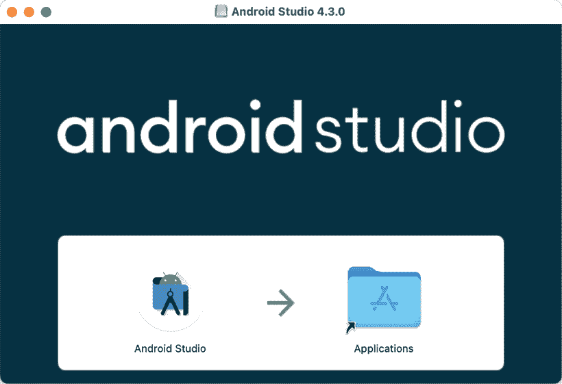

图 2-1

要安装此包，将 `Android Studio` 图标拖放到`Applications`（应用程序）文件夹中。`Android Studio` 包将被安装到系统的`Applications`文件夹中，此过程通常需要几秒钟完成。

要启动 `Android Studio`，在 `Finder` 窗口的`Applications`文件夹中找到该可执行文件并双击。

为了以后方便，请从 `Finder` 窗口将 `Android Studio` 图标拖到 `dock` 栏。

#### 2.3.3 在 Linux 上安装

下载 `Linux` 版 `Android Studio` 包后，打开终端窗口，切换目录到安装 `Android Studio` 的位置，并执行以下命令：

```
tar xvfz /<path to package>/android-studio-<version>-linux.tar.gz
```

注意，`Android Studio` 束将安装到名为 `android-studio` 的子目录中。因此，假设上述命令在 `/home/demo` 中执行，软件包将被解压到 `/home/demo/android-studio`。

要启动 `Android Studio`，打开终端窗口，切换目录到 `android-studio/bin` 子目录，并执行以下命令：

```bash
./studio.sh
```

### 2.4 Android Studio 安装向导

如果你之前安装过旧版本的 `Android Studio`，在首次启动此新版本时，可能会出现一个对话框，提供从之前的 `Android Studio` 版本导入设置的选项。如果你有旧版本的设置并想将其导入到最新安装中，请选择相应的选项和位置。或者，指示你不需要导入任何之前的设置并点击`OK`按钮继续。

如果你是首次安装 `Android Studio`，安装过程启动后出现的初始对话框可能类似于下方的图 2-2：

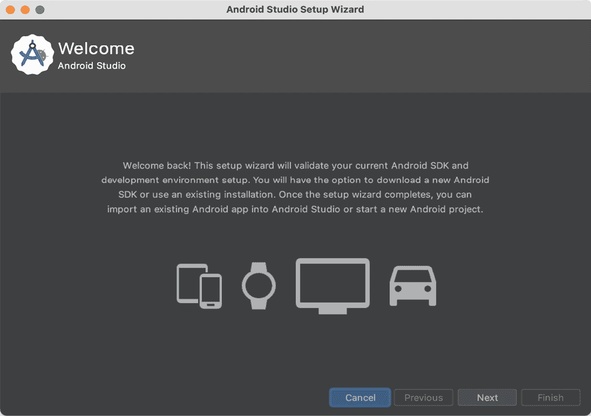

图 2-2

如果出现此对话框，点击`Next`（下一步）按钮显示`Install Type`（安装类型）屏幕（图 2-3）。在此屏幕上，在点击`Next`之前选择`Standard`（标准）安装选项。

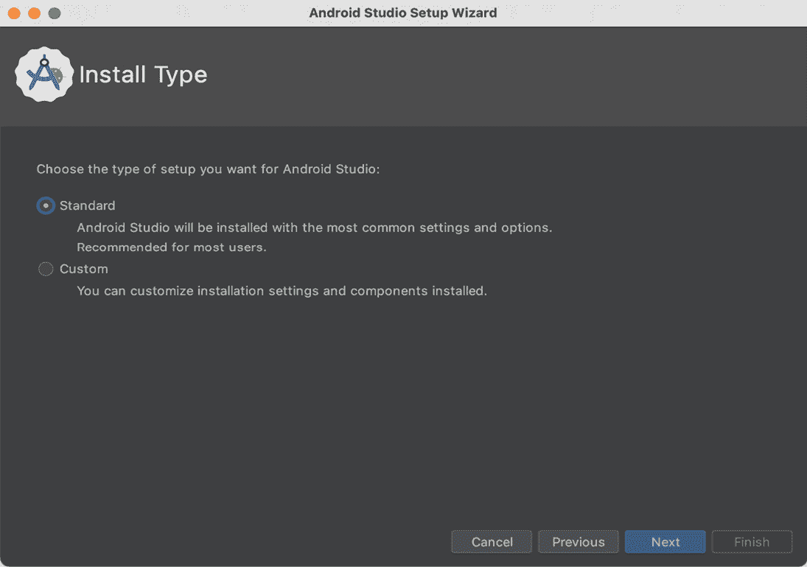

图 2-3

在`Select UI Theme`（选择 `UI` 主题）屏幕上，根据喜好选择`Darcula`或`Light`主题。做出选择后，点击`Next`，并在进入`License Agreement`（许可协议）之前检查`Verify Settings`（验证设置）屏幕中的选项。选择每个许可类别并启用`Accept`（接受）复选框。最后，点击`Finish`（完成）按钮启动安装。完成这些初始设置步骤后，点击`Finish`按钮显示使用所选 `UI` 主题的“`Welcome to Android Studio`”屏幕：

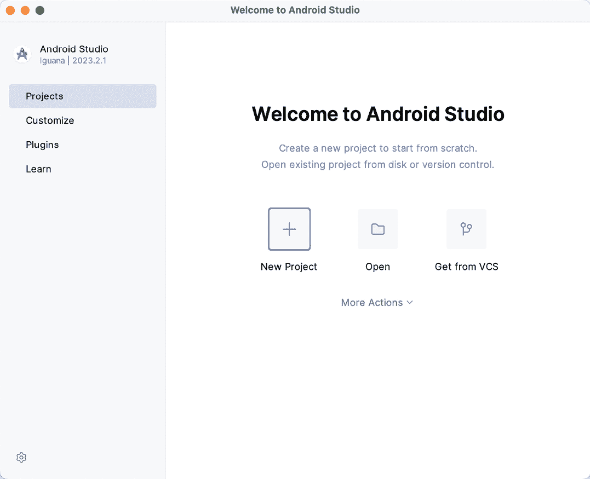

图 2-4

### 2.5 安装额外的 Android SDK 包

目前为止的操作安装了 `Android Studio` `IDE` 和当前的默认 `Android SDK` 包。在继续之前，值得花些时间验证安装了哪些包，并安装任何缺失或更新的包。

此任务可以通过点击欢迎对话框中的`More Actions`（更多操作）链接并从下拉菜单中选择`SDK Manager`（`SDK` ）选项来完成。一旦调用，`Settings` 对话框的`Android SDK`屏幕如图 2-5 所示：

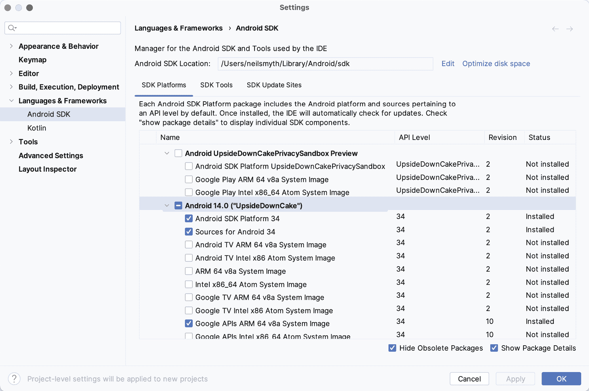

图 2-5

`Google` 的每个 `Android Studio` 版本都与其支持的 `Android SDK` 最大应用程序接口 (`API`) 级别配对。对于 `Android Studio Iguana`，这是`Android UpsideDownCake` (`API Level 34`)。可以使用以下链接确认此信息：

[`developer.android.com/studio/releases#api-level-support`](https://developer.android.com/studio/releases#api-level-support)

在首次安装 `Android Studio` 之后，可能只安装了最新支持版本的 `Android SDK`。要安装旧版本的 `Android SDK`，请勾选相应的版本并点击`Apply`（应用）按钮。本书其余部分假设安装了`Android UpsideDownCake` (`API Level 34`) `SDK`。

本书中的大多数示例支持旧到`Android 8.0 (Oreo)`。这确保了程序可以在多种 `Android` 设备上运行。在 `SDK` 版本列表中，启用`Android 8.0 (Oreo)`旁的复选框并点击`Apply`按钮。在生成的确认对话框中点击`OK`按钮安装 `SDK`。随后的对话将在执行安装前寻求许可条款。安装完成后点击`Finish`。

最新 `SDK` 也可能列出可用更新。要访问有关准备更新包的详细信息，启用屏幕右下角的`Show Package Details`（显示包详细信息）选项。这将显示图 2-6 所示的信息：

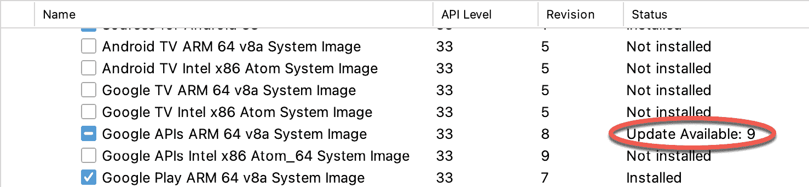

图 2-6

上述图片突出了可用更新。要安装更新，启用项目左侧的复选框并点击`Apply`按钮。

除了 `Android SDK` 包，还安装了用于构建 `Android` 应用程序的工具。要查看已安装的包并检查更新，留在`SDK`设置屏幕并选择`SDK Tools`标签，如图 2-7 所示：

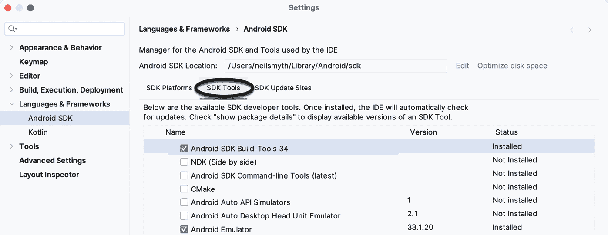

图 2-7

在`Android SDK Tools`屏幕内，请确保以下包在`Status`列中显示为`Installed`：

• `Android SDK Build-tools`

• `Android Emulator`

• `Android SDK Platform-tools`

• `Google Play Services`

• `Intel x86 Emulator Accelerator (HAXM installer)`*

• `Google USB Driver`（仅限 `Windows`）

• `Layout Inspector image server for API 31-34`

*注意：基于 `Apple` 芯片的 `Mac` 无法安装 `Intel x86` 模拟加速器 (`HAXM installer`)。

如果上述任何软件包被列为“未安装”（`Not Installed`）或需要更新，请勾选这些软件包旁边的选框并点击`Apply`（应用）按钮启动安装过程。如果出现`HAXM`模拟器设置对话框，请选择推荐的内存分配：


图 2-8

安装完成后，检查软件包列表并确保所选软件包在`Status`（状态）列中显示为`Installed`（已安装）。如果有任何包被列为“未安装”（`Not installed`），请确保它们已选中并再次点击`Apply`按钮。

## 2.6 安装 Android SDK 命令行工具

`Android Studio` 包含了允许你从操作系统的命令行执行某些任务的工具。要在你的系统上安装这些工具，请打开`SDK Manager`，选择`SDK Tools`标签页，并在图 2-9 所示找到`Android SDK Command-line Tools (latest)`软件包：

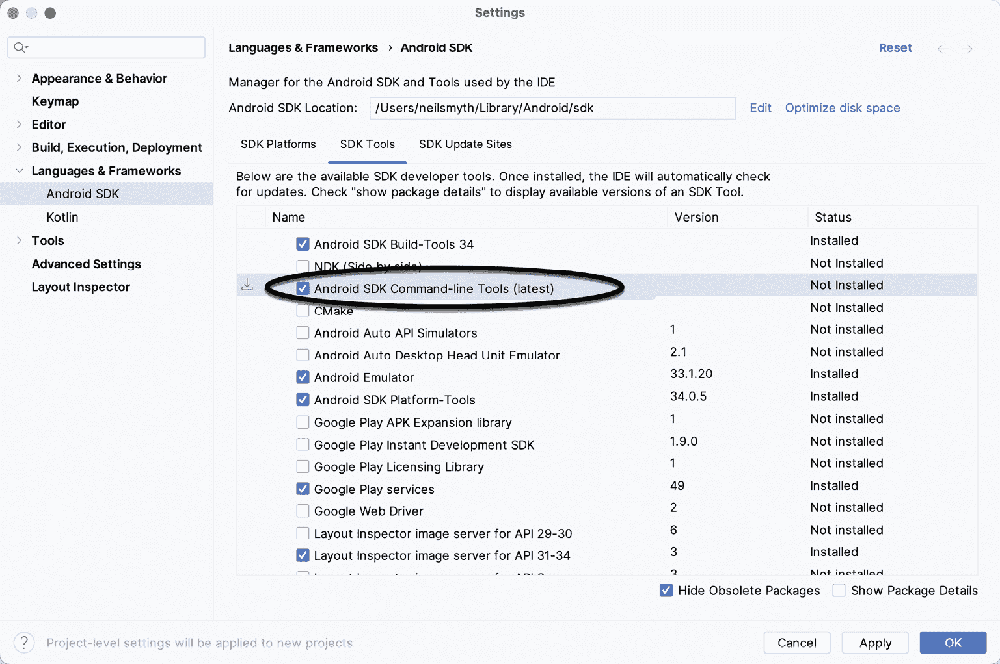

图 2-9

如果命令行工具包尚未安装，请启用它并点击`Apply`，然后点击`OK`完成安装。安装完成后，点击`Finish`并关闭`SDK Manager`对话框。

为了使你用于开发的的操作系统能够找到这些工具，有必要将它们添加到系统的`PATH`环境变量中。

无论你使用哪种操作系统，你都需要配置`PATH`环境变量以包含以下路径（其中 `<path_to_android_sdk_installation>` 代表你安装 `Android SDK` 的文件系统位置）：

`<path_to_android_sdk_installation>/sdk/cmdline-tools/latest/bin`

`<path_to_android_sdk_installation>/sdk/platform-tools`

你可以通过启动`SDK Manager`并参考设置面板顶部的`Android SDK Location:`（`Android SDK` 所在）字段来识别 `SDK` 在系统中的位置，如图 2-10 所示：

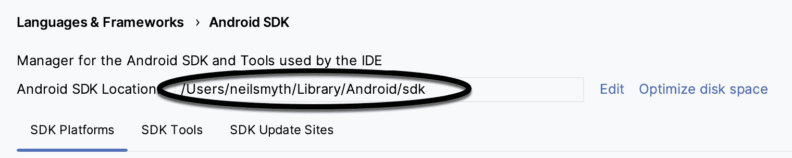

图 2-10

一旦确定了 `SDK` 的位置，将其添加到`PATH`变量的步骤取决于操作系统：

### 2.6.1 Windows 8.1


1. 在开始屏幕上，将鼠标移动到屏幕右下角并从弹出菜单选择`Search`（搜索）。在搜索框中输入`Control Panel`（控制面板）。当`Control Panel`图标出现在结果区域时，点击它在桌面上启动该工具。

2. 在`Control Panel`中，使用`Category`（类别）菜单将显示更改为`Large Icons`（大图标）。从图标列表中标记为`System`（系统）的图标。

3. 在`Environment Variables`（环境变量）对话框中，在`System variables`（系统变量）列表中找到`Path`变量，选中并点击`Edit…`（编辑）按钮。使用编辑对话框中的`New`（新建）按钮向路径添加两个新项。例如，假设 Android SDK 安装在`C:\Users\demo\AppData\Local\Android\Sdk`，则添加以下条目：

   `C:\Users\demo\AppData\Local\Android\Sdk\cmdline-tools\latest\bin`

   `C:\Users\demo\AppData\Local\Android\Sdk\platform-tools`

4. 点击每个对话框中的`OK`并关闭系统属性控制面板。

按下键盘上的`Windows + R`并在`Run`对话框中输入`cmd`打开命令提示符窗口。在`Command Prompt`窗口中输入：

```
echo %Path%
```

返回的路径变量值应包含 Android SDK 平台工具文件夹的路径。通过尝试如下所示运行`adb`工具来验证`platform-tools`值是否正确：

```bash
adb
```

执行该工具时，它应该输出命令行选项列表。

同样，通过尝试运行`AVD Manager`命令行工具来检查工具路径设置（如果担心`avdmanager`工具报告 Java 问题——这稍后会解决）：

```bash
avdmanager
```

如果其中一个或两个命令出现了类似下所示的消息，那么很可能是向`Path`环境变量中添加了错误的路径：

`'adb' is not recognized as an internal or external command, operable program or batch file.`

### 2.6.2 Windows 10

右键点击`Start`菜单，从弹出菜单选择`Settings`（设置），并在`Find a setting`（查找设置）文本框中输入“Edit the system environment variables”。在`System Properties`对话框中，点击`Environment Variables...`按钮。按照 Windows 8.1 列出的步骤，从第 3 步开始。

### 2.6.3 Windows 11

右键点击任务栏上的`Start`图标并从弹出菜单选择`Settings`。当`Settings`对话框出现时，向下滚动列表并选择“About”（关于）选项。在`About`界面，从`Related links`（相关链接）部分选择`Advanced system settings`（高级系统设置）。当`System Properties`窗口出现时，点击`Environment Variables...`按钮。按照 Windows 8.1 列出的步骤，从第 3 步开始。

### 2.6.4 Linux

可以通过向家目录下的`.bashrc`文件添加命令在 Linux 上实现此配置（具体取决于使用的特定 Linux 发行版）。假设 Android SDK 束包安装在`/home/android/sdk`，`.bashrc`文件中的导出语句如下：

```bash
export PATH=/home/android/sdk/platform-tools:/home/android/sdk/cmdline-tools/latest/bin:$PATH
```

### 2.6.5 macOS

在 macOS 上有多种方法可以修改`PATH`环境变量。最干净的方法是在`/etc/paths.d`目录下一个文件，包含要添加到`$PATH`的路径。假设 SDK 安装位置为`/Users/demo/Library/Android/sdk`，可以通过在`/etc/paths.d`创建名为`android-sdk`的文件进行配置：

`/Users/demo/Library/Android/sdk/cmdline-tools/latest/bin`

`/Users/demo/Library/Android/sdk/platform-tools`

注意由于系统目录，创建文件时需要使用`sudo`命令。例如：

```
sudo vi /etc/paths.d/android-sdk
```

Android Studio 是一个大型且复杂的应用程序，具有许多进程。尽管 Android Studio 过去被批评性能不佳，但 Google 在最近的版本中取得了巨大的性能改进，并在每个新版本中持续改进。这些改进允许用户配置 Android Studio IDE 以及运行应用程序的后台进程所需的内存。这使得软件能够利用更大的内存。

如果你在具有足够空闲内存的系统上运行 Android Studio（此功能仅适用于内存为 5GB 或以上的 64 位系统）并发现 Android Studio 性能出现下降，可能值得尝试这些内存设置。Android Studio 还可能通过类似所示的对话框提示你可以提高性能：


图 2-11

要查看并修改当前的内存配置，选择主菜单`File -> Settings...`（macOS 上为`Android Studio -> Settings...`），并在生成的对话框中，选择左侧导航面板中的`Appearance & Behavior`（外观与行为），然后选择`System Settings`下的`Memory Settings`（内存设置）选项，如下图 2-12 所示：

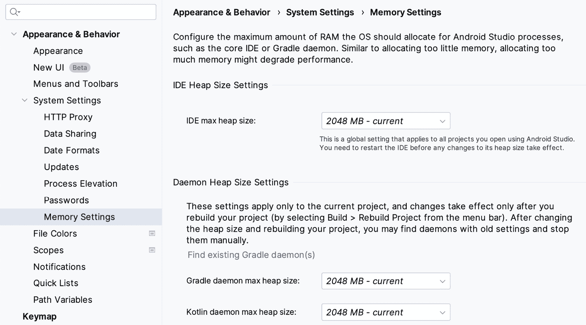

图 2-12

更改内存分配时，不要分配超过需要或超过系统在不影响其他进程的情况下所提供的内存。

IDE 堆内存设置调整了分配给 Android Studio 的内存，并且无论当前加载什么项目都会生效。另一方面，当在 Android Studio 内部构建和运行项目时，会有几个后台进程（称为守护进程）执行编译和运行应用的任务。在编译和运行大型复杂项目时，通过调整守护进程堆内存设置可以改进构建时间。与 IDE 堆内存设置不同，这些守护进程设置仅适用于当前项目，并且只有在 Android Studio 中打开项目时才能访问。若要在打开的项目中显示 SDK Manager，请从主菜单中选择`Tools -> SDK Manager...`菜单选项。

## 2.8 更新 Android Studio 和 SDK

Android Studio 和 Android SDK 会定期发布新版本。新版本的 SDK 是通过 Android SDK Manager 进行安装的。当有更新可供安装时，Android Studio 通常会通知你。

要手动检查 Android Studio 更新，请使用 Android Studio 主窗口中的`Help -> Check for Updates...`菜单选项（macOS 上为`Android Studio -> Check for Updates...`）。

## 2.9 总结

在开始开发基于 Android 的应用程序之前，第一步是搭建合适的开发环境。这包括 Android SDK 和 Android Studio IDE（其中包含 OpenJDK 开发环境）。本章涵盖了在 Windows、macOS 和 Linux 上安装这些包的步骤。

## 3. 在 Android Studio 中创建一个示例 Android 应用

本书的前几个章节解释了如何使用 Android Studio IDE 配置适用于开发 Android 应用程序的环境。在进入稍高级的话题之前，现在是验证所有所需的开发包已安装并正常运行的好时机。实现这一目标的最佳方法是创建一个 Android 应用程序并编译、运行它。本章将涵盖如何使用 Android Studio 创建 Android 应用程序项目。项目创建完成后，后续章节将探索如何使用 Android 模拟器环境对应用程序进行测试运行。

### 3.1 关于项目

在本章创建的项目是一个基础的货币汇率转换器（事实上，它非常简单，只从美元转换为欧元，并使用估算汇率进行转换）。该项目还将使用最基础的 Android Studio 项目模板之一。这种简易性允许我们介绍 Android 应用开发的一些关键方面，而不会通过一次性引入过多的概念（例如推荐的应用架构和 Android 架构组件）让初学者感到无从。在遵循本章教程时，请放心，初始示例项目中所使用的技术和代码将在稍后部分进行更详细的介绍。

### 3.2 创建新的 Android 项目

应用程序开发过程的第一步是在 Android Studio 环境中创建一个新项目。因此，首先启动 Android Studio，直到出现如“Welcome to Android Studio”（如图 3-1 所示）的欢迎界面：

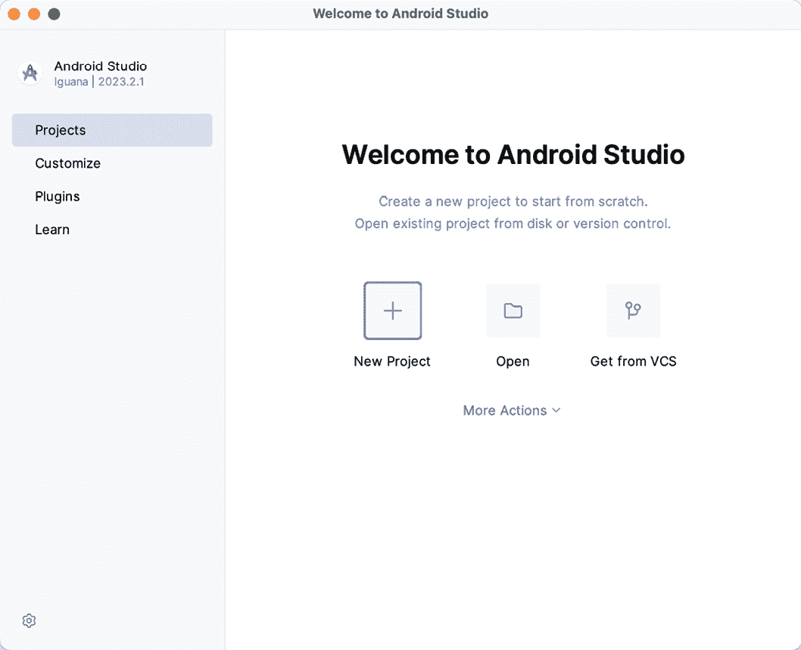

图 3-1

一旦出现此窗口，Android Studio 就已准备好创建一个新项目。要创建新项目，点击`New Project`选项以显示新项目向导的第一个屏幕。

### 3.3 创建 Activity

下一步是为应用程序定义要创建的初始 Activity 类型。提供了为手机和平板电脑、Wear OS、电视或汽车创建项目的选项。在开发 Android 应用程序时，有多种不同的 Activity 类型，其中许多将在后面的章节中详细介绍。然而，对于本示例，请从 Templates 面板中选择`Phone and Tablet`选项，然后选择创建`Empty Views Activity`选项。`Empty Views Activity`选项创建一个由单个`TextView`对象组成的模板用户界面。

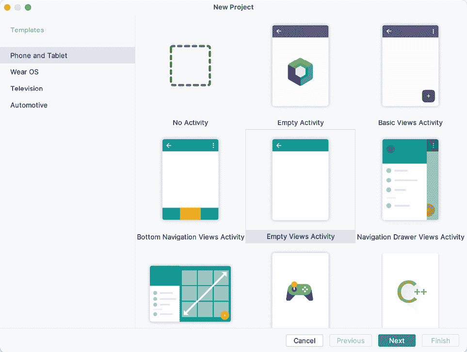

图 3-2

选中`Empty Views Activity`选项后，点击 Next 继续项目配置。

### 3.4 定义项目和 SDK 设置

在项目配置窗口（图 3-3）中，将`Name`字段设置为`AndroidSample`。应用程序名称是在 Android Studio 内部引用和识别应用程序的名称，也是如果完成的应用程序要在 Google Play 商店销售时将使用的名称。

`Package name`（包名）在 Android 应用生态系统中唯一标识应用程序。虽然可以设置为任何唯一标识你的应用的字符串，但传统上基于你的域名的反转 URL 加上应用程序名称。例如，如果你的域名是`www.mycompany.com`，且应用程序命名为`AndroidSample`，那么包名可能指定如下：

```
com.mycompany.androidsample
```

如果你没有域名，可以在`Company Domain`字段中输入任何其他字符串，或者可以使用`example.com`进行测试，但在发布应用程序之前需要对其进行更改：

```
com.example.androidsample
```

`Save location`（保存位置）设置将默认位于你主目录下名为`AndroidStudioProjects`的文件夹中，可以通过点击包含当前路径设置文本字段右侧的文件夹图标进行更改。

将`minimum SDK`设置为`API 26`（Oreo；Android 8.0）。在本书中创建的大多数项目都将使用此最小 SDK，除非某个必要功能仅在较新版本可用。这里的目标是使用最新的 Android SDK 构建应用，同时保留对运行旧版本 Android 的设备的兼容性（在这种情况下，最远可追溯到 Android 8.0）。`Minimum SDK`设置下方的文本将概述目前使用该应用的 Android 设备百分比。点击`Help me choose`按钮（如图 3-3 所示）以查看各种 Android 版本的详细分类：

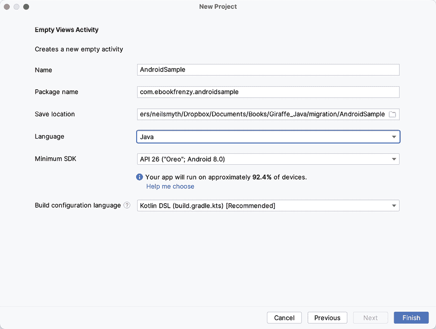

图 3-3

最后，将`Language`菜单改为`Java`并将`Kotlin DSL (build.gradle.kts)`作为构建语言，然后点击 Finish 创建项目。

### 3.5 启用新的 Android Studio UI

Android Studio 正在向新的用户界面过渡，该界面在 Iguana 版本中默认未启用。如果你的 Android Studio 安装类似于下方的图 3-4，则你需要在继续操作之前启用新 UI：

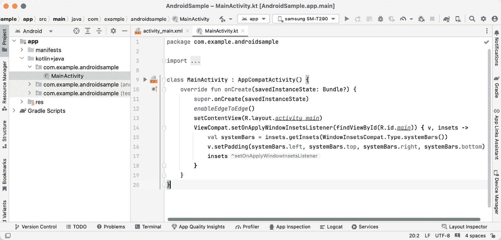

图 3-4

通过选择`File -> Settings...`菜单选项（macOS 上为`Android Studio -> Settings...`）并选择左侧面板中`Appearance and Behavior`下的`New UI`选项来启用新 UI。在主面板中，勾选`Enable new UI`复选框，然后点击`Apply`，最后点击`OK`提交更改：

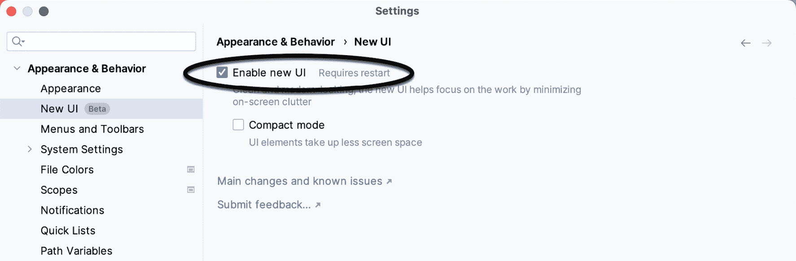

图 3-5

重启 Android Studio 以激活新的用户界面。

### 3.6 修改示例应用程序

Android Studio 重启后，主窗口将使用新 UI 重新出现，并包含我们的`AndroidSample`项目，如下方的图 3-6 所示：

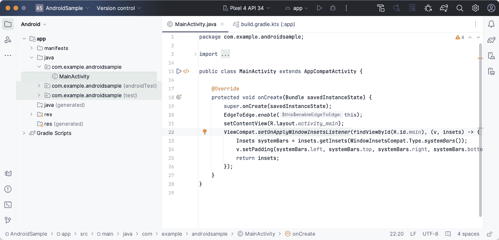

图 3-6

新创建的项目以及关联文件的引用列在主项目窗口左侧的`Project`工具窗口中。`Project`工具窗口有多种可以显示信息的模式。默认情况下，此面板应处于`Android`模式。此设置由面板顶部菜单控制，如图 3-7 中高亮所示。如果面板当前未处于`Android`模式，请使用菜单切换模式：

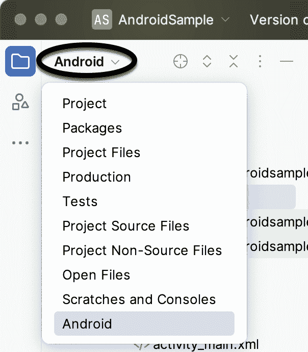

图 3-7

### 3.7 修改用户界面

我们活动（activity）的用户界面设计存储在一个名为`activity_main.xml`的文件中，该文件又位于`Project`工具窗口文件层次结构下的`app` -> `res` -> `layout`。在`Project`工具窗口中找到该文件后，双击文件将其加载到用户界面`Layout Editor`（布局编辑器）工具中，该工具将出现在 Android Studio 主窗口的中间面板：

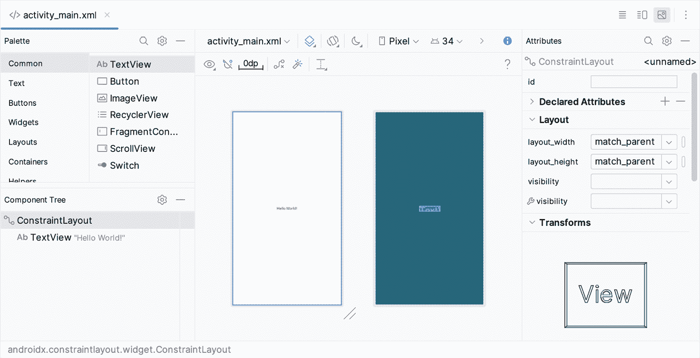

图 3-8

`Layout Editor`窗口顶部工具栏上有一个菜单（上图中设置为`Pixel`），它反映在`Layout Editor`面板中设备的视觉表示上。通过点击此菜单可以使用其他设备选项。

使用`System UI Mode`按钮（）来开启或关闭设备屏幕布局的`Night`（夜）模式。要在设备表示的横屏和竖屏之间切换，请使用显示图标的下拉菜单。

正如我们在设备屏幕上看到的，内容布局已经包含一个显示“Hello World!”消息的标签。面板左侧运行着调色板，包含了不同类别的用户界面组件，用于构建用户界面，例如按钮、标签和文本字段。但我们需要，并不是所有的用户界面组件对用户都是可见的。其中一类就是布局。Android 支持多种布局，这些布局对视觉用户界面组件在屏幕上的定位和管理提供了不同层次的控制。虽然从用户界面的视觉表示很难判断，但当前设计是使用`ConstraintLayout`创建的。这可以通过查看`Component Tree`（组件树）面板中的信息来确认，该面板默认位于`Layout Editor`面板的左下角，如图 3-9 所示：

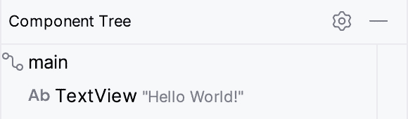

图 3-9

从组件树层次结构可以看出，用户界面布局由一个名为`main`的`ConstraintLayout`父布局和一个`TextView`子对象组成。

继续之前，检查`Layout Editor`的`Autoconnect`（自动连接）模式已启用。这意味着当组件添加到布局时，`Layout Editor`将自动添加约束，以确保组件在不同的屏幕尺寸和设备方向上正确定位（该主题将在后续章节中更详细地介绍）。`Autoconnect`按钮出现在`Layout Editor`工具栏中，用 U 形图标表示。当被禁用时，图标上会带有一条对角线（图 3-10）。如有必要，点击此按钮重新启用`Autoconnect`模式。

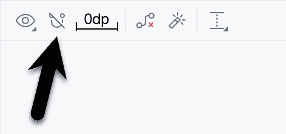

图 3-10

修改应用程序的下一步是在布局中添加一些额外的组件，其中第一个是`Button`，供用户点击以启动汇率转换。

`Palette`（调色板）面板由两列组成，左列包含视图组件类别列表。右列列出当前选择类别包含的组件。在图 3-11 中，例如，在`Buttons`类别中选择了`Button`视图：

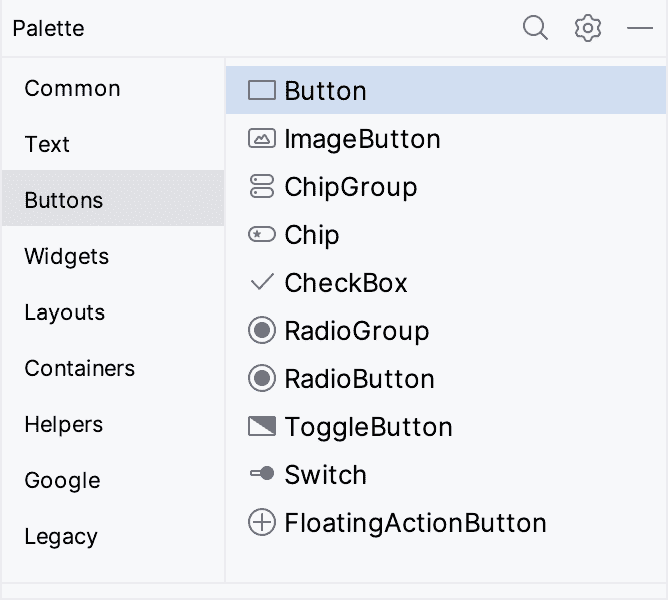

图 3-11

从`Buttons`列表中点击并拖动`Button`对象，将其到用户界面设计的水平中心，使其位于现有`TextView`小部件下方：

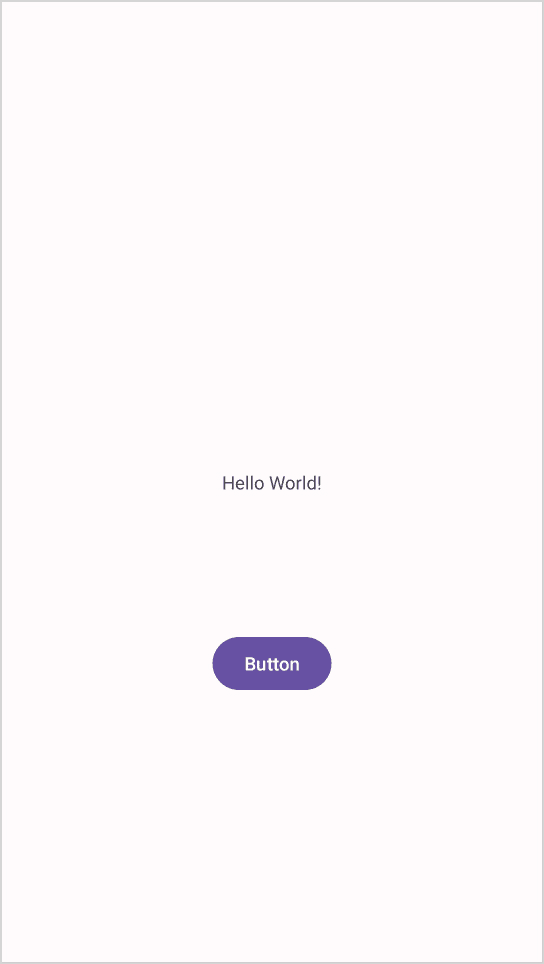

图 3-12


下一步是更改`Button`组件当前显示的文本。位于设计区域右侧的面板是`Attributes`（属性）面板。此面板显示分配给布局中当前选择组件的属性。在此面板中，在`Common Attributes`（常用属性）部分找到`text`属性，并将当前值从“Button”更改为“Convert”，如图 3-13 所示：

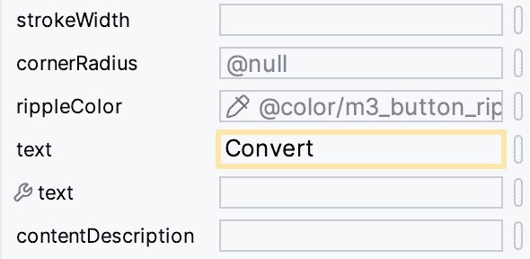

图 3-13

第二个带有扳手图标的文本属性允许设置文本属性，该属性仅显示在`Layout Editor`工具中，但在运行时不会显示。这对于测试在不反复运行应用的情况下，视觉组件和布局在不同设置下的行为非常有用。

万一`Autoconnect`系统未能设置所有布局连接，请点击`Infer Constraints`（推断约束）按钮（图 3-14）向布局添加任何缺失的约束：


图 3-14

我们需要解释一下`Layout Editor`工具右上角的警告按钮，如图 3-15 所示。此警告表示布局存在潜在问题。点击此按钮查看问题详情：


图 3-15

点击后，`Problems`（问题）工具窗口（图 3-16）将会出现，描述问题性质：


图 3-16

此工具窗口分为两个面板。左面板（图中标记为 A）列出了文件中发现的问题。在我们的示例中，仅列出了以下问题：

`button <Button>: Hardcoded text`

当选择列表中一项时（B），右面板将更新提供详细信息（C）。在这种情况下，解释如下：

`Hardcoded string "Convert", should use @string resource`

工具窗口还包含一个预览编辑器（D），允许对布局文件进行手动修正。

此 I18N 信息告知我们项目国际化存在潜在问题（“I18N”源于“internationalization”一词以“I”开头，以“N”结尾，中间有 18 个字母）。警告提醒我们，在开发 Android 应用程序时，尽可能将文本字符串等属性和值存储为资源。这样做可以通过修改资源文件而不是更改应用程序源代码来更改应用程序的外观。在将用户界面翻译成不同的语言时特别有用。如果用户界面所有的文本都包含在一个资源文件中（例如），可以将该文件交给翻译人员，他们将执行翻译工作并返回翻译后的文件以包含在应用程序中。这使得无需进行任何源码更改即可针对多种语言。在此实例中我们将创建一个名为`convert_string`的新资源并为其分配字符串“Convert”。

首先点击`Show Quick Fixes`按钮（E），并从菜单中选择`Extract string resource`（提取字符串资源）选项，如图 3-17 所示：


图 3-17

选择此选项后，将出现提取资源（Extract Resource）面板（图 3-18）。在此面板中，将资源名称字段更改为`convert_string`并将资源值设置为`Convert`，然后点击 OK 按钮：

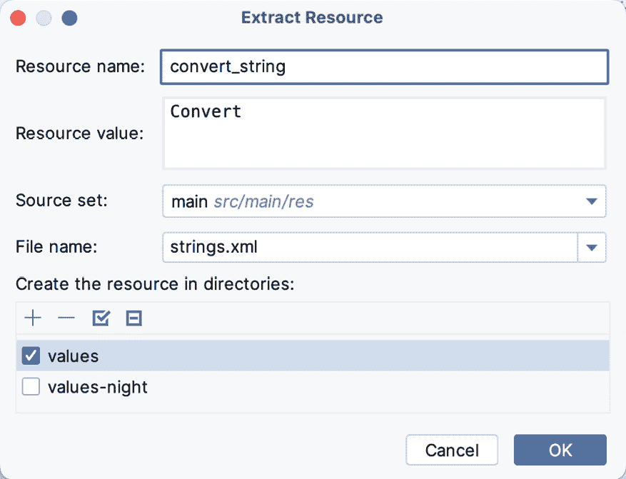

图 3-18

要添加的下一个组件是`EditText`，用户将在其中输入要转换的美元金额。从`Palette`（调色板）面板中选择`Text`类别，点击并拖拽`Number (Decimal)`组件到布局中，使其在水平方向上居中，并位于现有`TextView`组件上方。选中该组件后，使用`Attributes`（属性）工具窗口将`hint`属性设置为“dollars”。点击警告图标并将字符串提取为名为`dollars_hint`的资源。

在本章稍后编写的代码将需要访问用户在`EditText`字段中输入的美元值。它将通过引用分配给用户界面布局中组件的`id`来实现。Android Studio 为组件分配的默认`id`可以在布局中选中组件时，在`Attributes`工具窗口中查看和更改，如图 3-19 所示：

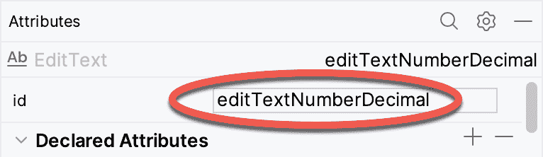

图 3-19

将`id`改为`dollarText`，并在`Rename`（重命名）对话框中点击`Refactor`（重构）按钮。这可以确保项目其他地方对旧`id`的任何引用都会自动更新为使用新`id`：

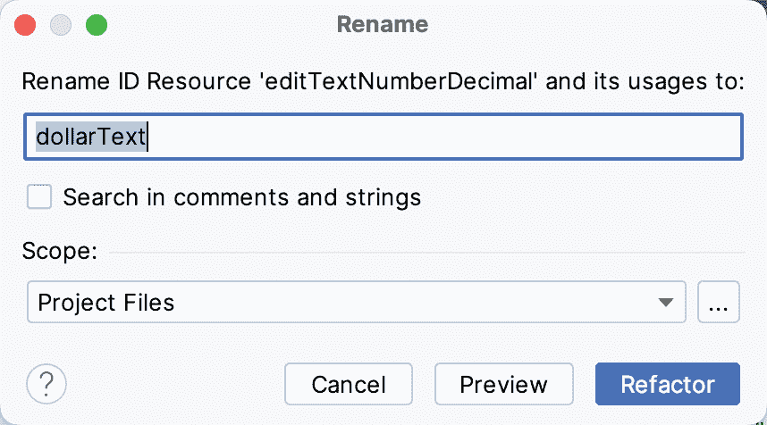

图 3-20

如有必要，重复上述步骤将`TextView`组件的`id`设置为`textView`。

点击`Infer Constraints`（推断约束）按钮以添加任何缺失的布局约束。此时，布局应该类似于图 3-21 所示：

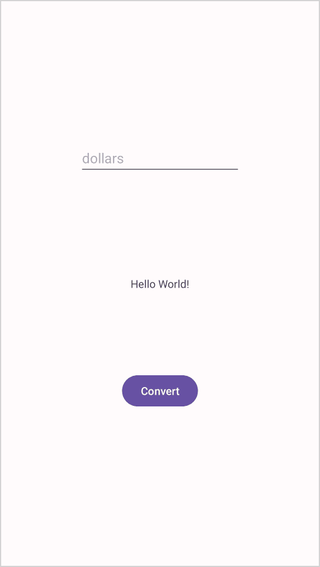

图 3-21

### 3.8 检查布局和资源文件

在继续下一步之前，我们将查看用户界面设计和资源处理的一些内部方面。在上一节中，我们通过`Layout Editor`工具修改`activity_main.xml`文件来更改用户界面。事实上，`Layout Editor`所做的只是提供了一种易于用户编辑文件底层 XML 内容的方法。在实践中，没有理由不直接修改 XML 来更改用户界面，在某些情况下，这实际上比使用`Layout Editor`工具更快。在`Layout Editor`面板的右上角是`View Modes`（视图模式）按钮，在下方的图 3-22 中标记为 A 到 C：

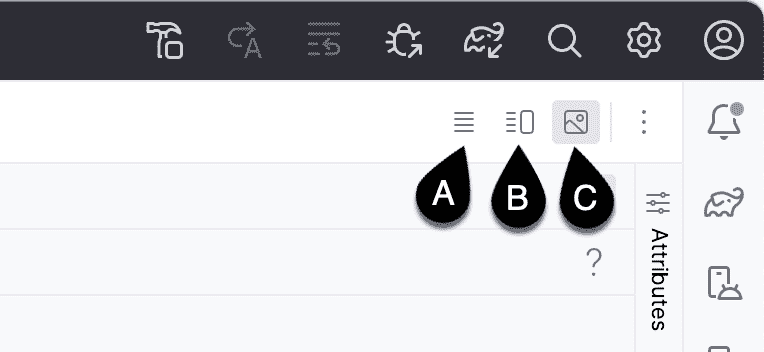

图 3-22

默认情况下，编辑器处于`Design`模式（按钮 C），此时只显示布局的视觉表示。在`Code`模式（A）下，编辑器将显示布局的 XML，而在`Split`模式（B）下，同时显示布局和 XML，如图 3-23 所示：

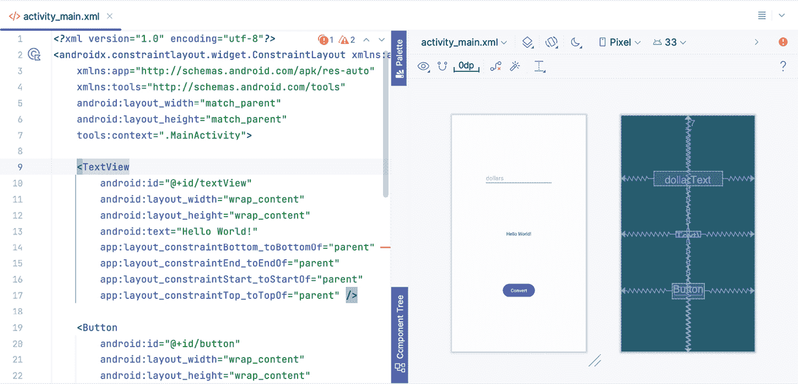

图 3-23

`View Modes`按钮左侧的按钮（在图 3-22 中标记为 B）用于快速在`Code`和`Split`模式之间切换。

从 XML 文件的结构可以看出，用户界面由`ConstraintLayout`组件组成，它又是`TextView`、`Button`和`EditText`对象的父级。我们还可以看到，例如，`Button`的`text`属性设置为我们的`convert_string`资源。尽管复杂内容各异，但所有用户界面布局都是这种层次化的、基于 XML 的结构。

当修改 XML 布局时，这些更改将反映在布局画布上。也可以在布局画布面板内对布局进行视觉修改，更改将出现在 XML 列表中。要查看此效果，切换到`Split`模式并修改 XML 布局，将`ConstraintLayout`的背景颜色更改为红色如下：

```xml
<?xml version="1.0" encoding="utf-8"?>
<androidx.constraintlayout.widget.ConstraintLayout xmlns:android="http://schemas.android.com/apk/res/android"
    xmlns:app="http://schemas.android.com/apk/res-auto"
    xmlns:tools="http://schemas.android.com/tools"
    android:id="@+id/main"
    android:layout_width="match_parent"
    android:layout_height="match_parent"
    tools:context=".MainActivity"
    android:background="#ff2438" >

.

</androidx.constraintlayout.widget.ConstraintLayout>
```

注意布局颜色会实时更改以匹配 XML 文件中的新设置。同样注意，在 XML 编辑器左边距（也称为槽口）包含颜色设置的行旁边会出现一个红色方块。这是属性上已设置红色的视觉提示。点击红色方块将显示颜色选择器以选择不同的颜色：

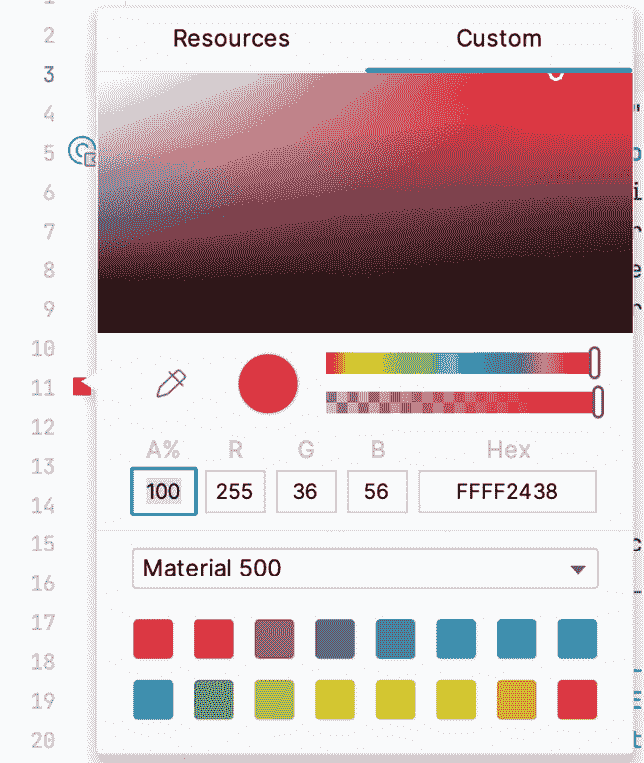

图 3-24

在继续之前，从布局文件中删除背景属性。最后，使用 Project 面板找到`app -> res -> values -> strings.xml`文件并双击将其加载到编辑器。目前 XML 如下：

```xml
<resources>
    <string name="app_name">AndroidSample</string>
    <string name="dollars_hint">dollars</string>
</resources>
```

为了演示资源的使用，更改`convert_string`的字符串，然后返回布局编辑器。注意布局已获取字符串的新值。

还有一种快速访问 XML 文件中引用的资源的方法。当布局编辑器处于`Split`或`Code`模式时，点击`@string/convert_string`属性使其高亮，然后按下键盘上的`Ctrl-B`（macOS 为`Cmd-B`）。Android Studio 随后将打开`strings.xml`文件并带您到定义该资源的行。利用此机会将字符串恢复为原始的“Convert”，并为代码中引用的资源添加以下附加条目：

```xml
<resources>
    <string name="app_name">AndroidSample</string>
    <string name="convert_string">Convert</string>
    <string name="dollars_hint">dollars</string>
    <string name="no_value_string">No Value</string>
</resources>
```

可以通过编辑器窗口右上角的`Open editor`链接使用 Android Studio 翻译编辑器编辑资源字符串。这将翻译编辑器显示在 Android Studio 窗口的主面板：

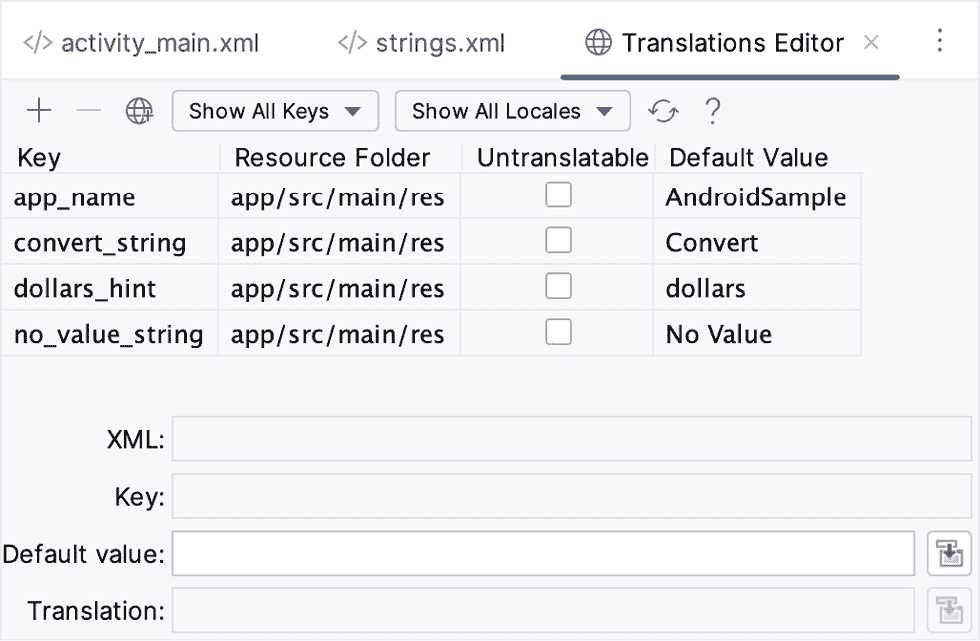

图 3-25

此编辑器允许编辑分配给资源键的字符串并管理多种语言的翻译。

### 3.9 添加交互

示例项目的最后一步是使应用程序交互，以便当用户在`EditText`字段中输入美元金额并点击转换按钮时，转换后的欧元金额将显示在`TextView`上。这涉及对`Button`组件实现事件处理。具体来说，需要配置`Button`在触发`onClick`事件时调用应用程序代码中的方法。事件处理可以通过多种方式实现，并在后续标题为“Android 事件处理概述与示例”的章节中介绍。返回布局编辑器到`Design`模式，在布局编辑器中选择`Button`组件，参考`Attributes`工具窗口，并指定名为`convertCurrency`的方法如下：

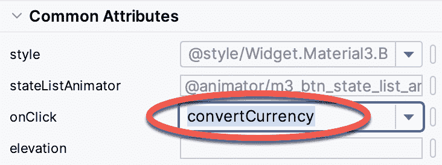

图 3-26

接下来，双击 Project 工具窗口中的`MainActivity.java`文件（`app -> java -> <package name> -> MainActivity`）将其加载到代码编辑器中，并向类文件中添加`convertCurrency`方法的代码，使其读取内容如下。注意，还需要导入一些额外的 Android 程序包：

```java
package com.ebookfrenzy.androidsample;

import androidx.appcompat.app.AppCompatActivity;

import android.os.Bundle;
import android.view.View;
import android.widget.EditText;
import android.widget.TextView;

.
.

import java.util.Locale;

public class MainActivity extends AppCompatActivity {
    @Override
    protected void onCreate(Bundle savedInstanceState) {
        super.onCreate(savedInstanceState);
        setContentView(R.layout.activity_main);
    }

    public void convertCurrency(View view) {
        EditText dollarText = findViewById(R.id.dollarText);
        TextView textView = findViewById(R.id.textView);
        if (!dollarText.getText().toString().isEmpty()) {
            float dollarValue = Float.parseFloat(dollarText.getText().toString());
            float euroValue = dollarValue * 0.85F;
            textView.setText(String.format(Locale.ENGLISH,"%.2f", euroValue));
        } else {
            textView.setText(R.string.no_value_string);
        }
    }
}
```

该方法首先通过调用名为`findViewById`方法并传递布局文件中分配的`id`来获取`EditText`和`TextView`对象的引用。随后会进行检查以确保用户输入了美元金额，如果是，则提取该值，将其从`String`转换为浮点值，并转换为欧元。最后，结果将显示在`TextView`组件上。

如果上述任何内容有不清楚的地方，请放心，这些概念将在后续章节中进行更详细介绍。特别是使用`findByViewId`从代码内部访问控件的主题，以及对一种被称为`view binding`（视图绑定）的替代技术的介绍，将在标题为“Android View Binding 概述”的章节中介绍。

### 3.10 总结

虽然并不复杂，但设置 Android 开发环境涉及多个步骤。完成这些步骤后，运行一个示例以确保环境已正确安装和配置是非常值得的。在本章中，我们创建了一个示例应用程序，并使用 Android Studio 布局编辑器工具修改了用户界面布局。在此过程中，我们探索了尽可能使用资源（特别是字符串值）的重要性，并简要接触了布局。接下来，我们查看了用于存储 Android 应用程序用户界面设计的底层 XML。

最后，在`Button`上添加了一个`onClick`事件，该事件连接到一个实现的方法，用于从`EditText`组件中提取用户输入，将其从美元转换为欧元，然后结果显示在`TextView`上。

应用已准备好进行测试，用于测试目的配置模拟器所需的步骤将在下一章中详细介绍。

## 4. 在 Android Studio 中创建 Android 虚拟设备 (AVD)

尽管 Android Studio 的预览面板允许我们看到正在设计的布局，但为了彻底测试其运行情况，将需要编译并运行整个应用程序。Android 可以通过在物理设备上安装并运行，或者在 Android 虚拟设备 (AVD) 模拟器环境中安装并运行来进行测试。在使用 AVD 之前，必须先创建并配置它以匹配特定设备模型的规格。在本章中，我们将以 Pixel 4 手机作为参考示例创建一个这样一个虚拟设备。

### 4.1 关于 Android 虚拟设备

AVD 是模拟器，允许在无需将应用程序安装到物理 Android 设备上的情况下测试 Android 应用程序。AVD 可以配置为模拟各种硬件功能，包括屏幕尺寸、内存容量，以及是否存在摄像头、GPS 导航支持或加速度计等功能。Android Studio 标准安装的一部分安装了几个模拟器模板，允许为各种设备配置 AVD。可以通过指定处理器类型、内存容量以及屏幕尺寸和像素密度等属性，创建自定义配置以匹配任何物理 Android 设备。

AVD 会话（session）可以以独立窗口的形式出现，也可以嵌入在 Android Studio 窗口中。

新的 AVD 使用 Android 虚拟设备管理器（Android Virtual Device Manager）创建和管理，可以使用命令行模式或更具用户友好的图形用户界面。创建新的 AVD 的第一步是启动 AVD Manager。这可以在 Android Studio 环境中点击右侧工具窗口中的`Device Manager`按钮来实现。

要添加新的 AVD，点击`Device Manager`中的`Create virtual device`链接或`+`按钮打开`Virtual Device Configuration`对话：

1. 从`Category`面板中选择`Phone`选项以显示可用的 Android AVD 模板。

2. 选择`Pixel 4`设备选项并点击`Next`。


### 3. 创建 AVD

在`System Image`屏幕上，选择最新版本的`Android`。如果尚未安装系统镜像，将在`Release Name`旁边提供`Download`链接。点击此链接下载并安装系统镜像。如果所需的镜像未列出，请点击`x86 Images`（如果您运行的是带有 Apple 芯片的 Mac，请点击`ARM images`）和`Other images`标签页以查看备选列表。

点击`Next`继续，并在`name`字段中输入描述性名称（例如`Pixel 4 API 34`）或接受默认名称。

点击`Finish`创建 AVD。

如果以后需要对 AVD 进行修改，重新打开`Device Manager`，选择列表中的 AVD，并点击`Actions`列中的铅笔图标进行编辑设置。

### 4.2 启动模拟器

要测试新创建的 AVD 模拟器，从`Device Manager`中选择模拟器并点击`Actions`列中的启动按钮（三角形）。模拟器将嵌入 Android Studio 主窗口中并开始启动过程。模拟器启动所需的时间取决于 AVD 及其运行系统的配置。

要隐藏和显示模拟器工具窗口，请点击`Running Devices`工具窗口按钮。点击标签旁边的“x”关闭按钮退出模拟器。模拟器工具窗口可以容纳多个器会话，每个会话由一个标签表示。要在会话之间切换，请点击相应的标签。

虽然模拟器可能默认以竖屏方向显示，但此及其他默认选项是可以更改的。在`Device Manager`（设备管理器）中，选择新的`Pixel 4`条目，并点击设备行`Actions`（操作）列中的铅笔图标。在配置屏幕中，找到`Startup orientation`（启动方向）部分并更改方向设置。退出并重新启动模拟器会话以使此更改生效。关于模拟器的更多细节请参阅下一章“使用和配置 Android Studio AVD 模拟器”。

为了在本文章的下一节中节省时间，请在继续操作之前保持模拟器运行。

### 4.3 在 AVD 中运行应用程序

配置好`AVD`模拟器后，现在可以编译并运行之前章节中创建的示例`AndroidSample`应用程序。在将`AndroidSample`项目加载到`Android Studio`后，确保新创建的`Pixel 4` `AVD`显示在设备菜单中（标记为下方图 4-7 中的 A），然后点击由三角形表示的运行按钮 (B)，选择`Run`（运行） -> `Run 'app'`菜单选项，或使用键盘快捷键`Ctrl-R`：

```
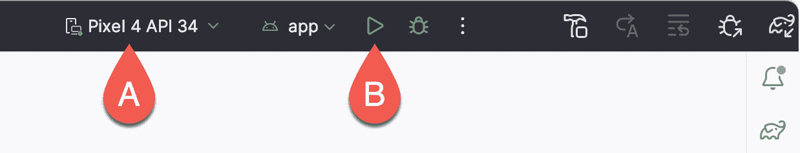
```

图 4-7 设备菜单 (A) 可用于选择不同的`AVD`实例或物理设备作为运行目标，也可以在多个设备上运行应用。菜单还提供了访问`Device Manager`以及设备连接配置和故障排除选项的权限：

```
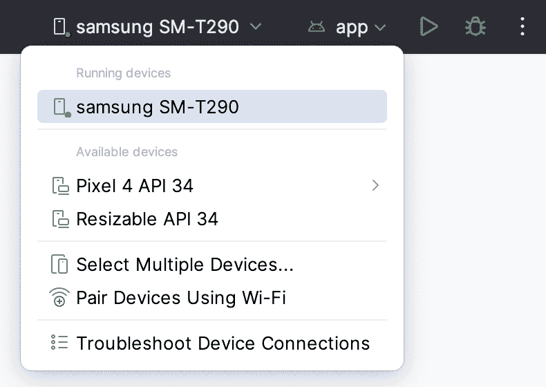
```

图 4-8 一旦应用程序安装并运行，第一个片段（fragment）的用户界面将出现在模拟器中（片段是`Android`项目中一个可重用的部分，通常由用户界面布局和一些代码组成，该主题将在本章名为“Android Fragment 简介”的章节中介绍）：

```
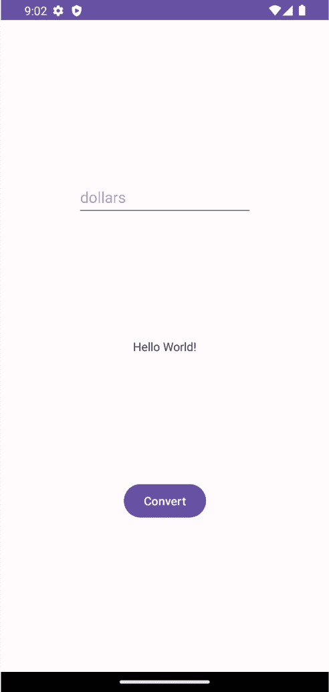
```

图 4-9 一旦运行过程开始，`Run`（运行）工具窗口将会出现。`Run`工具窗口将在应用程序包安装和启动时显示诊断信息。图 4-10 显示了典型成功启动应用程序的`Run`工具窗口输出：

```
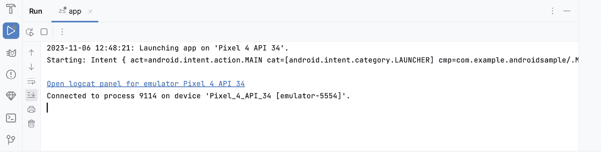
```

图 4-10 如果在启动过程中遇到问题，`Run`工具窗口将提供信息以帮助隔离问题原因。

假设应用程序加载到模拟器并按预期运行，我们已经安全地验证了`Android`开发环境已正确安装和配置。在应用程序运行时，尝试进行货币换算以验证应用程序运行符合预期。

### 4.4 在多个设备上运行

上述图 4-8 中所示的运行目标菜单包含一个在多个模拟器和设备上并行运行应用程序的选项。选中此项时，该选项将显示图 4-11 中的对话框，提供系统上配置的`AVDs`以及任何已连接的物理设备列表。在点击`Run`按钮之前，启用目标模拟器或设备旁边的复选框：

```
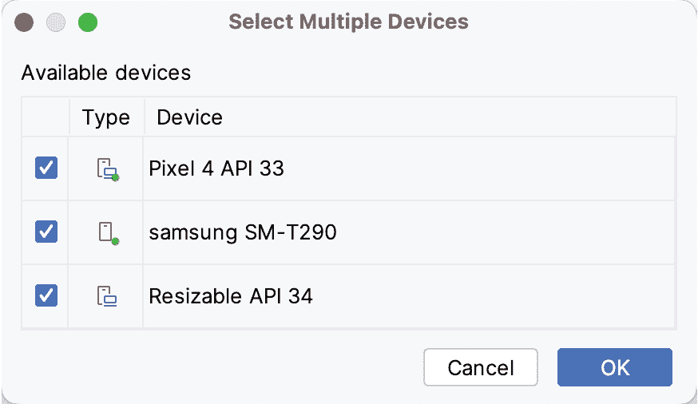
```

图 4-11 点击`Run`按钮后，`Android Studio`将在选定的模拟器和设备上启动应用。

### 4.5 停止运行的应用程序

要停止运行的应用程序，请点击主工具栏上的停止按钮，如图 4-12 所示：

```
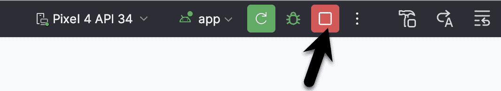
```

图 4-12 应用程序也可以使用`Run`工具窗口终止。首先通过应用程序运行时变为用的窗口栏按钮显示`Run`工具窗口。一旦`Run`工具窗口出现，点击下方图 4-13 中高亮的停止按钮：

```
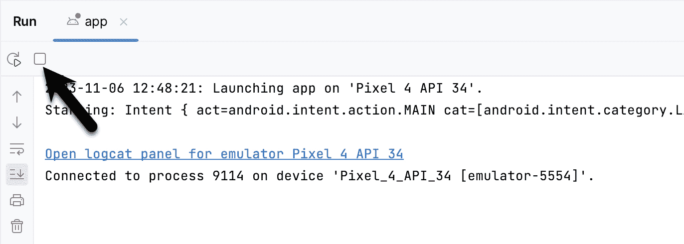
```

图 4-13

### 4.6 支持深色主题

为了测试应用程序在启用深色主题时的行为，请在模拟器中运行的`Android`实例内打开`Settings`（设置）应用，选择`Display`（显示）类别，并如图 4-14 所示启用`Dark`（深色）主题选项：

```
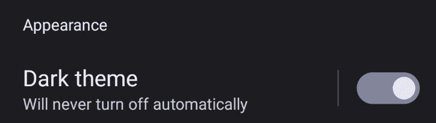
```

图 4-14 启用深色主题后，运行`AndroidSample`应用并注意它以深色主题显示，包括黑色背景和按钮上的紫色背景，如图 4-15 所示：

```
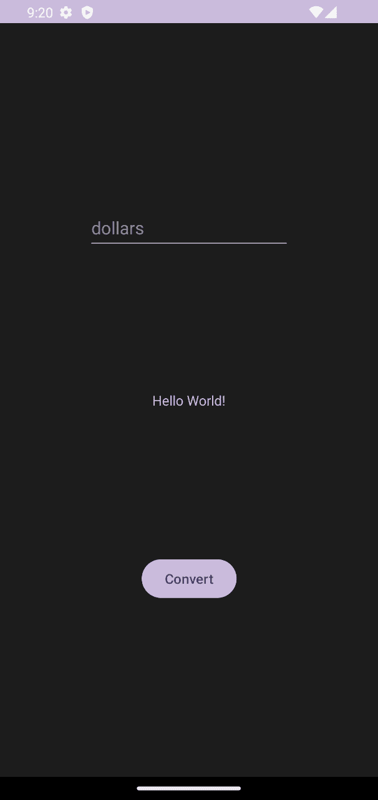
```

图 4-15 在继续之前返回`Settings`应用并关闭深色主题。

### 4.7 在独立窗口中运行模拟器

到本章为止，我们仅将模拟器作为嵌入在主`Android Studio`窗口内的工具窗口。模拟器可以配置为在`Settings`（设置）中的独立窗口中显示，可以通过点击`Android Studio`工具栏上的`IDE`和`Project Settings`按钮显示，如图 16 所示：

```

```

图 16 在`Settings`对话框中，导航到侧边面板的`Tools` -> `Emulator`，并禁用`Launch in Running Devices`选项：

```

```

图 17 禁用该选项后，点击`Apply`按钮以及`OK`提交更改，然后点击图 4-7 中的 B 按钮退出模拟器。运行应用程序，此时模拟器将作为独立窗口出现，如：

```

```

图 18 独立或工具窗口的选择取决于个人喜好。如果你喜欢在工具窗口中运行，返回设置屏幕并重新启用`Launch in Running Devices`选项。然而，在提交之前，请记住`Running Devices`工具窗口也可以从工具`Options`菜单中分离，该菜单可以通过点击图 19 所示按钮访问：

```

```

图 19 在`Options`菜单中，选择`View Mode` -> `Float`以将工具窗口分离：

```
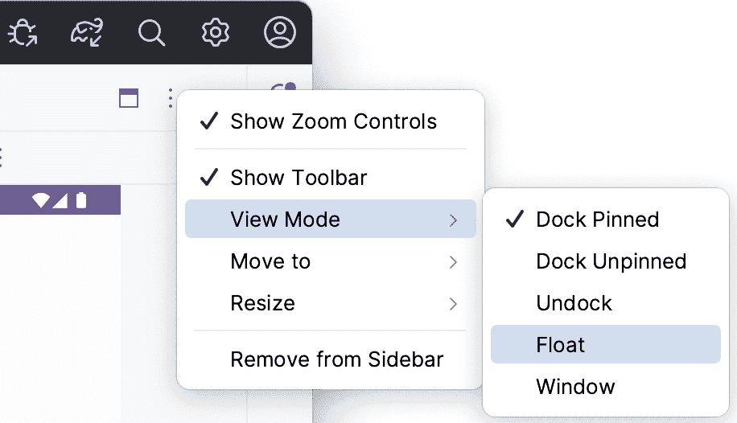
```

图 20 要重新停靠`Running Devices`工具窗口，请点击图 4-21 所示的`Dock`按钮：

```
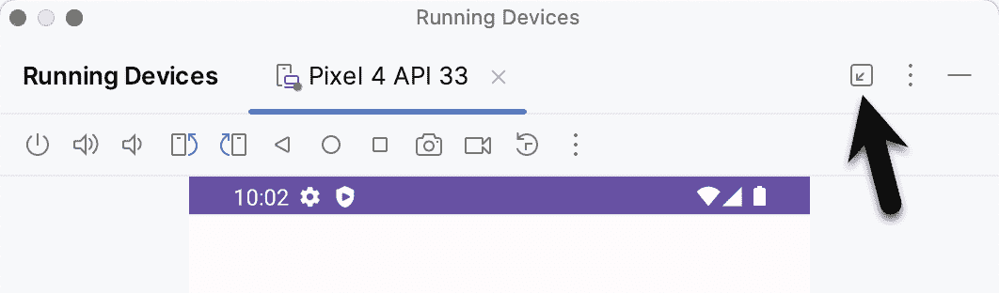
```

图 21

### 4.8 移除设备框

模拟器可以配置为带有或不带设备框显示。要更改设置，退出模拟器，打开`Device Manager`，选择列表中的`AVD`，并点击图 4-22 中箭头所示的菜单按钮：

```
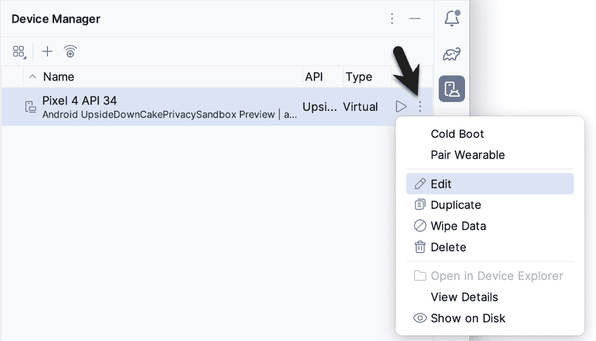
```

图 22 选择`Edit`选项，并在设置屏幕中找到并关闭`Enable device frame`选项，然后点击`Finish`按钮：

```
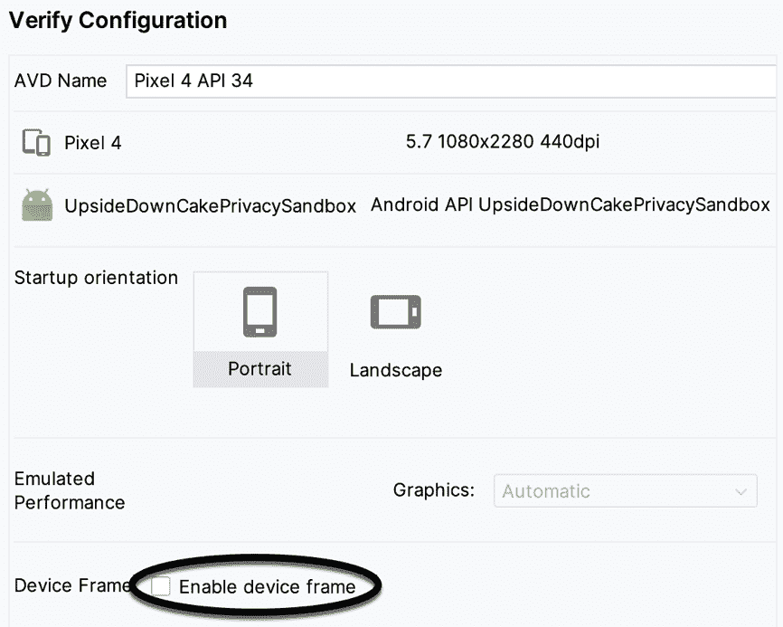
```

图 23 一旦禁用了设备框，模拟器在下次启动时将如图 4-24 所示：

```
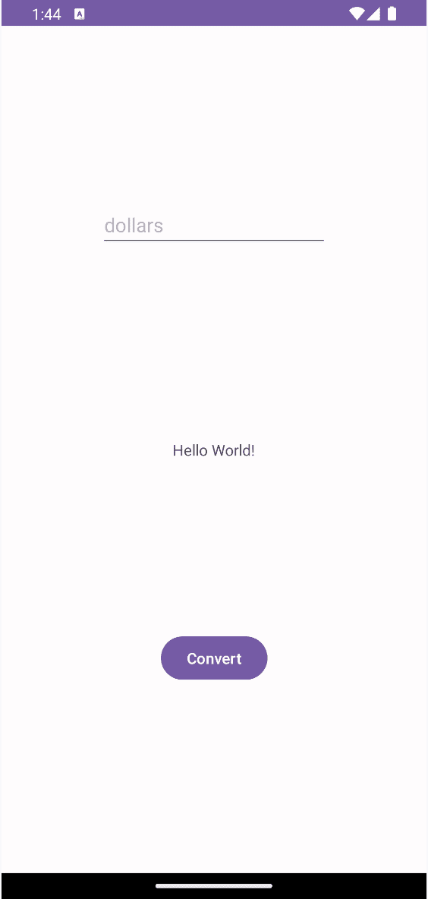
```

图 24

### 4.9 总结

典型的应用开发流程遵循测试环境中的编码、编译和运行周期。Android 应用程序可以在物理 Android 设备或 Android 虚拟设备 (AVD) 模拟器上进行测试。AVD 使用 Android Studio 的设备管理器工具创建和管理，该工具可以作为命令行工具使用，也可以通过图形用户界面使用。在创建 AVD 以模拟特定的 Android 设备模型时，应配置与物理设备匹配的硬件规格。

AVD 模拟器会话可以以独立窗口的形式显示，也可以嵌入到 Android Studio 主用户界面中。

## 5. 使用和配置 Android Studio AVD 模拟器

在下一章探索在物理 Android 设备上进行测试之前，本章将花费一些时间介绍 Android Studio AVD 模拟器的概述，并突出许多可在独立模式和工具窗口模式下用于自定义环境的配置功能。

### 5.1 模拟器环境

当以独立模式启动时，模拟器在加载过程中会显示一个初始启动屏幕。加载完成后，将出现主模拟器窗口，其中包含所选设备类型的表示（对于图 5-1，这是一个 Pixel 4 设备）：

```
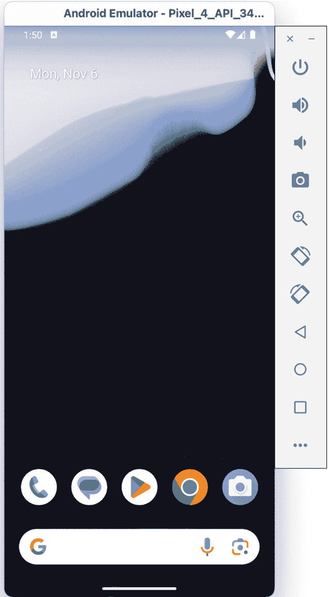
```

图 5-1

位于窗口右侧的工具栏提供了快速访问模拟器控制和配置选项的功能。

### 5.2 模拟器工具栏选项

模拟器工具栏（图 5-2）提供了与模拟器环境外观和行为相关的系列选项。

```

```

图 5-2

工具栏中的每个按钮都关联有一个键盘快捷键，可以通过将鼠标指针悬停在按钮上等待工具提示出现，或者通过扩展控制面板的帮助选项来识别。

尽管工具栏中的许多选项是自而易懂的，但为了完整起见，将对每个选项进行介绍：

- `退出 / 最小化` – 工具栏顶部的“x”按钮在选中时会退出模拟器会话，而“-”选项则会最小化整个窗口。

- `电源` – `电源`按钮模拟物理 Android 设备上的硬件电源按钮。点击并释放此按钮将锁定设备并关闭屏幕。长按此按钮将启动设备的“关机”请求序列。

- `音量增大 / 缩小` – 两个控制模拟器环境内播放音频音量的按钮。

- `向左/向右旋转` – 模拟的设备在竖屏和横屏方向之间旋转。

- `截屏` – 为设备屏幕显示的内容截屏。捕获的图像存储在扩展控制面板设置屏幕指定的指定位置（本章稍后会概述）。

- `缩放模式` – 此按钮切换进入和退出缩放模式，其细节将在本章稍后介绍。

- `返回` – 执行标准的 Android“返回”导航以返回上一个屏幕。

- `主页` – 显示设备主屏幕。

- `概览` – 模拟标准的 Android“概览”导航，显示设备上当前运行的应用程序。

- `折叠设备` – 模拟折叠屏设备的折叠和展开。此选项仅在模拟器运行折叠屏设备系统镜像时可用。

- `扩展控制` – 显示扩展控制面板，允许配置如模拟位置和电话活动、电池强度、蜂窝网络类型和指纹识别等选项。

### 5.3 在缩放模式下工作

位于模拟器工具栏的缩放按钮用于进入和退出缩放模式。当缩放模式激活时，工具栏按钮处于按下状态，且鼠标指针悬停在设备屏幕上将显示为放大镜。点击鼠标左键将导致显示相对于屏幕上的选定点放大，重复点击会增加缩放级别。相反，点击鼠标右键会降低缩放级别。关闭缩放按钮将显示恢复到默认大小。

在缩放模式下点击并拖动将定义一个矩形区域，当释放鼠标按钮时，视图将缩放到该区域。

在缩放模式下，可以使用模拟器窗口内的水平和垂直滚动条来移动屏幕的可视区域。

### 5.4 调整模拟器窗口大小

模拟器窗口的大小（以及设备相应的表示）可以通过启用缩放模式并在窗口的任何角或侧边上进行点击并拖动来随时更改。

### 5.5 扩展控制选项

扩展控制工具栏按钮显示如图 5-3 所示的面板。默认情况下将显示位置设置。从左侧面板选择不同的类别将显示相应的控制组：

```

```

图 5-3

### 5.5.1 位置

位置控制允许以十进制或六进制坐标向模拟器发送模拟位置信息。位置信息可以是单个位置的形式，也可以是代表设备移动的点序列，后者通过 GPS 交换 (GPX) 或 Keyhole 标记语言 (KML) 格式的文件提供。或者，可以使用集成的 Google Maps 面板视觉化地选择单点或旅行路线。

### 5.5.2 显示

除了模拟器屏幕内显示的主显示外，`显示`选项允许在相同的 Android 实例中运行额外的显示器。这对于测试如 Microsoft Surface Duo 等双屏设备的应用程序非常有用。这些额外的屏幕可以配置为任何大小，并显示在与主屏幕相同的窗口中。

### 5.5.3 蜂窝

可以在蜂窝设置屏幕更改模拟的蜂窝连接类型。可以选择模拟不同的网络类型（CSM、EDGE、HSDPA 等），以及一系列语音和数据场景，如漫游和拒绝访问。

### 5.5.4 电池

可以在扩展控制屏幕的此面板上模拟各种电池状态和充电条件，包括电池电量、电池状况以及是否连接了 AC 充电器。

### 5.5.5 摄像头

当摄像头激活时，模拟器会模拟 3D 场景。这表现为虚拟建筑内部，在模拟器中录制视频或拍照之前，可以通过按住 Option 键（Windows 上的 Alt）并使用鼠标指针和键盘键进行导航。此扩展配置选项允许上传不同的图像并在环境中显示。

### 5.5.6 电话

电话扩展控制提供了两个简单实用的模拟。第一个选项模拟来自指定号码的入电。这在测试应用程序如何处理高级中断时特别有用。

第二个选项允许在模拟器会话中接收短信。与真实世界一样，这些消息将出现在信息程序中触发模拟器内的标准通知。

### 5.5.7 方向键

方向键 (D-Pad) 是内置在 Android 设备中或外部连接（如游戏控制器）的额外控件组，提供方向控制（左、右、上、下）。方向键设置允许在模拟器中模拟 D-Pad 交互。

### 5.5.8 麦克风

麦克风设置允许启用麦克风，并模拟虚拟耳机和麦克风连接。还提供了一个按钮用于在模拟器上启动语音助手。

### 5.5.9 指纹识别

许多 Android 设备现在都配备了内置的指纹检测硬件。AVD 模拟器使得测试指纹身份验证成为可能，而无需在带有指纹传感器的物理设备上测试应用。有关如何在模拟器中配置指纹测试的细节，将在本章稍后部分介绍。

### 5.5.10 虚拟传感器

虚拟传感器选项允许模拟加速度计和磁计，以模拟设备的物理运动效果，例如通过偏航（yaw）、俯仰（pitch）和滚滚（roll）设置来实现旋转、移动和倾斜。

### 5.5.11 快照

快照包含当前运行的 AVD 会话状态，可以保存并快速恢复，从而轻松将模拟器恢复到精确的状态。快照将在本章稍后部分介绍。

### 5.5.12 录制与回放

允许将模拟器屏幕和音频录制并保存为 WebM 或动态 GIF 格式。

### 5.5.13 Google Play

如果模拟器运行安装了 Google Play 服务的 Android 版本，此选项将显示当前的 Google Play 版本。它还提供了将模拟器更新到最新版本的选项。

### 5.5.14 设置

设置面板提供了一组配置选项。使用此面板为工具栏和扩展控制面板选择深色主题，指定保存截图的文件系统位置，配置 OpenGL 支持级别，并配置模拟器窗口显示在桌面上其他窗口之上。

### 5.5.15 帮助

帮助屏幕包含三个子面板，分别包含快捷键列表、访问模拟器在线文档的链接、报告 bug 和发送反馈的链接以及模拟器版本信息。

### 5.6 使用快照

当模拟器首次启动时，它会执行冷启动，就像物理 Android 设备开机一样。由于操作系统需要加载并启动所有后台进程，冷启动过程可能需要一些时间才能完成。为了避免每次启动模拟器时都要经过这一过程，系统配置为每次退出时都自动保存模拟器当前状态的快照（称为快速启动快照）。下次启动模拟器时，快速启动快照将加载到内存中，并从上次离开的地方继续执行，允许模拟器在冷启动完成所需的一部分时间内重启。

扩展控制面板的快照屏幕可以在模拟器执行期间的任何点存储额外的快照。这保存了整个模拟器的精确状态，允许模拟器恢复到拍摄快照时的精确时间点。在屏幕中，可以使用`Take Snapshot`按钮（在图 5-4 中标记为 A）拍摄快照。要恢复现有的快照，从列表中选择 (B) 并点击屏幕底部的`run`按钮 (C)。还提供了编辑 (D) 快照名称和描述的选项，以及删除 (E) 当前选快照的选项：

```
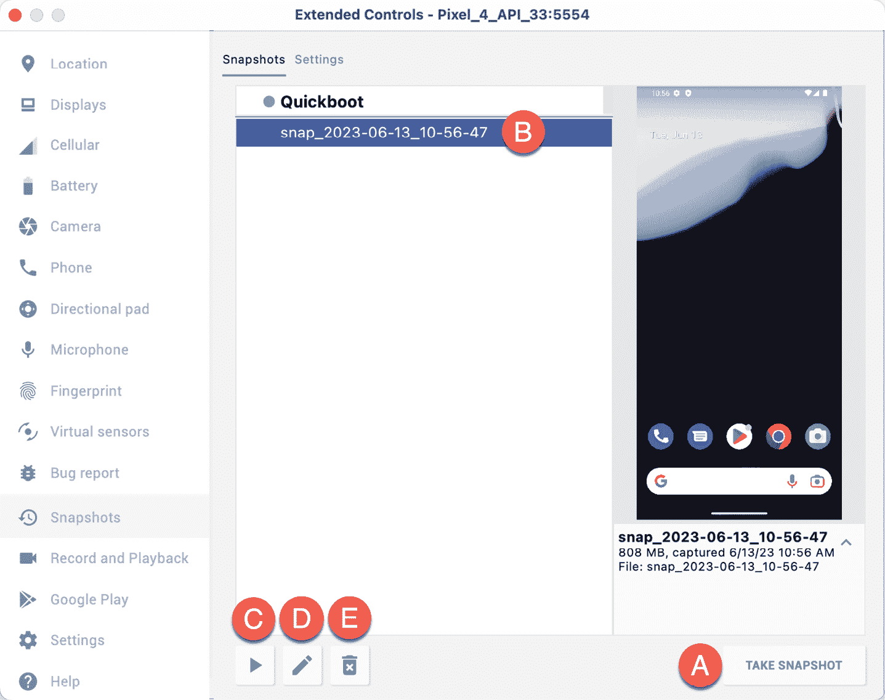
```

图 5-4

你还可以通过从主工具栏的运行目标菜单中进行选择，决定使用冷启动、最近的快速启动快照或之前的快照来启动模拟器，如图 5-5 所示：

```
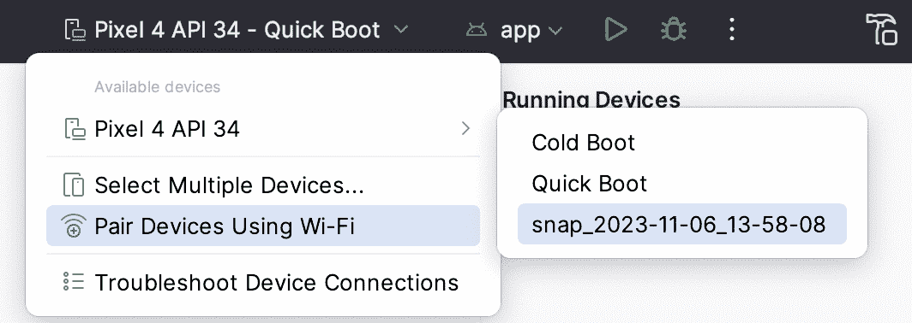
```

图 5-5

### 5.7 配置指纹模拟

模拟器允许配置多达 10 个模拟指纹，并用于测试 Android 应用内的指纹身份验证。配置模拟指纹的第一步是启动模拟器，打开`Settings`应用并选择`Security`选项。

在`Security`设置屏幕中，选择`fingerprint`选项。在出现的信息屏幕上，点击`Next`按钮进入`Fingerprint`设置屏幕。在启用指纹安全之前，必须配置备用屏幕解锁方法（例如`PIN`）。输入并确认合适的`PIN`，并通过接受默认通知选项完成`PIN`输入过程。


继续通过剩余屏幕，直到`Settings`应用请求在传感器上进行指纹录入。此时，显示扩展控制对话框，在左侧面板中选择`Finger-print`类别，并确保主设置面板中选中了`Finger 1`：


图 5-6

点击`Touch Sensor`按钮以模拟`Finger 1`触摸指纹传感器。模拟器将报告成功添加指纹：

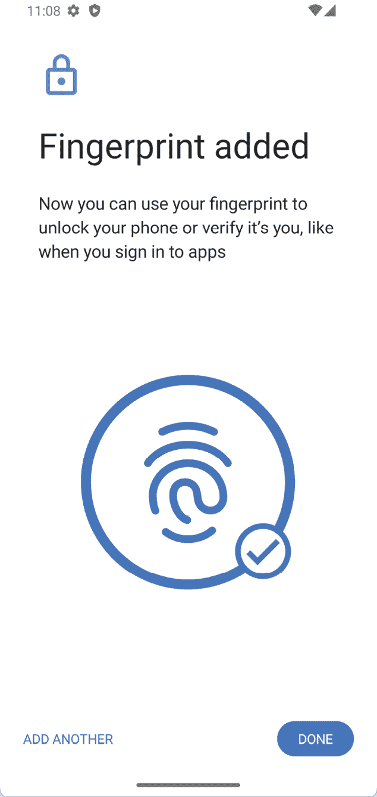

图 5-7

要添加更多指纹，点击`Add Another`按钮，并在再次点击`Touch Sensor`按钮之前，从扩展控制面板菜单中选择另一个手指。

### 5.8 工具窗口模式下的模拟器

如上一章“在 Android Studio 中创建 Android 虚拟设备 (AVD)”（`#AVD_Creation.xhtml__idTextAnchor084`）所述，Android Studio 可以配置为在嵌入式工具窗口中启动模拟器，使其不显示在独立窗口中。在此模式下运行时，工具栏中将提供与独立模式下相同的控件，如图 5-8 所示：


图 5-8

从左到右，这些按钮执行以下任务（详情与独立模式相同）：

- 电源
- 音量增大
- 音量减小
- 左旋转
- 右旋转
- 返回
- 首页
- 概览
- 截图
- 快照
- 扩展控制

### 5.9 创建可调整的模拟器

除了配置特定设备模型的模拟器外，Android Studio 还提供了一种可调整的 AVD，允许你在手机、平板电脑和折叠屏尺寸之间切换。要创建此类模拟器，打开设备管理器并点击工具栏上的`+`按钮。接下来，选择图 5-9 所示的 Resizable 设备定义，并按照通常步骤创建新 AVD：


图 5-9

当你在工具窗口中的模拟器上运行应用时，`Display`将出现在工具栏中，允许你切换模拟器配置，如图 5-10 所示：


图 5-10

如果模拟器以独立模式运行，可以在侧边工具栏找到`Display`，如下：


图 5-11

一旦选择了折叠屏显示模式，可以使用`Change posture`菜单在打开、关闭和半开状态下测试应用：


图 5-12

### 5.10 总结

Android Studio 包含一个 Android 虚拟设备模拟器环境，旨在使无需在物理 Android 设备上运行应用变得更加简单。本章对模拟器进行了介绍，并强调了用于配置和自定义环境以模拟不同测试条件的关键功能。

# 6 Android Studio 用户界面概览

虽然很急于运行上一章创建的示例应用，但它涉及到 Android Studio 用户界面的某些方面，这些内容最好先进行介绍。

Android Studio 是一个强大且功能丰富的开发环境，在很大程度上，它的使用是非常直观的。尽管如此，现在花时间熟悉 Android Studio 用户界面的布局和结构，将缩短本书后续章节的学习曲线。基于此考虑，本章将提供 Android Studio 环境中各个区域和组件的概述。

## 6.1 欢迎界面

欢迎界面（图 6-1）会在 Android Studio 运行且当前没有打开任何项目时显示（可以通过选择`File` -> `Close Project`菜单选项随时关闭已打开的项目）。如果 Android Studio 在项目仍处于打开状态之前退出，该工具在下次启动时将跳过欢迎界面，自动打开之前活跃的项目。


图 6-1

除了最近项目列表外，欢迎界面提供了执行任务的选项，例如打开和创建项目，并可以访问当前受版本控制的项目。此外，`Customize`（自定义）屏幕提供了更改 IDE 和编辑器所用主题和字体设置的选项。可以使用`Plugins`（插件）选项查看、安装和管理 Android Studio 插件。

当最近项目列表取代`More Actions`（更多操作）链接时，可以通过选择该链接或使用图 6-2 所示的菜单来获取可用选项：


图 6-2

## 6.2 菜单栏

在创建新项目或打开现有项目时，Android Studio 主窗口将会出现。当同时打开多个项目时，每个项目将分配其自己的主窗口。窗口的精确配置取决于 Android Studio 运行的操作系统，以及上一次项目打开时显示了哪些工具和面板。例如，主菜单栏的外观将取决于主机操作系统。在 macOS 上，Android Studio 遵循将菜单栏放置在桌面顶端边缘的标准惯例，如图 6-3 所示：


图 6-3

然而，当 Android Studio 在 Windows 或 Linux 上运行时，可以通过图 6-4 中高亮显示的按钮访问主菜单：


图 6-4

## 6.3 主窗口

项目打开后，Android Studio 主窗口通常看起来像图 6-5 所示：


图 6-5

主窗口的各种元素可以总结如下：

**A – 工具栏（Toolbar）** – 一组用于频繁执行操作的快捷键。工具栏按钮提供了快速访问一组菜单栏操作的快捷方式。可以通过右键点击工具栏并选择`Customize Toolbar…`（自定义工具栏…）菜单选项来自定义工具栏。图 6-6 所示的工具栏菜单提供了执行任务的方便方法，例如创建和打开项目以及在多个项目打开时进行窗口切换：


图 6-6

**B – 导航栏（Navigation Bar）** – 导航栏提供了一种在组成项目的文件和文件夹之间移动的方便方法。点击导航栏中的元素将弹出一个菜单，列出该位置的子文件夹和文件以供选择。同样，点击类名将显示列出该类中包含方法的菜单：


图 6-7

从列表中选择一个方法将跳转到代码编辑器中的相应位置。可以使用`View` -> `Appearance` -> `Navigation Bar`菜单选项来隐藏、显示和更改此栏的位置。

**C – 编辑器窗口（Editor Window）** – 编辑器窗口显示开发者当前正在编辑的文件的内容。当打开多个文件时，每个文件都由位于编辑器顶部边缘的标签页表示，如图 6-8 所示：


图 6-8

**D – 状态栏（Status Bar）** – 状态栏显示关于项目和 Android Studio 活动的信息性消息。悬停在状态栏条目上将显示该字段的描述。许多字段是可交互的，允许用户点击以执行任务或获取更详细的状态信息。


图 6-9

可以使用`View` -> `Appearance` -> `Status Bar Widgets`菜单更改显示在状态栏中的小部件。

**E – 项目工具窗口（Project Tool Window）** – 项目工具窗口提供了项目文件结构的分级概述，允许执行到特定文件和文件夹的导航。可以使用工具栏以几种不同的方式显示项目。默认设置是`Android`视图，这是本书其余部分主要使用的模式。

项目工具窗口只是 Android Studio 环境中许多可用工具之一。

## 6.4 工具窗口（Tool Windows）

除了项目视图（Project View）工具窗口外，Android Studio 还包含许多其他窗口，当这些窗口启用时，会显示在沿主窗口左右边缘的工具窗口栏上，并包含用于显示和隐藏每个工具窗口的按钮。图 6-10 显示了典型的工具窗口栏配置，尽管按钮的布局可能有所不同。


图 6-10

点击按钮将显示相应的工具窗口，而再次点击将隐藏窗口。工具窗口栏上的按钮指示了窗口将出现的一侧。可以通过点击并拖动按钮来更改这些位置。

Android Studio 提供了一系列工具窗口，最常用的包括：

- **Project（项目）** – 项目视图提供了文件结构的概述，允许在文件之间进行快速导航。通常，在项目视图中双击文件会将该文件加载到相应的编辑器中。
- **Resource Manager（资源管理器）** – 用于添加和管理项目内的资源和资产，例如图像、颜色和布局文件。
- **More Tool Windows（更多工具窗口）** – 显示未在工具窗口栏中的其他工具窗口的菜单。从此菜单选择工具窗口时，它将作为按钮出现在工具窗口栏中。
- **Run（运行）** – 运行窗口在应用程序运行时变为可用，提供运行结果的视图以及停止或重启运行进程的选项。如果应用程序无法在设备或模拟器上安装和运行，此窗口通常会提供有关问题的诊断信息。
- **Logcat** – Logcat 工具窗口提供了访问运行应用程序监控日志输出的权限，以及拍摄屏幕、录制视频以及停止和重启进程的选项。
- **Problems（问题）** – 查看项目内所有当前错误或警告的中心位置。双击问题列表中的项将带您进入问题所在的文件和位置。
- **App Quality Insights（应用质量洞察）** – 提供访问云端 Firebase 应用质量和崩溃分析平台的权限。
- **Terminal（终端）** – 提供访问运行 Android Studio 的系统的终端窗口权限。在 Windows 系统上，这是命令提示符界面，而在 Linux 和 macOS 系统上，它以终端提示符的形式出现。
- **版本控制 (I)** – 当项目文件受源代码版本控制时，使用此工具窗口，允许访问 Git 仓库和代码更改历史。
- **通知 (J)** – 当项目文件受源代码版本控制时，使用此工具窗口，允许访问 Git 仓库和代码更改历史。
- **Gradle (K)** – `Gradle`工具窗口提供了构成项目构建配置的`Gradle`任务视图。该窗口列出了将项目各种元素编译为可执行应用程序所需的任务。右键点击顶层`Gradle`任务并选择`Open Gradle Config`（打开 Gradle 配置）菜单选项，可以将当前项目的 Gradle 构建文件加载到编辑器中。`Gradle`将在本书后续部分详细介绍。
- **设备管理器 (L)** – 提供对`Device Manager`工具窗口的访问，可以在该窗口添加、删除和管理物理 Android 设备连接和模拟器。
- **运行中的设备 (M)** – 如果已启用在工具窗口中运行模拟器的选项（如章节“在 Android Studio 中创建 Android 虚拟设备 (AVD)”节所示），则该窗口包含 AVD 模拟器。
- **应用检查** – 提供对`Database`和`Background Task`检查器的访问。`Database Inspector`允许你在应用运行时检查、查询和修改应用程序的数据库。`Background Task Inspector`允许监控和管理使用`WorkManager`创建的后台工作任务。
- **书签** – `Bookmarks`工具窗口提供快速访问已书签的文件和代码行。例如，在项目视图中右键点击文件可以访问`Add to Bookmarks`菜单选项。同样，你可以通过将光标移动到源文件中的某行并按`F11`键（macOS 上为`F3`）为源文件中的代码添加书签。可以通过此工具窗口访问所有书签项。
- **构建** – `build`工具窗口显示项目编译和打包期间构建过程的信息以及遇到的任何错误的详细信息。
- **构建变体** – 构建变体工具窗口提供了一种为当前应用程序项目配置不同构建目标的快速方法（例如，针对应用程序调试和发布版本的不同构建，或针对不同设备类别的多个构建）。
- **设备文件管理器** – 可通过`View` -> `Tool Windows` -> `Device File Explorer`菜单访问，此工具窗口提供对当前连接的 Android 设备或模拟器文件系统的直接访问，允许浏览文件系统并将文件复制到本地文件系统。
- **布局检查器** – 提供构成用户界面布局的组件层次结构的视觉 3D 渲染。
- **结构** – `structure`工具提供了当前编辑器中显示的源文件结构的高级视图。此信息包括文件中的`classes`（类）、`methods`（方法）和`variables`（变量）等项列表。从结构列表中选择一个项将带你进入编辑器窗口中源文件中的对应位置。
- **TODO** – 如名所示，此工具提供了一个查看项目中尚未完成项的地方。`Android Studio`通过扫描项目的源文件并查找匹配指定`TODO`模式的注释来编译此列表。可以通过打开`Settings`对话框并导航到`Editor`下的`TODO`来查看和更改这些模式。

## 6.5 工具窗口菜单

每个工具窗口在顶部都有自己的工具栏。这些工具栏中的菜单按钮随工具而异，但所有工具窗口都包含一个`Options`菜单（在图 6-11 中标记为`A`）：


图 6-11

`Options`菜单允许更改窗口的各个方面。例如，图 6-12 显示了`Project`工具窗口的`Options`菜单。可以使用设置，例如取消停靠窗口并使其浮动在`Android Studio`主窗口边界之外，以及移动和调整工具面板的大小：


图 6-12

所有工具窗口在工具栏的最右侧还包含一个按钮（在上方图 6-11 中标记为`B`），提供了隐藏工具窗口视图的额外方法。可以通过点击该窗口使其获取焦点，然后输入搜索术语（例如`Project`工具窗口中的文件名）来对工具窗口内的项进行搜索。搜索框将出现在窗口的工具栏中，并高亮显示匹配的项。

## 6.6 Android Studio 键盘快捷键

`Android Studio`包含了许多键盘快捷键，以便在执行常用任务时节省时间。可以在`Android Studio`项目窗口内通过选择`Help` -> `Keyboard Shortcuts PDF`菜单选项查看并打印完整的键盘快捷键映射列表。你也可以通过打开`Settings`对话框并点击`Keymap`项来列出和修改键盘快捷键，如下方的图 6-13 所示：


图 6-13

## 6.7 切换器和最近文件导航

在`Android Studio`主窗口中导航的另一种实用机制是使用`Switcher`（切换器）。通过`Ctrl-Tab`键盘快捷键访问，切换器作为一个列出工具窗口和当前打开文件的面板出现（图 6-14）。


图 6-14

只要按下`Ctrl`键切换器就会显示。通过点击该窗口使其获取焦点然后输入搜索术语，可以对该窗口内的项进行搜索。搜索框将出现在窗口的工具栏中，并高亮显示匹配的项。

除了`Switcher`之外，`Recent Files`（最近文件）面板提供了对最近文件的导航（图 6-15）。可以使用快捷键`Ctrl-E`（macOS 上为`Cmd-E`）。显示后，可以使用鼠标指针选择选项，或使用键盘箭头键滚动。按下`Enter`键将选择高亮项：


图 6-15

## 6.8 修改 Android Studio 主题

可以使用`Settings`对话框更改 Android Studio 环境的主题。一旦显示设置对话框，选择左侧面板中的`Appearance & Behavior`选项，然后选择`Appearance`。在点击`OK`按钮之前更改`Theme`设置。可用的主题取决于平台，但通常包括`Light`、`IntelliJ`、`Windows`、`High Contrast`和`Darcula`等选项。图 6-16 显示了选择深色主题的主窗口示例：


图 6-16

要将 Android Studio 主题与操作系统的亮/暗模式设置同步，请启用`Sync with OS`并使用下拉菜单控制每种模式使用的主题：


图 6-17

## 6.9 总结

`Android Studio`环境的主要元素包括欢迎界面和主窗口。每个打开的项目都分配了自己的主窗口，主窗口又由菜单栏、工具栏、编辑和设计区域、状态栏以及一组工具窗口组成。工具窗口位于主窗口的两侧。

在`Android Studio`中，几乎没有操作是无法通过快捷键触发的。可以从`Android Studio`主窗口访问默认键盘快捷键映射。

虽然使用 Android 虚拟设备 (AVD) 测试应用程序可以实现许多功能，但在物理 Android 设备上进行真实世界的应用测试是不可替代的，而且某些 Android 功能仅在物理 Android 设备上可用。

与 AVD 实例和连接的 Android 设备之间的通信均由 Android 调试桥接 (ADB) 处理。本章将解释如何在 macOS、Windows 和基于 Linux 的系统上配置`adb`环境，以便在 Android 设备上启用应用测试。

# 7 Android 调试桥接 (ADB)

## 7.1 Android 调试桥接 (ADB) 概述

`ADB`的主要目的是促进开发系统（在本例中为 Android Studio）与 AVD 模拟器以及 Android 设备之间的交互，以便用于运行和调试应用程序。`ADB`允许你通过 WiFi 或 USB 数据线连接到设备。


`ADB`由一个客户端、一个运行在开发系统后台的服务器进程，以及一个运行在AVD或手机、平板电脑等真实Android设备上的守护后台进程组成。

`ADB`客户端有多种形式。例如，在Android SDK的`platform-tools`子目录中提供了一个名为`adb`的命令行工具作为客户端。同样，Android Studio也有内置的客户端。

可以使用`adb`命令行工具执行多种任务。例如，可以使用`devices`命令行参数列出活跃的虚拟或物理设备。以下命令输出表示系统上存在一个AVD，但没有物理设备：

```
$ adb devices

List of devices attached
emulator-5554 device
```

### 7.2 在Android设备上启用USB调试ADB

在`ADB`连接到Android设备之前，必须将该设备配置为允许该连接。对于运行Android 6.0或更高版本的手机和平板电脑设备，实现此目的的步骤如下：

1. 打开设备上的`Settings`（设置）应用并选择`About tablet`（关于平板电脑）或`About phone`（关于手机）选项（在某些Android版本中，这可以在`Settings`应用的`System`（系统）页面找到）。

2. 在`About`屏幕上，向下滚动到`Build number`（版本号）字段（图7-1）并点击七次，直到消息显示已启用开发者模式。如果`About`屏幕上没有列出`Build number`，则可以通过`Software information`（软件信息）选项找到。或者，如果可用，展开列表中的`Advanced`（高级）部分。


图7-1

3. 返回主`Settings`屏幕，注意出现一个名为`Developer options`（开发者选项）的新选项（在较新的Android版本中，此选项列在`System`设置屏幕上）。选择此选项，并在生成的屏幕上找到如图7-2所示的`USB debugging`（USB调试）选项：


图7-2

4. 启用`USB debugging`选项，并在请求确认时点击`Allow`（允许）按钮。

如果你使用三星Galaxy设备，可能需要在启用调试选项之前，在`Settings`应用中关闭`Auto Blocker`（自动锁）功能。

现在设备已配置为接受通过USB连接来自开发系统`adb`的调试连接。剩下的工作是配置开发系统以便在连接设备时检测到它。虽然这是一个相对简单的过程，但步骤取决于开发系统运行的是Windows、macOS还是Linux。注意，以下步骤假设Android SDK `platform-tools`目录已包含在操作系统`PATH`环境变量中，如“设置Android Studio开发环境”章节中所示。

### 7.2.1 macOS ADB配置

要在macOS系统上配置`ADB`环境，请使用USB数据线将设备连接到计算机系统，打开终端窗口并执行以下命令重启`adb`服务器：

```
$ adb kill-server
$ adb start-server

* daemon not running. starting it now on port 5037 *
* daemon started successfully *
```

一旦服务器成功运行，执行以下命令以验证设备是否已检测到：

```
$ adb devices

List of devices attached
74CE000600000001 offline
```

如果设备被列为`offline`（离线），请前往Android设备并检查是否有图7-3所示的寻求`Allow USB debugging`（允许USB调试）权限的对话框。在点击OK之前，勾选`Always allow from this computer`（始终允许此计算机）旁边的复选框。


图7-3

现在重复`adb devices`命令应该会将设备列为可用：

```
List of devices attached
015d41d4454bf80c device
```

如果设备未列出，尝试注销并重新登录macOS桌面，如果问题仍然，请重启系统。

### 7.2.2 Windows ADB配置

配置Windows开发系统使用`ADB`连接到Android设备的第一步是在系统上安装相应的USB驱动程序。要安装的USB驱动程序取决于Android设备的型号。如果有Pixel手机等Google设备，则必须在在Windows系统上安装并配置`Google USB Driver`包。实现此操作的详细步骤列在以下网页上：

[`developer.android.com/sdk/win-usb.html`](https://developer.android.com/sdk/win-usb.html)

对于不支持Google USB驱动的Android设备，需要下载设备制造商提供的驱动程序。可以从此处获取驱动列表和安装信息：

[`developer.android.com/tools/extras/oem-usb.html`](https://developer.android.com/tools/extras/oem-usb.html)

驱动程序安装且设备被识别为正确类型后，打开命令提示符窗口并执行以下命令：

`adb devices`

此命令应输出关于连接设备的信息：

```
List of devices attached
HT4CT016 offline
```

如果设备被列为`offline`或`unauthorized`（未授权），请查看设备并检查图7-3所示的寻求`Allow USB debugging`权限的对话框。在点击OK之前，勾选`Always allow from this computer`（始终允许此计算机）旁边的复选框。重复`adb devices`命令现在会将设备列出：

```
List of devices attached
HT4CT016 device
```

如果设备未列出，执行以下命令重启`ADB`服务器：

```
adb kill-server
adb start-server
```

如果设备仍未列出，尝试执行以下命令：

`android update adb`

注意，可能还需要重启系统。

### 7.2.3 Linux ADB配置

在本章中，我们将再次使用Ubuntu Linux作为在Linux上配置`adb`连接到物理设备的示例。

在Ubuntu Linux上进行物理设备测试需要安装名为`android-tools-adb`的包，这又要求Android Studio用户是`plugdev`组的成员。这是大多数Ubuntu版本的默认设置，可以通过运行`id`命令进行验证。如果没有列出`plugdev`组，运行以下命令将用户添加到该组：

`sudo usermod -aG plugdev $LOGNAME`

满足组成员要求后，可以通过执行以下命令安装`android-tools-adb`包：

`sudo apt-get install android-tools-adb`

完成上述更改后，重启Ubuntu系统。系统重启后，打开终端窗口，启动`adb`服务器并检查已连接设备列表：

```
$ adb start-server

* daemon not running. starting it now on port 5037 *
* daemon started successfully *

$ adb devices
```

015d41d4454bf80c离线

如果设备显示为离线（offline）或未授权（unauthorized），请检查Android设备并查看图7-3所示请求允许USB调试的对话框。

### 7.3 解决USB连接问题

如果您无法通过上述步骤成功连接到设备，请显示运行目标菜单（图7-4）并选择`Troubleshoot Device Connections`（排除设备连接）选项：


图7-4

连接助手将扫描设备并报告问题以及可能的解决方案。

### 7.4 在Android设备上启用无线调试

按照上述第7.2节的第1至3步操作，这次启用如图7-5所示的`Wireless Debugging`（无线调试）选项：


图7-5

接下来，点击上面的无线调试条目以显示如图7-6所示的屏幕：


图7-6

如果您的设备带有摄像头，选择`Pair device with QR code`（使用二维码码配对设备），否则选择`Pair device with pairing code`（使用配对码配对设备）选项。根据您的选择，`Settings`应用将启动相机会话或显示配对码，如图7-7所示：


图7-7

选择选项后，返回Android Studio，并在运行目标菜单中选择如图7-8所示的`Pair Devices Using WiFi`（通过WiFi配对设备）选项：


图7-8

在配对对话框中，根据您之前在设备`Settings`应用中的选择，选择`Pair using QR code`（使用二维码配对）或`Pair using pairing code`（使用配对码配对）：


使用Android设备扫描二维码，或将设备屏幕上显示的配对码输入到Android Studio对话框（图7-10）中完成配对过程：


图7-10

如果配对过程失败，请尝试重启开发系统和Android设备并重试。

### 7.5 测试adb连接

假设在您选择的开发平台上已成功配置了`adb`，下一步是尝试在设备上运行在“在Android Studio中创建示例Android App”章节中创建的测试应用程序。启动Android Studio，打开`AndroidSample`项目，并验证设备是否出现在设备选择菜单中（如图7-11所示）：


图7-11

从列表中选择设备并点击运行按钮以安装并运行应用。

### 7.6 设备镜像

设备镜像允许您在物理设备上运行应用，同时在Android Studio的Running Devices工具窗口内查看显示。换句话说，尽管应用程序运行在物理设备上，但它在Android Studio中的显示方式与AVD实例相同。

设备连接到Android Studio后，显示Running Devices工具窗口并点击`Device Mirror`设置链接以显示`Settings`对话框。在`Settings`对话框中，启用物理Android设备的镜像并点击`OK`。下次运行应用时，Android Studio将会在Running Devices工具窗口镜像物理设备的显示。

### 7.7 总结

虽然Android虚拟设备模拟器提供了极佳的测试环境，但必须记住，要确保应用程序在物理Android设备上正确运行，没有真正的替代品。

但默认情况下，Android Studio环境未配置为将Android设备作为目标测试设备。因此，需要执行某些步骤，以便通过USB线或WiFi网络从Android Studio开发环境直接将应用程序加载到Android设备上。实现此目标的具体步骤取决于开发平台。在本章中，我们涵盖了针对Linux、macOS和基于Windows平台的这些步骤。

## 8. Android Studio代码编辑器基础

为Android开发应用程序涉及大量的编程工作，根据定义，这涉及输入、审查和修改代码行。令人遗憾的是，开发者在使用Android Studio时的大部分时间通常花在编辑器窗口内编辑代码上。

现代代码编辑器必须远超输入、删除、剪切和粘贴的基本功能。今天，代码编辑器的实用性通常由等因素衡量，例如它减少了程序员所需的输入量、在大型源代码文件中进行导航的易用性，以及编辑器在编写代码时实时检测并突出编程错误的能力。正如本章将要显示的，这些只是Android Studio编辑器出色的少数领域之一。

本章虽然不是Android Studio编辑器功能的详尽概述，但其目的是提供该工具功能的指南。丰富的程序员会发现，某些功能在现代编辑器中是通用的，而另一些则是该环境特有的。

### 8.1 Android Studio编辑器

当选择Java、Kotlin或其他文本文件进行编辑时，Android Studio编辑器会出现在主窗口中心。图8-1显示了一个加载Java源码文件的典型会话：


图8-1

构成编辑器窗口的元素如下：

**A – 文档标签**——Android Studio可以随时打开多个文件进行编辑。每打开一个文件，它会被分配到一个位于编辑器窗口顶部标签栏的文档标签。当空间不足以显示所有标签时，标签栏远右角会出现一个小下拉菜单。点击此菜单将列出所有打开的文件列表。标签中文件名下方的波浪线表示文件包含需要解决的错误，解决后才能编译和运行项目。

切换文件只需点击相应的标签或使用`Alt-Left`和`Alt-Right`快捷键。也可以通过切换器（通过`Ctrl-Tab`快捷键访问）在文件之间导航。

要将编辑器面板从Android Studio主窗口分离以便在独立窗口中显示，请点击标签并将其拖到桌面上主窗口之外的区域。要将编辑器返回主窗口，请点击分离编辑器中的文件标签，并将其拖放回主窗口中的原始标签栏。

**B – 编辑器侧栏区域**——侧栏区域用于编辑器显示信息图标和控件。该侧栏区域的一些典型项目包括调试断点标记、代码块折叠和展开控件、书签、更改标记和行号。行号默认开启，但可以通过右键点击侧栏并选择`Appearance -> Show Line Numbers`菜单选项来禁用。

**C – 代码结构位置**——编辑器底部的此栏显示了光标相对于代码整体结构的位置。在下图中，该栏指示当前正在编辑`convertCurrency`方法，且该方法包含在`MainActivity`类中：


图8-2

双击栏中的任意元素会将光标移动到代码文件中的相应位置。例如，双击`convertCurrency`条目将把光标移动到源代码中`convertCurrency`方法的顶部。同样，点击`MainActivity`条目将显示一个可供选择的代码导航点列表：


图8-3

### D – 编辑区域

用户在此处审查、输入和编辑代码的主要区域。本章的随后的章节将详细介绍编辑区域的关键功能。

### E – 验证与标记侧边栏

Android Studio集成了一项名为“即时代码分析”的功能。这本质上意味着当你输入代码时，编辑器会分析代码以检查警告和语法错误。验证侧边栏顶部的指示器会随着代码的添加而实时更新，显示已发现的错误和警告数量。点击此指示器将显示一个弹出窗口，其中包含编辑器中代码存在问题的摘要，如图8-4所示：


图8-4

上下箭头可以在代码中的错误位置之间移动。绿色勾号表示未检测到任何警告或错误。

侧边栏还会使用相同的颜色代码在检测到问题的位置显示标记。当编辑器区域显示某行代码时，将鼠标指针悬停在标记上，将显示一个包含该问题描述的弹出窗口：


图8-5

当某行代码已滚动出编辑器区域可视范围时，将鼠标指针悬停在该行的标记上，将显示一个“透镜（lens）”覆盖层，其中包含问题所在的代码块（图8-6），从而无需滚动到编辑器中的该位置即可进行查看：


图8-6

值得注意的是，透镜覆盖层不仅限于侧边栏中的警告和错误。悬停在侧边栏的任何部分都会出现一个透镜，显示源文件中该位置存在的代码。

### F – 状态栏

虽然状态栏是主窗口的一部分而非编辑器，但它确实包含关于当前活动编辑会话的信息。这些信息包括光标在行和字符方面的当前位置，以及文件的编码格式（UTF-8、ASCII等）。点击状态栏中的这些值可以更改相应的设置。例如，点击行号会显示“转到行列（Go to Line:Column）”对话框。使用`View -> Appearance -> Status Bar Widgets`菜单选项可以添加和删除组件。例如，如果你遇到Android Studio的性能问题，内存指示器（Memory Indicator）是一个非常有用的组件。

在概述了构成Android Studio编辑器的元素后，本章的剩余部分将更详细探索编辑环境的关键功能。

## 8.2 分拆编辑器窗口


默认情况下，编辑器将显示一个单面板，显示当前选中文件的内容。在同时处理多个源文件时，一个非常实用的功能是将编辑器拆分为多个窗格。要拆分编辑器，可以在编辑器窗口内的文件标签上点击右键，然后选择`Split Right`（向右拆）或`Split Down`（向下拆）菜单选项。例如，图 8-7 显示了拆分器的工作状态，编辑器被拆分为三个面板：


图 8-7

可以通过在相应的标签上点击右键并选择`Change Splitter Orientation`（更改拆分器方向）菜单选项随时更改拆分面板的方向。重复这些步骤可以取消单个面板的拆分，此时从菜单中选择`Unsplit`（取消拆分）选项。右键点击任何标签并选择`Unsplit All`（取消所有拆分）可以移除所有拆分面板。

窗口拆分可显示不同的文件，或为同一个文件提供多个窗口，允许同时查看和编辑同一文件的不同区域。

## 8.3 代码补全

Android Studio 编辑器拥有大量的 Java 编程语法、构成 Android SDK 的类和方法，以及你自己的代码库的知识。在输入代码时，编辑器会扫描输入内容，并在适当的情况下就完成一个语句或引用可能需要的内容提供建议。当编辑器检测到补全建议时，会出现一个包含建议列表的面板。例如在图 8-8 中，编辑器正在为`String`声明的开头提供可能性：


图 8-8

如果没有任何自动补全建议是正确的，请继续输入，编辑器将在适当的情况下继续完善建议。要接受最顶部的建议，请按键盘上的`Enter`或`Tab`键。要选择不同的建议，使用方向键在列表中上下移动，再次使用`Enter`或`Tab`键选中高亮的项。

可以使用`Ctrl-Space`组合键序列手动调用补全建议。这在更改编辑器中的单词或声明时非常有用。当光标位于编辑器中的某个单词上时，该单词将自动高亮。按下`Ctrl-Space`将显示一个建议列表。使用`Tab`键替换编辑器中的当前单词。

除了实时自动补全功能外，Android Studio 编辑器还提供了智能补全（Smart Completion）系统。智能补全通过`Shift-Space`序列调用，选中后将根据代码的上下文提供更详细的建议。再次按下`Shift-Space`序列将从更广泛的范围内提供建议。

代码补全对许多程序员来说是一个个人偏好问题。为了承认这一事实，Android Studio 为自动补全设置提供了高水平控制。可以通过打开设置对话框并在设置面板中选择`Editor -> General -> Code Completion`来查看和修改这些设置，如图 8-9 所示：


图 8-9

## 8.4 语句完成

Android Studio 编辑器提供的另一种补全形式是语句完成。它可以自动填充方法和循环语句等项的括号和大括号。语句补全通过`Shift-Ctrl-Enter`（macOS 上为`Shift-Cmd-Enter`）序列调用。例如考虑以下代码：

```
myMethod()
```

在编辑器中输入这些代码后，触发语句补全将导致编辑器自动为方法添加括号：

```
myMethod() {
}
```

## 8.5 参数信息

还可以要求编辑器提供方法接受的参数信息。当光标位于方法调用括号之间时，`Ctrl-P`（macOS 上为`Cmd-P`）序列将显示该方法接受的参数，其中最可能的建议将加粗显示：


图 8-10

## 8.6 参数名称提示

代码编辑器可以配置为在方法调用中显示参数名称提示。例如，图 8-11 显示了`Snackbar`类中`make()`和`setAction()`方法调用中的参数名称提示：


图 8-11

此模式的设置可以通过打开设置对话框，并在侧边面板中导航到`Editor` -> `Inlay Hints` -> `Java`来配置。在随后的生成的屏幕上，为您选择的编程语言开启或关闭`Parameter names`（参数名称）选项。要调整提示设置，点击`Exclude list...`（排除列表）链接并进行必要的调整。

## 8.7 代码生成

除了在输入代码时完成代码外，编辑器在某些条件下还可以为您生成代码。图 8-12 所示的可用代码生成选项列表，可以在光标位于文件中需要生成代码的位置时，使用`Alt-Insert`（macOS 上为`Cmd-N`）快捷键访问。


图 8-12

例如，考虑一种情况：我们希望在项目中的`Activity`将被操作系统销毁时收到通知。正如本书后面的章节概述，这可以通过重写`Activity`超类的`onStop()`周期方法来实现。要让 Android Studio 为此生成存根方法，请从代码生成列表中选择`Override Methods…`（重写方法……）选项，并在生成的可用方法列表中选择`onStop()`方法：


图 8-13

选中要重写的方法后，点击`OK`将在 Java 源文件的当前光标位置生成如下存根方法：

```java
@Override
protected void onStop() {
    super.onStop();
}
```

## 8.8 代码折叠

一旦源代码文件达到了一定的大小，即使是格式化最精细、组织良好的代码也可能变得难以处理和导航。Android Studio 认为，并不总是需要让每个代码块的内容始终可见。通过使用 Android Studio 编辑器的代码折叠功能，可以让代码导航变得更加容易。代码折叠通过展开箭头控制，当鼠标指针悬停在源文件的行槽（gutter）区域时，这些箭头会出现在源文件中每个代码块的开头。例如，图 8-14 显示了当前未折叠的方法声明的展开箭头：


图 8-14

点击此标记将折叠语句，使只显示签名行，如 图 8-15 所示：


图 8-15

要展开已折叠的代码段，请点击编辑器行槽中的展开箭头。若要在不展开的情况下查看隐藏代码，请将鼠标指针悬停在“{…}”指示器上，如 图 8-16 所示。随后，编辑器将显示包含折叠代码块的透镜覆盖（lens overlay）：


图 8-16

文件中的所有代码块可以使用`Ctrl-Shift-Plus`和`Ctrl-Shift-Minus`快捷键序列（macOS 上为`Cmd-Shift-Plus`和`Cmd-Shift-Minus`）进行折叠或展开。

默认情况下，Android Studio 编辑器在打开源文件时会自动折叠某些代码。要配置发生这种情况的条件，请导航到设置对话框中的`Editor` -> `General` -> `Code Folding`项（图 8-17）：


图 8-17

## 8.9 快速文档查找

通过将光标置于所需文档的声明上并按下`Ctrl-Q`快捷键（macOS 上为`Ctrl-J`），可以访问上下文相关的 Java 和 Android 文档。这将显示一个包含该项目相关参考文档的弹出窗口。例如，图 8-18 显示了`Android FloatingActionButton`类的文档。


图 8-18

## 8.10 代码格式化

通常情况下，Android Studio 编辑器会在添加语句和代码块时，自动在缩进、间距和嵌套方面对代码进行格式化。在需要重新格式化代码的情况下（这很常见，例如当从网站剪切粘贴示例代码时），编辑器提供了源代码格式化功能，选择后将自动重新格式化代码以匹配主流的代码风格。

按下`Ctrl-Alt-L`（macOS 上为`Cmd-Opt-L`）快捷键序列来格式化源代码。要显示`Reformat Code`（格式化代码）对话框（图 8-19），请使用`Ctrl-Alt-Shift-L`（macOS 上为`Cmd-Opt-Shift-L`）。此对话框提供了仅格式化当前选定代码、整个源文件的选项：


图 8-19

完整的代码风格偏好可以通过打开设置对话框并在侧边面板选择`Code Style`来更改，以访问支持的编程和标记语言。例如，要配置上述对话框中的`Arrangement`选项，展开`Code Style`部分并选择`Java`。

## 8.11 查找示例代码

Android Studio 编辑器提供了与当前高亮项相关的示例代码方法。此功能对于学习如何使用特定的类很有帮助。要查找示例代码，在编辑器中高亮方法或类名，右键点击并选择`Find Sample Code`。如果有示例代码，将出现示例代码面板。从列表中选择示例将加载到右侧面板。

## 8.12 动态模板

Android Studio 编辑器包含一组动态模板，可以快速插入常用的代码片段。可以通过在编辑器中使用`Cmd-J`（macOS）或`Ctrl-J`（Windows/Linux）快捷键序列访问这些模板，然后从列表中选择所需的模板。

## 8.13 总结

Android Studio 编辑器极力减少编写代码所需的输入量，并使代码更容易阅读和导航。本章涵盖了关键编辑器功能，包括代码补全、代码生成、编辑器窗口分割、代码折叠、格式化、文档查找和动态模板。

## 9. Android 架构概述

到目前为止，本书已经采取了步骤来建立适用于使用 Android Studio 开发 Android 应用程序的环境。通过创建一个 Android Studio 应用程序项目，已经在应用开发过程中迈出了第一步。

然而，在进一步研究 Android 应用程序开发的实践问题之前，理解 Android SDK 以及通用的 Android 开发的一些较为抽象的概念至关重要。现在清晰地理解这些概念将为进一步构建知识奠下坚实的基础。

本章从 Android 架构的概述开始，并在接下来的几章节中继续，目标是提供 Android 开发基础知识的详细概述。

### 9.1 Android 软件栈

Android 的结构是一个软件栈，由应用程序、操作系统、运行库环境、中间件、服务和库组成。这种架构可以通过视觉方式最好地表示，正如图 9-1 所示。栈的每一层以及每层中对应的元素都紧密集成并经过精心调，以为移动设备提供最佳的应用开发和执行环境。本章的剩余部分将逐层介绍 Android 栈的不同层，从底部的 Linux 内核开始。


图 9-1

### 9.2 Linux 内核

Linux 内核位于 Android 软件栈的底部，在设备硬件与 Android 软件栈上层之间提供了一个抽象。内核提供了抢占式多任务处理、底层核心系统服务（如内存、进程和电源管理），以及针对显示器、WiFi 和音频硬件的网络栈和设备驱动程序。

原始 Linux 内核由 Linus Torvalds 在 1991 年开发。它与 Richard Stallman 在自由软件基金开发的一系列工具、实用程序和编译器结合，创建了一个名为 GNU/Linux 的完整操作系统。各种 Linux 发行版都是从这些基础架构中派生而来的，例如 Ubuntu 和红帽企业级 Linux（Red Hat Enterprise Linux）。

然而，值得注意的是，Android 仅使用 Linux 内核。尽管如此，值得注意的是，Linux 内核最初是为传统的桌面和服务器计算机系统而设计的。事实上，Linux 现在最广泛地部署在任务关键型企业服务器环境中。我们发现这种软件位于 Android 软件栈的核心，这既证明了当今移动设备的强大，也证明了 Linux 内核的效率和性能。

### 9.3 硬件抽象层

硬件抽象层（`HAL`）由一组与摄像头、麦克风和加速度计等设备组件的库模块组成。当 Android 栈需要访问硬件组件时，它使用 HAL 库模块。每个 Android 设备制造商都为其特定的硬件配置有一个抽象层，允许标准的 Android 库和框架在任何设备上运行，无需针对特定硬件进行修改。

### 9.4 Android 运行时 – ART

当在 Android Studio 中构建 Android 应用时，它会被编译成中间字节码格式（`DEX` 格式）。当随后加载到设备时，Android 运行时（`ART`）会使用一种称为提前编译（`AOT` 编译）的过程将字节码翻译为设备处理器所需的本地器指令。这种格式被称为可执行和链接格式（`ELF`）。

之后每次启动应用程序时，都会运行`ELF`可执行版本，从而获得更快的应用程序性能和更长的电池寿命。

这与旧版 Android 实现中使用的即时编译（`JIT`）方法形成对比，在那种方法中，每次启动应用程序时都在虚拟机（`VM`）内部翻译字节码。

### 9.5 Android 库

除了一组标准的 Java 开发库（提供字符串处理、网络和文件操作等通用任务的支持）外，Android 开发环境还包括 Android 库。这些是专门用于 Android 开发的一组 Java 库。此类库的示例包括应用程序框架库，以及便于用户界面构建、图形绘制和数据库访问的库。

Android 开发者可用的某些关键核心 Android 库总结如下：

- `android.app` – 提供对应用程序模型的访问，是所有 Android 应用程序的基石。
- `android.content` – 促进应用程序与应用程序组件之间的内容访问、发布和消息传递。
- `android.database` – 用于访问内容提供者发布的数据，包含`SQLite`数据库管理类。
- `android.graphics` – 一种底层的 2D 图形绘制 API，包括颜色、点、过滤器、矩形和画布。
- `android.hardware` – 提供了一个访问加速度计和光线传感器等硬件的 API。
- `android.opengl` – 指向`OpenGL ES` 3D 图形渲染 API 的 Java 接口。
- `android.os` – 为应用程序提供访问标准操作系统服务的权限，包括消息、系统服务和进程间通信。
- `android.media` – 提供启用音频和视频播放的类。
- `android.net` – 一组提供网络栈的 API。包括`android.net.wifi`，它提供对设备无线栈的访问。
- `android.print` – 包括一组允许从 Android 应用程序内部将内容发送到配置的打印机的类。
- `android.provider` – 一组便利类，提供对标准 Android 内容提供者数据库的访问，例如日历和联系人应用程序维护的数据库。
- `android.text` – 用于在设备显示上渲染和操作文本。
- `android.util` – 一组实用类，用于执行字符串和数字转换、XML 处理以及日期时间操作等任务。
- `android.view` – 应用程序用户界面的基础构建块。
- `android.widget` – 丰富的预构建用户界面组件，如按钮、标签、列表视图、布局管理器、单选按钮等。
- `android.webkit` – 一组旨在在应用程序中构建网络浏览功能的类。

在介绍了 Android 运行时中的 Java 库之后，现在是我们将注意力转向 Android 软件栈这一层中的 C/C++ 库了。

#### 9.5.1 C/C++ 库

在前节概述的 Android 运行时核心库是基于 Java 的，并为 Android 开发者提供了主要的 API。然而，重要的是，核心库并没有执行许多实际工作，事实上它们是 一组 C/C++ 库的 Java “封装器”。例如，当调用`android.opengl`库在设备显示器上绘制 3D 图形时，该库最终调用`OpenGL ES` C++ 库，而该库又与底层的 Linux 内核协作以执行绘制任务。

包含 C/C++ 库是为了满足广泛且多样的功能，包括 2D 和 3D 图形绘制、安全套接层（`SSL`）通信、`SQLite`数据库管理、音频和视频播放、位图和矢量字体渲染、显示子系统和图形层管理以及标准 C 系统库（`libc`）的实现。

在实践中，典型的 Android 开发者仅通过基于 Java 的 Android 核心库 API 访问这些库。如果需要直接访问这些库，可以使用 Android 原生开发工具包（NDK）来实现，其目的是通过 Java 原生接口（JNI）在 Java 代码中调用非 Java 或 Kotlin 编程语言（如 C 和 C++）的原生方法。

### 9.6 Application Framework

Application Framework（应用框架）是一组服务，它们共同组成了 Android 应用运行和管理的环境。该框架实现了 Android 应用程序是由可重用、可交换和可替换组件构建的概念。这一概念更进一步，应用程序还可以发布其功能以及任何相关数据，以便其他应用程序发现并重用这些功能。

Android 框架包含以下关键服务：

- `Activity Manager` – 控制应用程序生命周期和活动栈的所有方面。
- `Content Providers` – 允许应用程序发布并与其他应用程序共享数据。
- `Resource Manager` – 提供对非代码嵌入式资源的访问，如字符串、颜色设置和用户界面布局。
- `Notifications Manager` – 允许应用程序向用户显示警报和通知。
- `View System` – 一组可扩展的视图，用于创建应用程序用户界面。
- `Package Manager` – 应用程序通过此系统查找设备上当前安装的其他应用程序的信息。
- `Telephony Manager` – 向应用程序提供设备上可用电话服务的信息，如状态和订阅者信息。


- `Location Manager` – 提供对位置服务的访问，允许应用程序接收位置更改的更新。

### 9.7 Applications

位于 Android 软件栈顶端的是应用程序。这些程序由特定 Android 实现提供的原生应用程序（例如网络浏览器和电子邮件应用）以及用户在购买设备后安装的第三方应用程序组成。

### 9.8 Summary

良好的 Android 开发知识基础需要理解 Android 的整体架构。Android 实现为一种软件栈架构，由 Linux 内核、运行时环境、相应的库、应用框架和一组应用程序组成。应用程序主要用 Java 或 Kotlin 编写，并在 Android Studio 构建环境中被编译为字节码格式。当应用程序随后安装到设备上时，这些字节码将由 `Android Runtime (ART)` 编译为 CPU 使用的原生格式。Android 架构的关键目标是性能和效率，既包括应用程序执行的效率，也包括应用设计中重用实现的效率。

## 10. The Anatomy of an Android App

无论你之前的编程经验如何（无论是基于 Windows、macOS、Linux 还是 iOS），Android 开发很有可能与你以前遇到过的任何东西都不同。

因此，本章的目标是提供对 Android 应用程序架构背后的高级概念的理解。通过这种方式，我们将详细探讨用于构建应用程序的各种组件，以及允许这些组件协同工作以创建一个内聚应用程序的机制。

### 10.1 Android Activities

熟悉 Java、Kotlin、C++ 或 C# 等面向对象编程语言的人，对于将应用程序功能元素封装在类中，然后将其实例化为对象并进行操作以创建应用程序的概念并不陌生。事实如此，因为 Android 应用程序是用 Java 和 Kotlin 编写的。然而，Android 将可重用组件的概念提升到了更高的水平。

Android 应用程序通过组合一个或多个被称为 Activity 的组件来创建。Activity 是应用程序功能的单个、独立模块，通常直接对应于单个用户界面屏幕及其相应的功能。例如，一个预约应用程序可能会有一个 Activity 屏幕，显示当天设置的预约。该应用程序还可能使用第二个 Activity，该 Activity 由一个用户可以在其中输入新预约的屏幕组成。

Activity 设计为完全可重用和可交换的构建块，可以在不同的应用程序之间共享。现有的电子邮件应用程序可能包含一个用于编写和发送电子邮件消息的 Activity。开发者可能正在编写一个也需要发送电子邮件消息的应用程序。开发者无需为新应用程序专门开发邮件编写 Activity，而是可以使用现有电子邮件应用程序中的 Activity。

Activity 是作为 `Android Activity` 类的子类创建的，并且必须实现为与应用程序中的其他 Activity 完全独立。换句话说，共享的 Activity 不能依赖在程序流的已知点被调用（因为其他应用程序可能会以意想不到的方式使用该 Activity），而且一个 Activity 不能直接调用另一个 Activity 方法或访问其实例数据。相反，这是通过 `Intents` 和 `Content Providers` 实现的。

默认情况下，Activity 无法向调用它的 Activity 返回结果。如果需要此功能，必须显式地作为原始 Activity 的子 Activity 启动它。

### 10.2 Android Fragments

如上所述，Activity 通常代表应用中的单个用户界面屏幕。一种方案是使用单个用户界面布局和一个对应的 Activity 类文件来构建 Activity。然而，更好的替代方案是将 Activity 拆分为不同的部分。每个部分都是一个 Fragment，由用户界面布局的一部分和匹配的类文件（声明为 `Android Fragment` 类的子类）组成。在这种情况下，Activity 变成一个容器，一个或多个 Fragment 被嵌入其中。

Fragment 为每个用户界面屏幕由单独的 Activity 表示提供了高效的替代方案。相反，应用程序可以有一个单一 Activity 在不同的 Fragment 之间切换，每个 Fragment 代表不同的应用屏幕。

### 10.3 Android Intents

`Intents` 是一个 Activity 启动另一个 Activity 并实现组成应用程序的 Activity 流的机制。`Intents` 由对要执行的操作的描述以及可选的要执行该操作的数据组成。

`Intents` 可以是显式的，即通过按类名引用 Activity 请求启动特定的 Activity；也可以是隐式的，即通过陈述要执行的操作类型或提供要执行该操作的特定类型的数据。对于隐式意图，Android 运行时将使用称为 `Intent Resolution` 的过程选择与 `Intent` 所指定的标准最匹配的 Activity 进行启动。

### 10.4 Broadcast Intents

`Intent` 的另一种类型——`Broadcast Intent`（广播意图），是一种发送到所有注册了“感兴趣”的 `Broadcast Receiver` 的系统级意图。例如，Android 系统通常会发送 `Broadcast Intents` 来指示设备状态的变化，例如系统启动完成、设备连接外部电源或屏幕开启或关闭。

广播广播（Broadcast Intent）可以是普通的（异步的），即它在大致相同的时间发送给所有感兴趣的广播接收器（Broadcast Receivers）；也可以是有序的，即它一次发送给一个接收器，接收器对其进行处理，然后将其中止或允许传递给下一个广播接收器。

### 10.5 广播接收器 (Broadcast Receivers)

广播接收器是应用程序响应广播的一种机制。应用程序必须注册广播接收器，并配置 `Intent Filter`（意图过滤器）以指示其感兴趣的广播类型。当匹配的意图被广播时，无论注册该接收器的应用程序当前是否运行，Android 运行时都会调用该接收器。接收器有 5 秒钟来完成所需的任务（例如启动 `Service`、更新数据或向用户发出通知），然后返回。广播接收器在后台运行，且没有用户界面。

### 10.6 Android 服务 (Android Services)

Android 服务是在后台运行的且没有用户界面的进程。它们可以从 Activity、广播接收器或其他服务中启动并管理。对于应用程序需要继续执行任务但一定不需要向用户显示用户界面的情况，Android 服务是理想的选择。虽然服务缺乏用户界面，但它们仍然可以使用通知（notifications）和吐司（toasts，出现在屏幕上但不中断当前可见 Activity 的小型通知消息）通知用户事件，并能够发出 `Intent`。

Android 运行时赋予服务的优先级高于许多其他进程，系统只有在作为释放资源的最后手段时，才会终止服务。然而，如果运行时需要杀死 `Service`，它将在资源充足可用时自动重启。服务可以通过声明自己需要在前台运行来降低终止风险。这是通过调用 `startForeground()` 实现的。这仅建议会对用户体验产生不利的情况（例如，用户正在收听服务流的音频）。

作为实用解决方案的示例情况包括之前提到的：应用程序不再活动时仍继续播放的音频流，或者在股票达到指定价格时需要通知用户的股票跟踪应用程序。

### 10.7 内容提供者 (Content Providers)

内容提供者实现了一种应用程序之间共享数据的机制。任何应用程序都可以通过实现内容提供者为其他应用程序访问其底层数据，包括添加、删除和查询数据的能力（受权限限制）。数据的访问通过内容提供者定义的通用资源标识符（`URI`）提供。数据可以作为文件或整个 `SQLite` 数据库进行共享。

原生 Android 应用程序包含了几个标准的内容提供者，允许应用程序访问联系人和多媒体文件等数据。Android 系统上当前可用的内容提供者可以使用内容解析器（Content Resolver）进行查找。

### 10.8 应用程序清单 (The Application Manifest)

应用程序清单文件是将组成应用程序的各种元素结合在一起的胶水。在这个基于 XML 的文件中，应用程序概述了组成完整应用程序的 Activity、服务、广播接收器、数据提供和权限。

### 10.9 应用程序资源 (Application Resources)

除了清单文件和包含字节码的 Dex 文件，Android 应用程序包通常包含一组资源文件。这些文件包含了出现在用户界面中的字符串、图像、字体和颜色等资源，以及用户界面布局的 XML 表示。这些文件默认存储在应用程序项目层次结构的 `/res` 子目录中。

### 10.10 应用程序上下文 (Application Context)

当应用程序编译时，会创建一个名为 `R` 的类，其中包含应用程序资源的引用。应用程序清单文件和这些资源结合创建了所谓的应用程序上下文（Application Context）。该上下文由 `Context` 类表示，可以在应用程序代码中使用它在运行时访问应用程序资源。此外，可以在应用程序上下文上调用广泛的方法来收集信息并在运行时更改应用程序的环境。

### 10.11 总结 (Summary)

许多不同的元素可以组合创建一个 Android 应用程序。在本章中，我们提供了对 Activities、Fragments、Services、Intents 和 Broadcast Receivers 的高级概述，以及对清单文件和应用程序资源的概述。

通过以 Activity 和 Intent 的形式创建单个、独立的功能模块，并实现内容提供者来实现应用程序之间的数据共享，可以最大限地提高重用性和操作性。

Activity 专注于用户与应用程序交互的区域（一个 Activity 本质等同于单个用户界面屏幕，通常由一个或多个 Fragment 组成），而后台处理通常由 Service 和 Broadcast Receiver 处理。

构成应用程序的组件在清单文件中为 Android 运行时进行了概述，该文件结合应用程序资源，代表了应用程序的上下文。

本章涵盖了许多对普通开发者来说可能是新的内容。但请放心，在随后的章节中将对这些概念进行深入探索和实际应用，以确保为构建自己的应用程序打下坚实的知识基础。

## 11. Android 视图绑定概述 (An Overview of Android View Binding)

开发 Android 应用程序的一个重要部分涉及代码与构成用户界面布局的视图之间的交互。本章将查看在代码中访问布局视图的选项，强调一种被称为视图绑定（view binding）的选项。在涵盖视图绑定的基础之后，本章将概述如何将 `AndroidSample` 项目转换为使用这种方法。

### 11.1 通过 ID 查找视图 (Find View by Id)

正如 ["Android 应用程序剖析”](#App_Anatomy.xhtml__idTextAnchor278) 章节概述的，组成应用程序的所有资源都被编译成一个名为 `R` 的类。这些资源中包含了定义布局的内容。在 `R` 类中有一个名为 `layout` 的子类，它包含了布局资源，包括构成用户界面的视图。大多数应用程序都需要实现代码与这些视图之间的交互，例如，当读取在 `EditText` 视图输入的值或更改 `TextView` 显示的内容时。

在 Android Studio 3.6 之前，从应用程序代码访问视图的最常用选项是编写代码通过 `findViewById()` 方法根据 ID 手动查找视图。例如：

```java
TextView exampleView = findViewById(R.id.exampleView);
```

获取引用后，就可以访问视图的属性。例如：

```java
exampleView.setText("Hello");
```

虽然通过 ID 查找视图仍然是一个可行方案，但它具有一些局限性，`findViewById()` 最明显的缺点是可能会获取布局中尚未创建的视图引用，从而在尝试访问视图属性时导致空指针异常。

自 Android Studio 3.6 以来，已经以视图绑定的形式提供了另一种从应用程序代码访问视图的替代方法。

### 11.2 视图绑定 (View Binding)

当应用模块中启用视图绑定（view binding）时，Android Studio 会为每个布局文件生成一个绑定类。在代码中可以使用此绑定类访问布局视图，而无需使用 `findViewById()`。

Android Studio 生成的绑定类名称基于布局文件名，将其转换为所谓的“驼峰命名法”，并在末尾附加“Binding”字样。例如，对于 `activity_main.xml` 文件，绑定类将被命名为 `ActivityMainBinding`。

Android Studio Iguana 在项目模板中使用视图绑定的情况并不一致。例如，我们在创建 `AndroidSample` 项目时使用的 `Empty Views Activity` 模板没有使用视图绑定。相反，`Basic Views Activity` 模板是使用视图绑定实现的。如果你使用了一个没有使用视图绑定的模板，了解如何向项目中添加它将是非常重要的。

### 11.3 转换 AndroidSample 项目

在本章的剩余部分中，我们将通过将 `AndroidSample` 项目转换为使用视图绑定代替 `findViewById()`，来练习迁移到视图绑定。

首先，启动 Android Studio 并打开在 Android Studio 中创建示例 Android 应用章节中创建的 `AndroidSample` 项目。

### 11.4 启用视图绑定

要使用视图绑定，必须先对需要视图绑定的模块的 `build.gradle.kts` 文件进行一些更改。对于 `AndroidSample` 项目，这需要对 `Gradle Scripts -> build.gradle.kts (Module: app)` 文件进行微调。在编辑器中加载此文件，找到 `android` 部分，并添加以下项以启用 `viewBinding` 属性：

```kotlin
plugins {
    alias(libs.plugins.androidApplication)
}

android {
    buildFeatures {
        viewBinding = true
    }
}
```

一旦完成此更改，点击编辑器面板顶部的 `Sync Now` 链接，然后使用 `Build` 菜单清理并重新构建项目，以确保绑定类已生成。下一步是在代码中使用绑定类。

### 11.5 使用视图绑定

此过程的第一步是“膨胀”（inflate）视图绑定类，以访问布局内的根视图。然后，该根视图将作为布局的内容视图。

执行这些任务的逻辑位置位于与布局关联的 Activity 的 `onCreate()` 方法中。典型的 `onCreate()` 方法读取如下：

```java
@Override
protected void onCreate(Bundle savedInstanceState) {
    super.onCreate(savedInstanceState);
    EdgeToEdge.enable(this);
    setContentView(R.layout.activity_main);
    ViewCompat.setOnApplyWindowInsetsListener(findViewById(R.id.main),
              (v, insets) -> {
        Insets systemBars =
              insets.getInsets(WindowInsetsCompat.Type.systemBars());
        v.setPadding(systemBars.left, systemBars.top,
                     systemBars.right, systemBars.bottom);
        return insets;
    });
}
```

要切换到使用视图绑定，需要导入绑定类并按如下修改类。请注意，由于布局文件名为 `activity_main.xml`，我们可以推断 Android Studio 生成的绑定类命名为 `ActivityMainBinding`。请注意，如果你在创建项目时使用了 `com.example` 以外的域名，则下面的导入语句需要更改以反映这一点：


```java
import android.widget.EditText;
import android.widget.TextView;
import com.example.androidsample.databinding.ActivityMainBinding;

public class MainActivity extends AppCompatActivity {
    private ActivityMainBinding binding;

    @Override
    protected void onCreate(Bundle savedInstanceState) {
        super.onCreate(savedInstanceState);
        EdgeToEdge.enable(this);
        setContentView(R.layout.activity_main);
        binding = ActivityMainBinding.inflate(getLayoutInflater());
        View view = binding.getRoot();
        setContentView(view);
        ViewCompat.setOnApplyWindowInsetsListener(binding.main, (v, insets) -> {
            Insets systemBars =
                  insets.getInsets(WindowInsetsCompat.Type.systemBars());
            v.setPadding(systemBars.left, systemBars.top, systemBars.right,
                  systemBars.bottom);
            return insets;
        });
    }
```

现在我们已经有了`binding`的引用，可以按照如下方式通过名称访问视图：

```java
public void convertCurrency(View view) {
    EditText dollarText = findViewById(R.id.dollarText);
    TextView textView = findViewById(R.id.textView);
    if (!binding.dollarText.getText().isEmpty()) {
        Float dollarValue = Float.valueOf(binding.dollarText.getText().toString());
        Float euroValue = dollarValue * 0.85F;
        binding.textView.setText(String.format(Locale.ENGLISH,"%.2f", euroValue));
    } else {
        binding.textView.setText(R.string.no_value_string);
    }
}
```

编译并运行应用，验证货币转换是否如以前一样正常工作。

## 11.6 选择选项

尽管`Empty Views Activity`模板没有采用视图绑定，但 Google 强烈建议尽可能使用视图绑定。因此，在开发自己的项目时，应该使用视图绑定。

## 11.7 本书示例中的视图绑定

书中任何依赖于未实现视图绑定的项目模板的章节将首先进行迁移。尽管不需要每次执行迁移都重复这些步骤，这些章节会引导你回到这里刷新记忆（担心，几章之后这就会变得自然）。为了方便操作，本节简要地总结了迁移步骤。

## 11.8 将项目转换为视图绑定

将项目模块转换为视图绑定涉及以下步骤：

1. 编辑`Project`窗口中列出的模块级 Gradle 脚本`Gradle Scripts -> build.gradle.kts (Module :app)`。

2. 找到文件的`android`部分并添加以下项以启用`viewBinding`属性：

```kotlin
android {
    buildFeatures {
        viewBinding = true
    }
}
```

3. 点击编辑器顶部的`Sync Now`链接以新的设置同步项目。

4. 编辑`MainActivity.java`文件并将其修改为如下（其中`<reverse domain>`代表创建项目时使用的域名，`<project name>`被替换为项目的小写名称（例如`androidsample`），`<binding name>`是对应布局资源文件的名称（例如，`activity_main.xml`的绑定为`ActivityMainBinding`）：

```java
import android.view.View;
import com.<reverse domain>.<project name>.databinding.<binding name>;

public class MainActivity extends AppCompatActivity {
    private <binding name> binding;

    @Override
    protected void onCreate(Bundle savedInstanceState) {
        super.onCreate(savedInstanceState);
        EdgeToEdge.enable(this);
        setContentView(R.layout.activity_main);
        binding = <binding name>.inflate(getLayoutInflater());
        View view = <binding name>.getRoot();
        setContentView(view);
        ViewCompat.setOnApplyWindowInsetsListener(binding.main, (v, insets) -> {
            Insets systemBars =
                  insets.getInsets(WindowInsetsCompat.Type.systemBars());
            v.setPadding(systemBars.left, systemBars.top, systemBars.right,
                  systemBars.bottom);
            return insets;
        });
    }
}
```

5. 通过`binding`对象的属性名称访问视图。

## 11.9 总结

在 Android Studio 3.6 引入之前，在应用代码中访问布局视图需要使用`findViewById()`方法。现在提供了一种名为视图绑定（view bindings）的替代方案。视图绑定由 Android Studio 为每个 XML 布局文件自动生成的类组成。这些类包含了对应布局中每个视图的绑定，提供了比`findViewById()`方法更安全的选项。然而，从 Android Studio Iguana 版本开始，某些项目模板默认未启用视图绑定。需要额外的步骤来在每个项目模块中手动启用并配置支持。

# 12. 理解 Android 应用程序和 Activity 生命周期

在之前的章节中，我们学习了 Android 应用程序运行在进程中，并由以活动（activities）、服务（services）和广播接收器（broadcast receivers）形式存在的多个组件组成。本章旨在通过查看 Android 运行时应用程序和 Activity 的生命周期来扩展这些知识。

无论如今的移动设备与过去的桌面系统相比，其拥有的内存和计算能力是多么强大，但请记住，根据现代桌面和笔记本电脑系统的标准，这些设备仍被认为是“资源受限”的，特别是在内存方面。因此，Android 系统的一项核心责任是确保有效管理这些有限资源，并确保操作系统和运行其上的应用程序始终对用户保持响应。为了实现这一点，Android 对运行应用程序的进程生命周期、状态以及组成这些应用程序的各个组件具有完全控制权。

因此，开发 Android 应用的一个重要因素是理解 Android 的应用程序和 Activity 生命周期管理模型，以及应用程序如何应对在其执行周期内可能发生的状态变化。

## 12.1 Android 应用程序与资源管理

操作系统将每个运行的 Android 应用程序视为一个独立的进程。如果系统识别到设备资源正在达到容量，它将采取措施终止进程以释放内存。

在确定终止哪个进程以释放内存时，系统会同时考虑所有当前运行进程的优先级和状态，结合这些因素创建 Google 所称的“重要性层次结构”（importance hierarchy）。然后进程会被终止，从最低优先级开始按层级向上，直到系统释放了足够的资源供其运行。

## 12.2 Android 进程状态

进程托管应用程序，而应用程序由组件组成。在 Android 系统中，进程的当前状态由其所托管应用程序中排名最高的活动组件定义。如图 12-1 所示，进程在任何给定时刻都可以处于以下五种状态之一：


图 12-1

### 12.2.1 前台进程

这些进程被赋予了最高优先级。在任何时候，活跃的前台进程可能只有一个或两个，它们通常是系统最后被终止的进程。进程必须满足以下一个或多个标准才能获得前台状态：

- 托管用户正在与之交互的 Activity。
- 托管与用户正在交互的 Activity 连接的`Service`。
- 托管通过调用`startForeground()`指明终止将破坏用户体验的`Service`。
- 托管正在执行`onCreate()`、`onResume()`或`onStart()`回调的`Service`。
- 托管正在执行其`onReceive()`方法的广播接收器（Broadcast Receiver）。

### 12.2.2 可见进程

包含对用户可见但不是用户正在交互的 Activity 的进程被归类为“可见进程”。这通常发生在进程中的 Activity 对用户可见，但另一个 Activity（如部分屏幕或对话框）处于前台时。如果进程托管的`Service`本身绑定到一个可见或前台 Activity，该进程也符合可见状态。

### 12.2.3 服务进程

包含已启动并正在执行的`Service`的进程。

### 12.2.4 后台进程

包含一个或多个当前对用户不可见的 Activity，且未托管符合服务进程状态的`Service`的进程。如果需要为高优先级进程释放额外内存，此类进程面临高终止风险。Android 维护着后台进程的动态列表，按顺序终止进程，使得最久处于前台的进程首先被杀死。

### 12.2.5 空进程

空进程不再包含活跃的应用程序，并保留在内存中，准备作为新启动应用程序的宿主。这正比于在等乘客到达时保持公交车门开启且引擎运行。此类进程被认为优先级最低，是释放资源时第一个被杀死的。

## 12.3 进程间依赖

确定最高优先级进程比上一节概述的要复杂，因为进程之间往往存在相互依赖。因此，在确定进程的优先级时，Android 系统还会考虑该进程是否以某种方式为另一个更高优先级的进程提供服务（例如，作为前台进程的内容提供者的服务进程）。根据基本规则，Android 文档规定，进程的排名永远不会低于它正在服务的进程。

## 12.4 Activity 生命周期

正如我们之前确定的，Android 进程的状态主要由构成其托管应用程序的 Activity 和组件的状态决定。因此，重要的是理解这些 Activity 在应用程序的执行周期内也会经历不同的状态转换。Activity 的当前状态部分取决于它在所谓的“Activity 栈”（Activity Stack）中的位置。

## 12.5 Activity 栈

运行时系统为 Android 设备上运行的每个应用程序维护一个 Activity 栈。当应用程序启动时，该应用程序中第一个启动的 Activity 被放入栈中。当第二个 Activity 启动时，它被放置在栈顶，前一个 Activity 则被向下推。栈顶的 Activity 被称为活动（或运行中） Activity。当活动 Activity 退出时，它会从运行时从栈中弹出，栈中紧随下方的 Activity 变成当前的活动 Activity。例如，栈顶的 Activity 可能因为其负责的任务已完成而退出。或者，用户可能选择了屏幕上的“返回”按钮以回到上一个 Activity，导致当前 Activity 被运行时系统从栈中弹出并销毁。Android Activity 栈的视觉表示如图 12-2 所示。

如图所示，新的 Activity 在启动时会被推入栈顶。当前的活动 Activity 位于栈顶，直到它被新的 Activity 向下推，或在退出时从栈中弹出。如果资源受限，运行时将杀死 Activity，从栈底开始。

Activity 栈（Activity Stack）在编程术语中被称为“后进先出”（LIFO）栈，因为最后一个推入栈的项是第一个被弹出的项。


图 12-2

## 12.6 Activity 状态

在应用程序执行过程中，一个活动可能会处于以下几种状态之一：

- **活跃 / 运行中（Active / Running）** – 该活动位于`Activity Stack`的栈顶，是设备屏幕上可见的前台任务，拥有焦点，并且当前正在与用户进行交互。在资源短缺的情况下，这种活动被终止的概率最低。
- **已暂停（Paused）** – 该活动对用户可见，但目前没有焦点（通常是因为当前活跃的活动部分遮挡了该活动）。暂停的活动保留在内存中，继续保持与窗口管理器（window manager）连接，保留所有状态信息，并且在移动到`Activity Stack`顶部时，可以快速恢复到活跃状态。
- **停止（Stopped）** – 该活动对用户不可见（换句话说，它被设备显示上的其他活动遮挡了）。与暂停的活动一样，它保留所有的状态和成员信息，但在低内存情况下被终止的风险更高。
- **已杀死（Killed）** – 运行时系统已终止该活动以释放内存，该活动不再存在于`Activity Stack`中。如果应用程序需要，必须重新启动此类活动。

## 12.7 配置更改（Configuration Changes）

到本章为止，我们已经看了导致 Android 活动状态改变的两个原因，即活动在前台和后台之间的移动，以及运行时系统终止活动以释放内存。事实上，还有第三种场景会导致活动状态发生剧烈变化，即这种场景涉及设备配置的更改。

默认情况下，任何影响活动外观的配置更改（例如在设备竖屏和横屏之间旋转设备方向，或更改系统字体设置）都会导致活动被销毁并重建。这背后的逻辑是，此类更改会影响用户界面布局等资源，而销毁并重建受影响的活动是活动响应配置更改的最快方式。然而，也可以配置活动，使系统在响应特定的配置更改时不重启它。

## 12.8 处理状态变化

从本章可以清楚地看出，应用程序以及根据定义其中包含的组件在其生命周期内将经历许多状态。尤为重要的一点是，这些状态变化（包括完全终止在内）是 Android 运行时根据用户的操作和设备上资源的可用性所强加给应用程序的。

在实践中，这些状态变化并非在完全没有通知的情况下强加的，在大多数情况下，应用程序会收到运行时系统的更改通知，并获得相应反应的机会。这通常涉及保存或恢复内部数据结构和用户界面状态，从而允许用户在应用程序之间无缝切换，并至少提供多个应用程序并发运行的假象。

Android 提供了两种方法来处理应用内对象生命周期状态的变化。一种方法涉及响应操作系统的状态变化方法调用，将在名为“处理 Android 活动状态更改”的章节中详细介绍。

另一种方法是使用 Jetpack 架构组件中的生命周期类，这将在后续章节详细介绍。

## 12.9 总结

移动设备通常被认为是资源受限的，特别是内存方面。因此，Android 运行系统的主要职责之一是确保应用程序对用户保持响应。应用程序由运行在 Android 上的进程组成。

运行时系统有权终止进程和单个活动以释放内存。它在决定一个进程是否是终止的候选者时会考虑进程的状态。进程的状态很大程度上取决于活动。

本章的核心信息是，活动在执行期间会经过各种状态，并且对运行时环境中的命运几乎没有控制权。直接与用户交互的进程被终止的风险较高。因此，Android 开发的一个基本元素是应用程序响应状态变化通知的能力。

例如，考虑在 Android Studio 中创建示例 Android 应用中创建的`AndroidSample`项目，并随后将其转换为视图绑定（view binding）。将此项目加载到`Android Studio`环境中并找到`MainActivity.java`文件（位于`app` -> `java` -> `<your domain>` -> `androidsample`）。找到该文件后，双击将其加载到编辑器中，其内容如下：


```java
package com.example.androidsample;

import androidx.appcompat.app.AppCompatActivity;

import android.os.Bundle;

import androidx.core.view.ViewCompat;

import androidx.core.view.WindowInsetsCompat;

import androidx.activity.EdgeToEdge;

import androidx.core.graphics.Insets;

import android.view.View;

import com.example.androidsample.databinding.ActivityMainBinding;

import java.util.Locale;

public class MainActivity extends AppCompatActivity {
    private ActivityMainBinding binding;

    @Override
    protected void onCreate(Bundle savedInstanceState) {
        super.onCreate(savedInstanceState);
        EdgeToEdge.enable(this);
        binding = ActivityMainBinding.inflate(getLayoutInflater());
        View view = binding.getRoot();
        setContentView(view);
        ViewCompat.setOnApplyWindowInsetsListener(binding.main, (v, insets) -> {
            Insets systemBars = insets.getInsets(WindowInsetsCompat.Type.systemBars());
            v.setPadding(systemBars.left, systemBars.top, systemBars.right, systemBars.bottom);
            return insets;
        });
    }

    public void convertCurrency(View view) {
        if (!binding.dollarText.getText().toString().isEmpty()) {
            float dollarValue = Float.parseFloat(binding.dollarText.getText().toString());
            float euroValue = dollarValue * 0.85F;
            binding.textView.setText(String.format(Locale.ENGLISH,"%.2f", euroValue));
        } else {
            binding.textView.setText(R.string.no_value_string);
        }
    }
}
```

在创建项目时，我们指示 `Android Studio` 同时也创建一个名为 `MainActivity.java` 的初始化活动（activity）。如上面的代码所示，`MainActivity` 类是 `AppCompatActivity` 类的子类。

查看 `AppCompatActivity` 类的参考文档可以发现它本身也是 `Activity` 类的子类。可以在 `Android Studio` 编辑器中使用 `Hierarchy`（层次结构）工具窗口进行验证。将 `MainActivity.java` 文件加载到编辑器后，点击类声明行中的 `AppCompatActivity` 并按下键盘快捷键 `Ctrl-H`。随后会弹出 `Hierarchy` 工具窗口，显示所选类的类层次结构。如图 13-1 所示，`AppCompatActivity` 继承自 `FragmentActivity` 类，而 `FragmentActivity` 最终也是 `Activity` 类的子类：


图 13-1

`Activity` 和 `Fragment` 类包含一系列方法，供 Android 运行时调用，以便在状态更改时通知对象。在本章中，我们将这些方法称为生命周期方法（lifecycle methods）。活动或碎片类需要重写这些方法并实现必要的功能，以便对状态变化做出相应响应。

其中一个方法名为 `onCreate()`，再次回到上面的代码段，我们可以看到该方法在 `MainActivity` 类中已经为我们重写并实现。在随后的章节中，我们将探索 `onCreate()` 以及 `Activity` 和 `Fragment` 类其他相关的生命周期方法。

## 13.3 动态状态 vs. 持久化状态

生命周期管理的核心目标之一是确保在适当的时间保存并恢复活动的状态。在此语境下，我们所说的状态是指当前活动持有的数据以及用户界面的外观。例如，活动可能在内存中维护一个数据模型，该模型需要保存到数据库、内容提供程序或文件中。因为它从应用程序的一次调用到另一次调用一直存在，因此被称为持久化状态（persistent state）。用户界面的外观（例如输入到字段中尚未提交到应用程序的文本）被称为动态状态（dynamic state），因为它们通常只在活动的单次调用期间存在。

理解这两种状态之间的差异很重要，因为它们的保存方式不同。保存持久化状态的目的是避免活动被运行时系统杀死而导致的数据丢失。另一方面，保存动态状态的原因略为复杂，是为了给用户在前台和后台活动之间进行无缝切换的感知。保存持久化状态和动态状态的机制将在本章的后续部分变得更加清晰。

## 13.4 Android 生命周期方法

如前文所述，`Activity` 和 `Fragment` 类包含几个生命周期方法，当实例状态发生变化时，它们作为事件处理器。支持的主要方法如下：

- `onCreate(Bundle savedInstanceState)`：在活动首次创建时调用的方法，是执行大多数初始化任务的理想位置。该方法接收一个 `Bundle` 对象形式的参数，该参数可能包含来自活动上一次调用的动态状态信息。

- `onRestart()`：在活动之前被运行时系统停止后即将重新启动时调用。

- `onStart()`：在调用 `onCreate()` 或 `onRestart()` 方法后总是立即调用。此方法向活动指示它即将变得对用户可见。

- `onResume()`：表示活动现在处于活动栈的顶端，并且是用户正在与之交互的活动。

- `onPause()` – 表示之前的活动即将成为前台活动。此调用之后将分别调用 `onResume()` 或 `onStop()` 方法，取决于该活动是返回前台还是对用户不可见。在此方法中可以采取某些步骤来存储尚未被应用保存的持久化状态信息。为了避免切换活动时的延迟，应避免在此方法中执行耗时操作，例如将数据存储到数据库或执行网络操作。此方法还应该确保停止任何 CPU 密集型任务（如动画）。

- `onStop()` – 活动不再对用户可见。此调用之后有两种可能的情景：如果活动再次移动到前台，则调用 `onRestart()`；如果活动被终止，则调用 `onDestroy()`。

- `onDestroy()` – 活动即将被销毁，可能是自地是因为活动已完成任务并调用了 `finish()` 方法，也可能是运行时为了释放内存或由于配置更改（如设备方向改变）而正在终止它。需要注意的是，当活动终止时并不总是会调用 `onDestroy()`。

- `onConfigurationChanged()` – 当发生配置更改且该活动已指示不需要重启时调用。该方法会接收一个概述新设备配置的 `Configuration` 对象，然后由活动负责对更改做出响应。

以下生命周期方法适用于 `Fragment` 类：

- `onAttach()` - 当 fragment 分配给活动时调用。

- `onCreateView()` - 用于创建并返回 fragment 的用户界面布局层级结构时调用。

- `onViewCreated()` - 在 `onCreateView()` 返回后调用。

- `onViewStatusRestored()` - fragment 保存的视图层级结构已恢复。

除了上述生命周期方法外，还有两个专门用于保存和恢复活动动态状态的方法：

- `onRestoreInstanceState(Bundle savedInstanceState)` – 如果活动是从之前保存状态的调用重启的，则此方法会在调用 `onStart()` 方法后立即被调用。与 `onCreate()` 类似，此方法会传递一个包含之前状态数据的 `Bundle` 对象。当在 `onCreate()` 和 `onStart()` 中完成活动初始化后，恢复之前的状态更具意义时，通常使用此方法。

- `onSaveInstanceState(Bundle outState)` – 在活动销毁之前调用，以便保存当前的动态状态（通常与用户界面有关）。该方法会接收一个应保存状态的 `Bundle` 对象，该对象随后会在活动重启时通过 `onCreate()` 和 `onRestoreInstanceState()` 方法传递。注意，此方法仅在运行时确定需要保存动态状态时才会被调用。

在重写上述方法时，务必记住，除了 `onRestoreInstanceState()` 和 `onSaveInstanceState()` 之外，方法实现必须包含对父类中对应方法的调用。例如，以下方法重写了 `onRestart()` 方法，但也包含了对父类实例方法的调用：

```java
protected void onRestart() {
    super.onRestart();
    Log.i(TAG, "onRestart");
}
```

在方法重写中未调用此父类方法将导致运行时在执行期间抛出异常。虽然在 `onRestoreInstanceState()` 和 `onSaveInstanceState()` 方法中对父类的调用是可选的（例如，在实现自定义保存和恢复行为时可以省略），但使用它们有显著的优势，该主题将在名为“保存和恢复 Android 活动的状态的章节中讨论。

## 13.5 生命周期 (Lifetimes)

将涵盖的最后一个主题涉及活动或 fragment 在执行过程中将经历的整个、可见和前台生命周期的概述：

- **整个生命 (Entire Lifetime)** – “整个生命”一词用于描述从首次调用 `onCreate()` 方法到对象终止前调用 `onDestroy()` 之间发生的一切。

- **可见生命 (Visible Lifetime)** – 涵盖调用 `onStart()` 和 `onStop()` 之间的执行期间。在此期间，活动或 fragment 对用户可见的，尽管它可能不是用户当前正在交互的对象。

- **前台生命 (Foreground Lifetime)** – 指调用 `onResume()` 和 `onPause()` 方法之间的执行期间。

需要注意的是，活动或 fragment 在整个生命周期期间可能会多次经过前台和可见生命。

生命周期和生命周期方法的概念在图 13-2 中所示：


图 13-2

## 13.6 折叠屏设备与多恢复 (Multi-Resume)

如前所述，当活动移动到前台并成为用户当前正在交互的活动时，它被认为处于恢复状态。在标准设备上，应用在任何时候只能有一个活动处于恢复状态，所有其他活动可能处于暂停或停止状态。

从一段时间以来，Android 已经包含了多窗口支持，允许多个活动在分屏或自由形式配置中同时出现。虽然最初主要主要在大屏幕平板设备上，但随着折叠屏设备的引入，此功能可能会变得更加流行。

在运行 Android 10 且启用多窗口支持的设备上（大多数折叠屏设备也将是如此），多个应用活动可能同时处于恢复状态（这种概念被称为“多恢复”），这允许这些可见活动即使在另一个活动获得焦点时也能继续运行（例如流媒体内容或更新视觉数据）。尽管多个活动可以处于恢复状态，但这些活动中只有一个会被认为是顶层恢复活动（换句话说，用户最近交互的活动）。

活动可以通过实现 `onTopResumedChanged()` 回调方法来接收获得或丢失顶层恢复状态的通知。

## 13.7 禁用配置更改重启

如前，活动可以指示在发生某些配置更改时不需要重启。这是通过在项目清单文件中的活动元素中添加 `android:configChanges` 指令来实现的。例如，以下清单文件片段表示，当发生与方向或全局字体大小相关的配置更改时不重启活动：

```xml
<activity android:name=".MainActivity"
    android:configChanges="orientation|fontScale"
    android:label="@string/app_name">
```

## 13.8 生命周期周期方法的局限性

在本章开头提到，生命周期方法已经使用了多年，直到最近，它们一直是处理活动和 fragment 生命周期周期状态变化的唯一机制。然而，这种方法存在改进空间。

生命周期方法的一个问题是，它们无法让活动或 fragment 在应用执行的任何点轻松地发现当前的生命周期状态。相反，对象必须在内部跟踪状态，或者等待下一次生命周期方法的调用。

此外，这些方法并没有为对象提供简单的方法来观察应用内其他对象的生命周期状态变化。这是一个严重的考虑因素，因为给定 activity 或 fragment 的生命周期状态变化可能会影响应用内的许多其他对象。

生命周期方法也仅适用于 `Fragment` 和 `Activity` 类的子类。因此，无法构建出真正感知生命周期的自定义类。

最后，生命周期方法导致大多数的生命周期处理代码被写在 activity 或 fragment 中，这可能导致代码复杂且容易出错。理想情况下，这些代码的大部分应该存在于受状态变化影响的其他类中。例如，一个流媒体视频应用可能会包含一个专门用于管理输入流的类。如果应用需要在主 activity 停止时暂停流传输，那么相应的代码应该位于流媒体类中，而不是主 activity 中。

这些问题以及更多问题都可以通过生命周期感知组件（lifecycle-aware components）来解决，该主题将从“Jetpack  Android 应用架构”章节开始介绍。

### 13.9 总结

所有的 activity 都派生自 Android `Activity` 类，而该类反过来包含了几个生命周期方法，这些方法旨在在 activity 状态变化时由运行时系统调用。同样，`Fragment` 类也包含了几个类似的方法。通过重写这些方法，activity 和 fragment 可以响应状态变化，并在必要时采取步骤保存并恢复 activity 以及应用程序的当前状态。生命周期状态可以被认为有两种形式。持久化状态（persistent state）指的是在应用调用之间需要存储的数据（例如，写入文件或数据库）。另一方面，动态状态（dynamic state）则与用户界面的当前显示有关。

尽管生命周期方法具有某些可以使用生命周期感知组件来避免的局限性，但理解这些方法对于充分理解本书后面介绍的生命周期管理新方法至关重要。

在本章中，我们强调了 activity 可用的生命周期方法，并涵盖了 activity 生命周期的概念。在下一章——标题为“通过示例理解 Android Activity 状态变化”中，我们将实现一个示例应用，将这些理论付诸实践。

## 14. 通过示例理解 Android Activity 状态变化

之前的章节详细讨论了组成 Android 应用的 activity 的状态和生命周期。在本章中，我们将通过创建一个示例应用，将处理 activity 状态变化的理论付诸实践。该示例应用的目的是提供一个 activity 在 Android 运行时通过各种状态的真实世界演示。在下一章——标题为“保存和恢复 Android Activity 状态”中，在本章构建的示例项目将得到扩展，以演示动态 activity 状态的保存和恢复。

### 14.1 创建状态变化示例项目

此练习的第一步是创建一个新项目。启动 Android Studio，如有必要，使用 `File -> Close Project` 菜单选项关闭任何当前打开的项目，以便显示欢迎界面。

从欢迎界面选择 `New Project` 选项，在出现的新项目对话框中，点击 `Next` 按钮之前选择 `Empty Views Activity` 模板。

在 `Name` 字段中输入 `StateChange`，并指定 `com.ebookfrenzy.statechange` 为包名。在点击 `Finish` 按钮之前，将 `Minimum API level` 设置为 `API 26: Android 8.0 (Oreo)`，并将 `Language` 菜单更改为 `Java`。完成项目创建过程后，`StateChange` 项目应列在位于 Android Studio 主窗口左侧的 `Project` 工具窗口中。按照章节 11.8 迁移项目到 View Binding 中概述的步骤将项目转换为使用 view binding。


接下来的操作涉及`activity`的用户界面设计。它存储在一个名为`activity_main.xml`的文件中，该文件应该已经加载到`Layout Editor`工具中。如果没有，请在`Project`工具窗口中导航到它，可以在`app -> res -> layout`文件夹中找到它。一旦找到，双击文件即可将其加载到`Android Studio Layout Editor`工具中。


图 14-1

## 14.2 设计用户界面

当用户界面布局加载到`Layout Editor`工具后，是时候为示例应用设计用户界面了。与其当前用户界面设计中的“Hello World!” `TextView`，`activity`需要一个`EditText`视图。在`Component Tree`面板中选择`TextView`对象并按键盘上的`Delete`键将其从设计中移除。

从`Layout Editor`左侧的`Palette`中，选择`Text`类别，并从文本列表中点击并拖动`Plain Text`组件到布局画布上。将组件移动到显示中心，使居中引导线出现，并放置到位，使布局类似于图 14-2。


图 14-2

在使用`EditText`小部件时，有必要为视图指定`input type`。这定义了用户将输入的文本或数据类型。例如，如果`input type`设置为`Phone`，用户将被限制输入数字。或者，如果`input type`设置为`TextCapCharacters`，输入将默认为大写字母。输入类型设置也可以组合。

对于本示例，我们将使用默认的`input type`以支持文本输入。将来如果选择不同的设置，请选择布局中的`EditText`小部件并在`Attributes`窗口中找到`inputType`项。接下来，点击下方图 14-3 所示设置左侧的图标以打开选项列表。`Type`菜单提供了限制输入为文本、数字、时间和电话号码的选项。`Variations`菜单为当前选择的输入类型提供了额外选项。例如，文本输入类型有一个用于电子邮件地址输入的变体。

一旦选择了`type`和`variation`，可以使用复选框列表进一步自定义输入类型：


图 14-3

留在`Attributes`窗口中，将视图的`id`更改为`editText`并点击弹出对话框中的`Refactor`按钮。

默认情况下，`EditText`显示文本为“Name”。留在`Attributes`面板中，从`text`属性字段中删除此内容，使布局中的视图为空。

在继续之前，点击布局编辑器工具栏中的`Infer Constraints`按钮以添加任何缺失的约束。

## 14.3 重写 Activity 生命周期方法

此时，项目包含一个名为`MainActivity`的`activity`，它派自 Android `AppCompatActivity`类。该`activity`的源代码包含在`MainActivity.java`文件中，该文件应该已在编辑器会话中打开，并在编辑器标签栏的标签页表示。如果文件不再打开，请在`Project`工具窗口面板导航到它（`app -> java -> com.ebookfrenzy.statechange -> MainActivity`）并双击它将文件加载到编辑器中。

到目前为止，`activity`重写的唯一生命周期方法是`onCreate()`方法，该方法已实现为在设置`activity`用户界面之前调用父类的该方法实例。现在我们将修改此方法，以便在每次执行时都在`Android Studio`的`Logcat`面板中输出一条诊断消息。为此，我们将使用`Log`类，这要求我们导入`android.util.Log`并声明一个`tag`（标签），以便我们能够在日志输出中过滤这些消息：

```java
package com.ebookfrenzy.statechange;

import android.util.Log;
import androidx.annotation.NonNull;
import android.view.View;

public class MainActivity extends AppCompatActivity {
    private ActivityMainBinding binding;
    private static final String TAG = "StateChange";

    @Override
    protected void onCreate(Bundle savedInstanceState) {
        Log.i(TAG, "onCreate");
    }
}
```

下一个任务是重写更多方法，每个方法都包含相应的日志调用。这些重写方法可以手动添加，也可以使用`Alt-Insert`快捷键生成，正如在标题为“Android Studio 代码编辑器基础”的章节中所概述。注意，如果方法是自动生成的，仍然需要手动添加日志调用：

```java
@Override
protected void onStart() {
    super.onStart();
    Log.i(TAG, "onStart");
}

@Override
protected void onResume() {
    super.onResume();
    Log.i(TAG, "onResume");
}

@Override
protected void onPause() {
    super.onPause();
    Log.i(TAG, "onPause");
}

@Override
protected void onStop() {
    super.onStop();
    Log.i(TAG, "onStop");
}

@Override
protected void onRestart() {
    super.onRestart();
    Log.i(TAG, "onRestart");
}

@Override
protected void onDestroy() {
    super.onDestroy();
    Log.i(TAG, "onDestroy");
}

@Override
protected void onSaveInstanceState(@NonNull Bundle outState) {
    super.onSaveInstanceState(outState);
    Log.i(TAG, "onSaveInstanceState");
}

@Override
protected void onRestoreInstanceState(@NonNull Bundle savedInstanceState) {
    super.onRestoreInstanceState(savedInstanceState);
    Log.i(TAG, "onRestoreInstanceState");
}
```

## 14.4 过滤 Logcat 面板

在`MainActivity.java`的重写方法中添加代码的目的是将日志信息输出到`Logcat`工具窗口，该窗口通过如图 14-4 所示的按钮显示：


图 14-4

`Logcat`工具窗口可以配置为显示与设备或模拟器会话相关的所有事件，也可以限制为与当前选定应用相关的事件。输出也可以限制为仅包含匹配指定过滤器的日志事件。

当在当前应用运行时显示时，`Logcat`工具窗口将如下方的图 14-5 所示：


图 14-5

上图中标记为 A 的菜单允许你选择要显示日志输出的设备或模拟器。此输出出现在标记为 C 的输出面板中。可以通过在标记为 B 的字段中输入选项来过滤日志输出。默认键设置`package:mine`将输出限制为当前应用包（在本例中为`com.ebookfrenzy.statechange`）生成的日志消息。留空此字段将允许显示所选设备或模拟器的日志输出，包括操作系统生成的诊断消息。也可以组合键来进一步过滤输出。例如，我们可以如下配置`Logcat`面板，仅显示与我们的`StateChange`标签相关的消息：

```
package:mine tag:StateChange
```

我们可以通过在键前加上减号（`-`）符号来排除输出。除了`StateChange`标签外，我们可能还有使用不同标签的诊断消息。为了过滤日志以排除第二个标签的输出，我们可以输入以下键选项：

```
package:mine tag:StateChange -tag:OtherTag
```

除了你自己的标签值外，还可以从 Android 内置的一系列预定义诊断标签中进行选择。当你向过滤器字段中输入内容时，`Logcat`将显示匹配的标签列表，如图 14-6 所示：


图 14-6

或者，使用`Ctrl-Space`访问完整的过滤建议。

`level`键可以根据严重性控制显示哪些消息。要过滤掉错误消息以外的所有消息，将使用以下键：

```
level:error
```

除了`error`，`Logcat`面板还支持`verbose`、`info`、`warn`和`assert`级别设置。

`Logcat`还支持多个日志面板，每个面板都有自己的过滤设置。要添加另一个面板，请点击上图图 14-5 中标记为 D 的`+`按钮。使用相应的标签在不同面板之间切换，或通过右键点击当前显示的面板并选择任一选项来并排显示它们。可以使用`Split-Right`或`Split-Down`菜单进行水平或垂直排列。在继续之前，关闭除一个面板外的所有面板，并按如下方式配置过滤器：

## 14.5 运行应用程序

为了获得最佳效果，应在物理 Android 设备或模拟器上运行应用程序。在设备已配置并连接到开发计算机的情况下，点击`Android Studio`工具栏上如图 14-7 所示的运行按钮：


图 14-7

如果出现对话框，请选择物理 Android 设备或模拟器（假设你尚未将其设置为默认目标）。在`Android Studio`构建应用程序并安装到设备后，它应该启动并在前景运行。

查看`Logcat`面板可以指示到为止触发了哪些方法：


## 实验 Activity

由于诊断功能正常，现在是时候测试应用程序以理解 Activity 生命周期状态变化了。首先，考虑`Logcat`面板中的初始日志序列：

```
onCreate
onStart
onResume
```

显然，初始状态变化完全正如“Android 应用和 Activity 生命周期”的概述。然而，请注意，并没有调用`onRestoreInstanceState()`，因为 Android 运行时检测到在这种情况下没有恢复的状态。

点击设备显示屏底部状态栏上的 `Home`图标，并注意日志中报告的方法调用序列如下：

```
onPause
onStop
onSaveInstanceState
```

在这种情况下，运行时注意到 Activity 不在前台，对用户不可见，并且停止了 Activity，但在此没有提供 Activity 保存动态状态的机会。取决于运行时最终销毁了还是重启了 Activity，当用户返回 Activity 时，Activity 将通过调用`onRestart()`被通知其已重启，或者将再次通过创建序列。

正如“理解 Android 应用程序和 Activity 生命周期”所示，Activity 的销毁和重建可以通过对设备进行配置更改来触发，例如从竖屏旋转到横屏。要直观看到这一点，请在`StateChange`应用程序处于前台时旋转设备。使用模拟器时，可以使用模拟器工具栏上的旋转按钮来模拟设备旋转。为了完成旋转，可能还需要点击旋转按钮。该按钮出现在设备或模拟器屏幕的底部，如图图 14-9 所示：


图 14-9

日志中产生的方法调用序列应如下：

```
onPause
onStop
onSaveInstanceState
onDestroy
onCreate
onStart
onRestoreInstanceState
onResume
```

显然，运行时系统允许 Activity 在被销毁和重启之前保存状态。

## 14.7 总结

“一画胜过千言万语”这句谚语在学习新编程范式的示例中同样适用。在本章中，我们创建了一个 Android 应用程序示例，以演示 Activity 可能会经历的不同生命周期状态。在开发本章的项目时，我们还查看了从 Activity 内部生成诊断日志信息的机制。

在下一章中，我们将扩展`StateChange`示例项目，演示如何保存和恢复 Activity 的动态状态。

# 15. 保存和恢复 Android Activity 状态

如果前面的几个章节已经实现了目标，那么现在对于在 Activity 生命周期特定时间点保存和恢复用户界面状态的重要性，应该更加清晰了。

在本章中，我们将扩展在“通过示例 Android Activity 状态变化”中创建的示例应用程序，以演示运行时系统销毁和重建 Activity 时保存和恢复状态涉及的步骤。

保存和恢复动态状态的关键组件涉及使用 Android SDK 中的`Bundle`类，该主题将在本章中涵盖。

## 15.1 保存动态状态

正如我们所学的，Activity 可以通过运行时系统调用 Activity 的`onSaveInstanceState()`方法来实现保存动态状态信息。作为方法的参数传递的是对`Bundle`对象的引用，方法必须将任何需要保存的动态数据存储在该对象中。随后，`Bundle`对象由运行时系统代表 Activity 进行存储，并在这些方法被调用时，作为参数传递给 Activity 的`onCreate()`和`onRestoreInstanceState()`方法。然后，可以在这些方法中从`Bundle`对象中检索数据，并用于恢复 Activity 的状态。

## 15.2 用户界面状态的默认保存

在上一章中，`StateChange`示例应用程序的诊断输出显示，当运行它的设备旋转到足够以触发方向变化时，Activity 会经历几次状态变化。

再次启动`StateChange`应用程序，并在执行设备旋转之前在`EditText`字段中输入一些文本（在运行 Android 9 或更高版本的设备或模拟器上，可能需要点击状态栏中的旋转按钮来完成旋转）。旋转设备后，`Logcat`窗口中应出现以下状态变化序列：

```
onPause
onStop
onSaveInstanceState
onDestroy
onCreate
onStart
onRestoreInstanceState
onResume
```

显然，这导致了 Activity 的销毁和重建。然而，查看运行中应用程序的用户界面，应该显示输入到`EditText`字段中的文本已被保留。鉴于 Activity 已被销毁并重建，且我们没有添加任何特定代码来确保文本被保存和恢复，这种行为需要一些解释。

事实上，Android SDK 包含的大多数视图控件已经实现了 Activity 自动重启时保存和恢复状态所需的行为。启用此行为的唯一要求是 Activity 中的`onSaveInstanceState()`和`onRestoreInstanceState()`重写方法包含对父类对应方法的调用：

```java
@Override
protected void onSaveInstanceState(@NonNull Bundle outState) {
    super.onSaveInstanceState(outState);
}

@Override
protected void onRestoreInstanceState(@NonNull Bundle savedInstanceState) {
    super.onRestoreInstanceState(savedInstanceState);
}
```

可以在 XML 布局文件中通过将`android:saveEnabled`属性设置为`false`来禁用用户界面视图的自动状态保存。对于本示例，我们将禁用用户界面布局中`EditText`视图的自动状态保存机制，然后在应用程序中添加代码来手动保存和恢复视图的状态。

为了配置`EditText`视图，使其在 Activity 重启时不保存和恢复状态，请编辑`activity_main.xml`文件，使该视图的条目如下所示（注意，可以通过“在 Android Studio 中创建 Android 应用程序示例”所示，将布局编辑器切换到代码模式来编辑 XML）：


```xml
<EditText
    android:id="@+id/editText"
    android:layout_width="wrap_content"
    android:layout_height="wrap_content"
    android:ems="10"
    android:inputType="text"
    android:saveEnabled="false"
    app:layout_constraintBottom="parent"
    app:layout_constraintEnd_toEndOf="parent"
    app:layout_constraintStart_toStartOf="parent"
    app:layout_constraintTop_toTopOf="parent" />
```

更改后，运行应用程序，输入文本并旋转设备，以验证文本不再被保存和恢复。

## 15.3 Bundle 类

对于需要在视图控件提供的功能之外保存状态的情况，`Bundle` 类提供了使用键值对机制存储数据的容器。键的形式为字符串值，而与键关联的值可以是原始值或任何实现了 `Parcelable` 接口的对象。许多类已经实现了 `Parcelable` 接口。自定义类可以通过实现 `Parcelable` 接口定义的 set 方法来变为“可拆分的”，这些方法的细节可以在 Android 文档中找到：

[`developer.android.com/reference/android/os/Parcelable.html`](https://developer.android.com/reference/android/os/Parcelable.html)

`Bundle` 类还包含一组用于获取和设置各种类型键值对的方法，包括原始类型（`bool`、`char`、`double` 和 `float` 值）和对象（如 `String` 和 `CharSequence`）。

对于本示例，由于禁用了 `EditText` 视图文本的自动保存，我们需要确保用户输入到 `EditText` 字段中的文本保存到 `Bundle` 对象中，并在随后恢复。这将分别使用 `Bundle` 类的 `putCharSequence()` 和 `getCharSequence()` 方法来实现。

## 15.4 保存状态

扩展 `StateChange` 应用的第一步是确保从 `MainActivity` Activity 的 `onSaveInstanceState()` 方法中从 `EditText` 组件提取用户输入的文本，然后将其以键值对的形式保存到 `Bundle` 对象中。

要从 `EditText` 对象中提取文本，我们必须首先在用户界面中识别该对象。显然，这涉及到 Activity 的 Java 代码（包含在 `MainActivity.java` 源代码文件中）与用户界面的 XML 表示（包含在 `activity_main.xml` 资源文件中）之间建立桥梁。为了提取输入 `EditText` 组件的文本，我们需要获取对该用户界面对象的访问。

用户界面中的每个组件都关联着一个唯一的标识符。默认情况下，`Layout Editor` 工具根据对象类型为新添加的组件构建 `id`。如果布局中包含多个相同类型的视图，则类型名称后会跟一个顺序数字（尽管开发者可以并且应该将其更改为更有意义的内容）。正如在选中 `activity_main.xml` 文件并显示 `Layout Editor` 工具时，通过检查 Android Studio 主窗口中的 `Component Tree`（组件树）面板所示，`EditText` 组件被分配了 id `editText`：


图 15-1

我们现在可以通过对象的 `getText()` 方法获取 `editText` 视图包含的文本，该方法反过来返回当前文本：

```java
CharSequence userText = binding.editText.getText();
```

最后，我们可以使用 `Bundle` 对象的 `putCharSequence()` 方法保存文本，传递键（这可以是任何字符串值，在本例中，我们将其声明为“savedText”）和 `userText` 对象作为参数：

```java
outState.putCharSequence("savedText", userText);
```

将所有这一切整合在一起，我们在 `MainActivity.java` 文件中得到了一个修改后的 `onSaveInstanceState()` 方法，内容如下：

```java
package com.ebookfrenzy.statechange;

.
.

public class MainActivity extends AppCompatActivity {

.
.
.

    protected void onSaveInstanceState(@NonNull Bundle outState) {
        super.onSaveInstanceState(outState);
        Log.i(TAG, "onSaveInstanceState");
        CharSequence userText = binding.editText.getText();
        outState.putCharSequence("savedText", userText);
    }
}
.
```

既然已经采取了保存状态的步骤，下一阶段就是恢复状态。

## 15.5 恢复状态

保存的动态状态可以在将 `Bundle` 对象作为参数传递的生命周期方法中恢复。这让开发者可以选择使用 `onCreate()` 或 `onRestoreInstanceState()`。使用哪种方法取决于 Activity 的性质。在 Activity 执行初始化任务后最适合恢复状态的情况下，`onRestoreInstanceState()` 方法通常更合适。对于本示例，我们将在 `onRestoreInstanceState()` 方法中添加代码，使用“savedText” 键从 `Bundle` 中提取已保存的状态。然后，我们可以使用对象的 `setText()` 方法在 `editText` 组件上显示文本：

```java
@Override
protected void onRestoreInstanceState(@NonNull Bundle savedInstanceState) {
    super.onRestoreInstanceState(savedInstanceState);
    Log.i(TAG, "onRestoreInstanceState");
    CharSequence userText =
            savedInstanceState.getCharSequence("savedText");
    binding.editText.setText(userText);
}
```

## 15.6 测试应用程序

剩下的工作只是再次构建并运行 `StateChange` 应用。运行并处于前台时，触摸 `EditText` 组件并在旋转设备到另一种方向之前输入一些文本。以前文本的更改会丢失，但得益于我们在本章向 Activity 中添加的代码，新文本将保留在 `editText` 组件中。

在验证代码执行符合预期后，注释掉两个方法中的 `super.onSaveInstanceState()` 和 `super.onRestoreInstanceState()` 调用，重新启动应用并注意在设备旋转后文本仍然被保留。默认的保存和恢复系统本质上被自定义实现取代了，从而提供了一种在 Activity 内部动态且有选择地保存和恢复状态的方法。

## 15.7 总结

Android 应用中动态状态的保存和恢复是在适当的生命周期方法中实现适当的代码。对于大多数用户界面视图，这由 `Activity` 父类自动处理。在其他情况下，这通常包括在 `onSaveInstanceState()` 方法中提取值和设置，并将数据作为键值对保存到运行时系统传递给 Activity 的 `Bundle` 对象中。

可以在 Activity 的 `onCreate()` 或 `onRestoreInstanceState()` 方法中通过从 `Bundle` 对象中提取值并根据存储的值更新 Activity 从而恢复状态。

在本章中，我们使用了这些技术更新了 `StateChange` 项目，使 `Activity` 能够在 Activity 的销毁及随后的重建保留更改。

## 16. 理解 Android 视图、视图组和布局

除了听流媒体音频外，用户与 Android 设备的交互主要是视觉和触觉的。所有这些交互都通过设备上应用程序的用户界面发生。因此，开发 Android 应用的一个关键要素涉及设计和创建用户界面，这并不令人意外。

本章涵盖了 Android 用户界面结构，包括可以组合成用户界面的元素概述：`Views`（视图）、`View Groups`（视图组）和 `Layouts`（布局）。

### 16.1 为不同的 Android 设备设计

“Android 设备”一词涵盖了许多具有不同尺寸和分辨率的平板电脑和手机产品。因此，应用程序用户界面现在必须仔细设计，以确保在尽可能广泛范围内正确显示。其中的关键部分之一是确保用户界面布局在不同设备上运行时能够正确缩放。这在很大程度上可以通过仔细规划和使用本章概述的布局管理器来实现。

另一个重要的是，大多数基于 Android 的手机和平板电脑都可以以竖屏和横屏两种方向持有。良好的用户界面应该能够适应这种变化，并做出合理的布局调整以利用每种方向下的可用屏幕空间。

### 16.2 视图和视图组

用户界面中的每个项都是 Android `View` 类的子类（确说是 `android.view.View`）。Android SDK 提供了一组预构建视图，用于构建用户界面。典型示例包括标准项目，如 `Button`、`CheckBox`、`ProgressBar` 和 `TextView` 类。这些视图也被称为小组件。对于 SDK 提供的组件无法满足的需求，可以通过子类和扩展现有类，或者通过直接基于 `View` 类构建全新的组件来创建新视图。

一个视图也可以包含多个其他视图（也称为复合视图）。此类视图派自 Android `ViewGroup` 类（`android.view.ViewGroup`），而该类本身又是 `View` 类的子类。此类视图的一个示例是 `RadioGroup`，它旨在包含多个 `RadioButton` 对象，使得在任何时间只有一个对象可以处于“开启”状态。从结构上来说，复合视图由单个父视图（派自 `ViewGroup` 类，通常称为容器视图或根元素）组成，该视图能够包含其他视图（称为子视图）。

另一类基于 `ViewGroup` 的容器视图是布局管理器。

### 16.3 Android 布局管理器

除了上一节讨论的控件风格的视图外，SDK 还包含了一组被称为布局（Layouts）的视图。布局（`Layouts`）是容器视图（因此也派自 `ViewGroup`），用于控制子视图在屏幕上的布局方式。

Android SDK 包含了以下布局视图，它们可以在 Android 用户界面设计中被抽用：

*   `ConstraintLayout` – 引入自 Android 7，该布局管理器适用于大多数布局需求。`ConstraintLayout` 允许通过分配给每个子视图的简单约束设置来定义布局中视图的位置和行为。这种布局的灵活性允许快速轻松地创建复杂布局，而无需相互嵌套其他布局类型，从而提升了布局性能。`ConstraintLayout` 还与 Android Studio 布局编辑器工具紧密集成。除非另有说明，否则它是书中大多数示例的优选布局。

*   `LinearLayout` – 根据所选的方向（orientation）将子视图放置在单行或单列中。可以每个子视图设置权重（weight）值，以指定该子视图相对于其他子视图占据布局空间的多少比例。

*   `TableLayout` – 将子视图按行列的网格格式排列。表格中的每一行由一个 `TableRow` 对象子表示，而该对象又包含一个每个单元格的视图对象。

*   `FrameLayout` – `FrameLayout` 的目的是分配屏幕的一个区域，通常用于显示单个视图。如果添加了多个子视图，默认情况下它们将相互叠显示，并位于布局区域的左上角。通过在每个子视图上设置重力（gravity）值可以实现单个子视图的交替定位。例如，在子视图上设置 `center_vertical` 重力值将使其位于包含的 `FrameLayout` 视图的垂直中心。

*   `RelativeLayout` – `RelativeLayout` 允许通过在子视图上指定对齐方式和边距，使子视图相对于彼此以及包含的布局视图进行定位。例如，子视图 A 可以配置为位于包含的 `RelativeLayout` 视图的垂直和水平中心。相反，视图 B 可能也会配置为在布局视图水平居中，但位于 View A 顶部边缘 30 像素处，从而使其相对于 View A 的垂直位置。在设计必须适应各种屏幕尺寸和方向的用户界面时，`RelativeLayout` 管理器会非常有帮助。

*   `AbsoluteLayout` – 允许将子视图放置在容器布局内的特定 X 和 Y 坐标上。不建议使用这种布局，因为它缺乏响应屏幕尺寸和方向变化的灵活性。

*   `GridLayout` – `GridLayout` 实例由不可见的线划分，形成一个包含行和列单元格的网格。子视图被放置在单元格中，并可以配置为水平和垂直覆盖多个单元格，从而快速轻松地实现各种布局选项。`GridLayout` 中组件之间的间隙可以通过在相邻单元格中放置名为 `Space` 的特殊类型视图或设置边距参数来实现。

*   `CoordinatorLayout` – 作为 Android Design Support Library 的随 Android 5.0 引入，`CoordinatorLayout` 专门用于协调应用程序屏幕顶部应用栏（app bar）与其他视图元素的外观和行为。当使用 Basic Views Activity 模板创建新活动时，主布局中的父视图将使用 `CoordinatorLayout` 实例实现。该布局管理器将在后文中详细介绍，从“与浮动操作按钮和 Snackbar 进行工作”章节开始。

在考虑 Android 应用的用户界面布局时，值得记住，正如下一节所述，这些布局可以相互嵌套，以创建几乎任何所需复杂程度的用户界面设计。

### 16.4 视图层级结构

用户界面中的每个视图都代表显示器的一个矩形区域。视图负责在该矩形内绘制的内容，并响应该屏幕区域内的事件（例如触摸事件）。

用户界面屏幕由视图层级结构组成，根视图位于树的顶部，子视图位于其下方的分支上。容器视图的子视图显示在其父视图之上，并限制在父视图显示区域的边界内。例如，考虑图 16-1 所示的用户界面：


图 16-1

除了可见的按钮和复选框视图外，用户界面实际上还包含许多布局视图，用于控制可见视图的定位方式。图 16-2 显示了用户界面的另一种视图，这次突出了布局视图与子视图之间的关系：


图 16-2

正如之前讨论的，用户界面是以视图层级结构的形式构建的，根视图位于顶部。既然如此，我们也可以以图 16-3 所示的视图树的形式将上述用户界面示例可视化：


图 16-3

视图层级图为[图 16-1]所示的用户界面各种视图之间的关系提供了最清晰的概述。当向用户显示用户界面时，Android 运行时会遍历视图层级结构，从根视图开始向下遍历渲染每个视图。

### 16.5 创建用户界面

在更深入了解视图、布局和视图层级结构的概念后，接下来的章节将重点关注创建 Android 活动的用户界面的步骤。事实上，用户界面设计有三种方法：使用 Android Studio 布局工具、手动编写 XML 布局资源文件或编写 Java 代码，每种方法都涵盖。

### 16.6 总结

Android 应用用户界面屏幕中的每个元素都是派自 `android.view.View` 类的视图。每个视图代表设备显示器的一个矩形区域，负责在该矩形内显示的内容，并处理发生在视图边界内的事件。多个视图可以组合成单个复合视图。复合视图中的视图是容器视图的子视图，容器视图通常是 `android.view.ViewGroup` 类的子类（该类又是 `android.view.View` 类的子类）。用户界面是由视图层级结构的形式构建的。

Android SDK 包含了一系列预定义的视图（views），可用于创建用户界面。这些包括文本字段和按钮等基础组件，还包括一系列用于控制子视图定位的布局管理器。如果提供的视图不能满足特定需求，可以通过扩展或组合现有视图，或者通过对 `android.view.View` 子类化创建一个全新的类来创建自定义视图（custom views）。

可以使用 Android Studio 布局编辑器工具、手写 XML 布局资源文件或编写 Java 代码来创建用户界面。这些方法都将在接下来的章节中进行介绍。

# 17. Android Studio 布局编辑器工具指南

想要出一个不需要某种形式用户界面的 Android 应用概念是具有挑战性的。大多数 Android 设备都配备了触摸屏和键盘（虚拟或物理），点击和滑动是用户与应用程序之间主要的交互方式。这些交互不可避免地通过应用程序的用户界面进行。

一个设计实现良好的用户界面是创建一个成功且流行的 Android 应用的关键因素，根据单个应用程序的设计需求，用户界面可以从简单到极其复杂不等。无论复杂度如何，Android Studio 布局编辑器工具都显著简化了设计和实现 Android 用户界面的任务。

## 17.1 基础视图活动模板与空视图活动模板


正如标题为“Android 应用剖析”章节中所概述，Android 应用程序由一个或多个活动（`activities`）组成。活动是应用程序功能的独立模块，通常直接对应于单个用户界面屏幕。因此，当使用 Android Studio 布局编辑器时，我们总是在为某个活动编写布局。

在创建新的 Android Studio 项目时，有多个模板可以作为主活动用户界面的起点。最基础的模板是基础视图活动（`Basic Views Activity`）模板和空视图活动（`Empty Views Activity`）模板。尽管它们初看起来相似，但这两个选项之间存在显著差异。要在布局编辑器中查看这些差异，请使用 `View Options` 菜单启用“显示系统 UI（`Show System UI`）”，如下方的图 17-1 所示：


图 17-1

空视图活动模板创建一个单个布局文件，其由一个 `ConstraintLayout` 实例组成，该实例包含一个 `TextView` 对象，如图 17-2 所示：


图 17-2

另一方面，基础视图活动由多个布局文件组成。顶层布局文件具有 `CoordinatorLayout` 作为根视图，一个可配置的标题栏（包含工具栏）出现在设备屏幕顶部（在图 17-3 中标记为 A），以及一个浮动按钮（标记为 B 的邮件按钮）。除了这些项目外，`activity_main.xml` 布局文件还包含指向名为 `content_main.xml` 第二文件的引用，该文件包含内容布局（标记为 C）：


图 17-3

基础视图活动包含两个屏幕的布局，每个包含一个按钮和一个文本视图。该模板旨在演示如何在应用内实现多个屏幕之间的导航。如果运行一个使用基础视图活动模板的未修改应用，将出现这两个屏幕中的第一个（在图 17-4 中标记为 A）。按下 `Next` 按钮将导航到第二个屏幕 (B)，该屏幕又包含一个返回第一个屏幕的按钮：


图 17-4

此应用行为使用了两个 Android 功能，称为片段（`fragments`）和导航（`navigation`），这些内容将分别从标题为“Android 片段简介”和“导航架构组件概览”的章节开始介绍。

`content_main.xml` 文件包含一个特殊的片段，称为导航宿主片段（`Navigation Host Fragment`），它允许根据 `res -> layout -> nav_graph.xml` 文件中配置的设置，在视图中切换进入或退出不同的内容。在基础视图活动模板的情况下，`nav_graph.xml` 文件被配置为根据用户对 `Next` 和 `Previous` 按钮的选择，在 `fragment_first.xml` 和 `fragment_second.xml` 文件定义的用户界面布局之间进行切换。

如果你在活动中既不需要浮动按钮也不需要菜单，并且不需要 `CoordinatorLayout` 特殊标题栏行为（例如在某些滚动操作期间使标题栏和工具栏从视图折叠的选项，该主题在标题为“使用 AppBar 和折叠工具栏布局”的章节中介绍），那么空视图活动模板将很有帮助。然而，基础视图活动非常有帮助，因为它默认提供了这些元素。事实上，使用基础视图活动模板创建一个新活动并删除不需要的元素，比使用空视图活动模板并手动实现折叠工具栏、菜单或浮动按钮等行为要快得多。

然而，由于书中并非所有示例都需要基础视图活动模板的功能，因此本章中的大多数示例将使用空视图活动模板，除非示例需要基础视图活动模板提供的某项功能。

1. 在 `Project` 工具窗口中，导航到并双击`app -> res -> navigation -> nav_graph.xml`文件，将其加载到导航编辑器中。

2. 在编辑器中，在图表面板中选择`SecondFragment`项，并按下键盘上的删除键将其从图表中移除。

3. 找到并删除`SecondFragment.java`（`app -> java -> <package name> -> SecondFragment`）和`fragment_second.xml`（`app -> res -> layout -> fragment_second.xml`）文件。

4. 最后一项任务是从`FirstFragment`类中移除一些代码，使得`Button`视图在点击时不再导航到已不存在的第二个碎片（fragment）。找到`FirstFragment.java`文件，双击它将其加载到编辑器，并移除`onViewCreated()`方法中的代码，使其内容如下所示：

```java
public void onViewCreated(@NonNull View view, Bundle savedInstanceState) {
    super.onViewCreated(view, savedInstanceState);
    binding.buttonFirst.setOnClickListener(new View.OnClickListener() {
        @Override
        public void onClick(View view) {
            NavHostFragment.findNavController(FirstFragment.this)
                    .navigate(R.id.action_FirstFragment_to_SecondFragment);
        }
    });
}
```

### 17.2 Android Studio 布局编辑器

如前面的章节所示，`Layout Editor`工具提供了一个“所见即所得”（WYSIWYG）的环境，在该环境中，用户可以从调色板中选择视图，然后将其放置在代表 Android 设备显示的画布上。一旦视图放置在画布上，就可以对其进行移动、删除和调整大小（受父视图约束的限制）。此外，可以使用`Attributes`工具窗口修改与所选视图相关的各种属性。

在底层，`Layout Editor`工具会构建一个 XML 资源文件，其中包含了正在设计的用户界面定义。因此，`Layout Editor`工具以三种不同的模式运行：`Design`（设计）、`Code`（代码）和`Split`（拆分）。

### 17.3 设计模式

在设计模式下，用户可以通过直接操作视图调色板和布局的图形表示来视觉化地操纵用户界面。图 17-5 显示了 Android Studio 布局编辑器在设计模式下的关键区域：


图 17-5

**A – 调色板（Palette）** – 调色板提供了 Android SDK 系列视图组件。这些组件被分类以便于导航。可以通过从调色板中拖拽视图组件并将其放到布局所需的位置来向布局添加项。

**B – 设备屏幕（Device Screen）** – 设备屏幕提供了设计中的用户界面布局的视觉化“所见即所得”表示。该布局通过允许选择、删除、移动和调整视图的大小，允许直接的设计操纵。可以使用工具栏中的菜单随时更改布局表示的设备模型。

**C – 组件树（Component Tree）** – 列出了当前布局中的视图层次结构，允许快速选择和操作布局中的各个视图。

调色板（如图 17-6 所示）展示了可供选择的视图组件。当从列表中选择一个类别时，第二个面板（B）将更新并显示该类别的组件列表：


图 17-6

要将调色板中的组件添加到布局画布上，请从组件列表或预览面板中选择该项，将其拖到画布上的所需位置并放置到位。

可以通过点击调色板工具栏中的搜索按钮（在图 17-6 上方标记为 C）并输入组件名称，在所选类别内启动特定组件的搜索。随着字符的输入，匹配的结果将出现在列表中。如果您不确定组件的类别，可以在搜索之前或期间选择“全部”。

## 17.5 设计模式与布局视图

布局编辑器默认以设计模式出现，如图 17-5 所示。此模式提供了用户界面的视觉表示。可以通过点击图 17-7 中标记为 C 的按钮选择设计模式：


图 17-7

当布局编辑器处于设计模式时，可以通过两种方式查看布局。图 17-5 所示的视图是设计视图，显示了在运行应用程序中的布局和控件。另一种模式是蓝图视图（Blueprint view），可以替代或与设计视图同时显示。图 17-8 中的工具栏菜单提供了显示设计、蓝图或视图的选项。还有针对色盲的设置。第五选项“强制刷新布局”（Force Refresh Layout）会导致布局重新构建并重绘。当布局进入意外状态或未反映当前设计设置时，这非常有用：


图 17-8

显示布局视图、设计视图或两者取决于个人喜好。一种很好的方法是同时显示两者，如图 17-9 所示：


图 17-9

## 17.6 夜间模式

要在设计中使用夜间模式查看布局，请选择下方图 17-10 所示的菜单并将设置为夜间：


图 17-10

模式菜单还包含测试动态颜色的选项，该主题在“Material Design 3 主题与动态色彩教程”章节中有所介绍。

### 17.7 代码模式

在使用 Android Studio 布局编辑器工具时，请记住它所做的仅仅是提供了一种易于操作的方法来创建 XML 布局资源文件。在设计过程中，可以通过选择上方图 17-7 中标记为 A 的按钮来查看并直接编辑底层 XML。

图 17-11 显示了代码模式（Code mode）下的 Android Studio 布局编辑器，允许通过修改 XML 对用户界面声明进行更改：


图 17-11

### 17.8 分屏模式 (Split Mode)

在分屏模式下，编辑器并排显示“设计”（Design）和“代码”（Code）视图，允许用户使用设计画布可视化地修改用户界面，并直接对 XML 声明进行更改。通过点击上方标记为 B 的图 17-7 按钮来选择分屏模式。

对 XML 的任何更改都会反映在设计画布上，反之亦然。图 17-12 显示了处于分屏模式下的编辑器：


图 17-12

### 17.9 设置属性 (Setting Attributes)

属性面板（Attributes panel）提供了当前选中组件所有可用设置的访问。例如，图 17-13 显示了属性窗口：


图 17-13

属性窗口分为以下不同的部分：

- `id` - 包含`id`属性，定义了在应用程序源码中引用当前所选对象的名称。

- `Declared Attributes`（已声明属性） - 包含所有已赋值的属性。

- `Layout`（布局） - 定义当前所选视图对象相对于屏幕及布局中对象的定位和大小的设置。

- `Transforms`（变换） - 包含允许当前所选对象进行旋转、缩放和偏移的控件。

- `Common Attributes`（常用属性） - 对于当前所选视图对象类通常需要更改的属性列表。

- `All Attributes`（所有属性） - 当前所选对象可用属性的完整列表。

也可以通过选择属性窗口工具栏中的搜索按钮并输入属性名称来对特定属性进行搜索。

某些属性在值字段右侧有一个窄按钮。这表示可以使用“资源”（Resources）对话框来帮助选择合适的属性值。要显示对话框，请点击该按钮。该按钮的外观会反映相应的属性值是存储在资源文件中还是硬编码的。如果值存储在资源文件中，则文本属性字段右侧的按钮将填充，以表示该值不是硬编码的，如下方的图 17-14 所示：


图 17-14

具有有限数量有效选项的属性将显示一个下拉菜单（图 17-15），可以从中进行选择。


图 17-15

点击下拉图标可以显示颜色选择调色板。同样，当出现标志图标时，点击它可以显示该属性可用的选项列表，而图像图标会打开资源管理器面板，允许为属性选择图像和其他资源类型。

### 17.10 变换 (Transforms)

属性窗口内的变换面板（图 17-16）提供了一组控件和属性，用于控制当前所选对象在旋转、透明度（用于视图淡入淡出）、缩放（大小）和平移（相对于当前位置的偏移）等方面的视觉效果：


图 17-16

面板包含视图的视觉表示，并随着属性的更改而更新。这些更改也会反映在布局画布的视图中。

## 17.11 工具可见性切换 (Tools Visibility Toggles)

在代码模式下查看 Android Studio XML 布局文件的内容时，你会注意到许多定义视图外观和行为的属性以`android:`前缀开头。这表示这些属性是在`android`命名空间内设置的，并在应用程序运行时生效。例如，以下布局文件的摘录在`Button`视图上设置了各种属性：

```xml
<Button
    android:id="@+id/button"
    android:layout_width="wrap_content"
    android:layout_height="wrap_content"
    android:text="Button"
```

除了`android`命名空间外，Android Studio 还提供了`tools`命名空间。当在该命名空间内设置属性时，它们仅在布局编辑器的预览中生效。在设计布局时，你可能会发现让`EditText`视图显示某些文本但在应用程序运行时需要视图为空。为了实现这一点，你将如下使用`tools`命名空间设置视图的 text 属性：

```xml
<EditText
    android:id="@+id/editTextTextPersonName"
    android:layout_width="wrap_content"
    android:layout_height="wrap_content"
    android:ems="10"
    android:inputType="textPersonName"
    tools:text="Sample Text"
```

此类工具属性是通过在属性窗口中向带有扳手图标的属性字段输入值来设置的，如下方的图 17-17 所示：


图 17-17

工具属性对于设计过程中更改视图的可见性特别有用。布局可能包含一个在应用程序运行时根据用户操作显示或隐藏的视图。为了模拟隐藏视图，可以在视图的声明中添加以下工具属性：

```xml
tools:visibility="invisible"
```

虽然在使用`invisible`设置时视图不再可见，但它仍然存在于布局中并占据原来的空间。要让布局表现得就像该视图不存在，应将可见性属性设置为`gone`：

```xml
tools:visibility="gone"
```

在上述两个示例中，可见性设置仅适用于布局编辑器，对运行应用程序没有影响。要在布局编辑器和运行应用程序中控制可见性，可以使用`android`命名空间设置相同的属性：

```xml
android:visibility="gone"
```

虽然这些可见性工具属性很有用，但手动编辑 XML 布局文件是一个麻烦的过程。为了方便更改这些设置，Android Studio 在布局编辑器的组件树（Component Tree）面板中提供了一组切换按钮。要访问这些控件，请点击面板中对应视图右侧的边缘。例如，图 17-18 显示了名为`myButton`的`Button`视图的工具可见性切换控件：


图 17-18

这些切换按钮控制`android`和`tools`命名空间对应视图的可见性，并提供`not set`（未设置）、`visible`（可见）、`invisible`（隐藏）和`gone`（移除）选项。做出切换选择时，Android Studio 会自动在布局文件的 XML 视图元素中添加相应的属性。

除了组件树（Component Tree）面板中的可见性切换开关外，布局编辑器还包含了工具可见性和位置切换按钮，如下方的图 17-19 所示的高亮显示按钮：


图 17-19

此按钮用于切换当前工具的可见性设置。例如，如果上方所示的`Button`视图工具可见性属性设置为`gone`，点击此按钮将使其变为可见。这使得在视图添加到和从布局中移除时，能够快速检查布局行为。该切换开关对于检查布局中的视图是否正确约束也很有用，该主题在《Android Studio 中使用 ConstraintLayout 指南》章节中有所介绍。

### 17.12 转换视图

在 Android Studio 布局编辑器中，可以轻松将布局中的视图从一种类型转换为另一种（例如将`TextView`转换为`EditText`），只需在屏幕布局或组件树窗口中右键点击视图，并选择`Convert view...`菜单选项（图 17-20）：


图 17-20


选中后，将弹出一个对话框，其中包含所选对象可以转换的兼容视图类型列表。例如，图 17-21 显示了现有 `TextView` 视图可以转换的类型：


图 17-21

这种技术对于将布局从一种类型转换为另一种类型也很有帮助（例如，将 `ConstraintLayout` 转换为 `LinearLayout`）。

## 17.13 显示示例数据

在 Android Studio 中设计布局时，会出现这样的情况：用户界面中要显示的内容在应用完成并运行之前是不可用的。这有时导致很难在布局编辑器内部评估布局在应用运行时的外观。

为了解决这个问题，布局编辑器允许指定示例数据，用示例图像和数据填充布局编辑器中的视图。这些示例数据仅在布局编辑器中显示，在应用运行时不会显示。

可以通过直接编辑布局的 XML 或使用设计时助手（在设计区域中右键点击小部件并选择 `Set Sample Data` 菜单选项）来配置示例数据。设计时助手面板将为所选的视图项显示一系列预配置的示例数据选项，包括各种配置的文本和图像组合。

例如，图 17-22 显示了在 `RecyclerView` 列表中选择显示示例数据时显示的示例数据选项：


图 17-22

或者，可以在布局设计过程中提供用于显示的自定义文本和图像。在布局编辑器中使用示例数据的示例包含在随后的标题为《布局编辑器示例数据教程》的章节中。

由于示例数据是通过 `tools` 属性实现的，可以使用上方图 17-19 中高亮显示的切换按钮来控制预览中数据的可见性。

## 17.14 创建自定义设备定义

布局编辑器工具栏中的设备菜单（图 17-23）提供了预配置设备类型的列表，选中后它们将作为设备屏幕画布出现。除了预配置的设备类型外，之前在 Android Studio 环境中配置的任何 AVD 也会列在菜单中。

要添加额外的设备配置，显示设备菜单，选择 `Add Device Definition` 选项，并按照《在 Android Studio 中创建 Android 虚拟设备（AVD）》章节中概述的步骤进行操作。


图 17-23

## 17.15 更改当前设备

作为设备选择菜单的替代，可以通过从设备菜单选择 `Custom` 选项，点击设备屏幕右下角的缩放手柄（图 17-24），并拖动选择备用设备显示格式。

随着屏幕调整大小，将出现标记，指示可选的各种尺寸选项和方向：


图 17-24

## 17.16 布局验证

布局验证选项允许在一系列 Pixel 尺寸的屏幕上同时预览用户界面布局。

要访问布局验证工具窗口，请点击 Android Studio 主窗口右边缘的标签页，或使用窗口左下角的工具窗口（Tool Window）菜单。加载后，该面板将如图 17-25 所示，在多个设备屏幕配置上渲染布局：


图 17-25

## 17.17 总结

开发 Android 应用的关键部分涉及创建用户界面。这是在 Android Studio 环境中使用布局编辑器工具完成的，该工具以三种模式运行。

在设计（Design）模式下，从调色板中选择视图组件，将其放置在代表 Android 设备屏幕的布局上，并使用属性列表进行配置。代表用户界面的底层 XML 可以在代码（Code）模式下直接编辑。另一方面，拆分（Split）模式允许通过可视化和直接 XML 编辑来创建和修改布局。

这些模式结合在一起提供了一个详尽且直观的用户界面设计环境。

布局验证面板允许在各种设备尺寸上快速预览用户界面布局。

## 18. Android ConstraintLayout 指南

正如在《理解 Android 视图、视图组和布局》（`#Views_and_Layouts.xhtml__idTextAnchor359`）章节中所述的，Android 提供了几种布局管理器来设计用户界面。

从 Android 7 开始，Google 引入了一种解决了旧布局管理器许多缺点的布局。这种称为 `ConstraintLayout` 的布局将简单、表达性且灵活的布局系统与 Android Studio 布局编辑器工具内置的强大功能相结合，以便创建自动适应不同屏幕尺寸和设备方向变化的响应式用户界面布局。

本章将概述 `ConstraintLayout` 的基本概念，下一章将详细概述如何在 Android Studio 布局编辑器中使用 `ConstraintLayout` 创建基于约束的布局。

### 18.1 ConstraintLayout 如何工作

与其他所有布局一样，`ConstraintLayout` 管理其包含的视觉组件（也称为小部件）的位置和大小行为。它是根据在每个小部件上设置的约束连接来实现的。

要充分理解和使用 `ConstraintLayout`，掌握以下关键概念至关重要：

- `Constraints`（约束）
- `Margins`（边距）
- `Opposing Constraints`（对向约束）
- `Constraint Bias`（约束偏移）
- `Chains`（链）
- `Chain Styles`（链样式）
- `Guidelines`（引导线）
- `Groups`（组）
- `Barriers`（屏障）
- `Flow`（流）

#### 18.1.1 Constraints（约束）

约束（Constraints）是一组规则，规定了组件相对于其他组件、容器 `ConstraintLayout` 的边界以及称为指南线（guidelines）的特殊元素的对齐和间距。

约束还决定了 Activity 的界面布局如何响应设备方向的变化，或在不同屏幕尺寸的设备上显示时的表现。为了正确配置，组件必须具有足够的约束连接，以便 `ConstraintLayout` 布局引擎能够在水平和垂直平面上解析其位置。

#### 18.1.2 边距（Margins）

边距（margin）是某种指定固定距离的约束形式。考虑一个需要放置在设备屏幕右上角附近的 `Button` 对象。

这可以通过实现从 `Button` 的顶边缘和右侧边缘出发、并将其连接到父级 `ConstraintLayout` 对应侧边缘的边距约束来实现，如图 18-1 所示。

图 18-1

如上图所示，这些约束连接中的每一个都关联了一个边距值，规定了组件距离父布局两侧的固定距离。

在这种配置下，无论屏幕尺寸或设备方向如何，`Button` 对象将始终根据两个约束连接指定的，分别距离父级 `ConstraintLayout` 的顶边缘和右侧边缘 20 和 15 个设备无关像素（dp）。

虽然上述配置在某些情况下是可以接受的，但它并没有让 `ConstraintLayout` 布局引擎在调整组件位置以响应设备旋转和支持不同尺寸屏幕方面具有灵活性。要为布局添加这种响应性，必须实现对向约束（opposing constraints）。

#### 18.1.3 对向约束（Opposing Constraints）

在单个组件上沿同一轴运行的两个约束被认为是对向约束。换句话说，左侧和右侧都有约束的组件被认为具有水平对向约束。

例如，图 18-2 展示了在之前的布局基础上添加水平和垂直对向约束：


图 18-2

这里需要理解的关键点是，一旦在特定轴上实现了对向约束，组件的定位将基于百分比而非坐标。

例如，组件不再固定在距离布局顶部 20dp 处，而是定位在距离顶部 30% 的位置。在不同的方向以及在更大或更小的屏幕上运行时，`Button` 始终相对于父布局尺寸处于相同的位置。

现在需要理解的是，图 18-2 中概述的布局不仅使用了对向约束，还通过应用约束偏置（constraint bias）来实现的。

#### 18.1.4 约束偏置（Constraint Bias）

现在已经确定，`ConstraintLayout` 中的组件可能会受到对向约束连接的影响。默认情况下，对向约束是相等的，导致相应的组件在对向轴上居中。

例如，图 18-3 展示了一个使用水平和垂直对向约束在包含它的 `ConstraintLayout` 中居中的组件：


图 18-3

为了允许在对向约束的情况下调整组件位置，`ConstraintLayout` 实现了一种名为约束偏置（constraint bias）的功能。

约束偏置允许组件沿对向轴的定位根据特定百分比向其中一个约束偏斜。例如，图 18-4 显示了具有 75% 水平偏置和 10% 垂直偏置的之前的约束布局：


图 18-4

下一章题为《在 Android Studio 中使用 ConstraintLayout 的指南》，将更详细地涵盖这些概念，并解释这些功能是如何集成到 Android Studio 布局编辑器工具中的。然而，在此还需要涵盖 `ConstraintLayout` 类的另外几个领域。

#### 18.1.5 链（Chains）

`ConstraintLayout` 链（chains）提供了一种方法，可以将两个或多个组件的布局行为定义为一组。链可以在垂直或水平轴上声明，并配置以定义链中组件的间距和大小。

当组件通过双向约束连接时，它们就形成了链。例如，图 18-5 展示了三个以此方式链在一起的组件：


图 18-5

链中的第一个元素是链头（chain head），它在垂直链中对应顶部组件，在水平链中对应最左侧的组件。整个链的布局行为主要通过在链头组件上设置属性来配置。

#### 18.1.6 链样式（Chain Styles）

`ConstraintLayout` 链的布局行为由应用于链头组件的链样式设置决定。`ConstraintLayout` 类目前支持以下链布局样式：

- **散布链（Spread Chain）**：链中的组件均匀分布在可用空间内。这是链的默认行为。

  

  图 18-6

- **内部散布链（Spread Inside Chain）**：链中的组件在链头和最后一个组件之间均匀分布。头部和最后一个组件不包含在分布中。

  

  图 18-7

- **权重链（Weighted Chain）**：允许通过权重属性定义链中每个组件占据的空间。

  

  图 18-8

- **压缩链（Packed Chain）**：构成链的组件聚集在一起。可以使用偏置来控制链相对于父元素的水平或垂直位置。

  

  图 18-9

### 18.2 基线对齐（Baseline Alignment）

到目前为止，本章仅提到了相对于组件侧边的约束（通常称为侧约束）。然而，一种常见的需求是组件相对于其显示的内容而非组件本身。为了满足这一需求，`ConstraintLayout` 提供了基线对齐支持。

例如，假设之前的图 18-1 理论布局需要一个 `TextView` 组件放置在 `Button` 左侧 40dp 处。在这种情况下，`TextView` 需要与 `Button` 基线对齐。这意味着 `Button` 中的文本需要与 `TextView` 内的文本垂直对齐。

该布局的额外约束需要如图 18-10 所示进行连接：


图 18-10

`TextView` 现在沿 `Button` 的基线垂直对齐，并在水平方向距离 `Button` 对象左边缘 40dp。

### 18.3 配置组件尺寸

控制组件的尺寸是用户界面设计过程的关键元素。`ConstraintLayout` 提供了三个可以在单个组件上设置的选项以管理尺寸行为。这些设置在高度和宽度维度上单独配置：

- **固定（Fixed）**：组件固定为指定的尺寸。
- **匹配约束（Match Constraint）**：允许由布局引擎调整大小以满足现有的约束。也称为 `AnySize` 或 `MATCH_CONSTRAINT` 选项。
- **包裹内容（Wrap Content）**：组件的大小由其内容（即文本或图形）决定。

### 18.4 指南线辅助工具（Guideline Helper）

指南线是 `ConstraintLayout` 中提供的特殊元素，为约束连接提供了额外的目标。在 `ConstraintLayout` 实例中可以添加多个指南线，这些指南线可以被配置为水平或垂直方向。

一旦添加，就可以从布局中的组件到指南线建立约束连接。这在多个组件必须沿某一轴对齐时特别有用。

例如，在图 18-11 中，三个包含在 `ConstraintLayout` 内部的 `Button` 对象沿着垂直指南线进行约束：


图 18-11

### 18.5 分组辅助工具（Group Helper）

`ConstraintLayout` 的此功能允许将组件放入逻辑组中，并作为一个单一实体控制这些组件的可见性。

`Group` 是布局中其他组件的引用列表。一旦定义，更改组实例的可见性属性（`visible`、`invisible` 或 `gone`）将应用到所有组成员上。这使得通过更改单个属性就能轻松地隐藏和显示多个组件。

一个布局可以包含多个组，一个组件也可以属于多个组。如果组之间发生冲突，则 XML 文件中最后声明的组具有优先级。

### 18.6 屏障辅助工具（Barrier Helper）

与指南线类似，屏障（barriers）是用于约束布局内视图的虚拟视图。与指南线一样，屏障可以是垂直或水平的，一个或多个视图可以被约束在其上（为了避免混淆，这些将被称为受约束视图）。

与指南线不同，指南线在布局中保持固定位置，而屏障的位置是由一组所谓的参考视图定义的。屏障的引入是为了解决某些情况下频繁发生的视图重叠问题。例如，考虑下方的图 18-12 所示的布局：


图 18-12

上述布局需要注意的关键点是：`View 3` 的宽度设置为匹配约束模式，且该视图的左边缘连接到 `View 1` 的右边缘。

按照目前的实现，增加 `View 1` 的宽度将产生缩小 `View 3` 宽度的预期效果：


图 18-13

然而，如果增加的是 `View 2` 的宽度而不是 `View 1`，就会出现问题：


图 18-14

由于 `View 3` 仅受 `View 1` 制约，它不会调整大小以适应 `View 2` 宽度的增加，导致视图重叠。

解决此问题的办法是添加一个垂直屏障并将 `Views 1` 和 `View 2` 指定为屏障的参考视图，以便它们控制屏障的位置。这样，`View 3` 的左边缘将相对于屏障进行约束，使其成为受约束视图。

现在当 `View 1` 或 `View 2` 的宽度增加时，屏障将移动以适应两个视图中最宽的一个，从而导致 `View 3` 的宽度相对于新的屏障位置发生变化：


图 18-15

在使用屏障时，与单个屏障关联的参考视图和受约束视图的数量没有限制。

### 18.7 流布局辅助工具（Flow Helper）

`ConstraintLayout Flow` 辅助工具允许视图组以流式网格布局方式显示。与 `Group` 辅助工具一样，`Flow` 包含了对其负责定位的视图的引用，并提供了各种配置选项，包括垂直和水平方向、换行行为（包括换行之前的最大组件数量）、间距和对齐属性。

`Flow` 还可以应用链（Chain）行为，包括散开（spread）、内部扩散（spread inside）和打包（packed）选项。

图 18-16 表示了使用 `Flow` 辅助工具实例在水平模式下定位的五个大小相同的按钮的布局，且没有换行设置：


图 18-16

图 18-17 显示了相同的按钮在水平流配置下，换行设置为每第三个组件后换行：


图 18-17

另一方面，图 18-18 显示了按钮的换行设置为使用内部扩散的链模式（其效果仅在第二行可见，因为第一行是满的）。该配置还设置了 `gap` 属性在按钮之间添加间距：


图 18-18

作为 `Flow` 辅助工具灵活性的最终演示，图 18-19 显示了五个大小不一的按钮，配置为水平、打包链模式，并在每第三个组件后换行。

此外，通过设置 `horizontal-bias` 值为 `1.0`，网格内容已右对齐（值为 `0.0` 将导致左对齐，而 `0.5` 将使网格内容居中对齐）：


图 18-19

### 18.8 比例（Ratios）

组件的维度可以使用比例设置来定义。例如，可以使用比例约束组件，使得无论如何调整大小，宽度始终是高度的两倍。

### 18.9 ConstraintLayout 的优势

`ConstraintLayout` 提供的灵活性允许在需要嵌套多个布局的情况下，通过单个布局实例实现旧布局的功能。

这通过允许设计所谓的“扁平化”或“浅”布局层级，避免了布局嵌套的固有问题，从而改进了运行时的用户界面性能。

`ConstraintLayout` 的引入也是为了解决目前各种 Android 设备尺寸的问题。`ConstraintLayout` 的灵活性使得设计响应并适应运行应用程序设备的用户界面变得更加容易。

最后，正如在《Android Studio 中使用 ConstraintLayout 的指南》章节中所示，Android Studio 布局编辑器工具已针对 `ConstraintLayout` 用户界面设计进行了增强。

## 18.10 ConstraintLayout 的可用性


尽管`ConstraintLayout`是随 Android 7 引入的，但它是作为独立的支持库从主 Android SDK 中提供的，并兼容直到 API 9（Gingerbread）的老旧 Android 版本。这使得使用此布局的应用程序可以在运行旧版本 Android 的设备上运行。

## 18.11 总结

`ConstraintLayout`是随 Android 7 引入的布局管理器。它的设计目的是为了创建适应市场上各种 Android 设备尺寸和方向的灵活布局。`ConstraintLayout`使用约束来控制相对于父`ConstraintLayout`实例、指南线、屏障以及布局中其他组件的对齐和定位。`ConstraintLayout`是新创建 Android Studio 项目的默认布局，并在设计用户界面布局时推荐使用。这种简单而灵活的布局管理方法可以轻松实现复杂的响应式用户界面。

正如前面的章节中多次提到的，Google 对 Android Studio 布局编辑器工具进行了重大更改，其中许多更改仅是为了支持使用`ConstraintLayout`进行用户界面布局设计。既然上一章中已经概述了`ConstraintLayout`的基本概念，本章将详细探讨这些概念，同时概述布局编辑器工具如何设计和实现基于`ConstraintLayout`的用户界面。

## 19.1 设计与布局视图

名为“Android Studio 布局编辑器指南”的章节解释了 Android Studio 布局编辑器工具提供了两种方式来以`Design`（设计）和`Layout`（布局，也称为蓝图）视图查看活动的用户界面布局。这些布局视图可以单独显示，也可以像图 19-1 所示那样并排显示：


图 19-1

`Design`视图（位于图左侧）呈现了布局的“所见即所得”表示，其中布局的外观与其在运行应用程序中的显示一致。另一方面，`Layout`视图显示蓝图风格的视图，其中阴影轮廓表示小部件。如上面的图 19-1 所示，`Layout`视图还显示了约束连接（在这种情况下，用于将按钮在布局中居中的对向约束）。当选择布局中的特定小部件或鼠标指针悬停在设计区域上时，这些约束也会叠加到`Design`视图上，如图 19-2 所示：


图 19-2

两种视图中约束连接的外观可以使用图 19-3 所示的`View Options`（视图选项）菜单进行更改：


图 19-3

除了显示用户界面布局两种模式外，布局编辑器工具提供了三种方法来建立特定布局设计所需的约束。

## 19.2 自动连接模式

自动连接（Autoconnect）顾其实名，在项目被添加到布局时会自动建立约束连接。可以使用图 19-4 所示的工具栏按钮开启或关闭`Autoconnect`模式：


图 19-4

`Autoconnect`模式使用算法根据小部件的位置以及小部件与父布局侧边及其他元素的接近程度来决定建立最佳约束。如果任何自动约束连接未能提供预期的行为，可以像本章稍后概述的那样进行手动更改。

## 19.3 推断模式

推断模式使用涉及算法和概率的启发式方法，在小部件已添加到布局后自动实现约束连接。这种模式通常用于关闭了`Autoconnect`功能且在没有任何约束连接的情况下将对象添加到布局的情况。这允许通过从调色板将对象拖到布局画布上，并进行尺寸和位置更改，直到布局符合要求，从而完成布局。本质上，这涉及在不担心约束的情况下“绘制”布局。推断模式也可以在设计过程中用于填充布局中缺失的约束。

当点击`Infer constraints`（推断约束）按钮（图 19-5）

图 19-5

与`Autoconnect`模式一样，布局编辑器工具始终存在推断错误约束的可能性，尽管可以手动修改和修正。

## 19.4 手动操作约束

实现约束连接的第三种方法是手动进行。这样做时，理解布局编辑器工具中小部件周围出现的各种句柄将很有帮助。例如，考虑图 19-6 所示的小部件：


图 19-6

类似弹簧的线条 (A) 代表从小部件侧边到目标已建立的约束连接。对象每个角的小型正方形标记 (B) 是缩放句柄，点击并拖动它们可以调整小部件的尺寸。位于小部件每侧的小型圆形句柄 (C) 是侧约束锚点。要创建约束连接，点击句柄并将生成的线条拖到要连接约束的元素（例如指南线或父布局的侧边或另一个小部件的侧边），如图 19-7 所示。当连接到另一个小部件的侧边时，将线条拖到该小部件的侧约束句柄，并在小部件和句柄高亮时释放线条：


图 19-7

如果将约束线拖动到小部件并释放但未附加到约束句柄，布局编辑器将显示一个菜单，其中包含可以附加的侧列表。在图 19-8 中，例如，约束可以附加到目标小部件的顶部或底部：


图 19-8

额外的标记表示基线约束的锚点，即使用小部件内部的内容而非边缘作为对齐点。要显示此标记，右键点击小部件并选择`Show Baseline`（显示基线）选项。要从基线句柄建立约束连接，将鼠标指针悬停在句手上直到其高亮，然后点击并拖动到目标（如图 19-9 所示）：


图 19-9

要隐藏基线锚点，再次右键点击小部件并选择`Hide Baseline`（隐藏基线）选项。

## 19.5 在检查器中添加约束

可以使用`Attributes`工具窗口中的`Inspector`（检查器）面板为 Android Studio 布局编辑器中的视图添加约束，如图 19-10 所示。正方形表示当前中的视图，周围的区域表示应用于对应视图侧边的约束（如果有）：


图 19-10

视图侧边缺少约束由指向带有加号的蓝色圆圈的虚线表示（如上图中视图的底边所示）。要添加约束，点击此蓝色圆圈，布局编辑器将添加连接到它认为布局中最合适目标的约束。

## 19.6 在属性窗口中查看约束

可以通过显示`Attributes`工具窗口中的`Constraints`部分来查看当前选中的小部件上配置的约束列表，如下图 19-11 所示：


图 19-11

点击列表中的约束将选择布局中的该约束。

## 19.7 删除约束

要删除单个约束，请在设计布局或`Attributes`工具窗口中选择该约束，使其高亮（例如，在图 19-12 中，最右侧的约束已被选中），然后按下键盘上的删除键。该约束将从从布局中移除。


图 19-12

另一种选项是按住`Ctrl`键（macOS 上为 Cmd 键）并将鼠标指针悬停在约束锚点上，并在锚点变为红色后点击锚点：


图 19-13

或者，通过右键点击组件并选择`Clear Constraints of Selection`（清除选择约束）菜单选项来移除该组件上的所有约束。

要移除布局中每个组件的所有约束，请使用图 19-14 所示的亮亮工具栏按钮：


图 19-14

## 19.8 调整约束偏移

上一章概述了使用偏移设置来偏向一个对立约束而非另一个约束的概念。`Android Studio Layout Editor`工具中的偏移通过位于`Attributes`工具窗口中的`Inspector`进行调整，并如图 19-15 所示。图中由箭头指示的两个滑块用于控制当前选中组件的垂直和水平对立约束的偏移。


图 19-15

## 19.9 理解 ConstraintLayout 边距

约束可以配合边距（margins）使用，在组件与另一个元素（如另一个组件、指南或父布局侧边）之间实现固定间隙。例如，考虑图 19-16 中应用于`Button`对象的水平约束：


图 19-16

按照目前的配置，水平约束延伸到父`ConstraintLayout`的左边缘和右边缘。因此，组件具有对立的水平约束，这意味着`ConstraintLayout`布局引擎在运行时组件的实际位置方面有一定的裁量。这使得布局具有灵活性，以适应不同的屏幕尺寸和设备方向。水平偏移设置也可以控制组件的位置直到布局的右侧。例如，图 19-17 显示了应用了 100% 水平偏移的相同按钮：


图 19-17

`ConstraintLayout`边距可能会出现在约束连接的末端，代表一个固定间隙，即使在调整偏移或响应活动中其他处的布局变化时，组件也无法移动该区域。在图 19-18 中，右侧约束现在包含一个`50dp`的边距，即使偏移仍设置为`100%`，组件也无法移动到此处。


图 19-18

组件上的现有边距值可以在`Inspector`中进行修改。如图 19-19 所示，正在使用下拉菜单将当前选中组件的右侧边距更改为`16dp`。或者，点击当前值也可以在字段中输入数字。


图 19-19

新约束的默认边距可以随时使用图 19-20 所示的高亮工具栏中的选项进行更改：


图 19-20

## 19.10 对立约束和偏移的重要性

正如上一章讨论的，在 Android 中使用`ConstraintLayout`时，对立约束、边距和偏移构成了响应式布局设计的基石。当一个组件的约束在没有对立约束连接的情况下被固定住时，这些约束本质上是边距约束。这在`Layout Editor`工具中通过带有边距测量的实线线在视觉上指示出来，如图 19-21 所示。


图 19-21

上述约束将组件固定在该位置。结果是，如果设备旋转到横屏模式，组件将不再可见，因为垂直约束将其推到了设备屏幕的顶边缘之外（如图 19-22 所示）。如果应用程序在比设计过程中使用的屏幕更小的设备上运行，也会出现的问题。


图 19-22

当实现对立约束时，约束连接由锯齿状弹簧线表示（弹簧比喻旨在指示组件的位置不是固定的绝对`X`和`Y`坐标）：


图 19-23

在上述布局中，垂直和水平偏移设置已配置为使组件始终位于距离底部 90% 处和距离左边缘 35% 处。因此，当旋转时，组件仍然可见且相对于屏幕尺寸的位置相同：


图 19-24

在设计响应性和自适应的用户界面布局时，手动设计布局和修正自动创建的约束时，考虑偏移和对立约束是重要的。

## 19.11 配置组件维度

`ConstraintLayout`内部维度可以使用`Inspector`配置。如上一章概述，组件维度可以设置为`wrap content`、`fixed`或`match constraint`模式。当前选中组件每个维度的流行设置显示在`Inspector`中代表组件的正方形内，如图 19-25 所示：


图 19-25

上述图形将水平和垂直维度设置为`wrap content`模式（由向内的 V 形指示）。`inspector`使用以下视觉指示表示三种维度模式：

| 固定尺寸 |  |
| --- | --- |
| 匹配约束 |  |
| 内容 |  |

表 19-1

要更改当前设置，点击指示器以循环切换设置。

此外，可以使用`Expand Horizontally`（水平扩展）和`Expand Vertically`（垂直扩展）选项根据约束和布局中的其他组件允许的最大量扩展尺寸。这些通过右键点击布局中的组件并从生成的菜单中选择`Organize`（组织）选项来访问（图 19-26）。使用时，当前选中的组件将水平或垂直方向上增大尺寸以填充其周围的空间。


图 19-26

### 19.12 设计时工具定位

标题为"Android Studio 布局编辑器工具指南"的章节介绍了`tools`命名空间的概念，并解释了如何使用它来设置仅在布局编辑器内生效可见性属性。在后台，Android Studio 还会使用`tools`属性在将组件在没有约束的情况下放置在布局上时，将它们保持在原有位置。例如，想象在禁用了自动连接模式的情况下，向布局中放置了一个`Button`。虽然该组件在预览画布上似乎处于正确位置，但当应用运行时，它将出现在屏幕的左上角。这是因为该组件没有约束来告诉`ConstraintLayout`父容器应该将其放置在何处。

该组件在布局编辑器中显示位置正确，是因为 Android Studio 设置了绝对 X 和 Y 位的`tools`属性，以便在添加约束之前将其保持在正确位置。在 XML 布局文件中，代码可能如下：

```xml
<Button
    android:id="@+id/button4"
    android:layout_width="wrap_content"
    android:layout_height="wrap_content"
    android:text="Button"
    tools:layout_editor_absoluteX="111dp"
    tools:layout_editor_absoluteY="88dp" />
```

一旦为组件添加了足够的约束，布局编辑器将移除这些`tools`属性。一种快速识别哪些组件缺少约束（无需等待应用运行）的实用技巧是：点击图 19-27 中高亮的按钮，以切换`tools`位置可见性。任何跳转到左上角的组件都没有被完全约束，它们是通过临时的`tools`绝对 X 和 Y 位置属性保持在原位的。


图 19-27

### 19.13 添加指南线 (Guidelines)

指南线提供了额外的可以锚定约束的元素。可以通过右键点击布局并选择`Vertical Guideline`（垂直指南线）或`Horizontal Guideline`（水平指南线）菜单选项，或者使用工具栏菜单选项来添加指南线，如图 19-28 所示：


图 19-28

或者，也可以从`Palette`（调色板）的`Helpers`部分拖动水平和垂直`Guidelines`，将其将其到布局画布或`Component Tree`（组件树）面板上，如图 19-29 中的箭头所示：


图 19-29

添加后，指南线将以虚线的形式显示在布局中，可以通过点击并拖动该线来移动它。要建立到指南线的约束连接，点击组件的约束句柄，并在释放之前将其拖到指南线处。在图 19-30 中，两个`Buttons`的左侧通过约束连接到垂直指南线上。

垂直指南线的位置可以指定为距离父布局左侧或右侧的绝对距离（水平指南线为距离顶部或底部）。例如，下图中的垂直指南线位于父布局左边缘的`97dp`处：


图 19-30

或者，指南线可以定位为父布局总宽度或高度的百分比。要在这三种模式之间切换，选择指南线并点击指南线底部或末端的圆形（取决于指南线是垂直还是水平的）。例如，图 19-31 显示了一个基于百分比定位的指南线：


图 19-31

### 19.14 添加屏障 (Barriers)

可以通过右键点击布局并在`Add helpers`菜单中选择`Vertical`（垂直屏障）或`Horizontal Barrier`（水平屏障）选项，或使用工具栏菜单选项来添加屏障，如图 19-28 所示。或者，在`Palette`的`Helpers`部分找到`Barrier`类型，并将其拖动到布局画布或`Component Tree`面板。

一旦布局中添加了屏障，它将作为`Component Tree`面板中的一项出现：


图 19-32

要将视图作为引用视图（即控制屏障位置的视图），请将组件从`Component Tree`内部拖到屏障项上。例如，图 19-33 中，名为`textView2`和`textView3`的组件已被分配为屏障的引用组件：


图 19-33

在添加引用视图后，需要配置屏障以指定屏障相对于这些视图的方向。这是屏障方向设置，当在`Component Tree`面板中选择屏障时，在`Attributes`（属性）工具窗口中定义。


下图显示了一个包含屏障的布局，其中`textView1`和`textView2`作为引用视图，由于屏障方向设置为`end`，`textView3`是受约束视图：


图 34

### 19.15 添加组 (Group)

要在布局中添加`Group`，右键点击布局并在`Add helpers`菜单中选择`Group`选项，或使用图 19-28 所示的工具栏选项。或者，在`Palette`的`Helpers`部分找到`Group`项目并将其拖到布局画布或`Component Tree`面板。要向组添加组件，在`Component Tree`中选择它们并将它们拖到`Group`项。例如，图 19-36 显示将三个选中的组件添加到组中：


图 19-36

组引用的任何组件都会在`Component Tree`中的组下方以斜体显示，如图 19-37 所示。要从组中移除组件，选择它并按下键盘删除键：


图 19-37

一旦组件分配给组，使用`Attributes`工具窗口的`Constraints`部分来修改可见性设置：


图 19-38

### 19.16 使用 Flow 助手

Flow 助手可以像之前其他助手一样通过菜单或`Palette`添加。与`Group`助手一样（图 19-36），通过将组件从`Component Tree`拖动到`Flow`实例来添加。添加`Flow`助手并分配组件后，在`Component Tree`中选择它，并使用`Attribute`工具窗口的`Common Attributes`部分配置流布局行为：


图 19-39

### 19.17 组件组的对齐与分布

当布局中选择了两个或多个组件时，Android Studio 布局编辑器工具提供了一系列对齐和分布操作。按`Shift`点击要参与操作的每个组件，右键点击布局并从`Align`菜单中显示的许多选项中进行选择：


图 19-40

如下方的图 19-41 所示，这些选项也可以通过布局编辑器工具栏上的`Align`按钮访问：


图 19-41

同样，`Pack`菜单（图 19-42）可以用于对所选的小部件进行重新定位，使它们紧密排列在一起，无论是垂直还是水平方向。它通过更改小部件的绝对`x`和`y`坐标来实现此点，但不会应用任何约束。另一方面，`Pack`菜单中的两个分布选项会移动所选的小部件，使它们在垂直或水平轴上均匀间隔开，并在视图之间应用约束以保持这种间距：


图 19-42

### 19.18 将其他布局转换为 ConstraintLayout

对于使用一个或多个其他 Android 布局类（如`RelativeLayout`或`LinearLayout`）的现有用户界面布局，`Layout Editor`工具提供了将用户界面转换为使用`ConstraintLayout`的选项。

当`Layout Editor`工具打开并处于设计模式时，`Component Tree`面板显示在`Palette`之下。要将布局转换为`ConstraintLayout`，请在`Component Tree`中找到它，右键点击它，并选择`Convert <current layout> to Constraint Layout`菜单选项：


图 19-43

选择此菜单选项时，`Android Studio`将将选定的布局转换为`ConstraintLayout`，并使用推理建立设计以匹配原始布局类型行为的约束。

### 19.19 总结

重新设计的`Layout Editor`工具结合`ConstraintLayout`使得使用`Android Studio`设计复杂的用户界面布局成为一个相对快速且直观的过程。本章详细介绍了约束、外边距和偏置（bias）的概念，同时探索了基于`ConstraintLayout`的设计是如何集成到`Layout Editor`工具中的。

## 20. 在 Android Studio 中使用 ConstraintLayout 链和比例

之前的章节已经介绍了`ConstraintLayout`类的关键特性，并概述了在`Android Studio Layout Editor`中进行基于`ConstraintLayout`的用户界面设计的最佳实践。虽然`ConstraintLayout`链和比例的概念在名为“Android ConstraintLayout 指南”的章节中已经概述，但我们还没有讨论如何在`Layout Editor`中使用这些特性。因此，本章的重点是提供在使用`ConstraintLayout`类时创建和管理链和比例的实际步骤。

### 20.1 创建链

链可以通过向活动的 XML 布局资源文件添加几行代码，或者通过使用`Layout Editor`的某些链特有功能来实现。

考虑一个由三个`Button`小部件组成的布局，它们被约束定位在`ConstraintLayout`父布局的左上角、顶部中央和右上，如图 20-1 所示：


图 20-1

为了表示这样的布局，XML 资源布局文件可能包含以下按钮小部件的条目：

```xml
<Button
    android:id="@+id/button1"
    android:layout_width="wrap_content"
    android:layout_height="wrap_content"
    android:layout_marginStart="8dp"
    android:layout_marginTop="16dp"
    android:text="Button"
    app:layout_constraintHorizontal_bias="0.5"
    app:layout_constraintStart_toStartOf="parent"
    app:layout_constraintTop_toTopOf="parent" />
<Button
    android:id="@+id/button2"
    android:layout_width="wrap_content"
    android:layout_height="wrap_content"
    android:layout_marginEnd="8dp"
    android:layout_marginStart="8dp"
    android:layout_marginTop="16dp"
    android:text="Button"
    app:layout_constraintHorizontal_bias="0.5"
    app:layout_constraintEnd_toStartOf="@+id/button3"
    app:layout_constraintStart_toEndOf="@+id/button1"
    app:layout_constraintTop_toTopOf="parent" />

<Button
    android:id="@+id/button3"
    android:layout_width="wrap_content"
    android:layout_height="wrap_content"
    android:layout_marginEnd="8dp"
    android:layout_marginTop="16dp"
    android:text="Button"
    app:layout_constraintHorizontal_bias="0.5"
    app:layout_constraintEnd_toEndOf="parent"
    app:layout_constraintTop_toTopOf="parent" />
```

按照目前的配置，没有双向约束将这些小部件分组成一条链。为了解决这个问题，需要从`button1`的右侧到`button2`的左侧，以及从`button3`的左侧到`button2`的右侧添加额外的约束，如下：

```xml
<Button
    android:id="@+id/button1"
    android:layout_width="wrap_content"
    android:layout_height="wrap_content"
    android:layout_marginStart="8dp"
    android:layout_marginTop="16dp"
    android:text="Button"
    app:layout_constraintHorizontal_bias="0.5"
    app:layout_constraintStart_toStartOf="parent"
    app:layout_constraintTop_toTopOf="parent"
    app:layout_constraintEnd_toStartOf="@+id/button2" />
<Button
    android:id="@+id/button2"
    android:layout_width="wrap_content"
    android:layout_height="wrap_content"
    android:layout_marginEnd="8dp"
    android:layout_marginStart="8dp"
    android:layout_marginTop="16dp"
    android:text="Button"
    app:layout_constraintHorizontal_bias="0.5"
    app:layout_constraintEnd_toStartOf="@+id/button3"
    app:layout_constraintStart_toEndOf="@+id/button1"
    app:layout_constraintTop_toTopOf="parent"
    app:layout_constraintLeft_toEndOf="@+id/button1" />
<Button
    android:id="@+id/button3"
    android:layout_width="wrap_content"
    android:layout_height="wrap_content"
    android:layout_marginEnd="8dp"
    android:layout_marginTop="16dp"
    android:text="Button"
    app:layout_constraintHorizontal_bias="0.5"
    app:layout_constraintEnd_toEndOf="parent"
    app:layout_constraintTop_toTopOf="parent"
    app:layout_constraintLeft_toEndOf="@+id/button2" />
```

通过这些更改，小部件现在有了双向约束。这构成了`Layout Editor`中通过链连接表示的`ConstraintLayout`链，如下方的图 20-2 所示。注意，链默认为散布样式。


图 20-2

还可以通过右键点击一个视图并选择`Chains -> Create Horizontal Chain`或`Chains -> Create Vertical Chain`菜单选项创建链。

### 20.2 更改链样式

如果没有配置链样式，`ConstraintLayout`将默认使用散布样式。可以通过右键点击链中的任何小部件并选择`Cycle Chain Mode`菜单选项来更改链样式。每次点击该菜单选项，样式都会按照`spread`、`spread inside`和`packed`的顺序切换设置。

或者，可以在`Attributes`工具窗口中展开`layout_constraints`属性，并根据链的方向更改`horizontal_chainStyle`或`vertical_chainStyle`属性：


图 20-3

### 20.3 散布内部链样式

图 20-4 展示了使用上述技术将链样式更改为散布内部样式的效果：


图 20-4

### 20.4 聚集链样式

使用相同的技术将链样式属性更改为`packed`会导致布局发生，如图 20-5 所示：


图 20-5

### 20.5 带有偏置的聚集链样式

紧凑链（packed chain）的位置可以通过应用偏移值（bias）来影响。偏移值范围在 0.0 到 1.0 之间，其中 0.5 代表父容器的中心。偏移通过选择链头部组件并在属性（Attributes）面板的`layout_constraintHorizontal_bias`或`layout_constraintVertical_bias`属性中分配值来控制。图 20-6 显示了一个水平偏移设为 0.2 的紧凑链：


图 20-6

### 20.6 加权链

最后探索的链区域涉及对单个控件进行加权，以控制链中每个控件在可用空间中所占的比例。加权链只能使用散开链（spread chain）样式实现，并且链中任何响应权重（weight）属性的控件都必须将相应的尺寸属性（垂直链为`height`，水平链为`width`）配置为匹配约束（match constraint）模式。控件尺寸的匹配约束模式可以通过选择该控件、显示属性面板并将尺寸更改为`match_constraint`（等同于`0dp`）来配置。例如，在图 20-7 中，按钮的`layout_width`约束设置为`match_constraint`（0dp），表示控件的宽度将根据现有的约束设置来确定：


图 20-7

假设已选择散开链样式且所有三个按钮都已配置为宽度维度匹配约束，则链中的控件将等距离扩展以填充可用空间：


图 20-8

每个控件相对于链中其他控件所占空间的大小可以通过向控件添加权重属性来控制。图 20-9 显示了在`button1`上设置`layout_constraintHorizontal_weight`属性为 4，在`button2`和`button3`上设为 2 的效果：


图 20-9

由于这些权重值，`button1`占据了一半的空间（4/8），而`button2`和`button3`分别占据了四分之一（2/8）的空间。

### 20.7 使用比例

ConstraintLayout 比例允许一个控件维度相对于控件的另一个维度进行缩放（也称为宽高比）。例如，可以将宽高比设置应用到`ImageView`，以确保其宽度始终是高度的倍数。

尺寸比例约束通过将受限的维度设置为匹配约束模式，并将该控件上的`layout_constraintDimensionRatio`属性配置为所需的比例来配置。该比例值可以指定为浮点值或`width:height`比例设置。例如，下面的 XML 片段为`ImageView`控件配置了 2:1 的比例：

```xml
<ImageView
    android:layout_width="0dp"
    android:layout_height="100dp"
    android:id="@+id/imageView"
    app:layout_constraintDimensionRatio="2:1" />
```

上面的示例演示了当仅有一个维度被设置为匹配约束时如何配置比例。当两个维度都设置为匹配约束模式时，也可以应用比例。这涉及在比例前加上`H`或`W`，以指示哪一个维度是相对于另一个维度进行受限的。

例如，考虑以下用于`ImageView`对象的 XML 片段：


```xml
<ImageView
    android:layout_width="0dp"
    android:layout_height="0dp"
    android:id="@+id/imageView"
    app:layout_constraintBottom_toBottomOf="parent"
    app:layout_constraintRight_toRightOf="parent"
    app:layout_constraintLeft_toLeftOf="parent"
    app:layout_constraintTop_toTopOf="parent"
    app:layout_constraintDimensionRatio="W,1:3" />
```

在上面的示例中，高度将根据应用于它的约束来定义。在这种情况下，已配置了约束，使其附加到父视图的顶部和底部，实质上是拉伸控件以填充整个父视图的高度。另一方面，宽度维度被限制为`ImageView`高度的三分之一。因此，无论布局显示在什么尺寸的屏幕或方向上，`ImageView`的高度始终与父容器相同，宽度为该高度的三分之一。

在不手动编辑 XML 资源文件的情况下也可以相同的结果。每当控件维度设置为匹配约束模式时，属性面板的检查器区域就会出现比例控制切换开关。例如，图 20-10 显示了按钮控件的布局宽度和高度属性分别设置为匹配约束模式和`100dp`，并突显了比例控制切换开关：


图 20-10

默认情况下，比例控制是关闭的。点击控件可以启用比例并显示一个额外的字段，可以在其中更改比例：


图 20-11

### 20.8 总结

链和比例都是`ConstraintLayout`的强大功能，旨在为设计响应式用户界面提供更多选项。正如本章所述，Android Studio 布局编辑器已经增强，使其更容易使用这些功能。

## 21. Android Studio 布局教程

为 Android 应用设计用户界面的最简单且有效的方法是使用 Android Studio 布局编辑器。本章将概述如何使用这种方法创建基于`ConstraintLayout`的用户界面。本章中的练习也将作为从“空白”Android Studio 项目创建活动的机会。在介绍布局编辑器之后，本章还将引入布局检查工具。

### 21.1 布局编辑器示例

示例的第一阶段是创建一个项目。启动 Android Studio 并通过`File -> Close Project`关闭任何已打开的项目。

在欢迎界面选择`New Project`，选择`Empty Views Activity`模板并点击`Next`。在`Name`字段中输入`LayoutSample`，并指定`com.ebookrenzy.layoutsample`为包名。在点击`Finish`按钮之前，将`Minimum API`级别设置为`API 26: Android 8.0 (Oreo)`并将`Language`菜单改为`Java`。

#### 21.2 准备布局编辑器环境

在`app -> res -> layout`文件夹中找到并双击`activity_main.xml`布局文件将其加载到布局编辑器。由于教程旨在获得使用约束的经验，使用工具栏上的按钮关闭`Autoconnect`功能。一旦禁用，按钮将出现一条划线，正如图 21-1 所示：


图 21-1

如果`Autoconnect`按钮右侧的默认间距值未设置为`8dp`，请点击并从中选择`8dp`。用户界面设计还将使用`ImageView`对象来显示图像。在继续之前，应将此图像添加到项目中，供本章稍后使用。

在 Android Studio 中，显示 Resource Manager 工具窗口（`View -> Tool Windows -> Resource Manager`）。在你操作系统的文件导航器中找到`GalaxyS23.webp`图像，并将其拖到 Resource Manager 工具窗口。在弹出的对话框中，点击`Next`，然后点击`Import`按钮，将图像添加到项目中。该图像现在应该出现在 Resource Manager 中，如下方的图 21-2 所示：


图 21-2

该图像也会出现在 Project 工具窗口的`res -> drawables`部分：


图 21-3

## 21.3 将组件添加到用户界面

从`Common`调板类别中，将一个`ImageView`对象拖到显示视图的中心。注意，会出现水平和垂直虚线，表示显示的中心轴。当对齐中心时，松开鼠标按钮将视图放置到指定位置。一旦放置在布局中，就会出现 Resources 对话框，请求在视图中显示的图像。在对话框顶部的搜索栏中输入“galaxy”以定位`galaxys6.png`资源，如图 21-4 所示：


图 21-4

选择图像并点击`OK`将其分配给`ImageView`对象。如有必要，使用调整大小手柄调整`ImageView`的大小，并将其重新定位到布局中心。此时，布局应与图 21-5 一致：


图 21-5

从调板的`Common`部分点击并拖动`TextView`对象，将其放置在`ImageView`上方，如图 21-6 所示：


图 21-6

使用`Attributes`面板，展开`Common Attributes`部分中的`textAppearance`属性项，将`textSize`属性更改为`24sp`，`textAlignment`设置为`center`，并将文本改为“Samsung Galaxy S23”。


图 21-6

接下来，在布局底部添加三个`Button`组件，并将这些视图的文本属性设置为“Buy Now”、“Pricing”和“Details”。完成后的布局现在应与图 21-7 一致：


图 21-7

此时，组件的约束还不够充分，以至于布局引擎能够在运行时对组件进行定位和调整大小。如果现在运行程序，所有组件都将位于在显示器的左上角。

将组件添加到布局后，使用位于 Layout Editor 工具栏中的设备旋转菜单（如图 21-8 中的箭头所示）以横向模式查看用户界面：


图 21-8

缺少约束会导致布局无法适应设备方向的变化，导致内容偏离中心，并且图像部分以及所有三个按钮都位于屏幕可视区域之外。要使此成为一个响应式用户界面，还需要进行一些工作。

### 21.4 添加约束

约束是创建适应设备方向变化和不同屏幕尺寸布局的关键。首先，将布局旋转回竖向模式，并选择`ImageView`上方的`TextView`组件。选中该组件后，从`TextView`的左侧、右侧和顶部建立到父级`ConstraintLayout`相应侧的约束，如图 21-9 所示。将顶部约束的间距设置为`16`：


图 21-9

约束好`TextView`组件后，选择`ImageView`实例并在左侧和右侧建立对等约束，每个约束都连接到父布局的相应侧。接下来，建立从`ImageView`顶部到`TextView`底部的约束连接，以及从`ImageView`底部到中间`Button`组件顶部的约束。如有必要，点击并拖动`ImageView`以保持其位于布局的垂直中心。

在`ImageView`仍被选中的，使用属性面板中的`Inspector`将`ImageView`的顶部和底部边距分别更改为`24`和`8`，并将组件的高度和宽度维度属性均更改为`match_constraint`，以便组件能够调整大小以匹配约束。这些设置将允许布局引擎在需要时增大或缩小`ImageView`的尺寸以适应布局变化：


图 21-10

图 21-11](#ConstraintLayout_Tutorial.xhtml__idTextAnchor570) 显示了`ImageView`相对于布局中其他元素的当前实现约束：


图 21-11

显示`ImageView`相对于布局中其他元素的当前实现约束。

最后的任务是为三个`Button`组件添加约束。首先通过点击 Layout Editor 中如图 21-1 所示的按钮开启`Autoconnect`。

接下来，点击`Buy Now`按钮，然后按 Shift 点击另外两个按钮以全选。右键点击`Buy Now`按钮并选择`Chains -> Create Horizontal Chain`。默认情况下，链将使用`spread`样式显示，这是本例的行为。

最后，在`Buy Now`按钮与布局底部之间建立约束，边值为`8`。对剩余按钮重复此步骤。

完成这些步骤后，按钮应如图 21-12 所示：


图 21-12

### 21.5 测试布局

为布局添加约束后，将屏幕旋转到横向，验证布局适应新的屏幕尺寸。

虽然 Layout Editor 工具提供了一个设计用户界面的良好环境，但在测试方面，运行应用程序是不可替代的。在物理 Android 设备或模拟器会话上启动程序，验证用户界面反映了在 Layout Editor 中创建的布局。例如，图 21-13 显示了横向模式下运行的应用：


图 21-13

用户界面设计现在已完成。设计更复杂的用户界面布局是上述步骤的延续。根据需要将视图拖放到屏幕上、定位、约束并设置属性。

### 21.6 使用 Layout Inspector

可以使用 Layout Inspector 工具查看用户界面布局的组件层次结构。应用程序必须在运行 API 29 或更高版本的设备或模拟器上运行才能访问此类信息。程序运行时，选择`Tools -> Layout Inspector`菜单选项。

一旦检查器加载，最左侧的面板 (A) 显示构成用户界面布局的组件层次结构。中间面板 (B) 可视化地表示布局设计。在视觉布局中点击组件，会导致该项在层次列表中突出显示，从而轻松找到视觉组件相对于整个布局层次结构的位置。

最右侧面板（在图 21-14 中标记为 C）包含了当前选中组件的所有属性设置，允许对组件的内部配置进行深入分析。在适当的情况下，值单元格将包含指向项目源代码中属性设置位置的链接。


图 21-14

要以 3D 查看布局，请点击标记为 D 的按钮。这将显示层结构的“展开”表示，以便对其进行旋转和检查。这对于识别遮挡视图等任务非常有用：


图 21-15

点击并拖动渲染内容进行三维旋转，使用上方箭头指示的滑块增加层之间的间距。再次点击标记为 D 的按钮返回 2D 视图。

### 21.7 总结

Android Studio 中的 Layout Editor 工具与`ConstraintLayout`类紧密集成。本章通过创建一个示例用户界面，概述了如何使用 Layout Editor 工具添加小部件并设置约束，从而实现基于`ConstraintLayout`的用户界面。本章还介绍了 Live Layout Inspector 工具，该工具对于分析用户界面布局的结构非常有有用。

## 22. 在 Android Studio 中手动设计 XML 布局

虽然使用 Android Studio Layout Editor 工具设计布局极大提高了效率，但仍然可以通过手动编辑底层 XML 来创建 XML 布局。本章将介绍 Android XML 布局格式的基础。

### 22.1 手动创建 XML 布局

XML 布局文件的结构非常简单，遵循视图树的层次方法。XML 资源文件的第一行应该包含以下标准声明：

```xml
<?xml version="1.0" encoding="utf-8"?>
```

该声明之后应该是布局的根元素，通常是一个容器视图（如布局管理器）。它由起始和结束标签以及需要在视图上设置的任何属性表示。例如，下面的 XML 将`ConstraintLayout`视图声明为根元素，并设置`match_parent`属性，使其填充设备显示的所有可用空间：

```xml
<?xml version="1.0" encoding="utf-8"?>
<androidx.constraintlayout.widget.ConstraintLayout
    xmlns:android="http://schemas.android.com/apk/res/android"
    xmlns:app="http://schemas.android.com/apk/res-auto"
    xmlns:tools="http://schemas.android.com/tools"
    android:layout_width="match_parent"
    android:layout_height="match_parent"
    android:paddingLeft="16dp"
    android:paddingRight="16dp"
    android:paddingTop="16dp"
    android:paddingBottom="16dp"
    tools:context=".MainActivity">

</androidx.constraintlayout.widget.ConstraintLayout>
```

在上面的示例中，布局元素还在每个侧配置了`16dp`（密度无关像素）的内边距。Android 布局中的任何间距指定必须使用以下测量单位之一：

* `in` – 英寸。
* `mm` – 毫米。
* `pt` – 磅（1/72 英寸）。
* `dp` – 密度无关像素。一种根据设备显示物理密度相对于`160dpi`显示基准的抽象测量单位。
* `sp` – 缩放无关像素。与`dp`类似，但根据用户的字体字体进行缩放。
* `px` – 实际像素。不建议使用，因为不同的显示器每英寸像素不同。优先使用`dp`而非此单位。

任何需要添加到`ConstraintLayout`父元素的子元素必须嵌套在起始和结束标签之间。在下面的示例中，添加了一个`Button`小部件作为`ConstraintLayout`的子元素：

```xml
<?xml version="1.0" encoding="utf-8"?>
<androidx.constraintlayout.widget.ConstraintLayout
    xmlns:android="http://schemas.android.com/apk/res/android"
    xmlns:app="http://schemas.android.com/apk/res-auto"
    xmlns:tools="http://schemas.android.com/tools"
    android:layout_width="match_parent"
    android:layout_height="match_parent"
    tools:context=".MainActivity">
    <Button
        android:text="My Button"
        android:layout_width="wrap_content"
        android:layout_height="wrap_content"
        android:id="@+id/button" />
</androidx.constraintlayout.widget.ConstraintLayout>
```

按照目前的实现，按钮没有约束连接。因此，在运行时，按钮将出现在屏幕的左上角（由于父布局分配的内边距，缩进了`16dp`）。然而，如果在按钮侧边添加相对的约束，它将显示在布局正中央：

```xml
<Button
    android:text="My Button"
    android:layout_width="wrap_content"
    android:layout_height="wrap_content"
    android:id="@+id/button"
    app:layout_constraintBottom_toBottomOf="parent"
    app:layout_constraintEnd_toEndOf="parent"
    app:layout_constraintStart_toStartOf="parent"
    app:layout_constraintTop_toTopOf="parent" />
```


要向布局添加第二个小部件，请将其嵌入 `ConstraintLayout` 元素的内部。例如，下面的修改向布局添加了 `TextView` 小部件：

```xml
<?xml version="1.0" encoding="utf-8"?>
<androidx.constraintlayout.widget.ConstraintLayout
    xmlns:android="http://schemas.android.com/apk/res/android"
    xmlns:app="http://schemas.android.com/apk/res-auto"
    xmlns:tools="http://schemas.android.com/tools"
    android:layout_width="match_parent"
    android:layout_height="match_parent"
    android:paddingLeft="16dp"
    android:paddingRight="16dp"
    android:paddingTop="16dp"
    android:paddingBottom="16dp"
    tools:context=".MainActivity">
    <Button
        android:text="My Button"
        android:layout_width="wrap_content"
        android:layout_height="wrap_content"
        android:id="@+id/button"
        app:layout_constraintBottom_toBottomOf="parent"
        app:layout_constraintEnd_toEndOf="parent"
        app:layout_constraintStart_toStartOf="parent"
        app:layout_constraintTop_toTopOf="parent" />
    <TextView />
</androidx.constraintlayout.widget.ConstraintLayout>
```

（等等，让我正确格式化文中提供的添加 `TextView` 的 XML）

```xml
<?xml version="1.0" encoding="utf-8"?>
<androidx.constraintlayout.widget.ConstraintLayout
    xmlns:android="http://schemas.android.com/apk/res/android"
    xmlns:app="http://schemas.android.com/apk/res-auto"
    xmlns:tools="http://schemas.android.com/tools"
    android:layout_width="match_parent"
    android:layout_height="match_parent"
    android:paddingLeft="16dp"
    android:paddingTop="16dp"
    android:paddingRight="16dp"
    android:paddingBottom="16dp"
    tools:context=".MainActivity">
    <Button
        android:text="My Button"
        android:layout_width="wrap_content"
        android:layout_height="wrap_content"
        android:id="@+id/button"
        app:layout_constraintBottom_toBottomOf="parent"
        app:layout_constraintEnd_toEndOf="parent"
        app:layout_constraintStart_toStartOf="parent"
        app:layout_constraintTop_toTopOf="parent" />
    <TextView />
</androidx.constraintlayout.widget.ConstraintLayout>
```

（注：原文提供了一个添加 `TextView` 的特定 XML 块，我将遵循原文的内容。）

```xml
<?xml version="1.0" encoding="utf-8"?>
<androidx.constraintlayout.widget.ConstraintLayout
    xmlns:android="http://schemas.android.com/apk/res/android"
    xmlns:app="http://schemas.android.com/apk/res-auto"
    xmlns:tools="http://schemas.android.com/tools"
    android:layout_width="match_parent"
    android:layout_height="match_parent"
    android:paddingLeft="16dp"
    android:paddingTop="16dp"
    android:paddingRight="16dp"
    android:paddingBottom="16dp"
    tools:context=".MainActivity">
    <Button
        android:text="My Button"
        android:layout_width="wrap_content"
        android:layout_height="wrap_content"
        android:id="@+id/button"
        app:layout_constraintBottom_toBottomOf="parent"
        app:layout_constraintEnd_toEndOf="parent"
        app:layout_constraintStart_toStartOf="parent"
        app:layout_constraintTop_toTopOf="parent" />
    <TextView />
</androidx.constraintlayout.widget.ConstraintLayout>
```

再次，新添加的 `TextView` 缺少约束会导致它在运行时出现在左上角。下面的修改通过连接到父布局的相对约束使小部件水平居中，同时将 `TextView` 的底部连接到按钮的顶部：

```xml
<TextView
    android:text="My Text"
    android:layout_width="wrap_content"
    android:layout_height="wrap_content"
    android:id="@+id/textView"
    android:layout_marginTop="8dp"
    android:layout_marginBottom="8dp"
    app:layout_constraintBottom_toTopOf="@+id/button"
    app:layout_constraintEnd_toEndOf="parent"
    app:layout_constraintStart_toStartOf="parent"
    app:layout_constraintTop_toTopOf="parent" />
```

在 Design 模式下的 Layout Editor 预览面板中查看，上述布局将如图 22-1 所示：


### 图 22-1

## 22.2 手动编写 XML 与可视化布局设计

是手动编写 `XML` 还是在设计模式下使用 Layout Editor 工具，这取决于个人偏好。然而，使用设计模式有许多优点。

首先，设计模式通常会更快，因为避免了输入 `XML` 代码行的需要。此外，设计模式避免了学习 Android SDK `view classes` 中各种属性值的复杂特性的需要。你不需要不断查阅 Android 文档来寻找正确的关键字和值，大多数属性都可以通过 `Attributes`（属性）面板来找到。

抛开设计模式的所有优势不谈，重要的是，用户界面设计的这两种方法绝不是互斥的。作为一名应用程序开发者，你可能会在设计模式下创建用户界面，同时通过直接编辑生成的 `XML` 资源对设计进行精细调整和布局修改。界面设计的两种视图在 Android Studio 环境中并排显示，使得在 `XML` 和视觉化布局之间进行无缝工作变得简单。

## 22.3 总结

Android Studio Layout Editor 工具为设计用户界面提供了一种视觉上直观的方法。通过使用拖放范式结合一组属性编辑器，该工具为应用程序开发者提供了显著的生产力优势。

用户界面设计也可以通过手动编写 `XML` 布局资源文件来实现，其格式结构良好且易于理解。

Layout Editor 工具生成 `XML` 资源文件的事实意味着这两种界面设计方法可以结合起来，为用户界面开发提供一种“兼者长”的方法。

# 23. 使用约束集管理约束

到本书为止，所有的用户界面设计任务都是使用 Android Studio Layout Editor 工具（以文本或设计模式）完成的。编写 `XML` 资源文件或使用 Android Studio Layout Editor 的替代方案是编写 `Java` 代码来直接创建、配置和操纵组成 Android `activity` 用户界面的 `view objects`。本章将探索编写 `Java` 代码创建用户界面的某些优缺点，然后描述如视图属性以及布局约束的创建和管理等关键概念。

在下一章中，将创建并使用一个示例项目来演示这种创建 Android 用户界面的方法中涉及的一些典型步骤。

## 23.1 Java 代码与 XML 布局文件

使用 `XML` 资源文件设计用户界面界面比编写 `Java` 代码有许多优点。事实上，Google 在 Android 文档中花费了大量精力赞扬 `XML` 资源相对于 `Java` 代码的优点。如上一章所述，`XML` 方法的一个关键优势是可以使用 Android Studio Layout Editor 工具，它可以生成 `XML` 资源。另一个优势是，一旦创建了应用程序，就可以通过修改 `XML` 文件来更改用户界面屏幕，从而避免重新编译应用程序。此外，即使是手动编写 `XML` 布局，也可以通过 Android Studio Layout Editor 工具的预览功能获取用户界面外观的即时反馈。要测试由 `Java` 创建的用户界面的外观，开发者不可避免地需要循环编写代码、编译和测试，以完成设计工作。

关于 `Java` 编码方法创建布局的优势，`Java` 优于 `XML` 资源文件的最显著优势在处理动态用户界面时发挥作用。`XML` 资源文件在定义静态布局时本质上最有用，因为静态布局在下一次调用 `activity` 之间不太可能发生显著变化。相反，`Java` 代码非常适合在运行时动态创建用户界面。当用户界面可能受外部因素影响而在每次执行 `activity` 时显示不同时，这尤为有用。

当必须在 `activity` 运行期间实时对基于静态 `XML` 资源的布局进行动态更改时，在 `Java` 代码中处理用户界面组件的知识也是非常有用的。

最后，某些开发者倾向于编写 `Java` 代码而不是使用布局工具和 `XML`，无论后两种方法提供哪些优点。

### 23.2 创建视图

如前所述，Android SDK 包含一个 `view classes` 工具箱，以满足大多数基本的用户界面设计需求。在 `Java` 中创建视图是创建这些类的实例的问题，并将与该视图要关联的 `activity` 引用作为参数传递。

第一个视图（通常是一个可以添加额外子视图的容器视图）通过调用 `activity` 的 `setContentView()` 方法显示给用户。可以通过调用对象的 `addView()` 方法向根视图添加额外的视图。

在使用 `Java` 代码操纵包含在 `XML` 布局资源中的视图时，必须获取视图的 `ID`。对于在 `Java` 中创建的视图也遵循相同的规则。因此，对于后续 `Java` 代码中需要某些类型访问的任何视图，必须分配一个 `ID`。这通过调用相关视图对象的 `setId()` 方法实现。在随后的代码中，可以通过对象的 `getId()` 方法获取视图的 `ID`。

## 23.3 视图属性

每个 `view class` 都关联有一系列属性。这些属性设置直接在视图实例上设置，通常定义了视图对象将如何外观或行为。属性的示例包括显示在 `Button` 对象上的文本，或 `ConstraintLayout` 视图的背景颜色。Android SDK 内的每个 `view class` 都有一组预定义的方法，允许用户设置和获取这些属性值。例如，`Button` 类有一个 `setText()` 方法，可以在 `Java` 代码中调用以设置按钮上显示的文本。另一方面，`ConstraintLayout` 对象的背景颜色可以通过调用对象的 `setBackgroundColor()` 方法设置。

### 23.4 约束集

虽然属性设置是视图内部的并决定了视图外观和行为，但约束集控制视图相对于父视图和其他兄弟视图的外。每个 `ConstraintLayout` 实例都关联一组约束，定义了其子视图的位置和约束情况。

在 `Java` 代码中处理约束集的关键是 `ConstraintSet` 类。该类包含一系列方法，允许对 `ConstraintLayout` 实例执行创建、配置和应用约束等任务。此外，`ConstraintLayout` 实例的当前约束可以复制到 `ConstraintSet` 对象中并应用于其他布局（无论是否修改）。

`ConstraintSet` 实例的创建就像任何其他 `Java` 对象一样：

```java
ConstraintSet set = new ConstraintSet();
```

一旦创建了约束集，就可以在该实例上调用方法来执行广泛的任务。

### 23.4.1 建立连接

`ConstraintSet` 类的 `connect()` 方法用于建立视图之间的约束连接。以下代码配置了一个约束集，其中 `Button` 视图的左侧连接到 `EditText` 视图的右侧，间隔为 70dp：

```java
set.connect(button1.getId(), ConstraintSet.LEFT,
            editText1.getId(), ConstraintSet.RIGHT, 70);
```

### 23.4.2 向布局应用约束

一旦配置了约束集，必须将其应用到 `ConstraintLayout` 实例上才能生效。约束集是通过调用 `applyTo()` 方法应用的，并传递一个要应用这些设置的布局对象的引用：

```java
set.applyTo(myLayout);
```

### 23.4.3 父级约束连接

子视图与其父级 `ConstraintLayout` 之间的连接也可以通过引用 `ConstraintSet.PARENT_ID` 常量来建立。在接下来的示例中，约束集被配置为将 `Button` 视图的顶部边缘连接到父布局的顶部，并留有 100dp 的间距：

```java
set.connect(button1.getId(), ConstraintSet.TOP, ConstraintSet.PARENT_ID, ConstraintSet.TOP, 100);
```

### 23.4.4 尺寸约束

有多种方法可以控制视图的大小行为。例如，下面的代码将 `Button` 视图的水平尺寸设置为 `wrap_content`，并将 `ImageView` 实例的垂直尺寸设置为最大 250dp：

```java
set.constrainWidth(button1.getId(), ConstraintSet.WRAP_CONTENT);
set.constrainMaxHeight(imageView1.getId(), 250);
```

### 23.4.5 约束偏移（Bias）

正如名为“在 Android Studio 中使用 ConstraintLayout”的章节中所述，当视图具有对立的约束时，它将沿着约束轴（即水平或垂直）居中。可以通过在特定的约束轴上应用偏移来调整这种居中。在使用 Android Studio 布局编辑器时，可以通过属性（Attributes）工具窗口中的控件来实现。然而在处理约束集时，可以使用 `setHorizontalBias()` 和 `setVerticalBias()` 方法添加偏移，引用视图 ID 和作为 0 到 1 之间的浮点值的偏移值。

例如，下面的代码在将 `Button` 的左侧和右侧连接到父布局相应的侧之前，应用了 25% 的水平偏移：


```java
set.connect(button1.getId(), ConstraintSet.LEFT, ConstraintSet.PARENT_ID, ConstraintSet.LEFT, 0);
set.connect(button1.getId(), ConstraintSet.RIGHT, ConstraintSet.PARENT_ID, ConstraintSet.RIGHT, 0);
set.setHorizontalBias(button1.getId(), 0.25f);
```

## 23.4.6 对齐约束

也可以使用约束集应用对齐。`Android Studio` 布局编辑器提供的完整对齐选项也可以通过约束集通过`centerVertically()`和`centerHorizontally()`方法进行配置，这两个方法都根据正在配置的对齐方式接受不同的参数。此外，可以使用`center()`方法将视图在两个视图之间居中。

在下面的代码中，`button2`的位置使其与`button1`水平对齐：

```java
set.centerHorizontally(button2.getId(), button1.getId());
```

## 23.4.7 复制和应用约束集

可以使用`clone()`方法将`ConstraintLayout`实例的当前约束集复制到约束集对象中。例如，下一行代码将约束设置从名为`myLayout`的`ConstraintLayout`实例复制到约束集对象中：

```java
set.clone(myLayout);
```

一旦复制，可以将约束集直接应用到另一个布局，或者像下面的示例所示，在应用到第二个布局之前进行修改：

```java
ConstraintSet set = new ConstraintSet();
set.clone(myLayout);
set.constrainWidth(button1.getId(), ConstraintSet.WRAP_CONTENT);
set.applyTo(mySecondLayout);
```

## 23.4.8 ConstraintLayout 链 (Chains)

也可以使用`createHorizontalChain()`和`createVerticalChain()`方法在约束集内部创建垂直和水平链。使用这些方法的语法如下：

```java
createHorizontalChain(int leftId, int leftSide, int rightId, int rightSide, int[] chainIds, float[] weights, int style);
```

根据上述语法，下面的示例创建了一个从`button1`开始并以`button4`结束的水平散布链。这些视图之间是`button2`和`button3`，它们的权重都设置为零：

```java
int[] chainViews = {button2.getId(), button3.getId()};
float[] chainWeights = {0, 0};
set.createHorizontalChain(button1.getId(), ConstraintSet.LEFT, button4.getId(), ConstraintSet.RIGHT, chainViews, chainWeights);
```

## 23.4.9 辅助线 (Guidelines)

可以使用`setGuidelineBegin()`、`setGuidelineEnd()`或`setGuidelinePercent()`方法向约束添加辅助线。在下面的代码中，创建了一个垂直辅助线并将其位于父布局宽度的 50% 处：

```java
set.create(ConstraintSet.VERTICAL_GUIDELINE);
set.setGuidelinePercent(0.5f);
```

然后，将按钮视图的左侧连接到辅助线且没有间距：

```java
set.connect(button.getId(), ConstraintSet.LEFT, ConstraintSet.PARENT_ID, 0); // 示例
set.applyTo(layout);
```

## 23.4.10 移除约束

可以使用`clear()`方法从约束集中的视图移除约束，通过传递视图 ID 和要移除约束的锚点来实现：

```java
set.clear(button.getId(), ConstraintSet.LEFT);
```

同样，可以通过仅引用视图来使用`clear()`方法移除视图的所有约束：

```java
set.clear(button.getId());
```

## 23.4.11 缩放

可以使用`ConstraintSet`的`setScaleX()`和`setScaleY()`方法调整布局内视图的比例，这些方法接受执行操作的视图以及浮点值。在下面的代码中，按钮对象被缩放为宽度的两倍和高度一半：

```java
set.setScaleX(myButton.getId(), 2f);
set.setScaleY(myButton.getId(), 0.5f);
```

## 23.4.12 旋转

可以使用`setRotationX()`和`setRotationY()`方法分别在 X 或 Y 轴上旋转视图，这两个方法都必须传递旋转视图的 ID 和表示要旋转角度的浮点值。旋转中心点可以通过调用`setTransformPivot()`、`setTransformPivotX()`和`setTransformPivotY()`方法定义。下面的代码使用位于 500, 500 的点在 Y 轴上旋转按钮视图 30 度：

```java
set.setTransformPivot(button.getId(), 500, 500);
set.setRotationY(button.getId(), 30);
set.applyTo(layout);
```

## 23.5 总结

作为编写 XML 布局资源文件或使用 Android Studio 布局编辑器工具的替代方案，也可以在 Java 代码中动态创建 Android 用户界面。在 Java 代码中创建布局包括创建视图类的实例并在这些对象上设置属性以定义所需的显示和行为。

视图相对于其`ConstraintLayout`父视图以及任何兄弟视图的位置和大小是通过约束集（constraint sets）来定义的。约束集由`ConstraintSet`类的实例表示，该实例一旦创建，就可以使用广泛的方法调用来对其进行配置，以执行诸如建立约束连接、控制视图大小行为以及创建链等任务。

在本章涵盖`ConstraintSet`类的基础知识后，下一章将通过一个教程来将这些功能付诸实际应用。

# 24. Android ConstraintSet 教程

上一节介绍了在 Java 代码中通过`ConstraintLayout`和`ConstraintSet`类创建和修改用户界面布局的基本概念。本章将通过创建一个完全使用 Java 代码编写（且不使用 Android Studio 布局编辑器工具）的示例布局，将这些概念付诸实践。

## 24.1 在 Android Studio 中创建示例项目

启动 Android Studio，并在欢迎界面选择`New Project`（新建项目），在弹出的新项目对话框中，选择`Empty Views Activity`模板，然后点击`Next`按钮。

在`Name`字段中输入`JavaLayout`，并指定`com.ebookfrenzy.javalayout`为包名。在点击`Finish`按钮之前，将`Minimum API level`设置更改为`API 26: Android 8.0 (Oreo)`，并将`Language`菜单改为`Java`。

项目创建完成后，`MainActivity.java`文件将自动加载到编辑面板中。正如我们预期的那样，Android Studio 创建了一个模板 Activity 并重写了`onCreate()`方法，为添加 Java 代码以创建用户界面提供了一个理想的位置。

## 24.2 向 Activity 添加视图

`onCreate()`方法目前的设计方案是使用资源布局文件作为用户界面。因此，首先从该方法中删除以下行代码：

```java
@Override
protected void onCreate(Bundle savedInstanceState) {
    super.onCreate(savedInstanceState);
    EdgeToEdge.enable(this);
    setContentView(R.layout.activity_main);
    ViewCompat.setOnApplyWindowInsetsListener(findViewById(R.id.main),
              (v, insets) -> {
        Insets systemBars =
                  insets.getInsets(WindowInsetsCompat.Type.systemBars());
        v.setPadding(systemBars.left, systemBars.top,
                      systemBars.right, systemBars.bottom);
        return insets;
      });
}
```

下一个修改是向 Activity 添加一个带有单个`Button`视图的`ConstraintLayout`对象。这涉及创建`ConstraintLayout`和`Button`类的新实例。然后需要将`Button`视图作为子视图添加到`ConstraintLayout`视图中，通过调用 Activity 实例的`setContentView()`方法将其显示：

```java
package com.ebookfrenzy.javalayout;

import androidx.appcompat.app.AppCompatActivity;
import android.os.Bundle;
import androidx.constraintlayout.widget.ConstraintLayout;
import android.widget.Button;
import android.widget.EditText;

public class MainActivity extends AppCompatActivity {
    @Override
    protected void onCreate(Bundle savedInstanceState) {
        super.onCreate(savedInstanceState);
        configureLayout();
    }

    private void configureLayout() {
        Button myButton = new Button(this);
        ConstraintLayout myLayout = new ConstraintLayout(this);
        myLayout.addView(myButton);
        setContentView(myLayout);
    }
}
```

当以此方式创建用户界面对象的新实例时，必须向构造方法传递创建对象的上下文（context），在本例中，这就是当前的 Activity。由于上述代码位于 Activity 类内部，因此通过标准的`this`关键字引用上下文：

`Button myButton = new Button(this);`

完成上述添加后，编译并运行应用程序（在物理设备或模拟器上）。启动后，可见的运行是在`ConstraintLayout`视图的左上角出现一个没有任何文本的按钮，如[图 24-1]所示：


图 24-1

## 24.3 设置视图属性

对于此练习，我们需要将`ConstraintLayout`视图的背景设置为蓝色，并让`Button`视图在黄色背景上显示“Press Me”的文本。这些任务可以通过在 Java 代码中设置视图的属性来实现，如所述。

为了方便翻译文本，将将其作为资源添加。在 Project 窗口中，找到`app -> values -> strings.xml`文件并修改它以添加资源：

```xml
<resources>
    <string name="app_name">JavaLayout</string>
    <string name="press_me">Press Me</string>
</resources>
```

虽然这是处理字符串的推荐方法，但后续许多示例将直接引用代码：`getString(R.string.press_me)`。

当编译并运行时，布局将反映这些设置，按钮将以黄色背景出现。

## 24.4 创建视图 ID

当布局完成后，它将包含一个`Button`和一个`EditText`视图。在`ConstraintSet`类的方法中引用这些视图之前，必须为它们分配唯一的 ID。此过程的第一步是创建一个包含这些 ID 的资源文件。

右键点击`app -> values`文件夹，选择`New -> Values Resource File`菜单，并将新资源命名为`id.xml`。创建后，对其进行编辑使其内容如下：

```xml
<?xml version="1.0" encoding="utf-8"?>
<resources>
    <item name="myButton" type="id" />
    <item name="myEditText" type="id" />
</resources>
```

在教程的此时，只创建了`Button`，因此编辑`configureLayout()`方法为对象分配相应的 ID：

```java
private void configureLayout() {
    Button myButton = new Button(this);
    // ... 
    myButton.setId(R.id.myButton);
}
```

## 24.5 配置约束集

如果没有约束，`ConstraintLayout`视图会将`Button`视图放置在屏幕的左上角。要指示布局视图将按钮放置在不同的位置（在本例中为水平和垂直居中），需要创建一个`ConstraintSet`实例，使用适当的设置对其初始化，并将其应用于父布局。

对于此示例，需要配置按钮，使其宽度和高度限制为其显示的文本的大小，并在父布局中居中显示。再次编辑`configureLayout()`方法以进行这些更改：

```java
import androidx.constraintlayout.widget.ConstraintSet;

// ...
private void configureLayout() {
    Button myButton = new Button(this);
    // ...
}
```

```java
myButton.setText(getString(R.string.press_me));
myButton.setBackgroundColor(Color.YELLOW);
myButton.setId(R.id.myButton);
ConstraintLayout myLayout = new ConstraintLayout(this);
myLayout.setBackgroundColor(Color.BLUE);
myLayout.addView(myButton);
setContentView(myLayout);
ConstraintSet set = new ConstraintSet();
set.constrainHeight(myButton.getId(), ConstraintSet.WRAP_CONTENT);
set.constrainWidth(myButton.getId(), ConstraintSet.WRAP_CONTENT);
set.connect(myButton.getId(), ConstraintSet.START, ConstraintSet.PARENT_ID, ConstraintSet.START, 0);
set.connect(myButton.getId(), ConstraintSet.END, ConstraintSet.PARENT_ID, ConstraintSet.END, 0);
set.connect(myButton.getId(), ConstraintSet.TOP, ConstraintSet.PARENT_ID, ConstraintSet.TOP, 0);
set.connect(myButton.getId(), ConstraintSet.BOTTOM, ConstraintSet.PARENT_ID, ConstraintSet.BOTTOM, 0);
set.applyTo(myLayout);
```

配置好初始约束后，编译并运行应用程序，验证`Button`视图现在是否出现在布局的中心：


图 24-2

## 24.6 添加 EditText 视图

布局中下一个添加的项是`EditText`视图。第一步是创建`EditText`对象，按照`id.xml`资源文件中声明的内容分配 ID 并将其添加到布局中。现在需要对实现这些步骤的`configureLayout()`方法进行如下代码更改：


```java
private void configureLayout() {
    Button myButton = new Button(this);
    myButton.setText(getString(R.string.press_me));
    myButton.setBackgroundColor(Color.YELLOW);
    myButton.setId(R.id.myButton);
    EditText myEditText = new EditText(this);
    myEditText.setId(R.id.myEditText);
    ConstraintLayout myLayout = new ConstraintLayout(this);
    myLayout.setBackgroundColor(Color.BLUE);
    myLayout.addView(myButton);
    myLayout.addView(myEditText);
    setContentView(myLayout);
}
}
```

`EditText` 小组件的大小取决于其显示的内容，在布局中水平居中，并位于现有 `Button` 视图上方 70dp 处。向 `configureLayout()` 方法添加代码，使其内容如下：

```java
set.connect(myButton.getId(), ConstraintSet.START, ConstraintSet.PARENT_ID, ConstraintSet.START, 0);
set.connect(myButton.getId(), ConstraintSet.END, ConstraintSet.PARENT_ID, ConstraintSet.END, 0);
set.connect(myButton.getId(), ConstraintSet.TOP, ConstraintSet.PARENT_ID, ConstraintSet.TOP, 0);
set.connect(myButton.getId(), ConstraintSet.BOTTOM, ConstraintSet.PARENT_ID, ConstraintSet.BOTTOM, 0);
set.constrainHeight(myEditText.getId(), ConstraintSet.WRAP_CONTENT);
set.constrainWidth(myEditText.getId(), ConstraintSet.WRAP_CONTENT);
set.connect(myEditText.getId(), ConstraintSet.START, ConstraintSet.PARENT_ID, ConstraintSet.START, 0);
set.connect(myEditText.getId(), ConstraintSet.END, ConstraintSet.PARENT_ID, ConstraintSet.END, 0);
set.connect(myEditText.getId(), ConstraintSet.BOTTOM, myButton.getId(), ConstraintSet.TOP, 70);
set.applyTo(myLayout);
```

应用程序的测试运行应该显示 `EditText` 字段位于按钮上方，并有 70dp 的间距。

## 24.7 将密度无关像素（dp）转换为像素（px）

本练习的下一个任务是将 `EditText` 视图的宽度设置为 200dp。正如“Android Studio 布局教程”章节中概述的，在用户界面布局中设置尺寸和位置时，使用密度无关像素（dp）比像素（px）更好。要使用 `dp` 设置位置，有必要在运行时考虑设备显示密度，将 `dp` 值转换为 `px` 值。因此，为了将 `EditText` 视图的宽度设置为 200dp，需要在类中添加以下代码：

```java
package com.ebookrenzy.javalayout;

import android.content.res.Resources;
import android.util.TypedValue;

public class MainActivity extends AppCompatActivity {
    private int convertToPx(int value) {
        Resources r = getResources();
        return (int) TypedValue.applyDimension(TypedValue.COMPLEX_UNIT_DIP, value, r.getDisplayMetrics());
    }

    private void configureLayout() {
        Button myButton = new Button(this);
        myButton.setText(getString(R.string.press_me));
        myButton.setBackgroundColor(Color.YELLOW);
        myButton.setId(R.id.myButton);
        EditText myEditText = new EditText(this);
        myEditText.setId(R.id.myEditText);
        int px = convertToPx(200);
        myEditText.setWidth(px);
    }
}
```

再次编译并运行应用程序，注意 `EditText` 视图的宽度已经发生变化，如图 24-3 所示：


图 24-3

## 24.8 总结

在本章创建的示例活动创建了一个与“在 Android Studio 中手动设计布局”章节中创建的类似的用户界面（背景颜色和视图类型除外）。即使如此，本章也应该让读者意识到 Android Studio 布局工具的优势。

然而，在某些情况下，使用 Java 创建用户界面是合理的。例如，这种方法在创建动态用户界面时最为有用。

# 25 在 Android Studio 中使用 Apply Changes

现在已经涵盖了使用 Android Studio 进行开发的一些基本概念，这是一个介绍 Android Studio Apply Changes 功能的好时机。所有经验丰富的开发者都明白，等待应用程序运行的每一秒都可以用于编写和优化代码。

## 25.1 引入 Apply Changes

在 Android Studio 的早期版本，每次需要测试项目的更改，Android Studio 都会重新编译代码、转换为 Dex 格式、生成 APK 包并将其安装到设备或模拟器上。在执行这些步骤后，应用程序才能启动并准备好测试。即使在快速开发系统上，这个过程也需要大量时间。对于大型应用程序，此过程通常需要一分钟或长时间。

相比之下，Apply Changes 允许许多代码和资源更改在已经在设备或模拟器会话运行时几乎立即地反映在应用程序中。考虑一个正在 Android Studio 中开发并已经在设备或模拟器上启动的应用程序。如果对资源设置或方法内部的代码进行更改，Apply Changes 将更新后的代码和资源推送到运行的应用程序并动态“交换”这些更改。这样，无需构建、部署和重新启动整个应用程序，更改就会反映在应用程序中。

## 25.2 理解 Apply Changes 选项

Android Studio 提供了三种应用于运行应用程序的更改选项，形式为运行应用程序、应用更改以及重启活动和应用代码更改。这些选项可以总结如下：

- `Run App`（运行应用）：停止当前运行的应用并重启它。如果自上次启动以来项目未发生任何更改，此选项将重新启动应用。相反，如果项目已发生更改，Android Studio 将在启动应用之前重新构建并将应用安装到设备或模拟器上。

- `Apply Code Changes`（应用代码更改）：当对项目所做的更改仅涉及现有方法主体的修改，或者添加了新类或方法时，可以使用此选项。选中后，更改将应用到运行的应用中，而无需重启应用或当前运行的 Activity。然而，如果对任何项目资源（如布局文件）进行了更改，则无法使用此模式。其他限制还包括删除方法、更改方法签名、重命名类以及其他结构性代码更改。如果对项目清单（Manifest）进行了更改，也无法使用此选项。

- `Apply Changes and Restart Activity`（应用更改并重启 Activity）：选中后，此模式将动态应用项目内发生的任何代码或资源更改，并在不重新安装或重启应用的情况下重启 Activity。与 `Apply Code Changes` 选项不同，当项目代码和资源发生更改时，可以使用此选项。但是，仍然适用于涉及某些结构性代码更改和清单修改的限制。

## 25.3 使用 Apply Changes

当项目已加载到 Android Studio 但尚未在设备或模拟器上运行时，可以像往常一样使用工具栏上的运行（在图 25-1 中标记为 A）或调试（B）按钮进行启动：


图 25-1

在应用启动并运行后，将出现一个停止按钮（在图 25-2 中标记为 A），并且 `Apply Changes and Restart Activity`（B）和 `Apply Code Changes`（C）按钮将变为可用：


图 25-2

如果在选择一个 Apply Changes 按钮之一后无法应用更改，Android Studio 将显示一条指示失败的消息和解释。例如，图 25-3 显示了在对资源文件进行更改后选择 `Apply Code Changes` 选项时，Android Studio 显示的消息：


图 25-3

在这种情况下，解决方案是使用 `Apply Changes and Restart Activity` 选项（此处提供了该链接）。同样，当尝试应用涉及删除方法的更改时，将出现以下消息：


图 25-4

在这种情况下，唯一的选项是点击 `Run App` 按钮以重新安装并重启应用。作为手动选择正确选项的替代方案，Android Studio 可以配置为自动回退到执行 `Run App` 操作。

## 25.4 配置 Apply Changes Fallback 设置

Apply Changes 回退设置位于 Android Studio 的 Settings 对话框中。在 Settings 对话框中，在左侧面板中选择 `Build, Execution, Deployment` 项，然后选择 `Deployment`，如图 25-5 所示：


图 25-5

启用所需的选项后，点击 `Apply`，然后点击 `OK` 按钮提交更改并关闭对话框。在启用这些默认设置后，Android Studio 将在需要时自动重新安装并重启应用。

## 25.5 Apply Changes 教程

启动 Android Studio，从欢迎界面选择 `New Project` 选项，并在生成的新项目对话框中点击 `Next` 按钮之前选择 `Basic Views Activity` 模板。

在 `Name` 字段中输入 `ApplyChanges` 并指定包名为 `com.ebookfrenzy.applychanges`。在点击 `Finish` 按钮之前，将 `Minimum API level` 设置为 `API 26`：Android 8.0（Oreo），并将 Language 菜单改为 `Java`。

## 25.6 使用 Apply Code Changes

开始点击运行按钮并选择模拟器或物理设备作为运行目标。点击运行按钮后，跟踪示例应用在设备或模拟器上出现之前的时间。

运行后，点击操作按钮（屏幕右下角显示信封图标的按钮）。注意出现了一个 `Snackbar` 实例，显示内容为“Replace with your own action”的文本，如图 25-6 所示：


图 25-6

应用运行后，Apply Changes 按钮应该已经可用，这表明某些项目更改可以在不重新安装和重启应用的情况下应用。要查看此效果，编辑 `MainActivity.java` 文件，找到 `onCreate` 方法，并修改操作代码，以便在选择操作按钮时显示不同的消息：

```java
binding.fab.setOnClickListener(new View.OnClickListener() {
    @Override
    public void onClick(View view) {
        Snackbar.make(view, "Apply Changes is Amazing!", Snackbar.LENGTH_LONG)
            .setAnchorView(R.id.fab)
            .setAction("Action", null)
            .show();
    }
});
```

实现代码更改后，点击 Apply Changes 按钮，注意几秒钟后已更新。点击操作按钮，注意现在消息显示在 `Snackbar` 中。

## 25.7 使用 Apply Changes and Restart Activity

任何资源更改都需要使用 `Apply Changes and Restart Activity` 选项。在 Android Studio 中，选择 `app -> res -> layout -> fragment_first.xml` 布局文件。在布局编辑器 Design 模式下，选择默认 `TextView` 组件并将属性窗口中的 `text` 属性更改为“Hello”。

在点击 Apply Changes 按钮之前，确保关闭上述 Configuring Apply Changes Fallback Settings 回退选项。注意请求失败，因为此更改涉及项目资源。点击 `Apply Changes and Restart Activity` 按钮并验证 Activity 重启显示新文本。

## 25.8 使用 Run App

如前所述，删除方法需要重新安装并重启运行的应用。要体验这一点，编辑 `MainActivity.java` 文件并在 `onCreate` 方法之后添加一个新方法，如下：

```java
public void demoMethod() {

}
```

使用 `Apply Code Changes` 按钮并确认更改无需重新安装应用即可应用。

接下来，删除新方法并验证点击两个 Apply Changes 按钮之一都将导致请求失败。此类更改后运行应用的唯一方法是点击 `Run App` 按钮。

## 25.9 总结

Apply Changes 是 Android Studio 的一项功能，旨在显著加速开发应用时执行的代码、构建和运行循环。许多情况下，Apply Changes 功能可以在无需重新安装或重启应用的情况下将更新推送到运行的应用中。

# 26 Gradle 版本目录指南

新建的 Android Studio 项目由 Android Studio 自动生成的约 80 个文件组成。当你点击运行按钮时，Android Studio 使用名为 Gradle 的构建系统生成其他文件、编译源代码、解析库依赖并创建可安装的应用包。构建完成后，项目文件夹将包含约 700 个文件。

本章解释了 Gradle 构建系统如何确定将哪些库包含在构建过程中，以及你如何使用该系统为你的项目添加库依赖项。

## 26.1 库和插件依赖

在之前标题为“Android 架构概述”的章节中，我们简要讨论了 Java API 框架以及其中包含的库。当 Gradle 构建项目时，它需要知道完成构建需要哪些库以及它们各自的版本号。例如，一个项目可能依赖于 2.6.0 版本的 Room 数据库运行时库（`androidx.room:room-runtime`）。遗憾的是，当我们在项目中编写 Room 数据库代码时，Gradle 不会自动将相应的库依赖项添加到构建配置中。相反，我们必须通过 Gradle 构建文件和版本目录（version catalog）手动添加这些依赖项。

## 26.2 项目级 Gradle 构建文件

每个 Android Studio 项目都有一个项目级 Gradle 文件，你可以通过在 Project 工具窗口中导航到 `Gradle Scripts -> build.gradle.kts`（`<Project name>`）来找到它。该文件的主要目的是定义负责构建整个项目的插件，其读取内容通常如下：

```kotlin
plugins {
    alias(libs.plugins.androidApplication) apply false
}
```

在实践中，只有少数情况需要修改此文件。

## 26.3 模块级 Gradle 构建文件

一个 Android Studio 项目由一个或多个模块组成，每个模块都有自己的构建配置和库依赖项。新项目将包含一个模块，其 Gradle 构建文件将会在 Gradle Scripts 文件夹中显示为 `build.gradle.kts`（Module: app），其部分内容如下：


```kotlin
plugins {
    alias(libs.plugins.androidApplication)
}

android {
    .
    .
}

dependencies {
    implementation(libs.androidx.appcompat)
    implementation(libs.material)
    implementation(libs.androidx.activity)
    implementation(libs.androidx.constraintlayout)
    testImplementation(libs.junit)
    androidTestImplementation(libs.androidx.junit)
    androidTestImplementation(libs.androidx.espresso.core)
}
```

`plugins` 部分再次包含了构建项目所需的插件，在大多数情况下，它将与项目级构建文件中声明的插件镜像。当某个模块需要其他模块不需要的插件时，这些插件会在这里声明。

`dependencies` 部分包含了该模块所依赖的库列表，为了成功完成构建，必须解析这些库。

## 26.4 版本目录文件

此前，我们提到除了库名外，依赖项还必须包含库的版本号。然而，你可能已经注意到，目前为止审查过的所有配置文件中都不包含版本信息。这就是版本目录文件（version catalog file）用用场。版本目录可以在 Project 工具窗口 Gradle Scripts 文件夹中名为 `libs.versions.toml` 的文件中找到。下面的版本目录文件示例：

```toml
[versions]
agp = "8.3.0"
junit = "4.13.2"
junitVersion = "1.1.5"
espressoCore = "3.5.1"
appcompat = "1.6.1"
material = "1.11.0"
activity = "1.8.0"
constraintlayout = "2.1.4"

[libraries]
material = { group = "com.google.android.material", name = "material", version.ref = "material" }
activity = { group = "androidx.activity", name = "activity", version.ref = "activity" }

[plugins]
androidApplication = { id = "com.android.application", version.ref = "agp"}
```

该目录分为标记为 `[versions]`、`[libraries]` 和 `[plugins]` 的部分。为了帮助理解目录的工作原理，我们将使用 `material` 库作为示例。在 `[libraries]` 部分中，`material` 库的声明如下：

```toml
material = { group = "com.google.android.material", name = "material", version.ref = "material" }
```

上面的 `group` 条目告诉我们 Java API 框架中 Material 库组的实际名称为 `com.google.android.material`，而 `versions.ref` 赋值声明了该库如何在 `[versions]` 目录部分中被引用。该声明被赋值给名为“material”的值，该值即为在模块级构建文件中引用该库的名称。

引用 `[versions]` 部分，我们发现该库被分配了版本 1.11.0：

```toml
material = "1.11.0"
```

最后，该库在模块级构建文件的 `dependencies` 部分中声明如下：

```kotlin
dependencies {
    .
    .
    implementation(libs.material)
}
```

注意，在构建文件中引用该库的语法是在 `[libraries]` 目录条目中使用的名称前加上缀 `libs.`。

尽管我们在这个示例中关注的是一个库，但插件的语法是相同的。

### 26.5 添加依赖项

你将需要为书中的几个项目添加依赖项，在每种情况下，我们都会引导你完成这一过程。作为本章的最后一个示例，我们将演示为之前的假设性项目添加 Room 数据库运行时库依赖项。首先，我们必须在 `libs.versions.toml` 版本目录文件的 `[libraries]` 部分添加以下条目：

```toml
[libraries]
    .
    .
    androidx-roomruntime = { group = "androidx.room", name = "room-runtime", version.ref = "roomRuntime" }
```

接下来，必须在 `[versions]` 部分添加版本号：

```toml
[versions]
    .
    .
    roomRuntime = "2.6.1"
```

最后，将该库添加到模块级构建文件的 `dependencies` 部分中：

```kotlin
dependencies {
    .
    .
    implementation(libs.androidx.room.runtime)
}
```

另一个示例是 `androidx.navigation:navigation-fragment`。在这种情况下，库组为 `androidx.navigation`，名为 `navigation-fragment`。该库在目录中的声明如下：

```toml
[versions]
    .
    .
    navigationFragment = "2.7.7"

[libraries]
    .
    .
    navigation-fragment = { group = "androidx.navigation", name = "navigation-fragment", version.ref = "navigationFragment" }
```

一旦库被添加到目录，gradle 文件的依赖如下：

```kotlin
dependencies {
    .
    .
    implementation(libs.navigation.fragment)
}
```

## 26.6 库更新

虽然声明库和插件依赖是一项手动任务，但 Android Studio 为你做的之一是在可用可用版本时通知你。它在你编辑目录时通过高亮显示来实现。将鼠标指针悬停在高亮的数字上将显示所示的 图 26-1 面板，提供更改到最新版本的选项：


图 26-1

### 26.7 总结

Android 项目使用 Gradle 系统进行构建，涉及多个步骤。这些步骤之一是解析并包含成功构建所需的任何库。虽然新创建的项目将包含简单应用程序所需的基础库和插件，但更复杂的项目将具有额外的依赖项。这些依赖项在模块级构建文件中声明。为了跨项目模块的版本一致性并为添加新库或更新版本号提供单一位置，Gradle 使用版本目录。随着你的代码使用越来越多的库和插件，你必须编辑构建和目录文件来添加这些依赖项。

## 27. Android 事件处理概述与示例

在之前的章节中，已经介绍了许多关于 Android 应用用户界面设计的内容。然而，尚未涵盖的领域是用户与界面的交互如何触发底层的 Activity 来执行任务。换句话说，从之前的章节中，我们知道如何创建一个包含按钮视图的用户界面，但不知道当用户触碰它时如何让应用程序内部发生某些操作。

因此，本章的主要目标是提供 Android 应用程序事件处理的概述，并结合一个基于 Android Studio 的示例项目。

### 27.1 理解 Android 事件

Android 事件可以采取多种形式，但通常是响应外部操作而生成的。最常见的事件形式（特别是平板电脑和智能手机等设备）涉及与触摸屏的某种形式的交互。此类事件属于输入事件类别。

Android 框架维护了一个事件队列，事件在发生时会被放入队列中。然后，事件按照先进先出（FIFO）的从队列中移除。对于输入事件（例如触摸屏幕），事件将传递给位于屏幕触摸发生位置的视图（view）。除了事件通知外，视图还会接收到有关事件性质的一系列信息（取决于事件类型），例如用户手指与屏幕之间接触点的坐标。

为了处理已传递的事件，视图必须备有一个事件监听器。所有用户界面组件都派生自 `View` 类，它包含一系列事件监听器接口，每个接口包含一个回调方法的抽象声明。为了能够响应特定类型的事件，视图必须注册相应的事件监听器并实现相应的回调。例如，如果按钮要响应点击事件（等同于用户触碰并释放按钮视图，就像点击物理按钮一样），它必须注册 `View.onClickListener` 事件监听器（通过调用目标视图的 `setOnClickListener()` 方法），并实现相应的 `onClick()` 回调方法。如果在按钮视图的位置检测到“点击”事件，当该事件从事件队列中移除时，Android 框架将调用该视图的 `onClick()` 方法。当然，在 `onClick()` 回调方法的实现中，应该执行任何响应按钮点击调的任务或其他方法。

### 27.2 使用 android:onClick 资源

在详细探索事件监听器之前，值得注意的是，如果仅要求在用户“点击”用户界面中的按钮视图时调用回调方法，则提供了一种快捷方法。考虑一个包含名为 `button1` 按钮视图的用户界面布局，其要求是当用户触碰按钮时，调用 Activity 类中声明的名为 `buttonClick()` 的方法。实现此行为仅需编写 `buttonClick()` 方法（该方法接收触发点击事件的视图引用作为参数），并在 XML 文件中的按钮视图声明中添加一行代码。例如：

```xml
<Button
      android:id="@+id/button1"
      android:layout_width="wrap_content"
      android:layout_height="wrap_content"
      android:onClick="buttonClick"
      android:text="Click me" />
```

这提供了一种捕获点击事件的简单方法。然而，它没有提供事件处理器提供的范围选项，这是本章其余部分的主题。正如后续章节概述，`onClick` 属性在涉及 fragment 的布局中也有局限性。在 Android Studio 布局编辑器中工作时，当在设备屏幕布局中选择合适的视图时，可以在属性面板中找到并配置 `onClick` 属性。

### 27.3 事件监听器和回调方法

在本章后面提到的示例 Activity 中，将详细介绍注册事件监听器和实现回调方法的步骤。在在此之前，值得花些时间概述 Android 框架中提供的事件监听器以及与每个监听器关联的回调方法。

- `onClickListener` – 用于检测点击样式事件，即用户触碰并释放由视图占据的设备显示区域。对应 `onClick()` 回调方法，该方法将接收事件的视图引用作为参数传递。

- `onLongClickListener` – 用于检测用户是否在视图上长时间保持触摸。对应 `onLongClick()` 回调方法，该方法将接收事件的视图作为参数传递。

- `onTouchListener` – 用于检测与触摸屏的任何接触，包括单次或多次触摸以及手势动作。对应 `onTouch()` 回调，此主题将在“Android 触摸和多点事件处理”章节中进行更详细的介绍。回调方法将接收事件的视图和一个 `MotionEvent` 对象作为参数传递。

- `onCreateContextMenuListener` – 监听由于长按产生上下文菜单的创建。对应 `onCreateContextMenu()` 回调方法。回调接收菜单、接收事件的视图和一个菜单上下文对象。

- `onFocusChangeListener` – 检测由于与轨迹球或导航键交互导致焦点移出当前视图的情况。对应 `onFocusChange()` 回调方法，该方法将接收事件的视图和一个指示焦点是获得还是丢失的布尔值。

- `onKeyListener` – 用于检测当视图拥有焦点时设备上的按键被按下。对应 `onKey()` 回调方法。它将接收事件的视图、被按下物理键的 `KeyCode` 和一个 `KeyEvent` 对象作为参数传递。

### 27.4 事件处理示例

在本章的剩余部分，我们将创建一个 Android Studio 项目，用于演示事件监听器和相应回调方法的实现，以检测用户何时点击了按钮。回调方法中的代码将更新文本视图，以指示事件已处理。

从欢迎屏幕选择 New Project（新建项目）选项，在弹出的新项目对话框中，点击 Next（下一步）按钮之前选择 Empty Views（空视图）模板。

在 Name 字段中输入 `EventExample`，并指定 `com.ebookfrenzy.eventexample` 为包名。在点击 Finish（完成）按钮之前，将 Minimum API level 设置为 API 26: Android 8.0 (Oreo)，并将 Language（语言）菜单改为 Java。按照第 11.8 节“迁移项目到 View Binding”概述的步骤，将项目转换为使用 view binding。

### 27.5 设计用户界面

此示例中 `MainActivity` 类的用户界面布局将由一个 `ConstraintLayout`、一个 `Button` 和一个 `TextView` 组成，如图 27-1 所示。


图 27-1

找到并选择 Android Studio 创建的 `activity_main.xml` 文件（位于项目窗口的 app -> res -> layouts 下），双击将其加载到布局编辑器工具中。

确保 Autoconnect（自动连接）启用，然后从调色板拖入一个 `Button` 组件，并将其移动到布局水平居中且位于现有的 `TextView` 组件下方。当位置正确时，释放组件使其到位，以便自动连接系统添加相应的约束。

选择“Hello World!” `TextView` 控件并使用 `Attributes` 面板将 `ID` 设置为 `statusText`。重复此步骤将 `Button` 控件的 `ID` 改为 `myButton`。

点击布局编辑器工具栏中的 `Infer Constraints` 按钮添加任何缺失的约束。

在选中 `Button` 控件的情况下，使用 `Attributes` 面板将 `text` 属性设置为 `Press Me`。将按钮上的文本字符串提取为名为 `press_me` 的资源。

完成用户界面布局后，下一步是注册事件监听器和回调方法。

### 27.6 事件监听器和回调方法

在本例中，需要为 `myButton` 视图注册一个 `onClickListener`。这是通过调用按钮视图的 `setOnClickListener()` 方法实现的，将一个新的 `onClickListener` 对象作为参数传递，并实现 `onClick()` 回调方法。由于此任务只需要在创建 创建 时执行，因此合适的位置是 `MainActivity` 类的 `onCreate()` 方法。

如果 `MainActivity.java` 文件已在编辑器会话中打开，请点击编辑器面板中的标签页选择它。或者，在 `Project` 工具窗口中找到它，导航到 (`app` -> `kotlin+java` -> `com.ebookfrenzy.eventexample` -> `MainActivity`) 并双击它将其加载到代码编辑器中。一旦加载，找到模板 `onCreate()` 方法并修改它以获取按钮视图的引用、注册事件监听器并实现 `onClick()` 回调方法：

```java
package com.ebookfrenzy.eventexample;

import androidx.appcompat.app.AppCompatActivity;

import android.os.Bundle;

import android.view.View;

import android.widget.Button;

public class MainActivity extends AppCompatActivity {
    @Override
    protected void onCreate(Bundle savedInstanceState) {
        super.onCreate(savedInstanceState);
        
        setContentView(view);

        binding.myButton.setOnClickListener(
            new Button.OnClickListener() {
                public void onClick(View v) {
                }
            }
        );
    }
}
```

上面的代码已经在按钮上注册了事件监听器并实现了 `onClick()` 方法。然而，如果此时运行应用程序，将没有表明安装在按钮上的事件监听器正在工作，因为目前 `onClick()` 回调方法的体内部尚未实现任何代码。本例的目标是在点击按钮时在 `TextView` 上显示一条消息，因此需要进行一些进一步的代码更改。


```java
@Override
protected void onCreate(Bundle savedInstanceState) {
    binding.myButton.setOnClickListener(
        new Button.OnClickListener() {
            public void onClick(View v) {
                binding.statusText.setText("Button clicked");
            }
        }
    );
}
```

在 AVD 模拟器或物理 Android 设备上编译并运行应用程序以完成此教程阶段。在触摸并释放按钮视图（也称为“点击”）时，文本视图应该更改为显示“Button clicked”文本。

### 27.7 消费事件

对视图上标准点击（相对于长点击）的检测是事件处理的一个简单案例。现在示例将扩展为包含对长点击事件的检测，长点击在用户点击并按住屏幕上的视图时发生，并由此涵盖了事件消费的主题。

考虑本章上一节中`onClick()`方法的代码。回调被声明为`void`，因此在执行完毕后不会向 Android 框架返回任何值。

另一方面，分配给`onLongClickListener`的代码需要向 Android 框架返回一个`Boolean`值。此返回值的目的是向 Android 运行时指示回调是否消费了该事件。如果返回值为`true`，框架将丢弃该事件。如果为`false`，框架认为该事件仍然活跃并将其传递给下一个监听器。

此返回值的目的是向 Android 运行时指示回调是否消费了该事件。如果返回值为`true`，框架将丢弃该事件。如果为`false`，框架认为该事件仍然活跃并将其传递给下一个监听器。

此返回值的目的是向 Android 运行时指示回调是否消费了该事件。如果返回值为`true`，框架将丢弃该事件。如果为`false`，框架认为该事件仍然活跃并将其传递给下一个监听器。

此返回值的目的是向 Android 运行时指示回调是否消费了该事件。如果返回值为`true`，框架将丢弃该事件。如果为`false`，框架认为该事件仍然活跃并将其传递给下一个监听器。

此返回值的目的是向 Android 运行时指示回调是否消费了该事件。如果返回值为`true`，框架将丢弃该事件。如果为`false`，框架认为该事件仍然活跃并将其传递给下一个监听器。

```java
@Override
protected void onCreate(Bundle savedInstanceState) {
    binding.myButton.setOnClickListener(
        new Button.OnClickListener() {
            public void onClick(View v) {
                binding.statusText.setText("Button clicked");
            }
        }
    );
}
```

选择“Hello World!”`TextView`控件并使用`Attributes`面板将`ID`设置为`statusText`。重复此步骤将`Button`控件的`ID`改为`myButton`。

点击布局编辑器工具栏中的`Infer Constraints`按钮添加任何缺失的约束。

在选中`Button`控件的情况下，使用`Attributes`面板将`text`属性设置为`Press Me`。将按钮上的文本字符串提取为名为`press_me`的资源。

完成用户界面布局后，下一步是注册事件监听器和回调方法。

### 27.6 事件监听器和回调方法

在本例中，需要为`myButton`视图注册一个`onClickListener`。这是通过调用按钮视图的`setOnClickListener()`方法实现的，将一个新的`onClickListener`对象作为参数传递，并实现`onClick()`回调方法。由于此任务只需要在创建时执行，因此合适的位置是`MainActivity`类的`onCreate()`方法。

如果`MainActivity.java`文件已在编辑器会话中打开，请点击编辑器面板中的标签页选择它。或者，在`Project`工具窗口中找到它，导航到(`app` -> `kotlin+java` -> `com.ebookfrenzy.eventexample` -> `MainActivity`)并双击它将其加载到代码编辑器中。一旦加载，找到模板`onCreate()`方法并修改它以获取按钮视图的引用、注册事件监听器并实现`onClick()`回调方法：

```java
package com.ebookfrenzy.eventexample;

import androidx.appcompat.app.AppCompatActivity;

import android.os.Bundle;

import android.view.View;

import android.widget.Button;

public class MainActivity extends AppCompatActivity {
    @Override
    protected void onCreate(Bundle savedInstanceState) {
        super.onCreate(savedInstanceState);
        
        setContentView(view);

        binding.myButton.setOnClickListener(
            new Button.OnClickListener() {
                public void onClick(View v) {
                }
            }
        );
    }
}
```

上面的代码已经在按钮上注册了事件监听器并实现了`onClick()`方法。然而，如果此时运行应用程序，将没有表明安装在按钮上的事件监听器正在工作，因为目前`onClick()`回调方法的内部尚未实现任何代码。本例的目标是在点击按钮时在`TextView`上显示一条消息，因此需要进行一些进一步的代码更改：

```java
@Override
protected void onCreate(Bundle savedInstanceState) {
    binding.myButton.setOnClickListener(
        new Button.OnClickListener() {
            public void onClick(View v) {
                binding.statusText.setText("Button clicked");
            }
        }
    );
}
```

在 AVD 模拟器或物理 Android 设备上编译并运行应用程序以完成此教程阶段。在触摸并释放按钮视图（也称为“点击”）时，文本视图应该更改为显示“Button clicked”文本。

### 27.7 消费事件

对视图上标准点击（相对于长点击）的检测是事件处理的一个简单案例。现在示例将扩展为包含对长点击事件的检测，长点击在用户点击并按住屏幕上的视图时发生，并由此涵盖了事件消费的主题。

考虑本章上一节中`onClick()`方法的代码。回调被声明为`void`，因此在执行完毕后不会向 Android 框架返回任何值。

另一方面，分配给`onLongClickListener`的代码需要向 Android 框架返回一个`Boolean`值。此返回值的目的是向 Android 运行时指示回调是否消费了该事件。如果返回值为`true`，框架将丢弃该事件。如果为`false`，框架认为该事件仍然活跃并将其传递给下一个监听器。

大多数基于 Android 的设备使用触摸屏作为用户与设备之间的主要界面。上一章介绍了屏幕上的触摸操作如何转换为运行中 Android 应用程序内部某个操作。然而，触摸事件的处理远比响应对视图对象（view object）的单指点击要复杂得多。例如，大多数 Android 设备可以同时检测到多个触摸操作。触摸操作也不限于设备屏幕上的单点。当用户在屏幕表面上滑动一个或多个接触点时，触摸操作可以是动态的。

应用程序还可以将触摸解释为手势（gesture）。例如，水平滑动通常用于翻阅电子书的页码，或者捏合动作（pinching motion）如何对屏幕显示的图像进行放大或缩小。

本章将解释涉及运动的触摸处理，并探索拦截多个并发触摸操作的概念。识别不同手势的主题将在下一章介绍。

## 28.1 拦截触摸事件

视图对象可以通过注册`onTouchListener`事件监听器并实现相应的`onTouch()`回调方法来拦截触摸事件。例如，以下代码确保了名为`myLayout`的`ConstraintLayout`视图实例上的任何触摸操作都会调用`onTouch()`方法：

```java
binding.myLayout.setOnTouchListener(
    new ConstraintLayout.OnTouchListener() {
        public boolean onTouch(View v, MotionEvent m) {
            //在这里执行任务
            return true;
        }
    }
);
```

如代码示例所示，`onTouch()`回调需要返回一个`Boolean`值，用于指示 Android 运行时系统应该将事件传递给在同一视图上注册的其他事件监听器，还是将其丢弃。该方法传递了触发事件的视图引用以及一个类型为`MotionEvent`的对象。

### 28.2 MotionEvent 对象

传递给`onTouch()`回调方法的`MotionEvent`对象是获取事件信息的关键。对象中的信息包括触摸在视图中的位置以及所执行的操作类型。`MotionEvent`对象也是处理多点触摸操作的关键。

### 28.3 理解触摸操作

触摸事件处理的一个重要方面是识别用户执行的操作类型。与事件相关的操作类型可以通过调用传递给`onTouch()`回调方法的`MotionEvent`对象的`getActionMasked()`方法来获取。当视图上发生第一次触摸时，`MotionEvent`对象将包含一个操作类型`ACTION_DOWN`以及以及触摸坐标。当触摸从屏幕上抬起时，会产生`ACTION_UP`事件。在`ACTION_DOWN`和`ACTION_UP`事件之间的任何触摸运动都将由`ACTION_MOVE`事件表示。

当视图上同时进行多个触摸操作时，这些触摸被称为指针（pointers）。在多点触摸场景下，指针分别以类型为`ACTION_POINTER_DOWN`和`ACTION_POINTER_UP`的事件操作开始和结束。要识别触发事件的指针索引，必须调用`MotionEvent`对象的`getActionIndex()`回调方法。

## 28.4 处理多点触摸

标题为“Android 事件处理概述与示例”的章节从单点触摸事件的狭窄范围内开始探索事件处理。在实践中，大多数 Android 设备可以响应多个连续的触摸操作（但需要注意的是，可以检测到的同时触摸数量取决于设备）。

如之前讨论的，在多点触摸的情况下，每次触摸都会被 Android 框架视为一个指针。每个指针反过来通过一个索引值被引用并分配一个 ID。可以通过调用当前`MotionEvent`对象的`getPointerCount()`方法获取指针当前的数量。当前指针列表中特定索引处的指针 ID 可以通过调用`MotionEvent.getPointerId()`方法获取。例如，以下代码段获取了指针计数以及索引为 0 的指针的 ID：

```java
public boolean onTouch(View v, MotionEvent m) {
    int pointerCount = m.getPointerCount();
    int pointerId = m.getPointerId(0);
    return true;
}
```

注意，当`onTouch`监听器被触发时，指针计数将始终大于或等于 1（因为必须至少发生一次触摸，回调才会被触发）。

视图上的触摸，特别是涉及跨屏幕运动的触摸，将在与屏幕的接触点抬起之前生成一系列事件。应用程序可能需要跟踪单个触摸操作。虽然特定手势的 ID 不会在相邻事件之间发生变化，但重要的是记住，索引值会发生变化。

## 28.5 多点触摸应用程序示例

在本章剩余部分中创建的示例应用程序将跟踪在布局上移动的最多两个触摸手势。当每个触摸的事件触发时，坐标、索引和 ID 将显示在屏幕上。

从欢迎屏幕选择“New Project”（新建项目）选项，在生成新项目对话框中，选择“Empty Views Activity”模板。在 Name 字段中输入 MotionEvent，并指定`com.ebookrenzy.motionevent`为包名。在点击 Finish（完成）按钮之前，将 Minimum API level 设置为 API 26，并将 Language 菜单设置为 Java。

### 28.6 设计 Activity 用户界面

应用程序唯一 Activity 的用户界面将由一个包含两个`TextView`对象的`ConstraintLayout`视图组成。在 Project 工具窗口中，导航到`app -> res -> layout`并双击`activity_main.xml`布局资源文件，将其加载到 Android Studio 布局编辑器中。

选择并删除默认的“Hello World!”TextView 控件，然后在开启 autoconnect（自动连接）的情况下，拖入并释放一个新的`TextView`控件，使其水平居中并位于布局顶部边缘的 16dp 边距线上。

拖入第二个`TextView`控件，并对其进行定位和约束，使其与第一个控件之间保持 32dp 的间距。

使用 Attributes（属性）工具窗口，将`TextView`控件的 ID 分别更改为`textView1`和`textView2`。将控件上显示的文本更改为“Touch One Status”和“Touch Two Status”，并使用布局编辑器右上角的警告按钮将字符串提取到资源中。

### 28.7 实现触摸事件监听器

要接收触摸事件通知，需要在`MainActivity` Activity 类的`onCreate()`方法中为布局视图注册一个触摸监听器。从 Android Studio 编辑器面板中选择`MainActivity.java`标签页以显示源代码。在`onCreate()`方法中，添加代码来注册触摸监听器并实现相应的代码；在此情况下，该代码将调用一个名为`handleTouch()`的第二个方法，并传递一个`MotionEvent`对象：


```java
package com.ebookfrenzy.motionevent;

import androidx.appcompat.app.AppCompatActivity;

import androidx.constraintlayout.widget.ConstraintLayout;

import android.os.Bundle;

import android.view.MotionEvent;

import android.view.View;

import com.ebookfrenzy.motionevent.databinding.ActivityMainBinding;

public class MainActivity extends AppCompatActivity {
    private ActivityMainBinding binding;

    @Override
    protected void onCreate(Bundle savedInstanceState) {
.
        setContentView(view);
        binding.main.setOnTouchListener(
            new ConstraintLayout.OnTouchListener() {
                public boolean onTouch(View v, MotionEvent m) {
                    handleTouch(m);
                    return true;
                }
            }
        );
    }
```

当我们设计用户界面时，父级`ConstraintLayout`没有被分配一个可以允许我们通过视图绑定（view binding）机制访问它的 ID。由于该布局组件是 UI 布局层级结构中的顶层组件，我们能够使用上述代码中的根绑定属性（root binding property）来引用它。

在测试应用程序之前，最后一个任务是实现由监听器调用的`handleTouch()`方法。该方法的代码如下：

```java
void handleTouch(MotionEvent m) {
    int pointerCount = m.getPointerCount();
    for (int i = 0; i < pointerCount; i++) {
        int x = (int) m.getX(i);
        int y = (int) m.getY(i);
        int id = m.getPointerId(i);
        int action = m.getActionMasked();
        int actionIndex = m.getActionIndex();
        String actionString;
        switch (action) {
            case MotionEvent.ACTION_DOWN:
                actionString = "DOWN";
                break;
            case MotionEvent.ACTION_UP:
                actionString = "UP";
                break;
            case MotionEvent.ACTION_POINTER_DOWN:
                actionString = "PNTR DOWN";
                break;
            case MotionEvent.ACTION_POINTER_UP:
                actionString = "PNTR UP";
                break;
            case MotionEvent.ACTION_MOVE:
                actionString = "MOVE";
                break;
            default:
                actionString = "";
        }
        String touchStatus = "Action: " + actionString + " Index: " + actionIndex + " ID: " + id + " X: " + x + " Y: " + y;
        if (id == 0)
            binding.textView1.setText(touchStatus);
        else
            binding.textView2.setText(touchStatus);
    }
}
```

在编译和运行应用程序之前，值得花时间系统地梳理这段代码，以突出所执行的任务。代码首先获取用户界面中`TextView`对象的引用，并识别当前有多少个活跃的指针（pointers）：

```java
TextView textView1 = findViewById(R.id.textView1);
TextView textView2 = findViewById(R.id.textView2);
int pointerCount = m.getPointerCount();
```

接下来，`pointerCount`变量启动了一个`for`循环，为每个活跃的指针执行任务。循环的前几行获取了触摸的`X`和`Y`坐标，以及相应的事件 ID、动作类型和动作索引。最后，声明了一个`string`变量：

```java
for (int i = 0; i < pointerCount; i++) {
    int x = (int) m.getX(i);
    int y = (int) m.getY(i);
    int id = m.getPointerId(i);
    int action = m.getActionMasked();
    int actionIndex = m.getActionIndex();
    String actionString;
```

由于动作类型对应整数值，因此使用`switch`语句将动作类型转换为更有意义的字符串值，并将其存储在之前声明的`actionString`变量中：

```java
switch (action) {
    case MotionEvent.ACTION_DOWN:
        actionString = "DOWN";
        break;
    case MotionEvent.ACTION_UP:
        actionString = "UP";
        break;
    case MotionEvent.ACTION_POINTER_DOWN:
        actionString = "PNTR DOWN";
        break;
    case MotionEvent.ACTION_POINTER_UP:
        actionString = "PNTR UP";
        break;
    case MotionEvent.ACTION_MOVE:
        actionString = "MOVE";
        break;
    default:
        actionString = "";
}
```

最后，使用`actionString`值、动作索引、触摸 ID 以及`X`和`Y`坐标构建字符串消息。然后使用`ID`值来决定字符串应该显示在第一个或第二个`TextView`对象上：

```java
String touchStatus = "Action: " + actionString + " Index: " + actionIndex + " ID: " + id + " X: " + x + " Y: " + y;
if (id == 0)
    binding.textView1.setText(touchStatus);
else
    binding.textView2.setText(touchStatus);
```

### 28.8 运行示例

编译并运行应用程序，一旦启动，对屏幕进行单次和多次触摸实验，并观察如图 28-3 所示的（注意，如果模拟器在工具窗口中运行，可能无法模拟多次触摸）：

`image/as_motion_event_running.jpg`

图 28-3

### 28.9 总结

Activity 通过注册监听器并实现`onTouch()`回调方法来接收触摸事件，该方法在 Android 运行时调用时会传递一个`MotionEvent`对象。该对象包含了触摸的信息，例如触摸事件类型、坐标以及当前接触触摸的数量。

当涉及多个触摸时，每个接触点被称为指针，每个指针都被分配了一个索引和一个 ID。虽然索引会在事件之间变化，但 ID 直到触摸结束都会保持不变。

本章通过创建一个显示设备上两个同时触摸的示例应用程序。

### 29 使用 GestureDetector 类检测常见手势

“手势”一词定义了用户与触摸屏之间的连续交互。典型的手势从屏幕首次触摸的点开始，直到最后一个手指或指向设备离开显示表面结束。

Android SDK 提供了在应用程序中检测常见和自定义手势的机制。常见手势包括点击、双击、长按以及沿水平或垂直方向的滑动（在 Android 术语中被称为 fling）。

本章探索如何使用 Android`GestureDetector`类来检测 Android 设备屏幕上进行的常见手势。下一章“在 Android 上实现自定义手势和双缩指识别”将介绍如何检测更复杂的自定义手势，例如圆形运动和双缩指。

## 29.1 实现常见手势检测

当用户与 Android 设备的屏幕进行交互时，系统会调用当前活动应用的`onTouchEvent()`方法，并传递包含用户触碰屏幕数据的`MotionEvent`对象。这些数据可以被解析，以识别屏幕上的动作是否匹配点击或滑动（swipe）等常见手势。通过使用 Android`GestureDetectorCompat`类，可以用最少的编程工作实现这一点。该类设计用于接收来自应用程序的运动事件信息，并根据检测到的常见手势类型（如果有）触发方法调用。

检测常见手势的基本步骤如下：

1. 声明一个实现`GestureDetector.OnGestureListener`接口的类，包括所需的`onFling()`、`onDown()`、`onScroll()`、`onShowPress()`、`onSingleTapUp()`和`onLongPress()`回调方法。注意，这可以是一个全新的类，也可以是一个嵌套的 activity 类。如果需要双击手势检测，该类还必须实现`GestureDetector.OnDoubleTapListener`接口并包含相应的`onDoubleTap()`方法。

2. 创建`GestureDetectorCompat`类的实例，并将步骤 1 中创建的类实例作为参数传递。

3. （可选的）调用`GestureDetectorCompat`实例的`setOnDoubleTapListener()`方法，以便根据需要启用双击检测。

4. 在嵌套的 activity 中实现`onTouchEvent()`回调方法，该方法反过来必须调用`GestureDetectorCompat`实例的`onTouchEvent()`方法，并将当前的运动事件对象作为方法的参数传递。

一旦实现，结果是应用程序代码中一组方法，当检测到特定类型的手势时，这些方法会被调用。随后可以在这些方法中编写代码，以执行响应相应手势需要执行的任何任务。

在本章的剩余部分中，我们将创建一个示例项目，旨在将上述步骤付实践。

## 29.2 创建示例手势检测项目

该项目旨在检测`GestureDetectorCompat`类目前支持的所有常见手势，并向用户显示状态信息以指示检测到的手势类型。

从欢迎界面选择`New Project`选项，在生成的新项目对话框中，在点击`Next`按钮之前选择`Empty Views Activity`模板。

在`Name`字段中输入`CommonGestures`，并指定`com.ebookfrenzy.commongestures`为包名。在点击`Finish`按钮之前，将 Minimum API level 设置为`API 26: Android 8.0 (Oreo)`，并将语言菜单设置为`Java`。

按照节 11.8 将项目迁移到 View Binding 中概述的方法，调整项目以使用 view binding。

新项目创建后，在 Project 工具窗口中导航到`app` -> `res` -> `layout` -> `activity_main.xml`文件，并双击它将其加载到 Layout Editor 工具中。

在 Layout Editor 工具中，选择“Hello, World!”`TextView`组件，并在 Attributes 工具窗口中输入`gestureStatusText`作为 ID。最后，将`textSize`设置为`20sp`并启用粗体`textStyle`：

``

图 29-1

### 29.3 实现监听类

如之前概述，有必要创建一个实现`GestureDetector.OnGestureListener`接口的类，如果需要双击检测，还需要实现`GestureDetector.OnDoubleTapListener`接口。这可以是一个全新的类，但在当前 activity 类中实现也是完全有效的。因此，我们将修改`MainActivity`类以为此示例实现这些监听接口。编辑`MainActivity.java`文件使其内容如下：

```java
package com.ebookfrenzy.commongestures;

.

.

import android.view.GestureDetector;

.

.

public class MainActivity extends AppCompatActivity
        implements GestureDetector.OnGestureListener,
        GestureDetector.OnDoubleTapListener
{

.

.
}
```

声明该类实现了监听接口意味着类中也必须实现相应的方法：


```java
package com.ebookfrenzy.commongestures;

.

.

import android.view.MotionEvent;

public class MainActivity extends AppCompatActivity
        implements GestureDetector.OnGestureListener,
        GestureDetector.OnDoubleTapListener {

.

.

    @Override
    public boolean onDown(MotionEvent event) {
        binding.gestureStatusText.setText ("onDown");
        return true;
    }

    @Override
    public boolean onFling(MotionEvent event1, MotionEvent event2,
                            float velocityX, float velocityY) {
        binding.gestureStatusText.setText("onFling");
        return true;
    }

    @Override
    public void onLongPress(MotionEvent event) {
        binding.gestureStatusText.setText("onLongPress");
    }

    @Override
    public boolean onScroll(MotionEvent e1, MotionEvent e2,
                            float distanceX, float distanceY) {
        binding.gestureStatusText.setText("onScroll");
        return true;
    }

    @Override
    public void onShowPress(MotionEvent event) {
        binding.gestureStatusText.setText("onShowPress");
    }

    @Override
    public boolean onSingleTapUp(MotionEvent event) {
        binding.gestureStatusText.setText("onSingleTapUp");
        return true;
    }

    @Override
    public boolean onDoubleTap(MotionEvent event) {
        binding.gestureStatusText.setText("onDoubleTap");
        return true;
    }

    @Override
    public boolean onDoubleTapEvent(MotionEvent event) {
        binding.gestureStatusText.setText("onDoubleTapEvent");
        return true;
    }

    @Override
    public boolean onSingleTapConfirmed(MotionEvent event) {
        binding.gestureStatusText.setText("onSingleTapConfirmed");
        return true;
    }

}

.
}
```

注意许多这些方法返回了 `true`。这告诉 Android 框架该方法已处理了事件，不需要传递给堆栈中的下一个事件处理程序。

### 29.4 创建 `GestureDetector` 实例

在更新 activity 类以实现监听接口后，下一步是创建 `GestureDetectorCompat` 实例。由于这只需要在 activity 创建时执行一次，此代码的最佳位置是 `onCreate()` 方法。由于我们还想检测双击，代码还需要调用 `GestureDetectorCompat` 实例的 `setOnDoubleTapListener()` 方法：

```java
package com.ebookfrenzy.commongestures;

.

.

import androidx.core.view.GestureDetectorCompat;

public class MainActivity extends AppCompatActivity {
    private ActivityMainBinding binding;
    private GestureDetectorCompat gDetector;

    @Override
    protected void onCreate(Bundle savedInstanceState) {
        super.onCreate(savedInstanceState);

.

.

        this.gDetector = new GestureDetectorCompat(this,this);
        gDetector.setOnDoubleTapListener(this);
    }

.

.
}
```

### 29.5 实现 `onTouchEvent()` 方法

如果此时编译并运行应用程序，即使在设备显示屏上执行手势，也不会发生任何事情。这是因为尚未添加任何代码来拦截触摸事件并将它们传递给 `GestureDetectorCompat` 实例。要实现这一点，需要在活动类中重写 `onTouchEvent()` 方法并实现它，使其调用 `GestureDetectorCompat` 实例的 `onTouchEvent()` 方法。因此，在 `MainActivity.java` 文件中实现该方法，其代码如下：

```java
@Override
public boolean onTouchEvent(MotionEvent event) {
    this.gDetector.onTouchEvent(event);
    // Be sure to call the superclass implementation
    return super.onTouchEvent(event);
}
```

### 29.6 测试应用程序

在物理 Android 设备或 AVD 模拟器上编译并运行应用程序。启动后，尝试滑动、按、滚动动作以及双击和单击。请注意，文本视图会更新以反映这些事件，如图 29-2 所示：


图 29-2

### 29.7 总结

用户与设备触摸屏器之间的任何物理接触都可以视为“手势”。由于缺乏传统计算机系统的物理键盘和鼠标指针，手势被广泛用作用户与应用程序之间的交互方法。虽然手势可以包含几乎任何动作序列，但有一套被触摸设备用户所熟悉的常用手势集。其中一些所谓的“常用手势”可以通过 Android 手势检测器类在应用程序中轻松检测到。在本章中，已从理论和示例项目实现两个方面概述了该技术的使用。

在本章涵盖了常用手势之后，下一章将介绍检测更广泛的手势类型，包括设计和检测自定义手势的能力。

## 30. 在 Android 上实现自定义手势和双指缩放识别

上一节介绍了如何在 Android 应用程序内部检测到所谓的“常用手势”。但在实践中，一个手势理论上可以涉及 Android 设备显示屏上几乎任何序列的触摸动作。基于此，Android SDK 允许应用程序开发者定义几乎任何性质的自定义手势，并在用户执行这些手势时触发事件。这是一个多阶段的过程，其细节是本章的主题。

### 30.1 Android Gesture Builder 应用程序

Android SDK 允许开发者设计自定义手势，并存储在与 Android 应用程序包绑定的手势文件中。这些自定义手势文件最好的创建方法是使用 Gesture Builder 应用程序。创建手势文件涉及在物理设备或模拟器上启动 Gesture Builder 应用程序，并“绘制”应用程序需要检测的手势。一旦设计出手势，就可以下载包含手势数据的文件并添加到应用程序项目中。在应用程序代码中，该文件被加载到 `GestureLibrary` 类的实例中，该实例可以搜索用户在设备显示屏上执行的任何手势的匹配项。

### 30.2 `GestureOverlayView` 类

为了方便在应用程序中检测手势，Android SDK 提供了 `GestureOverlayView` 类。这个透明视图可以放置在用户界面的其他视图之上，以检测手势。

### 30.3 检测手势

手势是通过加载使用 Gesture Builder App 创建的手势文件，然后在一个 `GestureOverlayView` 类的实例上注册 `GesturePerformedListener` 事件监听器来检测的。然后声明封装类同时实现 `OnGesturePerformedListener` 接口以及该接口所需的相应 `onGesturePerformed` 回调方法。如果监听器检测到手势，Android 运行时系统将触发对 `onGesturePerformed` 回调方法的调用。

### 30.4 识别特定手势

当检测到手势时，会调用 `onGesturePerformed` 回调方法，并将检测到手势的 `GestureOverlayView` 对象的引用以及包含手势信息的 `Gesture` 对象作为参数传递。

通过访问 `Gesture` 对象，`GestureLibrary` 可以将检测到的手势与之前加载到应用程序的手势文件中包含的手势进行比较。`GestureLibrary` 通过为每个手势计算预测分，报告用户执行的手势与手势文件条目匹配的概率。1.0 或更高的预测分通常被接受为文件中存储的手势与用户在设备显示屏上执行的手势之间的良好匹配。

### 30.5 安装并运行 Gesture Builder 应用程序

创建手势文件最简单的方法是使用允许捕和保存手势动作的应用程序。虽然 Google 原本提供了一个用于此目的的程序，但它在较新版本的 Android 上没有得到充分维护。幸运的是，有一个名为 Gesture Builder Tool 的备替代方案，可以通过以下 URL 从 Google Play Store 获取：

[`play.google.com/store/apps/details?id=migueldp.runeforge`](https://play.google.com/store/apps/details?id=migueldp.runeforge)

### 30.6 创建手势文件

一旦 Gesture Builder Tool 加载，点击设备屏幕底部的“Create New Gesture”（新建手势）按钮，并在灰色画布上使用圆形动作“绘制”手势，如图 30-1 所示。假设手势按要求显示（由设备屏幕上的黄色线条表示），点击保存按钮将手势添加到手势文件中，并在提示输入名称时。


图 30-1

手势保存后，Gesture Builder Tool 将显示当前的手势列表，其中仅包含新的 Circle Gesture。

### 30.7 创建示例项目

加载 Gesture Builder Tool 后，从欢迎屏幕选择“New Project”（新建项目）选项，并在新项目对话框中选择“Empty Views Activity”（空视图）模板，然后点击“Next”（下一步）按钮。

在 Name 字段中输入 `CustomGestures`，并将 `com.ebookrenzy.customgestures` 指定为包名。在点击 Finish（完成）按钮之前，将 Minimum API level 设置为 API 26: Android 8.0 (Oreo)，并将 Language 菜单改为 Java。按照第 11.8 项目迁移到视图绑定节所述调整项目使用视图绑定。

### 30.8 从 SD 卡提取手势文件

由于每个手势都在 Gesture Builder 应用程序中创建，它们被添加到名为 `gestures.txt` 的文件中，位于运行应用程序的设备存储器中。然而，在将此文件添加到 Android Studio 项目之前，必须将其从设备存储拷贝并保存到本地文件系统。最简单的方法是使用 Android Studio 的 Device File Explorer 工具。使用 View -> Tool Windows -> Device File Explorer 菜单显示此工具。显示后，从下拉菜单中选择创建手势文件的设备或模拟器，然后导航到以下文件夹：

`/storage/emulated/0/Android/data/migueldp.runeforge/files/gestures.txt`

在此文件夹中找到 `gestures.txt` 文件，右键点击它，选择 Save As… 选项，并将文件保存到临时位置，命名为 `gestures`。

一旦创建并从设备存储中提取了手势文件，就可以将其作为资源文件添加到 Android Studio 项目中。

### 30.9 将手势文件添加到项目

在 Android Studio 项目工具窗口中，找到并右键点击 `res` 文件夹（位于 `app` 下），从弹出的菜单中选择 `New`（新建）-> `Directory`（目录）。在 `New Directory` 对话框中，输入 `raw` 作为文件夹名称并按下键盘上的回车键。使用适用于你操作系统的相应文件管理器工具，找到之前从设备存储中提取的手势文件，并将其复制、粘贴到项目工具窗口中新建的 `raw` 文件夹中。

### 30.10 设计用户界面

此示例应用需要一个由 `ConstraintLayout` 视图组成的用户界面，其上层叠加了一个 `GestureOverlayView` 以拦截用户执行的任何手势。找到 `app -> res -> layout -> activity_main.xml` 文件，双击它加载到布局编辑器（Layout Editor）工具中，选择并删除默认的 `TextView` 控件。

切换到布局编辑器的 Code 模式并修改 XML，使其内容如下：

```xml
<?xml version="1.0" encoding="utf-8"?>
<androidx.constraintlayout.widget.ConstraintLayout
    xmlns:android="http://schemas.android.com/apk/res/android"
    xmlns:app="http://schemas.android.com/apk/res-auto"
    xmlns:tools="http://schemas.android.com/tools"
    android:layout_width="match_parent"
    android:layout_height="match_parent"
    tools:context=".MainActivity" >
    <android.gesture.GestureOverlayView
        android:id="@+id/gOverlay"
        android:layout_width="0dp"
        android:layout_height="0dp"
        app:layout_constraintBottom_toBottomOf="parent"
        app:layout_constraintEnd_toEndOf="parent"
        app:layout_constraintStart_toStartOf="parent"
        app:layout_constraintTop_toTopOf="parent" />
</androidx.constraintlayout.widget.ConstraintLayout>
```

### 30.11 加载手势文件

现在手势文件已添加到项目中，下一步是编写一些代码在 Activity 时加载该文件。对于此项目，实现此目的代码将如下所示添加到 `MainActivity` 类中：


```java
package com.ebookfrenzy.customgestures;

import android.gesture.GestureLibraries;
import android.gesture.GestureLibrary;
import android.gesture.GestureOverlayView;
import android.gesture.GestureOverlayView.OnGesturePerformedListener;

public class MainActivity extends AppCompatActivity
        implements OnGesturePerformedListener {

    private ActivityMainBinding binding;
    private GestureLibrary gLibrary;

    @Override
    protected void onCreate(Bundle savedInstanceState) {
        super.onCreate(savedInstanceState);
        gestureSetup();
    }

    private void gestureSetup() {
        gLibrary = GestureLibraries.fromRawResource(this, R.raw.gestures);
        if (!gLibrary.load()) {
            finish();
        }
    }
}
```

除了必要的导入指令外，上述代码还创建了一个名为 `gLibrary` 的 `GestureLibrary` 实例，然后将 `raw` 资源文件夹中的手势文件内容加载其中。`Activity` 类也被修改为实现 `OnGesturePerformedListener` 接口，这需要添加 `onGesturePerformed` 回调方法（该方法将在本章后面创建）。

### 30.12 注册事件监听器

为了让 `Activity` 接收到用户在屏幕上执行手势的通知，需要如下代码片段所示，在 `gLayout` 视图上注册 `OnGesturePerformedListener` 事件监听器：

```java
private void gestureSetup() {
    gLibrary = GestureLibraries.fromRawResource(this, R.raw.gestures);
    if (!gLibrary.load()) {
        finish();
    }
    binding.gOverlay.addOnGesturePerformedListener(this);
}
```

### 30.13 实现 `onPerformed` 方法

在首次运行应用之前，最后剩下的工作就是实现 `onGesturePerformed` 方法。当 Android 运行时检测到手势时：

```java
package com.ebookfrenzy.customgestures;

import android.gesture.Gesture;
import android.gesture.Prediction;
import android.widget.Toast;
import java.util.ArrayList;

public class MainActivity extends AppCompatActivity
        implements OnGesturePerformedListener {

    private GestureLibrary gLibrary;

    public void onGesturePerformed(GestureOverlayView overlay, Gesture gesture) {
        ArrayList<Prediction> predictions = gLibrary.recognize(gesture);
        if (!predictions.isEmpty() && predictions.get(0).score > 1.0) {
            String action = predictions.get(0).name;
            Toast.makeText(this, action, Toast.LENGTH_SHORT).show();
        }
    }
}
```

`onGesturePerformed` 方法调用时带有参数：检测到手势的 `GestureOverlayView` 引用以及一个 `Gesture` 对象。`Gesture` 对象通过 `gLibrary` 的 `recognize()` 方法传递，以便当前手势与从文件中加载的每个手势进行比较。一旦任务完成，`recognize()` 返回一个包含每个比较对应的 `Prediction` 对象的 `ArrayList`。该列表按最佳匹配（位置 0）到最差的顺序排序。每个 `prediction` 对象中包含了文件中对应的手势名称以及一个指示与当前手势匹配程度的预测得分。

因此，上述方法获取位置 0 的预测（最佳匹配），确保其得分大于 1.0，然后显示 `Toast` 消息（一种用于向用户显示提示的 Android 类），显示匹配手势的名称。

### 30.14 测试应用

在模拟器或物理 Android 设备上构建并运行应用，并在屏幕上执行圆形手势。执行后，应该出现包含检测手势名称的 `toast` 通知。注意，当手势被识别时，会在屏幕上用亮黄色线条勾勒，而不确定的手势显示为淡黄色线条。这在开发期间有用，但对于实际应用程序可能并不理想。因此，还有一些配置工作需要完成。

### 30.15 配置 `GestureOverlayView`

默认情况下，`GestureOverlayView` 配置为在手势期间显示黄色线条。绘制识别和未识别手势的颜色可以通过 `android:gestureColor` 和 `android:uncertainGestureColor` 属性定义。例如，要隐藏手势线条，请如下修改示例项目中的 `activity_main.xml` 文件：

```xml
<android.gesture.GestureOverlayView
    android:id="@+id/gOverlay"
    android:layout_width="0dp"
    android:layout_height="0dp"
    app:layout_constraintBottom_toBottomOf="parent"
    app:layout_constraintEnd_toEndOf="parent"
    app:layout_constraintStart_toStartOf="parent"
    app:layout_constraintTop_toTopOf="parent"
    android:gestureColor="#00000000"
    android:uncertainGestureColor="#00000000" />
```

重新运行应用后，手势现在应该是不可见的（因为它们被绘制在 `ConstraintLayout` 视图的白色背景上）。

### 30.16 拦截手势

`GestureOverlayView` 正如前所述，是一个透明覆盖层，可以放置在其他视图之上。这产生了一个问题：当识别出手势时，被手势覆盖层拦截的事件是否应该传递给底层的视图？这通过 `GestureOverlayView` 实例的 `android:eventsInterceptionEnabled` 属性进行控制。当设置为 `true` 时，当识别出手势时，手势事件不会传递给底层视图。在可能配置为响应某些手势而滚动的视图上执行手势时，此设置特别有用。将此属性设置为 `true` 可以避免手势被解释为让底层视图向特定方向滚动的指令。

### 30.17 检测缩放手势

在讨论一般的触摸处理和特定的手势识别之前，本章的最后一个主题是处理缩放手势。虽然可以使用本章之前章节概述的步骤来创建和检测各种手势，但实际上，使用目前为止讨论的技术无法检测缩放手势（即使用两个手指进行拉伸和收缩动作，通常用于放大或缩小视图或图像）。

检测缩放手势最简单的方法是使用 `ScaleGestureDetector` 类。通俗来说，检测缩放手势涉及以下三个步骤：

1. 声明一个实现 `SimpleOnScaleGestureListener` 接口的新类，包括所需的 `onScale()`、`onScaleBegin()` 和 `onScaleEnd()` 回调方法。
2. 创建 `ScaleGestureDetector` 类的实例，并将步骤 1 中创建的类实例作为参数传递。
3. 在外层 `Activity` 中实现 `onTouchEvent()` 回调方法，该方法调用 `ScaleGestureDetector` 类的 `onTouchEvent()` 方法。

在本章的剩余部分中，我们将创建一个示例，用于演示缩放手势识别的实现。

### 30.18 缩放手势示例项目

从欢迎界面选择 `New Project` 选项，在生成的新项目对话框中，点击 `Next` 按钮之前选择 `Empty Views Activity` 模板。

在 `Name` 字段中输入 `PinchExample`，并指定 `com.ebookfrenzy.pinchexample` 为包名。在点击 `Finish` 按钮之前，将 `Minimum API level` 设置为 `API 26: Android 8.0 (Oreo)`，并将 `Language` 菜单更改为 `Java`。按照 11.8 Migrating a Project to View Binding 中的步骤将项目转换为使用 `view binding`。

在 `activity_main.xml` 文件中，选择默认的 `TextView` 对象并使用 `Attributes` 属性窗口将 ID 设置为 `myTextView`。

找到并加载 `MainActivity.java` 文件到 Android Studio 编辑器中，并进行如下修改：

```java
package com.ebookfrenzy.pinchexample;

.

.

import android.view.MotionEvent;

import android.view.ScaleGestureDetector;

import android.view.ScaleGestureDetector.SimpleOnScaleGestureListener;

public class MainActivity extends AppCompatActivity {
    private ActivityMainBinding binding;

    ScaleGestureDetector scaleGestureDetector;

    @Override
    protected void onCreate(Bundle savedInstanceState) {
        super.onCreate(savedInstanceState);
.
.

        scaleGestureDetector =
                new ScaleGestureDetector(this,
                        new MyOnScaleGestureListener());
    }

    @Override
    public boolean onTouchEvent(MotionEvent event) {
        scaleGestureDetector.onTouchEvent(event);
        return true;
    }

    public class MyOnScaleGestureListener extends
            SimpleOnScaleGestureListener {
        @Override
        public boolean onScale(ScaleGestureDetector detector) {
            float scaleFactor = detector.getScaleFactor();
            if (scaleFactor > 1) {
                binding.myTextView.setText("Zooming In");
            } else {
                binding.myTextView.setText("Zooming Out");
            }
        }
    }
}
```

### 30.19 总结

手势是触摸屏幕上接触点的运动，涉及一次或多次滑动，可以作为用户与应用程序之间通信的方法。Android 允许使用 `Gesture Builder` 应用设计手势。通过在现有视图上叠加 `GestureOverlayView` 实例并实现 `OnGesturePerformedListener` 事件监听器，可以在显示区域上检测手势。使用 `GestureLibrary`，可以生成用户执行的手势与存储在手势文件中手势之间的排序列表，并使用预测评分来判断手势是否足够匹配。

## 31. Android Fragments 简介

随着你对本书章节的深入学习，你会越来越发现，Android 系统背后的许多设计概念的构想是为了促进构成应用程序的不同元素之间的复用和交互。本章将探讨的这样一个领域涉及使用 `Fragments`。

本章将从 `fragments` 的基础方面提供概述，包括它们是什么以及如何在应用程序中创建和使用它们。下一章将通过一个教程展示 `fragments` 在 Android Studio 中开发应用程序时的实际运行情况，包括 `fragments` 之间通信的实现。

### 31.1 什么是 `Fragment`？

`Fragment` 是应用程序用户界面及其相应行为的自包含、模块化部分，可以嵌入到 `Activity` 中。`Fragments` 可以在应用程序设计阶段组合以创建一个 `Activity`，并在应用程序运行时添加到或从 `Activity` 中移除，以创建动态变化的用户界面。

碎片（`Fragments`）只能作为活动的一部分使用，不能作为独立的应用程序元素进行实例化。然而，碎片可以被视为功能性的“子活动”，其生命周期与完整活动相似。

碎片以 XML 布局文件的形式存储。它们可以通过在活动的布局文件中放置适当的 `<fragment>` 元素，或者通过活动类实现中的代码来将其添加到活动中。

### 31.2 创建碎片

构成碎片的两个组件是一个 XML 布局文件和一个对应的 Java 类。碎片的 XML 布局文件格式与任何其他活动布局的格式相同，并且可以包含布局管理器和视图的任何组合和复杂度。例如，下面的 XML 布局用于一个由 `ConstraintLayout` 组成的碎片，该布局具有红色背景，并包含一个具有白色前景色的单个 `TextView`：

```xml
<?xml version="1.0" encoding="utf-8"?>
<androidx.constraintlayout.widget.ConstraintLayout
    xmlns:android="http://schemas.android.com/apk/res/android"
    xmlns:app="http://schemas.android.com/apk/res-auto"
    xmlns:tools="http://schemas.android.com/tools"
    android:id="@+id/constraintLayout"
    android:layout_width="match_parent"
    android:layout_height="match_parent"
    android:background="@android:color/holo_red_dark"
    tools:context=".FragmentOne">
    <TextView
        android:id="@+id/textView1"
        android:layout_width="wrap_content"
        android:layout_height="wrap_content"
        android:text="My First Fragment"
        android:textAppearance="@style/TextAppearance.AppCompat.Large"
        android:textColor="@color/white"
        app:layout_constraintBottom_toBottomOf="parent"
        app:layout_constraintEnd_toEndOf="parent"
        app:layout_constraintStart_toStartOf="parent"
        app:layout_constraintTop_toTopOf="parent" />
</androidx.constraintlayout.widget.ConstraintLayout>
```

与布局对应的类必须是 Android `Fragment` 类的子类。该类至少应该重写 `onCreateView()` 方法，该方法负责加载碎片布局。例如：


```java
package com.example.myfragmentdemo;

import android.os.Bundle;
import android.view.LayoutInflater;
import android.view.View;
import android.view.ViewGroup;
import androidx.fragment.app.Fragment;

public class FragmentOne extends Fragment {
    @Override
    public View onCreateView(LayoutInflater inflater,
                             ViewGroup container,
                             Bundle savedInstanceState) {
        // 填充此碎片的布局
        binding = FragmentTextBinding.inflate(inflater, container, false);
        return binding.getRoot();
    }
}
```

除了`onCreateView()`方法外，该类还可以重写标准的生命周期方法。

一旦创建了碎片布局和类，碎片就可以在应用程序活动中使用了。

### 31.3 使用布局 XML 文件向活动添加碎片

可以通过编写 Java 代码或将碎片嵌入到活动的 XML 布局文件中将其整合到活动中。无论使用哪种方法，需要注意的一个关键点是，当使用支持库来兼容旧版本的 Android 发布时，任何使用碎片的活动必须实现为`FragmentActivity`的子类，而不是`AppCompatActivity`类：

```java
package com.example.myfragmentdemo;

import android.os.Bundle;
import androidx.fragment.app.FragmentActivity;
import android.view.Menu;

public class MainActivity extends FragmentActivity {
//
.
}
```

碎片使用`FragmentContainerView`类嵌入到活动布局文件中。下面的示例布局将本章上一节创建的碎片嵌入到活动布局中：

```xml
<?xml version="1.0" encoding="utf-8"?>
<androidx.constraintlayout.widget.ConstraintLayout
    xmlns:android="http://schemas.android.com/apk/res/android"
    xmlns:app="http://schemas.android.com/apk/res-auto"
    xmlns:tools="http://schemas.android.com/tools"
    android:layout_width="match_parent"
    android:layout_height="match_parent"
    tools:context=".MainActivity">
    <androidx.fragment.app.FragmentContainerView
        android:id="@+id/fragment_container"
        android:layout_width="match_parent"
        android:layout_height="match_parent"
        tools:name="com.example.myfragmentdemo.FragmentOne" />
</androidx.constraintlayout.widget.ConstraintLayout>
```

### 31.4 在代码中添加和管理碎片

通过活动布局文件添加碎片的便利性代价是活动无法在运行时移除碎片。为了在运行时对碎片进行完全的动态控制，这些活动必须通过代码添加。这种方式的优点是，在应用程序运行时可以动态地添加、移除甚至相互替换碎片。

当使用代码管理碎片时，碎片仍然由一个 XML 布局文件和一个对应的类组成。区别在于宿主活动内操作碎片的方式。使用代码向活动添加碎片时，有一套标准的步骤序列：

1. 创建碎片类的实例。

2. 通过类实例传递任何额外的 intent 参数。

3. 获取碎片管理器实例的引用。

4. 在碎片管理器实例上调用`beginTransaction()`方法。这将返回一个`FragmentTransaction`实例。

5. 调用`FragmentTransaction`实例的`add()`方法，通过参数传递要包含碎片的视图资源 ID 和碎片类实例。

6. 调用碎片事务的`commit()`方法。

例如，下面的代码添加了一个由`FragmentOne`类定义的碎片，使其显示在 ID 为`LinearLayout1`的容器视图中：

```java
FragmentOne firstFragment = new FragmentOne();
firstFragment.setArguments(getIntent().getExtras());
FragmentManager fragManager = getSupportFragmentManager();
FragmentTransaction transaction = fragManager.beginTransaction();
transaction.add(R.id.LinearLayout1, firstFragment);
transaction.commit();
```

上面的代码为了清晰起见将每个步骤拆分为独立的语句。然而，最后四行可以缩写为单行代码如下：

```java
getSupportFragmentManager().beginTransaction()
    .add(R.id.LinearLayout1, firstFragment).commit();
```

同样，可以通过调用片段事务实例的`replace()`方法将一个片段替换为另一个。该方法接收的参数是包含片段的视图的 ID 以及新片段的实例。被替换的片段也可以被放置在所谓的“回退栈”（back stack）中，这样当用户导航回该片段时，可以快速恢复。这通过在调用`commit()`方法之前调用片段事务对象的`addToBackStack()`方法来实现：

```java
FragmentTwo secondFragment = new FragmentTwo();

transaction.replace(R.id.LinearLayout1, secondFragment);

transaction.addToBackStack(null);

transaction.commit();
```

### 31.5 处理片段事件

如前所述，片段（fragment）就像一个子活动，拥有它自己的布局、类和生命周期。片段内部的视图组件（如按钮和文本视图）可以像普通活动一样产生事件。这产生了一个问题：由哪个类来接收来自片段视图的事件？是片段本身，还是嵌入该片段的活动？问题的答案取决于事件处理程序是如何声明的。

在题为 Android 事件处理概述与示例 的章节中，讨论了处理事件的两种方法。第一种涉及在活动代码中配置事件监听器和回调方法。例如：

```java
binding.button.setOnClickListener(
        new Button.OnClickListener() {
            public void onClick(View v) {
                // 当按钮被点击时
                // 要执行的代码
            }
        }
);
```

在拦截点击事件的情况下，第二种方法涉及在 XML 布局文件中设置`android:onClick`属性：

```xml
<Button
    android:id="@+id/button1"
    android:layout_width="wrap_content"
    android:layout_height="wrap_content"
    android:onClick="onClick"
    android:text="Click me" />
```

片段中视图生成的事件的通用规则是：如果使用片段类中使用事件监听器和回调方法的方法声明了事件监听器，则该事件将首先由片段处理。然而，如果使用了`android:onClick`资源，事件将直接传递给包含该片段的活动。

### 31.6 实现片段通信

一旦一个或多个片段被嵌入活动中，片段与活动之间、片段与片段之间很可能需要某种形式的通信。良好的实践规定片段之间不应直接通信。所有通信都应该通过封装它们的活动进行。

与片段通信，活动必须通过分配给它的 ID 来标识片段对象。一旦获取了引用，活动就可以调用片段对象的公共方法。

反方向的通信（从片段到活动）要稍微复杂一些。首先，片段必须定义一个监听器接口，然后在活动类中实现该接口。例如，以下代码在一个名为`ToolbarFragment`的片段上声明了一个`ToolbarListener`接口。代码还声明了一个变量，稍后将存储对活动的引用：

```java
public class ToolbarFragment extends Fragment {
    ToolbarListener activityCallback;

    public interface ToolbarListener {
        public void onButtonClick(int position, String text);
    }
.
.
}
```

上述代码规定，任何实现`ToolbarListener`接口的类都必须实现一个名为`onButtonClick`的回调方法，该方法相应接受一个整数和一个`String`作为参数。

接下来，需要重写并实现片段类的`onAttach()`方法。当片段初始化并与活动关联时，Android 系统会自动调用此方法。该方法会接收一个包含片段的活动的引用。该方法必须存储该片段的本地引用，并验证它实现了`ToolbarListener`接口：

```java
@Override
public void onAttach(Context context) {
    super.onAttach(context);
    try {
        activityCallback = (ToolbarListener) activity;
    } catch (ClassCastException e) {
}
```

### 31.7 总结

片段为创建可重用的用户界面布局和应用行为模块提供了强大的机制，这些模块一旦创建，就可以嵌入活动中。通过将片段添加到活动的布局文件中或通过编写代码在运行时管理片段，可以在活动中使用片段。通过代码添加到活动中的片段可以在运行时动态地删除和替换。片段之间的所有通信都应该通过嵌入这些片段的活动进行。

## 32. 在 Android Studio 中使用片段 - 示例

如上一章所述，片段为创建可重用的应用功能模块提供了方便的机制，这些模块由用户界面部分和相应的行为组成。一旦创建，片段就可以嵌入活动中。

在上一章探索了片段的通用理论后，本章旨在使用 Android Studio 创建一个 Android 应用程序，以演示创建和使用片段的实际步骤。

### 32.1 关于示例片段应用程序

本章创建的应用程序将由一个活动两个片段组成。第一个片段的用户界面将包含一个由`EditText`视图、`SeekBar`和一个`Button`组成的工具栏，它们都包含在一个`ConstraintLayout`视图中。第二个片段将仅由`ConstraintLayout`视图中的一个`TextView`对象组成。

由于此应用程序旨在较早的 Android 版本上运行，我们需要使用适当的 Android 支持库。

### 32.2 创建示例项目

从欢迎界面选择`New Project`，在弹出的新项目对话框中，点击`Next`按钮之前选择`Empty Views Activity`模板。

在`Name`字段中输入`FragmentExample`，并指定`com.ebookfrenzy.fragmentexample`为包名。在点击`Finish`按钮之前，将`Minimum API level`设置为`API 26: Android 8.0 (Oreo)`，并将`Language`菜单设置为`Java`。按照 11.8 Migrating a Project to View Binding 中概述的步骤修改项目以使用视图绑定（view binding）。

### 32.3 创建第一个 Fragment 布局

下一步是为活动中使用的第一个 fragment 创建用户界面。

该用户界面由一个 XML 布局文件和一个 fragment 类组成。虽然可以手动添加，但让 Android Studio 为我们创建会更快。在项目工具窗口中，找到`app` -> `java` -> `com.ebookfrenzy.fragmentexample`项并右键点击它。从弹出的菜单中选择`New` -> `Fragment` -> `Gallery...`，以显示下方图 32-1 所示的对话框：


图 32-1

在点击`Next`按钮之前选择`Fragment (Blank)`模板。在后续屏幕上，将 fragment 命名为`ToolbarFragment`，布局文件名为`fragment_toolbar`：


图 32-2

使用`Design`模式将`fragment_toolbar.xml`文件加载到布局编辑器。接下来，右键点击`Component Tree`面板中的`FrameLayout`项，选择`Convert FrameLayout to ConstraintLayout`菜单选项，并在确认对话框中接受默认设置。将`id`更改为`constraintLayout`。确保启用`Autoconnect`模式，然后选择并删除默认的`TextView`，并向布局添加`Plain Text`、`Seekbar`和`Button`组件，以便它们的位置与图 32-3 所示匹配。最后，将视图 ID 分别更改为`editText1`、`seekBar1`和`button1`。

将按钮上的文本更改为“Change Text”，将文本提取为名为`change_text`的字符串资源，并移除`EditText`视图中的`Name`文本。最后，将`Seekbar`的`layout_width`属性设置为`match_constraint`，并将左右边缘的边距设置为`16dp`。

使用`Infer constraints`工具栏按钮添加任何缺失的约束，此时布局应与下方的图 32-3 所示：


图 32-3

### 32.4 将 Fragment 迁移到视图绑定

与`Empty Views Activity`模板一样，当向项目中添加新 fragment 时，Android Studio 不会启用视图绑定支持。因此，我们需要在移动到教程的下一步之前执行此迁移。首先编辑`ToolbarFragment.java`文件并按如下所示导入 fragment 的绑定：

```java
import com.ebookfrenzy.fragmentexample.databinding.FragmentToolbarBinding;
```

接下来，找到`onCreateView()`方法并进行以下声明和更改（这包括添加`onDestroyView()`方法以确保在 fragment 销毁时移除绑定引用）：

```java
private FragmentToolbarBinding binding;

@Override
public View onCreateView(LayoutInflater inflater, ViewGroup container,
                         Bundle savedInstanceState) {
    // Inflate the layout for this fragment
    return inflater.inflate(R.layout.fragment_toolbar, container, false);
    binding = FragmentToolbarBinding.inflate(inflater, container, false);
    return binding.getRoot();
}

@Override
public void onDestroyView() {
    super.onDestroyView();
    binding = null;
}
```

完成这些更改后，fragment 已准备好使用视图绑定。

### 32.5 添加第二个 Fragment

重复创建工具 fragment 的步骤，添加另一个名为`TextFragment`的空白 fragment，布局文件名为`fragment_text`。再次将`FrameLayout`容器转换为`ConstraintLayout`（将`id`更改为`constraintLayout2`）并移除默认的`TextView`。


从调色板拖入`TextView`组件并将其位于布局中心，使用`Infer constraints`按钮添加任何缺失的约束。将`TextView`的`id`更改为`textView2`，文本更改为“Fragment Two”，并修改`textSize`属性为`24sp`。

完成后，布局应与图 32-4 所示：


图 32-4

重复上一节执行的步骤，将`TextFragment`类迁移到使用视图绑定，如下：

```java
import com.ebookfrenzy.fragmentexample.databinding.FragmentTextBinding;

private FragmentTextBinding binding;

@Override
public View onCreateView(LayoutInflater inflater, ViewGroup container,
                         Bundle savedInstanceState) {
    // Inflate the layout for this fragment
    return inflater.inflate(R.layout.fragment_text, container, false);
    binding = FragmentTextBinding.inflate(inflater, container, false);
    return binding.getRoot();
}

@Override
public void onDestroyView() {
    super.onDestroyView();
    binding = null;
}
```

### 32.6 将 Fragment 添加到活动

应用程序的主活动关联了一个名为`activity_main.xml`的布局文件。在本例中，将使用该文件中的`<fragment>`元素将 fragment 添加到活动。使用工具窗口，导航到`FragmentExample`项目的`app` -> `res` -> `layout`部分，双击`activity_main.xml`文件将其加载到 Android Studio 布局编辑器。

在布局编辑器的`Design`模式下，选择并删除布局中的默认`TextView`对象，选择调色板中的`Common`类别。从列表中拖出`FragmentContainerView`组件并将其放到布局中，使其水平居中并放置在虚线出现处，指示顶部布局边距：


图 32-5

将 fragment 放到布局上时，会弹出一个对话框显示当前项目中可用的 Fragments 列表，如图 32-6 所示：


图 32-6

从列表中选择`ToolbarFragment`条目并点击 OK 以关闭 Fragments 对话框。添加后，点击布局编辑器右上角的红色警告按钮以显示问题（Problems）工具窗口。未知 fragment 的消息表示布局编辑器工具需要知道在预览期间显示哪个 fragment。选择`Unknown fragment item`，然后点击右侧面板中的`Pick Layout...`链接，如图 32-7 所示：


图 32-7

在弹出的对话框（见图 32-8）中，选择`fragment_toolbar`条目，然后点击 OK：


图 32-8

选中片段后，将`layout_width`属性更改为`match_constraint`，使其占据屏幕全宽。从调板中点击并拖动另一个`FragmentContainerView`项，将其放置在水平居中，并位于第一个片段的底部下方。在出现提示时，在点击确定之前，从片段对话框中选择`TextFragment`项。显示`Problems`（问题）窗口并重复之前的步骤，这次选择`fragment_text`布局。使用`Infer constraints`（推断约束）按钮建立任何缺失的布局约束。

注意片段现在在布局中可见了，如图 32-9 所示：


图 32-9

在继续下一步之前，选择布局中的`TextFragment`实例，并在`Attributes`（属性）工具窗口中将片段的`ID`更改为`text_fragment`。

### 32.7 让工具栏片段与 Activity 通

当用户触摸工具栏片段中的按钮时，片段类需要从`EditText`视图中提取文本以及`SeekBar`的当前值，并将它们发送给文本片段。如“Android 片段介绍”（#Fragments.xhtml__idTextAnchor712)所述，片段之间不应直接通信，而是应该使用它们嵌入的`activity`作为中介。

此过程的第一步是确保工具栏片段对被点击的按钮有响应。我们还需要实现一些代码来跟踪`SeekBar`视图的值。对于此示例，我们将在`ToolbarFragment`类中实现这些监听器。选择`ToolbarFragment.java`文件并进行修改，如下列表所示：

```java
package com.ebookfrenzy.fragmentexample;

.

.

import androidx.annotation.NonNull;
import androidx.annotation.Nullable;
import android.content.Context;
import android.widget.SeekBar;

public class ToolbarFragment extends Fragment implements SeekBar.OnSeekBarChangeListener {

    private static int seekvalue = 10;

.
.

    @Override
    public void onViewCreated(@NonNull View view,
                             @Nullable Bundle savedInstanceState) {
        super.onViewCreated(view, savedInstanceState);
        binding.seekBar1.setOnSeekBarChangeListener(this);
        binding.button1.setOnClickListener(new View.OnClickListener() {
            public void onClick(View v) {
                buttonClicked(v);
            }
        });
    }

    public void buttonClicked (View view) {
    }

    @Override
    public void onProgressChanged(SeekBar seekBar, int progress,
                                   boolean fromUser) {
        seekvalue = progress;
    }

    @Override
    public void onStartTrackingTouch(SeekBar arg0) {
    }

    @Override
    public void onStopTrackingTouch(SeekBar arg0) {
    }
}
```

在继续之前，我们需要花些时间解释上述代码更改。首先，该类声明为实现了`OnSeekBarChangeListener`接口。这是因为用户界面包含一个`SeekBar`实例，片段需要在用户滑动滑条更改字体大小时接收接收通知。实现`OnSeekBarChangeListener`接口要求实现`onProgressChanged()`、`onStartTrackingTouch()`和`onStopTrackingTouch()`方法。这些方法已经实现，但只需要`onProgressChanged()`方法来执行任务，在这种情况下，是将新值存储在类开始处声明的名为`seekvalue`的变量中。此外还声明了一个变量来存储对`EditText`对象的引用。

添加了`onViewCreated()`方法在按钮上设置`OnClickListener`，其配置为在检测到点击事件时调用名为`buttonClicked()`的方法。该方法随后也被实现，尽管它目前没有做任何操作。

此过程的下一阶段是设置监听器，允许片段在按钮被点击时调用`activity`。这遵循了上一章概述的机制：

```java
public class ToolbarFragment extends Fragment implements SeekBar.OnSeekBarChangeListener {
    private static int seekvalue = 10;
    private FragmentBinding binding;
    ToolbarListener activityCallback;

    public interface ToolbarListener {
        public void onButtonClick(int position, String text);
    }

    @Override
    public void onAttach(Context context) {
        super.onAttach(context);
        try {
            activityCallback = (ToolbarListener) context;
        } catch (ClassCastException e) {
            throw new ClassCastException(context.toString() + " must implement ToolbarListener");
        }
    }

    public void buttonClicked (View view) {
        activityCallback.onButtonClick(seekvalue, binding.editText1.getText().toString());
    }
}
```

上述实现将导致当用户点击按钮时，调用属于 activity 类的名为`onButtonClick()`方法。因此，剩下的工作只是声明 activity 类实现了新创建的`ToolbarListener`接口并实现`onButtonClick()`方法。

由于在早期的 Android 版本中使用了 Android 支持库来支持片段，activity 还需要更改为继承自`FragmentActivity`而不是`AppCompatActivity`。将这些要求结合起来得到了修改后的`MainActivity.java`文件：

```java
package com.ebookfrenzy.fragmentexample;
import androidx.appcompat.app.AppCompatActivity;
import androidx.fragment.app.FragmentActivity;
import android.os.Bundle;

public class MainActivity extends FragmentActivity implements ToolbarFragment.ToolbarListener {
.
.
    public void onButtonClick(int fontsize, String text) {
    }
}
```

按照目前的代码，工具栏片段将在用户点击按钮时检测并将`EditText`字段的内容和`SeekBar`视图的当前设置传递 activity。现在 activity 的的任务与文本片段通信并传递这些值，以便片段相应更新`TextView`对象。

### 32.8 让 Activity 与文本片段通信

如[“Android 片段介绍所述，activity 可以通过获取片段实例的引用并调用对象的公共方法与片段通信。因此，在`TextFragment`类中，我们现在实现一个名为`changeTextProperties()`的公共方法，它接收字体大小整数和新文本字符串作为参数。方法将使用这些值修改`TextView`对象。在 Android Studio 编辑面板中，找到并修改`TextFragment.java`文件以添加此新方法：

```java
package com.ebookfrenzy.fragmentexample;
.
.
public class TextFragment extends Fragment {
.
.
    public void changeTextProperties(int fontsize, String text) {
        binding.textView2.setTextSize(fontsize);
        binding.textView2.setText(text);
    }
}
```

当`TextFragment`片段放在 activity 的布局中时，被赋予了 ID `text_fragment`。通过这个 ID，activity 现在可以获取片段实例的引用并调用该对象的`changeTextProperties()`方法。编辑`MainActivity.java`文件并如下所示修改`onButtonClick()`方法：

```java
public void onButtonClick(int fontsize, String text) {
    TextFragment textFragment = (TextFragment)
}
```

```
getSupportFragmentManager().findFragmentById(R.id.text_fragment);

textFragment.changeTextProperties(fontsize, text);

}
```

### 32.9 测试应用程序

现在该项目的代码工作已经完成，最后一个任务是运行应用程序。当应用程序启动时，主活动（main activity）将启动并创建、显示两个片段。当用户触摸工具栏片段（toolbar fragment）中的按钮时，工具栏片段将调用活动的`onButtonClick()`方法，并将来自`EditText`视图的文本以及`SeekBar`的当前值传递过去。随后，活动将调用第二个片段的`changeTextProperties()`方法，该方法将修改`TextView`以反映新的文本和字体大小：


图 32-10

### 32.10 总结

本章的目标是通过创建一个示例项目，演示在 Android 应用程序中使用片段的步骤。涵盖的主题包括使用`Android Support Library`以兼容在片段引入之前的 Android 版本，包括在活动布局中包含片段，以及实现片段间的通信。

## 33 使用 Jetpack 的现代 Android App 架构

多年来，Google 并没有推荐构建 Android 应用的特定方法，而是提供工具和开发工具包，让开发者决定什么种方法对特定项目或个人编程风格有效。这种情况在 2017 年随着`Android Architecture Components`的引入而发生了改变，它随后在 2018 年发布时成为了`Android Jetpack`的一部分。

本章提供了`Jetpack`概念、Android 应用架构建议以及一些关键架构组件的概述。在涵盖基础知识后，这些主题将在后续章节中进行详细介绍，并通过实际示例进行演示。

### 33.1 什么是 Android Jetpack？

`Android Jetpack`由`Android Studio`、`Android Architecture Components`、`Android Support Library`以及一组关于 Android App 应该如何结构的指南组成。`Android Architecture Components`旨在让在开发 Android 应用时，执行常用任务变得更快速、更简单，同时符合架构指南的核心原则。

虽然本书将涵盖所有的`Android Architecture Components`，但本章将重点关注关键架构指南以及`ViewModel`、`LiveData`和`Lifecycle`组件，同时介绍`Data Binding`和`Repositories`。

在继续之前，重要的是理解`Jetpack`应用开发方法是可选的。虽然 Google 强调了一些年来流行的其他技术的缺点，但它并没有止于完全谴责那些应用开发方法。Google 的立场是，虽然开发应用没有绝对对错之分，但存在一种推荐的方法。

### 33.2 “旧”架构


# 在 Android Studio 中创建示例 Android App

在标题为"在 Android Studio 中创建示例 Android App"的章节中，创建了一个 Android 项目，该项目由单个活动组成，该活动包含了用于显示和管理用户界面的所有代码，以及应用程序的后端逻辑。在`Jetpack`引入之前，最常见的架构遵循这种范式，即应用由多个活动组成（应用中的每个屏幕对应一个活动），并且每个活动类在某种程度上都混合了用户界面代码和后端代码。

这种方法导致了一系列与应用生命周期相关的问题（例如，用户每次旋转设备时，活动都会被销毁并重建，导致任何未保存到持久化存储形式的应用数据丢失），以及如导航效率低下等问题（涉及到为用户访问的每个应用屏幕都要启动一个新的活动）。

## 33.3 现代 Android 架构

在最基础的层，Google 现在提倡单活动应用，不同的屏幕作为内容加载到同一个活动中。

现代架构指南还建议将应用中不同的职责区域划分到完全独立的模块中（这种概念被称为"关注点分离"）。这种方法的关键之一是`ViewModel`组件。

## 33.4 ViewModel 组件

`ViewModel`的目的是将应用程序与用户界面相关的数据模型和逻辑，从负责显示、管理用户界面以及与操作系统交互的代码隔离开。当按这样设计时，应用将由一个或多个 UI 控制器（如活动）以及一个负责处理这些控制器所需要的数据`ViewModel`实例组成。

`ViewModel`只感知数据模型和相应的逻辑。它对用户界面一无所知，也不会尝试直接访问或响应与用户界面内视图相关的事件。当 UI 控制器需要数据进行显示时，它会请求`ViewModel`提供。同样，当用户在用户界面的视图中输入数据时，UI 控制器会将其传递给`ViewModel`处理。

这种职责分离解决了与 UI 控制器生命周期相关的问题。无论 UI 控制器在应用生命周期内被重建多频繁，`ViewModel`实例都保留在内存中，从而保持数据的一致性。例如，活动使用的`ViewModel`将一直留在内存中，直到活动结束，而在单活动应用中，这意味着直到应用退出。


图 33-1

## 33.5 LiveData 组件

考虑一个显示实时数据的应用，例如金融股票的当前价格。该应用可以使用股票价格 Web 服务持续用最新信息更新`ViewModel`中的数据模型。这种实时数据只有在及时显示给用户时才有用。UI 控制器只有两种方式可以确保在用户界面显示最新数据。一种方案是控制器持续检查`ViewModel`以判断数据自上次显示以来是否发生了变化。然而，这种方法的问题是它可能不够高效。为了保持数据馈的实时性，UI 控制器必须在循环中运行，持续检查数据变化。

更好的解决方案是，当`ViewModel`中的特定数据项发生变化时，UI 控制器接收通知。这通过使用`LiveData`组件实现。`LiveData`是一个数据持有者，允许值变得可观察。从基本角度来说，可观察对象在数据发生变化时可以通知其他对象，从而解决了确保用户界面始终与`ViewModel`内数据匹配的问题。

这意味着，例如，对`ViewModel`值的 UI 控制器可以设置一个观察者，该观察者反而在值变化时会被通知。在我们假设的应用程序中，例如，股票将封装在`ViewModel`中的`LiveData`对象中，UI 控制器将为该值分配一个观察者，声明在值变化时调用的方法。当数据变化触发时，该方法将从`ViewModel`读取更新后的值并用其更新用户界面。


图 33-2

`LiveData`实例也可以被声明为可变的，允许观察实体更新`LiveData`对象中持有的底层值。例如，用户可能会在用户界面中输入一个需要覆盖存储在`ViewModel`中的值。

使用`LiveData`的另一个关键优势是它可以感知其观察者的生命周期状态。例如，如果一个 activity 包含一个`LiveData`观察者，相应的`LiveData`对象将知道 activity 生命周期周期状态何时发生变化并做出相应的响应。如果 activity 处于暂停状态（可能是 app 被置于后台），`LiveData`对象将停止向观察者发送事件。假设 activity 刚刚启动或在暂停后恢复。在这种情况下，`LiveData`对象将向观察者发送一个`LiveData`事件，以便 activity 能够获得最新的值。同样，`LiveData`实例会在 activity 被销毁时感知到并移除观察者以释放资源。

到目前为止，我们只讨论了 UI 控制器使用观察者的情况。在实践中，观察者可以用于任何符合 Jetpack 生命周期周期管理方法的对象中。

## 33.6 ViewModel 状态的保存

Android 允许用户将运行中的应用置到后台，并在在设备上执行其他任务（包括运行其他应用）后返回应用。当设备资源不足时，操作系统将通过终止后台应用进程来解决此问题，从最久未使用的应用开始。然而，当用户返回被终止的后台应用时，它应该显示为被置于后台时的相同状态，无论它是否被终止。在与`ViewModel`关联的数据方面，可以使用`ViewModel Saved State`模块来实现。该模块允许将值存储应用的保存状态中，并在发生系统发起的进程终止时进行恢复。此主题将在稍后的 "Android ViewModel 状态保存教程" 章节中介绍。

## 33.7 LiveData 与数据绑定

Android Jetpack 包含了数据绑定库（Data Binding Library），它允许`ViewModel`中的数据直接映射到 XML 用户界面布局文件中的特定视图。在之前创建的`AndroidSample`项目中，必须编写代码来获取`EditText`和`TextView`视图的引用，并设置和获取文本属性以反映数据变化。数据绑定允许存储在`ViewModel`中的`LiveData`值在 XML 布局文件中被直接引用，避免了编写代码来保持布局视图更新的需求。


图 33-3

数据绑定将被更详细地介绍，从 "Android Jetpack 数据绑定概览" 章节开始。

## 33.8 Android 生命周期

从 Android 组件创建到其销毁的时间被称为生命周期。在生命周期期间，组件将在不同的生命周期状态之间切换，这通常是在操作系统的控制下并响应用户操作的。例如，一个 activity 从初始化状态开始，然后过渡到创建状态。一旦 activity 开始运行，它将切换到启动状态，从该状态开始，它将在各种状态之间循环切换，包括创建、启动、恢复和销毁。

许多 Android 框架类和组件允许其他对象访问其当前状态。也可以使用生命周期观察者（Lifecycle observers），以便对象在另一个对象的生命周期状态变化时接收到通知。`ViewModel`组件在后台使用这种技术来识别观察者何时已重启或被销毁。此功能不仅限于 Android 框架和架构组件。它也可以构建在任何使用架构组件包含的一组生命周期组件类中。

能够检测并响应其他对象生命周期状态变化的对象被称为生命周期感知（lifecycle-aware）。相比之下，提供其生命周期状态访问的对象被称为生命周期所有者（lifecycle owners）。题为 "与 Android 生命周期感知组件一起工作" 的章节将更详细地介绍生命周期。

## 33.9 仓库模块

如果`ViewModel`从一个或多个外部源（如数据库或网络服务）获取数据，那么将处理这些数据源的代码与`ViewModel`类分离是非常关重要的。毕竟，不这样做将违反关注点分离（separation of concerns）指南。为了避免将此功能与`ViewModel`混合，Google 的架构指南建议将此代码放在独立的`Repository`（仓库）模块中。

仓库不是 Android 架构组件，而是由应用开发者创建的 Java 类，负责与各种数据源进行交互。该类随后为`ViewModel`提供一个接口，允许该数据存储在模型中。


图 33-4

## 33.10 总结

直到最近，Google 倾向于不推荐任何特定的方法来构建 Android 应用。随着 Android Jetpack 的引入，情况现在发生了变化，Jetpack 由工具、组件、库和架构指南组成。Google 现在建议将应用项目分为不同的模块，每个模块负责特定的功能区域，即所谓的"关注点分离"。

特别是，指南建议将应用的视图数据模型与负责处理用户界面的代码分离。此外，负责从网络服务或数据库等数据源收集数据的代码应该构建在独立的仓库模块中，而不是与视图模型捆绑。

Android Jetpack 包含了 Android 架构组件（Android Architecture Components），旨在使开发符合建议指南的应用变得更容易。本章引入了`ViewModel`、`LiveData`和`Lifecycle`组件。这些将从下一章开始进行更详细的介绍。本章未提到的其他架构组件将在书的后半部分介绍。

# 34. Android ViewModel 教程

上一章介绍了 Android Jetpack 的基本概念，并概述了现代 Android 应用架构的基础。Jetpack 定义了一系列建议，描述了 Android 应用项目应该如何构建，同时提供了一系列库和组件，使其更容易符合这些指南以开发出更可靠的应用。

为了帮助强化和澄清上一章提供的信息，本章将逐步介绍如何创建一个使用`ViewModel`组件的示例应用项目。下一章将通过包含`LiveData`和数据绑定进一步增强该示例。

## 34.1 关于项目

在`Name`字段中输入`ViewModelDemo`，并指定`com.ebookfrenzy.viewmodeldemo`为包名。在点击`Finish`按钮之前，将`Minimum API level`设置为`API 26`：`Android 8.0 (Oreo)`，并将`Language`菜单更改为`Java`。

## 34.3 移除不需要的项目元素

如《Android Studio 布局编辑器指南》所示，`Basic Views Activity`模板包含并非所有项目所需的需要的。在将`ViewModel`添加到项目之前，我们首先需要按照步骤移除导航功能、第二个内容片段和悬浮操作按钮：

1. 在 Project 工具窗口中双击`activity_main.xml`布局文件，选择悬浮操作按钮，并按下键盘上的删除键从布局中移除该对象。

2. 编辑`MainActivity.java`文件，从`onCreate`方法中删除悬浮操作按钮的代码，如下：

```java
@Override
protected void onCreate(Bundle savedInstanceState) {
    .
    .
    binding.fab.setOnClickListener(new View.OnClickListener() {
        @Override
        public void onClick(View view) {
            Snackbar.make(view, "Replace with your own action", Snackbar.LENGTH_LONG)
                .setAnchorView(R.id.fab)
                .setAction("Action", null).show();
        }
    });
}
```

3. 在 Project 工具窗口中，导航并双击`app -> res -> navigation -> nav_graph.xml`文件，将其加载到导航编辑器中。

4. 在编辑器中，在图面板中选择`SecondFragment`条目，并按下键盘上的删除键将其从图中移除。

5. 找到并删除`SecondFragment.java`和`fragment_second.xml`文件。

6. 最后的任务是从`FirstFragment`类中移除一些代码，以便`Button`视图在点击时不再导航到已不存在的第二个片段。编辑`FirstFragment.java`文件并从`onViewCreated()`方法中删除代码，使其内容如下：

```java
public void onViewCreated(@NonNull View view, Bundle savedInstanceState) {
    super.onViewCreated(view, savedInstanceState);
    binding.buttonFirst.setOnClickListener(new View.OnClickListener() {
        @Override
        public void onClick(View view) {
            NavHostFragment.findNavController(FirstFragment.this)
                .navigate(R.id.action_FirstFragment_to_SecondFragment);
        }
    });
}
```

## 34.4 设计 Fragment 布局

下一步是设计片段的布局。首先，在 Project 工具窗口中找到`fragment_first.xml`文件并双击它将其加载到布局编辑器。一旦布局加载，选择并删除现有的`Button`、`TextView`和`ConstraintLayout`组件。接下来，在 Component Tree 面板中右键点击`NestedScrollView`实例，选择`Convert NestedScrollView to ConstraintLayout`菜单选项，如图 34-1 所示，并在生成的对话框中接受默认设置：


图 34-1

选择转换后的`ConstraintLayout`组件，并使用 Attributes 工具窗口将`id`更改为`constraintLayout`。

添加一个新的`TextView`，将其置于布局中心，并将`id`更改为`resultText`。接下来，从调色板拖入`Number (Decimal)`视图并将其放置在现有`TextView`之上。在布局中选中该视图，参考 Attributes 工具窗口并将`id`更改为`dollarText`。

将`Button`控件拖到布局中，将其放置在`TextView`下方，并将`text`属性更改为"Convert"。在保持按钮选中状态的情况下，将`id`属性更改为`convertButton`。此时，布局应该类似于图 34-2 所示所示（注意这三个视图已使用垂直链进行了约束）：


图 34-2

最后，点击布局编辑器右上角的警告图标，将硬编码字符串转换为资源。

## 34.5 实现 View Model

完成用户界面布局后，需要在 view model 中创建应用的数据模型。首先，在 Project 工具窗口中找到`com.ebookfrenzy.viewmodeldemo`，右键点击它并选择`New -> Class`。将类命名为`MainViewModel`并按回车。编辑该类使其如下：

```java
package com.ebookfrenzy.viewmodeldemo.main;
import androidx.lifecycle.ViewModel;

public class MainViewModel extends ViewModel {
    private static final Float rate = 0.74F;
    private String dollarText = "";
    private Float result = 0F;

    public void setAmount(String value) {
        this.dollarText = value;
        result = Float.parseFloat(dollarText) * rate;
    }

    public Float getResult() {
        return result;
    }
}
```

该类声明了变量来存储当前字符串值和转换后的金额，并带有 getter 和 setter 方法以提供对这些值的访问。调用时，`setAmount`将赋值给`this.dollarText`，并通过`Float.parseFloat(dollarText) * rate`计算`result`。

`getResult`方法返回`result`。

## 34.6 将 Fragment 与 View Model 关联

片段需要某种方式获取`ViewModel`的引用，以便访问模型并观察数据变化。`Fragment`或`Activity`使用`ViewModelProvider`实例维护它们所依赖的`ViewModels`。

在`Fragment`内部使用`ViewModelProvider`类创建`ViewModelProvider`实例。调用时，类初始化器接收当前`Fragment`或`Activity`的引用并返回`ViewModelProvider`实例如下：

```java
ViewModelProvider viewModelProvider = new ViewModelProvider(this);
```


一旦创建了`ViewModelProvider`，可以使用索引请求特定的`ViewModel`类。提供者将创建该`ViewModel`类的新实例，或返回已存在的实例，例如：

```java
ViewModel viewModel = viewModelProvider.get(MainViewModel.class);
```

编辑`FirstFragment.java`文件并重写`onCreate`方法以设置`ViewModelProvider`：

```java
...
import androidx.lifecycle.ViewModelProvider;
import androidx.annotation.Nullable;
...
public class FirstFragment extends Fragment {
    private MainViewModel viewModel;
...
    @Override
    public void onCreate(@Nullable Bundle savedInstanceState) {
        super.onCreate(savedInstanceState);
        viewModel = new ViewModelProvider(this).get(MainViewModel.class);
    }
}
```

## 34.7 修改Fragment

片段类需要更新以响应按钮点击并与存储在`ViewModel`中的数据值进行交互。该类还需要用户界面布局中三个视图的引用，以便响应按钮点击、提取当前的美元金额并显示转换后的货币金额。

在标题为在Android Studio中创建一个Android应用的章节中，`Button`组件的`onClick`属性被用于指定用户点击按钮时调用的方法。遗憾的是，该属性只能调用`Activity`上的方法，而不能用于调用`Fragment`中的方法。为了克服这一局限性，我们必须在`Fragment`类中添加一些代码，以在按钮上设置`onClick`监听器。如下所示，这可以在`FirstFragment.java`文件的`onViewCreated()`生命周期周期方法中实现：

```java
public class MainFragment extends Fragment {
    private MainViewModel viewModel;

    @Override
    public void onViewCreated(@NonNull View view, @Nullable Bundle savedInstanceState) {
        super.onViewCreated(view, savedInstanceState);
        binding.convertButton.setOnClickListener(v -> {
        });
    }
}
```

添加监听器后，每当用户点击按钮时，放在`onClick()`方法中的任何代码都会被调用。

### 34.8 访问ViewModel数据

点击按钮时，`onClick()`方法需要从`EditText`视图读取当前值，确认该字段为空，然后调用`ViewModel`实例的`setAmount()`方法。随后，该方法需要调用`ViewModel`的`getResult()`方法并在`TextView`组件上显示转换后的值。

由于项目尚未使用`LiveData`，因此在每次创建`Fragment`时，也有有必要从`ViewModel`获取最新的结果值。

回到`FirstFragment.java`文件，按照如下方式在`onViewCreated()`方法中实现这些要求：

```java
import java.util.Locale;

@Override
public void onViewCreated(@NonNull View view, @Nullable Bundle savedInstanceState) {
    super.onViewCreated(view, savedInstanceState);
    binding.resultText.setText(String.format(Locale.ENGLISH,"%.2f",
            viewModel.getResult()));
    binding.convertButton.setOnClickListener(v -> {
        if (!binding.dollarText.getText().toString().equals("")) {
            viewModel.setAmount(String.format(Locale.ENGLISH,"%s",
                        binding.dollarText.getText()));
            binding.resultText.setText(String.format(Locale.ENGLISH,"%.2f",
                    viewModel.getResult()));
        } else {
            binding.resultText.setText("No Value");
        }
    });
}
```

### 34.9 测试项目

完成此项目开发阶段后，在模拟器或物理设备上构建并运行应用，输入一个美元值并点击`Convert`按钮。转换后的金额应该出现在`TextView`上，这表明UI控制器和`ViewModel`的重构符合预期。

当运行原始的`AndroidSample`应用时，旋转设备会导致在`resultText` `TextView`组件上显示的值丢失。现在用`ViewModelDemo`应用重复此测试，并注意旋转后当前的欧元值被保留了。这是因为当`Fragment`被销毁和重建时，`ViewModel`留在内存中，并且在`onViewCreated()`方法中添加了代码，以便每次`Fragment`启动时都使用`ViewModel`的结果数据值更新`TextView`。

虽然这是对原始`AndroidSample`应用的改进，但通过使用`LiveData`和数据绑定可以更多地简化项目，这两者都是后续章节的主题。

### 34.10 总结

在本章中，我们重新回顾了书中之前创建的`AndroidSample`项目，并创建了一个新版本，其结构符合Android Jetpack架构指南。示例项目还演示了使用`ViewModels`将数据处理与用户界面相关的代码分离。最后，本章展示了`ViewModel`方法如何避免处理`Fragment`和`Activity`生命周期时出现的问题。

# 35. Android Jetpack LiveData教程

上一章开始构建一个符合推荐的Jetpack架构指南的应用。上一章开始构建一个符合推荐的Jetpack架构指南的应用。上一章开始构建一个符合推荐的Jetpack架构指南的应用。

### 35.1 LiveData - 回顾

`LiveData`是在使用Jetpack开发现代应用章节中引入的。正如之前描述的，`LiveData`是对数据的封装器，可以被`Activities`和`Fragments`等组件观察。`LiveData`可以在`ViewModel`内部向UI暴露数据。一旦将`LiveData`添加到项目中，它就允许UI对数据变化做出反应。

### 35.2 在ViewModel中添加LiveData

启动Android Studio，打开上一章创建的`ViewModel`项目，并打开`MainViewModel.java`文件，其目前的内容如下：

```java
package com.frenzy.viewModeldemo;

import androidx.lifecycle.ViewModel;

public class MainViewModel extends ViewModel {
    private static final Float rate = 0.74;
    private String dollarText = "";
    private Float result = 0F;

    public void setAmount(String value) {
        this.dollarText = value;
        result = Float.parseFloat(dollarText)*rate;
    }

    public Float getResult() {
        return result;
    }
}
```

本章的这一阶段旨在将`result`变量封装在`MutableLiveData`实例中以便其被更改。从修改该类开始，使其内容如下，注意在使用`LiveData`时需要导入额外的包：

```java
package com.frenzy.viewModeldemo;

import androidx.lifecycle.MutableLiveData;
import androidx.lifecycle.ViewModel;

public class MainViewModel extends ViewModel {
    private static final Float rate = 0.74;
    private String dollarText = "";
    final private MutableLiveData<Float> result = new MutableLiveData<>();

    public void setAmount(String value) {
        this.dollarText = value;
        result = Float.parseFloat(dollarText)*rate;
    }

    public Float getResult() {
        return result;
    }
}
```

现在`result`变量包含在`MutableLiveData`实例中，`setAmount()`和`getResult()`方法都必须修改。在`setAmount()`方法中，不能再使用赋值运算符(=)为`result`变量赋值。相反，必须调用`setValue()`方法并将新值作为参数传递。目前的`getResult()`方法声明为返回`Float`值，必须更改为返回`MutableLiveData`对象。完成这些剩余更改后得到的类文件如下：

```java
package com.frenzy.viewModeldemo;

import androidx.lifecycle.MutableLiveData;
import androidx.lifecycle.ViewModel;

public class MainViewModel extends ViewModel {
    private static final Float rate = 0.74;
    private String dollarText = "";
    final private MutableLiveData<Float> result = new MutableLiveData<>();

    public void setAmount(String value) {
        this.dollarText = value;
        result = Float.parseFloat(dollarText)*rate;
        result.setValue(Float.parseFloat(dollarText)*rate);
    }

    public MutableLiveData<Float> getResult() {
        return result;
    }
}
```

## 35.3 实现观察者

现在转换结果已经包含在`LiveData`实例中，下一步是在UI控制器中配置一个观察者，在本例中，该控制器是`FirstFragment`类。找到`FirstFragment.java`类（`app -> java -> <package name> -> FirstFragment`），双击它将其加载到编辑器中，并修改`onViewCreated()`方法以创建一个名为`resultObserver`的新`Observer`实例：

```java
package com.ebookfrenzy.viewmodeldemo;

import androidx.lifecycle.Observer;

.

@Override
public void onViewCreated(@NonNull View view, @Nullable Bundle savedInstanceState) {
    super.onViewCreated(view, savedInstanceState);
    binding.resultText.setText(String.format(Locale.ENGLISH,"%.2f",
                viewModel.getResult()));
    final Observer<Float> resultObserver = new Observer<Float>() {
        @Override
        public void onChanged(@Nullable final Float result) {
            binding.resultText.setText(String.format(Locale.ENGLISH,
                        "%.2f", result));
        }
    };
.
.
}
```

`resultObserver`实例声明了`onChanged()`方法，当该方法被调用时，会传入当前的结果值，然后将其转换为字符串并显示在`resultText` `TextView`对象上。下一步是将观察者添加到结果`LiveData`对象中，该引用可以通过调用`ViewModel`对象的`getResult()`方法来获取。由于更新结果`TextView`的任务现在由`onChanged()`回调方法负责，因此执行此任务的现有代码行现在可以删除了：


```java
@Override
public void onViewCreated(@NonNull View view, @Nullable Bundle savedInstanceState) {
    super.onViewCreated(view, savedInstanceState);
    binding.resultText.setText(String.format(Locale.ENGLISH,"%.2f",
                viewModel.getResult()));
    final Observer<Float> resultObserver = new Observer<Float>() {
        @Override
        public void onChanged(@Nullable final Float result) {
            binding.resultText.setText(String.format(Locale.ENGLISH,
                        "%.2f", result));
        }
    };
    viewModel.getResult().observe(getViewLifecycleOwner(), resultObserver);
    binding.convertButton.setOnClickListener(v -> {
        if (!binding.dollarText.getText().toString().equals("")) {
            viewModel.setAmount(String.format(Locale.ENGLISH,"%s",
                        binding.dollarText.getText()));
            binding.resultText.setText(String.format(Locale.ENGLISH,"%.2f",
                viewModel.getResult()));
        } else {
            binding.resultText.setText("No");
        }
    });
}
```

在项目可以使用数据绑定之前，必须配置项目以使用 Android Data Binding 库，并启用对数据绑定类和绑定语法的支持。幸运的是，这只需要在模块级`build.gradle.kts`文件中添加几行（项目工具窗口`Gradle Scripts`下列为`build.gradle.kts (Module: app)`的文件）即可实现。以下列出了启用数据绑定的部分构建文件：

```kotlin
android {
    buildFeatures {
        dataBinding = true
    }
}
```

## 36.2.2 数据绑定布局文件

正如我们在之前的章节中所看到的，应用的界面通常包含在 XML 布局文件中。在这些布局文件中的 View 能够利用数据绑定之前，必须将布局文件转换为数据绑定布局文件。

正如书中前面的介绍，XML 布局文件定义了布局中组件的层次结构，从顶层或根视图开始。根视图总是以布局容器的形式出现，例如`ConstraintLayout`、`FrameLayout`或`LinearLayout`实例，正如`ViewModelDemo`项目中的`fragment_main.xml`文件所示：

```xml
<?xml version="1.0" encoding="utf-8"?>
<androidx.constraintlayout.widget.ConstraintLayout
    xmlns:android="http://schemas.android.com/apk/res/android"
    xmlns:app="http://schemas.android.com/apk/res-auto"
    xmlns:tools="http://schemas.android.com/tools"
    android:id="@+id/main"
    android:layout_width="match_parent"
    android:layout_height="match_parent"
    tools:context=".ui.main.MainFragment">

</androidx.constraintlayout.widget.ConstraintLayout>
```

要使用数据绑定，布局层次结构必须有一个布局组件作为根视图，该组件反过来成为当前根视图的父级。

在上面的示例，这需要对现有的布局文件进行以下更改：

```xml
<?xml version="1.0" encoding="utf-8"?>
<layout xmlns:app="http://schemas.android.com/apk/res-auto"
    xmlns:tools="http://schemas.android.com/tools"
    xmlns:android="http://schemas.android.com/apk/res/android">
    <androidx.constraintlayout.widget.ConstraintLayout
        xmlns:android="http://schemas.android.com/apk/res/android"
        xmlns:app="http://schemas.android.com/apk/res-auto"
        xmlns:tools="http://schemas.android.com/tools"
        android:id="@+id/main"
        android:layout_width="match_parent"
        android:layout_height="match_parent"
        tools:context=".ui.main.MainFragment">

    </androidx.constraintlayout.widget.ConstraintLayout>
</layout>
```

## 36.2.3 布局文件数据元素

数据绑定布局文件需要某种方式来声明项目中的类，布局中的 View 将绑定到这些类（例如`ViewModel`或 UI 控制器）。声明这些类后，布局文件需要一个变量名在绑定表达式中引用这些实例。

这是通过使用`data`元素实现的，示例所示：

```xml
<?xml version="1.0" encoding="utf-8"?>
<layout xmlns:app="http://schemas.android.com/apk/res-auto"
    xmlns:tools="http://schemas.android.com/tools"
    xmlns:android="http://schemas.android.com/apk/res/android">
    <data>
        <variable
            name="myViewModel"
            type="com.ebookfrenzy.myapp.ui.main.MainViewModel" />
    </data>
    <androidx.constraintlayout.widget.ConstraintLayout
        android:id="@+id/main"
        android:layout_width="match_parent"
        android:layout_height="match_parent"
        tools:context=".ui.main.MainFragment">

</layout>
```

上面的`data`元素声明了一个名为`myViewModel`的新变量，类型为`MainViewModel`（注意，在声明变量时，必须声明`MyViewModel`类的完整包名）。

`data`元素可以导入其他类，这些类随后可以在布局文件的其他地方绑定表达式中引用。例如，如果你有一个类，其中包含一个在显示给用户之前需要对值进行调的方法，可以如下所示导入该类：

```xml
<data>
    <import type="com.ebookfrenzy.MyFormattingTools" />
    <variable
        name="myViewModel"
        type="com.ebookfrenzy.myapp.ui.main.MainViewModel" />
</data>
```

## 36.2.4 绑定类

对于`data`元素中引用的每个类，Android Studio 将自动生成一个绑定类。此`AndroidDataBinding`的子类将根据布局文件名使用`Binding`后缀进行命名。因此，名为`activity_main`的布局的绑定类将是`ActivityMainBinding`。

名为`fragment_main`的布局的绑定类将是`FragmentMainBinding`。

要使用数据绑定，你可以使用`DataBindingUtil`来加载布局。在 Activity 的情况下，`onCreate()`中的代码如下：

```java
ActivityMainBinding binding;
binding = DataBindingUtil.setContentView(this, R.layout.activity_main);
```

在 Fragment 的情况下，`onCreateView()`中的代码如下：

```java
FragmentMainBinding binding;
binding = DataBindingUtil.inflate(inflater, R.layout.fragment_main, container, false);
binding.setLifecycleOwner(this);
View view = binding.getRoot();
return view;
```

## 36.2.5 数据绑定变量配置

如上所述，数据绑定布局文件包含`data`元素，该元素包含变量元素，由变量名和要建立绑定的类类型组成。例如：

```xml
<data>
    <variable
        name="viewModel"
        type="com.ebookfrenzy.viewmodeldemo.ui.main.MainViewModel" />
    <variable
        name="uiController"
        type="com.ebookfrenzy.viewmodeldemo_databinding.ui.main.MainFragment" />
</data>
```

在上面的示例中，第一个变量知道将绑定到类型为`MainViewModel`的`ViewModel`类实例，但尚未连接到实际的`MainViewModel`对象实例。这需要一个额外的步骤，将应用内部使用的`MainViewModel`实例分配给布局文件中声明的变量。这是通过调用绑定实例的`setVariable()`方法实现的，该引用是在上一章中获取的：

```java
MainViewModel mViewModel = new ViewModelProvider(this).get(MainViewModel.class);
binding.setVariable(viewModel, mViewModel);
```

上述`data`元素中的第二个变量引用了名为`MainFragment`的 Fragment 形式的 UI 控制器类。在这种情况下，UI 控制器（无论是 Activity 或 Fragment）中的代码需要将自身分配给该变量：

```java
binding.setVariable(uiController, this);
```

## 36.2.6 绑定表达式（单向）

绑定表达式（Binding expressions）定义了特定视图与绑定对象之间的交互方式。例如，`Button`上的绑定表达式可能会声明在响应点击时调用对象上的哪个方法。另一种，绑定表达式可能会定义存储在`ViewModel`中的哪个数据值应该显示在`TextView`中，以及如何进行展示和格式化。

绑定表达式使用一种声明式语言，允许通过逻辑以及对其他类和方法的访问来决定绑定数据如何使用。例如，表达式可以包含数学表达式、方法调用、字符串拼接、数组元素访问以及比较操作。此外，所有标准的 Java 语言库都会默认导入，因此在 Java 中可以实现的许多功能也可以在绑定表达式中执行。正如前面讨论过的，数据元素还可以用于导入自定义类，以为表达式添加更多功能。

绑定表达式以`@`符号开头，后跟由大括号 (`{}`) 包围的表达式。

例如，考虑一个包含名为`result`变量`ViewModel`实例。假设该类已经在数据绑定布局文件中被赋值给名为`viewModel`的变量，并且需要绑定到`TextView`对象，以便视图始终显示最新的结果值。如果该值被存储为`String`对象，则在布局文件中的声明如下：

```xml
<TextView
    android:id="@+id/resultText"
    android:layout_width="wrap_content"
    android:layout_height="wrap_content"
    android:text="@{viewModel.result}"
    app:layout_constraintBottom_toBottomOf="parent"
    app:layout_constraintEnd_toEndOf="parent"
    app:layout_constraintStart_toStartOf="parent"
    app:layout_constraintTop_toTopOf="parent" />
```

在上面的 XML 中，`text`属性被设置为`viewModel`对象中`result` LiveData 属性所存储的值。

然而，考虑如果`result`在模型中存储为`Float`值而不是`String`。如果是这样，上面的表达式将导致编译错误。显然，在`TextView`显示它之前，必须将`Float`值转换为字符串。为了解决此类问题，绑定表达式可以包含必要的步骤，使用标准 Java 语言类来完成转换：

```xml
android:text="@{String.valueOf(viewModel.result)}"
```

在进行此更改后运行应用时，重要的是 Android Studio 控制台中可能会出现以下警告：

`warning: myViewModel.result.getValue() is a boxed field but needs to be un-boxed to execute String.valueOf(viewModel.result.getValue()).`

Java 中的值可以以原始值的形式（如`boolean`类型，称为未装箱 unboxed）或封装在 Java 对象中（如`Boolean`类型）并通过对该对象的引用访问（即装箱 boxed）。解箱过程涉及从对象中拆出原始值。

为了避免此消息，请如下所示将产生问题的操作封装在`safeUnbox()`调用中：

```xml
android:text="@{String.valueOf(safeUnbox(myViewModel.result))}"
```

也可以使用字符串拼接。例如，要在结果字符串值之后包含“dollars”单词，将使用以下表达式：

```xml
android:text='@{String.valueOf(safeUnbox(myViewModel.result)) + " dollars"}'
```

注意，由于附加的结果字符串被封装在双引号中，现在表达式改用单引号封装，以避免语法错误。

表达式语法还允许声明三元语句。在下面的表达式中，视图将根据结果值是否大于 10 显示不同的文本。

```
@{myViewModel.result > 10 ? "Out of range" : "In range"}
```

表达式还可以构造用于访问数据数组中的特定元素：

```
@{myViewModel.resultsArray[3]}
```

### 36.2.7 绑定表达式（双向）

到目前为止涵盖的表达式类型被称为单向绑定。换句话说，随着相应值的发生变化，布局会不断更新，但从布局内部对值的更改并不会更新存储的值。

另一方面，双向绑定允许数据模型响应布局的变化而进行更新。例如，`EditText`视图可以配置双向绑定，这样当用户输入不同的值时，该值将被用于更新对应的数据模型值。在声明双向表达式时，语法与单向表达式类似，但它以`@=`开头。例如：

```xml
android:text="@={myViewModel.result}"
```

### 36.2.8 事件和监听器绑定

绑定表达式还可以响应视图上的事件触发方法调用。例如，`Button`视图可以配置为在点击时调用一个方法。在名为[在 Android Studio 中创建一个 Android 应用]的章节中，例如，按钮的`onClick`属性被配置为调用应用主 Activity 中名为`convertCurrency()`的方法。在 XML 文件中，表示如下：

```xml
android:onClick="convertCurrency"
```


`convertCurrency()`方法在以下行中声明：

```java
public void convertCurrency(View view) {
    .
    .
}
```

注意，这种类型的方法调用始终会传递发生事件的视图引用。在数据绑定中可以使用以下表达式实现相同的效果（假设布局已绑定到一个变量名为`viewModel`的类）：

```xml
android:onClick="convertCurrency"
```

另一种选项是允许向方法传递参数，被称为监听器绑定。下面的表达式使用这种方法调用`viewModel`实例上的无参数方法：

```xml
android:onClick='@{() -> methodOne()}'
```

下面的表达式调用一个期望三个参数的方法：

```xml
android:onClick='@{() -> methodTwo(viewModel.result, 10, "A String")}'
```

表达式提供了丰富的灵活语言，用于将用户界面视图绑定到数据和其他方法。本节仅涵盖了最常用的用例。要了解更多关于表达式的信息，请查阅在线 Android 文档：https://developer.android.com/topic/libraries/data-binding/expressions

## 36.3 总结

Android 数据绑定提供了一种系统，用于在用户界面视图与数据和其他方法之间创建连接。在完成初始配置步骤后，数据绑定涉及在布局的视图中使用绑定表达式。这些表达式可以是单向的或双向的，还可以用于绑定响应点击等事件的方法。

# 37 Android Jetpack 数据绑定教程

到目前为止，我们涵盖了现代应用架构的基本概念，并详细查看了`ViewModel`和`LiveData`组件。绑定的概念在上一节中讨论过，现在将在本节中使用它修改`ViewModelDemo`应用。

## 37.1 冗余代码

如果需要，请复制`ViewModelDemo`项目文件夹并将其保存为`ViewModelDemo_LiveData`以供后续使用。复制完成后，打开原始的`ViewModelDemo`项目，准备删除在本章节结束时不再需要的代码。

启动 Android Studio，打开`ViewModelDemo`项目，编辑`FirstFragment.java`文件，并将代码修改为：

```java
package com.ebookfrenzy.viewmodeldemo;

.

.

import android.arch.lifecycle.Observer;

.

.
```

```java
public class MainFragment extends Fragment {

    private MainViewModel viewModel;

    @Override
    public void onViewCreated(@NonNull View view,
                             @Nullable Bundle savedInstanceState) {
        super.onViewCreated(view, savedInstanceState);
        final Observer<Float> resultObserver = new Observer<Float>() {
            @Override
            public void onChanged(@Nullable final Float result) {
                binding.resultText.setText(String.format(Locale.ENGLISH,
                        "%.2f", result));
            }
        };
        viewModel.getResult().observe(getViewLifecycleOwner(), resultObserver);
        binding.convertButton.setOnClickListener(v -> {
            if (!binding.dollarText.getText().toString().equals("")) {
                viewModel.setAmount(String.format(Locale.ENGLISH,"%s",
                        binding.dollarText.getText()));
            } else {
                binding.resultText.setText("No Value");
            }
        });
    }
}
```

接下来，编辑`MainViewModel.java`文件并继续按照所示删除代码（同时请注意`dollarText`变量转换为`LiveData`）：

```java
package com.ebookfrenzy.viewmodeldemo;

import android.arch.lifecycle.MutableLiveData;
import android.arch.lifecycle.ViewModel;

public class MainViewModel extends ViewModel {
    private static final Float rate = 0.74F;
    final public MutableLiveData<String> dollarValue = new MutableLiveData<>();
    private String dollarText = "";
    final private public MutableLiveData<Float> result = new MutableLiveData<>();
    public void setAmount(String value) {
        this.dollarText = value;
        result.setValue(Float.valueOf(dollarText)*rate);
    }

    public MutableLiveData<Float> getResult()
    {
        return result;
    }
}
```

虽然我们在实现数据绑定时会增加几行代码，但数据绑定显著减少了需要编写的代码量。

## 37.2 启用数据绑定

使用数据绑定的第一步是在 Android Studio 项目中启用它。这涉及向`Gradle Scripts -> build.gradle.kts (Module :app)`文件添加一个新属性。

在`build.gradle.kts`文件中，添加以下元素以启用项目中的数据绑定：

```kotlin
plugins {
    alias(libs.plugins.androidApplication)
}

android {
    buildFeatures {
        viewBinding = true
        dataBinding = true
    }
}
```

一旦添加了项，编辑器屏幕顶部将出现一个包含`Sync Now`链接的栏。点击该链接根据新的构建配置设置重新同步项目。

## 37.3 添加布局元素

正如“Android 数据绑定概览”中所述，布局层级必须有一个`layout`组件作为根视图才能使用数据绑定。这需要对`fragment_first.xml`（`app -> res -> layout -> fragment_first.xml`）进行以下更改。在布局编辑器中打开此文件，切换到`Code`模式并进行这些更改：

```xml
<?xml version="1.0" encoding="utf-8"?>
<layout xmlns:app="http://schemas.android.com/apk/res-auto"
    xmlns:tools="http://schemas.android.com/tools"
    xmlns:android="http://schemas.android.com/apk/res/android">
    <androidx.constraintlayout.widget.ConstraintLayout
        android:id="@+id/main"
        android:layout_width="match_parent"
        android:layout_height="match_parent"
        tools:context=".FirstFragment">
</androidx.constraintlayout.widget.ConstraintLayout>
</layout>
```

完成这些更改后，切换回`Design`模式，注意新的根节点虽然在布局画布上不可见，但现在已列在组件树中，如图 37-1 所示。

图 37-1

构建并运行应用以验证添加`layout`元素没有更改用户界面。

## 37.4 在布局文件中添加数据元素

将布局文件转换为数据绑定布局的下一步是添加`data`元素。在本例中，布局将绑定到`MainViewModel`，因此编辑`fragment_first.xml`文件并如下所示添加`data`元素：

```xml
<?xml version="1.0" encoding="utf-8"?>
<layout xmlns:app="http://schemas.android.com/apk/res-auto"
    xmlns:tools="http://schemas.android.com/tools"
    xmlns:android="http://schemas.android.com/apk/res/android">
    <data>
        <variable
            name="myViewModel"
            type="com.ebookfrenzy.viewmodeldemo.MainViewModel" />
    </data>
    <androidx.constraintlayout.widget.ConstraintLayout
        android:id="@+id/main"
        android:layout_width="match_parent"
        android:layout_height="match_parent"
        tools:context=".FirstFragment">
</layout>
```

构建并重新运行应用以确保更改生效。

## 37.5 使用绑定类

下一步是修改`FirstFragment.java`文件代码以膨胀数据绑定。最佳方法是重写`onCreateView()`方法：

```java
import androidx.databinding.DataBindingUtil;
import com.ebookfrenzy.viewmodeldemo.R;

public class MainFragment extends Fragment {
    public View onCreateView(@NonNull inflater, @Nullable ViewGroup container,
                             @Nullable Bundle savedInstanceState) {
        binding = FragmentMainBinding.inflate(inflater, container, false);
        binding = DataBindingUtil.inflate(
            inflater, R.layout.fragment_first, container, false);
        binding.lifecycleOwner = this;
        return binding.getRoot();
    }
}
```

旧代码膨胀了`fragment_first.xml`布局（也就是说创建了包含所有视图的布局），并返回了根视图的引用。数据绑定库包含一个工具类，它提供的特殊方法在构建 UI 的同时还会初始化并返回布局类的实例。新代码调用该方法并将引用存储在变量中：`DataBindingUtil.inflate(inflater, R.layout.fragment_first, container, false)`。

绑定对象必须在`Fragment`存在期间留在内存中。为了确保在`Fragment`消失时销毁实例，将当前`Fragment`声明为绑定对象的生命周期所有者。`binding.lifecycleOwner = this;`

## 37.6 将 ViewModel 实例分配给数据绑定变量

此时，数据绑定知道它将绑定到`MainViewModel`类的实例，但尚未连接到实际`MainViewModel`对象。这需要额外步骤，将应用内部使用的`MainViewModel`实例分配给布局文件中定义的`viewModel`变量。在`FirstFragment.java`文件的`onViewCreated()`方法中按如下所示添加代码：

```java
import static com.ebookfrenzy.viewmodeldemo.BR.myViewModel;

@Override
public void onViewCreated(@NonNull View view, @Nullable Bundle savedInstanceState) {
    super.onViewCreated(view, savedInstanceState);
    binding.setVariable(myViewModel, viewModel);
}
```

如果 Android Studio 报告`myViewModel`未定义，请使用`Build -> Make Project`菜单重新构建项目以强制生成类。完成这些更改后，下一步是在数据绑定布局文件的视图元素中插入一些绑定表达式。

第一个绑定表达式将`resultText` `TextView`绑定到模型视图中的结果值。编辑`fragment_first.xml`文件，找到`resultText`元素，并修改`text`属性，该元素显示如下：

```xml
<TextView
    android:id="@+id/resultText"
    android:layout_width="wrap_content"
    android:layout_height="wrap_content"
    android:text="TextView"
    android:text='@{safeUnbox(myViewModel.result) == 0.0 ? "Enter value" : String.valueOf(safeUnbox(myViewModel.result)) + " euros"}'
    app:layout_constraintBottom_toBottomOf="parent"
    app:layout_constraintEnd_toEndOf="parent"
    app:layout_constraintStart_toStartOf="parent"
    app:layout_constraintTop_toTopOf="parent" />
```

该表达式首先检查结果值当前是否为零，如果是，则显示一条指示用户输入数值的消息。然而，如果结果不为零，则将该值转换为字符串并与单词“euros”拼接，然后显示给用户。

结果值只需要单向绑定，因为布局永远不需要更新存储在`ViewModel`中的值。相反，`dollarValue` `EditText`视图需要使用双向绑定，以便数据模型可以使用用户输入的最新值进行更新，并允许在触发设备旋转等生命周期事件发生时，将当前值在视图中重新显示。`dollarText`元素应声明如下：

```xml
<EditText
    android:id="@+id/dollarText"
    android:layout_width="wrap_content"
    android:layout_height="wrap_content"
    android:layout_marginTop="96dp"
    android:ems="10"
    android:importantForAutofill="no"
    android:inputType="numberDecimal"
    android:text="@={myViewModel.dollarValue}"
    app:layout_constraintEnd_toEndOf="parent"
    app:layout_constraintHorizontal_bias="0.502"
    app:layout_constraintStart_toStartOf="parent"
    app:layout_constraintTop_toTopOf="parent" />
```

现在已经添加了这些初始绑定表达式，必须编写一个方法，在用户点击`Button`控件时执行转换。

## 37.8 添加转换方法


当点击`Convert`按钮时，它将调用`ViewModel`上的方法来执行转换计算，并将欧元值放入`result` `LiveData`变量中。现在在`MainViewModel.java`文件中添加此方法：

```java
public class MainViewModel extends ViewModel {
    private static final Float usd_to_eu_rate = 0.74F;
    final public MutableLiveData<String> dollarValue = new MutableLiveData<>();
    final public MutableLiveData<Float> result = new MutableLiveData<>();
    public void convertValue() {
        if ((dollarValue.getValue() != null) &&
            (!dollarValue.getValue().isEmpty())) {
            result.setValue(Float.parseFloat(dollarValue.getValue())
                                    * rate);
        } else {
            result.setValue(0F);
        }
    }
}
```

注意，在没有有效的美元值的情况下，会为`result` `LiveData`变量分配零值。这确保了分配给`resultText` `TextView`的绑定表达式在用户未输入任何值时会显示“Enter value”消息。

### 37.9 添加监听器绑定

在测试项目之前的最后一步是对布局文件中的`Button`元素添加监听器绑定表达式，以便在按钮被点击时调用`convertValue()`方法。再次编辑`fragment_first.xml`文件，找到`convertButton`元素，并如下添加`onClick`：

```xml
<Button
    android:id="@+id/convertButton"
    android:layout_width="wrap_content"
    android:layout_height="wrap_content"
    android:onClick="@() -> myViewModel.convertValue()}" />
```

### 37.10 测试应用

编译并运行应用，测试在`dollar field`中输入一个值并点击`Convert`按钮是否会在`TextView`中显示正确的结果。同时验证当`dollar field`为空时，是否会出现“Enter value”提示。

### 37.11 总结

本章的主要目标是完成设置数据绑定的步骤，以演示单向、双向绑定和监听器绑定。本章还提供了一个如何使用`LiveData`保存数据以连接UI视图的实际示例。

# 38 Android 用状态教程

应用状态的保留和恢复关乎在应用置于后台后为用户提供连续性。用户期望能够从一个应用切换到另一个应用，并在返回原始应用时，发现它正处于切换前的完全相同的状态。

正如“理解应用程序和Activity生命周期”章节中所述的，当用户将应用置于后台时，如果资源受限，该应用将具备被终止条件。当用户尝试将已终止的应用返回前台时，Android会在一个新进程中重新启动应用。由于这一切对用户来说是不可见的，因此应用有责任将自己恢复到置于后台时的状态。对于基于`ViewModel`的应用，这种行为很大可以通过Saved State模块来实现。

### 38.1 理解ViewModel状态保存

正如前面的章节所述，`ViewModel`为应用开发带来了许多好处，包括在配置更改（如设备旋转）时恢复UI状态。为了演示这一点，请运行`ViewModelDemo`应用（如果你仍需要创建项目，请从示例代码中加载`ViewModel_LiveData`项目）。

运行时，输入一个美元值并将其转换为欧元。在显示美元和欧元值的情况下，旋转设备或模拟器，并注意在应用响应方向变化后这两个值仍然可见。

遗憾的是，这种行为并不适用于后台应用进程的终止。在应用运行时，点击设备主页键将`ViewModelDemo`应用置于后台，然后打开终端工具窗口并运行以下命令将其终止（`<package name>`为创建项目时使用的名称，例如`com.ebookfrenzy.viewmodeldemo`）：

```bash
adb shell am kill <package name>
```

如果未找到`adb`命令，请参考“设置Android Studio开发环境”章节获取设置你的Android Studio环境的步骤。

应用被终止后，返回设备或模拟器并从启动器选择该应用（不要从Android Studio内部重新运行应用）。一旦应用出现，它将像刚启动一样，之前的最后的美元值和欧元值都丢失了。然而，从用户的角度来看，应用是从后台恢复的，本应该仍然包含原始数据。在这种情况下，应用未能提供用户对Android应用所期望的连续性。

基础的ViewModel状态保存通过引入ViewModel Saved State库得以实现可能。该库扩展了`ViewModel`类，以支持在后台进程终止及随后的重新启动期间维持状态。

保存状态的关键在于`SavedStateHandle`类，它用于保存和恢复ViewModel实例的状态。`SavedStateHandle`对象包含一个键值映射（key-value map），允许通过引用相应的键来保存和恢复数据值。

为了支持状态保存，需要声明一种不同的`ViewModel`子类，在这种情况下，该子类包含一个可以接收`SavedStateHandle`实例的构造函数。一旦声明，就可以在创建时包含一个`SavedStateViewModelFactory`对象来创建此类类型的`ViewModel`实例。考虑以下来自标准`ViewModel`声明的代码片段：

```java
package com.ebookfrenzy.viewmodeldemo.ui.main;

import androidx.lifecycle.ViewModel;

import androidx.lifecycle.MutableLiveData;

public class MainViewModel extends ViewModel {

.
.
}
```

创建此类类实例的代码可能如下：

```java
private MainViewModel mViewModel;

mViewModel = new ViewModelProvider(this).get(MainViewModel.class);
```

另一方面，设计用于支持保存状态的`ViewModel`子类需要如下所示声明：

```java
package com.ebookfrenzy.viewmodeldemo.ui.main;

import android.util.Log;

import androidx.lifecycle.ViewModel;

import androidx.lifecycle.MutableLiveData;

import androidx.lifecycle.SavedStateHandle;

public class MainViewModel extends ViewModel {
    private SavedStateHandle savedStateHandle;

    public MainViewModel(SavedStateHandle savedStateHandle) {
        this.savedStateHandle = savedStateHandle;
    }
.
.
}
```

当创建上述`ViewModel`实例时，必须如下所示向`ViewModelProvider`类初始化器传递一个`SavedStateViewModelFactory`实例：

```java
SavedStateViewModelFactory factory =
    new SavedStateViewModelFactory(getActivity().getApplication(),this);

mViewModel = new ViewModelProvider(this).get(MainViewModel.class);
```

## 38.3 保存和恢复状态

可以通过从`ViewModel`内部将其传递给`SavedStateHandle`实例的`set()`方法来保存对象或值，并提供在执行检索时要引用的键字符串：

```java
private static final String NAME_KEY = "Customer Name";

savedStateHandle.set(NAME_KEY, customerName);
```

当与`LiveData`对象配合使用时，可以使用`SavedStateHandle`实例的`getLiveData()`方法恢复之前的值，再次如下引用相应的键：

```java
MutableLiveData<String> restoredName = savedStateHandle.getLiveData(NAME_KEY);
```

要恢复普通（非`LiveData`）对象，请使用`SavedStateHandle`的`get()`方法：

```java
String restoredName = savedStateHandle.get(NAME_KEY);
```

其他常用的`SavedStateHandle`方法包括：

- `contains(String key)` - 返回一个布尔值，表示保存的状态是否包含指定键的值。

- `remove(String key)` - 从保存状态中移除该值和键。返回被移除的值。

- `keys()` - 返回包含在保存状态中的所有键的`String`集合。

## 38.4 为ViewModelDemo项目添加保存状态支持

在涵盖了ViewModel Saved State的基础知识后，可以扩展`ViewModelDemo`应用以包含此支持。首先，将[Android Jetpack LiveData教程](https://www.example.com)创建的`ViewModelDemo_LiveData`项目加载到Android Studio（示例代码下载中也有项目的副本）。

接下来，修改`MainViewModel.java`文件，使构造函数接受并存储`SavedStateHandle`实例。此外，导入`androidx.lifecycle.SavedStateHandle`，声明键字符串常量，并修改结果`LiveData`变量，以便值现在从构造函数中的保存状态中获取：

```java
package com.ebookfrenzy.viewmodeldemo.ui.main;

import androidx.lifecycle.ViewModel;

import androidx.lifecycle.MutableLiveData;

import androidx.lifecycle.SavedStateHandle;

public class MainViewModel extends ViewModel {
    private static final String RESULT_KEY = "Euro Value";
    private static final Float rate = 0.74F;
    private String dollarText = "";

    final private SavedStateHandle savedStateHandle;
    final private MutableLiveData<Float> result = new MutableLiveData<>();

    public MainViewModel(SavedStateHandle savedStateHandle) {
        this.savedStateHandle = savedStateHandle;
        result = savedStateHandle.getLiveData(RESULT_KEY);
    }
.
.
}
```

在`MainViewModel.java`文件中继续操作，修改`setAmount()`方法，包含代码在每次计算新的欧元金额时保存结果值：

```java
public void setAmount(String value) {
    this.dollarText = value;
    result.setValue(Float.valueOf(dollarText)* rate);
    Float convertedValue = Float.parseFloat(dollarText)* rate;
    result.setValue(convertedValue);
    savedStateHandle.set(RESULT_KEY, convertedValue);
}
```

完成对`ViewModel`的更改后，打开`FirstFragment.java`文件进行以下更改，以便在创建过程中包含一个`SavedStateFactory`实例：

```java
.
.
import androidx.lifecycle.SavedStateFactory;
.
.
@Override
public void onCreate(@Nullable savedInstanceState) {
    super.onCreate(savedInstanceState);
    SavedStateViewModelFactory factory =
        new SavedStateViewModelFactory(getActivity().getApplication(),this);
    mViewModel = new ViewModelProvider(this, factory).get(MainViewModel.class);
    // TODO: 使用ViewModel
}
```

当界面填充了美元和欧元值后，将应用置于后台，使用`adb`工具终止它，然后从设备或模拟器屏幕重新启动。重启后，之前的金额应仍显示在`TextView`和`EditText`组件中，确认状态已成功保存并恢复。

### 38.5 总结

良好的应用程序在从后台恢复时，应该向用户展示相同的状态，无论在此期间操作系统是否终止了包含应用的进程。在使用`ViewModel`时，可以通过利用ViewModel Saved State模块来实现。这涉及修改`ViewModel`构造函数以接受`SavedStateHandle`实例，反之，可以通过一系列方法调用来保存和恢复数据值。在创建`ViewModel`实例时，必须传递`SavedStateViewModelFactory`实例。实施这些步骤后，应用程序将在后台终止期间自动保存并恢复状态。

## 39. 与Android生命周期感知组件协作

之前的章节“理解Android应用和Activity生命周期”描述了使用生命周期方法在UI控制器（如activity或fragment）中跟踪生命周期状态变化的方法。这些方法的主要问题之一是它们将处理生命周期变化的负担交给了UI控制器。从表面上看，这似乎是逻辑方法，因为UI控制器毕竟是经历状态变化的对象。然而事实是，受状态变化影响的代码通常位于应用中的其他类中。这导致UI控制器中出现了复杂的代码，需要响应生命周期状态的变化来管理和操作其他对象。在遵循Android架构指南时，应尽可能避免这种情况。

一种更清晰且更符合逻辑的方法是让App内的对象能够观察其他对象的生命周期状态，并负责对变化采取任何必要的操作。例如，负责跟踪用户位置的类可以观察UI控制器的生命周期状态并在控制器进入暂停（paused）状态时挂起位置更新。当控制器进入恢复（resumed）状态时，重新开始跟踪。这是通过Android架构组件内置的`Lifecycle`包中提供的类和接口实现的。

本章将介绍用于在Android应用中构建生命周期感知能力的术语和关键组件。

## 39.1 生命周期感知（Lifecycle Awareness）

如果一个对象能够检测并响应App内其他对象生命周期状态的变化，则认为该对象是生命周期感知的。某些Android组件（例如`LiveData`）已经具有生命周期感知能力。通过在类中实现`LifecycleObserver`接口，也可以配置任何类为生命周期感知。

## 39.2 生命周期所有者（Lifecycle Owners）

生命周期感知组件只能观察生命周期所有者的对象状态。生命周期所有者实现`LifecycleOwner`接口，并被分配了一个配套的`Lifecycle`对象，该对象负责存储组件的当前状态并向生命周期观察者提供状态信息。大多数Android Framework组件（如activity和fragment类）都是生命周期所有者。也可以使用`LifecycleRegistry`类并实现`LifecycleObserver`接口将自定义类配置为生命周期所有者。例如：


```java
public class SampleOwner implements LifecycleOwner {

    private LifecycleRegistry lifecycleRegistry;

    @Override
    protected void onCreate(Bundle savedInstanceState) {
        super.onCreate(savedInstanceState);

.

.

        lifecycleRegistry = new LifecycleRegistry(this);
    }

    @NonNull
    @Override
    public Lifecycle getLifecycle() {
        return lifecycleRegistry;
    }
}
```

除非生命周期所有者是另一个生命周期感知组件的子类，否则该类需要通过调用`LifecycleRegistry`类的方法触发生命周期状态变化。可以使用`markState()`方法传递新的状态值来触发生命周期状态变化：

```java
public void resuming() {
    lifecycleRegistry.markState(Lifecycle.State.RESUMED);
}
```

上述调用也将导致相应的事件处理程序。或者，可以调用`LifecycleRegistry.handleLifecycleEvent()`方法并传递要触发的生命周期事件（这将导致生命周期状态发生变化）。例如：

```java
lifecycleRegistry.handleLifecycleEvent(Lifecycle.Event.ON_START);
```

## 39.3 生命周期周期观察者 (Lifecycle Observers)

为了观察生命周期所有者的状态，生命周期感知组件必须实现`DefaultLifecycleObserver`接口，并重写需要观察的任何生命周期变化事件的方法。

```java
public class SampleObserver implements DefaultLifecycleObserver {
    // 在此处重写方法
}
```

然后创建此观察者类的实例并将其添加到`Lifecycle`对象维护的观察者列表中。

```java
getLifecycle().addObserver(new SampleObserver());
```

如果观察者不再需要跟踪生命周期状态，可以随时从`Lifecycle`对象中移除。

图 39-1 展示了提供生命周期感知能力的关键元素之间的关系：


图 39-1

## 39.4 生命周期周期状态与事件

当生命周期所有者的状态变化时，分配的`Lifecycle`对象将更新为新状态。在任何时刻，生命周期所有者将处于以下五种状态之一：

- `Lifecycle.State.INITIALIZED`

- `Lifecycle.State.CREATED`

- `Lifecycle.State.STARTED`

- `Lifecycle.State.RESUMED`

- `Lifecycle.State.DESTROYED`

当组件转换不同的状态时，`Lifecycle`对象将向添加到列表的任何观察者触发事件。在生命周期观察者内部可以重写以下事件方法：

- `onCreate()`

- `onResume()`

- `onPause()`

- `onStop()`

- `onStart()`

- `onDestroy()`

例如，以下代码重写了`DefaultLifecycleObserver.onResume()`方法：

```java
@Override
public void onResume(@NonNull LifecycleOwner owner) {
    // 响应 Resume 状态事件执行任务
}
```

图 39-2 中的流程图说明了生命周期所有者的状态变化序列，以及在每个状态转换之间在观察者上触发的生命周期事件：


图 39-2

### 39.5 总结

本章介绍了生命周期感知的基础，以及 Android Jetpack 包含的 Android `Lifecycle`包中的类和接口。该包包含了用于创建生命周期所有者、观察者和生命周期感知组件的多个类和接口。生命周期所有者分配了一个`Lifecycle`对象，该对象维护所有者的状态记录和订阅观察者列表。当所有者的状态发生变化时，会通过生命周期事件方法通知观察者以响应变化。

下一章将创建一个 Android Studio 项目，演示如何使用和创建生命周期感知组件，包括创建生命周期观察者和所有者，以及如何处理生命周期状态变化和事件的处理。

## 40. Android Jetpack 生命周期周期感知教程

上一章提供了生命周期感知的概述，并概述了在 Android 应用中实现此点的类和接口。本章将在此基础上，通过构建一个 Android Studio 项目来突出生命周期感知的实际应用。

### 40.1 创建示例周期项目

在欢迎界面选择 New Project 快速启动，在结果的新项目对话框中选择 Empty Views Activity 模板，然后点击 Next 按钮。

在 Name 字段中输入`LifecycleDemo`，并在 package name 中指定`com.ebookrenzy.lifecemo`。在点击 Finish 按钮之前，将 Minimum API level 设置为 26：Android 8.0 (Oreo)，并将 Language 设置为 Java。

### 40.2 创建 生命周期观察者

如前所述，activity 和 fragment 已经实现了 LifecycleOwner ，可以被其他对象观察。为了进行演示，教程的下一步是在项目中添加一个可以观察`MainActivity`实例的类。

要添加新类，在 Project 工具窗口中右键点击 app -> java -> com.ebookrenzy.lifecemo，选择 New -> Java Class...。在 New Class 对话框中将类命名为`DemoObserver`并按回键创建`DemoObserver.java`文件。新文件应会在编辑器中打开，内容如下：

```java
package com.ebookrenzy.lifecemo;

public class DemoObserver {

}
```

留在编辑器中，修改类文件以声明它将实现`DefaultLifecycleObserver`接口：

```java
package com.ebookrenzy.lifecemo;

import androidx.lifecycle.DefaultLifecycleObserver;

public class DemoObserver implements DefaultLifecycleObserver {

}
```

下一步是重写`DefaultLifecycleObserver`类的生命周期方法。对于此示例，所有事件将被处理，每个向 Logcat 面板输出显示事件类型的消息。按照以下列表更新观察者类：

```java
package com.ebookrenzy.lifecemo;

import android.util.Log;

import androidx.annotation.NonNull;

import androidx.lifecycle.LifecycleOwner;

.

.
```

```java
public class DemoObserver implements DefaultLifecycleObserver {

    private String LOG_TAG = "DemoObserver";

    @Override
    public void onCreate(@NonNull LifecycleOwner owner) {
        Log.i(LOG_TAG, "onCreate");
    }

    @Override
    public void onResume(@NonNull LifecycleOwner owner) {
        Log.i(LOG_TAG, "onResume");
    }

    @Override
    public void onPause(@NonNull LifecycleOwner owner) {
        Log.i(LOG_TAG, "onPause");
    }

    @Override
    public void onStart(@NonNull LifecycleOwner owner) {
        Log.i(LOG_TAG, "onStart");
    }

    @Override
    public void onStop(@NonNull LifecycleOwner owner) {
        Log.i(LOG_TAG, "onStop");
    }

    @Override
    public void onDestroy(@NonNull LifecycleOwner owner) {
        Log.i(LOG_TAG, "onDestroy");
    }
}
```

完成`DemoObserver`类后，下一步是将将其作为观察者添加到`MainActivity`类中。

### 40.3 添加观察者

观察者通过调用所有者的`Lifecycle`对象的`addObserver()`方法添加到生命周期所有者，该对象的引用是通过调用`getLifecycle()`方法获得的。编辑`MainActivity.java`类文件并修改`onCreate()`方法以添加观察者：

```java
@Override
protected void onCreate(Bundle savedInstanceState) {
    super.onCreate(savedInstanceState);
// ...
    getLifecycle().addObserver(new DemoObserver());
}
```

当观察者类被创建并添加到生命周期所有者的`Lifecycle`对象后，应用就可以准备进行测试了。

### 40.4 测试观察者

由于`DemoObserver`类向 Logcat 控制台输出诊断信息，如果配置了过滤器仅显示`DemoObserver`消息，将更容易看到输出。按照之前在 “通过示例理解 Android Activity 状态变化” 中列出的步骤，显示 Logcat 面并在过滤器字段中输入以下键：

`package:mine tag:DemoObserver`

应用成功启动后，Logcat 输出应指示以下生命周期状态更改和事件：

* `onCreate`

* `onStart`

* `onResume`

在应用仍在运行时，执行设备旋转以触发内容的销毁和重建，生成以下额外输出：

* `onPause`

* `onStop`

* `onDestroy`

* `onCreate`

* `onStart`

* `onResume`

在进入本章的下一节之前，花些时间将应用的输出与上一章中图 39-2 的流程图进行比较。

## 40.5 创建生命周期所有者

本章的最后一个任务是创建一个自定义生命周期所有者类，并演示如何在该类内部触发事件并修改生命周期状态。

在项目窗口中右键点击应用 -> java -> `com.ebookfrenzy.lifecycledemo` 条目，选择 `New -> Java Class...` 菜单选项以添加新类。在 `Create Class` 对话框中类命名为`DemoOwner`，然后按回车键。将新的`DemoOwner.java`文件加载到代码编辑器后，对其进行如下修改：

```java
package com.ebookfrenzy.lifecycledemo;

import androidx.lifecycle.Lifecycle;
import androidx.lifecycle.LifecycleOwner;
import androidx.lifecycle.LifecycleRegistry;
import androidx.annotation.NonNull;

public class DemoOwner implements LifecycleOwner {

}
```

该类需要一个初始化为自身引用的`LifecycleRegistry`实例，以及一个配置为返回`LifecycleRegistry`实例的`getLifecycle()`方法。声明一个变量来存储`LifecycleRegistry`引用，并使用构造函数来初始化该实例：

```java
public class DemoOwner implements LifecycleOwner {
    private final LifecycleRegistry lifecycleRegistry;

    public DemoOwner() {
        lifecycleRegistry = new LifecycleRegistry(this);
    }

    @NonNull
    @Override
    public Lifecycle getLifecycle() {
        return lifecycleRegistry;
    }
}
```

接下来，类必须通知注册表生命周期状态的变化。这可以通过使用`LifecycleRegistry`对象的`markState()`方法标记状态，或者通过使用`handleLifecycleEvent()`方法触发生命周期事件来实现。什么是状态更改取决于类的用途。在本示例中，我们将添加一些触发事件的方法：

```java
private final LifecycleRegistry lifecycleRegistry;

public DemoOwner() {
    lifecycleRegistry = new LifecycleRegistry(this);
    // DemoOwner 内部的最后更改是将 DemoObserver 作为观察者
    getLifecycle().addObserver(new DemoObserver());
}

@NonNull
@Override
public Lifecycle getLifecycle() {
    return lifecycleRegistry;
}

public void startOwner() {
    lifecycleRegistry.handleLifecycleEvent(Lifecycle.Event.ON_START);
}

public void stopOwner() {
    lifecycleRegistry.handleLifecycleEvent(Lifecycle.Event.ON_STOP);
}
```

将`MainActivity.java`文件加载到代码编辑器，找到`onCreate()`方法，并添加代码创建`DemoOwner`实例并调用`startOwner()`和`stopOwner()`方法。请注意，添加`DemoObserver`作为观察者的调用已被移除，以避免重复输出：

```java
private DemoOwner demoOwner;

@Override
protected void onCreate(Bundle savedInstanceState) {
    super.onCreate(savedInstanceState);
    getLifecycle().addObserver(new DemoObserver());
    demoOwner = new DemoOwner();
    demoOwner.startOwner();
    demoOwner.stopOwner();
}
```

## 40.6 测试自定义生命周期所有者

最后一次构建并运行应用，参考 Logcat 工具窗口，并确认观察者按顺序检测到创建、启动和停止生命周期事件：

* `onCreate`

* `onStart`

* `onStop`

### 40.7 总结

本章提供了在 Android 应用中实现生命周期感知实用演示，包括创建生命周期观察者以及设计和实现基础生命周期所有者类。

## 41 导航组件概述

### 41.1 理解导航

每个应用都有一个主屏幕，它在应用启动且在任何启动屏出现后会显示（启动屏是应用加载时临时显示的应用品牌界面）。用户通常从这个主屏幕执行任务，导致出现其他屏幕。这些屏幕通常以应用内其他活动（activities）和片段（fragments）的形式存在。例如，一个消息应用可能有一个列出当前消息的主屏幕，用户可以从那里导航到另一个屏幕以访问联系人列表或设置屏幕。联系人列表屏幕反过来允许用户导航到其他屏幕，可以在那里添加新用户或更新现有联系人。在图形上，应用的导航图（navigation graph）可以如图 41-1 所示表示：


图 41-1


构成应用的每个屏幕（包括主屏幕在内）统称为目的地（destination），通常是一个片段或活动。Android 导航架构使用导航栈（navigation stack）来跟踪用户在应用内目的地之间的路径。当应用首次启动时，主屏幕是第一个被放入栈中的目的地，并成为当前目的地。当用户导航到另一个目的地时，该屏幕成为当前目的地，并推到主目的地的栈上方。当用户导航到其他屏幕时，它们也会被推入栈。例如，图 41-2 显示了假设的消息应用在用户启动应用并导航到“添加联系人”屏幕后导航栈的当前状态：


图 41-2

当用户使用系统返回键通过屏幕返回导航时，每个目的地都会从栈中弹出，直到主屏幕再次成为栈中唯一目的地。在图 41-3 中，用户已从“添加联系人”屏幕返回，将其从栈中弹出，并使联系人列表屏幕成为当前目的地：


图 41-3

在目的地之间导航和管理导航栈涉及的所有工作都由导航控制器（navigation controller）处理，由`NavController`类表示。

使用导航架构组件（Navigation Architecture Component）为 Android 项目添加导航是一个简单的过程，涉及导航宿主（navigation host）、导航图（navigation graph）、导航动作（navigation actions）以及极少的代码编写，以获取导航控制器的引用并与其进行交互。

## 41.2 声明导航宿主

导航宿主是嵌入到活动用户界面布局中的特殊片段（`NavHostFragment`），作为用户将导航的目的地的占位符。例如，图 41-4 显示了一个典型的活动屏幕，并亮出了由导航宿主片段表示的区域：


图 41-4

`NavHostFragment`可以通过在 Android Studio 布局编辑器中从调色板的容器（Containers）部分拖放实例，或者通过如下方式手动编辑 XML 将其放入活动布局中：

```xml
<?xml version="1.0" encoding="utf-8"?>
<FrameLayout xmlns:android="http://schemas.android.com/apk/res/android"
    xmlns:app="http://schemas.android.com/apk/res-auto"
    xmlns:tools="http://schemas.android.com/tools"
    android:id="@+id/container"
    android:layout_width="match_parent"
    android:layout_height="match_parent"
    tools:context=".MainActivity" >
    <androidx.fragment.app.FragmentContainerView
        android:id="@+id/demo_nav_host_fragment"
        android:name="androidx.navigation.fragment.NavHostFragment"
        android:layout_width="match_parent"
        android:layout_height="match_parent"
        app:defaultNavHost="true"
        app:navGraph="@navigation/navigation_graph" />
</FrameLayout>
```

上述导航宿主片段元素中的注意点是`name`属性对`NavHostFragment`的引用、将`defaultNavHost`设置为`true`以及将包含导航图的文件分配给`navGraph`属性。

当活动启动时，此导航宿主片段将被导航图中指定的主目的地替换。当用户在应用屏幕间导航时，宿主片段将被对应目的地的适当片段替换。

### 41.3 导航图

导航图是一个 XML 文件，包含了将包含在应用导航中的目的地。除了这些目的地外，该文件还包含定义目的地之间导航的导航动作，以及用于从一个目的地传递数据到另一个目的地的可选可选参数。Android Studio 包含一个导航图编辑器，可以使用可视化方式或手动编辑 XML 来设计图并实现动作。

图 41-5 显示了设计模式下的 Android Studio 导航编辑器：


图 41-5

目的地列表 (A) 列出了图中的所有目的地。从列表中选择一个目的地将定位并选中图中的目的地（这对于在大型图中定位目的地特别有用）。导航面板 (B) 包含每个每个目的地的对话框，代表该目的的用户界面。在本例中，此图包含两个目的地`mainFragment`和`secondFragment`。目的地之间的箭头 (C) 表示导航连接。通过将鼠标指针悬停在起点边缘，然后点击并拖动到目的地来添加动作。属性面板 (D) 允许查看当前目的地或连接的属性。通过点击按钮 E 并从菜单中选择来添加新目的地。可以选择将现有片段作为目的地，也可以创建新的空白目的地。组件树面板 (F) 提供了导航图的分级概述。

可以通过将编辑器切换到代码模式查看并修改导航图的底层 XML。以下 XML 表示上述图 41-5 所示的目的地和动作：

```xml
<?xml version="1.0" encoding="utf-8"?>
<navigation xmlns:android="http://schemas.android.com/apk/res/android"
    xmlns:app="http://schemas.android.com/apk/res-auto"
    xmlns:tools="http://schemas.android.com/tools"
    android:id="@+id/navigation_graph"
    app:startDestination="@id/mainFragment">
    <fragment
        android:id="@+id/mainFragment"
        android:name="com.ebookfrenzy.navigationdemo.ui.main.MainFragment"
        android:label="fragment_main"
        tools:layout="@layout/fragment_main" >
        <action
            android:id="@+id/mainToSecond"
            app:destination="@id/secondFragment" />
    </fragment>
    <fragment
        android:id="@+id/secondFragment"
        android:name="com.ebookfrenzy.navigationdemo.SecondFragment"
        android:label="fragment_second"
        tools:layout="@layout/fragment_second" >
    </fragment>
</navigation>
```

导航图也可以拆分为多个文件，以改进组织结构并促进重用。通过这种结构方式，嵌套图会被嵌入到根图中。要创建嵌套图，按住 Shift 键并点击要嵌套的目的，在第一个目的地上右键点击并选择`Move to Nested Graph -> New Graph`选项。随后，嵌套图将作为图中的一个新节点出现。双击嵌套图节点可以将图文件加载到编辑器中，以便访问嵌套图。

### 41.4 访问导航控制器（Navigation Controller）

从一个目的地导航到另一个目的地通常是为了响应应用内的某个事件，例如按钮点击或菜单选择。在触发导航动作之前，代码必须获取获取控制器的实例引用。这需要调用`Navigation`或`NavHostFragment`类的`findNavController()`方法。例如，以下代码可以用于访问 activity 的导航控制器。注意，为了使代码生效，activity 必须包含一个导航主机片段：

```java
NavController controller =
    Navigation.findNavController(activity, R.id.demo_nav_host_fragment);
```

在这种情况下，方法调用传递了`activity`的引用以及嵌入在 activity 布局中的`NavHostFragment`的 ID。

另一种方法是通过将该视图传递给方法来识别与任何视图关联的导航控制器：

```java
NavController controller = Navigation.findNavController(binding.button);
```

最后一种选项通过调用`NavHostFragment`类的`findNavController()`方法并传递片段的引用来查找片段的导航控制器：

```java
NavController controller = NavHostFragment.findNavController(fragment);
```

### 41.5 触发导航动作

一旦找到导航控制器，就可以通过调用控制器的`navigate()`方法并传递要执行动作的资源 ID 来触发导航动作。例如：

```java
controller.navigate(R.id.goToContactsList);
```

动作的 ID 在导航图编辑器器的属性（Attributes）面板中选择动作连接时定义的。

### 41.6 传递参数

在导航动作期间，可以使用导航图文件中声明的参数将数据从一个目的地传递到另一个目的地。参数由名称、类型和可选的默认值组成，并可以在 XML 中手动添加，也可以在图中选择动作箭头或目的地时使用属性面板进行添加。例如，在图 41-6 中，声明了一个名为`contactsCount`的整数参数，默认值为 0：


图 41-6

添加后，参数将放置在接收目的地的 XML 元素中，例如：

```xml
<fragment
    android:id="@+id/secondFragment"
    android:name="com.ebookfrenzy.navigationdemo.SecondFragment"
    android:label="fragment_second"
    tools:layout="@layout/fragment_second" >
    <argument
        android:name="contactsCount"
        android:defaultValue=0
        app:type="integer" />
</fragment>
```

导航组件提供了两种数据的方法。一种是将数据放入传递给目的地的`Bundle`中。这种方法的主要缺点是不是类型安全的。也就是说，如果接收目的地对参数的处理类型与其声明类型不同（例如，将字符串视为整数），此错误将不会被编译器捕，并可能在运行时引发问题。更好的选项（也是本书使用的方案）是`safeargs`。`safeargs`是 Android 构建系统的插件，它会自动生成类，允许以类型安全的方式传递参数。

### 41.7 总结

应用上下文中的导航是指用户在不同屏幕之间来回的能力。曾经这种实现非常耗时且难以组织，现在导航组件使得在应用内实现和管理导航变得更加简单。应用中的不同屏幕被称为目的地（destinations），通常由片段或 activity 表示。

### 42. Jetpack 导航组件教程

上一章描述了导航组件以及它如何与 Android Studio 的图表功能集成，为实现应用屏幕间的导航提供了一种简单的方法。在本章中，将创建一个新的 Android Studio 项目，使用这些导航功能来实现一个包含多个屏幕的示例应用。除了演示导航图编辑器的用法，示例项目还将实现使用类型安全的参数在源屏幕和目标屏幕之间传递数据。

### 42.1 创建 NavigationDemo 项目

从欢迎界面选择 New Project（新建项目）选项，在出现的新项目对话框中，点击 Next（下一步）之前选择 Empty Views Activity 模板。在 Name 字段中输入 NavigationDemo，并指定`com.ebookfrenzy.navigationdemo`为包名。在点击 Finish（完成）按钮之前，将 Minimum API level 更改为 API 26: Android 8.0 (Oreo)，并将 Language 菜单更改为 Java。

#### 42.2 向构建配置添加导航

新的 Empty Views Activity 项目默认不在构建配置文件中包含导航组件库。下一步是将导航库添加到构建配置中。从编辑 Gradle Scripts -> `libs.version.toml`文件开始并对其进行如下修改（请注意现在可能有更新版本的库可用）：

[versions]

navigationFragment = "2.7.7"

[libraries]

androidx-navigation-fragment = { group = "androidx.navigation", name = "navigation-fragment", version.ref = "navigationFragment" }

接下来，打开 Gradle Scripts -> `build.gradle.kts (Module :app)`文件，并在 dependencies 部分添加以下指令。同时，借此机会为模块启用视图绑定（view binding）：

```kotlin
android {
    buildFeatures {
        viewBinding = true
    }
}

dependencies {
    implementation(libs.androidx.navigation.fragment)
}
```

在文件中添加导航依赖项后，点击 Sync Now（立即同步）链接以重新同步项目的构建配置。

在将导航库添加到构建配置后，现在可以将导航图资源文件添加到项目中了。正如“导航架构组件概述”所示，这是一个 XML 文件，包含了用户将能够进行导航的片段（fragments）和活动（activities），以及执行跳转的动作和目的地之间传递的任何数据。

在 Project（项目）工具窗口中，找到`res`文件夹（`app` -> `res`），右键点击它，并选择`New`（新建）-> `Android Resource File`菜单选项：


图 42-1

选择菜单项后，将出现`New Resource File（新建资源文件）对话框。在此对话框中，将文件命名为`navigation_graph`，并将`Resource`类型菜单更改为`Navigation`，如图 42-2 所示，然后点击`OK`按钮创建文件。


图 42-2

导航图资源文件添加到项目后，它将出现在主面板中，准备好添加新的目的地。将编辑器切换到`Code（代码）`模式，并在添加任何目的地之前检查图的 XML：

```xml
<?xml version="1.0" encoding="utf-8"?>
<navigation xmlns:android="http://schemas.android.com/apk/res/android"
    xmlns:app="http://schemas.android.com/apk/res-auto"
    android:id="@+id/navigation_graph">
</navigation>
```

将编辑器切换回`Design（设计）`模式，注意`Destinations（目的地）`面板中的`Host`部分表明项目内未检测到导航主机片段（navigation host fragments）：


图 42-3

在向导航图添加任何目的地之前，下一步是向项目添加一个导航主机片段。

### 42.4 声明导航主机

对于本项目，导航主机片段将包含在主活动的用户的用户界面布局中。首先，在 Project 工具窗口中找到主活动布局文件（`app` -> `res` -> `layout` -> `activity_main.xml`），将其加载到布局编辑器工具中，并删除默认的`TextView`组件。

在布局编辑器处于`Design`模式的情况下，从`Palette（调色板）`的`Containers`部分拖入`NavHostFragment`元素，并将其释放到活动布局的容器区域，如图 42-4 所示：


图 42-4

在弹出的`Navigation Graphs`对话框中，选择上一节创建的`navigation_graph.xml`文件，并点击`OK`按钮。


在布局中选中新添加的`NavHostFragment`实例后，使用`Attributes（属性）`工具窗口将元素的 ID 更改为`demo_nav_host_fragment`，然后点击`Infer constraints（推断约束）`按钮。

将布局编辑器切换到`Code`模式并检查 XML 文件。注意编辑器已正确配置了`navigationGraph`属性以引用`navigation_graph.xml`文件，且`defaultNavHost`属性已设置为`true`：

```xml
<?xml version="1.0" encoding="utf-8"?>
<androidx.constraintlayout.widget.ConstraintLayout
xmlns:android="http://schemas.android.com/apk/res/android"
    xmlns:app="http://schemas.android.com/apk/res-auto"
    xmlns:tools="http://schemas.android.com/tools"
    android:layout_width="match_parent"
    android:layout_height="match_parent"
    tools:context=".MainActivity">
    <androidx.fragment.app.FragmentContainerView
        android:id="@+id/demo_nav_host_fragment"
        android:name="androidx.navigation.fragment.NavHostFragment"
        android:layout_width="409dp"
        android:layout_height="729dp"
        app:defaultNavHost="true"
        app:layout_constraintBottom_toBottomOf="parent"
        app:layout_constraintEnd_toEndOf="parent"
        app:layout_constraintStart_toStartOf="parent"
        app:layout_constraintTop_toTopOf="parent"
        app:navGraph="@navigation/navigation_graph" />
</androidx.constraintlayout.widget.ConstraintLayout>
```

返回`navigation_graph.xml`文件并确认已检测到`NavHostFragment`实例（可能需要关闭并重新打开文件）：


图 42-5

### 42.5 添加目的地

留在导航图中，现在是添加第一个目的地的时间了。如图 42-6 所示，点击新目的地按钮：


图 42-6

接下来，选择`New destination（新目的地）`。在弹出的对话框中，选择`Fragment`模板，将新片段命名为`FirstFragment`，并将布局命名为`fragment_first`，然后点击`Finish（完成）`按钮。在项目重新构建的简短延迟后，新片段将作为图中的目的地出现，如图 7 所示：


图 42-7

目的地上方的首页图标表示这是起始目的地。这意味着创建`NavHost`时将显示该目的地。要更改起始目的地，选择图中的另一个节点并点击工具栏上的首页按钮。

通过将编辑器切换到`Code`模式来检查导航图的 XML 内容：

```xml
<?xml version="1.0" encoding="utf-8"?>
<navigation xmlns:android="http://schemas.android.com/apk/res/android"
    xmlns:app="http://schemas.android.com/apk/res-auto"
    xmlns:tools="http://schemas.android.com/tools"
    android:id="@+id/navigation_graph"
    app:startDestination="@id/firstFragment">
    <fragment android:id="@+id/firstFragment"
        android:name="com.ebookfzy.navigation.FirstFragment"
        android:label="fragment_first"
        tools:layout="@layout/fragment_first" />
</navigation>
```

在执行任何导航之前，图至少还需要另一个目的地。重复上述步骤添加一个名为`SecondFragment`、布局为`fragment_second`的片段。新片段将作为图中的另一个目的地出现，如图 42-8 所示：


图 42-8

### 42.6 设计目的地布局

在添加目的地之间跳转的动作之前，现在是为两个目的地片段添加一些用户界面组件的好时机。首先双击`firstFragment`目的地，使`fragment_first.xml`文件加载到布局编辑器，然后选择并删除默认的`TextView`实例。在`Component Tree（组件树）`面板中，右键点击`FrameLayout`项并选择`Convert from FrameLayout to ConstraintLayout（从 FrameLayout 转换为 ConstraintLayout）`菜单选项，在生成的转换对话框中接受默认设置：


图 42-9

使用`Attributes`工具窗口将`ConstraintLayout`的 ID 更改为`constraintLayout`，然后将`Button`和`Plain Text EditText`控件拖到布局中，使其类似于下方图 42-10 所示：


图 42-10

一旦视图位置正确，点击工具栏上的`Infer constraints`按钮为布局添加任何缺失的约束。选择`EditText`视图并使用`Attributes`工具窗口删除默认的“Name”文本，并将控件 ID 更改为`userText`。接下来，将按钮文本属性更改为“Navigate”并将其提取到字符串资源。

返回`navigation_graph.xml`文件并双击`secondFragment`目标，将`fragment_second.xml`文件加载到布局编辑器中。选择并删除默认的`TextView`实例，并重复上述步骤将`FrameLayout`转换为`ConstraintLayout`，将`id`更改为`constraintLayout2`。接下来，拖入一个新的`TextView`控件到布局中心，并点击`Infer constraints（推断约束）`按钮以添加任何缺失的约束。选中新的`TextView`，使用属性（`Attributes`）面板将`ID`更改为`argText`。

### 42.7 向导航图中添加动作（Action）

现在两个目标已经添加到图中，并且相应的用户界面布局也设计完成，项目需要一种方法让用户从第一个片段（fragment）导航到第二个片段。这将通过向图中添加动作（action）来实现，之后可以在应用代码中引用该动作。

要建立一个以第一个片段为起点、以第二个片段为终点的动作连接（action connection），请打开导航图，并将鼠标指针悬停在`firstFragment`目标右边缘的垂直中心位置，直到出现如图 42-11 所示的高亮圆圈：


图 42-11

在圆圈内点击并拖动生成的线条到`secondFragment`目标：


图 42-12

释放线段以建立起点和终点之间的动作连接，此时线段将变为箭头，如图 42-13 所示：


图 42-13

可以随时通过选择动作连接并按下键盘上的`Delete`键来删除它。选中箭头后，检查属性（`Attributes`）工具窗口中可用的属性，并将`ID`更改为`mainToSecond`。这是代码中引用该动作时使用的`ID`。将编辑器切换到代码（`Code`）模式，注意该动作现在已包含在 XML 中：

```xml
<?xml version="1.0" encoding="utf-8"?>
<navigation xmlns:android="http://schemas.android.com/apk/res/android"
    xmlns:app="http://schemas.android.com/apk/res-auto"
    xmlns:tools="http://schemas.android.com/tools"
    android:id="@+id/navigation_graph"
    app:startDestination="@id/firstFragment">
    <fragment
        android:id="@+id/firstFragment"
        android:name="com.ebookfrenzy.navigationdemo.FirstFragment"
        android:label="fragment_first"
        tools:layout="@layout/fragment_first" >
        <action
            android:id="@+id/mainToSecond"
            app:destination="@id/secondFragment" />
    </fragment>
    <fragment
        android:id="@+id/secondFragment"
        android:name="com.ebookfrenzy.navigationdemo.SecondFragment"
        android:label="fragment_second"
        tools:layout="@layout/fragment_second" />
</navigation>
```

### 42.8 实现 OnFragmentInteractionListener

在添加触发动作的代码之前，必须修改`MainActivity`类以实现`OnFragmentInteractionListener`接口。该接口是在导航图编辑器中创建空白片段时，在`Fragment`类中生成的。为了符合该接口，activity 需要一个名为`onFragmentInteraction()`的方法来实现片段与 activity 之间的通信。

编辑`MainActivity.java`文件并进行修改，如下：

```java
import android.net.Uri;

public class MainActivity extends AppCompatActivity implements SecondFragment.OnFragmentInteractionListener {
    @Override
    protected void onCreate(Bundle savedInstanceState) {
        super.onCreate(savedInstanceState);
        setContentView(R.layout.activity_main);
    }
    @Override
    public void onFragmentInteraction(Uri uri) {
    }
}
```

如果 Android Studio 报告`OnFragmentInteractionListener`未定义（某些版本的 Android Studio 会自动添加，而另一些则不会），编辑`SecondFragment.java`文件并添加以下内容：

```java
import android.net.Uri;

public interface OnFragmentInteractionListener {
    // TODO: Update type and name
    void onFragmentInteraction(Uri uri);
}
```

### 42.9 为目标片段添加视图绑定（View Binding）

由于我们需要访问布局中的某些视图，因此必须修改当前代码以启用视图绑定。首先编辑`FirstFragment.java`并进行以下更改：

```java
import com.ebookrenzy.navigationdemo.databinding.FragmentBinding;

public class FirstFragment extends Fragment {
    private FragmentBinding binding;

    @Nullable
    @Override
    public View onCreateView(@NonNull inflater, @Nullable container, @Nullable Bundle savedInstanceState) {
        inflater.inflate(R.layout.fragment_first, container, false);
        binding = FragmentBinding.inflate(inflater, container, false);
        return binding.getRoot();
    }
    @Override
    public void onDestroyView() {
        super.onDestroyView();
        binding = null;
    }
}
```

对`SecondFragment.java`重复上述步骤，并引用`FragmentBinding`。

### 42.10 触发动作

现在动作已添加到图中，下一步是在第一个片段中添加代码，以便在点击按钮时触发该动作。找到`FirstFragment.java`文件，将其加载到代码编辑器中，并重写`onViewCreated()`方法以获取按钮实例，并配置在用户点击按钮时调用的`OnClickListener`实例：

```java
import androidx.annotation.NonNull;
import androidx.annotation.Nullable;
import android.widget.Button;
import androidx.navigation.Navigation;

public class FirstFragment extends Fragment {
    @Override
    public void onViewCreated(@NonNull View view, @Nullable Bundle savedInstanceState) {
        super.onViewCreated(view, savedInstanceState);
        binding.button.setOnClickListener(new View.OnClickListener() {
            @Override
            public void onClick(View view) {
                Navigation.findNavController(view).navigate(R.id.mainToSecond);
            }
        });
    }
}
```

上述代码获取导航控制器的引用，并调用其跳转方法。

编译并运行应用，验证点击第一个片段中的按钮是否跳转到第二个片段。

作为这种设置监听器的替代方案，`Navigation`类还包含一个名为`createNavigateOnClickListener()`的方法，它提供了一种更高效的方法来设置监听器并导航。因此，可以使用以下单行代码实现相同的结果：

```java
binding.button.setOnClickListener(Navigation.createNavigateOnClickListener(R.id.mainToSecond, null));
```

### 42.11 使用 Safeargs 传递数据

下一个目标是将第一个片段`EditText`视图中输入的文本传递到第二个片段，并在那里显示在`TextView`控件上。如上一章所述，Android 组件支持两种传递数据的方法。本章将类型安全的参数传递。


使用 safeargs 的第一步是在 Gradle 构建配置中添加 safeargs 插件。使用 Project 工具窗口，找到并编辑 Gradle Scripts -> `libs.versions.toml` 文件如下：

```toml
[libraries]
androidx-navigation-safe-args-gradle-plugin = { module = "androidx.navigation:navigation-safe-args-gradle-plugin", version.ref = "navigationFragment" }
```

接下来，编辑项目级 `build.gradle.kts` 文件（Gradle Scripts -> `build.gradle.kts (Project: NavigationDemo)`）以按照如下方式添加插件依赖：

```kotlin
// Top-level build file where you can add configuration options common to all sub-projects/modules.
buildscript {
    dependencies {
        classpath(libs.androidx.navigation.safe.args.gradle.plugin)
    }
}
```

接下来，编辑模块级 `build.gradle.kts` 文件（Gradle Scripts -> `build.gradle.kts (Module :app)`）以按照如下方式应用插件并重新同步项目：

```kotlin
plugins {
    alias(libs.plugins.androidApplication)
    id ("androidx.navigation.safeargs")
}
```

下一步是定义目标接收的任何参数，在本例中，目标是第二个片段（fragment）。编辑导航图，选择 `secondFragment` 目标，并在 Attributes（属性）工具窗口中找到 `Arguments` 部分。点击 `+` 按钮（在图 42-14 中突出显示）向目标添加新参数：


图 42-14

点击 `+` 按钮后，会弹出一个框，其中需要输入参数名称、类型和默认值。将参数命名为 `message`，将类型设置为 `String`，在默认值字段输入 `No Message`，并点击 `Add` 按钮：


图 42-15

新配置的参数将如下所示出现在 `navigation_graph.xml` 文件的 `secondFragment` 元素中：

```xml
<fragment
    android:id="@+id/secondFragment"
    android:name="com.ebookfrenzy.navigationdemo.SecondFragment"
    android:label="fragment_second"
    tools:layout="@layout/fragment_second" >
    <argument
        android:name="message"
        app:argType="string"
        android.defaultValue="No Message" />
</fragment>
```

下一步是向 `FirstFragment.java` 文件添加代码，以从 `EditText` 视图提取文本并在导航动作期间将其传递给第二个片段。这将涉及使用由 `safeargs` 插件自动生成的特殊导航类。目前，导航涉及 `FirstFragment` 类、`SecondFragment` 类、一个名为 `mainToSecond` 的导航动作以及一个名为 `message` 的参数。

当构建项目时，`safeargs` 插件将生成以下附加类，这些类可以在导航过程中传递和接收参数。

- `FirstFragmentDirections` - 此类表示导航动作的起点（使用导航源类名并在末尾附加“Directions”进行命名），并提供对动作对象的访问。

- `ActionMainToSecond` - 代表执行转换的动作的类（根据导航图文件中分配给动作的 ID 命名，前加上“Action”）。该类为目标上配置的每个参数包含一个 setter 方法（设置方法）。例如，由于第二个片段目标包含一个名为 `message` 的参数，该类包含一个名为 `setMessage()` 的方法。一旦配置完成，会将该类的实例传递给导航控制器的 `navigate()` 方法，以导航到目标。

- `SecondFragmentArgs` - 在目标片段中用于访问从起点传递参数的类（使用导航目标类名并在末尾附加“Args”进行命名）。该类为传递到目标的每个参数包含一个 getter 方法（获取方法），例如 `getMessage()`。

使用这些类，可以如下修改 `FirstFragment.java` 文件中 `onViewCreated()` 方法内的 `onClickListener` 代码，以从 `EditText` 控件提取当前文本，将其应用于动作并启动到第二个片段的转换：

```java
binding.button.setOnClickListener(view1 -> {
    FirstFragmentDirections.MainToSecond action =
            FirstFragmentDirections.mainToSecond();
    action.setMessage(binding.userText.getText().toString());
    Navigation.findNavController(view1).navigate(action);
});
```

上述代码获取动作对象的引用，使用 `setMessage()` 方法设置消息字符串，然后调用导航控制器的 `navigate()` 方法并传递动作对象。如果 Android Studio reports `FirstFragmentDirections` 未定义，请使用 `Build -> Make Project` 菜单选项重新构建项目以生成该类。

最后剩下的就是修改 `SecondFragment.java` 类文件，以便在导航执行后接收参数并显示在 `TextView` 控件上。对于此示例，实现这些任务的代码将使用 `onStart()` 生命周期方法添加。编辑 `SecondFragment.java` 文件并添加此方法，使其读取如下：

```java
@Override
public void onStart() {
    super.onStart();
    SecondFragmentArgs args = SecondFragmentArgs.fromBundle(getArguments());
    String message = args.getMessage();
    binding.argText.setText(message);
}
```

上述方法代码首先获取 `TextView` 控件的引用。接下来，调用 `SecondFragmentArgs` 的 `fromBundle()` 方法提取从起点接收的 `SecondFragmentArgs` 对象。由于示例中的参数在 `navigation_graph.xml` 中命名为 `message`，因此调用相应的 `getMessage()` 方法获取它。然后将该字符串显示在 `TextView` 控件上。

编译并运行应用，并在点击 `Button` 控件之前输入文本。当第二个片段目标出现时，`TextView` 应显示输入的内容，这表明数据已成功传递。

### 42.12 总结

本章提供了一个使用 Navigation 组件和 Android Studio 导航图编辑器实现应用导航的实际示例。涵盖的主题包括创建导航图、在活动布局中嵌入导航主机片段、编写触发导航事件的代码以及使用 `safeargs` 插件传递参数。

## 43 MotionLayout 简介

`MotionLayout` 类为布局中的视图添加动画效果提供了方便的方法。本章将首先提供 MotionLayout 的概述，并引入 `MotionScene`（场景）、`Transition`（过渡）和 Keyframe（关键帧）的概念。一旦涵盖了这些基础知识，接下来的两章（“Android MotionLayout 编辑器教程”和“MotionLayout Cycle 教程”）将通过创建示例项目提供更多细节和实际运行的示例。

### 43.1 MotionLayout 概述

`MotionLayout` 是一种布局容器，其主要目的是动画布局内视图从一个状态到另一个状态的转换。例如，`MotionLayout` 可以让 `ImageView` 实例在指定时间内从屏幕左上角移动到右下角。除了视图的位置外，其他属性的变化也可以被动画，例如颜色、大小或旋转角度。这些状态变化也可以进行插值处理（使视图在整个动画过程中移动、旋转并改变大小）。

使用 `MotionLayout` 的视图运动可以在两点之间沿直线执行，也可以实现为遵循一条包含起点和终点之间不同位置中间点的路径。`MotionLayout` 还支持使用触摸和滑动来启动并控制动画。

`MotionLayout` 动画完全在 XML 中声明，通常不需要编写代码。这些 XML 声明可以在 Android Studio 代码编辑器中手动实现、通过使用 `MotionLayout` 编辑器进行视觉化实现，或者结合这两种方法。

### 43.2 MotionLayout 

在实现动画时，用户界面中通常使用的 `ConstraintLayout` 容器必须首先转换为 `MotionLayout` 实例（这可以通过在布局编辑器中右键点击 `ConstraintLayout` 并选择 `Convert to MotionLayout` 菜单选项来实现）。`MotionLayout` 还需要至少 `2.0.0` 版本的 `ConstraintLayout` 库。

意乎情的是，由于 `MotionLayout` 是 `ConstraintLayout` 的子类，它支持 `ConstraintLayout` 的所有布局功能。因此，当使用 `MotionLayout` 处理不需要动画的视图时，可以类似的方式设计用户界面布局。

对于需要制作动画的视图，需要声明两个 `ConstraintSets`，用于定义视图在动画开始和结束时的外观和位置。`transition` 声明定义了关键帧，用于在这些始终状态之间对目标视图应用额外效果，以及用于启动和控制动画的 `click` 和 `swipe` Handler。

开始和结束的 `ConstraintSets` 以及过渡关系声明在一个 `MotionScene` XML 文件中。

### 43.3 MotionScene

正如我们在前面的章节中看到的，XML 布局文件包含配置呈现给用户的静态视图的外观和布局行为所需的必要信息，在使用 `MotionLayout` 时也是如此。对于非静态视图（即将要制作动画的视图），这些视图仍然声明在布局文件中，但与这些视图相关的开始、结束和过渡声明存储在一个单独的 XML 文件中，称为 `MotionScene`（之所以这样命名，是因为所有声明都定义在 `MotionScene` 元素内）。该文件被导入到布局 XML 文件中，包含了开始和结束的 `ConstraintSets` 以及 `Transition` 声明（单个文件可以包含多个 `ConstraintSet` 对和 `Transition` 声明，允许将不同的动画针对用户界面布局中的特定视图）。

下面的代码列表显示了 `MotionScene` 文件的模板：

```xml
<?xml version="1.0" encoding="utf-8"?>
<MotionScene
    xmlns:android="http://schemas.android.com/apk/res/android"
    xmlns:motion="http://schemas.android.com/apk/res-auto">
    <Transition
        motion:constraintSetEnd="@+id/end"
        motion:constraintSetStart="@id/start"
        motion:duration="1000">
        <KeyFrameSet>
        </KeyFrameSet>
    </Transition>
    <ConstraintSet android:id="@+id/start">
    </ConstraintSet>
    <ConstraintSet android:id="@+id/end">
    </ConstraintSet>
</MotionScene>
```

在上面的 XML 中，声明了名为 `start` 和 `end` 的 `ConstraintSets`（尽管可以使用任何名称），此时它们尚不包含任何约束元素。`Transition` 元素定义了这些 `ConstraintSets` 代表动画的起点和终点，并包含一个空的 `KeyFrameSet` 元素，准备填充额外的动画关键帧条目。`Transition` 元素还包含一个毫秒级的持续时间属性，用于控制动画的运行时间。

`ConstraintSets` 并不意味着视图的移动。可以使开始和结束集声明屏幕上的相同位置，然后使用过渡来动画其他属性的变化，例如缩放和旋转角度。

### 43.4 配置 ConstraintSets

`MotionScene` 文件中的 `ConstraintSets` 允许将全套 `ConstraintLayout` 设置应用于视图的定位、调整以及与父容器和其他视图的关系。此外，`ConstraintSet` 声明中还可以包含以下属性：

- `alpha`
- `visibility`
- `elevation`
- `rotation`
- `rotationX`
- `rotationY`
- `translationX`
- `translationY`
- `translationZ`
- `scaleX`
- `scaleY`

例如，为了在动画期间将视图旋转 180°，可以在开始和结束约束中声明如下内容：

```xml
<ConstraintSet android:id="@+id/start">
    <Constraint
        .
        .
        motion:layout_constraintStart_toStartOf="parent"
        android:rotation="0">
    </Constraint>
</ConstraintSet>

<ConstraintSet android:id="@+id/end">
    <Constraint
        .
        .
        motion:layout_constraintBottom_toBottomOf="parent"
        android:rotation="180">
    </Constraint>
</ConstraintSet>
```

上述更改告诉 `MotionLayout` 视图将从 0° 开始，然后在动画期间在停止前旋转 180°。

### 43.5 自定义属性

除了标准属性外，还可以指定自定义属性（使用 `CustomAttribute`）。事实上，视图上的几乎任何属性都可以指定为自定义属性以包含在动画中。要标识属性名称，请从目标类中找到 getter/setter，移除前缀并转为小写。例如，为了在代码中更改 `Button` 的背景颜色时，我们可能会调用 `setBackgroundColor()` 方法。

在约束帧中设置此属性时，必须使用以下类型之一进行声明：

- `Boolean`
- `Color`
- `Dimension`
- `Integer`
- `String`

例如，来自 `MotionScene` 文件的以下片段声明了视图背景从绿色变为红色的开始和结束约束：


```xml
<ConstraintSet android:id="@+id/start">
    <Constraint
        android:layout_width="wrap_content"
        android:layout_height="wrap_content"
        motion:layout_absolute_X="21dp"
        android:id="@+id/button"
        motion:layout_constraintTop="parent"
        motion:layout_constraintStart_toStartOf="parent">
        <CustomAttribute
            attributeName="backgroundColor"
            customValue="#33CC33"
    </Constraint>
</ConstraintSet>

<ConstraintSet android:id="@+id/end">
    <Constraint
        android:layout_width="wrap_content"
        android:layout_height="wrap_content"
        motion:layout_absolute_Y="21dp"
        android:id="@+id/button"
        motion:layout_constraintEnd_toEndOf="parent"
        motion:layout_constraintBottom_toBottomOf="parent">
        <CustomAttribute
            attributeName="backgroundColor"
            customValue="#F80A1F"
    </Constraint>
</ConstraintSet>
```

### 43.6 触发动画

如果没有某些事件告诉 `MotionLayout` 开始动画，则 `MotionScene` 文件中的任何设置都将不会影响布局（视图根据 `start` `ConstraintSet` 中的设置进行定位除外）。

动画可以配置为响应屏幕点击（`OnClick`）或滑动（`OnSwipe`）手势来启动。`OnClick` 处理器会导致动画启动并运行到完成，而 `OnSwipe` 则将同步动画，使其沿着时间轴来回移动，以匹配触控的动作。`OnSwipe` 处理器还会响应屏幕上的“快速甩动（flinging）”动作。`OnSwipe` 处理器还提供了选项，用于配置动画如何对不同方向的拖拽做出反应，以及滑动动作锚定的目标视图的哪一侧。这允许（例如）向左的拖拽动作使视图向相应方向移动，同时防止向上运动导致视图向侧移动（除非这确实是需要的行为）。

`OnSwipe` 和 `OnClick` 声明包含在 `MotionScene` 文件的 `Transition` 元素中。在这两种情况下，必须指定视图 ID。例如，为了实现一个响应锚定在名为 `button` 的视图底部的向下拖拽动作的 `OnSwipe` 处理器，可以在 `Transition` 元素中放置以下 XML：

```xml
<Transition
    motion:constraintSetEnd="@+id/end"
    motion:constraintSetStart="@id/start"
    motion:duration="1000">
    <KeyFrameSet>
    </KeyFrameSet>
    <OnSwipe
        motion:touchAnchorId="@+id/button"
        motion:dragDirection="dragDown"
        motion:touchAnchorSide="bottom" />
</Transition>
```

或者，在同一个按钮上添加 `OnClick` 处理器：

```xml
<OnClick motion:targetId="@id/button"
    motion:clickAction="toggle" />
```

在上面的示例中，动作已设置为切换（toggle）模式。这种模式和其他可用选项可以总结如下：

- `toggle`：动画到相反状态。例如，如果视图当前处于过渡起点，它将过渡到终点，反之亦然。
- `jumpToStart`：立即更改到起始状态，没有动画。
- `jumpToEnd`：立即更改到结束状态，没有动画。
- `transitionToStart`：带动画过渡到起始状态。
- `transitionToEnd`：带动画过渡到结束状态。

### 43.7 弧形运动

默认情况下，视图位置的移动将在起点和终点之间沿直线通过。要将运动更改为弧形路径，请在起始约束中使用如下方式使用 `pathMotionArc` 属性，并配置 `startHorizontal` 或 `startVertical` 设置来定义弧形是凹形还是凸形：

```xml
<ConstraintSet android:id="@+id/start">
    <Constraint
        android:layout_width="wrap_content"
        android:layout_height="wrap_content"
        motion:layout_editor_absoluteX="21dp"
        android:id="@+id/button"
        motion:layout_constraintTop_toTopOf="parent"
        motion:layout_constraintStart_toStartOf="parent"
        motion:pathMotionArc="startVertical" >
```

[图 43-1] 展示了 `startVertical` 和 `startHorizontal` 弧形与默认直线运动的对比：


图 43-1

### 43.8 关键帧

到为止概述的所有 `ConstraintSet` 属性仅适用于动画的起点和终点。换句话说，如果旋转属性在终点被设置为 180°，则旋转将在动画开始时开始，并在到达终点时完成。因此，无法配置旋转在动画进行 50% 处达到完全 180°，然后在结束时旋转回原始朝向。幸运的是，这种效果可以使用关键帧（Keyframes）来实现。

关键帧用于定义动画过程中发生状态变化的中间点。例如，可以声明关键帧，使视图的背景颜色在动画 50% 处过渡到蓝色，在 75% 处变为绿色，然后在动画结束时恢复原始颜色。关键帧实现在 `MotionScene` 文件的 `Transition` 元素中，嵌入在 `KeyFrameSet` 元素中。

`MotionLayout` 支持几种类型的关键帧，可以总结如下：

#### 43.8.1 属性关键帧（Attribute Keyframes）

属性关键帧（使用 `KeyAttribute` 声明）允许在中间点更改视图属性。`KeyAttribute` 支持上述列出的属性并结合 `framePosition`。例如，以下声明将导致视图在时间轴 50% 处在水平（`scaleX`）和垂直（`scaleY`）方向上尺寸翻倍：

```xml
<Transition
    motion:constraintSetEnd="@+id/end"
    motion:constraintSetStart="@id/start"
    motion:duration="1000">
    <KeyFrameSet>
        <KeyAttribute
            motion:motionTarget="@+id/button"
            motion:framePosition="50"
            motion:scaleX="2.0" />
        <KeyAttribute
            motion:motionTarget="@+id/button"
            motion:framePosition="50"
            motion:scaleY="2.0" />
    </KeyFrameSet>
</Transition>
```

#### 43.8.2 位置关键帧（Position Keyframes）

位置关键帧（`KeyPosition`）修改视图移动时的路径。通过在时间轴上的不同点放置关键位置，可以为动画应用任何复杂程度的路径。坐标相对于以下系统之一声明：

- `parentRelative`：`x` 和 `y` 坐标相对于父容器，坐标以百分比指定（0.0 到 1.0 之间）。
- `deltaRelative`：`x` 和 `y` 坐标不是相对于父容器，而是相对于起始和结束位置。例如，起点为 (0,0)，终点为 (1,1)。
- `pathRelative`：`x` 和 `y` 坐标相对于路径，终点之间的直线作为图表的 X 轴。这与 `deltaRelative` 坐标空间相似，但考虑了路径的角度。

例如，下面的 `ConstraintSets` 声明了设备屏幕两侧的起点和终点。默认情况下，使用这些点的视图过渡将跨越屏幕移动，如 [图 43-5] 所示：


图 43-5

然而，假设视图需要遵循下方 [图 43-6] 所示的类似路径：


图 43-6

为了实现这一点，可以在过渡中按如下声明关键帧位置点：

```xml
<KeyPosition
    motion:motionTarget="@+id/button"
    motion:framePosition="25"
    motion:keyPositionType="pathRelative"
    motion:percentY="0.3"
    motion:percentX="0.25"/>
<KeyPosition
    motion:motionTarget="@+id/button"
    motion:framePosition="75"/>
```

```xml
motion:keyPositionType="pathRelative"
motion:percentY="-0.3"
motion:percentX="0.75"/>
```

上述元素使用 `pathRelative` 坐标系在路径的 25% 和 75% 处创建关键帧位置点。第一个位置位于坐标 (0.25, 0.3)，第二个位置位于 (0.75, -0.3)。这些位置关键帧可以可视化，如下方的图 43-7 所示：


图 43-7

### 43.9 时间线性度

在没有额外设置的情况下，上述概述动画将以恒定速度执行。要改变动画速度（例如，让它先加速后减速），可以在 `ConstraintSet` 或 `Keyframe` 中使用过渡缓动属性（`transitionEasing`）。

对于复杂的缓动需求，可以通过在三次贝塞尔曲线上绘制点来定义线性度，例如：

```xml
motion:layout_constraintBottom_toBottomOf="parent"
motion:transitionEasing="cubic(0.2, 0.7, 0.3, 1)"
android:rotation="360">
```

如果你不熟悉贝塞尔曲线，可以考虑使用以下 URL 中的在线曲线生成器：

[`cubic-bezier.com/`](https://cubic-bezier.com/)

然而，对于大多数需求，缓动可以使用内置的标准 `accelerate`（加速）和 `decelerate`（减速）值来指定：

```xml
motion:layout_constraintBottom_toBottomOf="parent"
motion:transitionEasing="decelerate"
android:rotation="360">
```

### 43.10 KeyTrigger（触发器）

触发关键帧（`KeyTrigger`）允许在动画到达动画时间线内的指定帧位置时调用视图上的某个方法。这还考虑了动画的方向。例如，可以根据动画是向前运行还是向后运行调用不同的方法。考虑一个按钮，当动画移动超过时间线的 20% 时显示出来。`KeyTrigger` 将在 `Transition` 元素的 `KeyFrameSet` 中通过 `onPositiveCross` 属性如下实现：

```xml
<KeyFrameSet>
    <KeyTrigger
        motion:framePosition="20"
        motion:onPositiveCross="show"
        motion:motionTarget="@id/button"/>
</KeyFrame>
```

同样，如果动画反向播放并掉到 10% 以下时隐藏同一个按钮，则可以使用 `onNegativeCross` 属性添加第二个关键触发器：

```xml
<KeyTrigger
    motion:framePosition="10"
    motion:onNegativeCross="show"
    motion:motionTarget="@id/button2"/>
```

如果动画使用切换动作（toggle action），请使用 `onCross` 属性：

```xml
<KeyTrigger
    motion:framePosition="10"
    motion:onCross="show"
    motion:motionTarget="@id/button2"/>
```

### 43.11 Cycle 和 Time Cycle 循环关键帧

虽然位置关键帧可以用于向动画添加中间状态变化，但如果需要实现大量的重复位置和变化，这将很快变得繁琐。对于需要以预测的变化重复执行状态变化的情况，`MotionLayout` 包含了 `Cycle` 和 `Time Cycle` 关键帧。标题为 “MotionLayout KeyCycle Tutorial” 的章节将详细介绍这一主题。

### 43.12 从代码启动动画

到本章为止，我们只查看了如何使用 `OnSwipe` 和 `OnClick` 程序来控制动画。也可以通过调用 `MotionLayout` 实例上的方法从代码内部启动动画。例如，以下代码将为名为 `motionLayout` 的布局在耗时为 2000ms 的情况下运行从开始到结束的过渡：

```java
motionLayout.setTransitionDuration(2000);
motionLayout.transitionToEnd();
```

在没有额外设置的情况下，用于动画的起始和结束状态将是 `MotionScene` 文件 `Transition` 声明中声明的状态。要使用特定的起始和结束约束集，请在调用 `MotionLayout` 实例的 `setTransition()` 方法时通过 id 引用它们：

```java
motionLayout.setTransition(R.id.start, R.id.end);
```

要监控动画运行期间的状态，请如下所示为 `MotionLayout` 实例添加监听器：

```java
TransitionLayout transitionListener = new = TransitionListener() {
    @Override
    public void onTransitionStarted(MotionLayout motionLayout, int startId) {
        // 在过渡开始时调用
    }

    @Override
    public void onTransitionChange(MotionLayout motionLayout, int endId, float progress) {
        // 每次属性变化时调用。跟踪进度
    }

    @Override
    public void onTransitionCompleted(MotionLayout motionLayout, int currentId) {
        // 在过渡完成时调用
    }

    @Override
    public void onTransitionTrigger(MotionLayout motionLayout, int triggerId, boolean positive, float progress) {
        // 当跨越触发关键帧阈值时调用
    }
};
motionLayout.setTransitionListener(transitionListener);
```

### 43.13 总结

`MotionLayout` 是 `ConstraintLayout` 的子类，专门设计用于布局添加动画效果。`MotionLayout` 通过动画化起始和结束约束集之间的过渡来工作。动画效果可以通过关键帧添加到这些起始和结束点。动画可以通过 `OnClick` 或 `OnSwipe` 处理器触发，也可以通过 `MotionLayout` 实例的方法调用触发。

### 44 MotionLayout 教程


介绍`MotionLayout`的基础知识后，本章将提供在示例项目中尝试`MotionLayout`的机会。除了继续探索`MotionLayout`的主要功能外，本章还将介绍`MotionLayout`编辑器并探索如何使用它。

本章创建的项目将使用起始和结束约束集、手处理器以及属性关键帧。

## 44.1 创建 MotionLayout 项目

在欢迎屏幕上点击`New Project`按钮，并在新项目对话框中选择`Empty Views Activity`模板，然后点击`Next`按钮。

在`Name`字段输入`MotionLayoutDemo`，并指定包名为`com.ebookrenzy.motionlayoutdemo`。在点击`Finish`按钮之前，将`Minimum API`设置为`API 26: Android 8.0 (Oreo)`并将`Language`设置为`Java`。

## 44.2 ConstraintLayout 到 MotionLayout 的转换

Android Studio 已经在`activity_main.xml`布局文件中将`ConstraintLayout`容器作为父视图。下一步是将该容器转换为`MotionLayout`实例。在`Component Tree`中，右键点击`ConstraintLayout`项并选择`Convert to MotionLayout`菜单选项：


图 44-1

做出选择后，点击确认对话框中的`Convert`按钮。转换完成后，`MotionLayout`编辑器将出现在 Android Studio 主窗口中，如下方的图 44-2 所示：


图 44-2

作为转换过程的一部分，Android Studio 将创建一个名为`res -> xml`的新文件夹，并在其中放置名为`activity_main_scene.xml`的`MotionLayout`场景文件：


图 44-3

此文件包含一个顶层`MotionScene`元素，其中包含了`ConstraintSet`和`Transition`项，这些项将定义主布局中的动画。默认情况下，该文件将包含起始和结束约束集的空元素以及一个初始过渡：

```xml
<?xml version="1.0" encoding="utf-8"?>
<MotionScene
    xmlns:android="http://schemas.android.com/apk/res/android"
    xmlns:motion="http://schemas.android.com/apk/res-auto">
    <Transition
        motion:constraintSetEnd="@+id/end"
        motion:constraintSetStart="@id/start"
        motion:duration="1000">
        <KeyFrameSet>
        </KeyFrameSet>
    </Transition>
    <ConstraintSet android:id="@+id/start">
    </ConstraintSet>
    <ConstraintSet android:id="@+id/end">
    </ConstraintSet>
</MotionScene>
```

在`MotionLayout`编辑器中进行的任何更改都将存储在此文件中。同样，也可以直接编辑此文件，以便在`MotionLayout`编辑器之外实现和修改动画设置。

在本教程中，动画将主要通过`MotionLayout`编辑器界面来实现。然而，我们将在每个阶段回顾这些更改是如何反映在底层的`MotionScene`文件中的。随着本章节的进行，你会发现`MotionScene`的 XML 语法非常简单且易于学习。

本教程的第一阶段将演示如何使用`MotionLayout`对`Button`对象进行动画处理，包括运动（跟随路径）、旋转和尺寸缩放。

## 44.3 配置起始和结束约束

将`activity_main.xml`文件加载到`MotionLayout`编辑器后，确保选中了`Motion Layout`选框（在下方的图 44-5 中标记为 E），然后在删除默认的`TextView`之前，从调色板中拖放`Button`视图到布局画布的左上角，如图图 44-4 所示：


图 44-4

选中按钮后，使用`Attributes`工具窗口将`id`改为`myButton`。

如上一章所述，`MotionLayout`动画主要是一个指定视图如何在两个状态之间进行转换的案例。因此，实现动画的第一步是指定定义这些状态的约束。

对于此示例，起始点将是布局视图的顶部。要配置这些约束，请在编辑器窗口中选择起始约束集项（在下方的图 44-5 中标记为 A）：


图 44-5

选中起始框时，所有的约束和布局更改都将应用于起始点约束集。要返回整个布局的标准约束和属性，请点击`Motion Layout`选框（E）。

接下来，在`ConstraintSet`列表中选择`myButton`项（B）。注意，`Source`列显示按钮是根据布局文件中的约束进行定位的。相反，我们希望按钮根据起始约束集进行定位。在`myButton`项仍被选中的情况下，点击`Edit`按钮（C）并从菜单中选择`Create Constraint`，之后按钮项将指示该视图将根据起始约束集进行定位：


图 44-6

起始约束集必须将按钮置在布局的顶部，带有`8dp`的偏移量并水平居中。在`myButton`仍被选中的情况下，使用`Attributes`工具窗口对视图的顶部、左侧和右侧设置约束如下：


图 44-7

选择结束约束集项（在下方的图 44-5 中标记为 D），并重复步骤以创建一个新约束，这次将按钮放置在布局的水平中心，但距离布局底部有`8dp`的偏移量：


图 44-8

配置好起始和结束约束后，打开`activity_main_scene.xml`文件，并注意约束已添加到文件中：

```xml
<?xml version="1.0" encoding="utf-8"?>
<MotionScene
    xmlns:android="http://schemas.android.com/apk/res/android"
    xmlns:motion="http://schemas.android.com/apk/res-auto">
.
    <ConstraintSet android:id="@+id/start">
        <Constraint
            android:id="@+id/myButton"
            android:layout_width="wrap_content"
            android:layout_height="wrap_content"
            android:layout_marginTop="8dp"
            android:layout_constraintStart_toStartOf="parent"
            android:layout_constraintEnd_toEndOf="parent"
            motion:layout_constraintTopTopOf="parent"
            motion:layout_constraintBottom="parent"
            motion:layout_toBottomOf="parent" />
    </ConstraintSet>
    <ConstraintSet android:id="@+id/end">
        <Constraint
            android:id="@+id/myButton"
            android:layout_width="wrap_content"
            android:layout_height="wrap_content"
            android:layout_marginBottom="8dp"
            android:layout_constraintStart_toStartOf="parent"
            android:layout_constraintEnd_toEndOf="parent"
            motion:layout_constraintTopTopOf="parent" />
    </ConstraintSet>
</MotionScene>
```

## 44.4 预览 MotionLayout 动画

要在不构建和运行应用程序的情况下预览动画，请选择下方图 44-9 中标记为 A 的过渡箭头。这将显示动画面板（标记为 B）：


图 44-9

要测试动画，点击滑块（C）并沿着时间轴移动它。随着滑块移动，画布上的按钮将沿着虚线路径（D）移动。使用工具栏按钮（E）持续（向前、向后或切换）。

## 44.5 添加 OnClick 手势

虽然已经创建了简单的`MotionLayout`动画过渡，但我们仍然需要从程序内部启动动画的方法。这可以通过分配点击或滑动处理器来实现。对于此示例，我们将配置在用户点击按钮时启动动画。在`MotionLayout`编辑器中，如果动画设置为循环运行，请将其暂停。接下来，选择上方的图 44-9 中标记为 A 的过渡箭头，在`Attributes`工具窗口中找到`OnClick`属性部分，并点击图 44-10 中箭头所示的`+`按钮：


图 44-10

`OnClick`面板将为第一个属性出现空行。对于属性名称，输入`targetId`；对于值字段，输入按钮的 id（`@id/myButton`）。在下一个空行，在属性名称字段输入`app:clickAction`。在值字段点击向下箭头显示有效选项菜单：


图 44-11

对于此示例，选择`toggle`操作。这将导致视图在点击时动画到相反的位置。一旦输入这些设置，它们应该与下方图 44-12 所示的匹配：


图 44-12

```xml
<Transition
    motion:constraintSetEnd="@+id/end"
    motion:constraintSetStart="@id/start"
    motion:duration="1000">
    <KeyFrameSet>
    </KeyFrameSet>
    <OnClick motion:targetId="@id/myButton"
        motion:clickAction="toggle" />
</Transition>
```

在设备或模拟器上编译并运行应用，确认点击按钮会导致其在`MotionScene`文件定义的起点和终点之间来回切换。

## 44.6 在过渡中添加属性关键帧（Attribute Keyframe）

到目前为止，示例项目仅演示了按钮视图从屏幕上一个位置到另一个位置的动画。属性关键帧（`KeyAttribute`）提供了一种方法，用于指定过渡时间轴内的特定点，让其他属性更改在这些点生效。例如，可以定义一个`KeyAttribute`，使得视图在移动通过时间轴 30% 时，其尺寸必须增加 50%。对于此示例，我们将在动画的中间点添加一个旋转效果。

首先，在`MotionLayout`编辑器中打开`activity_main.xml`文件，选择过渡连接箭头以显示时间轴，然后点击图 44-13 中高亮显示的按钮：


图 44-13

从菜单中，选择`KeyAttribute`选项：


图 44-14

一旦选中，将出现图 44-15 所示的对话框。在对话框中，确保选中了`ID`选项并引用了`myButton`。在位置（position）字段中，输入`50`（这是以百分比表示，0 是起点，100 是终点）。最后，在点击`Add`按钮之前，从属性（Attribute）下拉菜单中选择旋转（rotation）项：


图 44-15

一旦添加了`KeyAttribute`，时间轴中会出现一个该属性的行。点击该行将其高亮，然后点击该行最左侧的折叠箭头以展开属性过渡图。注意，时间轴上会出现一个小的菱形标记（如下方的图 44-16 所示），它表示关键帧的位置。图表表示效果的线性程度。在这种情况下，按钮将稳稳地旋转到指定的度数，并在关键帧位置达到最大旋转。当它到达终点时，按钮将旋转回 0 度：


图 44-16

要更改`KeyAttribute`的属性，在时间轴中选择它，然后参考属性（Attributes）工具窗口。在`KeyAttribute`面板中，将`rotation`属性更改 360 度：


图 44-17

通过来回移动滑块并观察按钮在布局画布中遍历动画路径时的旋转情况来检查该属性是否生效。参考`activity_main_scene.xml`文件，其内容应如下：

```xml
<Transition
    motion:constraintSetEnd="@+id/end"
    motion:constraintSetStart="@id/start"
    motion:duration="1000">
    <KeyFrameSet>
        <KeyAttribute
            motion:motionTarget="@+id/myButton"
            motion:framePosition="50"
            android:rotation="360" />
    </KeyFrameSet>
    <OnClick motion:targetId="@id/myButton"
        motion:clickAction="toggle" />
</Transition>
```

使用过渡滑块或通过编译运行应用来测试动画，验证按钮正在旋转。

## 44.7 在过渡中添加自定义属性（CustomAttribute）

`KeyAttribute`属性限于内置效果，如缩放和旋转。通过声明`CustomAttributes`也可以实现额外的更改。与存储在`Transition`元素中的`KeyAttributes`不同，`CustomAttributes`位于起点和终点集中。因此，这些属性只能声明在起点和终点生效（也就是说，你不能在过渡的中途中指定属性关键帧）。

对于此示例，我们将配置按钮颜色从红色逐渐变为绿色。首先选择图 44-18 中标记为 A 的起始框，然后选择`myButton`约束集（B）：


图 44-18

参考属性窗口，点击如下所示高亮的`CustomAttributes`部分的`+`按钮：


图 44-19

在弹出的对话框（图 44-20）中，将属性类型更改为`Color`并在属性名称（Attribute Name）中输入`backgroundColor`。最后，将值设置为`#F80A1F`：


图 44-20

点击`OK`提交更改，然后选择图 44-18 上方标记为 C 的终点集，重复上述步骤添加自定义属性，这次指定颜色值为`#33CC33`。

使用时间轴滑块或运行应用确保按钮颜色颜色。`CustomAttributes`的添加将反映在`activity_main_scene.xml`文件中，如下：


```xml
<ConstraintSet id="@+id/start">
    <Constraint>
        <CustomAttribute
            motion:attributeName="backgroundColor"
            motion:customValue="#F80A1F" />
    </Constraint>
</ConstraintSet>
<ConstraintSet id="@+id/end">
    <Constraint>
        <CustomAttribute
            motion:attributeName="backgroundColor"
            motion:customValue="#33CC33" />
    </Constraint>
</ConstraintSet>
```

## 4.8 添加位置关键帧 (Position Keyframes)

本教程的最后一个任务是在动画路径上添加位置关键帧（`KeyPosition`）以引入水平移动。在 `MotionLayout` 编辑器中显示过渡时间轴的情况下，点击如图 44-13 所示高亮的按钮以创建关键帧，并从下方图 44-21 所示的菜单中选择 `KeyPosition` 选项：


图 44-21

在结果对话框中，按照图 44-22 所示设置属性：


图 44-22

点击 `Add` 按钮提交更改，然后重复上述步骤添加配置如下的第二个位置关键帧：

- 位置（`Position`）：75
- 类型（`Type`）：`parentRelative`
- 百比 X（`PercentX`）：0.85
- 百比 Y（`PercentY`）：0.75

完成这些更改后，这些关键帧项将被添加到 `activity_main_scene.xml` 文件的过渡元素中：

```xml
<KeyFrameSet>
    <KeyPosition
        motion:motionTarget="@+id/myButton"
        motion:framePosition="25"
        motion:keyPositionType="parentRelative"
        motion:percentX="0.15"
        motion:percentY="0.25" />
    <KeyPosition
        motion:motionTarget="@+id/myButton"
        motion:framePosition="75"
        motion:keyPositionType="parentRelative"
        motion:percentX="0.85"
        motion:percentY="0.75" />
</KeyFrameSet>
```

最后测试一次应用，验证按钮现在按照下方所示路径移动，同时保持旋转和颜色变化：


图 44-23

位置关键帧（`Position keyframes`）通过预览画布中表示运动路径的虚线上的菱形标记表示，如图 44-24 所示（如果标记不可见，请确保已选中预览中的 `Button` 视图）：


图 44-24

要视觉上调整关键帧的位置，点击标记并将其拖到新位置。随着标记的移动，`MotionLayout` 编辑器将显示网格以及当前的 `x` 和 `y` 坐标：


图 44-25

### 44.9 总结

本章介绍了 Android Studio 内置的 `MotionLayout` 编辑器，并探索了如何使用它为 Android 应用的用户界面添加动画，而无需手动编写 XML 声明。本章涵盖的示例包括将 `ConstraintLayout` 容器转换为 `MotionLayout`、在 `MotionScene` 文件中创建起始和结束约束集以及过渡，以及添加 `OnClick` 处理器。还涵盖了动画预览器、自定义属性和位置关键帧。

## 45. 一个 MotionLayout KeyCycle 教程

之前的章节介绍并演示了使用 `MotionLayout` 容器结合 Android Studio `MotionLayout` 编辑器的功能将动画集成到 Android 应用用户界面的概念。标题为“MotionLayout 简介”的章节简要提到了循环（`KeyCycle`）和时间循环（`KeyTimeCycle`）关键帧，并解释了如何使用它们来实现涉及大量重复状态变化的动画。

本章将详细介绍循环关键帧，然后演示如何在使用 Android Studio 和循环编辑器（`Cycle Editor`）的示例项目中创建它们。

### 45.1 循环关键帧概览

位置关键帧可以为动画时间轴添加中间状态变化。虽然这对于少量的状态变化有效，但如果数量很大，实现起来将非常麻烦。例如，为了让按钮在点击时抖动 50 次以表示发生错误，需要手动创建 100 个位置关键帧来执行小的顺时针和逆时针旋转。同样，在视图跨越屏幕时实现弹跳效果同样耗费时间。

对于需要重复执行状态变化的情况，`MotionLayout` 包含了 `Cycle` 和 `Time Cycle` 关键帧。两者执行相同的任务，不同之处 `KeyCycle` 帧基于动画路径中的帧位置，而 `KeyTimeCycles` 是基于每秒循环次数（Hz）的时间。

使用这些 `KeyCycle` 帧，动画时间轴本质上被分为若干子部分（称为循环），每个部分包含一个或多个波形，定义了视图属性在整个时间轴上如何修改。创建 `KeyCycle` 循环时需要以下信息：

- `target view` - 将进行更改的视图的 ID。
- `frame position` - 循环在时间轴上开始的运行。
- `wave period` - 波形周期，即循环中包含的波形数量。
- `attribute` - 由波形修改的视图属性。
- `wave offset` - 波形偏移量，从关键帧基准按指定量偏移循环。
- `wave shape` - 波形的形状（正弦、余弦、锯齿波、方波、三角形、弹跳或反锯齿波）。

考虑以下循环关键帧集：

```xml
<KeyFrameSet>
    <KeyCycle
      motion:framePosition="0"
      motion:motionTarget="@+id/button"
      motion:wavePeriod="1"
      motion:waveOffset="0dp"
      motion:waveShape="sin"
      android:translationY="50dp"/>
    <KeyCycle
      motion:framePosition="25"
      motion:motionTarget="@+id/button"
      motion:wavePeriod="1"
      motion:waveOffset="0dp"
      motion:waveShape="sin"
      android:translationY="50dp"/>
    <KeyCycle
      motion:framePosition="50"
      motion:motionTarget="@+id/button"
      motion:wavePeriod="1"
      motion:waveOffset="0dp"
      motion:waveShape="sin"
      android:translationY="50dp"/>
    <KeyCycle
      motion:framePosition="75"
      motion:motionTarget="@+id/button"
      motion:wavePeriod="1"
      motion:waveOffset="0dp"
      motion:waveShape="sin"
      android:translationY="50dp"/>
    <KeyCycle
      motion:framePosition="100"
      motion:motionTarget="@+id/button"
      motion:wavePeriod="1"
      motion:waveOffset="0dp"
      motion:waveShape="sin"
      android:translationY="50dp"/>
</KeyFrameSet>
```

上述关键帧集将时间轴分为四个相等的循环。每个循环都配置为包含一个 `sin` 波，该波将按钮的 `translationY` 属性调整 50dp。此动画将导致按钮在指定范围内多次振荡。此关键帧集可以可视化如图 45-1 所示，其中五个点代表关键帧位置：


图 45-1

按照目前的实现方式，每个循环包含单个波形。假设我们在最后一个循环中需要四个波形而不是这些均匀分布的波形。可以通过增加最后一个 `KeyCycle` 元素的 `wavePeriod` 属性轻松实现：

```xml
<KeyCycle
    motion:framePosition="75"
    motion:motionTarget="@+id/button"
    motion:wavePeriod="4"
    motion:waveOffset="0dp"
    motion:waveShape="sin"
    android:translationY="50dp"/>
```

进行此更改后，帧集可以如下波形形式渲染：


图 45-2

到目前为止，本章的示例一直在使用 `sin` 波。在 `MotionLayout` 中使用循环关键帧时，还有其他波形可用。例如图 45-3 展示了将所有循环关键帧的 `waveShape` 属性更改为 `sawtooth` 波的效果：


图 45-3

除了 `sin` 和 `sawtooth`，`MotionLayout` 还支持 `triangle`、`square`、`bounce` 和 `reverseSawtooth` 波。

在上面的示例中，每个循环沿 Y 轴在相同范围内移动。然而，假设我们需要第二个循环沿正 Y 轴移动更远。这通过如下调整第二个循环的 `waveOffset` 属性来实现：

```xml
<KeyCycle
    motion:framePosition="25"
    motion:target="@+id/button"
    motion:wavePeriod="1"
    motion:waveOffset="100dp"
    motion:waveShape="sin"
    android:translationY="50dp"/>
```

通过此更改，我们得到的时间轴类似于图 45-4：


图 45-4

按钮在第二个循环期间的运动范围现在在 Y 轴上的 0 到 150dp 之间。如果我们仍然需要范围的低端与其他波形匹配，我们可以为 `translationY` 值增加 100dp：

```xml
<KeyCycle
    motion:framePosition="25"
    motion:target="@+id/button"
    motion:wavePeriod="1"
    motion:waveOffset="100dp"
    motion:waveShape="sin"
    android:translationY="150dp"/>
```

此更改现在为我们提供了如下的波形：


图 45-5

虽然并不复杂，但通过直接编辑 `MotionScene` 文件中的 XML `KeyCycle` 条目来获取所需的精确配置可能需要一些时间。为了方便，Google 的 Android 工程师开发了 `Cycle Editor`。这个基于 Java 的独立工具尚未成为 Android Studio 的一部分。`Cycle Editor` 允许你可视化地设计和测试循环关键帧集。

`Cycle Editor` 工具是一个 Java 归档文件（`jar`），要求在你的开发系统中安装 Java 运行时。

一旦安装了 Java，就可以从以下 URL 下载 `CycleEditor.jar` 文件：

[`github.com/googlesamples/android-ConstraintLayoutExamples/releases/download/1.0/CycleEditor.jar`](https://github.com/googlesamples/android-ConstraintLayoutExamples/releases/download/1.0/CycleEditor.jar)

下载完成后，打开命令提示符或终端窗口，切换目录到 `jar` 文件所在的路径，并运行以下命令：

```bash
java -jar CycleEditor.jar
```

工具加载后，将显示图 45-6

图 45-6

上方标记为 A 的面板显示了关键帧集的 XML，可以直接编辑，也可以使用 B 面板中的控制控件进行编辑。面板 C 显示了波形式的循环渲染。遗憾的是，在进行更改时，它不会实时重绘。相反，必须通过选择 `File -> parse xml` 菜单选项来刷新。当点击 B 面板中的播放按钮时，标记为 D 的面板将显示循环动画的实时渲染。`Examples` 菜单提供了一系列示例关键帧集的集合，这些集合既可以用于学习，也可以作为你自己动画的基础。

本章的剩余部分将创建一个实现基于 `KeyCycle` 动画效果示例项目，以演示 `Cycle Keyframe` 和 `Cycle Editor` 的用法。

### 45.3 创建 KeyCycleDemo 项目

从欢迎界面选择 `New Project` 选项，在生成的新项目对话框中，点击 `Next` 按钮之前选择 `Empty Views Activity` 模板。

在 `Name` 字段中输入 `KeyCycleDemo`，并指定 `com.ebookfrenzy.keycycledemo` 为包名。在点击 `Finish` 按钮之前，将 `Minimum API level` 设置为 `API 26: Android 8.0 (Oreo)`，并将 `Language` 菜单改为 `Java`。

当布局编辑器处于 `Design` 模式并打开了 `activity_main.xml` 文件时，右键点击 `ConstraintLayout` 条目并选择 `Convert to MotionLayout` 菜单选项：


图 45-7

做出选择后，点击确认对话框中的 `Convert` 按钮。

### 45.4 配置起始和结束约束

本教程旨在实现按钮从设备屏幕一侧到另一侧的移动，包括 `KeyCycle` 效果，该效果会导致视图沿 Y 轴上下移动。第一步是配置起始和结束约束。

将 `activity_main.xml` 文件加载到 `MotionLayout` 编辑器中，选择并删除默认的 `TextView` 控件。在从调色板中拖放 `Button` 视图之前，确保选中了 `Motion Layout` 框（如下方图 45-9 中标记为 E 的处），使其垂直居中并置于布局画布的左边缘：


图 45-8

要配置起始点的约束，在编辑器窗口中选择起始约束集条目（如图 45-9 中标记为 A 的处）：


图 45-9

接下来，选择 `ConstraintSet` 列表中的按钮项 (B)。在按钮条目仍选中的情况下，点击编辑按钮 (C) 并从菜单中选择 `Create Constraint`。

在按钮仍选中的情况下，使用 `Attributes` 工具窗口对视图的顶部、左侧和底部设置约束，如下：


图 45-10

选择结束约束集条目（如上方图 45-9 中标记为 D 的处），并重复步骤创建一个新约束，这次是对按钮的顶部、底部和右边缘设置约束：


图 45-11

### 45.5 创建循环

下一步是使用 `Cycle Editor` 为动画生成循环关键帧。在 `Cycle Editor` 运行时，请参考下方的图 45-12 所示的控制面板：


图 45-12

使用标记为 A 的菜单，将要修改的属性从 `rotation` 更改为 `translationY`。

接下来，使用 `KeyCycle` 控制 (B) 选择 `cycle 0`，这样在其他地方的更改将应用于第一个循环。将 `Period` 滑块移动到 1，`translationY` 滑块移动到 60，如图 45-13 所示：


图 45-13

选择`File -> parse xml`菜单以查看更改。使用图 45-13 中列出的值配置 1 到 4 的设置（记住你已经配置了`cycle 0`）：

| Cycle 0 | Cycle 1 | Cycle 2 | Cycle 3 | Cycle 4 |
|---|---|---|---|---|
| translationY | 60 | 60 | 150 | 60 |

完成这些更改后，关键帧 XML 如下：

```xml
<KeyFrameSet>
  <KeyCycle
    motion:framePosition="0"
    motion:motionTarget="@id/button"
    motion:Period="1"
    motion:translationY="60"
    motion:waveShape="sin" />
  <KeyCycle
    motion:framePosition="25"
    motion:motionTarget="@id/button"
    motion:Period="2"
    motion:translationY="60"
    motion:waveShape="sin" />
  <KeyCycle
    motion:framePosition="50"
    motion:motionTarget="@id/button"
    motion:Period="3"
    motion:translationY="150"
    motion:waveShape="sin" />
  <KeyCycle
    motion:framePosition="75"
    motion:motionTarget="@id/button"
    motion:Period="2"
    motion:translationY="60"
    motion:waveShape="sin" />
  <KeyCycle
    motion:framePosition="100"
    motion:motionTarget="@id/button"
    motion:Period="1"
    motion:translationY="60"
    motion:waveShape="sin" />
</KeyFrameSet>
```

选择`File -> Parse XML`选项以刷新带有新循环的波形，它现在应该如图 45-14 所示：


图 45-14

### 45.6 预览动画

现在可以在`Cycle Editor`工具中预览基于循环的动画。点击播放按钮（如图 45-15 中标记为 A 的处）开始动画。要将循环结合水平移动，将第二个菜单（B）从`Stationary`更改为`West to East`。还可以花时间尝试`time`和`linearity`设置（C 和 D）。


图 45-15

### 45.7 将 KeyFrameSet 添加到 MotionScene

在循环编辑器（Cycle Editor）中，从 XML 面板选中并复制`KeyCycle`元素，将其粘贴到 Android Studio 中`res -> xml -> activity_main_scene.xml`文件的`Transition`部分，使其置于现有的`KeyFrameSet`标记之间。请注意增加的持续时间设置以及用于启动动画的`OnClick`处理器：

```xml
<Transition
    motion:constraintSetEnd="@+id/end"
    motion:constraintSetStart="@id/start"
    motion:duration="7000">
    <KeyFrameSet>
        <KeyCycle
            motion:framePosition="0"
            motion:motionTarget="@+id/button"
            motion:wavePeriod="1"
            motion:waveOffset="0dp"
            motion:waveShape="sin"
            android:translationY="60dp"/>
        <KeyCycle
            motion:framePosition="25"
            motion:motionTarget="@+id/button"
            motion:wavePeriod="2"
            motion:waveOffset="0dp"
            motion:waveShape="sin"
            android:translationY="60dp"/>
        <KeyCycle
            motion:framePosition="50"
            motion:motionTarget="@+id/button"
            motion:wavePeriod="3"
            motion:waveOffset="0dp"
            motion:waveShape="sin"
            android:translationY="150dp"/>
        <KeyCycle
            motion:framePosition="75"
            motion:motionTarget="@+id/button"
            motion:wavePeriod="2"
            motion:waveOffset="0dp"
            motion:waveShape="sin"
            android:translationY="60dp"/>
        <KeyCycle
            motion:framePosition="100"
            motion:motionTarget="@+id/button"
            motion:wavePeriod="1"
            motion:waveOffset="0dp"
            motion:waveShape="sin"
            android:translationY="60dp"/>
    </KeyFrameSet>
    <OnClick motion:targetId="@id/button"
            motion:clickAction="toggle" />
...
```

在继续操作之前，请检查每个目标属性是否已正确声明。在编写时，循环编辑器仍在使用过时的`motion:target`标签。例如：

`motion:target="@+id/button"`

这需要对五个`KeyCycle`条目中的每一个都更改为如下内容：

`motion:motionTarget="@+id/button"`

完成这些更改后，编译并在设备或模拟器上运行应用，点击按钮开始并查看动画。

请注意，`KeyCycle`的波形形成也可以在 Android Studio MotionLayout 编辑器中查看，如下方的图 45-16 所示：


图 45-16

`KeyCycle`帧集并不是每个动画只有一个。例如，将以下`KeyFrameSet`添加到`activity_main_scene.xml`文件的`Transition`部分，为按钮在移动时添加一些旋转效果：

```xml
<KeyFrameSet>
    <KeyCycle
        motion:framePosition="0"
        motion:motionTarget="@+id/button"
        motion:wavePeriod="1"
        motion:waveOffset="0dp"
        motion:waveShape="sin"
        android:translationY="60dp"
        android:rotation="45"/>
    <KeyCycle
        motion:framePosition="25"
        motion:motionTarget="@+id/button"
        motion:wavePeriod="2"
        motion:waveOffset="0dp"
        motion:waveShape="sin"
        android:translationY="60dp"
        android:rotation="80"/>
    <KeyCycle
        motion:framePosition="50"
        motion:motionTarget="@+id/button"
        motion:wavePeriod="3"
        motion:waveOffset="0dp"
        motion:waveShape="sin"
        android:translationY="150dp"
        android:rotation="45"/>
    <KeyCycle
        motion:framePosition="75"
        motion:motionTarget="@+id/button"
        motion:wavePeriod="2"
        motion:waveOffset="0dp"
        motion:waveShape="sin"
        android:translationY="60dp"
        android:rotation="80"/>
    <KeyCycle
        motion:framePosition="100"
        motion:motionTarget="@+id/button"
        motion:wavePeriod="1"
        motion:waveOffset="0dp"
        motion:waveShape="sin"
        android:translationY="60dp"
        android:rotation="45"/>
</KeyFrameSet>
```

### 5.8 总结

`KeyCycle`帧集提供了一种构建涉及大量状态变化的动画的有用方法。正如本章概述的，使用循环编辑器可以显著简化这些帧集的生成。

## 6 使用悬浮操作按钮和 Snackbar

本章的目标之一是提供材料设计（Material Design）的概述。材料设计最初作为 Android 5.0 的一部分引入，是一套设计指南，规定了 Android 用户界面以及运行在上面的上的应用的外观和行为。作为实现材料设计概念的一部分，Google 还引入了 Android 设计支持库（Android Design Support Library）。该库包含了多个组件，允许将材料设计的许多关键功能构建到 Android 应用中。这些组件中的两个——悬浮操作按钮和 Snackbar 将在本章中被涵盖。

### 6.1 材料设计

材料设计的原则定义了 Android 环境的整体外观。材料设计由 Google 的 Android 团队创建，它规定构成 Android 用户界面和运行在上面的应用的元素在行为、动画和样式方面应以特定方式显示和运行。材料设计的原则之一是用户界面的元素看起来具有物理深度，并且感觉项目是由物理材料层层构建而成的。例如，一个按钮通过阴影效果看起来悬浮在它所处布局表面之上。按下按钮会导致按钮发生弯曲并抬起，就像是由薄材料制成的，在松开时会产生涟漪。

材料设计还规定了用户界面元素的布局和行为。一个关键的例子是位于屏幕顶部的应用栏（app bar）应该如何显示，以及它相对于活动主内容区域内发生的滚动操作应该如何表现。

材料设计涵盖了广泛的领域，从推荐的颜色样式到对象的动画。可以通过以下链接在线找到材料设计概念和指南的完整描述，这也是所有 Android 开发者推荐阅读的内容：[`material.io/design/introduction`](https://material.io/design/introduction)

### 6.2 设计库

许多实现 Android 应用所需的材料设计构建模块都包含在 Android 设计支持库中。该库包含一系列用户界面组件，可以在 Android 应用中实现材料设计的视觉、感觉和行为。该库中的两个组件——悬浮操作按钮和 Snackbar 将在本章中介绍，而其他的将在后续章节介绍。

### 6.3 悬浮操作按钮（FAB）

悬浮操作按钮看起来悬浮在应用界面之上。它通常推广用户界面屏幕中最常见的操作。悬浮操作按钮可以放置在屏幕上，允许用户在联系列表中添加条目或在应用内发送电子邮件。例如，图 46-1 展示了标准 Android 联系人应用中用于添加新联系人的悬浮操作按钮：


图 46-1

`Snackbar`组件提供了一种在屏幕底部以面板形式向用户展示信息的方法，如图 46-2 所示。`Snackbar`实例包含一条短的文本消息和一个可选的操作按钮，用户点击该按钮时将执行相应任务。一旦显示，`Snackbar`将自动超时消失，也可以由用户通过滑动操作手动移除。在`Snackbar`显示期间，应用程序将继续运行并正常响应用户交互。


图 46-2

在本章的剩余部分中，将创建一个示例应用程序，该程序将使用悬浮操作按钮和`Snackbar`的基本功能向项目列表添加条目。

### 46.5 创建示例项目

从欢迎界面选择“New Project”（新建项目）选项，在弹出的新项目对话框中，点击“Next”（下一步）按钮之前，选择`Basic Views Activity`模板。

在`Name`名称）字段中输入`FabExample`，并指定`com.ebookfrenzy.fabexample`为包名。在点击“Finish”（完成）按钮之前，将`Minimum API level`最小 API 级别设置为`API 26`：Android 8.0 (Oreo)，并将`Language`语言菜单设置为`Java`。

### 46.6 审查项目

由于选择了`Basic Views Activity`模板，该活动包含四个布局文件。`activity_main.xml`文件包含一个`CoordinatorLayout`管理器，其中包含应用栏（app bar）、`Material toolbar`和悬浮操作按钮条目。

`content_main.xml`文件代表活动内容区域的布局，包含一个`NavHostFragment`实例。该文件通过以下`include`指令嵌入到`activity_main.xml`文件中：

```xml
<include layout="@layout/content_main" />
```

`activity_main.xml`文件中的悬浮操作按钮元素如下：

```xml
<com.google.android.material.floatingactionbutton.FloatingActionButton
    android:id="@+id/fab"
    android:layout_width="wrap_content"
    android:layout_height="wrap_content"
    android:layout_gravity="bottom|end"
    android:layout_marginEnd="@dimen/fab_margin"
    android:layout_marginBottom="16dp"
    app:srcCompat="@android:drawable/ic_dialog_email" />
```

这声明按钮将出现在屏幕右下角，边距由`values/dimens.xml`文件中的`fab_margin`标识符表示（在本情况下，设置为`16dp`）。XML 进一步声明按钮的内部图标将采用标准的内置邮件图标 drawable。

空白模板还配置了悬浮操作按钮，当用户点击时显示一个`Snackbar`实例。实现此功能的代码可以在`MainActivity.java`文件的`onCreate()`方法中找到，如下：

```java
binding.fab.setOnClickListener(new View.OnClickListener() {
    @Override
    public void onClick(View view) {
        Snackbar.make(view, "Replace with your own action", Snackbar.LENGTH_LONG)
                .setAction("Action", null).show();
    }
});
```

该代码通过视图绑定（view binding）访问悬浮操作按钮，并添加了`OnClickListener`处理器，在按钮被点击时调用。此方法显示一个配置了消息但没有操作的`Snackbar`实例。

当项目编译并运行时，悬浮操作按钮将出现在屏幕底部，如图 46-3 所示：


图 46-3

点击悬浮操作按钮将触发`OnClickListener`处理器方法，导致`Snackbar`显示在屏幕底部：


图 46-4

### 46.7 移除导航功能

正如“Android Studio 布局编辑器工具指南”概述所示，`Basic Views Activity`模板包含多个片段（fragments）和按钮，用于在不同片段之间进行导航。这些功能对于本教程来说是不必要的，如果不移除，稍后会导致问题。在继续教程之前，请按照以下方式修改项目：

1. 在`Project`工具窗口中，导航并双击`app -> res -> navigation -> nav_graph.xml`文件，将其加载到导航编辑器中。
2. 选择编辑器中`Component Tree`面板内的`SecondFragment`条目，按下键盘上的删除键将其从图中移除。
3. 找到并删除`SecondFragment.java`（`app -> java -> <package name> -> SecondFragment`）和`fragment_second.xml`（`app -> res -> layout -> fragment_second.xml`）文件。
4. 找到`FirstFragment.java`文件，双击将其加载到编辑器中，并移除`onViewCreated()`方法中的代码，使其如下：


```java
binding.buttonFirst.setOnClickListener(new View.OnClickListener() {
    @Override
    public void onClick(View view) {
        NavHostFragment.findNavController(this)
            .navigate(R.id.action_FirstFragment_to_SecondFragment);
    }
});
```

### 46.8 更改悬浮操作按钮

本示例的目标是配置悬浮操作按钮向列表添加条目，目前按钮上的图标需要更改为更具指示性的内容。使用的图标是`ic_add.png`。在项目文件夹中找到此图像。


图 46-5

接下来，编辑`activity_main.xml`文件，将图标源从`@android:drawable/ic_dialog_email`更改为`@drawable/ic_add`如下：

```xml
<com.google.android.material.floatingactionbutton.FloatingActionButton
    android:id="@+id/fab"
    android:layout_width="wrap_content"
    android:layout_height="wrap_content"
    android:layout_gravity="bottom|end"
    android:layout_marginEnd="@dimen/fab_margin"
    android:layout_marginBottom="16dp"
    app:srcCompat="@drawable/ic_add" />
```

在布局预览中，内部图标已变为加号。我们还可以通过向`OnClickListener`添加代码，让悬浮操作按钮在点击时执行任何操作。例如，对`MainActivity.java`文件的以下更改每次点击按钮时都会调用名为`displayMessage()`的方法来显示消息：

```java
import android.widget.Toast;

binding.fab.setOnClickListener(new View.OnClickListener() {
    @Override
    public void onClick(View view) {
        displayMessage("Fab clicked");
        Snackbar.make(view, "Replace with your own action", Snackbar.LENGTH_LONG)
                .setAction("Action", null).show();
    }
});

public void displayMessage(String message) {
    Toast.makeText(this, message, Toast.LENGTH_SHORT).show();
}
```

### 46.9 为 Snackbar 添加操作

`Snackbar`还可以添加操作，在用户点击时执行相应任务。编辑`MainActivity.java`文件并修改`Snackbar`创建代码，以添加一个标题为“My Action”的操作，该操作配置了名为`actionOnClickListener`的`OnClickListener`，后者会显示一条吐司消息：

```java
binding.fab.setOnClickListener(new View.OnClickListener() {
    @Override
    public void onClick(View view) {
        Snackbar.make(view, "Replace with your own action", Snackbar.LENGTH_LONG)
                .setAction("My Action", actionOnClickListener).show();
    }
});
```

在`MainActivity.java`文件中，添加监听器处理器：

```java
private View.OnClickListener actionOnClickListener = new View.OnClickListener() {
    @Override
    public void onClick(View view) {
        displayMessage("Action clicked");
    }
};
```

```java
View.OnClickListener actionOnClickListener = new View.OnClickListener() {

    @Override
    public void onClick(View view) {
        displayMessage("Action clicked");
        Snackbar.make(view, "Action Complete", Snackbar.LENGTH_LONG)
                 .setAction("Action", null).show();
    }
};
```

运行应用并点击悬浮操作按钮，此时 toast 消息和`Snackbar`都应该出现。当`Snackbar`可见时，点击`Snackbar`中的“My Action”按钮，并验证`Snackbar`上的文本是否更改为“Action Complete（操作完成）”


图 46-6

### 46.10 总结

在开始使用这些功能的示例项目之前，本章对 Material 设计（Material Design）、悬浮操作按钮（floating action button）以及`Snackbar`提供了概述。

悬浮操作按钮和`Snackbar`是 Android Material 设计实现方法的一部分。悬浮操作按钮提供了一种在 Android 应用特定屏幕内推广最常用操作的方法。`Snackbar`则为应用程序向用户展示信息并允许用户对其进行操作的方法。

## 47. 使用 TabLayout 组件创建标签页界面

上一章概述了 Android 中 Material 设计的概念。它引入了设计支持库提供的两个组件，即以悬浮操作按钮和`Snackbar`的形式呈现。本章将演示如何使用设计支持库的另一个组件——`TabLayout`，它可以与`ViewPager`类结合使用，以便在 Android Activity 中创建一个基于标签的界面。

### 47.1 ViewPager2 简介

尽管`ViewPager2`不属于设计支持库的一部分，但在与`TabLayout`组件配合使用来实现标签页用户界面时，它是一个非常有用的辅助类。`ViewPager2`的主要作用是允许用户翻页不同的信息页面，其中布局片段（layout fragment）通常代表每一页。与`ViewPager2`关联片段由`FragmentStateAdapter`类的实例管理。

至少，分配给`ViewPager2`的页面适配器必须实现两个方法。第一个方法名为`getItemCount()`，必须返回要向用户显示的页面片段总数。第二个方法`createFragment()`接收一个页码，并必须返回相应的、准备好展示给用户的片段对象。

### 47.2 TabLayout 组件概述

如前所述，`TabLayout`是 Material 设计中引入的组件之一，并包含在设计支持库中。`TabLayout`的目的是向用户提供一行标签，用户可以选择这些标签来显示不同的页面。标签可以是固定的，也可以是可滚动的，用户可以向左或向右滑动查看比当前屏幕显示容量更多的标签。标签上显示的信息可以是基于文本的、图像或文本与图像的组合。例如，图 47-1 显示了一个包含四个显示图像标签的应用程序标签栏：


图 47-1

另一方面，图 47-2 显示了一个`TabLayout`配置，它包含四个在可滚动配置下显示文本的标签：


图 47-2

本章的剩余部分将通过创建一个示例项目，演示如何将`TabLayout`组件配合`ViewPager2`和四个片段一起使用。

### 47.3 创建 TabLayoutDemo 项目

从欢迎界面选择“New Project（新建项目）”选项，在弹出的新项目对话框中，点击“Next（下一步）”按钮之前选择“Basic Views Activity”模板。

在“Name（名称）”字段中输入`TabLayoutDemo`，并指定`com.ebookfrenzy.tablayoutdemo`为包名。在点击“Finish（完成）”按钮之前，将 Minimum API level（最低 API 级别）设置改为`API 26: Android 8.0 (Oreo)`，并将语言菜单设置为 Java。

项目创建完成后，在 Layout Editor 工具加载`content_main.xml`文件，选择`NavHostFragment`对象并将其删除。由于我们不会使用 Basic Views Activity 模板的导航功能，请编辑`MainActivity.java`文件并修改`onCreate()`方法以移除导航代码：

```java
@Override
protected void onCreate(Bundle savedInstanceState) {
    super.onCreate(savedInstanceState);
    binding = ActivityMainBinding.inflate(getLayoutInflater());
    setContentView(binding.getRoot());
    setSupportActionBar(binding.toolbar);
    NavController navController =
        Navigation.findNavController(this, R.id.nav_host_fragment_content_main);
    appBarConfiguration =
        new AppBarConfiguration.Builder(navController.getGraph()).build();
    NavigationUI.setupActionBarWithNavController(this, navController, appBarConfiguration);
    binding.fab.setOnClickListener(new View.OnClickListener() {
        @Override
        public void onClick(View view) {
            displayMessage("Action clicked");
            Snackbar.make(view, "Action Complete", Snackbar.LENGTH_LONG)
                     .setAction("Action", null).show();
        }
    });
}
```

最后，删除`onSupportUp()`方法：

```java
@Override
public boolean onSupportUp() {
    NavController navController = Navigation.findNavController(this, R.id.nav_host_fragment_content_main);
    return NavigationUI.navigateUp(navController, appBarConfiguration);
}
```

### 47.4 创建第一个片段

`TabLayout`上的每个标签在选中时都会显示不同的片段。通过以下方式创建这些片段中的第一个：在项目窗口中右键点击`app -> java -> com.ebookfrenzy.tablayoutdemo`，选择`New -> Fragment -> Fragment (Blank)`。在生成的对话框中，在`Fragment Name:`字段中输入`Tab1Fragment`，在`Fragment Layout Name:`字段中输入`fragment_tab1`。点击 Finish 按钮创建片段：


图 47-3

编辑`Tab1Fragment.java`文件，如果 Android Studio 没有自动添加，请添加如下的`OnFragmentInteractionListener`接口声明：

```java
import android.net.Uri;

public interface OnFragmentInteractionListener {
    // TODO: Update argument type and name
    void onFragmentInteraction(Uri uri);
}
```

在 Layout Editor 中加载新创建的`fragment_tab1.xml`位于`app -> layout`），在 Component 面板中右键点击`FrameLayout`项，选择`Convert FrameLayout to ConstraintLayout`选项。在生成的对话框中，确认所有转换选项后点击 OK。将布局的 ID 改为`constraintLayout`。

一旦布局转换为`ConstraintLayout`，从布局中删除`TextView`。从 Palette（调色板）找到`TextView`组件并将其拖动到布局中心。编辑该对象的文本属性为“Tab 1 Fragment”，将字符串提取为名为`tab_1_fragment`的资源，并点击工具栏上的`Infer Constraints（推断约束）`按钮。此时，布局应与图 47-4 所示：


图 47-4

### 47.5 复制片段

到为止，项目包含了四个片段中的一个。复制第一个片段比使用之前的步骤创建其余三个片段要快。每个片段包含一个布局 XML 文件和一个 Java 类文件，每个都需要复制。

在 Project（项目）工具窗口右键点击`fragment_tab1.xml`文件，从弹出的菜单中选择`Copy`（复制）选项。右键点击布局项，这次选择`Paste`（粘贴）选项。在点击`OK`按钮之前，在弹出的对话框并将新布局文件命名为`fragment_tab2.xml`。编辑新的`fragment_tab2.xml`文件，将`Text View`上的文本改为“Tab 2 Fragment”，按照通常步骤将字符串提取到名为`tab_2_fragment`的资源。

要克隆`Tab1Fragment`类文件，右键点击`app -> java -> com.ebookfrenzy.tablayoutdemo`下列出的类并选择`Copy`。右键点击`com.ebookfrenzy.tablayoutdemo`条目并选择`Paste`。在`Copy Class`对话框中，在`New name:`字段中输入`Tab2Fragment`并点击`OK`。

编辑新的`Tab2Fragment.java`文件并修改`onCreate()`方法以载入`fragment_tab2`布局文件：

```java
@Override
public View onCreateView(LayoutInflater inflater, ViewGroup container,
                      Bundle savedInstanceState) {
    // Inflate the layout for this fragment
    return inflater.inflate(R.layout.fragment_tab2, container, false);
}
```

重复上述克隆步骤两次，为剩余的两个 fragment 创建布局文件和类文件。完成这些步骤后，项目结构应与图 47-5 一致：


图 47-5

### 47.6 添加 TabLayout 和 ViewPager2

现在 fragment 创建过程已经完成，下一步是向主活动布局文件添加`TabLayout`和`ViewPager2`。编辑`activity_main.xml`文件并按照下面的 XML 列表所示添加这些元素。注意，`TabLayout`组件嵌入在`AppBarLayout`元素中，而`ViewPager2`放置在`AppBarLayout`之后。


```xml
<?xml version="1.0" encoding="utf-8"?>
<androidx.coordinatorlayout.widget.CoordinatorLayout xmlns:android="http://schemas.android.com/apk/res/android"
    xmlns:app="http://schemas.android.com/apk/res-auto"
    xmlns:tools="http://schemas.android.com/tools"
    android:layout_width="match_parent"
    android:layout_height="match_parent"
    tools:context=".MainActivity">
    <com.google.android.material.appbar.AppBarLayout
        android:layout_width="match_parent"
        android:layout_height="wrap_content"
        android:theme="@style/Theme.TabLayoutDemo.AppBarOverlay">
        <androidx.appcompat.widget.Toolbar
            android:id="@+id/toolbar"
            android:layout_width="match_parent"
            android:layout_height="?attr/actionBarSize"
            android:background="?attr/colorPrimary"
            app:popupTheme="@style/Theme.TabLayoutDemo.PopupOverlay" />
        <com.google.android.material.tabs.TabLayout
            android:id="@+id/tabLayout"
            android:layout_width="match_parent"
            android:layout_height="wrap_content"
            app:tabMode="fixed"
            app:tabGravity="fill"/>
    </com.google.android.material.appbar.AppBarLayout>
    <androidx.viewpager2.widget.ViewPager2
        android:id="@+id/view_pager"
        android:layout_width="match_parent"
        android:layout_height="match_parent"
        app:layout_behavior="@string/app_scrolling_view_behavior" />
    <include layout="@layout/content_main" />
    <com.google.android.material.floatingbutton.FloatingActionButton
        android:id="@+id/fab"
        android:layout_width="wrap_content"
        android:layout_height="wrap_content"
        android:layout_gravity="bottom|end"
        android:layout_marginEnd="@dim/fab_margin"
        android:layout_marginBottom="16dp"
        app:src="@android:drawable/ic_dialog_email" />
</androidx.coordinatorlayout.widget.CoordinatorLayout>
```

### 创建 Pager Adapter

此示例将使用 `ViewPager2` 方法来处理分配给 `TabLayout` 的 fragment，在布局资源中添加 `ViewPager2`，并在项目中添加一个子自 `FragmentStateAdapter` 的新类，以管理用户选择标签项时显示的 fragment。

通过在 Project 工具窗口中右键点击 `com.ebookfrenzy.tablayoutdemo` 条目并选择 `New -> Java Class` 为项目添加新类。在新类对话框中，在 `Name:` 字段中输入 `TabPagerAdapter`，在列表中选择 `Class` 项并按 `Return` 键。

编辑 `TabPagerAdapter.java` 文件使其内容如下：

```java
package com.ebookfrenzy.tablayoutdemo;
import androidx.annotation.NonNull;
import androidx.fragment.app.*;
import androidx.viewpager2.adapter.FragmentStateAdapter;
public class TabPagerAdapter extends FragmentStateAdapter {
    int tabCount;
    public TabPagerAdapter(@NonNull FragmentActivity fragmentActivity, int numberOfTabs) {
        super(fragmentActivity);
        this.tabCount = numberOfTabs;
    }
}
```

（注：此处原文示例代码块不完整，仅为展示翻译逻辑，后文将有完整代码实现）

修正：根据上下文逻辑，完整代码应为：

```java
package com.ebookfrenzy.tablayoutdemo;
import androidx.annotation.NonNull;
import androidx.fragment.app.*;
import androidx.viewpager2.adapter.FragmentStateAdapter;
public class TabPagerAdapter extends FragmentStateAdapter {
    int tabCount;
    public TabPagerAdapter(@NonNull FragmentActivity fragmentActivity, int numberOfTabs) {
        super(fragmentActivity);
        this.tabCount = numberOfTabs;
    }
    @NonNull
    @Override
    public Fragment createFragment(int position) {
        switch (position) {
            case 0:
                return new Tab1Fragment();
            case 1:
                return new Tab2Fragment();
            case 2:
                return new Tab3Fragment();
            case 3:
                return new Tab4Fragment();
            default:
                return null;
        }
    }
    @Override
    public int getItemCount() {
        return tabCount;
    }
}
```

该类继承 `FragmentStateAdapter`，实现了一个构造函数，允许在创建实例时传递所需的页面数量。`createFragment()` 方法会在请求特定页面时调用。使用 `switch` 语句来标识页码并返回相应的 fragment 实例。最后，`getItemCount()` 方法返回创建对象时传递的值。

### 47.7 执行任务

剩余的任务涉及初始化 `TabLayout`、`ViewPager2` 和 `TabPagerAdapter` 实例，并将主活动类实现四个标签 fragment 的交互监听器。编辑 `MainActivity.java` 文件使其内容如下：

```java
package com.ebookfrenzy.tablayoutdemo;
.
import android.net.Uri;
import com.google.android.material.tabs.TabLayoutMediator;
.
public class MainActivity extends AppCompatActivity implements
Tab1Fragment.OnFragmentListener,
Tab2Fragment.OnFragmentListener,
Tab3Fragment.OnFragmentListener,
Tab4Fragment.OnFragmentListener {
    @Override
    protected void onCreate(Bundle savedInstanceState) {
.
        super.onCreate(savedInstanceState);
        configureTabLayout();
    }
    protected void configureTabLayout() {
        for (int i = 0; i < 4; i++) {
            binding.tabLayout.addTab(binding.tabLayout.newTab());
        }
        final TabPagerAdapter adapter = new TabPagerAdapter(this, binding.tabLayout.getTabCount());
        binding.viewPager.setAdapter(adapter);
        new TabLayoutMediator(binding.tabLayout, binding.viewPager,
            (tab, position) -> tab.setText("Tab " + (position + 1) + " Item")).attach();
    }
    @Override
    public void onFragmentInteraction(Uri uri) {
.
    }
}
```

```java
(this, binding.tabLayout.getTabCount());

binding.viewPager.setAdapter(adapter);
```

最后，使用 `TabLayoutMediator` 类的实例来将 `TabLayout` 与 `ViewPager2` 对象连接：

```java
new TabLayoutMediator(binding.tabLayout, binding.viewPager,
    (tab, position) -> tab.setText("Tab " + (position + 1) + " Item")).attach();
```

该类确保 `TabLayout` 标签页与当前选中的 fragment 保持同步。这一过程涉及确保每个标签页上显示正确的文本。在这种情况下，文本被配置为读取“Tab <n> Item”，其中 `<n>` 被替换为当前选中标签的编号。

## 47.8 测试应用程序

在设备或模拟器上编译并运行应用，确保选择某个标签页会导致相应的 fragment 显示在屏幕的内容区域：


图 47-6

## 47.9 自定义 TabLayout

示例项目中的 `TabLayout` 是使用固定模式（fixed mode）配置的。这种模式适用于标题较短且数量有限的标签页。在使用固定模式时，标签页数量过多或标题较长可能会迅速产生问题，正如图 47-7 所示：


图 47-7

为了让标签页适应可用的宽度，`TabLayout` 使用了多行文本。尽管如此，第二行仍被截断，导致无法看到完整标题。解决此问题的方案是将 `TabLayout` 切换到可滚动模式（scrollable mode）。在此模式下，标题将以全长度单行格式显示，允许用户通过滑动水平滚动可用项目，如图 47-8 所示：


图 47-8

要将 `TabLayout` 切换到可滚动模式，请将 `activity_main.xml` 布局资源文件中的 `app:tabMode` 属性从“fixed”更改为“scrollable”：

```xml
<android.support.design.widget.TabLayout
    android:id="@+id/tabLayout"
    android:layout_width="match_parent"
    android:layout_height="wrap_content"
    app:tabMode="scrollable"
    app:tabGravity="fill"/>
</android.support.design.widget.AppBarLayout>
```

在固定模式下，可以配置 `TabLayout` 以控制标签页项的显示方式，以占据屏幕上的可用空间。这是通过 `app:tabGravity` 属性控制的，其结果在更宽的显示器（如横屏模式下的平板电脑）上更为明显。例如，设置为“fill”时，项目将均匀分布在 `TabLayout` 的宽度上，如图 47-9 所示：


图 47-9

将属性值更改为“center”将导致项目相对于标签栏的中心进行定位：


图 47-10

## 47.10 总结

`TabLayout` 是 Android Material 设计实现中引入的组件之一。`TabLayout` 组件的目的是展示一系列标签页项，当选中时向用户显示不同的内容。标签页项可以显示文本、图像或两者的结合。当与 `ViewPager2` 类和 fragment 结合时，可以相对容易地创建标签布局，每个标签页项的选择都会显示不同的 fragment。

## 48. 使用 RecyclerView 和 CardView 控件

`RecyclerView` 和 `CardView` 控件共同工作，为用户提供可滚动的信息列表，其中信息以单个卡片的形式呈现。在介绍示例项目的设计和实现之前，本章将涵盖这两个类的详细信息。

### 48.1 RecyclerView 概述

与名为“使用悬浮操作按钮和 Snackbar”章节中概述的 `ListView` 类一样，`RecyclerView` 的目的是允许信息以可滚动列表的形式向用户呈现。然而，`RecyclerView` 相比 `ListView` 具有多个优势。特别是，`RecyclerView` 在管理构成列表的视图方面效率高得多，它会在列表项滚动出屏幕时复用已有的视图，而不是创建新视图（因此得名“回收器”）。这提高了性能并减少了列表占用的资源，这一特性在向用户展示大量数据时格为有益。

与 `ListView` 不同，`RecyclerView` 还提供了三种内置布局管理器的选择，以控制列表项向用户呈现的方式：

- `LinearLayoutManager` – 列表项以水平或垂直滚动列表的形式呈现。


图 48-1

- `GridLayoutManager` – 列表项以网格格式呈现。当列表项大小一致时，使用此管理器效果最好。


图 48-2

- `StaggeredGridLayoutManager` - 列表项以交错网格格式呈现。当列表项大小不一时，使用此管理器效果最好。


图 48-3

在三种内置管理器都无法提供布局的情况下，可以通过子类 `LayoutManager` 类来实现自定义布局管理器。`RecyclerView` 中显示的每个列表项都是 `ViewHolder` 的实例。`ViewHolder` 实例包含了 `RecyclerView` 显示该项所需的所有内容，包括要显示的信息和用于显示的视图。

与 `ListView` 一样，`RecyclerView` 依赖适配器作为 `RecyclerView` 实例与要显示数据之间的媒介。适配器创建为 `RecyclerView.Adapter` 的子类，并至少实现以下方法，这些方法由指定的 `RecyclerView` 调用：

- `getItemCount()` – 该方法返回要显示的项目计数。
- `onCreateViewHolder()` – 该方法创建并返回用于显示数据的 `ViewHolder`。该视图通常通过填充 XML 布局创建。


`onBindViewHolder()`方法接收`onCreateViewHolder()`创建的`ViewHolder`以及指示即将显示的列表项的整数。`ViewHolder`包含了`onCreateViewHolder()`分配的布局。`onBindViewHolder()`方法负责填充布局中的视图以指定项目的文本，并将其返回给`RecyclerView`进行展示。

将`RecyclerView`添加到布局中在其所属的activity XML内容文件中添加相应的元素。例如：

```xml
<?xml version="1.0" encoding="utf-8"?>
<androidx.constraintlayout.widget.ConstraintLayout
    xmlns:android="http://schemas.android.com/apk/res/android"
    xmlns:app="http://schemas.android.com/apk/res-auto"
    xmlns:tools="http://schemas.android.com/tools"
    android:layout_width="match_parent"
    android:layout_height="match_parent"
    app:layout_behavior="@string/appbar_scrolling_view_behavior"
    tools:context=".MainActivity"
    tools:showIn="@layout/activity_card_demo">

    <androidx.recyclerview.widget.RecyclerView
        android:id="@+id/recycler_view"
        android:layout_width="0dp"
        android:layout_height="0dp"
        app:layout_constraintBottom_toBottomOf="parent"
        app:layout_constraintEnd_toEndOf="parent"
        app:layout_constraintStart_toStartOf="parent"
        app:layout_constraintTop_toTopOf="parent"
        tools:listItem="@layout/card_layout" />

</androidx.constraintlayout.widget.ConstraintLayout>
```

在上面的示例中，`RecyclerView`与`AppBar`和`Toolbar`一起被嵌入到主活动布局文件的`CoordinatorLayout`中。这提供了一些额外功能，例如配置`Toolbar`和`AppBar`，当用户在`RecyclerView`中向上滚动时它们滚出屏幕（该主题在标题为["使用 AppBar 和折叠 Toolbar 布局”]的章节中会有更详细的介绍）。

## 48.2 CardView 概述

`CardView`类是一个用户界面视图，允许使用卡片隐喻以分组形式呈现信息。卡片通常使用`RecyclerView`实例以列表形式呈现，并可以配置为带有阴影效果和圆角。例如，[图 48-4]显示了三个配置好的`CardView`实例，它们显示一个由一个`ImageView`和两个`TextView`组成的布局：


图 48-4

要与`CardView`实例一起的用户界面布局定义在XML布局资源文件中，并在运行时加载到`CardView`中。`CardView`布局可以包含任何复杂性的布局，使用标准的布局管理器，如`RelativeLayout`和`LinearLayout`。以下XML布局文件表示由`RelativeLayout`和单个`ImageView`组成的卡片视图布局。卡片被配置为提升以创建阴影效果，并带有圆角显示：

```xml
<?xml version="1.0" encoding="utf-8"?>
<androidx.cardview.widget.CardView
    xmlns:card_view="http://schemas.android.com/apk/res-auto"
    xmlns:android="http://schemas.android.com/apk/res/android"
    android:id="@+id/card_view"
    android:layout_width="match_parent"
    android:layout_height="wrap_content"
    android:layout_margin="5dp"
    card_view:cardCornerRadius="12dp"
    card_view:cardElevation="3dp"
    card_view:contentPadding="4dp">
    <RelativeLayout
        android:layout_width="match_parent"
        android:layout_height="wrap_content"
        android:padding="16dp" >
        <ImageView
            android:layout_width="100dp"
            android:layout_height="100dp"
            android:id="@+id/item_image"
            android:layout_alignParentLeft="true"
            android:layout_alignParentTop="true"
            android:layout_marginRight="16dp" />
    </RelativeLayout>
</androidx.cardview.widget.CardView>
```

当与`RecyclerView`结合创建一个滚动的卡片列表时，视图器的`onCreateViewHolder()`方法会充气卡片的布局资源文件，将其分配给`ViewHolder`实例并返回给`RecyclerView`实例。

### 48.3 总结

本章介绍了Android `RecyclerView`和`CardView`组件。`RecyclerView`提供了一种资源高效的方式，在Android应用中显示可滚视图列表。`CardView`在以卡片形式呈现组数据（例如名称和地址列表）时非常有用。正如之前概述以及在下一章教程中所演示的那样，`RecyclerView`和`CardView`结合使用时特别有用。

## 49. Android RecyclerView 和 CardView 教程

本章将创建一个示例项目，同时使用`CardView`和`RecyclerView`组件来创建一个滚动的卡片列表。完成后的应用将显示一个包含图像和文本的卡片列表。除了显示卡片列表外，项目还将实现为选择卡片时会向用户显示消息，指示点击了哪张卡片。

## 49.1 创建 CardDemo 项目

从欢迎界面选择“New Project”选项，在弹出的新项目对话框中，点击“Next”按钮之前选择“Basic Views Activity”模板。

在`Name`字段中输入`CardDemo`并指定`com.ebookfrenzy.carddemo`为包名。在点击“Finish”按钮之前，将Minimum API级设置为`API 26: Android 8.0 (Oreo)`，并将语言菜单设置为Java。

## 49.2 修改 Basic Views Activity 项目

由于选择了Basic Views Activity，布局包含一个悬浮按钮，这在该项目中是不需要的。将`activity_main.xml`布局文件加载到Layout Editor工具中，选择悬浮按钮，并按键盘删除键从布局中移除该对象。编辑`MainActivity.java`文件，并从`onCreate`方法中移除悬浮按钮和导航控制器代码如下：

```java
@Override
protected void onCreate(Bundle savedInstanceState) {
    super.onCreate(savedInstanceState);
    binding = ActivityMainBinding.inflate(getLayoutInflater());
    setContentView(binding.getRoot());
    setSupportActionBar(binding.toolbar);
    NavController navController =
        Navigation.findNavController(this, R.id.nav_host_fragment_content_main);
    appBarConfiguration =
        new AppBarConfiguration.Builder(navController.getGraph()).build();
    NavigationUI.setupActionBarWithNavController(this, navController,
        appBarConfiguration);
    binding.fab.setOnClickListener(new View.OnClickListener() {
        @Override
        public void onClick(View view) {
            Snackbar.make(view, "Replace with action", Snackbar.LENGTH_LONG)
                .setAction("Action", null).show();
        }
    });
}
```

同样，移除`onSupportNavigateUp()`，然后打开`content_main.xml`并从布局中删除`nav_host_fragment_main`，只保留`ConstraintLayout`。

## 49.3 设计 CardView 布局

卡片内部的布局将定义在一个独立的XML文件中。在Project窗口中，右键点击`res -> layout`选择New Layout。在New Resource对话框中，在点击OK之前，在name字段输入`card_layout`并输入`androidx.cardview.widget.CardView`。将`card_layout.xml`加载到Layout Editor，切换到Code视图并修改布局如下：

```xml
              android:layout_marginTop="8dp"
              app:layout_constraintLeft_toRightOf="@+id/itemImage"
              app:layout_constraintStart_toEndOf="@+id/itemImage"
              app:layout_constraintTop_toBottomOf="@+id/itemTitle" />
    </androidx.constraintlayout.widget.ConstraintLayout>
</androidx.cardview.widget.CardView>
```

### 49.4 添加 RecyclerView

选择`content_main.xml`布局文件，从调色板的`Containers`部分拖入一个`RecyclerView`对象到布局中，使其位于屏幕中心，它应该自动调整大小以填充整个屏幕。使用`Infer constraints`工具栏按钮为该视图添加任何缺失的布局约束。使用`Attributes`工具窗口，将`RecyclerView`实例的`ID`更改为`recyclerView`，并将`layout_width`和`layout_height`属性更改为`match_constraint`。

## 49.5 添加图像文件

除了两个`TextView`之外，卡片布局还包含一个`ImageView`，其`Recycler adapter`已经配置为显示图像。在项目测试之前，必须添加这些图像。项目将使用的图像命名为`android_image_<n>.jpg`，可以在下方URL下载的示例代码`project_icons`文件夹中找到：

[`www.payloadbooks.com/product/iguanajava`](https://www.payloadbooks.com/product/iguanajava)

在操作系统的文件系统导航器中找到这些图像，选择并复制这八张图像。在`Project`工具窗口中右键点击`app` -> `res` -> `drawable`条目并选择`Paste`将文件添加到到文件夹中：


图 49-1

## 49.6 创建 RecyclerView Adapter

如上一节所述，`RecyclerView`需要一个适配来处理列表项的创建。通过右键点击`Project`工具窗口中的`app` -> `java` -> `com.ebookfrenzy.carddemo`条目并选择`New` -> `Java Class`菜单选项，将此新类添加到项目中。在新类对话框中，在`Name`字段中输入`RecyclerAdapter`，并在列表中选择`Class`，然后按键盘上的`Return`创建新的Java类文件。

编辑`RecyclerAdapter.java`文件以添加一些导入指令，并声明该类现在扩展`RecyclerView.Adapter`。与其创建一个单独的类来提供显示的数据，不如也向适配器添加一些基础数组作为应用的数据：

```java
package com.ebookfrenzy.carddemo;

import android.view.LayoutInflater;
import android.view.View;
import android.view.ViewGroup;
import android.widget.ImageView;
import android.widget.TextView;
import androidx.annotation.NonNull;
import androidx.recyclerview.widget.RecyclerView;

public class RecyclerAdapter extends RecyclerView.Adapter<RecyclerAdapter.ViewHolder> {

    final private String[] titles = {"Chapter One",
               "Chapter Two",
               "Chapter Three",
               "Chapter Four",
               "Chapter Five",
               "Chapter Six",
               "Chapter Seven",
               "Chapter Eight"};

    final private String[] details = {"Item one details",
               "Item two details", "Item three details",
               "Item four details", "Item five details",
               "Item six details", "Item seven details",
               "Item eight details"};

    final private int[] images = { R.drawable.android_image_1,
                                   R.drawable.android_image_2,
                                   R.drawable.android_image_3,
                                   R.drawable.android_image_4,
                                   R.drawable.android_image_5,
                                   R.drawable.android_image_6,
                                   R.drawable.android_image_7,
                                   R.drawable.android_image_8 };
```


在`RecyclerAdapter`类中，我们现在需要对`ViewHolder`类进行自己的实现，并为引用`card_layout.xml`中的视图元素。留在`RecyclerAdapter.java`中，按如下方式实现此类：

```java
public class RecyclerAdapter extends RecyclerView.Adapter<RecyclerAdapter.ViewHolder> {

    static class ViewHolder extends RecyclerView.ViewHolder {
        ImageView itemImage;
        TextView itemTitle;
        TextView itemDetail;

        ViewHolder(View itemView) {
            super(itemView);
            itemImage = itemView.findViewById(R.id.itemImage);
            itemTitle = itemView.findViewById(R.id.itemTitle);
            itemDetail = itemView.findViewById(R.id.itemDetail);
        }
    }
}
```

`ViewHolder`类包含一个`ImageView`和两个`TextView`变量，以及一个构造方法，该方法使用`card_layout.xml`文件中的三个视图项初始化这些变量。要添加到`RecyclerAdapter.java`文件的下一个项是`onCreateViewHolder()`方法的实现：

```java
@NonNull
@Override
public ViewHolder onCreateViewHolder(ViewGroup viewGroup, int i) {
    View v = LayoutInflater.from(viewGroup.getContext())
             .inflate(R.layout.card_layout, viewGroup, false);
    return new ViewHolder(v);
}
```

此方法将由`RecyclerView`调用，以获取`ViewHolder`。它会加载`card_layout.xml`视图层次结构并返回`ViewHolder`实例。

`onBindViewHolder()`方法用于填充`ViewHolder`对象中的视图层次结构的数据。它接收一个`ViewHolder`对象和一个表示要显示的列表项的整数值。该方法现在应使用项号索引到数据数组：

```java
@Override
public void onBindViewHolder(ViewHolder viewHolder, int i) {
    viewHolder.itemTitle.setText(titles[i]);
    viewHolder.itemDetail.setText(details[i]);
    viewHolder.itemImage.setImageResource(images[i]);
}
```

适配器类的最后一个要求是实现`getItem()`方法，在此情况下，它返回`titles`数组的数量：

```java
@Override
public int getItemCount() {
    return titles.length;
}
```

## 49.7 初始化 RecyclerView 组件

此时，项目包含`RecyclerView`实例、`CardView`实例的XML布局文件以及`RecyclerView`的适配器。目前的最后一步是用布局管理器初始化`RecyclerView`，创建适配器实例并将其分配给`RecyclerView`对象。对于本示例，`RecyclerView`将配置为使用`LinearLayoutManager`布局选项。

这里有一个之处，因为我们需要在`MainActivity`类中使用视图绑定访问`recyclerView`组件。问题是`recyclerView`包含在`content_main.xml`布局文件中，而该文件又包含在`activity_main.xml`文件中。为了能够进入`content_main.xml`文件，我们需要在包含它时为其分配一个ID。为此，请编辑`activity_main.xml`文件并修改`include`元素如下所示：

```xml
<include
    android:id="@+id/contentMain"
    layout="@layout/content_main" />
```

为包含的文件分配ID后，可以使用以下绑定访问`recyclerView`组件：

`binding.contentMain.recyclerView`

现在编辑`MainActivity.java`文件并修改`onCreate()`方法以实现初始化代码：

```java
package com.ebookfrenzy.carddemo;

import androidx.recyclerview.widget.LinearLayoutManager;
import androidx.recyclerview.widget.RecyclerView;

public class MainActivity extends AppCompatActivity {
```

```java
    private RecyclerView recyclerView;

    private RecyclerView.LayoutManager layoutManager;

    private RecyclerView.Adapter adapter;

    @Override
    protected void onCreate(Bundle savedInstanceState) {
        setSupportActionBar(toolbar);
        layoutManager = new LinearLayoutManager(this);
        binding.contentMain.recyclerView.setLayoutManager(layoutManager);
        adapter = new RecyclerAdapter();
        binding.contentMain.recyclerView.setAdapter(adapter);
    }
}
```

## 49.8 测试应用程序

在物理设备或模拟器会话上编译并运行应用程序，然后滚动列表中的不同的卡片项目：


图 49-2

## 49.9 响应卡片选择

此项目的最后一个阶段是让列表中的卡片变为可选择，这样点击卡片就会触发应用内部的事件。在示例中，卡片将被配置为在用户点击时在屏幕上显示一条消息。为了响应点击操作，需要修改`ViewHolder`类，为每个项目视图（item view）分配一个`onClickListener`。编辑`RecyclerAdapter.java`文件并修改`ViewHolder`类声明，使其内容如下：

```java
import com.google.android.material.snackbar.Snackbar;

class ViewHolder extends RecyclerView.ViewHolder{
    ImageView itemImage;
    TextView itemTitle;
    TextView itemDetail;

    ViewHolder(View itemView) {
        super(itemView);
        itemImage = itemView.findViewById(R.id.item_image);
        itemTitle = itemView.findViewById(R.id.item_title);
        itemDetail = itemView.findViewById(R.id.item_detail);
        itemView.setOnClickListener(new View.OnClickListener() {
            @Override 
            public void onClick(View v) {
            }
        });
    }
}
```

在`onClick`处理程序的体内部，现在可以添加代码来显示指示卡片已被点击的消息。由于点击结果后执行的操作可能取决于点击了哪张卡片，因此识别所选的卡片也很重要。此信息可以通过调用`RecyclerView.ViewHolder`类的`getAdapterPosition()`方法获取。留在`RecyclerAdapter.java`文件中，向`onClick`处理程序添加代码，使其内容如下：

```java
@override
public void onClick(View v) {
    int position = getAdapterPosition();
    Snackbar.make(v, "Click detected on item " + (position + 1),
            Snackbar.LENGTH_LONG)
            .setAction("Action", null).show();
}
```

最后一个任务是启用Android应用中点击项目时出现的Material Design波纹效果（ripple effect）。这涉及在`card_layout.xml`文件的`CardView`实例声明中添加如下属性：

```xml
<?xml version="1.0" encoding="utf-8"?>
<androidx.cardview.widget.CardView
    xmlns:android="http://schemas.android.com/apk/res/android"
    xmlns:card_view="http://schemas.android.com/apk/res-auto"
    android:layout_width="match_parent"
    android:layout_height="match_parent"
    android:id="@+id/card_view"
    android:layout_margin="5dp"
    app:cardBackgroundColor="#80B3EF"
    app:cardCornerRadius="12dp"
    app:cardElevation="3dp"
    app:contentPadding="4dp"
    android:foreground="?selectableItemBackground"
    android:clickable="true" >
```

## 49.10 总结

本章详细介绍了结合`CardView`和`RecyclerView`组件来显示列表的步骤。示例还涵盖了点击检测以及波纹效果的启用。

切换回设计（Design）模式，并在选中`RecyclerView`的情况下，使用设计视图属性（Design-time View Attributes）面板将模板切回默认设置。`recycl_view_item.xml`文件将从项目中删除，同时`content_main.xml` XML文件中的两个`tools`属性行也将被删除（如果Android Studio未能自动删除这些行，则可以在代码（Code）视图中手动删除）。

要切换到使用卡片布局显示示例数据，请添加一个`listitem`属性来引用`card_layout.xml`文件。在布局中选中`RecyclerView`后，在属性（Attributes）工具窗口中搜索`listitem`属性，并在属性字段中输入`@layout/card_layout`，如图 50-4 所示：


图 50-4

注意，现在每个列表项都显示了卡片布局，尽管还没有任何图像且使用的是示例文本数据：


图 50-5

下一步是在卡片布局的视图中显示一些图像和不同的文本。这既可以通过布局编辑器提供的模板示例数据实现，也可以通过专门为此项目添加自定义示例数据来实现。将`card_layout.xml`文件加载到布局编辑器中，选中`ImageView`并按照本章早些介绍显示设计视图属性面板。从`srcCompat`菜单中选择内置的背景/风景图集，如下方的图 50-6 所示：


图 50-6

接下来，右键点击`itemTitle` `TextView`对象，选择“设置示例数据（Set Sample Data）”菜单选项，并在设计属性面板中选择`cities`文本选项。对`itemDetail`视图重复此步骤，这次选择`full_names`选项，如图 50-7 所示：


图 50-7

在设计模式下打开`content_main.xml`文件，并注意`RecyclerView`现在正在使用内置图像和示例文本数据：


图 50-8

### 50.2 使用自定义示例数据

本章的最后一步是演示如何在布局编辑器中使用自定义示例数据和图像。这需要创建一个示例数据目录并添加一些文本和图像文件。在项目（Project）工具窗口中，右键点击`app`条目并选择“新建（New）-> 示例数据目录（Sample Data Directory）”菜单选项，此时`Project`工具窗口中会出现一个名为`sampledata`的新目录。如果看不到新文件夹，将`Project`工具窗口从`Android`模式切换到`Project`模式，并在`CardDemo -> app`下找到文件夹，如图 50-9 所示：


图 50-9

右键点击`sampledata`目录，创建一个名为`images`的目录，并按照上一章概述的步骤将Android图像复制并粘贴到新文件夹中。在`card_layout.xml`文件中再次显示`ImageView`的设计视图属性面板，这次点击“浏览（Browse）”链接并在资源（Resources）对话框中选择新添加的Android图像（如果未出现`images`文件夹，请重新构建项目）：


图 50-10

再次右键点击`sampledata`目录，选择“新建（New）-> 文件（File）”选项，将文件命名为`chapters`并输入以下内容：

```
Chapter One
Chapter Two
Chapter Three
Chapter Four
Chapter Five
Chapter Six
Chapter Seven
Chapter Eight
```

接下来创建一个名为`items`的第二个文本文件，内容如下：

```
Item one details
Item two details
Item three details
Item four details
Item five details
Item six details
Item seven details
Item eight details
```

创建示例数据文本文件后，剩下的只需如下所示在`card_layout.xml`文件的视图元素中引用它们：

```xml
<TextView
    android:id="@+id/itemTitle"
    android:layout_width="236dp"
    android:layout_height="39dp"
    android:layout_marginStart="16dp"
    android:textSize="30sp"
    app:layout_constraintLeft_toRightOf="@+id/itemImage"
    app:layout_constraintStart_toEndOf="@+id/itemImage"
    app:layout_constraintTop_toTopOf="parent"
    tools:text="@sample/chapters" />

<TextView
    android:id="@+id/itemDetail"
    android:layout_width="236dp"
    android:layout_height="16dp"
    android:layout_marginStart="16dp"
    android:layout_marginTop="8dp"
    app:layout_constraintLeft_toRightOf="@+id/itemImage"
    app:layout_constraintStart_toEndOf="@+id/itemImage"
    app:layout_constraintTop_toTopOf="parent" />
```


*（注：此处原文似乎未提供完整的 `card_layout.xml` 闭合标签，已按原文内容翻译）*

重新构建应用并回到 `content_main.xml`，此时示例数据应该已经显示：


图 50-11

## 50.3 总结

本章演示了如何在布局编辑器中使用示例数据以提供更真实的显示。本教程涵盖的步骤包括使用现有示例模板以及集成自定义示例数据。

# 51 使用 `AppBar` 和折叠工具栏布局

在本章中，我们将探索如何自定义 `Activity` 内的 `AppBar`，并使其对屏幕内发生的滚动事件做出响应。通过 `CoordinatorLayout` 配合 `AppBarLayout` 和 `CollapsingToolbarLayout` 容器，可以配置 `AppBar` 显示图像并进入退出动画。例如，可以配置列表的向上滚动以使 `AppBar` 隐退，并在向下滚动时重新出现。

## 51.1 `AppBar` 的结构

`AppBar` 是应用运行时位于屏幕顶部的区域，可以配置为包含各种项目，包括状态栏、工具栏、标签栏和灵活空间区域。图 51-1 所示，显示了一个包含状态栏、工具栏和标签栏的 `AppBar`：


图 51-1

空白背景颜色可以填充灵活空间区域，或者如图 51-2 所示，显示在 `ImageView` 对象上的图像：


图 51-2

正如本章其余部分将演示的，如果 `Activity` 用户界面布局的主区域包含可滚动内容，则 `AppBar` 的元素可以随着屏幕内容的滚动进行展开和收缩。

## 51.2 示例项目

在本例中，我们将对早期章节中标题为“Android `RecyclerView` 和 `CardView` 教程”的 `CardDemo` 项目进行修改。首先，启动 Android Studio 并加载此项目。

项目加载后，运行应用并注意在向上滚动列表时，工具栏是否保持可见，如图图 51-3 所示：


图 51-3

第一步是更改配置，使工具栏在向上滚动运动期间收缩，并在向下滚动时展开。

## 51.3 协调 `RecyclerView` 和 `Toolbar`

将 `activity_main.xml` 文件加载到布局编辑器（Layout Editor）工具中，切换到 Code 模式，并查看 XML 布局设计。其层级结构如图图 51-4 所示所示：


图 51-4

层级结构的顶层是 `CoordinatorLayout`，顾如其名，它协调其包含的各种子视图元素之间的交互。例如在“使用浮动按钮和 Snackbar”中强调的那样，`CoordinatorLayout` 会自动向上滑动浮动操作按钮，以容纳 `Snackbar` 的出现，然后在栏消失后将按钮移回下方。

`CoordinatorLayout` 同样可以用于根据视图层级中某些视图的滚动操作，使应用栏的元素滑入或滑出视图。图图 51-4 所示的布局层级结构中的一个元素是 `ConstraintLayout`。为了实现这种协调行为，有必要在发生滚动的元素以及与该滚动进行协调的元素上设置属性。

在滚动元素（在本例中为 `RecyclerView`）上，必须将 `android:layout_behavior` 属性设置为 `appbar_scrolling_view_behavior`。在 `content_main.xml` 文件中，找到顶层 `ConstraintLayout` 元素，并注意该属性已默认设置：

```xml
<androidx.constraintlayout.widget.ConstraintLayout
    xmlns:android="http://schemas.android.com/apk/res/android"
    xmlns:app="http://schemas.android.com/apk/res-auto"
    xmlns:tools="http://schemas.android.com/tools"
    android:layout_width="match_parent"
    android:layout_height="match_parent"
    app:layout_behavior="@string/appbar_scrolling_view_behavior" >
```

接下来，在布局编辑器中打开 `activity_main.xml` 文件，切换到 Code 模式，并找到 `AppBarLayout` 元素。注意视图层级中 `AppBarLayout` 的唯一子元素是 `Toolbar`。为了让工具栏响应 `RecyclerView` 中发生的滚动事件，必须在该元素上设置 `app:layout_scrollFlags` 属性。赋值给此属性的值取决于所需的交互性质，并且必须由以下一个或多个选项组成：

- `scroll` – 表示视图将滚动出屏幕。如果不设置此项，视图在滚动事件期间将固定在屏幕顶部。

- `enterAlways` – 与滚动选项一起使用时，向上滚动运动会导致视图收回。在此模式下的任何向下滚动运动都将导致视图重新出现。

- `enterAlwaysCollapsed` – 设置在视图上时，该视图在向下滚动运动达到列表限制之前将不会从折叠状态展开。如果设置了 `minHeight` 属性，视图将在初始滚动运动期间出现，但仅到达到最小高度为止。它将保持在该高度，并且在到达列表顶部之前不会完全展开。注意，此选项仅在同时与 `enterAlways` 和 `scroll` 选项一起使用时起作用。例如：

```xml
app:layout_scrollFlags="scroll|enterAlways|enterAlwaysCollapsed"
android:minHeight="20dp"
```

- `exitUntilCollapsed` – 设置后，视图将在向上滚动运动期间折叠，直到达到 `minHeight` 阈值。在此时点，它将保持在该高度，直到滚动方向改变。

对于本例，将在 `Toolbar` 上按如下设置 `scroll` 和 `enterAlways` 选项：

```xml
<com.google.android.material.appbar.MaterialToolbar
    android:id="@+id/toolbar"
    android:layout_width="match_parent"
    android:layout_height="?attr/actionBarSize"
    app:layout_scrollFlags="scroll|enterAlways" />
```

设置好相应属性后，重新运行应用并在 `RecyclerView` 列表中进行向上滚动运动。这应该导致工具栏折叠出视图（图 51-5）。向下滚动运动应导致工具栏重新出现。


图 51-5

## 51.4 引入 `CollapsingToolbarLayout`

`CollapsingToolbarLayout` 容器通过提供更多选项，以及在响应协调滚动操作时对应用栏及其子元素折叠的范围控制，增强了标准工具栏。`CollapsingToolbarLayout` 类旨在作为 `AppBarLayout` 的子元素添加。它提供了诸如在折叠时自动调整工具栏字体的功能。`parallax` 模式允许应用栏内容在折叠时淡出，而 `pin` 模式允许应用栏元素在收缩期间保持固定位置。还有 `scrim` 选项用于指定在折叠过程中过渡的颜色。

为了演示这些功能，`activity_main.xml` 文件中的应用栏将使用 `CollapsingToolbarLayout` 并结合 `ImageView` 以演示 `parallax` 模式的效果。使用 `CollapsingToolbarLayout` 的新视图层级如图 5-6 所示：


图 5-6

在布局编辑器中以 Code 模式加载 `activity_main.xml` 文件，并修改布局如下：

```xml
<?xml version="1.0" encoding="utf-8"?>
<androidx.coordinatorlayout.widget.CoordinatorLayout xmlns:android="http://schemas.android.com/apk/res/android"
    xmlns:app="http://schemas.android.com/apk/res-auto"
    xmlns:tools="http://schemas.android.com/tools"
    android:layout_width="match_parent"
    android:layout_height="match_parent"
    android:fitsSystemWindows="true"
    tools:context=".MainActivity">
    <com.google.android.material.appbar.AppBarLayout
        android:layout_width="match_parent"
        android:layout_height="wrap_content"
        android:fitsSystemWindows="true">
        <com.google.android.material.appbar.CollapsingToolbarLayout
            android:id="@+id/collapsing_toolbar"
            android:layout_width="match_parent"
            android:layout_height="match_parent"
            app:layout_scrollFlags="scroll|enterAlways"
            android:fitsSystemWindows="true"
            app:expandedTitleMarginBottom="30dp"
            app:expandedTitleMarginStart="15dp"
            app:expandedTitleMarginEnd="64dp">
            <ImageView
                android:id="@+id/backdrop"
                android:layout_width="match_parent"
                android:layout_height="200dp"
                android:scaleType="centerCrop"
                android:fitsSystemWindows="true"
                app:layout_collapseMode="parallax"
                android:src="@drawable/appbar_image" />
            <com.google.android.material.appbar.MaterialToolbar
                android:id="@+id/toolbar"
                android:layout_width="match_parent"
                android:layout_height="?attr/actionBarSize" />
        </com.google.android.material.appbar.CollapsingToolbarLayout>
    </com.google.android.material.appbar.AppBarLayout>
</androidx.coordinatorlayout.widget.CoordinatorLayout>
```

```xml
            app:layout_scrollFlags="scroll|enterAlways"
            app:layout_collapseMode="pin" />
      </com.google.android.material.appbar.CollapsingToolbarLayout>
  </com.google.android.material.appbar.AppBarLayout>
  <include
        android:id="@+id/contentMain"
        layout="@layout/content_main" />
</androidx.coordinatorlayout.widget.CoordinatorLayout>
```

使用你操作系统的文件导航器，在书籍代码示例下载的 `project_icons` 文件夹中找到 `appbar_image.jpg` 文件并将其复制。在 Project 工具窗口中，右键点击 `app` -> `res` -> `drawable` 项，并在生成的菜单中选择粘贴（Paste）。

运行时，应用栏（app bar）应该如图 51-7 所示所示：


图 51-7

向上滚动列表会导致应用栏逐渐折叠。在收缩过程中，图像将淡变为由 `scrim` 属性定义的颜色，同时标题文本的字体大小按相应比例缩小，直到只显示工具栏：


图 51-8

在滚动动作的初始阶段，工具栏保持可见（如果继续向上滚动动作，工具栏也会移出视线），这是因为 `activity_main.xml` 文件中的工具栏元素被配置为使用 `pin` 模式：

```xml
app:layout_collapseMode="pin"
```

如果将折叠模式设置为 `parallax`，工具栏将随图像视图一起收回。

继续向上滚动动作会导致工具栏也折叠，只剩下状态栏可见：


图 51-9

由于 `CollapsingToolbarLayout` 元素的 `scrollFlags` 属性包含了 `enterAlways` 选项，向下滚动动作将导致应用栏再次展开。

要将工具栏固定，使其在向上滚动动作期间不再移出视图，请将 `activity_main.xml` 文件中 `CollapsingToolbarLayout` 元素的 `layout_scrollFlags` 属性中的 `enterAlways` 替换为 `exitUntilCollapsed`，如下所示：

```xml
<com.google.android.material.appbar.CollapsingToolbarLayout
    android:id="@+id/collapsing_toolbar"
    android:layout_width="match_parent"
    android:layout_height="match_parent"
    app:layout_scrollFlags="scroll|exitUntilCollapsed"
    android:fitsSystemWindows="true"
    android:expandedTitleMarginBottom="30dp"
    android:expandedTitleMarginStart="15dp"
    app:expandedTitleMarginEnd="64dp">
```

## 51.5 更改标题和 `scrim` 颜色

作为最后一个任务，编辑 `MainActivity.java` 文件并在 `onCreate()` 方法中添加一些代码以更改折叠布局管理器实例上的标题文本，并设置不同的 `scrim` 颜色（注意 `scrim` 颜色也可以在布局资源文件中设置）：


```java
package com.ebookfrenzy.carddemo;

import com.google.android.material.appbar.CollapsingToolbarLayout;
import android.graphics.Color;

@Override
protected void onCreate(Bundle savedInstanceState) {
    super.onCreate(savedInstanceState);
    binding = ActivityMainBinding.inflate(getLayoutInflater());
    setContentView(binding.getRoot());
    setSupportActionBar(binding.toolbar);
    binding.collapsingToolbar.setTitle("My Toolbar Title");
    binding.collapsingToolbar.setContentScrimColor(Color.GREEN);
    layoutManager = new LinearLayoutManager(this);
    binding.contentMain.recyclerView.setLayoutManager(layoutManager);
    adapter = new RecyclerAdapter();
    binding.contentMain.recyclerView.setAdapter(adapter);
}
```

最后运行一次应用程序，注意新标题已出现在应用栏中，并且现在滚动会导致工具栏在移出视线时过渡到绿色。

### 51.6 总结

大多数 Android 应用顶部的应用栏可以由多个元素组成，包括工具栏、标签布局（tab layout）和图像视图。当嵌入`CoordinatorLayout`父布局时，可以使用多种不同的选项来控制应用栏如何响应活动主要内容的滚动事件。为了对这种行为进行更强大的控制，`CollapsingToolbarLayout`管理器提供了一系列额外的控制级别，用于控制应用栏内容相对于滚动活动的展开和收缩。

# 52. Android Studio 主列表/详情流教程

本章将在详细探索构成 Android Studio 自带的主列表/详情流（Primary/Detail Flow）模板元素之前，介绍主列表/详情用户界面设计概念。将创建一个示例应用程序，演示修改模板以满足应用程序开发者特定需求的步骤。

## 52.1 主列表/详情流

主列表/详情流（primary/detail flow）是一种界面设计概念，其中向用户显示项目列表（称为主列表，primary list）。当从列表中选择一个项目时，与该项目相关的附加信息将在详情面板（detail pane）中呈现给用户。例如，一个电子邮件应用程序可能包含一个接收消息的主列表，由发件者地址和消息主题。从列表中选择某条消息后，消息正文将出现在详情面板中。

在横屏模式的平板尺寸 Android 设备上，主列表显示在屏幕左边缘的窄面板中。显示的其余部分用于详情面板，这种布局被称为“双窗模式（two-pane mode）”。例如，图 52-1 显示了主列表/详情的双窗布局：


图 52-1

在较小的手机尺寸设备上，主列表占据整个屏幕，当从主列表中做出选择时，详情面板将在单独的屏幕上出现。在这种模式下，详情屏幕包含一个返回主列表的操作栏项（action bar entry）。例如，图 52-2 说明了 4 英寸手机屏幕上同一条项目列表的主列表和详情屏幕：


图 52-2

## 52.2 创建主列表/详情流活动

在本章的下一节中，将详细介绍构成主列表/详情流模板的不同元素。实现此点的最好方法是使用主列表/详情模板创建一个项目在学习这些信息时使用。该项目随后将作为章节末教程的基础。

从欢迎界面选择 New Project（新建项目）选项，在生成的新项目对话框中，选择 No Activity（无活动）模板，然后点击 Next 按钮。

在 Name 字段中输入`PrimaryDetailFlow`，并指定`com.ebookfrenzy.primarydetailflow`为包名。在点击 Finish 按钮之前，将 Minimum API level 设置为 API 26: Android 8.0 (Oreo)，并将 Language 菜单设置为 Java。

## 52.3 添加主列表/详情流活动

在 Project 工具窗口中，右键点击`app` -> `java` -> `com.ebookfrenzy.primarydetailflow`项，选择 New -> Activity -> Primary/Detail Views Flow 菜单选项。在新活动对话框（图 52-3）中，点击 Finish 按钮之前，确保 Launcher Activity（启动活动）复选框已启用：


图 52-3

## 52.4 修改主列表/详情流模板

虽然主列表/详情模板的结构最初看起来可能令人困惑，事实所示，对于许多主列表/详情实现需求，模板提供的许多功能可以保持不变。

在本章的剩余部分中，`PrimaryDetailFlow`项目将进行修改，使得主列表显示网站名称列表，并将详情面板更改为包含一个`WebView`对象，而不是当前的`TextView`。当用户选择一个网站时，相应的网页随后将在详情面板中加载并显示。

## 52.5 修改内容模型

该示例目前的内容由`PlaceholderContent`类文件定义。因此，首先从开始，选择`PlaceholderContent.java`文件（位于`Project`工具窗口的`app` -> `java` -> `com.ebookfrenzy.primarydetailflow` -> `placeholder`文件夹中）并查看代码。文件的底部是一个名为`PlaceholderItem`的类声明，该类目前能够存储三个`String`对象，分别代表内容、详情字符串以及 ID。相比之下，更新后的项目需要每个项目对象包含一个`ID`字符串、一个网站名称字符串以及一个对应网站`URL`的字符串。为了添加这些功能，请修改`PlaceholderItem`类，使其内容如下：

```java
public static class PlaceholderItem {

    public String id;

    public String website_name;

    public String website_url;

    public PlaceholderItem(String id, String website_name,
            String website_url)
    {
            this.id = id;
            this.website_name = website_name;
            this.website_url = website_url;
    }

    @Override
    public String toString() {
            return website_name;
    }
}
```

注意，封装的`PlaceholderContent`类目前包含一个`for`循环，该循环通过多次调用名为`createPlaceholderItem()`和`makeDetails()`的方法添加了 25 个项目。这些代码大部分不再需要，并应该如下所示从类中删除：

```java
public static final Map<String, PlaceholderItem> ITEM_MAP = new HashMap<String, PlaceholderItem>();

private static final int COUNT = 25;

static {
    // 添加一些示例项目。
    for (int i = 1; i <= COUNT; i++) {
        addItem(createPlaceholderItem(i));
    }
}

private static void addItem(PlaceholderItem item) {
    ITEMS.add(item);
    ITEM_MAP.put(item.id, item);
}

private static PlaceholderItem createPlaceholderItem(int position) {
    return new PlaceholderItem(String.valueOf(position), "Item " + position, makeDetails(position));
}

private static String makeDetails(int position) {
    StringBuilder builder = new StringBuilder();
    builder.append("Details about Item: ").append(position);
    for (int i = 0; i < position; i++) {
        builder.append("\nMore details information here.");
    }
    return builder.toString();
}
```

此代码需要修改，以用所需的网站数据初始化数据模型：

```java
public static final Map<String, PlaceholderItem> ITEM_MAP =
        new HashMap<String, PlaceholderItem>();

static {
    // 添加 3 个示例项目。
    addItem(new PlaceholderItem("1", "Payload Publishing",
            "https://www.payloadbooks.com"));
    addItem(new PlaceholderItem("2", "Amazon",
            "https://www.amazon.com"));
    addItem(new PlaceholderItem("3", "New York Times",
            "https://www.nytimes.com"));
}
```

代码现在利用修改后的`PlaceholderItem`类来存储每个项目的`ID`、网站名称和`URL`。

## 52.6 修改详情面板

详情面板（当用户从主列表中选择项目时显示的屏幕）的布局包含在`activity_item_detail.xml`文件中，该文件又包含一个`FrameContainerView`实例，用于显示实际的详情面板内容。如果应用以单面板模式显示，框架容器将显示`fragment_item_detail.xml`文件中的布局，而多面板模式将显示`fragment_item_detail.xml (sw600dp)`布局。

Android Studio 为`fragment_item_detail.xml`提供的模板布局包含一个`Coordinator`布局，该布局包含一个应用栏、工具栏、浮动操作按钮和一个文本视图。对于此示例，我们只需要显示一个`WebView`，因此请打开此文件并删除布局中的所有视图，保留`item_detail_container`视图即可。执行此操作最简单的方法是在`Component Tree`（组件树）中选择所有视图并删除它们。从`Widgets`部分拖入一个`WebView`对象并将其到布局上，然后更改`id`。接下来，编辑`fragment_item_detail.xml`，在将`WebView`放到布局上之前删除`TextView`并更改`id`。

## 52.7 修改 ItemDetail 类

此时，用户界面已经修改，但相应的 Java 类仍然是为`TextView`而非`WebView`设计的。双击`ItemDetailFragment.java`加载该类的源代码。为了加载与选中项目对应的页面，需要更改几行代码。完成此更改后，代码应如下：

```java
import android.webkit.WebResource;
import android.webkit.WebView;
import android.webkit.WebViewClient;

public class ItemDetailFragment extends Fragment {

    @Override
    public View onCreateView(LayoutInflater inflater, ViewGroup container, Bundle savedInstanceState) {
        binding = ItemDetailBinding.inflate(inflater, container, false);
        View rootView = binding.getRoot();
        mToolbar = rootView.findViewById(R.id.toolbar_layout);
        mTextView = binding.itemDetail;
        updateContent();
        rootView.setOnDragListener(dragListener);
        return rootView;
    }

    private void updateContent() {
        if (mItem != null) {
            binding.websiteDetail.setWebViewClient(new WebViewClient() {
                @Override
                public boolean shouldOverrideUrlLoading(WebView view, WebResourceRequest request) {
                    return super.shouldOverrideUrlLoading(view, request);
                }
            });
            binding.websiteDetail.loadUrl(mItem.website_url);
        }
    }
}
```

在上述代码中，删除了对工具栏布局和项目详情文本元素的引用，这些元素已从`fragment_item_detail.xml`文件中移除。接下来，修改了`updateContent()`以访问`website_detail`视图（以前是`TextView`，现在是`WebView`）并提取选中项目的`URL`。创建了`WebViewClient`类的实例并分配了`shouldOverrideLoading()`回调方法。实现该方法是为了强制系统使用`WebView`实例加载页面，而不是 Chrome 浏览器。

## 52.8 修改 ItemListFragment 类

还需要对`ItemListFragment.java`进行细微更改，以确保网站名称出现在主列表中。编辑此文件，找到`onBindViewHolder()`方法并修改`setText()`方法调用，引用网站名称如下：

```java
@Override
public void onBindViewHolder(final ViewHolder holder, int position) {
    holder.mIdView.setText(mValues.get(position).id);
    holder.mContentView.setText(mValues.get(position).website_name);
}
```

```java
ClipData.Item clipItem = new ClipData.Item(mValues.get(position).id);

ClipData dragData = new ClipData(
    ((PlaceholderContent.PlaceholderItem) v.getTag()).website_name,
    new String[]{ClipDescription.MIMETYPE_TEXT_PLAIN},
    clipItem
);
```

### 52.9 添加清单权限

最后一步是通过清单文件为应用程序添加互联网权限。这将使`WebView`对象能够访问互联网并下载网页。在 Project 工具窗口中（app -> manifests）导航到并加载`AndroidManifest.xml`文件，双击它将其加载到编辑器中。加载后，在文件中添加适当的权限行：


```xml
<?xml version="1.0" encoding="utf-8"?>
<manifest xmlns:android="http://schemas.android.com/apk/res/android"
    package="com.ebookfrenzy.PrimaryDetailflow" >
    <uses-permission android:name="android.permission.INTERNET" />
    <application
        android:allowBackup="true"
```

### 52.10 运行应用程序

在配置适当的模拟器或连接的 Android 设备上编译并运行应用程序。根据显示屏的大小，应用程序将以小屏模式或双窗格模式出现。无论如何，主列表都应该预先加载内容模型中定义的三个网站的名称。选择一个项目将导致相应的网站在详情面板中显示，如图 52-6 中的双窗格模式所示：


图 52-6

### 52.11 总结

主列表/详情用户界面由主项目列表组成，当选择某个项目时，会在详情面板中显示有关该选择的额外信息。主列表/详情流（Primary/Detail Flow）是 Android Studio 提供的一个模板，允许快速且相对容易地创建主列表/详情布局。正如本章所示，通过对默认模板文件进行细微修改，就可以用最少的代码和设计实现广泛的基于主列表/详情的功能。

# 53. Android Service 概述

Android `Service` 类旨在允许应用程序启动并执行后台任务。与旨在快速执行任务后退出的广播接收器不同，服务设计用于执行需要长时间才能完成的任务（例如通过互联网连接下载文件或向用户流传输音乐），但不需要用户界面。

本章将提供可用服务的概述，包括绑定服务（bound services）和意图服务（intent services）。在涵盖这些基础知识后，后续章节将通过一些服务的运行示例。

## 53.1 Intent Service

如前所述，服务默认在启动它的组件所同一个主线程中运行。因此，任何需要由服务执行的 CPU 密集型任务都应该在新的线程中进行，从而避免对调用应用程序性能产生影响。

`JobIntentService` 类是一个便利类（继承自 `Service` 类），它设置了一个工作线程来处理后台任务，并异步异步地处理每个请求。一旦服务处理了所有队列中的请求，它就会退出。使用 `JobIntentService` 类时，只需要实现 `onHandleWork()` 方法，该方法包含为每个请求要执行的代码。

对于不需要同步处理请求的服务，`JobIntentService` 是推荐选项。然而，需要同步处理请求的服务将需要继承自 `Service` 类，并手动实现和管理线程，以高效地处理任何 CPU 密集型任务。

## 53.2 Bound Service

绑定服务允许启动组件与服务进行交互并接收其结果。这种交互也可以通过实现进程间通信（IPC）跨越进程边界进行。例如，一个 Activity 可能会启动一个服务来处理音频播放。该 Activity 极可能包含一个用户界面，为用户提供暂停播放或跳到下一曲的控制控件。同样，服务可能需要向调用 Activity 通信信息，以指示当前音频轨道已结束，并提供即将开始播放的下一曲的详情。

组件（在此上下文中称为客户端）通过调用 `bindService()` 方法启动并绑定到绑定服务。此外，多个组件可以同时绑定到某个服务。当客户端不再需要服务绑定时，应该调用 `unbindService()` 方法。当最后一个绑定的客户端从服务取消绑定时，Android 运行时系统将终止该服务。需要注意的是，绑定服务也可以通过调用 `startService()` 来启动。一旦启动，组件就可以通过 `bindService()` 调用绑定到它。当通过 `startService()` 调用启动绑定服务时，即使在最后一个客户端对其取消绑定后，它也将继续运行。

绑定服务必须包含 `onBind()` 方法的实现。在实现客户端和服务之间的通信时，推荐的技术取决于客户端和服务是否位于相同或不同的进程中。本地通信可以通过扩展 `Binder` 类并从 `onBind()` 方法返回一个实例来实现。

## 53.3 Service 的结构

如前提到的，服务必须创建为 `Service` 类的子类（具体来说是 `android.app.Service`）或其子类（例如 `android.app.IntentService`）。在子类化过程中，取决于所创建服务的具体性质，必须重写以下一个或多个父类回调方法：

- `onStartCommand()` – 当另一个组件通过调用 `startService()` 方法启动服务时调用此方法。绑定服务不需要实现此方法。
- `onBind()` – 当组件通过调用 `bindService()` 方法绑定到服务时调用。实现绑定服务时，此方法必须返回一个 `IBinder` 对象，以便与客户端进行通信。
- `onCreate()` – 旨在执行初始化任务的地方，此方法在调用 `onStartCommand()` 或第一次调用 `onBind()` 之前立即调用。
- `onDestroy()` – 当服务被销毁时调用。
- `onHandleWork()` – 仅适用于 `JobIntentService` 子类。此方法被调用以处理服务的逻辑。它在应用程序主线程之外的线程中执行。

注意 `IntentService` 类包含了它对 `onStartCommand()` 和 `onBind()` 回调方法的实现，因此在子类中不需要实现它们。

## 53.4 控制已销毁服务的重启选项

`onStartCommand()` 回调方法需要返回一个整数值，以定义当 Android 运行时系统销毁服务时应该发生什么情况。这些方法的可能的返回值如下：

- `START_NOT_STICKY` – 向系统指示，如果服务被销毁，则不要重启它，除非有等待传递的意图（intents）。
- `START_STICKY` – 表示如果服务是在 `onStartCommand()` 方法返回后被销毁的，则应该在销毁后尽快重启。如果没有待递送的等待 Intent，则将调用 `onStartCommand()` 回调方法并传递一个 NULL 的 Intent 值。当服务被销毁时正在处理的 Intent 将丢弃。
- `START_REDELIVER_INTENT` – 表示如果服务是在从 `onStartCommand()` 回调方法返回后被销毁，则应该重启服务，并将当前的 Intent 重新递送给 `onStartCommand()` 方法，随后传递任何待处理的 Intent。

## 53.5 在清单文件中声明服务

要使服务变得可用，必须首先在清单文件（manifest file）中声明。这涉及到在现有的 `<application>` 条目中嵌入一个配置适当的 `<service>` 元素。至少，`<service>` 元素必须包含一个声明服务类名的属性，如下 XML 片段所示：

```xml
<manifest>
    <application
        android:icon="@mipmap/ic_launcher"
        android:label="@string/app_name" >
        <activity
            android:label="@string/app_name"
            android:name=".MainActivity" >
            <intent-filter>
                <action android:name="android.intent.action.MAIN" />
                <category android:name="android.intent.category.LAUNCHER" />
            </intent-filter>
        </activity>
        <service android:name=".MyService">
        </service>
    </application>
</manifest>
```

默认情况下，服务被声明为公开的，这意味着它们可以被其所在应用包之外的组件访问。要将服务设为私有，必须在清单文件的 `<service>` 元素中将 `android:exported` 属性声明为 false。例如：

```xml
<service android:name="MyService"
         android:exported="false">
</service>
```

在使用 `JobIntentService` 工作时，清单中的服务声明还必须所示请求 `BIND_JOB_SERVICE` 权限：

```xml
<service
    android:name=".MyJobIntentService"
    android:permission="android.permission.BIND_JOB_SERVICE" />
```

如前所述，服务默认在与调用组件相同的进程中运行。要强制服务运行在自己的进程中，请向 `<service>` 元素添加 `android:process` 属性，并声明一个以冒号（`:`）开头的进程名称：

```xml
<service android:name=".MyService"
    android:exported="false"
    android:process=":myprocess">
</service>
```

冒号前缀表示新进程对于本地应用是私有的。然而，如果进程名是以小写字母而不是冒号开头，该进程将是全局的，其他组件可以使用。

最后，通过使用与 Activity 相同的 Intent 过滤器机制，服务也可以向运行在设备上的其他应用程序发布其功能。有关 Intent 过滤器（intent filters）的更多细节，请参考章节“Android Intent 概览”。

## 53.6 在系统启动时运行的服务

考虑到服务的后台性质，在基于 Android 系统首次启动时需要启动服务并不罕见。这可以通过创建一个广播接收器（broadcast receiver）来实现，并配置 Intent 过滤器来监听系统的 `android.intent.action.BOOT_COMPLETED` Intent。当检测到此类 Intent 时，广播接收器将调用必要的服务然后返回。注意，为了能够运行，此类广播接收器必须请求 `android.permission.RECEIVE_BOOT_COMPLETED` 权限。

## 53.7 总结

Android 服务是一种强大的机制，允许应用程序在后台执行任务。服务一旦启动，无论调用应用程序是否为前台任务，即使启动服务的组件被销毁，它也会继续运行。

服务是派自 `Android Service` 类的。绑定服务（Bound services）为其他客户端组件提供了通信接口，并且通常一直运行到最后一个客户端从服务解绑（unbinds）为止。

默认情况下，服务在与调用应用程序相同的进程和主线程中本地运行。因此，应该在服务内部创建一个新线程来处理 CPU 密集型任务。通过对应用清单文件中的相应 `<service>` 条目进行细小的配置更改，可以在单独的进程中启动远程服务。

`IntentService` 类（`Android Service` 类的子类）提供了一种方便的机制，用于在单独的工作线程中处理异步服务请求。

# 54. Android Intent 概览

到本书的这一阶段，应该已经清楚 Android 应用程序包含一个或多个 Activity 等内容。然而，一个尚未详尽介绍的领域是一个 Activity 如何触发启动另一个 Activity 的机制。正如标题为“Android 应用剖析”的章节简要概述的，这主要是通过 Intent 实现的。

在接下来的章节中通过基于 Android Studio 的示例来实现之前，本章旨在以显式 Intent（explicit intents）和隐式 Intent（implicit intents）的形式提供 Intent 的概览，并介绍 Intent 过滤器（intent filters）。

## 54.1 Intent 概览

Intent（`android.content.Intent`）是一个用于启动另一个 Activity 的消息系统。例如，Activity 可以发布一个 Intent 来请求启动同一应用程序内的另一个 Activity。Intent 的范围超出了这一概念，允许 Activity 请求设备上任何其他已适当注册且配置了权限的 Activity 服务。例如，考虑一个包含需要加载网页的 Activity。与其让应用程序包含一个第二个 Activity 来执行此任务，代码可以发送一个 Intent 到 Android 运行时，请求任何注册了显示网页能力的 Activity 服务。运行时系统会将请求与设备上的可用 Activity 进行匹配，并启动匹配的 Activity，或者在存在多个匹配项时允许用户决定使用哪一个。

Intent 还允许数据从发送方 Activity 向接收方 Activity 传输。在之前概述的场景中，发送 Activity 需要将要显示的网页的 URL 传递给第二个 Activity。同样，接收 Activity 可以配置为在完成任务后向发送 Activity 返回数据。

虽然在后面的章节中才会介绍，但值得强调的是，除了启动 Activity，Intent 还用于启动并与服务以及广播接收器通信。

Intent 分为显式或隐式。

## 54.2 显式 Intent

显式 Intent 通过引用目标组件名称（即类名）请求启动特定的 Activity。这种方法在启动与发送 Activity 同一应用程序内的 Activity 时最常见。

发布显式 Intent 需要创建 `Intent` 实例，并传递 Activity 上下文要启动的 Activity 组件名称。然后调用 `startActivity()` 方法并将 Intent 对象作为参数。例如，以下代码片段发布了启动类名为 `ActivityB` 的 Activity 的 Intent：

```java
Intent i = new Intent(this, ActivityB.class);

startActivity(i);
```

可以通过调用 `intent` 对象的 `putExtra()` 方法，将数据添加到 `intent` 对象中，从而在启动之前将其传输到接收的 activity。数据必须以键值对的形式添加。以下代码扩展了之前的示例，分别为 `intent` 添加了键名为 `"myString"` 和 `"myInt"` 的 `String` 和整数值：

```java
Intent i = new Intent(this, ActivityB.class);
i.putExtra("myString", "This is a message for ActivityB");
i.putExtra("myInt", 100);
startActivity(i);
```

目标 activity 作为 `Bundle` 对象的一部分接收数据，该对象可以通过调用 `getIntent().getExtras()` 获取。`Activity` 类的 `getIntent()` 方法返回启动该 activity 的 `intent`，而 `Intent` 类的 `getExtras()` 方法则返回一个包含数据的 `Bundle` 对象。例如，要提取传递给 `ActivityB` 的数据值：

```java
Bundle extras = getIntent().getExtras();
if (extras != null) {
    String myString = extras.getString("myString");
    int myInt = extras.getInt("myInt");
}
```

当使用 intent 启动同一个应用程序内的其他 activity 时，这些 activity 必须在应用程序清单列出。以下 `AndroidManifest.xml` 内容针对一个包含名为 `ActivityA` 和 `ActivityB` 的应用程序进行了正确配置：


```xml
<?xml version="1.0" encoding="utf-8"?>
<manifest xmlns:android="http://schemas.android.com/apk/res/android"
    package="com.ebookfrenzy.intent1.intent1" >
    <application
        android:icon="@mipmap/ic_launcher"
        android:label="@string/app_name" >
        <activity
            android:label="@string/app_name"
            android:name="com.ebookfrenzy.intent1.intent1.ActivityA" >
            <intent-filter>
                <action android:name="android.intent.action.MAIN" />
                <category android:name="android.intent.category.LAUNCHER" />
            </intent-filter>
        </activity>
        <activity
            android:name="ActivityB"
            android:label="ActivityB" >
        </activity>
    </application>
</manifest>
```

### 54.3 从 Activity 返回数据

如上一节的示例所示，虽然数据传输到了`ActivityB`，但没有办法将数据返回给第一个 activity（我们称之为`ActivityA`）。然而，可以通过将`ActivityB`启动为`ActivityA`的子 activity 来实现。通过创建`ActivityResultLauncher`实例可以将 activity 启动为子 activity。`ActivityResultLauncher`实例是通过调用`registerForActivityResult()`方法创建的，并传入一个 lambda 回调处理器。当子 activity 返回时，该处理器将被调用并传递返回的数据。一旦创建了`ActivityResultLauncher`实例，就可以带有`intent`参数调用它来启动子 activity。创建`ActivityResultLauncher`实例的代码通常如下：

```java
ActivityResultLauncher<Intent> startForResult = registerForActivityResult(
    new ActivityResultContracts.StartActivityForResult(),
    new ActivityResultCallback<ActivityResult>() {
        @Override
        public void onActivityResult(ActivityResult result) {
            if (result.getResultCode() == Activity.RESULT_OK) {
                Intent data = result.getData();
                // 处理返回数据的代码
            }
        }
    });
```

一旦启动器就绪，就可以如下调用它并传递要启动的`intent`：

```java
Intent i = new Intent(this, ActivityB.class);
startForResult.launch(i);
```

要将数据返回给父 activity，子 activity 必须实现`finish()`方法，该方法的目的是创建一个包含数据的新`intent`对象，然后调用封装 activity 的`setResult()`方法，传递结果码和包含数据的`intent`。结果码通常是`RESULT_OK`或`RESULT_ANCELED`，但也可以根据开发者的需求自定义值。如果子 activity 崩溃，父 activity 将接收到`RESULT_ANCELED`。例如，以下代码说明了典型的子 activity`finish()`方法：

```java
public void finish() {
    Intent data = new Intent();
    data.putExtra("returnString", "Message to parent activity");
    setResult(RESULT_OK, data);
    super.finish();
}
```

### 54.4 隐式 Intent

与显式 intent（引用要启动的 activity 类名）不同，隐式 intent 通过指定要执行的操作以及接收 activity 处理的数据类型来识别要启动的 activity。例如，操作类型为`ACTION_VIEW`并配有`URI`对象形式的网页 URL，将指示 Android 系统搜索并随后启动一个具有 Web 能力的 activity。以下隐式 intent 在 Android 设备上执行时，将导致指定的网页在浏览器 activity 中出现：

```java
Intent intent = new Intent(Intent.ACTION_VIEW, Uri.parse("https://www.ebookfrenzy.com"));
startActivity(intent);
```

当 activity 发出上述隐式 intent 时，Android 系统将使用称为意解析的过程搜索设备上能够处理`ACTION_VIEW`请求的 activity。在系统使用隐式 intent 启动 activity 之前，用户必须验证或启用该 activity。如果未满足这些条件，则 intent 将无法启动该 activity。在探索这两个选项之前，我们首先需要讨论意过滤器。

### 54.5 使用意过滤器

意过滤器是 activity 向 Android 解析过程“宣告”其支持的操作和数据处理能力的机制。这些声明还包含了执行链接验证所需的设置。以下`AndroidManifest.xml`文件说明了名为`MyWebView`的应用中名为`WebActivity`的 activity 的配置，其具有配置适当的意过滤器：

```xml
<?xml version="1.0" encoding="utf-8"?>
<application
    android:allowBackup="true"
    android:icon="@mipmap/ic_launcher"
    android:label="@string/app_name"
    android:roundIcon="@mipmap/ic_launcher_round"
    android:supportsRtl="true"
    android:theme="@style/Theme.MyWebView">
    <activity
        android:name="WebActivity"
        android:exported="true">
        <intent-filter android:autoVerify="true">
            <action android:name="android.intent.action.VIEW" />
            <category android:name="android.intent.category.BROWSABLE" />
            <category android:name="android.intent.category.DEFAULT" />
            <data android:scheme="https" />
            <data android:host="www.ebookfrenzy.com"/>
        </intent-filter>
    </activity>
</application>
```

使用 Web 链接在 Android 设备上启动活动被认为存在潜在的安全风险。为了降低这种风险，用于启动意图（intent）的链接必须经过自动验证，或者由用户在设备上手动添加为支持的链接。要启用自动验证，必须在目标 Activity 的相应声明中将`autoVerify`设置为`true`，如下所示：

```xml
<intent-filter android:autoVerify="true">

.

.

</intent-filter>
```

接下来，链接 URL 必须与应用所属的网站关联。这通过创建一个名为`assetlinks.json`的数字资产链接文件并将其安装在网站的`.well-known`文件夹来实现。

数字资产链接文件包含一个关系声明（relation statement），用于允许目标应用通过网站的链接 URL 启动；以及一个目标声明（target statement），用于声明配套应用的包名和该项目的`SHA-256`证书指纹。一个典型的资产链接文件内容可能如下：

```json
[{
  "relation": ["delegate_permission/common.handle_all_urls"],
  "target": {
    "namespace": "android_app",
    "package_name": "com.ebookfrenzy.mywebview",
    "sha256_cert_fingerprints": [
      ["<your certificate fingerprint here>"]
    ]
  }
}]
```

注意，你可以手动创建此文件，也可以使用以下 URL 提供的在线工具生成：[`developers.google.com/digital-asset-links/tools/generator`](https://developers.google.com/digital-asset-links/tools/generator)

在处理 Android 时，`namespace`值始终设置为`android_app`，而`package_name`对应于由意图启动的应用包。最后，证书指纹是用于构建应用的哈希值。当你在测试应用时，它将是包含`debug.keystore`文件中的调试证书。在 Windows 系统上，Android Studio 将此文件存储在以下位置：

`\Users\<your user name>\.android\debug.keystore`

在 macOS 和 Linux 系统上，可以在以下位置找到文件：

`$HOME/.android/debug.keystore`

一旦找到文件，可以在终端或命令提示符窗口中运行以下命令来获取`SHA 256`指纹：

```bash
keytool -list -v -keystore <path to debug.keystore file here>
```

当提示密码时，输入`android`，随后将输出内容，包括`SHA 256`指纹：

Certificate fingerprints:

SHA1: 11:E8:66:11:B6:94:3D:AA:7E:50:63:99:77:B8:6A:90:FF:B6:9C:6D

SHA256: 7F:EE:E3:C8:38:41:C3:EA:11:56:83:94:2A:4C:D2:EA:A0:69:F8:96:D1:17:77:02:46:EC:AD:6E:3C:64:A9:29

当你准备好构建应用的发布版本时，必须确保已将发布版本的`SHA 256`指纹添加到资产文件中。关于生成发布版密钥库（release keystore）文件的详情，请参见“创建、测试和上传 Android App Bundle”章节。一旦拥有了发布版密钥库文件，运行上述`keytool`命令即可获取指纹。

一旦你将数字资产文件放置在网站的正确位置，请在设备或模拟器上安装应用并等待 30 秒以完成链接验证。要检查验证状态，请在命令或终端提示符中运行：

```bash
adb shell pm get-app-links --user cur com.example.mywebview
```

输出结果应包含链接已通过验证的确认：

```
com.example.mywebview:
    ID: 0e399bca-bf58-4cfc-8c7b-d1a6c3b065ec
    Signatures: [7F:EE:E3:C8:38:41:C3:EA:11:56:83:94:2A:4C:D2:EA:A0:69:F8:96:D1:17:77:02:46:EC:AD:6E:3C:64:A9:29]
    Domain verification state:
        www.ebookfrenzy.com: verified
    User 0:
        Verification link handling allowed: true
        Selection state:
          Disabled:
            www.ebookfrenzy.com
```

你也可以通过设备或模拟器上的`Settings`应用按以下步骤检查状态：

1. 启动`Settings`应用。

2. 选择`Apps`。

3. 找到并选择你的应用。

4. 在设置页面，选择`Open by Default`。

Activity 可以将数据封装成`intent`对象中的键值对，从而向接收 Activity 发送数据。只有当 Activity 作为发送 Activity 的子活动启动时，才能从其返回数据。

Activity 通过在应用程序清单文件中指定意图过滤器（intent filters），向 Android 意图解析过程发布能力。发送和接收 Activity 都必须请求适当的权限以执行访问设备联系人数据库或互联网等任务。

在涵盖了意图理论后，接下来的几章将在 Android Studio 中创建一些示例，将显式和隐式意图投入实际应用。

# 55. Android 显式意图 – 实例教程

标题为“Android 意图概览”，并将`Language`菜单设置为`Java`。按照章节 [11.8 将项目迁移到 View Binding] 中概述的步骤，将项目转换为使用`view binding`。

## 55.2 设计 MainActivity 的用户界面布局

`MainActivity`的用户界面将由一个`ConstraintLayout`视图组成，其中包含`EditText`（纯文本）、`TextView`以及命名为`editText1`、`textView1`和`button1`的`Button`。使用`Project`工具窗口找到`MainActivity`的`activity_main.xml`资源文件（位于`app -> res -> layout`下），并双击将其加载到 Android Studio 布局编辑器工具中。选择默认的“Hello World!”`TextView`并使用`Attributes`工具窗口为其分配`ID`为`textView1`。

从调色板拖入一个`Button`对象，将其放置在水平居中并位于`TextView`底部下方。将`text`属性更改为“Send Text”，并配置`onClick`属性以调用名为`sendText()`的方法。

接下来，添加一个`Plain Text`对象，使其水平居中并位于`TextView`顶部上方。使用`Attributes`工具窗口移除分配给 text 属性的“Name”字符串，并将`ID`设置为`editText1`。布局完成后，点击工具栏上的`Infer constraints（推断约束）`按钮以添加适当约束：


图 55-1

最后，点击布局编辑器窗口右上角的红色警告按钮，并在生成的面板将“Send Text”字符串提取到名为`send_text`的资源中。布局完成后，用户界面应类似于[图 55-2]所示：


图 55-2

## 55.3 创建第二个 Activity 类

当用户触摸“Send Text”按钮时，将发布一个意图，请求启动第二个 Activity，用户可以在其中输入响应。因此，下一步是创建第二个 Activity。在`Project`工具窗口中，右键点击`app -> java`下的`com.ebookfrenzy.explicitintent`包名，选择`New -> Activity -> Empty Views Activity`菜单选项，显示如[图 55-3]所示的新建 Android Activity 对话框：


图 55-3


在`Activity Name`和`Title`字段中输入`SecondActivity`，将布局文件命名为`activity_second`，并将`Language`菜单设置为`Java`。由于该 Activity 不会在应用程序启动时启动（将在点击按钮时由`MainActivity`通过`intent`启动），请在点击`Finish`按钮之前确保禁用`Launcher Activity`选项。

## 55.4 设计 SecondActivity 的用户界面布局

第二个 Activity 用户界面所需的元素是`Plain Text EditText`、`TextView`和`Button`视图。考虑到这些要求，将`activity_second.xml`布局加载到布局编辑器中并添加视图。

在设计过程中，注意按钮视图上的`onClick`属性已配置为调用名为`returnText()`的方法，且`TextView`和`EditText`视图分别分配了 ID `textView2`和`editText2`。完成后，布局应类似于[图 55-4]。注意按钮上的文本（“Return Text”）已提取到名为`return_text`的字符串资源中。

布局完成后，点击工具栏上的`Infer constraints`按钮以为布局添加必要的约束：


图 55-4

## 55.5 检查应用程序清单文件

为了让`MainActivity`能够使用`intent`启动`SecondActivity`，`AndroidManifest.xml`文件中需要存在`SecondActivity`条目。在`Project`工具窗口中找到该文件（`app -> manifests`），双击将其加载到编辑器，并验证 Android Studio 已自动添加了该 Activity 条目：

```xml
<?xml version="1.0" encoding="utf-8"?>
<manifest xmlns:android="http://schemas.android.com/apk/res/android"
    xmlns:tools="http://schemas.android.com/tools">
    <application
        android:allowBackup="true"
        android:dataExtractionRules="@xml/data_extraction"
        android:fullBackupContent="@xml/backup_rules"
        android:icon="@mipmap/launcher"
        android:label="@string/app_name"
        android:roundIcon="@mipmap/launcher_round"
        android:supportsRtl="true"
        android:theme="@style/ExplicitIntent"
        tools:targetApi="31">
        <activity
            android:name=".SecondActivity"
            android:exported="false" />
        <activity
            android:name=".MainActivity"
            android:exported="true">
            <intent-filter>
                <action android:name="android.intent.action.MAIN" />
                <category android:name="android.intent.category.LAUNCHER" />
            </intent-filter>
        </activity>
    </application>
</manifest>
```

### 55.6 创建意图

`MainActivity`的目标是在用户触摸“Send Text”按钮时创建并启动`intent`。在意图创建过程中，用户在`EditText`视图中输入的问题字符串将作为键值对添加到`intent`对象中。在创建`MainActivity`的用户界面布局时，按钮对象已配置为在用户“点击”时调用名为`sendText()`的方法。现在需要如下所示将该方法添加到`MainActivity`类`MainActivity.java`源：

```java
package com.ebookfrenzy.explicitintent;

import android.content.Intent;

public class MainActivity extends AppCompatActivity {

    public void sendText(View view) {
        Intent i = new Intent(this, SecondActivity.class);
        String myString = binding.editText1.getText().toString();
        i.putExtra("qString", myString);
    }
}
```

```java
        startActivity(i);

    }
}
```

`sendText()`方法的代码遵循了“Android Intent 概述”中概述的技术。首先，创建一个新的`Intent`，并将当前 activity 和`SecondActivity`的类名作为参数传递。接下来，将输入到`EditText`对象中的文本以键值对的形式添加到 intent 对象中，并通过调用`startActivity()`启动 intent，并将 intent 对象作为参数传递。

编译并运行应用程序，点击“Send Text”（发送文本）按钮启动`SecondActivity`。使用返回按钮（位于显示器底部的工具栏中）或在较新版本的 Android 系统上从屏幕边缘向右滑动返回`MainActivity`屏幕。

## 55.7 提取 Intent 数据

现在`SecondActivity`已经从`MainActivity`启动，下一步是提取 intent 中包含的`String`数据值，并将其赋值给`SecondActivity`用户界面中的`TextView`对象。这涉及到在适配 activity 以使用视图绑定之外，还需要在`SecondActivity.java`源文件中为`SecondActivity`的`onCreate()`方法添加一些代码：

```java
package com.ebookfrenzy.explicitintent;

.

.

import android.content.Intent;

import android.view.View;

import com.ebookfrenzy.explicitintent.databinding.ActivitySecondBinding;

public class SecondActivity extends AppCompatActivity {
    private ActivitySecondBinding binding;

    public void onCreate(Bundle savedInstanceState) {
        super.onCreate(savedInstanceState);
        EdgeToEdge.enable(this);
        setContentView(R.layout.SecondActivity);
        binding = ActivitySecondBinding.inflate(getLayoutInflater());
        View view = binding.getRoot();
        setContentView(view);
        ViewCompat.setOnApplyWindowInsetsListener(binding.main, (v, insets) -> {
            Insets systemBars =
            insets.getInsets(WindowInsetsCompat.Type.systemBars());
            v.setPadding(systemBars.left, systemBars.top, systemBars.right,
            systemBars.bottom);
            return insets;
        });
        Bundle extras = getIntent().getExtras();
        if (extras == null) {
            return;
        }
        String qString = extras.getString("qString");
        binding.textView2.setText(qString);
    }
}
```

在模拟器或物理 Android 设备上编译并运行应用程序。在点击“Send Text”按钮之前，在`MainActivity`的文本框中输入一些文本。现在消息应该出现在`SecondActivity`用户界面的`TextView`组件上。

## 55.8 将 SecondActivity 作为子 Activity

为了让`SecondActivity`能够向`MainActivity`返回数据，`SecondActivity`必须作为`MainActivity`的子活动启动。这意味着我们需要调用`registerForActivityResult()`并声明一个回调处理器，以便`SecondActivity`返回时调用。此回调将提取`SecondActivity`返回的数据并将其显示在`textView1`上。

`registerForActivityResult()`返回一个`ActivityResultLauncher`实例，可以在`sendText()`内部调用它来启动 intent。编辑`MainActivity.java`文件，使其内容如下：

```java
.

.

import android.app.Activity;
import androidx.activity.result.ActivityResult;
import androidx.activity.result.ActivityResultCallback;
import androidx.activity.result.ActivityResultLauncher;
import androidx.activity.result.contract.ActivityResultContracts;

.

.

public class MainActivity extends AppCompatActivity {
.

.
    ActivityResultLauncher<Intent> startForResult = registerForActivityResult(
            new ActivityResultContracts.StartActivityForResult(),
            new ActivityResultCallback<ActivityResult>() {
                @Override
                public void onActivityResult(ActivityResult result) {
                    if (result.getResultCode() == Activity.RESULT_OK) {
                        Intent data = result.getData();
                        String returnString =
                        data.getExtras().getString("returnData");
                        binding.textView1.setText(returnString);
                    }
                }
            });
    public void sendText(View view) {
        Intent i = new Intent(this, SecondActivity.class);
        String myString = binding.editText1.getText().toString();
        i.putExtra("qString", myString);
        startActivity(i);
        startForResult.launch(i);
    }
}
.
```

## 55.9 从子 Activity 返回数据

`SecondActivity`现在作为`MainActivity`的子活动启动，而`MainActivity`也相应地修改为处理从`SecondActivity`返回的数据。剩下的只需修改`SecondActivity.java`以实现`finish()`方法并添加一个名为`returnText()`的方法。`finish()`方法在 activity 退出时触发（例如，当用户选择设备上的返回按钮时）：

```java
public void returnText(View view) {
    finish();
}

@Override
public void finish() {
    Intent data = new Intent();
    String returnString = binding.editText2.getText().toString();
    data.putExtra("returnData", returnString);
    setResult(RESULT_OK, data);
    super.finish();
}
```

`finish()`方法创建一个新的`intent`，将返回数据作为键值对添加，然后调用`setResult()`方法传递结果代码和 intent 对象。`returnText()`方法调用了`finish()`方法。

打开`activity_second.xml`文件，选择按钮控件并配置`onClick`属性调用`returnText()`。

## 55.10 测试应用程序

编译并运行应用程序，在`MainActivity`的文本字段中输入内容并点击“Send Text”按钮。当`SecondActivity`出现时，在`EditText`视图中输入文本并使用返回按钮或“Return Text”按钮返回`MainActivity`，结果应该出现在文本视图中。

## 55.11 总结

在上一节涵盖了意的基础之后，本章的目标是通过在 Android Studio 中创建一个应用程序项目，演示显式意的使用以及父子活动之间数据传输的概念。

下一章将通过示例来演示隐式意。

## 56. Android 隐式意 —— 实例演示

本章将创建一个 Android Studio 示例项目，演示隐式意的实际实现。目标是创建并发送一个请求加载并显示特定网页内容的意。由于示例应用程序本身不包含执行此任务的 activity，将发布一个隐式意，以便让 Android intent 解析算法识别并启动另一个应用程序中合适的 activity。这可能是 Android 操作系统自带的 Chrome 浏览器的 activity。

成功启动浏览器后，将创建一个能够显示网页的项目。将其安装到设备或模拟器上，以演示隐式意和链接验证。

## 56.1 创建 Android Studio 隐式意示例项目

在欢迎界面选择 New Project（新建项目），在结果的新项目对话框中选择 Empty Views Activity 模板，然后点击 Next 按钮。

在 Name 字段中输入`ImplicitIntent`，并将包名为`com.ebookfrenzy.implicitintent`。由于此示例将使用仅适用于最新 Android 版本的功能，将 Minimum API level 设置为`API 31: Android 12.0 (S)`，并将 Language 菜单设置为 Java，最后点击 Finish 按钮。

### 56.2 设计用户界面

`MainActivity`类的用户界面非常直观，仅由一个`ConstraintLayout`和两个`Button`对象组成。在 Project 工具窗口中，找到`app -> res -> layout -> activity_main.xml`文件并双击它将其加载到 Layout Editor（布局编辑器）工具中。

删除默认的`TextView`，并在启用`Autoconnect`（自动连接）模式的情况下，将`Button`放置在布局中，使其显示如下所示：


图 56-1


将按钮上的文本设置为`Show Web Page`（显示网页）和`Enable Links`（启用链接），并将文本提取到字符串资源。

选择每个`Button`并使用 Attributes（属性）工具窗口配置`onClick`属性，分别调用名为`showWebPage`和`enableLink`的方法。

### 56.3 创建隐式意图

如上所述，隐式意图（implicit intent）将在名为`showWebPage()`的方法内部创建并发布，该方法反而在`MainActivity`类中实现，其代码位于`MainActivity.java`源文件中。在 Project 工具窗口中找到此文件并双击它加载到编辑面板。加载后，修改代码以添加`showWebPage()`和`enableLink()`方法以及一些必要的导入：

```java
package com.ebookfrenzy.implicitintent;

import androidx.appcompat.app.AppCompatActivity;

import android.os.Bundle;
import android.net.Uri;
import android.content.Intent;
import android.view.View;

public class MainActivity extends AppCompatActivity {

.
.

    public void showWebPage(View view) {
        Intent intent = new Intent(Intent.ACTION_VIEW,
                    Uri.parse("https://www.ebookfrenzy.com"));
        startActivity(intent);
    }

    public void enableLink(View view) {
    }
}
```

`showWebPage()`方法执行的任务非常简单。首先，创建一个新的 intent 对象。然而，代码并没有指定意图的类名，而是使用`ACTION_VIEW`选项指示了意图的性质（向用户显示某些内容）。intent 对象还包含一个包含要显示的 URL 的`URI`。这告诉 Android 意图解析系统，该 activity 正在请求显示网页。然后通过调用`startActivity()`方法发布该意图。

在模拟器或物理 Android 设备上编译并运行应用程序，一旦运行，触摸`Show Web Page`按钮。触摸后，应该出现一个网页浏览器视图并加载由 URL 指定网页。现在，一个成功的隐式意图已经执行完毕。

## 56.4 添加第二个匹配的 Activity

本章的剩余部分将演示当设备上安装了多个符合隐式意图请求的 activity 时的效果。为了实现这一点，将在设备或模拟器上创建并安装第二个应用程序。首先，在 Android Studio 中创建一个新项目，应用程序名称设置为`MyWebView`，使用与本章之前创建`ImplicitIntent`项目时相同的 SDK 配置选项，并再次选择`Empty Views Activity`（空视图活动）。

如果你有一个用于托管`Digital Asset Links`（数字资产链接）文件的网站，并想尝试自动验证，则请在指定包名时使用您的网站 URL。例如，如果您的网站托管在`www.mycompany.com`，则包名需要设置为如下：

`com.mycompany.mywebview`

如果你没有网站或不计划使用自动验证，请使用以下包名：

`com.ebookfrenzy.mywebview`

点击 Finish 创建项目，然后按照节 11.8 Migrating a Project to View Binding

图 56-2

在继续之前，将`WebView`实例的 ID 更改为`webView1`，并使用 Infer constraints（推断约束）按钮添加任何缺失的约束。

## 56.6 获取 Intent URL

当创建用于显示浏览器窗口的隐式意图对象时，网页 URL 将封装在 intent 对象中的`Uri`对象内。`MainActivity`类中`onCreate()`方法的任务是从 intent 对象中提取此`Uri`，将其转换为 URL 字符串并赋值给`WebView`对象。为了实现此功能，修改`MainActivity.java`文件内容如下：

```java
package com.ebookfrenzy.mywebview;

.
.

import java.net.URL;
import android.net.Uri;
import android.content.Intent;
import android.webkit.WebView;

public class MainActivity extends AppCompatActivity {
    privateMainBinding binding;

    @Override
    protected void onCreate(Bundle savedInstanceState) {
.
        handleIntent();
    }

    private void handleIntent() {
        Intent intent = getIntent();
        Uri data = intent.getData();
        URL url = null;
        try {
            url = new URL(data.getScheme(), data.getHost(), data.getPath());
        } catch (Exception e) {
            e.printStackTrace();
        }
        binding.webView1.loadUrl(url.toString());
    }
}
```

添加的`onCreate()`代码执行以下任务：

- 获取启动此活动的 intent 引用
- 从 intent 中提取`Uri`数据
- 将`Uri`数据转换为`URL`对象
- 将 URL 加载到 web view

`MyWebView`项目的代码部分现在已完成。剩下的是修改清单。

## 56.7 修改 MyWebView 项目清单文件

在测试之前，必须对 MyWebView 清单文件进行若干更改。首先，活动需要访问互联网的权限（因为需要加载网页）。这是通过在文件中添加相应的权限行来实现的：

```xml
<uses-permission android:name="android.permission.INTERNET" />
```

此外，检查 MyWebView 项目`AndroidManifest.xml`文件的意图过滤器部分将发现以下设置：

```xml
<intent-filter>
    <action android:name="android.intent.action.MAIN" />
    <category android:name="android.intent.category.LAUNCHER" />
</intent-filter>
```

在上述 XML 中，`android.intent.action.MAIN`条目表示该活动在没有数据输入时是应用程序的入口点——`android.intent.category.LAUNCHER`指令则表示该活动应该列在设备的应用程序启动屏幕上。

由于该活动不需要作为应用程序的入口点启动、没有数据输入（在此情况下为 URL）无法运行，且不需要出现在启动器中，因此该活动的清单文件中不需要`MAIN`或`LAUNCHER`指令。

然而，`MainActivity`类的意图过滤器确实需要修改，以指示它能够处理`HTTP`数据方案的`ACTION_VIEW`意图操作。

Android 还要求处理不包含`MAIN`和`LAUNCHER`隐式意图的 activity，其意图过滤器（intent filter）必须包含所谓的`browsable`和`default`类别。因此，修改后的意图过滤器部分应如下，其中`<website url>`应替换为你的网站地址或`www.ebookfrenzy.com`，取决于你在创建`MyWebView`项目时使用的包名：

```xml
<intent-filter android:autoVerify="true">
    <action android:name="android.intent.action.VIEW" />
    <category android:name="android.intent.category.BROWSABLE" />
    <category android:name="android.intent.category.DEFAULT" />
    <data android:scheme="https" />
    <data android:host="<website url}"/>
</intent-filter>
```

将这些要求结合，得到了完整的`AndroidManifest.xml`文件：

```xml
<?xml version="1.0" encoding="utf-8"?>
<manifest xmlns:android="http://schemas.android.com/apk/res/android"
    package="com.ebookfrenzy.mywebview">
    <uses-permission android:name="android.permission.INTERNET" />
    <application
        android:allowBackup="true"
        android:icon="@mipmap/ic_launcher"
        android:label="@string/app_name"
        android:roundIcon="@mipmap/ic_launcher_round"
        android:supportsRtl="true"
        android:theme="@style/Theme.MyWebView">
        <activity
            android:name=".MainActivity"
            android:exported="true">
            <intent-filter android:autoVerify="true">
                <action android:name="android.intent.action.VIEW" />
                <category android:name="android.intent.category.BROWSABLE" />
                <category android:name="android.intent.category.DEFAULT" />
                <data android:scheme="https" />
                <data android:host="<website url}"/>
            </intent-filter>
        </activity>
    </application>
</manifest>
```

在 Project（项目）工具窗口中双双击文件名，将`AndroidManifest.xml`文件加载到清单编辑器中。加载完成后，修改 XML 以匹配上述更改，记得输入正确的网站 URL。

对清单文件进行适当的修改后，新的 activity 已经准备好安装到设备上。

### 56.8 在设备上安装 MyWebView 包

在将`MyWebView`主 activity 作为隐式意图的接收者使用之前，必须先将其安装到设备上。这通过以正常方式运行应用程序来实现。由于清单文件既不包含`android.intent.action.MAIN`包含`android.intent.category.LAUNCHER`设置，因此必须指示 Android Studio 仅安装但不启动应用。要配置此行为，请从工具栏中选择`app` -> `Edit configurations…`菜单，如图图 56-3 所示：


图 56-3

在`Run/Debug Configurations`对话框中，将位于面板`Launch Options`部分的`Launch`选项更改为`Nothing`，然后点击`Apply`最后点击`OK`：


图 56-4

配置好此设置后，照常运行应用。注意应用已安装到设备上但尚未启动。

### 56.9 测试应用程序

安装`MyWebView`应用后，重新运行`ImplicitIntent`并点击`Show Web Page`按钮。注意，网页仍然加载到`Chrome`浏览器中，而不是设备的 main activity。

### 56.10 手动启用链接

对清单文件进行适当的修改后，新的 activity 已经准备好安装到设备上。安装`MyWebView`应用后，重新运行`ImplicitIntent`并点击`Show Web Page`按钮。注意，网页仍然加载到`Chrome`浏览器中，而不是设备的 main activity。

在`MainActivity.java`文件中修改`enableLink()`方法以匹配上述更改，记得输入正确的网站 URL：

```java
public void enableLink(View view) {
    Intent intent = new Intent(Settings.ACTION_OPEN_BY_DEFAULT,
        Uri.parse("https://<domain>.mywebview"));
    startActivity(intent);
}
```

### 56.11 自动链接验证

如果你选择为`MyWebView`包名使用自己的 URL，现在可以执行自动验证的额外步骤。首先从设备或模拟器上卸载`MyWebView`应用。根据 Android Intent 概述章节中概述的步骤，找到`debug.keystore`文件并使用`keytool`工具获取 SHA256 指纹：

`keytool -list -v -keystore <path to debug.keystore file>`

接下来，在浏览器中打开以下页面：https://developers.google.com/digital-asset-links/tools/generator

页面加载后在`Hosting site domain`字段输入你的网站 URL，在`App package name`字段输入`com.<domain>.mywebview`，并将 SHA256 指纹输入`App package fingerprint (SHA256)`字段：


点击`Generate statement`按钮显示生成的语句，并将其放在 Web 服务器上`.well-known`文件夹下的`assetlinks.json`文件中。返回生成页面并点击`Test statement`按钮验证文件是否正确。

### 56.12 总结

隐式意图提供了一种机制，一个 activity 可以指定操作类型以及可选的要执行该操作的数据，请求另一个 activity 的服务。然而，要成为隐式意图的目标合格候选者，activity 必须配置为从传入的意图对象中提取适当的数据，并包含在配置正确的清单文件中，包括适当的权限和意图过滤器。包含目标 activity 的应用还必须通过 Digital Asset Links 文件进行验证或由用户手动启用。

除了提供启动应用程序活动的机制外，意图（intents）还用于向系统的其他组件广播系统级消息。这涉及广播语义（Broadcast Intents）和广播接收器（Broadcast Receivers）的实现，两者都是本章的主题。

## 57.1 广播语义概述

广播语义是`Intent`对象，通过调用`Activity`类的`sendBroadcast()`、`sendStickyBroadcast()`或`sendOrderedBroadcast()`方法进行广播（后者用于需要获取广播结果的情况）。广播意图不仅在应用程序组件之间提供了一种消息传递和事件系统，Android 系统还使用广播意图来通知感兴趣的应用程序有关关键系统事件（例如外部电源或耳机的连接或断开）。

当创建广播意图时，它必须包含一个动作字符串（action string）、可选数据（data）和一个类别字符串（category string）。与标准意图一样，数据是使用`intent`对象的`putExtra()`方法，并结合键值对添加到广播意图中的。可选的类别字符串可以通过调用`addCategory()`方法分配给广播意图。

标识广播事件的动作字符串必须是唯一的，并且通常使用应用程序的包名语法。例如，以下代码段创建并发送了一个广播意图，包含一个唯一的动作字符串和数据：


```java
Intent intent = new Intent();

intent.setAction("com.example.Broadcast");

intent.putExtra("MyData", 1000);

sendBroadcast(intent);
```

上述代码将在 Android 3.0 之前的 Android 设备上成功启动相应的广播接收器。然而，在较新的 Android 版本上，广播接收器将无法接收该意图。这是因为 Android 3.0 引入了一种启动控制安全措施，防止已停止应用程序的组件通过意图启动。如果应用程序刚刚安装且之前没有启动过，或者被用户使用设备上的应用程序管理器手动停止，则该应用程序被认为处于停止状态。

然而，为了绕过这个问题，可以在发送意图之前为其添加一个标记，以允许意图启动已停止应用程序的组件。该标记是`FLAG_INCLUDE_STOPPED_PACKAGES`，其用法如下述之前代码段的适配版本所示：

```java
Intent intent = new Intent();
intent.addFlags(Intent.FLAG_INCLUDE_STOPPED_PACKAGES);
intent.setAction("com.example.Broadcast");
intent.putExtra("MyData", 1000);
sendBroadcast(intent);
```

## 57.2 广播接收器概述

应用程序通过注册广播接收器来监听特定的广播意图。广播接收器通过扩展 Android `BroadcastReceiver` 类并重写 `onReceive()` 方法来实现。广播接收器可以在代码中（例如在活动内部）或在清单文件中注册。

注册实现的一部分包括创建意图过滤器（intent filters），以指示接收器需要监听的特定广播意图。这是通过引用广播意图的动作字符串来实现的。当检测到匹配的广播时，广播接收器的 `onReceive()` 方法会被调用，此时该方法有 5 秒钟的时间在返回之前执行任何必要的任务。

需要注意的是，广播接收器不需要持续运行。如果检测到有匹配的意图，Android 运行时系统会在调用 `onReceive()` 方法之前自动启动广播接收器。

以下代码列出了一个广播接收器子类的模板：

```java
package com.example.broadcastdetector;

import android.content.BroadcastReceiver;
import android.content.Context;
import android.content.Intent;

public class MyReceiver extends BroadcastReceiver {

    public MyReceiver() {

    }

    @Override
    public void onReceive(Context context, Intent intent) {
        // 在此处实现检测到
        // 广播时执行的代码
    }
}
```

在清单文件中注册广播接收器时，必须为接收器添加 `<receiver>` 条目。

以下示例清单文件注册了上述示例广播接收器：

```xml
<?xml version="1.0" encoding="utf-8"?>
<manifest xmlns:android="http://schemas.android.com/apk/res/android"
    package="com.example.broadcastdetector.broadcastdetector"
    android:versionCode="1"
    android:versionName="1.0" >
    <uses-sdk android:minSdkVersion="33" />
    <application
        android:icon="@mipmap/ic_launcher"
        android:label="@string/app_name" >
      <receiver android:name="MyReceiver" >
      </receiver>
    </application>
</manifest>
```

在 Android 8.0 之前的 Android 版本上运行时，与接收器相关的意图过滤器可以如下所示放置在清单文件的 `receiver` 元素内：

```xml
<receiver android:name="MyReceiver" >
  <intent-filter>
    <action android:name="com.example.Broadcast" />
  </intent-filter>
</receiver>
```

在 Android 8.0 或更高版本上，必须在代码中使用 `registerReceiver()` 方法结合适当配置的 `IntentFilter` 来注册接收器：

```java
IntentFilter filter = new IntentFilter("com.example.Broadcast");
MyReceiver receiver = new MyReceiver();
registerReceiver(receiver, RECEIVER_EXPORTED);
```

当在代码中注册的广播接收器不再需要时，可以通过调用活动类的 `unregisterReceiver()` 方法进行注销，并将接收器对象的引用作为参数传递。例如，以下代码将注销上述接收器：

```java
unregisterReceiver(receiver);
```

需要重要的是，某些系统广播意图只有当接收器在代码中注册时才能被检测到。请在线查看 Intent 类文档有关系统广播意图的详细概述：[`developer.android.com/reference/android/Intent`](https://developer.android.com/reference/android/Intent)

## 57.3 从广播获取结果

当使用 `sendBroadcast()` 方法发送广播意图时，发起的活动无法从获取广播的广播接收器获取结果。如果需要返回结果，则必须使用 `sendOrderedBroadcast()` 方法。

调用 `sendOrderedBroadcast()` 时需要传入多个参数，包括另一个广播接收器（称为结果接收器），用于在所有其他广播接收器处理意图后通知它，以及一组供这些接收器放置结果数据的数据引用。当所有广播接收器都获得了处理机会后，结果接收器的 `onReceive()` 方法会被调用并传递结果数据。

## 57.4 粘性广播意图

默认情况下，广播意图在发送并被感兴趣的接收器处理后就会消失。然而，广播意图可以被定义为“粘性”（sticky）。粘性意图及其包含的数据在执行完成后仍留在系统中。

粘性广播意图中的数据可以通过调用 `registerReceiver()` 方法的返回值来获取。许多 Android 系统广播都是粘性的，一个典型的例子是与电量状态相关的广播。

可以通过调用 `removeStickyBroadcast()` 方法随时移除粘性广播（sticky broadcast），并将要移除的广播意引用作为参数传递。

## 57.5 广播意（Broadcast Intent）示例

本章的剩余部分将通过创建一个基于 Android Studio 的示例来演示广播意的的实际应用。首先，将创建一个简单的应用程序来发送自定义广播意。随后，将创建一个相应的广播接收器（broadcast receiver），在检测到广播时在 Android 设备的屏幕上显示消息。最后，将修改广播接收器以检测系统发出的外部电源已从设备断出的通知。

## 57.6 创建示例应用程序

在欢迎界面上选择 `New Project`，在弹出的新项目对话框中，点击 `Next` 按钮之前选择 `Empty Views Activity` 模板。

在 `Name` 字段中输入 `SendBroadcast`，并指定 `com.ebookfrenzy.sendbroadcast` 为包名。在点击 `Finish` 按钮之前，将 `Minimum API level` 设置为 `API 33: Android 13.0 (Tiramisu)`，并将 `Language` 菜单更改为 `Java`。

一旦创建了新项目，在 Project 工具窗口的 `app -> res -> layout` 下找到并加载 `activity_main.xml` 布局文件，并在 `Design` 模式下的 `Layout Editor` 中将 `TextView` 对象替换为 `Button` 视图，并设置文本属性显示为“Send Broadcast”。设置好数值后，按照通常步骤将该字符串提取到名为 `send_broadcast` 的资源。

在布局中仍选中按钮的情况下，在 Attributes 面板中找到 `onClick` 属性并将其配置为调用名为 `broadcastIntent` 的方法。

## 57.7 创建并发送广播意

已经创建了 `SendBroadcast` 应用程序的框架，现在是时候实现发送广播意的代码了。这涉及到之前指定的作为用户界面 `Button` 视图的 `onClick` 目标的 `broadcastIntent()` 方法。

找到并双击 `MainActivity.java` 文件，修改它以添加创建并发送广播意的代码。修改后，该类的源代码应如下：

```java
package com.ebookfrenzy.sendbroadcast;

import androidx.appcompat.app.AppCompatActivity;

import android.os.Bundle;

import android.content.Intent;
import android.view.View;

public class MainActivity extends AppCompatActivity {

.

.

    public void broadcastIntent(View view)
    {
        Intent intent = new Intent();
        intent.setAction("com.ebookfrenzy.sendbroadcast");
        intent.addFlags(Intent.FLAG_INCLUDE_STOPPED_PACKAGES);
        sendBroadcast(intent);
    }
}
```

注意，在此例中，意图动作字符串为 `com.ebookfrenzy.sendbroadcast`。当在本章后续章节中创建广播接收器类时，意过滤器（intent filter）声明必须匹配此动作字符串。

发送广播意的应用程序创建此结束。剩下的只是构建一个匹配的广播接收器。

## 57.8 创建广播接收器

要创建广播接收器，需要创建一个子自 `BroadcastReceiver` 父类的类。在 Project 工具窗口中，导航到 `app -> java` 并右键点击包名。从弹出的菜单中选择 `New -> Other -> Broadcast Receiver`，将类名命名为 `MyReceiver`，并确保选择了 `Exported` 和 `Enabled` 选项。

这些设置允许 Android 系统在需要时启动接收器，并确保该类能够接收其他应用程序发送的消息。配置好类后，点击 `Finish`。

一旦创建，Android Studio 将自动将新的 `MyReceiver.java` 类文件加载到编辑器，其内容如下：

```java
package com.ebookfrenzy.sendbroadcast;

import android.content.BroadcastReceiver;

import android.content.Context;
import android.content.Intent;

public class MyReceiver extends BroadcastReceiver {

    @Override
    public void onReceive(Context context, Intent intent) {
        // TODO: This method is called when the BroadcastReceiver is receiving
        // an Intent broadcast.
        throw new UnsupportedOperationException("Not yet implemented");
    }
}
```

如代码所示，Android Studio 为新类生成了模板以及 `onReceive()` 方法的存根方法。现在需要对类进行一些更改以实现所需的行为。因此，继续留在 `MyReceiver.java` 文件中，修改代码使其如下：

```java
package com.ebookfrenzy.sendbroadcast;

import android.content.BroadcastReceiver;

import android.content.Context;
import android.content.Intent;
import android.widget.Toast;

public class MyReceiver extends BroadcastReceiver {

    @Override
    public void onReceive(Context context, Intent intent) {
        // TODO: This method is called when the BroadcastReceiver is receiving
        // an Intent broadcast.
        throw new UnsupportedOperationException("Not yet implemented");
        Toast.makeText(context, "Broadcast Detected.", Toast.LONG).show();
    }
}
```

广播接收器代码现在已完成。

## 57.9 注册广播接收器

项目需要公开广播接收器的存在，并且必须包含一个意过滤器来指定它感兴趣的广播。当在上一节创建 `BroadcastReceiver` 类时，Android Studio 自动在清单文件中添加了一个 `<receiver>` 元素。

因此，剩下的是在 `MainActivity.java` 文件中添加代码以创建意过滤器并注册接收器：

```java
package com.ebookfrenzy.sendbroadcast;

.

.

import android.content.BroadcastReceiver;
import android.content.IntentFilter;

.

.

public class MainActivity extends AppCompatActivity {
    BroadcastReceiver receiver;

    @Override
    protected void onCreate(Bundle savedInstanceState) {
        super.onCreate(savedInstanceState);
.

.
        configureReceiver();
    }

    private void configureReceiver() {
        IntentFilter filter = new IntentFilter();
        filter.addAction("com.ebookfrenzy.sendbroadcast");
        receiver = new MyReceiver();
        registerReceiver(receiver, filter);
    }

.

.
}
```

在不再需要时注销广播接收器也是重要的：

```java
@Override
protected void onDestroy() {
    super.onDestroy();
    unregisterReceiver(receiver);
}
```

## 57.10 测试广播示例

要测试广播发送器和接收器，在设备或 AVD 上运行 `SendBroadcast` 应用并等待其显示在屏幕上。运行时，触摸按钮，此时“Broadcast Intent Detected.”的吐司应该弹出几秒后消失。

## 57.11 监听系统广播

此示例的最后一个阶段是修改广播接收器的意过滤器，以监听外部电源从设备断开时广播的系统意。该动作是 `android.intent.action.ACTION_POWER_DISCONNECTED`。

修改 `MainActivity.java` 文件中的 `configureReceiver()` 方法以添加此额外的过滤器：

```java
private void configureReceiver() {
    IntentFilter filter = new IntentFilter();
    filter.addAction("com.ebookfrenzy.sendbroadcast");
    filter.addAction(
        "android.intent.action.ACTION_POWER_DISCONNECTED");
    receiver = new MyReceiver();
    registerReceiver(receiver, filter);
}
```


由于 `MyReceiver.java` 文件中的 `onReceive()` 方法现在将监听两种类型的广播意图，值得修改代码以便将当前意图的操作（action）字符串显示在 toast 消息中。该字符串可以通过调用作为 `onReceive()` 方法参数的 `intent` 对象的 `getAction()` 方法获取：

```java
public void onReceive(Context context, Intent intent) {
    String message = "Broadcast intent detected "
                     + intent.getAction();
    Toast.makeText(context, message,
            Toast.LENGTH_LONG).show();
}
```

重新安装修改后的 `SendBroadcast` 包来测试接收器。现在在 `SendBroadcast` 中点击按钮应该会产生一个包含自定义操作字符串的新消息：

`Broadcast intent detected com.ebookfrenzy.sendbroadcast`

接下来，移除当前为 Android 设备供电的 USB 连接器，此时接收器应该在 toast 消息中报告以下内容（在竖屏设备上，消息可能会被截断）。如果应用在模拟器上运行，请显示扩展控制，选择电池（Battery）选项并将充电器（Charger）连接设置设置为 `None`。

`Broadcast intent detected android.intent.action.ACTION_POWER_DISCONNECTED`

为了避免设备断开电源时总是出现此消息，请启动设置应用并选择应用（Apps）选项。从生成的列表中选择 `SendBroadcast` 应用并点击卸载（Uninstall）按钮。

## 57.12 总结

广播意图是一种机制，可以发布供 Android 系统上的多个组件消费的意图。广播通过注册广播接收器（Broadcast Receiver）来检测，该接收器随后被配置为监听匹配特定操作字符串的意图。通常情况下，广播接收器保持休眠状态，直到检测到匹配的意图被系统唤醒。Android 系统还使用广播意图来发布事件通知，例如低电量警告或外部电源与设备的连接或断开。

除了提供广播意图和接收器的概述外，本章还通过了一个发送广播意图并实现广播接收器以监听自定义和系统广播意图的示例。

## 58 Android 本地绑定服务 – 实例详解（Worked Example）

在前一章中概述，绑定服务（Bound services）为实现 Android 服务与一个或多个客户端组件之间的通信提供了一种机制。本章在 “Android 服务概述” 提供的绑定服务概述的基础上，开始本地绑定服务的示例实现。

### 58.1 理解绑定服务

提供绑定服务是为了允许应用程序在后台执行任务。多个客户端组件可以绑定到一个绑定服务上，并且一旦绑定，就可以使用各种机制与该服务交互。

绑定服务是作为 `Android Service` 类的子类创建的，并且至少实现 `onBind()` 方法。客户端组件通过调用 `bindService()` 方法绑定到服务。对绑定服务的首次绑定请求将导致调用该服务的 `onBind()` 方法（随后的绑定请求不会触发 `onBind()` 调用）。想要绑定到服务的客户端还必须实现一个 `ServiceConnection` 的子类，该子类包含 `onServiceConnected()` 和 `onServiceDisconnected()` 方法，这些方法将分别在客户端-服务器连接建立或断开后被调用。在 `onServiceConnected()` 方法中，将传递一个 `IBinder` 对象，该对象包含了客户端与服务交互所需的信息。

### 58.2 绑定服务的交互选项

实现客户端组件与绑定服务之间交互有两种推荐的机制。假设绑定服务是本地的，且与客户端组件属于同一个应用程序（换句话说，它在同一个进程中运行，对其他应用程序中的组件不可）。在这种情况下，推荐的方法是创建一个 `Binder` 类的子类并扩展它以为服务提供接口。然后由 `onBind()` 方法返回此 `Binder` 对象的实例，随后供客户端组件用于直接访问服务中持有的方法和数据。

当绑定服务不是应用程序本地的时（换句话说，它在与客户端组件不同的进程中运行），最佳交互方式是使用 `Messenger/Handler` 实现。

在本章的剩余部分中，将创建一个示例，以演示创建、启动和与本地私有绑定服务交互的步骤。

### 58.3 本地绑定服务示例

在本章剩余部分中创建的示例应用程序将包含单个活动（activity）和一个绑定服务。绑定服务的目的是从系统获取当前时间并将该信息返回给活动，由活动将其显示给用户。绑定服务将是本地的，并且与该活动属于同一个应用程序。

从欢迎屏幕选择“新建项目”（New Project）选项，在生成的新项目对话框中，点击下一步（Next）按钮之前选择“空视图活动”（Empty Views Activity）模板。

在`Name`字段中输入`LocalBound`并指定`com.ebookfrenzy.localbound`为包名。在点击完成（Finish）按钮之前，将“最低 API 级别”（Minimum API level）设置为`API 26: Android 8.0 (Oreo)`，并将“语言”（Language）菜单更改为`Java`。使用节 11.8 将项目迁移到视图绑定中的步骤将项目迁移到视图绑定。

一旦项目创建完成，下一步是添加一个新类作为绑定服务。

### 58.4 为项目添加绑定服务

要向项目添加新类，请在项目窗口中右键点击包名（位于`app -> java -> com.ebookfrenzy.localbound`），并选择`New`（新建）-> `Service` -> `Service`。指定`BoundService`为类名，并在点击完成以创建类之前，确保“已导出”（Exported）和“已启用”（Enabled）选项已勾选。Android Studio 将`BoundService.java`文件加载到编辑器中，其内容如下：

```java
package com.ebookfrenzy.localbound;

import android.app.Service;
import android.content.Intent;
import android.os.IBinder;

public class BoundService extends Service {
    public BoundService() {
    }

    @Override
    public IBinder onBind(Intent intent) {
        // TODO: 返回服务的通信通道。
        throw new UnsupportedOperationException("Not yet implemented");
    }
}
```

### 58.5 实现 Binder

如前所述，本地绑定服务可以通过向客户端传递配置适当的`Binder`对象来与其通信。这是通过在绑定服务类内部创建一个`Binder`子类并通过扩展它添加一个或多个客户端可以调用的方法来实现的。通常涉及实现一个返回绑定服务实例引用的方法。有了该实例的引用，客户端就可以直接访问并调用服务内部的方法。

对于此示例，需要对上一节创建的模板`BoundService`类进行一些更改。首先，需要声明一个`Binder`子类。该类将包含一个名为`getService()`的方法，该方法将返回当前服务的实例引用（由`this`关键字表示）。根据这些要求，编辑`BoundService.java`文件并按如下方式修改：

```java
import android.os.Binder;

public class BoundService extends Service {

    private final IBinder myBinder = new MyLocalBinder();

    public BoundService() {

    }

    @Override
    public IBinder onBind(Intent intent) {
        // TODO: Return the communication channel to the service.
        throw new UnsupportedException("Not yet implemented");
    }

    public class MyLocalBinder extends Binder {
        BoundService getService() {
            return BoundService.this;
        }
    }
}
```

对`BoundService`类进行了修改后，花一点时间回顾一下步骤。首先，声明了一个`Binder`子类（名为`MyLocalBinder`）。该类包含一个方法，返回`BoundService`实例引用。创建一个`MyLocalBinder`类实例并赋值给`myBinder` `IBinder`（由于`Binder`是`IBinder`的子类，因此没有类型匹配）。

接下来，需要修改`onBind()`方法返回`myBinder`对象引用，并实现一个新的公共方法，当绑定到服务的客户端调用时返回当前时间：

```java
package com.ebookrenzy.localbound;

import java.text.SimpleDateFormat;
import java.util.Date;
import java.util.Locale;
import android.app.Service;
import android.content.Intent;
import android.os.IBinder;
import android.os.Binder;

public class BoundService extends Service {

    private final IBinder myBinder = new MyLocalBinder();

    public BoundService() {

    }

    @Override
    public IBinder onBind(Intent intent) {
        return myBinder;
    }

    public String getCurrentTime() {
        SimpleDateFormat dateformat = new SimpleDateFormat("HH:mm:ss MM/dd/yyyy",
                        Locale.US);
        return dateformat.format(new Date());
    }

    public class MyLocalBinder extends Binder {
        BoundService getService() {
            return BoundService.this;
        }
    }
}
```

此时，绑定服务已完成并准备添加到项目文件中。在项目窗口中找到并双击`LocalBound`项目的`AndroidManifest.xml`文件，一旦进入 Manifest 编辑器，验证 Android Studio 是否已为服务添加了`<service>`条目：

```xml
<?xml version="1.0" encoding="utf-8"?>
<manifest xmlns:android="http://schemas.android.com/apk/res/android"
    package="com.ebookfzy.localbound.localbound" >
    <application
        android:allowBackup="true"
        android:icon="@mipmap/ic_launcher"
        android:label="@string/app_name"
        android:theme="@style/AppTheme" >
        <service
            android:name=".BoundService"
            android:enabled="true"
            android:exported="true" >
        </service>
        <activity
            android:name=".MainActivity" >
            <intent-filter>
                <action android:name="android.intent.action.MAIN" />
                <category android:name="android.intent.category.LAUNCHER" />
            </intent-filter>
        </activity>
    </application>
</manifest>
```

下一阶段是在 activity 中编写代码以绑定服务并调用`getCurrentTime()`方法。

### 58.6 将客户端绑定到服务

在本教程中，客户端是运行应用程序的`MainActivity`实例。如前所述，要成功绑定服务并接收服务`onBind()`方法返回的`IBinder`对象，需要创建一个`ServiceConnection`子类并实现`onServiceConnected()`和`onServiceDisconnected()`回调方法。编辑`MainActivity.java`文件并修改如下：

```java
package com.ebookrenzy.localbound;
import androidx.appcompat.app.AppCompatActivity;
import android.os.Bundle;
import android.os.IBinder;
import android.content.Context;
import android.content.Intent;
import android.content.ComponentName;
import android.content.ServiceConnection;
import com.ebookrenzy.localbound.BoundService.MyLocalBinder;

public class MainActivity extends AppCompatActivity {
    BoundService myService;
    boolean isBound = false;

    final ServiceConnection myConnection = new ServiceConnection()
    {
        @Override
        public void onServiceConnected(ComponentName className, IBinder service) {
            MyLocalBinder binder = (MyLocalBinder) service;
            myService = binder.getService();
            isBound = true;
        }
        @Override
        public void onServiceDisconnected(ComponentName name) {
            isBound = false;
        }
    };
}
```

当客户端成功绑定到服务时，将调用`onServiceConnected()`方法。该方法接收服务`onBind()`方法返回的`IBinder`对象参数。该参数被强制转换为`MyLocalBinder`类型对象。然后调用 binder 对象的`getService()`方法获取服务实例的引用，进而将其赋值给`myService`。一个布尔标志表示连接已成功建立。

当连接结束时，会调用`onServiceDisconnected()`方法并将布尔标志设为 false。

建立连接后，下一步是修改 activity 以绑定服务。这涉及创建一个`intent`并调用`bindService()`方法，该操作可以在 activity 的`onCreate()`方法中执行：

```java
@Override
public void onCreate(Bundle savedInstanceState) {
    super.onCreate(savedInstanceState);
    Intent intent = new Intent(this, BoundService.class);
    bindService(intent, myConnection, Context.BIND_AUTO_CREATE);
}
```

### 58.7 完成示例


剩下的工作是添加一种调用`getCurrentTime()`方法并将结果显示给用户的机制。按照惯例，Android Studio 会为 activity 创建一个模板`activity_main.xml`文件，其中只包含一个`TextView`。将此文件加载到编辑器，使用设计模式选择`TextView`组件并将 ID 改为`myTextView`。在`TextView`下方添加一个`Button`视图，并将文本改为“Show Time”，将其提取为字符串资源`show_time`。完成这些更改后，布局应如图 58-1 所示。


图 58-1

通过配置 Button 的`onClick`属性来完成用户界面。

最后，编辑`MainActivity.java`文件代码来实现`showTime()`方法。该方法调用服务的`getCurrentTime()`方法（得益于`onServiceConnected()`方法，现在可以通过 activity 通过`myService`引用获取），并将结果字符串赋值给`TextView`：

```java
package com.ebookrenzy.localbound;

import android.widget.TextView;
import android.view.View;
// ... 其他导入

public class MainActivity extends AppCompatActivity {
    // ... 变量
    BoundService myService;
    boolean isBound = false;

    public void showTime(View view) {
        String currentTime = myService.getCurrentTime();
        TextView myTextView = findViewById(R.id.myTextView);
        myTextView.setText(currentTime);
    }
}
```

## 58.8 测试应用程序

代码更改完成后，对应用程序进行测试。一旦可见，触摸按钮并注意文本视图更改为显示当前日期和时间。该示例成功启动并绑定到了服务，然后调用了该服务的方法执行任务，并将结果返回给 activity。

## 58.9 总结

当一个绑定的服务是本地的且对应用程序私有的时，该应用程序内的组件无需诉助于进程间通信（IPC）即可与该服务进行交互。简单来说，服务的`onBind()`方法返回一个`IBinder`对象，该对象包含指向正在运行的服务实例的引用。客户端组件实现`ServiceConnection`子类，其中包含回调方法，这些方法在服务连接和断开时会被调用。前一种方法将接收由`onBind()`方法返回的`IBinder`对象，从而允许调用服务中的公共方法。

在介绍了本地绑定服务的实现后，下一章将重点关注如何使用 IPC 与远程绑定服务进行交互。

# 59. Android 远程绑定服务——实例示例

在关于 Android 服务的最后一个章节中，将开发一个示例应用程序，以演示使用`messenger`和`handler`配置来辅助客户端与远程绑定服务之间的交互。

## 59.1 客户端到远程服务的通信

如上一章所述，客户端与本地服务之间的交互可以通过向客户端返回一个包含服务对象引用的`IBinder`对象来实现。然而，对于远程服务，这种方法不可行，因为远程服务运行在不同的进程中，因此无法从客户端直接访问。

对于远程服务，必须创建一个`Messenger`和`Handler`配置，允许消息在客户端和服务服务的跨进程边界之间传递。

具体而言，服务会创建一个`Handler`实例，当接收到客户端的消息时，该实例会被调用。在初始化方面，由`Handler`负责创建一个`Messenger`对象，该对象反过来又创建一个`IBinder`对象，并在`onBind()`方法中返回给客户端。客户端使用此`IBinder`对象创建`Messenger`对象的实例，并随后向服务处理器发送消息。客户端每发送一次消息，处理器的`handleMessage()`方法就会被调用一次，并传递一个`message`对象。

本章创建的示例将由一个运行在单独进程中的 Activity 和一个绑定服务组成。`Messenger/Handler`机制将向服务发送字符串，该字符串将显示在`Logcat`输出中。

## 59.2 创建示例应用程序

从欢迎界面选择`New Project`选项，在出现的新项目对话框中，选择`Empty Views Activity`模板，然后点击`Next`按钮。

在`Name`字段中输入`RemoteBound`，并指定包名为`com.ebookfrenzy.remotebound`。在点击`Finish`按钮之前，将`Minimum API`级别设置改为`API 26: Android 8.0 (Oreo)`，并将语言菜单设置为`Java`。

## 59.3 设计用户界面

在 Project 工具窗口中找到`activity_main.xml`文件并双击将其加载到 Layout Editor 工具中。在 Layout Editor 工具的 Design 模式下，右键点击默认的`TextView`实例，选择`Convert view...`菜单选项，从弹出对话框中选择`Button`视图并点击`Apply`。将按钮的文本属性更改为“Send Message”，并将字符串提取到名为`send_message`的新资源中。

最后，配置`onClick`属性以调用名为`sendMessage`的方法。

## 59.4 实现远程绑定服务

要实现此示例的远程绑定服务，在 Project 工具窗口中右键点击包名（位于`app -> java`下），并选择`New -> Service -> Service`菜单选项为项目添加一个新类。指定`RemoteService`为类名，并确保在点击`Finish`创建类之前勾选了`Exported`和`Enabled`选项。

下一步是为新服务实现处理器类。这通过扩展`Handler`类并实现`handleMessage()`方法来实现。该方法会在接收到来自客户端的消息时被调用。它将接收一个`Message`对象作为参数，包含客户端需要传递给服务的任何数据。在本例中，这将是一个包含要显示给用户的字符串的`Bundle`对象。在完成此实现后，`RemoteService.java`文件中修改后的类内容应如下：

```java
package com.ebookfrenzy.remotebound;

import android.app.Service;
import android.content.Intent;
import android.os.IBinder;
import android.os.Bundle;
import android.os.Handler;
import android.os.Looper;
import android.os.Message;
import android.os.Messenger;
import android.util.Log;

public class RemoteService extends Service {

    public RemoteService() {
    }

    static class IncomingHandler extends Handler {
        String TAG = "RemoteService";

        public IncomingHandler() {
            super(Looper.getMainLooper());
        }

        @Override
        public void handleMessage(Message msg) {
            Bundle data = msg.getData();
            String dataString = data.getString("MyString");
            Log.i(TAG, "Message = " + dataString);
        }

        @Override
        public IBinder onBind(Intent intent) {
            // TODO: Return the communication
            throw new UnsupportedException("Not implemented");
        }
    }
}
```

实现处理器后，服务中唯一的任务是修改`onBind()`方法，使其返回一个包含`Messenger`的`IBinder`，该`Messenger`反过来包含一个指向处理器的引用：

```java
final Messenger myMessenger = new Messenger(new IncomingHandler());

@Override
public IBinder onBind(Intent intent) {
    return myMessenger.getBinder();
}
```

上述代码的第一行创建了处理器的实例并将其传递给`Messenger`对象。在`onBind()`方法中，调用 messenger 的`getBinder()`方法以返回`IBinder`。

## 59.5 在 Manifest 中配置远程服务

为了准确演示客户端与远程服务之间的通信，有必要配置服务与应用程序的其他部分分离运行。这通过在文件中`<service>`标签内添加`android:process`属性来实现。为了启动服务，还需要为服务提供意图过滤器（intent filter）。实现此操作时，修改`AndroidManifest.xml`添加所需的条目：

```xml
<?xml version="1.0" encoding="utf-8"?>
<manifest xmlns:android="http://schemas.android.com/apk/res/android"
    package="com.ebookfrenzy.remotebound">
    <application
        android:allowBackup="true"
        android:icon="@mipmap/launcher"
        android:label="@string/app_name"
        android:supportsRtl="true"
        android:theme="@style/AppTheme">
        <service
            android:name=".RemoteService"
            android:enabled="true"
            android:exported="true"
            android:process=":my_process" />
        <activity
            android:name=".MainActivity">
            <intent-filter>
                <action android:name="android.intent.action.MAIN" />
                <category android:name="android.intent.category.LAUNCHER" />
            </intent-filter>
        </activity>
    </application>
</manifest>
```

与本地绑定服务一样，客户端组件需要实现`ServiceConnection`类的一个实例，并包含`onServiceConnected()`和`onServiceDisconnected()`方法。同样，与本地服务相同，`onServiceConnected()`方法将接收由远程服务的`onBind()`方法返回的`IBinder`对象，该对象将用于向服务器处理器发送消息。在本示例中，客户端是`MainActivity`，其代码位于`MainActivity.java`中。加载此文件并进行修改，以添加`ServiceConnection`类、一个用于存储接收到的`Messenger`对象引用的变量，以及一个用于指示连接是否建立的`Boolean`标志位：

```java
package com.ebookfrenzy.remotebound;

import androidx.appcompat.app.AppCompatActivity;

import android.os.Bundle;

import android.os.IBinder;

import android.os.Message;

import android.os.Messenger;

import android.os.RemoteException;

import android.content.ComponentName;

import android.content.Context;

import android.content.Intent;

import android.content.ServiceConnection;

import android.view.View;

public class MainActivity extends AppCompatActivity {
    Messenger myService = null;
    boolean isBound;

    final private ServiceConnection myConnection =
            new ServiceConnection() {
                public void onServiceConnected(
                               ComponentName className,
                               IBinder service) {
                    myService = new Messenger(service);
                    isBound = true;
                }
                public void onServiceDisconnected(
                               ComponentName className) {
                    myService = null;
                    isBound = false;
                }
            };
}
```

接下来，必须添加一些代码来绑定到远程服务。这涉及到创建一个与清单文件中声明的服务意图过滤器匹配的`intent`，然后调用`bindService()`方法，并将`intent`和`ServiceConnection`实例引用作为参数传递。在本示例中，此代码将在应用的`onCreate()`方法中实现：

```java
@Override
protected void onCreate(Bundle savedInstanceState) {
    super.onCreate(savedInstanceState);
    setContentView(R.layout.activity_main);
    Intent intent = new Intent(getApplicationContext(),
                                RemoteService.class);
    bindService(intent, myConnection, Context.BIND_AUTO_CREATE);
}
```

## 59.7 向远程服务发送消息

在测试应用程序之前，剩下的工作是在`MainActivity`类中实现`sendMessage()`方法，该方法被配置为用户点击界面上的按钮时调用。此方法需要检查服务是否已连接，创建一个包含服务器要显示的的字符串的`bundle`对象，将其添加到`Message`对象中并发送：

```java
public void sendMessage(View view) {
    if (!isBound) return;
    Message msg = Message.obtain();
    Bundle bundle = new Bundle();
    bundle.putString("MyString", "Received");
    msg.setData(bundle);
    try {
        myService.send(msg);
    } catch (RemoteException e) {
        e.printStackTrace();
    }
}
```

代码完成后，进行编译并运行。打开 Logcat 窗口并过滤`RemoteServer`。一旦应用程序启动，点击用户界面上的按钮，此时消息应该就会出现：

## 59.8 总结


要实现客户端与绑定服务之间的交互，应用必须实现一个处理器（`handler`）。该技术背后的基本概念在本章中已经涵盖。

# 60 线程、处理器和执行器概述

线程是任何多任务操作系统的基石，可以被视为运行在应用程序中的微进程。在本章中，我们将探索线程的重要性，并演示如何创建和管理它们。

## 60.1 主线程

当 Android 应用程序首次启动时，运行时会创建一个线程，所有组件都在该线程中运行。此线程通常被称为主线程。主线程的主要作用是处理用户界面。应用程序内启动的任何额外组件默认也会在主线程上运行。在主线程上执行耗时任务的组件将导致整个应用程序锁定，直到任务完成。

## 60.2 线程处理器（Handlers）

显然，Android 开发的关键规则之一是永远不要在主线程上执行耗时操作。第二个同样重要的规则是，独立线程中的代码绝不能直接更新用户界面的任何部分。对用户界面的更改必须始终从主线程执行。如果线程中执行的代码需要与用户界面交互，它必须通过与主线程同步来实现。这通过在主线程中创建一个处理器来实现，该处理器随后接收来自另一个线程的消息并相应地更新用户界面。

## 60.3 线程示例

本章的剩余部分将通过一些简单的示例，旨在对线程提供基础介绍。第一步将强调在独立于主线程的线程中执行耗时任务的重要性。

将文本更改为“Press Me”并将其提取为名为`press_me`的资源。在布局中仍选中按钮视图的情况下，找到`onClick`属性并输入`buttonClick`作为方法名。


图 60-1

接下来，将`MainActivity.java`文件加载到编辑面板中，并为`buttonClick()`方法添加代码，当用户点击`Button`视图时将调用该方法。由于此这里的目标是演示在主线程上执行耗时任务的问题，代码将在`TextView`对象上显示不同文本之前简单地暂停 20 秒：

```java
public void buttonClick(View view) {
    long endTime = System.currentTimeMillis() + 20 * 1000;
    while (System.currentTimeMillis() < endTime) {
        synchronized (this) {
            try {
                wait(endTime - System.currentTimeMillis());
            } catch (Exception e) {
            }
        }
    }
    binding.myTextView.setText("Button Pressed");
}
```

代码修改完成后，在物理设备或模拟器上运行应用程序。一旦应用程序运行，点击按钮，此时应用程序将看起来冻结。例如，将无法第二次点击按钮，在某些情况下，操作系统将报告应用程序无响应，如 图 60-2 所示。


图 60-2

显然，在`buttonClick()`方法中任何需要时间完成的任务都需要在单独的线程中执行。

## 60.5 创建新线程

要创建一个新线程，需要将要在该线程中执行的代码放置在`Runnable`实例的`run()`方法中。然后，需要创建一个新的`Thread`对象，并将`Runnable`实例的引用传递给构造函数。最后，需要调用线程对象的`start()`方法来启动线程运行。因此，为了执行`buttonClick()`方法中的任务，需要进行以下更改：

```java
public void buttonClick(View view) {
    Runnable runnable = new Runnable() {
        public void run() {
            long endTime = System.currentTimeMillis() + 20 * 1000;
            while (System.currentTimeMillis() < endTime) {
                synchronized (this) {
                    try {
                        wait(endTime - System.currentTimeMillis());
                    } catch (Exception e) {
                    }
                }
            }
        }
        binding.myTextView.setText("Button Pressed");
    };
    Thread myThread = new Thread(runnable);
    myThread.start();
}
```

事实上，如果需要，可以使用 Java Lambda 表达式来简化`runnable`的声明。进行此更改将导致以下声明：

```java
    Runnable runnable = () -> {
        long endTime = System.currentTimeMillis() + 20 * 1000;
        while (System.currentTimeMillis() < endTime) {
            synchronized (this) {
                try {
                    wait(endTime - System.currentTimeMillis());
                } catch (Exception e) {
                }
            }
        }
    };
    Thread myThread = new Thread(runnable);
    myThread.start();
```

现在运行应用程序时，点击按钮会导致延迟在新线程中执行，让主线程继续处理用户界面。事实上，每次点击按钮都会创建一个新线程，允许任务执行多次。仔细检查`button()`方法的更新后的代码将会发现更新`TextView`的代码已被移除。正如之前提到的，从主线程以外的线程更新用户界面元素违反了 Android 开发的一项关键规则。因此，为了更新用户界面，必须为线程实现一个`Handler`。

## 60.6 实现线程处理器（Handler）

线程处理器在应用程序的主线程中实现，主要用于响应应用程序进程内运行的其他线程发送的消息来更新用户界面。`Handler`是自 Android`Handler`类的子类，可以通过指定要由线程执行的`Runnable`，或者通过重写`Handler`子类中的`handleMessage()`回调来使用，该回调会在线程向处理器发送消息时被调用。

为了本示例的目的，将实现一个处理器，以便从之前创建的线程内部更新用户界面。将`MainActivity.java`文件加载到 Android 编辑器中并修改代码，为活动添加一个`Handler`实例：

```java
import android.os.Handler;
import android.os.Message;
import android.os.Looper;

public class MainActivity extends AppCompatActivity {
    Handler handler = new Handler(Looper.getMainLooper()) {
        @Override public void handleMessage(Message msg) {
            binding.myTextView.setText("Message Received");
        }
    };
```

上述代码更改声明了一个处理器，并在该处理器内部实现了`handleMessage()`回调，该回调会在线程向处理器发送消息时被调用。在此例中，代码简单地在用户界面的`TextView`对象上显示一个字符串。现在剩下的是修改`buttonClick()`方法中创建的线程，在延迟完成后向处理器发送消息：

```java
public void buttonClick(View view) {
    Runnable runnable = () -> {
        long endTime = System.currentTimeMillis() + 20 * 1000;
        while (System.currentTimeMillis() < endTime) {
            synchronized (this) {
                try {
                    wait(endTime - System.currentTimeMillis());
                } catch (Exception e) {
                }
            }
        }
        handler.sendEmptyMessage(0);
    };
    Thread myThread = new Thread(runnable);
    myThread.start();
}
```

注意，所做的更改只是调用了处理器的`sendEmptyMessage()`方法。由于处理器不对收到的任何消息内容进行操作，它收到的是空对象。编译并运行应用程序，在执行时点击按钮。在 20 秒延迟后，用户界面的`TextView`对象将显示新文本。

## 60.7 向处理器传递消息

虽然上一个示例触发了`handleMessage()`处理器回调，但它没有利用消息对象向处理器发送数据。在教程的这一阶段，将进一步修改示例以在线程和处理器之间传递数据。首先，`buttonClick()`方法中更新的线程将从系统获取字符串格式的日期和时间并存储在`Bundle`对象中。然后调用处理器的`obtainMessage()`方法获取消息对象。最后，在通过调用处理器的`sendMessage()`方法发送之前，将`bundle`添加到消息对象中：

```java
public void buttonClick(View view) {
    Runnable runnable = () -> {
        long endTime = System.currentTimeMillis() + 20 * 1000;
        while (System.currentTimeMillis() < endTime) {
            synchronized (this) {
                try {
                    wait(endTime - System.currentTimeMillis());
                } catch (Exception e) {
                }
            }
        }
        Message msg = handler.obtainMessage();
        Bundle bundle = new Bundle();
    };
    Thread myThread = new Thread(runnable);
    myThread.start();
}
```

```java
bundle.putString("myKey", "Thread Completed");
msg.setData(bundle);
handler.sendMessage(msg);
};

Thread myThread = new Thread(runnable);
myThread.start();
```

接下来，更新`handler`的`handleMessage()`方法，从消息的`bundle`对象中提取日期时间字符串，并将其显示在`TextView`对象上：

```java
Handler handler = new Handler(Looper.getMainLooper()) {
    @Override
    public void handleMessage(Message msg) {
        Bundle bundle = msg.getData();
        String string = bundle.getString("myKey");
        binding.myTextView.setText(string);
    }
};
```

最后，编译并运行应用程序，测试在线程完成后，点击按钮是否会使`TextView`对象上显示“Thread Complete”消息。

## 60.8 Java Executor 并发

到本章为止，我们一直只关注直接创建和管理 Java 线程。虽然对于简单的多线程任务来说是可以接受的，但在处理涉及大量线程的复杂情况时，这可能是不够的。例如，启动和停止线程涉及系统开销。因此，一个创建和销毁大量线程的应用面临着性能下降的风险。基础线程 API 也没有提供用于调度、重复任务执行或从任务中返回结果的预构建选项。

通过使用 Java 并发框架（`java.util.concurrent`包的一部分）中的`Executor`类可以克服直接操作线程的缺点。该框架允许创建活动线程池，并管理如何将任务分配给这些线程。这使得现有线程可以重用于其他任务，而无需不断创建新线程。

该框架还提供了额外功能，包括任务完成后返回结果的能力（称为`Callable`）、检查线程状态，以及调度任务在超时后或按重复的时间间隔运行。

## 60.9 使用 Runnable 任务

探索该框架的第一步是修改`buttonClicked()`方法，以使用并发框架`Executor`在单独线程中运行任务：

```java
import java.util.concurrent.ExecutorService;
import java.util.concurrent.Executors;

public void buttonClick(View view) {
    ExecutorService executor = Executors.newSingleThreadExecutor();
    executor.submit(new Runnable() {
        public void run() {
            long endTime = System.currentTimeMillis() + 10 * 1000;
            while (System.currentTimeMillis() < endTime) {
                synchronized (this) {
                    try {
                        wait(endTime - System.currentTimeMillis());
                    } catch (Exception e) {
                    }
                }
            }
            Message msg = handler.obtainMessage();
            Bundle bundle = new Bundle();
            bundle.putString("myKey", "Button Pressed");
            msg.setData(bundle);
            handler.sendMessage(msg);
        }
    });
    executor.shutdown();
}
```

当执行上述代码时，超时将像以前一样在单独线程中执行。然而，对方法进行的更改需要一些解释。首先，从系统`Executors`实例获取`ExecutorService`实例的引用：

```java
ExecutorService executor = Executors.newSingleThreadExecutor();
```

在这种情况下，请求了一个仅包含一个线程的池。可以通过以下方式请求指定线程数量的池：

```java
ExecutorService executor = Executors.newThreadPool(10);
```

接下来，通过`executor`的`submit()`方法启动任务：

```java
executor.submit(new Runnable() {
    // ...
});
```

注意，上述声明可以简化为 lambda 表达式：

```java
executor.submit(() -> {
    // ...
});
```

`buttonClick()`方法现在被配置为启动一个`Callable`任务，并将返回值赋值给`Future`变量。应用程序现在需要知道任务何时完成以及结果何时可用。一种方案是调用`Future`变量的`get()`方法。由于该方法在执行失败或被中断时可能会抛出异常，因此必须在如下的`try/catch`语句中执行：


```
String result = null;

try {
    result = future.get();
} catch (ExecutionException | InterruptedException e) {
    e.printStackTrace();
}
```

遗憾的是，`get()` 方法会阻塞当前线程，直到线程中运行的任务完成，这实际上违背了最初在独立线程中运行任务的意图。另一种方案是为`get()`方法调用提供一个超时时间，超时后它将把控制权交给当前线程。例如，下面的代码将导致`get()`调用在 3 秒后超时：

```
result = future.get(3, TimeUnit.SECONDS);
```

然而，更好的替代方案是调用`Future`实例的`isDone()`方法来检查线程状态，仅在任务完成后才调用`get()`方法。为了实现这一行为，请在`MainActivity.java`文件中添加如下`statusClick()`方法：

```
import java.util.concurrent.ExecutionException;
import java.util.concurrent.TimeUnit;
import java.util.concurrent.TimeoutException;

public void statusClick(View view) {
    if ((future != null && future.isDone()) {
        String result = null;
        try {
            result = future.get(3, TimeUnit.SECONDS);
        } catch (ExecutionException | InterruptedException
                    | TimeoutException e) {
            e.printStackTrace();
        }
        binding.myTextView.setText(result);
    } else {
        binding.myTextView.setText("Waiting");
    }
}
```

完成更改后，运行应用程序并点击“Press Me”按钮。在任务运行期间，点击“Status”按钮。只要任务仍在运行，TextView 中就会显示“Waiting”消息。然而，一旦任务完成，`isDone()`方法将返回 true 值，`get()`方法将会被调用，任务返回的字符串（“Task Complete”）将显示在 TextView 上。

### 60.13 调度任务

最后一个涵盖的领域涉及使用`ExecutorService`来调度任务执行。这涉及到使用`ScheduledExecutorService`实例，并在其上调用`schedule()`方法，传递要执行的`Runnable`任务以及一个时间延迟。`schedule()`调用将返回一个`ScheduledFuture`实例，该实例可用于识别任务预计启动前的剩余时间。

例如，下面的代码调度了一个任务在 30 秒后运行，并访问了剩余的延迟时间：

```
ScheduledExecutorService executor = Executors.newScheduledThreadPool(1);
Runnable task = () -> {
    // 在处执行任务
};
ScheduledFuture<?> future = executor.schedule(task, 30, TimeUnit.SECONDS);
long delayRemaining = future.getDelay(TimeUnit.SECONDS);
```

同样，`ScheduledExecutorService`可用于在可选的初始延迟后，按固定间隔重复执行任务。例如，下面的代码会导致任务在初始 30 秒延迟后每隔 10 秒执行一次：

```
executor.scheduleAtFixedRate(task, 30, 10, TimeUnit.SECONDS);
```

`scheduleAtFixedRate()`方法无论之前调度的任务是否完成，都会启动任务的下一个实例。若要指定任务执行结束与下一次执行开始之间的固定时间间隔，请使用`scheduleWithFixedDelay()`方法。在下面的示例中，第一个任务调度在 0 秒延迟后执行，随后的每次执行都会在上一个任务完成后 10 秒后进行：

```
executor.scheduleWithFixedDelay(task, 0, 10, TimeUnit.SECONDS);
```

### 60.14 总结

本章的目标是提供 Android 应用中多线程的概述。当应用程序首次在进程启动时，运行时系统创建一个主线程，所有随后启动的应用程序组件默认在该线程中运行。主线程的主要作用是处理用户界面，因此在该线程中执行的任何耗时任务都会导致程序假死的假象。因此，将可能需要时间完成的任务启动在独立线程中是至关重要的。

由于 Android 用户界面工具包不是线程安全的，不应在主线程之外的任何线程对用户界面进行更改。可以通过在主线程中创建一个 handler 来用户界面更改，并从其他非主线程向其发送消息。

## 61 在 Android 中发起运行时权限请求

在前面的章节创建的许多示例中，对`AndroidManifest.xml`进行了修改，以请求应用执行特定任务的权限。在在此之前的每个案例中，都请求了互联网访问权限以允许应用下载和显示网页。然而，有几种权限在运行 Android 6 时需要额外的步骤。第一种此类“危险”权限将在下一章中遇到。

### 61.1 理解普通权限和危险权限

Android 通过要求用户授予应用执行某些任务的权限来强制安全。在 Android 6 引入之前，权限总是在安装应用时请求的。例如图 61-1 显示了通过 Google Play 安装应用时寻求各种权限的典型屏幕。

对于许多类型的权限，这种场景仍然适用于 Android 6.0 应用。这些权限被称为普通权限，仍要求用户在安装时接受。另一种类型的权限被称为危险权限，必须以与普通权限相同的方式在清单文件中声明，但必须在应用程序首次启动时向用户请求。当发出此类请求时，它以对话框的形式出现，如图 61-2 所示。

危险权限的完整列表包含在表 61-1 中：

| 权限组 | 权限 |

| :--- | :--- |

| 日历 | `READ_CALENDARWRITE_CALENDAR` |

| 摄像头 | `CAMERA` |

| 联系人 | `READ_CONTACTSWRITE_CONTACTSGET_ACCOUNTS` |

| 位置 | `ACCESS_FINE_LOCATIONACCESS_COARSE_LOCATION` |

| 麦克风 | `RECORD_AUDIO` |

| 通知 | `POST_NOTIFICATIONS` |

| 电话 | `READ_PHONE_STATECALL_PHONEREAD_CALL_LOGWRITE_CALL_LOGADD_VOICEMAILUSE_SIPPROCESS_OUTGOING_CALLS` |

| 传感器 | `BODY_SENSORS` |

| 短信 | `SEND_SMSRECEIVE_SMSREAD_SMSRECEIVE_WAP_PUSHRECEIVE_MMS` |

| 存储 | `MANAGE_EXTERNAL_STORAGEREAD_EXTERNAL_STORAGEWRITE_EXTERNAL_STORAGE` |

 61-1

`MANAGE_EXTERNAL_STORAGE`权限允许应用访问设备外部存储上的所有文件，包括属于其他应用的文件。因此，只有当 Google 在审核过程中验证应用需要此级别的访问权限时，该权限才会为您的应用启用。为了在应用提交到 Google Play 商店之前对其进行测试，可以执行以下`adb`命令来临时在测试设备上为应用启用访问权限：

```bash
adb shell appops set --uid <package name> MANAGE_EXTERNAL_STORAGE allow
```

可以通过以下方式关闭此模式：

```bash
adb shell appops set --uid <package name> MANAGE_EXTERNAL_STORAGE default
```

## 61.2 创建权限示例项目

从欢迎界面选择`New Project`（新建项目）选项，在出现的新项目对话框中，点击`Next`（下一步）之前选择`Empty Views Activity`模板。

在`Name`（名称）字段中输入`PermissionDemo`并指定`com.ebookfrenzy.permissiondemo`为包名。在点击`Finish`（完成）按钮之前，将`Minimum API level`（最低 API 级别）设置更改为`API 26`：`Android 8.0 (Oreo)`，并将`Language`（语言）菜单更改为`Java`。

### 61.3 检查权限

Android Support Library 包含多种方法可以在 Android 应用的代码中查找和管理危险权限。无论应用运行的 Android 版本如何，这些这些 API 调用都是安全的，但只有在`Android 6.0`或更高版本上执行时，才会执行有意义的任务。

在应用尝试使用需要批准危险权限的功能之前，无论之前是否授予了权限，代码都必须检查该权限是否已授予。可以通过调用`Compat`类的`checkSelfPermission()`方法来实现，并将当前活动的引用和请求的权限作为参数传递。该方法将检查权限之前是否已授予，并返回与`PackageManager.PERMISSION_GRANTED`或`PackageManager.PERMISSION_DENIED`匹配的整数值。

在示例项目的`MainActivity.java`文件中，修改代码以检查是否已授予应用录音的权限：

```java
package com.ebookfrenzy.permissiondemoactivity;

import androidx.appcompat.app.AppCompatActivity;
import androidx.core.content.ContextCompat;
import androidx.annotation.NonNull;
import android.os.Bundle;
import android.Manifest;
import android.content.pm.PackageManager;
import android.util.Log;

public class MainActivity extends AppCompatActivity {
    private static final String TAG = "PermissionDemo";

    @Override
    protected void onCreate(Bundle savedInstanceState) {
        super.onCreate(savedInstanceState);
        setupPermissions();
    }

    private void setupPermissions() {
        int permission = ContextCompat.checkSelfPermission(this,
                Manifest.permission.RECORD_AUDIO);
        if (permission != PackageManager.PERMISSION_GRANTED) {
            Log.i(TAG, "Permission to record denied");
        }
    }
}
```

编辑`AndroidManifest.xml`文件（位于 Project 工具窗口的`app` -> `manifests`下），并添加一行代码来请求录音权限，如下：

```xml
<?xml version="1.0" encoding="utf-8"?>
<manifest xmlns:android="http://schemas.android.com/apk/res/android"
    package="com.ebookfrenzy.permissiondemoactivity" >
    <uses-permission android:name="android.permission.RECORD_AUDIO" />
    <application
        android:allowBackup="true"
        android:icon="@mipmap/ic_launcher"
        android:label="@sxtring/app_name"
        android:supportsRtl="true"
        android:theme="@style/AppTheme" >
        <activity android:name=".MainActivity" >
            <intent-filter>
                <action android:name="android.intent.action.MAIN" />
                <category android:name="android.intent.category.LAUNCHER" />
            </intent-filter>
        </activity>
    </application>
</manifest>
```

在设备或模拟器上运行应用并打开`Logcat`窗口。注意，尽管权限已添加到 manifest 文件中，但仍出现了权限被拒绝的消息。这是因为 Android 要求在向 manifest 文件添加请求之外，应用还必须在运行时请求危险权限。

## 61.4 在运行时请求权限

权限请求是通过调用`ActivityCompat`类的`requestPermissions()`方法发出的。当调用此方法时，权限请求将进行异步处理，并在任务完成后调用一个名为`onRequestPermissionsResult()`的方法。`requestPermissions()`方法接受当前活动的引用、请求权限的标识符和请求代码作为参数。请求代码可以是任意整数值，并将用于标识是哪个请求触发了对`onRequestPermissionsResult()`方法的调用。修改`MainActivity.java`文件以声明请求代码，并在权限检查失败时请求权限：

```java
import androidx.core.app.ActivityCompat;

public class MainActivity extends AppCompatActivity {
    private static final String TAG = "PermissionDemo";
    private static final int RECORD_REQUEST_CODE = 101;

    @Override
    private void setupPermissions() {
        int permission = ContextCompat.checkSelfPermission(this,
                Manifest.permission.RECORD_AUDIO);
        if (permission != PackageManager.PERMISSION_GRANTED) {
            Log.i(TAG, "Permission to record denied");
            makeRequest();
        }
    }

    protected void makeRequest() {
        ActivityCompat.requestPermissions(this,
                new String[]{Manifest.permission.RECORD_AUDIO},
                RECORD_REQUEST_CODE);
    }
}
```

接下来，实现`onRequestPermissionsResult()`方法，其内容如下：


```java
@Override
public void onRequestPermissionsResult(int requestCode,
        @NonNull String[] permissions, @NonNull int[] grantResults) {
    super.onRequestPermissionsResult(requestCode, permissions, grantResults);
    if (requestCode == RECORD_REQUEST_CODE) {
        if (grantResults.length == 0
                || grantResults[0] != PackageManager.PERMISSION_GRANTED) {
            Log.i(TAG, "Permission has been denied by user");
        } else {
            Log.i(TAG, "Permission has been granted by user");
        }
    }
}
```

在模拟器或设备上编译并运行应用，注意会出现请求录音权限的对话框，如图 61-3 所示：


图 61-3

点击`While using the app`按钮，检查`Logcat`面板中是否出现了“Permission has been granted by user”。一旦用户授予了请求的权限，在未来的应用调用中，`checkSelfPermission()`调用将返回`PERMISSION_GRANTED`，除非用户卸载并重新安装应用或在`Settings`中更改应用权限。

## 61.5 为权限请求提供理由

如图 61-3 所示，用户可以拒绝请求的权限。在这种情况下，除非用户在点击拒绝按钮之前选择了“不再询问”（Never ask again），否则应用在每次用户启动它时都会继续请求权限。用户的反复拒绝可能表明用户不理解为什么应用需要该权限。因此，如果能在提出请求时解释这些需求的原因，用户可能更有可能授予权限。遗憾的是，无法更改请求对话框的内容以包含此类解释。

最好的做法是将解释放在单独对话框中，该对话框可以在向用户展示请求框之前显示。这引发了何时显示此解释对话框的问题。Android 文档建议只有在用户之前拒绝过权限时才显示解释对话框，并提供了一种方法来识别此类情况。

调用`ActivityCompat`类的`shouldShowRequestPermissionRationale()`方法，如果用户之前拒绝过对特定权限的请求，将返回`true`；如果之前没有发出过请求，则返回`false`。如果结果为`true`，应用应该显示一个包含权限理由的对话框，一旦用户阅读并关闭了对话框，就应该再次请求权限。

要向示例应用中添加此功能，请修改`onCreate()`方法使其读取如下：

```java
import android.app.AlertDialog;

private void setupPermissions() {
    int permission = ContextCompat.checkSelfPermission(this,
            Manifest.permission.RECORD_AUDIO);
    if (permission != PackageManager.PERMISSION_GRANTED) {
        Log.i(TAG, "Permission to record denied");
        if (ActivityCompat.shouldShowRequestPermissionRationale(this,
                Manifest.permission.RECORD_AUDIO)) {
            AlertDialog.Builder builder =
                    new AlertDialog.Builder(this);
            builder.setMessage("Permission to access the microphone is required for this app to record audio.")
                    .setTitle("Permission required");
            builder.setPositiveButton("OK",
                    (dialog, id) -> makeRequest());
            AlertDialog dialog = builder.create();
            dialog.show();
        } else {
            makeRequest();
        }
    }
}
```

该方法仍然检查是否已授予权限，但现在还会识别是否需要显示理由。如果用户之前拒绝了请求，将显示一个包含解释和 OK 按钮的对话框，并在按钮上配置了监听器，在点击按钮时调用`makeRequest()`方法。如果之前没有请求过权限，代码将直接跳转到请求权限。

### 61.6 测试权限应用

在执行测试的设备或模拟器会话上，启动设置应用，选择“应用”选项，滚动并选择`PermissionDemo`应用。在应用设置屏幕上，点击卸载按钮移除该应用。

重新运行应用，当权限请求对话框出现时，点击“不允许”按钮。停止并重启应用，验证理由对话框是否出现。点击 OK 按钮，当权限请求对话框出现时，点击“在使用应用时”按钮。

返回设置应用，选择“应用”选项，再次从列表中选择`PermissionDemo`应用。一旦列出应用的设置，验证“权限”部分是否列出了“麦克风”权限。


图 61-4

### 61.7 总结

在 Android 6.0 引入之前，应用请求访问某些功能的权限所需的唯一步骤是在应用程序清单文件（manifest）中添加适当的行。用户在安装应用时将会被提示批准权限。对于大多数权限仍然如此，但一组被认为是“危险”的权限除外。被认为是危险的权限通常具有允许应用违反用户隐私的可能，例如允许访问麦克风、联系人列表或外部存储。

正如本章概述，基于 Android 6 或更高版本的应用现在必须在应用启动时向用户请求危险权限的批准，并在清单文件中包含权限请求。

## 62. Android 通知教程

通知为应用提供了一种方式，以便在应用未运行或处于后台时向用户传递消息。例如，消息应用可以通知用户新消息已到达。通知可以分为本地通知或远程通知。本地通知是由设备上的应用本身触发的。另一方面，远程通知由远程服务器启动并递送到设备。

### 62.1 通知概述

在 Android 设备上启动通知时，它将作为状态栏中的图标显示。例如，图 62-1 显示了带有多个通知图标的状态栏：


图 62-1

要查看通知，用户从状态栏开始执行向下滑动的动作以下拉通知抽屉，如图 62-2 所示：


图 62-2

在运行 Android 8 或更高版本的设备上，长按应用图标将显示与该应用相关的任何待处理通知，如图 62-3 所示：


图 62-3

Android 8 及更高版本还支持通知点，当通知等待用户查看时，它会出现在应用图标上。

典型的通知将显示一条消息，并在点击时启动负责发布该通知的应用。通知还可能包含操作按钮，点击后可执行针对对应应用的特定任务。例如，图 62-4 显示了一个包含两个操作按钮的通知，允许用户删除或保存收到的消息：


图 62-4

用户还可以在通知中输入内联文本回复并将其发送给应用，如下图 62-5 所示。这允许用户在无需将相应的应用调到前台的情况下对通知做出响应：


图 62-5

本章的剩余部分将介绍创建和发布包含操作的简单通知。直接回复支持主题将在名为“Android 直接回复教程”的章节中介绍。

## 62.2 创建 NotifyDemo 项目

主 Activity 将包含一个按钮，其目的是创建并发布一个意图（intent）。在布局编辑器中定位并加载`activity_main.xml`文件，删除默认的`TextView`组件。

在启用自动连接（Autoconnect）的情况下，从面板中将`Button`对象拖放到布局画布的中心，如图 62-6 所示。

在布局中选中`Button`组件后，使用属性（Attributes）面板配置`onClick`属性，以调用名为`sendNotification`的方法。


图 62-6

选择`Button`组件，在属性工具窗口中将文本（text）属性更改为“Notify”，并将属性值提取为字符串资源。

## 62.4 创建第二个 Activity

在这个示例中，应用将包含第二个 Activity，该 Activity 将由用户从通知内部启动。右键点击`app -> java`下的`com.ebookfrenzy.notifydemo`包名，并选择`New -> Activity -> Empty Views Activity`菜单选项以显示新建 Android Activity 对话框。

在`Activity Name`字段中输入`ResultActivity`并将布局文件命名为`activity_result`。由于此 Activity 在应用启动时不会启动（它将通过通知内部的意图启动），在点击 Finish（完成）按钮之前，确保禁用 Launcher Activity（启动 Activity）选项是重要的。

打开第二个 Activity 的布局（`app -> res -> layout -> activity_result.xml`），并拖放一个`TextView`组件，使其位于布局中心。编辑`TextView`的文本使其显示为“Result Activity”，并将属性值提取为字符串资源。

## 62.5 创建通知通道

在应用发送通知之前，它必须创建一个通知通道。通知通道由一个用于在应用内唯一标识该通道的 ID、一个通道名称和一个通道描述组成（只有后两个对用户可见）。通道通过配置`NotificationChannel`实例，然后将该对象传递给`NotificationManager`类的`createNotificationChannel()`方法来创建。对于此示例，应用将包含一个名为“NotifyDemo News”的单一通知通道。编辑`MainActivity.java`文件并实现在应用启动时创建通道的代码：

```java
import android.app.NotificationManager;
import android.app.NotificationChannel;
import android.content.Context;
import android.graphics.Color;

public class MainActivity extends AppCompatActivity {
    NotificationManager notificationManager;

    @Override
    protected void onCreate(Bundle savedInstanceState) {
        super.onCreate(savedInstanceState);

        notificationManager = (NotificationManager)
                getSystemService(Context.NOTIFICATION_SERVICE);

        createNotificationChannel(
                "com.ebookfrenzy.notifydemo.news",
                "NotifyDemo News",
                "Example News Channel");
    }

    protected void createNotificationChannel(String id, String name,
            String description) {
        int importance = NotificationManager.IMPORTANCE_LOW;
        NotificationChannel channel =
                new NotificationChannel(id, name, importance);
        channel.setDescription(description);
        channel.enableLights(true);
        channel.setLightColor(Color.RED);
        channel.enableVibration(true);
        channel.setVibrationPattern(
                new long[]{100, 200, 300, 400, 500, 400, 300, 200, 400});
        notificationManager.createNotificationChannel(channel);
    }
}
```

该代码声明并初始化了一个`NotificationManager`实例，然后使用名称和描述创建一个低重要级别（其他选项为高、min 和 none）的新通道。通道还还添加了一系列可选设置。最后，通过传递通知对象创建通道。

### 2.5.1 请求通知权限

在测试应用之前，必须在清单文件中请求相应的权限。具体来说，应用需要发布通知的权限。找到`AndroidManifest.xml`并添加：

```xml
<?xml version="1.0" encoding="utf-8"?>
<manifest xmlns:android="http://schemas.android.com/apk/res/android"
    package="com.ebookfrenzy.notifydemo">
    <uses-permission android:name="android.permission.POST_NOTIFICATIONS" />
</manifest>
```

为了让应用在 Android 6 或更高版本上运行，必须在运行时请求代码。编辑`MainActivity.java`文件，首先添加一些导入和常量：

```java
import androidx.core.app.ActivityCompat;
import androidx.core.content.ContextCompat;
import android.widget.Toast;
import android.Manifest;
import android.pm.PackageManager;

private static final int NOTIFICATION_REQUEST_CODE = 101;
```

接下来，需要在类中添加一个方法，其目的是将要请求的权限和相应的标识码作为参数。留在`MainActivity.java`类中，实现此方法：

```java
protected void requestPermission(String permissionType, int requestCode) {
    int permission = ContextCompat.checkSelfPermission(this, permissionType);
    if (permission != PackageManager.PERMISSION_GRANTED) {
        ActivityCompat.requestPermissions(this, new String[]{permissionType}, requestCode);
    }
}
```

使用本书中在 Android 中进行运行时请求章节中概述的步骤，上述方法在发出请求之前验证指定的权限是否已授予。

当请求处理完成后，`onRequestPermissionsResult()`方法将在 Activity 上调用，并传递标识码和请求结果。因此，下一步是在`MainActivity.java`文件中实现此方法：

```java
@Override
public void onRequestPermissionsResult(int requestCode, @NonNull String[] permissions, @NonNull int[] grantResults) {
    super.onRequestPermissionsResult(requestCode, permissions, grantResults);
    if (requestCode == NOTIFICATION_REQUEST_CODE) {
        if (grantResults.length == 0 || grantResults[0] != PackageManager.PERMISSION_GRANTED) {
            Toast.makeText(this, "Notification permission required", Toast.LENGTH_LONG).show();
        }
    }
}
```


上述代码通过检查请求标识码来识别是哪个权限请求已返回，然后再检查相应的权限是否已授予。如果权限被拒绝，则会向用户显示一条消息，指示应用将无法运行且录制按钮将被禁用。

在测试应用之前，最后剩下的工作是在应用启动时调用新添加的`requestPermission()`方法。在`MainActivity.java`文件中，按照如下所示修改`onCreate()`方法：

```java
@Override
protected void onCreate(Bundle savedInstanceState) {
    super.onCreate(savedInstanceState);
.
.
    requestPermission(Manifest.permission.POST_NOTIFICATIONS,
                NOTIFICATION_REQUEST_CODE);
    notificationManager =
                (NotificationManager)
                                     getSystemService(Context.NOTIFICATION_SERVICE);
.
.
}
```

代码更改完成后，在运行 Android 13 或更高版本的设备或模拟器上编译并运行应用。当图 62-7 中显示的对话框出现时，点击“允许”按钮以启用通知：


图 62-7

启动应用后，将其置于后台并打开“设置”应用。在“设置”应用中，选择“应用”选项，选择 NotifyDemo 项目，然后在后续屏幕上点击“通知”。通知屏幕应该列出 NotifyDemo News 类别对用户处于激活状态：


图 62-8

在继续之前，请确保已为该应用启通知点。

虽然这不是本示例的强制要求，但值得注意的是，可以通过通知管理器的`deleteNotificationChannel()`方法从应用内部删除通道，调用时传递要删除的通道 ID：

```java
String channelID = "com.ebookfrenzy.notifydemo.news";
notificationManager.deleteNotificationChannel(channelID);
```

## 62.7 创建和发布通知

通知使用`Notification.Builder`类创建，并且必须包含图标、标题和内容。打开`MainActivity.java`文件并按如下所示实现`sendNotification()`方法以构建基础通知：

```java
.
.
import android.app.Notification;
import android.view.View;
.
.
public void sendNotification(View view) {
    String channelID = "com.ebookfrenzy.notifydemo.news";
    Notification notification =
                new Notification.Builder(MainActivity.this,
                                             channelID)
                .setContentTitle("Example Notification")
                .setContentText("This is an example notification.")
                .setSmallIcon(android.R.drawable.ic_dialog_info)
                .setChannelId(channelID)
                .build();
}
```

一旦构建了通知，就需要使用`NotificationManager`实例的`notify()`方法进行发布。访问`NotificationManager`并发布通知的代码需要添加到`sendNotification()`方法中，如下：

```java
protected void sendNotification(View view) {
    int notificationID = 101;
    String channelID = "com.ebookfrenzy.notifydemo.news";
    Notification notification =
                new Notification.Builder(MainActivity.this,
                                             channelID)
                .setContentTitle("New Message")
                .setContentText("You've received new messages.")
                .setSmallIcon(android.R.drawable.ic_dialog_info)
                .setChannelId(channelID)
                .build();
    notificationManager.notify(notificationID, notification);
}
```

注意，当发布通知时，它会被分配一个通知 ID。这可以是任何整数，并在更新通知时使用。编译并运行应用，然后点击主界面上的按钮。当通知图标出现在状态栏中时，触摸并向下拖状态栏以查看完整通知：


图 62-9

长按通知以查看更多信息：


图 62-10

接下来，将应用置于后台，导航到显示所有应用启动器图标的主屏幕，并注意到 NotifyDemo 启动器上出现了一个通知点，如图 62-1 中的箭头所示：


图 62-11

如果未出现该点，请检查“设置”应用中 NotifyDemo 的通知选项，以确认通知点已启用。如果点仍未出现，长按设备主屏幕的空白区域，从弹出的菜单中选择“设置”选项，并启用“通知点”。长按启动器图标将显示一个包含通知的弹出窗口：


图 62-12

如果一个应用有多个待处理通知，长按菜单将包含通知计数（如上图突出所示）。此数字可以在构建通知时通过调用`setNumber()`方法在应用内部配置：

```java
Notification notification = new Notification.Builder(MainActivity.this, CHANNEL_ID)
    .setContentTitle("Example Notification")
    .setContentText("This is an example notification.")
    .setSmallIcon(android.R.drawable.ic_dialog_info)
    .setChannelId(CHANNEL_ID)
    .setNumber(10)
    .build();
```

目前的实现中，点击通知不会产生效果。下一步是配置通知以启动活动。

## 62.8 从通知启动活动

通知应该允许用户执行某些操作，例如响应通知启动应用或采取其他操作。常见需求是在用户点击通知时启动属于应用的活动。

这种方法需要启动一个活动以及一个启动该活动的`Intent`。假设应用中有一个名为`ResultActivity`的活动，则`intent`的创建方式如下：

```java
Intent resultIntent = new Intent(this, ResultActivity.class);
```

然后该`intent`需要封装在`PendingIntent`实例中。`PendingIntent`对象的设计旨在将`intent`传递给其他应用程序，从而授予这些应用程序在未来某个时刻执行该`intent`的权限。在这种情况下，`PendingIntent`对象用于为通知系统提供一种启动`ResultActivity`活动的方法：

```java
PendingIntent pendingIntent =
    PendingIntent.getActivity(
        this,
        0,
        resultIntent,
        PendingIntent.FLAG_IMMUTABLE
    );
```

剩下的工作是在构建通知过程中使用`setContentIntent()`方法分配`PendingIntent`对象。将这些更改整合后，修改`sendNotification()`方法如下：

```java
.
.
import android.app.PendingIntent;
import android.content.Intent;
import android.graphics.drawable.Icon;
.
.
protected void sendNotification(View view) {
    int notificationId = 101;
    Intent resultIntent = new Intent(this, ResultActivity.class);
    PendingIntent pendingIntent =
            PendingIntent.getActivity(
                this,
                0,
                resultIntent,
                PendingIntent.FLAG_IMMUTABLE
        );

    String CHANNEL_ID = "com.ebookfrenzy.notifydemo.news";
    Notification notification = new Notification.Builder(MainActivity.this, CHANNEL_ID)
        .setContentTitle("Example Notification")
        .setContentText("This is an example notification.")
        .setSmallIcon(android.R.drawable.ic_dialog_info)
        .setChannelId(CHANNEL_ID)
        .setContentIntent(pendingIntent)
        .build();
}
```

```java
.setContentText("This is an example notification.")
        .setSmallIcon(android.R.drawable.ic_dialog_info)
        .setChannelId(channelID)
        .setContentIntent(pendingIntent)
        .build();

notificationManager.notify(notificationId, notification);
```

编译并重新运行应用，点击按钮并显示通知栏。然而，这一次点击通知将导致`ResultActivity`启动。

## 62.9 在通知中添加操作

为通知添加交互性的另一种方法是创建操作（actions）。这些操作以通知消息下方的按钮形式出现，并被设置为在用户点击时触发特定的意图（intent）。如果将以下代码添加到`sendNotification()`方法，将添加一个标记为“Open”的动作按钮，选择它时将启动引用的`pendingIntent`：

```java
final Icon icon = Icon.createWithResource(MainActivity.this,
        android.R.drawable.ic_dialog_info);

Notification.Action action =
    new Notification.Action.Builder(icon, "Open", pendingIntent)
                .build();

Notification notification = new Notification.Builder(MainActivity.this, CHANNEL_ID)
        .setContentTitle("Example Notification")
        .setContentText("This is an example notification.")
        .setSmallIcon(R.drawable.ic_info_24dp)
        .setChannelId(channelID)
        .setContentIntent(pendingIntent)
        .setActions(action)
        .build();

notificationManager.notify(notificationId, notification);
```

将上述代码添加到该方法并运行应用。发布通知，并注意通知中出现的 Open 操作（取决于 Android 版本，可能需要向下拖动通知面板以显示 Open 操作）：


图 62-13

点击该操作将触发`pendingIntent`并启动`ResultActivity`。

## 62.10 组合组通知（Bundled Notifications）

如果一个应用倾向于定期发布通知，可能会导致这些通知迅速占满状态栏和通知栏，从而给用户带来不佳的体验。对于每当有突发新闻或联系人新消息到达就发送通知的新闻或消息应用来说情况尤为如此。例如，考虑图 62-14 中的通知：


图 62-14

现在想象一下收到了十条甚至二十条新消息。为了避免这个问题，Android 允许将通知组合成组。

要组合通知，每条通知都必须通过`setGroup()`方法指定属于同一组，并且必须发布并配置另一条通知作为摘要通知（summary notification）。例如，以下代码创建并发布了上方图 62-14 所示的三个通知，但将它们组合到同一个组中。该代码还发布了一个通知作为摘要：


```java
final String GROUP_KEY_NOTIFY = "group_key_notify";

Notification.Builder builderSummary =
    new Notification.Builder(this, channelID)
                .setSmallIcon(android.R.drawable.ic_dialog_info)
                .setContentTitle("A Bundle Example")
                .setContentText("You have 3 new messages")
                .setGroup(GROUP_KEY_NOTIFY)
                .setGroupSummary(true);

Notification.Builder builder1 =
    new Notification.Builder(this, channelID)
                .setSmallIcon(R.drawable.ic_info_24dp)
                .setContentTitle("New Message")
                .setContentText("You have a new message from Kassidy")
                .setGroup(GROUP_KEY_NOTIFY);

Notification.Builder builder2 =
    new Notification.Builder(this, channelID)
                .setSmallIcon(R.drawable.ic_info_24dp)
                .setContentTitle("New Message")
                .setContentText("You have a new message from Caitlyn")
                .setGroup(GROUP_KEY_NOTIFY);

Notification.Builder builder3 =
    new Notification.Builder(this, channelID)
                .setSmallIcon(R.drawable.ic_info_24dp)
                .setContentTitle("New Message")
                .setContentText("You have a new message from Jason")
                .setGroup(GROUP_KEY_NOTIFY);

int notificationId0 = 100;
int notificationId1 = 101;
int notificationId2 = 102;
int notificationId3 = 103;

notificationManager.notify(notificationId1, builder1.build());
notificationManager.notify(notificationId2, builder2.build());
notificationManager.notify(notificationId3, builder3.build());
notificationManager.notify(notificationId0, builderSummary.build());
```

当代码执行时，尽管应用发布了四条通知，状态栏中也会显示单个通知图标。在通知栏中，会显示单个摘要通知，列出每个组合通知中的信息：


图 62-15

在通知条上进一步向下移动可以展开面板，显示每个组合通知的详细信息：


图 62-16

### 62.11 总结

通知为应用提供了一种在应用未运行或后台向用户传递消息的方式。通知出现在状态栏和通知栏中。本地通知由应用触发，而远程通知由服务器启动并递送到设备。本地通知使用`Notification.Builder`类创建并使用`NotificationManager`服务发布。如本章所示，可以通过操作、意图和`PendingIntent`类配置通知为用户提供选项（例如启动活动或保存消息）。通知组合为发布大量通知的应用提供了一种分组机制。

## 63 Android 直接回复通知教程

直接回复是一种允许用户在通知中输入文本并将其发送到关联应用的 Android 功能。这允许用户在不启动应用活动的情况下回复消息。本章将基于上一章的知识创建一个使用此通知功能的示例应用。

### 63.1 创建 DirectReply 项目

在欢迎屏幕上选择`New Project`，在出现的新项目对话框中选择`Empty Views Activity`模板，然后点击`Next`按钮。

在`Name`字段中输入`DirectReply`并指定`com.ebookfrenzy.directreply`为包名。在点击`Finish`按钮之前，将`Minimum API level`设置为`API 33: Android 13`并将`Language`菜单设置为`Java`。按照第 11.8 迁移项目到 View Binding 节中的步骤修改项目以支持视图绑定。

### 63.2 设计用户界面

使用布局工具加载`activity_main.xml`布局文件。在启用`Autoconnect`的情况下，在现有的“Hello World!”标签下方添加`Button`对象，如图 63-1 所示。在布局中选中`Button`小部件后，使用`Attributes`工具窗口将`onClick`属性设置为调用名为`sendNotification`方法。如有必要，使用`Infer Constraints`按钮为布局添加任何缺失的约束。在继续之前，选择“Hello World!”`TextView`，将`id`属性更改为`textView`并修改按钮上的文本为“Notify”：


图 63-1

### 63.3 请求通知权限

在`Project`工具窗口中，找到并双击`AndroidManifest.xml`文件，将其加载到编辑器中并修改 XML 添加权限元素（permission element）：

```xml
<?xml version="1.0" encoding="utf-8"?>
<manifest xmlns:android="http://schemas.android.com/apk/res/android"
    package="com.ebookfrenzy.audioapp" >
    <uses-permission android:name="android.permission.POST_NOTIFICATIONS" />
</manifest>
```

编辑`MainActivity.java`文件，首先添加一些额外的导入指令和一个常量，作为请求权限的请求识别码：

```java
import androidx.annotation.NonNull;
import androidx.core.app.ActivityCompat;
import androidx.core.content.ContextCompat;
import android.widget.Toast;
import android.Manifest;
import android.content.pm.PackageManager;

public class MainActivity extends AppCompatActivity {
    private static final int NOTIFICATION_REQUEST_CODE = 101;
}
```

接下来，需要在类中添加一个方法，该方法的作用是接收要请求的权限和对应的请求识别码作为参数。继续在`MainActivity.java`类文件中，如下所示实现该方法：

```java
protected void requestPermission(String permissionType, int requestCode) {
    int permission = ContextCompat.checkSelfPermission(this,
            permissionType);
    if (permission != PackageManager.PERMISSION_GRANTED) {
        ActivityCompat.requestPermissions(this,
                new String[]{permissionType}, requestCode
        );
    }
}
```

当请求处理完成后，活动将调用`onRequestPermissionsResult()`方法，并传递识别码和请求结果。因此，下一步是在`MainActivity.java`文件中如下所示实现该方法：

```java
@Override
public void onRequestPermissionsResult(int requestCode,
            @NonNull String[] permissions, @NonNull int[] grantResults) {
    super.onRequestPermissionsResult(requestCode, permissions, grantResults);
    if (requestCode == NOTIFICATION_REQUEST_CODE) {
        if (grantResults.length == 0
                || grantResults[0] !=
                PackageManager.PERMISSION_GRANTED) {
            Toast.makeText(this,
                    "Notification permission required",
                    Toast.LENGTH_LONG).show();
        }
    }
}
```

在测试应用之前，最后要做的是在应用启动时调用新添加的`requestPermission()`方法。在`MainActivity.java`文件中，如下所示修改`onCreate()`方法：

```java
@Override
protected void onCreate(Bundle savedInstanceState) {
    super.onCreate(savedInstanceState);
    binding = ActivityMainBinding.inflate(getLayoutInflater());
    View view = binding.getRoot();
    setContentView(view);
    requestPermission(Manifest.permission.POST_NOTIFICATIONS,
            NOTIFICATION_REQUEST_CODE);
}
```

## 63.4 创建通知通道

与上一章的示例相同，在发送通知之前必须先创建一个通道。编辑`MainActivity.java`文件并添加代码以创建一个新通道：

```java
import android.app.NotificationChannel;
import android.app.NotificationManager;
import android.content.Context;
import android.graphics.Color;

public class MainActivity extends AppCompatActivity {
    private NotificationManager notificationManager;
    private final String channelID = "com.ebookfrenzy.directreply.news";

    @Override
    protected void onCreate(Bundle savedInstanceState) {
        notificationManager = (NotificationManager)
                getSystemService(Context.NOTIFICATION_SERVICE);
        createNotificationChannel(channelID, "DirectReply", "Example Channel");
    }

    protected void createNotificationChannel(String id, String name, String description) {
        int importance = NotificationManager.IMPORTANCE_HIGH;
        NotificationChannel channel = new NotificationChannel(id, name, importance);
        channel.setDescription(description);
        channel.enableLights(true);
        channel.setLightColor(Color.RED);
        channel.enableVibration(true);
        channel.setVibrationPattern(new long[]{100, 200, 300, 400, 500, 400, 300, 200});
        notificationManager.createNotificationChannel(channel);
    }
}
```

## 63.5 构建 RemoteInput 对象

使通知中实现内联直接回复的关键元素是`RemoteInput`类。之前的章节介绍了`PendingIntent`类并解释了它如何允许一个应用程序创建一个意图（intent），然后授予其他应用程序或服务从原始应用外部启动该意图的能力。在名为“Android Notifications”的章节中，创建了一个等待意图，允许从通知内部启动原始应用中的活动。`RemoteInput`类允许将对用户输入的请求包含在带有意图的`PendingIntent`对象中。当`PendingIntent`对象中的意图被触发时（例如启动一个活动），该活动也会接收到用户输入的任何内容。

在通知中实现直接回复的第一步是创建`RemoteInput`对象。这是通过使用`RemoteInput.Builder()`方法实现的。要构建`RemoteInput`对象，需要一个键字符串，用于从生成的意图中提取输入内容。该对象还需要一个标签字符串，它将显示在通知的文本输入中。编辑`MainActivity.java`文件并添加`sendNotification()`方法。同时注意添加了一些在后续章节中将使用的导入指令和变量：

```java
package com.ebookfrenzy.directreply;

import android.app.PendingIntent;
import android.app.RemoteInput;
import android.content.Intent;

public class MainActivity extends AppCompatActivity {
    private static final int notificationId = 101;
    private static final String KEY_TEXT_REPLY = "key_text_reply";
    private NotificationManager notificationManager;
    private static final String channelID = "com.ebookfrenzy.directreply.news";

    public void sendNotification(View view) {
        String replyLabel = "Enter your reply here";
        RemoteInput remoteInput =
                new RemoteInput.Builder(KEY_TEXT_REPLY)
                .setLabel(replyLabel)
                .build();
    }
}
```

现在`RemoteInput`对象已经创建并使用键和标签字符串初始化，它需要被放置在通知操作中。但在执行该步骤之前，需要创建`PendingIntent`实例。

## 63.6 创建 PendingIntent

创建`PendingIntent`的步骤与“Android Notifications”章节概述的步骤相同，但意图将配置为启动`MainActivity`。继续在`MainActivity.java`文件中，如下所示添加创建创建`PendingIntent`：


```java
public void sendNotification(View view) {
    String replyLabel = "Enter your reply here";
    RemoteInput remoteInput =
            new RemoteInput.Builder(KEY_TEXT_REPLY)
            .setLabel(replyLabel)
            .build();
    Intent resultIntent = new Intent(this, MainActivity.class);
    PendingIntent resultPendingIntent =
            PendingIntent.getActivity(
                this,
                0,
                resultIntent,
                PendingIntent.FLAG_MUTABLE
            );
}
```

## 63.7 创建回复操作

内联回复将可以通过操作按钮在通知中访问。该操作需要被创建并配置，包括一个图标、显示在按钮上的标签、`PendingIntent` 对象以及 `RemoteInput` 对象。修改`sendNotification()`方法以添加创建此操作的代码：

```java
import android.graphics.drawable.Icon;
import android.app.Notification;

public void sendNotification(View view) {
    String replyLabel = "Enter your reply here";
    RemoteInput remoteInput =
            new RemoteInput.Builder(KEY_TEXT_REPLY)
                .setLabel(replyLabel)
                .build();
    Intent resultIntent = new Intent(this, MainActivity.class);
    PendingIntent resultPendingIntent =
            PendingIntent.getActivity(
                    this,
                    0,
                    resultIntent,
                    PendingIntent.FLAG_MUTABLE
            );
    final Icon icon =
            Icon.createWithResource(MainActivity.this,
                android.R.drawable.ic_dialog_info);
    Notification.Action replyAction =
            new Notification.Action.Builder(
                        icon,
                        "Reply", resultPendingIntent)
                    .addRemoteInput(remoteInput)
                    .build();
}
```

在教程的这一阶段，我们已经构建了准备好使用的`RemoteInput`、`PendingIntent`和`Notification Action`对象。下一阶段是构建并发布通知：

```java
public void sendNotification(View view) {
    String replyLabel = "Enter your reply here";
    RemoteInput remoteInput =
            new RemoteInput.Builder(KEY_TEXT_REPLY)
                .setLabel(replyLabel)
                .build();
    Intent resultIntent = new Intent(this, MainActivity.class);
    PendingIntent resultPendingIntent =
            PendingIntent.getActivity(
                    this,
                    0,
                    resultIntent,
                    PendingIntent.FLAG_IMMABLE
            );
    final Icon icon =
            Icon.createWithResource(MainActivity.this,
                android.R.drawable.ic_dialog_info);
    Notification.Action replyAction =
            new Notification.Action.Builder(
                        icon,
                        "Reply", resultPendingIntent)
                    .addRemoteInput(remoteInput)
                    .build();
    Notification newMessageNotification =
            new Notification.Builder(this, channelID)
                .setColor(ContextCompat.getColor(this,
                    android.R.color.holo_blue_dark))
                .setSmallIcon(
                    android.R.drawable.ic_dialog_info)
                .setContentTitle("My Notification")
                .setContentText("This is a test message")
                .addAction(replyAction).build();
    NotificationManager notificationManager =
            (NotificationManager)
                getSystemService(Context.NOTIFICATION_SERVICE);
    notificationManager.notify(notificationId, newMessageNotification);
}
```

完成更改后，编译并运行应用，允许通知，并测试点击按钮是否能成功发布通知。当查看通知栏时，通知应该如图 63-2 所示：


图 63-2

点击`Reply`操作按钮，使文本输入字段出现，并显示创建`RemoteInput`对象时嵌入的回复标签。


图 63-3

输入某些文本并点击输入字段末尾的发送箭头按钮。

### 63.8 接收直接回复输入

现在通知已成功向用户索取输入，应用需要对该输入进行处理。本教程的目标是让用户在通知中输入的文本显示在 Activity 用户界面的`TextView`控件上。

当用户输入文本并点击发送按钮时，通过`PendingIntent`对象中的 intent 启动`MainActivity`。该 intent 中包含了用户通过通知输入的文本。在 Activity 的`onCreate()`方法中，调用`getIntent()`方法将返回启动该 Activity 的 intent 副本。将其传递给`RemoteInput.getResultsFromIntent()`方法，反过来将返回一个包含回复文本的`Bundle`对象，该对象可以被提取并赋值给`TextView`控件。这导致了`MainActivity.java`文件中的`onCreate()`方法被修改，其读取内容如下：

```java
@Override
protected void onCreate(Bundle savedInstanceState) {
    createNotification(channelID, "Direct Reply Channel");
    handleIntent();
}

private void handleIntent() {
    Intent intent = this.getIntent();
    Bundle remoteInput = RemoteInput.getResultsFromIntent(intent);
    if (remoteInput != null) {
        String inputString = remoteInput.getCharSequence(KEY_TEXT_REPLY).toString();
        binding.textView.setText(inputString);
    }
}
```

完成这些代码更改后，再次构建并运行应用。点击按钮发布通知，并在通知面板输入并发送某些文本。注意`MainActivity`中的`TextView`控件已更新以显示输入的内联文本。

### 63.9 更新通知

在通知中发送回复后，你可能会注意到进度指示器在通知面板中继续旋转，如图 63-4 所示：


图 63-4

通知显示此指示器是因为它正在等待 Activity 的响应以确认收到发送的文本。处理此任务的推荐方法是更新通知，指示已收到回复。由于原始通知在发布时已分配了 ID，因此可以再次使用它进行更新。在`handleIntent()`方法中添加以下代码以执行此任务：

```java
private void handleIntent() {
    Intent intent = this.getIntent();
    Bundle remoteInput = RemoteInput.getResultsFromIntent(intent);
    if (remoteInput != null) {
        String inputString = remoteInput.getCharSequence(KEY_TEXT_REPLY).toString();
        binding.myTextView.setText(inputString);
        Notification repliedNotification =
                new Notification.Builder(this, channelID)
                    .setSmallIcon(
                        android.R.drawable.ic_dialog_info)
                    .setContentText("Reply received")
                    .build();
        notificationManager.notify(notificationId, repliedNotification);
    }
}
```

最后测试一次应用，验证在发送内联回复文本后进度指示器消失，并出现新面板指示已收到回复：


图 63-5

### 63.10 总结

直接回复通知功能允许用户在通知中输入文本，并通过 intent 传递给相应应用程序的 Activity。直接回复通过`RemoteInput`类实现，该类的实例可以嵌入操作中并随通知一起。在处理直接回复通知时，重要的是告知`NotificationManager`服务已收到并处理了回复。

### 64. 折叠屏设备与多窗口支持

折叠屏设备无论我们是否准备好都会到来（或者，对于第一代三星 Galaxy Fold 来说，可能甚至在设备本身准备好之前就出现了）。为了给这一新类设备做准备，了解需要采取的一些额外步骤非常重要，确保您的应用程序在折叠屏设备上运行正常。

幸运的是，支持折叠屏设备的大部分行为已经以多窗口支持的形式存在于 Android 中了。

## 64.1 折叠屏与多窗口支持

当应用在折叠屏设备上运行时，它可能会与其他应用共享屏幕，并遇到重大的配置更改（例如，当用户折叠或展开显示器时屏幕尺寸的变化）。如果您的应用已经设计为可以处理设备方向的变化，那么它很可能也能处理由屏幕折叠引起的变化，尽管建议进行彻底测试。

多窗口支持最初在 Android 7 中引入。与之前的 Android 版本不同，Android 7 的多窗口支持允许在设备屏幕上同时显示多个 activity。

Android 中的多窗口支持提供了三种形式的窗口支持。分屏模式适用于大多数手机、折叠屏和平板电脑设备，它提供了一个分屏环境，其中两个 activity 并排显示或上下堆叠。它提供了一个可移动的分割线，用户拖动它可以调整分配给每个相邻 activity 的屏幕百分比：


图 64-1

自由窗口模式（Freeform mode）为具有较大屏幕的设备提供了窗口化环境，目前由设备制造商决定启用。自由窗口与分屏模式的区别在于，它允许每个 activity 显示在独立的、可调整大小的窗口中，并且不限于同时显示两个 activity。例如，图所示显示了一个处于自由窗口模式下的设备，其中计算器和第二个应用显示在独立的窗口中：


图 64-2

画中画（Picture-in-picture）支持顾其实名，允许视频在用户执行其他任务时在较窗口继续播放，该主题将在“Android 画中画模式”章节介绍。

## 64.2 使用折叠屏模拟器

尽管在编写时市场上还没有用于应用测试的折叠屏设备，但 Android SDK 包含了折叠屏模拟器。要创建折叠屏模拟器，选择 Android Studio Tools -> AVD Manager 菜单选项，点击 Create Virtual Device 按钮，并在硬件选择屏幕中选择下方图 64-3 所示的折叠屏选项之一：


图 64-3

选择折叠屏选项后，继续创建过程，选择 Android 10 API 29 或更高版本作为系统镜像。

一旦模拟器运行，工具栏中将出现一个额外的按钮，允许模拟器在折叠和展开的配置之间切换：


图 64-4

## 64.3 进入多窗口模式

可以通过显示总览（Overview）屏幕、长按工具栏中列出的应用的图标，并选择图 64-5 所示的分屏（Split screen）菜单选项，来进入分屏模式：


图 64-5

进入分屏模式后，总览按钮将变为显示两个矩形（图 64-6 中标记为 A），当前 activity 将占据屏幕部分 (B)，总览屏幕将出现在屏幕的相邻部分，允许选择第二个 activity 进行显示 (C)：


图 64-6

一旦选择了第二个应用，屏幕将如上文图 64-1 所示被平均分割。

要退出分屏模式，只需将分离两个 activity 的分割线拖动到远端边缘，使只有一个 activity 占据整个屏幕，或者长按总览按钮直到它恢复为单个正方形。

## 64.4 启用并使用自由窗口支持

虽然在所有设备上并未获得官方支持，但在大屏设备和模拟器上可以启用自由窗口多窗口模式。要启用此模式，请在模拟器运行或设备连接时，运行以下 adb 命令：

```bash
adb shell settings put global enable_freeform_support 1
```

进行此更改后，可能需要重启设备才能使设置生效。

一旦启用，在总览屏幕中长按应用图标时，将出现一个额外的选项，如图 64-7 所示：


图 64-7

## 64.5 检查自由窗口支持

如本章早期概述，Google 将是否启用自由窗口多窗口模式的选择交给了各个 Android 设备制造商。由于自由窗口仅在较大的设备上才有意义，因此无法保证每个应用可能运行的设备上都提供自由窗口。幸运的是，如果设备不支持自由窗口模式，系统会忽略所有自由窗口的特定方法和属性，因此使用它们不会导致应用崩溃。然而，可能会出现某些情况，检测设备是否支持自由窗口是有用的。幸运的是，可以通过检查包管理器中的自由窗口管理功能来实现这一点。以下代码示例检查自由窗口支持并根据结果返回布尔值：


```java
public Boolean checkFreeform() {
    return getPackageManager().hasSystemFeature(PackageManager.FEATURE_FREEFORM_MANAGEMENT);
}
```

## 64.6 在应用中启用多窗口支持

清单文件中的 `android:resizableActivity` 控制应用是否支持多窗口行为。该设置可以在应用程序级别或单个 `activity` 级别进行。例如，以下片段配置了名为 `MainActivity` 的活动支持分屏和自由窗口模式：

```xml
<activity
    android:name=".MainActivity"
    android:resizableActivity="true"
    android:label="@string/app_name"
    android:theme="@style/AppTheme.NoActionBar">
    <intent-filter>
        <action android:name="android.intent.action.MAIN" />
        <category android:name="android.intent.category.LAUNCHER" />
    </intent-filter>
</activity>
```

将属性设置为 `false` 将阻止该活动出现在分屏或自由窗口模式中，并且总览菜单中不会出现相应的按钮。在分屏配置中选择禁用多窗口支持的应用作为第二个活动，将弹出消息，指示该应用可能不支持多窗口模式。

## 64.7 指定多窗口属性

`<layout>` 元素中提供了许多属性，用于指定活动在启动到多窗口模式时的尺寸和位置。在自由窗口模式下启动时，应用的初始高度、宽度和位置可以使用以下属性：

- `android:defaultWidth` – 指定 `activity` 的默认宽度。
- `android:defaultHeight` – 指定 `activity` 的默认高度。
- `android:gravity` – 指定 `activity` 的初始位置（`start`、`end`、`left`、`right`、`top` 等）。

请注意，上述属性仅在 `activity` 在自由窗口模式（freeform mode）下显示时才生效。以下示例配置了一个 `activity`，使其在屏幕起始边缘以特定的高度和宽度显示：

```xml
<activity android:name=".MainActivity ">
    <layout android:defaultHeight="350dp"
             android:defaultWidth="450dp"
             android:gravity="start|end" />
</activity>
```

可以使用以下 `<layout>` 属性来指定 `activity` 在分屏模式（split-view）或自由窗口模式（freeform）下可以缩至的最小宽度和高度：

- `android:minimalHeight` – 指定 `activity` 在分屏或自由窗口模式下可以缩至的最小高度。
- `android:minimalWidth` – 指定 `activity` 在分屏或自由窗口模式下可以缩至的最小宽度。

当用户将分屏分界线滑动到最小高度或宽度边界之外时，系统将停止调整收缩中 `activity` 的布局，并简单地裁剪用户界面，为相邻的 `activity` 留空间。

以下 manifest 文件片段实现了 `activity` 的最小宽度和高度属性：

```xml
<activity android:name=".MainActivity ">
    <layout android:minimalHeight="400dp"
             android:minimalWidth="290dp" />
</activity>
```

## 64.8 在 Activity 中检测多窗口模式

在某些情况下，`activity` 需要检测其当前是否正以多窗口模式显示给用户。可以通过调用 `Activity` 类的 `isInMultiWindowMode()` 方法获取当前状态。当调用此方法时，它会返回一个 `true` 或 `false` 值，取决于 `activity` 当前是否处于全屏状态：

```java
if (this.isInMultiWindowMode()) {
    // Activity 正在多窗口模式下运行
} else {
    // Activity 不在多窗口模式
}
```

## 64.9 接收多窗口通知

如果 `activity` 重写了 `onMultiWindowModeChanged()` 回调方法，它将接收进入或退出多窗口模式的通知。传递给该方法的第一个参数在进入多窗口模式时为 `true`，在 `activity` 退出该模式时为 `false`。新的配置设置包含在第二个参数传递的 `Configuration` 对象中：

```java
@Override
public void onMultiWindowModeChanged(boolean isInMultiWindowMode,
                                     Configuration newConfig) {
    super.onMultiWindowModeChanged(isInMultiWindowMode, newConfig);
    if (isInMultiWindowMode) {
        // Activity 已进入多窗口模式
    } else {
        // Activity 已退出多窗口模式
    }
}
```

正如“处理 Android Activity 状态变化”章节概述的，Android 10 及更高版本允许多个 `activity` 同时处于恢复状态（也称为多重恢复，multi-resume）。用户最近交互的 `activity` 被称为顶层恢复 `activity`（topmost resumed activity）。为了跟踪 `activity` 获得和丢失顶层恢复状态的过程，可以在 `activity` 中实现 `onTopResumedActivityChanged()` 回调方法，例如：

```java
@Override
public void onTopResumedActivityChanged(boolean isTopResumedActivity) {
    super.onTopResumedActivityChanged(isTopResumedActivity);
    if (isTopResumedActivity) {
        // Activity 现在是顶层恢复 activity
    } else {
        // Activity 不再是顶层恢复 activity
    }
}
```

在某些运行 Android 9 的设备上，通过在 app manifest 文件中启用以下属性，可以在 app 中利用多重恢复：

```xml
<meta-data
android:name="android.allow_multiple_resumed_activities" android:value="true" />
```

## 64.10 在多窗口模式下启动 Activity

在本书的“Android 显式 Intent – 示例”章节中，创建了一个示例 app，其中 `activity` 使用 `intent` 启动了第二个 `activity`。默认情况下，通过 `intent` 启动的 `activity` 被认为与源 `activity` 处于同一个任务栈（task stack）中。然而，通过 `intent` 传递相应的标志，可以将 `activity` 启动到新的任务栈中。

当多窗口模式下的 `activity` 启动另一个 `activity` 时，新 `activity` 将出现在源 `activity` 不同的窗口中。要将 `activity` 启动到新的任务栈中，必须在 `intent` 上设置以下标志：

- `Intent.FLAG_ACTIVITY_ADJACENT`
- `Intent.FLAG_ACTIVITY_MULTIPLE_TASK`
- `Intent.FLAG_ACTIVITY_NEW_TASK`

以下代码示例配置并启动了第二个 `activity`，使其出现在独立的窗口中：

```java
Intent i = new Intent(this, SecondActivity.class);
i.addFlags(Intent.FLAG_ACTIVITY_ADJACENT |
           Intent.FLAG_ACTIVITY_MULTIPLE_TASK |
           Intent.FLAG_ACTIVITY_NEW_TASK);
startActivity(i);
```

## 64.11 配置自由窗口 activity 的大小和位置

默认情况下，在自由窗口模式下启动到不同任务栈的 `activity` 将位于屏幕中心，大小由系统决定。可以通过 `ActivityOptions` 类向 `intent` 传递边界设置（bounds settings）来控制此窗口的位置和尺寸。

此过程的第一步是创建一个 `Rect` 对象，配置代表 `activity` 窗口的左（X）、顶（Y）、右（X）和底（Y）坐标。以下代码示例创建了一个 `Rect`，其左上角位于坐标（0, 0），右下角位于（100, 100）：

```java
Rect rect = new Rect(0, 0, 100, 100);
```

下一步是创建 `ActivityOptions` 类的基本实例，并通过 `setLaunchBounds()` 方法使用 `Rect` 设置初始化：

```java
ActivityOptions options = ActivityOptions.makeBasic();
ActivityOptions bounds = options.setLaunchBounds(rect);
```

最后，将 `ActivityOptions` 实例转换为 `Bundle` 对象，并与 `intent` 一起传递给 `startActivity()` 方法：

```java
startActivity(i, bounds.toBundle());
```

组合这些步骤得到如下代码序列：

```java
Intent i = new Intent(this, SecondActivity.class);
i.addFlags(Intent.FLAG_ACTIVITY_ADJACENT |
           Intent.FLAG_ACTIVITY_MULTIPLE_TASK |
           Intent.FLAG_ACTIVITY_NEW_TASK);
Rect rect = new Rect(100, 800, 900, 700); // 注意：此处原文代码数值与描述不符，此处遵循代码逻辑
// 修正：原文代码中是 100, 800, 900, 700
rect = new Rect(100, 800, 900, 700); 
ActivityOptions options = ActivityOptions.makeBasic();
ActivityOptions bounds = options.setLaunchBounds(rect);
startActivity(i, bounds.toBundle());
```

当源 `activity` 在自由窗口模式下通过 `intent` 启动第二个 `activity` 时，新 `activity` 窗口将按照 `Rect` 对象中定义的位置和尺寸出现。

## 64.12 总结

Android 7 引入了多窗口支持，这是一种允许屏幕上同时显示多个活动的系统。此功能现在已成为为折叠设备提供支持的基础。多窗口支持提供的三种模式为：分屏、自由窗口和画中画。在分屏模式下，屏幕被水平或垂直地划分为两个窗格，每个窗格中显示一个活动。自由窗口模式仅在某些 Android 设备上支持，允许每个活动出现在独立的、可移动且可调整大小的窗口中。正如本章概述，`Android SDK` 中提供了许多方法和属性设置，用于检测、响应和控制应用内部的多窗口行为。

# 65. Android SQLite 数据库概述

不需要存储至少某些持久化数据的移动应用寥寥无几。使用数据库是大多数应用程序不可或缺的方面，范围从几乎完全数据驱动的应用到需要存储少量数据（例如常见的游戏比分）的应用不等。

考虑到典型 Android 程序的瞬态生命周期，持久化数据存储的重要性变得更加显而易见。由于 Android 运行时系统随时存在终止应用程序组件以释放资源的风险，制定一个全面的数据存储策略以避免数据丢失，是设计和实现任何应用开发策略的关键因素。

本章将涵盖 Android 操作系统捆绑的 `SQLite` 数据库管理系统，并概述 `Android SDK` 类如何在 Android 应用程序中实现基于 `SQLite` 的持久化数据库存储。然而，在深入探讨 Android 开发背景下的 `SQLite` 细节之前，会对数据库和 `SQL` 进行简要概述。

## 65.1 理解数据库表

数据库表（Database Tables）提供了数据库中最基础层的数据结构。每个数据库可以包含多个表，每个表设计用于存储特定类型的信息。例如，一个数据库可能包含一个 `customer` 表，其中包含特定业务每个客户的名称、地址和电话号码。同一个数据库可能还包含一个 `products` 表，用于存储该业务销售商品的描述以及相关的产品代码。

数据库中的每个表都分配有一个名称，该名称在该特定数据库中必须是唯一的。表名一旦分配给某个数据库中的表，除非在另一个数据库的范围内，否则不能用于另一个表。

## 65.2 介绍数据库模式

数据库模式（Database Schemas）定义了存储在数据库表中的数据的特征。例如，`customer` 数据库表的表模式可能会定义客户名称为长度不超过 20 个字符的字符串，并将客户电话号码定义为特定格式的数值数据字段。

模式还用于定义整个数据库的结构以及每个数据库各种表之间的关系。

## 65.3 列与数据类型

在现阶段，将数据库表视为电子表格是有帮助的，其中数据存储在行和列中。

每一列（column）代表对应表中的一个数据字段。例如，表的名称、地址和电话数据字段都是列。

每一列反过来被定义为包含特定类型的数据。因此，设计用于存储数字的列被定义为包含数值数据。

## 65.4 数据库行

保存到表中的每条新记录都存储在行（row）中。每一行反过来由与保存记录相关的数据列组成。

再次考虑本章前面描述的电子表格类比。`customer` 表中的每个条目等同于电子表格中的行，每一列都包含每个客户的数据（名称、地址、电话等）。当向表中添加新客户时，会创建一个新行，并将该客户的数据存储在该新行的对应列中。

行有时也被称为记录（records）或条目（entries），这些术语通常可以互换使用。

## 65.5 介绍主键

每个数据库表都应该包含一个或多个列，用于唯一地标识表中的每一行。这在数据库术语中被称为主键（`Primary Key`）。例如，一个表可以使用银行账户列作为主键。或者，`customer` 表可以使用客户的社会安全号码作为主键。

主键允许数据库管理系统唯一地标识表中的特定行。如果没有主键，将无法检索或删除表中的特定行，因为无法确定是否选中了正确的行。例如，假设存在一个表，客户的姓氏被定义为主键。想象一下，如果数据库中记录了多个名为“Smith”的客户，会产生什么问题。如果没有某种能够保证的方法来唯一地标识特定行，要确保在任何给定时间访问到正确的数据是不可能的。

主键可以由表中的单列或多列组成。要符合单列主键的条件，不能有两行包含匹配的主键值。当使用多个列来构建主键时，单个列的值不需要是唯一的，但所有列的值组合必须是唯一的。

## 65.6 什么是 SQLite？

`SQLite` 是一个嵌入式关系型数据库管理系统（RDBMS）。大多数关系型数据库（`Oracle`、`SQL Server` 和 `MySQL` 是主要示例）都是独立运行并与需要数据库访问的应用协作的独立服务器进程。`SQLite` 被称为嵌入式，是因为它以库的形式提供并链接到应用程序中。因此，后台没有运行独立的数据库服务器。所有的数据库操作都通过调用 `SQLite` 库中的函数在应用程序内部进行处理。

`SQLite` 的开发者已将该技术置于公有领域，结果它现在是一项广泛部署的数据库解决方案。

`SQLite` 用 `C` 语言编写，因此 `Android SDK` 提供了一个围绕底层接口的 Java“封装”。它由可在应用程序的 `Java` 或 `Kotlin` 代码中创建和管理 `SQLite` 数据库的类组成。

有关 `SQLite` 的更多信息，请参考 [`www.sqlite.org`](https://www.sqlite.org)。

## 65.7 结构化查询语言（SQL）

在 `SQLite` 数据库中，使用名为结构化查询语言的高级语言访问数据。这通常缩写为 `SQL`，读作 sequel。`SQL` 是大多数关系型数据库管理系统使用的标准语言。`SQLite` 大程度上符合 `SQL-92` 标准。

`SQL` 是一种简单且易于使用的语言，专门设计用于读取和写入数据库数据。由于 `SQL` 是一组较小的关键字，它可以快速学习。此外，`SQL` 语法在大多数 DBMS 实现之间几乎相同，因此在一个系统中学习了 `SQL` 后，你的技能可能会转移到其他数据库管理系统。

虽然本章将使用一些基本的 `SQL` 语句，但对 `SQL` 的详细概述超出了本书的范围。然而，许多其他资源提供了比我们在这一章中提供的更好的 `SQL` 概述。

## 65.8 在 Android 虚拟设备（AVD）上尝试 SQLite


对于不熟悉数据库和 SQLite 的读者来说，直接开始创建一个使用 SQLite 的 Android 应用程序可能令他们感到畏。幸运的是，Android 预装了 SQLite，其中包含一个交互环境，允许从连接到运行中的 Android AVD 模拟器实例的 `adb shell` 会话中使用 SQL 命令。这是学习 SQLite 和 SQL 的有效方法，也是识别运行在模拟器中运行的应用所创建的数据库问题的极佳工具。

## 启动交互式 SQLite 会话

要启动交互式 SQLite 会话，首先要运行 AVD 会话。这可以在 Android Studio 中通过启动 Android 虚拟设备管理器（`Tools -> Device Manager`）、选择之前配置过的 AVD 并点击启动按钮来实现。

一旦 AVD 启动并运行，打开终端或命令提示符窗口，使用以下命令通过 `adb` 命令行工具连接模拟器：

```bash
adb shell
```

连接后，shell 环境将提供一个命令提示符，可以在其中输入命令。首先使用 `su` 命令获取超级用户权限：

```text
Generic_x86:/ su
root@android:/ # own
```

如果消息显示不允许使用超级用户权限，则该 AVD 实例可能包含 Google Play 支持。要解决这个问题，请创建一个新的 AVD，并在“选择设备定义”屏幕上选择一个在“Play Store”列没有标记的设备。

## 数据库文件路径

SQLite 数据库中的数据存储在运行应用程序的 Android 设备文件系统的数据库文件中。默认情况下，这些数据库文件的文件系统路径如下：

`/data/data/<package name>/databases/<database filename>.db`

例如，如果一个包名为 `com.example.MyDBApp` 的应用程序创建了一个名为 `mydatabase.db` 的数据库，则在设备上的文件路径如下：

`/data/data/com.example.MyDBApp/databases/mydatabase.db`

因此，为了本次练习，请在 `adb shell` 中切换目录到 `/data/data` 并创建一个适用于某些 SQLite 实验的子目录结构：

```bash
cd /data/data
mkdir com.example.dbexample
cd com.example.dbexample
mkdir databases
cd databases
```

为数据库文件创建合适的位置后，按照如下方式启动交互式 SQLite 工具：

```bash
root@android:/data/data/databases # sqlite3 ./mydatabase.db
sqlite3 ./mydatabase.db
```

```text
SQLite version 3.8.10.2 2015-05-20 18:17:19
Enter ".help" for usage hints.
sqlite>
```

在 `sqlite>` 提示符下，可以输入命令来执行如创建表、插入和检索数据等任务。例如，要在我们的数据库中创建一个包含存储 ID、名称、地址和电话号码字段的新表，需要以下语句：

```sql
create table contacts (_id integer primary key autoincrement, name text, address text, phone text);
```

注意，表中的每行都应该有一个对该行唯一的的主键。在上面的示例中，我们把 `ID` 字段指定为主键，声明其类型为 `integer`，并要求 SQLite 在每次添加行时自动增加数字。这是确保每行都有唯一主键的常用方法。在大多数其他其他平台上，主键的名称选择是任意的。然而，在 Android 中，主键必须命名为 `_id`，才能使用所有 Android 数据库相关类完全访问数据库。其余字段每个都声明为 `text` 类型。

要列出当前选择数据库中的表，使用 `.tables` 语句：

```sql
sqlite> .tables
contacts
```

## 基础 SQLite 操作

向表中插入记录：

```sql
sqlite> insert into contacts (name, address, phone) values ("Bill Smith", "123 Main Street, California", "123-555-2323");
sqlite> insert into contacts (name, address, phone) values ("Mike Parks", "10 Upping Street, Idaho", "444-444-1212");
```

从表中检索所有行：

```sql
sqlite> select * from contacts;
1|Bill Smith|123 Main Street, California|123-555-2323
2|Mike Parks|10 Upping Street, Idaho|444-444-1212
```

提取符合特定标准的行：

```sql
sqlite> select * from contacts where name="Mike Parks";
2|Mike Parks|10 Upping Street, Idaho|444-444-1212
```

退出 `sqlite3` 交互环境：

```sql
sqlite> .exit
```

在模拟器环境中运行 Android 应用程序时，任何数据库文件将使用之前讨论的路径约定创建在模拟器的文件系统中。这样做的好处是，你可以通过 `adb` 连接，导航到数据库文件位置，将其加载到 `sqlite3` 交互工具中，并对数据进行操作以识别应用程序代码中可能发生的问题。

同样重要的是，虽然可以通过 `adb shell` 连接到物理 Android 设备，但默认情况下 shell 未获得足够的权限来创建和管理 SQLite 数据库。因此，数据库问题的调试最好使用 AVD 会话进行。

## Android SQLite 类

如前所述，SQLite 是用 C 编程语言编写的，而 Android 应用程序主要使用 Java 或 Kotlin 开发。为了弥越这一“语言鸿沟”，Android SDK 包含了一组类，在 SQLite 管理系统之上提供了编程层。本章剩余部分将提供该类别中主要类的简单概述。

### 65.9.1 Cursor

这是一个专门用于访问数据库查询结果的类。例如，对数据库执行的 `SELECT` 操作可能会返回多个匹配行。可以使用 `Cursor` 实例遍历这些结果。该类的一些方法如下：

- `close()`：释放游标使用的资源并关闭它。
- `getCount()`：返回结果集中的行数。
- `moveToFirst()`：移动到结果集的第一行。
- `moveToLast()`：移动到结果集的最后一行。
- `moveToNext()`：移动到结果集的下一行。
- `move()`：按指定的偏移量移动。
- `get<type>()`：返回当前行指定列索引的 `<type>` 值（变体包括 `getString()`、`getInt()`、`getShort()`、`getFloat()` 和 `getDouble()`）。

### 65.9.2 SQLiteDatabase

该类提供了应用程序代码与底层 SQLite 数据库之间的主要接口，包括创建、删除和对数据库的操作的操作。该类的一些方法如下：

- `insert()`：向数据库表中插入新行。
- `delete()`：从数据库表中删除行。
- `query()`：执行指定的数据库查询并通过 `Cursor` 对象返回匹配结果。
- `execSQL()`：执行不返回结果数据的单个 SQL 语句。
- `rawQuery()`：执行 SQL 查询语句并以 `Cursor` 对象的形式返回匹配结果。

### 65.9.3 SQLiteOpenHelper

这是一个旨在更容易创建和更新数据库的辅助类。该类必须在寻求数据库访问的应用代码中进行子类，并在子类中实现以下回调方法：

- `onCreate()`：在首次创建数据库时调用。该方法将 `SQLiteDatabase` 对象作为参数传递给新创建的数据库。这是初始化数据库（如创建表和插入初始数据行）的理想位置。
- `onUpgrade()`：当应用程序代码包含更新版本的数据库版本号引用时调用。这通常在应用程序在设备上更新并且需要数据库架构也进行更新以处理额外数据存储时使用。

除了上述强制性的回调方法外，在数据库打开时调用的 `onOpen()` 方法也可以在子类中实现。

子类的构造函数也必须被实现，以调用父类，并传递应用上下文、数据库名称和数据库版本。

`SQLiteOpenHelper` 类的常用方法包括：

- `getWritableDatabase()` – 打开或创建一个用于读写的数据库。返回一个以 `SQLiteDatabase` 对象形式表示的数据库引用。
- `getReadableDatabase()` – 创建或打开一个仅读的数据库。返回一个以 `SQLiteDatabase` 对象形式表示的数据库引用。
- `close()` – 关闭数据库。

### 65.9.4 ContentValues

`ContentValues` 是一个便利类，允许声明键/值对，这些键值对由表列标识符和存储在每列中的值组成。该类在向数据库表中插入或更新条目时特别有用。

## 65.10 Android Room 持久库

Android SDK SQLite 类的局限性在于，它们需要中等量的编码工作，并且没有利用新的架构指南和特性（如 `LiveData` 和生命周期管理）。Android Jetpack 架构组件包含了 Room 持久库以解决这些缺点。该库在 SQLite 数据库系统之上提供了一个高层接口，使得能够以极少的代码在 Android 设备上本地存储数据，同时符合现代应用程序架构的建议。

接下来的章节将提供使用 SQLite 和 Room 持久库进行 SQLite 数据库管理的概述和教程。

### 65.11 总结

SQLite 是一个轻量级、嵌入式关系型数据库管理系统，包含在 Android 框架中，为 Android 提供了实现组织化持久数据存储的机制。与 Room 持久库结合时，Android 提供了一种从 Android 应用内部实现数据存储的现代方法。

本章概述了 Android 应用开发背景下的泛指数据库，特别是 SQLite 数据库。

## 66. Android SQLite 数据库教程

标题为“Android SQLite 数据库概述”的章节涵盖了使用 SQLite 数据库管理系统将关系型数据库存储集成到 Android 应用中的基本原理。在本章中，我们将创建一个使用 SQLite 数据库的项目来存储和检索数据。

### 66.1 关于数据库示例

该示例项目是一个简单的数据输入和检索应用程序，允许用户添加、查询和删除数据库条目。该应用程序背后的想法是一个包含客户姓名和电话的简单联系人数据库。

数据库文件名命名为 `customerDB.db`，它反将包含一个名为 `customers` 的单表。数据库表中的每条记录将包含一个唯一的客户 ID、客户姓名和客户电话，分别对应列名 `customername` 和 `customerphone`。客户 ID 列将作为主键，并由数据库管理系统自动分配和增加。

### 66.2 创建 SQLDemo 项目

启动 Android Studio，从欢迎界面选择“New Project”（新建项目）选项，在生成的新项目对话框中，点击“Next”（下一步）按钮之前选择“Empty Views Activity”模板。

在 `Name` 字段中输入 `SQLDemo` 并指定 `com.ebookfrenzy.sqldemo` 为包名。在点击“Finish”（完成）按钮之前，将最小 API 级别设置为 `API 26`：Android 8.0 (Oreo)，并将语言菜单更改为 `Java`。使用 11.8 将项目迁移到 View Binding 节中的步骤，为项目启用视图绑定。

### 66.3 设计用户界面

打开 `activity_main.xml` 文件并删除默认的 `TextView` 组件。在布局中添加两个 Plain Text（纯文本）字段、三个 `Buttons`（按钮）和一个 `TextView`，并按照图 66-1 所示所示定位：


图 66-1

将 Plain Text 视图的 `hint` 属性分别改为“name”和“phone”，并移除默认的“Name”文本属性。修改按钮使其显示为“Add”、“Find”和“Delete”，并将 `TextView` 文本改为“Database Ready”，将所有字符串值提取到资源中，并手动或使用“Infer”（推断）约束应用布局约束。

将 Plain Text 视图和 `TextView` 的 ID 分别改为 `customerName`、`customerPhone` 和 `statusText`。最后，配置按钮调用名为 `addCustomer`、`findCustomer` 和 `deleteCustomer` 的方法。

### 66.4 创建数据模型

完成后，应用程序将由一个 activity 和一个数据库处理器类组成。数据库处理器将是 `SQLiteOpenHelper` 的子类，并在底层 SQLite 数据库和 activity 类之间提供一个抽象层，由 activity 调用数据库处理器与数据库进行交互（添加、删除和查询数据库条目）。为了以结构化的方式实现这种交互，还需要实现第三类类，用于在数据库条目数据在 activity 和处理器之间传递时持有这些数据。这实际上是一个非常简单的类，能够持有客户 ID、姓名和电话值，以及用于访问这些值的 getter 和 setter 方法。随后可以在 activity 和数据库处理器中创建该类的实例，并根据需要来回传递。本质上，该类代表了数据库模型。

在 Project（项目）工具窗口中导航到 `app -> java` 并右键点击包名。在弹出菜单中，选择 `New -> Java Class` 选项，并在 Create New Class 对话框中将类名命名为 `Customer`，在按下键盘回车键之前将 Kind 菜单更改为 `Class`。

创建后，`Customer.java` 源文件将自动加载到 Android Studio 编辑器。加载后，修改代码以添加适当的构造函数：

```java
package com.ebookfrenzy.sqldemo;

public class Customer {
    private int id;
    private String customerName;
    private String customerPhone;

    public Customer() {
    }

    public Customer(int id, String customerName, String customerPhone) {
        this.id = id;
        this.customerName = customerName;
        this.customerPhone = customerPhone;
    }

    public Customer(String customerName, String customerPhone) {
        this.customerName = customerName;
        this.customerPhone = customerPhone;
    }

    public void setID(int id) {
        this.id = id;
    }

    public int getID() {
        return this.id;
    }

    public void setCustomerName(String customerName) {
        this.customerName = customerName;
    }

    public String getCustomerName() {
        return this.customerName;
    }

    public void setCustomerPhone(String customerPhone) {
        this.customerPhone = customerPhone;
    }

    public String getCustomerPhone() {
        return this.customerPhone;
    }
}
```

完成后的类包含了用于内部存储数据库条目列的数据成员。

### 66.5 实现数据处理器

数据处理器将通过派自 Android `SQLiteOpenHelper` 类来实现，并如“Android SQLite 数据库概述”所示，添加构造函数、`onCreate()` 和 `onUpgrade()` 方法。由于处理器需要代表 activity 组件执行添加、查询和删除操作，还需要在该类中添加相应的方法。

首先向项目中添加第二个新类作为处理器，命名为 `MyDBHandler`。创建新类后，对其进行修改使其读取如下：


```java
package com.ebookfrenzy.sqldemo;

import android.database.sqlite.SQLiteDatabase;
import android.database.sqlite.SQLiteOpenHelper;
import android.content.Context;
import android.content.ContentValues;
import android.database.Cursor;

public class MyDBHandler extends SQLiteOpenHelper {
    public MyDBHandler(Context context, String name,
                       SQLiteDatabase.CursorFactory factory, int version) {
        super(context, DATABASE_NAME, factory, DATABASE_VERSION);
    }

    @Override
    public void onCreate(SQLiteDatabase db) {
    }

    @Override
    public void onUpgrade(SQLiteDatabase db, int oldVersion,
                          int newVersion) {
    }
}
```

现在我们已经在源文件中预填充了模板`onCreate()`和`onUpgrade()`方法，接下来的任务是修改代码以为数据库名称、表名、表列和数据库版本声明常量如下：

```java
public class MyDBHandler extends SQLiteOpenHelper {
    private static final int DATABASE_VERSION = 1;
    private static final String DATABASE_NAME = "customerDB.db";
    public static final String TABLE_CUSTOMERS = "customers";
    public static final String COLUMN_ID = "id";
    public static final String COLUMN_CUSTOMERNAME = "customername";
    public static final String COLUMN_CUSTOMERPHONE = "customerphone";
}
```

接下来，需要实现`onCreate()`方法，以便在数据库首次初始化时创建客户表。这涉及构造一个 SQL `CREATE` 语句，该语句包含创建带有适当列的新表指令，然后通过传递的作为参数传递给`onCreate()`的`SQLiteDatabase`对象的`execSQL()`方法将其执行：

```java
@Override
public void onCreate(SQLiteDatabase db) {
    String CREATE_CUSTOMERS_TABLE = "CREATE TABLE " +
            TABLE_CUSTOMERS + "("
            + COLUMN_ID + " INTEGER PRIMARY KEY," +
            + COLUMN_CUSTOMERNAME
            + " TEXT," + COLUMN_CUSTOMERPHONE + " TEXT" + ")";
    db.execSQL(CREATE_CUSTOMERS_TABLE);
}
```

当调用处理器时使用的数据库版本大于之前使用的版本时，会调用`onUpgrade()`方法。在此实例中执行的具体步骤将取决于应用程序，因此对于本示例，我们将删除旧数据库并创建一个新数据库：

```java
@Override
public void onUpgrade(SQLiteDatabase db, int oldVersion,
                      int newVersion) {
    db.execSQL("DROP TABLE IF EXISTS " + TABLE_CUSTOMERS);
    onCreate(db);
}
```

在`MyDBHandler.java`处理器类中，剩余需要实现的是添加、查询和删除数据库表条目的方法。

### 66.6 Add Handler 方法

插入数据库记录的方法将命名为`addCustomer()`，并将我们的`Customer`数据模型类的实例作为参数参数。在方法体中将创建一个`ContentValues`对象，并用从`Customer`对象中提取出的数据列的键值对进行填充。接下来，通过调用`getWritableDatabase()`获取数据库引用，然后调用返回的数据库对象的`insert()`方法。最后，一旦完成插入，就需要关闭数据库：

```java
public void addCustomer(Customer customer) {
    ContentValues values = new ContentValues();
    values.put(COLUMN_CUSTOMERNAME, customer.getCustomerName());
    values.put(COLUMN_CUSTOMERPHONE, customer.getCustomerPhone());
    SQLiteDatabase db = this.getWritableDatabase();
    db.insert(TABLE_CUSTOMERS, null, values);
    db.close();
}
```

### 66.7 Query 方法

查询数据库的方法将命名为`findCustomer()`，并将一个包含要查找客户名称的`String`对象作为参数。使用此字符串将构造一个 SQL `SELECT` 语句以查找表中所有匹配的记录。对于本示例，将只返回第一个匹配项，并包含在一个新的`Customer`数据类实例中：

```java
public Customer findCustomer(String customername) {
    String query = "SELECT * FROM " + TABLE_CUSTOMERS + " WHERE " + COLUMN_CUSTOMERNAME + = \"" + customername + "\"";
    SQLiteDatabase db = this.getWritableDatabase();
    Cursor cursor = db.rawQuery(query, null);
    Customer customer = new Customer();
    if (cursor.moveToFirst()) {
        cursor.moveToFirst();
        customer.setID(Integer.parseInt(cursor.getString(0)));
        customer.setName(cursor.getString(1));
        customer.setPhone(cursor.getString(2));
        cursor.close();
    } else {
        customer = null;
    }
    db.close();
    return customer;
}
```

### 66.8 Delete 方法

删除方法将命名为`deleteCustomer()`，并将以`Customer`对象形式接收的待删除条目作为参数。该方法将使用 SQL `SELECT` 语句根据客户名称搜索该条目，如果找到，则从表中删除它。删除的成功与否将体现在`Boolean`返回值中：

```java
public boolean deleteCustomer(String customername) {
    boolean result = false;
    String query = "SELECT * FROM " + TABLE_CUSTOMERS + " WHERE " + COLUMN_CUSTOMERNAME + = \"" + customername + "\"";
    SQLiteDatabase db = this.getWritableDatabase();
    Cursor cursor = db.rawQuery(query, null);
    Customer customer = new Customer();
    if (cursor.moveToFirst()) {
        customer.setID(Integer.parseInt(cursor.getString(0)));
        db.delete(TABLE_CUSTOMERS, COLUMN_ID + " ?", new String[] { String.valueOf(customer.getID()) });
        cursor.close();
        result = true;
    }
    db.close();
    return result;
}
```

### 66.9 实现 Activity 事件方法

测试应用程序之前的最后一个任务是为用户界面中的三个按钮编写`onClick`事件处理器。将源文件加载到编辑器并添加如下的`onClick`方法：

```java
package com.ebookfrenzy.sqldemo;

public class MainActivity extends AppCompatActivity {
    private ActivityMainBinding binding;
    private MyDBHandler dbHandler;

    @Override
    protected void onCreate(Bundle savedInstanceState) {
        super.onCreate(savedInstanceState);
        EdgeToEdge.enable(this);
        binding = ActivityMainBinding.inflate(getLayoutInflater());
        View view = binding.getRoot();
        setContentView(view);
        ViewCompat.setOnApplyWindowInsetsListener(binding.main, (v, insets) -> {
            Insets systemBars = insets.getInsets(WindowInsetsCompat.Type.systemBars());
            v.setPadding(systemBars.left, systemBars.top, systemBars.right, systemBars.bottom);
            return insets;
        });
        dbHandler = new MyDBHandler(this, null, 1);
    }

    public void addCustomer(View view) {
        Customer customer = new Customer(binding.customerName.getText().toString(),
                binding.customerPhone.getText().toString());
        dbHandler.addCustomer(customer);
        binding.customerName.setText("");
        binding.customerPhone.setText("");
    }

    public void findCustomer(View view) {
        Customer customer = dbHandler.findCustomer(binding.customerName.getText().toString());
        if (customer != null) {
            binding.customerPhone.setText(String.valueOf(customer.getCustomerPhone()));
            binding.statusText.setText("Match Found");
        } else {
            binding.statusText.setText("No Match Found");
        }
    }

    public void deleteCustomer(View view) {
        boolean result = dbHandler.deleteCustomer(binding.customerName.getText().toString());
        if (result) {
            binding.statusText.setText("Deleted Successfully");
        } else {
            binding.statusText.setText("Delete Failed");
        }
    }
}
```

```java
binding.customerName.getText().toString());

if (result) {
    binding.statusText.setText("Record Deleted");
    binding.customerName.setText("");
    binding.customerPhone.setText("");
}
else
    binding.statusText.setText("No Match Found");
}
}
```

### 66.10 测试应用程序

完成代码更改后，在 AVD 会话或物理 Android 设备上编译并运行应用程序。一旦应用程序运行，在用户界面表单中输入客户名称和电话号码，然后点击`Add`按钮。记录添加后，文本框将清空。重复这些步骤向数据库中添加第二个客户。接下来，将新添加客户之一的名称输入到客户名称字段，并点击`Find`按钮。表单应更新为所选客户的客户 ID 和电话号码。点击`Delete`按钮删除所选记录。随后通过客户名称进行搜索，应显示该记录已不存在。

### 66.11 总结

本章通过步渐进地介绍了 Android 应用程序中基于 SQLite 的数据库存储的实际应用。为了进一步开发你的新数据库技能，可以考虑扩展示例，以包含更新数据库表中现有记录的能力。

### 67. 理解 Android 内容提供者 (Content Providers)

上一章通过创建了一个旨在使用 SQLite 数据库存储数据的示例应用程序。通过这种方式实现时，数据对于应用程序是私有的，因此，在同一设备上运行的其他应用程序无法访问。虽然这对于许多类型的应用程序可能是所需的行为，但不可避免地会出现某些情况，即代表应用程序存储的数据可能对其他应用程序产生益处。一个典型的例子是 Android 设备上内置联系人（Contacts）应用程序存储的数据。虽然联系人应用程序主要负责管理用户的地址录详情，但这些数据也提供给任何需要访问的其它应用程序。Android 应用程序之间的这种数据共享通过实现内容提供者来实现。

### 67.1 什么是内容提供者？

内容提供者在不同的 Android 应用程序之间提供了结构化数据的访问。这些数据以数据表（非常类似于 SQLite 数据库）或文件句柄的形式暴露给应用程序。这本质上涉及客户端/服务器架构的实现，其中请求访问数据的应用程序是客户端，内容提供者是服务器，代表客户端执行操作并返回结果。

一个成功的内容提供者实现涉及多个元素，本章的其余部分将详细介绍每一个元素。

### 67.2 内容提供者

内容提供者是作为`android.content.ContentProvider`类的子类的。通常，负责管理要共享数据的应用程序将实现一个内容提供者，以便于与其他应用程序共享该数据。

创建内容提供者涉及实现方法来代表其他客户端应用程序管理数据。这些方法如下：

#### 67.2.1 onCreate()

此方法在内容提供者首次创建时被调用，应用于执行内容提供者所需的任何初始化任务。

#### 67.2.2 query()

当客户端请求从内容提供者检索数据时，将调用此方法。该方法识别要检索的数据（单行或多行），执行数据提取，并将结果封装在`Cursor`对象中返回。

#### 67.2.3 insert()

当需要向提供者数据库中插入新行时，将调用此方法。该方法必须识别数据的目标位置，执行插入并返回新添加行的完整 URI。

#### 67.2.4 update()

当需要代表客户端更新现有行时调用的方法。该方法使用通过传递的参数来更新适当的表行，并返回操作结果更新的行数。

#### 67.2.5 delete()

当需要从表中删除行时调用此方法。该方法删除指定的行并返回删除的行数计数。

#### 67.2.6 getType()

返回由内容提供者存储的数据 MIME 类型。


在内容提供者中实现这些方法时，重要的一点是，除`onCreate()`方法外，它们可以从许多进程同时被调用，因此必须是线程安全的。

一旦实现了内容提供者，随之而来的问题是如何在 Android 系统中标识该提供者。这就是内容 URI 发挥作用的地方。

## 67.3 内容 URI

Android 设备可能包含多个内容提供者。因此，系统必须提供某种方法来从一个提供者识别出另一个提供者。同样，单个内容提供者可能提供对多种形式内容的访问（通常以数据库表的形式）。因此，客户端应用程序需要一种方法来指定所需访问的底层数据。这是通过使用内容 URI 实现的。

内容 URI 用于识别特定内容提供者中的特定数据。URI 的 Authority（权限）部分标识内容提供者，通常采用内容提供者的包名形式。例如：

`com.example.mydbapp.myprovider`

提供者数据结构内的数据库表可以通过在 authority 之后附加表名来引用。例如，以下 URI 引用了内容提供者中名为`products`的表：

`com.example.mydbapp.myprovider/products`

同样，指定表中的特定行可以通过将行 ID 附加到 URI 中来引用。例如，以下 URI 引用了`products`表中`ID`列存储的值等于`3`的行：

`com.example.mydbapp.myprovider/products/3`

在内容提供者中实现`insert`、`query`、`update`和`delete`方法时，这些方法有责任识别传入的 URI 是指向表中的特定行还是引用了多行，并采取相应的行动。由于 URI 可以扩展到多个层级，这可能是一项复杂的任务。然而，使用`UriMatcher`类可以显著简化这一过程，将在下一章中进行概述。

## 67.4 内容解析器（Content Resolver）

通过`ContentResolver`对象实现对内容提供者的访问。应用程序可以通过调用应用程序上下文的`getContentResolver()`方法获取其内容解析器的引用。

内容解析器对象包含一组与内容提供者对应的方法（`insert`、`query`、`delete`等）。应用程序只需调用这些方法并指定要执行操作内容的 URI。内容解析器和内容提供者对象随后进行通信，代表应用程序执行请求的任务。

## 67.5 `<provider>`清单元素

为了让内容提供者在 Android 系统中可见，必须在所属应用程序的 Android 清单文件中进行声明。这是通过使用`<provider>`元素实现的，该元素必须包含以下项目：

- `android:authority` – 内容提供者的完整权限 URI。例如`com.example.mydbapp.mydbapp.myprovider`。
- `android:name` – 实现内容提供者的类名。在大多数情况下，这将使用与 authority 相同的值。

同样，`<provider>`元素可以定义客户端应用程序必须具备的权限，以便获得访问底层数据的权限。如果没有声明任何权限，默认行为是允许所有应用程序访问。

权限可以设置成覆盖整个内容提供者，也可以限于特定的表和记录。

## 67.6 总结

属于应用程序的数据通常对该应用程序是私有的，其他应用程序无法访问。当数据需要共享时，就需要设置内容提供者。本章涵盖了实现应用程序间数据共享的基础元素，并概述了内容提供者、内容 URI 和解析器（content resolver）的概念。

在下一章中，将扩展之前创建的`SQLdemo`项目，以便通过内容提供者提供底层客户数据。

# 68. Android Content Provider 教程

如上一章所述，内容提供者提供了一种机制，使得一个 Android 应用程序存储的数据可以被其他应用程序访问。在提供了对内容提供者的理论概述后，本章将通过扩展在“Android SQLite 数据库教程”章节中创建的`SQLDemo`项目，继续介绍内容提供者，以实现基于内容提供者的数据库访问。

## 68.1 复制 SQLDemo 项目

为了保持原始`SQLDemo`项目完整无损，我们将在修改它之前创建一个项目的备份副本，以实现应用程序内容提供者支持。如果 Android Studio 中当前打开了`SQLDemo`项目，请使用`File` -> `Close Project`菜单选项关闭它。

使用你操作系统的文件管理器，导航到包含 Android Studio 项目的目录，并将`SQLDemo`项目文件夹复制到名为`SQLDemo_provider`的新文件夹中。

在 Android Studio 欢迎界面，打开`SQLDemo_provider`项目，使其加载到主窗口。

## 68.2 添加 Content Provider 包

下一步是向`SQLDemo`项目添加一个新包以包含内容提供者类。在 Project（项目）工具窗口中导航到`app` -> `java`，右键点击它并选择`New` -> `Package`菜单选项。当`Choose Destination Directory`对话框出现时，从 Directory Structure 面板选择`..\app\src\main\java`选项并点击 OK。

在`New Package`对话框中，按下回车键之前，在 name 字段中输入以下包名：

`com.ebookfrenzy.sqldemo.provider`

新包现在应该列在 Project 工具窗口中，如图 38-1 所示：


图 68-1

## 68.3 创建 Content Provider 类

正如“理解 Android Content Providers”中所讨论，内容提供者是通过子类`android.content.ContentProvider`类创建的。因此，下一步是在新的提供者包中添加一个类作为此应用程序的内容提供者。在 Project 工具窗口中找到新包，右键点击它并选择`New` -> `Other` -> `Content Provider`菜单选项。在`Configure Component`对话框中，在`Class Name`字段输入`MyContentProvider`，并在`URI Authorities`字段输入以下内容：

`com.ebookfrenzy.sqldemo.provider.MyContentProvider`

在点击 Finish 创建新类之前，确保新的内容提供者类已导出并启用。

一旦创建了新类，`MyContentProvider.java`文件应该列在 Project 工具窗口提供者包下方，并自动加载到编辑器中，其内容如下述列表所示：

```java
package com.ebookfrenzy.sqldemo.provider;

import android.content.ContentProvider;

import android.content.ContentValues;

import android.database.Cursor;

import android.net.Uri;

public class MyContentProvider extends ContentProvider {

    public MyContentProvider() {

    }

    @Override
    public int delete(Uri uri, String selection, String[] selectionArgs) {
        // 实现此方法以处理删除一个或多行的请求。
        throw new UnsupportedOperationException("Not yet implemented");
    }

    @Override
    public String getType(Uri uri) {
        // TODO: 实现此方法以处理给定 URI 的 MIME 类型请求。
        throw new UnsupportedOperationException("Not yet implemented");
    }

    @Override
    public Uri insert(Uri uri, ContentValues values) {
        // TODO: 实现此方法以处理插入新行的请求。
        throw new UnsupportedOperationException("Not yet implemented");
    }

    @Override
    public boolean onCreate() {
        // TODO: 实现此方法以启动时初始化内容提供者。
        return false;
    }

    @Override
    public Cursor query(Uri uri, String[] projection, String selection, String[] selectionArgs, String sortOrder) {
        // TODO: 实现此方法以处理来自客户端的查询。
        throw new UnsupportedOperationException("Not yet implemented");
    }

    @Override
    public int update(Uri uri, ContentValues values, String selection, String[] selectionArgs) {
        // TODO: 实现此方法以更新一个或多行。
        throw new UnsupportedOperationException("Not yet implemented");
    }
}
```

通过快速查看此文件的代码可以看出，Android Studio 已经为`ContentProvider`子类需要实现的每个方法填充了存根方法。很快就需要开始实现这些方法，但首先需要声明与提供者 authority（机构标识）和 URI 相关的常量。

## 68.4 构建 Authority 和内容 URI

如上一章所述，所有内容提供者都必须关联一个 authority 和内容 URI。在实践中，authority 通常是内容提供者类的完整包名，在本例中为上一节创建新内容类时定义的`com.ebookfrenzy.sqldemo.provider.MyContentProvider`。

内容 URI 会根据应用程序需求而异，对于本示例，它将包含并在结尾附加表名。在`MyContentProvider.java`文件中，进行以下修改：

```java
package com.ebookfrenzy.sqldemo.provider;

...

public class MyContentProvider extends ContentProvider {

    private static final String AUTHORITY = "com.ebookfrenzy.sqldemo.provider.MyContentProvider";

    private static final String CUSTOMERS_TABLE = "customers";

    public static final Uri CONTENT_URI = Uri.parse("content://" + AUTHORITY + "/" + CUSTOMERS_TABLE);

...
}
```

上述语句首先创建一个名为`AUTHORITY`的新 String 对象并将权限字符串赋值给它。同样，创建第二个名为`CUSTOMERS_TABLE`的 String 对象并初始化为我们的数据库表名（`customers`）。

最后，将这两个字符串元素组合，加上`content://`前缀并使用`Uri`类的`parse()`方法转换为`Uri`对象。结果被赋值给变量`CONTENT_URI`。

## 68.5 在 Content Provider 中实现 URI 匹配

当内容提供者（content provider）的方法被调用时，它们将接收一个`URI`作为参数，该`URI`表示要执行操作的数据。此`URI`的形式可以是指向特定表中特定行的引用。`URI`也可能更加通用，例如仅指定数据库表。每个方法都有责任识别`Uri`类型并采取相应的操作。使用`UriMatcher`实例可以极大地减轻这项任务。一旦创建了`UriMatcher`实例，就可以将其配置为在被要求时返回一个与检测到的`URI`类型相对应的特定整数值。在本教程中，我们将配置`UriMatcher`实例，以便在当`URI`引用整个`customers`表时返回值 1，当`URI`引用`customers`表中特定行的 ID 时返回值 2。在开始创建`URIMatcher`实例之前，我们先创建两个整数变量来表示两种`URI`类型：

```java
package com.ebookfrenzy.sqldemo.provider;

import android.database.sqlite.SQLiteDatabase;
import android.database.sqlite.SQLiteQueryBuilder;
import android.content.UriMatcher;
import android.text.TextUtils;
import com.ebookfrenzy.sqldemo.MyDBHandler;

public class MyContentProvider extends ContentProvider {
    private static final String AUTHORITY = "com.ebookfrenzy.sqldemo.provider.MyContentProvider";
    private static final String CUSTOMERS_TABLE = "customers";
    public static final Uri CONTENT_URI = Uri.parse("content://" + AUTHORITY + "/" + CUSTOMERS_TABLE);
    public static final int CUSTOMERS = 1;
    public static final int CUSTOMER_ID = 2;
}
```

声明了`Uri`类型变量后，现在是时候添加代码来创建`UriMatcher`实例并配置其返回相应的变量了：

```java
public class MyContentProvider extends ContentProvider {
    private MyDBHandler myDB;

    public static final int CUSTOMERS = 1;
    public static final int CUSTOMER_ID = 2;

    private static final UriMatcher sURIMatcher = new UriMatcher(UriMatcher.NO_MATCH);

    static {
        sURIMatcher.addURI(AUTHORITY, CUSTOMERS_TABLE, CUSTOMERS);
        sURIMatcher.addURI(AUTHORITY, CUSTOMERS_TABLE + "/#", CUSTOMER_ID);
    }
}
```

`UriMatcher`实例（命名为`sURIMatcher`）现在已准备好在当`URI`仅引用客户表时返回`CUSTOMER`的值，当`URI`包含表中特定行的 ID 时返回`CUSTOMER_ID`。

### 68.6 实现内容提供者的`onCreate()`方法

当内容提供者类被创建并初始化时，将调用一次该类的`onCreate()`方法。在此方法中，必须执行该类的任何初始化任务。对于此示例，需要执行的所有操作是在“An Android SQLite Database Tutorial”中实现的`MyDBHandler`类实例。一旦创建了此实例，它将需要能够被类中的其他方法访问，因此还需要对数据库句柄进行声明，这导致了`MyContentProvider.java`文件中的以下代码更改：

```java
@Override
public boolean onCreate() {
    myDB = new MyDBHandler(getContext(), null, null, 1);
    return false;
}
```

### 68.7 实现内容提供者的`insert()`方法

当客户端应用程序或活动请求将数据插入到底层数据库时，将调用内容提供者类的`insert()`方法。然而，此时项目中的`MyContentProvider.kt`文件中仅存在一个存根方法，其内容如下：

```java
public Uri insert(Uri uri, ContentValues values) {
    TODO("Implement this to handle requests to insert a new row.");
}
```

作为方法的参数传递的是指定插入位置的`URI`和一个包含要插入数据的`ContentValues`对象。现在需要修改此方法以执行以下任务：

- 使用`sUriMatcher`对象来识别`URI`类型。
- 如果`URI`无效，则抛出异常。
- 获取底层`SQLite`数据库的可写实例的引用。


- 执行 SQL `insert` 操作将数据插入到数据库表中。
- 通知相应的`content resolver`（内容解析器）数据库已发生更改。
- 返回新添加行的`URI`。

将这些需求整合在一起，就得到了一个修改后的`insert()`方法，其内容如下：

```java
@Override
public Uri insert(Uri uri, ContentValues values) {
    int uriType = sURIMatcher.match(uri);
    SQLiteDatabase sqlDB = myDB.getWritableDatabase();
    long id = 0;
    switch (uriType) {
        case CUSTOMERS:
            id = sqlDB.insert(MyDBHandler.TABLE_CUSTOMERS, null, values);
            break;
        default:
            throw new IllegalArgumentException("Unknown URI: " + uri);
    }
    getContext().getContentResolver().notifyChange(uri, null);
    return Uri.parse(CUSTOMERS_TABLE + "/" + id);
}
```

### 68.8 实现内容提供者的`query()`方法

当调用内容提供者返回数据时，将调用内容提供者的`query()`方法。调用时，该方法会传递以下参数：

- `URI`：指定执行查询的数据源的`URI`。它可以是多个结果的通用查询，也可以是针对单行 ID 的特定查询。
- `Projection`：数据库表中的多个列。在本应用程序中，这些列对应于 ID、姓名和电话号码。`projection`参数只是包含要返回结果集中每列命名的`String`数组。
- `Selection`：作为查询一部分执行的"where"元素。此参数控制从指定数据库中选择行。例如，如果查询需要选择名为"John Andrews"的客户，传递给`query()`方法的选择字符串将是`customername = "John Andrews"`。
- `Selection Args`：需要传递给选择以执行选择的附加参数。
- `Sort Order`：选中行的排序顺序。

`query()`方法需要执行以下操作：

- 使用`sUriMatcher`识别`URI`类型。
- 如果`URI`无效，则抛出异常。
- 根据传递给标准构建 SQL 查询。为了方便起见，可以使用`SQLiteQueryBuilder`类来构建查询。
- 在数据库上执行查询操作。
- 通知`content resolver`操作。
- 返回包含查询结果的`Cursor`对象。

考虑到这些需求，`MyContentProvider.kt`文件中`query()`方法的代码现在应该如以下代码列表所示：

```java
@Override
public Cursor query(Uri uri, String[] projection, String selection, String[] selectionArgs, String sortOrder) {
    SQLiteQueryBuilder queryBuilder = new SQLiteQueryBuilder();
    queryBuilder.setTables(MyDBHandler.TABLE_CUSTOMERS);
    int uriType = sURIMatcher.match(uri);
    switch (uriType) {
        case CUSTOMER_ID:
            queryBuilder.appendWhere(MyDBHandler.COLUMN_ID + "=" + uri.getLastPathSegment());
            break;
        case CUSTOMERS:
            break;
        default:
            throw new IllegalArgumentException("Unknown URI");
    }
    Cursor cursor = queryBuilder.query(myDB.getReadableDatabase(), projection, selection, selectionArgs, null, null, sortOrder);
    cursor.setNotificationUri(getContext().getContentResolver(), uri);
    return cursor;
}
```

## 68.9 实现 Content Provider 的`update()`方法

当请求对现有数据库表行进行更改时，content provider 的`update()`方法会被调用。该方法将接收一个带有`ContentValues`对象形式的新值的`URI`，以及通常的选择参数字符串。

调用时，`update()`方法通常会执行以下步骤：

- 使用`sUriMatcher`识别`URI`类型。
- 如果`URI`无效，则抛出异常。
- 获取底层`SQLite database`可写实例的引用。
- 根据选择标准和`URI`类型在数据库上执行相应的更新操作。
- 通知`content resolver`（内容解析器）数据库变更。
- 返回由于更新操作而更改的行数。

一个通用的`update()`方法（也是我们将在项目中使用的方法）其实现如下：

```java
@Override
public int update(Uri uri, ContentValues values, String selection,
                  String[] selectionArgs) {
    int uriType = sURIMatcher.match(uri);
    SQLiteDatabase sqlDB = myDB.getWritableDatabase();
    int rowsUpdated = 0;
    switch (uriType) {
        case CUSTOMERS:
            rowsUpdated = sqlDB.update(MyDBHandler.TABLE_CUSTOMERS,
                                      values,
                                      selection,
                                      selectionArgs);
            break;
        case CUSTOMER_ID:
            String id = uri.getLastPathSegment();
            if (TextUtils.isEmpty(selection)) {
                rowsUpdated = sqlDB.update(MyDBHandler.TABLE_CUSTOMERS,
                                          values,
                                          MyDBHandler.COLUMN_ID + "=" + id,
                                          null);
            } else {
                rowsUpdated = sqlDB.update(MyDBHandler.TABLE_CUSTOMERS,
                                          values,
                                          MyDBHandler.COLUMN_ID + "=" + id
                                                + " and "
                                                + selection,
                                          selectionArgs);
            }
            break;
        default:
            throw new IllegalArgumentException("Unknown URI: " + uri);
    }
    getContext().getContentResolver().notifyChange(uri, null);
    return rowsUpdated;
}
```

## 68.10 实现 Content Provider 的`delete()`方法

与其他一些 provider 方法一样，`delete()`方法会接收一个`URI`、一个选择字符串和一组可选的选择参数。一个典型的`delete()`方法在调用时还会执行以下（目前已经熟悉的）任务：

- 使用`sUriMatcher`识别`URI`类型。
- 如果`URI`无效，则抛出异常。
- 获取底层`SQLite database`可写实例的引用。
- 根据选择标准和`Uri`类型在数据库上执行相应的删除操作。
- 通知`content resolver`数据库变更。
- 返回由于操作而更改的行数。

一个典型的`delete()`方法在许多方面与`update()`方法相似，可以如下所示实现：

```java
@Override
public int delete(Uri uri, String selection, String[] selectionArgs) {
    int uriType = sURIMatcher.match(uri);
    SQLiteDatabase sqlDB = myDB.getWritableDatabase();
    int rowsDeleted = 0;
    switch (uriType) {
        case CUSTOMERS:
            rowsDeleted = sqlDB.delete(MyDBHandler.TABLE_CUSTOMERS,
                                      selection,
                                      selectionArgs);
            break;
        case CUSTOMER_ID:
            String id = uri.getLastPathSegment();
            if (TextUtils.isEmpty(selection)) {
                rowsDeleted = sqlDB.delete(MyDBHandler.TABLE_CUSTOMERS,
                                          MyDBHandler.COLUMN_ID + "=" + id,
                                          null);
            } else {
                rowsDeleted = sqlDB.delete(MyDBHandler.TABLE_CUSTOMERS,
                                          MyDBHandler.COLUMN_ID + "=" + id
                                                + " and " + selection,
                                          selectionArgs);
            }
            break;
        default:
            throw new IllegalArgumentException("Unknown URI: " + uri);
    }
    getContext().getContentResolver().notifyChange(uri, null);
    return rowsDeleted;
}
```

实现这些方法后，就本示例的要求而言，content provider 类已经完成。下一步是确保在项目清单文件（manifest file）中声明 content provider，以便任何寻求访问的 content resolvers 都能看到它。

## 68.11 在 Manifest 文件中声明 Content Provider

除非在所属的应用程序 manifest 文件中声明 content provider，否则 content resolver 将无法定位并访问它。如所述，content providers 使用`<provider>`标签声明，且 manifest 条目必须正确引用 content authority（内容权限）。

因此，对于本项目，请在 Project 窗口中找到`AndroidManifest.xml`并双击它将其加载到编辑面板。在编辑面板中，确保在将`ContentProvider`类添加到项目时，已经添加了 content provider 的声明：

```xml
<?xml version="1.0" encoding="utf-8"?>
<manifest xmlns:android="http://schemas.android.com/apk/res/android"
    xmlns:tools="http://schemas.android.com/tools">
    <application
        android:allowBackup="true"
        android:dataExtractionRules="@xml/data_rules"
        android:fullBackupContent="@xml/backup_rules"
        android:icon="@mipmap/launcher"
        android:label="@string/app_name"
        android:roundIcon="@mipmap/launcher_round"
        android:supportsRtl="true"
        android:theme="@style/Theme.Demo"
        tools:targetApi="31">
        <provider
            android:name=".provider.ContentProvider"
            android:authorities="com.ebookrenzy.sqldemo.provider.ContentProvider"
            android:enabled="true"
            android:exported="true" />
        <activity
            android:name=".MainActivity"
            android:exported="true">
            <intent-filter>
                <action android:name="android.intent.action.MAIN" />
                <category android:name="android.intent.category.LAUNCHER" />
            </intent-filter>
        </activity>
    </application>
</manifest>
```

在测试应用程序之前，剩下的就是修改数据库处理器类，使用 content provider 而不是直接访问数据库。

### 68.12 修改数据库处理器

当此应用程序最初创建时，它设计为使用数据库处理器访问底层数据库。现在已经实现了 content provider，需要修改数据库处理器，以便通过 content resolver 执行所有数据库操作。

第一步是修改`MyDBHandler.kt`类，使其获取`ContentResolver`实例的引用。这可以在类的构造方法中实现：


```java
package com.ebookfrenzy.sqldemo;

import android.content.ContentResolver;
import com.ebookrenzy.sqldemo.provider.MyContentProvider;

public class MyDBHandler extends SQLiteOpenHelper {

    private ContentResolver myCR;

    public MyDBHandler(Context context, String name,
                      SQLiteDatabase.CursorFactory factory, int version) {
        super(context, DATABASE_NAME, factory, version);
        myCR = context.getContentResolver();
    }
}
```

接下来，需要重写`addCustomer()`、`findCustomer()`和`removeCustomer()`方法，以便使用内容解析器（content resolver）和内容提供者（content provider）进行数据管理：

```java
public void addCustomer(Customer customer) {
    ContentValues values = new ContentValues();
    values.put(COLUMN_CUSTOMERNAME, customer.getCustomerName());
    values.put(COLUMN_CUSTOMERPHONE, customer.getCustomerPhone());
    myCR.insert(MyContentProvider.CONTENT_URI, values);
}

public Customer findCustomer(String customername) {
    String[] projection = {COLUMN_ID,
            COLUMN_CUSTOMERNAME, COLUMN_CUSTOMERPHONE };
    String selection = "customername = \"" + customername + "\"";
    Cursor cursor = myCR.query(MyContentProvider.CONTENT_URI,
            projection, selection, null,
            null);
    Customer customer = new Customer();
    if (cursor.moveToFirst()) {
        cursor.moveToFirst();
        customer.setID(Integer.parseInt(cursor.getString(0)));
        customer.setCustomerName(cursor.getString(1));
        customer.setCustomerPhone(cursor.getString(2));
        cursor.close();
    } else {
        customer = null;
    }
    return customer;
}

public boolean deleteCustomer(String customername) {
    boolean result = false;
    String selection = "customername = \"" + customername + "\"";
    int rowsDeleted = myCR.delete(MyContentProvider.CONTENT_URI,
            selection, null);
    if (rowsDeleted > 0)
        result = true;
    return result;
}
```

当数据库处理类更新为使用内容解析器和内容提供者后，应用程序现在可以进行测试了。编译并运行应用程序，然后执行添加、查找和删除客户条目的操作。在操作和功能方面，该应用程序的行为与直接访问数据库时完全一致，区别在于它现在使用了内容提供者。

正如我们在下一章中看到的，由于现在已经实现了内容提供者并在清单文件中进行了声明，任何其他应用程序都可能访问该数据（由于没有声明权限，因此生效的是默认完全访问权限）。其他应用程序获取访问权限所需的知道的唯一信息是内容 URI 和`customers`表中的列名。

## 68.13 总结

本章的目标是更详细地概述实现 Android 内容提供者的具体步骤，特别强调内容提供者类中查询、插入、删除和更新方法的结构和实现。本章还涵盖了使用内容解析器类访问内容提供者数据的实际应用，并对数据库项目进行了修改以同时使用内容提供者和内容解析器。

## 69. Android 内容提供者客户端教程

在专门关于内容提供者的最后一个章节中，我们将构建一个应用程序，用于访问我们`SQLDemo`内容提供者中包含的数据并显示客户联系人列表。

### 69.1 创建 SQLDemoClient 项目

启动 Android Studio，从欢迎界面选择 New Project 选项，在生成的新项目对话框中点击 Next 按钮之前选择 Empty Views Activity 模板。

在`Name`字段中输入`SQLDemoClient`并指定`com.ebookfrenzy.sqldemoclient`为包名。在点击 Finish 按钮之前，将`Minimum API level`设置为`API 26: Android 8.0 (Oreo)`，并将`Language`菜单更改为`Java`。使用节 11.8 Migrating a Project to View Binding 中的步骤为项目启用视图绑定（view binding）。

### 69.2 设计用户界面

打开`activity_main.xml`文件并移除默认的`TextView`。在布局中添加一个按钮和一个`TextView`，将按钮文本更改为“Reload”，并调整视图位置使布局类似于图 69-1：


图 69-1

使用 Infer constraints 按钮配置布局约束，将`TextView`的`textAppearance`属性更改为`Display1`，并将按钮上的`onClick`属性设置为名为`reload()`的方法。

### 69.3 访问内容提供者

访问内容提供者的代码将包含在`reload()`方法中。第一步是通过调用`Content Resolver`实例的`query()`方法获取`Cursor`对象。调用`query()`时，我们需要为由`SQLDemo`内容提供者管理的 customers 表提供内容 URI，其读取如下：

`content://com.ebookfrenzy.sqldemo.provider.MyContentProvider/customers`

一旦我们有了`Cursor`对象的引用，就可以遍历数据库记录并使用我们的`TextView`组件显示数据。编辑`MainActivity.java`文件并如下添加`reload()`方法：

```java
package com.ebookfrenzy.sqldemoclient;

.
.

import android.database.Cursor;

import android.net.Uri;

.
.

public class MainActivity extends AppCompatActivity {
.
.
    public void reload(View view) {
        Cursor cursor = getContentResolver().query(
                Uri.parse("content://com.ebookfrenzy.sqldemo.provider.MyContentProvider/customers"),
                null, null, null);
        if (cursor != null) {
            if (cursor.moveToFirst()) {
                StringBuilder stringldr = new StringBuilder();
                while (!cursor.isLast()) {
                    int nameindex = cursor.getColumnIndex("name");
                    int phoneindex = cursor.getColumnIndex("phone");
                    if ((nameindex != -1) && (phoneindex != -1)) {
                        String string = cursor.getString(nameindex) + "\n" +
                        cursor.getString(phoneindex);
                        stringldr.append(string).append("\n");
                    }
                    binding.textView.setText(stringldr);
                    cursor.moveToNext();
                }
            }
            cursor.close();
        }
    }
}
```

### 69.4 添加查询权限

在我们测试应用程序之前，最后一项任务是请求查询内容提供者的权限。要请求权限，编辑 manifests -> AndroidManifest.xml 文件并按如下方式修改：

```xml
<?xml version="1.0" encoding="utf-8"?>
<manifest xmlns:android="http://schemas.android.com/apk/res/android"
    xmlns:tools="http://schemas.android.com/tools">
    <queries>
        <provider android:authorities="com.ebookfrenzy.sqldemo.provider.MyContentProvider" />
    </queries>
</manifest>
```

### 69.5 测试项目

在用于测试 SQLDemo 程序的设备或模拟器上构建并运行该程序，点击 Reload 按钮。应用程序应该查询客户数据库中的记录并显示在`TextView`上：


图 69-2

### 69.6 总结

在本章中，我们创建了一个简单的应用程序，演示了从客户端访问存储在内容提供者的数据。这涉及到向内容解析器实例的`query()`方法传递内容 URI，并在项目清单文件中请求内容提供者的权限。`query()`调用返回了一个用于遍历记录的`Cursor`对象。

## 70. Android Room 持久库

Room 持久库包含在 Android Architecture Components 中，旨在以符合 Android 架构指南的方法为应用程序添加数据库存储支持。在之前的章节中涵盖了 SQLite 数据库的基础知识，本章将探索基于 Room 的数据库管理、在 Android 应用程序中实现 Room 支持的关键元素，以及这些元素在架构和代码方面的实现。在涵盖这些主题后，接下来两个章节将通过示例 Room 数据库项目将理论付诸实践。

### 70.1 重新审视现代应用架构

使用 Jetpack 构建现代 Android 应用架构 章节介绍了现代应用架构的概念，并强调了分离应用内不同职责区域的重要性。图 70-1 所示的图表 概述了典型 Android 应用的推荐架构：


图 70-1

在本书的前几个章节中已经详细介绍了该架构的前三个层级，现在是时候`Room`持久化库的背景下探索仓库和数据库架构层了。

### 70.2 Room 数据库持久化的关键元素

在章节稍后进行更详细讨论之前，首先值得总结在使用`Room`持久化库操作`SQLite`数据库时涉及的关键元素：

#### 70.2.1 仓库 (Repository)

如之前讨论过的，仓库模块包含了直接处理应用所用所有数据源所需代码。这避免了 UI 控制器和`ViewModel`包含直接访问数据库或网络服务等数据源的代码。

#### 70.2.2 Room 数据库

`room database`对象提供了指向底层`SQLite`数据库的接口。它还为仓库提供了对数据访问对象 (`DAO`) 的访问。应用应该只有一个`room database`实例，该实例可以用于访问多个数据库表。

#### 70.2.3 数据访问对象 (DAO)

`DAO`包含了仓库在`SQLite`数据库中插入、检索和删除数据所需的 SQL 语句。这些 SQL 语句映射到方法，然后从仓库内部调用这些方法来执行相应的查询。

#### 70.2.4 实体 (Entities)

实体是定义数据库中表结构的类，它定义了表名、列名和数据类型，并标识哪一列应作为主键。除了声明表结构外，实体类还包含提供对这些数据字段访问的 getter 和 setter 方法。`DAO`响应 SQL 查询方法调用返回给仓库的数据将以这些实体类实例的形式存在。然后将调用 getter 方法从实体对象中提取数据。同样，当仓库需要向数据库写入新记录时，它会创建一个实体实例，通过 setter 调用配置对象上的值，然后调用`DAO`中声明的`insert`方法，并传递要保存的实体实例。

#### 70.2.5 SQLite 数据库

`SQLite`数据库负责存储和提供对数据的访问。应用代码（包括仓库）不应直接访问此底层数据库。所有的数据库操作都是通过使用`room database`、`DAOs`和实体的组合完成的。

图 70-2 中的架构图说明了这些不同元素如何相互作用以在 Android 应用中提供基于`Room`的数据库存储：


图 70-2

上述架构图中的带数字连接可以总结如下：

1. 仓库与`Room Database`交互以获取数据库实例，该实例反过来用于获取`DAO`实例的引用。

2. 仓库创建实体实例并配置数据数据，然后将它们传递给`DAO`用于搜索和插入操作。

3. 仓库调用`DAO`上的方法并传递要插入数据库的实体，并在响应搜索查询时接收实体实例。

4. 当`DAO`有结果要返回给仓库时，它将它们封装成实体对象。

5. `DAO`与`Room Database`交互以启动数据库操作并处理结果。

6. `Room Database`处理与底层`SQLite`数据库的所有底层交互，提交查询并接收结果。

在涵盖了使用`Room`持久库进行数据库访问的关键元素的基本概述后，是时候详细详细探索实体、`DAOs`、`room databases`和仓库了。

### 70.3 理解实体

每个数据库表都将关联一个实体类。该类定义了表的结构，并表现为标准的 Java 类，中间穿插了一些特殊的`Room`注解。一个声明要在数据库表内存储数据的 Java 类可能如下所示：

```java
public class Customer {
    private int id;
    private String name;
    private string address;

    public Customer(String name, String address) {
        this.id = id;
        this.name = name;
        this.address = address;
    }

    public int getId() {
        return this.id;
    }

    public String getName() {
        return this.name;
    }

    public int getAddress() {
        return this.address;
    }

    public void setId(int id) {
        this.id = id;
    }

    public void setName(String name) {
        this.name = name;
    }

    public void setAddress(int id) {
        this.address = address;
    }
}
```

按照目前的实现，上述代码声明了一个基础 Java 类，包含表示表字段的变量和一组 getter 和 setter 方法。然而，该类还不是一个实体。要使该类成为实体并使其在 SQL 语句中可访问，需要添加一些 Room 注解：


```java
@Entity(tableName = "customers")
public class Customer {
    @PrimaryKey(autoGenerate = true)
    @NonNull
    @ColumnInfo(name = "customerId")
    private int id;

    @ColumnInfo(name = "customerName")
    private String name;

    private String address;

    public Customer(String name, String address) {
        this.id = id;
        this.name = name;
        this.address = address;
    }

    public int getId() {
        return this.id;
    }

    public String getName() {
        return this.name;
    }

    public int getAddress() {
        return this.address;
    }

    public void setId(@NonNull int id) {
        this.id = id;
    }

    public void setName(String name) {
        this.name = name;
    }

    public void setAddress(int id) {
        this.address = address;
    }
}
```

上述注解首先声明该类表示一个实体，并分配了一个名为“customers”的表名。这是`DAO`引用表的名称。每个数据库表都需要一列作为主键。在本例中，客户 ID 被声明为主键。还添加了注解来分配在 SQL 查询中引用的列名，并指示该字段不能存储空值。最后，id 值被配置为自动生成。这意味着系统会自动为新记录生成 id，以避免主键冲突。还为客户名称字段分配了列名。然而请注意，地址字段没有分配列名。这意味着地址数据仍将存储在数据库中，但不需要在 SQL 语句中引用。如果实体中的某个字段不需要存储在数据库中，请使用`@Ignore`注解：

```java
@Ignore
private String myString;
```

注解也可以包含在实体类中，以便使用关系型数据库中称为“外键”（foreign keys）的概念与其他实体建立关系。外键允许一个表引用另一个表中的主键。例如，可以在名为`Purchase`的实体与我们现有的`Customer`实体之间建立如下关系：

```java
@Entity(foreignKeys = {@ForeignKey(entity = Customer.class,
        parentColumns = "customerId",
        childColumns = "buyerId",
        onDelete = ForeignKey.CASCADE,
        onUpdate = ForeignKey.RESTRICT})
public class Purchase {

    @PrimaryKey(autoGenerate = true)
    @ColumnInfo(name = "purchaseId")
    private int purchaseId;

    @ColumnInfo(name = "buyerId")
    private int buyerId;
}
```

注意，外键声明还指定了当父级记录被删除或更新时执行的操作。可用选项有`CASCADE`、`NO_ACTION`、`RESTRICT`、`SET_DEFAULT`和`SET_NULL`。

### 70.4 数据访问对象 (Data Access Objects)

数据访问对象允许访问存储在 SQLite 数据库中的数据。`DAO`被声明为标准的 Java 接口，并带有额外的注解，将特定的 SQL 语句映射到方法，仓库随后可以调用这些方法。

第一步是创建接口并使用`@Dao`注解将其声明为`DAO`：

```java
@Dao
public interface CustomerDao {
}
```

接下来，添加包含 SQL 语句和对应方法名的条目。例如，下面的声明允许通过调用名为`getAllCustomers()`的方法来检索`customers`表中的所有行：

```java
@Dao
public interface CustomerDao {
    @Query("SELECT * FROM customers")
    LiveData<List<Customer>> getAllCustomers();
}
```

`getAllCustomers()`方法返回一个`List`对象，其中包含从数据库表中检索的每条记录的`Customer`实体对象。`DAO`同时也使用了`LiveData`，以便仓库可以观察数据库的变化。

参数也可以传递给方法，并在相应的 SQL 语句中引用。考虑以下 DAO 声明，它搜索与客户名称匹配的数据库记录（请注意`WHERE`条件中引用的列名是分配给实体类中列的名称）：

```java
@Query("SELECT * FROM customers WHERE name = :customerName")
List<Customer> findCustomer(String customerName);
```

在此示例中，方法传递了一个字符串值，该值通过在变量名前前加冒号（`:`）包含在 SQL 语句中。

可以使用`@Insert`方便注解声明如下的基础的插入操作：

```java
@Insert
void addCustomer(Customer customer);
```

这之所以被称为方便注解，是因为 Room 持久库可以推断传递给`addCustomer()`方法的`Customer`实体将被插入数据库，而无需提供 SQL 插入语句。也可以在单个事务中插入多条数据库记录，如下：

```java
@Insert
public void insertCustomers(Customer... customers);
```

下面的 DAO 声明删除了所有匹配提供的客户名称的记录：

```java
@Query("DELETE FROM customers WHERE name = :name")
void deleteCustomer(String name);
```

作为使用`@Query`注解执行删除的替代，也可以使用`@Delete`方便注解。在示例中，所有与传递给`deleteCustomers()`方法的实体集匹配的`Customer`记录将从数据库中删除：

```java
@Delete
public void deleteCustomers(Customer... customers);
```

`@Update`方便注解在更新记录时提供类似的行为：

```java
@Update
public void updateCustomers(Customer... customers);
```

这些类型数据库操作的 DAO 方法也可以声明返回一个`int`值，表示受事务影响的行数，例如：

```java
@Delete
public int deleteCustomers(Customer... customers);
```

# 70.5 Room 数据库

`RoomDatabase`类通过扩展`RoomDatabase`类来创建，并作为嵌入 Android 操作系统中的实际 SQLite 数据库之上的层。该类负责创建并返回一个新的 Room 数据库实例，并提供对数据库相关`DAO`实例的访问。

Room 持久库提供了一个数据库构建器来创建数据库实例。每个 Android 应用应该只有一个 Room 数据库实例，因此最好在类中实现防御性代码，以防止创建多个实例。

下面的代码列出了一个与示例客户表配合 Room 数据库实现：

```java
import android.content.Context;
import android.arch.persistence.room.Database;
import android.arch.persistence.room.Room;
import android.arch.persistence.room.RoomDatabase;

@Database(entities = {Customer.class}, version = 1)
public class CustomerRoomDatabase extends RoomDatabase {
    public abstract CustomerDao customerDao();

    private static CustomerRoomDatabase INSTANCE;

    static CustomerRoomDatabase getDatabase(final Context context) {
        if (INSTANCE == null) {
            synchronized (CustomerRoomDatabase.class) {
                if (INSTANCE == null) {
                    INSTANCE = Room.databaseBuilder(context.getApplicationContext(),
                            CustomerRoomDatabase.class, "customer_database")
                            .build();
                }
            }
        }
        return INSTANCE;
    }
}
```

上述示例中需要注意的重要区域是类上方声明数据库要工作的实体的注解、检查实例是否已创建的代码，以及为实例分配的名称`customer_database`。

### 70.6 仓库 (Repository)

仓库负责获取 Room 数据库实例，使用该实例访问 DAO，然后调用 DAO 方法来执行数据库操作。仓库的典型构造函数可能如下：

```java
public class CustomerRepository {
    private CustomerDao customerDao;
    private CustomerRoomDatabase db;

    public CustomerRepository(Application application) {
        db = CustomerRoomDatabase.getDatabase(application);
        customerDao = db.customerDao();
    }
}
```

一旦仓库可以访问 DAO，它就可以调用数据访问方法。例如，下面的代码调用了`getAllCustomers()` DAO 方法：

```java
private LiveData<List<Customer>> allCustomers;
allCustomers = customerDao.getAllCustomers();
```

在调用 DAO 方法时，需要注意的是，除非方法返回`LiveData`实例（它会在单独的线程上自动运行查询），否则无法在应用的主线程上执行操作。尝试这样做会导致应用崩溃并输出以下诊断信息：

`Cannot access database on the main thread since it may potentially lock the UI for a long period of time`

由于某些数据库事务可能需要较长时间才能完成，在单独线程上运行操作可以避免应用看起来死锁。正如在“Android Room Database 和 Repository 教程”章节将演示的那样，可以通过使用 Java 线程轻松解决这个问题。

### 70.7 内存数据库 (In-Memory Databases)

本章概述的示例使用存在于 Android 设备持久性存储上的数据库文件的 SQLite 数据库。这确保了即使在应用进程终止后数据仍然存在。

Room 数据库持久库也支持内存数据库。这些数据库完全存储在内存中，并在应用终止时丢失。与内存数据库配合工作时，唯一需要的更改是调用`Room Database`类中的`Room.inMemoryDatabaseBuilder()`方法，而不是`Room.databaseBuilder()`。下面的代码显示了方法调用之间的区别（注意内存数据库不需要数据库名称）：

```java
// 创建基于文件存储的数据库
INSTANCE = Room.databaseBuilder(context.getApplicationContext(),
                               CustomerRoomDatabase.class, "customer_database")
                               .build();

// 创建一个内存数据库
INSTANCE = Room.inMemoryDatabaseBuilder(context.getApplicationContext(),
                                           CustomerRoomDatabase.class)
                                           .build();
```

### 70.8 数据库检查器 (Database Inspector)

Android Studio 包含一个 Database Inspector 工具窗口，它允许查看、搜索和修改与运行中的应用相关的 Room 数据库，如图 70-3 所示：


图 70-3

数据库检查器将在章节 “Android Room 数据库和仓库教程” 中进行介绍。

### 70.9 总结

Android Room 持久库包含在 Android 架构组件中，作为低级 SQLite 数据库之上的抽象层。该库的设计是为了更容易与数据库交互，同时符合 Android 架构指南。本章介绍了用于在 Android 应用项目中构建基于 Room 的数据库存储的交互元素，包括实体（entities）、仓库（repositories）、数据访问对象（daos）、注解（annotations）和 Room Database 实例。

在涵盖了 SQLite 和 Room 架构组件之后，下一步是创建一个将这些理论付诸的示例应用。由于示例应用程序的用户界面需要基于表单布局，下一章题为 “Android TableLayout 和 TableRow 教程”，它将稍微偏离核心主题，介绍 TableLayout 和 TableRow 视图的基础知识。

## 71. Android TableLayout 和 TableRow 教程

在开始本书的下一章（“Android Room 数据库和仓库教程”）的工作时，最初计划包含为 Room 数据库示例应用设计用户界面布局的步骤。然而，很快明显，实现用户界面的最佳方法是使用 Android TableLayout 和 TableRow 视图，而且这个领域值得作为一个独立的章节。因此，本章将专门关注下一章要完成的数据库应用程序的用户界面设计，并在此过程中花一些时间介绍 Android Studio 中表格布局的基本概念。

### 71.1 TableLayout 和 TableRow 布局视图

`TableLayout`容器视图允许用户界面元素以行和列构成的表格格式在屏幕上进行组织。`TableLayout`中的每一行都由一个`TableRow`实例占据，`TableRow`又被划分为单元格，每个单元格包含一个子视图（该子视图可能是一个包含多个子视图的容器）。

表格的列数由列数最多的行决定，默认情况下，每列的宽度由该列中最宽的单元格定义。列可以被配置为可收缩或可伸展（或两者兼有），以便它们相对于父`TableLayout`改变大小。此外，单个单元格可以配置为跨多列。

考虑图 71-1 所示的用户界面布局：


图 71-1

从布局的视觉外观，很难识别用于设计界面的`TableLayout`结构。然而，图 71-2](#TableLayout.xhtml__idTextAnchor1368) 所示的层级树使得结构稍微更容易理解：


图 71-2

该布局包含一个父`LinearLayout`视图，带有`TableLayout`、`LinearLayout`和`RecyclerView`子视图。`TableLayout`包含三个`TableRow`子视图，代表表格中的三行。`TableRow`包含两个子视图，每个子视图代表表格列单元格的内容。`LinearLayout`子视图包含三个`Button`子视图。

图 71-2 所示的布局是下一章将完成的数据库示例所需的精确布局。因此，本章的剩余部分将用于逐步完成界面设计。

### 71.2 创建 Room 数据库


从欢迎界面选择新建项目（New Project）选项，并在生成的对话框中选择空视图活动（Empty Views Activity）模板。在 Name 字段输入 `RoomDemo` 并指定 `com.frenzy.room` 为包名。在点击完成（Finish）按钮之前，将最低 API 级别改为 API 26：Android 8.0 (Oreo)，并将语言改为 Java。

按照 11.8 将项目迁移到视图绑定中列出的步骤将项目迁移到视图绑定。

### 71.3 转换为 LinearLayout

在项目（Project）窗口中找到 `activity_main.xml` 文件（`app -> res -> layout`），并双击它将其加载到布局编辑器（Layout Editor）。默认情况下，Android Studio 使用 `ConstraintLayout` 作为根元素。这需要转换为 `LinearLayout`。

在布局编辑器处于设计模式下，在组件树（Component Tree）面板找到 `ConstraintLayout` 组件，右键点击它显示如图 71-3 所示的菜单，并选择转换视图（Convert view...）选项：


图 71-3

在生成的对话框（图 71-4）中，选择转换为 `LinearLayout`，然后点击应用（Apply）按钮：


图 71-4

默认情况下，布局编辑器会将 `ConstraintLayout` 转换为水平 `LinearLayout`，因此选择组件树中的布局组件，引用属性（Attributes）工具窗口，并将 `orientation` 属性改为 `vertical`：


图 71-5

转换完成后，从布局中删除默认的 `TextView` 小部件。

### 71.4 向用户界面添加 TableLayout

留在 `activity_main.xml` 文件并引用调色板（Palette）中的布局（Layouts）类别，拖入一个 `TableLayout` 视图将其位于 `LinearLayout` 画布顶部。

完成这些初始步骤后，布局的组件树应该像图 71-6 所示。


图 71-6

Android Studio 自动向 `TableLayout` 添加了四个 `TableRow` 实例。由于此示例只需要三行，选择并删除第四个 `TableRow` 实例。可以随时通过从调色板拖入 `TableRow` 对象并将其掉落在组件树窗口中的 `TableLayout` 项上来向 `TableLayout` 添加额外的行。

选中 `TableLayout` 后，使用属性工具窗口将 `layout_height` 属性更改为 `wrap_content`，并将 `layout_width` 更改为 `match_parent`。

从调色板的 Text 区域，将两个 `TextView` 对象拖到组件树（Component Tree）中最顶部的 `TableRow` 条目（图 71-7）：


图 71-7

在屏幕布局中选择左侧的 `TextView`，并在属性（Attributes）窗口中将 `text` 属性更改为“Product ID”。右侧的 `TextView` 重复此步骤，将 `text` 改为“Not assigned”，并指定 `ID` 值为 `productID`。

将另一个 `TextView` 控件拖放到组件树中的第二个 `TableRow` 条目上，并将视图上的 `text` 改为“Product Name”。在调色板中找到 Plain Text（纯文本）对象，并将其拖放放置在组件树中 Product Name `TextView` 的下方，如图 71-8 所示。接下来，从 `text` 属性中删除“Name”字符串，并将 `ID` 设置为 `productName`。


图 71-8

将另一个 `TextView` 和一个 Number (Decimal) Text Field 拖放到第三个 `TableRow` 上，将 `TextView` 放置在 `EditText` 之上。将 `TextView` 的 `text` 改为“Product Quantity”，并将 `EditText` 对象的 `ID` 设置为 `productQuantity`。

Shift 点击如图 71-9 所示布局中的所有控件，使用属性窗口将所有对象的 `textSize` 属性设置为 18sp：


图 71-9

### 71.6 向布局添加按钮栏

下一步是在 `TableLayout` 视图正下方添加一个 `LinearLayout (Horizontal)` 视图。首先点击组件树中 `TableLayout` 条目左侧的小箭头，折叠 `TableRows` 视图。从布局编辑器的 Layouts 部分拖入一个 `LinearLayout (horizontal)` 实例，将其放置在组件树中 `TableLayout` 条目正下方，并将 `layout_height` 属性设置为 `wrap_content`：


图 71-10

将三个 `Button` 对象拖到新的 `LinearLayout` 上，并分别为每个按钮分配字符串资源：“Add”、“Find”和“Delete”。这种按钮栏布局通常应以无框显示。使用属性窗口将每个按钮的 `style` 设置为 `Widget.AppCompat.Borderless`，并将 `textColor` 属性设置为 `?attr/colorPrimary`。分别将按钮的 `ID` 设置为 `addButton`、`findButton` 和 `deleteButton`。


图 11

在组件树中选择新的水平 `LinearLayout` 视图，将 `gravity` 属性设置为 `center_horizontal`，使按钮在水平方向居中。在继续之前，将上述步骤添加的所有 `text` 属性提取到字符串资源。

### 71.7 添加 RecyclerView

在组件树中，点击新添加的 `LinearLayout` 条目左侧的箭头，折叠所有子视图。

从调色板的 Containers 部分拖入 `RecyclerView` 实例到组件树中，将其放置在按钮栏 `LinearLayout` 下方，如图 71-12 所示。确保 `RecyclerView` 是父垂直 `LinearLayout` 视图的直接子，而不是水平按钮栏 `LinearLayout` 的子。


图 71-12

选中布局中的 `RecyclerView`，将视图的 `ID` 改为 `product_recycler`，并将 `layout_height` 属性设置为 `match_parent`。在继续之前，检查组件树面板中的布局层次是否与下图一致：


图 71-13

### 71.8 调整布局边距

最后只需点击组件树面板中的第一个 `TableRow`。按住键盘上的 `Cmd/Ctrl` 键并点击第二个、三个 `TableRows`、水平 `LinearLayout` 以及 `RecyclerView`，选中所有五个项目。在属性面板中找到 `layout_margin` 属性类别，找到后将值更改为 10dp，如图 71-14 所示：


图 71-14

设置边距后，用户界面应该如图 71-1 所示。

### 71.9 总结

Android `TableLayout` 容器视图提供了一种行和列配置视图组件的方法。虽然 `TableLayout` 视图提供了整体容器，但其中的每行和单元格都是通过 `TableRow` 视图实例实现的。在本章中，在 Android Studio 中使用 `TableLayout` 和 `TableRow` 容器设计了用户界面。下一章将为此界面添加功能，使用仓库和 Room 库实现 SQLite 数据库功能。

## 72. Android Room 数据库和仓库教程

本章将结合 The Android Room Persistence Library 中获得的知识与上一章创建的初始项目相结合，提供一个详细的教程，演示如何使用 Room 库实现基于 SQLite 的存储。遵循 Android 架构指南，项目将使用 ViewModel 和仓库（Repository）。教程将使用 The Android Room Persistence Library 涵盖的所有元素，包括实体（Entity）、数据访问对象（DAO）、Room 数据库和异步数据库查询。

### 72.1 关于 RoomDemo 项目

上一章创建的用户界面布局是创建一个存储产品名称和数量的简单应用程序的第一步。完成后，该程序将提供添加、删除和搜索数据库条目的功能，同时显示存储在数据库中的所有产品的滚动列表。当添加或删除数据库条目时，该列表将会更新。

### 72.2 修改构建配置

启动 Android Studio 并打开上一章的 RoomDemo 项目。在项目中添加任何新类之前，首先要在构建配置中添加一些库和插件，包括 Room 库。第一步是在 Gradle 构建配置中添加 `ksp` 插件和额外库。使用 Project 窗口，定位并编辑 Gradle Scripts -> `libs.versions.toml` 文件（请注意现在可能有更新的库版本）：

```
[versions]
roomRuntime = "2.6.1"
fragment = "1.6.2"

[libraries]
androidx-room-compiler = { module = "androidx.room:room-compiler", version.ref = "roomRuntime" }
androidx-room-runtime = { group = "androidx.room", name = "room-runtime", version.ref = "roomRuntime" }
androidx-fragment = { group = "androidx.fragment", name = "fragment", version.ref = "fragment" }
```

点击 Sync Now 提交更改。接下来，对模块级 `build.gradle.kts` 文件进行以下更改（`app -> Gradle Scripts -> build.gradle.kts (Module :app)`）：

```kotlin
dependencies {
    implementation(libs.androidx.room.runtime)
    implementation(libs.androidx.fragment)
    annotationProcessor(libs.androidx.room.compiler)
}
```

### 72.3 构建实体

此项目将从创建一个定义数据库表模式的实体（entity）开始。该实体包含一个用于产品 ID 的整数、一个存储产品名称的字符串列，以及另一个存储数量的整数值。

`productid` 列将作为主键并自动生成。表 72-1 总结了该实体的结构：

| 列名 | 数据类型 |
| --- | --- |
| productid | Integer / 主键 / 自动递增 |
| productname | String |
| productquantity | Integer |

表 72-1

在项目（Project）工具窗口中，右键点击 `app` -> `java` -> `com.ebookfrenzy.roomdemo` 项，选择 `New` -> `Java Class` 菜单选项，为该实体添加类文件。在新建类对话框中，将类命名为 `Product`，在列表中选择 `Class` 选项，然后按键盘回车键生成文件。

当 `Product.java` 文件在编辑器中打开时，对其进行修改使其如下：

```java
package com.ebookfrenzy.roomdemo;

public class Product {
    private int id;
    private String name;
    private int quantity;

    public Product(String name, int quantity) {
        this.name = name;
        this.quantity = quantity;
    }

    public int getId() {
        return this.id;
    }

    public String getName() {
        return this.name;
    }

    public int getQuantity() {
        return this.quantity;
    }

    public void setId(int id) {
        this.id = id;
    }

    public void setName(String name) {
        this.name = name;
    }

    public void setQuantity(int quantity) {
        this.quantity = quantity;
    }
}
```

该类现在有了对应数据库表列的变量以及相应的 getter 和 setter 方法。当然，这个类在被注解之前不会成为一个实体。在编辑器中保持类文件打开的情况下，添加注解和相应的导入语句：

```java
package com.ebookfrenzy.roomdemo;

import androidx.room.ColumnInfo;
import androidx.room.Entity;
import androidx.room.PrimaryKey;

@Entity(tableName = "products")
public class Product {
    @PrimaryKey(autoGenerate = true)
    @ColumnInfo(name = "productId")
    private int id;
    @ColumnInfo(name = "productName")
    private String name;
    private int quantity;
.
.
}
```

这些注解声明该类为名为 `products` 的表的实体，并为 `id` 和 `name` 变量分配了列名。`id` 列也被配置为主键并设置为自动生成。由于在 SQL 查询中不需要引用 `quantity` 列，因此没有为 `quantity` 变量分配列名。

### 72.4 创建数据访问对象（DAO）

定义产品实体后，下一步是创建 DAO 接口。再次参考项目（Project）工具窗口，右键点击 `app` -> `java` -> `com.ebookfrenzy.roomdemo` 项并选择 `New` -> `Java Class` 菜单选项。在新建类对话框中，在 Name 字段中输入 `ProductDao`，并如图 72-1 所示，从列表中选择 `Interface`：


图 72-1

按下回车键生成新接口，并在 `ProductDao.java` 文件加载到代码编辑器后，进行以下更改：

```java
package com.ebookfrenzy.roomdemo;

import androidx.lifecycle.LiveData;
import androidx.room.Dao;
import androidx.room.Insert;
import androidx.room.Query;
import java.util.List;

@Dao
public interface ProductDao {
    @Insert
    void insertProduct(Product product);

    @Query("SELECT * FROM products WHERE productName = :name")
    List<Product> findProduct(String name);

    @Query("DELETE FROM products WHERE productName = :name")
    void deleteProduct(String name);

    @Query("SELECT * FROM products")
    LiveData<List<Product>> getAllProducts();
}
```

DAO 实现了从 products 数据库插入、查找和删除记录的方法。插入方法接收一个包含要存储数据的 `Product` 实体，而查找和删除记录的方法接收一个包含要操作产品名称的字符串。`getAllProducts()` 方法返回一个包含所有记录的 `LiveData` 对象。此方法将用于保持用户界面中的 `RecyclerView` 产品列表与数据库同步。

## 72.5 添加 Room 数据库


在将仓库（repository）添加到项目之前，最后一个任务是实现 Room 数据库。向项目添加一个名为 `ProductDatabase` 的新类，这次选择 `Class`。文件生成后，按照“Android 持久化库”章节中概述的步骤对其进行修改：

```java
package com.ebookrenzy.roomdemo;

import android.content.Context;
import androidx.room.Database;
import androidx.room.Room;
import androidx.room.RoomDatabase;

@Database(entities = {Product.class}, version = 1)
public abstract class ProductDatabase extends RoomDatabase {
    public abstract ProductDao productDao();
    private static ProductDatabase INSTANCE;

    static ProductDatabase getDatabase(final Context context) {
        if (INSTANCE == null) {
            synchronized (ProductDatabase.class) {
                if (INSTANCE == null) {
                    INSTANCE = Room.databaseBuilder(context.getApplicationContext(),
                            ProductDatabase.class, "product_database")
                            .build();
                }
            }
        }
        return INSTANCE;
    }
}
```

### 72.6 添加仓库（Repository）

向项目添加一个名为 `ProductRepository` 的新类，选择 `Class` 选项。仓库类将负责代表 `ViewModel` 与数据库进行交互。它必须提供使用 `DAO` 插入、删除和查询产品记录的方法。除了 `getAllProducts()` 方法返回 `LiveData` 对象外，这些数据库操作必须在单独线程中执行。

在 `ProductRepository.java` 文件中，添加用于将搜索结果返回仓库的 `handler` 代码：

```java
package com.ebookrenzy.roomdemo;

import android.os.Handler;
import android.os.Looper;
import android.os.Message;
import java.util.concurrent.ExecutorService;
import java.util.concurrent.Executors;
import androidx.lifecycle.MutableLiveData;
import java.util.List;

public class ProductRepository {
    private final MutableLiveData<List<Product>> searchResults = new MutableLiveData<>();
    private List<Product> results;

    Handler handler = new Handler(Looper.getMainLooper()) {
        @Override void handleMessage(Message msg) {
            searchResults.setValue(results);
        }
    };
}
```

上述代码声明了一个名为 `searchResults` 的 `MutableLiveData` 变量，当异步搜索任务完成后，会将结果存储其中（在教程后续，`ViewModel` 内部的观察者将监控此数据对象）。

仓库类现在必须提供 `ViewModel` 可以调用以启动这些操作的方法。然而，仓库需要通过 `ProductDatabase` 实例获取 `DAO` 引用。为 `ProductRepository` 类添加一个构造函数方法来执行这些任务：

```java
.
.
import android.app.Application;
.
.
public class ProductRepository {
    private final MutableLiveData<List<Product>> searchResults = new MutableLiveData<>();
    private List<Product> results;
    private final ProductDao productDao;

    public ProductRepository(Application application) {
        ProductDatabase db;
        db = ProductDatabase.getDatabase(application);
        productDao = db.productDao();
    }
}
```

在引用已存储的 `DAO` 后，可以如下方式将方法添加到 `ProductRepository` 类文件中：

```java
public void insertProduct(Product newproduct) {
    ExecutorService executor = Executors.newSingleThreadExecutor();
    executor.submit(() -> productDao.insertProduct(newproduct));
    executor.shutdown();
}

public void deleteProduct(String name) {
    ExecutorService executor = Executors.newSingleThreadExecutor();
    executor.submit(() -> productDao.deleteProduct(name));
    executor.shutdown();
}

public void findProduct(String name) {
    ExecutorService executor = Executors.newSingleThreadExecutor();
    executor.submit(() -> {
        results = productDao.findProduct(name);
        handler.sendEmptyMessage(0);
    });
    executor.shutdown();
}
```

在插入和删除方法中，创建并使用了适当的新线程来执行相应的数据库操作。在 `findProduct()` 方法中，会向 `handler` 发送消息，指示有新结果可用。

完成仓库类还剩最后一项任务。用户界面布局中的 `RecyclerView` 必须与数据库中存储的当前产品列表同步。`ProductDao` 类已经包含一个名为 `getAllProducts()` 的方法，该方法使用 SQL 查询选择所有数据库记录并将它们封装在 `LiveData` 对象中返回。仓库需要在初始化时调用此方法，并将结果存储在 `LiveData` 对象中，该对象可以被 `ViewModel` 观察，进而被 UI 控制器观察。一旦设置完成，每当数据库表发生变化时，UI 控制器观察者都会收到通知，`RecyclerView` 就可以更新最新的产品列表。在 `ProductRepository.java` 文件中，在构造函数内添加 `LiveData` 变量并调用 `DAO` 的 `getAllProducts()` 方法：

```java
import androidx.lifecycle.LiveData;

public class ProductRepository {
    private final MutableLiveData<List<Product>> searchResults =
            new MutableLiveData<>();
    private List<Product> results;
    private final LiveData<List<Product>> allProducts;
    private final ProductDao productDao;

    public ProductRepository(Application application) {
        ProductRoomDatabase db;
        db = ProductRoomDatabase.getDatabase(application);
        productDao = db.productDao();
        allProducts = productDao.getAllProducts();
    }
}
```

为了完成仓库，添加 `ViewModel` 可以调用的方法以获取 `allProducts` 和 `searchResults` Live 数据对象的引用：

```java
public LiveData<List<Product>> getAllProducts() {
    return allProducts;
}

public MutableLiveData<List<Product>> getSearchResults() {
    return searchResults;
}
```

### 72.7 添加 `ViewModel`

`ViewModel` 负责创建仓库实例，并提供方法和 `LiveData` 对象，UI 控制器利用这些内容来保持用户界面与底层数据库同步。正如在 `ProductRepository.java` 中实现的那样，仓库构造函数需要访问应用上下文以获取 Room 数据库实例。为了让 `ViewModel` 能够访问应用上下文以便将其传递给仓库，`ViewModel` 需要继承 `AndroidViewModel` 而不是 `ViewModel`。

首先，在 Project 项目工具窗口中找到 `com.ebookfrenzy.viewmodeldemo` 条目，右键点击它并选择 New -> Java Class 菜单选项。接下来，将新类命名为 `MainViewModel` 并按键盘 Enter 键。最后，编辑新类文件，将类更改为扩展 `AndroidViewModel` 并实现默认构造函数：

```java
package com.ebookfrenzy.roomdemo.ui.main;

import android.app.Application;
import androidx.lifecycle.AndroidViewModel;
import androidx.lifecycle.LiveData;
import androidx.lifecycle.MutableLiveData;
import com.ebookfrenzy.roomdemo.Product;
import com.ebookfrenzy.roomdemo.ProductRepository;
import java.util.List;

public class MainViewModel extends AndroidViewModel {
    final private ProductRepository repository;
    final private LiveData<List<Product>> allProducts;
    final private MutableLiveData<List<Product>> searchResults;

    public MainViewModel (Application application) {
        super(application);
        repository = new ProductRepository(application);
        allProducts = repository.getAllProducts();
        searchResults = repository.getSearchResults();
    }
}
```

构造函数创建了一个仓库实例，然后使用它获取结果和 Live 数据，以便 UI 控制器可以观察它们。`ViewModel` 中剩下的工作是实现 UI 控制器在响应设置 `LiveData` 对象时调用的方法：

```java
MutableLiveData<List<Product>> getSearchResults() {
    return searchResults;
}

LiveData<List<Product>> getAllProducts() {
    return allProducts;
}

public void insertProduct(Product product) {
    repository.insertProduct(product);
}

public void findProduct(String name) {
    repository.findProduct(name);
}
```

## 72.8 创建产品项

数据库中每个产品的名称将出现在用户界面的 `RecyclerView` 列表中。这需要一个包含每行对应 `TextView` 的布局文件。现在通过右键点击 Project 窗口中的 `app -> layout` 条目并选择 New -> Layout File 来添加此文件。将文件命名为 `product_item`，并在点击“创建文件”并加载它之前，将根元素更改为 `LinearLayout`。在设计模式下，将一个 `TextView` 对象拖到布局中，它将默认出现在布局顶部。

选中布局中的 `TextView`，使用属性窗口将视图的 ID 设置为 `product_row`，并将 `layout_height` 设置为 `30dp`。选择组件树中的 `LinearLayout` 条目，并将 `layout_height` 设置为 `wrap_content`。

## 72.9 添加 `RecyclerView` 适配器

正如“使用 RecyclerView 和 CardView”章节详细概述的那样，`RecyclerView` 实例需要一个适配器类来提供显示的数据。通过右键点击项目工具窗口中的 `app -> java -> com.ebookfrenzy.roomdemo` 条目并选择 New -> Java Class 来添加此类。在对话框中将类命名为 `ListAdapter`，列表中选择 `Class`，然后按下回车。将生成的 `ListAdapter.java` 类加载到编辑器中，如下实现该类：

```java
package com.ebookfrenzy.roomdemo.ui.main;

import android.view.LayoutInflater;
import android.view.View;
import android.view.ViewGroup;
import android.widget.TextView;
import com.ebookfrenzy.roomdemo.R;
import androidx.annotation.NonNull;
import androidx.recyclerview.widget.RecyclerView;
import com.ebookfrenzy.roomdemo.Product;
import java.util.List;

public class ListAdapter extends RecyclerView.Adapter<ListAdapter.ViewHolder> {
    private final int productItemLayout;
    private List<Product> productList;

    public ListAdapter(int layoutId) {
        productItemLayout = layoutId;
    }

    public void setProductList(List<Product> products) {
        productList = products;
        notifyDataSetChanged();
    }

    @Override
    public int getItemCount() {
        return productList == null ? 0 : productList.size();
    }

    @NonNull
    @Override
    public ViewHolder onCreateViewHolder(ViewGroup parent, int viewType) {
```


```java
View view = LayoutInflater.from(parent.getContext()).inflate(productItemLayout, parent, false);
return new ViewHolder(view);
}

@Override
public void onBindViewHolder(final ViewHolder holder, final int listPosition) {
    TextView item = holder.item;
    item.setText(productList.get(listPosition).getName());
}

static class ViewHolder extends RecyclerView.ViewHolder {
    TextView item;
    ViewHolder(View iteview) {
        super(iteview);
        item = iteview.findViewById(R.id.product_row);
    }
}
```

## 72.10 准备主 Activity

最后一个需要修改的组件是 `MainActivity` 类，它需要在 `Button` 视图上配置监听器，并在 `ViewModel` 类中的 live 数据对象上配置观察者。在添加这些代码之前，必须进行一些准备工作，添加一些导入语句和变量。编辑`MainActivity.java`文件并进行如下修改：

```java
import androidx.lifecycle.ViewModelProvider;

public class MainActivity extends AppCompatActivity {
    private ActivityMainBinding binding;
    private MainViewModel viewModel;
    private ProductListAdapter adapter;

    @Override
    protected void onCreate(Bundle savedInstanceState) {
        super.onCreate(savedInstanceState);
        viewModel = new ViewModelProvider(this).get(MainViewModel.class);
        listenerSetup();
        observerSetup();
        recyclerSetup();
    }
```

在代码的不同阶段，应用需要清除用户界面上显示的产品信息。为了避免代码重复，请添加以下`clearFields()`方便函数：

```java
private void clearFields() {
    binding.productID.setText("");
    binding.productName.setText("");
    binding.productQuantity.setText("");
}
```

在应用可以构建和测试之前，需要将上述`onCreate()`方法中调用的三个设置方法添加到类中。

## 72.11 添加按钮监听器

主 fragment 的用户界面布局包含三个按钮，每个按钮在用户点击时都需要执行特定的任务。编辑`MainActivity.java`文件并添加`listenerSetup()`方法：

```java
import com.ebookfrenzy.roomdemo.Product;

private void listenerSetup() {
    binding.addButton.setOnClickListener(view -> {
        String name = binding.productName.getText().toString();
        String quantity = binding.productQuantity.getText().toString();
        if (!name.isEmpty() && !quantity.isEmpty()) {
            Product product = new Product(name, Integer.parseInt(quantity));
            viewModel.insertProduct(product);
            clearFields();
        } else {
            binding.productID.setText("Incomplete information");
        }
    });
    binding.findButton.setOnClickListener(view -> 
        viewModel.findProduct(binding.productName.getText().toString())
    );
    binding.deleteButton.setOnClickListener(view -> {
        viewModel.deleteProduct(binding.productName.getText().toString());
        clearFields();
    });
}
```

`addButton`监听器执行了一些验证，以确保用户已输入产品名称，并使用这些数据来创建一个新的`Product`实体（注意，数量字符串被转换为整数以匹配实体数据）。随后在清除字段之前，调用`insertProduct()`方法并传递了`Product`对象。`findButton`和`deleteButton`将产品名称传递给`findProduct()`或`deleteProduct()`方法。

## 72.12 添加 Live 观察者

用户界面现在需要添加观察者，以与`ViewModel`中的`searchResults`和`allProducts` live 数据保持同步。在`MainActivity.java`文件中，按如下实现`observerSetup`方法：

```java
import java.util.Locale;

private void observerSetup() {
    viewModel.getAllProducts().observe(this, products -> adapter.setProductList(products));
    viewModel.getSearchResults().observe(this, products -> {
        if (!products.isEmpty()) {
            binding.productID.setText(String.format(Locale.US, "%d", products.get(0).getId()));
            binding.productName.setText(products.get(0).getName());
            binding.productQuantity.setText(String.format(Locale.US, "%d", products.get(0).getQuantity()));
        } else {
            binding.productID.setText("No Match");
        }
    });
}
```

“所有产品”观察者将当前列表传递给`setProductList()`。“搜索结果”观察者检查数据库是否至少找到了一个结果，从列表中提取`Product`对象，根据需要进行转换，并将其分配给`TextView`。

## 72.13 初始化 RecyclerView

添加最后的设置方法来初始化并配置`RecyclerView`，如下：

```java
import androidx.recyclerview.widget.LinearLayoutManager;

private void recyclerSetup() {
    adapter = new ProductListAdapter(R.layout.product_item);
    binding.productRecer.setLayoutManager(new LinearLayoutManager(getContext()));
    binding.productRecyler.setAdapter(adapter);
}
```

...在设备或模拟器上编译并运行应用，添加一些产品，并确保它们自动出现在`RecyclerView`中。对现有的产品进行搜索，并验证产品 ID 和数量字段是否随之更新。最后，输入一个现有产品的名称，从数据库中删除它，并确认它已从`RecyclerView`列表中移除。

## 72.15 使用数据库检查器

如之前所述，可以使用`Database Inspector`工具来检查与运行应用关联的 Room 数据库的内容并进行细微的数据更改。在使用 RoomDemo 应用添加了一些数据库记录后，使用`View -> Tool Windows -> App Inspection`菜单选项显示`Database Inspector`工具：

在检查器窗口内，从标记为 A 的菜单中选择运行的应用。从`Databases`面板 (B) 中，双击`products`表以查看存储在数据库中的当前行。启用`Live updates`选项 (C)，然后使用运行的应用向数据库添加更多记录。注意`Database Inspector`会实时更新 (D) 表格数据。

关闭`Live updates`以便表格不再是只读的，双击表行中的数量单元格，并在按下回车键之前更改该值。返回运行的应用并搜索该产品，以确认在检查器中对数量的更改已保存到数据库表中。

最后，点击表格查询按钮以显示新的查询标签页 (A)，确保选中了`product_database` (B)，在查询文本框 (C) 中输入 SQL 语句并点击`Run`按钮 (D)。


图 72-4

行列表应当更新，以反映 SQL 查询 (E) 的结果。

## 72.16 总结

本章演示了如何使用`Room`持久库在`SQLite`数据库中存储数据。完成的项目使用了存储库（repository）将`ViewModel`与所有数据库操作分离。它还演示了实体（entities）、DAO 以及 Room 数据库实例的创建，包括在执行某些数据库操作时使用异步任务。

## 73 使用 Android 存储访问框架访问云存储

近年来，远程存储服务（在其他情况下也称为“云存储”）被广泛采用，用于存储用户文件和数据。驱动这一增长的有两个关键因素。首先，大多数移动设备现在都提供持续、高速的互联网连接，从而使得数据传输既快速又廉价。第二个因素是，与传统的计算机系统（如台式机和笔记本电脑）相比，这些移动设备在内部存储资源方面受到限制。例如，如今一个高规格的 Android 平板通常带有 256 GB 的存储容量。与带有 1 TB 硬盘驱动器的中端笔记本电脑系统相比，无缝远程存储文件已成为今天许多移动应用的关键需求。

为了承认这一事实，Google 在 Android 4.4 SDK 中引入了`Storage Access Framework`（存储访问框架）。本章将提供存储访问框架的高级概述，为下一章中更注重细节的教程做准备，该章节标题为“一个 Android 存储访问框架示例”。

### 73.1 存储访问框架

从用户的角度来看，`Storage Access Framework`提供了一个直观的用户界面，允许用户在 Android 内部浏览、选择、删除和创建由存储服务（也称为文档提供者）托管的文件。通过使用此浏览界面（也称为选择器，picker），用户可以浏览他们所选文档提供者所托管的文件（如文档、音频、图像和视频）。例如，图 73-1 显示了选择器界面显示了文档提供者服务托管的一系列文件：


图 73-1

文档提供者可以从云端服务到与客户端应用程序在同一台设备上的本地文档提供者。在编写时，与`Storage Access Framework`兼容的最著名的文档提供者是 Box 和，意料不到的是，Google Drive。其他云存储提供者和应用程序开发者很快也将提供符合`Storage Access Framework`的服务。

除了云端文档提供者外，选择器还提供了对设备内部存储的访问，为应用程序用户提供一系列文件存储选项。

通过一组`Intents`，Android 开发者只需几行代码即可将这些存储能力集成到应用程序中。从开发者的角度来看，`Storage Access Framework`特别之处在于，用户选择的底层文档提供者对应用程序是完全透明的。一旦在应用程序中使用框架实现了存储功能，它将与所有文档提供者配合，而无需任何代码修改。

### 73.2 使用存储访问框架

Android 包含一组`Intents`，旨在将`Storage Access Framework`的功能集成到 Android 应用程序中。这些 intent 向用户显示`Storage Access Framework`选择器界面，并通过调用启动 intent 的 activity 的`onActivityResult()`方法将交互结果返回给应用程序。当调用`onActivityResult()`方法时，将传递所选文件的`Uri`以及一个指示操作成功与否的值的值。

`Storage Access Framework` intents 可以总结如下：

- `ACTION_OPEN_DOCUMENT` – 为用户提供访问选择器界面的权限，以便从设备上配置的文档提供者选择文件。所选的文件以`Uri`对象的格式返回给应用程序。

- `ACTION_CREATE_DOCUMENT` – 允许用户选择文档提供者、该提供者存储上的位置以及新文件的文件名。一旦选定，文件将由`Storage Access Framework`创建，并将该文件的`Uri`返回给应用程序以进行进一步处理。

### 73.3 过滤选择器文件列表

在启动 intent 时，选择器界面中列出的文件可以使用各种选项进行过滤。例如，考虑以下用于配置`ACTION_OPEN_DOCUMENT` intent 的代码：

```java
Intent intent = new Intent(Intent.ACTION_OPEN_DOCUMENT);
```

当启动时，上述 intent 将导致显示选择器界面，允许用户浏览并选择由可用文档提供者托管的任何文件。一旦用户选择了文件，将以`Uri`对象的形式向应用程序提供该文件的引用。应用程序可以使用`openFileDescriptor(Uri, String)`方法打开该文件。然而，存在某种风险，并非文档提供者列出的所有文件都能通过这种方式打开。通过使用`CATEGORY_OPENABLE`选项修改 intent，可以在选择器中排除此类文件。例如：

```java
Intent intent = new Intent(Intent.ACTION_OPEN_DOCUMENT);
intent.addCategory(Intent.CATEGORY_OPENABLE);
```

现在显示 intent 时，无法使用`openFileDescriptor()`方法打开的文件将列出，但用户无法选择。

另一种实用的过滤方法允许按文件类型限制可供选择的文件。这涉及指定应用程序能够处理的文件类型。例如，一个图像编辑应用程序可能只想为用户提供从文档提供者选择图像文件的选项。这是通过在 intent 对象上配置要供用户选择的文件 MIME 类型来实现的。例如，以下代码指定了图像文件适用于选择器中的选择：

```java
intent.addCategory(Intent.CATEGORY_OPENABLE);
intent.setType("image/*");
```

这可以进一步细化为限制选择 JPEG 图像：

```java
intent.setType("image/jpeg");
```

或者，音频播放器应用只能处理音频文件：

```java
intent.setType("audio/*");
```

该音频应用可能被进一步限制为仅支持播放 MP4 音频文件：

```java
intent.setType("audio/mp4");
```

在处理`Storage Access Framework`时，可以使用广泛的 MIME 类型设置，其中更常见的可以在网上找到：

https://en.wikipedia.org/wiki/Internet_media_type#List_of_common_media_types

### 73.4 处理 Intent 结果

由于正在启动返回结果的 intent，需要使用`registerForActivityResult()`方法（在标题为“Android Explicit Intents – 示例”的章节中介绍）来创建一个启动器并声明一个 lambda 来处理返回的数据，例如：


`ActivityResultLauncher<Intent> startOpenForResult = registerForActivityResult(
    new ActivityResultContracts.StartActivityForResult(),
    new ActivityResultCallback<ActivityResult>() {
        @Override
        public void onActivityResult(ActivityResult result) {
            if (result.getResultCode() == Activity.RESULT_OK) {
                Intent data = result.getData();
            }
        }
    });`

```java
// Read file content from Uri here
}
}
});
```

一旦声明，可以如下所示配置并启动意图：

```java
Intent intent = new Intent(Intent.ACTION_OPEN_DOCUMENT);
intent.addCategory(Intent.CATEGORY_OPENABLE);
intent.setType("text/plain");
startOpenForResult.launch(intent);
```

## 73.5 读取文件内容

读取文档提供程序托管的文件内容的具体步骤在很大程度上取决于文件的类型。例如，从文本文件中读取行的步骤与读取图像或音频文件的步骤不同。

可以通过从`Uri`对象中提取文件描述符，然后将图像解码为`BitmapFactory`实例，将文件赋值给`Bitmap`对象。例如：

```java
ParcelFileDescriptor pFileDescriptor =
    getContentResolver().openFileDescriptor(uri, "r");
FileDescriptor fileDescriptor =
    pFileDescriptor.getFileDescriptor();
Bitmap image = BitmapFactory.decodeFileDescriptor(fileDescriptor);
pFileDescriptor.close();
myImageView.setImageBitmap(image);
```

注意，文件描述符是以“r”模式打开的。这表示文件将以读取模式打开。其他选项是“w”用于写入权限以及“rwt”用于读写权限，其中文件中的现有内容会被新内容截断。

读取文本文件的内容需要稍多工作，并需要使用`InputStream`对象。例如，以下代码从文本文件中读取行：

```java
InputStream inputStream = getContentResolver().openInputStream(uri);
BufferedReader reader = new BufferedReader(new InputStreamReader(
    inputStream));
String readline;
while ((readline = reader.readLine()) != null) {
    // 对文件中的每一行进行某些操作
}
inputStream.close();
```

## 73.6 向文件写入内容

向文档提供程序托管的打开文件写入内容与读取类似，不同之处使用的是输出流而不是输入流。例如，以下代码向由指定`Uri`引用基于存储的文件输出流写入文本：

```java
try {
    ParcelFileDescriptor pFileDescriptor = this.getContentResolver().
        openFileDescriptor(uri, "w");
    FileOutputStream fileOutputStream =
        new FileOutputStream(pFileDescriptor.getFileDescriptor());
    String textContent = "Some sample text";
    fileOutputStream.write(textContent.getBytes());
    fileOutputStream.close();
    pFileDescriptor.close();
} catch (FileNotFoundException e) {
    e.printStackTrace();
} catch (IOException e) {
    e.printStackTrace();
}
```

首先，从`Uri`中提取文件描述符，这次请求对目标文件的写入权限。随后使用该文件描述符获取文件输出流的引用。内容（在本例中为某些文本）在文件描述符和输出流关闭之前写入输出流中。

## 73.7 删除文件

是否可以从存储中删除文件取决于该文件的文档提供程序是否支持删除文件。假设允许删除，可以如下所示对指定的`Uri`执行删除：

```java
if (DocumentsContract.deleteDocument(getContentResolver(), uri))
    // 删除成功
else
    // 删除失败
```

## 73.8 获取对文件的持久访问权限

当应用程序通过存储访问框架（Storage Access Framework）获取文件访问时，该访问将一直有效，直到运行应用程序的 Android 设备重启。通过“获取”`Uri`的必要权限，可以获得对特定文件的持久访问。例如，以下代码为`fileUri` `Uri`实例引用的文件持久化读写权限：

```java
final int takeFlags = intent.getFlags()
    & (Intent.FLAG_GRANT_READ_URI_PERMISSION
    | Intent.FLAG_GRANT_WRITE_URI_PERMISSION);
getContentResolver().takePersistableUriPermission(fileUri, takeFlags);
```

一旦应用程序获取了文件的权限，并且应用程序已保存了该`Uri`，用户应该能够在设备重启后继续访问文件，而无需从选择器界面重新选择文件。

如果在任何时候不再需要持久化权限，可以通过调用内容解析器的`releasePersistableUriPermission()`方法来释放它们：

```java
final int releaseFlags = intent.getFlags()
    & (Intent.FLAG_GRANT_READ_URI_PERMISSION
    | Intent.FLAG_GRANT_WRITE_URI_PERMISSION);
getContentResolver().releasePersistableUriPermission(fileUri, releaseFlags);
```

## 73.9 总结

考虑近年来对存储的感知变化是非常有趣的。“存储”一词曾与大容量内部硬盘驱动器同义，现在它同样可能指在云端远程托管的存储空间。随着资源受限的“始终连接”移动设备的广泛采用，情况变得日益如此。

存储访问框架为用户和应用程序开发者提供了一种简单的机制，可以无缝访问存储在云端的文件。通过一组意图（intents）和一个用于选择文档提供程序的内置用户界面，现在可以用极少的代码将全面的云存储集成到 Android 应用程序中。

存储访问框架大大简化了将云存储访问集成到 Android 应用程序的过程。该框架由一个选择器用户界面和一组新意图组成，访问 Google Drive 和 Box 等文档提供程序存储的文件现在可以相对轻松地构建到 Android 应用程序。

## 74. 存储访问框架示例

在上一章涵盖了存储访问框架的基础知识后，本章将通过创建一个示例应用程序，来使用存储访问框架来存储和管理文件。

### 74.1 关于存储访问框架示例

在本章创建的 Android 应用程序将以原始文本编辑器的形式存在，旨在将文本文件创建并远程存储到云服务。在实践中，该示例将与任何兼容存储访问框架的云文档存储提供程序配合，但为了本示例，假设使用 Google Drive。

从功能角度来看，应用程序将向用户展示一个多行文本视图，用户可以在其中输入和编辑文本，并有一组按钮允许创建、打开和保存基于存储的文本文件。

### 74.2 创建存储访问框架示例

从欢迎界面选择 New Project（新建项目）选项，在出现的新项目对话框中，点击 Next（下一步）按钮之前选择 Empty Views Activity（空视图活动）模板。

在 Name（名称）字段中输入`StorageDemo`，并指定`com.ebookfrenzy.storagedemo`为包名。在点击 Finish（完成）按钮之前，将 Minimum API 级设置为`API 26: Android 8.0 (Oreo)`，并将语言菜单设置为 Java。

按照第 11.8 节中将项目迁移到 View Binding 的常规步骤，为项目添加 View Binding 支持。

### 74.3 设计用户界面

用户界面需要由三个`Button`视图和一个`EditText`视图组成。在 Project 工具窗口中，导航到`app -> res -> layout`下的`activity_main.xml`布局文件并双击将其加载到布局编辑器工具中。在工具设计模式下，选择并删除 Hello World! `TextView`对象。

将一个`Button`小部件拖动到布局的左上角，这样在释放部件之前，会显示左侧和顶部的虚线边距引导线。放置第二个`Button`，使中心和顶部的边距引导线出现。第三个`Button`小部件应放置在顶部和右侧的边距引导线出现的位置。

将这三个按钮的文本属性分别更改为“New”、“Open”和“Save”。接下来放置一个`Plain Text`小部件，使其在水平方向居中，并位于中间按钮的下方，以便用户界面布局与图 74-1 所示。使用布局编辑器（Layout Editor）工具栏中的`Infer Constraints`（推断约束）按钮来添加任何缺失的约束。

在布局中选择`Plain Text`小部件，删除当前的文本属性设置，使字段初始为空，并将 ID 设置为`fileText`。接下来，将字符串属性提取为命名为`string`、`open_string`和`save_string`的资源值。


图 74-1

使用属性（Attributes）工具窗口，配置`Button`小部件上的`onClick`属性，分别调用名为`newFile`、`openFile`和`saveFile`的方法。

## 74.4 添加活动启动器

按照名为 Android 显式意图——实例示例章节概述步骤，我们需要开始注册启动器来处理文件内容的创建、打开和保存。

在`MainActivity.java`文件中，为三个操作中的每一个添加启动器，如下所示：

```java
import androidx.activity.result.ActivityResult;
import androidx.activity.result.ActivityResultCallback;
import androidx.activity.result.ActivityResultLauncher;
import androidx.activity.result.contract.ActivityResultContracts;
import android.app.Activity;
import android.content.Intent;
import android.net.Uri;
import java.io.IOException;

ActivityResultLauncher<Intent> startOpenForResult =
    registerForActivityResult(
        new ActivityResultContracts.StartActivityForResult(),
        new ActivityResultCallback<ActivityResult>() {
            @Override
            public void onActivityResult(ActivityResult result) {
                if (result.getResultCode() == Activity.RESULT_OK) {
                    Intent data = result.getData();
                    if (data != null) {
                        Uri currentUri = data.getData();
                        try {
                            String content = readFileContent(currentUri);
                            binding.fileText.setText(content);
                        } catch (IOException e) {
                            // Handle error
                        }
                    }
                }
            }
        });

ActivityResultLauncher<Intent> startSaveForResult =
    registerForActivityResult(
        new ActivityResultContracts.StartActivityForResult(),
        result -> {
            if (result.getResultCode() == Activity.RESULT_OK) {
                Intent data = result.getData();
                if (data != null) {
                    Uri currentUri = data.getData();
                    try {
                        writeFileContent(currentUri);
                    } catch (IOException e) {
                        // Handle error
                    }
                }
            }
        });

ActivityResultLauncher<Intent> startCreateForResult =
    registerForActivityResult(
        new ActivityResultContracts.StartActivityForResult(),
        new ActivityResultCallback<ActivityResult>() {
            @Override
            public void onActivityResult(ActivityResult result) {
                if (result.getResultCode() == Activity.RESULT_OK) {
                    Intent data = result.getData();
                    if (data != null) {
                        binding.fileText.setText("");
                    }
                }
            }
        });
```

## 74.5 创建新文件

当选择 New 按钮时，应用程序需要触发一个`ACTION_CREATE_DOCUMENT`意图来创建一个纯文本 MIME 类型的文件。在设计用户界面时，New 按钮被配置为调用名为`newFile()`的方法。正是在方法内部需要启动适当的意图。

留在`MainActivity.java`文件中，如下所示实现该方法：


```java
package com.ebookfrenzy.storagedemo;

public class MainActivity extends AppCompatActivity {
    public void newFile(View view) {
        Intent intent = new Intent(Intent.ACTION_CREATE_DOCUMENT);
        intent.addCategory(Intent.CATEGORY_OPENABLE);
        intent.setType("text/plain");
        intent.putExtra(Intent.EXTRA_TITLE, "newfile.txt");
        startCreateForResult.launch(intent);
    }
}
```

此代码创建了一个新的 `ACTION_CREATE_DOCUMENT` `Intent` 对象。然后对该意图进行配置，使其仅返回可以通过文件描述符打开的文件（通过 `Intent.CATEGORY_OPENABLE` 设置）。接下来，代码指定要打开的文件应具有纯文本 MIME 类型和占位符文件名（用户可以更改该文件名）。当执行此方法且意图完成任务时，将调用 `startCreateForResult()` lambda 表达式，并传入新创建的文档的 `Uri`。

## 74.6 保存到存储文件

现在应用程序能够创建新的存储型文件了，下一步是添加将用户输入的任何文本保存到文件的功能。用户界面配置为在用户选择 Save 按钮时调用 `saveFile()` 方法。该方法将负责启动类型为 `ACTION_OPEN_DOCUMENT` 的新意图，这将导致选择器用户界面出现，以便用户可以选择要存储文本的文件。

由于我们只处理纯文本文件，因此需要配置意图以将用户的选择限制为匹配 `text/plain` MIME 类型的现有文件。在确定了 `saveFile()` 方法要执行的操作后，现在可以将其如下添加到 `MainActivity.java` 类文件中：

```java
public void saveFile(View view) {
    Intent intent = new Intent(Intent.ACTION_OPEN_DOCUMENT);
    intent.addCategory(Intent.CATEGORY_OPENABLE);
    intent.setType("text/plain");
    startSaveForResult.launch(intent);
}
```

分配给 `startSaveForResult()` 的 lambda 表达式调用名为 `writeFileContent()` 的方法，传入要写入文本的文件 `Uri`。留在 `MainActivity.java` 文件中，现在实现该方法，其读取如下：

```java
package com.ebookfrenzy.storagedemo;

import java.io.FileOutputStream;
import android.os.ParcelFileDescriptor;

public class MainActivity extends AppCompatActivity {
    private void writeFileContent(Uri uri) throws IOException {
        try {
            ParcelFileDescriptor pfd = this.getContentResolver().openFileDescriptor(uri, "w");
            FileOutputStream fileOutputStream = new FileOutputStream(pfd.getFileDescriptor());
            String textContent = binding.fileText.getText().toString();
            fileOutputStream.write(textContent.getBytes());
        }
    }
}
```

```java
fileOutputStream.close();
pfd.close();
} catch (IOException e) {
    e.printStackTrace();
}
}
```

该方法首先从用户选择的文件的 `Uri` 获取并打开文件描述符。由于代码需要向文件写入内容，因此描述符是以写入模式（`"w"`）打开的。随后，该文件描述符被作为创建输出流的基础，从而允许应用程序向文件写入内容。

用户输入的文本从编辑框对象中提取出来，并在关闭文件描述符和流之前写入输出流中。代码还添加了处理逻辑以应对在文件写入过程中遇到的任何 `IOException`。

## 74.7 打开和读取存储文件

在完成创建和保存文本文件的代码编写后，最后一个任务是添加一些从存储器中打开和读取文件的功能。这将涉及编写 `openFile()` `onClick` 事件处理方法并对其进行实现，以便启动 `ACTION_OPEN_DOCUMENT` 意图：

```java
public void openFile(View view)
{
    Intent intent = new Intent(Intent.ACTION_OPEN_DOCUMENT);
    intent.addCategory(Intent.CATEGORY_OPENABLE);
    intent.setType("text/plain");
    startOpenForResult.launch(intent);
}
```

下一个任务是实现由 `startOpenForResult()` lambda 表达式调用的 `readFileContent()` 方法：

```java
package com.ebookfrenzy.storagedemo;

import java.io.BufferedReader;
import java.io.InputStream;
import java.io.InputStreamReader;

public class MainActivity extends AppCompatActivity {
    private String readFileContent(Uri uri) throws IOException {
        InputStream inputStream =
            getContentResolver().openInputStream(uri);
        BufferedReader reader =
            new BufferedReader(new InputStreamReader(
                inputStream));
        StringBuilder stringBuilder = new StringBuilder();
        String currentline;
        while ((currentline = reader.readLine()) != null) {
            stringBuilder.append(currentline).append("\n");
        }
        inputStream.close();
        return stringBuilder.toString();
    }
}
```

该方法首先提取所选文本文件的描述符并将其打开读取。随后打开与 `Uri` 关联的输入流，并将其作为 `BufferedReader` 实例的输入源。

随后读取文件中的每一行并存储在 `StringBuilder` 对象中。一旦读取完所有行，输入流和文件描述符都将被关闭，并将文件内容作为 `String` 对象返回。

## 74.8 测试存储器

编码完成后，应用程序已准备好进行测试。编译并运行 Android 应用程序以查看结果。

### 74.9 总结

本章完成了一个示例 Android 应用程序的。

## 75 使用 VideoView 和 MediaController 类在 Android 上播放视频

手机和平板电脑的主要用途之一是访问在线内容。视频是一种广泛使用的内容形式。

Android SDK 包含了两个使得在 Android 设备上实现播放变得简单的类。本章将概述这两个类：`VideoView` 和 `MediaController`。

### 75.1 介绍 Android VideoView

在 Android 应用程序显示视频的最简单方法是使用 `VideoView` 类。这个视觉组件在被添加到布局中时，提供一个可以播放视频的表面。

Android 目前支持以下格式：

- H.263
- H.264 AVC
- H.265 HEVC
- MPEG-4 SP
- VP8
- VP9

`VideoView` 类有一系列可以调用以管理播放的方法。一些较常用的方法包括：

- `setVideoPath(String path)`：指定要播放的视频媒体路径（字符串格式）。这可以是远程视频文件的 URL，也可以是设备本地的视频文件。
- `setVideoUri(Uri uri)`：执行与 `setVideoPath()` 方法相同的任务，但接收的是 `Uri` 对象而不是字符串。
- `start()`：开始视频播放。
- `stopPlayback()`：停止视频播放。
- `pause()`：暂停视频播放。
- `isPlaying()`：返回一个指示视频是否正在播放的布尔值。
- `setOnPreparedListener(MediaPlayer.OnPreparedListener)`：允许在视频准备好播放时调用回调方法。
- `setOnErrorListener(MediaPlayer.OnErrorListener)`：允许在视频播放期间发生错误时调用回调方法。
- `setOnCompletionListener(MediaPlayer.OnCompletionListener)`：允许在视频结束时调用回调方法。
- `getDuration()`：返回视频的持续时间。
- `getCurrentPosition()`：返回一个指示当前播放位置的整数值。
- `setMediaController(MediaController)`：指定 `MediaController` 实例，允许向用户显示播放控制控件。

### 75.2 介绍 Android MediaController 类

如果使用 `VideoView` 类播放视频，用户将无法对播放进行任何控制，视频将一直运行到结束。这个问题可以通过将 `MediaController` 类的实例挂载到 `VideoView` 实例上来解决。此时，`MediaController` 将提供一组控件，允许用户管理播放（例如暂停以及在视频时间轴上向后/向后跳跃）。

控件的位置通过将控制器实例锚定到用户界面布局中的某个特定视图（View）来指定。一旦挂载并锚定，控件在开始播放时会短暂出现，随后用户可以通过点击实例所锚定的视图，在任何时候恢复显示控件。

该类的一些关键方法如下：

- `setAnchorView(View view)` – 指定控制器将锚定到的视图。这决定了控件在屏幕上的位置。
- `show()` – 显示控件。
- `show(int timeout)` – 控件显示指定的持续时间（以毫秒为单位）。
- `hide()` – 向用户隐藏控制器。
- `isShowing()` – 返回一个布尔值，表示控件当前是否对用户可见。

## 75.3 创建视频播放示例

本章的剩余部分将创建一个示例应用程序，使用 `VideoView` 和 `MediaController` 类来播放 MPEG-4 视频文件。

从欢迎屏幕上选择 `New Project` 选项，在弹出的新项目对话框中，点击 `Next` 按钮之前选择 `Empty Views Activity` 模板。

在 `Name` 字段中输入 `VideoPlayer` 并指定 `com.ebookfrenzy.videoplayer` 为包名。在点击 `Finish` 按钮之前，将最小 API 级别设置改为 `API 33: Android 13 (Tiramisu)`，并将语言菜单更改为 Java。使用节 11.8 迁移项目到 View Binding 中的步骤来为项目启用视图绑定。

## 75.4 设计 VideoPlayer 布局

主活动（main activity）的用户界面将仅由 `VideoView` 类的实例组成。使用 `Project` 工具窗口找到 `app -> res -> layout -> activity_main.xml` 文件，双击它，将 `Layout Editor` 工具切换到 `Design` 模式，并删除默认的 `TextView` 控件。

从 `Palette` 面板的 `Widgets` 类别中，将 `VideoView` 实例拖放到布局中以填充可用画布区域，如图图 75-1 所示。使用 `Attributes` 面板，将 `layout_width` 和 `layout_height` 属性分别改为 `match_constraint` 和 `wrap_content`。此外，移除连接 `VideoView` 与父 `ConstraintLayout` 底部的约束。最后，将组件的 ID 更改为 `videoView1`。


图 75-1

## 75.5 下载视频文件

`VideoPlayer` 将播放的视频是一个 MPEG-4 格式的短动画片段。使用网络浏览器导航到以下 URL 播放视频：

[`www.ebookfrenzy.com/android_book/demo.mp4`](https://www.ebookfrenzy.com/android_book/demo.mp4)

留在浏览器窗口内，右键点击视频播放，选择保存或下载视频到本地文件的选项，并选择合适的临时文件系统位置，将文件命名为 `demo.mp4`。

在 Android Studio 中，在 `Project` 工具窗口找到 `res` 文件夹，右键点击它，选择 `New -> Directory` 菜单选项，在名称字段中输入 `raw` 然后按 `Return` 键。使用操作系统的文件系统导航器找到上述下载的 `demo.mp4` 文件并复制。返回 Android Studio，右键点击新创建的 `raw` 目录并选择 `Paste` 选项将视频文件复制到项目中。添加后，Project 工具窗口中的 `raw` 文件夹应与图 75-2 一致：


图 75-2

## 75.6 配置 VideoView

下一步是为 `VideoView` 配置要播放的视频路径并开始播放。这将在主活动初始化时执行，因此将 `MainActivity.java` 文件加载到编辑器中并按照列列出的对其进行修改：

```java
package com.ebookfrenzy.videoplayer;

import androidx.appcompat.app.AppCompatActivity;
import android.os.Bundle;
import android.net.Uri;

public class MainActivity extends AppCompatActivity {

    private ActivityMainBinding binding;

    @Override
    protected void onCreate(Bundle savedInstanceState) {
        super.onCreate(savedInstanceState);

        configureVideoView();
    }

    private void configureVideoView() {
        binding.videoView1.setVideoURI(Uri.parse("android.resource://"
                    + getPackageName() + "/" + R.raw.demo));
        binding.videoView1.start();
    }
}
```

此代码获取布局中 `VideoView` 实例的引用，为其分配指向 raw 目录中电影文件的 `URI` 对象，然后启动播放。

通过在模拟器或物理 Android 设备上运行来测试应用程序。在应用程序启动后，视频开始播放之前可能会有短暂延迟，如图 75-3。


图 75-3

这展示了在 Android 应用程序中集成视频播放是多么简单。本示例中的所有内容都是通过 `VideoView` 实例和三行代码实现的。

## 75.7 为视频视图添加 MediaController

目前 `VideoPlayer` 应用程序没有方法可以控制播放。如前文所述，这可以通过 `MediaController` 类来实现。要为 `VideoView` 添加控制器，请修改 `configureVideoView()` 方法：


```java
package com.ebookfrenzy.videoplayer;

import android.widget.MediaController;

public class MainActivity extends AppCompatActivity {

    private ActivityMainBinding binding;
    private MediaController mediaController;

    private void configureVideoView() {
        binding.videoView1.setVideoURI(Uri.parse("android.resource://"
                    + getPackageName() + "/" + R.raw.demo));
        mediaController = new MediaController(this);
        mediaController.setAnchorView(binding.videoView1);
        binding.videoView1.setMediaController(mediaController);
        binding.videoView.start();
    }
}
```

实施这些更改后，点击`VideoView`画布将使媒体控件出现在视频播放上方。这些控件应包含进度条以及快进、后退和播放/暂停按钮。当控件从视图消失后，可以通过点击`VideoView`画布随时恢复它们。只需多写三行代码，我们的视频播放器应用程序现在有了媒体控件，如图 75-4 所示：


图 75-4

## 75.8 设置`onPreparedListener`

作为处理视频内容的最后一个示例，将进一步扩展活动以演示配置监听器的机制。在这种情况下，将实现一个监听器，将视频时长作为消息输出到 Android Studio Logcat 面板中。该监听器还将配置视频循环播放：

```java
package com.ebookfrenzy.videoplayer;

import android.util.Log;

public class MainActivity extends AppCompatActivity {

    private ActivityMainBinding binding;
    private MediaController mediaController;
    String TAG = "VideoPlayer";

    private void configureVideoView() {
        binding.videoView1.setVideoURI(Uri.parse("android.resource://"
```

```java
+ getPackageName() + "/" + R.raw.demo));

MediaController mediaController = new MediaController(this);

mediaController.setAnchorView(binding.videoView1);
binding.videoView1.setMediaController(mediaController);
binding.videoView1.setOnPreparedListener(mp -> {
    mp.setLooping(true);
    Log.i(TAG, "Duration = " + binding.videoView1.getDuration());
});
binding.videoView.start();
}
}
```

现在在视频播放开始之前，Android Studio 的 Logcat 面板中会出现类似如下的消息，并且视频将在播放结束后将重启：

`2023-06-27 09:25:41.313 3050-3050 VideoPlayer com.ebookfrenzy.videoplayer I Duration = 25365`

# 75. 总结

Android 设备是向用户交付内容的优秀平台，特别是视频媒体形式。正如本章概述，Android SDK 提供了两个类，即`VideoView`和`MediaController`，它们结合在一起使视频播放集成到 Android 应用程序变得快速且简单，通常只需要几行 Java 代码。

# 76. Android 画中画模式

在前面的章节中介绍 Android 的多任务处理时，简要提到了画中画（`PiP`）模式，但没有进行详细介绍。`PiP`模式主要为视频播放设计，允许活动屏幕缩小尺寸并放置在屏幕上的任何位置。在此状态下，活动继续运行，无论设备上运行着任何其他活动，窗口都会保持可见。这允许用户例如在执行检查电子邮件或处理电子表格等任务时，继续观看视频播放。

本章将提供画中画模式的概述，并在下一章中为`VideoPlayer`项目添加画中画支持。

## 76.1 画中画功能

正如本章稍后解释以及下一章演示的，可以通过运行中的应用程序内部 API 调用将活动放入`PiP`模式。进入`PiP`模式后，可以指定配置选项来控制`PiP`窗口的宽高比，并定义要包含的活动屏幕区域。例如[图 76-1]显示了画中画模式下的视频播放活动：


图 76-1

[图 76-2]显示了用户点击后的`PiP`模式窗口。在此模式下，窗口看起来变大了，并在中心包含一个全屏操作，点击该操作会将窗口恢复到全屏模式，右上角还有一个退出按钮，用于关闭窗口并将应用程序置于后台。当在此模式下显示时，添加到`PiP`窗口的任何自定义操作将出现在屏幕上。在[图 76-2]中，`PiP`窗口包含了自定义的播放和暂停操作按钮：


图 76-2

本章的剩余部分将概述如何在 Android 应用程序内部启用和管理`PiP`模式。

## 76.2 启用画中画模式

`PiP`模式目前仅支持运行`API 26`的设备：即 Android 8.0 (Oreo) 或更高版本。实现`PiP`模式的第一步是在项目的清单文件中启用它。`PiP`模式是按活动配置的，通过向每个需要`PiP`支持的活动元素中添加以下行来实现：

```xml
<activity android:name=".MyActivity"
    android:supportsPictureInPicture="true"
    android:configChanges="screenSize|smallestScreenSize|screenLayout|orientation">
    <intent-filter>
        <action android:name="android.intent.action.MAIN" />
        <category android:name="android.intent.category.LAUNCH" />
    </intent-filter>
</activity>
```

`android:supportsPictureInPicture`为活动启用了`PiP`功能，而`android:configChanges`通知 Android 该活动可以处理更改。如果没有此设置，每当活动进入和退出`PiP`时，活动都将从头开始启动。

## 76.3 配置画中画参数

`PiP`行为通过使用`PictureInParams`类定义，可以使用`Builder`如下创建其实例：

```java
Rational rational = new Rational(videoView.getWidth(), videoView.getHeight());
PictureInParams params = new PictureInPictureParams.Builder()
    .setAspectRatio(rational)
    .setActions(actions)
    .build();
```

一旦定义，可以使用`setPictureInParams()`方法随时设置`PiP`参数如下：

```java
setPictureInParams(params);
```

还可以使用以下方法调用来自定义参数：

- `setActions()`：用于定义在活动处于该模式时在`PiP`窗口内可以执行的操作。
- `setAspectRatio()`：声明`PiP`窗口的首选宽高比。该方法接受一个`Rational`对象作为参数。
- `setRectHint()`：接受一个`Rect`对象作为参数，定义显示的屏幕区域。

通过调用`enterPictureInMode()`方法将活动放入`PiP`模式，并传递`PictureInParams`对象：

```java
enterPictureInMode(params);
```

如果不需要参数，请按照上一节创建一个默认`PictureInParams`对象。如果之前使用`setPictureInParams()`方法设置了参数，这些参数将与`enterPictureInMode()`方法指定的参数相结合。

## 76.5 检测画中画模式变化

当活动进入`PiP`模式时，必须隐藏必要的视图，以确保只有视频播放在`PiP`窗口中可见。当活动重新进入全屏模式时，必须恢复用户界面组件。这些和其他特定的应用程序任务可以通过重写`onPictureInPictureModeChanged()`方法来实现。当此方法添加到活动时，每当活动在 PiP 和全屏模式之间切换时都会调用该方法，并传递一个布尔值表示活动当前是否处于 PiP 模式：

```java
@Override
public void onPictureInPictureModeChanged(boolean isInPictureInPictureMode) {
    super.onPictureInPictureModeChanged(isInPictureInPictureMode);
    if (isInPictureInPictureMode) {
        // 进入了画中画模式
    } else {
        // 进入了全屏模式
    }
}
```

## 画中画操作

当用户点击`PiP`窗口时，PiP 操作将以图标的形式出现在`PiP`窗口内。实现 PiP 操作是一个多步骤的过程，首先要实现让`PiP`窗口通知`activity`已选择某个操作的方法。这是通过在`activity`中设置`broadcast receiver`，然后在 PiP 操作中创建一个`pending intent`实现的，该`pending intent`随后被配置为广播一个`broadcast receiver`正在监听的`intent`。当`intent`触发`broadcast receiver`时，可以使用存储在`intent`中的数据来识别所执行的操作，并在`activity`中采取必要的行动。

PiP 操作使用`RemoteAction`实例进行声明，并使用图标、标题、描述和`PendingIntent`对象进行初始化。一旦创建了一个或多个操作，它们就会被添加到`ArrayList`中，并在构建`PictureInPictureParams`对象时传递给`setActions()`方法。

以下代码片段演示了`Intent`、`PendingIntent`和`RemoteAction`对象的创建，以及一个`PictureInPictureParams`实例的创建，随后该实例被应用于`activity`的 PiP 设置：

```java
final ArrayList<RemoteAction> actions = new ArrayList<>();

Intent actionIntent = new Intent("MY_PIP_ACTION");

final PendingIntent pendingIntent =
        PendingIntent.getBroadcast(MyActivity.this,
                REQUEST_CODE, actionIntent, FLAG_IMMUTABLE);

final Icon icon = Icon.createWithResource(MyActivity.this,
                                         R.drawable.action_icon);

RemoteAction remoteAction = new RemoteAction(icon,
                                             "My Action Title",
                                             "My Action Description",
                                             pendingIntent);
actions.add(remoteAction);

PictureInPictureParams params =
    new PictureInPictureParams.Builder()
            .setActions(actions)
            .build();
setPictureInPictureParams(params);
```

### 76.7 总结

画中画模式是 Android 8.0 引入的一项多任务功能，专门设计用于允许用户在其他应用和`activities`中执行任务时，视频播放仍在小窗口中继续。在使用 PiP 模式之前，必须首先在清单文件中为支持 PiP 的`activities`启用它。

PiP 模式的行为使用`PictureInPictureParams`类实例进行配置，并通过从`activity`内部调用`enterPictureInPictureMode()`方法启动。在 PiP 模式下，只有视频播放应该是可见的，这意味着任何其他用户界面元素必须隐藏，直到选择全屏模式。这些和其他与模式切换相关的任务可以通过重写`onPictureInPictureModeChanged()`方法完成。

当用户点击 PiP 窗口时，PiP 操作将作为图标叠加在 PiP 窗口上。当选中时，这些操作会触发`activity`内部的行为。PiP 窗口使用`broadcast receivers`和`pending intents`来通知`activity`操作发生。

# 77. Android 画中画教程

接上一章节，本章将采用现有的`VideoPlayer`项目并对其进行增强，添加对画中画的支持，包括检测 PiP 模式变化以及添加一个旨在显示当前正在运行视频信息的 PiP 操作。

## 77.1 在 Manifest 中添加画中画支持

在 Android 应用项目上添加 PiP 支持的第一步是在项目 Manifest 文件中启用它。打开`manifests` -> `AndroidManifest.xml`文件并修改`activity`元素以启用 PiP 支持：

```xml
<activity
    android:name=".MainActivity"
    android:supportsPictureInPicture="true"
    android:configChanges="screenSize|smallestScreenSize|screenLayout|orientation"
    android:exported="true">
    <intent-filter>
        <action android:name="android.intent.action.MAIN" />
        <category android:name="android.intent.category.LAUNCHER" />
    </intent-filter>
</activity>
```

## 77.2 添加画中画按钮

按照目前的设计，`activity`的布局仅包含一个`VideoView`。我们需要在布局中添加一个`Button`来切换到 PiP 模式。将`activity_main.xml`加载到布局编辑器中，并如图 77-1 所示将`Button`对象拖入布局：


将按钮上的文本更改为“Enter PiP”，并将 ID 设置为`pipButton`。配置`onClick`属性以调用名为`enterMode`的方法。

## 77.3 进入画中画

现在必须将`enterMode`回调添加到`MainActivity.java`中。找到该文件，打开它并如下所示添加此方法：


```java
import android.app.PictureInPictureParams;
import android.util.Rational;

public void enterMode(View view) {
    Rational rational = new Rational(binding.videoView.getWidth(), binding.videoView.getHeight());
    PictureInPictureParams params = new PictureInPictureParams.Builder()
            .setAspectRatio(rational)
            .build();
    binding.pipButton.setVisibility(View.INVISIBLE);
    binding.videoView.setMediaController(null);
    enterPictureInPictureMode(params);
}
```

该方法首先获取`Button`的引用，然后创建一个包含`VideoView`宽度和高的`Rational`对象。随后使用`PictureInPictureParams.Builder`创建`PictureInPictureParams`，并将`Rational`对象作为视频播放的宽高比传递。由于按钮在 PiP 模式下不需要可见，因此将其设置为`INVISIBLE`。视频播放控件也被隐藏了。

在运行 Android 8 或更高版本的设备或模拟器上编译并运行应用，并在视频播放开始之前点击 PiP 按钮。视频播放应该最小化并出现在 PiP 窗口中，如图 77-2 所示：


点击 PiP 窗口，然后点击窗口中央的全屏模式标记。尽管`activity`返回了全屏模式，但按钮和媒体控件仍然隐藏。显然，必须向项目中添加代码来检测`activity`内部发生的 PiP 模式变化。

## 77.4 检测画中画模式变化

项目的最后一步是为 PiP 窗口添加一个操作（action）。该操作的目的是显示一个包含当前播放视频名称的`Toast`消息。这需要在 PiP 窗口与活动（activity）之间进行通信。实现这一点的最简单方法之一是在活动中实现`broadcast receiver`（广播接收器），并使用`pending intent`从 PiP 窗口向活动广播消息。每当活动进入 PiP 模式时，都必须执行这些步骤，因此必须`onPictureInPictureModeChanged()`方法中添加代码。现在找到该方法，并开始添加代码来创建一个`intent filter`（意图过滤器）并初始化`broadcast receiver`：

```java
import android.content.BroadcastReceiver;
import android.content.Context;
import android.content.Intent;
import android.content.IntentFilter;
import android.widget.Toast;

public class MainActivity extends AppCompatActivity {
    private BroadcastReceiver receiver;

    @Override
    public void onPictureInPictureModeChanged(boolean isInPictureInPictureMode) {
        super.onPictureInPictureModeChanged(isInPictureInPictureMode);
        if (isInPictureInPictureMode) {
            IntentFilter filter = new IntentFilter();
            filter.addAction("com.ebookfrenzy.videoplayer.VIDEO_INFO");
            receiver = new BroadcastReceiver() {
                @Override
                public void onReceive(Context context, Intent intent) {
                    Toast.makeText(context, "Favorite Home Movie Clips", Toast.LENGTH_LONG).show();
                }
            };
            registerReceiver(receiver, filter, Context.RECEIVER_EXPORTED);
        } else {
            binding.pipButton.setVisibility(View.VISIBLE);
            binding.videoView1.setMediaController(mediaController);
            if (receiver != null) {
                unregisterReceiver(receiver);
            }
        }
    }
}
```

## 77.6 添加 PiP 操作

在实现`broadcast receiver`后，下一步是创建一个`RemoteAction`对象，并配置一个图像来表示 PiP 窗口中的操作。

对于本示例，将使用一个名为`ic_info_24dp.xml`的图像图标文件。该文件可以在从以下 URL 提供的源码下载压缩包的`project_icons`文件夹中找到：[`www.payloadbooks.com/product/iguanajava`](https://www.payloadbooks.com/product/iguanajava)。找到此图标文件并将其复制粘贴到 Project 窗口中的`app -> res -> drawables`文件夹中。

下一步是创建一个将发送给`broadcast receiver`的`Intent`。然后，需要将该`intent`封装在`PendingIntent`对象中，以便在用户点击 PiP 窗口中的按钮时触发该`intent`。编辑`MainActivity.java`文件，添加如下所示的方法来创建`Intent`和`PendingIntent`对象：

```java
import android.app.PendingIntent;
import static android.app.PendingIntent.FLAG_IMMUTABLE;

public class MainActivity extends AppCompatActivity {
    private final int REQUEST_CODE = 101;

    private void createPipAction() {
        Intent actionIntent = new Intent("com.ebookfrenzy.videoplayer.VIDEO_INFO");
        final PendingIntent pendingIntent = PendingIntent.getBroadcast(MainActivity.this, REQUEST_CODE, actionIntent, FLAG_IMMUTABLE);
    }
}
```

现在已经创建了`Intent`对象和`PendingIntent`实例，需要创建一个`RemoteAction`对象，其中包含显示在 PiP 窗口中的图标以及`PendingIntent`对象。继续在`createPipAction()`方法中，添加如下代码：

```java
import android.app.RemoteAction;
import android.graphics.drawable.Icon;
import java.util.ArrayList;

private void createPipAction() {
    final ArrayList<RemoteAction> actions = new ArrayList<>();
    Intent actionIntent = new Intent("com.ebookfrenzy.videoplayer.VIDEO_INFO");
    final PendingIntent pendingIntent = PendingIntent.getBroadcast(MainActivity.this, REQUEST_CODE, actionIntent, FLAG_IMMUTABLE);
    final Icon icon = Icon.createWithResource(MainActivity.this, R.drawable.ic_info_24dp);
    RemoteAction remoteAction = new RemoteAction(icon, "Info", "Video Info", pendingIntent);
    actions.add(remoteAction);
}
```

现在需要创建一个包含该操作的`PictureInPictureParams`对象并应用参数，以便该操作显示在 PiP 窗口中：

```java
private void createPipAction() {
    final ArrayList<RemoteAction> actions = new ArrayList<>();
    Intent actionIntent = new Intent("com.ebookfrenzy.videoplayer.VIDEO_INFO");
    final PendingIntent pendingIntent = PendingIntent.getBroadcast(MainActivity.this, REQUEST_CODE, actionIntent, FLAG_IMMUTABLE);
    final Icon icon = Icon.createWithResource(MainActivity.this, R.drawable.ic_info_24dp);
    RemoteAction remoteAction = new RemoteAction(icon, "Info", "Video Info", pendingIntent);
    actions.add(remoteAction);
    PictureInPictureParams params = new PictureInPictureParams.Builder()
            .setActions(actions)
            .build();
    setPictureInPictureParams(params);
}
```

在测试操作之前的最后一个任务是在活动进入 PiP 模式时调用`createPipAction()`：

```java
@Override
public void onPictureInPictureModeChanged(boolean isInPictureInPictureMode) {
    super.onPictureInPictureModeChanged(isInPictureInPictureMode);
    if (isInPictureInPictureMode) {
        registerReceiver(receiver, filter);
        createPipAction();
    } else {
        binding.pipButton.setVisibility(View.VISIBLE);
        binding.videoView1.setMediaController(mediaController);
    }
}
```

## 77.7 测试画中画操作

运行应用并让活动进入 PiP 模式。点击 PiP 窗口以显示新操作，如图 77-4 所示：

![image/as_video_pip_with_actions.jpg]

图 77-4

点击操作按钮并等待`Toast`消息出现，显示视频名称：

![image/as_video_pip_toast.jpg]

图 77-5

## 77.8 总结

本章演示了如何在 Android 项目项目中添加画中画（PiP）支持，包括启用和进入 PiP 模式以及实现 PiP 操作。这使用了`broadcast receiver`和`pending intents`实现 PiP 窗口与活动之间的通信。

## 78. 使用 MediaPlayer 和 MediaRecorder 进行 Android 音频录制和播放

本章将概述`MediaRecorder`类，并解释如何使用该类录制音频或视频。还将介绍使用`MediaPlayer`类播放音频。在涵盖基础知识后，将创建一个示例应用程序来演示这些技术。除了处理音频视频之外，本章还将涉及向 SD 卡保存文件。

### 78.1 播放音频

大多数 Android 实现支持 AAC LC/LTP、HE-AACv1 (AAC+)、HE-AACv2 (enhanced AAC+)、AMR-NB、AMR-WB、MP3、MIDI、Ogg Vorbis 和 PCM/WAVE 格式。

可以使用`MediaPlayer`或`AudioTrack`类来执行音频播放。`AudioTrack`是一个更高级的选项，它使用流式音频缓冲区并对音频提供更强大的控制。相比之下，`MediaPlayer`类为实现音频播放提供了更简单的编程接口，能够满足大多数音频应用的需求。

`MediaPlayer`类关联了一系列方法，应用程序可以通过调用这些方法来执行特定的任务。该类的一些关键方法的子集如下：

- `create()` – 被用于创建该类的新实例，并传递要播放音频的`Uri`。

- `setDataSource()` – 设置音频播放的源。

- `prepare()` – 指令播放器准备开始播放。

- `start()` – 开始播放。

- `pause()` – 暂停播放。可以通过调用`resume()`方法来恢复播放。

- `stop()` – 停止播放。

- `setVolume()` – 接受两个浮点数参数，指定左通道和右通道的播放量。

- `resume()` – 恢复之前暂停的播放会话。

- `reset()` – 重置媒体播放器实例的状态。本质上是将实例重置为未初始化状态。至少，重置后的播放器需要重新设置数据源并调用`prepare()`方法。

- `release()` – 在播放器实例不再需要时调用。此方法确保播放器持有的任何资源都会被释放。

在典型的实现中，应用程序将实例化`MediaPlayer`类的实例，设置要播放的音频源，然后调用`prepare()`之后调用`start()`。例如：

```java
MediaPlayer mediaPlayer = new MediaPlayer();
mediaPlayer.setDataSource("https://www.yourcompany.com/myaudio.mp3");
mediaPlayer.prepare();
mediaPlayer.start();
```

## 78.2 使用 MediaRecorder 类录制音频和视频

与音频播放一样，录制可以使用几种不同的技术。一种方案是使用`MediaRecorder`类，与`MediaPlayer`类一样，它提供了几个用于录制音频的方法：

- `setAudioSource()` – 指定要录制的音频源（通常，对于设备麦克风将是`MediaRecorder.AudioSource.MIC`）。

- `setVideoSource()` – 指定要录制的视频源（例如`MediaRecorder.VideoSource.CAMERA`）。

- `setOutputFormat()` – 指定录制的音频或视频存储的格式（例如`MediaRecorder.OutputFormat.AAC_ADTS`）。

- `setAudioEncoder()` – 指定录制音频的音频编码器（例如`MediaRecorder.AudioEncoder.AAC`）。

- `setOutputFile()` – 配置存储录制音频或视频的文件路径。

- `prepare()` – 准备`MediaRecorder`实例以开始录制。

- `start()` – 开始录制过程。

- `stop()` – 停止录制过程。一旦录制器停止，在重新启动之前必须完全重新配置并准备。

- `reset()` – 重置录制器。实例在重启之前需要完全重新配置并准备。

- `release()` – 应在录制器实例不再需要时调用。此方法确保实例持有的所有资源都得到释放。

使用该类的典型实现将设置源、输出、编码格式和输出文件。然后将调用`prepare()`和`start()`方法。录制结束时将调用`stop()`方法，紧接着调用`reset()`方法。当应用程序不再需要录制器实例时，建议调用`release()`方法。


```java
MediaRecorder mediaRecorder = new MediaRecorder();
mediaRecorder.setAudioSource(MediaRecorder.AudioSource.MIC);
mediaRecorder.setOutputFormat(MediaRecorder.OutputFormat.AAC_ADTS);
mediaRecorder.setAudioEncoder(MediaRecorder.AudioEncoder.AAC);
mediaRecorder.setOutputFile(audioFilePath);
mediaRecorder.prepare();
mediaRecorder.start();

// ... 录制过程中 ...

mediaRecorder.stop();
mediaRecorder.reset();
mediaRecorder.release();
```

要录制音频，应用程序的 manifest 文件必须包含 `android.permission.RECORD_AUDIO` 权限：

```xml
<uses-permission android:name="android.permission.RECORD_AUDIO" />
```

正如“在 Android 中发起运行时请求”章节所述，访问麦克风属于危险权限的类别。因此，为了支持 Android 6，在应用程序启动时还必须对麦克风访问提出特定请求，相关步骤将在本章稍后介绍。

## 78.3 关于示例项目

本章的剩余部分将创建一个示例应用程序，演示使用 `MediaPlayer` 和 `MediaRecorder` 类在 Android 设备上实现音频的录制和播放。

在开发使用特定硬件功能的应用程序时（麦克风就是一个例子），在应用程序代码中尝试访问之前检查该功能的可用性是非常重要的。因此，本章创建的应用程序还将包含检测设备上是否存在麦克风的代码。

完成后，该应用程序将提供一个直观的界面，允许用户录制和播放音频。录制的音频将存储在设备上的一个音频文件中。既然如此，本教程还将简要探索使用 SD 卡存储的机制。

## 78.4 创建 AudioApp 项目

从欢迎界面选择 New Project（新建项目）选项，在弹出的新项目对话框中选择 Empty Views Activity（空视图活动），然后点击 Next 按钮。

在 Name 字段输入`AudioApp`，并指定`com.ebookrenzy.audioapp`为包名。在点击 Finish 按钮之前，将 Minimum API 设置为`API 31`: Android 12.0，并将 Language 设置为 Java。按照 11.8 将项目迁移到 View Binding 中的步骤为项目添加 view binding 支持。

### 78.5 设计用户界面

一旦创建项目，从 Project 窗口选择`activity_main.xml`文件，并在 Layout Editor 工具的 Design 模式下选择“Hello World!”TextView 并从布局中删除它。

向布局中拖入三个 Button 视图。按钮的位置对于示例并不重要，但图 78-1 显示了建议的垂直布局。

配置按钮显示读取 Play、Record 和 Stop 的字符串资源，并分别赋予它们视图 ID `playButton`、`recordButton` 和 `stopButton`。

选择 Play 按钮并在 Attributes 面板中配置 `onClick` 属性以便在使用时调用名为`playAudio`的方法。重复这些步骤配置其余按钮调用名为`recordAudio`和`stopAudio`的方法。

![图 78-1]

78-1

## 78.6 检查麦克风可用性

在没有麦克风的设备上尝试录制音频会导致 Android 系统抛出异常。因此，在尝试这样做之前检查麦克风的存在至关重要。实现此点有多种方法，包括检查物理是否存在。另一种简单且可行的方法是询问 Android 系统是否安装了特定功能的包。这涉及创建一个`Android PackageManager`类的实例，然后调用该对象的`hasSystemFeature()`方法。在这种情况下，`PackageManager.FEATURE_MICROPHONE`是关注的功能。

在本示例中，我们将创建一个名为`hasMicrophone()`的方法，该方法会被调用以检查麦克风是否存在。在 Project 工具窗口中，找到并双击`MainActivity.java`文件并对其修改以添加此方法：

```java
package com.ebookfrenzy.audioapp;

import android.content.pm.PackageManager;

public class MainActivity extends AppCompatActivity {
    protected boolean hasMicrophone() {
        PackageManager pmanager = this.getPackageManager();
        return pmanager.hasSystemFeature(
                PackageManager.FEATURE_MICROPHONE);
    }
}
```

### 78.7 初始化 Activity

下一步是修改 activity 以执行几项初始化任务。留在`MainActivity.java`文件中，按照如下方式修改代码：

```java
package com.ebookfrenzy.audioapp;

import java.io.File;
import java.io.IOException;

import androidx.annotation.NonNull;
import android.media.MediaRecorder;
import android.os.Environment;
import android.media.MediaPlayer; 

import com.ebookrenzy.audioapp.databinding.ActivityMainBinding;

public class MainActivity extends AppCompatActivity {
    private ActivityMainBinding binding;
    private static MediaRecorder mediaRecorder;
    private static MediaPlayer mediaPlayer;
    private static String audioFilePath;
    private boolean isRecording = false;

    @Override
    protected void onCreate(Bundle savedInstanceState) {
        super.onCreate(savedInstanceState);
        binding = ActivityMainBinding.inflate(getLayoutInflater());
        setContentView(binding.getRoot());
        audioSetup();
    }

    private void audioSetup() {
        if (!hasMicrophone()) {
            binding.stopButton.setEnabled(false);
            binding.playButton.setEnabled(false);
            binding.recordButton.setEnabled(false);
        } else {
            binding.playButton.setEnabled(false);
            binding.stopButton.setEnabled(false);
        }
        File audioFile = new File(this.getFilesDir(), "myaudio.3gp");
        audioFilePath = audioFile.getAbsolutePath();
    }
}
```

添加的代码调用`hasMicrophone()`方法来确定设备是否包含麦克风。如果没有，则所有按钮都将被禁用；否则，只有 Stop 和 Play 按钮被禁用。

下一行代码需要更多的解释：

```java
File audioFile = new File(this.getFilesDir(), "myaudio.3gp");
audioFilePath = audioFile.getAbsolutePath();
```

这段代码在应用的内部存储中创建一个名为`myaudio.3gp`的新文件，用于存储音频录制。

## 78.8 实现 `recordAudio()` 方法

当用户触摸 Record 按钮时，将调用`recordAudio()`方法。此方法需要开启和关闭相应的按钮，并配置`MediaRecorder`实例所需的音频源、输出格式和编码以及存储音频的文件位置信息。最后，需要调用`MediaRecorder`对象的`prepare()`和`start()`方法。结合这些要求，在`MainActivity.java`文件中形成了如下方法实现：

```java
public void recordAudio (View view) {
    isRecording = true;
    binding.stopButton.setEnabled(true);
    binding.playButton.setEnabled(false);
    binding.recordButton.setEnabled(false);
    try {
        mediaRecorder = new MediaRecorder(this);
        mediaRecorder.setAudioSource(MediaRecorder.AudioSource.MIC);
        mediaRecorder.setOutputFormat(MediaRecorder.OutputFormat.THREE_GPP);
        mediaRecorder.setOutputFile(audioFilePath);
        mediaRecorder.setAudioEncoder(MediaRecorder.AudioEncoder.AMR);
        mediaRecorder.prepare();
    } catch (Exception e) {
        e.printStackTrace();
    }
    mediaRecorder.start();
}
```

## 78.9 实现 `stopAudio()` 方法

`stopAudio()`方法启用 Play 按钮，关闭 Stop 按钮，然后重置`MediaRecorder`实例。实现此目的的代码如下所示，并应添加到`MainActivity.java`文件中：

```java
public void stopAudio (View view) {
    binding.stopButton.setEnabled(false);
    binding.playButton.setEnabled(true);
    if (isRecording) {
        binding.recordButton.setEnabled(false);
        mediaRecorder.stop();
        mediaRecorder.release();
        mediaRecorder = null;
        isRecording = false;
    } else {
        mediaPlayer.release();
        mediaPlayer = null;
        binding.recordButton.setEnabled(true);
    }
}
```

## 78.10 实现 `playAudio()` 方法

`playAudio()`方法将创建一个新的`MediaPlayer`实例，将位于 SD 卡上的音频文件分配为数据源，然后准备并开始播放：

```java
public void playAudio (View view) throws IOException {
    binding.playButton.setEnabled(false);
    binding.recordButton.setEnabled(false);
    binding.stopButton.setEnabled(true);
    mediaPlayer = new MediaPlayer();
    mediaPlayer.setDataSource(audioFilePath);
    mediaPlayer.prepare();
    mediaPlayer.start();
}
```

## 78.11 配置并请求权限

在测试应用程序之前，必须在清单文件中为应用程序请求适当权限。具体而言，应用程序将需要访问麦克风的权限。在 Project 工具窗口中，找到并双击`AndroidManifest.xml`文件将其加载到编辑器并修改 XML 以添加权限标签：

```xml
<?xml version="1.0" encoding="utf-8"?>
<manifest xmlns:android="http://schemas.android.com/apk/res/android" xmlns:tools="http://schemas.android.com/tools">
    <uses-permission android:name="android.permission.RECORD_AUDIO" />
    <application>
```

上述步骤将确保当应用程序安装在运行旧版本 Android 的设备上时，用户启用麦克风访问权限。麦克风访问在 Android 中被分类为危险权限，因为它允许应用程序损害用户隐私。为了示例应用程序在 Android 6 或更高版本的设备上运行，需要在运行时请求权限的代码。

编辑`MainActivity.java`文件，首先添加一些额外的导入指令和一个作为请求标识的常量：

```java
import androidx.core.app.ActivityCompat;
import androidx.core.content.ContextCompat;
import android.widget.Toast;
import android.Manifest;

public class MainActivity extends AppCompatActivity {
    private static final int RECORD_REQUEST_CODE = 101;
```

接下来，需要在类中添加一个方法，其目的是接收请求的权限和对应的请求标识。留在`MainActivity.java`类文件中，按如下实现此方法：

```java
protected void requestPermission(String permissionType, int requestCode) {
    int permission = ContextCompat.checkSelfPermission(this, permissionType);
    if (permission != PackageManager.PERMISSION_GRANTED) {
        ActivityCompat.requestPermissions(this, new String[]{permissionType}, requestCode);
    }
}
```

使用本书“在 Android 中进行运行时权限请求”章节中概述的步骤，上述方法在发出请求之前验证指定的权限是否已授予，并将标识码作为参数传递。

当请求被处理后，`onRequestPermissionsResult()`方法将在 activity 上调用，传递标识码和请求结果。因此，下一步是在`MainActivity.java`文件中实现此方法：

```java
@Override
public void onRequestPermissionsResult(int requestCode, @NonNull String[] permissions, @NonNull int[] grantResults) {
    super.onRequestPermissionsResult(requestCode, permissions, grantResults);

    if (requestCode == RECORD_REQUEST_CODE) {
        if (grantResults.length == 0
                || grantResults[0] !=
                PackageManager.PERMISSION_GRANTED) {
            binding.recordButton.setEnabled(false);
            Toast.makeText(this,
                        "Record permission required",
                        Toast.LENGTH_LONG).show();
        }
    }
}
```

上述代码通过检查请求标识码，在检查相应的权限是否已授予之前识别是哪个权限请求已返回。如果权限被拒绝，将向用户显示一条消息，指示应用程序无法运行并禁用录制按钮。

在测试应用程序之前，剩下的工作是在应用启动时调用新添加的`requestPermission()`方法请求麦克风访问。在`MainActivity.java`文件中，按照如下方式修改`audioSetup()`方法：


```java
private void audioSetup(){
    binding.recordButton = findViewById(R.id.recordButton);
    binding.playButton = findViewById(R.id.playButton);
    binding.stopButton = findViewById(R.id.stopButton);
    if (!hasMicrophone())
    {
        stopButton.setEnabled(false);
        playButton.setEnabled(false);
        recordButton.setEnabled(false);
    } else {
        playButton.setEnabled(false);
        stopButton.setEnabled(false);
    }
    File audioFile = new File(this.getFilesDir(), "myaudio.3gp");
    audioFilePath = audioFile.getAbsolutePath();
    requestPermission(Manifest.permission.RECORD_AUDIO,
            RECORD_REQUEST_CODE);
}
```

## 78.12 测试应用程序

在带有麦克风的 Android 设备上编译并运行应用程序，允许麦克风访问，并点击 Record（录制）按钮。录制后，触摸 Stop，然后点击 Play。此时，录制的音频应通过设备扬声器播放。

## 78.13 总结

Android SDK 提供了多种实现音频录制和播放的机制。本章介绍了其中两种：`MediaPlayer` 和 `MediaRecorder` 类。在涵盖了使用这些技术的理论后，本章通过创建一个旨在录制并回放音频的示例应用程序。在 Android 中处理音频时，本章还研究了在尝试录制音频之前确保运行应用程序的设备具有麦克风的步骤。

# 79. 在 Android Studio 中使用 Google Maps Android API

当 Google 在许多年前推出地图服务时，还很难说他们是否曾预见到会有可以集成到移动应用程序中的版本。当 2005 年推出最终被称为 Google Maps 的第一个 Web 版本时，iPhone 尚未引发智能手机革命，而 Google 在此后的六个月后才收购那家正在开发 Android 操作系统的公司。无论 Google 对 Google Maps 的未来有何愿负，考虑到现在可以通过 Google Maps Android API 直接通过 Android 应用程序访问 Google Maps 的所有功能，这仍然是令人惊叹的。

本章旨在提供 Google Maps 系统和 Google Maps Android API 的概述。本章将概述组成 API 的不同元素，详细说明配置开发环境以与 Google Maps 协作所需的步骤，然后通过一些代码示例演示 Google Maps Android 集成的一些基础知识。

## 79.1 Google Maps Android API 的元素

Google Maps Android API 由一组核心类组成，这些类组合在一起为 Android 应用程序提供地图功能。地图的关键元素如下：

- `GoogleMap` – Google Maps Android API 的主类。该类负责下载和显示地图瓦片，并显示和响应地图控件。`GoogleMap` 对象不是直接由应用程序创建的，而是在创建 `MapView` 或 `MapFragment` 实例时创建的。在应用程序代码中，可以通过调用 `MapView`、`MapFragment` 或 `SupportMapFragment` 的 `getMap()` 方法获取 `GoogleMap` 引用。

- `MapView` – `View` 类的子类，该类提供了绘制地图的画布。

- `SupportMapFragment` – `Fragment` 类的子类，该类允许将地图放置在 Activity 中。

- `Marker` – `Marker` 的作用允许标记位置。通过指定经纬度将标记添加到地图上。

- `Shapes` – 使用 `Polyline`、`Polygon` 和 `Circle` 类在地图上绘制线条和形状。

- `UiSettings` – `UiSettings` 类用于自定义在地图上显示的控件。例如，应用程序可以控制缩放、当前位置和指南针控件是否显示在地图上。

- `My Location Layer`（我的位置层） – 当启用时，我的位置层将地图中心置于用户的当前地理位置。如果用户处于静止状态，一个蓝色标记代表地图上的此处位置。如果用户正在移动，则用一个指示用户旅行路线的箭头表示位置。

熟悉 Google Maps API 的最佳方法是完成一个示例。本章的剩余部分将创建一个基于 Google Maps 的应用程序，同时重点介绍关键领域。

## 79.2 创建 Google Maps 项目

从欢迎界面选择 New Project（新建项目）选项，并在生成的新项目对话框中选择 No Activity 模板。

在 Name（名称）字段中输入 `MapDemo`，并指定 `com.ebookrenzy.mapdemo` 为包包名。在点击 Finish（完成）按钮之前，将 Minimum API 设置为 `API 26`，并将 Language（语言）菜单设置为 Java。

接下来，在 Project 工具窗口中右键点击 `app -> java -> com.ebookrenzy.mapdemo`，选择 New -> Google -> Google Maps Activity 菜单选项。最后，在 New Android Activity 对话框中勾选 Launcher Activity，然后点击 Finish 按钮。

## 79.3 创建 Google Cloud 结算账户

在使用 Google Map API 之前，你必须创建一个 Google Cloud 结算账户（如果你已经有了账户，可以跳到下一节）。要执行此操作，打开浏览器并使用以下链接导航到 Google Cloud 控制台：

`https://console.cloud.google.com/`

接下来，点击控制台左上角的菜单按钮并选择 Billing（结算）。

在结算页面，选择添加新结算账户，然后按照步骤启动免费试用。你需要提供信用卡来开设账户，但在你未同意的情况下，Google 不会收费。

## 79.4 创建新的 Google Cloud 项目

下一步是创建一个与 `MapDemo` 应用关联的 Google Cloud 项目。要执行此操作，请使用以下 URL 返回 Google Cloud 控制台仪表板：

`https://console.cloud.google.com/home/dashboard`

在仪表板中，点击位于顶部栏的 `Select a project` 按钮：


图 79-3

当项目选择对话框出现时，点击 `New Project` 按钮（在图 79-4 中突出显示）：


图 79-4

当新项目屏幕出现时，为项目提供一个名称。控制将在项目名称字段下方显示项目的默认 ID。如果你不喜欢默认 ID，可以点击 `Edit` 按钮进行更改：


图 79-5

点击 `Create` 按钮，稍等片刻，你将返回到仪表板，你的新项目将列在其中。

## 79.5 启用 Google Maps SDK

现在我们已经创建了一个新的 Google Cloud 项目，下一步是允许该项目使用 Google Maps SDK。要启用 Google Maps 支持，请在 Google Cloud 控制台中选择你的项目，点击左上角的菜单按钮，并选择 `Google Maps Platform` 项。然后，从生成的菜单中选择 `APIs` 选项，如图 79-6 所示：


图 79-6

在 APIs 屏幕上，点击 `Maps SDK for Android` 选项，在生成的屏幕上，点击 `Enable` 按钮：


图 79-7

重复上述步骤以启用 `Geocoding API` 凭据，该凭据将在本章之后需要，以允许我们的应用显示用户的当前位置。

一旦你启用了项目的凭据，点击后退箭头返回产品详情页，为下一步做准备。

## 79.6 生成 Google Maps API 密钥

在应用程序使用 Google Maps Android SDK 之前，必须配置 API 密钥将其与启用了 Maps 的 Google Cloud 项目关联。要生成 API 密钥，选择 `Credentials` 菜单选项（在图 79-8 中标记为 A），然后点击 `Create Credentials` 按钮（B）：


图 79-8

凭据创建后，将出现显示 API 密钥的对话框：


图 79-9

## 79.7 将 API 密钥添加到 Android Studio 项目

现在我们已经生成了允许应用使用 Google Maps SDK 的 API 密钥，我们必须将其添加到项目中。返回 Android Studio，编辑 `manifest -> AndroidManifest.xml` 文件，并找到 API 密钥项，其内容如下：

```xml
<meta-data
    android:name="com.google.android.geo.API_KEY"
    android:value="YOUR_API_KEY" />
```

删除文本 `YOUR_API_KEY` 并将其替换为 Google Play Console 中创建的 API 密钥。

接下来，编辑 `Gradle Scripts -> local.properties` 文件，并添加如下所示的新行（用你的项目 API 密钥替换 `YOUR_API_KEY`）：

```
MAPS_API_KEY=YOUR_API_KEY
```

## 79.8 测试应用程序

对应用程序进行测试运行以验证 API 密钥是否配置正确。如果配置正确，应用程序将运行并在屏幕上显示地图。

如果没有显示地图，请检查以下区域：

- 如果应用程序运行在模拟器上，请确保模拟器运行的是包含 Google APIs 的 Android 版本。可以通过选择 `Tools -> Android -> AVD Manager` 菜单选项更改 AVD 配置的操作系统，点击 AVD Actions 列中的铅笔图标，然后点击当前 Android 版本旁 `Change…` 按钮。在系统镜像对话框中选择包含 Google APIs 的目标。

- 检查 `Logcat` 输出任何与 Google Maps API 身份验证问题的内容。这通常意味着 API 密钥输入错误。确保 `AndroidManifest.xml` 和 `local.properties` 文件中的 API 密钥与 Google Cloud 控制台中生成的生成的密钥匹配。

- 在 Google API 控制台中验证 `Credentials` 面板中已启用 `Maps SDK for Android`。

## 79.9 理解地理编码和反向地理编码

如果不先介绍地理编码（Geocoding）主题，就无法谈论地图和地理位置。地理编码将基于文本的地理位置（如街道地址）转换为以经度和度表示的地理坐标。

可以使用 Android 的 `Geocoder` 类来实现地理编码。例如，可以向 `Geocoder` 类实例传递一个表示位置的字符串，例如城市名、街道地址或机场代码。`Geocoder` 将尝试查找位置的匹配项，并返回一个可能匹配位置字符串的 `Address` 对象列表，这些对象按顺序排序，最匹配的项位于列表的索引 `0` 位置。然后可以从 `Address` 对象中提取各种信息，包括潜在匹配项的经度和度。

例如，以下代码请求位于华盛顿特区的国家航空航天博物馆的位置：

```java
import java.io.IOException;
import java.util.List;
import android.location.Address;
import android.location.Geocoder;

double latitude;
double longitude;
List<Address> geocodeMatches = null;

try {
    geocodeMatches = new Geocoder(this).getFromName("600 Independence SW, Washington, DC 20560", 1);
} catch (IOException e) {
    // TODO-generated catch block
    e.printStackTrace();
}

if (!geocodeMatches.isEmpty()) {
    latitude = geocodeMatches.get(0).getLatitude();
    longitude = geocodeMatches.get(0).getLongitude();
}
```

注意传递给 `getFromName()` 方法的值 `1`。这告诉 `Geocoder` 只返回一个结果。由于地址的特殊性，应该只有一个匹配项。但对于模糊的位置名称，请求更多匹配项并允许用户选择可能是必要的。

上面的代码是根据位置计算坐标的正编码示例。反向地理编码（Reverse Geocoding）正如其名，涉及将地理坐标转换为人类可读地址。考虑以下代码：

```java
import java.io.IOException;
import java.util.List;
import android.location.Address;
import android.location.Geocoder;

List<Address> geocodeMatches = null;
String Address1;
String Address2;
String State;
String Zipcode;
String Country;

try {
    geocodeMatches = new Geocoder(this).fromLocation(38.8874245, -77.0200729, 1);
} catch (IOException e) {
    // TODO-generated catch block
    e.printStackTrace();
}

if (!geocodeMatches.isEmpty()) {
    Address1 = geocodeMatches.get(0).getAddressLine(0);
    Address2 = geocodeMatches.get(0).getAddressLine(1);
    State = geocodeMatches.get(0).getAdminArea();
    Zipcode = geocodeMatches.get(0).getPostalCode();
    Country = geocodeMatches.get(0).getCountryName();
}
```

`Geocoder` 对象通过 `fromLocation()` 方法使用经纬度初始化。再次，仅请求单个匹配结果。然后从生成的 `Address` 对象中提取文本地址信息。

## 79.10 向应用程序添加地图

向应用程序添加地图的最简单方法是在活动（activity）的用户界面布局 XML 文件中指定它。以下布局文件显示了在 Android Studio 创建的 `activity_maps.xml` 文件添加的 `SupportMapFragment` 实例：

```xml
<fragment xmlns:android="http://schemas.android.com/apk/res/android"
    xmlns:tools="http://schemas.android.com/tools"
    android:layout_width="match_parent"
    android:layout_height="match_parent"
    android:id="@+id/map"
    tools:context=".MapsActivity"
    android:name="com.google.android.gms.maps.SupportMapFragment"/>
```

## 79.11 请求当前位置权限

正如在 Android 中进行运行时权限请求章节概述的，某些权限被认为是危险的，对于 Android 6.0 或更高版本需要进行特殊处理。一组权限允许应用程序识别用户的当前位置。编辑项目工具窗口中 `app -> manifests` 下的 `AndroidManifest.xml` 文件，并添加以下权限行：

```xml
<uses-permission android:name="android.permission.ACCESS_FINE_LOCATION" />
<uses-permission android:name="android.permission.ACCESS_COARSE_LOCATION" />
```


这些设置将确保应用安装在旧版本的 Android 上时可以提供获取位置权限。然而，为了支持 Android 6.0 或更高版本，我们需要在`MapsActivity.java`文件中添加一些代码以在运行时请求此权限。

首先添加一些导入指令和一个作为权限请求代码的常量：

```java
package com.ebookfrenzy.mapdemo;

.
.

import androidx.annotation.NonNull;
import androidx.core.content.ContextCompat;
import androidx.core.app.ActivityCompat;
import android.Manifest;
import android.widget.Toast;
import android.content.pm.PackageManager;

.
.

public class MapsActivity extends FragmentActivity implements OnMapReadyCallback {
    private static final int LOCATION_REQUEST_CODE = 101;
    private GoogleMap mMap;

.
.
}
```

接下来，必须向类中添加一个方法来向用户请求指定的权限。在`MapsActivity.java`类文件中，按如下方式实现此方法：

```java
protected void requestPermission(String permissionType, int requestCode) {
    ActivityCompat.requestPermissions(this,
        new String[]{permissionType}, requestCode
    );
}
```

当用户对权限请求做出响应时，活动将调用`onRequestPermissionsResult()`方法。继续留在`MapsActivity.java`文件中，现在实现此方法，使其读取内容如下：

```java
@Override
public void onRequestPermissionsResult(int requestCode,
        @NonNull String[] permissions, @NonNull int[] grantResults) {
    super.onRequestPermissionsResult(requestCode, permissions, grantResults);
    if (requestCode == LOCATION_REQUEST_CODE) {
        if (grantResults.length == 0
                || grantResults[0] != PackageManager.PERMISSION_GRANTED) {
            Toast.makeText(this,
                "Unable to show location - permission required",
                Toast.LENGTH_LONG).show();
        } else {
            SupportMapFragment mapFragment =
                (SupportMapFragment) getSupportFragmentManager()
                    .findFragment(R.id.map);
            mapFragment.getMapAsync(this);
        }
    }
}
```

如果用户未授予权限，应用将显示一条消息，指示无法显示当前位置。相反，如果授予了权限，地图将刷新以有机会显示位置标记。

## 79.12 显示用户的当前位置

一旦授予了适当权限，可以通过获取与显示的地图相关的`GoogleMap`对象的引用并调用该实例的`MyLocationEnabled()`方法传递`true`值，在地图上显示用户的当前位置。

当地图准备好显示时，将调用活动的`onMapReady()`方法。当地图在`onRequestPermissions()`方法中刷新时，也会调用此方法。默认情况下，Android Studio 已经实现了此方法并添加了一些代码，将地图定位在澳大利亚并在悉尼放置标记。找到并编辑`MapsActivity.java`文件中的`onMapReady()`方法，删除此模板代码并添加代码检查位置权限是否已授予。如果尚未授予，将通过调用之前添加的`requestPermission()`方法向用户请求：

```java
@Override
public void onMapReady(GoogleMap googleMap) {
    mMap = googleMap;
    // 在悉尼添加标记并移动相机
    LatLng sydney = new LatLng(-34, 151);
    mMap.addMarker(new MarkerOptions().position(sydney).title("Marker in Sydney"));
    mMap.moveCamera(CameraUpdateFactory.newLatLng(sydney));
    if (mMap != null) {
        int permission = ContextCompat.checkSelfPermission(this,
            Manifest.permission.ACCESS_FINE_LOCATION);
        if (permission == PackageManager.PERMISSION_GRANTED) {
            mMap.setMyLocationEnabled(true);
        } else {
            requestPermission(
                Manifest.permission.ACCESS_FINE_LOCATION,
                LOCATION_REQUEST_CODE);
        }
    }
}
```

现在运行应用时，将显示图 79-10 所示的对话框请求权限。如果授予权限，地图上将出现一个蓝点指示设备的位置。


图 79-10

### 79.13 地图类型

可以通过向`GoogleMap`对象调用`setMapType()`方法动态修改显示的地图类型，传递以下值之一：

- `GoogleMap.MAP_TYPE_NONE`：不显示地图瓦片的网格。
- `GoogleMap.MAP_TYPE_NORMAL`：由经典地图组成的视图。
- `GoogleMap.MAP_TYPE_SATELLITE`：显示地图区域的卫星图像。
- `GoogleMap.MAP_TYPE_HYBRID`：显示叠加了地图的卫星图像。
- `GoogleMap.MAP_TYPE_TERRAIN`：显示地形信息等。

例如，对`onMapReady()`方法的以下代码更改会将地图切换到卫星模式：

```java
.
.
if (mMap != null) {
    int permission = ContextCompat.checkSelfPermission(
        this, Manifest.permission.ACCESS_FINE_LOCATION);
    if (permission == PackageManager.PERMISSION_GRANTED) {
        mMap.setMyLocationEnabled(true);
    } else {
        requestPermission(Manifest.permission.ACCESS_FINE_LOCATION,
            LOCATION_REQUEST_CODE);
    }
    mMap.setMapType(GoogleMap.MAP_TYPE_SATELLITE);
}
.
.
```

或者，可以在嵌入地图的 XML 布局文件中使用`map:mapType`属性配合`none`、`normal`、`hybrid`、`satellite`或`terrain`值来指定地图类型。例如：

```xml
<?xml version="1.0" encoding="utf-8"?>
<fragment xmlns:android="http://schemas.android.com/apk/res/android"
    xmlns:map="http://schemas.android.com/apk/res-auto"
    android:id="@+id/map"
    android:layout_width="match_parent"
    android:layout_height="match_parent"
    map:mapType="hybrid"
    android:name="com.google.android.gms.maps.SupportMapFragment"/>
```

## 79.14 向用户显示地图控件

Google Maps Android API 提供了可以可选显示给用户的多种控件，包括放大和缩小按钮、“我的位置”按钮以及指南针。

是否显示缩放控件和指南针，可以通过编程控制，也可以在 XML 布局资源中的`map`元素进行控制。要通过编程配置这些控件，必须获取与`GoogleMap`对象关联的`UiSettings`对象引用：

```java
import com.google.android.gms.maps.UiSettings;

.
.

UiSettings mapSettings;
mapSettings = mMap.getUiSettings();
```

通过调用`UiSettings`对象的`setZoomControlsEnabled()`方法可以开启或关闭缩放控件。例如：

```java
mapSettings.setZoomControlsEnabled(true);
```

或者，可以在 XML 资源文件的`map`元素中设置`map:uiZoomControls`属性：

```xml
map:uiZoomControls="false"
```

可以通过调用`UiSettings`实例的`setCompassEnabled()`方法或通过 XML 资源使用`map:uiCompass`属性来显示指南针。请注意，指南针图标只有在地图相机倾斜或旋转偏离默认方向时才会出现。

正如本章前面介绍的，“我的位置”按钮只有在启用“我的位置”模式时才会出现。即使在这种模式下，也可以通过调用`UiSettings`实例的`setMyLocationButtonEnabled()`方法来防止按钮出现。

## 79.15 处理地图手势交互

Google Maps Android API 可以响应各种用户交互。这些交互可以用于更改显示的地图区域、缩放级别，甚至是视角（以便为某些城市显示地图区域的 3D 表示）。

### 79.15.1 地图缩放手势

可以使用与`GoogleMap`实例关联的`UiSettings`对象的`setZoomGesturesEnabled()`方法开启或关闭地图缩放手势的支持。例如，以下代码关闭了示例地图的缩放手势：

```java
UiSettings mapSettings;
mapSettings = map.getUiSettings();
mapSettings.setZoomGesturesEnabled(false);
```

在 XML 资源文件中将`map:uiZoomGestures`属性设置为`true`或`false`可以实现相同的效果。

启用后，当用户在屏幕上进行捏合手势时，将发生缩放。同样，双击会放大，而双指点击会缩小。相反，单指缩放手势是通过双击但不松开第二次点击，然后在屏幕上上下滑动手指来分别放大或缩小。

### 79.15.2 地图滚动/平移手势

滚动或平移手势允许用户通过单指运动在屏幕上拖动地图来移动地图。可以在代码中通过`UiSettings`实例的`setScrollGesturesEnabled()`方法来启用滚动手势：

```java
UiSettings mapSettings;
mapSettings = mMap.getUiSettings();
mapSettings.setScrollGesturesEnabled(true);
```

或者，可以在 XML 资源布局文件中使用`map:uiScrollGestures`属性开启地图实例的滚动。

### 79.15.3 地图倾斜手势

倾斜手势允许用户通过在屏幕上放置两个手指并上下移动它们来调整地图的投影角度。可以通过调用`UiSettings`实例的`setTiltGesturesEnabled()`方法开启或关闭倾斜手势，例如：

```java
UiSettings mapSettings;
mapSettings = mMap.getUiSettings();
mapSettings.setTiltGesturesEnabled(true);
```

也可以在 XML 布局资源文件中使用`map:uiTiltGestures`属性开启或关闭倾斜手势。

### 79.15.4 地图旋转手势

在启用地图旋转手势时，通过在屏幕上放置两个手指并进行圆运动，用户可以旋转地图的方向。这种手势支持在代码中通过调用`UiSettings`实例的`setRotateGesturesEnabled()`方法开启或关闭，例如：

```java
UiSettings mapSettings;
mapSettings = mMap.getUiSettings();
mapSettings.setRotateGesturesEnabled(true);
```

也可以在 XML 布局资源文件中使用`map:uiRotateGestures`属性开启或关闭旋转手势。

## 79.16 创建地图标记

标记（Markers）用于通知用户地图上的位置，其形式可以是标准图标或自定义图标。标记还可能包含标题和可选文本（称为`snippet`），并可以配置为允许用户拖动到地图上的不同位置。当用户点击标记时，会弹出一个信息窗口，显示关于标记位置的额外信息。

标记由`Marker`类的实例表示，并通过调用相应`GoogleMap`对象的`addMarker()`方法添加到地图中。一个包含标记所需的各种选项（如标题和`snippet`文本）的`MarkerOptions`类实例作为参数传递给此方法。标记的位置通过指定`latitude`和`longitude`值来定义，这些值也包含在`MarkerOptions`实例中。例如，以下代码在地图特定位置添加了一个包含标题、`snippet`和位置的标记：

```java
import com.google.android.gms.maps.model.Marker;
import com.google.android.gms.maps.model.LatLng;
import com.google.android.gms.maps.model.MarkerOptions;

.
.

LatLng position = new LatLng(38.8874245, -77.0200729);
Marker museum = mMap.addMarker(new MarkerOptions()
                .position(position)
                .title("Museum")
                .snippet("National Air and Space Museum"));
```

## 79.17 控制地图相机

由于 Android 设备屏幕是平面的，而地球是球体，Google Maps Android API 使用墨卡托投影在平面上表示地球。地图的默认视图呈现给用户，就像通过一个悬挂在地图上方并正对着下的相机一样。Google Maps Android API 允许在应用程序内部实时更改此相机的`target`、`zoom`、`bearing`和`tilt`：

- `target`：通过经纬度指定的地图中心位置。
- `zoom`：以级别指定的相机缩放级别。缩放级别每增加 1.0，显示的地图宽度就会翻倍。
- `tilt`：相机的视角，以度为单位指定为跨越可视地图区域正上方弧线的位置（该位置为相机指向地图的底点）。
- `bearing`：地图的方向，以从北向顺时针方向的角度表示。

相机更改通过创建`CameraUpdate`类的实例来实现。`CameraUpdate`实例是通过调用`CameraUpdateFactory`方法创建的。一旦创建了`CameraUpdate`实例，就可以通过`GoogleMap`实例的`moveCamera()`方法应用到地图。

`CameraUpdateFactory`方法摘要如下：

- `CameraUpdateFactory.zoomIn()`：提供一个放大一级的`CameraUpdate`实例。
- `CameraUpdateFactory.zoomOut()`：提供一个缩小一级的`CameraUpdate`实例。
- `CameraUpdateFactory.zoomTo(float)`：生成一个缩放级别变为指定值的`CameraUpdate`实例。
- `CameraUpdateFactory.zoomBy(float)`：提供一个缩放级别按指定量增加或减少的`CameraUpdate`实例。


- `CameraUpdateFactory.zoomBy(float, Point)`：创建一个缩放级别按指定值增加或减少的 `CameraUpdate` 实例。
- `CameraUpdateFactory.newLatLng(LatLng)` - 创建一个 `CameraUpdate` 实例，更改摄像机的目标纬度和经度。
- `CameraUpdateFactory.newLatLngZoom(LatLng, float)` - 生成一个 `CameraUpdate` 实例，更改摄像机的纬度、经度和缩放级别。
- `CameraUpdateFactory.newCameraPosition(CameraPosition)` - 返回一个 `CameraUpdate` 实例，将相机移动到指定位置。可以使用 `CameraPosition.Builder()` 获取 `CameraPosition` 实例。

例如，以下代码使用动画将相机放大了一级：

```java
mMap.animateCamera(CameraUpdateFactory.zoomIn());
```

另一方面，以下代码在不使用动画的情况下将相机移动到新位置，并将缩放级别调整为 10：

```java
private static final LatLng position =
    new LatLng(38.8874245, -77.0200729);

mMap.moveCamera(CameraUpdateFactory.newLatLngZoom(position, 10));
```

最后，下一个代码示例使用 `CameraPosition.Builder()` 创建了一个带有目标、缩放、方位和倾斜变化的 `CameraPosition` 对象。然后使用动画将此更改应用于相机：

```java
import com.google.android.gms.maps.model.CameraPosition;
import com.google.android.gms.maps.CameraUpdateFactory;

CameraPosition cameraPosition = new CameraPosition.Builder()
    .target(position)
    .zoom(50)
    .bearing(70)
    .tilt(25)
    .build();

mMap.animateCamera(CameraUpdateFactory.newCameraPosition(cameraPosition));
```

### 79.18 总结

本章概述了 Google Maps Android API 的关键类和方法，并概述了如何准备开发环境和应用程序项目以使用该 API。

# 80 使用 Android 打印框架进行打印

Android 打印框架用于从 Android 应用程序打印内容。虽然随后的章节将更详细探讨为应用程序添加打印支持的选项，但本章将重点关注 Android 中现有的各种打印选项以及启用这些选项的步骤。

## 80.1 Android 打印架构

打印框架为 Android 提供打印功能。简单来说，该框架由一个`Print Manager`（打印管理器）和若干打印服务插件组成。

`Print Manager`负责处理来自设备应用程序的打印请求，并与设备上安装的打印服务插件交互，从而确保打印请求得到实现。

默认情况下，许多 Android 设备安装了打印服务插件，以便使用 Google Cloud Print 和 Google Drive 服务进行打印。其他打印机类型的打印服务插件（如果尚未安装）也可以从 Google Play 商店获取。

目前打印服务插件适用于惠普（HP）、爱普（Epson）、三星（Samsung）和佳能（Canon），未来可能会发布其他打印机制造商的插件。然而，Google Cloud Print 服务插件可以从 Android 打印到几乎任何打印机类型和型号。

本书将使用 HP 打印服务插件作为参考示例。

### 80.2 打印服务插件

打印服务插件的目的是让应用程序能够打印到通过局域无线网络或蓝牙对 Android 设备可见的兼容打印机。

可以通过加载 Google Play 应用并搜索"Print Service Plugin"（打印服务插件）来验证 Android 设备上是否存在打印服务插件。

一旦插件出现在 Play 商店列表中，如果尚未安装，则可以通过选择"安装"按钮进行安装。例如，图 80-1 显示了 Google Play 中的 HP 打印服务插件。

打印服务插件会自动检测 Android 设备当前连接的网络上的兼容打印机，并在从应用程序打印时将其列为选项。


图 80-1

### 80.3 Google Cloud Print

Google Cloud Print 是 Google 提供的一项服务，让您能够在任何连接互联网的地方通过网络将内容打印到打印机上。Google Cloud Print 支持许多云型（Cloud Ready）和经典型（Classic）设备及打印机型号。云型打印机内置了通过 Web 打印的技术。提供云型打印机的制造商包括兄弟（Brother）、佳能（Canon）、戴尔（Dell）、爱普（Epson）、惠普（HP）、柯达（Kodak）和三星（Samsung）。要识别您的打印机是否是云型的且受 Google Cloud Print 支持，请查看以下 URL 上的打印机列表：

[`www.google.com/cloudprint/learn/printers.html`](https://www.google.com/cloudprint/learn/printers.html)

对于经典型非云型打印机，Google Cloud Print 通过在连接到经典打印机的计算机系统（直接连接或通过家庭或办公室网络连接）上安装软件来提供云打印支持。

设置 Google Cloud Print，请访问以下网页并使用登录 Android 设备时相同的 Google 账户 ID 登录：

[`www.google.com/cloudprint/learn/index.html`](https://www.google.com/cloudprint/learn/index.html)

一旦打印机添加到您的 Google Cloud 账户，当您从应用程序内部打印时，它们将列为打印目标选项。

### 80.4 打印到 Google Drive

除了支持物理打印机外，还可以将打印输出保存到您的 Google Drive。从设备上打印时，选择"保存到 Google Drive"选项。打印内容将被转换为 PDF 文件并保存到与设备上当前 Google 账户关联的 Google Drive 云存储中。

## 80.5 保存为 PDF

Android 提供的最后一个打印选项允许将打印内容保存为 Android 设备上的 PDF 文件。一旦选择，该选项将要求为 PDF 文件命名并指定其保存位置。

在测试您应用程序的打印功能时，保存为 PDF 和 Google Drive 选项在节省纸张方面非常有价值。

## 80.6 从 Android 设备打印

Google 建议可以打印内容的应用程序通过将打印选项放在溢出菜单来实现。许多随 Android 的应用程序现在都包含了"打印..."菜单选项。例如，图 80-2 显示了通过在 Chrome 浏览器应用程序的溢出菜单中选择"共享..."访问打印选项：


图 80-2

从应用程序内部选择打印选项后，将标准的 Android 打印屏幕显示打印内容的预览，如图 80-3 所示：


图 80-3

点击屏幕顶部的面板将显示所有的打印选项：


图 80-4

## 80.7 为 Android 应用构建打印支持的选项

打印框架为在 Android 应用程序中集成打印支持提供了多种选项。这些选项可以分类如下：

### 80.7.1 图像打印

顾如名，此选项允许将图像打印集成到 Android 应用中。在应用程序中添加此功能时，第一步是创建`PrintHelper`类的一个新实例：

```java
PrintHelper imagePrinter = new PrintHelper(context);
```

接下来，可以通过调用`PrintHelper`实例的`setScaleMode()`方法来指定打印图像的缩放模式。选项如下：

• `SCALE_MODE_FIT` – 图像将缩放以适应纸张大小，而不会进行裁剪或更改纵横比。这通常会导致在某一个维度上出现留白。

• `SCALE_MODE_FILL` – 图像将缩放以填充纸张大小，并在必要时进行裁剪，以避免打印输出中出现留白。

如果不设置缩放模式，系统将默认使用`SCALE_MODE_FILL`。例如，以下代码将之前声明的`imageHelper`实例的缩放模式设置为适应模式：

```java
imagePrinter.setScaleMode(PrintHelper.SCALE_MODE_FIT);
```

同样，也可以配置颜色模式，以指示打印输出是彩色还是黑白。这是通过向`PrintHelper`实例的`setColorMode()`方法传递以下选项之一实现的：

• `COLOR_MODE_COLOR` – 表示图像将以彩色打印。

• `COLOR_MODE_MONOCHROME` – 表示图像将以黑白打印。

除非按如下方式指定单色选项，否则打印框架将默认进行彩色打印：

```java
imagePrinter.setColorMode(PrintHelper.COLOR_MODE_MONOCHROME);
```

完成打印操作所需的是一个要打印的图像，以及调用`PrintHelper`实例的`printBitmap()`方法。该方法需要传递一个表示打印任务名称的字符串，以及图像的引用（形式为`Bitmap`对象或图像的`Uri`引用）：

```java
Bitmap bitmap = BitmapFactory.decodeResource(getResources(),
        R.drawable.oceanscene);

imagePrinter.printBitmap("My Test Print Job", bitmap);
```

一旦启动打印任务，打印框架将显示打印对话框，并处理后续与用户的交互以及在用户选择的打印目标上打印图像。

## 80.7.2 创建并打印 HTML 内容

Android 打印框架还提供了一种简单的方法，可以在应用程序内打印基于 HTML 的内容。这些内容可以是由网站托管的页面 URL 引用的 HTML 内容，也可以是在应用程序内动态创建的 HTML 内容。

为了启用 HTML 打印，`WebView`类已经过扩展，以支持具有极少代码要求的打印。

在动态创建 HTML 内容（与加载并打印现有网页相比）时，该过程涉及创建一个`WebView`对象并与其关联一个`WebViewClient`实例。然后配置 web view client 以便在 HTML 加载到`WebView`后启动打印任务。在配置好 web view client 后，HTML 被加载到`WebView`中并触发打印过程。

例如，考虑以下代码：

```java
public void printContent()
{
    WebView webView = new WebView(this);
    webView.setWebViewClient(new WebViewClient() {
        public boolean shouldOverrideUrlLoading(WebView view,
                String url)
        {
            return false;
        }
        @Override
        public void onPageFinished(WebView view, String url) {
            createWebPrintJob(view);
            myWebView = null;
        }
    });
    String htmlDocument =
            "<html><body><h1>Android Print Test</h1><p>" + " "
            + "This is some content.</p></</body>></html>";
    webView.loadDataWithURL(null, htmlDocument, "text/html", "UTF-8", null);
}
```

（注：提供的原始文本在后半部分代码逻辑破碎；我已根据标准的 Android 模式重构了逻辑，同时保留了您的变量名。）

### 80.7.3 打印网页

打印网页的步骤与上述概述相似，不同之处在于 web view 传递要打印网页的 URL 代替动态创建 HTML，例如：

```java
myWebView.loadUrl("https://developer.android.com/google/index.html");
```

同样重要的是，只有当网页加载后需要自动打印时，才需要配置`WebViewClient`。如果打印是由用户在页面加载后选择菜单选项启动的，则只需要在应用程序代码中包含上述`createPrintJob()`方法中的代码。

### 80.7.4 打印自定义文档

虽然打印框架引入的 HTML 和网页打印功能为从 Android 应用打印内容提供了方便路径，但显而易见，对于更高级的打印需求，这些选项将过于简单。打印框架还为更复杂的打印任务提供了自定义文档打印支持。这允许文本和图形形式的内容绘制到画布上，然后进行打印。

与可以较易实现的 HTML 和图像打印不同，自定义文档打印是一个更复杂、跨越多个阶段的过程，该过程将在书中"Android 自定义文档打印指南"章节中进行阐述。这些步骤可以总结如下：

* 连接到 Android 打印管理器（Print Manager）
* 创建一个继承自`PrintDocumentAdapter`类的`CustomPrintDocumentAdapter`子类
* 创建`PdfDocument`实例来表示文档页面
* 获取`PdfDocument`实例页面的引用，每个页面都关联着一个`Canvas`实例
* 在页面画布上绘制内容
* 通知打印框架文档已准备好打印

上述步骤概述的自定义打印适配器必须实现几个方法，Android 系统将在打印期间调用这些方法来执行特定任务。其中最重要的是`onLayout()`方法，它负责根据用户更改纸张大小或页面方向等设置来重新排列文档布局；以及`onWrite()`方法，它负责渲染要打印的页面。标题为"Android 自定义文档打印指南"的章节将详细介绍这一主题。

### 80.8 总结

Android SDK 可以从运行中的应用内部打印内容。打印输出可以重定向到配置合适的打印机、本地 PDF 文件或通过 Google Drive 到云端。从 Android 应用开发者的角度来看，可以通过打印框架（Printing framework）在应用程序中使用这些功能。目前，实现起来简单的打印选项是涉及图像和 HTML 格式的内容。然而，更高级的打印可以使用框架的自定义文档打印功能来实现。

## 81 一个 Android HTML 和 Web 内容打印示例

如前面的章节"使用 Android 打印框架进行打印"所示，Android 打印框架可以同时打印网页和动态创建的 HTML 内容。虽然这两种打印方法之间有很多相似之处，但也存在一些需要考虑的细微差别。本章将通过创建两个示例应用程序，来使这两种打印选项更加清晰。

### 81.1 创建 HTML 打印示例应用程序

从欢迎界面选择"新建项目"（New Project）选项，在出现的新项目对话框中，点击"下一步"（Next）之前选择"空视图 Activity"（Empty Views Activity）模板。

在"名称"（Name）字段中输入`HTMLPrint`，并指定`com.ebookfrenzy.htmlprint`为包名。在点击"完成"（Finish）按钮之前，将最低 API 级别设置更改为 API 26: Android 8.0 (Oreo)，并将语言菜单设置为 Java。

### 81.2 打印动态 HTML 内容

本教程的第一阶段是向项目添加代码，以创建一些 HTML 内容并作为打印作业发送到打印框架。

首先，找到`MainActivity.java`文件（位于 Project 工具窗口的`app -> java -> com.ebookfrenzy.htmlprint`下），并将其加载到编辑面板中。加载后，修改代码使其读取如下列表所示：


`MainActivity.java` 的完整代码示例：

```java
package com.ebookfrenzy.htmlprint;

import androidx.appcompat.app.AppCompatActivity;

import android.os.Bundle;
import android.webkit.WebView;
import android.webkit.WebViewClient;
import android.webkit.WebResourceRequest;
import android.print.PrintAttributes;
import android.print.PrintDocumentAdapter;
import android.print.PrintManager;
import android.content.Context;

public class MainActivity extends AppCompatActivity {

    private WebView myWebView;

    @Override
    protected void onCreate(Bundle savedInstanceState) {
        super.onCreate(savedInstanceState);
        setContentView(R.layout.activity_htmlprint);
        printWebView();
    }

    private void printWebView() {
        WebView webView = new WebView(this);
        webView.setWebViewClient(new WebViewClient() {
            public boolean shouldOverrideUrlLoading(WebView view,
                                                   WebResourceRequest request) {
                return false;
            }
            @Override
            public void onPageFinished(WebView view, String url) {
                createPrintJob(view);
                myWebView = null;
            }
        });
        String htmlDocument = "<html><body><h1>Android Print</h1><p>This is sample content.</p></body></html>";
        webView.loadDataWithURL(null, htmlDocument, "text/html", "UTF-8", null);
        myWebView = webView;
    }

    private void createPrintJob(WebView view) {
        PrintManager printManager = (PrintManager) this
                .getSystemService(Context.PRINT_SERVICE);
        PrintDocumentAdapter printAdapter = view.createPrintDocumentAdapter("MyDocument");
        String jobName = getString(R.string.app_name) + " Print Test";
        printManager.print(jobName, printAdapter, new PrintAttributes.Builder().build());
    }
}
```

如果你已配置了实体打印机，可以打印到打印机、保存到 Google Drive，或者选择选项保存为 PDF 文件。一旦启动打印任务，请在所选目标上检查生成的输出。请注意，当使用“保存为 PDF”选项时，系统会请求 PDF 文件的名称和位置。`Downloads` 文件夹是一个很好的选择，可以通过点击设备上其他应用图标中的 `Downloads` 图标（在 Android 8 中重命名为 `Files`）来查看其内容。

## 81.3 创建网页打印示例

本章创建的第二个示例应用程序将为用户提供一个溢出菜单（Overflow menu），用于打印当前在 `WebView` 实例中显示的网页。

从欢迎界面选择 `New Project` 选项，在出现的新项目对话框中，点击 `Next` 按钮之前，选择 `Basic Views Activity` 模板。

在 `Name` 字段中输入 `WebPrint`，并指定 `com.ebookfrenzy.webprint` 为包名。在点击 `Finish` 按钮之前，将 `Minimum API level` 设置更改为 `API 26: Android 8.0 (Oreo)`，并将 `Language` 菜单更改为 `Java`。

## 81.4 悬浮动作按钮

选择 `Basic Views Activity` 模板提供了一个菜单和一个悬浮动作按钮。由于应用不需要悬浮动作按钮，可以在继续之前将其删除。将 `activity_main.xml` 布局文件加载到布局编辑器（Layout Editor），选择悬浮动作按钮，并按键盘 `Delete` 键将对象从布局中删除。编辑 `MainActivity.java` 文件，从 `onCreate` 方法中删除如下悬浮动作按钮代码：

```java
@Override
protected void onCreate(Bundle savedInstanceState) {
    super.onCreate(savedInstanceState);
    binding = ActivityMainBinding.inflate(getLayoutInflater());
    setContentView(binding.getRoot());
    setSupportActionBar(binding.toolbar);

    binding.fab.setOnClickListener(new View.OnClickListener() {
        @Override
        public void onClick(View view) {
            Snackbar.make(view, "Replace with your own action",
                    Snackbar.LENGTH_LONG)
                .setAction("Action", null).show();
        }
    });
}
```

## 81.5 移除导航功能

正如“Android Studio 布局编辑器工具指南”中所述的，`Basic Views Activity` 模板包含多个 fragment 和按钮，用于在 fragment 之间进行导航。这些功能对于本教程来说是不必要的，如果不移除，稍后会导致问题。在继续教程之前，请按照以下方式修改项目：

1. 在 `Project` 工具窗口中，导航并双击 `app` -> `res` -> `navigation` -> `nav_graph.xml` 文件，将其加载到导航编辑器中。

2. 在编辑器中，选择图表面板中的 `SecondFragment` 条目，并按键盘删除键将其从图中移除。

3. 找到并删除 `SecondFragment.java`（`app` -> `java` -> `<package name>` -> `SecondFragment`）和 `fragment_second.xml`（`app` -> `res` -> `layout` -> `fragment_second.xml`）文件。

4. 找到 `FirstFragment.java` 文件，双击将其加载到编辑器，并移除 `onViewCreated()` 方法中的代码，使其如下：

```java
public void onViewCreated(@NonNull View view, Bundle savedInstanceState) {
    super.onViewCreated(view, savedInstanceState);
    binding.buttonFirst.setOnClickListener(new View.OnClickListener() {
        @Override
        public void onClick(View view) {
            NavHostFragment.findNavController(FirstFragment.this)
                .navigate(R.id.action_FirstFragment_to_SecondFragment);
        }
    });
}
```

5. 编辑 `MainActivity.java` 文件并删除以下导航代码：

```java
@Override
protected void onCreate(Bundle savedInstanceState) {
    super.onCreate(savedInstanceState);
    binding = ActivityMainBinding.inflate(getLayoutInflater());
    setContentView(binding.getRoot());
    setSupportActionBar(binding.toolbar);
    NavController navController =
        Navigation.findNavController(this, R.id.nav_host_fragment);
    AppBarConfiguration appBarConfiguration = new AppBarConfiguration(navController.getGraph()).build();
    NavigationUI.setupActionBarNavController(this, navController, appBarConfiguration);
}

@Override
public boolean onSupportUp() {
    NavController navController = Navigation.findNavController(this, R.id.nav_host_fragment);
    return NavigationUI.navigateUp(navController, appBarConfiguration);
}
```

## 81.6 设计用户界面

将 `content_main.xml` 布局文件加载到布局编辑器。从调色板（palette）中将一个 `WebView` 拖放到中心。选择新添加的 `WebView` 并更改 `layout_width` 和 `layout_height` 属性以填充画布。

在继续教程的下一个步骤之前，必须向项目添加额外的权限，以便 `WebView` 对象能够访问互联网。通过在 `Project` 窗口中找到 `AndroidManifest.xml` 文件并双击来添加此项。加载后，编辑内容添加相应的行：

```xml
<?xml version="1.0" encoding="utf-8"?>
<manifest xmlns:android="http://schemas.android.com/apk/res/android"
    package="com.ebookfrenzy.webprint">
    <uses-permission android:name="android.permission.INTERNET" />
    <application
        android:allowBackup="true">
</manifest>
```

## 81.7 从 MainActivity 中访问 WebView

与“RecyclerView 和 CardView”项目一样，我们需要使用视图绑定（view binding）来访问 `content_main.xml` 文件中的组件（本例中为 `WebView`）。为了访问 `content_main.xml` 中的视图，我们再次需要在包含时分配一个 `id`。编辑 `activity_main.xml` 文件并修改 `include` 元素如下：

```xml
<include
    android:id="@+id/contentMain"
    layout="@layout/content_main" />
```

## 81.8 将网页加载到 WebView

在打印网页之前，必须将其加载到 `WebView` 实例。对于本教程，这将通过调用 `WebView` 实例的 `loadUrl()` 方法来实现，该调用将放在名为 `configureWebView()` 方法中，并在 `MainActivity` 类的 `onStart()` 方法中调用。因此，编辑 `MainActivity.java` 文件并按如下方式修改：

```java
package com.ebookfrenzy.webprint;

import android.view.Menu;
import android.view.MenuItem;
import android.webkit.WebView;
import android.webkit.WebViewClient;
import android.webkit.WebResourceRequest;

public class MainActivity extends AppCompatActivity {
    private WebView myWebView;

    @Override
    protected void onStart() {
        super.onStart();
        configureWebView();
    }

    private void configureWebView() {
        myWebView = findViewById(R.id.myWebView);
        myWebView.setWebViewClient(new WebViewClient(){
            @Override
            public boolean shouldOverrideUrlLoading(WebView view, WebResourceRequest request) {
```

```java
            return super.shouldOverrideUrlLoading(view, request);
}
});
myWebView.loadUrl("https://www.payloadbooks.com");
}
.
.
}
```

## 81.9 添加打印菜单选项

现在将使用“在 Android 上创建和管理溢出菜单”章节中概述的技术，将打印网页的选项添加到溢出菜单（Overflow menu）中。第一个要求是创建一个用于标记菜单选项的字符串资源。在 `Project` 工具窗口中，找到 `app` -> `res` -> `values` -> `strings.xml` 文件，双击将其加载到编辑器中，并修改它以添加一个新的字符串资源：

```xml
<resources>
    <string name="app_name">WebPrint</string>
    <string name="action_settings">Settings</string>
    <string name="print_string">Print</string>
</resources>
```

接下来，将 `app` -> `res` -> `menu` -> `menu_main.xml` 文件加载到菜单编辑器中，切换到 Code 模式，并将 Settings 菜单选项替换为打印选项：

```xml
<menu xmlns:android="http://schemas.android.com/apk/res/android"
    xmlns:tools="http://schemas.android.com/tools"
    tools:context="com.ebookfrenzy.webprint.MainActivity" >
    <item
        android:id="@+id/action_settings"
        android:title="@string/action_settings"
        android:orderInCategory="100"
        app:showAsAction="never" />
    <item
        android:id="@+id/action_print"
        android:orderInCategory="100"
        app:showAsAction="never"
        android:title="@string/print_string"/>
</menu>
```

在配置菜单选项方面，剩下的只需修改 `MainActivity.java` 文件中的 `onOptionsItemSelected()` 处理器方法了。


实现`onOptionsItemSelected()`方法后，当从溢出菜单中选择打印选项时，活动将调用一个名为`createWebPrintJob()`的方法。该方法的实现与之前 HTMLPrint 项目中使用的相同，现在可以将其添加到`MainActivity.java`文件中，其内容如下：

```java
package com.ebookfrenzy.webprint;

.
.
.

import android.print.PrintAttributes;
import android.print.PrintDocumentAdapter;
import android.print.PrintManager;
import android.content.Context;

public class MainActivity extends AppCompatActivity {
    private WebView myWebView;
.
.
    private void createWebPrintJob(WebView webView) {
        PrintManager printManager = (PrintManager) this
                .getSystemService(Context.PRINT_SERVICE);
        PrintDocumentAdapter printAdapter =
                webView.createPrintDocumentAdapter("MyDocument");
        String jobName = getString(R.string.app_name) +
                " Print Test";
        printManager.print(jobName, printAdapter, new PrintAttributes.Builder().build());
    }
}
```

实现`onOptionsItemSelected()`方法后，当从溢出菜单中选择打印选项时，活动将调用一个名为`createWebPrintJob()`的方法。该方法的实现与之前 HTMLPrint 项目中使用的相同，现在可以将其添加到`MainActivity.java`文件中，其内容如下：（注意：提供的文本在结尾处突然中断，上述逻辑是根据上下文重构的）。

- `onWrite()` – 该方法在每次调用`onLayout()`之后被调用，负责在待打印页面的画布上渲染内容。在其他参数中，该方法还会接收一个文件描述符，渲染完成后必须将生成的 PDF 文档写入该描述符。随后，将调用`onWriteFinished()`回调方法，并传递一个包含待打印页范围信息的参数。在`PrintDocumentAdapter`子类中必须实现`onWrite()`方法。

- `onFinish()` – 这是一个可选方法。如果实现了该方法，打印框架（Printing framework）会在打印过程完成后调用一次，从而为应用程序提供了执行任何必要的清理操作的机会。

## 82.2 准备自定义文档打印项目

从欢迎屏幕上选择“New Project”（新建项目）选项，在弹出的新项目对话框中，选择“Empty Views Activity”模板，然后点击“Next”（下一步）按钮。

在`Name`（名称）字段中输入`CustomPrint`，并指定`com.ebookfrenzy.customprint`为包名。在点击“Finish”（完成）按钮之前，将`Minimum API level`（最低 API 级别）设置更改为`API 26: Android 8.0 (Oreo)`，并将`Language`（语言）菜单更改为`Java`。

将`activity_main.xml`布局文件加载到 Layout Editor 工具，并在 Design（设计）模式下，选择并删除“Hello World!”`TextView`对象。从调面板的 Common（常用）部分拖入一个`Button`视图并将其置于布局视图中心。选中`Button`视图后，将`text`属性更改为“Print Document”，并将该字符串提取到新资源中。完成后，用户界面布局应与图 82-1 所示一致。

当在应用程序中选中按钮时，需要调用一个方法来启动文档打印过程。保持在 Attributes（属性）工具窗口中，将`onClick`属性设置为调用名为`printDocument`的方法。


图 82-1

## 82.3 创建自定义打印适配器

在 Android 应用中打印自定义文档的大部分工作涉及实现自定义打印适配器。本示例将需要一个实现了`onLayout()`和`onWrite()`回调方法的打印适配器。在`MainActivity.java`文件中，添加此新类的模板，使其内容如下：

```java
package com.ebookfrenzy.customprint;

.

.

import android.os.CancellationSignal;

import android.os.ParcelFileDescriptor;

import android.print.PageRange;

import android.print.PrintAttributes;

import android.print.PrintDocumentAdapter;

import android.content.Context;

public class MainActivity extends AppCompatActivity {

    public static class MyPrintDocumentAdapter extends PrintDocumentAdapter

    {
        Context context;
        MyPrintDocumentAdapter(Context context)
        {
            this.context = context;
        }
        @Override
        public void onLayout(PrintAttributes oldAttributes,
                                     PrintAttributes newAttributes,
                                     CancellationSignal cancellationSignal,
                                     LayoutResultCallback callback,
                                     Bundle metadata) {
        }
        @Override
        public void onWrite(final PageRange[] pageRanges,
                                     final ParcelFileDescriptor destination,
                                     final CancellationSignal
                                     cancellationSignal,
                                     final WriteResultCallback callback) {
        }
    }
.
```

按照目前新类的状态，它包含一个在创建新实例时调用的构造方法。构造方法接收调用处的 activity `context`作为参数，并对其进行存储，以便在两个回调方法中引用。在类建立后，下一步是实现那两个回调方法，从`onLayout()`开始。

### 82.4 实现 onLayout() 回调

继续留在`MainActivity.java`文件中，开始添加`onLayout()`方法代码所需的某些导入指令：

```java
package com.ebookfrenzy.customprint;

.

import android.print.PrintDocumentInfo;
import android.print.pdf.PrintedDocument;
import android.graphics.pdf.PdfDocument;

public class MainActivity extends AppCompatActivity {

.
}
```

接下来，修改`MyPrintDocumentAdapter`类，以声明在`onLayout()`方法中使用的变量：

```java
public static class MyPrintDocumentAdapter extends PrintDocumentAdapter
{
    Context context;
    int pageHeight;
    int pageWidth;
    PdfDocument myPdfDocument;
    int totalpages = 4;
.
}
```

注意，对于此示例，将打印一份四页文档。在更复杂的情况下，应用程序很可能需要根据内容的数量、布局相对于用户的纸张尺寸和页面方向，动态计算需要打印的页数。

声明变量后，按照以下代码实现`onLayout()`方法：

```java
@Override
public void onLayout(PrintAttributes oldAttributes,
                     PrintAttributes newAttributes,
                     CancellationSignal cancellationSignal,
                     LayoutResultCallback callback,
                     Bundle metadata) {
    myPdfDocument = new PrintedPdfDocument(context, newAttributes);
    pageHeight =
        Objects.requireNonNull(
            newAttributes.getMediaSize()).getHeightMils()/1000 * 72;
    pageWidth =
        newAttributes.getMediaSize().getWidthMils()/1000 * 72;
    if (cancellationSignal.isCanceled() ) {
        callback.onLayoutCancelled();
        return;
    }
    if (totalpages > 0) {
        PrintDocumentInfo.Builder builder = new PrintDocumentInfo
            .Builder("print_output.pdf").setContentType(
                PrintDocumentInfo.CONTENT_TYPE_DOCUMENT)
            .setPageCount(totalpages);
        PrintDocumentInfo info = builder.build();
        callback.onLayoutFinished(info, true);
    } else {
        callback.onLayoutFailed("Page count is zero.");
    }
}
```

该方法执行了许多任务，每项都需要详细说明。

首先，创建一个 PdfDocument 类实例作为新的 PDF 文档。当打印框架调用`onLayout()`时，传入的参数之一是`PrintAttributes`类型的对象，包含了用户为打印输出选择的纸张尺寸、分辨率和颜色设置。创建 PDF 文档时使用了我们构造方法之前存储的 activity `context`：

`myPdfDocument = new PrintedPdfDocument(context, newAttributes);`

该方法使用`PrintAttributes`对象提取文档页面的高度和宽度值。这些维度在对象中以千分之一英寸存储。由于本示例后续使用这些值的方法以 1/72 英寸为单位，因此这些数字在存储之前经过了转换：

`pageHeight = newAttributes.getMediaSize().getHeightMils()/1000 * 72;`

`pageWidth = newAttributes.getMediaSize().getWidthMils()/1000 * 72;`

尽管本示例没有使用用户的颜色选择，但可以通过调用`PrintAttributes`对象的`getColorMode()`方法获取该属性，该方法将返回`COLOR_MODE_COLOR`或`COLOR_MODE_MONOCHROME`之一。

当`onLayout()`方法被调用时，它会接收一个类型为`LayoutResultCallback`的对象。该对象提供了一组方法，允许方法将状态信息传回打印框架。例如，如果用户取消了打印过程，`onLayout()`方法将被调用。进程已取消的事实通过`CancellationSignal`参数中的一个设置来指示。如果检测到取消操作，`onLayout()`方法必须调用`LayoutResultCallback`对象的`onLayoutCancelled()`方法，以通知打印框架已收到取消请求且布局任务已取消：

```java
if (cancellationSignal.isCanceled() ) {
    callback.onLayoutCancelled();
    return;
}
```

当布局工作完成后，该方法需要调用`LayoutResultCallback`对象的`onLayoutFinished()`方法，并传递两个参数。第一个参数是一个`PrintDocumentInfo`对象，包含有关要打印文档的信息。这些信息包括 PDF 文档的名称、内容类型（在这种情况下是文档而非图像）以及页数。第二个参数是一个`Boolean`值，表示自上一次调用`onLayout()`方法以来，布局是否发生了变化：

```java
if (totalpages > 0) {
    PrintDocumentInfo.Builder builder = new PrintDocumentInfo
            .Builder("print_output.pdf")
            .setContentType(
                PrintDocumentInfo.CONTENT_TYPE_DOCUMENT)
            .setPageCount(totalpages);
    PrintDocumentInfo info = builder.build();
    callback.onLayoutFinished(info, true);
} else {
    callback.onLayoutFailed("Page count is zero.");
}
```

如果页数为零，代码通过调用`LayoutResultCallback`对象的`onLayoutFailed()`方法向打印框架报告此失败。

调用`onLayoutFinished()`方法会通知打印框架布局工作已完成，触发对`onWrite()`方法的调用。

### 82.5 实现 onWrite() 回调方法

`onWrite()`回调方法负责渲染文档页面，然后通知打印框架文档已准备好打印。完成后，`onWrite()`方法的读取如下：


```java
package com.ebookfrenzy.customprint;

import java.io.FileOutputStream;
import java.io.IOException;
.
.
import android.graphics.pdf.PdfDocument.PageInfo;
.
.

@Override
public void onWrite(final PageRange[] pageRanges,
                    final ParcelFileDescriptor destination,
                    final CancellationSignal cancellationSignal,
                    final WriteResultCallback callback) {
    for (int i = 0; i < totalpages; i++) {
        if (pageInRange(pageRanges, i)) {
            PageInfo newPage = new PageInfo.Builder(pageWidth,
                    pageHeight, i).create();
            PdfDocument.Page page =
                    myPdfDocument.startPage(newPage);
            if (cancellationSignal.isCanceled()) {
                callback.onWriteCancelled();
                myPdfDocument.close();
                myPdfDocument = null;
                return;
            }
            drawPage(page, i);
            myPdfDocument.finishPage(page);
        }
    }
    try {
        myPdfDocument.writeTo(new FileOutputStream(
            destination.getFileDescriptor()));
    } catch (IOException e) {
        callback.onWriteFailed(e.toString());
        return;
    } finally {
        myPdfDocument.close();
        myPdfDocument = null;
    }
    callback.onWriteFinished(pageRanges);
}
```

`onWrite()` 方法通过遍历文档中的每一页开始。然而，重要的是要考虑到，用户可能请求只打印组成文档的某些页面。打印框架的用户界面面板提供了指定要打印的特定页面或页范围的选项。例如，图 82-2 显示了打印面板配置为打印文档的第 1-4 页、第 9 页和第 11-13 页。


图 82-2

在将页面写入 PDF 文档时，`onWrite()` 方法必须采取措施，确保只打印用户指定的页面。为了实现这一点，打印框架通过参数传递一个 `PageRange` 对象的数组，指示要打印的页码范围。在上面的 `onWrite()` 实现中，对每一页都会调用 `pageInRange()` 方法，以验证该页是否在指定的范围内。`pageInRange()` 方法的代码将在本章的稍后部分实现。

```java
for (int i = 0; i < totalpages; i++) {
    if (pageInRange(pageRanges, i)) {
```

对于位于任何指定范围内的每一页，都会创建一个新的 `PdfDocument.Page` 对象。在创建新页面时，之前由 `onLayout()` 方法存储的高度和宽度值将作为参数传递，以便页面大小与用户选择的打印选项匹配：

```java
PageInfo newPage = new PageInfo.Builder(pageWidth, pageHeight, i).create();
PdfDocument.Page page = myPdfDocument.startPage(newPage);
```

与 `onLayout()` 方法一样，`onWrite()` 方法也需要响应取消请求。在这种情况下，代码通过关闭并置空 `myPdfDocument` 来通知打印框架已取消：

```java
if (cancellationSignal.isCanceled()) {
    callback.onWriteCancelled();
    myPdfDocument.close();
    myPdfDocument = null;
    return;
}
```

只要打印进程没有取消，方法就会调用一个方法在当前页面上绘制，然后调用 `myPdfDocument` 对象的 `finishPage()` 方法。

```java
drawPage(page, i);
myPdfDocument.finishPage(page);
```

`drawPage()` 方法负责在页面上绘制内容，并在 `onWrite()` 方法完成后实现。当所需的页面已添加到 PDF 文档后，使用文件描述符（作为 `onWrite()` 方法的参数）写入文档。如果由于任何原因写入操作失败，通过调用 `WriteResultCallback` 对象的 `onWriteFailed()` 方法通知框架。

```java
try {
    myPdfDocument.writeTo(new FileOutputStream(
        destination.getFileDescriptor()));
} catch (IOException e) {
    callback.onWriteFailed(e.toString());
    return;
} finally {
    myPdfDocument.close();
    myPdfDocument = null;
}
```

最后，调用 `WriteResultCallback` 对象的 `onWriteFinished()` 方法通知打印框架文档已准备好打印。

### 82.6 检查页面在范围内

如之前所述，当 `onWrite()` 被调用时，它会接收一个 `PageRange` 对象的数组，指示要打印的页范围。`PageRange` 类用于存储页范围的起始和结束页，这些可以通过该类的 `getStart()` 和 `getEnd()` 方法访问。

在上一节实现 `onWrite()` 方法时，调用了一个名为 `pageInRange()` 的方法，该方法以 `PageRange` 对象的数组和页码作为参数。`pageInRange()` 方法的作用是识别指定的页码是否在指定的范围内，并如下在 `MainActivity.java` 类的 `MyPrintDocumentAdapter` 类中实现：

```java
public class MyPrintDocumentAdapter extends PrintDocumentAdapter {

.
.
```

```java
private boolean pageInRange(PageRange[] pageRanges, int page) {
    for (PageRange pageRange : pageRanges) {
        if ((page >= pageRange.getStart()) &&
            (page <= pageRange.getEnd()))
            return true;
    }
    return false;
}
```

.
.
}

### 82.7 在页面画布上绘制内容

现在我们已经到了需要编写代码来在页面上绘制内容的阶段，以便它们准备好打印。所绘制的内容完全取决于具体的应用程序，并且仅限于 `Canvas` 类所能实现的功能。然而，在这个示例中，我们将在画布上绘制一些简单的文本和图形。

`onWrite()` 方法被设计为调用名为 `drawPage()` 的方法，该方法接收两个参数：代表当前页的 `PdfDocument.Page` 对象以及页码的整数。在 `MainActivity.java` 文件中，该方法的实现方式如下：

```java
package com.ebookfrenzy.customprint;

import android.graphics.Canvas;
import android.graphics.Color;
import android.graphics.Paint;

public class MainActivity extends AppCompatActivity {

    public static class MyPrintDocumentAdapter extends PrintDocumentAdapter {

        private void drawPage(PdfDocument.Page page, int pagenumber) {
            Canvas canvas = page.getCanvas();
            pagenumber++; // 让页码从 1 开始
            int titleBaseLine = 7;
            int leftMargin = 5;
            Paint paint = new Paint();
            paint.setColor(Color.BLACK);
            paint.setTextSize(0);
            canvas.drawText("Test Document Page " + pagenumber, leftMargin, titleBaseLine, paint);
            paint.setTextSize(14);
            canvas.drawText("This is some test content to verify that custom printing works", leftMargin, titleBaseLine + 35, paint);
            if (pagenumber % 2 == 0)
                paint.setColor(Color.RED);
            else
                paint.setColor(Color.GREEN);
            PageInfo pageInfo = page.getInfo();
            canvas.drawCircle(pageInfo.getPageWidth()/2f, pageInfo.getPageHeight()/2f, 150, paint);
        }
    }
}
```

代码中的页码从 0 开始。由于文档传统上从 1 开始，该方法首先将页码加 1。然后获取与页面关联的 `Canvas` 对象的引用，并声明了一些边距和基线值：

```java
Canvas canvas = page.getCanvas();
pagenumber++;
int titleBaseLine = 7;
int leftMargin = 5;
```

接下来，代码创建了用于绘制的 `Paint` 和 `Color` 对象，设置了字体大小并绘制了包含页码的页面标题：

```java
Paint paint = new Paint();
paint.setColor(Color.BLACK);
paint.setTextSize(40);
canvas.drawText("Test Document Page " + pagenumber, leftMargin, titleBaseLine, paint);
```

随后缩小了字体大小并在标题下方绘制了一些正文：

```java
paint.setTextSize(14);
canvas.drawText("This is some test content to verify that custom printing works", leftMargin, titleBaseLine + 35, paint);
```

该方法执行的最后一个任务是绘制一个圆（偶数页为红色，奇数页为绿色）。在确定页面是奇数还是偶数后，方法获取页面的高度和宽度，然后使用这些信息将圆放置在页面中心：

```java
if (pagenumber % 2 == 0)
    paint.setColor(Color.RED);
else
    paint.setColor(Color.GREEN);
PageInfo pageInfo = page.getInfo();
canvas.drawCircle(pageInfo.getPageWidth()/2f, pageInfo.getPageHeight()/2f, 150, paint);
```

在画布上绘制完成后，该方法将控制权交回 `onWrite()` 方法。随着 `drawPage()` 方法完成，`MyPrintDocumentAdapter` 类编写完毕。

### 82.8 启动打印任务

当用户点击“打印文档”按钮时，将调用 `printDocument()` `onClick` 处理方法。因此，现在测试之前剩下的工作是将此方法添加到 `MainActivity.java` 文件中，特别要确保将其放置在 `MyPrintDocumentAdapter` 类之外：

```java
package com.ebookfrenzy.customprint;

import android.print.PrintManager;
import android.view.View;

public class MainActivity extends AppCompatActivity {
    public void printDocument(View view) {
        PrintManager printManager = (PrintManager) this
            .getSystemService(Context.PRINT_SERVICE);
        String jobName = this.getString(R.string.app_name) + " Document";
        printManager.print(jobName, new MyPrintDocumentAdapter(this), null);
    }
}
```

### 82.9 测试应用程序

在 Android 设备或模拟器上编译并运行应用程序。当应用程序加载后，点击“打印文档”按钮启动打印任务，并为输出选择合适的目标（“保存为 PDF”选项有助于避免浪费纸张和墨水）。

检查打印输出，它应该包含 4 页内容，包括文本和图形。例如，图 82-3（[Custom_Printing.xhtml__idAnchor1586](#Custom_Printing.xhtml__idAnchor1586)）显示了以 PDF 文件形式准备保存到设备上的四页。

尝试其他的打印配置选项，例如更改打印面板中的纸张大小、方向和页面设置。打印输出应该反映每个设置的变化，这表明自定义文档适配器工作正常。


图 82-3

### 82.10 总结

虽然自定义打印比 Android 打印框架的 HTML 和图像打印要复杂，但自定义打印为在 Android 应用中打印复杂内容提供了极大的活性。实现自定义打印的大部分工作涉及创建一个自定义适配器类，该类不仅要在页面上绘制内容，还要在用户更改设置（如页面大小和范围）时做出正确响应。

## 83 Android App Links 简介

随着技术的发展，Web 和移动内容之间的传统界限开始变得模糊。这种趋势在这一点尤为明显：渐进式 Web 应用正日益流行。

另一个趋势是让移动应用中的内容可以通过搜索和 URL 链接被发现。在 Android 应用开发背景下，App Links 功能旨在让用户能够更容易地发现并访问存储在 Android 应用中的内容。

### 83.1 Android App Links 概述

应用链接（App link）是一种标准的 HTTP URL，是一种从外部源（如网站或应用）直接链接到应用内特定位置的方法。应用链接（也称为深度链接 `deep links`）主要用于鼓励用户与应用交互，并允许用户分享应用内容。

应用链接的实现是一个多步骤过程，涉及向项目清单（`manifest`）添加意图过滤器（`intent filters`）、在关联 activity 中实现链接处理代码，以及使用数字资产链接文件（`digital asset links files`）将应用与基于网络的内容关联起来。

这些步骤可以通过手动修改项目或使用 Android Studio App Links 助手（App Links Assistant）自动完成。

本章其余部分将从对项目必须进行的更改来概述应用链接的实现。下一章（“Android Studio App Links 教程”）将演示如何使用 App Links 助手来实现相同的效果。

### 83.2 应用链接意图过滤器


应用链接`URL`需要映射到应用项目中的特定`activity`。这是通过在项目的`AndroidManifest.xml`文件中添加意图过滤器实现的，这些过滤器旨在响应`android.intent.action.VIEW`动作来启动`activity`。意图过滤器声明在要启动的`activity`元素内部，并且包含概述应用链接`URL`的方案（`scheme`）、主机（`host`）和路径（`path`）的数据。例如，下面的清单片段声明了一个意图过滤器，当检测到匹配`http://www.example.com/welcome`的应用链接时启动名为`MyActivity`的`activity`：

```xml
<activity android:name="com.ebookfrenzy.myapp.MyActivity">
    <intent-filter android:autoVerify="true">
        <action android:name="android.intent.action.VIEW" />
        <category android:name="android.intent.category.DEFAULT" />
        <category android:name="android.intent.category.BROWSABLE" />
        <data
            android:scheme="http"
            android:host="www.example.com"
            android:pathPrefix="/welcome" />
    </intent-filter>
</activity>
```

可以使用意图过滤器的`order`属性指定处理歧意图过滤器的顺序，如下所示：

```xml
<application>
    <activity android:name="com.ebookfrenzy.myapp.MyActivity">
        <intent-filter android:autoVerify="true" order="1">
```

意图过滤器会导致应用链接启动正确的`activity`，但必须在目标`activity`中添加代码以恰当地处理意图。

### 83.3 处理应用链接意图

在大多数情况下，启动的`activity`需要获取应用链接`URL`的访问，并根据`URL`的结构采取特定操作。继续上面的示例，当通过包含路径`/welcome/newuser`的`URL`启动`activity`时，其显示的内容可能与路径设置为`/welcome/existinguser`的`URL`启动时的内容不同。

当链接启动`activity`时，会向其传递`intent`对象，该对象包含关于启动`activity`动作的数据，包括一个包含应用链接的`Uri`对象。在`activity`的初始化阶段，可以添加如下代码来提取这些数据：

```java
Intent appLinkIntent = getIntent();
String appLinkAction = appLinkIntent.getAction();
Uri appLinkData = appLinkIntent.getData();
```

获取应用链接的`Uri`后，可以使用构成`URL`路径的各种组件来决定在`activity`中执行的操作。在接下来的代码示例中，使用`URL`的最后一个组件来识别是否应该为新用户或现有用户显示内容：

```java
String userType = appLinkData.getLastPathSegment();
if (userType.equals("newuser")) {
    // 显示新用户内容
} else {
    // 显示现有用户内容
}
```

### 83.4 将应用与网站关联

在应用链接生效之前，应用链接`URL`必须与基于该应用链接的网站关联。这是通过创建一个名为`assetlinks.json`的数字资产链接文件并将其安装在网站的`.well-known`中实现的。注意，数字资产链接仅适用于基于`HTTPS`的网站。

数字资产链接文件包含一个`relation`语句（授予目标应用使用网站链接`URL`启动的权限）以及一个`target`语句（声明配套应用的包名和该项目的`SHA-256`证书指纹）。例如，典型的资产链接文件可能如下：

```json
[{
    "relation": ["delegate_permission/common.handle_all_urls"],
    "target" : {
        "namespace": "android_app",
        "package_name": "<app package name here>",
        "sha256_cert_fingerprints": ["<app certificate here>"]
    }
}]
```

`assetlinks.json`文件可以包含多个数字资产链接，允许单个网站与多个配套应用关联。

### 83.5 总结

`Android App Links`允许通过来自外部网站和其他应用的`URL`链接启动应用`activity`。应用链接通过项目清单文件中的意图过滤器和启动`activity`中的意图处理代码来实现。使用数字资产链接文件，还可以将应用链接中使用的域名与相应的网站关联。一旦建立关联，当使用应用链接时，`Android`不再需要用户选择目标应用。

## 84. Android Studio App Links 教程

本章将提供`Android`应用链接和`Android Studio App Links`助手的实际演示。本章将为现有的`Android`应用添加应用链接支持，允许通过应用链接`URL`启动`activity`。除了启动`activity`之外，显示的内容将在`URL`的路径中指定。

### 84.1 关于示例应用

本章使用的项目名为`AppLink`，是一个基础应用，旨在允许用户查找伦敦地标的信息。该应用使用通过标准的`Android`内容提供者类访问的`SQLite`数据库。该应用已有一个包含伦敦某些旅游景点记录的数据库。除了现有的数据库条目外，应用还允许用户添加和删除地标描述。

目前，该应用允许搜索现有记录并添加和删除新记录。

该项目包含两个名为`AppLinkActivity`和`LandmarkActivity`的`activity`。`AppLinkActivity`是应用启动时启动的主`activity`。该`activity`允许用户输入搜索标准并向数据库中添加记录。当搜索找到匹配的记录时，`LandmarkActivity`将启动并显示相关地标的信息。

本章将增强该应用以支持应用链接，以便可以使用`URL`在应用内显示特定的地标记录。

### 84.2 数据库模式

示例应用的数据包含在名为`landmarks.db`的文件中，该文件位于项目层次结构的`app -> assets -> databases`文件夹。数据库包含一个名为`locations`的表，其结构如表 84-1 所示：

| 列 | 类型 | 描述 |

| :--- | :--- | :--- |

| `_id` | String | 主索引，此列包含唯一标识数据库中地标的字符串值。 |

| `title` | String | 地标名称（例如：伦敦桥）。 |

| `description` | String | 地标的描述。 |

| `personal` | Boolean | 表示记录是私人的还是公共的。对于用户添加的所有记录，此值均设置为`true`。数据库提供的现有记录被设置为`false`。 |

表 84-1

### 84.3 加载并运行项目

该项目位于示例源代码下载压缩包的`AppLink`文件夹中，该压缩包位于以下`URL`：

[Igu Java](https://www.payloadbooks.com/product/iguanajava)

找到文件夹后，在`Android Studio`中打开它，并在设备或模拟器上运行应用程序。应用程序启动后，将出现下方图 84-1 所示的屏幕：

`![]` (img/as_applinking_ui_home.jpg)

图 84-1

按照目前的实现方式，地标是使用位置的`ID`定位的。默认数据库配置当前包含两个由`ID` `londonbridge`和`toweroflondon`引用的记录。在`ID`字段中输入`londonbridge`并点击`Find`（查找）按钮来测试搜索功能。当找到匹配的记录时，将启动第二个`Activity`（`LandmarkActivity`）并传递要显示的记录信息。这些信息以添加到`Intent`对象的额外数据（`extra`）的形式存在。`LandmarkActivity`使用这些信息从数据库中提取记录，并使用图 84-2 所示的屏幕显示给用户：

`![]` (img/as_applinking_ui_london_bridge.jpg)

图 84-2

### 84.4 添加 URL 映射

现在应用程序已加载到`Android Studio`并通过了测试，我们可以添加应用链接（`app link`）支持。目标是让`LandmarkActivity`屏幕在点击应用链接时启动并显示信息。这是通过将`URL`映射到`LandmarkActivity`实现的。对于示例，`URL`的格式如下：

`http://<website domain>/landmarks/<landmarkId>`

完成所有步骤后，例如以下`URL`应该导致应用程序显示伦敦塔的信息：

`http://www.yourdomain.com/landmarks/toweroflondon`

要向项目添加`URL`映射，请开始使用`Tools -> App Links Assistant`菜单选项打开`App Links Assistant`。打开后，助手将如图 84-3 所示所示：

`![]` (img/as_app_links_assistant_main.jpg)

图 84-3

接下来，点击`Create Applink`按钮显示下方所示的面板：

`![]` (img/as_app_links_assistant.jpg)

图 84-4

点击`Open URL Mapping Editor`按钮将`URL`映射到`Activity`。在映射屏幕中，点击`+`按钮（如图 84-5 所示高亮）来添加新的`URL`：

`![]` (img/as_app_links_assistant_mappings.jpg)

图 84-5

在`Add URL Mapping`对话框的`Host`字段中，输入你自己的网站的`URL`。如果你没有用于本教程的网站，仍然可以使用`http://www.example.com`遵循本章的大部分内容，但无法测试需要存在`Digital Asset Links`文件的功能。

`Path`字段（在下方图 84-6 中标记为 B）是声明`URL`路径组件的地方。路径必须以`/`开头，因此在此字段中输入`/landmarks`。

`Path`菜单 (B) 提供了以下三个路径匹配选项：

- `path` – `URL`必须与`URL`的路径组件完全匹配以启动`Activity`。例如，如果路径设置为`/landmarks`，则`http://www.example.com/landmarks`将被视为匹配。然而，`http://www.example.com/landmarks/londonbridge` `URL`将不被视为匹配。

- `pathPrefix` – 指定的路径仅被视为前缀。在`/landmarks`组件之后可以包含额外的路径组件（例如，`http://www.example.com/landmarks/londonbridge`仍被视为匹配）。

- `pathPattern` – 允许使用基本正则表达式和通配符形式的模式匹配来指定路径，例如`landmarks/*/[l-L]ondon/*`

由于此示例中的路径是地标`ID`组件的前缀，请选择`pathPrefix`菜单选项。

最后，使用`Activity`菜单 (C) 选择`LandmarkActivity`作为响应应用链接时启动的`Activity`：

`![]` (img/as_app_links_url_mapping.jpg)

图 84-6

完成对话框中的设置后，点击`OK`按钮提交更改。通过在映射屏幕的`Check URL Mapping`字段中输入以下`URL`，检查`URL`格式是否正确并分配给适当的`Activity`（其中`<your domain>`设置为上方`Host`字段中指定的域名）：

`http://<your domain>/landmarks/toweroflondon`

如果配置正确，`LandmarkActivity`将被列为已映射的`Activity`：

`![]` (img/as_app_links_check_url.jpg)

图 84-7

最新版本的`Android`要求为`HTTP`和`HTTPS`协议声明`App Links`，即使只使用了其中一个。因此，在继续下一步之前，请重复上述步骤将`URL`的`HTTPS`版本添加到列表中。

下一步也将在`App Links Assistant`的`URL`映射屏幕中进行，因此保持该屏幕选中。

### 84.5 添加 Intent Filter

如前一节所述，需要`Intent Filter`来响应应用链接启动目标`Activity`。事实上，当添加`URL`映射时，`Intent Filter`已自动添加到清单文件中。在`App Links Assistant`中选中`URL`映射向下滚动屏幕直到`Intent Filter`进入视图。预览应包含修改后的`AndroidManifest.xml`文件：

`![]` (img/as_app_links_intent_filter.jpg)

图 84-8

虽然`App Links`为我们添加了`Intent Filter`，但在处理应用链接时可能未包含`autoVerify`设置。打开`AndroidManifest.xml`文件并为两个`Intent Filter`添加此设置：

```xml
<intentfilter autoVerify="true">
    <data scheme="http" />
    <data host="www.example.com" />
    <data pathPrefix="/landmarks" />
</intent-filter>
<intentfilter autoVerify="true">
    <data scheme="https" />
    <data host="www.example.com" />
    <data pathPrefix="/landmarks" />
</intent-filter>
```

### 84.6 添加 Intent 处理代码

为止的步骤确保了根据相应的应用链接启动正确的`Activity`。下一步是在`LandmarkActivity`类中处理`Intent`，以便从数据库中提取并显示给用户。在修改`LandmarkActivity.java`文件中的代码之前，审查某些代码区域是值得的。在代码编辑器中打开`LandmarkActivity.java`文件，并找到`onCreate()`和`handleIntent()`方法，它们目前的内容如下：

```java
@Override
protected void onCreate(Bundle savedInstanceState) {
    super.onCreate(savedInstanceState);
    binding = ActivityLandmarkBinding.inflate(getLayoutInflater());
    View view = binding.getRoot();
    setContentView(view);
    handleIntent(getIntent());
}

private void handleIntent(Intent intent) {
    String landmarkId = intent.getStringExtra(AppLinkingActivity.LANDMARK_ID);
    displayLandmark(landmarkId);
}
```

在目前的格式下，代码期望在`Intent`数据中找到地标`ID`。由于现在可以通过应用链接启动，必须更改此代码以处理这两种情况。从删除`onCreate()`方法中的对`handleIntent()`调用开始：

```java
@Override
protected void onCreate(Bundle savedInstanceState) {
    super.onCreate(savedInstanceState);
    binding = ActivityLandmarkBinding.inflate(getLayoutInflater());
    View view = binding.getRoot();
    setContentView(view);
}
```

要添加初始的`App Link`意图处理代码，返回`App Links Assistant`面板并点击步骤 2 下列出的`Select Activity`按钮。在活动选择对话框中，在点击`Insert Code`按钮之前，选择`LandmarkActivity`项：

`![]` (img/as_app_links_select_activity.jpg)

图 84-9


返回`LandmarkActivity.java`文件，注意以下代码已插入到`onCreate()`方法中（注意，如果 Android Studio 无法完成请求，您可以手动添加此代码）：

```java
// ATTENTION: This was auto-generated to handle app links.

Intent appLinkIntent = getIntent();

String appLinkAction = appLinkIntent.getAction();

Uri appLinkData = appLinkIntent.getData();
```

这段代码访问`Intent`对象并提取`Action`字符串和`Uri`。如果活动启动源于应用链接，则 action 字符串将设置为`android.intent.action.VIEW`，这与添加到清单文件中意图过滤器中声明的 action 相匹配。相反，如果活动是由主 Activity 中`findLandmark()`方法中的标准意图启动代码启动的，则 action 字符串将为`null`。通过检查分配给 action 字符串的值，可以编写代码来识别活动是如何启动并采取适当的操作：

```java
.
.

import android.net.Uri;
.
.

@Override
protected void onCreate(Bundle savedInstanceState) {
    super.onCreate(savedInstanceState);
.
.
    // ATTENTION: This was auto-generated to handle app links.
    Intent appLinkIntent = getIntent();
    String appLinkAction = appLinkIntent.getAction();
    Uri appLinkData = appLinkIntent.getData();
    String landmarkId = appLinkData.getLastPathSegment();
    if (landmarkId != null) {
        displayLandmark(landmarkId);
    }
}
```

剩下的是在方法中添加一些额外的代码，以识别应用链接 URL 路径中的最后一个组件，并在查询数据库时将其作为地标 ID：

```java
@Override
protected void onCreate(Bundle savedInstanceState) {
.
.
    // ATTENTION: This was auto-generated to handle app links.
    Intent appLinkIntent = getIntent();
    String appLinkAction = appLinkIntent.getAction();
    Uri appLinkData = appLinkIntent.getData();
    if (appLinkAction != null) {
        if (appLinkAction.equals("android.intent.action.VIEW")) {
            String landmarkId = appLinkData.getLastPathSegment();
            if (landmarkId != null) {
                displayLandmark(landmarkId);
            }
        }
    } else {
        handleIntent(appLinkIntent);
    }
}
```

如果 action 字符串不为`null`，在提取`Uri`路径的最后一个组件之前，会验证其是否设置为`android.intent.action.VIEW`。然后，该组件将用于执行数据库查询的地标 ID。相反，如果 action 字符串为`null`，则调用现有的`handleIntent()`方法从意图数据中提取 ID。

## 84.7 测试 App

在设备或模拟器上运行应用，确保仍然可以搜索示例地标。我们现在已成功为应用添加了应用链接支持。如果你为应用链接指定了自己的网站 URL，我们现在可以更进一步执行示例步骤，创建并安装数字资产链接（Digital Asset Links）文件。

## 84.8 创建数字资产链接文件

正如章节“Android 意图概述”中概述的，为了完全支持应用链接，我们需要在应用链接引用的网站上安装数字资产链接文件。首先，按照“Android 意图概述”列出的步骤定位你的`debug.keystore`文件并识别你的`SHA256`指纹。

接下来，在网络浏览器中打开以下页面：

[`developers.google.com/digital-asset-links/tools/generator`](https://developers.google.com/digital-asset-links/tools/generator)

页面加载后，将你的网站 URL 输入到 Hosting site domain 字段，将`com.ebookfrenzy.applinking`作为 App 包名，并将你的`SHA256`指纹输入到 App 包指纹（`SHA256`）字段：


图 84-10

点击`Generate`按钮显示生成的语句，并将其放在 Web 服务器上`.well-known`文件夹中的`assetlinks.json`文件中。返回生成页面并点击`Test`按钮以验证文件位置是否正确。测试成功后，将出现类似的输出：


图 84-11

点击按钮后，Landmark 活动理应在设备上启动并显示关于伦敦桥的信息。

本章演示了在 Android 项目中实现 App Link 支持的步骤，包括在 Android Studio 中使用 App Link Assistant、URL 映射、意图过滤器、使用数字资产链接文件进行网站关联以及 App Link 测试。

# 85. Android 生物识别认证教程

许多 Android 设备现在已内置触摸传感器，用于识别用户并提供对设备和应用程序功能的访问，例如使用指纹识别的应用内支付选项。指纹识别只是多种验证方法之一，还包括密码、PIN 以及最近的人脸识别。

尽管目前市场上只有少数 Android 设备提供人脸识别，但这在未来可能会变得更加常见。针对此，Google 已开始从以指纹为中心的向应用添加身份验证的方法转变为一种更通用的方法，称为生物识别认证。

本章提供了生物识别认证的概述，并提供了一个详细的逐步教程，演示了在 Android 项目中实现生物识别认证实用方法。

## 85.1 生物识别认证概述

生物识别认证的关键组件是`BiometricPrompt`类。该类执行了许多以前版本需要通过编写代码完成的工作，包括显示标准对话框引导用户通过认证过程、执行认证并将结果报告应用。该类还处理了过多的失败认证尝试，并在用户再次尝试之前强制超时限制。

在`Name`字段中输入`BiometricDemo`，并指定`com.ebookfrenzy.biometricdemo`为包名。在点击`Finish`按钮之前，将`Minimum API level`设置为`API 29: Android (Q)`，并将`Language`菜单更改`Java`。

## 85.3 配置设备指纹认证

指纹认证仅适用于带有触摸传感器的设备，并且已采取适当配置步骤来保护设备并录入至少一个指纹。有关配置模拟器会话以测试指纹认证的步骤，请参考章节“使用和配置 Android Studio AVD 模拟器”。

通过打开`Settings`应用并选择`Security`选项在物理设备上配置指纹认证。在`Security`设置屏幕内，选择`Fingerprint`选项。在出现的信息屏幕上点击`Next`按钮进入指纹设置屏幕。在启用指纹安全之前，必须配置备份锁屏解锁方法（例如`PIN`）。如果锁屏未受保护，请按照步骤配置`PIN`、`pattern`或`password`安全。

锁屏受保护后，继续进入指纹检测屏幕并在提示时触摸传感器（图 85-1），如有需要重复此过程以添加更多指纹。


图 85-1

## 85.4 在文件中添加生物识别权限

生物识别认证要求应用在项目清单文件文件中请求`USE_BIOMETRIC`权限。在 Android Studio 项目工具窗口中，找到并编辑`app` -> `manifests` -> `AndroidManifest.xml`文件，按如下方式添加权限请求：

```xml
<?xml version="1.0" encoding="utf-8"?>
<manifest xmlns:android="http://schemas.android.com/apk/res/android"
    package="com.ebookfrenzy.biometricdemo">
    <uses-permission
        android:name="android.permission.USE_BIOMETRIC" />
</manifest>
```

## 85.5 设计用户界面

为了保持示例尽可能简单，用户界面中唯一的视觉元素将是一个`Button`。找到并选择`activity_main.xml`布局资源文件将其加载到`Layout Editor`工具中。

删除示例`TextView`对象，从调色板的`Common`类别中拖放一个`Button`对象并将其放置在布局画布的中心。使用`Attributes`工具窗口，将按钮上的`text`属性更改为“Authenticate”，并将字符串提取到资源中。最后，配置`onClick`属性以调用名为`authenticateUser`的方法。

完成上述步骤后，布局应与图 85-2 所示所示：


图 85-2

## 85.6 添加 Toast 便利方法

在示例代码的各个位点，应用将设计为通过`Toast`消息向用户显示信息。为了避免多次重复相同的相同的`Toast`代码，将在`MainActivity`中添加一个名为`notifyUser()`的便利方法。该方法将接受单个`String`值并作为`Toast`消息显示给用户。现在编辑`MainActivity.java`文件并如下所示添加此方法：

```java
import android.widget.Toast;

private void notifyUser(String message) {
    Toast.makeText(this,
            message,
            Toast.LENGTH_LONG).show();
}
```

## 85.7 检查安全设置

在本章前面的部分，已采取步骤在测试应用的设备或模拟器上配置了锁屏并注册了指纹。然而，重要的是在尝试请求指纹认证之前，在应用中包含防御性代码以确保这些要求已得到满足。这些步骤将在`MainActivity.java`文件中的`onCreate`方法中执行，并使用`Keyguard`和`PackageManager`管理服务。请注意还添加了代码来验证是否已为应用配置了`USE_BIOMETRIC`权限：

```java
package com.ebookfrenzy.biometricdemo;

import androidx.appcompat.app.AppCompatActivity;
import androidx.core.app.ActivityCompat;
import android.widget.Toast;
import android.Manifest;
import android.content.pm.PackageManager;
import android.app.KeyguardManager;

public class MainActivity extends AppCompatActivity {
    @Override
    protected void onCreate(Bundle savedInstanceState) {
        checkBiometricSupport();
    }

    private void checkBiometricSupport() {
        KeyguardManager keyguardManager = (KeyguardManager) getSystemService(KEYGUARD_SERVICE);
        if (!keyguardManager.isKeyguardSecure()) {
            notifyUser("Lock security not enabled");
        }
        if (ActivityCompat.checkSelfPermission(this, Manifest.permission.USE_BIOMETRIC) != PackageManager.PERMISSION_GRANTED) {
            notifyUser("Fingerprint permission not enabled");
        }
    }
}
```

上述代码首先使用`Keyguard`管理器验证是否已配置备份解锁方法（句话说，可以使用`PIN`或其他认证方法作为指纹认证的替代方案来解锁屏幕）。如果锁屏未受保护，代码将向用户报告问题并从方法返回。该方法在使用管理器验证设备是否存在指纹认证之前，检查用户是否为应用启用了生物识别。

## 85.8 配置回调

当配置生物识别提示时，需要为其分配一组认证方法，通过这些方法可以通知应用认证过程的成功或失败。这些方法需要封装在`BiometricPrompt.AuthenticationCallback`实例中。留在`MainActivity.java`文件中，添加一个方法来创建并返回该类的实例并带有相应的方法：

```java
import android.hardware.biometrics.BiometricPrompt;

private BiometricPrompt.AuthenticationCallback getAuthenticationCallback() {
    return new BiometricPrompt.AuthenticationCallback() {
        @Override
        public void onAuthenticationError(int errorCode, CharSequence errString) {
            notifyUser("Authentication error: " + errString);
            super.onAuthenticationError(errorCode, errString);
        }
        @Override
        public void onAuthenticationHelp(int helpCode, CharSequence helpString) {
            super.onAuthenticationHelp(helpCode, helpString);
        }
        @Override
        public void onAuthenticationFailed() {
            super.onAuthenticationFailed();
        }
        @Override
        public void onAuthenticationSucceeded(BiometricPrompt.AuthenticationResult result) {
            notifyUser("Authentication Succeeded");
            super.onAuthenticationSucceeded(result);
        }
    };
}
```

## 85.9 添加 CancellationSignal

一旦启动，生物识别身份验证过程将独立于应用执行。为了给应用提供取消操作的方法，会创建一个`CancellationSignal`类的实例并将其传递给生物识别身份验证过程。随后可以使用该`CancellationSignal`实例在需要时取消过程。`CancellationSignal`实例可以配置一个监听器，该监听器会在取消完成时被调用。在活动类中添加一个新方法来配置并返回`CancellationSignal`对象，如下：

```java
import android.os.CancellationSignal;

private CancellationSignal cancellationSignal;

private CancellationSignal getCancellationSignal() {
    cancellationSignal = new CancellationSignal();
    cancellationSignal.setOnCancelListener(() ->
        notifyUser("Cancelled via signal"));
    return cancellationSignal;
}
```


## 85.10 启动生物识别提示

剩下的工作是在`authenticateUser()`方法中添加代码，以创建并配置`BiometricPrompt`实例并启动验证。如下所示添加`authenticateUser()`方法：

```java
import android.view.View;

public void authenticateUser(View view) {
    BiometricPrompt biometricPrompt = new BiometricPrompt.Builder(this)
            .setTitle("Biometric Demo")
            .setSubtitle("Authentication is required to continue")
            .setDescription(
                "This app uses biometric authentication to protect your data.")
            .setNegativeButton("Cancel", this.getMainExecutor(),
                    (dialogInterface, i) ->
                        notifyUser("Authentication cancelled"))
            .build();
    biometricPrompt.authenticate(getCancellationSignal(), getMainExecutor(),
            getAuthenticationCallback());
}
```

`BiometricPrompt.Builder`类用于创建一个新的`BiometricPrompt`实例，并配置了显示提示对话框中的标题、副标题和描述文本。负按钮被配置为显示“Cancel”（取消）文本，并配置了一个监听器在点击此按钮时显示消息。最后，调用`BiometricPrompt`实例的`authenticate()`方法，并传递`AuthenticationCallback`和`CancellationSignal`实例。生物识别提示还需要知道在哪个线程上执行身份验证。这是通过传递一个为所需线程配置的`Executor`对象来定义的。在这种情况下，使用`getMainExecutor()`方法将主`Executor`对象传递给`BiometricPrompt`实例，以便身份验证过程在应用的主线程上发生。

## 85.11 测试项目

项目现在已完成，在物理 Android 设备或模拟器会话上运行应用，并点击 Authenticate（验证）按钮以如图 85-3 所示的`BiometricPrompt`对话框：


图 85-3

运行后，触摸指纹传感器或使用模拟器内的扩展控制面板，按照“使用和配置 Android Studio AVD 模拟器”章节概述的方法模拟指纹触摸。假设检测到已注册的指纹，提示对话框将返回主活动，此时将出现来自成功身份验证回调方法的 toast 消息。

再次点击 Authenticate 按钮，使用未注册的指纹尝试身份验证。这次，生物识别提示对话框将指示指纹未被识别：


图 85-4

通过点击生物识别提示对话框之外的活动来验证错误处理回调是否正常。提示对话框将消失，并弹出带有以下消息的 toast 消息：

`Authentication error: Fingerprint operation canceled by user.`

检查使用 Cancel 按钮取消提示对话框是否会触发“Authentication Canceled”（验证已取消）的 toast 消息。最后，使用未注册的指纹多次尝试身份验证，并注意在尝试几次后，提示对话框会指示失败过多，在此之前无法进行后续尝试。

## 85.12 总结

本章概述了如何将生物识别身份验证集成到 Android 应用项目中。这涉及使用`BiometricPrompt`类，该类会自动处理大部分身份验证过程。

## 86 创建、测试和上传应用 Bundle

一旦完成应用的开发工作并在各种设备上通过测试，下一步是为将应用提交到 Google Play 做好准备。然而，在提交之前，必须对应用进行打包并使用私钥进行签名。本章将介绍如何获取私钥、准备 Android App Bundle（AAB）并上传它。

### 86.1 准备过程

到本书的目前为止，我们一直在以适用于测试和调试的模式构建应用项目。另一方面，构建发布到 Google Play 的应用包需要额外的步骤。第一个要求是以发布模式而非调试模式编译应用。其次，应用必须使用私钥签名，该私钥唯一标识你作为应用开发者的身份。最后，应用必须打包成 Android App Bundle。

虽然这些任务可以在 Android Studio 之外执行，但正如本章其余部分所述，使用 Android Studio 可以更更容易完成这些操作。首先，重要的是了解更多关于 Android Bundle 的信息。

### 86.2 Android Bundles

当用户从 Google Play 安装应用时，应用将以 APK 文件的形式下载。该文件包含了在用户设备上安装和运行应用所需的一切。在 Android Studio 3.2 引入之前，开发者会使用 Android Studio 生成一个或多个 APK 文件并将它们上传到 Google Play。支持多种设备类型、屏幕尺寸和语言需要为每个目标设备和语言创建并上传多个自定义 APK 文件，或者生成一个包含所有不同配置资源和平台二进制的大型通用 APK。

Android 应用束包（Android App Bundle）是一个 ZIP 文件，其中包含了构建 APK 文件所需的所有文件，这些文件适用于应用项目内已支持的设备和区域。例如，该项目可能包含适用于不同屏幕尺寸的资源和图像。当用户安装应用时，Google Play 会接收有关设备的信息，包括显示器、处理器架构和区域。通过使用这些信息，会将相应的预先生成的 APK 文件传输到用户的设备上。

动态交付（Dynamic Delivery）的另一个优势是能够将应用拆分为多个模块，称为动态功能模块（dynamic feature modules），每个模块包含应用内特定区域的代码和资源。每个动态功能模块都包含在与基础模块独立的 APK 文件中，并且仅在用户需要该功能时才下载到设备上。动态交付和应用包还允许创建即时动态功能模块（instant dynamic feature modules），这种模块可以在无需安装整个应用的情况下在设备上立即运行。

尽管仍然可以通过 Android Studio 生成 APK 文件，但应用包现在是将应用上传到 Google Play 的推荐方式。

## 86.3 注册 Google Play 开发者控制台账号

提交应用的第一步是创建 Google Play 开发者控制台账号。为此，请访问`https://play.google.com/apps/publish/signup/`并按照说明完成注册过程。注意，注册需要支付一次性的 25 美元费用。一旦应用开始销售，Google 将保留与应用相关的所有收入的 30%。创建账号后，可以通过`https://play.google.com/console`访问开发者控制台。

下一步是收集有关应用的信息。为了将您的应用推市场，需要以下信息：

• 标题（Title）——应用的标题。

• 简短说明（Short Description）——最多 80 个字的应用描述。

• 完整说明（Full Description）——最多 4000 个字的应用描述。

• 截图（Screenshots）——最多 8 张应用运行截图（至少需要两张）。Google 建议提交在 7 英寸或 10 英寸平板上运行的应用截图。

• 语言（Language）——应用的语言（默认为美国英语）。

• 推广文本（Promotional Text）——当应用出现在 Google Play 环境内的特殊推广活动时使用的文本。

• 应用类型（Application Type）——您的应用被视为游戏还是应用程序。

• 类别（Category）——最能描述您应用的类别（例如：金融、健康与健身、教育、体育等）。

• 位置（Locations）——您希望您的应用可供购买的地理位置。

• 联系方式（Contact Details）——用户可以通过哪些方式联系您以获取应用支持。选项包括网页、电子邮件和电话。

• 定价与分发（Pricing & Distribution）——关于应用价格以及其营销和销售地理位置的信息。

收集上述信息后，点击 Google Play 控制台中的`Create app`（创建应用）按钮开始创建过程。

## 86.4 在控制台中配置应用

当首次点击`Create app`按钮时，将出现如图 [86-1] 所示的应用详情和声明屏幕：

```

```

图 86-1

一旦完全配置应用条目，点击`Create app`按钮（如上图所示）来添加应用并显示仪表板屏幕。在仪表板中，找到`Set up your app`（设置您的应用）部分并展开任务列表以配置应用商店列表：

```

```

图 86-2

逐步完成列表中的链接并为您的应用提供所需信息，确保每一步都保存更改。

## 86.5 启用 Google Play 应用签名

直到最近，Google Play 的上传都是在 Android Studio 内部使用发布应用签名密钥进行签名，然后上传到 Google Play 控制台。虽然此选项仍然可用，但推荐的上传方式是使用名为“Google Play 应用签名”（Google Play App Signing）的过程。对于新创建的应用，这涉及加入 Google Play 应用签名并生成上传密钥以在 Android Studio 中签名应用包文件。当 Android Studio 生成的应用包文件被上传时，Google Play 控制台会移除上传密钥，并使用安全存储在 Google Play 服务器中的应用签名密钥对文件进行签名。对于现有应用，需要额外的步骤来启用 Google Play 签名，本本章结尾介绍。

在 Google Play 控制台中，从`All Apps`（所有应用）屏幕（通过左侧导航面板顶部的选项访问）选择新添加的应用条目，展开`Setup`（设置）部分（图 [86-3] 中的标记 A 处），并选择`App Signing`（应用签名）选项（B）。

```

```

图 86-3

点击`Create release`（创建发布）按钮（C）加入 Google Play 应用签名。控制台现在已准备好为您的应用创建第一个测试版本。然而，在此之前，下一步是在 Android Studio 内部生成上传密钥。这是生成签名应用包过程中的一部分。请保持当前 Google Play 控制台屏幕在浏览器中加载，因为我们稍后在本章中返回此处。

## 86.6 创建密钥库文件（Keystore File）

要创建密钥库文件，选择`Android Studio Build -> Generate Signed Bundle / APK…`菜单选项，显示如图 [86-4] 所示的`Generate Signed Bundle or APK Wizard`对话：

```

```

图 86-4

在点击`Next`（下一步）按钮之前，验证已选择`Android App Bundle`（Android 应用包）选项。

如果已有密钥库文件，在下一个屏幕上点击`Choose existing…`（选择现有...）按钮，并导航到选择该文件。如果没有创建密钥库文件，点击`Create new…`（新建...）按钮显示`New Key Store`对话（图 86-5）。点击`Key store path`字段右侧的按钮，导航到文件系统的合适位置，为密钥库文件命名（例如`release.keystore.jks`）并点击`OK`按钮。

`New Key Store`对话分为两个部分。上半部分与密钥库文件有关。在`Password`和`Confirm`字段中输入保护密钥库文件的强密码。对话的下半部分与存储在密钥库中的上传密钥有关。

在`New Key Store`对话的`Key`部分输入以下详细信息：

• 引用密钥（可以是任何字符序列，但系统仅使用前八个）。

• 保护密钥的强密码。

• 密钥有效期年数（Google 建议超过 25 年）。

此外，必须在剩余字段的至少一个中提供信息（例如，您的姓名或组织名称）。

输入信息后，点击`OK`按钮创建密钥库。

## 86.7 创建 Android 应用包

下一步是指示 Android Studio 以发布模式构建应用包文件，并使用新创建的私钥对其进行签名。此时，`Generate Signed Bundle or APK`对话应仍显示，且`keystore path`、`passwords`和`key alias`字段已填充信息：


图 86-6

确保启用`Export Encrypted Key`选项，并在假设其他设置正确的情况下，点击`Next`按钮进入应用包生成屏幕（见图 86-7）。在此屏幕上，请检查`Destination Folder:`设置，以验证生成应用包文件的存储位置是否可以接受。如果偏于使用其他位置，点击文本字段右侧的按钮，并导航到所需的文件系统位置。


图 86-7

点击`Create`按钮并等待`Gradle`系统构建应用包。构建完成后，将弹出一个对话框，提供在资源管理器窗口中打开包含应用包文件的文件夹的选项，或将文件加载到`APK Analyzer`中的选项：


图 86-8

此时，应用程序已准备好提交到 Google Play。点击`locate`链接打开文件系统浏览器窗口。除非指定了其他位置，否则该文件应名为`bundle.aab`，并位于项目文件夹的`app/release`子目录下。

在此过程中生成的私钥应用于未来应用程序的签名和发布，因此应将其保存在安全的地方并进行安全备份。

## 86.8 生成测试 APK 文件

此阶段的一个可选步骤是从应用包生成 APK 文件，并在设备或模拟器会话上安装并运行它们。Google 提供了一个名为`bundletool`的命令行工具，专门为此目的设计，可以从以下 URL 下载：

`https://github.com/google/bundletool/releases`

在编写时，`bundletool`以`.jar`文件的形式提供，可以如下所示从命令行执行（请注意版本号自本书出版以来可能已经发生变化）：

```bash
java -jar bundletool-all-0.9.0.jar
```

运行上述命令将列出工具中可用的所有选项。要从应用包生成 APK 文件，需使用`build-apks`选项。还需要对文件进行签名，以生成可以安装到设备或模拟器上的 APK 文件。为了实现这一点，请包含`--ks`选项并指定在本章之前创建的密钥库文件路径，以及`--ks-key-alias`选项并指定生成密钥时提供的别名。

最后，必须使用`--output`标志来指定生成 APK 文件的文件路径（称为 APK 集）。该文件不能已存在，并且必须具有`.apks`文件扩展名。将这些要求结合起来，得到以下命令行（考虑到您的操作系统路径结构可能存在差异）：

```bash
java -jar bundletool-all-0.9.0.jar build-apks --bundle=/tmp/MyApps/app/release/bundle.aab --output=/tmp/MyApks.apks --ks=/MyKeys/release.keystore.jks --ks-key-alias=MyReleaseKey
```

执行此命令时，将出现提示，在将 APK 文件生成到指定的 APK Set 文件之前请求密钥库密码。APK Set 文件是一个 ZIP 文件，包含了从应用包生成的所有 APK 文件。

要将相应的 APK 文件安装到连接的设备或模拟器上，请使用类似下面的命令：

```bash
java -jar bundletool-all-0.9.0.jar install-apks --apks=/tmp/MyApks.apks
```

此命令将指示工具识别适用于连接设备的相应 APK 文件并安装它们，以便可以启动和测试应用程序。

也可以从 APK Set 中提取适用于连接设备的 APK 文件而无需安装它们。此过程的第一步是按照如下方式获取连接设备的规格说明：

```bash
java -jar bundletool-all-0.9.0.jar get-device-spec --output=/tmp/device.json
```

上述命令将生成一个类似下面的 JSON 文件：

```json
{
  "supportedAbis": ["x86"],
  "supportedLocales": ["en-US"],
  "screenDensity": 420,
  "sdkVersion": 27
}
```

接下来，使用此规格文件从 APK Set 中提取匹配的 APK 文件：


执行以下命令，从 APKS 中提取适用于指定设备配置的 APK 文件：

```bash
java -jar bundletool-all-0.9.0.jar extract-apks --apks=/tmp/MyApks.apks --output-dir=/tmp/nexus5_apks --device-spec=/tmp/device.json
```

执行时，通过`--output-dir`标志指定的目录将包含适用于指定设备配置的正确 APK 文件。

将 Android 应用程序推向市场的下一步是将其提交到 Google Play 开发者控制台以便进行测试。

## 86.9 将应用包上传到 Google Play 开发者控制台

返回 Google Play Console，在导航面板的`Testing`部分选择`Internal testing`选项（在图 86-9 中标记为 A），然后点击`Create new release`按钮（B）：


图 86-9

在结果屏幕上，点击`Continue`按钮（下方标记）以确认 Google Play 签名，然后拖入由 Android Studio 生成的包文件：


图 86-10

在随后出现的屏幕上，输入发布名称和可选发布说明。发布名称可以是任何帮助您识别发布版本的信息，且对用户可见。

包文件上传后，Google Play 将生成所有用于测试的 APK 文件。一旦 APK 文件生成，滚动到屏幕底部并点击`Save`按钮。设置保存后，点击`Review release`按钮。

### 86.10 探索应用包

在审核屏幕上，点击图 86-11 所示的包右侧的箭头：


图 86-11

在结果面板中，点击`Explore`链接加载应用包。这提供了与应用包相关的 API 级别、屏幕布局和平台的摘要信息：


图 86-12

点击`Go to device catalog`链接将显示支持该 APK 设备：


图 13

目前应用程序已准备好测试，但只有在控制台中设置了某些测试人员后才能发布。

### 86.11 管理测试人员

如果应用程序仍处于内部、Alpha 或 Beta 测试阶段，可以通过在 Google Play 控制台中选择应用程序、点击`Internal testing`并选择`Testers`选项卡来指定授权测试人员列表：


图 86-14

要添加测试人员，点击`Create email list`按钮，命名列表并手动或通过上传 CSV 文件指定测试用户的电子邮件地址。

现在可以从屏幕复制`Join on the web`URL 并提供给测试人员，让他们接受测试邀请并下载应用程序。

### 86.12 发布应用程序进行测试

现在已创建内部发布版本并添加了测试人员列表，应用程序已准备好发布测试。留在`Internal testing`屏幕中，在点击新创建版本的`Edit`按钮之前，选择`Releases`选项卡：


图 86-15

在审核屏幕上，滚动到最后并点击`Start rollout to Internal testing`按钮。在处理短暂延迟后，应用程序将供指定的用户下载和测试。

为您的应用上传的第一个 App 包（app bundle）文件的版本号始终为`1`。如果尝试上传另一个相同版本号的包文件，控制台将通过以下错误拒绝该文件：

```
You need to use a different version code for your APK because you already have one with version code 1.
```

要解决此问题，需要增加嵌入到包文件中的版本号。这在项目的模块级`build.gradle.kts`文件中完成，如图中图 86-16：

图 86-16

该文件的内容通常如下：

```kotlin
plugins {
    id("com.android.application")
}

android {
    namespace = "com.ebookfrenzy.biometricdemo"
    compileSdk = 34
    defaultConfig {
        applicationId = "com.ebookfrenzy.biometricdemo"
        minSdk = 33
        targetSdk = 34
        versionCode = 1
        versionName = "1.0"
    }
}
```

要更改版本号，请修改`versionCode`旁声明的数字。要更改显示给应用用户的版本名称，请修改`versionName`字符串。例如：

```
versionCode 2
versionName "2.0"
```

完成这些更改后，重新构建 APK 文件并再次尝试。

## 86.14 分析 App 包文件

Android Studio 提供了分析 App 包文件内容的能力。要分析包文件，请选择 Android Studio `Build -> Analyze APK...`菜单选项，并导航到选择要审查的包文件。一旦加载到工具中，将显示有关包的原始大小和下载大小的信息，以及包的文件结构列表，如图 86-17 所示：

图 86-17

选择`classes.dex`文件将在下方的面板中显示该文件的类结构。在该面板中，可以深入探索各个类的详细信息，直到类内部的方法级别：


图 86-18

同样，在文件列表中选择资源或图像文件将在下方的面板中显示文件内容。可以通过点击`Compare with previous APK...`按钮并选择第二个包文件来查看两个包文件之间的大小差异。

### 86.15 总结

一旦应用项目完成或准备好用户测试，就可以将其上传到 Google Play 控制台并发布用于生产、内部、alpha 或 beta 测试。在上传应用之前，必须在控制台中创建一个应用条目，其中包含有关应用的信息以及用于 Play 商店的截图。发布的 Android App Bundle 文件将在 Android Studio 中生成并使用上传密钥（upload key）进行签名。包文件上传后，Google Play 会移除上传密钥并将其替换为安全存储的应用签名密钥，应用即可发布。

可以随时通过将包文件加载到 Android Studio APK Analyzer 工具来查看包文件的内容。

## 87. Android 应用内购买概览

在 Android 和 iOS 等操作系统的移动应用早期，最常见的盈利方式是收取下载和安装应用的预付费。不久，通过在应用中嵌入广告引入了另一种收入机会。最常见且利润丰厚的选项是用户在安装应用后，费用购买应用内项目。这通常表现为访问游戏中的高级别、获取虚拟商品或货币，或者订阅数字版杂志或报纸的高级内容。

Google 支持通过 Google Play 应用内结算 API（Play In-App Billing API）和 Play Console 集成应用内购买。本章将提供应用内购买的概述，并概述如何将应用内购买集成到您的 Android 项目中。探索这些主题后，下一章将引导您创建一个包含应用内购买功能的示例应用。

### 87.1 为应用内购买准备项目

在应用中构建应用内购买需要一个 Google Play 开发者控制台账户，其详情在之前的“创建、测试和上传 Android App 包”章节中介绍过。您还必须注册 Google 商家帐户。可以通过在 Play 控制台中导航到`Setup -> Payments profile`找到这些设置。请注意，并非所有国家/地区都可以进行注册。有关详细信息，请参阅以下页面：

[`support.google.com/googleplay/android-developer/answer/9306917`](https://support.google.com/googleplay/android-developer/answer/9306917)

随后将应用上传到控制台并启用应用内购买。然而，除非已模块级`build.gradle.kts`文件添加了 Google Play Billing Library，否则控制台将不会为应用激活应用内购买支持：

```kotlin
dependencies {
    implementation(billing)
}
```

修改构建文件并将应用上传到控制台后，下一步为用户添加应用内产品。

### 87.2 创建应用内产品和订阅

产品和订阅使用 Play 控制台中的变现（Monetize）部分创建和管理，如图 87-1 所示：


图 87-1

每个产品或订阅都需要 ID、标题和价格信息。购买分为消耗性（用户每次都需要购买，例如游戏中的虚拟货币）、非消耗性（用户只需购买一次，例如内容访问权限）和订阅制。消耗性和非消耗性产品统称为管理商品。订阅适用于需要定期续订的项目，例如新闻内容或应用的高级功能。在创建订阅时，基础计划指定价格、续订周期（每月、每年等）以及是否自动续订。用户还可以获得优惠和预购选项。

### 87.3 初始化 Billing Client

应用与 Google Play 之间的通信通过`BillingClient`实例处理。此外，`BillingClient`包含一组可以执行同步和异步结算活动的方法。在初始化结算客户端时，需要为其提供一个`PurchasesListener`回调处理器。客户端将调用此回调来通知应用购买活动的结果。为了避免重复通知，建议每个应用使用一个`BillingClient`实例。

可以使用`newBuilder()`方法创建`BillingClient`实例，并传入活动或片段。然后通过`setListener()`方法将购买更新处理程序分配给客户端：

```java
private final PurchasesListener purchasesUpdatedListener = new PurchasesListener() {
    @Override
    public void onPurchasesUpdated(BillingResult billingResult, List<Purchase> purchases) {
        if (billingResult.getResponseCode() == BillingClient.BillingResponseCode.OK && purchases != null) {
            // 购买成功
            for (Purchase purchase : purchases) {
                // 处理购买
            }
        } else if (billingResult.getResponseCode() ==
                   BillingClient.BillingResponseCode.USER_CANCELED) {
            // 用户取消购买
        } else {
            // 在此处处理错误
        }
    }
};

private BillingClient billingClient = BillingClient.newBuilder(context)
    .setListener(purchasesUpdatedListener)
    .enablePendingPurchases()
    .build();
```

## 87.4 连接到 Google Play Billing 库

在成功创建`BillingClient`后，下一步是初始化与 Google Play Billing 库的连接。必须调用计费客户端实例的`startConnection()`方法来建立此连接。由于连接是异步执行的，必须实现一个`BillingClientStateListener`以接收指示连接是否成功的回调。还应该添加代码来重写`onBillingServiceDisconnected()`方法。当与 Billing 库的连接丢失时，会调用此方法，并用于向用户报告问题以及重试连接。

一旦完成设置和连接任务，`BillingClient`实例将调用`onBillingSetupFinished()`方法，可以通过该方法检查客户端是否已就绪：

```java
billingClient.startConnection(new BillingClientStateListener() {

    @Override
    public void onBillingSetupFinished(
            @NonNull BillingResult billingResult) {
        if (billingResult.getResponseCode() ==
            BillingClient.BillingResponseCode.OK) {
            // 连接成功
        } else {
            // 连接失败
        }
    }
    @Override
    public void onBillingServiceDisconnected() {
        // 现有连接丢失
    }
});
```

## 87.5 查询可用商品

一旦计费环境初始化并准备就绪，下一步是请求可购买的商品或订阅的详情。这是通过调用`BillingClient`的`queryProductDetailsAsync()`方法并传递一个适当配置的`QueryProductDetailsParams`实例来实现，该实例包含产品 ID 和类型（订阅使用`ProductType.SUBS`，托管商品使用`ProductType.INAPP`）：

```java
QueryProductDetailsParams queryProductDetailsParams =
    QueryProductDetailsParams.newBuilder()
        .setProductList(
            ImmutableList.of(
                QueryProductDetailsParams.Product.newBuilder()
                    .setProductId("one_button_click")
                    .setProductType(BillingClient.ProductType.INAPP)
                    .build()))
        .build();
billingClient.queryProductDetailsAsync(queryProductDetailsParams,
    new ProductDetailsResponseListener() {
        public void onProductDetailsResponse(
                @NonNull BillingResult billingResult,
                @NonNull List<ProductDetails> productDetailsList) {
            if (!productDetailsList.isEmpty()) {
                // 处理匹配商品列表
            } else {
                // 无匹配的商品
            }
        }
    });
```

`queryProductDetailsAsync()`方法接收一个`ProductDetailsListener`，该监听器会被调用，并传入一个包含匹配商品信息的`ProductDetail`对象列表。例如，我们可以调用这些对象的方法来获取如商品名称、标题、价格和优惠等信息。

## 87.6 启动购买流程

一旦用户查询并选择了某个商品或订阅，购买流程就可以准备启动了。我们通过调用`BillingClient`的`launchBillingFlow()`方法来实现，并传递当前 activity 参数以及一个包含所购项目`ProductDetail`的`BillingFlowParams`实例：

```java
BillingFlowParams billingFlowParams =
    BillingFlowParams.newBuilder()
    .setProductDetailsList(
        ImmutableList.of(
            BillingFlowParams.ProductDetailsParams.newBuilder()
                .setProductDetails(productDetails)
                .build()
        )
    .build();
billingClient.launchBillingFlow(this, billingFlowParams);
```

购买操作的成功与否将通过在本章之前概述的`PurchasesListener`回调报告。

## 87.7 完成购买


当购买成功时，`PurchasesListener` 处理器将收到一个包含每个项目 `Purchase` 对象的列表。你可以如下方式调用 `Purchase` 实例的 `getPurchaseState()` 方法来验证商品是否已购买：

```java
if (purchase.getPurchaseState() == Purchase.PurchaseState.PURCHASED) {
    // 购买完成。
} else if (purchase.getPurchaseState() == Purchase.PurchaseState.PENDING) {
    // 付款待处理中
}
```

注意，只有在初始化期间调用了 `enablePendingPurchases()` 方法，你的应用才会支持待付款购买。待付款购买将一直保持该状态，直到用户完成付款流程。

当非消耗性商品的购买完成后，必须对其进行确认（acknowledge），以防止向用户退款。这需要商品的购买令牌（token），该令牌通过调用 `Purchase` 对象的 `getPurchaseToken()` 方法获得。此令牌用于创建 `AcknowledgePurchaseParams` 实例和 `AcknowledgePurchaseListener` 处理器。托管商品购买和订阅通过如下方式调用 `BillingClient` 的 `acknowledgePurchase()` 方法进行确认：

```java
AcknowledgePurchaseParams acknowledgePurchaseParams =
    AcknowledgePurchaseParams.newBuilder()
        .setPurchaseToken(purchase.getPurchaseToken())
        .build();
AcknowledgePurchaseListener acknowledgePurchaseResponseListener =
    new AcknowledgePurchaseListener() {
        @Override
        public void onAcknowledgePurchaseResponse(
                @NonNull BillingResult billingResult) {
            billingClient.acknowledgePurchase(
                acknowledgePurchaseParams,
                acknowledgePurchaseResponseListener);
    };
```

对于消耗性购买，需要在商品消耗后通知 Google Play，以便再次购买。这需要一个配置好的 `ConsumeParams` 实例、一个 `ConsumeListener` 以及对计费客户端 `consume()` 方法的调用：

```java
ConsumeParams consumeParams =
    ConsumeParams.newBuilder()
        .setPurchaseToken(purchase.getPurchaseToken())
        .build();
ConsumeListener listener = new ConsumeListener() {
    @Override
    public void onConsume(BillingResult billingResult, @NonNull String purchaseToken) {
    }
};
```

# 87.8 查询历史购买

处理应用内购买时，检查用户是否已经购买过某个商品或订阅是一个常见需求。可以通过调用 `BillingClient` 实例的 `queryPurchasesAsync()` 方法并实现 `PurchaseResponseListener` 来生成用户特定类型的历史购买列表。例如，以下代码获取了所有尚未消耗的已购买项目列表：

```java
QueryPurchasesParams queryPurchasesParams =
    QueryPurchasesParams.newBuilder()
        .setProductType(BillingClient.ProductType.INAPP)
        .build();
billingClient.queryPurchasesAsync(queryPurchasesParams,
    new PurchasesResponseListener() {
        @Override
```

```java
public void onQueryPurchasesResponse(@NonNull BillingResult billingResult,
        @NonNull List<Purchase> list) {
    // Process list of purchases
}
});
```

要获取活跃订阅列表，请将 `ProductType` 值从 `INAPP` 改为 `SUBS`。

或者，若要获取每个产品的最近购买列表，请调用 `BillingClient` 的 `queryPurchaseHistoryAsync()` 方法：

```java
QueryPurchaseHistoryParams queryPurchaseHistoryParams =
        QueryPurchaseHistoryParams.newBuilder()
            .setProductType(BillingClient.ProductType.INAPP)
            .build();
billingClient.queryPurchaseHistoryAsync(queryPurchaseHistoryParams,
    new PurchaseHistoryResponseListener() {
        @Override
        public void onPurchaseHistoryResponse(@NonNull BillingResult billingResult,
                @NonNull List<PurchaseHistoryRecord> list) {
            // Process purchase history
        }
    });
```

# 87.9 总结

应用内购买通过向用户销售虚拟产品和订阅，提供了一种从 Android 应用内部产生收入的方式。本章探讨了托管商品和订阅，并解释了消耗性产品与非消耗性产品之间的区别。使用 Google Play 应用内结算库可以为应用添加应用内购买支持。这涉及创建并初始化结算客户端，并在其上调用方法来执行诸如进行购买、列出可用商品和消耗现有购买等任务。下一章将包含一个教程，演示如何向 Android Studio 项目中添加应用内购买。

# 88. Android 应用内购买教程

在上一章中，我们探索了如何将应用内购买集成到 Android 项目中，并查看了一些在开发自己的项目时可以使用的代码示例。本章将通过创建一个示例项目将这些理论付诸实践，该项目将演示如何向 Android 应用中添加消耗性应用内产品。教程还将展示如何在 Google Play 管理台中中添加和管理应用内产品，并解释如何启用测试支付，以便在测试期间在无需花费真实资金的情况下进行购买。

## 88.1 关于应用内购买示例项目

该项目的简单概念是：在一个应用中，在点击按钮之前必须购买一个应用内产品。该应用内产品在每次点击按钮时都会被消耗，因此用户每次想点击按钮时都需要重新购买该产品。在初始化时，应用将连接到应用商店，获取产品详情并显示产品名称。一旦应用确认该产品可用，购买按钮将启用，点击后将按步骤执行购买流程。购买完成后，第二个按钮将启用，用户可以点击它并消耗购买。

## 88.2 创建 InAppPurchase 项目

此项练习的第一步是创建一个新项目。启动 Android Studio 并在欢迎界面选择 `New Project`（新建项目）选项。在新项目对话框中点击 `Next`（下一步）之前，选择 `Empty Views Activity` 模板。

在 `Name` 字段中输入 `InAppPurchase`，并指定在 Google Play 生态系统中唯一标识您的应用的包名（例如，`com.<your company> InAppPurchase`）。在点击 `Finish`（完成）按钮之前，将 `Minimum API level` 设置为 `API 26: Android 8.0 (Oreo)` 并将 `Language` 菜单设置为 `Java`。项目创建完成后，使用 `11.8 Migrating a Project to View Binding` 节中概述的步骤将项目转换为使用视图绑定。

## 88.3 向项目添加库

在编写代码之前，必须向项目构建配置添加一些库，包括标准的 Android 结算客户端库。在项目的后期，我们还需要使用 Google Guava Core Java 库的一部分的 `ImmutableList` 类。编辑版本目录（`Gradle Scripts -> libs.versions.toml`）并添加以下内容：

```toml
[versions]
billing = "6.2.0"
gauvaJre = "24.1-jre"
gauvaAndroid = "27.0.1-android"

[libraries]
billingclient = { group = "com.android.billingclient", name = "billing", version.ref = "billing" }
guava-jre = { group = "com.google.guava", name="guava", version.ref = "gauvaJre"}
guava-android = { group = "com.google.guava", name="guava", version.ref = "gauvaAndroid"}
```

进行更改后，点击编辑器面板顶部的 `Sync Now`（立即同步）链接，然后如下所示修改 `Gradle Scripts -> build.gradle.kts (Module: app)` 文件：

```kotlin
dependencies {
    implementation(libs.billingclient)
    implementation(libs.guava-jre)
    implementation(libs.guava-android)
}
```

## 88.4 设计用户界面

用户界面将由一个 `TextView` 和两个 `Buttons` 组成。将 `activity_main.xml` 文件加载到编辑器中，将两个 `Button` 视图拖放到布局中，使一个位于另一个上方，且都在 `TextView` 下。选择 `TextView` 并将 `id` 改为 `statusText`。

点击工具栏上的 `Clear Constraints`（清除约束）并选择 `Center -> Horizontally in Parent`（在父布局中水平居中）。再次重复此步骤，选择 `Chains -> Vertical`（垂直链）。更改顶部按钮的文本属性，使其显示为“Consume Purchase”（消耗购买），并将 `id` 改为 `consumeButton`。还要配置 `onClick` 属性以调用 `consumePurchase`。

选择底部按钮并重复上述步骤，将文本设置为“Buy Product”（购买产品），`id` 设置为 `buyButton`，`onClick` 设置为 `makePurchase`。


## 88.5 将应用添加到 Google Play Store

使用 `Creating, Testing, and Uploading an Android Bundle` 章节中概述的步骤，登录 Play Console，创建一个新应用并设置一个新的测试轨道。返回 Android Studio 为项目生成签名发布包。一旦生成了包文件，将其上传到内部测试轨道并发布测试。

## 88.6 创建应用内产品

在 Play Console 中选中应用后，向下滚动左侧面板中的列表直到出现 `Monet` 部分。在该部分，选择 `Products` 下的 `In-app products` 选项。


在应用内产品页面上，点击 `Create product`（创建产品）按钮：


在新产品屏幕上，保存新产品之前输入以下信息：

- `Product ID`: `one_button_click`
- `Name`: `A Button Click`
- `Description`: `这是一个允许点击一次的测试应用内产品。`
- `Default price`: 设置为您偏好货币的最低价格。

## 88.7 启用许可测试人员

在测试应用内结算时，可以在不花费资金的情况下进行测试购买是非常用的。这可以通过对内部轨道测试人员启用许可测试来实现。许可测试人员在购买时可以使用测试支付卡，这样就不会被扣费。

在 Play Console 中，返回主屏幕并选择 `Setup -> License testing` 选项：


在许可证测试屏幕中，添加为内部测试轨道添加的测试人员，将许可证响应设置更改为 `RESPOND_NORMALLY` 并保存更改：


图 88-5

现在我们已经已经在 Play Console 中设置了 App 和内购商品，可以向项目中添加代码了。

## 88.8 初始化 Billing Client

编辑 `MainActivity.java` 文件并进行以下更改，以开始实现内购功能：

```java
import androidx.annotation.NonNull;
import android.util.Log;
import com.android.billingclient.api.*;

public class MainActivity extends AppCompatActivity {
    private ActivityMainBinding binding;
    private BillingClient billingClient;
    private ProductDetails productDetails;
    private Purchase purchase;
    static final String TAG = "InAppPurchaseTag";

    @Override
    protected void onCreate(Bundle savedInstanceState) {
        super.onCreate(savedInstanceState);
        binding = ActivityMainBinding.inflate(getLayoutInflater());
        View view = binding.getRoot();
        setContentView(view);
        billingSetup();
    }

    private void billingSetup() {
        billingClient = BillingClient.newBuilder(this)
            .setListener(purchasesUpdatedListener)
            .enablePendingPurchases()
            .build();
        billingClient.startConnection(new BillingClientStateListener() {
            @Override
            public void onBillingSetupFinished(
                    @NonNull BillingResult billingResult) {
                if (billingResult.getResponseCode() ==
                        BillingClient.BillingResponseCode.OK) {
                    Log.i(TAG, "OnBillingSetupFinish connected");
                    queryProduct();
                } else {
                    Log.i(TAG, "OnBillingSetupFinish failed");
                }
            }
            @Override
            public void onBillingServiceDisconnected() {
                Log.i(TAG, "OnBillingSetupFinish connection lost");
            }
        });
    }
```


当 App 启动时，`onCreate()` 方法现在会调用 `billingSetup()`，这将创建一个新的 billing client 实例并尝试连接到 Google Play Billing Library。连接完成后，将调用 `onBillingSetupFinished()` 监听器并输出指示连接尝试成功或失败的日志信息。最后，我们还实现了 `onBillingServiceDisconnected()`，当 Google Play Billing 连接丢失时将调用该方法。如果连接成功，将调用 `queryProduct()` 并必须添加分配给 billing client 的 `purchasesListener`。

## 88.9 查询商品

为了确保商品可以购买，我们需要创建一个包含在 Play Console 中指定的商品 ID 的 `QueryDetailsParams` 实例，并将其传递给 billing client 的 `queryProductDetailsAsync()` 方法。这要求我们添加 `onProductDetailsResponse()` 方法，在该方法中我们将检查商品是否存在、提取商品名称并将其显示在 `TextView` 上。现在我们已经获取了商品详情，可以安全地启用购买按钮。在 `MainActivity` 文件中，添加 `queryProduct()` 方法，其内容如下：

```java
import com.google.common.collect.ImmutableList;
import java.util.List;

private void queryProduct() {
    QueryDetailsParams queryDetailsParams =
        QueryDetailsParams.newBuilder()
            .setProductList(
                ImmutableList.of(
                    QueryDetailsParams.Product.newBuilder()
                        .setProductId("one_button_click")
                        .setProductType(BillingClient.ProductType.INAPP)
                        .build()))
            .build();
    billingClient.queryProductDetailsAsync(
        queryDetailsParams,
        new ProductDetailsResponseListener() {
            public void onProductDetailsResponse(
                    @NonNull BillingResult billingResult,
                    @NonNull List<ProductDetails> productDetailsList) {
                if (!productDetailsList.isEmpty()) {
                    productDetails = productDetailsList.get(0);
                    runOnUiThread(() -> {
                        binding.buyButton.setEnabled(true);
                        binding.statusText.setText(productDetails.getName());
                    });
                } else {
                    Log.i(TAG, "onProductDetailsResponse: No products");
                }
            }
        });
}
```

这里使用的许多代码在上一章中应该很熟悉了。监听器检查至少有一个商品符合条件。然后从第一个匹配的商品中提取 `ProductDetails` 对象，将其存储在 `productDetails` 变量中，并在 `TextView` 上显示商品名称。需要注意的是一点是，当我们在状态 `TextView` 上显示商品名称时，是通过调用 `runOnUiThread()` 实现的。这是必要的，因为监听器不是运行在主线程上的。`runOnUiThread()` 方法提供了一种在不使用协程的情况下在主线程执行代码的快速方便的方法。

## 88.10 启动购买流程

当用户点击购买按钮时，将调用 `makePurchase()` 来启动购买过程。我们现在可以如下所示添加此方法：

```java
public void makePurchase(View view) {
    BillingFlowParams flowParams =
        BillingFlowParams.newBuilder()
            .setProductDetailsList(
                ImmutableList.of(
                    BillingFlowParams.ProductDetailsParams.newBuilder()
                        .setProductDetails(productDetails)
                        .build()
            )
            .build();
    billingClient.launchBillingFlow(this, flowParams);
}
```

## 88.11 处理购买更新

购买过程的结果将初始化阶段分配给 billing client 的 `PurchasesUpdatedListener` 报告给 App。现在如下所示添加此处理程序：

```java
private final PurchasesUpdatedListener purchasesUpdatedListener = new PurchasesUpdatedListener() {
    @Override
    public void onPurchasesUpdated(BillingResult billingResult,
            List<Purchase> purchases) {
        if (billingResult.getResponseCode() ==
                BillingClient.BillingResponseCode.OK
                && purchases != null) {
            for (Purchase purchase : purchases) {
                completePurchase(purchase);
            }
        } else if (billingResult.getResponseCode() ==
                    BillingClient.BillingResponseCode.USER_CANCELED) {
            Log.i(TAG, "onPurchasesUpdated: Purchase Canceled");
        } else {
            Log.i(TAG, "onPurchasesUpdated: Error");
        }
    }
};
```

如果用户取消购买或发生其他错误，处理程序将输出日志信息。然而，成功的购买将导致调用 `completePurchase()` 方法，该方法接收当前的 `Purchase` 对象。按照下方添加此方法：

```java
private void completePurchase(Purchase item) {
    purchase = item;
    if (purchase.getPurchaseState() == Purchase.PurchaseState.PURCHASED) {
        runOnUiThread(() -> {
            binding.consumeButton.setEnabled(true);
            binding.statusText.setText("Purchase Complete");
        });
    }
}
```

该方法在验证产品已成功购买且支付尚未处于待处理状态之前，先存储购买记录。“消耗”按钮将被启用，并通知用户购买成功。同时，“购买”按钮会被禁用，以防止用户在消耗购买商品之前重复购买。

## 88.12 消耗产品

现在用户可以点击“消耗”按钮了，下一步是确保产品被消耗，以便在点击另一个按钮进行购买之前只能执行一次点击。这我们现在编写 `consumePurchase()` 方法：

```java
public void consumePurchase(View view) {
    ConsumeParams consumeParams =
            ConsumeParams.newBuilder()
                    .setPurchaseToken(purchase.getPurchaseToken())
                    .build();
    ConsumeResponseListener listener = new ConsumeResponseListener() {
        @Override
        public void onConsumeResponse(BillingResult billingResult,
                @NonNull String purchaseToken) {
            if (billingResult.getResponseCode() ==
                            BillingClient.BillingResponseCode.OK) {
                runOnUiThread(() -> {
                    binding.consumeButton.setEnabled(false);
                    binding.statusText.setText("Purchase consumed");
                });
            }
        }
    };
    billingClient.consumeAsync(consumeParams, listener);
}
```

此方法创建了一个 `ConsumeParams` 实例，并配置当前购买的购买令牌（从之前在 `completePurchase()` 方法中保存的 `Purchase` 对象获取）。它被传递给 `consumePurchase()` 方法，该方法在带有 `IO` 调度器的协程中启动。如果产品成功消耗，将在主线程中执行代码以禁用消耗按钮、启用购买按钮并更新状态文本。

## 88.13 恢复之前的购买

通过到目前为止添加的代码，我们可以在单个会话中购买并消耗产品。如果我们在购买并在消耗之前退出应用，那么当应用重启时，购买记录将会丢失。我们可以通过配置 `QueryPurchasesParams` 实例来搜索未消耗的应用内产品，并将其连同监听器引用传递给结算客户端的 `queryPurchasesAsync()` 方法，监听器将处理结果。在 `MainActivity.java` 文件中所示所示新函数和监听器：

```java
private void reloadPurchase() {
    QueryPurchasesParams queryPurchasesParams = QueryPurchasesParams.newBuilder()
            .setProductType(BillingClient.ProductType.INAPP)
            .build();
    billingClient.queryPurchasesAsync(
            queryPurchasesParams,
            purchasesListener
    );
}

private final PurchasesResponseListener purchasesListener = new PurchasesResponseListener() {
    @Override
    public void onQueryPurchasesResponse(@NonNull BillingResult billingResult,
            @NonNull List<Purchase> list) {
        if (!list.isEmpty()) {
            purchase = list.get(0);
            binding.consumeButton.setEnabled(true);
        } else {
            binding.consumeButton.setEnabled(false);
        }
    }
};
```

如果传递给监听器的购买列表不为空，将列表中的第一个购买赋值给 `purchase` 变量并启用消耗按钮（在更完整的实现中，应该添加代码通过比较产品 ID 来检查这是正确的产品，并处理多个购买的返回）。如果没有找到购买，则消耗按钮将被禁用，直到再次进行购买。剩下的就是在结算设置期间如下所示调用我们的 `reloadPurchase()` 方法：

```java
private void billingSetup() {
// ...
    if (billingResult.getResponseCode() ==
            BillingClient.BillingResponseCode.OK) {
        Log.i(TAG, "OnBillingFinish connected");
        queryProduct();
        reloadPurchase();
    } else {
        Log.i(TAG, "OnBillingFinish failed");
    }
}
```

## 88.14 测试应用

在我们测试应用之前，我们需要将此最新版本上传到 Play Console。由于我们已经上传了版本 1，因此我们需要在 `build.gradle.kts`（Module: app）文件中增加版本号：

```kotlin
defaultConfig {
    applicationId = "com.ebookrenzy.inapppurchase"
    minSdk = 26
    targetSdk = 32
    versionCode = 2
    versionName = "2.0"
}
```

同步构建配置，然后按照“创建、测试和上传 Android App Bundle”章节中的步骤生成新的应用 bundle，将其上传到内部测试轨道，并发布给测试人员。接下来，使用内部测试链接在登录了其中一个测试账户的设备或模拟器上安装应用。要找到测试链接，请在 Google Play Console 中选择应用，并在导航面板中选择“内部测试”选项，然后选择“测试人员”标签页，如图 88-6 所示：


图 88-6

滚动到屏幕上的“测试人员如何加入您的测试”部分并点击复制链接：


图 88-7

在测试设备或模拟器上打开 Chrome 浏览器，输入测试链接，并按照指示从 Play Store 安装应用。应用启动后，经过短暂延迟，它将在 `TextView` 上显示产品名称。点击购买按钮将开始购买流程，如图 88-8 所示：


图 88-8

点击购买按钮使用测试卡完成购买，并等待消耗按钮启用。在点击此按钮之前，尝试再次购买产品并验证这样做（因为你已拥有该产品）。

点击消耗按钮并等待 `TextView` 上显示“Purchase consumed”消息。产品消耗后，现在应该再次购买它。再次进行购买，然后终止并重启应用。应用应该找到之前的未消耗购买记录并启用消耗按钮。

## 88.15 故障排除

如果在购买过程中遇到问题，请确保设备已通过 USB 线或 WiFi 连接到 Android Studio，并在 Logcat 面板中选择它。在 Logcat 搜索栏中输入 `InAppPurchaseTag` 并检查诊断输出，必要时在代码中添加额外的 `Log` 调用。关于失败的附加信息，一个实用的技巧是访问 `BillingResult` 实例的调试消息，例如：


```java
} else if (billingResult.getResponseCode() == BillingClient.BillingResponseCode.USER_CANCELED) {
    Log.i(TAG, "onPurchasesUpdated: Purchase Canceled");
} else {
```
只要我们不在模块级 `build.gradle.kts` 文件中更改应用版本号，我们现在应该可以直接在设备或模拟器上运行修改后的应用，而无需重新打包并上传到控制台。

如果没有列出测试支付卡，请确保设备用户账户已添加到许可测试人员列表中。如果应用运行在物理设备上，请尝试在模拟器上运行。如果所有尝试失败，你可以输入有效的支付方式进行测试购买，然后从 Play Console 主页面的订单管理界面进行退款。

### 88.16 总结

在本章中，我们创建了一个项目，演示了如何在 Android 应用中添加应用内商品。这包括在 Google Play Console 中创建产品，以及编写代码来初始化并连接计费客户端、查询可用产品，以及购买和消费产品。我们还解释了如何使用 Play Console 添加许可测试人员，以便在测试期间在无需花费费用的情况下进行购买。

## 89 在 Android 上创建和管理溢出菜单（Overflow Menus）

书中尚未涵盖的用户界面设计领域涉及 Android 应用程序中的菜单概念。菜单提供了一种机制，可以在界面布局的视图组件之外为用户提供更多选择。虽然 Android 开发者可以使用多种不同的菜单系统，但本章将重点关注更常用的溢出菜单。本章将涵盖如何通过 XML 手动创建菜单以及如何使用 Android Studio 布局编辑器工具可视化地创建。

### 89.1 溢出菜单

溢出菜单（也称为选项菜单）是用户可以通过设备屏幕访问的菜单，允许开发者包含应用程序用户界面之外的其它应用程序选项。溢出菜单的位置取决于设备运行的 Android 版本。从 Android 4.0 及更高版本开始，溢出菜单按钮位于操作工具栏的右上角（图 89-1），由三个正方形堆叠的图标表示：


图 89-1

### 89.2 创建溢出菜单

菜单中的项可以在 XML 文件中声明，然后根据需要将其加载并显示给用户。这涉及使用`<menu>`元素，其中每个菜单项包含一个`<item>`子元素。例如，以下 XML 定义了一个包含两个与颜色选择相关的项的菜单：

```xml
<menu xmlns:android="http://schemas.android.com/apk/res/android"
    xmlns:app="http://schemas.android.com/apk/res-auto"
    xmlns:tools="http://schemas.android.com/tools"
    tools:context=".MainActivity" >
    <item
        android:id="@+id/menu_red"
        android:orderInCategory="1"
        app:showAsAction="never"
        android:title="@string/red_string"/>
    <item
        android:id="@+id/menu_green"
        android:orderInCategory="2"
        app:showAsAction="never"
        android:title="@string/green_string"/>
</menu>
```

在上述 XML 中，`android:orderInCategory`属性决定了菜单项在显示菜单时内部出现的顺序。另一方面，`app:showAsAction`属性控制相应项在何种条件下作为操作栏（action bar）中的项出现。例如，如果设置为`ifRoom`，只要有足够的空间，该项就会出现在操作栏中。图 89-2 显示了对两个菜单项都将此属性设置为`ifRoom`的效果：


图 89-2

应节制地使用此属性，以避免操作栏过于拥挤。

默认情况下，在创建新的 Android 应用程序项目时，Android Studio 会创建一个菜单 XML 文件。该文件位于`app -> res -> menu`项目文件夹中，并包含一个名为“Settings”（设置）的单个菜单项：

```xml
<menu xmlns:android="http://schemas.android.com/apk/res/android"
    xmlns:app="http://schemas.android.com/apk/res-auto"
    xmlns:tools="http://schemas.android.com/tools"
    tools:context=".MainActivity">
        <item android:id="@+id/action_settings"
            android:title="@string/action_settings"
            android:orderInCategory="100"
            app:showAsAction="never" />
</menu>
```

此菜单已配置为当应用在运行时，用户在用户界面上选择溢出菜单时显示，因此只需修改此项以满足你的需求即可。

### 89.3 显示溢出菜单

溢出菜单通过重写对应 Activity 的`onCreateOptionsMenu()`方法并加载菜单来创建。例如，以下代码在名为`menu_main`的 XML 文件中创建菜单：

```java
@Override
public boolean onCreateOptionsMenu(Menu menu) {
    getMenuInflater().inflate(R.menu.menu_main, menu);
    return true;
}
```

与菜单文件一样，Android Studio 在新创建的 Android 项目中也会重写此方法。如果你的 Activity 中不需要溢出菜单，请删除此方法。

### 89.4 响应菜单项选择

一旦实现了菜单，问题就来了：应用程序如何在用户进行项选择时接收通知。Activity 接收选择需要做的仅仅是重写`onOptions()`。作为参数传递的是被选项的引用。然后可以在该项上调用`getItemId()`来识别选择了哪一个项。例如：

```java
@Override
public boolean onOptionsItemSelected(MenuItem item) {
    if (id == R.id.menu_red) {
        // 选中红色项
    } else if (id == R.id.menu_green) {
        // 选中绿色项
    } else {
        return super.onOptionsItemSelected(item);
    }
    return(true);
}
```

### 89.5 创建可检查项组

除了配置独立的菜单项外，还可以创建菜单项组。这在创建可检查项时特别有用，即任何时候只能选择其中的一个。可以通过将菜单项封装在`<group>`标签中分配组。使用`android:checkable`属性将组声明为可检查，将其设置为`single`或`none`。以下 XML 定义了两个项组成一个组，其中任何时候都可以选择其中一个：

```xml
<menu xmlns:android="http://schemas.android.com/apk/res/android"
    xmlns:app="http://schemas.android.com/apk/res-auto">
    <group android:checkable="single">
        <item
            android:id="@+id/menu_red"
            android:title="@string/red_string"/>
        <item
            android:id="@+id/menu_green"
            android:title="@string/green_string"/>
    </group>
</menu>
```

当菜单组配置为可检查时，菜单中的项旁边会出现一个小圆圈，如 图 89-3 所示。需要注意的是，此指示的设置和取消不会自动发生。因此，由应用程序负责检查和取消菜单项的状态。


图 89-3

继续本章之前使用的颜色示例，实现方式如下：

```java
@Override
public boolean onOptionsItemSelected(MenuItem item) {
    if (id == R.id.menu_red) {
        item.setChecked(!item.isChecked())
        mainLayout.setBackgroundColor(android.graphics.Color.RED);
    } else if (id == R.id.menu_green) {
        item.setChecked(!item.isChecked());
        mainLayout.setBackgroundColor(android.graphics.Color.GREEN);
    } else {
        return super.onOptionsItemSelected(item);
    }
    return(true);
}
```

### 89.6 菜单与 Android Studio 菜单编辑器

Android Studio 允许通过简单的将菜单资源文件加载到 Menu Editor 工具、从调色板拖放菜单元素并设置属性，以可视化的方式设计菜单。这极地简化了菜单设计过程，但重要的是，仍然需要在`onOptionsItemSelected()`方法中编写代码来实现菜单行为。

要通过可视化方式设计菜单，请找到菜单资源文件并双击它将其加载到 Menu Editor 工具中。例如图 89-4 显示了加载到设计模式下 Menu Editor 中的基础 Activity 默认菜单资源文件：


图 89-4

调色板 (A) 包含可以添加到设计区域 (C) 菜单中的项。组件树 (B) 是一个识别菜单层级结构的有用工具。属性面板 (D) 包含了当前选中项的常用属性子集。

可以通过将对象拖放到布局画布或组件树上，来向菜单中添加新元素。在布局编辑器工具中中使用菜单时，有时将项丢到组件树上会更简单，因为这可以对项在树中的位置提供更大的控制。这在例如向组中添加项时特别有用。

尽管 Menu Editor 提供了构建菜单的可视化方法，但底层的菜单仍然存储在 XML 格式中，可以通过上方图中标记为 F 的选项页从设计模式切换到代码模式来手动查看和编辑。

### 89.7 创建示例项目

要查看溢出菜单的运行效果，点击欢迎屏幕上的“New Project”按钮，在弹出的新项目对话框中，点击“Next”按钮之前选择“Basic Views Activity”模板。

在`Name`字段中输入`MenuExample`并指定`com.ebookfrenzy.menuexample`为包名。在点击“Finish”按钮之前，将`Minimum API level`设置为`API 26`：Android 8.0 (Oreo)，并将语言菜单设置为 Java。

项目创建后，在 Project 工具工具窗口中导航到`app` -> `res` -> `layout`文件夹，并双击`content_main.xml`文件将其加载到 Android Studio Menu Editor 工具中。将工具切换到设计模式，从组件树面板选择`ConstraintLayout`，并在属性面板的`ID`字段中输入`layoutView`。

### 89.8 设计菜单

在 Project 工具窗口中，找到项目的`app` -> `res` -> `menu` -> `menu_main.xml`文件并双击它将其加载到布局编辑器工具中。如有必要，切换到设计模式并选择并删除 Android Studio 添加的默认 Settings 菜单项，使菜单当前没有任何项。

从调色板中，点击并拖动菜单组对象到布局画布的标题栏上，如图 89-5 所示：


图 89-5

尽管已添加组项，但它在布局中是不可见的。要验证元素是否存在，请参考组件树面板，该组将作为菜单的子项列出：


图 89-6

在组件树中选择组项，并参考属性面板将`checkableBehavior`属性设置为`single`，这样每次只能选择一个组菜单项：


图 89-7

接下来，从调色板拖入四个 Menu Item 元素并将其丢到组件树中的组元素上。选择第一项并使用属性面板将标题更改为“Red”，并将 ID 为`menu_red`：


图 89-8

对剩余三个菜单项重复这些步骤，将标题设置为“Green”、“Yellow”和“Blue”，并设置相应的 ID`menu_green`、`menu_yellow`和`menu_blue`。使用组件树面板中菜单项右侧的警告按钮将字符串提取到资源：


图 89-9

完成这些步骤后，菜单布局应与下方图 89-10 所示：


图 89-10

将布局编辑器工具切换到代码模式，并检查菜单的 XML 表示，它应与以下列表匹配：

```xml
<menu xmlns:android="http://schemas.android.com/apk/res/android"
    xmlns:app="http://schemas.android.com/apk/res-auto"
    xmlns:tools="http://schemas.android.com/tools"
    tools:context="com.ebookfrenzy.menuexample.MainActivity">
    <group android:checkableBehavior="single">
        <item android:title="@string/red_string"
              android:id="@+id/menu_red" />
        <item android:title="@string/green_string"
              android:id="@+id/menu_green" />
        <item android:title="@string/yellow_string"
              android:id="@+id/menu_yellow" />
        <item android:title="@string/blue_string"
              android:id="@+id/menu_blue" />
    </group>
</menu>
```

### 89.9 修改 onOptionsItemSelected() 方法

当从菜单选择项时，重写的`onOptionsItemSelected()`方法将被调用。该方法的作用是识别被选项目并更改背景颜色。找到并双击`app` -> `java` -> `com.ebookfrenzy.menuexample` -> `MainActivity`文件并修改如下：

```java
package com.ebookfrenzy.menuexample;

import android.graphics.Color;
import android.view.MenuItem;
import androidx.appcompat.app.AppCompatActivity;
import androidx.constraintlayout.widget.ConstraintLayout;

public class MainActivity extends AppCompatActivity {
    @Override
    public boolean onOptionsItemSelected(MenuItem item) {
        int id = item.getItemId();
        ConstraintLayout mainLayout = (ConstraintLayout) findViewById(R.id.layoutView);
        if (id == R.id.menu_red) {
            item.setChecked(!item.isChecked());
            mainLayout.setBackgroundColor(Color.RED);
        } else if (id == R.id.menu_green) {


`item.setChecked(!item.isChecked());`

`mainLayout.setBackgroundColor(Color.GREEN);`

```java
} else if (id == R.id.menu_yellow) {
    item.setChecked(!item.isChecked());
    mainLayout.setBackgroundColor(Color.YELLOW);
} else if (id == R.id.menu_blue) {
    item.setChecked(!item.isChecked());
    mainLayout.setBackgroundColor(Color.BLUE);
} else {
    return super.onOptionsItemSelected(item);
}
return true;
```

### 89.10 测试应用程序

在模拟器或物理 Android 设备上构建并运行应用程序。使用溢出菜单选择菜单项，并验证背景颜色是否发生了相应变化。注意当前选中的颜色在菜单中显示为选中项：


图 89-11

Android 应用的外观旨在符合 Material Design（材料设计）定义的一系列指南。Google 开发 Material Design 是为了在不同的应用之间提供设计一致性，同时也允许应用开发者在颜色、字体和形状选择方面包含自己的品牌特色（这一概念被称为 Material 主题，Material theming）。除了设计指南外，Material Design 还包含了一套用于设计用户界面布局的 UI 组件，我们在本书中已经使用了其中的许多组件。

本章将概述主题化（theming）在 Android Studio 项目中如何工作，并探索如何修改为新项目提供的默认设计配置，以满足您的品牌需求。

## 90.1 Material Design 2 vs. Material Design 3

在开始之前，重要的是，Google 正在从 Material Design 2 过渡到 Material Design 3，并且 Android Studio Iguana 项目默认使用 Material Design 3。Material Design 3 为 Material You 基础，Material You 是 Android 12 中引入的一项功能，允许应用自动调整主题元素，以适应用户在设备上配置的偏好。例如，Material Design 3 提供的动态颜色支持允许应用中使用的颜色自动适应以匹配用户的壁纸选择。

## 90.2 理解 Material Design 主题

我们知道 Android 应用的用户界面是通过组装布局、文本字段和按钮等组件创建的。除非我们专门在 XML 布局资源文件中覆盖颜色属性或通过编写代码，否则这些组件将使用默认颜色显示。项目的主题定义了这些默认颜色。主题由一组颜色插槽位（在 `themes.xml` 文件中声明）组成，这些槽位被分配了颜色值（在 `colors.xml` 文件中声明）。每个 UI 组件在内部都被程序为使用主题颜色槽位作为特定属性的默认颜色（例如 `Text` 小部件的前背景颜色）。因此，我们可以通过更改分配给特定主题槽位的颜色来更改应用的全局主题。当应用运行时，当用户界面被渲染时，所有小部件都将使用新的默认颜色。

## 90.3 Material Design 3 主题

在探索 Material Design 3 之前，我们必须考虑它如何在 Android Studio 项目中使用。应用项目所使用的的主题被声明为 `AndroidManifest.xml` 文件中 `application` 元素的属性，例如：

```xml
<?xml version="1.0" encoding="utf-8"?>
<manifest xmlns:android="http://schemas.android.com/apk/res/android"
    xmlns:tools="http://schemas.android.com/tools">
    <application
.
.
      android:supportsRtl="true"
      android:theme="@style/Theme.MyDemoApp"
      tools:targetApi="31">
      <activity
.
.
```

如之前讨论过的，所有与项目主题相关的文件都包含 `res -> values` 文件夹下的 `colors.xml` 和 `themes.xml` 文件中，如图 90-1 所示：


图 90-1

主题本身位于位于 `themes` 文件夹的两个 `themes.xml` 文件中。这些资源文件声明了不同的调色板，其中包含 Material 主题颜色槽位，供设备处于亮色或深色（夜间）模式时使用。请注意，每个文件中 `style` 名称属性必须与 `AndroidManifest.xml` 文件中引用的名称匹配，例如：

```xml
<resources xmlns:tools="http://schemas.android.com/tools">
    <!-- 应用主题。 -->
    <style name="Base.Theme.MyDemoApp" parent="Theme.Material3.DayNight.NoActionBar">
        <!--在此处自定义您的亮色主题。 -->
        <!-- <item name="colorPrimary">@color/my_light_primary</item> -->
    </style>
    <style name="Theme.MyDemoApp" parent="Base.Theme.MyDemoApp" />
</resources>
```

这些颜色槽位（也称为颜色属性）被 Material 组件用于在屏幕上渲染时设置颜色。例如，`colorPrimary` 颜色槽位被用作 `Material Button` 组件的背景颜色。

MD3 中的颜色槽位被分为 Primary（主）、Secondary（次）、Tertiary（三级）、Error（错误）、Background（背景）和 Surface（表面）。这些槽位进一步细分为由基础色和“在其之上”的基础色组成的配对。这通常翻译为 Material 组件的背景颜色和前景颜色。

用于着色的特定组在不同小部件之间会有不同。例如，`Material Button` 小部件将使用 `colorPrimary` 基础色作为背景颜色，并使用 `colorOnPrimary` 作为其内容（即它显示的文本或图标）。相反，`FloatingActionButton` 组件使用 `colorPrimaryContainer` 作为背景颜色，使用 `colorOnPrimaryContainer` 作为前景。通常可以通过更改主题文件中的颜色设置并在布局编辑器中查看渲染结果，快速识别出特定小部件类型的正确组。

假设我们需要将 `colorPrimary` 改为红色。我们通过在 `colors.xml` 文件中添加红色的新条目，然后将其分配给 `themes.xml` 文件中的 `colorPrimary` 槽位来实现。因此，主题中的 `colorPrimary` 槽位读取如下：

```xml
<resources xmlns:tools="http://schemas.android.com/tools">
    <!-- 应用主题。 -->
    <style name="Base.Theme.MyDemoApp" parent="Theme.Material3.DayNight.NoActionBar">
        <item name="colorPrimary">@color/my_light_primary</item>
    </style>
    <style name="Theme.MyDemoApp" parent="Base.Theme.MyDemoApp" />
</resources>
```

该颜色随后在 `colors.xml` 文件中声明：

```xml
<?xml version="1.0" encoding="utf-8"?>
<resources>
.
.
    <color name="my_primary">#FF0000</color>
</resources>
```

### 90.4 构建自定义主题

我们知道，实现主题的代码工作相对简单。然而，困难的部分是选择组成主题的互补颜色。幸运的是，Google 开发了一个工具可以轻松地为应用设计自定义主题。该工具被称为 Material Theme Builder，可以通过：

[`m3.material.io/theme-builder#/dynamic`](https://m3.material.io/theme-builder#/custom)

在自定义屏幕（图 90-2）上，通过点击颜色圆显示颜色选择框，对主颜色键（A）进行颜色选择。一旦选择了颜色，预览（B）将反映所有 MD3 颜色槽位的建议颜色，以及示例应用界面和小部件。此外，您可以通过点击相应的颜色圆来覆盖生成的 Secondary、Tertiary 和 Neutral 槽位的颜色。

标记为 B 的区域显示了示例应用界面、亮色和深色方案图表，以及根据您的颜色选择进行更新的小部件。由于面板比典型的浏览器窗口长，您必须向下滚动以查看所有信息。

要将主题整合到您的设计中，点击导出按钮（C）并选择 Android 查看（XML）选项。下载后，导出的 `colors.xml` 和 `themes.xml` 文件可用于替换项目中的现有文件。请注意，导出的 `themes.xml` 文件中的主题名称必须更改为与您的项目匹配。

### 90.5 总结

Material Design 提供了一套指南和组件，定义了 Android 应用的外观。通过设计指定在显示应用时使用的颜色、字体和形状的主题，可以为应用应用个性品牌设计。Google 最近引入了 Material Design 3，它取代了 Material Design 2 并支持 Material You 的新功能，包括动态颜色。Google 还提供了 Material Theme Builder，用于设计你自己的主题，这减轻了选择互补主题颜色的任务。一旦使用该工具设计好主题，就可以导出相应的文件并在 Android Studio 项目中使用。

# 91. Material Design 3 主题化与动态颜色教程

本章将向你展示如何使用 Material Theme Builder 工具创建一个新的 Material Design 3 主题，并将其集成到 Android Studio 项目中。教程还将演示如何为应用添加对动态主题颜色的支持并进行测试。

## 91.1 创建 ThemeDemo 项目

在欢迎界面上选择 `New Project`（新建项目）选项，在弹出的新项目对话框中，点击 `Next`（下一步）按钮之前选择 `Empty Views Activity` 模板。

在 `Name` 字段中输入 `ThemeDemo`，并指定 `com.ebookfrenzy.themedemo` 为包名。在点击 `Finish`（完成）按钮之前，将 `Minimum API level`（最低 API 级别）设置为 `API 26`：`Android 8.0 (Oreo)`，并将 `Language`（语言）菜单设置为 `Java`。

### 91.2 设计用户界面

主活动将包含一个带有一些界面组件的简单布局，这些组件将让我们看到在本章之后执行的主题工作效果。有关 MD3 组件的信息，请参考以下网页：

[`material.io/blog/migrating-material-3`](https://material.io/blog/migrating-material-3)

布局将在 `activity_main.xml` 文件中设计，该文件目前包含一个 `Text` 视图。在布局编辑器中打开此文件，删除 `Text` 视图，关闭 `Autoconnect`（自动连接）模式（在 图 91-1 中标记为 A），并点击按钮清除布局中的所有约束 (B)。


图 91-1

从调色板的 `Buttons` 部分将 `Chip`、`CheckBox`、`Switch` 和 `Button` 视图拖到布局画布上。接下来，将一个 `FloatingActionButton` 拖到画布上，将其放置在 `Button` 组件下方。当提示选择显示在 `FloatingActionButton` 上的图标时，从资源工具窗口中选择 `ic_lock_power_off` 图标，如 图 91-2 所示：


图 91-2

将 `Chip` 小部件的 `text` 属性更改为“This is my chip”，并将 `chipIcon` 属性设置为 `@android:drawable/ic_btn_speak_now`，以便布局像 图 91-3 左侧所示：


图 91-3

要设置约束，选择所有组件，右键点击 `Chip` 视图，并从弹出的菜单中选择 `Chains -> Create Vertical Chain`（链 -> 创建垂直链）。重复此步骤，这次选择 `Center -> Horizontally in Parent`（在父水平水平中）菜单选项。

在设备或模拟器上编译并运行应用，验证用户界面是否与上方 图 91-3 所示。下一步是创建一个自定义主题并将其应用于项目。

### 91.3 构建新主题

首先打开浏览器窗口并导航到以下 URL 以访问构建器工具：

[`m3.material.io/theme-builder#/custom`](https://m3.material.io/theme-builder#/custom)

一旦加载了构建器，选择一张并在并在顶部点击 `Custom` 按钮，然后点击 `Core Colors`（核心颜色）部分的 `Primary` 颜色圆形显示颜色选择器。从颜色选择器中选择任何颜色作为你主题的基础：


图 91-4

在 `Your Theme`（你的主题）面板中检查颜色方案，并使用 `Core colors` 设置进行任何必要的调整，直到你对颜色槽满意为止。主题准备好后，点击右上角的 `Export`（导出）按钮并选择 `Android Views (XML)` 选项。在提示时，将文件保存到计算机文件系统的合适位置。主题将保存为名为 `material-theme.zip` 的压缩文件。

使用适用于你操作系统的工具解压主题文件，它应该包含在名为 `material-theme` 的文件夹中的以下文件夹和文件：

- `values/colors.xml` - 颜色定义。
- `values/themes.xml` - 亮模式的主题。
- `values-night/themes.xml` - 暗色模式的主题。

现在主题文件已经生成，需要将其集成到 Android Studio 项目中。

### 91.4 将主题添加到项目

在将新主题添加到项目之前，我们首先需要删除旧的主题文件。如果 `Project` 工具窗口处于 `Project Files`（项目文件）模式，这将更容易。要切换模式，使用如下所示窗口顶部的菜单并选择 `Project Files` 选项：


图 91-5

在选择 `Project Files` 模式后，导航到 `app -> src -> main -> res -> values` 文件夹并删除 `colors.xml` 和 `themes.xml` 文件。同时也删除 `values-night` 文件夹中的 `themes.xml` 文件。打开你操作系统的文件系统工具，找到新主题 `values` 文件夹中的 `colors.xml` 和 `themes.xml` 文件，并将它们复制到 `values` 文件夹。重复此步骤复制 `values-night` 文件夹中的 `themes.xml` 文件，这次将其粘贴到 `values-night` 文件夹。

将 `Project` 工具窗口切换 `Android` 模式，此时资源部分应匹配 图 91-6：


图 91-6

接下来，修改亮色 `themes.xml` 文件以匹配当前项目：

```xml
<resources>
    <style name="Base.Theme.ThemeDemo" parent="Theme.Material3.Light.NoActionBar">
        <item name="colorPrimary">@color/md_theme_primary</item>
        <item name="colorOnPrimary">@color/md_theme_onPrimary</item>
    </style>
    <style name="Theme.ThemeDemo" parent="Base.Theme.ThemeDemo" />
</resources>
```


重复这些步骤对`themes.xml` (night) 文件进行相同的修改。

返回`activity_main.xml`文件或重新运行应用，确认用户界面是使用自定义主题渲染的。

### 91.5 启用动态颜色支持

应用需要在运行 Android 12 或更高版本且具有正确壁纸设置的设备或模拟器上运行以测试动态颜色。在设备或模拟器上，启动`Settings`应用并在列表中选择`Wallpaper & style`。在壁纸设置屏幕上，点击更改壁纸的选项（在 图 91-7 中标记为 A），选择一张与你主题颜色差异巨大的壁纸图像。一旦选择，将其分配主屏幕。

返回`Wallpaper & style`屏幕，并在从颜色方案按钮中选择选项之前，确保选择了`Wallpaper colors`选项 (B)。点击每个选项时，壁纸示例将更改以反映选择：


图 91-7

要启用动态颜色，我们需要调用`DynamicColors`类的`applyToActivitiesIfAvailable()`方法。为了为整个应用启用动态颜色支持，需要在自定义`Application`实例的`onCreate()`方法中调用该方法。首先，在项目的`app -> java -> com.ebookfrenzy.themedemo`目录下添加一个名为`ThemeDemoApplication.java`的新 Java 类文件，并将其修改如下：

```java
package com.ebookfrenzy.themedemo;

import android.app.Application;

import com.google.android.material.color.DynamicColors;

public class ThemeDemoApplication extends Application {

    @Override
    public void onCreate() {
        super.onCreate();
        DynamicColors.applyToActivitiesIfAvailable(this);
    }
}
```

创建自定义的`Application`类后，我们必须配置项目使用该类而不是默认的`Application`实例。要做到这一点，请编辑`AndroidManifest.xml`文件并添加引用新类的`android:name`元素：

```xml
<?xml version="1.0" encoding="utf-8"?>
<manifest xmlns:android="http://schemas.android.com/apk/res/android"
    package="com.ebookfrenzy.themedemo">

    <application
        android:name=".ThemeDemoApplication"
        android:allowBackup="true">
```

构建并运行应用，并注意布局使用了与壁纸颜色匹配的主题。将 ThemeDemo 应用置于后台，返回“壁纸与样式”设置屏幕并选择不同的壁纸。再次将 ThemeDemo 应用切回前台。此时，它将已经动态适应以匹配新的壁纸。

### 91.6 预览动态颜色

动态颜色行为也可以在 Android Studio 布局编辑器中预览。要尝试此操作，请打开`activity_main.xml`文件，点击主题菜单并选择`More Themes`（更多主题）选项，如图 91-8 所示：


图 91-8

接下来，使用主题选择对话框中的搜索字段列出动态主题：


图 91-9

在点击`OK`按钮之前，选择`Material3.DynamicColors.DayNight`主。返回布局编辑器后，选择`System UI Mode`（系统 UI 模式）菜单并选择图 91-10 所示的壁纸选项之一：


图 91-10

一旦选择了壁纸，布局中组件的颜色将相应改变。

### 91.7 总结

在本章中，我们使用 Material Theme Builder 设计了一个新主题，并解释了将生成的主题文件集成到 Android Studio 项目中的步骤。最后，本章演示了如何实现和使用 Material You 动态颜色功能。

## 92. Android Studio 中的 Gradle 概述

在“Gradle 版本目录指南”章节中，我们引入了库版本目录（library version catalog），并解释了`Gradle`构建系统如何依赖它来确保项目使用正确的库和版本进行构建。除了中间章节中对版本目录和库依赖进行的一些修改外，Android Studio 会采取必要步骤来编译和运行创建的应用项目是理所当然的。Android Studio 一直通过一个名为`Gradle`的系统在后台实现这一点。

现在是时候查看如何使用`Gradle`和打包应用项目的各种元素，并开始探索在 Android Studio 中构建项目有更高级需求时如何配置此系统了。

### 92.1 Gradle 概述

`Gradle`是一个自动化构建工具包，允许通过一组构建配置文件来配置和管理项目的构建方式。这包括定义项目如何构建、成功构建需要满足哪些依赖项，以及构建过程的最终结果（或多个结果）应该是什么。

`Gradle`的优势在于它为开发者提供的灵活性。`Gradle`系统是一个自包含的、基于命令行的环境，可以通过插件集成到其他环境中。在 Android Studio 的情况下，`Gradle`集成通过适当命名的 Android Studio 插件提供。

尽管 Android Studio 插件允许在 Android Studio 内部启动和管理`Gradle`任务，但仍然可以使用`Gradle`命令行封装来构建基于 Android Studio 的项目，包括在未安装 Android Studio 的系统上。

构建项目的配置规则声明在基于 Groovy 编程语言的`Gradle`构建文件和脚本中。

### 92.2 Gradle 与 Android Studio

`Gradle`为构建 Android 应用项目带来了许多强大功能。一些关键功能如下：

### 92.2.1 合理的默认值

`Gradle`实现了一种被称为“惯约优于配置”（convention over configuration）的概念。这意味着`Gradle`有一组预定义的合理默认配置设置，除非构建文件中的设置覆盖了它们，否则将使用这些设置。这意味着可以使用开发者所需的最小配置进行构建。只有当默认配置不能满足你的构建需求时，才需要对构建文件进行更改。

### 92.2.2 依赖

`Gradle`功能另一个关键领域是依赖。例如，考虑 Android Studio 项目中的一个模块，它触发了对另一个模块的加载。第一个模块实际上依赖于第二个模块，因为如果找不到第二个模块，构建将失败。这种依赖可以在第一个模块的`Gradle`构建文件中声明，以便将第二个模块包含进来，或者在找不到第二个模块时标记错误。依赖的其他示例是项目编译和运行所需的库和 JAR 文件。

`Gradle`依赖项可以分为本地和远程。本地依赖项引用执行构建的计算机系统本地文件系统的项。远程依赖项引用位于远程服务器（通常称为仓库）上的项。

Android Studio 项目使用名为 Maven 的另一个项目管理工具处理远程依赖。如果在`Gradle`构建文件中使用 Maven 语法声明了远程依赖，则该依赖将自动从指定的仓库下载并包含在构建过程中。例如，下面的依赖声明会将 AppCompat 库从 Google 仓库添加到项目中：

```gradle
implementation(libs.androidx.appcompat)
```

### 92.2.3 构建变体

除了依赖项，`Gradle`还为 Android Studio 项目提供了构建变体支持。这允许从单个项目构建多个应用变体。Android 运行在许多设备上，涵盖各种处理器类型和屏幕尺寸。为了针对尽可能广泛的类型和尺寸，通常需要构建多个应用变体（例如，一个针对手机的用户界面和一个针对平板电脑屏幕的界面）。通过使用`Gradle`，这在 Android Studio 中是可行的。

### 92.2.4 Manifest Entry

每个 Android Studio 项目都关联有一个`AndroidManifest.xml`文件，该文件包含了有关应用程序的配置细节。在 Gradle 构建文件中可以指定多个清单条目，这些条目会在项目构建时自动生成到清单文件中。此功能项补了构建变体（build variants）功能，允许为每个构建变体对应用版本、应用 ID 和 SDK 版本信息等元素进行不同的配置。

### 92.2.5 APK 签名

创建、测试和上传 Android App Bundle 章节涵盖了如何使用 Android Studio 环境创建带签名的发布版 APK 文件。你也可以将通过 Android Studio 用户界面输入的签名信息包含在 Gradle 构建文件中，以便从命令行生成带签名的 APK 文件。

### 92.2.6 ProGuard 支持

ProGuard 是 Android Studio 自带的一项工具，它能够对 Java 字节码进行优化、收缩和混淆，使其更高效且更难被反向工程破解（即他人通过分析编译后的 Java 字节码来识别应用程序逻辑的方法）。Gradle 构建文件允许你在构建应用程序时控制是否对其运行 ProGuard。

### 92.3 属性与设置 Gradle 构建文件

Gradle 构建配置由配置、属性和设置文件组成。例如，`gradle.properties`文件包含了与 Java 虚拟机 (`JVM`) 使用的命令行标志相关的特殊设置，以及项目是否使用 AndroidX 库和对 Kotlin 编码风格的支持。作为典型用户，你可能不需要更改此文件中的任何设置。

另一方面，`settings.gradle.kts`文件定义了当构建系统需要下载和安装构建项目所需的任何额外库和插件时应搜索哪些在线仓库，以及项目的名称。一个典型的`settings.gradle.kts`文件内容如下：

```kotlin
pluginManagement {
    repositories {
        google()
        mavenCentral()
        gradlePluginPortal()
    }
}

dependencyResolutionManagement {
    repositoriesMode.set(RepositoriesMode.FAIL_ON_PROJECT_REPOS)
    repositories {
        google()
        mavenCentral()
    }
}

rootProject.name = "ThemeDemo"
include(":app")
```

与`gradle.properties`文件一样，可能不需要对此文件进行更改。

### 92.4 顶层 Gradle 构建文件

一个完整的 Android Studio 项目包含了构建 Android 应用程序所需的一切，由模块、库、清单文件和 Gradle 构建文件组成。

每个项目包含一个顶层 Gradle 构建文件。该文件列为`build.gradle.kts` (Project: <project name>)，可以在项目工具窗口中找到，如图 92-1 所示：


图 92-1

默认情况下，顶层 Gradle 构建文件的内容如下：

```kotlin
plugins {
    alias(libs.plugins.androidApplication) apply false
}
```

在大多数情况下，没有必要对此构建文件进行任何更改。

### 92.5 模块级 Gradle 构建文件

Android Studio 应用程序项目由一个或多个模块组成。例如，有一个名为`GradleDemo`的假设应用程序项目，它包含命名为`Module1`和`Module2`的模块。在这种情况下，每个模块都需要自己的 Gradle 构建文件。从项目结构来看，这些文件位于如下：

* `Module1/build.gradle.kts`
* `Module2/build.gradle.kts`

默认情况下，`Module1/build.gradle.kts`文件将类似于下面列表所示：

```kotlin
plugins {
    alias(libs.plugins.androidApplication)
}

android {
    namespace = "com.example.gradlesample"
    compileSdk = 34

    defaultConfig {
        applicationId = "com.example.gradlesample"
        minSdk = 26
        targetSdk = 34
        versionCode = 1
        versionName = "1.0"
        testInstrumentationRunner = "androidx.test.runner.AndroidJUnitRunner"
    }

    buildTypes {
        release {
            isMinifyEnabled = false
            proguardFiles(
                getDefaultProguardFile("proguard-android-optimize.txt"),
                "proguard-rules.pro"
            )
        }
    }

    compileOptions {
        sourceCompatibility = JavaVersion.VERSION_1_8
        targetCompatibility = JavaVersion.VERSION_1_8
    }
}

dependencies {
    implementation(libs.androidx.appcompat)
    implementation(libs.material)
    implementation(libs.activity)
    implementation(libs.constraintlayout)
    testImplementation(libs.junit)
    androidTestImplementation(libs.junit)
    androidTestImplementation(libs.espresso.core)
}
```

（注：源码中剩余的文本似乎是对上述代码块的碎片化/重复解释。遵循保留核心内容并优化格式的指令，结构逻辑已在上述块中保留。）

`plugins`部分开头开始声明对插件的使用。`android`部分声明了`namespace`，然后说明了要使用的 SDK 版本。`defaultConfig`部分定义了要生成到`AndroidManifest.xml`文件中的元素。这些可以在构建文件中修改的设置是取自于……

`buildTypes`部分包含了关于是否以及如何在这 APK 文件上运行 ProGuard 的指令。

按照目前的配置，在构建 Module1 时不会运行 ProGuard。要启用 ProGuard，必须将`minify`项从`false`更改为`true`。`proguard-rules.pro`文件可以在模块目录中找到。由于文件中没有声明`debug`构建类型，将使用默认值（不带 ProGuard 构建，使用调试密钥签名，并启用调试符号）。

模块构建文件中还可以包含一个名为`productFlavors`的额外部分，以便能够创建多个构建变体。接下来，包含了指令来指定在构建项目时使用的 Java 编译器版本。最后，`dependencies`部分列出了模块所依赖的任何本地和远程依赖。

```gradle
defaultConfig {
.
.
}

signingConfigs {
    release {
        storeFile file("keystore.release")
        storePassword "your keystore password here"
        keyAlias "your key alias here"
        keyPassword "your key password here"
    }
}

buildTypes {
.
.
}
```

上面的示例将密钥密码信息直接嵌入到构建文件中。这种方法的替代方案是从系统环境变量中提取这些值：

```gradle
signingConfigs {
    release {
        storeFile file("keystore.release")
        storePassword System.getenv("KEYSTOREPASSWD")
        keyAlias "your key alias here"
```


```gradle
keyPassword System.getenv("KEYPASSWD")
```

另一种方法是配置构建文件，让 Gradle 在构建过程中提示输入密码：

```gradle
signingConfigs {
    release {
        storeFile file("keystore.release")
        storePassword System.console().readLine("\nEnter Keystore password: ")
        keyAlias "your key alias here"
        keyPassword System.console().readLIne("\nEnter Key password: ")
    }
}
```

## 92.7 从命令行运行 Gradle 任务

每个 Android Studio 项目都包含一个 Gradle 包装工具，用于从命令行调用 Gradle 任务。该工具位于每个项目文件夹的根目录下。虽然此包装器可以在 Windows 系统上执行，但在 Linux 和 macOS 上使用之前可能需要启用执行权限。要启用执行权限，请打开终端窗口，进入所需包装器的项目目录，并执行以下命令：

```bash
chmod +x gradlew
```

一旦文件具有执行权限，则需要将该文件的路径添加到你的`$PATH`环境变量中，或者在名称名前加上`./`来运行。例如：

```bash
./gradlew tasks
```

Gradle 将项目构建视为若干不同的任务。可以通过在项目目录内运行以下命令来获取当前项目可用任务的完整列表（在 macOS 或 Linux 上运行时，请忘记在命令前加上`./`）：

```bash
gradlew tasks
```

要构建适用于设备或模拟器测试的项目调试发布版，请使用`assembleDebug`选项：

```bash
gradlew assembleDebug
```

或者，构建应用程序的发布版本：

```bash
gradlew assembleRelease
```


### 92.8 总结

大部分情况下，Android Studio 在后台执行应用构建，无需开发人员干预。此构建过程使用 Gradle 系统处理，它是一个自动化构建工具包，旨在通过一组构建配置文件来配置和管理项目的构建方式。虽然 Gradle 的默认行为对于满足许多基础项目构建需求，但对于复杂的项目，配置构建过程是不可避免的。本章介绍了 Android Studio 项目背景下的 Gradle 构建系统和配置文件。

### 索引

### 符号

- `<application>` [436]
- `<fragment>` [251]
- `<fragment>` 元素 [251]
- `<menu>` [765]
- `<provider>` [563]
- `<receiver>` [470]
- `<service>` [436], [480], [487]
- `.well-known` 文件夹 [443], [466], [710]

### A

- `AbsoluteLayout` [126]
- `ACCESS_COARSE_LOCATION` 权限 [504]
- `ACCESS_FINE_LOCATION` 权限 [504]
- `acknowledgePurchase()` 方法 [749]
- `ACTION_CREATE_DOCUMENT` [626]
- `ACTION_CREATE_INTENT` [626]
- `ACTION_DOWN` [226]
- `ACTION_MOVE` [226]
- `ACTION_OPEN_DOCUMENT` 图 [618]
- `ACTION_POINTER_DOWN` [226]
- `ACTION_POINTER_UP` [226]
- `ACTION_UP` [226]
- `ACTION_VIEW` [461]
- `Activity` [461], [504], [87], [103], [126], [251], [271], [436], [480], [100], [111], [129], [138], [144], [151], [179], [200], [208], [219], [226], [243], [244], [245], [250], [251], [252], [253], [258], [271], [272], [273], [274], [279]
- `adb`
- `android`
- `Android` [87]
- `architecture` [83]
- `events` [219]
- `intents` [88]

# onClick [219]

# 运行时 [84]

# SDK 软件包 [6]
- `android.app` [84]
- Android 架构组件 [269]
- `android.content` [84]
- `android.content.Intent` [439]
- `android.database` [84]
- Android 调试桥。请参 ADB

# Android 开发
## 系统要求 [3]
## Android 设备
### 针对不同设计 [125]
- `android.graphics` [85]
- `android.hardware` [85]
- `android.intent.action` [475]
- `android.intent.action.BOOT_COMPLETED` [437]
- `android.intent.action.MAIN` [461]
- `android.intent.category.LAUNCHER` [461]
## Android 库 [84]
- `android.media` [85]
- Android 监控工具窗口 [36]
- Android 原生开发包 [85]
- `android.net` [85]
- `android.opengl` [85]
- `android.os` [85]
- `android.permission.RECORD_AUDIO` [653]
- `android.print` [85]

# Android 项目
- 创建新 [15]
- `android.provider` [85]

# Android SDK 路径
- 识别 [10]
- Android SDK Manager [8], [10]
- Android SDK 软件包
- 版本要求 [8]
## Android SDK 工具
- 命令行访问 [9]
- Linux [11]
- macOS [11]
- Windows 7 [10]
- Windows 8 [10]

# Android 软件栈 [83]
# Android 存储访问框架 [618]

# Android Studio
- 更改主题 [61]
- 下载 [3]
- 编辑窗口 [56]
- 安装 [4]
- Linux 安装 [5]
- macOS 安装 [4]
- 导航栏 [55]
- 项目工具窗口 [56]
- 设置向导 [5]
- 状态栏 [56]
- 工具栏 [55]
- 工具窗口栏 [56]
- 工具窗口 [56]
- 更新 [12]
- 欢迎界面 [53]
- Windows 安装 [4]
- `android.text` [85]
- `android.util` [85]
- `android.view` [85]
- `android.view.View` [128]
- `android.view.ViewGroup` [125], [128]

# Android 虚拟设备。请参 AVD
- 概述 [31]
- Android 虚拟设备管理器 [31]
- `android.webkit` [85]
- `android.widget` [85]
- AndroidX 库 [788]
- API [665]
- APK 分析器 [742]
- APK 文件分析 [735]
- APK 签名 [788]
- APK 向导对话框 [734]

# app showAsAction [766]
# 现代应用架构 [269]
- 结构分析 [419]
- `appbar_scrolling_view_behavior` [421]
- App Bundles [731]
- 创建 [735]
- 概述 [731]
- 修订 [741]
- 上传 [738]
- `AppCompatActivity` 类 [104]
- 应用检查器 [57]

# 应用停止 [36]
- 应用上下文 [89]
- 应用框架 [86]
- 应用清单 [89]
- 应用资源 [89]

# App Link
- 添加 Intent 过滤器 [718]
- 数字资产链接文件 [710], 443
- Intent 过滤器处理 [718]
- Intent 过滤器 [709]
- Intent 处理 [710]
- 测试 [722]
- URL 映射 [715]

# App Links [709]
- 自动验证 [442]
- `autoVerify` [443]
- 概述 [709]
- 应用更改 [211]
- 应用更改并重启活动 [211]
- 应用代码更改 [211]
- 备用设置 [213]
- 选项 [211]
- 运行应用 [211]
- 教程 [213]
- `applyToActivitiesIfAvailable()` 方法 [783]

# 架构组件 [269]
- ART [84]
- `assetlinks.json`, [710], 443
- 属性关键帧 [346]

# Audio
- 支持的格式 [651]
- 音频播放 [651]
- 录制 [651]
- 自动阻塞 [64]
- 自动连接模式 [159]
- 自动链接验证 [442], 465
- `autoVerify` [443], [718]

# 显示模式
- 显示模式 50
- 在工具窗口中启动 40
- 概览 31
- 快速启动 48
- 可调整大小 50
- 运行应用程序 34
- 快照 47
- 独立运行 37
- 启动 33
- 启动尺寸和方向 34

# B

## 后台进程
- 后台进程 98

## 屏障
- 屏障 152
- 添加 171
- 受约束的视图 152

## 基线对齐
- 基线对齐 151
- `beginTransaction()` 方法 252

## 计账客户端
- `BillingClient` 750
- `acknowledgePurchase()` 方法 749
- `consumeAsync()` 方法 749
- `getPurchaseState()` 方法 749
- 初始化 746, 757
- `launchBillingFlow()` 方法 748
- `queryProductDetailsAsync()` 方法 748
- `queryPurchasesAsync()` 方法 750
- `BillingResult` 764
- `getDebugMessage()` 764

## 绑定表达式
- 绑定表达式 293
- 单向 293
- 双向 294

## BIND_JOB_SERVICE 权限
- `BIND_JOB_SERVICE` 权限 437
- `bindService()` 方法 435, 477, 482

## 生物识别认证
- 生物识别认证 723
- 回调 727
- 概览 723
- 教程 723

## 生物识别提示
- 生物识别提示 728

## 位图
- `BitmapFactory` 619
- 黑色活动 16
- 空模板 129
- 蓝图视图 157

## BODY_SENSORS 权限
- `BODY_SENSORS` 权限 504

## 绑定服务
- 绑定服务 435, 477
- 添加到项目 478
- 实现 Binder 478
- 交互选项 477
- `BoundService` 类 779

## 广播意
- 广播意 469
- 示例 472
- 概览 88, 469
- 发送 472
- 粘性 471
- 广播接收器 469
- 添加到 manifest 文件 474
- 创建 473
- 概览 88, 470
- `BroadcastReceiver` 类 470
- `BroadcastReceiver` 超类 473

## BufferedReader
- `BufferedReader` 对象 629
- 构建工具窗口 58, 工具窗口 58
- `Bundle` 类 120
- 捆绑通知 523

## C
- 日历权限 504
- `CALL_PHONE` 权限 504
- `CAMERA` 权限 504
- 权限 504
- `CameraUpdateFactory` 方法 675
- `CancellationSignal` 728
- `Canvas` 类 704
- `CardView` 布局文件 399
- 响应选择 407
- `CardView` 类 399

## CATEGORY_OPENABLE
- `CATEGORY_OPENABLE` 618

## C/C++ 库
- 85
- 链偏移 180
- 链头 150
- 链 150
- 链的链 177
- 链样式 179
- 链样式 150

## CheckBox
- `CheckBox` 125
- `checkSelfPermission()` 方法 508

## Circle 类
- `Circle` 类 661

## 代码编辑器
- 代码补全 74
- 基础 71
- 代码补全 74
- 代码生成 77
- 代码格式化 79
- 文档页 72
- 编辑区域 72
- 侧边栏 72
- Live Templates 80
- 拆分 74
- 语句补全 76
- 状态栏 73
- 代码生成 77
- 代码格式化 79

## 代码示例
- 下载 1
- 冷启动 48

## CollapsingToolbarLayout
- 示例 422
- 介绍 422
- 视差模式 422
- 固定钉模式 422
- 设置遮罩颜色 425
- 设置标题 425
- 带有图片 422

## Color 类
- `Color` 类 705
- `COLOR_MODE_COLOR` 680, 700
- `COLOR_MODE_MONOCHROME` 680, 700

# 障碍 [152]
# 基线对齐 [151]
# 链偏置 [180]
# 链头 [150]
# 链 [150]
# 链样式 [150]
# 约束偏移 [149]
# 约束 [147]
# 转换为 [175]
# 转换为 MotionLayout [353]
# 删除约束 [162]
# 指南 [169]
# 指南 [152]
# 手动约束操作 [159]
# 边距 [148], [163]
# 对抗约束 [148], [165]
# 概述 [147]
# 紧凑链 [151], [180]
# 比例 [155], [181]
# 散开链 [150]
# 内部散开 [180]
# 链内部散开 [150]
# 教程 [185]
# 在 Android Studio 中使用 [157]
# 加权链 [150], [180]
# 组件尺寸 [151], [167]
# 组件组对齐 [173]

## ConstraintLayout 链
### 创建 [177]
### 在布局编辑器中 [177]

## ConstraintLayout 链样式
### 修改 约束 [179]
### 删除 [162]

## ConstraintSet
- `addToHorizontalChain()` 方法 [200]
- `addToVerticalChain()` 方法 [200]
- 对齐约束 [199]
- 应用于布局 [198]
- `applyTo()` 方法 [198]
- `centerHorizontally()` 方法 [199]
- `centerVertically()` 方法 [199]
- 链 [199]
- `clear()` 方法 [200]
- `clone()` 方法 [199]
- `connect()` 方法 [198]
- 连接到父视图 [198]
- 约束偏置 [199]
- 复制约束 [199]
- 创建 [198]
- 创建连接 [198]
- `createHorizontalChain()` 方法 [199]
- `createVerticalChain()` 方法 [199]
- 指南 [200]
- `removeFromHorizontalChain()` 方法 [200]
- `removeFromVerticalChain()` 方法 [200]
- 约束 [200]
- 旋转 [201]
- 缩放 [200]
- `setGuidelineBegin()` 方法 [200]
- `setGuidelineEnd()` 方法 [200]
- `setGuidelinePercent()` 方法 [200]
- `setHorizonalBias()` 方法 [199]
- `setRotationX()` 方法 [201]
- `setRotationY()` 方法 [201]
- `setScale()` 方法 [200]
- `setScaleY()` 方法 [200]
- `setPivotX()` 方法 [201]
- `setPivotY()` 方法 [201]
- `setHorizontalBias()` 方法 [199]
- `setVerticalBias()` 方法 [199]

## 约束 [147]
### 删除 [162]

`ConstraintSet`
- `addToHorizontalChain()` 方法 [200]
- `addToVerticalChain()` 方法 [200]
- 对齐约束 [199]
- 应用于布局 [198]
- `applyTo()` 方法 [198]
- `centerHorizontally()` 方法 [199]
- `centerVertically()` 方法 [199]
- 链 [199]
- `clear()` 方法 [200]
- `clone()` 方法 [199]
- `connect()` 方法 [198]
- 连接到父视图 [198]
- 约束偏置 [199]
- 复制约束 [199]
- 创建 [198]
- 创建连接 [198]
- `createHorizontalChain()` 方法 [199]
- `createVerticalChain()` 方法 [199]
- 指南 [200]
- `removeFromHorizontalChain()` 方法 [200]
- `removeFromVerticalChain()` 方法 [200]
- 约束 [200]
- 旋转 [201]
- 缩放 [200]
- `setGuidelineBegin()` 方法 [200]
- `setGuidelineEnd()` 方法 [200]
- `setGuidelinePercent()` 方法 [200]
- `setHorizonalBias()` 方法 [199]
- `setRotationX()` 方法 [201]
- `setRotationY()` 方法 [201]
- `setScale()` 方法 [200]
- `setScaleY()` 方法 [200]
- `setPivotX()` 方法 [201]
- `setPivotY()` 方法 [201]
- `setHorizontalBias()` 方法 [199]
- `setVerticalBias()` 方法 [199]
- `setHorizontalChain()` 方法 [199]
- `setVerticalChain()` 方法 [199]
- `removeFromHorizontalChain()` 方法 [200]
- `removeFromVerticalChain()` 方法 [200]

# `ContentResolver` [575]

# `getContentResolver()` [562]

# `content URI` [562]

# `Content URI` [562], [567]

# `ContentValues` [569]

# `Context` 类 [89]

# `CoordinatorLayout` [126], [421]

# `createPrintDocumentAdapter()` 方法 [695]

# 自定义属性 [343]

# 自定义文档打印 [683], [695]

## 自定义手势
- 识别 [239]

## 自定义打印适配器
- 实现 [697]
- 自定义打印适配器 [695]

## 自定义主题
- 构建 [777]
- Cycle 编辑器 [371]
- 循环关键帧 [351]

## 循环关键帧
- 概述 [367]

# D
## 危险权限
- 列表 [504]

## 深色主题 [36]
- 在设备上启用 [36]

## 数据访问对象 (DAO) [584]
## 数据访问对象 (DAO) [588]
## 数据库检查器 [591], [614]
- 更新 [615]
- SQL 查询 [615]

## 数据库行 [548]
## 数据库架构 [547]
## 数据库表 [547]

## 数据绑定
- 绑定表达式 [293]
## 数据绑定 [271]
- 绑定类 [292]
- 启用 [298]
- 事件和监听绑定 [294]
- 关键组件 [289]
- 概述 [289]
- 教程 [297]
- 使用 `LiveData` [271]

# DDMS [36]
## 调试
- 在设备上启用 [63]
- `debug.keystore` 文件 [443], [465]

## `DefaultLifecycleObserver` [310], [313]

## `deltaRelative` [348]

## 密度无关像素 [193]
## 密度无关像素
- 转换为像素 [208]

## 设备定义
- 自定义 [143]
- `Device File Explorer` [58]
- 设备框架 [40]
- `Device Mirroring` [69]
- 启用 [69]
- 设备配对 [67]

## `Digital Asset Links` [710], [443]
## `Direct Reply` [534]
## 文档提供程序 [617]
## `dp` [193]

## 动态颜色
- `applyToActivitiesIfAvailable()` 方法 [783]
- 在 Android 中启用 [783]
## 动态状态 [105]
- 保存 [119]

# E
## 空进程 [99]
## 空模板` [129]
## 模拟器
- 电池 [46]
- 移动网络配置 [46]
- 配置指纹 [48]
- 方向键 [46]
- 扩展控制选项 [45]
## 扩展控制 [45]
- `fingerprint` [46]
- 位置配置 [46]
- 手机设置 [46]

## 可缩放 [50]
- 调整大小 [45]
- 旋转 [44]

## 录屏 [47]
## 快照 [47]
- 启动 [33]
- 截图 [44]
- 工具栏 [43]
- 工具栏选项 [43]
- 工具窗口模式 [49]

## 虚拟传感器 [47]
- 缩放 [44]

## `enablePendingPurchases()` 方法 [749]
- 启用 ADB 支持 [63]

## 事件处理 [219]
- 示例 [220]
## 事件监听器 [221]
## 事件监听器 [220]

## 事件
- 消费 [223]
- `execSQL()` [556]

## 显式
- 意图 [88]
- 显式意图 [439]
## `Explicit Intent` [439]
## 扩展控制
- 选项 [45]

# F
## 文件
- 切换 [72]
- `findPointerIndex()` 方法 [226]
- `findViewById()` [91]

## 指纹
- 模拟 [48]

## 指纹识别
- 设备配置 [724]
- 权限 [724]
- 实现步骤 [723]

## 指纹认证
- 概述 [723]
- 教程 [723]

## `FLAG_INCLUDE_STOPPED_PACKAGES` [469]
## 灵活区域 [419]
## 悬浮操作按钮 [16], [130]
- 更改外观 [382]
- 外边距 [380]
- 移除 [131]
- 尺寸 [380]

## 折叠屏设备 [108]
- 多任务恢复 [108]

# 折叠屏模拟器 [540]

# 折叠屏设备 [539]

# 前台进程 [98]

# 正向地理编码 [667]

# Fragment
- 创建 [249]
- 事件处理 [253]
- XML 文件 [250]
- `FragmentActivity` 类 [105]
- Fragment 间通信 [254]

# Fragments [249]
- 在代码中添加 [252]
- 重复 [388]
- 示例 [257]
- 概述 [249]
- `FragmentStateAdapter` 类 [391]
- `FrameLayout` [126]

# G
- `Geocoder` 对象 [668]
- 地理编码 [666]
- 手势构建器应用程序 [239]
    - 构建与运行 [239]
- `GestureDetector` 类 [233]
- `GestureDetectorCompat` [236]
    - 实例的创建 [236]
- `GestureDetectorCompat` 类 [233]
- `GestureDetector.OnDoubleTapListener` [233], [234]
- `GestureDetector.OnGestureListener` [234]
- `GestureLibrary` [239]
- `GestureOverlayView` [239]
    - 配置颜色 [244]
    - 配置多笔画 [244]
- `GestureOverlayView` 类 [239]
- `GesturePerformedListener` [239]

# 手势
- 拦截的 [245]

# 手势文件
- 创建 [240]
- 从 SD 卡提取 [240]
- 加载到应用程序 [242]

# `GET_ACCOUNTS` 权限 [504]
- `getAction()` 方法 [475]
- `getContentResolver()` [562]
- `getDebugMessage()` [764]
- `getFromLocation()` 方法 [668]
- `getId()` 方法 [198]
- `getIntent()` 方法 [440]
- `getItemId()` 方法 [767]
- `getPointerCount()` 方法 [226]
- `getPointerId()` 方法 [226]
- `getPurchaseState()` 方法 [749]
- `getService()` 方法 [481]
- `getWritableDatabase()` [557]

# GNU/Linux [84]

# Google Cloud
- 结算账户 [662]
- 新项目 [663]
- Google 云打印 [678]
- Google 云硬盘 [618]
- 打印到 [678]

# `GoogleMap` [661]
- 地图类型 [671]
- `GoogleMap.MAP_TYPE_HYBRID` [671]
- `GoogleMap.MAP_TYPE_NONE` [671]
- `GoogleMap.MAP_TYPE_NORMAL` [671]
- `GoogleMap.MAP_TYPE_SATELLITE` [671]
- `GoogleMap.MAP_TYPE_TERRAIN` [671]

# Google Maps API [661]
- 控制摄像机 [675]
- 显示控制控件 [672]
- 地图标记 [674]
- 概述 [661]

# Google Maps SDK [661]
- API 密钥 [665]
- 凭据 [665]
- 启用 [664]
- Android Maps SDK [665]

# Google Play 应用签名 [734]
- Google Play 控制台 [755]
- 创建应用内商品 [755]
- 许可测试人员 [756]
- Google Play 开发者中心 [732]

# Gradle
- APK 签名设置 [792]
- 构建变体 [788]
- 命令行任务 [793]
- 依赖关系 [787]
- Manifest 条目 [788]
- 概述 [787]
- 默认值 [787]

## Gradle 构建文件
- 顶层 [789]
## Gradle 构建文件
- 模块级 [790]
- `gradle.properties` 文件 [788]
- `GridLayout` [126]
- `GridLayoutManager` [397]

# H
- `HAL` [84]
- `Handler` 类 [486]
- 硬件抽象层 [84]
- HP 打印服务插件 [677]
- HTML 打印 [681]

# HTML 打印
- 示例 [685]

# I
- `IBinder` [435], [479]
- `IBinder` 对象 [477], [487]
- 图像打印 [680]

# implicit
- `intent` [88]
- 隐式 intent [439]
- Implicit Intent [441]

# 隐式意图
- 示例 [457]
- 重要性层级 [97]
- 在其中 [193]

# INAPP [750]
- 应用内商品 [745]
- 应用内购买 [753]
- `acknowledgePurchase()` 方法 [749]
- `BillingClient` [746]
- `BillingResult` [764]
- `consumeAsync()` 方法 [749]
- `ConsumeParams` [761]
- `ConsumeResponseListener` [749]
- 消耗商品 [761]
- `enablePendingPurchases()` 方法 [749]
- `getPurchaseState()` 方法 [749]
- `launchBillingFlow()` 方法 [748]

# 库
- `newBuilder()` 方法
- `onBillingServiceDisconnected()` 回调
- `onBillingServiceDisconnected()` 方法
- `onBillingSetupFinished()` 监听
- `onProductDetailsResponse()` 回调

# 概述
- `ProductDetail`
- `ProductDetails`
- `products`
- `ProductType`
- `ProductType.INAPP`
- `ProductType.SUBS`

# 购买流程
- `PurchaseResponseListener`
- `PurchasesUpdatedListener`
- `PurchaseUpdatedListener`
- 购买更新
- `queryProductDetailsAsync()`
- `queryProductDetailsAsync()` 方法
- `queryPurchasesAsync()`
- `queryPurchasesAsync()` 方法
- `runOnUiThread()`
- 订阅
- 教程

# 内存数据库

# Intent（意图）
- `explicit`（显式）
- `implicit`（隐式）
- Intent 可用性
  - 检查
  - `Intent.CATEGORY_OPENABLE`
- Intent 过滤器（Intent Filters）
- 应用链接（App Link）

# Intents（意图）
- `ActivityResultLauncher`
- 概述
- `registerForActivityResult()`
- Intent 服务（Intent Service）
- Intent URL

# J
# Java Native Interface（Java Native 接口）

# Jetpack
- 概述
- `JobIntentService`
- `BIND_JOB_SERVICE` 权限
- `onHandleWork()` 方法

# K
- `KeyAttribute`
- 键盘快捷键
- `KeyCycle`
  - 循环编辑器
  - 教程
- `Keyframe`
- `Keyframes`
- `KeyFrameSet`
- `KeyPosition`
- `deltaRelative`
- `parentRelative`
- `pathRelative`
- 密钥文件（Keystore File）
- `KeyTimeCycle`
- `keytool`
- `KeyTrigger`
- Killed 状态（Killed state）

# L
- `launchBillingFlow()`
- `layout_collapseMode`
- `pin`
- `layout_constraintDimentRatio`
- `layout_constraintHorizontal_bias`
- `layout_constraintVertical_bias`
- 布局编辑器（layout editor）
  - `ConstraintLayout` 链
  - 自动连接模式（Autoconnect Mode）
  - 代码模式（code mode）
  - 组件树（Component Tree）
  - 设计模式（design mode）
  - 设备屏幕（device screen）
  - 示例项目（example project）
  - 推理模式（Inference Mode）
  - 调色板（palette）
  - 属性面板（properties panel）
  - 示例数据（Sample Data）
  - 设置属性（Setting Properties）
  - 工具栏（toolbar）
  - 用户界面设计（user interface design）
  - 视图转换（view conversion）
- 布局编辑器工具（Layout Editor Tool）
  - 更改方向
  - 概述
  - 布局检查（Layout Inspector）
  - 布局管理器（Layout Managers）
  - `LayoutResultCallback` 对象
  - 布局（Layouts）
  - `layout_scrollFlags`
    - 始终折叠模式（enterAlwaysCollapsed mode）
    - 始终进入模式（enterAlways mode）
    - 直到折叠退出模式（exitUntilCollapsed mode）
    - 滚动模式（scroll mode）
- 布局验证（Layout Validation）
- `libc`
- `libs.versions.toml` 文件
- 许可证测试器（License Testers）

# Lifecycle（生命周期）
-感知
- 组件
- 所有者
- 状态与事件
- 教程
- 生命周期感知组件（Lifecycle-Aware Components）
- 生命周期方法（Lifecycle Methods）
- 生命周期观察者（Lifecycle Observer）
  - 正在创建一个
# Lifecycle Owner（生命周期所有者）
- 正在创建一个

# Lifecycles（生命周期）
- 现代
- LinearLayout
- `LinearLayoutManager`
- `LinearLayoutManager` 布局
# Linux 内核（Linux Kernel）
- 列出设备
- LiveData

# 添加到 `ViewModel`
### 观察者 (Observer)
### 教程

## 模板 (Live Templates)

## 本地绑定服务 (Local Bound Service)
### 示例

## 位置管理器 (Location Manager)
### 位置权限

## Logcat
### 工具窗口

## LogCat
### 启用

## M
### `MANAGE_EXTERNAL_STORAGE`
### `adb` 启用
### 测试

## 清单文件 (Manifest File)
### 权限

## 地图 (Maps)
### `MapView`
### 添加到布局中
### `Marker` 类

## 主详情流 (Master/Detail Flow)
### 创建
### 双窗格模式
### `match_parent` 属性

## Material 设计 (Material design)
### Material Design 2
### Material Design 2 主题
### Material Design 3
### Material 主题构建 (Material Theme Builder)
### Material You

## MediaController
### 添加到 `VideoView` 实例
### `MediaController` 类
### 方法
### `MediaPlayer` 类
### 方法
### `MediaRecorder` 类
### 方法
### 录制音频

## 内存指示器 (Memory Indicator)

## 菜单编辑器 (Menu Editor)
### 菜单项选择
### 菜单
### 菜单编辑器

## `Messenger` 对象

## 麦克风 (Microphone)
### 检查可用性
### 麦克风权限

## `mm`
### `MotionEvent`
### `getActionMasked()`

## `MotionLayout`
### 弧运动
### 属性关键帧 (Attribute Keyframes)
### `ConstraintSets`
### 自定义属性
### 属性
### 循环编辑器 (Cycle Editor)
### 编辑器
### `KeyAttribute`
### `KeyCycle`
### `Keyframes`
### `KeyFrameSet`
### `KeyPosition`
### `KeyTime`
### `KeyTrigger`
### `OnClick`
### `OnSwipe`
### 概述
### 关键帧位置
### 预览动画
### 触发关键帧
### 教程

## MotionScene
### `ConstraintSets`
### 自定义属性
### 文件
### 转换
### `moveCamera()` 方法

## 多设备 (multiple devices)
### 测试应用
### 处理
### 多重恢复 (multi-resume)

## 多触控 (Multi-Touch)
### 多触控事件处理

## 多窗口 (Multi-Window)
### 属性

## 多窗口模式 (Multi-Window Mode)
### 检测
### 进入
### 启动活动进入
### 多窗口通知
### 多窗口支持
### 启用

## 我的位置层 (My Location Layer)

## N
## 导航 (Navigation)
### 添加目的地
### 概述
### 使用 `safeargs` 传递数据
### 传递参数
### 栈
### 教程

## 导航动作 (Navigation Action)
### 触发
### 导航架构组件

## 导航组件 (Navigation Component)
### 教程

## 导航控制器 (Navigation Controller)
### 访问
### `Navigation Graph` (导航图)
### 添加动作
### 创建
### `Navigation Host` (导航主机)
### 声明
### `newBuilder()` 方法

## 普通权限 (normal permissions)

## 通知 (Notification)
### 添加动作
### 直接回复输入 (Direct Reply Input)
### 发送基础
### 从...启动活动
### `PendingIntent`
### 回复动作
### 更新直接回复

实现 一个 `LiveData` 285

`onAttach()` 方法 254

`onBillingServiceDisconnected()` 回调 758

`onBillingServiceDisconnected()` 方法 747

`onBillingSetupFinished()` 监听器 758

`onBind()` 方法 436, 477, 485

`onBindViewHolder()` 方法 405

`OnClick` 345

`onClickListener` 220, 221, 224

`onClick()` 方法 219

`onCreateContextMenuListener` 220

`onCreate()` 方法 98, 106, 436

`onCreateOptionsMenu()` 方法 766

`onCreateView()` 方法 107

`onDestroy()` 方法 106, 436

`onDoubleTap()` 方法 233

`onDown()` 方法 233

`onFling()` 方法 233

`onFocusChangeListener` 220

`OnFragmentInteractionListener`

实现 333

`onGesturePerformed()` 方法 239

`onHandleWork()` 方法 436

`onKeyListener` 220

`onLayoutFailed()` 方法 700

`onLayoutFinished()` 方法 701

`onLongClickListener` 220

`onLongClick()` 方法 223

`onLongPress()` 方法 233

`onMapReady()` 方法 670

`onOptionsItemSelected()` 方法 766

`onOptionsItemsSelected()` 方法 771

`onPageFinished()` 回调 686

`onPause()` 方法 106

`onProductDetailsResponse()` 回调 758

`onReceive()` 方法 98, 470, 471, 473

`onRequestPermissionsResult()` 方法 507, 658, 516, 528

`onRestart()` 方法 106

`onRestoreInstanceState()` 方法 107

`onResume()` 方法 98, 106

`onSaveInstanceState()` 方法 107

`onScaleBegin()` 方法 245

`onScaleEnd()` 方法 245

`onScale()` 方法 245

`onScroll()` 方法 233

`OnSeekBarChangeListener` 264

`onServiceConnected()` 方法 477, 481, 488

`onServiceDisconnected()` 方法 477, 481, 488

`onShowPress()` 方法 233

`onSingleTap()` 方法 233

`onStartCommand()` 方法 436

`onStart()` 方法 106

`onStop()` 方法 106

`onTouchEvent()` 方法 233, 245

`onTouchListener` 220

`onTouch()` 方法 225

`onUpgrade()` 方法 556

`onViewCreated()` 方法 107

`onViewStatusRestored()` 方法 107

`openFileDescriptor()` 方法 618

`OpenJDK` 3

`Overflow Menu` 765

`creation` 765

`displaying` 766

`overview` 765

`XML file` 765

`Overflow Menus`

`Checkable Item Groups` 767

`Package Explorer` 18

`Package Manager` 86

`PackageManager` 654

`PackageManager.FEATURE_MICROPHONE` 654

`PackageManager.PERMISSION_DENIED` 505

`PackageManager.PERMISSION_GRANTED` 505

`Package Name` 16

`Packed chain` 151, 180

`PageRange` 702, 703

`Paint` 类 705

`parentRelative` 347

`parent view` 127

`pathRelative` 348

`Paused state` 100

`PdfDocument` 683

`PdfDocument.Page` 695, 702

`PendingIntent` 类 530

`Permission`

`checking for` 505

`permissions`

`normal` 503

`Persistent State` 105

`Phone permissions` 504

`picker` 617

`Pinch Gesture`

`detection` 245

`example` 245

`Pinch Gesture Recognition` 239

`Position Keyframes` 347

`POST_NOTIFICATIONS permission` 504, 528

`PrintAttributes` 700

`PrintDocumentAdapter` 683, 695

`Printing`

color 680

monochrome 680

# 打印框架

## 架构

## 打印框架

## 打印任务
### 开始
- `PrintManager` 服务

## 问题
- 工具窗口

### 进程
- 优先级
- 状态
- `PROCESS_OUTGOING_CALLS` 权限
- 进程状态
- `ProductDetail`
- `ProductDetails`
- `ProductType`

## 性能分析器 (Profiler)
- 工具窗口
- `ProgressBar`
- `proguard-rules.pro` 文件

## ProGuard 支持
## 项目名称
- 项目工具窗口
- `pt`
- `PurchaseResponseListener`
- `PurchasesUpdatedListener`
- `PurchaseUpdatedListener`
- `putExtra()` 方法
- `px`

## Q
- `queryProductDetailsAsync()`
- `queryPurchasesAsync()`
- quickboot 快照
- 快速文档 (Quick Documentation)

## R
- `RadioButton`
- 比例
- `READ_CALENDAR` 权限
- `READ_CALL_LOG` 权限
- `READ_CONTACTS` 权限
- `READ_EXTERNAL_STORAGE` 权限
- `READ_PHONE_STATE` 权限
- `READ_SMS` 权限
- `RECEIVE_MMS` 权限
- `RECEIVE_SMS` 权限
- `RECEIVE_WAP_PUSH` 权限
- 最近文件导航
- `RECORD_AUDIO` 权限

## 录音
- 权限
- `RecyclerView`
- 添加到布局文件
- `GridLayoutManager`
- 初始化
- `LinearLayoutManager`
- `StaggeredGridLayoutManager`

### RecyclerView 适配器
- 创建
- `RecyclerView.Adapter` 
- `getItemCount()` 方法
- `onBindViewHolder()` 方法
- `onCreateViewHolder()` 方法
- `RecyclerView.ViewHolder`
- `getAdapterPosition()` 方法
- `registerActivityResult()` 方法
- `registerReceiver()` 方法
- `RelativeLayout`
- `releasePersistableUri()` 方法

## 发布准备
### 远程绑定服务
- 客户端通信
- 实现
- 清单文件 (manifest)
- `RemoteInput.Builder()` 方法
- `RemoteInput` 对象
### 远程服务
- 启动与绑定
- 发送消息
- 仓库 (Repository)
- 教程
- 仓库模块
- 可调整大小模拟器

### 资源
- 字符串创建
- 资源文件
- 资源管理
- 资源管理器
- 结果接收器
- 反向地理编码
- Reverse-geoding

### Room
- 数据访问对象 (`DAO`)
- 实体
- 内存数据库
- 仓库 (Repository)
- Room 数据库
- Room 数据库持久化
- Room 持久化库
- 根元素
- 根视图

## 运行
- 工具窗口
### 运行设备
- 工具窗口
- `runOnUiThread()`

## S
- safeargs
- 示例数据
- 教程
- 保存状态 (Saved State)
- `SavedStateHandle`
- `contains()` 方法
- `keys()` 方法
- `remove()` 方法
- 保存状态模块
- `SavedStateViewModelFactory`
- `ScaleGestureDetector` 类
- 缩放无关 (Scale-independent)

## SDK 包
### 安全套接层 (SSL)
- `SeekBar`
- `sendBroadcast()` 方法

## Methods
- `sendOrderedBroadcast()` 方法 469, 471
- `SEND_SMS` 权限 504
- `sendStickyBroadcast()` 方法 469
- `Sensor` 权限 504

## Service
- 结构 436
- 在系统启动时启动 437
- manifest 文件项 436
- 概览 88
- 在独立进程中运行 437
- `ServiceConnection` 类 488
- 服务进程 98
- 服务重启选项 436
- `setAudioEncoder()` 方法 652
- `setAudioSource()` 方法 652
- `setBackgroundColor()` 198
- `setCompassEnabled()` 方法 672
- `setContentView()` 方法 197, 203
- `setId()` 方法 198
- `setMyLocationButtonEnabled()` 方法 673
- `setOnClickListener()` 方法 219, 221
- `setOnDoubleTapListener()` 方法 233, 236
- `setOutputFile()` 方法 652
- `setOutputFormat()` 方法 652
- `setResult()` 方法 441
- `setRotateGesturesEnabled()` 方法 673
- `setScrollGesturesEnabled()` 方法 673
- `setText()` 方法 122
- `setTiltGesturesEnabled()` 方法 673
- `settings.gradle` 文件 788
- `settings.gradle.kts` 文件 788
- `setTransition()` 351
- `setVideoSource()` 方法 652
- `setZoomControlsEnabled()` 方法 672, 673
- SHA-256 证书指纹 443
- `shouldOverrideUrlLoading()` 方法 686
- `SimpleOnScaleGestureListener` 245
- `SimpleOnScaleGestureListener` 类 247
- `SMS` 权限 504
- `Snackbar` 379, 380, 381

## Snapshots
- `emulator` 47
- `sp` 193
- 散开链 150
- 内部散开 180
- 链内散开 150
- SQL 548
- SQL CREATE 556
- `SQLite` 547
- `AVD` 命令行使用 549
- 列和数据类型 547
- 概览 548
- 主键 548
- 教程 553
- `SQLiteDatabase` 556
- `SQLiteOpenHelper` 554, 555
- SQL SELECT 557, 558
- `StaggeredGridLayoutManager` 397
- `startActivity()` 方法 439
- `startForeground()` 方法 98
- `START_NOT_STICKY` 436
- `START_REDELIVER_INTENT` 436
- `START_STICKY` 436

## State
- 恢复 122

## State Change
- 处理 101
- 语句完成 76
- 状态栏组件 73
- 内存指示 73
- 粘性广播 471
- 停止状态 100

## Storage
- 访问框架 617
- `ACTION_CREATE_DOCUMENT` 618
- `ACTION_OPEN_DOCUMENT` 618
- 删除文件 621
- 示例 623
- 文件创建 626
- 文件过滤 618
- 文件读取 619
- 文件写入 620
- 意图 618
- MIME 类型 619
- 持久访问 621
- 选择器 617
- 存储权限 505
- `StringBuilder` 对象 629
- `strings.xml` 文件 27

## Structure
- 工具窗口 58
- 结构化查询语言 548
- 结构工具窗口 58
- SUBS 750
- 订阅 745
- `SupportMapFragment` 类 661
- 切换器 60
- 系统广播 475
- 系统要求 3

## T
## TabLayout
- 添加到布局 389
- app
- `tabGravity` 属性 394
- `tabMode` 属性 394
- 示例 386
- 固定模式 393
- `getItemCount()` 方法 385
- 概览 385
- `TableLayout` 126, 593
- `TableRow` 593
- 电话管理器 86

## Templates
- 空 vs 空白 129

## Terminal
- 工具窗口 58

## Theme
- 构建自定义的 777
- 主题化 775
- 教程 779

## 时间周期关键帧 351

## TODO
- 工具窗口 59

## ToolbarListener 254

# 工具

## 布局
## 工具窗口栏
## 工具窗口
## 触摸操作
### 触摸事件监听
- 实现
### 触摸事件
- 拦截
- 触摸处理

## U
### `UiSettings` 类
- `unbindService()` 方法
- `unregisterReceiver()` 方法
- 密钥
- `UriMatcher`
- `UriMatcher` 类
### URL 映射
### USB 连接问题
- 解决
- `USE_BIOMETRIC`
- 用户界面状态
- `USE_SIP` 权限

## V
### 版本目录 (Version catalog)
- 依赖
- 库
- `libs.versions.toml` 文件
- 插件
- 版本
### 视频播放
- `VideoView` 类
- 方法
- 支持的格式
### 绑定
- 启用
- 使用
### `View` 类
- 设置属性
- 视图转换-`ViewGroup`
- 视图组 (View Groups)
- 视图层级结构 (View Hierarchy)
- `ViewHolder` 类
- 示例实现
### ViewModel
- 添加 `LiveData`
- 数据访问
- 概述
- 保存状态
- Saved State
- 教程
- `ViewModelProvider`
- ViewModel Saved State
### ViewPager
- 添加到布局中
- 示例
### 视图 (Views)
- Java 创建
### 视图系统 (View System)
- 虚拟设备配置对话框
- 虚拟传感器
- 可见进程

## W
### `WebViewClient`
- `WebView` 视图
- 加权链
- 欢迎屏幕
- 小部件尺寸
- 小部件组组对齐
- 小部件面板
- WiFi 调试
- 无线调试
- 无线配对
- `wrap_content` 属性
- `WRITE_CALENDAR` 权限
- `WRITE_CALL_LOG` 权限
- `WRITE_CONTACTS` 权限
- `WRITE_EXTERNAL_STORAGE` 权限

## X
### XML 布局文件
- 手动创建
- 与 Java 代码对比

